# Android 的 Java


https://archive.org/details/javaforandroid0000kurn*

索引：Chris Mayle


问题 ... 266

# 第 22 章：你的第一个 Android 应用程序 ... 281

# 目录

总结............................................................................................... 389

总结............................................................................................... 398

概述............................................................................................. 399

创建自定义视图...................................................................... 400

绘制基本形状....................................................................... 401

绘制文本..................................................................................... 401

透明度.................................................................................. 402

着色器........................................................................................... 402

裁剪........................................................................................... 403

使用路径...................................................................................... 404

CanvasDemo 应用程序...................................................... 405

总结............................................................................................... 409

### 用于 Android 的 Java

## 附录 B：`javac`......................................................................... 529

选项..................................................................................... 529

## 附录 C：`jar`......................................................................... 533

语法..................................................................................... 533

选项..................................................................................... 534

示例..................................................................................... 535

设置应用程序入口.................................................. 536

## 附录 D：NetBeans.................................................................. 537

下载与安装................................................................ 537

创建项目.......................................................................... 537

运行 Java 类...................................................................... 540

添加库............................................................................ 540

调试代码............................................................................. 540

下载与安装................................................................ 541

创建项目.......................................................................... 542

创建类............................................................................ 544

运行 Java 类...................................................................... 546

添加库............................................................................ 546

调试代码............................................................................. 547

索引........................................................................................... 549

### 引言

欢迎学习 Java for Android。

如果你想学习 Java 并专攻 Android 应用开发，那么这本书就是为你准备的。本书由两部分组成：第一部分重点关注 Java，第二部分解释如何高效地构建 Android 应用。

书中的 Java 章节并不会教你所有的 Java 技术。（实际上，将所有内容挤进单卷书中是不可能的，这正是为什么大多数 Java 著作只关注某一项特定技术。）相反，它们涵盖了你最需要的 Java 编程主题，以便你能够自己学习其他技术。特别是，第一部分提供了专业 Java 程序员必须精通的三个领域：

- 作为编程语言的 Java；
- 使用 Java 进行面向对象编程 (OOP)；
- Java 核心库。

构建一个有效的 Java 课程之所以很困难，是因为这三个主题之间是相互依赖的。一方面，Java 是一门语言，如果你已经了解 OOP，那么它的语法会更容易学习。另一方面，继承、多态和数据封装等 OOP 特性在结合真实世界示例的情况下进行教学效果最好。遗憾的是，理解真实的 Java 程序需要对 Java 核心库的了解。

正由于这种相互依赖关系，这三个主要主题并没有被分成两个孤立的部分。相反，讨论主要主题的章节与教授另一个主题的章节是交织的。例如，在解释多态之前，本书会确保你已经熟悉某些 Java 类，以便能够提供真实世界的示例。此外，由于泛型等语言特性如果不理解某些特定的类就无法有效使用，因此它们在开发完支持性的类之后才会被介绍。

某些主题可能会出现在两个或多个地方。例如，`for` 循环是一种基础语言特性，应该在早期章节中讨论。然而，`for-each` 循环也可以用于遍历对象集合，这一特性应该在教授了集合框架之后再给出。因此，`for` 循环首先在第 3 章“语句”中介绍，然后在第 11 章“集合框架”中再次回顾。

第二部分从介绍 Android 框架以及 Java 程序员开始开发应用所需的工具开始。随后将介绍 Android 编程中的核心主题，包括 Android 用户界面、位图和图形处理、动画、音频/视频录制以及异步任务。

引言的其余部分介绍了 Java 的高层概述、OOP 介绍、每个章节的简要描述，以及 Java 软件的安装说明。

# Java：语言与技术

Java 不仅是一门面向对象的编程语言，它是一套技术，使得软件开发更加快速，生成的应用程序更加健壮和安全。多年来，Java 一直是首选技术，因为它带来了优势：

- 平台无关性
- 易用性
- 加速应用开发的完整库
- 安全性
- 可扩展性
- 广泛的行业支持

Sun Microsystems 在 1995 年引入了 Java。Java——尽管它从一开始就是一种通用语言——但很快就作为编写 Applet（小程序）的语言而闻名，Applet 是运行在网页浏览器内部并为静态网站添加交互性的小程序。互联网的增长对 Java 的早期成功贡献巨大。

尽管如此，Applet 并不是让 Java 脱颖而出的唯一因素。Java 另一个吸引人的特性是它的平台无关承诺，即口号“编写一次，到处运行”（Write Once, Run Anywhere）。这意味着你可以在 Windows、Unix、Mac、Linux 以及其他操作系统上运行完全相同的程序。这是其他任何语言都无法做到的。在当时，C 和 C++ 是开发严肃应用程序最常用的两种语言。Java 自它的第一个生日日以来，似乎抢走了它们的风头。

那是 Java 1.0 版本。

1997 年，发布了 Java 1.1，在原始基础上增加了重要特性，例如更好的事件模型、Java Beans 和国际化。

Java 1.2 于 1998 年 12 月发布。在发布三天后，版本号改为 2，标志着从 1999 年开始的一场巨大营销活动的开始，旨在将 Java 作为“下一代”技术进行销售。Java 2 有四种版本：标准版 (JSE)、企业版 (J2EE)、微型版 (JME) 以及 Java Card（其品牌名中从未采用“2”字样）。

在 2000 年发布的下一个版本是 1.3，因此 JSE 1.3 花了两年时间才变成 JSE 1.4。JSE 1.5 版本于 2004 年发布。然而，Java 版本 2.5 随后改为 Java 5。

2006 年 11 月 13 日，在 Java 6 正式发布一个月前，Sun Microsystems 宣布它已将 Java 开源。Java SE 6 是 Sun Microsystems 首次邀请外部开发者贡献代码和修复漏洞的 Java 版本。虽然公司过去接受过非员工的贡献（例如 Doug Lea 在多线程方面的工作），但这是 Sun 第一次发布邀请。公司承认他们的资源有限，外部贡献者将帮助他们更早地过终点。

2007 年 5 月，Sun 将源代码作为免费软件发布给 OpenJDK 社区。IBM、Oracle 和 Apple 随后加入了 OpenJDK。

2010 年，Oracle 收购了 Sun。

代号为 Dolphin 的 Java 7 于 2011 年 7 月发布，它是通过 OpenJDK 开源合作的结果。最新版本 Java 8 于 2014 年 3 月 18 日发布。

# 什么让 Java 实现了平台无关？

你一定听过“平台无关”或“跨平台”这些术语，这意味着你的程序可以在多个操作系统上运行。这是 Java 流行的一个主要因素。但是什么让 Java 实现了平台无关的？

在传统编程中，源代码被编译成执行代码。这种执行代码只能运行在它所在的平台上。换句话说，为 Windows 编写编译的代码只能在 Windows 上运行，为 Linux 的代码只能在 Linux 上运行，以此类推。如图 I.1 所示。

| 源代码 | 编译 | 执行代码 |

图 I.1：传统编程范式

另一方面，程序被编译为字节码。你无法单独运行字节码，因为它不是原生代码。字节码只能运行在 Java 虚拟机（JVM）上。JVM 是解释字节码地应用程序。通过在许多平台上提供 JVM，Java 变成了跨平台语言。如图 I.2 所示，相同的字节码可以在任何开发了 JVM 的操作系统上运行。

| Java 源代码 | 编译 | 字节码 | Windows JVM |
| | | | Unix JVM |
| | | | Linux JVM |

图 I.2：Java 编程模型

目前 JVM 适用于 Windows、Unix、Linux、Free BSD 以及几乎所有其他主流操作系统。

# JDK、JRE、JVM，它们之间有什么区别？

我提到过 Java 程序必须经过编译。事实上，任何编程语言都需要编译器才能变得真正有用。编译器将程序源代码转换为可执行的格式，无论是字节码、原生代码或其他。在开始编译 Java 之前，你需要一个 Java 编译器。Java 编译器是一个名为 `javac` 的程序，它是 java 的缩写。

虽然 `javac` 可以将 Java 源编译为字节码，但运行字节码需要 Java 虚拟机。此外由于不可避免地使用 Java 核心库中的类，你需要下载这些库。Java 运行时（JRE）包含了 JVM 和类库。正如你所料的，Windows 的 JRE 与 Linux 不同，与另一个操作系统的不同。

Java 软件提供两种发行版本：

### Java 用于 Android

- JRE，包含一个 JVM（Java 虚拟机）和核心库。这有助于运行字节码。
- JDK，包含 JRE 加上一个编译器和其他工具。这是编写和编译 Java 程序时所需的软件。

总而言之，JVM 是一个运行字节码的原生应用程序。JRE 是一个包含 JVM 和类库的环境。JDK 包含了 JRE 以及包括 Java 编译器在内的其他工具。

JDK 的第一个版本是 1.0。之后的版本有 1.1、1.2、1.3、1.4、1.5、1.6、1.7 和 1.8。对于次版本，在版本号后再增加一个数字。例如，1.7.1 是 1.7 的第一个次版本升级。

JDK 1.8 广为人知的称为 JDK 8。JDK 中包含的 JRE 版本与 JDK 版本相同。因此，JDK 1.8 包含 JRE 1.8。JDK 也称为 SDK（软件开发包）。

除了 JDK 之外，Java 程序员还需要下载 Java 文档，用以解释核心库中的类。你可以从提供 JRE 和 JDK 的相同 URL 下载文档。

# Java 2, J2SE, J2EE, J2ME, Java 8, 它们是什么？

Sun Microsystems 对 Java 进行了极好的推广。其营销策略之一是创造了 Java 2，它基本上就是 JDK 1.2。Java 2 有三个版本：

- Java 2 平台标准版 (J2SE)。J2SE 基本上就是 JDK。它同时也作为在 JEE 中定义的技术的基础。
- Java 2 平台企业版 (J2EE)。它定义了开发组件化多层应用程序的标准。特性包括 Web 支持和开发工具 (SDK)。
- Java 2 平台微型版 (J2ME)。它为运行在消费级设备（如手机、个人数字助理 (PDA) 和电视顶盒）上的应用程序提供了一个环境。J2ME 包含一个 JVM 和一组有限的类库。

名称在版本 5 左右发生了更改。J2SE 变为 Java 标准版 (Java 5 SE)。此外，

与 Sun 产出的 Java 版本不同，从 1.4 版本开始，Java SE 是一组定义了需要实现的特性的规范。软件本身被称为参考实现。Oracle、IBM 等共同在 OpenJDK 上工作，以提供 Java 参考实现以及后续 Java 版本的参考。

Java EE 6 和 7 也是一组规范，包含了如 servlets、Java Pages、Java Faces、Java Messaging Service 等技术。要开发和运行 Java EE 6 或 7 应用程序服务器，任何人都可以实现 Java EE 应用程序服务器，这解释了市场上存在各种应用程序服务器（包括一些开源的）。以下是 Java EE 6 和 7 应用程序服务器的示例：

- Oracle WebLogic（之前的 BEA WebLogic）
- IBM WebSphere
- GlassFish
- JBoss
- Jonas
- Apache Geronimo

完整的列表可以在此处找到。

```
http://www.oracle.com/technetwork/java/java/javaee/overview/compatibility.jsp-136984.html
```

JBoss、GlassFish、Jonas 和 Geronimo 是开源应用程序服务器。尽管如此它们有不同的许可证，请确保在决定使用这些产品之前阅读了它们。

# Java 社区进程 (JCP) 程序


Java 作为首选技术的持续主导地位，归功于 Sun 的策略，让其他行业参与者决定 Java 的未来。通过这种方式，许多人觉得他们也拥有 Java。许多大型公司，如 IBM、Oracle、诺基亚、富士等，对 Java 投入了大量资金，因为他们也可以为技术提出规范，并提出他们希望在下一个 Java 技术版本中看到的内容。这种协作以 JCP 程序的形式存在。其网站的 URL 是 `http://www.jcp.org`。

JCP 程序产生的规范被称为 Java 规范请求 (JSR)。例如，JSR 336 规定了 Java SE 7。

# 面向对象编程概述

面向对象编程 (OOP) 通过在真实世界对象对应用程序进行建模来工作。OOP 的三个原则是封装、继承和多态。

OOP 的优点是真实存在的。这也是为什么大多数现代编程语言（包括 Java 在内）都是面向对象 (OO) 的原因。我可以引用两个语言转型的著名例子来支持 OOP：该语言演变为 C++，而 Visual Basic 升级到了 Visual Basic.NET。

本节解释了 OOP 的用处，并对学习 OOP 的难易程度进行了评估。

# OOP 的优点

OOP 的优点包括易于代码维护、代码复用和扩展性。这些优点在下文中详细列出。

- 1. 易于维护。现代软件应用程序往往非常庞大。曾经，一个由几千行代码组成的“大型”系统被认为是大的，而现在由百万行代码组成的系统不再被认为是大的。当系统变大时，它就会给开发者带来问题。C++ 之父 B. Stroustrup 说过类似的话：大程序可以用任何语言编写。然而，只要你不放弃，最终你会让它运行起来。但大程序是另一回事。如果你不使用“良好编程”的技术，当你修复旧错误时，新错误将会出现。

其原因是大型程序的不同部分之间存在相互依赖。当你更改程序某部分的内容时，你可能没有意识到这种变化将如何影响其他部分。OOP 让应用程序模块化变得容易，而模块化使维护不再那么头疼。模块化是 OOP 固有的，因为类作为对象的模板，其本身就是一个模块。良好的设计应该允许类包含相似的功能和相关的数据。OOP 中使用的一个重要且相关的术语是耦合 (coupling)，指的是两个模块之间的交互程度。松散耦合的部分使得代码复用（OOP 的另一个优点）更容易实现。

- 2. 可复用性。复用意味着以前编写的代码可以被代码作者以及需要原始代码提供的相同功能的人复用。因此，这并不意外，OOP 语言通常带有一组即备用的库。在 Java 的情况下，该语言配有数百个经过设计和测试的类库或应用程序编程接口 (APIs)。编写和分发自己的库也很容易。编程平台对复用性的支持非常有吸引力，因为它缩短了开发时间。

类复用的主要挑战之一是为类创建良好的文档。程序员如何找到他/她寻找的功能类呢？找到这样一个类更快还是从头写一个更快？幸运的是，Java 核心和扩展 API 带有详尽的文档。

复用不仅适用于编码阶段通过复用类和其他类型；在设计 OO 系统时，设计问题的解决方案可以通过设计模式进行复用。为每个解决方案命名。早期的复用设计模式目录可以在 Erich Gamma、Richard Helm、Ralph Johnson 和 John Vlissides 的经典著作《设计模式：可复用面向对象元素》中找到。

# OOP 难吗？

Java 程序员需要掌握 OOP。事实上，如果你用过过程化语言（如 C 或 Pascal）进行编程，确实会有影响。根据这一点，既有坏消息也有好消息。

首先是坏消息。

研究人员一直在争论在学校教授 OOP 的最佳方法；认为在引入 OOP 之前最好先教过程化。在许多课程中，我们看到学生可以在大学期末时修读 OOP 课程。

然而，最近的研究认为，具有过程化编程技能的人其思维方式与面向对象（OO）程序员看待和尝试解决问题的方式非常不同。这些人需要学习面向对象编程（OOP）；他们面临的最大挑战是必须经历范式的转变。据介绍，将思维从过程化切换到面向对象范式需要 6 到 18 个月。另一研究表明，没有学过过程化编程的学生并不认为 OOP 困难。

现在是好消息。

Java 是容易学习的 OOP 语言之一。例如，你不需要担心指针，不需要花费宝贵的时间去解决由于未能销毁未使用对象而导致的内存泄漏等问题。此外，Java 提供了非常全面的类库，即使在早期版本中 Bug 也较少。一旦你掌握了 OOP 的核心要点，使用 Java 编程将非常简单。

# 关于本书

以下是各章节的概述。

第 1 章“初次体验 Java”旨在让你熟悉操作 Java 的感觉。这包括编写一个简单的 Java 程序、使用 `javac` 工具对其进行编译，以及使用 `java` 程序运行它。此外，书中还提供了一些关于代码规范和集成开发环境的建议。

第 2 章“语言基础”将教你 Java 语言语法。你将接触字符集、原始类型、变量、运算符等主题。

第 3 章“语句”解释了 Java 中 `for`、`while`、`do-while`、`if-else`、`switch`、`break` 和 `continue` 语句。

第 4 章“对象与类”是书中第一个 OOP 课程。它从解释什么是 Java 对象以及它如何存储在内存中开始，介绍了类、类成员以及两个 OOP 概念（抽象和封装）。简要描述了垃圾收集和对象比较等相关主题。

第 5 章“核心类”涵盖了 Java 类库中的重要类：`java.lang.Object`、`java.lang.String`、包装类以及 `java.util.Scanner`。还教授了 `java.lang.StringBuilder`、装箱/拆箱以及变长参数（varargs）。这是一个重要的章节，因为本章解释的类是 Java 中最常用的类之一。

第 6 章“继承”讨论了一种能够实现代码扩展性的 OOP 特性。它教你如何扩展类、如何影响子类的可见性、如何重写方法等。

毫无疑问，错误处理是任何编程语言的重要特性。作为一种成熟的语言，Java 拥有非常健壮的错误处理机制来防止 Bug 的产生。第 7 章“错误处理”是对该机制的详细讨论。


# Android Java 开发

第 8 章“数字与日期”处理处理数字和日期时三个三个问题：解析、格式化和操作。本章介绍了可以帮助你完成这些任务的 Java 类。

第 9 章“接口与抽象类”解释了接口不仅仅是一个没有实现的类。接口定义了服务提供者和客户端之间的契约。本章解释了如何使用接口和抽象类。

第 10 章“枚举”涵盖了自 Java 5 版本以来添加的所有主题。

第 11 章“集合框架”展示了如何使用 `java.util` 包中的类对对象进行分组并对其进行操作。

泛型（Generics）是 Java 中一个非常重要的特性，第 12 章“泛型”充分地解释了这一特性。

第 13 章“输入/输出”引入了流的概念，并解释了如何使用 `java.io` 包中的四种流类型执行输入输出操作。此外，还讨论了对象的序列化和反序列化。

第 14 章“嵌套类与内部类”解释了如何在类内部编写另一个类，以及为什么这一 OOP 特性非常有用。

多态性是 OOP 的支柱之一。在编译时未知对象类型的情况下，它极其有用。第 15 章“多态性”解释了这一特性并提供了实用的示例。

第 16 章“注解”讲解了 Java 的特性之一。它解释了 JDK 自带的标准注解、常用注解、元注解以及自定义注解。

如今，软件应用部署到不同的国家和地区已十分常见。此类应用程序在设计时需要考虑国际化。第 17 章“国际化”探索了 Java 程序员可以使用的技术。

第 18 章“Java 网络”处理了可用于网络编程的类。展示了一个简单的 Web 服务器应用，以说明如何使用这些类。

线程（thread）是一个基本的处理单元，操作系统为其分配处理器时间，一个进程中可以有多个线程执行代码。第 19 章“Java 线程”展示了在 Java 中多线程编程不仅是专家程序员的领域。

第 20 章“并发工具”是关于多线程编程的第二个章节。它讨论了让编写多程序变得简单的接口和类。

# 第二部分：Android

第 21 章“Android 简介”介绍了 Android 框架，并包含了下载和安装开发应用工具的说明。

第 22 章“你的第一个 Android 应用”展示了使用 ADT Bundle 创建应用是多简单。

第 23 章“Activity”解释了 Activity 及其生命周期。Activity 是 Android 中最重要的概念之一。

第 24 章“UI 组件”涵盖了更重要的组件，包括控件（widgets）、Toast 和警告对话框（AlertDialog）。

第 25 章“布局（Layouts）”展示了如何在 Android 中布局 UI 组件。

第 26 章“监听器（Listeners）”讨论了创建处理事件的监听器。

第 27 章“动作栏（Action Bar）”展示了如何向动作栏添加项目并使用它驱动应用导航。

第 28 章“菜单（Menus）”查看了 Android 菜单。

第 29 章“ListView”解释了 ListView，这是一种显示滚动项目列表的视图并从列表适配器获取数据。

第 30 章“GridView”涵盖了 GridView 控件，一种类似于 ListView 的视图。然而，与 ListView 不同，GridView 以网格形式显示项目。

第 31 章“样式与主题（Styles and Themes）”讨论了直接负责应用外观效果的两个重要主题。

第 32 章“位图处理”教你如何操作位图图像。本章讨论的技术对于编写图像编辑器应用将非常有用。

第 33 章“图形化与自定义视图”展示了如何创建自定义视图并在画布上绘图。

第 34 章“Fragment”讨论了 Fragment，它们是片段添加到 Activity 中的组件。Fragment 有它自己的生命周期，并在其生命的特定阶段会调用相应方法。

第 35 章“多面板布局”展示了如何为不同的屏幕尺寸（如手机和平板）使用不同的布局。

第 36 章“动画”讨论了 Android 中名为属性动画的最新动画 API。它还提供了一个示例。

第 37 章“偏好（Preferences）”教你如何使用 Preference API 存储应用设置并将其读取。

第 38 章“文件操作”展示了如何在 Android 应用中使用 Java File API。

第 39 章“数据库操作”讨论了 Android Database API，你可以用它连接到 SQLite 数据库。SQLite 是每个 Android 设备都带的默认关系型数据库。

第 40 章“拍照”教你如何使用内置相机应用程序和 Camera API 拍摄静态图像。

第 41 章“制作视频”展示了为你的应用提供视频制作能力的两种方法：使用内置意图（intent）或使用 `MediaRecorder` 类。

第 42 章“录音机”展示了你如何录制音频。

第 43 章“处理 Handler”讨论了 Handler 类，该类可以用于在未来的时间调度一个 Runnable。

第 44 章“异步任务”解释了如何在 Android 中处理异步任务。

# 附录

附录 A "javac"、附录 B "java" 和 附录 C "jar" 分别解释了 `javac`、`java` 和 `jar` 工具。

附录 D "NetBeans" 和附录 E "Eclipse" 分别提供了 NetBeans 和 Eclipse 的简要教程。

# 下载和安装 Java

在开始编译和运行 Java 程序之前，你需要下载并安装 JDK，并配置一些系统环境变量。开发 Android 应用程序，你需要 JDK 6 或更高版本。你应该下载并安装可用的最新版本的 Java。

## 下载 JDK

你可以从 Oracle 网站下载适用于 Windows、Linux、Mac 和 Solaris 的 JRE 和 JDK：

`http://www.oracle.com/technwork/java/javase/downloads/index.html`

如果你点击页面上的 Download 链接，将会被重定向到一个页面，让你为你的平台选择安装程序：Windows、Linux、Solaris 或 Mac OS。这些平台的 64 位版本均可用。此外请注意，同一个链接也提供了 JRE。然而，对于开发，你需要 JDK 而不仅仅是 JRE，JRE 仅适用于运行已编译的 Java 类。JDK 包含了 JRE。

## Mac 的 JDK

Pre-7 版本的 Mac JDK 可以从 Apple 网站 `http://support.apple.com/downloads` 获取。Apple 曾经移植并维护 JDK，但在其最后一次更新 JDK 6 之后就不再这样做了。你可以从提供其他操作系统 JDK 的相同 Oracle 网站下载适用于 Mac 的 JDK 7 和 8。

下载 JDK 之后，你需要安装它。安装方法随操作系统的不同而异。这些子章节详细说明了安装过程。

## 在 Windows 上安装

在 Windows 上安装非常简单。只需双击你下载的可执行文件图标并按照指示操作即可。图 1.3 显示了安装向导的第一个对话框。

### 引言

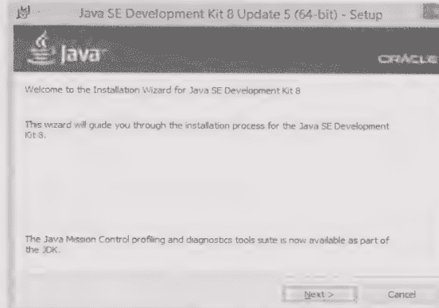

图 1.3：在 Windows 上安装 JDK 8

## 在 Linux 上安装

在 Linux 平台上，JDK 有两种安装格式。

- RPM，适用于支持 RPM 包管理系统的 Linux 平台，如 Red Hat 和 SuSE。

- 自解压包。一个包含要安装包的压缩文件。

如果你正在使用 RPM，请遵循以下步骤：

1. 使用 `su` 命令变为 root 用户
2. 提取下载的文件。
3. 切换到下载文件所在的目录并执行 `chmod`：
4. 运行 RPM 文件：

```
chmod a+x rpmFile
```
其中 `rpmFile` 是 RPM 文件。

```
./rpmFile
```

如果你正在使用自解压二进制安装，请遵循以下步骤。

1. 提取下载的文件。
2. 使用 `chmod` 给文件赋予执行权限：

```
chmod a+x binFile
```

这里，`binFile` 是你为你平台下载的 bin 文件。
3. 切换到你想安装文件的目录。
4. 运行自解压二进制文件。通过在文件前加上路径来执行下载的文件。例如，如果文件在当前目录下，请在它前面加上 `./`（如果 `./` 不在 PATH 环境变量中，则这是必要的）：

```
./binFile
```


# 设置系统环境变量

安装 JDK 后，你就可以开始编译和运行 Java 程序了。然而，你只能在 `javac` 和 `java` 程序所在的路径下或通过在命令中包含安装路径来调用编译器和 JRE。为了让编译和运行 Java 程序变得更简单，你需要设置环境变量。

## 在 Windows 上设置环境变量

安装 JDK 后，你就可以开始编译和运行 Java 程序了。然而，你只能在 `javac` 和 `java` 程序所在的路径下或通过在命令中包含安装路径来调用编译器和 JRE。为了让编译和运行 Java 程序变得更简单，你需要设置环境变量。

2. 输入以下命令。

```
javac MyFirstJava.java
```

如果一切顺利，`javac` 将在你的工作目录下创建一个名为 `MyFirstJava.class` 的文件。

> **注意**
>
> `javac` 工具具有更多你可以通过传递选项使用的特性。例如，你可以告诉它你希望将生成的类文件创建在什么位置。附录 A "javac" 详细讨论了 `javac`。

# 运行你的 Java 程序

要运行你的 Java 程序，请使用 JDK 部分的 `java` 程序。同样，添加了 `PATH` 环境变量后，你应该能够从任何目录调用 `java`。在你的工作目录下，输入以下内容并按回车。

```
java MyFirstJava
```

注意，在运行 Java 程序时不需要包含类扩展名。

你将在控制台上看到以下内容：

> Java rocks.

恭喜你！你成功编写了你的第一个 Java 程序。由于本章的唯一目标是让你熟悉编写和编译过程，我将不会尝试解释程序是如何运行的。

你也可以向 Java 程序传递参数。例如，如果你有一个名为 `Calculator` 的类，并想向它传递两个参数，你可以这样这样做：

```
java Calculator arg-1 arg-2
```

在这里，`arg-1` 是第一个参数，`arg-2` 是第二个参数。你可以传递任意数量的参数。`java` 程序会将这些参数作为字符串数组提供给你的 Java 程序。你将在第 5 章“核心类”中学习处理参数。

> **注意**
>
> `java` 工具是一个你可以通过传递选项配置的高级程序。例如，你可以设置分配它的内存量。附录 B "java" 解释了这些选项。

> **注意**
>
> `java` 工具还可以运行封装在 jar 文件中的 Java 类。请查看附录 C "jar" 中的“设置应用程序入口点”部分。

# Java 代码规范

编写可以运行的正确 Java 程序是重要的。然而，编写易于阅读和维护的程序也至关重要。人们认为，软件生命周期成本的 80% 花在了维护上。此外，程序员的流动率很高，因此在代码的生命周期内，很有可能是你以外的人维护你的代码。任何继承你代码的人都会欣赏清晰易读的程序源码。

# 第 1 章：初尝 Java

使用一致的代码规范是使你的代码更易读的方法之一。（其他方法包括适当的代码组织和充分的注释。）代码规范包括文件名、文件组织、缩进、注释、声明、语句、空白和命名规范。

类声明以关键字 `class` 开头，后跟类名和左大括号 `{`。你可以将左大括号放在类名所在的行，如列表 1.1 所示，也可以将其写在下一行，如列表 1.2 所示。

### 列表 1.2：使用不同规范编写的 MyFirstJava

```
class MyFirstJava {

    public static void main(String[] args) {

        System.out.println("Java rocks.");

    }

}
```


# 第 1 章：Java 入门

列表 1.2 中的代码与列表 1.1 中的代码一样好。只是类使用了不同的规范编写的。你应该对所有的程序元素采用一致的风格。然而，Sun Microsystems 公司发布了一份概述了其员工应当遵循的标准文档。（当然，该文档现在是 Oracle 文档的一部分）

<http://www.oracle.com/technnetwork/java/codeconventions-150003.pdf> 本书中的程序示例将遵循该文档概述的推荐规范。我还想鼓励你从编程生涯的第一天起养成遵循这些规范的习惯，这样在以后阶段编写清晰的代码就会变得自然而然。

你关于风格的第一课是关于缩进的。缩进单位必须是四个空格。如果使用制表符代替空格，必须每八个空格设置一次（而不是四个）。

## 集成开发环境 (IDEs)

使用文本编辑器编写 Java 程序是可能的。然而，IDE 会有所帮助。IDE 不仅会检查你代码的语法，还可以补全代码、调试并跟踪你的程序。此外，编译会在你输入时自动发生，运行 Java 程序只需点击一个按钮。因此，你将在更短的时间内完成开发。

市面上有几十个 Java IDE，幸运的是，其中最好的是免费的。以下是一个简单的列表：

- NetBeans（免费且开源）
- Eclipse（免费且开源）
- Sun 的 Java Studio Enterprise（免费）
- Sun 的 Java Studio Creator（免费）
- Oracle JDeveloper
- Borland JBuilder
- IBM 的 WebSphere Studio Application Developer
- BEA WebLogic Workshop

### Java for IDEA

- IntelliJ IDEA

最流行的两个是 NetBeans 和 Eclipse，过去几年中可以看到两者为了争夺第一而进行的战争。NetBeans 和 Eclipse 都是开源的，拥有更强大的支持者。Sun Microsystems 在 2000 年购买捷克公司 NetBeans Ceska Republika 后推出了 NetBeans，并对其投入了大量资金。Eclipse 由 IBM 发源，旨在与 NetBeans 竞争。

哪一个更好取决于你问谁，但它们的流行已成为一种动力，促使其他软件开发商也免费赠送他们的 IDE。即使是微软（其 .NET 技术是 Java 最强烈的竞争对手），也停止了对其 Visual Studio.NET Express 版收费。

本书在附录 D 和 E 中提供了 NetBeans 和 Eclipse 的简要教程。

## 总结

本章帮助你编写了第一个 Java 程序。你使用了文本编辑器，使用 `javac` 编译，并使用 `java` 工具运行了类文件。随着程序的复杂化，IDE 会很有帮助。Java 是一门语言。

## 问题

1. 如果你在 1.1 使用不同的名称，例如 `whatever.java`，它可以编译吗？
2. 如果你使用了 `.java` 以外的扩展名，例如 `MyFirstJava.txt`，它可以编译吗？

# 第 2 章：语言基础

Java 是一种面向对象的编程 (OOP) 语言，因此理解 OOP 至关重要。第 4 章“对象与类”是 OOP 的第一课。然而，在探索 OOP 的许多特性和技术之前，请确保你学习了基础概念：本章涵盖的主题如下：

- 编码集：Java 支持 Unicode 字符编码，不受 ASCII 字符限制。可以使用几乎任何语言编写文本。
- 基本类型：Java 是一门 OOP 语言，Java 程序大部分时间都在处理对象。然而，还有非对象元素表示数字以及简单的真假值。这些简单的非对象元素被称为基本类型。
- 变量：内容可以变化的占位符。有很多变量。
- 常量：值不能变化的占位符。
- 字面量：Java 编译器理解的数据值的表示。
- 基本类型转换：将基本类型转换为另一种类型。
- 运算符：指示要执行某些操作的符号。

> **注意**
>
> 如果你用过 C 或 C++（Java 发明时两种流行的语言）进行编程，那么学习 Java 时你会感到熟悉，因为 Java 的语法与 C 和 C++ 非常相似。然而，Java 的创建者增加了一些 C 和 C++ 中不具备的功能，并排除了其中的某些方面。

## 编码集

（国际标准组织，ISO-8859-1，也称为 Latin-1。ISO-8859-1 中的每个字符也用 8 位表示。该字符集包含了编写许多西欧语言文本所需的所有字符，例如德语、丹麦语、荷兰语、法语、意大利语、西班牙语、葡萄牙语，当然还有英语。每个字符 8 位的集合非常方便，因为它也是 8 位长的。在 8 位字符集中存储和传输文本效率最高。）

然而，并不是每种语言都使用拉丁字母。中文、韩语和泰语是使用不同字符集的例子。例如，中文里的一个字符代表一个单词，而不是一个字母。这样的字符有成千上万，8 位不足以表示字符集中的所有字符。日语对他们的语言也使用了不同的字符集。总而言之，世界上所有的语言有数百种不同的字符集。这令人困惑，因为在一个字符集中表示某个特定字符的代码，在另一个字符集中又代表另一个字符。

Unicode 是由名为 Unicode 联盟（<www.unicode.org>）的非营利组织开发的字符集。该机构试图将世界上所有语言的所有字符包含在一个单一字符集中。Unicode 中的一个唯一数字恰好代表一个字符。目前 Unicode 版本为 6，它已用于 Java、XML、ECMAScript、LDAP 等。它也被 IBM、微软、Google、HP 等行业领导者所采用。

最初，一个 Unicode 字符由 16 位表示，这不足以表示超过 65,000 个不同的字符。65,000 个字符足以编码世界上大多数主要语言的大部分字符。然而，Unicode 联盟计划允许对多达百万字符进行编码。借此，你需要超过 16 位来表示每个字符。事实上，32 位系统是存储 Unicode 的方便方法。

现在，你发现了一个问题。虽然 Unicode 为所有语言中使用的所有字符提供了足够的空间，但存储和传输 Unicode 文本并没有存储和传输 ASCII 或 Latin-1 字符那样高效。在互联网上，这是一个巨大的问题。想象一下必须传输比 ASCII 文本多 4 倍的数据！

幸运的是，编码可以让存储和传输 Unicode 文本变得更高效。你可以将字符编码比作数据压缩，现在有许多类型的字符编码可用。Unicode 联盟认可了其中三种：

- **UTF-8**。这在 HTML 和协议中非常流行。Unicode 字符被转换为变长度的字节编码。它的优点是与熟悉的 ASCII 对应的 Unicode 字符具有 ASCII 相同的字节值，而且转换成 UTF-8 的 Unicode 字符可以使用更高效的软件。
- **UTF-16**。在这种字符编码中，所有更常用的字符都适合单个 16 位的代码，而其他较少使用的字符通过对 16 位的代码对访问。
- **UTF-32**。这种字符编码对每个字符都使用 32 位。这显然不是互联网应用程序的选择。至少，目前不是。

ASCII 字符在软件编程中仍然起着主导作用。Java 在几乎所有的输入元素中也使用 ASCII，注释、标识符以及字符和字符串的内容除外。后者，Java 支持 Unicode 字符。这意味着你可以用英语以外的语言编写注释、标识符和字符串。例如，如果你是在北京的中文使用者，你可以使用中文字符作为变量名。作为对比，这里有一段 Java 代码声明了一个名为 `password` 的标识符，它由 ASCII 字符组成：

```java
String password = "secret";
```

相比之下，以下标识符使用的是简体中文字符。

```java
String 密码 = "secret";
```

## 分隔符

Java 使用了几种字符作为分隔符。这些特殊字符如表 2.1 所示。

| 符号 | 名称 | 说明 |
| :--- | :--- | :--- |
| `()` | 圆括号 | 用于：1. 方法签名以包含参数列表。2. 表达式以提高运算符优先级。3. 窄化转换。4. 循环以包含要待求的表达式。 |
| `{}` | 大括号 | 用于：1. 类型声明。2. 语句块。3. 数组初始化。 |
| `[]` | 方括号 | 用于：1. 数组声明。2. 值解引用。 |
| `< >` | 尖括号 | 用于向参数化类型传递参数。 |
| `:` | 分号 | 用于终止语句，并在 `for` 语句中分隔初始化代码、表达式和更新代码。 |
| `,` | 逗号 | 用于遍历数组或集合的 `for` 语句。用于分隔方法声明中的参数。 |
| `.` | 周期 | 用于将包名与子包及类型名分开，并将字段或方法与引用变量分开。 |

表 2.1：Java 分隔符

熟悉这些符号和名称非常重要。如果阅读后不理解“说明”列中的术语，请不要担心。

## 基本类型

如引言中所提到的，在编写面向对象（OO）应用程序时，你创建一个类似于真实世界的对象模型。例如，一个工资应用程序将会有员工对象、税收对象、公司对象等。在 Java 中，对象不是唯一的数据类型。还有另一种数据类型称为基本类型（primitive）。Java 中有八种基本类型，每种都有特定的格式和大小。表 2.2 列出了 Java 基本类型。

| 基本类型 | 说明 | 范围 |
| :--- | :--- | :--- |
| `byte` | 字节长度（8 位） | -128 到 127 (-2^7) |
| `short` | 短整数（16 位） | -32768 到 32767 (-2^15) |
| `int` | 整数（32 位） | -2147483648 到 2147483647 (-2^31) |
| `long` | 长整数（64 位） | -9223372036854775808 到 9223372036854775807 (-2^63) |
| `float` | 单精度浮点数（32 位 IEEE 754） | 1.4e-45 到 3.402823e38 |
| `double` | 双精度浮点数（64 位 IEEE 754） | 4.9e-324 到 1.797693134862157e308 |
| `char` | Unicode 字符 | [Unicode 6] |
| `boolean` | 布尔值 | `true` 或 `false` |

表 2.2：Java 基本类型

## 变量

变量可以有一个声明的类型。Java 中有两种数据类型：

- **引用类型**（reference types）。引用类型的变量提供指向对象的引用。
- **基本类型**（primitive types）。基本类型的变量持有原始数据（primitive）。

### Java 如何存储整数值

你一定听过计算机使用二进制数，即只由 0 和 1 组成的数字。本节提供一个概述，在你学习数学运算符时可能会有用。

一个字节（`byte`）有 8 位（bits），这意味着有 8 位用于存储一个字节。最左位是符号位。0 表示正数，1 表示负数。`0000 0000` 是 0 的二进制表示，`0000 0001` 是 1 的表示，`0000 0010` 是 2 的表示，`0000 0011` 是 3 的表示，`0111 1111` 是 127 的表示，这是字节能包含的最大正数。

那么，如何获取负数的二进制表示呢？这很简单。取其正等值的表示，反转所有位并加 1。例如，要获取 -3 的二进制表示，从 3 开始，即 `0000 0011`。反转二进制表示得到：

```
1111 1100
```

加 1 得到 `1111 1101`，这在二进制中就是 -3。

对于 `int`，规则是相同的，即最左位是符号位。唯一的区别是 `int` 有 32 位。要计算 `int` 中 -1 的二进制形式，我们从 1 开始：

```
0000 0000 0000 0000 0000 0000 0001
```

反转所有位得到：

```
1111 1111 1111 1111 1111 1111 1110
```

加 1 得到我们想要的数字（-1）：

```
1111 1111 1111 1111 1111 1111 1111
```

除了数据类型外，变量还有一个名称或标识符（identifier）。选择标识符有几条规则：

1. 标识符是 Java 字母和 Java 数字的无限长度序列。标识符必须以 Java 字母开头。
2. 标识符不能是 Java 关键字（见表 2.3）、布尔型字面量（`boolean literal`）或 null 字面量（`null literal`）。
3. 它在它的作用域（scope）内必须唯一的。作用将在第 4 章“对象和类”中讨论。

### Java 字母和 Java 数字

Java 字母包括大写和小写的 ASCII 字母 A 到 Z 和 a 到 z，并且由于历史原因，还包括 ASCII 下划线 (`_`) 和美元符号 (`$`)。`$` 字符应仅用于机械生成的源代码中，或用于访问遗留系统上的预定义名称。

Java 数字包括 ASCII 数字 0-9。

### Java 关键字

| | | |
| :--- | :--- | :--- |
| `abstract` | `continue` | `switch` |
| `assert` | `default` | `if` |
| `package` | `synchronized` | `boolean` |
| `do` | `goto` | `private` |
| `this` | `break` | `double` |
| `protected` | `throw` | `byte` |
| `else` | `import` | `public` |
| `throws` | `case` | `enum` |
| `instanceof` | `return` | `transient` |
| `catch` | `extends` | `int` |
| `short` | `try` | `char` |
| `final` | `interface` | `static` |
| `void` | `class` | `finally` |
| `long` | `strictfp` | `volatile` |
| `const` | `float` | `native` |
| `super` | | |

表 2.3：Java 关键字

以下是一些合法的标识符：

- `salary`
- `x2`
- `x3`
- `count`

以下是一些无效的标识符：

- `2x`
- `java+variable`

`2x` 是无效的，因为它以数字开头。`java+variable` 是无效的，因为它包含加号。

还要注意名称对大小写敏感。`x2` 和 `X2` 是不同的标识符。

通过先写类型，然后写名称并加分号来声明变量。以下是变量声明的示例：

```java
byte x;
int rowCount;
char c;
```

在上面的示例中，你声明了三个变量：

- `byte` 类型的 `x`
- `int` 类型的 `rowCount`
- `char` 类型的 `c`

这些标识符。

也可以在同一行内声明相同类型的变量，用逗号分隔变量。例如：

```java
int a, b;
```

这等于

```java
int a;
int b;
```

然而，不建议在同一行内编写多个声明，因为它降低了可读性。

最后，可以在声明变量的同时为变量赋值：

```java
byte x = 12;
int rowCount = 1000;
```

### Sun 变量命名规范

变量名应该短而有意义。它们应该使用混合大小写，且首字母小写。后续单词以大写字母开头。变量名不应以下划线或美元 `$` 字符开头。例如，有一些符合 Sun 代码规范的变量示例：`userName`、`count`、`firstTimeLogin`。

## 常量

在 Java 中，常量是指一旦赋值无法更改的变量。你通过使用 `final` 关键字来声明常量。根据习惯，常量名全大写，并用下划线分隔单词。

以下是常量的示例：

```java
final int MAX = 50;
final double PI = 3.14;
```

从 Java 7 开始，你可以分隔整数字面量中的数字。例如，这两个含义相同，但后者显然更容易读。

```java
int million = 1000000;
int million = 1_000_000;
```

## 字面量

### 整数字面量

整数字面量可以用十进制、八进制、十六进制或二进制表示。十进制字面量不带前缀。八进制字面量以 `0` 开头。十六进制字面量以 `0x` 或 `0X` 开头。二进制字面量以 `0b` 或 `0B` 开头。

### 浮点字面量

浮点字面量表示小数。最小的非零 `float` 值是 `1.401298464324817e-45`，最大的 `float` 值是 `3.4028234663852886e38`。最小的非零 `double` 值是 `4.9406564584126544e-324`。

在浮点型 `float` 和双精度型 `double` 中，整数位数是可选的。也就是说，`0.5` 可以写成 `.5`。此外，指数可以使用 `e` 或 `E` 表示。

要表示浮点字面量，请使用以下格式之一：

```
Digits [Digits] [ExponentPart] f_or_F
Digits [ExponentPart] f_or_F
Digits ExponentPart f_or_F
Digits [ExponentPart] f_or_F
```

注意，括号中的部分是可选的。

`f` 或 `F` 部分使浮点字面量变为 `float`。缺少此部分则使浮点字面量变为 `double`。要显式地表示双精度字面量，可以使用 `D` 或 `d` 作为后缀。

要编写双精度类型，请使用这些格式之一：

```
Digits [Digits] [ExponentPart] [d_or_D]
Digits [ExponentPart] [d_or_D]
Digits ExponentPart [d_or_D]
Digits [ExponentPart] [d_or_D]
```

在 `float` 和 `double` 中，`ExponentPart` 的定义如下：

`ExponentIndicator SignedInteger`

其中 `ExponentIndicator` 是 `e` 或 `E`，而 `SignedInteger` 是：

`Sign Digits`

其中 `Sign` 是 `+` 或 `-`，加号是可选的。

浮点字面量的示例包括：

```
2e1f
8.f
.5f
0f
3.14f
9.0001e+12f
```

以下是双精度字面量的示例：

```
2e1
8.
.5
0.0D
3.14
9e-9d
7e123D
```

### 布尔字面量

布尔类型有两个值，分别由字面量 `true` 和 `false` 表示。例如，以下代码声明了一个布尔变量 `includeSign` 并将其赋值为值 `true`。

```java
boolean includeSign = true;
```

### 字符字面量


字符字面量是封装在单引号内的 Unicode 字符或转义序列。转义序列是无法通过键盘输入或在 Java 中具有特殊功能的 Unicode 字符的表示。例如，回车符和换行符用于结束一行，且没有视觉表示。要表示换行符，你需要对其进行转义，即写出它的字符表示。此外，单引号字符需要转义，因为单引号用于封装字符。

以下是字符字面量的示例：

```
'a'
'\2'
'\b'
'\0'
'\t'
'\'
```

以下是转义序列的字符字面量：

- `'\b'` 退格符
- `'\t'` 制表符
- `'\\'` 反斜杠
- `'\''` 单引号
- `'\"'` 双引号
- `'\n'` 换行
- `'\r'` 回车

此外，Java 允许对 Unicode 字符进行转义，以便使用 ASCII 字符序列表示 Unicode 字符。例如，字符 `©` 的 Unicode 代码是 2299。你可以编写以下 Unicode 字面量来表示该字符：

```
'©'
```

但是，如果你没有可以使用键盘生成该字符的工具，可以通过这种方式对其进行转义：

```
'\u2299'
```

## 基本类型转换

在处理数据类型时，你经常需要执行转换。例如，将一个变量的值赋值给另一个变量涉及转换。如果两个变量具有相同类型，则赋值将始终成功。从类型到相同类型的转换称为恒等转换。例如，以下操作保证是成功的：

```
int a = 90;
int b = a;
```

然而，转换为不同类型并不保证能成功，甚至可能不可能。还有两种类型的基本类型转换：宽转换和窄转换。

### 宽转换

宽基本类型转换发生从一种类型到另一种尺寸与第一种类型相同或更大的类型上，例如从 `int` (32 位) 到 `long` (64 位)。在以下情况下允许进行宽转换：

- `byte` 转换为 `short`, `int`, `long`, `float` 或 `double`
- `short` 转换为 `int`, `long`, `float`, 或 `double`
- `char` 转换为 `int`, `long`, `float`, 或 `double`
- `int` 转换为 `long`, `float`, 或 `double`
- `long` 转换为 `float` 或 `double`
- `float` 转换为 `double`

从整数类型到另一个整数类型的宽转换不会有信息丢失的风险。同时，从 `float` 到 `double` 的转换保留了所有信息。然而，从 `int` 或 `long` 转换为 `float` 可能会导致精度丢失。

宽转换是隐式发生的。你不需要在代码中做任何操作。例如：

```
int a = 10;
long b = a; // 宽转换
```

### 窄转换

窄转换发生从一种类型到尺寸更小的不同类型上，例如从 `long` (64 位) 到 `int` (32 位)。通常情况下，窄基本类型转换可以在这些情况下：

- `short` 转换为 `byte` 或 `char`
- `char` 转换为 `byte` 或 `short`
- `int` 转换为 `byte`, `short`, 或 `char`
- `long` 转换为 `byte`, `short`, `char`, `int`, 或 `float`
- `float` 转换为 `byte`, `short`, `char`, `int`, `long`, 或 `float`
- `double` 转换为 `byte`, `short`, `char`, `int`, `long`, 或 `float`

与宽转换不同，窄转换必须是显式的。例如：

```
long a = 10;
int b = (int) a; // 窄转换
```

## 运算符

### 一元运算符

一元运算符作用于一个操作数。有几种一元运算符：

- 递增 (`++`)
- 递减 (`--`)
- 负号 (`-`)
- 正加 (`+`)
- 位取反 (`~`)
- 逻辑取反 (`!`)

#### 递增运算符 `++`

该运算符将操作数的值加 1。操作数必须是数值类型。运算符可以出现在操作数的前或后。如果运算符出现在操作数之前，则称为前缀递增运算符。如果写在操作数之后，则变为后缀递增运算符。

作为一个示例，这里是前缀递增运算符的使用：

```
int x = 4;
++x;
```

`++` 之后，`x` 的值为 5。之前的代码相当于

```
int x = 4;
x++;
```

`x++` 之后，`x` 的值为 5。

然而，如果递增运算符的结果在同一个表达式中赋值给另一个变量，前缀运算符与其后缀副本之间存在差异。考虑这个问题：

```
int x = 4;
int y = ++x;
// y = 5, x = 5
```

前缀递增运算符在赋值之前应用。`x` 增加到 5，然后将其值复制给 `y`。

然而，查看这里后缀递增运算符的使用：

```
int x = 4;
int y = x++;
// y = 4, x = 5
```

对于后缀递增运算符，操作数（`x`）的值在操作数的值赋值给另一个变量（`y`）之后增加。

注意递增运算符通常应用于 `int`。然而，它也适用于其他数值基本类型，例如 `float` 和 `long`。

#### 递减运算符 `--`

该运算符将操作数的值减 1。操作数必须是数值类型的变量。像递增运算符一样，还有前缀递减运算符和后缀递减运算符。例如，以下代码递减 `x` 并将值赋值给 `y`：

```
int x = 4;
int y = --x;
// y = 3, x = 3
```

在下面的示例中，使用了后置递减运算符：

```java
int x = 4;
int y = x--;
// x = 3, y = 4
```

#### 逻辑取反运算符 `!`

此运算符只能应用于布尔基本类型或 `java.lang.Boolean` 实例。如果操作数是 `false`，则该运算符的值为 `true`；如果操作数为 `true`，则其值为 `false`。例如：

```java
boolean x = false;
boolean y = !x;
// 此时，y 为 true，x 为 false
```

#### 按位取反运算符 `~`

此运算符的操作数必须是整数基本类型或整数基本类型变量。其结果是操作数的按位取反。例如：

```java
int j = 2;
int k = ~j; // k = -3
```

要理解此运算符是如何运作的，你需要将操作数转换为二进制数并反转所有位。整数型 2 的二进制形式为：

```
0000 0000 0000 0000 0000 0000 0010
```

它的按位取反是

```
1111 1111 1111 1111 1111 1111 1101
```

这是 `-3` 在整数型中的表示形式。

### 算术运算符

有四种算术运算：加法、减法、乘法、除法和取模。这里将讨论每种算术运算符。

#### 加法运算符 `+`

加法运算符将两个操作数相加。操作数的类型必须能够转换为数值基本类型。例如：

```java
byte x = 3;
int y = x + 5; // y = 8
```

确保接收结果的变量具有足够的容量。例如，在最终代码中，`k` 是 `-249967296` 而不是 40 亿。

```java
int j = 2000000000; // 20 亿
int k = j + j; // 容量不足。这是一个 Bug！！！
```

另一方面，下面的代码运行符合预期：

```java
long j = 2000000000; // 20 亿
long k = j + j; // k 的值是 40 亿
```

#### 减法运算符 `-`

此运算符执行两个操作数之间的减法。操作数的类型必须能够转换为数值基本类型。例如：

```java
int x = 2;
int y = x - 1; // y = 1
```

#### 乘法运算符 `*`

此运算符执行两个操作数之间的乘法。操作数的类型必须能够转换为数值基本类型。例如：

```java
int x = 4;
int y = x * 4; // y = 16
```

#### 除法运算符 `/`

此运算符执行两个操作数之间的除法。左操作数是被除数，右操作数是除数。被除数和除数都必须是可以转换为数值基本类型的类型。例如：

```java
int x = 4;
int y = x / 2; // y = 2
```

注意，如果除数为零，除法运算将抛出错误。如果除数不能整除被除数，余数将被忽略。

使用 `/` 运算符进行除法的结果始终是一个整数。如果除数不能整除被除数，余数将被忽略。

```java
int x = 4;
int y = x / 3; // y = 1
```

在第 5 章“核心类”中解释的 `java.lang.Math` 类可以执行更复杂的除法。

#### 取模运算符 `%`

此运算符执行两个操作数之间的除法并返回余数。左操作数是被除数，右操作数是除数。被除数和除数必须是可以转换为数值基本类型的类型。例如，以下运算的结果为 2。

```
8 % 3
```

### 相等运算符

有两个相等运算符，`==`（等于）和 `!=`（不等于），均应用于浮点数、字符或布尔值。整数相等的结果是布尔。

例如，比较后 `c` 的值为 `true`。

```java
int a = 5;
int b = 5;
boolean c = a == b;
```

另一个示例，

```java
boolean x = true;
boolean y = true;
boolean z = x != y;
```

由于 `x` 等于 `y`，所以 `z` 的值为 `false`。

### 关系运算符

有五个关系运算符：`<`、`>`、`<=`、`>=` 和 `instanceof`。最后一个在第 4 章“对象与类”中讨论。前四个运算符均在本节中解释。

`<`、`>`、`<=`、`>=` 应用于两个类型可以转换为数值基本类型的操作数。关系运算返回布尔值。

`<` 评估左操作数的值小于右操作数的值。例如，以下运算返回 `false`：

```
9 < 6
```

`>` 评估左操作数的值大于右操作数的值。例如，此运算返回 `true`：

```
9 > 6
```

`<=` 运算符判断左操作数的值小于或等于右操作数。

`>=` 运算符判断左操作数的值大于或等于右操作数。

### 条件运算符

三个条件运算符：`&&`、`||` 和 `?`。下面详细介绍这些运算符。

#### `&&` 运算符

此运算符执行两个操作数之间的逻辑与。如果两个操作数都为 `true`，则返回 `true`；如果至少有一个操作数为 `false`，则返回 `false`。

#### `||` 运算符

此运算符执行两个操作数之间的逻辑或。如果至少有一个操作数为 `true`，则返回 `true`；如果两个操作数都为 `false`，则返回 `false`。

#### `?` 运算符

这也称为三元运算符。它接受三个操作数：一个条件、条件为真时的值以及条件为假时的值。语法为 `condition ? value_if_true : value_if_false`。

```java
int result = (a > b) ? 10 : 20;
```

### 移位运算符

#### 无符号右移运算符 `>>>`

`n >>> s` 的值取决于 `n` 是正数还是负数。对于正数 `n`，其值与 `n >> s` 相同。

如果 `n` 是负数，其值取决于 `n` 的类型。如果 `n` 是 `int`，值为 `(n >> s) + (2 << s)`。如果 `n` 是 `long`，值为 `(n >> s) + (2L << s)`。

### 赋值运算符

共有 12 个赋值运算符：`=`、`+=`、`-=`、`*=`、`/=`、`%=`、`&=`、`|=`、`^=`、`<<=`、`>>=`、`>>>=`。

赋值运算符接收两个操作数，操作数的类型必须是整型基本类型。左侧的操作数必须是一个变量。例如：

```
int x = 5;
```

除了赋值运算符 `=` 之外，其余运算符的工作方式相同，你可以将每个运算符视为由两个运算符组成的。例如，`+=` 实际上是 `+` 和 `=`。赋值运算符 `<<=` 包含两个运算符，`<<` 和 `=`。

双部分赋值运算符的工作原理是将第一个运算符应用于操作数，并将结果赋值给左侧的操作数。例如，`x += 5` 等于 `x = x + 5`。

```
x -= 5 等于 x = x - 5。
x <<= 5 等同于 x = x << 5。
x &= 5 产生的结果与 x = x & 5 相同。
```

### 整数位运算运算符 `&` `|` `^`

位运算运算符 `&`、`|` 和 `^` 对两个操作数进行位位操作，操作数的类型必须可以转换为 `int`。`&` 表示与（AND），`|` 表示或（OR），`^` 表示异或（XOR）。例如：

```
0xFFFF & 0x0000 = 0x0000
0xF0F0 & 0xFFFF = 0xF0F0
0xFFFF & 0x000F = 0x000F
0xFFF0 ^ 0x00FF = 0xFF0F
```

### 逻辑运算符 `&` `|` `^`

逻辑运算符 `&`、`|` 和 `^` 对两个可以转换为布尔值的操作数进行逻辑操作。`&` 表示与，`|` 表示或，`^` 表示异或。例如：

```
true & true = true
true & false = false
true | false = true
false | false = false
true ^ false = true
false ^ false = false
false ^ true = true
```

### 运算符优先级

在大多数程序中，一个表达式中经常出现多个运算符，例如：

```
int a = 1;
int b = 2;
int c = 3;
int d = a + b * c;
```

代码执行后 `d` 的值是多少？如果你说是 9，那你就错了。实际上是 7。

乘法运算符的优先级高于加运算符 `+`。因此，乘法会在加法之前执行。然而，如果你想先执行加法，可以使用括号。

```
int d = (a + b) * c;
// 后者将 9 赋值给 d。
```

表 2.5 列出了按优先级排序的所有运算符。同一列的运算符具有相同的优先级。

| 优先级 | 运算符 |
| :--- | :--- |
| 1 (最高) | `[]` `.` `()` `expr++` `expr--` |
| 2 | `++expr` `--expr` `+expr` `-expr` `~` `!` |
| 3 | `new` `(type)expr` |
| 4 | `*` `/` `%` |
| 5 | `+` `-` |
| 6 | `<<` `>>` `>>>` |
| 7 | `<` `<=` `>` `>=` `instanceof` |
| 8 | `==` `!=` |
| 9 | `&` |
| 10 | `^` |
| 11 | `|` |
| 12 | `&&` |
| 13 | `||` |
| 14 | `? :` |
| 15 (最低) | `=` `+=` `-=` `*=` `/=` `%=` `&=` `^=` `|=` `<<=` `>>=` `>>>=` |


### Java 用于 Android

0000 0000 0000 0000 0000 0000 1000

等于 8。

### 无符号右移运算符 >>>

`n>>>` 的值取决于 `n` 是正数还是负数。对于正数 `n`，其值与 `n>>` 相同。

如果 `n` 是负数，其值取决于 `n` 的类型。如果 `n` 是 `int`，值为 `n(n>>s)+(2<<s)`。如果 `n` 是 `long`，值为 `(n>>s)+(2L<<s)`。

### 赋值运算符

共有 12 个赋值运算符：

`+=` `=` `>>>` `=` `=`

赋值运算符接收两个操作数，操作数的类型必须是整型基本类型。左侧的操作数必须是一个变量。例如：

```
int x = 5;
```

除了赋值运算符 `=` 之外，其余运算符的工作方式相同，你可以将每个运算符视为由两个运算符组成的。例如，`+=` 实际上是 `+` 和 `=`。赋值运算符 `<<=` 包含两个运算符，`<<` 和 `=`。

双部分赋值运算符的工作原理是将第一个运算符应用于操作数，并将结果赋值给左侧的操作数。例如，`x += 5` 等于 `x = x + 5`。

```
x = 5 等于 x = x - 5。
x<<= 5 等同于 x = x << 5。
x&= 5 产生的结果与 x = x & 5 相同。
```

### 整数位运算运算符 & ^

位运算运算符 `&` 和 `|` 对两个操作数进行位位操作，操作数的类型必须可以转换为 `int`。`&` 表示与，`|` 表示或，`^` 表示异或。例如：

```
0xFFFF & 0x0000 = 0x0000
0xF0F0 & 0xFFFF = 0xF0F0
0FFFF & 0x000F = 0x000F
0xFFF0 ^ 0x00FF = 0xFFF0
```

### 逻辑运算符 & | ^

逻辑运算符 `&` 和 `|` 对两个可以转换为布尔值的操作数进行逻辑操作。`&` 表示与，`|` 表示或，`^` 表示异或。例如：

```
true & true = true
true & false = false
true | false = true
false | false = false
true ^ false = false
false ^ false = false
false ^ true = true
```

### 运算符优先级

在大多数程序中，一个表达式中经常出现多个运算符，例如：

```
int a = 1;
int b = 2;
int c = 3;
int d = a + b * c;
```

代码执行后 `d` 的值是多少？如果你说是 9，那你就错了。实际上是 7。

乘法运算符的优先级高于加运算符 `+`。因此，乘法会在加法之前执行。然而，如果你想先执行加法，可以使用括号。

```
int d = (a + b) * c;
后者将 9 赋值给 d。
```

表 2.5 列出了按优先级排序的所有运算符。同一列的运算符具有相同的优先级。

| 运算符 | []. (params) expr++ expr-- |
| :--- | :--- |
| 后置运算符 | +expr-- expr-expr- ~ |
| 一元运算符 | new(type)expr |
| 创建或代价 | |
| 乘法 | * / % |
| 加法 | + |
| 移位 | <<>>> |
| 关系运算符 | <= >= instanceof |
| 等于关系运算符 | == |
| 位与 | & |
| 位异或 | ^ |
| 位或 | \|\| |
| 逻辑与 | && |
| 逻辑或 | \|\| |
| 条件运算符 | ? : |
| 赋值 | += -= *= &= ^= |

### 42 Android 版 Java

`statementA`: 标记部分 `sectionA`。

`sectionA`: `x = y + 1;`

在这里，有一个标记代码块的示例：


```
start: {
  // statements
}
```

对语句或代码块进行标记目的是为了能够被 `break` 和 `continue` 语句引用。

### if 语句

if 语句是一个条件分支语句。if 语句的语法有以下两种形式之一：

```
if (booleanExpression) {
  statement(s)
}
```

```
if (booleanExpression) {
  statement(s)
} else {
  statement(s)
}
```

如果 `booleanExpression` 的求值为 `true`，则执行 `if` 之后的后续代码块中的语句。如果其求值为 `false`，则不执行 `if` 块中的语句。如果 `booleanExpression` 的求值为 `false` 且存在 `else` 块，则执行 `else` 块中的语句。

例如，在接下来的 `if` 语句中，如果 `x` 大于 4，将执行 `if` 块。

```
if (x > 4) {
  // statements
}
```

在接下来的示例中，如果 `a` 大于 3，将执行 `if` 块。否则，执行 `else` 块。

```
if (a > 3) {
  // statements
} else {
  // statements
}
```

注意，良好的编码风格建议代码块中的语句应当缩进。

如果你在语句中评估一个布尔值，没有必要像这样使用 `==` 运算符：

```
boolean fileExist = ...
if (fileExists == true) {
```

相反，你只需写成：

```
if (fileExists) {
```

同样地，与其写：

```
if (fileExists == false) {
```

不如写：

```
if (!fileExists) {
```

如果表达式的求值过长，无法写在一行内，建议对后续行使用两个单位的缩进。

示例：

```
if (numberOfOfLoginAttempts < numberOfMaximumLoginAttempts
    // numberOfMinimumLoginAttempts > y) {
    y++;
}
```

如果 `if` 或 `else` 块中只有一个语句，则大括号是可选的。

```
if (a > 3)
    a++;
else
    a = 3;
```

然而，这可能会导致“悬空 else”问题。考虑以下示例：

```
if (a > 0 || b < 5)
    if (a > 2)
        System.out.println("a > 2");
    else
        System.out.println("a < 2");
```

这个 `else` 语句是悬空的，因为不清楚它与哪一个 `if` 语句关联。`else` 语句总是与紧随其前的 `if` 关联。使用大括号会让你的代码更清晰。

```
if (a > 0 || b < 5) {
    if (a > 2) {
        System.out.println("a > 2");
    } else {
        System.out.println("a < 2");
    }
}
```

如果有多个选择，你也可以使用 `if` 配合一系列的 `else` 语句。

```
if (booleanExpression1) {
    // statements
} else if (booleanExpression2) {
    // statements
} else {
    // statements
}
```

例如：

```
if (a == 1) {
    System.out.println("one");
} else if (a == 2) {
    System.out.println("two");
} else if (a == 3) {
    System.out.println("three");
} else {
    System.out.println("invalid");
}
```

在这种情况下，`else` 语句后面紧跟的是一个没有使用大括号的 `if`。另请参阅本文后部分章节“switch 语句”中的讨论。

### while 语句

在许多场合，你可能想要连续执行某项操作。换句话说，你有一段重复执行的代码。直观上，这可以通过重复这些代码来实现。例如，使用这段代码可以实现蜂鸣：

```
java.awt.Toolkit.getDefaultToolkit().beep();
```

以及，为了等待半秒，在阅读第 7 章后这段代码就变得清晰了。

```
try {
    Thread.sleep(500);
} catch (Exception e) {
}
```

因此，为了每隔 500 毫秒产生三声蜂鸣，可以使用这段代码：

```
java.awt.Toolkit.getDefaultToolkit().beep();
try {
    Thread.sleep(500);
} catch (Exception e) {
}
java.awt.Toolkit.getDefaultToolkit().beep();
try {
    Thread.sleep(500);
} catch (Exception e) {
}
java.awt.Toolkit.getDefaultToolkit().beep();
try {
    Thread.sleep(500);
} catch (Exception e) {
}
```

然而，在某些情况下重复代码不起作用。以下是原因：

- 重复次数大于 5，这意味着代码行数增加了。
- 如果块中有一行你需要修改代码，那么相同的行也必须被修改。
- 如果预先不知道重复次数，更好的方法是将重复代码放在循环中。这种方法你只需要写一次代码，就可以指示 Java 执行任意次数。创建一个循环的方法是使用 `while` 语句，这是本节的主题。另一种方法是使用 `for` 语句，将在下一节中解释。

`while` 语句的语法如下：

```
while (booleanExpression) {
    statement(s)
}
```

在这里，只要 `booleanExpression` 为 `true`，`statement(s)` 就会执行。如果大括号内只有一个语句，你可以省略大括号。然而，为了清晰起见，应该始终使用大括号。

作为 `while` 语句的示例，以下代码打印出小于三的数字。

```
int i = 0;
while (i < 3) {
    System.out.println(i);
    i++;
}
```

注意，循环中代码的执行取决于 `i` 的值，`i` 在每次迭代中增加直到达到 3。

为了每隔 500 毫秒产生三声蜂鸣，使用这段代码：

```
int j = 0;
while (j < 3) {
    java.awt.Toolkit.getDefaultToolkit().beep();
    try {
        Thread.sleep(500);
    } catch (Exception e) {
    }
    j++;
}
```

有时你会使用一个始终为 `true` 的表达式（例如 `boolean true`），但依赖 `break` 语句来退出循环。

```
int k = 0;
while (true) {
    System.out.println(k);
    k++;
    if (k > 2) {
        break;
    }
}
```

你将在本章较后的“break 语句”部分学习 `break` 语句。

### do-while 语句

`do-while` 语句类似于 `while` 语句：

```
do {
    statement(s)
} while (booleanExpression);
```

使用 `do-while`，你将 `do` 关键字之后放置要执行的 `statement(s)`。和 `while` 语句一样，如果内部只有一个语句，你可以省略大括号。然而，为了清晰起见，请始终使用大括号。


例如，`do-while` 语句的示例：

```
int i = 0;
do {
    System.out.println(i);
    i++;
} while (i < 3);
```

这在控制台上打印出：

```
0
1
2
```

下面的 `do-while` 证明了即使测试表达式 `j < 3` 的 `j` 值为 `false`，`do` 块中的代码至少也会执行一次。

```
int j = 4;
do {
    System.out.println(j);
    j++;
} while (j < 3);
```

这在控制台上打印出：

```
4
```

### for 语句

`for` 语句类似于 `while` 语句，即你用它来封装需要执行多次的代码。然而，`for` 比 `while` 更复杂。

`for` 语句以初始化开始，随后是每次迭代的表达式求值，以及如果表达式求值为 `true`，则执行语句块。在每次迭代的语句块执行后，还会执行一个更新语句。

`for` 语句的语法如下：

```
for (init; boolean; update) {
    statement(s)
}
```

在这里，`init` 是在第一次迭代之前进行的初始化。`booleanExpression` 是一个布尔表达式，如果它的求值为 `true`，则会导致 `statement(s)` 的执行，`update` 是在语句块执行后执行的语句。`init`、表达式和 `update` 都是可选的。

只有当满足以下条件时，`for` 语句才会停止：

- `booleanExpression` 求值为 `false`
- 执行了 `break` 或 `continue` 语句
- 发生运行时错误

在初始化部分声明变量并对其赋值是常见做法。所声明的变量在表达式和更新部分以及语句块中都是可见的。

例如，下面的 `for` 语句循环三次，每次都打印 `i` 的值。

```
for (int i = 0; i < 3; i++) {
    System.out.println(i);
}
```

`for` 语句通过声明一个 `int i` 并将其赋值为 0 开始：
`int i = 0;`

它评估表达式 `i < 3`，由于 `i` 等于 0，该表达式为 `true`。结果是语句块被执行，并打印 `i` 的值。然后它执行更新语句 `i++`，将 `i` 增加到 1。这结束了第一次循环。

`for` 语句再次评估 `i < 3` 的值。结果仍然为 `true`，因为 `i` 等于 1。这导致语句块被执行并在控制台打印 `i`。之后，执行更新语句 `i++`，将 `i` 增加到 2。这结束了第二次循环。

接下来，评估表达式 `i < 3`，结果为 `true`，因为 `i` 等于 2。这导致语句块运行，并在控制台打印 2。之后，执行更新语句 `i++`，导致 `i` 等于 3。这结束了第三次循环。

接下来，再次评估表达式 `i < 3`，结果为 `false`。这停止了循环。

这就是你在控制台上看到的内容：

- 0
- 1
- 2

注意，变量 `i` 在其他地方不可见，因为它是在循环内部声明的。

同样注意，如果 `for` 语句中的语句块只包含一条语句，你可以移除大括号，在这种情况下，上面的 `for` 语句可以重写为：

```
for (int i = 0; i < 3; i++)
    System.out.println(i);
```

然而，即使只有一条语句，使用大括号也会让你的代码更清晰。

这里是 `for` 循环的另一个示例：

```
for (int i = 0; i < 3; i++) {
    if (i % 2 == 0) {
        System.out.println(i);
    }
}
```

此循环运行三次。对 `i` 的每次迭代都进行测试。如果 `i` 是偶数，则打印该值。`for` 循环的结果如下：

- 0
- 2

接下来的 `for` 循环与之前的情况类似，但使用 `i += 2` 作为更新语句。结果是它只循环两次，当 `i` 等于 0 和当它为 2 时。

```
for (int i = 0; i < 3; i += 2) {
    System.out.println(i);
}
```


结果是：

```
0
2
```

递减变量的语句也经常被使用。考虑以下循环：

```
for (int i = 3; i > 0; i--) {
  System.out.println(i);
}
```

它打印：

```
3
2
1
```

`for` 语句的初始化部分是可选的。在接下来的 `for` 循环中，变量 `j` 声明在循环外部，因此 `j` 可能会在 `for` 语句块之外的其他代码点使用。

```
int j = 0;
for (; j < 3; j++) {
  System.out.println(j);
}
// j 在这里可见
```

如所述，更新语句是可选的。接下来的 `for` 语句将更新语句移动到语句块的末尾。结果是相同的。

```
int k = 0;
for (; k < 3; ) {
  System.out.println(k);
  k++;
}
```

理论上，你甚至可以省略布尔表达式部分。例如，`for` 语句没有该部分，循环通过 `break` 语句终止。更多信息请参见“break 语句”章节。

```
int m = 0;
for (; ; ) {
  System.out.println(m);
  m++;
  if (m > 4) {
    break;
  }
}
```

如果你比较 `for` 和 `while`，你会发现始终可以用 `for` 替换 `while` 语句。这意味着：

```
while (expression) {
...
}
```

始终可以写成：

```
for (; expression; ) {
}
```

> **注意**：此外，`for` 可以遍历数组或集合。关于增强型 `for` 的讨论，请参阅第 5 章“核心类”和第 11 章“集合框架”。

### break 语句

`break` 语句用于跳出嵌套的 `do`、`while`、`for` 或 `switch` 语句。在其他地方使用 `break` 将是编译错误。

例如，考虑以下代码：

```
int i = 0;
while (true) {
    System.out.println(i);
    i++;
    if (i > 3) {
        break;
    }
}
```

结果是：

- 0
- 1
- 2
- 3

注意 `break` 会跳出循环，而不执行语句块中的剩余语句。

这里是另一个 `break` 的示例，在 `for` 循环中。

```
int m = 0;
for ( ; ; ) {
    System.out.println(m);
    m++;
    if (m > 4) {
        break;
    }
}
```

`break` 语句可以跟一个标签。标签的存在会将控制转移到标签标记的代码处。例如，考虑这段代码：

```
start:
for (int i = 0; i < 3; i++) {
    for (int j = 0; j < 4; j++) {
        if (j == 2) {
            break start;
        }
        System.out.println(i + ":" + j);
    }
}
```

标签 `start` 标识第一个 `for` 循环。语句 `break start;` 因此从第一个循环跳出。运行代码的结果如下：

```
0:0
0:1
```

C 或 C++ 中没有 `goto` 语句，标签是 `goto` 的一种形式。然而，正如在 C/C++ 中使用 `goto` 可能会模糊你的代码，在 Java 中使用标签可能会让你的代码缺乏结构化。通常建议尽可能避免标签。

### continue 语句

`continue` 语句类似于 `break`，但它只停止当前迭代并开始下一次迭代。


# 第 4 章：对象与类

面向对象编程（OOP）通过对真实世界对象进行建模来工作。正如在引言中讨论过的，OOP 的优点是实实在在的，这解释了为什么 OOP 是当今的首选范式，以及为什么 Java 等 OOP 语言如此流行。本书将为你介绍对象和类。如果你是 OOP 的初学者，你可能需要仔细阅读这一章。良好理解 OOP 是编写高质量程序的关键。

本章首先解释了什么是对象以及什么构成了一个类。它将教你如何使用 `new` 关键字在 Java 中创建对象、对象是如何被组织并存储在包（packages）中的、如何使用访问控制来实现封装、Java 虚拟机（JVM）如何加载和链接你的对象，以及 Java 如何管理未使用的对象。此外，本章还解释了方法重载和静态类成员变量。

## 什么是 Java 对象？

在 OOP 语言中开发应用程序时，你会创建一个类似于现实场景的模型来解决你的问题。例如，一个公司工资应用程序，它可以计算员工的计时工资和应支付的收入金额。该程序将有一个 `Company` 对象来代表公司，若干代表公司员工的 `Employee` 对象，代表每个员工税收详情的 `Tax` 对象，以此类推。在开始编写此类应用程序之前，你需要了解什么是 Java 对象以及如何创建它们。

让我们从观察生活中的对象开始吧。对象无处不在，既有活的（人、宠物等），也有非活的（汽车、房子、街道等）；既有具体的（书籍、电视机等），也有抽象的（爱、知识、税率、法规等）。每个对象都有两个特征：属性和对象能够执行的操作。例如，以下是汽车的一些属性：

- 颜色
- 轮胎数量
- 车牌号
- 阀门数量

此外，汽车可以执行这些操作：

- 运行
- 刹车

另一个例子，狗具有以下属性：颜色、年龄、类型、重量和品种。它还可以会叫、排尿、嗅闻等。

Java 对象也有属性并可以执行操作。在 Java 中，属性被称为字段（fields），操作被称为方法（methods）。在其他编程语言中，这些可能有不同的名称。例如，方法通常被称为函数（functions）。

字段和方法都是可选的，这意味着某些 Java 对象可能没有字段，但另一些对象可能有字段但没有方法。当然，有些对象既有属性又有方法，而有些两者都没有。

你如何创建 Java 对象？这等同于问：“你是如何制造汽车的？”昂贵的对象需要仔细的设计，考虑到许多因素，例如安全性和成本效益。你需要一个良好的蓝图来制造良好的汽车。要创建 Java 对象，你需要类似的蓝图：类（classes）。

## Java 类

类是用于创建相同类型对象的蓝图或模板。如果你有一个 `Employee` 类，你可以创建任意数量的 `Employee` 对象。要创建 `Street` 对象，你需要一个 `Street` 类。类决定了你得到什么样的对象。例如，如果你创建一个具有年龄和职位字段的 `Employee` 类，那么从该 `Employee` 类创建的 `Employee` 对象也将具有年龄和职位字段（或者更多）。类决定了对象。

总而言之，类是 OOP 的工具，允许程序员创建问题的抽象。在 OOP 中，抽象是使用编程对象来表示真实世界对象的行为。因此，编程对象只需要能够工作并接收真实世界对象的细节。例如，如果工资应用程序中的 `Employee` 对象只需要工作和接收薪水，那么 `Employee` 类只需要两个方法：`work` 和 `receiveSalary`。OOP 忽略了真实世界的员工可以做许多其他事情，包括吃饭、跑步、亲吻和踢打。

类是 Java 程序的基础构建块。Java 中的所有程序元素必须位于类中，即使你编写的是一个不需要 Java 面向对象特性的简单程序。Java 初学者在编写类时需要考虑三件事：

- 类名
- 字段
- 方法

类中还可能存在其他内容，但它们将在稍后讨论。

类声明必须使用关键字 `class` 后跟一个类名。此外，类在大括号内有一个类体。以下是类的通用语法：

```java
class className {
  [class body]
}
```

例如，列表 4.1 显示了一个名为 `Employee` 的 Java 类，其中加粗的行是类体。

### 列表 4.1：Employee 类

```java
class Employee {
  int age;
  double salary;
}
```

> **注意**
> 按照惯例，类名的每个单词的首字母大写。例如，这里是一些遵循该惯例的名称：`Employee`、`Boss`、`DateUtility`、`PostOffice`、`RegularCalculator`。这种命名法被称为帕斯卡命名法（Pascal naming convention）。另一种惯例是驼峰命名法（camel naming convention），除了第一个单词外，每个单词的首字母大写。方法名和字段名使用驼峰命名法。

类定义必须保存在与类名相同的文件中。文件名也必须具有 `.java` 扩展名。列表 4.1 中的 `Employee` 类必须保存为 `Employee.java`。

> **注意**
> 在 UML 类图中，类由一个矩形表示，矩形由三部分组成：最顶部是类名，中间部分是字段列表，底部是方法列表。（参见图 4.1）如果显示它们并不重要，则可以隐藏字段和方法。

| Employee |
| :--- |
| age |
| salary |
| receiveSalary() |
| work() |

*图 4.1：Employee 类*

### 字段

字段是变量。它们可以是基本类型或引用。例如，列表 4.1 中的 `Employee` 类有两个字段：`age` 和 `salary`。

字段名应遵循驼峰命名法。除了第一个单词外，每个单词的首字母大写。

### 方法

方法定义了实例可以执行的操作。方法有一个声明部分和一个体。声明部分由返回值、方法名和参数组成。

要声明方法，使用以下语法：

```java
returnType methodName(listOfArguments)
```

方法的类型可以是基本类型、对象或 `void`。`void` 表示方法不返回任何内容。方法的声明部分称为签名（signature）。

例如，这里有一个返回 `double` 的 `getSalary` 方法：

```java
double getSalary()
```

`getSalary` 方法不接受参数。

另一个例子，这里有一个返回 `Address` 对象的方法：

```java
Address getAddress()
```

而且这里有一个接受参数的方法：

```java
int negate(int number)
```

如果方法有多个参数，参数用逗号分隔。例如，下面的 `add` 方法接收两个 `int` 并返回一个 `int`：

```java
int add(int a, int b)
```

此外注意方法可以具有数量的参数。详情见第 5 章“可变参数”章节。

#### main 方法

特殊方法 `main` 为应用程序提供了入口点。应用程序通常有很多类，但只有一个类需要具有 `main` 方法。该方法允许包含它的类被调用。

`main` 方法的签名如下：

```java
public static void main(String[] args)
```

好奇为什么 `main` 之前是 `public static void`，你将在本文末得到答案。

此外，在使用 `java` 运行类时，可以向 `main` 传递参数。传递参数时，将它们放在类名之后。参数之间用空格分隔。

```bash
java className arg1 arg2 arg3 ...
```

所有参数必须作为字符串传递。例如，在运行 `Test` 类时传递两个参数“1”和“safeMode”，输入：

```bash
java Test 1 safeMode
```

#### 构造函数

每个类至少有一个构造函数。否则，无法从该类中创建对象，该类将是无用的。因此，如果你的类没有显式定义构造函数，编译器会为你添加一个。

构造函数用于构造对象。构造函数看起来像方法，有时被称为构造方法。但是，与方法不同，构造函数没有返回值，即使是 `void` 也没有。此外，构造函数的名称必须与类名相同。

构造函数的语法如下：

```java
constructorName(listOfArguments) {
  [constructor body]
}
```

构造函数可以有零参数，这种情况下它被称为无参（或简称为 no-arg）构造函数。构造函数参数可以用于初始化对象中的字段。

如果 Java 编译器因为类没有构造函数而向类添加无参构造函数，这种添加是隐式的，即它不会显示在源文件中。然而，如果已经存在构造函数，无论它接受多少个参数，编译器都不会添加任何构造函数。

例如，列表 4.2 为列表 4.1 中的 `Employee` 类添加两个构造函数。

### 列表 4.2：带有构造函数的 Employee 类

```java
public class Employee {
    public int age;
    public double salary;

    public Employee() {
    }

    public Employee(int ageValue, double salaryValue) {
        age = ageValue;
        salary = salaryValue;
    }
}
```

第二个构造函数特别有用。如果没有它，为了给 `age` 和 `position` 赋值，你需要编写额外的代码行来初始化字段：

```java
employee.age = 20;
employee.salary = 90000.00;
```

有了第二个构造函数，你可以在创建对象的同时传递值。

```java
new Employee(20, 90000.00);
```

`new` 关键字对你来说是新的，但你将在本节学习如何使用它。

#### UML 类图中的类成员

图 4.1 展示了 UML 类图中的一个类。该图提供了所有字段和方法的快速摘要。在 UML 中，允许你包含字段类型和方法签名。例如，图 4.2 展示了具有五个字段和一个方法的 `Book` 类。

| height : Integer |
| :--- |
| sbn : String |
| numberOfPages : Integer |
| title : String |
| width : Integer |
| getChapter(Integer chapterNumber) : Chapter |

*图 4.2：在类图中包含类成员信息*

请注意，在 UML 类图中，字段及其类型之间用冒号隔开。方法的参数列表在括号中表示，返回类型写在冒号后面。

### 创建对象

现在你已经知道了如何编写类，是时候学习如何从类创建对象了。对象也被称为实例（instance）。`construct`（构造）一词常代替 `create`，因此构造一个 `Employee` 对象。另一个常用的术语是 `instantiate`（实例化）。实例化 `Employee` 类等同于创建一个 `Employee` 实例。

创建对象有多种方法，但最常用的方法是使用 `new` 关键字。`new` 后面总是跟着要实例化的类的构造函数。例如，要创建一个 `Employee` 对象，你写道：

```java
new Employee();
```

大多数情况下，你希望将创建的对象赋值给对象变量（或引用变量），这样你以后就可以操作该对象。要实现这一点，你只需要声明一个与对象类型相同的对象引用。例如：

```java
Employee employee = new Employee();
```

在这里，`employee` 是类型为 `Employee` 的对象引用。一旦你有了对象，就可以通过赋值给对象的引用来调用它的方法并访问它的字段。你使用点号 (.) 来调用方法或字段。例如：

```java
objectReference.methodName
objectReference.fieldName
```

例如，以下代码创建了一个 `Employee` 对象并给它的 `age` 和 `salary` 字段赋值：

```java
Employee employee = new Employee();
employee.age = 24;
employee.salary = 50000;
```

当对象被创建时，JVM 也会执行初始化，为字段分配默认值。这将在本节的“对象创建初始化”部分进行进一步讨论。

### null 关键字

引用变量指向一个对象。然而，在某些情况下，引用变量没有值（它没有引用对象）。这样的引用变量被认为有一个空值。例如，类类引用变量类型为 `Book` 但尚未赋值：

```java
Book book;
```

如果你在方法内部声明一个局部引用变量但没有给它赋值，你需要给它赋值 `null`：

```java
Book book = null;
```

类级引用变量会在实例创建时初始化，因此你不需要为它们赋值 `null`。

访问空引用的字段或方法会导致错误，例如以下代码：

```java
Book book = null;
System.out.println(book.title); // 因为 book 是 null，会报错
```

你可以使用 `==` 运算符测试引用变量是否为 `null`。例如：

```java
if (book == null) {
    book = new Book();
}
System.out.println(book.title);
```

## 栈 (Stack) 与 堆 (Heap)

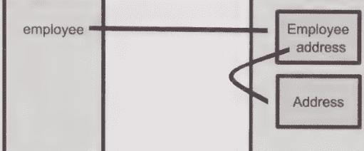

*图 4.5：另一个对象“内部”的对象*

## Java 包 (Packages)

如果你正在开发一个由不同部分组成的应用程序，你可能希望组织类以保持可维护性。在 Java 中，你可以将相关的类或具有相似功能的类分组在包中。例如，标准 Java 类位于不同的包中。Java 核心类位于 `java.lang` 反射包中。所有执行输入输出操作的类都是 `java.io` 包的成员，依此类推。如果一个包需要进行更详细的组织，你可以创建与前一个包共享部分名称的包。例如，Java 类库带有 `java.lang.annotation` 和 `java.lang.reflect`。然而，你可能会发现共享部分名称并不意味着两个包是相关的。`java.lang` 包和 `java.lang.reflect` 包是不同的包。

以 `java` 开头的包名保留给核心库使用。你可以创建一个以 `java` 单词开头的包。你可以编译属于此类包的类，但不能运行它们。

此外，以 `javax` 开头的包用于随核心库一起的扩展库。你也不应该创建以 `javax` 开头的包。

包不是一个物理对象，因此你不需要创建它。要将一个类分组到包中，请使用关键字 `package` 后跟包名。例如，下面的 `MathUtil` 类是 `com.brainsoftware.common` 包的一部分：

```java
package com.brainsoftware.common;

public class MathUtil {
}
```

Java 引入了“全限定名”（fully qualified name）术语，它指的是带有其包名的类名。类的全限定名是其包名后跟一个点号。因此，属于包 `com.sun.common` 的 `MathUtil` 类的全限定名是 `com.sun.common.MathUtil`。

没有包声明的类被称为属于默认包（default package）。例如，列表 4.1 中的 `Employee` 类属于默认包。你应该始终使用包名，因为默认包中的类型无法被默认包之外的其他类型使用（除非使用某种技术）。让一个类没有包名是一个坏主意。

尽管包不是一个物理对象，但包名对其类源文件的物理位置有影响。包名代表一种目录结构，其中包名表示子文件夹。例如，`com.brainsoftware.common` 包中的所有 Java 源文件必须位于 `common` 目录中，该目录是 `brainsoftware` 目录的子目录。反之，后者必须是 `com` 目录的子目录。图 4.6 展示了 `com.brainsoftware.common.MathUtil` 类的文件夹结构。

```
com
  brainsoftware
    common
      MathUtil.java
```

*图 4.6：包中类的物理位置*

编译非默认包中的类对初学者来说是一项挑战。要编译一个类，你需要包含包名，并将点 (.) 替换为 (/)。

例如，要编译 `com.brainsoftware.common.MathUtil` 类，请切换到工作目录（即 `com` 的父目录）并输入：

```bash
javac com/brainsoftware/common/MathUtil.java
```

默认情况下，`javac` 将结果放在与源文件相同的目录结构中。在这种情况下，`MathUtil.class` 文件将在 `com/brainsoftware/common/` 目录下创建。

运行属于某个包的类遵循类似的规则：你必须包含包名，并将 (.) 替换为 (/)。

例如，要运行 `com.brainsoftware.common.MathUtil` 类，请从工作目录输入：

```bash
java com/brainsoftware/common/MathUtil
```


你的类的打包也会影响这些类的可见性，你将在下一节中看到。

### 注意

随书的代码示例被分组在包中。这些包名为 `XX`，位于包号。

# 封装与访问控制

一种面向对象编程 (OOP) 原则，封装是一种机制，它保护对象中需要安全的部分，并仅通过必要的接口暴露它们。通过隐藏对象的内部状态，我们防止外部代码以意想不到的方式进行修改。这促进了模块化并使代码更容易维护和演进。

# 64 用于 Android 的 Java

在类之前没有访问控制时，该类具有默认访问权限。例如，列表 4.5 展示了具有默认访问权限的类。

## 4.5：具有默认访问权限的类

一种 OOP 原则，封装是一种机制，它保护对象中需要安全的部分，并仅通过必要的接口暴露它们。通过隐藏对象的内部状态，我们防止外部代码以意想不到的方式进行修改。这促进了模块化并使代码更容易维护和演进。

# 类成员访问控制

类成员（方法、字段、构造函数等）可以具有四种访问级别：`public`、`protected`、`private` 和默认。`public` 访问控制修饰符用于将类成员设置为 public，`protected` 修饰符将类成员设置为 protected，`private` 修饰符用于将类成员设置为 private。在没有访问控制修饰符的情况下，类具有默认访问级别。

表 4.1 显示了每种访问级别的可见性。

| 访问级别 | 其他包中的类 | 同一个包中的类 | 子类 | 同一个类中 |
| :--- | :--- | :--- | :--- | :--- |
| public | 是 | 是 | 是 | 是 |
| protected | 否 | 是 | 是 | 是 |
| default | 否 | 是 | 否 | 是 |
| private | 否 | 否 | 否 | 是 |

表 4.1：类成员访问级别

### 注意

默认访问有时被称为包私有（package private）。为了避免混淆，本书将只使用默认访问。

公共类成员可以被任何包含该成员的类访问。例如，`java.lang.Object` 类的 `toString()` 方法是 public 的。这里是该方法签名：

```java
public String toString()
```

一旦你构造了一个 `Object` 对象，就可以调用它的 `toString()` 方法，因为 `toString()` 是公有（public）的。

```java
Object obj = new Object();
obj.toString();
```

回想，你通过以下语法访问类成员：
`referenceVariable.memberName`

在前面的代码中，`obj` 是指向 `java.lang.Object` 实例的引用变量，而 `toString()` 是在 `java.lang.Object` 类中定义的方法。

受保护（protected）类成员具有更受限的访问级别。它只能从以下地方访问：

- 与包含成员的类相同的包中的任何类
- 包含成员的类的子类

### 注意

子类是扩展另一个类的类。第 6 章“继承”解释了这一概念。

例如，考虑列表 4.6 中的 `Page` 类。

## 列表 4.6：Page 类

```java
package app04;

public class Page {

    int numberOfSentences = 10;

    private int pageNumber = 5;

    protected int getPageNumber() {
        return pageNumber;
    }
}
```

`Page` 类有两个字段（`numberOfSentences` 和 `pageNumber`）和一个方法（`getPageNumber()`）。首先，因为 `Page` 类是公有的，所以它可以从任何其他类被实例化。然而，即使你可以实例化它，也不保证你能够通过 `referenceVariable.memberName` 语法访问其类成员。这取决于你正在从哪个类中访问 `Page` 类的成员。

它的 `getPageNumber()` 方法是受保护的，因此它可以从属于 `app04` 包（存放 `Page` 类的包）的类访问。例如，考虑 `Chapter` 类中的 `view()` 方法（位于列表 4.5）。

```java
public void view() {
    Page page = new Page();
    int sentenceCount = page.numberOfSentences;
    int pageNumber = page.getPageNumber();
}
```

`Chapter` 类可以访问该受保护方法，因为 `Chapter` 与 `Page` 类属于同一个包。因此，`Chapter` 可以访问 `Page` 类的所有受保护成员。

默认（default）访问权限允许相同包中的类访问类成员。例如，`Chapter` 可以访问 `Page` 类的 `numberOfSentences` 字段，因为 `Page` 和 `Chapter` 类属于同一个包。然而，如果 `Page` 的子类属于不同的包，则该子类无法访问 `numberOfSentences`。这区分了受保护和默认访问级别，并将在第 6 章“继承”中详细说明。

类的私有（private）成员只能在同一个类内部进行访问。例如，无法从 `Page` 类以外的任何地方访问该类的私有 `pageNumber` 字段。但是，看 `Page` 定义中的以下代码：

```java
private int pageNumber = 5;

protected int getPageNumber() {
  return pageNumber;
}
```


# 第4章：对象与类

## 访问级别与 `this` 关键字

`pageNumber` 字段是私有的，因此它可以从定义在同一个类中的 `getPageNumber()` 方法中访问。`getPageNumber()` 的返回值是 `pageNumber`，它是私有的。初学者经常会被这种代码困扰。如果 `pageNumber` 是私有的，为什么我们还要把它作为受保护方法（`getPageNumber()`）的返回值呢？注意，对 `pageNumber` 的访问仍然是私有的，所以其他类不能修改此字段。然而，将其作为非私有方法的返回值是被允许的。

构造函数呢？构造函数的访问级别与字段和方法相同。因此，构造函数可以有公共、受保护、默认和私有访问级别。你可能认为所有构造函数都必须是公有的，因为构造函数的意图是使类能够被实例化。然而，让你惊讶的是，事实并非如此。某些构造函数被设置为私有，以便类无法通过 `new` 关键字实例化。私有构造函数通常用于单例类。如果你对这个主题感兴趣，可以在互联网上找到关于该主题的文章。

### 注意

在 UML 类图中，你可以包含关于类成员访问级别的信息。在公共成员前加 `+`，在受保护成员前加 `#`，在私有成员前加 `-`。没有前缀的成员被认为具有默认访问级别。图 4.7 显示了具有各种访问级别的 `Manager` 类。

| Manager |
| :--- |
| + employeeId |
| salary |
| + work() |
| # manager |

图 4.7：在 UML 类图中包含类成员访问级别

## `this` 关键字

你可以在任何方法或构造函数中使用 `this` 关键字来引用当前对象。例如，如果你有一个与局部变量同名的类级字段，你可以使用此语法引用以下内容：

```java
this.field
```

一个常见的用法是在接受用于初始化字段的值的构造函数中。考虑列表 4.7 中的 `Box` 类。

### 列表 4.7：Box 类

```java
package com.brainysoftware.jdk5.app04;

public class Box {

    int length;
    int width;
    int height;

    public Box(int length, int width, int height) {
        this.length = length;
        this.width = width;
        this.height = height;
    }
}
```

`Box` 类有三个字段：`length`、`width` 和 `height`。它的构造函数接受三个用于初始化字段的参数。使用 `length`、`width` 和 `height` 作为参数名非常方便，因为反映了它们的含义。在构造函数内部，`length` 指的是 `length` 参数，而不是 `length` 字段。

```java
public Box(int length, int width, int height) {
    this.length = length;
    this.width = width;
    this.height = height;
}
```

## UML 类图中的依赖

| 书 | 章节 |
| :--- | :--- |
| height : Integer | use |
| isbn : String | numberOfPages : Integer |
| numberOfPages : Integer | util : String |
| title : String | review() : void |
| width : Integer | |

图 4.8：UML 类图中的依赖

## 最终变量

Java 没有预留 `constant` 关键字来创建常量。然而，在 Java 中，你可以使用 `final` 关键字来声明变量，使其值不可改变。你可以将局部变量和类字段都声明为 `final`。

例如，一年的月份数永远不变，所以你可以这样写：

```java
final int numberOfMonths = 12;
```

另一个例子，在一个执行数学计算的类中，你可以声明变量 `pi`，其值等于 22/7（圆周长除以直径，在数学中用希腊字母 π 表示）。

```java
final float pi = (float) 22 / 7;
```

一旦给变量赋值，其值就无法更改。尝试更改它将导致编译错误。

> 注意，`22 / 7` 之后的强制转换 `(float)` 是必要的，用于将除法转换为 `float`。否则，将返回一个 `int`，且 `pi` 变量的值将是 3.0 而不是 3.1428。

同样注意，Java 使用 Unicode 字符，你可以直接定义变量 `π`，就像你不觉得这比输入 `pi` 更难一样。

```java
final float π = (float) 22 / 7;
```

### 注意

你还可以创建一个 `final` 方法，禁止它在子类中被重写。这将在6章“继承”中讨论。

## 静态成员

你已经学会了如何访问对象的公共字段或方法，在对象引用后使用点 `.`，例如：

```java
// 创建 Book 的实例
Book book = new Book();

// 访问 review 方法
book.review();
```

这意味着你必须在访问其成员之前创建一个对象。然而，在之前的章节中，有使用 `System.out.print` 将值打印到控制台的示例。你可能注意到，可以在不需要先构造 `System` 对象的情况下直接调用 `out` 字段。为什么你不需要这样做呢？

```java
System ref = new System();
ref.out;
```

相反，你在类名后使用点符号：

```java
System.out.
```

Java（以及许多 OOP 语言）支持静态成员的概念，静态成员是在无需先实例化类即可调用的类成员。`java.lang.System` 中的 `out` 字段是静态的，这解释了为什么你可以写 `System.out`。

静态成员不与类实例绑定。相反，它们可以在没有实例的情况下被调用。事实上，作为类的入口点的 `main` 方法是静态的，因为它必须在创建任何对象之前被调用。

要声明一个静态成员，你可以在字段或方法声明前使用 `static` 关键字。如果存在访问修饰符，`static` 关键字可以放在访问修饰符之前或之后。这两种都是正确的：

```java
public static int a;
static public int b;
```

然而，第一种形式通常更常用。

例如，列表 4.8 显示了带有静态方法的 `MathUtil` 类：

### 列表 4.8：MathUtil 类

```java
package app04;

public class MathUtil {
    public static int add(int a, int b) {
        return a + b;
    }
}
```

要使用 `add` 方法，你可以直接这样调用它：

```java
MathUtil.add(a, b)
```

实例方法/字段一词用于指非静态方法和字段。

从静态方法中，无法调用实例方法或实例字段，因为它们只在你创建对象后才存在。然而，你可以从静态方法访问其他静态方法或字段。

初学者经常遇到的一个常见困惑是，当他们无法编译类时，因为他们在 `main` 方法中调用了实例成员。列表 4.9 显示了这样一个类。

### 列表 4.9：从静态方法调用非静态成员

```java
package app04;

public class StaticDemo {
    public int b = 8;

    public static void main(String[] args) {
        System.out.println(b);
    }
}
```

`System.out.println(b);` 导致了编译错误，因为它尝试从静态的 `main` 方法中访问非静态字段 `b`。这个问题有两个解决方案：

1. 将 `b` 设为静态
2. 创建该类的实例，然后通过对象引用访问 `b`。

哪种解决方案合适取决于情况。通常需要多年的 OOP 经验才能得出一个让你感到舒适的良好决策。

### 注意

你只能在类级别声明静态变量。即使方法是静态的，你也无法在方法内部声明静态变量。

那么静态引用变量呢？你可以声明静态引用变量。该变量将包含一个地址，但引用的对象存储在堆中。例如：

```java
static Book book = new Book();
```

静态引用变量提供了一种暴露需要在不同对象之间共享的对象的良好方法。

### 注意

在 UML 类图中，静态成员带有下划线标记。例如，图 4.9 显示了带有静态方法 `add` 的 `MathUtil` 类。


图 4.9：UML 类中的静态成员

## 静态最终变量

在本章前面的“最终变量”部分中，你学习了可以通过 `final` 关键字创建最终变量。然而，类层级的静态变量或局部变量将具有相同的值。静态变量的命名约定是使用大写。

### Java for Android

为了组织你的常量，例如，有时你想将一个月份表示为 `int`，因此一月是 1，二月是 2，依此类推。然后，你使用单词 `January` 而不是数字 1，因为它更具描述性。列表 4.10 显示了 `Months` 类。

### 列表 4.10：Months 类

```java
package app04;

public class Months {
    public static final int JANUARY = 1;
    public static final int FEBRUARY = 2;
    public static final int MARCH = 3;
    public static final int APRIL = 4;
    public static final int MAY = 5;
    public static final int JUNE = 6;
    public static final int JULY = 7;
    public static final int AUGUST = 8;
    public static final int SEPTEMBER = 9;
    public static final int OCTOBER = 10;
    public static final int NOVEMBER = 11;
    public static final int DECEMBER = 12;
}
```

在你的代码中，你可以通过以下写法获取一月的表示：

```java
int thisMonth = Months.JANUARY;
```

在 Java 5 之前，类 `Months` 类非常常见。然而，Java 提供的新类型 `enum` 可以消除对公共静态变量的需求。`enum` 将在10章“枚举”中解释。

静态引用变量也是可能的。但注意，只有变量是 `final` 的，这意味着它被分配了一个实例的地址，不能被赋值另一个相同类型的对象。所引用对象的字段是可以更改的。

在以下代码行中：

```java
public static final Book book = new Book();
```

`book` 始终指向这个特定的 `Book` 实例。重新赋值另一个对象会导致编译错误：

```java
book = new Book(); // 编译错误
```

然而，你可以更改 `Book` 对象的字段值：

```java
book.title = "No Excuses"; // 假设 title 字段是公共
```

## 静态导入

Java 核心库中有许多包含静态最终字段的类。其中之一是 `java.util.Calendar` 类，它拥有代表星期的静态最终字段（`MONDAY`、`TUESDAY` 等）。要使用 `Calendar` 类中的静态最终字段，你必须先导入 `Calendar` 类。

```java
import java.util.Calendar;
```

然后你可以通过 `className.staticField` 的表示法使用它：

```java
if (today == Calendar.SATURDAY)
```

然而，你也可以使用 `import static` 关键字导入静态字段。例如，你可以这样做：

```java
import static java.util.Calendar.SATURDAY;
```

然后，为了使用导入的静态字段，你不需要类名：

```java
if (today == SATURDAY)
```

> 注意
> `java.util.Calendar` 类将在第 5 章“核心类”中进行详细讨论。

## 变量作用域

你已经看到你可以在不同的地方声明变量：
- 在类体内部作为类字段。在这里声明的变量被称为类级变量。
- 作为方法或构造函数的参数。
- 在方法体内部或构造方法体内部。
- 在语句块内部，例如在 `while` 或 `for` 块内部。

现在是时候学习变量的作用域了。变量作用域指的是变量的可访问性。规则是：在块中定义的变量只能在块内部被访问。变量的作用域是定义它的所在的块。例如，考虑下面的 `for` 语句。

```java
for (int x = 0; x < 5; x++) {
    System.out.println(x);
}
```

`x` 是在 `for` 语句内部声明的。结果是，`x` 仅块内部可用。它在任何其他地方都不可访问或可见。当 JVM 执行 `for` 语句时，它会创建 `x`。当执行完 `for` 块时，它会销毁 `x`。在 `x` 被销毁后，称 `x` 出了作用域。

规则 2 是：嵌套块可以访问在外部层块中声明的变量。考虑这段代码。

```java
for (int x = 0; x < 5; x++) {
    for (int y = 0; y < 3; y++) {
        System.out.println(x);
        System.out.println(y);
    }
}
```

上面的代码是有效的，因为内部的 `for` 块可以访问 `x`，而 `x` 是在外部 `for` 块中声明的。

根据规则，作为方法参数声明的变量可以在方法体中访问。同样，类级变量可以在类的任何地方被访问。

如果一个方法声明了一个与类级变量同名的局部变量，则前者将“遮蔽”（shadow）后者。要从方法内部访问类级变量，请使用 `this` 关键字。

## 方法重载

方法名非常重要，应该反映方法的功能。在许多情况下，你可能想为多个方法使用相同的名称，因为它们具有相似的功能。例如，`println` 方法可以接受一个 `String` 参数并打印该字符串。然而，同一个类也可能提供一个接受 `String` 的部分并接受两个参数的方法：要打印的字符串和开始打印的字符位置。你想要调用后一个 `println` 方法，因为它确实打印了 `String`，但那和第一个 `println` 是一样的。

幸运的是，在 Java 中拥有多个同名方法是被允许的，只要每个方法接受不同的参数类型集合。换句话说，在我们的示例中，在同一个类中拥有这两个方法是合法的。

```java
public String println(String string)
public String println(String string, int offset)
```

这种特性被称为方法重载。

> 方法的返回值不考虑在内。因此，这两个方法不能存在于同一个类中：
>
> ```java
> public int countRows(int number);
> public String countRows(int number);
> ```
>
> 这是因为方法可以在被调用时不将其返回值赋值给变量。在这些情况下，上述 `countRows` 方法将让编译器困惑，因为当你写下代码时，它不知道调用的是哪个方法：
>
> ```java
> System.out.println(countRows(3));
> ```

更复杂的情况在下面的方法中描述，它们的签名非常相似。

```java
public int printNumber(int i) {
    return i * 2;
}

public long printNumber(long l) {
    return l * 2;
}
```

## 类初始化

当父类准备初始化时，其父类的父类将被同样处理。这一过程会递归进行，直到初始化的类是层级结构中的顶层类。

例如，如果一个类包含以下声明：

```java
public static int z = 5;
```

变量 `z` 将被赋值为 5。如果没有找到初始化代码，静态变量将被赋予一个默认值。表 4.2 列出了 Java 基本数据类型和引用变量的默认值。

| 类型 | 默认值 |
| :--- | :--- |
| boolean | false |
| byte | 0 |
| short | 0 |
| int | 0 |
| long | 0L |
| char | \u0000 |
| float | 0.0f |
| double | 0.0d |
| object reference | null |

表 4.2：基本类型和引用的默认值

此外，静态块中的代码也将被执行。例如，代码列表 4.12 显示了 `StaticCodeTest` 类，它包含在类加载时执行的静态代码。和静态成员一样，你只能在静态代码中访问静态成员。

### 代码列表 4.12：StaticCodeTest

```java
package app04;
```


# 第 4 章：对象与类

## 静态初始化测试

```java
public class StaticInitializationTest {

    public static int a = 5;

    public static int b = a * 2;

    static {

        System.out.println("static");

        System.out.println(b);

    }

    public static void main(String[] args) {

        System.out.println("main method");

    }

}
```

如果你运行这个类，你将在控制台上看到以下内容：

```
static
10
main method
```

## 对象创建初始化

初始化发生在类加载时，正如本章前面的“链接、加载与初始化”部分所描述。然而，你也可以编写代码，在每次创建类的实例时执行初始化。

当 JVM 遇到一个实例化某个类的类时，JVM 会执行以下操作：

1. 为新对象分配内存空间，留出类中声明的实例变量的空间，以及其父类中声明的实例变量的空间。
2. 处理被调用的构造函数。如果构造函数有参数，JVM 会为这些参数创建变量并为它们赋值后传递给构造函数。
3. 如果被调用的构造函数开始调用另一个构造函数（使用 `this` 关键字），JVM 将处理被调用的构造函数。
4. 执行该类的初始化和实例化初始化。未赋值的实例变量将被赋予默认值（参见表 4.2）。实例化初始化适用于大括号中的代码：

```java
{
  // code
}
```

5. 执行被调用的构造函数主体的剩余部分。
6. 返回一个指向新对象的引用变量。

注意，实例化初始化与静态初始化不同。后者发生在类加载时，与实例化无关。相比之下，初始化是在对象创建时执行的。此外，与静态初始化器不同，实例化初始化可以访问实例变量。

例如，代码列表 4.13 展示了一个名为 `InitTest1` 的类，它有一个初始化部分。还有一些静态初始化代码，以便让你了解正在运行的内容。

### 代码列表 4.13：app04 中的 InitTest1 类

```java
public class InitTest1 {

  int x = 3;

  int y;

  // initialization code

  {

    y = x * 2;

    System.out.println(y);

  }

  // static initialization code

  static {

    System.out.println("Static initialization");

  }

  public static void main(String[] args) {

    InitTest1 test = new InitTest1();

    InitTest1 more = new InitTest1();

  }

}
```

**运行时，InitTest1 类会在控制台上打印以下内容：**

```
Static initialization
6
6
```

静态初始化首先执行，在任何实例化发生之前。这是 JVM 打印“Static initialization”消息的地方。之后，`InitTest1` 类被实例化了两次，这就是为什么你看到两次“6”。

拥有实例化初始化代码的问题在于：随着类类的增长，变得很难察觉到存在初始化代码了。

编写初始化代码的另一种方式是在构造函数中编写。事实上，构造函数中的初始化代码更加明显，因此更优。4.14 显示了在构造函数中放置了初始化代码的 `InitTest2` 类。

### 代码列表 4.14：InitTest2 类

```java
package app04;

public class InitTest2 {

    int x = 3;

    int y;

    // instance initialization code

    public InitTest2() {

        y = x * 2;

        System.out.println(y);

    }

    // static initialization code

    static {

        System.out.println("Static initialization");

    }

    public static void main(String[] args) {

        InitTest2 test = new InitTest2();

        InitTest2 moreTest = new InitTest2();

    }

}
```

这种方法的问题是，当你有多个构造函数且每个构造函数都必须调用相同的代码时。解决方案是将初始化代码封装在一个方法中。代码列表 4.15：`InitTest3` 类

### 代码列表 4.15：InitTest3 类

```java
package app04;

public class InitTest3 {

    int x = 3;

    int y;

    // instance initialization code

    public InitTest3() {

        init();

    }

    public InitTest3(int x) {

        this.x = x;

        init();

    }

    private void init() {

        y = x * 2;

        System.out.println(y);

    }

    // static initialization code

    static {

        System.out.println("Static initialization");

    }

    public static void main(String[] args) {

        InitTest3 test = new InitTest3();

        InitTest3 more = new InitTest3(10);

    }

}
```

## 对象比较

在现实生活中，当我说“我的车和你的车一样”时，我的我的车和你类型相同、型号相同、颜色相同等。

在 Java 中，你通过引用它们的变量来操作对象。请记住，引用变量并不包含对象，而是对象的地址。因此，当你比较引用变量 `a` 和 `b` 时，如下所示：

```java
if (a == b)
```

你实际上是在问 `a` 和 `b` 是否引用同一个对象，而不是 `a` 和 `b` 引用的对象是否相同。这种比较方法几乎没有用，因为通常我们关心的是对象而不是对象的地址。如果你想比较对象，你需要查找类专门的方法。例如，要比较两个 `String`，可以调用它的 `equals` 方法。（参见第 5 章“核心类”）是否可以比较两个对象的内容取决于该类是否支持。类可以通过实现它从 `java.lang.Object` 继承的 `equals` 和 `hashCode` 方法来支持对象比较（参见第 5 章中的“java.lang.Object”部分）。

此外，还有你用于比较对象的工具类。参见第 11 章“集合框架”中“使你的对象可比较和排序”部分关于 `java.lang.Comparable` 和 `java.util.Comparator` 的讨论。

## 垃圾回收器

在之前的几个示例中，我向你展示了如何使用 `new` 关键字创建对象，但你从未见过显式销毁未使用对象以释放内存空间的代码。如果你是 C++ 程序员，你可能会认为我展示了有缺陷的代码，因为在 C++ 中你必须在使用后销毁对象。Java 配备了名为垃圾回收器的功能，它销毁未使用的对象并释放内存。未使用的对象定义为不再被引用的对象，或者引用已经超出作用范围的对象。

有了这一功能，Java 变得比 C++ 简单得多，因为 Java 程序员不需要担心回收内存空间。然而，这并不意味着你可以随心所欲地创建对象，因为内存（仍然）是有限的，而且垃圾回收器的启动需要一些时间。没错，你仍然可能会耗尽内存。

## 总结

OOP（面向对象编程）对现实世界的对象进行建模。由于 Java 是一种 OOP 语言，对象在 Java 编程中起核心作用。对象是根据称为“类”的模板创建的。在本章中，你学习了如何编写类和类成员。类有许多类型，包括本章讨论的三种：字段、方法和构造函数。还有其他类型的 Java 成员，如枚举和内部类，它们将在其他章节中介绍。

在本章中，你学习了两个强大的 OOP 特性：抽象和封装。OOP 中的抽象是使用编程对象来表示现实世界对象。封装是一种保护对象中需要安全部分的机制，并只暴露安全的部分。

本章讨论的另一个特性是方法重载。方法重载允许类拥有相同名称的方法，只要它们的签名足够不同。

Java 还带有一个垃圾回收器，它消除了手动销毁未使用对象的需要。当对象超出作用范围或不再被引用时，就会被垃圾回收。

## 问题

1. 列出类可以包含的至少三种元素类型。
2. 方法和构造函数之间有什么区别？
3. 类图中的类会显示它的构造函数吗？
4. `null` 代表什么？
5. 你用 `==` 运算符来比较什么？
6. 当你使用 `==` 运算符比较两个对象引用时，你实际上是在比较对象的内容吗？为什么？
7. 变量的作用域范围什么？
8. “超出作用范围”（out of scope）是什么意思？
9. 垃圾回收器如何决定哪些哪些对象？
10. 什么是方法重载？

# 第 5 章：核心类

在讨论面向对象编程（OOP）的其他特性之前，让我们看看 Java 中常用的几个重要类。这些类包含在随 JDK 的 Java 核心库中。掌握这些类将帮助你理解后续 OOP 课程中的示例。

所有类中最著名的绝对是 `java.lang.Object`。然而，如果不涵盖继承，就很难讨论这个类，我们将在第 6 章“继承”中讨论。因此，`java.lang.Object` 在本章中仅进行简要讨论。我们将从 `java.lang.StringBuilder` 开始，现在我们将重点关注你可以在程序中使用的类：`java.lang.StringBuffer` 和 `java.lang.StringBuilder`。然后，我们将讨论数组，这里还包含了 `java.lang.util.Scanner` 类，因为它提供了方便的用户输入方式。

箱/拆箱（Boxing/unboxing）和可变参数（varargs）将在本章最后解释。

### 注意

在 Java 类中描述方法时，展示方法签名总是有必要的。方法通常接受对象作为参数，这些对象所在的包与方法所在的包不同。或者，它可能返回一个与自身不同包的类型。为了清晰起见，不同包的类使用了全限定名。例如，这里是 `java.lang.Object` 的 `toString` 方法的签名：

```java
public String toString()
```

返回类型不需要全限定名，因为返回类型 `String` 与 `java.lang.Object` 属于同一个包。另一方面，`java.util.Scanner` 中 `toString` 方法的签名使用了全限定名，因为 `Scanner` 类属于不同的包（`java.util`）。

```java
public java.lang.String toString()
```

### java.lang.Object

`java.lang.Object` 类表示一个 Java 对象。事实上，所有的类都是此类的直接或间接后代。由于我们还没有学习继承（将在第 6 章“继承”中讨论），后代这个词对你来说可能没有意义。因此，我们将简要讨论此类，并在第 6 章回顾。以下是 `Object` 类中的方法：

```java
protected Object clone()
```
创建并返回此对象的副本。

```java
public boolean equals(Object obj)
```
比较此对象与传入的对象。

```java
protected void finalize()
```
由垃圾回收器调用。

```java
public Class getClass()
```
返回对象的类。

```java
public int hashCode()
```
返回对象的哈希值。

```java
public String toString()
```
返回对象的描述。

### java.lang.String

`String` 表示 Unicode 字符序列。一旦创建，它们是不可变的。由于此，值无法被更改。

#### 比较两个字符串

字符串比较是 Java 编程中非常有用的操作之一。考虑以下代码：

```java
String s1 = "Java";
String s2 = new String("Java");
if (s1 == s2) {
```

`(s1 == s2)` 的结果为真，因为 `s1` 和 `s2` 引用同一个实例。相反，在以下代码中 `(s1 == s2)` 的结果为假，因为 `s1` 和 `s2` 引用不同的实例：

```java
String s1 = "Java";
String s2 = new String("Java");
if (s1 == s2) {
}
```

这显示了通过编写字符串和使用 `new` 关键字创建对象的区别。使用 `==` 运算符比较两个字符串意义不大，因为你比较的是引用的地址。大多数情况下，比较两个 `String` 对象时，你想知道对象的值是否相等。在这种情况下，你需要使用 `String` 类的 `equals` 方法。

```java
String s1 = "Java";
if (s1.equals("Java")) // 返回 true
```

有时你会看到这种风格：

```java
if (s1 != null && s1.equals("Java"))
```

如果 `s1` 为空，语句将返回 false，而不会评估第二个表达式，因为 AND 运算符 `&&` 在左侧操作数为假时，不会尝试评估右侧操作数。

在 `("Java".equals(s1))` 中，JVM 创建或从池中获取包含 "Java" 的 `String` 对象并调用它的 `equals` 方法。这里需要检查空，因为 "Java" 显然不是空。如果 `s1` 为空，表达式直接返回 false。

#### 字符串字面量

由于你总是处理 `String` 对象，因此理解处理字符串字面量的规则是重要的。


##### Java 用于 Android

```java
String s2 = "This is an important\npoint to note";
```

你可以使用加号符号连接字符串字面量来组合长字符串字面量。

```java
String s1 = "Java strings " + "are important";
String s2 = "This is an important " + "point to note";
```

你可以将 `String` 与基本类型或另一个对象拼接。例如，此行代码将一个 `String` 和整数拼接在一起。

```java
String s3 = "String number " + 3;
```

如果一个对象与 `String` 拼接，将调用该前者的 `toString` 方法，并将结果用于拼接。

#### 转义字符

你有时需要在字符串中使用特殊字符，例如回车符（CR）和换行符（linefeed，LF）。在其他情况下，你可能想在字符串中包含双引号。对于 CR 和 LF，无法输入这些字符，因为按下 Enter 键会换行。包含特殊字符的一种方法是对它们进行转义，即使用它们的字符替换符来表示它们。

以下是一些转义序列：

- `\uXXXX`: 一个 Unicode 字符
- `\u0008`: 退格 BS *
- `\u0009`: 水平制表 HT *
- `\u000a`: 换行 LF *
- `\u000c`: 分页符 FF *
- `\u000d`: 回车 CR *
- `\u0022`: 双引号 *
- `\u0027`: 单引号 *
- `\u005c`: 反斜杠 `\`

例如，以下代码在字符串末包含 Unicode 字符 0122。

```java
String s = "Please type this character \u0122";
```

要获取一个值为 John "The Great" Monroe 的 `String` 对象，你需要对双引号进行转义：

```java
String s = "John \"The Great\" Monroe";
```

#### 对字符串进行 switch 操作

从 Java 7 开始，你可以对 `String` 使用 `switch` 语句。回想第 3 章“语句”中 `switch` 语句的语法：

```java
switch(expression) {
  case value_1 :
    statement(s);
    break;
  case value_2 :
    statement(s);
    break;
  case value_n :
    statement(s);
    break;
default:
    statement(s);
}
```

这是一个在 `String` 上使用 `switch` 语句的示例。

```java
String input = ...;
switch (input) {
    case "One":
        System.out.println("You entered 1.");
        break;
    case "two":
        System.out.println("You entered 2.");
        break;
    default:
        System.out.println("Invalid value.");
}
```

#### String 类的构造函数

`String` 类提供了许多构造函数。这些构造函数允许你创建一个空字符串、另一个字符串的副本，以及从字符数组或字节数组创建 `String`。请谨慎使用这些构造函数，因为它们总是创建一个新的 `String` 实例。

> **Note**
> 数组将在“数组（Arrays）”节中讨论。

```java
public String()
```
创建一个空字符串。


# String 类的构造函数

```java
public String(String original)
```
创建一个原始字符串的副本。

```java
public String(char[] value)
```
从字符数组创建一个 `String` 对象。

```java
public String(byte[] bytes)
```
通过使用计算机的默认编码解码数组中的字节，创建一个 `String` 对象。

```java
public String(byte[] bytes, String encoding)
```
通过使用指定的编码解码数组中的字节，创建一个 `String` 对象。

# String 类的方法

`String` 类提供了用于操作 `String` 数值的方法。然而，由于 `String` 对象是不可变的，操作的结果始终是一个新的 `String` 对象。

以下是一些最实用的方法。

```java
public char charAt(int index)
```
返回指定索引处的字符。例如，以下代码返回 `'J'`。

```java
"Java is cool".charAt(0)
```

```java
public String concat(String s)
```
将指定的字符串拼接到此 `String` 的末尾并返回结果。例如，`"Java".concat("is cool")` 返回 `"Java is cool"`。

```java
public boolean equals(String anotherString)
```
比较此 `String` 和 `anotherString` 的值，如果值匹配则返回 `true`。

```java
public boolean endsWith(String suffix)
```
测试此 `String` 是否以指定的 `suffix` 结尾。

```java
public int indexOf(String substring)
```
返回指定的子字符串 `substring` 首次出现的索引。如果未找到匹配项，则返回 `-1`。例如，以下代码返回 `8`。

```java
"Java is cool".indexOf("cool")
```

```java
public int indexOf(String substring, int from)
```
返回从指定索引开始的子字符串 `substring` 首次出现的索引。如果未找到匹配项，则返回 `-1`。

```java
public int lastIndexOf(String substring)
```
返回指定的子字符串 `substring` 最后一次出现的索引。如果未找到匹配项，则返回 `-1`。

```java
public int lastIndexOf(String substring, int fromIndex)
```
返回从指定索引开始的子字符串 `substring` 最后一次出现的索引。如果未找到匹配项，则返回 `-1`。例如，此表达式返回 `3`。

```java
"Java is cool".lastIndexOf("a")
```

```java
public String substring(int beginIndex)
```
返回从指定索引开始的当前字符串的子字符串。例如，`"Java is cool".substring(8)` 返回 `"cool"`。

```java
public String substring(int beginIndex, int endIndex)
```
返回从 `beginIndex` 到 `endIndex` 的当前字符串的子字符串。例如，`"Java is cool".substring(0, 4)` 返回 `"Java"`。

```java
public String replace(char oldChar, char newChar)
```
将此 `String` 中所有的 `oldChar` 替换为 `newChar`。例如，`"Java".replace('a', 'o')` 返回 `"Jovo"`。

```java
public String replace(CharSequence target, CharSequence replacement)
```
将此 `String` 中所有的 `target` 替换为 `replacement`。注意，这里替换的是字面文本，而不是正则表达式。

```java
public String replaceAll(String regex, String replacement)
```
将此 `String` 中所有匹配正则表达式 `regex` 的部分替换为 `replacement`。

```java
public String replaceFirst(String regex, String replacement)
```
将此 `String` 中第一个匹配正则表达式 `regex` 的部分替换为 `replacement`。

```java
public String repeat(int count)
```
返回此 `String` 重复 `count` 次后的字符串。例如，`"abc".repeat(3)` 返回 `"abcabcabc"`。

```java
public int length()
```
返回此 `String` 中的字符数量。例如，`"Java is cool".length()` 返回 `13`。

```java
public boolean contains(CharSequence s)
```
测试此 `String` 是否包含指定的序列 `s`。例如，`"Java is cool".contains("is")` 返回 `true`。

```java
public boolean startsWith(String prefix)
```
测试此 `String` 是否以指定的 `prefix` 开头。例如，`"Java is cool".startsWith("Java")` 返回 `true`。

```java
public boolean endsWith(String suffix)
```
测试此 `String` 是否以指定的 `suffix` 结尾。例如，`"Java is cool".endsWith("cool")` 返回 `true`。

```java
public String toLowerCase()
```
将此 `String` 中的所有字符转换为小写。例如，`"Java is cool".toLowerCase()` 返回 `"java is cool"`。

```java
public String toUpperCase()
```
将此 `String` 中的所有字符转换为大写。例如，`"Java is cool".toUpperCase()` 返回 `"JAVA IS COOL"`。

```java
public String trim()
```
去除头部和尾部的空格并返回一个新的字符串。例如，`" Java ".trim()` 返回 `"Java"`。

# 第5 章：核心类

```java
public boolean isEmpty()
```
如果字符串为空（不包含任何字符），返回 `true`。

```java
public String[] split(String regex)
```
根据正则表达式分割此 `String`。例如，`"Java is cool".split(" ")` 返回一个包含三个元素的数组。第一个元素是 `"Java"`，第二个是 `"is"`，第三个是 `"cool"`。

```java
public char[] toCharArray()
```
将此转换为字符数组。

```java
public String toLowerCase()
```
将此 `String` 中的所有字符转换为小写。例如，`"Java is cool".toLowerCase()` 返回 `"java is cool"`。

```java
public String toUpperCase()
```
将此 `String` 中的所有字符转换为大写。例如，`"Java is cool".toUpperCase()` 返回 `"JAVA IS COOL"`。

```java
public String trim()
```
去除头部和尾部的空格并返回一个新的字符串。例如，`" Java ".trim()` 返回 `"Java"`。

此外，还有两个静态方法：`valueOf` 和 `format`。`valueOf` 方法将基本类型、字符数组或 `Object` 实例转换为字符串表示，共有九种重载方法。

```java
public static String valueOf(boolean value)
public static String valueOf(char value)
public static String valueOf(char[] value)
public static String valueOf(char[] value, int offset, int length)
public static String valueOf(double value)
public static String valueOf(float value)
public static String valueOf(int value)
public static String valueOf(long value)
public static String valueOf(Object value)
```

例如，以下代码返回字符串 `"23"`：

```java
String.valueOf(23)
```

`format` 方法允许传递任意数量的参数。其签名如下：

```java
public static String format(String format, Object... args)
```

然而，我在这里不再解释 `format` 方法，因为你需要先理解数组和变参数。它将在本章后面的“变参数（Varargs）”节中进行解释。

### java.lang.StringBuilder

`String` 对象是不可变的，如果需要追加或插入字符，并不适用，因为字符串操作会创建新的 `String` 对象。对于追加和插入，使用 `java.lang.StringBuilder` 或 `java.lang.StringBuffer` 类更好。当你完成对字符串的操作后，可以将 `StringBuilder` 或 `StringBuffer` 对象转换为字符串。

#### Java 用于 Android

在 JDK 1.4 之前，`StringBuffer` 类专门用于可变字符串。`StringBuffer` 中的方法是同步的，这使得 `StringBuffer` 适用于多线程环境。然而，同步的代价是性能。JDK 5 引入了 `StringBuilder` 类，它是 `StringBuffer` 的非同步版本。如果你不需要同步，应该选择 `StringBuilder` 而不是 `StringBuffer`。

> **注意**
> 同步和线程安全将在第 23 节“Java 线程”中进行讨论。

本节的其余部分将使用 `StringBuilder`。不过，该讨论也适用于 `StringBuffer`，因为 `StringBuilder` 和 `StringBuffer` 共享了相似的构造函数和方法。

# StringBuilder 类的构造函数

`StringBuilder` 类有四个构造函数。你可以传递一个 `java.lang.CharSequence`、一个 `String` 或一个 `int`。

```java
public StringBuilder()
public StringBuilder(CharSequence seq)
public StringBuilder(int capacity)
public StringBuilder(String string)
```

如果你在不指定容量的情况下创建了 `StringBuilder` 对象，该对象的容量将为 16 个字符。如果其内容超过了 16 个字符，它将自动增长。如果你知道你的字符串将超过 16 个字符，分配足够的容量是一个好主意，因为增加 `StringBuilder` 的容量需要时间。

# StringBuilder 类的方法

`StringBuilder` 有几个方法。主要的有 `capacity`、`length`、`append` 和 `insert`。

```java
public int capacity()
```
返回 `StringBuilder` 对象的容量。

```java
public int length()
```
返回 `StringBuilder` 对象存储的字符串的长度。该值小于或等于 `StringBuilder` 的容量。

```java
public StringBuilder append(String string)
```
将字符串附加到所含字符串的末尾。此外，`append` 有多种重载，允许你传递原始数据类型、`char` 数组和 `java.lang.Object` 实例。例如，查看下面的代码。

```java
StringBuilder sb = new StringBuilder(100);
sb.append("Matrix");
sb.append(2);
```

在最后一行代码之后，`sb` 的内容为 `"Matrix 2"`。

需要注意的一个重要点是，`append` 方法返回 `StringBuilder` 对象本身，即调用 `append` 时的同一个对象。因此，你可以链式调用 `append`。

```java
sb.append("Matrix").append(2);
```

```java
public StringBuilder insert(int offset, String string)
```
在 `offset` 指定的位置处插入指定的字符串。此外，`insert` 有多种重载，允许你传递原始数据类型和 `java.lang.Object` 实例。例如：

```java
StringBuilder sb2 = new StringBuilder(100);
sb2.append("night");
sb2.insert(0, 'k'); // value = "knight"
```

像 `append` 一样，`insert` 也返回当前的 `StringBuilder` 对象，因此允许链式调用 `insert`。

```java
public String toString()
```
返回一个表示 `StringBuilder` 值的字符串。

# 原始类型包装类

出于性能考虑，Java 中并不是所有内容都是对象。还有原始数据类型，例如 `int`、`long`、`float`、`double` 等。在同时处理原始类型和对象时，经常会有需要将原始类型转换为对象（以及反之亦然）的情况。例如，一个 `java.util.Collection` 对象（在第 11 节“集合框架”中讨论）可以用于存储对象，而不是原始类型。如果你想在 `Collection` 中存储原始类型值，必须先将其转换为对象。

`java.lang` 包有几个充当原始类型包装类的类。它们是 `Boolean`、`Character`、`Byte`、`Double`、`Float`、`Integer` 和 `Short`。`Byte`、`Double`、`Float`、`Integer`、`Long` 和 `Short` 共享相似的方法，因此这里只讨论 `Integer`。关于其他类的信息，你应该查阅 Javadoc。

> **注意**
> 得益于装箱（boxing）和拆箱（unboxing）机制，从原始类型到对象的转换是非常简单的。装箱和拆箱将在本节后面的“装箱与拆箱”部分进行讨论。

### java.lang.Integer

`java.lang.Integer` 类包装了一个 `int`。`Integer` 类有两个类型为 `static final` 的静态字段：`MIN_VALUE` 和 `MAX_VALUE`。`MIN_VALUE` 包含 `int` 的最小值 (-2^31)，而 `MAX_VALUE` 包含 `int` 的可能最大值 (2^31 - 1)。

`Integer` 类有两个构造函数：

```java
public Integer(int value)
public Integer(String value)
```

例如，这段代码构造了两个 `Integer` 对象。

```java
Integer i1 = new Integer(12);
Integer i2 = new Integer("123");
```

`Integer` 有无参的 `shortValue`、`doubleValue`、`floatValue` 方法，它们分别将包装的值转换为 `byte`、`long`、以及 `float`、`int`、`long` 和 `short`。此外，`toString` 方法将值转换为 `String`。

还有静态方法可以让你将字符串解析为 `int` (`parseInt`) 并 `int` 转换为字符串 (`toString`)。这些方法的签名如下：

```java
public static int parseInt(String string)
public static String toString(int i)
```

### java.lang.Boolean

`java.lang.Boolean` 类包装了一个 `boolean`。它的静态 `final` `FALSE` 和 `TRUE` 分别表示包装了原始值 `false` 的 `Boolean` 对象和包装了原始值 `true` 的 `Boolean` 对象。

你可以使用这些构造函数之一从 `boolean` 或 `String` 构造 `Boolean` 对象。

```java
public Boolean(boolean value)
public Boolean(String value)
```

例如：

```java
Boolean b1 = new Boolean(false);
Boolean b2 = new Boolean("true");
```


# Boolean 类

为了将 `Boolean` 对象转换为 `boolean`，使用其 `booleanValue()` 方法：

```java
public boolean booleanValue()
```

此外，静态方法 `valueOf()` 将 `String` 解析为 `Boolean`。

```java
public static Boolean valueOf(String string)
```

以及静态方法 `toString()` 返回 `Boolean` 的字符串表示。

```java
public static String toString(Boolean b)
```

# Character 类

`Character` 类包装了一个 `char`。它只有一个构造函数：

```java
public Character(char value)
```

要将 `Character` 对象转换为 `char`，使用其 `charValue()` 方法。

```java
public char charValue()
```

还有几个静态方法可以操作字符。

```java
public static boolean isDigit(char ch)
```

判断指定的参数是否为数字。

```java
public static char toLowerCase(char ch)
```

将指定的参数转换为小写。

（省略重复内容）

# 数组

在 Java 中，你可以使用数组将相同类型的原始类型或对象组合在一起。属于数组的实体被称为数组的组件。每当你创建一个数组时，编译器都会创建一个对象，允许你：

- 通过 `length` 字段获取数组的组件数量。数组的长度是组件的数量。
- 通过指定索引访问每个组件。这种索引是从 0 开始的。索引 0 指向第一个组件。数组的所有组件具有相同的类型，被称为数组组件类型。数组是不可调整的，长度为零的数组被称为空数组。数组是一个 Java 对象。因此，你可以像对待引用变量一样对待数组。例如，你可以将其与 `null` 进行比较。

```java
String[] names;

if (names == null) // 结果为 true
```

如果数组是 Java 对象，难道不应该有一个类在创建数组时被实例化吗？也许像 `java.lang.Array` 那样？事实是，并没有。数组确实是特殊的 Java 对象，其类没有文档说明，也不允许扩展。

> **注意**
> 数组也可以包含其他数组，创建数组数组。要使用数组，首先需要声明一个。你可以使用这种语法来声明数组：

```java
type[] arrayName;
// or
type arrayName[]
```

例如，以下代码声明了一个名为 `numbers` 的 `long` 数组：

```java
long[] numbers;
```

声明数组不会创建数组或为其组件分配空间，编译器只是创建一个对象引用。创建数组的一种方法是使用 `new` 关键字。你必须指定要创建的数组的大小。

```java
new type[size];
```

例如，下面的代码创建了一个包含四个 `int` 的数组：

```java
new int[4];

int[] ints = new int[4];
```

或者，你可以在同一行中声明并创建数组。要引用数组的组件，在变量名后使用索引。例如，该片段创建了一个包含四个 `String` 对象的数组并初始化了它的第一个成员。

```java
String[] names = new String[4];

names[0] = "Hello World";
```

引用越界的成员将抛出运行时错误。准确来说，将抛出 `java.lang.ArrayIndexOutOfBoundsException`。请参见第 7 节“错误处理”了解有关异常的信息。

# 注意事项

当创建一个数组时，其各个组件要么为 `null`（如果组件类型是对象类型），要么是组件类型的默认值（如果数组包含原始类型）。例如，`int` 数组默认包含 0。

你也可以在不使用 `new` 关键字的情况下创建并初始化数组。Java 允许你通过在一对大括号内组合值来创建数组。例如，以下代码创建了一个 `String` 对象的数组。

```java
String[] names = { "John", "Mary", "Paul" };
```

接下来的代码创建了一个包含四个 `int` 的数组，并将该数组赋值给变量 `matrix`。

```java
int[] matrix = { 1, 2, 3, 10 };
```

在将数组传递给方法时要小心，因为即使数组类型是 `int[]`，以下操作也是非法的：

```java
int[] avg = average( 1, 2, 3, 10 ); // 非法
```

相反地，你必须单独实例化数组。

```java
int[] numbers = { 1, 2, 3, 10 };

int[] avg = average(numbers);
```

或者这种：

```java
int[] avg = average(new int[] { 1, 2, 3, 10 });
```

# 遍历数组

在 Java 5 之前，遍历数组成员的唯一方法是使用 `for` 循环和数组的索引。例如，以下代码遍历了由变量名 `names` 引用的 `String` 数组：

```java
for (int i = 0; i < array.length; i++) {
  System.out.println("\t-" + names[i]);
}
```

Java 5 增强了 `for` 语句。你现在可以使用它来遍历数组或集合。使用此语法来遍历数组：

```java
for (componentType variable : arrayName)
```

其中 `arrayName` 是数组的引用，`componentType` 是数组的组件类型，而 `variable` 是一个引用数组每个组件的变量。

例如，以下代码遍历了一个 `String` 数组。

```java
String[] names = { "John", "Mary", "Paul" };

for (String name : names) {
  System.out.println(name);
}
```

该代码在控制台上打印以下内容：

John
Mary
Paul

# 更改数组大小

一旦创建了数组，其大小就无法更改。如果你想更改大小，必须创建一个新数组并使用旧数组的值来填充它。例如，以下代码将 `numbers`（一个包含三个 `int` 的数组）的大小增加到 4。

```java
int[] numbers = { 1, 2, 3 };

int[] temp = new int[4];

int length = numbers.length;

for (int j = 0; j < length; j++) {
  temp[j] = numbers[j];
}

numbers = temp;
```

实现此操作的更短方法是使用 `java.util.Arrays` 类的 `copyOf()` 方法。例如，此代码创建了一个包含四个元素的数组，并将 `numbers` 的内容拷贝到它的三个元素中。

```java
int[] numbers = { 1, 2, 3 };

int[] newArray = Arrays.copyOf(numbers, 4);
```

当然，你也可以将新数组重新赋值给原始变量：

```java
numbers = Arrays.copyOf(numbers, 4);
```

`copyOf()` 方法带有十个重载，适用于每种 Java 原始类型和对象。以下是其签名：

```java
public static boolean[] copyOf(boolean[] original, int newLength)
public static byte[] copyOf(byte[] original, int newLength)
public static char[] copyOf(char[] original, int newLength)
public static double[] copyOf(double[] original, int newLength)
public static float[] copyOf(float[] original, int newLength)
public static int[] copyOf(int[] original, int newLength)
public static long[] copyOf(long[] original, int newLength)
public static short[] copyOf(short[] original, int newLength)
public static Object[] copyOf(Object[] original, int newLength)
```

`copyOf()` 方法可能会抛出 `OutOfBoundsException`。如果 `original` 为 `null`，则会抛出 `NullPointerException`。如果 `newLength` 为负数，会抛出 `NegativeArraySizeException`。如果 `newLength` 小于原始数组的长度，则会截断原始数组。

`copyOf()` 方法返回一个新数组，其长度为 `newLength`。如果 `newLength` 大于原始数组的长度，则多出的部分将用 `0`（对于原始类型）或 `null`（对于对象类型）填充。


## `copyOf` 方法

```java
public static int[] copyOf(int[] original, int newLength)
public static long[] copyOf(long[] original, int newLength)
public static short[] copyOf(short[] original, int newLength)
public static Object[] copyOf(Object[] original, int newLength)
```

`copyOf` 方法可能会抛出 `OutOfBoundsException`。如果 `original` 为 `null`，则会抛出 `NullPointerException`。如果 `newLength` 为负数，会抛出 `NegativeArraySizeException`。如果 `newLength` 小于原始数组的长度，则会截断原始数组。

`copyOf` 方法返回一个新数组，其长度为 `newLength`。如果 `newLength` 大于原始数组的长度，则多出的部分将用 `0`（对于原始类型）或 `null`（对于对象类型）填充。

## `java.lang.System`

`System` 类是一个 `final` 类，它暴露了静态字段和静态方法，这些方法可以帮助你完成常见任务。

`System` 类的三个字段是 `out`、`in` 和 `err`：

```java
public static final java.io.PrintStream out;
public static final java.io.InputStream in;
public static final java.io.PrintStream err;
```

`out` 字段表示标准输出流，默认情况下它是运行 Java 应用程序的控制台。你将在第 13 章“输入输出”中学习更多关于 `PrintStream` 的知识，但现在你只需要知道可以使用 `out` 字段向控制台写入消息。你通常会写下行代码：

```java
System.out.print(message);
```

其中 `message` 是一个 `String` 对象。然而，`PrintStream` 有许多 `print` 方法重载，接受不同的类型，因此你可以将任何原始类型传递给 `print` 方法：

```java
System.out.print(12);
System.out.print('!');
```

此外，还有 `println` 方法，它们与 `print` 等效，只是 `println` 在参数末尾添加了一个换行符。

同样注意，由于 `out` 是静态的，你可以使用这种符号 `System.out` 来访问它，它返回一个 `java.io.PrintStream` 对象。然后你可以像访问其他对象的方法一样，访问 `PrintStream` 对象上的许多方法：`System.out.print`、`System.out.format` 等。

`err` 字段也表示一个 `PrintStream` 对象，默认情况下输出被重定向到调用当前 Java 程序的控制台。它的目的是显示应该让用户立即看到的错误消息。

例如，这里是你可以使用 `err` 的方式：

```java
System.err.println("You have a runtime error.");
```

`in` 字段表示标准输入流。你可以使用它来接受键盘输入，因为列表 5.2 中的 `getUserInput` 方法接收用户输入并将其作为 `String` 返回：

### 列表 5.2：`getUserInput` 方法

```java
public String getUserInput() {
    StringBuilder sb = new StringBuilder();
    try {
        char c = (char) System.in.read();
        while (c != '\n') {
            sb.append(c);
            c = (char) System.in.read();
        }
    } catch (IOException e) {
    }
    return sb.toString();
}
```

然而，接收键盘输入的更简单方法是使用 `java.util.Scanner` 类，它将在本章后面的“`java.util.Scanner`”部分进行讨论。

`System` 类有许多有用的方法，它们都是静态的。这里列出了其中较重要的一些：

```java
public static void arraycopy(Object source, int sourcePos,
    Object dest, int destPos, int length)
```

该方法将数组（`source`）的内容复制到另一个数组（`dest`），从指定的位置开始，到目标数组指定的位置。例如，下面的代码使用 `arraycopy` 将 `array1` 的内容复制到 `array2`。

```java
int[] array1 = {1, 2, 3, 4};
int[] array2 = new int[array1.length];
System.arraycopy(array1, 0, array2, 0, array1.length);
```

```java
public static void exit(int status)
```

终止正在运行的程序和当前 JVM。你通常传递 `0` 表示正常退出，传递非零值表示在调用此方法之前程序发生了错误。

```java
public static long currentTimeMillis()
```

返回以毫秒为单位的当前时间。该值表示自 UTC 1970 年 1 月 1 日以来所经过的毫秒数。要获取当前时间的字符串表示，请使用：

```java
System.out.println(new java.util.Date());
```

`Date` 类将在第 8 章“数字与日期”中讨论。然而，如果你想执行某个操作，`currentTimeMillis` 是很有用的。例如，下面的代码测量执行一段代码块所需的时间：

```java
long start = System.currentTimeMillis();
// 需要计时的代码块
long end = System.currentTimeMillis();
System.out.println("It took " + (end - start) + " milliseconds");
```

```java
public static long nanoTime()
```

此方法与 `currentTimeMillis` 类似，但提供了更高的精度，即纳秒级。

```java
long start = System.nanoTime();
// 需要计时的代码块
long end = System.nanoTime();
System.out.println("It took " + (end - start) + " nanoseconds");
```

```java
public static String getProperty(String key)
```

此方法返回指定属性的值。如果指定的属性不存在，则返回 `null`。有系统属性，也有用户定义的属性。当 Java 程序运行时，JVM 会提供可以被程序用作属性的值。

每个属性都提供了运行 JVM 的操作系统的名称。此外，JVM 还会提供调用应用程序时的当前工作目录，并作为名为 `user.dir` 的属性提供。要获取 `user.dir` 属性的值，你使用：

```java
System.getProperty("user.dir");
```

表 5.1 列出了系统属性。

| 系统属性 | 描述 |
|---|---|
| `java.version` | Java 运行时环境版本 |
| `java.vendor` | Java 运行时环境供应商 |
| `java.vendor.url` | Java 供应商 URL |
| `java.home` | Java 安装目录 |
| `java.vm.specification.version` | Java 虚拟机规范版本 |
| `java.vm.specification.vendor` | Java 虚拟机规范供应商 |
| `java.vm.specification.name` | Java 虚拟机规范名称 |
| `java.vm.version` | Java 虚拟机实现版本 |
| `java.vm.vendor` | Java 虚拟机实现供应商 |
| `java.vm.name` | Java 虚拟机实现名称 |
| `java.specification.version` | Java 运行时环境规范版本 |
| `java.specification.vendor` | Java 运行时环境规范供应商 |
| `java.specification.name` | Java 运行时环境规范名称 |
| `java.class.path` | 类路径 |
| `java.library.path` | 加载库时的搜索路径 |
| `java.io.tmpdir` | 默认临时路径 |
| `java.compiler` | 使用的编译器 |
| `java.ext.dirs` | 扩展目录 |
| `os.name` | 操作系统名称 |
| `os.arch` | 操作系统架构 |

```java
public static String getProperty(String key, String defaultValue)
```

此方法与第一个 `getProperty` 方法相同，但如果指定的属性不存在，则返回默认值。

```java
public static Properties getProperties()
```

此方法返回所有系统属性。返回值为 `java.util.Properties` 对象。`Properties` 类是 `java.util.Hashtable` 的子类（在第 11 章“集合框架”中讨论）。

```java
java.util.Properties properties = System.getProperties();
properties.list(System.out);
```

例如，下面的代码使用 `Properties` 类的 `list` 方法在控制台上显示所有系统属性。

## `java.util.Scanner`

你需要一个 `Scanner` 对象来扫描文本。在本章中，我们将仅关注它接收键盘输入的用法。

使用 `Scanner` 接收键盘输入非常简单。你只需要通过传递 `System.in` 来实例化 `Scanner` 类。然后，在实例上调用 `next` 方法来接收用户输入。`next` 方法缓冲来自键盘或其他设备的字符，直到用户按下回车。它返回一个包含已输入字符的 `String`。

### 列表 5.3：使用 `Scanner` 接收用户输入

```java
Scanner scanner = new Scanner(System.in);
String s = scanner.next();
```

与列表 5.2 中的代码相比，使用 `Scanner` 更加简单。

## 装箱与拆箱

原始类型到相应的包装对象以及反之转换可以自动发生。**装箱** 是指将原始类型转换为相应的包装实例，例如将 `int` 转换为 `java.lang.Integer`。**拆箱** 是将包装实例转换为原始类型，例如将 `Byte` 转换为 `byte`。

这是一个装箱的示例：

```java
Integer number = 3; // 将 int 赋值给 Integer
```

这是一个拆箱的示例：

```java
Integer number = new Integer(100);
int[] ints = new int[2];
ints[0] = number;
```

## 变长参数

Varargs 是 Java 的功能，允许方法具有变长的参数列表。

在第 4 章中，你学习了每个方法都有一个签名。例如，下面是 `java.lang.Integer` 类中 `getInteger` 方法的签名：

```java
public static Integer getInteger(String nm, Integer val)
```

参数列表中有两个参数，这意味着在调用该方法时必须传递两个参数。

如果没有可变参数，如果你想获得向方法传递可变数量参数的灵活性，你必须将这些参数封装在数组中。`main` 方法是这种技术的一个很好的示例。这里重新打印了 `main` 方法的签名：

```java
public static void main(String[] args)
```

如果你理解了数组，那么可变参数也很容易理解。基本上，你不再使用数组，而是在签名中使用带有省略号的类型。因此，使用可变参数版本的 `main` 方法可以这样写：

```java
public static void main(String... args)
```

省略号表示有零或多个该类型的参数。

如果参数列表中包含固定参数（必须存在的参数）和可变参数，则可变参数必须放在最后。在底层，可变参数仍然是通过数组传递的，每个可变参数的类型必须相同。此外，由于可变参数是以数组形式传递的，在你的方法内部你将得到一个数组。

### 列表 5.4：使用可变参数

```java
package app05;

public class MainTestMethod {
    public static void main(String... args) {
        for (String arg : args) {
            System.out.println(arg);
        }
    }
}
```

注意如果用户没有传递参数，你将得到一个长度为零的数组。不需要检查参数是否为 `null`。因此，以下两个方法是不同的：

```java
public void doIt1(String... args)
public void doIt2(String[] args)
```

`doIt1` 允许你不传递任何参数或任意数量的 `String` 参数，而 `doIt2` 则要求一个 `String` 数组或 `null`。

对于你类的用户来说，使用可变参数更容易，因为他们可以简单地列出参数，不需要创建数组并向其填充参数。另请阅读“format 和 printf 方法”部分，该部分说明了可变参数的一些实际用途。

## format 和 printf 方法

可变参数的一个流行示例可以在 `java.lang.String` 和 `java.io.PrintStream` 类的 `format` 方法中找到。这是它的签名：

```java
public static String format(String formatString, Object... args)
```

该方法返回使用指定的格式字符串参数格式化后的字符串。格式模式必须遵循 `java.util.Formatter` 类中指定的规则，你可以在 `Formatter` 类的 JavaDoc 中阅读这些规则。这些规则的简要描述如下。

要指定参数，使用记法 `%s`，它表示数组中的下一个参数。例如，这是对 `printf` 方法的调用：

```java
String firstName = "John";
String lastName = "Adams";
System.out.format("First name: %s. Last name: %s", firstName, lastName);
```

这将字符串打印到控制台：

```text
First name: John. Last name: Adams
```

如果没有可变参数，你必须用一种笨拙的方式来实现：

```java
String firstName = "John";
String lastName = "Adams";
System.out.println("First name: " + firstName + " Last name: " + lastName);
```


> **注意**
> `java.io.PrintStream` 中的 `printf` 方法是 `format` 的别名。
> 这里描述的格式化示例只是冰山一角。格式化功能比这强大得多，鼓励你阅读 `Formatter` 类的 Javadoc 来探索它。

## 总结

在本章中你检查了几个重要的类，如 `java.lang.String`、数组、`java.System` 和 `java.util.Scanner`。你还学习了两个概念：装箱/拆箱和可变参数。最后一部分涵盖了可变参数在 `java.lang.String` 和 `java.io.PrintStream` 中的实现。

## 问题

1. 说 `String` 是不可变对象是什么意思？
2. 在不使用 `Scanner` 的情况下接收用户输入？如何使用 `Scanner` 这样做？
3. 在 Java 中自动发生装箱和拆箱的情况下，包装类仍然有用吗？
4. 如何调整数组的大小？
5. 什么是可变参数？

# 第 6 章 继承

继承是面向对象编程（OOP）的一个非常重要的特性。它使得任何 OOP 语言中的代码具有可扩展性。扩展类也称为继承或子类化。在 Java 中，默认所有类都是可扩展的，但你可以使用 `final` 关键字来防止类被子类化。本章解释了 Java 中的继承。

## 继承概述

你通过创建一个新类来扩展类。前者和后者将具有父子关系。原始类是父类、基类或超类。新类是父类的子类、子类化或派生类。在 OOP 中，扩展类的过程被称为继承。在子类中，你可以添加新方法和新字段，还可以通过重写方法来改变它们的行为。

图 6.1 展示了一个 UML 类图，描述了类与子类之间的父子关系。

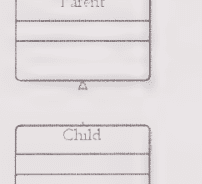
图 6.1：一个描述了类与子类之间父子关系的 UML 类图。

继承的优势是显而易见的。继承给了你改变行为的机会。

## extends 关键字

你通过创建一个新类来扩展类。前者和后者将具有父子关系。原始类是父类、基类或超类。新类是父类的子类、子类化或派生类。在 OOP 中，扩展类的过程被称为继承。

is-a 关系是在使用 `extends` 关键字时形成的。

例如，`Animal` 是 `Object` 的子类。

## is-a 关系

is-a 关系是在使用 `extends` 关键字时形成的。

例如，`Animal` 是 `Object` 的子类。

## 可访问性

在子类内部，你可以访问其超类的公共和保护的方法和字段，但不能访问超类的私有方法。如果子类和父类位于同一个包中，你也可以访问父类的默认方法和字段。

考虑列表 6.4 中的 `P` 和 `C` 类。

### 列表 6.4：显示访问权限

```java
package app06;

public class P {

    public void publicMethod() {

    }

    protected void protectedMethod() {

    }

    void defaultMethod() {

    }

}

class C extends P {

    public void testMethods() {

        publicMethod();

        protectedMethod();

        defaultMethod();

    }

}
```

`P` 有三个方法：一个公共的，一个保护的，以及一个默认访问级别的。`C` 是 `P` 的子类。正如你在 `C` 的 `testMethods` 方法所示，`C` 可以访问其父类的公共和保护方法。此外，由于 `C` 和 `P` 在同一个包中，`C` 也可以访问 `P` 的默认方法。

然而，这并不意味着你可以通过子类暴露 `P` 的非公共方法。例如，以下代码将无法编译：

```java
package test;

import app06.*;

public class AccessibilityTest {

    public static void main(String[] args) {

        C c = new C();

        c.protectedMethod();

    }

}
```

`protectedMethod` 是 `P` 的保护方法。除了子类之外，它无法从 `P` 外部访问。由于 `AccessibilityTest` 不是 `P` 的子类，因此你无法通过其子类 `C` 访问 `P` 的保护方法。

## 方法重写

当你扩展一个类时，你可以更改父类中方法的行为。这被称为方法重写，当你在子类中编写一个与父类签名相同的方法时，就会发生这种情况。如果只有名称相同但参数列表不同，那么就是方法重载。（参阅第 4 章，“对象与类”）

你通过重写方法来改变它的行为。要重写一个方法，你需要在子类中编写新方法，而不需要在父类中对其进行更改。你可以重写父类的公共和保护方法。如果子类和父类在同一个包中，你也可以重写默认访问级别的方法。

列表 6.5 中的 `Box` 类演示了方法重写的示例。

### 列表 6.5：Box 类

```java
package app06;

public class Box {

    public int length;

    public int width;

    public int height;

    public Box(int length, int width, int height) {

        this.length = length;

        this.width = width;

        this.height = height;

    }

    public String toString() {

        return "I am a Box.";

    }

    public Object clone() {

        return new Box(1, 1, 1);

    }

}
```

`Box` 类扩展了 `java.lang.Object` 类。由于没有使用 `extends` 关键字，这是隐式的扩展。`Box` 重写了 `toString` 方法和保护的 `clone` 方法。注意，`Box` 中的 `clone` 方法是公共的，而在 `Object` 中是保护的。将父类中定义的方法的可见性从保护增加到公共是允许的。然而，降低可见性是非法的。

如果你创建一个与父类中方法签名相同的方法会怎样？这不是方法重写，因为私有方法从类外部是不可见的。

> **注意**
> 你不能重写 `final` 方法。要使一个方法变为 `final`，请在方法声明中使用 `final` 关键字。例如：
> ```java
> public final java.lang.String toUpperCase(java.lang.String s)
> ```

## 调用父类的构造函数

子类只是一个普通的类，你使用 `new` 关键字来创建它的实例。如果你没有在子类中显式编写构造函数，编译器将隐式地添加一个无参构造函数。

当你通过调用其构造函数之一来实例化子类时，构造函数的第一件事是调用其直接父类的无参构造函数。在父类中，构造函数也会调用其直接父类的构造函数。这个过程不断重复，直到到达 `java.lang.Object` 的构造函数。也就是说，当你创建一个子对象时，它的所有父类都会被实例化。

这一过程在列表 6.6 的 `Base` 和 `Sub` 类中说明。

### 列表 6.6：调用父类的无参构造函数

```java
package app06;

class Base {

    public Base() {

        System.out.println("Base");

    }

    public Base(String s) {

        System.out.println("Base " + s);

    }

}

class Sub extends Base {

    public Sub(String s) {

        System.out.println(s);

    }

    public static void main(String[] args) {

        Sub sub = new Sub("Start");

    }

}
```

如果你运行 `Sub` 类，将在控制台看到：

```
Base
Start
```

这证明了 `Sub` 类的构造函数调用了 `Base` 类的无参构造函数。编译器静默地修改了 `Sub` 的构造函数如下：

```java
public Sub(String s) {

    super();

    System.out.println(s);

}
```

`super` 关键字代表当前对象的父类实例。由于是从实例调用的 `super`，`super` 代表其直接父类 `Base`。你可以使用 `super` 关键字从子类中显式调用父类的构造函数，如果你想调用子类中的另一个构造函数，使用 `super` 关键字是非常方便的。例如，你可以将 `Sub` 的构造函数修改为：

```java
public Sub(String s) {

    super(s);

}
```

此构造函数调用了父类的单参数构造函数。结果是，如果你运行该类，你将在控制台看到：

```
Base
```

现在，如果父类没有无参构造函数，而你从子类显式调用另一个构造函数会怎样？列表 6.7 中的 `Parent` 和 `Child` 类说明了这一点。

### 列表 6.7：对不存在的父类构造函数的隐式调用

```java
package app06;

class Parent {

    public Parent(String s) {

        System.out.println("Parent");

    }

}

class Child extends Parent {

    public Child() {

    }

}
```

这将产生编译错误，因为编译器向 `Parent` 添加了无参构造函数。虽然 `Parent` 类只有一个构造函数，但你可以通过在 `Child` 类构造函数中显式调用父类的构造函数来解决这种情况：

```java
public Child() {

    super(null);

}
```

子类调用父类的构造函数是有意义的，因为子类的实例总是伴随着每个父类的实例。通过这种方式，对子类中未重写方法的调用将传递给父类，直到找到层次结构中的第一个。

## 调用父类的隐藏成员

`super` 关键字在生活中还有另一个用途。它可以用于调用父类中的隐藏成员或重写的方法。由于 `super` 代表直接父类的实例，`super.memberName` 返回父类中指定的成员。你可以访问父类中从子类可见的任何成员。例如，列表 6.8 显示了两个父子关系的类：`Tool` 和 `Pencil`。

### 列表 6.8：使用 super 访问隐藏成员

```java
package app06;

class Tool {

    public String toString() {

        return "Generic tool";

    }

}

class Pencil extends Tool {

    public String toString() {

        return "I am a Pencil";

    }

    public void write() {

        System.out.println(super.toString());

    }

    public static void main(String[] args) {

        Pencil pencil = new Pencil();

        pencil.write();

    }

}
```

`Pencil` 类重写了 `Tool` 中的 `toString` 方法。如果你运行 `Pencil` 类，你将在控制台看到：

```
Generic tool
I am a Pencil
```

与调用子对象的父类构造函数不同，调用父类的成员不需要是调用者方法中的第一个语句。

## 类型转换

你可以将对象转换为另一种类型。规则是，你只能将子类的实例转换为其父类。将对象转换为父类被称为向上转换。这里有一个示例，假设 `Child` 是 `Parent` 的子类。

```java
Child child = new Child();

Parent parent = child;
```

要对代码段中的 `Child` 对象进行向上转换，你所需要是将对象赋值给 `Parent` 类型的引用变量。注意，父类引用变量无法访问仅在 `Child` 中提供的成员。

由于父对象引用了类型为 `Child` 的实例，你可以将其转换回 `Child`。这次被称为向下转换，因为你正在按照继承层次结构将对象转换为下方的类。向下转换要求你在括号中写出类类型。例如：

```java
Child child = new Child();

Parent parent = child; // parent 指向 Child 的实例

Child child2 = (Child) parent; // 向下转换
```

只有当父类引用已经指向子类的实例时，才允许向下转换为子类。以下将产生编译错误。

```java
Object parent = new Object();

Child child = (Child) parent; // 非法向下转换，编译错误
```

## final 类

你可以通过在类声明中使用 `final` 关键字将类变为 `final`，从而防止他人扩展它。`final` 可以出现在访问修饰符之后或之前。例如：

```java
public final class Pencil

final public class Pen
```

第一种形式更为常见。

尽管将类设置为 `final` 可以让你的代码运行得稍微快，但差异微小到难以察觉。设计考虑而不是速度，才是你将类设置为 `final` 的理由。例如，`java.lang.String` 类是 `final` 的，因为该类的设计者不希望我们改变 `String` 类的行为。

## instanceof 关键字

`instanceof` 关键字可以测试对象是否属于指定的类型。它通常用于语句中，语法如下：

```java
if (objectReference instanceof type)
```

其中 `objectReference` 返回一个被调查的对象。例如，下面的 if 语句返回 `true`。

```java
String s = "Hello";

if (s instanceof java.lang.String) {}
```

然而，对 `null` 变量应用 `instanceof` 返回 `false`。例如，下面的 if 语句返回 `false`。

```java
String s = null;

if (s instanceof java.lang.String) {}
```

此外，由于子类是其父类的“一种”类型，下面的语句（假设 `Child` 是 `Parent` 的子类）返回 `true`。

```java
Child child = new Child();

if (child instanceof Parent) // 值为 true
```

## 总结

继承是面向对象编程的基本原理之一。继承使得代码具有扩展性。在 Java 中，所有类默认继承 `java.lang.Object` 类。要扩展一个类，请使用 `extends` 关键字。方法重写另一个与继承直接相关的 OOP 特性。它允许你更改父类中方法的行为。你可以通过将类设置为 `final` 来防止你的类被继承。

## 问题

1. 子类会继承父类的构造函数吗？
2. 为什么将子类的实例赋值给父类变量是合法的？
3. 方法重写和方法重载有什么区别？
4. 为什么子类的实例必须伴随每个父类的实例？

# 第 7 章 错误处理

错误处理是任何编程语言中的重要特性。良好的错误处理机制让程序员更容易编写健壮的应用程序并防止 bug 的产生。在某些语言中，程序员被迫使用多个 `if` 语句来检测所有可能导致错误的情况。这可能导致代码变得异常复杂。在较大的程序中，这种做法很容易导致像面条一样的代码（混乱的代码）。

Java 通过 `try` 语句使用了一种非常棒的错误处理方法。通过这种策略，可能导致错误的代码被隔离在一个块中。如果发生错误，该错误将被捕获并在本地解决。本章将教你如何做。

## 捕获异常

你可以使用 `try` 语句隔离可能导致运行时错误的代码，该语句通常与 `catch` 和 `finally` 语句一起使用。这种隔离通常发生在方法体中。如果遇到错误，Java 会停止处理 `try` 块并进入 `catch` 块。在这里你可以优雅地处理错误，或通过“抛出” `java.lang.Exception` 对象来通知用户。另一种场景是重新抛出异常或新的 `Exception` 对象，然后由客户端来决定如何处理调用该方法的代码。如果抛出的异常没有被捕获，应用程序将突然停止。

这是 `try` 语句的语法。

```java
try {

  [可能抛出异常的代码]

} catch (ExceptionType-1 e) {

  [当抛出 ExceptionType-1 时执行的代码]
}
```


} catch (`ExceptionType-2` e) {

  [当抛出 `ExceptionType-2` 时执行的代码]

}

...catch (`ExceptionType-n` e) {

  [当抛出 `ExceptionType-n` 时执行的代码]

}

finally {

  [无论是否抛出异常都会运行的代码]

}

错误处理的步骤可以总结为：

1. 在 `try` 块中隔离可能导致错误的代码。
2. 对于每个单独的 `catch` 块，编写如果在 `try` 块中发生特定类型异常时要执行的代码。
3. 在 `finally` 块中，编写无论发生错误都会运行的代码。

注意，`catch` 和 `finally` 块是可选的，但它们必须存在一个。因此，你可以拥有带有一个或多个 `catch` 块的 `try`，或者带有 `finally` 的 `try`。

之前的语法显示你可以有多个 `catch` 块。这是因为代码可以抛出不同类型的异常。当异常从 `try` 块抛出时，控制将传递给第一个匹配或作为第一个 `catch` 块子类的 `catch` 块，执行完毕后，控制将传递到 `finally` 块（如果存在）。

如果异常类型与第一个 `catch` 块中的异常类型不匹配，JVM 将进入下一个 `catch` 块并执行相同的操作，直到找到匹配。如果未找到匹配，异常对象将抛给方法调用者。如果调用者没有将调用该方法的错误代码放在 `try` 块中，程序将崩溃。

为了说明这种错误处理的使用，请考虑清单 7.1 中的 `NumberDoubler` 类。当该类运行时，它会提示你输入，包括非数字内容。如果你的输入成功转换为数字，它将将其翻倍并打印结果。如果你的输入无效，程序将打印“Invalid input”消息。

## 清单 7.1: NumberDoubler 类

```java
package app07;

import java.util.Scanner;

public class NumberDoubler {

    public static void main(String[] args) {

        Scanner scanner = new Scanner(System.in);

        String input = scanner.next();

        try {

            double number = Double.parseDouble(input);

            System.out.printf("Result: %s", number);

        } catch (NumberFormatException e) {

            System.out.println("Invalid input.");

        }

    }

}
```

`NumberDoubler` 类使用 `java.util.Scanner` 类来获取用户输入（Scanner 在第五章“核心类”中讨论过）。

```java
Scanner scanner = new Scanner(System.in);

String input = scanner.next();
```

它使用 `java.lang.Double` 类的 `parseDouble` 方法将输入转换为 `double`。注意调用该代码位于 `try` 块中。这是因为 `parseDouble` 方法可能会抛出 `NumberFormatException`，签名所示：

```java
public static double parseDouble(String s)
    throws NumberFormatException
```

方法签名中的 `throws` 语句告知可能会抛出 `NumberFormatException`，并由方法调用者捕获。

如果没有 `try` 块，无效输入将给你带来这个尴尬的错误信息：
Exception in thread "main" java.lang.NumberFormatException:

### 没有 catch 的 try

`finally` 语句可以配合 `catch` 块使用。你通常使用这种语法来确保无论 `try` 块中是否发生了意外异常，某些代码都会执行。例如，在打开数据库连接后，你希望在完成操作后调用其 `close` 方法。为了说明这种场景，考虑以下打开数据库连接的伪代码：

```java
Connection connection = null;

try {

  // 打开连接

  // 使用连接并执行其他任务

finally {

  if (connection != null) {

    // 关闭连接

  }

}
```

如果在 `try` 块中发生了意外情况，`close` 方法始终会被调用以释放资源。

### 捕获多个异常

Java 7 及更高版本允许在捕获的异常由相同代码处理并在单个 `catch` 块中捕获多个异常。`catch` 块的语法如下，两个异常由管道符号 `|` 分隔：

```
catch(exception-1 | exception-2 ... e) {

  // 处理异常

}
```

例如，`java.net.ServerSocket` 类的 `accept` 方法可以抛出四个异常：`java.nio.channels.IllegalBlockingModeException`、`java.net.SocketTimeoutException`、`java.lang.SecurityException` 和 `java.io.IOException`。如果例如，前三个异常由相同的代码处理，你可以这样写你的 `try` 块：

```java
try {

  serverSocket.accept();

} catch (SocketTimeoutException | SecurityException | IllegalBlockingModeException e) {

  // 处理异常

}
```

```java
} catch (IOException e) {

  // handle IOException

}
```

### try-with-resources 语句

许多 Java 操作涉及某种类型的资源，这些资源在使用后必须被关闭。在 JDK 7 之前，你使用 `finally` 来确保 `close` 方法保证被调用：

```java
try {

  // open resource

} catch (Exception e) {

  finally {

    // close resource

  }

}
```

语法可能会非常繁琐，尤其是当关闭方法可能抛出异常且可能为 null时。例如，这里有一个打开数据库连接的典型代码片段。

```java
Connection connection = null;

try {

  // create connection and do something with it

} catch (SQLException e) {

  finally {

    if (connection != null) {

      try {

        connection.close();

      } catch (SQLException e) {

    }

  }

}
```

你可以看到，仅仅为了一个资源你就需要在 finally 块中写一些代码，而且在单个 try 块中打开多个资源也并不罕见。JDK 7 增加了一个新特性——try-with-resource 语句，使资源关闭变得自动化。

```java
try ( resources ) {

  // do something with the resources

} catch (Exception e) {

  // do something with e

}
```

例如，在 Java 7 中打开数据库连接看起来如下所示。

## 第 7 章：错误处理 119

```java
Connection connection = null;

try (Connection connection = openConnection()) {

  // open other resources, if any

  // do something with connection

} catch (SQLException e) {

}
```

并不是所有的资源都会被自动关闭。只有实现了 `java.lang.AutoCloseable` 的资源类才能被自动关闭。幸运的是，在 JDK 7 中，许多输入/输出和数据库资源已经过修改以支持这一特性。你将在第 13 章“输入/输出”和第 22 章“Java 数据库连接”中看到更多 try-with-resources 的示例。

### java.lang.Exception 类

错误代码可以抛出任何类型的异常。例如，无效参数可能会抛出 `java.lang.NumberFormatException`，而在 null 引用上调用方法会抛出 `java.lang.NullPointerException`。所有异常类都派自 `java.lang.Exception` 类。因此，花时间研究这个类是非常值得的。

此外，Exception 类具有以下方法：

```java
public String toString()
    // 返回异常的描述。
```

```java
public void printStackTrace()
    // 打印异常的描述，随后是 Exception 对象的堆栈跟踪。通过分析堆栈跟踪，你可以找到哪一行导致了问题。这里是 printStackTrace 方法在控制可能打印的示例。
```

```
java.lang.NullPointerException:doubleNumber(MathUtil.java:45)
    at MyClass.performMath(MyClass.java:18)
    at MyClass.main(MyClass.java: 90)
```

这告诉你抛出了一个 `NullPointerException`。抛出异常的行是 `MathUtil.java` 类的第 45 行，位于 `doubleNumber` 方法内部。`doubleNumber` 方法是由 `MyClass.performMath` 调用的，后者是由 `MyClass.main` 调用的。大多数情况下，try 块会伴有一个 catch 块，除了其他 catch 块外，还会捕获 `java.lang.Exception`。捕获 Exception 的 catch 块必须最后出现。如果其他 catch 块未能捕获异常，最后一个 catch 就会起作用。这是一个示例。

```java
try {

    // code

} catch (NumberFormatException e) {

    // handle NumberFormatException

} catch (Exception e) {

    // handle other exceptions

}
```

## 120 Java for Android

你可能想在上面的代码中使用多个 catch 块，因为 try 块中的语句可能会抛出 `java.lang.NumberFormatException` 或其他类型的异常。如果抛出了后者，它将由最后一个 catch 块捕获。

但请注意：catch 块的顺序非常重要。例如，你不能将处理 `java.lang.Exception` 的 catch 块放在任何其他 catch 块之前。因为 JVM 尝试按照出现的顺序将异常与 catch 块的参数进行匹配。`java.lang.Exception` 会捕获所有内容；因此，在它之后的 catch 块永远不会被执行。

如果你有多个 catch 块，且其中一个 catch 块的异常类型派自另一个 catch 块的类型，请确保特定的异常类型先出现。例如，在尝试打开文件时，你需要捕获 `java.io.FileNotFoundException` 以防找不到文件。然而，你可能还想确保也捕获 `java.io.IOException`，以便捕获与其他 I/O 相关的异常。由于 `FileNotFoundException` 是 `IOException` 的子类，处理 `FileNotFoundException` 的 catch 块必须出现在处理 `IOException` 的 catch 块之前。

### 从方法中抛出异常

在方法中捕获异常时，你有两种方案处理方法内部发生的错误。你可以在方法内部处理错误，从而静地捕获异常而不通知调用者（这在之前的示例中已经演示），或者可以将异常抛回给调用者并让调用者来处理。如果你选择第二种方案，调用代码必须捕获方法抛出的异常。

列表 7.2 是一个将字符串的第一个字母更改为大写的 capitalize 方法。

## 清单 7.2：capitalize 方法

```java
public String capitalize(String s) throws NullPointerException {

    if (s == null) {

        throw new NullPointerException("s is null");

    }

    Character firstChar = s.charAt(0);

    String theRest = s.substring(1);

    return Character.toUpperCase(firstChar) + theRest;

}
```


## 120 Java for Android

你可能想在上面的代码中使用多个 `catch` 块，因为 `try` 块中的语句可能会抛出 `java.lang.NumberFormatException` 或其他类型的异常。如果抛出了后者，它将由最后一个 `catch` 块捕获。

但请注意：`catch` 块的顺序非常重要。例如，你不能将处理 `java.lang.Exception` 的 `catch` 块放在任何其他 `catch` 块之前。因为 JVM 尝试按照出现的顺序将异常与 `catch` 块的参数进行匹配。`java.lang.Exception` 会捕获所有内容；因此，在它之后的 `catch` 块永远不会被执行。

如果你有多个 `catch` 块，且其中一个 `catch` 块的异常类型派自另一个 `catch` 块的类型，请确保特定的异常类型先出现。例如，在尝试打开文件时，你需要捕获 `java.io.FileNotFoundException` 以防找不到文件。然而，你可能还想确保也捕获 `java.io.IOException`，以便捕获与其他 I/O 相关的异常。由于 `FileNotFoundException` 是 `IOException` 的子类，处理 `FileNotFoundException` 的 `catch` 块必须出现在处理 `IOException` 的 `catch` 块之前。

在方法中捕获异常时，你有两种方案处理方法内部发生的错误。你可以在方法内部处理错误，从而静默地捕获异常而不通知调用者（这在之前的示例中已经演示），或者你可以将异常抛回给调用者并让调用者来处理。如果你选择第二种方案，调用代码必须捕获方法抛出的异常。

列表 7.2 是一个将字符串的第一个字母更改为大写的 `capitalize` 方法。

## 问题

1. `try` 语句的优势是什么？
2. `try` 语句可以配合 `finally` 使用而不使用 `catch` 吗？
3. 什么是 try-with-resources（资源管理器 try）？

## 第8章：数字与日期

在 Java 中，数字由基本类型 `byte`、`short`、`int`、`long`、`float`、`double` 及其对应的包装类表示，这些内容在第5章“核心类”中介绍过。日期可以用不同的类表示，最常用的是 `java.util.Date` 类。处理数字和日期时涉及三个问题：解析、格式化和操作。

解析涉及将字符串转换为数字或日期。解析非常常见，因为转换需要用户输入，而用户输入是以字符串形式接收的；然后必须将该字符串转换为数字或日期。转换并不总是简单的；例如，你首先需要读取一个字符串并检查它是否包含构成数字或日期的字符。“123”虽然以数字开头，但它并不是一个数字。“123.4”是一个浮点数，而不是整数。“12/25/2011”看起来像是一个日期，但只有当程序要求的日期格式为 mm/dd/yyyy 时它才是有效的。将字符串转换为数字被称为数字解析，将字符串转换为日期称为日期解析。

一旦你拥有了数字或日期，你可能希望以特定的格式显示它。例如，1000000 可以显示为 1,000,000，12/25/2011 可以显示为 Dec 25, 2011。这分别是数字格式化和日期格式化。

本章将讨论日期解析以及数字和日期的格式化。这些任务在 Java 中可以轻松实现，因为它提供了用于此目的的类。此外，还会讨论 `java.lang.Math` 类，它提供了执行数学运算的方法。此外，还有一个关于 `java.util.Calendar` 的节，这是一个用于操作日期的工具类。

### 数字解析

Java 程序可能要求用户输入一个数字，以便进行处理或作为方法的参数。例如，一个货币转换程序需要用户输入一个要转换的值。你可以使用 `java.util.Scanner` 类来接收输入。然而，尽管输入代表一个数字，但它仍然是一个字符串。在处理该数字之前，你需要解析该字符串。成功解析的结果是一个数字。

因此，数字解析的目的是将字符串转换为数值基本类型。如果解析失败（例如，字符串不是数字或数字超出指定范围），你的程序可以抛出一个异常。

基本类型的包装类——`Byte`、`Short`、`Integer`、`Long`、`Float` 和 `Double` 类提供了解析字符串的静态方法。例如，`Integer` 有一个如下签名的 `parseInt` 方法。

```java
public static int parseInt(String s) throws NumberFormatException
```

解析字符串并返回一个 `int`。如果字符串不包含有效的整数表示，则抛出 `NumberFormatException`。

例如，以下代码段使用 `parseInt` 将字符串 "123" 解析为 123。

```java
int x = Integer.parseInt("123");
```

同样，`Byte` 提供了 `parseByte` 方法，`Long` 提供了 `parseLong` 方法，`Short` 提供了 `parseShort` 方法，`Float` 提供了 `parseFloat` 方法，`Double` 提供了 `parseDouble` 方法。

例如，列表 8.1 中的 `Number` 类获取用户输入并进行解析，如果用户输入的数字无效，将显示错误信息。

### 列表 8.1: 解析数字 (NumberTest.java)

```java
package app08;

import java.util.Scanner;

public class NumberTest {

    public static void main(String[] args) {

        Scanner scanner = new Scanner(System.in);

        String userInput = scanner.next();

        try {

            int i = Integer.parseInt(userInput);

            System.out.println("The number entered: " + i);

        } catch (NumberFormatException e) {

            System.out.println("Invalid user input");

        }

    }

}
```

### 数字格式化

数字格式化使数字更具可读性。例如，1000000 如果为 1,000,000（如果你的区域设置使用 `.` 分隔千分位，则为 1.000.000）更易读。对于数字格式化，Java 提供了 `java.text.NumberFormat` 类，这是一个抽象类。由于它是抽象的，因此你不能使用 `new` 关键字创建实例。相反，你应该实例化它的子类 `java.text.DecimalFormat`，它是 `NumberFormat` 的具体实现。

```java
Number nf = new DecimalFormat();
```

然而，你不应该直接调用 `DecimalFormat` 类的构造函数。相反，应该使用 `NumberFormat` 类的静态方法 `getInstance`。该方法可能返回 `DecimalFormat` 的实例，也可能返回 `DecimalFormat` 其它子类的实例。

现在，如何使用 `NumberFormat` 格式化数字（如 1234.56）？很简单，只需将数字传递给它们的格式化方法，即可得到一个字符串。然而，数字 1234.56 应该格式化为 1,234.56 还是 1234.56？这取决于你住在大西洋的哪一边。如果你在美国这边，就取决于具体设置。

### 列表 8.2: NumberTest

```java
package app08;

import java.text.NumberFormat;

import java.util.Locale;

public class NumberTest {

    public static void main(String[] args) {

        NumberFormat nf = NumberFormat.getInstance(Locale.US);

        long number = 1000000;

        System.out.println(nf.format(number));

        NumberFormat nf2 = NumberFormat.getInstance(Locale.GERMANY);

        System.out.println(nf2.format(number));

    }

}
```

### java.util.Date 类

在处理日期时有一些类可以使用。第一个是 `java.util.Date`，一个通常用于表示日期和时间的类。第二个是 `java.util.Calendar`，通常用于操作日期。此外，时间可以用 `long` 表示。

```java
Date date2 = new Date(1001);

if (date1.before(date2)) {

    System.out.println("date before date2");

} else {

    System.out.println("date not before date2");

}
```

`Date` 类中的许多方法，如 `getDate()`、`getMonth()`、`getYear()` 都已经过时。你不应该使用这些方法。相反，请使用 `java.util.Calendar` 类中类似的方法。

### java.util.Calendar 类

`java.util.Calendar` 类提供了方法，允许你根据日期组件（如日、月、年）构建 `Date` 对象。然而，这些方法已经过时。你应该改用 `java.util.Calendar`。

要获取 `Calendar` 对象，请使用两个静态的 `getInstance` 方法之一。以下是它们的签名：

```java
public static Calendar getInstance();
```

```java
public static Calendar getInstance(Locale locale);
```

第一个重载方法返回一个使用计算机区域的实例。

使用 `Calendar` 可以做很多事情。例如，你可以调用它的 `getTime()` 来获取一个 `Date` 对象。以下是它的签名：

```java
public Date getTime();
```

生成的 `Date` 对象无需说明，包含了你最初传递用于构建 `Calendar` 对象的组件。换句话说，如果你构建了一个代表 2000 年 5 月 7 日 00:00:00 的 `Calendar` 对象，那么通过其 `getTime()` 方法获取的 `Date` 对象也将代表 2000 年 5 月 7 日 00:00:00。

要获取日期部分（如小时、月份或年份），请使用 `get()` 方法。仅看它的签名并不能看出如何使用该方法。

```java
public int get(int field);
```

要使用它，请向 `get()` 方法传递一个有效的字段。有效的字段是以下值之一：`YEAR`、`MONTH`、`DATE`、`HOUR`、`MINUTE`、`SECOND` 和 `MILLISECOND`。

`get(Calendar.YEAR)` 返回一个表示年份的 `int`。如果年份是 2010 年，你得到 2010。`get(Calendar.MONTH)` 返回月份的从零开始的索引，0 代表 1 月，11 代表 12 月。其他的（`get(Calendar.DATE)`、`get(Calendar.HOUR)` 等）返回表示日期/时间单位的数字。

最后值得提到的是：如果你有一个 `Date` 对象并想使用 `Calendar` 中的方法，你可以通过 `setTime()` 方法构建一个 `Calendar` 对象：

```java
public void setTime(Date date);
```

这是一个示例：

```java
// myDate 是一个 Date
Calendar calendar = Calendar.getInstance();
calendar.setTime(myDate);
```

要更改日期/时间组件，请调用它的 `set()` 方法：

```java
public void set(int field, int value);
```

例如，要将 `Calendar` 对象的月份组件更改为 12 月，请编写以下代码。

```java
calendar.set(Calendar.MONTH, Calendar.DECEMBER);
```

还有用于同时更改多个组件的 `set()` 方法重载：

```java
public void set(int year, int month, int date);
public void set(int year, int month, int date, int hour, int minute, int second);
```

### 使用 DateFormat 进行日期解析和格式化

Java 对日期解析和格式化的解决方案是 `java.text.DateFormat` 和 `java.text.SimpleDateFormat` 类。`DateFormat` 是一个抽象类，带有静态方法允许你获取子类的实例。`SimpleDateFormat` 是 `DateFormat` 的具体实现，比其父类更容易使用。本节涵盖了这两个类。

#### DateFormat

`DateFormat` 支持样式和模式。格式化 `Date` 有四种样式。每种样式由一个 `int` 值表示。表示这些样式的四个 `int` 是：

- `DateFormat.SHORT`。例如：12/2/11
- `DateFormat.MEDIUM`。例如：December 2, 11
- `DateFormat.LONG`。例如：December 2, 11
- `DateFormat.FULL`。例如：Friday, December 2, 11

创建一个 `DateFormat` 时，需要决定解析或格式化使用哪种样式。一旦创建，无法更改 `DateFormat` 的样式。

要获取 `DateFormat` 实例，请调用此静态方法：

```java
public static DateFormat getInstance(int style);
```

其中 `style` 是 `DateFormat.SHORT`、`DateFormat.MEDIUM`、`DateFormat.LONG` 或 `DateFormat.FULL` 之一。例如，以下代码创建一个具有 `MEDIUM` 样式的 `DateFormat` 实例。

```java
DateFormat df = DateFormat.getInstance(DateFormat.MEDIUM);
```

格式化 `Date` 对象，调用其 `format()` 方法：

```java
public final String format(Date date);
```

解析日期的字符串表示，使用 `parse()` 方法。其签名如下：

```java
public Date parse(String date) throws ParseException;
```

注意，你必须根据 `DateFormat` 的样式来组合字符串。

示例 8.3 显示了一个解析并格式化日期的类。

### 示例 8.3：FormatTest 类

```java
package app08;

import java.text.DateFormat;

import java.text.ParseException;

import java.util.Date;

public class DateTest {

    public static void main(String[] args) {

        DateFormat shortDf = DateFormat.getInstance(DateFormat.SHORT);

        DateFormat mediumDf = DateFormat.getInstance(DateFormat.MEDIUM);

        DateFormat longDf = DateFormat.getInstance(DateFormat.LONG);

        DateFormat fullDf = DateFormat.getInstance(DateFormat.FULL);

        System.out.println(shortDf.format(new Date()));

        System.out.println(mediumDf.format(new Date()));

        System.out.println(longDf.format(new Date()));

        System.out.println(fullDf.format(new Date()));

        try {

            Date date = shortDf.parse("12/2/11");

        } catch (ParseException e) {

            e.printStackTrace();

        }

    }

}
```


## 第8章：数字与日期

### SimpleDateFormat

Java 对日期解析和格式化的解决方案是 `java.text.DateFormat` 和 `java.text.SimpleDateFormat` 类。`DateFormat` 是一个抽象类，带有静态方法允许你获取子类的实例。`SimpleDateFormat` 是 `DateFormat` 的具体实现，比其父类更容易使用。本节涵盖了这两个类。

`DateFormat` 支持样式和模式。格式化 `Date` 有四种样式。每种样式由一个 `int` 值表示。表示这些样式的四个 `int` 是：

- `DateFormat.SHORT`。例如：12/2/11
- `DateFormat.MEDIUM`。例如：December 2, 11
- `DateFormat.LONG`。例如：December 2, 11
- `DateFormat.FULL`。例如：Friday, December 2, 11

创建一个 `DateFormat` 时，需要决定解析或格式化使用哪种样式。一旦创建，无法更改 `DateFormat` 的样式，但你可以定义多个 `DateFormat` 实例来支持不同的样式。

要获取 `DateFormat` 实例，调用此静态方法：
`public static DateFormat getInstance(int style)`
其中 `style` 是 `DateFormat.SHORT`、`DateFormat.MEDIUM`、`DateFormat.LONG` 或 `DateFormat.FULL` 之一。例如，以下代码创建一个具有 `MEDIUM` 样式的 `DateFormat` 实例。

```java
DateFormat df = DateFormat.getInstance(DateFormat.MEDIUM)
```

格式化 `Date` 对象，调用其 `format` 方法：
`public final String format(Date date)`

解析日期的字符串表示，使用 `parse` 方法。其签名如下：

```java
public Date parse(String date) throws ParseException
```

注意，你必须根据 `DateFormat` 的样式来组合字符串。

示例 8.3 显示了一个解析并格式化日期的类。

### 示例 8.3：FormatTest 类

```java
package app08;

import java.text.DateFormat;
import java.text.ParseException;
import java.util.Date;

public class DateTest {

    public static void main(String[] args) {

        DateFormat shortDf = DateFormat.getInstance(DateFormat.SHORT);
        DateFormat mediumDf = DateFormat.getInstance(DateFormat.MEDIUM);
        DateFormat longDf = DateFormat.getInstance(DateFormat.LONG);
        DateFormat fullDf = DateFormat.getInstance(DateFormat.FULL);

        System.out.println(shortDf.format(new Date()));
        System.out.println(mediumDf.format(new Date()));
        System.out.println(longDf.format(new Date()));
        System.out.println(fullDf.format(new Date()));

        try {
            Date date = shortDf.parse("12/2/11");
        } catch (ParseException e) {
            e.printStackTrace();
        }

    }

}
```

### SimpleDateFormat

`SimpleDateFormat` 比 `DateFormat` 更强大，因为你可以使用自己的模式。这里是 `SimpleDateFormat` 的构造函数之一：

```java
public SimpleDateFormat(String pattern) throws NullPointerException, IllegalArgumentException
```

有效模式的完整规则可以在 `SimpleDateFormat` 类的 Java 文档中找到。更常用的模式可以通过 `y`（年）、`M`（月）和 `d`（日）的组合使用。模式例如 `dd/MM/yyyy`、`MM/dd/yyyy`、`yyyy-MM-dd`。

示例 8.4 显示了一个使用 `SimpleDateFormat` 进行解析和格式化的类。

### 示例 8.4：SimpleDateFormatTest 类

```java
package app0;

import java.text.ParseException;
import java.text.SimpleDateFormat;
import java.util.Date;

public class SimpleDateFormatTest {

    public static void main(String[] args) {

        String pattern = "MM/dd/yyyy";
        SimpleDateFormat format = new SimpleDateFormat(pattern);

        try {
            Date date = format.parse("12/31/2011");
        } catch (ParseException e) {
            e.printStackTrace();
        }

        // 格式化
        System.out.println(format.format(new Date()));

    }

}
```

### Calendar 与日期操作

另一个需要注意的点：如果你有一个 `Date` 对象并想使用 `Calendar` 中的方法，你可以通过 `setTime` 方法构建一个 `Calendar` 对象：

```java
public void setTime(Date date);
```

### 宽容模式

`DateFormat` 类有一个 `isLenient` 方法和一个 `setLenient` 方法，用于控制解析的宽容度。默认情况下，解析是宽容的。

```java
public boolean isLenient()
public void setLenient(boolean lenient)
```

## 总结

在 Java 中，使用基本类型和包装类表示数字，使用 `java.util.Date` 类表示日期。当你处理数字和日期时，经常执行三种操作：解析、格式化和操作。本章展示了如何执行这些操作。

数字解析通过包装类的 `parseXXX` 方法实现，例如 `java.lang.Integer` 中的 `parseInt` 和 `java.lang.Long` 中的 `parseLong`。可以使用 `java.text.NumberFormat` 类进行解析和格式化。另一方面，日期操作最好通过 `java.util.Calendar` 来帮助完成。

## 问题

1. 使用 `java.lang.Math` 类的静态方法可以做什么？
2. 你用什么表示日期？
3. 如果你想定义自己的日期模式，应该使用哪个类？

# 第 9 章：接口与抽象类

Java 初学者往往会认为接口仅仅是一个没有实现代码的类。虽然在技术上这并不错误，但它掩盖了使用接口的真正目的。接口不仅仅于此。接口应该被视为服务提供者与其客户端之间的契约。因此，本章将在解释如何编写接口之前，先重点介绍相关概念。

本章的第二个主题是抽象类。从技术上讲，抽象类是一种不能被实例化的类，它必须由子类来实现。抽象类之所以重要，是因为在某些情况下它可以充当接口的角色。在本章中，我们将学习如何使用抽象类。

### 接口的概念

初次学习接口时，新手往往关注如何编写接口，而不是理解其背后的概念。他们会认为接口就像是一个用 `interface` 关键字声明的、没有方法体的 Java 类。

虽然这种描述并不准确，但将接口视为没有实现类的类会忽略大局。接口更好的定义是“契约”。它是服务提供者（服务器）与该服务的使用者（客户端）之间的契约。有时由服务器定义契约，有时由客户端定义。

考虑这个现实世界的例子。Windows 是如今最流行的操作系统，但微软并不生产打印机。对于打印，我们仍然依赖 HP、佳能、三星等公司。这些每家打印机制造商都使用专有技术。然而，他们的产品都可以从任何 Windows 应用程序打印任何文档。这是做到的？

这是因为微软对打印机制造商说了类似的话：“如果你想让你们的产品在 Windows 上可用（我们知道你们都想），你们必须实现这个 `Printable` 接口。”

接口简单如下：

```java
interface Printable {
    void print(Document document);
}
```

其中 `document` 是要打印的文档。

打印机制造商实现这个接口后，编写打印机驱动程序。每台打印机都有不同的驱动程序，但它们都实现了 `Printable`。打印机驱动程序是 `Printable` 的实现。在这种情况下，这些驱动程序就是服务提供者。

打印服务的 Windows 客户端应用程序只需要调用 `print` 方法并传递一个 `Document` 对象。接口是免费提供的，客户端应用程序可以在无需等待实现可用的情况下编译。

关键点在于，得益于 `Printable` 接口，从不同的应用程序打印到不同的打印机是可能的。这是打印服务提供者与打印客户端之间的契约。

接口可以同时定义字段和方法。然而，接口中的方法没有实现。为了使其有用，接口必须有一个实际执行该操作的实现类。

图 9.1 用 UML 类图说明了 `Printable` 接口及其实现。


图 9.1：类图中的一个接口和两个实现类

在类图中，接口的形状与类相同，但名称以*斜体*打印，并带有 `<<interface>>` 前缀。`HPDriver` 和 `CanonDriver` 类是实现了 `Printable` 接口的类。它们的实现显然是不同的。在 `HPDriver` 类中，`print` 方法包含了允许打印到 HP 打印机的代码。在 `CanonDriver` 中，代码允许打印到佳能驱动器。在 UML 类图中，类和接口由一条带有箭头的虚线连接。这种关系通常被称为“实现”，因为类提供了接口所提供的抽象的真实实现（实际上可以运行的）。

> **注意**
> 从技术角度看接口

现在你已经理解了接口是什么，让我们来看看如何创建一个接口。在 Java 中，像类一样，接口也是一种类型。按照以下格式编写接口：

```java
accessModifier interface interfaceName {
}
```

像类一样，接口有公共的（public）或默认的访问级别。接口可以拥有字段和方法。然而，所有接口成员都是隐式公共的。列表 9.1 显示了一个名为 `Printable` 的接口。

### 列表 9.1：Printable 接口

```java
package app9;

public interface Printable {
    void print(Object obj);
}
```

接口在方法声明前面有一个关键字。注意，尽管没有为 `print` 声明公共方法，但它也是公共的。你可以在方法签名之前使用 `public` 关键字。

和类一样，接口是创建对象的模板。然而，与普通类不同，接口不能被实例化。它仅仅是定义了一组 Java 类要实现的方法。

要实现一个接口，你需要在类声明之后使用 `implements` 关键字。一个类可以实现多个接口。例如，列表 9.2 显示了实现 `Printable` 的 `CanonDriver` 类。

### 列表 9.2：Printable 接口的实现

```java
package app9;

public class CanonDriver implements Printable {
    void print(Object obj) {
        // 打印的代码
    }
}
```

实现类必须重写接口中的所有方法。接口与其实现类之间的关系可以比作父类和子类。类的实例也是该接口的实例。例如，下面的 `if` 语句结果为真。

```java
CanonDriver driver = new CanonDriver();
if (driver instanceof Printable) // 结果为 true
```

接口支持继承。接口可以扩展另一个接口。如果接口 A 扩展 B，则称 A 是 B 的子接口。B 是 A 的超接口。因为 A 直接扩展 B，所以 B 是 A 的直接超接口。任何扩展 B 的接口都是 A 的间接子接口。图 9.2 显示了一个扩展另一个接口的接口。


图 9.2：扩展接口

注意，连接两个接口的类型与扩展类的相同。

### 接口中的字段

接口中的字段必须初始化，并且隐式是公共的（public）、静态的（static）和最后的（final）。然而，你可以冗余使用 `public`、`static` 和 `final` 修饰符。这些代码的效果相同：

```java
public int STATUS = 1;
int STATUS = 1;
public static final int STATUS = 1;
```

注意按照习惯接口中的字段名使用大写。

在接口中具有同名的字段是编译错误。然而，接口可以从其超接口继承多个同名的字段。

### 方法

你在接口中声明方法就像在类中声明一样。然而，接口中的方法没有体，它们立即以分号结束。所有方法都是隐式公共且抽象的，尽管在方法声明中使用 `public` 和 `abstract` 修饰符是合法的。

接口方法的语法为：

```java
[Modifiers] ReturnType MethodName(listofArgument) [ThrowClause];
```

其中 `Modifiers` 是 `abstract` 和 `public`。

此外，接口中的方法不能声明为 `static`，因为方法不能是抽象的。

### 基类

接口有许多方法，实现类必须重写所有方法。如果代码中只使用某些方法，这可能是一项繁琐的任务。因此，你可以创建一个通用实现类，用默认代码重写接口中的方法。接口可以扩展这个通用类，并重写它想要更改的方法。这种通用类通常被称为基类，非常有用，因为它能帮你编写代码。

例如，`javax.servlet.Servlet` 接口是所有 servlet 类必须实现的接口。`init`、`service`、`destroy`、`getServletConfig`、`getServletInfo`。五个方法中，只有 `service` 方法偶尔实现，其余很少使用。尽管如此，所有实现类都必须为这五个方法提供实现。对于 servlet 程序员来说，如果有这样的基类将是多么大的幸运。

比较列表 9.7 中实现了 `javax.servlet.Servlet` 的 `TediousServlet` 类，与列表 9.8 中扩展了 `javax.servlet.GenericServlet` 的类。哪一个更简单？

### 列表 9.7：TediousServlet 类

```java
package test;

import java.io.IOException;
import javax.servlet.Servlet;
import javax.servlet.ServletConfig;
import javax.servlet.ServletException;
import javax.servlet.ServletRequest;
import javax.servlet.ServletResponse;

public class TediousServlet implements Servlet {

    public void init(ServletConfig config) throws ServletException {
    }

    public void service(ServletRequest request, ServletResponse response) throws ServletException, IOException {
        response.getWriter().print("Welcome");
    }
}
```


## 列表 9.8：FunServlet 类

```java
package java.io.IOException;

import javax.servlet.GenericServlet;
import javax.servlet.ServletException;
import javax.servlet.ServletRequest;
import javax.servlet.ServletResponse;

public class FunServlet extends GenericServlet {

    public void service(ServletRequest request,
        ServletResponse response)
        throws ServletException, IOException {

        response.getWriter().print("Welcome");

    }

}
```

### 注意

Servlet 编程将在第 26 章“Java Web 应用”中讨论。

## 抽象类

使用接口时，必须编写一个执行实际操作的实现类。如果接口中有许多方法，你可能会面临浪费时间重写你不需要的方法的风险。抽象类的作用与接口类似，即在服务提供者与其客户端之间提供约束，但同时抽象类可以提供部分实现。必须显式重写的方法可以声明为 `abstract`。你仍然需要创建一个实现类，因为你不能实例化抽象类，但你不需要重写你不想使用或更改的方法。

你可以在类声明中使用 `abstract` 修饰符来创建抽象类。要使一个类成为抽象类，在方法声明前使用 `abstract` 修饰符。列表 9.9 显示了一个抽象的 `DefaultPrinter` 类作为示例。

### 列表 9.9：DefaultPrinter 类

```java
package app09;

public abstract class DefaultPrinter {

    public String toString() {
        return "Use this to print documents";
    }

    public abstract void print(Object document);
}
```

`DefaultPrinter` 中有两个方法：`toString` 和 `print`。`toString` 方法有实现，因此你不需要在实现类中重写该方法，除非更改它的返回值。`print` 方法被声明为抽象的且没有方法体。列表 9.10 展示了一个 `MyPrinter` 类，它是 `DefaultPrinter` 的实现类。

### 列表 9.10：DefaultPrinter 的一个实现

```java
package app09;

public class MyPrinter extends DefaultPrinter {

    public void print(Object document) {
        System.out.println("Printing document here");
        // some code here
    }
}
```

具体的实现类（如 `MyPrinter`）必须重写所有抽象方法。否则，它本身必须被声明为抽象的。

将一个类声明为抽象是告诉用户类你希望他们扩展该类的方法。即使类没有抽象方法，你仍然可以将其声明为抽象。

在 UML 类图中，抽象类的看起来与具体类相似，区别在于名称是*斜体*。图 9.3 显示了一个抽象类。


图 9.3：抽象类

## 总结

接口在 Java 中起着重要作用，因为它定义了服务提供者与其客户端之间的契约。本章向你介绍了如何使用接口。基类提供了接口的通用实现，通过提供代码的默认实现来加速程序开发。

抽象类类似于接口，但它可能提供其某些方法的实现。

## 习题

- 1. 为什么将接口视为契约比视为没有实现的类更合适？
- 2. 什么是基类？
- 3. 什么是抽象类？
- 4. 基类和抽象类是一样的吗？

# 第 10 章：枚举

在第 2 章“语言基础”中，你学习了有时使用 `static final` 字段作为枚举值。Java 5 增加了一个新类型 `enum` 用于枚举值。本章将对 `enum` 进行全面讨论。

## 枚举概述

你使用 `enum` 为字段或方法创建一组有效值。例如，在一个典型的应用程序中，`customerType` 的所有可能取值只有 `Individual` 或 `Organization`。对于 `State` 字段，有效值可以是美国所有的州加上加拿大省份以及其他地区。通过 `enum`，你可以轻松地限制程序只接受有效值中的之一。

枚举类型可以独立存在，也可以是类的一部分。如果它需要在应用程序的多个地方被引用，则将其独立存在。如果是在类内部使用，使用 `enum` 更好。

### 列表 10.1：CustomerType 枚举

```java
package app10;

public enum CustomerType {
    INDIVIDUAL,
    ORGANIZATION
}
```

`CustomerType` 枚举有两个值：`INDIVIDUAL` 和 `ORGANIZATION`。枚举值对大小写敏感，并且按照惯例大写。使用枚举时写在多行以提高可读性。

### 列表 10.2：使用 CustomerType 的 Customer

```java
package app10;

public class Customer {
    public String customerName;
    public CustomerType customerType;
    public String address;
}
```

假设你有一个类 `OldFashionedCustomer`，类似于列表 10.2 中的 `Customer` 类，但其 `customerType` 字段使用 `int`。以下代码创建了 `OldFashionedCustomer` 的实例并给你的 `customerType` 字段赋值。

```java
OldFashionedCustomer customer = new OldFashionedCustomer();
customer.customerType = 5;
```

没有什么阻止给 `customerType` 赋值无效整数吗？在保证变量只被有效值方面，`enums` 比 `static finals` 更好。

### 列表 10.3：使用 static finals

```java
package app10;

public class CustomerTypeStaticFinal {
    public static final int INDIVIDUAL = 1;
    public static final int ORGANIZATION = 2;
}
```

对于应该接受预定义值的某些事物，`static finals` 并不是完美的解决方案。

### 列表 10.4：作为类成员使用枚举

```java
package app10;

public class Shape {
    private enum ShapeType {
        RECTANGLE, TRIANGLE, OVAL
    };

    private ShapeType type = ShapeType.RECTANGLE;

    public String toString() {
        if (this.type == ShapeType.RECTANGLE) {
            return "Shape is rectangle";
        }
        if (this.type == ShapeType.TRIANGLE) {
            return "Shape is triangle";
        }
        return "Shape is oval";
    }
}
```

## java.lang.Enum 类

当你定义一个枚举（enum）时，编译器会创建一个扩展 `java.lang.Enum` 的类定义。该类是 `java.lang.Object` 的直接后代。然而，与普通类不同，枚举具有以下属性：

- 没有公共构造函数，因此无法实例化。
- 它是隐式的静态的（`static`）。
- 每个枚举常量只有一个实例。
- 你可以调用枚举的 `values()` 方法来遍历它的枚举值。有关此详细信息，请参阅下一节“遍历枚举值”。

## 遍历枚举值

你可以使用 `for` 循环（在第 3 章“语句”中讨论过）来遍历枚举中的值。你首先需要调用 `values()` 方法，该方法返回一个类似数组的对象（array-like object），其中包含了指定枚举中的所有值。使用列表 10.1 中的 `CustomerType` 枚举，你可以使用以下代码对其进行遍历。

```java
for (CustomerType customer : CustomerType.values()) {
    System.out.println(customer);
}
```

这会打印 `CustomerType` 中的所有值，从第一个值开始。以下是结果：

```
INDIVIDUAL
ORGANIZATION
```

## 在枚举上切换

`switch` 语句也可以用于枚举的枚举值。这里是一个使用列表 10.1 中 `CustomerType` 枚举和列表 10.2 中 `Customer` 类的示例：

```java
Customer customer = new Customer();
customer.customerType = CustomerType.INDIVIDUAL;

switch (customer.customerType) {
    case INDIVIDUAL:
        System.out.println("Customer Type: Individual");
        break;
    case ORGANIZATION:
        System.out.println("Customer Type: Organization");
        break;
}
```

注意，你不能在每个 `case` 前加上枚举类型前缀。以下代码会导致编译错误：

```java
case CustomerType.INDIVIDUAL:
// ...
case CustomerType.ORGANIZATION:
// ...
```

## 总结

Java 支持枚举，这是一种作为 `java.lang.Enum` 子类的特殊类。与 `static final` 字段相比，更推荐使用枚举因为它更安全。你可以对枚举进行 `switch` 操作，并在增强型 `for` 循环中使用 `values()` 方法遍历它的值。

## 问题

- 1. 如何编写枚举？
- 2. 为什么枚举比 `static final` 字段安全？

# 第 11 章：集合框架 (Collections Framework)

在编写面向对象的程序时，你通常会处理一组对象，这些相同类型或不同类型的对象。在第 5 章“核心类”中，你学习了数组可以用于分组相同类型的对象。遗憾的是，数组缺乏快速开发应用程序所需的灵活性。它们无法调整大小，也无法包含不同类型的对象。幸运的是，Java 提供了一组接口和类，使得处理一组对象变得更加容易：集合框架。本章将介绍集合框架中 Java 初学者应该知道的最重要类型。其中大多数类型都非常易用，不需要提供大量的示例。更多的精力被放在本章的最后一节“使你的对象可比较和可排序”，那里提供了精心设计的示例，因为对于每个程序员来说，知道如何让对象变得可比较和可排序是非常重要的。

## 关于泛型 (Generics) 的说明

如果没有泛型，讨论集合框架将是不完整的。另一方面，在没有预先集合框架知识的情况下，处理泛型将很困难。因此，需要一个折中方案：本章将首先解释集合框架，并在第 12 章“泛型”中再次回顾。由于到为止还没有假设具备任何关于泛型的知识，本章对集合框架的讨论将使用在 JDK 5 之前（pre-5 JDKs）或之后出现的类和方法签名，这些签名暗示了泛型的存在。只要你阅读了本章和第 12 章，你将拥有集合框架和泛型的最新知识。

### 列表 11.x：ListTest 示例

```java
import java.util.List;
import java.util.ArrayList;

public class ListTest {
    public static void main(String[] args) {
        List myList = new ArrayList();
        String s1 = "Hello";
        String s2 = "Hello";
        myList.add(100);
        myList.add(s1);
        myList.add(s2);
        myList.add(1);
        myList.add(2, "World");
        myList.set(3, "Yes");
        myList.add(null);
        System.out.println("Size: " + myList.size());
        for (Object object : myList) {
            System.out.println(object);
        }
    }
}
```

在控制台运行后，结果如下：

```
Size: 6
100
Hello
World
Yes
Hello
null
```

`java.util.Arrays` 类提供了一个 `asList` 方法，允许你一次性向 `List` 中添加多个元素。例如，以下代码段在单次调用中添加了多个 `String`。

```java
List members = Arrays.asList("Chunk", "Harry", "Larry", "Wang");
```

`List` 还有添加了用于搜索集合的方法：`indexOf` 和 `lastIndexOf`：

```java
public int indexOf(java.lang.Object obj)
public int lastIndexOf(java.lang.Object obj)
```

`indexOf` 从第一个元素开始，使用 `equals` 方法将 `obj` 参数与其元素进行比较，并返回第一个匹配项的索引。`lastIndexOf` 执行相同的操作，但比较是从最后一个元素到第一个元素进行的。如果未找到匹配项，`indexOf` 和 `lastIndexOf` 均返回 -1。

> **注意**
> `List` 允许重复元素。相比之下，`Set` 不允许。

## 使用 Iterator 和 for 遍历集合

遍历集合是处理集合时最常见的任务之一。有两种方法可以实现：使用 `Iterator` 和使用 `for`。

回想一下，`Collection` 继承自 `Iterable`，它包含一个方法：`iterator`。该方法返回一个 `java.util.Iterator`，你可以用它来遍历 `Collection`。`Iterator` 接口有以下方法：

- `hasNext()`。`Iterator` 使用一个内部指针，初始时指向第一个元素之前的位置。如果指针后还有元素，`hasNext` 返回 `true`。第一次在 `Iterator` 上调用 `next` 会将指针移动到下一个元素。
- `next()`。将内部指针移动到下一个元素并返回该元素。在返回最后一个元素后再次调用 `next` 将抛出 `java.util.NoSuchElementException`。因此，安全的方法是在调用 `next` 之前调用 `hasNext` 来测试是否存在下一个元素。
- `remove()`。移除内部指针指向的元素。

遍历集合的常用方法是使用 `while` 或 `for`。假设 `myList` 是你想要遍历的 `ArrayList`。以下代码段使用 `while` 语句遍历集合并打印其中的每个元素。

```java
Iterator iterator = myList.iterator();
while (iterator.hasNext()) {
    String element = (String) iterator.next();
    System.out.println(element);
}
```

这等同于：

```java
for (Iterator iterator = myList.iterator(); iterator.hasNext(); ) {
    String element = (String) iterator.next();
    System.out.println(element);
}
```

`for` 语句不需要调用 `iterator` 方法即可遍历 `Collection`。语法为：

```java
for (Type identifier : expression) {
    statement(s)
}
```

其中 `expression` 必须是 `Iterable`。由于 `Collection` 继承自 `Iterable`，你可以使用增强型 `for` 来遍历任何 `Collection`。例如，这段代码展示了如何使用 `for`。

```java
for (String element : myList) {
    System.out.println(element);
}
```


```java
for (Object object : myList) {
  System.out.println(object);
}
```

使用 `for` 遍历集合是使用 `Iterator` 的快捷方式。事实上，上述使用的代码会被编译器翻译为以下内容：

```java
for (Iterator iterator = myList.iterator(); iterator.hasNext(); ) {
  String element = (String) iterator.next();
  System.out.println(element);
}
```

# Set 和 HashSet

`Set` 代表一个数学集合。与 `List` 不同，`Set` 不允许重复项。`Set` 中不能存在两个元素（例如 `e1` 和 `e2`）满足 `e1.equals(e2)`。如果你尝试添加重复的元素，`Set` 的 `add` 方法将返回 `false`。例如，这段代码会打印 "addition failed."

```java
Set set = new HashSet();
set.add("Hello");
if (set.add("Hello")) {
    System.out.println("addition successful");
} else {
    System.out.println("addition failed");
}
```

第一次调用 `add` 时，字符串 "Hello" 被添加了。第二次调用时添加失败，因为添加另一个 "Hello" 会导致 `Set` 中出现重复项。

某些 `Set` 的实现最多允许一个 `null` 元素。有些则不允许 `null`。例如，最流行的 `Set` 实现类 `HashSet` 允许最多一个 `null` 元素。使用 `HashSet` 时请注意，无法保证元素的顺序会保持不变。`HashSet` 应该是你 `Set` 的首选，因为它比其他 `Set` 实现（`TreeSet` 和 `LinkedList`）更快。

# Queue 和 LinkedList

`Queue` 通过添加支持先入先出（FIFO）原则元素排序的方法来扩展 `Collection`。FIFO 意味着第一个添加的元素将在检索元素时是第一个。这与 `List` 不同，在 `List` 中，你可以通过向方法传递索引来选择要检索的元素。

`Queue` 添加了以下方法：

- `offer`。该方法类似于 `add` 方法，向 `Queue` 尾插入元素。如果 `Queue` 已满，则返回 `false` 而不是抛出异常。
- `remove`。移除并返回头部元素。如果 `Queue` 为空，该方法抛出 `java.util.NoSuchElementException`。
- `poll`。类似于 `remove` 方法，移除并返回头部元素。如果 `Queue` 为空，则返回 `null` 而不是抛出异常。
- `element`。返回但不移除头部元素。如果 `Queue` 为空，该方法抛出 `java.util.NoSuchElementException`。
- `peek`。返回但不移除头部元素。如果 `Queue` 为空，则返回 `null` 而不是抛出异常。

当你对 `Queue` 调用 `add` 或 `offer` 方法时，元素始终被添加到尾部。要检索元素，使用 `poll` 或 `remove` 方法。`remove` 和 `poll` 总是移除头部元素。

例如，以下代码创建一个 `LinkedList`（`Queue` 的实现）来展示 `Queue` 的 FIFO 特性。

```java
Queue queue = new LinkedList();
queue.add("one");
queue.add("two");
queue.add("three");
System.out.println(queue.remove());
System.out.println(queue.remove());
System.out.println(queue.remove());
```

代码产生的结果为：

```
one
two
three
```

这说明 `remove` 总是移除头部元素。也就是说，在移除 "one" 和 "two" 之前，你无法移除 "three"。

> **注意**
> `java.util.Stack` 类是一种按后入先出（LIFO）方式运行的 `Collection`。

# 集合转换

`Collection` 实现类通常有一个接受 `Collection` 对象的构造函数。这允许你将 `Collection` 转换为类型的 `Collection`。以下是某些实现类的构造函数：

```java
public ArrayList(Collection c)
public HashSet(Collection c)
public LinkedList(Collection c)
```

例如，以下代码将 `Queue` 转换为 `List`。

```java
Queue queue = new LinkedList();
queue.add("Hello");
queue.add("World");
List list = new ArrayList(queue);
```

而这段代码将 `List` 转换为 `Set`。

```java
List myList = new ArrayList();
myList.add("Hello");
myList.add("World");
Set set = new HashSet(myList);
```

`myList` 有三个元素，其中两个重复。由于 `Set` 不允许重复元素，只会接受其中一个重复项。上述代码生成的 `Set` 只有两个元素。

# Map 和 HashMap

`Map` 存储键值映射。`Map` 中不允许有重复键，每个键最多映射到一个值。

# 152 用于 Android 的 Java

要向 `Map` 中添加一个键/值对，您可以使用 `put` 方法。其方法签名如下：

```java
public void put(java.lang.Object key, java.lang.Object value)
```

注意，键和值不能是基本类型。然而，以下将基本类型传递给键和值的代码是合法的，因为在调用 `put` 方法之前已经执行了装箱操作。

```java
map.put(1, 3000);
```

或者，您可以使用 `putAll` 并传递一个 `Map`。

```java
public void putAll(Map map)
```

您可以通过将键传递给 `remove` 方法来移除某个映射关系。

```java
public void remove(java.lang.Object key)
```

要移除所有映射，请使用 `clear`。要查找映射的数量，请使用 `size` 方法。

要获取值，可以向键传递给 `get` 方法：

```java
public java.lang.Object get(java.lang.Object key)
```

除了目前讨论的方法外，还有三个无参数方法可以为 `Map` 提供值：

- `keySet` 返回一个包含 `Map` 中所有键的 `Set`。
- `values` 返回一个包含 `Map` 中所有值的 `Collection`。
- `entrySet` 返回一个包含 `Map.Entry` 对象的 `Set`，每个对象都代表一个键/值对。`Map.Entry` 接口提供了 `getKey` 方法返回键部分，以及 `getValue` 方法返回值。

在 `java.util` 包中有 `Map` 的多种实现。最常用的是 `HashMap` 和 `Hashtable`。`HashMap` 是不同步，而 `Hashtable` 是同步的。因此，在两者之间，`HashMap` 的速度更快。

以下代码演示了 `Map` 和 `HashMap` 的用法。

```java
Map map = new HashMap();
map.put("1", "one");
map.put("2", "two");
```

```java
System.out.println(map.size()); // 输出 2
System.out.println(map.get("1")); // 输出 "one"
```

```java
Set keys = map.keySet();
// 打印键
for (Object object : keys) {
  System.out.println(object);
}
```

## 使对象可比较和可排序

在现实生活中，对象是可比较的。爸爸的汽车比妈妈的贵，这本字典比书厚，祖奶奶比米莉阿姨年纪大（嗯，确实如此，它们都是可比较的），依此类推。在面向对象的编程中，经常需要比较同一类的中的实例。而且，如果实例是可比较的，它们就可以被排序。例如，给定两个员工，你可能想知道哪一个在组织中呆得更久。或者，在名字名为 Larry 的 `Person` 实例搜索方法中，你可能希望按年龄降序或升序显示搜索结果。你可以通过实现 `java.lang.Comparable` 和 `java.util.Comparator` 接口来使对象变得可比较。你将在后续章节中学习如何使用这些接口。

## 使用 java.lang.Comparable

`java.util.Arrays` 类提供了静态方法 `sort`，可以对任何对象数组进行排序。其签名如下。

```java
public static void sort(java.lang.Object[] a)
```

由于所有的 Java 类都派自 `java.lang.Object`，因此所有的 Java 对象都是 `java.lang.Object` 类型。这意味着你可以将任何对象数组传递给 `sort` 方法。

然而，`sort` 方法如何知道如何排序任意对象？排序数字或字符串很容易，例如，如何对 `Elephant` 对象数组排序呢？

首先，查看列表 11.2 中的 `Elephant` 类。

### 列表 11.2：Elephant 类

```java
public class Elephant {
    public float weight;
    public int age;
    public float tuskLength; // 厘米
}
```

由于你是 `Elephant` 类的作者，你可以决定如何对 `Elephant` 对象进行排序。假设你想按重量和年龄对它们进行排序。现在，你如何使用 `Arrays.sort` 实现你的决定？

`Arrays.sort` 在其与需要其排序服务的对象之间存在一种契约。该契约的形式为 `java.lang.Comparable` 接口。（参见列表 11.3）

### 列表 11.3：java.lang.Comparable 方法

```java
package java.lang;
public interface Comparable {
    public int compareTo(Object obj);
}
```

任何需要支持 `Arrays.sort` 排序的类必须实现 `Comparable` 接口。在列表 11.3 中，`compareTo` 方法中的参数指的是与此对象进行比较的对象。实现类中该方法的代码实现必须是：如果此对象大于参数对象，则返回正数；如果两者相等，则返回零；如果此对象小于参数对象，则返回负数。

列表 11.4 展示了一个实现了 `Comparable` 的修改后的 `Elephant` 类。

### 列表 11.4：实现 Comparable 的 Elephant 类

```java
package app;
public class Elephant implements Comparable {
    public float weight;
    public int age;
    public float tuskLength;
    public int compareTo(Object obj) {
        Elephant anotherElephant = (Elephant) obj;
        if (this.weight > anotherElephant.weight) {
          return 1;
        } else if (this.weight < anotherElephant.weight) {
          return -1;
        } else {
          // 两头大象重量相同，现在
          return this.age - anotherElephant.age;
        }
    }
}
```

现在 `Elephant` 实现了 `Comparable`，你可以使用 `Arrays.sort` 按重量和年龄对 `Elephant` 对象数组进行排序。列表 11.5 提供了一个测试排序的类。

### 列表 11.5：排序 elephants

```java
package app;
import java.util.Arrays;
public class ElephantTest {
  public static void main(String[] args) {
    Elephant elephant1 = new Elephant();
    elephant1.weight = 100.5f;
    elephant1.age = 20;
    Elephant elephant2 = new Elephant();
    elephant2.weight = 120.0f;
    elephant2.age = 10;
    Elephant elephant3 = new Elephant();
    elephant3.weight = 100.5f;
    elephant3.age = 25;
    Elephant[] elephants = new Elephant[3];
    elephants[0] = elephant1;
    elephants[1] = elephant2;
    elephants[2] = elephant3;
    System.out.println("Before sorting:");
    for (Elephant elephant : elephants) {
      System.out.println(elephant.weight + ":" + elephant.age);
    }
    Arrays.sort(elephants);
    System.out.println("After sorting:");
    for (Elephant elephant : elephants) {
      System.out.println(elephant.weight + ":" + elephant.age);
    }
  }
}
```

如果你运行 `ElephantTest`，你将在控制台上看到这些：

```
Before sorting:
100.5:20
120.0:10
100.5:25
After sorting:
100.5:20
100.5:25
120.0:10
```

## 使用 Comparable 和 Comparator

实现 `java.lang.Comparable` 允许你定义类实例的一种比较方式；然而，对象有多种比较方式。例如，两个 `Person` 对象可以按年龄或名字进行比较。在这种情况下，你需要创建一个 `Comparator` 来定义如何比较对象。要使对象以两种方式比较，你需要两个比较器。

要创建一个比较器，你编写一个实现 `Comparator` 接口的类。然后为它的 `compare` 方法提供实现。

```java
public int compare(java.lang.Object o1, java.lang.Object o2)
```

如果 `o1` 和 `o2` 相等，返回零；如果 `o1` 小于 `o2`，返回负整数；如果 `o1` 大于 `o2`，返回正整数。

例如，列表 11.6 中的 `Person` 类实现了 `Comparable`。列表 11.7 和 11.8 展示两个 `Person` 对象（按姓和名），列表 11.9 提供了实例化 `Person` 类和比较器的类。

# 156 Java Android Android

```java
this.age = age;
```

```java
}
public int compareTo(Object anotherPerson) {
    throws ClassCastException {
        if (!((anotherPerson instanceof Person)) {
            throw new ClassCastException(
                "A Person object expected.");
        }
        int anotherPersonAge = ((Person) anotherPerson).age();
        return this.age - anotherPersonAge;
    }
}
```

# 列表 11.7: LastNameComparator 类

```java
package app1;
import java.util.Comparator;
public class LastNameComparator implements Comparator {
    public int compare(Object person, Object anotherPerson) {
        String lastName = ((Person)
        person).getLastName().toUpperCase();
        String firstName = 
```


```java
((Person) person).getFirstName().toUpperCase();

String lastName2 = ((Person) anotherPerson).getLastName().toUpperCase(); // 原文拼写错误

String firstName2 = ((Person) anotherPerson).getFirstName().toUpperCase();

if (lastName.equals(lastName2)) {
    return firstName.compareTo(firstName2);
} else {
    return lastName.compareTo(lastName2);
}
```

# 列表 11.8: FirstNameComparator 类

```java
package app1;

import java.util.Comparator;

public class FirstNameComparator implements Comparator {

    public int compare(Object person, Object anotherPerson) {
        String lastName = ((Person) person).getLastName().toUpperCase();
        String firstName = ((Person) person).getFirstName().toUpperCase();
        String lastName2 = ((Person) anotherPerson).getLastName().toUpperCase();
        String firstName2 = ((Person) anotherPerson).getFirstName().toUpperCase();

        if (firstName.equals(firstName2)) {
            return lastName.compareTo(lastName2);
        } else {
            return firstName.compareTo(firstName2);
        }
    }
}
```

# 第 11 章: 集合框架

# 列表 11.9: PersonTest 类

```java
package app1;

import java.util.Arrays;

public class PersonTest {
    public static void main(String[] args) {
        Person[] persons = new Person[4];

        persons[0] = new Person();
        persons[0].setFirstName("Elvis");
        persons[0].setLastName("Goodyear");
        persons[0].setAge(56);

        persons[1] = new Person();
        persons[1].setFirstName("Stanley");
        persons[1].setLastName("Clark");
        persons[1].setAge(8);

        persons[2] = new Person();
        persons[2].setFirstName("Jane");
        persons[2].setLastName("Graff");
        persons[2].setAge(16);

        persons[3] = new Person();
        persons[3].setFirstName("Nancy");
        persons[3].setLastName("Goodyear");
        persons[3].setAge(69);

        System.out.println("Natural Order");
        for (int i = 0; i < 4; i++) {
            Person person = persons[i];
            String lastName = person.getLastName();
            String firstName = person.getFirstName();
            int age = person.getAge();
            System.out.println(lastName + ", " + firstName + " - Age: " + age);
        }

        Arrays.sort(persons, new LastNameComparator());
        System.out.println("Sorted by last name");
        for (int i = 0; i < 4; i++) {
            Person person = persons[i];
            String lastName = person.getLastName();
            String firstName = person.getFirstName();
            int age = person.getAge();
            System.out.println(lastName + ", " + firstName + " - Age: " + age);
        }

        Arrays.sort(persons, new FirstNameComparator());
        System.out.println("Sorted by first name");
        for (int i = 0; i < 4; i++) {
            Person person = persons[i];
            String lastName = person.getLastName();
            String firstName = person.getFirstName();
            int age = person.getAge();
            System.out.println(lastName + ", " + firstName + " - Age: " + age);
        }

        Arrays.sort(persons);
        System.out.println();
        System.out.println("Sorted by age");
        for (int i = 0; i < 4; i++) {
            Person person = persons[i];
            String lastName = person.getLastName();
            String firstName = person.getFirstName();
            int age = person.getAge();
            System.out.println(lastName + ", " + firstName + " Age:" + age);
        }
    }
}
```

如果你运行 `PersonTest` 类，你将得到以下结果。

- 自然顺序
Goodyear, Elvis. Age:56
Clark, Stanley. Age:8
Graff, Jane. Age:16
Goodyear, Nancy. Age:69

- 按姓排序
Clark, Stanley. Age:8
Goodyear, Elvis. Age:56
Goodyear, Nancy. Age:69
Graff, Jane. Age:16

- 按名排序
Goodyear, Elvis. Age:56
Graff, Jane. Age:16
Goodyear, Nancy. Age:69
Clark, Stanley. Age:8

- 按年龄排序
Clark, Stanley. Age:8
Graff, Jane. Age:16
Goodyear, Elvis. Age:56
Goodyear, Nancy. Age:69

## 总结

在本章中，你学习了使用集合框架中的核心类型。主要类型是 `java.util.Collection` 接口，它有三个子接口：`List`、`Set` 和 `Queue`。每个子类型都有多个实现。分为同步和非同步的，后者通常更好，因为它们速度更快。还有一个用于存储键值对的 `Map` 接口。`Map` 的两个主要实现是 `HashMap` 和 `Hashtable`。`HashMap` 比 `Hashtable` 快，因为前者是非同步的而后者是同步的。最后，你还学习了 `Comparator` 接口。它们很重要，因为它们可以让对象比较和排序。

## 问题

1. 集合框架至少有七种类型。
2. `ArrayList` 和 `Vector` 有什么区别？
3. 为什么 `Comparator` 比 `Comparable` 更强大？

# 第 12 章：泛型

使用泛型，你可以编写参数化类型并通过传递类型或引用类型来创建它的实例。对象将被限制在类型（s）。例如，`java.util.List` 接口是泛型的。除了参数化类型，泛型也支持参数化方法。

泛型的第一个优点是编译时更严格的类型检查。这在集合框架中尤为明显。此外，泛型消除了在使用集合框架时需要执行的类型转换。本章教你如何使用泛型。它从“没有泛型的时代”开始，提醒我们在早期版本中缺失的内容。然后介绍了泛型的一些示例。在讨论语法之后，本章以如何编写类型结束。

### 没有泛型的时代

所有的 Java 类都派自 `java.lang.Object`，这意味着所有对象都可以转换为 `Object`。由于这一点，在 JDK 5 之前，集合框架中的许多方法接受 `Object` 参数。通过这种方式，集合变成了可以持有任何类型的通用工具。这带来了不便。例如，在 JDK 5 之前，`List` 的 `add` 方法接受 `Object` 参数：

```java
public boolean add(java.lang.Object element)
```

结果是你可以向 `add` 传递任何对象。使用 `Object` 是设计如此的。否则，它只能与特定类型的对象工作，并且会有不同的 `List` 类型，例如 `StringList`、`EmployeeList`、`List` 等。使用 `Object` 虽然可以，但考虑 `get` 方法，它返回 `List` 中的元素。这里是 Java 5 的签名：

```java
public java.lang.Object get(int index) throws IndexOutOfBoundsException
```

返回一个 `Object`。此时不便开始出现。假设你在 `List` 中存储了两个 `String` 对象：

```java
List stringList1 = new ArrayList();
stringList1.add("Java 5 及以后");
stringList1.add("使用泛型");
```

当从 `stringList1` 获取成员时，你得到的是 `Object` 实例。为了与原始类型配合，你必须将其强制转换为 `String`：

```java
String s = (String) stringList1.get(0);
```

有了泛型类型，从 `List` 获取对象时就可以忘记类型转换了。而且，使用泛型 `List` 接口，你可以创建只接受 `String` 的专用 `List`。

### 引入泛型类型

类似于方法，泛型类型可以接受参数。这就是为什么泛型类型通常被称为参数化类型。与方法在圆括号中传递原始类型或对象引用不同，泛型类型在角括号中传递引用。

声明泛型类型与声明非泛型类型相似，只是使用角括号来包含泛型类型的类型变量列表：

```java
MyType<typeVar1, typeVar2, ...>
```

例如，为了声明 `java.util.List`，你会写：

```java
List<E> myList;
```

`E` 被称为类型变量，一个会被类型替换的名字。替代类型变量的值随后将作为泛型类型中方法或方法的参数类型或返回类型。对于 `List` 接口，创建一个实例后，`E` 将用作 `add` 和其他方法的参数类型。`E` 也将用作 `get` 和其他方法的返回类型。下文是 `add` 和 `get` 的签名：

```java
public boolean add(E o)
public E get(int index)
```

### 注意

使用类型变量 `E` 的泛型类型允许你在声明或实例化泛型类型时传递 `E`。此外，如果 `E` 是一个类，你也可以传递 `E` 的子类；如果 `E` 是一个接口，你也可以传递实现 `E` 的类。

如果你传递 `String` 来声明一个 `String` List，如下：

```java
List<String> myList;
```

由 `myList` 引用的 `List` 的 `add` 方法将期望一个 `String` 对象作为其参数，而它的 `get` 方法将返回一个 `String`。因为 `get` 返回特定类型的对象，因此不需要向下强制转换。

### 注意

按照习惯，你使用单个大写字母作为类型变量。要实例化泛型类型，传递与声明时相同的参数列表。例如，为了创建一个与 `String` 的 `ArrayList`，你在角括号中传递 `String`。

```java
List<String> myList = new ArrayList<String>();
```

Java 7 中的菱形语法（diamond language change）允许在许多情况下省略参数化类（最著名的是集合）构造函数的显式类型参数。因此，上述语句在 Java 7 或更高版本中可以更简洁地编写。

```java
List<String> myList = new ArrayList<>();
```

在这种情况下，编译器会推断出 `ArrayList` 的参数。
另一个例子是，`java.util.Map` 定义为：

```java
public interface Map<K, V>
```

`K` 用于表示 map 键（keys）的类型，`V` 用于表示 map 值（values）的类型。`put` 和 `values` 方法具有以下签名：

```java
V put(K key, V value)
Collection<V> values()
```

### 注意

泛型类型不能是 `java.lang.Throwable`，因为异常是在运行时检查的，因此在编译时无法检查可能会抛出什么种类型的异常。
例如，列表 12.1 比较了使用泛型和不使用泛型的 `List`。

### 列表 12.1：使用泛型 List

```java
package java.util.List;

import java.util.ArrayList;

public class GenericListTest {
    public static void main(String[] args) {
        // 不使用泛型
        List list1 = new ArrayList();
        list1.add("Java");
        list1.add("without generics"); // 错误

        // 强制转换为 java.lang.String
        String s1 = (String) list1.get(0);
        System.out.println(s1.toUpperCase());

        // 使用泛型和菱形赋值
        List<String> list2 = new ArrayList<>();
        list2.add("Java");
        list2.add("with generics");

        // 不需要类型转换
        String s2 = list2.get(0);
        System.out.println(s2.toUpperCase());
    }
}
```


在列表 12.1 中，`list2` 是一个泛型 `List`。`List<String>` 的声明告诉编译器，此 `List` 实例只能存储字符串。在检索 `List` 的成员元素时，不需要进行向下类型转换，因为它的 `get` 方法返回的是预期的类型，即 `String`。

### 注意

使用泛型类型，类型检查是在编译时完成的。有趣的事实是，泛型类型本身也是类型，并且可以作为类型变量使用。例如，你使用 `List` 来存储字符串列表。你可以通过传递 `List<String>` 作为其类型变量来声明 `List`，如下所示：

```java
List<List<String>> myListOfListsOf;
```

要从 `myList` 中的第一个列表中检索第一个字符串，你会这样写道：

`String s = listOfOfListsStrings.get(0).get(0);`

## 列表 12.2：使用列表列表

```java
package app1;

import java.util.ArrayList;
import java.util.List;

public class ListOfListsTest {

    public static void main(String[] args) {

        List<String> listOfStrings = new ArrayList<>();

        listOfStrings.add("Hello again");

        List<List<String>> listOfLists = new ArrayList<>();

        listOfLists.add(listOfStrings);

        String s = listOfLists.get(0).get(0);

        System.out.println(s); // 打印 "Hello again"

    }

}
```

此外，泛型 `Map` 可以接受多个一个类型变量。例如，`java.util.Map` 接口有两个类型变量。第一个定义了键的类型，第二个定义的值的类型。列表 12.3 展示了一个使用泛型 `Map` 的示例。

### 列表 12.3：使用泛型 Map

```java
package app1;

import java.util.HashMap;
import java.util.Map;

public class MapTest {

    public static void main(String[] args) {

        Map<String, String> map = new HashMap<>();

        map.put("key1", "value1");
        map.put("key2", "value2");

        String value = map.get("key1");

        System.out.println(value);

    }

}
```


## 第 12 章：泛型

*(注：由于提供的文本包含英文，此处仅翻译英文部分。)*

A generic type cannot be `java.lang.Throwable` because exceptions are checked at runtime, and therefore it is not possible to check what type of exception might be thrown at compile time.

As an example, Listing 12.1 compares `List` with and without generics.

# Listing 12.1: Working with generic List

```java
```


# 第 12 章：泛型

## 在方法中使用边界通配符

在上面的“使用 ? 通配符”节中，你已经学习了向泛型类型传递不同的类型变量会创建不同的 Java 类型。在许多情况下，你可能希望一个方法能够接受不同类型的 `List`。例如，如果你有一个 `getAverage` 方法，用于返回列表中数字的平均值，你可能希望该方法能够处理整数列表、浮点数列表或另一种数字类型的列表。然而，如果你将 `List<Number>` 写为 `getAverage` 的参数类型，你将无法传递 `List<Integer>` 实例或 `List<Double>`，因为 `List<Number>` 与 `List<Integer>` 或 `List<Double>` 是不同的类型。你可以使用 `List` 作为原始类型或使用通配符，但这会导致你在编译时检查时丧失类型安全性。你也可以使用 `List<String>`，并将任何类型的列表作为 `List<Number>` 的实例传递给方法。这将使你的方法通用性降低；因为你处理 `List<Integer>` 或 `List<Long>` 的频率通常比处理 `List<Number>` 高。

还有另一种规避这种限制的方法，允许你定义类型变量的上界。在 `getAverage` 方法的情况下，你可能传递一个 `List<Number>` 或 `Number` 子类的实例列表，例如 `List<Integer>` 或 `List<Float>`。

使用上界的语法如下：

```
GenericType<? extends UpperBoundType>
```

例如，对于 `getAverage` 方法，你会这样写：

```
List<? extends Number>
```

列表 12.6 阐述了这种边界的使用。

```java
package app2;

import java.util.ArrayList;
import java.util.List;

public class BoundedWildcardTest {

    public static double getAverage(List<? extends Number> numberList) {
        double total = 0.0;
        for (Number number : numberList) {
            total += number.doubleValue();
        }
        return total / numberList.size();
    }

    public static void main(String[] args) {
        List<Integer> integerList = new ArrayList<>();
        integerList.add(3);
        integerList.add(30);
        integerList.add(300);
        System.out.println(getAverage(integerList)); // 111.0

        List<Double> doubleList = new ArrayList<>();
        doubleList.add(3.0);
        doubleList.add(33.0);
        System.out.println(getAverage(doubleList)); // 18.0
    }
}
```

得益于上界，列表 12.6 中的 `getAverage` 方法允许你传递 `List<Number>` 或任何 `java.lang.Number` 子类的实例 `List`。

## 下界

`extends` 关键字用于定义类型变量的上界。虽然通常只在极少数应用中，但也可以通过 `super` 关键字来定义类型变量的下界。例如，使用 `List<? super Integer>` 作为方法的参数类型，表示你可以传递 `List<Integer>` 或其类为 `java.lang.Integer` 父类的对象的列表。

## 编写泛型类型

编写泛型类型与编写其他类型没有太大区别，除了你在类中的某处声明了你打算使用的类型变量列表。这些类型变量位于类型名称后的尖括号中。例如，列表 12.7 中的 `Point` 类是一个泛型类。`Point` 对象表示坐标系中的一个点，具有 X 组件（横坐标）和 Y 组件（纵坐标）。通过使 `Point` 泛型化，你可以指定 `Point` 实例的精度。例如，如果一个 `Point` 对象需要非常精确，可以使用 `Double`；如果 `Integer` 就足够了。

列表 12.7：泛型 Point 类

```java
package app12;

public class Point<T> {
    T x;
    T y;

    public Point(T x, T y) {
        this.x = x;
        this.y = y;
    }

    public T getX() {
        return x;
    }

    public T getY() {
        return y;
    }

    public void setX(T x) {
        this.x = x;
    }

    public void setY(T y) {
        this.y = y;
    }
}
```

在列表 12.7 中，`T` 是 `Point` 类的类型变量。`T` 被用作 `getX` 和 `getY` 的返回值，并作为 `setX` 和 `setY` 的参数类型。此外，构造函数也接受两个 `T` 变量。

使用 `Point` 就像使用泛型类型一样。例如，以下代码创建了两个 `Point` 对象，`point1` 和 `point2`。前者传递了 `Integer` 类型变量，后者传递了 `Double`。

```java
Point<Integer> point1 = new Point<>(4, 2);
point1.setX(7);
Point<Double> point2 = new Point<>(1.3, 2.6);
point2.setX(109.91);
```

## 总结

泛型实现了编译时的类型检查。泛型特别在集合框架中发挥作用：首先，它们在编译时为集合类型增加了检查；其次，泛型消除了从集合中获取元素时强制类型转换的需求。

# 第 13 章：输入输出

tmp 目录下的 `myNotes.txt` 文件可以写为 `/tmp/myNotes.txt`。相反，Windows 使用反斜杠 (`\`)。因此，`C:\temp\myNotes.txt` 指定了 C:\temp 下的 `myNotes.txt` 文件。在编写 Java 代码来操作文件和目录时，如果你需要处理不同的操作系统，将会非常繁琐。幸运的是，`File` 类解决了这个问题。例如，你可以使用它的静态字段 `separator`，它返回一个 `String`，用于分隔目录与子目录，或者分隔目录与文件。该值取决于操作系统。在 Unix/Linux 中，`separator` 返回字符串 `"/"`；在 Windows 中，它返回 `"\"`。`CharSeparator` 静态字段与 `separator` 类似，但返回的是一个 `char`。

例如，如果你有一个指向目录 `parent` 的路径和一个名为 `filename` 的文件，你可以通过以下代码以系统无关的方式将它们合并：
`parent + File.separator + filename`

结果将是物理文件的正确路径，无论你的应用程序运行在什么操作系统上。

### File 构造函数

`File` 类提供了几个构造函数。最简单的一个具有以下签名：

```java
public File(java.lang.String pathname)
```

其中 `pathname` 是绝对路径或相对路径名。如果 `pathname` 为 `null`，则会抛出 `java.lang.NullPointerException`。例如，你可以传递文件或目录的绝对路径，如：

```java
File file1 = new File("C:\\myNote.txt"); // Windows 下
File file2 = new File("/tmp/myNote.txt"); // Unix/Linux 下
```

注意，当你使用反斜杠字符作为文件分隔符时，由于它是 Java 中的转义字符，在 Windows 中构造 `File` 对象时需要两个反斜杠。在 Windows 中使用正斜杠作为文件分隔符也是有效的，并且常用，在我看来，这样不那么别扭：

```java
File file1 = new File("C:/temp/myNote.txt"); // Windows 下
```

如果你向构造函数传递相对路径，该路径将被认为相对于运行应用程序的目录。例如，如果你从 `C:\WorkDir` 启动程序，那么下面的变量 `file3` 指向 C:\WorkDir 下一个名为 `music` 的文件或目录。

```java
File file3 = new File("music");
```

如果你在某个目录下有一个文件，可以使用此构造函数来引用该文件，使用 `File.separator` 将目录和文件拼接：

```java
// UserSelectedDir 是用户在运行时选择的目录
// filename 是一个包含文件名的 String。
File myFile = new File(userSelectedDir + File.separator + filename);
```

```java
public File(java.lang.String parent, java.lang.String child)
```

其中 `parent` 是指向目录的绝对路径或相对路径，`child` 是指向文件或子目录的路径。如果 `child` 是绝对路径，它将以依赖于系统的方式转换为相对路径。如果 `parent` 是空字符串，`child` 将转换为抽象路径并根据系统依赖的默认值进行解析。

例如，以下代码引用了 `userSelectedDir` 下的一个数据目录。

```java
File myFile = new File(userSelectedDir, data);
```

如果 `parent` 为 `null`，则等同于向单参数构造函数传递 `child`：`File(child)`。

第三个构造函数与第二个类似，区别在于 `parent` 是 `File` 类型而不是 `String`：

```java
public File(File parent, String name, java.lang.File child)
```

如果 `parent` 为 `null`，则等同于调用单参数构造函数。

`File` 的最后一个构造函数接受一个 `URI`。

```java
public File(java.net.URI uri)
```

你使用此方法通过将给定的 URI 转换为抽象路径来创建一个 `File` 对象。

## File 方法

以下是 `File` 的重要方法：

```java
public boolean canRead()
```
测试应用程序是否可以读取此 `File` 对象引用的文件。

```java
public boolean canWrite()
```
测试应用程序是否可以向此 `File` 对象引用的文件写入。

```java
public boolean createFile() throws IOException
```
在该位置创建一个使用此 `File` 对象命名的新空文件。

```java
public boolean delete()
```
删除此 `File` 对象引用的文件或目录。

```java
public boolean makeDir()
```
创建由此 `File` 对象命名的目录。

```java
public boolean isFile()
```
测试此 `File` 对象是否引用一个文件。

```java
public boolean isDirectory()
```
测试此 `File` 对象是否引用一个目录。

```java
public boolean exists()
```
测试由此 `File` 对象命名的文件或目录是否存在。

```java
public File[] listFiles()
```
如果该对象引用一个目录，它将返回指向目录内子目录和文件的 `File` 对象数组。否则，返回 `null`。

```java
public long getTotalSpace()
```
返回此 `File` 对象引用的分区的大小（字节）。

```java
public long getFreeSpace()
```
返回此 `File` 对象引用的分区中的可用空间（字节）。

```java
public long getUsableSpace()
```
返回此 `File` 对象引用的分区上虚拟机可用的字节数。`getUsableSpace` 和 `getFreeSpace` 的区别在于，前者考虑了操作系统实施的限制（如写入权限），而后者没有。

## 输入/输出流的概念

Java IO 流可以比作水管。水管连接房屋和水库，而 Java 流将 Java 代码连接到“数据池”。在 Java 术语中，这个“数据池”被称为汇，可以是文件、网络套接字或内存。流的好处在于你使用统一的方式从不同的汇转换数据，这简化了你的代码。你只需要构造正确的流。例如，如果汇是一个文件，你需要一个流。

根据数据方向，有两种流：输入流和输出流。你使用输入流从汇读取数据，使用输出流向汇写入数据。由于数据可以分为二进制数据和字符（可读数据），因此还有两种输入流和两种输出流。这些流由 `java.io` 包中的四个抽象类表示：

- `Reader`：从汇读取字符。
- `Writer`：向汇写入字符。
- `InputStream`：从汇读取二进制数据。
- `OutputStream`：向汇写入二进制数据。

## 读取二进制数据

你使用 `InputStream` 从汇读取二进制数据。`InputStream` 是一个抽象类，具有多个子类，如 13.1 所示。本节将讨论 `FileInputStream` 和 `BufferedInputStream`。`BufferedInputStream` 提供的数据缓冲提高了性能。

`InputStream` 类的核心有三个重载的 `read` 方法：

```java
public int read()
public int read(byte[] data, int offset, int length)
```

`InputStream` 使用一个内部指针指向要读取数据的起始位置。每个 `read` 方法都返回读取的字节数，如果没有数据读取，则返回 -1。这发生在内部指针到达文件末尾时。

无参数的 `read` 方法最常用。它从 `InputStream` 读取单个字节并返回一个 `int`，你可以将其转换为 `byte`。使用此方法读取文件时，你使用一个循环块直到 `read` 方法返回 -1 为止：

```java
int i = InputStream.read();
while (i != -1) {
    byte b = (byte) i;
    // 对 b 进行操作
}
```

为了速度，你应该使用第二个和第三个 `read` 方法，它们需要传递一个字节数组。数据将存储在该数组中。数组的大小取决于权衡。如果你分配一个较大的数字，操作将会更快，因为每次读取的字节更多。但这意味着数组需要更多的内存空间。在实践中，数组大小应从 1000 开始。

如果字节数少于数组大小怎么办？`read` 方法返回读取的字节数，因此你始终知道数组中的哪些元素包含有效数据。例如，如果你使用一个 1000 字节的数组来读取 `InputStream` 而有 1500 字节要读取，你需要调用两次 `read` 方法。第一次调用给你 1000 字节，剩下的 500 字节。

你可以使用三参数 `read` 方法重载来读取少于数组的字节：

```java
public int read(byte[] data, int offset, int length)
```

此重载方法将 `length` 个字节读入字节数组。`offset` 的值确定在数组中读取的第一个字节的位置。

除了读取方法外，还有以下这些方法：

```java
public int available() throws IOException
```
此方法返回在非阻塞情况下可以读取（或跳过）的字节数。

```java
public long skip(long n) throws IOException
```
从此 `InputStream` 中跳过指定数量的字节数。返回实际跳过的字节数，该数字可能小于指定的字节数。

```java
public void mark(int readLimit)
```
记住此 `InputStream` 中内部指针的当前位置。调用 `reset` 将指针返回到标记的位置。`readLimit` 参数指定在标记位置失效之前可以读取的字节数。

```java
public void reset()
```
将此 `InputStream` 中的内部指针置于已标记的位置。

```java
public void close()
```


关闭此 `InputStream`。当你完成对此 `InputStream` 的操作时，应该始终调用此方法以释放资源。

你将在下一节“FileInputStream”中看到一个 `InputStream` 的示例。

### FileInputStream

`FileInputStream` 类是 `InputStream` 的子类，允许你从文件中顺序读取二进制数据。它的构造函数允许你传递 `File` 对象或文件路径。以下是这些构造函数。

```java
public FileInputStream(String path)
public FileInputStream(File file)
```

例如，在代码列表 13.1 显示了包含 `compareFiles` 方法的 `FileInputStreamTest` 类。该方法使用 `FileInputStream` 和 `InputStream` 类中的方法来比较文件。

- 列表 13.1：使用 `FileInputStream` 的 `compareFiles` 方法

```java
package app13;

import java.io.File;
import java.io.FileInputStream;
import java.io.IOException;

public class FileInputStreamTest {

    public boolean compareFiles(String filePath1, String filePath2) {
        boolean areFilesIdentical = true;
        File file1 = new File(filePath1);
        File file2 = new File(filePath2);

        if (!file1.exists() || !file2.exists()) {
            System.out.println("One or both files do not exist");
            return false;
        }

        System.out.println("length:" + file1.length());

        if (file1.length() != file2.length()) {
            System.out.println("lengths not equal");
            return false;
        }

        try {
            FileInputStream fis1 = new FileInputStream(file1);
            FileInputStream fis2 = new FileInputStream(file2);

            int i1 = fis1.read();
            int i2 = fis2.read();

            while (i1 != -1) {
                if (i1 != i2) {
                    areFilesIdentical = false;
                    break;
                }
                i1 = fis1.read();
                i2 = fis2.read();
            }

            fis1.close();
            fis2.close();
        } catch (IOException e) {
            System.out.println("IO exception");
            areFilesIdentical = false;
        }

        return areFilesIdentical;
    }

    public static void main(String[] args) {
        FileInputStreamTest test = new FileInputStreamTest();
        test.compareFiles("c:\\line2.bmp", "c:\\line3.bmp");
    }
}
```

`compareFiles` 方法返回布尔值 `areFilesIdentical`，只有当比较的文件完全相同时它才为 `true`。该方法的逻辑核心是这个代码块。

```java
int i1 = fis1.read();
int i2 = fis2.read();

while (i1 != -1) {
    if (i1 != i2) {
        areFilesIdentical = false;
        break;
    }
    i1 = fis1.read();
    i2 = fis2.read();
}
```

它从第一个 `FileInputStream` 读取下一个字节到 `i1`，从第二个 `InputStream` 读取下一个字节到 `i2` 并与 `i2` 进行比较。它会持续进行，直到 `i1` 和 `i2` 不同，在这种情况下它将跳出循环。

### BufferedInputStream

为了获得更好的性能，你应该用 `BufferedInputStream` 包装你的 `InputStream`。`BufferedInputStream` 有两个接受 `InputStream` 的构造函数：

```java
public BufferedInputStream(InputStream in)
public BufferedInputStream(InputStream in, int bufferSize)
```

例如，以下代码用 `BufferedInputStream` 包装了 `FileInputStream`。

```java
FileInputStream fis = new FileInputStream(aFile);
BufferedInputStream bis = new BufferedInputStream(fis);
```

然后，不再调用 `fis` 上的方法，而是与 `BufferedInputStream bis` 进行工作。

## 写入二进制数据

`OutputStream` 抽象类表示一个向汇端（sink）写入二进制数据的流。它的子类如图 13.2 所示。

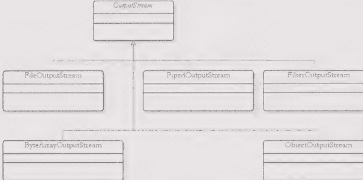

图 13.2：`OutputStream` 的实现类

本节讨论了两个实现类：`FileOutputStream` 和 `BufferedOutputStream`。`FileOutputStream` 提供了一种方便的文件方法，而 `BufferedOutputStream` 提供了更好的性能。`ObjectOutputStream` 类在对象序列化中起着重要作用，将在本章后面的“对象序列化”节中讨论。

### OutputStream

`OutputStream` 类定义了三个重载方法，这些是 `InputStream` 中读取方法的镜像：

```java
public void write(int b)
public void write(byte[] data)
public void write(byte[] data, int offset, int len)
```

第一个重载向 `OutputStream` 写入一个字节。第二个重载写入字节数组。第三个重载向此 `OutputStream` 写入长度指定的字节。此外，还有 `close` 和 `flush` 方法。`close` 关闭 `OutputStream`。`flush` 强制写入任何缓冲内容。我们将在下一节“FileOutputStream”中查看一个示例。

### FileOutputStream

`FileOutputStream` 类是 `OutputStream` 的子类，允许你向文件中顺序写入二进制数据。它的构造函数允许你传递 `File` 对象或文件路径。以下是这些构造函数。

```java
public FileOutputStream(String path)
public FileOutputStream(File file)
public FileOutputStream(String path, boolean append)
```

使用第一个和第二个构造函数，如果文件已存在，它将被覆盖。要追加现有文件，请向第三个构造函数传递 `true`。

```java
public static void main(String[] args) {
    FileInputStreamTest test = new FileInputStreamTest();
    try {
        test.compareFiles("c:\\line2.bmp", "c:\\line3.bmp");
        System.out.println("Copied Successfully");
    } catch (IOException e) {
    }
}
```

这部分 `copy` 方法完成了工作。

```java
byte[] readData = new byte[1024];
InputStream fis = new FileInputStream(originFile);
OutputStream fos = new FileOutputStream(destinationFile);
int i = fis.read(readData);

while (i != -1) {
    fos.write(readData, 0, i);
    i = fis.read(readData);
}

fis.close();
fos.close();
```


readData 数组用于存储从 `FileInputStream` 读取的数据。读取的字节数赋值给 `i`。代码随后调用 `FileOutputStream` 对象的 `write` 方法，传递字节数组和 `i` 作为第三个参数。

```
fos.write(readData, 0, i);
```

# BufferedOutputStream

为了获得更好的性能，你应该总是用 `BufferedOutputStream` 包装你的 `OutputStream`。`BufferedOutputStream` 有两个接受 `OutputStream` 的构造函数：

```
public BufferedOutputStream(OutputStream out)

public BufferedOutputStream(OutputStream out, int bufferSize)
```

# 写入文本（字符）

`Writer` 抽象类定义了一个写入字符的流。图 13.3 显示了 `Writer` 的实现类。

`OutputStream` 促进使用指定的字符集将字符转换为字节流。字符集保证了你写入此 `OutputStream` 的任何 Unicode 字符都将转换为正确的字节表示。`FileWriter` 是 `OutputStreamWriter` 的子类，提供了一种方便的文件写入字符的方法。`FileWriter` 并不是没有缺陷。使用 `FileWriter` 时，你被迫使用计算机的编码输出字符，这意味着超出当前的字符集将无法正确转换为字节。`FileWriter` 的更好替代方案是 `PrintWriter`。

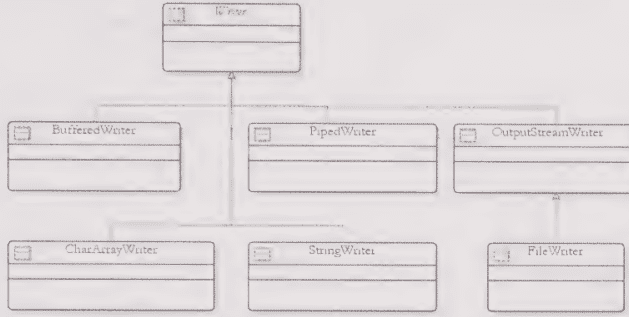

## 图 13.3：Writer 的子类

本节讨论了 `BufferedWriter` 类，它对写入该 `Writer` 的字符进行缓冲以提高性能。

### Writer

该类与 `OutputStream` 类似，但 `Writer` 处理的是字符而不是字节。像 `OutputStream` 一样，`Writer` 有三个重载方法：

```
public void write(int b)

public void write(char[] text)

public void write(char[] text, int offset, int length)
```

然而，在处理文本或字符时通常使用字符串。因此，`write` 方法还有两个接受 `String` 对象的重载。

```
public void write(String text)

public void write(String text, int offset, int length)
```

最后一个方法重载允许你传递一个 `String` 并将字符串的部分内容写入该 `Writer`。

在接下来的章节中，你将学习使用 `Writer` 的几种实现。

### OutputStreamWriter

`OutputStreamWriter` 是字符流到字节流的桥梁：写入 `OutputStreamWriter` 的字符将使用指定的字符集编码为字节。后者是 `OutputStreamWriter` 的一个重要元素，因为它能够将 Unicode 字符正确翻译为字节表示。

## Note

`System.getProperty("file.encoding")` 方法返回你电脑的默认编码。

`OutputStreamWriter` 类有四个构造函数：

```
public OutputStreamWriter(OutputStream out)
```

## Java for Android

```
public OutputStreamWriter(OutputStream out,
    java.nio.charset.Charset cs)

public OutputStreamWriter(OutputStream out,
    java.nio.charset.CharsetEncoder enc)

public OutputStreamWriter(OutputStream out, String encoding)
```

所有的构造函数都接受一个 `OutputStream`，由于字符转换到该 `OutputStreamWriter` 后，产生的字节将写入该 `OutputStream`。因此，如果你想写入文件，可以向构造函数传递一个 `FileOutputStream`。

第一个构造函数会创建一个使用默认编码的实例，而其他构造函数允许你传递在将字符转换为流字节时将使用的编码。`OutputStreamWriter` 类增加了 `getEncoding` 方法，该方法返回在该 `OutputStreamWriter` 中使用的编码名称（`String` 类型）。

`java.nio.charset.Charset` 类是第二个构造函数的参数，书中未进行讨论，因此我将展示一个使用最后一个构造函数的示例。该示例位于列表 13.3。

## 列表 13.3：使用 OutputStreamWriter

```
package app1;

import java.io.File;
import java.io.FileOutputStream;
import java.io.IOException;
import java.io.OutputStreamWriter;

public class OutputStreamWriterTest {

    public static void main(String[] args) {

        try {

            char[] chars = new char[2];

            chars[0] = '\u4F60'; // 代表 你

            chars[1] = '\u597D'; // 代表 好

            String encoding = "GB18030";

            File textFile = new File("C:\\temp\\myfile.txt");

            OutputStreamWriter writer = new OutputStreamWriter(new FileOutputStream(textFile), encoding);

            writer.write(chars);

            writer.close();

        } catch (IOException e) {

            System.out.println(e.toString());

        }

    }

}
```


列表 13.3 中的代码根据 `FileOutputStream` 创建了一个 `OutputStreamWriter`，它在 Windows 上会写入 `C:\temp\myfile.txt`。因此，如果你使用的是 Linux/Unix，则需要更改 `filetxt` 的值。使用绝对路径要容易得多，因为读者如果想打开文件，更容易找到。`OutputStreamWriter` 使用 `GB18030` 编码，这是中国政府要求所有软件供应商在应用程序使用的编码。该编码定义了简体中文的字符集。

始终将你的 `Writer` 包装在 `BufferedWriter` 中。`BufferedWriter` 具有以下允许传递 `Writer` 对象的构造函数：

```
```


# BufferedWriter

## 构造函数

- `BufferedWriter(Writer writer)`
- `BufferedWriter(Writer writer, int bufferSize)`

因此，如果你正在使用 `FileWriter`，你将获得更好的性能。

如果你用 `BufferedWriter` 封装它：

```java
FileWriter fw = new FileWriter(aFile);
BufferedWriter bw = new BufferedWriter(fw);
```

在使用 `PrintWriter` 时（当你需要向流输出字符时，你会经常使用它），你不能以类似的方式包装它，因为：

```java
PrintWriter pw = new PrintWriter(aFile);
BufferedWriter bw = new BufferedWriter(pw);
```

因为这样你将无法使用 `PrintWriter` 的方法。相反，应该包装传递给 `PrintWriter` 的 `Writer`。

```java
FileWriter fw = new FileWriter(aFile);
PrintWriter pw = new PrintWriter(new BufferedWriter(fw));
```

# 读取文本（字符）

你使用 `Reader` 类来读取文本（字符，即人类可读的数据）。该类的层次结构如图 13.4 所示。

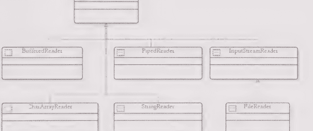

图 13.4：Reader 及其子类

本节讨论了 `Reader` 的几个子类。

> **注意事项**
> `Reader` 两个更流行的实现类是 `InputStreamReader` 和 `BufferedReader`。

## Reader

`Reader` 是一个抽象类，表示用于读取字符的输入流。它与 `InputStream` 类似，不同之处在于 `Reader` 处理的是字符而不是字节。`Reader` 类有三个 `read` 重载方法，与 `InputStream` 中的 `read` 方法相似：

```java
public int read()
public int read(char[] data)
public int read(char[] data, int offset, int length)
```

这些方法重载允许你读取单个字符或存储在 char 数组中的多个字符。此外，`Reader` 还有一个第四个 `read` 方法，允许你将字符读取到 `java.nio.Buffer` 中。

```java
public int read(java.nio.CharBuffer target)
```

此外，`Reader` 提供了与 `InputStream` 相似的方法：`close`、`mark`、`reset` 和 `skip`。

## InputStreamReader

`InputStreamReader` 使用指定的字符集读取并翻译成字符。因此，`InputStreamReader` 非常适合从 `OutputStreamWriter` 或 `PrintWriter` 的输出中读取。关键在于你必须知道写入字符时使用的编码，以便正确地读回。

`InputStreamReader` 类有四个构造函数，它们都要求你传递一个 `InputStream`。

```java
public InputStreamReader(InputStream in)
public InputStreamReader(InputStream in, java.nio.charset.Charset cs)
public InputStreamReader(InputStream in, java.nio.charset.CharsetDecoder dec)
public InputStreamReader(InputStream in, String charsetName)
```

例如，要创建一个从文件读取的 `InputStreamReader`，可以向其构造函数传递 `FileInputStream`。

```java
InputStreamReader reader = new InputStreamReader(
    new FileInputStream(filePath), charset);
```

### 列表 13.5：使用 InputStreamReader

```java
package app3;

import java.io.File;
import java.io.FileInputStream;
import java.io.IOException;
import java.io.InputStreamReader;
import java.io.PrintWriter;

public class InputStreamReaderTest {

    public static void main(String[] args) {
        try {
            char[] chars = new char[2];
            chars[0] = '\u4F60'; // 代表 你
            chars[1] = '\u597D'; // 代表 好

            String encoding = "GB18030";
            File textFile = new File("C:\\temp\\myfile.txt");

            PrintWriter writer = new PrintWriter(textFile, encoding);
            writer.write(chars);
            writer.close();

            // 读回
            InputStreamReader reader = new InputStreamReader(
                new FileInputStream(textFile), encoding);

            char[] chars2 = new char[2];
            reader.read(chars2);

            System.out.print(chars2[0]);
            System.out.print(chars2[1]);
            reader.close();
        } catch (IOException e) {
            System.out.print(e.toString());
        }
    }
}
```

## FileReader

`FileReader` 是 `InputStreamReader` 的子类，是一个从文件中读取字符的方便类。然而，像 `FileWriter` 一样，它缺乏使用默认之外编码的能力。如果写入文件时使用的编码与计算机当前的编码不同，`FileReader` 将无法正确读取字符。

要构造一个 `FileReader` 对象，请使用以下构造函数之一。

```java
public FileReader(File file)
public FileReader(FileInputStream fileDescriptor)
public FileReader(String filePath)
```

## BufferedReader

`BufferedReader` 有两个主要的用处：

1. 封装另一个 `Reader` 并提供一个缓冲区，这通常会提高性能。
2. 提供一个 `readLine` 方法来读取一行文本。

`readLine` 方法的签名如下：

```java
public java.lang.String readLine() throws IOException
```

它从 `Reader` 返回一行文本，或者在到达流末尾时返回 `null`。

使用 `BufferedReader` 非常简单。例如，以下代码封装了一个使用特定编码的 `InputStreamReader`（它本身也是一个 reader）。

```java
InputStreamReader input = new InputStreamReader(new FileInputStream(file), encoding);
BufferedReader reader = new BufferedReader(input);
```

结果生成的 `BufferedReader` 仍然支持底层 `InputStreamReader` 的编码，但同时它提供了缓冲功能并提供了 `readLine` 方法。

另一个例子是，这段代码读取文件并按行显示。

```java
FileReader fr = new FileReader(aFile);
BufferedReader br = new BufferedReader(fr);
String line = br.readLine();
while (line != null) {
    System.out.println(line);
}
```

> **注意事项**
> 你可以使用 `setIn` 和 `setErr` 方法替换 `System` 对象中的 `in` 和 `out`。

## RandomAccessFile

使用流访问文件意味着必须按顺序访问文件，例如必须在读取第二个字符之前读取第一个字符。当数据按顺序出现时，流是理想的，例如如果介质是磁带（很久以前还没有发明磁盘）或网络套接字。流对于大多数应用程序都是很好的，有时你需要随机访问文件，使用流的速度可能不够快。例如，你可能想更改文件的第 1000 个字节，而不需要读取前 999 个字节。对于这种随机访问，`RandomAccessFile` 是理想的选择。

`RandomAccessFile` 继承自 `java.lang.Object`，并可以执行读写操作。当使用 `RandomAccessFile` 打开文件时，你可以选择只读或读写打开。`RandomAccessFile` 具有以下模式之一：

- `"r"`：只读打开。
- `"rw"`：读写。
- `"rws"`：读写，要求对文件内容和元数据的每次更新都同步写入。
- `"rwd"`：读写，要求对文件内容的每次更新（但不包括元数据）同步写入。

`RandomAccessFile` 采用一个内部指针指向下一个要读取的字节。在首次创建时，`RandomAccessFile` 指向第一个字节。你可以通过调用 `seek` 方法更改指针的位置。其签名如下。

```java
public void seek(long position) throws IOException
```


# 190 Android 版 Java

此指针是从 0 开始索引的，这意味着第一个字节由索引 0 表示。你可以传递大于文件大小的数字而不会抛出异常，但这不会改变文件的大小。

除了 `seek` 之外，`skipBytes` 方法按指定的字节数移动指针。以下是它的签名：

```java
public int skipBytes(int offset)
```

如果跳过 `offset` 时将越过文件末尾，内部指针将移动到文件末尾。`skipBytes` 方法返回实际跳过的字节数。

为了从文件中读取，`RandomAccessFile` 提供了许多方法来读取不同数据类型：

```java
public boolean readBoolean() throws IOException
public byte readByte() throws IOException
public char readChar() throws IOException
public double readDouble() throws IOException
public int readInt() throws IOException
public long readLong() throws IOException
public short readShort() throws IOException
```

此外，`RandomAccessFile` 还可以像 `Reader` 一样工作，因为它提供了 `readLine` 方法读取一行文本：

```java
public String readLine()
```

为了更快的读取，`RandomAccessFile` 提供了 `readFully` 重载方法，将数据读取到字节数组：

```java
public void readFully(byte[] data)
public void readFully(byte[] data, int offset, int length)
```

对于写入，`RandomAccessFile` 提供了与读取方法对应的方法，如 `writeBoolean`、`writeByte` 等。有两种写入方法可以覆盖字节数组的内容：

```java
public void write(byte[] data)
public void write(byte[] data, int offset, int length)
```

`RandomAccessFile` 适用于随机访问具有固定结构的文件。例如，你可以将 `RandomAccessFile` 作为一个简单的数据库来存储固定长度的数据元素。

例如，列表 13.8 中的代码使用 `RandomAccessFile` 存储 `int` 并修改了第三个 `int` 的值。一个 `int` 占用 4 个字节，第四个字节由索引 $(3-1) * 4$ 指向（3-1 是因为是从 0 开始索引的）。

### 列表 13.8：使用 RandomAccessFile

```java
package app1;

import java.io.IOException;
import java.io.RandomAccessFile;

public class RandomAccessFileTest {
    public static void main(String[] args) {
        RandomAccessFile raf = null;
        try {
            raf = new RandomAccessFile("test.dat", "rw");
            raf.writeInt(88);
            raf.writeInt(455);
            raf.writeInt(88);

            // 将第3个整数从 88 改为 99
            raf.seek((3 - 1) * 4);
            raf.writeInt(99);

            raf.seek(0); // 跳到第一个整数
            int i = raf.readInt();
            while (i != -1) {
                System.out.println(i);
                i = raf.readInt();
            }
            raf.close();
        } catch (IOException e) {
            e.printStackTrace();
        }
    }
}
```

# 对象序列化

你有时需要内存中的对象持久化到永久存储中，这样对象的状态就可以保留并在以后检索。Java 通过对象序列化支持这一点。要序列化对象（即将对象保存到永久存储），请使用 `ObjectOutputStream`。要反序列化对象（即检索保存的对象），使用 `ObjectInputStream`。`ObjectOutputStream` 是 `OutputStream` 的子类，`ObjectInputStream` 派生自 `InputStream`。

`ObjectOutputStream` 类有一个构造函数：`public ObjectOutputStream(OutputStream out)`。要将对象序列化到文件，你可以向构造函数传递一个 `FileOutputStream`。一旦拥有了 `ObjectOutputStream`，你就可以序列化对象、基本类型或两者的组合。`ObjectOutputStream` 类为每个单独类型提供了 `writeXXX` 方法，其中 XXX 表示类型。以下是 `writeXXX` 方法的列表：

- `public void writeBoolean(boolean value)`
- `public void writeByte(int value)`
- `public void writeBytes(String value)`
- `public void writeChar(int value)`
- `public void writeChars(String value)`
- `public void writeDouble(double value)`
- `public void writeFloat(float value)`
- `public void writeInt(int value)`
- `public void writeLong(long value)`
- `public void writeShort(short value)`
- `public void writeObject(java.lang.Object value)`

为了使对象可序列化，它们必须实现 `java.io.Serializable` 接口。该接口没有方法，是一个标记接口。它告诉 JVM 该实例属于某种类型。

# 192 Android 版 Java

如果序列化对象包含其他对象，则包含对象的类也必须实现 `Serializable` 才能被序列化。

`ObjectInputStream` 类有一个公共构造函数：`public ObjectInputStream(InputStream in)`。因此，要从文件反序列化，你可以传递 `FileInputStream` 给构造函数。`ObjectInputStream` 类的方法与 `ObjectOutputStream` 中的 `writeXXX` 方法相反。它们如下：

```java
public boolean readBoolean()
public byte readByte()
public char readChar()
public double readDouble()
public float readFloat()
public int readInt()
public long readLong()
public short readShort()
public java.lang.Object readObject()
```

一个重要的点：对象序列化基于后进先出。反序列化多个基本类型/对象时，先序列化的对象必须最后反序列化。

列表 13.9 显示了一个序列化 `int` 和 `Customer` 对象的类。注意列表 13.9 给出的 `Customer` 类实现了 `Serializable`。

### 列表 13.9：Customer 类

```java
package app3;

import java.io.Serializable;

public class Customer implements Serializable {
    int id;
    String name;
    String address;

    public Customer(int id, String name, String address) {
        this.id = id;
        this.name = name;
        this.address = address;
    }
}
```

### 列表 13.10：序列化示例

```java
package app3;

import java.io.*;

public class SerializationTest {
    public static void main(String[] args) {
        try {
            FileOutputStream fos = new FileOutputStream("data.ser");
            ObjectOutputStream oos = new ObjectOutputStream(fos);
            oos.writeInt(88);
            oos.writeInt(455);
            Customer c = new Customer(1, "John", "New York");
            oos.writeObject(c);
            oos.close();

            FileInputStream fis = new FileInputStream("data.ser");
            ObjectInputStream ois = new ObjectInputStream(fis);
            int i = ois.readInt();
            System.out.println(i);
            i = ois.readInt();
            System.out.println(i);
            Customer c2 = (Customer) ois.readObject();
            System.out.println(c2.id);
            System.out.println(c2.name);
            System.out.println(c2.address);
            ois.close();
        } catch (IOException | ClassNotFoundException e) {
            e.printStackTrace();
        }
    }
}
```

### 输出

```
88
455
1
John
New York
```

## 总结

输入输出操作通过 `java.io` 包支持。你可以读取和写入二进制数据和文本流。此外，Java 通过 `Serializable` 接口以及 `ObjectInputStream` 和 `ObjectOutputStream` 类支持对象序列化。

## 问题

- 什么是流？
- 列出 `java.io` 包中表示流四个抽象类。
- 什么是对象序列化？
- 类可序列化的要求是什么？

---

# 第 14 章：嵌套类和内部类

嵌套类和内部类通常被认为对初学者来说太复杂了。然而，它们具有某些优点，值得讨论。例如，你可以使用嵌套类完全隐藏实现，而且它为编写事件监听器提供了一种更短的方法。

嵌套类和内部类有时看起来过于复杂的原因之一是，“嵌套类”和“内部类”这些术语在不同的文本通常指不同的意思。本书将遵循《Java 语言规范第三版》中的定义，这是来自 Sun Microsystems 的正式规范。

本章从定义嵌套类和内部类开始，并继续解释嵌套类的类型。

### 嵌套类概述

让我们从学习嵌套类和内部类的正确定义开始。嵌套类是声明在另一个类或接口体内部的类。嵌套类有两种类型：静态和非静态。非静态嵌套类被称为内部类。

内部类有几种类型：

- 成员内部类
- 局部内部类
- 匿名内部类

“顶层类”一词用于指代未在另一个类或接口内部定义的类。换句话说，没有类封装了顶层类。

嵌套类的行为非常像普通的（顶层）类。嵌套类可以扩展另一个类、实现接口、成为子类的父类等。这里是一个名为 `Nested` 的简单嵌套类的示例，它定义在名为 `Outer` 的顶层类内部。

```java
public class Outer {
    class Nested {
    }
}
```

而且，虽然不常见，但在另一个嵌套类内部嵌套嵌套类也是可能的，例如：

```java
public class Outer {
    class Nested {
        class Nested2 {
        }
    }
}
```

对于顶层类来说，嵌套类就像其他的类成员，例如方法和字段。例如，一个嵌套类可以使用四种访问修饰符之一：`private`、`protected`、`default`（包级）和 `public`。这与只能有 `public` 或 `default` 权限的顶层类不同。

由于嵌套类是外部类的成员，静态嵌套类的行为与内部类的行为并不完全相同。以下是一些区别：

- 静态嵌套类可以拥有静态成员，而内部类不能。
- 像实例方法一样，内部类可以访问外部类的静态成员和非静态成员，包括其私有成员。静态嵌套类只能访问外部类的静态成员。
- 你可以在不先创建外部类实例的情况下创建静态嵌套类的实例。相比之下，在实例化内部类实例之前，你必须先创建一个包含该内部类的外部类实例。

这些是内部类的优势：

1. 内部类可以访问外部类的所有成员（包括私有成员）。
2. 内部类可以帮助你完全隐藏一个类的实现。
3. 内部类为在 Swing 和其他基于事件的应用程序中编写监听器提供了一种更短的方法。

现在，让我们回顾每种类型的静态类。

### 静态嵌套类

可以在不创建外部类实例的情况下创建静态嵌套类。列表 14.1 显示了这一点。

#### 列表 14.1：一个静态嵌套类

```java
package app14;

class Outer {
    private static int value = 9;
    static class Nested1 {
        int calculate() {
            return value;
        }
    }
}

public class StaticNestedTest {
    public static void main(String[] args) {
        Outer.Nested1 nested = new Outer.Nested1();
        System.out.println(nested.calculate());
    }
}
```

关于静态嵌套类有几点需要注意：

- 你通过以下格式来引用嵌套类：`OuterClassName.InnerClassName`
- 你不需要创建外部类的实例来实例化静态嵌套类。
- 你可以在静态嵌套类内部访问外部类的静态成员。

此外，如果你在嵌套类中声明了一个与外部类成员同名的成员，前者将遮蔽后者。但是，你始终可以使用以下格式引用外部类中的成员：`OuterClassName.memberName`

注意，尽管 `value` 是私有的，这仍然有效。请检查列表 14.2 中的示例。

#### 列表 14.2：遮蔽外部类的成员

```java
package app14;

class Outer2 {
    private static int value = 9;
    static class Nested2 {
        int value = 10;
        int calculate() {
            return value;
        }
        int getOuterValue() {
            return Outer2.value;
        }
    }
}

public class StaticNestedTest {
    public static void main(String[] args) {
        Outer2.Nested2 nested = new Outer2.Nested2();
        System.out.println(nested.calculate()); // 返回 10
        System.out.println(nested.getOuterValue()); // 返回 9
    }
}
```

### 成员内部类


# 第 14 章：嵌套类与内部类

## 成员内部类

成员内部类是指定义直接被另一个类或接口声明包围的类。只有当你拥有外部类实例的引用时，才能创建成员内部类的实例。要从外部类内部创建内部类的实例，你可以调用内部类的构造函数，就像调用其他类一样。然而，要从外部类的外部创建内部类的实例，你需要使用以下语法：

```java
EnclosingClassName.InnerClassName inner = enclosingClassObjectReference.new InnerClassName();
```

像往常一样，在内部类内部，你可以使用关键字 `this` 来引用当前实例（内部类的实例）。要引用外部类的实例，你使用 `EnclosingClass.this` 语法。

`EnclosingClass.this` 显示了你如何创建内部类的实例。

### 列表 14.3：一个成员内部类

```java
package app1;
class TopLevel {
    private int value = 9;
    class Inner {
        int calculate() {
            return value;
        }
    }
}
public class MemberInnerTest {
    public static void main(String[] args) {
        TopLevel topLeft = new TopLevel();
        TopLevel.Inner inner = topLeft.new Inner();
        System.out.println(inner.calculate());
    }
}
```

注意你在列表 14.3 中是如何创建内部类实例的吗？

成员内部类可用于完全隐藏实现，这在不使用内部类的情况下是无法实现的。下面的示例显示了你如何使用成员类来完全隐藏实现。

### 列表 14.4：完全隐藏实现 app1

```java
package app1;
interface Printer {
    void print(String message);
}
class PrinterImpl implements Printer {
    public void print(String message) {
        System.out.println(message);
    }
}
class SecretPrinterImpl {
    private class Inner implements Printer {
        public void print(String message) {
            System.out.println(message);
        }
    }
}
public class MemberInnerTest {
    public static void main(String[] args) {
        SecretPrinterImpl spi = new SecretPrinterImpl();
        // 注意：此处原文代码逻辑有误，翻译未修正逻辑错误
    }
}
```

## 局部内部类

内部类（或称为局部类）是指定义在方法或代码块内部的类。局部类仅在定义所在的作用域内可见。它们没有名称，因此无法在该作用域之外使用。

### 列表 14.5：本地类

```java
package app1;
import java.util.Date;

interface Logger {
  void log(String message);
}

class LocalClassTest {
  private String startTime = new Date().toString();

  public Logger getLogger() {
    class LoggerImpl implements Logger {
      public void log(String message) {
        System.out.println(startTime + " : " + message);
      }
    }
    return new LoggerImpl();
  }

  public static void main(String[] args) {
    LocalClassTest test = new LocalClassTest();
    Logger logger = test.getLogger();
    logger.log("Local class example");
  }
}
```

列表 14.5 中的类有一个位于 `getLogger` 方法内部的 `LoggerImpl`。`getLogger` 方法必须返回一个接口实现，而该实现并没有被使用。因此，在 `getLogger` 内部创建一个实现是个好主意。注意，局部类中的 `log` 方法可以访问外部类的实例字段 `startTime`。

然而，当你访问局部变量时存在陷阱。你只能访问 `final` 局部变量。如果你尝试访问非 `final` 的局部变量，编译器将生成编译错误。

列表 14.6 修改了列表 14.5 的代码。列表 14.6 中的 `getLogger` 方法允许你传递一个字符串，该字符串将成为每行日志的前缀。

### 列表 14.6：PrefixLogger test

```java
package app4;
import java.util.Date;

interface PrefixLogger {
  void log(String message);
}

public class LocalClassTest2 {
  private String startTime = new Date().toString();

  public PrefixLogger getLogger(final String prefix) {
    class LoggerImpl implements PrefixLogger {
      public void log(String message) {
        System.out.println(prefix + " : " + message);
      }
    }
    return new LoggerImpl();
  }

  public static void main(String[] args) {
    LocalClassTest2 test = new LocalClassTest2();
    PrefixLogger logger = test.getLogger("DEBUG");
    logger.log("Local class example");
  }
}
```

## 匿名内部类

匿名内部类没有名称。这种类型的嵌套类通常用于编写接口的实现。例如，列表 14.7 中的 `AnonymousInnerClassTest` 类创建了一个匿名内部类，该类是 `Printable` 的实现。

### 列表 14.7：使用匿名内部类

```java
interface Printable {
    void print(String message);
}

public class AnonymousInnerClassTest {
    public static void main(String[] args) {
        Printable printer = new Printable() {
            public void print(String message) {
                System.out.println(message);
            }
        }; // 这是一个分号
        printer.print("Beach Music");
    }
}
```

这里有趣的地方在于，你通过使用 `new` 关键字后跟着类似于类构造函数的内容（在本例中为 `Printable()`）来创建一个匿名内部类。但请注意 `Printable` 是一个接口，并没有构造函数。`Printable()` 之后是 `print` 方法的实现。此外，请注意在右括号之后，你使用一个分号来结束实例化匿名内部类的语句。

此外，你还可以通过扩展抽象类或具体类来创建匿名内部类，列表 14.8 中的代码所示。

### 列表 14.8：使用抽象类使用匿名内部类

```java
abstract class Printable {
    void print(String message);
}

public class AnonymousInnerClassTest {
    public static void main(String[] args) {
        Printable printer = new Printable() {
            public void print(String message) {
                System.out.println(message);
            }
        }; // 这是一个分号
        printer.print("Beach Music");
    }
}
```

> **注意**
>
> 匿名类经常用于 Swing 应用程序中。详细信息请参阅第 16 章“唱得更高”。

## 嵌套类与内部类的原理

JVM 并不理解嵌套类的概念。是编译器在努力将内部类编译成一个顶层类，并以外层类名和内部类名作为名称，两者之间用美元符号 `$` 隔开。也就是说，位于 `Outer` 内部的名为 `Inner` 的内部类的代码如下：

```java
public class Outer {
    class Inner {
    }
}
```

将被编译成两个类：`Outer.class` 和 `Outer$Inner.class`。

匿名内部类又是怎样的？对于匿名类，编译器会利用数字为它们生成一个名称。因此，你会看到类似 `Outer$1.class`、`Outer$2.class` 等内容。

当嵌套类被实例化时，该实例作为一个独立对象存在于堆中。它并不会实际存在于外层类对象内部。

然而，对于内部类，它们对所示的外层类对象有一个自动引用。这种引用在静态嵌套类的实例中不存在，因为静态嵌套类无法访问其外层类的实例成员。

内部类是如何获取其外层类对象的引用的？同样，这是因为编译器在编译内部类时更改了内部类的构造函数，即它为每个构造函数添加了一个参数。该参数的类型是外层类。

例如，像这样的构造函数：

```java
public Inner()
```

被改为：

```java
public Inner(Outer outer)
```

以及这个：

```java
public Inner(int value)
```

变为：

```java
public Inner(Outer outer, int value)
```

> **注意**
>
> 请记住编译器有权更改它所编译的代码。例如，如果一个类（顶层或嵌套类）没有构造函数，它会为其添加一个无参构造函数。

实例化内部类的代码也会被修改，编译器会在内部类构造函数中添加对外层类对象的引用。如果你写：

```java
Outer outer = new Outer();
Outer.Inner inner = outer.new Inner();
```

编译器会将其改为：

```java
Outer outer = new Outer();
Outer.Inner inner = outer.new Inner(outer);
```

当在外层类内部实例化内部类时，编译器会使用关键字 `this` 传递外层类对象的当前实例。

```java
// 在 Outer 类内部
Inner inner = new Inner();
```

变为：

```java
Inner inner = new Inner(this);
```

现在，这里是谜题的另一部分。嵌套类是如何访问其类的私有成员的？不允许任何对象访问另一个对象的私有成员。同样，编译器更改了你的代码，在外层类的定义中创建了一个访问该私有成员的方法。因此，

```java
class TopLevel {
    private int value = 9;
    class Inner {
        int calculate() {
            return value;
        }
    }
}
```

被改为两个这样的类：

```java
class TopLevel {
    private int value = 9;
    TopLevel() {
        // 编译器添加
    }
    
    static int access$0(TopLevel toplevel) {
        return toplevel.value;
    }

    class TopLevel$Inner {
        final TopLevel this$0;
        TopLevel$Inner(TopLevel toplevel) {
            this$0 = toplevel;
        }
        int calculate() {
            return access$0(this$0);
        }
    }
}
```

## 总结

嵌套类是类中的类。有四种嵌套类：

- 静态嵌套类
- 成员内部类
- 局部内部类
- 匿名内部类

使用嵌套类的优点包括在特定上下文中作为类的简短编写方式。

## 问题

1. 什么是嵌套类，什么是内部类？
2. 你可以用嵌套类做什么？
3. 什么是匿名类？

---

# 第 15 章 多态

对于初次接触面向对象编程（OOP）的人来说，多态是最难解释的概念。事实上，如果没有一两个例子，它的定义将毫无意义。好吧，尝试一下。这是许多编程书籍中的定义：多态是一种允许对象决定调用哪个方法实现的 OOP 特性。如果你觉得很难理解，你并不孤单。本章从一个应该清晰的简单示例开始，然后进入演示反射使用多态的示例。

> **注意**
>
> 在其他编程语言中，多态也称为后期绑定或动态绑定。

## 定义多态

在 Java 和其他 OOP 语言中，如果满足某些条件，可以将一个与其类型不同的对象赋值给引用变量。本质上，如果你有一个类型为 A 的引用变量 a，可以赋值一个 B 对象，如下：

```java
A a = new B();
```

只要满足以下条件之一：

- A 是一个类且 B 是 A 的子类。
- A 是一个接口且 B 或其父类实现了 A。

当你在上述代码中赋值 B 的实例时，a 的类型是 A。这意味着你不能调用 A 中未定义的方法。然而，如果你打印 `a.getClass().getName()` 的值，你将得到 "B" 而不是 "A"。所以，这意味着什么？在编译时，a 的类型是 A，因此编译器不允许你调用 A 中未定义的方法。另一方面，在运行时，a 的类型是 B，正如 `a.getClass().getName()` 的返回值所证明的那样。

现在，是多态的核心。如果 B 重写了一个方法（例如，名为 `play` 的方法），调用 `play` 将调用 B 中的 `play` 实现（而不是 A 中的）。多态允许对象（在本示例中，即由 a 引用的对象）在调用方法时决定选择哪个方法实现（是 A 中的还是 B 中的）。多态规定由运行时对象的实现被调用。

但是，多态并止于此。

如果你在一个方法中（假设是一个名为 `stop` 的方法）调用了一个方法，而该方法在 B 中没有实现怎么办？JVM 足够智能，能够感知并检查 B 的继承层次结构——假设 B 恰好是 A 的子类，或者 A 是一个接口，B 是实现 A 的另一个类的子类。否则，代码就不会报错。在确定这一点后，JVM 将沿着层级结构向上查找，并找到 `stop` 的实现。

现在，多态的辩护变得更有意义了：多态是一种面向对象编程（OOP）特性，允许对象在接收到方法调用时决定调用哪种方法实现。

从技术上来说，Java 实现了这一点吗？事实证明，编译器在遇到 `a.play()` 这样的方法调用时，会检查 `a` 所代表的类/接口是否定义了该方法（`play` 方法），以及传递给方法的参数 set 是否正确。但这就是编译器所能做的全部了。除了静态（`static`）和最终（`final`）方法外，它不会连接（或绑定）方法调用与方法体。JVM 在运行时决定如何将方法与方法体绑定。换句话说，对于非静态和非最终方法，Java 中的方法绑定发生在运行时，而不是编译时。编译时绑定是早期绑定（early binding），即绑定发生在编译时或链接时。早期绑定发生在 C 等语言中。

因此，多态是通过 Java 的晚期绑定（late binding）机制实现的。正因如此，多态常被不准确地称为后期绑定、动态绑定或运行时绑定。

让我们来看列表 15.1 中的 Java 代码。

### 列表 15.1: 多态的示例


```java
package app15;

class Employee {
    public void work() {
        System.out.println("I am an employee.");
    }
}

class Manager extends Employee {
    public void work() {
        System.out.println("I am a manager.");
    }

    public void manage() {
        System.out.println("Managing ...");
    }
}

public class PolymorphismTest {
    public static void main(String[] args) {
        Employee employee;
        employee = new Manager();
        System.out.println(employee.getClass().getName());
        employee.work();
        Manager manager = (Manager) employee;
        manager.manage();
    }
}
```

# 第 15 章：多态

列表 15.1 定义了两个非公共类：`Employee` 和 `Manager`。`Employee` 有一个名为 `work` 的方法，而 `Manager` 继承自 `Employee` 并增加了一个名为 `manage` 的新方法。

`PolymorphismTest` 类中的 `main` 方法定义了一个类型为 `Employee` 的对象变量 `employee`：

```java
Employee employee;
employee = new Manager();
```

然而，`employee` 被赋值了一个 `Manager` 的实例，如下：

```java
employee.work();
```
这是合法的，因为 `Manager` 是 `Employee` 的子类，所以一个 `Manager` “是一个” `Employee`。由于 `employee` 被赋值了一个 `Manager` 实例，`employee.getClass().getName()` 的结果是什么？你说得对。是“Manager”，而不是“Employee”。

然后，调用了 `work` 方法。

```java
employee.work();
```

猜猜看控制台上显示了什么？

I am a manager.

这意味着调用的是 `Manager` 类中的 `work` 方法，这就是多态的体现。

> **注意**：多态对静态方法不起作用，因为它们是早期绑定的。例如，如果 `Employee` 和 `Manager` 类中的 `work` 方法都是静态的，调用 `employee.work()` 将打印“I am an employee.”
>
> 此外，由于你无法扩展最终（`final`）方法，多态对最终方法不起作用。

现在，因为 `employee` 的运行时类型是 `Manager`，你可以像代码所示将 `employee` 强制转换为 `Manager`：

```java
Manager manager = (Manager) employee;
manager.work();
```

看到代码后，你可能会问，最初为什么要将 `employee` 声明为 `Employee`？为什么不将 `employee` 声明为 `Manager` 类型，例如：

```java
Manager employee;
employee = new Manager();
```

这样做是为了确保灵活性，即你不知道对象引用（`employee`）会被赋值为 `Manager` 还是其他实例。同样的原因，在你的编程生涯中，你会看到这样的列表：

```java
List list = new ArrayList();
```

然而，多态的力量在这里并不十分明显，因为你完全可以写成：

```java
Manager employee = new Manager();
或者
List list = new ArrayList();
```

你是对的。但我保证在看到接下来的示例后，你会承认多态是非常有用的。

# 208 Java for Android

### 多态与反射

多态通常与反射一起使用。考虑以下场景。

订单处理程序是一个处理购买订单的业务程序。它可以在各种数据库（Oracle、MySQL 等）中存储订单并检索订单进行显示。`Order` 类表示购买对象。订单存储在数据库中，`OrderAccessObject` 处理 `Order` 对象的存储和检索。

`OrderAccessClass` 作为应用程序与数据库之间的接口。所有的订单操作都通过该类的实例完成。`OrderAccessObject` 接口如列表 15.2 所示。

```java
// Listing 15.2: OrderAccessObject 接口
interface OrderAccessObject {
    void addOrder(Order order);
    Order getOrder(int orderId);
}
```

“Annotations.”（Java 7 增加了另一个 SafeVarargs，位于 `java.lang`）。此外，还有四种属于 `java.lang.annotation` 包的其它注解类型：`Documented`、`Inherited`、`Retention` 和 `Target`。这四种注解类型用于标记注解本身。Java 6 增加了常用注解，这些注解将在“常用注解”一节中进行解释。

### 注解语法

在你的代码中，你使用以下语法声明一个注解类型。

```
@interface AnnotationType
```

或者

```
@AnnotationType(elementValuePair)
```

第一种语法用于标记注解类型（marker annotation types），第二种用于单值类型和多值类型。在符号（`@`）和注解类型之间留留白格是合法的，但不建议这样做。

例如，这里是使用标记注解类型 `Deprecated` 的方法：

```
@Deprecated
```

并且，这是使用第二种语法使用多值注解类型 `Author` 的方法：

```
@Author(firstName="Ted", lastName="Diong")
```

该规则有一个例外。如果一个注解类型只有一个键值对，且键的名称为 `value`，那么你可以从括号中省略它。因此，如果虚构类型 `Stage` 有一个名为 `value` 的键，你可以写成

```
@Stage(value=1)
```

或者

```
@Stage(1)
```

### 注解接口

注解类型是一个 Java 接口。所有的注解类型都是 `java.lang.annotation.Annotation` 的子接口。它有一个方法 `annotationType`，返回一个 `java.lang.Class`。

```
java.lang.Class<? extends Annotation> annotationType()
```

此外，任何 `Annotation` 的实现都会重写 `java.lang.Object` 类的 `equals`、`hashCode` 和 `toString` 方法。以下是它们的默认实现。

```java
public boolean equals(Object object)
```

如果 `object` 是相同注解类型的实例，且 `object` 的所有成员都与此注解相应的成员相等，则返回 `true`。

```java
public int hashCode()
```

返回该注解的哈希值，它是其成员哈希值的和。

```java
public String toString()
```

返回该注解的字符串表示，通常列出该注解的键值对。

当你在本章稍后学习自定义注解类型时，将使用此类。

### 标准注解

注解是 Java 5 中的一项新功能，最初有三个标准注解，它们都在 `java.lang` 包中：`Override`、`Deprecated` 和 `SuppressWarnings`。它们将在本节中进行讨论。

### Override

`Override` 是一个标记注解类型，可以应用于方法，以告知编译器该方法重写了父类中的某个方法。此注解可以防止程序员在重写方法时犯错。

例如，考虑这个 `Parent` 类：

```java
class Parent {
    public float calculate(float a, float b) {
        return a * b;
    }
}
```

假设你想扩展 `Parent` 并重写它的 `calculate` 方法。这里是 `Parent` 的子类：

```java
class Child extends Parent {
    public int calculate(int a, int b) {
        return (a + 1) * b;
    }
}
```

`Child` 类编译通过。然而，`Child` 中的 `calculate` 方法并没有重写 `Parent` 中的方法，因为它的签名不同，即返回和接收的是 `int` 而不是 `float`。在这个示例中，当你同时看到 `Parent` 和 `Child` 类时，这种编程错误很容易发现。然而，你并不总是那么幸运。有时父类被隐藏在另一个包中。当客户端类调用 `Object` 的 `calculate` 方法并传递两个 `float` 时，这个看似错误的可能是致命的，因为 `Parent` 类中的方法将被调用并返回错误的结果。

使用 `Override` 注解可以防止这种错误。每当你想重写方法时，在方法之前声明 `Override` 注解类型：

```java
class Child extends Parent {
    @Override
    public int calculate(int a, int b) {
        return (a + 1) * b;
    }
}
```

这一次，编译器将生成一个编译错误并通知你 `Child` 中的 `calculate` 方法没有重写父类中的方法。

很显然，`@Override` 有助于确保程序员在想要重写方法时确实进行了重写，而不是重载（overload）。

### Deprecated

`Deprecated` 是一个标记注解类型，可以应用于方法或类型，以指示该方法或类型已过时。程序员标记过时的方法或类型是为了警告代码的用户，他们不应该使用或重写该方法或扩展该类型。方法或类型标记为过时的通常是因为有了更好的方法或类型，而过时的方法或类型在当前软件版本中为了向后兼容而保留。

例如，列表 16.1 中的 `DeprecatedTest` 类使用了 `Deprecated` 注解类型。

### 列表 16.1: 将方法标记为过时

```java
package app6;
public class DeprecatedTest {
    @Deprecated
    public void serve() {
}
```

如果你使用或重写过时的方法，你将在编译时获得一个警告。例如，列表 16.2 显示了一个 `DeprecatedTest2` 类，它使用了 `DeprecatedTest` 中的 `serve` 方法。

### 列表 16.2: 使用过时方法

```java
package app6;
public class DeprecatedTest2 {
    public static void main(String[] args) {
        DeprecatedTest test = new DeprecatedTest();
        test.serve();
    }
}
```

编译 `DeprecatedTest2` 会产生此警告：

> Note：app6/Deprecated2.java 使用或重写了过时的方法。
>
> Note：使用 -Xlint:deprecation 查看详情。

## Note

在第 16 章，你将学习如何通过 `@deprecated` 标签将方法标记为过时。此外，你可以使用 `@Deprecated` 标记类或接口，如列表 16.3 所示。

### 列表 16.3: 将类标记为过时

```java
package app6;
@Deprecated
public class DeprecatedTest {
    public void serve() {
}
```

### SuppressWarnings

`SuppressWarnings` 正如你猜测的，用于抑制警告。你可以将 `@SuppressWarnings` 应用于类型、构造函数、方法、字段、参数和局部变量。

你通过传递包含需要的警告的字符串数组来使用它。其语法如下：

`@SuppressWarnings(value={string-1, ..., string-n})`

其中 `string-i-n` 表示要抑制的警告。重复和无效警告将被忽略。

以下是 `@SuppressWarnings` 的有效参数：

- `unchecked`：获取强制转换警告的更详细信息。
- `path`：对不存在的路径（类路径、源路径等）目录发出警告。
- `serial`：对可序列化类缺少 `VersionUID` 定义发出警告。
- `finally`：对正常完成的 `finally` 子句发出警告。
- `fallthrough`：检查 switch 块是否存在穿透 case，即块中除最后一个 case 外的 case 代码没有包含 `break` 语句，允许代码执行从该 case “穿透”到下一个 case。例如，此 switch 块中 case 2 之后的代码没有包含 `break` 语句：

```java
switch (i) {
  case 1:
    System.out.println("1");
    break;
  case 2:
    System.out.println("2");
    // 穿透
  case 3:
    System.out.println("3");
}
```

例如，列表 16.4 中的 `SuppressWarningsTest` 类使用了 `SuppressWarnings` 注解类型来防止编译器发布未检查和穿透警告。

### 列表 16.4: 使用 @SuppressWarnings

```java
package app16;
import java.io.File;
import java.io.Serializable;
import java.util.ArrayList;

@SuppressWarnings(value={"unchecked", "serial"})
public class SuppressWarningsTest implements Serializable {
  public void openFile() {
    ArrayList list = new ArrayList();
    File file = new File("X:/java/doc.txt");
  }
}
```

### 常用注解

Java 实现了 JSR 250，“Java 平台通用注解”，它为常见概念指定了注解。该 JSR 的目标是避免不同的 Java 技术定义相似的注解，导致重复。

常用注解的完整列表可以在从 http://jcp.org/en/jsr/detail?id=250 下载的文档中找到。

除了 `@Generated` 之外，遗憾的是，所有指定的注解都是高级材料或适用于 Java EE，因此超出了本书的论述范围。正因如此，书中讨论的唯一常用注解是 `@Generated`。

`@Generated` 用于标记计算机源代码，而不是手写代码。它可以应用于类、方法和字段。以下是 `@Generated` 的参数：

- `value`：代码生成器的名称。惯例是使用生成器的全限定名。
- `date`：代码生成的日期。它必须符合 ISO 8601 标准的格式。
- `comments`：伴随生成代码的注释。

例如，在代码列表 16.5 中，`@Generated` 被用于注释生成的代码。

## 代码列表 16.5: 使用 @Generated

```java
package app1;
import java.annotation.Generated;

@Generated(value="com.brainsoftware.robot.CodeGenerator",
    date="2011-12-31", comments="Generated code")
public class GeneratedTest {

}
```

### 标准元注解

元注解是用于注解注解的注解。有四种元注解类型可以用于注解注解：`Documented`（文档化）、`Inherited`（继承）、`Retention`（保留）和 `Target`（目标）。这四种注解都是 `java.lang.annotation` 包的一部分。本节将讨论这些注解类型。

### Documented

`Documented` 是一个标记注解，用于注释注解类型的声明，以便该注解类型的实例能够包含在使用 Javadoc 或类似工具生成的文档中。

例如，`Override` 注解类型没有被标记为 `Documented`。因此，如果你使用 Javadoc 注释一个方法被标记了 `@Override` 的类，那么在生成的文档中你将无法看到 `@Override` 的任何痕迹。

例如，代码列表 16.6 显示了一个 `Override2` 类，它使用 `@Override` 来注释 `toString` 方法。

## 代码列表 16.6: Override2 类


package app1;
public class OverrideTest2 {
    @Override
    public String toString() {
        return "OverrideTest2";
    }
}

另一方面，`Deprecated` 注解类型被标记了 `@Documented`。回想代码列表 16.2 中 `DeprecatedTest` 类中的 `serve` 方法被标记了 `@Deprecated`。现在，如果你使用 Javadoc 为 `OverrideTest2` 生成文档（Javadoc 在第 28 节“Javadoc”中讨论），文档中 `serve` 方法的细节也将包含 `@Deprecated`，如下：

```
serve
@Deprecated
public void serve()
```

### Inherited

你使用 `Inherited` 来注解一个注解类型，使得该注解类型的任何实例都能被继承。如果你使用一个继承的注解类型注释一个类，那么该注解将被被注释类的任何子类继承。如果用户在类声明上查询该注解类型，而该类声明没有此类型的注解，则会自动查询该类的父类以获取该注解类型。此过程将重复，直到找到该类型的注解或到达根类为止。

请查看“自定义注解类型”部分了解如何查询注解类型。

### Retention

`@Retention` 指明被注解的类型被保留多久。`@Retention` 的值可以是 `java.lang.annotation.RetentionPolicy` 枚举的成员之一：

- `SOURCE`。注解将被 Java 编译器丢弃。
- `CLASS`。注解将被记录在类文件中，但不会被 JVM 保留。这是默认值。
- `RUNTIME`。注解将被 JVM 保留，以便通过反射进行查询。

例如，`Suppress` 注解类型的声明被标记为 `@Retention`，其值为 `SOURCE`。

```java
@Retention(value=SOURCE)
public @interface SuppWarnings
```

### Target

`Target` 指明哪些程序元素可以被注解。`Target` 的值是 `java.lang.annotation.ElementType` 枚举的成员之一：

- `ANNOTATION_TYPE`。注释注解类型。
- `CONSTRUCTOR`。注释构造函数。
- `FIELD`。注释字段。
- `LOCAL_VARIABLE`。注释局部变量。
- `METHOD`。注释方法。
- `PACKAGE`。注释包。
- `PARAMETER`。注释参数。
- `TYPE`。注释类型。

`Target` 指明哪些程序元素可以被注解。例如，`Override` 注解类型标记了 `Target`，使其适用于方法。

```java
@Target(value=METHOD)
```

`Target` 可以有多个值，例如，`Suppress` 注解如下：

```java
@Target({TYPE, FIELD, METHOD, LOCAL_VARIABLE, CONSTRUCTOR})
```

注解类型必须隐式或显式地继承 `java.lang.annotation.Annotation` 接口。

```java
public @interface CustomAnnotation {
}
```

默认情况下，所有注解类型都继承 `Annotation` 接口。此外，即使你注解一个注解类型，它也被视为注解类型。

### 定义自定义注解类型

代码列表 16.7 显示了一个名为 `Author` 的自定义注解。

## 代码列表 16.7: Author 注解

```java
package app1.custom;
import java.lang.annotation.Documented;
import java.lang.annotation.Retention;
import java.lang.annotation.RetentionPolicy;

@Documented
@Retention(RetentionPolicy.RUNTIME)
public @interface Author {
  String firstName();
  String lastName();
  boolean internalEmployee();
}
```

就像其他 Java 类型一样。例如，代码列表 16.8 中的 `Test` 类标记了 `Author`。

## 代码列表 16.8: 标记了 Author 的类

```java
package app1.custom;
@Author(firstName="John",lastName="Gudell",internalEmployee=false)
public class Test {
}
```

这就了吗？很简单。

下一小节“通过反射查询注解”展示了如何有效使用注解。

## 通过反射查询注解

`java.lang.Annotation` 类有几个与注解相关的方法。

```java
public <A extends java.lang.annotation.Annotation> A getAnnotation(Class<A> annotationClass)
如果存在，则返回指定的注解元素；否则返回 null。
```

```java
public java.lang.annotation.Annotation[] getAnnotations()
返回此类上的所有注解。
public boolean isAnnotation()
如果此类是注解类型，则返回 true。
```

```java
public boolean isAnnotationPresent(Class<? extends java.lang.annotation.Annotation> annotationClass)
指示此类是否存在指定类型的注解
```

`app16.custom` 包包含了三个测试类 `Test1`、`Test2` 和 `Test3`，它们都标记了 `Author`。代码列表 16.9 展示了一个利用反射查询这些测试类的类。

## 代码列表 16.9: 使用反射查询注解

```java
package app16.custom;
public class CustomAnnotationTest {
  public static void printClassInfo(Class c) {
    System.out.println(c.getName() + " \ ");
    Author author = (Author) c.getAnnotation(Author.class);
    if (author != null) {
      System.out.println("Author " + author.firstName() + " " + author.lastName());
    } else {
      System.out.println("Author unknown");
    }
  }

  public static void main(String[] args) {
    CustomAnnotationTest.printClassInfo(Test1.class);
    CustomAnnotationTest.printClassInfo(Test2.class);
    CustomAnnotationTest.printClassInfo(Test3.class);
    CustomAnnotationTest.printClassInfo(CustomAnnotationTest.class);
  }
}
```

```
运行后，你将在控制台中看到以下消息：
appl16.custom.Test1. Author:John Guddell
appl16.custom.Test2. Author:John Guddell
appl16.custom.Test3. Author:Lesley Nielsen
appl16.custom.CustomAnnotationTest. Author unknown
```

## 总结

你使用注解（annotations）来指示 Java 编译器对被注解的程序元素执行某些操作。任何程序元素都可以注解，包括 Java 包、类、构造函数、字段、方法、参数和局部变量。本章解释了标准的注解类型，并教授了如何创建自定义的注解类型。

## 问题

- 1. 什么是注解类型？
- 2. 什么是元注解（meta-annotation）？
- 3. Java 5 中最初包含哪些标准注解类型？

# 第 17 章：国际化

在当全球化时代，编写能够部署在不同语言的不同国家和地区的应用程序比以往任何时候都更加重要。在这方面，你需要熟悉两个术语。第一个是国际化（Internationalization），通常缩写为 i18n，因为该单词以 i 开头，以 n 结尾，第一个 i 和最后一个 n 之间有 18 个字符。国际化是开发支持多种语言和数据格式而无需重写编程逻辑应用程序的技术。第二个术语是本地化（localization），它是将国际化应用程序适配以支持特定区域（locale）的技术。区域是指一个特定的地理、政治或文化区域。接受区域的操作被认为是区域感敏的（locale-sensitive），因为日期必须采用用户所在国家或地区使用的格式。2010 年 11 月 15 日在美国被写为 11/15/2011，但在澳大利亚打印为 15/11/2011。出于同样的原因，国际化缩写为 i18n，本地化缩写为 l10n。

Java 设计时考虑了国际化，采用 Unicode 处理字符和字符串。因此，在 Java 中制作国际化应用程序非常容易。如何本地化应用程序取决于需要在不同语言中存在多少静态数据。有两种方法：

1. 如果大量数据是静态的，为每个区域创建一个资源资源。这种方法通常适用于具有大量静态 HTML 页面的 Web 应用程序。它非常直观，本章将不讨论。
2. 如果需要国际化的静态数据量有限，将文本元素（如组件标签和错误消息）隔离到文本文件中。每个文本文件存储该区域所有文本元素的翻译。应用程序随后动态检索每个元素。其优点是显而易见的：无需重新编译应用程序即可编辑每个文本元素。这正是本章将讨论的技术。

本章从解释什么是区域开始，随后介绍了国际化应用程序的技术。

### 区域 (Locales)

`java.util.Locale` 类表示一个区域。`Locale` 对象有三个主要部分：语言（language）、国家（country）和变体（variant）。语言显然是最重要的部分；然而，有时语言本身不足以区分一个区域。例如，英语在美国和英国等国被使用。但是，在美国使用的英语与在英国使用的英语并不完全相同。因此，有必要指定语言的国家。另一个例子是在中国使用的中文与特定厂商或浏览器代码并不完全相同。例如，你


变体参数用于 Windows，MAC 用于 Macintosh，POSIX 用于 POSIX。在某些 POSIX 处我们使用 WIN。如果有两个变体，用下划线分隔它们，并将最重要的放在前面。例如，一个传统的西班牙语排序规则可能会使用语言、国家和变体参数构造一个区域，分别为 `es`、`ES`、`Traditional_WIN`。

要构造一个 `Locale` 对象，请使用 `Locale` 类的构造函数。

```java
public Locale(java.lang.String language, java.lang.String country)
public Locale(java.lang.String language, java.lang.String country,
java.lang.String variant)
```

语言代码是有效的 ISO 语言代码。表 17.1 显示了语言代码的示例。

国家参数是有效的 ISO 国家代码，它是 ISO 3166 (http://userpage.chemie.fu-berlin.de/diverse/doc/ISO.3166.html) 中指定的两个字母大写代码。表 17.1 列出了 ISO 3166 中的一些国家代码。

| 代码 | 语言 |
|---|---|
| de | 德语 |
| el | 希腊语 |
| en | 英语 |
| es | 西班牙语 |
| fr | 法语 |
| hi | 印地语 |
| it | 意大利语 |
| ja | 日语 |
| nl | 荷兰语 |
| pt | 葡萄牙语 |
| ru | 俄语 |
| zh | 中文 |

表 17.1：ISO 639 语言代码示例

| 国家 | 代码 |
|---|---|
| 澳大利亚 | AU |
| 巴西 | BR |
| 加拿大 | CA |
| 中国 | CN |
| 埃及 | EG |
| 法国 | FR |
| 德国 | DE |
| 印度 | IN |
| 墨西哥 | MX |
| 瑞士 | CH |
| 台湾 | TW |
| 英国 | GB |
| 美国 | US |

表 17.2：ISO 3166 国家代码示例


| 德国 | DE |
| 印度 | IN |
| 墨西哥 | MX |
| 瑞士 | CH |
| 台湾 | TW |
| 英国 | GB |
| 美国 | US |

表 17.2：ISO 3166 国家代码示例

### 国际化应用程序

国际化你的应用程序需要你：

1. 如果大量数据是静态的，为每个区域创建一个资源。这种方法通常适用于具有大量静态 HTML 页面的 Web 应用程序。它非常直观，本章将不讨论。
2. 如果需要国际化的静态数据量有限，将文本元素（如组件标签和错误消息）隔离到文本文件中。每个文本文件存储该区域所有文本元素的翻译。应用程序随后动态检索每个元素。其优点是显而易见的：无需重新编译应用程序即可编辑每个文本元素。这正是本章将讨论的技术。

本章从解释什么是区域开始，随后介绍了国际化应用程序的技术。

### 将文本元素隔离到文本文件中

国际化应用程序将文本元素（如组件标签和错误消息）隔离到文本文件中。每个文本文件存储该区域所有文本元素的翻译。应用程序随后动态检索每个元素。其优点是显而易见的：无需重新编译应用程序即可编辑每个文本元素。这正是本章将讨论的技术。

### 将字符转换为 Unicode

在中文语言中，你好（意味着 hello，分别对应 Unicode 代码 `4f60` 和 `597d`）和再见（意味着 good bye，分别对应 Unicode 代码 `518d` 和 `89ci`）是最常用的表达。当然，没有人记得每个 Unicode 代码。因此，你使用属性文件分两个步骤：

1. 使用你喜欢的中文编辑器创建一个这样的文件：

```properties
greetings=你好
farewell=再见
```

2. 将文本文件的内容转换为 Unicode。通常，中文编辑器具有将字符转换为 Unicode 代码的功能。你将得到结果：

```
greetings=\u4f60\u597d
farewell=\u518d\u89ci
```

### ResourceBundle

`ResourceBundle` 有一个基名称，可以是任何名称。为了让 `ResourceBundle` 获取属性文件，文件名必须由 `ResourceBundle` 基名称、下划线、语言代码以及可选的下划线和国家代码组成。属性文件的格式如下：

`basename_languageCode_countryCode`

例如，假设基名为 `MyResources` 且你定义了以下三个区域：

- `US-en`
- `DE-dc`
- `CN-zh`

那么你会有这三个属性文件：

- `MyResources_en_US.properties`
- `MyResources_de_DE.properties`
- `MyResources_zh_CN.properties`

### 使用 ResourceBundle 读取属性文件

之前提到的，`ResourceBundle` 是抽象类。尽管如此，你通过调用它的静态 `getBundle` 方法获取 `ResourceBundle` 实例。它的重载签名如下：

```java
public static ResourceBundle getBundle(java.lang.String basename)
public static ResourceBundle getBundle(java.lang.String basename, Locale locale)
```

例如：

```java
ResourceBundle rb = ResourceBundle.getBundle("MyResources", Locale.US);
```

这将加载带有对应属性文件的 `ResourceBundle`。如果没有找到合适的属性文件，`ResourceBundle` 对象将回退到默认属性文件。默认属性文件的名称将是基名称加上 `properties` 扩展名。在这种情况下，默认文件将是 `MyResources.properties`。如果找不到此文件，将抛出 `java.util.MissingResourceException`。

然后，要读取一个值，你使用 `ResourceBundle` 类的 `getString` 方法，并传递键。

```java
public java.lang.String getString(java.lang.String key)
```

如果未找到指定的键项，将抛出 `java.util.MissingResourceException`。

## 总结

本章解释了如何开发国际化应用程序。首先解释了 `java.util.Locale` 类和 `java.util.ResourceBundle` 类。接着继续介绍了一个国际化应用程序的示例。

## 问题

1. 对于具有大量静态内容的应用程序，国际化的方法是什么？
2. 你如何将 Java 应用程序中的文本元素分离？
3. 国际化和本地化中使用了哪两个类？

# 第 18 章：Java 网络

计算机网络关注的是计算机之间的通信。如今，这种交互形式无处不在。每当你浏览互联网时，都是你的机器在与远端服务器交换消息。当你通过 FTP 通道传输文件时，你也在使用某种网络服务。Java 配备了 `java.net` 包，其中包含了使网络编程变得简单的类型。在章末尾，将为你提供一些示例供你玩玩。

### 网络概述

网络是能够相互通信的计算机集合。根据覆盖范围的宽窄，网络可以称为局域网（LAN）或广域网（WAN）。LAN 通常局限于特定的地理区域，如一栋建筑，由从三台到数百台计算机组成。相比之下，WAN 是多个地理上分离的 LAN 的组合。最大的网络无疑是互联网。

网络内部的通信媒介可以是电缆、电话线、高速光纤、卫星等。随着无线技术变得更加成熟且价格低廉，无线局域网（WLAN）现在变得越来越普遍。

就像两个人使用共同的语言交谈一样，两台计算机通过使用双方同意的共同“语言”进行通信。在计算机术语中，这种“语言”被称为协议。令人困惑的是，存在多层协议。在物理层，两台计算机通过交换位流进行通信，位流是 0 和 1 的集合，应用程序和人类都太难以理解。因此，还有另一层将位流转换为具体且可见的内容，反之亦然。

最简单的协议是应用层的协议。编写应用程序需要你理解应用层的协议。这一层有几种协议：`HTTP`、`FTP`、`telnet` 等。

应用层协议使用传输层的协议。传输层中流行的两个是 `TCP` 和 `UDP`。反之，传输层协议利用其下层的协议。图 18.1 显示了其中一些层。

### 图 18.1：计算机网络中的协议层


得益于这种策略，你不需要担心应用层以外的协议。Java 甚至更进一步，提供了封装应用层协议的类。例如，通过 Java，你不需要理解 `HTTP` 就能向 `HTTP` 服务器发送消息。`HTTP` 作为最流行的协议之一，本章将为想要了解更多表面之外知识的人详细介绍。

你应该知道的另一，`HTTP` 的第一个版本是 `HTTP/0.9`，后被 `HTTP/1.0` 取代。取代 `HTTP/1.0` 的当前版本是 `HTTP/1.1`，它定义在意见请求（RFC）2616 中，并可以从 `http://www.w3.org/Protocols/HTTP/1.1/rfc2616.pdf` 下载。

在 `HTTP` 中，始终是由客户端通过建立并连接 `HTTP` 请求来发起事务。Web 服务器无法主动联系客户端或向客户端建立回调连接。客户端或服务器都可以提前终止连接。例如，使用 Web 浏览器时，你可以点击浏览器上的“停止”按钮来停止下载文件，从而关闭与 Web 服务器的 `HTTP` 连接。

### HTTP 请求

一个 `HTTP` 请求由三个部分组成：

- 方法（Method）统一资源标识符（URI）协议/版本
- 请求头（Request headers）
- 实体体（Entity body）

以下是 `HTTP` 请求示例：

```
POST /text/default.jsp HTTP/1.1
Accept: text/plain; text/html
Accept-Language: en-gb
Connection: Keep-Alive
Host: localhost
User-Agent: Mozilla/5.0 (Macintosh; Intel Mac OS X 10.5; en-US) ; rv/1.9.2.6) Gecko/20100625 Firefox/3.6.6
Content-Length: 33
Content-Type: application/x-www-form-urlencoded
Accept-Encoding: gzip, deflate

lastName=Franks&firstName=Michael
```

方法—URI—协议显示为请求的第一行。

```
POST /examples/default.jsp HTTP/1.1
```

其中 `POST` 是请求方法，`/examples/default.jsp` 是 URI，`HTTP/1.1` 是协议/版本部分。

每个 `HTTP` 请求都可以使用 `HTTP` 标准中指定的多种方法之一。`HTTP 1.1` 支持七种类型的请求：`GET`、`POST`、`HEAD`、`OPTIONS`、`PUT`、`DELETE` 和 `TRACE`。`GET` 和 `POST` 在互联网应用程序中使用得最多。

URI 指定一个互联网资源。它通常被解释为服务器的根目录。因此，它应该始终以正斜杠 `/` 开始。统一资源定位符（URI）实际上是一种 URI 的类型（参见 `http://www.ietf.org/rfc2616.txt`）。协议代表了正在使用的 `HTTP` 请求版本。

请求头包含有用信息。

### 超文本传输协议 (HTTP)

`HTTP` 是一种允许 Web 服务器和浏览器在互联网上发送和接收数据的协议。客户端请求一个文件，服务器对请求做出响应。`HTTP` 使用可靠的 `TCP` 连接——默认使用 `TCP` 端口 `80`。`HTTP` 的第一个版本是 `HTTP/0.9`，后被 `HTTP/1.0` 取代。取代 `HTTP/1.0` 的当前版本是 `HTTP/1.1`，它定义在意见请求（RFC）2616 中，并可以从 `http://www.w3.org/Protocols/HTTP/1.1/rfc2616.pdf` 下载。

在 `HTTP` 中，始终是由客户端通过建立和连接 `HTTP` 请求来发起事务。Web 服务器无法主动联系客户端或向客户端建立回调连接。客户端或服务器都可以提前终止连接。例如，使用 Web 浏览器时，你可以点击浏览器上的“停止”按钮来停止下载文件，有效封关闭与 Web 服务器的 `HTTP` 连接。

### 解析 URL

你可以使用以下方法获取 `URL` 对象的各种组件：

```java
public java.lang.String getFile()
public java.lang.String getHost()
public java.lang.String getPath()
public int getPort()
public java.lang.String getProtocol()
public java.lang.String getQuery()
```

例如，列表 18.1 中的代码创建了一个 `URL` 并打印了它的各个部分。

**列表 18.1：解析 URL**

```java
package app21;
import java.net.URL;

public class classURLTest {
    public static void main(String[] args) throws Exception {
        URL url = new URL("http://www.yahoo.com:80/index.html?name=john#first");
        System.out.println("protocol: " + url.getProtocol());
        System.out.println("port: " + url.getPort());
        System.out.println("host: " + url.getHost());
        System.out.println("path: " + url.getPath());
        System.out.println("file: " + url.getFile());
        System.out.println("query: " + url.getQuery());
        System.out.println("ref: " + url.getRef());
    }
}
```

运行 `URLTest` 类的结果如下。

```
protocol:http
port:80
host:www.yahoo.com
path:/index.html
file:/index.html?name=john
query:name=john
ref:first
```

## 读取 Web 资源

你可以使用 `URL` 类的 `openStream` 方法来读取 Web 资源。该方法的签名如下：

```java
public final java.io.InputStream openStream() throws java.io.IOException
```

例如，列表 18.2 中的 `URLTest` 类托管了 `http://www.google.com` 的内容。

**列表 18.2：打开 URL 的流**

```java
package app21;
import java.io.BufferedReader;
import java.io.IOException;
import java.io.InputStream;
import java.io.InputStreamReader;
import java.net.MalformedURLException;
import java.net.URL;

public class URLTest2 {
    public static void main(String[] args) {
        try {
            URL url = new URL("http://www.google.com/");
            InputStream inputStream = url.openStream();
            BufferedReader bufferedReader = new BufferedReader(new InputStreamReader(inputStream));
            String line = bufferedReader.readLine();
            while (line != null) {
                System.out.println(line);
            }
            bufferedReader.close();
        } catch (MalformedURLException e) {
            e.printStackTrace();
        } catch (IOException e) {
            e.printStackTrace();
        }
    }
}
```

> **注意**
> 你仅可以使用 `URL` 读取 Web 资源。要写入服务器，请使用 `java.net.URLConnection` 对象。

### java.net.URLConnection

`URLConnection` 表示与远程机器的连接。你使用它从远程机器读取资源或向远程机器写入资源。`URLConnection` 类没有公共构造函数，因此你不能使用 `new` 关键字来构造 `URLConnection`。要获取 `URLConnection` 实例，请在 `URL` 对象上调用 `openConnection`。

`URLConnection` 有两个布尔字段：`doInput` 和 `doOutput`，它们分别指示 `URLConnection` 是否可以用于读取和写入。`doInput` 的默认值为 `true`，表示你始终可以使用 `URLConnection` 读取 Web 资源。`doOutput` 的默认值为 `false`，意味着 `URLConnection` 不用于写入。要使用 `URLConnection` 对象进行写入，你需要将 `doOutput` 的值设置为 `true`。可以使用 `setDoInput` 和 `setDoOutput` 方法来设置 `doInput` 和 `doOutput` 的值：

```java
public void setDoInput(boolean value)
public void setDoOutput(boolean value)
```

你可以使用以下方法获取 `doInput` 和 `doOutput` 的值：

```java
public boolean getDoInput()
public boolean getDoOutput()
```

要读取 `URL` 对象，请调用其 `getInputStream` 方法。该方法返回一个 `java.io.InputStream` 对象。此方法与 `URL` 类中的 `openStream` 方法相似。这意味着：

```java
URL url = new URL("http://www.google.com/");
InputStream inputStream = url.openStream();
```

的效果等同于

```java
URL url = new URL("http://www.google.com/");
URLConnection urlConnection = url.openConnection();
InputStream inputStream = urlConnection.getInputStream();
```


然而，`URLConnection` 比 `URL.openStream` 更强大，因为你还可以读取响应头并写入服务器。以下是你可以用于读取响应头的一些方法：

```java
public java.lang.String getField(int n)
```
返回第 n 个响应头的值。

```java
public java.lang.String getHeaderField(java.lang.String headerName, String defaultValue)
```
返回命名响应头的值。

```java
public long getHeaderFieldDate(java.lang.String headerName)
```
以日期格式返回命名字段的值。结果是自 1970 年 1 月 1 日 GMT 以来经过的毫秒数。如果字段缺失，则返回默认值。

```java
public java.util.Map getHeaderFields()
```
返回一个包含响应头的 `java.Map`。

此外，这里是一些实用方法：

```java
public java.lang.String getContentEncoding()
```
返回 content-encoding 头部的值。

```java
public int getContentLength()
```
返回 content-length 头部的值。

```java
public java.lang.String getContentType()
```
返回 content-type 头部的值。

```java
public long getDate()
```
返回 date 头部的值。

```java
public long getExpiration()
```
返回 expires 头部的值。

## 读取 Web 资源

列表 18.3 展示了一个从服务器读取并显示响应头的类。

### 列表 18.3：读取 Web 资源的头和内容

```java
package app21;

import java.io.BufferedReader;
import java.io.IOException;
import java.io.InputStream;
import java.io.InputStreamReader;
import java.net.MalformedURLException;
import java.net.URL;
import java.util.Map;
import java.util.Set;
import java.io.PrintWriter;

public class ConnectionTest {
    public static void main(String[] args) {
        try {
            URL url = new URL("http://www.google.com/");
            URLConnection urlConnection = url.openConnection();
            Map<String, Object> headers = urlConnection.getHeaderFields();
            for (Map.Entry<String, Object> entry : headers.entrySet()) {
                System.out.println(entry.getKey() + ": " + entry.getValue());
            }
            InputStream inputStream = urlConnection.getInputStream();
            BufferedReader bufferedReader = new BufferedReader(new InputStreamReader(inputStream));
            String line = bufferedReader.readLine();
            while (line != null) {
                System.out.println(line);
            }
            bufferedReader.close();
        } catch (MalformedURLException e) {
            e.printStackTrace();
        } catch (IOException e) {
            e.printStackTrace();
        }
    }
}
```

### 写入服务器

你可以使用 `URLConnection` 发送 HTTP 请求。例如，这里的代码显示了向 http://www.mydomain.com/form.jsp 的请求：

```java
URL url = new URL("http://www.mydomain.com/form.jsp");
URLConnection connection = url.openConnection();
connection.setDoOutput(true);
PrintWriter out = new PrintWriter(connection.getOutputStream());
out.println("FirstName=Joe");
out.println("LastName=Average");
out.close();
```

虽然你可以使用 `URLConnection` 发布消息，但通常不为此目的使用。相反，请使用后续章节讨论的更强大的 `java.net.Socket` 和 `java.net.ServerSocket` 类。

### java.net.Socket

Socket 是网络连接的端点。Socket 允许应用程序从网络读取和写入。位于不同计算机上的两个软件应用程序可以通过发送和接收字节流进行通信。要从你的应用程序发送消息，你需要知道对方 socket 的 IP 地址以及端口号。在 Java 中，socket 由 `java.net.Socket` 对象表示。

要创建 socket，可以使用 `Socket` 类的多个构造函数。其中一个构造函数接受主机名和端口：

```java
public Socket(java.lang.String host, int port)
```
其中 host 是远程机器名或 IP 地址，port 是远程应用程序的端口号。例如，要连接端口 80 的 yahoo.com，你可以构造以下 `Socket` 对象：
`new Socket("yahoo.com", 80);`

一旦成功创建了 `Socket` 类实例，就可以使用它发送和接收字节流。要发送字节流，必须首先调用该类的 `getOutputStream` 方法以获取 `java.io.OutputStream` 对象。要向远程应用程序发送文本，你可能希望从返回的 `OutputStream` 构建一个 `java.io.PrintWriter` 对象。要从连接的另一端接收字节流，请调用 `Socket` 类的返回 `java.io.InputStream` 的方法。

列表 18.4 中的代码使用 socket 模拟了一个 HTTP 客户端。它向主机发送 HTTP 请求并显示服务器的响应。

### 列表 18.4: 简单的 HTTP 客户端

```java
package app21;

import java.io.BufferedReader;
import java.io.IOException;
import java.io.InputStreamReader;
import java.io.OutputStream;
import java.io.PrintWriter;
import java.net.Socket;

public class SocketTest {
    public static void main(String[] args) {
        String host = "books.brainysoftware.com";
        String protocol = "http";
        try {
            Socket socket = new Socket(protocol + "://" + host, 80);
            OutputStream outStream = socket.getOutputStream();
            boolean autoflush = true;
            PrintWriter writer = new PrintWriter(socket.getOutputStream(), autoflush);
            BufferedReader in = new BufferedReader(new InputStreamReader(socket.getInputStream()));
            // 向 Web 服务器发送 HTTP 请求
            out.println("GET / HTTP/1.1");
            out.println("Host: " + host + ":80");
            out.println("Connection: Close");
            out.println();
            // 读取响应
            boolean loop = true;
            StringBuilder sb = new StringBuilder(8096);
            while (loop) {
                if (in.ready()) {
                    int i = 0;
                    while ((i = in.read()) != -1) {
                        sb.append((char) i);
                    }
                } else {
                    loop = false;
                }
            }
            // 将响应打印到输出控制台
            System.out.println(sb.toString());
            socket.close();
        } catch (IOException e) {
            e.printStackTrace();
        }
    }
}
```

要从 Web 服务器获取适当的响应，你需要发送一个符合 HTTP 协议的 HTTP 请求。如果你读过之前的章节“超文本文本传输协议 (HTTP)”，你应该能够理解代码示例中的 HTTP 请求。

> **注意**
> 来自 Apache HTTP Components 项目（http://hc.apache.org）的 HttpClient 库提供了可以作为更高级客户端的类。

### java.net.ServerSocket

Socket 代表一个“客户端”socket，即每当你想要连接到远程服务器应用程序时都会构造的 socket。现在，如果你想实现一个服务器应用程序（例如 HTTP 服务器或 FTP 服务器），你需要不同的方法。通常，你的服务器必须一直监听，因为你不知道客户端应用程序何时尝试连接到它。为了让你的应用程序能够执行此操作，你需要使用 `java.net.ServerSocket` 类。`ServerSocket` 是服务器 socket 的一种实现。

`ServerSocket` 不同于 `Socket`。服务器 socket 的作用是等待来自客户端的连接请求。一旦服务器 socket 收到连接请求，它就会创建一个 `Socket` 实例来处理与客户端的通信。

要创建一个服务器 socket，你需要使用 `ServerSocket` 类的四个构造函数之一。你需要指定服务器 socket 将监听的 IP 地址和端口号。通常，IP 地址为 127.0.0.1，这意味着服务器 socket 监听的地址被称为绑定地址。服务器 socket 监听的 IP 地址被称为本地机器。服务器 socket 的另一个重要属性是它的回溯队列长度（backlog），它是服务器 socket 开始拒绝传入的请求之前，传入连接请求的最大队列长度。

`ServerSocket` 类的一个构造函数具有以下签名：
`public ServerSocket(int port, int backlog, InetAddress bindingAddress);`

注意，对于此构造函数，绑定地址必须是 `java.net.InetAddress` 的实例。构造 `InetAddress` 对象的简单方法是调用它的 `getByName` 方法，并传递一个包含主机名的字符串，如下面的代码所示。

```java
InetAddress.getByName("127.0.0.1");
```

下行代码构造了一个监听在本地机器 8080 端口的 `ServerSocket`。该 `ServerSocket` 的回溯队列长度为 1。

```java
new ServerSocket(8080, 1, InetAddress.getByName("127.0.0.1"));
```

一旦你有了 `ServerSocket`，你就可以告诉它在服务器 socket 监听的端口等待绑定地址的传入连接请求，这通过调用 `ServerSocket` 的 `accept` 方法来实现。该方法仅在有连接请求时才会返回，其返回值是 `Socket` 类的实例。正如上一节“java.net.Socket”所说明的，该 `Socket` 对象可以用于从客户端应用程序发送和接收字节流。在实践中，`accept` 方法是本章应用程序中唯一的方法。

下一节“Web 服务器应用程序”中的 Web 服务器应用程序说明了 `ServerSocket` 的用法。

## Web 服务器应用程序

该应用程序说明了如何使用 `HttpServer` 和 `Socket` 类与远程计算机通信。该 Web 服务器应用程序包含属于 `app.webserver` 包的以下三个类：

- `HttpServer`
- `Request`
- `Response`

该应用程序的入口是 `HttpServer` 类中的 `main` 方法。该方法创建 `HttpServer` 实例并调用它的 `await` 方法。正如名称所示，`await` 方法等待指定端口上的请求，处理这些请求并向客户端发送响应。它会一直等待，直到收到关闭命令为止。

### HttpServer 类

`HttpServer` 类代表 Web 服务器，如列表 18.5 所示。`await` 方法在列表 18.6 中给出。

#### 列表 18.5: HttpServer 类

```java
package app18.webserver;

import java.net.Socket;
import java.net.ServerSocket;
import java.net.InetAddress;
import java.io.InputStream;
import java.io.OutputStream;
import java.io.IOException;

public class HttpServer {
    // 关闭命令
    private static final String SHUTDOWN_COMMAND = "/SHUTDOWN";
    // 收到关闭
    private boolean shutdown = false;

    public static void main(String[] args) {
        HttpServer server = new HttpServer();
        server.await();
    }
}
```

#### 列表 18.6: await 方法

```java
public void await() {
    ServerSocket serverSocket = null;
    int port = 8080;
    try {
        serverSocket = new ServerSocket(port, 1, InetAddress.getByName("127.0.0.1"));
    } catch (IOException e) {
        e.printStackTrace();
        System.exit(1);
    }
    // 循环等待请求
    while (!shutdown) {
        Socket socket = null;
        InputStream input = null;
        OutputStream output = null;
        try {
            socket = serverSocket.accept();
            input = socket.getInputStream();
            output = socket.getOutputStream();
```


// 创建 `Request` 对象并解析

`Request request = new Request(input);`

`request.parse();`

// 创建 `Response` 对象

`Response response = new Response(output);`

`response.setRequest(request);`

`response.sendStaticResource();`

// 关闭 socket

`socket.close();`

// 检查之前的 URI 是否是关闭命令

`shutdown = request.getUri().equals(SHUTDOWN_COMMAND);`

```java
} catch (Exception e) {

    e.printStackTrace();

    continue;

}
```

}

}

代码列表包含一个名为 `webroot` 的目录，其中包含了一些用于测试此应用程序的静态资源。要请求静态资源，你在浏览器的地址或 URL 框中输入以下 URL：

`http://machineName:port/staticResource`

如果你从运行应用程序的不同机器发送请求，`machineName` 是运行此应用程序的计算机的名称或 IP 地址。如果你的浏览器在同一机器上，可以使用 `localhost` 作为机器名称。`port` 是 8080，`staticResource` 是所请求的文件名，必须位于 WEB 中。

例如，如果你正在使用同一台计算机测试应用程序并且

# 240 Java 用于 Android

如果你想让 `HttpServer` 对象发送 `index.html` 文件，可以使用以下 URL：

`http://localhost:8080/index.html`

要停止服务器，你可以在浏览器地址栏或 URL 框中在服务器的 `host:port` 部分之后输入预定义的字符串来发送关闭命令。关闭命令由 `HttpServer` 类中的静态最终变量 `SHUTDOWN_COMMAND` 定义：

```java
private static final String SHUTDOWN_COMMAND = "/SHUTDOWN";
```

因此，要停止服务器，你使用以下 URL：

`http://localhost:8080/SHUTDOWN`

现在，让我们来看列表 18.6 中打印的 `await` 方法。

## Listing 18.6: HttpServer 类的 await 方法

```java
public void await() {

    ServerSocket serverSocket = null;
    int port = 8080;

    try {

        serverSocket = new ServerSocket(port, 1, InetAddress
            .getByName("127.0.0.1"));

    } catch (IOException e) {

        e.printStackTrace();
        System.exit(1);

    }

    // 循环等待请求
    while (!shutdown) {

        Socket socket = null;
        InputStream input = null;
        OutputStream output = null;

        try {

            socket = serverSocket.accept();

            input = socket.getInputStream();
            output = socket.getOutputStream();

            // 创建 Request 对象并解析
            Request request = new Request(input);
            request.parse();

            // 创建 Response 对象
            Response response = new Response(output);
            response.setRequest(request);
            response.sendStaticResource();

            // 关闭 socket
            socket.close();

            // 检查之前的 URI 是否为关闭命令
            shutdown = request.getUri().equals(SHUTDOWN_COMMAND);

        } catch (Exception e) {

            e.printStackTrace();
            continue;

        }
    }
}
```

使用 `await` 方法名而不是 `wait` 是因为后者是 `java.lang.Object` 中一个重要方法名，该方法在多线程编程中被频繁使用。

`await` 方法首先创建一个 `ServerSocket` 实例，然后进入 `while` 循环。

```java
serverSocket = new ServerSocket(port, 1,
    InetAddress.getByName("127.0.0.1"));

//...

// 循环等待请求
while (!shutdown) {

}
```

`while` 循环内部的代码会停止 `ServerSocket` 的 `accept` 方法，该方法会在端口 8080 接收到 HTTP 请求之前阻塞：

```java
socket = serverSocket.accept();
```

接收到请求后，`await` 方法从 `accept` 返回的 `Socket` 获取一个 `java.io.InputStream` 和一个 `java.io.OutputStream`。

```java
input = socket.getInputStream();
output = socket.getOutputStream();
```

`await` 方法创建一个 `Request` 对象并调用其 `parse` 方法来解析 HTTP 请求原始数据。

```java
// 创建 Request 对象并解析
request = new Request(input);
request.parse();
```

随后，`await` 方法创建一个 `Response` 对象，将 `Request` 赋值给它，并调用它的 `sendStaticResource` 方法。

```java
// 创建 Response 对象
response = new Response(output);
response.setRequest(request);
response.sendStaticResource();
```

最后，`await` 方法关闭 `Socket` 并调用 `Request` 的 `getUri` 方法来检查 HTTP 请求是否为关闭命令。如果是，则将 `shutdown` 变量设置为 `true`，程序退出 `while` 循环。

```java
// 关闭 socket
socket.close();

// 检查之前的 URI 是否为关闭命令
shutdown = request.getUri().equals(SHUTDOWN_COMMAND);
```

## Request 类

`Request` 类表示 HTTP 请求。该类的实例通过传递处理客户端通信的 `Socket` 获取的 `java.io.InputStream` 对象来构造。你可以调用 `InputStream` 对象上的读取方法之一来获取 HTTP 请求原始数据。

`Request` 类在列表 18.7 中。它有两个公共方法：`parse` 和 `getUri`，分别在列表 18.8 和 18.9 中给出。

## Listing 18.7: Request 类

```java
package app1.webserver;

import java.io.InputStream;
import java.io.IOException;

public class Request {

    private InputStream input;
    private String uri;

    public Request(InputStream input) {
        this.input = input;
    }

    public void parse() {
        // ...
    }

    private String parseUri(String requestString) {
        // ...
    }

    public String getUri() {
        return uri;
    }
}
```

`parse` 方法解析 HTTP 请求中的原始数据。该方法并没有做太多工作。它提供的唯一信息是 HTTP 请求的 URI，这是通过调用私有方法 `parseUri` 获取的。`parseUri` 将 URI 存储在 `uri` 变量中。调用公共方法 `getUri` 来返回 HTTP 请求的 URI。

要理解 `parse` 和 `parseUri` 如何工作，你需要了解 HTTP 请求的结构。在本节中，请求行以方法开始，随后是 URI 和协议版本，并以回车换行 (CRLF) 结束。请求行中的元素由空格分隔。例如，`GET /index.html HTTP/1.1` 的请求行使用了第一个字符。`parse` 方法从 socket 读取整个字节，并使用字节数组填充名为 `request` 的 `StringBuilder`。这在列表 18.8 中给出。

## Listing 18.8: Request 类的 parse 方法

```java
public void parse() {

    // 从 socket 读取一组字符
    StringBuilder request = new StringBuilder();
    int i;
    byte[] buffer = new byte[2048];

    try {
        i = input.read(buffer);
    } catch (IOException e) {
        e.printStackTrace();
    }

    // (为了简洁，省略了实现部分)
}
```

`parse` 方法从请求行获取 URI。这在列表 18.9 中展示。

## Listing 18.9: Request 类的 parseUri 方法

```java
private String parseUri(String requestString) {

    int index1 = requestString.indexOf(' ');
    if (index1 != -1) {
        int index2 = requestString.indexOf(' ', index1 + 1);
        if (index2 != -1) {
            return requestString.substring(index1 + 1, index2);
        }
    }
    return null;
}
```

## Listing 18.10: Response 类

```java
package app1.webserver;

import java.io.OutputStream;
import java.io.IOException;
import java.io.InputStream;
import java.nio.file.Files;
import java.nio.file.Path;
import java.nio.file.Paths;

public class Response {

    private static final int BUFFER_SIZE = 1024;
    Request request;
    OutputStream output;

    public Response(OutputStream output) {
        this.output = output;
    }

    public void setRequest(Request request) {
        this.request = request;
    }

    public void sendStaticResource() throws IOException {
        byte[] bytes = new byte[BUFFER_SIZE];
        Path path = Paths.get(System.getProperty("user.dir"),
            "webroot", request.getUri());

        if (Files.exists(path)) {
            try (InputStream inputStream = Files.newInputStream(path)) {
                int ch = inputStream.read(bytes, 0, BUFFER_SIZE);
                while (ch != -1) {
                    output.write(bytes, 0, ch);
                    ch = inputStream.read(bytes, 0, BUFFER_SIZE);
                }
            } catch (IOException e) {
                e.printStackTrace();
            }
        } else {
            String errorMessage = "HTTP/1.1 404 File Not Found\r\n"
                + "Content-Type: text/html\r\n"
                + "Content-Length: " + 23 + "\r\n" + "\r\n"
                + "<h1>File Not Found</h1>";
            output.write(errorMessage.getBytes());
        }
    }
}
```

# 第18章：Java网络 245

资源以原始数据的形式发送到浏览器。

```java
if (Files.exists(path)) {
    try (InputStream inputStream = Files.newInputStream(path)) {
        int ch = inputStream.read(bytes, 0, BUFFER_SIZE);
        while (ch != -1) {
            output.write(bytes, 0, ch);
            ch = inputStream.read(bytes, 0, BUFFER_SIZE);
        }
    } catch (IOException e) {
        e.printStackTrace();
    }
}
```

如果资源不存在，`sendStaticResource` 会向浏览器发送错误消息。

```java
String errorMessage = "HTTP/1.1 404 File Not Found\r\n"
    + "Content-Type: text/html\r\n"
    + "Content-Length: 23\r\n"
    + "\r\n"
    + "<html>File Not Found</html>";
output.write(errorMessage.getBytes());
```

### 运行应用程序

要运行该应用程序，请在工作目录下输入以下内容：

```bash
java app1.webserver.HttpServer
```

要测试应用程序，请打开浏览器并在 URL 或地址栏中输入以下内容：

`http://localhost:8080/index.html`

你将在浏览器中看到 `index.html` 页面，如图 18.2 所示。

在控制台上，你可以看到类似下面的 HTTP 请求：

```http
GET /index.html HTTP/1.1
Accept: image/gif, image/x-bitmap, image/jpeg, image/jpeg,
```


# HTTP 请求示例

```http
application/vnd.ms-excel, application/msword,
application/vnd.ms-powerpoint, application/x-shockwave-flash,
application/pdf, /*
Accept-Language: en-us
Accept-Encoding: gzip, deflate
User-Agent: Mozilla/5.0 (Macintosh; Intel Mac OS X 10.5; en-US; rv1.9.2.6) Gecko/20100625 Firefox/3.6.6
Host: localhost:8080
Connection: Keep-Alive
```

```http
GET / HTTP/1.1
Accept: /*
Referer: http://localhost:8080/index.html
Accept-Language: en-us
Accept-Encoding: gzip, deflate
User-Agent: Mozilla/5.0 (Macintosh; Intel Mac OS X 10.5; en-US; rv1.9.2.6) Gecko/20100625 Firefox/3.6.6
Host: localhost:8080
Connection: Keep-Alive
```

# 第 18 章总结

随着互联网的出现，计算机网络已成为今天生活中不可或缺的一部分。Java 凭借其 `java.net` 包，使得网络编程变得简单。本章讨论了 `java.net` 包中更重要的类型，包括 `URL`、`URLConnection`、`Socket` 和 `ServerSocket`。本章的最后一节展示了一个说明 `Socket` 和 `ServerSocket` 用法的简单 Web 应用。

## 问题

1. 为什么计算机网络中有多个层级的协议？
2. URL 的组成部分有哪些？
3. 表示 URL 的类是什么？
4. 什么是 socket（套接字）？
5. socket 和 server socket 有什么区别？

# 第 19 章 Java 线程

Java 最吸引人的特性之一是对简单多线程编程的支持。在 1995 年 Java 发布之前，线程是编程专家的领域。有了 Java，即使是初学者也可以编写多线程应用程序。

本章解释了线程是什么以及它们为什么重要。它还讨论了同步和可见性问题等话题。

## Java 线程简介

下次当你玩游戏时，问问自己这个问题：为什么会有两个处理器同时运行，一个在移动，另一个在移动？这得益于多线程编程。

程序可以为单元分配处理器时间。每个单元被赋予一部分处理器时间。如果你的计算机只有一个处理器，它可以有多个同时工作的单元。单处理器的技巧是切分处理器时间并分给每个单元。可以使用处理器时间的最小单元被称为线程。拥有多个线程的程序被称为多线程应用程序。

线程的正式定义是：线程是操作系统分配时间的处理单元，在线程内可以执行代码。线程有时被称为轻量级进程或执行上下文。

线程消耗资源，所以你不应该创建过多线程。此外，跟踪许多线程是一项复杂的任务。

每个 Java 程序至少有一个线程，在调用 Java 类的静态方法 `main` 时创建。许多 Java 程序在不知不觉的情况下有多个线程。例如，Swing 应用除了主线程外，还有一个用于处理事件的线程。多线程编程是为了提高响应性。例如，当只有一个线程执行时，向磁盘写入大文件可能会卡死。

### 创建线程

创建线程有两种方法：

1. 继承 `java.lang.Thread` 类。
2. 实现 `java.lang.Runnable` 接口。

如果你选择第一种，你需要重写 `run()` 方法并在其中编写由线程执行的代码。一旦选择第二种，创建一个 `Thread` 对象，调用它的 `start()` 方法来启动线程。当线程启动时，它的 `run()` 方法会被执行。

### 并发工具

在 Java 中，每个线程都可以处于这些状态之一。表示这些状态的值封装在 `java.lang.Thread.State` 中：

- **NEW（新建）**：新创建的 `Thread` 尚未启动。
- **RUNNABLE（运行）**：线程正在执行。
- **BLOCKED（阻塞）**：线程正在等待锁。
- **WAITING（等待）**：线程正在无限等待。
- **TIMED_WAITING（计时等待）**：线程在指定时间内等待。
- **TERMINATED（终止）**：线程已退出。

在讨论 `Runnable` 接口之后，我会解释第三和第四构造函数。

以下是 `Thread` 类中的实用方法：

- `getName()`：返回线程名称。
- `getState()`：返回线程状态。
- `interrupt()`：中断此线程。
- `start()`：启动此线程。
- `sleep(long millis)`：让当前线程停止指定的毫秒数。
- `currentThread()`：返回当前工作线程。

## 继承 Thread

示例 19.1 中的代码展示了如何通过继承 `java.lang.Thread` 来创建一个线程。

### 示例 19.1：一个简单的多线程程序

```java
package app1;

public class Thread1 extends Thread {

    public void run() {
        for (int i = 1; i <= 10; i++) {
            System.out.println(i);
            try {
                sleep(1000);
            } catch (InterruptedException e) {
            }
        }
    }

    public static void main(String[] args) {
        new Thread1().start();
    }
}
```

`Thread1` 类继承了 `Thread` 类并重写了它的 `run()` 方法。`Thread1` 类通过实例化自己开始。新创建的 `Thread` 将处于 NEW 状态。调用 `start()` 方法将使线程从 NEW 移动到 RUNNABLE，导致线程睡眠一秒。该方法打印 1 到 10 的数字，当 `run()` 方法返回时，线程死亡并被回收。这没什么特别的，但它让你对如何使用 `Thread` 有一个大致的了解。

当然，你没有从主类继承 `Thread` 的权利。如果你的类继承了 `javax.swing.JFrame`，那么你就不能继承 `Thread`，因为 Java 不支持多继承。然而，你可以创建一个继承 `Thread` 的第二个内部类，如示例 19.2 中的代码所示。或者，如果你需要访问主类的成员，可以写一个继承 `Thread` 的嵌套类。

### 示例 19.2：使用继承 Thread 的独立类

```java
package app1;

class MyThread extends Thread {
    public void run() {
        for (int i = 1; i <= 10; i++) {
            System.out.println(i);
            try {
                sleep(1000);
            } catch (InterruptedException e) {
            }
        }
    }
}

public class ThreadTest2 {
    public static void main(String[] args) {
        MyThread thread = new MyThread();
        thread.start();
    }
}
```

示例 19.2 中的 `ThreadTest2` 类与示例 19.1 中的 `Thread1` 的功能完全相同。区别在于 `ThreadTest2` 类可以扩展另一个类。

## 实现 Runnable

创建线程的另一种方法是实现 `java.lang.Runnable`。该接口包含一个你需要实现的 `run()` 方法。`Runnable` 中的 `run()` 方法与 `Thread` 类中的 `run()` 方法相同。事实上，`Thread` 类本身实现了 `Runnable`。

### 示例 19.3：使用 Runnable

```java
package app1;

public class RunnableTest1 implements Runnable {
    public void run() {
        for (int i = 1; i <= 10; i++) {
            System.out.println(i);
            try {
                Thread.sleep(1000);
            } catch (InterruptedException e) {
            }
        }
    }

    public static void main(String[] args) {
        RunnableTest1 test = new RunnableTest1();
        Thread thread = new Thread(test);
        thread.start();
    }
}
```

## 与多线程工作

你可以处理多个线程工作。下面的示例是一个创建两个 `Thread` 对象的 Swing 应用。第一个线程负责增加计数器，第二个线程负责减少另一个计数器。示例 19.4 展示了这一点。

### 示例 19.4：使用两个线程

```java
package app1;

import java.awt.FlowLayout;
import javax.swing.JFrame;
import javax.swing.JLabel;

public class ThreadTest3 extends JFrame {
    JLabel countUpLabel = new JLabel("Count Up");
    JLabel countDownLabel = new JLabel("Count Down");

    class CountUpThread extends Thread {
        public void run() {
            int count = 1000;
            while (true) {
                try {
                    sleep(100);
                } catch (InterruptedException e) {
                }
                if (count == 0)
                    countUpLabel.setText(Integer.toString(count--));
            }
        }
    }

    class CountDownThread extends Thread {
        public void run() {
            int count = 0;
            while (true) {
                try {
                    sleep(50);
                } catch (InterruptedException e) {
                }
                if (count == 1000)
                    count = 0;
                countDownLabel.setText(Integer.toString(count++));
            }
        }
    }

    public ThreadTest3(String title) {
        super(title);
        init();
    }

    private void init() {
        this.setDefaultCloseOperation(JFrame.EXIT_ON_CLOSE);
        this.getContentPane().setLayout(new FlowLayout());
        this.add(countUpLabel);
        this.add(countDownLabel);
        this.pack();
        this.setVisible(true);
        new CountUpThread().start();
        new CountDownThread().start();
    }

    private static void constructGUI() {
        JFrame.setDefaultLookAndFeelAndDecorated(true);
        ThreadTest3 frame = new ThreadTest3("Thread Test 3");
    }

    public static void main(String[] args) {
        javax.swing.SwingUtilities.invokeLater(new Runnable() {
            public void run() {
                constructGUI();
            }
        });
    }
}
```

`ThreadTest3` 类定义了两个嵌套类 `CountUpThread` 和 `CountDownThread`，它们都继承自 `Thread`。它们都嵌套在主类中，以便它们访问 `JLabel` 控件并更改它们的标签。运行代码，你将看到与图 19.1 类似的内容。


图 19.1：使用两个线程

## 线程优先级

在处理多个线程时，你有时需要考虑线程调度。换句话说，你需要确保每个线程都有公平的运行机会。这是通过在线程的 `run()` 方法中调用 `sleep()` 实现的。长时间处理的线程应该始终调用 `sleep()` 方法，给其他线程留出 CPU 处理时间片。调用该方法的线程被称为“让步（yield）”。

现在，如果有多个线程在等待，下一个运行的是哪一个？优先级最高的线程。要设置线程优先级，调用它的 `setPriority()` 方法。其签名如下：

```java
public final void setPriority(int priority)
```

示例是一个具有两个计数器的 Swing 应用。左侧的计数器由优先级为 10 的线程驱动，另一个计数器由优先级为 1 的线程驱动。运行代码并查看优先级更高的线程运行得有多快。

### 示例 19.5：测试线程优先级

```java
package app1;

import java.awt.FlowLayout;
import javax.swing.JFrame;
import javax.swing.JLabel;

public class ThreadTest extends JFrame {
    JLabel countLabel = new JLabel("Priority 10");
    JLabel countDown2 = new JLabel("Priority 1");

    class CounterThread extends Thread {
        JLabel counterLabel;

        public CounterThread(JLabel counterLabel) {
            this.counterLabel = counterLabel;
        }

        public void run() {
            int count = 0;
            while (true) {
                try {
                    sleep(50);
                } catch (InterruptedException e) {
                }
                counterLabel.setText(Integer.toString(count++));
            }
        }
    }

    public ThreadTest(String title) {
        super(title);
        init();
    }

    private void init() {
```


# 第 19 章：Java 线程

```java
this.setDefaultCloseOperation(JFrame.EXIT_ON_CLOSE);

this.getContentPane().setLayout(new FlowLayout());

this.add(countLabel);

this.add(countDown2);

this.pack();

this.setVisible(true);

CounterThread thread1 = new CounterThread(countLabel);

CounterThread thread2 = new CounterThread(countDown2);

thread1.setPriority(10);

thread2.setPriority(1);

thread1.start();

thread2.start();
```

```java
private static void constructGUI() {

    JFrame.setDefaultLookAndFeelAndDecorated(true);

    ThreadTest frame = new ThreadTest("Thread Test");

}
```

```java
public static void main(String[] args) {

    javax.swing.SwingUtilities.invokeLater(new Runnable() {

        public void run() {

            constructGUI();

        }

    });

}
```

运行的线程是同一类（`CounterThread`）的实例。第一个线程的优先级为 10，另一个为 1。图 19.2 显示，尽管第二个线程先启动，第一个线程运行得更快。


图 19.2: 带优先级的线程

## 停止线程

`Thread` 类有一个 `stop` 方法来停止线程。然而，你不应该使用这个方法，因为它是不安全的。相反，你应该安排 `run` 方法在你想停止线程时自然退出。一种常用技术是使用带条件的 `while` 循环。当你想停止线程时，只需让条件变为 false。例如：

```java
boolean condition = true;

public void run() {

    while (condition) {

        // 在此处做某些操作

    }

}
```

在你的类中，你还需要提供一个更改 `condition` 值的方法。

```java
public synchronized void stopThread() {

    condition = false;

}
```

### 注意

`synchronized` 关键字在“同步线程”节中解释。

停止线程在列表 19.6 的示例中所示。

```java
package app19;

import java.awt.FlowLayout;

import java.awt.event.ActionEvent;

import java.awt.event.ActionListener;

import javax.swing.JButton;

import javax.swing.JFrame;

import javax.swing.JLabel;

public class StopThread extends JFrame {

    JLabel counterLabel = new JLabel("Counter");

    JButton startButton = new JButton("Start");

    JButton stopButton = new JButton("Stop");

    CounterThread thread = null;

    boolean stopped = false;

    int count = 1;

    class CounterThread extends Thread {

        public void run () {

            while (!stopped) {

                try {

                    sleep(10);

                } catch (InterruptedException e) {

                }

                counterLabel.setText(Integer.toString(count++));

            }

        }

    }

}
```

```java
if (count == 1000) {

    count = 1;

    counterLabel.setText(Integer.toString(count++));

}
```

```java
public StopThreadTest(String title) {

    super(title);

    init();

}
```

```java
private void init() {

    this.setDefaultCloseOperation(JFrame.EXIT_ON_CLOSE);

    this.getContentPane().setLayout(new FlowLayout());

    this.stopButton.setEnabled(false);

    startButton.addActionListener(new ActionListener() {

        public void actionPerformed(ActionEvent e) {

            StopThreadTest.this.stopButton.setEnabled(false);

            StopThreadTest.this.stopButton.setEnabled(true);

            startThread();

        }

    });

}
```

```java
stopButton.addActionListener(new ActionListener() {

    public void actionPerformed(ActionEvent e) {

        StopThreadTest.this.stopButton.setEnabled(false);

        StopThreadTest.this.stopButton.setEnabled(false);

        stopThread();

    }

});

this.getContentPane().add(counterLabel);

this.getContentPane().add(startButton);

this.getContentPane().add(stopButton);

this.pack();

this.setVisible(true);

}
```

```java
public synchronized void startThread() {

    stopped = false;

    thread = new CounterThread();

    thread.start();

}
```

```java
public synchronized void stopThread() {

    stopped = true;

}
```

```java
private static void constructGUI() {

    JFrame.setDefaultLookAndFeelDecorated(true);

    StopThreadTest frame = new StopThreadTest("Stop Thread Test");

}
```

```java
public static void main(String[] args) {

    javax.swing.SwingUtilities.invokeLater(new Runnable() {

        public void run() {

            constructGUI();

        }

    });

}
```

`StopThread` 类使用一个 `JLabel` 来显示计数器，并使用两个 `JButton` 分别启动和停止计数器。每个 `JButton` 上都添加了一个动作监听器。Start 按钮上的动作监听器调用 `startThread` 方法，而 Stop 按钮上的监听器则调用 `stopThread` 方法。

```java
public synchronized void startThread() {

    stopped = false;

    thread = new CounterThread();

    thread.start();

}

public synchronized void stopThread() {

    stopped = true;

}
```

要停止计数器，只需将 `stopped` 变量设置为 `true`。这将导致 `run` 方法中的 `while` 循环退出。要启动或重启计数器，必须创建一个新的 Thread。一旦线程的 `run` 方法退出，该线程就死亡了，你无法再次调用其启动方法。

图 19.3 显示了 `StopThread` 类中的计数器。它可以被停止和重启。


图 19.3：停止和重启线程

## 同步

你已经见过独立运行的线程。在现实生活中，经常会有多个线程需要访问相同资源或数据的情况。如果不能保证两个线程同时访问同一个对象，可能会出现线程干扰问题。

本节解释了线程干扰主题，以及如何通过 `synchronized` 修饰符来确保对象独占访问的语言内置锁定机制。

> 注意
> Java 提供了并发工具（Concurrency Utilities），其中包含了更好的锁。可能的情况下，你应该使用这些锁而不是 `synchronized`。并发工具将在第 24 节中介绍。

### 线程干扰

为了更好地理解多个线程尝试访问相同资源时产生的问题，请考虑列表 19.7 中的代码。

#### 列表 19.7：UserStat 类

```java
package app19;

public class UserStat {

    int userCount;

    public int getUserCount() {

        return userCount;

    }

    public void increment() {

        userCount++;

    }

    public void decrement() {

        userCount--;

    }

}
```

当一个线程尝试通过 `getUserCount` 来读取 `userCount` 变量，而另一个线程正在对其增加时，会发生什么？请记住 `userCount++` 语句实际上由三个连续的步骤组成：

- 读取 `userCount` 的值并将其存储在临时存储中；
- 增加该值
- 将增加后的值写回 `userCount`

假设一个线程读取并增加了 `userCount` 的值。在它有机会存储增加后的值之前，另一个线程读取了它并获取了旧值。第二个线程终于有机会写回 `userCount`，它替换了第一个线程的值。结果是 `userCount` 无法正确反映用户数量。线程干扰是指两个在不同线程中运行但作用于相同数据的非原子操作发生交织执行的事件。

#### 原子操作

原子操作是一组可以组合的操作，在系统的其他部分看起来像是一个单一操作。它不会引起干扰。正如你所看到的，增加一个整数并不是原子操作。
在 Java 中，除了 `long` 和 `double` 之外的所有原始类型都是原子性可读和可写的。

#### 线程安全

线程代码在被多个线程访问时能够正确运行。列表 19.7 中的 `UserStat` 类不是线程安全的。

线程干扰会导致竞态条件（race condition）。竞态条件是指多个线程同时读取或写入某些数据，结果是不可预测的。竞态条件会导致难以发现的微妙或严重的错误。

接下来的章节“方法同步”和“块同步”将解释如何使用 `synchronized` 来编写线程安全的代码。

### 方法同步

每个 Java 对象都有一个内部锁，有时称为监视器锁（monitor lock）。获取对象的内部锁是实现对象独占访问的一种。获取对象的内部锁等同于锁定对象。尝试访问锁定对象的线程将阻塞，直到持有它的线程释放它。

#### 互斥与可见性

由于被锁对象只能由一个线程访问，因此锁提供了互斥特性。锁的另一个特性是可见性，将在下一节讨论。

`synchronized` 修饰符可以用于锁定对象。当线程调用非静态 `synchronized` 方法时，它会在执行方法之前尝试获取对象的内部锁。线程持有锁直到方法返回。一旦获取了锁，其他线程无法调用该方法或同一对象的其他 `synchronized` 方法。其他线程必须等待锁可用。锁是重入的（reentrant），这意味着持有锁的线程可以调用同一个对象中的同步方法。内部锁在方法返回时释放。

> 注意
> 你同步静态方法，这种情况下将使用与方法关联的类对象的锁。

列表 19.8 中的 `SafeUserStat` 类是 `UserStat` 类的重写。与 `UserStat` 不同，`SafeUserStat` 是线程安全的。

#### 列表 19.8：SafeUserStat 类

```java
package app19;

public class SafeUserStat {

    int userCount;

    public synchronized int getUserCount() {

        return userCount;

    }

    public synchronized void increment() {

        userCount++;

    }

    public synchronized void decrement() {

        userCount--;

    }

}
```

### 块同步

同步方法并不总是可能的。想象你在编写一个多线程应用程序，多个线程访问一个共享对象，但该对象类在编写时并没有考虑线程安全。更糟糕的是，你无法访问共享对象的源代码。简单来说，你必须与一个线程——合作 `unsafeUserStat` 类及其源代码不可用。

幸运的是，Java 允许你通过块同步来锁定任何对象。其语法如下：

```java
synchronized(object) {

    // 在锁定对象时执行某些操作

}
```

同步块（synchronized block）为你提供了对象的内在锁（intrinsic lock）。锁在块中的代码执行完毕后释放。

例如，以下代码使用了列表 19.7 中非线程安全的 `UserStat` 类作为计数器。为了在增加计数器时锁定计数器，`incrementCounter` 方法锁定了 `UserStat` 实例。

```java
UserStat userStat = new UserStat();

...

public void incrementCounter() {

    synchronized(userStat) {

        // 需要同步的语句，例如调用
        // userStat 上的 increment、decrement 和 getCount 方法

        userStat.increment();

    }

}
```

顺便提一下，方法同步与锁定当前对象的块同步是相同的：

```java
synchronized(this) {

...

}
```

## 可见性

在“同步”章节中，你学习了如何同步可能被多个线程访问的非原子操作。到此时，你可能产生这样的印象：如果你没有非原子操作，就不需要费心同步被多个线程访问的资源了。

事实并非如此。

在单线程程序中，读取变量的值始终能得到最后写入该变量的值。然而，由于 Java 内存模型的存在，在多线程应用中并不总是如此。除非对数据进行的操作是同步的，否则一个线程可能看不到另一个线程所做的更改。

例如，列表 19.9 中的 `Inconsistent` 类创建了一个后台线程，该线程会挂起并等待三秒，然后更改布尔值 `started` 的值。主方法中的 `while` 循环应该持续检查 `started` 的值，并在 `started` 被置为 `true` 后继续执行。

### 列表 19.9：Inconsistent 类

```java
package app19;

public class Inconsistent {

    static boolean started = false;

    public static void main(String[] args) {
```


Thread thread1 = new Thread(new Runnable() {
    public void run() {
        try {
            Thread.sleep(3000);
        } catch (InterruptedException e) {
        }
        started = true;
        System.out.println("started set to true");
    }
});
thread1.start();

while (!started) {
    // wait until started
    System.out.println("Wait 3 seconds and exit");
}

然而，当我在我的电脑上运行时它，它从未打印该字符串就退出了。发生了什么？看起来运行在主方法中的 `while` 循环从未看到 `started` 的值发生。

你可以通过同步对 `started` 的访问来解决这个问题，如列表 19.10 中的 `Consistent` 类所示。

## 列表 19.10：Consistent 类

```java
package Consistent;
public class Consistent {
    static boolean started = false;

    public synchronized static void setStarted() {
        started = true;
    }

    public synchronized static boolean getStarted() {
        return started;
    }

    public static void main(String[] args) {
        Thread thread1 = new Thread(new Runnable() {
            public void run() {
                try {
                    Thread.sleep(3000);
                } catch (InterruptedException e) {
                }
                setStarted();
                System.out.println("started set to true");
            }
        });
        thread1.start();

        while (!getStarted()) {
            // wait until started
            System.out.println("Wait 3 seconds and exit");
        }
    }
}
```

注意，`setStarted` 和 `getStarted` 都是同步的，以达到预期效果。

同步是有代价的。如果你不需要互斥，可以使用 `volatile` 关键字来代替同步。

## 列表 19.11：使用 volatile 解决可见性问题

```java
package app1;

public class LightAndConsistent {

    static volatile boolean started = false;

    public static void main(String[] args) {

        Thread thread1 = new Thread(new Runnable() {

            public void run() {

                try {

                    Thread.sleep(3000);

                } catch (InterruptedException e) {

                }

                started = true;

                System.out.println("started set to true");

            }

        });

        thread1.start();

        while (!started) {

            // wait until started

            System.out.println("Wait 3 seconds and exit");

        }

    }

}
```

`volatile` 解决了可见性问题，但它不能用于互斥问题。

# 线程协调 (Thread Coordination)

还有更微妙的情况，一个线程的时间会影响需要访问相同对象的其他线程。这种情况迫使你协调线程。以下示例说明了你拥有一个接送和交付货物的快递公司。分发者和几个卡车司机。分发者的工作是准备单据并将其放入持有者。当持有者中有可用单据时，分发者会通知任何等待的司机。

`Object` 类提供了几个对线程协调有用的方法：

```java
public void wait() throws InterruptedException
```

等待直到另一个线程调用 `notify()` 或 `notifyAll()`。`wait` 在同步方法中执行，会导致访问同步方法的线程进入等待状态并释放对象。

```java
public void wait(long timeout) throws InterruptedException
```

等待直到另一个线程调用该对象的 `notify()` 或 `notifyAll()`，或者指定的时长已到。`wait` 在同步方法中执行，会导致访问同步方法的线程进入等待状态并释放对象。

```java
public final void notify()
```

通知等待该对象锁的单个线程。如果有多个等待的线程，将选择其中一个进行通知，且选择是随机的。

```java
public final void notifyAll()
```

通知所有等待该对象锁的线程。

让我们看看如何使用 `wait` 和 `notifyAll` 在 Java 中实现服务业务模型。这里涉及到三种类型的对象：

- `DeliveryNoteHolder`。代表持有者，在列表 19.12 中。
- `DispatchThread`。代表分发者，在列表 19.13 中。
- `DriverThread`。代表司机，在列表 19.14 中。

## 列表 19.12：DeliveryNoteHolder 类

```java
package app19;

public class DeliveryNoteHolder {

    private String deliveryNote;

    private boolean available = false;

    public synchronized String get() {

        while (available == false) {

            try {

                wait();

            } catch (InterruptedException e) { }

        }

        available = false;

        System.out.println(System.currentTimeMillis() 
            + ": got " + deliveryNote);

        notifyAll();

        return deliveryNote;

    }

    public synchronized void put(String deliveryNote) {
        while (available == true) {
            try {
                wait();
            } catch (InterruptedException e) { }
        }
        this.deliveryNote = deliveryNote;
        available = true;
        System.out.println(System.currentTimeMillis() + " Put " + deliveryNote);
        notifyAll();
    }
}
```

`DeliveryNoteHolder` 类中有两个同步方法 `get` 和 `put`。`DispatchThread` 对象调用 `put` 方法，而 `DriverThread` 对象调用 `get` 方法。送单是一个包含送送信息的 `String` 类型（`deliveryNote`）。`available` 变量表示该线程中是否有可用的送单。`available` 的初始值为 `false`，表示 `DeliveryNote` 对象为空。请注意，一次只有一个线程可以调用任何同步方法。

如果 `DriverThread` 是第一个访问 `DeliveryNoteHolder` 的线程，它将遇到 `get` 方法中的 `while` 循环：

```java
while (available == false) {
    try {
        wait();
    } catch (InterruptedException e) {
    }
}
```

由于 `available` 为 `false`，该线程将调用 `wait`，导致线程进入休眠并重新释放锁。现在，其他线程可以访问 `DeliveryNoteHolder` 对象。

如果 `DispatchThread` 是第一个访问 `DeliveryNoteHolder` 的线程，它将看到以下代码：

```java
while (available == true) {
    try {
        wait();
    } catch (InterruptedException e) {
    }
}
this.deliveryNote = deliveryNote;
available = true;
notifyAll();
```

因为 `available` 的值为 `false`，它将跳过 `while` 循环，导致 `DeliveryNoteHolder` 对象的 `deliveryNote` 被赋值。该线程还将将 `available` 设置为 `true` 并通知所有等待的线程。

在调用 `notifyAll` 时，如果 `DriverThread` 正在等待 `DeliveryNoteHolder` 对象，它将被唤醒，重新获取 `DeliveryNoteHolder` 对象的锁，退出 `while` 循环并执行 `get` 方法的剩余部分：

```java
available = false;
notifyAll();
return deliveryNote;
```

`available` 布尔值将切回 `false`，调用 `notifyAll` 方法并返回 `deliveryNote`。

现在，让我们检查列表 19.13 中的 `DispatcherThread` 类。

## 列表 19.13: DispatcherThread 类

```java
public class DispatcherThread extends Thread {
    private DeliveryNoteHolder deliveryNoteHolder;
    String[] deliveryNotes = { "XY23. 1234 Arnie Rd.", "XY24. 3330 Quebec St." };

    public DispatcherThread(DeliveryNoteHolder holder) {
        deliveryNoteHolder = holder;
    }

    public void run() {
        for (int i = 0; i < deliveryNotes.length; i++) {
            String deliveryNote = deliveryNotes[i];
            deliveryNoteHolder.put(deliveryNote);
            try {
                sleep(100);
            } catch (InterruptedException e) {
            }
        }
    }
}
```

`DispatcherThread` 类继承自 `java.lang.Thread` 并声明了一个可以包含送单的字符串数组，用于将其放入 `DeliveryNoteHolder` 对象中。它通过构造函数获取 `DeliveryNoteHolder` 对象的。它的 `run` 方法包含一个 `for` 循环，尝试对 `DeliveryNoteHolder` 对象调用 `put` 方法。

`DriverThread` 类也继承自 `java.lang.Thread`，如列表 19.14 所示。

## 列表 19.14: DriverThread 类

```java
package app19;

public class DriverThread extends Thread {
    DeliveryNoteHolder deliveryNoteHolder;
    boolean stopped = false;
    String driverName;

    public DriverThread(DeliveryNoteHolder holder, String driverName) {
        deliveryNoteHolder = holder;
        this.driverName = driverName;
    }

    public void run() {
        while (!stopped) {
            String deliveryNote = deliveryNoteHolder.get();
            try {
                sleep(300);
            } catch (InterruptedException e) {
            }
        }
    }
}
```

`Thread` 方法尝试通过调用 `DeliveryNoteHolder` 对象的 `get` 方法来获取送单。`run` 方法使用由 `stopped` 变量控制的 `while` 循环。为了保持此示例简单，这里没有提供更改 `stopped` 方法。

最后，列表 19.15 中的 `ThreadCoordination` 类将所有内容整合在一起。

## 列表 19.15: ThreadCoordinationTest 类

```java
package app1;
public class ThreadCoordinationTest {
    public static void main(String[] args) {
        DeliveryNoteHolder c = new DeliveryNoteHolder();
        Dispatcher dispatcherThread = new Dispatcher(c);
        Driver driverThread = new Driver(c, "Eddie");
        dispatcherThread.start();
        driverThread1.start();
    }
}
```

以下是运行 `ThreadCoordinationTest` 类的输出：

```
113521223600: Put Y23. 1234 Arnie Rd.
113521236001: got Y23. 1234 Arnie Rd.
113521236102: Put Y24. 3330 Quebec St.
```

# 264 Java for Android

# 第 19 章：Java Threads 265

## 20 Java Threads

### 并发工具类

Java 5 为 `java.util.concurrent` 包添加了功能，使得编写多线程程序更加容易。本章将讨论执行器（Executor）、`Callable` 和 `Future`。

### 原子变量

`java.util.concurrent.atomic` 包提供了 `AtomicBoolean`、`AtomicInteger`、`AtomicLong` 和 `AtomicReference` 等类。这些类可以执行原子操作。例如，`AtomicInteger` 允许对值进行加减。

## 列表 20.1：使用 AtomicInteger 的计数器

```java
package ch24;
import java.util.concurrent.atomic.AtomicInteger;

public class AtomicCounter {
    AtomicInteger userCount = new AtomicInteger(0);

    public int getUserCount() {
        return userCount.get();
    }

    public void increment() {
        userCount.getAndIncrement();
    }

    public void decrement() {
        userCount.getAndDecrement();
    }
}
```


### Executor 和 ExecutorService

可能的话，不要使用 `java.lang.Thread` 来执行 `Runnable`。相反，使用 `java.util.concurrent.Executor` 或其子接口 `ExecutorService` 的实现。

`Executor` 只有一个方法 `execute`。

`ExecutorService` 增加了终止方法以及针对 `Callable` 的方法。`Callable` 类似于 `Runnable`，但它可以返回值并通过 `Future` 接口促进取消。`Callable` 和 `Future` 将在下一节解释。

你很少需要自己编写 `Executor` 的实现。相反，请使用 `Executors` 类定义的静态方法，这是一个工具类。

```java
public static ExecutorService newSingleThreadExecutor()
public static ExecutorService newCachedThreadPool()
public static ExecutorService newFixedThreadPool(int numThreads)
```

`newSingleThreadExecutor` 返回一个包含单个线程的执行器。你可以向执行器提交多个任务，但始终只有一个任务在执行。

`newCachedThreadPool` 返回一个执行器，它可以根据提交的任务创建更多线程。这适用于运行短生命周期的异步任务。然而，使用它时要小心，因为如果执行器在内存已经不足的情况下尝试创建新线程，可能会导致内存耗尽。

`newFixedThreadPool` 允许你确定执行器中维护的线程数量。如果任务多于线程数，未分配的任务将等待运行中的线程完成其工作。

以下是向执行器提交 `Runnable` 的方法：

```java
Executor executor = Executors.newSingleThreadExecutor();
executor.execute(new Runnable() {
    @Override
    public void run() {
        // 执行某些操作
    }
});
```

像这样使用匿名类构造 `Runnable` 任务适用于短时间任务，并且你不需要向任务传递参数。对于较长的任务，或者如果你需要向任务传递参数，则需要在类中实现 `Runnable`。

列表 20.2 中的示例说明了 `Executor` 的用法。这是一个 Swing 应用程序，其中包含一个按钮和一个列表，当点击按钮时，它将搜索 JPG 文件。结果将显示在列表中。我们将结果限制在 200 个文件，否则将面临内存耗尽的风险。

### 列表 20.2：ImageSearcher 类

```java
package app20.imagesearcher;

import java.awt.BorderLayout;
import java.awt.event.ActionEvent;
import java.awt.event.ActionListener;
import java.nio.file.FileSystems;
import java.nio.file.Path;
import java.util.concurrent.Executor;
import java.util.concurrent.Executors;
import java.util.concurrent.atomic.AtomicInteger;
import javax.swing.DefaultListModel;
import javax.swing.JButton;
import javax.swing.JFrame;
import javax.swing.JList;
import javax.swing.JScrollPane;

public class ImageSearcher extends JFrame implements ActionListener {
    public static int MAX_RESULT = 300;
    JButton searchButton = new JButton("Search");
    DefaultListModel listModel;
    JList list;
    Executor executor = Executors.newFixedThreadPool(10);
    AtomicInteger fileCounter = new AtomicInteger(1);

    public ImageSearcher(String title) {
        super(title);
        init();
    }

    private void init() {
        this.setDefaultCloseOperation(JFrame.EXIT_ON_CLOSE);
        this.setLayout(new BorderLayout());
        this.add(searchButton, BorderLayout.NORTH);
        listModel = new DefaultListModel();
        list = new JList(listModel);
        this.add(new JScrollPane(list), BorderLayout.CENTER);
        this.pack();
        this.setSize(800, 650);
        searchButton.addActionListener(this);
        this.setVisible(true);
        // center frame
        this.setLocationRelativeTo(null);
    }

    private static void constructGUI() {
        JFrame.setDefaultLookAndFeelDecorated(true);
        ImageSearcher frame = new ImageSearcher("Image Searcher");
    }

    public void actionPerformed(ActionEvent e) {
        Iterable<Path> roots = FileSystems.getDefault().getRootDirectories();
        for (Path root : roots) {
            executor.execute(new ImageSearchTask(root, executor, listModel, fileCounter));
        }
    }

    public static void main(String[] args) {
        javax.swing.SwingUtilities.invokeLater(new Runnable() {
            public void run() {
                constructGUI();
            }
        });
    }
}
```

仔细观察 `actionPerformed` 方法：

```java
Iterable<Path> roots = FileSystems.getDefault().getRootDirectories();
for (Path root : roots) {
    executor.execute(new ImageSearchTask(root, executor, listModel, fileCounter));
}
```

`FileSystems.getDefault().getRootDirectories()` 返回文件系统的根目录。如果你在 Windows 上，它将返回 C 盘、D 盘等。如果你使用 Linux 或 Mac，它将返回 `/`。注意看 `ImageSearchTask` 实例是如何传递给 `Executor` 的？它传递了一个根目录、`Executor`、一个任务可以访问的 `DefaultListModel` 对象，以及一个计数已发现文件数量的 `AtomicInteger`。

列表 20.3 中的 `ImageSearchTask` 类是 `Runnable` 的实现，用于在给定目录及其子目录中搜索 JPG 文件。注意，对于每个子目录，它都会创建一个新的 `ImageSearchTask` 并将其提交给传递的 `Executor`。

### 列表 20.3：ImageSearchTask 类

```java
package app20.imagesearcher;

import java.io.IOException;
import java.nio.file.DirectoryStream;
import java.nio.file.Files;
import java.nio.file.Path;
import java.util.concurrent.Executor;
import java.util.concurrent.atomic.AtomicInteger;
import javax.swing.DefaultListModel;
import javax.swing.SwingUtilities;

public class ImageSearchTask implements Runnable {
    private Path searchDir;
    private Executor executor;
    private DefaultListModel listModel;
    private AtomicInteger fileCounter;

    ImageSearchTask(Path searchDir, Executor executor, DefaultListModel listModel, AtomicInteger fileCounter) {
        this.searchDir = searchDir;
        this.executor = executor;
        this.listModel = listModel;
        this.fileCounter = fileCounter;
    }

    @Override
    public void run() {
        // 实现细节省略：遍历目录搜索 JPG 文件，发现子目录时创建新 ImageSearchTask 提交给 executor
    }
}
```

产生一个新的 `ImageSearchTask`，以便搜索进行得更快。

`Callable` 和 `Future` 是并发工具中最价值的成员之一。`Callable` 是一个返回值并可能抛出异常的任务。`Callable` 与 `Runnable` 类似，区别在于后者不能返回值或抛出异常。

`Callable` 定义了一个方法：

```java
V call() throws Exception
```

你可以将 `Callable` 传递给 `ExecutorService` 方法：

```java
Future<V> result = executorService.submit(callable);
```

该方法返回一个 `Future`，用于获取 `Callable` 的值。要取消任务，调用 `Future` 对象的 `cancel` 方法：

```java
boolean cancel(boolean mayInterruptIfRunning)
```

`Future` 提供了两个 `get` 方法重载：
- `V get()`：阻塞直到任务完成。
- `V get(long timeout, TimeUnit unit)`：等待指定的时间。`timeout` 参数指定等待时间。

查询任务是否已取消或完成，调用 `Future` 的：

```java
boolean isCancelled()
boolean isDone()
```

例如，列表 20.4 中的 `FileCountTask` 类是一个 `Callable`，用于统计目录及其子目录中的文件数量。

### 列表 20.4：FileCountTask 类

```java
package app20.filecounter;

import java.io.IOException;
import java.nio.file.DirectoryStream;
import java.nio.file.Files;
import java.nio.file.Path;
import java.nio.file.Paths;
import java.util.ArrayList;
import java.util.List;
import java.util.concurrent.Callable;

public class FileCountTask implements Callable<Long> {
    Path dir;
    long fileCount = 0;

    public FileCountTask(Path dir) {
        this.dir = dir;
    }

    private void doCount(Path parent) {
        if (Files.notExists(parent)) {
            return;
        }
        try (DirectoryStream<Path> children = Files.newDirectoryStream(parent)) {
            for (Path child : children) {
                if (Files.isDirectory(child)) {
                    doCount(child);
                } else if (Files.isRegularFile(child)) {
                    fileCount++;
                }
            }
        } catch (IOException e) {
            e.printStackTrace();
        }
    }

    @Override
    public Long call() throws Exception {
        System.out.println("Start counting " + dir);
        doCount(dir);
        System.out.println("Finished counting " + dir);
        return fileCount;
    }
}
```

### 列表 20.5：FileCounter 类

```java
package app20.filecounter;

import java.nio.file.Path;
import java.nio.file.Paths;
import java.util.concurrent.ExecutionException;
import java.util.concurrent.ExecutorService;
import java.util.concurrent.Executors;
import java.util.concurrent.Future;

public class FileCounter {
    public static void main(String[] args) {
        Path[] dirs = {
            Paths.get("C:/temp"),
            Paths.get("C:/temp/data")
        };

        ExecutorService executorService = Executors.newFixedThreadPool(dirs.length);

        Future<Long>[] results = new Future[dirs.length];
        for (int i = 0; i < dirs.length; i++) {
            Path dir = dirs[i];
            FileCountTask task = new FileCountTask(dir);
            results[i] = executorService.submit(task);
        }

        // print result
        for (int i = 0; i < dirs.length; i++) {
            long fileCount = 0L;
            try {
                fileCount = results[i].get();
            } catch (InterruptedException | ExecutionException ex) {
                ex.printStackTrace();
            }
            System.out.println(dirs[i] + " contains " + fileCount + " files.");
        }

        // it won't exit unless we shut down the ExecutorService
        executorService.shutdownNow();
    }
}
```

运行时，`FileCounter` 类会使用 `ExecutorService` 的 `newFixedThreadPool` 方法创建与 `dirs` 中目录数量相同的新线程。每个目录对应一个线程。

```java
ExecutorService executorService = Executors.newFixedThreadPool(dirs.length);
```

它还定义了一个 `Future` 数组，用于存放 `FileCountTask` 任务的执行结果。

```java
Future<Long>[] results = new Future[dirs.length];
```

它为每个目录创建了一个 `FileCountTask` 并将其提交给 `ExecutorService`。

```java
for (int i = 0; i < dirs.length; i++) {
    FileCountTask task = new FileCountTask(dir);
    results[i] = executorService.submit(task);
}
```

最后，它输出结果并关闭 `ExecutorService`。


```java
// print result
for (int i = 0; i < dirs.length; i++) {
  long fileCount = 0L;
  try {
    fileCount = results[i].get();
  } catch (InterruptedException | ExecutionException ex) {
    ex.printStackTrace();
  }
  System.out.println(dirs[i] + " contains " + fileCount + " files.");
}

// it won't exit unless we shut down the ExecutorService
executorService.shutdownNow();
```

### 锁

在第 19 章“Java 线程”中，你已经学习了可以使用 `synchronized` 修饰符来锁定共享资源。虽然 `synchronized` 使用起来非常简单，但这种锁定机制并非没有局限性。例如，尝试获取此类锁的线程如果无法获取锁，将无法回退并发生无限阻塞。此外，锁定和解锁仅限于方法和代码块；没有方法可以在一个方法中锁定资源并在另一个方法中释放它。

并发工具包提供了更高级的锁。`Lock` 接口是本书讨论的唯一接口，它提供了克服 Java 内置锁局限性的方法。`Lock` 既包含 `lock()` 方法也包含 `unlock()` 方法。这意味着只要你保留对锁的引用，就可以在程序的任何地方释放锁。但在大多数情况下，在调用 `lock()` 后紧后的 `finally` 块中进行解锁是一个好主意，以确保 `unlock()` 总是能被调用。

```java
lock();
try {
  // 对锁定的资源进行某些操作
} finally {
  unlock();
}
```

如果锁不可用，`lock()` 方法将阻塞直到锁可用为止。这种行为与使用 `synchronized` 产生的隐式锁相似。

然而，除了 `lock()` 和 `unlock()` 之外，`Lock` 接口还提供了：

```java
boolean tryLock();
boolean tryLock(long time, TimeUnit timeUnit)
```

第一个重载方法仅在锁可用时返回 `true`。否则，返回 `false`。在后者的情况下，它不会阻塞。

第二个重载方法在锁可用时立即返回 `true`。否则，它将等待直到指定时间过去，如果未能获取锁则返回 `false`。`time` 参数指定了等待的最长时间，而 `timeUnit` 参数指定了第一个参数的时间单位。

列表 20.8 中的代码展示了 `ReentrantLock` 的使用，它是 `Lock` 的一种实现。此代码来自一个允许用户上传和共享文件的文档管理系统。上传与服务器文件夹中现有文件同名的文件将使现有文件变为历史文件，并将新文件变为当前文件。

为了提高性能，允许多个用户同时上传文件。上传不同名称或不同服务器文件夹的文件没有问题，因为它们是不同的物理文件。但如果用户同时向服务器文件夹上传同名文件，可能会出现问题。为了规避这个问题，系统使用 `Lock` 来确保多个尝试写入同一个物理文件的线程不会并发执行此操作。换句话说，只有一个线程可以执行写入，其他线程必须等待第一个线程完成。

在列表 20.6 中（该代码取自 Brainy Software 的文档管理包中的真实代码），系统使用 `Lock` 来保护对文件的访问，并从映射路径到锁的线程安全 map 获取锁。因此，它只防止写入同名文件。由于不同的路径对应不同的锁，可以同时写入不同名称的文件。

#### 列表 20.6：使用锁防止线程写入同一个文件

```java
ReentrantLock lock = fileLockMap.putIfAbsent(fullPath,
new ReentrantLock());
lock.lock();
try {
    // 索引并复制文件，创建历史记录等
} finally {
    lock.unlock();
    fileLockMap.remove(fullPath, lock);
}
```

该代码块首先尝试从线程安全的 map 中获取锁。如果找到了锁，说明另一个线程正在访问该文件。如果没有找到锁，当前线程创建一个新的 `ReentrantLock` 并将其存储在 map 中，以便其他线程就会知道它当前正在访问。

```java
ReentrantLock lock = fileLockMap.putIfAbsent(fullPath,
new ReentrantLock());
```

它调用 `lock()`。如果当前线程是唯一尝试获取锁的线程，`lock()` 方法将返回。否则，它将等待直到持有者释放锁。

一旦线程成功获取锁，它就拥有对文件的排他访问权并可以进行任何操作。完成后，它调用 `unlock()` 和 map 的 `remove()` 方法。`remove()` 方法仅在没有线程持有锁时才会移除锁。

## 总结

并发工具的设计是为了更容易编写多线程应用程序。API 中的类旨在取代 Java 的低级线程机制，例如 `Thread` 类和 `synchronized` 修饰符。本章讨论了并发工具的基础，包括原子变量、执行器、`Callable` 和 `Future`。

## 问题

1. 什么是原子变量？
2. 如何获取 `ExecutorService` 实例？
3. 什么是 `Callable`，什么是 `Future`？
4. 列出一个标准的实现。

# 第 21 章 Android 简介

Android 是目前最流行的移动平台，你将学习如何创建应用程序并使用书中示例中的 Android API。

随 Android 开发包（SDK）一起提供的 API 集合非常全面。通过这些 API，你可以轻松地使用界面组件、播放和录制音频视频、创建游戏和动画、存储和检索数据等。

本章提供了 Android 平台的概述，并包含了安装 Android 开发所需工具 ADT Bundle 的指令。

### 概述

如今 Android 统治着智能手机和平板电脑世界。它迅速崛起的原因之一是它使用 Java 作为编程语言。但是，Android 真的是 Java 吗？答案是既是不是。Java 是 Android 应用开发的默认编程语言。不是，Android 应用程序并不像所有的 Java 程序那样运行在 Java 虚拟机上。相反，Android 应用程序运行在一个名为 Dalvik 的虚拟机上。

#### 表 21.1：仍在使用的 Android 版本

| 版本 | 代号 | API 级 | 发布日期 |
|---|---|---|---|
| 1.0 | | 1 | 2008年9月23日 |
| 1.1 | | 2 | 2009年2月9日 |
| 1.5 | Cupcake | 3 | 2009年4月30日 |
| 1.6 | Donut | 4 | 2009年9月15日 |
| 2.0 | Eclair | 5 | 2009年10月26日 |
| 2.0.1 | Eclair | 6 | 2009年12月3日 |
| 2.1 | Eclair | 7 | 2010年1月12日 |
| 2.2 | Froyo | 8 | 2010年5月20日 |
| 2.2.1 | Froyo | 8 | 2011年1月18日 |
| 2.2.2 | Froyo | 8 | 2011年1月22日 |
| 2.2.3 | Froyo | 8 | 2011年11月21日 |
| 2.3 | Gingerbread | 9 | 2010年12月6日 |
| 2.3.1 | Gingerbread | 9 | 2010年12月10日 |
| 2.3.2 | Gingerbread | 9 | 2011年1月9日 |
| 2.3.3 | Gingerbread | 10 | 2011年2月9日 |
| 2.3.4 | Gingerbread | 10 | 2011年4月28日 |
| 2.3.5 | Gingerbread | 10 | 2011年7月25日 |
| 2.3.6 | Gingerbread | 10 | 2011年9月2日 |
| 2.3.7 | Gingerbread | 10 | 2011年9月21日 |
| 3.0 | Honeycomb | 11 | 2011年2月22日 |
| 3.1 | Honeycomb | 12 | 2011年5月10日 |
| 3.2 | Honeycomb | 13 | 2011年7月15日 |
| 3.2.1 | Honeycomb | 13 | 2011年9月20日 |
| 3.2.2 | Honeycomb | 13 | 2011年8月30日 |
| 3.2.3 | Honeycomb | 13 | |
| 3.2.4 | Honeycomb | 13 | |
| 3.2.5 | Honeycomb | 13 | 2011年12月 |
| 3.2.6 | Honeycomb | 13 | 2012年1月 |
| 4.0 | Ice Cream Sandwich | 14 | 2012年2月 |
| 4.0.1 | Ice Cream Sandwich | 14 | 2011年10月19日 |
| 4.0.2 | Ice Cream Sandwich | 14 | 2011年10月21日 |
| 4.0.3 | Ice Cream Sandwich | 15 | 2011年11月28日 |
| 4.0.4 | Ice Cream Sandwich | 15 | 2011年12月16日 |
| 4.1 | Jelly Bean | 16 | 2012年3月29日 |
| 4.1.1 | Jelly Bean | 16 | 2012年7月9日 |
| 4.1.2 | Jelly Bean | 16 | 2012年7月23日 |
| 4.2 | Jelly Bean | 17 | 2012年10月9日 |
| 4.2.1 | Jelly Bean | 17 | 2012年11月13日 |
| 4.2.2 | Jelly Bean | 17 | 2012年11月27日 |
| 4.3 | Jelly Bean | 18 | 2013年2月11日 |
| 4.3.1 | Jelly Bean | 18 | 2013年7月24日 |
| 4.4 | KitKat | 19 | 2013年10月3日 |
| 4.4.1 | KitKat | 19 | 2013年10月31日 |
| 4.4.2 | KitKat | 19 | 2013年12月5日 |

Android 于 2008 年 9 月首次发布，现在是一个稳定且成熟的平台。

当前版本为 4.4，对应 API 19。表 21.1 显示了每个 Android 版本的代号、API 级和发布日期。随着每个新发布，都会添加新功能。因此，你可以开发针对最新版本的应用程序。然而，旧 API 的 Android 手机和平板设备可能无法支持软件升级，且升级不是自动的。

#### 表 21.2：仍在使用的 Android 版本（2014 年 5 月）

| 版本 | 代号 | API | 分发 |
|---|---|---|---|
| 2.2 | Froyo | 8 | |
| 2.3 | Gingerbread | 9 | |
| 3.2 | Honeycomb | 13 | |
| 4.0 | Ice Cream Sandwich | 15 | |
| 4.1 | Jelly Bean | 16 | |
| 4.2 | Jelly Bean | 17 | |
| 4.3 | Jelly Bean | 18 | |
| 4.4 | KitKat | 19 | |

### 创建 Android 应用程序

1. 启动 ADT Bundle。选择 `File` > `New` > `Android Application Project`。将出现如图 22.1 所示的窗口。

   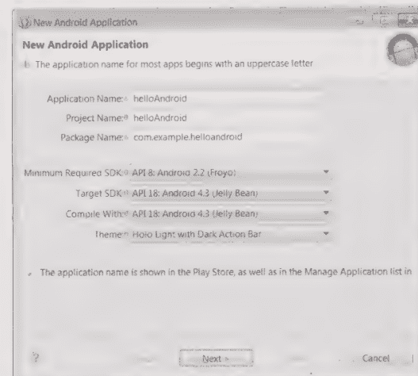

   图 22.1：新的 Android 应用程序窗口

2. 输入新应用程序的详情。在 Application Name（应用程序名称）字段中，输入你希望在 Android 设备上显示的应用程序名称。在 Project Name（项目名称）字段中，为你的项目输入一个名称。这可以与应用程序名称相同，也可以是不同的名称。然后，在 Package Name（包名）字段中输入 Java 包名。包名将唯一地标识你的应用程序。尽管你可以使用任何符合 Java 包规范的字符串，但包名应该是你的域名的反序排列。例如，如果你的域名是 `example.com`，那么你的包名应该是 `com.example.hello`。现在，文本框下方有四个下拉框。Minimum Required SDK（最低所需 SDK）下拉框包含 Android SDK 级别列表。级别越低，你的应用程序可以运行的设备就越多，但你可以使用的 API 和功能就越少。Target SDK（目标 SDK）框应设置为你应用程序进行开发和测试的最高级别。Compile With（编译目标）下拉框应包含编译代码所需的的目标 API。最后，Theme（主题）下拉框应包含你应用程序的主题。

   对于你的第一个应用程序，请使用图 22.1 所示的数值。

3. 点击 Next（下一步）。你将看到一个与图 22.2 类似的窗口。接受默认设置。

   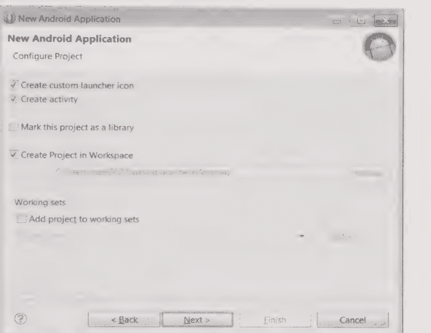

   图 22.2：配置你的应用程序

4. 再次点击 Next（下一步）。出现的下一个窗口将看起来像图 22.3 中的窗口。在这里，你可以为应用程序选择一个图标。如果你不喜欢默认的图像图标，点击 Clipart（剪贴）并从列表中选择一个。此外，如果你愿意，也可以使用文本作为图标。

   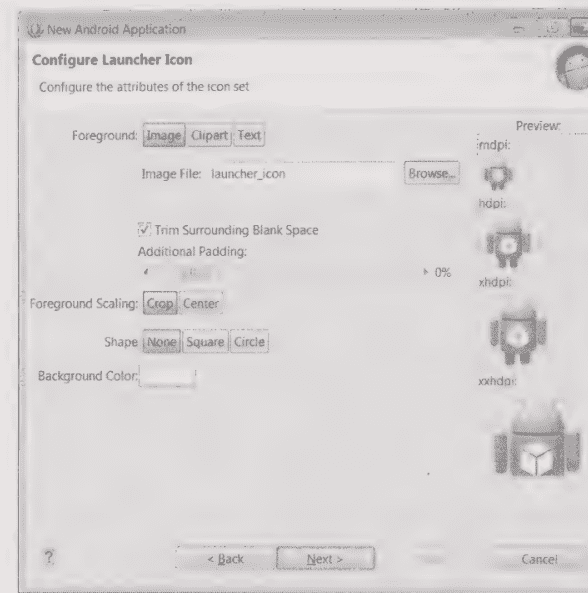

   图 22.3：选择启动图标

5. 再次点击 Next（下一步），系统将提示你选择一个活动（见图 22.4）。活动将在第 23 章“Activities”中解释。现在，保持选择 Blank Activity（空活动）。

   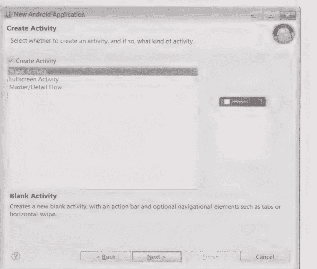

   图 22.4：选择活动类型

6. 再次点击 Next（下一步）。下一个窗口将如图 22.5 所示。

   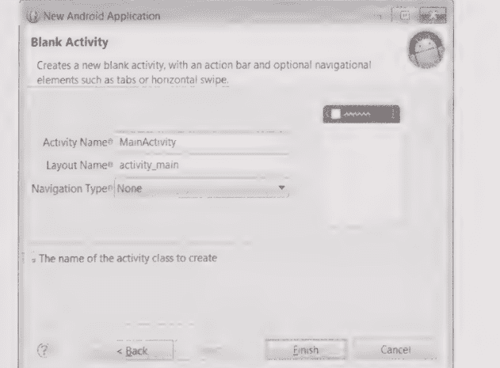

   图 22.5：输入活动和布局名称

7. 接受建议的活动和布局名称并点击 Finish（完成）。Bundle 将创建你的应用程序，你将看到像图 22.6 截图所示的项目。

   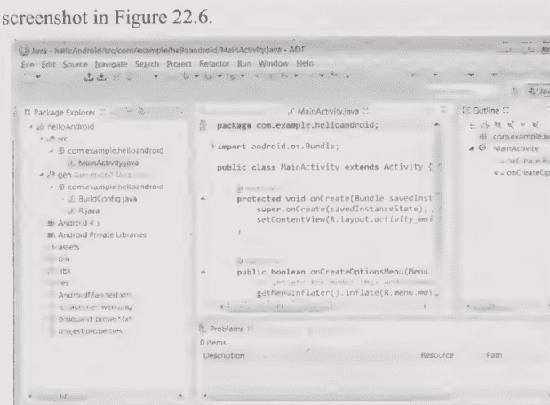

   图 22.6：新的 Android 项目

在 Eclipse 的 Package Explorer（包管理器）根目录中（左侧），你会发现以下文件夹：

- `AndroidManifest.xml` 文件。这是一个描述你的应用程序的 XML 文档。将在下一节“Android Manifest”中进行详细解释。
- 一个 PNG 格式的图标文件。
- `project.properties` 文件指定 Android 目标 API 级别。
- `src`。这是你的源代码文件夹。
- `gen`。这是存放生成的 Java 类的地方。生成的 Java 类允许你的 Java 源码使用布局文件和其他资源文件中定义了值。你不应该编辑生成的文件。
- `bin`。这是保存构建结果的地方。
- `libs`。包含 Android 库。
- `res`。包含资源文件。该目录下有：`drawable`（包含图像）、`layout`（包含布局）、`menu`（包含菜单）和 `values`（包含字符串）。

使用 IDE（如 ADT）开发 Android 应用程序的优势之一是它知道你何时添加了资源。你将在接下来的章节中学习这一强大的功能。

### Android Manifest

每个 Android 应用程序都必须有一个名为 `AndroidManifest.xml` 的文件来描述该应用程序。清单 22.1 显示了一个示例清单。

```xml
<?xml version="1.0" encoding="utf-8"?>
<manifest xmlns:android="http://schemas.android.com/apk/res/android"
    package="example.helloworld">
    <uses-sdk
        minSdkVersion="8"
        targetSdkVersion="17" />
    <application
        android:allowBackup="true"
        android:icon="@drawable/launcher"
        android:label="@string/app_name"
        android:theme="@style/AppTheme">
        <activity
            android:name=".MainActivity">
            <intent-filter>
                <action android:name="android.intent.action.MAIN" />
                <category android:name="android.intent.category.LAUNCHER" />
            </intent-filter>
        </activity>
    </application>
</manifest>
```

### 运行应用程序

如果没有真实设备，ADT Bundle 自带了一个模拟器来运行你的应用程序。以下是在模拟器上运行应用程序的步骤：


# 第 22 章：你的第一个 Android 应用

## 运行 Android 应用程序

1. 在 `Project Explorer` 中点击 Android 项目，然后点击 `Run` → `As` → `Android Application`。

2. 弹出 `Device Chooser` 窗口（见图 22.7。一旦配置了它，下次就不会再出现）。

   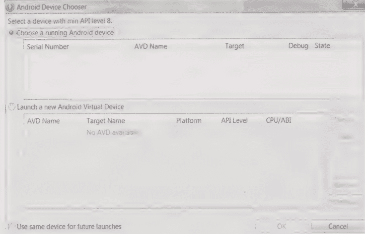

   图 22.7：Device Chooser 窗口

3. 在这里你可以选择在真实设备（Android 手机或平板电脑）或 `Android Virtual Device`（模拟器）上运行应用程序。在图 22.7 中你没有看到运行的 Android 设备，因为没有连接真实设备，所以点击 `Launch a new Android Device` 按钮，并点击右侧的 `Manager` 按钮。

   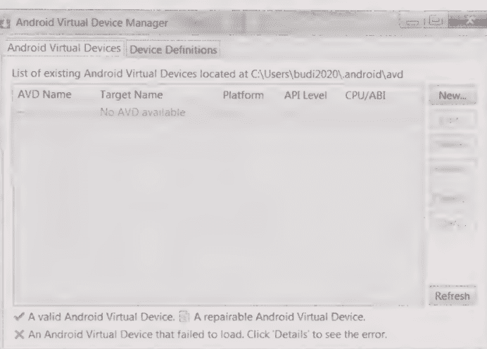

   图 22.8：Android Virtual Device Manager

4. 在 `Android Virtual Devices` 中点击 `New` 显示 `Create new AVD` 窗口（见图 22.9）。

   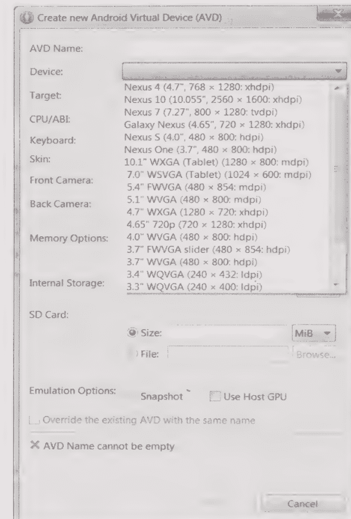

5. 点击 `Device` 下拉菜单查看可用的虚拟设备列表。

   在这里我选择了 `Nexus 7`。然后，为你的设备输入名称。名称不能包含空格或特殊字符。

6. 选择一个目标，如果你在 Windows 上，请将 `RAM` 减少到 768。由于某些原因，如果你在 Windows 上使用超过 768MB RAM，可能会崩溃。

7. 我的选项如图 22.10 截图所示。

   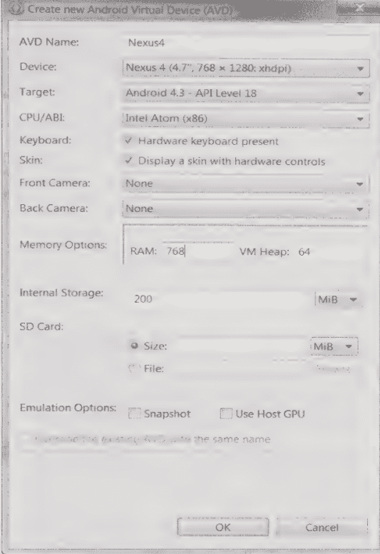

   图 22.10：为新虚拟设备输入值

8. 点击 `OK`。创建新的 Android 虚拟设备 (AVD) 窗口将关闭，你返回 `Android Virtual Device Manager` 窗口。你的 AVD 将列在那里，如图 22.11 所示。

   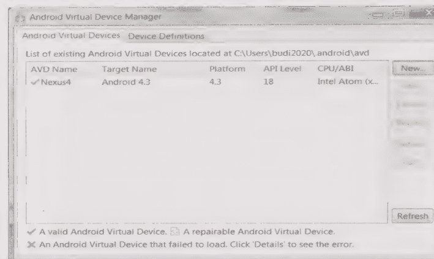

   图 22.11：可用的虚拟设备列表

9. 现在，点击 AVD 名称 (`Nexus7`) 来选择它，`Start` 和其他按钮将变为可用。点击 `Start` 按钮启动 AVD。你将看到如图 22.12 所示的启动选项弹出窗口。

   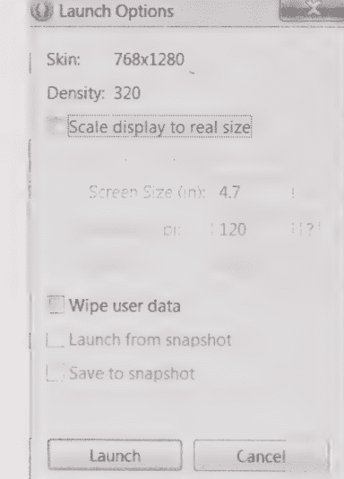

   图 22.12：启动选项弹出窗口

10. 点击 `Launch` 启动你的 AVD。在启动时，你会看到一个如图 22.13 所示的窗口。

    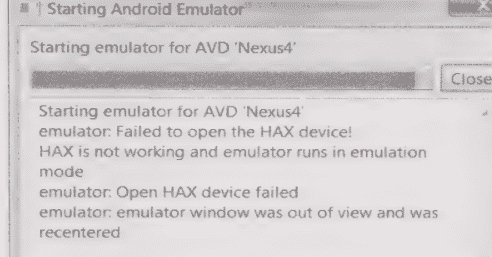

    图 22.13：启动模拟器

    取决于你的电脑速度，需要几分钟或更长时间。为了说明，在我那基于 `Intel i5` 的 Windows 机器上，需要八分钟，但在我带有 `SSD` 硬盘的 `i7 Ubuntu` 机器上，不到一分钟。图 22.14 显示了模拟器就绪后的状态。

    

    图 22.14：Android 模拟器

    如你所知，模拟器模拟了一个 Android 设备。你需要通过触摸（或点击）底部的蓝圈来解锁屏幕。如果你的应用程序没有自动打开，找到应用图标并双击它。图 22.15 显示了 `HelloWorld` 应用。

    

    图 22.15：在模拟器上的第一个应用

    在开发期间，在你编辑代码时让模拟器运行。这样，每次运行应用程序时就不需要重新加载模拟器了。

## 应用结构

当你从 `ADT Bundle` 内部运行 Android 应用程序时，将为你构建一个 `apk` 文件并将其存在应用程序的 `bin` 目录中。`apk` 文件本质上是一个 `zip` 文件，你可以使用 `WinZip` 或 `unzip` 来提取其内容。

图 22.16 显示了运行应用程序时创建的 `helloworld.apk` 文件的结构。

清单文件（`manifest`）在那里，资源文件也在那里。还有一个 `classes.dex` 文件，它包含了你的 Java 类为 `Dalvik` 可执行文件的二进制翻译。请注意，即使你的应用程序中有多个 `.java` 文件，也只会有一个 `classes.dex` 文件。


## 日志记录

Java 程序员喜欢使用日志实用工具，例如 `Commons Logging` 和 `Log4J`。Android 框架提供了 `android.util.Log` 类来实现相同的目的。`Log` 类带有在不同日志级别记录消息的方法。方法名称很短：`d` (debug), `i` (info), `v` (verbose), `w` (warning), `e` (error), 和 `wtf` (what a terrible failure)。

这些方法允许你写一个标签（`tag`）和文本。例如：

```java
Log.e("activity", "Something went wrong");
```

在开发期间，使用 `Log` 类记录的日志将出现在 Eclipse 的 `LogCat` 视图中。如果你没有看到它，请点击 `Window` -> `Show View` -> `LogCat` 或 `Window` -> `Show View` -> `Other` -> `LogCat`。

`LogCat` 的用处是，不同日志级别的消息以不同的颜色显示。此外，每条消息都有一个标签，这使得查找消息变得很容易。此外，`LogCat` 还允许将消息保存到文件中并进行过滤。


图 22.17：LogCat 视图

## 调试应用程序

最简单的调试方法是添加行断点。图 22.18 显示了行断点。


图 22.18：行断点

## 更新 SDK

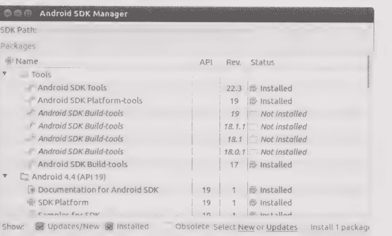

图 22.21：Android SDK Manager 窗口

这里有尚未安装的新版本，新版本将显示在此处，你可以点击 `Install`（安装）进行安装。

## 总结

本章讨论了如何创建你的第一个应用程序，以及如何对其测试和调试。它还教了你如何配置虚拟设备，这样即使在没有真实设备的情况下也可以运行应用程序。

# 第 23 章：Activity（活动）

在第 22 章“你的第一个 Android 应用”中，你学习了如何编写一个简单的 Android 应用程序。现在是时候深入研究 Android 开发的艺术与科学了。本章将讨论 Android 编程中最重要的组件类型之一：`Activity`。

## Activity 生命周期

你首先需要熟悉的第一个应用组件是 `Activity`。`Activity` 是用户可以执行的某项操作。这个定义听起来很模糊，尤其是对于初学者来说。然而，考虑到大多数 `Activity` 都涉及显示一个包含用户界面（`UI`）组件的窗口，用户可以与这些组件交互，你可以将 `Activity` 比作一个窗口。因此，启动一个 `Activity` 通常意味着显示一个窗口。

所有的 `Activity` 都由 `android.app.Activity` 类表示。你通过该类的子类创建一个 `Activity`。

一个典型的 Android 应用程序从启动 `Activity` 开始，正如我所说，这泛指意味着显示一个窗口。应用程序创建的第一个窗口被称为主 `Activity`（main activity），作为应用程序的入口点。不用说，一个 Android 应用程序可能包含多个 `Activity`，你通过在应用程序清单文件（`manifest file`）中声明它来指定主 `Activity`。

例如，Android 清单文件中的以下 `application` 元素定义了两个 `Activity`，其中一个使用 `intent-filter`（意图过滤器）声明为主 `Activity`。要让一个 `Activity` 成为你应用程序的主 `Activity`，它的 `intent-filter` 元素必须包含 `MAIN` 动作和 `LAUNCHER` 类别，如下所示：

```xml
<application ...>
    <activity
        android:name="com.example.MainActivity"
        android:label="@string/app_name">
        <intent-filter>
            <action android:name="android.intent.action.MAIN"/>
            <category android:name="android.intent.category.LAUNCHER"/>
        </intent-filter>
    </activity>
    <activity
        android:name="com.example.SecondActivity"
        android:label="@string/title_activity_second">
    </activity>
</application>
```

在上面的代码段中，很容易看出第一个 `Activity` 是主 `Activity`。

当用户从主屏幕选择你的应用程序图标时，系统将查找应用程序的主 `Activity` 并启动它。启动 `Activity` 涉及实例化 `Activity` 类（该类在文件中 `activity` 元素的 `android:name` 属性中指定）并调用它的生命周期方法。理解这些方法非常重要，这样你才能正确编写代码。

以下是 `Activity` 的生命周期方法。有些在应用程序生命周期内调用一次，有些可以被调用多次。

- `onCreate`
- `onStart`
- `onResume`
- `onPause`
- `onStop`
- `onRestart`
- `onDestroy`

为了真正理解这些生命周期方法是如何运作的，请考虑图 23.1 中的图表。

系统首先调用 `onCreate` 方法来创建 `Activity`。你应该在这里放置构建 `UI` 的代码。一旦 `onCreate` 完成，你的应用程序将处于 `Created`（已创建）状态。此方法在应用程序运行期间只会被调用一次。

接下来，系统调用 `Activity` 的 `onStart` 方法。当此方法完成后，应用程序处于 `Started`（已启动）状态。此方法在应用程序运行期间可能会被调用多次。

`onStart` 之后是 `onResume`，一旦 `onResume` 完成，应用程序就处于 `Resumed`（已恢复）状态。我多希望他们把它叫作 `Running`（运行中）而不是 `running`。`onResume` 在应用程序生命周期内可能会被调用多次。

因此，`onCreate`、`onStart` 和 `onResume` 将被成功调用，除非过程中发生了某些意外。在 `Resumed` 状态下，应用程序基本上在运行，并将一直保持在此状态，直到发生某些改变状态的情况，例如闹钟响起、或者屏幕因为设备要进入睡眠模式而关闭，或者可能启动了另一个应用程序。

离开 `Resumed` 状态的应用程序将调用其运行 `Activity` 的 `onPause`。一旦 `onPause` 完成，应用程序进入 `Paused`（已暂停）状态。`onPause` 在应用程序生命周期内可以被调用多次。

`onPause` 之后发生了什么取决于你的应用程序是否变得完全不可见。如果是，将调用 `onStop` 方法，应用程序进入 `Stopped`（已停止）状态。另一方面，如果应用程序在 `onPause` 之后再次活跃，系统会调用 `onResume` 方法，应用程序重新进入 `Resumed` 状态。

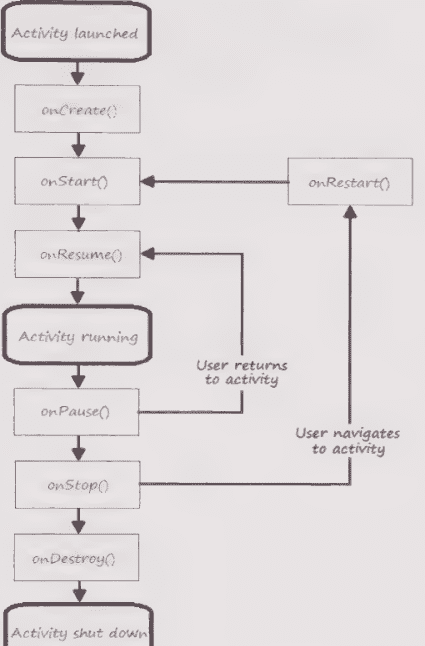

图 23.1：Activity 生命周期

处于 `Stopped` 状态的应用程序如果用户选择返回应用程序或由于其他原因返回前台，可能会重新激活。在这种情况下，将调用 `onRestart` 方法，然后是 `onStart`。

最后，当应用程序销毁时，会调用 `onDestroy` 方法。此方法像 `onCreate` 一样，在应用程序运行期间只调用一次。

## 示例：ActivityDemo 应用

```xml
<?xml version="1.0" encoding="utf-8"?>
<manifest xmlns:android="http://schemas.android.com/apk/res/android"
    package="com.example.activitydemo">

    <application
        <activity
            android:name=".MainActivity"
            android:label="@string/app_name"
            android:theme="@style/AppTheme">
            <intent-filter>
                <action android:name="android.intent.action.MAIN" />
                <category android:name="android.intent.category.LAUNCHER" />
            </intent-filter>
        </activity>
    </application>
</manifest>
```

在上面的代码段中，很容易看出第一个 `Activity` 是主 `Activity`。

当用户从主屏幕选择你的应用程序图标时，系统将查找应用程序的主 `Activity` 并启动它。启动 `Activity` 涉及实例化 `Activity` 类（该类在文件中 `activity` 元素的 `android:name` 属性中指定）并调用它的生命周期方法。理解这些方法非常重要，这样你才能正确编写代码。

**Listing 23.2：MainActivity 类**


```java
package com.example.activitydemo;

import android.app.Activity;
import android.os.Bundle;
import android.util.Log;
import android.view.Menu;

public class MainActivity extends Activity {

    @Override
    protected void onCreate(Bundle savedInstanceState) {
        super.onCreate(savedInstanceState);
        Log.d("lifecycle", "onCreate");
        setContentView(R.layout.activity_main);
    }

    @Override
    public boolean onCreateOptionsMenu(Menu menu) {
        // 加载菜单，将菜单项添加到操作栏中
        getMenuInflater().inflate(R.menu.main, menu);
        return true;
    }
}
```

```java
    @Override
    protected void onStart() {
        super.onStart();
        Log.d("lifecycle", "onStart");
    }
```

```java
    @Override
    protected void onRestart() {
        super.onRestart();
        Log.d("lifecycle", "onRestart");
    }
```

```java
    @Override
    protected void onResume() {
        super.onResume();
        Log.d("lifecycle", "onResume");
    }
```

```java
    @Override
    protected void onPause() {
        super.onPause();
        Log.d("lifecycle", "onPause");
    }
```

```java
    @Override
    protected void onStop() {
        super.onStop();
        Log.d("lifecycle", "onStop");
    }
```

```java
    @Override
    protected void onDestroy() {
        super.onDestroy();
        Log.d("lifecycle", "onDestroy");
    }
```

# 第 23 章：Activity

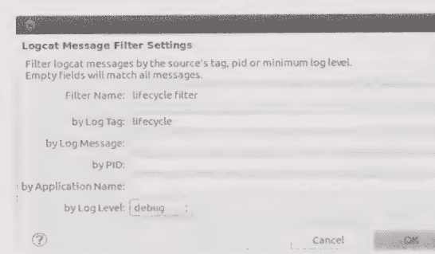

图 23.2：创建 Logcat 消息过滤器

## 更改应用程序图标

如果你不喜欢所选择的应用程序图标，可以按照以下步骤轻松更改它：

- 在 `res/drawable` 中保存一个 jpg 或 png 文件（任选其一即可）。首选 png，因为该格式支持透明度。
- 编辑 manifest 文件中的 `android:icon` 属性，使其指向新图像。

### 使用 Android 资源

Android 功能非常丰富，它带有一系列你可以在应用中使用的资源。要浏览可用资源，请在 Eclipse 中打开应用清单，并通过输入 `@android:` 后按 `Ctrl+space` 来填充属性值。Eclipse 将显示资源列表。（见图 23.3）。

```
android:icon="@android:anim/
@android:anim/
@android:array/
@android:attr/
@android:bool/
@android:color/
@android:declare-style-able/
@android:dimen/
@android:drawable/
@android:font/
@android:id/
@android:integer/
```

图 23.3：使用 Android 资源

例如，要查看哪些图像/图标，请选择 `@android:drawable/`。

要使用不同的图标，请设置此值：

`android:icon="@android:drawable/ic_menu_day"`

## 启动另一个 Activity

Android 应用的主 Activity 由系统在用户从主屏幕选择图标启动。在具有多个 Activity 的应用中，启动另一个 Activity 是可能的（也是简单的）。事实上，从另一个 Activity 启动 Activity 只需调用 `startActivity` 方法即可：

```
startActivity(intent);
其中 intent 是 Intent 的实例。
```

作为一个示例，考虑随本书附的 `SecondMainActivity` 项目。它有两个 Activity：`MainActivity` 和 `SecondActivity`。`MainActivity` 包含一个按钮，点击该按钮时会启动 `SecondActivity`。该项目还展示了你如何编写事件监听器。

`SecondActivityTest` 的清单如列表 23.3 所示。

### 列表 23.3：SecondActivityTest 的清单

```xml
<?xml version="1.0" encoding="utf-8"?>
<manifest
    xmlns:android="http://schemas.android.com/apk/res/android"
    package="com.example.secondactivitytest"
    android:versionCode="1"
    android:versionName="1.0 ">
<uses-sdk
    android:minSdkVersion="8"
    android:targetSdkVersion="19" />
<application
    android:allowBackup="true"
    android:icon="@drawable/ic_launcher"
    android:label="@string/app_name"
    android:theme="@style/AppTheme" >
<activity
        android:name="com.example.secondactivitytest.MainActivity"
        android:label="@string/app_name" >
        <intent-filter>
            <action android:name="android.intent.action.MAIN"/>
            <category android:name="android.intent.category.LAUNCHER"/>
        </intent-filter>
</activity>
<activity>
        android:name="com.example.secondactivitytest.SecondActivity"
        android:label="@string/title_activity_second" >
</activity>
</manifest>
```

与之前的应用不同，此项目有两个 Activity，其中一个被声明为主 Activity。

主 Activity 和第二个 Activity 的布局文件分别列在列表 23.4 和 23.5 中。

### 列表 23.4：activity_main.xml 文件

```xml
<RelativeLayout
    xmlns:android="http://schemas.android.com/apk/res/android"
    xmlns:tools="http://schemas.android.com/apk/tools"
    android:layout_width="match_parent"
    android:layout_height="match_parent"
    android:paddingBottom="@dim/activity_vertical_margin"
    android:paddingLeft="@dim/activity_horizontal_margin"
    android:paddingRight="@dim/activity_horizontal_margin"
    android:paddingTop="@dim/activity_vertical_margin"
    tools:context=".MainActivity">

    <TextView
        android:id="@id/textView"
        android:layout_width="wrap_content"
        android:layout_height="wrap_content"
        android:text="@string/first_screen" />
</RelativeLayout>
```

### 列表 23.5：activity_second.xml 文件

```xml
<RelativeLayout
    xmlns:android="http://schemas.android.com/apk/res/android"
    xmlns:tools="http://schemas.android.com/apk/tools"
    android:layout_width="match_parent"
    android:layout_height="match_parent"
    android:paddingBottom="@dim/activity_vertical_margin"
    android:paddingLeft="@dim/activity_horizontal_margin"
    android:paddingRight="@dim/activity_horizontal_margin"
    android:paddingTop="@dim/activity_vertical_margin"
    tools:context=".SecondActivity">

    <TextView
        android:id="@id/textView"
        android:layout_width="wrap_content"
        android:layout_height="wrap_content" />
</RelativeLayout>
```

这两个 Activity 都包含一个 `TextView`。当触摸主 Activity 中的 `TextView` 时，它将启动第二个 Activity 并为后者传递一个消息。

主 Activity 的类如列表 23.6 所示。

### 列表 23.6：com.example.secondactivitytest

```java
package com.example.AppActivity;
import android.content.Intent;
import android.os.Bundle;
import android.view.Menu;
import android.view.MotionEvent;
import android.view.View;
import android.view.View.OnTouchListener;
import android.widget.TextView;

public class MainActivity extends Activity implements
    OnTouchListener {

    @Override
    protected void onCreate(Bundle savedInstanceState) {
        super.onCreate(savedInstanceState);
        setContentView(R.layout.activity_main);
        TextView tv = (TextView) findViewById(R.id.textView);
        tv.setOnTouchListener(this);
    }

    @Override
    public boolean onCreateOptionsMenu(Menu menu) {
        getMenuInflater().inflate(R.menu.main, menu);
        return true;
    }

    @Override
    public boolean onTap(View v, MotionEvent event) {
        Intent intent = new Intent(this, SecondActivity.class);
        intent.putExtra("message", "来自第一个屏幕");
        startActivity(intent);
        return true;
    }
}
```

为了处理触摸，`MainActivity` 类实现了 `OnTouchListener` 接口并重写了 `onTap` 方法。在这个方法中，我们创建了一个 `Intent` 并向其放入了一条消息。然后我们调用 `startActivity` 来启动第二个 Activity。

`SecondActivity` 见列表 23。

### 列表 23：com.example.secondactivitytest

```java
import android.app.Activity;
import android.content.Intent;
import android.os.Bundle;
import android.view.Menu;
import android.widget.TextView;

public class SecondActivity extends Activity {

    @Override
    protected void onCreate(Bundle savedInstanceState) {
        super.onCreate(savedInstanceState);
        setContentView(R.layout.activity_second);
        Intent intent = getIntent();
        String message = intent.getStringExtra("message");
        ((TextView) findViewById(R.id.textView)).setText(message);
    }

    @Override
    public boolean onCreateOptionsMenu(Menu menu) {
        getMenuInflater().inflate(R.menu.second, menu);
        return true;
    }
}
```

在 `SecondActivity` 的 `onCreate` 方法中，你像往常一样设置视图内容。

随后你可以调用 `getIntent` 方法从其 `getStringExtra` 方法获取消息，然后将其传递给 `TextView` 的 `setText` 方法。我们通过调用 `findViewById` 方法获取 `TextView`。

主 Activity 和第二个 Activity 分别在图 23.4 和 23.5 中所示。


图 23.4：SecondActivityTest 中的主 Activity


图 23.5：SecondActivityTest 中的第二个 Activity

## 总结

在本章中，你学习了 Activity 的生命周期并创建了两个应用程序。第一个应用允许你观察每个生命周期方法是在何时调用的。第二个应用展示了如何从另一个 Activity 启动 Activity。

# 第 24 章：UI 组件

创建 Android 应用程序时的首要工作之一是为主活动构建用户界面。得益 Android 提供的开箱即用 UI 组件，这项任务相对简单。本章将讨论一些更重要的 UI 组件。

### 概述


# 第 24 章：UI 组件

Android SDK 提供了各种称为控件（widgets）的 UI 组件，包括许多简单和复杂的组件。控件的示例包括按钮、文本框、进度条等。此外，你还需要选择一个布局（layout）来布置你的 UI 组件。控件和布局都是 `android.view.View` 类的实现。`View` 是占据屏幕的矩形区域。`View` 是 Android 中最重要的类型之一。然而，除非你正在创建自定义视图，否则你通常不会直接操作此类。相反，你花费大部分时间是在使用布局和 UI 组件来构建你的活动。

图 24.1 显示了一些 Android UI 组件。

## 使用 ADT Eclipse UI 工具

使用 ADT Eclipse 创建 UI 非常简单。你只需要打开传入的布局文件，并将组件拖放到布局中即可。活动布局文件位于应用程序的 `res/layout` 目录下。

图 24.2 显示了创建 UI 的 UI 工具。这是你打开活动文件时看到的内容。窗口分为三个主要区域。左侧是控件，它们分为不同的类别：表单控件（Form Widgets）、文本字段（Text Fields）、布局（Layouts）等。点击类别的标签页可以查看该类的可用控件。

要选择控件，点击控件并将其拖到中间的活动屏幕上。图 24.2 中的屏幕显示了两个字段和一个按钮。你还可以通过从 `Devices` 下拉菜单中选择设备，来查看你的屏幕在不同设备上的外观。

每个控件和布局都有一组继承自 `View` 类或添加到实现类的属性。要更改这些任何属性，请点击绘制区域上的控件，或从右侧结构（Structure）窗口中的大纲（Outline）属性面板中选择它。属性列在在 Layout 下方的小面板中。

TextView EditText CheckBox 0 SeekBar DatePicker AnalogClock RatingBar Calendar ZoomControls


图 24.1: Android UI 组件

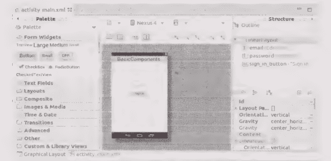

图 24.2: 使用 UI 工具

你在 UI 工具中执行的任何操作都会以 XML 元素的形式反映在布局文件中。要查看为你生成了什么，请点击 UI 工具底部的 XML 视图。

## 使用基础组件

BasicComponents 项目是一个包含一个活动的简单 Android 应用程序。活动屏幕包含两个文本字段和一个按钮。

你可以遵循随附的应用程序，也可以按照第 22 章“你的第一个 Android 应用程序”中的说明自己创建一个。我将通过展示应用程序的清单（manifest）来开始解释这个项目，它是一个直接位于根目录下的、名为 `AndroidManifest.xml` 的 XML 文件。

列表 24.1 显示了 BasicComponents 项目的 `AndroidManifest.xml`。

### 列表 24.1: BasicComponents 的清单

```xml
<?xml version="1.0" encoding="utf-8"?>
<manifest xmlns:android="http://schemas.android.com/apk/res/android"
    package="com.example.basiccomponents"
    android:versionCode="1"
    android:versionName="1.0">
  <sdk
    android:minSdkVersion="8"
    android:targetSdkVersion="17" />

  <application
    android:allowBackup="true"
    android:icon="@drawable/ic_launcher"
    android:label="@string/app_name"
    android:theme="@style/AppTheme">
    <activity
      android:name="com.example.basiccomponents.MainActivity"
      android:label="@string/app_name">
      <intent-filter>
        <action android:name="android.intent.action.MAIN"/>
        <category android:name="android.intent.category.LAUNCHER"/>
      </intent-filter>
    </application>
```

首先要的是 `manifest` 标签的 `package` 属性，它指定了生成类的包名 `com.example.basiccomponents`。同样注意 `application` 元素定义了主活动。`application` 元素还指定了图标 `icon`、标签 `label` 和主题 `theme`。

间接引用资源（如图标或标签）是一种良好的做法，就像我在这里使用 `@drawable/ic_launcher` 一样，`ic_launcher` 可以命名为位于 `res/drawable` 目录下的 `ic_launcher.png` 或 `ic_launcher.jpg`。所有的字符串以 `@string` 开头，指向 `res/values/strings.xml` 文件。对于此应用程序，`strings.xml` 文件见列表 24.2。

### 列表 24.2: res/values 下的 strings.xml 文件

```xml
<?xml version="1.0" encoding="utf-8"?>
<resources>
  <string name="app_name">BasicComponents</string>
  <string name="action_settings">Settings</string>
  <string name="prompt_email">Email</string>
  <string name="prompt_password">Password</string>
  <string name="action_sign_in">Sign in</string>
</resources>
```

让我们看看主活动。有两个资源：布局文件和派自 `android.app.Activity` 的 Java 类。对于这个项目，布局文件见列表 24.3，活动类见列表 24.4。

### 列表 24.3: 布局文件

```xml
<LinearLayout
    xmlns:android="http://schemas.android.com/apk/res/android"
    xmlns:tools="http://schemas.android.com/tools"
    android:layout_width="match_parent"
    android:layout_height="match_parent"
    android:gravity="center"
    android:gravity_horizontal="center"
    android:orientation="vertical"
    android:padding="12dp"
    tools:context=".MainActivity">

    <EditText
        android:id="@id/email"
        android:layout_width="match_parent"
        android:layout_height="wrap_content"
        android:hint="@string/prompt_email"
        android:inputType="textEmailAddress"
        android:maxLines="1"
        android:singleLine="true" />

    <EditText
        android:id="@id/password"
        android:layout_width="match_parent"
        android:layout_height="wrap_content"
        android:hint="@string/prompt_password"
        android:imeAction="@id/login"
        android:imeOptions="actionUnspecified"
        android:inputType="textPassword"
        android:maxLines="1"
        android:singleLine="true" />

    <Button
        android:id="@id/sign_in_button"
        android:layout_width="wrap_content"
        android:layout_height="wrap_content"
        android:gravity="right"
        android:layout_marginTop="16dp"
        android:paddingLeft="32dp"
        android:paddingRight="32dp"
        android:text="@string/action_sign_in" />

</LinearLayout>
```

布局文件包含一个带有三个元素的 `LinearLayout`，即 `EditText` 组件和 `MainActivity` 活动。

### 列表 24.4: Basic Components 的 MainActivity 类

```java
package com.example.basiccomponents;

import android.os.Bundle;
import android.app.Activity;
import android.view.Menu;

public class MainActivity extends Activity {
    @Override
    protected void onCreate(Bundle savedInstanceState) {
        super.onCreate(savedInstanceState);
        setContentView(R.layout.activity_main);
    }

    @Override
    public boolean onCreateOptionsMenu(Menu menu) {
        // 载入菜单；如果存在操作栏，则将项添加到其中。
        getInflater().inflate(R.menu.main, menu);
        return true;
    }
}
```

运行应用程序，你将看到如图 24.3 所示的活动。


图 24.3: BasicComponents 项目


## Toast

`Toast` 是一种小型的弹出窗口，用于向用户显示消息反馈。`Toast` 不会替换当前的活动（activity），只占用消息所占的空间。

图 24.4 显示了一个显示“正在下载文件...”的 `Toast`。`Toast` 会在指定的时间后消失。


图 24.4: 一个 Toast

`android.widget.Toast` 类是创建 `Toast` 的模板。要创建一个 `Toast`，请调用其接受 `Context` 作为参数的构造函数：

```java
public Toast (android.content.Context context)
```

`Toast` 还提供了两个静态的 `makeText` 方法来创建 `Toast` 实例。这两个重载方法的签名如下：

```java
public static Toast makeText (android.content.Context context, int resourceId, int duration)
```

```java
public static Toast makeText (android.content.Context context, java.lang.CharSequence text, int duration)
```

这两个重载方法都要求你将 `Context`（可能是活跃的 activity）作为第一个参数传递。此外，两个重载方法都接受一个字符串（可能来自 `strings.xml` 文件或 `String` 对象）以及 `Toast` 的显示时长。持续时间的两个值是 `Toast` 中的静态 final 常 `LENGTH_LONG` 和 `LENGTH_SHORT`。

要显示 `Toast`，请调用其 `show` 方法，该方法不接受参数。

以下代码段展示了如何在 activity 类中创建并显示 `Toast`。

`Toast` 显示在活跃 activity 的底部。你可以在调用 `show` 方法之前通过调用 `setGravity` 方法来改变它的位置。这里是 `setGravity` 的签名。

```java
public void setGravity (int gravity, int xOffset, int yOffset)
```

`gravity` 的有效值是 `android.view.Gravity` 类中的静态常量之一，包括 `CENTER_HORIZONTAL` 和 `CENTER_VERTICAL`。

你还可以通过创建自己的布局文件并将其传递给 `Toast` 的 `setView` 方法来增强 `Toast` 的外观。这里有一个创建自定义 `Toast` 的示例。

```java
LayoutInflater inflater = getLayoutInflater();
View layout = inflater.inflate(R.layout.toast_layout,
(ViewGroup) findViewById(R.id.toast_layout_root));
Toast toast = new Toast(getApplicationContext());
toast.setView(layout);
toast.show();
```

在这种情况下，`R.layout.toast_layout` 是 `Toast` 的标识符，而 `R.id.toast_layout_root` 是布局文件中根元素的 id。

## AlertDialog

与 `Toast` 类似，`AlertDialog` 也是一个向用户提供反馈的窗口。然而，与 `Toast` 会自动消失不同，`AlertDialog` 会一直显示，直到它失去焦点。此外，`AlertDialog` 可以包含最多三个按钮和一个可选项目列表。添加到 `AlertDialog` 中的按钮可以连接到一个监听器上，该监听器在按钮被点击时被触发。


图 24.5: 一个 AlertDialog

`android.app.AlertDialog` 类是创建 `AlertDialog` 的模板。`AlertDialog` 类中的所有构造函数都是保护的（protected），除非你正在对其进行子类化，否则无法使用它们。相反，你应该使用 `AlertDialog.Builder` 类来创建 `AlertDialog`。你可以使用 `AlertDialog.Builder` 的两个构造函数之一。

```java
public AlertDialog.Builder(android.content.Context context)
public AlertDialog.Builder(android.content.Context context, int theme)
```

一旦你有了 `AlertDialog.Builder` 实例，就可以调用它的 `create` 方法返回一个 `AlertDialog`。然而，在调用 `create` 之前，你可以调用 `AlertDialog.Builder` 的各种方法来装饰生成的 `AlertDialog`。有趣的是，`AlertDialog.Builder` 方法返回同一个 `AlertDialog.Builder` 实例，因此你可以对它们进行链式调用。以下是 `AlertDialog.Builder` 的一些方法。

```java
public AlertDialog.Builder setIcon(int resourceId)
通过 resourcid 指的 Drawable 设置生成的 AlertDialog 的图标。
public AlertDialog.Builder setMessage(java.lang.CharSequence message)
设置生成的 AlertDialog 的消息。
```


```java
public AlertDialog.Builder.setTitle(java.lang.CharSequence title)
设置生成的 AlertDialog 的标题。
```

```java
public AlertDialog.Builder.setNegativeButton(
    java.lang.CharSequence text,
    android.content.DialogInterface.OnClickListener listener)
分配一个用户应点击以提供负面响应的按钮。
```

```java
public AlertDialog.Builder.setPositiveButton(
    java.lang.CharSequence text,
    android.content.DialogInterface.OnClickListener listener)
分配一个用户应点击以提供正面响应的按钮。
```

```java
public AlertDialog.Builder.setNeutralButton(
    java.lang.CharSequence text,
    android.content.DialogInterface.OnClickListener listener)
分配一个用户应点击以提供中性响应的按钮。
```

例如，以下代码产生了一个类似于图 24.5 一样的 AlertDialog。

```java
new AlertDialog.Builder(this)
  .setTitle("请确认")
  .setMessage(
    "你确定要删除 " +
    "这个联系人吗？")
  .setPositiveButton("是",
    new DialogInterface.OnClickListener() {
      public void onClick(
        DialogInterface dialog,
        int webhook) {
          // 在处删除图片
          dialog.dismiss();
        }
    })
  .create()
  .show();
```

## 总结

在本章中，你学习了 UI 组件。你还利用了这些

# 第 25 章：布局

布局非常重要，因为它们直接影响应用程序的外观。从技术上讲，布局定义了 UI 组件的视觉结构。布局是 `android.view.ViewGroup` 的子类。`ViewGroup` 是一种可以包含其他视图的视图。布局可以在布局文件中声明，也可以在运行时动态添加。

### 概述

Android 自带许多布局。以下是一些布局：

- `LinearLayout`：在相同方向（水平或垂直）上排列子视图。
- `RelativeLayout`：根据一个或多个兄弟视图的位置安排子视图。
- `FrameLayout`：将每个子视图堆叠在另一个视图之上。
- `TableLayout`：将子视图组织成行和列。
- `GridLayout`：以网格形式排列子视图。

在大多数情况下，布局中的视图必须具有布局宽度高度属性，以确定视图的大小。布局宽度和高度属性被赋值为 `match_parent`（匹配父容器宽度/高度）、`wrap_content`（匹配内容的宽度/高度）或一个测量单位。

提供视图精确位置的 `AbsoluteLayout` 已废弃，不应使用。请使用 `RelativeLayout` 替代。

### LinearLayout

`LinearLayout` 是一种根据其方向属性水平或垂直排列子视图的布局。`LinearLayout` 是最简单的布局。

列表 25.1 中的布局是水平方向的 `LinearLayout` 示例。它包含三个子视图：一个 `ImageView`、一个 `TextView` 和一个 `Button`。

```xml
<LinearLayout xmlns:android="http://schemas.android.com/apk/res/android"
    xmlns:tools="http://schemas.android.com/tools"
    android:orientation="horizontal"
    android:layout_width="match_parent"
    android:layout_height="match_parent">

    <Button
        android:src="@android:drawable/btn_star_big_on"
        android:layout_width="wrap_content"
        android:layout_height="wrap_content" />

    <TextView
        android:layout_width="wrap_content"
        android:layout_height="wrap_content"
        android:text="@string/hello_world" />

    <Button
        android:text="按钮1"
        android:layout_width="wrap_content"
        android:layout_height="wrap_content" />

</LinearLayout>
```

图 25.1 显示了列表 25.1 中 `LinearLayout` 中的视图。

列表 25.2 中的布局是一个垂直的 `LinearLayout`，包含三个子视图：一个 `ImageButton`、一个 `TextView` 和一个 `Button`。

## 列表 25.2: 垂直线性布局

```xml
<LinearLayout
    xmlns:android="http://schemas.android.com/apk/res/android"
    xmlns:tools="http://schemas.android.com/tools"
    android:orientation="vertical"
    android:layout_width="match_parent"
    android:layout_height="match_parent">

    <ImageButton
        android:src="@android:drawable/btn_star_big_on"
        android:layout_gravity="center"
        android:layout_width="wrap_content"
        android:layout_height="wrap_content"/>

    <TextView
        android:layout_gravity="center"
        android:layout_width="wrap_content"
        android:layout_height="wrap_content"
        android:layout_marginLeft="15dp"
        android:text="@string/hello_world"/>

    <Button
        android:text="Button1"
        android:layout_gravity="center"
        android:layout_width="wrap_content"
        android:layout_height="wrap_content"/>

</LinearLayout>
```

图 25.2 显示了垂直的 `LinearLayout`。


## 图 25.2: 垂直线性布局示例

注意，布局中的每个视图都可以有一个 `layout_gravity` 属性，用于确定其在所在轴线上的位置。例如，将 `layout_gravity` 属性设置为 `center` 将会使其居中显示。

`LinearLayout` 还可以有一个 `gravity` 属性来影响它的重对齐方式。例如，列表 25.3 中的布局是一个垂直的 `LinearLayout`，其 `gravity` 属性被设置为 `bottom`。

## 列表 25.3:

```xml
<LinearLayout
    xmlns:android="http://schemas.android.com/apk/res/android"
    xmlns:tools="http://schemas.android.com/tools"
    android:orientation="vertical"
    android:layout_width="match_parent"
    android:layout_height="match_parent"
    android:gravity="bottom">
    <ImageView
        android:src="@android/drawable/btn_star_big_on"
        android:layout_gravity="center"
        android:layout_width="wrap_content"
        android:layout_height="wrap_content"/>
    <TextView
        android:layout_gravity="center"
        android:layout_width="wrap_content"
        android:layout_height="wrap_content"
        android:layout_marginLeft="15dp"
        android:text="@string/hello_world"/>
    <Button android:text="@string/button"
        android:layout_gravity="center"
        android:layout_width="wrap_content"
        android:layout_height="wrap_content"/>
</LinearLayout>
```

图 25.3 显示了列表 25.3 中的垂直 `LinearLayout`。


## 图 25.3: 带有 gravity 属性的垂直线性布局

# 第 25 章：布局

### RelativeLayout

`RelativeLayout` 是最强大的布局。`RelativeLayout` 中的所有子视图都可以彼此或相对于其父布局进行定位。

| 属性 | 说明 |
| --- | --- |
| `layout_above` | 将此视图的底部置在指定视图 ID 的上方 |
| `layout_alignBaseline` | 将此视图的基线置在指定视图 ID 的基线上 |
| `layout_alignBottom` | 将此视图的底部与指定视图对齐 |
| `layout_alignEnd` | 将此视图的右侧边缘与指定视图的右侧边缘对齐 |
| `layout_alignLeft` | 将此视图的左侧边缘与指定视图的左侧边缘对齐 |
| `layout_alignParentBottom` | 值为 true 时，将此视图的底部与其父布局的底部对齐 |
| `layout_alignParentEnd` | 值为 true 时，将此视图的右侧边缘与其父布局的右侧边缘对齐 |
| `layout_alignParentLeft` | 值为 true 时，将此视图的左侧边缘与其父布局的左侧边缘对齐 |
| `layout_alignParentRight` | 值为 true 时，将此视图的右侧边缘与其父布局的右侧边缘对齐 |
| `layout_alignParentStart` | 值为 true 时，将此视图的起始边缘与其父布局的起始边缘对齐 |
| `layout_alignParentTop` | 值为 true 时，将此视图的顶部与其父布局的顶部对齐 |
| `layout_alignRight` | 将此视图的右侧边缘与给定视图的右侧边缘对齐 |
| `layout_alignStart` | 将此视图的起始边缘与给定视图的起始边缘对齐 |
| `layout_alignTop` | 将此视图的顶部与给定视图的顶部对齐 |
| `layout_alignWith` | 将此视图与给定视图的属性对齐 |
| `layout_InParent` | 将此视图在父布局内填充 |
| `layout_belowLeft` | 将此视图相对于给定视图的左下方 |
| `layout_belowRight` | 将此视图相对于给定视图的右下方 |
| `layout_belowAboveLeft` | 将此视图相对于给定视图的左上方 |
| `layout_belowAboveRight` | 将此视图相对于给定视图的右上方 |
| `layout_centerLeft` | 将此视图在左侧上居中 |
| `layout_centerRight` | 将此视图在右侧上居中 |
| `layout_centerVertical` | 将此视图在垂直方向上居中 |
| `layout_centerInParent` | 将此视图在父布局中居中 |
| `layout_alignParentBottom` | 将此视图与父布局的底部对齐 |
| `layout_alignParentTop` | 将此视图与父布局的顶部对齐 |
| `layout_alignParentLeft` | 将此视图与父布局的左侧对齐 |
| `layout_alignParentRight` | 将此视图与父布局的右侧对齐 |
| `layout_alignParentStart` | 将此视图与父布局的起始边缘对齐 |
| `layout_alignParentEnd` | 将此视图与父布局的结束边缘对齐 |
| `layout_alignLeft` | 将此视图相对于给定视图的左 |
| `layout_alignRight` | 将此视图相对于给定视图的右侧 |
| `layout_toLeft` | 将此视图位于给定视图的左侧 |
| `layout_toRight` | 将此视图位于给定视图的右侧 |
| `layout_toStart` | 将此视图位于给定视图的起始侧 |
| `layout_toEnd` | 将此视图位于给定视图的结束侧 |
| `layout_alignBaseline` | 将此视图的基线与给定视图的基线对齐 |
| `layout_alignBottom` | 将此视图的底部与给定视图的底部对齐 |
| `layout_alignTop` | 将此视图的顶部与给定视图的顶部对齐 |
| `layout_alignStart` | 将此视图的起始边缘与给定视图的起始边缘对齐 |
| `layout_alignEnd` | 将此视图的结束边缘与给定视图的结束边缘对齐 |

在 `RelativeLayout` 中定位子视图是通过表 25.1 总结的属性实现的。例如，你可以指定一个视图位于另一个视图的左侧或右侧。列表 25.4 指定了三个视图。

## 列表 25.4: Relative 布局


# 第 25 章：布局

## RelativeLayout 示例

```xml
<RelativeLayout
    xmlns:android="http://schemas.android.com/apk/res/android"
    xmlns:tools="http://schemas.android.com/tools"
    android:padding="2dp"
    android:layout_width="match_parent"
    android:layout_height="match_parent">

    <Button
        android:id="@+id/cancelButton"
        android:layout_width="wrap_content"
        android:layout_height="wrap_content"
        android:text="Cancel" />

    <Button
        android:id="@+id/saveButton"
        android:layout_width="wrap_content"
        android:layout_height="wrap_content"
        android:layout_toRightOf="@id/cancelButton"
        android:text="Save" />

    <ImageView
        android:layout_width="150dp"
        android:layout_height="150dp"
        android:layout_marginTop="230dp"
        android:layout_below="@id/cancelButton"
        android:layout_centerHorizontal="true"
        android:src="@android:drawable/ic_btn_speak_now" />

    <LinearLayout
        android:id="@+id/filter_container"
        android:layout_width="match_parent"
        android:layout_height="wrap_content"
        android:layout_alignBottom="true"
        android:gravity="center|bottom"
        android:background="@android:color/white"
        android:orientation="horizontal">

        <Button
            android:id="@+id/filterButton"
            android:layout_width="wrap_content"
            android:layout_height="fill_parent"
            android:text="Filter" />

    </LinearLayout>

    <Button
        android:id="@+id/shareButton"
        android:layout_width="wrap_content"
        android:layout_height="fill_parent"
        android:text="Share" />

    <Button
        android:id="@+id/deleteButton"
        android:layout_width="wrap_content"
        android:layout_height="fill_parent"
        android:text="Delete" />
</RelativeLayout>
```

## FrameLayout 示例

列表 25.5 中的布局使用了一个包含 `Button` 和 `ImageButton` 的 `FrameLayout`。如图 25.5 所示，`ImageButton` 位于 `Button` 之上。

```xml
<FrameLayout
    android:layout_width="match_parent"
    android:layout_height="match_parent">

    <Button
        android:text="Button1"
        android:layout_width="wrap_content"
        android:layout_height="wrap_content"
        android:paddingLeft="48dp"/>
    <ImageButton
        android:src="@android:drawable/btn_star_big_on"
        android:alpha="0.35"
        android:layout_width="wrap_content"
        android:layout_height="wrap_content"/>
</FrameLayout>
```

## TableLayout

`TableLayout` 用于按行和列排列子视图。`TableLayout` 类是 `LinearLayout` 的子类。要在 `TableLayout` 中添加一行，请使用 `TableRow` 元素。直接添加到 `TableLayout` 的视图（不使用 `TableRow`）也将占据跨越所有列的行。

列表 25.6 中的布局显示了一个包含四行的 `TableLayout`，其中两行是通过 `TableRow` 元素创建的。

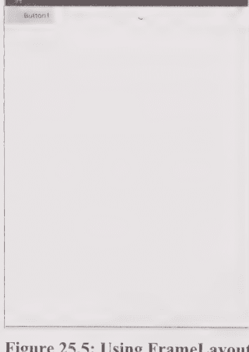

### 列表 25.6：使用 TableLayout

```xml
<TableLayout
    xmlns:android="http://schemas.android.com/apk/res/android"
    android:layout_width="wrap_content"
    android:layout_height="wrap_content"
    android:layout_gravity="center" >

    <TableRow
        android:id="@id/tableRow1"
        android:layout_width="500dp"
        android:layout_height="wrap_content"
        android:padding="5dip" >

        <ImageView android:src="@drawable/ic_launcher" />
        <ImageView
            android:src="@android:drawable/btn_star_big_on" />
        <ImageView android:src="@android:drawable/ic_launcher" />
    </TableRow>

    <TableRow
        android:id="@id/tableRow2"
        android:layout_width="wrap_content"
        android:layout_height="wrap_content" >

        <ImageView android:src="@android:drawable/btn_star_big_off" />
        <TextClock />
        <ImageView
            android:src="@android:drawable/btn_star_big_on" />
    </TableRow>

    <EditText android:hint="Your name" />

    <Button
        android:layout_height="wrap_content"
        android:text="Go" />

</TableLayout>
```

图 25.6 显示了列表 25.6 中的 `TableLayout` 如何渲染。

## GridLayout

`GridLayout` 与 `TableLayout` 类似，但必须使用 `columnCount` 属性指定列数。列表 25.7 显示了 `GridLayout` 的一个示例。

### 列表 25.7：GridLayout 示例

```xml
<GridLayout
    xmlns:android="http://schemas.android.com/apk/res/android"
    android:layout_width="wrap_content"
    android:layout_height="wrap_content"
    android:layout_gravity="center"
    android:columnCount="3">

    <!-- 第1行，跨越 3 列 -->
    <TextView
        android:layout_width="wrap_content"
        android:layout_height="wrap_content"
        android:text="Enter your name"
        android:layout_columnSpan="3"
        android:textSize="26sp"
    />

    <!-- 第2行 -->
    <TextView android:text="First Name"/>
    <EditText
        android:id="@id/firstName"
        android:layout_width="200dp"
        android:layout_columnSpan="2"/>

    <!-- 第3行 -->
    <TextView android:text="Last Name"/>
    <EditText
        android:id="@id/txtName"
        android:layout_width="200dp"
        android:layout_columnSpan="2"/>

    <!-- 第4行，跨越 3 列 -->
    <Button
        android:layout_width="wrap_content"
        android:layout_height="wrap_content"
        android:layout_column="2"
        android:layout_gravity="right"
        android:text="Submit"/>
</GridLayout>
```

图 25.7 可视化了列表 25.7 中的 `GridLayout`。

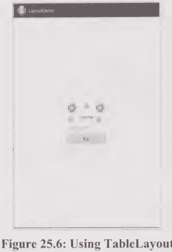

## 程序化创建布局

创建布局的最常用方法是使用 XML 文件，正如你在本章示例中所看到的。然而，也可以通过编程创建布局，即通过实例化布局类并将其传递给活动类中的 `setContentView` 方法。例如，以下代码是一个活动 `onCreate` 方法的一部分，该方法以编程方式创建了一个 `LinearLayout`，设置了几个属性，并将其传递给 `addContentView`。


## 总结

布局用于安排子视图。`TableLayout` 用于按行和列排列子视图，`TableLayout` 类是 `LinearLayout` 的子类。要在 `TableLayout` 中添加一行，请使用 `TableRow` 元素。直接添加到 `TableLayout` 的视图（不使用 `TableRow`）也将占据跨越所有列的行。`GridLayout` 与 `TableLayout` 类似，但必须使用 `columnCount` 属性指定列数。

# 第 26 章：监听器

## 概述

大多数 Android 程序都是交互式的，这得益于事件驱动的范式。可能发生的事件包括点击、长按、触摸等。对于大多数 GUI 系统，Android 是基于事件的。监听器用于响应事件。在本章中你将学习如何编写监听器。

| 接口 | 方法 |
|---|---|
| `OnClickListener` | `onClick()` |
| `OnLongClickListener` | `onLongClick()` |
| `OnFocusChangeListener` | `onFocusChange()` |
| `OnKeyListener` | ... |
| `OnTouchListener` | `onTouch()` |

**表 26.1：View 中的监听器**

一旦你创建了监听器的实现，你可以将其传递给你想监听的视图。例如，你编写：

```java
OnClickListener listener = new OnClickListener() {
    public void onClick(View view) {
        // 响应事件执行的代码
    }
};
```

```java
protected void onCreate(Bundle savedValues) {
    ...
    Button button = (Button) findViewById(...);
    button.setOnClickListener(listener);
}
```

或者，你可以让你的活动类实现该接口并提供方法的实现。

```java
public class MyActivity extends Activity
    implements View.OnClickListener {
    protected void onCreate(Bundle savedValues) {
        ...
        Button button = (Button) findViewById(...);
        button.setOnClickListener(this);
    }

    public void onClick(View view) {
        // 响应事件执行的代码
    }
}
```

此外，处理点击事件有一种快捷方法。你可以在布局文件的声明中使用 `onClick` 属性，并在活动类中编写一个公共方法。该方法必须没有返回值且接收一个 `View` 参数。例如，如果你在你的活动类中有此方法：

```java
public void showNote(View view) {
    // 执行某些操作
}
```

你可以在视图中使用 `onClick="showNote"` 将该方法附加到视图的点击事件。在后台，Android 将创建 `OnClickListener` 接口的实现并将其附加。

```xml
<Button android:onClick="showNote" />
```

### 注意

监听器运行在主线程上。这意味着如果你的监听器运行时间很长（例如超过 200 毫秒），你应该使用不同的线程。否则，你的应用程序在执行监听器期间将无响应。你有两种解决方案：可以使用 `Handler` 或 `AsyncTask`。`Handler` 在第 43 章“处理 Handler”中介绍，`AsyncTask` 在第 44 章“异步任务”中介绍。对于长时间运行的任务，你还应该考虑使用 Java 并发工具。

## 总结

监听器用于响应事件，如点击、长按、触摸等。常用的监听器接口包括 `OnClickListener`、`OnLongClickListener`、`OnFocusChangeListener`、`OnKeyListener`、`OnTouchListener` 等。可以通过匿名内部类、Activity 实现接口或 XML 中的 `onClick` 属性来设置监听器。注意监听器运行在主线程，耗时操作应使用 `Handler`、`AsyncTask` 或 Java 并发工具。

# 第 26 节：监听器示例

本节将演示如何在布局文件中通过使用回调方法来编写监听器。

MulticolorClock 的清单文件如列表 26.1 所示。这里没有特别之处，你应该发现理解它并不困难。

### 列表 26.1：MulticolorClock 的清单


```xml
<?xml version="1.0" encoding="utf-8"?>
<manifest
    xmlns:android="http://schemas.android.com/apk/res/android"
    package="com.example.multicolorclock"
    android:versionCode="1"
    android:versionName="1.0">
    <uses-sdk
        android:minSdkVersion="8"
        android:targetSdkVersion="17" />
    <application
        android:allowBackup="true"
        android:icon="@drawable/ic_launcher"
        android:label="@string/app_name"
        android:theme="@style/AppTheme">
        <activity
            android:name="com.example.multicolorclock.MainActivity"
            android:label="@string/app_name">
            <intent-filter>
                <action
                    android:name="android.intent.action.MAIN" />
                <category
                    android:name="android.intent.category.LAUNCHER" />
            </intent-filter>
        </activity>
    </application>
</manifest>
```

现在是关键部分：布局文件。它名为 `activity_main.xml`，位于 `res/layout` 目录下。布局文件如列表 26.2 所示。

### 列表 26.2：MulticolorClock 中的布局文件

```xml
<AnalogClock
    android:id="@id/analogClock1"
    android:layout_width="wrap_content"
    android:layout_height="wrap_content"
    android:layout_alignTop="true"
    android:layout_centerHorizontal="true"
    android:layout_marginTop="90dp"
    android:onClick="changeColor"
/>

</RelativeLayout>
```

布局文件定义了一个包含 `AnalogClock` 的 `RelativeLayout`。重要的部分在于 `AnalogClock` 的声明中。

```xml
android:onClick="changeColor"
```

这意味着当用户按下 `AnalogClock` 控件时，将调用 Activity 中的 `changeColor` 方法。为了让像 `changeColor` 这样的回调方法能够工作，它必须没有返回值，并且接受一个 `View` 参数。系统将调用此方法并传递被按的控件。

`changeColor` 方法是列表 26.3 所示的 `MainActivity` 类的一部分。

### 列表 26.3：MulticolorClock 中的 MainActivity 类

```java
package com.example.multicolorclock;
import android.app.Activity;
import android.graphics.Color;
import android.os.Bundle;
import android.view.Menu;
import android.view.View;
import android.widget.AnalogClock;

public class MainActivity extends Activity {

    int counter = 0;
    int[] colors = { Color.BLACK, Color.BLUE, Color.CYAN, Color.GRAY, Color.GRAY, Color.GREEN, Color.LTGRAY, Color.MAGENTA, Color.RED, Color.WHITE, Color.YELLOW };

    @Override
    protected void onCreate(Bundle savedInstanceState) {
        super.onCreate(savedInstanceState);
        setContentView(R.layout.activity_main);
    }

    @Override
    public boolean onCreateOptionsMenu(Menu menu) {
        // 充气菜单；如果存在，则向操作栏中添加项
        if (is.present)
            getMenuInflater().inflate(R.menu.main, menu);
        return true;
    }

    public void changeColor(View view) {
        if (counter == colors.length) {
            counter = 0;
        }
        view.setBackgroundColor(colors[counter++]);
    }
}
```

# 第 26 节：监听器

特别注意 `MainActivity` 类中的 `changeColor` 方法。当用户按下或触摸 `AnalogClock` 时，该方法将被调用。为了改变颜色，该方法会接收一个 `View` 对象。在 Android 中，通过实现 `TouchListener` 接口来处理触摸事件。为了让颜色变得简单，`MainActivity` 类使用了 `GridLayout`。

```java
OnTouchListener touchListener = new OnTouchListener() {
  @Override
  public boolean touches(View v, MotionEvent event) {
    CellView contentView = (CellView) v;

    int action = getAction();
    switch (action) {
      case (MotionEvent.ACTION_DOWN):
        downX = cell.x;
        downY = cell.y;
        return true;
      case (MotionEvent.ACTION_MOVE):
        if (swapping) {
          return true;
        }
        float x = event.getX();
        float y = event.getY();
        int w = cell.getWidth();
        int h = cell.getHeight();
        if (downX < w && x > 0 && y >= 0 && y < h) {
          // swap with right cell
          swapping = true;
          swapImages(cellView,
            cellViews[downY][downX + 1]);
        } else if (downX > 0 && x < 0
          && y >= 0 && y <= h) {
          // swap with left cell
          swapping = true;
          swapImages(cellView,
            cellViews[downY][downX - 1]);
        } else if (downY < row - 1
          && y > h && x >= 0 && x <= w) {
          // swap with cell below
          swapping = true;
          swapImages(cellView,
            cellViews[downY + 1][downX]);
        } else if (downY > 0 && y < 0
          && x >= 0 && x <= w) {
          // swap with cell above
          swapping = true;
          swapImages(cellView,
            cellViews[downY - 1][downX]);
        }
        return true;
      case (MotionEvent.ACTION_UP):
        swapping = false;
        return true;
      default:
        return true;
    }
  }
}
```

`MainActivity` 类包含一个名为 `touchListener` 的 `View.OnTouchListener`，它将被附加到网格中的每个 `CellView`。`OnTouch` 接口有一个必须实现的 `onTouch` 方法。这里是 `onTouch` 的签名。

```java
public boolean onTouch(View view, MotionEvent event)
```

如果该方法消耗了事件，则应该返回 `true`，这意味着该事件不应该传播到其他视图。否则，它应该返回 `false`。

用户的单次触摸操作会导致 `onTouch` 方法被调用多次。当用户触摸视图时，该方法被调用。当用户移动手指时，`onTouch` 被调用。同样，当用户抬起手指时，`onTouch`也会被调用。`onTouch` 的第二个参数 `MotionEvent` 包含了事件的信息。你可以通过调用 `MotionEvent` 上的 `getAction` 方法来查询触发事件的操作类型。

```java
int action = event.getAction();
```

返回值是 `MotionEvent` 类中定义的静态 final整型常量之一。对于这个应用程序，我们感兴趣的是 `MotionEvent.ACTION_DOWN`、`MotionEvent.ACTION_MOVE` 和 `MotionEvent.ACTION_UP`。当用户触摸视图时，`getAction` 方法返回 `MotionEvent.ACTION_DOWN`。代码只需将事件的位置存储在 `x` 和 `y` 字段中并返回 `true`。

```java
case (MotionEvent.ACTION_DOWN):
dX = cellView.x;
Y = cellView.y;
return true;
```

如果用户将手指移动到相邻单元格，触摸操作将返回 `MotionEvent.ACTION_MOVE`，我们需要交换原始单元格和目标单元格的图像，并将 `swapping` 字段设置为 `true`。这将防止在手指抬起之前发生再次交换。

最后，当用户抬起手指时，`swapping` 字段被设置为 `false`，以启用下一次交换。

activity 的布局在 activity 类的 `onCreate` 方法中动态构建。每个 `CellView` 都被传递了 `OnTouchListener`，以便监听器能够处理 `CellView` 的触摸事件。

```java
cellView.setOnTouchListener(touchListener);
```

## 总结

在本章中，你学习了 Android 事件处理的基础知识，以及如何通过实现 `View` 类中的嵌套接口来编写监听器。你还学习了使用处理点击事件的快捷方法。

# 第 27 章：Action Bar（动作栏）

Action Bar 是一个矩形窗口区域，包含了应用图标、应用名称、菜单和其他导航按钮。Action Bar 通常出现在窗口顶部。本章解释了如何在 API 级别 11（Android 3.0）或更高版本的 Android 上修饰 Action Bar。

### 概述

Action Bar 由 `android.app.ActionBar` 类表示。任何 Android 用户都应该觉得它熟悉。图 27.1 显示了消息应用的 Action Bar，图 27.2 显示了日历应用的 Action Bar。


图 27.1: 消息应用的 Action Bar


图 27.2: 日历应用的 Action Bar

Action Bar 左侧的应用图标和名称是默认的。

```xml
<uses-sdk
android:minSdkVersion="11"
android:targetSdkVersion="18" />
```

```xml
<application
android:allowBackup="true"
android:icon="@drawable/ic_launcher"
android:label="@string/app_name"
android:theme="@style/AppTheme">
  <activity
    android:name="com.example.actionbardemo.MainActivity"
    android:label="@string/app_name">
    <intent-filter>
      <action android:name="android.intent.action.MAIN"/>
      <category android:name="android.intent.category.LAUNCHER" />
    </intent-filter>
  </activity>
</application>
```

在资源文件中列出操作名称是一个良好的习惯。列表 27.2 显示了 `strings.xml` 文件包含了三个操作项的字符串：action_capture、action_profile 和 action_about。

### 列表 27.2：res/values/strings.xml

```xml
<?xml version="1.0" encoding="utf-8"?>
<resources>
  <string name="app_name">ActionBarDemo</string>
  <string name="action_capture">Capture</string>
  <string name="action_profile">Profile</string>
  <string name="action_about">About</string>
  <string name="hello_world">Hello world!</string>
</resources>
```

接下来，为 `res/menu` 创建一个 XML 文件。如果你使用 Android Eclipse 创建 Android 应用程序，它已经已经为你创建了一个。你需要向其中添加 `item` 元素。列表 27.3 显示了操作项的菜单。

### 列表 27.3：res/menu/main.xml

```xml
<menu xmlns:android="http://schemas.android.com/apk/res/android">
  <item
    android:id="@id/action_capture"
    android:orderInCategory="100"
    android:showAsAction="ifRoom|withText"
    android:icon="@drawable/icon"
    android:title="@string/action_capture"/>

  <item
    android:id="@id/action_profile"
    android:orderInCategory="200"
    android:showAsAction="ifRoom|withText"
    android:icon="@drawable/icon2"
    android:title="@string/action_profile"/>

  <item
    android:id="@id/action_about"
    android:orderInCategory="50"
    android:showAsAction="never"
    android:title="@string/action_about"/>
</menu>
```


`item` 元素可以具有以下任何一个属性：

- `android:id`：用于在程序中引用操作项的唯一标识符。
- `android:orderInCategory`：该项的顺序。数字较小的项将显示在数字较大的项之前。
- `android:icon`：如果该操作项作为操作按钮（直接显示在 action bar 上）显示，对应的图标。
- `android:title`：操作标签。
- `android:showAsAction`：该值可以是一个或多个值的组合：`ifRoom`、`never`、`withText` 和 `collapseView`。将此值设置为 `never` 表示该项将永远不会显示在 action bar 上。相反，`always` 会强制系统将此项作为操作按钮显示。然而，要谨慎使用此值，因为是不可预测的。如果 action bar 空间不足，它将不会显示。相反，使用 `ifRoom` 在有空间时将项作为操作按钮显示。`withText` 值表示当此项作为操作按钮显示时，将带上标签显示此项。

`item` 元素的完整属性列表可以在此处找到：

```
http://developer.android.com/guide/topics/resources/menu-resource
```

最后，列表 27.4 展示了应用程序的 `MainActivity` 类。

### 列表 27.4：MainActivity 类

```java
package com.example.actionbardemo;
import android.app.Activity;
import android.app.AlertDialog;
import android.os.Bundle;
import android.view.Menu;
import android.view.MenuItem;

public class MainActivity extends Activity {

    @Override
    protected void onCreate(Bundle savedInstanceState) {
        super.onCreate(savedInstanceState);
        setContentView(R.layout.activity_main);
    }

    @Override
    public boolean onCreateOptionsMenu(Menu menu) {
        getMenuInflater().inflate(R.menu.main, menu);
        return true;
    }

    @Override
    public boolean onOptionsItemSelected(MenuItem item) {
        // 处理 action bar 上的点击
        switch (item.getItemId()) {
        case R.id.action_profile:
            showAlertDialog("Profile", "You selected Profile");
            return true;
        case R.id.action_capture:
            showAlertDialog("Settings",
            "You selected Settings");
            return true;
        case R.id.action_about:
            showAlertDialog("About", "You selected About");
            return true;
        default:
            return super.onOptionsItemSelected(item);
        }
    }
    private void showAlertDialog(String title, String message) {
        AlertDialog alertDialog = new
        AlertDialog.Builder(this).create();
        alertDialog.setTitle(title);
        alertDialog.setMessage(message);
        alertDialog.show();
    }
}
```

注意到活动类重写了 `onOptionsItemSelected` 方法吗？选择一项将调用 `showAlertDialog` 方法并显示一个 `AlertDialog`。

图 27.3 显示了 ActionBarDemo 中的三个操作项。其中两个项作为操作按钮显示。


图 27.3：ActionBarDemo

### 添加下拉导航

下拉列表可以作为导航模式。下拉列表与选项菜单之间的视觉区别在于，下拉列表始终在 action bar 上显示所选项，并隐藏其他选项。选项菜单可能会隐藏所有项，或者将全部或部分项作为操作按钮显示。图 27.4 显示了日历下拉导航。


图 27.4：中国的下拉导航

要在 action bar 中添加下拉导航，请按照以下步骤操作：

1. 在 `strings.xml` 中声明一个 `string-array`。
2. 在你的活动类中，添加 `OnNavigationListener` 的实现。
3. 在 `onCreate` 方法中，将 `SpinnerAdapter` 传递给 `ActionBar`。

```java
actionBar.setListNavigationCallbacks(spinnerAdapter, NavigationListener);
```

```java
@Override
public boolean onCreateOptionsMenu(Menu menu) {
    getInflater().inflate(R.menu.main, menu);
    return true;
}
```

```java
OnNavigationListener onNavigationListener = new
    OnNavigationListener() {
        @Override
        public boolean onNavigationItemSelected(
            position, long itemId) {
                String[] colors = getResources();
                getStringArray(R.array.colors);
                String selectedColor = colors[position];
                getWindow().DecorView().setBackgroundColor(
                    Color.parseColor(selectedColor));
                return true;
            }
    }
};
```

图 27.5 显示了下拉导航。


图 27.5：action bar 上的下拉导航

注意，action bar 已使用列表 27.8 中的 `styles.xml` 文件进行样式设置。

### 列表 27.8：res/values/styles.xml 文件

```xml
<resources>
    <style name="AppBaseTheme" parent="android:Theme.Light">
    </style>

    <style name="AppTheme" parent="AppBaseTheme">
    </style>

    <style name="MyTheme"
        parent="@android:style/Widget.Holo.Light">
        <item name="android:actionBarStyle">@style/MyActionBar</item>
    </style>

    <style name="MyActionBar"
        parent="android:style/Widget.Holo.Light.ActionBar.Solid.Inverse">
        <item name="android:background">@android:color/holo_blue_bright</item>
    </style>
</resources>
```

有关 UI 组件样式设置的更多信息，请参阅第 31 章“样式与主题”。

### 返回上一级

你可以在 activity 的 action bar 中设置应用程序图标和 activity 标签，这样在点击图标时，应用程序将返回上一级。图 27.6 显示了一个 `displayHomeAsUp` 属性设置为 true 的 action bar（由图标左侧的箭头指示）。与图 27.7 中的 action bar 比较，后者的 `displayHomeAsUp` 属性设置为 false。


图 27.6：displayHomeAsUp 设置为 true


图 27.7：displayHomeAsUp 设置为 false

要启用 `displayHomeAsUp`，你需要在 Android manifest 中的 activity 声明中设置 `parentActivityName` 元素：

```xml
<activity android:name="com.example.dl.ShowContactActivity"
    android:parentActivityName="MainActivity">
</activity>
```

你还必须将 action bar 的 `setDisplayHomeAsUpEnabled` 属性保持为默认值（true）。如下代码所示，将其设置为 false 将禁用它。

```java
getActionBar().setDisplayHomeAsUpEnabled(false);
```

## 总结

action bar 为应用程序图标、应用程序名称和导航模式提供了空间。本章展示了如何向 action bar 添加操作菜单项和下拉导航。

# 第 28 章：菜单

菜单是许多图形用户界面（GUI）系统的共同特性。它们的主要作用是提供某些操作的快捷方式。

本章将详细介绍 Android 菜单，并提供三个示例应用程序。

### 概述

Android 3.0 之前的设备带有一个（硬件）按钮，用于显示活动应用程序中的菜单。从 Android 3.0 开始，action bar 是实现相同功能的推荐方式，实际上使硬件菜单按钮变得多余。随着硬件菜单按钮的消失，“软”菜单变得比以往任何时候都更加重要。

Android 中三种类型的菜单：

- 选项菜单
- 上下文菜单
- 弹出菜单

选项菜单是你通常整合到 action bar 中的菜单类型，正如你在第 27 章“Action Bar”中所看到的。在本章中，你将更仔细地查看菜单，并学习另外两种。坦率地说，无论你在应用中使用哪种类型的菜单，使用的都是相同的 API。而且，是的，你可以在同一个应用程序中使用不同类型的菜单。

与 Android 中的许多其他功能一样，你可以声明式或编程式地定义菜单。第一种方法比第二种方法更灵活，因为它允许你使用文本编辑器更改菜单。相反，通过编程方式，你需要在每次编辑菜单时都修改程序并重新编译。

在处理选项菜单和上下文菜单时，你需要完成以下三件事：

1. 在 xml 文件中创建菜单，并将其保存在 `res/menu` 目录下。
2. 在你的 activity 类中，根据菜单类型重写 `onCreateMenu` 或 `createContextMenu`。然后在菜单内部调用 `getMenuInflater().inflate()`。
3. 在你的 activity 类中，重写 `onItemSelected` 以处理菜单项被选中时的点击事件。

### 选项菜单

选项菜单是你通常整合到 action bar 中的菜单类型，正如你在第 27 章“Action Bar”中所看到的。

```java
import android.app.AlertDialog;
import android.os.Bundle;
import android.view.Menu;
import android.view.MenuItem;
```

```java
public class MainActivity extends Activity {
    @Override
    protected void onCreate(Bundle savedInstanceState) {
        super.onCreate(savedInstanceState);
        setContentView(R.layout.activity_main);
    }

    @Override
    public boolean onCreateOptionsMenu(Menu menu) {
        getMenuInflater().inflate(R.menu.options_menu, menu);
        return true;
    }

    @Override
    public boolean onOptionsItemSelected(MenuItem item) {
        // 处理菜单项的点击
        switch (item.getId()) {
            case R.id.action_profile:
                showDialog("Profile", "You selected Profile");
                return true;
            case R.id.action_capture:
                showDialog("Settings",
                    "You selected Settings");
                return true;
            case R.id.action_about:
                showDialog("About", "You selected About");
                return true;
            default:
                return super.onOptionsItemSelected(item);
        }
    }

    private void showDialog(String title, String message) {
        AlertDialog dialog = new
            AlertDialog.Builder(this).create();
        dialog.setTitle(title);
        dialog.setMessage(message);
        dialog.show();
    }
}
```

要使用这些选项，你需要重写 `onCreateOptionsMenu` 和 `onOptionsItemSelected` 方法。`onCreateOptionsMenu` 在 activity 构建时被调用。你应该在此处调用菜单加载器并加载（inflate）你的菜单。此外，`onOptionsItemSelected` 处理菜单项的选择。

注意，选项菜单已与 activity 合并，因此你不需要创建自己的监听器来处理项选择。

如果你运行应用程序，将看到一个类似于图 28.1 所示 activity。


查看操作栏并尝试选择其中一个菜单项。每当你选择一个菜单项时，都会显示一个 `AlertDialog` 来通知你选择了什么。


图 28.1: OptionsMenuDemo

# 上下文菜单

ContextMenuDemo 应用程序展示了如何在应用程序中使用上下文菜单。该应用程序的主 activity 有一个图像按钮，你可以通过长按它来显示上下文菜单。

该应用程序的 `AndroidManifest.xml` 文件打印在列表 28.5 中。

- 列表 28.5: ContextMenuDemo 的 AndroidManifest.xml

```xml
<?xml version="1.0" encoding="utf-8"?>
<manifest
    xmlns:android="http://schemas.android.com/apk/res/android"
    package="com.example.contextmenudemo"
    android:versionCode="1"
    android:versionName="1.0">

    <uses-sdk
        android:minSdkVersion="18"
        android:targetSdkVersion="18" />

    <application
        android:allowBackup="true"
        android:icon="@drawable/ic_launcher"
        android:label="@string/app_name"
        android:theme="@style/AppTheme">
        <activity
            android:name="com.example.contextmenudemo.MainActivity"
            android:label="@string/app_name">
            <intent-filter>
                <action android:name="android.intent.action.MAIN"/>
                <category android:name="android.intent.category.LAUNCHER"/>
            </intent-filter>
        </activity>
    </application>
</manifest>
```

`context_menu.xml` 文件列在列表 28.6 中，它是一个定义应用程序中所使用的上下文菜单的菜单文件。

# 列表 28.6: ContextMenuDemo 的 context_menu.xml

```xml
<menu xmlns:android="http://schemas.android.com/apk/res/android">
    <item
        android:id="@id/action_rotate"
        android:title="@string/action_rotate">
    </item>
    <item
        android:id="@id/action_resize"
        android:title="@string/action_resize">
    </item>
</menu>
```

该菜单文件定义了两个菜单，它们的标题值从列表 28.7 中的 `res/values/strings.xml` 文件获取。

# 列表 28.7: ContextMenuDemo 的 strings.xml

```xml
<?xml version="1.0" encoding="utf-8"?>
<resources>
    <string name="app_name">OptionsMenuDemo</string>
    <string name="action_settings">Settings</string>
    <string name="action_rotate">Rotate</string>
    <string name="action_resize">Resize</string>
    <string name="hello_world">Hello world!</string>
</resources>
```

列表 28.8 显示了应用程序的 `MainActivity` 类。为了使用上下文菜单，你需要重写两个方法：`onCreateContextMenu` 和 `onContextItemSelected`。`onCreateContextMenu` 方法在 activity 构建时被调用。你应该在此加载你的菜单。

`onContextItemSelected` 方法在上下文菜单中的菜单项每次被选中时被调用。

# 列表 28.8: ContextMenuDemo 的 MainActivity

```java
package com.example.contextmenudemo;
import android.app.Activity;
import android.app.AlertDialog;
import android.os.Bundle;
import android.view.ContextMenu;
import android.view.ContextMenu.ContextMenuInfo;
import android.view.MenuInflater;
import android.view.MenuItem;
import android.view.View;
import android.widget.ImageButton;

public class MainActivity extends Activity {
    @Override
    protected void onCreate(Bundle savedInstanceState) {
        super.onCreate(savedInstanceState);
        setContentView(R.layout.activity_main);
        ImageButton imageButton = (ImageButton) findViewById(R.id.button);
        registerForContextMenu(imageButton);
    }

    @Override
    public void onCreateContextMenu(ContextMenu menu, View v, ContextMenuInfo info) {
        super.onCreateContextMenu(menu, v, info);
        MenuInflater inflater = getMenuInflater();
        inflater.inflate(R.menu.context_menu, menu);
    }

    @Override
    public boolean onContextItemSelected(MenuItem item) {
        switch (item.getItemId()) {
            case R.id.action_rotate:
                showDialog("Rotate", "You selected Rotate");
                return true;
            case R.id.action_resize:
                showDialog("Resize", "You selected Resize");
                return true;
            default:
                return super.onContextItemSelected(item);
        }
    }

    private void showDialog(String title, String message) {
        AlertDialog dialog = new AlertDialog.Builder(this).create();
        dialog.setTitle(title);
        dialog.setMessage(message);
        dialog.show();
    }
}
```

# 362 Android Java 开发

```java
Log.d("menu", "Copy clicked");
return true;
default:
    return false;
}

Button button = (Button) findViewById(R.id.button1);
popupMenu = new PopupMenu(this, button);

popupMenu.setOnMenuItemClickListener(menuClickListener);
popupMenu.inflate(R.menu.popup_menu);
}

public void showPopupMenu(View view) {
}
```

与选项菜单和监听对象不同，弹出菜单需要你创建一个菜单对象和一个处理项目选择的监听器。

在 MainActivity 的 `onCreate` 方法中，你创建了一个 `PopupMenu` 对象和一个 `PopupMenu.OnMenuItemClickListener` 对象。然后，你将监听器传递给 `PopupMenu`。监听器类处理菜单项。

MainActivity 中的 `showPopupMenu` 方法通过主活动布局文件中按钮的 `onClick` 属性与按钮关联。该方法用于显示弹出菜单。

图 28.3 显示了点击按钮时显示的弹出菜单。


图 28.3: PopupMenuDemo

## 总结

在本章中，你学习了如何使用菜单为某些操作提供快捷方式。Android 中有三种菜单：选项菜单、上下文菜单和弹出菜单。

## 第 29 章 ListView

ListView 是一种用于显示滚动项目列表的视图，列表可能来自列表适配器或数组适配器。在 ListView 中选择一个项目会触发一个事件，你可以为该事件编写监听器。

如果一个活动只包含一个 ListView 视图，你可以在活动类中继承 `ListActivity` 而不是 `Activity`。使用 `ListActivity` 非常方便，因为许多任务将自动为你完成。

本章展示了如何在三个示例应用程序中使用 `ListView` 和 `ListActivity`，以及如何创建一个自定义 `ArrayAdapter` 并为 ListView 设置样式。

### 概述

从技术上讲，`android.widget.ListView`（创建 ListView 的模板）是 View 类的子类。你可以像使用其他视图一样使用它。让 ListView 使用变得有点复杂的地方在于，你必须以 Adapter（适配器）的形式为它获取数据源。Adapter 还为 ListView 上的每个项目提供布局，因此 Adapter 在 ListView 的生命周期中起着非常重要的作用。

`android.widget.Adapter` 接口是 `android.widget.ListAdapter` 的子接口。该接口的紧密相关类如图 29.1 所示。

下一节“创建 Adapter”将解释如何创建一个 Adapter。一旦你有了 Adapter，就可以将其传递给 ListView 的 `setAdapter` 方法：

```java
listView.setAdapter(adapter);
```

你也可以编写一个实现 `AdapterView.OnItemClickListener` 的监听器，并将其传递给 ListView 的 `setOnItemClickListener` 方法。每当列表项被选择时，监听器都会收到通知，你可以编写代码来处理它，如下所示：

```java
listView.setOnItemClickListener(new AdapterView.OnItemClickListener() {
    @Override
    public void onItemClick(AdapterView<?> parent, View view, int position, long id) {
        // handle item
    }
});
```

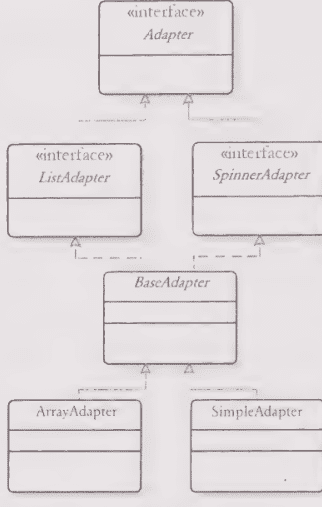

图 29.1: ListAdapter 的父类和实现

### 创建 ListAdapter

如上一节所述，使用 ListView 最困难的部分是为它创建数据源。你需要一个 `ListAdapter`，正如图 29.1 所示，你至少有两种可以使用的 `ListAdapter` 实现。

`ListAdapter` 的一个具体实现是 `ArrayAdapter` 类。`ArrayAdapter` 由对象数组支持。每个对象的 `toString` 方法返回的字符串被用于填充 ListView 中的每个项目。

`ArrayAdapter` 类提供了几个构造函数。所有构造函数都要求你传递一个 `Context` 和一个指向包含 `TextView` 布局的资源标识符。这是因为 ListView 中的每个项目都是 `TextView`。以下是 `ArrayAdapter` 类中的一些构造函数：

```java
public ArrayAdapter(Context context, int resourceId)

public ArrayAdapter(Context context, int resourceId, Object[] objects)
```

如果在构造函数没有传递对象数组，你需要在以后传递。作为资源标识符，Android 为 `ListAdapter` 提供了一些预定义的布局。这些布局的标识符可以在 `android.R.layout` 类中找到。例如，你可以使用以下代码段创建 `ArrayAdapter`：

```java
ArrayAdapter<String> adapter = new ArrayAdapter<String>(this, android.R.layout.simple_list_item_1, objects);
```

使用 `android.R.layout.simple_list_item_1` 将创建一个具有最简单布局的 ListView，其中每个项目的文本以黑色打印。或者，你可以使用 `android.R.layout.simple_expandable_list_item_1`。不过，你可能想创建自己的布局并传递给它。这将有助于你对 ListView 的外观和感受有更多控制。

大多数情况下，可以使用字符串数组作为 ListView 的数据源。你可以通过编程或声明式的方式创建字符串数组。编程方式非常简单，且你不需要处理：

```java
String[] objects = { "item1", "item2", "item3" };
```

缺点是更新数组需要你重新编译类。另一方面，声明式地创建字符串数组提供了更大的灵活性。通过在 `res/values` 的 `strings.xml` 文件中创建以下内容来这样做：

```xml
<?xml version="1.0" encoding="utf-8"?>
<resources>
    <string-array name="players">
        <item>item1</item>
        <item>item2</item>
        <item>item3</item>
    </string-array>
</resources>
```

然后你可以使用它：

```java
String[] values = getResources().getStringArray(R.array.players);
```

### 使用 ListView

ListView 显示了由数组支持的 `ArrayAdapter`。该数组定义在 `strings.xml` 文件中。图 29.1 显示了 `strings.xml`。

```xml
<?xml version="1.0" encoding="utf-8"?>
<resources>
    <string-array name="players">
        <item>item1</item>
        <item>item2</item>
        <item>item3</item>
    </string-array>
</resources>
```

`ArrayAdapter` 的布局定义在图 29.2 所示的 `list_item.xml`。它位于 `res/layout` 并包含一个 `TextView`。


```xml
<?xml version="1.0" encoding="utf-8"?>
<TextView
    xmlns:android="http://schemas.android.com/apk/res/android"
    android:id="@+id/list_item"
    android:layout_width="fill_parent"
    android:layout_height="fill_parent"
    android:padding="7dp"
    android:textSize="16sp"
    android:textColor="@android:color/holo_green_dark"
    android:textStyle="bold"/>
```

# 第 29 章：ListView

```java
ListView listView = (ListView) findViewById(R.id.listView);
listView.setAdapter(adapter);
listView.setOnItemClickListener(new AdapterView.OnItemClickListener() {
    @Override
    public void onItemClick(AdapterView<?> parent, View view, int position, long id) {
        String item = (String) parent.getItemAtPosition(position);
        AlertDialog.Builder builder = new AlertDialog.Builder(MainActivity.this);
        builder.setMessage("Selected item: " + item).setTitle("ListView");
        builder.create().show();
        Log.d("ListView", "Selected item : " + item);
    }
});

@Override
public boolean onCreateOptionsMenu(Menu menu) {
    getInflater().inflate(R.menu.main, menu);
    return true;
}
```

图 29.2 显示了该应用。


图 29.2：一个简单的 ListView

# 扩展 ListActivity 和编写自定义适配器

如果你的 activity 只有一个作为 ListView 的组件，你应该考虑扩展 `ListActivity` 类，而不是 `Activity`。使用 `ListActivity` 时，你不需要为 activity 准备布局文件。`ListActivity` 已经包含了一个 `ListView`，你也不需要为它绑定监听器。此外，`ListActivity` 已经定义了 `setListAdapter()` 方法，你只需要在 `onCreate()` 方法中调用它并传递一个 `Adapter` 即可。另外，与其创建 `AdapterView.OnClickListener`，你只需要重写 `ListActivity` 的 `onItemClick()` 方法，当 List 中的项被选中时，该方法会被调用。

`ListViewDemo2` 应用向你展示了如何使用 `ListActivity`。该应用还演示了如何通过扩展 `ArrayAdapter` 并为自定义适配器创建一个布局文件来创建一个自定义的适配器。

`ListViewDemo2` 中自定义 `ListAdapter` 的布局文件位于 29.5 节。它命名为 `pretty_adapter.xml`，位于 `res/layout` 目录下。

# 列表 29.5：pretty_adapter.xml 文件

```xml
<?xml version="1.0" encoding="utf-8"?>
<LinearLayout
    xmlns:android="http://schemas.android.com/apk/res/">
    <ImageView
        android:id="@id/icon"
        android:layout_width="36dp"
        android:layout_height="fill_parent"/>
    <TextView
        android:id="@id/label"
        android:layout_width="fill_parent"
        android:layout_height="fill_parent"
        android:gravity="center_vertical"
        android:padding="12dp"
        android:textSize="18sp"
        android:textColor="@android:color/holo_blue_bright"/>
</LinearLayout>
```

列表 29.6 显示了自定义适配器类，名为 `PrettyAdapter`。

### 列表 29.6：PrettyAdapter 类

```java
package com.example.listviewdemo2;
import android.content.Context;
import android.content.graphics.drawable.Drawable;
import android.view.LayoutInflater;
import android.view.View;
import android.view.ViewGroup;
import android.widget.ArrayAdapter;
import android.widget.ImageView;
import android.widget.TextView;

public class PrettyAdapter extends ArrayAdapter<String> {
    private LayoutInflater inflater;
    private String[] items;
    private Drawable icon;
    private int viewResourceId;

    public PrettyAdapter(Context context, int viewResourceId, String[] items, Drawable icon) {
        super(context, viewResourceId, items);
        inflater = (LayoutInflater) context.getSystemService(Context.LAYOUT_INFLATER_SERVICE);
        this.items = items;
        this.icon = icon;
        this.viewResourceId = viewResourceId;
    }

    @Override
    public int getCount() {
        return items.length;
    }

    @Override
    public String getItem(int position) {
        return items[position];
    }

    @Override
    public long getItemId(int position) {
        return 0;
    }

    @Override
    public View getView(int position, View convertView, ViewGroup parent) {
        convertView = inflater.inflate(viewResourceId, null);
        ImageView imageView = (ImageView) convertView.findViewById(R.id.icon);
        imageView.setImageDrawable(icon);
        TextView textView = (TextView) convertView.findViewById(R.id.label);
        textView.setText(items[position]);
        return convertView;
    }
}
```

自定义适配器必须重写几个方法，特别是 `getView()` 方法，它必须返回一个将用于 `ListView` 上每个项的 `View`。在这个示例中，视图包含一个 `ImageView` 和一个 `TextView`。`TextView` 的文本来自传递给 `PrettyAdapter` 实例的数组。

应用的最后一部分是列表 29.7 中的 `MainActivity` 类。它扩展了 `Activity`，是应用中唯一的 activity。

# 列表 29.7：ListViewDemo2 的 MainActivity 类

```java
package com.example.listviewdemo2;

import android.app.Activity;
import android.content.Context;
import android.content.res.Resources;
import android.graphics.drawable.Drawable;
import android.os.Bundle;
import android.util.Log;
import android.view.View;
import android.widget.ListView;

public class MainActivity extends Activity {

    @Override
    protected void onCreate(Bundle savedInstanceState) {
        super.onCreate(savedInstanceState);
        Context context = getContext();
        Resources resources = getResources();

        String[] items = resources.getStringArray(R.array.players);
        Drawable icon = resources.getDrawable(R.drawable.pretty);

        PrettyAdapter adapter = new PrettyAdapter(context, R.layout.list_item, items, icon);
        ListView listView = (ListView) findViewById(R.id.listView);
        listView.setAdapter(adapter);
    }

    @Override
    public boolean onCreateOptionsMenu(Menu menu) {
        getInflater().inflate(R.menu.main, menu);
        return true;
    }
}
```

### 选中项

通常希望用户能够清晰地看到 `ListView` 中的选中的项。为了让选中项与其他项不同，将 `ListView` 的选择模式设置为 `CHOICE_SINGLE`，如下：

```java
listView.setChoiceMode(ListView.CHOICE_SINGLE);
```

当构造 `ListAdapter` 时，使用带有适当样式的布局。例如，接下来的 `ArrayAdapter` 将使选中项具有蓝色背景。

```java
ArrayAdapter<String> adapter = new ArrayAdapter<String>(context, R.layout.simple_item, array);
```


# 图 29.3：在 ListActivity 中自定义适配器

```xml
<selector xmlns:android="http://schemas.android.com/apk/res/">
    <item android:state_activated="true" android:drawable="@drawable/activated"/>
</selector>
```

选择器必须包含一个状态标记为 true 的项，其 drawable 引用另一个 drawable。

`ListViewDemo3` 应用包含一个并排两个 `ListView` 的 activity。左侧第一个 `ListView` 使用默认样式，而右侧第二个 `ListView` 使用自定义样式进行装饰。图 29.4 显示了该应用。

现在，让我们来看代码。从列表 29.8 中的 activity 布局开始。


图 29.4：ListView 的选中项

# 列表 29.8：主 activity 的布局文件 (activity_main.xml)

```xml
<LinearLayout
    xmlns:android="http://schemas.android.com/apk/res/"
    android:layout_width="match_parent"
    android:layout_height="match_parent"
    android:orientation="horizontal">

    <ListView
        android:id="@+id/listView1"
        android:layout_weight="1"
        android:layout_width="0dp"
        android:layout_height="match_parent"/>
    <ListView
        android:id="@+id/listView2"
        android:layout_weight="1"
        android:layout_width="0dp"
        android:layout_height="match_parent"/>
</LinearLayout>
```

列表 29.9 中的 `MainActivity` 类代表了应用的 activity。它的 `onCreate()` 方法加载了两个 `ListView` 并将它们传递给 `ArrayAdapter`。此外，第一个 `ListView` 的选择模式被设置为 `CHOICE_SINGLE`，使得一次只能选中一个项。第二个 `ListView` 的选择模式被设置为 `CHOICE_MODE_MULTIPLE`，这使得可以同时选择多个项。

### 列表 29.9：MainActivity 类

```java
package com.example.liveviewdemo3;

import android.app.Activity;
import android.os.Bundle;
import android.widget.ArrayAdapter;
import android.widget.ListView;

public class MainActivity extends Activity {

    @Override
    protected void onCreate(Bundle savedInstanceState) {
        super.onCreate(savedInstanceState);
        setContentView(R.layout.activity_main);

        String[] cities = {"Rome", "Venice", "Basel"};

        ArrayAdapter<String> adapter = new ArrayAdapter<String>(this, R.layout.simple_list_item_activated, cities);

        ListView listView1 = (ListView) findViewById(R.id.listView);
        listView1.setAdapter(adapter);
        listView1.setChoiceMode(ListView.CHOICE_MODE_SINGLE);

        ArrayAdapter<String> adapter2 = new ArrayAdapter<String>(this,
    }
}
```


R.layout.list_item, cities);

ListView listView2 = (ListView) findViewById(R.id.listView2);

listView2.setAdapter(adapter2);

listView2.setChoiceMode(ListView.CHOICE_MODE_MULTIPLE);

}

}

第一个 `ListView` 的 `Adapter` 使用默认布局（`simple_list_item_activated`）。另一方面，第二个 `ListView` 的 `Adapter` 使用由 `R.layout.list_item` 指向的布局。这引用列表 29.9 显示的 `res/layout/list_item.xml` 文件。

# 列表 29.10：list_item.xml 文件

```xml
<?xml version="1.0" encoding="utf-8"?>
<TextView xmlns:android="http://schemas.android.com/apk/res/android"
    android:id="@id/list_item"
    android:layout_width="fill_parent"
    android:layout_height="fill_parent"
    android:padding="7dip"
    android:textSize="16sp"
    android:textStyle="bold"
    android:background="drawable/list_selector" />
```

`ListView` 的布局必须包含一个 `TextView`，如 `list_item.xml` 文件所示。注意，其背景属性被赋予了值 `drawable/list_selector`，它引用了列表 29.11 中的 `list_selector.xml` 文件。这是一个用于选择 `listView2` 上被选中项的选择器文件。`selector` 元素包含一个 `state_activated` 属性设置为 `true` 的项，这意味着它将用于用于设置被选中项的样式。它的 `drawable` 属性被设置为 `drawable/activated`，引用列表 29.12 中的 `drawable/activated.xml` 文件。

# 列表 29.11：drawable/list_selector.xml 文件

```xml
<?xml version="1.0" encoding="utf-8"?>
<selector xmlns:android="http://schemas.android.com/apk/res/android">
  <item android:state_activated="true"
       android:drawable="@drawable/activated"/>
</selector>
```

# 列表 29.12：drawable/activated.xml 文件

```xml
<shape xmlns:android="http://schemas.android.com/apk/res/android"
    android:shape="rectangle">
  <corners android:radius="8dp"/>
  <gradient
    android:startColor="#FFFF00"
    android:endColor="#FFFF00"
    android:angle="45"/>
</shape>
```

列表 29.12 中的 drawable 基于一个 XML 文件，该文件包含一个具有给定渐变颜色的形状。

运行应用程序将为你提供一个如图 29.4 所示的 Activity。

## 总结

`ListView` 是一个包含可滚动项列表的视图，它的数据源和布局获取自 `ListAdapter`，而 `ListAdapter` 进而可以通过 `ArrayAdapter` 创建。在本章中，你学习了如何使用 `ListView`。你还学习了如何使用 `Activity` 以及在 `ListView` 中选择被选中的项。

# 第 30 章：GridView

`GridView` 是一种可以在网格中显示可滚动项列表的视图。它与 `ListView` 类似，但不同之处在于它在多列中显示项，而 `ListView` 的项是在单列中显示的。和 `ListView` 一样，`GridView` 从 `ArrayAdapter` 获取其数据源和布局。

本章展示了如何使用 `GridView` 控件并提供了一个示例应用程序。在尝试阅读本章之前，你应该先阅读第 29 章“ListView”。

### 概述

`android.widget.GridView` 类是创建 `GridView` 的模板。`GridView` 和 `ListView` 类都是 `android.AbsListView` 的直接后代。与 `ListView` 类似，`GridView` 从 `ArrayAdapter` 获取其数据源。关于 Adapter 的更多信息，请参阅第 29 章“ListView”。

你可以像使用其他视图一样使用 `GridView`：通过在布局文件中声明一个节点。对于 `GridView`，你会使用这个 `GridView` 元素：

```xml
<GridView
    android:id="+id/gridView"
    android:layout_width="fill_parent"
    android:layout_height="fill_parent"
    android:numColumns="auto fit"
    android:verticalSpacing="10dp"
    android:horizontalSpacing="10dp" />
```

然后你可以使用 `findViewById` 在类中找到 `GridView` 并向它传递一个 adapter。

```java
GridView gridView = (GridView) findViewById(R.id.gridView);
gridView.setAdapter(adapter);
```

可选的，你可以使用 `setItemClickListener` 来响应选择：

```java
gridView.setOnItemClickListener(new AdapterView.OnItemClickListener() {
    public void onItemClick(AdapterView parent, View v, int position, long id) {
        // 在此处操作
    }
});
```

### 示例

`GridView` 展示了如何使用 `GridView`。`GridView` 填充整个显示区域。

### 列表 30.1：AndroidManifest.xml

```xml
<?xml version="1.0" encoding="utf-8"?>
<manifest xmlns:android="http://schemas.android.com/apk/res/android"
    package="com.example.gridview"
    android:versionCode="1"
    android:versionName="1.0">
    <application
        android:allowBackup="true"
        android:icon="@drawable/launcher"
        android:label="@string/app_name"
        android:theme="@style/AppTheme">
        <activity android:name=".MainActivity">
            <intent-filter>
                <action android:name="android.intent.action.MAIN" />
                <category android:name="android.intent.category.LAUNCHER" />
            </intent-filter>
        </activity>
    </application>
</manifest>
```

供给 `GridView` 的自定义 Adapter 是 `GridAdapter` 的实例，其见列表 30.2。`GridAdapter` 继承自 `BaseAdapter`，后者实现了 `ListAdapter` 接口。因此，`GridAdapter` 是一个 `ListAdapter` 并可以传递给 `GridView` 的 `setAdapter` 方法。

### 列表 30.2：GridAdapter 类

```java
package com.example.gridview;

import android.content.Context;
import android.view.View;
import android.view.ViewGroup;
import android.widget.BaseAdapter;
import android.widget.GridView;
import android.widget.ImageView;

public class GridAdapter extends BaseAdapter {

    private Context context;

    public GridAdapter(Context context) {
        this.context = context;
    }

    private int[] icons = {
        android.R.drawable.btn_star_off,
        android.R.drawable.btn_star_on,
        android.R.drawable.alert_light_frame,
        android.R.drawable.alert_dark_frame,
        android.R.drawable.arrow_down_float,
        android.R.drawable.gallery_thumb,
        android.R.drawable.ic_dialog_map,
        android.R.drawable.ic_popup_full,
        android.R.drawable.star_big_on,
        android.R.drawable.star_big_off,
        android.R.drawable.star_big_on
    };

    @Override
    public int getCount() {
        return icons.length;
    }

    @Override
    public Object getItem(int position) {
        return null;
    }

    @Override
    public long getItemId(int position) {
        return 0;
    }

    @Override
    public View getView(int position, View convertView, ViewGroup parent) {
        ImageView imageView;
        if (convertView == null) {
            imageView = new ImageView(context);
            imageView.setLayoutParams(new GridView.LayoutParams(100, 100));
            imageView.setScaleType(ImageView.ScaleType.CENTER_CROP);
            imageView.setPadding(10, 10, 10, 10);
        } else {
            imageView = (ImageView) convertView;
        }
        imageView.setImageResource(icons[position]);
        return imageView;
    }
}
```

`GridViewAdapter` 提供了 `getView` 方法的实现，返回一个显示 Android 默认绘制资源的 `ImageView`：

```java
private int[] icons = {
    android.R.drawable.btn_star_big_off,
    android.R.drawable.btn_star_big_on,
    android.R.drawable.alert_light_frame,
    android.R.drawable.alert_dark_frame,
    android.R.drawable.arrow_down_float,
    android.R.drawable.gallery_thumb,
    android.R.drawable.ic_dialog_map,
    android.R.drawable.ic_popup_dialog_full,
    android.R.drawable.star_big_on,
    android.R.drawable.star_big_off,
    android.R.drawable.star_big_on
};
```

现在你已经知道 `GridLayout` 的工作原理了，现在可以关注 activity 了。该 activity 的布局位于列表 30.3 中。它只包含一个组件，即 Grid。

# 列表 30.3：activity_main.xml 文件

```xml
<?xml version="1.0" encoding="utf-8"?>
<GridView
    android:x="http://schemas.android.com/apk/res/android"
    android:id="@id/grid"
    android:layout_width="fill_parent"
    android:layout_height="fill_parent"
    android:columnWidth="90dp"
    android:numColumns="auto fit"
    android:verticalSpacing="10dp"
    android:horizontalSpacing="10dp"
    android:stretchMode="column"
    android:gravity="center" />
```

列表 30.4 显示了 `MainActivity` 类。

### 列表 30.4：MainActivity 类

```java
package com.example.gridviewdemol;
import android.app.Activity;
import android.os.Bundle;
import android.view.Menu;
import android.view.View;
import android.widget.AdapterView;
import android.widget.AdapterView.OnItemClickListener;
import android.widget.GridView;
import android.widget.Toast;
```

```java
public class MainActivity extends Activity {
    @Override
    protected void onCreate(Bundle savedInstanceState) {
        super.onCreate(savedInstanceState);
        setContentView(R.layout.activity_main);
        GridView gridview = (GridView) findViewById(R.id.grid);
```

```java
gridview.setAdapter(new GridAdapter(this));
gridview.setOnItemClickListener(new OnItemClickListener() {
    public void onItemClick(Adapter<?> parent,
        View view, int position, long id) {
        Toast.makeText(MainActivity.this, "" + position,
        Toast.LENGTH_SHORT).show();
    }
});
```

```java
@Override
```


```java
public boolean onCreateOptionsMenu(Menu menu) {
    getMenuInflater().inflate(R.menu.main, menu);
    return true;
}
```

`MainActivity` 是一个简单的类，其大部分逻辑位于 `onCreate` 方法中。在这里，它从布局中加载 `GridView`，并将 `GridViewAdapter` 的实例传递给 `GridView` 的 `setAdapter` 方法。它还为 `GridView` 创建了一个 `onItemClickListener`，这样每当选择 `GridView` 上的项时，监听器中的 `onItemClick` 方法就会被调用。在这种情况下，`onItemClick` 只是创建一个显示所选项位置的 `Toast`。

运行 `GridDemo` 会得到一个类似于图 30.1 所示 activity。


图 30.1：使用 GridView

## 总结

`GridView` 是一种包含以网格形式显示的可滚动项列表的视图。与 `ListView` 类似，`GridView` 的数据和布局源自 `ListAdapter`。此外，`GridView` 还可以被赋予一个 `AdapterView.OnItemClickListener` 来处理项的选择。

# 第 31 章：样式 与主题

应用程序的外观和感觉由其使用的样式和主题控制。本章将讨论这两个重要主题并向你展示如何使用它们。

### 概述

布局文件中的视图声明可以具有属性，其中许多与样式相关，如 `textColor`、`textSize`、`background` 和 `textAppearance`。

应用程序的相关样式属性可以归一组，并给该组命名移动到 `styles.xml` 文件中。保存在 `res/values` 目录下的 `styles.xml` 文件会被应用程序识别为样式文件，文件中的样式可用于应用程序中的视图。要将样式应用到视图，请使用 `style` 属性。创建样式的优点是它是可重用且可搜索的。样式支持继承，你可以将样式扩展到视图。这里是 `styles.xml` 文件中样式的示例：

```xml
<style name="Style1">
  <item name="android:layout_width">wrap_content</item>
  <item name="android:layout_height">wrap_content</item>
  <item name="android:textColor">#FFFFFF</item>
  <item name="android:textSize">bold</item>
  <item name="android:textSize">25sp</item>
</style>
```

要将样式应用到视图，请使用 `style` 属性。创建样式的优点是它是可重用且可搜索的。样式支持继承，你可以将样式扩展到视图。这里是 `styles.xml` 文件中样式的示例：

```xml
<TextView
  android:id="@id/textView1"
  style="Style1" />
```

注意，上面的 `TextView` 声明等同于：

```xml
<TextView
  android:id="@id/textView1"
  android:layout_width="wrap_content"
  android:layout_height="wrap_content"
  android:textColor="#FFFFFF"
  android:textSize="bold"
  android:textSize="25sp" />
```

系统提供了大量的你可以使用的样式集合。例如：

```xml
<TextView
  android:id="@id/textView1"
  style="Style1" />
```

### 使用样式

列表 31.1 中的 `styles.xml` 文件展示了如何创建自己的样式。前两个是 Android 在创建应用程序时添加的。

#### 列表 31.1：styles.xml

```xml
<resources>
<style name="Style1">
  <item name="android:layout_width">wrap_content</item>
  <item name="android:layout_height">wrap_content</item>
  <item name="android:textColor">#FFFFFF</item>
  <item name="android:textSize">bold</item>
  <item name="android:textSize">25sp</item>
</style>
<style name="Style2" parent="Style1">
  <item name="android:background">@android:color/holo_light</item>
</style>
</resources>
```

列表 31.1 中的 `styles.xml` 文件中定义了五个样式。前两个是 Android 在创建应用程序时添加的。它们将在本章后面的“主题”部分进行解释。

另外三个样式被应用程序的主 activity 使用。其布局位于列表 31.2。

#### 列表 31.2：activity_xml 布局文件

```xml
<RelativeLayout
    xmlns:android="http://schemas.android.com/apk/res/android"
    xmlns:tool="http://schemas.android.com/tools"
    android:layout_width="match_parent"
    android:layout_height="match_parent"
    android:paddingBottom="8dp/activity_vertical_margin"
    android:paddingLeft="8dp/activity_horizontal_margin"
    android:paddingRight="8dp/activity_horizontal_margin"
    android:paddingTop="8dp/activity_vertical_margin"
    tool:context=".MainActivity">
    <TextView
        android:id="@id/textView1"
        style="@style/WhiteOnRed"
        android:text="Style WhiteOnRed" />
    <TextView
        android:id="@id/textView2"
        android:layout_below="@id/textView1"
        android:layout_marginLeft="20dp"
        android:layout_marginTop="10dp"
        style="@style/WhiteOnRed.Italic"
        android:text="Style WhiteOnRed.Italic" />
    <TextView
        android:id="@id/textView3"
        android:layout_below="@id/textView2"
        android:layout_ToEnd="@id/textView2"
        style="@style/WhiteOnGreen"
        android:text="Style WhiteOnGreen" />
</RelativeLayout>
```

```xml
android:layout_below="@id/textView2"
android:layout_width="wrap_content"
android:layout_height="wrap_content"
style="@android:style/TextAppearance.Holo.Medium"/>
</RelativeLayout>
```

列表 31.3 显示了使用列表 31.2 中布局文件的 activity。

#### 列表 31.3：MainActivity 类

```java
package com.example.styledemol;
import android.os.Bundle;
import android.os.app.Activity;
import android.view.Menu;

public class MainActivity extends Activity {
    @Override
    protected void onCreate(Bundle savedInstanceState) {
        super.onCreate(savedInstanceState);
        setContentView(R.layout.activity_main);
    }
    @Override
    public boolean onCreateOptionsMenu(Menu menu) {
        // Inflate menu, this adds items to the action bar if
        // it is present.
        getMenuInflater().inflate(R.menu.main, menu);
        return true;
    }
}
```

Figure 31.1 显示了 StyleDemol 应用。

### 使用主题

主题是一种应用于单个 activity 或应用程序中所有 activity 的样式。要对 activity 应用主题，请在清单文件中的 activity 元素中使用 `android:theme` 属性。例如，以下 activity 元素使用了 `Theme.Holo.Light` 主题。

```xml
<activity
    android:name=""
    android:theme="@android:style/Theme.Holo.Light">
</activity>
```

要对整个应用程序应用主题，请在 Android 清单文件中的 application 元素中添加 `android:theme` 属性。例如，


Figure 31.1: 使用样式

```xml
<application
    android:icon="@drawable/ic_launcher"
    android:label="@string/app_name"
    android:theme="@android:style/Theme.Black.NoTitleBar">
</application>
```

Android 提供了一系列供你在应用程序中使用的主题。你可以在此处找到主题文件的副本：

```
https://android.googlesource.com/platform/frameworks/base/+/refs/heads/master/core/res/res/values/themes.xml
```

Figure 31.2 到 31.5 显示了随 Android 自带的一些主题。


Figure 31.2: Theme.Holo.Dialog.NoActionBar


Figure 31.3: Theme.Light


## 总结

样式是一组直接影响 view 外观的属性。你可以通过在布局文件的 view 声明中使用 `style` 属性将样式应用于 view。主题是应用于 activity 或整个应用程序的样式。

# 第 32 章：位图处理

通过 Android Bitmap API，你可以操作 JPG、PNG 或 GIF 格式的图像，例如更改图像中每个像素的颜色。此外，你可以使用 API 对大图像进行下采样以节省内存。即使你不编写照片编辑器或应用程序，了解如何使用此 API 也是有用的。本章将解释如何处理位图并提供示例。

### 概述

位图是一种可以独立存储图像的图像格式。今天，术语还包括支持有损和无损压缩的格式，例如 JPEG、GIF 和 PNG。GIF 和 PNG 支持透明度和无损压缩，而 JPEG 支持有损压缩不支持透明。另一种表示图像的方法是通过表达式。Android 框架提供了处理位图的 API，其形式为类、接口和枚举，位于 `android.graphics` 包中。位图由 `Bitmap` 类表示。可以使用 `ImageView` 显示位图。加载位图最简单的方法是使用 `Bitmap` 类。该类提供了从文件、字节数组、Android 资源或 InputStream 构建 Bitmap 对象的静态方法。以下是部分方法：

```java
public static Bitmap decodeByteArray(byte[] data, int offset, int length)
public static Bitmap decodeFile(java.lang.String pathName)
public static Bitmap decodeResource(android.content.res.Resources res, int id)
```

例如，在 activity 类中从 Android 资源构造 Bitmap，可以使用此代码：

```java
bmp = BitmapFactory.decodeResource(getResources(), R.drawable.image);
```

在这里，`getResources()` 是 `android.app.Activity` 类中的方法，返回应用程序资源。`R.drawable.image` 允许 Android 从资源中选取正确的图像。`Bitmap` 类还提供了接受 options 的静态方法：


# Bitmap 处理

## BitmapFactory 解码方法

```java
public static Bitmap decodeByteArray(byte[] data, int offset, int length, Bitmap.Options opts)
public static Bitmap decodeFile(java.lang.String pathName, Bitmap.Options opts)
public static Bitmap decodeResource(android.content.res.Resources res, int id, Bitmap.Options opts)
public static Bitmap decodeStream(java.io.InputStream is, Bitmap.Options opts)
```

使用 `Bitmap.Options` 有两个目的。第一个是将位图配置为可变的并允许你下采样位图。第二个目的是使用 `Bitmap.Options` 在不实际加载的情况下读取位图的属性。例如，你可以将 `Bitmap.Options` 传递给 `BitmapFactory` 的解码方法之一并读取图像尺寸。如果尺寸太大，可以对其进行下采样以节省内存。对于大位图，下采样是有意义的。例如，`20000x10000` 的位图可以下采样到 `2000x1000`，而不会超过设备屏幕分辨率。

为了不实际加载位图，需将 `inJustDecodeBounds` 设置为 `true` 的 `Bitmap.Options` 对象传递给解码方法：

```java
BitmapFactory.Options opts = new BitmapFactory.Options();
opts.inJustDecodeBounds = true;
```

如果你将 options 传递给 `BitmapFactory` 的解码方法之一，则从该对象中你可以检索位图尺寸和其他属性：

```java
int imageHeight = options.outHeight;
int imageWidth = options.outWidth;
String imageType = options.outMimeType;
```

`Bitmap` 的 `inSampleSize` 字段告诉系统如何采样位图。大于 1 的值表示图像应该下采样。例如，将 `inSampleSize` 字段设置为 4 返回的尺寸为原始图像分之一的图像。

关于该字段，Android 文档说解码器使用基于 2 的幂的值，这意味着你应该只赋值 2 的幂，例如 2、4、8 等。然而，我的测试显示这适用于 JPG 格式的图像，而不适用于 PNG。例如，如果 PNG 图像的宽度为 1200，赋值 3 将返回一个宽度为 400 像素的图像，这意味着 `inSampleSize` 值不需要是 2 的幂。

最后，一旦从 `BitmapFactory` 获取了位图，就可以将位图传递给 `ImageView` 显示：

```java
ImageView imageView = (ImageView) findViewById(...);
imageView.setImageBitmap(bitmap);
```

## 示例：BitmapDemo 应用

`BitmapDemo` 应用展示了一个 activity，该 activity 显示了一个显示可以下采样的 `Bitmap` 的 `ImageView`。其中包含了四个位图（两个 JPEG、一个 GIF 和一个 PNG），应用程序提供了一个更改位图的按钮。应用程序的主（也是唯一的）activity 显示在 Figure 32.1 中。

Listing 32.1 显示了应用程序的 `AndroidManifest.xml` 文件。

### Listing 32.1: AndroidManifest.xml 文件

```xml
<?xml version="1.0" encoding="utf-8"?>
<manifest
    xmlns:android="http://schemas.android.com/apk/res/android"
    package="com.example.bitmapdemo"
    android:versionCode="1">
    <sdk
        android:minSdkVersion="18"
        android:targetSdkVersion="18" />
    <application
        android:allowBackup="true"
        android:icon="@drawable/ic_launcher"
        android:label="@string/app_name"
        android:theme="@style/AppTheme">
        <activity
            android:name="com.example.bitmapdemo.MainActivity"
            android:label="@string/app_name">
            <intent-filter>
                <action android:name="android.intent.action.MAIN"/>
                <category android:name="android.intent.category.LAUNCHER"/>
            </intent-filter>
        </activity>
    </application>
</manifest>
```

该应用程序中只有一个 activity。该 activity 的布局文件在 Listing 32.2 中。


### Listing 32.2: activity_main.xml 文件

```xml
<LinearLayout
    xmlns:android="http://schemas.android.com/apk/res/android"
    xmlns:tools="http://schemas.android.com/tools"
    android:layout_width="match_parent"
    android:layout_height="match_parent"
    android:orientation="vertical"
    android:gravity="bottom"
    tools:context=".MainActivity">

    <ImageView
        android:id="@id/image_view"
        android:layout_width="wrap_content"
        android:layout_height="wrap_content"
        android:contentDescription="@string/text_content_desc"/>

    <LinearLayout
        android:layout_width="match_parent"
        android:layout_height="wrap_content"
        android:orientation="horizontal">

        <TextView
            android:layout_width="wrap_content"
            android:layout_height="wrap_content"
            android:text="@string/text_sample_size" />
        <TextView
            android:id="@id/sample_size"
            android:layout_width="wrap_content"
            android:layout_height="wrap_content" />
        <Button
            android:onClick="scaleUp"
            android:layout_width="wrap_content"
            android:layout_height="wrap_content"
            android:text="@string/action_scale_up" />
        <Button
            android:onClick="scaleDown"
            android:layout_width="wrap_content"
            android:layout_height="wrap_content"
            android:text="@string/action_scale_down" />
    </LinearLayout>

    <LinearLayout
        android:layout_width="match_parent"
        android:layout_height="wrap_content"
        android:orientation="horizontal">
        <TextView
            android:id="@id/image_info"
            android:layout_width="wrap_content"
            android:layout_height="wrap_content" />
        <Button
            android:onClick="changeImage"
            android:layout_width="wrap_content"
            android:layout_height="wrap_content"
            android:text="@string/action_change_image" />
    </LinearLayout>
</LinearLayout>
```

该布局包含一个 `LinearLayout`，该 `LinearLayout` 又包含一个 `ImageView` 以及两个用于放大和缩小位图的 `Button`。第二个内部布局包含一个用于显示位图元数据的 `TextView` 和一个用于更改位图的按钮。

`MainActivity` 类如 Listing 32.3 所示。

### Listing 32.3: MainActivity 类

```java
package com.example.bitmapdemo;

import android.app.Activity;
import android.graphics.Bitmap;
import android.graphics.BitmapFactory;
import android.os.Bundle;
import android.view.Menu;
import android.view.View;
import android.widget.ImageView;
import android.widget.TextView;

public class MainActivity extends Activity {
    int screenSize = 2;
    int imageId = 1;
    int sampleSize = 2; // Added missing field based on usage

    @Override
    protected void onCreate(Bundle savedInstanceState) {
        super.onCreate(savedInstanceState); // Fixed typo: super.create -> super.onCreate
        setContentView(R.layout.activity_main);
        refreshImage();
    }

    @Override
    public boolean onCreateOptionsMenu(Menu menu) {
        getMenuInflater().inflate(R.menu.main, menu); // Fixed typo: getInflater -> getMenuInflater
        return true;
    }

    public void scaleDown(View view) {
        if (sampleSize < 8) {
            sampleSize++;
            refreshImage();
        }
    }

    public void scaleUp(View view) {
        if (sampleSize > 2) {
            sampleSize--;
            refreshImage();
        }
    }

    private void refreshImage() {
        BitmapFactory.Options options = new BitmapFactory.Options();
        options.inJustDecodeBounds = true;
        BitmapFactory.decodeResource(getResources(), R.drawable.image, options); // Fixed logic: call decode method
        int imageHeight = options.outHeight;
        int imageWidth = options.outWidth;
        String imageType = options.outMimeType;

        StringBuilder imageInfo = new StringBuilder();
        int id = R.drawable.image;
        if (imageId == 2) {
            id = R.drawable.image2;
            imageInfo.append("Image 2.");
        } else if (imageId == 3) {
            id = R.drawable.image3;
            imageInfo.append("Image 3.");
        } else if (imageId == 4) {
            id = R.drawable.image4;
            imageInfo.append("Image 4.");
        } else {
            imageInfo.append("Image 1.");
        }
        imageInfo.append(" Original Dimension: " + imageWidth + " x " + imageHeight);
        imageInfo.append(". MIME type: " + imageType);
        // Assuming code continues to load bitmap with inSampleSize and set to views
    }
}
```

## 硬件加速

现代智能手机和平板配备了图形处理器（GPU），这是一种专门用于图像创建和渲染的电子电路。从 Android 3.0 开始，Android 框架将利用设备上找到的任何 GPU，从而通过硬件加速提高性能。对于目标为 Android API 级别 14 或以上的任何应用程序，默认启用硬件加速。

遗憾的是，目前在开启硬件加速时，并不是所有的绘制操作都能正常工作。你可以通过在 Android manifest 文件中的 `application` 或 `activity` 元素将 `android:hardwareAccelerated` 属性设置为 `false` 来禁用硬件加速。例如，要关闭整个应用程序的硬件加速，可以使用：

```xml
<application android:hardwareAccelerated="false"> ... </application>
```

要在 activity 中禁用硬件加速，请使用此代码：

```xml
<activity android:hardwareAccelerated="false" />
```

可以在 application 或 activity 级别同时使用 `android:hardwareAccelerated` 属性。例如，以下代码表示应用程序中除一个 activity 以外的所有 activity 都应该应使用硬件加速。

```xml
<application android:hardwareAccelerated="true">
  <activity ... />
  <activity ... />
  <activity android:hardwareAccelerated="false" />
</application>
```

> **注意**
>
> 要尝试本章中的示例，你必须禁用硬件加速。

## 创建自定义视图

要创建一个自定义视图，请扩展 `android.view.View` 类或其一个子类，并重写它的 `onDraw` 方法。以下是 `onDraw` 的签名：

```java
protected void onDraw(android.graphics.Canvas canvas)
```

系统会调用 `onDraw` 方法并传递一个 `Canvas`。你可以使用 `Canvas` 中的方法来绘制形状和文本。你还可以创建 `path` 和 `region` 来绘制更复杂的形状。

`onDraw` 方法在应用程序生命周期内可能会被调用多次。因此，你不应该在此处执行昂贵的操作，例如分配对象。你在 `onDraw` 中需要的对象应该在其他地方创建。

例如，`Canvas` 中的大多数绘制方法都需要一个 `Paint`。不要在 `onDraw` 中创建 `Paint`，而应该在类级别创建它，并使其在 `onDraw` 中可用。以下类说明了这一点：


```java
public class MyCustomView extends View {
  Paint paint;
  paint = ... // 创建一个 Paint 对象
}

  @Override
  protected void onDraw(Canvas canvas) {
    // 在此处使用 paint。
  }
}
```

# 绘制基础形状

`Canvas` 类定义了 `drawLine`、`drawCircle` 和 `drawRect` 等方法来绘制形状。例如，以下代码显示了如何在你的 `onDraw` 方法中绘制形状。

```java
Paint paint = new Paint(Paint.FAKE_BOLD_TEXT_FLAG);

protected void onDraw(Canvas canvas) {
    // 改变画布背景颜色。
    canvas.drawColor(Color.parse("#bababa"));

    // 绘制基础形状
    canvas.drawLine(5, 200, 5, paint);
    canvas.drawLine(5, 15, 200, 15, paint);
    canvas.drawLine(5, 25, 200, 25, paint);

    paint.setColor(Color.YELLOW);
    canvas.drawCircle(50, 70, 35, paint);

    paint.setColor(Color.GREEN);
    canvas.drawRect(new Rect(100, 60, 150, 80), paint);

    paint.setColor(Color.DKGRAY);
    canvas.drawOval(new RectF(160, 60, 250, 80), paint);
}
```

图 33.1 显示了结果。图 33.1：基础形状

### 绘制文本

要在画布上绘制文本，请使用 `drawText` 方法和 `Paint`。例如，以下代码使用不同的颜色绘制文本。

```java
// 绘制文本
paint.setTextSize(22);
canvas.drawText("Welcome", 20, 100, paint);

textPaint.setColor(Color.MAGENTA);
textPaint.setTextSize(40);
canvas.drawText("Welcome", 20, 140, textPaint);
```

图 33.2 显示了绘制的文本。Welcome

# 透明度

Android 的图形 API 支持透明度。你可以通过为绘图使用的 `Paint` 分配一个 alpha 值来设置透明度。考虑以下代码。

```java
// 透明度
textPaint.setColor(0xFF465574);
textPaint.setTextSize(60);
canvas.drawText("Android Rocks", 20, 240, textPaint);

// 不透明圆
paint.setAlpha(110);
canvas.drawCircle(160, 300, 39, paint);

textPaint.setColor(Color.YELLOW);
textPaint.setAlpha(140);
canvas.drawCircle(240, 330, 30, textPaint);

textPaint.setColor(Color.MAGENTA);
textPaint.setAlpha(30);
canvas.drawCircle(288, 350, 30, textPaint);

paint.setColor(Color.CYAN);
paint.setAlpha(100);
canvas.drawCircle(380, 330, 50, paint);
```

图 33.3 显示了一些透明圆。

# 着色器

`Shader` 是一个颜色范围。你通过在以下代码中定义两个颜色来创建 `Shader`。

```java
// 着色器
Paint shaderPaint = new Paint();
Shader shader = new LinearGradient(0, 0, 0, 400, Color.RED, Color.GREEN, Color.CLAMP);
shaderPaint.setShader(shader);
```

图 33.4 显示了线性渐变。

# 裁剪

裁剪是限制画布绘制区域的过程。一旦裁剪了画布，超出该区域的绘制内容将不再渲染。裁剪区域可以是矩形、圆形或任意形状。图 33.5 显示了裁剪区域。

# 使用 Path

`Path` 是任意数量直线段、二次曲线和三次曲线的集合。`Path` 可以用于裁剪或在其上绘制文本。例如，此方法创建一个星。它接收中心坐标。一旦你裁剪了画布，在区域之外的绘制内容将不可见。`Canvas` 类提供了以下裁剪方法：`clipRect`、`clipPath` 和 `clipRegion`。例如，`clipRect` 使用一个矩形，`clipPath` 使用一个 `Path`，而 `clipRegion` 使用一个区域。

图 33.6 显示了绘制的文本。

## 第 33 章：图形与自定义视图 405


图 33.6：在路径上绘制文本

# CanvasDemo 应用程序

CanvasDemo应用程序包含一个自定义视图，并包含了本章介绍的所有代码段。图 33.7 显示了应用程序的主 Activity。


图 33.7：CanvasDemo应用程序

列表 33.1 显示了该应用程序的 AndroidManifest.xml 文件。它只有一个 Activity。

## 列表 33.1：AndroidManifest.xml 文件

```xml
<?xml version="1.0" encoding="utf-8"?>
<manifest
    xmlns:android="http://schemas.android.com/apk/res/android"
    package="com.example.canvasdemo"
    android:versionCode="1"
    android:versionName="1.0">

<uses-sdk
    android:minSdkVersion="18"
    android:targetSdkVersion="18" />

<application
    android:hardwareAccelerated="false"
    android:allowBackup="true"
    android:icon="@drawable/ic_launcher"
    android:label="@string/app_name"
    android:theme="@style/AppTheme">
    <activity
        android:name="com.example.canvas.MainActivity"
        android:label="@string/app_name">
        <intent-filter>
            <category android:name="android.intent.action.MAIN" />
            <category android:name="android.intent.category.LAUNCHER" />
        </intent-filter>
    </activity>
</application>
</manifest>
```

应用程序的主执行体是列表 33.2 中的 CustomView 类。它继承了 View 并重写了它的 onCreate 方法。

### 列表 33.2：CustomView 类

```java
package com.example.canvas;
import android.content.Context;
import android.graphics.Canvas;
import android.graphics.Color;
import android.graphics.LinearGradient;
import android.graphics.Paint;
import android.graphics.Path;
import android.graphics.Rect;
import android.graphics.RectF;
import android.graphics.Shader;
import android.graphics.Typeface;
import android.view.View;

public class CustomView extends View {

    public CustomView(Context context) {
        super(context);
    }
    Paint paint = new Paint(Paint.BOLD_TEXT_FLAG);
    Path startPath;
    Path curvePath;

    Paint textPaint = new Paint(Paint.LINEAR_TEXT_FLAG);
    Paint shaderPaint = new Paint();
    {
        Typeface typeface = Typeface.create(Typeface.SERIF, Typeface.BOLD);
        textPoint.setTypeface(typeface);
        Shader shader = new LinearGradient(0, 400, 300, 500,
                Color.RED, Color.GREEN, Shader.TileMode.CLAMP);
        textPoint.setShader(shader);
        // create星形路径
        starPath = createStarPath(300, 500);
        curvePath = createCurvePath();
    }

    protected void onDraw(Canvas canvas) {
        // 绘制基础形状
        canvas.drawLine(5, 200, 5, paint);
        canvas.drawLine(5, 15, 200, 15, paint);
        canvas.drawLine(5, 25, 200, 25, paint);

        paint.setColor(Color.YELLOW);
        canvas.drawCircle(50, 70, 35, paint);

        paint.setColor(Color.GREEN);
        canvas.drawRect(new Rect(100, 60, 150, 80), paint);

        paint.setColor(Color.DKGRAY);
        canvas.drawOval(new Rect(160, 60, 250, 80), paint);

        // 绘制文本
        textPoint.setText(20);
        canvas.drawText("Welcome", 20, 150, textPoint);
        textPoint.setColor(Color.MAGENTA);
        textPoint.setText(40);
        canvas.drawText("Welcome", 20, 190, textPoint);

        // 透明度
        textPoint.setColor(0xFF4654);
        textPoint.setText(60);
        canvas.drawText("Android", 20, 240, textPoint);

        // 不透明圆
        canvas.drawCircle(80, 300, 20, paint);
        // 半透明圆
        paint.setAlpha(110);
        canvas.drawCircle(160, 300, 39, paint);
        paint.setColor(Color.YELLOW);
        paint.setAlpha(140);
        canvas.drawCircle(240, 330, 30, paint);
        paint.setColor(Color.MAGENTA);
        paint.setAlpha(30);
        canvas.drawCircle(280, 350, 30, paint);
        paint.setColor(Color.CYAN);
        paint.setAlpha(100);
        canvas.drawCircle(380, 330, 50, paint);

        // 在路径上绘制文本
        textPoint.setColor(Color.rgb(155, 20, 10));
        canvas.drawText("Nice artistic touches", curvePath, 10, 10, textPoint);

        // 着色器
        canvas.drawRect(0, 400, 200, 500, shaderPaint);

        // 创建星形裁剪
        textPath.setColor(Color.CYAN);
        canvas.clipPath(starPath);
        textPath.setColor(Color.parseColor("yellow"));
        canvas.drawText("Android", 350, 550, textPath);
        textPath.setColor(Color.parseColor("#abde97"));
        canvas.drawText("Android", 400, 600, textPath);
        canvas.drawText("Android", 300, 650, textPath);
        canvas.drawText("Android", 320, 700, textPath);
        canvas.drawText("Android", 360, 750, textPath);
        canvas.drawText("Android", 320, 800, textPath);
    }

    private Path createStarPath(int x, int y) {
        Path path = new Path();
        path.moveTo(0 + x, 150 + y);
        path.lineTo(120 + x, 140 + y);
        path.lineTo(150 + x, 0 + y);
        path.lineTo(180 + x, 140 + y);
        path.lineTo(300 + x, 150 + y);
        path.lineTo(200 + x, 190 + y);
        path.lineTo(250 + x, 300 + y);
        path.lineTo(150 + x, 220 + y);
        path.lineTo(50 + x, 300 + y);
        path.lineTo(100 + x, 190 + y);
        path.lineTo(0 + x, 150 + y);
        return path;
    }

    private Path createCurvePath() {
        Path path = new Path();
        path.addArc(new RectF(400, 40, 780, 300), -210, 230);
        return path;
    }
}
```

列表 33.3 中的 MainActivity 类实例化了 CustomView 类，并将实例传递给它的 `setContentView` 方法。这与本书中的不同，在书中是将布局资源标识符传递给 `setContentView` 的另一个重载方法。

### 列表 33.3：MainActivity 类


```java
package com.example.canvasdemo;
import android.app.Activity;
import android.os.Bundle;

public class MainActivity extends Activity {
    @Override
    protected void onCreate(Bundle savedInstanceState) {
        super.onCreate(savedInstanceState);
        CustomView customView = new CustomView(this);
        setContentView(customView);
    }
}
```

## 总结

Android SDK 提供了广泛的视图可供你在应用程序中使用。如果其中没有一个能满足你的需求，你可以创建一个自定义视图并在其上进行绘制。本章向你展示了如何创建一个自定义视图并在画布上绘制多个形状。

## 第 34 章：Fragment（片段）

`Fragment` 是 Android 3.0 (API 级别 11) 添加的一项强大功能，是可嵌入到 `Activity` 中的组件。与自定义视图不同，`Fragment` 有自己的生命周期，并且可能有或没有用户界面。

本章将解释什么是 `Fragment`，并展示如何使用它们。

### Fragment 的生命周期

通过扩展 `android.app.Fragment` 类或其子类来创建 `Fragment`。`Fragment` 可能有也可以没有用户界面。没有用户界面（UI）的 `Fragment` 通常作为其嵌入 `Activity` 的工作者。如果 `Fragment` 有 UI，它可能包含在布局文件中视图，这些视图会在 `Fragment` 创建后加载。在许多方面，编写 `Fragment` 与编写 `Activity` 相似。

为了有效地创建 `Fragment`，你需要了解 `Activity` 的生命周期。图 34.1 显示了 `Fragment` 的生命周期。

`Fragment` 的生命周期与 `Activity` 相似。例如，它具有如 `onCreate`、`onAttach` 和 `onPause` 等回调方法。在此基础上，还有额外的方法如 `onAttach`、`onDestroyCreated` 和 `onDetach`。`onAttach` 在 `Fragment` 与 `Activity` 关联后调用，`onDestroyCreated` 在包含 `Fragment` 的 `Activity` 的 `onCreate` 方法后调用。`onDetach` 在 `Fragment` 从 `Activity` 分离之前调用。

以下是生命周期方法：

- `onAttach`：在与 `Activity` 关联后立即调用。
- `onCreate`：首次创建 `Fragment` 时调用。
- `onCreateView`：当需要为 `Fragment` 创建布局时调用。它必须返回 `Fragment` 的根视图。
- `onDestroyCreated`：告诉 `Fragment` 其所在 `Activity` 的 `onCreate` 方法已完成。
- `onStart`：当 `Fragment` 的视图对用户可见时调用。
- `onResume`：当所在的 `Activity` 进入 Resumed 状态（即 `Activity` 正在运行）时调用。
- `onPause`：当所在的 `Activity` 正在暂停时调用。
- `onStop`：当所在的 `Activity` 停止时调用。
- `onDestroyView`：允许 `Fragment` 释放用于其视图的资源。
- `onDestroy`：在 `Fragment` 销毁前允许其进行最后的清理。
- `onDetach`：在 `Fragment` 从 `Activity` 分离后立即调用。

### Activity 与 Fragment 的区别

`Activity` 和 `Fragment` 之间存在一些细微的差别。在 `Activity` 中，你通常在 `onCreate` 方法中使用 `setContentView` 方法为 `Activity` 设置视图，例如：

```java
protected void onCreate(android.os.Bundle savedInstanceState) {
    super(savedInstanceState);
    setContentView(R.layout.activity_main);
}
```

在 `Fragment` 中，你通常在它的 `onCreateView` 方法中创建一个视图。以下是方法签名：

```java
public View onCreateView(android.view.LayoutInflater inflater,
        android.view.ViewGroup container,
        android.os.Bundle savedInstanceState);
```

注意到开始传递给 `onCreateView` 的三个参数了吗？第一个参数是 `LayoutInflater`，你用它加载片段中的任何视图。第二个参数是 `Fragment` 应该附加的父视图。第三个参数是一个 `Bundle`，如果不为 `null`，则包含了来自之前保存状态的信息。

在 `Activity` 中，你可以通过调用 `Activity` 上的 `findViewById` 方法获取视图的引用。在 `Fragment` 中，你可以通过调用父视图上的 `findViewById` 来查找 `Fragment` 的视图。

```java
View root = inflater.inflate(R.layout.fragment_names, container, false);
View view = (View) root.findViewById(id);
```

另外注意，`Fragment` 不应该知道任何关于其 `Activity` 或其他片段的细节。如果你需要监听发生在 `Fragment` 中并会影响 `Activity` 或其他视图或片段的事件，请不要在 `Fragment` 类中编写监听器。相反，请响应片段事件触发一个新事件，并让 `Activity` 来处理它。

你将在本章的后续章节中学习更多关于创建片段的知识。

### Fragment 管理

要在 `Activity` 中使用 `Fragment`，请像使用 `View` 一样在布局文件中使用 `<fragment>` 元素。在 `android:name` 属性中指定类名，并在 `android:id` 属性中指定标识符。这是一个 `<fragment>` 元素的示例：

```xml
<fragment
    android:name="com.example.MyFragment"
    android:id="@id/fragment1"
/>
```

或者，你可以在 `Activity` 类中使用 `android.app.FragmentManager` 以程序的方式管理片段。你可以通过在 `Activity` 类中调用 `getFragmentManager` 来获取 `FragmentManager` 的默认实例。然后，调用 `FragmentManager` 上的 `beginTransaction` 方法获取一个 `FragmentTransaction`。

```java
FragmentManager fragmentManager = getFragmentManager();
FragmentTransaction transaction = fragmentManager.beginTransaction();
```

`android.app.FragmentTransaction` 类提供了添加、移除和替换片段的方法。一旦完成，调用 `FragmentTransaction.commit()` 来提交你的更改。

你可以使用 `FragmentTransaction` 类中的其中一个 `add` 方法重载版本向 `Activity` 中添加片段。你必须指定片段应该添加到哪个视图中。通常情况下，你会将片段添加到 `Layout` 或其他类型的布局中。这里是 `FragmentTransaction` 中的 `add` 方法之一：

```java
public abstract FragmentTransaction add(int containerViewId, Fragment fragment, String tag)
```

如需使用 `add`，你将实例化你的片段类，然后指定要添加的视图的 ID。如果你传递了一个 tag，稍后可以使用 `FragmentManager` 上的 `findFragmentByTag` 方法检索你的片段。

如果你没有使用 tag，可以使用此 `add` 方法：

```java
public abstract FragmentTransaction add(int containerViewId, Fragment fragment);
```

要从 `Activity` 中移除片段，请调用 `FragmentTransaction` 上的 `remove` 方法。

```java
public abstract FragmentTransaction remove(Fragment fragment);
```

要将视图中的一个片段替换为另一个片段，使用 `replace` 方法。

```java
public abstract FragmentTransaction replace(int containerViewId, Fragment fragment, String tag);
```

最后一步是在完成操作后调用 `FragmentTransaction` 的 `commit`。

```java
public abstract void commit();
```

### 使用 Fragment

`FragmentDemo` 是一个带有两个片段的活动。第一个片段列出了一些城市。选择一个城市会导致第二个片段显示所选城市的图片。由于良好的设计规定片段不应该知道其周围环境的任何信息，第一个片段在接收到用户选择时触发一个事件。`Activity` 处理此新事件并导致第二个片段发生变化。

`FragmentDemo` 的外观如图 34.2 所示：

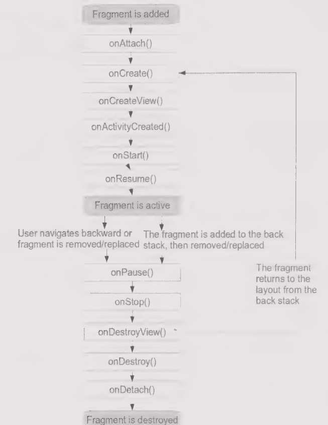

图 34.2：使用片段

应用程序的 Manifest 见清单 34.1。

#### 清单 34.1：AndroidManifest.xml 文件

```xml
<?xml version="1.0" encoding="utf-8"?>
<manifest
    xmlns:android="http://schemas.android.com/apk/res/android"
    package="com.example.fragmentdemo"
    android:versionCode="1">
    <uses-sdk
        android:minSdkVersion="18"
        android:targetSdkVersion="18" />
    <application
        android:allowBackup="true"
        android:icon="@drawable/ic_launcher"
        android:label="@string/app_name"
        android:theme="@style/AppTheme">
        <activity
            android:name="com.example.fragmentdemo.MainActivity"
            android:label="@string/app_name">
            <intent-filter>
                <action android:name="android.intent.action.MAIN" />
                <category android:name="android.intent.category.LAUNCHER" />
            </intent-filter>
        </activity>
    </application>
</manifest>
```

```java
@Override
public void onDetach() {
    super.onDetach();
    callback = null;
}
```

`NamesFragment` 类定义了一个 `Callback` 接口，其 `Activity` 必须实现该接口以处理 `ListView` 的项目选择事件。`Activity` 随后可以使用它来驱动第二个 `Fragment`。`onAttach` 方法确保了实现类是一个 `Activity`。

第二个 `Fragment` `DetailsFragment` 拥有如列表 34.5 所示的布局文件。它包含一个 `TextView` 和一个 `ImageView`。`TextView` 显示选中城市的名称，`ImageView` 显示选中城市的图片。

#### 列表 34.5：fragment_details.xml 文件

```xml
<LinearLayout
    xmlns="http://schemas.android.com/apk/res/android"
    android:orientation="vertical"
    android:background="#FAFAD2"
    android:layout_width="match_parent"
    android:layout_height="match_parent">
    <TextView
        android:id="@id/text"
        android:layout_width="wrap_content"
        android:layout_height="wrap_content"
        android:textSize="30sp"/>
    <ImageView
        android:id="@id/imageView"
        android:layout_width="match_parent"
        android:layout_height="match_parent"/>
</LinearLayout>
```

`DetailsFragment` 类如列表 34.6 所示。它有一个 `showDetails` 方法，所在的 `Activity` 可以调用该方法来更改 `TextView` 和 `ImageView` 的内容。

#### 列表 34.6：DetailsFragment 类

```java
package com.example.fragmentdemo;
import android.app.Fragment;
import android.os.Bundle;
import android.view.LayoutInflater;
import android.view.View;
import android.view.ViewGroup;
import android.widget.ImageView;
import android.widget.ImageView.ScaleType;
import android.widget.TextView;

public class DetailsFragment extends Fragment {
    @Override
    public View onCreateView(LayoutInflater inflater, ViewGroup container, Bundle savedInstanceState) {
        return inflater.inflate(R.layout.fragment_details, container, false);
    }

    public void showDetails(String name) {
        TextView textView = (TextView) getView().findViewById(R.id.textView);
        textView.setText(name);

        ImageView imageView = (ImageView) getView().findViewById(R.id.imageView);
        imageView.setScaleType(ScaleType.FIT_XY); // stretch image
        if (name.equals("Amsterdam")) {
            imageView.setImageResource(R.drawable.amsterdam);
        } else if (name.equals("Brussels")) {
            imageView.setImageResource(R.drawable.brussels);
        } else if (name.equals("Paris")) {
            imageView.setImageResource(R.drawable.paris);
        }
    }
}
```

列表 34.7 展示了 `FragmentDemo` 的 `Activity` 类。


```java
package com.example.fragmentdemol;
import android.app.Activity;
import android.os.Bundle;

public class MainActivity extends Activity
    implements NamesFragment.Callback {

    @Override
    protected void onCreate(Bundle savedInstanceState) {
        super.onCreate(savedInstanceState);
        setContentView(R.layout.activity_main);
    }

    @Override
    public void onItemSelected(String value) {
        DetailsFragment details = (DetailsFragment)
        getFragmentManager().findFragmentById(
            R.id.detailsFragment);
        details.showDetails(value);
    }
}
```

最需要注意的是，activity 类实现了 `NamesFragment.Callback`，以便它能够捕获 fragment 中的项目点击事件。`onItemSelected` 方法是 `Callback` 接口的实现。它通过调用第二个 fragment 中的 `showDetails` 方法来更改选中城市的文本和图片。

## 扩展 ListFragment 和使用 FragmentManager

`FragmentDemol` 展示了如何通过 activity 布局文件中的 `fragment` 元素向 activity 添加 fragment：在第二个示例应用程序 `FragmentDemo2` 中，你将学习如何通过代码向 activity 添加 fragment。

`FragmentDemo2` 在功能上与前一个版本相似，但有几处不同。第一个区别在于更新选中城市名称和图片的方式。在 `FragmentDemo1` 中，activity 调用了第二个 fragment 的 `showDetails` 方法。第二个区别是 `NamesFragment` 继承了 `ListFragment` 并使用了它的 `setListAdapter` 方法。这在列表 34.8 的 `NamesFragment` 类中得到了演示。

### 列表 34.8：NamesFragment 类

```java
package com.example.fragmentdemo2;
import android.app.Activity;
import android.app.Fragment;
import android.os.Bundle;
import android.view.View;
import android.widget.AdapterView;
import android.widget.ArrayAdapter;
import android.widget.ListView;

public class NamesFragment extends ListFragment {

    final String[] names = {"Amsterdam", "Brussels", "Paris"};

    @Override
    public void onCreate(Bundle savedInstanceState) {
        super.onCreate(savedInstanceState);
        ArrayAdapter<String> adapter = new ArrayAdapter<>(
            getActivity(),
            android.R.layout.simple_list_item_1,
            names);
        setListAdapter(adapter);
    }

    public interface Callback {
        void onItemSelected(String id);
    }

    private Callback callback;

    @Override
    public void onAttach(Activity activity) {
        super.onAttach(activity);
        if (activity instanceof Callback) {
            callback = (Callback) activity;
        }
    }

    @Override
    public void onDetach() {
        super.onDetach();
        callback = null;
    }

    @Override
    public void onItemClick(AdapterView parent, View view, int position, long id) {
        if (callback != null) {
            callback.onItemSelected(names[position]);
        }
    }
}
```

## 第 34 章：片段

`DetailsFragment` 的参数。其次，每当调用 `onItemSelected` 时，都会创建一个新的 `DetailsFragment` 实例并将其传递给 `FrameLayout`。

### 列表 34.11：MainActivity 类

```java
package com.example.fragmentdemo2;
import android.app.Activity;
import android.app.FragmentManager;
import android.app.FragmentTransaction;
import android.os.Bundle;

public class MainActivity extends Activity
    implements ListFragment.Callback {

    @Override
    protected void onCreate(Bundle savedInstanceState) {
        super.onCreate(savedInstanceState);
        setContentView(R.layout.activity_main);
    }

    @Override
    public void onItemSelected(String value) {
        Bundle arguments = new Bundle();
        arguments.putString("name", value);
        if (value.equals("Amsterdam")) {
            arguments.putInt("imageId", R.drawable.amsterdam);
        } else if (value.equals("Brussels")) {
            arguments.putInt("imageId", R.drawable.brussels);
        } else if (value.equals("Paris")) {
            arguments.putInt("imageId", R.drawable.paris);
        }
        DetailsFragment fragment = new DetailsFragment();
        fragment.setArguments(arguments);
        FragmentManager fragmentManager = getFragmentManager();
        FragmentTransaction fragmentTransaction = fragmentManager.beginTransaction();
        fragmentTransaction.replace(
            R.id.details_container, fragment);
        fragmentTransaction.commit();
    }
}
```

图 34.3 显示了 FragmentDemo2。


## 总结

片段（Fragments）是可以添加到活动中的组件。片段有自己的生命周期，并拥有在生命周期某些阶段发生时会被调用的方法。在本章中，你学习了如何编写自己的片段。

# 第 35 章：多面板布局

Android 平板电脑的屏幕通常比手机大。许多应用程序开发者可能希望利用平板电脑更大的屏幕，通过使用多面板布局显示更多信息。

本章讨论了使用你在第 34 章“片段”中学习过的片段多面板布局。

## 概述

平板电脑的屏幕比手机大，你可以在平板电脑上显示比手机上更多的信息。如果你正在编写一个需要在两类设备上看起来都良好的应用程序，一种常见的策略是支持两种布局。单面板布局可用于手机，多面板布局用于平板电脑。

图 35.1 显示了应用程序的双面板版本，图 35.2 显示了单面板模式下的同一应用程序。

在单面板布局中，你将显示一个通常包含单个片段的活动，而该片段又通常包含一个 `ListView`。在 `ListView` 上选择一个项目将启动另一个活动。

在多面板布局中，你将有一个足够大以容纳两个面板的活动。你使用同一个片段，但这次选择一个项目时，它会更新第二个面板而不是启动另一个活动。

问题是，你如何告诉系统选择正确的布局？在 Android 3.2 (API 级别 13) 之前，屏幕可能会根据尺寸分为以下几类之一：

- small（小型），适用于至少为 426dp x 320dp 的屏幕
- normal（普通），适用于至少为 470dp x 320dp 的屏幕
- large（大型），适用于至少为 640dp x 480dp 的屏幕
- xlarge（超大型），适用于至少为 960dp x 720dp 的屏幕

这里，`dp` 代表密度无关像素（density independent pixel）。你可以通过 `dp` 和屏幕密度（单位为 dpi）使用以下公式计算像素数（`px`）：

```
px = dp * (dpi / 160)
```

在此处，你可以将布局文件放在对应的目录中：`layout-small`、`layout-normal`、`layout-large` 和 `layout-xlarge`。为了支持普通和大型屏幕，可以使用 `res/layout` 和 `res/layout-large` 目录。

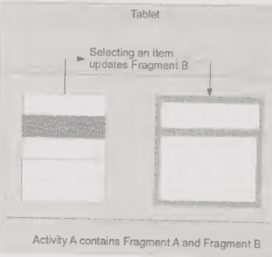
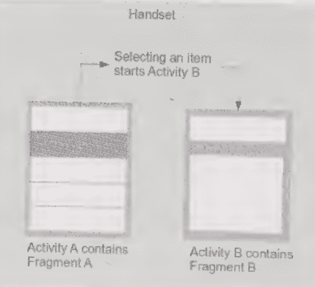

然而，系统很难进行限制。例如，7 英寸平板电脑和 10 英寸平板电脑都可能属于 `xlarge` 类，尽管它们提供的空间不同。为了给 7 英寸和 10 英寸平板电脑提供不同的布局，Android 3.2 改变了工作方式。Android 3.2 及后续版本不再使用四种屏幕尺寸，而是根据 `dp` 的空间大小来测量屏幕，而不是尝试对布局进行通用的分组。

现在，为了支持大型屏幕，Android 3.2 及后续版本采用了一种新的技术，根据 `dp` 的空间大小来测量屏幕，而不是尝试对布局进行通用的分组。

在新的系统中，为 7 英寸和 10 英寸平板电脑提供不同的布局是很容易的。典型的平板电脑宽度为 600dp。

为了支持某种屏幕类型，你应该将布局文件放在该类型的文件夹中，即 `layout-small`（小型屏幕）、`layout-normal`（普通屏幕）、`layout-large`（大型屏幕）和 `layout-xlarge`（超大型屏幕）。为了支持普通和大型屏幕，可以使用 `res/layout` 和 `res/layout-large` 目录。

## 多面板示例

FragmentDemo3 是一个支持小型和大屏幕的应用程序。对于大屏幕，它显示一个使用由两个面板组成的面板布局的活动。对于较小的屏幕，将显示另一个仅包含一个片段的活动。

创建多面板应用程序最简单的方法是使用 ADT Eclipse。照常，你应该像第 22 章“你的第一个应用程序”描述的那样使用 New Android Application 向导。然而，与其像第 22 章中那样创建一个空白活动，你应该选择 Master/Detail Flow，如图 35.4 所示。

注意，ADT Eclipse 创建的是一种支持 Android 3.0 及以上的多面板布局，以及 Android 3.0 之前的版本。然而，如果你不需要支持旧设备，可以移除支持类。这样做的好处是你将获得一个约 30KB 的 apk 文件。

应用程序的 `AndroidManifest.xml` 文件如列表 35.1 所示。

### 列表 35.1：AndroidManifest.xml 文件

```xml
<?xml version="1.0" encoding="utf-8"?>
<manifest
    xmlns:android="http://schemas.android.com/apk/res/android"
    package="com.example.fragmentdemo3"
    android:versionCode="1"
    android:versionName="1.0" >
  <uses-sdk
    android:minSdkVersion="18"
    android:targetSdkVersion="18" />
  <application
    android:allowBackup="true"
    android:icon="@drawable/ic_launcher"
    android:label="@string/app_name"
    android:theme="@style/AppTheme" >
  <activity
    android:name="com.example.fragmentdemo3.ItemListActivity"
    android:label="@string/app_name">
    <intent-filter>
      <action android:name="android.intent.action.MAIN" />
      <category android:name="android.intent.category.LAUNCHER" />
    </intent-filter>
  </activity>
  <activity
    android:name="com.example.fragmentdemo3.ItemDetailActivity"
    android:label="@string/item_detail"
    android:parentActivity=".ItemListActivity">
    <meta-data
      android:name="android.support.PARENT_ACTIVITY"
      android:value=".ItemListActivity" />
  </activity>
</manifest>
```

应用程序有两个 Activity。主 Activity 用于单面板和多面板环境。第二个 Activity 用于单面板环境。

## 布局与 Activity

如清单文件所示，ItemListActivity 是应用程序启动时实例化的类。该类见列表 35.2。

### 列表 35.2：ItemListActivity 类


```java
package com.example.fragment3;
import android.content.Intent;
import android.os.Bundle;
import android.support.v4.app.FragmentActivity;

public class ItemListActivity extends FragmentActivity implements ListFragment.Callbacks {

    private boolean mTwoPane;

    @Override
    protected void onCreate(Bundle savedInstanceState) {
        super.onCreate(savedInstanceState);
        setContentView(R.layout.activity_list);

        if (findViewById(R.id.detail_container) != null) {
            mTwoPane = true;
            ((ItemListFragment)getFragmentManager().
                findFragmentById(R.id.item_list)).setActivateItemClick(true);
        }
    }

    /**
     * 来自 ListFragment 的回调方法
     */
    @Override
    public void onItemSelected(String id) {
        if (mTwoPane) {
            // 在双面板模式下，通过 fragment 事务
            // 替换在此 activity 中显示详细视图。
            Bundle arguments = new Bundle();
            arguments.putString(ItemDetailFragment.ARG_ITEM_ID,
                id);

            DetailFragment fragment = new DetailFragment();
            fragment.setArguments(arguments);
            getFragmentManager().beginTransaction().
                .replace(R.id.detail_container,
                fragment).commit();
        } else {
            // 在单面板模式下，直接启动
            // 所选项目的详细 Activity。
            Intent detailIntent = new Intent(this,
                ItemDetailActivity.class);
            detailIntent.putExtra(ItemDetailFragment.ARG_ITEM_ID,
                id);
            startActivity(detailIntent);
        }
    }
}
```

`ItemListActivity` 中的 `onCreate` 方法加载由标识符 `R.layout.activity_list` 指定的布局。

```java
protected void onCreate(Bundle savedInstanceState) {
    super.onCreate(savedInstanceState);
    setContentView(R.layout.activity_list);
}
```

在较小的设备上，将加载 `res/layout/activity_item_list.xml`。对于较大的设备，系统将尝试在 `res/layout-large` 或 `res/layout-sw600dp` 目录查找 `activity_item_list` 文件。然而，这些目录都不存在，因此系统会搜索 `values-range` 和 `values-sw600dp` 目录。在这些目录中，它找到了两个名为 `refs.xml` 的文件。这些引用是相同的，并定义了一个名为 `activity_item_list`（正在寻找的布局 ID）的项目。应用程序部署到大屏幕设备时，将加载 `layout/activity_item_twoplane.xml` 文件。

### 列表35.3：refs.xml 文件

```xml
<resources>
    <item name="activity_item_list"
        type="layout"@layout/activity_item_twoplane"
    </item>
</resources>
```

`activity_item_twoplane.xml`（见35.4）用于大屏幕设备。

### 列表35.4：activity_item_twoplane.xml（多面板）

```xml
<LinearLayout
    xmlns:android="http://schemas.android.com/apk/res/android"
    xmlns:tools="http://schemas.android.com/tools"
    android:layout_width="match_parent"
    android:layout_height="match_parent"
    android:orientation="horizontal"
    android:layout_marginLeft="16dp"
    android:layout_marginRight="16dp">

    <fragment
        android:id="@+id/item_list"
        android:name="com.example.fragmentdemo3.ItemListFragment"
        android:layout_width="0dp"
        android:layout_height="match_parent"
        android:layout_weight="1" />

    <FrameLayout
        android:id="@+id/detail_container"
        android:layout_width="0dp"
        android:layout_height="match_parent"
        android:layout_weight="3" />

</LinearLayout>
```

`activity_item_twoplane.xml` 文件使用水平 `LinearLayout` 将屏幕分为两个面板。左面板包含一个 `ListView` 的片段。右面板包含一个 `FrameLayout`，可以在其中添加名为 `DetailFragment` 的实例。列表35.5 显示了 `DetailFragment` 的布局。

### 列表35.5：fragment_detail

```xml
<TextView
    xmlns:android="http://schemas.android.com/apk/res/android"
    xmlns:tools="http://schemas.android.com/tools"
    android:id="@+id/item_detail"
    style="@attr/setTextLarge"
    android:layout_width="match_parent"
    android:layout_height="match_parent"
    android:padding="16dp"
    tools:textable="true" />
```

对于小屏幕，将使用两个 Activity。主 Activity 将加载列表35.6 中的 `activity_list.xml` 布局文件。该布局包含了多面板布局中左面板使用的相同片段。

### 列表35.6：activity_list.xml 文件（单面板）

```xml
<fragment
    xmlns:android="http://schemas.android.com/apk/res/android"
    xmlns:tools="http://schemas.android.com/tools"
    android:id="@+id/item_list"
    android:name="com.example.fragmentdemo3.ListItemFragment"
    android:layout_width="match_parent"
    android:layout_height="match_parent"
    android:layout_marginLeft="16dp"
    android:layout_marginRight="16dp"
    tools:context="@activity/Activity"
    tools:layout="@android:layout/list_content" />
```

### 片段类

两个片段类分别位于列表 35.7 和列表 35.8。

### 列表35.7：ListItemFragment 类

```java
package com.example.fragment3;
import android.app.Activity;
import android.os.Bundle;
import android.support.v4.app.ListFragment;
import android.view.View;
import android.widget.ArrayAdapter;
import android.widget.ListView;
import com.example.fragmentdemo3.dummy.DummyContent;

/**
 * 表示项目列表的片段。此片段也支持平板设备，允许在选择列表项时赋予其“激活”状态。这有助于指示当前正在 (@link ItemDetailFragment) 中查看哪个项目。
 * 包含此片段的 Activity 必须实现
 * (@link callbacks) 接口。
 */
public class ListItemFragment extends ListFragment {
```

#### 第 35 章：多面板布局 433

```java
/**
* The serialization (saved instance state) Bundle key
* representing the activated item position. Only used on
* tablets.
*/
private static final String STATE_ACTIVATED_POSITION =
    "activated_position";
```

```java
/**
* The fragment's current callback object, which is notified
* of list item clicks.
 */
private Callbacks mCallbacks = sDummyCallbacks;
```

```java
/**
* 当前激活的项位置。仅用于平板电脑。
 */
private int mActivatedPosition = ListView.INVALID_POSITION;
```

```java
/**
* 回调接口包含了此 fragment
 * 必须实现的所有 activity。这种机制允许 activity
 * 接收项目选择的通知。
 */
public interface Callbacks {
/**
* 当项被选中时的回调。
 */
    public void onItemSelected(String id);
}
```

```java
/**
* {@link Callbacks} 接口的空实现，
* 它不执行任何操作。仅当此 fragment
 * 未挂载到 activity 时使用。
 */
private static Callbacks sDummyCallbacks = new Callbacks() {
    @Override
    public void onItemSelected(String id) {
    }
};
```

```java
/**
* fragment manager 用于实例化 fragment 的
* 必需的空构造函数（例如在屏幕方向
* 改变时）。
 */
public ItemListFragment() {
}
```

```java
@Override
public void onCreate(Bundle savedInstanceState) {
    super.onCreate(savedInstanceState);

    // TODO: 替换为列表适配器。
    setAdapter(new ArrayAdapter<DummyContent.DummyItem>(
```

#### 434 Android Java Java

```java
    getActivity(),
    android.R.layout.simple_list_item_activated_1,
    android.R.id.text1, DummyContent.ITEMS);
}

@Override
public void onCreate(View view,
    Bundle savedInstanceState) {
    super.onCreate(view, savedInstanceState);

    // 恢复之前序列化的激活项
    // 位置。
    if (savedInstanceState != null
        && savedInstanceState
            .containsKey(STATE_ACTIVATED_POSITION)) {
            setActivatedPosition(savedInstanceState
                .getInt(STATE_ACTIVATED_POSITION));
        }
}

@Override
public void onAttach(Activity activity) {
    super.onAttach(activity);

    // 包含此 fragment 的 activity 必须实现
    // 其回调。
    if (!activity instanceof Callbacks) {
        throw new IllegalStateException(
            "Activity must implement fragment's " +
            "callbacks.");
    }
    mCallbacks = (Callbacks) activity;
}

@Override
public void onDetach() {
    super.onDetach();
    // 将激活的回调接口重置为 dummy
    //。
    mCallbacks = sDummyCallbacks;
}

@Override
public void onItemClick(ListView listView, View view,
    int position, long id) {
    super.onItemClick(listView, view, position, id);

    // 通知激活的回调接口（如果 fragment
    // 挂载到了某个 activity 的话）有一个项
    // 已被选中。
    mCallbacks.onItemSelected(
        DummyContent.ITEMS.get(position).id);
}
```

#### 第 35 章：多面板布局 435

```java
public void onSaveInstanceState(Bundle outState) {
    super.onSaveInstanceState(outState);
    if (mActivatedPosition != ListView.INVALID_POSITION) {
        // 序列化并持久化激活项的位置。
        outState.putInt(STATE_ACTIVATED_POSITION,
            mActivatedPosition);
    }
}
```

```java
/** 打开点击激活模式。当此模式开启时，
 * 列表项在触摸时将获得“激活”状态。 */
```

```java
public void setActivateOnClick(
    boolean activateOnClick) {
    // 当设置 CHOICE_SINGLE 时，ListView 将
    // 自动在触摸时给项赋予“激活”状态。
    getListView().setChoiceMode(
        activateOnClick ? ListView.CHOICE_MODE_SINGLE
        : ListView.CHOICE_MODE_NONE);
}
```


```java
private void setActivatedPosition(int position) {
    if (position != ListView.INVALID_POSITION) {
        getListView()
            .setItemChecked(mActivatedPosition, false);
    } else {
        getListView().setItemChecked(position, true);
    }
    mActivatedPosition = position;
}
```

`ListFragment` 类继承自 `ListFragment` 并从 `DummyContent` 类获取其 `ListView` 的数据。它还提供了一个 `Callbacks` 接口，任何使用此 fragment 的 activity 都必须实现该接口以处理 `ListView` 的 `ListItemClick` 事件。在 `onAttach` 方法中，fragment 使 activity 类实现了 `Callbacks` 并用 activity 替换了 `mCallbacks` 的内容，将事件处理委托给 activity。

## 列表 35.8：ItemDetailFragment 类

```java
package com.example.fragmentdemo3;
import android.os.Bundle;
import android.support.v4.app.Fragment;
import android.view.LayoutInflater;
import android.view.View;
import android.view.ViewGroup;
import android.widget.TextView;
import com.example.fragmentdemo3.DummyContent;
```

```java
/** 代表单个项目详情页面的 Fragment。
 * fragment 既包含在 (@link ItemListActivity）的
 * 双面板模式（平板电脑）中，位于手机（@link ItemDetailActivity）中。
 */
```

## 436 Android Java Java

```java
/** 代表单个项目详情页面的 Fragment。
 * fragment 既包含在 (@link ItemListActivity）的
 * 双面板模式（平板电脑）中，位于手机（@link ItemDetailActivity）中。
 */
public class ItemDetailFragment extends Fragment {
/** 代表此
 * fragment 所代表的参数。 */
    public static final String ARG_ID = "item_id";

/** 此 fragment
 * 展示的 dummy 内容。 */
    private DummyItem mItem;

/** fragment manager 用于 实例化 fragment 的
* 必需的空构造函数（例如在屏幕方向
* 改变时）。
 */
    public ItemDetailFragment() {
}

@Override
public void onCreate(Bundle savedInstanceState) {
    super.onCreate(savedInstanceState);

    if (getArguments().containsKey(ARG_ID)) {
        // 加载指定的 dummy 内容。
        // 在真实环境的场景中，请使用 content provider。
        mItem = DummyContent.ITEMS(getArguments().getString(ARG_ID));
    }
}

@Override
public View getView(LayoutInflater inflater,
    ViewGroup container,
    Bundle savedInstanceState) {
    View rootView = inflater.inflate(R.layout.fragment_detail, container, false);
    // 在 TextView 中显示 dummy 内容。
    if (mItem != null) {
        ((TextView) rootView.findViewById(R.id.text))
            .setText(mItem.toString());
    }
    return rootView;
}
```

### 运行应用程序

35.6 和 35.7 分别显示了平板和平手机上的 Fragment3 应用。

## 第 35 章：多面板布局 437

![图 35.6]

![图 35.7]

## 总结

为了给用户提供最佳体验，你可能想要针对屏幕尺寸使用不同的布局。在本章中，你学习了实现这一点的良好策略是为平板电脑使用多面板布局，为手机使用单面板布局。

## 第 36 章：动画

动画是 Android 中一个有趣的功能，动画能力从最开始（API 1）就可用。在本章中，你将学习使用一种名为属性动画的 API，它是从 Honeycomb（API 11）开始引入的。这种新 API 比之前的视图动画更强大。

### 概述

属性动画 API 由 `android.animation` 包中的类型组成。旧的动画 API（视图动画）位于 `android.view` 包中。本章关注新的 API，不讨论旧的技术。它也不讨论通过顺序加载一系列图像的绘制动画。关于绘制动画的更多信息，请参阅 `android.graphics.drawable.Animation`。

## 属性动画

属性动画的核心是 `android.animation.Animator` 类。它是一个抽象类，因此你无法直接使用它。相反，你使用它的一个子类（如 `ValueAnimator` 或 `ObjectAnimator`）来制作动画。此外， `AnimatorSet` 类是另一个 `Animator` 子类，用于并行或顺序运行多个动画。

这些都位于同一个包中，本节将介绍这些类。

`Animator` 类是一个抽象类，提供了供子类继承的方法。有一个用于设置动画目标的方法 (`setTarget`)，一个设置持续时间的方法 (`setDuration`)，以及一个开始动画的方法 (`start`)。可以在 `Animator` 对象上多次调用 `start` 方法。

此外，该类还提供了一个 `addListener` 方法，它接收一个 `Animator.AnimatorListener` 实例。`AnimatorListener` 接口定义在 `Animator` 类内部，系统会在发生某些事件时调用它的方法。如果你想对特定事件做出响应，可以实现其中的任何一个方法。

# 440 Android Java 

`AnimationStartListener` 中的方法如下。

```
void onAnimationStart(Animator animation);
void onAnimationEnd(Animator animation);
void onAnimationCancel(Animator animation);
void onAnimationRepeat(Animator animation);
```

例如，当动画开始时会调用 `onAnimationStart` 方法，当动画结束时会调用 `onAnimationEnd` 方法。

# ValueAnimator

`ValueAnimator` 通过计算一个从起始值到结束值的过渡值来创建动画。你在构造 `ValueAnimator` 时需要指定起始值和结束值。通过注册一个 `UpdateListener`，你可以在每一帧接收更新，从而有机会更新你的对象（对象）。

这里有两个你可以使用的静态工厂方法来构造 `ValueAnimator`。

```
public static ValueAnimatorOfFloat(float... values)
public static ValueAnimatorOfInt(int... values)
```

一旦你创建了 `ValueAnimator`，就应该创建一个 `AnimationUpdateListener` 的实现类，在 `onAnimationUpdate` 方法下编写你的动画代码，并将该监听器注册到 `ValueAnimator` 中。示例如下：

```
valueAnimator.addUpdateListener(new
    ValueAnimator.UpdateListener() {
        @Override
        public void onAnimationUpdate(ValueAnimator animation) {
            Float value = (Float) animation.getAnimatedValue();
            // 使用 value 来设置一个属性或多个属性
            // Example: view.setRotationX(value);
        }
});
```

最后，使用 `ValueAnimator` 的 `setDuration` 方法设置持续时间，使用 `start` 方法开始动画。如果你不调用 `setDuration`，将使用默认持续时间（300ms）。

关于使用 `ValueAnimator` 的更多信息请参考下方的示例。

# ObjectAnimator

`ObjectAnimator` 类提供了一种最简单的方法来动画对象（可能是一个 `View`），通过不断更新其一个属性之一来实现。要创建一个动画，使用其其中一个工厂方法创建 `ObjectAnimator`，并传入目标对象、属性以及该属性的起始值和结束值。考虑到属性可以具有 int 值、float 值或其他其他类型的值，`ObjectAnimator` 有三个静态方法：`ofInt`、`ofFloat` 和 `ofObject`。以下是它们的签名。

```
public static ObjectAnimatorOfInt(java.lang.Object target,
java.lang.String propertyName, int... values)
public static ObjectAnimator ofFloat(java.lang.Object target,
java.lang.String propertyName, float... values)
public static ObjectAnimator ofObject(java.lang.Object target,
java.lang.String propertyName, java.lang.Object... values)
```

你可以向 `values` 参数传递一个或两个参数。如果你传递两个参数，第一个将用作起始值，第二个用作结束值。如果你传递一个参数，该值将用作结束值，而属性的当前值将作为起始值。

一旦你拥有了 `ObjectAnimator`，调用 `ObjectAnimator` 上的 `setDuration` 方法和 `start` 方法来启动它。这是一个对 `View` 的旋转属性进行动画的示例。

```
ObjectAnimator objectAnimator = ObjectAnimator.ofFloat(view,
"rotationY", 0, 720.0); // 旋转720度
objectAnimator.setDuration(2000); // 2000 毫秒
objectAnimator.start();
```

运行动画将导致 view 在视图内旋转两圈。如你所见，你只需要两三行代码就可以使用 `ObjectAnimator` 创建一个属性动画。你将在下面的示例中学习更多关于 `ObjectAnimator` 的知识。

# AnimatorSet

如果你想按特定顺序播放一组动画，`AnimatorSet` 就非常有用。`AnimatorSet` 类是 `Animator` 的直接子类，允许你同时播放多个动画或一个接一个播放。一旦你决定了如何调用你的动画，调用 `AnimatorSet` 上的 `start` 方法即可启动。

该方法有两个重载。

```
public void playTogether(java.util.Collection<Animator> items)
public void playTogether(Animator... items)
```

`playSequentially` 方法将提供的动画排列为顺序一起播放。它有两个重载。

```
public void playSequentially(Animator... items)
public void playSequentially(java.util.List<Animator> items)
```

### 示例

`AnimationDemo` 项目使用了 `ValueAnimator`、`ObjectAnimator` 和 `AnimatorSet` 来播放不同的动画。注意最小 SDK 级别为 11 (Honeycomb)。

## 列表 36.1：manifest

```xml
<?xml version="1.0" encoding="utf-8"?>
<manifest xmlns:android="http://schemas.android.com/apk/res/android"
    package="com.example.animatdemo"
    android:targetSdkVersion="11">

    <application
        android:allowBackup="true"
        android:icon="@drawable/ic_launcher"
        android:label="@string/app_name"
        android:theme="@style/AppTheme">
        <activity android:name=".MainActivity">
            <intent-filter>
                <action android:name="android.intent.action.MAIN" />
                <category android:name="android.intent.category.LAUNCHER" />
            </intent-filter>
        </activity>
    </application>
</manifest>
```

## 列表 36.2：activity_main.xml

```xml
<LinearLayout xmlns:android="http://schemas.android.com/apk/res/android"
    xmlns:tools="http://schemas.android.com/tools"
    android:layout_width="match_parent"
    android:layout_height="match_parent"
    android:orientation="vertical"
    tools:context=".MainActivity">

    <ImageView
        android:id="@+id/imageView"
        android:layout_width="wrap_content"
        android:layout_height="wrap_content"
        android:src="@drawable/photo" />

    <Button
        android:id="@+id/button1"
        android:layout_width="wrap_content"
        android:layout_height="wrap_content"
        android:text="Button 1"
        android:onClick="animatel" />

    <Button
        android:id="@+id/button2"
        android:layout_width="wrap_content"
        android:layout_height="wrap_content"
        android:text="Button 2"
        android:onClick="animate2" />

    <Button
        android:id="@+id/button3"
        android:layout_width="wrap_content"
        android:layout_height="wrap_content"
        android:text="Button 3"
        android:onClick="animate3" />

</LinearLayout>
```

## 列表 36.3：MainActivity 类

最后，列表 36.3 显示了应用程序的 `MainActivity` 类。有三个事件处理方法（`animatel`、`animate2` 和 `animate3`），每个方法都使用不同的动画方法。


```java
package com.example.animatdemo;

import android.animation.AnimatorSet;
import android.animation.ObjectAnimator;
import android.animation.ValueAnimator;
import android.app.Activity;
import android.os.Bundle;
import android.view.Menu;
import android.view.View;

public class MainActivity extends Activity {

    @Override
    protected void onCreate(Bundle savedInstanceState) {
        super.onCreate(savedInstanceState);
        setContentView(R.layout.activity_main);
    }

    @Override
    public boolean onCreateOptionsMenu(Menu menu) {
        getMenuInflater().inflate(R.menu.main, menu);
        return true;
    }

    public void animatel(View source) {
        View view = findViewById(R.id.imageView);
        ObjectAnimator animator = ObjectAnimator.ofFloat(
            view, "rotationY", 0F, 720.0F);
        animator.setDuration(2000);
        animator.start();
    }
}
```

# 444 Java Android Android

```java
public void animate2(View source) {
    final View view = findViewById(R.id.imageView);
    ValueAnimator valueAnimator = ValueAnimator.ofFloat(0F, 7200F);
    valueAnimator.setDuration(15000);

    valueAnimator.addUpdateListener(new ValueAnimator.UpdateListener() {
        @Override
        public void onAnimationUpdate(ValueAnimator animation) {
            Float value = (Float) animation.getAnimatedValue();
            view.setRotationX(value);
            if (value < 3600) {
                view.setTranslationX(value / 20);
                view.setTranslationY(value / 20);
            } else {
                view.setTranslationX((7200 - value) / 20);
                view.setTranslationY((7200 - value) / 20);
            }
        }
    });
    valueAnimator.start();
}

public void animate3(View source) {
    View view = findViewById(R.id.imageView);
    ObjectAnimator animator1 = ObjectAnimator.ofFloat(view, "translationY", 0F, 300.0F);
    ObjectAnimator animator2 = ObjectAnimator.ofFloat(view, "translationX", 0F, 300.0F);
    animator1.setDuration(2000);
    animator2.setDuration(2000);
    AnimatorSet animatorSet = new AnimatorSet();
    animatorSet.playTogether(animator1, animator2);

    ObjectAnimator animator3 = ObjectAnimator.ofFloat(view, "rotation", 0F, 1440.0F);
    animator3.setDuration(4000);
    animatorSet.play(animator3).after(animator2);
    animatorSet.start();
}
```

运行应用程序并点击按钮来播放动画。图 36.1 显示了应用程序。

## 总结

在本章中，你学习了 Android 中新的动画 API——属性动画系统（Property Animation）。你特别学习了 `android.animation.Animator` 类及其子类 `ValueAnimator` 和 `ObjectAnimator`。你还学习了使用 `AnimatorSet` 类来执行多个动画。


图 36.1：动画演示

# 第 37 章

偏好 (Preferences)

Android 自带了 `SharedPreferences` 接口，可以以键值对的形式管理应用程序设置。`SharedPreferences` 还会负责将数据写入文件。此外，Android 还提供了带有用户界面 (UI) 类的 Preference API，这些类与默认的 `SharedPreferences` 实例关联，因此你可以轻松创建一个修改应用程序设置的 UI。

本章将详细讨论 `SharedPreferences` 和 Preference API。

# SharedPreferences

`android.content.SharedPreferences` 接口通过调用 `PreferenceManager` 的静态方法 `getDefaultSharedPreferences()` 并传递一个 `Context`，提供了存储和读取应用设置的方法。

```java
PreferenceManager.getDefaultSharedPreferences(context);
```

要从 `SharedPreferences` 中读取值，请使用以下方法之一。

```java
public int getInt(java.lang.String key, int default)
public boolean getBoolean(java.lang.String key, boolean default)
public float getFloat(java.lang.String key, float default)
public long getLong(java.lang.String key, long default)
public String getString(java.lang.String key, java.lang.String default)
public java.util.Set<java.lang.String> getSet(java.lang.String key, java.util.Set<java.lang.String> default)
```

如果键值对存在，`getXXX` 方法将返回与指定键关联的值。否则，返回默认值。

要检查 `SharedPreferences` 是否包含某个键值对，请使用 `contains()` 方法，如果指定的键存在，则返回 true。

```java
public boolean contains(java.lang.String key)
```

此外，你可以使用 `getAll()` 方法将所有键值对作为 Map 获取。

```java
public java.util.Map<java.lang.String, ?> getAll()
```

存储在 `SharedPreferences` 中的值会自动持久化，并在用户会话期间持续存在。当卸载应用程序时，这些值将被删除。

## Preference API

要在 `SharedPreferences` 中存储键值对，你通常使用 Android Preference API 创建一个用户可以使用其编辑设置的界面。`android.preference.Preference` 类是用于此功能的主类。其某些子类包括：

- `CheckBoxPreference`
- `EditTextPreference`
- `ListPreference`
- `DialogPreference`

`Preference` 子类的实例对应于一个设置。

你可以在运行时创建 `Preference`，但创建它的方法是在 XML 文件中布局你的偏好。

## 使用偏好

Preference API 允许你更改设置。图 37.1 和 37.2 显示的第一个 Activity 是主 Activity。


图 37.1：主 Activity

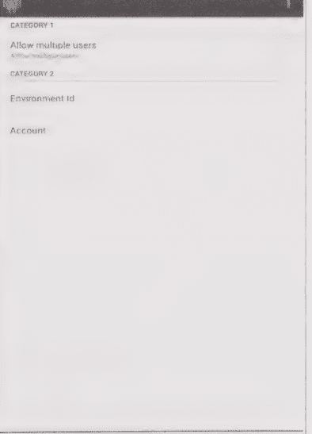

图 37.2：设置 Activity

第二个 Activity 是 Settings Activity，它具有如下简单的布局：

```xml
<?xml version="1.0" encoding="utf-8"?>
<RelativeLayout xmlns:android="http://schemas.android.com/apk/res/android"
    android:layout_width="match_parent"
    android:layout_height="match_parent">

    <TextView
        android:id="@+id/info"
        android:layout_width="wrap_content"
        android:layout_height="wrap_content"
        android:textSize="30sp" />
</RelativeLayout>
```

`AndroidManifest.xml` 文件描述了 Activity，如列表 37.1 所示：

```xml
<?xml version="1.0" encoding="utf-8"?>
<manifest xmlns:android="http://schemas.android.com/apk/res/android"
    package="com.example.preferred">

    <application
        android:allowBackup="true"
        android:icon="@drawable/launcher"
        android:label="@string/app_name"
        android:theme="@style/AppTheme">

        <activity
            android:name=".MainActivity"
            android:label="@string/app_name">
            <intent-filter>
                <action android:name="android.intent.action.MAIN" />
                <category android:name="android.intent.category.LAUNCHER" />
            </intent-filter>
        </activity>

        <activity
            android:name=".SettingsActivity" />

    </application>
</manifest>
```

列表 37.1：AndroidManifest.xml

`MainActivity` 类如列表 37.3 所示，是第一个 Activity 的类。它在 `onCreate()` 方法中从默认 `SharedPreferences` 中读取三个设置，并将值显示在 `TextView` 中。

# 列表 37.3：MainActivity 类

```java
package com.example.preferred;

import android.app.Activity;
import android.content.Intent;
import android.content.SharedPreferences;
import android.os.Bundle;
import android.preference.PreferenceManager;
import android.view.Menu;
import android.view.MenuItem;
import android.widget.TextView;

public class MainActivity extends Activity {

    @Override
    protected void onCreate(Bundle savedInstanceState) {
        super.onCreate(savedInstanceState);
        setContentView(R.layout.activity_main);
    }

    @Override
    public void onResume() {
        super.onResume();
        SharedPreferences sharedPref = PreferenceManager.
            getDefaultSharedPreferences(this);
        boolean allowMultipleUsers = sharedPref.getBoolean(
            SettingsActivity.ALLOW_MULTIPLE_USERS, false);
        String envId = sharedPref.getString(
            SettingsActivity.ENVIRONMENT_ID, "");
        String account = sharedPref.getString(
            SettingsActivity.ACCOUNT, "");
        TextView textView = (TextView) findViewById(R.id.info);
        textView.setText("Allow multiple users: " +
            allowMultipleUsers + "\nEnvironment Id: " + envId
            + "\nAccount: " + account);
    }

    @Override
    public boolean onCreateOptionsMenu(Menu menu) {
        getMenuInflater().inflate(R.menu.main, menu);
        return true;
    }

    @Override
    public boolean onOptionsItemSelected(MenuItem item) {
        switch (item.getItemId()) {
            case R.id.action_settings:
                startActivity(new Intent(this,
                    SettingsActivity.class));
                return true;
            default:
                return super.onOptionsItemSelected(item);
        }
    }
}
```

# 452 Android 开发 Java

此外，`MainActivity` 类重写了 `onCreateOptionsMenu()` 和 `onOptionsItemSelected()` 方法，以便 Settings 操作项出现在操作栏上，点击它将启动第二个活动，`SettingsActivity`。

列表 37.4 所示的 `SettingsActivity` 包含一个默认布局，当活动创建时，该布局会被 `SettingsFragment` 的实例替换。请注意该类的 `onCreate()` 方法。如果该方法的最后几行代码看起来很陌生，请先阅读第 34 章“片段（Fragments）”。

# 列表 37.4：SettingsActivity 类


```java
package com.example.preferreddemo;
import android.app.Activity;
import android.os.Bundle;
import android.view.Menu;

public class SettingsActivity extends Activity {

    public static final String ALLOW_MULTIPLE_USERS = "allowMultipleUsers";
    public static final String ENVIRONMENT_ID = "envId";
    public static final String SET_ACCOUNT = "account";

    @Override
    protected void onCreate(Bundle savedInstanceState) {
        super.onCreate(savedInstanceState);
        getActionBar().setDisplayHomeAsEnabled(true);
        getFragmentManager()
            .beginTransaction()
            .replace(android.R.id.content,
                new SettingsFragment())
            .commit();
    }

    @Override
    public boolean onCreateOptionsMenu(Menu menu) {
        getLayoutInflater().inflate(R.menu.settings, menu);
        return true;
    }
}
```

注意，`SettingsActivity` 类是 `PreferenceFragment` 的子类。它是一个简单的类，只需调用 `addPreferencesFromResource` 来加载包含三个 `Preference` 子类布局的 XML 文档。

`SettingsFragment` 类在列表 37.5 中所示，XML 文件在列表 37.6 中。

# 列表 37.5：SettingsFragment 类

```java
package com.example.preferreddemo;
import android.os.preference.PreferenceFragment;

public class SettingsFragment extends PreferenceFragment {

    @Override
    public void onCreate(Bundle savedInstanceState) {
        super.onCreate(savedInstanceState);

        // 从 XML 资源加载偏好设置
        addPreferencesFromResource(R.xml.preferences);
    }
}
```

# 列表 37.6：res/preferences.xml 文件

```xml
<PreferenceScreen xmlns:android="http://schemas.android.com/apk/res/android">
    <PreferenceCategory android:title="Category 1">
        <CheckboxPreference
            android:key="allowMultipleUsers"
            android:title="Allow multiple users"
            android:summary="Allow multiple users" />
    </PreferenceCategory>
    <PreferenceCategory android:title="Category 2">
        <EditTextPreference
            android:key="envId"
            android:title="Environment Id"
            android:dialogTitle="Environment Id"/>
        <EditTextPreference
            android:key="account"
            android:title="Account"/>
    </PreferenceCategory>
</PreferenceScreen>
```

`preferences.xml` 文件将 `Preference` 子类分成了两个类。第一类中是与 `allowMultipleUsers` 键绑定的 `CheckboxPreference`。第二类中是两个与 `envId` 和 `account` 键绑定的 `EditTextPreference`。

## 总结

管理应用程序设置的一种简单方法是使用 `Preference` API 和默认的 `SharedPreferences`。在本章中，你学习了如何使用这两者。

# 第 38 章：文件操作

## 概述

Android 设备提供了两个存储区域。内部存储是应用程序私有的。用户和其他应用程序无法访问它。

外部存储是您存储将与其他应用程序共享或供用户访问的文件的地方。例如，内置的相机应用程序将数字图像文件存储在外部存储中，以便用户方便地复制它们。

## 内部存储

所有应用程序都可以对存储进行读写。内部存储的路径为 `/data/data/<app package>/`，因此如果你的应用程序包是 `com.example.myapp`，则该应用程序的内部目录就是 `/data/data/com.example.myapp`。`Context` 类提供了访问内部存储的不同方法。你应该使用这些方法来访问存储在内部存储中的文件，而不是硬编码内部存储的位置。（记住 `Activity` 是 `Context` 的子类，因此你可以在你的活动类中调用 `Context` 中的公有和受保护方法）。以下是 `Context` 中用于处理内部存储中文件和流的方法。

```java
public java.io.File getFilesDir()
```

返回内部存储中专门用于你的应用程序的目录路径。

```java
public java.io.FileOutputStream openFileOutput(java.lang.String name, int mode)
```

在内部存储的应用程序部分打开一个 `FileOutputStream`。

```java
public java.io.FileInputStream openFileInput(java.lang.String name)
```

打开一个用于读取的 `FileInputStream`。`name` 是要打开的文件名，不能包含路径分隔符。

```java
public java.io.File getFilesDir()
```

获取保存内部文件的文件系统目录的绝对路径。

```java
public java.io.File getDir(java.lang.String name, int mode)
```

在应用程序的内部存储空间内创建或检索已存在的目录。`name` 参数是要检索的目录名称，`mode` 参数应该是这些值之一：

- 用于默认操作的 `MODE_PRIVATE`，或
- 用于控制权限的 `MODE_WORLD_READABLE` 或 `MODE_WORLD_WRITEABLE`。

```java
public boolean deleteFile(java.lang.String fileName)
```

删除存储在内部存储上的文件。如果文件被成功删除，则方法返回 `true`。

```java
public java.lang.String[] fileList()
```

返回与此应用程序关联的文件名数组。

## 外部存储

外部存储是您存储将与其他应用程序共享或供用户访问的文件的地方。例如，内置的相机应用程序将数字图像文件存储在外部存储中，以便用户方便地复制它们。内部存储是应用程序私有的。用户和其他应用程序无法访问它。外部文件会在应用程序卸载时被删除。由于外部存储是可移除的，当你尝试读取或写入它时，应首先测试存储是否可用。要查询外部存储是否可用，请使用以下方法。

```java
public boolean isExternalWritable() {
  String state = Environment.getExternalStorageState();
  return Environment.MEDIA_MOUNTED.equals(state);
}
```

```java
public boolean isExternalReadable() {
  String state = Environment.getExternalStorageState();
  return (Environment.MEDIA_MOUNTED.equals(state) || Environment.MEDIA_MOUNTED_READ_ONLY.equals(state));
}
```

你可以使用 `getFilesDir` 将 `Context` 指向外部存储。公共文件可以存储在 `Environment` 类的 `getExternalStorageDirectory` 方法返回的目录中。这是该方法的签名。

```java
public static File getExternalStorageDirectory()
```

`Environment` 类提供了可以使用的字段：

- `DIRECTORY_DCIM`
- `DIRECTORY_DOCUMENTS`
- `DIRECTORY_DOWNLOADS`
- `DIRECTORY_MOVIES`
- `DIRECTORY_MUSIC`
- `DIRECTORY_NOTIFICATIONS`
- `DIRECTORY_PICTURES`
- `DIRECTORY_PODCASTS`
- `DIRECTORY_RINGTONES`

例如，图片文件应该存储在由代码返回的目录中：

```java
File dir = new File(Environment.getExternalStoragePublicDirectory(Environment.DIRECTORY_PICTURES));
```

写入外部存储需要权限。为了请求用户授予访问外部存储的权限，请在清单文件中写入：

```xml
<uses-permission android:name="android.permission.WRITE_EXTERNAL_STORAGE"/>
```

目前如果你的应用程序只需要从外部存储读取，则不需要特殊权限。但在未来可能会发生变化，因此如果你需要从外部存储读取，应在清单文件中声明此 `uses-permission` 元素，以便你的应用程序在更改生效后继续工作。

## 创建笔记应用程序

`FileDemo` 应用程序是一个管理笔记的简单应用程序。笔记有一个标题和正文，每个笔记都存储作为一个文件，使用标题作为文件名。用户可以查看笔记列表、查看笔记、创建新笔记并删除笔记。

该应用程序有两个活动，`MainActivity` 和 `AddNoteActivity`。`MainActivity` 使用 `ListView` 列出系统中的所有笔记标题。选择一个笔记标题，主活动会在 `ListView` 旁边的 `TextView` 中显示该笔记。它的操作栏还包含两个按钮，Add 和 Delete。Add 启动 `AddNoteActivity` 活动。Delete 删除选定的笔记。

# 458 Java 用于 Android


图 38.1: MainActivity


图 38.2: AddNoteActivity

现在让我们来看应用程序代码。代码列表 38.1 显示该应用程序的 `AndroidManifest.xml` 文件。

## 代码列表 38.1：AndroidManifest.xml 文件

```xml
<?xml version="1.0" encoding="utf-8"?>
<manifest
    xmlns:android="http://schemas.android.com/apk/res/android"
    package="com.example.filedemol"
    android:versionCode="1"
    android:versionName="1.0" >

  <uses-sdk
        android:minSdkVersion="19"
        android:targetSdkVersion="19" />

  <application
      android:allowBackup="true"
      android:icon="@drawable/ic_launcher"
      android:label="@string/app_name"
      android:theme="@style/AppTheme" >
    <activity
        android:name="com.example.filedemol.MainActivity"
        android:label="@string/app_name">
      <intent-filter>
        <action android:name="android.intent.action.MAIN"/>
        <category android:name="android.intent.category.LAUNCHER"/>
      </intent-filter>
    </activity>
    <activity
        android:name="com.example.filedemol.AddNoteActivity"
        android:label="@string/title_activity_add_note" />
  </application>
</manifest>
```

清单声明了应用程序中的两个 activity。主 activity `MainActivity` 的 activity 类如代码列表 38.2 所示。

## 代码列表 38.2：MainActivity 类


# 第 38 章：文件操作

## FileDemo1

```java
package com.example.filedemol;
import java.io.BufferedReader;
import java.io.File;
import java.io.FileReader;
import java.io.IOException;
import android.app.Activity;
import android.content.Intent;
import android.os.Bundle;
import android.view.Menu;
import android.view.MenuItem;
import android.view.View;
import android.widget.AdapterView;
import android.widget.AdapterView.OnItemClickListener;
import android.widget.ArrayAdapter;
import android.widget.ListView;
import android.widget.TextView;

public class MainActivity extends Activity {
    private String selectedItem;

    @Override
    protected void onCreate(Bundle savedInstanceState) {
        super.onCreate(savedInstanceState);
        setContentView(R.layout.activity_main);
        ListView listView = (ListView) findViewById(R.id.listview);
        listView.setChoiceMode(ListView.CHOICE_MODE_SINGLE);
        listView.setOnItemClickListener(
            new OnItemClickListener() {
                @Override
                public void onClick(Adapter<? extends View> adapter, View view, int position, long id) {
                    readNote(position);
                }
            });
    }

    @Override
    public void onResume() {
        super.onResume();
        refreshList();
    }

    @Override
    public boolean onCreateOptionsMenu(Menu menu) {
        getMenuInflater().inflate(R.menu.main, menu);
        return true;
    }

    @Override
    public boolean onItemSelectedSelected(MenuItem item) {
        // 处理操作栏项的点击事件
        switch (item.getItemId()) {
            case R.id.add:
                startActivity(new Intent(this, AddNoteActivity.class));
                return true;
            case R.id.delete:
                deleteNote();
                return true;
            default:
                return super.onItemSelectedSelected(item);
        }
    }

    private void refreshList() {
        ListView listView = (ListView) findViewById(R.id.listview);
        String[] titles = fileList();
        ArrayAdapter<String> arrayAdapter = new ArrayAdapter<String>(this,
            android.R.layout.simple_list_item_activated_1,
            titles);
        listView.setAdapter(arrayAdapter);
    }

    private void readNote(int position) {
        String[] titles = fileList();
        if (titles.length > position) {
            selectedItem = titles[position];
            File dir = getFilesDir();
            File file = new File(dir, selectedItem);
            FileReader reader = null;
            BufferedReader bufferedReader = null;
            try {
                reader = new FileReader(file);
                bufferedReader = new BufferedReader(reader);
                StringBuilder sb = new StringBuilder();
                String line = bufferedReader.readLine();
                while (line != null) {
                    sb.append(line);
                    line = bufferedReader.readLine();
                }
                ((TextView) findViewById(R.id.textView1)).setText(sb.toString());
            } catch (IOException e) {
            } finally {
                if (bufferedReader != null) {
                    try {
                        bufferedReader.close();
                    } catch (IOException e) {
                    }
                }
                if (reader != null) {
                    try {
                        reader.close();
                    } catch (IOException e) {
                    }
                }
            }
        }
    }
}
```

## FileDemo2

目录。FileDemo2 中只有一个 Activity，如图 38.3 所示。


该 Activity 的布局文件如列表 38.4 所示。包含两个 `ListView` 的 `LinearLayout`。左侧的 `ListView` 列出了几个经常使用的目录。右侧的 `ListView` 显示所选目录的内容。

### 列表 38.4：FileDemo2 Activity 的布局文件

```xml
<LinearLayout
    xmlns:android="http://schemas.android.com/apk/res/android"
    android:layout_width="match_parent"
    android:layout_height="match_parent"
    android:orientation="horizontal">
    <ListView
        android:id="@id/listView1"
        android:layout_width="0sp"
        android:layout_weight="1"
        android:layout_height="match_parent"
        android:background="#ababff"/>
    <ListView
        android:id="@id/listView2"
        android:layout_width="0sp"
        android:layout_height="wrap content"
        android:layout_weight="2"/>
</LinearLayout>
```

FileDemo2 的 Activity 类如列表 38.5 所示。

### 列表 38.5：MainActivity 类

```java
package com.example.filedemo2;
import java.io.File;
import java.util.Arrays;
import java.util.List;

import android.app.Activity;
import android.os.Bundle;
import android.os.Environment;
import android.view.Menu;
import android.view.View;
import android.view.widget.AdapterView;
import android.widget.widget.OnItemClickListener;
import android.widget.widget.ArrayAdapter;

public class MainActivity extends Activity {
    class KeyValue {
        public String key;
        public String value;
        public KeyValue(String key, String value) {
            this.key = key;
            this.value = value;
        }
        @Override
        public String toString() {
            return key;
        }
    }

    @Override
    protected void onCreate(Bundle savedInstanceState) {
        super.onCreate(savedInstanceState);
        setContentView(R.layout.activity_main);
        final List<KeyValue> keyValues = Arrays.asList(
            new KeyValue("Alarms", Environment.DIRECTORY_ALARMS),
            new KeyValue("DCIM", Environment.DIRECTORY_DCIM),
            new KeyValue("Downloads", Environment.DIRECTORY_DOWNLOADS),
            new KeyValue("Movies", Environment.DIRECTORY_MOVIES),
            new KeyValue("Music", Environment.DIRECTORY_MUSIC),
            new KeyValue("Notifications", Environment.DIRECTORY_NOTIFICATIONS),
            new KeyValue("Pictures", Environment.DIRECTORY_PICTURES),
            new KeyValue("Podcasts", Environment.DIRECTORY_PODCASTS),
            new KeyValue("Ringtones", Environment.DIRECTORY_RINGTONES)
        );

        ArrayAdapter<KeyValue> arrayAdapter = new
            ArrayAdapter<KeyValue>(this,
            android.R.layout.simple_list_item_activated_1,
            keyValues);
        ListView listview = (ListView) findViewById(R.id.listView);

        listView.setChoiceMode(ListView.CHOICE_MODE_SINGLE);

        listView.setAdapter(arrayAdapter);

        listView.setOnItemClickListener(new
            OnItemClickListener() {

                @Override

                public void onClick(AdapterView<?> adapter,
                    View view, int position, long id) {

                    KeyValue keyValue = keyValues.get(position);

                    listDir(keyValue.value());

                }

            });
    }

    @Override
    public boolean onCreateOptionsMenu(Menu menu) {
        getMenuInflater().inflate(R.menu.main, menu);
        return true;
    }

    private void listDir(String dir) {
        File parent = Environment
            .getExternalStoragePublicDirectory(dir);

        String[] files = null;

        if (parent == null || parent.list() == null) {
            files = new String[]{"0"};
        } else {
            files = parent.list();
        }

        ArrayAdapter<String> arrayAdapter = new
            ArrayAdapter<String>(this,
                android.R.layout.simple_list_item_activated,
                files);

        ListView listView2 = (ListView)
            findViewById(R.id.listView2);

        listView2.setAdapter(arrayAdapter);
    }
}
```

首先注意到 Activity 类中的 `KeyValue` 类。这是一个用于存储字符串对的简单类。它在 `onCreate` 方法中使用，用于根据 `Environment` 类中定义的字典选择选定的键。

```java
new KeyValue("Alarms", Environment.DIRECTORY_ALARMS);
new KeyValue("DCIM", Environment.DIRECTORY_DCIM);
new KeyValue("Downloads", Environment.DIRECTORY_DOWNLOADS);
new KeyValue("Movies", Environment.DIRECTORY_MOVIES);
new KeyValue("Music", Environment.DIRECTORY_MUSIC);
new KeyValue("Notifications", Environment.DIRECTORY_NOTIFICATIONS);
new KeyValue("Pictures", Environment.DIRECTORY_PICTURES);
new KeyValue("Podcasts", Environment.DIRECTORY_PODCASTS);
```


# 第 38 章：文件操作

```java
new KeyValue("Ringtones", Environment.DIRECTORY_RINGTONES)
```

这些 `KeyValue` 实例随后用于填充第一个 `ListView`。

```java
ArrayAdapter<KeyValue> arrayAdapter = new
    ArrayAdapter<KeyValue>(this,
    android.R.layout.simple_list_item_activated_1,
    keyValues);

ListView listview = (ListView)
    findViewById(R.id.listView);
listView.setChoiceMode(ListView.CHOICE_MODE_SINGLE);
listView.setAdapter(arrayAdapter);
```

`ListView` 还设置了一个监听器，当某个目录被选中时调用 `listDir` 方法。

```java
listView.setOnItemClickListener(new
    OnItemClickListener() {
        @Override
        public void onClick(AdapterView<?> adapter,
            View view, int position, long id) {
            KeyValue keyValue = keyValues.get(position);
            listDir(keyValue.value());
        }
    });
```

`listDir` 方法列出所选目录中的所有文件，并将它们传递给 `ArrayAdapter`。

```java
private void listDir(String dir) {
    File parent = Environment
        .getExternalStoragePublicDirectory(dir);
    String[] files = null;
    if (parent == null || parent.list() == null) {
        files = new String[]{"0"};
    } else {
        files = parent.list();
    }
    ArrayAdapter<String> arrayAdapter = new
        ArrayAdapter<String>(this,
            android.R.layout.simple_list_item_activated,
            files);
    ListView listView2 = (ListView)
        findViewById(R.id.listView2);
    listView2.setAdapter(arrayAdapter);
}
```

## 总结

你使用 Java API 在应用程序中处理文件。除了精通此 API 外，为了有效地处理文件，你还需要了解 Android 如何组织存储以及 `Context` 和 `Environment` 类中定义的相关方法。

# 第 39 章：数据库操作

Android 有自己的数据库操作技术，与 Java 数据库连接（JDBC，Java 开发者用于访问数据库的技术）无关。此外，Android 自带 SQLite。

本章将展示如何与 Android 数据库 API 以及 SQLite 数据库交互。

## 概述

Android 自带数据库 API。该 API 包含两个包：`android.database` 和 `android.database.sqlite`。Android 带有 SQLite，这是一个开源关系型数据库，部分实现了 SQL-92（SQL 标准的第三修订版）。

目前的 SQLite 第 3 版本提供了极少的数据类型：Integer、Real、Text、Blob 和 Numeric。SQLite 的一个有趣特性是，当插入行时没有传递字段值，整数主键会自动递增。

可以在此处获取关于 SQLite 的信息：

```
http://sqlite.org
```

## SQLite API

`SQLiteDatabase` 和 `SQLiteOpenHelper` 类都属于 `android.database.sqlite`，是数据库 API 中常用的类。在 `android.database` 包中，`Cursor` 接口是一个重要的类型。

这三种类型将在后续章节中详细讨论。

### SQLiteOpenHelper 类

要在 Android 应用程序中使用数据库，请扩展 `SQLiteOpenHelper` 以帮助创建数据库和表以及连接数据库。在 `SQLiteOpenHelper` 的子类中，你需要执行：

*   提供一个构造函数，调用其父类，并传递 `Context` 和数据库名称等参数。
*   重写 `onCreate` 和 `onUpgrade` 方法。

例如，这里是 `SQLiteOpenHelper` 子类的构造函数。

```java
public SubClassOfSQLiteOpenHelper(Context context) {
  super(context,
  "mydatabase", // database name
  null,
  // db version
);
}
```

需要重写具有以下签名的 `onCreate` 方法。

```java
public void onCreate(SQLiteDatabase database)
```

系统会在第一次访问其中一个表时调用 `onCreate`。在此方法的实现中，你应该调用 `SQLiteDatabase` 的 `execSQL` 方法，并传递一个用于创建表的 SQL 语句。例如所示。

`SQLiteOpenHelper` 会自动管理与底层数据库的连接。要获取数据库实例，请调用以下方法之一，它们都返回一个 `SQLiteDatabase` 实例。

```java
public SQLiteDatabase getReadableDatabase()
public SQLiteDatabase getWritableDatabase()
```

当第一次调用这些方法时，如果数据库不存在，则创建一个数据库。`getReadableDatabase` 和 `getWritableDatabase` 的区别在于，前者返回一个只读数据库，而后者可以用于读取和写入数据库。

### SQLiteDatabase 类

一旦你通过 `SQLiteOpenHelper` 的 `getReadableDatabase` 或 `getWritableDatabase` 方法获取了 `SQLiteDatabase`，就可以调用 `SQLiteDatabase` 的 `insert` 或 `execSQL` 方法来操作数据库中的数据。例如，要添加记录，可以调用如下签名的 `insert` 方法。

```java
public long insert(String table, String nullColumnHack,
ContentValues values)
```

在这里，`table` 是表名，`values` 是一个 `android.content.ContentValues`，它包含了要插入到表中的字段名/值对。该方法返回新行的行标识符。

例如，以下代码通过传递三个值向 `employees` 表插入了一条记录。

```java
SQLiteDatabase db = this.getWritableDatabase();
// 这是 SQLiteOpenHelper 的一个实例
ContentValues values = new ContentValues();
values.put("first_name", "Joe");
values.put("last_name", "Average");
values.put("position", "System Analyst");
long id = db.insert("employees", null, values);
db.close();
```

要更新或删除记录，请分别使用 `update` 或 `delete` 方法。

这些方法的签名如下：

```java
public int delete (java.lang.String table, java.lang.String whereClause, java.lang.String[] whereArgs)
public int update (java.lang.String table, android.content.ContentValues values, java.lang.String whereClause, java.lang.String[] whereArgs)
```

这两个方法的示例在随附的应用中显示。

要执行 SQL 语句，请使用 `execSQL` 方法。

```java
public void execSQL (java.lang.String sql)
```

最后，要检索记录，请使用 `query` 方法之一。其中一个方法重载具有以下签名：

```java
public android.database.Cursor query(java.lang.String table, java.lang.String columns, java.lang.String selection, java.lang.String[] selectionArgs, java.lang.String groupBy, java.lang.String having, java.lang.String orderBy, java.lang.String limit)
```

你可以在本章附的示例应用程序中找到如何使用此方法的示例。

需要注意的一点：`query` 方法返回的数据包含在 `Cursor` 实例中，`Cursor` 是一种在下一节中解释的有趣类型。

### Cursor 接口

在 `SQLiteDatabase` 上调用 `query` 方法会返回一个 `Cursor`。`Cursor` 是 `android.database.Cursor` 接口的实现，提供了对数据库查询返回的结果集的读取和访问。

要通过 `Cursor` 读取某行，你需要通过调用 `moveToFirst`、`moveToNext`、`moveToLast` 或 `moveToPosition` 方法将 `Cursor` 指向数据行。`moveToFirst` 将 `Cursor` 移动到第一行，`moveToNext` 移动到下一行。正如你猜的那样，`moveToLast` 将其移动到最后记录，`moveToPrevious` 移动到上一行。

一旦你将 `Cursor` 移动到数据行，就可以通过调用 `Cursor` 的 `getFloat`、`getLong`、`getString`、`getShort` 或 `getDouble` 方法传递列索引来返回行中的列值。

`Cursor` 的有趣之处在于它可以作为 `ArrayAdapter` 的数据源，而 `ArrayAdapter` 反而可以为 `ListView` 提供数据。在 `ListView` 中使用 `Cursor` 的优势是 `Cursor` 可以管理你的数据。换句话说，如果数据更新了，`Cursor` 可以自动刷新 `ListView`。这是一个非常实用的功能，因为你少了一个需要担心的事情。

## 示例

`DatabaseDemo` 应用程序用于在 SQLite 数据库中管理联系人。联系人是一个包含人员联系详情的数据结构。该应用程序有三个 Activity：`MainActivity`、`AddContactActivity` 和 `ShowContactActivity`。

主 Activity 显示联系人列表，如图 39.1 所示。


图 39.1：主 Activity

主 Activity 在其操作栏（action bar）上提供了一个 Add 按钮，点击后将启动 `AddContactActivity` Activity。后者包含包含一个用于添加新联系人的表单，如图 39.2 所示。


图 39.2：AddContactActivity

主 Activity 还使用 `ListView` 来显示所有联系人。点击列表上的项会激活 `ShowContactActivity`，如图 39.3 所示。


图 39.3：ShowContactActivity

`ShowContactActivity` 允许用户通过点击操作栏上的 Delete 按钮来删除联系人。点击按钮会提示用户确认是否真的要删除该联系人。`ShowContactActivity` 还允许用户返回主 Activity。

```java
import android.database.Cursor;
import android.database.sqlite.SQLiteDatabase;
import android.database.sqlite.SQLiteOpenHelper;
import android.util.Log;
```

```java
public class DatabaseManager extends SQLiteOpenHelper {
    public static final String TABLE_NAME = "contacts";
    public static final String ID_FIELD = "id";
    public static final String FIRST_NAME_FIELD = "first name";
    public static final String LAST_NAME_FIELD = "last_name";
    public static final String PHONE_FIELD = "phone";
    public static final String EMAIL_FIELD = "email";
    public DatabaseManager(Context context) {
        super(context,
        /* dbName */ "db",
        /* cursorFactory */ null,
        /* dbVersion */ 1);
    }
}
```

```java
@Override
public void onCreate(SQLiteDatabase db) {
    Log.d("db", "onCreate");
    String sql = "CREATE TABLE " + TABLE_NAME +
        + " (" + ID_FIELD + " INTEGER," +
        + " " + FIRST_NAME_FIELD + " TEXT," +
        + " " + LAST_NAME_FIELD + " TEXT," +
        + " " + PHONE_FIELD + " TEXT," +
        + " " + EMAIL_FIELD + " TEXT," +
        + ", PRIMARY KEY (" + ID_FIELD + "))";
    db.execSQL(sql);
}
```

```java
@Override
public void onUpgrade(SQLiteDatabase db, int oldVersion, int newVersion) {
    Log.d("db", "onUpdate");
    db.execSQL("DROP TABLE IF EXISTS " + TABLE_NAME + ");");
    // 重新创建表
    onCreate(db);
}
```

```java
public Contact addContact(Contact contact) {
    Log.d("db", "addContact");
    SQLiteDatabase db = this.getWritableDatabase();
    ContentValues values = new ContentValues();
    values.put(FIRST_NAME_FIELD, contact.getFirstName());
    values.put(LAST_NAME_FIELD, contact.getLastName());
    values.put(PHONE_FIELD, contact.getPhone());
    values.put(EMAIL_FIELD, contact.getEmail());
    long id = db.insert(TABLE_NAME, null, values);
    contact.setId(id);
    db.close();
    return contact;
}
```

// 获取单个联系人


```java
Contact getContact(long id) {
  SQLiteDatabase db = this.getReadableDatabase();
  Cursor cursor = db.query(TABLE_NAME, new String[]{
    ID_FIELD, FIRST_NAME_FIELD, LAST_NAME_FIELD,
    PHONE_FIELD, EMAIL_FIELD }, ID_FIELD + " = ?",
    new String[] { String.valueOf(id) }, null, null
  );
  if (cursor != null) {
    cursor.moveToFirst();
    Contact contact = new Contact(
      cursor.getString(1),
      cursor.getString(2),
      cursor.getString(3),
      cursor.getString(4));
    contact.setId(cursor.getLong(0));
    return contact;
  }
  return null;
}
```

// 获取所有联系人

```java
public List<Contact> getAllContacts() {
  List<Contact> contacts = new ArrayList<Contact>();
  String selectQuery = "SELECT * FROM " + TABLE_NAME + ";";
  SQLiteDatabase db = this.getWritableDatabase();
  Cursor cursor = db.query(selectQuery, null);

  while (cursor.moveToNext()) {
    Contact contact = new Contact();
    contact.setId(Integer.parseInt(cursor.getString(0)));
    contact.setFirstName(cursor.getString(1));
    contact.setLastName(cursor.getString(2));
    contact.setPhone(cursor.getString(3));
    contact.setEmail(cursor.getString(4));
    contacts.add(contact);
  }
  return contacts;
}
```

```java
public Cursor getContacts() {
  String selectQuery = "SELECT * FROM " + TABLE_NAME + ";";
  SQLiteDatabase db = this.getWritableDatabase();
  return db.rawQuery(selectQuery, null);
}

public int updateContact(Contact contact) {
  SQLiteDatabase db = this.getWritableDatabase();
  ContentValues values = new ContentValues();
  values.put(FIRST_NAME_FIELD, contact.getFirstName());
  values.put(LAST_NAME_FIELD, contact.getLastName());
  values.put(PHONE_FIELD, contact.getPhone());
  values.put(EMAIL_FIELD, contact.getEmail());
  return db.update(TABLE_NAME, values, ID_FIELD + " = ?",
    new String[] { String.valueOf(contact.getId()) });
}

public void deleteContact(long id) {
  SQLiteDatabase db = this.getWritableDatabase();
  db.delete(TABLE_NAME, ID_FIELD + " = ?",
    new String[] { String.valueOf(id) });
  db.close();
}
```

`DatabaseManager` 类被三个 `Activity` 类使用。`MainActivity` 使用 `ListView` 从 `cursor` 获取数据。`AddActivity` 接收新的联系人详情并通过调用 `DatabaseManager` 类的 `addContact` 方法将其插入数据库。`ShowActivity` 接收联系人详情并进行显示。`MainActivity`、`AddActivity` 和 `ShowActivity` 类分别在 3.4 中给出。

# 478 Android Java 开发

```java
package com.example.datemap;

import android.app.Activity;
import android.content.Intent;
import android.database.Cursor;
import android.os.Bundle;
import android.view.AdapterView;
import android.view.View;
import android.widget.ListView;
import android.widget.Toast;

public class MainActivity extends Activity {
    DatabaseManager dbMgr;
    Cursor cursor;
    SimpleCursorAdapter adapter;
    ListView listView;

    @Override
    protected void onCreate(Bundle savedInstanceState) {
        super.onCreate(savedInstanceState);
        setContentView(R.layout.main);

        dbMgr = new DatabaseManager(this);
        cursor = dbMgr.getContacts();
        adapter = new SimpleCursorAdapter(this, android.R.layout.list_item, cursor,
            new String[]{"first name", "last_name"}, -1);
        listView = findViewById(R.id.list);
        listView.setAdapter(adapter);

        listView.setOnItemClickListener(new AdapterView.OnItemClickListener() {
            @Override
            public void onItem(AdapterView<?> parent, View view, int position, long id) {
                Intent intent = new Intent(getApplicationContext(), ShowActivity.class);
                intent.putExtra("id", id);
                startActivity(intent);
            }
        });
    }
}
```

# 480 Android Java 开发

```java
package com.example.databasemap;

import android.app.Activity;
import android.os.Bundle;
import android.view.Menu;
import android.view.View;
import android.widget.Toast;
import android.widget.TextView;

public class AddContactActivity extends Activity {

    @Override
    protected void onCreate(Bundle savedInstanceState) {
        super.onCreate(savedInstanceState);
        setContentView(R.layout.add_contact);
    }

    @Override
    public boolean onCreateOptionsMenu(Menu menu) {
        getLayoutInflater().inflate(R.menu.add_contact, menu);
        return true;
    }

    public void cancel(View view) {
        finish();
    }

    public void addContact(View view) {
        DatabaseManager dbMgr = new DatabaseManager(this);
        String firstName = ((TextView) findViewById(R.id.firstName)).toString();
        String lastName = ((TextView) findViewById(R.id.lastName)).toString();
        String phone = ((TextView) findViewById(R.id.phone)).toString();
        String email = ((TextView) findViewById(R.id.email)).toString();
        Contact contact = new Contact(firstName, lastName, phone, email);
        dbMgr.addContact(contact);
        Toast.makeText(this, "Contact Added", Toast.LENGTH_SHORT).show();
        finish();
    }
}
```

# 3.6: ShowActivity 类

```java
package com.example.databasemap;

import android.app.Activity;
import android.os.Bundle;
import android.widget.TextView;

public class ShowActivity extends Activity {
    long contactID;
    TextView firstName, lastName, phone, email;

    @Override
    protected void onCreate(Bundle savedInstanceState) {
        super.onCreate(savedInstanceState);
        setContentView(R.layout.show_contact);
        contactID = getIntent().getLong("id");
        DatabaseManager dbMgr = new DatabaseManager(this);
        Contact contact = dbMgr.getContact(contactID);
        if (contact != null) {
            firstName = findViewById(R.id.firstName);
            lastName = findViewById(R.id.lastName);
            phone = findViewById(R.id.phone);
            email = findViewById(R.id.email);
            firstName.setText(contact.getFirstName());
            lastName.setText(contact.getLastName());
            phone.setText(contact.getPhone());
            email.setText(contact.getEmail());
        }
    }
}
```

# 第 39 章：与数据库交互

```java
((TextView) findViewById(R.id.firstName))
    .setText(contact.getFirstName());
((TextView) findViewById(R.id.lastName))
    .setText(contact.getLastName());
((TextView) findViewById(R.id.phone))
    .setText(contact.getPhone());
((TextView) findViewById(R.id.email))
    .setText(contact.getEmail());
} else {
    Log.d("db", "contact null");
}
```

```java
@Override
public boolean onCreateOptionsMenu(Menu menu) {
    getInflater().inflate(R.menu.show_contact, menu);
    return true;
}
```

```java
@Override
public boolean onOptionsItemSelected(MenuItem item) {
    switch (item.getItemId()) {
        case R.id.action_delete:
            deleteContact();
            return true;
        default:
            return super.onOptionsItemSelected(item);
    }
}
```

```java
private void deleteContact() {
    new AlertDialog.Builder(this)
        .setTitle("Please confirm")
        .setMessage(
            "Are you sure you want to delete " +
            "this contact?"
        )
        .setPositiveButton("Yes", DialogInterface.OnClickListener() {
            public void onClick(DialogInterface dialog,
                int whichButton) {
                DatabaseManager dbMgr =
                    new DatabaseManager(
                        getApplicationContext());
                dbMgr.deleteContact(contactId);
                dialog.dismiss();
                finish();
            }
        })
        .setNegativeButton("No", DialogInterface.OnClickListener() {
            public void onClick(DialogInterface dialog,
                int which) {
                dialog.dismiss();
            }
        })
        .create()
        .show();
}
```

## 总结

Android 数据库 API 使操作关系型数据库变得简单。`android.database` 和 `android.database.sqlite` 包包含了支持访问 SQLite 数据库的类和接口，SQLite 是 Android 默认自带的数据库。在本章中，你学习了如何使用 API 中三种最常用的类型：`SQLiteOpenHelper` 类、`SQLiteDatabase` 类以及 `Cursor` 接口。

# 第 40 章：拍照

几乎所有的 Android 手机和平板电脑都配备有一个或两个摄像头。你可以通过激活内置的相机应用来拍摄静态照片，也可以使用 Camera API。

本章将展示如何使用这两种方法。

### 概览


# Android 相机开发指南

## 调用系统相机应用

Android 可以调用另一个应用程序来使用后者提供的一个或两个功能。例如，若要从你的应用程序发送电子邮件，可以使用默认的电子邮件应用，而不是编写自己的应用。在拍照情况下，最简单的方法是使用相机应用。

### 基础调用代码

要激活相机，请使用以下代码：

```java
int requestCode = ...;
Intent intent = new Intent(MediaStore.ACTION_IMAGE_CAPTURE);
startForResult(intent, requestCode);
```

基本上，你只需要通过向 `Intent` 类的构造函数传递 `MediaStore.ACTION_IMAGE_CAPTURE` 来创建一个 `Intent`。然后，你需要为你的 activity 调用 `startForResult` 并传递 `intent` 和请求码（`requestCode`）。请求码可以是你想要的任何整数。

### 指定图片保存位置

要告诉相机将图片保存到哪里，你可以向 `Intent` 传递一个 `Uri`。这是完整的代码：

```java
int requestCode = ...;
Intent intent = new Intent(MediaStore.ACTION_IMAGE_CAPTURE);
Uri uri = ...;
intent.putExtra(MediaStore.EXTRA_OUTPUT, uri);
startForResult(intent, requestCode);
```

### 处理返回结果

当用户在拍照后关闭相机或取消操作时，Android 会通过调用你启动相机时所使用的 `onActivityResult` 方法来通知你的应用程序。`onActivityResult` 的签名如下：

```java
protected void onActivityResult(int requestCode, int resultCode,
    android.content.Intent data) {
```

系统通过传递三个参数来调用 `onActivityResult`：

1. **requestCode**：第一个是 `startActivityForResult` 调用时传递的请求码。如果你从你的 activity 中调用了其他 activity，则它非常重要，因为每次可以传递不同的请求码。由于你可以在 activity 中只能有一个 `onActivityResult` 实现，所有对 `startActivityForResult` 的调用将共享同一个 `onActivityResult`，你需要通过检查请求码来确定是哪个 activity 触发了 `onActivityResult` 的调用。
2. **resultCode**：第二个参数是结果码。值可以是 `Activity.RESULT_OK`、`Activity.RESULT_CANCELED` 或用户定义的值。`Activity.RESULT_OK` 表示操作成功，`Activity.RESULT_CANCELED` 表示操作已取消。
3. **data**：如果操作成功，第三个参数包含来自调用 activity 的数据。

使用相机是简单的。然而，如果相机不符合你的需求，你可以直接使用 Camera API。这不像相机那样简单，但 API 允许你配置相机的许多方面。

## 使用相机 Demo

Demo 应用展示了如何使用内置 intent 激活相机应用并使用它。

### 示例代码：MainActivity 片段

```java
CAPTURE_IMAGE_ACTIVITY_REQUEST_CODE) {
    if (resultCode == RESULT_OK) {
        ImageView imageView = (ImageView)
            imageView = findViewById(R.id.image);
        File image = new File(fileUri, pictureDir, FILE_NAME);
        fileUri = Uri.fromFile(image);
        imageView.setImageURI(fileUri);
    } else if (resultCode == RESULT_CANCELED) {
        Toast.makeText(this, "操作已取消",
            Toast.LENGTH_LONG).show();
    } else {
        Toast.makeText(this, "错误",
            Toast.LENGTH_LONG).show();
    }
}
}

private void emailPicture() {
    Intent emailIntent = new Intent(
        android.content.Intent.ACTION_SEND);
    emailIntent.setType("application/image");
    emailIntent.putExtra(android.content.Intent.EXTRA_EMAIL,
        new String[]{"#no@example.com"});
    emailIntent.putExtra(android.content.Intent.EXTRA_SUBJECT,
        "新照片");
    emailIntent.putExtra(android.content.Intent.EXTRA_TEXT,
        "来自我的应用");
    emailIntent.putExtra(Intent.EXTRA_STREAM, fileUri);
    startActivity(Intent.createChooser(emailIntent,
        "发送邮件..."));
}
```

`MainActivity` 中的相机按钮调用了 `showCamera` 方法。该方法通过调用 `startActivityForResult` 启动相机。`emailPicture` 方法启动另一个 Activity，转而激活默认的电子邮件应用程序。

## Camera API 详解

Camera API 的核心是 `android.hardware.Camera` 类。`Camera` 代表一个数码相机。

### 取景器与 SurfaceView

每台相机都有一个取景器，摄影师可以通过它看到相机的内容。在 Android 平板和手机上，通常使用整个屏幕或部分屏幕作为取景器。在运行相机的应用程序中，通常使用 `android.view.SurfaceView` 类作为取景器。可以通过在布局文件中使用 `SurfaceView` 元素将其添加到 Activity 中。`SurfaceView` 的区域将根据相机看到的内容不断更新。你通过其 `SurfaceHolder` 来控制 `SurfaceView`，你可以通过调用 `SurfaceView` 的 `getHolder` 方法获取它。`SurfaceHolder` 是 `android.view` 包中的一个接口。

因此，在处理相机工作时，你需要管理一个 `Camera` 实例以及 `SurfaceHolder`。

### 管理相机

在使用 Camera API 时，你应该首先检查设备是否具有相机。如果设备有多个相机，你必须确定使用哪一个。你可以通过调用 `Camera` 类的静态方法 `open` 获取。

```java
Camera camera = null;
try {
  if (Build.VERSION.SDK_INT >= Build.VERSION_CODES.GINGERBREAD) {
    camera = Camera.open(0);
  } else {
    camera = Camera.open();
  }
} catch (Exception e) {
  e.printStackTrace();
}
```

对于 Gingerbread 之前的 Android（Android 版本 2.3），请使用无参数的重载方法。对于 2.3 版本，使用接收整数的重载方法：`public static Camera open(int cameraId)`。向方法传递 0 将为你提供第一台相机，传递 1 提供第二台相机，依此类推。你应该将 `open` 的调用封装在 `try` 块中，因为它可能会抛出异常。

一旦获取了 `Camera`，请将 `SurfaceHolder` 传递给相机的 `setPreviewDisplay`。

```java
public void setPreviewDisplay(android.view.SurfaceHolder holder)
```

如果 `setPreviewDisplay` 成功返回，调用相机的 `startPreview` 方法，由 `SurfaceHolder` 控制的 `SurfaceView` 就会在相机看到画面时开始显示。

要拍照，调用相机的 `takePicture` 方法。照片拍摄后，预览将停止，直到你需要再次调用 `startPreview` 来拍摄另一张照片。当你完成相机操作后，调用 `stopPreview` 并释放相机。

此外，你可以在调用 `open` 后通过调用其 `getParameters` 配置相机、修改参数并使用 `setParameters` 方法将它们传回给相机。

#### takePicture 方法详解

通过 `takePicture` 方法，你可以决定如何处理相机生成的原始图像和 JPEG 图像。`takePicture` 的签名如下：

```java
final void takePicture(Camera.ShutterCallback shutter,
  Camera.PictureCallback raw, Camera.PictureCallback postview,
  Camera.PictureCallback jpg)
```

这四个参数分别是：

- **shutter**：图像捕捉瞬间的回调。例如，你可以编写一段播放快门声的代码，使它听起来更像真实的照相机。
- **raw**：未压缩图像数据的回调。
- **postview**：带有后视镜图像数据的回调。
- **jpeg**：JPEG 图像数据的回调。

你将在 `CameraAPIDemo` 应用程序中学习如何使用 `Camera`。

### 管理 SurfaceHolder

`SurfaceHolder` 通过 `SurfaceHolder.Callback` 中的系列方法与你通信。要管理一个 `SurfaceHolder`，你需要将 `SurfaceHolder.Callback` 实例传递给 `SurfaceHolder` 的 `addCallback` 方法。

`SurfaceHolder.Callback` 暴露了以下三个方法，`SurfaceHolder` 将响应事件调用这些方法：

```java
public abstract void surfaceChanged(SurfaceHolder holder,
    int format, int width, int height)
```
在对表面进行了任何结构性更改（格式或大小）之后调用。

```java
public abstract void surfaceCreated(SurfaceHolder holder)
```
在表面首次创建后调用。

```java
public abstract void surfaceDestroyed(SurfaceHolder holder)
```
在表面销毁之前调用。

#### 实现示例

例如，你可能想在表面创建后将 `SurfaceHolder` 与 `Camera` 链接。

```java
@Override
public void surfaceCreated(SurfaceHolder holder) {
    try {
        camera.setPreviewDisplay(holder);
        camera.startPreview();
    } catch (Exception e) {
        Log.d(TAG, e.getMessage());
    }
}
```

## 使用 Camera API 示例

`CameraAPIDemo` 应用程序演示了如何使用 Camera API 拍摄照片。它使用 `SurfaceView` 作为取景器并使用按钮拍照。点击按钮会拍照并发出蜂鸣声。照片拍摄后，`SurfaceView` 将冻结两秒以便用户检查相机。该应用程序有一个 Activity，其布局见示例 40.4。

### 示例 40.4：布局文件 (activity_main.xml)

```xml
<LinearLayout
    xmlns:android="http://schemas.android.com/apk/res/android"
    android:orientation="vertical"
    android:layout_width="match_parent"
    android:layout_height="match_parent">

    <Button
        android:id="@+id/button1"
        android:layout_width="wrap_content"
        android:layout_height="wrap_content"
        android:layout_gravity="center"
        android:onClick="takePicture"
        android:text="@string/button_take"/>

    <SurfaceView
        android:id="@+id/surfaceview"
        android:layout_width="match_parent"
        android:layout_height="match_parent" />
</LinearLayout>
```

布局包含 `LinearLayout` 和 `SurfaceView`。Activity 类见示例 40.5。

### 示例 40.5：MainActivity 类

```java
package com.example.cameraapidemo;

import java.io.File;
import java.io.FileNotFoundException;
import java.io.IOException;
import java.io.OutputStream;

import android.app.Activity;
import android.hardware.Camera;
import android.hardware.Camera.PictureCallback;
import android.hardware.Camera.ShutterCallback;
import android.media.AudioManager;
import android.media.SoundPool;
import android.net.Uri;
import android.os.Build;
import android.os.Bundle;
import android.os.Environment;
import android.os.Handler;
import android.provider.Settings;
import android.util.Log;
import android.view.Menu;
import android.view.SurfaceHolder;
import android.view.SurfaceView;
import android.view.View;
import android.widget.Button;
import android.widget.Toast;

public class MainActivity extends Activity
    implements SurfaceHolder.Callback {

    private Camera camera;
    SoundPool soundPool;
    int bitmap;
    File pictureDir = new File(Environment
        .getExternalStoragePublicDirectory(
                               Environment.DIRECTORY_PICTURES),
                               "CameraAPIDemo");
    private static final String TAG = "camera";

    @Override
    public void onCreate(Bundle savedInstanceState) {
        super.onCreate(savedInstanceState);
        setContentView(R.layout.activity_main);
        pictureDir.mkdirs();
    }
}
```


```java
soundPool = new SoundPool(1,
    AudioManager.STREAM_NOTIFICATION, 0);
Uri uri = Settings.System.DEFAULT_RINGTONE_URI;
beepId = soundPool.load(uri.getPath(), 1);
SurfaceView itemView = (SurfaceView)
    findViewById(R.id.surfaceview);
itemView.getHolder().addCallback(this);
}
```

```java
@Override
public boolean onCreateOptionsMenu(Menu menu) {
    getInflater().inflate(R.menu.main, menu);
    return true;
}
```

```java
@Override
public void onResume() {
    super.onResume();
    try {
        if (Build.VERSION.SDK_INT >=
            Build.VERSION_CODES.GINGERBREAD) {
            camera = Camera.open(0);
        } else {
            camera = Camera.open();
        }
    } catch (Exception e) {
        e.printStackTrace();
    }
}
```

```java
@Override
public void onPause() {
    super.onPause();
    if (camera != null) {
        try {
            camera.release();
            camera = null;
        } catch (Exception e) {
            e.printStackTrace();
        }
    }
}
```

```java
private void enableButton(boolean enabled) {
    Button button = (Button) findViewById(R.id.button1);
    button.setEnabled(enabled);
}
```

```java
public void takePicture(View view) {
    enableButton(false);
    camera.takePicture(shutterCallback, null,
    pictureCallback);
}
```

```java
private ShutterCallback shutterCallback = new ShutterCallback() {
    @Override
    public void onShutter() {
        // play sound
        soundPool.play(beepId, 1.0f, 1.0f, 0, 0, 1.0f);
    }
};
```

```java
private PictureCallback pictureCallback = new PictureCallback() {
    @Override
    public void onPictureTaken(byte[] data,
    final Camera camera) {
        Toast.makeText(MainActivity.this, "Saving image",
        pictureFile, LENGTH_LONG)
        .show();
        File fileFile = new File(pictureDir,
        System.currentTimeMillis() + ".jpg");
    }
};
```

```java
try {
    FileOutputStream fos = new FileOutputStream(
    pictureFile);
    fos.write(data);
    fos.close();
} catch (FileNotFoundException e) {
    Log.d(TAG, e.getMessage());
} catch (IOException e) {
    Log.d(TAG, e.getMessage());
}
```

```java
Handler handler = new Handler();
handler.postDelayed(new Runnable() {
    @Override
    public void run() {
        try {
            enableButton(true);
            camera.startPreview();
        } catch (Exception e) {
            Log.d("camera","Error starting camera preview: " + e.getMessage());
        }
    }
}, 2000);
```

```java
@Override
public void surfaceCreated(SurfaceHolder holder) {
    try {
        camera.setPreviewDisplay(holder);
        camera.startPreview();
    } catch (Exception e) {
        Log.d("camera", e.getMessage());
    }
}
```

```java
@Override
public void surfaceChanged(SurfaceHolder holder,
    int format, int w, int h) {
    if (holder.getSurface() == null) {
        Log.d(TAG, "surface does not exist, return");
        return;
    }

    try {
        camera.setPreviewDisplay(holder);
        camera.startPreview();
    } catch (Exception e) {
        Log.d("camera", e.getMessage());
    }
}

@Override
public void surfaceDestroyed(SurfaceHolder holder) {
    Log.d(TAG, "surfaceDestroyed");
}
```

`MainActivity` 类使用了 `Camera` 和 `SurfaceView`。后者持续显示摄像头预览。由于操作 `Camera` 需要消耗大量资源，`MainActivity` 在应用程序停止时释放相机，并在应用程序恢复时重新打开。

`MainActivity` 类还实现了 `SurfaceHolder.Callback`，并将自身传递给作为取景器的 `SurfaceView` 的 `SurfaceHolder`。这在 `onCreate` 方法的以下代码所示：

```java
SurfaceView surfaceView = (SurfaceView)
    findViewById(R.id.surfaceview);
surfaceView.getHolder().addCallback(this);
```

在 `MainActivity` 重写的 `surfaceCreated` 和 `surfaceChanged` 方法中，该类调用了摄像头的 `setPreviewDisplay` 和 `startPreview` 方法。这确保了当相机与 `SurfaceHolder` 连接时，`SurfaceHolder` 已经创建。

`MainActivity` 中的另一个重要点是 `takePicture` 方法，它在用户按下按钮时被调用。

```java
public void takePicture(View view) {
    enableButton(false);
    camera.takePicture(shutterCallback, null,
    pictureCallback);
}
```

`takePicture` 方法禁用了按钮以防止再次拍照。（注：此处 OCR 结果似乎存在重复文本）。

# 第 41 章：录制视频

在你的应用程序中提供录视频功能最简单的方法是使用内置的 `Intent` 来激活现有的 `Activity`。然而，如果你需要比默认应用提供的更多功能，就需要直接操作 API。

本章将介绍如何使用两种方法录视频。

## 使用内置 Intent

如果你选择使用默认相机应用录视频，可以使用以下三行代码激活它：

```java
int requestCode = ...;
Intent intent = new Intent(MediaStore.ACTION_VIDEO_CAPTURE);
startActivityForResult(intent, requestCode);
```

基本上，你需要通过向构造函数传递 `MediaStore.ACTION_VIDEO_CAPTURE` 来创建一个 `Intent` 对象，将其传递给 `startActivityForResult`。你可以传递任何整数作为第二个参数。这将暂停当前 `Activity` 并启动相机进行录制。

当你退出相机时，无论是取消操作还是完成录制，系统都将恢复你的原始 `Activity`（调用 `startActivityForResult` 的 `Activity`）并调用其 `onActivityResult` 方法。如果你对保存或处理捕捉到的视频感兴趣，必须重写该方法。其签名如下：

```java
protected void onActivityResult(int requestCode, int resultCode,
    android.content.Intent data)
```

系统调用 `onActivityResult` 时传递三个参数。第一个参数 `requestCode` 是你调用 `startActivityForResult` 时的请求码。当你从你的 `Activity` 调用其他 `Activity` 并为每个 `Activity` 传递不同的请求码时，请求码就非常重要。因为你的 `Activity` 中只能有一个 `onActivityResult` 实现，所有 `startActivityForResult` 的调用都会共享同一个 `onActivityResult` 结果，你需要通过检查 `requestCode` 的值来确定哪个 `Activity` 触发了该结果。

`onActivityResult` 的第二个参数是结果码。该值可以是 `Activity.RESULT_OK`、`Activity.RESULT_CANCELED` 或用户自定义的值。`Activity.RESULT_OK` 表示操作成功，`Activity.RESULT_CANCELED` 表示操作已取消。

如果操作成功，`onActivityResult` 的第三个参数将包含来自 Camera 的数据。

此外，你需要在清单中使用 `uses-feature` 元素，以指示你的应用程序需要使用设备的摄像头硬件。

```xml
<uses-feature android:name="android.hardware.camera"
    android:required="true" />
```

例如，考虑 `VideoDemo` 应用程序，它在一个操作栏上有一个按钮的 `activity`。你可以点击此按钮激活相机以录制视频。`VideoDemo` 应用程序如图 41.1 所示。


图 41.1：VideoDemo

列表 41.1 中的 `AndroidManifest.xml` 显示了应用程序中使用的 `activity` 以及一个 `uses-feature` 元素。

### 列表 41.1：AndroidManifest.xml 文件

```xml
<?xml version="1.0" encoding="utf-8"?>
<manifest
    xmlns:android="http://schemas.android.com/apk/res/android"
    package="com.example.videdemo"
    android:versionCode="1"
    android:versionName="1.0">

    <uses-sdk
        android:minSdkVersion="16"
        android:targetSdkVersion="19" />

    <uses-feature android:name="android.hardware.camera"
        android:required="true" />

    <application
        android:allowBackup="true"
        android:icon="@drawable/ic_launcher"
        android:label="@string/app_name"
        android:theme="@style/AppTheme">
        <activity
            android:name="com.example.videodemo.MainActivity"
            android:label="@string/app_name">
            <intent-filter>
                <action android:name="android.intent.action.MAIN" />
                <category android:name="android.intent.category.LAUNCHER" />
            </intent-filter>
        </activity>
    </application>
</manifest>
```

应用程序中只有一个 `activity`，即 `MainActivity`。该 `activity` 读取列表 41.2 中的菜单文件来填充其操作项。

### 列表 41.2：菜单文件 (main.xml)

```xml
<menu xmlns:android="http://schemas.android.com/apk/res/android">
    <item
        android:id="@id/action_camera"
        android:orderIn="100"
        android:showAsAction="always"
        android:title="@string/action_camera"/>
</menu>
```

该 `activity` 还使用列表 41.3 中的布局文件来设置其视图。其中只有一个 `FrameLayout`，里面包含一个用于显示视频文件的 `VideoView` 元素。

### 列表 41.3：activity_main.xml 文件

```xml
<FrameLayout
    xmlns:android="http://schemas.android.com/apk/res/android"
    android:layout_width="match_parent"
    android:layout_height="match_parent">
    <VideoView
        android:id="@id/videoView"
        android:layout_width="match_parent"
        android:layout_height="match_parent"
        android:layout_gravity="center"/>
</FrameLayout>
```

注意，我使用 `FrameLayout` 来封装 `VideoView` 以使其居中。出于由于某些原因，`LinearLayout` 或 `RelativeLayout` 无法实现居中。

最后，`MainActivity` 所示于列表 41.4。你应该知道，当按下菜单项时，会调用 `onOptionsItemSelected` 方法。简而言之，按下操作栏上的相机按钮会调用 `showCamera`，它构建一个内置的 `Intent` 并将其传递给 `startActivityForResult` 以激活相机中的视频录制功能。

### 列表 41.4：MainActivity 类


```java
package com.example.videodemo;

import android.app.Activity;
import android.content.Intent;
import android.net.Uri;
import android.os.Bundle;
import android.provider.MediaStore;
import android.view.Menu;
import android.view.MenuItem;
import android.widget.MediaController;
import android.widget.Toast;
import android.widget.VideoView;

public class MainActivity extends Activity {
    private static final int REQUEST_CODE = 200;

    @Override
    protected void onCreate(Bundle savedInstanceState) {
        super.onCreate(savedInstanceState);
        setContentView(R.layout.activity_main);
    }

    @Override
    public boolean onCreateOptionsMenu(Menu menu) {
        getMenuInflater().inflate(R.menu.main, menu);
        return true;
    }

    @Override
    public boolean onItemSelected(MenuItem item) {
        switch (item.getId()) {
            case R.id.action_camera:
                showCamera();
                return true;
            default:
                return super.onItemSelected(item);
        }
    }

    private void showCamera() {
        //无法设置视频文件
        Intent intent = new Intent(
            MediaStore.ACTION_VIDEO_CAPTURE);
        // 检查设备是否有相机
        if (intent.resolveActivity(getPackageManager()) != null) {
            startForResult(intent, REQUEST_CODE);
        } else {
            Toast.makeText(this, "Opening camera failed",
                Toast.LENGTH_LONG).show();
        }
    }

    @Override
    protected void onActivityResult(int requestCode, Intent data) {
        if (requestCode == REQUEST_CODE) {
            if (resultCode == RESULT_OK) {
                if (data != null) {
                    Uri uri = data.getData();
                    VideoView videoView = (VideoView) findViewById(R.id.videoView);

                    videoView.setURI(uri);
                    videoView.setMediaController(
                        new MediaController(this));
                    videoView.requestFocus();
                } else if (resultCode == RESULT_CANCELED) {
                    Toast.makeText(this, "Action cancelled",
                        Toast.LENGTH_LONG).show();
                } else {
                    Toast.makeText(this, "Error", Toast.LENGTH_LONG)
                    .show();
                }
            }
        }
    }
}
```

`onActivityResult` 方法的实现很有趣，该方法在用户离开时被调用。如果 `resultCode` 为 `RESULT_OK` 且 `data` 不为空，它会调用 `data` 上的 `getData` 方法来获取一个视频视频位置的 `Uri`。接下来，它找到 `VideoView` 并调用 `setURI`、`setMediaController` 和 `requestFocus`。

传递一个 `MediaController` 会为 `VideoView` 装饰一个可以用于播放和停止视频的媒体控制器。在 `VideoView` 上调用 `requestFocus()` 会让该组件获取焦点。

## MediaRecorder

如果你选择直接使用 API 而不是使用相机为你的应用程序提供视频录制功能，你需要了解 `MediaRecorder` 的细节。

`android.media.MediaRecorder` 类可以用于录制音视频。图 41.2 显示了 `MediaRecorder` 可能处于的各种状态。

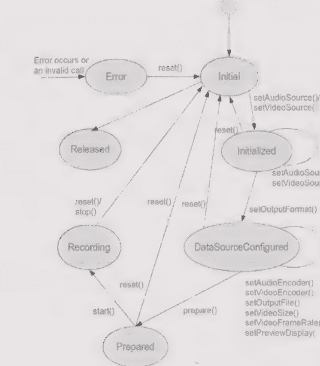

图 41.2：MediaRecorder 状态图

要使用 `MediaRecorder` 录制视频，你需要它的实例。因此，第一件事是创建一个 `MediaRecorder`。

```
MediaRecorder mediaRecorder = new MediaRecorder();
```

然后，如图 41.2 所示，为了录制视频，你必须让 `MediaRecorder` 进入 `Initialized` 状态，然后通过调用某些方法进入 `DataSourceConfigured` 和 `Prepared` 状态。

要将 `MediaRecorder` 转换为 `Initialized` 状态，调用 `setAudioSource` 和 `setVideoSource` 方法来设置音频和视频源。`setAudioSource` 的有效值是 `MediaRecorder.AudioSource` 类中的字段之一，包括 `CAMORDER`、`DEFAULT`、`REMOTE`、`SUBMIX`、`VOICE`、`CALL`、`COMMUNICATION`、`VOICE_DOWNLINK`、`VOICE_RECOGNITION` 和 `VOICE_UPLINK`。

`setVideoSource` 的有效值是 `MediaRecorder.VideoSource` 类中的字段之一，包括 `CAMERA` 和 `DEFAULT`。

一旦 `MediaRecorder` 处于 `Initialized` 状态，调用它的 `setOutputFormat` 方法，传递 `MediaRecorder.OutputFormat` 类中的文件格式。定义的字段有：`AAC`、`ADTS`、`AMR NB`、`AMR_WB`、`DEFAULT`、`MPEG_4`、`RAW_AMR` 和 `THREE GPP`。

成功调用 `setOutputFormat` 会将 `MediaRecorder` 带 `DataSourceConfigured` 状态。你只需要调用 `prepare` 来准备 `MediaRecorder`。

## 第 41 章：制作视频 503

要开始录制，请调用 `start` 方法。它将持续录制直到调用 `stop` 或发生错误。如果 `MediaRecorder` 存储视频的空间不足，或者超过了指定的最大录制时间，可能会发生错误。

一旦你停止了 `MediaRecorder`，它将回到初始状态。你必须再次经过之前的三个状态才能录制另一个视频。

另外注意，`MediaRecorder` 会消耗大量资源，如果不再使用 `MediaRecorder`，调用其 `release` 方法来释放资源是明智的。例如，你应该在 Activity 暂停时释放 `MediaRecorder`。一旦 `MediaRecorder` 被释放，同一个实例将无法再次用于录制另一个视频。

### 使用 MediaRecorder

VideoRecorder 应用程序演示了如何使用 `MediaRecorder` 录制视频。它包含一个有一个按钮和一个 `SurfaceView` 的 Activity。按钮用于开始和停止录制，而 `SurfaceView` 用于显示摄像头看到的内容。`SurfaceView` 已在第 30 章“拍摄照片”中进行了详细解释。

该 Activity 的布局文件显示在代码清单 41.5 中，Activity 类显示在代码清单 41.6 中。

### 代码清单 41.5：布局文件 (activity_main.xml)

```xml
<LinearLayout
    xmlns:android="http://schemas.android.com/apk/res/android"
    android:orientation="vertical"
    android:layout_width="fill_parent"
    android:layout_height="fill_parent">

    <Button
        android:id="@id/button"
        android:layout_width="wrap_content"
        android:layout_height="wrap_content"
        android:marginLeft="33dp"
        android:marginTop="22dp"
        android:onClick="startStopRecording"
        android:text="@string/button_start" />

    <SurfaceView
        android:id="@id/surfaceView"
        android:layout_width="match_parent"
        android:layout_height="match_parent" />
</LinearLayout>
```

### 代码清单 41.6：MainActivity 类


```java
package com.example.videorecorder;
import java.io.File;
import java.io.IOException;
import android.app.Activity;
import android.media.MediaRecorder;
import android.os.Bundle;
import android.os.Environment;
import android.view.SurfaceHolder;
import android.view.SurfaceView;
import android.view.View;
import android.widget.Button;

public class MainActivity extends Activity {
    private MediaRecorder mediaRecorder;
    private File outputDir;
    private boolean recording = false;

    @Override
    void onCreate(Bundle savedInstanceState) {
        super.onCreate(savedInstanceState);
        File moviesDir = Environment
            .getExternalStoragePublicDirectory(
                Environment.DIRECTORY_MOVIES);
        outputDir = new File(moviesDir,
            "VideoRecorder");
        outputDir.mkdirs();
        setContentView(R.layout.activity_main);
    }

    @Override
    protected void onResume() {
        super.onResume();
        mediaRecorder = new MediaRecorder();
        initConfigureMediaRecorder();
    }

    @Override
    protected void onPause() {
        super.onPause();
        if (recording) {
            try {
                mediaRecorder.stop();
            } catch (IllegalStateException e) {
            }
        }
        releaseMediaRecorder();
        Button button = (Button) findViewById(R.id.button1);
        button.setText("Start");
        recording = false;
    }

    private void releaseMediaRecorder() {
        if (mediaRecorder != null) {
            mediaRecorder.reset();
            mediaRecorder.release();
            mediaRecorder = null;
        }
    }

    private void initConfigureMediaRecorder() {
        mediaRecorder.setAudioSource(
            MediaRecorder.AudioSource.CAMCORD);
        mediaRecorder
            .setVideoSource(MediaRecorder.VideoSource.CAMERA);
        mediaRecorder.setOutputFormat(
            mediaRecorder.OutputFormat.MPEG_4);
        mediaRecorder.setVideoFrameRate(10);// // make it very low
        mediaRecorder.setVideoEncoder(
            mediaRecorder.VideoEncoder.MPEG_4_SP);
        mediaRecorder.setAudioEncoder(
            mediaRecorder.AudioEncoder.AMR_NB);
        String outputFile = new File(outputDir,
            System.currentTimeMillis() + ".mp4")
            .getAbsolutePath());

        mediaRecorder.setOutputFile(outputFile);
        SurfaceView surfaceView = (SurfaceView) findViewById(R.id.surfaceView);
        SurfaceHolder surfaceHolder = surfaceView.getHolder();
        mediaRecorder.setPreviewDisplay(surfaceHolder
            .getSurface());
    }

    public void startStopRecording(View view) {
        Button button = (Button) findViewById(R.id.button1);
        if (recording) {
            button.setText("Start");
            try {
                mediaRecorder.stop();
            } catch (IllegalStateException e) {
                releaseMediaRecorder();
            }
        } else {
            button.setText("Stop");
            if (mediaRecorder == null) {
                mediaRecorder = new MediaRecorder();
                initConfigureMediaRecorder();
            }
            // prepare MediaRecorder
            try {
                mediaRecorder.prepare();
            } catch (IllegalStateException e) {
                e.printStackTrace();
            } catch (IOException e) {
                e.printStackTrace();
            }
            mediaRecorder.start();
            recording = true;
        }
    }
}
```

# 508 Android Java Java

```xml
<manifest
xmlns:android="http://schemas.android.com/apk/res/android"
    package="com.example.soundmeter"
    android:versionCode="1"
    android:versionName="1.0">

<uses-sdk
    android:minSdkVersion="8"
    android:targetSdkVersion="17" />

<uses-permission android:name="android.permission.RECORD_AUDIO" />

<application
    android:allowBackup="true"
    android:icon="@drawable/ic_launcher"
    android:label="@string/app_name"
    android:theme="@style/AppTheme">
    <activity
        android:name="com.example.soundmeter.MainActivity"
        android:label="@string/app_name">
        <intent-filter>
            <action android:name="android.intent.action.MAIN" />
            <category android:name="android.intent.category.LAUNCHER" />
        </intent-filter>
    </activity>
</application>
</manifest>
```

这里需要注意的是在 manifest 中使用了 `permission`（权限）元素来请求用户录制音频的权限。如果不包含此元素，你的应用程序将无法工作。此外，如果用户不同意，应用程序将无法安装。

此项目中只有一个 activity，如 manifest 所示。

代码列表 42.2 显示了主 activity 的布局文件。它使用了一个 `GridLayout` 作为主显示区域，其中包含一个用于显示当前声音的 `TextView` 和一个作为声音指示器的 `button`。

## 列表 42.2：SoundMeter 项目中的 res/layout/activity_main.xml 文件

```xml
<RelativeLayout
    xmlns:android="http://schemas.android.com/apk/res/android"
    xmlns:tools="http://schemas.android.com/tools"
    android:layout_width="match_parent"
    android:layout_height="match_parent"
    android:paddingBottom="@dimen/activity_vertical_margin"
    android:paddingLeft="@dimen/activity_horizontal_margin"
    android:paddingRight="@dimen/activity_horizontal_margin"
    android:paddingTop="@dimen/activity_vertical_margin"
    tools:context=".MainActivity">
```

```xml
<TextView
    android:id="@id/level"
    android:layout_width="wrap_content"
    android:layout_height="wrap_content" />
```

```xml
<Button
    android:id="@id/button"
    style="?android:attr/buttonStyle"
    android:layout_width="wrap_content"
    android:layout_height="wrap_content"
    android:layout_marginLeft="@id/level"
    android:layout_below="@id/level"
    android:background="#ff0000"
    android:layout_marginTop="30dp" />
</RelativeLayout>
```

该应用程序中有两个 Java 类。第一个是代码列表 42.3 中的名为 `SoundMeter` 的类，它封装了一个 `MediaRecorder` 并暴露了三个方法来管理它。第一个方法 `start` 创建 `MediaRecorder` 实例，对其进行配置并启动。第二个方法 `stop` 停止 `MediaRecorder`。第三个方法 `getAmplitude` 返回一个指示采样音电的 `double` 值。

## 列表 42.3：SoundMeter 类

```java
package com.example.soundmeter;
import java.io.IOException;
import android.media.MediaRecorder;

public class SoundMeter {

    private MediaRecorder mediaRecorder;
    boolean started = false;

    public void start() {
        if (started) {
            return;
        }
        if (mediaRecorder == null) {
            mediaRecorder = new MediaRecorder();
        }

        mediaRecorder.setAudioSource(MediaRecorder.AudioSource.MIC);
        mediaRecorder.setOutputFormat(MediaRecorder.OutputFormat.THREE_GPP);
        mediaRecorder.setAudioEncoder(MediaRecorder.AudioEncoder.AM_NB);
        mediaRecorder.setOutputFile("/dev/null");
        try {
            mediaRecorder.prepare();
        } catch (IllegalStateException e) {
            e.printStackTrace();
        } catch (IOException e) {
            e.printStackTrace();
        }
        mediaRecorder.start();
        started = true;
    }

    public void stop() {
      if (mediaRecorder != null) {
        mediaRecorder.stop();
        mediaRecorder.release();
        mediaRecorder = null;
        started = false;
      }
    }

    public double getAmplitude() {
      return mediaRecorder.getMaxAmplitude() / 100;
    }
}
```

第二个 Java 类 `MainActivity` 是应用程序的主活动类。它位于代码列表 42.4。


```java
package com.example.soundmeter;
import android.app.Activity;
import android.os.Bundle;
import android.os.Handler;
import android.view.Menu;
import android.widget.Button;
import android.widget.TextView;

public class MainActivity extends Activity {
  Handler handler = new Handler();
  SoundMeter soundMeter = new SoundMeter();

  @Override
  protected void onCreate(Bundle savedInstanceState) {
    super.onCreate(savedInstanceState);
    setContentView(R.layout.activity_main);
  }

  @Override
  public boolean onCreateOptionsMenu(Menu menu) {
    return true;
  }

  @Override
  public void onStart() {
    super.onStart();
  }

  @Override
  public void onPause() {
    super.onPause();
  }

  private Runnable pollTask = new Runnable() {
    @Override
    public void run() {
      double amplitude = soundMeter.getAmplitude();
      TextView textView = findViewById(R.id.level);
      textView.setText("Amp: " + amplitude);
      Button button = (Button) findViewById(R.id.button);
      button.setText("Stop");
      handler.postDelayed(pollTask, 150);
    }
  };
}
```

# 514 Android Java 开发

## 注意

Android 提供了动画 API，你应该在所有动画任务中使用它们。

本示例使用 `Handler` 来对一个简单的控件进行动画，以说明 `Handler` 的用法。

列表 43.1 显示了项目的清单文件（`AndroidManifest.xml` 文件）。

## 列表 43.1: HandlerTest 的清单文件

```xml
<?xml version="1.0" encoding="utf-8"?>
<manifest
    xmlns:android="http://schemas.android.com/apk/res/android"
    package="com.example.handlertest"
    android:version="1"
    android:versionName="1.0">

    <uses-sdk>
        android:minSdkVersion="8"
        android:targetSdkVersion="17" />

    <application
        android:allowBackup="true"
        android:icon="@drawable/ic_launcher"
        android:label="@string/app_name"
        android:theme="@style/AppTheme">
        <activity
            android:name="com.example.handlertest.MainActivity"
            android:label="@string/app_name">
            <intent-filter>
                <action android:name="android.intent.action.MAIN"/>
                <category android:name="android.intent.category.LAUNCHER"/>
            </intent-filter>
        </activity>
    </application>
</manifest>
```

清单文件中并没有特别之处。它显示有一个名为 `MainActivity` 的 activity。该 activity 的布局文件在列表 43.2 中给出。

## 列表 43.2: HandlerTest 中的 res/layout/activity_main.xml 文件

```xml
<RelativeLayout
    xmlns:android="http://schemas.android.com/apk/res/android"
    xmlns:tools="http://schemas.android.com/tools"
    android:layout_width="match_parent"
    android:layout_height="match_parent"
    android:paddingBottom="@dim/activity_vertical_margin"
    android:paddingLeft="@dim/activity_horizontal_margin"
    android:paddingRight="@dim/activity_horizontal_margin"
    android:paddingTop="@dim/activity_vertical_margin"
    tools:context=".MainActivity">

<ImageView
    android:id="@id/imageview"
    android:layout_width="wrap_content"
    android:layout_height="wrap_content"
    android:layout_alignLeft="true"
    android:layout_alignTop="true"
    android:layout_marginLeft="51dp"
    android:layout_marginTop="58dp"
    android:src="@drawable/surprise" />

<Button
    android:id="@+id/button1"
    style="?attr/buttonStyle"
    android:layout_width="wrap_content"
    android:layout_height="wrap_content"
    android:layout_alignRight="@+id/imageView"
    android:layout_below="@+id/imageView"
    android:layout_marginRight="18dp"
    android:layout_marginTop="65dp"
    android:onClick="buttonClicked"
    android:text="Button"/>
</RelativeLayout>
```

`MainActivity` 的主布局是一个 `RelativeLayout`，它包含一个用于动画的 `ImageView` 和一个用于启动动画的按钮。

现在看列表 43.3 中的 `MainActivity` 类。这是该应用程序的核心。

## 列表 43.3: HandlerTest 中的 MainActivity 类

```java
package com.example.handlertest;
import android.app.Activity;
import android.os.Bundle;
import android.os.Handler;
import android.view.Menu;
import android.view.View;
import android.widget.ImageView;

public class MainActivity extends Activity {

    int counter = 0;
    Handler handler = new Handler();

    @Override
    protected void onCreate(Bundle savedInstanceState) {
        super.onCreate(savedInstanceState);
        setContentView(R.layout.activity_main);
        getUserAttention();
    }

    @Override
    public boolean onCreateOptionsMenu(Menu menu) {
        // 加载菜单，如果 action bar 存在，这会将项添加到操作栏中。
        getMenuInflater().inflate(R.menu.main, menu);
        return true;
    }

    public void buttonClicked(View view) {
        counter = 0;
        getUserAttention();
    }

    private void getUserAttention() {
        handler.post(task);
        Runnable task = new Runnable() {
            @Override
            public void run() {
                ImageView imageView = (ImageView) findViewById(R.id.imageView);
                if (counter % 2 == 0) {
                    imageView.setVisibility(View.INVISIBLE);
                } else {
                    imageView.setVisibility(View.VISIBLE);
                }
                counter++;
                if (counter < 8) {
                    handler.postDelayed(this, 400);
                }
            }
        };
    }
}
```

该 activity 的大脑是一个名为 `task` 的 `Runnable`，它负责对 `ImageView` 执行动画，而 `getUserAttention` 方法调用了 `Handler` 的 `postDelayed` 方法。`Runnable` 根据 `counter` 值的奇偶性将 `ImageView` 的可见性设置为可见（`Visible`）或不可见（`Invisible`）。

如果你运行 `HandlerTest` 项目，你会看到类似于图 43.1 的内容。注意 `ImageView` 如何闪烁几次以引起你的注意。尝试快速点击按钮让它闪烁得更快。

图 43.1：HandlerTest

## 总结

在本章中，你学习了 `Handler` 类以及如何使用它编写应用程序。

# 第 44 章 异步任务

在本章中，我们将讨论异步任务以及如何使用 `AsyncTask` 类。

## 概述

`AsyncTask` 类是一个工具，用于在后台线程执行耗时操作，同时在 UI 线程更新进度。

## 示例

`PhotoEditor` 示例展示了如何使用 `AsyncTask` 来处理图像操作。其清单（`AndroidManifest.xml` 文件）打印在列表 44.1 中。

## 列表 44.1：PhotoEditor 的清单

```xml
<?xml version="1.0" encoding="utf-8"?>
<manifest
    xmlns:android="http://schemas.android.com/apk/res/android"
    package="com.example.photoeditor"
    android:version="1"
    android:versionName="1.0">

    <uses-sdk>
        android:minSdkVersion="8"
        android:targetSdkVersion="17" />

    <application
        android:allowBackup="true"
        android:icon="@drawable/ic_launcher"
        android:label="@string/app_name"
        android:theme="@style/AppTheme">
      <activity
        android:name="com.example.photoeditor.MainActivity"
        android:label="@string/app_name">
        <intent-filter>
          <action android:name="android.intent.action.MAIN" />
          <category android:name="android.intent.category.LAUNCHER" />
        </intent-filter>
      </activity>
    </application>
</manifest>
```

布局文件打印在列表 44.2 中，显示了该应用程序使用垂直 `LinearLayout` 来包含一个 `ImageView`、`ProgressBar` 和两个按钮。后者包含在一个水平 `LinearLayout` 中。第一个按钮用于启动模糊操作，第二个用于启动反转。

## 列表 44.2：PhotoEditor 中的 res/layout/activity_main.xml 文件

```xml
<LinearLayout
    xmlns:android="http://schemas.android.com/apk/res/android"
    xmlns:tools="http://schemas.android.com/tools"
    android:layout_width="fill_parent"
    android:layout_height="fill_parent"
    android:orientation="vertical"
    android:paddingLeft="16dp"
    android:paddingRight="16dp">

  <LinearLayout
    android:layout_height="wrap_content"
    android:layout_width="fill_parent"
    android:orientation="horizontal">

    <Button
      android:id="@id/blurButton"
      android:layout_width="wrap_content"
      android:layout_height="wrap_content"
      android:onClick="doBlur"
      android:text="@string/blur_button_text" />

    <Button
      android:id="@+id/button2"
      android:layout_width="wrap_content"
      android:layout_height="wrap_content"
      android:onClick="doInvert"
      android:text="@string/invert_button_text" />

  </LinearLayout>
</LinearLayout>
```

```xml
<ProgressBar
    android:id="@id/progressBar"
    style="android:attr/BarStyleHorizontal"
    android:layout_width="fill_parent"
    android:layout_height="10dp" />
```

```xml
<ImageView
    android:id="@id/imageView"
    android:layout_width="wrap_content"
    android:layout_height="wrap_content"
    android:layout_gravity="top|center"
    android:src="@drawable/photo" />
```

```xml
</LinearLayout>
```


最后，在列表 44.3 中给出了该项目的 `MainActivity` 类。

# 列表 44.3：PhotoEditor 中的 `MainActivity` 类

```java
package com.example.photoeditor;
import android.app.Activity;
import android.graphics.Bitmap;
import android.graphics.drawable.BitmapDrawable;
import android.os.Bundle;
import android.view.Menu;
import android.view.View;
import android.widget.ImageView;
import android.widget.ProgressBar;
```

```java
public class MainActivity extends Activity {
    private ProgressBar progressBar;

    @Override
    protected void onCreate(Bundle savedInstanceState) {
        super.onCreate(savedInstanceState);
        setContentView(R.layout.activity_main);
        progressBar = findViewById(R.id.progressBar);
    }

    @Override
    public boolean onCreateOptionsMenu(Menu menu) {
        // 载载菜单；将项添加到操作栏
        if (isPresent()) {
            getMenuInflater().inflate(R.menu.main, menu);
        }
        return true;
    }

    public void doBlur(View view) {
        BlurImageTask task = new BlurImageTask();
        ImageView imageView = (ImageView) findViewById(R.id.imageView);
        Bitmap bitmap = ((BitmapDrawable) imageView.getDrawable()).getBitmap();
        task.execute(bitmap);
    }

    public void doInvert(View view) {
        InvertImageTask task = new InvertImageTask();
        ImageView imageView = (ImageView) findViewById(R.id.imageView);
        Bitmap bitmap = ((BitmapDrawable) imageView.getDrawable()).getBitmap();
        task.execute(bitmap);
    }

    private class InvertImageTask extends AsyncTask<Bitmap, Integer, Bitmap> {
        protected Bitmap doInBackground(Bitmap... bitmap) {
            Bitmap input = bitmap[0];
            Bitmap result = input.copy(input.getConfig());
            /*isMutable=true*/
            int width = input.getWidth();
            int height = input.getHeight();
            for (int i = 0; i < height; i++) {
                for (int j = 0; j < width; j++) {
                    int pixel = input.getPixel(j, i);
                    int a = pixel & 0xff000000;
                    a = a | (-pixel & 0xffffff);
                    result.setPixel(j, i, a);
                }
                int progress = (int) (100 * (i + 1) / height);
                publishProgress(progress);
            }
            return result;
        }

        protected void onProgressUpdate(Integer... values) {
            progressBar.setProgress(values[0]);
        }

        protected void onPostExecute(Bitmap result) {
            ImageView imageView = (ImageView) findViewById(R.id.imageView);
            imageView.setImageBitmap(result);
            progressBar.setProgress(0);
        }
    }

    private class BlurImageTask extends AsyncTask<Bitmap, Integer, Bitmap> {
        protected Bitmap doInBackground(Bitmap... bitmap) {
            Bitmap input = bitmap[0];
            Bitmap result = input.copy(input.getConfig());
            /*isMutable=true*/
            int width = bitmap[0].getWidth();
            int height = bitmap[0].getHeight();
            int level = 7;
            for (int i = 0; i < height; i++) {
                for (int j = 0; j < width; j++) {
                    int pixel = input.getPixel(j, i);
                    int a = pixel & 0xff000000;
                    int r = (pixel >> 16) & 0xff;
                    int g = (pixel >> 8) & 0xff;
                    int b = pixel & 0xff;
                    r = (r + 2) / 2;
                    g = (g + 2) / 2;
                    b = (b + 1) / 2;
                    int gray = a | (r << 16) | (g << 8) | b;
                    result.setPixel(j, i, gray);
                }
                int progress = (int) (100 * (i + 1) / height);
                publishProgress(progress);
            }
            return result;
        }

        protected void onProgressUpdate(Integer... values) {
            progressBar.setProgress(values[0]);
        }

        protected void onPostExecute(Bitmap result) {
            ImageView imageView = (ImageView) findViewById(R.id.imageView);
            imageView.setImageBitmap(result);
            progressBar.setProgress(0);
        }
    }
}
```

# 附录 A: javac

仅生成某些类型的调试信息，由逗号分隔的关键字列表指定。有效的关键字有：

- `source`：源文件调试信息
- `lines`：行号调试信息
- `vars`：局部变量调试信息

`-help`

打印标准选项的描述。

`-nowarn`

禁用警告消息。这与 `-Xlint:none` 的效果相同。

`-source-release`

指定接受的源代码版本。允许的值有 1.3, 1.4, 1.5, 5, 1.6, 6, 17 和 7。

`-sourcepath sourcePath`

设置搜索类或接口定义的代码路径。与用户类路径一样，路径条目用分号（Windows 中）或冒号（在 Linux/Unix 中）分隔，可以是目录、jar 归档文件或 zip 压缩包。如果使用了包，目录内的本地路径名必须反映包名。

> **注意**：如果通过类路径找到了类并发现了其源代码，则会自动进行重新编译。

`-verbose`

包含关于每个加载的类和每个编译的源的信息。

`-X`

显示关于非标准选项的信息。

## 非标准选项

`-Xbootclasspath/p:path`

在引导类路径之前添加路径。

`-Xbootclasspath/a:path`

在引导类路径之后添加路径。

`-Xbootclasspath/:path`

覆盖引导类文件的位置。

`-Xlint`

启用所有建议的警告。

`-Xlint:none`

禁用所有 Java 语言规范强制要求的警告。

`-Xlint:xxx`

禁用警告 xxx，其中 xxx 是 `-Xlint:xxx` 支持的警告名称之一。

`-Xlint:unchecked`

为 Java 语言规范要求的未检查转换警告提供更详细的信息。

`-Xlint:path`

对 classpath、sourcepath 或其他选项指定的不存在的目录的警告。

`-Xlint:serial`

对可序列化类缺少 `serialVersionUID` 定义的警告。

`-Xlint:finally`

对无法正常完成的 finally 子句发出警告。

`-Xlint:fallthrough`

检查 switch 块是否存在穿透情况，并对发现的任何此类情况提供警告消息。穿透情况是指 switch 块中除最后一个 case 之外，其代码不包含 break 语句的情况。

`-Xmaxerrors number`

指定将报告的最大错误数量。

`-Xmaxwarns number`

指定将报告的最大警告数量。

`-Xstfile filename`

将编译器消息发送到指定的文件。默认情况下，编译器消息发送到 `System.err`。

## `-J` 选项

`-Joption`

将选项传递给 `javac` 调用的 java 启动器。

`-J-Xms48m` 将启动内存设置为 48 兆字节。虽然它不是以 `-X` 开，但它不是 `javac` 的“标准选项”。通常约定 `-J` 将选项传递给执行 Java 程序的底层虚拟机。

## 命令行参数文件

如果你必须反复向 `javac` 传递长参数，将这些参数保存在文件中并将文件传递给 `javac` 将节省大量的打字工作。参数文件可以包含任意组合的选项和文件名。在参数文件中，您可以使用空格分隔参数，也可以作为新行分隔它们。`javac` 工具甚至允许使用多个参数文件。

例如，以下命令行调用 `javac` 并将文件 `MyArguments` 传递给它：

```
javac @MyArguments
```

以下传递两个参数文件 `Args1` 和 `Args2`：

```
javac @Args1 @Args2
```

# 附录 B

`java`

**`java`** 程序是一个启动 Java 程序的工具。其语法有两种形式。

```
java [options] class [argument ...]
java [options] -jar jarFile [argument ...]
```

*where options* 定义命令行选项、要调用的类名、`jarFile` 是要调用的 jar 文件名，而 *argument* 是传递给被调用类的 `main` 方法的参数。

## 选项

传递给 **`java`** 的选项有两种类型：标准选项和非标准选项。

## 标准选项

- `-client`

  选择 Java HotSpot Client 虚拟机。

- `-server`

  选择 Java HotSpot Server 虚拟机。

- `-agentlib:libraryName=[options]`

  加载原生库 `libraryName`。`libraryName` 的示例值有。

- `-Dproperty=value`

  设置系统属性。

- `-cp`

  设置搜索类或接口定义的类路径。与用户类路径一样，路径条目用分号（Windows 中）或冒号（在 Linux/Unix 中）分隔，可以是目录、jar 归档文件或 zip 压缩包。如果使用了包，目录内的本地路径名必须反映包名。

  > **注意**：如果通过类路径找到了类并发现了其源代码，则会自动进行重新编译。

- `-source`

  指定接受的源代码版本。允许的值有 1.3, 1.4, 1.5, 5, 1.6, 6, 17 和 7。

- `-source-release`

  指定接受的源代码版本。允许的值有 1.3, 1.4, 1.5, 5, 1.6, 6, 17 和 7。

- `-sourcepath sourcePath`

  设置搜索类或接口定义的代码路径。与用户类路径一样，路径条目用分号（Windows 中）或冒号（在 Linux/Unix 中）分隔，可以是目录、jar 归档文件或 zip 压缩包。如果使用了包，目录内的本地路径名必须反映包名。

  > **注意**：如果通过类路径找到了类并发现了其源代码，则会自动进行重新编译。

- `-verbose`

  包含关于每个加载的类和每个编译的源的信息。

- `-version`

  显示版本信息并退出。

- `-java`

  启动 Java 启动器。

- `-jar`

  指定要调用的 jar 文件。

- `-help`

  打印标准选项的描述。

## 非标准选项

- `-Xincgc`

  启用增量垃圾收集器。增量垃圾收集器默认关闭，它可以减少程序执行期间偶尔出现的长垃圾回收暂停。增量垃圾收集器会与程序并发执行，在此期间会减少程序程序可用的处理器能力。

- `-Xloggc:file`

  报告每次垃圾收集事件，功能与 `-verbose:ge` 相同，但将这些数据记录到文件中。除了 `-verbose:ge` 提供的信息外，每个报告的事件之前都会有一个自第一次垃圾收集事件以来的时间（以秒为单位）。

  始终使用本地文件系统存储此文件，以避免网络延迟导致 JVM 停顿。如果文件系统满，文件可能会被截断，日志将继续在被截断的文件上。如果同时存在这两个选项，此选项将覆盖 `-verbose:ge` 选项。

- `-Xms`

  指定内存分配池的初始大小，单位为字节。值必须是 1024 的倍数且大于 1MB。在后面添加字母 k 或 K 表示千字节，或 m 或 M 表示兆字节。默认值为 2MB。例如：

  - `-Xms6291456`
  - `-Xms6144k`
  - `-Xms6m`

- `-Xmx`

  指定内存分配池的最大大小，单位为字节。值必须是 1024 的倍数且大于 2MB。在后面添加 k 或 K 表示千字节，或 m 或 M 表示兆字节。默认值为 64MB。实例：

  - `-Xmx83880000`
  - `-Xmx8192k`
  - `-Xmx86m`

- `-Xprof`

  对运行中的程序进行分析，并将分析数据发送到标准输出。此选项作为实用程序提供，在程序开发中非常有用，不应在生产环境中使用。

- `-Xprof:[help]:<suboption>=<value>,...`

  启用 CPU、堆或监控分析。这通常后面跟着一个由逗号分隔的 "<suboption>=<value>" 对列表。你可以通过运行命令 `java -Xrunprof:help` 来显示子选项列表及其默认值。

- `-Xrsn`

  减少 虚拟机（JVM）对操作系统信号的使用。

- `-Xss`

  设置栈大小。

- `-XX:+UseSignals`

  JVM 默认使用 SIGUSR1 和 SIGUSR2，这有时会与使用信号链 SIGUSR1 和 SIGUSR2 的应用程序冲突。此选项将导致 JVM 使用 SIGUSR1 和 SIGUSR2 以外的信号作为默认。

# 附录 C jar

`jar` 是 Java archive（存档）的缩写，是一种将 Java 类文件和其他相关资源打包到 jar 文件中的工具。`jar` 工具包含在 JDK 中，最初创建它的理由是为了让 applet 类及其相关资源可以通过单个 HTTP 请求进行下载。随着时间的推移，`jar` 已经成为打包任何 Java 类（而非 applet）的优选方式。


jar 格式基于 zip 格式。因此，你可以将 jar 文件的扩展名更改为 `.zip`，并使用 ZIP 查看器（如 WinZip）查看它。jar 文件还可以包含 `META-INF` 目录，用于存储包和扩展配置数据，包括安全性、版本控制、扩展和服务配置。jar 也是唯一允许你对代码进行数字签名的格式。

本附录提供了 jar 工具的语法以及如何使用的示例。

## 语法

你可以使用 jar 创建、更新、提取和列出 jar 文件的内容。jar 命令可以配合选项使用，选项将在“选项”部分进行解释。以下是 jar 程序命令的语法。

要创建 jar 文件，使用此语法。

```
jar c[vOM] jarFile [-C dir] inputFiles [-Joption]
jar c[vOM] manifest jarFile [-C dir] inputFiles [-Joption]
jar c[vOM] [-C dir] inputFiles [-Joption]
jar c[v0] manifest [-C dir] inputFiles [-Joption]
```

要更新 jar 文件，使用此语法。

```
jar u[vOM] jarFile [-C dir] inputFiles [-Joption]
jar u[vOM] manifest jarFile [-C dir] inputFiles [-Joption]
jar u[vOM] [-C dir] inputFiles [-Joption]
jar u[v0m] manifest [-C dir] inputFiles [-Joption]
```

要提取 jar 文件，使用此语法。

```
jar x[v]f jarFile [inputFiles] [-Joption]
jar x[v] [inputFiles] [-Joption]
```

要列出 jar 文件的内容，使用以下语法。

```
jar t[v]f jarFile [inputFiles] [-Joption]
jar t[v] [inputFiles] [-Joption]
```

以及，为 jar 文件添加索引，使用此语法。

```
jar i jarFile [-Joption]
```

参数如下。

`cuxtiv0Mmf`

控制 jar 命令的选项。这些将在“选项”部分中详细说明。

`jarFile`

要创建、更新、提取、查看内容或为其添加索引的 jar 文件。缺少 f 选项和 jarFile 则表示我们正在从标准输入接受输入（在提取和查看内容时）或向标准输出发送输出（在创建和更新时）。

`inputFiles`

要打包到 jar 中的文件或目录，用空格分隔。

`-C dir`

临时更改目录。

`-Joption`

传递给 Java 运行时的选项。

`manifest`

预先存在的清单文件，其键值对将被包含在。

`O`

生成详细输出到标准输出。

`m`

表示应创建一个清单文件。

`f`

指定要创建、更新、提取或查看的 jar 文件。

`v`

生成详细输出。

`c`

表示 jar 命令创建一个新的 jar 文件。

`u`

表示 jar 命令更新 jar 文件。

`x`

表示 jar 命令提取文件。

`t`

表示 jar 命令列出 jar 文件的内容。

`i`

为 jar 文件生成索引。

### 示例

以下是 jar 的用法。

#### 创建

此 jar 命令将当前目录下的所有目录和文件创建一个名为 MyJar.jar 的 jar 文件。

```
jar cf MyJar.jar *
```

带有 v 选项的操作相同，会将消息输出到控制台：

```
jar cvf MyJar.jar *
```

以下命令将 com/jdk/ 下的所有类文件打包到 MyJar.jar 文件。

```
jar cvf MyJar.jar com/jdk/*.class
```

#### 更新

此命令将 MathUtil.class 添加到 MyJar.jar。

```
jar uf MyJar.jar MathUtil.class
```

此命令用 manifest 中的键值对更新 MyJar.jar。

```
jar umf manifest MyJar.jar
```

以下命令将 classes 目录中的 MathUtil.class 添加到 MyJar.jar。

```
jar uf MyJar.jar -C classes MathUtil.class
```

#### 列出

以下命令列出 MyJar.jar 的内容：

```
jar tf MyJar.jar
```

#### 提取

以下命令将 MyJar.jar 中的所有文件提取到当前目录。

```
jar xf MyJar.jar
```

#### 索引

此命令在 MyJar.jar 中生成一个 INDEX.LIST 文件，包含 MyJar.jar 中每个包以及 MyJar.jar Class-Path 属性中指定的所有 jar 文件的位置信息。

```
jar i MyJar.jar
```

## 设置应用程序入口点

java 工具在附录 B 中解释，允许你调用 jar 文件中的类。其语法如下：

```
java -jar jarFile
```

为了让 java 能够调用正确的类，你需要在 jar 文件中包含带有以下条目的清单：

```
Main-Class: className
```

## 附录 D: NetBeans

Sun Microsystems 于 2000 年启动了 NetBeans 开源项目。NetBeans 的名称源于 Netbeans Ceska Republika，这是 Sun 收购的一家捷克公司。新项目基于 Sun 收购的成果开发。

本附录提供了关于使用 NetBeans 构建 Java 应用程序的快速教程。NetBeans 需要 JDK 才能运行。

### 下载与安装

你可以从 http://netbeans.org 免费下载 NetBeans。编写本文时的最新版本是 7.4。你需要 7 版本或更高版本来享受 Java 7 的新功能。NetBeans 用 Java 编写的，因此它可以在任何支持 Java 的平台上运行。每个发行版本都包含一个安装程序，以便于安装。请确保为你的操作系统下载了正确的版本。安装程序将引导你完成易于遵循的逐步操作说明。系统将提示你同意使用条款和条件、指定安装目录，并在你的电脑上有多个 JDK 版本的情况下选择要使用的 JDK 版本。

安装完成后，你可以像运行其他应用程序一样运行 NetBeans IDE。

### 创建项目

NetBeans 在项目中组织资源。因此，在创建 Java 类之前，你必须先创建一个项目。按照以下步骤操作：

1. 点击 `File`（文件）-> `New Project`（新建项目）。将显示 New Project 对话框（图 D.1）

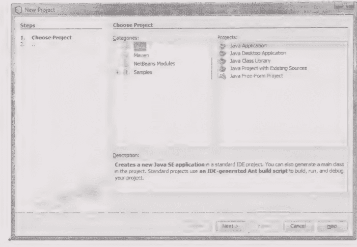

2. 从 Categories（类别）框中点击 Java，从 Projects（项目）框中点击 Java Application。然后点击 Next（下一步）。将显示如图 D.2 所示的下一个屏幕。

3. 在 Project Name（项目名称）框中输入项目名称，并浏览到你想保存项目资源的目录。之后，点击 Finish（完成）。NetBeans 将创建一个新项目以及项目中的第一个类。这如图 D.3 所示。

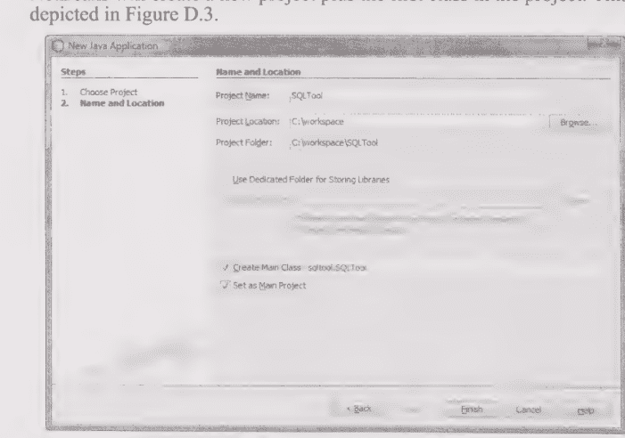

图 D.2：选择项目名称

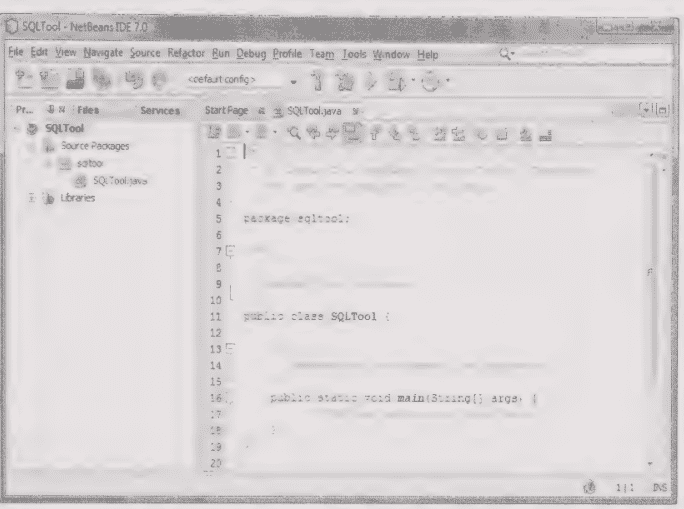

图 D.3：一个 Java 项目

图 D.3 显示了两个窗口，左侧是 Projects（项目）窗口，右侧是源代码窗口。你准备好编写代码了。

### 创建类

要创建 NetBeans 创建之外的类，右键点击 Projects 窗口中的项目图标，然后点击 New Java Class（新建 Java 类）。你会看到如图 D.4 所示的 New Java Class 对话框。

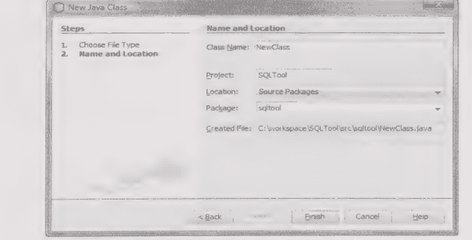

图 D.4：New Java Class 对话框

输入该类的类名和包，然后点击 Finish。系统将为你创建一个新的 Java 类。你可以在 Projects 窗口中看到这个新类。

你现在可以编写代码了。输入时，NetBeans 会检查并纠正你的 Java 代码语法。你可以通过点击 `Ctrl+S` 保存代码，NetBeans 会保存时自动对其编译。

### 运行 Java 类

完成类的编写后，你可以运行它进行测试。要运行一个类，点击 `Run`（运行）、`Run File`（运行文件），然后选择你想运行的 Java 类。任何结果将显示在 Console（控制台）窗口中。运行 Java 类的另一种方法是右键点击源代码并点击 `Run File`。

此外，运行上一个类可以按 `Shift+F6`。

### 添加库

你的类或接口经常引用其他项目或 jar 文件中的类型。为了编译这些类/接口，你需要通过添加引用来告诉 NetBeans 在哪里找到被引用的库。你可以通过右键点击 Projects 窗口中的 Libraries（库）图标，然后点击 Add JAR/Folder（添加 JAR/文件夹）来实现。随后会出现导航窗口，让你选择库文件。

### 调试代码

许多 IDE 提供的强大功能是调试。在 NetBeans 中，你可以逐行执行。调试步骤如下：

1. 点击代码行来添加断点。
2. 点击 `Run`、`Run File`，然后选择要调试的 Java 类来执行程序。
3. 选择类后，将打开这些窗口：Watches（监视）、Call Stack（调用栈）、Local Variables（局部变量）。它们允许你监控值。
4. 若要继续，点击 `Run` 并进行 step into（步入）、step over（步过）或 pause（暂停）。

## 附录 E: Eclipse

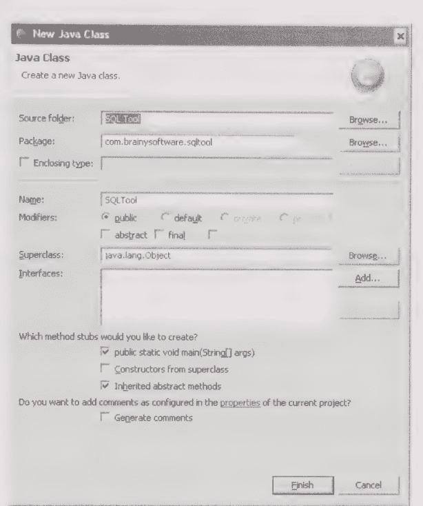

图 E.5：新建 Java 类对话框

输入包名和类名，然后点击 Finish（完成）来创建一个类。Java 视图将在新窗格中显示该类的代码，如图 E.6 所示。

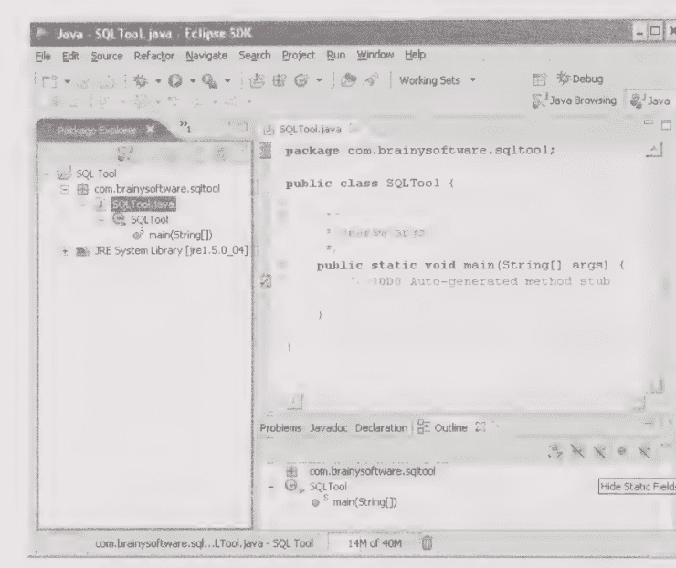

你现在可以编写代码了。在你输入代码时，Eclipse 会检查并纠正你的 Java 代码的语法。你可以通过点击 `Ctrl+S` 保存，Eclipse 会在你输入时自动对其编译。

### 运行 Java 类

一旦你完成了一个类，就可以运行它进行测试。要运行一个类，点击 `Run`（运行）、`Run As`（运行方式）、`Java Application`（Java ）。任何结果将显示在 Console（控制台）视图中。运行 Java 类的另一种方法是在类编辑器界面点击右键，点击 `Run As`（运行方式）、`Java Application`（Java ）。

此外，要运行上一次类，请按下 `Ctrl+F11`。

### 添加库

通常你的类或接口引用了 jar 文件或其他项目中的类型。为了编译这些类/接口，你需要通过添加引用来告诉 Eclipse 在哪里找到该库。你可以通过点击 `Project`（项目）、`Properties`（属性）来实现。将出现属性窗口。

在右侧面板点击 Java Build Path（Java 构建路径），然后点击左侧的 Libraries（库）选项卡。然后，点击 Add External JARs（添加外部 JAR）并导航选择 jar 文件。如果引用的类型在另一个项目中，点击 Projects（项目）标签并添加所需的项目。

### 调试代码

许多 IDE 的强大功能是支持调试。在 Eclipse 中，你可以逐行执行程序。调试程序的步骤如下：

1. 添加断点。你可以通过点击代码中的某行并点击 `Run`（运行）、`Toggle Line Breakpoint`（切换行断点）来实现。
2. 点击 `Run`（运行）、`Debug As`（调试方式）、`Java Application`（Java ）执行程序。调试需要打开 Debug（调试）视图。在步骤 2 中点击 Java Application 后，会弹出一个窗口询问你是否要进入调试视图，你可以像图 E.7 所示看到调试视图。

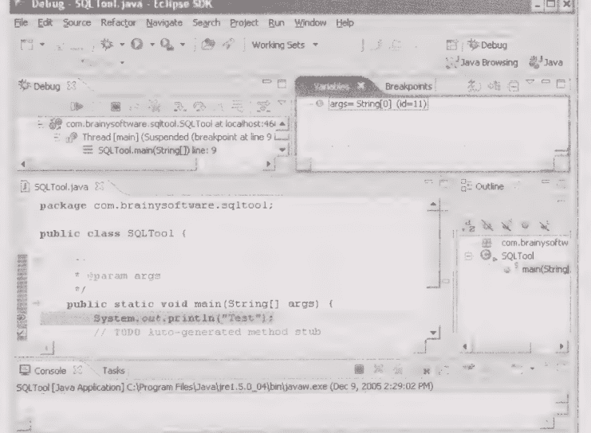

图 E.7：调试视图

出现的一个有用视图是 Variables（变量）视图。它显示了程序中的变量列表并让你检查它们的值。

要继续，点击 `Run`（运行）菜单并选择进入（step into）、跳过（step over）、恢复（resume）或终止（terminate）程序。

## 索引

abs 方法........................................................... 127

AbsListView 类....................................................... 377

AbsoluteLayout....................................................... 321

abstract 类........................................................... 137

abstract 关键字...................................................... 138

abstract 方法....................................................... 138

抽象............................................. 53

accept 方法........................................................... 237

访问控制......................................................... 62p

访问修饰符....................................................... 63p

继承中的可访问性....................................... 107

acos 方法............................................................. 128

action...................................................................

action bar........................................................... 34p

action button........................................................... 343

action overflow....................................................... 344

ActivityBar 类....................................................... 343

activity........................................................... 279, 301

Activity 类....................................................... 301

Adapter 接口..................................................... 365

add 方法.......................................................... 146p, 150, 161p

addAll 方法....................................................... 146

addContentView 方法.................................................. 32

add-operator........................................................... 439

addListener 方法....................................................

ADT Bundle............................................................. 280

ADT bundle 下载地址........................................ 280

ADT 插件......................................................................... 280p

after 方法........................................................... 128

AlertDialog................................................................... 319

AlertDialog 类..................................................... 319

AlertDialogBuilder 类.............................................. 319


# 美国信息交换标准

Interchange ........................................................... 19

字符集 ............................................................ 19

`AnalogClock` 类 ..................................................... 334

`android` .....................................................................

`icon` 属性 ................................................................. 346

`id` 属性 ........................................................................... 346

`orderInCategory` 属性 .................................................. 346

`showAsActionBar` 属性 .................................................. 346

`theme` 属性 ......................................................... 386

`title` 属性 ..........................................................

# Android

应用程序结构 .................................................................. 295

构建过程 ............................................................................. 277

组件 .................................................................... 279

调试 .................................................................... 296

模拟器 .................................................................... 287

生成文件 ........................................................................... 286

IDE ................................................................................. 280

是 Java 吗？ .................................................................... 277

`manifest` ............................................................................. 333

日志 ................................................................................. 295

`manifest` 文件 ........................................................................... 286

在设备上运行 ......................................................... 286

软件开发包 .................................................... 298

虚拟机 ........................................................................... 277

`Android Studio` ........................................................................... 280

`android.animation` 包 ................................................................ 439

`android.database` 包 ................................................................ 469

`android.sqlite` 包 ................................................................. 469

`android.graphics` 包 ................................................................. 391, 399

`android.view` 包 .................................................... 488

`android.view.animation` 包 ........................................ 439

`Annator` 类 ........................................................................... 439

`Annator` 监听器 ......................................................... 439

`AnnatorSet` 类 ......................................................... 439, 441

`anotating annotation` .................................................. 212

`syntax` ................................................................. 212

`notation type` ......................................................... 212

`notationType()` 方法 .................................................. 212

匿名内部类 .................................................. 201

`Apache Geronimo` .................................................................. 5

`pk` 文件 ................................................................................. 277, 294

`pkbuilder` 工具 ........................................................................... 277

`method()` ................................................................................. 90

`application element` .................................................... 301

`application server` ....................................................... 4

`open source` ........................................................................... 5

`arithmetic operator` ............................................................ 32

`ray()` ................................................................................. 92

`changing size` ........................................................................... 95

`component type` ......................................................... 93

`creating` ................................................................................. 93

`declaration` ............................................................................. 93

`initial value` ....................................................................... 94

`iterating` ............................................................................. 94

`limitation of` ......................................................................... 145

# 55 Android Java 开发

`size` .... 93

`method()` .... 90

`beep()` .... `catch` 关键字 .... 119

`ArrayAdapter` 类 .... 366, 370

匹配多个异常 .... 117

数组方法 .... 99

`char` .... 22

`ASCII` .

字符编码 .... 20

`asin()` 方法 .... 128

字符字面量 .... 25, 27

赋值顺序 .... 36

`charfield` .... 172

`AsyncTask` 类 .... 519

`CheckBoxPreference` 类 .... 448

`atn()` 方法 .... 92

原子操作 .... 257

子类 .... 105

`AtomicBoolean` .... 267

`CHINESE` field .... 223

`AtomicLong` .... 267

`CHINESE` field .... 223

`AtomicReference` .... 267

`class` .... 54

属性 .... 53

命名规范 .... 55

可用方法 .... 176

类声明 .... 54

背景属性 .... 375, 136

`des.file` .... 294

基类 .... 105, 136

`clear()` 方法 .... 146, 152

基本名称 .... 224

`clipPath()` 方法 .... 403

如何产生 .... 44

`clip()` 方法 .... 403

`before()` 方法 .... 418

`clipRegion()` 方法 .... 83

`eginTransaction()` 方法 .... 413

`clone()` 方法 .... 86

Java 特性 .... 2

174, 178

二元运算符 .... 30

约定 .... 16

位图 .... 391

集合框架 .... 145

`Bitmap` 类 .... 391

冒号 .... 21

位图下采样 .... 392

`Color` 类 .... 337, 399

`BitmapFactory` 类 .... 392

`columnCount` 属性 .... 330

位运算符 .... 32

注释 .... 38

位运算符 .... 36

`compare()` 方法 .... 5

`StraussTo()` 方法 .... 153

`boolean` .... 22

计算机游戏 .... 147

`boolean` 表达式 .... 25, 27

计算机程序 .... 41

`boolean` 字面量 ....

货币 .... 267

`booleanValue()` .... 91

条件操作 .... 34

`method()` .... 92

条件语句 .... 41

通配符 .... 167

常量 .... 19, 25

`boxed` ., 101

构造函数 .... 56

`brackets` .

构造函数方法 .... 56

`break` 语句 .... 49

447

广播接收器 .... 279

内容提供者 .... 279

内置注解 .... 213

菜单 .... 357

`byte` ....

`continue` 语句 .... 50

字节码 ....

转换方法 .... 151

`byteValue()` ....

`cos()` 方法 .... 91

`country code` .... 22

`callable` 接口 .... 268

`create()` 方法 .... 319

`camel` 命名规范 .... 55

`Created` 状态 .... 302

`drawable` 动画 .... 439

`drawable` 属性 .... 373, 376

`drawcolor()` 方法 .... 399

`drawText()` 方法 .... 401

下拉列表 .... 347

下拉导航 .... 205

动态绑定 .... 206

易维护性 .... 5

`Eclipse` .... 281, 541

`EditTextPreference` 类 .... 448

`element()` 方法 .... 150

`else` 语句 .... 42

`empty` 语句 .... 41

Java 中的支持 .... 62, 68

编码方法 ....

`ENGLISH` field .... 223

`entity body` .... 229

`entrySet()` 方法 .... 152

`enum` ....

`iterating` .... 143

`Environment` 类 .... 456, 466

等号运算符 .... 33

`equals()` 方法 .... 84

`err` field .... 98

错误处理 .... 115

`escape` 字符 .... 172

转义序列 .... 27

事件驱动 .... 333

`execSQL()` 方法 .... 470p

可执行代码 .... 3

`ExecutorService` .... 268

`exists()` 方法 .... 173

`exit()` 方法 .... 99

`xpression` .... 128

比较语句 .... 41

扩展性 .... 9

`exists` 关键字 .... 105, 168

外部存储 .... 455

`FALSE` ....

`field` .... 92

`field` .... 55

文件分隔符 .... 172

`final` .... 25

`final` 键 .... 69, 109, 112

`findFragmentByTag()` 方法 .... 84

`findViewByIdMethod` 类 .... 414

树 .... 272

`floating-` 浮点数 .... 30

`floating-point` 字面量 .... 25p.

`floatValue()` ....

`method()` .... 91

`flush()` 方法 .... 178

`for` ....

`enhanced` .... 46

`for` 语句 ....

`format()` 方法 .... 102, 126, 130, 184

`forName()` 方法 .... 97

`fragment` 类 ....

`callback` 方法 .... 411

`findViewById()` 方法 .... 411

`lifecycle` .... 412

`fragment` 类 .... 411

`fragment element` .... 413, 420

`fragmentManager` 类 .... 413

`fragmentTransaction` 类 .... 413

`flamelout` .... 327

`flamelout` 类 .... 321

`FRANCE` field .... 223

`FRENCH` field .... 223

`fully qualified name` .... 62, 68

`function` .... 54

`future` 接口 .... 268, 272

`disCancelled()` .... 272

`disDone()` 方法 .... 272

垃圾收集器 .... 80

`generic` 类 .... 136

`generic implementation` .... 136

# 552 Android 版 Java

- 通用类型 .... 162, 168 `Gravity` 类 .... 318

- 泛型 .... 161 `GridLayout` 类 .... 330

- `get()` method .... 129, 152, 161p `GridLayout` 类 .... 321

- `getAction()` method .... 342 `GridView` .... 377

- `getAll()` method .... 447 `GridView` 元素 .... 377

- `getIncrement()` method .... 267 `Handler` 类 .... 511, 513

- `getBundle()` method .... 224 硬件加速 .... 400

- `getByName()` method .... 237 加加速属性 .... 400

- `getClass()` method .... 84 `hashCode()` method .... 84, 212

- `getContent()` method .... 233 `hasNext()` method .... 160

- `getContentString()` method .... 233 堆 .... 59

- `getType()` method .... 233 Java 历史 .... 25


# 索引

- `getData` method.... 501 `HTTP`.... 228
- `getDateInstance` method.... 233 `HTTP` 请求.... 228p, 236p, 241p, 245
- `getDefault` method.... 130 `HTTPS`.... 238
- `getSharedPreferences` method.... 447 超文本协议.... 228
- `getEncoding` method.... 182 `i18n`.... 225
- `getExpiration` method.... 466 `icon` 属性.... 343
- `getExternalStoragePublicDirectory` method.... 466 `id` 属性.... 413
- `Filter` method.... 223 身份转换.... 28
- `getFragment` method.... 413 `t` statement.... 380
- `getFreeSpace` method.... 173 `Image` 类.... 513, 515
- `getHeaderField` method.... 233 `implements` 关键字.... 135
- `getHeaderField` method.... 233 `import` key.... 67
- `getField` method.... 233 `import` stock 类别.... 72
- `holder` method.... 487 `in` field.... 98
- `host` method.... 233, 236 增量运算符.... 31
- `getInputStream` method.... 129p `IncrementAndGet` method.... 267
- `getIntegerValue` method.... 101 `indexof` method.... 148
- `getItem` method.... 152 继承.... 105
- `getKey` method.... `Annotated` 注解类型.... 212, 216
- `getName` method.... 97, 248 初始化.... 136
- `getOutputStream` method.... 231 已初始化状态.... 502
- `getPort` method.... 231 内部类.... 195
- `properties` method.... 100 `inSampleSize` method.... 397
- `getProperty` method.... 99 `insert`.... 91
- `otypes` method.... 231 `insert` method.... 470
- `getQuery` method.... 231 `instance`.... 55, 58
- `setCharset` method.... 136 `instance` instance.... 78
- `setServerInfo` method.... 136 `instanceof` 关键字.... 113
- `state` method.... 248 `int`.... 22
- `getString` method.... 310 `integer` 表达式.... 30
- `getStringExtra` method.... 129 `literal` 类.... 25
- `time` method.... 173 集成开发环境.... 17
- `totalSpace` method.... 173 `list of` 列表.... 17
- `getUsableSpace` method.... 98 `IntelliJ IDEA`.... 300
- `getValue` method.... 152 `Intent`.... 497
- `getView` method.... 371, 379 `intent-filter` 元素.... 483, 497
- `GlassFish`.... 1 接口.... 301
- `goto`.... 4 创建.... 134
- 图形处理单元.... 400
- 图形 API.... 399
- `gravity` 属性.... 323

# 索引 553

- 国际化. ...... 221
- 中断方法. ...... 248
- 内生斥锁. ...... 257
- Java 简介. ...... 2
- `intValue` ...... 91
- `is-a` 关系. ...... 106p.
- `isDigit` method. ...... 92
- `isEmpty` method. ...... 142, 152
- `isFile` method. ...... 173
- `isClient` method. ...... 131
- `item` 元素. ...... 346
- `iterator` method. ...... 146, 149
- `J2EE` ...... 2
- `J2ME` ...... 2
- `J2SE` ...... 277
- `jarsinger` 工具. ...... 16
- `java` ...... 2
- `Java` ...... 24
- 走向开源. ...... 2
- 的.... ...... 2
- 各种代码.... ...... 4
- `Java 2` ...... 4
- `Java 2` 平台, 企业版.... ...... 4
- `Java 2` 平台, 标准版.... ...... 5
- `Java 2` 社区平台.... ...... 5
- `Java` 数字. ...... 23
- `Java` 文档. ...... 24
- `Java` 历史.... ...... 2
- `Java` 字母. ...... 23
- `Java` 平台, 企业版 6.... ...... 3
- `Java` 平台, 微版.... ...... 4
- `Java` 平台, 标准版 5.... ...... 
- `Java` 编程模型. . ...... 98
- `java.io.BufferedInputStream`...... 171, 174, 177
- `java.io.BufferedOutputStream`...... 170, 180
- `java.io.BufferedWriter`...... 171, 184
- `java.io.File`...... 171, 173
- `java.io.FileDescriptor`...... 174, 176
- `java.io.FileNotFoundException`...... 142, 152
- `java.io.OutputStream`...... 174, 179, 182
- `java.io.FileReader`...... 117
- `java.io.FileWriter`...... 174, 180, 183
- `java.io.InputStream`...... 171, 174p, 185, 236
- `java.io.IOException`...... 120, 171, 176
- `java.io.ObjectInputStream`...... 171, 191
- `java.io.OutputStreamStream`...... 171, 174, 178, 244
- `java.io.PrintWriter`...... 98, 102p, 188
- `java.io.PrintWriter`...... 181, 183, 255
- `java.io.RandomAccessFile`...... 171, 189
- `java.io.Reader`...... 171, 174p, 185
- `java.io.Serializable`...... 191
- `java.io.Writer`...... 171, 174p, 180
- `java.lang.annotation.Annotation`...... 212, 218
- `java.lang.annotation.ElementType`...... 177
- `java.lang.annotation.RetentionPolicy`...... 217
- `java.lang.Boolean`...... 92
- `java.lang.Character`...... 92
- `java.lang.Class`...... 92
- `java.lang.Comparable`...... 80, 153, 155
- `java.lang.Double`...... 116
- `java.lang.Enum`...... 143p.
- `java.lang.Exception`...... 115, 119p, 121
- `java.lang.Integer`...... 91, 101, 136
- `java.lang.Math`...... 125, 127
- `java.lang.NullPointerException`...... 119
- `java.lang.Number`...... 127
- `java.lang.NumberFormat`...... 116, 119p,
- `java.lang.Object`...... 83, 106, 153, 161, 165, 212
- `notify` method....... 262
- `wait` method....... 262
- `java.lang.runnable`...... 250
- `java.lang.SecurityException`...... 171
- `java.lang.String`...... 84, 102, 161
- `java.lang.StringBuilder`...... 89
- `java.lang.System`...... 98
- `java.lang.Thread`...... 248
- `java.lang.runnable`...... 163
- `java.net.URLAddress`...... 237
- `java.net.Socket`...... 237
- `java.net.URL`...... 235
- `java.io.Charset`...... 232
- `java.io.CharBuffer`...... 186
- `java.text.SimpleDateFormat`...... 126p,
- `java.util.AbstractMap`...... 130
- `java.util.ArrayList`...... 145
- `java.util.Array`...... 146p,
- `java.util.Arrays`...... 153
- `copyOfMethod`............ 95
- `copyOfRange` method...... 95
- `java.util.Calendar`...... 128p,
- `java.util.Collection`...... 145p.
- `implementation`............ 47
- `iterating`............ 47
- `java.util.Comparator`...... 80, 145, 153, 155

# 554 Android 版 Java

- `java.util.concurrent` package.... 267
- `java.util.concurrent.atomic` package...... 268
- `java.util.concurrent.Executor`...... 268
- `execute` method............... 128p
- `java.util.Date`............... 103
- `java.util.Formatter`........... 128
- `java.util.HashMap`........... 145, 152
- `java.util.Hashtable`............ 150
- `java.util.Hashtable`....... 146, 149
- `java.util.Iterable`........... 145, 147pp
- `java.util.LinkedList`....... 150
- `java.util.List`................ 127, 221
- `java.util.Locale`................ 145, 151, 163
- `java.util.Map`................ 225
- `java.util.MissingResourceException`...... 149
- `java.util.Properties`................ 222
- `java.util.Queue`................ 145, 150
- `java.util.ResourceBundle`............... 222
- `java.util.Set`................ 116, 125, 188
- `java.util.SortedMap`............... 145, 150
- `java.util.Stack`................ 151
- `java.util.Vector`................ 146
- `javac`........................... 3, 525
- `using`..................................15
- `method`...............................................44p.
- `java.servlet.GenericServlet`....... 136
- `java.servlet.Servlet`............................. 136
- `java.servlet.JFrame`............................. 290
- `JBoss`................................................ 5
- `Jonas`........................................... 5
- `JSR 175`................................................211
- `JSR 250`................................................211
- `keySet` method................................152
- `method` argument.......................53, 55
- `10n`.............................................................221
- `label`..................................................41
- `label` attribute..................................343
- `indexOfMethod`..................................148
- `late-binding`.....................................205
- `Latin-1`..................................................31
- `LAUNCHER` 类别............................301
- `layout`...........................................313, 321
- `layout height` 属性.....................323
- `layout height` 属性.....................321
- `layout weight` 属性..................374, 416
- `layout width` 属性.......................321
- `left shift` order.............................................35
- `length`...............................................90
- `LinearLayout`.......................................................321
- `LinearLayout` 类.............................................321

# 索引 555

- `MotionEvent`.......................................... 342
- `operator`............................... 19, 30
- `moveToMethod`....................................... 471
- `categories`的...........................30
- `moveToLastMethod`.................................. 471
- `operator` precedence............. 37
- `moveToNextMethod`................................ 471
- `options` menu...............................353
- `moveToPositionMethod`......................... 471
- `Oracle`.................................................. 2


# 556 Android 版 Java

- `private` 关键字...........................................................63
- `p.setOnOnClickListener` 方法......365, 377
- `promotion`...............................................................37
- `setOutputFile` 方法................507
- 属性动画...............................................439
- `setOutputFormat` 方法5502, 507
- `protected` 关键字..........................................63
- `p.setPositiveButton` 方法.......320
- `public` 关键字................................................................................488
- `publishProgress` 方法...............519
- `setPreview` 方法.............250
- `put` 方法.............................................152, 163
- `setPriority` 方法...............100
- `putAll` 方法............................................152
- `setTarget` 方法.............439
- `query` 方法.............................................471
- `setText` 方法................310
- `R.menu` 类............................................334, 354
- `setTime` 方法...............129
- 竞态条件..................................................257
- `setVideoSource` 方法507
- `read` 方法..........................................175, 178
- `readFully` 方法................................................`SharedPreferences` 接口.......447
- 读取二进制数据...........................................174
- `short`................................35
- `readLine` 方法.....................................180, 190
- `short`...............................22
- 接收用户输入..................101, 125
- `shortValue`.............................................
- `rent` 类................................................................................................................................91
- 类型类型................................................23
- `show` 方法..............318
- 关系运算符................................................344
- `showDetails` 方法..............425
- `RelativeLayout` 类...............................321, 508, 515
- `size` 方法................146, 152
- `release` 方法.............................................408, 507
- `skip` 方法...............170
- `remove` 方法................................................................................................................................190
- 渲染布局..........................................147, 149, 414
- `skip` 方法.........................249
- `request` 头.............................................229
- `sleep` 方法..................235
- `request` 方法.........................................176, 507
- `sort` 方法...............................153.特殊字符.
- `Response`..................................229p, 238, 241, 236
- 回复状态..................................302
- `Spinner` 类 类.......348
- 保留注解类型.......................212, 216p.`SQL-92`............................469
- 评分................................................6
- `SQLite`................................469
- `RFC 26.16`...........................................228
- `SQLiteDatabase` 类...............469
- 右移顺序................................................`SQLiteOpenHelper` 类469
- 旋转属性................................................444
- `start`................59
- `run` 方法................................................248
- `start` 方法...............248, 503
- `Runnable` 接口.............................................205
- `start` 方法...............439
- 运行时绑定................................................................`ActivityResult` 方法...307
- `SafeVarargs` 注解类型................212
- `Started`状态................302
- 范围................................................73
- `set` 激活属性.
- `seek` 方法..................................189
- `statement`..................373, 376
- 分号................................................................................................................................................375
- 分隔符..................................................................21`comparison` 与....... 41
- 分隔符字段..................................................................172`definition` 的.................. 41
- `service`................................................279
- `statement` 块...............61
- `service` 方法................................................136
- `set final` 变量...............71
- `set` 方法..................................130, 140
- `set`初始化...............78
- `setAdapter` 方法.....................................378, 381
- `set` 关键字...............70
- `setListAdapter` 方法..................................370
- `set member`.........................69


# 索引

- `setAudioEncoder` 方法..................................507
- `setAudioSource` 方法..................................507
- `setBackgroundColor` 方法..................................337
- `setClassName` 方法.......................................408
- `setDuration` 方法..........................................439
- `setGravity` 方法.............................................318
- `setLent` 方法.............................................131
- `setMediaPlayer` 方法..................................501
- `setNegativeButton` 方法...........................320
- `setpreview` 方法...............488
- `Stopped` 方法...............302
- `stream`...............................171
- `comparison`..................85
- `concatenation`...............86
- `constructor`...............87
- `creating`...............................84
- `string` 字面量...............84
- `set` 嵌套类...............196

字符串数组元素.... 349
`try-with-resources`.... 118

`StringBuilder` 90
类型强制转换.... 164

容量.... 90
类型变量.... 162

构造函数.... 90
`UK` 字段.... 223

方法.... 90
`UML` 类图.... 55

`style` 属性.... 383, 389
一元最小值运算符.... 30

子类........ 105
一元运算符.... 30

减法顺序.... 33
一元加号运算符.... 30

`super` 关键字.... 110, 168
解包.... 101

父类.... 105
`Unicode` 联盟.... 20

`SuppressWarnings` 注解类型 211, 214, 217
无符号/有符号右移顺序.... 20

`SurfaceView` 类.... 487
`unrip`.... 277, 294

`SurfaceView` 方法.... 487
`up`.... 205

`switch` 语句.... 51, 344
上边界.... 167

`synchronized`.... 258
`URL`.... 229

`synchronized` 关键字.... 258
`US` 字段.... 230

`TableLayout`.... 321
`use-feature`.... 498

`TableLayout` 类.... 321
`use-elements feature`.... 498

`TableRow`.... 488
`use-permission` 方法.... 457

`takePicture` 方法.... 212, 216
`TCP`.... 508

`Target` 注解类型.... 228
`UTF-32`....

`template`.... 54
`UTF-8`....

三元运算符.... 30
`Valueator` 类.... 439

`textAttribute`.... 383
`valueOf`.... 92

`textColor` 属性.... 383
`values` 方法.... 144, 152, 163

`textSize` 属性.... 383
可变参数.... 102

`TextView` 类.... 308, 508
变量.... 110

`theme`.... 386
声明.... 19, 22

`theme` 属性.... 203
变量名.... 24

`this` 关键字.... 247
矢量图形.... 25

`thread`.... 248
版本名称.... 391

创建.... 247
`videoURI1` 属性.... 501

定义.... 254
`VideoView` 方法.... 499

停止.... 261
视图动画.... 313, 321, 365

线程协调.... 256
`Group` 类.... 321

线程优先级.... 252
可见性.... 258

`throw` 关键字.... 120
`volatile`.... 261

`Tiger`.... 146
`WebLogic`.... 4

`toArray` 方法.... 318, 381
`WebSphere`.... 4

`Toast`.... 92
`while` 语句.... 44

`toLowerCase` 方法.... 195
宽转换.... 28

顶层类.... 3
`widen` 313

`toString`.... 91
`Winip`.... 277

`toString` 方法.... 84, 119, 212
`WinZip`.... 294

`toUpperCase` 方法.... 92
`write` 方法.... 178, 181

传统编程.... 3
`WriteBoolean` 方法.... 190

传统编程范式.... 402
`writeBinary` 方法.... 190

透明度.... 写入二进制数据........ 179

`TRUE` 方法.... 92

`try` 关键字.... 115, 119

# Android Java 开发

如果你想学习 Java 并专攻 Android 应用程序开发，这本书就是为你准备的。为了节省你的时间和精力，本书涵盖了与 Android 编程直接相关的最重要的 Java 编程概念。全部以易于理解的教程形式呈现。这是一本使用 Java 构建真实世界移动应用的指南。

以下书中包含的一些主题：

- Java 语言语法
- 面向对象编程
- 集合框架
- 数字与日期处理
- 错误处理
- 输入/输出
- 泛型
- 注解
- 国际化
- 网络
- 多线程
- Android 活动 (`Activity`)
- UI 组件
- 布局
- 事件处理
- 片段 (`Fragments`)
- 拍摄照片
- 视频制作
- 动画
- 文件处理
- 数据库访问
- 样式与主题

Budi Kurniawan 以清晰的写作闻名，他曾创立软件公司并为全球多个组织提供架构设计和开发。他还在知名出版物上发表了 100 多篇文章。他的其他书籍包括受欢迎的《How Tomcat Works》和《Java for the Web with Servlets, JSP, and EJB》。

## 作者简介

Java/Programming $44.99 USD
$ 54.99 CAD
