# Java 初学者指南：学习 Java 基础知识并立即开始编程的完整指南！

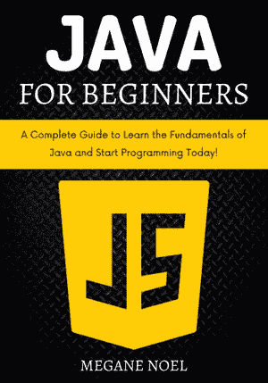

# 引言

Java 是一种高级跨平台语言，由 James Gosling 领导的 Sun 斯克系统公司开发。该语言的第一个版本于 1995 年作为 Java 1.0 [J2SE] 发布。从那时起 Java 取得了巨大的进步，我们目前正在使用 Java 8。此外，Java 还发布了几个版本，例如 J2ME（移动应用的 Java）和 J2EE（企业级应用的 Java）。Sun 在 2006 年根据 GNU GPL 许可证将 Java 作为开源软件发布。这一转型在 2007 年结束。

本书是一门 Java 基础入门课程。因此，在编写本书时，我们考虑到了读者对 Java 基础知识较少这一情况。然而，具备一点编程语言的背景知识将帮助你更好地理解。通过这门课程，我们希望让读者培养编程基础视角，并特别强调 Java。在开始之前，最好了解编程概念是通用的，适用于许多语言。因此，如果你努力放在构建学习语法的概念上，你将能够以极少的精力学习多种语言。关注概念本身！

# 第 1 章：开始学习 Java

在我们开始学习 Java 编程之前，我们将向你简要介绍 Java 这种编程语言的背景以及学习该语言的先决条件。这种编程语言最重要的特征之一是它的跨平台性。这是因为 Java 是在“一次编写，随运行”（Write Once, Run Anywhere）的口号下被推广的。因此，你只需要编写代码并编译，然后就可以在 Windows、Linux 或 Macintosh 等任何系统上运行。

此外，其他特征还包括：

- 平台无关
- 面向对象
- 简单且于移植
- 架构无关解释
- 健壮多线程
- 动态
- 高性能

## 启动要求

要开始 Java 开发，你必须拥有一台运行良好的 Linux、Windows 或 Macintosh 计算机。你将在系统上使用两个 Java 工具。其中第一个工具是文本编辑器。如果你在 Windows 上工作，可以使用记事本（`Notepad`）。系统的第二个要求是 Java 8，你需要在系统中安装它。对于其他操作系统，你可以尝试 `TextEdit` 或其他文本编辑器。如果你不想进行本地配置，也可以尝试一些可用的在线选项来编译和运行 Java 程序。

### 本地配置准备

假设你已经准备好了系统，并且已经安装了文本编辑器，我们将直接在系统中安装 Java。对于初学者，你需要下载 Java。SE 版本可以通过搜索引擎提供的链接下载。确保下载适用于你操作系统的版本。

下载完成后，你将获得一个需要运行的安装执行文件。安装完成后，你会收到提示信息。但在设置环境变量之前，Java 将无法工作。你可以按照以下说明在系统上设置环境变量：

### Windows

极有可能，你通过点击安装包自带的 `.exe` 文件安装的 Java 版本位于目录 `C:\Program Files\java\jdk`。如果是这样你只需点击“此电脑”打开属性。在对话框中，打开“环境变量”。将现有字段包含 `C:\Program Files\java\jdk`。

### Linux / Mac

环境变量是 Java 安装的位置。你可以搜索这些并编辑 `.bashrc` 文件。用任何编辑器打开此文件后，添加：

```
export PATH=/path/to/java
```

为了帮助你理解这个概念，让我们来看一个例子。假设我们创建了一个名为 `Car` 的类。`Car` 是所有小型四轮车辆的通称。然而，每辆 `Car` 都有一套不同的规格，例如品牌、颜色、引擎、变速箱类型和功能。这些特性是可以修改的。例如你可以更改颜色或增强功能。

因此，一个 `Car` 是一个模板（在我们的情况下是一个类），但具体的汽车是该类的对象或实例。规格集是变量，而我们对这些变量进行的任何初始化或操作都是通过方法完成的。

这个例子也可以很好地用于理解面向对象的封装和抽象原则。该类包含了变量和方法。因此，作为用户，你只需要处理 `Car` 类，而它的实现细节对你是隐藏的。这就是 Java 实现抽象的方式。

学习编程最好的方法就是编写程序。因此，这里有一个示例程序可以尝试。我们还将使用这个程序来解释 Java 编程语言的基本语法。

```java
public class SampleJavaProgram {
    /* 这个程序在屏幕上打印 Hello World! */
    public static void main(String[] args) {
        System.out.println("Hello world!"); // 可打印语句
    }
}
```

要编写、编译和运行此程序，请遵循以下说明：

1. 使用任何文本编辑器，创建一个文本文件并将代码复制到其中。将文件保存为 `SampleJavaProgram.java`。
2. 使用 IDE 编译并运行代码。若要手动操作，你需要输入以下命令：

```
javac SampleJavaProgram.java
java SampleJavaProgram
```

第一条命令将从 java 文件创建类文件，而第二个命令将运行程序以获得所需的结果。下图所示了示例代码流程。

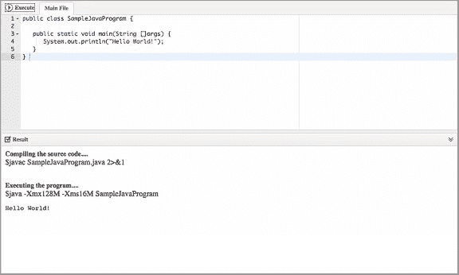


如果你已经执行到了这里，说明你已经成功执行了你的第一个 Java 程序。现在是时候检查一下程序，看看我们是如何写它的，以及为什么它会产生那个结果。

### 约定

首先，编写 Java 程序需要遵循某些约定。它们列在下方：

- Java 是一种大小敏感的语言。也就是说，`class` 和 `Class` 是两个不同的 Java 单词。在使用关键字或其他程序元素时要小心。
- 根据约定，类名中每个单词的首字母应该大写。例如，如果类名是 `Car`，那么 "C" 应该是大写的。相反，如果类名是 `SportsCar`，那么 `S` 和 `C` 必须大写，因为它们都是组成类名的两个单词的首字母。
- 方法名也遵循大写约定，即方法名的首字母必须小写。然而，如果名称包含多个单词，除了第一个单词外，任何其他单词的首字母必须大写。例如，如果方法名是 `add`，那么 "a" 必须小写；但如果方法名是 `addNumbers`，那么 "a" 将是小写而 "N" 将是大写。
- Java 文件名必须与类名相同并带有 `.java` 扩展。例如，如果你的类名是 `Application`，文件名必须是 `Application.java`。此外，记住大小必须匹配。如果你不符合这些任何要求，你将无法编译程序。
- Java 程序的执行从 `main` 方法开始。因此，每个 Java 程序都必须有一个 `main` 方法，且 Java 中的 `main` 方法定义为 `public static void main(String args[])`。但如果你的程序没有 `main`，程序将无法启动。

### 标识符

每个标识符由英语单词组成。其中一些单词是语法的一部分，另一些类似于变量，你用它们来定义类和方法名。属于语法部分的单词被称为关键字。相反，所有用户定义的名称都是标识符。

关于 Java 有一些需要知道并记住的事情。它们包括：

- 标识符可以以字母（小写或大写）和特殊字符——下划线（`_`）和美元符号（`$`）开头。这意味着标识符不能以数字或其他特殊字符开头。
- 不允许将定义的关键字用作标识符。

### 关键字

属于 Java 编程语言的一部分且不能用作标识符的单词被称为关键字。这些关键字是：

| abstract | assert | boolean | break |
| :--- | :--- | :--- | :--- |
| byte | case | catch | char |
| class | const | continue | default |
| do | double | else | enum |
| extends | final | finally | float |
| for | goto | if | implements |
| import | instanceof | int | interface |
| long | native | new | package |
| private | protected | public | return |
| short | static | strictfp | super |
| switch | synchronized | this | throw |
| throws | transient | try | void |
| volatile | while | | |

### 备注

Java 支持单行和多行注释。单行注释以 `//` 开始，多行注释以 `/*` 开始并以 `*/` 结束。你可以在示例代码中找到这些内容。

### 空行

任何包含注释或不包含任何字符或空格的行，Java 不会考虑。它们会被直接忽略。

### 继承的实现

面向对象的继承在 Java 中通过从现有类派生新类的概念来实现。这允许现有代码被重用。现有类被称为父类，而派生类被称为子类。

### 接口

当两个对象需要相互通信时，必须在对象之间建立一种通信协议。这种通信协议被称为接口。这个概念通常用于继承的实现。接口用于定义子类必须具备的方法。然而，是子类实现了这些方法。

### 变量

Java 支持三种类型的变量：类变量、局部变量和实例变量。

### 枚举

有些变量只能持有少数值。作为开发者，你可能希望将此类变量限制为任何其他值。其中一个变量是 `gender`，它只有特定的值。枚举允许你实现此类变量。

# 第 3 章：数据类型

当我们声明变量时，基本上是在锁定内存中的一段空间并给它一个引用名称，以便我们稍后访问它并操作其内容。为变量保留的内存容量取决于声明时指定的数据类型。因此，通过为变量赋予不同的数据类型，你可以为内存中的变量保留不同大小的内存。Java 中主要有两种类型：基本数据类型和引用类型。

### 基本数据类型

Java 支持八种基本数据类型，每种数据类型都有一个对应的关键字，用于在该数据类型内声明变量。这些数据类型包括：

- `byte`
- `short`
- `int`
- `long`
- `float`
- `double`
- `boolean`
- `char`

#### byte

- 最大值 = 127（包含) (2 ^ 7 -1)
- 最小值 = -128 (-2 ^ 7)
- 8 位符号位补码。
- 默认值 = 0

这种数据类型通常用于需要节省内存的情况。`byte` 数据类型用于在大型数组中节省空间，通常代替整数，因为 `byte` 是整数的四分之一。

#### short

- 最大值 = 32,767（包含) (2 ^ 15 -1)
- 默认值 = 0
- 最小值 = -32,768 (-2 ^ 15)
- 16 位补码符号整数。

这是另一种在需要节省内存时使用的类型。

#### int

- 默认值 = 0
- 最大值 = 2,147,483,647（包含） (2 ^ 31 -1)
- 32 位二进制符号补码整数。

这是用于所有整数值的默认数据类型。

#### long

- 最小值 = -9,223,372,036,854,775,808 (-2 ^ 63)
- 64 位符号位补码整数。
- 最大值 = 9,223,372,036,854,775,807（包含） (2 ^ 63 -1)
- 默认值 = 0L

当变量需要包含大数字时使用此值。

#### float

- 默认值 = 0.0f
- 32 位 IEEE 754 浮点单精度。

这种数据类型用作存储浮点数的默认数据类型。避免使用这种数据类型存储需要精确计算的数值。

#### double

- 64 位 IEEE 754 浮点双精度。
- 默认值 = 0.0d

这种数据类型用于必须持有小数值的变量。然而，与 `float` 类似，用 `double` 存储的变量的值可能会变化。因此，这些类型不用于货币等关键计算。

#### boolean

- 默认值 = false
- 可能的值：`true` 和 `false`

这种数据类型用于实现标记。

#### char

- 最大值 = `'\uffff'`（或 65535）
- 最小值 = `'\u0000'`（或 0）
- 16 位 Unicode 字符。该数据类型专门用于存储字符。

### 引用类型

该名称指的是用于访问对象的变量。它们通常使用类构造函数创建，一旦定义，其类型就无法更改。数组和对象都是引用变量。最后，在这种情况下，默认值为 `null`。

### Java 字面量

字面量用于表示常量值。它们像变量一样被声明并具有类型。一个字面量声明示例是：

`String x = "X";`

你可以编写不同进制的数字。根据规则，任何以 `0` 为前缀的字面量都是八进制，而前缀 `0x` 表示十六进制。如果你处理字符串，字面量始终定义为双引号括的字符序列。你将工作的另一组是转义字符。转义字符列表如下：

- 回车 `\r`
- 换行 `\n`
- 退格 `\b`
- 换页 `\f`
- 制表符 `\t`
- 空格 `\s`
- 单引号 `\'`
- 双引号 `\"`
- 十六进制字符 `\xxxx`
- 八进制字符 `\ddd`
- 反斜杠 `\\`

# 第 4 章：变量

变量最简单的定义是赋予内存某个区域的名称。然而，Java 支持许多类型的变量。根据变量的类型，决定以下参数：

- 变量锁定的内存大小。锁定的内存布局。
- 可以在变量上执行的操作。变量可以包含的值范围。

根据规则，每个变量在使用之前必须先声明。变量声明的标准格式为：

`data_type var_name;`

这里 `data_type` 是变量的数据类型，而 `variable_name` 是用于变量的标识符。如果你使用多个相同类型的变量，可以通过用逗号分隔变量名将它们合并在同一语句中。如前所述，Java 支持三种类型的变量，即类变量、实例变量和局部变量。

## 局部变量

在方法或块内部声明的变量对于作用域是局部的，被称为局部变量。变量在声明并定义于块时创建。此外，它在块执行完毕时被销毁。这种类型的变量不能使用访问修饰符（后文描述）。由于这种变量仅在方法的作用域内有效，因此只能在该块中访问。在内部，局部变量是在栈级别（`stack level`）创建的。因此，当它们创建时会被推入栈中，一旦块结束，栈就会被清理。最后，局部变量的默认值为垃圾值。因此，必须初始化这些变量才能使用。

下面给出了局部变量如何工作的示例。它在类中通过方法实现了局部变量。

```java
public class LDemo {
    public void sniffwork() {
        int puppy = 0;
        puppy = puppy + 10;
        System.out.println("Puppy is:" + puppy);
    }

    public static void main(String[] args) {
        LDemo testObj = new LDemo();
        testObj.sniffwork();
    }
}
```

此代码的输出所示：

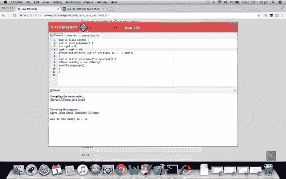


## 实例变量

作为类的一部分创建但在任何方法或构造函数作用域之外的变量被称为实例变量。这些变量被称为实例变量的原因是，它们在使用该类创建对象之前不会创建。因此，为每个使用 `new` 关键字创建的类都会创建一个这些变量。此外，在对象被删除或程序执行完毕后，这些变量会被销毁。这些变量可以从该类实现的方法或构造函数访问。可以说实例变量可以使用访问修饰符的类级变量。这些变量有默认值。例如，所有数字的默认值为 0，Boolean 值为 false。作为引用变量创建的对象引用初始化为 `null`。虽然变量声明是必须的，但赋值可以在方法或构造函数内部进行。如果你在同一个类中工作，可以直接通过名称访问它。然而，如果你想从任何静态方法访问它，你需要使用以下格式访问：

`object_name.variable_name`

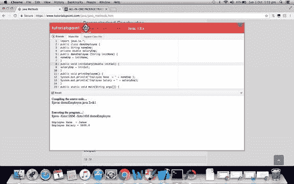

## 静态变量

任何使用 `static` 关键字声明并放在 `class` 中，但在方法、构造函数或 `class` 内部任何其他代码之外的变量。整个 `class` 仅维护该变量的一个副本，无论为该类创建多少个对象。因此，这些变量也被称为类变量。

这些变量不应作为推荐用法使用。然而，可能存在需要这种实现的场景。但是，每当使用此类变量时，它们应该被视为值不可改变的常量。这些变量在程序开始执行时创建，但在程序运行结束之前它们不会被销毁。

类变量对所有类成员都可见。因此，它们的可见性与实例变量的可见性相似。事实上，类变量的默认值与实例变量相同。可以通过以下语句访问这些变量：

`class_name.variable_name`

下面给出实现静态变量的示例代码：

```java
import java.io.*;
public class SVDemo {
    private static double salaryEmp;
    public static final String DEPARTMENTEMP = "DevRD";
    public static void main(String[] args) {
        salaryEmp = 1000;
        System.out.println(DEPARTMENTEMP + " Salary       =       " + salaryEmp);
    }
}
```

代码结果可以在下图中看到。

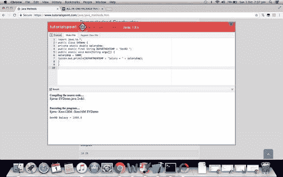

## 修饰符类型

变量的行为和访问可以通过修饰符进行修改。修饰符主要有两种类型，即访问修饰符和非访问修饰符。

### 访问控制修饰符

Java 支持多种访问级别，每个级别都有对应的关键字。它们包括：

- **Public (公共)**：所有人可见
- **Private (私有)**：类可见


# 访问修饰符

- **Protected (受保护)**：类及其子类可见
- **Default (默认)**：如果没有指定关键字，变量对包可见。

## 无访问修饰符

Java 中还有其他可用修饰符。它们包括：

- `Static`
- `Final`

## 静态 Final 总结

变量与同步

# 第 5 章：运算符

你可以使用运算符来操作变量。Java 支持六类运算符。每种类都将进行详细讨论。

## 算术运算符

所有的数学运算都是使用属于算术运算符类的运算符执行的。支持的运算符列表如下：

- **加法 (`+`)**：该运算符执行两个数之间的加法运算。如果 `a` 和 `b` 是变量 5 和 6，那么 `c = a + b` 等于 11。
- **乘法 (`*`)**：该运算符执行两个数之间的乘法。如果 `a` 和 `b` 是变量 5 和 6，那么 `c = a * b` 等于 30。
- **减法 (`-`)**：该运算符执行两个数之间的减法运算。如果 `a` 和 `b` 是变量 5 和 6，那么 `c = a - b` 等于 -1。
- **除法 (`/`)**：该运算符执行两个数之间的除法。如果 `a` 和 `b` 是变量 10 和 5，那么 `c = a / b` 等于 2。
- **取模 (`%`)**：该运算符返回两个数除后的余数。如果 `a` 和 `b` 是变量 10 和 5，那么 `c = a % b` 结果为 0。
- **自增 (`++`)**：该运算符将变量的值加 1。如果 `a` 是值为 1 的变量，`a++` 结果为 2。
- **自减 (`--`)**：该运算符从变量的值减去 1。如果 `a` 是值为 1 的变量，`a--` 结果为 0。

## 关系运算符

所有的比较操作都是使用关系运算符执行的。该编程语言支持的运算符列表为：

- **不等于 (`!=`)**：该运算符应用于两个操作数。检查两个操作数的相等性。如果它们相等，返回 `false`，否则返回 `true`。
- **等于 (`==`)**：该运算符应用于两个操作数。检查两个操作数的相等性。如果它们相等，返回 `true`，否则返回 `false`。
- **大于 (`>`)**：该运算符应用于两个操作数。检查两个操作数的相等性。如果第一个操作数大于第二个操作数，返回 `true`，否则返回 `false`。
- **小于 (`<`)**：该运算符应用于两个操作数。检查两个操作数的相等性。如果第一个操作数小于第二个操作数，返回 `true`，否则返回 `false`。
- **大于或等于 (`>=`)**：该运算符应用于两个操作数。检查两个操作数的相等性。如果第一个操作数大于或等于第二个操作数，返回 `true`，否则返回 `false`。
- **小于或等于 (`<=`)**：该运算符应用于两个操作数。检查两个操作数的相等性。如果第一个操作数小于或等于第二个操作数，返回 `true`，否则返回 `false`。

## 位运算符

普通运算符与位运算符之间的唯一区别是它们按位进行操作。此外，这些运算符可以应用于 `byte`、`int`、`long`。Java 支持的位运算符列表包括：

- **位与 (`&`)**：该运算符作用于两个操作数，如果两个输入位均为 1，则每个位的输出为 1，否则输出为 0。
- **位或 (`|`)**：该运算符作用于两个操作数，如果其中一个或两个输入均为 1，则每个位的输出为 1，否则输出为 0。
- **位异或 (`^`)**：该运算符作用于两个操作数，只有当两个输入位不同时，每个位的输出为 1，否则输出为 0。
- **取反 (`~`)**：该运算符作用于单个操作数，将 0 变为 1，1 变为 0。
- **左移 (`<<`)**：该运算符作用于两个操作数。左操作数左移的位数等于第二个操作数的值。
- **右移 (`>>`)**：该运算符作用于两个操作数。左操作数右移的位数等于第二个操作数的值。
- **无符号右移 (`>>>`)**：该运算符作用于两个操作数。左操作数右移的位数等于第二个操作数的值。此外，0 会填充移出的位。

为了理解位运算，我们来看一个例子。假设两个变量 `a` 和 `b` 的值分别为 60 和 13。`a` 和 `b` 的二进制形式如下：

```
a = 00111100
b = 00001101
```

使用与逻辑表，只有当两个输入均为 1 时输出为 1。相应地，输出 `a & b = 00001100`。其他位操作类似。

## 逻辑运算符

Java 中所有的逻辑操作都是使用逻辑运算符执行的。该编程语言支持的运算符为：

- **逻辑与 (`&&`)**：该运算符应用于两个操作数。如果两个操作数都非零，返回 `true`，否则返回 `false`。
- **逻辑或 (`||`)**：该运算符应用于两个操作数。如果一个或两个操作数非零，返回 `true`，否则返回 `false`。
- **逻辑非 (`!`)**：该运算符作用于一个操作数。如果操作数为 0，返回 `true`，否则返回 `false`。

## 赋值运算符

Java 支持的赋值运算符包括：

- **赋值 (`=`)**：该运算符将右侧计算的值赋值给左侧变量。如果 `a`、`b` 和 `c` 是三个变量且表达式为 `c = a + b`，那么 `a` 和 `b` 的加法值被赋值给 `c`。
- **加赋值 (`+=`)**：该运算符通过将左右相加并将计算结果赋值给左侧变量。如果 `a` 和 `c` 是两个变量且表达式为 `c += a`，那么 `a` 和 `c` 的加法值被赋值给 `c`。
- **减赋值 (`-=`)**：该运算符将左侧减去右侧的结果赋值给左侧变量。如果 `a` 和 `c` 是两个变量且表达式为 `c -= a`，则 `c - a` 的值会被赋值给 `c`。
- **乘法赋值 (`*=`)**：该运算符将左侧变量与右侧相乘的结果赋值给左侧变量。如果 `a` 和 `c` 是两个变量且表达式为 `c *= a`，则 `c * a` 的值会被赋值给 `c`。
- **除法赋值 (`/=`)**：该运算符将左侧除以右侧的结果赋值给左侧的变量。如果 `a` 和 `c` 是两个变量且表达式为 `c /= a`，则 `c / a` 的值会被赋值给 `c`。
- **取模赋值 (`%=`)**：该运算符将左侧对右侧取模的结果赋值给左侧变量。如果 `a` 和 `c` 是两个变量且表达式为 `c %= a`，则 `c % a` 的值会被赋值给 `c`。
- **左移赋值 (`<<=`)**：如果 `a` 和 `c` 是两个变量且表达式为 `c <<= a`，则 `c << a` 的值会被赋值给 `c`。
- **右移赋值 (`>>=`)**：如果 `a` 和 `c` 是两个变量且表达式为 `c >>= a`，则 `c >> a` 的值会被赋值给 `c`。
- **按位与赋值 (`&=`)**：如果 `a` 和 `c` 是两个变量且表达式为 `c &= a`，则 `c & a` 的值会被赋值给 `c`。
- **按位异或赋值 (`^=`)**：如果 `a` 和 `c` 是两个变量且表达式为 `c ^= a`，则 `c ^ a` 的值会被赋值给 `c`。
- **按位或赋值 (`|=`)**：如果 `a` 和 `c` 是两个变量且表达式为 `c |= a`，则 `c | a` 的值会被赋值给 `c`。

## 运算符优先级

如果一个表达式使用了多个运算符，将使用运算符优先级规则来确定操作的顺序。运算符从右到左或从左到右求值的优先级定义如下：

- **从右到左**：一元、条件、赋值
- **从左到右**：后置、乘法、累加、关系、相等、按位与、按位异或、按位或、逻辑与、逻辑或

例如，如果我们需要计算 `a = 3 + 5 * 5`，先执行乘法后加法。因此 `a = 28` 而不是 `40`。

# 第 6 章：项与类

让我们从理解类和对象的概念开始。类是用于创建对象的模板。对象是交互的实体，构成了程序的核心。类中可以定义类型的变量。首先在类内部定义变量，这些变量是每个对象的实例变量。此外，方法块中的变量是局部变量。使用 `static` 关键字的是类变量。

## 对象创建

当然，由于类是一个模板，必须使用该模板创建对象。使用 `new` 关键字创建对象有三个步骤：

1. 第一步声明一个对象的变量。
2. 第二步使用 `new` 关键字创建对象。
3. 最后使用构造函数初始化对象。

如果省略了第三步，Java 将使用默认构造函数来初始化对象。所有这些步骤组合成一个创建语句。例如，我们有一个 `DemoClass` 并想要创建一个 `o1` 对象，可以通过以下语句完成：

```java
DemoClass o1 = new DemoClass();
```

可以使用 `.` 运算符访问该对象的变量和方法。

## 构造函数

在创建类和对象时，首先需要的是初始化对象。Java 有一种特殊的初始化方法叫做构造函数。这些元素与方法名称相同，但没有返回类型。

那么在哪里可以使用构造函数呢？当你创建一个类的对象时，可以使用它来初始化某些参数。例如，如果你创建一个名为 `rectangle` 的类，可以创建一个构造函数来初始化长度和宽度。

如果你没有定义构造函数，Java 将为程序提供默认构造函数。无论你是否显式定义，程序都会有一个构造函数。现在创建一个带有显式构造函数的类，看看它是如何工作的：

```java
class SampleClass1 {
    int i;
    SampleClass1() {
        i = 100;
    }
}

public class DemoClass1 {
    public static void main(String args[]) {
        SampleClass1 c1 = new SampleClass1();
        SampleClass1 c2 = new SampleClass1();
        System.out.println(c1.i + "\n" + c2.i);
    }
}
```

下面的截图显示了代码以及执行后的输出。运行此代码你需要创建包含类名的两个文件 ![image-7] ![image-8] ![image-9]

在上面的示例中，你的程序可能需要参数初始化。为此，你需要实现参数化构造函数。此类构造函数在构造方法中接收参数。

```java
class SampleClass2 {
    int i;
    SampleClass2(int x) {
        i = x;
    }
}

public class DemoClass2 {
    public static void main(String args[]) {
        SampleClass2 c1 = new SampleClass2(100);
        SampleClass2 c2 = new SampleClass2(200);
        System.out.println(c1.i + "\n" + c2.i);
    }
}
```

该代码的输出所示 ![image-10] ![image-11]

在引用构造函数的实现时，特殊的关键字是 `this`。它与类的主体相关。你可以使用 `this` 在构造函数或方法内部访问类变量。

```java
class SampleClass3 {
    int i;
    SampleClass3(int i) {
        this.i = i;
    }
}

public class DemoClass2 {
    public static void main(String args[]) {
        SampleClass3 c1 = new SampleClass3(200);
        SampleClass3 c2 = new SampleClass3(200);
        System.out.println(c1.i + "\n" + c2.i);
    }
}
```

执行时，此代码产生以下输出：![image-12] ![image-13]

## 可变参数

在某些程序中，可能有一种情况，你不知道 `main` 方法在执行期间会给出多少个参数。为了允许这种动态性，使用了可变参数（var-args）。可变参数在方法参数中使用以下语法声明：

`<type>... <variable_name>`

变量声明中给出的 `variable_name` 是包含 `main` 方法在执行期间发送的所有变量值的数组。在实现这一概念之前，有两点需要记住：

- 每个方法只能实现一个可变参数。
- 如果方法有其他参数（常规参数），这些参数必须出现在可变参数之前。换句话说，可变参数必须是方法的最后一个参数。

下面是该概念的示例实现。

```java
class DemoVarArgs {
    public static void main(String args[]) {
        printNum(56.5, 3, 34, 2, 3);
        printNum(new double[]{2, 1, 3});
    }

    public static void printNum(double... number) {
        if (number.length == 0) {
            System.out.println("No argument was passed");
            return;
        }

        double resultNum = number[0];

        for (int x = 1; x < number.length; x++)
            if (number[x] > resultNum)
                resultNum = number[x];

        System.out.println("The maximum value in a set of numbers is " + resultNum);
    }
}
```

代码输出如下图所示。


# 部署方法

一组用于执行操作的语句组被称为方法。你可以看到，在上面的大多数程序中，打印语句都调用了 `System.out.println()`。该方法在屏幕上打印提供的字符串。

就像这种内置方法一样，开发者也可以针对特定的问题描述创建方法。用户定义的方法可能有参数，也可能没有，它们可能有返回值，也可能没有。创建方法的标准指令是——

```java
public static int methodDemo(int i, int j) {
    /* body */
}
```

这里 `methodDemo` 是方法的名称，`i` 和 `j` 是该方法接受的 `int` 类型参数。方法的实现逻辑位于花括号中。此外，还会注意到函数声明中写了三个单词——`public`、`static` 和 `int`。这里，`int` 是方法的返回类型，而 `public static` 是修饰符。此示例方法可以修改以适应开发者的需求。

实现该方法的示例代码所示：

```java
public static int minCalcDemo(int num1, int num2) {
    int minVal;
    if (num1 > num2)
        minVal = num2;
    else
        minVal = num1;
    return minVal;
}
```

该方法确定了提供的两个参数值之间哪一个最小，并将该结果返回给调用者方法。现在你已经了解了方法以及如何实现它们，是时候谈谈这些方法如何在整个代码中被使用了。

## 方法调用

在使用方法之前，必须对其进行调用。如你在上面提供的示例代码所示，方法的作用是执行某些计算并返回计算结果。此类方法返回一个值，其返回类型已经在方法声明中指定。此外，还有另一种类型的方法。此类方法不返回任何内容，通常被称为无返回值方法。

当程序调用方法时，控制权从程序传递到方法，并开始执行。当遇到 `return` 语句时，控制权传回调用者。在没有 `return` 语句的情况下，遇到花括号时控制权会自动传回。这通常发生在没有返回值的方法中。

对于返回值的方法，返回类型在方法声明中提到。相反，对于不返回内容的方法，返回类型为 `void`。为了调用方法 `method`，调用程序中必须出现以下语句：

```java
int result;
result = minCalc(5, 6);
```

由于 `minCalc` 返回一个 `int`，该值应该被收集在变量 `result` 中。调用方法会产生该方法所需的两个参数值。这种方法调用也被称为按值调用或传递。你可能会遇到具有不同类型参数和许多参数的情况。在这种情况下，你必须按照你希望的顺序提供参数值，以避免编译或运行时错误。

## 方法重载

可以拥有相同名称但参数不同的方法。当调用方法时，系统会检测与调用语句中提供的参数类型数量相匹配的方法，并将控制权传递给适当的方法。这种方法实现的形式被称为方法重载。不要将此概念与重写（overriding）混淆。在重写方法时，方法的名称、参数以及参数数量也是相同的。

为了理解这个概念，让我们来看一个例子——


```java
class overloadDemo {
    public static void main (String [] args) {
        int x = 34;
        int y = 56;
        double z = 10.5;
        double u = 7.8;
        int resultxy = minCalc (x, y);
        double result = minCalc (z, u);
        System.out.println ("Minimum value (integers) =" + resultxy);
        System.out.println ("Minimum (double) value =" + result);
    }

    public static int minCalc (int num1, int num2) {
        int minVal;
        if (number1> number2)
            minWart = number2;
        else
            minVal = number1;
        return minVal;
    }

    public static double minCalc (double number1, double number2) {
        double minVal;
        if (number1> number2)
            minWart = number2;
        else
            minVal = number1;
        return minVal;
    }
}
```

代码实现了两个具有相同名称 `minCalc` 但带有两种不同类型参数的方法。一个方法使用两个 `int` 类型的参数并返回 `int` 类型。另一方面，该方法的第二个实现使用了 `double` 参数并返回 `double` 值。此代码的输出如图像所示。

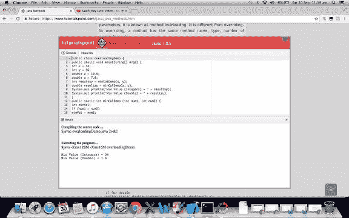

## 使用命令行参数

有一些程序需要在运行时提供参数。这些参数作为命令行传递给程序。当在命令行上执行程序时，这些参数会被分配给程序。在程序中访问这些参数的方式如下所示所示：

```java
class commandLineDemo {
    public static void main (String [] args) {
        for (int x = 0; x <args.length; x++)
            System.out.println ("args [" + x + "" + args[x]);
    }
}
```

从命令行执行以下命令以查看结果：

`commandLineDemo 200 100 10 8 7`

## finalize 方法

在 Java 编程中，你会处理大量的对象，所有这些对象都会占用内存。如果你在处理大型代码，可能需要在退出之前清理这些对象占用的空间。为了方便这种操作，Java 有一个名为 `finalize()` 的收集方法。你可以使用该方法来实现程序退出之前执行的操作。该方法的实现如下：

```java
protected void finalize() {
    /*implementation*/
}
```

在 `finalize()` 方法声明中使用 `protected` 修饰符是为了防止外部程序在执行之前破坏你的代码。

## 源文件的声明规则

在源文件中编写导入语句、类声明和包语句时有一些规则需要遵守。这些规则如下：

- 源文件不能有多个公共类。源文件中有很多非公共类。
- 源文件的名称应与文件中公共类的名称相同。此外，文件扩展名应该是 `.java`。
- 如果你正在处理一个包和一个作为包一部分类，源文件的第一语句必须是包语句。包语句必须是源文件的第一语句。所有其他导入语句必须跟在包语句之后。最后，必须存在类实现。

当你在源文件中使用一个类但该类的实现在另一个文件中时，你必须告知编译器该文件的位置。`import` 指令在此处适用。通过 `import` 语句，你可以将给定源文件中使用的源文件和类组合，但它们的实现位于其他文件中。

# 第 7 章：做出决策

决策结构用于以下场景：当条件为真时，必须执行一组指令；当条件被认为为假时，必须执行另一组指令。Java 中提供了几种结构来用于此类此类场景。这些结构包括：

### if 语句

该语句用于必须测试条件的情况，如果条件被认为为真，则必须执行语句后续的代码块。该构造的语法为 -

```
if (condition) {
    /*Body*/
}
```

下面是该构造的一个示例实现 -

```
class ifDemo {
    public static void main (String args []) {
        int i = 10;
        int j = 1; if (i> j) {
            System.out.print(i);
        }
    }
}
```

该代码执行后的输出是：


### else 语句

该语句用于必须测试条件的情况，如果条件被认为为真，则执行该语句后续的代码块，否则将执行 `else` 之后的代码块。该构造的语法为 -

```
if (condition) {
    /*Body*/
}else {
    /*Body*/
}
```

下面是该构造的一个示例实现 -

```
class elseDemo {
    public static void main (String args []) {
        int i = 1;
        int j = 0; if (i> j) {
        }else{
        }
        System.out.print(i);
        System.out.print(j);
    }
}
```

该代码执行后的输出输出是：


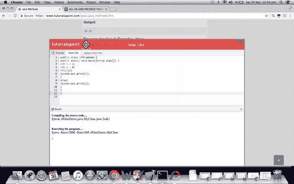

### 嵌套 if 语句

该语句用于必须测试条件的情况，如果条件被认为满足，则执行该语句后续的块，否则测试下一个条件。如果发现此条件为真，则执行与该条件对应的 `if` 语句的块。如果两个条件都不为，则执行 `else` 之后的块。可以使用嵌套 `if` 语句测试许多条件。该构造的语法为 -

```
if (condition1) {
    /*Body*/
}else if (condition2) {
    /*Body*/
}else {
    /*Body*/
}
```

下面是该构造的一个示例实现 -

```
class nestedIfDemo {
    public static void main (String args []) {
        int i = 0;
        int j = 0; if (i> j) {
            System.out.print(i);
        }else if (j> i) {
            System.out.print(j);
        }else {
        }
    }
    System.out.print ("Equal");
}
```

该代码执行后的输出是：

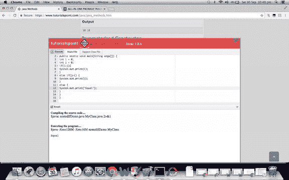

### switch 

如果你有一个变量，并且需要根据该变量的不同值执行不同的代码块，你可以使用的理想构造是 `switch` 语句。该构造的语法为 -

```
switch (variable) {
    case value1:
        /* body*/ break;
    case value2:
        /* body*/ break;
    case value3:
        /* body*/ break;
    default:
        /* body*/ break;
}
```

下面是该构造的一个示例实现 -

```
class switchDemo {
    public static void main (String args []) {
        int i = 5;
        switch (s) {
            case 0:
                System.out.print(0); break;
            case 2:
                System.out.print(2); break;
            case 5:
                System.out.print(5); break;
            default:
                System.out.print(999); break;
        }
    }
}
```

该代码执行后的输出是：

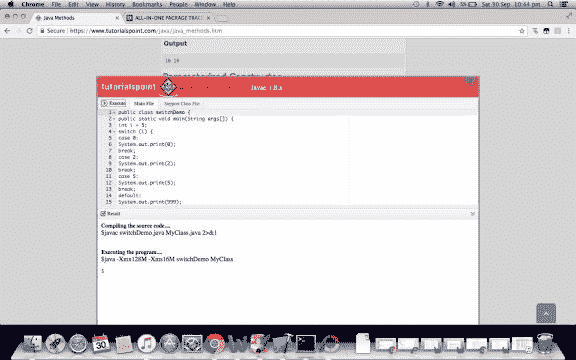

### 三元运算符

Java 同样支持条件运算符，也称为 `?:`。该运算符用于替代 `if else` 构造。它的语法如下：`expression1?expression2:expression3`，其中 `expression1` 是要测试的条件。如果为真，则执行 `expression2`，否则执行 `expression3`。

# 第 8 章：循环控制

有几种情况需要一组指令重复执行。例如，如果你想对一组数字进行排序，你必须扫描并重复该组几次以获得所需的布局。这种执行流被称为循环。循环是一种允许你多次执行代码块的构造。Java 支持几种可以实现循环的构造。这些包括 `while` 循环、`for` 循环和 `do while` 循环。

`while` 循环遍历块，直到 `while` 循环指定的条件为真。一旦该条件失败，循环就会停止。

`for` 循环允许程序员在同一个构造中操纵条件和循环变量。因此，你可以初始化一个循环变量，对其进行增/减操作，并运行循环直到该变量的条件满足。

`do while` 循环类似于 `while` 循环。然而，在 `while` 循环中，在执行块之前测试条件。相反，在 `do while` 循环中，执行代码块然后测试条件。如果条件为真，则重启循环。`do while` 循环至少执行一次。

### 循环语句

有两个关键字专门与循环结合使用，被称为循环控制语句，因为它们允许你将控制从一个代码部分转移到另一部分。这些关键字是 -

`break` 用于循环内部，立即结束循环执行。

`continue` 用于循环内部，跳过循环的剩余部分并移动到第一个语句。

为了帮助你理解循环是如何执行的，让我们通过一个示例使用三种循环类型来实现。

#### for 循环的实现

```
class forDemo {
    public static void main (String args []) {
        int [] numArray = {100, 300, 500, 700, 900}; for (int i = 0; i <5; i ++) {
            System.out.print(numArray[i]); System.out.print(",");
        }
        System.out.print("\n");
    }
}
```

该代码执行后的输出是：

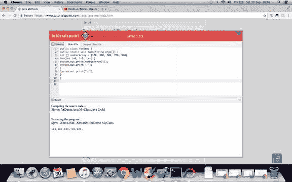

#### 实现 while 循环

```
class whileDemo {
    public static void main (String args []) {
        int [] numArray = {100, 300, 500, 700, 900}; int i = 0;
        while (i <5) {
            System.out.print(numArray[i]); System.out.print(",");
            i++;
        }
        System.out.print("\n");
    }
}
```

该代码执行后的输出是：

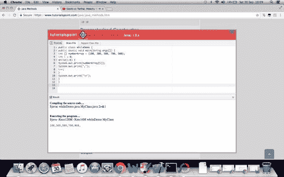

#### 实现 do while 循环

```
class doWhileDemo {
    public static void main (String args []) {
        int [] numArray = {100, 300, 500, 700, 900}; int i = 0;
        do {
            System.out.print(numArray[i]); System.out.print(",");
            i++;
        } while (i <5);
        System.out.print("\n");
    }
}
```

该代码执行后的输出是：

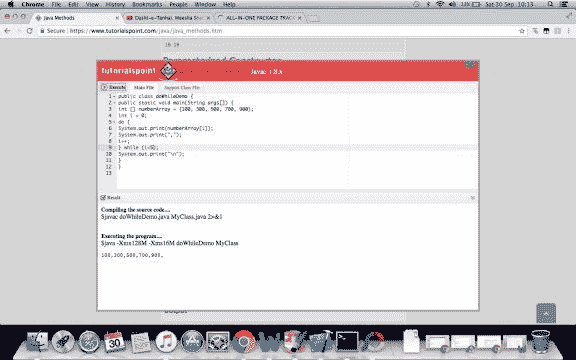

### 增强型 for 循环

Java 同样支持一种可用于数组元素的扩展循环结构。该循环的语法为 -

```
for (declaration:expression) {
    /*Body*/
}
```

增强 for 循环的声明部分用于声明一个变量。该变量应该是局部的“for 循环”，且其类型必须与数组元素的类型相同。变量的当前值始终等于循环通过的数组元素。表达式是一个数组或对返回数组的方法调用。

```java
public static void main (String args []) {
    int[] numberArray = {100, 300, 500, 700, 900}; 
    for (int i: numberArray) {
        System.out.print(i);
        System.out.print(",");
    }
    System.out.print("\n");
}
```

该代码执行后的输出如下：


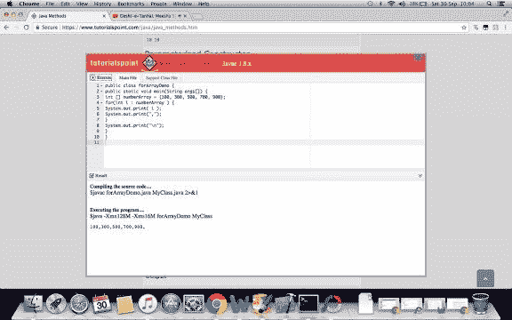

# 第 9 章：文件处理

所有的文件操作都由 Java 的 `java.io` 包处理，这些函数的实现基于“流”的概念。流仅仅是数据的序列，分为两种类型，即 `InputStream`（输入流）和 `OutputStream`（输出流）。前者用于读取数据，后者用于写入数据。

## 字节流

Java 支持的第一种流类型是字节流。限制为 8 位大小的 I/O 操作属于这一类。在开始编写代码之前，你需要意识到执行输入和输出的类分别是 `FileInputStream` 和 `FileOutputStream`。现在让我们来看一个将一个文件的内容复制到另一个文件的示例。

```java
import java.io.*;

public class CopyFileBS {
    public static void main (String args []) throws IOException {
        FileInputStream inputFile = null;
        FileOutputStream outputFile = null;
        try {
            inputFile = new FileInputStream ("in.txt");
            outputFile = new FileOutputStream ("out.txt");
            int i;
            while ((i = inputFile.read()) != -1) {
                outputFile.write(i);
            }
        } finally {
            if (inputFile != null) {
                inputFile.close();
            }
            if (outputFile != null) {
                outputFile.close();
            }
        }
    }
}
```

将名为 `in.txt` 的输入文件放在类文件相同的文件夹中，并执行代码查看其功能。

## 字符流

当 8 位数据操作切换到 16 位 Unicode 数据操作时，我们需要从二进制流切换到字符流。执行输入和输出的类分别是 `FileReader` 和 `FileWriter`。上面的代码可以修改为使用字符流，如下：


```java
import java.io.*;

public class CopyFileCS {
    public static void main (String args []) throws IOException {
        FileReader inputFile = null;
        FileWriter outputFile = null;
        try {
            inputFile = new FileReader ("in.txt");
            outputFile = new FileWriter ("out.txt");
            int i;
            while ((i = inputFile.read()) != -1) {
                outputFile.write(i);
            }
        } finally {
            if (inputFile != null) {
                inputFile.close();
            }
            if (outputFile != null) {
                outputFile.close();
            }
        }
    }
}
```

将名为 `in.txt` 的输入文件放在类文件相同的文件夹中，并执行代码查看其功能。

## 标准流

为了允许用户从键盘获取数据并将结果打印到屏幕上，Java 支持标准流：

- `System.in` 代表标准输入，允许用户使用键盘输入数据。
- `System.out` 代表标准输出，允许用户在屏幕上获取输出。
- `System.err` 代表标准错误，允许用户查看来自系统的错误信息。

下文提供的示例程序允许系统从用户处输入并将输入的内容打印到屏幕上，直到用户按下 'q' 键，随后程序退出。

```java
import java.io*; 
public class demo {
    public static void main (String args []) throws IOException {
        InputStream inputC = System.in;
        System.out.println ("Enter characters, 'q' to quit.");
        char charIn;
        do {
            charIn = (char) inputC.read();
            System.out.print(charIn);
        } while (charIn != 'q');
        if (inputC != null) {
            inputC.close();
        }
    }
}
```

你可以运行此程序查看输出结果以及代码结构。

# 第 10 章：异常处理

异常是任何意料之外的事件，通常是以程序无法处理的方式发生的。当然，在这种情况下，程序的正常执行过程受到阻碍，程序可能会因错误结束或表现异常。这就是为什么需要由程序处理异常的原因。

为什么会产生异常？异常可能由于许多原因引起。导致这种情况的一些场景包括：

- 无效数据输入：程序尝试打开一个不在指定位置的文件。
- JVM 内存溢出（out of memory）
- 网络通信过程中系统丢失了网络连接。

当然，异常可能由于系统、用户或程序层面的问题产生。基于这一观察，出现了三类异常。这三种异常类将在本章讨论。

## 检出的异常 (Checked exceptions)

编译器在编译时检查并抛出的异常称为检出的异常。它们也被称为编译时异常，在编写代码时必须由开发者处理。此类错误的异常处理实现示例见下方的示例代码。

```java
import java.io*; import java.io.FileReader; 
public class demoH {
    public static void main (String args []) {
        File fileDemo = new File ("samplefile.txt");
        FileReader inpFile = new FileReader (fileDemo);
    }
}
```

如果创建 `fileDemo` 时指定的文件名和位置不存在，编译器将显示 `FileNotFoundException` 错误。

## 未检出的异常 (Unchecked exceptions)

某些异常发生在运行时被称为未检出的异常或运行时异常。逻辑错误、编程错误和不当使用 API 是这些错误的示例。为了帮助你理解什么是运行时异常，我们来看一个例子。考虑到你实现了一个抛出 `ArrayIndexOutOfBoundsException` 的数组。

## 异常层次

Java 有一个名为 `Throwable` 的内置类，所有异常都属于该类。所有异常类都是该类的子类。此外，`Throwable` 类是 `Exception` 类的父类。`Throwable` 的另一个子类是 `Error` 类。所有如栈溢出的错误属于 `Error` 类。

`Exception` 类有两个子类，即 `RuntimeException` 和 `IOException`。以下是 `Throwable` 类中定义的方法列表：

- `String getMessage()`：调用时，该方法返回遇到的异常的详细描述。
- `Throwable getCause()`：调用时，该方法返回包含异常原因的消息。
- `String toString()`：该方法返回结合了类名的详细描述。
- `void printStackTrace()`：调用此方法可以将 `toString()` 的结果以及堆栈跟踪打印到标准 `System.err` 流。
- `StackTraceElement[] getStackTrace()`：某些场景可能需要访问堆栈跟踪的不同元素。此方法返回一个数组，堆栈跟踪的每个元素写入数组的不同元素中。数组的第一个元素包含堆栈顶部的元素，而堆栈底端存储在数组的最后一个元素中。
- `Throwable fillInStackTrace()`：将堆栈跟踪中的之前信息添加到当前堆栈跟踪的内容中，并返回相同的结果。

## 捕获异常

捕获异常的标准方法是使用“try and catch”关键字以及它们的代码实现。这个 try and catch 块必须以这种方式实现：包含要抛出异常的代码。在这里还应该提到，准备抛出异常的代码被称为保护代码（protected code）。实现 try and catch 块的语法如下：

```java
try {
    /* Protected code */
} catch (exception name exc1) {
    /* Catch code */
}
```

抛出异常的代码放置在 try 块中。如果抛出异常，则在 catch 块中实现处理该异常的适当操作。每一个 try 块必须包含一个 catch 块或一个 finally 块。

在 catch 语句中，你必须声明要抛出的异常。如果发生异常，执行流将转移到 catch 块。如果抛出的异常与 catch 块中定义的异常相匹配，则执行该 catch 块。

下面给了一个 try and catch 块的示例实现。该代码实现了一个包含 2 个元素的数组。然而，代码尝试访问不存在的第三个元素。结果是抛出了异常。

```java
import java.io.*;

public class demoexception {
    public static void main (String args []) {
        try {
            int tab [] = new int [2];
            System.out.println ("Access to the third array element:" + arr [3]);
        } catch (ArrayIndexOutOfBoundsException exp) {
            System.out.println ("Catching Exception:" + exp);
        }
        System.out.println ("Reached outside of capture block");
    }
}
```

此代码的输出显示如下所示。


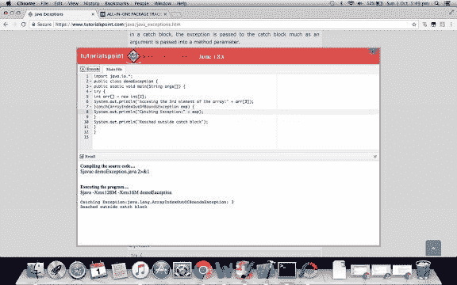

## 实现多个 catch 块

一个代码块可能会导致许多异常。为了满足这一需求，允许使用多个 catch 块。此类实现的语法如下所示。

```java
try {
    /* Protected code */
} catch (ExpType1 exp1) {
    /* Catch Block 1 */
} catch (ExpType2 exp2) {
    /* Catch block 2 */
} catch (ExpType3 exp3) {
    /* Catch Block 3 */
}
```

上面的语法说明了三个 catch 块的实现。然而，你可以根据需要实现任意多个 catch 块。当这段代码执行时，会执行保护代码。如果发生异常，除第一个 catch 块外，将对异常类型进行匹配。然而，如果异常类型不匹配，将忽略 catch 1 块，并尝试匹配第二个 catch 块的异常类型。只要 catch 块的异常类型与抛出的异常类型相同，就会执行适当的 catch 块。

### 关键字：Throw / throws

这两个关键字是相似的词，但用途完全不同。`throws` 关键字用于方法名末尾，用于声明代码抛出了受检异常（checked exception），但方法本身不处理。换句话说，这个关键字用于延迟处理抛出的异常。另一方面，`throw` 关键字用于字面上的抛出异常。这个异常可以是一个新产生的异常，也可以是之前发生的异常。下面提供了一个说明 `throw` 和 `throws` 用法的示例代码。

```java
import java.io.*;

public class class {
    public void depositMethod(double amount) throws Exception {
        /* Implementation */
        throw new Exception ();
    }
}
```

方法可能会抛出多个异常。要在方法语句中声明这些异常，你可以提供一个异常列表。下面是该概念的示例实现。

```java
import java.io.*;

public class class {
    public void withdraw(double amount) throws Exception, InsufficientException {
        /* Implementation*/
    }
}
```

## Finally Block

现在你已经了解了 try 和 catch 块，让我们来看看异常处理中使用的第三个块：finally 块。这是在 try 和 catch 块之后出现的最后一个块。此外，如果没有找到异常，可以跳过 catch 块的执行，但无论是否发生异常，finally 块始终会被执行。

此块的目的是执行开发者可能认为必要的任何清理工作。无论 try 块中的代码发生了什么，你都执行这段代码。该块的语法及其实现方式所示。

```java
try {
    /* Protected code */
} catch (ExpType1 exp1) {
    /* Catch Block 1 */
} catch (ExpType2 exp2) {
    /* Catch block 2 */
} catch (ExpType3 exp3) {
    /* Catch Block 3 */
} finally {
    /* Finally block implementation */
}
```

为了使概念更清晰，下面提供了实现该概念的示例代码。

```java
public class demo Exception {
    public static void main (String args []) {
        int arr [] = new int [2];
        try {
            System.out.println ("Access to the third item:" + arr [3]);
        } catch (ArrayIndexOutOfBoundsException exp) {
            System.out.println ("Catching Exception:" + exp);
        } finally {
            arr [0] = 5;
            System.out.println ("The first item is:" + arr [0]); 
            System.out.println ("Block Completed");
        }
    }
}
```

代码结果显示如下所示。

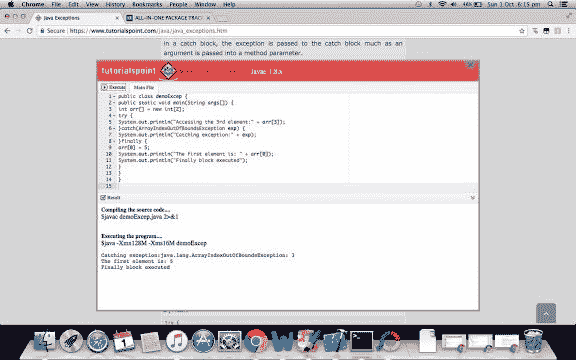

在实现 try catch finally 块时，总有几点需要注意。首先，没有 try 就没有 catch。同样，finally 是一个选项，即使没有 catch，try 也可以工作。

## 自定义异常

Java 允许你定义自己的异常。然而，在此之前，有几点你需要注意。首先，任何异常必须是 `Throwable` 类的派生类或子类。要实现异常，你必须扩展 `Exception` 类。然而，实现运行时异常必须扩展 `RuntimeException` 类。

定义异常的标准方法是

```java
class demoexception extends Exception {}
```

以下代码展示了自定义异常的实现和使用。

```java
import java.io.*;

public class InsufficientException extends Exception {
    private double amount;

    public InsufficientException(double amount) {
        this.amount = amount;
    }

    public double getAmount() {
        return amount;
    }
}
```

## 总结

本书提供了 Java 基础入门教程。我们涵盖了 Java 编程的所有基础概念以及你开始 Java 编程所需的所有内容。现在你已经熟悉了所有的 Java 基础概念，并假设你尝试了书中的所有代码，你可以转向高级 Java 编程了。

成为编程专家的关键（无论使用哪种编程语言）在于实践。你练习越多，你的编程能力就越强！我们希望你喜欢这本书，并且它帮助你获取了 Java 的基础知识。我们希望我们为你创造了正确的基础，帮助你提高技能并成为 Java 编程专家。
