# Java 入门指南


## Java 简介

- Java 由 James Gosling、Patrick Naughton、Chris Warth、Ed Frank 和 Mike Sherdan 于 1991 年在 Sun Microsystems 设计并构思。
- `java` 花费了几乎 18 个月才成为一个可运行的版本。
- 最初 `java` 被称为“Oak”，随后在 1995 年更名为“Java”。因为 `java` 的很多特性都是源自 `C` 和 `C++`。
- 这种特性继承自两种广为人知的简单编程语言，使得 `java` 对计算机和计算机巨头更具吸引力，从而导致大规模的成功。
- 但 `java` 被误解为 `C++` 的复杂的互联网版本表示。
- 与 `C++` 相比，它在实践和哲学上都有显著区别。
- 如果你有良好的 `C++` 知识，你会发现 `java` 非常合你的胃口，在使用和理解 `java` 时会很轻松。

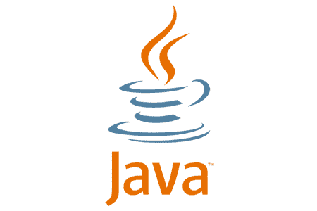

Java Logo

因此，计算机语言的演进有两个主要原因。

Java 增强并完善了 `C++` 的面向对象场景。这为用户提供了以下特性：

- 多线程。
- 提供便捷互联网访问的库。
- `java` 的魔力之一是字节码。字节码是一组高度优化的指令，设计用于由 `JVM`（Java 虚拟机）执行。它是字节码的解释器。这导致了真正可移植程序的设计。

Java 通过新功能和网络化程序重新设计了互联网，具体如下：

- Applets（小程序） - 它是一种 `java` 程序，可以通过兼容 `java` 的 Web 浏览器传输并自动执行。
- 安全性 - 它提供了从互联网下载各种 applet 和程序的安保保障，且不包含任何病毒或木马。
- 可移植性 - 由于存在大量不同类型的操作系统，因此它提供了在任何操作系统上运行的自由，使其程序可以在不同的操作系统之间使用而不会出现兼容性问题。

`java` 的演进如下：

- Java 1.0
- Java 1.1
- Java 1.2
- Java 1.3
- Java 1.4
- Java 1.5

`java` 的演进如下：

- 泛型 (Generics)
- 注解 (Annotations)
- 自动装箱与拆箱 (Auto boxing and unboxing)
- 枚举 (Enumerations)
- 增强 for 循环 (For-each loop)
- 可变参数 (Variable-length arguments)
- 静态导入 (Static import)
- 格式化输出 (Formatted I/O)
- 并发工具 (Concurrency)

Java 引入了以下新功能：

- 泛型
- 注解
- 自动装箱与拆箱
- 枚举
- 增强 for 循环
- 可变参数
- 静态导入
- 格式化输出
- 并发工具

在 JDK 5 中

- 泛型
- 注解
- 自动装箱与拆箱
- 枚举
- 增强 for 循环
- 可变参数
- 静态导入
- 格式化输出
- 并发工具

`java` 的特性特性是：

- 面向对象。
- 这种是是复杂性。
- 提供了面向 
良好的  接口。
- 抽象性。
- 封装性。
- 继承性。
- 多态性。

Java 特性

### 面向对象 编程

- 这种是 Java 的核心特性。
- 这有助于管理复杂性。
- 它提供了良好的定义的接口。
- 面向对象的抽象。
- 可以使用抽象来管理复杂性。

OOP 原则

- 封装 - 它的目标是隔离数据并免受外部干扰。封装通过使用包装器来实现。这防止了外部源访问数据。

Java 中的封装

- 继承 - 在这里对象可以获取其他对象的属性。它遵循分级分类。这包括类和子类。继承也可以与封装交互。

继承

- 多态 - 它意味着可以用多种方式执行方法，但只有一个输入。

多态

字节码

它是高度优化的指令集，设计用于由虚拟机执行。

虚拟机

- 它被设计为字节码的解释器。
- Java 程序的另一个特性是简单。
- 这使得专业人士能够学习。
- 工作方式非常高效，同时也易于理解。

健壮性

创建能够是多平台程序的健壮能力在 Java 设计中被赋予了高优先级。

多线程

Java 满足了真实世界的需求，有助于实现创建交互和网络化程序的需求。

高性能

- 作为多平台功能程序的优势有助于找到跨平台解决方案。
- 借助 Java 运行时系统提供了平台无关代码的优势。

分布式

- 这是因为它是为了互联网设计的，由于对 `TCP/IP` 协议的处理，具有分布式环境。
- 这允许程序跨网络查找方法。
- `URL` 用于访问互联网上的文件。
- 该属性支持 `RMI`（远程方法调用）。

动态

- 这是在运行时采取的动作，例如解析、验证和添加对象。
- 它为我们提供了动态链接代码的功能，这将是安全的。

简单程序

/* 调用此文件 “Example.java” */

```java
class Example {
```


```java
public static void main (string args []) {
    System.out.println (“this is a simple java program.");
}
```

传递类名的命令行参数为：
`C :\> java Example`

上述程序的简单输出为：
this is a simple java program.

在 java cmd 中调用该文件：
调用文件：“Example.java”。


## 数据类型

### 整数类型
它包括以下带符号整数整数。

- **Byte（字节型）**：宽度为 8 位，范围从 -128 到 127。它是最小的整数类型。当用户处理来自网络或文件的流或流动数据时，它非常有用。声明两个名为 `x` 和 `y` 的字节变量如下：
```
Byte x, y;
```

- **Short（短型）**：这种整数类型的宽度为 16 位，范围从 -32,768 到 32,767。它是 Java 中最常用的数据类型。
声明：
```
Short a;
Short b;
```

- **Int（整型）**：这种整数类型的宽度为 32 位，范围从 -2,147,483,648 到 2,147,483,647。与 byte 和 short 相比，它的效率更高。通常用于控制循环和索引数组。
声明：
```
Int a;
```

- **Long（长型）**：这种整数类型的宽度为 64 位，范围从 -9,223,372,036,854,775,808 到 9,223,372,036,854,775,807。用于整数无法处理的大值。
声明：
```
Int light speed;
Long days;
Long second;
Seconds = days *24 *60*60;
```

### 浮点类型
用于计算的实数，如平方根、正弦和余弦。它们分为两种。

- **Float（浮点型）**：位宽为 32 位，范围从 1.4e-045 到 3.4e + 038。Float 用作小数变量类型，但指定的是单精度。它可以用于表示美元和分。
声明：
```
Float hightemp;
```

- **Double（双精度型）**：位宽为 64 位，范围从 4.9e-324 到 1.8e + 308。它的使用经过优化，可以用于高速数学计算。它具有双精度，比单精度更快。诸如 `sin()` 和 `sqrt()` 等函数返回 double 值。
声明：
```
Double pi, r, a;
r = 10.4;
pi = 3.14;
a = pi* r * r;
```

### 字符类型
- Java 中用于存储或声明字符的数据类型是 `char`。
- 它是 Java 中的 16 位类型。`char` 的范围是 0 到 65,536。
- 性质上没有负字符。

`char` 的程序演示：
```java
Class charExample
{
    Public static void main (String args []) {
        Char a, b;
        a=88;
        b=’y’;
        system.out.print (“a and b: “);
        system.out.println (a + “ “ +b);
    }
}
```

### 布尔类型
- 它是逻辑值的原始类型。
- 它倾向于只有两个可能的值之一：true（真）或 false（假）。
- 它受 if 或 for 控制语句支配。

## 变量
它是存储的基本单元，变量具有作用域、可见性和生命周期。

### 变量的声明
```
Int x, y, z;
```
或
```
Int x=1, y=2, z=5;
```

### 类型转换与强制转换
如果两个类型之间存在任何兼容性，Java 将自动执行转换。

#### Java 自动转换
- 当满足两个条件时执行。
- 当两个类型兼容时；
- 目标类型大于源类型。
- 在满足这两个条件后，会发生宽宽转换。

#### 强制转换兼容类型
- 这是一种简单且显式的类型转换。
- 当浮点类型转换附加到整数类型时，这种转换被称为截断。
- 它是一种转换，有时被称为窄转换。

## 数组
- 它是相似变量的组，通过通用名称引用。
- 数组中的元素通过索引访问。
- 它可以被创建，并可能有一个或多个维度。

### 数组的类型
主要有两种类型的数组：
1. 一维数组
2. 多维数组

### 一维数组
它是相似类型数据的列表。在创建数组之前，你需要先创建一个任意类型的变量。
语法：
```
Type variable-name [ ];
```
```
Int year_month [ ];
```

### 多维数组
它是数组的数组，需要指定每个维度数组变量，使用其他方括号表示额外的索引如下：
```
Int twoD [ ] [ ] = new int [6] [7];
```


## 运算符
有四种类型：
- 算术运算符
- 位运算符
- 关系运算符
- 布尔运算符

### 算术运算符
- **加法**：用于相加。表示为 `+`。
- **减法**：用于相减。表示为 `-`。
- **乘法**：用于相乘。表示为 `*`。
- **除法**：用于除法。表示为 `/`。
- **取模**：用于求余数。表示为 `%`。
- **自增**：用于增加操作数。表示为 `++`。
- **自减**：用于减少操作数。表示为 `--`。

### 位运算符
- **取反（NOT）**：反转所有位。表示为 `~`。
- **与（AND）**：如果操作数都为 1 则为 1。表示为 `&`。
- **或（OR）**：如果操作数之一为 1 则为 1。表示为 `|`。
- **异或（XOR）**：如果操作数不同则为 1。表示为 `^`。
- **左移**：向左移动所有位。表示为 `<<`。
- **右移**：向右移动所有位。表示为 `>>`。

### 关系运算符
- **等于**：显示值相等。表示为 `==`。
- **不等于**：显示值不相等。表示为 `!=`。
- **大于**：显示一个值大于另一个值。表示为 `>`。
- **小于**：显示一个值小于另一个值。表示为 `<`。
- **大于等于**：显示一个值大于或等于另一个值。表示为 `>=`。
- **小于等于**：显示一个值小于或等于另一个值。表示为 `<=`。

### 布尔逻辑运算符
- **逻辑与（AND）**：表示为 `&`。例如：`A & B`。如果 a 为假且 b 为真，结果为假，但当两者都为真时结果为真。
- **逻辑或（OR）**：符号为 `|`。例如：`A | B`。如果 a 为假且 b 为真，结果为真，但当两者都为真时结果为真。
- **逻辑异或（XOR）**：使用 `^` 显示。例如：`A ^ B`。如果操作数不同真。
- **逻辑非（Unary Not）**：表示为 `!`。例如：`! A`。如果 a 为假则结果为真，但如果 a 为真则结果为假。

### 赋值运算符
赋值是单个等号，表示为 `=`。
通用表示法：
```
var = expression;
```


在此处，表示为 `var` 的变量应该与表达式的类型兼容。

```java
Int a, b, c;
a = b = c = 100;
```

## ? 运算符

它用于替换 if-then-else 语句，表示为 `?`。

### 示例
`expression a ? expression b : expression c`

上面的示例表示，如果 `expression a` 为真，则求值 `expression b`，否则求值 `expression c`。


## 控制语句

Java 中三种类型的语句。

1. 选择语句
2. 迭代语句
3. 跳出语句

### 选择语句

* 它的作用是根据只有在运行时才能实现的动态条件，来管理要执行的程序流。
* 它提供了灵活性。

#### If 语句
它为程序的执行提供了不同的路径。

### 语法
```java
If (condition provided) statement a;
Else
Statement b;
```
这意味着如果条件为真，则执行 `statement a`；但如果为假，则执行 `statement b`。

### 示例
```java
int a, b;
If (x < y) a=0;
Else
b=0;
```
现在有一种使用 if 语句的程序类型，即 `嵌套 if 语句`，它是编程世界中非常常见的方法。

### 示例
```java
If (a == 10) {
If (b < 15) i = j;
If (c > 50) p = q;
Else
i = p;
}
Else
i = q;
```
现在，括号中的第二个 if 语句与 `else` 关联。另一种使用 if 语句的程序类型是 `if-else-if 阶梯语句`。

### 示例
```java
If (condition)
Statement;
Else if (condition)
Statement;
Else if (condition)
Statement;
.
.
.
.
.
Else
Statement;
```

#### Switch 语句
它是一种多分支语句。

### 语法
```java
Switch (expression)
{
Case value 1:
Statement
Break;
Case value 2:
Statement
Break;
.
.
.
Case vale n:
Statement
Break;
Default:
Statement;
}
```
`switch` 语句的功能是将给定的值与所有 `cases` 进行比较，当找到匹配项时执行程序序列。

### 示例
```java
Class sampswitch {
Public static void main (string args [])
{
Switch (i)
{
Case0:
System.out.println (“i is zero.”);
Break;
Case1:
System.out.println(“i is one.”)
Break;
Default:
System.out.println (“i is greater than 4.”)
}
}
```
#### 输出
```
i is zero.
i is one.
i is greater than 4.
i is greater than 4.
```

#### 嵌套 switch 循环示例
```java
Switch (countfigures)
{
Case 1:
Switch (targetvalue)
{//nested switch//
Case 0:
System.out.println (“target is zero”;
Break;
Case 1:
System.out.println (“target is one”;
Break;
}
Break;
Case 2: //...
```
`switch` 语句的重要特征是：
* 与 `if` 不同，`switch` 语句只能检查相等性。
* 同一个 `switch` 中不能有两个值相同的 `cases` 常量。
* 它比使用嵌套 if 语句集更有效。

### 迭代语句

这些语句用于创建循环。Java 中使用了三种类型的迭代语句。

#### While 语句
它的功能是在控制表达式为真时重复执行或阻塞语句。

### 语法
```java
While (condition) {
// body of loop
}
```
当条件为真时，执行循环。当条件为假时，控制将传递到循环后的下一行代码。

### 示例
```java
Class while {
Public static void main (string args [])
{
Int n = 5;
While (n>0)
{
System.out.println (“tick “+ n);
n--;
}
}
}
```
#### 输出
```
It will tick 5 times
Tick 5
Tick 4
Tick 3
Tick 2
Tick 1
```

#### Do-while 语句
此循环至少执行一次体，因为它在循环的底部包含了它的条件表达式。

### 语法
```java
do
{
System.out.println (“tick”+ n);
n-- ;
}
While n > 0);
```

#### For 语句
* 它是一个非常强大且多用途的构造。
* `for` 语句中提供的条件，除非条件不满足，否则它不会执行。
* 如果条件被求值且值为假，则它将终止。

### 语法
```java
For (initialize; condition; iterate)
{
Body
}
```
### 示例
```java
Class fortick
{
Public static void main (string args [])
{
Int n;
For (n=11; n>0; n--);
}
}
```

### 跳出语句

Java 支持三种跳出语句，如下：
1. `Break`
2. `Continue`
3. `Return`

#### Break
它用于终止 `switch` 语句中的序列，并可用于退出循环。有时可以代替 `goto`。

#### Continue
它为循环提供提前迭代。

### 示例
```java
Class continue
{
Public static void main (string args [])
{
For (int i=0; i<5; i ++)
{
System.out.print (i + “ );
If (i%2 ==0) continue;
System.out.print (“ );
}
}
```

#### Return
它用于从方法返回并返回调用方法。

### 示例
```java
Class return {
Public static void main (string args [])
{
Boolean t = true;
System.out.println (“return”);
If (t) return;
System.out.println (“this’t work”);
}
```


## 类和方法

类可能只包含代码或数据，但也包含两者。由 `class` 关键字声明并可以是复杂的。

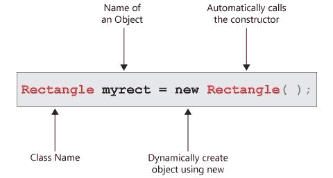

### 语法
```java
Class classname
{
Type instance-variable a;
Type instance-variable b;
.
.
.
Type instance-variable n;
}

Type method a (parameter-list)
{
//body of method
}

Type methodname (parameter-list)
//body of method
.
.
}
```
类也被称为定义宽度、高度和深度的 box。

### 示例
```java
Class box
{
Double width;
Double height;
Double depth;
}
```

#### 实现整数栈的类
### 示例
```java
Class stack
{
Int stk [] = new int [10];
Stack Tos=-1

Void push (int item) {
If (tos==9)
System.out.println (‘it’s full”);
Else
Stk [++tos] = item;
}

Int pop ()
{if (tos<0) {
System.out.println (“stack underflow”);
Return 0;
} else
Return stk[tos--];
}
}
```

## 方法重载

在同一个地方定义两个或多个同相同但参数不同的方法。这种方法在 Java 中提供了提供了多态性。

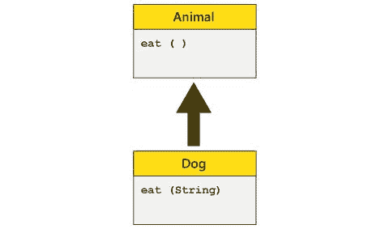

### 示例
```java
Class overload1
{
Void test () {
System.out.println (“no parameter”);
}
Void test (int a)
{
System.out.println (“a: “+ a);
}
Void test (int a, int b)
{
System.out.println (“a and b: “+ a + “+ b);
}

Double test (double a)
{
System.out.println (“double a: “+ a);
Return a;
}
}

Class overload
{
Public static void main (string args [])
{
Overload1 ob = new overload ();
Double result;
ob.test ();
ob.test (10);
ob.test (10, 20);
result = ob.test (123.25);
System.out.println (“result:” +result);
}
}
```
#### 输出
```
no parameter
a: 10
a and b: 10 20
double a: 123.25
result:15190.5625
```


## 继承

继承是一个所有类都继承的父类，而继承父类的类被称为子类。

### 继承的基础程序
```java
Class x
{
int i, j;
void showI j ()
{
System.out.println (“i and j:” + i + “+ j );
}
}

Class y extends x
{
Int a; {
System.out.println (“a: “+ a );
}

Void sum ()
{
System.out.println (“i + j + a:“+ (i + j + a) );
}
}

Class simpinheritance
{
Public static void main (string args [ ])
{
q Superob = new q ( );
p superob = new p ( );
Subob. i = 8;
Subob. j = 7;
Subob. a = 9;
System.out.println (“contents”);
Subob.showij ( );
Subob.showa ( );
System.out.println (“sum of i, j and a”);
}
}
```
#### 输出
```
contents
i and j: 8 7
a: 9
sum of i, j and a: 24
```
Java 中继承的主要用途是重写和代码复用。

### 重写

* 当子类与父类完全相同时，这种场景被称为方法重写。
* 它提供了 Java 中称为**多态**的特性。

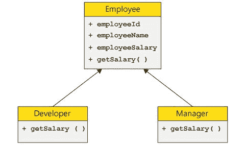

### 显示重写的继承
#### 示例代码
```java
Class x {
int a, b

X (int p, int q)
{
p= a;
```


```java
q= b;
}

Void show ()
{
    System.out.println (“a and b: “+ i +” “+ j);
}

}

Class y extends x {
    Int r;
    Y (int a, int b, int c)
    {
        Super (a, b);
        r = c;
    }

    Void show () {
        System.out.println (“r: “+ r );
    }
}

Class override {
    Public static void main (string args [])
    {
        y subob =new y (1, 2, 3);
        Subob. Show ();
    }
}
```

输出
r = 3

### 继承的类型

有三种继承类型。

* 单继承
* 多继承
* 层级继承

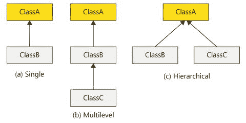

### 继承的类型

在 Java 中，多重继承和混合继承仅通过使用接口来实现。

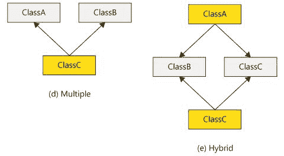

### 多继承和混合继承


## 包

包包含了存储存储的名称。

### 语法

```
Package pkg;
```

表示多级包结构

```
Package pkgx [.pkgy [.pkgz]];
```

### 示例

```
Package java.awt.image a;
```

### 查找包

有三种查找包的方法。Java 运行时系统使用工作目录；如果包位于子目录中，则它会被发现；或者你可以通过如所示设置类的位置来设置包的位置。

```
Package mpack
```

它也可以配合 `java` 和 `javac` 使用类路径来指定类的位置，如下所示。
`C:\ myprograms\java\mpack`

### 访问保护

为了保护包，Java 中存在三种访问修饰符。

1. `Private`- 无法从类外部可见或访问。
2. `Public`- 具有具有可以从任何地方访问的特性。
3. `Protected`- 只能被子类访问。

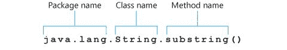

### 包语法

### 导入包

导入包的语句紧跟在包语句之后，其主要功能是通过导入包并保存到其位置来节省更多时间。

### 语法

```
Import pkga [.pkgb]. (classname d *);
```

## 接口

它类似于类，包含常量、方法和签名。

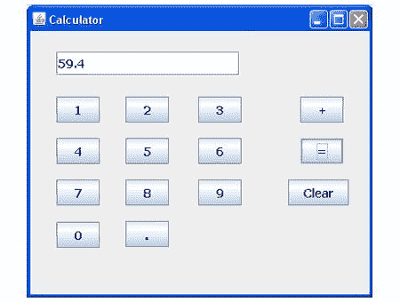

Java 简单计算器接口 Interface 用于 java

### 声明

```
Access interface m
{
    Return method 1 (parameter list);
    Return method 2 (parameter list);
    Type final variable name 1 = value;
    Type final variable name 2 = value;
    //…
    Return type method name n (parameter list);
    Type final varname n = value;
}
```

简单接口只包含一个被称为回调置的函数或方法。

### 示例

```java
Interface callback
{
    Void callback (int parm);
}
```

### 实现接口

创建任何接口的实现包含在类的定义中。

### 示例

```java
Class client call back
{
    Public void callback (int x)
    {
        System.out.println (“callback” + x);
    }
}
```


## 异常处理

这是一个影响 Java 程序性能的缺点，因为可以在任何点发生。它的发生发生在执行状态。

### 原因

* 无效数据
* 文件缺失
* JVM 运行时网络连接丢失和超时。

常见的异常有：

* `Checked`- 这些异常无法被程序员预见，并且在执行期间甚至无法被忽略。
* `Runtime`- 这是一个动态异常，但与检查的异常不同，它可以被忽略。
* `Errors`- 这些异常也会被忽略，因为无可以做任何事来克服它，而且这不在程序员的控制范围内。

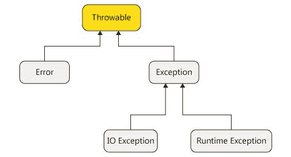

异常层次结构

它有两个子类：输入输出异常类和运行时异常类。

### 抛出

这些是 JVM 在运行时抛出的异常。

### 语法

```
throw Throwableinstance;
```

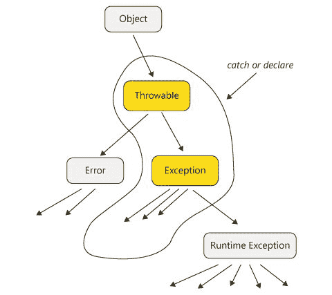

Throw

当使用此语句时，程序的执行会立即停止。

### 示例

```java
Class throwdem
{
    Static void demopro ( )
    {
        Try {
            Throw new NullPointerException (“dem “);
        } catch (NullPointerException e)
        {
            System.out.println (“caught inside demopro. “);
            Throw e;
        }
    }
    Public static void main (string args [ ] {
        Try {
            Demopro ( );
        }
        Catch (NullPointerException e) {
            System.out.println (recatch: “+ e);
        }
    }
}
```

### Finally

它是用于在 try 和 catch 块执行之前或完成之后执行的代码。

### 语法

```java
Class finally dem
{
    Static void pro x ( )
    {
        Try
        {
            System.out.println (“in proc x”);
            Throw new runtimeException (“demo”);
        }
        Finally
        {
            System.out.println (“pro x”);
        }
    }
}
```


## 事件处理

### 事件

它显示源的状态的变化。

### 事件源

它是生成事件的对象。

### 语法

```
Public void add TypeListener l)
```

### 示例

* `Addlistner ()` - 注册键盘事件。
* `Addmouselistner ()` - 注册鼠标事件。

### Action 类

当按钮按下时发生。

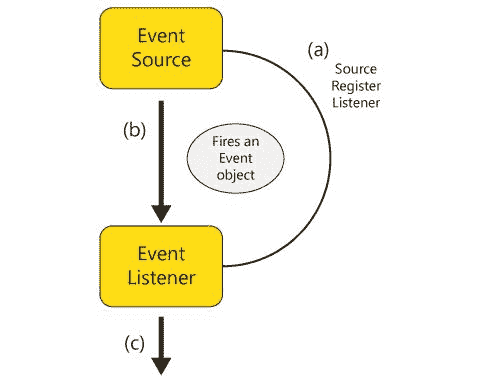

Java 中的事件发生

### 键事件类

产生于输入，有三种。

* `KEY_PRESSED`
* `KEY_RELEASED`
* `KEY_TYPED`

### 鼠标事件类

有八种鼠标类型。

* `MOUSE_DRAGGED`
* `MOUSE_CLICKED`
* `MOUSE_ENTERED`
* `MOUSE_EXITED`
* `MOUSE_MOVED`
* `MOUSE_PRESSED`
* `MOUSE_RELEASED`
* `MOUSE_WHELED`

### Action 接口

它用于定义在调用事件时调用的操作。它用于感知方法。


## Applet 类

它包含了多个方法，用于 Java 执行和详细控制。Applet 的初始化和终止如下。

### 启动

`init()`- 初始化方法，它是第一个方法。
`start()`- 在初始化方法之后出现并在屏幕上重新启动。
`paint()`- 每次被调用时，Applet 的输出都会重绘。

### 停止

`stop()`- 用于离开打开并包含 Applet 的浏览器。
`destroy()`- 用于从内存中移除 Applet。


### Applet 生成

HTML Applet 标签

```html
<APPLET
CODEBASE= codebaseurl
CODE=applet file
ALT=alternatetext
NAME=appletinstename
WIDTH=pixels HEIGHT=pixels
ALIGN=alignment
VSPACE=pixels HSPACE=pixels
>
<PARANAME=attribute name= attributevalue>
…
</APPLET>
```


### HTML Applet 标签

Audioclip 接口

`play()`- 开始音频。
`stop()`- 停止音频。
`loop()`- 循环播放而不中断。

### Applet 子接口

它提供了一个 Applet 和浏览器之间可以通信的链接。

