# Java 入学者指南：从零基础到面向对象编程

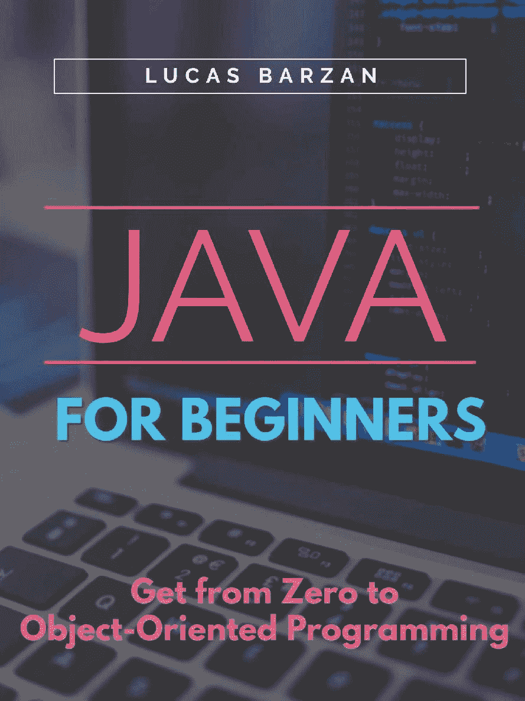

## 引言

我付出了巨大的努力才为你编写这本书，因为我知道学习编程是多么困难，尤其是当你刚开始的时候。所以，我想按照我自己的学习方式来教你，那就是通过实践来学习。

## 本书适合谁看

这本书适合所有想学习 Java 但对编程一无所知或略有了解的人。如果你想成为一名程序员并想从学习 Java 开始，那么这本书就是你的第一步。如果你想开发 Android 应用，这本书就是你的第一步。如果你想学习一些新东西，这本书就是你的第一步。

## 谁应该避开这本书

首先，这本书是给那些愿意学习新事物的人的。在过程中，你会很多时候感到困惑或不知所措，但如果你想实现最终目标，就必须应对这种挫败感。你的动力（WHY）必须足够强大，否则你才会在读这本书的过程中放弃。此外，如果你正在寻找一本涵盖 Java 语言所有内容的高级指南，我不推荐这本书。

## 如何学习 Java

有些书只给你理论，甚至都懒得让你去练习。我认为这是一种糟糕的教学方法（至少对于编程而言）。你应该尽快获得实践经验，正因如此，你经常会在 `IDE` 中编写和运行代码。所以，我建议你坐在电脑旁。把它看作一门课程，而不是一本可以在床上或沙滩上读的浪漫小说。练习应该被认真对待。这是成为优秀程序员的唯一途径，如果你不做练习题，我无法保证你能够学到任何东西。我是认真的。没有捷径。练习章节被称为“训练组（Workout Sets）”，因为我们的智力就像肌肉一样：我们使用得越多，它就生长得越强壮。在读完这本书时，你将完成 70 道练习题。尽管在大多数情况下我都提供了练习题的答案，但仅仅思考某道题并直接跳到答案并不算练习。如果你那样做，你只是在自欺欺人。所以，如果你已经下载了这本书，你就必须对自己做出承诺：阅读。思考。做练习。重复。相信这个过程，美好的结果将会到来！

## 第 0 章：Java？

### 什么是 Java？

根据官方网站，“Java 是由 Sun Microsystems 在 1995 年首次发布的编程语言和计算平台。除非你安装了 Java，否则很多应用程序都无法运行，而且每天都有新的应用诞生。Java 安全且可靠。从笔记本电脑到数据中心，从游戏机到超级计算机，从手机到互联网，Java 无处不在！”Java 是一种通用语言，这意味着它可以用于构建任何东西（即它不是为了解决某种特定的编码问题而设计的）。在我忘记之前，Java 和 JavaScript 除了名字相似且都是著名的语言之外没有任何关系。我不会向你灌输 Java 的历史，因为那超出了本书的范围。你只需要知道 Java 很有名，已经在市场上存在很久，所以没有消失的计划。这让我们进入下一个章节……

### 为什么要学习 Java？

虽然 Java 不是最对初学者友好的语言，但它提供了其他优势，例如：

- 用 Java 编写的程序便于维护；
- Java 拥有巨大的社区，你永远不会孤单。如果你遇到错误，很可能其他人也遇到过；
- 掌握 Java 编程的人拥有极好的职业机会。谷歌或亚马逊等科技巨头也使用 Java 开发其网站的后端，由于它的性能良好，许多达到扩展期的初创公司会将其应用程序集成到 Java 中，以支持需要高性能的功能；

## 如果出现问题了怎么办？

在编程时犯错是非常常见的，尤其是在初阶段。所以，如果你有任何书中未涵盖的问题，可以按照以下步骤解决问题：

- 首先，搜索你的问题。我几乎可以保证其他人也经历过同样的情况。如果你遇到了错误，搜索该错误。如果你想知道如何实现某个功能，搜索该功能。你可能会在 `StackOverflow` 上找到答案，那是开发者领域最大的问答网站。
- 如果你没有找到任何答案——尽管这种可能性极小——你可以在 `StackOverflow` 上创建一个新问题并等待回答（这是互联网，发生不会花很长时间）。遵循网站的说明发布你的问题，而且首先，要确保没有任何可以帮助你的相似问题，否则你的问题会被作为重复内容而删除。

```java
public static void main(String[] args) {
    System.out.println("Hello, World!");
}
```

别担心！我知道你现在什么都不懂，这看起来可能非常困惑。我明白。如果让我自己在开始编程时给自己提供任何建议，我会说：“习惯于不知道每个东西是什么意思。这完全没关系。这意味着你有很多需要学习的东西了！”

### 2. 你对其进行编译

然后是 `javac`，它是我们的 `Java 编译器`。它会检查错误，并且在确定所有内容都能正确运行之前，它不会让你编译。编译器会创建一个新文档，编码为 `Java bytecode`（Java 字节码）。任何能够运行 Java 的设备都能解释/翻译此文件为它能够运行的内容。编译后的字节码是平台无关的。这就是 `JVM` 用上场的地方。

### 3. JVM 运行它

`JVM`（`Java 虚拟机`）解释创建的字节码，并提供设备能够理解的指令。每个 `OS`（无论是 `Windows`、`macOS`、`Linux` 甚至是移动平台）都可以有自己的 `JVM` 来运行 Java 程序。无论字节码是在哪个 `OS` 中创建的，它都可以在任何带有 `JVM` 的设备上运行。这就是所谓的“一次编写，到处运行”。

# 第 1 章：入门

- `JVM` = `Java Virtual Machine`（Java 虚拟机）。
- `JRE` = `Java Runtime Environment`（Java 运行环境），包含了执行 Java 应用所需的所有。
- `JDK` = `Java Development Kit`（Java 开发工具包），包含了开发 Java 应用所需的所有。这就是我们需要下载的内容。

**警告**：除非你有一种涉及下载和准备东西的特殊癖好，否则现在事情会有点无聊。但那是我们必须做一次的事情。之后只有当你更新这些工具时，你才需要再次进行这类操作，而这并不经常发生。

在我写这些内容时，最新的 `JDK` 版本是 `JDK 9`。做一下研究，如果有更新且更稳定的版本，请下载它。

让我们从在 Google 上搜索“JDK 9”并点击第一个结果开始。要下载，你需要接受许可协议（Accept License Agreement），然后你可以选择适合你的 `OS`（`Windows`、`macOS` 或 `Linux`）的文件。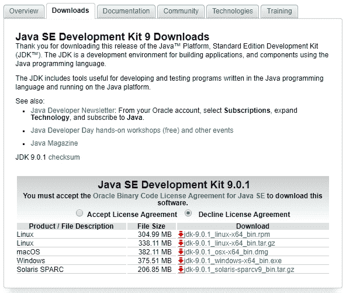

下载可能需要一段时间。完成后，安装它。除非你真的清楚自己在做什么，否则请将所有设置保持默认值。

## IntelliJ IDEA

医生有像医院或诊所这样的环境，为他们提供一系列工具和物品来帮助他们工作。医生可以在病人家里检查病人，但如果没有特定的环境，他就无法手术。

就像医生需要手术室一样，开发者需要一个 `IDE`，全称 `Integrated Development Environment`（集成开发环境）。根据维基百科，“一个 `IDE` 是一种为计算机程序员提供软件开发全面设施的软件应用程序。一个 `IDE` 通常由源代码编辑器、构建自动化工具和调试器组成。大多数现代 IDE 都具有智能代码补全。”

### 我应该下载哪个 IDE？

我在书中将使用 `IntelliJ IDEA`，但你可以使用任何 `IDE`。可以是 `NetBeans`、`Eclipse` 等任何工具。实际上，有些人可能会认为由于某些原因，这些是更好的 `IDEs`。但作为初学者，这不会产生太大影响，所以这不是这里最重要的事情，你不应该花费超过几秒钟来决定。

如果你要下载 `IntelliJ`，在 Google 上搜索“IntelliJ IDEA”，点击第一个链接，并按照相同的步骤下载与你的 `OS` 兼容的 `Community Edition`（免费版）。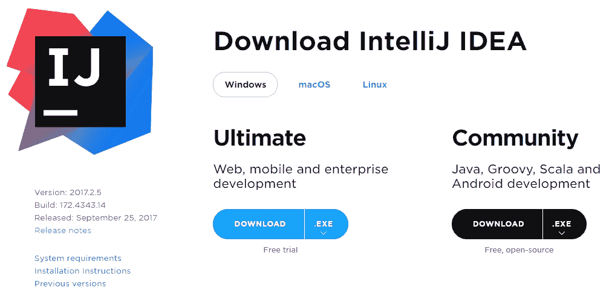

## 你的第一个程序

在编程世界，第一次使用某种语言或工具时编写一个“Hello World”程序是一个传统。有些人甚至会说，否则你会受到诅咒。总之，防患胜于就医。一个“Hello World”程序是一个会在屏幕上显示信息——“Hello World”的程序。

打开你的 `IDE`。点击 `Create New Project`（新建项目）。

确保左侧标签页上选中了 `Java`。然后选择 `Project SDK`。如果没有可用的 `Project SDK`，点击 `New...` 并选择 `jdk-9` 文件夹。它可能有这个路径（如果你使用的是 `Windows`）：`C:\Program Files\Java\jdk-9\`。如果你在这样做时遇到任何困难，不要担心。你可以随时在 Google 上搜索。

然后点击 `Next`。（images/00006.jpeg）

再次点击 `Next`。（我们将从零开始构建程序——现在不使用快捷模板！）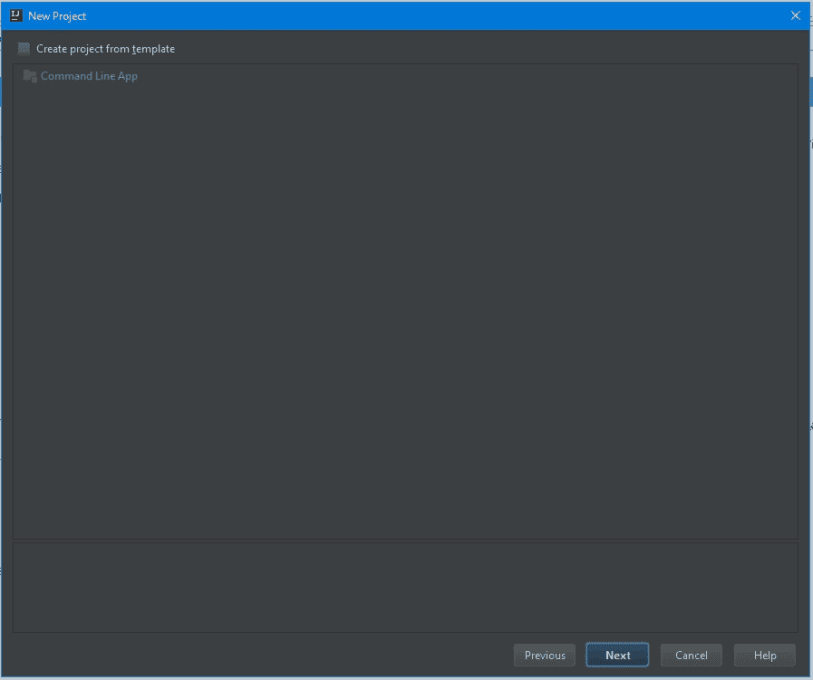

在 `Project Name`（项目名称）中，输入 `My First Program`。你可以保持 `Project Location`（项目位置）不变。然后点击 `Finish`。（images/00008.jpeg）

`IDE` 现在已经为我们处理好了一切。你的计算机上创建了一个文件夹，用于存储你将为程序创建的文件。

你看到下一张图中 `My First Program` 旁边那个小三角形了吗？如果你点击它，它会显示项目的其他部分：`.idea`、`src` 和 `My First Program.iml`。这就是你如何浏览项目结构的方法。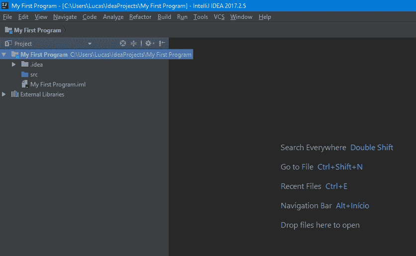

现在右键点击 `src`，进入 `New` 然后选择 `Java Class`。我们正在我们的项目内部创建一个新的 `Java Class`。稍后我们会理解这意味着什么。(images/00010.jpeg)

让我们给我们的类起个名。输入 `MyFirstClass` 并点击 `OK`。类名使用大驼峰命名法（upper camel case）。

### 什么是驼峰命名法？

驼峰命名法（Camel Case）之所以有这个名字，是因为它类似于驼峰。它是各种编程语言之间非常常见的约定。

它是编写复合词或短语的做法，每个单词的首字母大写且不加空格地合并。例如：

- `ClassesWithUppercaseLetter`
- `MyClass`
- `CodeificIsGreat`

小驼峰命名法（lower camel case）：整个单词的首字母是小写的，但随后的字母是大写的。例如：

- `functionsAndVariablesDoNot`
- `variableName`
- `dateOfBirth`

我们现在有一个全新的类正等待编码。注意，我们刚刚创建了以 `.java` 结尾的文件 `MyFirstClass`。这是一个 Java 文件。(images/00012.jpeg)

## 主方法

让我们让 `main` 方法看起来如下：

```java
public class MyFirstClass {

    public static void main(String[] args) {

    }
}
```

在我写这些内容时，最新的 `JDK` 版本是 `JDK 9`。做一下研究，如果有更新且更稳定的版本，请下载它。

在上面的 `main` 方法中，它会在屏幕上显示信息——“Hello World”。`println()` 是一个属于 `PrintStream` 类的方法，并且是 `System` 类的一部分。

现在，你可能会问：“在 `main` 方法中，`System.out.println()` 是为了什么？”好吧，在 `main` 方法中，`System.out.println()` 是为了输出信息。`main` 方法声明这个 `class` 就会发生。(images/00013.jpeg)

这里代码做了三件事：

1. **声明类**：保留字 `public` 表示这个 `class` 是公开的。
2. **声明 `main` 方法**：保留字 `void` 是我们的返回类型；它表示方法不会返回任何信息。
3. **调用 `System.out.println()` 输出文本**：在 Java 中，我们必须这样做，例如 `System.out.println()`。

这里我想让你注意关于代码的几点：

- **大括号 `{}`**：它们用于指示类/方法定义体的开始和结束。每当你打开一个大括号 `{`，你就必须闭合它 `}`，否则你会得到编译错误。
- **缩进**：你看到 `System.out ...` 之前的空白了吗？以及在 `public static void main...` 之前的空白吗？这被称为缩进。在 Java 中，即使你不正确地缩进，你的程序也可以运行。例如，下面的代码将产生相同的输出。(images/00015.jpeg)

让我们运行它吧！右键点击打开的 `MyFirstClass.java` 标签，并像我们之前的那样选择运行 `MyFirstClass.main()`。在 Windows 上，执行上一次运行文件的快捷键是 `Ctrl+Shift+F10`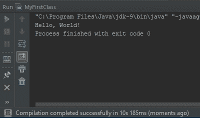

你刚刚完成了你的第一个 Java 程序。恭喜你！从现在起，我假设你已经知道如何进行所有操作（打开 `IDE`、启动新项目、创建类并编写 `main` 方法）。

# 第 2 章：变量与数据类型

考虑以下程序：

```java
public class Main {
    public static void main(String[] args) {
        System.out.println(" Score = " + 10 );
        System.out.println(" Good job!");
    }
}
```

这个程序打印出“Score = 10”，然后打印出“Good job!”。但到第三行结束时，计算机甚至已经不记得打印出来的那个分数了。这就像我们不想听某人说话时，避免在大脑中保存任何信息，我们直接忽略了它。但我们可以使用名为 `variable`（变量）的东西将该分数存储在程序中。把它想象一个盒子，你可以在里面放入一些数据，稍后回来提取它们。

由于数据有不同的形式，变量需要用一种 `type`（类型）来定义，这告诉 Java 存储的是什么。Java 的一些原始数据类型包括 `int`（整数）、`float`、`double`（双精度浮点数）和 `boolean`（布尔/真假值）。


# 变量与基础语法

## 创建第一个变量类

打开你的 IDE 并在 `src` 文件夹内创建一个名为 `Variables` 的新类。用 `main` 方法完成代码（挑战：不要使用我在上一节课中教给你的技巧，尝试尽可能记住尽可能多的内容）。如果你愿意，也可以删除 `MyFirstClass`。

将以下代码段复制并粘贴到 `main` 方法中：

```java
int i;
i = 0 ;
System . out . println( i);
```

要运行它，右键点击 `Variables.java` 标签并选择运行 `Variables.main()`。完成一次后，你就可以通过那个漂亮的绿色播放按钮快速运行了。你也可以选择最近执行过的类，比如 `MyFirstClass`。

运行 `Variables.java` 后，将显示此窗口。该程序以某种方式打印了数字 0。让我们看看是如何发生的。完整代码看起来应该是这样的：

```java
public class Variables {
    public static void main( String [] args) {
        int i;
        i = 0 ;
        System . out . println( i);
    }
}
```

* 这是我们的类头
* 这里有 `main` 方法
* `main` 方法内部有 3 条语句。第一条声明了一个类型为 `int`（整数）、名为 `i` 的变量（即创建了一个变量）
* 第二条通过将值 0 存储在其中来初始化该变量
* 第三条打印存储在变量 `i` 中的值。注意，我们打印的不是字母“i”，而是变量 `i` 的值。

**重要**：你必须在使用变量之前对其进行声明！因此，以下代码是错误的：

```java
// 错误！
public class Variables {
    public static void main( String [] args) {
        System . out . println( i);
        int i;
        i = 0 ;
    }
}
```

如果你犯了那个错误，你的 IDE 会警告你：`Cannot resolve symbol ‘i’` 意味着 IDE 找不到关于 ‘i’ 的任何内容。它在 `System.out.println()` 调用之前没有被声明。

***

**人类**：嘿，你能打印一张 Hannah 的照片吗？

**计算机（思考中）**：Hannah 是谁？我从未听说过她。我怎么能打印 Hannah 的照片呢？愚蠢的人……

**计算机说**：无法解析符号 ‘HANNAH’

***

开玩笑的！犯错没关系。实际上，在你的学习路径和职业生涯中你会犯**许多**错误。

## 变量声明

这里是变量声明的通用方法：这就是我们在程序中做的做法。但我们可以将声明和初始化合并到一条语句中，这样更实用。

值是可以改变的。你可以更改变量内部的值。将你当前的代码替换为以下内容，然后运行它看看发生了什么：

```java
public class Variables {
    public static void main( String [] args) {
        int i = 10 ;
        System . out . println( i);
        i = i + 5 ;
        System . out . println( i);
    }
}
```

我在等……这是输出：

```text
10
15
```

首先，我声明了一个名为 `i` 的整数变量，给它赋值 10 然后打印它。然后，我给 `i` 加上 5，结果得到 15，这是被打印的第二个值。

与其使用 `i = i + 5;`，不如使用 `i += 5;`。

你也可以改变变量 `i` 的值：

```java
public class Variables {
    public static void main( String [] args) {
        int i = 10 ;
        System . out . println( i);
        i -= 5 ;
        System . out . println( i);
    }
}
```

`boolean hasWhippedCream = false;`

`char` 用于存储单个字符。与 `Strings`（需要双引号）不同，`char` 变量要求你使用单引号。

// 示例

```java
char firstLetter = 'A' ;
char lastLetter = 'Z' ;
char digit = '0' ;
char num = '9';
```

## 其他原始数据类型

作为初学者，并不是所有类型都具有同等的重要性。目前，`int`、`double`、`boolean`、`char` 类型变量（以及 `Strings` - 在第 4 章）会对你非常有帮助。但你必须知道还有其他数据类型可以满足程序员可能的不同需求。

### byte

它的最小值为 `-128`，最大值为 `127`（包含）。在需要节省内存的地方，`byte` 数据类型可以非常有用。

// 示例

```java
byte x = - 128 ;
byte y = 127;
```

### short

它的最小值为 `-32,768`，最大值为 `32,767`（包含）。与 `byte` 一样，适用相同的原则：你可以使用 `short` 来节省内存。

// 示例

```java
short n = - 32768 ;
short p = 32767;
```

### long

它的最小值为 `-2^63`，最大值为 `2^63 -1`。当你需要比 `int` 提供的范围更大的数值时，请使用此数据类型。

### float

它用于表示浮点数，例如 `3.14159`、`25.0` 和 `0.0075`。该值末尾应该有一个 `f`，表示它是一个 `float`。否则，它将被视为 `double`。

// 示例

```java
float n = 1.5f;
```

如果你不在要存储到 `float` 变量中的数字末尾加上 `f`，你会得到一个错误。

这种数据类型永远不应该用于非常精确的值，例如货币。对于这种情况，你需要使用 `java.math.BigDecimal` 类。

## 注释

想象你今天写完了一个大型而复杂的程序。当然，明天你仍然记得每个变量存储了什么，以及程序的每个部分是做什么。但一个月后你还会记得吗？一年后呢？你可能不会，尤其是如果你在此期间没有修改代码。

还有另一种情况。大多数时候，你不是为自己写代码：别人会阅读它，甚至可能对其进行补充。不幸的是，其他程序员无法读取你的想法（我们还没到那一步）。那么，我们做什么呢？注释我们的代码。

```java
public class Variables {
    public static void main( String [] args) {
        int a = 20 ; // 创建名为 a 的变量
        int b = 2 ; // 创建名为 b 的变量
        int c = 3 ; // 创建名为 c 的变量
        int x = a + b + c; // 计算变量 a、b 和 c 的和
        System . out . println( x);  // 输出和
    }
}
```

在上面的代码中，你可以看到以 `//` 开头的单行注释示例。编译器会忽略 `//` 到行尾的所有内容，因此你可以编写任何想要的内容，而不会产生干扰。这种类型的注释在你想要解释某个语句的作用时非常有用。

```java
public class Variables {
    public static void main( String [] args) { 
        /* 我仍然想实现一个计算任意变量集和的函数 */
        int a = 20 ;
        int b = 2 ;
        int c = 3 ;
        int x = a + b + c;
        System . out . println( x);
    }
}
```

在上面的代码中，你可以看到以 `/*` 开头并 `*/` 结尾的多行注释示例。编译器会忽略 `/*` 到 `*/` 之间的所有内容。当你想要写一个单行无法容纳的更大的注释时，它们非常有用。

## 练习集 #1

将你的答案写在纸上，然后在答案页进行检查。

1) 哪种原始数据类型类似于灯开关？
2) 对或错：“整数变量只能存储正数”
3) “所有数据类型都需要相同的内存空间”
4) 哪些声明包含错误？
5) 编写一个包含两个 `Integer` 变量的程序。给它们赋值并打印和。

**答案**

1) Boolean
2) False
3) False
4) `a`, `c`, `d`, `f`
5)

```java
public class Variables {
    public static void main(String[] args) {
        int a = 10;
        int b = 5;
        System.out.println(a + b);
    }
}
```

# 第 3 章：运算符与数学

操作远比加减法多，这正是我们在本章中要探索的内容。

## 算术运算符

### 加法：`+`

```java
int a, b, c; // 这样你可以声明多个同类型的变量
a = 3;
b = 4;
c = a + b;
System . out . println( c); // 7
System . out . println( a + c); // 10
System . out . println( 15 + 10 ); // 25
```

### 减法：`-`

```java
int a, b, c;
a = 10;
b = 3;
c = a - b;
System . out . println( c); // 7
System . out . println( a - c); // 3
System . out . println( 27 - 17 ); // 10
```

### 乘法：`*`

```java
int a, b, c;
a = 5;
b = 3;
c = a * b;
System . out . println( c); // 15
System . out . println( a * a); // 25
System . out . println( 2 * 7 ); // 14
```

为了让结果为 double，至少有一个数字是 double。因此，以下所有表达式的结果均为 `10.0`。

* `2.0 * 5`
* `2 * 5.0`
* `2.0 * 5.0`

不要与 `float` 混淆，它末尾有一个 `f`（参见第 2 章）。此规则适用于其他操作。

### 除法：`/`


```java
System.out.println(10 / 3); // 3
System.out.println(10 / 3.0); // 3.3333333333333335
System.out.println(10.0 / 3); // 3.3333333333333335
System.out.println(10.0 / 3.0); // 3.3333333333333335
```

再次！为了让结果为 `double`，至少有一个数字是 `double`。否则，像 `10 / 3` 这样的操作只会返回结果的整数部分。

## 取模：`%`

`%` 被称为模或取余运算符，返回两个数的余数。例如 `10 % 3` 是 `1`，因为 `10` 除以 `3` 余数为 `1`。你可以像使用 `+`、`-`、`*` 和 `/` 一样使用 `%`。

```java
int i, j;
i = 6;
j = 4;
System.out.println(i % j); // 2
```

```java
System.out.println(6.0 % 4.0); // 2.0
```

## 递增

与其编写 `i = i + 1;` 甚至 `i += 1;` ……，你可以编写 `i++;`。这就是递增运算符的作用：给变量中存储的数字加 1。

## 递减

该运算符执行相反的操作。与其编写 `i = i - 1;` 甚至 `i -= 1;` …… 而是你可以编写 `i--;`。这就是递减运算符的作用：从变量中存储的数字减去 1。

## 关系运算符

关系运算符用于比较具有定义顺序的数据类型，例如数字（因为数字要么比其他数字小，要么比它们大）。

- **等于：`==`** - 检查两个操作数的值是否相等，如果是，则条件变为真。

  ```java
  System.out.println(1 == 1); // true
  System.out.println(3 == 0); // false
  ```

  *注意！等号运算符 `==` 与赋值运算符 `=` 不同。*

- **不等于：`!=`** - 检查两个操作数的值是否相等，如果值不相等，则条件变为真。

  ```java
  System.out.println(3 != 1); // true
  System.out.println(10 != 10); // false
  ```

- **大于：`>`** - 检查左操作数的值是否大于右操作数的值，如果是，则条件变为真。

  ```java
  System.out.println(3 > 1); // true
  System.out.println(10 > 10); // false
  System.out.println(1 > 10); // false
  ```

- **小于：`<`** - 检查左操作数的值是否小于右操作数的值，如果是，则条件变为真。

  ```java
  System.out.println(1 < 40); // true
  System.out.println(12 < 6); // false
  System.out.println(1 < 1); // false
  ```

- **大于等于：`>=`** - 检查左操作数的值是否大于或等于右操作数的值，如果是，则条件变为真。

  ```java
  System.out.println(12 >= 6); // true
  System.out.println(7 >= 7); // true
  System.out.println(1 >= 5); // false
  ```

- **小于等于：`<=`** - 检查左操作数的值是否小于或等于右操作数的值，如果是，则条件变为真。

  ```java
  System.out.println(6 <= 12); // true
  System.out.println(7 <= 7); // true
  System.out.println(6 <= 4); // false
  ```

## 逻辑运算符

也称为逻辑运算符，用于比较布尔值（`true` 和 `false`），这些值可以是我们程序逻辑的一部分。

### 与：`&&`

与逻辑运算符在 Java 中用 `&&` 表示。只有当 `&&` 两侧的表达式都为真时，它才返回布尔值 `true`。

```java
System.out.println(true && true); // prints true
System.out.println(false && false); // prints false
System.out.println(false && true); // prints false
System.out.println(true && false); // prints false
```

我们也可以将布尔运算符 `&&` 用于如下所示的布尔表达式：

```java
System.out.println(5 > 0 && 9 < 10);
```

上面的示例将打印出 `true`，因为“5 大于 0”和“9 小于 10”这两个语句都是真的。

### 或：`||`

或逻辑运算符在 Java 中用 `||` 表示。当 `||` 任意一侧至少有一个表达式为真时，它会返回布尔值 `true`。

```java
System.out.println(false || false); // prints false
System.out.println(false || true); // prints true
System.out.println(true || false); // prints true
System.out.println(true || true); // prints true
```

我们也可以将布尔运算符 `||` 用于如下所示的布尔表达式：

```java
System.out.println(5 > 2 || 1 > 34);
// 等于：
System.out.println(true || false);
```

上面的示例将打印出 `true`，因为至少有一个语句——“5 大于 2”是真的，即使另一个语句——“1 大于 34”是假的。

### 非：`!`

非逻辑运算符在 Java 中用 `!` 表示。它将返回紧随其后的表达式的相反值。如果表达式为 `true`，它返回 `false`；如果表达式为 `false`，它返回 `true`。

```java
System.out.println(!false); // "Not false" - prints true
System.out.println(!true); // "Not true" - prints false
```

我们也可以将布尔运算符 `!` 用于如下所示的布尔表达式：

```java
System.out.println(!(5 <= 25));
```

上面的示例将输出 `false`，因为 `5 <= 25` 是真的。

## 运算符优先级

运算符的优先级决定了表达式计算的顺序。括号 `()` 可以强制改变计算顺序。

在 Java 中，运算符的优先级顺序如下：

1. 括号 `()`
2. 递增/递减运算符 `++`, `--`
3. 一元运算符（如 `!`, `-`）
4. 乘除运算符 `*`, `/`, `%`
5. 加减运算符 `+`, `-`
6. 关系运算符 `<`, `<=`, `>=`, `>=`, `==`, `!=`
7. 逻辑与运算符 `&&`
8. 逻辑或运算符 `||`
9. 赋值运算符 `=`, `+=`, `-=` 等

## 递增和递减运算符

`++` 和 `--` 通常用于改变变量的值。

```java
int i = 5;
i++; // i 变为 6
i--; // i 变为 5
```

## 赋值运算符

赋值运算符用于将值赋给变量。

```java
int x = 10;
x += 5; // 等同于 x = x + 5;
x -= 3; // 等同于 x = x - 3;
x *= 2; // 等同于 x = x * 2;
x /= 4; // 等同于 x = x / 4;
x %= 3; // 等同于 x = x % 3;
```

## 7) 下一个程序的输出是什么？

```java
public class WorkoutSet {
    public static void main(String[] args) {
        System.out.println('A' == -1);
    }
}
```

## 8) 下一个程序的输出是什么？

```java
public class WorkoutSet {
    public static void main(String[] args) {
        System.out.println(10 == 10.0);
    }
}
```

## 9) Java 中布尔“与”（and）用什么运算符表示？

## 10) Java 中布尔“或”（or）用什么运算符表示？

## 11) 哪些表达式的结果为 true？（示例：a, b）

a. `false && false`

b. `true && false`

c. `false && true`

d. `true && true`

## 12) 哪些表达式的结果为 true？

a. `false || false`

b. `true || false`

c. `false || true`

d. `true || true`

## 13) 哪些表达式的结果为 true？

a. `!(false) && 10 > 1`

b. `5 > 5.1 && true`

c. `5 < 6 && 7 > 14 || 5 >= 5 && 12 > 0`

d. `!(false) && !(true)`

## 答案

1) `D`

2) `45`

3) `true`

4) `true`

5) `false`

6) `false`

7) `false`

8) `true`

9) `||`

10) `&&`

11) `d`

12) `b, c, d`

13) `a, c, d`

# 第 4 章：字符串与输入

创建一个名为 `StringsAreCool` 的类，并将生成的代码替换为以下内容：

```java
public class StringsAreCool {
    public static void main(String[] args) {
        // 创建一个名为 codenific 的 String 对象
        String codenific = "Codenific";
        System.out.println("1. " + codenific);
        // 添加 `.com`
        codenific += ".com";
        System.out.println("2. " + codenific);
        // 从 String 中提取单词 `Codenific`
        String onlyCodenific = codenific.substring(0, 9);
        System.out.println("3. " + onlyCodenific);
        // 从 String 中提取后缀 '.com'
        String onlyDotCom = codenific.substring(9, 13);
        System.out.println("4. " + onlyDotCom);
        // 添加一些末尾空格，然后使用 trim() 将其移除
        codenific = "  " + codenific + "      ";
        codenific = codenific.trim();
        System.out.println("5. " + codenific);
        // 现在输出字符串的全大写和小小写
        System.out.println("6. " + codenific.toUpperCase());
        System.out.println("7. " + codenific.toLowerCase());
        System.out.println("-> " + codenific.length());
    }
}
```

首先，阅读代码并尝试理解正在执行什么以及是如何实现的。

## 字符串

程序的第一部分创建一个名为 `codenific` 的 `String` 对象，并给它赋值为 `"Codenific"`。虽然这看起来与声明和赋值整数或其他基本类型相似，但实际上这里涉及到更多的操作。Java 允许使用像 `=` 和 `+` 这样简单的运算符来执行简单的任务。因此，`String codenific = "Codenific";` 实际上类似于 `String codenific = new String("Codenific");`，换句话说，创建一个 `String` 类型的新对象，并将值 `"Codenific"` 传递给构造函数。构造函数是一个特殊方法，只在对象创建时被调用一次。但我们将在第 6 章和第 8 章详细讨论这一点。

下部分展示了如何拼接字符串，在这种情况下，`".com"` 被添加到字符串的末尾。

`codenific += ".com";`

由于 `String` 是一个对象，它可以拥有方法。`String.substring()` 是一个返回字符串一部分的方法。`String onlyCodenific = codenific.substring(0, 9)` 返回 `"codenific"` 字符串的前九个字符（包含索引 0，但不包含 9）。而 `String onlyDotCom = codenific.substring(9, 13)` 返回从索引 9 到 13 的字符（包含索引 9，但不包含 13）。

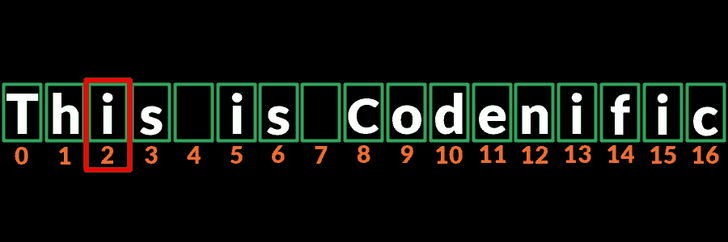

上面的图片取自[我博客中的一篇关于 Python 的文章](http://codenific.com/2017/10/02/how-to-easily-slice-strings-in-python/)，但我们也可以用来解释 Java 的子字符串。假设字符串 `"This is Codenific"` 被赋值给名为 `variable` 的变量。字符串的第一个字母索引为 0。因此，在 `"This is Codenific"` 中，如果你只需要第三个字母，只需执行类似 `variable.substring(2, 3)` 的操作，因为第二个值是不包含的。同样，`variable.substring(0, 16)` 并没有返回整个字符串，而是返回 `"This is Codenifi"`。要返回整个字符串，你必须执行 `variable.substring(0, 17)`。`String.trim()` 是另一个移除开头和末尾空格的方法。`String.toUpperCase()` 和 `String.toLowerCase()` 方法自而易见。最后，我们的程序获取了 `String.length()` 并将其打印。

## 输入

获取输入的简单方法是使用 `Scanner` 类。假设我们要获取一个数字。将以下代码复制到名为 `Inputs` 的新类中：

```java
import java.util.Scanner;

public class Inputs {
    public static void main(String[] args) {
        Scanner scan = new Scanner(System.in);
        System.out.println("Enter a number: ");
        int n = scan.nextInt();
        scan.close();
        System.out.println("The chosen number is: " + n);
    }
}
```

当你运行程序时，它会要求你输入一个数字。我输入了 25，然后它打印出“The chosen number is: 25”。我知道这没什么什么魔法。但正如我常说的的，你必须从某处开始。

### 它是如何发生的？

首先，我们必须在类头之前通过 `import java.util.Scanner;` 来导入 `Scanner` 类。通过导入它，我们就可以访问该类的方法和函数（我们将在课程的稍后部分回到这一点）。

然后，我们创建一个名为 `scan` 的 `Scanner` 对象（你可以随需为其命名）：

`Scanner scan = new Scanner(System.in);`

还记得我们可以如何扩展 `String` 声明吗？就是这样！

`String scan = new String("Scanning...");`

用户无法猜到我们想要什么，所以我们必须放置一些指令，在这种情况下，这些指令会打印到终端。

我们创建了一个名为 `n` 的整数变量，它将下一个输入作为 `int` 存储——`scan.nextInt()`。因此，如果用户输入文本，例如，程序将会崩溃：

完成后，我们必须使用 `scan.close()` 完成 `Scanner` 对象。最后，我们打印出得到的那个数字：`System.out.println("The chosen number is: " + n);`


同样的方法也适用于其他数据类型的 `scan`：

* 获取字节型：`byte a = scan.nextByte();`
* 获取短整型：`short b = scan.nextShort();`
* 获取单浮点型：`float c = scan.nextFloat();`
* 获取长型：`long d = scan.nextLong();`
* 获取双精度型：`double e = scan.nextDouble();`
* 获取布尔型：`boolean f = scan.nextBoolean();`

为了获取字符串作为输入，我们使用 `scan.next()`（假设在这种情况下我们的 `Scanner` 对象名为 `scan`）。

### 另一种导入方式

如果你在导入 `Scanner` 类之前输入 `Scanner scan = new Scanner(System.in);`，你可以点击 "Scanner" 单词，然后将光标移回，就会看到一个红灯。点击它，选择 `Import Class` 然后选择 `Scanner (java.util)`，这样 IDE 就会自动为你编写导入语句！！

### 另一个快捷键！

与其输入 `System.out.println()`，你可以输入 `sout` 并按回车：

## 练习集 #3

为以下每个练习题创建一个类（例如 `Set3Exercise1`），并编写你的解决方案，然后与我的进行比较。示例中的输入是*斜体*的。

1) 编写一个程序，包含一个 `String` 对象，你在其中放入你的名字并将其打印出来。

2) 编写一个程序，询问人的名字然后问候该个人。

*示例：*

What is your name?

Lucas

Hello, Lucas!

3) 编写一个程序，移除用户输入的 `String` 前后的空格，然后打印出新的 `String`。

*示例：*

Enter a String:      Lucas      

Lucas

4) 编写一个程序，获取两个 `Strings`，按照以下规则连接并打印它们：

* 第一个 `String` 必须以小写打印
* 第二个 `String` 必须以大写打印
* 两个 `Strings` 之间必须有一个空格

*示例：*

Enter a String: Code

Enter another String: Nific

code NIFIC

5) 编写一个程序，获取用户的年龄然后打印出他/她出生年份。

*示例（在 2017 年）：*

How old are you?

16

You were born in 2001

6) 编写一个程序，给定一个数字，打印它的前驱和后继。

*示例：*

Enter a number: 10

Predecessor: 9

Successor: 11

7) 编写一个程序，给定一个数字 `x`，打印：

* `x` 的 2 倍
* `x` 的平方
* `x` 除以 2
* `x` 的平方根

*示例：*

Enter a number: 9

18

81

4.5

8) 编写一个程序，获取两个数字并打印它们的平均值（算术平均值）。

*示例 1：*

Enter a number: 8

Enter another number: 10

The average is 9.0

*示例 2：*

Enter a number: 7

Enter another number: 9.5

The average is 8.25

9) 编写一个程序，计算打 10% 折后的产品价格。

*示例 1：*

What is the price of the product? 120

After a 10% discount, this product will be sold for $ 108

*示例 2：*

What is the price of the product? 253.9

After a 10% discount, this product will be sold for $ 228.51

如果你遇到了这个错误：`Exception in thread "main" java.util.InputMismatchException`，你可能需要使用类似 `scan.useLocale(Locale.US)`（假设你的 `Scanner` 对象名为 `scan`）并 `import java.util.Locale`。或者你可以输入 `120,0` 而不是 `120.0`。该错误是因为你国家的数字格式与美国不同（像我一样，是巴西人）。

```java
double average = (n1 + n2) / 2.0;
System.out.println("The average is " + average);
```

```java
import java.util.Locale;
import java.util.Scanner;

public class Main {
    public static void main(String[] args) {
        Scanner scan = new Scanner(System.in); // 如果你遇到 java.util.InputMismatchException，请使用此方法
        scan.useLocale(Locale.US);
        System.out.println("What is the price of the product?");
        double price = scan.nextDouble();
        scan.close();
        double newPrice = price * 0.9;
        System.out.println("After a 10% discount, this product will be sold for $ " + newPrice);
    }
}
```

```java
import java.util.Locale;
import java.util.Scanner;

public class Main {
    public static void main(String[] args) {
        Scanner scan = new Scanner(System.in); // 如果你遇到 java.util.InputMismatchException，请使用此方法
        scan.useLocale(Locale.US);
        System.out.println("Enter the temperature in Celsius:");
        double c = scan.nextDouble();
        scan.close();
        double f = 9 / 5.0 * c + 32;
        System.out.println(c + "ºC is equivalent to " + f + "ºF");
    }
}
```

# 第 5 章：条件与控制流

我们每天都在做决定。无论是早餐吃什么，还是应该去哪里旅行，我们通常根据某些条件做出这些决定。例如：如果下雨，你就会打伞；如果你饿了，你就去吃；如果你想过马路，只有在确定车辆停止后才会过去。我可以一直说下去，但你懂的。如果满足预定义的条件，某些事情就会发生或不发生。可以将相同的原理应用于程序的控制流。

## If - Else

在 Java 中，`if` 关键字是条件表达式的第一部分。它后面跟着括号内的一个布尔表达式，然后是一个代码块。如果布尔表达式求值为 `true`，则将执行后续的代码块。

```java
if (condition) {
    // 在此处执行操作
}
```

例如：

```java
if (10 > 7) {
    System.out.println("Codenific.com");
}
```

### 逐步解释

在上面的示例中，`10 > 7` 是被检查的布尔表达式。由于布尔表达式“10 大于 7”为 `true`，因此 `"Codenific.com"` 将打印到控制台。`if` 语句后面没有跟分号（`;`）。相反，它使用大括号（`{` 和 `}`）来包裹在布尔表达式为真时执行的代码块。

有时，当 `if` 关键字后的布尔表达式为 `true` 时，执行一个代码块。其他时候，我们可能希望在布尔表达式为 `false` 时执行另一个代码块。我们可以写一个与第一个相反的布尔表达式的第二个 `if` 语句，但 Java 提供了一个名为 `if/else` 的条件快捷方式。

如果 `if/else` 条件的布尔表达式求值为 `true`，将运行与 `if` 语句相关的代码块。否则，如果布尔表达式求值为 `false`，它将运行 `else` 关键字之后的代码块。

这是一个 `if/else` 语法的示例：

```java
boolean isRaining = false;
if (isRaining) {
    System.out.println("I will stay at home")
} else {
    System.out.println("I will go to the beach"); // 打印这个
}
```

在某些情况下，我们需要根据不同的布尔表达式执行单独的代码块。对于这种情况，我们可以使用 Java 中的 `if/else if/else` 语句。如果 `if` 语句后的布尔表达式求值为 `true`，它将运行紧随其后的代码块。否则，如果 `else if` 语句后的布尔表达式求值为 `true`，将运行紧随其后的代码块。最后，如果之前所有的布尔表达式都为 `false`，则运行 `else` 块中的代码。

这是一个使用 `if/else if/else` 语句控制流的示例：

```java
int age = 17;
if (age >= 21) {
    System.out.println("You can drive. And you can buy an alcoholic drink");
} else if (age >= 16) {
    System.out.println("You can drive");
} else {
    System.out.println("You will have to wait");
}
```

### 逐步解释

在上面的示例中，`int` 变量 `age` 等于 `17`，它不大于等于 `21`，但大于或等于 `16`。因此，将运行第二个代码块。

## 三元运算符

当你仅仅想根据表达式返回一个值时，`if/else` 语句可能会变得很长。幸运的是， Java 提供了一个快捷方式，允许你在单行内编写 `if/else`。它被称为三元运算符。它包含：

* 一个布尔表达式
* 一个在为 `true` 时执行的单一语句
* 一个在为 `false` 时执行的单一语句

示例：

```java
int points = 10;
String gameResult = (points >= 10) ? "Winner" : "Loser";
System.out.println(gameResult);

char justLetter = (points >= 10) ? 'W' : 'L';
System.out.println(justLetter);
```

### 逐步解释

在上面的示例中，`points >= 10` 求值为 `true`。这将返回 `"Winner"`，并被赋值给变量 `gameResult` 然后打印。同样的情况也适用于其他类型，不仅仅是字符串。

## 循环

想象你想打印两次“Hello”。复制和粘贴该语句很容易。但如果你想打印 100 次相同的消息呢？不要只是去复制所有内容。有更好的方法方法：使用循环。循环基本上是一组执行若干次数的指令集。

```java
while (condition) {
    System.out.println("Hello");
    i++; // 等于 i + 1
}
```

### 逐步解释

首先，我创建了一个 `int` 变量 `i` 来记录打印了 "Hello" 的次数。只要 `i` 小于 `10`，就会打印 `"Hello"` 并且 `i` 递增。经过几次递增后，会出现 `i` 等于 `9` 的点。将打印 `"Hello"`；`i` 再次递增并变为 `10`。此时循环中断，因为条件 `i < 10` 不再满足。这是输出：

```
Hello
Hello
Hello
Hello
Hello
Hello
Hello
```

### 死循环 while 循环

如果不递增那个 `i` 变量，它将始终小于 `10`。因此，条件将始终满足，循环永远不会中断。这可能是一个坏事——除非你希望它在特定环境中发生（我稍会谈到这一点）。程序将无限地打印 "Hello"。以下是发生这种情况的一些示例：

```java
public class Main {
    public static void main(String[] args) {
        int i = 0;
        while (i < 10) {
            System.out.println("Hello");
            i++;
        }
    }
}
```

***

```java
public class Main {
    public static void main(String[] args) {
        while (true) {
            System.out.println("Hello");
        }
    }
}
```

一个看似无限的 `while` 循环看起来如下：

```java
import java.util.Scanner;

public class Main {
    public static void main(String[] args) {
        Scanner scan = new Scanner(System.in);
        System.out.println("Enter a word:");
        String s;
        while (true) {
            s = scan.next();
            if (s.equals("Hello")) {
                System.out.println("Correct!");
                break;
            } else {
                System.out.println("Try again!");
                continue;
            }
        }
    }
}
```

### 逐步解释：

首先，我创建了一个 `Scanner` 对象并将其命名为 `scan`。我打印了“Enter a word:”让用户知道我正在请求输入，并且创建了一个 `String` 变量来存储该输入。然后我使用了 `while (true)`，这基本上意味着除非我们使用 `break` 终止它，否则循环不会停止。接下来，如果输入等于“Hello”，就会打印“Correct!”并通过 `break` 语句跳出循环。否则，如果输入不等于“Hello”，就会打印“Try again!”并通过 `continue` 语句继续循环，直到用户输入“Hello”为止。

### For 循环

`for` 是一种常用的循环，甚至比 `while` 更好用。它的语法如下：

```java
for (initialization; condition; increment) {
    // 在此处执行操作
}
```

这里是我们之前用 `while` 循环做的相同示例（打印 10 次“Hello”）：

```java
for (int i = 0; i < 10; i++) {
    System.out.println(i + " Hello");
}
```

或者你可以这样写：

```java
for (int i = 1; i <= 10; i++) {
    System.out.println(i + " Hello");
}
```

让我们看看每个部分的含义：

```java
for (int i = 0; i < 10; i++) {
    System.out.println(i + " Hello");
}
```

它创建了一个类型为 `int` 的临时变量 `i`。当 `i` 小于 `10` 时，会打印 `i + “Hello”` 并且变量 `i` 加一。同样，如果你想打印从 10 到 20 的数字：

```java
for (int i = 10; i <= 20; i++) {
    System.out.println(i);
}
```

// 或者

```java
for (int i = 10; i < 21; i++) {
    System.out.println(i);
}
```

注意，这种类型的循环不需要你“手动”跟踪计数变量，因此它更容易设置。

### 控制你的循环

假设我们只想打印 10 到 20 之间的偶数。这意味着有一个条件：“如果数字是偶数，则打印 10 到 20 范围内的数字”。以下是我们如何使用 `while` 和 `for` 循环来实现它的。


```java
for (int i = 10; i <= 20; i++) {
    if (i % 2 == 0) {
        System.out.println(i);
    }
}
int i = 0;
while (i < 10) {
    if (i % 2 == 0) {
        System.out.println("Hello");
    }
    i++;
}
```

还有一种被称为**嵌套循环**的结构。它发生在将一个循环放在另一个循环内部时。比如在一个 `for` 循环内部另一个 `for` 循环。

### 练习题 #4

1) 下一个程序的输出是什么？

```java
public class Main {
    public static void main(String[] args) {
        int age = 20;
        boolean isMinor = age < 21;
        if (isMinor) {
            System.out.println("You can NOT buy drinks in the US");
        } else {
            System.out.println("You can buy drinks in the US");
        }
    }
}
```

2) 下一个程序的输出是什么？

```java
public class Main {
    public static void main(String[] args) {
        boolean boo = 5 > 4.7 && 3.9 > 8.2;
        if (boo) {
            System.out.println("Boo!");
        } else {
            System.out.println("Nope");
        }
    }
}
```

3) 下一个程序的输出是什么？

P.S. `equals()` 方法测试一个 `String` 是否等于另一个并返回一个 `boolean`。在这种情况下，它测试存储在变量 `t` 中的 `String` 是否等于 "Te"。

```java
public class Main {
    public static void main(String[] args) {
        String s = "Text";
        String t = s.substring(0, 2);
        if (t.equals("Te")) {
            System.out.println("OOO");
        } else {
            System.out.println("UUU");
        }
    }
}
```

4) 下一个程序的输出是什么？

```java
public class Main {
    public static void main(String[] args) {
        boolean x, y;
        x = 2 * 4 > 2 && 10 / 2 < 5;
        y = 32 < 31;
        System.out.println("Boom");
        if (x || y) {
            System.out.println("Yay");
        } else {
            System.out.println("Wow");
        }
        System.out.println("OK");
    }
}
```

5) 写一个程序，获取一个数字并判断它是偶数还是奇数。

示例 1：

输入一个数字：

4

是偶数

示例 2：

输入一个数字：

3

是奇数

记住使用取余运算符！

6) 写一个程序，获取用户的姓名、出生年份，然后告诉他/她是否在美国开车。如果年龄大于或等于 16 岁，就可以开车。

示例（2017 年）：

你的名字是什么？

Lucas

出生于哪？

2001

Lucas，你 16 岁了，可以在美国开车

7) 写一个程序，获取一个字母（`String`）。如果是 "Y" 或 "y"，打印 "Yes"。如果是 "N" 或 "n"，打印 "No"。否则，打印 "Invalid letter"。

示例 1：

输入一个字母：

y

Yes

示例 2：

输入一个字母：

N

No

示例 3：

输入一个字母：

L

Invalid letter

8) `for` 循环结束后，`x` 的值是多少？

```java
public class Main {
    public static void main(String[] args) {
        int x = 0;
        for (int i = 1; i < 4; i++) {
            x += i;
        }
    }
}
```

9) `for` 循环结束后，`n` 的值是多少？

```java
public class Main {
    public static void main(String[] args) {
        int n = 10;
        for (int i = 0; i < 3; i++) {
            n -= i;
        }
    }
}
```

10) 执行以下程序会发生什么？

```java
public class Main {
    public static void main(String[] args) {
        int n = 10;
        while (n > 10) {
            System.out.println("Hello");
        }
    }
}
```

a) 发生错误

b) "Hello" 将打印 10 次

c) "Hello" 将打印 9 次

d) 什么都不打印

e) "Hello" 将打印一次

11) "n is greater than 0" 会打印多少次？

```java
public class Main {
    public static void main(String[] args) {
        int n = 2;
        n++;
        while (n > 0) {
            System.out.println("n is greater than 0");
            n--;
        }
    }
}
```

a) 0

b) 1

c) 2

d) 3

e) 4

12) `for` 循环结束后，`y` 的值是多少？

```java
public class Main {
    public static void main(String[] args) {
        int y = 2;
        while (y < 20) {
            y += 2;
        }
    }
}
```

a) 20

b) 19

c) 22

d) 18

e) 21

13) 这段代码是做什么的？

```java
public class Main {
    public static void main(String[] args) {
        for (int i = 1; i <= 10; i++) {
            System.out.println(i);
        }
    }
}
```

a) 打印 0 到 10 的数字

b) 打印 1 到 10 的数字

c) 打印 1 到 11 的数字

d) 打印 1 到 9 的数字

14) 写一个程序，打印 150 到 300 的数字，包括 150 和 300。

15) “Fizz-Buzz 测试”是一个面试题，旨在过滤掉 99.5% 无法编程工作的候选人。编程作业的内容如下：“写一个打印 1 到 100 数字的程序。但对于 3 的倍数用‘Fizz’ 代替数字，对于 5 的倍数打印‘Buzz’。对于同时 3 和 5 的倍数打印‘FizzBuzz’。”

### 答案

1) 你在美国不能买酒

2) Nope

3) OOO

4) BoomYayOK

5)

```java
import java.util.Scanner;
public class Main {
    public static void main(String[] args) {
        Scanner scan = new Scanner(System.in);
        System.out.println("Enter a number:");
        int n = scan.nextInt();
        if (n % 2 == 0) {
            System.out.println(n + " is even");
        } else {
            System.out.println(n + " is odd");
        }
    }
}
```

6)

```java
import java.util.Scanner;
public class Main {
    public static void main(String[] args) {
        Scanner scan = new Scanner(System.in);
        System.out.println("What is your name?");
        String name = scan.next();
        System.out.println("In year were you born?");
        int age = 2017 - scan.nextInt();
        if (age >= 16) {
            System.out.println(name + ", you are " + age + " and can drive in the US");
        } else {
            System.out.println(name + ", you are " + age + " and can not drive in the US");
        }
    }
}
```

7)

```java
import java.util.Scanner;
public class Main {
    public static void main(String[] args) {
        Scanner scan = new Scanner(System.in);
        System.out.println("Enter a letter:");
        String letter = scan.next();

        if (letter.toUpperCase().equals("Y")) {
            System.out.println("Yes");
        } else if (letter.toUpperCase().equals("N")) {
            System.out.println("No");
        } else {
            System.out.println("Invalid letter");
        }
    }
}
```

14)

```java
public class Main {
    public static void main(String[] args) {
        for (int i = 150; i <= 300; i++) {
            System.out.println(i);
        }
    }
}
```

15) 解决 FizzBuzz 问题有多种方法，只要解决方案是高效且符合要求的，采用不同的方案是可以的。这里是其中解决方案：

```java
public class FizzBuzz {
    public static void main(String[] args) {
        for (int i = 1; i <= 100; i++) {
            if (i % 15 == 0) { // or i % 3 == 0 && i % 5 == 0
                System.out.println("FizzBuzz");
            } else if (i % 3 == 0) {
                System.out.println("Fizz");
            } else if (i % 5 == 0) {
                System.out.println("Buzz");
            } else {
                System.out.println(i);
            }
        }
    }
}
```

你可以在[此处](http://wiki.c2.com/?FizzBuzzTest)阅读更多关于测试的内容。

### Switch

下面的代码示例取自官方文档。它声明了一个名为 `month` 的 `int` 类型变量，其值代表月份。代码使用 `switch` 语句根据 `month` 的值显示月份名称。

```java
public class SwitchDemo {
    public static void main(String[] args) {
        int month = 8;
        String monthString;
        switch (month) {
            case 1:
                monthString = "January";
                break;
            case 2:
                monthString = "February";
                break;
            case 3:
                monthString = "March";
                break;
            case 4:
                monthString = "April";
                break;
            case 5:
                monthString = "May";
                break;
            case 6:
                monthString = "June";
                break;
            case 7:
                monthString = "July";
                break;
            case 8:
                monthString = "August";
                break;
            case 9:
                monthString = "September";
                break;
            case 10:
                monthString = "October";
                break;
            case 11:
                monthString = "November";
                break;
            case 12:
                monthString = "December";
                break;
            default:
                monthString = "Invalid month";
                break;
        }
        System.out.println(monthString);
    }
}
```

在这种情况下，输出了 "August"，因为 `month` 等于 8。因此，这就是 `switch` 的基础语法：

```java
switch (variable) {
    case value:
        action;
        break;
    case value2:
        action2;
        break;
    // ...
    default:
        defaultAction;
        break;
}
```

### 变量作用域

还记得我们如何把变量的概念比作盒子吗？你可以在盒子里放入一些数据，以后再取回它们。如果你把那个盒子锁在一个房间里，你就无法从外部（例如，你的厨房）访问它——因为你的房间就是作用域。这是一个解释变量作用域的隐喻，作用域是指变量存在且可以被访问的代码片段名称。

```java
// 在这里变量 i 不存在
int i = 5;

// 变量 i 从现在开始存在

while (condition) {
    // 在这里可以访问变量 i
    int j = 7;
    // 变量 j 从现在开始存在
}

// here j no longer exists, but i does
```

### 题组 #5

1) 当用户输入 3972 时，以下程序的输出是什么？


```java
import java.util.Scanner;
public class Main {
    public static void main(String [] args) {
        Scanner scan = new Scanner(System.in);
        System.out.println("Enter a number:");
        int n = scan.nextInt();
        switch (n % 2) {
            case 0:
                System.out.println("E");
                break;
            default:
                System.out.println("O");
                break;
        }
    }
}
```

### 2) 当用户输入 1 时，以下程序的输出是什么？（代码相同）

```java
import java.util.Scanner;
public class Main {
    public static void main(String [] args) {
        Scanner scan = new Scanner(System.in);
        System.out.println("Enter a number:");
        int n = scan.nextInt();
        switch (n % 2) {
            case 0:
                System.out.println("E");
                break;
            default:
                System.out.println("O");
                break;
        }
    }
}
```

### 3) 以下程序的输出是什么？

```java
public class Main {
    public static void main(String [] args) {
        String password = "252525";
        switch (password) {
            case "123456":
                System.out.println("Access granted");
                break;
            case "654321":
                System.out.println("Access denied");
                break;
            case "252525":
                System.out.println("Access granted");
                break;
            default:
                System.out.println("Invalid password");
                break;
        }
    }
}
```

### 4) 执行以下程序后会发生什么？

```java
public class Main {
    public static void main(String [] args) {
        int i = 10;
        System.out.println(n);
    }
}
```

a) 打印 10

b) 什么都不打印

c) 发生错误

### 5) 执行以下程序后会发生什么？

```java
public class Main {
    public static void main(String [] args) {
        int i = 10;
        for (int x = 1 ; x <= 5 ; x++) {
            System.out.println(i);
        }
    }
}
```

a) 打印五次 10

b) 打印一次 10

c) 打印 x

d) 什么都不打印

e) 发生错误

### 6) 下面代码哪里错了？

```java
public class Main {
    public static void main(String [] args) {
        int a = 10;
        for (int b = 1 ; b <= 5 ; b++) {
            int c = 5;
            System.out.println(b);
        }
        System.out.println(c);
    }
}
```

### 7) 下面代码哪里错了？

```java
public class Main {
    public static void main(String [] args) {
        int n = 10;
        while (n == 10) {
            System.out.println(n);
        }
    }
}
```

### 8) 如果你已经看到这里，恭喜你！现在你将构建一个涉及变量、输入处理、关系操作符、循环、条件判断以及用于生成伪随机数的 `Random` 类的游戏。请仔细注意以下指令，并在编写任何代码之前反复阅读直到完全理解要求。

它的工作原理是：计算机生成一个 1 到 10（包含 1 和 10）之间的（秘密）随机整数。用户不断尝试猜测秘密数字，直到猜中。每当用户输入的值不对时，他们会得到提示（“数字比那个大”或“数字比那个小”）。一旦输入正确的数字，游戏结束，用户将收到消息“恭喜！你赢了！”

我不提供此题的答案，但我可以给你一些建议：

- 在数字不正确时持续请求输入，使用 `while (true)` 循环，它会不断请求输入并引导用户，只有当用户输入的数字等于计算机生成的数字时才会跳出。

### 答案

1) E

2) O

3) Access granted

4) c

5) a

6) 变量 `c` 在 `for` 循环内部创建，因此无法从外部访问（即在循环完全执行后它就不再存在了）。for 循环之后的行超出了 `c` 的作用范围。

7) 条件 `(n == 10)` 始终结果为真，因为 `n` 既没有增加也没有减小。这导致了无限 `while` 循环。

8) -

# 第 6 章：面向对象 Java 简介

面向对象编程 (OOP) 是一种围绕“对象”而非“动作”和数据来组织的编程语言模型。对象的示例从人类（通过名称、地址等描述）到建筑和楼层（通过属性描述和修改）。

像 Java 这样面向对象的语言的优点是什么？

- 更有组织性
- 代码量更少
- 将职责集中在正确的地方，使应用程序更灵活，封装业务逻辑。我们很快就会看到这些，但首先需要了解 Java 的语法和创建。

## 类 x 对象

在银行软件中，系统的关键部分是账户。想法是泛化每个账户必须具备的功能。例如……

- 银行账号
- 所有者姓名
- 账户余额
- 限额（用于取款）

账户做什么对我们来说很重要？也就是说，我们希望账户做什么？

- 取出金额
- 存入金额
- 所有者姓名
- 获取当前余额
- 转账金额

考虑到这些，我们有了银行账户。我们可以获取那个项目并获取它的余额吗？不。我们拥有的只是一个项目。首先，我们需要创建一个真实的账户以便访问并让它执行。（images/032.jpeg）注意：尽管指定了 `Account`，它是一个 `Account` 吗？我们存入钱还是取出钱？在存储这些值的地方，那个“项目”（账户的规范）被称为 `class`。而从该类中构造的被称为 `objects`。

## 创建类

打开你的 IDE，创建一个名为 `Account` 的 Java 类并开始输入。注意，这些变量并不是在 `main` 方法中声明的。当变量直接在类的作用域内声明时，被称为对象变量或属性。余额将是 `double` 类型，但它不应该用于货币。

```java
public class Account {
    int number;
    String owner;
    double balance;
}
```

## 创建并使用对象

我们已经有一个类指定了每个对象必须具备什么。但如何使用它？为了创建（实例化）一个 `Account`，我们需要使用关键字 `new` 和括号。

```java
public class Program {
    public static void main(String [] args) {
        new Account ();
    }
}
```

嗯，上面的代码创建了一个 `Account` 类型的对象，但我们如何访问那个对象？我们需要一种方式来引用它。我们需要一个……变量！在这种情况下是一个 `Account` 类型的变量。

```java
public class Program {
    public static void main(String [] args) {
        Account myAccount;
        myAccount = new Account ();
    }
}
```

通过 `myAccount`，我们可以访问新创建的对象并改变它的 `owner`、`balance`、`limit` 等。

```java
public class Program {
    public static void main(String [] args) {
        Account myAccount;
        myAccount = new Account ();
        myAccount.owner = " Lucas ";
        myAccount.balance = 10000.0;
        System.out.println(" Current balance: " + myAccount.balance);
    }
}
```

重要的是，点符号被用于访问 `myAccount` 中的某些内容。在上面的代码中，`myAccount` 属于 Lucas —— 我！并且拥有 10,000 元。

## 方法

在类内部，我们还会声明每个账户做什么以及如何执行——它的行为。例如，如果有一种特定的取款方法，我们会把它放在 `Account` 类内部。这就是为什么那些“函数”被称为“方法”（methods），因为它们是对对象执行某些操作的方法。

我们想创建一个方法，从账户中提取金额，而不向使用该方法的人返回任何信息。

```java
public class Account {
    // 其他属性和方法...
    void draw(double amount) {
        double newBalance = this.balance - amount;
        this.balance = newBalance;
    }
}
```

`void` 关键字表示方法不返回任何内容。但我们可以返回某些值。在我们的 `draw` 方法中，可以返回一个 `boolean` 值来告知操作是否完成。此语境下 `class` 一词源于生物分类学。所有属于同一生物学类的生物都共有一系列属性和行为，但它们并不等同。`Homo sapiens`（人类）定义了一组具有共同特征的生物，但人类的定义/想法/概念是一个真实的人吗？所有内容都指定在 `Homo sapiens` 类中，但为了让一个人跑步、吃饭或跳跃，我们需要实例化该类，创建一个 `Homo sapiens` 类型的对象。

另一个例子：蛋糕食谱。我们不吃食谱，但我们用它来制作真正的蛋糕。食谱是 `class`，蛋糕是 `object`。

## 返回值的方法

当方法返回内容时，如果账户内没有资金，操作就不会发生。在这种情况下，方法会返回 `false`。我将 `void` 替换为 `boolean`，以指示返回类型。

```java
public class Account {
    // 其他属性...
    boolean draw(double amount) {
        if (this.balance < amount) {
            return false;
        } else {
            this.balance -= amount;
            return true;
        }
    }
}
```

在上面的代码中，什么都不会被打印，因为 `System.out.println()` 语句位于 `return` 语句之后。这里是如何使用那个新 `draw` 方法的：

```java
public class Program {
    public static void main(String [] args) {
        Account myAccount = new Account ();
        myAccount.balance = 1000.0;
        boolean success = myAccount.draw(200.0);
        if (success) {
            System.out.println(" I got my money!");
        } else {
            System.out.println(" Where is my money?");
        }
    }
}
```

我甚至可以消除中间变量（`success`）：

```java
public class Program {
    public static void main(String [] args) {
        Account myAccount = new Account ();
        myAccount.balance = 1000.0;
        if (myAccount.draw(200.0)) {
            System.out.println(" I got my money!");
        } else {
            System.out.println(" Where is my money?");
        }
    }
}
```

当然，你可以在同一个程序中拥有多个账户，每个账户都有自己的属性集。

```java
public class Program {
    public static void main(String [] args) {
        Account myAccount = new Account ();
        myAccount.balance = 1000.0;
        Account mySecondAccount = new Account ();
        mySecondAccount.balance = 500.0;
        System.out.println("Account 1 balance: " + myAccount.balance);
        System.out.println("Account 2 balance: " + mySecondAccount.balance);
    }
}
```

```java
a1 = new Account ();
Account a2;
a2 = new Account ();
```

在上面的代码中，我们不能说 `a1` 是一个对象，因为 `a1` 是一个引用对象的变量。所以请记住，在 Java 中，变量永远不是对象。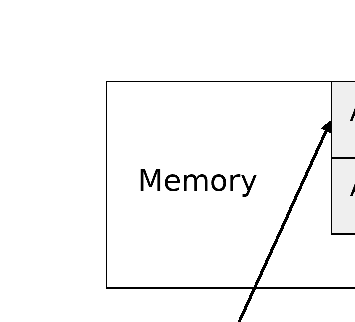

在内部，`a1` 和 `a2` 将存储一个数字，用于标识 `Account` 位于内存的哪个位置。这样，通过使用 `.` 符号进行导航，Java 将访问位于目标位置的 `Account` 对象，而不是另一个。

```java
public class TestReferences {
    public static void main( String args[]) {
        Account a1 = new Conta ();
        a1. deposit( 100 );
        Account a2 = a1;  // !!!
        a2. deposit( 200 );
        System . out . println( a1. balance);
        System . out . println( a2. balance);
    }
}
```

运行上述代码时会发生什么？`=` 运算符复制变量的值。但变量 `a1` 的值是什么？是对象吗？不是。实际上，存储的值是内存中对象的引用（地址）。

```java
Account a1 = new Account ();
Account a2 = a1;
```

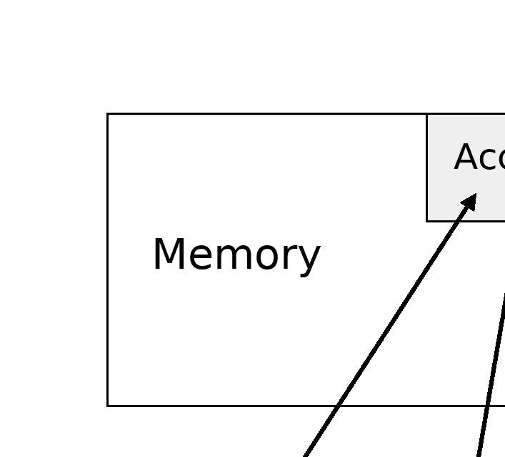

所以，当我写下 `a2 = a1` 时，`a2` 现在引用了与 `a1` 相同的同一个对象。因此，在这种特定情况下，使用 `a1` 还是 `a2` 并不重要，因为它们都引用同一个对象！这意味着表达式 `a1 == a2` 的求值结果为真。观察这种现象的另一种方法是知道我们只使用了一次 `new` 关键字，所以内存中只有一个 `Account` 对象。


```java
public static void main(String[] args) {
    Account a1 = new Account();
    a1.owner = "Luke";
    a1.balance = 250;
    Account a2 = new Account();
    a2.owner = "Luke";
    a2.balance = 250;
    if (a1 == a2) {
        System.out.println("Equal accounts!");
    }
}
```

`==` 运算符比较存储在变量 `a1` 和 `a2` 内部的值，但这些变量并不持有对象，它们持有对象的地址。由于创建了两个不同的 `Account` 且每个变量引用了其中一个，它们的地址不同。因此，`a1 == a2` 的求值结果为假，因为我们谈论的是内存中不同的对象。这有点微妙，因为我们倾向于比较它们的属性，而在这种情况下，这些属性是相同的。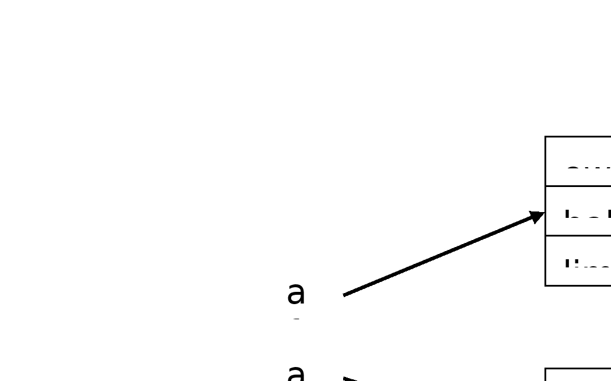

### `transfer()` 方法

如果我们想从一个账户转账到另一个账户该怎么办？它看起来是这样：

```java
public class Account {
    // 其他属性和方法...
    void transfer(Account destiny, double amount) {
        this.balance -= amount;
        destiny.balance += amount;
    }
}
```

我们可能会想要获取两个 `Account` 类型的参数（`account1` 和 `account2`），但那是过程化的编程方式。我们想要在 `Account` 类型的对象上调用 `transfer()` 方法（这将是 `this`），因此该方法只获取一个 `Account` 类型的参数——资金的去向。

让我们使用该方法转账一些钱。

```java
public class Program {
    public static void main(String[] args) {
        Account a1 = new Account();
        a1.balance = 1000.0;
        Account a2 = new Account();
        a2.balance = 500.0;
        a1.transfer(a2, 250); // !!!
        System.out.println("a1 = " + a1.balance);
        System.out.println("a2 = " + a2.balance);
    }
}
```

看到我如何通过 `a1.transfer(a2, 250)` 向 `a2` 转账 250 美元了吗？在这种情况下，`a1` 就是我谈到的那个“this”，而 `a2` 是目的地。我们大可以把该方法命名为 `transferTo`，因为它更符合逻辑。

让我们也实现一些逻辑以避免从资金不足的账户转账。并让方法返回一个布尔值，以告知操作是否成功完成。我知道我们现在不在练习题集中，但请尝试自己实现这些内容。加油！……经过这些更改后将如下：

```java
boolean transferTo(Account destiny, double amount) {
    if (this.balance < amount) {
        return false;
    } else {
        this.balance -= amount;
        destiny.balance += amount;
        return true;
    }
}
```

我们应该更进一步，使用我们之前创建的方法从 `a1` 中提款并向 `a2` 存款。也尝试实现一下那个吧！……

```java
boolean transferTo(Account destiny, double amount) {
    if (this.draw(amount)) {
        destiny.deposit(amount);
        return true;
    } else {
        return false;
    }
}
```

### 属性

再次记得我们为 `Account` 类创建的属性吗？

```java
class Account {
    int number;
    String owner;
    double balance;
}
```

当我们创建一个对象时，这些变量获得默认值。数值变量获得 `0`，布尔型获得 `false`，而对象获得 `null`。但你也可以这样设置默认值：

```java
public class Account {
    int number = 12345;
    String owner = "Lucas";
    double balance = 0;
}
```

如果你尝试访问一个尚未赋值的对象（即它指向 `null`）的方法或属性，你在执行期间将得到一个错误：`NullPointerException`。

除了我们正在创建的 `Bank`，让我们看看与汽车相关的某些类是什么样的。让我们创建一个 `Car` 类，带有描述其特征的属性和描述其行为的方法。

```java
public class Car {
    String color;
    String model;
    double currentSpeed;
    double maxSpeed;
    // 启动汽车
    void on() {
        System.out.println("The car is on");
    }
    // 加速
    void accelerate(double amount) {
        double newSpeed = this.currentSpeed + amount;
        if (newSpeed <= maxSpeed) {
            currentSpeed = newSpeed;
        }
    }
}
```

让我们在一个程序中测试我们的汽车：

```java
public class TestCar {
    public static void main(String[] args) {
        Car myCar = new Car();
        myCar.color = "Green";
        myCar.model = "Lamborghini";
        myCar.currentSpeed = 0;
        myCar.maxSpeed = 70;
        // 启动汽车
        myCar.on();
        // 加速
        myCar.accelerate(20);
        System.out.println("Current Speed: " + myCar.currentSpeed);
    }
}
```

我们知道汽车有一个引擎。所以我们为什么不创建一个类来描述它呢？

```java
public class Engine {
    int power;
    String type;
}
```

```java
// 这是一个新的 Car 类
public class Car {
    String color;
    String model;
    double currentSpeed;
    double maxSpeed;
    Engine engine; // !!!
    // methods...
}
```

我们可以创建多个汽车和引擎，就像我们在虚构的银行中创建 `Account` 和 `Client` 所做的那样。这不很酷吗？

## 练习集 #6 - 第一部分

以下员工模型将用于后续章节的练习。这里的目标是创建一个管理银行员工的系统。本章的练习极其重要。

### 1) 创建名为 `Employee` 的类，它包含以下属性：

- `name` (`String`)
- 他的/她的出生日期 (`String`)
- 入职日期 (`String`)
- `job` (`String`)
- `salary` (`double`，代表月薪)。

**示例：**

- `name`: "Lucas"
- `dateOfBirth`: "25/10/2001"
- `wasHiredOn`: "01/09/2017"
- `job`: "CEO"
- `salary`: 50000.0

**创建一些方法：**

- `promote`：根据传入的参数 `amount` 增加员工工资。无返回值。
- `calculateAnnualSalary`：不接收任何参数；返回工资乘以 12（个月）。

### 2) 创建一个类来测试你的 `Employee` 类。

我会把我的类命名为 `TestEmployee`，但你可以随需重命名。这个类必须包含 `main` 方法。创建一个 `Employee` 类型的新对象，并赋予它你想要的属性。

### 答案

1)

```java
public class Employee {
    String name;
    String dateOfBirth;
    String wasHiredOn;
    String job;
    double salary;
    void promote(double amount) {
        this.salary += amount;
    }
    double calculateAnnualSalary() {
        return this.salary * 12;
    }
}
```

2) 这里是你的测试类可能的样子示例：

```java
public class TestEmployee {
    public static void main(String[] args) {
        Employee e = new Employee();
        e.name = "Lucas";
        e.dateOfBirth = "25/10/2001";
        e.wasHiredOn = "01/09/2017";
        e.job = "CEO";
        e.salary = 50000.0;
        e.promote(1000.0);
        double annualSalary = e.calculateAnnualSalary();
        System.out.println("Annual Salary = " + annualSalary);
    }
}
```

## 练习集 #6 - 第二部分

### 3) 创建一个 `show()` 方法，它既不接收也不返回任何参数，只需打印我们员工的所有属性。这样，你就不需要为对每个员工进行的每次更改和测试而不断复制粘贴大量的 `System.out.println()`。有了这个方法，你只需要执行：

```java
Employee employee = new Employee();
// …
employee.show();
```

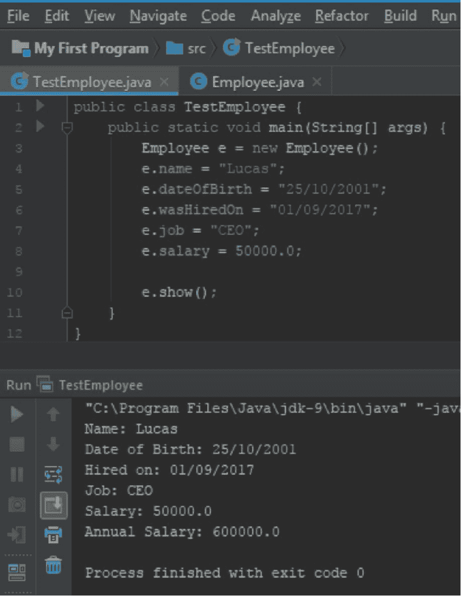

### 答案

3)

```java
void show() {
    System.out.println("Name: " + this.name);
    System.out.println("Date of Birth: " + this.dateOfBirth);
    System.out.println("Hired on: " + this.wasHiredOn);
    System.out.println("Job: " + this.job);
    System.out.println("Salary: " + this.salary);
    System.out.println("Annual Salary: " + this.calculateAnnualSalary());
}
```

## 练习集 #6 - 第三部分

是时候训练你的学习肌肉了！创建以下具有相应属性和方法的类。不要害怕尝试，现在是时候你自己去发现问题了！

### 1) 类：`Person`

- **属性：**
    - `name` - `String`
    - `age` - `int`
- **方法：**
    - `void oneMoreYear()` - 将人的年龄增加 1

创建一个人，设置她的/他的名字和初始年龄，过生日（增加年龄）并打印人的名字和年龄。

***

### 2) 类：`Door`

- **属性：**
    - `opened` - `boolean`
    - `color` - `String`
    - `dimensionX` - `double`
    - `dimensionY` - `double`
    - `dimensionZ` - `double`
- **方法：**
    - `void open()` - 开启门
    - `void close()` - 关闭门
    - `void paint(String s)` - 用颜色 `s` 漆门
    - `boolean isOpen()` - 如果门是开启的返回 true，如果门是关闭的返回 false

创建一个门，开启并关闭它，用不同的颜色漆它，改变它的尺寸，并使用 `isOpen()` 方法检查它是否开启。

***

### 3) 类：`House`

- **属性：**
    - `color` - `String`
    - `door1` - `Door`
    - `door2` - `Door`
    - `door3` - `Door`
- **方法：**
    - `void paint(String s)` - 用颜色 `s` 漆门
    - `int countDoors()` - 返回开启门的数量

创建一个房子，漆它，开启并关闭门，使用 `countDoors()` 方法查看开启了多少门。

## 练习集 #6 - 第四部分

（注：原文此处未提供第四部分具体内容，已按要求结束翻译）

哦！而且数组的大小不可改变。一旦你创建了数组，在它存在期间，其大小（位置数量）将保持不变。如果你需要更多空间，必须创建一个新数组并将元素从旧数组复制过去。

Java 5.0 引入了一种新的语法，用于在不需要临时变量来跟踪当前索引时遍历数组。这是一种增强型 for 循环（enhanced-for loop）。请看下面的代码示例：

```java
public class MyClass {
    public static void main(String[] args) {
        int[] ages = new int[10];
        for (int i = 0; i < 10; i++) {
            ages[i] = i * 10;
        }
        // print all the items in the array
        for (int x : ages) {
            System.out.println(x);
        }
    }
}
```

这里是同一个函数但使用增强型 for 循环写法：

```java
void printArray(int[] array) {
    for (int x : array) {
        System.out.println(x);
    }
}
```

引用数组也是如此。这无非只是为了更方便遍历数组并使过程更具可读性而的一种小技巧。

### 练习集 #7

1) 编写一个程序，创建一个数组并用 1 到 10 的数字填充它，然后通过遍历数组将其打印出来。

2) 创建一个名为 `Employee` 的新类（如果还没有的话），并粘贴以下代码：

```java
public class Employee {
    String name;
    double salary;
}
```

同样创建一个名为 `Company` 的新类（如果还没有的话），并粘贴以下代码：

```java
public class Company {
    Employee[] employees = new Employee[3];
    int i = 0;
    void add(Employee employee) {
        this.employees[???] = employee;
        i += ???;
    }
    void showEmployees() {
        for (Employee e : employees) {
            System.out.println(???);
        }
    }
}
```

最后，创建一个名为 `Program` 的新类（如果还没有的话），并粘贴以下代码：


引用数组也是如此。这无非只是为了更方便遍历数组并使过程更具可读性而的小技巧。

### 练习集 #71

1) 编写一个程序，创建一个数组并用 1 到 10 的数字填充它，然后通过遍历数组将其打印出来。

2) 创建一个名为 `Employee` 的新类（如果还没有的话），并粘贴以下代码：

```java
public class Employee {
    String name;
    double salary;
}
```

同样创建一个名为 `Company` 的新类（如果还没有的话），并粘贴以下代码：

```java
public class Company {
    Employee [] employees = new Employee [ 3 ];
    int i = 0;
    void add( Employee employee) {
        this . employees[???] = employee;
        i += ???;
    }
    void showEmployees() {
        for ( Employee e : employees) {
            System . out . println(???);
        }
    }
}
```

最后，创建一个名为 `Program` 的新类（如果还没有的话），并粘贴以下代码：

```java
public class Program {
    public static void main( String [] args) {
        Employee e1 = new Employee ();
        e1. name = "Lucas";
        e1. salary = 100000;
        Employee e2 = new Employee ();
        e2. name = "Mary";
        e2.salary = 120000;
        Employee e3 = new Employee ();
        e3. name = "Nick";
        e3.salary = 85000;
        Company company = new Company ();
        company. add( e1);
        company. add( e2);
        company. add( e3);
        company. showEmployees();
    }
}
```

现在将每个 `???` 替换为正确的代码以实现：

* `add()` 接收一个 `Employee` 作为参数，并将其添加到数组 `employees` 的第一个空位置。
* `showEmployees()` 不返回任何内容。它只是打印数组 `employees` 中中每个员工的名字和工资。
* 你只能用新代码来替换问号。
* 这是预期的输出：

Lucas -> 100000.0

Mary -> 120000.0

Nick -> 85000.0

3) 再次做一次 FizzBuzz 练习，但这次使用数组。“编写一个程序打印 1 到 100 的数字。但对于三的倍数打印“Fizz”而不是数字，对于五的倍数打印“Buzz”。对于既是三又是五的倍数的数字，打印“FizzBuzz”。。创建一个长度为 100 的数组，并用 1 到 100 的数字填充它。然后遍历该数组并按照条件打印数字。

4) 创建任意长度的数组并用任意数字填充它。现在遍历它并将这些数字复制到一个新数组。

### 答案

1)

```java
public class Program {
    public static void main( String [] args) {
        int [] array = new int [ 10 ];
        for ( int i = 0 ; i <= 9 ; i++) {
            array[ i] = i + 1;
        }
        for ( int x : array) {
            System . out . println( x);
        }
    }
}
```

2)

```java
public class Company {
    Employee [] employees = new Employee [ 3 ];
    int i = 0;
    void add( Employee employee) {
        this . employees[ i] = employee;
        i += 1;
    }
    void showEmployees() {
        for ( Employee e : employees) {
            System . out . println( e. name + " -> " + e. salary);
        }
    }
}
```

3)

```java
public class Program {
    public static void main( String [] args) {
        int [] array = new int [ 100 ];
        for ( int i = 1 ; i <= 100 ; i++) {
            array[ i- 1 ] = i;
        }
        for ( int x : array) {
            if ( x % 15 == 0 ) {
                System . out . println ( "Fizzbuzz" );
            } else if ( x % 5 == 0 ) {
                System . out . println ( "Buzz" );
            } else if ( x % 3 == 0 ) {
                System . out . println ( "Fizz" );
            } else {
                System . out . println ( x );
            }
        }
    }
}
```

4)

```java
public class Program {
    public static void main( String [] args) {
        int [] oldArray = new int [ 3 ];
        oldArray[ 0 ] = 1;
        oldArray[ 1 ] = 2;
        oldArray[ 2 ] = 3;
        int [] newArray = new int [ 3 ];
        for ( int i = 0 ; i <= 2 ; i++) {
            newArray[ i] = oldArray[ i];
        }
    }
}
```

# 第 8 章：访问修饰符和类属性

## 控制访问

我们将回到 `Account` 类。这是为了回到我们在第 6 章创建的类。

```java
public class Account {
    int number;
    double balance;
    double limit;
    double owner;
    boolean draw(double amount) {
        if (amount > balance + limit) {
            return false;
        } else {
            balance -= amount;
            return true;
        }
    }
    void deposit(double amount) {
        balance += amount;
    }
    boolean transferTo(Account destiny, double amount) {
        if (amount > balance + limit) {
            balance -= amount;
            destiny.balance += amount;
            return true;
        } else {
            return false;
        }
    }
}
```

如果有人尝试通过不使用方法来访问 `account` 并修改 `balance`？如下：

```java
public class Program {
    public static void main( String [] args) {
        Account account = new Account ();
        account.balance = -100;
    }
}
```

访问修饰符或可见性修饰符。在 Java 中，我们使用 `private` 关键字来解决这个问题。

```java
public class Account {
    private balance;
    private limit;
    // ...
```

在面向对象编程（OOP）中，用 `private` 保护属性几乎是强制性的实践。每个类都负责控制自己的属性，以便判断新值是否有效。另一方面，我们还有 `public` 访问修饰符，允许所有人访问特定的属性或方法：

```java
public class Account {
    // ...
    public boolean draw( double amount) {
        // 任何人都可以访问此方法
        if ( amount > this . balance + this . limit) {
            return false;
        } else {
            this . balance -= amount;
            return true;
        }
    }
}
```

注意我们的类使用了 `public` 修饰符，在这种情况下，这些类对所有地方都可见。查看 IDE 如何使用打开和关闭的锁来表示公共和私有内容：images/0041.jpeg

那么没有访问修饰符的方法/属性（例如 `deposit()`、`owner`、`number` 和 `transferTo()`）怎么办？它们既不是公共的不是私有的。它们是 `default`，如下所示。

| 可见性 | 公共 (public) | 保护 (protected) | 默认 (default) | 私有 (private) |
| :--- | :--- | :--- | :--- | :--- |
| 同一类内 | 是 | 是 | 是 | 是 |
| 同一个包内的任何类 | 是 | 是 | 是 | 否 |
| 同包内的子类 | 是 | 是 | 是 | 否 |
| 同包外的子类 | 是 | 通过继承是 | 否 | 否 |
| 同包外的非子类类 | 是 | 否 | 否 | 否 |


引用数组也是如此。这无非只是为了更方便遍历数组并使过程更具可读性而的小技巧。

### 练习集 #71

1) 编写一个程序，创建一个数组并用 1 到 10 的数字填充它，然后通过遍历数组将其打印出来。

2) 创建一个名为 `Employee` 的新类（如果还没有的话），并粘贴以下代码：

```java
public class Employee {
    String name;
    double salary;
}
```

同样创建一个名为 `Company` 的新类（如果还没有的话），并粘贴以下代码：

```java
public class Company {
    Employee [] employees = new Employee [ 3 ];
    int i = 0;
    void add( Employee employee) {
        this . employees[???] = employee;
        i += ???;
    }
    void showEmployees() {
        for ( Employee e : employees) {
            System . out . println(???);
        }
    }
}
```

最后，创建一个名为 `Program` 的新类（如果还没有的话），并粘贴以下代码：

```java
public class Program {
    public static void main( String [] args) {
        Employee e1 = new Employee ();
        e1. name = "Lucas";
        e1. salary = 100000;
        Employee e2 = new Employee ();
        e2. name = "Mary";
        e2.salary = 120000;
        Employee e3 = new Employee ();
        e3. name = "Nick";
        e3.salary = 85000;
        Company company = new Company ();
        company. add( e1);
        company. add( e2);
        company. add( e3);
        company. showEmployees();
    }
}
```

现在将每个 `???` 替换为正确的代码以实现：

* `add()` 接收一个 `Employee` 作为参数，并将其添加到数组 `employees` 的第一个空位置。

* `showEmployees()` 不返回任何内容。它只是打印数组 `employees` 中中每个员工的名字和工资。

* 你只能用新代码来替换问号。

* 这是预期的输出：

Lucas -> 100000.0

Mary -> 120000.0

Nick -> 85000.0

3) 再次做一次 FizzBuzz 练习，但这次使用数组。“编写一个程序打印 1 到 100 的数字。但对于三的倍数打印“Fizz”而不是数字，对于五的倍数打印“Buzz”。对于既是三又是五的倍数的数字，打印“FizzBuzz”。。创建一个长度为 100 的数组，并用 1 到 100 的数字填充它。然后遍历该数组并按照条件打印数字。

4) 创建任意长度的数组并用任意数字填充它。现在遍历它并将这些数字复制到一个新数组。

### 答案

1)

```java
public class Program {
    public static void main( String [] args) {
        int [] array = new int [ 10 ];
        for ( int i = 0 ; i <= 9 ; i++) {
            array[ i] = i + 1;
        }
        for ( int x : array) {
            System . out . println( x);
        }
    }
}
```

2)

```java
public class Company {
    Employee [] employees = new Employee [ 3 ];
    int i = 0;
    void add( Employee employee) {
        this . employees[ i] = employee;
        i += 1;
    }
    void showEmployees() {
        for ( Employee e : employees) {
            System . out . println( e. name + " -> " + e. salary);
        }
    }
}
```

3)

```java
public class Program {
    public static void main( String [] args) {
        int [] array = new int [ 100 ];
        for ( int i = 1 ; i <= 100 ; i++) {
            array[ i- 1 ] = i;
        }
        for ( int x : array) {
            if ( x % 15 == 0 ) {
                System . out . println ( "Fizzbuzz" );
            } else if ( x % 5 == 0 ) {
                System . out . println ( "Buzz" );
            } else if ( x % 3 == 0 ) {
                System . out . println ( "Fizz" );
            } else {
                System . out . println ( x );
            }
        }
    }
}
```

4)

```java
public class Program {
    public static void main( String [] args) {
        int [] oldArray = new int [ 3 ];
        oldArray[ 0 ] = 1;
        oldArray[ 1 ] = 2;
        oldArray[ 2 ] = 3;
        int [] newArray = new int [ 3 ];
        for ( int i = 0 ; i <= 2 ; i++) {
            newArray[ i] = oldArray[ i];
        }
    }
}
```

# 第 8 章：访问修饰符和类属性

## 控制访问

我们将回到 `Account` 类。这是为了回到我们在第 6 章创建的类。

如果有人尝试通过不使用方法来访问 `account` 并修改 `balance`？如下：

```java
public class Program {
    public static void main( String [] args) {
        Account account = new Account ();
        account.balance = -100;
    }
}
```

访问修饰符或可见性修饰符。在 Java 中，我们使用 `private` 关键字来解决这个问题。

```java
public class Account {
    private balance;
    private limit;
    // ...
```

在面向对象编程（OOP）中，用 `private` 保护属性几乎是强制性的实践。每个类都负责控制自己的属性，以便判断新值是否有效。另一方面，我们还有 `public` 访问修饰符，允许所有人访问特定的属性或方法：

```java
public class Account {
    // ...
    public boolean draw( double amount) {
        // 任何人都可以访问此方法
        if ( amount > this . balance + this . limit) {
            return false;
        } else {
            this . balance -= amount;
            return true;
        }
    }
}
```

注意我们的类使用了 `public` 修饰符，在这种情况下，这些类对所有地方都可见。查看 IDE 如何使用打开和关闭的锁来表示公共和私有内容：`images/0041.jpeg`

那么没有访问修饰符的方法/属性（例如 `deposit()`、`owner`、`number` 和 `transferTo()`）怎么办？它们既不是公共的不是私有的。它们是 `default`，如下所示。

| 可见性 | 公共 (public) | 保护 (protected) | 默认 (default) | 私有 (private) |
| :--- | :--- | :--- | :--- | :--- |
| 同一类内 | 是 | 是 | 是 | 是 |
| 同一个包内的任何类 | 是 | 是 | 是 | 否 |
| 同包内的子类 | 是 | 是 | 是 | 否 |
| 同包外的子类 | 是 | 通过继承是 | 否 | 否 |
| 同包外的非子类类 | 是 | 否 | 否 | 否 |

我们现在不深入探讨每个访问修饰符的细节（我甚至还没有谈到 `Protected`！）。我只是想让你们知道，每个关键字之间存在某些差异，你们不需要死记硬背它们。请记住，它们就像是你的属性和方法的安全级别。将属性设置为 `private` 而将几乎所有方法设置为 `public` 是非常常见的，尽管这并不是一条规定。

## 封装

我们在本章中开始看到的是“封装”的概念，即隐藏类的所有成员，并隐藏系统例程（方法）的工作方式。封装是使你的系统易于更改的关键：我们不需要在多个处修改业务规则，而只需要在一个地方修改，因为该规则被封装起来了（参见 `draw()` 方法示例）。

类中的公共方法集也被称为“类接口”，因为它们是你与该类对象通信的唯一方式。看下图是如何表示的：

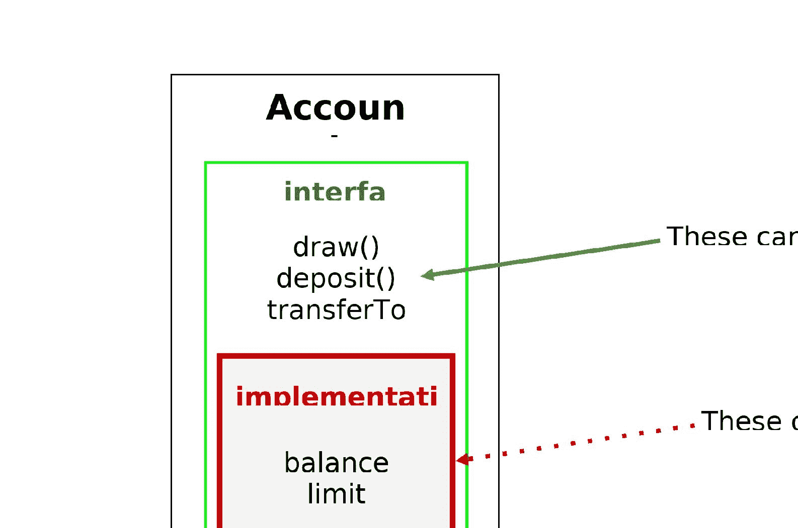

在编程时，始终考虑类的接口——即你的用户将如何使用它——而不仅仅是它是如何工作的，这是一个好习惯。实现本身（方法的内容）对类的用户来说并不重要，因为他/她只需要知道每个方法做什么，而不是如何做（因为这可能会随时间改变）。每当我们访问一个对象时，都会使用它的接口。现实世界中有几个类比。这里是其中：

当你开车时，对你重要的是踏板和方向盘（接口）——而不是你正在使用的引擎（实现）。当然，不同的引擎可以给你带来更好的结果，但它的功能与功率较小的引擎是一样的，区别在于它的实现方式。如果你换了一个新引擎，你不需要重新学习如何开车！实现的改变并不意味着接口的改变，这允许其他类继续以相同的方式使用它。

## Getter 和 Setter

`private` 修饰符导致没有人能够修改甚至读取某个特定的属性。那么，如果我们无法访问它，如何显示账户（`Account`）的余额呢？让我们用一个方法吧！将其命名为 `getBalance()` 是有合理的：

```java
public class Account {
// ...
    private double balance;
    public double getBalance() {
        return this . balance;
    }
// ...
}
```

这就是我们如何访问账户余额：

```java
public class Program {
    public static void main( String [] args) {
        Account account = new Account ();
        account. deposit( 250 );
        System . out . println( "Balance = " + account. getBalance());
    }
}
```

为了以控制的方式访问属性（因为它们是 `private` 的），最常见的做法是创建两个方法：一个返回值，另一个更改值。惯例是它们分别以 `get` 和 `set` 单词开头。如果我们想为 `balance`、`limit` 和 `owner` 编写 getter 和 setter，我们的类看起来像这样：


```java
public class Account {
    private double balance;
    private double limit;
    private Client owner;
    public double getBalance() {
        return balance;
    }
    public void setBalance(double balance) {
        this.balance = balance;
    }
    public double getLimit() {
        return limit;
    }
    public void setLimit(double limit) {
        this.limit = limit;
    }
    public Client getOwner() {
        return owner;
    }
    public void setOwner(Client owner) {
        this.owner = owner;
    }
}
```

但你不需要自己写所有这些方法。使用你的 IDE！！在你想放置 getter 和 setter 的空行中放置光标。选择 `Code >> Generate...`

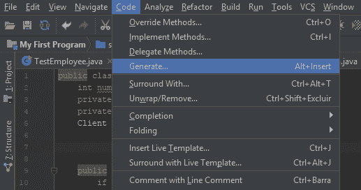

选择 Getter and Setter。

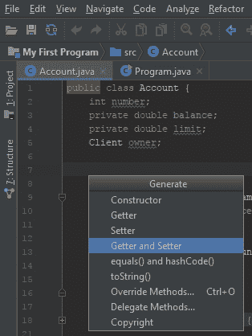

使用 `Shift` 或 `Ctrl` (Windows) 选择你想生成 getter/setter 的属性（在此情况下为 `balance`、`limit` 和 `owner`），然后按 `OK`。

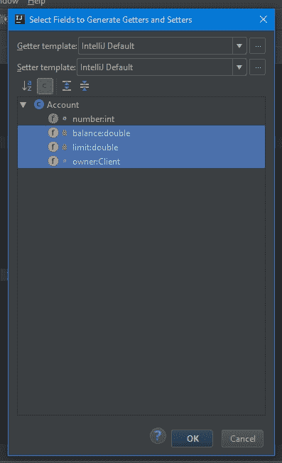

好了！

创建一个类然后为其所有属性创建 getter 和 setter 是一种坏做法。你只有在真正需要时才创建 getter 或 setter。注意，在这个例子中，不应该创建 `setBalance()`，因为我们希望每个人都使用 `deposit()` 和 `draw()`。

另一个重要的细节：`getX` 方法并不一定返回属于相应对象的名为 `X` 的属性值。这对于封装来说很有趣。想象一下这种情况：我们希望银行始终显示余额为 `limit + balance`（这是银行欺骗客户的常见做法）。

我们可以一直调用 `account.getLimit() + account.getBalance()`，但当我们需要更改余额显示方式时，这可能会产生“全部替换”的情况。让我们将其封装在 `getBalance()` 内部。看：

```java
public double getBalance() {
    return this.balance + this.limit;
}
```

我们现在也不应该创建 `getLimit()` 和 `setLimit()` 甚至 `getOwner()` 和 `setOwner()`，因为我们现在不需要它们。这给我们留下了必要的部分：

```java
public class Account {
// attributes...
    public double getBalance() {
        return balance + limit;
    }
}
```

使用 getter 和 setter 不仅有助于保护属性，还允许你在某一个地方进行更改——因为这隐藏了对象存储数据的方式。这是一个非常重要的实践！

我们的类还有另一个问题。如果一个人存入负数金额（尽管这在现实生活中并不存在，但在这里可能会发生），余额将是负数。例如：

```java
public class Program {
    public static void main(String[] args) {
        Account account = new Account();
        account.deposit(-250);
    }
}
```

为了防止这种情况，我们应该修复哪个方法？`deposit()` 方法！！在存入前检查金额是否为正。得益于封装，这是我们需要做的更改：

```java
void deposit(double amount) {
    if (amount > 0) {
        this.balance += amount;
    }
}
```

## 构造函数

当我们使用 `new` 关键字时，我们正在构造一个对象。`new` 总是运行类的构造函数，如下：

```java
public class Account {
// attributes...
// constructor:
    Account() {
        System.out.println("Constructing account...");
    }
// methods...
}
```

当我们这样做时：

```java
public class Program {
    public static void main(String[] args) {
        Account account = new Account();
    }
}
```

“Constructing account…”被打印出来。这就像是我们创建一个新对象时的初始化例程。构造函数不是方法！（尽管它看起来像方法）。

### 默认构造函数

当你不在类中声明构造函数时，Java 会为你创建一个。这个构造函数是默认构造函数，它不接收参数且其体为空。这就是为什么我们之前可以在没有构造函数的情况下创建新对象。由于我们提供了自己的，默认构造函数不再使用。

### 带参数的构造函数

构造函数可以接收参数来初始化某些信息。看有多棒：

```java
public class Account {
// attributes…
    Account(Client owner) {
        this.owner = owner;
        System.out.println("Constructing an account for " + owner.name + "...");
    }
// methods...
}
```

`this.owner = owner` 意味着新账户的所有者（`this.owner`）将是参数输入的（`owner`）。现在你在创建新的 `Account` 对象时，必须输入一个 `Client`：

```java
public class Program {
    public static void main(String[] args) {
        Client myClient = new Client();
        myClient.name = "Lucas";
        Account account = new Account(myClient);
    }
}
```

打印结果：Constructing an account for Lucas... 太棒了！

### 多个构造函数

你可以在类中拥有多个构造函数，系统将选择合适的一个。

```java
public class Account {
    int number;
    private double balance;
    private double limit;
    Client owner;
    Account(Client owner) { // #1
        this.owner = owner;
    }
    Account(int number, Client owner) { // #2
        this.owner = owner;
        this.number = number;
    }
}
```

----------------------------

```java
public class Program {
    public static void main(String[] args) {
        Client c1 = new Client();
        c1.name = "Olivia";
        Account a1 = new Account(c1); // #1
        Client c2 = new Client();
        c2.name = "Fitz";
        Account a2 = new Account(19525, c2); // #2
    }
}
```

注意 `a1` 使用构造函数 #1，而 `a2` 使用构造函数 #2。但构造函数 #2 中存在重复：`this.owner = owner` 被重复了。为了解决这个问题，我们在构造函数 #2 内部调用构造函数 #1，如下：

```java
public class Account {
    int number;
    private double balance;
    private double limit;
    Client owner;
    Account(Client owner) {
        this.owner = owner;
    }
    Account(int number, Client owner) {
        this(owner); // !!!
        this.number = number;
    }
}
```

在 `this(owner)` 中，你可以将 `this()` 视为 `Account()`。由于它只接收 `owner` 作为参数，它正在调用构造函数 #1 —— `Account(Client owner)`。

## 类属性

假设我们的银行还想控制现有账户的数量。我们如何实现这一点？一个简单的想法是：

```java
public class Program {
    public static void main(String[] args) {
        int totalOfAccounts = 0;
        Client c1 = new Client();
        c1.name = "Olivia";
        Account a1 = new Account(c1);
        totalOfAccounts += 1;
    }
}
```

但这样做会将语句散布在代码的各个地方，使其难以跟踪和更改。想象一下每次当我们创建一个新的 `Account` 对象时都要手动增加该变量！这很难记住，对吧？所以我们为什么不自动化呢？关于这个……：

```java
public class Account {
    private int totalOfAccounts;
// ...
    Account(Client owner) {
        this.owner = owner;
        totalOfAccounts += 1;
    }
}
```

如果我们创建两个对象，每个都将有一个自己的 1 的 `totalOfAccounts` 变量。这并不是我们想要的。我们希望这个变量是唯一的，由所有对象共享。这样，当你通过对象更改它时，另一个对象将看到相同的值。在 Java 中，我们将变量声明为 `static`。

```java
private static int totalOfAccounts;
```

当我们把属性声明为 `static` 时，它变成了一个类属性，由类存储而不是单个对象存储。要访问静态属性，我们不使用 `this` 关键字，而是使用类的名称。

```java
public class Account {
    private static int totalOfAccounts;
// ...
    Account() {
        totalOfAccounts += 1;
    }
    public static int getTotalOfAccounts() {
        return totalOfAccounts;
    }
}
```

我们可以知道创建了多少账户吗？

```java
public class Program {
    public static void main(String[] args) {
        Client c1 = new Client();
        c1.name = "Olivia";
        Account a1 = new Account(c1);
        int total = a1.getTotalOfAccounts();
    }
}
```

但有一个问题：我们必须创建一个账户才能获取总数。`getTotalAccounts()` 应该属于整个类，而不是每个对象。

```java
public class Account {
    private static int totalOfAccounts;
// ...
    public static int getTotalAccounts() {
        return totalOfAccounts;
    }
}
```

这就是我们访问它的方式：

```java
public class Program {
    public static void main(String[] args) {
        int total = Account.getTotalAccounts();
    }
}
```

# 第 9 章：继承与多态

### 继承

在练习集 #6 中，你创建了一个名为 `Employee` 的类。现在我们将使用它，但属性较少：

```java
public class Employee {
    String name;
    String id;
    double salary;
}
```

这是你的项目结构应该这样的：

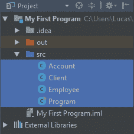

删除我们没有使用的类 / 创建缺失的类。除了普通员工，银行还有经理这样的职位。他们拥有其他员工相同的数据，加上额外的信息，如访问内部系统的密码和所管理的员工数量。

```java
public class Manager {
    String name;
    String id;
    double salary;
    int password;
    int numberOfEmployeesManaged;
    public boolean authenticate(int password) {
        if (this.password == password) {
            System.out.println("Access granted!");
            return true;
        } else {
            System.out.println("Access denied!");
            return false;
        }
    }
}
// ...
```

我们真的需要另一个类吗？嗯，你可能会想：“我们为什么不把所有属性放在 `Employee` 类中，让其中一些成为可选的呢？”这是一种可能，但如果有许多可选属性，类将开始变得很奇怪且不可易读。考虑一下方法：`authenticate()` 在 `Employee` 类中甚至没有意义。所以，我们需要另一个类，但这样做我们就在两个类中复制粘贴了大量相同的代码。想象一下我们必须为不同的职位再创建一个！

在 Java 中，有一种方法连接类，使得其中一个继承另一个所有的一切。在我们的情况下，我们希望 `Manager` 拥有 `Employee` 拥有的一切。

```java
public class Manager extends Employee {
    int password;
    int numberOfEmployeesManaged;
    public boolean authenticate(int password) {
        if (this.password == password) {
            System.out.println("Access granted!");
            return true;
        } else {
            System.out.println("Access denied!");
            return false;
        }
    }
}
```

### 练习集 #8

1) `Employee.java`

```java
public class Employee {
    private String name;
    private double salary;
}
```

`Program.java`

```java
public class Program {
    public static void main(String[] args) {
        Employee e1 = new Employee();
        e1.name = "Lucas";
        e1.salary = 10000;
    }
}
```


这些代码的呈现方式有什么问题？

答案

1) 属性 `name` 和 `salary` 是 `private` 的，因此无法从 `Employee` 类外部直接访问。我们需要 getter 和 setter。

```java
private double totalOfPayments = 0;

public void register(Employee employee) {
    this.totalOfPayments += employee.getRaise();
}

public double getTotalOfPayments() {
    return this.totalOfPayments;
}
```

在我们的程序的某个地方，我们可以调用这些方法：

```java
PaymentRecord record = new PaymentRecord();

Manager employee1 = new Manager();
employee1.setSalary(6000.0);
record.register(employee1); // !!!

Employee employee2 = new Employee();
employee2.setSalary(2000.0);
record.register(employee2);

System.out.println(record.getTotalOfPayments());
```

# 练习题 #91

## 1) 在类 `Car` 和 `Ferrari` 之间表示继承正确方式是什么？

**选项 A**
```java
public class Ferrari {/* ...}
public class Car extends Ferrari {/* ...}
```

**选项 B**
```java
public class Car {/* ...}
public class Ferrari extends Car {/* ...}
```

## 2) 创建一个 `Dog` 类和一个继承 `Dog` 的 `GoldenRetriever` 类。在 `Program` 类中创建实现结果所需的属性和方法：

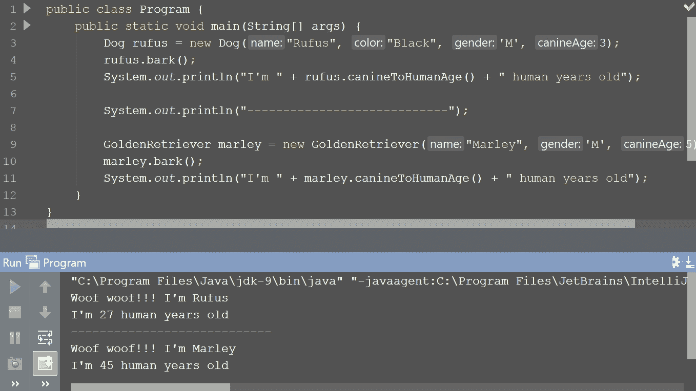

以下是给的一些提示：
- 在 `Dog` 中，创建两个构造函数：一个是包含所有参数并将它们赋值给新对象的构造函数；另一个是内部没有指令的默认构造函数。
- 创建一个 `public int canineToHumanAge()` 方法，返回狗的年龄对应的人类年龄。如果一只狗在一年前出生，那么它就相当于 9 岁（大约值）。
- 创建一个 `public void bark()` 方法，打印出“Woof woof!!! I’m ” + 狗的名字。
- `GoldenRetriever` 的构造函数不接受 `color` 作为参数，因为它会自动将其设置为“Golden”（不要忘记实现这一点）。

## 3) 下面代码有什么什么问题？

**Employee.java**
```java
public class Employee {
    protected double salary;

    public double getRaise() {
        return this.salary * 0.10;
    }
}
```

**Manager.java**
```java
public class Manager extends Employee {
    @Override
    public double getValueOfRaise() {
        return this.salary * 0.15;
    }
}
```

## 4) 一位程序员正在为两个类编写属性：`Person` 和 `Dog`。他/注意到这两个类都拥有 `name`、`age` 和 `gender` 属性。因如此，程序员决定让 `Dog` 类继承 `Person` 类的属性，以节省几行代码。

```java
public class Person {
    String name;
    int age;
    char gender;
}

public class Dog extends Person {// ...}
```

考虑到你学到的关于继承的知识，这合理吗？为什么？

### 答案

1) 当然，是**选项 B**。每一辆 `Ferrari` 都是汽车，但并不是每辆汽车都是 `Ferrari`。而且与普通汽车相比，`Ferrari` 有额外的功能。

2) **Dog.java**
```java
public class Dog {
    String name;
    String color;
    char gender;
    int canineAge;

    Dog() {}

    Dog(String name, String color, char gender, int canineAge) {
        this.name = name;
        this.color = color;
        this.gender = gender;
        this.canineAge = canineAge;
    }

    public int canineToHumanAge() {
        return this.canineAge * 9;
    }

    public void bark() {
        System.out.println("Woof woof!!! I'm " + this.name);
    }
}
```

**GoldenRetriever.java**
```java
public class GoldenRetriever extends Dog {
    GoldenRetriever(String name, char gender, int canineAge) {
        this.name = name;
        this.color = "Golden";
        this.gender = gender;
        this.canineAge = canineAge;
    }
}
```

3) 在 `Manager.java` 中，我们试图重写父类中不存在的 `getValueOfRaise()` 方法。我们实际上是在创建一个新方法，但 `@Override` 注解不允许我们这样做。这个人可能更改了方法的名称但忘记了重构所有出现的地方。

4) 这不是一个好的做法，因为从层级上来说，`Dogs` 和 `People` 之间没有任何关系。狗不是人，人也不是狗。尽管它们有一些共同特征，但它们之间有更多的差异。可以[在此处查阅更多关于继承中某些错误的信息](https://www.thoughtworks.com/pt/insights/blog/composition-vs-inheritance-how-choose)。
