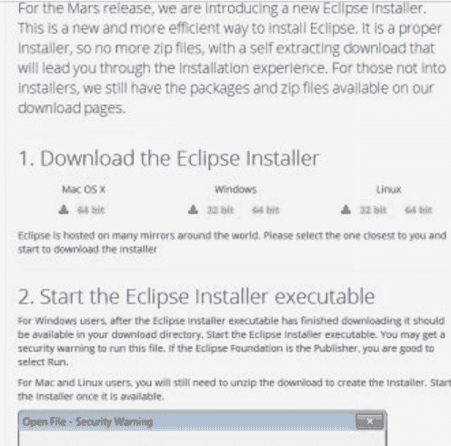
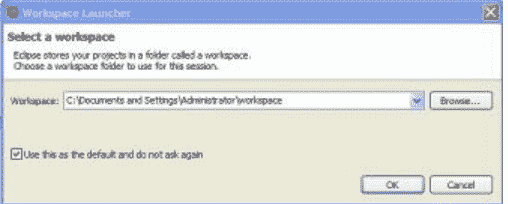
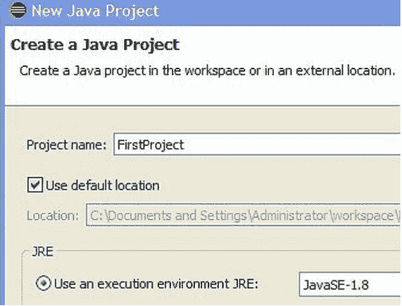
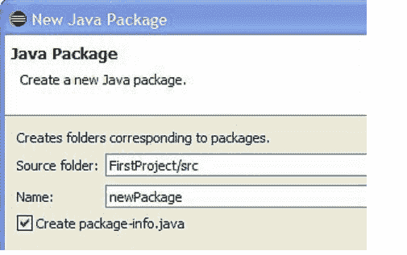
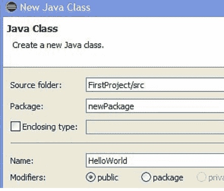
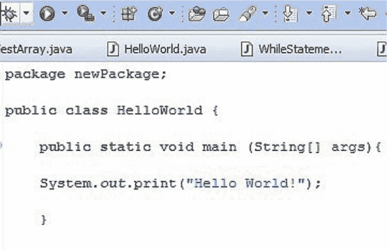
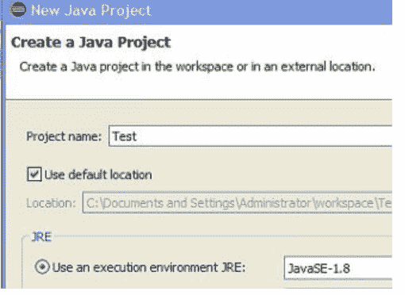
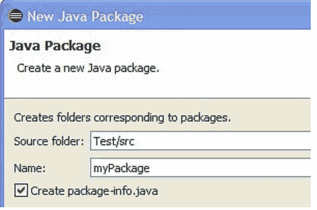
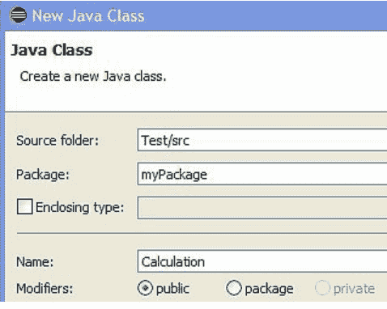
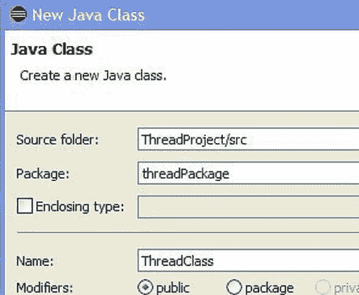

# JAVA：初学者指南，8 小时内快速学会编程！Java 编程语言速成课程，Java 快速启动指南，带实战项目的简单步骤教程！初学者终极指南！

## 关于作者

- Ray Yao:
  - 美国 Zend 认证 PHP 工程师
  - 美国 Sun 认证 JAVA 程序员
  - 美国 Oracle 认证 SCWCD 开发者
  - 美国 CompTIA 认证 A+ 专业人士
  - 美国 Microsoft 认证 ASP.NET 专家
  - 美国 Microsoft 认证 MCP 专业人士
  - 美国 Microsoft 认证 TECHNOLOGY 专家
  - 美国 CompTIA 认证 NETWORK+ 专业人士
  - Linux 命令行
  - JAVA 初学者
  - PHP 初学者
  - JavaScript 初学者
  - C++ 初学者
  - AngularJS 初学者
  - JQuery 初学者
  - Python 初学者
  - HTML CSS 初学者
  - C# 初学者
  - Visual Basic 初学者
  - XML 初学者
  - 高级 Java
  - 高级 C++
  - JavaScript 50 个实用程序

## 前言

“JAVA for Beginners” 涵盖了所有核心 JAVA 知识。你可以快速、轻松地学习 JAVA 的完整基础技能。

本书包含了许多实战项目。你可以通过这些实战项目来学习 JAVA 编码。

## 源代码下载

本书提供源代码下载；你可以下载源代码以进行更好的学习，或者将源代码复制到你喜欢的编辑器中测试程序。源代码的下载链接位于书的最后一页。从今天开始编码吧！

## 附录 Java 测试与答案

## 源代码下载

# 第1 小时 开始 JAVA

## 安装 Java

为了创建任何 Java 程序，本地系统需要有可用的 Java 开发环境。

### JDK (也称为 JSDK, Java SE)

JDK (Java 开发工具包) 包含了所有的 Java 库以及所有构建和运行程序所需的工具，可以创建一个 Java 开发环境。

#### 下载 JDK

<http://oracle.com/download> 或 <http://www.oracle.com/java/javase/downloads/index.html>

请点击链接在 Oracle 网站下载最新版本的 JDK。（图1）


#### 在 Oracle 网站下载 JDK

如果你的计算机是 32 位操作系统，请下载 x86 版 JDK；如果你的计算机是 64 位操作系统，请下载 x64 版 JDK。（图2）

| 产品 | 文件大小 | 下载 |
|---|---|---|
| Linux x86 | 154 MB | jdk-8251-linux-x86 |
| Linux x64 | 172 MB | jdk-8251-linux-x64 |
| Mac OS x64 | 227 MB | jdk-8251-macos-x64 |
| Solaris 64-bit | 125 MB | jdk-8251-solaris-x64 |
| Solaris 64-bit | 99 MB | jdk-8251-solaris-sp64 |
| Windows x86 | 181 MB | jdk-8251-windows-x86 |
| Windows x64 | 189 MB | jdk-8251-windows-x64 |

（图2）

请在你的计算机上安装最新版本的 JDK。

祝喜！JDK 安装成功，系统已准备好运行 Java 程序！

### IDE (集成开发环境)

IDE (集成开发环境) 用于编写、编辑和运行 Java。IDE 包含了许多 Java 开发工具、编译器和调试器。互联网上有许多优秀的 IDE 可供下载，请通过以下链接下载：

| IDE (编辑器) | 网站 |
|---|---|
| Eclipse | <http://www.eclipse.org> |
| NetBeans | <https://netbeans.org/> |
| DrJava | <http://www.drjava.org/> |
| JEdit | <http://www.jedit.org/> |
| BlueJ | <http://www.bluej.org/> |
| JCreator | <http://www.jcreator.com/> |

请在你的计算机上安装一个编辑器。（本书使用 Eclipse）。

祝喜！IDE 安装成功，从现在起你可以编写、编辑和运行 Java 程序了。

### 什么是 Java？

Java 是一种基于类、面向对象的编程语言，是一种安全、快速且可靠的通用程序，适用于互联网、数据库、手机等各种设备。

### 示例 1.1

```java
public class Hi {
    public static void main(String[] args) {
        System.out.print("Hello World");
    }
}
```

（输出：Hello World）

### 解析

`public class` 是两个关键字；它们用于声明 Java 程序。`Hi` 是程序名。

`public static void main(String[] args) {...}` 用于声明主方法。

`main` 方法包含执行的主程序代码。

`String[] args` 用于手动接受输入。

`System.out.print()` 用于显示或打印。

每个 Java 命令应以分号 (`;`) 结束。

### 运行第一个程序

Eclipse 是流行的 Java IDE（集成开发环境）之一。它用于编写、编辑、调试和运行 Java 程序。

#### 下载 Eclipse 安装器

<http://www.eclipse.org/downloads/>

请点击链接在 Eclipse 网站下载最新版本的 Eclipse 安装器。（图 1）



（图 1：在 Eclipse 网站下载 Eclipse 安装器。）

#### 解压 Eclipse 文件

注意：不需要进行安装，而应该将 Eclipse 解压到你喜欢的目录中。例如，`C:\Eclipse`。请在桌面上为 `eclipse.exe` 创建一个快捷方式。

（重申：Eclipse 不需要安装，但应该解压到某个目录。）

#### 运行 Eclipse

双击 `eclipse.exe` 运行 Eclipse，设置默认工作空间，勾选“使用此项作为默认值且不再询问”，并点击确定，如图 2 和图 3 所示。


（图 2）



（图 3）

#### 编写运行第一个 Java 程序

##### 第 1 步：创建 Java 项目

启动 Eclipse > 文件 > 新建 > Java 项目 > 项目名称 > “FirstProject”

完成。（图 4）



（图 4）

##### 第 2 步：创建包

包用于包含不同类的 Java 文件。不同的包包含不同的 Java 文件。

选择项目 “FirstProject” > 新建 > 包 > 命名 > “newPackage” > 完成。

（图 5）



（图 5）

##### 第 3 步：创建类

选择包 "newPackage" > 新建 > 类 > 命名 > "HelloWorld" > 完成。（图 6）



（图 6）

##### 第 4 步：编写 Java 代码

在 Eclipse 中编写 Java 代码。（图 7）

### 示例 1.2

```java
package newPackage;

public class HelloWorld {
    public static void main(String[] args) {
        System.out.print("Hello World!");
    }
}
```



（图 7：Eclipse 中的 Java 程序）

##### 第 5 步：运行程序

点击工具栏上的白色三角形绿色按钮运行程序，你可以看到输出：（图 8）

### 输出

```
<terminated> HelloWorld
Hello World!
```

（图 8）

恭喜！Eclipse 运行首个 Java 程序成功了！

### Java 注释

```java
//
// /* ...... **/
```

Java 注释用于解释代码，描述这段代码正在做什么。Java 编译器会忽略注释。

`//` 用于单行注释。

`/*...*/` 用于多行注释。

### 示例 1.3

```java
System.out.println("Hello World"); // 显示 "Hello World"
/* System.out.println() 是一个 Java 输出命令，意味着显示或打印。
 */
```

解释：

`// show “Hello World”` 是一个单行注释。

`/* System.out.println() 是一个 Java 输出命令，意味着显示或打印。 */` 是一个多行注释。

### 输出命令

```java
System.out.print(); // 在同一行打印结果。
System.out.println(); // 在不同行打印结果。
```

### 示例 1.4

```java
System.out.print("1 ");
System.out.print("2 ");
System.out.print("3 ");
```

**输出：** 1 2 3

```java
System.out.println("1 ");
System.out.println("2 ");
System.out.println("3 ");
```

### 输出

```
1
2
3
```

### 解释

`System.out.print()` 将在同一行打印结果。

`System.out.println()` 将在不同行打印结果。

### 转义字符

`\` 反斜杠字符可以用于转义字符。

| 转义字符 | 含义 |
|---|---|
| `\n` | 将内容输出到下一行。 |
| `\r` | 产生回车。 |
| `\t` | 产生制表符。 |
| `\'` | 输出单引号。 |
| `\"` | 输出双引号。 |

### 示例 1.5

```java
public class Hi {
    public static void main(String[] args) { // main 函数
        System.out.print("\"Hello World"); // 输出一个双引号
    }
}
```

### 解释

`\"` 输出一个引号。注意 “Hello World” 包含了它。另一个示例：

`System.out.print("Hello World");`

### Java 关键字

某些单词仅供 Java 语言本身使用。它们可能不能用作标识符。

| abstract | boolean |
|---|---|
| break | byte |
| case | catch |
| default | do |
| else | extends |
| finally | for |
| interface | implements |
| native | protected |
| public | return |
| static | switch |
| this | throw |
| void | while |

### 运算符

| 运算符 | 含义 |
|---|---|
| `+` | 加法 |
| `-` | 减法 |
| `*` | 乘法 |
| `/` | 除法 |
| `%` | 取模 |
| `++` | 递增 |
| `--` | 递减 |

### 逻辑运算符

| 运算符 | 含义 |
|---|---|
| `&&` | 与 |
| `||` | 或 |
| `!` | 非 |

### 赋值运算符

| 运算符 | 示例 | 解释 |
|---|---|---|
| `+=` | `x += y` | `x = x + y` |
| `-=` | `x -= y` | `x = x - y` |
| `*=` | `x *= y` | `x = x * y` |
| `/=` | `x /= y` | `x = x / y` |
| `%=` | `x %= y` | `x = x % y` |

### 示例 1.11

```java
int x=200; int y=100;
x+=y; System.out.print(x);
x-=y; System.out.print(x);
x/=y; System.out.print(x);
x%=y; System.out.print(x);
```

### 解析

```java
x+=y; // x=x+y, x=200+100, 输出 300.
x-=y; // x=x-y, x=200-100, 输出 100.
x/=y; // x=x/y, x=200/100, 输出 2.
x%=y; // x=x%y, x=200%100, 输出 0.
```

### 比较运算符

| 运算符 | 含义 |
|---|---|
| `>` | 大于 |
| `<` | 小于 |
| `>=` | 大于等于 |
| `<=` | 小于等于 |
| `==` | 等于 |
| `!=` | 不等于 |

使用比较运算符后，结果将为 `true` 或 `false`。

### 示例 1.12

```java
int x=200; int y=100;
boolean result1=(x>y); System.out.print(result1);
boolean result2=(x<=y); System.out.print(result2);
boolean result3=(x!=y); System.out.print(result3);
```

### 解析

```java
x>y // 测试 200>100, 输出 true.
x<=y // 测试 200<=100, 输出 false.
x!=y // 测试 200!=100, 输出 true.
```

### 条件运算符

条件运算符的语法如下所示：

```java
(test-expression) ? (如果为真则执行此操作) : (如果为假则执行此操作);
```

`(test-expression)` 例如 `a<b`、`x!=y`、`m==n` 等。

### 示例 1.13

```java
int a=100; int b=200;
String result1 = (a<b) ? "apple" : "banana";
System.out.print(result1);
// 输出: apple
```

### 示例 1.14

```java
int a=100; int b=200;
String result2 = (a>b) ? "apple" : "banana";
System.out.print(result2);
// 输出: banana
```

### 解析

如果测试表达式返回 `true`，则输出“apple”。

如果测试表达式返回 `false`，则输出“banana”。

## 动手项目：计算

### 在 Eclipse 中编写并运行 Java 程序

#### 第 1 步：创建 Java 项目

启动 Eclipse > 文件 > 新建 > Java 项目 > 项目名称 = “Test” > 完成。

图 1)



(图 1)

#### 第 2 步：创建包

包用于包含各种类别的 Java 文件。不同的包包含不同的 Java 文件。

选择项目 “Test” > 新建 > 包 > 命名 > “myPackage” > 完成。

图 2)



(图 2)

#### 第 3 步：创建类

选择包 "myPackage" > 新建 > 类 > 命名 > "Calculation" > 完成。

(图 3)



(图 3)


### 示例 1.11

```java
int x=200; int y=100;
x+=y; System.out.print(x);
x-=y; System.out.print(x);
x/=y; System.out.print(x);
x%=y; System.out.print(x);
```

### 解析：

```java
x+=y; // x=x+y, x=200+100, 输出 300.
x-=y; // x=x-y, x=200-100, 输出 100.
x/=y; // x=x/y, x=200/100, 输出 2.
x%=y; // x=%y, x=200%100, 输出 0.
```

### 比较运算符

| 运算符 | 含义 |
| --- | --- |
| > | 大于 |
| < | 小于 |
| >= | 大于等于 |
| <= | 小于等于 |
| == | 等于 |
| != | 不等于 |

使用比较运算符后，结果将为 `true` 或 `false`。

### 示例 1.12

```java
int x=200; int y=100;
boolean result1=(x>y); System.out.print(result1);
boolean result2=(x<=y); System.out.print(result2);
boolean result3=(x!=y ); System.out.print(result3);
```

### 解析：

```java
x>y // 测试 200>100, 输出 true.
x<=y // 测试 200<=100, 输出 false.
x!=y // 测试 200!=100, 输出 true.
```

### 条件运算符

条件运算符的语法如下所示：

```java
(test-expression) ? (如果为真则执行此操作) : (如果为假则执行此操作);
```

`(test-expression)` 例如 `a<b`, `x!= y`, `m==n` 等。

### 示例 1.13

```java
int a=100; int b=200;
String result1 = (a<b) ? "apple" : "banana";
System.out.print ( result1);
(输出: apple)
```

### 示例 1.14

```java
int a=100; int b=200;
String result2 = (a>b) ? "apple" : "banana";
System.out.print ( result2 );
(输出: banana)
```

### 解析：

如果测试表达式返回 `true`，则输出“apple”。

如果测试表达式返回 `false`，则输出“banana”。

### 动手项目：计算

### 在 Eclipse 中编写并运行 Java 程序

#### 第 1 步：创建 Java 项目

启动 Eclipse > 文件 > 新建 > Java 项目 > 项目名称 = “Test” > 完成。

图 1)


(图 1)

#### 第 2 步：创建包

包用于包含各种类别的 Java 文件。不同的包包含不同的 Java 文件。

选择项目 “Test” > 新建 > 包 > 命名 > “myPackage” > 完成。

图 2)


(图 2)

#### 第 3 步：创建类

选择包 "myPackage" > 新建 > 类 > 命名 > "Calculation" > 完成。

(图 3)


(图 3)

#### 第 4 步：编写 Java 代码

在 Eclipse 中编写 Java 代码。

```java
package myPackage;
public class Calculation{
public static void main (String args[] ){
    int a = 100, b = 5; // 定义两个变量
    int c = a/b*10; // 计算
    System.out.print("C = " + c); // 输出 "C" 的值
}
}
```

#### 第 5 步：运行程序

点击工具栏中的绿色三角形按钮运行程序，你可以看到输出：

输出：

C = 200

**解析：** `int c = a/b*10;` 计算了该表达式并将结果赋值给变量 `c`。

# 第 2 小时

## 语句

### if 语句

```java
if ( 测试-表达式 ) { // 如果为真则执行此操作; }
```

“if 语句”仅在指定条件为真时执行 `{ ... }` 内部的代码，如果条件为假，则不执行 `{...}` 内部的任何代码。

### 示例 2.1

```java
public class TryClass{
public static void main (String [ args){
  int a=200;
  int b=100;
  if (a>b) { // 如果为真，运行下一条命令
    System.out.print ( "a is greater than b.");
  }
}
(输出: a is greater than b.)
```

### 解析：

`(a>b )` 是一个测试表达式，即 `(200>100)`，如果返回真，它将执行 `{ }` 内部的代码；如果为假，则不会执行 `{ }` 内部的代码。

### if-else 语句

```java
if ( 测试-表达式) { // 如果为真则执行此操作; }
else { // 如果为假则执行此操作; }
```

“if...else 语句”在条件为真时运行某些代码，在条件为假时运行另一部分代码。

### 示例 2.2

```java
public class TryClass{
    public static void main (String [ args){
    int a=100; int b=200;
    if (a>b) { // 如果为真，执行此操作
        System.out.print ( "a is greater than b.");
    }
}
```

*(注：原文 2.2 示例内容存在错误，此处仅翻译原文可见文本)*


```java
int a=100; int b=200;
String result2 = (a>b) ? "apple" : "banana";
System.out.print ( result2 );
(输出: banana)
```

### 解析

如果测试表达式返回 `true`，则输出“apple”。

如果测试表达式返回 `false`，则输出“banana”。

### 动手项目：计算

### 在 Eclipse 中编写并运行 Java 程序

#### 第 1 步：创建 Java 项目

启动 Eclipse > 文件 > 新建 > Java 项目 > 项目名称 = “Test” > 完成。

图 1)


(图 1)

#### 第 2 步：创建包

包用于包含各种类别的 Java 文件。不同的包包含不同的 Java 文件。

选择项目 “Test” > 新建 > 包 > 命名 > “myPackage” > 完成。

图 2)


(图 2)

#### 第 3 步：创建类

选择包 "myPackage" > 新建 > 类 > 命名 > "Calculation" > 完成。

(图 3)


(图 3)

#### 第 4 步：编写 Java 代码

在 Eclipse 中编写 Java 代码。

```java
package myPackage;
public class Calculation{
    public static void main (String args[] ){
        int a = 100, b = 5; // 定义两个变量
        int c = a/b*10; // 计算
        System.out.print("C = " + c); // 输出 "C" 的值
    }
}
```

#### 第 5 步：运行程序

点击工具栏中的绿色三角形按钮运行程序，你可以看到输出：

输出：

C = 200

**解析：** `int c = a/b*10;` 计算了该表达式并将结果赋值给变量 `c`。

# 第 2 小时

## 语句

### if 语句

```java
if ( 测试-表达式 ) { // 如果为真则执行此操作; }
```

“if 语句”仅在指定条件为真时执行 `{ ... }` 内部的代码，如果条件为假，则不执行 `{...}` 内部的任何代码。

### 示例 2.1

```java
public class TryClass{
    public static void main (String [ ] args){
        int a=200;
        int b=100;
        if (a>b) { // 如果为真，运行下一条命令
            System.out.print ( "a is greater than b.");
        }
    }
}
(输出: a is greater than b.)
```

### 解析

`(a>b )` 是一个测试表达式，即 `(200>100)`，如果返回真，它将执行 `{ }` 内部的代码；如果为假，则不会执行 `{ }` 内部的代码。

### if-else 语句

```java
if ( 测试-表达式) { // 如果为真则执行此操作; }
else { // 如果为假则执行此操作; }
```

“if...else 语句”在条件为真时运行某些代码，在条件为假时运行另一部分代码。

### 示例 2.2

```java
public class TryClass{
    public static void main (String [ ] args){
        int a=100; int b=200;
        if (a>b) { // 如果为真，执行此操作
            System.out.print ( "a is greater than b.");
        }
    }
}
```

### 布尔表达式

| If ( 布尔表达式 ) { 语句 } |
| :--- |
| while ( 布尔表达式 ) { 语句 } |

布尔表达式应该是一个测试表达式。例如：`a>b`; `x<=y`; `m!=n`; 它不能仅仅是一个变量。

### 示例 2.9

```java
public class TryClass{
    public static void main (String [ ] args) {
        int num=10;
        if ( num ) //错误！因为 "num" 不是布尔表达式
            System.out.print("No good");
        }
        while ( num ) { //错误！因为 "num" 不是布尔表达式
            System.out.print("No good");
        }
    }
}
```

### 解释

`if( num )` 和 `while ( num )` 不是正确的代码，因为括号 `( )` 应该是一个布尔表达式，例如，`if (num==10)` 和 `while(num<10)` 是正确的！

### 动手项目：运行 100 次

### While 语句程序

启动 Eclipse > 选择 "myPackage" > new > class > name > WhileStatement > Finish（完成）。

在 Eclipse 中编写以下代码。

```java
package myPackage;
public class WhileStatement {
    public static void main(String[ ] args) {
        int n = 1;
        int sum = 0;
        while(n <= 100){ //  100 次
            sum += n; // sum = sum + n
            n++;
        }
        System.out.println("Sum = " + sum);
    }
}
```

点击工具栏中的白色三角形绿色按钮运行程序并查看输出：

### 输出

Sum = 5050

### 解释

`n<=100` 是一个测试表达式，如果条件为真，代码将循环少于 100 次，直到计数器达到 100，然后条件为假，代码将停止运行。

`sum += n;` 等同于 `sum = sum + n`。

`n++;` 意味着 `n` 在每次循环中增加 1。

# 第 3 小时

## 数组与数学

### 创建数组 (1)

数组是一个变量，可以包含多个值。

创建数组的第一种方法如下：

```java
int array-name[] = {"value0", "value1", "value2", ...};
```

### 示例 3.1

```java
int myarray[] = { 10,20,30,40 }; // 创建数组
```

### 解释

上述代码创建了一个名为“array”的数组，它有四个元素：

第一个元素是 `myarray[0]`，值为 10。键（Key）为 0。

第二个元素是 `myarray[1]`，值为 20。键为 1。

第三个元素是 `myarray[2]`，值为 30。键为 2。

第四个元素是 `myarray[3]`，值为 40。键为 3。

在数组中，Key 的别称是“index”（索引）。Index 的别称是“key”（键）。

注意索引从 0 开始。

### 创建数组 (2)

数组是一个变量，可以包含多个值。

创建数组的第二方法如下：

```java
int array-name[ ] = new int [ 元素数量 ];
int array-name[index0] = "value0";
int array-name[index1] = "value1";
int array-name[index2] = "value2";
```

### 示例 3.2

```java
int myArray[] = new int[3]; // 创建数组
myArray[0] = 100;
myArray[1] = 200;
myArray[2] = 300;
```

### 解释

上述代码创建了一个名为“myArray”的数组，它有三个元素：`myArray [0]`、`myArray [1]`、`myArray [2]`。它们的索引是 0, 1 和 2。它们的值是 100, 200 和 300。注意索引数字从 0 开始。

### 数组长度

```java
array-name.length;
```

`array-name.length` 可以返回数组的元素总数。

### 示例 3.3

```java
public class TryClass{
    public static void main (String [ ] args){
        int arr[] = {10,20,30}; // 创建数组 "arr"
        int num = arr.length; // 获取数组的长度
        System.out.print ( num );
    }
} ( 输出: 3 )
```

### 解释

`arr.length;` 用于获取数组“arr”的长度，即元素的总数。

注意 `string.length()` 是用于获取字符串的长度，而不是数组元素的长度。

### 元素值

| 语法 | 说明 |
| :--- | :--- |
| `int value = array[index];` | 从元素中获取值。 |
| `int array[index] = value;` | 给元素设置值。 |

### 示例 3.4

```java
int arr[] = {10,20,30, 40, 50};
int value = arr[index]; // 从元素中获取值。
System.out.println( value );
( 输出: 30 )
```

### 示例 3.5

```java
int arr[] = {10,20,30, 40, 50};
arr[index] = value; // 给元素设置值。
```

### 解释

`arr[index];` 获取数组“arr”的值。

`arr[index] = value;` 给元素设置值。

### 数组排序

```java
Arrays.sort(array);
```

`Arrays.sort(array);` 对数组进行排序。

### 示例 3.6

```java
import java.util.Arrays;
public class TryClass {
    public static void main (String [ ] args) {
        int arr[] = {50, 40, 20, 10, 30};
        Arrays.sort(arr);
        System.out.println(Arrays.toString(arr));
    }
}
( 输出: [10, 20, 30, 40, 50] )
```

### 解释

`Arrays.sort(arr)` 对数组进行排序。

`Arrays.toString(arr)` 将数组转换为字符串以便打印。

### 示例 3.10

```java
public class TryClass{
    public static void main(String [ ] args){
        int num = 4;
        System.out.println("Square number is "+Math.pow(num,2) );
        System.out.println("Square root is "+Math.sqrt(num) );
    }
}
```

( 输出: 平方数是 16.0

平方根是 2.0 )

### 解释

`Math.pow(num,2)` 返回第一个参数“4”的第二个参数“2”的幂次方，结果为 16.0。

`Math.sqrt(num)` 返回参数“4”的平方根，结果为 2.0。

### Math.PI & random( )

| 成员 | 说明 |
| :--- | :--- |
| `Math.PI` | 存储圆周率 pi 值的常量。 |
| `Math.random()` | 生成一个 0.0 到 1.0 之间的数字。 |

### 示例 3.11

```java
public class TryClass{
    public static void main (String [ ] args){
        double pi = Math.PI;
        double ran = Math.random();
        System.out.println("The PI value is " + pi);
        System.out.println("The random number is " + ran);
    }
}
```

( 输出: PI 值为 3.141592653589793

随机数是 0.168693228 )

### 解释

`Math.PI` 的值是 3.1415926535389793。

`Math.random()` 生成一个 0.0 到 1.0 之间的随机数，在此处的结果是 0.16869328。

# 动手实践项目：从零开始

# 使用循环语句为数组赋值

启动 Eclipse > 选择 “myPackage” > new > class > name > TestArray > Finish。

在 Eclipse 中编写以下代码。

点击工具栏上的白色三角形绿色按钮运行程序并查看输出：

### 输出

0 1 2 3 4 5 6 7 8 9

### 解释

`myArray = new int[10];` 创建了一个包含 10 个元素的数组“myArray”。

`for (int n = 0; n < myArray.length; n++)` 是一个循环语句。

`int n = 0` 将变量 `n` 初始化为 0。

`n < myArray.length` 设置循环的次数。

循环次数取决于 myArray 的长度。

`n++` 意味着变量 `n` 在每次循环中增加 1。

`myArray[n] = n;` 将 `n` 的值赋值给 myArray。

# 第 4 小时

## 字符串处理

### 字符串长度

String 由双引号内的一个或多个字符组成。`String.length()` 可以获取字符串的长度。

```java
String str1 = "This is a string"; String str2 = "null";
int length = str1.length();
```

“This is a string”是一个字符串。“null”是一个字符串。

`int length = String.length();` 返回字符串的长度。

### 示例 4.1

```java
public class TryClass{
    public static void main (String [ ] args){
        String str = "This is a string";
        int length = str.length(); // 获取字符串长度
        System.out.println("The size of string is " + length);
    }
}
```

( 输出: 字符串的大小为 16 )

### 解释

`str.length()` 返回字符串的长度。

注意 `array.length` 返回的是数组的长度，不带括号。

### 字符串连接

`+` 可以连接两个字符串。

`concat()` 可以连接两个字符串。

```java
str = str1 + str2;
str = str1.concat(str2);
```

### 示例 4.2

```java
String str1 = "Very"; String str2 = "Good";
System.out.print(str1 + str2); //连接两个字符串
( 输出: Very Good )
```

```java
String str1 = "Very"; String str2 = "Good";
System.out.print(str1.concat(str2)); //连接两个字符串
( 输出: Very Good )
```

### 解释

`str1 + str2` 或 `str1.concat(str2)` 可以连接 str1 "Very" 和 str2 "Good"，并变成一个新的字符串 "Very Good"。

### 字符串比较

`str1.equals(str2);` 可以比较两个字符串的值，返回 true 或 false。

```java
str1.equals(str2);
```

### 示例 4.3


```java
public class TryClass {
    public static void main(String[] args) {
        String str1 = "Good", str2 = "Good";
        System.out.print(str1.equals(str2));
        System.out.print("Good".equals("Good"));
    }
}
```

(输出: true true)

### 解释

`str1.equals(str2)` 或 `"Good".equals("Good")` 比较字符串，如果两个字符串的值相同，则返回 `true`。

### 提取字符

`charAt(int index)` 返回位于字符串索引处的字符。

字符串索引从 0 开始。

```java
char result = charAt(int index);
```

### 示例 4.4

```java
public class TryClass {
    public static void main(String args[]) {
        String str = "Very Good";
        char result = str.charAt(5); // 查找第5个字符
        System.out.println(result);
    }
}
```

(输出: G)

### 解释

`str.charAt(5)` 在字符串 "Very Good" 中查找第 5 个字符。注意字符串索引从 0 开始。

第 5 个字符是 "G"。

### 定位字符

`indexOf()` 返回指定子串在此字符串中首次出现的索引。如果它没有作为子串出现，则返回 -1。

```java
int index = string.indexOf(substring);
```

### 示例 4.5

```java
public class TryClass {
    public static void main(String args[]) {
        String str = "Very Good";
        System.out.println(str.indexOf("y")); // 获取 "y" 的索引
    }
}
```

(输出: 3)

### 解释

`indexOf("y")` 在字符串 "Very Good" 中查找 "y" 的索引。字符串索引从 0 开始。

"y" 的索引是 3。

### 提取子字符串

`substring()` 返回从起始索引到结束索引的字符串子串。

```java
String.substring(int beginIndex, int endIndex);
```

### 示例 4.6

```java
public class TryClass {
    public static void main(String args[]) {
        String str = "Very Good";
        System.out.println(str.substring(5, 7)); // 从索引 5 到 7 提取子串
    }
}
```

(输出: Go)

### 解释

`str.substring(5, 7)` 从字符串 "Very Good" 中提取索引 5 到 7 的子串。结果是 "Go"。

## 大小写转换

`String.toUpperCase()` 返回字符串的大写形式。

`String.toLowerCase()` 返回字符串的小写形式。

| 方法 | 说明 |
| :--- | :--- |
| `String.toUpperCase()` | 返回大写字符串 |
| `String.toLowerCase()` | 返回小写字符串 |

### 示例 4.7

```java
public class TryClass {
    public static void main(String args[]) {
        String str = "Very Good";
        System.out.println(str.toUpperCase());
        System.out.println(str.toLowerCase());
    }
}
```

(输出: VERY GOOD)

(输出: very good)

### 字符替换

`str.replace()` 可以将字符串中的旧字符替换为新字符，并返回一个新的字符串。

```java
str.replace(oldCharacter, newCharacter);
```

### 示例 4.8

```java
public class TryClass {
    public static void main(String args[]) {
        String str = "Very Good";
        System.out.println(str.replace("Good", "Well")); // 将 "Good" 替换为 "Well"
    }
}
```

(输出: Very Well)

## 字符串类型转换

`Integer.toString(number)` 可以将数字转换为字符串。

`String.trim()` 可以移除字符串开头或结尾的空格。

```java
Integer.toString(number);
String.trim();
```

### 示例 4.9

```java
public class TryClass {
    public static void main(String args[]) {
        int num = 169;
        String str = "  Good  "; // 注意空格
        String str1 = Integer.toString(num); // 转换为字符串
        String str2 = str.trim(); // 移除空格
        System.out.println(str1 + " is a String");
        System.out.println(str2 + " is trimmed");
    }
}
```

(输出: 169 is a String

Good is trimmed)

### 解释

`Integer.toString(num)` 将整数 169 转换为字符串 "169"。

`str.trim()` 将 " Good " 转换为字符串 "Good"。

### StringBuffer

`StringBuffer` 表示可以动态更改的字符串。如果字符串值在程序运行期间可能会发生变化，请使用 `StringBuffer`，而不是 `String`。

```java
StringBuffer str = new StringBuffer();
str.insert();
str.append();
str.reverse();
```

```java
StringBuffer sb = new StringBuffer("abcde");
sb.insert(2, "123"); // Output: abc123de
sb.append("456"); // Output: abc123de456
sb.reverse(); // Output: 654ed321cba
```

### 解释

`StringBuffer sb = new StringBuffer("abcde")` 创建了一个对象 `sb`，其值为 "abcde"。

`sb.insert(2, "123")` 在索引为 2 的位置插入 "123"。

`sb.append("456")` 在字符串末尾追加 "456"。

`sb.reverse()` 反转字符串的顺序。

## 动手项目：判断对与错

## 比较字符串值

启动 Eclipse > 选择 "myPackage" > New > Class > Name > TwoStrings > Finish（完成）。

在 Eclipse 中编写以下代码。

```java
package myPackage;

public class TwoStrings {
    public static void main(String[] args) {
        String s1, s2, s3, s4;

        s1 = "C++ in 8 Hours";
        s2 = "C++ in 8 Hours";
        s3 = "Python in 8 Hours";
        s4 = s2; // 赋值字符串值
        System.out.println(s1.equals(s2));
        System.out.println(s1.equals(s3));
        System.out.println(s3.equals(s4));
    }
}
```

点击工具栏中的白色三角形按钮运行程序并查看输出：

### 输出

true

false

false

### 解释

`String s1, s2, s3, s4` 声明了四个字符串变量。

`s1.equals(s2)` 比较两个字符串的值，如果两个字符串的值相同，则返回 `true`。

# 第 5 小时

## 方法、类与对象

### 方法

方法是可以重复使用的代码块。

```java
type methodName() { ... }; // 声明一个方法
methodName(); // 调用方法
```

### 示例 5.1

```java
public class TryClass {
    public static void main(String args[]) {
        myMethod(); // 调用 "myMethod"
    }

    static void myMethod() { // 声明方法
        System.out.print("This is a method ");
    }
}
```

(输出: This is a method)

### 解释

`myMethod()` 调用了一个方法，并输出 "This is a method"。

`public static void myMethod()` 声明方法名 `myMethod`。

`public` 意味着它可以被任何类访问。

`static` 意味着它是一个类方法。

`void` 是一种返回类型，意味着没有返回值。

### 方法与参数

方法有时带有参数。

```java
type methodName(argument) { ... };
methodName(arg);
```

### 示例 5.2

```java
public class TryClass {
    public static void main(String[] args) {
        myMethod("ABC"); // 调用 myMethod 并传递参数
    }

    static void myMethod(String argument) { // 声明方法
        System.out.print("This is a method " + argument);
    }
}
```

(输出: This is a method ABC)

### 解释

`public static void myMethod(String argument) { ... }` 声明了一个带有参数的方法。

`myMethod("ABC")` 调用方法 `myMethod(String argument) { ... }`，并向其传递参数 "ABC"。接收到参数 "ABC" 后，它输出 "This is method ABC"。

### 返回值

`return value` 可以向调用者返回一个值。

```java
type methodName(argument) { return value; };
methodName(arg);
```

### 示例 5.3

```java
public class TryClass {
    public static void main(String[] args) {
        int num = 10;
        System.out.print("The number is " + myMethod(num));
    }

    static int myMethod(int arg) {
        return arg; // 将值传回给调用者
    }
}
```

(输出: The number is 10)

### 解释

`myMethod(num)` 调用了一个方法。

`int myMethod(int arg) { ... }` 声明了一个方法。

`int` 是返回类型。

`return arg` 将值 `arg` 返回给调用者。

输出是 "The number is 10"。

### 类定义

类是对象的模板，用于创建对象。

```java
class ClassName {
    type variable;
    type function() { }
}
```

`class ClassName` 定义了一个类。

`type variable` 在类中定义了一个变量。

`type function() { }` 在类中定义了一个函数（在 Java 中称为方法）。

### 示例 5.4

```java
public class Color { // 声明一个类
    String c1, c2; // 变量
    void brightness() // 方法
}
```

### 解释

上面的代码定义了一个名为 `Color` 的类，两个名为 `c1` 和 `c2` 的变量，以及一个名为 `brightness` 的方法。

### 对象声明

对象是类的实例。

```java
obj = new ClassName();
obj.variable;
obj.functionName();
```

`obj = new ClassName()` 为类创建了一个名为 `obj` 的对象。

`obj.variable` 访问变量。

`obj.functionName()` 调用方法。

### 示例 5.5

```java
Color obj = new Color(); // 创建对象 "obj"
obj.c1 = "yellow"; // 变量
obj.c2 = "purple"; // 变量
obj.brightness(); // 方法
```

### 解释

`obj = new Color()` 创建了一个名为 `obj` 的对象，然后是变量 `c1` 和 `c2`。

`obj.brightness()` 调用了函数 `brightness()`。

### 类与对象

```java
public class Color { // 定义一个类
    String c1, c2;

    void brightness() {
        System.out.println("This flower is " + c1);
        System.out.println("That flower is " + c2);
    }

    public static void main(String[] args) {
        Color obj = new Color(); // 创建对象
        obj.c1 = "yellow";
        obj.c2 = "purple"; // 变量
        obj.brightness(); // 方法
    }
}
```

输出:

This flower is yellow.

That flower is purple.

### 解释

`public class Color { }` 定义了一个类。

`Color obj = new Color()` 创建了一个对象。

### 构造函数

构造函数用于初始化变量。构造函数名与类名相同。

```java
class ClassName {
    ClassName() { ... } // 用于初始化的构造函数
}
```

`class ClassName { ... }` 定义了一个类。

`ClassName() { ... }` 声明了一个构造函数。

### 示例 5.6

```java
public class Color { // 创建一个类
    String c1, c2;
    Color() { c1 = "yellow"; c2 = "purple"; } // 构造函数
}
```

### 解释

`Color() { c1 = "yellow"; c2 = "purple"; }` 是一个构造函数。它将变量 `c1` 初始化为 "yellow"，`c2` 初始化为 "purple"。创建对象时，会自动调用构造函数。

### 构造函数示例

```java
public class Color { // 定义一个类
    String c1, c2;
    Color() { c1 = "yellow"; c2 = "purple"; } // 构造函数

    void brightness() {
        System.out.println("This flower is " + c1);
        System.out.println("That flower is " + c2);
    }

    public static void main(String[] args) {
        Color obj = new Color(); // 创建对象，调用构造函数
        obj.brightness();
    }
}
```

### 输出

This flower is yellow.

That flower is purple.

### 解释

`Color() { c1 = "yellow"; c2 = "purple"; }` 创建了一个构造函数。

`Color obj = new Color()` 创建了一个对象并自动调用构造函数。

### 重载

重载意味着类中有两个或多个同名方法，它们的参数不同。

### 示例 5.7


```java
package correctPackage;

class Color {
    String x, y; // 声明一个类
    Color(String a, String b) { // 重载
        x = a;
        y = b;
    }
    Color() { // 重载
        x = "yellow ";
        y = "purple";
    }

    public static void main(String args[]) {
        Color obj1 = new Color("green ", "orange ");
        Color obj2 = new Color();
        System.out.println(obj1.x + obj1.y);
        System.out.println(obj2.x + obj2.y);
    }
    /* 输出:
    green orange
    yellow purple */
}
```

### 解释

在这个类中，有两个名为 `Color()` 的方法，参数不同，它们被称为“重载”。

### 解释

在上方，当 `obj.test(10)` 调用 `test() { }` 方法时，`this` 代表对象 `obj`。

## “this” 关键字 (2)

`this` 可以表示另一个同名的构造函数。

### 示例 5.9

```java
class MyClass {
    int x, y;
    MyClass() {
        this(100, 200); // "this" 表示 MyClass(int a, int b) {
    }
    MyClass(int a, int b) {
        x = a;
        y = b;
    }
}
```

### 解释

`this(100, 200)` 表示另一个同名的构造函数 `MyClass(int a, int b) { }`。

注意，`this` 不能表示非构造方法。

### 实例变量与局部变量

实例变量定义在类中。它在当前类中有效。

局部变量定义在方法中。它在当前方法中有效。

### 示例 5.10

```java
class Point {
    int x = 100, y = 200; // 实例变量
    void test() {
        int x = 1, y = 2; // 局部变量
    }
}
```

### 解释

`int x = 100, y = 200;` 在类内部定义了实例变量。

`int x = 1, y = 2;` 在方法内部定义了两个局部变量。

## 动手项目：联系信息

### 步骤

1. 启动 Eclipse
2. 选择 `myPackage`
3. 执行 `new` > `class` > `name` > `Message`
4. 完成

在 Eclipse 中编写以下代码：

```java
package myPackage;

public class Message { // 声明一个类
    String name, email, phone;

    public Message(String theName, String theEmail, String thePhone) { // 声明一个用于初始化的构造函数
        name = theName;
        email = theEmail;
        phone = thePhone;
    }

    void displayEmail() { // 声明一个函数
        System.out.println("Email:" + email);
    }

    void displayPhone() { // 声明一个函数
        System.out.println("Phone:" + phone);
    }

    public static void main(String[] args) { // 主函数
        Message JACK = new Message("JACK", "JACK@xxx.xxx", "678-xxx-9999"); // 创建对象 JACK，并调用构造函数
        System.out.println(JACK.name);
        JACK.displayEmail(); // 调用一个函数

        Message ANDY = new Message("ANDY", "ANDY@xxx.xxx", "567-xxx-0000"); // 创建对象 ANDY，并调用构造函数
        System.out.println(ANDY.name);
        ANDY.displayPhone(); // 调用一个函数
    }
}
```

点击工具栏中的白色三角形绿色按钮运行并查看输出：

### 输出

```text
JACK
Email:JACK@xxx.xxx
ANDY
Phone:567-xxx-0000
```

### 解释

- `public class Message` 定义了一个类 `Message`。
- `public Message(...)` 定义了一个构造函数，初始化了三个字符串变量。
- `Message JACK = new Message(...)` 创建了对象 `JACK`，并自动调用构造函数来初始化三个字符串变量。
- `JACK.name` 引用了变量 `name`。
- `JACK.displayEmail()` 调用了函数 `displayEmail()`。
- `Message ANDY = new Message(...)` 创建了对象 `ANDY`，并自动调用构造函数来初始化三个字符串变量。
- `ANDY.name` 引用了变量 `name`。
- `ANDY.displayPhone()` 调用了函数 `displayPhone()`。

# 第 6 小时

## 继承与修饰符

### 继承

一个类可以被子类扩展。

```java
class sub-class extends parent-class;
```

`extends` 用于子类扩展父类。

### 示例 6.1

```java
class parent_class { // 父类
    // 在此处定义变量；
    // 在此处定义方法；
}

class sub_class extends parent_class { // 子类
    // 在此处定义变量；
    // 在此处定义方法；
}
```

### 解释

`class sub_class extends parent_class` 意味着子类继承了一个父类（也称为超类）。

子类可以访问父类中的变量和方法，但不能访问父类中的私有变量和私有方法。

### “super” 关键字

在子类中，`super` 用于调用父类的构造函数。

```java
super(argument);
```

`super(argument);` 被放在子类构造函数的第一行，用于调用父类的构造函数。

### 示例 6.2

```java
class super_class {
    super_class(int x, int y) { // 构造函数
        this.x = x;
        this.y = y;
    }
}

class sub_class extends super_class {
    sub_class(int x, int y) { // 构造函数
        super(x, y); // 调用父类的构造函数
    }
}
```

### 解释

`super(x, y);` 调用超类中的构造函数。

### 重写

如果方法名和参数相同，子类的方法可以重写超类的方法。

### 示例 6.3

```java
class Super_class {
    int test(int num) { return num; } // 重写
}

class Sub_class extends Super_class {
    int test(int num) { return 10; } // 重写
}

public class Overriding {
    public static void main(String[] args) {
        Sub_class obj = new Sub_class();
        System.out.println(obj.test(20));
    }
}
```

**输出：**

```text
10
```

### 解释

`obj.test(20)` 调用了子类 `Sub_class` 中的 `test(int num)` 方法，因为方法名和参数与超类相同，发生了重写，返回值为 10。

### 重载

如果方法名相同但参数不同，则可以重载方法。

### 示例 6.4

```java
class Color {
    void test() { System.out.println("no argument"); }
    void test(int a) { System.out.println("int argument: " + a); }
    void test(String b) { System.out.println("string argument: " + b); }
}
```


“`JACK.displayEmail();`”调用了函数“`displayEmail()`”。

“`Message ANDY = new Message (.....)`”创建了对象“`ANDY`”，并自动调用构造函数来初始化三个字符串变量。

“`ANDY.name`”引用了变量“`name`”。

“`ANDY.displayPhone();`”调用了函数“`displayPhone()`”。

# 第 6 小时

## 继承与修饰符

### 继承

一个类可以被子类扩展。

```
class sub-class extends parent-class;
```

“`extends`”用于子类扩展父类。

### 示例 6.1

```java
class parent_class{ // 父类
// 在此处定义变量；
// 在此处定义方法；
}
class sub_class extends parent_class{ // 子类
// 在此处定义变量；
// 在此处定义方法；
}
```

### 解释：

“`class sub_class extends parent_class`” 意味着子类继承了一个父类（也称为超类）。

子类可以访问父类中的变量和方法，但不能访问父类中的私有变量和私有方法。

### “super” 关键字

在子类中，“`super`”用于调用父类的构造函数。

```
super ( argument );
```

“`super ( argument );`”被放在子类构造函数的第一行，用于调用父类的构造函数。

### 示例 6.2

```java
class super_class{
super_class (int x, int y){ // 构造函数
this.x=x; this .y=y;
}
}
```

```java
class sub_class extends super_class{
sub_class(int x, int y){ // 构造函数
super ( x,y ); // 调用父类的构造函数
}
}
```

### 解释：

“`super ( x,y);`”调用超类中的构造函数。

### 重写

子类的方法可以重写超类的方法，如果方法名和参数相同。

### 示例 6.3

```java
class Super_class{
    int test(int num ) { return num; } // 重写
}
class Sub_class extends Super_class{
    int test(int num ) { return 10; } // 重写
}
public class Overriding {
    public static void main(String[] args){
        Sub_class obj = new Sub_class();
        System.out.println(obj.test(20));
    }
}
```

(输出：10)

### 解释：

10

“`obj.test(20 )`”调用了“`int test(20 )`”在超类中的方法方法名和参数相同。

### 重载

如果方法名相同但参数不同，则可以重载方法。

### 示例 6.4

```java
class Color{
    void test() { System.out.println("no argument"); }
    void test(int a) { System.out.println("int argument: " + a); }
    void test(String b) { System.out.println("string argument: " + b); }
}
```

### 解释：

“`final void test(){...}`” 定义了一个 final 方法。

“`void test(){...}`” 尝试重写“`final void test(){...}`”，但发生了错误。

### final class

“`final`” 是关键字。

“`final class`” 意味着该类不能被继承。

```
Example 6.10
final class animal { // 声明一个 final 类
// 定义一些变量;
// 定义一些方法;
}
class elephant extends animal { // 错误！无法继承
// 定义一些变量;
// 定义一些方法;
}
```

### 解释:

“`final class animal {...}`” 定义了一个 final 类“animal”，意味着“animal”类不能被继承。

“`class elephant extends animal {...}`” 尝试继承父类“animal”，但发生了错误。

### 多态

多态描述了对不同对象执行不同方法的能力。

### 示例 6.11

```java
class Animal{ // 父类
void cry(){
    System.out.println("crying......");
}
}

class Dog extends Animal{ // 子类
void cry() { // 重写
    System.out.println("Wow, Wow......");
}
}

class Cat extends Animal{ // 子类
void cry() { // 重写
    System.out.println("Meow, Meow......");
}
}

class PolymorphismDemo{
public static void main(String args[]) { // 主函数
    Animal animalVar;

    animalVar = new Dog(); // 创建一个 dog 对象
    animalVar.cry(); // dog 对象调用 cry

    animalVar = new Cat(); // 创建一个 cat 对象
    animalVar.cry(); // cat 对象调用 cry
}
}
```

### 输出:

Wow, Wow......

Meow, Meow......

### 解释:

“`animalVar = new dog()`” 创建了一个 dog 对象，因此，“`animalVar.cry( )`” 调用了子类 Dog 中的方法 cry( )。

“`animalVar = new cat()`” 创建了一个 cat 对象，因此，“`animalVar.cry( )`” 调用了子类 Cat 中的方法 cry()。

### 包与导入 (Package & Import)

```java
package package-name;
import package.class;
```

“`package package-name`” 创建或使用一个包。

“`import package.class`” 导入一个包或其类。

### 示例 6.12 (在 file1 中)

```java
package myPackage; /* 创建一个包含两个类的包 */
class MyClass1 {...}
class MyClass2 {......}
```

### 示例 6.13 (在 file2 中)

```java
package myPackage;   // 使用包 “myPackage”
import myPackage.*;    // 导入 myPackage 的所有类
```

### 解释:

“`package myPackage`” 在 file1.java 中创建一个名为“myPackage”的包，其中包含两个类 MyClass1 和 MyClass2。

“`import myPackage.*`” 从 file1 将包“myPackage”中的任何类导入到 file2。

注意，“`package`”命令必须位于“`import`”命令之上。

### 构建包并导入类

```java
package myPackage; // 构建一个包
import anyClass; // 导入一个类
```

## 示例 6.14

(在 Drive.java 中)

```java
package myPackage; // 创建一个包含类的包
public class Drive{
    public void getDistance(int mph, float time) {
        System.out.println("SPEED:" + mph + " MILES/HOUR");
        System.out.println("TIME:" + time + " HOURS");
        System.out.println("DISTANCE:" + time*mph + " MILES");
    }
}
```

## (在 TestDrive.java 中)

```java
package myPackage; // 使用 "myPackage"
import myPackage.Drive; // 导入 myPackage 中的 Drive 类
public class TestDrive{
    public static void main (String args[] ) {
        Drive myDrive = new Drive();
        myDrive.getDistance(120, 5);
    }
}
```

### 输出:

SPEED: 120 MILES/HOUR

TIME: 5 HOURS

DISTANCE: 600 MILES

### 解释:

“`package myPackage;`” 在 Drive.java 文件中创建了包“myPackage”。

“`import myPackage.Drive;`” 导入了“myPackage”中的类 类。

“`Drive myDrive = new Drive()`” 可以在 TestDrive 文件中创建一个对象“myDrive”，因为 Drive 类已经从 Drive.java 文件导入。

“`myDrive.getDistance(120, 5);`” 调用了 Drive.java 文件中的方法。

注意：“`package`”命令必须位于“`import`”命令之上。

### 动手项目：继承

### Eclipse 继承

启动 Eclipse > 选择 "myPackage" > new > class > 命名为 InheritanceDemo > Finish。

在 Eclipse 中编写以下代码。

```java
package myPackage;
class code1{ // 父类
int x, y;
code1(int a, int b){ // 构造函数
x = a; y = b;
}

class code2 extends code1{ // 子类
code2(int a, int b){ // 构造函数
super(a,b); // 调用父类中的构造函数
}

public class InheritanceDemo {

public static void main(String[] args) { // 主函数
int result;
code2 number = new code2(100, 200); /* 创建一个对象 "number", 并自动调用
2 构造函数 */
result = number.x + number.y;
System.out.println("Sum = " + result);
}
}
```

（注：原文 InheritanceDemo 的逻辑 OCR 文本已截断/不完整，但保留了结构。）

### 解释:

“`animalVar = new dog()`” 创建了一个 dog 对象，因此，“`animalVar.cry( )`” 调用了子类 Dog 中的方法 cry( )。

“`animalVar = new cat()`” 创建了一个 cat 对象，因此，“`animalVar.cry( )`” 调用了子类 Cat 中的方法 cry()。

... (文本根据提供的片段继续)

### 输出：

100

### 解释:

“`int num=100`” 定义了一个默认成员。

“`s.num`” 可以访问同一包中的默认成员。

### 公共成员 (Public Member)

公共成员可以被任何包或任何类访问，尤其是在不同的包中。

### 示例 7.3

不同包中的两个文件如下：

```
(在 MyPackage 的 file1 中)
package myPackage;
public class ParentClass{
    public int num=100; // 这是一个公共成员。
}
```

```
(在 NewPackage 的 file2 中)
package newPackage;
import myPackage.ParentClass;
public class SubClass extends ParentClass{
    public static void main(String[] args) {
        SubClass s=new SubClass();
        System.out.print( s.num ); /** s 引用不同包中的 num，可以！ */
    }
}
```

### 输出：

100

### 解释:

“`public int num=100`” 定义了公共成员。

“`s.num`” 可以访问不同包中的公共成员。

### 私有成员 (Private Member)

私有成员不能被不同的类访问。

示例：

```
class MyClass {
    private MyClass() { // 私有构造函数
        System.out.println("This is a private method!");
    }
public class NewClass{
    public static void main ( String args) {
        MyClass obj = new MyClass ( ); /* 错误！访问私有构造函数 */
    }
}
```

输出：（ 错误信息！ ）

### 解释:

“`private MyClass( )`” 定义了一个私有构造函数 “MyClass”。

“`new MyClass( )`” 尝试调用私有构造函数 “MyClass”，但由于发生错误，因为它们分别位于不同的类中。

### 私有示例 (Private Example)

私有成员可以被同一个类访问。

### 示例:

```
package myPackage;
public class OurClass {
    private int a = 100; // 声明一个私有变量
    private int b = 200; // 声明一个私有变量
    public void accessVariable(){
        System.out.println("a = " + a); // 访问私有变量
        System.out.println("b = " + b); // 访问私有变量
    }
}
public class PrivateExample {
    public static void main ( String args ) {
        OurClass obj = new OurClass(); /* OK，访问默认构造函数 */
        obj.accessVariable();
    }
}
```

### 输出:

a = 100

b = 200

### 受保护成员 (Protected Member)

受保护成员可以被任何子类访问。

### 示例 7.5

不同包中的两个文件如下：

(在 MyPackage 的 file1 中)

```
package myPackage;
public class ParentClass{ // 父类
protected int num=100; // 受保护成员。
}
```

(在 NewPackage 的 file2 中)

```
package newPackage;
import myPackage.ParentClass;
public class SubClass extends ParentClass{ // 子类
public static void main(String[] args) {
SubClass s=new SubClass();
System.out.print ( s.num ); // 访问受保护成员
}
```

### 输出：

100

### 解释:

"`protected int num=100`” 定义了一个受保护成员。

"`s.num`” 可以访问不同包中子类的受保护成员。

受保护成员可以被任何子类访问。

### 接口 (Interface)

接口是一种特殊的类，可以被类实现。接口包含一个或多个空方法，这些方法将由类的方法来实现。

### 示例 7.6

```
interface books { // 定义一个接口
int booknumber(); // 定义一个空方法
}
class eBooks implement books { // 实现接口
public int booknumber() { // 实现该空方法
return 100;
}
```

### 解释:

“`interface books`” 定义了一个接口 “books”。

“`int booknumber()`” 定义了一个空方法 “booknumber”。

“`class eBooks implement books{ }`” 意味着类 “eBooks” 实现接口 “books”。

“`public int booknumber() { }`” 实现 booknumber()。

### 接口示例 (Interface Example)

### 示例:


```java
package myPackage;
interface Books { // 定义一个接口
    public void booksNumbers(); // 定义一个空方法
}
class eBooks implements Books { // 实现接口
    public void booksNumbers(){ // 实现空方法
        System.out.println("Implement the empty method!");
    }
}
public class InterfaceExample {
    public static void main(String args) {
        eBooks obj = new eBooks();
        obj.booksNumbers();
    }
}
```

# 输出:

Implement the empty method!

## 抽象类与接口 (Abstract & Interface)

### 解释:

```java
abstract class books{ // 定义抽象类
    abstract int read(); // 定义抽象方法
}
class eBooks extends books{ // 扩展父类
    int read() { return ...; }
}
```

### 接口解释:

```java
interface books { // 定义接口
    int booknumber(); // 一个方法
}
class implements { books // 实现
    public booknumber() { // 实现 {
        return ...;
    }
}
```

## 初始化变量 (Initializes Variables)

在创建对象时，需要一个构造函数来初始化变量。

### 示例 7.7

```java
class Book { // 创建一个类
    public String title;
    public int number;
    public Book () { // 一个构造函数
        title = "Java"; // 初始化
        number = 100; // 初始化
    }
}
public class Publisher { // 创建类
    public static void main(String args) { // 方法
        Book b = new Book(); // 创建对象
        System.out.println(b.title + b.number);
    }
}
```
( 输出: Java100 )

### 解释:

`Book () { }` 是一个构造函数来初始化变量。

`Main` 类可以调用方法。

### 示例 7.8

```java
class AnotherClass{ // 定义另一个类
    void anotherMethod() { // 方法
        System.out.println("Very Good");
    }
}
public class Main { // 类
    public static void main(String args) { // 方法
        AnotherClass ac=new AnotherClass();
        ac.anotherMethod(); // 调用
    }
}
```
( 输出: Very Good )

### 解释:

`AnotherClass` 定义了另一个类。

## 抽象类示例 (Abstract Example)

Start up Eclipse > Select “Abstract” > new > class > name `AbstractDemo` > Finish.

Write following codes in Eclipse.

```java
package myPackage;

abstract class A { // 定义抽象类
    abstract int read(); // 定义抽象方法
}

class B extends A { // 扩展父类
    int read() { // 实现抽象方法
        return 100;
    }
}

public class AbstractDemo {
    public static void main(String args) {
        A a;
        B b=new B();
        System.out.println(b.read());
    }
}
```

点击工具栏上的白色三角形按钮运行程序并查看输出：

### 输出:

100

### 解释:

`abstract class A{ }` 定义了一个抽象类。

`abstract int read()` 定义了一个抽象方法。

`class B extends A{ }` 意味着子类 `B` 扩展了父类 `A`。

`int read() { }` 意味着子类中的方法实现了父类中的抽象方法。

## 练习项目 (Hands-On Project): Max & Min

```java
}
```

点击工具栏中的白色三角形按钮运行程序并查看输出：

### 输出：

两个数字为：100 & 120

最大值是：120

两个数字为：60 & 80

最小值是：60

### 解析：

`interface myInterface` 定义了一个名为 `myInterface` 的接口。

`void compareNumbers( )` 定义了一个空方法 `void compareNumbers( )`。

`class MaxNum implements myInterface { }` 意味着类 `MaxNum` 实现了 `myInterface` 接口。

`class MinNum implements myInterface { }` 意味着类 `MinNum` 实现了 `myInterface` 接口。

`public void compareNumbers() { }` 实现了接口中的空方法 `compareNumbers( )`。

# 第 8 小节

## 异常 & 输入/输出

### 异常

异常是程序在运行过程中发生的错误，它会破坏命令的正常流。

### 示例 8.1

```java
public class ExceptionSample {
    public static void main (String args [ ]) {
        int a=10, b=0, c;
        c = a/b; // ！因为 "b" 是 0。
        System.out.print ( c );
    }
}
```
( 输出: java.lang.ArithmeticException: / by zero)

### 解析：

`c = a/b` 发生错误，因为 `b` 为零。

上面的示例显示了一个模式为 `ArithmeticException` 的异常。

### 捕获异常 (1)

```java
try { // 可能会产生异常的代码 }
catch ( Exception ) { // 处理异常 }
```

`try-catch` 可以捕获并处理异常。

### 示例 8.2

```java
public class ExceptionSample {
    public static void main (String args [ ]) {
        try { // 可能会产生异常的代码
            int a=10, b=0; c;
            c = a/b; // ！因为 "b" 是 0。
            System.out.print ( c );
        }
        catch ( ArithmeticException e) { // 处理异常
            System.out.print(" Divided By Zero ");
        }
    }
}
```
( 输出: Divided By Zero )

### 解析：

`try{...}` 包含 `c=a/b`，导致了异常。

`catch {...}` 处理该异常。

### 捕获异常 (2)

```java
try { // 可能会产生异常的代码 }
catch ( Exception ) { // 处理异常 }
```

当数组索引越界时，会发生异常。

### 示例 8.3

```java
public class ExceptionSample {
    public static void main (String args [ ]) {
        try {
            int a[ ] = new int[10]; // 最后一个索引是 9
            a[10]=100; // ！因为索引越界。
            System.out.print( a[10]);
        }
        catch (OutOfBoundsException e) {
            System.out.print(" Array index of bounds ");
        }
    }
}
```
( 输出: Array index of bounds )

### 解析：

`try {...}` 包含 `a[10]`，导致了异常。

`catch {...}` 处理该异常。

### 捕获异常 (3)

```java
try { // 可能会产生异常的代码 }
catch ( Exception ) { // 处理异常 }
```

当字符索引越界时，会发生异常。

### 示例 8.4

```java
public class ExceptionSample {
    public static void main (String args [ ]) {
        try {
            char ch = "ABC".charAt(100); // ！索引越界。
            System.out.print( ch );
        }
        catch (OutOfBoundsException e) {
            System.out.print( "Character index of bounds" );
        }
    }
}
```
( 输出: Character index of bounds. )

### 解析：

`try{...}` 包含 `"ABC".charAt(100);`，并导致了异常，因为 `ABC` 的长度为 3，没有第 100 个字符。

`catch {...}` 处理该异常。

### finally 命令

`try-catch` 块后面可以跟一个 `finally` 命令，它总会在最后执行。

```java
try { // 可能会产生异常的代码 }
catch ( Exception ) { // 处理异常 }
finally { // 最后执行 }
```

### 示例 8.5

```java
public class ExceptionSample {
    public static void main (String args [ ]) {
        try {
            char ch = "ABC".charAt(100); // ！
        }
        catch (IndexOutOfBoundsException e) {
            System.out.print ("Character index of bounds. ");
        }
        finally { System.out.print("The End"); } // 必须执行
    }
}
```
( 输出: The End )

### 解析：

`finally { System.out.print("The End"); }` 必须执行。

### 抛出异常

任何程序都可以准备好手动抛出自己的异常。

```java
throw new Exception ("exception message");
```

`throw` 用于手动抛出异常和错误消息。

`e.getMessage()` 可以显示消息。

### 示例 8.6

```java
public class ExceptionSample {
    public static void main (String args [ ]) {
        try {
            int a[ ] = new int[10]; // 最后一个元素是 a[9]，没有 a[10]
            if ( a[10] >0 ) throw new ArrayOutOfBoundsException("Error"); // 抛出
        }
        catch ( ArrayOutOfBoundsException e) {
            System.out.print("Error index:"+e.getMessage()); // 警报
        }
    }
}
```
( 输出: Error index: 10 )

### 解析：

`throw new Exception("...")` 可以抛出一个异常。

### 声明抛异常

任何方法都可以准备好手动抛出自己的异常。`e.getMessage()` 显示错误消息。

```java
method ( ) throws Exception {...}
```

### 示例 8.7

```java
public class ExceptionSample {
    public static void main(String args [ ]) {
        try {
            int b = 0;
            calculate( b ); // 调用函数，但发生了异常！
        }
        catch(Exception e) {
            System.out.println("The error is"+ e.getMessage());
        }
    }

    public static int calculate(int num) throws ArithmeticException { // 手动抛出异常
        int a=10, c;
        c = a/num; // num 为 0，错误！
        return c;
    }
}
```
( 输出: The error is/ by zero. )

### 解析：

`int calculate( int num) throws ArithmeticException` 抛出了异常。

`e.getMessage()` 显示错误消息。

### File 类

`File` 类用于显示文件的属性，检查文件是否存在、可读、可写等。

```java
File f = new File (name);   // 创建文件对象
f.exists();                    // 检查是否存在
f.canRead( );                  // 检查可读
f.canWrite( );                 // 检查可写
f.isfile( );                   // 检查是否为文件
```

### 示例 8.8

```java
File f = new File( My );
if ((f.exists())) {
    System.out.println("Exists:"+ f.exists()); // 存在:true
    System.out.println("Can read:"+ f.canRead()); // 可读:true
    System.out.println("Can write:"+ f.canWrite()); // 可写:false
    System.out.println("Is file:"+ f.isFile()); // 是文件:true
}
```

### 解析：

以上所有方法都返回 true 或 false。

### FileOutputStream

`FileOutputStream` 类用于处理输出流。

```java
FileOutputStream fout = new FileOutputStream(filename);
System.in.read(); // 读取输入字符
fout.write(); // 将字符写入文件
```

`new FileOutputStream(filename)` 创建输出流。

`System.in.read()` 从键盘读取字符。

`fout.write()` 将字符写入文件。

### 示例 8.9

(在同一项目文件夹中准备一个空文件 `MyFile.txt`，以及以下 Java 文件 `OutputFile.java`)

```java
package myPackage;

import java.io.*;

public class OutputFile {
    public static void main(String[] args) {
        char ch;
        int number;
        try{
            FileOutputStream fout = new FileOutputStream("MyFile.txt");
            System.out.println("请输入一些单词，以 # 键结束并回车：");
            while((ch = (char)System.in.read()) != '#') // 从键盘读取输入的字符
                fout.write(ch); // 将字符写入文件
            fout.close();
        }
        catch(FileNotFoundException e){
            System.err.println(e);
        }
        catch(IOException e){
            System.err.println(e);
        }
    }
}
```


(运行程序，并在键盘输入“C++ is very good!”)

### 结果

请检查 `MyFile.txt`，你会发现其内容为“C++ is very good”

### 解析

`fout` 是一个输出流对象。

### FileInputStream

`FileInputStream` 类用于处理输入流。

```java
FileInputStream fin = new FileInputStream(file-name);
fin.read(); // 读取文件内容
```

`new FileInputStream(file-name)` 创建了一个输入流。
`fin.read()` 读取文件的内容。

### 示例 8.10

(假设在同一项目文件夹中 `MyFile.txt` 的内容为“C++ is very good!”且有以下 Java 文件 `inputFile.java`)

```java
package myPackage;

import java.io.*;

public class InputFile {

    public static void main(String[] args) {

        char ch;
        int number;

        try {
            FileInputStream fin = new FileInputStream("MyFile.txt");

            while ((number = fin.read()) != -1) { // 读取文件
                System.out.print((char) number); // 转换为字符
            }

            fin.close();

        } catch (FileNotFoundException e) {
            System.err.println(e);
        } catch (IOException e) {
            System.err.println(e);
        }
    }
}
```

### 输出

C++ is very good!

### 解析

`fin` 是一个输入流对象。
`fin.read()` 读取 `MyFile.txt` 的内容。
`-1` 表示文件结束。

### 创建线程

线程可以同时执行多个任务。每个线程代表一个子任务。创建线程有两种方法。

### 方法一

```java
public class ThreadDemo extends Thread {

    public void run() {
        // 线程体
    }

    public static void main(String[] args) {
        ThreadDemo myThread = new ThreadDemo();
        myThread.start(); // 启动线程
    }
}
```

### 解析

方法一使用了 `extends Thread` 类。
`run()` 在线程启动时自动运行。
`myThread = new ThreadDemo()` 创建了一个线程对象 `myThread`。
`start()` 启动线程。

### 方法二

```java
class ThreadDemo implements Runnable {

    public void run() {
        // 线程体
    }

    public static void main(String[] args) {
        Thread myThread = new Thread(new ThreadDemo());
        myThread.start(); // 启动线程
    }
}
```

### 解析

方法二使用了 `implements Runnable` 接口。
`run()` 在线程启动时自动运行。
`new Thread(new ThreadDemo())` 创建了一个线程对象 `myThread`。
`start()` 启动线程。

### 继承 Thread

### 示例 8.11

```java
public class ThreadDemo extends Thread {

    public void run() { // 线程体
        for (int i = 0; i < 3; i++) {
            System.out.println("Thread!");
        }
    }

    public static void main(String[] args) {
        ThreadDemo myThread = new ThreadDemo();
        myThread.start(); // 启动线程
    }
}
```

**输出**

Thread!
Thread!
Thread!

### 解析

`run()` 在线程启动时自动运行。
`myThread = new ThreadDemo()` 创建了一个线程对象 `myThread`。
`start()` 启动线程。

### 实现 Runnable

### 示例 8.12

```java
class ThreadDemo implements Runnable {

    public void run() { // 线程体
        for (int i = 0; i < 3; i++) {
            System.out.println("Thread!");
        }
    }

    public static void main(String[] args) {
        Thread myThread = new Thread(new ThreadDemo());
        myThread.start(); // 启动线程
    }
}
```

**输出**

Thread!
Thread!
Thread!

### 解析

`run()` 在线程启动时自动运行。
`myThread = new Thread(new ThreadDemo())` 创建了一个线程对象 `myThread`。
`start()` 启动线程。

### 多线程

### 示例 8.13

```java
class ThreadDemo extends Thread {

    public ThreadDemo(String threadName) {
        super(threadName); // 初始化线程名称
    }

    public void run() { // 线程体
        for (int i = 0; i < 2; i++) {
            System.out.println(getName() + " running!");
        }
    }
}

public class UseThread {

    public static void main(String[] args) {
        ThreadDemo myThread1 = new ThreadDemo("1st thread");
        ThreadDemo myThread2 = new ThreadDemo("2nd thread");
        ThreadDemo myThread3 = new ThreadDemo("3rd thread");

        myThread1.start(); // 启动线程
        myThread2.start(); // 启动线程
        myThread3.start(); // 启动线程
    }
}
```

**输出**

1st thread running!
1st thread running!
2nd thread running!
2nd thread running!
3rd thread running!
3rd thread running!

### 解析

`super(threadName)` 通过 `Thread` 类构造函数初始化线程名称。
`getName()` 返回线程名称。
`run()` 在线程启动时自动运行。
`new ThreadDemo("1st thread")` 创建了一个名为 “1st Thread” 的线程对象。
`myThread1.start()` 启动线程 `myThread1`。

......

### Thread 的方法

- `thread.start()` 启动线程。
- `thread.stop()` 停止线程。
- `thread.sleep()` 让线程睡眠一段时间。
- `thread.wait()` 让线程进入等待状态。
- `thread.notify()` 唤醒等待的线程。
- `thread.yield()` 让其他相同优先级的线程运行。
- `thread.isAlive()` 测试当前线程是否存活。
- `thread.currentThread()` 获取当前线程。
- `thread.interrupt()` 中断线程。
- `thread.join()` 等待线程死亡。
- `thread.suspend()` 暂停线程（已废用）。
- `thread.resume()` 恢复线程（已废用）。

### 线程示例

### 示例 8.14

```java
class ThreadDemo implements Runnable {

    public void run() { // 线程体
        ...
        wait(); // 让线程进入等待状态
    }
}

class Thread {

    public static void main(String[] args) {
        Thread myThread = new Thread(new ThreadDemo());
        myThread.start(); // 启动线程
        sleep(1000); // 让线程睡眠一秒
        notify(); // 唤醒等待的线程
        yield(); // 让其他相同优先级的线程运行
    }
}
```

### 解析

`wait()` 让线程进入等待状态。
`new Thread(new ThreadDemo())` 创建了一个线程对象。
`myThread.start()` 启动线程。
`sleep(1000)` 让线程睡眠一秒。
`notify()` 唤醒等待的线程。
`yield()` 让其他相同优先级的线程运行。

### 线程示例

## 示例

```java
class ThreadDemo {

    public void run() {
        try {
            Thread.sleep(1000);
        } catch (InterruptedException e) {
            System.out.println(e);
        }
    }
}

public class Thread {

    public static void main(String[] args) {
        ThreadDemo td = new ThreadDemo();
        Thread t1 = new Thread(td::run);
        t1.start();
    }
}
```

## 异常

```java
if (true) {
    stop(); // 停止线程
}
```

选择包 `threadPackage` > 新建 > 类 > 命名 > `ThreadClass` > 完成。（图 3）



（图 3）

# 第 4 步：编写 Java 代码

在 Eclipse 中编写 Java 代码。

```java
package threadPackage;

public class ThreadClass {

    public static void main(String[] args) { // main 函数
        myThread thread1 = new myThread("Thread One");
        myThread thread2 = new myThread("Thread Two");

        thread1.start(); // 启动线程
        thread2.start(); // 启动线程
    }
}
```

```java
class myThread extends Thread {

    public myThread(String str) // 构造函数
    {
        super(str); // 初始化线程
    }

    public void run() { // 线程体
        for (int I = 0; I < 2; I++) {
            System.out.println(getName() + " is running!");
            try {
                sleep((int) (Math.random() * 1500));
            } catch (InterruptedException e) {
                System.out.println(getName() + " is completed!");
            }
        }
    }
}
```

#### 第 5 步：运行程序

点击工具栏中的白色三角按钮运行程序，你可以看到如下输出：

### 输出

Thread Two is running!
Thread One is running!
Thread Two is completed!
Thread Two is running!
Thread One is completed!
Thread One is running!
Thread Two is completed!
Thread One is completed!

**解释**

`thread1.start()` 和 `thread2.start()` 轮流运行。
`sleep((int)(Math.random() * 1500))` 让一个线程睡眠片刻，而另一个线程在运行。

# 附录

# Java

# 测试与答案

# 测试

请选择正确答案

(1)

```java
package myPackage;

public class Calculation {

    public static void main(String args[]) {
        int a = 100, b = 5;
        int c = a / b * 10; // "c" 的数据类型
        System.out.print("C = " + c);
    }
}
```

A. var    B. string    C. boolean    D. int

(2)

```java
package myPackage;

public class WhileStatement {

    public static void main(String[] args) {
        int n = 1;
        int sum = 0;

        while (n <= 100) { // 循环语句
            sum += n;
            n++;
        }

        System.out.println("Sum = " + sum);
    }
}
```

A. for    B. while    C. do    D. switch

(3)

```java
package myPackage;

public class TestArray {

    public static void main(String[] args) {
        int[] myArray;
        myArray = new int[10]; // 创建一个数组对象

        for (int n = 0; n < myArray.length; n++) {
            myArray[n] = n;
            System.out.print(myArray[n] + "");
        }
    }
}
```

A. array    B. create    C. new    D. object

(4)

```java
package myPackage;

public class TwoStrings {

    public static void main(String[] args) {
        String s1, s2, s3, s4; // 声明四个变量
        s1 = "C++ in 8 Hours";
        s2 = "C++ in 8 Hours";
        s3 = "Python in 8 Hours";
        s4 = s2;

        System.out.println(s1);
        System.out.println(s3);
```


```java
System.out.println(s4);

}
}
```

A. String      B. var      C. variable      D. void

(5)

```java
package myPackage;

public class Message {

    String name, email, phone;

    public Message(String Name, String theEmail, String thePhone) { // 创建构造函数

        name = Name;

        email = theEmail;

        phone = thePhone;

    }

    void displayEmail(){

        System.out.println("Email:" + email);

    }

    void displayPhone(){

        System.out.println("Phone:" + phone);

    }

    public static void main(String[] args) {

        Message JACK = new Message("JACK", "JACK@xxx", "678-xxx-9999");

        System.out.println(JACK.name);

        JACK.displayEmail();

        Message ANDY = new Message("ANDY", "ANDY@xxx", "567-xxx-0000");

        System.out.println(ANDY.name);

        ANDY.displayPhone();

    }

}
```

A. constructor   B. function   C. method   D. Message

(6)

```java
package myPackage;

class code1{

    int x, y;

    code1(int a, int b) {

        x = a;

        y = b;

    }

}

class code2 extends code1{ // 继承

    code2(int a, int b) {

        super(a, b);

    }

}
```

```java
public class InheritanceDemo {

    public static void main(String[] args) {

        int result;

        code2 number = new code2(100, 200);

        result = number.x + number.y;

        System.out.println("Sum = " + result);

    }

}
```

A. inheritance    B. extend    C. extends    D. inherits

(7)

```java
abstract class{ // 定义抽象类

    abstract int read(); // 定义抽象方法

}

class books extends class{ // 扩展父类

    int read( ){ return 100; }

}
```

A. abstract    B. interface    C. void    D. public

(8)

```java
interface { // 定义接口

    int read(); // 定义方法

}

class books implements interface { // 实现接口

    public int read() {

        return 100;

    }

}
```

+ A. abstract  B. interface  C. void  D. public

(9)

```java
package myPackage;

public class ArrayRange {

    public static void main(String[] args) {

        int n = 0;

        String color[]={"Red", "Yellow", "Green"}; // 创建String数组

        while(n < 4){

            System.out.println(color[n]);

            n++;

        }

    }

}
```

+ A. String  B. var  C. variable  D. void

(10)

```java
package threadPackage;

public class ThreadClass {

    public static void main(String[] args) {

        myThread thread1 = new myThread("Thread One");

        myThread thread2 = new myThread("Thread Two");

        thread1.start(); // 启动thread1

        thread2.start(); // 启动thread2

    }

}
```

```java
class myThread extends Thread{

    public myThread(String str) // 构造函数

    {

        super(str);} // 初始化线程

    }

    public void run(){

        for(int i=0; i<2; i++){

            System.out.println(getName() + " is running!");

            try{sleep((int)(Math.random()*1500)); }

            catch(InterruptedException e){

                System.out.println(getName())+ " is completed!");

            }

        }

    }

}
```

A. begin()    B. commence()    C. run()    D. start()

(11)

```java
int a=100; int b=200;

String result1 = (a<b) ? "apple" : "banana"; // 条件运算符

System.out.print ( result1);
```

+ 1. == B. ? C. != D. %=

(12)

```java
public class TryClass{

    public static void main (String [] args{

        int number=20;

        switch ( number ) { // 求值变量 "number"

            case 10 : System.out.print("Running case 10"); break;

            case 20 : System.out.print("Running case 20"); break;

            case 30 : System.out.print("Running case 30"); break;

            default : System.out.print("Running default code"); break;

        }

    }

}
```

+ 1. switch B. while C. do D. for

(13)

```java
public class TryClass{

    public static void main (String [] args{

        int x = 100;

        int y = 200;

        System.out.println("Greater number is "+ Math.max(x, y));

        System.out.println("Less number is " + Math.min(x, y));

    }

} // Mathematics
```

+ 1. Mathematics B. Arith C. Math

(14)

```java
StringBuffer sb = new StringBuffer ("abcde"); // 创建StringBuffer对象

sb.insert(2, "123"); // 输出: abc123de

sb.append("456"); // 输出: abc123de456

sb.reverse ( ); // 输出: 654ed31ba
```

+ 1. create B. object C. class D. new

(15)

```java
package correctPackage;

class MyClass {

    int num;

    void test(int num) {

        this.num=num; // 关键字表示当前对象

        System.out.println(this.num);

    }

    public static void main(String[] args) {

        MyClass obj = new MyClass();

        obj.test(10);

    }

}
```

+ 1. this B. MyClass C. object D. super

(16)

```java
class MyClass {

    static count=100; // 声明可以直接被类引用的变量

    public static void main (String args[]) {

        System.out.print( MyClass.count );

    }

}
```

+ 1. final B. static C. dynamic D. abstract

(17)

```java
class MyClass{

    final int x=100; // 定义一个不能改变的变量

    static void test() { x = 200; // 错误

    public static void main (String args[]) {

        System.out.print( MyClass.test() );

    }

}

}
```

+ 1. static  B. private  C. final  D. void

(18)

```java
public class ExceptionSample {

    public static void main (String args [ ] ) {

        try {

            int a=10, b=0; int c;

            c = a/b; // 错误

            System.out.print( c );

        }

        catch ArithmeticException e { // 处理异常

            System.out.print(" Divided By Zero ");

        }

    }

} // 输出: Divided By Zero
```

+ 1. catch  B. handle  C. exception  D. finally

(19)

```java
class MyClass {

    private MyClass() { // 设置这个不能被不同类访问的构造函数

        System.out.print("OK!");

    }

}

public class NewClass{
```

```java
public static void main ( String args [] ) {

    MyClass mc=new MyClass ( ); // error

}
```

-1. public B. default C. protected D. private

(20)

```java
public class ExceptionSample {

    public static void main (String args [ ]) {

        try {

            int b = 0;

            calculate(b);

        } catch( Exception e) {

            System.out.println("The error is"+ e.getMessage());

        }

    }

    public static int calculate( int num) fill in here ArithmeticException {

        // throw an exception

        int a=10, c;

        c = a/num; // num is 0, error

        return c;

    }

}
```

-1. throw B. throws C. exception D. finally

(21)

```java
public class TryClass{

public static void main (String [ ] args{

int sum = 100 + 200;

String str = "We love fill in here "Java"; //connect two strings

int incre = 10; incre = ++ incre;

System.out.println( sum ); // Output: 300

System.out.println( str ); // Output: We love Java.

System.out.println( incre ); // Output: 11

}
```

A. connect B. & C. join D. +

(22)

```java
public class TryClass{

public static void main (String [ ] args{

int x;

fill in here (x = 0; x <= 5; x++) {

System.out.print(x);

}}
```

A. if B. do C. for D. while

(23)

```java
public class TryClass{

public static void main (String [ ] args{

double pi = Math.PI;

double ran = fill in here(); // //creates a random number

System.out.println("The PI value is " + pi);

System.out.println("The random number is " + ran);

}
```

A. random B. Math.random C. At.random C. ran

(24)

```java
public class TryClass{

public static void main (String [ ] args){

String str = "This is a string";

int length = fill in here; //return the length of the string

System.out.println("The size of string is " + length);

}
```

A. length() B. size() C. length D.size

(25)

```java
public class fill in here { // define a class

String c1, c2;

Color () {c1="yellow"; c2="purple";}; // constructor

void brightness () {

System.out.println("This flower is " + c1);

System.out.println("That flower is " + c2);

}

public static void main(String[] args) {

Color obj = new Color( ); //create an object, call constructor

obj.brightness ( );

}

}
```

-A. MyClass B. Class C. NewClass D. Color

(26)

```java
class super_class{
```


# Java 代码填空题

## 示例代码片段

```java
super_class(int x, int y){ // constructor
    this.x=x; 
    this.y=y;
}

class sub_class extends super_class{
    sub_class(int x, int y){ // constructor
        super(x, y); //calls the constructor in super class
    }
}
```

**选项：** A. super_class B. super C. sub_class D. sub

---

```java
abstract class Books{ //create an abstract class
    abstract void read(); //create an abstract method
}

class eBooks extends Books{
    void read() { //override the abstract method
        System.out.println("Overrides the abstract method!");
    }
}

public class AbstractExample {
    public static void main(String[] args) {
        eBooks obj = new eBooks();
        obj.read();
    }
}
```

**选项：** A. Book B. eBooks C. read D. abstract

---

```java
FileOutputStream fout = new FileOutputStream(file-name);
System.in.read(); // read inputted characters
fout.write(); // write characters to file
```

**选项：** A. write() B. read() C. writeFile() D. readFile()

---

```java
class MyClass {
    int x, y;

    MyClass() {
        this(100, 200); /** a keyword that represents another same-name constructor */
    }

    MyClass(int a, int b) {
        x=a; 
        y=b;
    }
}
```

**选项：** A. _construct B. constructor C. construct D. this

---

```java
class Super_class{
    int test(int num) { return num; }
}

class Sub_class extends Super_class{
    int test(int num) { return 100 + num; } // overriding
}

public class OverridingClass {
    public static void main(String args[]) {
        Sub_class obj = new Sub_class();
        System.out.print(obj.test(200));
    }
}
```

**选项：** A. myFunction B. myMethod C. test D. myTest

---

```java
class ParentClass{
    public num=100; /** define a member that is accessible by its object */
}

public class SubClass extends ParentClass{
    public static void main(String[] args) {
        ParentClass s = new SubClass();
        System.out.println(s.num);
    }
}
```

**选项：** A. default B. public C. protected D. private

---

```java
FileInputStream fin = new FileInputStream(file-name);
fin.read(); // reads content of a file
```

**选项：** A. write() B. read() C. writeFile() D. readFile()

---

# Answers

| 01 | D | 17 | C |
|----|---|----|---|
| 02 | B | 18 | A |
| 03 | C | 19 | D |
| 04 | A | 20 | B |
| 05 | D | 21 | D |
| 06 | C | 22 | C |
| 07 | A | 23 | B |
| 08 | B | 24 | A |
| 09 | A | 25 | D |
| 10 | D | 26 | B |
| 11 | B | 27 | C |
| 12 | A | 28 | A |
| 13 | C | 29 | D |
| 14 | D | 30 | C |
| 15 | A | 31 | C |
| 16 | B | 32 | B |

---

# Highly Recommend Computer Books on Amazon

| AngularJS For Beginners | C# For Beginners | C++ For Beginners |
| :--- | :--- | :--- |
| Includes Tests & Answers<br>Pay Min. | Includes Tests & Answers<br>Pay Min. | Includes Tests & Answers<br>Pay Min. |

| HTML5/CSS3 For Beginners | JAVA For Beginners | JavaScript For Beginners |
| :--- | :--- | :--- |
| Includes Tests & Answers<br>Pay Min. | Includes Tests & Answers<br>Pay Min. | Includes Tests & Answers<br>Pay Min. |

| jQuery For Beginners | PHP MySQL For Beginners | Python For Beginners |
| :--- | :--- | :--- |
| Includes Tests & Answers<br>Pay Min. | Includes Tests & Answers<br>Pay Min. | Includes Tests & Answers<br>Pay Min. |

| Linux Command Line | 50 PROGRAMS JavaScript | Visual Book For Beginners |
| :--- | :--- | :--- |
| Cover All Essential Commands<br>Pay Min. | For Beginners Learn Coding Fast<br>Pay Min. | Includes Tests & Answers<br>Pay Min. |

| Advanced C++ | Advanced JAVA | XML For Beginners |
| :--- | :--- | :--- |
| Includes Tests & Answers<br>Pay Min. | Includes Tests & Answers<br>Pay Min. | Includes Tests & Answers<br>Pay Min. |

---

# Source Code for Download

Please download the source code of this book:

[Java Source Code for Download]()

---

Dear My Friend,

If you are not satisfied with this eBook, could you please return the eBook for a refund within seven days of the date of purchase?

If you found any errors in this book, could you please send an email to me?
yawowiningg@yahoo.com

I will be very grateful for your email. Thank you very much!

Sincerely
Ray Yao

My friend, See you!
