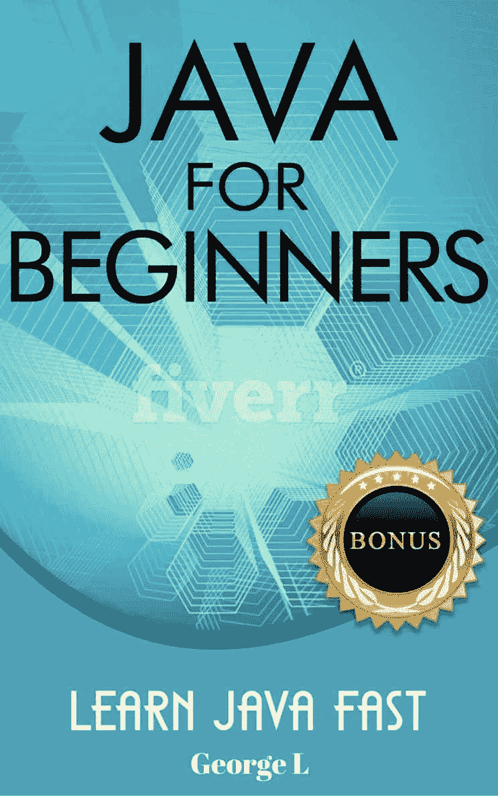

# Java 入门指南：快速学习 Java



## 引言

我要感谢你的下载，并祝贺你下载了《Java 入学者教程：快速学习 Java》这本书。

这本书将向你介绍 Java 语言编程的核心概念。

Java 是 Web 开发者的首选编程语言，用于 Android 应用程序、网站、基于 Web 的游戏以及 Web 应用。它是最容易学习的语言之一，我将介绍 Java 编程的基础概念。

感谢下载本书，希望你读得愉快！

## 第 1 章：Java 基础语法

Java 是所有计算机编程语言中最强大的语言之一，也是最容易学习的语言之一。在本章中，我们将介绍该语言的基本语法，这是你必须学习的第一点：

### 空格

空白字符使得 `java` 代码具有可读性。空白字符包括空格、制表符和换行符。编译器会忽略它们，但它们对人类的可读至关重要。

### 样式

样式涉及代码的格式化。适当的缩进和间距使代码更容易理解和维护。

#### 示例 1：糟糕的格式

```java
// Bad Style
public class Welcome {
public static void main(String[] args) {
int i = 0; // line comment
for(int i=0;i<=10;i++){
int j = 1;
int k = j;
System.out.println("Welcome to");
}
}
```

#### 示例 2：良好的格式

```java
// Good Style
public class Welcome {
    public static void main(String[] args) {
        int i = 0; // line comment
        for(int i=0;i<=10;i++){
            int j = 1;
            int k = j;
            System.out.println("Welcome to comments");
        }
    }
}
```

### 注释

注释非常重要，因为它们允许你在源代码中添加备注，从而使可能复杂的代码变得更容易阅读和调试。Java 编译器不会读取注释，因此它们不会影响内存。主要有两种类型：

- 单行注释：以 `//` 开头，`//` 到行尾之间的任何内容都会被忽略。
- 多行注释：以 `/*` 开头，以 `*/` 结尾——其间的任何内容都会被忽略并可以跨多行。

```java
public class Welcome {
    public static void main(String[] args) {
        int i = 0; // this is a single line comment
        for(int i=0;i<=10;i++){
            /* 
            int j = 1;
            int k = j;
            System.out.println("Welcome to comments"); 
            */
            /* 这是多行注释，中间的所有代码将被注释掉 */
        }
    }
}
```

### 标识符

标识符是赋予 Java 中方法、类和变量的集体名称。

- 标识符必须以 Unicode 字符、下划线（`_`）或美元符号（`$`）开头。
- 第一个字符之后可以包含数字、美元符号、下划线和 Unicode 字符。
- 如果可能，尽量避免使用货币符号（如 `$`）。
- 标识符名称区分大小写。
- 你不能使用关键字。
- 使用大写字母分隔名称中的两个或多个单词。

| `tree` | `Tree` | 区分大小 |
| :--- | :--- | :--- |
| `my2var` | `2myVar` | 以数字作为字符 |
| `myNewVar` | `my@new@var` | 无效字符 - @ |
| `switching` | `switch` | 保留关键字 |

### 保留关键字

Java 中有几个单词是为语言保留的，你不能将它们用于用途之外的任何地方，特别是不能用于命名。保留关键字如下：

* `abstract`
* `assert`
* `boolean`
* `break`
* `byte`
* `case`
* `catch`
* `char`
* `class`
* `const`
* `continue`
* `default`
* `do`
* `double`
* `else`
* `enum`
* `extends`
* `final`
* `finally`
* `float`
* `for`
* `goto`
* `if`
* `implements`
* `import`
* `instanceof`
* `int`
* `interface`
* `long`
* `native`
* `new`
* `package`
* `private`
* `protected`
* `public`
* `return`
* `short`
* `static`
* `strictfp`
* `super`
* `switch`
* `synchronized`
* `this`
* `throw`
* `throws`
* `transient`
* `try`
* `void`
* `volatile`
* `while`

### 分隔符

这些在 Java 中非常常用，且每个都有自己的用途：

| 分隔符 | 注释 |
| :--- | :--- |
| `()` | 用于声明方法/传递参数 |
| `{}` | 代码块 |
| `[]` | 定义数组并访问元素 |
| `;` | 语句结束 |
| `,` | 参数分隔 |
| `.` | 方法和对象的调用运算符 |
| `:` | 用于增强循环 |

### 字面量

Java 使用字面量来让我们直观了解数据类型：

| 字面量类型 | 示例 | 注释 |
| :--- | :--- | :--- |
| 整数 | `10` | 无区分符 |
| 长整 | `10L` | 用于 Long |
| Null | `null` | 关键字 |
| 字符串 | `"Java Programs"` | 双引号表示字符串 |
| 字符 | `'a'` | 单引号表示字符 |
| 双精度浮点数 | `3123.5` | 无区分符 |
| 浮点数 | `3.5f` | f 表示 float |
| 布尔值 | `true` | 关键字或 false |

除了分隔符外，Java 字面量也给了我们一个简洁的概念。让我们通过表格的形式查看它们。

### 转义序列

我们在字符串中使用转义序列来转义特定字符：

| 转义序列 | 序列 |
| :--- | :--- |
| `\t` | 水平表符 |
| `\n` | 换行 |
| `\r` | 回车 |
| `\f` | 换页 |
| `\"` | 双引号 |
| `\'` | 单引号 |
| `\\` | 反斜杠 |

## 第 2 章：关于面向对象编程

Java 是一种面向对象编程 (OOP) 语言，围绕对象和数据组织，而不是动作和逻辑。在开始编写自己的 Java 代码之前，你需要了解该语言的基础。

### OOP 的优势

OOP 的主要优势是程序员可以创建模块，当添加新对象时不需要修改这些模块。程序员只需要创建一个新对象，使其从现有对象继承特征，从而变得易于修改。

## 第 3 章：类基础

类是 Java 的基础部分，并且非常强大。类用于定义一种新的数据类型，然后用该类型来创建对象。基本上，类是对象的模板，而对象是类的实例。正如此，你会看到“实例 (instance)”和“对象 (object)”这两个词交替使用。

### 类的形式

要定义一个类，必须声明它的性质和形式。为了做到，必须指定类中的数据以及对数据进行操作的代码。大多数类都会包含两者，尽管有些只包含数据或代码。

你通过使用 `class` 关键字来声明类，下面是类的通用形式：

```java
class classname {
    type instance-variable1;
    type instance-variable2;
    // ..
    type instance-variableN;

    type methodname1(parameter-list) {
        //方法体
    }

    type methodname2(parameter-list) {
        //方法体
    }
    //..
    type methodnameN(parameter-list) {
        // 这里的方法体
    }
}
```

在类中定义的变量或数据称为**实例变量 (instance variables)**，代码本身包含在方法内部。类中定义的方法和变量被称为**成员 (members)**，在大多数情况下，变量会被类中的特定方法操作和访问。方法决定了数据如何被使用。

## 第 4 章：结 + 免费赠送课程


=> [点击](https://www.amazon.com/ap/signin?_encoding=UTF8&openid.assoc_handle=usflex&openid.claimed_id=http%3A%2F%2Fspecs.openid.net%2Fauth%2F2.0%2Fidentifier_select&openid.identity=http%3A%2F%2Fspecs.openid.net%2Fauth%2F2.0%2Fidentifier_select&openid.mode=checkid_setup&openid.ns=http%3A%2F%2Fspecs.openid.net%2Fauth%2F2.0&openid.ns.pape=http%3A%2F%2Fspecs.openid.net%2Fextensions%2Fpape%2F1.0&openid.pape.max_auth_age=0&openid.return_to=https%3A%2F%2Fwww.amazon.com%2Freview%2Fcreate-review%3Fie%3DUTF8%26asin%3DB06XQM477F%26channel%3Dglance-detail%26ref_%3Dcm_cr_dp_d_wr_but_top) [这里](https://www.amazon.com/ap/signin?_encoding=UTF8&openid.assoc_handle=usflex&openid.claimed_id=http%3A%2F%2Fspecs.openid.net%2Fauth%2F2.0%2Fidentifier_select&openid.identity=http%3A%2F%2Fspecs.openid.net%2Fauth%2F2.0%2Fidentifier_select&openid.mode=checkid_setup&openid.ns=http%3A%2F%2Fspecs.openid.net%2Fauth%2F2.0&openid.ns.pape=http%3A%2F%2Fspecs.openid.net%2Fextensions%2Fpape%2F1.0&openid.pape.max_auth_age=0&openid.return_to=https%3A%2F%2Fwww.amazon.com%2Freview%2Fcreate-review%3Fie%3DUTF8%26asin%3DB06XQM477F%26channel%3Dglance-detail%26ref_%3Dcm_cr_dp_d_wr_but_top) [在](https://www.amazon.com/ap/signin?_encoding=UTF8&openid.assoc_handle=usflex&openid.claimed_id=http%3A%2F%2Fspecs.openid.net%2Fauth%2F2.0%2Fidentifier_select&openid.identity=http%3A%2F%2Fspecs.openid.net%2Fauth%2F2.0%2Fidentifier_select&openid.mode=checkid_setup&openid.ns=http%3A%2F%2Fspecs.openid.net%2Fauth%2F2.0&openid.ns.pape=http%3A%2F%2Fspecs.openid.net%2Fextensions%2Fpape%2F1.0&openid.pape.max_auth_age=0&openid.return_to=https%3A%2F%2Fwww.amazon.com%2Freview%2Fcreate-review%3Fie%3DUTF8%26asin%3DB06XQM477F%26channel%3Dglance-detail%26ref_%3Dcm_cr_dp_d_wr_but_top) [离开](https://www.amazon.com/ap/signin?_encoding=UTF8&openid.assoc_handle=usflex&openid.claimed_id=http%3A%2F%2Fspecs.openid.net%2Fauth%2F2.0%2Fidentifier_select&openid.identity=http%3A%2F%2Fspecs.openid.net%2Fauth%2F2.0%2Fidentifier_select&openid.mode=checkid_setup&openid.ns=http%3A%2F%2Fspecs.openid.net%2Fauth%2F2.0&openid.ns.pape=http%3A%2F%2Fspecs.openid.net%2Fextensions%2Fpape%2F1.0&openid.pape.max_auth_age=0&openid.return_to=https%3A%2F%2Fwww.amazon.com%2Freview%2Fcreate-review%3Fie%3DUTF8%26asin%3DB06XQM477F%26channel%3Dglance-detail%26ref_%3Dcm_cr_dp_d_wr_but_top) [a](https://www.amazon.com/ap/signin?_encoding=UTF8&openid.assoc_handle=usflex&openid.claimed_id=http%3A%2F%2Fspecs.openid.net%2Fauth%2F2.0%2Fidentifier_select&openid.identity=http%3A%2F%2Fspecs.openid.net%2Fauth%2F2.0%2Fidentifier_select&openid.mode=checkid_setup&openid.ns=http%3A%2F%2Fspecs.openid.net%2Fauth%2F2.0&openid.ns.pape=http%3A%2F%2Fspecs.openid.net%2Fextensions%2Fpape%2F1.0&openid.pape.max_auth_age=0&openid.return_to=https%3A%2F%2Fwww.amazon.com%2Freview%2Fcreate-review%3Fie%3DUTF8%26asin%3DB06XQM477F%26channel%3Dglance-detail%26ref_%3Dcm_cr_dp_d_wr_but_top) [评论](https://www.amazon.com/ap/signin?_encoding=UTF8&openid.assoc_handle=usflex&openid.claimed_id=http%3A%2F%2Fspecs.openid.net%2Fauth%2F2.0%2Fidentifier_select&openid.identity=http%3A%2F%2Fspecs.openid.net%2Fauth%2F2.0%2Fidentifier_select&openid.mode=checkid_setup&openid.ns=http%3A%2F%2Fspecs.openid.net%2Fauth%2F2.0&openid.ns.pape=http%3A%2F%2Fspecs.openid.net%2Fextensions%2Fpape%2F1.0&openid.pape.max_auth_age=0&openid.return_to=https%3A%2F%2Fwww.amazon.com%2Freview%2Fcreate-review%3Fie%3DUTF8%26asin%3DB06XQM477F%26channel%3Dglance-detail%26ref_%3Dcm_cr_dp_d_wr_but_top) [为了](https://www.amazon.com/ap/signin?_encoding=UTF8&openid.assoc_handle=usflex&openid.claimed_id=http%3A%2F%2Fspecs.openid.net%2Fauth%2F2.0%2Fidentifier_select&openid.identity=http%3A%2F%2Fspecs.openid.net%2Fauth%2F2.0%2Fidentifier_select&openid.mode=checkid_setup&openid.ns=http%3A%2F%2Fspecs.openid.net%2Fauth%2F2.0&openid.ns.pape=http%3A%2F%2Fspecs.openid.net%2Fextensions%2Fpape%2F1.0&openid.pape.max_auth_age=0&openid.return_to=https%3A%2F%2Fwww.amazon.com%2Freview%2Fcreate-review%3Fie%3DUTF8%26asin%3DB06XQM477F%26channel%3Dglance-detail%26ref_%3Dcm_cr_dp_d_wr_but_top) [这本书](https://www.amazon.com/ap/signin?_encoding=UTF8&openid.assoc_handle=usflex&openid.claimed_id=http%3A%2F%2Fspecs.openid.net%2Fauth%2F2.0%2Fidentifier_select&openid.identity=http%3A%2F%2Fspecs.openid.net%2Fauth%2F2.0%2Fidentifier_select&openid.mode=checkid_setup&openid.ns=http%3A%2F%2Fspecs.openid.net%2Fauth%2F2.0&openid.ns.pape=http%3A%2F%2Fspecs.openid.net%2Fextensions%2Fpape%2F1.0&openid.pape.max_auth_age=0&openid.return_to=https%3A%2F%2Fwww.amazon.com%2Freview%2Fcreate-review%3Fie%3DUTF8%26asin%3DB06XQM477F%26channel%3Dglance-detail%26ref_%3Dcm_cr_dp_d_wr_but_top) [这](https://www.amazon.com/ap/signin?_encoding=UTF8&openid.assoc_handle=usflex&openid.claimed_id=http%3A%2F%2Fspecs.openid.net%2Fauth%2F2.0%2Fidentifier_select&openid.identity=http%3A%2F%2Fspecs.openid.net%2Fauth%2F2.0%2Fidentifier_select&openid.mode=checkid_setup&openid.ns=http%3A%2F%2Fspecs.openid.net%2Fauth%2F2.0&openid.ns.pape=http%3A%2F%2Fspecs.openid.net%2Fextensions%2Fpape%2F1.0&openid.pape.max_auth_age=0&openid.return_to=https%3A%2F%2Fwww.amazon.com%2Freview%2Fcreate-review%3Fie%3DUTF8%26asin%3DB06XQM477F%26channel%3Dglance-detail%26ref_%3Dcm_cr_dp_d_wr_but_top) [在](https://www.amazon.com/ap/signin?_encoding=UTF8&openid.assoc_handle=usflex&openid.claimed_id=http%3A%2F%2Fspecs.openid.net%2Fauth%2F2.0%2Fidentifier_select&openid.identity=http%3A%2F%2Fspecs.openid.net%2Fauth%2F2.0%2Fidentifier_select&openid.mode=checkid_setup&openid.ns=http%3A%2F%2Fspecs.openid.net%2Fauth%2F2.0&openid.ns.pape=http%3A%2F%2Fspecs.openid.net%2Fextensions%2Fpape%2F1.0&openid.pape.max_auth_age=0&openid.return_to=https%3A%2F%2Fwww.amazon.com%2Freview%2Fcreate-review%3Fie%3DUTF8%26asin%3DB06XQM477F%26channel%3Dglance-detail%26ref_%3Dcm_cr_dp_d_wr_but_top) [亚马逊](https://www.amazon.com/ap/signin?_encoding=UTF8&openid.assoc_handle=usflex&openid.claimed_id=http%3A%2F%2Fspecs.openid.net%2Fauth%2F2.0%2Fidentifier_select&openid.identity=http%3A%2F%2Fspecs.openid.net%2Fauth%2F2.0%2Fidentifier_select&openid.mode=checkid_setup&openid.ns=http%3A%2F%2Fspecs.openid.net%2Fauth%2F2.0&openid.ns.pape=http%3A%2F%2Fspecs.openid.net%2Fextensions%2Fpape%2F1.0&openid.pape.max_auth_age=0&openid.return_to=https%3A%2F%2Fwww.amazon.com%2Freview%2Fcreate-review%3Fie%3DUTF8%26asin%3DB06XQM477F%26channel%3Dglance-detail%26ref_%3Dcm_cr_dp_d_wr_but_top) [!](https://www.amazon.com/ap/signin?_encoding=UTF8&openid.assoc_handle=usflex&openid.claimed_id=http%3A%2F%2Fspecs.openid.net%2Fauth%2F2.0%2Fidentifier_select&openid.identity=http%3A%2F%2Fspecs.openid.net%2Fauth%2F2.0%2Fidentifier_select&openid.mode=checkid_setup&openid.ns=http%3A%2F%2Fspecs.openid.net%2Fauth%2F2.0&openid.ns.pape=http%3A%2F%2Fspecs.openid.net%2Fextensions%2Fpape%2F1.0&openid.pape.max_auth_age=0&openid.return_to=https%3A%2F%2Fwww.amazon.com%2Freview%2Fcreate-review%3Fie%3DUTF8%26asin%3DB06XQM477F226channel%3Dglance-detail%26ref_%3Dcm_cr_dp_d_wr_but_top)


# 致谢与后续建议

再次感谢阅读这本书！

希望这本书能够帮助你理解 Java 编程的基础知识。

下一步是进一步深化你的学习。学习基础只是开始，是进入计算机编程世界漫长且富有成果的旅程的起点。

我建议你查看这个[免费视频课程](http://javavideocourse.weebly.com)以获取更完整的信息。

如果链接无法使用，请访问：`http://javavideocourse.weebly.com/`

感谢你并祝你好运！
