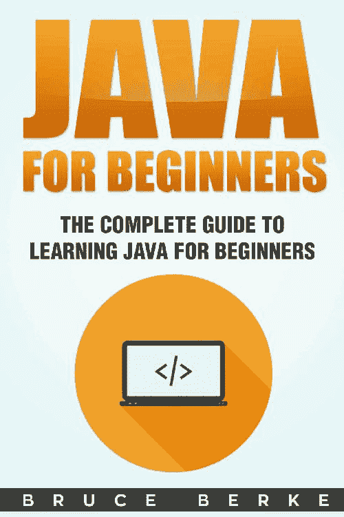
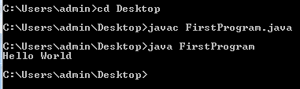
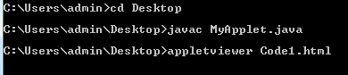
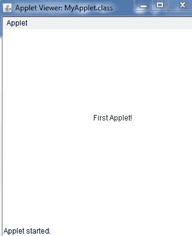
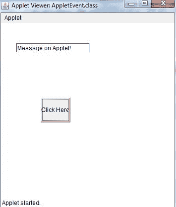

# Java 入门指南：Java 初学者学习完全指南 (计算机编程)



© 2018

 版 2018 由 Bruce Berke 保留所有权利。

本文档旨在就其涵盖的主题和问题提供准确且可靠的信息。本书的出版基于这样理念：即出版者不需要提供会计、官方许可或其他合规服务。如果需要法律或专业方面的建议，应聘请该领域内具有实践经验的专业人士。

- 源自一份被美国律师协会委员会和出版商与协会委员会共同接受并批准的《原则声明》。

在任何情况下，通过电子手段或打印格式复制、复印或传输本文档的任何部分都是违法的。严禁录制本物，除非获得出版者的书面许可，否则不允许对本文进行任何存储。保留所有权利。

此处提供的信息被声明是真实且一致的，这意味着由于任何疏忽或其他原因，使用或滥用包含的任何策略、流程或指令而导致的任何责任，均由接收读者承担全部责任。在任何情况下，出版者对因本文中的信息直接或间接导致的任何赔偿、损害或金钱损失不承担任何法律责任或过。

相应作者拥有出版者未持有的版权。

此处的信息仅供参考之用，且具有通用性。信息的呈现不带有任何合同或任何类型的保证说明。

所使用的商标均未经任何许可，且商标的发布未获得商标所有者的许可或支持。书中的所有商标和品牌仅用于说明目的，并由所有者所有，与本文档无关。

# 目录

- 引言
- 第 1 章：开始学习 Java
- 第 2 章：Java 变量
- 第 3 章：Java 运算符
- 第 4 章：Java 数组
- 第 5 章：决策判断
- 第 6 章：循环
- 第 7 章：继承
- 第 8 章：重写
- 第 9 章：多态
- 第 10 章：抽象
- 第 11 章：封装
- 第 12 章：接口
- 第 13 章：包
- 第 14 章：命令行参数
- 第 15 章：递归
- 第 16 章：方法调用
- 第 17 章：Java Applets
- 结语

# 引言

Java 是一种广泛的编程语言，包含了许多适用于应用程序开发的特性。它是设计/开发桌面应用程序的很好的编程语言。这些程序作为独立应用程序非常流行。如果你需要分布式应用程序，Java 是最适合使用的语言。`Java Applets` 可以嵌入/添加到网页中。Java 提供的许多特性使其成为一种受欢迎的编程语言。其广泛的特性使其适用于各行业应用的开发。要编写 Java 代码，你应该获取 Java 编译器。Java 是编译的，而不是解释的。你需要一个可以在其中编写 Java 代码的编辑器。记事本非常适合这个。有了这些工具，你就可以开始编写和运行你的 Java 代码了。这意味着上手 Java 非常容易，使得 Java 成为初学者的良好语言。Java 字节码（通常在编译 Java 源代码后生成）是平台无关的，这意味着它可以在包括 Windows、Solaris、Linux 在内的任何平台上运行。Java 应用通过安全机制确保安全。

# 第 1 章：开始学习 Java

Java 是一种广泛的编程语言，包含了许多适用于应用程序开发的特性。它是设计/开发桌面应用程序的很好的编程语言。这些程序作为独立应用程序非常流行。如果你需要分布式应用程序，Java 是最适合使用的语言。`Java Applets` 可以嵌入/添加到网页中。Java 提供的许多特性使其成为一种受欢迎的编程语言。其广泛的特性使其适用于各行业应用的开发。要编写 Java 代码，你应该获取 Java 编译器。Java 是编译的，而不是解释的。你需要一个可以在其中编写 Java 代码的编辑器。记事本非常适合这个。有了这些工具，你就可以开始编写和运行你的 Java 代码了。这意味着上手 Java 非常容易，使得 Java 成为初学者的良好语言。Java 字节码（通常在编译 Java 源代码后生成）是平台无关的，这意味着它可以在包括 Windows、Solaris、Linux 在内的任何平台上运行。Java 应用通过安全机制确保安全。

## 环境配置

为了编写和运行 Java 程序，你需要一个编辑器和 Java 编译器。Java 随 `JDK`（Java 开发工具包）提供。你甚至可以使用像记事本这样的基础编辑器。不过，也有更高级的 Java 编辑器，例如 `Eclipse` 和 `Netbeans`。

首先，在你的电脑上下载并安装 `JDK`。之后，你将拥有 Java。打开浏览器并输入或粘贴以下 URL：

[`www.oracle.com/technetwork/java/javase/downloads/jdk8-downloads-2153751.html`](http://www.oracle.com/technetwork/java/javase/downloads/jdk8-downloads-2153751.html)

从那里你可以获取最新版本的 `JDK`。你需要设置环境变量以告知正确的 Java 安装目录。这意味着你需要设置 `path` 变量。通常安装路径是 `C:\Program Files\java\jdk`。在 Windows 上正确设置路径的方法是：“我的电脑”，选择“属性”，打开“高级系统设置”，然后选择“环境变量”。添加 `C:\Program Files\java\jdk\bin` 路径。Linux 用户请阅读你的 shell 文档。

## Java 语法

Java 程序由通过相互调用方法的对象组成。以下是 Java 程序中的主要构造部分：

- **对象**：对象以状态和行为为特征。例如，猫有颜色、品种名称等状态，以及吃、喵喵和摇尾巴等行为。
- **类**：这是描述对象支持的状态/行为的蓝图/模板。
- **方法**：方法是一种行为。逻辑写在方法中，并且可以用于数据处理。

## 第一个程序

这是我们的第一个 Java 程序。执行后它应该打印出“Hello World”：

```java
public class OurFirstProgram{
    public static void main(String args[]){
        System.out.println("Hello World");
    }
}
```

打开你的文本编辑器（如 `Notepad`），创建一个名为 `FirstProgram.java` 的新文件。保存该文件。`.java` 扩展名将文件标记为 Java 文件。在文件中输入上述程序代码并保存更改。打开命令提示符，然后导航到你保存文件的目录。在该目录下运行给出的命令：

```
javac FirstProgram.java
java FirstProgram
```

在我的情况下，我将文件保存在桌面上。我按照如下方式执行了命令：



程序输出“Hello World”作为结果。在命令 `javac FirstProgram.java` 中，我们正在调用 Java 编译器（`javac`）来编译程序。命令在提示符上没有返回任何内容，因为程序没有错误，也没有生成警告。该命令在目录中生成了一个 `.class` 文件（`FirstProgram.class`）；请确认。在命令 `java FirstProgram` 中，我们只是在运行该程序以获取结果。

考虑从代码中提取的以下行：

```java
public class FirstProgram{
```

该行简单地声明了一个名为 `FirstProgram` 的类。Java 是一种区分大小写的语言，因此该类必须始终按照上面写的方式来引用。`public` 关键字将该类声明为公有，这意味着它可以从相同包内的任何其他类进行访问。`{` 声明了类体的开始，它应该由 `}` 关闭。

> **注意**：编写程序时的文件名应与类名匹配；否则，在运行程序时会遇到麻烦。在我们的案例中，类名为 `FirstProgram`，因此文件名应该是 `FirstProgram.java`。

考虑从代码中提取的以下行：

```java
public static void main(String args[]){
```

这是 `main` 方法。没有这个方法，Java 程序将无法被执行或运行。

考虑从代码中提取的以下行：

```java
System.out.println("Hello World");
```

我们只是在调用或使用 `println` 方法，在命令提示符的终端上打印文本 Hello World。

最后，我们有两个闭合的大括号，`}}`。第一个关闭 `main` 方法的左大括号，第二个关闭类的左大括号。

# 第 2 章：Java 变量

变量可以被视为一个容器，在程序的生命周期内负责持有一个值。每个变量都有特定的数据类型，规定了它可以持有的值类型。使用 Java 变量有两个步骤，即变量声明和变量初始化。

## 变量声明

变量声明涉及为它提供一个名称并指定其数据类型。以下是有效的变量声明示例：

```
int x,j,z;
float pi;
double a;
char c;
```

`int`、`float`、`double` 和 `char` 是数据类型，规定了每个变量可以或应该持有的值类型。要在一行中声明多个变量，请使用逗号（`,`）将它们分开，如第一个示例所示。变量声明应以分号（`;`）结束。

## 变量初始化

变量初始化涉及为其分配一个有效值。赋值给变量的值取决于变量的数据类型。以下是有效的变量初始化示例。

```
pi =3.14f;
a =20.22778765;
c='v';
```

变量的声明和初始化可以同时完成，如下所示：

```
int x=1,z=4,y=5;
float pi=3.14f;
double d=19.12d;
char c='v';
```

## 变量类型

Java 支持三种变量类型：

1. 局部变量
2. 静态变量
3. 实例变量

## 局部变量

这些是在方法体内部声明的变量。它们只能在该方法内部被访问。

## 实例变量

这些是在没有使用 `static` 关键字定义的变量。这些变量属于特定的对象。

## 静态变量

这些是在程序执行开始时初始化一次的变量。你应该在实例化变量之前初始化它们。

以下示例演示了 Java 变量的不同类型：

```java
class JavaVariables {
    int i = 10; // 一个实例变量 
    static int b = 2; // 一个静态变量 
    void methodExample() {
        int c = 3; // 一个局部变量 
    }
}
```

整数变量 `b` 是静态变量，因为它使用 `static` 关键字定义。变量 `int c` 在 `methodExample` 方法内部声明，使其成为一个局部变量。它只能在该方法内部被访问。

## 数据类型

在 Java 中，数据类型可以是基本类型或非基本类型。

### 基本数据类型

这些是 Java 提供的预定义数据类型。共有 8 个，包括 `byte`、`short`、`long`、`char`、`int`、`float`、`boolean` 和 `double` 数据类型。

### 非基本数据类型

这些通过定义的类构造函数定义。它们帮助程序员访问对象。

提供的示例演示了变量的使用：

```java
public class VariableAddition{ 
    public static void main(String[] args){ 
        int ax=5; 
        int jk=12; 
        int z=ax+jk; 
        System.out.println(z); 
    }
} 
```

我们定义了三个整数变量 `ax`、`jk` 和 `z`。`ax`、`jk` 和 `z` 的值已定义。`ax`、`jk` 和 `z` 的值被使用。`System.out.println(z)` 输出结果。

# 第 3 章：Java 运算符

运算符是用于操作的符号。例如，`+` 符号用于算术操作。

## 一元运算符

这是取一个操作数的运算符。它们增加/减少一个值。它们包括 `++`（增一）和 `--`（减一）。示例：

```java
class UnaryExample{
    public static void main(String[] args){
        int j=0; 
        System.out.println(j++); 
        System.out.println(++j); 
        System.out.println(j--); 
        System.out.println(--j); 
    }
}
```

程序将打印 0、2、1、0。`j++` 表示在执行增加之前读取 `j` 的值，因此我们得到的 `j` 的值为 0。如果是 `++j`，我们将得到第一个值为 1。

## 算术运算符

这些运算符用于执行算术操作，如乘法、加法、除法等。它们作为算术运算符使用。示例：

```java
public class JavaArithmeticOperators{
    public static void main(String[] args){ 
        int x=0; 
        int y=10; 
        System.out.println(x+y); 
        System.out.println(x-y); 
        System.out.println(x*y); 
        System.out.println(x/y); 
        System.out.println(x%7); 
    }
}
```

唯一看起来陌生的运算符是 `%`（模运算），它返回除法的余数。

## 逻辑运算符

这些运算符与布尔值一起使用。它们有助于评估循环和条件语句中的条件。它们包括 `||`、`&&`、`!`。假设有两个布尔变量 `a1` 和 `a2`，适用以下条件：

- `a1 && a2` 在 `a1` 和 `a2` 都为真时返回真，否则返回假。
- `a1 || a2` 在 `a1` 和 `a2` 都为假时返回假，否则返回真。
- `!a1` 将返回 `a1` 的反值。

示例：

```java
public class LogicalOperatorExample {
  public static void main(String args[]) {
      boolean a1 = true;
      boolean a2 = false;
      System.out.println("a1 && a2: " + (a1&&a2));
      System.out.println("a1 || a2: " + (a1||a2));
      System.out.println("!(a1 && a2): " + !(a1&&a2));
  }
}
```

程序将返回 false, true, true。

## 比较运算符

Java 支持 6 种比较运算符，`==`、`!=`、 `<`, `>`, `>=`, `<=`：

- `==` 如果左侧和右侧都相等，则返回 `true`。
- `!=` 如果运算符的左右两边不相等，则返回 `true`。
- `>` 如果左侧大于右侧，则返回 `true`。
- `<` 如果左侧小于右侧，则返回 `true`。
- `>=` 如果左侧大于或等于右侧，则返回 `true`。
- `<=` 如果左侧小于或等于右侧，则返回 `true`。

示例：

```java
public class JavaRelationalOperatorExample {
  public static void main(String args[]) {
      int n1 = 20;
      int n2 = 30;
      if (n1==n2) {
          System.out.println("n1 and n2 are equal");
      }
      else{
          System.out.println("n1 and n2 aren’t equal");
      }
      if( n1 != n2 ){
          System.out.println("n1 and n2 aren’t equal");
      }
      else{
          System.out.println("n1 and n2 are equal");
      }
      if( n1 > n2 ){
          System.out.println("n1 is greater than n2");
      }
      else{
          System.out.println("n1 isn’t greater than n2");
      }
      if( n1 >= n2 ){
          System.out.println("n1 is equal to or greater than n2");
      }
      else{
          System.out.println("n1 is less than n2");
      }
      if( n1 < n2 ){
          System.out.println("n1 is less than n2");
      }
      else{
          System.out.println("n1 isn’t less than n2");
      }
      if( n1 <= n2){
          System.out.println("n1 is equal to or less than n2");
      }
      else{
          System.out.println("n1 is greater than n2");
      }
  }
}
```

程序使用了在后续章节中讨论的 `if` 语句。

# 第 4 章：Java 数组

数组是用于存储相同类型元素的存储结构。数组具有固定大小，定义后无法增加大小。数组中的第一个元素位于索引 0。

## 单维数组

这些是元素线性存储的数组。数组的声明采用下所示语法：

`<elementDataType>[] <arrayName>;`

另一种语法：

`<elementDataType> <arrayName>[];`


```java
int arrayExample[];
int []arrayExample;
```

数组可以如下所示进行初始化：

`arrayExample[0]=1;`

该行表示元素 1 应存储在数组的索引 0 处。数组也可以同时声明并初始化，如下：

`int arrayExample[] = {5, 20, 35, 43};`

值 5 将存储在数组的索引 0，20 存储在索引 1，依此类推。

示例：

```java
public class JavaArrayExample{
    public static void main(String args[]){
      int array1[] = new int[8];
      for (int c=0;c<8;c++){
          array1[c]=c+1;
      }
      for (int c=0;c<8;c++){
          System.out.println("array1["+c+"] = "+array1[c]);
      }
      System.out.println("The Array Length  =  "+array1.length);
      }
}
```

数组将打印位于不同索引处的元素。你还将获得数组长度，即 8。

## 多维数组

这些可以被视为其他数组的数组。在多维数组声明中，只需添加另一组方括号来定义另一个索引。示例：

`int array2[ ][ ] = new int[6][10] ;`

你有权控制多维数组的长度。示例：

```java
public class JavaArrayExample2 {
public static void main(String[] args) {
// 创建一个二维数组。
  int[][] array2 = new int[6][8];
  // 仅赋值元素
  array2[0][0] = 2;
  array2[1][1] = 2;
  array2[3][2] = 1;
  System.out.print(array2[0][0] + " ");
}
```

程序将返回存储在索引 [0][0] 处的值，即 2。

# 第 5 章：决策

在 Java 中，决策帮助我们评估条件。

## if 语句

该语句帮助我们根据条件的结果执行语句。其语法如下：

`if(boolean expression) {`

`// statements`

`}`

如果 `if` 语句中的条件为**真**，则执行执行体内的语句。

## if...else 语句

该语句将 `if` 与 `else` 结合，如果条件为假，则执行 `else` 部分。语法如下：

`if(boolean expression) {`

`// statements`

`}else {`

`// statements`

`}`

示例：

```java
public class JavaElseStatement {
  public static void main(String args[]) {
      int marks = 20;
      if( marks < 50 ) {
          System.out.println("The marks is below");
      }
  }
}
```

如果条件为真，则执行语句。

## if...else if...else 语句

如果你有多个条件需要评估，使用此语句。语法如下：

`if(boolean expression a) {`

`// statements`

`}else if(boolean expression b) {`

`// statements`

`}else if(boolean expression c) {`

`// statements`

`}else {`

`// statements`

`}`

示例：

```java
public class JavaIfElseStatement {
  public static void main(String args[]) {
      int marks = 20;
      if( marks == 10 ) {
          System.out.println("Marks is 10");
      }else if( marks == 20 ) {
          System.out.println("Marks is 20");
      }else if( marks == 30 ) {
          System.out.println("Marks is 30");
      }else {
          System.out.println("None of the above");
      }
  }
}
```

程序的结果将是 20。

## 嵌套 if

`if...else` 语句可以嵌套，这意味着你可以在另一个 `if` 中使用 `if` 或在另一个 `if...else` 中使用 `if...else`。嵌套语法所示：

`if(boolean expression a) {`

`// statements`

`if(boolean expression b) {`

`// statements`

`}`

}`

示例：

```java
public class NestingExample {
  public static void main(String args[]) {
      int ab = 10;
      int xy = 30;
      if( ab == 10 ) {
          if( xy == 30 ) {
              System.out.print("The value of ab is 10 and xy is 30");
          }
      }
  }
}
```

## switch 语句

该语句允许我们对某个变量与某些值列表进行等性测试。每个值都被称为 `case`。使用的语法如下：

`switch(an_expression) {`

`case value:`

`// statements`

`break; //optional`

`case value:`

`// statements`

`break; //optional`

`default : //Optional`

`// statements`

`}`

```java
public class JavaSwitchStatement {

  public static void main(String args[]) {
      char student_grade = 'B';
      switch(student_grade) {
        case 'A':
          System.out.println("That is Excellent!");
          break;
        case 'B':
          System.out.println("That is Good!");
          break;
        case 'C':
          System.out.println("That is Fair!");
          break;
        case 'D':
          System.out.println("That is Poor!");
        case 'F':
          System.out.println("You Failed!");
          break;
        default:
          System.out.println("Unknown grade");
      }
      System.out.println("The student got grade " + student_grade);
  }
}
```

等级为 B 的情况将为真，因此你将收到 "Good" 的消息。之后，程序将执行最后一个 `println` 语句，因此 `student_grade` 的值将被打印出来。

# 第 6 章：循环

Java 循环帮助我们重复执行某些任务。循环按顺序执行语句。首先运行第一个，紧接着是第二个，以此类推。让我们讨论一下 Java 循环：

## for 循环

只要条件求值为真，循环就会运行。如果条件变为假，执行将立即停止。语法如下：

`for(initialization; loop_condition ; Increment/decrement_part)`

{

  the_statement(s);

}

`initialization` 定义了循环条件的初始值。`loop_condition` 指定了循环运行所需的必须始终为真的条件。`loop_increment/decrement` 定义了每次迭代后初始化值所增加或减少的量。示例下：

```java
public class ForLoopDemo {
    public static void main(String args[]){
        for(int ix=0; ix<10; ix++){
            System.out.println("The ix value is currently: "+ix);
        }
    }
}
```

程序将打印从 0 到 9 的 `ix` 值。当循环将 9 递增到 10 时，它会发现这违反了循环条件（即 `ix<10`），因此执行将立即停止。

## while 循环

只要指定的条件为真，此循环就会执行语句。首先求值条件，如果为真，则执行循环语句。如果条件变为假，控制将跳转去执行循环之后的语句。建议你在循环中添加一个递增/递减操作和一个测试条件，以便循环在条件变为假时停止执行。否则，循环可能会无限运行。语法下所示：

`while(A_boolean_expression) {

  // Statement(s)

}`

示例：

```java
public class JavaWhileLoop {
  public static void main(String args[]) {
      int xy = 20;
      while( xy < 25 ) {
          System.out.print("The value of xy is: " + xy );
          xy++;
          System.out.print("\n");
      }
  }
}
```

程序打印从 20 到 24 的 `xy` 值。变量的初始值为 20。测试条件检查该值是否小于 25，结果为真。这意味着循环将运行。当它达到 24 时，它会检查并发现 `xy` 的值为 25。循环的执行随后立即停止，因为继续执行将违反循环条件。

## do…while 循环

这与 while 循环密切相关。在 `while` 中，循环条件的执行是在循环体执行之前完成的。在 `do…while` 循环中相反，体在条件之前先执行。在 `while` 循环中，循环体可能永远不会执行，但在 `do…while` 循环中，循环体必须执行一次。语法如下：

`do

{

  Statement or statements;

} while(loop_condition);`

示例：

```java
public class JavaDoWhileLoopExample {
  public static void main(String args[]) {
      int xy = 20;
      do {
          System.out.print("The value of xy is: " + xy );
          xy++;
          System.out.print("\n");
      }while( xy < 25 );
  }
}
```

代码将像上一个循环一样打印从 20 到 24 的 `xy` 值。这是因为条件为真，即 20 小于 25。假设我们将循环条件设置为假，例如如所示将 `xy` 的值初始化为 30：

```java
public class DoLoopExample {
  public static void main(String args[]) {
      int xy = 30;
      do {
          System.out.print("The value of xy is: " + xy );
          xy++;
          System.out.print("\n");
      }while( xy < 25 );
  }
}
```

运行上述程序后，你将获得输出“value of xy is: 30”。这意味着 while 条件为假。这是因为 Java 编译器首先运行程序以获取 `xy` 的初始值（即 30）。一旦它移动到条件处，就会发现自己违反了条件（即 `xy<25`），因此循环停止。

有两个语句用于控制 Java 循环的执行，分别是 `continue` 和 `break` 语句。它们通过改变循环的执行方式来工作。让我们讨论它们。

## break 语句

此语句会导致循环停止，并跳转到循环之后的语句。它用于 `switch` 语句中的情况。语法下：

`jump-statement;

break;`

示例：

```java
public class JavaBreakExample {
  static void main(String[] args) {
    for(int ix=0; ix<=10; ix++){
      if(ix==6){
        break;
      }
      System.out.println(ix);
    }
  }
}
```

程序将打印 0 到 5。这是因为程序中的后续部分：`if(ix==6){ break;}`。递增从 0 执行到 5，一旦发现 `ix` 的值为 6，它将立即停止。对于嵌套循环的情况，可以将 `break` 添加到内部循环中，它将打破内部循环。这会在满足特定条件时导致内部循环停止。示例：

```java
public class Break2 {
  public static main(String[] args) {
    for(int ix=1; ix<=5; ix++){
      for(int jk=1; jk<=5; jk++){
        if(ix==3&&jk==3){
          break;
        }
        System.out.println(ix+" "+jk);
      }
    }
  }
}
```

## continue 语句

此语句使循环立即跳转到下一次迭代。它帮助循环在跳转后继续。注意在之前的情况下，循环立即停止了。此语句可以帮助它在跳转后的下一次迭代中恢复执行。示例：

`your_jump-statement;

continue;`

示例：

```java
public class ContinueStatamentExample {
  static main(String[] args) {
    for(int ix=1; ix<=10; ix++){
      if(ix==5){
        continue;
      }
      System.out.println(ix);
    }
  }
}
```

代码不会打印 5，但将打印从 1 到 10 的所有数字。`continue` 语句也可以用于内部循环。在这种情况下，它只会继续你的内部循环。示例：

```java
public class ContinueStatament2 {
  static main(String[] args) {
    for(int ix=1; ix<=3; ix++){
      for(int jk=1; jk<=3; jk++){
        if(ix==2&&jk==2){
          continue;
        }
        System.out.println(ix+" "+jk);
      }
    }
  }
}
```

# 第 7 章：继承

在继承中，一个对象获取另一个对象的行为和属性。获取行为和属性的对象是子类，而它们继承自的对象是父类。它们也可以分别称为子类和超类。继承使得信息能够以分层级的顺序进行管理。在父类中定义的方法可以在子类中重用，而无需再次定义。

要继承一个父类，我们使用 `extends` 关键字。继承通过下面的语法完成：

```java
class Child-class-name extends Parent-class-name {
    // fields and methods
}
```

`extends` 关键字表示我们正在从一个现有的类创建一个新类。示例：

```java
class CompanyEmployee{
    float employee_salary=40000;
}

public class JavaProgrammer extends CompanyEmployee{
    int bonus=10000;
    public static void main(String args[]){
        JavaProgrammer p=new JavaProgrammer();
        System.out.println("Programmer salary is:"+p.salary);
        System.out.println("Bonus of Programmer is:"+p.bonus);
    }
}
```

有不同的继承类型：

## 单级继承

在这种情况下，一个类继承自另一个类。之前提供的 `Worker` 和 `DBA` 类就是这种类型的示例。示例：


# Java 继承与多态

## 单继承

```java
class Mammal {
    void drink() {
        System.out.println("Drinking...");
    }
}

class Cow extends Mammal {
    void moow() {
        System.out.println("Moowing...");
    }
}

public class JavaInheritanceTest {
    public static void main(String args[]) {
        Cow c = new Cow();
        c.moow();
        c.drink();
    }
}
```

在上面的示例中，`drink()` 方法在 `Mammal` 类中定义，而 `moow()` 方法在 `Cow` 类中定义，`Cow` 类继承了 `Mammal` 类。在 `JavaInheritanceTest` 类中，我们创建了一个 `Cow` 类的实例并命名为 `c`。然后我们使用该实例来访问在两个不同类中定义的方法。这就是单继承的工作方式。

## 多级继承

当类 `B` 继承自类 `A`，而类 `C` 继承自类 `B` 时，发生这种继承。示例：

```java
class Mammal {
    void drink() {
        System.out.println("Drinking...");
    }
}

class Cow extends Mammal {
    void moow() {
        System.out.println("Moowing...");
    }
}

class BabyCow extends Cow {
    void jump() {
        System.out.println("Jumping...");
    }
}

public class JavaInheritanceTest2 {
    public static void main(String args[]) {
        BabyCow bc = new BabyCow();
        bc.moow();
        bc.jump();
        bc.drink();
    }
}
```

`drink()` 方法在 `Mammal` 类中定义。`moow()` 方法在 `Cow` 类中定义，`Cow` 类继承了 `Mammal` 类。`jump` 方法在 `BabyCow` 类中定义，`BabyCow` 类继承了 `Cow` 类。在 `JavaInheritanceTest2` 类中，我们创建了一个名为 `bc` 的 `BabyCow` 类实例。该实例随后被用于访问各种属性或方法。我们能够使用 `BabyCow` 类的实例来访问在 `Cow` 和 `Mammal` 类中定义的方法。各种类中的方法可以视为它们的属性。

## 层级继承

这种继承可以通过像示例所示所示：

```java
class Mammal {
    void drink() {
        System.out.println("Drinking...");
    }
}

class Cow extends Mammal {
    void moow() {
        System.out.println("Moowing...");
    }
}

class Goat extends Mammal {
    void meew() {
        System.out.println("Meewing...");
    }
}

public class JavaInheritanceTest3 {
    public static void main(String args[]) {
        Goat g = new Goat();
        g.meew();
        g.drink();
        // g.moow(); will give an Error
    }
}
```

在 `JavaInheritanceTest3` 类中创建 `Goat` 类的实例后，我们能够继承 `Mammal` 类中定义的属性。然而，我们无法访问 `Cow` 类中定义的属性，因为 `Goat` 类没有继承自 `Cow` 类。如果我们尝试这样做，例如运行 `g.moow();`，将会得到错误。

某些语言支持多继承，即一个类继承自两个类。Java 不支持这种特性，我们能接近此点的做法是创建一个接口，然后在接口上使用 `implements`。假设我们创建了一个名为 `Interface1` 的接口，然后我们可以创建一个名为 `Class2` 的类，它继承了 `Class1` 并实现了 `Interface1`：

```java
public class Class2 extends Class1 implements Interface1 {
}
```

这是我们在 Java 中能实现的最接近多继承的特性。对于类，我们使用 `extends` 关键字，但这不能用于接口。相反，我们使用 `implements` 关键字。这样，我们就可以继承接口的功能。继承有助于属性和方法的重用。

# 第 8 章：重写 (Overriding)

子类可以重写父类中定义的方法，如果该方法没有用 `final` 关键字声明。重写简单意味着对现有方法的功能的重写。示例：

```java
class Mammal {
    public void drink() {
        System.out.println("Mammals can drink");
    }
}

class Cow extends Mammal {
    public void drink() {
        System.out.println("Cows can drink and eat");
    }
}

public class TestOverriding {
    public static void main(String args[]) {
        Mammal a = new Mammal(); // mammal reference and object
        a.drink(); // to execute method in Mammal class
        Mammal b = new Cow(); // mammal reference but Cow object
        b.drink(); // to execute method in Cow class
    }
}
```

在这种情况下，`b` 是 `Mammal` 类型，但可以使用 `Cow` 类定义的方法。

示例 2：给出一个银行示例。不同的银行对贷款提供不同的利率：

```java
class Banks {
    int getRat() {
        return 0;
    }
}

class Bank1 extends Banks {
    int getRat() {
        return 5;
    }
}

class Bank2 extends Banks {
    int getRat() {
        return 7;
    }
}

class Bank3 extends Banks {
    int getRat() {
        return 9;
    }
}

public class TestBanks {
    public static void main(String args[]) {
        Bank1 b1 = new Bank1();
        Bank2 b2 = new Bank2();
        Bank3 b3 = new Bank3();
        System.out.println("Bank1 Interest Rate: " + b1.getRat());
        System.out.println("Bank2 Interest Rate: " + b2.getRat());
        System.out.println("Bank3 Interest Rate: " + b3.getRat());
    }
}
```

方法在不同的类中有不同的使用方式。

## super 关键字

我们使用 `super` 关键字来访问父类中被重写的方法。示例：

```java
class Mammals {
    public void drink() {
        System.out.println("Mammals can drink");
    }
}

class Cow extends Mammals {
    public void drink() {
        super.drink(); // to invoke method in super class
        System.out.println("Cows can drink and eat");
    }
}

public class TestCow {
    public static void main(String args[]) {
        Mammals c = new Cow(); // mammal reference but Cow object
        c.drink(); // to execute method in Cow class
    }
}
```

# 第 9 章：多态 (Polymorphism)

这一特性允许我们通过不同的方式执行操作。通过多态，一个对象可以采取不同的形式。示例：

```java
public interface Animals {}

public class Mammals {}

public class Cow extends Animals implements Mammals {
}
```

上面的 `Cow` 类拥有许多继承，使其具有多态性。这些引用可以从上面生成：

```java
Cow c = new Cow();

Mammals m = c;

Animals an = c;

Object ob = c;
```

上述所有引用变量都指向同一个对象。所有变量都指向同一个对象。

示例：

```java
class Cars {
    void consume() {
        System.out.println("Cars consume fuel");
    }
}

public class Mercedez extends Cars {
    void consume() {
        System.out.println("Mercedez consumes petrol");
    }

    public static void main(String args[]) {
        Cars cr = new Mercedez(); // upcasting
        cr.consume();
    }
}
```

对覆盖方法的调用在运行时已解析。这就是运行时多态。被重写的方法通过父类的引用变量被调用。

通过多态，可以通过不同的方式执行操作。如果你有一个带有 `sound()` 方法的 `Mammals` 类，那么该方法的实现对于 `Goat`、`Cow`、`Donkey` 等不同动物类将是不同的。你会得到 `meow`、`moow` 等。示例：

```java
public class Animals {
    public void makeSound() {
        System.out.println("Animals make sound");
    }
}
```

我们可以有一个会喵喵的 `Cats` 类，并继承 `Animals` 类：

```java
class Cats extends Animals {
    @Override
    public void makeSound() {
        System.out.println("Meow");
    }

    public static void main(String args[]) {
        Animals anim = new Cats();
        anim.makeSound();
    }
}
```

我们可以有一个继承 `Animals` 类的 `Cows` 类，如下：

```java
class Cows extends Animals {
    @Override
    public void makeSound() {
        System.out.println("Moow");
    }

    public static void main(String args[]) {
        Animals anim = new Cows();
        anim.makeSound();
    }
}
```

我们通过方法重载实现了编译时多态。示例：

```java
class Class1 {
    void demoMethod(int ab) {
        System.out.println("ab: " + ab);
    }

    void demoMethod(int ab, int bc) {
        System.out.println("ab and bc: " + ab + "," + bc);
    }

    double demoMethod(double ab) {
        System.out.println("double ab: " + ab);
        return ab * ab;
    }
}

public class Class2 {
    public static void main(String args[]) {
        Class1 cs1 = new Class1();
        double res;
        cs1.demoMethod(5);
        cs1.demoMethod(5, 10);
        res = cs1.demoMethod(10.5);
        System.out.println("Finally : " + res);
    }
}
```

`demoMethod()` 被重载了 3 次。它有一个 `int` 参数、两个 `int` 参数和一个 `double` 参数。在这种情况下，将要调用的方法取决于调用时传递的参数。这是在函数调用期间完成的，因此我们拥有了编译时多态。

# 第 10 章：抽象

这一特性使开发人员只向用户展示必要的内容，并向用户隐藏其余部分。开发者可以区分哪些需要展示给用户，哪些不需要。当开车时，你按下加速板，车速就会增加；你按下刹车，汽车就会停止。司机并不知道汽车内部发生了什么，但工程师设计了汽车，向用户展示了刹车、加速板、手刹等（用户必要的部分），并隐藏了实现细节。在发送邮件时，你只需要输入内容、添加文档并点击“发送”按钮，而无需知道背后发生了什么。这就是抽象。

通过抽象，用户无法感知到实现细节。开发者隐藏了它们。用户只获得应用程序的功能。也就是说，用户获得的是关于应用程序“做什么”的信息，而不是“如何做”。抽象类具有 `abstract` 关键字。如果任何类具有抽象方法，则它必须被声明为抽象类。抽象类也必须继承自另一个抽象类。示例：

```java
abstract class cars {
    abstract void consume();
}

public class Mercedez extends cars {
    void consume() {
        System.out.println("Mercedez consumes petrol");
    }

    public static void main(String argu[]) {
        cars cr = new Mercedez();
        cr.consume();
        System.out.println("Done");
    }
}
```

抽象类中包含抽象方法是必须的。你不能实例化抽象类。这就是为什么我们实例化 `Mercedez` 类，因为它拥有来自抽象类的方法。示例：

```java
public abstract class Worker {
    private String workerName;
    private String workerAddress;
    private int workerNumber;

    public Worker(String workerName, String workerAddress, int workerNumber) {
        System.out.println("Worker");
        this.workerName = workerName;
        this.workerAddress = workerAddress;
        this.workerNumber = workerNumber;
    }

    public double getWorkerPay() {
        System.out.println("Inside getWorkerPay");
        return 0.00;
    }

    public void checkMail() {
        System.out.println("Sending check to " + this.workerName + " " + this.workerAddress);
    }

    public String toString() {
        return workerName;
    }
}
```

*(注：原文示例代码此处似乎缺少了右大括号，翻译时保持逻辑一致)*

抽象类中包含抽象方法是必须的。你不能实例化抽象类。这就是为什么我们实例化 `Mercedez` 类，因为它拥有来自抽象类的方法。


```java
public abstract class Worker {
  private String workerName;
  private String workerAddress;
  private int workerNumber;
  public Worker(String workerName, String workerAddress, int workerNumber) {
    System.out.println("Worker")
    this.workerName = workerName;
    this.workerAddress = workerAddress;
    this.workerNumber = workerNumber;
  }
  public double getWorkerPay() {
    System.out.println("Inside getWorkerPay")
    return 0.00;
  }
  public void checkMail() {
    System.out.println("Sending check to " + this.workerName + " " + this.workerAddress);
  }
  public String toString() {
    return workerName;
  }
}
```

*(注：由于原文文本中存在大量重复和代码片段断裂，此处已根据上下文逻辑进行结构对齐翻译)*

上述所有引用变量都指向同一个对象。所有变量都指向同一个对象。

示例：

```java
class Cars{ 
  void consume(){
      System.out.println("Cars consume fuel");
  } 
} 

public class Mercedez extends Cars{ 
  void consume(){
      System.out.println("Mercedez consumes petrol");
  } 
  public static void main(String args[]){ 
    Cars cr = new Mercedez();//upcasting 
    cr.consume(); 
  } 
}
```

对覆盖方法的调用在运行时已解析。这就是运行时多态。被重写的方法通过父类的引用变量被调用。

通过多态，可以通过不同的方式执行操作。如果你有一个带有 `sound()` 方法的 `Mammals` 类，那么该方法的实现对于 `Goat`、`Cow`、`Donkey` 等不同动物类将是不同的。你会得到 `meow`、`moow` 等。示例：

```java
public class Animals{
  public void makeSound(){
      System.out.println("Animals make sound");  
  }
}
```

我们可以有一个会喵喵的 `Cats` 类，并继承 `Animals` 类：

```java
class Cats extends Animals{
  @Override
  public void makeSound(){
      System.out.println("Meow");
  }
  public static void main(String args[]){
    Animals anim = new Cats();
    anim.makeSound();
  }
}
```

我们可以有一个继承 `Animals` 类的 `Cows` 类，如下：

```java
class Cows extends Animals{
  @Override
  public void makeSound(){
      System.out.println("Moow");
  }
  public static void main(String args[]){
    Animals anim = new Cows();
    anim.makeSound();
  }
}
```

我们通过方法重载实现了编译时多态。示例：

```java
class Class1
{
  void demoMethod (int ab)
  {
      System.out.println ("ab: " + ab);
  }
  void demoMethod (int ab, int bc)
  {
      System.out.println ("ab and bc: " + ab + "," + bc);
  }
  double demoMethod(double ab) {
      System.out.println("double ab: " + ab);
      return ab*ab;
  }
}

public class Class2
{
  public static void main (String args [])
  {
      Class1 cs1 = new Class1();
      double res;
      cs1.demoMethod(5);
      cs1.demoMethod(5, 10);
      res = cs1.demoMethod(10.5);
      System.out.println("Finally : " + res);
  }
}
```

`demoMethod()` 被重载了 3 次。它有一个 `int` 参数、两个 `int` 参数和一个 `double` 参数。在这种情况下，将要调用的方法取决于调用时传递的参数。这是在函数调用期间完成的，因此我们拥有编译时多态。

# 第 10 章：抽象

这一特性使开发人员只向用户展示必要的内容，并向用户隐藏其余部分。开发者可以区分哪些需要展示给用户，哪些不需要。当开车时，你按下加速板，车速就会增加；你按下刹车，汽车就会停止。司机并不知道汽车内部发生了什么，但工程师设计了汽车，向用户展示了刹车、加速板、手刹等（用户必要的部分），并隐藏了实现细节。在发送邮件时，你只需要输入内容、添加文档并点击“发送”按钮，而无需知道背后发生了什么。这就是抽象。

通过抽象，用户无法感知到实现细节。开发者隐藏了它们。用户只获得应用程序的功能。也就是说，用户获得的是关于应用程序“做什么”的信息，而不是“如何做”。抽象类具有 `abstract` 关键字。如果任何类具有抽象方法，则它必须被声明为抽象类。抽象类也必须继承自另一个抽象类。示例：

```java
abstract class cars {
  abstract void consume();
}

public class Mercedez extends cars {
  void consume() {
   System.out.println("Mercedez consumes petrol")
  }
  public static void main(String argu[]) {
  cars cr = new Mercedez();
  cr.consume();
  System.out.println("Done")
}
```

抽象类中包含抽象方法是必须的。你不能实例化抽象类。这就是为什么我们实例化 `Mercedez` 类，因为它拥有来自抽象类的方法。示例：

```java
public abstract class Worker {
  private String workerName;
  private String workerAddress;
  private int workerNumber;
  public Worker(String workerName, String workerAddress, int workerNumber) {
    System.out.println("Worker")
    this.workerName = workerName;
    this.workerAddress = workerAddress;
    this.workerNumber = workerNumber;
  }
  public double getWorkerPay() {
    System.out.println("Inside getWorkerPay")
    return 0.00;
  }
  public void checkMail() {
    System.out.println("Sending check to " + this.workerName + " " + this.workerAddress);
  }
  public String toString() {
    return workerName;
  }
}
```

*(注：原文示例代码此处似乎缺少了右大括号，翻译时保持逻辑一致)*

# 第 11 章 封装

这种机制有助于将数据和方法组合在一起。数据是变量，而方法是对数据操作的代码。通过封装，类变量可以对其他类隐藏，对这些变量的访问只能通过类的方法进行。封装等同于数据隐藏。它是通过将类变量声明为 `private` 实现的。变量的“setter”和“getter”方法应该声明为 `public`，并用于修改变量的值。

### 示例：

```java
public class Students{ 
  private String studentName; 

  public String getStudName(){ 
    return studentName; 
  } 

  public void setStudName(String studentName){ 
    this.studentName=studentName;
  } 
} 
```

你可以通过以下代码向同一个包中添加新文件：

```java
public class TestStudents { 
  public static void main(String[] args){ 
    Students st=new Students(); 
    st.setStudName("John"); 
    System.out.println(st.getStudName()); 
  } 
} 
```

变量 `studentName` 在 `Students` 类中被标记为 `private`。方法 `setStudName()` 和 `getStudName()` 在 `Students` 类中被声明为 `public`。我们在 `TestStudents` 类中实例化了 `Students` 类，然后使用该实例来访问它的变量和方法。

### 示例 2：

```java
public class Class3 {
  private String personName;
  private String personID;
  private int personAge;

  public int getPersonAge() {
      return personAge;
  }

  public String getPersonName() {
      return personName;
  }

  public String getPersonID() {
      return personID;
  }

  public void setPersonAge( int newPersonAge) {
      personAge = newPersonAge;
  }

  public void setPersName(String newPersonName) {
      personName = newPersonName;
  }

  public void setPersonID( String newPersonID) {
      personID = newPersonID;
  }
}
```

任何需要访问私有变量的类必须使用 `public` 方法，即 setter 和 getter。我们可以按照如下方式访问：

```java
public class Class3Test {
  public static void main(String args[]) {
      Class3Test cs3 = new Class3Test();
      cs3.setPerName("John");
      cs3.setPersonAge(26);
      cs3.setPersonID("3452673");
      System.out.print("Name : " + cs3.getPersonName() + " Age : " + cs3.getPersonAge());
  }
}
```

# 第 12 章 接口

接口指的是类的蓝图以及它的抽象方法和静态常量。接口提供了一种实现抽象的机制。接口只能有抽象方法，而没有方法体。它有利于实现多继承。它与类相似，但只有抽象方法。类必须实现接口才能使用它的方法。除了抽象方法外，它还可以拥有常量、静态方法、默认方法、嵌套类型等。

接口拥有可以由类实现的方法。类要实现接口方法，它必须是抽象的。否则，所有接口方法必须在类中定义。接口不能被实例化。它也不能有构造函数。它所有的字段必须是 `final` 或 `static`，而不能是字段。

要声明接口，我们使用 `interface` 关键字。语法：

```java
interface <interfaceName>{  
  // 常量字段  
  // 抽象方法   
}  
```

接口隐式是抽象的，因此在声明时不要添加 `abstract` 关键字。方法隐式是抽象的，因此在声明时不使用 `abstract` 关键字。它们隐式为 `public`。示例：

```java
interface Mammal {
  public void drink();
  public void makeSound();
}
```

接口可以被类实现：

```java
interface Mammal{
  public void drink();
}

class Cow implements Mammal{
  public void drink(){
      System.out.println("An Interface Method already Implemented");
  }
  public static void main(String args[]){
      Mammal mm = new Cow();
      mm.drink();
  }
}
```

我们创建了接口 `Mammal`，它被 `Cow` 类实现。它的 `drink()` 方法已 `Cow` 类中使用。

对于两个接口，一个接口可以通过 `extends` 关键字扩展另一个接口。子接口（子）将继承父接口（父）的方法。示例：


# 接口与多重实现

Java 不支持多继承，但我们可以通过接口来实现。示例：

```java
interface Toyotas {
  public void setPrice(String car);
  public void setCC(String cc);
}

interface Premio extends Toyotas {
  public void mileage(int miles);
  public void seats(int seats);
}

interface Crown extends Toyotas {
  public void space();
  public void length();
}
```

另一个示例：

```java
interface Interface {
  void draw();
  int cube(int ab);
}

class Cuboid implements Interface {
  public void draw() {
    System.out.println("drawing");
  }
}

class InterfaceTest {
  public static void main(String args[]) {
    Interface ob = new Cuboid();
    ob.draw();
    System.out.println(ob.cube(3));
  }
}
```

# 第 13 章 包

包有助于对相关类分组，分组取决于功能。创建包时使用 `package` 关键字，后跟名称。示例：

```java
package test;

public class PackageTest {
  public static void main(String args[]) {
    System.out.println("My first package");
  }
}
```

包定义语句以分号结束。创建包时，使用小写字母命名以避免与接口/类名冲突。示例 2：

```java
package mammal;

interface MammalsInterface {
  public void drink();
  public void makeSound();
}
```

我们有一个包 `mammal` 和一个接口 `MammalsInterface`。我们现在可以在 `mammal` 包中实现接口：

```java
package mammal;

class Cow implements MammalsInterface {
  public void drink() {
      System.out.println("Mammals drink");
  }

  public void makeSound() {
      System.out.println("Mammals make sound");
  }

  public int legCount() {
    return 0;
  }

  public static void main(String args[]) {
    Cow c = new Cow();
    c.drink();
    c.makeSound();
  }
}
```

如果不使用包，可以将两者合并为一个：

```java
interface MammalsInterface {
  public void drink();
  public void makeSound();
}

class Cow implements MammalsInterface {
  public void drink() {
      System.out.println("Mammals drink");
  }

  public void makeSound() {
      System.out.println("Mammals make sound");
  }
}
```

## import 关键字

你可以访问特定包之外的包。`import` 关键字是实现这一点的方法之一。要访问同一个包中的类，不需要使用 `import`。在使用 `packagename.classname` 语法导入后，只有被导入的类中的方法是可以被访问的。示例：

```java
package mypackage;  

public class HelloClass {  
   public void messsage() {
       System.out.println("Hi all!");
   }  
} 
```

我们在名为 `mypackage` 的包中定义了一个名为 `HelloClass` 的类。将它保存到 `HelloClass.java` 文件中。我们有这个类：

```java
package pack1;  

class HelloStudentsClass {  
   public static void main(String args[]) {  
       HelloClass hello = new HelloClass();  
       hello.message();  
   }  
}  
```

第二个程序在执行后会生成错误。我们实例化了类 `HelloClass` 以获取实例 `hello`。我们使用该实例来访问在 `HelloClass` 中定义的 `message()` 方法。注意，它们不在同一个包中。这将导致错误。由于我们正在实例化一个与当前包不在同一个包中的类，我们必须导入该类，即从 `mypackage` 包中导入 `HelloClass`。我们在类的顶部使用 `packagename.classname` 语法，如下：

```java
package pack1;  

import mypackage.HelloClass;

class HelloStudentsClass {  
   public static void main(String args[]) {  
       HelloClass hello = new HelloClass();  
       hello.message();  
   }  
}  
```

为包和类指定一个名称有助于避免该错误。通过这种方式，不需要使用 `import` 关键字，因为名称将直接指向该包和类，然后就可以从那里访问方法。示例：

```java
package mypackage;  

public class HelloClass {  
   public void messsage() {
       System.out.println("Hi all!");
   }  
} 
```

要使用另一个包中的类中的 `message()` 方法，我们可以如下操作：

```java
package pack1;  

class HelloStudentsClass {  
   public static void main(String args[]) {  
       mypackage.HelloClass hello = new mypackage.HelloClass();  
       hello.message();  
   }  
} 
```

考虑这一行：

`mypackage.HelloClass hello = new mypackage.HelloClass();`

`mypackage.HelloClass` 帮助我们访问名为 `mypackage` 的包中的 `HelloClass` 类。之后，我们可以访问在该类中定义的 `message()` 方法。注意，你只能访问该类中的方法和变量，而不能访问该包中的其他类。另一个示例：

```java
package armory;

interface weapons {
  public void pistol();
  public void gun();
}
```

`weapons` 接口在 `armory` 包中。我们可以在同一个包中实现该接口：

```java
package armory;

public class ceska implements weapons {
  public void bullets() {
      System.out.println("Ceska has bullets");
  }

  public void pistol() {
      System.out.println("It has 10 bullets");
  }

  public int ownerID() {
      return 0;
  }

  public static void main(String args[]) {
      ceska cs = new ceska();
      cs.bullets();
      cs.pistol();
  }
}
```

# 第 14 章 命令行参数

这些参数在执行程序时传递。参数可以通过控制台传递并被程序接收，程序可以将其作为输入。使用命令行参数来确定程序在不同值下的行为。考虑这个：

```java
public static void main(String args[])
```

我们说明过它是 `main` 方法，程序没有它就无法运行。考虑这个：

`args[]`

它是 `main` 方法的一部分。记住 Java 数组。它们使用方括号声明。我们上面有一个命名为 `args` 的数组。命令行参数源于此。我们将参数传递给该数组。记住元素从索引 0 开始。示例：

打开文本编辑器，创建一个名为 `CommandLine.java` 的文件。向其中添加此代码：

```java
class CommandLine {  
    public static void main(String args[]) {  
        System.out.println("First argument: " + args[0]);  
    }
}
```

保存文件并启动提示。首先，你需要编译它以检查错误：

`javac CommandLine.java`

接下来，运行它，同时向它传递一个参数：

`java CommandLine arg0`

它将在控制台上打印参数内容。

参数传递成功。如果没有参数，我们可以如下运行程序：

`java CommandLine`

然而，我们在上面的命令之后添加了参数。由于使用了此内容：`args[0]`，程序在等待该参数。代码期望一个参数保留在索引 0 处。这将是我们数组的第一个元素。索引 0 标记第一个元素。

有时，用户可能会输入多个值并需要在控制台上显示它们。我们可以使用循环来遍历用户输入的所有元素。`for` 循环适合这种。示例：在编辑器中，创建一个名为 `UserInput.java` 的文件。向其中添加此代码：

```java
class UserInput { 
    public static void main(String args[]) { 
        for(int ix = 0; ix < args.length; ix++) 
            System.out.println(args[ix]);
    }
}
```

保存文件。现在我们需要编译它来检查错误：

`javac UserInput.java`

接下来，向它传递多个参数并运行它：

`java UserInput arg1 arg2 arg3`

它将在控制台上显示：

arg1
arg2
arg3

参数传递成功。

# 第 15 章 递归

递归发生在方法调用自身时。通过递归，代码变得简洁。递归语法示例：

```java
class Recursion1 { 
    static void helloMethod() { 
        System.out.println("Hi all"); 
        helloMethod(); 
    } 
    public static void main(String args[]) { 
        helloMethod(); 
    }
}
```

带终止条件的示例：

```java
class Recursion2 { 
    static int times = 0; 
    static void helloMethod() { 
        times++; 
        if(times <= 5) { 
            System.out.println("Hi " + times);
            helloMethod();
        }
    } 
    public static void main(String args[]) { 
        helloMethod(); 
    }
}
```

方法打印 1-5。我们增加 `times` 变量的值直到它变为 5。注意 `<=5` 包含了 5。通过递归，我们可以得到数字的阶乘：

```java
class Recursion3 { 
    static int numberFactorial(int nm) {      
        if (nm == 1)    
            return 1;      
        else    
            return (nm * numberFactorial(nm - 1));    
    }  
    public static void main(String args[]) { 
        System.out.println("10 factorial gives: " + numberFactorial(10)); 
    }
}
```

对于阶乘，一个数字与其之前的数字相乘。通过递归，我们可以得到数字的斐波那契数列。示例：

```java
class Recursion4 { 
    static int num1 = 0, num2 = 1, num3 = 0; 
    static void showFib(int times) { 
        if(times > 0) { 
            num3 = num1 + num2; 
            num1 = num2; 
            num2 = num3; 
            System.out.print(" " + num3); 
            showFib(times - 1); 
        } 
    } 
    public static void main(String[] args) { 
        int times = 15; 
        System.out.print(num1 + " " + num2); // 打印 0, 1 
        showFib(times - 2); // 已经打印了两个数字 
    }
}
```

# 第 16 章 方法调用

方法调用是调用 Java 函数的一种方式。Java 支持按值传递。Java 中没有按引用传递。当按值传递时，原始值不会改变。示例：

```java
public class MethodCallExample {
    int val = 10; 
    void changeValue(int val) { 
        val = val + 10; // 更改局部变量
    } 
    public static void main(String args[]) {
        MethodCallExample met = new MethodCallExample();
        System.out.println("The initial " + met.val);
        met.changeValue(50);
        System.out.println("New value " + met.val);
    }
}
```

值不会改变。当传递的是对象而不是基本类型时，原始值就会改变。示例：

```java
public class MethodCallExample2 {
    int val = 10;
    void changeValue(MethodCallExample2 meth) {
        meth.val = meth.val + 50; // 修改实例变量
    }
    public static void main(String args[]) {
        MethodCallExample2 meth = new MethodCallExample2();
        System.out.println("Initial value " + meth.val);
        meth.changeValue(meth); // 传递对象
        System.out.println("New value " + meth.val);
    }
}
```

值从 10 变为了 60，即在加上 50 之后。

# 第 17 章 Java Applets

Applets 是可以在网络浏览器上运行的 Java 程序。由于它拥有完整的 Java API，因此它可以像功能完整的应用程序一样工作。Applet 类继承自 `java.applet.Applet`。Applets 没有 `main` 方法，因此它们不会调用 `main()`。它们被嵌入在 HTML 页面中。在打开带有 Applet 的 HTML 页面后，其代码会被下载到本地机器。查看 Applets 必须具备 `JVM`（Java 虚拟机）。

Applets 在客户端进行处理，因此与其他应用程序相比，它们能给用户提供更快的响应。Applets 提供了良好的安全性。

## Applets 的生命周期

Applets 会经历以下步骤：

1. 初始化 - `init()` 方法初始化 Applets。
2. 启动 - `start()` 方法启动 Applets。
3. 绘制 - 在调用 `paint()` 方法完成后。
4. 停止 - 我们调用 `stop()` 方法停止 Applet。
5. 销毁 - 通过调用 `destroy()` 方法销毁 Applet。

通过 HTML 查看 Applets。示例：

在文本编辑器中创建一个名为 `MyApplet.java` 的新文件。将以下代码添加其中：

```java
import java.awt.Graphics;
import java.applet.Applet;

public class OurApplet extends Applet {
```


# Java Applet 教程

## 基础 Applet 示例

```java
public void paint(Graphics gc) {
    gc.drawString("First Applet!", 150, 150);
}
```

在编辑器中创建一个名为 `code1.html` 的新文件，添加以下代码：

```html
<html>
<body>
  <applet code="OurApplet.class" width="320" height="320">
  </applet>
</body>
</html>
```

首先，我们有一段 Java 代码，在其中添加了关于 Applet 应该执行的操作的代码。该类命名为 `MyApplet`。考虑此代码：

```java
gc.drawString("First Applet!", 150, 150);
```

我们正在 Applet 窗口的坐标 (150, 150) 处绘制“First Applet!”文本。注意通过 `import` 语句添加的两个库，即 `Graphics` 和 `Applet` 库。`paint()` 方法定义在 `Graphics` 库中。如果不导入它，将产生错误，因为 Java 编译器将无法理解我们的意思。

在 `code1.html` 文件中，我们创建了一个可以在上面绘制文本的窗口：

```html
<applet code="MyApplet.class" width="320" height="320">
```

我们链接的是 `MyApplet.class` 而不是 `MyApplet.java`。这意味着 Java 代码应该先编译生成 `.class` 文件，然后 HTML 代码才能识别它。

打开操作系统的终端，导航到文件所在的位置。运行此命令来编译 Java 代码：

```bash
javac MyApplet.java
```

这将生成 `MyApplet.class` 文件。我们可以使用 `appletviewer` 来查看我们的 Applet。在控制台上运行此命令：

```bash
appletviewer Code1.html
```

应该会弹出一个带有“First Applet!”文本的窗口。那就是 Applet。




## 图形绘制示例

通过修改坐标来改变绘制文本的位置。尝试一下并查看形状：创建一个名为 `MyPaint1.java` 的文件：

```java
import java.applet.Applet;
import java.awt.*;

public class MyPaint1 extends Applet {
    public void paint(Graphics gc) {
        gc.drawOval(130, 40, 60, 50);
        gc.drawOval(120, 60, 10, 15);
        gc.drawOval(190, 60, 10, 15);
        gc.drawOval(160, 50, 10, 10);
        gc.drawOval(140, 50, 10, 10);
        gc.drawOval(150, 70, 15, 10);
        gc.drawRect(145, 90, 30, 30);
        gc.drawRect(120, 120, 80, 120);
        gc.drawRect(130, 240, 20, 120);
        gc.drawRect(170, 240, 20, 120);
        gc.drawRect(130, 360, 30, 20);
        gc.drawRect(170, 360, 30, 20);
        gc.drawLine(200, 160, 240, 240);
        gc.drawLine(240, 240, 280, 160);
        gc.drawRect(280, 130, 120, 30);
        gc.setColor(Color.red);
        gc.fillRect(280, 130, 120, 30);
        gc.drawRect(280, 160, 120, 30);
        gc.setColor(Color.green);
        gc.fillRect(280, 160, 120, 30);
        gc.drawRect(280, 190, 120, 30);
    }
}
```

编译 `.java` 类然后运行 `.html` 文件。确保在 `.java` 类中指定了正确的图像，并将其保持在与文件的同一目录下。

## Applet 上的事件

Applet 上可以添加事件。在这里，我们为 Applet 添加了一个事件，使其在点击按钮后显示消息：创建文件 `AppletEvent.java` 然后添加以下代码：

```java
import java.applet.*;
import java.awt.event.*;
import java.awt.*;

public class AppletEvent extends Applet implements ActionListener {
    Button btn;
    TextField txf;

    public void init() {
        txf = new TextField();
        txf.setBounds(30, 40, 150, 20);
        btn = new Button("Click Here");
        btn.setBounds(80, 150, 60, 50);
        add(btn);
        add(txf);
        btn.addActionListener(this);
        setLayout(null);
    }

    public void actionPerformed(ActionEvent eve) {
        txf.setText("Message on Applet!");
    }
}
```

注意 Applet 类实现了名为 `ActionListener` 的接口。该接口具有监听动作事件并做出相应响应的方法。引入了新的类，即 `Button` 和 `TextField` 类。我们分别创建了这些类的实例 `btn` 和 `txf`，以获取一个按钮和一个文本框。按钮上添加了文本 `Click Here`，而 `setBounds()` 方法用于设置这两个元素的边界。请考虑此点：

```java
btn.addActionListener(this);
```

该命令为我们的按钮添加了一个动作监听器事件，也就是说，该按钮将等待或监听点击事件。点击后，将执行在 `actionPerformed()` 方法中指定的动作。文本框中将添加一段文本，即 `Message on Applet!`。

创建一个新文件 `myapplet.html` 然后添加以下内容：

```html
<html>
<body>
<applet code="AppletEvent.class" width="350" height="350">
</applet>
</body>
</html>
```

通过命令 `javac AppletEvent.java` 编译你的 Java 代码，然后通过 `appletviewer myapplet.html` 调用 `.html` 文件。Applet 窗口将弹出，点击“Click Here”按钮。文本框将添加一条新消息。



## Applet 参数

HTML 文件的信息可以作为 Applet 的参数。参数可以通过 `Applet` 类的 `getParameter()` 方法获取。例如：

创建一个新文件 `AppletParameters.java`，添加以下代码：

```java
import java.awt.Graphics;
import java.applet.Applet;

public class AppletParameters extends Applet {
    public void paint(Graphics gc) {
        String st = getParameter("message");
        gc.drawString(st, 50, 50);
    }
}
```

为 HTML 代码创建一个新文件 `appletcode.html`：

```html
<html>
<body>
<applet code="AppletParameters.class" width="350" height="350">
<param name="message" value="Applet Parameters">
</applet>
</body>
</html>
```

在上面的 HTML 代码中，`param name` 的值应该与 Java 类中传递给 `getParameter()` 方法的参数值匹配。

现在，通过命令 `javac AppletParameters.java` 编译你的 Java 代码。将生成 `AppletParameters.class` 文件。通过 `appletviewer appletcode.html` 调用 HTML 代码。将弹出一个窗口，上面显示文本“Applet Parameters”。该文本是在 HTML 代码中 `param name` 的 `value` 属性中指定的。

# 结论

Java 是一种编程语言。作为流行的编程语言之一，它非常受欢迎。使用 Java 可以实现很多功能。它适合开发桌面应用程序（通常称为独立应用程序）。它拥有 Applet，可以添加/嵌入到网页中。学习 Java 很容易，特别是对于面向对象编程背景的人。Java 支持面向对象编程的特性，例如多态、类、继承、封装等。

要在 Java 中编写代码，你需要 Java 编译器。这告诉我们 Java 是编译的，而不是解释的。编译器在安装 `JDK`（Java 开发工具包）后会自动安装。

`JDK` 是一个开源软件，可以免费获取并安装在你的电脑上。你需要一个文本编辑器，你将在其中编写 Java 代码。示例包括 `Netbeans`、`Notepad`、`Eclipse` 等。通过这些工具，你可以开始编写 Java 代码并在操作系统的控制台/终端运行它们。你调用 Java 编译器 (`javac`) 来编译代码并生成 `.class` 文件，然后执行该 `.class` 文件。`.class` 文件包含字节码，它是平台无关的，可以在任何平台上运行，例如 Unix、Windows、Mac OS、Solaris 等。
