# Java 入门指南：思考、编写、执行

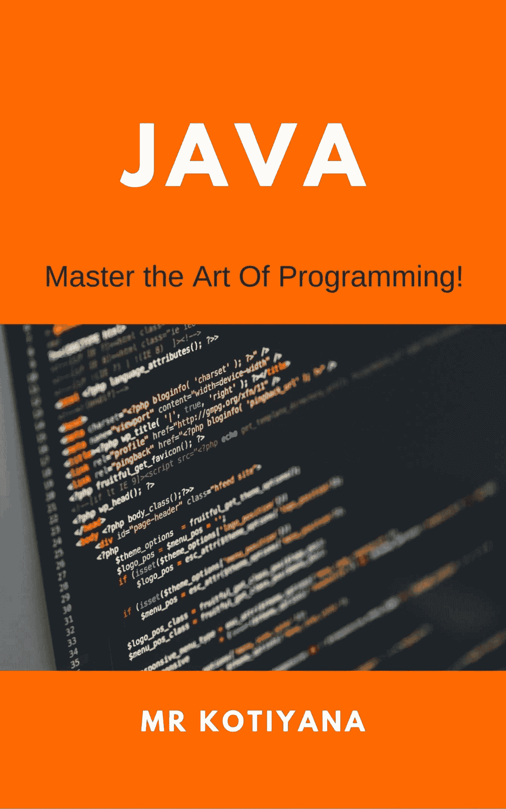

# 第 1 章 | 引言

## 本书关于什么

这本书的编写是为了任何想要学习编程语言并提高生产力的人提供答案。你可以从零开始，无需事先接触过任何编程语言。读完本书后，你将具备成为合格程序员的技能，或者至少了解阅读和编写涉及的内容。

## 为什么要读这本书？

这本书的编写是为了任何想要学习编程语言并提高生产力的人提供答案。你可以从零开始，无需事先接触过任何编程语言。读完本书后，你将具备成为合格程序员的技能，或者至少了解阅读和编写涉及的内容。

## 我需要学习数学吗？

这本书的编写是为了任何想要学习编程语言并提高生产力的人提供答案。你可以从零开始，无需事先接触过任何编程语言。读完本书后，你将具备成为合格程序员的技能，或者至少了解阅读和编写涉及的内容。

## 作为一种表达形式的编程

在编程中，词汇与意义之间存在着更深层的联系。这种联系更机械化，但同时也具有灵活性。对于编程语言，程序员们称之为 `expressiveness`（表现力）。当你在文学中写单词时，你会推断出大部分甚至全部意义。而在编程时，如果推理不是隐含，你就可以自由地为词汇定义自己的意义。

# 类

类用于在计算机内存中创建对象，并通过复制以拥有自己的生命。类用于构建对象。类中的每部分数据都成为该对象的一部分。类内部的不同数据块被称为类成员。

类成员也可以是函数或方法的逻辑块。

例如，在一个僵尸群的游戏中，每个僵尸都是从僵尸类复制或实例化的。每个僵尸对于类中的每个属性或数据元素都有独特的值。

这意味着血量值和位置对于每个被复制的僵尸对象都是唯一的。从类创建的对象被称为实例。与家庭一样，对象可以相互继承属性。

有时称为子类的孩子从其父类继承属性。例如，从僵尸创建的子类可能会继承父类对大脑的渴望。

为了发挥作用，子僵尸还可以添加新对象，并修改它从父类继承的对象。结果是，现在子僵尸可能拥有父类没有的触手。对象之间通过事件和消息进行通信。

向僵尸射击可以创建一个事件，或者用程序员的术来说，这被称为“抛出”一个事件。子弹命中事件告诉僵尸类在被子弹击中时采取必要的步骤。

事件命令类对其数据执行操作，这正是函数的用武之地。

函数也称为方法，是作用于数据的逻辑部分。它们允许你的类创建额外的事件并与更多对象进行通信。

当玩家按下扳机并移动摇杆时，可以抛出更多事件并发送消息。事件和消息允许玩家与你的世界进行交互；逻辑事件和对象共同构建了你的游戏。

## 什么是数据？

广义来说，数据类似于名词。和名词一样，数据可以是人、地点或物。程序员将这些名词称为对象，这些对象作为变量存储在内存中。“变量”一词暗示了某些可能会发生变化的东西，但情况并非总是如此。最好将变量看作计算机内存中用于存放信息的空间。当你玩像 MadLibs 这样的文字填空游戏时，你可能会要求某人的名字、一个物体、一个副词和一个地点。你的结果可能是“加斯吃了一件夹克，并专注地在洗衣店里玩。”在这种情况下，名字、物体、副词和地点就是变量类型。数据就是你用来赋值变量的单词。

程序员使用“类型”一词来表示将存储什么类型的数据。计算机并不精通英语，通常不知道英语类型“名词”和“形容词”之间的区别，但它们知道字母和各种数字之间的区别。在 `java` 或任何其他语言中都有预定义的类型。

如果加上创建新类型数据的能力，我们能够存储的数据种类实际上是无边际的。

C# 的内置类型有时被称为 POD，或“单纯的旧数据”。POD 术语源于原始的 `C++` 标准，其起源可以追溯到 1979 年。POD 类型从其原始实现没有发生根本性的变化。

到目前为止，我们已经多次使用了“类型”这个词。程序员定义“类型”来描述要存储的数据的种类。

## 声明

变量是通过声明创建的。声明被定义为正式的陈述或公告。程序员写的每组单词被称为语句。在英语中，我们会使用“sentence”（句子）一词，但程序员喜欢使用自己的词汇。变量的声明语句定义了变量的类型和标识符。

```
public class Example
{
    int i;
}
```

程序员使用分号（`;`）而不是句号来结束语句。因此，如果你想听起来像个程序员，你可以说你可以“写一条语句来声明一个类型为 `int` 标识符为 `i` 的变量”。或者如果你想表现得过度戏剧化，你可以宣布：“我宣告一个类型为 `int` 的新变量，名为 `i` ！”它将是如此。

## 变量

变量用于存储在计算机程序中被引用和操作的信息。它们还提供了一种使用描述性名称对数据进行标记的方法，以便读者和我们自己能更清楚地理解我们的程序。将变量看作存放信息的容器是有帮助的。它们的唯一目的是在内存中标记和存储数据。这些数据随后可以在整个程序中使用。

变量的名称被称为标识符。在大多数情况下，标识符是程序员（在这种情况下是你）选择的用于为变量命名的唯一单词。标识符总是程序员为了描述变量而发明的某种东西；它就像给新宠物或宝宝起名一样。

### 标识符

标识符被认为是符号或标记，是你发明的并赋予其含义的单词。标识符可以像字母 `i` 一样简单，也可以像 `@OhHAICanIHasIdentifier01` 一样复杂。

`identifier` 是用于命名你创建的任何函数、变量或数据类型的单词。使用关键字 `class` 时，后面跟着另一个被称为标识符的单词。在正确识别函数或其他数据块后，你现在可以通过其标识符来引用该数据。换句话说，当你把某些数据命名为 `Charles` 时，你通过 `Charles` 这个名字来访问该数据。

```
class MyNewClassImWriting
{
}
```

### 变量名

重要的是，变量标识符和类标识符几乎可以是任何内容。在编程时，命名任何东西都有一些规则。以下是一些有帮助的指南。长名字更容易出现拼写错误，所以保持标识符简短。变量的命名规范应该考虑以下点：

- 变量名应该指示它的用途，或者至少说明你打算用它做什么。
- 这种不应该是误导性的。或者说，如果你使用一个名为 `radius` 的变量，你不应该把它用作角色的速度。
- 如果你能读出变量的名字，也会很有帮助；否则当你尝试向另一个程序员解释代码时可能会遇到问题。

```
int someLong_complex_hardToVariableName;
```

保持尽可能简短的名字是有优势的。你的计算机屏幕（以及大多数计算机）单行内只能容纳有限的字符。你可以缩小字体，但这样就会遇到字母太小导致的可读性问题。考虑以下函数，它需要多个变量才能工作。

```
SomeFunction(TopLeftCorner – SomeThickness + OffsetFromPosition, BottomRightCorner – SomeThickness + OffsetFromPosition);
```

上面的代码使用了许多长变量名。由于每个变量的长度，语句占据了多行，使得单个语句难以阅读。我们可以缩短变量名，但很容易缩短过头。

```
CleverFunc(TL–Thk+Ofst,LR–Thk+Ofst);
```

变量名应该是具有描述性的，这样你才知道你打算如何使用它们：太短了可能会丢失意义。

```
int a;
```

虽然简短且容易记忆，但对于任何其他阅读你代码的人来说，很难知道你把变量 `a` 用做什么了。这在与其他程序员合作时会变得格外困难。变量命名并不是完全没有规则的。

```
int 8;
```

变量名不能是数字。这是糟糕的；数字在编程中有特殊的地位，因为编程的大部分对其有其他用途。IDE 会尝试帮助你发现问题。它发现的任何问题下方都会出现红色的波浪线。既然提到带数字的变量名，你可以将数字作为变量名的一部分。

```
int varNumber2;
```

上面的名称是完全有效的，并且可能是有用的，但相反请考虑以下内容。

```
int 13thInt;
```

变量名不能以任何数字开头。坦诚地说，我不确定为什么这种情况会导致编译器崩溃，但它似乎确实与为什么不能单独使用数字作为变量名有关。

```
int $; int this-that; int (^_^);
```

大多数特殊字符也有其特定的含义，并被预留用于其他用途。例如，在 `JAVA` 中，`-` 用于减法；在这种情况下，`JAVA` 可能会认为你正试图从 `this` 中减去 `that`。你应该记住，关键字也是无效的变量名，因为它们在 `JAVA` 中已经有了特殊的含义。在 IDE（集成开发环境）中，你可能会注意到 `this` 单词被高亮了，这表明它是一个关键字。变量中间的空格也是无效的。

```
int Spaces are bad;
```

很可能，添加不是字母的字符会破坏编译器。只有下划线和字母可以用于标识符名称。使用表情符号作为变量名可能很有趣，但在与代码的其他部分一起使用时，阅读会非常困难。

```
int ADifferenceInCase; int adifferenceincase;
```

这里的两个变量实际上是不同的。像 `java` 这样对大小敏感的语言确实会区分字符的大小；这在通过名称调用其他内容时也是如此。考虑到这一点：`A` 不同于 `a`。

作为一名程序员，你需要考虑变量应该如何命名。它对你以及任何其他与你分享工作的人来说必须清晰可见。你还会多次输入你的变量名，所以它们应该是短小且易于记忆和输入的。我们在这里讨论的最后一个字符是那个有点奇怪的 `@`符号。`@` 只有在它是变量名的第一个字符时才能使用。

```
int @home;

int noone@home;
```

在在这里声明的第二个变量中，我们将得到一个错误。这些不规则的字符在你的代码中很容易发现。当你有一个长长的变量列表时，最好是让它们在视觉上脱出来。一些受过经典训练的程序员喜欢使用下划线来表示类作用域变量。对于仅存在于函数内部的变量，则会被省略。当你使用 `int` 时，你会发现关于 `@` 的奇特规则的原因，`int` 被保留为关键字。你被允许使用 `int @int`，之后你可以为 `@int` 赋值任何整数值。然而，许多程序员根据他们的编程背景，倾向于使用 `MyInt`、`mInt` 或 `_int` 而不是 `@int`。

优秀的程序员会花费大量时间为他们的变量和函数想好用的名字。想出描述性的名称需要一些适应，但这里有一些实用的技巧。变量通常使用名词或形容词命名，因为它们描述了与其用途相关的属性。

最后，一旦你开始在代码的其他部分使用该变量名，修改它就会变得更加困难，因为需要在所有使用它的地方进行更改。进行全局更改被称为重构，这种情况发生得频繁，以至于已经有软件可以帮助你“重构”类、变量和函数名。

> **注意：**
>
> 你可能还会注意到大写和小写字母使用的模式。这被称为 `BumpyCase`（波峰命名）或 `CamelCase`（驼峰命名）。有时开头字母是小写的，在这种情况下它看起来像 `headlessCamelCase` 而不是 `NormalCamelCase`。程序员之间对于哪种是正确的会产生很多争论，但到头来哪种都可以。因为 `Java` 是大小敏感的，你和任何帮助你的人应该就是否使用开头大写字母达成共识。这些差异通常源于一个人学习如何编写软件的地方或教他那里的人。混合使用大写和小写是编程风格的一部分。风格还包括如何使用空白。

### 关键字

关键字是特殊的单词或符号，它们告诉编译器执行特定的操作。例如，行首的关键字 `class` 告诉编译器你正在创建一个类。类声明是告诉编译器你即将创建一个新类的代码行。单词出现的顺序非常重要。英语需要句子和语法才能向读者妥善地传达我们的思想。

在代码中，无论是 `Java` 还是其他语言，编程都需要语句和语法来向计算机正确传达指令。

```
class className
{
}
```

每个类都需要一个名称；在上面的示例中，我们把类命名为 `className`，尽管我们很容易地将类命名为 `Charles`。当命名一个新类时，该名称变成了一个新的标识符。这对于每个变量名也是如此，尽管作用域限制了变量标识符存在的长度和位置。我们将很快学习更多关于变量和作用域的知识。你不能将关键字用于 `Java` 预期用途之外的任何地方。有例外，但通常情况下，关键字为你提供了特定的命令。

`Java` 中总大约有 80 个你应该注意的关键字。

### 标记

在书面英语中，语言的最小元素是字母和数字。单独的大多数字母和数字缺乏特定的含义。字母之后更大的元素是单词。每个单词都有更多的含义，但复杂的思想很难用一个单词传达。为了传达一个思想，我们使用句子。句子中的每个单词都有特定的用途，如下图所示。为了传达一个概念，我们使用一组句子组成成一个段落。为了传达情感，我们使用许多段落组成成章节。为了讲述一个故事，我们使用书，即章节的集合。

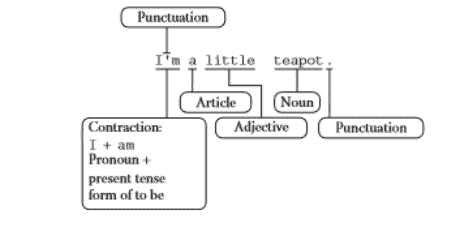

编程有类似的组织机制。最小的有意义元素是标记，随后是语句、代码块、函数，然后类和命名空间，最后是程序，在我们的案例中是一个游戏。我们将从最小元素开始，一直到编写自己的类。然而，在开始编写复杂代码之前，了解非常小的元素对于理解所有部分是如何结合是非常重要的。

#### 编写 Java

Java 是一种基于英语的编程语言；像任何其他 C 类编程语言一样，它可以被拆分为标记，即计算机可以理解的最小意义文本片段。标记由单个字符或一系列字符组成。例如，在下面这个简单的语句中有五个标记。

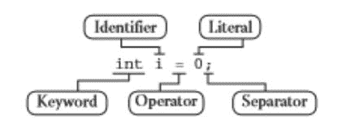

标记可以分类为关键字、标识符、字面量、运算符、分隔符和空白。上面的语句包含五个标记，并提供了空白支持。关键字 `int` 后面是标识符 `i`。之后是一个运算符 `=`，它将运算符左侧的标识符赋值右侧字面量 `0` 的值。最后一个标记 `;` 是分隔符，用于结束语句。空白和注释（我们尚未涵盖）不被视为标记，尽管它们可以充当分隔符。使用正确的格式或风格是非常重要的。

让我们检查示例代码：

```
int i = 0; int j = 1;
```

上述显示的代码是两条语句，分隔符防止计算机将代码误读为单条语句。然而，编写代码时涉及人类，因此代码需要对人类可读，或者对任何可能阅读你代码的其他生物可读。良好的代码意味着遵循特定的格式风格。我们将在本章的后续部分详细讨论更多良好的代码风格。每组字符或文本都会由计算机中的词法分析器（有时称为 lexer）进行转换，并变为一个符号。这一过程被称为标记化，或者用计算机科学家的话说，词法分析器将你的代码标记为符号。一旦标记完成，符号就会被解析；这个过程将标记组织成计算机要执行的指令。这种独特的词汇将程序员描绘成了一群奇怪的外星生物，他们拥有完全属于自己的语言；不过，我向保证，在与大多数程序员聊天时，并不经常提到关于词法分析器的话。

这看起来可能是一项巨大的工程，而且我们正在跳到更复杂的计算机科学主题，但这一切都发生在幕后，所以你不需要看到这些内容的发生。

理解编译器的作用以及它是如何工作的是非常重要的，这样你就能用计算机可以理解的方式编写代码。这就是为什么一个简单的拼写错误会阻止词法分析器构建代码的原因。我们很快就会学习编写用于分析、标记和解析的代码。

计算机无法解释或猜测你正尝试做什么。因此，如果你错误地输入了 `int i = 0:` 而不是 `int i = 0;`，最后一个标记无法被词法分析器转换为正确的符号，因此这条语句将完全无法被解析。这段代码在编译之前就会导致错误。

### 分隔符标记

最常见的分隔符是 `;`，分号。这个标点符号用于结束一条代码语句。其他分隔符成对出现。大括号成对使用，用于分隔一组代码语句。左括号是 `{`，尖端指向组的外部；它与关闭大括号对的 `}` 配对。圆括号以 `(` 开始并以 `)` 结束，方括号以 `[` 开始并以 `]` 结束。不同的起始和结束大括号、方括号和圆括号有特定的用途，并帮助识别它们被用于什么地方。还有角括号 `<` 和 `>`；这些用于包围数据类型。不要忘记单引号 `''` 和双引号 `""`，它们也是成对使用的，用于包围被称为字符串的符号。

> **注意：**
>
> 在许多文字处理器中，经常使用起始和结束引号（`“` 和 `”`）。词法分析器不识别这些“智能引号”，因此编程文本编辑器使用直引号（`"`）。一旦你意识到编程中使用的字母、数字和所有其他字符都被解析为美国信息交换标准代码（ASCII）或 Unicode 转换格式（UTF-8）、16 或 32，这些细微的变化就不再微妙了。
>
> ASCII 和 UTF 都是计算机用于读取文本时使用的字符数据库的名称。计算机不使用眼睛阅读。相反，它们使用一个数字数据库来查找正在使用的每个字符。因此，对于计算机来说，如果我们使用 `UTF-16`，`“` 看起来更像 `0x201C`，而 `"` 像 `0x0022`。代码中的大括号用于分隔语句。圆括号通常用于接收数据。方括号通常有助于识别数组。我们稍后会讨论数组，但在解释之前，你可以先想象成类似电子表格或图纸的东西。

```java
int[] arrayNumbers = {1, (int) 3.0, 9000};
```

上述语句将三个数字赋值给数组。大括号中包含一对用逗号分隔的语句。大括号中的第二条语句是将一个带有点 `.` 的数字转换为一个不带点的数字。这可能需要一些解释，但习惯看到这种东西是有处的。我们很快就会讨论什么是数组，以及点运算符。

通常在学习编程时，你会看到很多奇怪的标记，它们可能看起来没有任何意义。这取决于你观察你遇到的每一个标记，并尝试理解它是做什么的。

如果没有任何语句是说得通的，那也没关系。此时我们并不要求你已经知道所有这些含义，但你很快就会知道了。

### 运算符标记


# 运算符与字面量

运算符类似于关键字，但它们只使用少数非单词字符。冒号或分号是一个运算符；与关键字不同，运算符会根据它们出现的位置或使用方式来改变其功能。这种行为的转变被称为**运算符重载**，这是一个复杂的课题，我们稍后会讨论。同样重要的一点是，当你需要时，可以创建自己的运算符。Java 中的逗号有不同的含义。它们用于分隔不同的数据值，例如 `for(int i = 0, j = 1; ; i++, j++)`。

## 其他运算符标记

泛而言，运算符是处理变量之间特定操作的特殊字符。运算符和变量出现的符号或顺序通常通过以下表示法或数学语法进行教学：`a + b = c`。然而，在编程中，倾向于使用：`c = a + b;` 这种变化是因为 `Java` 中的 `=` 运算符的工作方式与其数学课上通常教授的功能不同。`=` 运算符的左侧是赋值侧，右侧是操作侧。这使得重点放在被赋值的值上，而不是如何赋值。上面的例子应该读作“c 被赋值 a 加 b”。

## 字面量

字面量有许多不同的形式；类似于运算符 `+`、`-` 或 `=`，它们是出现在它们之间的标记。数字被认为是标记，或以字面量方式使用的标记。数字可以称为数字字面量。当内容放入引号中时，例如“I’m a literal”，你写的是字符串字面量。字面量贯穿几乎所有的编程语言，并构成 `Java` 数据类型的基础。现在我们只处理几种不同类型的字面量，但很快我们就会接触更多。

## 律性与非律性操作

在数学课上，有时会教某些操作具有律性而另一些不是。例如 `2 + 3 + 4` 和 `4 + 3 + 2` 的结果相同。每个数字出现在运算符之间的位置并不重要，因此 `+` 运算符认为是律性的。这一概念在 `Java` 中同样适用。当我们开始混合运算符时，结果就会改变。

```java
int a = 1 + 2 - 4 + 7; //a = 6
int b = 7 + 4 - 2 + 1; //b = 10
```

# 函数

## 什么是函数？

函数（有时称为方法）包含处理数据的语句。这些语句可以也可以处理数据。方法可以被其他语句访问。这种行为被称为调用函数或进行函数调用。

函数在不同的编程语言中看起来可能不同，但它们的工作原理大部分情况下是相同的。通常的模式是接收数据并使用逻辑来处理这些数据。函数也可能有其他名称，例如方法。主要的区别在于不同语言使用语法的方式。语法基本上是指空格或制表符、操作符或关键字的使用。

归根结底，你所做的一切都是告诉编译器如何将你的指令转换为计算机解释的命令。变量和函数构成了编程的主体。你想要记住的任何数据都存储在变量中。变量由你的函数进行处理。通常，当你将变量和函数组合在一个地方时，你将其称为一个类。

### 示例

```java
public void PrintNum ()
{
    System.out.println (anotherNum);
}
```

在编写新函数时，在继续其他任务之前，填写整个函数的布局是一个良好的习惯。这会让编译器感到轻松；如果将一个函数留为 `void MyFunction` 的形式然后跳到另一个函数，会让编译器困惑于你打算做什么。在这种情况下，集成开发环境（例如 `MonoDevelop`）会不断读取和解释你正在编写的内容，类似于文字处理器中的拼写检查器。当它遇到没有确定形式的语句时（例如变量、函数或类定义），它对你编写代码的解释将抛出警告或错误。`MonoDevelop` 看起来可能有点挑剔，但它正在尽力提供帮助。

## 编写函数

函数由声明和体组成。有些程序员喜欢把这些称为方法，但撇开语义不谈，函数基本上是一个语句集合的容器。

让我们继续之前的示例：

```java
void MyFunction ()
{
}
```

这是一个名为 `MyFunction` 的基础函数。我们可以添加额外的关键字来修改函数的可见性。我们将要看到的一个常见修饰符是 `public`。

```java
public void MyFunction ()
{
}
```

`public` 关键字需要出现在函数返回类型之前。在这种情况下，它是 `void`，意味着该函数不返回任何内容。但函数可以以几种不同的方式作为值。作为参考，返回 `int` 的函数看起来像这样。在任何具有返回类型的函数中，必须存在某种返回语句。

```java
public int MyFunction ()
{
    return 1;
}
```

`public` 修饰符总是需要的，除非你需要让此函数对其他类可用。如果这一点现在不理解，很快就会明白了。函数最后总是要求的部分是参数列表。留空它是有效的，但为了感受参数列表中的 `arg`（或参数 argument）看起来是什么样，请看下一个示例。

```java
public void MyFunction (int i)
{
}
```

目前，我们将暂不使用参数列表，但以后知道你看到的是什么很重要，这样它就不会让你感到意外。参数列表用于将信息从函数外部传递到函数内部。这就是类能够将信息从一个发送到另一个。函数声明与类声明相似。函数是处理变量逻辑的核心。

## 函数作用域

变量的生命往往是短暂的。某些变量只存在于几行代码中。某些变量可能只在函数开始时产生，并在函数结束时消失。类作用域内的变量只要类存在就一直存在。变量的寿命取决于它创建的位置。

### 示例

```java
public class Classscopm{
    int ClassInt;
    void first()
    {
        int firsttint;
    }
    void second()
    {
        int secondint;
    }
}
```

如果我们观察上面的图，就可以可视化作用域是如何划分的。外层框代表谁可以看到 `ClassInt`。在第一个 `()` 函数内部，我们有一个 `firsttint`，它只存在于第一个 `()` 函数中。

`secondint` 也是如此，只存在于 `second()` 函数中。这意味着 `first()` 可以同时使用 `ClassInt` 和 `firsttint`，但不能 `secondint`。同样，`second()` 可以看到 `ClassInt` 和 `secondint`，但看不到 `firsttint`。

## 参数列表

当函数被调用时，它的标识符后面跟着参数列表会被添加到代码中。参数就像房子门上的小信口。可能会有一个整数、浮点数和数组的槽。门上的每个槽（或参数列表中的参数）都是一个类型后跟一个标识符。

如果我们看一个基础示例，就能看到这一切是如何运作的。

```java
public class Example {
    int a = 0;
    void SetA (int i) {
        a = i;
    }
}
```

`SetA (int i)` 接收一个 `int` 类型的参数。这是一个值参数的简单示例；接下来我们将介绍其他类型的参数。值参数声明了类型和标识符，其的作用域被限于其声明所在函数的内容。当你运行上面的程序并给函数 `SetA(3)` 参数赋值 `3` 时，你将看到一个 `0` 跟着一个 `3`。我们可以这样做很多次，每次都允许更改值。

目前，我们将暂不使用参数列表，但以后知道你看到的是什么很重要，这样它就不会让你感到意外。参数列表用于将信息从函数外部传递到函数内部。这就是类能够将信息从一个发送到另一个。

## 副作用

当函数直接设置类中的变量时，程序员将其称为副作用。副作用通常是程序员试图避免的。

```java
class MyEffect {
    int a = 0;
    void SetA ()
    {
        a = 5;
    }
}
```

上面的 `SetA()` 函数将 `a` 设置为 `5`。`public` 修饰符并不总是需要的，除非你需要让此函数对其他类可用。

副作用越多，可能出现越奇怪的行为。如果 `Main()` 函数期望一个值但得到了另一个，就会开始出现意料之外的行为。更糟糕的是，如果 `SetAgain()` 被另一个类调用而你期望 `a` 为 `5`，你将会遇到更多奇怪的行为。

## 多参数

函数可以接受的参数数量没有限制。某些语言限制你最多使用 16 个参数，这似乎是可以接受的。如果你的逻辑需要超过 16 个参数，将你的函数拆分为不同的部分可能会更容易。然而，如果我们我们要执行一些简单的事情，我们可能还是想使用多个参数。

```java
int a = 0;
void SetA (int i, int j) {
    a = i * j;
}
```

我们可以为 `SetA` 添加第二个参数。逗号标记告诉函数接受参数列表中的另一个变量。对于这个示例，我们使用两个 `int` 相乘并将值赋值给 `a`。对参数列表中允许使用的类型没有限制。

```java
int a = 0;
float b = 0;
void SetA (int i, float j) { 
    a = i; 
    b = j;
}
```

带有多个参数的函数可以执行更多操作。值参数是将数据传入函数以完成某些简单任务的有效方法。

# 逻辑与运算符

逻辑允许你根据变量的变化来控制函数的哪些部分被执行。通过逻辑，你将能够改变代码中哪些语句将运行。简单来说，你写的任何内容必须涵盖你计划覆盖的每种情况。逻辑通过几个简单的系统控制，主要是 `if` 关键字以及 `if` 的各种变体。

## 布尔值

Java 中的布尔值，简称为 `bools`，非 `true`（真）即 `false`（假）。最简单的方法是将它们想为开启或关闭状态的开关。要将一个 `var` 声明为 `bool`，你可以使用下面的代码。

```java
public class Example
{
    public bool SomeBool;
}
```

## 等于运算符

相等运算符创建布尔条件。设置布尔变量有许多方法。例如，值之间的比较是设置变量的有用手段。确定相等的最基本方法是使用以下运算符：`==`。单等号和双等号符号的使用是有区别的。`=` 用于赋值，而 `==` 用于比较值。

当你需要比较两个值时，可以使用以下概念。如果你需要和程序员交流，需要记住这些运算符被称为相等运算符。

这里的语法最初看起来可能有些困惑，但有解决办法。

```java
void Func ()
{ 
    SomeBool = (1 == 1);
}
```

还有其他需要注意的运算符。你将在本章稍后部分介绍其他逻辑运算符。在这种情况下，我们正在询问两个数值是否相同。为了让这更清晰，我们可以将代码分成更多行。现在，我们正在比较 `a` 和 `b`。显然，它们看起来并不相同；毕竟是不同的字母。然而，它们确实包含相同的整数值，而这正是这里真正比较的内容。

```java
void Func ()
{
    int a = 1;
    int b = 1;
    SomeBool = (a == b);
}
```

评估有左侧和右侧。单等号运算符（`=`）分隔了不同的侧。`=` 的左侧被计算，并查看右侧的值以获取赋值。因为 `1 == 1`，也就是说 `1` 等于 `1`，该语句的最终结果是 `SomeBool` 为 `true`。

## 关系运算符

布尔值也可以通过比较值来设置。比较两个不同值的运算符被称为关系运算符。我们使用 `==`（等于）来检查值是否相同；我们也可以使用 `!=`（不等于）来检查两个变量是否不同。

它的工作原理与上一节中的 `!` 类似。程序员更多地检查一个值是否大于或小于另一个值。他们通过使用 `>`（大于）和 `<`（小于）这样做。我们还可以使用 `>=`（大于等于）和 `<=`（小于等于）。让我们来看看这种用法的一些示例。

```java
public class Test {
    public static void main(String args[]) {
        int a = 10;
        int b = 20;
        System.out.println("a == b = " + (a == b));
        System.out.println("a != b = " + (a != b));
        System.out.println("a > b = " + (a > b));
        System.out.println("a < b = " + (a < b));
        System.out.println("b >= a = " + (b >= a));
        System.out.println("b <= a = " + (b <= a));
    }
}
```

**输出：**

```
a == b = false
a != b = true
a > b = false
a < b = true
b >= a = true
b <= a = false
```

## Return 关键字

我们需要喜爱 `return` 关键字。这个关键字将函数转换为数据。在它生效之前，需要满足一些条件。到目前，我们一直在使用 `void` 关键字来声明函数的返回类型。它看起来像下面的代码片段。

```java
void MyFunction()
{
    //此处是代码...
}
```

在这种情况下，使用 `return` 将非常简单。

```java
void MyFunction()
{
    //此处是代码 ...
    return;
}
```

此函数返回 `void`。这条语句具有更深层的含义。当实际上返回一个真实值（void 以外的某种东西）时，返回一个值才有意义。让我们来看一个更有意义的函数。函数声明开头的 `void` 关键字意味着此函数没有返回类型。如果我们更改声明，我们需要确保有一个与声明匹配的返回值。这可以像下面的代码片段一样简单。

```java
int MyFunction()
{
    //此处是代码...
    return 1; // 1 是一个 int
}
```

此函数返回 `int` `1`。声明带有返回值的函数要求返回类型与声明匹配。当使用该函数时，它应该被视为与函数返回类型匹配的数据类型。

# 类/静态变量

类变量也称为静态变量，使用 `static` 关键字在类中声明，但在方法、构造函数或块之外。无论创建了多少个对象，每个类只有一个类变量副本。

静态变量在程序启动时创建，在程序停止时销毁。可见性与实例变量相似。数字的默认值为 `0`；布尔值为 `false`；对象引用为 `null`。

示例：

```java
import java.io.*;

public class Employee {
    // salary 变量是静态变量
    private static double salary;
    // DEPARTMENT 是常量
    public static final String DEPARTMENT = "Development ";

    public static void main(String args[]) {
        salary = 1000;
        System.out.println(DEPARTMENT + "average salary:" + salary);
    }
}
```

**输出：**

Development average salary:1000

注意：如果从外部类访问，常量应通过 `Employee.DEPARTMENT` 访问。

# 数组

数组是组织良好的数据列表。想象从零开始的编号列表，每向列表添加内容时就会扩展一行。数组对于任何情况都很有用，因为它们被视为单个数据块。例如，如果你想存储一组高分，你会想用数组来实现。最初，你可能想要一个包含 10 个元素的列表。理论上，你可以使用以下代码来存储每个分数。

```java
int score1;
int score2;
int score3;
int score4;
int score5;
int score6;
int score7;
int score8;
int score9;
int score10;
```

更糟糕的是，如果你需要处理每个值，你需要创建一个按变量名处理每个变量的代码。为了检查 `score2` 是否大于 `score1`，你需要编写一个专门用于检查这两个变量的函数，以便交换它们。谢天谢地有数组。

数组有两种类型：

*   一维数组
*   多维数组

## Java 中的一维数组

在 Java 中声明数组的语法：

`dataType[] arr;` (或)

`dataType [] arr;` (或)

`dataType arr[];`

在 Java 中实例化数组：

`arrayRefVar=new datatype[size];`

### 单维 Java 数组示例

让我们来看 Java 数组的简单示例，其中我们将对数组进行声明、实例化、初始化和遍历。

```java
class Testarray{
    public static void main(String args[]) {
        int a[]=new int[5]; // 声明和实例化
        a[0]=10; // 初始化
        a[1]=20;
        a[2]=70;
        a[3]=40;
        a[4]=50;
        // 打印数组
        for(int i=0;i<a.length;i++) // length 是数组的属性
            System.out.println(a[i]);
    }
}
```

**输出：**

```
10
20
70
40
50
```


## Java 数组的声明、实例化和初始化

我们可以以下方式同时声明、实例化并初始化 Java 数组：

```java
int a[]={33,3,4,5}; // 声明、实例化和初始化
```

让我们来看打印此数组的简单示例。

```java
class Testarray1{
    public static void main(String args[]) {
        int a[]={33,3,4,5}; // 声明、实例化和初始化
        // 打印数组
        for(int i=0;i<a.length;i++) // length 是数组的属性
            System.out.println(a[i]);
    }
}
```

**输出：**

```
33
3
4
5
```

## 在 Java 中将数组传递给方法

我们可以将 Java 数组传递给方法，这样可以在任何数组上重用相同的逻辑。让我们来看使用方法获取数组最小数字的简单示例。

```java
class Testarray2{
    static void min(int arr[]) {
        int min=arr[0];
        for(int i=1;i<arr.length;i++)
            if(min>arr[i])
                min=arr[i];
        System.out.println(min);
    }
    public static void main(String args[]) {
        int a[]={33,3,4,5};
        min(a); // 将数组传递给方法
    }
}
```

**输出：**

```
3
```

## Java 中的多维数组

在这种情况下，数据是基于行和列的索引存储的（也称为矩阵形式）。

### 在 Java 中声明多维数组的语法

- `dataType[][] arrayRefVar;`
- `dataType [][] arrayRefVar;`
- `dataType arrayRefVar[][];`
- `dataType [] arrayRefVar[];`

### 在 Java 中实例化多维数组的示例

```java
int[][] arr=new int[3][3]; // 3 行 3 列
```

### 在 Java 中初始化多维数组的示例

```java
arr[0][0]=1;
arr[0][1]=2;
arr[0][2]=3;
arr[1][0]=4;
arr[1][1]=5;
arr[1][2]=6;
arr[2][0]=7;
arr[2][1]=8;
arr[2][2]=9;
```

### Java 多维数组的示例

让我们来看声明、实例化、初始化和打印二维数组的简单示例。

```java
class Testarray3{
    public static void main(String args[]) {
        // 声明并初始化 2D 数组
        int arr[][]={{1,2,3},{2,4,5},{4,4,5}};
        // 打印 2D 数组
        for(int i=0;i<3;i++)
            for(int j=0;j<3;j++){
                System.out.print(arr[i][j]+" ");
            System.out.println();
    }
}
```

**输出：**

```
1 2 3 
2 4 5 
4 4 5 
```

## 循环

可能会出现需要执行某次代码块的情况。通常，语句是按顺序执行的：首先执行第一个语句，然后是第二个语句，依此类推。编程语言提供了各种控制结构，允许更复杂的路径。`loop` 语句允许我们多次执行一个语句或一组语句，以下是大多数编程语言中循环语句的一般形式：


### While 循环

如果我们想在循环中多次运行特定的语句，我们需要另一种方法。为了实现这一点，Java 提供了另外关键字 `while` 和 `for`。`while` 语句更容易使用。它只需要一个参数来确定是否继续执行。该语句与 `if` 语句有些相似，不同在于它在完成评估后会返回 `while` 语句的顶部。

`while` 循环的语法为：

```java
while(Boolean_expression) {
    // 语句
}
```

在这里，`statement(s)` 可以是一个单独语句或一组语句。`condition` 可以是任何表达式，而 `true` 是任何非零值。在执行时，如果 `boolean_expression` 的结果为 true，则将执行循环内部的操作。只要表达式的结果为 true，这种执行就会持续下去。当条件变为 false 时，程序控制将传递到循环紧后的下一行。

**流程图：**


**示例：**

```java
public class Test {
    public static void main(String args[]) {
        int x = 10;
        while(x < 20) {
            System.out.print("value of x : " + x);
            System.out.println("\n");
        }
    }
}
```

**输出：**

```
value of x : 10
value of x : 11
value of x : 12
value of x : 13
value of x : 14
value of x : 15
value of x : 16
value of x : 17
value of x : 18
value of x : 19
```

### For 循环

为了对循环执行获得更细致的控制，我们另一种选择。`for` 循环需要三个不同的语句。

**语法：**

```java
for(initialization; condition; update) {
    // 语句
}
```

这里是 Java 中 `for` 循环的执行方式：

- 第一个语句是 `initialization`。
- 第二个语句是 `condition`。
- 第三个语句是 `update`。
- `initialization` 只执行一次。
- `condition` 在每次循环会被评估。如果为 true，则执行循环体；如果为 false，循环终止。
- `update` 在循环体之后执行，然后回到 `condition`。

**流程图：**


**示例：**

以下是 Java 中 `for` 循环的代码。

```java
public class Test {
    public static void main(String args[]) {
        for(int x = 10; x < 20; x = x + 1) {
            System.out.print("value of x : " + x);
            System.out.print("\n");
        }
    }
}
```

**输出：**

```
value of x : 10
value of x : 11
value of x : 12
value of x : 13
value of x : 14
value of x : 15
value of x : 16
value of x : 17
value of x : 18
value of x : 19
```

## 循环控制语句

循环控制语句改变其正常执行顺序。当离开作用域时，在该作用域内创建的所有自动对象将被销毁。Java 支持以下控制语句：

- Break 语句
- Continue 语句

`break` 语句在 Java 语言有两种用法：

- 当循环内部遇到 `break` 语句时，循环立即终止，程序控制恢复到循环后的下一个语句。
- 它可以终止 `switch` 语句中的 case（在下一章节介绍）。

### Break 语句

`break` 的语法是任何循环中的单个语句：

```java
break;
```

**流程图：**


**示例：**

```java
public class Test {
    public static void main(String args[]) {
        int [] numbers = {10, 20, 30, 40, 50};
        for(int x : numbers ) {
            if( x == 30 ) {
                break;
            }
            System.out.print( x );
            System.out.print("\n");
        }
    }
}
```

**输出：**

```
10
20
```

`continue` 关键字可以用于任何循环控制结构。它会导致循环立即跳转到循环的下次迭代。

- 在 `for` 循环中，`continue` 关键字会导致控制立即跳转到更新语句。
- 在 `while` 循环或 `do/while` 循环中，控制立即跳转到布尔表达式。

### 语法

`continue` 的语法是任何循环内部单条语句——

```java
continue;
```

### 流程图

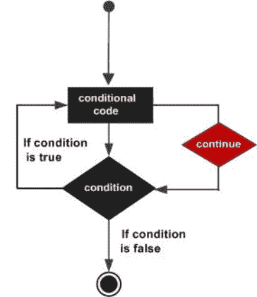

### 示例

```java
public class Test {
  public static void main(String args[]) {
    int[] numbers = {10, 20, 30, 40, 50};
    for(int x : numbers) {
      if(x == 30) {
        continue;
      }
      System.out.print(x);
      System.out.print("\n");
    }
  }
}
```

### 输出

```
10
20
40
50
```

## 类

任何 Java 程序中最重要的部分是类。这里的“类”不是学生去的那种教室；而是分类意义上的类。Java 中的类以几种不同的形式出现。有些被称为部分类（partial classes），有些类甚至出现在另一个类内部；这些类被称为嵌套类（nested classes）。类是指令和数据的集合。指令被称为函数或方法。存储在类中的数据被称为字段或属性。抛开所有命名不谈，重要的是类做了什么以及它们是如何被使用的。

类是灵活且易于更改的，但这种灵活性并不是没有复杂性的。正如我们之前看到的，类声明可以包含比以下示例多多的内容。然而，大部分复杂性出现在本书的后面，当需要时才会出现。

当你处理游戏或任何类型的编程任务时，首先收集数据，然后弄清楚如何使用数据。在大多数编程范式中，最好的方法是在新类的开始时从变量。例如，在下面的伪代码中，我们可能想在出去之前知道是星期几：

```java
Time day = today;
if (day == Friday) {
  PartyTonight = true;
}
```

我们从获取日期开始，然后根据日期决定今晚做什么。除非我们想上班迟到，否则我们应该避免先聚会再检查是星期几。我们将在学习了如何在类中正确使用变量后，对这个主题进行更详细的介绍。

## 对象简介

面向对象编程（OOP）的发明是为了将数据和逻辑关联成封装良好的代码包。当你在 Java 中编写一个类时，你正在为一个新对象创建蓝图和指令。然后可以根据你的蓝图构建任意数量的对象。程序员在谈论从类蓝图创建对象时会使用 `instantiate`（实例化）一词。每个被实例化的对象都是其构建的类的实例。类本身并不是由它创建的实例之一。新创建的对象包含了写入类中的所有函数和数据。

所有编程语言都提供抽象。可以认为，你能够解决的问题的复杂性与抽象的类型和质量直接相关。我说的“类型”是指“你正在抽象什么？”。汇编语言是对底层机器的一种抽象。随后的许多所谓的“命令式”语言（如 FORTRAN、BASIC 和 C）都是汇编语言的抽象。这些语言是对汇编语言的巨大改进，但它们的主要抽象仍然要求你从计算机的结构来思考，而不是从试图解决的问题的结构来思考。

程序员必须在机器模型（位于“解决方案空间”中，即你实现解决方案的地方，如计算机）与实际正在解决的问题模型（位于“问题空间”中，即问题存在的地方，如业务）之间建立关联。执行这种映射所需的努力，以及它是外部于编程语言的这一事实，导致了程序难以编写且维护成本高昂，并作为副作用产生了整个“编程方法”行业。

建模机器的替代方案是对你试图解决的问题进行建模。早期的语言如 LISP 和 APL 选择了特定的世界观（分别为“所有问题根结底都是列表”或“所有问题都是算法的”）。Prolog 将所有问题转化为决策链。创建的语言还用于基于约束的编程，以及专门通过操作图形符号进行编程的语言。（后者被证明限制性太大了。）

这些方法中的每一种对于它们设计要解决的特定类问题可能都是很好的解决方案，但当你跳到该领域之外时，它们就会变得笨拙。

面向对象的方法更进了一步，为程序员提供了表示问题空间中元素的工具。这种表示方法足够通用，使得程序员不受限于任何特定类型的问题。我们将问题空间中的元素及其在解决方案空间中的表示称为“对象”。（你还需要其他没有问题空间类比的对象。）

这种想法是，允许程序通过添加新类型的对象来自己适应问题的术语，因此当你阅读描述解决方案的代码时，你读到的也是表达问题的词汇。这比我们以前拥有的更灵活、更强大的语言抽象。因此，OOP 允许你根据问题本身来描述问题，而不是根据运行解决方案的计算机来描述。它仍然与计算机有联系：每个对象看起来都很像计算机——有状态，也有可以执行的操作。然而，这种类比对于对象来说并不糟糕——它们具有特征。

简单来说，OOP 是构建对象、实例化并使用它们的过程。使用对象涉及读取数据、对数据进行处理以及执行任务。

## 面向对象编程的特征

这些特征代表了纯的面向对象方法：

1. **一切皆对象**。把对象想象成特殊的变量；它存储数据，但你可以对其请求。理论上，你可以将试图解决的问题中的任何概念组件（狗、建筑、服务等）表示为程序中的一个对象。
2. **程序是由一组通过发送消息告诉对方做什么的对象组成的**。要向对象提出请求，你向该对象`发送消息`。更具体地说，你可以将消息看作是调用特定对象的`方法`的请求。
3. **每个对象都有由其他对象组成的内存**。换句话说，你通过包含现有对象的包来创建一个新类型的对象。因此，你可以在构建程序的同时通过对象的简单性隐藏复杂性。
4. **每个对象都有一个类型**。用术语来说，每个对象都是`类`的实例，其中“类”与“类型”同义。类最重要的区别特征是“你可以向它发送什么消息？”
5. **特定类型的所有对象都可以接收相同的消息**。这实际上是一个带有深意的陈述，正如你之后看到的。因为类型为“圆”的对象也是“形状”类型的对象，所以圆保证接受形状消息。这意味着你可以编写处理形状的代码，并自动处理任何符合形状描述的物体。这种替换性是 OOP 中一个强大的概念。

对对象更简洁的描述是：

对象具有状态、行为和标识。

这意味着一个对象可以拥有内部数据（赋予其状态）、方法（产生行为），并且每个对象都可以与其他任何对象唯一地区分开来——具体来说，每个对象在内存中都有一个唯一的地址。

## 对象具有接口

因此，尽管我们在面向对象编程中实际上做的是创建新的数据类型，但几乎所有的面向对象编程语言都使用 `class` 关键字。当你看到“类型（type）”这个词时，请思考“类（class）”，反之亦然。

由于 `class` 描述了一组具有相同特征（数据元素）和行为（功能）的对象，因此 `class` 实际上是一个数据类型，因为例如，浮点数也拥有一组特征和行为。区别在于，程序员定义一个 `class` 是为了适应某个问题，而不是被强制使用一个设计用于表示机器中存储单元的现有数据类型。你通过添加特定于你需求的新数据类型来扩展编程语言。编程系统欢迎新的 `classes`，并对它们提供与内置类型同等的关注和类型检查。

面向对象的方法不仅限于构建仿真。无论你是否同意任何程序都是你所设计的系统的仿真，使用 OOP 技术都可以轻松地将一组问题简化为简单的解决方案。

一旦建立了一个 `class`，你就可以随心所欲地创建任意数量该类的对象，然后操作这些对象，就像它们是你试图解决的问题中存在的元素一样。事实上，面向对象编程的挑战之一就是在问题空间中的元素与解决方案空间中的对象之间建立一一映射。

但你如何让对象为你做有用的工作呢？需要一种方法向对象提出请求，以便它执行某些操作，例如完成交易、在屏幕上绘制某些内容或打开开关。每个对象只能满足某些特定的请求。你对对象提出的请求由其接口定义，而类型则决定了接口。一个简单的例子可能是灯泡的表示：

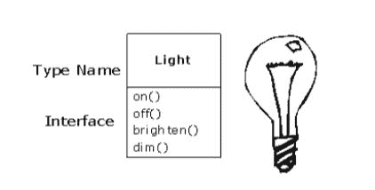

```java
Light lt = new Light();
lt.on();
```

接口决定了你可以对特定对象提出的请求。然而，在某处必须有代码来满足该请求。这与隐藏的数据共同构成了实现。从过程化编程的角度来看，这并不复杂。

一个类型与每个可能的请求关联有一个方法，当你向对象发出特定请求时，该方法就会被调用。这个过程通常被总结为向对象“发送消息”（提出请求），对象会弄清楚如何处理该消息（它执行代码）。


在这里，类型/类的名称是 `Light`，这个特定 `Light` 对象的名称是 `lt`，你对 `Light` 对象可以提出的请求是开启它、关闭它、让它变亮或变暗。你通过为该对象定义一个“引用”（`lt`）并调用 `new` 来请求该类型的新对象，创建一个 `Light` 对象。要向对象发送消息，你写出对象的名称并用点（dot）将其与消息请求连接起来。从预定义 `class` 使用者的角度来看，这基本上就是对象编程的全部内容。

前面的图表遵循统一建模语言（UML）的格式。每个 `class` 用一个方框表示，类型名称位于框的顶部，你感兴趣描述的任何数据成员位于框的中间，方法（属于该对象的函数，接收你发送给该对象的任何消息）位于框的底部。在 UML 设计图中，通常只显示 `class` 的名称和公共方法，因此在本例中，中间部分没有显示。如果你只对类名感兴趣，那么底部也就不需要显示。

## 对象提供服务

当你试图开发或理解一个程序设计时，考虑对象的最佳方式之一是将它们视为“服务提供者”。你的程序本身将为用户提供服务，它通过使用其他对象提供的服务来实现这一点。你的目标是产生（甚至更好，在现有代码库中找到）一组提供理想服务来解决你的问题的对象。

开始这样做的一种方法是问：“如果我可以神奇地从帽子里变出它们，哪些对象会立即解决我的问题？”例如，假设你正在创建一个记账程序。你可能会想象一些包含预定义记账输入界面的对象，另一组执行记账计算的对象，以及一个处理在所有类型打印机上打印支票和发票的对象。也许这些对象中的某些已经存在，对于那些不存在，它们会什么样？这些对象将提供什么服务，它们需要哪些对象来履行职责？如果你继续这样做，最终你会达到一个点，可以说：“那个对象看起来足够简单，可以坐下来写”或者“我确定那个对象已经存在了”。这是将问题分解为一组对象的合理方法。

将对象视为服务提供者还有一个额外的好处：它有助于提高对象的内聚性。高内聚性是软件设计的一个基本质量：它意味着软件组件的各个方面（例如对象，尽管这也可以适用于方法或对象库）很好地“契合在一起”。人们在设计对象时面临的一个问题是将过多的功能挤到一个对象中。例如，在你的支票打印模块中，你可能决定需要一个了解所有格式和打印的对象。你可能会发现这对于一个对象来说太重了，你需要的是三个或更多对象。一个对象可能是所有可能的支票布局的目录，可以查询有关如何打印支票的信息。一个对象或一组对象可以是通用打印接口，了解所有类型的打印机（这个是购买而不是自己编写的候选对象）。第三对象可以使用另外对象的服务来完成任务。因此，每个对象都提供一组内聚的服务。在良好的面向对象设计中，每个对象只做好一件事，而不试图做太多。这不仅允许发现可能购买的对象（打印机接口对象），还产生了可能在其他地方重用的新对象（支票布局目录）。

## 隐藏的实现

将开发领域划分为类创建者（创建新数据类型的人）和客户端程序员（在应用程序中使用这些数据类型的类备用者）是有帮助的。客户端程序员的目标是收集一个装满类的“类工具箱”，以便进行快速应用程序开发。类创建者的目标是构建一个类，仅向客户端程序员暴露必要的内容，并隐藏其他所有内容。为什么呢？因为如果它是被隐藏的，客户端程序员就无法访问它，这意味着类创建者可以随心所欲地更改隐藏部分，无需担心对他人产生影响。隐藏部分通常代表对象的内部敏感细节，这些部分很容易被粗心或不了解的客户端程序员所破坏，因此隐藏实现细节可以减少程序错误。

在任何关系中，拥有让所有参与方都尊重的边界都是关键的。当你创建一个库时，你与客户端程序员建立了一种关系，对方也是一名程序员，但是一个正在通过使用你的库来组合应用程序的程序员，可能是为了构建一个更大的库。如果 `class` 的所有成员对所有人都可见，那么客户端程序员就可以对该 `class` 执行任何操作，而且没有办法强制规则。尽管你可能更希望客户端程序员不要直接操作你 `class` 的某些成员，但在没有访问控制的情况下，无法阻止这种行为。一切对世界都是透明的。

所以，访问控制的第一个原因是让客户端程序员不要触碰他们不应该碰的部分——这些部分对于数据类型的内部运行是必要的，但并不是用户为了解决其特定问题而需要的接口的一部分。这实际上是对客户端程序员的一种服务，因为他们可以很容易地看到对他们是重要的，以及哪些是可以忽略的。

访问控制的第二个原因是允许库设计人员更改 `class` 的内部工作原理，而无需担心这将如何影响客户端程序员。例如，你可能会以一种简单的方式实现特定的 `class` 以简化开发，然后以后发现你需要重写它以使其运行得更快。如果接口和实现被清晰地分离并保护，你就可以轻松地完成这一点。

Java 使用三个显式关键字来在 `class` 中设置边界：`public`、`private` 和 `protected`。这些访问修饰符决定了谁可以使用随后的定义。`public` 意味着后续元素对所有人可用。另一方面，`private` 关键字意味着除了你（该类型的创建者）之外，在该类型的方法内部，没有人可以访问该元素。`private` 是你和客户端程序员之间的一堵墙。尝试访问 `private` 成员的人将得到编译时错误。`protected` 关键字的作用类似于 `private`，例外是继承类可以访问 `protected` 成员，但不能访问 `private` 成员。继承很快就会介绍。

Java 还有一种“默认”访问，如果你不使用上述修饰符之一，就会起作用。这通常被称为包访问，因为类可以访问同一包（库组件）中其他类的成员，但在包之外，这些相同的成员看起来似乎是私有的。

## 重用实现

一旦 `class` 被创建并测试，它（理想情况下）应该代表一个有用的代码单元。事实证明，这种可重用性并没有许多人希望的那么容易实现；产生可重用的对象设计需要经验和洞察力。但一旦你拥有了这样的设计，它就急于被重用。代码重用是面向对象编程语言提供的最大优势之一。

重用 `class` 的简单方法是直接使用该 `class` 的对象，但你也可以将该 `class` 的对象放在一个新的 `class` 中。我们称之为为“创建一个成员对象”。你的新 `class` 可以由任何数量和类型的其他对象组成，并以任何你实现新 `class` 中所需功能的组合方式。由于你是从现有的 `classes` 组合一个新的 `class`，这个概念被称为组合（如果组合是动态发生的，通常称为聚合）。组合通常被称为“具有（has-a）”关系，例如“汽车有一个引擎”。

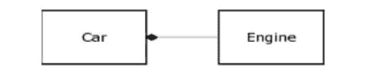

(此 UML 图用实心菱形表示组合，它表示有一辆汽车。我通常会使用更简单的形式：只需一条线，不带菱形，表示关联。)

组合带来了极大的灵活性。你新 `class` 的成员对象通常是 `private` 的，使得使用该 `class` 的客户端程序员无法访问它们。这允许你更改这些成员而不扰动现有的客户端代码。你还可以在运行时更改成员对象，以动态更改程序的行为。在下文中描述的继承没有这种灵活性，因为编译器必须对通过继承创建的类施加编译时的限制。

由于继承在面向对象编程中是如此重要，它经常被高度强调，新程序员可能会产生继承应该无处使用的想法。这可能导致笨拙且过度复杂的设计。相反，在创建新类时，你应该首先考虑组合，因为它更简单、更灵活。如果你采取这种方法，你的设计将更加整洁。一旦你有了一些经验，什么时候需要继承将变得显而易见。

## 继承

对象的主意本身是一个方便的工具。它允许你从概念上将数据和功能封装在一起，因此你可以表示一个适当的问题空间想法，而不是被迫使用底层机器的惯用法。这些概念通过使用 `class` 关键字表示为编程语言中的基本单元。

然而，费尽精力创建一个 `class` 然后又被强制创建一个具有相似功能的新类，这似乎很遗憾。如果我们能够获取现有类、克隆它，然后对克隆进行添加和修改，那就好了。这实际上通过继承得到的，例外是如果原始类（基类、超类或父类）发生变化，修改后的“克隆”（派生类、继承类、子类或子类）也会反映这些变化。

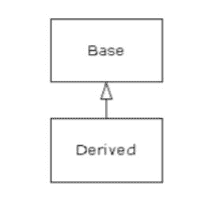

(此 UML 图中的箭头从派生类指向基类。正如你看到的，通常有一个派生类。)

类型不仅描述对一组对象的约束；它还与其他类型有关系。两个类型可以具有共同的特征和行为，但一个类型可能比另一个包含更多，并且处理更多的消息（或以不同的方式处理）。继承通过使用基类型和派生类型的概念来表达类型之间的相似性。基类型包含了所有派自它的类型共享的所有特征和行为。你创建一个基类型来表示你对系统中某些对象的核心想法。从基类型开始，你派生出其他类型以表示这种核心的不同方式。

例如，一台垃圾回收机会对垃圾进行分类。其基类型是“垃圾”，每件垃圾都有重量、价值等，并且可以被粉碎、熔化或分解。在此基础上，可以派生出更具体的垃圾类型，这些类型可能具有额外的特征（瓶子有颜色）或行为（铝制罐可以被压扁，钢罐具有磁性）。此外，某些行为可能有所不同（纸张的价值取决于它的类型和保存状况）。通过继承，你可以构建一个类型层级，用其类型来表达你正试图解决的问题。

第二个例子是经典的“形状”示例，可能用于计算机辅助设计系统或游戏模拟。基类型是“形状”，每个形状都有尺寸、颜色、位置等。每个形状都可以被绘制、擦除、移动、上色等。从这中，可以派生（继承）出具体的形状类型——圆形、正方形、三角形等——每种形状都可能具有额外的特征和行为。例如，某些形状可以翻转。某些行为可能不同，例如当你想要计算形状的面积时。该类型层级体现了形状之间的相似性和不同之处。

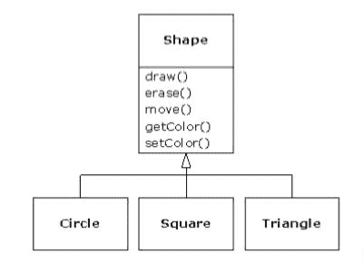

用与问题相同的术语来构建解决方案是非常有用的，因为你不需要大量的中间模型就可以从对问题的描述过渡到对解决方案的描述。使用对象时，类型层级是模型，因此你直接从现实世界中系统的描述到代码中系统的描述。事实上，人们在面向对象设计中面临的困难之一，就是从开始到结束的过程太简单了。一个习惯于寻找复杂解决方案的思维最初可能会被这种简单性所困扰。

当你从一个现有的类型继承时，你就创建了一个新类型。这个新类型不仅包含现有类型的所有成员（尽管私有成员被隐藏起来且无法访问），重要的是，它复制了基类的接口。也就是说，所有你可以发送给基类对象的消息，你也可以发送给派生类对象。由于我们通过可以发送给一个类的消息来确定该类的类型，这意味着派生类与基类被视为同一种类型。在上一个例子中，“圆形是一个形状。”这种通过继承实现的类型等效性是理解面向对象编程含义的基础门径之一。

由于基类和派生类具有相同的底层接口，必须有某些实现来配合该接口。也就是说，当对象接收到特定消息时，必须有某些代码来执行。如果你只是继承一个类而不做其他任何操作，那么基类接口中的方法会直接进入派生类。这意味着派生类的对象不仅具有相同的类型，它们还具有相同的行为，这并不特别有趣。

你有两种方法可以将你的新派生类与原始基类区分开来。第一种方法非常直观：你只需要向派生类中添加全新的方法。这些新方法并不是基类接口的一部分。这意味着基类只是没有完成你希望它完成的那么多工作，所以你添加了更多方法。这种简单且原始的继承用法，有时是你解决问题的完美方案。然而，你应该密切观察你的基类是否也可能需要这些额外的方法。这种对设计进行发现和迭代的过程在面向对象编程中经常发生。

### 多态实现对象的互换性

在处理类型层级时，你通常希望不将一个对象视为它具体的特定类型，而是将其视为它的基类型。这允许你编写不依赖于特定类型的代码。在形状示例中，方法操作的是通用的形状，而不关心它们是圆形、正方形、三角形，还是某种尚未定义的形状。所有形状都可以被绘制、擦除和移动，因此这些方法只是向形状对象发送一条消息；它们并不担心对象如何处理这条消息。

此类代码不受添加新类型的影响，而添加新类型是扩展面向对象程序以处理新情况的最常见方式。例如，你可以派生出一个名为“五边形”的形状新子类型，而无需修改处理通用形状的方法。这种通过派生新子类类型来轻松扩展设计的能力是封装变化的基本方式之一。这极大地改进了设计，同时降低了软件维护的成本。

然而，尝试将派生类型对象视为其通用基类型（将圆形视为形状，自行车视为车辆，海鸟视为鸟等）存在一个问题。如果一个方法要告诉一个通用的形状绘制自己，或让一个通用的车辆转向，或让一个通用的鸟移动，编译器在编译时无法精确知道将执行哪部分代码。这正是其意义所在——当消息被发送时，程序员并不想知道将执行哪部分代码；`draw` 方法可以同样地应用于圆形、正方形或三角形，而对象将根据其特定类型执行相应的代码。

如果你不需要知道将执行哪部分代码，那么当你添加一个新的子类类型时，它执行的代码可以不同，而不需要更改调用它的方法。因此，编译器无法精确知道执行了哪部分代码，那么它会做什么呢？

例如，在下面的图中，`BirdController` 对象仅与通用的 `Bird` 对象协作，并且不知道它们的具体类型。这从 `BirdController` 的角度来看是非常方便的，因为它不需要编写特殊代码来确定它正在处理的 `Bird` 的确切类型或该 `Bird` 的行为。那么，在忽略 `Bird` 的特定类型的情况下调用 `move()` 时，正确的行为是如何发生的呢？（大鹅行走、飞行或游泳，而企鹅行走或游泳？）

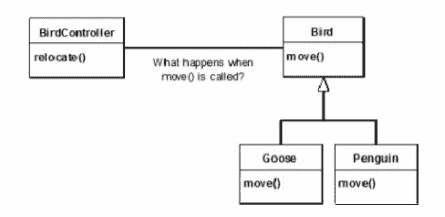

在某些语言中，你必须显式地声明你想让方法具有晚绑定属性的灵活性（C++ 使用 `virtual` 关键字来实现）。在这些语言中，默认情况下，方法不是动态绑定的。在 Java 中，动态绑定是默认行为，你不需要记住添加任何额外的关键字来实现多态性。

## 类型

当我们给变量赋值一个值，例如 `int i = 1;` 时，我们实际上在进行一个有趣的假设。我们假设使用 `1` 会自动推导出与变量类型匹配的数值类型。计算机使用多种不同的数据类型来存储数字。到为止，我们看到 `int` 这个词被频繁提及，好像你已经知道 `int` 是什么。在日常生活中，我们几乎不认为数字 `1` 和 `1.0` 甚至单词 "one" 之间有任何区别。

作为人类，我们可以很容易地将数字概念化为测量单位并在它们之间进行转换。但对于计算机来说，单词 "one" 和数字 `1` 之间的转换并不简单。`int` 关键字是 integer（整数）的缩写。整数是整数数值。整数是 Java 的内置类型。基本上，这意味着整数是 `java` 的基础组成部分。其他内置类型包括 `float`、`double`、`string`、`bool` 和 `object`。不常用的内置类型有 `char`、`short` 和 `byte`。总共有 15 种不同的内置类型。

所有这些类型除 `object` 和 `string` 之外，都是值类型。你能够构建的任何数据类型都必须基于这些内置类型。创建所有这些 `floats`、`doubles` 和 `bools` 的系统植根于计算的起源。还记得那些打孔带和带孔的纸吗？那些是 `1s` 和 `0s` 的记录，以机械开关（开启或关闭）的形式馈入计算机进行存储。这些模式代表了数字、指令和逻辑。

今天，我们仍然使用相同的 `1s` 和 `0s` 系统，即二进制，只是我们不再需要在纸上打孔来告诉计算机要做什么。创建和存储指令的方法已经复杂了许多倍，但 `1` 和 `0` 的原理仍然是相同的。这些被称为位（bits）；该名称的一个可能来源是在在纸片上打完所有孔后留下的纸屑。

### 值类型和引用类型

`int`、`float`、`double` 和 `bool` 是常用的值类型。这种用法模式的基础与存储和组织计算机内存的系统有关。谈论计算机存储时，你会使用 `megabyte` 或 `gigabyte` 等词。值类型的存储有非常特定的目的：跟踪数值。

#### 注意

`mega` 一词指的是你计算机中的组件可以存储多少百万字节。`Giga` 表示存储了多少十亿字节。你是否考虑过 `byte`（字节）到底是什么？`byte` 是所谓的 8 位无符号整数，或者说是使用 8 位组成一个数字的系统。这意味着是一个像 `0`、`7` 或 `32,767` 这样的整数。`unsigned`（无符号）表示数字不能为负数，例如 `-512`。在计算机术语中，`1` 或 `0` 被称为位（bit）。我们不会详细介绍计算机如何使用位来计数的，这是一个非常有趣的自学课题。

然而，知道 `byte` 的范围有限（从 `0` 到 `255`）是非常重要的。我留给你们这样一个概念：如果你使用二进制而不是十进制，你可以用十根手指数到 `1023`。你的手指可以用来表示一个 10 位无符号整数。计算机的计算能力过去比现在受限得多。20 世纪 80 年代制造的 8 位游戏机颜色有限，确切来说是 `256` 种。

这种限制是基于处理器能够处理的位数。处理器在任何时刻使用的晶体管数量是的。不久后，浮点协处理器被引入，它们通过具有更接近 `32 bits` 的工作空间允许大得多的数值范围。在所有这些情况下，当你使用值类型时，该数字实际上是以 `1s` 和 `0s` 的形式存储在你计算机的 RAM 中的。这应该被认为是非常了不起的。

在过去，你必须经历重重火考验才能存储一个值。现在你只需要输入 `float f = 3.1415926535;`，你就可以精确到单个原子宽度测量宇宙的周长。所有这些类型的共同点是它们是作为单个元素存储的。大值如 `double gigawatts = 1210000000.0;` 和 `double mint = 2.0;` 使用相同的内存。

你的计算机不会为一个 `double` 或另一个分配更多的内存空间。这些类型被称为原始类型（primitive types）。`int` 和 `float` 之间的唯一区别是它们每次使用的位数，分别为 `8` 位和 `32` 位；`doubles` 使用 `64 bits`。

`string` 和 `object` 类型在存储方式上略有不同。这些类型是任意数量元素的组合 `string` 或 `object` 越大，占用的内存块就越大。这些被称为引用类型，有时被称为可空类型，因为 Java 不查看内存中的单个元素获取数据。

### 强类型

这与你在键盘上输入有多快无关！

Java 看到数字在写法上存在差异。整数数字 `1` 与 `1.0` 不同，尽管我们可以认为它们的值相同。这些差异可以通过添加一个字母来产生。因此，`1.0` 和 `1.0f` 也是不同的数字。Java 是一种强类型编程语言。当编程语言使用强类型时，你会被将不同的类型分开。

这意味着这两个数字是不同的类型，在允许操作之前，我们需要将其中一个转换以匹配另一个。除了改变内存的使用方式，类型还限制了在团队工作时可能出现的问题。

## 算法思维


# 算法概述

算法是一个详细的逐步步骤的指令集或公式，用于解决问题或完成任务。在计算中，程序员编写算法指示计算机如何执行任务。

当你以最通用的方式思考算法（不仅限于计算）时，算法无处不在。食物食谱是一个算法，你解决加法或长除法的方法是一个算法，折叠衬衫或裤子的过程也是算法。甚至你的早晨常规也可以被看作是一个算法！事实上，你孩子的早晨可能写成这样的算法：

## 哪些问题是由算法解决的？

排序并不是算法开发的唯一计算问题。算法的应用无处不在，包括以下示例：

1. **人类基因组计划**在目标取得了巨大进展：识别人类 DNA 中所有的 10 万个基因、确定组成人类 DNA 的 30 亿碱基对序列、将这些信息存储在数据库中以及开发数据分析工具。每一步都需要复杂的算法。虽然涉及的各种解决方案超出了本书的范围，但许多解决这些生物问题的方法使用了书中几个章节的观点，从而使科学家能够在高效利用资源的同时完成任务。节省的是时间（人类和机器）以及金钱，因为可以从实验技术中提取出更多信息。

2. **互联网**让世界各地的人能够快速访问和检索大量信息。在巧妙算法的帮助下，网站能够管理和处理这些海量数据。必须使用算法的问题示例包括：寻找数据传输的优质路径，以及使用搜索引擎快速找到包含特定信息的页面。

3. **电子商务**使得商品和服务能够以电子化的方式进行谈判和交换，它依赖于个人信息的隐私性，例如信用卡号、密码和银行对单。电子商务中使用的核心技术包括公钥加密和数字签名，这些技术基于数值算法和数论。

4. **制造业和其他商业企业**通常需要以最有利的方式分配稀缺资源。石油公司可能想知道在哪里设置钻井以实现预期利润最大化。政治候选人可能想决定在哪里花钱购买竞选广告，以最大化赢得选举的概率。航空公司可能希望以最廉的价格将机组人员分配给航班，确保每班航班都有人员负责，并符合政府关于机组调度的规定。互联网服务提供商可能希望决定在哪里放置额外资源，以便更有效地为客户服务。这些都是可以使用线性规划解决的问题示例。

虽然这些示例的一些细节超出了本书的范围，但我们确实提供了适用于这些问题和领域的基础技术。

# 算法作为一种技术

假设计算机的速度是无限的，计算机内存是免费的。你还会为了学习算法吗？答案是肯定的，即使没有其他理由，你仍然想证明你的解决方案能够终止，并且给出一个正确的答案。

如果计算机的速度是无限的，那么任何解决问题的正确方法都行。

你可能希望你的实现符合良好的软件工程实践规范（例如，你的实现应该是经过良好设计并记录的），但你通常会使用任何最容易实现的方法。当然，计算机可能很快，但并不是无限快。内存可能廉价，但不是免费的。

因此，计算时间是一种有限的资源，内存空间也是如此。你应该明智地使用这些资源，时间或空间上高效的算法将帮助你做到这一点。

## 存储存储在哪里？

视觉化程序运行时某些布局方式是很有用的——特别是内存是如何安排的。有五种不同的存储位置：

1. **寄存器 (`Registers`)**。这是最快的存储，因为它存在于与其他存储不同的位置：处理器内部。然而，寄存器的数量受到严格限制，因此寄存器根据需要进行分配。你无法直接控制它们，在你的程序中也看不到任何寄存器存在的证据（相反，`C` 和 `C++` 允许你向编译器建议寄存器分配）。

2. **栈 (`The stack`)**。它位于通用随机访问内存 (`RAM`) 区域，但通过栈指针获得处理器的直接支持。栈指针向下移动创建新内存，向上移动释放内存。这是一种极其快速且高效的存储分配方式，仅次于寄存器。Java 系统在创建程序时必须知道存储在栈上的所有项的确切寿命。这一限制限制了你程序的灵活性，因此虽然某些 Java 存储存在于栈上——特别是对象引用——但 Java 对象本身并不放置在栈上。

3. **堆 (`The heap`)**。这是一个通用的内存池（同样在 `RAM` 区域），所有的 Java 对象都存储在其中。堆的妙处是，与栈不同，编译器不需要知道该存储必须在堆上保留多久。因此，使用堆上的存储具有极大的灵活性。每当你需要一个对象时，只需使用 `new` 编写代码创建它，当该代码执行时，存储就会分配在堆上。当然，这种灵活性也是需要付出代价的：分配和清理堆存储可能比栈存储花费更多时间（如果你在 Java 中可以在栈上创建对象的话，就像在 `C++` 中那样）。

4. **常量存储 (`Constant storage`)**。常量值通常直接放置在程序代码中，这是安全的，因为它们永远不会改变。有时常量会被单独隔离开，以便在嵌入式系统中可以根据选择被放置在只读内存 (`ROM`) 中。

5. **非 RAM 存储 (`Non-RAM storage`)**。如果数据完全位于程序外部，它可以在程序未运行时存在，且不受程序的控制。这类的两个主要示例是：流式对象 (`streamed objects`)，将对象转换为字节流，通常是为了发送到另一台机器；以及持久化对象 (`persistent objects`)，将对象放置在磁盘上，以便在程序终止后仍保留其状态。这些类型存储的技巧是将对象转换为可以在其他介质上存在的东西，并在需要时重新复活为普通的基于 `RAM` 的对象。Java 提供了轻量级持久化支持，而 `JDBC` 和 `Hibernate` 等机制为在数据库中存储和检索对象信息提供了更高级的支持。

# 语句与表达式 (`Statements and Expressions`)

在阅读一本书或一个故事时，你从有序的词链中提取含义。类似地，计算机从有序指令的链中提取命令。

在英语中，我们称之为句子 (`sentence`)；程序员称之为语句 (`statement`)。

语句被认为是任何通过分号隔开、完成某种任务的代码块。任何给定任务的核心都是算法 (`algorithm`)，不要将其与对数 (`logarithm`) 混淆。

算法是一个完成某些任务的系统化过程。在许多方面，你可以将其看作是一个食谱，或者说，食谱是制作食物的算法。

完成一项任务可能只需要一两个语句，也可能需要数百条语句。


就像句子一样，语句有不同的形式。语句可以声明并为变量赋值。这些被称为声明和赋值语句。这些语句用于设置各种类型的数据并给它们命名。

## 表达式 (`Expressions`)

语句的主体被称为标识符 (`identifiers`)。赋值语句用于给标识符赋值。当你读到“Jack 是男孩，Jill 是一个女孩”时，你已经在脑中为这两个主题分配了性别。

在 Java 中，这看起来可能像：

```java
gender Jack = male;
gender Jill = female;
```

赋值语句通常包含某种操作。这些被称为表达语句 (`expressive statements`)。与表达情感不同，代码中的表达式看起来像 `x + y`。表达式处理数据。处理后，表达式的结果可以赋值给变量。

语句的集合被称为代码块 (`code block`)，不像可能会阻止你代码运行的路障，而更像是一个构建块 (`building block`)，即任何用于构建的东西。

在写故事时，我们将一组句子称为一个段落。代码块中的语句相互工作以完成一项任务。

# 代码是如何执行的

当创建一个类时，它所有的指令并不是同时执行的。正如之前所解释过的，类中的每个部分集合都由被称为“语句”的文本行组成。每条语句按顺序执行。计算机从哪里开始通常取决于被告知从哪个语句集合开始。你负责代码如何启动。

Java 为我们提供了一个名为 `Main()` 的函数，我们稍后会介绍。然而，这是使用 Java 开始代码的首选位置。一旦调用了 `Main()`，计算机就会跳转到 `Main()` 中的第一行并开始执行那里编写的指令。当计算机到达每条语句时，它从语句的左侧开始，向右侧处理。基本上，计算机读取代码就像你阅读这个句子一样。

# 学习复制与粘贴

“优秀的艺术家在创造，伟大的艺术家在窃取。”有很多代码示例供你复制并粘贴到项目中。本书的内容以及所有可下载的内容也无二。这意味着你必须理解代码在做什么，才能将其解释并以适应你的需求。

每个程序员都会习惯性地这样做。


学习如何这样做非常重要，因为在很多情况下你实际上需要这样做——不仅是为了学习，而且是为了完成任何陌生的任务。编程是一个不断学习的过程。它是命令计算机的语言。

每当你学习一种新语言时，会有大量的词是你必须查询的。

再加上每个程序员都可以创造新词的事实，你就有了一种你永远需要字典的语言。

当显示某些代码时，你会被要求将代码复制到你的项目中。当你的手指准备好放在键盘上，你会养成打字的习惯。

程序员通常是打字高手是有原因的。这也是为什么程序员对他们偏好的键盘非常挑剔的原因。在大多数情况下，书中的项目将处于你可以阅读已经存在的文本的状态。

大多数项目处于更完整的状态，你能够运行它们并看到预期的结果。作为一个程序员，我已经习惯了在互联网上搜索示例代码。

一旦我发现了看起来很有用的东西，我会复制那些代码并粘贴到一个简单的测试用例中。在我理解了代码在做什么之后，我会将其重写为更适合我特定用例的形式。

即使代码涉及一些有趣的技巧，我也会从该代码中学习。

随着我学习新的技巧，我作为程序员也成长了。学习新技巧的唯一方法是找到必要性去解决一个我尚未想出解决方案的新问题。寻找问题的解决方案是成为程序员的基本部分。

# 理解浮点数

浮点数多年来一直是计算机的焦点。获得浮点精度是许多早期计算机科学家的目标。因为小数点后可以跟的数字数量有无限可能，因此使用二进制计算无法真正、完整地表示任何分数。

一个常见的例子是 $\pi$，我们称其为 `pi`。假设 `3.14` 之后有无尽的数字。即使在今天，计算机被用来计算小数点后数以百计万亿位的数字。

计算机预留了浮点数的某些位来表示小数点在数字中的出现位置，但即使这样也是受限的。第一位通常是符号位，设置数字的负范围或正范围。随后的 8 位是该数字的指数，被称为 `mantissa`（尾数）。剩余的位是出现在小数点周围的数字。一个 `float` 值可以在任何方向移动小数点 38 位，但它受限于其能够存储的值。

在没有特殊考虑的情况下，计算机无法处理任意大的数字。要将 `float` 强制转换为 `int`，你需要更显式一些。

这就是为什么 Java 要求你使用强制转换，你需要添加 `(int)`：

```java
int Zint = (int)Zmove;
```

`(int)` 是一个强制转换运算符；或者说 `(type)`充当从右侧类型到左侧所需类型的转换器。

# 大 O 表示法

大 O 表示法是我们用来阐述算法运行所需多时间的语言。它是我们用来比较解决问题的不同方法的效率的方式。

假设你有一个 10 个对象的列表，你想按顺序对它们进行排序。有一系列算法可以来实现这一点，但并不是所有算法都是平等的。有些算法比其他算法快，但更重要的是，算法的速度取决于它处理的项数量。大 O 是一种衡量算法扩展性的一种方法。大 O 指的是算法的复杂程度。

大 O 使用类似 `O(n)` 的符号表示。`O` 仅仅表示我们正在谈论大 O，你可以忽略它（至少在面试的目的上）。

下面是按扩展性优坏顺序排序的大 O 复杂度列表：

- **`O(1)` / 常数复杂度**：常数。这意味着无论数据集的大小如何，算法总是花费常数时间。1 个项目需要 1 秒，10 个需要 1 秒，100 个需要 1 秒。它总是花费相同的时间。

- **`O(log n)` / 对数复杂度**：没有常数好，但仍然很好。时间随数据集的增大而增加，但不是比例增加。这意味着相对于较大的数据集，算法在较小数据集上花费更多。1 个需要 1 秒，10 个需要 2 秒，100 个需要 3 秒。如果你的数据集有 10 个，每项导致 0.2 秒。如果你的数据集有 100 个，每项只需要 0.03 秒。这使得对数算法具有良好的扩展性。

- **`O(n)` / 线性复杂度**：数据集越大，所需时间越按比例增长。1 个需要 1 秒，10 个需要 10 秒，100 个需要 100 秒。

- **`O(n log n)`**：前两者的良好结合。通常排序有两个部分，第一个循环是 `O(n)`，第二个是 `O(log n)`，组合形成 `O(n log n)`。1 个需要 2 秒，10 个需要 12 秒，100 个需要 103 秒。

- **`O(n²)` / 平方复杂度**：事情变得格外缓慢了。1 个需要 1 秒，10 个需要 100，100 个需要 10000。

- **`O(2^n)` / 指数级增长！**：每增加一个元素，算法时间就会翻倍。1 个需要 1 秒，10 个需要 1024 秒，100 个需要 1267650600228229401496703205376 秒。

希望你到为止还能跟上，但让我们深入研究一些排序和搜索的示例算法。重点是要能够解释算法的复杂度。面试官喜欢让候选人设计算法，然后询问它的复杂度是多少。

无论大小如何，它始终以恒定的速度返回。`Queue` 的 javadoc 规定，“检索方法（`peek`、`element` 和 `size`）是常数时间”。这其中的原因显而易见。对于 `peek`，我们总是返回第一个元素，而我们始终拥有该元素的引用；它后面有多少个元素并不重要。列表的大小在元素添加/删除时更新，无论列表大小如何，引用这个数字都只需要一次操作。

## `O(log n)`

经典的例子是二分查找。你是一个巨大的极客，所以你显然对你的电影收藏按字母顺序排列了序。为了找到你的《回到未来》，你首先来到列表的中间。你发现中间的电影是《史福克斯一家聚聚》，然后你转向开头和这电影电影之间的部分。你发现那部电影是《生机断》。再次重复这个过程，你就找到了《回到未来》。

虽然增加更多元素会增加搜索所需的时间，但增加并不是比例增加的。因此，它是 `O(log n)`。

## `O(n)`

正如我在关于 `collections` 的文章中所讨论的，链表（`LinkedLists`）在检索方面（相对而言）并不太好。它的大 O 复杂度实际上是 `O(n)`，因为在最坏情况下，为了找到列表中的最后一个元素 `T`，必须遍历整个包含 `n` 个元素的列表来找到 `T`。随着元素数量的增加，访问时间也会按比例增加。

## `O(n log n)`

`O(n log n)` 的最佳例子是合并排序。这是一种分治算法。假设你有一个整数列表。我们不断地划分列表，直到剩下若干个包含 1 个元素的列表；因此，这些列表每一个都是有序的。然后我们将每个列表与其邻居合并（每次都比较每个列表的第一个元素）。我们对新的组合列表重复此操作，直到我们得到排序后的结果。

# 如何在面试中确定 Big O？

这并不是 Big O 的穷尽列表。就像你可以写 `O(n2)` 一样，你也可以 `O(n³)`（想象在没有明显原因的情况下为你的泡排序增加一个额外的循环）。此页面上的列表应该让你能够尝试找出算法的 Big O 是多少。如果有人在面试中问你这个问题，他们可能想看你是如何尝试推导出来的。拆解循环和处理过程。

* 它必须遍历整个列表吗？那里某处有一个 `n`。

* 算法的处理时间增长速度是否比数据集的大小增长速度慢？那么那里可能有一个 `log n`。

* 是否有嵌套循环？你可能在看 `n²` 或 `n³`。

* 访问时间是否与数据集的大小无关？`O(1)`

# 示例问题

我有一个随机排列的 `1` 到 `100` 数字的数组。其中缺少一个数字。写一个算法来找出这个数字是什么以及缺失的位置在哪里。

这个问题有很多变体，都非常流行。要计算缺失的数字，我们可以简单地将我们所有的数字相加，并将其减去 `1` 到 `100` 之间所有数字和的预期值。为了这样做，我们需要遍历列表一次。在此过程中我们还可以记录下哪个位置有缺口。

```java
public void findTheBlank(int[] theNumbers) {
    int sumOfAllNumbers = 0;
    int sumOfNumbersPresent = 0;
    int blankSpace = 0;
    for (int i = 0; i < theNumbers.length; i++) {
        sumOfAllNumbers += i + 1;
        sumOfNumbersPresent += theNumbers[i];
        if (theNumbers[i] == 0)
            blankSpace = i;
    }
    System.out.println("Missing number = " + (sumOfAllNumbers - sumOfNumbersPresent) + " at location " + blankSpace +" of the array");
}

new BubbleSort().findTheBlank(new int[]{7,6,0,1,3,2,4});

// 缺失数字 = 5，位于数组位置 2
```

这个算法的 big O 是多少？

我们的算法遍历了列表一次，所以它简单是 `O(n)`。

## Big-O 复杂度图

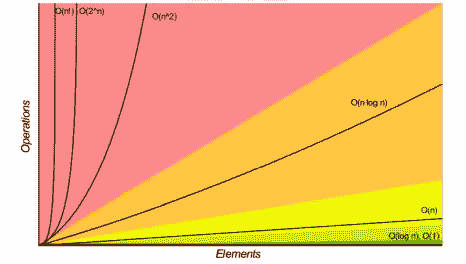


## 数组排序算法复杂度

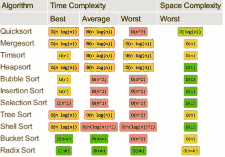

# 第 3 章 | 数据结构与编程问题

## 排序与搜索


## 二分查找

二分查找是计算机科学中基础算法之一。为了探索它，我们首先建立一个理论框架，然后利用它来正确实现该算法，并避免大家一直在讨论的那些讨厌的差错误（off-by-one errors）。

### 在有序序列中查找值

在最简单的形式中，二分查找用于在有序序列中快速找到一个值（目前将序列视为普通数组）。我们将要查找的值称为 `target`。二分查找维护一个目标值所在的连续序列。初始状态下，搜索空间是整个序列。在每一步中，算法将中位数与目标值进行比较。

例如，考虑以下序列，假设我们要查找 `55`：

| 0 | 5 | 13 | 19 | 22 | 55 | 68 | 72 | 81 | 98 |


我们对目标值的位置感兴趣，因此用索引表示搜索空间。从这里我们得出不仅索引 `6` 不是目标值，而且索引 `1` 到 `5` 的元素都不可能是目标值，因为所有元素都小于 `41`。这使得搜索空间缩小到索引 `7` 到 `11`：

| 55 | 68 |

如果目标存在，二分查找将清空搜索空间。这个条件很容易检查和处理。这里是配合描述的代码：

```python
def binary_search(A, target):
    lo = 1, hi = size(A)
    while lo <= hi:
        mid = lo + (hi-lo)/2
        if A[mid] == target:
            return mid
        elif A[mid] < target:
            lo = mid+1
        else:
            hi = mid-1
    # 未找到目标
```

## 复杂度

由于二分查找每次比较都使搜索空间减半，我们可以断定并容易证明二分查找查找值永远不会超过（大 O 表示法）`O(log N)` 次比较。

对数是一个增长极其缓慢的函数。如果你不知道二分查找到底有多高效，考虑在一个包含百万名字的电话簿中查找一个名字。二分查找让你最多通过 21 次比较找到任何给定的名字。如果你能管理一个按名字排序的世界范围内人的列表，你可以在少于 35 步找到任何人。

## 程序：Java 实现递归二分查找

```java
class BinarySearch {
    // 如果 x 存在 arr[l..r] 中，则返回索引，否则
    // 返回 -1
    int binarySearch(int arr[], int l, int r, int x) {
        if (r>=l) {
```

输出：元素位于索引 3

## 程序：二分查找的迭代实现

```java
class BinarySearch {
    // 如果 x 在 arr[] 中存在，返回其索引，否则
    // 返回 -1
    int binarySearch(int arr[], int x) {
        int l = 0, r = arr.length - 1;
        while (l <= r) {
            int m = l + (r-l)/2;
            // 检查 x 是否在中间
            if (arr[m] == x)
                return m;
            // 如果 x 较大，忽略左半部分
            if (arr[m] < x)
                l = m + 1;
            // 如果 x 较小，忽略右半部分
            else
                r = m - 1;
        }
        // 如果到达这里说明元素不存在
        return -1;
    }

    public static void main(String args[]) {
        BinarySearch ob = new BinarySearch();
        int arr[] = {2, 3, 4, 10, 40};
        int n = arr.length;
        int x = 10;
        int result = ob.binarySearch(arr, 0, n - 1, x);
        if (result == -1)
            System.out.println("Element not present");
        else
            System.out.println("Element found at index " + result);
    }
}
```

# 冒泡排序

冒泡排序被认为是最简单的算法。在冒泡排序中，从第一个元素遍历到最后一个元素。在这里，当前元素与下一个元素进行比较。如果当前元素大于下一个元素，则进行交换。

## 算法

我们假设 `list` 是一个包含 `n` 个元素的数组。我们进一步假设 `swap` 函数会交换给定数组元素的值。

```
Bubble BubbleSort(list)
  for all elements of list
    if list[i] > list[i+1]
      swap(list[i], list[i+1])
  end for
end BubbleSort
```

## 程序：Java 实现冒泡排序

```java
class BubbleSortExample {
    static void bubbleSort(int[] arr) {
        int n = arr.length;
        int temp = 0;
        for (int i = 0; i < n; i++) {
            for (int j = 1; j < (n - i); j++) {
                if (arr[j-1] > arr[j]) {
                    //交换元素
                    temp = arr[j-1];
                    arr[j-1] = arr[j];
                    arr[j] = temp;
                }
            }
        }
    }

    public static void main(String[] args) {
        int arr[] = {3, 60, 35, 45, 320, 5};
        System.out.println("Array Before Sort");
        for (int i = 0; i < arr.length; i++) {
            System.out.print(arr[i] + " ");
        }
        System.out.println();
        bubbleSort(arr); //使用冒泡排序排序数组
        System.out.println("Array After Sort");
        for (int i = 0; i < arr.length; i++) {
            System.out.print(arr[i] + " ");
        }
    }
}
```

输出：

Array Before Sort

3 60 35 45 320 5

Array After Sort

2 5 35 45 60 320

# 插入排序

插入排序是一种简单的排序算法，其工作方式就像我们整理手中的牌牌一样。

## 算法

- 步骤 1：如果是第一个元素，它已经是有序的。返回 1
- 步骤 2：选取下一个元素
- 步骤 3：与已排序子列表中的所有元素进行比较
- 步骤 4：将已排序子列表中所有大于待排序值的元素向后移动一位
- 步骤 5：插入该值
- 步骤 6：重复直到列表排序就绪

## 程序：实现插入排序的 Java 程序

```java
class InsertionSort {
    /*使用插入排序排序数组*/
    void sort(int arr[]) {
        int n = arr.length;
        for (int i = 1; i < n; ++i) {
            int key = arr[i];
            int j = i - 1;
            /*将 arr[0..i-1] 中大于 key 的
               元素向后移动一个位置
               到达当前位置 */
            while (j >= 0 && arr[j] > key) {
                arr[j+1] = arr[j];
                j = j - 1;
            }
            arr[j+1] = key;
        }
    }

    /*打印大小为 n 的数组的实用函数*/
    static void printArray(int arr[]) {
        int n = arr.length;
        for (int i = 0; i < n; ++i)
            System.out.print(arr[i] + " ");
        System.out.println();
    }

    public static void main(String args[]) {
        int arr[] = {12, 1, 13, 5, 6};
        InsertionSort ob = new InsertionSort();
        ob.sort(arr);
        printArray(arr);
    }
}
```

输出：5 6 1 12 13

# 归并排序

`Mergesort` 算法可以对集合进行排序。`Mergesort` 是一种分治算法。

## 算法

- 步骤 1：如果只有一个元素，它是有序的。返回。
- 步骤 2：将列表递归地分为两部分直到没有可以划分。
- 步骤 3：将子列表合并为有序列表。

## 程序：归并排序的 Java 程序

```java
class MergeSort {
    // 合并两个子数组
    // 第一个子数组是 arr[l..m]
    // 第二个子数组是 arr[m+1..r]
    void merge(int arr[], int l, int m, int r) {
        // 待合并的子数组的大小
        int n1 = m - l + 1;
        int n2 = r - m;
        /* 创建临时数组 */
        int L[] = new int[n1];
        int R[] = new int[n2];
        /* 将数据拷贝到临时数组*/
        for (int i = 0; i < n1; ++i)
            L[i] = arr[l + i];
        for (int j = 0; j < n2; ++j)
            R[j] = arr[m + 1 + j];
        /* 合并临时数组 */
        // 第一、二子数组的初始索引
        int i = 0, j = 0;
        // 合并数组的初始索引
        int k = l;
        while (i < n1 && j < n2) {
            if (L[i] <= R[j]) {
                arr[k] = L[i];
                i++;
            } else {
                arr[k] = R[j];
                j++;
            }
            k++;
        }
        /* 拷贝 L[] 中的剩余元素 */
        while (i < n1) {
            arr[k] = L[i];
            i++;
            k++;
        }
        /* 拷贝 R[] 中的剩余元素 */
        while (j < n2) {
            arr[k] = R[j];
            j++;
            k++;
        }
    }

    // 使用 merge() 排序 arr[l..r]
    void sort(int arr[], int l, int r) {
        if (l < r) {
            // 找到中间点
            int m = (l + r) / 2;
            // 排序前、后两个部分
            sort(arr, l, m);
            sort(arr, m + 1, r);
            // 合并排序后的两个部分
            merge(arr, l, m, r);
        }
    }

    /* 用于打印大小为 n 的数组的工具函数 */
    static void printArray(int arr[])
    {
        int n = arr.length;
        for (int i=0; i<n; ++i)
            System.out.print(arr[i] + " ");
        System.out.println();
    }

    public static void main(String args[])
    {
        int arr[] = {12, 11, 13, 5, 6, 7};
        System.out.println("给定数组");
        printArray(arr);
        MergeSort ob = new MergeSort();
        ob.sort(arr, 0, arr.length-1);
        System.out.println("\n 排序后的数组");
        printArray(arr);
    }
}
```

输出：

给定数组

12 11 13 5 6 7

排序后的数组

5 6 7 11 12 13

# 快速排序

排序算法根据定义的顺序对数组中的元素进行排序。快速排序是一种分治法算法。在分治法排序算法中，原始数据被分成两个部分，“分”，这两个部分会被分别进行排序并“攻”，然后进行合并。

## 算法

- 如果数组只包含一个元素或零个元素，则数组是已排序的。
- 如果数组包含多一个元素，则：
    - 从数组中选择一个元素。该元素被称为“基准元素”（pivot element）。例如，选择数组中间的元素。
    - 将所有小于基准元素的元素放在一个数组中，将所有大于基准元素的元素放在另一个数组中。
    - 通过递归地对这两个数组应用快速排序来完成排序。
    - 合并这些数组。

快速排序可以实现为“原地”排序。这意味着排序在数组内部进行，不需要创建额外的数组。

## 程序：实现快速排序的 Java 程序


```java
class QuickSort
{
    /* 此函数取最后一个元素作为基准，
       将基准元素放在排序后数组的正确位置，
       并将所有较小（小于基准）的元素放在基准的左侧，
       将所有较大的元素放在基准的右侧 */
    int partition(int arr[], int low, int high)
    {
        int pivot = arr[high];
        int i = (low-1); // 较小元素的索引
        for (int j=low; j<=high-1; j++)
        {
            // 如果当前元素小于或
            // 等于基准
            if (arr[j] <= pivot)
            {
                i++;
                // 交换 arr[i] 和 arr[j]
                int temp = arr[i];
                arr[i] = arr[j];
                arr[j] = temp;
            }
        }
        // 交换 arr[i+1] 和 arr[high]（或基准）
        int temp = arr[i+1];
        arr[i+1] = arr[high];
        arr[high] = temp;
        return i+1;
    }
    /* 实现 QuickSort()的主函数
       arr[] --> 需要排序的数组，
       low --> 起始索引，
       high --> 结束索引*/
    void sort(int arr[], int low, int high)
    {
        if (low < high)
        {
            /* pi 是分区索引，arr[pi] 
               现在位于正确的位置 */
            int pi = partition(arr, low, high);
            // 递归排序分区之前
            // 之后分区之后的元素
            sort(arr, low, pi-1);
            sort(arr, pi+1, high);
        }
    }
    /* 用于打印大小为 n 的数组的工具函数 */
    static void printArray(int arr[])
    {
        int n = arr.length;
        for (int i=0; i<n; ++i)
            System.out.print(arr[i] + " ");
        System.out.println();
    }
    public static void main(String args[])
    {
        int arr[] = {12, 11, 13, 5, 6, 7};
        System.out.println("给定数组");
        printArray(arr);
        QuickSort ob = new QuickSort();
        ob.sort(arr, 0, arr.length-1);
        System.out.println("\n 排序后的数组");
        printArray(arr);
    }
}
```

输出：

给定数组是

12 11 13 5 6 7

排序后的数组是

5 6 7 11 12 13

在 `A` (`LeftNode`) 和 `C` (`RightNode`) 之间。将 `B.next` 指向 `C` −

```
NewNode.next -> RightNode;
```

它看起来应该是这样 −

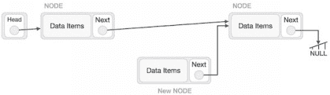

现在，左侧的节点应该指向新节点。

```
LeftNode.next -> NewNode;
```

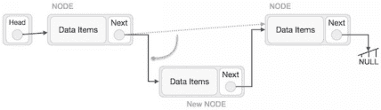

这将新节点放在两个节点中间。新列表应该像这样 −

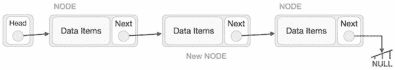

如果节点插入到列表开头，也应该采取类似的步骤。在末尾插入时，列表倒数第二个节点应该指向新节点，而新节点将指向 `NULL`。

## 删除操作

删除也是一个多步骤的过程。我们将通过图示表示来学习。首先，使用搜索算法定位要删除的目标节点。

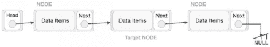

目标节点的左侧（前一个节点）现在应该指向目标节点的下一个节点 ——

```
LeftNode.next -> TargetNode.next;
```

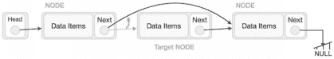

这将移除指向目标节点的链接。现在，使用以下代码，我们将移除目标节点指向的内容。

```
TargetNode.next -> NULL;
```

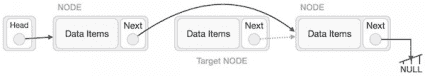

我们需要使用被删除的节点。我们可以将其保留在内存中，否则我们可以直接释放内存并完全清除目标节点。

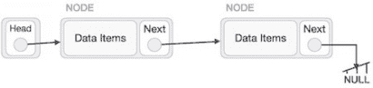

## 反转操作

这个操作是彻底的。我们需要让最后一个节点被头节点指向，并反转整个链表。

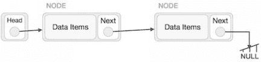

首先，我们遍历到列表末尾。它应该指向 `NULL`。现在，我们将它指向它的前一个节点 deme

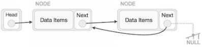

我们必须确保最后一个节点不是丢失的节点。因此我们将有一个 `temp` 节点，看起来像头节点指向最后一个节点。现在，我们将让所有左侧节点逐一个地指向它们的前一个节点。

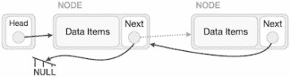

除了头节点指向的节点（第一个节点）外，所有节点都应该指向它们的先驱，成为它们新的后继。第一个节点将指向 `NULL`。

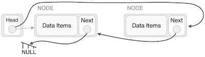

我们将使用 `temp` 节点让头节点指向新的第一个节点。

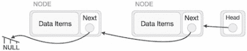

链表现在已经反转。

# 程序：给定一个排序的链表，如何以排序的方式插入？

### 算法

假设输入链表按升序排列。

1) 如果链表为空，则将该节点设为头节点并返回。

2) 如果要插入节点的值小于头节点的值，则在开头插入该节点并设置为头节点。

3) 在循环中，找到合适的节点，在该节点之后插入输入节点（假设为 `9`）。要找到合适的节点，从头节点开始，持续移动直到到达一个值大于输入节点的节点 `GN`（下图中的 10）。`GN` 之前的节点就是合适的节点（`7`）。

4) 在步骤 3 找到的合适节点（`7`）之后插入节点（`9`）。

初始链表

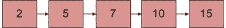

插入 9 后的链表

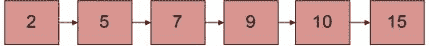

```java
class LinkedList
{
    Node head; // 头部
    /* 链表节点*/
    class Node
    {
        int data;
        Node next;
        Node(int d) {data = d; next = null; }
    }
    /* 在列表中插入新节点 _node 的函数. */
    void sortedInsert(Node new_node)
    {
        Node current;
        /* 针对头节点的特殊情况 */
        if (head == null || head.data >= new_node.data)
        {
            new_node.next = head;
            head = new_node;
        }
        else {
            /* 定位插入前的节点. */
            current = head;
            while (current.next != null &&
                current.next.data < new_node.data)
                current = current.next;
            new_node.next = current.next;
            current.next = new_node;
        }
    }
    /* 工具函数*/
    /* 创建节点的函数 */
    Node newNode(int data)
    {
        Node x = new Node(data);
        return x;
    }
    /* 打印链表的函数 */
    void printList()
    {
        Node temp = head;
        while (temp != null)
        {
            System.out.print(temp.data+" ");
            temp = temp.next;
        }
    }
    /* 测试上述方法的驱动器函数 */
    public static void main(String args[])
    {
        LinkedList llist = new LinkedList();
        Node new_node;
        new_node = llist.newNode(5);
        llist.sortedInsert(new_node);
        new_node = llist.newNode(10);
        llist.sortedInsert(new_node);
        new_node = llist.newNode(7);
        llist.sortedInsert(new_node);
        new_node = llist.newNode(3);
        llist.sortedInsert(new_node);
        new_node = llist.newNode(1);
        llist.sortedInsert(new_node);
        new_node = llist.newNode(9);
        llist.sortedInsert(new_node);
        System.out.println("Created Linked List");
        llist.printList();
    }
}
```

输出:

Created Linked List

1 3 5 7 9 10

# 程序：在给定约束下删除链表中的指定节点

给定一个单向链表，写一个函数来删除指定的节点。你的函数必须遵循以下约束：

1) 它必须接收起始节点和要删除的节点作为参数。即：头指针不是全局的。它不返回头指针。

3) 它不接受头指针。你可以假设链表永远为空。让函数名为 `deleteNode()`。在简单的实现中，当要删除的是头节点时，需要修改头指针。

```java
class LinkedList {
    static Node head;
    static class Node {
        int data;
        Node next;
        Node(int d) {
            data = d;
            next = null;
        }
    }
    void deleteNode(Node node, Node n) {
        // 当要删除的是头节点时
        if (node == n) {
            if (node.next == null) {
                System.out.println("只有一个节点。列表无法为空 ");
                return;
            }
            /* 将下一个节点的数据复制到头部 */
            node.data = node.next.data;
            // 存储下一个节点的地址
            n = node.next;
            // 移除节点的链接
            node.next = node.next.next;
            // 释放内存
            System.gc();
            return;
        }
        // 不是头节点时，遵循常规删除过程
        // 寻找前一个节点
        Node prev = node;
        while (prev.next != null && prev.next != n) {
            prev = prev.next;
        }
        // 检查节点是否存在于链表中
        if (prev.next == null) {
            System.out.println("给定节点不在链表中");
            return;
        }
        // 从链表中移除节点
        prev.next = prev.next.next;
        // 释放内存
        System.gc();
        return;
    }
    /* 打印链表的工具函数 */
    void printList(Node head) {
        while (head != null) {
            System.out.print(head.data + " ");
            head = head.next;
        }
        System.out.println("");
    }
    public static void main(String[] args) {
        LinkedList llist = new LinkedList();
        llist.head = new Node(12);
        llist.head.next = new Node(15);
    }
}
```

```java
list.head.next.next = new Node(10);
list.head.next.next.next = new Node(11);
list.head.next.next.next.next = new Node(5);
list.head.next.next.next.next.next = new Node(6);
list.head.next.next.next.next.next.next = new Node(2);
list.head.next.next.next.next.next.next.next = new Node(3);
System.out.println("Given Linked List :");
list.printList(head);
System.out.println("");

// Let us delete the node with value 10
System.out.println("Deleting node :" + head.next.next.data);
list.deleteNode(head, head.next.next);
System.out.println("Modified Linked list :");
list.printList(head);
System.out.println("");

// Lets delete the first node
System.out.println("Deleting first Node");
list.deleteNode(head, head);
System.out.println("Modified Linked List");
list.printList(head);
```

Output:

Given Linked List: 12 15 10 11 5 6 2 3

Deleting node 10:

Modified Linked List: 12 15 11 5 6 2 3

Deleting first node

Modified Linked List: 15 11 5 6 2 3

# 第 4 章 | 网络

## 什么是网络编程？

`network programming` 一术是指编写在多个设备（计算机）上执行的程序，这些设备都通过网络相互连接。

J2SE API 的 `java.net` 包包含了一系列类和接口，这些类和接口提供了底层通信细节，允许你编写专注于解决当前手头问题的程序。


`java.net` 包对两种常见的网络协议提供了支持：

1. **TCP** – `TCP` 代表传输控制协议（Transmission Control Protocol），它允许两个应用程序之间进行可靠的通信。`TCP` 通常在互联网协议上使用，被称为 `TCP/IP`。

2. **UDP** – `UDP` 代表用户数据报协议（User Datagram Protocol），这是一种无连接协议，允许在应用程序之间传输数据包。

本章将让你对以下两个主题有良好的理解——

1. **Socket 编程** – 这是网络领域应用最广泛的概念，并进行了非常详细的解释。

2. **URL 处理** – `URL` 代表统一资源定位符（Uniform Resource Locator），表示万维网上的资源，例如 Web 页面或 FTP 目录。

## Socket 编程

Sockets 使用 `TCP` 在两台计算机之间提供通信机制。客户端程序在通信的这一端创建一个 socket，并尝试将该 socket 连接到服务器。

当连接建立时，服务器会在通信的另一端创建一个 socket 对象。现在客户端和服务器可以通过向 socket 写入和从 socket 读取数据来通信。

`java.net.Socket` 类表示 socket，而 `java.net.ServerSocket` 类为服务器程序提供了监听客户端并与其建立连接的机制。

使用 sockets 在两台计算机之间建立 `TCP` 连接时，会发生以下步骤：

* 服务器实例化 `ServerSocket` 对象，指定通信要发生的端口号。

* 服务器调用 `ServerSocket` 类的 `accept()` 方法。该方法会等待客户端在指定的端口上连接服务器。

* 在服务器等待期间，客户端实例化 `Socket` 对象，指定要连接的服务器名称和端口号。

* `Socket` 类的构造函数尝试将客户端连接到指定的服务器和端口号。如果建立了连接，客户端现在拥有了一个能够与服务器通信的 `Socket` 对象。

* 在服务器端，`accept()` 方法返回服务器上一个新 socket 的引用，该 socket 连接到客户端的 socket。

* 连接建立后，可以使用 I/O 流进行通信。每个 socket 都有一个 `OutputStream` 和 `InputStream`。客户端的 `OutputStream` 连接到服务器的 `InputStream`。`TCP` 是一种双向通信协议，因此数据可以在两个流之间传输。

### ServerSocket 类

`java.net.ServerSocket` 类被服务器用于获取端口并监听客户端请求。

`ServerSocket` 类有四个构造函数：

| 序号 | 构造函数及描述 |
| :--- | :--- |
| 1 | `public ServerSocket(int port) throws IOException`: 尝试创建一个绑定到指定端口的服务器。如果该端口已被另一个应用程序绑定，则发生异常。 |
| 2 | `public ServerSocket(int port, int backlog) throws IOException`: 与上一个构造函数类似，`backlog` 参数指定在队列中存储多少个接入客户端。 |
| 3 | `public ServerSocket(int port, int backlog, InetAddress address) throws IOException`: 与上一个构造函数类似，`InetAddress` 参数指定要绑定的本地地址。 |
| 4 | `public ServerSocket() throws IOException`: 创建未绑定的服务器 socket。使用此构造函数时，在准备好绑定服务器时使用 `bind()` 方法。 |

以下是 `ServerSocket` 类的一些常用方法：

| 序号 | 方法及描述 |
| :--- | :--- |
| 1 | `public int getLocalPort()`: 返回服务器 socket 监听的端口。如果你在构造函数中传入 0 作为端口号，则此方法非常有用。 |
| 2 | `public Socket accept() throws IOException`: 等待接入客户端。该方法一直阻塞直到客户端连接到服务器或超时（假设已通过 `setSoTimeout()` 设置了超时值）。否则，该方法将无限阻塞。 |
| 3 | `public void setSoTimeout(int timeout)`: 设置 socket 在 `accept()` 期间等待的超时时间。 |
| 4 | `public void bind(SocketAddress host, int backlog)`: 将 socket 绑定到 `SocketAddress` 对象中的服务器和端口。 |

当 `ServerSocket` 调用 `accept()` 时，在客户端连接之前不会返回。连接后，`ServerSocket` 在未指定的端口创建一个新的 `Socket` 并返回该新 `Socket` 的引用。现在客户端和服务器之间建立了 `TCP` 连接，可以开始通信。

## Socket 类

`java.net.Socket` 类表示客户端和服务相互通信使用的 socket。客户端通过实例化获取 `Socket` 对象，而服务器通过 `accept()` 的返回值获取 `Socket` 对象。

`Socket` 类有五个客户端用于连接服务器的构造函数：

| 序号 | 构造函数描述 |
| :--- | :--- |
| 1 | `public Socket(String host, int port) throws UnknownHostException, IOException`: 此方法尝试连接到指定的服务器和端口。如果构造函数没有抛出异常，则连接成功，客户端已连接到服务器。 |
| 2 | `public Socket(InetAddress host, int port) throws IOException`: 此方法与上一个构造函数相同，只是主机由 `InetAddress` 对象表示。 |
| 3 | `public Socket(String host, int port, InetAddress localAddress, int localPort) throws IOException`: 连接到指定的主机和端口，并在本地主机上指定的地址和端口上创建 socket。 |
| 4 | `public Socket(InetAddress host, int port, InetAddress localAddress, int localPort) throws IOException`: 此方法与之前的构造函数相同，不同之处在于 `host` 由 `InetAddress` 对象表示而不是 `String`。 |
| 5 | `public Socket()`: 创建一个未连接的 socket。使用 `connect()` 方法将此 socket 连接到服务器。 |

当 `Socket` 构造函数返回时，它并不仅仅是实例化了一个 `Socket` 对象，而是实际上尝试连接到指定的服务器和端口。

这里列出了 `Socket` 类中一些感兴趣的方法。请注意，客户端和服务器都拥有一个 `Socket` 对象，因此这些方法可以被客户端和服务器共同调用。

| 序号 | 方法与描述 |
| :--- | :--- |
| 1 | `public void connect(SocketAddress host, int timeout) throws IOException`: 此方法将 socket 连接到指定的 `host`。只有当您使用无参数构造函数实例化 `Socket` 时，才需要此方法。 |
| 2 | `public InetAddress getInetAddress()`: 此方法返回此 socket 所连接的另一台计算机的地址。 |
| 3 | `public int getPort()`: 返回 socket 在远程机器上绑定的端口。 |
| 4 | `public int getLocalPort()`: 返回 socket 在本地机器上绑定的端口。 |
| 5 | `public SocketAddress getRemoteSocketAddress()`: 返回远程 socket 的地址。 |
| 6 | `public InputStream getInputStream() throws IOException`: 返回 socket 的输入流。该输入流连接到远程 socket 的输出流。 |
| 7 | `public OutputStream getOutputStream() throws IOException`: 返回 socket 的输出流。该输出流连接到远程 socket 的输入流。 |
| 8 | `public void close() throws IOException`: 关闭 socket，使得此 `Socket` 对象不再能够连接到任何服务器。 |

## InetAddress 类方法

此类表示一个 Internet 协议（IP）地址。以下是您进行 socket 编程时可能需要的有用方法：

| 序号 | 方法与描述 |
| :--- | :--- |
| 1 | `static InetAddress getByAddress(byte[] addr)`: 给定原始 IP 地址返回一个 `InetAddress` 对象。 |
| 2 | `static InetAddress getByAddress(String host, byte[] addr)`: 根据提供的主机名和 IP 地址创建 `InetAddress`。 |
| 3 | `static InetAddress getByName(String host)`: 给定主机名，确定主机的 IP 地址。 |
| 4 | `String getHostAddress()`: 返回文本形式的 IP 地址字符串。 |
| 5 | `String getHostName()`: 获取此 IP 地址的主机名。 |
| 6 | `static InetAddress getLocalHost()`: 返回本地主机。 |
| 7 | `String toString()`: 将此 IP 地址转换为 `String`。 |

## Socket 客户端示例

以下 `GreetingClient` 是一个客户端程序，它通过 socket 连接到服务器并发送问候语，然后等待响应。

### 示例

```java
// 文件名 GreetingClient.java
import java.net.*;
import java.io.*;

public class GreetingClient {
    public static void main(String[] args) {
        String serverName = args[0];
        int port = Integer.parseInt(args[1]);
        try {
            System.out.println("Connecting to " + serverName + " on port " + port);
            Socket client = new Socket(serverName, port);
            System.out.println("Just connected to " + client.getRemoteSocketAddress());
            OutputStream outToServer = client.getOutputStream();
            DataOutputStream out = new DataOutputStream(outToServer);
            out.writeUTF("Hello from " + client.getLocalSocketAddress());
            InputStream inFromServer = client.getInputStream();
            DataInputStream in = new DataInputStream(inFromServer);
            System.out.println("Server says " + in.readUTF());
            client.close();
        } catch (IOException e) {
            e.printStackTrace();
        }
    }
}
```

## Socket 服务器示例

以下 `GreetingServer` 程序是一个服务器应用程序示例，它使用 `Socket` 类在命令行参数指定的端口号上监听客户端——

### 示例

```java
// 文件名 GreetingServer.java
import java.net.*;
import java.io.*;

public class GreetingServer extends Thread {
    private ServerSocket serverSocket;

    public GreetingServer(int port) throws IOException {
        serverSocket = new ServerSocket(port);
        serverSocket.setSoTimeout(10000);
    }

    public void run() {
        while (true) {
            try {
                System.out.println("Waiting for client on port " + serverSocket.getLocalPort() + "...");
                Socket server = serverSocket.accept();
                System.out.println("Just connected to " + server.getRemoteSocketAddress());
                DataInputStream in = new DataInputStream(server.getInputStream());
                System.out.println(in.readUTF());
                DataOutputStream out = new DataOutputStream(server.getOutputStream());
                out.writeUTF("Thank you for connecting to " + server.getLocalSocketAddress() + "\nGoodbye!");
                server.close();
            } catch (SocketTimeoutException s) {
                System.out.println("Socket timed out!");
                break;
            } catch (IOException e) {
                e.printStackTrace();
                break;
            }
        }
    }

    public static void main(String[] args) {
        int port = Integer.parseInt(args[0]);
        try {
            Thread t = new GreetingServer(port);
            t.start();
        } catch (IOException e) {
            e.printStackTrace();
        }
    }
}
```

## URL 方法

| 序号 | 方法及描述 |
| :--- | :--- |
| 8 | `public String getHost()`: 返回 URL 的主机名。 |
| 9 | `public String getFile()`: 返回 URL 的文件名。 |
| 10 | `public String getRef()`: 返回 URL 的引用部分。 |
| 11 | `public URLConnection openConnection() throws IOException`: 打开与 URL 的连接，允许客户端与资源进行通信。 |

### 示例

以下 `URLDemo` 程序演示了 `URL` 的各个部分。在命令行中输入一个 `URL`，然后 `URLDemo` 程序将输出该 `URL` 的每个部分。


```java
// File Name : URLDemo.java

import java.net.*;
import java.io.*;

public class URLDemo {
    public static void main(String [] args) {
        try {
            URL url = new URL("https://www.amrood.com/index.htm?language=en#j2se");
            System.out.println("URL is " + url.toString());
            System.out.println("protocol is " + url.getProtocol());
            System.out.println("authority is " + url.getAuthority());
            System.out.println("file name is " + url.getFile());
            System.out.println("host is " + url.getHost());
            System.out.println("path is " + url.getPath());
            System.out.println("port is " + url.getPort());
            System.out.println("default port is " + url.getDefaultPort());
            System.out.println("query is " + url.getQuery());
            System.out.println("ref is " + url.getRef());
        } catch(IOException e) {
            e.printStackTrace();
        }
    }
}
```

### 输出

```
URL is https://www.amrood.com/index.htm?language=en#j2se
protocol is http
authority is www.amrood.com
file name is /index.htm?language=en
host is www.amrood.com
path is /index.htm
port is -1
default port is 80
query is language=en
ref is j2se
```

## `URLConnection` 类方法

`openConnection()` 方法返回一个 `java.net.URLConnection`，这是一个抽象类，其子类代表了各种类型的 URL 连接。

例如 ——

如果你连接的协议为 `HTTP` 的 `URL`，`openConnection()` 方法将返回一个 `HttpURLConnection` 对象。

如果你连接的代表 `JAR` 文件的 `URL`，`openConnection()` 方法将返回一个 `JarURLConnection` 对象，以此类推。

`URLConnection` 类有许多用于设置或确定连接信息的方法，包括以下：

| 序号 | 方法与描述 |
| :--- | :--- |
| 1 | `Object getContent()` 获取此 URL 连接的内容。 |
| 2 | `Object getContent(Class[] classes)` 获取此 URL 连接的内容。 |
| 3 | `String getContentEncoding()` 返回 content-encoding 头部的值。 |
| 4 | `int getContentLength()` 返回 content-length 头部的值。 |
| 5 | `String getContentType()` 返回 content-type 头部的值。 |
| 6 | `int getLastModified()` 返回 last-modified 头部的值。 |
| 7 | `long getExpiration()` 返回 expired 头部的值。 |
| 8 | `long getIfModifiedSince()` 返回此对象的 ifModifiedSince 字段的值。 |
| 9 | `public void setDoInput(boolean input)` 传入 true 表示该连接将用于输入。默认值为 true，因为客户端通常从 `URLConnection` 中读取数据。 |
| 10 | `public void setDoOutput(boolean output)` 传入 true 表示该连接将用于输出。默认值为 false，因为许多类型的 `URL` 不支持写入。 |
| 11 | `public InputStream getInputStream() throws IOException` 返回 URL 连接的输入流，用于从资源中读取。 |
| 12 | `public OutputStream getOutputStream() throws IOException` 返回 URL 连接的输出流，用于向资源写入。 |
| 13 | `public URL getURL()` 返回此 `URLConnection` 对象所连接的 `URL`。 |

### 示例

以下 `URLConnDemo` 程序连接到从命令行输入的 `URL`。

如果 `URL` 代表一个 `HTTP` 资源，则连接被转换为 `HttpURLConnection`，并逐行读取资源中的数据。

```java
// File Name : URLConnDemo.java

import java.net.*;
import java.io.*;

public class URLConnDemo {
    public static void main(String [] args) {
        try {
            URL url = new URL("https://www.amrood.com");
            URLConnection urlConnection = url.openConnection();
            HttpURLConnection connection = null;
            if(urlConnection instanceof HttpURLConnection) {
                connection = (HttpURLConnection) urlConnection;
            } else {
                System.out.println("Please enter an HTTP URL.");
                return;
            }
            BufferedReader in = new BufferedReader(
                new InputStreamReader(connection.getInputStream()));
            String urlString = "";
            String current;
            while((current = in.readLine()) != null) {
                urlString += current;
            }
            System.out.println(urlString);
        } catch(IOException e) {
            e.printStackTrace();
        }
    }
}
```

### 输出

```
$ java URLDemo
```

## 1. 算法

这是经典的科学。解决问题有多种方法，每种方法都有其适用和不适用场景。（注：此处文本似乎不完整）。

> “如果你手里一把锤子，一切看起来都像钉子。”

## 2. 设计模式

这需要教育和经验。结构化代码有多种方法，每种方法都有其适用和不适用场景。你要么需要在在这个过程中犯错，要么需要从已经犯过错的人那里学习。

## 3. 编程范式

`面向对象编程` 并不是唯一的真理。`函数式编程` 也如此。同样还有[响应式编程](https://en.wikipedia.org/wiki/Reactive_programming)。编程有不同的方式，每种方式都有其特定的目的。不仅如此，某些语言天生更适合某种特定的范式。

## 4. 数据结构

诚然，你的语言可以让你对不同的数据结构有一个基本的了解。但再次，这只是基础性的。自学者往往倾向于只使用他们喜爱的语言中有效的数据结构。仅仅因为它在你的语言中不是原生类型或甚至常用结构，并不意味着它不存在。

## 5. 测试

可能只是我个人的观点，在将代码推送到环境之前，有很多测试方法。学习如何进行单元测试。更重要的是，学习测试驱动开发。测试代码与编写可测试代码之间是有区别的。

*   **测试**：大多数自学者缺乏知识，或者通常不理解测试过程的重要性。
*   **编程范式（及相应的语言）**： “如果你手里只有一把锤子，看什么都像钉子。”我遇到过很多这种“锤子型”的人。他们往往只是不理解为什么不是每个问题都能用相同的方式或相同的方法论来解决。
*   **与相关的数学问题**：他们缺乏数值数学技能，并且不理解如果不注意，浮点数运算为什么会出错。

# 面试需要准备哪些最重要的数据结构和算法？

你知道吗？前 10 个[数据结构](https://goo.gl/E2ENP8) 占据了现实世界所有数据结构使用的 99%？可能不知道，因为这我随口编造的数字——但它们大致是对的。是的，偶尔我们会问一个最优解需要[布隆过滤器](http://en.wikipedia.org/wiki/Bloom_filter) 或[后缀树](http://en.wikipedia.org/wiki/Suffix_tree) 的问题，但即使是这些问题，往往也存在使用更平庸的数据结构的近优解。出现频率最高的数据结构是：

*   数组
*   栈 / 队列
*   集合 / 哈希映射 / 哈希表 / 字典
*   树 / 二叉树
*   堆
*   图

你应该对这些数据结构了如指掌。插入/删除/查找的特性是什么？（例如，平衡二叉树为 `O(log n)`）。常见的注意事项有哪些？（哈希很复杂，当 k 是被哈希对象的大小时，通常需要 `O(k)` 时间。）

哪些算法通常与每种数据结构配合使用？（图的 [Dijkstra](https://secure.wikimedia.org/wikipedia/en/wiki/Dijkstra%27s_algorithm)。）但当你理解了这些数据结构后，有时你刚一想到使用正确的数据结构，问题的解决方案就会跳入脑海。

坚持基础。我将以下数据结构归类为**必知**：

1.  `Linked List`（链表）—— 单链和双向链
2.  `Stack`（栈）
3.  `Queues`（队列）
4.  `Binary Search Trees`（二叉搜索树）或通用 `Binary Tree`（二叉树）
5.  `Heaps`（堆）
6.  基础 `Graph Traversal`（图遍历）和 `Shortest Path`（最短路径）
7.  `Hashing`（哈希）

以下数据结构可能会被问。它们被问到的概率在 50 到 75% 之间：

1.  `Tries`（字典树）
2.  高级图，如流和最小切等
3.  `Bit Manipulation`（位操作）

只要具备上述知识，你就能通过面试。

以下被问到的概率非常低（< 25%）：

1.  `Segment Trees`（段树）/ `Binary Indexed Trees`（二叉索引树）
2.  `AVL Trees`（AVL 树）
3.  `B+ Trees`（B+树）

其他困难的数据结构绝对没有必要。

以下算法/技巧/主题可能也重要：

1.  `Memory Management`（内存管理）
2.  基础坐标几何 - `Manhattan Distance`（曼哈顿距离）、`Closest Point Pair`（最近点对）
3.  `Divide and Conquer`（分治法）
4.  `Greedy`（贪心）
5.  `Dynamic Programming`（动态规划）——极其重要
6.  `Probability`（概率）和基础 `Number Theory`（数论）
7.  `Sorting and Searching`（排序与搜索）

以下主题对于基于知识/经验的问题很重要：

1.  `OS`（操作系统）—— 使用 `Mutex`（互斥锁）、`Semaphores`（信号量）的 `Threads`（线程）、`Processes`（进程）和锁
2.  `Scalability Issues`（扩展性问题）、RPCs、`Rate limiter`（限流器）等
3.  `OOP Concepts`（面向对象概念）
4.  `Databases`（数据库）—— `SQL`, `NoSQL`, 编写简单的 `Queries`（查询）、`Transactions`（事务）、`ACID`
5.  `Linux Commands`（Linux 命令）—— `sed`, `grep`, `ps` 等

# 成为优秀程序员的 9 种方法！

## 1. 练习

除了遵循教程之外，你还应该努力自己的项目。

> “最根本的事情是你实际上去写代码。我听过建议，大学毕业时你至少应该写过 100,000 行代码。”—— 来自 Evernote 的 Andrei Thorp。

但你可能会问，我该如何开始。

> “我总是告诉人们找一件每周做超过一次的事情，并尝试将其自动化。不要管别人以前是否解决过这个问题，只需为你自己制作一个工具/实用程序来解决生活中的常见问题。”—— Stack Overflow 移动负责人 Kasra Rahjerdi。

> “像任何其他技能一样，它需要练习——刻意练习，走出舒适区并学习细微差别和微妙之处——这区分了优秀与平庸。”—— WatchMeCode.net 的创建者 Derick Bailey。

Derick 是 StackOverflow 上前 0.42% 的用户，也曾为 `MarionetteJS` 和 `BackboneJS` 等开源框架贡献过代码。

失败没关系。编码本质就是关于失败和修复问题，以及学习如何做得更好。如果你不构建东西，并且不在你知道自己弱的领域下努力，你永远不会好起来。如果你需要关于如何改进以及你哪里做得不好的建议，请随时向经验丰富的开发者寻求，通过审查你的代码或引导你理解你有困难的概念来帮助你纠正。

## 2. 有耐心

这显而易见，但人们很容易因为缺乏进展而沮丧，并忘记你并不孤单。

> “成为一个好的程序员需要很长的时间。在写出好代码之前，你必须写几十万行代码。”—— Mike Arpaia，曾任 Etsy 开发人员，现在为 Facebook 负责信息安全工作。

Mike 强调，初学者应该放弃很快就能变优秀的假设。但是……如果你还没过教程阶段呢？如果你还在撞墙并怀疑自己不是块料呢？教程作者 Michael Hartl 指出，初学者应该尝试不同的资源（书籍、视频等），看看什么最适合自己。

## 3. 保持兴趣

如果你对正在进行的项目感到无味，你可能应该重新考虑学习代码的高目标。或者，你只是找错了项目，或通过错误的资源学习。始终通过让你兴奋的个人项目来保持动力。

Coraline Ada Ehmke 是 LGBTech 的创始人，`Rails` 和 `RSpec` 等知名开源项目的贡献者，她从很小就开始编程。然而，大学里计算机科学专业的第一门课让她怀疑了自己的热忱。

> “我记得我们一个学期的项目是为一台 ATM 编写软件。我感到非常无聊且没有挑战，我决定如果工程师的生活就是这样，我不想参与其中，于是不久后我退学了。”然而，她继续做她觉得感兴趣的项目。到 1993 年她已经在在线构建网站，并从此一直开发 Web 应用。

## 4. 喜爱错误

作为初学者，你可能会陷入 Bug 的海洋。如果你对所有的红色（错误信息）感到恐惧，你并不孤单。曾在 Zendesk 担任过 UX 工程师、现在在 ScienceExchange 的 Ross Chapman 承认在刚开始时是个胆小的开发者。

> “我当时没有耐心，因为我还没准备好热爱修复问题的挑战。但这正是我那些非常坏习惯的来源。”尽管如此，Ross 敦促初学者将错误视为至关重要的学习机会。由于你一生都在调试，所以你应该习惯错误，并学会识别错误信息。

> “快速解析和理解错误信息将为你节省大量时间，并让你事半功倍。你尝试过解决问题的事实，会让向你寻求帮助的人倍感有加。”
>
> —— Jack Franklin，《Beginning jQuery》作者

Jack 还建议初学者起初尝试自己解决问题。当在调试时遇到瓶颈时，`React` 的共同贡献者 Lee Byron 会通过大量使用调试工具，亲自尝试理解发生了什么。

> 一旦我准确地理解了发生了什么——一步步地跟进——那么我就可以将其与我预期的结果进行对比，筛选出意料之外的部分，并看看我的假设哪里错了，或者某些代码是如何导致这种意想不到的情况的。

然而，错误不仅限于 bug。有时候，你会做出错误的决定，例如使用错误的数据结构。根据 Mike 的说法，在这些错误决策上吃亏，最终会帮助你学会何时使用某些设计模式是合理的。

## 5. 理解事物运作原理

> “无论你处于什么水平，我都会说：永远不要在不知道代码为何有效的情况下写任何一行代码，要深入底层。比方说，要保持痴迷的好奇心。成为源代码世界的印第安纳·琼斯。好奇心是工程师之间永恒的特质。我不认为如果不带着好奇心注视显示器，你在这个行业无法生存。既像孩子般纯真，又严谨学术。”


—— Ross Chapman

可以说，光有兴趣是不够的。如果你目标成为一名体面的专业开发者，你就必须努力理解事物是如何运作的。

“你可以通过筛选 StackOverflow 上的问题开始理解你所使用的工具。我从中中学到了一点东西。[那些顶部的 AngularJS 问题]读起来真的非常有趣，因为 `Angular` 是一个非常大的框架。”

—— Todd Motto，AngularJS 大会演讲者，Google 开发专家

`Spotify` 的高级基础设施工程师 Rohan Singh 强调了理解当前工作栈下方一个层级栈的重要性。Rohan 说：“我们作为软件工程师所做的一切都涉及在某种抽象层面工作。”换句话说，如果你使用某种数据库，你可以忽略它的内部实现，并期望它“能够运行”。

此外，为了真正理解事物是如何运作的，你应该能够解释为什么某些技术选择比其他选择更好，并在事物运行方式不符合预期时能够排除故障。Rohan 在实践中通过做到这一点：一点一点地尝试学习并理解他所使用的任何平台或系统的基础——无论是 `Python`、`Go` 还是 `Linux` 操作系统。据他说，这最终能帮你建立一个关于底层运作原理的心理模型，并拓宽你的知识基础。

最终，你将作为工程师而成长，而且额外的是，通过学习如何进行“后倾式”调试而不是“前倾式”调试，你能够更高效地调试。换句话说，你会向后倾并深入思考底层是如何运作的，以找出问题可能所在。Rohan 说：“这比使用交互式调试器或其他工具进行‘前倾式’调试快得多，而且涉及的盲目尝试少。”

事实上，`Evernote` 的 Andrei Thorp 认为每个人应该尽早学习基础的 `C` 语言。

因为它极简且不会为你做太多，它迫使你从更底层理解计算机到底是如何运作的。例如，`C` 让你自己管理所使用的内存——这意味着以后当你使用 `Python` 之类的工具时，你实际上理解 `Python` 在为你做什么。然后，当你看到某些奇怪的 bug 时，你脑中就有这套工具箱来理解问题可能是什么。

## 6. 持续学习新事物

没有任何事情比从事一份糟糕且平庸的编程工作更能扼杀你的职业/技艺轨迹了。“要去一个被鼓励/迫使不断学习新技巧的地方，”目前在 `Amazon Web Services` 工作的 Jonathan Henson 说。Jonathan 每年都会尝试学习一种新的编程语言、范式或栈。然后他会将自己投入到有机会应用这些技能的项目中。

“我认为最重要的技能是元学习（meta-learning）”Kasra 说，“对我来说，这是区分工程师和程序员的标准。花 12 周在一门课程上学好一个框架确实是有道理的，但我非常尊重（并喜欢雇用）那些能够为了完成某项任务现场学习任何所需知识的开发者。”

那么，学习新技能最好的方法是什么？

阅读关于你想做的事情只是开始。Steve Klabnik 是 `Rust` 核心团队成员，在 `Rails` 历史贡献榜上排名第 37，他寻找关于该主题的任何现有研究，并试图弄清楚擅长你想做的事的人是如何获得结果的。

最重要的事情就是直接去做。

1. 尝试去做，很可能做得不好。
2. 弄清楚我在哪里错了，以及我需要改进什么。
3. 针对我确定的问题进行。
4. 重复。

`Bellhops` 的 CTO Adam Haney 说，他学习新语言最喜欢的技巧是使用新语言的范式重新实现之前的项目。例如，他会把以前用 `C++` 编写的面向对象的代码，用函数式语言重新实现一遍。

我觉得这种练习让我做好了评估新技术的准备，因为我理解底层的计算机科学原理，即使我不了解该语言或框架的复杂细节。

如果你在记忆方面有困难，Andrei 建议建立一个“记忆宫”。通的想法是利用你大脑强大的视觉记忆，并将其映射到更技术的数据上。他也非常迷信像“Seinfeld 日历”这样的技巧，这种方法基于 Jerry Seinfeld 的观点：你不需要每天都苦工作，你只需要每天进步一点点。“通过他的日历，你只需要勾选今天是否做了项目，”Andrei 说，“有一些很棒的 App 可以帮你。

在 `Android` 上，我使用 `HabitBull`。随着你的连续天数越长，你越有动力坚持下去

## 7. 学习如何与他人协作

学习新事物的另一种方法是与他人一起进行项目。

“独行侠的传奇是一个神话，”Adam 说，“几乎所有重大的项目都需要团队协作。”这意味着你需要学习将问题拆解为多个部分、构建代码库部分之间良好的接口，并在架构上进行协作。

“与一群志同道合且能挑战你的工程师一起工作无疑让你进入快道，”Craig 说，“孤立工作让你很难发现自己做出的愚蠢选择并难以学习新事物。”

每个人都会犯错——这就是编程的常态。初学者应该努力留在优秀的工程师周围并接受反馈。Jonathan 强调道：“不要对你的错误敏感。那是进步的方法。承认你的错误并从中学习。”

获取代码审查还会迫使你思考为什么那样做，并更好地理解代码。“我最喜欢的合作的工程师是那些不会对你写的代码放过一马的人，”Ross 说，“我记得我第一次被挑战时，那简直把我吓坏了。但那天晚上我回到一直在学习，直到我至少可以自信地解释如何在闭包中传递这些内容。”

那么，在哪里可以找到与你结对并帮助你的导师或同伴呢？

根据 Jack 的说法，当地的聚会通常会有为任何需要的人提供免费指导的环节。其他免费资源包括 Twitter 群组、Slack 群组和 IRC 频道。

# 8. 不要仅仅编写代码——要构建解决方案

“很多编程工作并不关于代码，而是关乎理解其他学科或标准。

如果你不理解对方的问题，你就无法用代码来解决它。参与项目让我接触到了小微企业、营销人员、经纪人和其他专业人士看待世界的方式。当你理解了他们目前是如何解决问题时，你就可以与他们合作，提出更新、更好的解决方案。”

—Adam Haney，Bellhops CTO

Ross 希望自己在职业生涯早期能早早地做一件事，那就是更好地体会软件工程学学科的严谨性和历史。

现如今，人们很容易投身职业并只关注“编码”。特别是在蓬勃的市场中，作为浏览器编码员或 Web 应用开发者，使用着巨大的动态编程语言（`Ruby`、`JavaScript`）以及各种奇特的“计算机”语言和格式（`HTML`、`CSS`），我们可能会受到诱，花费所有时间竞相去掌握无数工具、框架和 API，以便能够横扫面试或在工作中提升层级。但在团队中构建产品始终是一场社交活动，而且是一项具有独特挑战的特殊活动，而这些挑战大多数是非技术性的。事实证明，软件工程中最难的事情是决定构建什么，而不是如何构建；尽管随着 `JavaScript` 像菌丝体根网络一样剧烈扩张，这一点可能没以前那么绝对了。

Ross 说，他花了一段时间才理解，大多数软件工程工作首先发生在你的脑海中。“编码很快就会变成容易的部分。但一个高明的工程师可以用方框、圆圈和线条画出解决方案——我知道这是一项可以习得的技能，因为我做得越来越多，而且变得越来越擅了。”这种意识到编码更多是“托腮思考和在白板上画画”的感觉对他产生了巨大的共鸣，以至于他为此写了一篇博客。

“记住，这关乎人类和我们的生活，而不仅仅是你正在编写代码的技术，”Derick 说道，“学习人类如何思考、互动和相处。然后将你学到的东西体现在你的软件架构和设计中。”

# 9. 不要重复轮子

最后，无论你变得多么优秀，你的代码永远不会是 100% 原创，因为许多问题在你选择的语言中已经有了解决方案。“保持轮子原样完全没有羞耻，”Ross 保证道，“然而，当要提交时，你最好确信你能用像德云·约翰逊那样的魅力和自信向你的团队捍卫那段代码。”

“不要因为你不理解某个抽象就去重新发明轮子，”Mike 提醒我们。

然而，这并不是说重新发明轮子完全没有价值。Clarifai 的首席执行官 Matthew Zeiler 鼓励人们如果感兴趣，就构建那些已有解决方案的东西。从零开始构建工具将帮助你学习更多软件工程、系统设计、可扩展性等知识。

# 结论

在学习如何开发应用或项目时，挫败感处不在，但希望以上提示让你在成为开发者的道路上更有信心。

## 优秀程序员的 4 个秘密！

### #1. 关于职业

*   编写编写可以被他人阅读、理解和操作的代码。这使你能够交接任务并承担新挑战。
*   如果你囤积知识，你将成为它的唯一守护者——或者在具有工程/商业思维的组织中，你成为了一个风险。
*   停止为代码或在黑客松中幸存下来感到自豪，这在永久性的团队中毫无意义。执行力和协作将会带给你更大的回报。

### #2. 关于解决方案和编码

*   如果你无法向非程序员解释它，你可能过度复杂化或过度优化了。
*   如果你画不出架构图，你可能也把它过度复杂化了。
*   不要通过编写“紧凑的代码”来炫耀。

### #3. 关于个人进步

*   不要成为 `Java` 或 `C/C++`（或其他）的粉丝迷/迷妹。在长期的职业生涯中，你将学习 10 多种语言。把它们视为工具，而不是跟风的。
*   总会有更好的程序员，而且他们很难被识别。向他们所有人学习。
*   你的价值不是由你代码的质量定义的。不要那样评价自己。

### #4. 关于哲学

*   编程是一门让非程序员能够做到比他们单凭自己做得更多事的艺术。
*   计算机科学是世界上几乎每个研究领域或行业的催化剂。计算机科学让人类做得更多、解决更多、变得更好。
*   计算机科学 != 编程。如果你的大学只教你如何编程，去要退费吧。

## 程序员、优秀程序员与伟大程序员之间的区别

*   **程序员**：任何在提供足够详细的问题描述的情况下，都能编写运行程序来解决问题的人。
*   **优秀程序员**：能够与他人协作创建易于维护、优雅的程序，供客户使用，按时交付且缺陷率低，且几乎或没有人际关系冲突的程序员。
*   **伟大程序员**：一位直觉上理解算法和架构的优秀程序员，可以在极少监督的情况下构建自洽的大型系统，可以发明新算法，可以在不破坏系统的情况下重构现有系统，能够就技术和非技术问题与非技术人员进行有效且有说力的沟通，理解如何控制自己的自我，并将自己的技能教给他人。

成为伟大程序员的路径是：从成为程序员开始，然后培养成为优秀程序员所需的技能，练习这些技能直到精通，然后培养成为伟大程序员所需的技能，练习这些技能直到精通。

这所需的时间取决于你的能力、性格。也取决于你职业生涯中的经验和机会，以及你如何反应。

# 程序崩溃的 4 个原因

可能有 4 个导致你的程序崩溃的原因：

*   你的程序可能依赖某些随机因素：用户输入、随机生成的数字等。
*   如果你的程序在使用未初始化的变量，它可能会访问它不应该访问的数据（访问数组越界也是如此）。
*   你的程序可能在使用一个经常崩溃的外部库。
*   栈溢出！

# 编程格言

“口头很廉价。给我看代码。”——Linus Torvalds

“程序是为了人类阅读而写的，顺便供机器执行。”——Harold Abelson，《计算机程序与解释原理》

“今天的编程是软件工程师努力构建更大、更好的防呆程序，与宇宙试图产生更大、更好的傻瓜之间的竞争。到目前为止，宇宙赢了。”——Rick Cook，《魔法编译》

“在编写代码时，始终假设维护你代码的人是一个知道你住址的狂暴分子”——John Woods

“那些认为自己讨厌电脑的人，他们真正讨厌的是糟糕的程序员。”——Larry Niven

“最好的程序是为了让计算机运行得更快，同时让人类清晰地理解。理想的程序员是一个散文家，利用传统的审美和文学形式以及数学概念，来交流算法的工作原理，并说服读者结果是正确的。”——Donald Ervin Knuth，《计算机科学论文集》

“我不是一个伟程序员；我只是一个拥有良好习惯的优秀程序员。”——Kent Beck

“大家都知道调试比编写程序要困难一倍。所以如果你在写程序时表现得极其聪明，那你以后该怎么调试它呢？”——Brian W. Kernighan

“一种不影响你编程思维方式的语言是不值得学习的。”

― 阿兰·J·珀利斯 (Alan J. Perlis)

“计算机程序员是宇宙的创造者，他们是那个宇宙的唯一立法者。任何剧作家、导演或皇帝，无论多强大，都从未行使过如此绝对的权威来布置舞台或战场，并指挥如此忠心不渝的演员或军队。”

― 约瑟夫·魏森鲍姆 (Joseph Weizenbaum)

“如果两者都是冻结的，那么在水上行走和根据规范开发软件都是容易的。”

― 埃德华·贝拉德 (Edward Berard)

“Perl —— 唯一在 RSA 加密前后看起来完全一样的语言。”

― 基斯·博斯蒂克 (Keith Bostic)

“你能学到的最糟糕的 own 就是你的第一门编程语言。”

― 艾兰·凯 (Alan Kay)

“计算机就像小提琴。你可以想象一个新手先尝试留声机，然后是小提琴。他说，后者的听起来糟糕极了。这就是我们从人文主义者和大多数计算机科学家那里听过的论点。他们说，计算机程序对于特定用途很有用，但它们并不灵活。小提琴或打字机也是如此，直到你学会如何使用它们。”

― 马尔文·明斯基 (Marvin Minsky)

“一个程序最重要的属性是它是否实现了用户的意图。”

― C.A.R. 霍尔 (C.A.R. Hoare)

“面向对象的编程提供了一种编写‘面条代码’的可持续方法。它让你像积累一系列补丁一样来构建程序。”

― 保罗·格拉汉 (Paul Graham)，《黑客与画家：计算机时代的宏大思想》(Hackers & Painters: Big Ideas from the Computer Age)

“四十岁时，我已经老到不能再当程序员了；写代码是年轻人的工作。”

― 米克尔·克莱顿 (Michael Crichton)，《猎物》(Prey)

“说真的，一些优秀的编程是在纸上完成的。把它放入计算机只是一个次要细节。”

― 马克斯·卡纳特-亚历山大 (Max Kanat-Alexander)，《代码简单性：软件基础》(Code Simplicity: The Fundamentals of Software)

“衡量程序员的标准不应该是他们的才智和逻辑，而应该是他们用例分析的完整性。”

― 阿兰·J·珀利斯 (Alan J. Perlis)

“只有当我们训练自己在不将程序视为可执行代码片段的情况下思考程序时，进步才可能。”

― 埃德格·W·迪杰斯特拉 (Edsger W. Dijkstra)

“不要因为你‘知道’它是能运行的，就忽略涉及 bug 的例程或代码段。证明它。在这一语境下、使用这些数据、使用这些边界条件来证明它。”

― 安德鲁·亨特 (Andrew Hunt)，《程序员实战之道：从行想法到大师》(The Pragmatic Programmer: From Journeyman to Master)

“记住，代码实际上是是我们最终表达需求的语言。我们可能会创建接近需求的语言。我们可能会创建帮助我们解析和将这些需求组装成正式结构的工具。但我们永远无法消除必要的精确性——所以代码永远存在。”

― 罗伯特·C·马丁 (Robert C. Martin)

“软件测试是一项像狩猎一样的运动，它是捕虫。”

“事实证明，编程是很困难的。基本规则通常简单且清晰。但建立在规则之上的程序往往会变得足够复杂，以引入自身的规则和复杂性。在某种意义上，你正在建立自己的迷宫，你可能会迷失其中。”

― 玛里恩·哈弗贝克 (Marijn Haverbeke)

谢谢！
