# Java 入门指南

## Java 简介

Java 由 James Gosling、Patrick Naughton、Chris Warth、Ed Frank 和 Mike Sherdan 于 1991 年在 Sun Microsystems 设计和构思。`java` 花了几乎 18 个月才出现一个可运行的版本。最初 `java` 被称为“Oak”，随后在 1995 年更名为“Java”。由于 `java` 的许多特性是设计自 `C` 和 `C++`。

这种继承了这两种知名且简单的编程语言的特性，使得 `java` 对计算机行业巨头更具吸引力，从而导致了大规模的成功。但 `java` 被误解为 `C++` 的复杂的互联网版本。在实践和哲学上，它与 `C++` 有显著区别。如果你有良好的 `C++` 知识，你会发现 `java` 是你的菜，并且在使用和理解 `java` 时感到轻松。

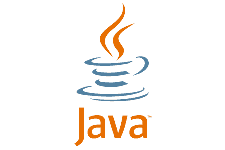

因此，计算机语言的进化有两个主要原因。

Java 增强并完善了 `C++` 的面向对象场景。这为用户提供了更多功能，如下：

- 多线程。
- 提供便捷互联网访问的库。
- `java` 的魔力之一是字节码。字节码是一组高度优化的指令集，设计用于由 `JVM`（Java 虚拟机）执行。它是字节码的解释器。这导致了真正具有可移植性程序的设计。

Java 通过新的功能和网络程序重新设计了互联网，这些如下：

- Applets - 这是一种 `java` 程序，可以通过兼容 `java` 的网络浏览器传输并自动执行。
- 安全 - 它提供了从互联网下载各种 applet 和程序的安全性，且不包含任何病毒或木马。
- 可移植性 - 由于存在大量且不同的操作系统，因此它提供了在任何操作系统上运行的自由，因此其程序可以在不同的操作系统中使用，而不会出现任何兼容性问题。

`java` 的进化如下：

- Java 1.0
- Java 1.1
- Java 1.2
- J2SE
- J2SE 1.2
- J2SE 1.3
- J2SE 1.4
- J2SE 5
- J2SE 5 对 Java 进行了各种更改

新增的功能如下：

- 泛型 (Generics)
- 注解 (Annotations)
- 自动装箱和自动拆箱 (Auto boxing and auto-unboxing)
- 枚举 (Enumerations)
- 增强型 for-each 循环
- 变长参数 (Variable-length arguments)
- 静态导入 (Static import)
- 格式化 I/O (Formed I/O)
- 并发工具类 (Concurrency utilities)

在 J2SE 5 中，开发工具包被称为 `JDK 5`。

## Java 特性

### 面向对象编程

- 这是 `java` 的核心特性。
- 它提供了良好的定义良好的接口。
- `java` 的另一个重要特性是抽象性。
- 这种抽象来管理复杂性。

### OOP 原则

- **封装**：它保护数据免受外部干扰和误用。通过包装器实现。这防止了外部源访问数据。

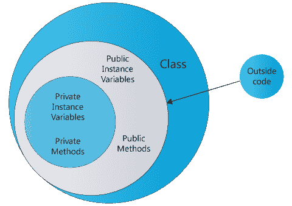

在 Java 中的封装

- **继承**：在此对象可以获取其他对象的属性。它遵循分级概念。它包含类和子类。这种特性是面向对象的。继承也可以与封装进行交互。

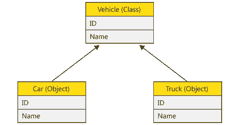

- **多态**：它意味着有多种执行方法的方法。

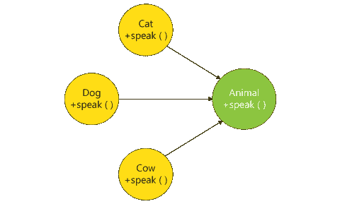

### 字节码

这是一组高度优化的指令，设计用于由虚拟机执行。

### JVM

- 它被设计为字节码的解释器。
- `java` 的另一个特性是简单。
- 这使得专业人士能够学习。
- 以非常有效的方式工作，但也容易理解。

### 健壮性

创建健壮的多平台程序的能力在 Java 设计中被赋予极高优先级。

### 多线程

`java` 满足了现实世界的需求，有助于创建交互式和网络程序。

### 高性能

- 多平台运行程序的优势有助于找到跨平台解决方案。
- 通过 `java` 运行时系统的帮助提供了平台无关代码的优势。

### 分布式

- 这是因为它是为互联网设计的，由于处理了 TCP/IP 协议具有分布式环境。
- 这允许程序跨网络发现方法。
- `URL` 用于访问互联网上的文件。
- 该属性支持 `RMI`（远程方法调用）。

### 动态

- 这是在运行时采取的操作，例如解析、验证和添加对象。
- 它为我们提供了函数，允许我们动态地链接代码，这种方式是安全的。

## 在 `java cmd` 中调用文件

调用文件：`Example.java`。

## 数据类型

### 整数

它包括以下带符号的整数。

- `Byte`：宽度为 8 位，范围从 -128 到 127。它是最小的整数类型。当用户处理来自网络或文件的流或流动数据时它非常有用。

两个名为 `x` 和 `y` 的 `byte` 变量声明如下：

```java
Byte x, y;
```

- `Short`：这种整数的宽度为 16 位，范围从 -32,768 到 32,767。它是 `java` 中不常用的数据类型。

声明：

```java
Short a;
Short b;
```

- `Int`：这种整数的宽度为 32 位，范围从 -2,147,483,648 到 2,147,483,647。与 `byte` 和 `short` 相比，它更高效。它通常用于控制循环和索引数组。

声明：

```java
Int a;
```

- `Long`：这种整数的宽度为 64 位，范围从 -9,223,372,036,854,775,808 到 9,223,372,036,854,775,807。它用于那些整数无法处理的大数值。

声明：

```java
Int light speed;
Long days;
Long second;
Seconds = days * 24 * 60 * 60;
```

### 浮点类型

这是用于用于计算的实数，如平方根、正弦和余弦。它们分为类型。

- `Float`：宽度为 32 位，范围从 1.4e-045 到 3.4e + 038。`Float` 用作小数部分的变量类型，但指定为单精度。它可以用于表示美元和分。

声明：

```java
Float hightemp;
```

- `Double`：宽度为 64 位，范围从 4.9e-324 到 1.8e + 308。它被使用并经过优化，可以用于高速数学计算。它具有双精度，比单精度更快。诸如 `sin()` 和 `sqrt()` 等函数返回 `double` 值。

声明：

```java
Double pi, r, a;
r = 10.4;
pi = 3.14;
a = pi * r * r;
```

### 字符

- `java` 中用于存储或声明字符的数据类型是 `char`。
- 它是 `java` 中的 16 位类型。`char` 的范围是 0 到 65,536。
- 本质上没有负数的 `chars`。

`char` 的程序演示：

```java
Class charExample
{
    Public static void main (String args []) {
        Char a, b;
        a = 88;
        b = 'y';
        system.out.print ("a and b: ");
        system.out.println (a + " " + b);
    }
}
```

### 布尔型

- 它是逻辑值的原始类型。
- 它倾向于只有两个可能值之一，`true` 或 `false`。
- 它受 `if` 或 `for` 控制语句支配。

## 变量

它是存储的基本单元，变量具有作用域、可见性和生命周期。

变量声明：

```java
Int x, y, z;
```

或

```java
Int x = 1, y = 2, z = 5;
```

## 类型转换与强制转换

如果两个类型之间存在任何兼容性，`java` 将自动执行转换。

### Java 自动转换

- 它在满足两个条件时执行。
- 当两个类型兼容时；
- 目标类型大于源类型。
- 在两个条件都满足后，会发生宽转换。

### 强制转换兼容类型

- 这是一种简单且显式的类型转换。
- 当浮点类型转换附加到整数类型时，这种转换被称为截断。
- 这是一种转换，有时被称为窄化转换。

## 数组

它是相似变量的组，通过共同名称引用。数组中的可用元素通过索引访问。它可以被创建，并可能有一个或多个维度。

### 数组的类型

数组主要有两种类型：

1. 一维数组
2. 多维数组

### 一维数组

它是相似类型数据的列表。在创建数组之前，你需要先创建一个任意类型的变量。

语法：

```java
Type variable-name [ ];
Int year_month [ ];
```

### 多维数组

它是数组的数组，需要指定每个维度数组变量，使用其他方括号表示的额外索引。

```java
Int twoD [ ] [ ] = new int [6] [7];
```

## 运算符

有四种主要的运算符：

- 算术运算符
- 位运算运算符
- 关系运算符
- 布尔逻辑运算符

### 算术运算符

- 加法 Addition：此运算符用于相加值。用 `+` 表示。例如 `A = a + 4`。
- 减法：此运算符用于减去值。用 `-` 表示。例如 `A = a - 4`。
- 乘法：此运算符用于相乘值。用 `*` 表示。例如 `A = a * 4`。
- 除法：此运算符用于除值。用 `/` 表示。
- 取模 Modulus：此运算符用于寻找余数。用 `%` 表示。例如 `A = 4`。
- 递增 Increment：此运算符用于增加其值。用 `++` 表示。例如 `a++`。
- 递减 Decrement：此运算符用于减少操作数。用 `--` 表示。例如 `a--`。

### 位运算运算符

- 一元取反 NOT：它反转所有位。用 `~` 表示。
- 与逻辑 And：如果两个操作数均为 1，则产生 1。用 `&` 表示。
- 逻辑或 OR：如果任一操作数为 1，则用 `|` 表示。
- 异或 XOR：如果其中一个操作数为 1 但不是两者，则用 `^` 表示。
- 左移：它将所有位向左侧移动。用 `<<` 表示。
- 右移：它将所有位向右侧移动。用 `>>` 表示。

### 关系运算符

- 等于 Equal to：此运算符显示值相等。用 `==` 表示。
- 不等于 Not equal to：此关系运算符显示值不相等。用 `!=` 表示。
- 大于 Greater than：此运算符显示一个值比另一个值大。用 `>` 表示。
- 小于 Less than：此运算符显示一个值比另一个值小。用 `<` 表示。
- 大于等于 Greater than or equal to：这显示一个值大于或等于另一个值而不小于。用 `>=` 表示。
- 小于等于 Less than or equal to：这显示一个值小于或等于另一个值而不大于。用 `<=` 表示。

### 布尔逻辑运算符

- 逻辑与 AND：用 `&` 表示。
- 逻辑或 OR：符号为 `|`。
- 逻辑异或 XOR：使用 `^` 显示。
- 逻辑一元取反 Unitary Not：显示为 `!`。

### 赋值运算符

赋值是等号，用 `=` 表示。

通用表示：

```java
var = expression;
```

在此处，表示 `var` 的变量应与 `expression` 的类型兼容。

```java
Int a, b, c;
a = b = c = 100;
```

### ? 运算符

这用于替换 if then else 语句，并用 `?` 表示。

例如：

```
expression a ? expression b : expression c
```

上文的示例说明，如果表达式 `a` 为真，则求值表达式 `b`，否则求值表达式 `c`。

## 控制语句

`java` 中有三种语句。

1. 选择语句
2. 迭代语句
3. 跳转语句

## 选择语句

- 它的作用是根据在运行时才能确定的动态条件来管理待执行程序的执行流转。
- 它提供了灵活性。

### `If` 语句

- 它为程序的执行提供了不同的路径。

#### 语法

```
If (condition provided) statement a;
Else
Statement b;
```

这意味着如果条件为真，则执行 `statement a`；但如果条件为假，则执行 `statement b`。

#### 示例

```
int a, b;
If (x < y) a = 0;
Else
b = 0; 
```

现在有一类使用 `if` 语句的程序类型，即嵌套 `if` 语句，这在编程世界中是非常常见的方法。

#### 示例

```
If (a == 10) {
    If (b < 15) i = j;
    If (c > 50) p = q;
    Else
    i = p;
}
Else
    i = q;
```

现在，括号中的第二个 `if` 语句与 `else` 关联。另一种使用 `if` 语句的程序类型是 `if-else-if` 阶梯语句。

#### 示例

```
If (condition)
Statement;
Else if (condition)
Statement;
Else if (condition)
Statement;
...
Else
Statement;
```

### `Switch` 语句

这是一个多分支语句。

#### 语法

```
Switch (expression)
{
    Case value 1:
        Statement
        Break;
    Case value 2:
        Statement
        Break;
    ...
    Case vale n:
        Statement
        Break;
    Default:
        Statement;
}
```

`switch` 语句的功能是将给定的值与所有 case 进行比较，当找到匹配项时，执行程序序列。

#### 示例

```java
Class sampswitch {
    Public static void main (string args [])
    {
        Switch (i)
        {
            Case 0:
                System.out.println ("i is zero.");
                Break;
            Case 1:
                System.out.println("i is one.")
                Break;
            Default:
                System.out.println ("i is greater than 4.")
        }
    }
}
```

#### 输出

```
i is zero.
i is one.
i is greater than 4.
i is greater than 4.
```

#### 嵌套 switch 循环程序示例

```java
Switch (countfigures)
{
    Case 1:
        Switch (targetvalue)
        {//nested switch//
            Case 0:
                System.out.println ("target is zero";
                Break;
            Case 1:
                System.out.println ("target is one";
                Break;
        }
        Break;
    Case 2: //...
}
```

#### `switch` 语句的重要特性是：

- 与 `if` 不同，`Switch` 语句只能检查相等性。
- 在同一个 `switch` 中不能有两个具有相同值的 case 常量。
- 它比使用一组嵌套的 `if` 语句更有效。

## 迭代语句

这些语句用于创建循环。`java` 中使用了三种类型的迭代语句。

### `While` 语句

它的功能是在控制表达式为真时重复或阻塞执行语句。

#### 语法

```
While (condition) {
    // 循环体
}
```

当条件为真时，执行循环。当条件为假时，控制权将传递到循环后的下一行代码。

#### 示例

```java
Class while {
    Public static void main (string args [])
    {
        Int n = 5;
        While (n > 0)
        {
            System.out.println ("tick " + n);
            n--;
        }
    }
}
```

#### 输出


It will tick 5 times
Tick 5
Tick 4
Tick 3
Tick 2
Tick 1

### `Do-while` 语句

此循环至少执行一次其循环体，因为它将条件表达式放在循环的底部。

#### 语法

```
do
{
    System.out.println ("tick" + n);
    n--;
}
while (n > 0);
```

### `For` 语句

*   它是一种非常强大且多功能的构造结构。
*   `for` 语句中提供的条件，除非条件不满足，否则它不会执行。
*   如果条件被求值且结果为假，则终止执行。

#### 语法

```
for (initialize; condition; iterate)
{
    循环体
}
```

#### 示例

```java
class Fortick
{
    public static void main (String args [])
    {
        int n;
        for (n=11; n>0; n--);
    }
}
```

## 跳转语句

`Java` 支持三种跳转语句，如下：

1.  `Break`
2.  `Continue`
3.  `Return`

### `Break`

它用于终止 `switch` 语句中的语句。

### `Continue`

它为循环提供了提前结束。

#### 示例

```java
class Continue
{
    public static void main (String args [])
    {
        for (int i=0; i<5; i++)
        {
            if (i%2 == 0) continue;
            System.out.println(i);
        }
    }
}
```

### `Return`

它用于从方法返回值。

#### 示例

```java
class Return {
    public static void main (String args [])
    {
        boolean t = true;
        System.out.println("return");
    }
}
```

## 类与方法

类可能只包含数据，也可能包含两者。

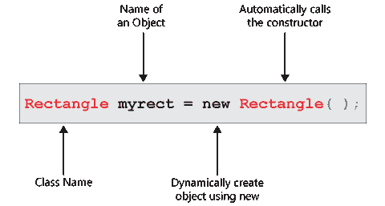

#### 语法

```
ClassName
{
    methodName(parameters)
}
```

#### 示例

```java
class Box
{
    int width;
    int height;
}
```

### 重载

多个方法名称相同但参数不同。

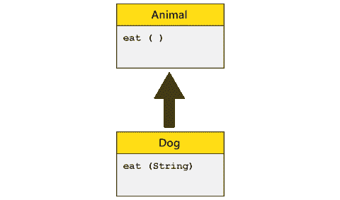

#### 示例

```java
class Overload
{
    void test () {
        System.out.println ("no parameter");
    }

    void test (int a) {
        System.out.println ("a: " + a);
    }

    void test (int a, int b) {
        System.out.println ("a and b: " + a + " " + b);
    }

    void test (double a) {
        System.out.println ("double a: " + a);
    }
}
```

#### 示例

```java
class Overload1
{
    public static void main (String args [])
    {
        Overload ob = new Overload ();
        ob.test ();
        ob.test (10);
        ob.test (10, 20);
        ob.test (125);
    }
}
```

## 继承

继承是子类自父类，这种类被称为子类。


### 继承的基础程序

```java
class X
{
    int i, j;
    void show ()
    {
        System.out.println ("i and j:" + i + " " + j);
    }
}

class Y extends X
{
    int a;
    void show() {
        System.out.println ("a: " + a );
    }
    void sum ()
    {
        System.out.println ("i + j + a: " + (i + j + a) );
    }
}
```

#### 示例

```java
class Simheritance
{
    public static void main (String args [])
    {
        Y subob = new Y ();
        X superob = new X ();
        subob.i = 8;
        subob.j = 7;
        subob.a = 9;
        System.out.println ("contents");
        subob.show();
        subob.sum();
    }
}
```

#### 输出

```
Contents:
I and j: 8 7
a: 9
Sum of i, j and a: 24
```

## 重写

*   当子类与父类的方法相同时，这种场景被称为方法重写。
*   它为 `java` 提供了多态性特性。

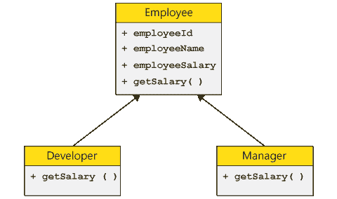

### 继承显示重写

示例代码

```java
class X {
    int a, b;
    X (int p, int q)
    {
        a = p;
        b = q;
    }
    void show ()
    {
        System.out.println ("a and b: " + a + " " + b);
    }
}

class Y extends X {
    int r;
    Y (int a, int b, int c)
    {
        super (a, b);
        r = c;
    }
    void show () {
        System.out.println ("r: " + r );
    }
}

class Override {
    public static void main (String args [])
    {
        Y subob = new Y (1, 2, 3);
        subob.show ();
    }
}
```

#### 输出

`r = 3`

### 继承类型

有三种继承类型。

- 单继承
- 多重继承
- 层次级继承

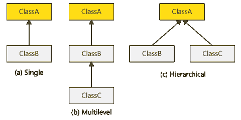

### 继承类型

在 java 中，多继承和混合继承仅通过使用接口支持。

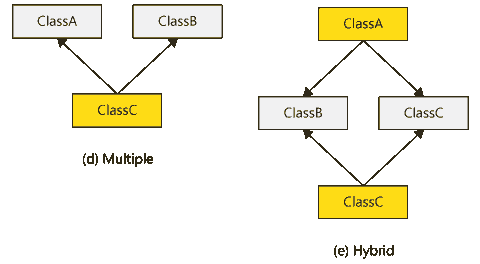

### 多继承和混合继承


## 包 (Packages)

包包含了类的位置。

#### 语法

```java
package pkg;
```

表示多级包

```java
package pkgx [.pkgy [.pkgz]];
```

例如

```java
package java.awt.image;
```

### 查找包

有三种查找包的方法。java 运行时系统使用工作目录；如果包位于子目录，则它会被发现；或者你可以像所示通过设置类的位置来设置位置。

```java
package mpack
```

也可以配合 `java` 和 `javac` 使用类路径（class path）来指定类的位置，如下：

`C:\myprograms\java\mpack`

### 访问保护

为了保护包，java 中存在三种修饰符。

1. `Private` - 无法从类外部可见或访问。
2. `Public` - 具有从任何地方访问的特性。
3. `Protected` - 只能由子类访问。

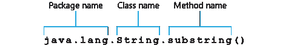

### 包语法

### 导入包

导入包的语句紧接在包语句之后，其主要功能是通过导入包并保存到其位置来节省更多时间。

#### 语法

```java
import pkga [.pkgb]. (classname | *);
```

## 接口 (Interface)

它类似于类，包含了常量、方法和签名。

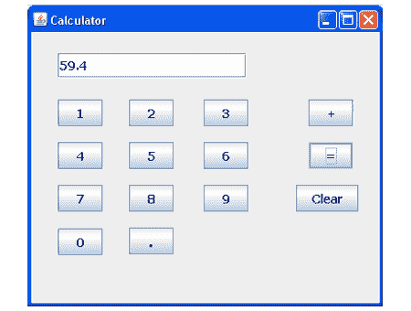

### Java 简单计算器接口

用于 java 的接口

### 声明

```java
access interface M
{
    returnType method1 (parameterList);
    returnType method2 (parameterList);
    type final variableName1 = value;
    type final variableName2 = value;
    //...
    returnType methodNameN (parameterList);
    type final varNameN = value;
}
```

简单接口只包含一个函数或方法，被称为回调函数。

例如

```java
interface Callback
{
    void callback (int param);
}
```

### 实现接口

创建任何接口的实现类都包含在类的定义中。

例如

```java
class ClientCallback
{
    public void callback (int x)
    {
        System.out.println ("callback " + x);
    }
}
```


## 异常处理 (Exception Handling)

这是一个影响 java 程序性能的缺点，因为它可以发生在任何点。它的发生处于执行状态下。

### 原因

- 无效数据
- 文件不存在
- JVM 运行时网络连接丢失和超时。

常见的异常有：

- `Checked`（检查异常）- 这些异常无法由程序员预测，而且在执行期间甚至无法被忽略。
- `Runtime`（运行时异常）- 这是一种动态异常，但与检查异常不同，它可以被忽略。
- `Errors`（错误）- 这些也会被忽略，因为无法做什么来克服它，而且这不受程序员控制。

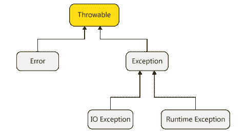

异常层次结构

它分为两个部分：输入输出异常类和运行时异常类。

### throw (抛出)

这些是 JVM 在运行时抛出的异常。

#### 语法

```java
throw ThrowableInstance;
```

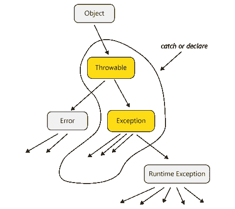

### throw (抛出)

当使用此语句时，程序的执行立即停止。

例如

```java
class ThrowDemo
{
    static void demoProc ()
    {
        try {
            throw new NullPointerException ("demo");
        } catch (NullPointerException e)
        {
            System.out.println ("caught inside demoProc. ");
            throw e;
        }
    }
    public static void main (String args [])
    {
        try {
            demoProc ();
        }
        catch (NullPointerException e) {
            System.out.println ("recatch: " + e);
        }
    }
}
```

### finally

它是在执行 try 和 catch 块之前或之后完成后执行的代码。

#### 语法

```java
class FinallyDemo
{
    static void procX ()
    {
        try {
            System.out.println ("in proc X");
            throw new RuntimeException ("demo");
        }
        finally
        {
            System.out.println ("proc X finally");
        }
    }
}
```


## 事件处理 (Event Handling)

### 事件 (Event)

它显示源状态的变化。

### 事件源 (Event Sources)

它是生成事件的对象。

#### 语法

```java
public void addTypeListener (TypeListener l)
```

例如

- `addKeyListener()` - 注册键盘事件。
- `addMouseMotionListener()` - 注册鼠标移动监听器。

### 事件类 (Action Event Class)

这在按钮被按下时发生。双击项目或选择菜单中的任何项目。

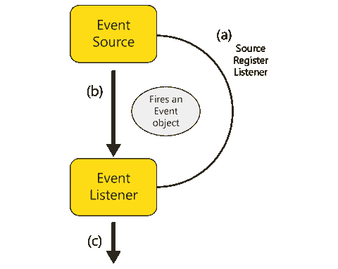

java 中的事件发生

### 键盘事件类 (Key Event Class)

它由键盘按键输入产生，有三种类型。

1. `KEY_PRESSED`
2. `KEY_RELEASED`
3. `KEY_TYPED`

### 鼠标事件类 (Mouse Event Class)

有八种鼠标事件类。

1. `MOUSE_DRAGGED`
2. `MOUSE_CLICKED`
3. `MOUSE_ENTERED`
4. `MOUSE_EXITED`
5. `MOUSE_MOVED`
6. `MOUSE_PRESSED`
7. `MOUSE_RELEASED`
8. `MOUSE_WHEEL`

### 监听器接口 (Action Listener Interface)

它用于定义调用事件时执行的操作。它用于感知方法的响应。


## Applet 类 (The Applet Class)

它包含了用于 java 执行和详细控制的方法。Applet 的初始化和终止如下：

### 开始 (Starting)

- `init()` - 初始化方法，它是第一个方法。
- `start()` - 初始化方法之后调用此方法，其功能是重启或在屏幕上显示。
- `paint()` - 每次调用它时都会重绘 applet 的输出。

### 停止 (Stopping)

- `stop()` - 用于离开打开并包含 applet 的浏览器。
- `destroy()` - 用于从内存中移除 applet。

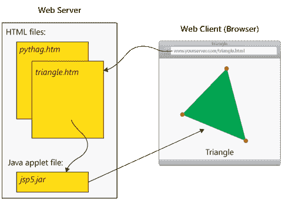

### Applet 生成 (Applet Generation)

HTML applet 标签

```html
<APPLET
[CODEBASE= codebaseurl]
CODE=applet file
[ALT=alternatetext]
[NAME=appletinstancename]
WIDTH=pixels HEIGHT=pixels
[ALIGN=alignment]
[VSPACE=pixels] [HSPACE=pixels]
>
[<PARAM NAME=attribute name VALUE= attributevalue>]
...
[没有 java 时显示的 HTML]
</APPLET>
```

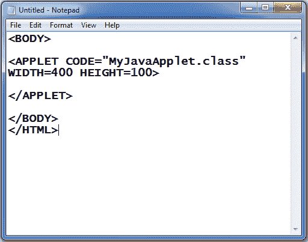

HTML applet 标签

音频接口 (AudioClip Interface)

- `play()` - 开始音频。
- `stop()` - 停止音频。
- `loop()` - 无断循环播放。

Applet 子接口 (Applet Sub Interface)

它提供了一个 Applet 和浏览器之间进行通信的链接。


感谢阅读

知识流书籍！


