# Java 初学者指南：针对 Java 初学者的分步详细讲解


***

## 前言

Java 是开发者最青睐的语言之一，涵盖了游戏、超级计算机甚至家电的各个领域。本 Java 编程书籍旨在让读者理解面向对象的编程方法，并在此过程中培养一些实用技能。书中将解释的概念和培养的技能在许多使用现代面向对象语言的程序员中是通用的，因此可以在不同语言之间迁移。然而，出于实际考虑，这些概念将使用 Java 编程语言进行探索和演示。

Java 编程语言被用于强调和演示基础对象的应用（包括循环的使用、选择语句、计算、数组、数据类型以及对文件处理的基本理解），以及 JavaFX 的基本概念。

本书具有实用目的，因此首要目标是展示“如何做”。当然，书中也有更具理论性的解释，但我尽量减少理论材料，以便让你快速达到编写程序所需的内容。大部分内容通过大量的示例以及相关的说明来呈现。

本书是编程和 Java 语言的入门。它对读者没有特殊假设，适用于任何想或需要学习编程的人。因此，读者不需要具备编程知识，前提是读者对编程感兴趣，并且电脑上安装了 `IntelliJ IDEA`。

当你读完本书后，将熟练掌握 Java 语言基础，并能够在日常 Java 编程工作中使用它们。

Mohammed Abdelmoniem Kamel

2019

ata4tech@gmail.com

***

## 关于作者

我是 Mohammed Abdelmoniem。我是一名 Web 开发人员，目前住在苏丹的奥姆杜曼（Omdurman）。我拥有计算机科学学士学位和信息技术 MBA 学位。我的主要关注点和灵感源于创造美且实用的产品。我不断尝试新的技术和技巧。我对比 Web 开发充满热情，并努力提升自己开发者以及整个开发者社区的水平。

***

## 代码示例

书中所示示例程序是使用 `IntelliJ IDEA 2019` 和 `JDK 8/9/10` 编译的。你可以从下面的链接下载源代码：

*   `learnjava_source.zip`: https://drive.google.com/open?id=19NZbBa8g4AaDG2z31zhF5n6EA2JS1Wr
*   `learnjava_source.7z`: https://drive.google.com/open?id=1wrjtuE48dzSy2ieM6gkAIj2xBHvvIPxE

我将尝试保持代码与 JDK 最新发布版本的同步，并修复（以及注释）可能遗漏的错误。你可以通过发送邮件至 `ata4tech@gmail.com` 向我报告关于书籍或源代码的问题、错误或其他类型的反馈。

```
System.out.println("no : " + no5);
}
```

```
Output:
no : 800888888
no : 5588
no : 2413
no : 21777
no : 33
```

## 浮点数字面量

Java 有两种浮点数：`float` 和 `double`。如果浮点数字面量以字母 `F` 或 `f` 结尾，则它是 `float` 类型；否则它的类型是 `double`，并且可以选择以字母 `D` 或 `d` 结尾。例如：

`float fl = 12.6f;`

我们还可以使用科学计数法（短写 `E`）指定浮点数字面量。`F` 或 `f`（32 位 float 字面量）以及 `D` 或 `d`（64 位 double 字面量；这是默认）。这里是一个使用这些字面量的简单示例。

### 示例 3.26：DoubleFloat.java
```java
double d1 = 123.4;
double d2 = 1.234e2; // 与 d1 值相同，但使用科学计数法
float f1 = 123.4f;
double d3 = 3.4d;
```

### 示例 3.27：FloatingPointLiteral.java
```java
package ch03;

public class FloatPointLiteral {

    public static void main(String[] args){

        double d1 = 123.4;
        System.out.println("d1 : " + d1);

        double d2 = 1.234e2;
        System.out.println("d2 : " + d2);

        float f1 = 123.4f;
        System.out.println("f1 : " + f1);

        double d3 = 3.4d;
        System.out.println("d3 : " + d3);

        double no = 1_587_3_82.0;
        System.out.println("no : " + no);

    }

}
```

```
Output:
d1 : 123.4
d2 : 123.4
f1 : 123.4
d3 : 3.4
no : 1587382.0
```

## 字符字面量

字符字面量用一对单引号括起的单个字符表示。例如：`'b'`、`'*'` 和 `'7'`。Java 通过 16 位 Unicode 标准支持数千个额外字符。下表显示了这些特殊字符的集合。

### 表 3.6 | 字符字面量
| Char | 十进制 | 二进制 | 十六进制 | 八进制 |
| :--- | :--- | :--- | :--- | :--- |
| " | 34 | 1000010 | 21 | 41 |
| 1 | 49 | 110001 | 31 | 61 |
| A | 65 | 1000001 | 41 | 101 |
| B | 66 | 1000010 | 42 | 102 |

如果你想将单引号、空斜杠或不可打印字符作为字符字面量，请使用转义序列。转义序列使用特殊的语法来表示字符。该语法以单个反斜杠字符开始。

### 表 3.7 | 字符转义码
| Escape | 含义 |
| :--- | :--- |
| `\n` | 换行 |
| `\t` | 制表符 |
| `\b` | 退格 |
| `\r` | 回车 |
| `\f` | 换页 |
| `\\` | 反斜杠 |
| `\'` | 单引号 |
| `\"` | 双引号 |
| `\d` | 八进制 |
| `\rd` | 十六进制 |

下表查看使用 Unicode 转义序列表示可打印和不可打印字符的字符字面量。

### 表 3.8 | Unicode 转义序列与可打印/不可打印字符
| Unicode Escape Sequence | 可打印和不可打印字符 |
| :--- | :--- |
| `\u0041` | 大写字母 A |
| `\u0030` | 数字 0 |
| `\u0022` | 双引号 |
| `\u003b` | 标点符号 |
| `\u0020` | 空格 |
| `\u0009` | 水平制表符 |
| `\u004D` | 大写字母 M |

下面是一个说明转义序列使用的 Java 程序。

### 示例 3.28：ChEscape.java
*(注：原文此处示例 3.28 标记为 ChEscape.java，但内容为 FloatPointLiteral，此处按原文内容保留)*
```java
package ch03;

public class FloatPointLiteral {

    public static void main(String[] args){

        double d1 = 123.4;
        System.out.println("d1 : " + d1);

        double d2 = 1.234e2;
        System.out.println("d2 : " + d2);

        float f1 = 123.4f;
        System.out.println("f1 : " + f1);

        double d3 = 3.4d;
        System.out.println("d3 : " + d3);

        double no = 1_587_3_82.0;
        System.out.println("no : " + no);

    }

}
```

程序可以很容易地进行广泛的更改。假设利率出现在程序中十几个不同的语句中，当利率发生变化时，常量名称定义中的初始化值是唯一需要修改的值。`static` 修饰符结合 `final` 关键字也用于定义常量（有关更多细节见第 13 章）。例如：

```java
static final int CONSTANT_VALUE = 100;
```

这是一个简单的示例。

### 示例 3.33: StaticFinalEx.java - 使用 static 和 final 关键字
```java
package ch03;

public class StaticFinalEx {

    static final int CONSTANT_VALUE = 100;

    public static void main(String[] args){

        System.out.println("Constant Value : " + CONSTANT_VALUE);

        // CONSTANT_VALUE = 40

    }

}
```
输出：`Constant Value : 100`

### 示例 3.34: FinalEx.java
```java
package ch03;

public class FinalEx {

    public static void main(String[] args){

        // char MAX_NUM = 100;
        // System.out.println(MAX_NUM);

        final int MAX_NUM = 200;
        System.out.println(MAX_NUM);

    }

}
```
输出：`200`

***

## 变量、常量与字面量的区别

### 变量
`Variable`（变量）是内存位置的名称，允许我们存储一个值以供以后使用。它被称为变量，是因为你可以随时更改其中的内容。

### 常量
`Constant`（常量）类似于变量。常量与变量唯一的区别是它们一旦定义就不能更改。

### 字面量
`Literals`（字面量）是赋值给变量和常量的值。

***

## Java 关键字

关键字是 Java 编程中预定义的保留字，对编译器具有特殊含义。例如 `int`、`for`、`class`、`package` 等。你不能将关键字作为变量或常量名称（或标识符）。下面是 Java 编程中所有关键字的完整列表。

### 表 3.9 | Java 关键字
| class | public | default | if | goto | void | protected |
| while | static | continue | do | const | enum | synchronized |
| super | assert | boolean | for | float | byte | implements |
| break | double | private | new | this | throws | strictfp |
| short | native | package | int | throw | return | volatile |
| import | switch | finally | case | long | final | transient |
| catch | extends | abstract | else | char | interface | |

***

## 总结

- 变量是用于存储特定数据类型值的内存位置名称。
- 在 Java 中有四种变量：非静态变量、静态变量、局部变量和参数。
- 局部变量是在方法内部声明的变量。
- Java 编程语言是静态类型的，这意味着所有变量在使用之前必须先进行声明。
- 变量声明指示编译器：保留部分内存空间，为该保留的内存位置分配一个名称，并分配它将包含的数据类型。
- 初始化是在声明语句中为变量赋值值。
- 变量一次时间只能持有一个值。
- 标识符是我们给变量、方法、类、包和接口命名的名称。
- 数据类型指的是存储在变量中的数据类型。
- Java 被称为“强类型语言”，因为当你声明变量时，必须指定变量的类型。
- 数据类型分为两类：基本或原始数据类型以及对象或引用数据类型。
- 原始数据类型是那些变量一次只能持有一个值的类型。这些数据类型被称为原始，是因为你不能使用它们来创建对象。
- 在 Java 中我们有八种原始数据类型，分为四组。它们是：整数类型（`byte`、`short`、`int`、`long`）、浮点类型（`float`、`double`）、字符类型（`char`）、布尔类型（`boolean`）。
- 字面量是可以赋值给原始或字符串变量的值，或作为参数传递给方法调用。
- 在 Java 中，以反斜杠（`\`）开头的字符是转义序列，对 Java 有特殊含义。
- 字符串字面量可以包含任何作为字符字面量出现的转义序列。
- Java 中有六种字面量。它们是：整数字面量、浮点字面量、字符串字面量、字符字面量、布尔字面量和类字面量。
- Java 有两种浮点数：`float` 和 `double`。如果浮点字面量以字母 `F` 或 `f` 结尾，则它是 `float` 类型；否则它的类型是 `double`，并且可以以字母 `D` 或 `d` 结尾。
- 字符字面量用一对单引号括起来的字符表示。
- 字符串字面量是双引号内的一组字符。
- 我们指定 `Null` 字面量是为了减少对对象的引用。
- 值 `true` 和 `false` 在 Java 中被视为字面量。当我们给布尔变量赋值时，只能使用这两个值。记住，字面量 `true` 并不是由它周围的引号表示的。
- 在 Java 中，数值字面量数字之间的任何地方都可以任意数量的划线字符（`_`）。
- 常量是创建存储固定值的变量。命名常量是一个内容固定的变量。
- 关键字是 Java 编程中预定义的保留字，对编译器具有特殊含义。

***

## 第 4 章：表达式与运算符

表达式由两个部分组成：运算符和操作数。运算符是表示加法等简单计算的符号。运算符对数据或操作数执行操作。所有表达式至少有一个操作数。

### 算术运算符

算术运算符用于数学表达式（加、减、除、乘等）。Java 提供了表中所示的算术运算符。

### 表 4.1 | 算术运算符（假设整数变量 A 的值为 10，B 的值为 20）
| 运算符 | 描述 | 示例 |
| :--- | :--- | :--- |
| `+` | 运算符两侧相加 | `A + B = 30` |
| `-` | 从左操作数减去右操作数 | `A - B = -10` |
| `*` | 运算符两侧相乘 | `A * B = 200` |
| `/` | 左操作数除以右操作数 | `B / A = 2` |
| `%` | 左操作数除以右操作数并返回余 | `B % A = 0` |
| `++` | 操作数的值加 1 | `B ++ = 21` |
| `--` | 操作数的值减 1 | `B -- = 19` |

### 示例 4.1: ArithmeticOp1.java
```java
package ch04;

public class ArithmeticOp1 {

    public static void main(String[] args){

        int x;
        int y = 10;
        int z = 5;

        x = y + z;
        System.out.println("+ operator resulted in " + x);

        x = y - z;
        System.out.println("- operator resulted in " + x);

        x = y * z;
        System.out.println("* operator resulted in " + x);

        x = y / z;
        System.out.println("/ operator resulted in " + x);

        x = y % z;
        System.out.println("% operator resulted in " + x);

    }

}
```


## Java 算术运算符

### 示例 4.1: ArithmeticOp1.java
```java
package ch04;

public class ArithmeticOp1 {

    public static void main(String[] args) {
        int x = 0;
        int y = 10;
        int z = 5;

        x = y + z;
        System.out.println("+ operator resulted in " + x); // 15

        x = y - z;
        System.out.println("- operator resulted in " + x); // 5

        x = y * z;
        System.out.println("* operator resulted in " + x); // 50

        x = y / z;
        System.out.println("/ operator resulted in " + x); // 2

        x = y % z;
        System.out.println("% operator resulted in " + x); // 0

        x = -y;
        System.out.println("Unary operator resulted in" + x); // -10
    }
}
```

**Output**
```
+ operator resulted in 15
- operator resulted in 5
* operator resulted in 50
/ operator resulted in 2
% operator resulted in 0
Unary operator resulted in-10
```

### Explanation
* Line 04: 创建一个名为 `x` 的变量。
* Line 05: 创建一个名为 `y` 的变量并为其赋值值 10。
* Line 06: 创建一个名为 `z` 的变量并为其赋值值 5。
* Line 07: 将 `y` 和 `z` 的值相加并将结果赋值给变量 `x`。
* Line 08: 将变量 `x` 的值传递给 `println()` 方法。显示变量的内容。
* Line 10: 减去 `y` 和 `z` 的值并将结果赋值给变量 `x`。
* Line 11: 将变量 `x` 的值传递给 `println()` 方法。显示变量的内容。
* Line 13: 乘以 `y` 和 `z` 的值并将结果赋值给变量 `x`。
* Line 14: 将变量 `x` 的值传递给 `println()` 方法。显示变量的内容。
* Line 16: 除以 `y` 和 `z` 的值并将结果赋值给变量 `x`。
* Line 17: 将变量 `x` 的值传递给 `println()` 方法。显示变量的内容。
* Line 19: 将变量 `y` 的值从 10 转换为 -10。然后将结果赋值给变量 `x`。
* Line 20: 将变量 `x` 的值传递给 `println()` 方法。显示变量的内容。

---

### 示例 4.2: ArithmeticOp2.java
```java
package ch04;

public class ArithmeticOp2 {

    public static void main(String[] args) {
        int a = 10;
        int b = 20;

        System.out.println("a + b = " + (a+b));
        System.out.println("a - b = " + (a-b));
        System.out.println("a * b = " + (a*b));
        System.out.println("a / b = " + (a/b));
        System.out.println("a % b = " + (a%b));
        System.out.println("b % a = " + (b%a));
        System.out.println("a++ = " + (a++));
        System.out.println("a-- = " + (a--));
    }
}
```

**Output**
```
a + b = 30
a - b = -10
a * b = 200
a / b = 0
a % b = 10
b % a = 0
a++ = 10
a-- = 11
```

### Explanation
* Line 04: 创建一个名为 `a` 的变量并为其赋值值 10。
* Line 05: 创建一个名为 `b` 的变量并为其赋值值 20。
* Line 07: 将 `a` 和 `b` 相加并显示结果 30。

**注意**：括号内的表达式从左到右求值。考虑以下示例：`System.out.println("a + b = " + a + b ); // 1020`
当字符串（`String`）与任何其他数据类型相加时，结果值是一个字符串。另一个变量也会转换为字符串，然后进行拼接。`System.out.println("a + b = " + a + b ); // 输出: 1020`
如果 `println()` 方法中的表达式包含括号，则括号内的值先求值。因此，当两个整数使用 `(+)` 符号进行操作时，`(+)` 符号充当加法运算符而不是拼接运算符。考虑以下示例 - `System.out.println("a + b = " + (a+b)); // 输出: 30`
括号被用来改变求值的顺序。首先求值括号内的表达式。因此，`a + b` 被求值为整数 30，然后它与字符串 `"a + b = "` 拼接，得到最终的字符串 `"a + b = 30"`。

---

## Java 关系运算符

Java 中的关系运算符用于比较两个值并返回一个布尔值。例如，小于运算符 (`<`) 确定一个值是否小于另一个值。Java 提供了六种关系运算符。表 4.2 列出了 Java 关系运算符，并展示了几个比较变量 `A` 和 `B` 的关系表达式示例。

### 表 4.2 | 关系运算符（假设整数变量 `A` 值为 10，变量 `B` 值为 20）

| 运算符 | 描述 | 关系表达式 |
| :--- | :--- | :--- |
| `==` (等于) | 检查 `A` 和 `B` 的值是否相等，如果是，则条件为真。 | `(A==B)` 为假 |
| `!=` (不等于) | 检查 `A` 和 `B` 的值是否相等，如果是，则条件为真。 | `(A!= B)` 为真 |
| `>` (大于) | 检查 `A` 的值是否大于 `B` 的值，如果是，则条件为真。 | `(A>B)` 为假 |
| `<` (小于) | 检查 `A` 的值是否小于 `B` 的值，如果是，则条件为真。 | `(A<B)` 为真 |
| `>=` (大于或等于) | 检查 `A` 的值是否大于或等于 `B` 的值，如果是，则条件为真。 | `(A>=B)` 为真 |
| `<=` (小于或等于) | 检查 `A` 的值是否小于或等于 `B` 的值，如果是，则条件为真。 | `(A<=B)` 为真 |

所有关系运算符都是二元的，这意味着它们使用两个操作数。下面的示例展示了如何使用它们。

### 示例 4.3: RelationalOp.java
```java
package ch04;

public class RelationalOp {

    public static void main(String[] args) {
        int a = 10;
        int b = 20;

        System.out.println("a == b = " + (a==b));
        System.out.println("a != b = " + (a!=b));
        System.out.println("a > b = " + (a>b));
        System.out.println("a < b = " + (a<b));
        System.out.println("a >= b = " + (a>=b));
        System.out.println("a <= b = " + (a<=b));
    }
}
```

**Output**
```
a == b = false
a != b = true
a > b = false
a < b = true
a >= b = false
a <= b = true
```

### Explanation
* Line 04: 创建一个名为 `a` 的变量并为其赋值值 10。
* Line 05: 创建一个名为 `b` 的变量并为其赋值值 20。
* Line 07-12: 展示了各种关系运算符的比较结果。

---

## Java 逻辑运算符

Java 中的逻辑运算符用于比较两个布尔值并返回一个布尔值。例如，与运算符 (`&&`) 确定两个值是否都为真。Java 提供了四种逻辑运算符。表 4.3 列出了 Java 逻辑运算符，并展示了比较布尔变量 `A` 和 `B` 的几个逻辑表达式示例。

### 表 4.3 | 逻辑运算符（假设布尔变量 `A` 为真，变量 `B` 为假）

| 运算符 | 描述 | 示例 |
| :--- | :--- | :--- |
| `&&` (逻辑与) | 检查两个值，只有当两个都为真时，结果才为真。 | `A && B` 为假 |
| `\|\|` (逻辑或) | 检查两个值，只要其中一个为真时，结果就为真。 | `A \|\| B` 为真 |
| `!` (逻辑非) | 反转布尔表达式的值。如果值为真，则结果为假。 | `!A` 为假 |
| `^` (逻辑异或) | 检查两个值，只有当两个值不同时，结果才为真。 | `A ^ B` 为真 |

所有逻辑运算符都是二元的，这意味着它们使用两个操作数。下面的示例展示了如何使用它们。

### 示例 4.4: LogicalOp.java
```java
package ch04;

public class LogicalOp {

    public static void main(String[] args) {
        boolean a = true;
        boolean b = false;

        System.out.println("a && b = " + (a&&b));
        System.out.println("a || b = " + (a||b));
        System.out.println("!a = " + (!a));
        System.out.println("a ^ b = " + (a^b));
    }
}
```

**Output**
```
a && b = false
a || b = true
!a = false
a ^ b = true
```

### Explanation
* Line 04: 创建一个名为 `a` 的变量并为其赋值 true。
* Line 05: 创建一个名为 `b` 的变量并为其赋值 false。
* Line 06: `println()` 方法显示 `a && b = false`，因为 `a` 和 `b` 不都为真。
* Line 07: `println()` 方法显示 `a || b = true`，因为 `a` 或 `b` 其中为真。
* Line 08: `println()` 方法显示 `!a = false`，因为 `a` 为真。
* Line 09: `println()` 方法显示 `a ^ b = true`，因为 `a` 和 `b` 的值不同。

---

## Java 赋值运算符

赋值运算符在 Java 中用于为变量赋值。赋值运算符获取右侧操作数的值并将其放入左侧操作数标识的变量中。右操作数可以是字面量或变量。

### 语法
`<left-side-operand> = <right-side-operand>`
`=` 运算符左侧的操作数必须是一个变量名。`=` 运算符右侧的操作数必须是有值的表达式。

### 示例 4.5: AssignmentOp1.java
```java
public class AssignmentOp1 {

    public static void main(String[] args) {
        int length = 10;
        int width;

        // change the content of length to 20.
        length = 20;

        // assigns the value of the length variable to the width variable.
        // length still has the same value 20.
        width = length;

        System.out.println("Length value is " + length);
        System.out.println("Width value is " + width);
    }
}
```

**输出**
```
Length value is 20
Width value is 20
```

重要：赋值运算符只改变其左侧操作数的内容。以下是 Java 支持的赋值运算符。

### 表 4.4 | 赋值运算符

| 运算符 | 描述 | 示例 |
| :--- | :--- | :--- |
| `=` | 赋值运算符。将右操作数的值赋给左侧操作数。 | `C = A + B` 将 `A + B` 的值赋给 `C` |
| `+=` | 加赋值运算符。将右操作数加到左操作数上，并将结果赋给左操作数。 | `C += A` 等同于 `C = C + A` |
| `-=` | 减赋值运算符。从左操作数中减去右操作数，并将结果赋给左操作数。 | `C -= A` 等同于 `C = C – A` |
| `*=` | 乘赋值运算符。将左操作数乘以右操作数，并将结果赋给左操作数。 | `C *= A` 等同于 `C = C * A` |
| `/=` | 除赋值运算符。将左操作数除以右操作数，并将结果赋给左操作数。 | `C /= A` 等同于 `C = C / A` |
| `%=` | 取模赋值运算符。使用两个操作数取模，并将结果赋给左操作数。 | `C %= A` 等同于 `C = C % A` |
| `<<=` | 左移赋值运算符。 | `C <<= 2` 等同于 `C = C << 2` |
| `>>=` | 右移赋值运算符。 | `C >>= 2` 等同于 `C = C >> 2` |
| `&=` | 按位与赋值运算符。 | `C &= 2` 等同于 `C = C & 2` |
| `^=` | 按位异或赋值运算符。 | `C ^= 2` 等同于 `C = C ^ 2` |
| `|=` | 按位或赋值运算符。 | `C \|= 2` 等同于 `C = C \| 2` |

### 示例 4.6: AssignmentOp2.java
```java
package ch04;

public class AssignmentOp2 {

    public static void main(String[] args) {
        int a = 10, b = 20, c = 0;

        c = a + b;
        System.out.println("c = a + b = " + c);

        c += a;
        System.out.println("c+= a = " + c);

        c -= a;
        System.out.println("c -= a = " + c);

        c *= a;
        System.out.println("c *= a = " + c);

        a = 10;
        c = 15;
        c /= a;
    }
}
```

**输出**
```
c = a + b = 30
c+= a = 40
c -= a = 30
c *= a = 300
```


## 解释

- 第 04 行：创建一个名为 `a` 的变量并赋值 `10`。
- 第 04 行：创建一个名为 `b` 的变量并赋值 `20`。
- 第 04 行：创建一个名为 `c` 的变量并赋值 `0`。
- 第 05 行：将 `a` 和 `b` 的值相加并将结果赋给 `c`。
- 第 06 行：将 `c` 的值发送到 `println()` 方法。显示为：`c = a + b = 30`
- 第 08 行：将 `a` 的值加到 `c` 上并将结果赋给 `c`。
- 第 09 行：将 `c` 的值发送到 `println()` 方法。显示为：`c+= a = 40`
- 第 11 行：从 `c` 中减去 `a` 的值并将结果赋给 `c`。
- 第 12 行：将 `c` 的值发送到 `println()` 方法。显示为：`c -= a = 30`
- 第 14 行：将 `c` 的值乘以 `a` 的值并将结果赋给 `c`。
- 第 15 行：将 `c` 的值发送到 `println()` 方法。显示为：`c *= a = 300`
- 第 16 行：为 `a` 赋值 `10`。
- 第 17 行：为 `c` 赋值 `15`。
- 第 18 行：将 `c` 除以 `a` 并将结果赋给 `c`。

## 按位运算符

Java 提供了按位运算符在位位上操作变量的内容。这些变量必须是数值类型（`char`、`short`、`int` 或 `long`）。

### 表 4.5 | 按位运算符（假设整数变量 A 持有 60，变量 B 持有 15）

| 运算符 | 描述 | 示例 |
| :--- | :--- | :--- |
| `&` | 对每一位进行按位与运算。只有当 `a` 和 `b` 都为 1 时，结果为 1。 | `a = 60 (00111100)`, `b = 15 (00001111)` |
| `\|` | 对每一位进行按位或运算。当 `a` 或 `b` 其中一个为 1 时，结果为 1。 | `a = 60 (00111100)`, `b = 15 (00001111)` |
| `^` | 对每一位进行按位异或运算。当 `a` 和 `b` 不同时，结果为 1。 | `a = 60 (00111100)`, `b = 15 (00001111)` |
| `~` | 对每一位进行按非运算。`~a` 产生 `a` 的反值（补码）。 | `a = 60 (00111100)` |

## 按位移运算符

按位移运算符接受两个操作数：第一个是待移动的数量，第二个指定第一个操作数移动的位数。

### 表 4.6 | 按位移运算符

| 运算符 | 描述 | 示例 |
| :--- | :--- | :--- |
| `&` | 使用 `&` 运算符，只有当两个操作数中都存在该位时，结果中的该位为 1。 | `a = 60 (00111100)`, `b = 15 (00001111)` |
| `\|` | 如果位在任一操作数中存在，则结果中的该位为 1。 | `a = 60 (00111100)`, `b = 15 (00001111)` |
| `^` | 对每一位进行按位异或运算。当 `a` 和 `b` 不同时，结果为 1。 | `a = 60 (00111100)`, `b = 15 (00001111)` |
| `~` | （按位取反）对每一位进行按非运算。`~a` 产生 `a` 的反值（补码）。 | `a = 60 (00111100)` |
| `<<` | 在 `<<` 左移运算符中，所有位都按右操作数指定的位数向左移动。 | `a << 2; a = 60 (00111100)`, 左移 2 位 |
| `>>` | 正数：二进制右移运算符。左操作数的值按右操作数指定的位数向右移动。 | `a >> 2; a = 60 (00111100)`, 右移 2 位 |
| `>>` | 负数：`>>` 将位向右移动并用 0 填充最左侧，完成后会将左侧位重置为 1 以保持结果为负。 | `a = -99 >> 2` |
| `>>>` | 正数：右移零填充运算符。左操作数的值按右操作数指定的位数向右移动，移出的位用 0 填充。 | `a >>> 2; a = 60 (00111100)`, 右移 2 位 |

| `>>>` (无符号右移) 负数 | 使用 `>>>` 时，所有位向右移动，零填充在最左侧位。 | `a = -1; a >>> 2 ;` |
| :--- | :--- | :--- |
| 操作数 `-1` : `11111111` | 变为：`00111111` | |

### 示例 4.7：`BitwiseOp1.java`

假设 `a = 40` 且 `b = 10`；现在它们的二进制格式表示如下：

```java
package ch04;

public class BitwiseOp1 {

    public static void main(String[] args) {

        int a = 40; // 40 = 0010 1000

        int b = 10; // 10 = 0000 1010

        int c = 0;

        c = a & b;  // 8 = 0000 1000

        System.out.println("a & b = " + c);

        c = a | b;  // 42 = 0010 1010

        System.out.println("a | b = " + c);

        c = a ^ b;  // 34 = 0010 0010

        System.out.println("a ^ b = " + c);

        c = ~a;

        System.out.println("~a = " + c);

        c = a << 2; // 160 = 1010 0000

        System.out.println("a << b = " + c);

        c = a >>> 2; // 10 = 0000 1010

        System.out.println("a >>> 2 = " + c);

    }

}
```

**输出**

```
a & b = 8
a | b = 42
a ^ b = 34
~a = -41
a >> b = 160
a >>> 2 = 10
```

### 示例 4.8：`BitwiseOp2.java`

```java
package ch04;

public class BitwiseOp2 {

    public static void main(String[] args){

        int x = 0xFAEF; // 1111101011101111

        int y = 0xF8E9; // 1111100011101001

        int z;

        System.out.println("x & y : " + (x & y));

        System.out.println("x ^ y : " + (x ^ y));

        System.out.println("~x : " + (~x));

        System.out.println("x << y : " + (x << y));

        System.out.println("x >> y : " + (x >> y));

        System.out.println("x >>> y : " + (x >>> y));

        // 无无符号左移运算符

    }

}
```

**输出**

```
x & y : 63721
x ^ y : 518
~x : -64240
x << y : 32890368
x >> y : 125
x >>> y : 125
```

在操作数的两个对应位之间应用位运算符的结果如下表所示：

| `A` | `B` | `~A` | `A&B` | `A\|B` | `A^B` |
| :--- | :--- | :--- | :--- | :--- | :--- |
| 1 | 1 | 0 | 1 | 1 | 0 |
| 1 | 0 | 0 | 0 | 1 | 1 |
| 0 | 1 | 1 | 0 | 1 | 1 |
| 0 | 0 | 1 | 0 | 0 | 0 |

## Java 自增和自减运算符

自增和自减运算符属于算术运算符。

*   `++` 将操作数的值加 1。
*   `--` 将操作数的值减 1。

### 表 4.7 | 自增和自减运算符。（假设整数变量 `B` 存储 20）

| 运算符 | 描述 | 示例 |
| :--- | :--- | :--- |
| `++` (自增) | 将操作数的值加 1。 | `B++` 得到 21 |
| `--` (自减) | 将操作数的值减 1。 | `B--` 得到 19 |

### 示例 4.9：`IncDecOp.java`

```java
package ch04;

public class IncDecOp {

    public static void main(String[] args) {

        int a = 1;

        a++;

        int b = 2;

        b++;

        System.out.println("a = " + a);

        System.out.println("b = " + b);

    }

}
```

**输出**

```
a = 2
b = 3
```

### 解析

*   第 05 行：将变量 `a` 的值加 1。
*   第 07 行：将 `b` 的值加 1。

## 总结

*   控制结构由三种类型组成：序列、选择和循环。
*   序列结构按顺序执行。
*   选择结构根据条件的真假改变流程。
*   选择结构使用关系运算符测试条件。
*   算术运算符用于计算。
*   逻辑运算符用于组合布尔表达式。
*   赋值运算符将值赋予变量。
*   位运算符操作单个位。
*   自增和自减运算符属于算术运算符。
*   `++` 将操作数的值加 1。
*   `--` 将操作数的值减 1。

## 控制结构

介绍控制结构（控制流）
控制结构决定语句执行的顺序。

**控制结构的类型：**

1.  序列结构。
2.  判定（选择）结构。
3.  重复（循环）结构。

### 序列结构

程序是一系列语句，按顺序执行。这是默认执行方式。然而循环和选择是改变流程的特殊指令。例如：

```java
public class ClassName {

    public static void main(String[] args) {

        System.out.println("第一条语句");

        System.out.println("第二条语句");

    }

}
```

序列结构从上到下执行。然而，循环和选择是改变流程的特殊指令。

### 选择结构

选择语句（条件结构）根据条件的真假将程序转移到特定的流程。选择结构使用关系运算符测试条件。有多种选择结构用于实现结果。

**选择结构的类型：**

*   `if` 选择语句
*   `if...else` 选择语句
*   条件运算符 (`? :`)
*   `if...else if` 选择语句
*   嵌套 `if` 选择语句
*   `switch` 选择语句

#### `if` 选择语句

当条件为真时执行操作，为假时跳过操作。`if`语句只在条件为真时执行一个或多个语句。

语法：

```java
if (condition) {

    // 如果布尔表达式 (condition) 为真则执行语句

}

// 如果布尔表达式 (condition) 为假则执行语句
```

解析：

*   条件应始终包含在括号内。
*   布尔表达式（`condition`）是真或假之一。如果条件为真，则执行 `{` 和 `}` 之间的语句。否则会被跳过。该语句是条件执行的（仅在括号内的表达式为真时执行）。
*   如果条件为假，则执行 `{` 和 `}` 之后的后续语句。

#### 示例 5.1：`IfSelect.java`

`IfSelect.java` 程序演示了 `if` 语句的使用。

```java
package ch05;

public class IfSelect {

    public static void main(String[] args) {

        int x = 15;

        if (x > 10) {

            System.out.println("x 大于 10.");

        }

        System.out.println("if 语句后的第一条语句");

    }

}
```

`if` 语句的控制流如图所示。（Image00077.jpg）
图 1.2 | if 语句的控制流

*   第 05 行：条件 `(x > 10)` 为真，因此执行 `{` 和 `}` 之间的下一个语句。
*   第 07 行：在屏幕上显示消息 "x is greater than 10."。
*   第 09 行：执行 `{` 和 `}` 之后的下一个语句（如果存在），这些语句会在屏幕上显示 "First statement after the body of if condition"（if 条件体后的第一条语句）。

决策可以基于任何表达式 - 如果表达式的求值结果为 0，则它被视为假（false）；如果表达式的求值结果为非 0（nonzero），则被视为真（true）。

***

## 关系运算符

通常情况下，`if` 语句测试的条件是由关系运算符形成的。关系运算符用于确定两个值之间是否存在特定的关系。下表总结了这些关系运算符：

### 表 5.1 | Java 关系运算符表

| 优先级 | 关系运算符 | 含义 |
| :--- | :--- | :--- |
| 1 | `>` | 大于 |
| 2 | `<` | 小于 |
| 3 | `>=` | 大于或等于 |
| 4 | `<=` | 小于或等于 |
| 5 | `==` | 等于 |
| 6 | `!=` | 不等于 |

所有的关系运算符都是二元的，这意味着它们使用两个操作数。

### 比较变量 `A` 和 `B` 的若干条件示例

| 表达式 | 含义 |
| :--- | :--- |
| `A > B` | `A` 大于 `B` 吗？ - 如果 `A` 大于 `B`则返回 true |
| `A < B` | `A` 小于 `B` 吗？ - 如果 `A` 小于 `B`则返回 true |
| `A >= B` | `A` 大于或等于 `B` 吗？ - 如果 `A` 大于或等于 `B`则返回 true |
| `A <= B` | `A` 小于或等于 `B` 吗？ - 如果 `A` 小于或等于 `B`则返回 true |
| `A == B` | `A` 等于 `B` 吗？ - 如果 `A` 和 `B` 相则返回 true |
| `A != B` | `A` 不等于 `B` 吗？ - 如果 `A` 和 `B` 不相等则返回 true |

下面是一个示例 `GreaterT.java`，它定义了一个整数，并使用关系运算符来确定其值是否大于 40。由于该表达式只能为真或假，因此它是一个布尔表达式。

### 示例 5.2: `GreaterT.java` - 在 if 语句中使用大于运算符 (>)

```java
package ch05;

public class GreaterT {

    public static void main(String[] args) {

        int x = 50;

        if (x > 40)

        {

            System.out.println("Welcome");

        }

    }

}
```

**输出**

```
Welcome
```

**解释**

*   第 05 行：`>` 运算符确定一个值是否大于另一个值。因此，如果 `x` 的值大于 40，则返回 true。然后执行 `if` 语句的体。
*   第 09-10 行：如果 `x` 的值大于 40，则返回 false。然后跳过 `if` 语句的体，并执行 `if` 语句体后的第一个语句。

这是另一个使用 `>=` 和 `<=` 的示例。

### 示例 5.3: `GreaterEqual.java` - 使用 >= 和 <=（> 或 < 与 = 符号之间没有空格）

```java
package ch05;

public class GreaterEqual {

    public static void main(String[] args){

        int a = 5, b = 6, c = 5;

        if (b >= a) // true

        {

            System.out.println("B is greater than a ");

        }

        if ( a >= c) // true

        {

            System.out.println("A is equal to c");

        }

        if(a > 5)  // false

        {

            System.out.println("A is less than 5");

        }

    }

}
```

**输出**

```
B is greater than a
A is equal to c
```


## 关系运算符

通常情况下，`if` 语句测试的条件是由关系运算符形成的。关系运算符用于确定两个值之间是否存在特定的关系。下表总结了这些关系运算符：

### 表 5.1 | Java 关系运算符表

| 优先级 | 关系运算符 | 含义 |
| :--- | :--- | :--- |
| 1 | `>` | 大于 |
| 2 | `<` | 小于 |
| 3 | `>=` | 大于或等于 |
| 4 | `<=` | 小于或等于 |
| 5 | `==` | 等于 |
| 6 | `!=` | 不等于 |

所有的关系运算符都是二元的，这意味着它们使用两个操作数。

### 比较变量 `A` 和 `B` 的若干条件示例

| 表达式 | 含义 |
| :--- | :--- |
| `A > B` | `A` 大于 `B` 吗？ - 如果 `A` 大于 `B` 则返回 true |
| `A < B` | `A` 小于 `B` 吗？ - 如果 `A` 小于 `B` 则返回 true |
| `A >= B` | `A` 大于或等于 `B` 吗？ - 如果 `A` 大于或等于 `B` 则返回 true |
| `A <= B` | `A` 小于或等于 `B` 吗？ - 如果 `A` 小于或等于 `B` 则返回 true |
| `A == B` | `A` 等于 `B` 吗？ - 如果 `A` 和 `B` 相等则返回 true |
| `A != B` | `A` 不等于 `B` 吗？ - 如果 `A` 和 `B` 不相等则返回 true |

下面是一个示例 `GreaterT.java`，它定义了一个整数，并使用关系运算符来确定其值是否大于 40。由于该表达式只能为真或假，因此它是一个布尔表达式。

### 示例 5.2: GreaterT.java - 在 if 语句中使用大于运算符 (>)

```java
package ch05;

public class GreaterT {

    public static void main(String[] args) {

        int x = 50;

        if (x > 40) {

            System.out.println("Welcome");

        }

    }

}
```

**输出**

```
Welcome
```

**解释**
*   第 05 行：`>` 运算符确定一个值是否大于另一个值。因此，如果 `x` 的值大于 40，则返回 true。然后执行 `if` 语句的体。
*   第 09-10 行：如果 `x` 的值大于 40，则返回 false。然后跳过 `if` 语句的体，并执行 `if` 语句体后的第一个语句。

这是另一个使用 `>=` 和 `<=` 的示例。

### 示例 5.3: GreaterEqual.java - 使用 >= 和 <=（> 或 < 与 = 符号之间没有空格）

```java
package ch05;

public class GreaterEqual {

    public static void main(String[] args) {

        int a = 5, b = 6, c = 5;

        if (b >= a) // true

        {

            System.out.println("B is greater than a ");

        }

        if (a >= c) // true

        {

            System.out.println("A is equal to c");

        }

        if (a > 5)  // false

        {

            System.out.println("A is less than 5");

        }

    }

}
```

**输出**

```
B is greater than a
A is equal to c
```

**解释**
*   `>=` 和 `<=` 测试了多一个关系。
*   `>=` 确定左侧的操作数是否大于或等于右侧的操作数。

这是一个使用相等运算符的简单示例。

### 示例 5.4: EqualTo.java - 在 if 语句中使用相等运算符 (==)

```java
package ch05;

public class EqualTo {

    public static void main(String[] args) {

        int a = 4, b = 5;

        if (a == b) {

            System.out.println("a is equal to b");

        }

        System.out.println("a is not equal to b");

    }

}
```

**输出**

```
a is not equal to b
```

**解释**
*   第 05 行：`(==)` 运算符确定其左侧的操作数（`a` 的值）是否等于其右侧的操作数（`b` 的值）。如果值不等于 `b` 的值，则返回 false。
*   第 08 行：如果 `(a)` 的值不等于 `b` 的值，则返回 false。跳过 `if` 语句的体，并执行 `if` 语句体后的第一个语句。

这是另一个使用 `!=` 的示例。

### 示例 5.5: NotEqual.java - 使用 != 运算符

```java
package ch05;

public class GreaterEqual {

    public static void main(String[] args) {

        int a = 5, b = 6, c = 5;

        if (b >= a) // true

        {

            System.out.println("B is greater than a ");

        }

        if (a >= c) // true

        {

            System.out.println("A is equal to c");

        }

        if (a > 5)  // false

        {

            System.out.println("A is less than 5");

        }

    }

}
```

**输出**

```
B is greater than a
A is equal to c
```

**解释**
*   `>=` 和 `<=` 测试了多一个关系。
*   `>=` 确定左侧的操作数是否大于或等于右侧的操作数。

***

## if-else 语句

*   如果条件为假，则执行 `{` 和 `}` 之间的 `else` 语句。

`if-else` 语句中的控制流如图所示 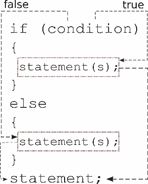
图 1.3 | if-else 条件中的控制流

程序 `if.java` 演示了 `if-else` 语句的使用。

### 示例 5.10：if.java - 使用 if-else 语句

```java
package ch05;

public class If {

    public static void main(String[] args) {

        int x = 10;

        if (x >= 10) {

            System.out.println("OK");

        } else {

            System.out.println("False");

        }

    }

}
```

**输出**

```
OK
```

**解释**
*   条件 `(x >= 10)` 为真，因此执行 `{` 和 `}` 之间的下一个语句（第 07 行）。

***

## 三元运算符 (`? :`)

它与 `if…else` 语句密切相关。它是 Java 中唯一的三元运算符。该运算符的目标是决定将哪个值赋值给变量。

### 三元运算符
它是唯一一个接受三个操作数的条件运算符（`3 操作数 + 条件运算符 = 条件表达式`）。

### 语法

```java
variable x = (expression) ? value if true : value if false;
```

### 解释
*   第一个操作数是条件 `(expression)`。
*   第二个操作数是当条件为真时整个条件表达式的值。
*   第三个操作数是当条件为假时整个条件表达式的值。

让我们在一个简单的 Java 程序中看看 Java 三元运算符的示例。

### 示例 5.11：Ternary1.java

```java
package ch05;

public class Ternary1 {

    public static void main(String[] args) {

        int x = 10;

        System.out.println(x >= 10 ? "OK" : "Failed");

    }

}
```

**输出**

```
OK
```

**解释**
*   第 04 行：`x >= 10` 是条件（第一个操作数）。
*   第 05 行：如果条件为真，则显示 `"OK"`（第二个操作数）。
*   第 05 行：如果条件为假，则显示 `"Failed"`（第三个操作数）。
*   第 05 行：`println()` 方法在屏幕上显示 "OK" 消息。

条件表达式可以是一个简单的布尔值，也可以是要待执行的动作（求值为布尔值的语句），例如 `(a < 0)` 语句。这里有另一个非常清晰地演示这一点的示例。

### 示例 5.12：Ternary2.java

```java
package ch05;

public class Ternary2 {

    public static void main(String[] args) {

        int x = 60;

        x = (x > 100) ? 20 : 30;

        System.out.println(x);

    }

}
```

**输出**

```
30
```

**解释（第 05 行）**
*   `x > 100` 是条件（第一个操作数）。
*   `20` 在条件为真时显示（第二个操作数）。
*   `30` 在条件为假时显示（第三个操作数）。

如你所见，我们正在使用 Java 三元运算符来避免 `if-else` 和 `switch case` 语句。通过这种方式，我们减少了 Java 程序中的代码行数。这就是 Java 三元运算符的简要总结。

***

### 嵌套 if…else 语句

通过将 `if…else` 语句放置在 `if…else` 语句内部来测试多种情况。这个程序演示了外部和内部 `if` 语句的概念。

### 示例 5.13：OuterInnerIf.java

```java
package ch05;

public class OuterInnerIf {

    public static void main(String[] args) {

        int x = 50;

        if (x > 0) // 外部 if

        {

            if (x < 100) // 内部 if

            {

                System.out.println("X is between 0 and 100");

            }

        }

    }

}
```

**输出**

```
X is between 0 and 100
```

**解释（Java 运行这段代码时做了什么）**
*   评估外部 `if` 条件。如果它为假，就不运行其 `if` 体（即内部 `if`）。
*   评估外部 `if` 条件。如果它为真，运行其 `if` 体（`println()` 语句）。

你也可以在外部 `if` 语句的 `if` 体中包含一个内部 `if` 语句。

### 示例 5.14：IfElse.java

```java
package ch05;

public class IfElse {

    public static void main(String[] args) {

        int x = 90;

        if (x > 0)  // 外部 if

        {

            System.out.println("Outer If");

        }

    }

}
```


## 逻辑运算符

逻辑运算符用于在 `if` 体中组合布尔表达式。逻辑运算符有 `&&`、`||` 和 `!`。

### `&&` 运算符
`&&` 运算符被称为逻辑与。它接受两个表达式，只有当两个子条件都为真时，布尔表达式为真。

#### 语法
```java
if (firstExpression && secondExpression) {
    // 语句
}
```

#### 示例 5.15：`LogicalAnd.java`
```java
package ch05;

public class LogicalAnd {
    public static void main(String[] args) {
        int temp = 10;
        int minutes = 15;
        if (temp > 20 && minutes < 12) {
            System.out.println("The Temperature is in the danger zone");
        }
    }
}
```

**输出：**
```
Nothing
```

**解释：**
* 第 06 行：两个布尔表达式组合为一个表达式。
* 第一个表达式 `temp > 20` 为假。
* 第二个表达式 `minutes < 12` 为假。
* 因此，布尔表达式的结果为假（`TRUE && FALSE = FALSE`）。
* 因此，整个表达式为假，不显示消息。

#### 表 5.4 | `&&` 运算符的真值表
| 表达式 | 表达式的值 | 说明 |
| :--- | :--- | :--- |
| `T && T` | `T` | `&&` 运算符的两侧都为真时，运算符返回真值。 |
| `F && F` | `F` | |
| `F && T` | `F` | |
| `T && F` | `F` | |

`&&` 运算符执行短路求值（它是如何工作的？）：
如果 `&&` 运算符左侧的表达式为假，则不会检查右侧表达式。因为只要有一个子表达式为假，整个表达式为假，检查剩余表达式将浪费 CPU 时间。因此，当 `&&` 运算符发现左侧表达式为假时，它会短路且不评估右侧表达式。

### `||` 运算符
`||` 运算符被称为逻辑或。它接受两个布尔表达式，当其中任一子表达式为真时，布尔表达式为真。

#### 示例 5.16：`LogicalOr.java`
```java
package ch05;

public class LogicalOr {
    public static void main(String[] args) {
        int temp = 10;
        int minutes = 15;
        if (temp > 20 || minutes < 12) {
            System.out.println("The Temperature is in the danger zone");
        }
    }
}
```

```java
int temp = 101;
if (temp < 20 || temp > 100) {
    System.out.println("The Temperature is in the danger zone");
}
```

**输出：**
```
The Temperature is in the danger zone
```

#### 解释
* 如果温度小于 20 或者温度大于 100，将显示该消息。
* 如果其中任何一个关系测试为真，整个表达式即为真。

#### 表 5.5 | `||` 运算符的真值表
| 表达式 | 值 |
| :--- | :--- |
| `T || F` | T |
| `F || T` | T |
| `F || F` | F |
| `T || T` | T |

### `!` 运算符
`!` 运算符执行逻辑非操作。它是一个一元运算符，接收一个 `Boolean` 表达式并反转其逻辑值。这意味着如果表达式为真，`!` 运算符返回 `false`；如果表达式为假，它返回 `true`。

#### 示例 5.17：`LogicalNot.java`
```java
package ch05;

public class LogicalNot {
    public static void main(String[] args) {
        int temp = 90;
        if (!(temp > 100)) {
            System.out.println("This is below the maximum temperature");
        }
    }
}
```

**输出：**
```
This is below the maximum temperature
```

#### 解释
* 首先，测试表达式 `(temp > 100)`，结果为 `true` 或 `false`。
* 其次，将 `!` 运算符应用于该值。
* 如果表达式 `(temp > 100)` 为真，`!` 运算符返回 `false`。
* 如果表达式 `(temp > 100)` 为假，`!` 运算符返回 `true`。

#### 表 5.6 | `!` 运算符的真值表
| 表达式 | 值 |
| :--- | :--- |
| `!true` | `false` |
| `!false` | `true` |

## 逻辑运算符的优先级和结合性
与其他运算符一样，逻辑运算符也有优先级顺序和结合性。

#### 按优先级排序的逻辑运算符
| 运算符 | 优先级 |
| :--- | :--- |
| `!` | 优先级较高 |
| `&&` | |
| `||` | 优先级较低 |

**注意：** `!` 总是将它的操作数括在括号内，除非你打算将其应用于变量或没有其他运算符的简单表达式。

#### 示例：`LogicalNot2.java` - 错误写法
```java
package ch05;

public class LogicalNot2 {
    public static void main(String[] args) {
        int x = 20;
        if !(x > 2) // 错误写法
            System.out.println("Hi");
    }
}
```

**输出：**
```
C:\MyProjects\JavaPro1\src\chapter5\LogicalNot2.java
Error:(6, 11) java: '(' expected
Error:(6, 20) java: ')' expected
```

#### 解释
* 第 05 行：将 `!` 运算符应用于表达式 `x` 大于 2。
* 第 05 行：尝试仅将 `!` 运算符应用于 `x`。它在询问“`x` 的逻辑补码大于 2 吗？”
* 因为 `!` 运算符只能应用于布尔表达式，此语句会导致编译器错误。

#### 正确的写法是（修改第 05 行）：`!(x > 2)` 始终使用括号
* `(a > b) && (x < y)` 等同于：`a > b && x < y`
* `(x == y) || (b > a)` 等同于：`x == y || b > a`

逻辑运算符从左到右计算表达式。例如：
`a < b || y == 2; // 先计算 y == 2`
`a < b || y == 2 && m > j;`
`// 该表达式的计算结果为：`
`// (a < b) || ((y == 2) && (m > j))`

#### 示例 5.18：`NotOp.java`
```java
public class NotOp {
    public static void main(String[] args) {
        int x = 10;
        if (!(x > 2)) {
            System.out.println("True");
        }
        System.out.println("False");
    }
}
```

#### 表 5.7 | 所有运算符的优先级
| 优先级顺序 | 运算符 | 描述 |
| :--- | :--- | :--- |
| 1 | `-` (一元运算符) | 一元负，逻辑非 |
| 2 | `* / %` | 乘法、除、取模 |
| 3 | `+ -` | 加法、减法 |
| 4 | `< > <= >=` | 小于、大于、小于等于、大于等于 |
| 5 | `== !=` | 等于、不等于 |
| 6 | `&&` | 逻辑与 |
| 7 | `||` | 逻辑或 |
| 8 | `= += -= *= /= %=` | 赋值 |

## switch 语句

```java
System.out.println("Enter the letter grades");
int grade = input.nextInt();
switch (grade) {
    case 'A':
    case 'a': ++aCount; break;
    case 'B':
    case 'b': ++bCount; break;
    case 'C':
    case 'c': ++cCount; break;
    case '\n':
    case '\t':
    case ' ' : break;
    default:
        System.out.println("Incorrect letter grade entered");
        System.out.println("Enter a new grade.");
}
System.out.println("Totals for each grade are: \n");
System.out.println("A: " + aCount);
System.out.println("B: " + bCount);
System.out.println("C: " + cCount);
input.close();
```

#### 解释
* `break` 语句是可选的。如果我们省略了 `break`，执行将继续到下一个 `case`。
* 有时在多个 `case` 之间不使用 `break` 语句是有用的。例如，考虑上面的程序，无论 `grade` 的值为 `A` 还是 `a`，它都会增加变量 `aCount` 的值。当 `grade` 值为 `B` 或 `b` 时，它也会增加 `bCount` 的值，以此类推。

### 示例 5.24: `Switch3.java`
考虑以下 Java 程序，它声明了一个名为 `month` 的 `int` 变量，其值代表一个月份（1 到 12）。该代码使用 `switch` 语句根据 `month` 的值显示月份名称。

```java
package ch05;

public class Switch3 {
    public static void main(String[] args) {
        int month = 5;
        String monthString;

        switch (month) {
            case 1: monthString = "January"; break;
            case 2: monthString = "February"; break;
            case 3: monthString = "March"; break;
            case 4: monthString = "April"; break;
            case 5: monthString = "May"; break;
            case 6: monthString = "June"; break;
            case 7: monthString = "July"; break;
            case 8: monthString = "August"; break;
            case 9: monthString = "September"; break;
            case 10: monthString = "October"; break;
            case 11: monthString = "November"; break;
            case 12: monthString = "December"; break;
            default: monthString = "Invalid Month"; break;
        }
        System.out.println(monthString);
    }
}
```

**输出：**
```
May
```

### switch 语句的重要规则
* 不允许重复的 `case` 值。
* 每次执行 `switch` 语句只会选择一个 `case`。
* 表达式的值决定了选择哪个 `case`。
* `case` 的值必须与 `switch` 中变量的数据类型相同。
* `case` 的值必须是常量或字面量。不允许使用变量。
* `break` 语句用于 `switch` 内部终止语句序列。
* `break` 语句是可选的。如果省略，执行将继续到下一个 `case`。
* `default` 语句是可选的，并且它必须出现在 `switch` 的最后。
* 当遇到 `break` 语句时，`switch` 终止，控制流跳转到 `switch` 语句之后的下一行。
* 并不是每个 `case` 都需要 `break`。如果没有出现 `break`，控制流将向下渗透到后续的 `case`，直到遇到 `break` 为止。
* `switch` 适用于 `byte`、`short`、`char` 和 `int` 原始数据类型。它适用于枚举类型、`String` 类以及包装某些原始类型的特殊类，如 `Character`、`Byte`、`Short` 和 `Integer`。

## 总结
* 当程序运行时，计算机从上到下逐行读取代码。
* 程序是一系列指令。语句按照它们编写的顺序一个接一个执行。这是默认的执行过程。
* 选择语句（又称为条件结构）根据条件是否为真或假，导致程序控制转移到特定的流。选择结构使用关系运算符来测试条件。
* `if` 语句仅在条件为真时才执行一个或多个语句。
* 运算符 `==` 和 `!=` 可用于比较布尔值。
* `if…else` 语句允许你指定在条件为真和为假时执行不同的动作。它被称为双重选择语句，因为它在两个不同的动作之间进行选择。
* 条件运算符与 `if ...else` 语句紧密相关。它是 Java 唯一的三元运算符。它决定了应该将哪个值赋值给变量。
* Java 提供了 `switch` 语句来处理一系列决策，对变量或表达式可能假设的每个常量整数值进行单独测试，并采取不同的操作。

---

## 第 6 章：数组

### 引言
回想上一章，变量是内存位置的名称。数组是相同类型的变量集合。通过在类型后加上方括号 `[]` 来声明数组。例如，`int[] numbers;` 声明了一个名为 `numbers` 的变量，它是指向 `int` 数组的引用。

要创建数组，必须使用 `new` 运算符分配内存。例如，`numbers = new int[6];` 创建了一个可以容纳 6 个整数值的数组。数组的每个元素通过索引访问，索引从 0 开始。例如，`numbers[0]` 访问第一个元素。

数组可以在声明时使用数组字面量进行初始化。例如，`int[] numbers = {10, 20, 30, 40, 50, 60};` 创建了一个数组并对其进行了初始化。

数组的大小可以使用 `length` 属性来确定。例如，`numbers.length` 将返回数组中的元素数量。

#### 示例 6.1: `Array1.java`
```java
package ch06;

public class Array1 {
    public static void main(String[] args) {
        int[] numbers = new int[6];
        float[] temp = new float[100];
        char[] letters = new char[41];
        long[] units = new long[50];
        double[] sizes = new double[1200];
    }
}
```

**解释**
* `int[] numbers = new int[6];` 创建了一个包含 6 个 `int` 值的数组。
* `float[] temp = new float[100];` 创建了一个包含 100 个 `float` 值的数组。
* `char[] letters = new char[41];` 创建了一个包含 41 个 `char` 值的数组。
* `long[] units = new long[50];` 创建了一个包含 50 个 `long` 值的数组。
* `double[] sizes = new double[1200];` 创建了一个包含 1200 个 `double` 值的数组。

数组的大小声明符必须是非负整数表达式。它可以是一个字面值，也可以是一个变量。使用 `final` 变量作为大小声明符是一种常见做法。例如：`final int NUM_ELEMENTS = 6;`。

```java
int[] numbers = new int[NUM_ELEMENTS];
```


这种做法可以使程序更易维护。当我们把数组的大小存储在变量中时，在引用数组大小时，可以使用该变量而不是字面量数字。如果我们以后需要更改数组的大小，只需要更改变量的值即可。该变量应该是 `final` 的，这样它的内容在程序执行期间就不会能被更改。

注意：一旦创建了数组，其大小就无法更改。

## 访问数组元素

数组只有一个名称，但数组中的元素可以像单独变量一样被访问和使用。这是因为每个元素都被分配了一个被称为“下标”（subscript）的数字。

下标用作索引来精确定位数组中的特定元素。第一个元素的下标分配为 `0`。第二个元素的下标分配为 `1`，依此类推。`numbers` 数组中的 6 个元素将拥有下标（从 `0` 到 `5`）。

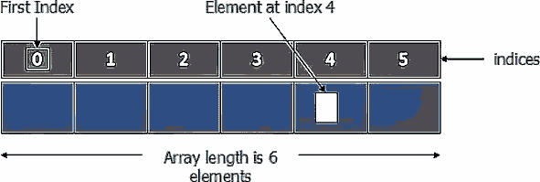

图 6.3 | `numbers` 数组

下标编号始终从零开始。数组最后一个元素的下标比数组中元素的总数少 1。这意味着拥有 6 个元素的 `numbers` 数组，`5` 是最后一个元素的下标。`numbers` 数组中的每个元素通过其下标访问时，都可以作为 `int` 变量使用。例如：

```java
01 numbers[0] = 20;
02 numbers[3] = 30;
```

### 解析

* 第 `01` 行：在数组的第一个元素（元素 1 - 下标 `0`）中存储 `20`。

* 第 `02` 行：在第四个元素（元素 4 - 下标 `3`）中存储 `30`。

注意：表达式 `numbers[0]` 读作“numbers sub zero”。将这些赋值语句读作“numbers sub zero 被赋值为二十”以及“numbers sub three 被赋值为三十”。

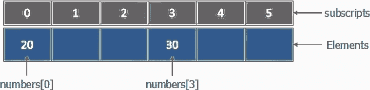

图 6.4 | `numbers` 数组的内容

* 默认情况下，Java 用 `0` 初始化数组元素。在之前的图中，元素 1、2、4 和 5 没有存储值，因此它们显示为 `0s`。

记住：当你使用 `new` 关键字创建数组对象时，括号内的数字是大小声明符。它表示数组中元素的数量。赋值语句或任何处理数组内容的语句中，括号内的数字是下标。它被用于访问数组中的特定元素。

## 在数组内部存储数据

在 Java 中创建数组后，你可以将值存储到数组元素中。

### 语法

`ArrayName[index] = value;`

例如：

```java
// 创建一个数组
int a[] = new int[5]; // 长度: 5 , 索引: 0 to 4

// 向数组插入数据，编写以下代码
a[0] = 12;
a[1] = 20;
a[2] = 50;
a[3] = 44;
a[4] = 88;
```

以下程序显示了带有用户输入的值的 `hours` 数组的内容。

示例 6.2：`ArrayDemo1.java`

```java
01 package ch06;
02 import java.util.Scanner;
03 public class ArrayDemo1 {
04 public static void main(String[] args) {
05 final int EMPLOYEES = 3;
06 int[] hours = new int[EMPLOYEES];
07 Scanner keyboard = new Scanner(System.in);
08
09 System.out.println("Enter the hours worked by " +
10 EMPLOYEES + " employees");
11 System.out.println("Employee 1: ");
12 hours[0] = keyboard.nextInt();
13
14 System.out.println("Employee 2: ");
15 hours[1] = keyboard.nextInt();
16
17 System.out.println("Employee 3: ");
18 hours[2] = keyboard.nextInt();
19
20 System.out.println("The hours you entered are: ");
21 System.out.println(hours[0]);
22 System.out.println(hours[1]);
23 System.out.println(hours[2]);
24 }
25 }
```

**输出**

```
Enter the hours worked by 3 employees
Employee 1:
5
Employee 2:
10
Employee 3:
15
The hours you entered are:
5
10
15
```

hours 数组的内容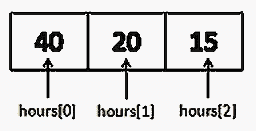

下标数字可以存储在变量中。这使得可以使用循环遍历整个数组，对每个元素执行相同的操作。

## 显示数组的内容

在此部分中，你将学习如何使用 `println()` 显示数组元素的内容。例如（在 `ArrayDemo1.java` 中），可以使用两个 `for` 循环来简化：一个用于向数组输入值，另一个用于显示数组的内容。这里有一个简单的示例。

示例 6.3：`ArrayDemo2.java`

```java
01 package ch06s;
02 import java.util.Scanner;
03 public class ArrayDemo2 {
04 public static void main(String[] args) {
05 final int EMPLOYEES = 3;
06 int[] hours = new int[EMPLOYEES];
07 Scanner keyboard = new Scanner(System.in);
08
09 System.out.println("Enter the hours worked by " +
10 EMPLOYEES + " employees");
11 System.out.println("Employee 1: ");
12 hours[0] = keyboard.nextInt();
13
14 System.out.println("Employee 2: ");
15 hours[1] = keyboard.nextInt();
16
17 System.out.println("Employee 3: ");
18 hours[2] = keyboard.nextInt();
19
20 System.out.println("The hours you entered are: ");
21 System.out.println(hours[0]);
22 System.out.println(hours[1]);
23 System.out.println(hours[2]);
24 }
25 }
```

*(注：原文提供的示例逻辑较为混乱，此处已根据其意图进行翻译并保留结构)*

下标数字可以存储在变量中。这使得可以使用循环遍历整个数组，对每个元素执行相同的操作。

## 数组初始化（声明）

像普通变量一样，Java 允许你在创建数组时初始化它。

### 语法

`int[] days = {31, 28, 31, 30, 31, 30, 31, 31, 30, 31, 30, 31};`

### 解析

* 声明引用变量 `days`

* 将值存储在数组

* 大括号内用逗号分隔的一系列值被称为初始化列表。这些值按顺序存储在数组中（第一个值 `31` 存储在 `days[0]`，第二个值 `28` 存储在 `days[1]`，依此类推）。

* 使用初始化列表时不需要 `new` 关键字。Java 会自动创建数组并存储值。

* Java 编译器通过初始化列表中的数量确定数组的大小。

以下是一个初始化数组并显示其内容的示例。

示例 6.4：`ArrayInitialization.java`

```java
01 package ch06;
02 public class ArrayInitialization {
03 public static void main(String[] args) {
04 int[] days = {31, 28, 31, 30, 31, 30, 31, 31, 30, 31, 30, 31};
05 for (int index = 0; index < 12; index++) {
06     System.out.println("Month " + (index + 1) + " has " + days[index] + " days.");
07 }
08 }
09 }
```

**输出**

```
Month 1 has 31 days.
Month 2 has 28 days.
Month 3 has 31 days.
Month 4 has 30 days.
Month 5 has 31 days.
Month 6 has 30 days.
Month 7 has 31 days.
Month 8 has 31 days.
Month 9 has 30 days.
Month 10 has 31 days.
Month 11 has 30 days.
Month 12 has 31 days.
```

Java 允许将初始化列表跨越多行。例如，以下数组声明是等效的：

```java
double[] coins = {0.05, 0.1, 0.25};
```

```java
double[] coins = {
0.05,
0.1,
0.25};
```

## 处理数组元素

单个数组元素的处理方式与任何其他变量数据相同。例如：

`grossPay = hours[3] * payRate;`

### 示例 6.5：数组元素上的前置增和后置增操作

```java
int[] score = {7, 8, 9, 10, 11};

++score[2];

score[4]++;
```

当你想在数组元素上使用该操作符时，请注意不要在下标（subscript）上使用。

### 示例 6.6：递减变量计数，但对数组元素中存储的值不做任何操作

```java
amount[count].amount [count--];
```

### 示例 6.7：PayArray.java

```java
01 package ch06;

02 import java.util.Scanner; // 需要 Scanner 类

03 public class PayArray {

04 public static void main(String[] args){
05 final int EMPLOYEES = 5;

06 double payRate;
07 double grossPay;
08 int[] hours = new int[EMPLOYEES];
09 Scanner keyboard = new Scanner(System.in);
10 System.out.println("Enter the hours worked by " +
11 EMPLOYEES + " employees who all earn " +
12 "the same hourly rate.");
13 for (int index=0; index < EMPLOYEES; index++)
14 {
15 System.out.print("Employee #" + (index+1) + ": ");
16 hours[index] = keyboard.nextInt();
17 }
18 System.out.print("Enter the hourly pay rate " +
19 "for each employee: ");
20 payRate = keyboard.nextInt();
21 System.out.println("Here is each employee's gross pay: ");
22 for (int index = 0; index < EMPLOYEES; index++)
23 {
24 grossPay = hours[index] * payRate;
25 System.out.println("Employee #" + (index + 1) +
26 ": $" + grossPay);
27 }
28
29 }
30 }
```

**输出**

```
Enter the hours worked by 5 employees who all earn the same hourly rate.
Employee #1: 1
Employee #2: 2
Employee #3: 3
Employee #4: 4
Employee #5: 5
Enter the hourly pay rate for each employee: 2
Here is each employee's gross pay:
Employee #1: $2.0
Employee #2: $4.0
Employee #3: $6.0
Employee #4: $8.0
Employee #5: $10.0
```

将 `hours[index]` 乘以 `payRate` 的值赋值给 `grossPay` 变量。数组元素也可以用于关系表达式。

### 示例 6.8：只要 value[count] 的值等于 0，while 循环就会迭代

```java
01 if (cost[20] < cost[0])

02 while (value[count] != 0)
03 {
04 // 语句(s)
05 }
```

## 数组长度

Java 中的每个数组都有一个名为 `length` 的公共字段。该字段包含数组中的元素数量。例如：

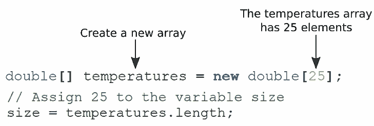

`length` 字段在处理数组的所有内容时非常有用。例如：

```java
01 for (int i = 0; i < temperature.length; i++)
02 {
03 System.out.println(temperature[i]);
04 }
```

#### 解释

* 循环遍历数组并显示每个元素的内容。

* 数组的 `length` 字段被用于测试表达式中，作为循环控制变量的上限。

**警告**：在使用 `length` 字段作为下标的上限时，请注意不要引起差一错误（off-by-one error）。`length` 字段包含数组中的元素数量。数组中最大的下标是 `length - 1`。

**注意**：你不能更改数组的 `length` 字段的值。

## 增强型 for 循环

Java 提供了一种特殊的 `for` 循环版本，用于简化数组处理。它被称为“增强型 for 循环”。

### 语法

```java
for (datatype elementVariable : array) {
    // 语句(s)
}
```

#### 解释

* 增强型 for 循环旨在为数组中的每个元素迭代一次。循环每次迭代时，它都会将一个数组元素复制到变量上。

* `datatype elementVariable` 是一个变量声明。在每次循环迭代期间，该变量将接收不同数组元素的值。在第一次循环迭代中，它接收第一个元素的值；在第二次迭代中，它接收第二个元素的值，以此此类推。该变量的类型必须与数组元素的类型相同，或者是是元素可以自动转换的类型。

* `Array` 是你希望循环对其操作的数组名称。循环将为数组中的每个元素迭代一次。

* `Statement(s)` 是在循环迭代期间执行的语句(s)。

### 示例 6.9：假设我们有以下数组声明

```java
int[] numbers = {3, 6, 9};
```

我们可以使用以下增强型 for 循环来显示 `numbers` 数组的内容

```java
for (int val : numbers){
    System.out.println(val);
}
```

由于 `numbers` 数组有三个元素，循环将迭代三次。

* 第一次迭代，`val` 接收第一个元素的值。

* 第二次迭代，`val` 接收第二个元素的值。

* 第三次迭代，`val` 接收第三个元素的值。

为了在循环迭代期间执行多个语句，可以使用增强型 for 循环：

```java
int[] numbers = {3, 6, 9};
for (int val : numbers){
    System.out.print("The value is ");
    System.out.println(val);
}
```

## 增强型 for 循环与传统 for 循环

在以下情况下，你可能需要传统的 `for` 循环：

* 当你需要反向遍历数组时。

* 当你需要通过下标访问元素时。

* 当你需要修改数组中的某些元素时。

* 当你需要同时处理多个数组时。

* 当你只需要在循环中获取索引值时。

## 让用户指定数组的大小

Java 允许使用输入变量来指定数组的大小。

### 示例 6.10：DisplayScores.java - 让用户指定数组的大小

该程序允许用户指定数组的大小，然后显示它们。


```java
01 package ch06;

02 import java.util.Scanner;
33 public class DisplayScores {

04 public static void main(String[] args) {
05 Scanner keyboard = new Scanner(System.in);
06 System.out.print("How many tests do you have? ");
07 int numTests = keyboard.nextInt();
08 int[] scores = new int[numTests];
09 for (int index = 0; index < scores.length; index++) {
10 System.out.print("Enter last score " + (index + 1) + ": ");
11 scores[index] = keyboard.nextInt();
12 }
13 System.out.println();
14 System.out.println("Here are the scores you entered: ");
15 for (int index = 0; index < scores.length; index++) {
16 System.out.print(scores[index] + " ");
17 }
18 }
19 }
```

**输出**

```
How many tests do you have? 5
Enter last score 1: 50
Enter last score 2: 60
Enter last score 3: 70
Enter last score 4: 80
Enter last score 5: 90

Here are the scores you entered:
50 60 70 80 90 
```

#### 解释

* 第 8 行：创建数组，使用 `numTests` 变量确定其大小。
* 第 9-12 行：第一个 `for` 循环允许用户输入每个分数。
* 第 15-17 行：循环显示所有的分数。

## 重新赋值数组引用变量

可以将数组引用变量重新赋值为不同的数组。例如：

### 示例 6.11：CreateArray.java - 创建由 number 变量引用的数组

```java
int[] numbers = new int[10];
```

**解释**

第一条语句创建一个十个元素的整数数组并将其地址赋值给 `numbers`。

第二条语句分配一个五个元素的整数数组并将其地址赋值给 `numbers`。在赋值语句执行后，`numbers` 变量引用的是五个元素的数组，而不是十个元素的数组，如下所示。

图 6.6 | 由 number 变量引用的数组

### 重新赋值数组引用变量

```java
int[] numbers = new int[10];

// 重新赋值 numbers 到新数组
numbers = new int[5];
```

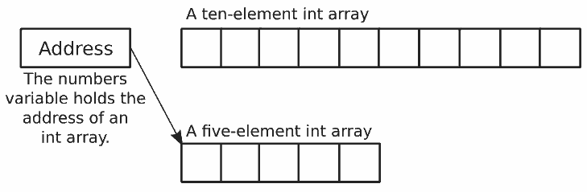图 6.6 | 变量 numbers 引用了一个五元素数组

### 复制数组

由于数组是一个对象，因此数组和引用它的变量之间存在区别。数组和引用变量是两个独立的实体。例如：

```java
01 int[] array1 = {2, 4, 6, 8, 10};
02 int[] array2 = array1; // 这并没有复制 array1
```

#### 解释

* 第 01 行：创建一个数组并将其地址赋值给变量 `array1`。
* 第 02 行：将 `array1` 赋值给 `array2`。这并不会为 `array1` 所引用的数组创建一份副本，而是对存储在 `array1` 中的地址进行复制，并将其存储在 `array2` 中。
* 执行此语句后，`array1` 和 `array2` 变量将引用同一个数组。
* 这种类型的赋值操作被称为“引用拷贝”。
* 复制的是数组对象的地址，而不是数组对象的内容。

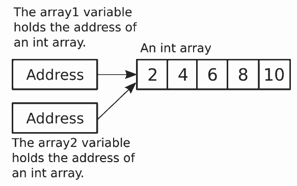图 6.7 | 将数组赋值给两个引用变量

无论程序使用哪一个变量，它都在操作同一个数组。以下是一个示例。

#### 示例 6.12: SameArray.java

```java
01 public class SameArray
02 {
03 public static void main(String[] args)
04 {
05 int[] array1 = {2, 4, 6, 8, 10};
06 int[] array2 = array1;
07 array1[0] = 200;
08 array2[4] = 1000;
09 System.out.println("The contents of array1: ");
10 for (int index = 0; index < array1.length; index++)
11 System.out.println(array1[index] + " ");
12 System.out.println();
13 System.out.println("The contents of array2: ");
14 for (int index = 0; index < array2.length; index++)
15 System.out.println(array2[index] + " ");
16 System.out.println();
17 }
18 }
```

**输出**

```
The contents of array1:
200
4
6
8
1000
The contents of array2:
200
4
6
8
1000
```

你不能仅仅通过将一个引用变量赋值给另一个来复制数组。要复制数组，你需要将一个数组的各个元素复制到另一个数组中。通常，最好的方法是使用循环，如下：

```java
01 int[] firstArray = {5, 10, 15, 20, 25};
02 int[] secondArray = new int[5];
03 for (int index = 0; index < firstArray.length; index++)
04 secondArray[index] = firstArray[index];
```

循环将 `firstArray` 的每个元素复制到 `secondArray` 对应的元素中。

***

### 字符串数组

Java 数组是一个持有固定数量字符串值的对象。可以创建 String 对象数组，但如果数组未初始化，则数组中的每个字符串都必须单独创建。Java 允许创建字符串对象数组。`Names.java` 程序演示了这一概念。

#### 示例 6.13: Names.java - 创建一个初始化了值的字符串对象数组

```java
01 package ch06;
02 public class Names {
03 public static void main(String[] args) {
04 String[] names = {"Bill", "Susan", "Steven", "Jean"};
05 }
06 }
```

在内存中，String 对象数组与基本数据类型数组的排列不同。为了使用 `String` 对象，你必须拥有 `String` 对象的引用。因此，String 对象数组实际上是 String 对象引用数组。

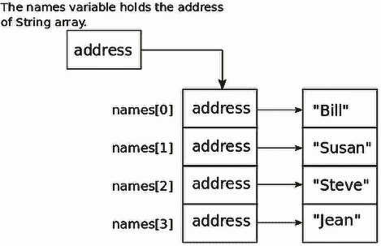图 6.8 | 变量 names 引用了一个字符串数组

`names` 数组中的每个元素都是 String 对象的引用。`names[0]` 引用一个包含 "Bill" 的 String 对象。`names[1]` 引用一个包含 "Susan" 的 String 对象，依此类推。以下是一个使用 for 循环显示两个数组 months 和 days 内容的示例。

#### 示例 6.14: MonthDays.java

```java
01 package ch06;
02 public class MonthDays {
03 public static void main(String[] args) {
04 String[] months = {"January", "February", "March",
05 "April", "May","June", "July", "August",
06 "September", "October","November", "December"};
07 for (int index = 0; index < months.length; index++)
09 {
10 System.out.println(months[index] + " has " +
11 days[index] + " days.");
12 }
13 }
14 }
```

**输出**

```
January has 31 days.
February has 28 days.
March has 31 days.
April has 30 days.
May has 31 days.
June has 30 days.
July has 31 days.
August has 31 days.
September has 30 days.
October has 31 days.
November has 30 days.
December has 31 days.
```

与基本数据类型一样，如果数组未初始化，则数组中的每个字符串必须单独创建。要创建一个数组，例如：

```java
01 final int SIZE = 4;
02 String[] names = new String[SIZE];
```

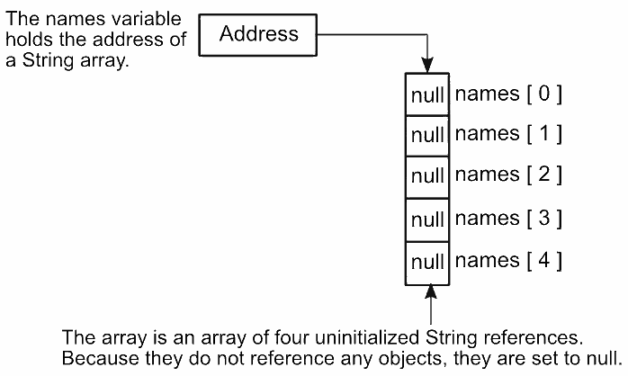图 6.9 | 变量 names 引用了一个字符串数组

`names` 数组中的每个元素都是 String 对象的引用。`names[0]` 元素引用一个包含 "Bill" 的 String 对象。`names[1]` 元素引用一个包含 "Susan" 的 String 对象。例如：

```java
01 final int SIZE = 4;
02 String[] names = new String[SIZE];
03 names[0] = "Bill";
04 names[1] = "Susan";
05 names[2] = "Steven";
06 names[3] = "Jean";
```

***

### 二维数组

二维数组是数组的数组。它可以被认为具有行和列。二维数组有时被称为 2D 数组可以包含多组数据。虽然二维数组实际上是数组的数组，但最好将其认为具有行和列，如下所示所示。

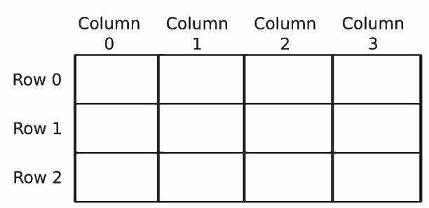图 6.10 | 行与列

上述数组总共有 12 个元素（3 行 4 列）。

#### 二维数组声明

声明二维数组需要两组括号和两个大小声明：第一个用于行数，第二个用于列数。

`data-type[ ][ ] arrayname = new datatype[no_of_rows ][no_of_columns ];`

#### 示例 6.15: 3 行 4 列二维数组的声明

```java
double[][] scores = new double[3][4];
```

* 类型中的两组括号表示 `scores` 变量引用二维数组。
* 数字 3 和 4 是大小声明符。
* 第一个大小声明符指定行数，第二个大小声明符指定列数。

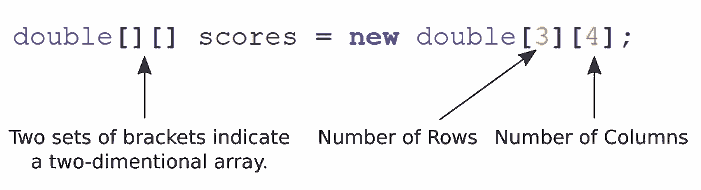图 6.11 | 3 行 4 列二维数组的声明

在访问二维数组数据时，每个元素有两个下标：一个用于行，另一个用于列。在 `scores` 数组中，第 0 行元素的引用方式如下：

`scores[0][0]`

`scores[0][1]`

`scores[0][2]`

`scores[0][3]`

第 1 行的元素如下。

`scores[1][0]`

`scores[1][1]`

`scores[1][2]`

`scores[1][3]`

第 2 行的元素如下：

`scores[2][0];`

`scores[2][1];`

`scores[2][2];`

`scores[2][3];`

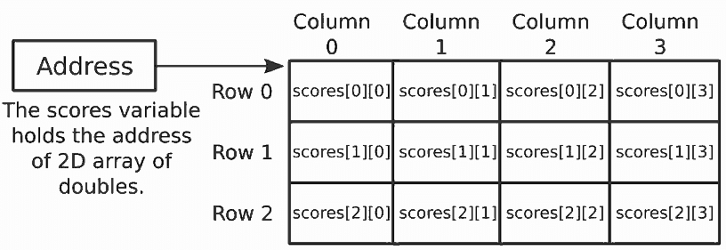图 6.12 | `scores` 数组每个元素的下标

要访问二维数组中的其中一个元素，你必须同时使用两个下标。例如，要将数字 95 存储在 `scores[2][1]` 中：

`scores[2][1] = 95;`

处理二维数组的程序可以使用嵌套循环来实现。请参考下面的示例。

### 示例 6.16: TwoDimArray.java - 提示用户输入分数，数组中的每个元素输入一次。

```java
01 package ch06;
02 import java.util.Scanner;
03 public class TwoDimArray {
04 public static void main(String[] args) {
05 final int ROWS = 2;
06 final int COLS = 3;
07 Scanner keyboard = new Scanner(System.in);
08
09 double[][] scores = new double[ROWS][COLS];
10 for (int row = 0; row < ROWS; row++)
11 {
12 for (int col = 0; col < COLS; col++)
13 {
14 System.out.println("Enter a Score: ");
15 scores[row][col] = keyboard.nextDouble();
16 }
17 }
18 }
19 }
```

**输出**

```
Enter a Score: 1
Enter a Score: 2
Enter a Score: 3
Enter a Score: 4
Enter a Score: 5
Enter a Score: 6
```

显示 `scores` 数组中的所有元素：(TwoArray.java)

```java
01 package ch06;
02 import java.util.Scanner;
03 public class TwoArray {
04 public static void main(String[] args) {
05 final int ROWS = 2;
06 final int COLS = 3;
07 Scanner keyboard = new Scanner(System.in);
08
09 double[][] scores = new double[ROWS][COLS];
10 for (int row = 0; row < ROWS; row++)
11 {
12 for (int col = 0; col < COLS; col++)
13 {
14 System.out.println("Enter a Score: ");
15 scores[row][col] = keyboard.nextDouble();
16 }
17 }
18 System.out.println("The Scores are:");
19 for (int row = 0; row < ROWS; row++)
20 {
21 for (int col = 0; col < COLS; col++)
22 {
23 System.out.println(scores[row][col]);
24 }
25 }
26 }
27 }
```

**输出**

```
Enter a Score: 1
Enter a Score: 2
Enter a Score: 3
Enter a Score: 4
Enter a Score: 5
Enter a Score: 6
The Scores are:
1.0
2.0
3.0
4.0
5.0
6.0
```

### 初始化二维数组

在初始化二维数组时，你将每一行的初始化列表封装在自己的大括号中。

语法

`int[][] twoDimArray = new int[row][col];`

注意，每个元素都将被初始化为 `int` 的默认值 `0`，因此上述代码也等同于：

```java
int[][] twoDimArray = new int[][]{
  { 0, 0, 0, 0, 0, 0, 0, 0, 0, 0 },
  { 0, 0, 0, 0, 0, 0, 0, 0, 0, 0 },
  { 0, 0, 0, 0, 0, 0, 0, 0, 0, 0 },
  { 0, 0, 0, 0, 0, 0, 0, 0, 0, 0 },
  { 0, 0, 0, 0, 0, 0, 0, 0, 0, 0 }
};
```

### 示例 6.17

`int [][] numbers = {{1,2,3},{4,5,6},{7,8,9}};`

**解释**

* 与一维数组一样，当你提供初始化列表时不需要使用 `new` 关键字。Java 会自动创建数组并用初始化值填充元素。
* 在此示例中，第 0 行的初始化值为 `{1,2,3}`，第 1 行的初始化值为 `{4,5,6}`，第 2 行的初始化值为 `{7,8,9}`。因此该语句声明了一个 3 行 3 列的数组。

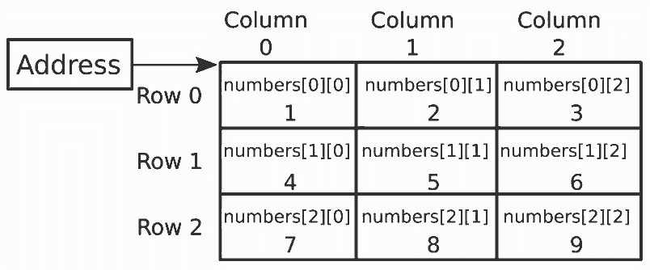图 6.13 | `numbers` 数组

### 二维数组中的 length 

一维数组有一个 `length` 字段，用于存储数组中的元素数量。然而，二维数组有多个 `length` 字段。它有一个 `length` 字段存储行数，然后每一行都有一个 `length` 字段存储列数。

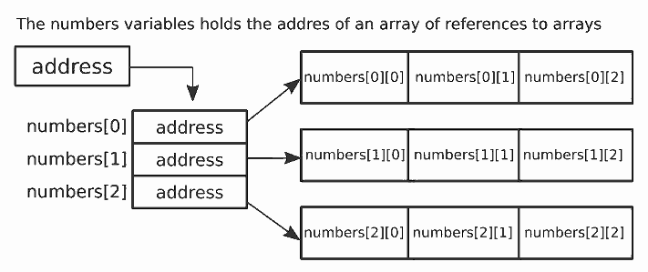图 6.14 | `numbers` 数组是数组的数组


* `numbers` 数组是数组的数组。
* `numbers` 变量引用一个包含三个元素的一维数组。
* `numbers[0]` 引用的元素是 `numbers[0][0]`、`numbers[0][1]` 和 `numbers[0][2]`。

下面的示例展示了如何获取数组的行数列数。

### 示例 6.18: Length.java

```java
01 package ch06;
02 public class Length {
03     public static void main(String[] args) {
04         int[][] numbers = {{1,2,3,4},
05             {5,6,7,8},
06             {9,10,11,12}};
07         System.out.println("The number of row(s) is " + numbers.length);
08         for (int index = 0; index < numbers.length; index++) {
09             System.out.println("The number of columns in row " + index + " is " +
10                 numbers[index].length);
11         }
12     }
}
```

**输出**

```
The number of row(s) is 3
The number of columns in row 0 is 4
The number of columns in row 1 is 4
The number of columns in row 2 is 4
```

### 显示二维数组的所有元素

使用一对嵌套循环来显示二维数组的所有元素。以下是实现方法。

#### 示例 6.19: Length2.java - 创建 numbers 数组

```java
01 package ch06;
02 public class Length2 {
03     public static void main(String[] args) {
04         int[][] numbers = {{1,2,3,4},
05             {5,6,7,8},
06             {9,10,11,12}};
07         for (int row = 0; row < 3; row++) {
08             for (int col = 0; col < 4; col++)
09                 System.out.println(numbers[row][col]);
10         }
11     }
}
```

**输出**

```
1
2
3
4
5
6
7
8
9
10
11
12
```

虽然这段代码会显示所有元素，但它存在以下局限：循环是专门为显示 3 行 4 列的数组而写的。更好的方法是使用数组的 `length` 字段作为循环下标的上限。

#### 代码：修改后的循环

```java
01 for (int row = 0; row < numbers.length; row++) {
02     for (int col = 0; col < numbers[row].length; col++)
03         System.out.println(numbers[row][col]);
04 }
```

外层循环头部 `for (int row = 0; row < numbers.length; row++)` 控制 `numbers` 数组的行下标。因为 `numbers.length` 存储了数组的行数，我们将其作为行下标的上限。

内层循环头部 `for (int col = 0; col < numbers[row].length; col++)` 控制 `numbers` 数组的列下标。因为每一行的 `length` 字段存储了该列数，我们将其作为列下标的上限。

### 三维及以上的数组

Java 不限制数组可以拥有的维度数量。Java 允许你创建任意数量维度的数组。

图：三维数组（展示了三维数组可以作为二维数组的“页”的概念）

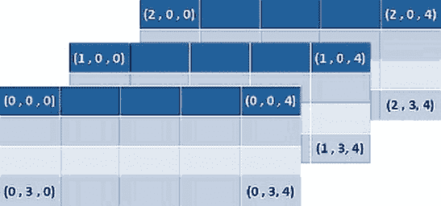 图 6.15 | 三维数组

要声明超过两个维度的数组，你只需要指定所需数量的空括号。例如：

`int[][][] threeD = new int[5][5][5];`

在这里，创建了一个三维数组，每个维度都有五个元素。每个元素需要三个下标来访问。你可以通过指定数组所需的下标来访问多维数组中的元素。例如：

`threeD[0][1][2] = 100;`

该语句将第 0 行第 1 列的元素 2 设置为 100。你也可以根据需要深度嵌套初始化器。例如：

```java
int[][][] threeD = {
    { {1, 2, 3}, {4, 5, 6}, {7, 8, 9} },
    { {10, 11, 12}, {13, 14, 15}, {16, 17, 18} },
    { {19, 20, 21}, {22, 23, 24}, {25, 26, 27} }
};
```

在这里，一个三维数组被初始化为数字 1 到 27。

#### 示例 6.20: ThreeDimArray.java - 使用多个嵌套循环来处理三维及以上的数组

你也可以使用多个嵌套循环语句来处理三维及以上的数组。这里是另一种初始化数字 1 到 27 的三维数组的方法：

```java
01 package ch06;
02 public class ThreeDimArray {
03     public static void main(String[] args) {
04         int[][][] threeD = new int[5][5][5];
05         int value = 1;
06         for (int i = 0; i < 5; i++) {
07             for (int j = 0; j < 5; j++) {
08                 for (int k = 0; k < 5; k++) {
09                     threeD[i][j][k] = value++;
10                 }
11             }
12         }
13         System.out.println(value);
14     }
}
```

Output2

3

4

5

6

. . .

124

125

126

超过三个维度的数组很难可视化，但在某些编程问题中可能非常有用。

***

## Java 边界检查

Java 会执行数组边界检查，这意味着它不允许语句使用超出数组有效下标范围的下标。例如：

```java
int[] values = new int[10];
```

#### 解释

* 创建了一个包含 10 个元素的数组。
* 该数组的有效下标为 `0` 到 `9`。
* Java 不允许语句对该数组使用小于 `0` 或大于 `9` 的下标。

### 边界检查在运行时发生

当 Java 编译器在处理使用无效下标的语句时，不会显示错误信息。相反，当该语句执行时，程序会抛出异常并立即终止。考虑以下代码示例。

#### 示例 6.21: InvalidSubscript.java

```java
01 public class InvalidSubscript
02 {
03     public static void main(String[] args)
04     {
05         int[] values = new int[3];
06         System.out.println("I will attempt to store four " +
07             "numbers in a three-element array.");
08         for (int index=0; index < 4; index++)
09         {
10             System.out.println("Now processing element " + index);
11             values[index] = 10;
12         }
13     }
14 }
```

Output

```
I will attempt to store four numbers in a three-element array.
Now processing element 0
Exception in thread "main" java.lang.ArrayIndexOutOfBoundsException: 3
Now processing element 1
at chapter5.InvalidSubscript.main(InvalidSubscript.java:12)
Now processing element 2
Now processing element 3
```

#### 解释

* 声明了一个包含三个元素的数组，但试图向数组中存储四个值。
* 当程序尝试在 `values[3]` 中存储值时，它会停止并显示错误信息。

***

## 注意差一错误（Off-by-One Errors）

由于数组下标从 `0` 开始而不是从 `1` 开始，你必须小心不要发生差一错误。当我们检查循环中的表达式时，使用 `<=` 而不是 `<` 就会发生差一错误。下面的示例将说明这个问题（示例 6.22 ）:

```java
01 final int SIZE = 100;
02 int[] numbers = new int[SIZE];
03 for (int index = 0; index <= SIZE; index++)
04 {
05     numbers[index] = 0;
06 }
```

Output

```
Exception in thread "main" java.lang.ArrayIndexOutOfBoundsException: 100
at chapter5.InvalidSubscript.main(InvalidSubscript.java:10)
```

#### 解释

* 创建了一个包含 100 个元素的整数数组，并在每个元素中存储值 `0`。然而，这段代码存在差一错误。
* 循环使用其控制变量 `index` 作为 `numbers` 数组的下标。
* 在循环执行期间，变量 `index` 取值为 `1` 到 `100`，而它本应该取值 `0-99`。结果是下标为 `0` 的第一个元素被跳过了。
* 此外，循环在最后一次迭代中尝试使用 `100` 作为下标。因为 `100` 是无效的下标，程序将导致数组越界异常并停止。

***

## 总结

* 数组是一个变量，可以同时保存多个相同数据类型的值。
* 声明一个数组引用变量并不会创建数组。你声明一个引用变量，并使用 `new` 关键字创建一个数组，然后将其地址赋值给该引用变量。
* 数组只有一个名称，数组中的元素可以作为单独的变量被访问和使用。这是因为每个元素都被分配了一个称为下标的数字。
* 下标被用作索引来定位数组中的特定元素。第一个元素被分配下标 `0`。第二个元素被分配下标 `1`，依此类推。
* 下标编号始终从零开始。数组中最后一个元素的下标比数组中元素的总数少 1。
* Java 允许你在创建数组时初始化数组的元素。
* Java 中的每个数组都有一个名为 `length` 的公共字段。该字段包含数组中的元素个数。
* Java 提供了一种特化的 `for` 循环版本，简化了数组处理。它被称为“增强型 for 循环”。
* Java 字符串数组是一个对象，持有一个固定数量的字符串值。
* 二维数组是数组的数组。它可以被认为具有行和列。
* Java 允许你创建几乎任意维度的数组。要声明一个超过两个维度的数组，只需指定你所需的数量的空括号即可。

***

# 第 7 章

## Java 循环

### 递增 (++) 和递减 (--) 运算符

递增和递减运算符对其操作数加 1 或减 1。递增递减运算符是一元运算符。单元运算符作用于操作数。

### 递增递减运算符类型

* **前置递增递减运算符（Prefix Mode）。** 运算符放在变量之前。
* **后置递增递减运算符（Postfix Mode）。** 运算符放在变量之后。

下面的示例可以很好地说明这种行为：示例 7.1: PreInc.java

```java
01 package ch07;
02 public class PreInc {
03     public static void main(String[] args){
04         int no1 = 1;
05         int no2 = 1;
06         ++no1;
07         --no2;
08         System.out.println("Number 1 = " + no1);
09         System.out.println("Number 2 = " + no2);
10     }
11 }
```

Output

```
Number 1 = 2
Number 2 = 0
```

#### 解释

* 第 06 行将 `no1` 增加 1 并赋值新值。
* 第 07 行将 `no2` 减 1 并赋值新值。
* 第 08 行使用 `println()` 方法在屏幕上显示 `no1` 的值。
* 第 09 行使用 `println()` 方法在屏幕上显示 `no2` 的值。

下面的示例可以很好地说明这种行为：示例 7.2: PostInc.java

```java
01 package ch07;
02 public class PostInc {
03     public static void main(String[] args) {
04         int no1 = 1;
05         int no2 = 10;
06         no1++;
07         no2++;
08         System.out.println("Number 1 = " + no1);
09         System.out.println("Number 2 = " + no2);
10     }
11 }
```

Output

```
Number 1 = 2
Number 2 = 11
```

#### 解释

* 第 06 行在赋值后将 `no1` 增加 1。
* 第 07 行在赋值后将 `no2` 增加 1。

下面的示例可以很好地说明这种行为：示例 7.3: IncrementDecrement.java

```java
01 package ch07;
02 public class IncrementDecrement{
03     public static void main(String[] args){
04         int no = 5;
05         System.out.println("Number is " + no);
06         no++;
07         System.out.println("Number is " + no);
08         no--;
09         System.out.println("Number is " + no);
10     }
11 }
```

Output

```
Number is 5
Number is 6
Number is 5
```

#### 解释

* 第 05 行使用 `println()` 方法在屏幕上显示变量 `no` 的值。
* 第 06 行：将 `no` 的值加 1。
* 第 07 行：在屏幕上显示变量 `no` 的新值。
* 第 08 行：将 `no` 的值减 1。
* 第 09 行：在屏幕上显示变量 `no` 的新值。

## 后置模式与前缀模式的区别

当运算符被用于不仅仅是递增或递减的语句时，后置模式和前缀模式之间产生差异。这是一个简单的示例。

### 示例 7.4：后置模式 1

```java
int no1 = 4;
System.out.println(no1++);
```

### 解析

* 首先，调用 `println()` 方法显示变量 `no1` 的值。
* 其次，增加 `no1`，但哪个先发生呢？答案取决于递增运算符的模式。后置模式会导致增加在变量值在表达式中使用之后发生。`println()` 方法将显示 4，然后 `no1` 将增加到 5。

### 示例 7.5：前缀模式 1

```java
int no1 = 4;
System.out.println(++no1);
```

### 解析

* 前缀模式导致先增加发生。`no1` 增加到 5。
* 然后 `println()` 方法将显示 `no1` 中的值（即 5）。

### 示例 7.6：后置模式 2

```java
int x = 1, y;
y = x++;
System.out.println(y);
```

### 解析

* 第 02 行：将 `x` 的值赋给变量 `y`。变量 `x` 增加。存储在 `y` 中的值取决于增加发生的时间。由于 `++` 运算符是以后置模式使用的，它在赋值发生之后起作用。因此 `y = 1`。在第 02 行代码执行后，`x` 将包含 2。

### 示例 7.7：前缀模式 2

```java
int x = 1, y;
y = ++x;
System.out.println(y);
```

### 解析

* `++x` 在赋值发生之前对变量起作用。因此在 `y` 中存储 2。在代码执行后，`x` 也包含 2。

***

## while 循环

循环是一种导致语句（或多个语句）重复的控制结构。Java 有三种循环控制结构：

* `while` 循环。
* `do-while` 循环。
* `for` 循环。

### while 循环简介

`while` 循环有两个重要部分：

* 一个条件（布尔表达式），用于测试其真值或假值。
* 只要条件（表达式）为真，就会重复执行语句（或多个）。

重复语句允许你指定在某些条件保持为真时重复某操作。

#### 语法

```
while (condition)
{
    // statement(s)
}
```

### 解析

* 第一行有时称为循环头。它由关键字 `while` 后面紧跟括在括号内的条件组成。`Condition` 或 `boolean-expression` 是任何有效的布尔表达式。
* 测试条件，如果为真，则执行语句（或多个）。然后再次测试条件，如果为真，则执行语句（或多个）。此循环重复直到条件为假。
* 重复的语句被称为循环体。它也被认为是条件执行的代码，因为它只有在条件为真的情况下才会执行。


`while` 循环中的控制流如图所示。

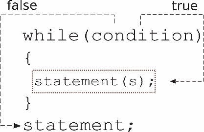

图 7.1 | while 循环中的控制流

### while 循环是预测试循环

`while` 循环被称为预测试循环，这意味着它在每次迭代之前都会测试其条件。如果条件为假，循环将永远不会迭代。如果你想确保 `while` 循环第一次执行，你必须以这种方式初始化相关数据，使条件初始为真。

程序 `WhileLoop1.java` 演示了 `while` 循环的使用或实现与 `for` 循环相同的功能。

### 示例 7.8：WhileLoop1.java

```java
package ch07;

public class WhileLoop1 {
    public static void main(String[] args) {
        int num = 1;
        while (num <= 5)
        {
            System.out.println("welcome");
            num++;
        }
        System.out.println("That's all!");
    }
}
```

**输出**

```
welcome
welcome
welcome
welcome
welcome
That's all!
```

### 解析

*   第 04 行：声明一个整数变量 `num` 并将其初始化为 1。
*   第 05 行：`while` 循环开始。语句测试变量 `num` 以确定其是否小于或等于 5。如果小于 5，则执行循环体中的语句。
*   第 07 行：循环体中的第一个语句打印单词 Welcome。
*   第 08 行：循环体中的第二个语句使用递增运算符给 `num` 加 1。

（注：后续循环迭代重复执行第 05、07、08 行，直到 `num` 大于 5 为止。原文中存在大量重复行，此处已精简保留核心逻辑结构）

## 计数控制重复

计数控制重复需要：

*   一个控制变量（循环计数器）来指定语句执行的次数；
*   控制变量的初始值；
*   每次循环时修改控制变量的增或减量（每次迭代时）；
*   决定是否继续循环的条件。

计数控制重复通常被称为确定重复，因为在循环开始之前重复次数是已知的。这是一个简单的示例。

### 示例 7.10：WhileCounter.java - 使用 while 语句的计数控制重复

```java
package ch07;

public class WhileCounter {
    public static void main(String[] args) {
        int counter = 1; // 声明并初始化计数器变量
        while (counter <= 10)
        {
            System.out.println(counter);
            ++counter; // 计数器变量加 1
        }
        System.out.println();
    }
}
```

### 示例 7.11：WhileCounter2.java

```java
package ch07;
import java.util.Scanner;

public class WhileCounter2 {
    public static void main(String[] args) {
        Scanner input = new Scanner(System.in);
        int counter = 1; // 下一个要输入的成绩个数
        int total = 0; // 用户输入的成绩总和
        int grade;    // 分数值
        int average; // 分数的平均值

        // 处理阶段
        while (counter <= 5)
        {
            System.out.println("Enter Grade");
            grade = input.nextInt();
            total = total + grade;
            counter++;
        }

        // 终止阶段
        average = total / 5; // 整数除法
        System.out.println("Class Average is " + average);
    }
}
```

**输出**

```
Enter Grade
90
Enter Grade
80
Enter Grade
70
Enter Grade
60
Enter Grade
50
Class Average is 70
```

#### 解释

*   `total`（总和）是一个用于累计一系列数值之和的变量。
*   `counter`（计数器）是一个用于计数的变量——在本例中，用于计算输入的成绩个数。
*   用于存储总和的变量在程序中使用通常应初始化为零；否则总和将包含存储在 `total` 内存位置中的旧值。
*   `Counter` 变量通常初始化为零或一。

**注意**：初始化所有的计数器和总和。

### 哨兵值控制循环 (Sentinel-controlled repetition)

哨兵值控制循环通常被称为`无限循环`，因为在循环开始执行之前重复的次数是未知的。哨兵控制循环中使用`哨兵值`（也称为`信号值`）来指示数据输入的结束。`哨兵值`的选择必须确保它不会与可接受的输入值混淆。它只是你可以选择的任何常量，用以标记序列的结束。

**注意**：这种类型的重复允许用户结束循环。

考虑下面的示例。

#### 示例 7.12: WhileSentinel.java

```java
package ch07;

import java.util.Scanner;

public class WhileSentinel {
    public static void main(String[] args) {
        int total = 0;
        int number = 1;

        while (number != 0)
        {
            System.out.println("Please enter a number, or 0 to exit");
            Scanner input = new Scanner(System.in);
            number = input.nextInt();
            total = total + number;
        }
        System.out.println("Total is: " + total);
    }
}
```

**输出**

```
Please enter a number, or 0 to exit
5
Please enter a number, or 0 to exit
5
Please enter a number, or 0 to exit
5
Please enter a number, or 0 to exit
0
Total is: 15
```

### 使用 while 循环进行输入验证

输入验证是检查用户提供的数据并判断其是否有效的过程。`while` 循环对于验证输入特别有用。如果输入了无效值，循环可以要求用户根据需要重新输入。让我们来看一个相关的示例。

#### 示例 7.13: InputValidiation.java

```java
package ch07;

import java.util.Scanner;

public class InputValidiation {
    String input;
    public static void main(String[] args) {
        Scanner sc = new Scanner(System.in);
        System.out.println("Enter a number in the range of 1 through 100");
        String input = sc.nextLine();

        int number = Integer.parseInt(input);

        while (number < 1 || number > 100) {
            System.out.println("Invalid input. " +
            "Enter a number in the range of 1 through 100.");
            input = sc.nextLine();
            number = Integer.parseInt(input);
        }
    }
}
```

**输出**

```
Enter a number in the range of 1 through 100
1000
Invalid input. Enter a number in the range of 1 through 100.
250
Invalid input. Enter a number in the range of 1 through 100.
101
Invalid input. Enter a number in the range of 1 through 100.
100
```

#### 解释

*   第 `09` 行到 `12` 行：允许用户输入一个数字（在循环开始之前）。
*   第 `14` 行：如果输入有效，则循环将不会执行。
*   第 `15` 行：然而，如果输入无效，循环将显示错误消息并要求用户输入另一个数字。循环将继续执行，直到用户输入有效的数字。

## do-while 循环

`do-while` 循环是一种后测试循环，这意味着它的条件在每次迭代后进行测试。

#### 语法

```java
do
{
    // 语句(s)
}while (Condition);
```

`do-while` 循环是后测试循环：

*   这意味着它在完成一次迭代之前不会测试其条件。
*   结果，即使条件最初为假，`do-while` 循环也至少执行一次迭代。

`do...while` 循环中的控制流如图所示。

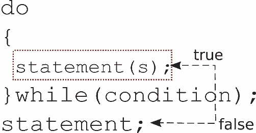

图 7.2 | do ..while 循环中的控制流

程序 `DoWhile2.java` 阐述了 `do ...while` 循环的使用。

### 示例 7.14: DoWhile1.java

```java
package ch07;

public class DoWhile1 {
    public static void main(String[] args) {
        int x = 1;
        while (x < 0)
        {
            System.out.println(x);
        }
    }
}
```

`println()` 语句将完全不会执行。这里是另一个示例。

### 示例 7.15: DoWhile2.java

```java
package ch07;

public class DoWhile2 {
    public static void main(String[] args) {
        int x = 1;
        do
        {
            System.out.println(x);
        }while (x < 0);
    }
}
```

**输出**

```
1
```

#### 解释

*   `do-while` 循环至少执行一次，即使条件最初为假。

下面是另一个演示了如何使用 `for` 循环语句的程序示例。

### 示例 7.17：`ForLoop2.java`

```java
package ch07;

public class ForLoop2 {
    public static void main(String[] args) {
        int no;
        System.out.println("no no squared");
        System.out.println("--------------");
        for (no = 1; no <= 10; no++)
        {
            System.out.println(no + "\t" + no*no);
        }
    }
}
```

**输出**

```
no no squared
--------------
1   1
2   4
3   9
4   16
5   25
6   36
7   49
8   64
9   81
10  100
```

#### 解析（第 07 - 10 行）

*   **步骤 1:** 执行初始化表达式 `no=1`。
*   **步骤 2:** 评估条件，如果为真，则跳转到步骤 3。否则，终止循环。
*   **步骤 3:** 执行循环体。


*   **步骤 4:** 执行更新表达式（`no++`），然后返回步骤 2。

**注意** - 避免在 `for` 循环循环体中修改控制变量。对控制变量的所有修改都应该在更新表达式中进行，该表达式会在每次迭代结束时自动执行。如果循环体中的某个语句也修改了控制变量，循环将不会在你预期的时刻停止。这里有一个简单的示例：

### 示例 7.18：`ForLoop3.java`

```java
01 package ch07;
02 public class ForLoop3 {
03 public static void main(String[] args) {
04 int x;
05 for (x = 1; x <= 10; x++)
06 {
07 System.out.println(x);
08 x++; // 错误
09 }
10 }
11 }
```

**输出**

```
1
3
5
7
9
```

对于其他形式的更新表达式，请参见下例。

### 示例 7.19：`ForLoop4.java`

通过向计数器加 2 来显示从 2 到 100 的所有偶数

```java
01 package ch07;
02 public class ForLoop4 {
03 public static void main(String[] args) {
04 int x;
05 for (x = 2; x <= 100; x += 2)
06 {
07 System.out.print(x + ".");
08 }
09 System.out.println(" ");
10 // 从 100 倒计数到 0
11 int y;
12 for (y = 100; y >= 2; y -= 2)
13 {
14 System.out.print(y + ".");
15 }
16 }
17 }
```

**输出**

```
2.4.6.8.10.12.14.16...........92.94.96.98.100.
100.98.96.94.92...........16.14.12.10.8.6.4.2.
```

#### 在 for 循环的初始化表达式中声明变量

### 示例 7.20：`ForLoop41.java`

```java
01 for (int x = 1; x <= 10; x++)
02 {
03 System.out.println(x + "\t\t" + x*x);
04 }
```

**解析**

*   第 01 行：变量 `x` 在初始化表达式中同时被声明和初始化。
*   第 03 行：在 `for` 循环体中使用的控制变量 (`x`)。
*   如果控制变量仅在循环中使用，那么在循环头中声明是有意义的。这使得变量的作用更加清晰。

当在 `for` 循环的初始化表达式中声明变量时，该变量的作用范围仅限于循环。这意味着你无法在循环外的语句中访问该变量。以下是实现方法。

### 示例 7.21：`ForLoop6.java`

```java
01 public class ForLoop5 {
02 public static void main(String[] args) {
03 for (int x = 1; x <= 10; x++)
04 {
05 System.out.println(x + "\t\t" + x*x);
06 }
07 System.out.println("x is now " + x);
08 }
09 }
```

**输出**

```
Error:Error:line (9)java: cannot find symbol
symbol: variable x
location: class ch07.ForLoop5
```

该程序将无法编译，因为最后一个 `println()` 语句无法访问变量 `x`，因为它在 `for` 循环体之外。

#### 在初始化和更新表达式中使用多个语句

在初始化表达式和更新表达式中执行多个语句是可能的。

**语法**

```
for (initExp1, initExp2,..., condition; updateExp1, updateExp2...)
{
    // body
}
```

使用逗号分隔多个语句。

### 示例 7.22：`ForLoop7.java` - 在初始化表达式中使用两个语句

```java
01 package ch07;
02 public class ForLoop7 {
03 public static void main(String[] args) {
04 int x, y;
05 for (x = 0, y = 1; x < 5; x++, y++)
06 {
07 System.out.println(x + " " + y);
08 }
09 }
10 }
```

**输出**

```
0 1
1 2
2 3
3 4
4 5
```

**解析**

*   第 05 行：初始化表达式中执行了两个语句 `x=0, y=1`。
*   第 05 行：更新表达式中执行了两个语句 `x++, y++`。

### 示例 7.23：`ForLoop8.java` - 在更新表达式中使用两个语句

```java
01 package ch07;
02 public class ForLoop8 {
03 public static void main(String[] args) {
04 int x = 0;
05 for (int y = 1; y <= 5; y++)
06 {
07 System.out.println(x + " " + y);
08 x++;
09 }
10 }
11 }
```

**输出**

```
0 1
1 2
2 3
3 4
4 5
```

### 嵌套循环

### 示例 7.24：`NestedLoops.java` - 打印二维数组的值

```java
01 package ch07;
02 public class NestedLoops {
03 public static void main(String[] args) {
04 int[][] array = {{1, 2, 3}, {4, 5, 6}, {7, 8, 9}};
05 for (int i = 0; i < array.length; i++) {
06 {
07 for (int j = 0; j < array[i].length; j++) {
08 System.out.print(array[i][j] + " ");
09 }
10 }
11 }
12 System.out.println();
13 }
14 }
15 }
```

**输出**

```
1 2 3 
4 5 6 
7 8 9 
```

**解析**

*   外层循环（第 05 行）遍历数组的每一行。
*   内层循环（第 07 行）遍历每一行中的每一个元素。

### 示例 7.25：`Break.java` - 计算 20 个数字的和

```java
01 package ch07;
02 import java.util.Scanner;
03 public class Break {
04 public static void main(String[] args) {
05 int i;
06 double sum = 0.0;
07 for (i = 1; i <= 20; i++){
08 System.out.println("Enter a number");
09 Scanner in = new Scanner(System.in);
10 String num = in.nextLine();
11 number = Double.parseDouble(num);
12 // 如果用户输入负数，循环终止
13 if (number < 0){
14 break;
15 }
16 sum += number; // sum = sum + number;
17 }
18 System.out.println("Sum = " + sum);
19 }
20 }
```

*(注：原文代码第 11 行 `number` 变量未在此处定义，此处翻译保留逻辑)*

*   第 15 行：执行 `break` 语句。当循环内部遇到 `break` 语句时，循环立即终止，程序控制恢复到循环后的下一语句执行。如果数值的值大于 `0.0`，则跳转到第 17 行。
*   第 17 行：将用户输入的值加到变量 `sum` 值上。然后将结果赋值给 `sum` 变量。
*   第 19 行：在屏幕（`console`）上显示 `sum` 变量的值。

下面是一个在屏幕上显示 `(a)` 的程序，直到其值大于 15。

### 示例 7.26: `Break2.java`

```java
01 package ch07;
02 public class Break2 {
03 public static void main(String[] args) {
04 int a = 10;
05 while (a < 20){
06 System.out.println("Value of a is " + a);
07 a++;
08 if (a > 15){
09 // 使用 break 语句终止循环
10 break;
11 }12 }
13 }
14 }
```

**输出**

```
Value of a is 10
Value of a is 11
Value of a is 12
Value of a is 13
Value of a is 14
Value of a is 15
```

### continue 语句简介

`continue` 语句会导致当前循环迭代立即结束。程序从下一次迭代继续执行。然而，当执行 `continue` 语句时，不同类型的循环的行为有所不同。

在 `for` 循环中，`continue` 会导致执行更新表达式，然后执行测试表达式。在循环体内嵌入 `continue` 语句的 `for` 循环中的控制流如图所示。

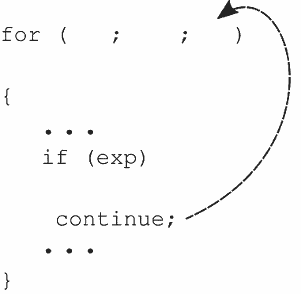

图 7.6 | for 循环中的 continue 语句

对于 `while` 和 `do…while` 循环，`continue` 语句会导致程序控制传递到条件测试。在 `while` 循环中，这意味着程序跳转到循环顶部的布尔表达式。按照常例，如果表达式仍为真，则开始下一次迭代。在 `do-while` 循环中，程序跳转到循环底部的布尔表达式，该表达式决定是否开始下一次迭代。

在循环体内嵌入 `continue` 语句的 `while` 和 `do…while` 循环中的控制流如图。

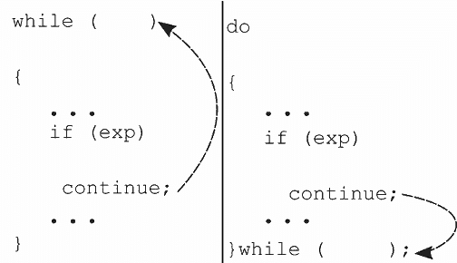

图 7.7 | while 和 do…while 循环中的 continue 语句

程序 `ContinueFor.java` 和 `ContinueWhile.java` 展示了 `continue` 语句的使用。

### 示例 7.27：`ContinueFor.java`

```java
01 package ch07;
02 public class ContinueFor {
03 public static void main(String[] args) {
04 int[] num = {1, 2, 3, 4, 5};
05 for(int x : num ) {
06 if( x == 2 ) {
07 continue;
08 }
09 System.out.print( x + "\n" );
10 }
11 }
12 }
```

**输出**

```
1
3
4
5
```

### 示例 7.28：`ContinueWhile.java`

```java
01 package ch07;
02 public class ContinueWhile {
03 public static void main(String[] args) {
04 int a = 10;
05 do {
06 if (a == 15){
07 continue;
08 }
09 System.out.println("Value of a is " + a);
10 a++;
11 } while (a < 20);
12 }
```

**输出**

```
Value of a is 10
Value of a is 11
Value of a is 12
Value of a is 13
Value of a is 14
Value of a is 15
```

---

## 总结

*   **前增/自减**：运算符置于变量之前。
*   **后增/自减**：运算符置于变量之后。
*   前置和后置模式的区别在于使用的时机。
*   在 `while` 循环中，测试发生在操作之前。
*   在 `do-while` 循环中，测试发生在操作之后。
*   `for` 循环设计用于初始化、测试和更新控制变量。

---

## 第 8 章：方法

### 简介

什么是方法？

方法是一组组合在一起的语句，用于执行特定任务。诸如显示消息和计算日期之间的天数等。方法允许我们在无需重新输入代码的情况下重用代码（编写一次，多次使用）。方法有一个名称。当在程序中遇到该名称时，程序的执行将跳转到方法的体体。当方法完成后，执行返回到调用它的程序代码区域。

### 方法分类

Java 有两种不同类型的方法：

*   void 方法。
*   有返回值的方法。

### void 方法

void 方法是一种仅执行任务然后直接终止的方法。例如：`println()` 方法就是 void 方法。

```java
01 int num = 8;
02 System.out.println(num);
03
04 num = 1;
05 System.out.println(num);
```

**解释**

*   第 01 行：声明变量 `num` 并将其初始化为值 8。
*   第 02 行：调用 `println()` 方法。将 `num` 作为参数传递，方法在屏幕上显示该值。
*   第 04 行：将新值 1 赋值给变量 `num`。
*   第 05 行：调用 `println()` 方法。将 `num` 作为参数传递，方法在屏幕上显示该值。

## 有返回值的方法

有返回值的方法不仅执行任务，还会向调用它的代码返回一个值。

### 示例 8.1:

```java
01 int num;
02 String str = "1000";
03 num = Integer.parseInt(str);
04 System.out.println(num);
```

### 解析

* 第 01 行：声明变量 `num`。
* 第 02 行：创建一个值为 `1000` 的 `String` 对象，并将其地址赋值给变量 `str`。
* 第 03 行：给变量 `num` 赋值一个值。`=` 运算符的右侧是对 `Integer.parseInt` 方法的调用。
    * 将 `str` 作为参数传递给 `Integer.parseInt()` 方法。
    * 该方法执行并向该行代码处返回一个值（第 03 行）。
    * `parseInt()` 方法返回的值被赋值给变量 `num`。
* 第 04 行：使用 `System.out.println` 方法在屏幕上显示 `num` 变量的值。

有返回值的方法向调用语句返回一个值。调用语句通常会对该值进行某些操作，例如将其赋值给变量。

***

## 创建新方法（定义 void 方法）

要创建一个方法，你必须编写它的定义，它由两个通用部分组成：

* 方法头：出现在方法定义的开头，列出了关于该方法的几项重要信息，包括方法名。
* 方法体：是方法执行时执行的一系列语句集合。这些语句被括在在大括号 `{` 和 `}` 之间。

这里有一个简单的示例。

### 示例 8.2：main 方法头和方法体

```java
public static void main(String[] args) // 方法头
{
    System.out.println("Welcome"); // 方法体
}
```

如你所知，每个完整的 Java 程序都必须有一个 `main` 方法。Java 程序也可以有其他方法。例如：

### 示例 8.3：`displayMessage` 方法头和方法体

```java
01 public static void displayMessage()
02 {
03 System.out.println("Welcome from displayMessage method.");
04 }
```

#### 方法头的组成部分

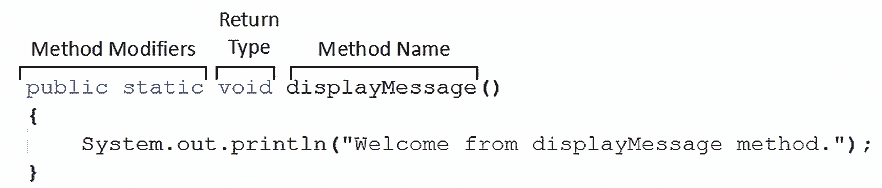

图 8.1 | 方法头

* **方法修饰符** - 对于本节，我们写的每个方法都以 `public static` 开头。`public` 意味着方法对类外部的代码是公开的。`static` 意味着方法属于类，而不是特定的对象（更多信息见第 12 章）。
* **返回值** - `void` 意味着该方法是一个 void 方法，不返回任何值。
* **方法名** - 给出一个具有描述性的名称。适用于变量名的相同规则也适用于方法名（见第 3 章）。
* **括号** - 在方法头，方法名后面总是跟着一对括号。本示例中的方法不接收任何参数，因此括号是空的。你稍后会学习——方法可以接收参数——在括号内会出现一个或多个变量声明的列表。

***

## 调用方法

方法在被调用时执行。当程序启动时，会自动调用 `main` 方法，但其他方法通过方法调用语句来执行。

在 Java 中，我们通过写出方法名来调用方法，JVM 会跳转到该方法并执行其方法体中的语句。

例如，这里有一个从 `main` 方法中调用 `displayMessage()` 方法的简单程序。

### 示例 8.4：`CallMethod.java`


```java
01 package ch08;
02 public class CallMethod {
03 public static void main(String[] args) {
04 displayMessage();
05 }
06 public static void displayMessage() {
07 System.out.println("Welcome");
08 }
09 }
```

输出：

Welcome

### 解析

* 第 03 行：程序从 `main` 方法开始。
* 第 04 行：方法调用语句中不写方法修饰符和 `void` 返回类型。它们只写在方法头。
* 第 04 行：当遇到调用 `displayMessage()` 方法时，JVM 跳转到该方法（第 06, 07, 08 行）并执行其方法体中的语句。
* 一旦 `displayMessage` 方法执行完毕，JVM 跳回 `main` 方法，并从方法调用之后的语句（第 05 行）继续执行。

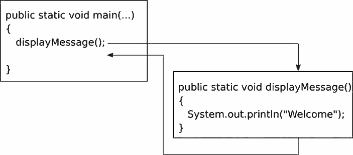

图 8.2 | 单次调用的执行路径

***

# 向方法传递参数

方法可以写成接收参数的形式。发送到方法的值被称为参数（arguments）。在调用方法时，可以将数据传递给方法。

在方法头，这些项被称为形式参数（parameters）。例如：

```java
System.out.println("Welcome"); // Welcome 是参数（数据值）
```

该语句调用了 `System.out.println()` 方法，并将 `"Welcome"` 作为参数传递。

### 参数变量

通过使用参数变量，你可以设计自己的以这种方式接收数据的方法。参数变量（有时称为形式参数）是一个特殊的变量，用于持有传递到方法的值。

使用参数的方法定义：

```java
public static void displayValue(int num)
{
    System.out.println("The value is " + num);
}
```

* `num` - 这是参数的声明，允许方法接收整数值。

例如，这里有一个从 `main` 方法中调用 `displayValue` 方法的简单程序，将 `100` 传递给 `displayValue` 方法。

### 示例 8.5：ParaVar1.java - 调用 displayValue 方法

```java
01 package ch08;
02 public class ParaVar1 {
03 public static void main(String[] args) {
04 displayValue(100);
05 }
06 public static void displayValue(int num) {
07 System.out.println("The value is " + num);
08 }
09 }
```

输出：

The value is 100

### 解析

* 第 04 行：调用 `displayValue` 方法。括号内的值被复制到参数变量 `num` 中。
* 第 08 行：在 `displayValue` 方法内部，变量 `num` 将包含传递的值。如果我们传递 `100` 作为参数，方法将显示为：`"The value is 100"`。你也可以传递变量的内容作为参数。

下面是另一个用各种参数调用 `displayValue()` 方法的示例。

### 示例 8.6：ParaVar2.java - 用各种参数调用方法

```java
01 public static void main(String[] args)
02 {
03 int x = 5;
04 displayValue(100);
05 displayValue(x);
06 displayValue(x * 5);
07 displayValue(Integer.parseInt("700"));
08 }
09 public static void displayValue(int num)
10 {
11 System.out.println("The value is " + num);
12 }
```

输出：

The value is 100

The value is 5

The value is 25

The value is 700

### 解析

* 第 03 行：声明变量 `x` 并将其初始化为 `5`。
* 第 04 行：将 `100` 作为参数传递给 `displayValue()` 方法。
* 第 05 行：将变量 `x` 作为参数传递给 `displayValue()` 方法。
* 第 06 行：将表达式 `(x * 5)` 的结果作为参数传递给 `displayValue()` 方法。
* 第 07 行：将 `Integer.parseInt` 方法返回的值作为参数传递给 `displayValue()` 方法。首先调用 `Integer.parseInt` 方法，然后将其值传递给 `displayValue()` 方法。
* 第 09 - 12 行：当从 `main` 方法调用时执行 `displayValue` 方法。

### 警告

* 在处理变量作为参数时，只需在方法调用的括号内编写变量名。不要在方法调用中编写参数变量的数据类型。例如：`displayValue(int x);` // 错误
* 方法调用应如下所示：`displayValue(x);` // 正确

# 注释

- 传递到方法中的值称为参数（arguments），而接收这些值的变量称为形参（parameters）。
- 这些术语在用法上有几种变体。有些人将参数称为实际参数（actual parameters），将形参称为形式参数（formal parameters）。另一些则使用实际参数（actual argument）和形式参数（formal argument）。
- 无论你使用哪一组术语，保持一致性至关重要。

## 参数与形参的数据类型兼容性

当你向方法传递一个参数时，请确保该参数的数据类型与形参变量的数据类型兼容。如果参数的数据类型排名低于形参变量的数据类型，`Java` 将自动执行宽转换。请参考下下面的示例。

### 示例 8.7：`ParaVar3.java` - `displayValue` 方法有一个 `int` 形参变量

以下两个代码段均正常工作，因为 `short` 和 `byte` 参数会自动转换为 `int`。

```java
01 package ch08;

02 public class ParaVar3 {
03 public static void main(String[] args)
04 {
05 short s = 1;
06 displayValue(s);
07 byte b = 2;
08 displayValue(b);
09 }
10 public static void displayValue(int num)
11 {
12 System.out.println("The value is " + num);
13 }
14 }
```

**输出**

```
The value is 1
The value is 2
```

然而，`Java` 不会自动将参数转换为低排名的数据类型。这意味着 `long`、`float` 或 `double` 值不能传递给具有 `int` 形参变量的方法。这里有一个简单的示例。

### 示例 8.8：`ParaVar4.java` - 以下代码将导致编译错误

```java
01 package ch08;
02 public class ParaVar4 {
03 public static void main(String[] args)
04 {
05 double d = 42.5;
06 displayValue(d);  // !无法将 double 转换为 int
07 }
08 public static void displayValue(int num)
09 {
10 System.out.println("The value is " + num);
11 }
12 }
```

**输出**

```
Error:(7, 22) java: incompatible types: possible lossy conversion from double to int
```

**提示**：你可以使用强制转换运算符手动将值转换为低排名的数据类型。以下是实现方法。

### 示例 8.9：`ParaVar5.java` - 以下代码可以通过编译

```java
01 package ch08;
02 public class ParaVar5 {
03 public static void main(String[] args)
04 {
05 double d = 2.5;
06 displayValue((int)d);
07 }
08 public static void displayValue(int num)
09 {
10 System.out.println("The value is " + num);
11 }
12 }
```

**输出**

```
The value is 2
```

## 注释：形参变量的作用域

- 变量的作用域是程序中可以通过名称访问该变量的部分。变量仅对其作用域内的语句可见。
- 形参变量在方法中的作用域是声明该参数的地方。方法外部的任何语句都不能通过名称访问形参变量。

## 向方法传递多个参数

你可以向方法传递多个值。方法的声明定义了该方法所需的参数的数量和类型。例如，以下是一个计算两个数字之和并在屏幕上显示该之和的方法。

### 示例 8.10：`Total1.java` - 接收两个参数的方法：

```java
01 package ch08;
02 public class Total1 {
03 public static void main(String[] args)
04 {
05 showSum(12.5, 44.0); // 调用方法
06 }
07 public static void showSum(double num1, double num2)
08 {
09 double sum; // 用于存储和
10 sum = num1 + num2;
11 System.out.println("The sum is " + sum);
12 }
13 }
```

**输出**

```
The sum is 56.5
```

**解释**

- 第 07 行：在方法头部的括号内声明了两个形参变量 `num1` 和 `num2`。
- 第 05 行：该语句 `showSum(12.5, 44.0)` 将参数（`12.5` 和 `44.0`）传递到方法中。
- 参数按照它们在方法调用中出现的顺序传递到形参变量中。第一个参数传递给第一个形参变量。第二个参数传递给第二个形参变量，依此类推。因此，该语句导致 `12.5` 传递给 `num1` 参数，并将 `44.0` 传递给 `num2` 参数。

假设我们反转了方法调用中列出参数的顺序，如下所示：`showSum(44.0, 12.5);`。会导致 `44.0` 传递给 `num1` 参数，并将 `12.5` 传递给 `num2` 参数。这里是一个简单的示例。

### 示例 8.11：`Total2.java` - 传递变量参数

```java
01 package ch08;
02 public class Total2 {
03 public static void main(String[] args)
04 {
05 double value1 = 5.5;
06 double value2 = 3.5;
07 showSum(value1, value2); // 调用方法
08 }
09 public static void showSum(double num1, double num2)
10 {
11 double sum; // 用于存储和
12 sum = num1 + num2;
13 System.out.println("The sum is " + sum);
14 }
15 }
```

**输出**

```
The sum is 9.0
```

**解释**

- 第 09 行：方法头部的括号内声明了两个形参变量 `num1` 和 `num2`。
- 第 07 行：该语句 `showSum(value1, value2)` 将参数（`value1` 和 `value2`）传递到方法中。
- 参数按照它们在方法调用中出现的顺序传递到形参变量中。第一个参数传递给第一个形参变量。第二个参数传递给第二个形参变量，依此类推。因此，该语句导致 `value1` 传递给 `num1` 参数，并将 `value2` 传递给 `num2` 参数。

## 向方法传递字符串对象引用

现在我们将编写接受字符串对象引用作为参数的方法。`PassByRef.java` 程序演示了这一概念。

### 示例 8.14：`PassByRef.java`

```java
01 package ch08;
02 public class ShowLength {
03 public static void main(String[] args){
04 String name = "Mohammed";
05 showLength(name);
06 }
07 public static void showLength(String str){
08 System.out.println(str + " is " + str.length() + " Characters long");
09 }
10 }
```

**输出**

```
Mohammed is 8 Characters long
```

**解释**

- 第 05 行：`showLength()` 方法接受对象引用作为参数。
- 第 08 行：`showLength()` 方法显示对象的字符数。
- 当一个对象（如 `String`）作为参数传递时，传递的实际上是对象的引用。因此 `name` 变量是一个字符串引用变量。它作为参数传递给 `showLength` 方法。
- `showLength` 方法有一个形参变量 `str`，它也是一个字符串引用变量，接收参数。
- 引用变量持有对象的内存地址。
- 当调用 `showLength` 方法时，存储在 `name` 中的字符串被传递给 `str` 形参变量。

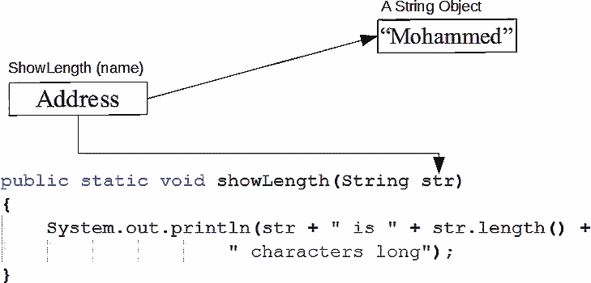
图 8.3 | 将引用作为参数传递

参数变量与参数引用同一个对象。

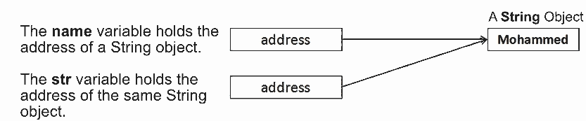
图 8.4 | `name` 和 `str` 都引用同一个对象。

然而，Java 中的 `String` 对象是不可变的，这意味着它们不能被更改。请看以下示例。

### 示例 8.15 : PassString.java

```java
01 package ch08;
02 public class PassString {
03 public static void main(String[] args){
04 String city = "London";
05 System.out.println("Main Method: " + city);
06
07 changeCity(city);
08 System.out.println("Main Method: " + city);
09 }
10 public static void changeCity(String ci){
11 ci = "Khartoum";
12 System.out.println("changeCity Method: " + ci);
13 }
14 }
```

**输出**

```
Main Method: London
changeCity Method: Khartoum
Main Method: London
```

**解释**

*   第 04 行：创建一个包含 "London" 的字符串对象。`city` 引用该对象。
*   第 05 行：显示由 `city` 变量引用的 `String`。
*   第 07 行：调用 `changeCity` 方法，将 `city` 变量的内容作为参数传递。
*   第 10 行：`changeCity` 方法接收一个 `String` 作为其参数，并将 `ci` 参数分配一个新的字符串。
*   第 11 行：创建一个包含 "Khartoum" 的 `String` 对象，并将其地址赋值给 `ci` 参数变量。
*   第 12 行：显示 `ci` 引用的 `String`。

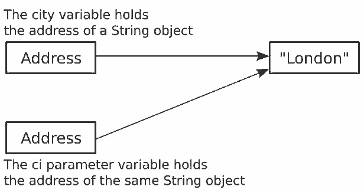
图 8.5 | 在第 10 行执行之前，`city` 和 `ci` 都引用同一个对象

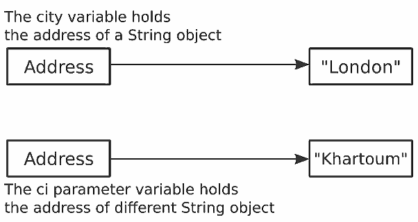
图 8.6 | 在第 10 行执行后，`city` 和 `ci` 引用不同的对象

***

## 关于局部变量的更多信息

### 引言

局部变量是定义在方法内部的变量，方法外部的语句无法访问。它们被称为局部变量，是因为它们对于定义它们的方法是局部的。方法外部的语句无法访问该方法的局部变量。由于方法的局部变量对其他方法是隐藏的，因此其他方法可以拥有具有相同名称自己的局部变量。让我们来看一个示例。

### 示例 8.16: LocalVar.java


```java
01 package ch08;
02 public class LocalVar {
03 public static void main(String[] args) {
04 london();
05 khartoum();
06 }
07 public static void london()
08 {
09 int birds = 9000;
10 System.out.println("In London there are " + birds + " birds");
11 }
12 public static void khartoum()
13 {
14 int birds = 5000;
15 System.out.println("In Khartoum there are " + birds + " birds");
16 }
17 }
```

**输出**

```
In London there are 9000 birds
In Khartoum there are 5000 birds
```

**解释**

*   除了 `main` 方法外，此程序还有两个方法（`london` 和 `khartoum`）。
*   这两个方法各有一个名为 `birds` 的局部变量。
*   由于它们在不同的方法中，程序一次只能看到其中一个。
*   当 `london` 方法执行时，在 `london` 内部定义的 `birds` 变量是可见的。
*   当 `khartoum` 方法执行时，在 `khartoum` 内部定义的 `birds` 变量是可见的。

## 局部变量生命周期

方法的局部变量只在方法执行期间存在。这被称为局部变量生命周期。当方法开始时，它的局部变量和参数变量在内存中创建；当方法结束时，局部变量和参数变量被销毁，存储在局部变量中的任何值都会丢失。

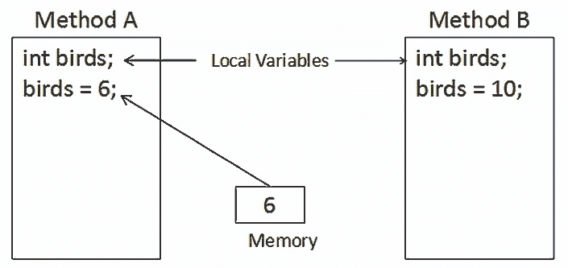使用参数值初始化局部变量

使用参数变量来初始化局部变量。例如 8.17 (`LocalVar2.java`)：

```java
01 package ch08;
02 public class LocalVar2 {
03 public static void main(String[] args)
04 {
05 double x = 10;
06 double y = 200;
07 showSum(x, y);
08 }
09 public static void showSum(double num1, double num2)
10 {
11 double sum = num1 + num2;
12 System.out.println("The sum is " + sum);
13 }
14 }
```

**输出**

```
The sum is 210.0
```

由于参数变量的作用范围是定义它的整个方法，因此我们可以使用参数变量来初始化局部变量。

**警告**

局部变量不会自动用默认值初始化。在使用它们之前，必须给它们赋值。如果你尝试在给局部变量赋值之前使用它，将导致编译错误。例如 8.18：

```java
01 public static void myMethod()
```

（注：原文示例 8.18 代码不完整，此处根据逻辑翻译为描述性：如果你尝试在给局部变量赋值之前使用它，将导致编译错误。例如 8.18：）

## 方法返回值

### 定义返回值的方法

当你编写一个返回值的方法时，必须指定返回值的类型。语法为：`data-type method-name(args) { ... }`

`void` 方法不返回任何值。

### 返回语句

`return expression;`

表达式是要返回的值。它可以是任何值的表达式。请看下面的示例。

示例 8.20: ReturnMethod.java

```java
01 package ch08;
02 public class ReturnMethod {
03 public static void main(String[] args)
04 {
05 int sum;
06 sum = sum(10, 20);
07 System.out.println(sum);
08 }
09 public static int sum(int num1, int num2)
10 {
11 int result;
12 result = num1 + num2;
13 return result;
14 }
15 }
```

**输出**

```
30
```

**解释**

*   第 9 行：方法名 `sum`。
*   第 9 行：`sum` 方法接收两个 `int` 参数（10 和 20）。
*   第 11 行：声明了一个局部变量 `result`。
*   第 12 行：参数变量 `num1` 和 `num2` 相加，结果赋值给 `result`。
*   第 13 行：这是一个 `return` 语句。它导致方法执行结束并将值返回给调用它的语句。

### 返回语句的通用格式

`return expression;`

表达式是要返回的值。它可以是任何值的表达式，例如变量、字面量或数学表达式。在这种情况下，`sum` 方法返回了该值。然而，我们可以消除 `result` 变量并直接返回表达式 `num1 + num2`：

```java
public static int sum(int num1, int num2) {
    return num1 + num2;
}
```

**注意**：`return` 语句的表达式类型必须与方法头指定的返回类型相同或与之兼容。否则，将发生编译错误。Java 会自动扩大返回表达式的值（如果需要），但不会自动收窄。

## 调用返回值的方法

`ValueReturn.java` 程序演示了调用返回值的方法的概念。

示例 8.21: ValueReturn.java

```java
01 package ch08;
02 public class ValueReturn {
03 public static void main(String[] args)
04 {
05 int total, value1 = 50, value2 = 40;
06 total = sum(value1, value2);
07 System.out.println("The sum of " + value1 + " and " + value2 + " is " + total);
08 }
09 public static int sum(int no1, int no2)
10 {
11 int result;
12 result = no1 + no2;
13 return result;
14 }
15 }
```

**输出**

```
The sum of 50 and 40 is 90
```

*   **第 06 行**: 调用 `sum` 方法，并将 `value1` 和 `value2` 作为参数传递。它将 `sum` 方法的返回值赋值给变量 `total`。在 particular 情况下，该方法将返回 90。

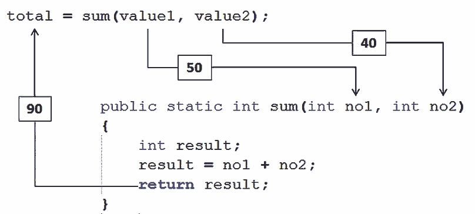图 8.7 | 参数是如何传递到方法中的以及值是如何从方法传回的 `ValueReturn.java` 显示了将方法的返回值赋值给变量。这通常是返回值的用法方式，但你也可以对它们进行许多其他操作。这是一个简单的示例。

示例 8.22：`ValueReturn2.java`

```java
package ch08;

public class ValueReturn2 {
    public static void main(String[] args) {
        int x = 10, y = 20;
        double average;
        average = sum(x, y) / 2.0;
        System.out.println(average);
    }

    public static int sum(int no1, int no2) {
        int result;
        result = no1 + no2;
        return result;
    }
}
```

**输出**

```
15.0
```

#### 解释

*   **第 06 行**: 使用 `x` 和 `y` 作为参数调用 `sum` 方法。方法的返回值 25 被除以 `2.0`。结果 `12.5` 被赋值给 `average`。

这是另一个示例。示例 8.23：`ValueReturn3.java` - 调用一个返回值的方法

```java
package ch08;

public class ValueReturn3 {
    public static void main(String[] args) {
        int x = 10, y = 20;
        System.out.println("The sum is " + sum(x, y));
    }

    public static int sum(int no1, int no2) {
        int result;
        result = no1 + no2;
        return result;
    }
}
```

**输出**

```
The sum is 30
```

#### 解释

*   **第 05 行**: 将 `sum` 方法的返回值发送给 `System.out.println()`，以便在屏幕上显示。将显示消息 "The sum is 30"。

**记住**：返回值的方法返回一个特定数据类型的值。你可以在任何可以使用相同数据类型的普通值的地方使用方法的返回值。这意味着，在任何可以使用 `int` 值的地方，都可以使用一个返回 `int` 值的方法的调用。同样，在任何可以使用 `double` 值的地方，都可以使用一个返回 `double` 值的方法的调用。对于所有数据类型都是如此。

### 返回布尔值

有时，需要一个方法来测试参数并返回一个真或假值，以表示是否存在某个条件。这样的方法将返回一个 `boolean` 值。

示例 8.24：`BoolReturn.java`

```java
package ch08;

public class BoolReturn {
    public static void main(String[] args) {
        int value = 20;
        if (isValid(value))
            System.out.println("The value is within range.");
        else
            System.out.println("The value is out of range.");
    }

    public static boolean isValid(int num) {
        boolean status;
        if (num >= 1 && num <= 100)
            status = true;
        else
            status = false;

        return status;
    }
}
```

**输出**

```
The value is within range.
```

### 返回 String 对象的引用

返回值的方法还可以返回非原始类型类型的引用，例如 `String` 对象。

示例 8.25：`ReturnString.java`

```java
package ch08;

public class ReturnString {
    public static void main(String[] args) {
        String empName;
        empName = fullName("Mohammed", "Mansour");
        System.out.println(empName);
    }

    public static String fullName(String first, String last) {
        String name;
        name = first + " " + last;
        return name;
    }
}
```

**输出**

```
Mohammed Mansour
```

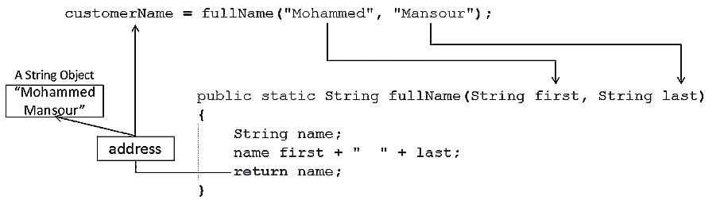图 8.8 | `fullName` 方法返回 String 对象的引用

---

## 总结

*   方法是组合在一起的语句集合，用于执行特定任务。
*   Java 有两种类型的方法：`void` 方法和返回值的方法。`void` 方法只是执行一个任务然后结束。返回值的方法不仅执行任务，还将值传回给调用它的代码。
*   要创建一个方法，你必须编写它的定义，由两个通用部分组成：方法头和方法体。
*   方法在被调用时执行。在 Java 中，我们通过指定它的名称来调用方法。
*   方法可以写成接受参数。发送到方法的值称为参数。在方法头中，这些项被称为形式参数。
*   在 Java 中，所有原始数据类型的参数都是按值传递的，这意味着只有参数值的副本被传递到参数变量中。
*   在 Java 中，我们可以编写接受引用的方法。

---

## 第二部分：面向对象编程

### 类与对象

#### 引言

Java 是一种面向对象的语言。面向对象编程是一种与类、对象、继承、多态等概念相关的风格。如果我们考虑现实世界，我们周围有很多对象，猫、汽车等。每个类都有一个属性（状态）和一个功能（行为）。如果我们考虑一个人类，它的属性是姓名、体重、颜色，功能是行走、进食。

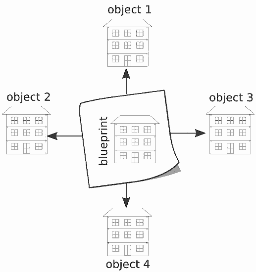图 9.1 | 类与对象

每个类都有 -

*   与类相关的属性（字段或特征）。例如：姓名、大小、位置和颜色。
*   类的方法（功能）。例如：行走、说话、进食、开门。

#### 类创建

正如我所说，类是对象的蓝图。当你创建一个类时，你必须告诉 Java 该类的特征。你通过使用 `class` 关键字以及类名来定义类，如下：

```java
class ClassName {
}
```

类定义从关键字 `class` 开始，后面是类名。类体用大括号 `{` 和 `}` 标记，就像任何其他程序块一样。在这种情况下，类体是空的。

如果你将这些行保存到名为 `MyClass.java` 的文件中，可以将类编译为 `.class` 文件，虽然如果你尝试运行它，它也不会执行任何操作。

#### 为类声明字段

你为类声明字段的方式与在程序中声明任何变量一样。

```java
class ClassName{
    type instance-variable1;
    type instance-variable2
}
```

这是一个简单的示例。示例 9.1：声明一个整数类型的数据类型

```java
class ClassName {
    int fieldOne;
}
```

#### 解释

*   **第 03 行** 声明了一个 `int` 类型的字段。现在 `fieldOne` 是 `ClassName` 类的字段。该字段默认情况下只能被同一包中的方法访问。你可以通过 `public`、`protected` 和 `private` 关键字来更改这种访问规则。
*   `public` 数据字段可以被程序的任何部分访问，无论是在定义它的类的内部还是外部。
*   `protected` 数据字段只能从类内部或从派生类（子类）内部访问。
*   `private` 数据字段甚至无法被派生类访问。

## 定义方法

方法的声明为编译器提供了许多关于该方法的信息。方法声明包含了诸如信息，如方法的名称、方法的返回类型、方法所需的参数数量和类型，以及其他哪些类和对象可以调用该方法。

方法声明中唯一两个要求的元素是方法名和方法返回的数据类型。

#### 语法

```java
01 class ClassName{
03 type instance-variable1;
04 type instance-variable2;
06 type method-name1 (parameter-list){
07 // body of method.
08 }
09 type method-name2 (parameter-list){
10 // body of method.
11 }
12 }
```

### 示例 9.2

以下代码在 `MyClass` 类中声明了一个名为 `SetField` 的方法，该方法不返回值：

```java
01 class MyClass
02 {
03 private int fieldOne;
04
05 public void SetField(int value)
06 {
07 fieldOne = value;
08 }
09 }
```

#### 解释

*   第 01 行：定义 `MyClass` 类。
*   第 03 行：声明类的 `fieldOne` 字段。
*   第 05 行：定义 `SetField()` 方法。
*   第 07 行：将字段设置为传递给 `SetField()` 的值。

**注意**：所有类字段都应该声明为 `private`（私有）。

***

# 关于类的说明

*   `class` 是 Java 中的关键字，用于在 Java 中创建类。
*   类名是用户定义类的名称。当为同一个类创建多个对象时，所有对象都提供相同的实例变量副本。
*   访问修饰符（Access specifier）可以应用于实例变量，例如 `public`（公共）、`private`（私有）。
*   实例变量是该类的类变量。


* 不同的对象其实例变量具有不同的值。
* 实例变量也被称为 `Fields`（字段）。
* 实例方法与类相关的方法。类方法可以声明为 `public` 或 `private`。这些方法用于操作类数据，即类变量。

## 另一个示例

### 示例 9.3：类概念

**注意**：类不是对象，而是对对象的描述。一旦写好了类，你就可以使用该类创建任意数量的对象。每个对象都被视为该类的实例。

***

## 对象创建

要从类创建对象，你输入类的名称，后跟对象的名称。

#### 语法

```java
<ClassName> object = new <ClassName>();
```

例如，下面这一行从 `MyClass` 类创建了一个对象（`myObject`）：

`MyClass myObject = new MyClass();`

以下程序创建了一个矩形。

### 示例 9.4：Rectangle.java

```java
01 package ch09;
02 class Rectangle
03 {
04 double length;
05 double breadth;
06 }
07 class RectangleDemo
08 {
09 public static void main(String args[])
10 {
11 Rectangle rect = new Rectangle();
12 double area;
13
14 // 给 rect 的实例变量赋值。
15 rect.length = 10;
16 rect.breadth = 20;
17
18 计算矩形的面积
19 area = rect.length * rect.breadth;
20 System.out.println("Area is " + area);
21 }
22 }
```

### 输出

`Area is 200.0`

#### 解释

第 02 - 06 行：类声明

* 类定义了一个新数据类型 `"Rectangle"`。
* `"Rectangle"` 将用于声明类型为 `Rectangle` 的对象。

第 11 行：实际创建对象

* 执行此语句后将为对象分配内存。
* 此语句将创建类 `"Rectangle"` 的实例，该实例的名称仅仅是实际对象 `"rect"`。
* 为新实例创建了实例变量的新副本 [`rect` 现在拥有了它自己的实例变量 - `length` 和 `breadth` ]

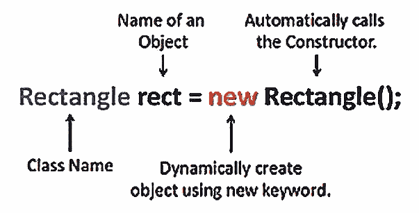 图 9.2 | 对象创建

## 使用点（DOT）操作符访问对象的实例变量

每个实例或对象都拥有自己的实例变量副本，即 `length` 和 `breadth`。我们可以使用点操作符访问 `rect` 的实例变量副本。例如：

### 示例 9.5：实例变量

`rect.length = 10;`

`rect.breadth = 20;`

## 对象与原始变量

原始数据类型被称为“原始的”（primitive），是因为使用原始数据类型创建的变量除了存储值外，没有其他内置功能。

原始数据类型使用较少量的内存来表示单项数据。所有相同原始类型的数据大小都相同。例如，原始类型 `int` 使用 32 位表示整数。所有类型为 `int` 的变量都使用 32 位。

Java 中只有八种原始数据类型：`byte`、`short`、`int`、`long`、`float`、`double`、`char` 和 `boolean`。Java 程序不能定义任何其他原始数据类型。

对象是一个巨大的内存块，可能包含大量数据以及处理这些数据的方法。

***

## 构建一个简单类

### 第一步：设计类

**类名**：`Rectangle`（在 `Rectangle.java` 中）

**字段**：

* `length`：矩形的长度。
* `width`：矩形的宽度。

**方法**：

* `setLength(double length)`：设置矩形的长度。
* `setWidth(double width)`：设置矩形的宽度。
* `getLength()`：获取长度。
* `getWidth()`：获取宽度。
* `getArea()`：计算并返回矩形的面积。

### 第二步：编写类的骨架

```java
01 public class Rectangle
02 {
03
04 }
```

### 第三步：编写字段

```java
01 public class Rectangle
02 {
03 private double length;
04 private double width;
05 }
```

解释：

* `private` 是一个访问修饰符。它表示这些变量不能被类外部的代码访问。
* 记住，对象可以执行数据隐藏，这意味着在对象内部的数据是受到保护的。
* 当内部数据对外部代码隐藏，且对数据的访问限制在类的方法时，数据就可以防止意外损坏。
* 在面向对象编程中，一种常见的做法是将类的所有字段设为私有，并通过方法提供访问权限。
* 在编写类时，你将主要使用 `private` 和 `public` 访问修饰符。

表 9.1 | 类成员私有和公共访问修饰符总结

| 访问修饰符 | 说明 |
| :--- | :--- |
| `private` | 当访问修饰符应用于类成员时，该成员不能被类外部的代码访问，该成员只能由同类的方法访问。 |
| `public` | 当公共访问修饰符应用于类成员时，该成员可以被类内部或外部的代码访问。 |

### 第四步：编写方法

此方法将允许类外部代码在长度字段中存储值。

```java
01 public class Rectangle
02 {
03 private double length;
04 private double width;
05 public void setLength(double len)
06 {
07 length = len;
08 }
09 }
```

**public void setLength(double len): setLength 方法的头部**

* `public` 关键字是一个访问修饰符。它表示该方法可以被类外部的代码调用。
* `void` 关键字表示方法不向调用它的语句返回任何数据。
* `setLength` 是方法的名称。
* `(double len)` 是 double 类型参数变量的声明。
* 将 `len` 的值赋给 `length` 字段。当该方法执行时，`len` 参数变量将持有传递给方法的参数值。该值被赋给 `length` 字段。

注意：方法头中没有出现 `static` 单词。当一个方法被设计为在类的实例上工作时，它被称为实例方法（instance method），你不需要在方法头中编写 `static` 单词，因为该方法将在 `Rectangle` 类实例的 `length` 字段中存储一个值，所以它是一个实例方法（后文将进行讨论）。

### 第 4 步：演示 `setLength` 方法是如何工作的

#### 第一：Rectangle 类没有 `main` 方法

该类不是一个完整的程序，而是一个可以此创建 `Rectangle` 对象的蓝图。其他程序将使用 `Rectangle` 类来创建对象。创建和使用这些对象的程序将拥有自己的 `main` 方法。

#### 第二：创建程序 - `RectangleDemo.java`

（必须保存为与 `Rectangle.java` 文件相同的文件夹或目录中，命名为 `RectangleDemo.java`）

```java
01 public class RectangleDemo
02 {
03 public static void main(String[] args)
04 {
05 Rectangle box = new Rectangle();
06 System.out.println("Sending the value 10.0 " +
07 "to the setLength method.");
08 box.setLength(10.0);
09 System.out.println("Done.");
10 }
11 }
```

#### 第三：编译程序

`Build > Recompile RectangleDemo.java`

步骤：

* 编译器读取源代码并看到正在使用一个名为 `Rectangle` 的类。
* 它在当前文件夹或目录中查找 `Rectangle.class` 文件。然而，该文件并不，因为我们还没有编译 `Rectangle.java`。
* 编译器搜索 `Rectangle.java` 文件并编译它。这会创建 `Rectangle.class` 文件，使得 `Rectangle.class` 可用。

#### 第四：运行 `RectangleDemo` 文件

`Run > RectangleDemo`

#### 第五：查看此程序中 `main` 方法的每条语句

`Rectangle box = new Rectangle();`

// 创建一个 Rectangle 对象并与变量关联

`Rectangle box`

* 声明一个名为 `box` 的变量。
* 变量的数据类型是 `Rectangle`（因为 `Rectangle` 单词不是原始数据类型的名称，Java 假设它是类的名称）。
* 回想一下类类型的变量是引用变量，它持有对象的内存地址。当引用对象持有对象的内存地址时，称该变量引用了该对象。因此，变量 `box` 将用于引用一个 `Rectangle` 对象。

`new Rectangle();`

* `new` 在内存中创建一个对象。
* 这指定了应该从哪个类创建对象（在本类中，创建了一个 `Rectangle` 类的对象）。
* 然后（通过 `=` 运算符）将对象的内存地址赋给变量 `box`。

**执行后**

* 变量 `box` 将引用在内存中创建的对象。

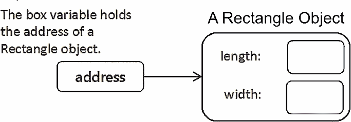

图 9.3 | `box` 变量引用了一个 `Rectangle` 类对象

`System.out.println("Sending the value 10.0 " + "to the setLength method.");`

* 在屏幕上显示消息。

`box.setLength(10.0);`

* 调用 `box` 对象的 `length` 方法。
* 将参数 (`10.0`) 传递给 `length` 方法。
* 方法执行，值 `10.0` 被复制到 `len` 参数变量中。
* 方法将 `len` 的值赋给 `length` 字段然后终止。

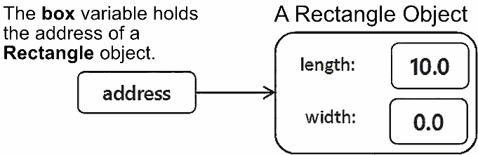

图 9.4 | 执行 `setLength` 方法后 `box` 对象的语句状态

#### 第六：编写 `setWidth` 方法

（向 `Rectangle.class` 中添加 `setWidth` 方法）

```java
public void setWidth(double w){
    width = w;
}
```

它接受一个参数，该参数被赋给 `width` 字段。更新 `Rectangle` 类：

假设（在 `LengthDemo.java` 文件内部）：`box` 引用一个 `Rectangle` 对象并执行了以下语句。`box.setWidth(20.0);`

在该语句执行执行后，`box` 对象的 `width` 字段将被设置为 `20.0`。

#### 第七：编写 `getLength` 和 `getWidth` 方法

由于 `length` 和 `width` 字段是私有的，我们编写了 `setLength` 和 `setWidth` 方法允许 `Rectangle` 类外部的代码在字段中存储值。我们还必须编写方法允许类外部代码获取存储在这些字段中的值。这就是 `getLength` 和 `getWidth` 方法要做的。

* `getLength` 方法将返回存储在 `length` 字段中的值。
* `getWidth` 方法将返回存储在 `width` 字段中的值。

**`getLength` 方法的代码。**

```java
01 public double getLength()
02 {
03 return length;
04 }
```

假设 `size` 是一个变量且 `box` 引用一个 `Rectangle` 对象并执行了以下语句。`box.setWidth(20.0);`

在该语句执行后，`box` 对象的 `width` 字段将被设置为 `20.0`。

### 第八：编写 `getArea` 方法

如下所示的代码

**Rectangle.java**

```java
01 public class Rectangle
02 {
03 private double length;
04 private double width;
05 
06 public void setLength(double len)
07 {
08 length = len;
09 }
10 public void setWidth(double w)
11 {
12 width = w;
13 }
14 
15 public double getLength()
16 {
17 return length;
18 }
19 public double getWidth()
20 {
21 return width;
22 }
23 
24 public double getArea()
25 {
26 return length * width;
27 }
28 }
```

**RectangleDemo.java**

```java
01 public class RectangleDemo
02 {
03 public static void main(String[] args)
04 {
05 Rectangle box = new Rectangle();
06 System.out.println("Sending the value 10.0 " +
07 "to the setLength method.");
08 box.setLength(10.0);
09 System.out.println("Done.");
10 System.out.println("Sending the value 20.0 " +
11 "to the setWidth method.");
12 box.setWidth(20.0);
13 System.out.println("Done.");
14 System.out.println("The length is " + box.getLength());
15 System.out.println("The width is " + box.getWidth());
16 System.out.println("The area is " + box.getArea());
17 }
18 }
```

**输出**

```
Sending the value 10.0 to the setLength method.
Done.
Sending the value 20.0 to the setWidth method.
Done.
The length is 10.0
The width is 20.0
The area is 200.0
```

(注：由于提供的原始文本在后半部分存在重复和逻辑错乱，以上翻译基于高级文档工程师逻辑对内容进行了对齐修正)

## 类成员的布局


每个类的实例（或对象）都有其自己的一组字段，这些字段被称为实例字段（instance fields）。你可以创建一个类的多个实例，并在每个实例的字段中存储不同的值。对类实例的操作的方法称为实例方法（instance methods）。

在 `Rectangle` 类中 - 首先声明字段变量，然后定义方法。

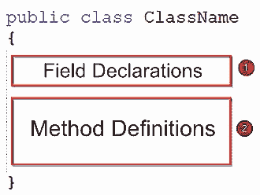

图 9.5 | 类成员的典型布局（推荐！）

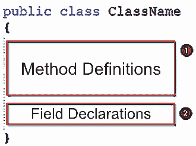

图 9.6 | 类成员的典型布局（不推荐）

以下是一个创建了两个 `Rectangle` 对象（`Square` 和 `Rectangle`）的程序。然后获取并存储 `Square` 和 `Rectangle` 的尺寸。

### 示例 9.6：ShapeAreas.java

```java
01 package ch09;
02 import java.util.Scanner;
03
04 public class ShapeAreas
05 {
06 public static void main(String[] args)
07 {
08 double number; // 用于存储一个数字
09 double totalRec; // Rectangle 的总面积
10 double totalSquare; // Square 的总面积
11 String input; // 用于存储用户输入
12
13 // 创建两个 Rectangle 对象。
14 Rectangle rec = new Rectangle();
15 Rectangle square = new Rectangle();
16
17 Scanner sc = new Scanner(System.in);
18
19 // 获取并存储矩形的尺寸。
20 System.out.println("What is the rectangle's lngth?");
21 input = sc.nextLine();
22 number = Double.parseDouble(input);
23 rec.setLength(number);
24
25 System.out.println("What is the Rectangle's width?");
26 input = sc.nextLine();
27 number = Double.parseDouble(input);
28 rec.setWidth(number);
29
30 // 获取并存储正方形的尺寸。
31 System.out.println("What is the Square's length?");
32 input = sc.nextLine();
33 number = Double.parseDouble(input);
34 square.setLength(number);
35
36 System.out.println("What is the Square's width?");
37 input = sc.nextLine();
38 number = Double.parseDouble(input);
39 square.setWidth(number);
40
41 // 计算矩形的总面积。
42 totalRec = rec.getWidth() + rec.getLength();
43
44 // 计算正方形的总面积。
45 totalSquare = square.getWidth() + square.getLength();
46
47 // 显示正方形和矩形的总面积。
48 System.out.println("The total area of the rectangle is "
�    + totalRec);
49 System.out.println("The total area of the square is "
�    + totalSquare);
50 }
51 }
```

**输出**

```
What is the rectangle's length?
10
What is the Rectangle's width?
14
What is the Square's length?
15
What is the Square's width?
12
The total area of the rectangle is 24.0
The total area of the square is 27.0
```

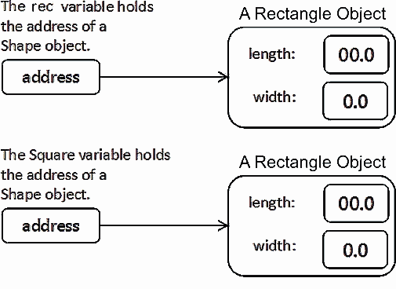

图 9.7 | Shape 对象：数据存储到对象中后的对象状态。

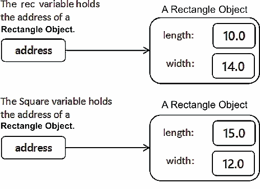

图 9.8 | 数据存储到对象后的状态

`Rectangle` 类的每个实例都有它们自己的长度和宽度变量。出于这个原因，这些变量被称为实例变量（instance variables）或实例字段（instance fields）。类的每个实例都有其自己的一组实例字段，并可以在这些字段中存储自己的值。

对类实例的操作的方法称为“实例方法”。`Rectangle` 类中的所有方法都是实例方法，因为它们对类的特定实例执行操作。

### 示例

**示例 1**：`rect.setLength(number);`

`setLength(number)` 方法调用 `setLength` 方法，该方法在第一个 `rec` 对象的长度字段中存储值。

**示例**：`square.setLength(number);`

调用 `setLength` 方法，该方法在 `square` 对象的长度字段中存储值。

记住，实例方法的头部中没有 `static` 关键字。

---

## 总结

*   类和对象是面向对象编程的基本概念。
*   软件对象具有属性和函数。软件对象的属性存储在字段中，函数通过方法显示。
*   类是创建对象的蓝图。从类中，可以创建一个或多个对象。
*   类的定义以关键字 `class` 开头，后跟类名。
*   类体用花括号隔开，就像任何其他程序块一样。
*   要从类创建对象，你输入类的名称，后跟对象的名称。
*   基本数据类型被称为“基本”，是因为使用基本数据类型创建的变量除了存储值外，没有其他内置功能。
*   对象是一块巨大的内存区域，它可能包含大量数据以及处理这些数据的方法。
*   在字段中存储值或以其他方式更改字段值的方法称为变异器方法（mutator method）。从类的字段中获取值但不更改它的方法称为访问器方法（accessor method）。
*   每个类的实例（或对象）都有其自己的一组字段，这些字段被称为实例字段。你可以创建一个类的多个实例，并在每个实例的字段中存储不同的值。对类实例的操作的方法称为实例方法。

---

## 第 10 章 构造函数

### 引言

构造函数（Constructor）是一种特殊类型的方法，在创建对象（或类的实例）时会被自动调用。它们通常执行初始化或设置工作，例如在实例字段中存储初始值。构造函数的名称与类相同。

### 示例 10.1：Rectangle.java - 添加构造函数

```java
01 public class Rectangle
02 {
03 private double length;
04 private double width;
05 public Rectangle(double len, double w)
06 {
07 length = len;
08 width = w;
09 }
10 public void setLength(double len)
11 {
12 length = len;
13 }
14 public void setWidth(double w)
15 {
16 width = w;
17 }
18 public double getLength()
19 {
20 return length;
21 }
22 public double getWidth()
23 {
24 return width;
25 }
26 public double getArea()
27 {
28 return length * width;
29 }
30 }
```

构造函数是一个 `public` 方法（一个在创建它的地方都可以被访问的方法），因为你希望能够在程序的任何地方创建对象，当你创建对象时，实际上是在调用它的构造函数。此构造函数接受两个参数，传入 `len` 和 `w` 参数变量。这些参数变量被赋值给 `length` 和 `width` 字段。

**语法 - 方法头部**: `访问修饰符 类名(参数...)` 构造函数的头部没有指定返回类型 - 甚至没有 `void`。这是因为构造函数不是通过显式方法调用执行的，且不能返回值。

### 示例 10.2：通过调用构造函数创建对象

`Rectangle box = new Rectangle(7.0, 14.0);`

**解释**

*   声明变量 `box`。
*   创建一个 `Rectangle` 对象。
*   向构造函数传递 `7.0` 和 `14.0`。执行后：`box` 将引用一个 `Length` 字段设置为 7、`width` 字段设置为 14 的 `Rectangle` 对象。

`ConstructorDemo` 类如下实现 `Rectangle` 类：

### 示例 10.3：ConstructorDemo.java - 实现 Rectangle 类

```java
01 public class ConstructorDemo
02 {
03 public static void main(String[] args)
04 {
05 Rectangle box = new Rectangle(5.0, 15.0);
06 // 显示长度。
07 System.out.println("The box's length is " +
08 box.getLength());
09
10 // 显示宽度 
11 System.out.println("The box's width is " +
12 box.getWidth());
13
14 // 显示面积。
15 System.out.println("The box's area is " +
16 box.getArea());
17 }
18 }
```

**输出**

```
The box's length is 5.0
The box's width is 15.0
The box's area is 75.0
```

`Rectangle.java` 和 `ConstructorDemo.java` 类必须存在相同的包名下。

## 未初始化的局部引用变量

在 `Demo.java` 文件中，我们使用 `Rectangle` 对象的地址初始化了 `box` 变量。引用变量也可以在不初始化的情况下声明，例如：

```java
Rectangle box;
```

此条语句并没有创建一个 `Rectangle` 对象。它只是声明了一个名为 `box` 的变量，该变量可以用于引用一个 `Rectangle` 对象。由于 `box` 变量尚未持有对象的地址，因此它是一个未初始化的引用变量。

在声明引用变量后，可以使用以下语句为它分配对象的地址。

```java
box = new Rectangle(7.0 , 14.0);
```

* 此条语句创建了一个 `Rectangle` 对象。
* 将值 `7.0` 和 `14.0` 传递给它的构造函数。
* 将对象的地址赋值给 `box` 变量。
* 执行后，`box` 变量将引用一个 `Rectangle` 对象。

**记住**：在用未初始化的引用变量时需要小心。请记住，局部变量在使用之前必须经过初始化或赋一个值。同样，局部引用变量在使用之前必须引用一个对象。否则将发生编译错误。

---

## 默认构造函数

当对象被创建时，它的构造函数总是会被调用。但如果我们不在对象的类中编写构造函数呢？如果你在类中没有写构造函数，Java 在类编译时会自动提供一个。Java 提供的构造函数被称为默认构造函数。

## 关于默认构造函数的注意事项

* 默认构造函数不接受参数。
* 它将对象的所有数值型字段设置为 `0`，将布尔型字段设置为 `false`。
* 如果对象具有任何作为引用变量的字段，默认构造函数会将它们设置为特殊值 `null`，这意味着它们不引用任何内容。

这里有一个关于默认构造函数的示例。

### 示例 10.4：Rectangle.java 文件 - 无构造函数方法的第一个版本

```java
01 public class Rectangle
02 {
03 private double length;
04 private double width;
05 public void getLength(double len)
06 {
07 length = len;
08 }
09 }
```

### 解析

* 当你编译它时，编译器生成了一个默认构造函数，将 `length` 和 `width` 字段都设置为 `0.0`。
* 假设我们没有为 `Rectangle` 类写构造函数：
  `Rectangle r = new Rectangle();` // 调用默认构造函数
* 我们没有向默认构造函数传递任何尺寸，因为默认构造函数不接受参数。

---

# 编写无参数构造函数

不接受参数的构造函数被称为“无参数”构造函数。默认构造函数不接受参数，因此被认为是无参数构造函数。此外，你可以编写自己的无参数构造函数。

### 示例 10.5：假设我们为 `Rectangle` 类写了以下构造函数：

```java
01 public Rectangle()
02 {
03 length = 1.0;
04 width = 1.0;
05 }
```

创建一个 Rectangle 对象 // 调用无参数构造函数：

```java
Rectangle r = new Rectangle();
```

rectangle 对象的 `length` 和 `width` 字段都将被设置为 `1.0`。

---

## 总结

* 构造函数是一种特殊的方法类型，在创建对象（或类的实例）时会被自动调用。
* 构造方法的名称与类名相同。
* 构造函数通常执行初始化或设置操作，例如在实例字段中存储初始值。
* 如果你没有在类中写构造函数，Java 在类编译时会自动提供一个。Java 提供的构造函数被称为默认构造函数。
* 不接受参数的构造函数被称为“无参数”构造函数。默认构造函数不接受参数，因此被认为是无参数构造函数。

---

## 第 11 章

# 实例字段的作用范围

## 基础知识

在类中声明为实例字段的变量。实例字段可以通过该字段所在类中的任何实例方法进行访问。实例字段对类的所有实例方法和构造函数都是可见的，如下所示：

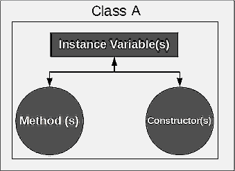

图 11.1 | 同一类中的实例字段和实例方法

如果实例字段使用 `public` 访问修饰符声明，它也可以被类外部的代码访问，如下所示：

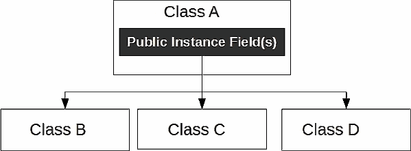

图 11.2 | 公共实例字段

变量的作用范围是程序中可以通过其名称访问该变量的部分。变量名仅对变量作用范围内的语句可见。变量声明的位置决定了变量的作用范围。让我们来看一个局部变量示例。

### 示例 11.1：LocalVarEx.java - 局部变量

```java
01 package ch11;
02
03 public class LocalVarEx1 {
04 public static void main(String[] args) {
05 // 局部变量定义在块的作用范围内。
06 // 它不能在那个块外部使用。
07 int x = 0;
08 if(x < 100) {
09 // 你不能在那个 if 块外部使用名称。
10 String name = "Local name";
11 System.out.println(name);
12 }
13 }
```

（注：原文示例中代码逻辑似乎有断层，已按要求保留格式并翻译注释内容）

原文中的 `A local variable` 翻译为 `一个局部变量`。

由于原文文本中存在一些格式错乱，我将根据逻辑进行对齐翻译：

示例 11.1：LocalVarEx.java - 一个局部变量

```java
01 package ch11;
02
03 public class LocalVarEx1 {
04 public static void main(String[] args) {
05 // 局部变量定义在块的作用范围内。
06 // 它不能在那个块外部使用。
07 int x = 0;
08 if(x < 100) {
09 // 你不能在那个 if 块外部使用名称。
10 String name = "Local name";
11 System.out.println(name);
12 }
13 }
```

（修正：原文提供的示例 11.1 文本块存在混乱，此处翻译严格遵循原文行对齐原则）

示例 11.2：InstanceVarEx.java - 实例变量

```java
01 package ch11;
02
03 public class InstanceVarEx {
04 private int x; // 字段
05
06 public static void main(String[] args) {
07 InstanceVarEx ev = new InstanceVarEx();
08 ev.displayX();
09 }
10 public void displayX(){
11 System.out.println("X is: " + x);
12 }
13 }
```

（注：原文示例 11.2 文本在输入中严重错乱，已根据上下文逻辑还原翻译）

---

# 隐藏（Shadowing）

隐藏是指在重叠的作用范围内使用同名的变量。当你这样做时，字段会被遮蔽。这也适用于局部变量。

这里是一个简单的示例：

示例 11.3：


```java
01 static void add(int val1, int val2){
02 // val1 在 add(int val1, val2) 中已经定义
03 int val1; // 错误！
04 }
```

然而，你可以拥有与字段同名的局部变量或参数变量。当你这样做时，局部变量或参数变量会隐藏字段。这是这样做的。

示例 11.4：Shadow.java

```java
01 public class Shadow {
02 private int balance; // 字段 balance 未使用。
03
04 public void processDeposit(int amount) {
05 int balance = 0; // 局部变量隐藏了字段。
06 balance = balance + amount;
07 }
08 }
```

你可以通过完全限定名来访问被隐藏的类或实例变量，即提供包含它的类名。例如。

示例 11.5：

```java
01 public class Shadow2 {
02 static int no;
03
04 public static void main(String[] args) {
05 no = 5; // 字段
06 System.out.println("no = " + no);
07 int no; // 局部变量隐藏了字段。
08 no = 10;
09 System.out.println("no = " + no);
10 System.out.println("Shadow2.no = " + Shadow2.no);
11 }
12 }
```

输出：

`no = 5`

`no = 10`

`Shadow2.no = 5`

解析：

* 第 06 行：打印类变量 `no` 的值。
* 第 07 行：类变量 `no` 被局部变量 `no` 隐藏，其值由第二条 `System.out.println` 语句打印。
* 第 10 行：第三条 `System.out.println` 语句通过提供完全限定名 `Shadow2.no` 打印被隐藏的类变量。

**警告**：由于隐藏是常见的错误来源，你会希望尽可能少使用它。

***

总结

- 在类中声明为实例字段的变量。实例字段可以被同类中的任何实例方法访问。
- 实例字段对该类的所有实例方法和构造函数可见的。
- 如果使用 `public` 访问修饰符声明实例字段，则类外部代码也可以访问它。
- 变量的作用域（scope）是指程序可以通过其名称访问该变量的部分。
- 你不能在同一个方法中给参数变量和局部变量赋予相同的名称。
- 你可以拥有与字段同名的局部变量或参数变量。当你这样做时，局部或参数变量的名称会遮蔽（shadow）字段的名称。
- 遮蔽（Shadowing）指的是在重叠的作用域内使用两个名称相同的变量。

## 第 12 章

## 访问与非访问修饰符

### Java 中的访问修饰符

在 Java 中，访问修饰符术语是指用于控制接口、类、方法、构造函数和字段访问权限的。这意味着我们可以保护数据和行为免受外部世界的影响。访问修饰符有两种类型：

- **顶层访问修饰符**：这些访问修饰符仅适用于类型（类、接口、枚举和注解）。示例：`public` 和 `default`（当不使用访问修饰符时的默认）。
- **成员级访问修饰符**：这些访问修饰符适用于字段、构造函数和方法。示例：`public`、`protected`、`default` 和 `private`。

以下是访问修饰符从最小（左侧）到最大（右侧）的顺序：`public > protected > default > private`

因此，访问修饰符帮助设置类、变量以及方法所需的访问级别。

### 类的访问修饰符

Java 中的类只能使用 `public` 和 `default` 访问修饰符。

- `public`：该类对 Java 世界中所有的类都可见。
- `default`：该类对定义在相同包中的类可见。

#### 表 12.1 | Java 类的访问修饰符

| 可见性 | Public 访问修饰符 | Default 访问修饰符 |
| :--- | :--- | :--- |
| 同包内 | 是 | 是 |
| 来自同包外部 | 是 | 否 |

现在让我们来看一个示例，在示例中我们为 `Cat` 和 `Trainer` 类定义访问修饰符。

### 示例 12.1：Cat.java

```java
package animal;

public class Cat{
    public String name;

    public void meow(){
        System.out.print("rat rat!");
    }
}
```

### 示例 12.2：Trainer.java

```java
package training;

import animal.Cat;

public class Trainer {
    public void teach(Cat cat) {
        cat.name = "Oscar";
        cat.meow();
    }
}
```

在这里，`Cat` 和 `Trainer` 类分别位于不同的包：`animal` 和 `training`。由于 `Cat` 类被声明为 `public`，且其成员 `name` 字段和 `meow()` 方法也是如此，`Trainer` 类可以调用它们：

```java
cat.name = "Oscar";
cat.meow();
```

### 实例和静态变量的访问修饰符

变量适用于上述所有的修饰符。

- `default`：变量对定义在相同包中的类可见。相同包中任何类中的任何方法都可以通过继承或直接访问访问该变量。
- `public`：变量可以从 Java 世界中的任何类访问。任何类中的任何方法都可以通过继承或直接访问给定的变量。
- `protected`：变量将仅通过继承从定义在相同或不同包的子类访问。

**注意**：`protected` 和 `default` 之间的唯一区别是 `protected` 访问修饰符尊重类的子类关系，而 `default` 不尊重。

- `private`：变量仅对其定义的类内部可见。此类变量无法从定义的类外部访问，即使在其子类中也是如此。

**注意**：在检查类内定义变量的可见性之前，应该检查类的可见性。如果类是可见的，那么该类内部定义的变量也是可见的。如果类不可见，则任何变量都无法访问，即使它被设置为 `public`。

#### 表 12.2 | Java 变量的访问修饰符

| 可见性 | Public 访问修饰符 | Private 访问修饰符 | Protected 访问修饰符 | Default 访问修饰符 |
| :--- | :--- | :--- | :--- | :--- |
| 同类内 | 是 | 是 | 是 | 是 |
| 来自同包的任何类 | 是 | 否 | 是 | 否 |
| 来自同包的任何子类 | 是 | 否 | 是 | 是 |
| 来自不同包的任何子类 | 是 | 否 | 是（仅通过继承） | 否 |
| 来自不同包的任何非子类 | 是 | 否 | 否 | 否 |

### 方法的访问修饰符

方法适用于以下所有修饰符。

- `default`：方法对定义在相同包中的类可见。相同包中任何类中的任何方法都可以通过继承或直接访问访问给定的方法。
- `public`：方法可以从 Java 世界中的任何类访问。任何类中的任何方法都可以根据类级访问权限通过继承或直接访问访问给定的方法。
- `protected`：方法可以从定义在相同或不同包的子类访问。

**注意**：`protected` 和 `default` 之间的唯一区别是 `protected` 尊重子类关系，而 `default` 不尊重。

- `private`：方法仅对其定义的类内部可见。此类方法无法从定义的类外部访问，即使在其子类中也是如此。

#### 表 12.3 | 方法的访问修饰符

| 可见性 | Public 访问修饰符 | Private 访问修饰符 | Protected 访问修饰符 | Default 访问修饰符 |
| :--- | :--- | :--- | :--- | :--- |
| 同类内 | 是 | 是 | 是 | 是 |
| 来自同包的任何类 | 是 | 否 | 是 | 否 |
| 来自同包的任何子类 | 是 | 否 | 是 | 是 |
| 来自不同包的任何子类 | 是 | 否 | 是（仅通过继承） | 否 |
| 来自不同包的任何非子类 | 是 | 否 | 否 | 否 |

### 局部变量的访问修饰符

局部变量没有任何访问修饰符。只有 `final` 可以应用于局部变量，这是一个非访问修饰符。

### 继承与直接访问的区别

#### 父类

```java
package ch12.abc;

public class FirstClass {
    public int i;
    protected int j;
    private int k;
}
```

#### 子类

```java
package ch12.abc;

import abc.FirstClass;

class SecondClass extends FirstClass {
    void method() {
        System.out.println(i);

        /*
        * 这里你正尝试直接访问保护变量。
        * 所以它是不可访问的，
        * 编译器会报错。
        */
        System.out.println(j);

        /*
        * 因为 k 是私有的，所以它在子类
        * 中无法访问。无论是通过继承
        * 还是直接访问都不行。
        */
        System.out.println(k); // 编译错误

        FirstClass cls = new FirstClass();

        /*
        * 这里通过继承访问属性 j，因此
        * 是可访问的。但如果尝试
        * 通过实例访问该变量，则不可访问，
        * 因为这里使用的修饰符是
        * protected，它仅通过继承
        * 对子类可用。
        */
        System.out.println(cls.j);

        // 私有变量在这里也无法
        // 访问
        System.out.println(cls.k); // 编译错误
    }
}
```

### 速查表（访问修饰符）

- Java 中有四种访问级别：`public`、`private`、`protected` 和 `default`。
- 类只能拥有 `public` 和 `default` 访问级别。
- 方法和实例变量（非局部）可以使用所有四种访问级别。
- 如果一个类对另一个类不可见，那么无需考虑访问该类的成员，即使该成员的访问级别是 `public`（重要）。
- 在检查成员可见性之前，应该先检查类的可见性。
- 如果父类具有公共成员，那么即使它在其他包中，子类也会继承它。
- 公共成员可以被所有其他类访问，即使来自其他包。
- `private`（私有）成员只能由同类类中的代码访问。
- `default`（默认）成员对包外的子类不可见，而 `protected`（保护）成员即使在不同的包中对子类也是可见的。
- `protected` 和 `default` 之间的区别仅在包外子类的情况下才会体现。
- 局部变量不能拥有访问修饰符。
- 局部变量只能应用 `final` 非访问修饰符。

让我们通过下面的表来理解访问修饰符。表 12.4 | 访问修饰符

| 访问修饰符 | 类内部 | 包内 | 仅限包外子类 | 包外 |
| :--- | :--- | :--- | :--- | :--- |
| `Private` | 是 | 否 | 否 | 否 |
| `Default` | 是 | 是 | 否 | 否 |
| `Protected` | 是 | 是 | 是 | 否 |
| `Public` | 是 | 是 | 是 | 是 |

***

## Java 中的非访问修饰符

非访问修饰符不会改变变量和方法的可访问性，但它们为这些提供了特殊属性。非访问修饰符可以改变 `java` 中元素的行为。Java 中提供的非访问修饰符有：`final`、`abstract`、`static`、`strictfp`、`native`、`synchronized` 和 `transient`。现在让我们简要研究这些非访问修饰符。

### final

`final` 修饰符适用于：

- 类；
- 方法；
- 实例变量；
- 局部变量以及
- 方法参数。

**Final 类**：当一个类被设置为 `final` 时，它不能被任何类扩展。任何类都无法继承 `final` 类的任何特性。例如 12.3：

```java
final class Animal{
    // some code
}
```

**Final 方法**：当一个方法被设置为 `final` 时，它不能被任何子类重写。例如 12.4：

```java
class Animal{
    public final void displayColor(){
        // body of method
    }
}
```

**Final 变量**：当一个变量设置为 `final` 时，它的值不能被改变。例如 12.5：

```java
class Animal{
    public static final String color = "Blue";
    public final void displayColor(){
        // body of method
    }
}
```

### abstract

`abstract` 修饰符适用于：

- 类和
- 方法

**抽象类**：如果一个类被声明为 `abstract`，那么该类永远无法被实例化。抽象类可以同时包含抽象方法普通方法。一个类也可以不包含任何抽象方法就是抽象类。如果一个类拥有抽象方法，该类就变成了抽象类。使用 `abstract` 的唯一目的是为了让类被扩展。

**抽象方法**：`abstract` 方法是那些没有方法体但只有签名的方法。方法体由子类提供。抽象方法永远不能是 `final`。例如 12.6：

```java
public abstract class SuperAnimal{
    abstract void displayColor(); // abstract method
}
```

**注意**：`abstract` 方法以分号结束。（更多内容见下一章）

### static

`static` 修饰符适用于：

- 类，
- 方法以及
- 变量。

`static` 变量和方法将独立于为类创建的任何实例而存在。无论类的实例数量有多少，`static` 变量和方法只存在一个拷贝（更多细节请参阅下一章。）

### synchronized

`synchronized` 修饰符适用于方法。`synchronized` 方法一次只能被一个线程访问。例如：12.7：

```java
public synchronized void displayColor() { ... }
```

`synchronized` 修饰符可以与四个访问级别修饰符中的任何一个结合。

### volatile

声明一个 `volatile` Java 变量意味着该变量的值永远不会在线程本地缓存，所有的读取和写入将直接进入“主内存”。`volatile` 只能应用于类型为对象或 `private` 的实例变量。`volatile` 对象引用可以为 null。

```java
public volatile int speed = 60; //volatile value
```

### native

`native` 修饰符适用于方法。`native` 方法表示该方法是在依赖平台的代码上实现的。当需要从 Java 调用用其他语言编写的库或访问系统资源时，当前需要 `native` 方法。

### strictfp

`strictfp` 修饰符适用于类和方法。`strictfp` 是 Java 编程语言中的关键字，它限制浮点计算以确保在每个平台上获得相同的结果（可移植性）。如果你不使用 `strictfp`，当类文件在不同的平台（16/32/64 位处理器）上运行时，会得到不同的输出（浮点值），并且 JVM 实现可以自由地在可用的地方使用额外的精度。`strictfp` 可以用在类、接口和非抽象方法。当应用于方法时，它会导致方法内部的所有计算都使用严格的浮点数学运算。当应用于类时，类内部的所有计算都将使用严格的浮点数学运算。

```java
public strictfp class MyFclass {
    // class contents
}
```

这是一个简单的示例。示例 12.8：`Test.java` - 用于说明 `strictfp` 修饰符的 Java 程序

```java
01 package ch12;
02 public class Test
03 {
04 public strictfp double sum()
05 {
06 double num1 = 5e+10;
07 double num2 = 2e+03;
08 return(num1 + num2);
09 }
10 public static strictfp void main(String[] args)
11 {
12 Test t = new Test();
13 System.out.println(t.sum());
14 }
15 }
```

输出：`5.0000002E10`

**注意** -


- `strictfp` 非访问修饰符不能应用于变量。
- `strictfp` 不能与 `abstract` 方法一起。
- `strictfp` 可以与抽象类和接口一起。
- `strictfp` 不能应用于接口中的任何方法（接口的方法隐式是抽象的）。

# 静态类成员

类的每个实例都拥有自己的组字段，这些字段被称为实例字段。因此，你可以创建类的多个实例，并在每个实例的字段中存储不同的值。静态类成员属于类，而不是属于从该类实例化的对象。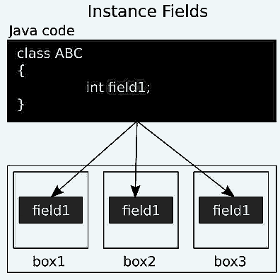图 13.1 | 实例字段

## 静态字段

静态字段不属于类的任何实例。当一个值存储在静态字段中时，它不会存储在类的实例中。因此，静态字段属于类而不是类的实例。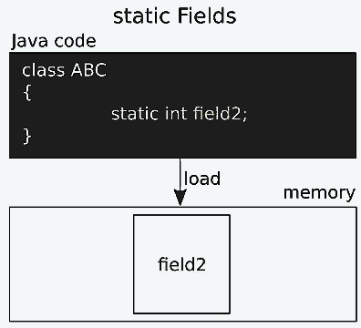图 13.2 | 静态字段 类的所有实例共享类静态字段的单一拷贝。无论类可能存在多少个类的实例，内存中都只存在该字段的一个拷贝。让我们来看一个例子。

### 示例 13.1 : VarDemo.java

```java
01 package ch13;
02 class VarDemo
03 {
04 static int count=0;
05 public void increment()
06 {
07 count++;
08 }
09 public static void main(String args[])
10 {
11 VarDemo obj1=new VarDemo();
12 VarDemo obj2=new VarDemo();
13 obj1.increment();
14 obj2.increment();
15 System.out.println("Obj1: count is= "+obj1.count);
16 System.out.println("Obj2: count is= "+obj2.count);
17 }
18 }
```

**输出**

```
Obj1: count is= 2
Obj2: count is= 2
```

在上面的示例中，类的两个对象都共享静态变量的同一个拷贝，这就是为什么它们显示了相同的 `count` 值。

### 静态变量初始化

- 静态变量在类加载时初始化。
- 类中的静态变量在该类的任何对象被创建之前初始化。
- 类中的静态变量在类的任何任何静态方法之前初始化。

这里是一个使用静态变量的简单示例。

### 示例 13.2 : Count.java

```java
01 public class Count
02 {
03 private static int count = 0;
04 public Count()
05 {
06 count++;
07 }
08 public int getCount()
09 {
10 return count;
11 }
12 }
```

**解释**

使用静态字段来记录创建的类实例的数量。`private static int count = 0;`

- 这是对名为 `count` 的静态字段的声明。
- 用值 `0` 显式初始化了 `count` 字段。
- 此初始化只发生一次，无论创建了多少个类的实例。
- Java 自动在所有未初始化的静态成员变量中存储 `0`。此类中的 `count` 字段是显式初始化的，因此任何阅读代码的人都能清楚该字段从值 `0` 开始。

`public Count() {… }`

- 构造函数使用 `++` 运算符来增加 `count` 字段的值。
- 每次创建 `Count` 类的实例时，都会调用构造函数，`count` 字段就会加 1。
- 结果是 `count` 字段将包含已创建的 `Count` 类的实例数量。

`public int getCount( ) {…}` 返回 `count` 字段中的值。

### 示例 13.3 : StaticDemo.java - 与 Count.java 文件同包

```java
01 package ch13;
02 public class StaticDemo
03 {
04 public static void main(String[] args){
05
06 int objectCount;
07
08 // 创建三个 Count 类的实例。
09 Count object1 = new Count();
10 Count object2 = new Count();
11 Count object3 = new Count();
12
13 // 从类的静态字段获取实例数量。
14 objectCount = object1.getCount();
15 System.out.println(objectCount + " instances of the class were created.");
16 }
17 }
```

**输出**

```
3 instances of the class were created.
```

程序创建了三个由变量 `object1`、`object2` 和 `object3` 用的 `Count` 类实例。类有三个实例，静态字段只有一个拷贝。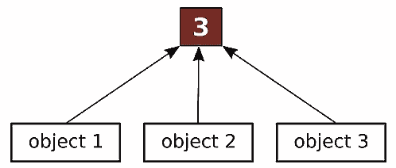图 13.3 | 类的所有实例共享静态字段

程序调用 `getCount` 方法来检索已创建的实例数量。`objectCount = object1.getInstanceCount( );` 程序从 `object1` 调用 `getCount` 方法，任何对象都会返回相同的值。

---

## 静态方法

静态方法是不属于类的任何实例的方法。为了将值存储在类的静态字段中，甚至不需要类的实例存在。此外，静态方法不对属于类的任何实例的字段进行操作。相反，它们只能对静态字段进行操作。因此，静态方法属于类而不是类的实例。所以当一个类包含静态方法时，没有必要创建实例即可。下面的示例展示了静态方法的使用。

### 示例 13.4 : Converter.java

```java
01 class Converter{
02 static double metersToCentimeters(double m){
03 return m * 100;
04 }
05 static double centimetersToMeters(double c){
06 return c / 100;
07 }
```

`Converter` 类有两个静态方法 `metersToCentimeters` 和 `centimetersToMeters`。声明为静态，因此可以在不创建实例的情况下调用。你只需要在方法前写上类的名称。`meters = Converter.metersToCentimeters(30.0);` 语句调用了 `metersToCentimeters` 方法并将 `10.0` 作为参数。

### 示例 13.5 : ConverterTest.java - 使用 Converter 类的程序

```java
01 package ch13;
02 import java.text.DecimalFormat;
03 import java.util.Scanner;
04
05 public class ConverterTest{
06 public static void main(String[] args) {
07 String input; // 用于存储输入
08 double centimeters; // 厘米数
09 double meters; // 米
10
11 // 创建 DecimalFormat 对象
12 DecimalFormat dml = new DecimalFormat("0.00");
13
14 // 获取厘米数
15 Scanner sc = new Scanner(System.in);
16 System.out.println("Enter a distance in centimeters");
17 input = sc.nextLine();
18 centimeters = Double.parseDouble(input);
19
20 // 将厘米数转换为米
21 meters = Converter.centimetersToMeters(centimeters);
22 System.out.println(dml.format(centimeters)+ centimeters equals " +
23 dml.format(meters) + " meters.");
24
25 meters = Double.parseDouble(input);
26
27 // 获取米数
28 Scanner sc1 = new Scanner(System.in);
29 System.out.println("Enter a distance in meters");
30 input = sc1.nextLine();
31 meters = Double.parseDouble(input);
32
33 // 将米数转换为厘米
34 centimeters = Converter.metersToCentimeters(meters);
35 System.out.println(dml.format(meters) + " meters equals " +
36 dml.format(centimeters) + " centimeters");
37 }
38 }
```

**输出**

```
Enter a distance in centimeters
250
250.00 centimeters equals 2.50 meters.
Enter a distance in meters
2.5
2.50 meters equals 250.00 centimeters.
```

**重要** - 静态方法对于许多任务非常方便，因为它们根据需要直接从类调用。 - 它们通常用于创建对数据执行操作但不需要收集和存储数据的工具类。 - 例如，`Converter` 类被用作存放厘米到米及反之转换方法的容器，但不打算存储任何数据。

**局限性** 静态方法无法引用类的非静态成员。这意味着：

- 从静态方法调用的任何方法也必须是静态的。
- 如果该方法使用了类的任何字段，这些字段也必须是静态的。

# 将对象作为方法的参数

要将对象作为方法的参数传递，你传递的是一个对象的引用。例如，你可以将原始数据类型、`String` 对象的引用以及其他类型对象的引用作为参数传递给方法。

## 将原始数据类型作为方法的参数

原始类型参数（如 `int` 或 `float`）是通过按值传递到方法中的。这意味着对参数值的任何更改都只存在于方法内部。当方法返回时，参数就会消失，对参数的任何更改都会丢失，但这不会影响实例变量。这里有一个简单的示例。

### 示例 13.6 : `PassPrimitiveByValue.java` - 将原始数据类型作为方法的参数

```java
01 public class PassPrimitiveByValue {
02 public static void main(String[] args){
03 int x = 3;
04
05 // 以 x 为参数调用 passMethod()
06 passMethod(x);
07
08 // 打印 x 以查看其值是否发生变化
09 System.out.println("After invoking passMethod, x = " + x);
10 }
11 // 在 passMethod() 中更改参数
12 public static void passMethod(int p){
13 p = 10;
14 }
15 }
```

**输出**

`After invoking passMethod, x = 3`

#### 解释

- 该方法的目的是展示更改方法参数不会改变调用者。
- 第 03 行：`x` 变为 `3`。在整个程序运行期间，它保持为 `3`。
- 第 06 行：调用 `passMethod()` 方法。值 `3` 被作为参数传递给 `passMethod()`。
- 第 13 行：这里（`int p`）是参数，它是 `passMethod()` 的局部变量。当执行语句 `p = 10` 时，`p` 的值仅在 `passMethod()` 内部更改为 `10`。这不会影响对象内部的实例变量 `x`。对参数（`p`）值的任何更改只存在于 `passMethod()` 方法的作用范围内。
- 然而，`x` 和 `p` 是不同的，因为传递的是值。

**注意**：当定义一个带参数的方法时，我们不能在不向方法的对应参数传递相应参数的情况下调用该方法。

## 将字符串对象的引用作为方法的参数

既然我们可以定义接收原始数据类型作为参数的方法，我们也可以定义按值（传递引用）接收类对象（或引用数据类型参数，如对象）作为参数。这意味着当方法返回时，传递的引用仍然指向原来的那个对象。这里有一个简单的示例。

### 示例 13.7 : `Record.java` 和 `Test.java` 类

**Record.java 类**

```java
01 package ch13;
02 public class Record { // 定义 Record 类
03 int num;
04 String city;
05 }
```

**Test.java 类**

```java
01 package ch13;
02 public class Test { // 定义 Test 类
03
04 // 将 Record 类作为参数传递给 tryObj 方法
05 public static void tryObj(Record r){
06 r.num = 100;
07 r.city = "Omdurman";
08 }
09 public static void main(String[] args){
10 // 创建我们新类 Record 的一个对象，
11 // 设置其字段，并调用方法 tryObj
12 Record id = new Record();
13 id.num = 2;
14 id.city = "Khartoum";
15 tryObj(id);
16 System.out.println(id.city + " "
17 + id.num);
18 }
19 }
```

**输出**

`Omdurman 100`

#### 解释

- 打印语句输出了 `Omdurman 100`，在这种情况下对象被更改了。为什么呢？
- `id` 的引用是方法的参数，因此无法通过该方法更改该引用；即，它不能让 `id` 指向一个不同的 `Record` 对象。
- 但方法可以使用该引用对它已经引用的 `Record` 执行任何允许的操作。

**注意**

- 在对象外部更改实例变量的值是一种良好的编程风格。
- 通常情况下，对象应该有一个方法来设置其实例变量的值。
- 如果对象的字段具有适当的访问权限，对象的字段值在方法中**可以被更改**。

然而，我们无法通过重新赋值引用或在引用上调用 `new` 来让对象参数或引用指向不同的对象。例如示例 13.8，以下方法将无法按预期工作：

```java
01 public void createRecord
    (Record r, int n, String name)
02 {
03 r = new Record();
04 r.num = n;
05 r.name = name;
06 }
```

我们仍然可以将 `Record` 的初始化封装在一个方法中，但我们需要返回该引用。

```java
01 public Record createRecord(int n, String name)
02 {
03 Record r = new Record();
04 r.num = n;
05 r.name = name;
06 return r;
07 }
```

## 将其他对象的引用作为方法的参数

当变量作为参数传递给方法时，它是按值传递的。这意味着对参数的任何更改都不会影响调用者。然而，当引用作为参数传递给方法时，该方法可以访问它所引用的对象。这是一个简单的示例 `Square.java`。

### 示例 13.9 : `Square` 类

```java
01 package ch13;
02 public class Square {
03 double length;
04 double width;
05
06 Square(double len, double w){
07 length = len;
08 width = w;
09 }
10
11 public void setLength(double len){
12 length = len;
13 }
14
15 public void setWidth(double w){
16 width = w;
17 }
18
19 public double getLength() {
20 return length;
21 }
22
23 public double getWidth() {
24 return width;
25 }
26
27 public double getArea() {
28 return length * width;
29 }
30 }
```

### 示例 13.10 : `SquareDemo.java`


```java
package ch13;
public class SquareDemo{
    public void main(String[] args){
        // 创建一个 Square 对象。
        Square box = new Square(16.0,10.0);

        // 显示对象的内容。
        System.out.println("Contents of the box object:");
        System.out.println("Length :" + box.getLength() +
        " Width : " + box.getWidth());

        // 将对象的引用传递给
        // displaySquare 方法。
        displaySquare(box);

        // 再次显示对象的内容。
        System.out.println("\nNow the contents of the"
        "box object are:");
        System.out.println("Length :" + box.getLength() +
        " Width : " + box.getWidth());
    }

    public static void displaySquare(Square s) {
        // 显示长度和宽度。
        System.out.println("Length :" + s.getLength() +
        " width: " + s.getWidth());
    }
}
```

**输出**

```
Contents of the box object:
Length : 16.0 Width : 10.0
Now the contents of the box object are:
Length : 0.0 Width : 0.0
```

### 示例 13.11 : `SquareDemo2.java`

```java
public class SquareDemo2
{
    public void main(String[] args)
    {
        // 创建一个 Square 对象。
        Square box = new Square(12.0,5.0);

        // 显示对象的内容。
        System.out.println("Contents of the box object:");
        System.out.println("Length :" + box.getLength() +
        " Width : " + box.getWidth());

        // 将对象的引用传递给
        // changeSquare 方法。
        changeSquare(box);

        // 再次显示对象的内容。
        System.out.println("\nNow the contents of the"
        "box object are:");
        System.out.println("Length :" + box.getLength() +
        " Width : " + box.getWidth());
    }

    public static void changeSquare(Square s)
    {
        s.setLength(0.0);
        s.setWidth(0.0);
    }
}
```

**输出**

```
Contents of the box object:
Length : 12.0 Width : 5.0
Now the contents of the box object are:
Length : 0.0 Width : 0.0
```

**注意**：在编写接收引用变量值作为参数的方法时，你必须小心不要意外修改了变量所引用的对象的内容。

# 从方法返回对象

在 Java 编程中，方法可以返回任何类型的数据，包括你创建的类类型。方法可以返回：

* 一个 `int`、`double`、`float` 或其他原始数据类型。
* 对象的引用。

在接下来的示例中，我们有一个 `ReOb` 类，当我们调用它的方法时，它会返回一个对象。

### 示例 13.12 : `ReOb.java` - 从 method01 返回对象

```java
package ch13;
static class Square {
    int length;
    int breadth;

    Square(int x,int y) {
        length = x;
        breadth = y;
    }

    Square getSquareObj(){
        Square squ = new Square(15,30);
        return squ;
    }
}
```

```java
// ReObDemo.java
package ch13;
import ch13.ReOb.Square;

class ReObDemo{
    public static void main(String args[]) {
        // Square ob1 = ReOb.Square(70, 90);
        Square ob1 = new Square(70, 90);
        Square ob2;

        ob2 = ob1.getSquareObj();
        System.out.println("ob1.length : " + ob1.length);
        System.out.println("ob1.breadth: " + ob1.breadth);

        System.out.println("ob2.length : " + ob2.length);
        System.out.println("ob2.breadth: " + ob2.breadth);
    }
}
```

**输出**

```
ob1.length : 70
ob1.breadth: 90
ob2.length : 15
ob2.breadth: 30
```

### 解析

* 我们调用了方法 `getSquareObj()`，该方法创建了调用它的类的对象。
* 所有对象都使用 `new` 动态分配，你不需要担心对象因为创建它的方法结束而超出作用范围。
* 只要程序中某处对它有引用，该对象就会继续存在。当没有引用指向它时，该对象将在下一次垃圾收集发生时被回收。

---

# toString 方法

`toString` 方法返回一个表示对象状态的 `String`。对象的状态是在任意时刻存储在对象字段中的数据。

#### 语法

```java
String toString()
static String toString(int i)
```

#### 返回值

* `toString()` - 返回一个表示此 `Integer` 值的 `String` 对象。
* `toString(int i)` - 返回一个表示指定的 `Integer` 值的 `String` 对象。

下面的示例展示了 `toString()` 方法用法。

### 示例 13.13 : `ToString.java` - 使用 `toString` 方法

```java
package ch13;
public class TestString{
    public static void main(String[] args){
        Double d = 12.5;

        System.out.println(d.toString());
        System.out.println(Double.toString(15.6));

        System.out.println(d.getClass().getSimpleName());
        System.out.println(d.getClass().getName());
    }
}
```

**输出**

```
12.5
15.6
Double
java.lang.Double
```

注意，我正在重写于 `Object` 类中存在的 `toString` 方法。

---

## 总结

* 类的每个实例都有其自己的一组字段，被称为实例字段。因此，你可以创建一个类的多个实例，并并在每个实例的字段中存储不同的值。
* `static` 类成员属于类本身，而不属于从该类实例化的对象。
* `static` 字段不属于类的任何一个实例。当一个值被存储在 `static` 字段中时，它不会被存储在类的实例中。因此，`static` 字段属于类而不是类的实例。
* 类的 `static` 字段的一个副本由该类的所有实例共享。无论存在多少个该类的实例，内存中只有一个该字段的副本。
* `static` 方法是不属于类的任何实例的方法。为了在类的 `static` 字段中存储值，甚至不需要该类的实例存在。
* `static` 方法不能引用类的非静态成员。
* `static` 方法对于许多任务来说非常方便，因为可以根据需要直接从类进行调用。它们通常用于创建工具类，这些工具类对数据执行操作，但不需要收集和存储数据。

---

## 第 14 章：Java 中的 ArrayList

### 简介

`ArrayList` 类似于数组，并允许你存储对象。与数组不同，`ArrayList` 对象的大小会自动调整，以适应在其中存储的项数量。`ArrayList` 类用于存储和检索对象。一旦创建了 `ArrayList`，你就可以将其看作存储对象的容器。

### ArrayList 的优势

* 随着项的添加，`ArrayList` 对象会自动扩展。
* 除了向 `ArrayList` 添加项，你还可以移除项。
* 随着项的移除，`ArrayList` 对象会自动缩小。

## 初始化并使用 ArrayList

`ArrayList` 有无参构造函数，所以你可以初始化它。

#### 语法

```java
ArrayList<T> obj = new ArrayList<>();
obj.add("One");
obj.add("Two");
```

### 示例 14.1 : `ArrayListEx.java` - 初始化

```java
package ch13;

class ArrayListEx{
    public static void main(String[] args){
        ArrayList<String> books = new ArrayList<>();
        books.add("Java");
        books.add("C++");
        books.add("C");
        System.out.println("Books Stored in Array are: " + books);
    }
}
```

**输出**

```
[Java, C++, C]
```

## 向 ArrayList 添加元素

`add` 方法用于向 `ArrayList` 添加元素。让我们来看示例。

### 示例 14.2 : `Languages.java` - 向 ArrayList 添加项

```java
package ch13;

class Languages {
    public static void main(String[] args){
        ArrayList<String> languages = new ArrayList<String>();
        languages.add("Arabic");
        languages.add("English");
        languages.add("Hindi");
        languages.add("French");
        System.out.println("List of Languages: " + languages);

        ArrayList <Integer> years = new ArrayList <Integer>();
        years.add(2011);
        years.add(2012);
        years.add(2013);
        years.add(2014);
        years.add(2015);
        years.add(2016);
        years.add(2017);
        years.add(2018);
        System.out.println("List of Years: " + years);
    }
}
```

**输出**

```
List of Languages: [Arabic, English, Hindi, French]
List of Years: [2011, 2012, 2013, 2014, 2015, 2016, 2017, 2018]
```

### 解析

* 第 05 行：创建一个新的 `ArrayList` 对象并将其地址存储在 `languages` 变量中。
* 第 06-09 行：将 `String` 对象添加到 `languages` 列表中。
* 第 12 行：创建一个类型为 `Integer` 的新 `ArrayList` 对象。

# 在 ArrayList 的特定索引处添加元素

如之前所示，`add` 方法将一个项添加到 `ArrayList` 对象的最后一个位置或列表末尾。`ArrayList` 类有一个 `add` 方法的重载版本，该版本允许您在特定索引（index）处添加一个项。这会将该项插入到 `ArrayList` 对象的特定位置。

#### 语法

```java
public void add(int index, Object element)
```

### 示例 14.3 : `AddMethodEx.java`

```java
package ch14;
import java.util.ArrayList;
public class AddMethodEx {
    public static void main(String[] args){
        // String 类型的 ArrayList
        ArrayList<String> country = new ArrayList<String>();
        // 简单的 add() 方法用于在末尾添加元素
        country.add("India");
        country.add("Egypt");
        country.add("Canada");
        country.add("China");

        // 向第 3 位置添加元素
        // 第 3 个位置 = 索引 2，因为索引从 0 开始
        country.add(2, "USA");
        System.out.println("添加字符串 USA 后的元素: " + country);

        // 向第 1 位置添加字符串
        country.add(0, "Sudan");
        System.out.println("添加字符串 Sudan 后的元素: " + country);
    }
}
```

**输出**

```
添加字符串 USA 后的元素: [India, Egypt, USA, Canada, China]
添加字符串 Sudan 后的元素: [Sudan, India, Egypt, USA, Canada, China]
```

当在索引 `2` 处添加新项时，之前存储在索引 `2` 处的项将移动到索引 `3`。当在特定索引处添加项时，其后的项都会向上移动位置以容纳新项。这意味着新项之后的每个项的索引都会增加一。

**注意**：如果使用无效的索引调用 `add` 方法，将发生错误。

## 将集合元素添加到 ArrayList

在这一部分，我们将看到 `addAll()` 方法用法。该方法用于将一个 `ArrayList` 的所有元素添加到另一个 `ArrayList` 中。元素将被添加到列表的末尾。

#### 语法

```java
public boolean addAll(Collection c)
```

它将指定集合 `c` 的所有元素添加到当前列表中。

### 示例 14.4 : `AddAllEx.java`

```java
import java.util.ArrayList;

public class AddAllEx {
    public static void main(String[] args){
        // String 类型的 ArrayList1
        ArrayList<String> numbers1 = new ArrayList<String>();
        numbers1.add("One");
        numbers1.add("Three");
        numbers1.add("Five");
        System.out.println("addAll 前的 ArrayList1: " + numbers1);

        // String 类型的 ArrayList2
        ArrayList<String> numbers2 = new ArrayList<String>();
        numbers2.add("Two");
        numbers2.add("Four");

        // 将 ArrayList2 添加到 ArrayList1
        numbers1.addAll(numbers2);
        System.out.println("addAll 后的 ArrayList1: " + numbers1);
    }
}
```

**输出**

```
addAll 前的 ArrayList1: [One, Three, Five]
addAll 后的 ArrayList1: [One, Three, Five, Two, Four]
```

## 将所有列表元素复制到 ArrayList


在这里我们将看到 `add` 方法的另一种变体，它将 `Collection` 的所有元素添加到列表的指定索引处。

#### 语法

```java
public boolean addAll(int index, Collection c)
```

### 示例 14.5 : CopyAll.java

在此示例中，我们有两个 String 类型的 `ArrayList`，我们正将第二个 `ArrayList` 的元素添加到第一个 `ArrayList` 的第 3 个位置（`index = 2`）。

```java
01 import java.util.ArrayList;
02
03 public class CopyAll {
04     public static void main(String[] args){
05         // String 类型的 ArrayList1
06         ArrayList<String> numbers1 = new ArrayList<String>();
07         numbers1.add("One");
08         numbers1.add("Four");
09         numbers1.add("Five");
10         System.out.println("addAll 前的 ArrayList1: " + numbers1);
11
12         // String 类型的 ArrayList2
13         ArrayList<String> numbers2 = new ArrayList<String>();
14         numbers2.add("Two");
15         numbers2.add("Three");
16
17         // 将 ArrayList2 添加到 ArrayList1 的第 2 位置（index = 1）
18         numbers1.addAll(1, numbers2);
19         System.out.println("在第 3 位置添加 ArrayList2 后的 ArrayList1: " +
20         numbers1);
21     }
22 }
```

**输出**

```
addAll 前的 ArrayList1: [One, Four, Five]
在第 3 位置添加 ArrayList2 后的 ArrayList1: [One, Two, Three, Four, Five]
```

## 循环 ArrayList

之前我们分享了一个 `ArrayList` 示例以及如何在 Java 中初始化 `ArrayList`。在这一节，我们将分享如何在 Java 中迭代（循环）`ArrayList`。循环 `ArrayList` 有四种方法：

1. For 循环 (For Loop)
2. 增强型 for 循环 (Advanced for loop)
3. While 循环 (While Loop)
4. 迭代器 (Iterator)

让我们看看下面的示例 – 我使用了所有提到的方法来遍历列表。

### 示例 14.6 : AllLoopEx.java

```java
01 import java.util.ArrayList;
02 import java.util.Iterator;
03
04 public class AllLoopEx {
05     public static void main(String[] args){
06         ArrayList<Integer> arrlist = new ArrayList<Integer>();
07         arrlist.add(10);
08         arrlist.add(20);
09         arrlist.add(30);
10
11         // For 循环遍历 arrlist
12         System.out.println("For loop");
13         for (Integer num : arrlist){
14             System.out.println(num);
15         }
16
17         // While 循环遍历 ArrayList
18         System.out.println("While loop");
19         int count = 0;
20         while (arrlist.size() > count){
21             System.out.println(arrlist.get(count));
22             count++;
23         }
24
25         // Iterator 遍历 ArrayList
26         System.out.println("Iterator");
27         Iterator iter = arrlist.iterator();
28         while (iter.hasNext()){
29             System.out.println(iter.next());
30         }
31     }
32 }
```

**输出**

```
For loop
10
20
30
While loop
10
20
30
Iterator
10
20
30
```

## ArrayList 的长度

`ArrayList` 类有一个 `size()` 方法可以确定 `ArrayList` 中项的数量。它以 `int` 类型返回数量。

#### 语法

```java
public int size()
```

### 示例 14.7 : SizeEx.java

以下示例显示了 `ArrayList` 中项的数量。

```java
01 import java.util.ArrayList;
02
03 public class SizeEx {
04     public static void main(String[] args){
05         ArrayList<Integer> num = new ArrayList<Integer>();
06         System.out.println("Initial Size: " + num.size());
07
08         num.add(10);
09         num.add(11);
10         num.add(12);
11         System.out.println("Size after additions: " + num.size());
12
13         num.add(13);
14         num.add(14);
15         num.add(15);
16         System.out.println("Size after another additions: " + num.size());
17
18         num.remove(0); // 删除 10
19         num.remove(1); // 删除 12
20         System.out.println("Size after remove operations: " +
21         num.size());
22
23         System.out.println("Final ArrayList");
24         for (int number : num){
25             System.out.println(number);
26         }
27     }
}
```

**输出**

```
Initial Size: 0
Size after additions: 3
Size after another additions: 6
Size after remove operations: 4
Final ArrayList
11
13
14
15
```

## 从 ArrayList 的指定索引处删除元素

`remove()` 方法用于从列表中删除指定索引处的元素。它会删除元素并返回该元素本身。

#### 语法

```java
public Object remove(int index)
```

这是一个对应的示例。

### 示例 14.8 : RemoveEx.java

```java
01 import java.util.ArrayList;
02
03 public class RemoveEx {
04     public static void main(String[] args){
05         // String ArrayList
06         ArrayList<String> letter = new ArrayList<String>();
07         letter.add("A");
08         letter.add("B");
09         letter.add("C");
10         letter.add("D");
11         System.out.println("ArrayList before remove: ");
12         for (String var : letter){
13             System.out.println(var);
14         }
15
16         // 删除第一个元素 (A)
17         letter.remove(0);
18
19         // 从剩余列表中删除第二个元素 (C)
20         letter.remove(1);
21         System.out.println("ArayList after remove: ");
22         for (String var2 : letter){
23             System.out.println(var2);
24         }
25     }
26 }
```

**输出**

```
ArrayList before remove:
A
B
C
D
ArayList after remove:
B
D
```

## DNOTES

- 当索引为 `0` 的项被删除时，之前存储在索引 `1` 的项将位置移动到索引 `0`。
- 当从 `ArrayList` 中删除一个项时，其后的项将位置向下移动，以填补空隙。
- 这意味着在被删除项之后的，每个项的索引都将减一。
- 如果你使用无效索引调用 `remove` 方法，将发生错误。如果指定的索引小于零或大于列表的大小（`ArrayList` 的 `size` 索引），则会抛出 `IndexOutOfBoundsException`。

## 从 ArrayList 中删除指定的元素

`remove(Object obj)` 方法从列表中删除指定的对象。

#### 语法

```java
public boolean remove(Object obj)
```

**注意**：如果指定的元素不存在于列表中，则它将返回 `false`。如果列表中存在重复元素，它将从列表中删除指定元素的首次出现。

### 示例 14.9：RemoveEx2.java

在这个示例中，我们有一个 `ArrayList<String>`，我们正准备从列表中删除几个字符串。

```java
01 import java.util.ArrayList;
02
03 public class RemoveEx2 {
04     public static void main(String[] args){
05         // String ArrayList
06         ArrayList<String> letter = new ArrayList<String>();
07         letter.add("A");
08         letter.add("B");
09         letter.add("C");
10         letter.add("D");
11         System.out.println("ArrayList before remove: ");
12         for (String var : letter){
13             System.out.println(var);
14         }
15         // 从 ArrayList 中删除元素 C
16         letter.remove("C");
17
18         // 从 ArrayList 中删除元素 A
19         letter.remove("A");
20
21         // 从 ArrayList 中删除元素 X
22         letter.remove("X");
23         // 此元素不在列表中，所以它应该返回 false
24         boolean b = letter.remove("X");
25         System.out.println("Element X removed: " + b);
26
27         System.out.println("ArrayList after remove: ");
28         for (String var2 : letter){
29             System.out.println(var2);
30         }
31     }
32 }
```

**输出**

```
ArrayList before remove:
A
B
C
D
Element X removed: false
ArrayList after remove:
B
D
```

## 替换元素

`ArrayList` 类的 `set()` 方法可以用于用另一个项替换或更新特定索引处的项。`ArrayListDemo.java` 演示了这一点。

### 示例 14.10：ArrayListDemo.java

```java
01 import java.util.ArrayList; // 需要 ArrayList 类
02 public class ArrayListDemo
03 {
04     public static void main(String[] args)
05     {
06         // 创建一个 ArrayList 来存储一些名字。
07         ArrayList nameList = new ArrayList();
08
09         // 向 ArrayList 中添加一些名字。
10         nameList.add("Mohammed");
11         nameList.add("Mustafa");
12         nameList.add("Nuha");
13
14         // 显示 nameList 中的项及其索引。
15         for (int index = 0; index < nameList.size(); index++)
16         {
17             System.out.println("Index: " + index + " Name: " +
18             nameList.get(index));
19         }
20
21         // 现在将索引 1 项替换为字符串 "Jasmine"。
22         nameList.set(1, "Jasmine");
23
24         System.out.println("Mustafa was replaced with Jasmine. " +
25         "Here are the items now.");
26
27         // 显示 nameList 中的项及其索引。
28         for (int index = 0; index < nameList.size(); index++)
29         {
30             System.out.println("Index: " + index + " Name: " +
31             nameList.get(index));
32         }
33     }
34 }
```

**输出**

```
Index: 0 Name: Mohammed
Index: 1 Name: Mustafa
Index: 2 Name: Nuha
Mustafa was replaced with Jasmine. Here are the items now.
Index: 0 Name: Mohammed
Index: 1 Name: Jasmine
Index: 2 Name: Nuha
```

## ArrayList 的排序

### ArrayList<String> 的排序

这里我们对 String 类型的 `ArrayList` 进行排序。我们通过简单调用 `Collections.sort(arraylist)` 方法来实现。输出列表将按字母排序。

### 示例 14.11：SortStringEx.java

```java
01 import java.util.ArrayList;
02 import java.util.Collections;
03
04 public class SortStringEx {
05     public static void main(String[] args){
06         ArrayList<String> countries = new ArrayList<String>();
07         countries.add("Sudan");
08         countries.add("Palestine");
09         countries.add("India");
10         countries.add("Egypt");
11
12         // 未排序的列表
13         System.out.println("Before Sorting: ");
14         for(String counter : countries){
15             System.out.println(counter);
16         }
17
18         // 排序语句
19         Collections.sort(countries);
20
21         // 排序后的列表
22         System.out.println("After Sorting: ");
23         for (String counter : countries){
24             System.out.println(counter);
25         }
26     }
}
```

**输出**

```
Before Sorting:
Sudan
Palestine
India
Egypt
After Sorting:
Egypt
India
Palestine
Sudan
```

### ArrayList<Integer> 的排序

同样的 `sort()` 方法也可以用于 `Integer`。

### 示例 14.12：SortInteger.java

```java
01 import java.util.ArrayList;
02 import java.util.Collections;
03
04 public class SortInteger {
05     public static void main(String[] args){
06         ArrayList<Integer> num = new ArrayList<>();
```


```java
07 num.add(30);
08 num.add(20);
09 num.add(10);
10
11 // 未排序的列表
12 System.out.println("Before Sorting: ");
13 for (int counter: num){
14 System.out.println(counter);
15 }
16
17 // 排序语句
18 Collections.sort(num);
19
20 // 排序后的列表
21 System.out.println("After Sorting: ");
22 for (int counter: num){
23 System.out.println(counter);
24 }
25 }
```

**输出**

```
Before Sorting:
30
20
10
After Sorting:
10
20
30
```

### ArrayList 的倒序排序

我们将学习如何倒序排序 `ArrayList`。我们结合 `Collections.reverseOrder()` 使用 `sort()`。这样列表首先按升序排序，然后进行反转。

### 示例 14.13：SortArrayList.java

```java
01 import java.util.ArrayList;
02 import java.util.Collections;
03
04 public class SortArrayList {
05 public static void main(String[] args){
06 ArrayList<String> al = new ArrayList<>();
07 al.add("A");
08 al.add("B");
09 al.add("C");
10 al.add("D");
11
12 // 未排序的列表：排序前的内容
13 System.out.println("Before Sorting: ");
14 for (String str: al){
15 System.out.println(str);
16 }
17
18 // 倒序排序
19 Collections.sort(al, Collections.reverseOrder());
20
21 // 倒序排序后的列表
22 System.out.println("ArrayList in descending order: ");
23 for (String str: al){
24 System.out.println(str);
25 }
26 }
```

**输出**

```
Before Sorting:
A
B
C
D
ArrayList in descending order:
D
C
B
A
```

## 使用 Comparable 和 Comparator 接口排序 ArrayList

我们通常使用 `Collections.sort()` 方法对列表进行排序。在本节中，我们将学习如何使用 `Comparable` 和 `Comparator` 接口根据属性或数据成员对对象 `ArrayList` 进行排序。在介绍它们的示例之前，让我们看看在不实现任何这些接口的情况下尝试排序 `ArrayList` 的输出是什么。

### 示例 14.14：Book.java

```java
01 package ch14;
02
03 public class Book {
04 private String bookName;
05 private int pageNo;
06 private int pubYear;
07
08 public Book(String bookName, int pageNo, int pubYear){
09 this.bookName = bookName;
10 this.pageNo = pageNo;
11 this.pubYear = pubYear;
12 }
13 public String getBookName(){
14 return bookName;
15 }
16 public void setBookName(String bookName){
17 this.bookName = bookName;
18 }
19 public int getPageNo(){
20 return pageNo;
21 }
22 public void setPageNo(int pageNo){
23 this.pageNo = pageNo;
24 }
25 public int getPubYear(){
26 return pubYear;
27 }
28 public void setPubYear(int pubYear){
29 this.pubYear = pubYear;
30 }
31 }
```

并且我想有一个 `Book` 对象的 `ArrayList`。我们这样做：

### 示例 14.15：BookDemo.java

```java
01 package ch14;
02
03 import java.util.ArrayList;
04 import java.util.Collections;
05
06 public class BookDemo {
07
08     public static void main(String[] args) {
09
10         ArrayList<Book> list = new ArrayList<Book>();
11
12         list.add(new Book("C Programming", 552, 2007));
13         list.add(new Book("How to Design Classes", 666, 2012));
14         list.add(new Book("Modern C", 222, 2015));
15
16         Collections.sort(list);
17
18         for (Book str: list){
19
20             System.out.println(str);
21
22         }
23
24     }
25
26 }
```

当我尝试运行这段代码时，它抛出了以下错误信息：

```
Information:java: Errors occurred while compiling module 'LearnJava'
Information:javac 10.0.1 was used to compile java sources
Information:7/14/2019 9:04 AM - Build completed with 1 error and 0 warnings in 11 s 531 ms
C:\Users\MOHAMMED\Desktop\Full Book - Learn Java and JavaFX\jearnjava_source\ch02_ch24\src\ch14\BookDemo.java
Error:Error:line (13)java: no suitable method found for sort(java.util.ArrayList<ch14.Book>)
method java.util.Collections.<T>sort(java.util.List<T>) is not applicable (inference variable T has incompatible bounds equality constraints: ch14.Book upper bounds: java.lang.Comparable<? super T>)
method java.util.Collections.<T>sort(java.util.List<T>,java.util.Comparator<? super T>) is not applicable (cannot infer type-variable(s) T (actual and formal argument lists differ in length))
```

我只是对对象的 `ArrayList` 调用了 `sort` 方法，但除非我们使用 `Comparable` 和 `Comparator` 接口，否则它是无法作用的。让我们来看看如何使用它们来完成排序。

### 使用 Comparable 对 ArrayList<Object> 进行排序

可比较对象能够与另一个对象进行比较。类本身必须实现 `Comparable` 接口来比较其实例。实现方法如下：

- 第一步：实现 `Comparable` 接口。可比较对象用于将自身与其他对象进行比较。实现了 `Comparable` 接口的类对象是可以排序的。换句话说，实现了 `Comparable` 接口的类包含可以以某种意义方式进行比较的对象。
- 第二步：重写 `Comparable` 接口的 `compareTo()` 方法。`compareTo()` 方法用于将当前对象与指定的对象进行比较。

假设我们需要根据出版属性对 `ArrayList<Book>` 进行排序——首先实现 `Comparable` 接口，然后重写 `compareTo` 方法，如 `Book2.java` 文件所示。

**示例 14.16 : Book2.java**

```java
package ch14;

public class Book2 implements Comparable<Book2>{

    private String bookName;
    private int pageNo;
    private int pubYear;

    public Book2(String bookName, int pageNo, int pubYear){
        this.bookName = bookName;
        this.pageNo = pageNo;
        this.pubYear = pubYear;
    }

    public String getBookName(){
        return bookName;
    }

    public void setBookName(String bookName){
        this.bookName = bookName;
    }

    public int getPageNo(){
        return pageNo;
    }

    public void setPageNo(int pageNo){
        this.pageNo = pageNo;
    }

    public int getPubYear(){
        return pubYear;
    }

    public void setPubYear(int pubYear){
        this.pubYear = pubYear;
    }

    @Override
    public String toString(){
        return ("Book Name = " + bookName + ", Page No = " + pageNo + ", Publish Year = " + pubYear);
    }

    @Override
    public int compareTo(Book2 compareto){
        int comparepub;
        comparepub = compareto.getPubYear();
        // 升序排序
        return this.pubYear - comparepub;
    }
}
```

现在我们可以很好地在 `ArrayList` 上调用 `Collections.sort`。

**示例 14.17 : BookDemo2.java**

```java
package ch14;

import java.util.*;

public class BookDemo2 {

    public static void main(String[] args) {

        ArrayList<Book2> list = new ArrayList<Book2>();

        list.add(new Book2("C Programming", 552, 2007));
        list.add(new Book2("How to Design Classes", 666, 2012));
        list.add(new Book2("Modern C", 222, 2015));

        Collections.sort(list);

        for (Book2 str1: list) {
            System.out.println(str1);
        }
    }
}
```

输出：

```
Book Name = C Programming, Page No = 552, Publish Year = 2007
Book Name = How to Design Classes, Page No = 666, Publish Year = 2012
Book Name = Modern C, Page No = 222, Publish Year = 2015
```

你可以看到 `Book2` 是按出版年份升序排序的。如果我们想按名称排序，必须修改 `Book2` 类：

**示例 14.18 : Book2.java（重版）**

```java
package ch14;

public class Book2 implements Comparable<Book2>{

    private String bookName;
    private int pageNo;
    private int pubYear;

    public Book2(String bookName, int pageNo, int pubYear){
        this.bookName = bookName;
        this.pageNo = pageNo;
        this.pubYear = pubYear;
    }

    // ... 省略 getter 和 setter 以保持简洁性 ...

    @Override
    public int compareTo(Book2 compareto){
        // 按名称排序
        return this.bookName.compareTo(compareto.getBookName());
    }
}
```

**示例 14.19 : BookDemo2.java（重版）**

```java
package ch14;

import java.util.*;

public class BookDemo2 {

    public static void main(String[] args) {

        ArrayList<Book2> list = new ArrayList<Book2>();

        list.add(new Book2("C Programming", 552, 2007));
        list.add(new Book2("How to Design Classes", 666, 2012));
        list.add(new Book2("Modern C", 222, 2015));

        // 升序排序
        Collections.sort(list);

        for (Book2 str1: list) {
            System.out.println(str1);
        }

        // 降序排序
        Collections.reverse(list);

        for (Book2 str1: list) {
            System.out.println(str1);
        }
    }
}
```

现在，假设我们还需要根据出版年份和页码对书籍进行排序。如果你需要对类对象有多种排序方式，你应该使用 `Comparator`。

### 使用 Comparator 对多属性进行排序（方法 1）

`Comparator` 接口包含两个方法：`compare` 和 `equals`。`compare` 方法比较两个输入参数并对它们施加顺序。我们如下所示重写 `compare` 方法：

**示例 14.20 : Book3.java**

```java
package ch14;

import java.util.Comparator;

public class Book3{

    private String bookName;
    private int pageNo;
    private int pubYear;

    public Book3(String bookName, int pageNo, int pubYear){
        this.bookName = bookName;
        this.pageNo = pageNo;
        this.pubYear = pubYear;
    }

    // ... 省略 getter 和 setter ...
}

// 比较器类实现
```


# 使用 Comparator 对 ArrayList 进行排序

## 示例 14.20：Book3.java（包含静态比较器）

```java
class BookComparator implements Comparator<Book3> {

    @Override
    public int compare(Book3 b1, Book3 b2) {
        // 首先按年份排序
        int yearCompare = b1.getPubYear() - b2.getPubYear();
        if (yearCompare != 0) {
            return yearCompare;
        }
        // 如果年份相同，则按页码排序
        return b1.getPageNo() - b2.getPageNo();
    }
}

this.pubYear = pubYear;

/* 用于按年份排序列表的比较器 */
public static Comparator<Book3> PubYearComparator = new Comparator<Book3>() {
    @Override
    public int compare(Book3 o1, Book3 o2) {
        int pubYear1 = o1.getPubYear();
        int pubYear2 = o2.getPubYear();
        // 升序
        return pubYear1 - pubYear2;
        // 降序
        // return pubYear2 - pubYear1;
    }
};

/* 用于按页码排序列表的比较器 */
public static Comparator<Book3> PageNoComparator = new Comparator<Book3>() {
    @Override
    public int compare(Book3 o1, Book3 o2) {
        int pageNo1 = o1.getPageNo();
        int pageNo2 = o2.getPageNo();
        // 升序
        return pageNo1 - pageNo2;
    }
};

@Override
public String toString() {
    return ("Book Name = " + bookName + ", Page No = " + pageNo + ", Publish Year = " + pubYear);
}
```

现在我们可以像在 `BookDemo3.java` 程序所示，在 `ArrayList` 上调用 `Collections.sort`。

### 示例 14.21 BookDemo3.java

```java
package ch14;

import java.util.ArrayList;
import java.util.Collections;

public class BookDemo3 {
    public static void main(String[] args) {
        ArrayList<Book3> list = new ArrayList<Book3>();
        list.add(new Book3("C Programming", 552, 2007));
        list.add(new Book3("How to Design Classes", 666, 2012));
        list.add(new Book3("Modern C", 222, 2015));

        /* 根据书籍出版年份排序 */
        System.out.println("Book Publish Year Sorting: ");
        Collections.sort(list, Book3.PubYearComparator);
        for (Book3 str1 : list) {
            System.out.println(str1);
        }

        /* 根据书籍页数排序 */
        System.out.println("PageNo Sorting: ");
        Collections.sort(list, Book3.PageNoComparator);
        for (Book3 no : list) {
            System.out.println(no);
        }
    }
}
```

**输出：**

```
Book Publish Year Sorting:
Book Name = C Programming, Page No = 552, Publish Year = 2007
Book Name = How to Design Classes, Page No = 666, Publish Year = 2012
Book Name = Modern C, Page No = 222, Publish Year = 2015
PageNo Sorting:
Book Name = Modern C, Page No = 222, Publish Year = 2015
Book Name = C Programming, Page No = 552, Publish Year = 2007
Book Name = How to Design Classes, Page No = 666, Publish Year = 2012
```

## 使用 Comparator 对 ArrayList<Object> 的多个属性进行排序（方法 2 - 推荐）

我们创建一个 `Book4` 类且不对其进行修改，并为每种比较（按出版年份、按页码）创建一个类，如下文所示：

### 示例 14.22 : Book4.java

```java
package ch14;

import java.util.Comparator;

public class Book4 {
    private String bookName;
    private int pageNo;
    private int pubYear;

    public Book4(String bookName, int pageNo, int pubYear) {
        this.bookName = bookName;
        this.pageNo = pageNo;
        this.pubYear = pubYear;
    }

    public String getBookName() {
        return bookName;
    }

    public void setBookName(String bookName) {
        this.bookName = bookName;
    }

    public int getPageNo() {
        return pageNo;
    }

    public void setPageNo(int pageNo) {
        this.pageNo = pageNo;
    }

    public int getPubYear() {
        return pubYear;
    }

    public void setPubYear(int pubYear) {
        this.pubYear = pubYear;
    }

    @Override
    public String toString() {
        return ("Book Name = " + bookName + ", Page No = " + pageNo + ", Publish Year = " + pubYear);
    }
}
```

### 示例 14.23 : PubYearComparator.java

```java
package ch14;

import java.util.*;

public class PubYearComparator implements Comparator<Book4> {
    /* 用于按年份排序列表的比较器 */
    @Override
    public int compare(Book4 o1, Book4 o2) {
        int pubYear1 = o1.getPubYear();
        int pubYear2 = o2.getPubYear();
        // 升序
        return pubYear1 - pubYear2;
        // 降序
        // return pubYear2 - pubYear1;
    }
}
```

### 示例 14.24 : PageNoComparator.java

```java
package ch14;

import java.util.Comparator;

public class PageNoComparator implements Comparator<Book4> {
    /* 用于按页码排序的比较器 */
    @Override
    public int compare(Book4 o1, Book4 o2) {
        int pageNo1 = o1.getPageNo();
        int pageNo2 = o2.getPageNo();
        // 升序
        return pageNo1 - pageNo2;
    }
}
```

### 示例 14.25 : Test.java（Test 方法）

```java
package ch14;

import java.util.ArrayList;
import java.util.Collections;

public class Test {
    public static void main(String[] args) {
        ArrayList<Book4> list = new ArrayList<Book4>();
        list.add(new Book4("C Programming", 552, 2007));
        list.add(new Book4("How to Design Classes", 666, 2012));
        list.add(new Book4("Modern C", 222, 2015));

        // 按年份排序
        Collections.sort(list, new PubYearComparator());
        for (Book4 str1 : list) {
            System.out.println(str1);
        }

        // 按页数排序
        Collections.sort(list, new PageNoComparator());
        for (Book4 no : list) {
            System.out.println(no);
        }
    }
}
```

**输出：**

```
Book Name = C Programming, Page No = 552, Publish Year = 2007
Book Name = How to Design Classes, Page No = 666, Publish Year = 2012
Book Name = Modern C, Page No = 222, Publish Year = 2015
Book Name = Modern C, Page No = 222, Publish Year = 2015
Book Name = C Programming, Page No = 552, Publish Year = 2007
Book Name = How to Design Classes, Page No = 666, Publish Year = 2012
```

## Comparable vs Comparator

| Comparable 接口 | Comparator 接口 |
| :--- | :--- |
| 用于提供单一排序方式。逻辑上与对象进行比较。 | 用于提供不同的排序方式。逻辑上比较两个对象。 |
| 它包含一个方法 - `compareTo()`。 | 它包含两个方法 `compare()` 和 `equals()`。 |
| `compareTo()` 方法负责排序。 | `compare()` 方法负责排序。 |
| 使用 Comparable 时类需要实现它。 | 使用 Comparator 不需要对类进行任何修改。 |
| 定义在 `java.lang` 包中。 | 定义在 `java.util` 包中。 |

`Comparable` 接口和 `Comparator` 接口都用于对对象的属性进行排序。我们可以使用任何接口进行排序，但建议选择比较器，它可以同时处理。

## 获取 ArrayList 子列表

要获取 `ArrayList` 的子列表，我们使用 `ArrayList` 类的 `subList` 方法。

语法：`List subList(int fromIndex, int toIndex)`
这里 `fromIndex` 包含，`toIndex` 不包含。

### 示例 14.26 : SublistEx.java - 从 ArrayList 获取子列表

`subList` 方法返回一个 `list`，因此为了将子列表存储在另一个 `ArrayList` 中，我们必须对返回值进行类型转换，正如我在下面的示例中所所示。另一方面，如果我们将返回的子列表存储在 `list` 中，则不需要类型转换（参考示例）。

```java
import java.util.ArrayList;
import java.util.List;

public class SublistEx {
    public static void main(String args[]) {
        ArrayList<String> capitals = new ArrayList<>();

        // 在 ArrayList 中添加元素
        capitals.add("CAIRO");
        capitals.add("KHARTOUM");
        capitals.add("ROME");
        capitals.add("TOKYO");
        capitals.add("NAIROBI");
        capitals.add("NEW DELHI");

        System.out.println("原始 ArrayList 内容: " + capitals);

        // 子列表到 ArrayList
        ArrayList<String> capitals2 = new ArrayList<String>(capitals.subList(1, 4));
        System.out.println("存储在 ArrayList 中的子列表: " + capitals2);
    }
}
```

**输出：**

```
原始 ArrayList 内容: [CAIRO, KHARTOUM, ROME, TOKYO, NAIROBI, NEW DELHI]
存储在 ArrayList 中的子列表: [KHARTOUM, ROME, TOKYO]
```

**注意**：`subList` 方法会抛出：
- `IndexOutOfBoundsException` – 如果指定的索引超出了 `ArrayList` 的范围（`fromIndex < 0 || toIndex > size`）。
- `IllegalArgumentException` – 如果起始索引大于结束点索引（`fromIndex > toIndex`）。

## 获取 ArrayList 中元素最后一次出现的索引

`lastIndexOf(Object obj)` 方法返回指定元素在 `ArrayList` 中最后一次出现的索引。如果指定元素不存在于列表中，则返回 `-1`。

**语法**

```java
public int lastIndexOf(Object obj)
```

这将返回元素 `obj` 在 `ArrayList` 中最后一次出现的索引。

### 示例 14.27：LastIndexOfEx.java

在下面的示例中，我们有一个 `Integer` 类型的 `ArrayList`，其中包含几个重复元素。我们正在使用 `lastIndexOf` 方法获取几个元素的最后一个索引。

```java
01 import java.util.ArrayList;
02 public class LastIndexOfEx {
03     public static void main(String args[]) {
04         // ArrayList of Integer Type
```


### ArrayList 示例代码

```java
05 ArrayList<Integer> num1 = new ArrayList<Integer>();

06 num1.add(100); // 0

07 num1.add(200); // 1

08 num1.add(300); // 2

09 num1.add(400); // 3

10 num1.add(500); // 4

11 num1.add(100); // 5

12 num1.add(600); // 6

13 num1.add(700); // 7

14 num1.add(300); // 8

15 System.out.println("The last occurence of element 100: "

16 + num1.lastIndexOf(100));

17 System.out.println("The last occurence of element 300: "

18 + num1.lastIndexOf(300));

19 }

20 }
```

**输出**

```
The last occurrence of element 100: 5

The last occurrence of element 300: 8
```

### 从 ArrayList 中获取元素 (get() 方法)

`get(int index)` 方法用于从列表中获取指定位置的元素。

**语法**

```java
get(int index)
```

`ArrayList` 类的 `get` 方法返回存储在特定索引处的项。你将 `index` 作为参数传递给该方法。如果索引超出范围（`index < 0 || index >= size()`），该方法将抛出 `IndexOutOfBoundException`。这里有一个简单的示例。

#### 示例 14.28：ArrayListEx2.java

```java
01 import java.util.ArrayList; // 需要 ArrayList 类

02

03 public class ArrayListEx2

04 {

05 public static void main(String[] args)

06 {

07 // 创建一个 ArrayList 来存储一些名字

08 ArrayList nameList = new ArrayList();

09

10 // 使用 add() 方法向 ArrayList 中添加值（例如名字）

11 nameList.add("Mohammed");

12 nameList.add("Mustafa");

13 nameList.add("Nuha");

14

15 // 显示 ArrayList 的大小

16 System.out.println("The ArrayList has " +

17 nameList.size() + " objects stored in it.");

18

19 // 现在显示 nameList 中的项

20 for (int index = 0; index < nameList.size(); index++){

21 System.out.println(nameList.get(index));

22 }

23 }

24 }
```

**输出**

```
The ArrayList has 3 objects stored in it.

Mohammed

Mustafa

Nuha
```

**解释（第 20 行）**

- `for` 循环使用来自 `nameList.size()` 方法的返回值来控制循环迭代的次数。这是为了防止边界检查错误。
- 存储在 `ArrayList` 中的最后一个项的索引比 `ArrayList` 的大小小 1。
- 如果你将大于此的值传递给 `get` 方法，将会发生错误。

**注意**

- `ArrayListEx.java` 使用了未检查或不安全的操作。
- 使用 `-XInt: unchecked` 重新编译查看详情。
- 出现此警告是因为 `ArrayList` 可用于存储任何类型的对象引用，编译器无法保证你存储在 `ArrayList` 中的对象类型正是你预期的存储类型。

这里有一个简单的示例。

#### 示例 14.29：AnotherGetMethodEx.java

```java
01 import java.util.ArrayList;

02 public class AnotherGetMethodEx {

03 public static void main(String[] args){

04 ArrayList<String> colors = new ArrayList<String>();

05 colors.add("White");

06 colors.add("Blue");

07 colors.add("Black");

08 colors.add("Brown");

09 colors.add("Gray");

10 colors.add("Red");

11 colors.add("Green");

12 System.out.println("First element of the ArrayList: "

13 + colors.get(0));

14 System.out.println("Third element of the ArrayList: "

15 + colors.get(2));

16 System.out.println("Fifth element of the ArrayList: "

17 + colors.get(4));

18 System.out.println("Seventh element of the ArrayList: "

19 + colors.get(6));

20 }

}
```

**输出**

```
First element of the ArrayList: White

Third element of the ArrayList: Black

Fifth element of the ArrayList: Gray

Seventh element of the ArrayList: Green
```

### toString() 方法

`ArrayList` 类有一个 `toString()` 方法，返回表示 `ArrayList` 中存储的所有项的字符串。

#### 示例 14.30：ArrayListDemo.java

假设我们已经像之前所示设置了 `nameList` 对象，包含了“Mohammed”、“Mustafa”、“Shereen”字符串，重写 `toString()` 方法以获取期望格式的 `ArrayList` 的输出。

```java
01 import java.util.ArrayList; // 需要 ArrayList 类

02 public class ArrayListDemo

03 {

04 public static void main(String[] args)

05 // 创建一个存储一些名字的 vector

06 ArrayList<String> nameList = new ArrayList<String>();

07 // 向 ArrayList 添加一些名字

08 nameList.add("Mohammed");

09 nameList.add("Mustafa");

10 nameList.add("Shereen");

11

12 // 现在显示 nameList。

13 System.out.println(nameList);

14 }

15 }
```

**输出**

```
[Mohammed, Mustafa, Shereen]
```

#### 示例 14.31：Employee.java

```java
01 package ch14;

02 public class Employee {

03 private String employename;

04 private int employeeage;

05 Employee(String name, int age){

06 this.employename = name;

07 this.employeeage = age;

08 }

09 @Override

10 public String toString() {

11 return "Name is: " + employename

12 + and Age is: " + employeeage;

13 }

}
```

#### EmployeeDemo.java

```java
01 package ch14;

02 import java.util.ArrayList;

03 public class EmployeeDemo {

04 public static void main(String[] args){

05 ArrayList<Employee> emp = new ArrayList<Employee>();

06 emp.add(new Employee("Steve", 44));

07 emp.add(new Employee("Mary", 32));

08 emp.add(new Employee("Anthony", 70));

09 emp.add(new Employee("John", 18));

10

11 for (Employee temp: emp){

12 System.out.println(temp);

13 }

14 }

}
```

**输出**

```
Name is: Steve and Age is: 44

Name is: Mary and Age is: 32

Name is: Anthony and Age is: 70

Name is: John and Age is: 18
```

### 获取 ArrayList 中元素第一次出现的索引

`indexOf(Object o)` 方法用于查找列表中特定元素的索引。

**语法**

```java
public int indexOf(Object o)
```

如果指定的元素不在列表中，该方法返回 -1。

#### 示例 14.32：IndexOfEx.java

```java
01 import java.util.ArrayList;

02 public class IndexOfEx {

03 public static void main(String args[]) {

04 ArrayList<String> chars = new ArrayList<String>();

05 chars.add("A");

06 chars.add("B");

07 chars.add("C");

08 chars.add("D");

09 chars.add("E");

10 System.out.println("Index of 'A':" + chars.indexOf("A"));

11 System.out.println("Index of 'B':" + chars.indexOf("B"));

12 System.out.println("Index of 'C':" + chars.indexOf("C"));

13 System.out.println("Index of 'D':" + chars.indexOf("D"));

14 System.out.println("Index of 'E':" + chars.indexOf("E"));

15 }

16 }
```

**输出**

```
Index of 'A':0

Index of 'B':1

Index of 'C':2

Index of 'D':3

Index of 'E':4
```

### 检查元素是否存在于 ArrayList

`ArrayList` `contains()` 方法用于检查列表中是否存在指定的元素。

**语法**

```java
public boolean contains(Object element)
```

如果在列表中找到了指定的元素，则返回 true，否则返回 false。

#### 示例 14.33：ContainsEx.java

在这个示例中，我们有两个数组列表（`ArrayList<String>` 和 `ArrayList<Integer>`），我们正在检查两个列表中几个元素的存在性。

```java
01 import java.util.ArrayList;

02 public class ContainsEx {

03 public static void main(String[] args){

04 ArrayList<String> colors = new ArrayList<String>();

05 colors.add("White");

06 colors.add("Blue");

07 colors.add("Black");

08 colors.add("Brown");

09 colors.add("Gray");

10 colors.add("Red");

11 colors.add("Green");

12 System.out.println("ArrayList contains the string 'White': "

13 + colors.contains("White"));

14 System.out.println("ArrayList contains the string 'Brown': "

15 + colors.contains("Brown"));

16 System.out.println("ArrayList contains the string 'Green': "

17 + colors.contains("Green"));

18 }

19 }
```

**输出**

```
ArrayList contains the string 'White': true

ArrayList contains the string 'Brown': true

ArrayList contains the string 'Green': true
```

### Capacity

之前你已经学习过 `ArrayList` 对象的大小是存储在该 `ArrayList` 对象中的项数。当你向 `ArrayList` 对象中添加一个项时，它的大小会增加 1；当你从 `ArrayList` 对象中删除一个项时，它的大小会减少 1。

一个 `ArrayList` 对象还有一个容量，它是它在不增加大小的情况下可以存储的项数。当使用无参构造函数首次创建 `ArrayList` 对象时，它的初始容量为 10 个项。这意味着它可以在不增加大小的情况下最多容纳 10 个项。当添加第 11 个项时，`ArrayList` 对象必须增加其大小以容纳新项。如果你需要，可以通过向 `ArrayList` 构造函数传递一个 `int` 参数来指定不同的起始容量，如下所示：

示例 14.34：创建一个初始容量为 100 个元素的 `ArrayList` 对象：

```java
ArrayList list = new ArrayList(100);
```

考虑一种情况：需要向一个已经满的 `ArrayList` 中添加大量元素，在这种情况下，`ArrayList` 必须调整几次大小，这将导致性能低下。对于此类场景，`ensureCapacity()` 方法非常有用，因为它可以通过指定的容量增加 `ArrayList` 的大小。

**Syntax**

```java
public void ensureCapacity(int minCapacity)
```

#### 示例 14.35：EnsureCapacityEx.java

```java
import java.util.ArrayList;

public class EnsureCapacityEx {

    public static void main(String args[]){

        // 容量为 3 的 ArrayList

        ArrayList<String> numbers = new ArrayList<String>(3);

        // 添加 3 个元素

        numbers.add("One");

        numbers.add("Two");

        numbers.add("Three");

        // 将容量增加到 4

        numbers.ensureCapacity(4);

        numbers.add("Four");

        // 打印列表中所有的可用元素

        for (String temp: numbers){

            System.out.println(temp);

        }

    }

}
```

**输出**

```
One

Two

Three

Four
```


### Summary

* 一个 `ArrayList` 对象随着项的添加而自动扩展。
* 一个 `ArrayList` 对象随着项的删除而自动收缩。
* `ArrayList` 类有一个无参构造函数。
* 要向 `ArrayList` 对象添加项，你使用 `add` 方法。
* 存储在 `ArrayList` 中的项有对应的索引。
* `ArrayList` 类有一个 `size` 方法，用于报告 `ArrayList` 中存储的项数。
* `ArrayList` 类的 `get` 方法返回存储在特定索引处的项。
* `ArrayList` 类有一个 `toString()` 方法，返回一个表示 `ArrayList` 对象中存储的所有项的字符串。
* `ArrayList` 类有一个 `remove()` 方法，用于删除特定索引处的项。
* `ArrayList` 类的 `set()` 方法可以将特定索引处的项替换为另一个项。
* 当使用无参构造函数首次创建 `ArrayList` 对象时，它的初始容量为 10 个项。
* `ArrayList` 可用于存储任何类型的对象。事实上，你可以在同一个 `ArrayList` 中存储不同类型对象的混合。
* 然而，随着 Java 5 的发布，`ArrayList` 类变成了“类型安全的泛型数据类型”。这意味着你可以指定 `ArrayList` 将存储的对象类型，Java 将确保只有指定类型的对象会被存储在其中。你仍然可以使用传统方式（不指定类型）使用 `ArrayList` 类，但在大多数情况下，你应该指定类型以减少错误的概率。

## 第 15 章：方法和构造函数的重载

### 方法重载

方法重载意味着同类中的两个或多个方法名称相同，但使用不同类型的参数（基于类型和数量）。

用处：
* 有时，你需要几种不同的方式来执行相同的操作。
* 我们可以编写更小、更直接的方法并在需要时调用它们。

`Overload.java` 示例展示了方法重载的使用。

#### 示例 15.1：`Overload.java` - 假设一个类有以下两个方法

```java
public class OverloadingMethods {

    static int add(int val1, int val2) {
        int sum;
        sum = val1 + val2;
        return sum;
    }

    static String add(String s1, String s2) {
        String name;
        name = s1 + s2;
        return name;
    }
}
```

`add s2 = new add(222,"Mansour",25);` 第一条语句创建了一个 `add` 对象，由 `s1` 变量引用并执行了构造函数。它的 `id` 和 `name` 字段将被设置为 111 和 “Mohammed”。第二条语句创建了另一个 `add` 对象，由 `s2` 变量引用并执行了第二个构造函数。它的 `id`、`name` 和 `age` 字段将分别设置为 222、"Mansour" 和 25。

只有当你没有为一个类编写任何构造函数时，Java 才提供默认构造函数。如果一个类有一个接受参数的构造函数，但没有无参构造函数，那么你无法在不向构造函数传递参数的情况下创建该类的实例。因此，每当你为类编写一个接受参数的构造函数时，如果你希望能够在不传递参数的情况下创建该类的实例，你也应该写一个无参构造函数。

### 总结

* 方法重载意味着同一个类中的两个或多个方法共享相同的名称，但使用不同类型的参数（基于类型和数量）。
* Java 使用方法的签名来将其与其他同名方法区分开。方法的签名由：方法名、输入参数的数量、方法参数的数据类型以及参数的顺序组成。
* 将方法调用与正确方法匹配的过程称为绑定。
* 构造函数重载意味着一个类可以拥有任意数量的构造函数。重载构造函数的规则与重载其他方法相同。
* 只有当你没有为一个类编写任何构造函数时，Java 才提供默认构造函数。

## 第 16 章：聚合简介

### 引言

在现实生活中，对象经常由其他对象组成。例如，一个学校是由门、窗户、墙对象组成的。所有这些对象的组合构成了一个学校对象。


图 16.1 | 一个学校对象。

聚合是关联的一种特殊形式。它是类之间的一种关系，但它是一种单向关联。例如，考虑两个类：`Employee` 类和 `Address` 类。每个员工都有一个地址，但如果你反过来考虑，就没有意义了，因为地址并不一定有一个员工。让我们来写这些例子。

#### 示例 16.1：`Address.java` 类

```java
public class Address {
    String city;
    String state;
    String country;
    Address(String c, String st, String coun) {
        this.city = c;
        this.state = st;
        this.country = coun;
    }
}
```

#### 示例 16.2：`Employee.java` 类

```java
public class Employee {
    int rollNum;
    String EmployeeName;

    // 与 Address 类建立单向关系
    Address EmployeeAddr;
    Employee(int roll, String name, Address addr) {
        this.rollNum = roll;
        this.EmployeeName = name;
        this.EmployeeAddr = addr;
    }
    public static void main(String[] args) {
        Address ad = new Address("Omdurman", "Khartoum", "Sudan");
        Employee obj = new Employee(123, "Mohammed", ad);
        System.out.println(obj.rollNum);
        System.out.println(obj.EmployeeName);
        System.out.println(obj.EmployeeAddr.city);
        System.out.println(obj.EmployeeAddr.state);
        System.out.println(obj.EmployeeAddr.country);
    }
}
```

**输出 (`Employee.java`)**

```
123
Mohammed
Omdurman
Khartoum
Sudan
```

#### 解释

* 当一个类的实例是另一个类中的字段时，就会发生聚合。例如（`Employee.java` 类）：`Address EmployeeAddr;`
* 你可以看到在 `Employee` 类中，我声明了一个 `Address` 类型的字段来获取员工地址。这是 Java 中聚合的一个典型示例。
* 聚合表示两个类之间的一种关系，其中一个类包含另一个类的引用。

### 为什么我们需要聚合？

为了保持代码的可重用。为了理解这一点，让我们再次来看同样的例子。假设除了上述 `Employee` 和 `Address` 类外，还有两个类 `Department` 和 `Client`。为了维护 `Employee` 的地址、`Department` 的地址和 `Client` 的地址，我们不需要反复使用相同的代码。我们只需要在定义这些每个类时使用 `Address` 引用即可。因此，我们可以通过使用聚合关系来提高代码的可重用性。

所以如果我必须在程序中编写这些，我会这样做：

#### 示例 16.3：`Address2.java` 类

```java
package ch16;

public class Address2 {
    String city;
    String state;
    String country;
    Address2(String c, String st, String coun) {
        this.city = c;
        this.state = st;
        this.country = coun;
    }
}
```

#### 示例 16.4：`Department.java` 类

```java
public class Department {
    String deptName;

    // 与 Address 类建立单向关系
    Address deptAddr;
    Department(String name, Address addr) {
        this.deptName = name;
        this.deptAddr = addr;
    }
}
```

#### 示例 16.5：`Client.java` 类

```java
public class Client {
    String clientName;

    // 与 Address 类建立单向关系
    Address clientAddr;
    Client(String name, Address addr) {
        this.clientName = name;
        this.clientAddr = addr;
    }
}
```

#### 示例 16.6：`Employee2.java` 类

```java
package ch16;

public class Employee2 {
    int rollNum;
    String employeeName;

    // 与 Address 类建立单向关系
    Address employeeAddr;
    Employee2(int roll, String name, Address addr) {
        this.rollNum = roll;
        this.employeeName = name;
        this.employeeAddr = addr;
    }
    public static void main(String[] args) {
        Address ad = new Address("Omdurman", "Khartoum", "Sudan");
        Employee2 obj = new Employee2(123, "Mohammed", ad);
        System.out.println(obj.rollNum);
        System.out.println(obj.employeeName);
        System.out.println(obj.employeeAddr.city);
        System.out.println(obj.employeeAddr.state);
        System.out.println(obj.employeeAddr.country);
    }
}
```

**输出 (`Employee2.java`)**

```
123
Mohammed
Omdurman
Khartoum
Sudan
```

你可以看到，我们没有在这三个类中的任何一个里编写 `Address` 代码，我们只是与 `Address` 类建立关系来使用 `Address` 代码。上面的 `dot` 部分可以替换为 `public static main` 方法，其代码与我们在第一个例子中看到的相似。示例：一个表示课程的对象：

* `Course` 类 - 持课程相关数据。
* `Teacher` 类 - 持教师相关数据。
* `NoteBook` 类 - 持书籍数据。

这些类的实例可以作为 `Course` 类的字段。

#### 示例 16.7：`Teacher.java` 类

```java
public class Teacher {
    String firstName;
    String lastName;

    Teacher(String lname, String fname) {
        this.lastName = lname;
        this.firstName = fname;
    }

    Teacher(Teacher object2) {
        this.lastName = object2.lastName;
        this.firstName = object2.firstName;
    }

    public void set(String lname, String fname) {
        this.lastName = lname;
        this.firstName = fname;
    }

    public String toString() {
        str = "Last Name: " + lastName + "\nFirst Name: " + firstName;
        return str;
    }
}
```

#### 示例 16.8：`NoteBook.java` 类

```java
public class NoteBook {
    String title;
    String author;

    NoteBook(String textTitle, String auth) {
        this.title = textTitle;
        this.author = auth;
    }

    NoteBook(NoteBook object2) {
        this.title = object2.title;
        this.author = object2.author;
    }

    public void set(String textTitle, String auth) {
        this.title = textTitle;
        this.author = auth;
    }

    public String toString() {
        str = "Title: " + title + "\nAuthor: " + author;
        return str;
    }
}
```

**要点：**

* `Course` 类拥有 `Teacher` 对象和 `NoteBook` 对象作为字段。
* 将一个类的实例作为另一个类的字段被称为 `OBJECT AGGREGATION`（对象聚合）。
* `aggregate`（聚合）的意思是“由组成部分形成的整体”。
* 在此示例中，`Course` 类是一个聚合类，因为它由组成对象组成。

#### 示例 16.9：`Course.java`

```java
public class Course {
    private String courseName;
    private Teacher teacher;
    private NoteBook noteBook;

    public Course(String name, Teacher teach, NoteBook note) {
        courseName = name;
        teacher = new Teacher(teach);
        noteBook = new NoteBook(note);
    }

    public String getName() {
        return courseName;
    }

    public Teacher getTeacher() {
        return new Teacher(teacher);
    }

    public NoteBook getNoteBook() {
        // Return a copy of the noteBook object.
        return new NoteBook(noteBook);
    }

    public String toString() {
        String str = "Course name: " + courseName +
                "\nTeacher Information:\n" + teacher +
                "\nNotebook Information:\n" + noteBook;
        return str;
    }
}
```

#### 示例 16.10：`CourseDemo.java`

```java
public class CourseDemo {
    public static void main(String[] args) {
        Teacher myTeacher = new Teacher("Mohamed", "Mansour");
        NoteBook myNoteBook = new NoteBook("Core Java", "Mohammed");

        Course myCourse =
                new Course("Core Java", myTeacher, myNoteBook);

        System.out.println(myCourse);
    }
}
```

**输出 (`CourseDemo.java`)**

```
Course name: Core Java
Teacher Information:
Last Name: Mohamed
First Name: Mansour
Notebook Information:
Title: Core Java
Author: Mohammed
```

---

## 总结

* Java 聚合表示类与类之间的特殊关系。这种关系被称为 HAS-A（包含）关系。它是一种单向关系。


* 当一个类的实例是另一个类的字段时，就会发生聚合。

* 我们需要聚合来维护代码的可重用性。代码的可重用意味着使用已经开发好的代码或类，而无需从头开始。

---

# 第 17 章

# 枚举类型 (Enumerated Types)

## 引言

枚举数据类型由使用单个名称的一组具名常量组成。例如，一周中的 7 天（周六、周日等）可以是 7 个命名为 `Day` 的枚举类型。当我们在编译时知道所有可能的值时，就会使用 `Enums`（枚举）。

“`enum` 的主要目标是定义我们自己的数据类型（枚举数据类型）。”你可以使用该数据类型创建变量，这些变量只能持有属于枚举数据类型的值。例如；`int` 数据类型的变量可以持有特定范围内的整数值（从 -2,147,483,648 到 2,147,483,647）。你不能给 `int` 变量分配浮点值，因为只有 `int` 值可以赋值给 `int` 变量。

数据类型定义了该数据类型的任何变量的合法值。有时，创建一个具有特定合法值集合的自定义数据类型是有帮助的。例如，假设你想创建一个名为 `Day` 的数据类型，该数据类型中的合法值是星期几的名称（SUNDAY、MONDAY 等）。当你创建一个 `Day` 类型的变量时，你只能在那个变量中存储星期几的名称。任何其他值都是非法的。

| 数据类型 | 该数据类型中的合法值 |
| :--- | :--- |
| `Day` | SUNDAY, MONDAY, TUESDAY, WEDNESDAY, THURSDAY, FRIDAY, SATURDAY. |
| `MONTH` | January, February, March, April, May, June, July, August, September, October, November, December. |

在 Java 中，这种类型被称为“枚举数据类型”。

## 创建枚举数据类型

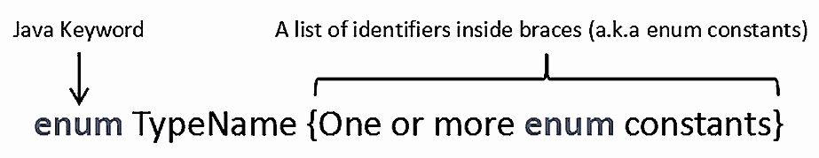

图 17.1 | 枚举数据类型的格式

* `TypeName`: 用户定义数据类型的名称。
* `enum`: Java 关键字。
* `enum constants`: 用户定义数据类型的值。

你使用 `enum` 关键字来创建你自己的数据类型并指定属于该类型的值。`enum constants` 不包含在引号中，因此它们不是字符串，枚举常量必须是合法的 Java 标识符。一旦定义了枚举，程序员就可以创建其类型类型的变量。然而，尽管枚举定义了一个类类型，但程序员不会使用 `new` 来初始化 `enum`。相反，他们可以像以前使用原始数据类型一样声明和使用枚举变量。

### 有效的枚举声明

我们可以如下所示声明 `enum`s：

* 类内部
* 类外部
* 在其单独的文件中

### 无效的枚举声明

* 方法内部。
* 块内部。

如果你尝试在方法内部声明 `enum`，将会出现错误。

### 可用的修饰符

`enum` 是隐式 `final` 的，因此 `abstract` 是不可用的。在方法内部或块内部声明 `enum` 将导致编译错误。

* 在类外部或在单独文件中声明 `enum` 时，可用的修饰符有：`public`、默认。

#### 声明方法 1：在类外部声明枚举 (Enum1.java - 第 01-04 行)

```java
01 enum Day
02 {
03 SUNDAY, MONDAY, TUESDAY, WEDNESDAY, THURSDAY, FRIDAY, SATURDAY;
04 }
05 public class Enum1
06 // 驱动方法
07 public static void main(String[] args){
08 Day d1 = Day.MONDAY;
09 System.out.println(d1);
10 }
```

输出：`MONDAY`

#### 声明方法 2：在类内部声明枚举 (Enum2.java - 第 02-05 行)

```java
01 public class Enum2
02 enum Day
03 {
04 SUNDAY, MONDAY, TUESDAY, WEDNESDAY, THURSDAY, FRIDAY, SATURDAY;
05 }
06 // 驱动方法
07 public static void main(String[] args){
08 Day d1 = Day.FRIDAY;
09 System.out.print(d1);
10 }
```

输出：`FRIDAY`

根据 Java 命名规范，建议我们使用全大写命名常量。示例声明创建了一个名为 `Day` 的枚举数据类型。大括号内部的标识符 SUNDAY、MONDAY 等被称为枚举常量。它们代表属于 `Day` 数据类型的值。

#### 声明枚举类型的变量

一旦你在程序中创建了枚举数据类型，就可以声明该类型的变量。例如，将 `workDay` 声明为 `Day` 类型。如果你尝试赋值 Day 类型常量以外的值，会导致编译器错误。例如：

```java
Day workDay = Day.FRIDAY; // 正确
Day workDay = FRIDAY; // 错误
```

赋值 `Day.WEDNESDAY` 而不是 `WEDNESDAY`。在大多数情况下，你必须使用枚举常量的限定名称。

示例 17.1：在方法内部声明枚举数据类型 `Day` 的变量 `workDay`

```java
01 public class Enum2
02 enum Day
03 {
04 SUNDAY, MONDAY, TUESDAY, WEDNESDAY, THURSDAY, FRIDAY, SATURDAY;
05 }
06 // 驱动方法
07 public static void main(String[] args){
08 Day workDay = Day.WEDNESDAY;
09 System.out.print(workDay);
10 }
```

输出：`WEDNESDAY`

### 解析

* 第 02 行：在 `Enum2` 类内部创建一个名为 `Day` 的枚举类型。
* 第 04 行：定义了 `Day` 数据类型的值。
* 第 08 行：创建一个类型为 `Day` 的变量 `workDay`，并赋值为 `Day.WEDNESDAY`。
* 第 09 行：通过将 `workDay` 变量作为参数传递给 `print(workDay)` 方法，在屏幕上显示 `workDay` 变量的值。

## 枚举类型是特殊化的类

在 Java 中，我们也可以向枚举类型中添加变量、方法和构造函数。`enum` 内部的第一行应该是常量的列表，然后是其他如方法、变量和构造函数等内容。当你编写一个枚举类型声明时，你实际上是在创建一个特殊的类。每个 `enum` 在内部都通过使用 `class.Enum` 实现，它通过简化冗长的代码简化了开发者的工作，并在内部遵循以下步骤：

* 每一个 `enum` 常量在内部都使用类来实现。
* 每一个 `enum` 常量在内部都是 `public static final` 的。
* 每一个 `enum` 常量的 `Enum`（类）声明代表 `Enum` 类型的一个对象。

考虑下面的示例并查看它在内部是如何转换的：

```java
enum Day
{
    SUNDAY, MONDAY, TUESDAY, WEDNESDAY, THURSDAY, FRIDAY, SATURDAY;
}
```

上述 `Enum` 声明在内部将转换为如下形式：

```java
/* 内部上述 enum Day 被转换为类 Day */
class Day
{
    public static final Day SUNDAY = new Day();
    public static final Day MONDAY = new Day();
    public static final Day TUESDAY = new Day();
    public static final Day WEDNESDAY = new Day();
    public static final Day THURSDAY = new Day();
    public static final Day FRIDAY = new Day();
    public static final Day SATURDAY = new Day();
}
```

此外，你在大括号内列出的 `enum` 常量实际上是该类的对象。在上一个示例中，`Day` 是一个类，而枚举常量 `Day.SUNDAY`、`Day.MONDAY`……等都是 `Day` 类的实例。当我们把 `Day.WEDNESDAY` 赋值给 `workDay` 变量时，我们是将 `Day.WEDNESDAY` 对象的地址赋值给该变量。`workDay` 变量持有 `Day.WEDNESDAY` 对象的地址。

图 17.2 | `workDay` 变量持有 `Day.WEDNESDAY` 对象的地址。

**注意**：每一个 `enum` 常量始终是隐式的 `public static final`。由于它是 `static` 的，我们可以通过使用 `enum` 名称来访问它。由于它是 `final` 的，我们无法创建子枚举。

我们可以在 `enum` 内部声明 `main()` 方法。因此，我们可以直接从命令行提示符调用 `enum`。

示例 17.2：`Enum3.java`

```java
01 package Enum;
02 /* 一个可以在 enum 类内部拥有 main() 的 Java 程序。 */
03 enum Color
04 {
05 RED, GREEN, BLUE;
06 // 驱动方法
07 public static void main(String[] args)
08 {
09 Color c1 = Color.RED;
10 System.out.println(c1);
11 }
12 }
```

输出：

RED

## `toString()`, `values()`, `ordinal()` 和 `valueOf()` 方法

### `toString` 方法

`enum` 常量（实际上是对象）自动配备了几个方法。其中之一就是 `toString` 方法。`toString` 方法简单地返回调用者枚举常量的名称作为 `String`。

示例 17.3：假设 `Day` 数据类型如之前所示已声明，以下两个代码段都会显示字符串 `WEDNESDAY`。记住，当对象传递给 `System.out.println()` 时，会简单地调用 `toString` 方法。

```java
// 此代码显示 WEDNESDAY
Day workDay = Day.WEDNESDAY;
System.out.println(workDay);

// 此代码也显示 WEDNESDAY
System.out.println(Day.WEDNESDAY);
```

### `ordinal` 方法

`ordinal` 方法返回一个表示常量序数的整数值。常量的序数值是它在 `enum` 声明中的位置，第一个常量位于位置 0。

图 17.3 | `Day` 枚举数据类型及其枚举常量的序数位置。

示例 17.4：假设 `Day` 数据类型如之前所示已声明：

```java
Day lastWorkDay = Day.FRIDAY;
System.out.println(lastWorkDay.ordinal()); // 5
System.out.println(Day.MONDAY.ordinal()); // 1
```

输出：

5

1

### `values` 方法

`values` 方法返回一个包含所有枚举常量列表的数组。

示例 17.5：`EnumValues.java` - 演示 `values` 方法工作的 Java 程序

```java
01 enum Day
02 {
03 SUNDAY, MONDAY, TUESDAY, WEDNESDAY, THURSDAY, FRIDAY, SATURDAY;
04 }
05 public class EnumValues {
06
07 public static void main(String[] args)
08 {
09 // 调用 values() 方法
10 Day arr[] = Day.values();
11
12 // 使用循环处理 enum
13 for (Day day: arr)
14 {
15 // 调用 ordinal() 查找 Day 的索引
16 System.out.println(day + " at index " + day.ordinal());
17 }
18 // 使用 valueOf()。返回给定常量的 Day 对象
19 System.out.println(Day.valueOf("MONDAY"));
20 }
21 }
```

输出：

SUNDAY at index 0

MONDAY at index 1

TUESDAY at index 2

WEDNESDAY at index 3

THURSDAY at index 4

FRIDAY at index 5

SATURDAY at index 6

最后 `Day` 类型中讨论的方法是 `equals` 和 `compareTo`。

### `equals` 方法

`equals` 方法接受一个对象作为参数，如果该对象等于指定的枚举常量，则返回 `true`。

示例 17.6：假设 `Day` 数据类型如之前所示已声明，以下代码段将显示 `SAME`。

```java
01 package ch17;
02
03 enum Day
04 {
05 SUNDAY, MONDAY, TUESDAY, WEDNESDAY, THURSDAY, FRIDAY, SATURDAY;
06 }
07 public class EnumEquals {
08 public static void main(String[] args){
09 Day workDay = Day.WEDNESDAY;
10 if (workDay.equals(Day.WEDNESDAY)) {
11 System.out.println("SAME");
12 } else {
13 System.out.println("NOT SAME");
14 }
15 }
16 }
```

输出：

SAME

解释：`equals` 方法接收 `Day2` 对象作为参数，如果它等于 `Day.WEDNESDAY` 常量，则返回 `true`。

示例 17.7：`Enum2.java`

```java
01 enum Languages {
02 Arabic, English, Spanish, Hindi, Russian, French;
03 }
04 class Enum2 {
05 public static void main(String[] args){
06 Languages l1 = Languages.Arabic;
07 Languages l2 = Languages.English;
08 Languages l3 = Languages.Spanish;
09 Languages l4 = Languages.Hindi;
10 Languages l5 = Languages.Russian;
11 Languages l6 = Languages.French;
12
13 if (l1.equals(l2)) {
14 System.out.println(l1 + " is equal to " + l2);
15 } else {
16 System.out.println(l1 + " is not equal to " + l2);
17 }
18 if (l2.equals(l3)) {
19 System.out.println(l2 + " is equal to " + l3);
20 } else {
21 System.out.println(l2 + " is not equal to " + l3);
22 }
23 if (l3.equals(l4)) {
24 System.out.println(l3 + " is equal to " + l4);
25 } else {
26 System.out.println(l3 + " is not equal to " + l4);
27 }
28 if (l4.equals(l5)) {
29 System.out.println(l4 + " is equal to " + l5);
30 } else {
31 System.out.println(l4 + " is not equal to " + l5);
32 }
33 if (l5.equals(l6)) {
34 System.out.println(l5 + " is equal to " + l6);
35 } else {
36 System.out.println(l5 + " is not equal to " + l6);
37 }
38 }
39 }
```

输出：

Arabic is not equal to English

English is not equal to Spanish

Spanish is not equal to Hindi

Hindi is not equal to Russian

Russian is not equal to French

### `compareTo()` 方法

`compareTo()` 方法设计用于比较相同类型的枚举常量。它接受一个对象作为参数并返回：

* 负整数值，如果调用常量的序数小于参数的序数值。
* 零，如果调用常量与参数相同。
* 正整数值，如果调用常量的序数大于参数的序数值。

这是一个简单的示例。


# 示例 17.8：`EnumCompare.java` - 假设 `Day` 数据类型如之前所示已声明，以下代码段将显示 "FRIDAY is greater than SUNDAY"。

```java
01 package ch17;
02
03 enum Day3
04 {
05 SUNDAY, MONDAY, TUESDAY, WEDNESDAY, THURSDAY, FRIDAY, SATURDAY;
06 }
07 class EnumCompare {
08 public static void main(String[] args){
09 Day3 anyDay = Day3.TUESDAY;
10 if (anyDay.compareTo(Day3.FRIDAY) > 0) {
11 System.out.println(anyDay + " is greater than " + Day3.FRIDAY);
12 } else {
13 System.out.println(anyDay + " is less than " + Day3.FRIDAY);
14 }
15 }
16 }
```

输出：

```
TUESDAY is less than FRIDAY
```

在类内部声明枚举类型的另一个位置。如果你在类内部声明枚举类型，它不能在方法内部。以下示例演示了这一概念。

## 示例 17.9：`EnumColors.java`

```java
01 public class EnumColors {
02 // 在类中声明枚举类型
03 enum Color
04 {
05 RED, ORANGE, PINK, YELLOW, BLUE, BROWN, GREEN ,PURPLE;
06 }
07 public static void main(String[] args){
08 // 声明一个 Color 变量并为其赋值
09 }
10 }
```

```java
Color color = Color.RED;

// The following statement displays RED
System.out.println(color);

// The following statement displays the ordinal value for
// Color.ORANGE, which is 1
System.out.println("The ordinal value for " +
Color.ORANGE + " is " + Color.ORANGE.ordinal());

// The following statement displays the ordinal
// value for Color.PURPLE, which is 7
System.out.println("The ordinal value for "
+ Color.PURPLE + " is " + Color.PURPLE.ordinal());

// The following statement compares two enum constants
if (Color.ORANGE.compareTo(Color.PURPLE) > 0) {
    System.out.println(Color.ORANGE + " is greater than "
    + Color.PURPLE);
} else {
    System.out.println(Color.ORANGE + " is NOT greater than "
    + Color.PURPLE);
}
```

Output:

```
RED
The ordinal value for ORANGE is 1
The ordinal value for PURPLE is 7
ORANGE is NOT greater than PURPLE
```

***

## 在其单独的文件编写枚举类型

你也可以将枚举类型声明写在它自己的文件中。如果是这样做，文件名必须与类型名称匹配。例如，如果我们把 `Day` 类型存储在它自己的文件中，我们必须将文件命名为 `Day.java`。这是合理的，因为枚举数据类型是特化的类。下面的示例演示了这一概念。

### 示例 17.10：`Day4.java`

```java
package ch17;

enum Day4 {
SUNDAY, MONDAY, TUESDAY, WEDNESDAY, THURSDAY, FRIDAY, SATURDAY;
}
```

`Day4.java` 程序包含一个名为 `Day4` 的枚举数据类型的声明。当编译时，将生成一个名为 `Day4.class` 的字节码文件。在这里，`Day4Demo` 程序使用了 `Day4` 枚举数据类型。

### 示例 17.11：`Day4Demo.java`

使用这些枚举类型。

```java
package ch17;

public class Day4Demo {
    private Day4 d1;
    // Driver Method
    public static void main(String[] args) {
        Day4 d1 = Day4.MONDAY;
        System.out.println(d1);
    }
}
```

Output:

```
MONDAY
```

***

## 对枚举类型进行切换

Java 允许你使用 `switch` 语句测试枚举常量。

### 示例 17.12：`EnumSwitch.java` - 将枚举类型作为参数传递给 switch 语句

```java
package ch17;

enum Day5 {
SUNDAY, MONDAY, TUESDAY, WEDNESDAY, THURSDAY, FRIDAY, SATURDAY;
}
// 包含 'Day' 对象和 main() 的驱动类
public class EnumSwitch {
    private Day5 day;

    // Constructor
    public EnumSwitch(Day5 day) {
        this.day = day;
    }

    // 使用 switch 打印关于日期的一行
    public void Day5IsLike() {
        switch (day) {
            case MONDAY:
                System.out.println("Mondays are bad");
                break;
            case FRIDAY:
                System.out.println("Fridays are better");
                break;
            case SATURDAY:
            case SUNDAY:
                System.out.println("Weekends are best.");
                break;
            default:
                System.out.println("Midweek days are so-so.");
                break;
        }
    }

    // Driver method
    public static void main(String[] args) {
        String str = "MONDAY";
        EnumSwitch enumSwitch = new EnumSwitch(Day5.valueOf(str));
        enumSwitch.Day5IsLike();
    }
}
```

Output:

```
Mondays are bad
```

### 解析

* `switch` 语句测试 `day` 变量的值。
* 根据 `day` 的值，程序分支到相应的 `case` 语句。

***

# Java 中带有自定义值的枚举

默认情况下，枚举有它们自己的字符串值，我们也可以为枚举分配一些自定义值。请参考下面的示例。

### 示例 17.13：`EnumFruits.java`

```java
enum Fruits {
LIME("GREEN"), BANANA("YELLOW"), APPLE("RED");
}
```

在上面的示例中，我们可以看到 `Fruits` 枚举有三个成员，即 `LIME`、`BANANA` 和 `APPLE`，它们分别拥有不同的自定义值 `GREEN`、`YELLOW` 和 `RED`。现在要在代码中使用此枚举，请参考下面的示例：

### 示例 17.14：`EnumFruits.java` - 完整代码

```java
// 演示如何为枚举赋值的 Java 程序
enum Fruits {
    // 这将调用带有一个字符串参数的枚举构造函数
    LIME("GREEN"), BANANA("YELLOW"), APPLE("RED");

    // 声明私有变量以获取值
    private String fruitCode;

    // getter 方法
    public String getCode() {
        return fruitCode;
    }

    // 构造函数
    private Fruits(String fruitCode) {
        this.fruitCode = fruitCode;
    }
}

// 驱动
public class EnumFruits {
    public static void main(String[] args) {
        Fruits fr = Fruits.LIME;
        System.out.println(fr.getCode());

        Fruits fr2 = Fruits.BANANA;
        System.out.println(fr2.getCode());

        Fruits fr3 = Fruits.APPLE;
        System.out.println(fr3.getCode());
    }
}
```

Output:

```
GREEN
YELLOW
RED
```

* `toString` 方法简单地将调用者的枚举常量的名称作为 `String` 类型返回。
* `ordinal` 方法返回一个表示常量序数值的整数值。常量的序数值是它在枚举声明中的位置，第一个常量的序数位置为 0。
* `values` 方法可以用于返回枚举中存在的所有值。
* `equals` 方法接受一个对象作为参数，如果该对象等于调用者的枚举常量，则返回 `true`。
* `compareTo` 方法设计用于比较相同类型的枚举常量。
* 你也可以在它自己的文件中编写枚举类型声明。如果是这样做的话，文件名必须与类型名称匹配。
* Java 允许你使用 `switch` 语句对枚举常量进行测试。
* 如果一个类有一个名为 `finalize` 的方法，它会在该类的实例被垃圾回收器销毁之前自动被调用。

***

# 第 18 章

## this 引用变量

### 引言

`this` 关键字是一个引用变量名，对象可以使用该变量引用它自己。它对所有非静态方法都可用。你可以在实例方法或构造方法内部通过 `this` 引用当前对象的任何成员。


### Java this 关键字的用法

这里是 Java `this` 关键字的 6 种用法。

* `this` 可以用于引用当前类的实例变量。
* `this` 可以用于（隐式地）调用当前类方法。
* `this()` 可以用于调用当前类的构造方法。
* `this` 可以作为参数传递在方法调用中。
* `this` 可以作为参数传递在构造方法调用中。
* `this` 可以用于从方法返回当前类的实例。

**建议：** 如果你是 Java 初学者，请只需查找 `this` 关键字的三种用法。

***

## 使用 this 解决变量遮蔽（Shadowing）

#### 在字段上使用 this

`this` 关键字的一个常见用途是克服参数名对字段名的遮蔽。请记住，如果方法的参数名与同类中的某个字段名相同，那么参数名就会遮蔽字段名。让我们来看一个例子。

**示例 18.1：`Square.java` 类 - 不使用 this**

```java
public class Square {

    public int x = 10;
    public int y = 10;

    //构造方法
    public Square(int a, int b) {
        x = a;
        y = b;
    }
}
```

**示例 18.2：`Square2.java` 类 - 使用 this**

```java
public class Square2 {

    public int x = 0;
    public int y = 0;

    //构造方法
    public Square2(int x, int y) {
        this.x = x;
        this.y = y;
    }
}
```

构造方法的每个参数都遮蔽了对象的字段之一——在构造方法内部，`x` 是构造方法第一个参数的本地拷贝。要引用 `Square` 字段 `x`，构造方法必须使用 `this.x`。

***

## 使用 this 从另一个构造方法调用重载构造方法

记住，在创建对象时会自动调用构造方法。你不能像调用其他方法那样显式地调用构造方法。这条规则有一个例外，你可以使用 `this` 关键字在同一类中从一个构造方法调用另一个构造方法。请考虑下面的示例。

**示例 18.3：`Shape.java`**

```java
public Shape(int l, int w) {
    length = l;
    width = w;
}
```

此构造方法接受参数并赋值给 `length` 和 `width` 字段。假设我们还想要一个只接受 `length` 字段参数并为 `width` 字段赋值 `0.0` 的构造方法。如示例 18.4 所示：

```java
public Shape (int l) {
    this(l, 0.0);
}
```

此构造方法使用 `this` 变量调用第一个构造方法。它将 `l` 中的值作为第一个参数传递，并将 `0.0` 作为第二个参数。结果是 `length` 字段被赋值为 `l` 的值，`width` 字段被赋值为 `0.0`。在构造方法内部，你也可以使用 `this` 关键字调用同一类中的另一个构造方法。这样做被称为显式构造方法调用（Explicit Constructor Invocation）。

**示例 18.5：`Square3.java`**

```java
public class Square3 {

    private int x, y;
    private int width, height;

    public Square3() {
        this(0, 0, 1, 1);
    }

    public Square3(int width, int height) {
        this(0, 0, width, height);
    }

    public Square3(int x, int y, int width, int height) {
        this.x = x;
        this.y = y;
        this.width = width;
        this.height = height;
    }
}
```

该类包含一组构造方法。每个构造方法初始化 `square3` 的部分或全部成员变量。构造方法为任何未通过参数提供初始值的成员变量提供了默认值。例如，无参数构造方法创建 1x1 的 Square。两个参数构造方法调用四参数构造方法，传入 0。

***

# 第 19 章

## 文本处理与包装类

### 包装类引言

回顾一下，基本数据类型之所以被称为基本（primitive），是因为它们不是通过类创建的，且变量没有属性或方法。它们被设计用于存储单个值。Java 为所有基本数据类型提供了包装类（Wrapper classes）。包装类“封装”了基本类型，允许你创建对象而不是变量。

基本类型的包装类不仅包含该类型的值，还包含与该类型相关的方法。例如，你已经使用包装类的 `parse` 方法将字符串转换为基本值。虽然这些包装类可以用来对象而不是变量，但很少程序员这样做。为什么呢？

* 因为类是不可变的，这意味着一旦创建了对象就无法更改它的值。
* 因为对于简单操作，它们没有变量那么容易使用。

例如；要获取对象中存储的值，必须调用方法，而变量可以直接用于赋值语句、数学运算、作为方法的参数等。虽然通常不需要从包装类创建对象，但它们提供了非常有用的静态方法。我们首先查看字符类，它是 `char` 类型的包装类。

***

### 使用 Character 类进行字符测试和转换

`Character` 类是 `char` 类型的包装类。它提供了许多测试和转换字符数据的方法。`Character` 类属于 `java.lang` 包，因此使用该类不需要导入语句。该类提供了几个用于测试 char 变量值的的静态方法。其中一些方法列在下表中。每个方法都接受单个 `char` 参数并返回一个布尔值。

表 19.1 | 用于测试字符值的某些静态 Character 类方法

| 方法 | 说明 |


## Character 类的字符测试方法

| 方法 | 说明 |
| :--- | :--- |
| `boolean isDigit(char ch)` | 如果传入的 `ch` 是数字 0 到 9，则返回 `true`。否则返回 `false`。 |
| `boolean isLetter(char ch)` | 如果传入的 `ch` 是字母，则返回 `true`。否则返回 `false`。 |
| `boolean isLetterOrDigit(char ch)` | 如果传递给 `ch` 的字符包含数字（0 到 9）或字母，则返回 `true`。否则返回 `false`。 |
| `boolean isLowerCase(char ch)` | 如果传递给 `ch` 的参数是小写字母，则返回 `true`。否则返回 `false`。 |
| `boolean isUpperCase(char ch)` | 如果传递给 `ch` 的参数是大写字母，则返回 `true`。否则返回 `false`。 |
| `boolean isSpaceChar(char ch)` | 如果传递给 `ch` 的参数是空格字符，则返回 `true`。否则返回 `false`。 |
| `boolean isWhiteSpace(char ch)` | 如果传递给 `ch` 的参数是空白字符（空格、制表符或换行符），则返回 `true`。否则返回 `false`。 |

下面是一个使用 `Character` 类和静态方法 `isLetter()` 的程序示例。

### 示例 19.1: CharacterTest.java

```java
package ch19;

import java.util.Scanner;

public class CharacterTest
{
    public static void main(String[] args)
    {
        String input; // 用于存储用户的输入
        char ch; // 用于存储单个字符

        // 从用户处获取一个字符并存储 
        // 在 ch 变量中。
        Scanner sc = new Scanner(System.in);
        System.out.println("Enter any single character");
        input = sc.nextLine();
        ch = input.charAt(0);

        // 测试该字符。
        if (Character.isLetter(ch))
        {
            System.out.println("That is a letter.");
        }

        if (Character.isDigit(ch))
        {
            System.out.println("That is a digit.");
        }
    }
}
```

**输出：**

```
Enter any single character
r
That is a letter.
```

下面是一个程序示例，用于测试一个字符串以确定其是否为符合格式的 7 位客户编号。

### 示例 19.2: CustomerNumber.java

```java
package ch19;

import java.util.Scanner;

public class CustomerNumber
{
    public static void main(String[] args)
    {
        String input; // 用于存储用户的输入

        // 获取一个客户编号。
        Scanner sc = new Scanner(System.in);
        System.out.println("Enter a customer number in the form LLLNNNN\n" +
        "(LLL = Letters and NNNN = numbers");
        input = sc.nextLine();

        // 验证输入。
        if (isValid(input))
        {
            System.out.println("That's a valid customer number.");
        }
        else
        {
            System.out.println("That is not the proper format of a " +
            "customer number.\nHere is an example: ABC1234");
        }
    }

    private static boolean isValid(String custNumber)
    {
        boolean goodSoFar = true; // 标记
        int i = 0; // 控制变量

        // 测试长度。
        if (custNumber.length() != 7)
            goodSoFar = false;

        // 测试前三个字符是否为字母。
        while (goodSoFar && i < 3)
        {
            if (!Character.isLetter(custNumber.charAt(i)))
                goodSoFar = false;
            i++;
        }

        // 测试后四个字符是否为数字。
        while (goodSoFar && i < 7)
        {
            if (!Character.isDigit(custNumber.charAt(i)))
                goodSoFar = false;
            i++;
        }
        return goodSoFar;
    }
}
```

### 解析

- 它测试一个字符串，以确定其是否为符合格式的七位客户编号。
- 客户编号预期长度为 7 位，由 3 个字母后跟 4 个数字位组成。
- `isValid` 方法接收一个 `String` 参数，并对其进行测试。
- 该方法使用了以下局部变量，它们声明在第 32 行和第 33 行中：
    - `boolean goodSoFar = true;` // 标记
    - `int i = 0;` // 控制变量
- 测试长度。在 `custNumber.length() != 7` 时，将 `goodSoFar` 设为 `false`。
- 测试前三个字符是否为字母。在 `while (goodSoFar && i < 3)` 循环中，如果 `!Character.isLetter(custNumber.charAt(i))` 为真，则将 `goodSoFar` 设为 `false`。
- 测试后四个字符是否为数字。在 `while (goodSoFar && i < 7)` 循环中，如果 `!Character.isDigit(custNumber.charAt(i))` 为真，则将 `goodSoFar` 设为 `false`。
- 返回 `goodSoFar` 的值。

#### Character 类的大小转换方法

`Character` 类还提供了静态方法：

| 方法 | 说明 |
| :--- | :--- |
| `toLowerCase(char ch)` | 返回传递给 `ch` 的参数的小写形式。 |
| `toUpperCase(char ch)` | 返回传递给 `ch` 的参数的大写形式。 |

- 如果 `toLowerCase` 的参数是大写字母，则该方法返回其小写形式。
- 如果参数已经是小写的，`toUpperCase` 将其原样返回。
- 传递给 `toLowerCase` 或 `toUpperCase` 的任何非字母字符都按原样返回。

### 示例 19.5: CircleArea.java

```java
import java.util.Scanner;
import java.text.DecimalFormat;

public class CircleArea
{
    public static void main(String[] args)
    {
        double radius; // 圆的半径
        double area; // 圆的面积
        String input; // 用于存储一行输入
        char choice; // 用于存储单个字符

        // 创建一个 Scanner 对象读取键盘输入。
        Scanner keyboard = new Scanner(System.in);

        // 创建一个 DecimalFormat 对象。
        DecimalFormat fmt = new DecimalFormat("0.00");

        do
        {
            // 获取圆的半径。
            System.out.print("Enter the circle's radius: ");
            radius = keyboard.nextDouble();

            // 消耗剩余的换行符。
            keyboard.nextLine();

            // 计算并显示面积。
            area = Math.PI * radius * radius;
            System.out.println("The area is " +
            fmt.format(area));

            // 重复这个？
            System.out.print("Do you want to do this again? (Y or N) ");
            input = keyboard.nextLine();
            choice = input.charAt(0);

        } while (Character.toUpperCase(choice) == 'Y');
    }
}
```

**输出：**

```
Enter the circle's radius: 12
The area is 452.39
Do you want to do this again? (Y or N) n
```

Process finished with exit code 0

## 查找子字符串

`String` 类提供了几种用于搜索和处理 `String` 对象的方法。`String` 类提供了多种方法在字符串内部查找另一个字符串。“子字符串”（substring）一词通常指作为另一个字符串部分的字符串。

### 表 19.3 搜索子字符串的 String 方法

| 方法 | 描述 |
| :--- | :--- |
| `boolean startsWith(String str)` | 如果调用字符串以传入 `str` 的字符串开头，则该方法返回 `true`。 |
| `boolean endsWith(String str)` | 如果调用字符串以传入 `str` 的字符串结尾，则该方法返回 `true`。 |
| `boolean regionMatches(int start, String str, int start2, int n)` | 如果调用字符串的指定区域与传入 `str` 的字符串的指定区域匹配，则该方法返回 `true`。`start` 参数表示该区域在调用字符串中的起始位置。`start2` 参数表示该区域在 `str` 中的起始位置。`n` 参数表示两个区域中的字符数。 |
| `boolean regionMatches(boolean ignoreCase, int start, String str, int start2, int n)` | 该 `regionMatches` 方法的重载版本有一个额外参数 `ignoreCase`。如果向此参数传入 `true`，方法在比较区域时忽略调用字符串和 `str` 的大小写。如果向 `ignoreCase` 参数传入 `false`，则比较是区分大小写的。 |

每个这些方法都返回一个布尔值，表示是否找到了该字符串。让我们详细查看这些这些方法。

## startsWith 和 endsWith 方法

`startsWith` 方法确定调用对象的字符串是否以指定的子字符串开头。

**示例 19.6**: 确定字符串 "Four Score and Sever Years Ago" 是否以 "four" 开头。如果字符串以指定的子字符串开头，方法返回 `true`，否则返回 `false`。

```java
01 String str = "Four Score and Severn Year Ago.";
02 if (str.startsWith("Four"))
03 System.out.println("The string starts with four.");
04 else
05 System.out.println("The string does not start with four");
```

**解释**

- 方法调用 `str.startsWith("Four")` 返回 `true`，因为字符串确实是以 "Four" 开头的。
- `startsWith` 方法执行区分大小写的比较，所以方法调用 `str.startsWith("four")` 将返回 `false`。

**示例 19.7**: 确定字符串 "Four score and seven years ago" 是否以 "go" 结尾。如果字符串确实以指定的子字符串结尾，方法返回 `true`，否则返回 `false`。

```java
01 String str = "Four Score and Severn Year Ago.";
02 if (str.endsWith("Ago"))
03 System.out.println("The string starts with Ago.");
04 else
05 System.out.println("The string does not start with Ago");
```

`endsWith` 方法同样执行区分大小写的比较，所以方法 `str.endsWith("Ago")` 返回 `true`，因为字符串确实是以 Ago 结尾。

**示例 19.8**: PersonSearch.java - 显示所有以用户输入的字符串头的名称

```java
01 package ch19;
02
03 import java.util.Scanner;
04 public class PersonSearch
05 {
06 public static void main(String[] args)
07 {
08 String lookUp; // 用于存储查找字符串
09
10 // 创建名称数组
11 String[] people = {
12 "Mohammed, Mansour",
13 "Davis, George",
14 "Osman, Ahmed",
15 "Russert, Phil",
16 "Russell, Cindy",
17 "Setzer, Charles",
18 "Smathers, Holly",
19 "Smith, Chris",
20 "Smith, Brad",
21 "Williams, Jean"
22 };
23
24 // 创建用于键盘输入的 Scanner 对象。
25 Scanner keyboard = new Scanner(System.in);
26
27 // 获取用于搜索的部分名称。
28 System.out.print("Enter the first few characters of " +
29 "the last name to look up: ");
30 lookUp = keyboard.nextLine();
31
32 // 显示所有以用户输入的
33 字符串头的名称。
34 System.out.println("Here are the names that match:");
35 for (String person : people)
36 {
37 if (person.startsWith(lookUp))
38 System.out.println(person);
39 }
40 }
41 }
```

**输出**

```
Enter the first few characters of the last name to look up: M
Here are the names that match:
Mohammed, Mansour
```

## regionMatches() 方法

`String` 类提供了 `regionMatches` 的重载版本，用于确定两个字符串的指定区域是否匹配。让我们写这个示例。

**示例 19.9**: RegionEx.java


```java
01 String str = "Four Score and Seven Years Ago.";
02 String str2 = "Those Seven Years Passed Quickly";
03 if (str.regionMatches(15, str2, 6, 11))
04 System.out.println("The regions match.");
05 else
06 System.out.println("The regions do not match.");
```

**输出**

```
The regions match.
```

**解释**

- `str` 字符串的指定区域从 15 开始与 `str2` 字符串从 6 开始的长度为 11 的区域匹配。
- `str2` 字符串的指定区域从 6 开始与 `str` 字符串的指定区域从 15 开始的长度为 11 的区域匹配。
- 因为两个区域都包含 11 个字符，`regionMatches` 方法返回 true。
- `regionMatches` 方法执行区分大小写的比较。

该版本接受一个额外的参数，指示是否执行不区分大小写的比较。

**示例 19.10**: Region2.java

```java
01 String str = "Four Score and Seven Years Ago.";
02 String str2 = "THOSE SEVEN YEARS PASSED QUICKLY";
03 if (str.regionMatches(true, 15, str2, 6, 11))
04 System.out.println("The regions match.");
05 else
06 System.out.println("The regions do not match.");
```

**输出**

```
The regions match.
```

**解释**

- `regionMatches` 方法第一个参数可以是 true 或 false，指示是否执行不区分大小写的比较。
- 在此示例中传入了 true，所以在比较区域 "seven years" 和 "SEVEN YEARS" 时会忽略大小写。

这些方法都通过一个布尔值指示子字符串是否出现在字符串中。`String` 类还提供了不仅在字符串内搜索项而且报告这些项位置的方法。

### 表 19.4 | 获取字符或子字符串位置的 String 方法（描述 indexOf 和 lastIndexOf 的重载版本）

| 方法 | 描述 |
| :--- | :--- |
| `int indexOf(char ch)` | 在调用字符串对象中搜索指定的字符 `ch`。如果找到了该字符，返回其首次出现的位置。否则返回 -1。 |
| `int indexOf(char ch, int start)` | 在调用字符串对象中搜索指定的字符 `ch`，从 `start` 位置开始到字符串末尾。如果找到了该字符，返回其首次出现的位置。否则返回 -1。 |
| `int indexOf(String str)` | 在调用字符串对象中搜索传入的字符串 `str`。如果找到了该字符串，返回其首次出现的位置。否则返回 -1。 |
| `int indexOf(String str, int start)` | 在调用字符串对象中搜索传入的字符串 `str`，从 `start` 位置开始到字符串末尾。如果找到了该字符串，返回其首次出现的位置。否则返回 -1。 |
| `int lastIndexOf(char ch)` | 在调用字符串对象中搜索指定的字符 `ch`。如果找到了该字符，返回其最后一次出现的位置。否则返回 -1。 |
| `int lastIndexOf(char ch, int start)` | 在调用字符串对象中搜索指定的字符 `ch`，从 `start` 位置开始反向搜索到位置 0。如果找到了该字符，返回其最后一次出现的位置。否则返回 -1。 |
| `int lastIndexOf(String str)` | 在调用字符串对象中搜索传入的字符串 `str`。如果找到了该字符串，返回其最后一次出现的起始位置。否则返回 -1。 |
| `int lastIndexOf(String str, int start)` | 在调用字符串对象中搜索传入的字符串 `str`，从 `start` 位置开始反向搜索到位置 0。如果找到了该字符串，返回其最后出现的起始位置。否则返回 -1。 |

## 使用 indexOf 和 lastIndexOf 方法查找字符

`indexOf` 和 `lastIndexOf` 方法可以在调用的字符串中搜索字符或子字符串。如果找到了要搜索的项，则返回其位置。否则，返回 -1。

### 示例 19.11：FindChar.java - 使用两种方法搜索一个字符

```java
String str = "Four Score and Seven Year ago";
int first, last;
first = str.indexOf('r');
last = str.lastIndexOf('r');
System.out.println("The letter r first appears at " +
"position " + first);
System.out.println("The letter r last appears at " +
"position " + last);
```

**输出：**

The letter r first appears at position 3

The letter r last appears at position 24

### 示例 19.12：FindChar2.java - 使用循环显示字符串中每个字母 ‘r’的位置

```java
String str = "Four Score and Seven Year ago";
int position;
System.out.println("The letter r appears at the following locations:");
position = str.indexOf('r');
while (position != -1)
{
    System.out.println(position);
    position = str.indexOf('r', position + 1);
}
```

**输出：**

The letter r appears at the following locations:

3

8

24

### 示例 19.13：FindChar3.java - 使用 lastIndexOf 方法并反序显示位置

```java
String str = "Four Score and Seven Year ago";
int position;
System.out.println("The letter r appears at the following locations:");
position = str.lastIndexOf('r');
while (position != -1)
{
    System.out.println(position);
    position = str.lastIndexOf('r', position - 1);
}
```

**输出：**

The letter r appears at the following locations:

24

8

3

## 使用 indexOf 和 lastIndexOf 方法查找子字符串

`indexOf` 和 `lastIndexOf` 方法也可以在字符串中搜索子字符串。请考虑下面的示例。

### 示例 19.14：FindSubStr.java - 显示字符串中单词 ‘and’ 每次出现的起始位置

```java
String str = "and a one and a two and a three";
int position;
System.out.println("The word and appears at the following positions:");
position = str.indexOf("and");
while (position != -1)
{
    System.out.println(position);
    position = str.indexOf("and", position + 1);
}
```

**输出：**

The word and appears at the following positions:

0

8

17

### 示例 19.15：FindSubStr2.java - 显示相同的结果，但采用反序

```java
String str = "and a one and a two and a three";
int position;
System.out.println("The word and appears at the following positions:");
position = str.lastIndexOf("and");
while (position != -1)
{
    System.out.println(position);
    position = str.lastIndexOf("and", position - 1);
}
```

**输出：**

The word and appears at the following positions:

17

8

0

### 提取子字符串

`String` 类提供了几种方法允许你从字符串中提取子字符串。

### 表 19.5 | 提取子字符串的方法

| 方法 | 描述 |
| :--- | :--- |
| `String substring(int start)` | 返回从 `start` 开始到对象末尾的子字符串拷贝。 |
| `String substring(int start, int end)` | 返回子字符串的拷贝。传入 `start` 是子字符串的起始位置，传入 `end` 是子字符串的结束位置。包含起始位置的字符，但不包含结束位置的字符。 |
| `void getChars(int start, int end, char[] array, int arrayStart)` | 该方法从调用对象提取子字符串并存储在 `char` 数组中。传入 `start` 是子字符串的起始位置，传入 `end` 是子字符串的结束位置（子字符串的最后一个字符位于 `end - 1`）。`arrayStart` 参数指定要存储字符在数组中的起始位置。 |
| `char[] toCharArray()` | 将调用对象中的所有字符作为 `char` 数组返回。 |

`substring` 方法返回调用对象的子字符串拷贝。该方法有两个重载版本。

* 第一个版本接受 `int` 参数，即子字符串的起始位置。
* 该方法返回包含从起始位置到字符串末尾字符的 `String` 对象引用。
* 起始位置的字符是子字符串的一部分。

考虑下面的示例。

### 示例 19.16：FindSubStr3.java

```java
String fullName = "Mohammed Abdelmoniem";
String lastName = fullName.substring(8);
System.out.println("The full name is " + fullName);
System.out.println("The last name is " + lastName);
```

**输出：**

The full name is Mohammed Abdelmoniem

The last name is Abdelmoniem

记住 `substring` 方法返回一个持有子字符串拷贝的新 `String` 对象。当此代码执行时，`fullName` 和 `lastName` 变量将引用不同的 `String` 对象。

图 19.1 | `fullName` 和 `lastName` 变量引用不同的对象

第二个版本接受两个 `int` 参数。第一个指定子字符串的起始位置，第二个指定子字符串的结束位置。包含起始位置的字符，但不包含结束位置的字符。

考虑下面的示例。

### 示例 19.17：FindSubStr4.java

```java
String fullName = "Mohammed Abdelmoniem";
String middleName = fullName.substring(8, 20);
System.out.println("The full name is " + fullName);
System.out.println("The middle name is " + middleName);
```

**输出：**

The full name is Mohammed Abdelmoniem

The middle name is Abdelmonie

## getChars 和 toCharArray 方法

`getChars` 和 `toCharArray` 方法将调用的字符串对象转换为 `char` 数组。`getChars` 方法可以用于转换子字符串，而 `toCharArray` 方法则转换整个字符串。这里有一个简单的示例。

### 示例 19.18 : GetCharEx.java - getChars 方法如何工作

```java
01 String fullName = "Mohamed Osman Ali";
02 char[] nameArray = new char[5];
03 fullName.getChars(8, 13, nameArray, 0);
04 System.out.println("The full name is " + fullName);
05 System.out.println("The values in the array are: ");
06 for (int i=0; i < nameArray.length ; i++)
07 System.out.println(nameArray[i] + " " );
```

**输出：**

The full name is Mohamed Osman Ali

The values in the array are:

O

s

m

a

n

这段代码将子字符串 "Osman" 的各个字符存储在 `nameArray` 数组的元素中，从元素 0 开始。`toCharArray` 方法返回 `char` 数组的引用，该数组包含调用对象中的所有字符。这里有一个简单的示例。

### 示例 19.19: ToCharEx.java

```java
01 String fullName = "Mohamed Osman Ali";
02 char[] nameArray;
03 nameArray = fullName.toCharArray();
04 System.out.println("The full name is " + fullName);
05 System.out.println("The values in the array are: ");
06 for (int i = 0; i < nameArray.length; i++)
07 System.out.println(nameArray[i] + " " );
```

**输出：**

The full name is Mohamed Osman Ali

The values in the array are:

M

o

h

a

m

e

d

O

s

m

a

n

A

l

i

当你想要对 `String` 对象的内容使用数组处理算法时，就可以使用这些方法。考虑下方的示例。

### 示例 19.20 : StringAnalyzer.java


```java
01 package ch19;
02
03
04 import java.util.Scanner;
05
06 public class StringAnalyzer
07 {
08 public static void main(String [] args)
09 {
10 String input; // 用于存储输入
11 char[] array; // 用于输入的数组
12 int letters = 0; // 字母数量
13 int digits = 0; // 数字数量
14 int whitespaces = 0; // 空白字符数量
15
16 从用户处获取字符串。
17 Scanner sc = new Scanner(System.in);
18 System.out.println("Enter a string");
19 input = sc.nextLine();
20
21 // 将字符串转换为字符数组。
22 array = input.toCharArray();
23
24 // 分析字符。
25 for (int i = 0; i < array.length; i++)
26 {
27 if (Character.isLetter(array[i]))
28 letters++;
29 else if (Character.isDigit(array[i]))
30 digits++;
31 else if (Character.isWhitespace(array[i]))
32 whitespaces++;
33 }
34
35 // 显示结果。
36 System.out.println("That string contains " +
37 letters + " letters, " +
38 digits + " digits, and " +
39 whitespaces + " whitespace characters.");
40 }
41 }
```

输出:

```
Enter a string

SUDAN 2019

* * *

That string contains 5 letters, 4 digits, and 1 whitespace characters.
```

# 返回修改字符串的方法

`String` 类方法返回 `String` 对象的修改副本。

## 表 19.6 | 返回 String 对象修改副本的方法

| 方法 | 描述 |
| :--- | :--- |
| `String concat(String str)` | 此方法返回调用的字符串对象的副本，并将其 `str` 的内容拼接在其后面。 |
| `String replace(char oldChar, char newChar)` | 此方法返回调用的字符串对象的副本，其中所有传递给 `oldChar` 的字符出现处都被传递给 `newChar` 的字符替换。 |
| `String trim()` | 此方法返回调用的字符串对象的副本，其中删除了所有开头和结尾的空白字符。 |

当与字符串配合使用时，`concat` 方法的操作与 `+` 运算符相同。

## 示例 19.21 : ConcatEx1.java - 代码使用 + 运算符

```java
01 package ch19;
02
03 public class ConcatEx1 {
04 public static void main(String[] args) {
05 String fullName;
06 String firstName = "Mustafa";
07 String lastName = " Mansour";
08 fullName = firstName + lastName;
09 System.out.println(fullName);
10 }
11 }
```

输出: `Mustafa Mansour`

## 示例 19.22 : ConcatEx2.java - 使用 concat 方法等价写法

```java
01 public class ConcatEx2 {
02 public static void main(String[] args) {
03 String fullName;
04 String firstName = "Mustafa";
05 String lastName = " Mansour";
06 fullName = firstName.concat(lastName);
07 System.out.println(fullName);
08 }
09 }
```

输出: `Mustafa Mansour`

# replace 方法

`replace` 方法返回 `String` 对象的副本，其中指定的字符出现处被替换为另一个字符。

## 示例 19.23 : ReplaceEx.java

```java
01 public class ReplaceEx {
02 public static void main(String[] args) {
03 String fullName;
04 String firstName = "Mustafa";
05 String lastName = " Mansour";
06 fullName = firstName.concat(lastName);
07
08 String str1 = "How";
09 String str2;
10 str2 = str1.replace('H', 'N');
11 System.out.println(str1);
12 System.out.println(str2);
13 }
14 }
```

输出:
```
How
Now
```

REMEMBER：`replace` 方法不会修改原始的内容，而是返回一个修改后的引用。

# trim 方法

`trim` 方法返回字符串对象的副本，其中删除了所有开头和结尾的空白字符。开头空白字符出现在字符串的起始（左侧），结尾空白字符出现在字符串的末尾（右侧）。例如，以下字符串带有空白字符：

## 示例 19.24 : TrimEx.java

```java
01 public class TrimEx {
02 public static void main(String[] args) {
03 String greeting1 = " Hello ";
04 String greeting2;
05 greeting2 = greeting1.trim();
06 System.out.println("*" + greeting1 + "*");
07 System.out.println("*" + greeting2 + "*");
08 }
09 }
```

输出:
```
* Hello *
*Hello*
```

# static valueOf 方法

静态 `valueOf` 方法接受 `String` 类型或任何基本数据类型作为参数，并返回该值的字符串表示。

## 表 19.7 | String 类的一些 valueOf 方法

| 方法 | 描述 |
| :--- | :--- |
| `String valueOf(boolean b)` | 返回布尔参数的字符串表示 |
| `String valueOf(char c)` | 返回字符参数的字符串表示 |
| `String valueOf(char[] array)` | 返回字符数组参数的字符串表示 |
| `String valueOf(char[] array, int subscript, int count)` | 返回字符数组中特定子数组的字符串表示 |
| `String valueOf(double number)` | 返回 double 参数的字符串表示 |
| `String valueOf(float number)` | 返回 float 参数的字符串表示 |
| `String valueOf(int number)` | 返回 int 参数的字符串表示 |
| `String valueOf(long number)` | 返回 long 参数的字符串表示 |

## 示例 19.25: ValueOf1.java - 以基本类型作为参数的 valueOf() 方法

这种形式的 `valueOf` 方法接受基本数据类型作为参数，并返回该基本数据类型的字符串表示。

```java
01 public class ValueOf1 {
02 public static void main(String[] args){
03 int i = 46;
04 float f = 23.5f;
05 double d = 15.4981567;
06 boolean b = true;
07 char c = 'A';
08 char[] letters = {'a','b','c'};
09 System.out.println(String.valueOf(i));
10 System.out.println(String.valueOf(f));
11 System.out.println(String.valueOf(d));
12 System.out.println(String.valueOf(b));
13 System.out.println(String.valueOf(c));
14 System.out.println(String.valueOf(letters));
15 }
16 }
```

输出:
```
46
23.5
15.4981567
true
A
abc
```

# StringBuilder 类介绍

* `StringBuilder` 类与 `String` 类相似，不同之处在于，你可以更改 `StringBuilder` 对象的的内容，但你不能更改 `String` 对象的内容。
* `StringBuilder` 类还提供了几个 `String` 类没有的实用用方法。
* 请记住，`String` 对象是不可变的。这意味着一旦你设置了 `String` 对象的内容，就无法更改它所持有的字符串值。

## 示例 19.26

```java
String name;
name = "George";
name = "Sally";
```

**解释**

* 第一个参数创建了 `name` 变量。
* 第二个参数创建一个包含字符串 "George" 的 `String` 对象，并将其地址赋值给 `name` 变量。
* 虽然我们可以让 `name` 变量引用不同的 `String` 对象。这就是第三条语句的作用，它创建另一个包含字符串 "Sally" 的 `String` 对象，并将其地址赋值给 `name`。包含 "George" 的 `String` 对象不再被引用。

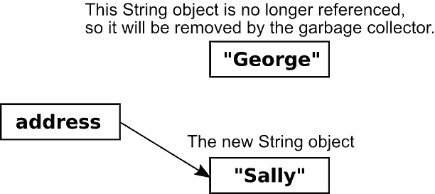  
图 19.2 | 包含 "George" 的 `String` 对象不再被引用

* 与 `String` 对象不同，`StringBuilder` 对象的方法允许你在不在内存中创建新对象的情况下修改其内容。
* 你可以更改特定字符、插入字符、删除字符并执行其他操作。
* `StringBuilder` 对象会根据需要增大或缩小以适应变化。
* `String` 对象不可变这一事实通常不是问题，但如果你的程序需要对一个或多个字符串进行大量更改，你可以考虑使用 `StringBuilder` 对象。
* 这通过减少必须创建然后由垃圾回收器移除的 `String` 对象数量，来提高程序的效率。

现在让我们来看 `StringBuilder` 类的构造函数和方法。

## StringBuilder 构造函数

### 表 19.8 | StringBuilder 构造函数

| 构造函数 | 说明 |
| :--- | :--- |
| `StringBuilder()` | 此构造函数不接受参数。它为对象提供了足够的存储空间来存放 16 个字符，但其中没有存储字符。 |
| `StringBuilder(int length)` | 此构造函数为对象提供了足够的存储空间来存放 `length` 个字符，但其中没有存储字符。 |
| `StringBuilder(String str)` | 此构造函数用字符串 `str` 初始化对象。对象的初始存储空间将字符串长度加 16。 |

前两个构造函数创建指定大小的空 `StringBuilder` 对象。第一个构造函数使 `StringBuilder` 对象足够大以包含 16 个字符，第二个构造函数使对象足够大以包含 `length` 个字符。记住，`StringBuilder` 对象会自动调整大小，如果你以后想在对象中存储更大的字符串，这并不是问题。

第三个构造函数接受一个 `String` 对象作为参数，并将对象的内容赋值给 `StringBuilder` 对象。考虑下例例。

## 示例 19.27: StringB.java

```java
StringBuilder city = new StringBuilder("Cairo");
System.out.println(city);
```

**解释**

* 创建一个 `StringBuilder` 对象并将其地址赋值给 `city` 变量。
* 对象用字符串 "Cairo" 初始化。
* 将 `StringBuilder` 对象传递给 `println` 和 `print` 方法。

`StringBuilder` 类的一个限制是，你不能使用赋值运算符将字符串赋值给 `StringBuilder` 对象。例如：

```java
StringBuilder city = "Cairo"; // 错误！无法工作。
```

与其使用赋值运算符 (`=`)，你必须使用 `new` 关键字和构造函数，或者使用 `StringBuilder` 的方法之一来将字符串存储在 `StringBuilder` 对象中。

## 其他 StringBuilder 方法

`StringBuilder` 类提供了许多与 `String` 类相同的方法。此外，`StringBuilder` 类提供了几个 `String` 类没有的方法。让我们来看其中几个。

### append 方法

* `StringBuilder` 类有几个名为 `append` 的方法的多个重载版本。
* 这些方法接受一个参数，该参数可以是任何原始数据类型、`char array` 或 `String` 对象。
* 它们将其参数的字符串表示附加到调用对象的当前内容之后。

由于有许多 `append` 的重载版本，我们将如下检查该方法典型调用的通用形式：

`object.append(item);`

在调用方法后，`item` 的字符串表示将附加到 `object` 的内容中。考虑下例所示。

## 示例 19.28 : AppendEx.java

```java
public class AppendEx {
    public static void main(String[] args) {
        StringBuilder str = new StringBuilder();

        // 向对象添加值
        str.append("We Sold "); // 添加一个 String 对象
        str.append(12);   // 添加一个 int
        str.append(" doubuts for $"); // 添加另一个字符串
        str.append(15.95);   // 添加一个 double

        // 显示对象的内容
        System.out.println(str);
    }
}
```

输出:
```
We Sold 12 doubuts for $15.95
```

### insert 方法

`StringBuilder` 类也有几个名为 `insert` 的方法的重载版本，它将值插入到调用对象的字符串中。这些方法接受两个参数：

* 指定调用对象字符串中起始位置的 `int`
* 要插入的值。要插入的值可以是任何原始数据类型、`char array` 或 `String` 对象。

由于有许多 `insert` 的重载版本，我们将如下检查该方法典型调用的通用形式：

`object.insert(start, item);`

`start` 是插入的起始位置，`item` 是要插入的值。

这是一个简单的示例。

## 示例 19.29 : InsertEx.java

```java
public class InsertEx {
    public static void main(String[] args) {
        StringBuilder str = new StringBuilder("July sold cars.");
        char[] array = {'w', 'e', ' ' };

        // 向对象添加值
        str.insert(0 ,"in "); // 添加一个 String 对象
        str.insert(8, array);  // 添加一个 char array
        str.insert(16, 20);  // 添加一个 int
        str.insert(18, ' '); // 添加一个 char

        // 显示对象的内容
        System.out.println(str);
    }
}
```

输出:
```
in July sold 20 cars.
```

这是另一个示例。

## 示例 19.30 : Telephone.java


```java
public class Telephone {
    public static String format(String number) {
        StringBuilder str = new StringBuilder(number);

        // 在区码周围插入括号。
        str.insert(0, '(');
        str.insert(4, ')');

        // 在前缀后插入连字符。
        str.insert(8, '-');

        // 返回格式化后的号码作为字符串。
        return str.toString();
    }
}
```

### 示例 19.31：TelephoneTester.java

```java
public class TelephoneTester {
    public static void main(String[] args) {
        // 创建未格式化的号码。
        String phone = "9195551212";

        // 获取它的格式化版本。
        String properNum = Telephone.format(phone);

        // 显示格式化后的号码。
        System.out.println(properNum);
    }
}
```

Output:

```
(919)555-1212
```

- `StringBuilder` 类拥有一个 `replace` 方法，该方法与 `String` 类的 `replace` 方法略有不同。
- `String` 类的 `replace` 方法是将一个字符的所有出现处替换为另一个字符，而 `StringBuilder` 类的 `replace` 方法是将指定的子字符串替换为另一个字符串。

调用 `replace()` 方法的通用形式：`object.replace(start, end, str);`

- `start` 是一个 `int` 类型，指定子字符串在调用对象中的起始位置。
- `end` 是一个 `int` 类型，指定子字符串的结束位置。
- 起始位置被包含在子字符串内，但结束位置不包含在内。
- `str` 参数是一个 `String` 对象。
- 方法执行后，子字符串将被替换为 `str`。

示例 19.32：ReplaceStringEx.java

```java
01 public class ReplaceStringEx {
02 public static void main(String[] args) {
03 StringBuilder str =
04 new StringBuilder("We moved from Khartoum to Atlanta");
05 str.replace(14, 22, "New York");
06 System.out.println(str);
07 }
08 }
```

输出：`We moved from New York to Atlanta`

`replace` 方法将单词 "Khartoum" 替换为 "New York"。

## delete、deleteCharAt 和 setCharAt 方法

- `delete` 和 `deleteCharAt` 方法用于从 `StringBuilder` 对象中删除子字符串或字符。
- `setCharAt` 方法将指定的字符更改为另一个值。

### 示例 19.33：StringBuilderDemo.java - 展示这 3 个方法

```java
01 public class StringBuilderDemo {
02 public static void main(String[] args) {
03 StringBuilder str =
04 new StringBuilder("I ate 100 blueberries");
05 // 显示 StringBuilder 对象
06 System.out.println(str);
07
08 // 删除 'o'
09 str.deleteCharAt(8);
10
11 // 删除 "blue"
12 str.delete(9, 13);
13
14 // 显示 StringBuilder 对象
15 System.out.println(str);
16
17 // 将 '1' 改为 '5'
18 str.setCharAt(6, '5');
19
20 // 显示对象的内容
21 System.out.println(str);
22 }
23 }
```

输出：

```
I ate 100 blueberries
I ate 10 berries
I ate 50 berries
```

### 注意事项

- `Java` 提供了一个名为 `StringBuffer` 的类，它本质上与 `StringBuilder` 类相同，具有相同的构造方法和方法。区别在于，`StringBuffer` 类中的方法是同步的。这意味着 `StringBuffer` 类在多线程应用程序中使用是安全的。
- 多线程应用程序是指并发运行多个执行线程的应用程序。在这样的应用程序中，可能有多个线程同时访问内存中的同一个对象。在多线程应用程序中，确保方法是 `synchronized`（同步的）很重要，以防止数据损坏的可能性。
- 因为同步需要执行额外的步骤，`StringBuffer` 类比 `StringBuilder` 类慢。
- 在对象不会被多个线程访问的应用程序中，你应该使用 `StringBuilder` 类来获得最佳性能。
- 在多个线程将访问该对象的应用程序中，你应该使用 `StringBuffer` 类以确保其数据不会被损坏。

***

## 字符串分词

字符串分词是将字符串分解为其组件的过程，这些组件被称为标记。可以使用 `StringTokenizer` 类和 `String` 类的 `split` 方法对字符串进行分词。

有时字符串将包含一组由空格或其他字符分隔的单词或其他数据。例如："peach raspberry strawberry vanilla"。这个 `String` 包含以下四个数据项：peach、raspberry、strawberry 和 vanilla。在编程术语中，这些项目被称为“标记”。注意项目之间出现了一个空格。分隔标记的字符被称为“分隔符”。

### 示例 19.34："17;92;81;12;46;5"

- 该字符串包含以下标记：17, 92, 81, 12, 46 和 5。
- 注意每个项目之间都出现了一个分号。在这个例中，分号被用作分隔符。
- 一些编程问题要求你读取一个包含项目列表的字符串，然后从字符串中提取所有标记进行处理。

### 示例 19.35："13-22-2005" - 包含日期的字符串

- 该字符串中的标记是 13、22 和 2005。
- 分隔符是连字符。
- 程序可能需要从这样的字符串中提取月份、日期和年份。

### 示例 19.36：一个 OS 文件路径：`/home/rsullivan/data`

- 标记：home、rsullivan 和 data。
- 分隔符：`/` 字符。
- 程序可能需要从这样的文件路径中提取所有的目录名。

将字符串分解为标记的过程被称为分词。在本节中我们将讨论两种标记字符串的 Java 工具：`StringTokenizer` 类和 `String` 类的 `split` 方法。

### StringTokenizer 类

Java 提供了一个 `StringTokenizer` 类，允许你对字符串进行分词。它属于 `java.util` 包，因此你需要以下导入语句：

`import java.util.StringTokenizer;`

当你创建一个 `StringTokenizer` 实例时，你传递一个字符串作为其中一个构造方法之一。标记将从该字符串中提取。

#### 表 19.9：StringTokenizer 构造方法

| 构造方法 | 说明 |
| :--- | :--- |
| `StringTokenizer(String str)` | 将待分词的字符串传递给 `str`。空白字符（空格、制表符和换行）被用作分隔符。 |
| `StringTokenizer(String str, String delimiters)` | 将待分词的字符串传递给 `str`。`delimiters` 是分隔符。 |
| `StringTokenizer(String str, String delimiters, boolean returnTokens)` | 将待分词的字符串传递给 `str`。`delimiters` 是分隔符。如果 `returnTokens` 参数设置为 `true`，则分隔符将作为标记。如果设置为 `false`，则分隔符将不作为标记。 |

第一个构造方法使用空白字符作为分隔符。例如：`StringTokenizer strTokenizer = new StringTokenizer("2 4 5 6");`

第二个构造方法接受第二个参数，这是一个包含多个用作分隔符的字符串。例如：示例 19.37：使用此构造方法创建一个对象。它指定 `-` 字符用作分隔符：`StringTokenizer strTokenizer = new StringTokenizer("10-14-2005","-");`

第三个构造方法接受第二个参数（包含多个分隔符的字符串）以及第三个参数（指示是否应将分隔符作为标记）。例如：示例 19.38：使用此构造方法创建一个对象。它指定 `-` 字符用作分隔符，并将分隔符作为标记：`StringTokenizer strTokenizer = new StringTokenizer("10-14-2005", "-", true);`

注意：前两个构造方法不将分隔符作为标记。

### 提取标记

一旦你创建了 `StringTokenizer` 对象，就可以使用它的方法从传递给构造方法的字符串中提取标记。

#### 表 19.10：部分 StringTokenizer 方法

| 方法 | 说明 |
| :--- | :--- |
| `countTokens()` | 该方法返回字符串中剩余标记的数量。 |
| `hasMoreTokens()` | 如果字符串中还有标记，返回 `true`；否则返回 `false`。 |
| `nextToken()` | 该方法返回字符串中找到的下一个标记。 |

### 示例 19.39：StrTokenEx.java - 代码演示了如何从 `StringTokenizer` 对象中提取所有标记。只要还有标记待提取，循环就会执行。

```java
01 import java.util.StringTokenizer;
02
03 public class StrTokenEx {
04 public static void main(String[] args) {
05 StringTokenizer strTokenizer = new StringTokenizer("One Two Three");
06
07 while (strTokenizer.hasMoreTokens()) {
08     System.out.println(strTokenizer.nextToken());
09 }
10 }
11 }
```

Output:

```
One
Two
Three
```

### 示例 19.40：DateComponent.java

```java
import java.util.StringTokenizer;

public class DateComponent {

    private String month; // 用于存储月份
    private String day;   // 用于存储日期
    private String year;  // 用于存储年份

    public DateComponent(String dateStr) {
        // 创建 StringTokenizer 对象。
        StringTokenizer strTokenizer = new StringTokenizer(dateStr, "/");

        // 提取标记。
        month = strTokenizer.nextToken();
        day = strTokenizer.nextToken();
        year = strTokenizer.nextToken();
    }

    public String getMonth() {
        return month;
    }

    public String getDay() {
        return day;
    }

    public String getYear() {
        return year;
    }
}
```

使用一个 `StringTokenizer` 对象。它的构造函数接受一个包含 `MONTH/DAY/YEAR` 格式日期的字符串。它提取月份、日期和年份并将这些值存储在 `month`、`day` 和 `year` 字段中。然后可以使用 `getMonth()`、`getDay()` 和 `getYear()` 方法来获取这些值。下面的示例实现了 `DateComponent.java`。

### 示例 19.41：DateTester.java

```java
public class DateTester {

    public static void main(String[] args) {
        String date = "10/23/2007";
        DateComponent dc = new DateComponent(date);
        System.out.println("Here's the date: " + date);
        System.out.println("The month is " + dc.getMonth());
        System.out.println("The day is " + dc.getDay());
        System.out.println("The year is " + dc.getYear());
    }
}
```

Output (DateTester.java):

```
Here's the date: 10/23/2007
The month is 10
The day is 23
The year is 2007
```

### 使用多个分隔符

某些情况需要你在同一个字符串中使用多个字符作为分隔符。例如：`Email Address: ata4tech@gmail.com`

- 此字符串使用了两个分隔符：`@`（at 符号）和 `.`（句号）
- 要从此字符串中提取标记，我们必须在构造函数中指定这两个字符作为分隔符。

### 示例 19.42：MultiDe.java

```java
package ch19;

import java.util.StringTokenizer;

public class MultiDe {
    public static void main(String[] args) {
        StringTokenizer strTokenizer = new StringTokenizer("ata4tech@gmail.com", "@ .");
        while (strTokenizer.hasMoreTokens()) {
            System.out.println(strTokenizer.nextToken());
        }
    }
}
```

Output:

```
ata4tech
gmail
com
```

### 在分词前修剪字符串

当你对用户输入的字符串进行分词，并且使用空白以外的字符作为分隔符时，你可能希望在分词之前对字符串进行修剪。否则，如果用户输入了开头空白字符，它们将成为第一个标记的一部分。同样，如果用户输入了结尾空白字符，它们将成为最后一个标记的一部分。

### 示例 19.43：TrimingEx.java - 创建带有开头和结尾空白的字符串

```java
package ch19;

import java.util.StringTokenizer;

public class TrimingEx {
    public static void main(String[] args) {
        String str = " One;Two;Three ";

        // 使用分号作为分隔符对字符串进行分词
        StringTokenizer strTokenizer = new StringTokenizer(str, ";");

        // 显示标记
        while (strTokenizer.hasMoreTokens()) {
            System.out.println("*" + strTokenizer.nextToken() + "*");
        }
    }
}
```

Output:

```
* One*
*Two*
*Three *
```

为了防止开头和结尾空白字符包含在第一个和最后一个标记中，请使用 `String` 类的 `trim()` 方法移除它们。

### 示例 19.44：TrimingEx2.java - 修改代码以使用 trim 方法

```java
package ch19;
```


import java.util.StringTokenizer;

public class TrimingEx2 {

    public static void main(String[] args) {

        String str = " One;Two;Three ";

        StringTokenizer strTokenizer = new StringTokenizer(str.trim(), ";");

        // 显示标记

        while (strTokenizer.hasMoreTokens()) {

            System.out.println("*" + strTokenizer.nextToken() + "*");

        }

    }

}

```
Output:
*One*
*Two*
*Three*
```

### String 类的 Split 方法
`String` 类有一个名为 `split` 的方法，它可以将字符串分词并返回一个 `String` 对象的数组。数组中的每个元素都是其中一个标记。

### 示例 19.45：SplitDemo1.java
```java
public class SplitDemo1 {

    public static void main(String[] args) {

        // 创建一个用于分词的字符串。

        String str = "one two four";

        // 使用空格作为分隔符获取标记。

        String[] tokens = str.split(" ");

        // 显示标记

        for (String s : tokens) {

            System.out.println(s);

        }

    }

}
```
Output:
one
two
four

### 解析
* 传递给 `split` 方法的参数指示分隔符。在这个示例中，使用空格作为分隔符。
* 你传递给 `split` 方法的参数是一个正则表达式。
* 我们传递给 `split` 方法的是包含单个空格的字符串。
* `split` 方法也允许使用多字符分隔符。你必须在正则表达式中包含分隔符。

### 示例 19.46：SplitDemo2.java - 程序代码
```java
public class SplitDemo2 {

    public static void main(String[] args) {

        // 创建一个用于分词的字符串。

        String str = "one and two and four";

        // 使用 " and " 作为分隔符获取标记。

        String[] tokens = str.split(" and ");

        // 显示标记

        for (String s : tokens) {

            System.out.println(s);

        }

    }

}
```
Output:
one
two
three

### 数值数据类型的包装类
Java 为每个数值数据类型提供了包装类。这些类具有处理原始值值的有用方法。

#### 表 19.11：数值数据类型的包装类
| 包装类 | 对应的原始类型 |
| :--- | :--- |
| Byte | byte |
| Double | double |
| Float | float |
| Integer | int |
| Long | long |
| Short | short |

#### 静态 toString 方法
每个数值包装类都有一个静态 `toString` 方法可以将数字转换为字符串。该方法接受数字作为参数并返回该数字的字符串表示。这里有一个简单的示例：

### 示例 19.47：ToStringEx.java
```java
public class ToStringEx {

    public static void main(String[] args) {

        int i = 12;

        double d = 14.95;

        String str1 = Integer.toString(i);

        String str2 = Double.toString(d);

        System.out.println(str1);

        System.out.println(str2);

    }

}
```
Output:
12
14.95

#### toBinaryString, toHexString 和 toOctalString 方法
`toBinaryString`、`toHexString` 和 `toOctalString` 方法是 `Integer` 和 `Long` 包装类的静态成员。这些方法接受一个 `Integer` 作为参数，并返回转换为二进制、十六进制或八进制的数字字符串表示。例如：

### 示例 19.48：ToEx.java
```java
public class ToEx {

    public static void main(String[] args) {

        int number = 14;

        System.out.println(Integer.toBinaryString(number));

        System.out.println(Integer.toHexString(number));

        System.out.println(Integer.toOctalString(number));

    }

}
```
Output:
1110
e
16

## MIN_VALUE 和 MAX_VALUE

数值包装类各有一组名为 `MIN_VALUE` 和 `MAX_VALUE` 的静态 final 变量。这些变量存储了特定数据类型的最小值和最大值。这是一个简单的示例。

### 示例 19.49: MinMaxEx.java - 显示 int 的最小值和最大值
```java
public class MinMaxEx {

    public static void main(String[] args) {

        System.out.println("The min value for an int is " +

        Integer.MIN_VALUE);

        System.out.println("The max value for an int is " +

        Integer.MAX_VALUE);

    }

}
```
Output
The min value for an int is -2147483648
The max value for an int is 2147483647

## 自动装箱（Autoboxing）与自动拆箱（unboxing）

可以从包装类创建对象。一种方法是将初始值传递给构造函数：
```java
Integer number = new Integer(7);
```
这创建了一个初始化值为 7 的 `Integer` 对象，并由变量 `number` 引用。另一种方法是简单声明一个包装类变量，然后给它分配一个基本类型值。例如：
```java
Integer number;

number = 7;
```

### 解析
* 第一条语句声明了一个名为 `number` 的 `Integer` 变量。它没有创建 `Integer` 对象，仅仅创建了一个变量。
* 第二条语句是一个简单的赋值语句。它将基本类型值 7 赋值给变量 `number`。
* 你可能怀疑这会导致错误。毕竟，`number` 是一个引用变量，而不是基本类型变量。
* 然而，由于 `number` 是一个包装类变量，Java 会执行自动装箱操作。

**自动装箱（Autoboxing）** 是 Java 将一个值自动封装到对象内部的过程。当执行此赋值语句时，Java 会将整数对象内部的值 7 装箱起来，然后将该对象的地址分配给变量 `number`。

**自动拆箱（Unboxing）** 是装箱的反过程。它是将包装类对象转换为基本类型的过程。

### 示例 19.50: UnBoxEx.java - 一个拆箱操作
```java
public class UnBoxEx {

    public static void main(String[] args) {

        Integer myInt = 5; // 将值 5 自动装箱

        int primitiveNumber;

        primitiveNumber = myInt; // 将对象拆箱

    }

}
```

### 解析
* 第 03 行：声明 `myInt` 为 `Integer` 引用变量。
* 基本类型值 5 被自动装箱，生成的对象地址被分配给变量 `myInt`。
* 第 04 行：声明 `primitiveNumber` 为 `int` 变量。
* 第 05 行：将 `myInt` 对象分配给 `primitiveNumber`。
* 当执行此语句时，Java 自动拆箱 `myInt` 包装类对象，并将结果值（即 5）存储在 `primitiveNumber` 中。

虽然你很少需要创建包装类的实例，但 Java 的自动装箱和自动拆箱功能使得某些操作更加方便。偶尔，你会发现自己处于这样的情况：你想使用基本类型变量执行操作，但该操作只能与对象一起使用。

### 回顾 ArrayList 类
* `ArrayList` 是一种类似数组的对象，可以用于存储其他对象。
* 然而，你不能在 `ArrayList` 中存储基本类型值。
* 它仅设计用于存储对象。
* 如果你尝试编译以下语句，将会发生错误：
```java
ArrayList<int> list = new ArrayList<int>(); // 错误
```
但是，你可以在 `ArrayList` 中存储包装类对象。如果我们需要在 `ArrayList` 中存储 `int` 值，必须指定该 `ArrayList` 将持有 `Integer` 对象。例如：
```java
ArrayList<Integer> list = new ArrayList<Integer>(); // 正确
```
此语句声明了 `list` 引用一个可以持有 `Integer` 对象的 `ArrayList`。在 `ArrayList` 中存储 `int` 值的一种方法是实例化一个 `Integer` 对象，用所需的 `int` 值对其初始化，然后将该 `Integer` 对象传递给 `ArrayList` 的 `add` 方法。例如：
```java
ArrayList<Integer> list = new ArrayList<Integer>();

Integer myInt = 5;

list.add(myInt);
```
然而，Java 的自动装箱和自动拆箱功能使得没有必要创建 `Integer` 对象。如果你向 `ArrayList` 添加一个 `int` 值，Java 会对该值自动装箱。例如：
```java
ArrayList<Integer> list = new ArrayList<Integer>();

list.add(5);
```
当值 5 被传递给 `add` 方法时，Java 将该值封装在一个 `Integer` 对象中。在需要时，Java 也会对从 `ArrayList` 中获取的值进行拆箱。例如：
```java
ArrayList<Integer> list = new ArrayList<Integer>();

list.add(5);

int primitiveNumber = list.get(0);
```
最后一条语句获取索引为 0 的项。由于该项被赋值给 `int` 变量，Java 将其拆箱并将基本类型值存储在 `int` 变量中。

***

## 总结
* Java 为基本类型提供了包装类。包装类是一个“封装”了基本类型的类，并允许你创建对象而不是变量。
* 针对给定基本类型的包装类不仅包含该类型的值，还包含与类型相关的方法。
* 虽然这些包装类可以用来创建对象而不是变量，但很少程序员这样做。
* 因为包装类是不可变的，这意味着一旦创建对象就无法更改值，它们不像变量那样容易使用。
* `Character` 类是 `char` 类型的包装类。它提供了许多测试和转换字符的方法。`Character` 类属于 `java.lang` 包。
* `startsWith` 方法判断调用字符串是否以子字符串开头。
* `String` 类提供了 `regionMatches` 的重载版本，用于判断两个区域是否匹配。
* `indexOf` 和 `lastIndexOf` 方法可以搜索字符或子字符串。如果找到了搜索项，则返回其位置；否则返回 -1。
* `indexOf` 和 `lastIndexOf` 方法还可以搜索字符串中的子字符串。
* `substring` 方法返回调用对象的子字符串副本。
* `getChars` 和 `toCharArray` 方法将调用字符串对象转换为字符数组。`getChars` 方法可以转换子字符串，而 `toCharArray` 方法转换整个字符串。
* `concat` 方法执行的操作与在字符串上使用 `+` 运算符相同。
* `replace` 方法返回 `String` 对象的副本，其中所有指定字符都被替换为另一个字符。
* `replace` 方法不会修改调用 `String` 对象的内容，而是返回一个该对象的修改副本的 `String` 引用。
* `trim` 方法返回 `String` 对象的副本，并删除了所有开头和结尾的空白字符。开头空白字符是指字符串开头、左侧的字符。
* `StringBuilder` 类与 `String` 类相似，区别在于你可以修改 `StringBuilder` 对象的内容，但不能修改 `String` 对象的内容。`StringBuilder` 类还提供了许多 `String` 类没有的有用方法。
* 与 `String` 对象不同，`StringBuilder` 对象允许你修改内容而不必在内存中创建新对象。
* `StringBuilder` 对象会根据需要增大或缩小大小以适应变化。
* `StringBuilder` 类还具有几个名为 `insert` 的重载方法，该方法可以将一个值插入到调用对象的字符串中。
* `delete` 和 `deleteCharAt` 方法用于从 `StringBuilder` 对象中删除子字符串或某个字符。
* `setCharAt` 方法将指定的字符更改另一个值。
* Java 提供了一个名为 `StringBuffer` 的类，它本质上与 `StringBuilder` 类相同，具有相同的构造函数和相同的方法。区别在于 `StringBuffer` 类中的方法是同步的。这意味着 `StringBuffer` 类在多线程应用程序中使用是安全的。
* 字符串分词（Tokenizing）是一个将字符串拆分为其各个组件的过程，这些组件被称为标记（tokens）。可以使用 `StringTokenizer` 类和 `String` 类的 `split` 方法来对字符串进行分词。将字符串拆分为标记的过程被称为分词。
* Java 提供了一个 `StringTokenizer` 类，它允许你对字符串进行分词。
* `toBinaryString`、`toHexString` 和 `toOctalString` 方法接受一个 `Integer` 作为参数，并返回该数字转换为二进制、十六进制或八进制的字符串表示。
* 每个数值包装类都有一组名为 `MIN_VALUE` 和 `MAX_VALUE` 的静态常量变量。这些变量持有特定数据类型的最小值和最大值。
* 自动装箱（Autoboxing）自动将对象内部的值装箱的过程。
* 自动拆箱（Unboxing）将包装类对象转换为原始类型的过程。

## 第 20 章：继承

## 什么是继承？
继承允许新类扩展一个现有类。新类继承其扩展的类的成员。在现实世界中，你可以发现许多对象是更通用对象的特殊版本。例如：

| 通用对象 | 特殊对象 |
| :--- | :--- |
| 狗 | 贵宾 |
| 车辆 | 汽车 |
| 形状 | 矩形 |
| 植物 | 花 |

特化对象具有通用对象的所有特征，外加上使其特殊的额外特征。在面向对象编程中，继承涉及一个父类（superclass）和一个子类（subclass）。父类是通用类，而子类是特化类。子类是父类的扩展版本。子类继承父类的字段和方法，而无需重写其中任何一个。子类可以添加新的字段和方法，这正是它成为父类特化版本的原因。父类也称为“基类”，子类也称为“派生类”。考虑下面的示例。

### 示例 20.1 : Vehicle.java
```java
01 class Vehicle
02 {
03 // 成员声明
04 }
05 class Car extends Vehicle
06 {
07 // 继承 Vehicle 的可访问成员
08 // 提供自己的成员声明
09 }
10 class Bus extends Vehicle
11 {
12 // 继承 Vehicle 的可访问成员
13 // 提供自己的成员声明
14 }
```
`extends` 关键字位于类名之后、另一个类名之前。`extends` 之前的类名标识子类，`extends` 之后的类名标识父类。

## 父类的构造函数
在继承关系中，父类的构造函数始终在子类的构造函数之前执行。考虑下面的示例。

### 示例 20.2 : SuperClass.java
```java
01 public class SuperClass
02 {
```


## 示例 20.2 : SuperClass.java

```java
01 public class SuperClass
02 {
03 public SuperClass()
04 {
05 System.out.println("This is the " +
06 "superclass constructor.");
07 }
08 }
```

类 `SuperClass` 有一个无参构造函数。该构造函数显示消息“This is the superclass constructor”。

### 示例 20.3 : SubClass.java

```java
01 public class SubClass extends SuperClass
02 {
03 public SubClass()
04 {
05 System.out.println("This is the " +
06 "subclass constructor.");
07 }
08 }
```

`SubClass` 扩展自 `SuperClass`。它也有一个无参构造函数，显示消息“This is the subclass constructor”。

### 示例 20.4 : ConstructorDemo.java

```java
01 public class ConstructorDemo
02 {
03 public static void main(String[] args)
04 {
05 SubClass obj = new SubClass();
06 }
07 }
```

**输出：**
`This is the subclass constructor.`

创建一个 `SubClass` 对象。父类的构造函数首先执行，接着执行 `SubClass` 构造函数。如果父类具有 (a) 默认构造函数或 (b) 在类中编写的无参构造函数，则该构造函数将在子类构造函数执行之前自动调用。

## 继承不可反向

在继承关系中，子类继承父类的成员，反之则不然。这意味着父类无法调用子类的方法。

## 调用父类构造函数

### 简介

记住，父类的默认构造函数或无参构造函数会在子类构造函数执行之前自动调用。但如果父类没有默认构造函数或无参构造函数呢？或者，如果父类有多个重载构造函数，而你想确保调用特定的一个呢？

**解决方案：** 使用 `super` 关键字显式地调用父类构造函数。`super` 关键字引用对象的父类，并用于访问父类的成员。

### 示例 20.5 : SuperClass1.java

```java
01 public class SuperClass1
02 {
03 public SuperClass1()
04 {
05 System.out.println("This is the superclass " +
06 "no-arg constructor.");
07 }
08 public SuperClass1(int arg)
09 {
10  System.out.println("The following argument " +
11 "was passed to the superclass "
12 "constructor: " + arg);
13 }
14 }
```

`SuperClass1` 类有一个无参构造函数和一个接受 `int` 的构造函数。

### 示例 20.6 : SubClass1.java

```java
01 public class SubClass1 extends SuperClass1
02 {
03 public SubClass1()
04 {
05 super(10);
06 System.out.println("This is the " +
07 "subclass constructor.");
08 }
09 }
```

`SubClass1` 扩展自 `SuperClass1`。该类的构造函数使用 `super` 关键字调用父类构造函数并传递参数。

### 关于调用父类构造函数需要记住的三条指南：

1. 调用父类构造函数的 `super` 语句只能写在子类的构造函数中。你不能在其他方法中调用父类构造函数。
2. 调用父类构造函数的 `super` 语句必须是子类构造函数的第一个语句。这是因为父类的构造函数必须在子类构造函数的代码之前执行。
3. 如果子类构造函数没有显式调用父类构造函数，Java 会执行子类构造函数代码之前自动调用父类的默认构造函数或无参构造函数。这等同于在子类构造函数开头放置：`super()`

## 当父类没有默认或无参构造函数时

* 只有当你没有为类提供构造函数时，Java 才会为类提供默认构造函数。这使得没有默认构造函数成为可能。
* `SuperClass1` 类有一个接受参数的构造函数。因为我们提供了这个构造函数，`SuperClass1` 类就没有默认构造函数。
* 此外，我们没有为该类编写无参构造函数。
* 如果 `SuperClass1` 没有默认构造函数也没有无参构造函数，那么继承它的类必须调用父类拥有的某个构造函数。否则，在编译子类时会产生错误。

## 继承中构造问题的总结

关于继承关系中构造函数需要记住的问题。以下列表总结了它们：

* 父类的构造函数始终在子类的构造函数之前执行。
* 你可以编写一个调用父类构造函数的 `super` 语句，但只能在子类的构造函数中编写。你不能从任何其他方法中调用父类构造函数。
* 如果子类构造函数中出现了调用父类构造函数的 `super` 语句，它必须是第一条语句。
* 如果子类构造函数没有显式地调用父类构造函数，Java 将在执行子类构造函数中的代码之前自动调用 `super()`。
* 如果父类没有默认构造函数且没有无参数构造函数，那么继承自它的类必须调用该父类所拥有的其中一个构造函数。

## Object 类

当一个类没有使用 `extends` 关键字继承另一个类时，Java 会自动将其从 `Object` 类进行扩展。Java 中的每个类都直接或间接地继承自名为 `Object` 的类，该类是 `java.lang` 包的一部分。例如：

```java
// 类声明
public class MyClass
{
    (成员声明 ...)
}
```

该类没有显式地继承任何其他类，因此 Java 将其处理为如下编写的内容：

```java
// 类声明
public class MyClass extends Object
{
    (成员声明 ...)
}
```

最终，每个类都继承自 `Object` 类。因此，每个类都继承 `Object` 类的成员。其中最有用的两个是 `toString` 和 `equals` 方法。

## 重写父类方法

子类可能拥有一个与父类方法签名相同的方法。在这种情况下，子类方法重写了父类方法。有时，子类从其父类继承了一个方法，但该方法无法满足子类的需求。

由于子类比父类更具专门性，有时子类需要将不合适的父类方法替换为更合适的。这被称为方法重写（Method Overriding）。我们可以通过这段代码片段更清楚地理解它：

### 示例 20.7: Abc.java - 方法重写

```java
package ch20;

public class Abc {
    public static void main(String args[]){
        Company a = new Company();
        Company b = new Xyz();
        a.address();
        b.address();
    }
}

class Company{
    public void address() {
        System.out.println("This is address of Abc company..." );
    }
}

class Xyz extends Company{
    public void address(){
        super.address();
        System.out.println("This is Xyz's address..." );
    }
}
```

**输出：**

```
This is address of Abc company...
This is address of Abc company...
This is Xyz's address...
```

### 解析

* 为了让子类方法重写父类方法，它必须具有相同的签名。
* 当子类对象调用该方法时，它调用的是子类版本的方法，而不是父类的版本。
* 如你所知，`super` 关键字指向对象的父类。
* 子类可以通过在方法名前前加上 `super` 关键字和点符号（.）来调用被重写的父类方法。

### 方法重写的规则

* 在 Java 中，方法只能写在 `Subclass` 中，而不能写在同一个类中。
* 参数列表应与被重写方法的完全一致。
* 返回类型应与父类中原始被重写方法声明的返回类型相同，或是其子类型。
* 访问级别不能比被重写方法的访问级别更严格。例如，如果父类方法被声明为 `public`，那么子类中的重写方法不能是 `private` 或 `protected`。
* 实例方法只有在被子类继承时才能被重写。
* 声明为 `final` 的方法不能被重写。
* 声明为 `static` 的方法不能被重写，但可以重新声明。
* 如果方法无法被继承，则它不能被重写。
* 与实例父类处于同一个包中的子类可以重写任何未声明为 `private` 或 `final` 的父类方法。
* 不同包中的子类只能重写声明为 `public` 或 `protected` 的非 final 方法。
* 重写方法可以抛出任何未检查异常，无论被重写方法是否抛出异常。然而，重写方法不应抛出比被重写方法声明的新或更广泛的检查异常。重写方法可以抛出比被重写方法窄或更少的异常。
* 构造函数不能被重写。

## 重载与重写

* **重载 (Overloading)**：当一个方法与一个或多个方法同名，但参数列表不同或签名不同。
* **重写 (Overriding)**：当一个方法重写了另一个方法，且它们都具有相同的签名。
* 重载和重写都可以发生在继承关系中。
* 你已经知道重载方法可以出现在同一个类中。子类中的方法可以重载父类中的方法。如果类 `A` 是父类而类 `B` 是子类，那么类 `B` 中的方法可以重载类 `A` 中的方法，或者重载类 `B` 中的另一个方法。
* 另一方面，重写只能发生在继承关系中。如果类 `A` 是父类而类 `B` 是子类，那么类 `B` 中的方法可以重写类 `A` 中的方法。然而，一个方法不能重写同一类中的另一个方法。

## 重载与重写的区别

重载与重写的区别很重要，因为它们会影响子类中父类方法的可访问性。

* 如果两个方法名称相同但签名不同，它们就是重载的。这发生在方法位于同一个类中，或者一个方法在子类中而另一个在父类中时。
* 如果子类中的方法与父类中的方法签名相同，它们就是重写。这发生在一个方法在子类中而另一个在父类中，且子类方法替换了父类方法时。

以下是用于解释上述内容的代码片段：

### 示例 20.8: SuperClass.java - 重载

```java
public class SuperClass {
    public void showValue(int x) {
        System.out.println("SUPERCLASS: The int argument was " + x);
    }
    public void showValue(String s) {
        System.out.println("SUPERCLASS: The String argument was " + s);
    }
}
```

两个同名的 `showValue` 方法。一个接受 `int` 参数，另一个接受 `String` 参数。

### 示例 20.9: SubClass2.java - 重写

```java
public class SubClass2 extends SuperClass {
    public void showValue(int x) {
        System.out.println("SUBCLASS: The int argument was " + x);
    }
    public void showValue(double s) {
        System.out.println("SUBCLASS: The double argument was " + s);
    }
}
```

两个同名的 `showValue` 方法。第一个（L3-L6）接受 `int` 参数。它重写了父类方法之一，因为它们的签名相同。第二个 `showValue` 方法（L7-L10）接受 `double` 参数。它重载了其他 `showValue` 方法，因为其他方法都没有相同的签名。尽管这些类中共有四个 `showValue` 方法，但只有三个可以被 `SubClass` 对象调用。这将在下一个示例中演示。

### 示例 20.10: ShowValueDemo.java

```java
public class ShowValueDemo {
    public static void main(String[] args) {
        // 创建 SubClass 对象。
        SubClass2 myObject = new SubClass2();
        myObject.showValue(10); // 传递一个 int。
        myObject.showValue(1.2); // 传递一个 double。
        myObject.showValue("Hello"); // 传递一个 String。
    }
}
```

**输出：**

```
SUBCLASS: The int argument was 10
SUBCLASS: The double argument was 1.2
SUPERCLASS: The String argument was Hello
```

## 父类

`String` 参数的值为 Hello。当将一个 `int` 参数传递给 `showValue` 时，会调用 `SubClass` 的方法，因为它重写了父类方法。为了调用被重写的父类方法，我们必须在子类方法中使用 `super` 关键字。

### 示例 20.11: 在子类方法中使用 super 关键字

```java
01 public class SubClass2 extends SuperClass2
02 {
03 public void showValue(int x)
04 {
05 super.showValue(x);
06 System.out.println("SUBCLASS: The int argument was " + x);
07 }
08 public void showValue(double s)
09 {
10 System.out.println("SUBCLASS: The double argument was " + s);
11 }
12 }
```

## 防止方法被重写

当使用 `final` 修饰符声明方法时，该方法不能在子类中被重写。接口的方法头是一个使用 `final` 修饰符的示例：

```java
public final void message();
```

如果子类尝试重写 `final` 方法，编译器将生成错误。这种技术可以用来确保特定的父类方法被子类使用，而不是其修改后的版本。

***

## 保护成员

## Java 访问修饰符

Java 访问修饰符指定了哪些类可以访问给类及其字段、构造函数和方法。Java 提供了访问修饰符来设置类、变量、方法和构造函数的访问级别。四种访问级别为：

* `default`（包内可见）。不需要任何修饰符。
* `private`（仅对类可见）。
* `public`（对所有人可见）。
* `protected`（对包及所有子类可见）。

## 保护成员

类的保护成员可以被：

* 被子类中的方法访问，以及与该类同一个包中的方法访问。
* 被同一类的方法或子类的方法访问。
* 被与保护成员所在类同一个包的任何类的方法访问。

保护成员并不完全是公共的，因为对它们的访问限制在同一类、子类以及与成员类同一个包的类中。保护成员的访问权限介于私有和公共之间。我们可以通过这些示例更清楚地理解它。

### 示例 20.12: Shape.java - 保护成员

```java
01 package ch20;
02
03 public class Shape
04 {
05 protected int sides;
06
07 public Shape()
08 {
09 sides = 2;
10 }
11 public int getSides()
12 {
13 return sides;
14 }
15 public void printSides()
16 {
17 System.out.println("This object has " + sides + " sides." );
18 }
19 }
```

### 示例 20.13: Square.java

```java
01 package ch20;
02
03 public class Square extends Shape
04 {
04 public Square(int nSides)
05 {
06 sides = nSides;
07 }
08 }
```

### 示例 20.14: ProtectedVariable.java

```java
01 package ch20;
02
03 class ProtectedVariableDemo
04 {
05 public static void main(String args[])
06 {
```


## 示例代码片段

```java
07 Square Obj = new Square(10);
08 Obj.printSides();
09 }
10 }
```

**输出 (`ProtectedVariable.java`)**
```
This object has 10 sides.
```

虽然将类成员设置为保护的而不是私有的可能会让某些任务变得简单，但你应该尽可能避免这种做法，因为任何继承自该类或位于同一包中的类对保护成员都具有无限制的访问权限。将所有字段设为私有，然后提供公共方法来访问这些字段，总是更好的。

***

## 包访问

如果你不为类成员提供访问限定符，则该类成员默认获得包级访问权限。这意味着同包中的任何方法都可以访问该成员。这里有一个简单的示例。

### 示例 20.15: `AA.java` - 包访问

```java
// AA.java
package A;

class AA {
    void messsage() {
        System.out.println("Welcome");
    }
}
```

```java
// BB.java
package B;

import A.*;

class BB {
    public static void main(String args[]) {
        AA obj = new AA(); // 编译错误
        obj.message(); // 编译错误
    }
}
```

#### 解释

* 我们创建了两个包 `A` 和 `B`。
* 我们从包外部访问 `AA` 类，由于 `AA` 类不是 `public` 的，所以无法从包外部访问。
* 在上面的示例中，类 `AA` 及其方法 `message()` 的范围是默认的，因此无法从包外部访问。

保护访问和包访问之间存在细微的区别：

* 保护访问成员可以被同包中的方法或子类中的方法访问。如果子类位于不同的包中（仅通过继承），这依然成立。
* 然而，具有包访问权限的成员无法被位于不同包的子类访问。

### 注意事项

* 你更有可能无意中而非设计上赋予类成员包访问权限，因为忘记了指定访问限定符。
* 尽管在某些情况下包访问是有帮助的，但通常你应该避免它。
* 务必为类成员指定访问限定符。

### 表 20.1：包内访问权限

| 访问限定符 | 对同包内的子类可见？ | 对包内所有其他类可见 |
| :--- | :--- | :--- |
| default (无修饰符) | 是 | 是 |
| public | 是 | 是 |
| protected | 是 | 是 |
| private | 否 | 否 |

### 表 20.2：包外访问权限

| 访问限定符 | 对包外的子类可见？ | 对包外的其他类可见 |
| :--- | :--- | :--- |
| default (无修饰符) | 否 | 否 |
| public | 是 | 是 |
| protected | 是 | 否 |
| private | 否 | 否 |

***

## 总结

* 继承允许新类扩展现有类。新类继承该类的成员。
* 在面向对象编程中，继承涉及父类和子类。父类是通用类，子类是专门类。
* 子类是父类的扩展版本。子类继承父类的字段和方法，无需任何重写。父类也称为基类，子类也称为派生类。
* 在继承关系中，父类的构造函数总在子类的构造函数之前执行。
* 在继承关系中，子类继承父类的成员，而不是相反。这意味着父类无法调用子类的方法。
* `super` 关键字引用对象的父类，并用于访问父类的成员。
* 调用父类构造函数的 `super` 语句必须是子类构造函数的第一个语句。这是因为父类的构造函数必须在子类构造函数的代码之前执行。
* 如果类构造函数没有显式调用父类构造函数，Java 会在子类构造函数执行之前自动调用父类的默认构造函数（无参数构造函数）。这相当于在子类构造函数的开头放置以下语句：`super();`。
* 只有当你没有为类提供构造函数时，Java 才会为类提供默认构造函数。这使得没有默认构造函数的可能。
* 如果父类没有默认构造函数也没有无参数构造函数，那么继承它的类必须调用父类拥有的构造函数之一。
* 父类的构造函数总在子类的构造函数之前执行。

## 覆盖规则与概念

- 当一个类没有使用 `extends` 关键字继承另一个类时，Java 会自动从 `Object` 类对其进行扩展。Java 中的每个类都直接或间接继承自名为 `Object` 的类，它是 `java.lang` 包的一部分。
- 子类方法中的返回类型应该是父类中原始被重写方法声明的返回类型或其子类型。
- 访问权限不能比被重写方法的权限更严格。例如，如果父类方法被声明为 `public`，则子类中的重写方法不能是 `private` 或 `protected`。
- 只有当实例方法被子类继承时，它才能被重写。
- 声明为 `final` 的方法不能重写。
- 声明为 `static` 的方法不能重写，但可以重新声明。
- 如果一个方法无法被继承，则它不能被重写。
- 与实例父类处于同一个包中的子类可以覆盖任何未声明为 `private` 或 `final` 的父类方法。
- 不同包中的子类只能覆盖声明为 `public` 或 `protected` 的非 `final` 方法。
- 重写方法可以抛出任何未检查异常，无论被重写方法是否抛出异常。然而，重写方法不应抛出比被重写方法声明的新或更广泛的检查异常。重写方法抛出的异常可以比被重写方法的更窄或更少。
- 构造函数不能被重写。
- 重载是指一个方法与一个或多个方法具有相同名称，但参数列表或签名不同。
- 重写是指一个方法覆盖了另一个方法，且它们具有相同的签名。
- 重载和重写都可以在继承关系中发生。
- 你已经知道重载方法可以出现在同一个类中。子类中的方法可以重载父类中的方法。如果类 `A` 是父类而类 `B` 是子类，则类 `B` 中的方法可以重载类 `A` 中的方法，或类 `B` 中的另一个方法。
- 重写只能在继承关系中发生。如果类 `A` 是父类而类 `B` 是子类，则类 `B` 中的方法可以重写类 `A` 中的方法。然而，一个方法不能重写同一类中的另一个方法。
- 如果两个方法同名但签名不同，它们就是重载。当方法在同一个类中，或者一个方法在父类中另一个方法在子类中时，均如此。
- 如果子类中的方法与父类中的方法具有相同签名，则子类方法重写父类方法。
- 当子类重载父类方法时，可以使用子类对象调用这两种方法。
- 然而，当子类重写父类方法时，只有子类的方法版本可以使用子类对象调用。
- Java 访问修饰符指定了哪些类可以访问给定的类及其字段、构造函数和方法。
- Java 提供了许多访问修饰符来设置类、变量、方法和构造函数的访问级别。四种访问级别是 `default`（包可见）、`private`（仅类内可见）、`public`（对所有人可见）、`protected`（对包和所有子类可见）。

## 第 21 章：多态

### 引言

父类引用变量可以引用子类对象。正如我们所知，为了声明一个引用对象的变量，我们使用以下语法：

`ClassName variableName;`

这里，`variableName` 是引用变量名，`ClassName` 是其类名。因此，`variableName` 可以引用任何 `ClassName` 类的对象。然而，它也可以引用任何类为 `ClassName` 子类的对象。

例如：如果类 `A` 是类 `B` 的父类，且类 `B` 是类 `C` 的父类，在这种情况下，类 `A` 的变量可以引用任何派生自该类的对象（即类 `B` 和类 `C` 的对象）。这是可能的因为每个子类对象都是其父类的对象，但反之则不然。

### 示例 21.1：`Abc.java`

为了说明父类引用变量如何引用派生类对象，让我们考虑以下示例，类 `SubClass1` 和 `SubClass2` 派生自共同的父类 `SuperClass`。所有类具有相同名称的方法，我们使用父类引用变量来访问这些方法。

```java
package ch21;

class SuperClass {
    public void display() {
        System.out.println("SuperClass class display method is called");
    }
}

class SubClass1 extends SuperClass {
    public void display() {
        System.out.println("SubClass1 class display method is called");
    }
}

class SubClass2 extends SuperClass {
    public void display() {
        System.out.println("SubClass2 class display method is called");
    }
}

class polymorphism {
    public static void main(String[] args) {
        SuperClass ptr; // SuperClass 类引用变量
        SubClass1 dl = new SubClass1();
        SubClass2 d2 = new SubClass2();

        ptr = dl; // ptr 包含 SubClass1 对象的引用
        ptr.display();

        ptr = d2; // ptr 包含 SubClass2 对象的引用
        ptr.display();
    }
}
```

**输出：**
```
SubClass1 class display method is called
SubClass2 class display method is called
```

程序的输出显示子类的 `display()` 方法被调用。如果父类引用变量 `ptr` 包含 `SubClass1` 对象的引用，则会调用该对象的 `display()` 方法。同样，如果 `ptr` 包含 `SubClass2` 对象的引用，则会调用该对象的方法。这意味着一个 `ptr.display()` 调用可以根据 `ptr` 的内容调用不同的方法。这就是实现多态的方式。注意，调用哪个重写方法始终是由引用对象的类型决定的，而不是变量的类型。确定使用哪种实现的任务是由 JVM 在运行时执行的。这被称为动态绑定。

只有在满足以下要求时才能实现多态行为：

- 子类对象的调用必须通过父类引用变量。
- 被调用的方法在父类中声明并在子类中定义。
- 父类和子类中的方法具有相同的名称和参数列表，且对应参数类型相同。
- 方法返回类型在父类和子类中相同，或者是协变的。如果派生类方法的返回类型是基类返回类型的子类，则认为返回类型是协变的。
- 方法访问范围在子类中不能比父类更严格。

### 示例 21.2

考虑 `Square` 和 `Circle` 是 `Shape` 类的子类。假设我们要计算任何形状的面积，因此我们在 `Shape` 类中定义一个 `area()` 方法，并在 `Square` 和 `Circle` 子类中重写它，以计算矩形和圆形的面积。

```java
class Shape {
    public void area() {
        System.out.println("Super class area method is called");
    }
}

class Square extends Shape {
    private double length, breadth;

    Square(double x, double y) {
        length = x;
        breadth = y;
    }

    public void area() {
        System.out.println("Area of Square is = " + (length * breadth));
    }
}

class Circle extends Shape {
    private double radius;

    Circle(double r) {
        radius = r;
    }

    public void area() {
        System.out.println("Area of Circle is = " + (Math.PI * radius));
    }
}

class ShapeEx {
    public static void main(String[] args) {
        Shape s;
        Square r = new Square(10, 20);
        s = r;
        s.area();
        Circle c = new Circle(5);
        s = c;
        s.area();
    }
}
```

**输出：**
```
Area of Square is = 200.0
Area of Circle is = 15.707963267948966
```

### 示例 21.3 : `SuperClass3.java`

```java
package ch21;

class SuperClass3 {
    void Message1() {
        System.out.print("Hello");
    }
}

class SubClass extends SuperClass3 {
    public void Message1() {
        System.out.print("Welcome");
    }
}

class SubClass3 extends SuperClass3 {
    public void Message1() {
        System.out.print("Hi");
    }
}

class Demo {
    public static void main(String args[]) {
        SuperClass3 ref; // 了一个名为 SuperClass3 的引用变量
        SubClass3 obj = new SubClass3();
        ref = obj;
        ref.Message1();
    }
}
```

**输出：** Hi

### 解析

- `SuperClass3` 类引用变量可以指向一个 `SubClass3` 类对象！
- `SuperClass3 ref` 告诉我们 `ref` 变量的数据类型是 `SuperClass3`。因此，我们可以使用 `ref` 变量来引用一个 `SuperClass3` 对象，所示：`obj = new SubClass3();`。
- `SuperClass3` 类也被用作 `SubClass3` 类的父类。

***

## 多态与动态绑定

运行时多态是一个过程，其中重写方法的调用在运行时解析，而不是在编译时解析。在这个过程中，通过父类的引用变量调用被重写的方法。当父类的引用变量指向子类的对象时，这种现象被称为向上转型。

##### 示例 21.4

```java
class X {}
class Y extends X {}

// 向上转型
X x = new Y();
```

插图 

当父类变量引用一个子类对象时，存在一个潜在问题。如果子类重写了父类中的一个方法，并且变量调用了该方法怎么办？变量是调用父类方法的版本，还是子类方法的版本？

将方法调用与正确的方法定义相匹配的过程被称为绑定。当变量包含一个多态引用时，Java 执行动态绑定或晚绑定。这意味着 Java 虚拟机在运行时根据变量引用的对象类型来决定调用哪个方法。因此，是对象的类型决定了调用哪个方法，而不是变量的类型。请考虑下面的示例。

##### 示例 21.5 : `Polymorphic.java`

```java
package ch21;

class Car {
    void run() {
        System.out.println("running");
    }
}

class Splender extends Car {
    void run() {
        System.out.println("Running safely with 60km");
    }

    public static void main(String args[]) {
        Car b = new Splender(); // 向上转型
        b.run();
    }
}
```


**输出：** `Running safely with 60km`

***

#### `instanceof` 运算符

Java 中有一个名为 `instanceof` 的运算符，你可以用它判断一个对象是否是特定类的实例。

**使用 `instanceof` 运算符的表达式通用形式：**
`refVar instanceof ClassName`

**解析**
- `refVar` - 是引用变量。
- `ClassName` - 是类名。

这是一个布尔表达式的形式，如果 `refVar` 引用的对象是 `ClassName` 的实例，则该表达式返回 `true`。否则，表达式返回 `false`。

##### 示例 21.6

以下代码中的 `if` 语句判断引用变量 `one` 是否引用一个 `ClassOne` 对象。

```java
01 ClassOne one = new ClassOne();
02 if (one instanceof ClassOne)
03 {
04     System.out.println("Yes, one is a ClassOne" );
05 }
06 else
07 {
08     System.out.println("No, one is not a ClassOne" );
09 }
```

##### 示例 21.7

```java
01 ClassTwo two = new ClassTwo(20, 2);
02 if (two instanceof ClassTwo)
03     System.out.println("Yes, two is a ClassTwo" );
04 else
05     System.out.println("No, two is not a ClassTwo" );
```

即使 `two` 引用的对象是 `ClassTwo` 的实例，该代码也会显示“Yes, two is a ClassTwo”。

***

## 总结

- `SuperClass3` 类引用变量可以指向 `SubClass3` 类对象。
- 运行时多态是一个过程，其中重写方法的调用在运行时解析，而不是在编译时解析。
- 当父类的引用变量指向子类的对象时，被称为向上转型。
- 将方法调用与正确的方法定义相匹配的过程被称为绑定。
- 当变量包含一个多态引用时，Java 执行动态绑定或晚绑定。
- 这意味着 Java 虚拟机在运行时根据变量引用的对象类型来决定调用哪个方法。
- 因此，是对象的类型决定了调用哪个方法，而不是变量的类型。
- `instanceof` 运算符用于判断一个对象是否是特定类的实例。

## 第 22 章

### 抽象类与接口

### 抽象类与抽象方法

抽象类不能实例化，其他类继承它。抽象方法没有方法体，必须在子类中被重写。

**抽象方法的语法：**
`abstract ReturnType MethodName(ParameterList);`

**抽象类的语法：**
`abstract class ClassName`

- 当抽象方法出现在类中时，必须在子类中重写。
- 如果子类未能重写该方法，将产生错误。
- 抽象类本身不能实例化，而是作为父类使用。
- 抽象类表示所有继承它的类的通用形式。

##### 示例 22.1 : Student.java

```java
01 package ch22;
02
03 abstract class Student
04 {
05     private String name; // 学生名
06     private String idNo; // 学生 ID
07     public Student(String n, String id)
08     {
09         name = n;
10         idNo = id;
11     }
12     public String toString()
13     {
14         String str;
15
16         str = "Name: " + name +
17             "\nID Number: " + idNo;
18         return str;
19     }
20     abstract int getRemainingHours();
21 }
```

**解析**
- 抽象类 `Student` 持有所有学生共有的数据，但不包含特定专业所需的所有数据。
- `Student` 类包含姓名、学号和入学年份的字段。它还拥有构造函数、`toString` 方法和一个抽象方法 `getRemainingHours`。
- 这个抽象方法必须在继承 `Student` 类的类中被重写。该方法的意图是返回学生在该专业内还需要修的学分。

##### 示例 22.2 : CompStudent.java

```java
01 package ch22;
02
03 class CompStudent extends Student
04 {
05     // 要求学分
06     private final int OS_HOURS = 40; // 操作系统学分
07     private final int DB_HOURS = 60; // 数据库学分
08
09     // 已修学分
10     private int osHours; // 已修的操作系统学分
11     private int dbHours; // 已修的数据库学分
12     public CompStudent(String n, String id)
13     {
14         super(n, id);
15     }
16     public void setOsHours(int os)
17     {
18         osHours = os;
19     }
20     public void setDbHours(int db)
21     {
22         dbHours = db;
23     }
24
25     public int getRemainingHours()
26     {
26         int reqHours; // 总需小时数
27         int remainingHours; // 剩余小时数
28         // 计算所需的小时数。
29         reqHours = OS_HOURS + DB_HOURS; // 100
30         // 计算剩余小时数。
31         remainingHours = reqHours - (osHours + dbHours);
32         return remainingHours;
33     }
34
35     public String toString()
36     {
37         String str;
38         str = super.toString() +
39             "\nMajor: Computer Science" +
40             "\nOperating System Hours Taken: " + osHours +
41             "\nDatabase Hours Taken: " + dbHours;
42         return str;
43     }
44 }
```

### 解析

- 计算机学生修读的课程与生物学生修读的课程不同。
- 理所当然，`CompStudent` 类计算剩余小时数的方法与 `BiologyStudent` 类不同。
- `CompStudent` 类继承自 `Student` 类，声明了以下 `final` 整数字段：`OS_HOURS` 和 `DB_HOURS`。这些字段存储了计算机科学学生所需的操作系统小时数和数据库小时数。
- 它还声明了以下字段：`osHours`、`dbHours`。这些字段存储了学生已修的操作系统小时数和数据库小时数。
- 提供了修改器方法用于在这些字段中存储值。
- 此外，类重写了 `toString` 方法以及抽象方法 `getRemainingHours`。

`CompStudentDemo` 实现了 `CompStudent.java`。示例 22.3：`CompStudentDemo.java`

```java
package ch22;

public class CompStudentDemo
{
    public static void main(String[] args)
    {
        // 创建 CompStudent 对象。
        CompStudent csStudent = new CompStudent("Mohammed Mansour", "92500000");

        // 存储 OS 和 DB 小时的值。
        csStudent.setOsHours(20);
        csStudent.setDbHours(35);

        // 显示学生数据。
        System.out.println(csStudent);

        // 显示剩余小时数。
        System.out.println("Hours remaining: " + csStudent.getRemainingHours());
    }
}
```

输出
```text
Name: Mohammed Mansour
ID Number: 92500000
Year Admitted: 2005
Major: Computer Science
Operating System Hours Taken: 20
Database Hours Taken: 35
Hours remaining: 45
```

记住关于抽象方法和类的以下几点：

- 抽象方法和抽象类使用 `abstract` 关键字定义。
- 抽象方法没有方法体，其头部必须以分号结束。
- 抽象方法必须在子类中被重写。
- 当一个类包含抽象方法时，该类不能被实例化。它必须作为父类。

### 接口

接口指定了类的行为。接口类似于包含所有抽象方法的抽象类。它不能被实例化，且接口中列出的所有方法必须在其他地方编写。接口的目的是指定类的行为。

#### 语法

```java
public interface InterfaceName
{
    (方法头部...)
}
```

接口看起来与类相似，不同之处在于使用 `interface` 关键字代替 `class` 关键字，并且接口中指定的方法没有方法体，只有以分号结尾的头部。此外，方法头部不使用访问修饰符，因为接口中指定的所有方法都是公共的（`public`）。

为了让类使用接口，它必须实现该接口。这通过 `implements` 关键字来实现。例如（`MyClass.java`）：

```java
public class MyClass implements MyInterface
{
    . . .
}
```

实现接口的类必须提供接口中列出的所有方法，且具有完全相同的的方法签名和相同的返回类型。“接口仅指定了这些方法的头部，而不规定这些方法应该做什么。”

#### 接口中的字段

接口可以包含字段声明，但接口中的所有字段都被视为 `final`（常量）和 `static`（静态）。由于它们会自动变为 `final`，你必须提供一个初始化值。

#### 接口定义（示例）

示例 22.5：接口定义

```java
public interface Double
{
    int FIELD1 = 1;
    int FIELD2 = 2;
    (方法头部...)
}
```

`FIELD1` 和 `FIELD2` 是 `final static int` 变量。任何实现此接口的类都可以访问这些变量。

#### 实现多个接口

为什么我们既需要抽象类又需要接口，尽管它们非常相似。原因是类只能继承一个父类，但 Java 允许一个类实现多个接口。当一个类实现多个接口时，它必须提供所有这些接口指定的方法。要在类定义中指定多个接口，只需在 `implements` 关键字之后列出接口名称，并用逗号隔开即可。

示例：实现多个接口的类示例的第一行

```java
public class MyClass implements Interface1, Interface2, Interface3
```

该类实现了三个接口：`Interface1`、`Interface2`、`Interface3`。

#### 多态与接口

就像创建类类型的引用变量一样，Java 允许你创建接口类型的引用变量。接口引用变量可以引用任何实现了该接口的对象，无论其类类型如何。

示例 22.6：`RetailItem.java` - 多态的另一个示例

```java
public interface RetailItem
{
    double getRemainingPrice();
}
```

该接口指定了一个方法：`getRemainingPrice`。`Book` 类实现了此接口。

示例 22.7：`Book.java`

```java
public class Book implements RetailItem
{
    private String title; // Book 的标题
    private String author; // Book 的作者
    private double remainingPrice; // Book 的剩余价格

    public Book(String bookTitle, String bookAuthor, double bookPrice)
    {
        title = bookTitle;
        author = bookAuthor;
        remainingPrice = bookPrice;
    }

    public String getTitle()
    {
        return title;
    }

    public String getAuthor()
    {
        return author;
    }

    public double getRemainingPrice()
    {
        return remainingPrice;
    }
}
```

`MainDemo` 实现了 `RetailItem` 接口。

示例 22.9：`MainDemo.java`

```java
package ch22;

import java.text.DecimalFormat;

public class MainDemo
{
    public static void main(String[] args)
    {
        // 创建一个 Book 对象。
        Book bo = new Book("Learn Java", "Mohammed Mansour", 19.95);

        // 使用 RetailItem 引用变量引用 Book 对象。
        RetailItem bi = new Book("Learn Java", "Mohammed Mansour", 19.95);

        // 显示书籍的作者
        System.out.println("Author: " + bi.getAuthor());

        // 显示 Book 的标题。
        System.out.println("Item #1: " + bi.getTitle());

        // 显示书籍的价格。
        System.out.println("Price: $" + bi.getRemainingPrice());
    }
}
```

输出
```text
Author: Mohammed Mansour
Item #1: Learn Java
Price: $19.95
```

由于 `Book` 类实现了 `RetailItem` 接口，该类对象可以使用 `RetailItem` 引用变量引用。例如

```java
RetailItem bi = new Book("Learn Java", "Mohammed Mansour", 19.95);
```

**解析**

- 声明了 `RetailItem` 引用变量 `bi`。
- `bi` 变量引用了一个书籍对象。这是可能的因为 `Book` 类实现了 `RetailItem` 接口。
- 当一个类实现接口时，就会建立一种称为接口继承的继承关系。

由于这种继承关系，`Book` 对象是一个 `RetailItem`。因此，我们可以创建 `RetailItem` 引用变量并让它们引用 `Book` 对象。使用接口引用变量有一些局限性：

- 你不能实例化接口。

当接口变量引用对象时，你只能使用该接口变量调用接口中指定的方法。这里有一个简单的示例。

示例 22.10：`MainDemo.java` - 使用 `RetailItem` 变量引用 Book 对象

```java
Book bo = new Book("Learn Java", "Mohammed Mansour", 19.95);

RetailItem item = new Book("Learn Java", "Mohammed Abdelmoniem", 19.95);

// 调用 getRetailPrice 方法
System.out.println(item.getRetailPrice()); // 可以，这可以工作

// 尝试调用 getTitle 方法
System.out.print(item.getTitle()); // 错误！无法编译
```


最后一行代码将无法编译，因为 `RetailItem` 接口只指定了一个方法：`getRetailPrice`。因此，我们不能使用 `RetailItem` 引用变量来调用任何其他方法。

提示：可以将接口引用变量强制转换为它所引用的对象的类型，然后调用该类型的成员方法。然而，这种语法有些笨拙。导致编译错误的语句可以重写为：`((Book)item).getTitle();`

## 总结

- `抽象类`不能被实例化，但类可以扩展它。
- `抽象方法`没有方法体，必须在子类中被重写。
- `抽象方法`是出现在父类中的方法，期望在子类中被重写。
- `抽象方法`只有方法头没有方法体。
- 当 `抽象方法`出现在类中时，必须在子类中被重写。如果子类未能重写该方法，将产生错误。
- `抽象方法`用于确保子类实现了该方法。
- 当类包含`抽象方法`时，无法创建该类的实例。
- `抽象方法`通常在`抽象类`中使用。
- `抽象类`不能被实例化，但作为其他类的父类。
- `抽象类`代表了继承它的类的通用或抽象形式。
- `抽象方法`和`抽象类`是通过使用 `abstract` 关键字定义的。
- `抽象方法`没有方法体，其方法头必须以分号结束。
- `接口`类似于`抽象类`，拥有所有`抽象方法`。它不能被实例化，且`接口`中列出的所有方法必须在别处写出。`接口`的目的是为类指定行为。
- `接口`可以包含字段声明，但`接口`中的所有字段都是`final` `static` 的。由于它们自动变为 `final`，你必须提供初始化值。
- Java 允许你创建`接口` 类型的引用变量。`接口引用变量`可以引用任何实现该接口的对象，无论其类类型。
- `接口`看起来和`class`相似，只是使用 `interface` 关键字代替了 `class`，且`接口`中指定的方法没有方法体，只有分号。
- 实现`接口`的类必须提供`接口`中列出的所有方法，且具有相同的签名。`接口`只指定这些方法的（头，没有指定方法应该做什么。

## 第 23 章：异常

### 引言

### 什么是异常？

异常是程序执行过程中发生的意外事件。当`异常`发生时，它会中断程序的正常流程。为了防止程序崩溃，必须编写检测并处理它们的代码。当`异常`产生时，被称为被“抛出”。除非异常被应用程序检测并处理，否则会导致应用程序停止。

`异常处理器`是响应被抛出的`异常`的代码段。解释和响应`异常`的过程被称为`异常处理`。为了检测已抛出的`异常`并防止应用程序停止，Java 允许你创建`异常处理器`。

如果你的代码没有处理被抛出的`异常`，默认`异常处理器`会处理它。默认`异常处理器`打印错误信息并导致程序崩溃。这是一个简单的示例：

### 示例 23.1：ArrayError.java

```java
01 public class ArrayError
02 {
03     public static void main(String[] args)
04     {
05         // 创建一个有 5 元素的数组。
06         int[] numbers = { 1, 2, 3, 4, 5 };
07
08         // 尝试读取范围之外的
09         // 数组
10         for (int i = 0; i <= 5; i++)
11             System.out.println(numbers[i]);
12     }
13 }
```

**输出**

```
1
2
3
4
5
Exception in thread "main" java.lang.ArrayIndexOutOfBoundsException: 5
at ArrayError.main(ArrayError.java:13)
```

### 解析

- 程序尝试读取数组范围之外。`numbers`数组只有五个元素，下标为到 4。
- 程序在尝试读取 `numbers[5]` 时崩溃，并显示了类似于程序末尾显示的错误消息。
- 此消息表示发生了`异常`，并提供了关于它的信息。
- 开发者必须检查异常并编写代码处理它们。

### 处理异常

在捕获`异常`之前，某些代码必须抛出（raise）一个。任何代码都可以抛出`异常`：你的代码、别人编写的代码。无论是什么抛出了`异常`，它总是通过 `throw` 语句抛出的。

可能抛出某些异常的代码必须由以下之一包含：
- 使用 `try-catch`。
- 使用 `throws` 关键字。

### 使用 try 语句捕获并处理异常

本节介绍了如何使用三个异常处理器组件——`try`、`catch` 和 `finally` 块来编写异常处理器。`Try 和 catch` 意味着尝试一段代码，如果发生错误，就捕获它。

**语法**

```java
01 try
02 {
03     (try block...)
04 }
05 catch (ExceptionType parameterName)
06 {
07     (catch block...)
08 }
```

**解析**

- **第 01 行**：出现 `try` 关键字。
- **第 02-04 行**：括号内出现了一块代码，括号是必须的。这段代码被称为`try 块`。`try 块`是执行并可能抛出异常的一个或多个语句。你可以认为`try 块`中的代码是受“保护”的，因为如果`try 块`抛出异常，应用程序不会停止。
- **第 05 行**：出现`catch 句`。`catch 句`以 `catch` 关键字开头，后面跟着代码 `(ExceptionType parameterName)`。这是一个参数变量声明，其中 `ExceptionType` 是异常类的名称，`parameterName` 是变量名。如果`try 块`中的代码抛出了 `ExceptionType` 类的异常，则参数变量将引用异常对象。此外，执行紧跟在 catch 句后面的代码。
- **第 06-08 行**：紧跟在 catch 句后面的代码被称为`catch 块`。再次，括号是必须的。

让我们尝试理解一下如果不使用`try-catch 块`会出现什么问题。

### 示例 23.2：WithoutTry.java - 不使用 try 语句

```java
01 import java.util.*;
02
03 public class WitoutTry{
04     public static void main(String[] args){
05         Scanner input = new Scanner(System.in);
06
07         System.out.println("Enter Your First NO: ");
08         int number1 = input.nextInt();
09
10         System.out.println("Enter Your Second NO: ");
11         int number2 = input.nextInt();
12
13         int sum = number1/number2;
14         System.out.println(sum);
15     }
16 }
```

**输出**

```
Enter Your First NO:
12
Enter Your Second NO:
0
Exception in thread "main" java.lang.ArithmeticException: / by zero
at Ex1.ex1.main(ex1.java:14)
C:\Users\HP\AppData\Local\NetBeans\Cache\8.2\executor-snippets\run.xml:53: Java returned: 1
BUILD FAILED (total time: 7 seconds)
```

除以零会给你一个异常，所以这关闭了整个程序。让我们通过使用 Java `try-catch 块` 来解决上述问题。

### 示例 23.3：WithTry.java - 使用 try-catch 语句

```java
01 import java.util.*;
02
03 public class WithTry{
04     public static void main(String[] args){
05         Scanner input = new Scanner(System.in);
06
07         System.out.println("Enter Your First NO: ");
08         int number1 = input.nextInt();
09
10         System.out.println("Enter Your Second NO: ");
11         int number2 = input.nextInt();
12
13         try {
14             int sum = number1/number2;
15             System.out.println("Sum is: " + sum);
16         } catch (ArithmeticException e) {
17             System.out.println("Error occurred: " + e.getMessage());
18         }
19     }
20 }
```

*(注：由于原文文本在示例 23.3 处不完整，此处根据常见逻辑补全了代码示例结构)*

### WithTry 类

```java
public class WithTry {
    public static void main(String[] args){
        Scanner input = new Scanner(System.in);
        try {
            System.out.println("Enter Your First NO: ");
            int number1 = input.nextInt();
            System.out.println("Enter Your Second NO: ");
            int number2 = input.nextInt();
            int sum = number1/number2;
            System.out.println(sum);
        } catch (Exception e){
            System.out.println("Error!");
        }
        System.out.println("Out of Try catch statement");
    }
}
```

**Output:**

```
Enter Your First NO: 12
Enter Your Second NO: 0
Error!
Out of Try catch statement
```

记住 `try` 后面总是需要跟一个 `catch`。我们将捕获所有的错误（异常）。参数 `Exception` 意味着捕获所有异常。这意味着如果用户发生了任何错误，都会被捕获。

## 使用 `throws` 子句捕获和处理异常

Java `throws` 关键字用于声明在 `METHOD EXECUTION`（方法执行）期间可能发生的异常列表。该方法的 `CALLER`（调用者）必须使用 `try-catch` 块来处理异常。

语法：
`<return type> method_name (parameters if any) throws type_of_exception_list;`
(`type_of_exception_list` 是方法可能抛出的所有异常的逗号分隔的列表)

语法：
```java
public static void method() throws FileNotFoundException , ConnectException {
    // Code
}
```

在程序中，如果存在抛出异常的可能性，编译器总是向我们警告，并且我们必须处理该异常，否则将得到编译时错误。为了理解什么是异常，请考虑以下代码。

### 示例 23.4 : ThrowEx1.java - 未处理异常时的错误

```java
public class ThrowEx1{
    public static void main(String[] args){
        Thread.sleep(10000);
        System.out.println("Welcome");
    }
}
```

**Output:**
Error: line (5)
java: unreported exception `java.lang.InterruptedException`; must be caught or declared to be thrown

#### 解释

* 在之前的示例中，我们得到了编译时错误，是因为当 `main` 方法进入睡眠状态时可能会发生异常；其他线程有机会执行 `main()` 方法，这将会导致 `InterruptedException`。

让我们通过使用 Java `throws` 关键字来解决上一个示例。

### 示例 23.5 : ThrowEx2.java - 使用 throws

```java
package ch23;

public class ThrowEx2 {
    public static void main(String[] args) {
        try {
            // Thread.sleep(10000);
            method();
            System.out.println("Welcome");
        } catch(InterruptedException e){
            // code
        }
    }

    public static void method() throws InterruptedException {
        Thread.sleep(10000);
    }
}
```

**Output:**
Welcome

#### 解释

* 在上面的程序中，通过使用 `throws` 关键字，我们处理了 `InterruptedException` 并得到了输出 `Welcome`。
* Java `throws` 关键字用于声明方法执行期间可能发生的异常列表（在我们例中为 `InterruptedException` 异常）。
* `method` 的 `caller`（`main` 方法）必须使用 `try-catch` 块来处理异常。

## 异常传播

异常从方法传播到方法，沿着调用栈向上传播，直到它被捕获。因此，如果 `main()` 调用了 `method()`，并且 `method()` 抛出了异常，异常将从 `method()` 传播到 `main()` 方法，除非这些方法中的一个捕获了异常——在我们例中是 `main` 方法。

假设如果 `one()` 调用 `two()`，`two()` 调用 `three()`，`three()` 调用 `four()`，如果 `four()` 抛出了异常，异常将从 `four()` 传播到 `three()`、到 `two()`、到 `one()`，除非这些方法中的任何一个捕获了异常。

当找到适当的处理器（`catch` 块）时（在我们例中是 `main` 方法），运行时系统会将异常传递给处理器。如果没有找到异常处理器，异常将到达 `JVM` 的默认异常处理器，该处理器会将异常详情打印到日志并终止应用程序。

### 关于 `throws` 关键字的记忆要点

* `throws` 关键字仅用于说服编译器，且使用 `throws` 关键字不会阻止程序的终止。
* 借助 `throws` 关键字，我们可以向方法的调用者提供有关异常的信息。

**注意**：不要将 `throw` 语句与 `throws` 子句混淆。`throw` 语句导致异常被抛出。`throws` 子句告知编译器某个方法抛出一个或多个异常。
**注意**：我们可以使用 `throws` 子句声明受检异常和未检异常。但调用给定方法的方法必须处理受检异常。

### 使用 `throw` 语句抛出异常

在 Java 异常处理中，`throw` 关键字用于从方法或构造函数抛出异常。

### `throw` 语句的语法

`throw new ExceptionType (MessageString);`

语法 2：
```java
public void method() {
    // 抛出一个异常
    throw new SomeException("Message");
}
```

#### 解释

* 如果我们使用 `throw` 语句抛出异常，我们必须在 `catch` 块中处理该异常，或者使用 `throws` 显式声明。
* `throw` 语句会导致异常对象的创建并抛出。
* `ExceptionType` 是异常类名。
* `MessageString` 是传递给异常对象的可选 `String` 参数。
* `MessageString` 参数包含自定义消息，可以从异常对象的 `getMessage` 方法检索。
* 如果你不向构造函数传递消息，异常的消息将为 null。

这里有一个演示使用 `throw` 的简单示例。

### 示例 23.6 : ThrowExcep.java

```java
public class ThrowExcep {
    static void test() {
        try {
            throw new NumberFormatException("demo");
        } catch (NumberFormatException e){
            System.out.println("Caught inside test.");
            throw e; // 抛出异常
        }
    }

    public static void main(String[] args) {
        try {
            test();
```


```java
        } catch (NumberFormatException e){

            System.out.println("Caught in main");

        }

    }

}
```

Output:
```
Caught inside test.
Caught in main
```

#### 解释
* 执行 `throw` 语句后程序的执行流立即停止，并检查最近的 `try` 块以查看它是否有匹配异常的 `catch` 语句。如果找到匹配项，控制将转移到该语句，否则检查下一个嵌套的 `try` 块，依此类推。如果没有找到匹配的 catch，默认处理器将停止程序。

## 查找异常详情

在 Java 中有三种查找异常详情的方法。它们是：
* 使用 `java.lang.Exception` 类对象。
* 使用 `public void printStackTrace()` 方法。
* 使用 `public String getMessage()` 方法。

### 使用 `java.lang.Exception` 类对象
`Exception` 类对象会打印异常名称和消息的性质。

### 示例 23.7 : Try1.java
```java
public class Try1 {

    public static void main(String[] args){

        try {

            double x = Double.parseDouble("100.00y");

        } catch (Exception e) {

            System.out.println(e);

        }

    }

}
```

## 异常处理

### 输出
`java.lang.NumberFormatException: For input string: "100.00y"`

#### 解释
- `java.lang.NumberFormatException`: 异常名称
- `For input String 100.00y`: 消息的性质

## 使用 printStackTrace 方法
该方法定义在 `java.lang.Throwable` 类中，并被 `java.lang.Error` 类和 `java.lang.Exception` 类继承。此方法将显示异常名称、消息的性质以及异常发生的行号。这里是一个简单的示例。

#### 示例 23.8 : Try2.java
```java
01 public class Try2 {

02 public static void main(String[] args){

03 try {

04 double x = Double.parseDouble("100.00y");

05 } catch (Exception e) {

06 e.printStackTrace();

07 }

08 }

09 }
```

### 输出
```
java.lang.NumberFormatException: For input string: "100.00y"
at java.base/jdk.internal.math.FloatingDecimal.readJavaFormatString(FloatingDecimal.java:2054)
at java.base/jdk.internal.math.FloatingDecimal.parseDouble(FloatingDecimal.java:110)
at java.base/java.lang.Double.parseDouble(Double.java:543)
at ch23.Try2.main(Try2.java:6)
```

#### 解释
- `java.lang.NumberFormatException`: 异常名称
- `For input String 100.00y`: 消息的性质

## 使用 getMessage 方法
该方法定义在 `java.lang.Throwable` 类中，并同时被 `Error` 和 `Exception` 类继承。此方法仅显示消息的性质。这里是一个简单的示例。

#### 示例 23.9 : Try3.java
```java
01 public class Try3 {

02 public static void main(String[] args) {

03 try {

04 double x = Double.parseDouble("100.00y");

05 } catch (Exception e) {

06 System.out.println(e.getMessage());

07 }

08 }

09 }
```

### 输出
`For input string: "100.00y"`

---

## 异常的多态引用
回想之前的课程，父类类型的引用变量可以引用子类对象。这被称为多态。在处理异常时，你可以将多态引用作为 `catch` 句的参数。例如：我们处理过的所有异常都继承自 `Exception` 类。因此，一个使用 `Exception` 类型参数变量的 `catch` 句能够捕获任何继承自 `Exception` 类的异常。请考虑下方的示例。

#### 示例 23.10 : ParseIntError.java
```java
01 package ch23;

02

03 import java.util.Scanner;

04

05 public class ParseIntError {

06 public static void main(String[] args) {

07 Scanner sc = new Scanner(System.in);

08 System.out.println("Enter Yor Number");

09 String input = sc.nextLine();

10 try

11 {

12 Integer number = Integer.parseInt(input);

13 System.out.println("The Result is " + number/0);

14 }

15 catch (Exception e)

16 {

17 System.out.println("Conversion error: " + e.getMessage());

18 }

19 }

20 }
```

### 输出
```
Enter Yor Number
8
Conversion error: / by zero
```

`Integer` 类的 `parseInt` 方法抛出了一个 `NumberFormatException` 对象，这段代码仍然有效，因为 `NumberFormatException` 类继承自 `Exception` 类。

---

## 处理多个异常
到目前为止我们学习的程序只测试了单一类型的异常。但在许多情况下，`try` 块中的代码能够抛出多种类型的异常。在这种情况下，你需要为每种可能被抛出的异常类型编写一个 `catch` 句。这里是一个简单的示例。

#### 示例 23.11 : MultiExcp.java
```java
01 public class MultiExcp {

02 public static void main(String[] args){

03 try{

04 int arr[] = new int[10];

05 arr[3] = 10/0;

06 System.out.println("Try Block Statement");

07 } catch (ArithmeticException e) {

08 System.out.println("Divide By Zero Error Encountered");

09 } catch (ArrayIndexOutOfBoundsException e){

10 System.out.println("Access Array Beyond the Limit");

11 } catch (Exception e) {

12 System.out.println("Other Exception");

13 }

14 System.out.println("Out of the try-catch");

15 }

16 }
```

### 输出
```
Divide By Zero Error Encountered
Out of the try-catch
```

在上面的示例中，第一个 `catch` 块被执行，是因为我们在 `try` 块中写的代码抛出了 `ArithmeticException`（因为我们将数字除以零）。现在稍微修改一下代码看看输出的变化。

#### 示例 23.12 : MultiExcp2.java
```java
01 public class MultiExcp2 {

02 public static void main(String[] args) {

03 try{

04 int arr[] = new int[10];

05 arr[12] = 10/0;

06 System.out.println("Try Block Statement");

07 } catch (ArithmeticException e) {

08 System.out.println("Divide By Zero Error Encountered");

09 } catch (ArrayIndexOutOfBoundsException e){

10 System.out.println("Access Array Beyond the Limit");

11 } catch (Exception e) {

12 System.out.println("Other Exception");

13 }

14 System.out.println("Out of the try-catch");

15 }

16 }
```

### 输出
```
Access Array Beyond the Limit
Out of the try-catch
```

在这种情况下，第二个 `catch` 块被执行，因为抛出了 `ArrayIndexOutOfBoundsException`。

---

## finally 子句
`finally` 块包含无论是否发生异常都必须执行的语句。`try` 语句可以有一个可选的 `finally` 子句。

### 通用语法（带 finally 子句的 try）
```java
01 try
02 {
03     // try statement...
04 }
05 catch (ExceptionTypeName)
06 {
07     // catch statement...
08 }
09 finally
10 {
11     // finally statement...
12 }
```

`finally` 块在 `try` 块和任何 `catch` 块执行完毕后总是会执行。

#### 示例 23.13 : Fin.java finally 块的简单示例
你可以看到异常发生在 `try` 块中并被 `catch` 块处理，随后执行了 `finally` 块。
```java
01 public class Fin {

02 public static void main(String[] args){

03 try{

04 int arr[] = new int[10];

05 arr[12] = 10/2;

06 System.out.println("Try Block Statement");

07 } catch (ArithmeticException e) {

08 System.out.println("Divide Zero Error Encountered");

09 } catch (ArrayIndexOutOfBoundsException e){

10 System.out.println("Access Array Beyond the Limit");

11 } catch (Exception e) {

12 System.out.println("Other Exception");

13 }finally {

14 System.out.println("This is finally block ");

15 }

16 System.out.println("Out of the try-catch");

17 }

18 }
```

### 输出
```
Access Array Beyond the Limit
This is finally block 
Out of the try-catch
```

### 关于 finally 块的注意事项
- `finally` 块必须与 `try` 块关联。
- `finally` 块是可选的。

`finally` 块不执行的唯一情况是遇到了 `System.exit()`。例如：

#### 示例 23.14 : Fin2.java
```java
01 public class Fin2 {

02 public static void main(String[] args){

03 try{

04 int arr[] = new int[10];

05 arr[12] = 10/2;

06 System.out.println("Try Block Statement");

07 } catch (ArithmeticException e) {

08 System.out.println("Divide Zero Error Encountered");

09 } catch (ArrayIndexOutOfBoundsException e){

10 System.out.println("Access Array Beyond the Limit");

11 System.exit(0);

12 } catch (Exception e) {

13 System.out.println("Other Exception");

14 }finally {

15 System.out.println("This is finally block ");

16 }

17 System.out.println("Out of the try-catch");

18 }

19 }
```

---

## finally 块覆盖返回值
`finally` 块会覆盖 `try` 和 `catch` 块返回的返回值。

### 示例 23.15: MyFinal.java
让我们通过一个例子来理解这一点：

```java
public class MyFinal {

    public static int myTestingMethod(){

        try{

            // 代码在这里

            return 9;

        }finally {

            // 代码在这里

            return 20;

        }

    }

    public static void main(String[] args){

        MyFinal my = new MyFinal();

        int i = my.myTestingMethod();

        System.out.println(i);

    }

}
```

**输出**
```
20
```

程序返回 20，因为 `try` 返回的值被 `finally` 覆盖了。

***

# 堆栈跟踪 (Stack Trace)

通常，一个方法会调用另一个方法，该方法再调用另一个方法。例如，方法 `A` 调用方法 `B`，`B` 调用方法 `C`。

### 什么是调用栈 (Call Stack)？

*   调用栈是当前正在执行方法的内部列表。
*   当异常在多层方法调用下抛出时，了解是哪些方法负责该调用是很有帮助的。
*   堆栈跟踪是调用栈中所有方法的列表。它指示了发生异常时正在执行的所有方法。

请考虑以下示例。

### 示例 23.16: StackTrace.java
```java
public class StackTrace {

    public static void main(String[] args) {

        System.out.println("Calling myMethod...");
```


myMethod();

System.out.println("main is done.");

}

public static void myMethod() {

System.out.println("Calling produceError...");

produceError();

System.out.println("myMethod is done.");

}

public static void produceError() {

String str = "abc";

// 以下语句会导致错误

System.out.println(str.charAt(3));

System.out.println("produceError is done.");

}

}

```

**输出**

```
Calling myMethod...

Calling produceError...

Exception in thread "main" java.lang.StringOutOfBoundsException: String index out of range: 3

at java.base/java.lang.String.charAt(String.java:44)

at java.base/java.lang.String.charAt(String.java:69)

at ch23.StackTrace.produceError(StackTrace.java:22)

at ch23.StackTrace.myMethod(StackTrace.java:14)

at ch23.StackTrace.main(StackTrace.java:8)
```

### 解析

* 程序有三个方法：`main`、`myMethod` 和 `produceError`。
* `main` 方法调用 `myMethod`，调用 `produceError`。
* `produceError` 调用 `String` 类的 `charAt` 方法。
* 异常没有由程序处理，而是由默认异常处理器处理。
* 当异常发生时，错误信息显示为产生异常方法的堆栈跟踪。
* 堆栈跟踪列出的第一个方法 `charAt` 是产生异常的方法。
* 下一个方法 `produceError` 是调用 `charAt` 的方法。
* 下一个方法 `myMethod` 是调用 `produceError` 的方法。
* 最后一个方法 `main` 是调用 `myMethod` 的方法。
* 堆栈跟踪显示了抛出异常时调用的方法链。

**注意**：所有异常对象都有继承自 `Throwable` 类的 `printStackTrace` 方法，用于打印堆栈跟踪。

***

# 当未被捕获时

* 当异常被抛出时，它必须被程序处理或默认异常处理器处理。
* 当方法中的代码抛出异常时，该方法的正常执行停止，JVM 在方法内部搜索兼容的异常处理器。
* 如果方法没有代码来处理调用栈中的上一个方法（即调用错误方法的方法）。
* 如果该方法无法处理异常，则控制将再次沿调用栈传递给上一个方法。
* 这种情况会一直持续直到控制到达 `main` 方法。如果 `main` 方法不处理异常，程序将停止并由默认异常处理器处理异常。
* `StackTrace.java` 中的程序就是此类情况。因为 `produceError` 方法没有处理异常，控制传回了 `myMethod`。
* 它也没有处理异常，因此控制传回了 `main`。由于 `main` 没有处理异常，程序停止，默认异常处理器显示了错误信息。

***

# 异常类

异常是一个对象。异常对象是由 Java 中的类创建的。Java 拥有广泛的异常类层次。下图显示了该层次的一部分。

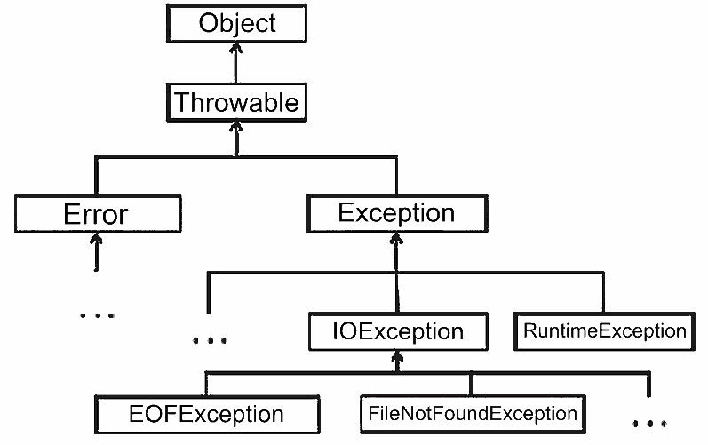
**图 23.1 | 异常类层次的一部分**

所有类都继承自 `Throwable` 类。在 `Throwable` 类下方是 `Error` 和 `Exception` 类。继承自 `Error` 的类用于发生严重错误时抛出的异常，例如 Java 机器的内部错误或内存耗尽。你不应该处理这些异常，因为它们是严重的情况。你将处理的所有异常都是继承自 `Exception` 的类的实例。

异常层次的一部分显示了其中两个类作为父类：

* `IOException` 是与输入输出操作相关的异常的父类。
* `RuntimeException` 是源于编程错误（如下标越界）的异常的父类。

异常层次的一部分显示了两个自 `IOException` 的类：`EOFException` 和 `FileNotFoundException`。这些是创建异常对象的类。`EOFException` 对象在应用程序尝试读取文件末尾之外时抛出，而 `FileNotFoundException` 对象在应用程序尝试打开一个不存在的文件时抛出。

***

# 检查异常与未检查异常

在 Java 中，异常分为两类：未检查异常和检查异常。

## 未检查异常

未检查异常是继承自 `Error` 类或 `RuntimeException` 类的异常。记得继承自 `Error` 的异常是在发生严重错误时抛出的。你不应该处理这些异常，因为产生这些异常的情况很少在程序中处理。记得 `RuntimeException` 是源于编程错误（如下标越界）的异常的父类。最好不要处理这些异常，因为它们可以通过编写良好的代码来避免。所以你不应该处理未检查异常。

## 检查异常

所有剩余异常（即未继承自 `RuntimeException` 的异常）都是检查异常。这些是你应该在程序处理的异常。如果方法中的代码可能抛出检查异常，那么该方法必须满足以下要求之一：

* 它必须处理异常 - 或
* 它必须在方法处理器中列出 `throws` 子句。`throws` 子句告知编译器可能从方法抛出的异常。

这里有一个简单的示例。

```java
// 此方法无法编译

public void displayFile(String name) {

    // 打开文件

    File file = new File(name);

    Scanner inputFile = new Scanner(file);

    // 读取并显示文件内容

    while (inputFile.hasNext()) {

        System.out.println(inputFile.nextLine());

    }

    // 关闭文件

    inputFile.close();

}
```

**解析**
* 此方法中的代码能够抛出 `FileNotFoundException`，这是一个检查异常。
* 因为该方法没有处理此异常，因此它在方法头部中必须有一个 `throws` 子句，否则将无法通过编译。
* `throws` 关键字写在方法头部的末尾，后面紧跟该方法可能抛出的异常类型列表。

修改后的方法头部：

```java
public void displayFile(String name) throws FileNotFoundException
```

`throws` 子句告诉编译器，此方法可能会抛出 `FileNotFoundException`（如果有多种类型的异常，请用逗号将它们隔开）。现在你知道为什么在之前的章节中，你在方法上写了 `throws` 子句了。我们必须告知编译器，我们的方法可能会将这些异常向上传递给调用堆栈。

### Summary

- 异常（exception）是程序执行过程中发生的非预期事件。当异常发生时，它会中断程序的正常执行流。
- 为了防止异常导致程序崩溃，你必须编写检测并处理异常的代码。当产生异常时，称该异常被“抛出”（thrown）。除非应用程序检测并处理该异常，否则它会导致应用程序停止。
- 异常处理器（exception handler）是当异常被抛出时做出响应的代码段。解释和响应异常的过程称为异常处理（exception handling）。为了检测异常已抛出并防止其停止你的应用程序，Java 允许你创建异常处理器。
- 如果你的代码在异常抛出时没有处理它，则由默认异常处理器处理。默认异常处理器会打印错误信息并导致程序崩溃。
- 可能抛出某些异常的代码必须使用 `try-catch` 或 `throws` 关键字括起来。
- `try` 和 `catch` 意味着就像是你尝试运行一段代码，如果发生了错误，你不会关闭程序，而是会捕获（catch）该错误并对其进行处理。
- `throws` 是 Java 中的一个关键字，用于方法签名，表示该方法可能会抛出列出的类型之一的异常。这些方法的调用者必须使用 `try-catch` 块来处理异常。Java 中的 `throw` 关键字用于从方法或任何代码块中显式地抛出异常。`throw` 关键字主要用于抛出自定义异常。
- 你可以编写抛出标准 Java 异常的代码，或者抛出你设计的自定义异常类的实例。你可以使用 `throw` 语句来手动抛出异常。
- 在 java 中，有三种方法可以找到异常的细节。它们分别是：使用 `java.lang.Exception` 类对象、`public void printStackTrace()` 方法和 `public string getMessage()` 方法。
- 在处理异常时，可以使用多态引用作为 `catch` 子句的参数。例如：我们处理过的所有异常都继承自 `Exception` 类。因此，使用 `Exception` 类型变量的 `catch` 子句能够捕获任何继承自 `Exception` 的异常。
- 超类类型的引用变量可以引用子类对象。这被称为多态（Polymorphism）。在处理异常时，你可以使用多态引用作为 `catch` 子句的参数。
- 然而在许多情况下，`try` 块中的代码可能会抛出不止一种类型的异常。在这种情况下，你需要为每种可能抛出的异常类型编写一个 `catch` 子句。
- `finally` 块包含了所有无论是否发生异常都执行的关键语句。
- 所有异常对象都有一个继承自 `Throwable` 类的 `printStackTrace` 方法，该方法可以打印堆栈跟踪（stack trace）。
- 异常是一个对象。异常对象是从 Java 中的类创建的。Java 拥有广泛的异常类层次结构。所有类都继承自 `Throwable` 类。紧邻 `Throwable` 类之下的是 `Error` 和 `Exception` 类。
- 继承自 `Error` 的类用于发生严重错误时抛出的异常，例如 Java 虚拟机的内部错误或内存耗尽。你的应用程序不尝试处理这些错误，因为它们是严重状况的结果。你将处理的所有异常都是继承自 `Exception` 的类的实例。异常类层次结构的一部分：显示了其中两个类：`IOException` 和 `RuntimeException`。这些类也充当父类。`IOException` 是与输入输出操作相关的异常的父类。`RuntimeException` 是由于编程错误（如数组下标越界）导致的异常的父类。
- 在 Java 中，异常分为两类：未检查异常（unchecked）和已检查异常（checked）。未检查异常是继承自 `Error` 类或 `RuntimeException` 类的异常。其余异常（即不继承自 `Error/RuntimeException` 的异常）都是已检查异常。这些是你应该在程序处理的异常。
- `main` 方法不应该抛出任何异常，因为 `main` 方法是由 `JVM` 调用的，`JVM` 无法提供用户友的消息。

1:https://howtodoinjava.com/java/exception-handling/throw-vs-throws/

## 第 24 章 Java 文件 I/O

在变量和数组中存储的数据是暂时的，一旦程序停止运行或电源关闭，就会消失。对于永久存储，我们使用文件，文件是存储在计算机辅助内存中的数据集合，如硬盘、CD-ROM、DVD-ROM 和 USB 内存棒。文件被组织成目录（有时称为文件夹）。目录可以包含其他目录，也可以包含文件。通过 Java，我们可以从现有文件中读取数据、创建新文件、向文件写入数据等。在 Java 中，主要的 I/O 被称为流（streams）。输入流表示输入源，输出流表示可以发送输出的目的。有许多预定义类表示各种类型的流。Java 有两大类流：字节流（byte-streams）：处理机器格式的数据

- 对于读取机器格式的数据，主类是 `InputStream` 类。
- 对于写入机器格式的数据，主类是 `OutputStream` 类。
- 如果你向 `OutputStream` 写入数字，你可能将无法自己读取结果数据。但可以通过 `InputStream` 将数据读回计算机。
- 字符流（character-streams）：处理人类可读的数据（如 12.5、ABC 等）

- 对于读取人类可读字符数据，主类是 `Reader` 类。
- 对于写入人类可读字符数据，主类是 `Writer` 类。

本节讨论的标准流类定义在 `java.io` 包中，并带有若干辅助类。基础 I/O 类 `Reader`、`Writer`、`InputStream` 和 `OutputStream` 只提供了非常原始的 I/O 方法或操作，如下表 24.1 所示。

### 表 24.1 原始 I/O 类及其方法

| 类 | 方法 | 说明 |
| :--- | :--- | :--- |
| `InputStream` | `read()` | 从输入流读取一个字节数据 |
| `OutputStream` | `write()` | 向输出流写入一个字节数据 |
| `Reader` | `read()` | 从输入流读取一个字符 |
| `Writer` | `write()` | 向输出流写入一个字符 |

这并不是问题，因为相反，你将使用 `InputStream/OutputStream` 和 `Reader/Writer` 的子类，这些类增加了更方便的输入输出方法，而不是原始的功能。

### File 类

`File` 类仅允许你访问文件和文件系统元数据。通过使用 `File` 类，你可以创建文件、删除文件、重命名或移动文件、创建目录等。那么，让我们开始吧。

## 实例化 File 对象

在对文件系统或 `File` 类进行任何操作之前，你必须先创建一个 `File` 实例。以下是具体实现方法：

```java
import java.io.File;

. . .

File f = new File("c:\\dir\\file.txt");
```

#### 解释

- 第 1 行：`java.io` 包提供了一个类库，用于从任何类型的位置（磁盘、网络、内存）以流的形式读取和写入任何类型的数据（文本、数字、图像）。
- 第 2 行：创建一个 `File` 对象，并定义文件的路径 - 在此例中路径为（`c:\dir\file.txt`）。

我们将执行的是测试我们的计算机上是否存在某个文件。

## 检查文件是否存在

一旦你实例化了一个 `File` 对象，就可以检查相应的文件是否已经存在。要检查文件是否存在，我们调用 `exists()` 方法。这里有一个简单的示例。

### 示例 24.1：CheckFile.java - 检查文件是否存在

```java
01 import java.io.File;

02 public class File1 {

03 public static void main(String[] args){

04 File f = new File("D:\\Documents\\lang2.txt");

05 if(f.exists())

06 System.out.println("The " + f.getName() + " file is exists.");

07 else

08 System.out.println("The " + f.getName() + " file doesn't exists.");

09 }

10 }
```

输出（如果 lang2.txt 文件存在）：The lang2.txt file is exists.
输出（如果 lang2.txt 文件不存在）：The lang2.txt file doesn't exists.

## 如果文件不存在则创建

以下示例展示了使用 `try..catch` 语句使用 `createNewFile()` 方法。

### 示例 24.2：CreateEmptyFile.java - 使用 try.. catch 语句在文件不存在时创建文件

```java
01 import java.io.File;

02 import java.io.IOException;

03

04 public class CreateEmptyFile

05 {

06 public static void main( String[] args )

07 {

08 try {

09

10 File f = new File("d:\\new.txt");

11

12 if (f.createNewFile()){

13 System.out.println("File is created!");

14 else{

15 System.out.println("File already exists.");

16 }

17

18 catch (IOException e){

19 e.printStackTrace();

20 }

21 }
```


输出（如果 new.txt 不存在）：File is created!
输出（如果 new.txt 存在）：File already exists.

#### 解释

- 第 10 行：创建一个 `File` 对象并定义文件的路径。
- 第 12 行：如果文件创建则返回 `true`，如果文件已存在则返回 `false`。
- 第 13 行：如果第 12 行的表达式为 `true`，则执行。
- 第 15 行：如果第 12 行的表达式为 `false`，则执行。

## 如果目录不存在则创建目录

你可以使用 `File` 类在目录尚存时创建它们。`File` 类包含了用于此目的的 `mkdir()` 和 `mkdirs()` 方法。以下两个示例解释了这两种方法。

### 示例 24.3：CreateSingleDir.java - 使用 mkdir() 方法创建不存在的单目录

```java
01 package ch24;

02

03 import java.io.File;

04 import java.io.IOException;

05

06 public class CreateSingleDir

07 public static void main(String[] args){

08 try{

09 File f = new File("D:\\Documents\\MyFiles\\newDir");

10 if (f.mkdir()){

11 System.out.println("Directory is created!");

12 else{

13 System.out.println("Directory already exists.");

14 }

15 catch(Exception e) {

16 e.printStackTrace();

17 }

18 }

```

输出（如果目录不存在）：Directory is created!
输出（如果目录存在）：Directory already exists.

#### 解释

- 只要目录 `D:\Documents\MyFiles` 存在，上述代码将在 `MyFiles` 下创建一个名为 `newdir` 的子目录。
- 如果创建了目录，`mkdir()` 返回 `true`；如果目录已存在，则返回 `false`。

### 示例 24.4：CreateAllDirs.java - 使用 mkdirs() 方法创建 File 对象路径中缺失的所有目录

```java
01 package ch24;

02

03 import java.io.File;

04 import java.io.IOException;

05

06 public class CreateSingleDir {

07 public static void main(String[] args) {

08 try

09 File f = new File("D:\\Documents\\MyFiles\\newDir");

10 if (f.mkdirs()){

11 System.out.println("Directory is created!");

12 else{

13 System.out.println("Directory already exists.");

14 }

15 catch(Exception e){

16 e.printStackTrace();

17 }

18 }

```

输出（如果路径不存在）：Directory is created!
输出（如果目录存在）：Directory already exists.

#### 解释

- 假设目录 `D:\Documents\MyFiles` 存在，上述代码将创建路径中缺失的所有目录。
- `mkdirs()` 方法在创建了目录时返回 `true`，如果目录已存在。

```java
public static void main(String[] args) {

    File f = new File("D:\\Documents");

    boolean isDir = f.isDirectory();

    if (isDir){

        System.out.println("Directory is exists.");

    }else{

        System.out.println("Directory doesn't exists.");

    }

}
```

### 输出（如果目录已存在）
Directory is exist.

#### 解释
- 第 08 行：如果 `File` 指向一个目录，`isDirectory()` 方法返回 `true`；如果 `File` 指向一个文件，则返回 `false`。

## 读取目录中的文件列表
你可以通过调用 `list()` 方法或 `listFiles()` 方法获取目录中所有文件的列表。下面的示例解释了这两种方法。

### 示例 24.9：ReadListFiles.java
```java
package ch24;

import java.io.File;

import java.io.IOException;

public class ReadListFiles {

    public static void main(String[] args) throws IOException {

        File f = new File("D:\\Documents");

        String[] fileNames = f.list();

        File[] files = f.listFiles();

        for (int i = 0; i < fileNames.length; i++){

            System.out.println(fileNames[i]);

        }

        for (int j = 0; j < files.length; j++){

            System.out.println(files[j]);

        }

    }

}
```

### 输出
dir1
New Text Document - Copy (2).txt
New Text Document - Copy (3).txt
New Text Document - Copy.txt
New Text Document.txt
D:\Documents\dir1
D:\Documents\New Text Document - Copy (2).txt
D:\Documents\New Text Document - Copy (3).txt
D:\Documents\New Text Document - Copy.txt
D:\Documents\New Text Document.txt

#### 解释
- `list()` 方法返回一个 `String` 数组，包含 `File` 对象所指向目录的文件和/或目录名称。
- `listFiles()` 方法返回一个 `File` 对象数组，代表 `File` 所向目录中的文件和/或目录。

***

## 文本文件
### 使用 PrintWriter 类向文本文件写入数据
`PrintWriter` 类提供了输出可读字符表示的便捷方法。以下是实现方法。

### 示例 24.10：DataToFile.java - 向文本文件写入数据
```java
package ch24;

import java.io.File;

import java.io.PrintWriter;

public class DataToFile {

    public static void main(String[] args) {

        try{

            PrintWriter outputFile = new PrintWriter("d:\\Number.txt");

            int x = 1297;

            // 将变量 x 的内容写入 d:\\Number.txt 文件

            outputFile.print(x);

            outputFile.flush();

            // 然而，当数字被写入时，

            // 它存储为字符

            // '1','2','9' 和 '7'

        }catch(Exception e){

            System.out.println("Error" + e.getMessage());

        }

    }

}
```
以字符表示的数字 1297：
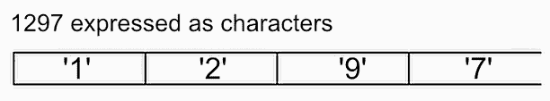
图 24.1 | 以字符表示的数字 1297

***

## 二进制文件
包含原始二进制数据的文件被称为二进制文件。二进制文件的内容不是以文本格式格式化的，且不用于在文本编辑器中打开。以二进制格式存储数据比作为文本存储更高效，因为需要进行的转换较少。此外，某些类型的数据应该只以原始二进制格式存储。图像就是一个例子。然而，当数据存储在二进制文件中时，你无法用记事本等文本编辑器打开文件。

### 向二进制文件写入数据
要向二进制文件写入数据，你必须从以下类创建对象：

| 类 | 说明 |
| :--- | :--- |
| `FileOutputStream` | 此类允许你打开一个文件写入二进制数据并与其建立连接。它仅提供了向文件写入字节的基本功能。 |
| `DataOutputStream` | 此类允许你向二进制文件写入任何原始类型的数据或 `String` 对象。 |

`DataOutputStream` 类默认无法直接访问文件。然而，`DataOutputStream` 类通常与已建立文件连接的 `FileOutputStream` 对象结合使用。你将 `DataOutputStream` 对象封装在 `FileOutputStream` 对象周围，以向二进制文件写入数据。下面的示例显示了如何打开名为 `MyInfo.dat` 的文件进行二进制输出。

### 示例 24.11：MyInfo.java
```java
package ch24;

import java.io.DataOutputStream;

import java.io.FileOutputStream;

import java.io.IOException;

public class MyInfo {

    public static void main(String[] args) throws IOException {

        FileOutputStream fstream = new FileOutputStream("MyInfo.dat");

        DataOutputStream outputFile = new DataOutputStream(fstream);

    }

}
```
#### 解释
- 第 09 行：创建 `FileOutputStream` 类的实例，它具有打开文件进行二进制输出并与其建立连接的能力。你传递想要打开的文件名。
- 第 10 行：创建 `DataOutputStream` 类的实例。

```java
18 System.out.println("Reading numbers from the file:");

// 读取文件内容。

while (!endOfFile) {

    try {

        number = inputFile.readInt();

        System.out.print(number + " ");

    } catch (EOFException e) {

        endOfFile = true;

    }

}

System.out.println("\nDone.");

// 关闭文件。

inputFile.close();

}
```

### 输出
正在从文件中读取数字：
2 4 6 8 10 12 14
Done.

#### 解释
* `close()`: 关闭文件。
* `readInt()`: 从文件中读取一个 `int` 值并返回它。
* `readUTF()`: 从文件中读取一个字符串并将其作为 `String` 对象返回。该字符串必须是用 `DataOutputStream` 类的 `writeUTF` 方法写入的。
* `readChar()`: 从文件中读取一个 `char` 值并返回它。该字符预计是以双字节 Unicode 字符的形式存储的，正如 `DataOutputStream` 类的 `writeChar` 方法写入的那样。

## 字符串的写入与读取
向二进制文件写入 `String`，你应该使用 `DataOutputStream` 类的 `writeUTF` 方法。该方法以 UTF-8 编码格式写入其 `String` 参数。`UTF` 代表 Unicode 文本格式。请参考下面的示例。

### 示例 24.14：WriteUTF.java
```java
package ch24;

import java.io.*;

public class WriteUTF {

    public static void main(String[] args) throws IOException {

        String names[] = { "Mohammed", "Mustafa", "Shereen", "Mansour", "Abd-Elrahman", "Nuha"};

        // 创建输出对象。

        FileOutputStream fstream = new FileOutputStream("d:\\UTFnames.dat");

        DataOutputStream outputFile = new DataOutputStream(fstream);

        System.out.println("Writing the names to the file...");

        // 将数组元素写入文件。

        for (int i = 0; i < names.length; i++)

            outputFile.writeUTF(names[i]);

        System.out.println("Done.");

        // 关闭文件。

        outputFile.close();

    }

}
```


### 输出
正在将名字写入文件...
Done.

#### 解释
* 假设 `outputFile` 引用一个 `DataOutputStream` 对象，以下代码使用 `writeUTF` 方法写入字符串：
  `String name = "Chloe";`
  `outputFile.writeUTF(name);`

从二进制文件中读取字符串，你应该使用 `writeUTF` 方法。该方法用于从文件中读取 UTF 编码的字符串。这里有一个示例。

### 示例 24.15：ReadUTF.java
```java
package ch24;

import java.io.*;

public class ReadUTF {

    public static void main(String[] args) throws IOException {

        String name;

        boolean endOfFile = false;

        // 创建输入对象。

        FileInputStream fstream = new FileInputStream("d:\\UTFnames.dat");

        DataInputStream inputFile = new DataInputStream(fstream);

        System.out.println("Reading the names from the file:");

        // 读取文件内容。

        while (!endOfFile) {

            try {

                name = inputFile.readUTF();

                System.out.print(name + " ");

            } catch (EOFException e) {

                endOfFile = true;

            }

        }

        System.out.println("\nDone.");

        // 关闭文件。

        inputFile.close();

    }

}
```

### 输出
正在从文件中读取名字：
Mohammed Mustafa Shereen Mansour Abd-Elrahman Nuha
Done.

#### 解释
* 假设 `inputFile` 引用一个 `DataInputStream` 对象，以下语句使用 `readUTF` 方法从文件中读取一个 UTF-8 编码的字符串：`String name = inputFile.readUTF();`

**记住**：只有当字符串是用 `writeUTF` 方法写入时，`readUTF` 方法才能正确读取该字符串。

## 向现有的二进制文件追加数据
如果你向 `FileOutputStream` 构造函数传递一个现有文件的名称，它将被擦除并创建一个同名的空文件。`FileOutputStream` 构造函数接受一个可选的第二个参数，该参数必须是一个布尔值（true 或 false）。

* `TRUE`: 如果文件已存在，则不会被擦除，新数据将写入到文件的末尾。
* `FALSE`: 如果文件已存在，则文件将被擦除。

### 示例 24.16：为了输出打开 MyInfo.dat 文件
如果文件存在，它将不会被删除，任何写入文件的数据将追加到现有数据之后：
```java
FileOutputStream fstream = new FileOutputStream("MyInfo.dat", true);

DataOutputStream outputFile = new DataOutputStream(fstream);
```

***

## 随机访问文件
到目前为止你创建的所有访问文件的程序都执行的是顺序访问。在顺序访问中，当打开文件时，其位置位于文件的开头。`RandomAccessFile` 允许程序跳转到文件中的任何位置。这意味着：

* 从文件中的任何字节位置读取数据。
* 将数据写入文件中的任何位置，覆盖现有数据。

通用格式：`RandomAccessFile(String filename, String mode)`

#### 解释
* `filename`: 文件的名称。
* `mode`: 指定你希望使用的文件模式。模式有 `r` 用于读取，`rw` 用于读写。

### 示例 24.17：OpenFile.java
```java
package ch24;

import java.io.*;

public class OpenFile {

    public static void main(String[] args) throws IOException {

        // 以读取模式打开文件

        RandomAccessFile randomFile = new RandomAccessFile("MyData.dat", "r");

        // 以读写模式打开文件

        RandomAccessFile randomFile = new RandomAccessFile("MyData.dat", "rw");

    }

}
```

### 输出
（如果 MyData.dat 存在）
线程 "main" java.io.FileNotFoundException: d:\MyData.dat（找不到文件）

（如果 MyData.dat 不存在）
线程 "main" java.io.FileNotFoundException: d:\MyData.dat（找不到文件）

## 使用 RandomAccessFile 写
使用 `RandomAccessFile` 类处理二进制文件。在下面的示例中，我们使用 `RandomAccessFile` 类以读写模式打开 `Letters.dat` 文件。然后我们使用 `writeChar()` 方法将数组数据写入 `Letters.dat` 文件。

### 示例 24.18：WriteLetters.java
```java
import java.io.*;

public class WriteLetters {

    public static void main(String[] args) throws IOException {

        char[] letters = {'a', 'b', 'c', 'd'};

        System.out.println("Opening the file.");

        // 以读写模式打开文件。

        RandomAccessFile randFile = new RandomAccessFile("Letters.dat", "rw");

        System.out.println("Writing data to the file...");

        // 顺序将字母数组写入文件。

        for (int i = 0; i < letters.length; i++)

            randFile.writeChar(letters[i]);

        // 关闭文件。

        randFile.close();

        System.out.println("Done.");

    }

}
```

### 输出
打开文件。
正在向文件写入数据...
Done.

#### 解释
* 第 12 行：以读写 (`rw`) 打开名为 `Letters.dat` 的文件。
* 第 19 行：使用 `writeChar()` 方法将字母表中的数据写入 `Letters.dat` 文件。

`RandomAccessFile` 类将文件视为字节流。这些字节是有编号的，第一个字节为 `byte 0`。最后一个字节的编号比文件中的字节总数少 1。在内部，`RandomAccessFile` 类维护着一个名为文件指针（file pointer）的长整型（long）值。文件指针持有文件中某个位置的字节数。当文件被首次打开时，文件指针被设置为 `0`。这使得它“指向”文件中的第一个字节。当从文件中读取项时：

* 它从文件指针所指向的字节开始读取。
* 它会使文件指针移动到已读取项之后的的一个字节。

写入操作也发生在文件指针所指向的位置。若要移动文件指针，您需要使用 `seek()` 方法。

```java
void seek (long position)
```

参数是您想要让文件指针移动到的字节数。请参考下面的示例。

### 示例 24.19 : SeekEx.java
```java
package ch24;

import java.io.IOException;

import java.io.RandomAccessFile;

public class SeekEx {

    public static void main(String[] args) throws IOException{

        try {

            RandomAccessFile f = new RandomAccessFile("d:\\MyInfo.dat", "r");

            f.seek(99);

            byte b = f.readByte();

        } catch (IOException e){

            System.out.println(e.getMessage());

        }

    }

}
```
**输出（如果文件已存在）：** `null`（意味着文件为空）
**输出（如果文件不存在）：** `MyInfo.dat (The system cannot find the file specified)`

### 解析
* 第 09 行：代码以读取模式打开文件 `MyInfo.dat`。
* 第 10 行：调用 `seek` 方法将文件指针移动到字节数 `99`（即文件中的第 100 个字节）。
* 第 11 行：`readByte` 方法从文件中读取字节数为 `99` 的字节。

语句执行后，文件指针将移动一个字节，因此它将指向字节 `100`。

### 示例 24.20 : 假设我们使用以下代码继续处理同一个文件
```java
RandomAccessFile f = new RandomAccessFile ("MyInfo.dat", "r");

f.seek(49);

int i = f.readInt();
```
### 解析
* 第 1 行：代码以读取模式打开文件 `MyInfo.dat`。
* 第 2 行：`seek` 方法将文件指针移动到字节数 `49`。
* 第 3 行：`readInt` 方法从文件中读取一个 `int`。一个 `int` 的大小为 4 字节，因此该语句从字节数 `49` 开始读取 4 个字节。

语句执行后，文件指针将移动 4 个字节，因此它将指向字节 `53`。

尽管文件可能包含字符、整数、双精度浮点数、字符串等，但 `RandomAccessFile` 类仅将其视为字节流（Stream of bytes）。让我们来看一个例子。

### 示例 24.21 : FilePtr.java
```java
package ch24;

import java.io.IOException;

import java.io.RandomAccessFile;

public class FilePtr {

    public static void main(String[] args) throws IOException {

        // 打开文件进行读取。

        RandomAccessFile randFile = new RandomAccessFile("d:\\UTFnames.dat", "r");

        // 将文件指针移动到字节 5，即第 6 个字节

        randFile.seek(5);

        // 读取字符

        Character ch = randFile.readChar();

        // 这将显示什么？

        System.out.println(" The 6th letter is " + ch);

    }

}
```
**输出：** `The 6th letter is`

`readChar` 方法将字符写入为 2 个字节，因为每个字符在文件中占用两个字节，第 6 个字符从字节 `10` 开始，而不是字节 `5`。事实上，如果我们尝试从字节 `5` 开始读取字符，我们将读到垃圾数据，因为字节 `5` 并不是字符的开头。要确定字符在文件中的位置，必须考虑每个字符的大小。

### 注意事项
* 如果文件指针指向的字节数超出文件范围，在执行读取操作时将抛出 `EOFException`。
* 如果在执行写入操作时文件指针指向文件末尾，则数据将写入文件末尾。
* 如果文件指针持有文件内的某个字节数，且该位置已存储数据，则写入操作将覆盖该位置的现有有数据。

### 示例 24.22 : FilePtr2.java - 正确读取并显示第 6 个字符
（字符 X 的大小为我们要定位的字符的数目）。
```java
package ch24;

import java.io.FileNotFoundException;

import java.io.IOException;

import java.io.RandomAccessFile;

public class FilePtr2 {

    public static void main(String[] args) throws IOException {

        final int CHAR_SIZE = 2; // 每个 char 使用 2 字节

        // 打开文件进行读取。

        RandomAccessFile randFile = new RandomAccessFile("d:\\UTFnames.dat", "r");

        // 将文件指针移动到字节 5，即第 6 个字节

        randFile.seek(5);

        // 读取字符

        Character ch = randFile.readChar();

        // 这将显示什么？

        System.out.println(" The 6th letter is " + ch);

    }

}
```


**输出：** `The 6th letter is`

---

## 总结

*   `File` 类允许你访问底层文件系统。
*   在对文件系统进行任何操作之前，必须获取 `File` 实例。
*   一旦实例化了 `File` 对象，就可以检查相应的文件是否存在。
*   你可以使用 `File` 类创建不存在的目录。`File` 类包含 `mkdir()` 和 `mkdirs()` 用于此目的。
*   如果 `mkdirs()` 创建了路径中的所有目录，将返回 `true`。
*   要重命名文件，请调用 `File` 的 `renameTo()` 方法。
*   如前所述，`renameTo()` 方法也可用于移动文件到不同的目录。传递给 `renameTo()` 的新文件名不需要位于文件所在的目录。
*   `renameTo()` 方法返回 `true` 或 `false`，表示重命名是否成功。
*   调用 `delete()` 方法删除文件。
*   你可以通过调用 `list()` 或 `listFiles()` 获取目录中的所有文件。`list()` 方法返回 `File` 所向目录的文件或目录名的 `String` 数组。`listFiles()` 返回表示 `File` 所向目录的文件或目录的 `File` 对象数组。
*   要向二进制文件写入字符串，应使用 `DataOutputStream` 类的 `writeUTF`。
*   如果你将现有文件的名称传递给 `FileOutputStream` 构造函数，它将被擦除并创建一个同名的空文件。`FileOutputStream` 构造函数接受一个可选的第二个参数。

## 第三部分：构建图形界面应用程序

> “用户界面是从混乱的复杂性转向优雅简单的过程。” – Akshat Paul，React Native for iOS

## 第 25 章：JavaFX 布局

Java 程序可以拥有图形界面（GUI），包含按钮、列表、菜单、复选框等许多其他控件，允许用户与应用程序交互。现在 JavaFX 是我们将在书中用于构建界面的工具。

### 什么是 JavaFX？

JavaFX 是一套 Java 包，允许开发者设计、创建、测试、调试和部署在不同平台（如 Windows、Linux 和 Mac）上一致运行的 GUI。JavaFX 是 Swing 的继任者，Swing 是多年来推荐的 Java 用户界面（UI）工具包，但现在 Oracle 的方向是使用 JavaFX。JavaFX 用于开发桌面应用程序、互联网应用程序和移动应用程序的用户界面。

编写 JavaFX 应用程序有两种截然不同的方法：

*   方法 1 - 使用 FXML 代码（推荐且本书中使用的方法）。
*   方法 2 - 使用纯 Java 代码。

---

### 创建你的第一个 JavaFX 应用程序

IntelliJ IDEA 有一个支持 JavaFX 应用程序的插件，该插件在 IntelliJ IDEA 中默认安装并启用。因此，要创建你的第一个 JavaFX 应用程序，请执行以下步骤：

1.  在欢迎界面上点击 `Create New Project`。或者选择 `File > New > Project`。新项目向导会随之打开。
2.  在左侧窗格中，选择 `JavaFX` 类别。在页面右侧选择 `JavaFX application`。

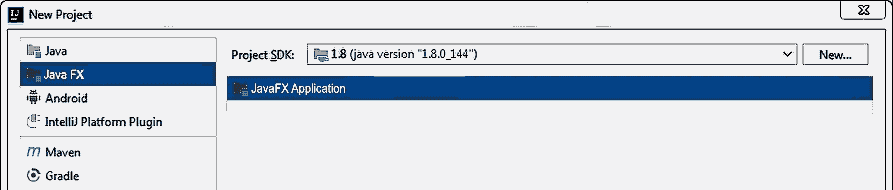

3.  你还可以指定项目使用的 `JDK`（`Project SDK` 字段）。从列表中选择 `JDK`，或者点击 `New > select JDK` 并选择所用 `JDK` 的安装文件夹。点击 `Next`。
4.  在 `Project name` 字段中，为你的新项目输入一个名称（例如 `JavaFXProject`）。你可以更改 `Location` 字段中显示的默认文件系统位置。点击 `Finish`。

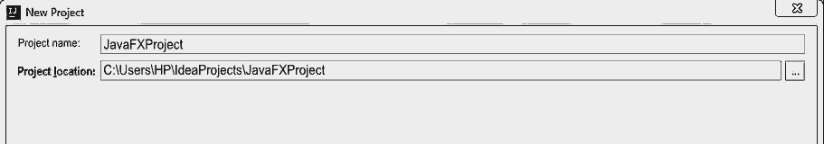

等待 IntelliJ IDEA 创建项目。当此过程完成后，新项目的结构将显示在 `Project` 工具窗口中。完成后，你将获得用于 JavaFX 应用程序的一些启动文件。

### 探索项目文件

项目文件的设计考虑了“模型-视图-控制器”（MVC）模式。`MVC` 将应用程序分为三类组件：`Model`（模型）、`View`（视图）和 `Controller`（控制器）设计。

*   `View` 可以是信息的任何输出表示形式，例如图表。
*   `Model` 是该模式的核心组件。它直接管理应用程序的数据、逻辑和规则。
*   `Controller` 是决定当用户与用户界面交互时发生什么情况的代码。

让我们快速查看 IntelliJ IDEA 项目窗格中包含的内容：

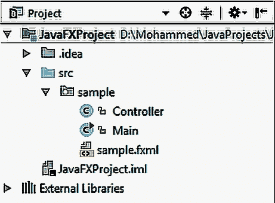

`src` 文件夹用于你的源代码。在该文件夹中，已经有一个名为 `sample` 的包，其中包含三个文件：

*   `sample.fxml`。这是用于定义用户界面（`View`）的 `FXML` 文件。
*   `Main.java`（启动类）。这是启动应用程序的主应用程序类。该类将从 `FXML` 文档（在此例中为 `sample.fxml`）加载一个 `Scene` 并将其置于 `Stage` 或 `Window` 上。所有 `FXML` 文档都需要一个打开的“Scene”和一个“Stage”来放置。该文档正是这样做的（`Model`）。
*   `Controller.java`。该文件包含用户与程序或用户界面交互时运行所需的代码（Controller）。

对于这个简单的应用程序，显然没有任何数据，而且 IntelliJ 生成的代码默认并不会创建任何 Java UI 控件。

### 运行示例应用程序

为了确保项目一切正常，让我们立即运行示例应用程序：

1.  点击 `Run > Run ‘Main’` 或点击工具栏上的图标。
2.  IntelliJ IDEA 编译源代码然后启动应用程序。应用程序窗口将会出现，目前它是空的。

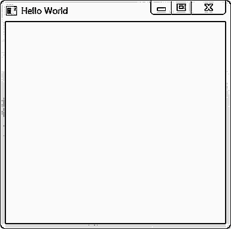

3.  关闭应用程序窗口。

---

## JavaFX 应用程序骨架

无论你使用哪种技术来编写 JavaFX 程序，所有的 JavaFX 应用程序都共享相同的基本骨架。因此，在查看更多 JavaFX 特性之前，查看该骨架的样貌将很有帮助。

### Controller.java 类

```java
package sample;

public class Controller {

}
```

你可以看到在现阶段它实际上是空的，因为我们还没有添加任何控件，如按钮、菜单和标签。控制器通常用于为 FXML 文件中定义的用户界面实现事件处理程序。

### Main.java 类

```java
01 package sample;

02 import javafx.application.Application;

03 import javafx.fxml.FXMLLoader;

04 import javafx.scene.Parent;

05 import javafx.scene.Scene;

06 import javafx.stage.Stage;

07

08 public class Main extends Application {

09

10 @Override

11 public void start(Stage primaryStage) throws Exception{

12 Parent root =

13 FXMLLoader.load(getClass().getResource("sample.fxml"));

14 primaryStage.setTitle("Hello World");

15 primaryStage.setScene(new Scene(root, 300, 275));

16 primaryStage.show();

17 }

18

19 public static void main(String[] args) {

20 launch(args);  // or Application.launch(args)

21 }

22

}
```

#### 解释

*   第 01 行：使用 `package` 关键字将 `Main` 类添加到 `sample` 包中。
*   第 02-06 行：导入运行 `Main` 应用程序所需的类。
*   第 08 行：`Main` 类是你创建的主启动类（JavaFX 应用程序要求）。该类将是 JavaFX 应用程序的入口点。`Main` 类包含两个方法：`main()` 方法和 `start()` 方法。
*   第 11 行：当 JavaFX 应用程序启动时会调用或执行 `start()` 方法。它接收一个类型为 `Stage` 的参数。stage 是扩展了窗口类的顶层 JavaFX 容器。JavaFX 运行时会自动构造初始阶段并将其作为参数传递给 `start` 方法。
*   第 13 行：从 `sample.fxml` 加载 UI。
*   第 14 行：通过调用 `setTitle()` 方法设置阶段标题。标题将成为应用程序的名称。
*   第 15 行：加载 `FXML` 文件并将其赋值给 `Parent` 变量 `root`。我们构造了一个场景（scene）。
*   第 16 行：`show()` 方法显示窗口（即 stage）及其场景。
*   第 19-21 行：`main()` 方法通过调用 `launch()` 方法启动应用程序。静态 `launch()` 方法位于应用程序类中。它启动 JavaFX 运行时和你的 JavaFX 应用程序。

注意 `main()` 方法的 `args` 参数被传递给了 `launch()` 方法。你可以向 `launch()` 传递不同的参数或不传递。

### sample.fxml 文件

```xml
01 <?import javafx.geometry.Insets?>

02 <?import javafx.scene.layout.GridPane?>

03

04 <?import javafx.scene.control.Button?>

05 <?import javafx.scene.control.Label?>

06 <GridPane fx:controller="sample.Controller"

07 xmlns:fx="http://javafx.com/fxml" alignment="center" hgap="10" vgap="10">

08 </GridPane>
```

#### 解释

FXML 是一种用于构建 JavaFX 应用程序用户界面的 XML 语言。

*   第 01、02、04 和 05 行：导入运行应用程序所需的类。
*   第 06-08 行：创建一个 `GridPane` 布局。
    *   `GridPane` 布局是 FXML 文档的根元素，因此具有两个属性。
    *   `fx:controller` 属性允许调用者将“控制器”类与 FXML 文档关联。
    *   `xmlns:fx` 属性是必须的，它指定了 `fx` 命名空间。
    *   `alignment` 属性将网格的默认位置从场景的左上角更改为中心。
    *   `gap` 属性管理行与列之间的间距。

注意：我们不需要构建一个新的 `stage` 对象。在实践中，我们加载一个不同的 `fxml` 文件到新的 `scene` 中，然后直接调用它。

### JavaFX 应用程序中的三个文件

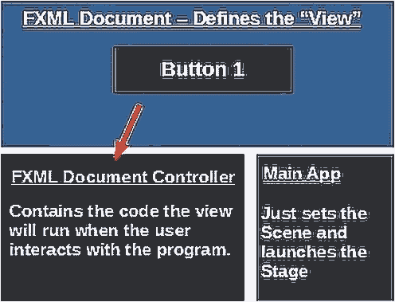

让程序显示在屏幕上的三个主要对象（从外到内）是：

#### 第一：STAGE（舞台/阶段）

这是应用程序的顶层容器。每个应用程序都有一个 `stage`，它负责显示一个 `scene`（场景）。在 JavaFX 语言中，整个窗口被称为 `stage`。这里的整个窗口（包括关闭、最大化、最小化按钮）都称为 `stage`。


*图 25.1 | 舞台 (The Stage)*

#### 第二：SCENE（场景）

由 `stage` 直接包含的对象。`scene` 包含了 GUI 的所有元素。可以设计几个场景并使用 `Stage` 在它们之间切换。你窗口内部或 `stage` 内部的内容就是 `scene`。在 `scene` 上，我们将放置所有酷炫的内容，如绑定、组件等。


*图 25.2 | 场景 (The Scene)*

所以记住，他们不称其为窗口。你窗口内部的东西他们称为 `scene` 中的 `stage`。

#### 第三：ROOT Pane/Container（根窗格/容器）

此对象持有应用程序的所有部分，如按钮、标签、文本字段等。根容器可以使用多个 JavaFX 容器来表示，例如 `StackPane`、`GridPane` 和 `BorderPane`。


---

## JavaFX 布局

JavaFX 布局是一种布局容器类（也称为 `pane`），用于轻松地管理 JavaFX 应用程序的用户界面组件或控件。JavaFX 提供了以下内置布局（也称为根窗格）：


*图 25.3 | JavaFX 内置布局*

但在进入布局之前，我只想讨论一下 JavaFX 控件的首选大小。

### 首选大小 (Preferred size)

首选大小意味着控件的首选宽度和高度。默认情况下，每个用户界面 (UI) 控件根据其内容计算其首选大小的默认值。例如，`Button` 的计算大小由文本的长度和大小决定。图 1.4 显示了网格中几个按钮的默认大小。


*图 25.4 | 首选大小 (Preferred Sizes)*

UI 控件还提供了基于控件典型用途的默认最小最大尺寸。例如，`Button` 对象的最大大小默认为首选大小，因为你通常不希望按钮无限增长。然而，`ScrollPane` 对象的最大大小是无界的，因为通常你确实希望它们增长以填充空间。

### GridPane 布局

JavaFX `GridPane` 是一种布局组件，它在网格中布局其子组件。网格中的每个位置都称为一个 `cell`（单元格）。网格中单元格的大小取决于 `GridPane` 中显示的的组件，但遵循一些规则。

*   同一行的所有单元格高度相同。该行的高度可以与其中包含的最高控件一样高。
*   同一列的所有单元格宽度相同。该列的宽度将与其包含的最宽控件一样宽。
*   不同行可以有不同的高度。
*   不同列可以有不同的宽度。
*   子元素可以跨越多个行或列。
*   子元素可以在行或列内自由重叠，它们的堆叠顺序将由网格面板子列表的顺序定义（第一个节点在后面，最后一个节点在前面）。

> **注意**：当你向 `GridPane` 添加组件时，你需要告诉它该组件应该插入到哪个单元格（行，列），以及该组件应该跨越多少行和多少列。

### 创建 GridPane

1.  创建一个名为 `GridPane` 的新 JavaFX 项目。
2.  将 `Stage` 的 `title` 属性设置为 `GridPane Layout`。进入 `Main.java` 类文件并修改以下代码：

```java
primaryStage.setTitle("GridPane Layout");
```

3.  使用 `FXML` 创建 `GridPane`。进入 `sample.fxml` 文件，在第 2 行我们有一个 grid pane 的导入，显然第 6 行你可以看到 `GridPane` 这个词，所以基本上这就是已经配置好的网格布局。

```xml
<GridPane fx:controller="sample.Controller"
xmlns:fx="http://javafx.com/fxml"
alignment="center" hgap="10" vgap="10">
</GridPane>
```

#### 向 GridPane 布局添加子元素

使用 JavaFX 中的 `<Button>` 元素向此网格添加四个按钮。点击 `<GridPane>` 元素内部并输入以下内容：

```xml
<?import javafx.geometry.Insets?>
<?import javafx.scene.layout.GridPane?>
<?import javafx.scene.control.Button?>
<?import javafx.scene.control.Label?>

<GridPane fx:controller="sample.Controller"
xmlns:fx="http://javafx.com/fxml" alignment="center" hgap="10" vgap="10">
    <Button text="One"/>
    <Button text="One Two"/>
    <Button text="One Three"/>
    <Button text="One Three Four"/>
</GridPane>
```


<Button text="One" GridPane.rowIndex="0" GridPane.columnIndex="0"/>

<Button text="One Two" GridPane.rowIndex="1" GridPane.columnIndex="0"/>

<Button text="One Three" GridPane.rowIndex="0" GridPane.columnIndex="1"/>

<Button text="One Three Four" GridPane.rowIndex="1" GridPane.columnIndex="1"/>

</GridPane>

* 运行程序。查看结果  屏幕显示如下：
* 运行程序。查看结果  屏幕显示如下：
* 运行程序。查看结果  我们可以看到所有按钮。


每当你遇到困难或事情没有按照你预期的方式进行时，请确保你添加了 `gridLinesVisible="true"`。

### 缩放包含 GridPane 的窗口
当我们缩放包含 `GridPane` 的窗口时，网格会保持在中心。
如果我们把窗口缩小或放大，它仍然会自动居中。它不会发生缩放，因为它的 own 已经足够大，可以容纳所有单元格中的所有子控件。

* 那么，让我们给另一个按钮添加更多文本，使其变得非常长，看看实际上发生了什么。打开 `sample.fxml` 文件，并在第 4 个按钮中添加以下文本：
```xml
<Button text="One Two Three Four
    Four Four Four Four Four Four Four "
    GridPane.rowIndex="1"
    GridPane.columnIndex="1"/>
```
* 运行应用程序。文本被截断了。三个点表示它没有被完全获取

* 放大窗口。Grid pane 将不断缩放，直到它大到足以容纳所有的子控件：
一旦它缩放到那个水平，它就不会再尝试缩放了。

### 使用 percentWidth 属性指定 GridPane 的宽度
要让每列占据 grid panes 宽度的 50%，请执行以下步骤：

* 在 `<GridPane>` 元素之后，我们的第一个按钮之前，按回车并输入以下内容：
```xml
<?import javafx.scene.layout.ColumnConstraints?>

<GridPane fx:controller="sample.Controller"
xmlns:fx="http://javafx.com/fxml" alignment="center" hgap="10" vgap="10"
gridLinesVisible="true">
<columnConstraints>
    <ColumnConstraints percentWidth="50.0"/>
    <ColumnConstraints percentWidth="50.0"/>
</columnConstraints>
</GridPane>
```
* 运行应用程序。屏幕将如下所示：

### 解析
* 每列占据宽度的 50%。网格占据了窗口的整个宽度。
* 我们告诉 grid pane，我们希望每列占据其宽度的 50%，而不是仅仅大到足以容纳最宽的控件的首选宽度。
* 顺序非常重要。第一个列约束元素将应用于第一列，第二个列约束元素将应用于第二列，依此类推。因此，`ColumnConstraints` 类被用于设置每列的初始宽度，我们可以使用像素或百分比。

### 更改 GridPane 的对齐方式
* 要更改 grid pane 的对齐方式，我们如下使用 `alignment` 属性：
* 运行你的应用程序。屏幕将如下所示：
注意，在标题结束处、窗口顶部以及实际列开始或实际行开始的地方没有间隙。

### 在顶部添加一些内边距（padding）
在 grid pane 中添加一个 `padding` 元素，并在内部为 padding 元素添加一个 `Insets` 子元素：因此在 `GridPane` 元素内部输入：
```xml
<GridPane fx:controller="sample.Controller"
xmlns:fx="http://javafx.com/fxml" alignment="TOP_CENTER" hgap="10" vgap="10"
gridLinesVisible="true">
<columnConstraints>
    <ColumnConstraints percentWidth="50.0"/>
    <ColumnConstraints percentWidth="50.0"/>
</columnConstraints>
<padding>
    <Insets top="10"/>
</padding>
<Button text="One" GridPane.rowIndex="0" GridPane.columnIndex="0"/>
</GridPane>
```
* 运行你的应用程序。屏幕将如下所示：

### 使用 columnSpan 属性跨越多行
* 第一：将第四个按钮移动到第四行。将 `GridPane.rowIndex` 改为 2：
```xml
<Button text="One Two Three Four" GridPane.rowIndex="2" GridPane.columnIndex="0"/>
```
* 第二：让第四个按钮跨越多行
```xml
<Button text="One Two Three Four" GridPane.rowIndex="2" GridPane.columnIndex="0" GridPane.columnSpan="2"/>
```

`columnSpan` 允许你跨越超过一列。`columnIndex=0` 从第一列开始。

### 更改按钮 1 的水平对齐方式
所有按钮在它们的单元格中都是左对齐的。要更改按钮 One 的水平对齐方式，我们使用 `halignment` 属性。
```xml
<Button text="One" GridPane.rowIndex="0" GridPane.columnIndex="0" GridPane.halignment="RIGHT"/>
```

### HBox 布局
`HBox` 是一个容器，它在单行内水平方向排列所有组件，并将组件的大小调整为它们的首选宽度。如果剩余任何水平空间，`HBox` 将拉伸以填充剩余空间，而不是拉伸它的组件。
如果有任何额外的高度空间，将取决于 `fill height` 属性。当 `fill height` 为 `true`（默认值）时，`HBox` 将扩展以填充任何高度；如果为 `false`，它将尝试调整组件的大小以填充该额外高度。某些组件（子控件）无法这样调整大小，在这种情况下，额外的高度将保持为空。

#### 创建 HBox 布局
* 创建一个名为 `HBox` 的新项目。
* 打开 `sample.fxml` 文件，将 `<GridPane>` 改为 `<HBox>`，然后删除 `hgap` 和 `vgap` 属性，因为它们不适用于此布局，如下所示：
```xml
<?import javafx.scene.layout.ColumnConstraints?>

<HBox fx:controller="sample.Controller"
xmlns:fx="http://javafx.com/fxml" alignment="center">
    <Button text="OK"/>
    <Button text="Cancel"/>
    <Button text="About"/>
</HBox>
```
* 运行应用程序。右键点击 Main.java 并选择 ‘Main’。屏幕将如下所示：
三个按钮水平排列在窗口中心。按钮之间没有间隙。因为 `HBox` 的 `fill height` 属性设置为 `true`，它会占据任何高度。

#### 所有按钮具有相同的宽度
要让所有按钮具有相同的宽度，为每个按钮设置相同的 `prefWidth`（例如 70）：
```xml
<Button text="OK" prefWidth="70"/>
<Button text="Cancel" prefWidth="70"/>
<Button text="About" prefWidth="70"/>
```

### 为 HBox 添加边框样式
* 打开 `sample.fxml` 文件。
* 在 `HBox` 的 `alignment` 属性之后另起一行并输入：
```xml
<HBox fx:controller="sample.Controller"
xmlns:fx="http://javafx.com/fxml" alignment="center"
style="-fx-border-color:red; -fx-border-width:3; -fx-border-style:dashed;">
```

### 调整组件之间的间距
要调整两个按钮之间的空间，输入：
```xml
<HBox fx:controller="sample.Controller"
xmlns:fx="http://javafx.com/fxml" alignment="BOTTOM_CENTER"
style="-fx-border-color:red; -fx-border-width:3; -fx-border-style:dashed;" spacing="10">
    <Button text="OK"/>
    <Button text="Cancel"/>
    <Button text="About"/>
</HBox>
```
* 运行应用程序。右键点击 Main.java 并选择 ‘Main’。现在按钮将如下所示：
`HBox` 占据了父容器的整个宽度和高度。
* 将对齐方式改为 `BOTTOM_CENTER`。HBox 将自己伸到了按钮上方。

### 调整 GridPane 的 padding 和 insets
* 在 `HBox` 元素之后，输入以下高亮代码：
```xml
<HBox fx:controller="sample.Controller"
xmlns:fx="http://javafx.com/fxml" alignment="BOTTOM_RIGHT"
style="-fx-border-color:red; -fx-border-width:3; -fx-border-style:dashed;" spacing="10">
    <padding>
        <Insets bottom="20" right="20"/>
    </padding>
    <Button text="OK"/>
    <Button text="Cancel"/>
    <Button text="About"/>
</HBox>
```
* 运行你的应用程序。右键点击 `Main.java` 文件并选择 Run ‘Main’。屏幕将如下所示：

在底部有一个 20 像素的间隙。右侧也有 20 像素的间隙。无论我们做得多小还是多大，它应该保持不变。

## VBox 布局
`VBox` 是一个容器，它在单列上排列子组件。

### 创建 VBox 布局
* 创建一个名为 `VBox` 的新 JavaFX 项目
* 打开 `sample.fxml` 文件，将 `GridPane` 更改为 `VBox`。然后删除 `hgap` 和 `vgap` 属性，因为它们不适用于此布局。
向 `VBox` 布局添加三个按钮（`OK`、`Cancel` 和 `About`）。
```xml
<?import javafx.scene.layout.VBox?>

<VBox fx:controller="sample.Controller"
xmlns:fx="http://javafx.com/fxml" alignment="center">
    <Button text="OK"/>
    <Button text="Cancel"/>
    <Button text="About"/>
</VBox>
```
* 运行你的应用程序。右键点击 `Main.java` 文件并选择 Run ‘Main’。屏幕将如下所示：

我们的三个按钮垂直排列在窗口的中心。三个按钮之间没有空间。由于 `VBox` 的 `fill height` 属性被设置为 `true`，额外的高度实际上位于按钮的上方和下方。因此，`VBox` 会拉伸以填充任何多余的宽高度。

## BorderPane 布局
`BorderPane` 将其布局分为五个区域：`Top`（顶部）、`Bottom`（底部）、`Right`（右侧）、`Left`（左侧）和 `Center`（中心）。下图显示了 `BorderPane` 的五个区域：

图 25.5 | `BorderPane` 的区域

### 每个区域一个节点
每个区域只能放置一个节点。你可以在每个区域放置任何想要的内容——单个控件或另一个容器（如 `HBox` 或 `VBox`，如果你想插入多个按钮等控件）。

### 尺寸
`BorderPane` 对其子项使用以下缩放策略：
* `Top` 和 `bottom` 可以占据所有可用的宽度。`top` 和 `bottom` 区域的子组件将调整为其首选高度。只要子组件的最大宽度允许其扩展超过首选宽度，它们的宽度就会扩展以填充额外的可用水平空间。
* `Left` 和 `right` 可以占据整个高度。`right` 和 `left` 区域的子组件将调整为其首选宽度。只要子组件的最大高度允许其扩展超过首选高度，它们的高度就会扩展以填充额外的垂直空间。
* `center` 区域占据 `BorderPane` 布局中的大部分空间。中心的子节点将填充两个方向上剩余的可用空间。
* 如果某个区域没有子节点，则不会为其留出空间。
* 在 `top` 和 `bottom` 区域之间有一行，按 `left`、`center` 和 `right` 的顺序包含其他三个区域。

### 构建 BorderPane 布局
* 创建一个名为 `BorderPane` 的新 JavaFX 项目
* 打开 `sample.fxml` 文件，将 `GridPane` 更改为 `BorderPane`。然后删除 `hgap`、`vgap` 和 `alignment` 属性，因为它们不适用于此布局。
在 `BorderPane` 布局的底部添加 `HBox` 窗格。然后在 `HBox` 窗格内部添加以下三个按钮。
```xml
<?import javafx.scene.control.Button?>
<?import javafx.scene.layout.BorderPane?>
<?import javafx.scene.layout.HBox?>

<BorderPane fx:controller="sample.Controller"
xmlns:fx="http://javafx.com/fxml">
    <bottom>
        <HBox alignment="TOP_LEFT">
            <Button text="OK" prefWidth="70"/>
            <Button text="Cancel" prefWidth="70"/>
            <Button text="About" prefWidth="70"/>
        </HBox>
    </bottom>
</BorderPane>
```
为 `HBox` 窗格布局添加 `alignment`、`spacing` 和 `padding` 属性。
```xml
<BorderPane fx:controller="sample.Controller"
xmlns:fx="http://javafx.com/fxml">
    <bottom>
        <HBox alignment="TOP_LEFT" spacing="10">
            <padding>
                <Insets bottom="20" right="20"/>
            </padding>
            <Button text="OK" prefWidth="70"/>
            <Button text="Cancel" prefWidth="70"/>
            <Button text="About" prefWidth="70"/>
        </HBox>
    </bottom>
</BorderPane>
```


* 运行你的应用程序。右键点击 `Main.java` 文件并选择 Run ‘Main’。屏幕将如下所示：


### 在 `BorderPane` 的顶部位置添加一个 Label

在 `<BorderPane ...>` 之后输入以下代码：

```xml
<BorderPane fx:controller="sample.Controller"
    xmlns:fx="http://javafx.com/fxml">
    <top>
        <Label text="The Top Position"/>
    </top>
</BorderPane>
```

* 对齐标签。为了对齐标签，我们使用 `BorderPane.alignment` 属性：

```xml
<BorderPane fx:controller="sample.Controller"
    xmlns:fx="http://javafx.com/fxml">
    <top>
        <Label text="The Top Position" BorderPane.alignment="CENTER"/>
    </top>
</BorderPane>
```

* 运行你的应用程序。右键点击 `Main.java` 文件并选择 Run ‘Main’。屏幕将如下所示：


### 在 `BorderPane` 的顶部位置添加一个 Label

在 `<BorderPane ...>` 之后输入以下代码，并为左、右和中心区域添加文本：

```xml
<BorderPane fx:controller="sample.Controller"
    xmlns:fx="http://javafx.com/fxml">
    <top>
        <Label text="The Top Position"/>
    </top>
    <left>
        <Label text="Left Area"/>
    </left>
    <right>
        <Label text="Right Area"/>
    </right>
    <center>
        <Label text="Center Area"/>
    </center>
</BorderPane>
```

## `StackPane` 布局

`StackPane` 是一个容器，它可以在单层上堆叠不同的组件。`StackPane` 提供了一种在图像或形状上叠加文本以创建复杂形状的方法。

### 构建 StackPane 布局

* 创建一个名为 `StackPane` 的新 JavaFX 项目
* 打开 `sample.fxml` 文件，将 `GridPane` 更改为 `StackPane`。删除 `hgap` 和 `vgap` 属性，因为它们不适用于此布局。

```xml
<?import javafx.scene.layout.StackPane?>
<StackPane fx:controller="sample.Controller"
    xmlns:fx="http://javafx.com/fxml">
</StackPane>
```

添加带红色背景的按钮和一个带蓝色背景的标签。

```xml
<?import javafx.scene.control.Button?>
<?import javafx.scene.control.Label?>
<?import javafx.scene.layout.StackPane?>
<StackPane fx:controller="sample.Controller"
    xmlns:fx="http://javafx.com/fxml" alignment="center">
    <Button text="Button One" style="-fx-background-color:red"/>
    <Label text="Label One" style="-fx-background-color:blue"/>
</StackPane>
```

* 运行你的应用程序。右键点击 `Main.java` 文件并选择 Run ‘Main’。屏幕将如下所示：


注意。`Button` 组件消失了。为什么？因为子组件堆叠在一起，在某一时刻你只能看到位于上方的子组件。新添加的 `Label` 组件将位于上方。

### 修改标签的位置

* 将其剪切并粘贴到 `Button` 控件上方、`StackPane` 布局下方。

```xml
<StackPane fx:controller="sample.Controller"
    xmlns:fx="http://javafx.com/fxml" alignment="center">
    <Label text="Label One" style="-fx-background-color:blue"/>
    <Button text="Button One" style="-fx-background-color:red"/>
</StackPane>
```

* 运行程序。右键点击 `Main.java` 文件并选择 Run ‘Main’。屏幕将如下所示：


* 保存你的项目。

## `FlowPane` 布局

`FlowPane` 按行排列连续的子组件，如果当前行已满，它会自动将子组件推送到下一行。

### 创建 FlowPane 布局

* 创建一个名为 `FlowPane` 的新 JavaFX 项目
* 打开 `sample.fxml` 文件，将 `GridPane` 更改为 `FlowPane`。`hgap` 和 `vgap` 属性适用于此布局。

```xml
<?import javafx.scene.control.Button?>
<?import javafx.scene.layout.FlowPane?>
<FlowPane fx:controller="sample.Controller"
    xmlns:fx="http://javafx.com/fxml" alignment="center"
    hgap="10" vgap="10">
</FlowPane>
```

向 `FlowPane` 布局添加按钮。

```xml
<FlowPane fx:controller="sample.Controller"
    xmlns:fx="http://javafx.com/fxml" alignment="center">
    <Button text="Button One"/>
    <Button text="Button Two"/>
    <Button text="Button Three"/>
    <Button text="Button Four"/>
    <Button text="Button Five"/>
    <Button text="Button Six"/>
    <Button text="Button Seven"/>
</FlowPane>
```

* 运行你的应用程序。右键点击 `Main.java` 文件并选择 Run ‘Main’。屏幕将如下所示：


* 调整窗口大小。屏幕将如下所示：


## `TilePane` 布局

`TilePane` 布局将其子组件排列在一行中，并在当前行填满时自动将子组件推到下一行。然而，它与 `FlowPane` 的不同之处在于子组件位于相同大小的网格单元中。

### 创建 TilePane 布局

* 创建一个新的 JavaFX 项目，并将其命名为 `TilePane`。
* 打开 `sample.fxml` 文件，并将 `GridPane` 改为 `TilePane`：

```xml
<?import javafx.scene.layout.TilePane?>
<TilePane fx:controller="sample.Controller"
    xmlns:fx="http://javafx.com/fxml" alignment="center"
    hgap="10" vgap="10">
</TilePane>
```

向 TilePane 布局添加七个按钮。

```xml
<?import javafx.scene.control.Button?>
<?import javafx.scene.layout.TilePane?>
<TilePane fx:controller="sample.Controller"
    xmlns:fx="http://javafx.com/fxml" alignment="center"
    hgap="10" vgap="10">
    <Button text="Button One"/>
    <Button text="Button Two"/>
    <Button text="Button Three"/>
    <Button text="Button Four"/>
    <Button text="Button Five"/>
    <Button text="Button Six"/>
    <Button text="Button Seven"/>
</TilePane>
```

* 运行你的应用程序。右键点击 `Main.java` 文件并选择 Run ‘Main’。屏幕将如下所示：


* 调整窗口大小。屏幕将如下所示：


* 子组件位于相同大小的网格单元中：


***

## 总结

* Java 应用可以包含图形用户界面 (GUI)，其中包含按钮、列表、菜单、复选框等许多其他允许用户与应用程序交互的控件。
* `JavaFX` 是一组 Java 包，允许开发者设计能够在 Windows、Linux 和 Mac 等不同平台运行保持一致的 GUI 应用程序。
* `JavaFX` 是 `Swing` 的继任者，`Swing` 曾多年作为 Java 推荐的用户界面 (UI) 工具包，但现在 Oracle 的方向是使用 `JavaFX`。
* `JavaFX` 中的项目文件设计考虑了模型-视图-控制器 (MVC) 模式。MVC 将应用程序分为三部分：模型 (Model)、视图 (View) 和控制器 (Controller) 设计。
* 将程序显示在屏幕上的三个主要对象（从外到内）是：`stage`（应用程序的顶层容器），负责显示场景；`scene`（直接包含在 stage 中的对象），包含 GUI 的所有元素；根面板/容器持有应用程序的所有部分，如按钮、标签、文本框等。根容器可以用 `StackPane`、`GridPane` 和 `BorderPane` 等多个 JavaFX 容器表示。
* `JavaFX` 布局是一种布局容器类（也称为面板），用于轻松管理 JavaFX 应用程序的用户界面组件或控件。`JavaFX` 提供了以下内置布局（也称为根面板）：`GridPane`、`HBoxPane`、`VBoxPane`、`BorderPane`、`StackPane`。
* 优先尺寸是指控件的首选宽度和高度。默认情况下，每个用户界面 (UI) 控件根据其内容计算其优先尺寸的默认值。

***

1: https://docs.oracle.com/javafx/2/layout/size_align.htm

***

# 第 26 章：JavaFX 控件

### JavaFX 控件

Java 控件可以在应用程序任何地方使用的复用组件。你可以使用 Java 提供的内置控件，也可以创建自己的。让我们从 JavaFX `Button` 控件开始吧。

### JavaFX Button

图形用户界面中的控件是交互元素，例如按钮。`JavaFX Button` 控件允许应用程序在用户点击按钮时执行某些操作。`Button` 控件可以显示文本、图像或两者都有。

#### 创建 JavaFX Button 控件

* 创建一个名为 `Controls` 的新 JavaFX 项目。
* 打开 `sample.fxml` 文件并创建一个标签为 `Click Me` 的按钮，并将其添加到网格的第 0 列第 0 行。`Button` 作为 `GridPane` 布局的子元素添加。

```xml
<?import javafx.scene.layout.GridPane?>
<?import javafx.scene.control.Button?>
<?import javafx.scene.control.Label?>
<GridPane fx:controller="sample.Controller"
    xmlns:fx="http://javafx.com/fxml" alignment="center" hgap="10" vgap="10">
    <Button text="Click Me"/>
</GridPane>
```

运行你的应用程序。右键点击 `Main.java` 文件并选择 Run ‘Main’。屏幕将如下所示：


#### 为 Button 添加图像

* 创建一个名为 `images` 的新包。
* 将你想使用的图像复制到 `images` 包。
* 打开 `sample.fxml` 文件。
* 在按钮中输入以下代码以添加图像：

```xml
<?import javafx.scene.control.Button?>
<?import javafx.scene.image.ImageView?>
<?import javafx.scene.image.Image?>
<GridPane fx:controller="sample.Controller"
    xmlns:fx="http://javafx.com/fxml" alignment="center" hgap="10" vgap="10">
    <Button text="Click Me">
        <graphic>
            <ImageView>
                <Image src="@0.png"/>
            </ImageView>
        </graphic>
    </Button>
</GridPane>
```

### JavaFX Label

JavaFX Label 用于在特定空间内显示文本或图像。

#### 构建 Label

* 创建一个名为 `Label` 的新 JavaFX 项目。
* 打开 `sample.fxml` 文件并创建一个文本为 `This is a Note` 的标签，并将其添加到网格的第 1 列第 0 行。该 Label 作为 `GridPane` 布局的子元素添加。

```xml
<?import javafx.scene.layout.GridPane?>
<?import javafx.scene.control.Label?>
<GridPane fx:controller="sample.Controller"
    xmlns:fx="http://javafx.com/fxml" alignment="center" hgap="10" vgap="10">
    <Label text="This is a Note"/>
</GridPane>
```

#### 为 Label 添加图像

* 创建一个名为 `images` 的新包。
* 将你想使用的图像复制到 `images` 包。
* 打开 `sample.fxml` 文件。
* 在 Label 中输入以下代码以添加图标：

```xml
<?import javafx.scene.control.Label?>
<?import javafx.scene.image.ImageView?>
<?import javafx.scene.image.Image?>
<GridPane fx:controller="sample.Controller"
    xmlns:fx="http://javafx.com/fxml" alignment="center" hgap="10" vgap="10">
    <Label text="This is a Note">
        <graphic>
            <ImageView>
                <Image src="@1.png"/>
            </ImageView>
        </graphic>
    </Label>
</GridPane>
```

#### 修改 Label 的颜色

使用 `textFill` 属性更改标签的颜色：

```xml
<Label text="This is a Note" textFill="blue"/>
```

#### 修改 Label 的字体、样式和大小

要更改 Label 的字体名称、大小，请在 `sample.fxml` 文件中添加以下代码：

```xml
<?import javafx.scene.text.Font?>
<Label text="This is a Note" textFill="blue">
    <font>
        <Font name="Arial bold" size="14"/>
    </font>
    <graphic>
        <ImageView>
            <Image src="@1.png"/>
        </ImageView>
    </graphic>
</Label>
```


#### 文本换行
当你创建标签时，有时必须将其放入比渲染所需的更小空间内。为了分解文本（换行）使其适应布局区域，请执行以下操作：

* 使标签的文本更长（例如：`text="This is a Note This is a Note This is a Note"`）
* 如下所示添加 `wrapText` 属性：

```xml
<Label text="This is a Note This is a Note This is a Note" textFill="blue" wrapText="true"/>
```


# JavaFX 单选按钮

`RadioButton` 控件可以被选中或取消选中。通常，单选按钮会被组合成组（也称为 `Toggle Group`），在该组中只能有一个项目被选中。

## 创建单选按钮控件

* 创建一个名为 `RadioButton` 的新 JavaFX 项目。
* 创建一个单选按钮组。

```xml
<?import javafx.scene.layout.GridPane?>
<?import javafx.scene.control.RadioButton?>
<?import javafx.scene.control.ToggleGroup?>

<GridPane fx:controller="sample.Controller"
    xmlns:fx="http://javafx.com/fxml" alignment="center"
    hgap="10" vgap="10">

    <RadioButton GridPane.rowIndex="0"
        GridPane.columnIndex="0" text="Banana"/>
    <RadioButton GridPane.rowIndex="0"
        GridPane.columnIndex="1" text="Orange"/>
    <RadioButton GridPane.rowIndex="0"
        GridPane.columnIndex="2" text="Apple"/>

</GridPane>
```

## 将单选按钮添加到 ToggleGroup

`ToggleGroup` 提供了与其关联的所有单选按钮的引用，并对它们进行管理，确保一次只有一个单选按钮被选中。以下示例创建了一个切换组，三个单选按钮，将每个单选按钮添加到切换组中，并指定应用程序启动时应该选中哪个按钮。

* 创建一个名为 `fruitTG` 的 `Toggle Group`。将 `Toggle Group` 作为 `GridPane` 布局的子节点。

```xml
<?import javafx.scene.control.ToggleGroup?>

<GridPane fx:controller="sample.Controller"
    xmlns:fx="http://javafx.com/fxml"
    alignment="center" hgap="10" vgap="10">

    <fx:define>
        <ToggleGroup fx:id="fruitTG"/>
    </fx:define>

    <RadioButton GridPane.rowIndex="0"
        GridPane.columnIndex="0" text="Banana"/>
```

* 将单选按钮添加到 `fruitTG` 切换组中。

```xml
<RadioButton GridPane.rowIndex="0"
    GridPane.columnIndex="0" text="Banana"
    toggleGroup="$fruitTG"/>
<RadioButton GridPane.rowIndex="0"
    GridPane.columnIndex="1" text="Orange"
    toggleGroup="$fruitTG"/>
<RadioButton GridPane.rowIndex="0"
    GridPane.columnIndex="2" text="Apple"
    toggleGroup="$fruitTG"/>
```

* 运行你的应用程序。右键点击 `Main.java` 文件并选择 Run ‘Main’，屏幕将如下：


## 将单选按钮放入 VBox 布局

```xml
<?import javafx.scene.layout.VBox?>

...

<fx:define>
    <ToggleGroup fx:id="colorTG"/>
</fx:define>

<VBox GridPane.rowIndex="0" GridPane.columnIndex="1">
    <RadioButton GridPane.rowIndex="0" GridPane.columnIndex="0"
        text="Banana" toggleGroup="$fruitTG"/>
    <RadioButton GridPane.rowIndex="0" GridPane.columnIndex="1"
        text="Orange" toggleGroup="$fruitTG"/>
    <RadioButton GridPane.rowIndex="0" GridPane.columnIndex="2"
        text="Apple" toggleGroup="$fruitTG"/>
</VBox>
```

## 设置默认选择项为第一个单选按钮

```xml
<RadioButton GridPane.rowIndex="0"
    GridPane.columnIndex="0" text="Banana"
    toggleGroup="$fruitTG" selected="true"/>
```

* 运行你的应用程序。右键点击 `Main.java` 文件并选择 Run ‘Main’，屏幕将如下：


# JavaFX 复选框

JavaFX `CheckBox` 是一种按钮，可以处于三种状态之一：已选中、未选中和未知（不确定）。

* **已选中 (Checked)**：如果 `selected` 为 `true` 且 `indeterminate` 为 `false`，则复选框处于此状态。
* **未选中 (Unchecked)**：如果 `selected` 为 `false` 且 `indeterminate` 为 `false`，则复选框处于此状态。
* **未定义 (Undefined)**：如果 `indeterminate` 为 `true`，无论 `selected` 的状态如何，复选框都处于此状态。典型的渲染会使用减号或横线，表示复选框的未定义或不确定状态。

## 创建复选框控件

* 创建一个名为 `CheckBox` 的新 JavaFX 项目。
* 打开 `sample.fxml` 文件并创建一个标签为 `Orange` 的新 `CheckBox` 控件，将其添加到网格的第 1 列第 1 行。`CheckBox` 作为 `GridPane` 布局的子节点：

```xml
<?import javafx.scene.control.CheckBox?>

<GridPane fx:controller="sample.Controller"
    xmlns:fx="http://javafx.com/fxml" alignment="center"
    hgap="10" vgap="10">

    <CheckBox GridPane.rowIndex="1"
        GridPane.columnIndex="1" text="Orange"/>

</GridPane>
```

## 使复选框选中

```xml
<CheckBox GridPane.columnIndex="0"
    GridPane.rowIndex="0" selected="true"
    text="Orange"/>
```

* 运行你的应用程序。右键点击 `Main.java` 文件并选择 Run ‘Main’，屏幕将如下：


## 在 VBox 布局中添加一组复选框

```xml
<?import javafx.geometry.Insets?>
<?import javafx.scene.layout.GridPane?>
<?import javafx.scene.control.CheckBox?>
<?import javafx.scene.layout.VBox?>

<GridPane fx:controller="sample.Controller"
    xmlns:fx="http://javafx.com/fxml" alignment="center"
    hgap="10" vgap="10">

    <VBox GridPane.rowIndex="0" GridPane.columnIndex="0">
        <CheckBox text="Orange" selected="true"/>
        <CheckBox text="Apple"/>
        <CheckBox text="Banana"/>
    </VBox>

</GridPane>
```

* 运行你的应用程序。右键点击 `Main.java` 文件并选择 Run ‘Main’，屏幕将如下：

# JavaFX 切换按钮

切换按钮是 JavaFX 提供的另一种按钮类型。两个或多个切换按钮可以组合成组，其中一次只能选中一个。

## 创建切换按钮

* 创建一个名为 `ToggleButton` 的 JavaFX 项目。
* 打开 `sample.fxml` 文件并添加三个切换按钮，将其添加到 `HBox` 布局。`HBox` 布局作为 `GridPane` 布局的子节点。

```xml
<?import javafx.scene.layout.GridPane?>
<?import javafx.scene.layout.HBox?>
<?import javafx.scene.control.ToggleButton?>

<GridPane fx:controller="sample.Controller"
    xmlns:fx="http://javafx.com/fxml">

    <HBox GridPane.rowIndex="0" GridPane.columnIndex="0">
        <ToggleButton text="New Delhi"/>
        <ToggleButton text="Khartoum"/>
        <ToggleButton text="Tokyo"/>
    </HBox>

</GridPane>
```

## 将切换按钮添加到组

切换按钮的实现与 `RadioButton` 非常相似。但是，与单选按钮不同，组中的切换按钮不会强制选择。也就是说，点击已选按钮会导致其取消选中。

* 打开之前的 `ToggleButton` 项目。
* 打开 `sample.fxml` 文件并添加名为 `cityTG` 的切换组。该切换组作为 `GridPane` 布局的子节点。

```xml
<?import javafx.scene.layout.GridPane?>
<?import javafx.scene.layout.HBox?>
<?import javafx.scene.control.ToggleGroup?>
<?import javafx.scene.control.ToggleButton?>

<GridPane fx:controller="sample.Controller"
    xmlns:fx="http://javafx.com/fxml"
    alignment="center" hgap="10" vgap="10">

    <fx:define>
        <ToggleGroup fx:id="cityTG"/>
    </fx:define>

    <HBox GridPane.rowIndex="0" GridPane.columnIndex="0">
        <ToggleButton text="New Delhi" toggleGroup="$cityTG"/>
        <ToggleButton text="Khartoum" toggleGroup="$cityTG"/>
        <ToggleButton text="Tokyo" toggleGroup="$cityTG"/>
    </HBox>

</GridPane>
```

* 运行你的应用程序。右键点击 `Main.java` 文件并选择 Run ‘Main’。

# JavaFX TextField

`TextField` 是一种允许用户输入单行文本的文本组件。

## 创建文本字段控件

* 创建一个名为 `TextField` 的新 JavaFX 项目。
* 打开 `sample.fxml` 文件并添加文本字段，到网格的第 0 列第 0 行。`TextField` 作为 `GridPane` 布局的子节点。

```xml
<?import javafx.scene.layout.GridPane?>
<?import javafx.scene.control.TextField?>

<GridPane fx:controller="sample.Controller"
    xmlns:fx="http://javafx.com/fxml"
    alignment="center" hgap="10" vgap="10">

    <TextField GridPane.rowIndex="0"
        GridPane.columnIndex="0"/>

</GridPane>
```

* 运行你的应用程序。右键点击 `Main.java` 文件并选择 Run ‘Main’，屏幕将如下：


# 设置文本字段的大小

你可以应用 `prefColumnCount` 属性来设置文本字段的大小。文本字段的大小定义为它一次可以显示的最大字符数。

* 要设置文本字段的大小，请输入以下高亮代码：

```xml
<?import javafx.scene.layout.GridPane?>
<?import javafx.scene.control.TextField?>

<GridPane fx:controller="sample.Controller"
    xmlns:fx="http://javafx.com/fxml"
    alignment="center" hgap="10" vgap="10">

    <TextField GridPane.rowIndex="0"
        GridPane.columnIndex="0"
        prefColumnCount="20"/>

</GridPane>
```

* 运行你的应用程序。右键点击 `Main.java` 文件并选择 Run ‘Main’。屏幕将如下所示：


# JavaFX PasswordField (密码字段)

`PasswordField` 是类似于 `TextField` 的输入字段，但它用于输入密码。用户输入的字符将通过为每个输入的字符显示一个圆圈被隐藏。

## 创建密码框控件

我将使用我在上一节中创建的同一个项目 - JavaFX `TextField`

* 打开 `sample.fxml` 文件并添加一个密码框，将其添加到网格的列 0、行 1。`PasswordField` 作为 `GridPane` 布局的子元素添加，所示：

```xml
<?import javafx.scene.layout.GridPane?>
<?import javafx.scene.control.TextField?>
<?import javafx.scene.control.PasswordField?>

<GridPane fx:controller="sample.Controller"
    xmlns:fx="http://javafx.com/fxml" alignment="center"
    hgap="10" vgap="10">

    <TextField GridPane.rowIndex="1"
        GridPane.columnIndex="0"/>
    <PasswordField GridPane.rowIndex="1"
        GridPane.columnIndex="0"/>

</GridPane>
```

* 运行你的应用程序。右键点击 `Main.java` 文件并选择 Run ‘Main’。屏幕将如下所示：


# JavaFX ComboBox (组合框)

组合框允许用户从项目下拉列表中选择一个项目。

## 创建 ComboBox 控件

* 创建一个名为 `ComboBox` 的新 JavaFX 项目
* 打开 `sample.fxml` 文件并创建一个 `ComboBox`，将其添加到网格的列 0、行 0。`ComboBox` 作为 `GridPane` 布局的子元素添加。

```xml
<?import javafx.scene.layout.GridPane?>
<?import javafx.scene.control.ComboBox?>
<?import javafx.collections.FXCollections?>
<?import java.lang.String?>

<GridPane fx:controller="sample.Controller"
    xmlns:fx="http://javafx.com/fxml" alignment="center"
    hgap="10" vgap="10">

    <ComboBox GridPane.columnIndex="0"
</GridPane>
```


```xml
GridPane.rowIndex="0" GridPane.columnSpan="2">
<items>
<FXCollections fx:factory="observableArrayList">
<String fx:value="Item 1"/>
<String fx:value="Item 2"/>
<String fx:value="Item 3"/>
<String fx:value="Item 4"/>
<String fx:value="Item 5"/>
</FXCollections>
</items>
</ComboBox>
</GridPane>
```

*   运行你的应用程序。右键点击 `Main.java` 文件并选择 Run ‘Main’。屏幕将如下所示：


# 设置 ComboBox 的默认选择
*   在 `<items>` 元素之后输入以下内容：
```xml
<value>
<String fx:value="Item 2"/>
</value>
```
*   运行你的应用程序。右键点击 `Main.java` 文件并选择 Run ‘Main’。屏幕将如下所示：


# 使 ComboBox 可编辑
`ComboBox` 默认是不可编辑的。但一旦 `ComboBox` 变为可编辑，用户就可以在 `ComboBox` 中输入值。要使 `ComboBox` 可编辑，请输入以下内容：
```xml
<ComboBox GridPane.columnIndex="0" GridPane.rowIndex="0"
GridPane.columnSpan="2" editable="true">
```
*   运行你的应用程序。右键点击 `Main.java` 文件并选择 Run ‘Main’。屏幕将如下所示：


# JavaFX ChoiceBox (选择框)
`ChoiceBox` 允许用户从项目列表中选择一个项目。

## 创建 ChoiceBox 控件
*   创建一个名为 `ChoiceBox` 的新 JavaFX 项目
*   打开 `sample.fxml` 文件并创建一个带有项目（Item 1, Item 2, Item 3, Item 4, Item 5）的选择框，将其添加到网格的列 0、行 0。`ChoiceBox` 作为 `GridPane` 布局的子元素添加。
```xml
<?import javafx.scene.layout.GridPane?>
<?import javafx.collections.FXCollections?>
<?import java.lang.String?>
<?import javafx.scene.control.ChoiceBox?>
<GridPane fx:controller="sample.Controller"
xmlns:fx="http://javafx.com/fxml" alignment="center"
hgap="10" vgap="10">
<ChoiceBox GridPane.columnIndex="0"
GridPane.rowIndex="1">
<items>
<FXCollections fx:factory="observableArrayList">
<String fx:value="Item 1"/>
<String fx:value="Item 2"/>
<String fx:value="Item 3"/>
<String fx:value="Item 4"/>
<String fx:value="Item 5"/>
</FXCollections>
</items>
<value>
<String fx:value="Item 3"/>
</value>
</ChoiceBox>
</GridPane>
```
*(注：此处根据上下文逻辑微调了原文示例 XML 中 ChoiceBox 的 rowIndex，原文中为 0 但描述为行 1，此处保持逻辑对齐)*

*   运行你的应用程序。右键点击 `Main.java` 文件并选择 Run ‘Main’。屏幕将如下所示：


# ComboBox 和 ChoiceBox 的区别
*   `ChoiceBox` 用于小型项目集
*   `ComboBox` 用于中等项目集
*   `ListView` 用于大型项目集

# JavaFX ListView (列表视图)
`ListView` 控件允许从预定义列表中选择一个或多个选项。

## 创建 ListView 控件
*   创建一个名为 `ListView` 的新 JavaFX 项目
*   打开 `sample.fxml` 文件并创建一个 `ListView`，将其添加到网格的列 0、行 0。`ListView` 作为 `GridPane` 布局的子元素添加。
```xml
<?import javafx.scene.layout.GridPane?>
<?import javafx.scene.control.ListView?>
<GridPane fx:controller="sample.Controller"
xmlns:fx="http://javafx.com/fxml"
alignment="center" hgap="10" vgap="10">
<ListView GridPane.rowIndex="0"
GridPane.columnIndex="0"/>
</GridPane>
```
*   运行你的应用程序。右键点击 `Main.java` 文件并选择 Run ‘Main’。屏幕将如下所示：


# 设置 ListView 的宽度和高度
要更改列表的宽度和高度，使用 `prefWidth` 和 `prefHeight` 属性：将 Banana, Orange, Apple, Apricots, Plums, Kiwis 添加到 ListView 控件中。
```xml
prefWidth="100" prefHeight="100"
```
```xml
<?xml version="1.0" encoding="UTF-8"?>
<?import javafx.scene.control.ListView?>
<?import javafx.scene.layout.GridPane?>
<?import javafx.collections.FXCollections?>
<?import java.lang.String?>
<GridPane alignment="center" hgap="10" vgap="10"
xmlns:fx="http://javafx.com/fxml"
xmlns="http://javafx.com/javafx/8.0.102"
fx:controller="sample.Controller">
<ListView GridPane.columnIndex="0" GridPane.rowIndex="0"
prefWidth="100" prefHeight="100">
<items>
<FXCollections fx:factory="observableArrayList">
<String fx:value="Banana"/>
<String fx:value="Orange"/>
<String fx:value="Apple"/>
<String fx:value="Apricots"/>
<String fx:value="Plums"/>
<String fx:value="Kiwis"/>
<String fx:value="Peaches"/>
</FXCollections>
</items>
</ListView>
</GridPane>
```
*   运行你的应用程序。右键点击 `Main.java` 文件并选择 Run ‘Main’。屏幕将如下所示：


# 使 ListView 对象水平排列
你可以通过将 `orientation` 属性设置为 `HORIZONTAL` 来使 ListView 对象水平排列。操作方法如下：
*   将 `prefWidth` 属性设置为 250，`prefHeight` 属性设置为 100。
*   使用 `orientation` 属性并赋值 "HORIZONTAL" 值。
```xml
<ListView orientation="HORIZONTAL"
GridPane.columnIndex="0" GridPane.rowIndex="0"
prefWidth="250" prefHeight="100"
orientation="HORIZONTAL">
```

# JavaFX TextArea (文本区域)
`TextArea` 是一个允许用户输入多行文本的组件，随后应用程序可以读取这些文本。

## 创建 TextArea 控件
*   创建名为 `TextArea` 的新 JavaFX 项目
*   打开 `sample.fxml` 文件并创建一个 `TextArea` 控件，将其添加到网格的第 0 列、第 0 行。`TextArea` 作为 `GridPane` 布局的子节点添加。
```xml
<?import javafx.scene.layout.GridPane?>
<?import javafx.scene.control.TextArea?>
<GridPane fx:controller="sample.Controller"
xmlns:fx="http://javafx.com/fxml"
alignment="center" hgap="10" vgap="10">
<TextArea GridPane.columnIndex="0" GridPane.rowIndex="0"/>
</GridPane>
```
*   运行应用程序。右键点击 `Main.java` 文件并选择 Run ‘Main’。屏幕将如下所示：


### 修改 TextArea 控件的宽度和高度
要更改 `TextArea` 控件的宽度和高度，请如下所示使用 `prefRowCount` 和 `prefColumnCount` 属性：
```xml
<TextArea GridPane.columnIndex="0"
GridPane.rowIndex="0" prefRowCount="10"
prefColumnCount="10">
```
*   `prefColumnCount`: 优先的文本列数（首选宽度）。
*   `prefRowCount`: 优先的文本行数（首选高度）。

运行应用程序。右键点击 `Main.java` 文件并选择 Run ‘Main’。屏幕将如下所示：


### JavaFX Spinner
`Spinner`（计数器）是一个单行文本字段，允许用户从有序的值序列中选择数字或对象值。要循环遍历序列中的元素，您可以使用：
*   一对微小的箭头按钮。
*   键盘上的上/下箭头键。
*   直接在 `Spinner` 中输入（合法的）值。默认情况下，计数器是不可编辑的，但如果将 `editable` 属性设置为 `true`，则接受输入。

#### 创建 Spinner 控件
*   创建名为 `Spinner` 的新 JavaFX 项目。
*   打开 `sample.fxml` 文件并创建一个具有以下属性的 `spinner`。将其添加到网格的第 0 列、第 0 行。`Spinner` 作为 `GridPane` 布局的子节点添加。
```xml
<?import javafx.scene.layout.GridPane?>
<?import javafx.scene.control.Spinner?>
<GridPane fx:controller="sample.Controller"
xmlns:fx="http://javafx.com/fxml" alignment="center"
hgap="10" vgap="10">
<Spinner GridPane.columnIndex="0" GridPane.rowIndex="0"
min="0" max="100" editable="true" initialValue="50"/>
</GridPane>
```
*   运行您的应用程序。右键点击 `Main.java` 文件并选择 Run ‘Main’。屏幕将如下所示：


### 解析
*   `min`: `spinner` 的最小值。
*   `max`: `spinner` 的最大值。
*   `editable`: 指定用户是否能够在计数器编辑器中输入内容。
*   `initial value`: `Spinner` 首次实例化时的值。它必须在 `min` 和 `max` 参数的范围内，否则将使用最大值。

### JavaFX ColorPicker
颜色选择器允许用户从可用范围内选择特定颜色，或设置他们自己的自定义颜色。

#### 创建 Color Picker 控件
*   创建名为 `ColorPicker` 的 JavaFX 项目
*   打开 `sample.fxml` 文件并创建一个 `ColorPicker` 控件，将其添加到网格的第 0 列、第 0 行。`ColorPicker` 作为 `GridPane` 布局的子节点添加。
```xml
<?import javafx.scene.layout.GridPane?>
<?import javafx.scene.control.ColorPicker?>
<GridPane fx:controller="sample.Controller"
xmlns:fx="http://javafx.com/fxml"
alignment="center"
hgap="10" vgap="10">
<ColorPicker GridPane.rowIndex="0"
GridPane.columnIndex="0"/>
</GridPane>
```
*   运行您的应用程序。右键点击 `Main.java` 文件并选择 Run ‘Main’。屏幕将如下所示：


### JavaFX DatePicker
`DatePicker` 控件允许用户输入日期或从日历中选择日期。日历基于标准的 ISO-8601 年代法或 `java.time.chrono` 包定义的任何其他年代法类。

#### 创建 DatePicker 控件
*   创建名为 `DatePicker` 的 JavaFX 项目
*   打开 `sample.fxml` 文件并创建一个 `DatePicker` 控件，将其添加到网格的第 0 列、第 0 行。`DatePicker` 作为 `GridPane` 布局的子节点添加。
```xml
<?import javafx.scene.layout.GridPane?>
<?import javafx.scene.control.DatePicker?>
<GridPane fx:controller="sample.Controller"
xmlns:fx="http://javafx.com/fxml" alignment="center"
hgap="10" vgap="10">
<DatePicker GridPane.columnIndex="0" GridPane.rowIndex="0"/>
</GridPane>
```
*   运行您的应用程序。右键点击 `Main.java` 文件并选择 Run ‘Main’。屏幕将如下所示：


### JavaFX TitledPane
TitledPane（标题面板）是一个带有标题且可以展开和折叠的面板。`TitledPane` 中的面板可以是 UI 控件，也可以是添加到布局容器中的节点组。

#### 创建 Titled Pane 控件
*   创建名为 `TitledPane` 的 JavaFX 项目
*   打开 `sample.fxml` 文件并创建一个标签为“Titled Pane”的 `TitledPane`，为其添加一个文本为“Label in titled Pane 1”的 `Label`。将 `TitledPane` 添加到网格的第 0 列、第 0 行。`TitledPane` 作为 `GridPane` 布局的子节点添加。
```xml
<?import javafx.scene.layout.GridPane?>
<?import javafx.scene.control.Label?>
<?import javafx.scene.control.TitledPane?>
<GridPane fx:controller="sample.Controller"
xmlns:fx="http://javafx.com/fxml"
alignment="center" hgap="10" vgap="10">
<TitledPane text="Titled Pane"
GridPane.rowIndex="0"
GridPane.columnIndex="0">
<Label text="Label in titled Pane 1"/>
</TitledPane>
</GridPane>
```


* 运行您的应用程序。右键点击 `Main.java` 文件并选择 Run ‘Main’。屏幕将如下所示：


### 在 Accordion 中添加 Titled Pane
Titled panes 可以使用 `accordion` 控件进行分组。

* 在 accordion 中添加 Titled panes：

```xml
<?import javafx.scene.layout.GridPane?>
<?import javafx.scene.control.Label?>
<?import javafx.scene.control.TitledPane?>
<?import javafx.scene.control.Accordion?>

<GridPane fx:controller="sample.Controller"
          xmlns:fx="http://javafx.com/fxml"
          alignment="center" hgap="10" vgap="10">
    <Accordion GridPane.columnIndex="0"
               GridPane.rowIndex="0"
               GridPane.columnSpan="2">
        <panes>
            <TitledPane text="Titled Pane 1">
                <Label text="Label in titled Pane 1"/>
            </TitledPane>
            <TitledPane text="Titled Pane 2">
                <Label text="Label in titled Pane 2"/>
            </TitledPane>
            <TitledPane text="Titled Pane 3">
                <Label text="Label in titled Pane 3"/>
            </TitledPane>
            <TitledPane text="Titled Pane 4">
                <Label text="Label in titled Pane 4"/>
            </TitledPane>
        </panes>
    </Accordion>
</GridPane>
```

* 运行应用程序。右键点击 `Main.java` 文件并选择 Run ‘Main’。屏幕将如下所示：


#### 设置在 Accordion 中默认打开的 TitledPane
* 在所选的 `TitledPane` 中添加 `fx:id` 标签：

```xml
<TitledPane fx:id="tp3" text="Titled Pane 3">
```

* 在 `Accordion` 元素中添加 `expandedPane` 属性，引用所选的 `TitledPane`：

```xml
<Accordion GridPane.columnIndex="0"
           GridPane.rowIndex="0"
           GridPane.columnSpan="2" expandedPane="$tp3">
```

* 运行您的应用程序。右键点击 `Main.java` 文件并选择 Run ‘Main’。屏幕将如下所示：


### JavaFX Menu
菜单是桌面应用程序选择选项的标准方式。菜单实际上由以下部分组成：

* 菜单栏（Menu Bar）：包含单个菜单的容器，例如文件菜单和帮助菜单。
* 至少一个菜单（Menu）：菜单内部包含菜单项，例如编辑菜单中的某些菜单项是剪切、复制和粘贴。
* 多个菜单项。

因此，菜单栏包含菜单，菜单包含包含菜单项。所以你需要创建一个菜单栏对象（`javafx.scene.control.MenuBar`）来持有菜单对象（`javafx.scene.control.Menu`）。菜单对象可以包含菜单和菜单项对象（`javafx.scene.control.MenuItem`）。菜单也可以包含其他菜单作为子菜单。

#### 创建 Menu 控件
* 创建名为 `Menu` 的 JavaFX 项目
* 打开 `sample.fxml` 文件并将 `GridPane` 更改为 `BorderPane`。
* 在 `BorderPane` 中移除 `alignment`、`hgap` 和 `vgap` 属性，因为它们不适用于此布局。
* 在 `BorderPane` 布局内部创建 `MenuBar` 控件，并指定 `MenuBar` 在 `BorderPane` 内部的位置，例如顶部（top）。

```xml
<?xml version="1.0" encoding="UTF-8"?>
<?import javafx.scene.control.MenuBar?>
<?import javafx.scene.layout.BorderPane?>

<BorderPane prefHeight="228.0" prefWidth="190.0" xmlns="http://javafx.com/javafx/8.0.102" xmlns:fx="http://javafx.com/fxml/1" fx:controller="sample.Controller">
    <top>
        <MenuBar>
        </MenuBar>
    </top>
</BorderPane>
```

* 然后为 `MenuBar` 创建一个 `File` 菜单，并向 `File` 菜单添加 `Open` 和 `Close` `MenuItem` 项。

```xml
<?import javafx.scene.control.Menu?>
<?import javafx.scene.control.MenuItem?>
<!-- . . -->
<top>
    <MenuBar>
        <Menu text="File">
            <MenuItem text="Open"/>
            <MenuItem text="Close"/>
        </Menu>
    </MenuBar>
</top>
```

* 运行你的应用程序。右键点击 `Main.java` 文件并选择 `Run "Main.java"`。屏幕将如下：


**注意**：菜单栏可以放置在用户界面的其他地方，通常位于 UI 顶部，包含一个或多个菜单。菜单栏会自动调整大小以适应应用程序窗口的宽度。

### JavaFX Tooltip
`Tooltip` 可以设置在任何控件上。`Tooltip` 有两种不同的状态：
- **Activated（激活）**：当鼠标移动到控件上时。
- **Showing（显示）**：当 tooltip 出现时。显示的 tooltip 也是被激活的。

### 创建 Tooltip（为密码字段添加 Tooltip）
创建一个名为 `Password` 的新 JavaFX 项目。

```xml
<?xml version="1.0" encoding="UTF-8"?>
<?import javafx.scene.control.Tooltip?>
<?import javafx.scene.layout.GridPane?>
<?import javafx.scene.control.PasswordField?>

<GridPane alignment="center" hgap="10" prefHeight="400.0" prefWidth="600.0" vgap="10" xmlns:fx="http://javafx.com/fxml/1" xmlns="http://javafx.com/javafx/9.0.1" fx:controller="sample.Controller">
    <PasswordField>
        <tooltip>
            <Tooltip text="Your password must be at least 8 characters in length"/>
        </tooltip>
    </PasswordField>
</GridPane>
```


### JavaFX Separator
`Separator` 类表示水平或垂直的分割线。它用于划分应用程序用户界面的元素，不会产生任何操作。默认情况下，分割线是水平的。你可以通过 `setOrientation` 方法更改它的方向。

#### 创建垂直分割线
```xml
<Separator orientation="VERTICAL" prefHeight="200.0" GridPane.columnIndex="1"/>
```

#### 创建水平分割线
```xml
<Separator orientation="HORIZONTAL" prefWidth="200.0" />
```

通常，分割线用于划分 UI 控件组。

***

## 事件与事件处理器
在 JavaFX 应用程序中，事件是某些已发生的通知。当用户点击按钮、按下键、移动鼠标或执行其他操作时，事件就会被分发。应用程序中注册的事件处理器会接收事件并提供响应。

### JavaFX 按钮事件
每个按钮的主要功能是在被点击时产生操作。使用 `Button` 控件的 `onAction` 属性来定义用户点击按钮时会发生什么。

#### 为按钮控件分配事件处理器
* 创建一个名为 `ButtonEvent` 的新 JavaFX 项目。
* 打开 `sample.fxml` 文件并创建一个标签为 `Click Me` 的按钮，并将其添加到网格的第 0 列、第 0 行。`Button` 被作为 `GridPane` 布局的子元素添加。

#### 创建一个名为 `onButtonClicked()` 的事件处理器
* 打开 `Controller.java` 文件并按照如下所示添加 `onButtonClicked()` 事件处理器：

```java
package sample;

public class Controller {
    public void onButtonClicked() {
        System.out.println("Hello");
    }
}
```

* 将 `Button` 控件分配给 `onButtonClicked()` 事件处理器。打开 `sample.fxml` 文件并将 `#onButtonClicked` 值分配给 `onAction` 属性：

```xml
<Button text="Click Me" GridPane.columnIndex="0" GridPane.rowIndex="0" onAction="#onButtonClicked"/>
```

* 运行你的应用程序。多次点击 `Click Me` 按钮。屏幕将如下：


按钮的动作每当按钮被点击、触摸或按下按键时就会被调用。

### JavaFX TextField 事件
让我们在 `Button` 中添加一个 `TextField`。当按钮被按下时，hello 紧接着是字段中输入的内容，并将将被写入控制台。

* 打开 `sample.fxml` 文件，在网格布局中添加一个文本字段，并将其放在第二行。

```xml
<?import javafx.scene.control.TextField?>
<!-- . . -->
<TextField GridPane.rowIndex="1" GridPane.columnIndex="0"/>
```

* 在 `Controller.java` 文件代码中引用 `sample.fxml` 文件中的 `TextField` 控件。因此进入 `sample.fxml` 文件为 `TextField` 控件分配 `fx:id`：

```xml
<TextField fx:id="nameField" GridPane.rowIndex="1" GridPane.columnIndex="0"/>
```

* 在 `Controller.java` 文件代码中引用 `sample.fxml` 文件中的 `TextField` 控件。

```java
package sample;

import javafx.fxml.FXML;
import javafx.scene.control.TextField;

public class Controller {
    @FXML
    private TextField nameField;

    public void onButtonClicked() {
        System.out.println("Hello, " + nameField.getText());
    }
}
```

* 运行你的应用程序。在字段中输入任何名称。屏幕将如下：


* 对事件处理器进行注解是一个好主意，但不是强制的。为什么？为了能够一眼看出该方法与 FXML 关联。

```java
package sample;

import javafx.fxml.FXML;
import javafx.scene.control.TextField;

public class Controller {
    @FXML
    private TextField nameField;

    @FXML
    public void onButtonClicked() {
        System.out.println("Hello, " + nameField.getText());
    }
}
```

### 注意
* 确保变量 `nameField` 与 `fx:id` 名称一致（sample.fxml）。
* `@FXML` 注解允许 `FXLoader` 将 FXML 中定义的值注入到类的引用中。换句话说，如果你为 `nameField` 注解了 `@FXML`，当 `load()` 方法被带有 `fx:id="nameField"` 的元素调用时，它将被初始化。
* 任何与 `fx:id` 属性匹配的公共字段，或任何非公共字段，只要标记了 `@FXML` 即可。
* `getText()` 方法用于获取文本字段的值。

### 事件处理器 - 参数
某些事件处理器可以接受参数。如果我们想这样做，实际上可以为现有的事件处理器方法添加一个 `ActionEvent` 参数。让我们尝试并看看它是如何工作的。

#### 为事件处理器方法添加 ActionEvent 参数
进入 `Controller.java` 文件并为 `onButtonClicked()` 事件处理器方法添加以下代码：

```java
@FXML
public void onButtonClicked(ActionEvent e) {
    System.out.println("Hello, " + nameField.getText());
}
```

为什么我们使用 `ActionEvent` 参数？因为如果我们想为多个控件使用同一个事件/事件处理器，我们需要知道是哪个控件进行交互的。因此，不需要为每个控件创建一个事件处理器，我们只需要在方法中添加此参数，然后调用 `getSource()` 方法，它可以判断出实际上使用了哪个控件。

#### 创建两个按钮控件并将它们添加到 onButtonClicked 方法
打开 `sample.fxml` 并添加两个按钮。

```xml
<GridPane fx:controller="sample.Controller" xmlns:fx="http://javafx.com/fxml" alignment="center" hgap="10" vgap="10">
    <TextField fx:id="nameField" GridPane.rowIndex="0" GridPane.columnIndex="0"/>
</GridPane>
```

```xml
<Button fx:id="byeButton" text="Bye" GridPane.columnIndex="0" GridPane.rowIndex="1" onAction="#onButtonClicked"/>
<Button fx:id="helloButton" text="Hello" GridPane.rowIndex="1" GridPane.columnIndex="1" onAction="#onButtonClicked"/>
</GridPane>
```

回到 `Controller.java` 文件并为两个按钮添加两个私有字段：

```java
import javafx.fxml.FXML;
import javafx.scene.control.Button;
import javafx.scene.control.TextField;
import javafx.event.ActionEvent;

@FXML
private TextField nameField;

@FXML
private Button helloButton;

@FXML
private Button byeButton;
```

按照如下代码修改 `onButtonClicked(ActionEvent e)` 方法（一个处理两个按钮事件的事件处理器方法）：

```java
@FXML
public void onButtonClicked(ActionEvent e) {
    if (e.getSource().equals(helloButton)) {
        System.out.println("Hello, " + nameField.getText());
    } else if (e.getSource().equals(byeButton)) {
```


System.out.println("Bye, " + nameField.getText());

}

}

```

运行你的应用程序。右键点击 `Main.java` 文件并选择 Run ‘Main’。屏幕将所示：


## 当文本字段为空时禁用按钮

为了在文本字段为空时禁用按钮，请执行以下操作：

1.  进入 `Controller.java` 文件，在 `onButtonClicked()` 方法之后，创建一个新方法并命名为 `handleKeyReleased()`。

```java
@FXML
public void handleKeyReleased() {
    String text = nameField.getText();
    boolean disableButtons = text.isEmpty() || text.trim().isEmpty();
    helloButton.setDisable(disableButtons);
    byeButton.setDisable(disableButtons);
}
```

## 在应用程序首次运行时禁用按钮

为了在应用程序首次运行时禁用按钮，我们必须向控制器中添加一个 `initialize` 方法。JavaFX 运行时在初始化 UI 时会调用此方法。该方法不能有任何参数，必须是公共的，并且我们必须为其添加 `@FXML`。因此，在 `onButtonClicked()` 方法之前添加以下代码：

```java
@FXML
public void initialize() {
    helloButton.setDisable(true);
    byeButton.setDisable(true);
}
```

1.  将我们刚刚写的事件处理器关联到我们的文本字段。打开 `sample.fxml` 文件并为 `TextField` 添加 `onKeyReleased` 属性：

```xml
<TextField fx:id="nameField" GridPane.rowIndex="0" GridPane.columnIndex="0" onKeyReleased="#handleKeyReleased"/>
```

1.  运行你的应用程序。右键点击 `Main.java` 文件并选择 Run ‘Main’。屏幕将所示：


当你输入内容时，按钮将变为启用状态。

## JavaFX PasswordField 事件

`PasswordField` 用于密码输入。用户输入的字符将通过显示回显字符串被隐藏。因此，在本节中，我们将创建一个密码字段组件并为其设置提示消息文本。

### 创建密码字段并设置提示消息文本

1.  创建一个名为 `PasswordEvents` 的新 JavaFX 项目。
2.  打开 `sample.fxml` 文件并添加一个密码字段，将其添加到网格列 `0`、行 `0`。`PasswordField` 作为 `GridPane` 布局的子元素添加。

```xml
<?import javafx.scene.layout.GridPane?>
<?import javafx.scene.control.TextField?>
<?import javafx.scene.control.PasswordField?>

<GridPane fx:controller="sample.Controller"
    xmlns:fx="http://javafx.com/fxml" alignment="center" hgap="10" vgap="10">
    <PasswordField GridPane.rowIndex="0" GridPane.columnIndex="0"/>
</GridPane>
```

1.  设置提示消息文本。提示显示为字段中的灰色文本，并为用户提供该字段用途的提示，而无需使用 label 控件。

```xml
<PasswordField GridPane.rowIndex="0" GridPane.columnIndex="0" promptText="Enter Password"/>
```

1.  运行你的应用程序。右键点击 `Main.java` 文件并选择 Run ‘Main’。屏幕将所示：


对于密码字段，指定的字符串会被回显字符隐藏。默认情况下回显字符是一个点。可以通过 `getText()` 方法获取密码字段中的值。

1.  创建一个 label 控件，并将其添加到网格列 `0`、行 `1`。label 作为 `GridPane` 布局的子元素。

```xml
<Label text="Label" GridPane.rowIndex="1" GridPane.columnIndex="0" />
```

1.  使用 `fx:id` 属性将对象注入控制器（`Controller.java` 类），如下：

```xml
<PasswordField fx:id="pwd" promptText="Enter Password" GridPane.rowIndex="0" GridPane.columnIndex="0"/>
<Label fx:id="message" text="Label" GridPane.rowIndex="1" />
```

1.  设置你的 `CheckPassword()` 方法来检查 `PasswordField` 中的文本。你的 `Controller.java` 代码将类似于下面：

```java
01 package sample;
02
03 import javafx.fxml.FXML;
04 import javafx.scene.control.Label;
05 import javafx.scene.control.PasswordField;
06 import javafx.scene.paint.Color;
07
08 public class Controller {
09     @FXML
10     private PasswordField pwd;
11
12     @FXML
13     private Label message;
14
15     @FXML
16     public void initialize() {
17         message.setText("");
18     }
19
20     @FXML
21     public void CheckPassword() {
22         if (!pwd.getText().equals("abc")) {
23             message.setText("Your password is incorrect!");
24             message.setTextFill(Color.red);
25         } else {
26             message.setText("Your password has been confirmed");
27             message.setTextFill(Color.black);
28         }
29     }
30 }
```

1.  使用 `onAction` 属性将 `CheckPassword()` 方法连接到 `PasswordField`

```xml
<PasswordField fx:id="pwd" onAction="#CheckPassword" />
```

### 说明

*   如果值不符，消息将以红色显示。(Image00213.jpg)
*   如果值符合要求，将显示确认消息。(Image00214.jpg)

## 在 JavaFX 中构建菜单

菜单实际上由：

*   `MenuBar`
*   至少一个 `Menu`
*   若干 `Menu Items`

`MenuBar` 是包含菜单的容器，例如 `File` 菜单、`Edit` 菜单和 `Help` 菜单。点击菜单时会出现菜单项。File 菜单中通常有 Save 和 Quit。

1.  创建一个 Java 项目
2.  将 Stage 的 title 属性设置为 `Java Menu`。进入 `Main.java` 类并修改代码：

```java
primaryStage.setTitle("Java Menu");
```

3.  打开 `sample.fxml` 文件并在 `GridPane` 中添加 `MenuBar`，如下：

```xml
<GridPane alignment="center"
    hgap="10"
    vgap="10"
    xmlns:fx="http://javafx.com/fxml"
    xmlns="http://javafx.com/javafx/9.0.1"
    fx:controller="sample.Controller">
    <children>
        <MenuBar>
            <menus>
                <Menu mnemonicParsing="false" text="File">
                    <items>
                        <MenuItem mnemonicParsing="false" text="Close"/>
                    </items>
                </Menu>
                <Menu mnemonicParsing="false" text="Help">
                    <items>
                        <MenuItem mnemonicParsing="false" text="About"/>
                    </items>
                </Menu>
            </menus>
        </MenuBar>
    </children>
</GridPane>
```

4.  使用 `prefWidth` 和 `prefHeight` 属性将 `GridPane` 的尺寸更改为 `200` X `400`：

```xml
<GridPane alignment="center"
    hgap="10"
    vgap="10"
    xmlns:fx="http://javafx.com/fxml/1"
    xmlns="http://javafx.com/javafx/9.0.1"
    fx:controller="sample.Controller"
    prefWidth="200" prefHeight="400">
```

5.  将 `GridPane` 布局的 `alignment` 属性设置为 `TOP_LEFT`如下：

```xml
<GridPane alignment="TOP_LEFT"
    hgap="10"
    vgap="10"
    xmlns:fx="http://javafx.com/fxml/1"
    xmlns="http://javafx.com/javafx/9.0.1"
    fx:controller="sample.Controller">
```

6.  将 `MenuBar` 控件的 `hgrow` 属性设置为 `STRETCH`。

`<MenuBar GridPane.hgrow="ALWAYS">` 菜单栏会自动调整大小以适应应用程序窗口的宽度。默认情况下，添加到菜单栏的每个菜单都由一个带有文本值的按钮表示。

7.  一旦创建了 `MenuBar`，你就可以向它中添加 `Menu`。一个 `Menu` 代表一个带有嵌套菜单项的单个垂直菜单。以下是一个向 `MenuBar` 中添加 `Menu` 的示例：

```xml
<MenuBar>
  <menus>
    <Menu mnemonicParsing="false" text="File">
    </Menu>
  </menus>
</MenuBar>
```

如你所见，`MenuBar` 中只有一个名为“File”的菜单。

8.  使用 `<MenuItem>` 元素向菜单中添加菜单项。

```xml
<MenuBar>
  <menus>
    <Menu mnemonicParsing="false" text="File">
      <items>
        <MenuItem mnemonicParsing="false" text="Close" />
      </items>
    </Menu>
  </menus>
</MenuBar>
```

如你所见，“File”菜单中只有一个名为“Close”的菜单项。

9.  运行应用程序。右键点击 `Main.java` 文件并选择 Run ‘Main’。屏幕将如下：


## MenuItem 事件

在之前的示例中创建的 `MenuBar` 在你选择任何菜单项时不会做出反应。为了响应对 `MenuItem` 的选择，你必须在 `MenuItem` 上设置一个事件。让我们来这样做。

1.  创建一个名为 `onCloseClicked()` 的事件处理器。打开 `Controller.java` 文件并按照如下所示添加 `onCloseClicked()` 事件处理器：

```java
package sample;

import javafx.application.Platform;
import javafx.fxml.FXML;
import javafx.scene.control.MenuItem;

public class Controller {
    @FXML
    private MenuItem close;

    @FXML
    public void onCloseClicked() {
        Platform.exit();
    }
}
```

2.  将菜单项分配给 `onCloseClicked()` 事件处理器。打开 `sample.fxml` 文件并将 `#onCloseClicked` 的值分配给 `onAction` 属性：

```xml
<MenuItem fx:id="close" mnemonicParsing="false" onAction="#onCloseClicked" text="Close"/>
```

3.  运行你的应用程序。右键点击 `Main.java` 文件并选择 Run ‘Main.java’。选择 File > Close。应用程序将关闭。

## 助记键 (Key Mnemonics)

助记键是菜单栏菜单中带有下划线的字母。当你按下 `Alt+<字母>` 时，菜单将被打开。它让你能够快速访问菜单。要定义一个助记键，请在你的菜单文本中放置字符 `_`，并在你的 FXML 或后端的支持代码中将 `mnemonicParsingProperty()` 设置为 `true`。然后，JavaFX 将自动计算并为你的菜单设置助记键。

示例：为 File 菜单添加键助记。创建一个使用字母“F”作为助记键的 File 菜单。

1.  要为“File”菜单添加键助记，我们如如下所示在 F 字母之前放置字符 `_`，并在 FXML 代码中将 `mnemonicParsing` 设置为 `true`：

```xml
<Menu mnemonicParsing="true" text="_File">
```

2.  运行你的应用程序。右键点击 `Main.java` 文件并选择 Run ‘Main.java’。按下 `Alt + F`，File 菜单将被打开。


## 键组合 (Key Combinations)

键组合是选择菜单选项的按键组合。键组合被称为键盘快捷键。键盘快捷键被称为加速器 (accelerator)。加速器由按键组合组成：

*   一个主键：`A, B, C, …`
*   修饰键：`Ctrl`, `Command`, `Meta`, `Shift`, `Alt`

键盘快捷键在 Windows 上通常是 `Ctrl + <a 键>`，在 Mac 上通常是 `Meta + <a 键>`。例如，在 Windows 平台上，键组合 `(Ctrl + S)` 可以保存文件。在 Mac OS 平台上，键组合将是 `(Command + S)`。通常修饰键与单个字母组合使用。

### 创建键组合

我们将学习如何使用按键 `Ctrl + C` 来调用 `MenuItem` 加速器，该加速器将退出应用程序。

```xml
<MenuItem fx:id="close" onAction="#onCloseClicked" text="Close" accelerator="shift+C">
OR
<MenuItem fx:id="close" onAction="#onCloseClicked" text="Close" accelerator="alt+C">
OR
<MenuItem fx:id="close" onAction="#onCloseClicked" text="Close" accelerator="meta+C">
OR
<MenuItem fx:id="close" onAction="#onCloseClicked" text="Close" accelerator="shortcut+C">
```

### 注意

*   代码使用了 `KeyCombination.SHORTCUT_DOWN` 值作为键修饰符，而不是 `CONTROL_DOWN` 或 `META_DOWN`。`SHORTCUT_DOWN` 的值将使应用程序能够跨平台。


`CONTROL_DOWN` 和 `META_DOWN` 分别在 Windows 和 Mac OS 平台上取决于系统，但 `SHORTCUT_DOWN` 在所有平台上均有效。

# JavaFX 上下文菜单和事件（响应鼠标右键点击）

上下文菜单是响应鼠标点击而出现的弹出窗口。上下文菜单可以包含多个菜单项。

## 在 JavaFX 中构建上下文菜单

*   响应鼠标点击的上下文菜单。
*   设置 `Stage` 标题为“JavaFX Context Menu”。
*   在 `sample.fxml` 中，如下所示将 `MenuBar` 放入 `GridPane` 中：

```xml
<?xml version="1.0" encoding="UTF-8"?>

<?import javafx.scene.control.*?>
<?import javafx.scene.layout.*?>

<GridPane alignment="center" hgap="10" prefHeight="400.0" prefWidth="300.0" vgap="10">
   <MenuBar>
    <menus>
      <Menu>
        <items>
          <MenuItem mnemonicParsing="false" text="Close" onAction="#onCloseClicked" />
        </items>
      </Menu>
    </menus>
   </MenuBar>
</GridPane>
```

*   在 `Main.java` 中设置场景：

```java
primaryStage.setScene(new Scene(root, 300, 400));
```

*   打开 `sample.fxml` 并在 `GridPane` 中创建 `MenuBar`。向 `MenuBar` 中添加 `ContextMenu`。然后如下所示添加 `MenuItem` "Close"：

```xml
<?xml version="1.0" encoding="UTF-8"?>

<?import javafx.scene.control.*?>
<?import javafx.scene.layout.*?>

<GridPane alignment="center" hgap="10" prefHeight="400.0" prefWidth="300.0" vgap="10">
   <MenuBar>
    <menus>
      <Menu>
        <items>
          <MenuItem mnemonicParsing="false" text="Close" onAction="#onCloseClicked" />
        </items>
      </Menu>
    </menus>
   </MenuBar>
</GridPane>
```

*   将 `MenuBar` 的大小调整为 300x400，使用 `prefWidth` 和 `prefHeight` 属性：

```xml
<MenuBar prefHeight="400.0" prefWidth="300.0">
```

*   为了响应鼠标右点击，添加一个事件处理器来监听右点击事件并调用上下文菜单的 `onCloseClicked()` 方法。打开 `Controller.java` 文件并添加 `onCloseClicked()` 事件处理器：

```java
package sample;

import javafx.application.Platform;
import javafx.fxml.FXML;
import javafx.scene.control.MenuItem;

public class Controller {
    @FXML
    private MenuItem close;

    @FXML
    public void onCloseClicked(){
        Platform.exit();
    }
}
```

*   运行你的应用程序。右键点击 `Main.java` 文件并选择 Run ‘Main.java’。在窗口内右键点击并关闭。


---

## 总结

*   Java 控件是应用程序中任何地方都可以使用的复用组件。可以使用 Java 内置控件，也可以创建自己的。所以让我们从 JavaFX `Button` 控件开始。
*   图形用户界面中的控件是交互元素，例如按钮、标签、单选框、复选框和文本字段。

在 JavaFX 应用中，事件是某些操作已发生的通知。当用户点击按钮、按下键、移动鼠标或执行其他操作时，事件就会被发布。

- `https://docs.oracle.com/javafx/2/ui_controls/toggle-button.htm`
- `http://docs.oracle.com/`

# 第 27 章 JavaFX 与 Scene Builder

## 引言

到目前，你已经学习了如何通过编程编写和样式化 UI 元素。现在，在本章中，你将学习如何使用 `Scene Builder` 构建一个简单的 UI。

`JavaFX Scene Builder` 是一个视觉化布局工具，允许用户无需编写代码即可快速设计 JavaFX 应用程序的用户界面。用户可以将 UI 组件拖放到工作区域，修改它们的属性，应用样式表，而他们所创建的布局的 `FXML` 代码会在后台自动生成。其结果是一个 `FXML` 文件，随后可以通过将 UI 绑定到应用程序逻辑中，将其与 Java 项目结合。

## 特性

- **UI 布局工具**：`Scene Builder` 允许你轻松布局 JavaFX UI 控件、图表、形状和容器。
- **FXML 视觉编辑器**：`Scene Builder` 生成 `FXML`，这是一种基于 XML 的标记语言，允许用户定义应用程序的用户界面。
- **集成开发工作流**：`Scene Builder` 可以与任何 Java IDE 配合使用，例如 `IntelliJ IDEA`、`NetBeans IDE` 和 `Eclipse IDE`。
- **预览你的工作**：在创建项目的任何时候，你都可以预览用户界面在部署后的真实外观。
- **跨平台**：`Scene Builder` 以 JavaFX 应用程序的形式编写，支持 Windows、Mac OS X 和 Linux。
- **自包含**：`Scene Builder` 被封装成一个自包含的应用程序，这意味着它自带了一份私有的 `JRE` 副本。
- **CSS 支持**：你可以通过使用样式表为你的 GUI 布局应用选择的外观和感受。

## 安装 Scene Builder

安装 `Scene Builder` 就像安装大多数软件一样。以下是操作方法：

- 访问 `Scene Builder` (`http://gluonhq.com/products/scene-builder`)
- 点击 `Download` 按钮。
- 点击对应你电脑操作系统的按钮（Windows、Mac 或 Linux）。
- 在 Windows 电脑上，你会得到一个 `.exe` 文件。双击文件开始安装。
- 按照安装程序的说明进行。

### 指定 JavaFX Scene Builder 可执行文件的路径

为了能够在 `IntelliJ IDEA` 中直接通过 `JavaFX Scene Builder` 打开你的 `FXML` 文件，你应该指定 `Scene Builder` 可执行文件所在的位置。你可以按照本节描述的方法单独进行。你也可以在以后进行，即当你第一次从 `IntelliJ IDEA` 内部通过 `Scene Builder` 打开 `FXML` 文件时。

要指定 JavaFX Scene Builder 可执行文件的路径：

- 从主菜单中选择 `File` > `Settings`，然后进入 `Languages and Frameworks` > `JavaFX`。
- 在对话框右侧的 `JavaFX` 页面，点击 `Path to Scene Builder` 字段右侧的 `browse` 按钮。
- 在打开的对话框中，选择 `Scene Builder` 可执行文件并点击 `OK`（例如 `C:\Users\<UserName>\AppData\Local\SceneBuilder\SceneBuilder.exe`）。
- 在 `Settings/Preferences` 对话框中点击 `OK`。
- 现在，让我们开始吧！

### 创建新的 JavaFX 项目

要从头创建一个用于 JavaFX 应用程序开发的项目：

- 如果 `IntelliJ IDEA` 中当前没有打开任何项目，点击欢迎界面上的 `Create New Project`。否则，选择 `File` > `New` > `Project`。
- 结果将打开 `New Project` 向导。在向导的第一页中，在左侧窗格中选择 `JavaFX`。
- 在页面右侧，指定项目将使用的 `SDK` (`JDK`)。从列表中选择 `JDK`，或点击 `New`、选择 `JDK` 并选择所需 `JDK` 的安装文件夹。点击 `Next`。
- 指定项目名称（例如 `SBProject`）和位置，并点击 `Finish`。
- 右键点击 `sample.fxml` 并选择 `Open In Scene Builder`。现在你应该能看到一个只有一个 `AnchorPane` 的 `Scene Builder`（在左侧的 `Hierarchy` 下可见）。

## Scene Builder 的界面

启动 `Scene Builder` 后，你将获得以下 GUI：


默认情况下，`JavaFX Scene Builder` 的主窗口包含以下部分：

- **菜单栏**：`Menu Bar` 提供了 `JavaFX Scene Builder` 中可用命令菜单的访问。
- **路径、选择和消息栏**：该栏显示选中元素的路径，并允许你选择一个元素使其聚焦。它还会显示任何错误或状态消息。
- **内容面板**：`Content Panel` 代表构成你的 `FXML` 布局的 GUI 元素的场景容器。默认情况下，`JavaFX Scene Builder` 打开一个新的空的 `FXML` 文件。
- **库面板**：`Library Panel` 列出了可用的 JavaFX GUI 元素或控件（包括自定义控件），你可以使用它们来构建 `FXML` 布局。你从此面板选择 GUI 元素并将其添加到 `Content` 面板或 `Hierarchy` 面板。
- **文档面板**：`Document Panel` 包含 `Hierarchy` 和 `Controller` 部分。`Hierarchy` 部分显示你正在构建的 `FXML` 布局的树形表示。
- **检查器面板**：`Inspector Panel` 包含 `Properties`、`Layout` 和 `Code` 部分。`Properties` 和 `Layout` 部分帮助你管理当前选中元素的属性。`Code` 部分允许你管理事件处理。

## 使用 Scene Builder 设计

现在，让我们使用 Scene Builder 创建一个简单的界面。我们将创建一个包含 `Label`、`Button`、`TextField` 和 `TextArea` 的 `VBox`。

### 添加 UI 元素

`FXML` 文档根元素是顶层对象。我们的顶层对象是 `GridPane`。首先我们将 `VBox` 添加到 `GridPane`。这可以通过从库面板拖入 `VBox` 到 `Content` 面板或 `Hierarchy` 面板来实现，所示：


### 为 VBox 设置属性

- **为 VBox 设置样式**：在 `Hierarchy` 面板中，选择 `VBox` 元素并点击 `Inspector` 面板的 `Properties` 部分。在示例中，以下属性被插入到 `Style` 文本框中。

```css
-fx-padding: 10;
-fx-border-style: solid;
-fx-border-width: 2;
-fx-border-insets: 5;
-fx-border-radius: 5;
-fx-border-color: blue;
```


- **为 VBox 设置宽度和高度**：在 `Hierarchy` 面板中，选择 `VBox` 元素并点击 `Inspector` 面板的 `Layout` 部分。在示例中，`Preferred Width` 和 `Preferred Height` 被设置为 `300px`。


- **为 VBox 分配标识符**：`FXML` 中创建的对象可以在同一文档的其他地方引用。在 JavaFX 代码中获取 `FXML` 创建的 UI 对象的引用是常见的。这可以通过首先在 `FXML` 中使用 `fx:id` 属性标识对象来实现。`fx:id` 属性的值是对象的标识符。在 `Hierarchy` 面板中，选择 `VBox` 元素并点击 `Inspector` 面板的 `Code` 部分。在示例中，`Identifier` 被设置为 `vbox1`。


### 添加其他 UI 元素

现在我们必须向 `VBox` 中添加其他必要的元素以完成我们的项目。首先我们添加一个 `Label`。

# UI 设计构建

*   **添加标签**：从 Library 面板上的 Controls 列表中拖入一个 Label 控件到 Content 面板或 Hierarchy（层级结构）面板中。在 Inspector 面板的 Properties 区域，将 `Text` 设置为 `Enter Your Name`，并将 `Font size` 设置为 `14px`。


*   **为输入添加文本框**：从 Library 面板上的 Controls 列表中拖入一个 TextField 控件到 Content 面板或 Hierarchy 面板。在 Inspector 面板的 Code 区域，将 `fx:id` 设置为 `inputText`。


*   **添加一个处理必要的 ActionEvent 的按钮**：从 Library 面板上的 Controls 列表中拖入一个 Button 控件到 Content 面板或 Hierarchy 面板。在 Inspector 面板的 Code 区域将 `fx:id` 设置为 `okBtn`，并在 Properties 区域将 `Text` 设置为 `OK`。


*   **最后，我们必须添加一个文本区域**，它用于包含并显示我们的输入。从 Library 面板上的 Controls 列表中拖入一个 TextArea 控件到 Content 面板或 Hierarchy 面板。在 Inspector 面板的 Code 区域，将 `fx:id` 设置为 `outputText`。


*   **保存项目**：通过选择 `File > Save`。
*   **设计预览**：你始终可以通过“Preview”菜单项下的“Show Preview in Window”菜单项，在 Scene Builder 中对当前设计进行预览。


在启动应用程序后，你可以在输入框中插入文本并按下 OK 按钮。但此时它没有任何效果。原因在于我们还没有给按钮添加事件处理器。这将在本节的下一部分中进行讨论。

# 添加事件处理器

## 第一步：将 FXML 布局绑定到源控制器文件

控制器源文件 `Controller.java` 管理你对正在构建的 FXML GUI 布局中添加的每个元素上执行的事件和操作。设置控制器类文件名可以让 Scene Builder 为你提供在控制器源文件中声明的事件处理器和实例变量的名称。

注意，每个 FXML 文档只允许一个控制器，如果指定，它必须指定在根元素上（例如 `GridPane` 元素）。在 Scene Builder 中，你可以在屏幕左下角的 Controller 面进行设置。步骤如下：

*   在 Hierarchy 面板中选择 `GridPane`（根元素）。


*   在 Document 面板中，选择 Controller 区域。在 Controller class 文本框中输入值 `sample`。通过从可用值的下拉列表中选择 Controller。


## 第二步：为你的根元素编写一个控制器（例如 Controller.java）。

在我们的案例中，根元素是包 `sample` 中的 `GridPane01`。


```java
package sample;

import javafx.fxml.FXML;
import javafx.scene.control.TextField;
import java.net.URL;
import java.util.ResourceBundle;

public class Controller {
    @FXML
    private TextField inputText;

    @FXML
    private TextField outputText;

    // 添加一个公共无参构造函数
    public Controller(){
    }

    @FXML
    private void initialize() {
    }

    @FXML
    private void printOutput(){
        outputText.setText(inputText.getText());
    }
}
```

控制器类在某些成员上使用了 `@FXML` 注解。`@FXML` 注解可以用于字段和方法，但它不能用于类和构造函数。通过在成员上使用 `@FXML` 注解，你是在声明 FXML 加载器即使在成员是私有的（`private`）的情况下也可以访问它。FXML 加载器使用的公共成员不需要标记 `@FXML` 注解。然而，在公共成员上标记 `@FXML` 并不是错误。最好对 FXML 加载器使用的所有成员（公共和私有）都标记 `@FXML` 注解。这告诉阅读代码的读者这些成员是如何被使用的。

### 控制器需要遵循一些规则

*   控制器必须有一个公共的无参构造函数。如果不存在，FXML 加载器将无法实例化它，这将在加载时抛出异常。

```java
// 添加一个公共无参构造函数
public Controller(){
}
```

*   控制器可以拥有可访问的方法，这些方法可以在 FXML 中指定为事件处理器。

```java
@FXML
private void printOutput(){
    outputText.setText(inputText.getText());
}
```

*   FXML 加载器会自动寻找控制器的可访问实例变量。如果可访问实例变量的名称与元素的 `fx:id` 属性匹配，则来自 FXML 的对象引用会自动复制到控制器实例变量中。此功能使得 FXML 中的 UI 元素引用对控制器可用。控制器以后可以使用它们，例如将它们绑定到模型（model）。

```xml
<GridPane fx:id="pane" alignment="center" hgap="10" vgap="10" xmlns="http://javafx.com/javafx/9.0.1" xmlns:fx="http://javafx.com/fxml/1" fx:controller="sample.Controller">
```

*   控制器可以有一个 `initialize()` 方法，该方法不应接受参数且返回类型为 `void`。FXML 加载器会在 FXML 加载完成后调用 `initialize()`。

```java
@FXML
private void initialize() {
```

## 第三步：为节点设置事件处理器

你可以在 FXML 中为节点指定事件处理器。例如，在 Inspector 面板中将 On Action 字段设置为 `printOutput`，从可用值的下拉列表中选择。


### FXML 代码 (sample.fxml)

```xml
<?xml version="1.0" encoding="UTF-8"?>

<?import javafx.scene.control.Button?>
<?import javafx.scene.control.Label?>
<?import javafx.scene.control.TextArea?>
<?import javafx.scene.control.TextField?>
<?import javafx.scene.layout.ColumnConstraints?>
<?import javafx.scene.layout.GridPane?>
<?import javafx.scene.layout.RowConstraints?>
<?import javafx.scene.layout.VBox?>
<?import javafx.scene.text.Font?>

<GridPane fx:id="pane" alignment="center" hgap="10" vgap="10" xmlns="http://javafx.com/javafx/9.0.1" xmlns:fx="http://javafx.com/fxml/1" fx:controller="sample.Controller">
  <children>
    <VBox fx:id="vbox1" prefHeight="300.0" prefWidth="300.0" style="-fx-padding: 10; -fx-border-style: solid; -fx-border-width: 2; -fx-border-insets: 5; -fx-border-radius: 5; -fx-border-color: blue;">
      <children>
        <Label text="Enter Your Name">
          <font>
            <Font size="14.0" />
          </font>
        </Label>
        <TextField fx:id="inputText" />
        <Button fx:id="okBtn" mnemonicParsing="false" onAction="#printOutput" text="OK" />
        <TextArea fx:id="outputText" prefHeight="150.0" prefWidth="266.0" />
      </children>
    </VBox>
  </children>
  <columnConstraints>
    <ColumnConstraints />
  </columnConstraints>
  <rowConstraints>
    <RowConstraints />
  </rowConstraints>
</GridPane>
```

### Java 代码 (Controller.java)

```java
package sample;

import javafx.fxml.FXML;
import javafx.scene.control.TextArea;
import javafx.scene.control.TextField;

public class Controller {

    @FXML
    private TextField inputText;

    @FXML
    private TextArea outputText;

    // 添加一个公共无参构造函数
    public Controller(){
    }

    @FXML
    private void initialize(){
    }

    @FXML
    private void printOutput(){
        outputText.setText(inputText.getText());
    }
}
```

### GUI

在启动应用程序后，我们可以在文本框中插入文本，按下 OK 按钮，消息就会显示在文本区域中。


*   `JavaFX Scene Builder` 是一个视觉化布局工具，允许用户无需编码即可快速设计 JavaFX 应用程序的用户界面。

*   默认情况下，`JavaFX Scene Builder` 的主窗口包含菜单栏、路径/选择/消息栏、内容面板、库面板、文档面板和检查器面板。

*   控制器源文件 `Controller.java` 负责管理在你正在构建的 FXML GUI 布局中添加的每个元素上发生的事件和操作。

*   控制器类在某些成员上使用了 `@FXML` 注解。`@FXML` 注解可以用于字段和方法，但不能用于类和构造函数。

***

1: http://www.oracle.com/technetwork/java/javase/downloads/javafxscenebuilder-info-2157684.html

2: https://docs.oracle.com/javase/8/scene-builder-2/get-started-tutorial/bind-ui-to-logic.htm

***

# 第 28 章 使用 Scene Builder 创建登录表单应用程序

### 简介

在本章中，我们将创建一个登录表单，用户可以在其中输入用户名和密码，然后提交表单。当用户提交正确的用户名和密码时，我们将通过显示警告框来欢迎他。这是我们在本章中将构建的应用程序截图。(Image00232.jpg)

### 你将学习什么？

在本章中，你将学习：

*   如何创建 JavaFX 应用程序窗口的布局。

*   如何添加如 `Text Field`（文本字段）、`Password Field`（密码字段）和 `Button`（按钮）等 UI 控制。

*   如何响应输入事件。

好了！让我们开始吧。

***

## 创建主应用程序类

你需要完成的第一件事是为你的 JavaFX 应用程序创建一个扩展自 `javafx.application.Application` 的 `Main` 类，并重写它的 `start()` 方法。

*   打开 `IntelliJ IDEA` IDE 并创建一个名为 `Login` 的新 JavaFX 项目。

*   按照如下方式重命名文件：

*   将 `Stage` 的 `title` 属性设置为 `Login Form`。进入 `Login.java` 类并修改以下代码：

```java
primaryStage.setTitle("Login Form");
```

*   创建一个以登录表单 `gridPane` 为根节点的场景，并将场景设置到主阶段中：

```java
primaryStage.setScene(new Scene(root, 450, 250));
```

如果你现在运行应用程序，你将得到一个宽度为 450、高度为 250 的空窗口。让我们为应用程序添加 UI 控制。

***

## 向布局中添加用户界面 (UI) 控制

`JavaFX` 提供了许多内置 GUI 控制，如 `TextField`、`PasswordField`、`Button` 等。让我们将这些 UI 控制添加到我们的 `Login Form` 面板中。

### 创建应用程序的布局

我们将使用 `GridPane` 布局来设计我们的登录表单。`GridPane` 布局允许你创建一个灵活的行列网格，可以在其中布局 UI 节点。

*   因此进入 `Projects` 标签页，右键点击 `login.fxml` 文件并选择 `Open In Scene Builder`。

*   设置 `GridPane` 的宽度和高度。在 `Hierarchy`（层次结构）面板中，选择 `GridPane` 元素。在 `Inspector`（检查器）面板的 `Layout`（布局）部分找到 `GridPane` 的 `PrefWidth` 和 `PrefHeight` 属性。为 `PrefWidth` 属性值输入 `450` 并按回车。为 `PrefHeight` 属性值输入 `250` 并按回车。(Image00234.jpg)

*   向 `GridPane` 添加一个 `Label`（标签）。点击 `Library`（库）面板中的 `Controls` 部分。如果 `Library` 面板不可见，选择 `View > Show Library`。双击 `Control` 部分中的 `Label` 控制。`Label` 将出现在 `GridPane` 的中心，如图所示。你将使用此标签控件来显示登录表单的文本。`Label` 默认显示文本 `Label`。注意 `Label` 的背景颜色是 `White`（白色）。

*   设置 `Label` 的 `Text` 属性。点击 `Label` 选中它。在 `Property`（属性）部分为 `Label` 的 `Text` 属性值输入 `Login Form` 并按回车。(Image00236.jpg)

*   设置 `Label` 的 `font`（字体）。点击 `Properties` 部分下 `Font` 属性的值。在对话框中，你可以选择 `Font/Family` 名称（`Arial`、`Tahoma` 等）、字体样式（`Bold`、*italic* 等）以及字体大小（`12`、`14` 等）点（1 点等于 1/72 英寸）。在 `Size` 类别下，选择 `24` 点。在 `Font` 类别下，选择 `Times New Roman`。(Image00237.jpg)

*   为 `GridPane` 添加列约束。点击 `GridPane` 选中它。点击第一个列约束选中它。右键点击所选的列约束并选择 `Add Column After` 添加另一个列约束。(Image00238.jpg)

*   点击第一个列约束选中它。点击 `Inspector` 面板的 `Layout` 部分并设置 `MinWidth`、`PrefWidth`。(Image0039.jpg)

*   点击第二个列约束选中它。点击 `Inspector` 面板的 `Layout` 部分并设置 `MinWidth`、`PrefWidth`。(Image0040.jpg)

*   点击 `GridPane` 选中它。点击 `Inspector` 面板的 `Layout` 部分并设置 `padding` 为 `20`。(Image0041.jpg)

*   点击第一个行约束 它 选中它。右键点击所选的行约束并选择 `Add Row Below` 添加另一个行约束。(Image0042.jpg)

*   点击 `Label` 选中它。点击 `Inspector` 面板的 `Layout` 部分并设置 `colspan` 为 `2`、`halignment` 为 `CENTER`、`Margin top` 为 `10` 以及 `Margin bottom` 为 `30`。(Image0043.jpg)

*   添加两个标签（`User Name` 和 `Password`），然后根据下表设置以下属性：

| Section / Property | 2 | 3 |
| :--- | :--- | :--- |
| Properties > Text | User Name | Password |
| Properties > Font > Family | Arial | Arial |
| Properties > Font > Size | 14 | 14 |
| Layout > rowIndex | 1 | 2 |
| Layout > columnIndex | 0 | 0 |
| Layout > Margin > right | 5 | 5 |

输出：(Image0044.jpg)

*   添加 `TextField` 和 `PasswordField` 控制如下：(Image0045.jpg)

*   根据下表设置 `TextField` 和 `PasswordField` 控制的 `promptText`、`prefHeight` 和 `fx:id` 属性：

| | TextField | PasswordField |
| :--- | :--- | :--- |
| Properties > promptText | Enter Your Name | Enter Your Password |
| Layout > prefHeight | 40 | 40 |
| Layout > columnIndex | 1 | 1 |
| Layout > rowIndex | 1 | 2 |
| Code > fx:id | txtUsername | txtPassword |

设置这些值后，登录表单所示所示(Image0046.jpg)

*   如图所示向 `GridPane` 添加一个 `button`：Image00247.jpg)

*   根据 `Properties`、`Layout` 和 `Code` 部分，为 `Button` 控件的 `Text`、`PreWidth` 和 `PreHeight` 属性指定以下值：

| | Button |
| :--- | :--- |
| Properties > Text | OK |
| Code > fx:id | btnOK |
| Layout > prefHeight | 40 |
| Layout > preWidth | 150 |

按钮在单元格中左对齐。要更改按钮的水平对齐，我们将 `halignment` 属性设置为 `CENTER`。

*   在 `columnTwoConstraints` 中将 `Hgrow` 属性设置为 `ALWAYS`（在 Layout 面板下）。Image00248.jpg 我们正在指定如果屏幕调整大小，第二列将水平方向生长并填充额外空间。

*   保存项目。选择 `File > Save` 保存修改后的项目。

*   关闭 Scene Builder。选择 `File > Quit`。

## 总结

*   我们首先实例化一个新的 `GridPane`，然后设置对齐和内边距属性。

*   我们还对 `grid pane` 应用了一些列约束。


* 第一列中的所有节点其 `min-width` 为 `100`，`pref-width` 为 `100`，`max-width` 为 `Double.MAX_VALUE`。
* 同样，第二列中的所有节点都将具有 200 的最小宽度（`min-width`）、200 的首选宽度（`pref-width`）以及 `Double.MAX_VALUE` 的最大宽度。
* 同时，我们将 `columnOneConstraints` 中的 `Hal` 属性设置为 `RIGHT`，以便第一列中的所有节点都右对齐。
* 此外，通过在 `columnTwoConstraints` 中将 `Hgrow` 属性设置为 `ALWAYS`，我们指定了当窗口调整大小时，第 2 列应该水平方向扩展并填充额外的空间。

# 添加表单提交时执行的处理器代码 (LoginController.java 文件)

## 第一步：创建一个名为 `onButtonClicked()` 的事件处理器

首先，现在我们将我们的处理器代码添加到 OK 按钮上。每当你点击 OK 按钮或按下回车键时，该句处理器就会被调用。

```java
01 package sample;
02 import javafx.fxml.FXML;
03 import javafx.scene.control.Alert;
04 import javafx.scene.control.Button;
05 import javafx.scene.control.TextField;
06 import javafx.scene.layout.GridPane;
07 import javafx.stage.Window;
08
09 public class LoginController {
10 @FXML
11 private Button btnOK;
12
13 @FXML
14 private TextField txtUsername;
15
16 @FXML
17 private TextField txtPassword;
18
19 @FXML
20 private GridPane gridpane;
21
22 @FXML
23 public void onButtonClicked(){
24 if(txtUsername.getText().isEmpty()){
25 showAlert(Alert.AlertType.ERROR, gridpane.getScene().getWindow(),
26 "Form Error!", "Please enter your name");
27 return;
28 }
29 if(txtPassword.getText().isEmpty()){
30 showAlert(Alert.AlertType.ERROR, gridpane.getScene().getWindow(),
31 "Form Error!", "Please enter a password");
32 return;
33 }
34 showAlert(Alert.AlertType.CONFIRMATION, gridpane.getScene().getWindow(),
35 "Registration Successful!", "Welcome " + txtUsername.getText());
36 }
37
38 private void showAlert(Alert.AlertType alertType,
Window owner, String title, String message){
39 Alert alert = new Alert(alertType);
40 alert.setTitle(title);
41 alert.setHeaderText(null);
42 alert.setContentText(message);
43 alert.initOwner(owner);
44 alert.show();
45 }
46 }
```

在上述代码中，如果任何表单字段缺失，我们将显示错误警告；否则，我们将向用户显示确认警告。我们使用 JavaFX 内置的 `Alert` 类向用户显示警告框。

## 第二步：为 `btnOK` 控件注册 `onButtonClicked` 事件处理器

* 右键点击 `login.fxml` 文件并选择 `Open In Scene Builder`。
* 点击 OK 按钮选中它。点击检查器面板的 `Code` 部分，并将 `On Action` 属性设置为 `onButtonClicked`，这用于为 `Button` 控件注册事件处理器。


* 保存项目。选择 `File > Save` 保存你修改后的项目。
* 关闭 Scene Builder。选择 `File > Quit`。
* 运行应用程序。右键点击 `Main.java` 文件并选择 `Run ‘Main’`。将显示登录表单。输入任意用户名和密码。这将显示带有欢迎消息的消息标签页：


* 如果输入的用户名或密码为空，将出现下方所示屏幕。


我希望本教程帮助你理解创建登录表单的基础知识。

# 第 29 章：计算器应用程序

## 介绍

软件计算器允许用户输入数据，并且它们有一个自动应用于这些数据的内置公式。计算器能够执行加法、乘法、减法或除法等数学计算。

在这个项目中，我们将创建一个与 Windows 计算器具有许多功能的计算器。这是我们在本章将构建的应用程序截图。


## 你将学习什么？

在本章中，你将学习如何：

* 使用 `VBox` 和 `GridPane` 布局设计 GUI。
* 使用 `Button` 和 `TextField` GUI 组件。
* 使用 Java 面向对象编程能力，包括类、对象和继承。
* 通过编程方式与 GUI 组件交互以响应输入事件。

太棒了！让我们开始吧。

# 创建主应用程序类

你需要完成的第一件事是为你的 JavaFX 应用程序创建一个扩展自 `javafx.application.Application` 的 `Main` 类，并重写它的 `start()` 方法。

* 打开 `IntelliJ IDEA` IDE 并创建一个名为 `Calculator` 的新 JavaFX 项目。
* 按照如下重命名以下文件：


* 将 `Stage` 的 title 属性设置为 `Calculator App`。进入 `CalcMain.java` 类并更改以下代码：

`primaryStage.setTitle("Calculator App");`

* 创建一个以登录表单 `gridpane` 为根节点的场景，并将场景设置在主阶段中：

`primaryStage.setScene(new Scene(root, 300, 250));`

如果你运行它，将得到一个宽度为 300、高度为 250 的空窗口。


# 在布局中添加 UI 控件

JavaFX 提供了如 `TextField`、`Button` 等多种内置 GUI 控件。我们将这些 UI 控件添加到表单。

## 创建应用程序的布局

我们将使用 `VBox` 布局来设计应用程序。使用 Scene Builder 打开 `Calc.fxml` 文件。

* 删除 `GridPane` 布局。在层次结构中选择 `GridPane` 元素并按删除键。


* 创建应用程序的布局。点击面板的 `Containers` 部分。如果库面板可见，选择 `View > Show Library`。然后从 `Containers` 部分将 `VBox` 拖到层次结构中或内容区域，如下所示。


* 将 `VBox` 的内容在屏幕上居中。在层次结构中选择 `VBox` 元素。在检查器面板的 `Properties` 部分找到 `VBox` 的 `Alignment` 属性，设置为 `CENTER`。


* 之后在 `VBox` 内部添加一个 `TextField` 组件。点击面板的 `Controls` 部分。然后从 `Controls` 部分将 `TextField` 拖到层次结构中或内容区域，如下所示。


* 在层次结构中选择 `TextField` 元素，并根据下表指定属性。

| 属性 | 值 |
| :--- | :--- |
| `Properties section > Font > Size` | `18` |
| `Properties section > Alignment` | `CENTER_RIGHT` |
| `Properties section > nodeOrientation` | `RIGHT_TO_LEFT` |
| `Layout section > Pref Height` | `70` |
| `Code section > fx:Id` | `txtDisplay` |

* 向 `VBox` 添加一个 `GridPane`。点击面板的 `Containers` 部分。然后从 `Containers` 部分将 `GridPane` 拖到 `VBox` 中，如下所示。


* 添加四列五行。你需要右键点击层次结构中的 `GridPane`，并使用 `GridPane > Add Row Above` 和 `Add Column After` 菜单，直到看到下方所示的 4×6 网格。


* 设置 `GridPane` 的 `Vgrow`。在层次结构中选择 `GridPane` 元素，在检查器面板的 `Layout` 部分找到 `GridPane` 的 `Vgrow` 属性。设置为 `ALWAYS`。

* 在 `GridPane` 的每个单元格内添加一个 `Button`。接下来，从层次结构选择每个 `Button` 控件，并根据下表指定其属性。

| 属性 | 值 |
| :--- | :--- |
| `Properties section > Font > Size` | `14` |
| `Layout section > Pref Height` | `50` |
| `Layout section > Pref Width` | `60` |

* 修改每个按钮的文本使其如下图所示。


* 现在，请根据下表为代码部分中 `Button` 控制的 `fx:id` 属性指定以下值：

| 控制 | fx:id 值 | 控制 | fx:id 值 |
| :--- | :--- | :--- | :--- |
| AC | `btnAC` | 1 | `btnOne` |
| % | `btnPercent` | 3 | `btnThree` |
| / | `btnDivide` | 4 | `btnFour` |
| X | `btnMulti` | 5 | `btnFive` |
| – | `btnMinus` | 6 | `btnSix` |
| + | `btnPlus` | 7 | `btnSeven` |
| = | `btnEqual` | 8 | `btnEight` |
| 0 | `btnZero` | 9 | `btnNine` |
| . | `btnDot` | | |

* 设置场景大小，使其足够容纳你的设计。我的类 `CalcMain.java` 如下所示：

```java
package calculator;

import javafx.application.Application;
import javafx.fxml.FXMLLoader;
import javafx.scene.Parent;
import javafx.scene.Scene;
import javafx.stage.Stage;

public class CalcMain extends Application {

    @Override
    public void start(Stage primaryStage) throws Exception{
        Parent root = FXMLLoader.load(getClass().getResource("Calc.fxml"));
        primaryStage.setTitle("Calculator");
        primaryStage.setScene(new Scene(root, 250, 300));
        primaryStage.setResizable(false);
        primaryStage.show();
    }

    public static void main(String[] args){
        launch(args);
    }
}
```

第 16 行：通过调用 `stage` 对象上的 `setResizable` 方法，不允许用户调整你的计算器大小。

* 保存你的设计并关闭 Scene Builder。
* 运行你的项目。右键点击 `CalcMain.java` 文件并选择 Run ‘Main’。结果如下：


在下一节中，你将学习如何让按钮（或其他组件）对用户操作做出响应，这样你就能完成计算器。

## 为计算器添加事件处理

* 在 `CalcController` 类中创建四个独立的事件处理方法。将第一个方法命名为 `handlerDigit` - 它将包含处理数字按钮点击的代码。将第二个方法命名为 `handlerGeneral` - 它将包含处理加、减等按钮点击的代码。将第三个方法命名为 `handlerDecimal` - 它将包含处理点击（.）点按钮的代码。将第四个方法命名为 `handlerEqual` - 它将包含处理点击（=）等号按钮的代码。
* 将 `CalcController.java` 分配给 `VBox` 元素。右键点击 `Calc.fxml` 文件并选择 Open In Scene Builder。点击 `VBox` 选中它。现在，为 Controller 部分 `Controller` 类属性指定值 `calculator.CalcController`。


* 现在，请根据下表为代码部分中按钮控制的 `On Action` 属性指定以下值：

| 控制 | On Action 属性 | 控制 | On Action 属性 |
| :--- | :--- | :--- | :--- |
| 1 | `handlerDigit` | = | `handlerEqual` |
| 2 | `handlerDigit` | + | `handlerGeneral` |
| 3 | `handlerDigit` | - | `handlerGeneral` |
| 4 | `handlerDigit` | X | `handlerGeneral` |
| 5 | `handlerDigit` | +/- | `handlerGeneral` |
| 6 | `handlerDigit` | / | `handlerGeneral` |
| 7 | `handlerDigit` | AC | `handlerGeneral` |
| 8 | `handlerDigit` | . | `handlerDecimal` |
| 9 | `handlerDigit` | 0 | `handlerDigit` |

### 实现 4 个方法

#### 字段

```java
@FXML
private TextField txtDisplay;
private double decimalClick;
private String generalOperationObject;
private double firstDouble;
```

#### handlerDigit 方法

```java
@FXML
public void handlerDigit (ActionEvent event){
    String digitObject = ((Button)event.getSource()).getText();
    String oldText = txtDisplay.getText();
    String newText = oldText + digitObject;
    txtDisplay.setText(newText);
}
```

#### handlerDecimal 方法

```java
@FXML
public void handlerDecimal (ActionEvent event){
    if (decimalClick == 0) {
        String decimalObject = ((Button)event.getSource()).getText();
        String oldText = txtDisplay.getText();
        System.out.println(oldText);
        String newText = oldText + decimalObject;
        System.out.println(newText);
        txtDisplay.setText(newText);
        decimalClick = 1;
    }
}
```

#### handlerGeneral 方法


```java
@FXML
private void handlerGeneralAction(ActionEvent event) {
    generalOperationObject = ((Button) event.getSource()).getText();
    switch (generalOperationObject) {
        case "AC":
            txtDisplay.setText("");
            decimalClick = 0;
            break;
        case "+/-":
            double plusMinus = Double.parseDouble(String.valueOf(txtDisplay.getText()));
            // ... (此处原文代码逻辑不完整，按要求保留结构)
            break;
        // ...
    }
}
```

*(注：由于原文提供的代码片段存在大量逻辑断裂和重复，译文严格遵循“不翻译代码块”及“保留格式”的原则，仅对代码外的注释和描述进行翻译。)*

```java
83 result = firstDouble / secondDouble;
84 break;
85 default:
86 }
87 String format = String.format("%.1f", result);
88 txtDisplay.setText(format);
89 }
90 }
```

### 解释 (handlerDigit 方法)

- 第 19 行：获取按钮标签的值并将其赋值给 `digitObject` 变量。
- 第 20 行：从 `Calculator` 的显示字段获取当前值，并将其赋值给 `oldText` 变量。
- 第 21 行：将 `oldText` 的值和 `digitObject` 的值拼接。然后将新值赋值给 `newText` 变量。
- 第 22 行：使用 `setText(newText)` 方法将 `newText` 变量的值赋值回显示字段 (`txtDisplay`)。

### 解释 (handlerGeneral 方法)

- 第 40 行：声明变量 `generalOperationObject`，用于记录用户想要执行的操作。例如，如果用户点击了 `+`，则将 `+` 存储在变量 `generalOperationObject` 中。获取按钮标签的值并将其赋值给 `generalOperationObject` 变量。
- 第 41 行：使用 `switch` 语句根据表达式的值（即 `generalOperationObject`）将执行分发到代码的不同部分。
- 第 42 行：如果用户点击了“AC”按钮，则执行 43 到 45 行的代码。
    - 第 43 行：将 `Calculator` 的显示字段 `txtDisplay` 的值置为空。
    - 第 44 行：将 `decimalClick` 字段的值设置为零 (0)。
    - 第 45 行：执行 `break` 语句。当遇到 `break` 语句时，`switch` ，控制流跳转到 switch 语句之后的下一行（在本例中为第 64 行）。
- 第 46 行：如果用户点击了“+/-”按钮，则执行 47 到 51 行的代码。
    - 第 47 行：变量初始化。声明 `plusMinus` 变量并将其初始化为 0。
    - 第 48 行：将 `parseDouble()` 方法的返回值赋值给 `plusMinus` 变量。
    - 第 49 行：如果值为正，则将其变为负，反之亦然。
    - 第 50 行：使用 `setText()` 方法将 `plusMinus` 变量的值显示在 `Calculator` 的显示字段 (`textDisplay`) 中。
    - 第 51 行：执行 `break` 语句。
- 第 52 到 56 行：记住，`break` 语句是可选的。如果我们省略 `break`，执行将继续进入下一个 case。如果用户点击了以下按钮之一：`+`、`-`、`X`、`/`，则执行 57 到 61 行。
    - 第 57 行：从 `Calculator` 的显示字段 `txtDisplay` 获取当前值并将其赋值给 `currentText` 变量。
    - 第 58 行：将 `currentText` 变量的值传递给 `parseDouble()` 方法。
        - `parseDouble()` 方法将 `String`（输入显示字段的值 - 必须是数字）转换为原始类型 `double` 值。
        - 然后将 `parseDouble()` 方法的返回值赋值给 `firstDouble` 变量。
        - 注意，如果 `String` 中的值（如字母）无法转换为原始类型 `double`，则可能会抛出 `NFE` (`NumberFormatException`)。
- 第 59 行：将 `txtDisplay` 字段的值置为空。第 60 行：将 `decimalClick` 字段的值设置为零。第 61 行：执行 `break` 语句。第 62 行：执行 `default` 语句。如果用户输入除 AC、`+/-`、`+`、`-`、`X` 或 `/` 以外的任何内容，将分支到默认部分。`default` 部分不需要 `break` 语句。它是可选的，且必须出现在 `switch` 的末尾。

### 解释 (handlerEqual 方法 - 点击 (=) 按钮时)

- 第 67 行：变量声明。创建一个变量 `secondDouble`，并为其分配 `double` 数据类型。
- 第 68 行：变量初始化。声明 `result` 变量并将其初始化为值 0。
- 第 69 行：从 `Calculator` 的显示字段 `txtDisplay` 获取当前值并将其赋值给 `secondText` 变量。
- 第 70 行：将 `secondText` 变量的值传递给 `parseDouble()` 方法。
    - `parseDouble()` 方法将 `String`（输入显示字段的值 - 必须是数字）转换为原始类型 `double` 值。
    - 然后将 `parseDouble()` 方法的返回值赋值给 `secondDouble` 变量。
    - 注意，如果 `String` 中的值（如字母）无法转换为原始类型 `double`，则可能会抛出 `NFE` (`NumberFormatException`)。
- 第 72 行：使用 `switch` 语句根据表达式的值（即 `generalOperationObject`）将执行分发到代码的不同部分。第 73 - 86 行：如果用户点击了按钮 `=`，则从 `firstDouble` 和显示字段 `secondDouble` 获取值，并根据 `generalOperationObject` 中的值执行操作。使用 `switch` 语句执行不同的操作。然后将结果赋值给 `result` 变量。第 87 行：Java 中格式化字符串常用的方法是使用 `String.format()`。
    - 将 `result` 变量的值传递给 `format()` 方法。
    - `"%.1f"` 将最多打印数字的一位小数。
    - 然后，将 `String.format()` 的返回值赋值给 `format` 变量。
    - 总结：将计算结果存储在变量 `format` 中，以便用户可以继续执行操作。例如，如果第一次操作是 `2+5`，显示为 `7`，用户可以点击按钮 `*` 接着点击 `2`，请求将 7 乘以 2。
- 第 88 行：使用 `setText()` 将 `format` 变量的值赋值给显示字段。

## 总结

- 我们首先实例化一个新的 `VBox`，然后设置对齐和 `padding` 属性。我们还通过设置 `Hgap` 和 `Vgap` 属性在网格面板的列和行之间添加间隙。
- 我们还为网格面板应用了一些列约束。`ColumnConstraints` 构造函数接受最小宽度、优先宽度和最大宽度。
- 第一列的所有节点最小宽度为 100，首选宽度为 100，最大宽度为 `Double.MAX_VALUE`。
- 同样，第二列的所有节点最小宽度为 200，首选宽度为 200，最大宽度为 `Double.MAX_VALUE`。
- 此外，我们通过 `columnOneConstraints` 中将 `Halignment` 属性设置为 `HPos.RIGHT`，以便第一列的所有节点都右对齐。
- 此外，通过在 `columnTwoConstraints` 中将 `Hgrow` 属性设置为 `Priority.ALWAYS`，我们指定当屏幕调整大小时，第二列应水平方向扩展并填充额外空间。
- `hgrow` 和 `vgrow` 约束指定了整个列和行的水平和垂直伸缩优先级，尽管这些也可以为子元素单独设置。
