# Java 初学者指南 (第6版)

- 组合多个小型程序以创建一个更大的程序
- 使用 Java 8 中的新功能和工具
- 创建基础的 Java 对象并复用代码
- 处理异常和事件

Barry Burd, 博士

《傻呆版 Java 入门®》作者

# 在 Dummies.com® 获取更多、做得更多

从免费快速备表开始

- 快速备表包括：
  - 清单
  - 图表
  - 以及其他好东西！


要访问专为本书创建的快速备表，请访问 www.dummies.com/cheatsheet/java

# 在 Dummies.com 变得聪明

Dummies.com 提供成千上万个答案，涵盖从去除壁纸到使用最新版本的 Windows 等一切，让你的生活变得更容易。

查看我们的：

- 视频
- 图解文章
- 逐步说明

此外，你每月都可以通过 Dummies.com 的抽奖活动赢得珍贵的奖品。*

想每周获得一份 Dummies 资讯吗？请订阅以下内容：

- 数字摄影
- Microsoft Windows & Office
- 个人财务与投资
- 健康与健康
- 计算、iPod 与手机
- eBay
- 互联网
- 食品、家居、园艺


# 在 Dummies.com 发现“如何做”

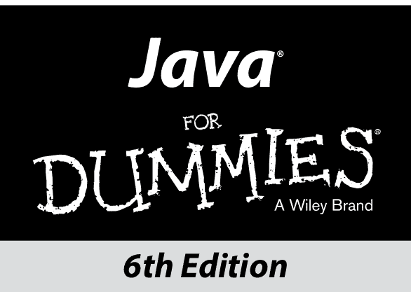

# 作者 Barry Burd, 博士


- 什么是集成开发环境？.......................................................33
- 善用你的类 ......................................................................... 168
- 与磁盘交互（短途） ................................................... 170
- 在文件中存储数据 ........................................................ 171
- 复制并粘贴代码 ................................................................ 172
- 从文件读取 ................................................................. 173
- 谁移动了我的文件？ ...................................................... 175
- 在你的文件中添加目录名称 ................................................... 176
- 逐行读取 ................................................................. 177
- 关闭磁盘连接 ................................................................ 179
- 定义子类（全职或兼职员工意味着什么） ........................... 179
- 更多子类（处理天气问题） ....................................... 203
- 在 Java 程序中使用命令行参数.................................................................. 66
- 创建内部类....................................................................... 363
- 寻找新闻、评论和示例代码 ................................................. 394
- 寻找 Java 工作 ....................................................................... 394
- 大家最喜欢的网站 ........................................................................ 394

# 索引 ................................................................................. 395

# 引言

Java 是诚实的。我已经使用它多年了。我喜欢 Java 是因为它非常有条理。几乎所有内容都遵循简单的规则。这些规则有时会让人感到畏惧，但这本书正是为了帮助你理解它们的。所以，如果你想使用 Java，而且不想读传统的极客风平装书，请坐下，放松身体，开始阅读《Java 傻瓜教程》第 6 版。

# 如何使用本书

我真希望可以说：“打开这本书的随机一页并开始编写 Java 代码。只需填空即可，不要回头。”这是真的。你写 Java 代码不会弄坏任何东西，所以你永远可以自由地实验。

但请让我说明一下。如果你不了解大局，编写程序是非常困难的。对于任何计算机编程语言都是如此——而不只是 Java。如果你在不知道代码含义的情况下敲击代码，而代码没有完全按照你想要的方式运行，你只会陷入困境。

所以，在书中，我将 Java 编程划分为易管理的各个。每个部分（多或少）就是一个章节。你可以从任何地方切入——第 5 章、第 10 章或任何地方。你甚至可以从章节的中间开始尝试。我试图让示例变得有趣，同时又不让某一章依赖于另一章。当我使用另一个章节中的重要概念时，我会包含注释帮助你理清思路。

通常，我的建议如下：

- 如果你已经了解某些内容，就不要费力读那了。
- 如果你感到好奇，不要害怕跳后读。如果你真的需要，随时可以偷看一眼之前的章节。

几乎每本技术书籍开头都会有一段小小的字体说明，而《Java 傻瓜教程》第 6 版也不例外。以下是书中使用的字体的简要说明：

- 新术语将设置为与正文混合的形式，例如：“在文本框中输入新术语。”
- 如果你需要输入某些内容，它将以**粗体**显示。
- 你还会看到这种*等宽字体*。我将等宽字体用于 Java 代码、文件名、网页地址（URL）、屏幕消息以及其他内容。
- 此外，如果你需要的内容很长，它将单独占一行显示等宽字体：

```
public class Anyname
```

这意味着输入 `public class` 然后一个你自己起的名字。

- 需要替换的单词将设置为*斜体等宽字体*。

选择第一个你不熟悉的章节或节并从那里开始阅读。当然，你可能和我一样讨厌做决定。所以，这里有一些你可以遵循的指南：

- 如果你已经知道 Java 是什么并且想使用 Java，请跳过第 1 章直接看第 2 章。相信我，我不介意。
- 如果你知道如何运行 Java 程序，并且不在乎 Java 程序运行时背后发生了什么，那么请跳过第 2 章从第 3 章开始。
- 如果你用 C 或 C++以外的任何语言编写程序，请从第 2 或第 3 章开始。当你读到第 5 和 6 章时，你可能会发现它们非常简单。当你进入第 7 章时，是时候深入学习了。
- 如果你用 C（不是 C++）编写程序，请从第 2 和第 3 章开始，直接跳过第 5 和 6 章。
- 如果你用 C++ 编写程序，请浏览第 2 和第 3 章，略读第 4 到 6 章，并从第 7 章开始认真阅读（Java 在处理类和对象方面与 C++ 有所不同）。
- 如果你编写 Java 程序，请来我家帮我写《Java 傻瓜教程》第 7 版。

如果你想跳过侧边栏和“技术细节”图标，请尽管跳过。事实上，如果你想跳过任何内容，请随便。

## 愚率的假设

在本书中，我对你——读者——做了一些假设。如果这些假设中有一个是错误的，你可能没关系。如果所有假设都是错误的……额，反正也把这书买下来吧。

- 我假设你有一台电脑。这里有一个好消息：你可以在几乎任何电脑上运行书中的大部分代码。唯一不能用来运行这些代码的电脑是那些超过了十年的老古董（正负差几年那种）。
- 我假设你能够操作电脑的菜单和对话框。你不需要成为 Windows、Linux 或 Macintosh 的高级用户，但你应该能够启动程序、找到文件、将其放入特定的目录……诸此类操作。在大多数时候，当你练习书中的内容时，你是在键盘上输入代码，而不是用鼠标指点和点击。在那些需要拖放、剪切和粘贴或即插即用的极少数情况下，我会引导你完成这些步骤。但你的电脑可能有数十亿种不同的配置方式，我的指令可能并不完全符合你的特殊情况。因此，当你遇到这些特定于特定平台的任务时，请尝试遵循书中的步骤操作。如果步骤不适用，请查阅专门针对你系统定制的说明书。
- 我假设你能进行逻辑化思考。这就是 Java 编程的全部——逻辑化思考。如果你能逻辑化思考，你就成功了一半。如果你不相信自己能逻辑化思考，请继续读下去。你可能会大奇惊喜。
- 我对计算机编程经验（或缺乏经验）几乎没有做任何假设。在写这本书时，我尝试完成一项不可能的任务。我试图让这本书既对经验丰富的程序员来说有趣，又对几乎或没有编程背景的人来说浅易懂。这意味着我不假设你有任何特定的编程背景。另一方面，如果你从未创建过循环或数组，但你做过这些事情（可能在 Visual Basic、COBOL 或 C++ 中），你将在 Java 中发现一些有趣的故事情转折。Java 的开发者提取了面向对象编程中最好的思想，对其进行了精简、重构和重新组织，使其成为一种精练、强大的解决问题方式。你将在 Java 中发现许多发人深省的新特性。当你了解这些特性时，其中许多对你来说将显得非常自然。无论如何，你都会对使用 Java 感到良好。

## 本书结构安排

本书分为若干小节，小节组成若干节，节共同组成章节，章节最后归为五个部分。（当你写一本书时，你会非常熟悉书的结构。在写作几个月后，你会发现自己晚上睡觉时梦梦的都是节和章节。）书的部分列在此处。

这一部分是你关于 Java 的完整、执行级简报。它包含一些“什么是 Java？”的内容和一个启动章节——第 3 章，在该章中，你将接触主要的构思想并剖析一个简单的程序。

第 4 到 6 章涵盖了基础知识。这些章节描述了你需要了解的内容，以便让你的电脑运转起来。

如果你用 Visual Basic、C++ 或任何其他语言写过程序，第二部分的一些内容可能对你来说很熟悉。如果是，你可以跳过某些章节或快速阅读这些内容。但不要读得太快。Java 与其他编程语言略有不同，特别在我第 4 章中描述的内容。

第三部分包含我最喜欢的章节。这部分涵盖了至关重要的面向对象编程主题。在这些章节中，你将学会如何为大问题映射解决方案。（当然，这些章节中的示例并不大，但示例涉及大思想。）通过位增量，你将发现如何设计类、使用现有的类以及构建对象。

你读过那些用模糊、泛泛的术语解释面向对象编程的书吗？我很自豪地说，《傻瓜学 Java 第 6 版》不是那样的。在本书中，我用一个简单具体的程序示例来说明每个概念。

如果你已经测试过一些 Java 并想学更多，可以在本书的这一部分找到你需要的内容。这一部分的章节致力于细节——那些当你第一眼看到材料时看不见的东西。所以，在读了前面的部分并自己写了一些程序后，你可以通过阅读第四部分来进一步深入。

“十锦锦”是一个小小的 Java 糖果店。在这一部分，你可以找到避免错误的技巧列表、寻找资源的方法以及各种有趣的零食。

如果你能看到我如何写这本书，你会看到我坐在电脑前自言自语。我在脑海里说每一句话。大多数句子会在心里念几遍。当我有一个额外的想法、侧面评论或不属于常规内容流的内容时，我会稍微转一下头。这样，无论是谁在听我说话（通常没人听），都知道我进入了短暂的离题。

当然，你看不见我转转头。我需要用其他方式来将一个想法单独放在角落里。这里是我使用的图标列表：

- **Tip（提示）**：一段有用的额外信息。
- **Remember（记住）**：一些你不应该忘记的事情。
- **Warning（警告）**：你应该警惕的事情。
- **Question/Answer（问与答）**：一个常见问题及其答案。
- **Note（注释）**：引起你对网上可以找到有用材料的。
- **Tidbit（小知识）**：一个可能帮助你理解某些内容的细节。

> “如果你不记得什么-之类的是什么意思，请参见某某，”或“欲需更多信息，请阅读某某。”

这个图标引起你对网上可以找到有用材料的。（你可能在本章的末尾发现一个！）

偶尔，我会遇到一些技术小知识。这个小知识可能帮助你理解幕后的人（开发 Java 的人当时在想）。你不需要读它，但如果你计划阅读其他关于 Java 的极客书籍，你可能会发现它很有帮助。

我写了许多在书中找不到的额外内容。去网上查找以下内容：

- **Cheat Sheet（快速参考）**：查看 www.dummies.com/cheatsheet/java。
- **Online Articles（在线文章）**：在本书每个部分打开的几个页面中，你可以找到指向 Dummies 成员的 Web Extras 链接，这些内容扩展我在该特定章节中讨论的某些概念。你可以在 www.dummies.com/extras/java 找到它们。

如果你读到了这里，你准备好开始学习 Java 应用开发了。把我（作者）想象成你的指南、主持人和私人助理吧。我会尽所能保持内容有趣，最重要的是帮助你理解。

如果你喜欢你读到的内容，请给我写封信。我的电子邮件地址是为关于本书的评论和问题创建的：JavaForummies@allmycode.com。如果电子邮件和聊天不是你的最爱，你可以通过 Twitter (@allmycode) 和 Facebook (www.facebook.com/allmycode) 找到我。不要忘记——要获取最新更新，请访问本书的网站。网站地址是 www.allmycode.com/JavaForDummies。


访问 www.dummies.com 获取更多精彩在线内容。

> 在这一部分 . . . .
>
> - 了解开发 Java 程序所需的工具。
> - 了解 Java 如何适应当今的技术领域。
> - 学习你的第一个完整的 Java 程序。

# 本章内容

- 什么是 Java
- Java 源自何处
- 为什么 Java 如此酷炫
- 如何转向面向对象的编程

对计算机随你怎么说什么都行。对我来说，计算机之所以好用只有两个简单的原因：

- ✔ 当计算机工作时，它们感觉没有阻力、没有压力、没有无聊，也没有疲劳。计算机是我们的电子奴隶。我有一台计算机 24 小时不停地在为 Cosmology@Home 进行计算——这是一个研究描述宇宙模型的分布式计算项目。我会为我的电脑感到难过因为它工作得这么努力吗？它会抱怨吗？电脑会向国家劳动关系委员会举报我吗？不会。
- ✔ 计算机传递的是思想，而不是纸张。不久前，当你向某人发送信息时，你需要雇佣一名信使。信使骑上他的或她的马亲自送达你的信息。信息写在纸上、粘土板或当时任何的物理媒介上。

这整个过程现在看起来是没用的，但那仅仅是因为你现在正舒适地坐在电子时代。信息就是思想，而墨水、纸张和马等物理实体与真正的思想几乎没有任何关系；它们只是几个世纪以来思想的临时载体。尽管如此，思想本身是无纸化、无头且无信使的。

计算机的妙之处在于它们能高效地携带思想。它们除了思想以外，什么都不带，只有几个光子和一点电力。它们这样做时没有杂乱，没有混乱，也没有额外的物理负担。

当你开始高效地处理思想时，会发生非常棒的事情。突然，所有的开销都消失了。你不再是在推销纸张和树木，而是在推销数字和概念。没有了开销，你可以运行得快得多，并且做比以前任何时候都要复杂得多。

如果所有的复杂性都是免费的，那就好了，但遗憾事实如此。必须有人苦苦思索，并准确决定要让计算机做什么。在思考之后，必须有人写出一系列供计算机遵循的指令。

鉴于现状，你不能用英语或任何其他人们使用的语言来编写这些指令。科幻小说充斥着这样的故事：人们对机器人说简单的话，却得到了灾难性的、意料之外的结果。英语这类语言不适合与计算机通信，原因有几点：

- 一个英语句子可能会被误解。“每天吃三次一个，直到吃完。”
- 在英语中编织一个非常复杂的命令很难。“将法兰 A 连接到凸起 B，确保仅将法兰 A 的最外边缘连接到凸起 B 的较大端，同时将法兰的中间和内边缘连接到 A 垫圈。”
- 一个英语句子包含大量冗余。“根据需要单词句子。”
- 英语很难解释。“作为 John Wiley & Sons, Inc.（‘Wiley’）与作者（‘Barry Burrd’）之间本出版协议的一部分，Wiley 应向作者就《自傻瓜指南》第 6 版（‘本作品’）的部分提交支付一千二百百五十七美元六十三美分（$1,257.63）。”

要告诉计算机做什么，你必须使用一种特殊的语言来编写那里无歧义的指令。这种特殊语言被称为编程语言。用这种语言编写的一系列指令被称为程序。当看作一个大整体时，这些指令被称为软件或代码。以下是 Java 编写的代码的像：

```java
public class PayBarry {
    public static void main(String[] args[]) {
        double checkAmount = 1257.63;
        System.out.print("Pay to the order of ");
        System.out.print("Dr. Barry Burrd ");
        System.out.print("$ ");
        System.out.println(checkAmount);
    }
}
```

如果所有的复杂性都是免费的，那就好了，但遗憾事实如此。必须有人苦苦思索，并准确决定要让计算机做什么。在思考之后，必须有人写出一系列供计算机遵循的指令。


鉴于现状，你不能用英语或任何其他人们使用的语言来编写这些指令。科幻小说充斥着这样的故事：人们对机器人说简单的话，却得到了灾难性的、意料之外的结果。英语这类语言不适合与计算机通信，原因有几点：

- 一个英语句子可能会被误解。“每天吃三次一个，直到吃完。”
- 在英语中编织一个非常复杂的命令很难。“将法兰 A 连接到凸起 B，确保仅将法兰 A 的最外边缘连接到凸起 B 的较大端，同时将法兰的中间和内边缘连接到 A 垫圈。”
- 一个英语句子包含大量冗余。“根据需要单词句子句子。”
- 英语很难解释。“作为 John Wiley & Sons, Inc.（‘Wiley’）与作者（‘Barry Burrd’）之间本出版协议的一部分，Wiley 应向作者就《自傻瓜指南》第 6 版（‘本作品’）的部分提交一千二百百五十七美元六十三美分（$1,257.63）。”

要告诉计算机做什么，你必须使用一种特殊的语言来编写那里无歧义的指令。这种特殊语言被称为编程语言。用这种语言编写的一系列指令被称为程序。当看作一个大整体时，这些指令被称为软件或代码。以下是 Java 编写的代码的像：

```java
public class PayBarry {
    public static void main(String[] args[]) {
        double checkAmount = 1257.63;
        System.out.print("Pay to the order of ");
        System.out.print("Dr. Barry Burrd ");
        System.out.print("$ ");
        System.out.println(checkAmount);
    }
}
```

## Java 处于什么位置

- 1954–1957：FORTRAN 被开发。
- 1959：Grace Hopper Remington Rand 开发了 COBOL 语言。
- 1972：Dennis Ritchie 在 AT&T 实验室开发了 C 语言。
- 1986：Bjarne Stroustrup（同样在 AT&T 实验室）开发了 C++。
- 1995年5月23日：Sun Microsystems 发布了第一版本的 Java 编程语言。
- 2000年11月：大学委员会宣布，2003 年的计算机科学高级预修考试（AP）将基于 Java。
- 2002年：微软推出了一种新语言 C#。

> *这是我编造的事实。*

- 2004年6月：Sys-Con Media 报告称，Java 程序员的需求超过 C++ 程序员的 50%（http://java.sys-con.com/node/48507）。

而且不仅如此！Java 程序员的需求超过了 C++ 和 C 语言程序员的 8%。Java 程序员的就业率比 VB（Visual Basic 基础）程序员高出惊人的 190%。

- 2007年：Google 采用 Java 作为创建 Android 设备应用的首选语言。
- 2010年1月：甲骨文公司（Oracle Corporation）收购了太阳微系统（Sun Microsystems），将 Java 技术引入 Oracle 家族产品。
- 2010年6月：eWeek 将 Java 排在其“让你保持就业的 10 种编程语言”的首位（www.eweek.com/c/a/Application-Development/Top-10-Programming-Languages-to-Keep-You-Employed-719257）。
- 2013年8月：Java 运行在 11 亿台以上的桌面电脑上（http://java.com/en/about），Android 运行在 2.5 亿部手机上（www.mobilevidecmager.com/mobile-device-statistics/250-million-android-devices-in-use）。

此外，Java 技术为所有蓝光设备提供了交互能力，并且是 TIOBE 编程社区指数（www://www.tiobe.com/index.php/content/paperinfo/tpci）、PYPL：编程语言流行度指数（http://sites.google.com/site/pydatalog/pypl/PYPL-Popularity-of-Programming-Language）以及其他指数排名中最受欢迎的编程语言。

嗯，我被折震撼了。

现在是凌晨三点。我正梦见高中时挂掉的那门历史课。老师正在对我大吼：“你还有两天时间准备期末考试，但你不会记得去复习。你会忘记并感到内疚，内疚、内疚、内疚。”

突然，电话响了。我从深睡中猛地醒来（当然，我不喜欢梦见历史课，但更不喜欢被吵醒）。起初，我把手机掉在了地板上。费劲捡起来后，我发出一声不耐烦的：“你好，哪位？”一个声音回答道：“我是来自《新时报》的记者，我正在写一篇关于 Java 的文章，我需要五个字或更少介绍这门编程语言的一切。你能解释一下吗？”

我的脑子一片空白。我没法思考。于是我说出了脑子里闪过的第一个念头，然后继续睡了。

第二天早上，我几乎不记得和和那个记者的谈话了。事实上，我不记得自己是如何回答那个问题的。我有没有告诉记者他可以把关于关于 Java 的文章放在哪里？

我穿上睡袍，冲向家门口车道的尽头。当我拿起早报时，我瞥了一眼头版，看到那个两英寸宽的标题：

**伯德 称 Java 为“一种伟大的面向对象的语言”**

Java 是面向对象的。这意味着什么呢？不像 FORTRAN 等语言侧重于给计算机下达命令式的“做这个/做那个”，面向对象的语言侧重于数据。当然，面向对象的程序仍然告诉计算机要做什么。然而，它们从组织数据开始，命令在随后的出现。

面向对象的语言比“做这个/做那个”更好，因为它们组织数据的方式可以帮助人们利用数据做各种事情。要修改数据，你可以在已有的基础上进行构建，而不是在每次需要做新事情时都丢弃所有已做的工作并重新开始。虽然计算机程序员通常都是聪明人，但他们花了一段时间才弄明白这一点。想了解完整的历史课程，请看侧边栏“从 FORTRAN 到 Java 的曲折之路”（但如果你不读，我不会让你感到内疚的）。

### 对象及其类

在面向对象的语言中，你使用对象（objects）和类（classes）来组织数据。

想象一下你正在编写一个计算机程序，用来追踪某个公寓开发项目的房屋（仍在建设中）。这些房屋之间的差异非常小。每栋房子都有独特的外墙颜色、室内油漆颜色、厨房风格等。在你的面向对象程序中，每栋房子都是一个对象。

但对象并不是全部。尽管房屋之间略有不同，但所有房屋共享相同的特征列表。例如，每栋房子都有一个被称为“外墙颜色”的特征。每栋房子都有另一个被称为“厨房风格”的特征。在你的面向对象程序中，你需要一个包含房屋拥有所有特征的主列表。这个特征主列表被称为“类”。

### 从 FORTRAN 到 Java 的曲折之路

20 世纪 50 年代中期，一群创造了一种名为 FORTRAN 的语言。它是一门很好的语言，但它基于这样观点：你应该向计算机下达命令式的指令。“做这个，做那个”。在随后的几年里，团队开发了许多新语言，其中许多语言复制了“做这个/做那个”模型。最流行的“做这个/做那个”语言之一名为 C。而名为 SIMULA 和 Smalltalk 的语言将命令式的“做这个”移到了后端，并专注于数据。在这些语言中，你不能直接写出“打印账户列表”。相反，你从说“创建一个对象的含义是”开始。一个对象是（注：此处原文存在重复，翻译时保持逻辑）。

在这些语言中，这种关注数据的思维是面向对象的语言让编程变得更简单。原因如下：

- 这种关注数据的思维让编程更简单。
- 这种关注数据的思维让代码更易复用。

在 20 世纪 70 年代，如 SIMULA 和 Smalltalk 等面向对象的语言出现在杂志中。在 1986 年，比雅尼·斯特鲁斯特（Bjarne Stroustrup）创建了 C++。C++ 变得非常流行，因为它结合了 C 和面向对象的特性。在 C++ 中，你不需要像 FORTRAN 那样丢弃所有工作。这种关注数据的思维是让 C++ 程序员的缺陷。

- 这种关注数据的思维让很多公司放弃了 C++ 风格。在 1995 年，詹姆斯·戈斯林（James Gosling）和太阳公司创建了 Java。在 Java 中，戈斯林借鉴了 C++ 的优点。这种关注数据的思维让 Java 更加优雅。
- 这种关注数据的思维是 Java 的核心。


所以事实就是这样。面向对象编程这个名字并不准确。它真的应该被称为“类和对象的编程”。

现在我把“类”放在了前面。我怎么敢这么做！嗯，也许我没疯。再次想一个正在建设的住宅开发区。建筑师的蓝图就像面向对象程序员的类。蓝图是房屋拥有的特征列表。蓝图上写着“外墙”。实际的房屋是灰色的。蓝图上写着“橱柜”。

这种类比不仅限于特征列表。蓝图和类之间存在另一个相似之处。一旦你设计了蓝图，就可以用它来建造十栋房子。类和也是如此。首先，程序员编写代码来描述类。然后当程序运行时，计算机从类中创建对象。

这就是类和对象之间的真实关系。程序员定义一个类，计算机根据类定义创建对象。

根据上一小节关于房屋建造的故事，想象你已经写了一个计算机程序，用来追踪新开发项目的房屋建筑指令。然后，老板决定了一个修改后的计划——一半房屋有三个卧室，另一半有四个。

如果你使用 FORTRAN/C 风格的计算机程序，你的指令将看起来像这样：

```
挖掘地基沟。

在沟两侧铺设混凝土。

在沟两侧放置二方木作为地基框架。
```


这就像是建筑师创建了一份长长的列表而不是蓝图。要修改计划，你必须翻遍列表寻找建造卧室的指令。更糟糕的是，这些指令可能散落在第 234 页、394-410 页、739 页、10 页和 2 页。如果建筑工必须解码他人的复杂指令，这项任务将困难十倍。

然而，从一个类开始就像从一张蓝图开始。如果你决定既要有三卧室的房屋要有四卧室的，你可以从一张蓝图开始，这张蓝图的房子有一层和二层，但二层没有画任何内墙。然后，你制作两份二层蓝图——一份用于三卧室房屋，另一份用于四卧室房屋。（你可以将这些新蓝图命名为三卧室房屋蓝图和四卧室房屋蓝图。）

你的同事对你的逻辑组织能力感到惊叹，但他们也有顾虑。他们提出了一个问题：“你把其中一张蓝图称为‘三卧室房屋’蓝图。如果它只是二楼的蓝图而不是整栋房子的蓝图，你怎么能这样做？”

你会一笑回答：“三卧室房屋蓝图可以写道‘关于下楼，请参见原始房屋蓝图。’这样，三卧室房屋蓝图描述了整栋房子。四卧室房屋蓝图也可以这样做。通过这种设置，我们可以利用已经为创建原始房屋蓝图所做的工作，节省大量精力。”

在面向对象的编程语言中，三卧室和四卧室房屋的类继承了原始类的特性。你也可以说，三卧室和四卧室房屋的类扩展了原始房屋类。（参见图 1-1。）

| 超类 | 父类 |
| :--- | :--- |
| 房屋类是三卧室房屋类的超类，三卧室房屋类的父类，四卧室房屋类的超类，四卧室房屋类的父类。 |
| 子类 | 子类 |
| 三卧室房屋类 | 四卧室房屋类 |

图 1-1：面向对象编程中的术语。

三卧室房屋类扩展了房屋类，继承了房屋类的特性，是房屋类的子类，是房屋类的子类。四卧室房屋类扩展了房屋类，继承了房屋类的特性，是房屋类的子类，是房屋类的子类。

原始房屋类被称为三卧室和四卧室房屋类的超类。同样，三卧室和四卧室房屋类是原始房屋类的子类。换句话说，原始房屋类被称为三卧室和四卧室房屋类的父类。三卧室和四卧室房屋类是原始房屋类的子类。（参见图 1-1）。

不用说，你那些买房的同事们嫉妒了。一群建筑师正聚在一起听你的绝妙想法。所以，在那刻，你又抛下了一枚炸弹：“通过使用类来创建，我们将来可以重用蓝图。如果有人来想要五卧室的房子，我们可以通过制作五卧室房屋蓝图来扩展我们的原始房屋蓝图。我们再也不需要为原始房屋花钱了。”

“但是，”后面一个同事说，“如果有人想要不同的一楼设计怎么办？我们是扔掉原始房屋蓝图，还是在整张蓝图上涂改？那会花大笔钱吧？”

你用自信的语气回答道：“不需要对原始房屋蓝图进行修改。如果有人想在客厅里放按摩缸，我们可以制作一个新的、较小的‘客厅带按摩缸房屋’蓝图。然后，这个新蓝图可以参考原始房屋蓝图获取房屋其他部分的信息（不在客厅的部分）。在面向对象的编程语言中，带按摩缸的蓝图扩展了原始房屋蓝图。按摩缸蓝图仍然是原始房屋蓝图的子类。事实上，超类、父类和子类的所有术语仍然适用。唯一新的是，按摩缸蓝图覆盖（`override`）了原始房屋蓝图中的客厅特性。”

在面向对象语言出现之前，编程世界经历过一场软件开发危机。程序员编写代码，然后发现新需求，不得不丢弃代码并从头开始。这个问题反复发生，因为程序员编写的代码无法被重用。面向对象编程改变了这一切，使其变得更好（而且，正如 Burd 所说，Java 是‘一种伟大的面向对象语言’）。”

当你用 Java 编写程序时，你一直在与类和对象打交道。这两个概念非常重要。这就是为什么在本章中，我用一个又一个关于类和对象的类比来强调它们。

闭上眼睛一分钟，思考一下某物成为椅子意味着什么……

一把椅子有座位、靠背和腿。每个座位都有形状、颜色、柔软程度等。这些是椅子拥有的属性。我所描述的**椅子性**（chairness）——即某物作为椅子的概念。在面向对象的术语中，我描述的是 `Chair` 类。

现在看一眼这把椅子的边缘，花分钟观察一下你的房间。（如果你现在没有坐在椅子上，请感受一下。）

房间里有几把椅子，每把椅子都是一个对象。这些对象中的每一个都是名为 `Chair` 类的这种抽象事物的例子。这就是它的运作方式——类是**椅子性**的概念，而每一把具体的椅子都是一个对象。

椅子不是事物的集合。相反，类是某种特定事物背后的概念。当我谈到你房间里的椅子类时，我谈论的是每把椅子都有腿、座位、颜色等事实。房间里不同椅子的颜色可能不同，但这并不重要。当你谈论一类事物时，你关注的是它们每一个所拥有的属性。


将对象看作类的具体实例是合逻辑的。事实上，官方术语与这种想法是一致的。如果你定义了一个 `Chair` 类，每一把真实的椅子（你正坐着的这把椅子、你旁边的空椅子等）都被称为 `Chair` 类的 `instance`。

这是类的类的类的思考方式。想象一张显示你所有三个银行账户的表格。（参见表 1-1。）

| 表 1-1 |
| :--- | :--- |
| 账户列表 | |
| 账户号码 | 余额 |
|---|---|
| 支票账户 | |
| 信用卡 | |
| 储蓄账户 | |

将表头视为类，将表格的每一行视为一个对象。表头描述了 `Account` 类。

根据表头，每个账户都有一个号码、一个类型和一个余额。用面向对象编程的术语重新表述，`Account` 类中的每个对象（即 `Account` 类的实例）都有类型和余额。如果你开了一个新账户，表格将增加一行。新对象将是同一个类的实例。

本章充满了通性的描述。当你刚开始时，通性的描述是很好的，但在你了解细节之前，你并不能真正理解事情。这就是为什么接下来的章节将处理细节。

所以，请翻页。下一章等不及要见到你了。

### 本章内容

- 理解软件开发工具的作用
- 选择适合你的 Java 版本
- 准备编写和运行 Java 程序

学习 Java 的最好方法是实践 Java。当你编写、测试和运行自己的 Java 程序时。本章通过描述通用的软件设置为你做 Java 做准备——无论你运行的是 Windows、Mac 还是 Linux 或 Joe 的私人操作系统，电脑都需要这些软件。本章没有描述 Windows、Mac 或其他系统的特定设置说明。


有关你系统的特定设置说明，请访问本书网站 (www.allmycode.com/JavaForDummies)。

如果你是计算机和计算领域的资深老兵（无论那是什么意思），而且又不想从书中获取详细指令，你可以尝试按照本节的通用指令安装所需的软件。这些指令适用于许多计算机，但并非所有。而且本节没有提供详细的步骤、“如果……就做……”的备选方案，以及“虽然这样行，但最好是这样做”的建议。

1. 访问 `java.com`。
2. 可选步骤，访问 `www.oracle.com/technetwork/java/javase/downloads`。按照该网站上的说明下载并安装 Java SE 文档（也称为 Javadoc 页面或 Java SE API 文档）。
3. 访问 `Eclipse.org`。按照 `http://eclipse.org/downloads` 上的说明下载并安装 Eclipse。

Eclipse 下载页面提供了几个不同的包，包括 Eclipse Classic、适用于 Java EE 的 Eclipse、适用于 JavaScript 的 Eclipse 等。为了运行本书中的示例，你需要一个相对较小的 Eclipse 包——适用于 Java 开发者的 Eclipse IDE (`Eclipse IDE for Java Developers`)。


4. 测试你安装的软件。
   - a. 启动 Eclipse。
   - b. 在 Eclipse 项目中，创建一个名为 `Display` 的新 Java 类。
   - c. 在 Java 项目中，创建一个名为 `Display` 的新 Java 类。
   - d. 通过输入列表 3-1（第 3 章中的第一个代码列表）中的代码来编辑新的 `Display.java` 文件。在 Eclipse 的编辑器面板中输入代码。
   - e. 运行 `Display.java` 并检查运行输出是否显示为 `You'll love Java!`。

就这样！但请记住，每个人（无论是不是电脑极客）都可以完美无缺地遵循这些骨架化的指令。因此，你有几种替代方案：

- 访问本书的网站。不要跳过“开始”却不尝试本节的快速启动指令。请遵循你在 `www.allcode.com/JavaForDummies` 找到的更详细说明。
- 尝试本节的快速启动指令。尝试一下并没有什么大碍。如果你不小心安装了软件，可能可以把错误的软件留在你的电脑上。（你不需要卸载它）。如果你不确定是否正确安装了软件，可以随时查阅网站上的详细说明。
- 电子邮件到 `JavaForDummies@allcode.com` 向我提问。
- 在 Twitter 上推特我 `@allcode`。
- 访问我的 `/allcode` Facebook 页面。

我期待听到读者的反馈。

### 你在电脑上安装了什么

我曾遇到过一个工具和模具制造者。他使用工具来制造工具（以及模具）。我很高兴能见到他，因为我知道有一天，我会在计算机程序员与模具制造者之间做一个类比。

计算机程序员使用程序作为工具来创建新的程序。现有的程序和新的程序可能会执行完全不同的任务。例如，一个 Java 程序（你创建的程序）可能会跟踪业务的客户。为了创建一个跟踪客户的程序，你可能会使用一个现有的、查找 Java 代码中错误的程序。这个通用的错误查找程序可以发现任何 Java 代码中的错误——客户跟踪代码、天气预测代码，或者你手机上 App 代码。

创建 Java 程序需要多少种工具？作为一个新手，你需要三个工具：

- **你需要一个编译器（`compiler`）。** 编译器获取你写的 Java 代码，并将这些代码转换为可以在你的电脑上运行的内容。
- **你需要一个 Java 虚拟机（`JVM`）。** Java 虚拟机在电脑上运行你的代码（以及别人的 Java 代码）。
- **你需要一个集成开发环境（`IDE`）。** 集成开发环境帮助你管理 Java 代码，并为你提供方便的方法来编译、运行和编写代码。

老实说，你并不真的需要集成开发环境。事实上，有些开发者以使用像 Windows 记事本或 Unix 中的 `vi` 编辑器这样原始的老文本编辑器为荣。作为一个新手开发者，功能全的 `IDE` 会让你的生活变得简单得多。

万网上有这些工具的免费下载版本。例如，本章开头附近的快速启动指令建议你访问 `Java.com` 和 `Eclipse.org`。通过点击 Java 页面上的按钮，你就在电脑上安装了一个 Java 虚拟机。在 Eclipse，你下载 Eclipse 集成开发环境，它自带了内置的 Java 编译器。（你一次下载就得到了三个工具中的两个。还不坏吧！）

本章的其余部分描述了编译器、`JVM` 和 `IDE`。


本章提供了你电脑上所需软件的背景信息。但本章完全没有包含帮助你安装软件的详细指令。有关详细指令，请访问本书的网站（www.allmycode.com/JavaForDummies）。


> “编译器获取你写的 Java 代码，并将这些代码转换为可以在你的电脑上运行的内容。”
> Barry Burd, *Java For Dummies*, 第 6 版

你是一个人类。（当然，每条规则都有例外。但如果你在读这本书，你很可能是人类。）无论如何，人类可以理解懂列表 2-1 中的代码。

### 列表 2-1：寻找空房
```java
// 这是一个 Java 程序的一部分
// (不是一个完整的 Java 程序)
roomNum = 1;
while (roomNum < 100) {
    if (guests[roomNum] == 0) {
        out.println("Room " + roomNum + " is available.");
        exit(0);
    } else {
        roomNum++;
    }
}
out.println("No vacancy");
```

列表 2-1 中的 Java 代码检查一家小酒店（房号从 1 到 99 的酒店）是否有空房。如果不添加额外的行，你就无法运行列表 2-1 中的代码。但在第 2 章中，这些额外的行并不重要。重要的是，通过盯着代码、眯起眼睛并观察代码的结构，你可以看出代码正试图做什么：

- 将房号设置为 1。
- 只要数字小于 100，
- 检查房间内的住客人数。
- 如果房间内的客人数为 0，则报告该房间可用，并停止。
- 否则，通过将房号加 1 来准备检查下一间房间。
- 如果你用到了不存在的房号 100，则报告没有空房。


列表 2-1 中的 Java 代码检查一家小酒店（房号从 1 到 99 的酒店）是否有空房。如果不添加额外的行，你就无法运行列表 2-1 中的代码。但在第 2 章中，这些额外的行并不重要。重要的是，通过盯着代码、眯起眼睛并观察代码的结构，你可以看出代码正试图做什么：

- 将房号设置为 1。
- 只要数字小于 100，
- 检查房间内的住客人数。
- 如果房间内的客人数为 0，则报告该房间可用，并停止。
- 否则，通过将房号加 1 来准备检查下一间房间。
- 如果你用到了不存在的房号 100，则报告没有空房。

# 第 2 章：关于软件的一切

## 你在电脑上安装了什么

我曾遇到过一个模具制造者。他使用工具来制造工具（以及模具）。我很高兴能见到他，因为我知道有一天，我会在计算机程序员与模具制造者之间做一个类比。

计算机程序员使用程序作为工具来创建新的程序。现有的程序和新的程序可能会执行完全不同的任务。例如，一个 Java 程序（你创建的程序）可能会跟踪业务的客户。为了创建一个跟踪客户的程序，你可能会使用一个现有的、查找 Java 代码中错误的程序。这个通用的错误查找程序可以发现任何 Java 代码中的错误——客户跟踪代码、天气预测代码，或者你手机上 App 代码。

创建 Java 程序需要多少种工具？作为一个新手，你需要三个工具：

- **你需要一个编译器（`compiler`）。**
  编译器获取你写的 Java 代码，并将这些代码转换为可以在你的电脑上运行的内容。

- **你需要一个 Java 虚拟机（`JVM`）。**
  Java 虚拟机在电脑上运行你的代码（以及别人的 Java 代码）。

- **你需要一个集成开发环境（`IDE`）。**
  集成开发环境帮助你管理 Java 代码，并为你提供方便的方法来编译、运行和编写代码。

老实说，你并不真的需要集成开发环境。事实上，有些开发者以使用像 Windows 记事本或 Unix 中的 `vi` 编辑器这样原始的老文本编辑器为荣。作为一个新手开发者，功能全的 `IDE` 会让你的生活变得简单得多。

万网上有这些工具的免费下载版本。例如，本章开头附近的快速启动指令建议你访问 Java.com 和 Eclipse.org。通过点击 Java 页面上的按钮，你就在电脑上安装了一个 Java 虚拟机。在 Eclipse，你下载 Eclipse 集成开发环境，它自带了内置的 Java 编译器。（你一次下载就得到了三个工具中的两个。还不坏吧！）

本章的其余部分描述了编译器、`JVM` 和 `IDE`。


# 第一部分：Java 入门

列表 2-2 中的代码并不是源代码。它们是 Java 字节码。当你编写 Java 程序时，你写的是源代码（如列表 2-1）。编译器会将源代码转换成字节码。

通常，通常不会用编辑器查看 `Hotel.class` 文件。如果你尝试用记事本、TextEdit、KWrite 甚至 Microsoft Word 打开 `Hotel.class`，你看到的只有乱码。为了创建列表 2-2，我必须对 `Hotel.class` 文件应用工具，以字节码的形式显示。我使用了 `Saab` (`www.ca/jbe`)。

这是一个假设的情况：想象你正在一台配有旧奔腾（`Pentium`）处理器的计算机上运行 Linux 操作系统。你的朋友在一台使用不同类型处理器的计算机上运行 Linux —— `PowerPC` 处理器。（在 20 世纪 90 年，Intel 公司制造了奔腾处理器，IBM 制造了 `PowerPC` 处理器。）

列表 2-3 包含一组在计算机屏幕上显示“Hello world!”的指令。这些指令在运行 Linux 操作系统的奔腾处理器上有效。

### 列表 2-3：适用于奔腾处理器的简单程序

```
.data

msg:
    ascii "Hello, world!\n"
    len = - msg

.text
    .global _start

_start:
    mov $len,%edx
    mov $msg,%ecx
    mov $1,$ebx
    mov $4,$eax
    int $0x80
    mov $0,%ebx
    mov $1,%eax
    int $0x80
```

列表 2-4 包含另一组在屏幕上显示“Hello world!”的指令。列表 2-4 中的指令在运行 Linux 的 `PowerPC` 处理器上有效。

> 我根据 Konstantin Boldyshev 的《Linux 汇编 HOWTO》（http://tldp.org/HOWTO/Assembly-HOWTO/hello.html）改写了 Intel 指令。
>
> 我根据 Hollis Blanchard 的 `PowerPC` 汇编页面（www.ibm.com/developerworks/library/l-ppc）改写了 `PowerPC` 代码。Hollis 还为我审查并评价了“什么是 Java 虚拟机”部分。感谢你，Hollis。

### 列表 2-4：适用于 PowerPC 处理器的简单程序

```
data

msg:
  .string "Hello, world!\n"
  len = .msg

.text
  .global _start:

start:
  li 0,4
  li 3,1
  lis 4,msg@ha
  addi 4,4,msg@l
  li 5,len
  li 0,1
  li 3,1
  sc
```


列表 2-3 中的指令在奔腾处理器上运行良好。但这些指令对 PowerPC 处理器来说毫无意义。同样，列表 2-4 中的指令在 PowerPC 上运行良好，但这些指令对于配有奔腾处理器的计算机来说完全是乱码。因此，你朋友的 PC 软件可能无法在你计算机上运行。而你 Intel 计算机的软件可能无法在你朋友的计算机上运行。

现在去你表哥家里看看。你表哥的计算机有一个奔腾处理器（和你的一样），但你表哥的计算机运行的是 Windows 而不是 Linux。当你获取列表 2-3 中的奔腾代码时，你表哥的计算机会发生什么？它会大叫：“不是有效的 Win32 应用程序”或“Windows 无法打开此文件！真混乱”。

Java 字节码从这一切混乱中创造了秩序。Java 字节码是列表 2-3 和 2-4 中的代码，但 Java 字节码**不**特定于一种处理器或一个操作系统。相反，如果你编写了一个 Java 程序并将该程序编译成字节码，那么你的计算机就可以运行该字节码，你朋友的计算机也可以运行该字节码，如果运气的话，你奶奶的超级计算机也可以运行该字节码，你的手机或平板电脑也可以运行该字节码。

要查看一些字节码，请参见列表 2-2。但记住，你永远不需要编写或解码 Java 字节码。编写字节码是编译器的工作。解码字节码是 Java 虚拟机的工作。


## 第 2 章：关于软件

通过 Java，你可以获取一个在 Windows 计算机上创建的字节码文件，将字节码复制到不知道种类型的计算机上，然后毫无问题地运行该字节码。这就是 Java 迅速普及的众多原因之一。这种卓越的特性，让你能够在许多不同类型的计算机上运行代码，被称为**可移植性**。

是什么让 Java 字节码如此多功能？Java 程序享有的这种极佳多功能性来自于 Java 虚拟机。Java 虚拟机是你右侧必须拥有的三者之一，

想象你是联合国安理会的 Windows 代表。（参见图 2-1）Macintosh 代表在你的左侧。（很自然地，你和这两个人都不相处：你们彼此总是客客气气，但你从不犯错。你指望什么？这是政治！）来自 Java 的优秀代表站在讲台上。Java 代表正在用字节码发言，你和其他大使们没有一个词都听得懂 Java 字节码。

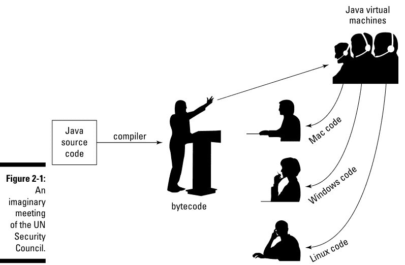

+ 图 2-1：联合国安理会的虚拟会议。

但你们中的每一个人都有一个翻译器。当 Java 代表发言时，你的翻译器将字节码翻译成 Windows。另一个翻译器将字节码翻译成 Macintosh 语。而第三个翻译器则将字节码翻译成 Linux 语言。

## 第一部分：Java 入门

将你的翻译器想象成一个虚拟大使。翻译器并不真正代表你的国家，但翻译器执行了真实大使执行的重要任务之一。翻译器代表你倾听字节码。翻译器执行在你母语言是 Java 时会做的事情。翻译器假装成 Windows 大使，坐着听完枯燥的演讲，每一个单词，并处理每个单词。

### 开发软件

> “这一切以前发生过，将来还将会再次发生。”
> — 彼得潘（J.M. 巴里）与《太空星际航队》（2003–2009, NBC 通球）

当你创建一个 Java 程序时，你会一遍又一遍重复相同的步骤。图 2-2 展示了这一循环。

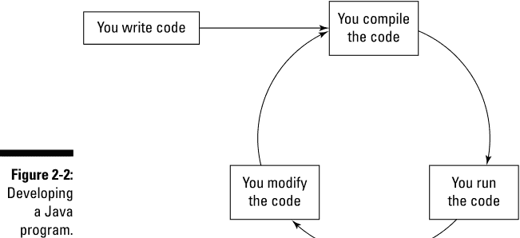

首先，你编写一个程序。在写完初稿后，反复编译、运行和修改程序。有了一定的经验，编译和运行步骤会变得非常简单。在很多情况下，点击一下鼠标即可开始编译或运行。

然而，编写初稿和修改代码并不是一键即可完成的任务。开发代码需要时间和精力。

当你的代码初稿不起作用时，千万不要气馁。同样，当你的代码第 25 个草稿不起作用时，也永远不要气馁。重写代码是你能做的最重要的事情之一（除确保世界和平之外）。

有关编译和运行 Java 程序的详细说明，请访问本书的网站（`www.alldummies.com/JavaForDummies`）。

当人们谈论编写程序时，他们使用图 2-2 中的用词。他们说，“你编译代码”和“你运行代码”。但“你”并不总是准确，而且“代码”在循环的每个阶段也略有不同。图 2-3 更详细地描述了图 2-2 中的循环。

集成开发环境（IDE）将所有这些功能无缝地整合到一个组织良好的应用程序中。（见图 2-5）。

## 34 第一部分：Java 入门

图 2-4：在没有集成开发环境的情况下开发代码。

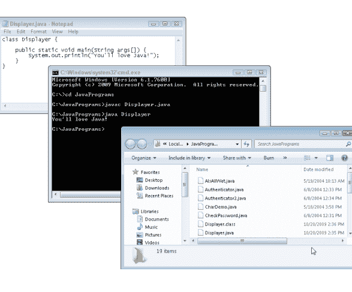

图 2-5：使用 Eclipse 集成环境开发代码。

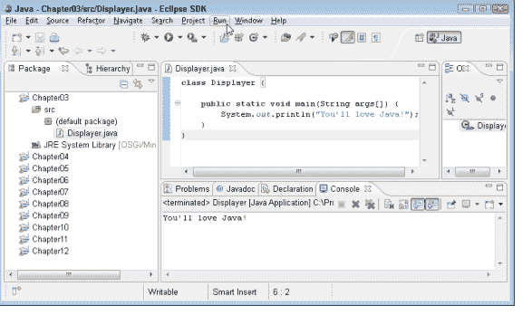

Java 也有自己的集成开发环境。一些流行的产品包括 `Eclipse`、`IntelliJ IDEA` 和 `NetBeans`。一些高级环境甚至带有拖放组件，以便你可以视觉化地设计你的图形界面。（见图 2-6。）

## 第 2 章：关于软件

## 35

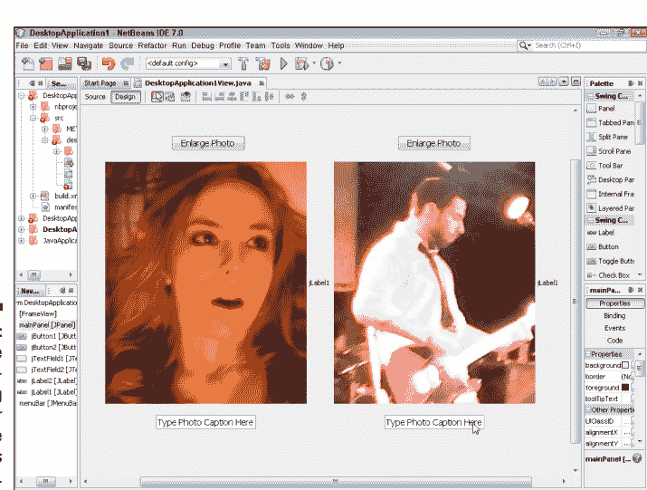

图 2-6：在 NetBeans IDE 中使用拖放 Swing GUI 生成器

要运行程序，你可能会点击工具栏上的按钮或从菜单中选择“运行（Run）”。要编译程序，你可能什么都不用做。（你甚至可能不需要命令。某些 IDE 会在你输入代码时自动编译代码。）

如需有关安装和使用集成开发环境的帮助，请参本书的网站（`www.allmycode.com/JavaForDummies`）


## 36 第一部分：Java 入门

## 第 3 章：使用基础构建模块

### 本章内容

- 学习 Java 语言：API 和语言规范
- 理解简单程序的组成
- 编写代码文档

> “所有具有巨大影响的思想总是是简单的。
> （所有伟大的想法都是简单的。）”
> — 列夫·托尔斯泰

这段引用适用于各种事物——如生活、爱情和计算机编程。这就是为什么本章采用了多层次教学方法。在本章中，你将获得关于 Java 编程的第一手细节。在发现细节的过程中，你会看到其中的简单性。

### 学习 Java 语言

如果你尝试在脑海中想象整个英语语言，你会看到什么？你可能会看到单词、单词、单词。

这三类词之间的差异与英语中单词之间的差异相似。在“Sam is a person”这句话中，`person` 这个词就像一个 Java 关键字。无论谁使用 `person` 这个词，它都始终表达着大致相同的意思（当然，你可以考虑英语用法中那些怪异的例外，但请不要这么想）。

`Sam` 这个词就像一个 Java 标识符，因为 `Sam` 是一个特定的指代。像 `Sam`、`Dinswald` 和 `McGillimaroo` 这样的词在英语中并没有预设的含义。这些词根据语境适用于不同的人，当人们为新生婴儿起名时，它们就变成了名字。

考虑“Julius Caesar is a person”这句话。如果你说出这句话，你可能是在谈论统治罗马直到三月之祭的那个家伙。虽然 `Julius Caesar` 这个名字并没有硬编码在英语语言中，但几乎每个人用这个名字来指代同一个人。如果英语是一门编程语言，那么 `Julius Caesar` 这个名字将是一个 API 标识符。

- **关键字（Keywords）**：关键字是在 Java 编程语言中具有特殊含义的词，且该含义不会从一个程序变到另一个程序。Java 关键字示例包括 `if`、`else` 和 `do`。

  对什么构成 Java 程序具有最终决定权的 JCP 成员选择了所有的 Java 关键字。如果你考虑我早些在“语法和通用名称”部分讨论的 Java 两个部分，Java 关键字稳固地属于语言规范（Language Specification）。

- **标识符（Identifiers）**：标识符是某个事物的名称。标识符的含义可以从一个程序变到另一个程序，但某些标识符的含义倾向于固定。

  - **你和我创建的标识符**：作为一名 Java 程序员（你是一个初级程序员），你为程序中描述的类和其他事物创建新名称。当然，你可能会将某物命名为 `Prime`，而走廊尽头办公室的同事可以称它 `r-prime`。这没关系，因为 Java 对 `Prime` 没有预设含义。在你的程序中，你可以让 `Prime` 代表联邦储备的基准利率，走廊那头的同事可以让 `Prime` 代表“面包、卷、果酱和肋排”。这不会产生冲突，因为你和你的同事正在编写两个不同的 Java 程序。

  - **来自 API 的标识符**：JCP 成员为许多事物创建了名称，并将其中近 40,000 个名称放入 Java API 中。API 随每个 Java 版本发布，因此任何编写 Java 程序的人都可以使用这些名称。此类名称的示例有 `String`、`Integer`、`JButton`、`JTextField` 和 `File`。

    严格来说，Java API 中标识符的含义并不是一成不变的。虽然你可以为 `JButton` 或 `JTextField` 创造属于自己的含义，但这并不是一个好主意。如果你这样做，你会让其他程序员困惑得不知所措，因为他们习惯了这些熟悉的标识符名称的标准 API 含义。更糟糕的是，当你的代码为 `JButton` 这样的标识符分配新含义时，你就失去了 API 代码中为该标识符创建的任何计算能力。太阳公司（Sun Microsystems）、Java 进程（JCP）和 JDK 项目的程序员编写了所有处理按钮的 Java 代码。如果你为 `JButton` 分配了自己的含义，你就是在倒退回创建 API 所取得的所有进展。


查看 Java 关键字列表，访问本书的网站（`www.allmycode.com/JavaForDummies`）。

### 第一次查看 Java 代码

第一次看别人的 Java 程序时，你往往会感到有些奇怪。意识到你不理解代码中的某些（或许多）内容会让你紧张。我写过成百（也许是成千）个 Java 程序，但阅读别人的代码时我仍然感到不安全。

事实是，了解一个 Java 程序是一个引导过程。首先，你惊讶地盯着代码看。然后你运行程序看看它是做什么的。接着你在程序停留一会儿，或者阅读别人对程序及其部分的解释。然后你再多看一眼并再次运行程序。最终，你与程序达成和解。（不要相信那些说他们从未经历过这些步骤的大人物。经验丰富的程序员会安全、谨慎地接触新项目。）

在列表 3-1 中，你看到了一大堆 Java 代码。（像所有初级程序员一样，你被要求谦卑地凝视代码。）我在代码中隐藏了一些重要的概念，我将在下一节中详细解释这些概念。这些概念包括类、方法和 Java 语句的使用。

### 列表 3-1：最简单的 Java 程序

```
public class Displayer {

    public static void main(String[] args) {

        System.out.println("You'll love Java!");

    }

}
```

你不需要输入列表 3-1 中的代码（或本书中的任何列表代码）。要下载书中的所有代码，请访问书籍网站（`www.allcode.com/JavaForDummies`）。

当你运行列表 3-1 中的程序时，电脑会显示 `You'll love Java!`。列表 3-1 显示了当你使用 Eclipse IDE 时 Java 程序的输出。现在，我承认要编写并运行一个 Java 程序以让 `You'll love Java!` 出现在某人的电脑屏幕上需要大量工作，但每项努力都要从某处开始。

| 图 3-1：我使用 Eclipse 运行列表 3-1 中的程序。 | 控制台 |
| :--- | :--- |
| terminated Displayer [Java] <br> You'll love Java! | |

学习如何运行列表 3-1 中的代码，访问本书网站（`www.allcode.com/JavaForDummies`）。

在下一节中，你不仅仅是欣赏程序的输出。在读完下一节后，你实际上理解了列表 3-1 中程序是如何工作的。

### 理解简单的 Java 程序

本节介绍、解释、分析并最终揭秘了列表 3-1 所示的程序。

#### Java 类

由于 Java 是一门面向对象的编程语言，你的主要目标是描述类和对象。（如果你对这一点不确定，请阅读第 1 节中关于对象编程的内容。）

如果你相信这一切（我希望你确实如此），那么你就准备好学习关于 Java 方法了。在 Java 中，方法是一份待办事项的列表。每个方法都有一个名称，你通过在程序中使用该方法的名称来告诉计算机执行列表中的事项。

我从未写过能让机器人去修理发电器的程序。但是，如果我写了，该程序可能会包含一个 `fixTheAlternator` 方法。我的 `fixTheAlternator` 方法中的指令列表看起来会像列表 3-2 中的文本一样。

不要太仔细地研究列表 3-2 和 3-3。列表 3-2 和 3-3 中的所有代码都是虚假的！我编写这些代码是为了让它们看起来像真实的 Java 代码，但它们并不是。更重要的是，列表 3-2 和 3-3 中的代码并不是为了说明 Java 的所有规则。所以，如果你手头有保留意见，请在阅读列表 3-2 和 3-3 时保持谨慎。


### 列表 3-2：方法声明

```
void fixTheAlternator() {

  driveInto(car, bay);

  lift(hood);

  get(wrench);

  loosen(alternatorBelt);

...}
```

在我的 Java 代码某处（列表 3-2 之外的某处），我需要一条指令来调用我的 `fixTheAlternator` 方法。调用 `fixTheAlternator` 方法的指令可能像列表 3-3 中的那一行。

### 列表 3-3：方法调用

```
fixTheAlternator(junkyOldFord);
```

现在你已经对方法是什么以及它是如何工作的有了基本的了解，你可以更深入地研究一些实用的术语了：

- 如果我偷懒，我会把列表 3-2 中的代码称为“方法”。如果我不偷懒，我会把这段代码称为“方法声明”。
- 列表 3-2 中的方法声明包含两个部分。第一行（包含 `fixTheAlternator` 的部分，直到但不包含大括号的部分）是“方法头”。列表 3-2 的其余部分（大括号括的部分）是“方法体”。
- “方法声明”一术语将列表 3-2 中的指令列表与列表 3-3 中的指令区分开来，后者被称为“方法调用”。

方法的声明告诉计算机如果你调用该方法时会发生什么。方法调用（另一段代码）告诉计算机实际调用该方法。方法的声明和方法的调用通常位于 Java 程序的不同部分。


### 程序中的 main 方法

列表 3-1 包含了来自 3-1 的代码副本。代码的大部分包含了 `main` 方法的声明。除了 `public`、`static` 和 `args` 单词外，代码的大部分就是 `main` 方法。

```
public class Displayer {

    public static void main(String[] args) {

        System.out.println("You'll love Java!");

    }

}
```


# 第 3 章：使用基础构建块

## 一个语句（调用 `System.out.println` 方法）

记住：在 `System.out.println` 中，倒数第二个字符是小写字母 `l`，而不是数字 `i`。

正如任何方法一样，`main` 方法是一份配方：
- 加热烤箱。
- 揉面团。
- 烘焙面团。
- 对于 Displayer：
- 打印 "You'll love Java!"

在 Java 中，`main` 单词起着特殊的作用。在图 3-1 中，当 `Displayer` 运行时，计算机会自动找到 `main` 方法的指令。`main` 方法的执行直到被调用为止。

所有语言都有类似于 Java 的方法。如果你用过其他语言，你可能记得子程序、函数或过程。无论你喜欢的编程语言称它为什么，`main` 都是入口点。

在 `System.out.println` 中，倒数第二个字符是小写字母 `l`，而不是数字 `i`。

### 计算机让计算机执行某事

在图 3-1 的核心位置，有一条让计算机实际执行某事的指令。图 3-4 中高亮的这一行告诉计算机显示 "You'll love Java!"。这一行是一个语句。在 Java 中，语句是告诉计算机执行某事的直接指令。

```java
public class Displayer {
    public static void main(String[] args) {
        System.out.println("You'll love Java!");
    }
}
```

当然，Java 有不同类型的语句。方法调用（我在之前的“Java 方法”部分中介绍的）是许多 Java 语句类型中的一种。列表 3-3 展示了方法调用的样子，图 3-4 也包含一个如下所示方法：

```java
System.out.println("You'll love Java!");
```

当计算机执行这个语句时，它调用了一个名为 `System.out.println` 的方法。（是的，在 Java 中，名称中可以包含点。）

> **警告！** 我已经说过了，但值得重申：在 `System.out.println` 中，倒数第二个字符是小写字母 `l`（如单词 "line" 中的字母），而不是数字 `i`（如数字 "one" 中的）。如果你使用数字 `i`，你的代码将无法工作。只需把 `println` 理解为“打印行”（print line），你就没有任何问题了。

要了解 Java 名称中点的含义，请参阅第 9 章。

## 大括号

很久以前，或者也许并不久以前，你的老师们曾告诉过大纲有多有用。有了大纲，你可以组织思想和想法，帮助人们“看到森林而非树木”，并通常借此证明你是“整洁人士俱乐部”的成员。嗯，一个 Java 程序就像一个大纲。列表 3-1 中的程序从一个大标题开始，写着：“有一个名为 Displayer 的类出现了。”在第一个大标题之后，一个子标题宣布：“有一个名为 main 的方法出现了。”

现在，如果一个 Java 程序像一个大纲，为什么程序看起来并不像大纲呢？用什么取代了罗马数字、大写字母和其他东西？答案有两点：

- 在程序中，大括号包围了具有意义的代码单元。
- 你，作为程序员，可以（并且应该）对行进行缩进，让其他程序员一眼就能看出你代码的大纲结构。

在大纲中，一切都隶属于罗马数字 I 下的项目。在 Java 程序中，一切都隶属于顶行——即 `class` 这一行。为了指示代码中的其他所有内容都隶属于这一类行，你使用了大括号。代码中的其他所有内容都在这些大括号内部（见列表 3-4）。

### 列表 3-4：Java 类的大括号

```java
public class Displayer {

    public static void main(String[] args) {
        System.out.println("You'll love Java!");
    }
}
```

在大纲中，某些内容隶属于大写字母 A。在 Java 程序中，某些行隶属于方法头部。为了指示某些内容隶属于方法头部，你使用了大括号（见列表 3-5）。

### 列表 3-5：Java 方法的大括号

```java
public class Displayer {

    public static void main(String[] args) {
        System.out.println("You'll love Java!");
    }
}
```

在大纲中，某些项目处于食物链的底层。在 Displayer 类中，对应的行是以 `System.out.println` 开始的某行。因此，这行 `System.out.println` 位于所有其他大括号内部，并且缩进比其他任何行都要深。

> **永远不要忘记一个事实：Java 程序首先是一个大纲。**

如果你在错误的地方放置大括号，或者在应该有大括号的地方漏掉了它们，你的程序可能完全无法运行。如果你的程序运行了，它可能会运行错误。

如果你不以有效的方式对代码行进行缩进，你的程序仍然可以正常运行，但任何其他程序员都无法看出你在编写代码时在思考什么。

如果你是一个视觉型思考者，你可以在脑中构思出 Java 程序的大纲。我的一个朋友会将实际的编号大纲视觉化为 Java 程序。（见图 3-6。）另一位不具名的人则使用了奇特的意象。（见图 3-7。）

| **I. Displayer 类** |
| :--- |
| **A. main 方法** |
| **1. 打印 "You'll love Java!"** |

| I. `public class Displayer` |
| A. `public static void main(String args[])` |
| 1. `System.out.println("You'll love Java!")` |

图 3-6：大纲转变为一个 Java 程序。

```java
public class Displayer {
    public static void main(String args[]) {
        System.out.println("You'll love Java!");
    }
}
```

我像其他人一样理解一个好的借口，但不对 Java 代码进行缩进是不可原谅的。事实上，许多 Java IDE 都有自动缩进代码的工具。访问本书的网站（www.allmycode.com/JavaForDummies）获取更多信息。

## Javadoc 注释

最棒的是，从 javadoc 注释生成网页是自动的。每个人的文档都具有相同的格式。无论你使用的是什么 Java 代码，你都可以通过阅读类似图 3-8 中的页面来了解该代码的情况。这很好，因为图 3-8 中的格式对任何使用 Java 的人来说都是熟悉的。

你可以根据在代码中编写的 javadoc 注释生成你的网页。要了解如何操作，请访问本书的网站（www.allmycode.com/JavaForDummies）。

### Displayer 类

```java
java.lang.Object
L Displayer
```

```java
public class Displayer
  extends java.lang.Object
```

Displayer 类在计算机屏幕上显示测试。

另见：`System`

### 构造函数摘要

```java
Displayer()
```

### 方法摘要

```java
static void main(java.lang.String[] args)
```
main 方法是代码执行开始的地方。

从类 `java.lang.Object` 继承的方法：
`clone`, `equals`, `finalize`, `getDetails`, `hashCode`, `notify`, `notify`, `toString`, `wait`, `wait`, `wait`

### 构造函数详情

**Displayer**
```java
public Displayer()
```

### 方法详情

**main**
```java
public static void main(java.lang.String[] args)
```
main 方法是代码执行开始的地方。

参数：`args`（参见第 11 章）

图 3-8：根据列表 3-6 中的代码生成的 javadoc 页面。

### 巴瑞的借口是什么？

多年来，我一直告诉学生在代码中编写注释，而多年来，我一直在创建没有任何注释的示例代码（如列表 3-1 中的代码）。为什么？

三个简单的字：“了解你的受众。”当你编写复杂的、现实生活中的代码时，你的受众是程序员、技术经理以及需要帮助解读你所做工作的人。当我为本书编写简单的代码示例时，我的受众是——初级程序员。与其阅读我的注释，不如盯着我的 Java 语句——那些 Java 编译器解析的语句。这就是为什么我在本书的列表中写了很少注释。

此外，我有点懒。

### 使用注释对代码进行实验

你可能会听到程序员谈论将“注释掉”代码的某些部分。当你编写程序且某些部分运行不正常时，尝试移除一些代码通常会有帮助。即使一无所获，你也能发现当移除可疑代码时会发生什么。当然，你可能不喜欢代码移除后的结果，所以你不想完全删除代码。相反，你将你普通的 Java 语句转换为注释。

```java
System.out.println("I love Java!");
```

变为注释：

```java
// System.out.println("I love Java!");
```

这种更改让 Java 编译器无法看到这些代码，同时你可以尝试找出程序哪里出了问题。

传统的注释对于注释掉代码并不十分有用。大问题是你不能将一个传统注释嵌套在另一个注释内部。例如，假设你想注释掉以下语句：

```java
System.out.println("Parents,");
System.out.println("pick your");
/*
 * 刻意显示在四行上
 */
System.out.println("battles");
System.out.println("carefully!");
```

如果你尝试将这段代码转换为一个传统注释，你会得到以下乱码：

```java
/*
System.out.println("Parents,");
System.out.println("pick your");
 * 刻意显示在四行上
 */
System.out.println("battles");
System.out.println("carefully!");
*/
```

第一个 `/*`（在 "Intentionally displays" 之后）过早结束了传统注释。然后 `battles` 和 `carefully` 语句没有被注释掉，而最后一个 `*/` 会让编译器卡死。你不能将传统注释嵌套在一起。因此，我建议将行尾注释作为实验代码的工具。

大多数 IDE 都可以自动为你注释掉代码的某些部分。详情请访问本书的网站（www.allmycode.com/JavaForDummies）。

# 第二部分：编写你自己的 Java 程序

## 第 4 章：充分利用变量及其值

**在本章中**
- 给事物赋值
- 让事物存储特定类型的值
- 应用运算符以获取新值

以下是 Van Doren 先生和 Barasch 先生之间发生的一段对话：

> **Charles:** 一只海鱿鱼吃掉了它的大脑，让自己从一种动物变成了植物。
>
> **Jack:** 这是你的最终答案吗，Charles?
>
> **Charles:** 是的。
>
> **Jack:** Charles，你今天账户里有多少钱？
>
> **Charles:** 我的账户里有五十美元二十二分。
>
> **Jack:** 那么，你最好给国税局（IRS）打个电话，因为你的答案是正确的。你赢了一百万美元。
>
> **Charles，你怎么看？**
>
> **Charles:** 这归功于诚实、勤奋和努力。

这段对话的某些方面可以用 Java 的几行代码来表示。

### 变量的变化

无论你如何获得这百万美元，你都可以使用一个变量来计算你的财富。列表 4-1 显示了代码。

### 列表 4-1：使用变量

```java
amountInAccount = 50.22;
amountInAccount = amountInAccount + 1000000.00;
```

你不需要输入列表 4-1 中的代码（或本书中的任何列表代码）。要下载本书所有的代码，请访问本书的网站（www.allmycode.com/JavaForDummies）。

图 4-1 提供了列表 4-1 中代码的执行前后对比图。在图 4-1 的左侧，想象装有 50.22 的盒子被数百万个其他盒子包围。

你现在需要一些术语。存储在变量中的东西是**值**。变量的值在程序运行期间可以改变（例如，当 Jack 给你百万美元时）。存储在变量中的值并不一定是数字。（例如，你可以创建一个始终存储字母的变量。）存储在变量中的值的类型就是变量的**类型**。

你可以在本章稍后的“理解可能拥有的变量类型”部分阅读更多关于类型信息。

变量与变量名之间存在着细微、几乎察觉不到的区别。在正式写作中，当我指的是变量名时，经常使用“变量”。严格来说，`amountInAccount` 是一个变量名，而与 `amountInAccount` 相关的所有内存存储（包括 `amountInAccount` 拥有的类型以及 `amountInAccount` 当前呈现的值）才是变量本身。如果你认为变量和变量名之间的这种区别微妙到不值得担心，那么请加入我们的俱乐部。

每个变量名都是一个**标识符** —— 一个你可以在代码中自定义的名字。在列表 4-1 中，我自定义了 `amountInAccount` 这个名字。

关于 Java 程序中各种类型的更多信息，请参见第 3 章。

在查看列表 4-1 之前，你需要注意列表中的某部分。列表中包含了 `50.22` 和 `1000000.00`。任何清醒的人都会称这些为数字，但在 Java 程序中，将它们称为**字面量常量** 会有帮助。

`50.22` 和 `1000000.00` 有什么字面上的特殊之处呢？想想列表 4-1 中的变量 `amountInAccount`。变量 `amountInAccount` 有时代表 `50.22`，而其他时候代表 `1000050.22`。你可以用 `number` 这个词来描述 `amountInAccount`。但实际上，`amountInAccount` 代表什么取决于当时的某种情况。另一方面，`50.22` 在字面上就代表值 `50.22`。

变量的值会改变；而字面量常量的值不会。

从 Java 7 开始，你可以在数字字面量中添加下划线。与其使用列表 4-1 中旧的 `1000000.00`，你也可以写成 `amountInAccount = amountInAccount + 1_000_000.00`。遗憾的是，你不能轻易地做到你想做的事。你不能写成 `1,000,000.00`（像在美国那样），同样不能写成 `1.000.000.00`（像在德国那样）。如果你想写 `1,000,000.00`，必须使用一些花样的格式技巧。关于格式的更多信息，请检查第 10 章和第 11 章。

### 赋值语句

像列表 4-1 中的语句被称为**赋值语句**。在赋值语句中，你为某个东西分配值。在很多情况下，这个某个东西就是一个变量。

我建议养成从右向左阅读赋值语句的习惯。图 4-2 展示了列表 4-1 中第一行的操作。

列表 4-1 中的第二行稍微复杂一点。图 4-3 展示了列表 4-1 中第二行的操作。在赋值语句中，被赋予值的对象始终位于等号的左侧。


# 理解变量可能拥有的值类型

你是否见过那些让你觉得自己正在计算机内部电路中飞行的电视广告？很酷的，对吧？这些广告展示了 0（零）和 1（一）在航行，因为 0 和 1 是计算机唯一能真正处理的东西。当你认为计算机正在存储字母 `J` 时，计算机实际上在存储 `01001010`。计算机内部的一切都是 0 和 1 的序列。正如每台计算机所知道的，一个 0 或 1 被称为一个位（bit）。

事实证明，序列 `01001010` 代表字母 `J`，也可以代表数字 `7`。事实上，如果这些位被解释为像素，相同的序列也可以表示图 4-4 所示的点。`01001010` 的含义取决于软件如何解释这些 0 和 1。

如何告诉计算机 `01001010` 代表什么？答案是类型。变量的类型是它被允许的值范围。

我从列表 4-1 复制了这些行并将它们放入一个完整的 Java 程序中。程序在列表 4-2。当我运行列表 4-2 时，得到了图 4-5 所示的输出。

## 列表 4-2：使用 amountAccount

```java
public class Millionaire {
    public static void main(String[] args) {
        double amountAccount;
        amountAccount = 50.22;
        amountAccount = amountAccount + 1000000.00;
        System.out.print("You have $");
        System.out.println("in your account.");
    }
}
```

书中大部分程序都是基于文本的。基于文本的程序没有窗口、对话框——你看到的只有文本。用户输入内容，计算机显示响应。尽管这些程序视觉上简单，但它们包含了编程的基本概念，而且对初学者来说更容易理解。因此在书中我采用了双管齐下的方法。示例大多是基于文本的，但你可以在书籍网站找到更高级的版本（www.java.com/JavaForummies）。这些高级版本涉及按钮、文本字段和其他图形用户界面（GUI）。

在列表 4-2 中，看方法体的第一行：

```java
double amountAccount;
```

这一行被称为**变量声明**。在程序中放入这一行意味着：“我正在程序中声明一个变量 `amountAccount`”。这一行为你的程序保留了 `amountAccount` 这个名称。

在变量声明中，`double` 这个词是你打算在 `amountAccount` 中存储什么类型的值。特别地，`double` 代表 `-1.8 × 10³⁸` 和 `1.8 × 10³⁸`（这些小数点前有 38 个零的巨大数字。世界上最富有的人拥有 38 个零）。根据国际计量衡局，这些数字中的第二个——1.8 千亿，是加利福尼亚州阳光谷到仙女座星系之间的程序员数量。

`double` 关键字巨大的范围在于 `double` 类型的值可以带有小数点后的数字。在你声明 `amountAccount` 为 `double` 类型后，你可以在 `amountAccount` 中存储各种数字。你可以存储 `50.22`、`0.239479` 或 `-0.3`。在列表 4-2 中，如果我没有声明 `amountAccount` 为 `double` 类型，可能无法存储 `50.22`。相反，我将不得不存储没有小数部分的 `50`。

另一种类型——`float`——也允许你有小数点后的数字。但 `float` 值的精度与 `double` 值不一样。在很多情况下，你有选择。你可以将某些值声明为 `float` 值或 `double` 值。但不要纠结于 `float` 和 `double` 之间的选择。对于大多数程序，使用 `double`。对于如今的高级处理器，为 `float` 类型节省的空间几乎永远不值得损失精度。（更多细节，请参见旁边的侧栏“小数点后的数字”。）

## 小数后的数字

Java 有两种带有小数点后数字的不同类型：`double` 类型和 `float` 类型。那么区别是什么？当你声明一个变量为 `double` 类型时，你是在告诉计算机在存储变量值时跟踪 64 位。当你声明一个变量为 `float` 类型时，计算机跟踪 32 位。

你可以修改列表 4-2 并将 `amountAccount` 声明为 `float` 类型：

```java
float amountInAccount;
```

32 位足够存储一个像 `50.22` 这样的小数字，对吧？嗯，它们既够也不够。你可以轻松地用 32 位存储 `50.00`。但你只用 6 位就可以存储 `50.00`。数字的大小并不重要。精度才重要。在 64 位的 `double` 中，你大部分的位用于存储小数点。`50.22` 的 `.22` 部分需要的位比 `float` 提供的 32 位多。

你真的相信你所看到的吗——存储 `.22` 需要超过 32 位？为了说服你，我对 4-2 中的代码做了一些修改。我让 `amountAccount` 变为 `float` 类型。我将方法中的前三语句改为如下：

```java
float amountAccount;
amountAccount = 50.22F;
amountAccount = amountAccount + 1000000.0F;
```

（为了理解为什么在 `50.22F` 和 `1000000.0F` 中使用字母 `F`，请参见表 4-1。）

我得到的输出：

```
You have $500050.25 in your account.
```

列表 4-2 中的那个百万美元大奖金令人印象深刻。列表 4-2 并没有演示处理金额的最佳方式。在 Java 程序中，表示货币的最佳方式是避免使用 `double` 和 `float` 类型，转而选择名为 `BigDecimal` 的类型。更多信息请参阅本书的网站（www.allmycode.com/JavaForDummies）。

## 显示文本

列表 4-2 中的最后三个语句使用了一个整洁的格式技巧。你希望在屏幕上的单行内显示几个不同的内容。你希望这些在分开的语句中实现。但所有的语句都是对 `System.out.print` 的调用。（最后一条是对 `System.out.println` 的调用。）`System.out.print` 调用会在行的一部分显示文本，然后将光标留在当前行的末尾。执行 `System.out.print` 后，光标仍然在同一行的末尾，因此下一个 `System.out.whatever` 可以在同一行上继续打印。通过多次调用 `print` 并错开单行，结果就是一行美观的输出。（参见 4-5）。

对 `System.out.print` 的调用写入某些内容并将光标留在输出行的末尾。对 `System.out.println` 的调用写入内容，然后通过将光标移动到新输出行的开头来完成任务。

## 不带小数点的数字

> “在 1995 年，平均家庭有 2.3 个孩子。”

在这一点，一个聪明人总是会评论说，没有任何真实的家庭恰好有 2.3 个孩子。显然，虽然数字在这个世界上起着作用，但因此，在 Java 中，你可以声明一个变量来只存储整数。列表 4-3 显示了一个使用整数变量的程序。

### 列表 4-3：使用 int 类型

```java
public class ElevatorFitter {
    public static void main(String args[]) {
        int weightOfPerson;
        int elevatorWeightLimit;
        int numberOfPeople;

        weightOfPerson = 150;
        elevatorWeightLimit = 1400;
        numberOfPeople = elevatorWeightLimit / weightOfPerson;
        System.out.print("You can fit");
        System.out.print(numberOfPeople);
        System.out.println("people on the elevator.");
    }
}
```

列表 4-3 中程序背后的故事需要一些详细的解释。如下：

你有一部酒店电梯，其额定重量为 1400 磅。与此同时，酒店举办了 Brickenicker 家族聚会。Brickenicker 家族的某个分支被赐予了完全相同的同卵三胞胎（十个兄弟姐妹，具有相同的身体特征）。通常情况下，每个 Brickenicker 三胞胎的重量恰好是 145 磅。周六，家族举行了大型宴会午餐，午餐包含了草莓快捷蛋糕，现在每个 Brickenicker 三胞胎都重了 150 磅。午餐后立即，所有十个 Brickenicker 三胞胎在同一时刻到达电梯口。为什么不呢？他们想得一样。所以，问题是，有多少个胞胎能挤进电梯？

现在记住，如果你在电梯上放置了超过 1400 磅的重量，电梯钢绳就会断裂，导致所有胞胎坠入电梯井，导致突然（昂贵的）死亡。

Brickenicker 谜题的答案（列表 4-3 中程序的输出）如图 4-6 所示。

在 Brickenicker 电梯问题的核心，你拥有你的数字——即小数点之后没有数字的数字。当你用 1400 除以 150 时，你得到 9⅓，但你不应该认真对待这 1/3。无论你如何努力，你无法在电梯上多挤进价值 50 磅的 Brickenicker 胞胎。这一事实在 Java 中得到了很好的反映。在列表 4-3 中，所有三个变量（`weightOfPerson`、`elevatorWeightLimit` 和 `numberOfPeople`）都是 `int` 类型。`int` 值是一个整数。当你用一个 `int` 除以另一个 `int` 时（如你在列表 4-3 中使用斜杠那样），你会得到另一个 `int`。当你用 1400 除以 150 时，你得到 9 ——不是 9.333。你在图 4-6 中可以看到这一点。合起来，以下语句在屏幕上显示 9：

```java
numberOfPeople = elevatorWeightLimit / weightOfPerson;
System.out.print(numberOfPeople);
```

## 存储整数的四种方法

Java 有四种整数类型。这些类型是 `byte`、`short`、`int` 和 `long`。与 `float` 和 `double` 类型精度的复杂故事不同，选择整数类型时唯一重要的是你正试图存储的数字的大小。如果你想使用大于 127 的数字，不要使用 `byte`。要存储大于 32767 的数字，不要使用 `short`。

大多数情况下，你会使用 `int`。但如果你需要存储大于 2147483647 的数字，请放弃 `int` 而改用 `long`。（一个 `long` 数字可以大到 922337203685475807）。完整故事，请参见表 4-1。

## 结合声明和初始化变量

回看列表 4-3。在该列表中，你看到了三个变量声明——每个程序对应一个。我可以用一个声明完成同样的操作：

```java
int weightOfPerson, elevatorWeightLimit, numberOfPeople;
```

如果两个变量具有完全不同的类型，你不能在声明中同时创建这两个变量。例如，要创建一个名为 `weightOfPerson` 的 `int` 和一个名为 `numberOfPeople` 的 `double`，你需要两个独立的声明。

你可以在声明中给出它们的初始值。例如在列表 4-3 中，一个声明可以替换 `main` 方法中的几行（所有的 `print` 调用）。

```java
int weightOfPerson = 150, elevatorWeightLimit = 1400, numberOfPeople = elevatorWeightLimit / weightOfPerson;
```

当你这样做时，你并不是说你正在给变量赋值。带有等号的声明并不是真正的赋值语句。相反，你说你正在初始化变量。信不信，记住这种区别是有帮助的。

就像生活中的其他任何事情一样，初始化变量有利有弊：

- 当你将列表 4-3 中的六行合并为一个声明时，代码变得更加简洁。有时简洁的代码更容易读。有时则不是。
- 作为一个程序员，取决于你的判断。
- 通过初始化变量，你可能会避免某些编程错误。例如，参见第 6 章。
- 在某些情况下，你没有选择。代码的本质迫使你初始化。

## 原始类型：Java 的原始类型

在前面章节中描述 `int` 和 `double` 的词是原始类型（也称为简单类型）。Java 语言恰好有八种原始类型。正如前面所提到的，这些类型是原始类型。作为 Java 的初学者，你可以完全忽略这些类型。表 4-1 显示了原始类型的完整列表。

### 表 4-1：Java 的原始类型

| 类别 | 类型名称 | 字面量示例 | 范围 |
| :--- | :--- | :--- | :--- |
| 整数类型 | `byte` | `(byte) 42` | -128 到 127 |
| | `short` | `(short) 42` | -32768 到 32767 |
| | `int` | `42` | -2147483648 到 2147483647 |
| | `long` | `42L` | -922337203685475808 到 922337203685475807 |
| 小数类型 | `float` | `42.0F` | -3.4 × 10³⁸ 到 3.4 × 10³⁸ |
| | `double` | `42.0` | -1.8 × 10³⁰⁸ 到 1.8 × 10³⁰⁸ |
| 字符类型 | `char` | `'A'` | 数千字符、字形和符号 |
| 逻辑类型 | `boolean` | `true` | `true`, `false` |

## char 类型

不久以前，人们认为计算机只用于数字计算。如今，有了文字处理器，再没人那样想了。如果你没有在低温室里呆 20 年，你就知道计算机存储字母、标点符号和其他字符。

用于存储字符的 Java 类型被称为 `char`。列表 4-4 有一个使用 `char` 类型的简单程序。图 4-7 显示列表 4-4 程序的输出。

### 列表 4-4：使用 char 类型

```java
public class CharDemo {
    public static void main(String args[]) {
        char myChar = 'b';
        char myBigChar = Character.toUpperCase(myChar);
        System.out.println(myBigChar);
    }
}
```

在列表 4-4 中，第一次初始化将 `'b'` 存储在变量 `myChar` 中。在初始化时，注意 `'b'` 被单引号包围。在 Java 中，每个 `char` 字面量都以单引号开始并结束。

在 Java 程序中，单引号包围 `char` 字面量中的字母。

如果你需要区分赋值、声明和初始化这些术语，请参见本章前面的“结合声明和初始化变量”部分。

如果你想尝试以下语句：

```java
char myLittleChars = 'barry'; // 不要这样做
```

请忍住这种冲动。你无法在 `char` 变量中一次存储多于一个字母，也无法在单引号之间放置多个字母。如果你试图存储单词或句子（而不仅仅是单个字母），你需要使用像 `String` 这样的类型。

要查看 Java `String` 类型，请参见本章的“分子与化合物：引用类型”部分。

如果你习惯用其他语言编写程序，你可能了解过所谓的 ASCII 字符编码。大多数语言使用 ASCII；而 Java 使用 Unicode。在 ASCII 表示法中，每个字符占用 8 位，但 Unicode 使用 16 位。虽然 ASCII 存储了熟悉的罗马（英语）字母表的字母，但 Unicode 有空间容纳常用语言的字符。唯一的问题是，大多数 Java API 方法都是专门为 16 位 Unicode 设计的。偶尔，这会让你吃苦头（或者根据情况而定，它会“字节”咬你的背部）。如果你正在使用某个方法在屏幕上写 "Hello"，结果却出现了 "Hell"，请检查该方法的文档查看是否提到了 Unicode 字符。

## 第 4 章：充分利用变量及其值

```
Console 
Pro
<terminated> CharDemo 
B
```

在列表 4-4 的第二次初始化中，程序调用了一个名为 `Character.toUpperCase` 的 API 方法。`Character.toUpperCase` 方法的作用正如其名称所示——该方法产生字母 b 的大写形式字母。这个大写字母（字母 B）被赋值给变量 `myBigChar`，而 `myBigChar` 中的 B 会随之打印在屏幕上。

关于 Java 应用程序接口（API）的介绍，请参阅第 3 章。


值得注意的是，`Character.toUpperCase` 和 `System.out.println` 方法在列表 4-4 中的用法完全不同。`Character.toUpperCase` 方法是作为初始化或赋值语句的一部分被调用的，而 `System.out.println` 方法是独立调用的。要了解相关信息，请参阅第 7 章。

### boolean 类型

类型为 `boolean` 的变量存储两个值之一——`true` 或 `false`。列表 4-5 展示了 `boolean` 变量的使用。图 4-8 显示了列表 4-5 中程序的输出。

#### 列表 4-5：使用 boolean 类型

```java
public class ElevatorFitter {
    public static void main(String args[]) {
        System.out.println("True or False");
        System.out.println("You can fit all ten of the");
        System.out.println("Brickenchicker dectuplets");
        System.out.println("on the elevator");
        System.out.println();

        int weightOfAPerson = 150;
        int elevatorWeightLimit = 1400;
        int numberOfPeople =
            elevatorWeightLimit / weightOfAPerson;

        boolean allTenOkay = numberOfPeople >= 10;

        System.out.println(allTenOkay);
    }
}
```

| 列表 4-8：真还是假？ |
| :--- |
| 你可以把电梯装下全部五个 Brickenchicker 十胞胎： |
| false |

在列表 4-5 中，`allTenOkay` 变量是 `boolean` 类型。为了给 `allTenOkay` 变量找到值，程序检查 `numberOfPeople` 是否大于或等于十（符号 `>=` 代表大于或等于）。

### 表达式

到这里，是在纠结术语了。Java 程序中任何具有值的部分都是**表达式**。如果你写：

```java
weightOfAPerson = 150;
```

那么 150 就是一个表达式（其值为数值 150 的表达式）。

如果你写：

```java
numberOfEggs = 2 + 2;
```

那么 2 + 2 就是一个表达式（因为 2 + 2 的值是 4）。如果你写：

```java
int numberOfOfPeople = elevatorWeightLimit / weightOfAPerson;
```

那么 `elevatorWeightLimit / weightOfAPerson` 就是一个表达式。

### 分子与化合物：引用类型

虽然 ASCII 存储了熟悉的罗马（英语）字母表的字母，但 Unicode 有空间容纳常用口语的字符。唯一的问题是，大多数 Java API 方法都是专门为 16 位 Unicode 设计的。偶尔，这会让你吃苦头（或者根据情况而定，它会“字节”你的背部）。如果你正在使用某个方法在屏幕上写 "Hello"，结果却出现了 "Hell"，请检查该方法的文档查看是否提到了 Unicode 字符。

#### 列表 4-6：使用引用类型

```java
import javax.swing.JFrame;

public class ShowAFrame {

    public static void main(String args[]) {
        JFrame myFrame = new JFrame();
        myFrame.setTitle("Blank Frame");
        myFrame.setSize(300, 200);
        myFrame.setDefaultCloseOperation(JFrame.EXIT_ON_CLOSE);
        myFrame.setVisible(true);
    }
}
```

这意味着某类事物是 `EECummingsPoem`，而 `ithankYouGod` 指的是该类的实例。换句话说，`ithankYouGod` 是属于 `EECummingsPoem` 类的对象。

由于 `JFrame` 是一个类，你可以从它创建对象。（第1章）每个对象（每个 `JFrame` 实例）都是一个实际框架——当你运行列表 4-6 中的代码时，出现在屏幕上的窗口。通过将变量 `myFrame` 声明为 `JFrame` 类型，你保留了名称 `myFrame` 使用。这种预留告诉计算机 `myFrame` 可以指向一个真正的 `JFrame` 类型对象。换句话说，`myFrame` 可以成为计算机屏幕上显示的某个窗口的绰号。图 4-10 展示了这种情况。

当你声明 `className variableName;` 时，你是在说某个变量可以指向特定类的实例。

在列表 4-6 中，短语 `myFrame` 预留了名称 `myFrame` 使用。在同一行代码中，短语 `new JFrame()` 创建了一个新对象（`JFrame` 类的实例）。最后，后一个等号让 `myFrame` 指向该新对象。知道这两个单词 `JFrame()` 创建了一个对象是非常重要的。关于对象的更详细解释，请参阅第 7 章。

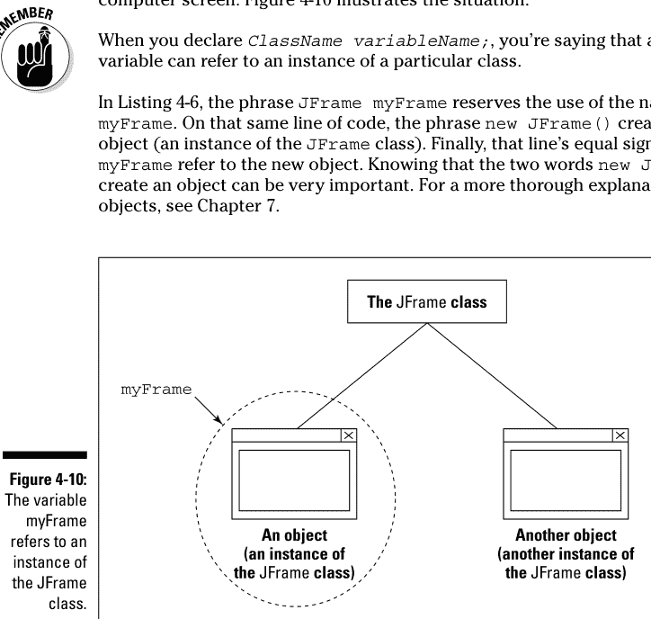

### 基本类型大杂烩

既然提到了框架，框架到底是什么？框架是一个具有特定高度、宽度以及位于你计算机屏幕上特定位置的窗口。因此，在 `Frame` 类的声明深处，你可以找到类似下面的变量声明：

```java
int width;
int height;
int x;
int y;
```

这是另一个例子——`Time` 类的实例可能有一个小时（1 到 12 之间）、分钟（0 到 59 之间）和一个字母（a 代表 a.m.；p 代表 p.m.）。

```java
int hour;
int minutes;
char amOr;
```

注意，这个被称为 Java API 类的高高在上的东西既不高也不伟大。类是声明的集合。其中一些声明是变量的声明。某些变量声明使用基本类型，而另一些变量声明使用引用类型。然而，这些引用类型来自其他类，而那些类的声明中也包含变量。这条链一直延伸下去。最终，一切都以某种方式源自基本类型。

### 导入声明

预先宣布你的意图总是好的。考虑以下课堂演讲：

> “今天，在我们的电影史课程上，我们将讨论演员休伯特·布莱利·巴里摩的职业。”
>
> “Barrymore 出生于费城，出演了 200 多部电影，包括《斜杠人生》、《长滩留云》和《基尔德博士的婚礼日》。此外， Barrymore 还是一个作家、作曲家和导演。Barrymore 每年都在电台里为埃本尼泽·斯克鲁奇配音。”
>
> 有趣的内容吗？现在考虑上述段落中一个讲师没有以以下话开头的讲座：
>
> “再次欢迎来到电影史。”
>
> “Lionel Barrymore 出生于费城，出演了 200 多部电影，包括《斜杠人生》、《长滩留云》和《基尔德博士的婚礼日》。此外，Barrymore（不是 Ethel、John 或 Drew）还是一个作家、作曲家和导演。Lionel Barrymore 每年都在电台里为埃本尼泽·斯克鲁奇配音。”

如果没有适当的介绍，演讲者可能不得不不断提醒你讨论的是 Lionel Barrymore 而不是其他某个 Barrymore。在 Java 程序中也是如此。再次查看列表 4-6：

```java
import javax.swing.JFrame;
public class ShowFrame {
    public static void main(String[] args[]) {
        JFrame myFrame = new JFrame();
```

在列表 4-6 中，你在引言中（在导入声明中）宣布了你在 Java 类中使用了 `JFrame`。你通过全名 `javax.swing.JFrame` 澄清了你所 `JFrame` 的含义。（嘿！第一位讲师不是也用全名“Lionel Blythe Barrymore”澄清过的吗？）在导入声明中宣布了你的意图后，你就可以在 Java 类代码中使用缩写 `JFrame` 了。

如果你不使用导入声明，那么在代码中使用 `JFrame` 的任何地方你都必须重复全称 `javax.swing.JFrame`。例如，如果没有导入声明，列表 4-6 的代码将如下所示：

```java
public class ShowFrame {
    public static void main(String[] args[]) {
        javax.swing.JFrame myFrame =
        new javax.swing.JFrame();
        String myTitle = "Blank Frame";
        myFrame.setTitle(myTitle);
        myFrame.setSize(320, 200);
        myFrame.setDefaultCloseOperation(javax.swing.JFrame.EXIT_ON_CLOSE);
        myFrame.setVisible(true);
    }
}
```

这些导入内容的细节可能会非常讨厌。但幸运的是，许多 IDE 都为导入声明提供了方便的辅助功能。详情请参阅此书的网站（www.allmycode.com/JavaForDummies）。

书中没有任何一个章节可以呈现所有的。


### 通过运算符创建新值

所以 Java 有一个加号。你可以用它来加数字，如下：

```java
int apples, fruit;
apples = 5;
oranges = 16;
fruit = apples + oranges;
```

当然，减号也是可用的（但不适用于字符串 值）。

```java
apples = fruit;
```


#### 列表 4-7：找零程序

```java
import static java.lang.System.out;

public class MakeChange {
    public static void main(String args[]) {
        int total = 248;
        int quarters, dimes, nickels, pennies;

        quarters = total / 25;
        int whatsLeft = total % 25;
        dimes = whatsLeft / 10;
        whatsLeft = whatsLeft % 10;
        nickels = whatsLeft / 5;
        whatsLeft = whatsLeft % 5;
        pennies = whatsLeft;

        out.println("quarters: " + quarters);
        out.println("dimes: " + dimes);
        out.println("nickels: " + nickels);
        out.println("pennies: " + pennies);
    }
}
```

图 4-11 显示了列表 4-7 中代码的运行情况。你从总共 248 个计数开始。然后

```java
quarters = total / 25
```

将 248 除以 25，得到 9。这意味着你可以从 248 个计数中换出 9 个四分硬币。接下来，

```java
whatsLeft = total % 25
```

将 248 除以 25，并仅将余数 23 放入 `whatsLeft` 中。现在你准备好进行下一步了，即从 23 分钱中换出尽可能多的一分硬币。

#### 导入声明：丑陋的真相

注意列表 4-7 顶部的导入声明：

```java
import static java.lang.System.out;
```

将其与列表 4-6 顶部的导入声明进行比较：

```java
import javax.swing.JFrame;
```

通过在列表 4-7 中添加 `import static java.lang.System.out`，我可以让代码的其他部分变得更易读，并且避免了从某行开始并延续到另一行的长语句。但你永远不需要这样做：如果你删掉 `import static java.lang.System.out;` 这一行，并在代码中到处使用 `System.out.println()`，代码依然运行良好。

关于 `static` 的真实情况，你必须阅读第 10 章的部分内容。坦率地说，如果你需要心脏病药物、正在怀孕或哺乳，或者你没有面向对象编程的经验，我不建议你跳过它直接看第 10 章的 `static` 部分。现在，请放心，在你度过了这本书这部分的旅程后，第 10 章是非常易读的。当你决定是否使用 `import declaration` 关键字时，请记住这些提示：

- Java 程序中的大多数导入声明都不使用 `static` 关键字。
- 在书中，除了 `System.out`，我从不使用 `static` 来导入任何内容。（嗯，几乎从不……）
- 大多数导入声明不使用 `static`是因为大多数声明导入的是类。遗憾的是，`System.out` 并不是一个类的名称。

这里有一个问题：为什么一个声明包含了 `static` 关键字，而另一个声明没有？老实说，我希望自己刚才没问这个问题！

列表 4-7 中的代码根据美货币面值进行找零，使用的硬币面值如下：1 分、5 分（一个镍币）、10 分（一个一角硬币）和 25 分（一个四分硬币）。使用这些面值，`MakeChange` 类提供的不仅仅是一组加起来为 24 分的硬币。`MakeChange` 类提供了加起来为 24 分的最少硬币数量。通过调整，你可以让代码适用于任何国家的货币。你总能获得一组加起来等于总额的硬币。但对于某些国家的硬币面值，你不总能获得凑成总额的最少硬币。事实上，例如，如果你国家的货币制度导致 `MakeChange` 无法始终给出最佳答案，请向我们发送电子邮件（JavaFordummies@galimycode.com）。

> 图 4-11：2.48 的找零。从 248 分中你得到了 9 个四分硬币、2 个一角硬币、0 个镍币、3 分。

#### 初始化一次，赋值多次

列表 4-7 有三行将值放入变量 `whatsLeft` 中：

```java
int whatsLeft = total % 25;
whatsLeft = whatsLeft % 10;
whatsLeft = whatsLeft % 5;
```

在这些行中只有一行是声明。另外两行是赋值语句。这是好事，因为你不能重复声明同一个变量（除非创建一个“块”）。如果你在列表 4-7 中这样写：

```java
int whatsLeft = total % 25;
int whatsLeft = whatsLeft % 10;
```

当你尝试编译代码时，会得到一个错误信息（whatsLeft 已定义）。

要了解什么是“块”，请参阅第 5 章。然后，关于重新声明变量的诚实讨论，请参阅第 10 章。

#### 自增和自减运算符

Java 有一些简洁的小运算符，可以让生活变得更轻松（对于计算机处理器、你的大脑以及你的手指都是）。总共有四个这样的运算符——两个自增运算符和两个自减运算符。

自增运算符加 1，自减运算符减 1。自增运算符使用双符号（`++`），自减运算符使用双符号（`--`）。要查看它们如何工作，你需要一些示例。第一个示例在图 4-12 中。双加根据你放置的位置有两个名称。当你把 `++` 放在变量之前时，`++` 被称为前自增（pre 代表“之前”）。

```java
import static java.lang.System.out;
public class preIncrement {
    public static void main(String args[]) {
        int numberOfBunnies = 27;
        ++numberOfBunnies;
        out.println(numberOfBunnies);
        out.println(numberOfBunnies);
    }
}
```

| numberOfBunnies |
| :--- |
| 变为 28 |
| numberOfBunnies |
| 变为 29 |


## 第 4 章：充分利用变量及其值

### 前自增与后自增

“before”（之前）这个词有两个含义：

- 你把 `++` 放在变量之前。
- 计算机在语句的任何部分使用该变量之前，先给变量的值加 1。

为了理解这一点，请看图 4-12 中的加粗行。计算机给 `numberOfBunnies` 加 1（将 `numberOfBunnies` 的值提高到 29），然后在屏幕上打印出 29。

使用 `out.println(++numberOfBunnies)`，计算机在屏幕上打印 `numberOfBunnies` 的新值之前，先给 `numberOfBunnies` 加 1。

前自增的替代方案是后自增（post 代表“之后”）。“after”（之后）这个词有两个含义：

- 你把 `++` 放在变量之后。
- 计算机在语句的任何部分使用该变量之后，再给变量的值加 1。

要清楚地看到后自增如何工作，请看图 4-14 中的加粗行。计算机在屏幕上打印 `numberOfBunnies` 的旧值（即 28），然后给 `numberOfBunnies` 加 1。

使用 `out.println(numberOfBunnies++)`，计算机在打印 `numberOfBunnies` 的旧值之后再给它加 1。

对比图 4-15 和图 4-13 的运行情况：

- 在图 4-13 中使用前自增，第二个数字是 28。
- 在图 4-15 中使用后自增，第二个数字是 29。

在图 4-15 中，直到执行最后一次 `out.println(numberOfBunnies)`，结果才在屏幕上显示。

| numberOfBunnies |
| :--- |
| 变为 28 |
| 打印出 28 |
| 打印出 28，然后 numberOfBunnies 变为 29 |
| 打印出 29。 |

```java
import static java.lang.System.out;
public class postIncrementDemo {
    public static void main(String[] args[]) {
        int numberOfBunnies = 27;
        numberOfBunnies++;
        out.println(numberOfBunnies);
        out.println(numberOfBunnies++);
        out.println(numberOfBunnies);
    }
}
```

```
Console
<terminated>
Postincr
28
28
29
```

### 语句和表达式

你可以用两种方式来描述前自增、后自增以及前自减、后自减运算符：大家理解的方式以及正确的方法。我在本节中解释这个概念的方式（基于时间，使用之前和之后）是大家理解的方式，但它并不是正确的方法。当你看到 `++` 或 `--` 时，你可以从顺序的角度来考虑。有时程序员会以复杂的方式使用 `++` 或 `--`。所以，如果你在语句的表达式中遇到这些运算符的棘手情况：

- 作为语句，`numberOfBunnies++` 告诉计算机给 `numberOfBunnies` 加 1。
- 作为表达式，`numberOfBunnies++` 的值是 28，29。

现在，尽管计算机在执行完表达式后会给 `numberOfBunnies` 加 1，但 `out.println(numberOfBunnies++)` 实际上的意思是 `out.println(29)`。

### 递增与递减运算符总结

你正在纠结是使用前增还是后增吗？不用再纠结了。大多数程序员都使用后增。在典型的 Java 程序中，你经常会看到像 `numberOfBunnies++` 这样的代码。也会看到像 `++numberOfBunnies` 这样的代码。

除了前增和后增，Java 还有两个使用 `--` 的运算符。这些运算符被称为前递减和后递减。

- 使用前递减（`--numberOfBunnies`），计算机在语句的其他部分使用变量之前，先从变量的值中减 1。
- 使用后递减（`numberOfBunnies--`），计算机在语句的其他部分使用变量之后，再从变量的值中减 1。

与其编写 `++numberOfBunnies`，你可以通过编写 `numberOfBunnies = numberOfBunnies + 1` 来实现相同的效果。有些人认为 `++` 和 `--` 运算符是为了节省击键次数——让那些可怜的手免于过度劳动。这是完全错误的。使用它们的最佳理由是避免重复编写相同变量名这种低效且容易出错的做法。如果你只写一次 `numberOfBunnies`（如使用 `++` 或 `--` 时所示），计算机只需要弄清楚一次 `numberOfBunnies` 的含义。此外，当你只写一次时，你只有一次机会（而不是两次机会）输错变量名。对于像 `numberOfBunnies++` 这样简单的表达式，这些优势几乎没有区别。但对于更复杂的表达式，例如 `inventoryItems[quantityReceived - items]++`，使用 `++` 和 `--` 带来的效率和准确性是巨大的。

### 赋值运算符

如果你读了上一节关于加 1 的运算符的内容，你可能在想是否可以操作这些运算符来加 2、5 或 100。你可以写 `numberOfBunnies++++` 并仍然称自己为程序员吗？不，不可以。如果你尝试这样做，在编译代码时会出现错误信息。

那么你可以做什么呢？事实上，Java 有许多赋值运算符可以使用。使用赋值运算符，你可以加、减、乘或除以任何数字。你还可以做其他酷的操作。列表 4-8 包含了赋值运算符（带有等号的那些）。图 4 显示了运行 4-8 的输出。

#### 列表 4-8：赋值运算符

```java
public class UseAssignmentOperators {
    public static void main(String[] args[]) {
        int numberOfBunnies = 2;
        int numberExtra = 5;

        numberOfBunnies += 1;
        System.out.println(numberOfBunnies);

        numberOfBunnies += 5;
        System.out.println(numberOfBunnies);

        numberOfBunnies += numberExtra;
        System.out.println(numberOfBunnies);

        numberOfBunnies *= 2;
        System.out.println(numberOfBunnies);

        System.out.println(numberOfBunnies -= 7);
        System.out.println(numberOfBunnies = 100);
    }
}
```

列表 4-8 展示了 Java 赋值运算符是多么强大。你可以对任何数字进行加、减、乘或除。注意 `+= 5` 给 `numberOfBunnies` 加 5，`*= 2` 将 `numberOfBunnies` 乘以 2。你可以使用另一个表达式（在列表 4-8 中的 `numberExtra`）作为应用的数字。

列表 4-8 的最后两行演示了 Java 赋值运算符的一个特性。你可以将赋值运算符作为更大语句的一部分。在列表 4-8 的下一行，运算符从 `numberOfBunnies` 中减去 7，`numberOfBunnies` 的值从 172 变为 165。然后整个赋值操作被放入 `System.out.println` 调用中，因此 165 显示在屏幕上。

看，列表 4-8 的最后一行展示了你如何使用 Java 普通等号做同样的事情。我在本章开头称为赋值语句的东西实际上在本节中描述的赋值运算符之一。因此，每当你给某个东西赋值时，都可以使该赋值更大语句的一部分。

赋值运算符的每次使用都兼具语句和表达式的双重职责。在所有情况下，表达式的值等于你所赋的值。例如，在执行代码 `System.out.println(numberOfBunnies -= 7)` 之前，`numberOfBunnies` 的值为 172。作为语句，`numberOfBunnies -= 7` 通知计算机从 `numberOfBunnies` 中减 7（因此 `numberOfBunnies` 的值从 172 变为 165）。作为表达式，`numberOfBunnies -= 7` 的值是 165。所以代码 `System.out.println(numberOfBunnies -= 7)` 意味着 `System.out.println(165)`。数字 165 显示在计算机屏幕上。

关于此点的详细解释，请参见本章前面的侧栏“语句与表达式”。

---

## 第 5 章：控制程序流

### 本章内容

- 编写选择之间的语句
- 将语句放在另一个内部
- 在备选项之间进行选择

当你编写计算机程序时，你不断地遇到路口。用户正确输入他们的密码了吗？如果是，用户通过；如果不是，把他们踢出去。所以 Java 编程语言需要一种让程序向两个方向之一分支的方法。幸运的是，语言有一种方法：它被称为 `if` 语句。

### 决策（Java if 语句）

列表 5-1 展示了 `if` 语句的使用。图 5-1 显示了列表 5-1 中程序的两次运行。

#### 列表 5-1：猜数字游戏

```java
import java.lang.System.out;
import java.util.Scanner;
import java.util.Random;

public class GuessingGame {

    public static void main(String[] args[]) {
        Scanner keyboard = new Scanner(System.in);

        out.print("输入一个1 到 10 之间的整数: ");

        int inputNumber = keyboard.nextInt();
        int randomNumber = new Random().nextInt(10) + 1;

        if (inputNumber == randomNumber) {
            out.println("************");
            out.println("*你赢了。");
            out.println("************");
        } else {
            out.println("你输了。");
            out.print("随机数是 ");
            out.println(randomNumber + ".");
        }

        out.println("感谢参与。");

        keyboard.close();
    }
}
```

**图 5-1: 猜游戏的两次运行。**

```
输入一个1 到 10 之间的整数: 2
***
*你赢了。*
***
感谢参与。
```

```
输入一个1 到 10 之间的整数: 4
你输了。
随机数是 10。
感谢参与。
```

Listing 5-1 中的程序与用户玩了一个猜数字游戏。程序从用户处获取一个数字（猜测值），并生成一个 1 到 10 之间的随机数。如果用户输入的与随机数相同，则用户赢。否则，用户输了，并告诉用户随机数是多少。

#### 它控制了键盘的击键

合并来看，这几行

```java
import java.util.Scanner;

Scanner keyboard = new Scanner(System.in);

int inputNumber = keyboard.nextInt();
```

在 Listing 5-1 中获取用户在计算机键盘上输入的任何数字。这三行中的最后一行将此数字放入变量 `inputNumber` 中。如果这些行看起来很复杂，在这三行代码的所有名称中，只有我自己命名的的是 `inputNumber` 和 `keyboard`。其他所有名称都是 Java 的。所以，如果我想发挥点创意，我可以这样写这些行：

```java
import java.util.Scanner;

Scanner readingThingie = new Scanner(System.in);

int valueTypedIn = readingThingie.nextInt();
```

我还可以加强我程序的 import 声明，正如我在后面的 Listing 5-2 和 5-3 中做的那样。除此之外，我没有多少回余地。

当你继续阅读这本书时，你将开始识别这三行代码背后的模式，所以我不会用所有的细节充斥这个章节。现在，你只需要复制这三行，并记住以下几点：

- 当你导入 `java.util.Scanner` 时，你不使用 `static` 关键字。但导入 `Scanner` 与导入 `System.out` 不同。当你导入 `java.lang.System.out` 时，你会使用 `static` 关键字。（参考 Listing 5-1。）差异之所以是因为代码 `Scanner` 是一个类的名称，而 `System.out` 不是一个类的名称。要快速查看 `static` 单词的使用，请参阅第 4 章中的一个边栏。要了解关于该单词更完整的故事，请参阅第 10 章。
- 通常（在台式或笔记本电脑上）`System.in` 的名称代表键盘。要从键盘以外的地方获取字符，你可以在括号内输入 `System.in` 以外的内容。你可以在括号内放入什么？关于一些想法，请参阅第 8 章。
- 在 Listing 5-1 中，我主观决定将我的一个变量命名为 `keyboard`。`keyboard` 这个名称指代你，读者，而该变量指的是你电脑前的一堆按钮。命名为 `keyboard` 并不会告诉 Java 关于塑料按钮或用户输入的事。另一方面，`System.in` 这个名称始终告诉 Java 关于那些塑料按钮的事。Listing 5-1 中的 `Scanner keyboard = new Scanner(System.in)` 将名称 `keyboard` 与我们所有人所熟知并喜爱的塑料按钮连接起来。
- 当你预期用户输入一个 `int` 值（某种整数）时，使用 `nextInt()`。如果你预期用户输入一个 `double`（包含小数点的数字），使用 `nextDouble()`。如果你预期用户输入 `true` 或 `false`，使用 `nextBoolean()`。如果你预期用户输入像 Barry、Java 或 Hello 这样的单词，使用 `next()`。

小数点在不同国家有所不同。在美国，`10.5`（带点）代表十点五，但在法国，`10,5`（带逗号）代表十点五。在波斯语中，小数点看起来像斜杠（但它比数字字符低一点）。你的电脑...

### if 语句详解

**图 5-2：** `if` 语句就像路上的分叉口。

`inputNumber` 的值是否等于 `randomNumber` 的值？当条件为真时，计算机会执行条件和 `else` 单词之间的内容。当条件结果为假时，计算机会执行 `else` 之后的内容。无论何种，计算机都会执行最后一个 `printf` 调用，它会显示“感谢游戏”。

`if` 语句中的条件必须包含在括号内。然而，像 `if (inputNumber == randomNumber)` 这样的行并不是一个完整的语句（就像“如果我有锤子”不是一个完整的句子）。所以这一行 `if (inputNumber == randomNumber)` 不会以分号结尾。

有时，当我在描述一个正在测试的条件时，我会不小心地使用 `expression`（表达式）一词代替 `condition`（条件）。这没关系，因为每个条件都是一个表达式。表达式是一个有值的东西，而事实也如此，每个条件都有值。条件的值要么是 `true` 要么是 `false`。（关于表达式以及值 `true` 和 `false` 的信息，请参阅第 4 章）。

#### 双等号

在代码列表 5-1 中，在语句的条件中，注意双等号的使用。比较两个数字以查看它们是否相同，与将某值设为另一个值不是一回事。这就是为什么比较相等性的符号与用于赋值或初始化的符号不相同。

在 `if` 语句的条件中，你不能将双等号替换为单等号。如果你这样做，你的程序将无法工作（当你尝试编译代码时，几乎总是收到一条错误消息。）


相反，如果你从不犯下在条件中使用单等号的错误，那可就不正常了。不久前，当我正在教一门 Java 入门课程时，我承诺过如果在任何实验课期间没有人犯使用单等号的错误，我就吞下我的激光笔。这并不是一个空头承诺。我从未不得不履行它。即使我忽略了在实验课期间任何人犯的前十次单等号错误，我仍然可以省掉激光笔。每个人在自己的编程生涯中都会使用几次单等号。

诀窍不在于避免犯单等号错误；诀窍在于每当你犯错时都能捕捉到错误。


## 准备好

如果代码列表 5-1 中的语句有两个部分——上半部分和下半部分，我为 `if` 语句的这两个部分起了名字。我把它们称为 `if` 部分（上半部分）和 `else` 部分（下半部分）。

代码列表 5-1 中的 `if` 部分似乎包含多个一个语句。我通过将 `if` 部分的三个语句封装在一对大括号 `{}` 中来实现这一点的。当我这样做时，我就形成了一个“块”（block）。一个块是一组用一对大括号紧凑在一起的语句。

通过这个块，三次 `println` 调用被隐藏在 `if` 部分内部。有了大括号，星号行和单词 `You` 只在用户的猜测正确时才会显示。

这种关于块和大括号的操作也适用于 `else` 部分。在代码列表 5-1 中，每当 `inputNumber` 不等于 `randomNumber`，计算机就会执行 `print/println`。为了说服计算机这三个调用都在 `else` 子句中，我将这些调用放入块中。也就是说，我将它们封装在对括号中。

严格来说，代码列表 5-1 在 `if` 语句和 `else` 语句之间只有一个语句，在 `else` 语句之后也只有一个语句。诀窍在于，当你把一组语句放在大括号内时，你就得到了一个块，而块在实际上表现得就像一个单一语句。事实上，Java 官方文档将块列为许多语句的类型之一。因此，在代码列表 5-1 中，打印 `You win` 和星号的块是一个单一语句，内部包含了三个较小的语句。


## 第 5 章：使用决策语句控制程序流

### 在代码中缩进语句

注意在代码列表 5-1 中，`if` 语句内部的 `print` 和 `println` 调用是如何缩进的。（这包括胜利和失败语句。`else` 单词之后的 `print` 和 `println` 调用仍然是 `if` 语句的一部分。）严格来说，你不需要缩进 `if` 语句内部的语句。对于所有编译器来说，你可以将整个程序写在一行内，或者将所有语句放在一种巧妙的锯字形中。问题是，如果你不以某种逻辑方式缩进语句，你或任何其他人都无法理解你的代码。在代码列表 5-1 中，`print` 和 `println` 语句的缩进有助于你的眼睛（和大脑）快速看到这些语句隶属于整个 `if/else` 流程。

在小型程序中，缩进不当几乎是可以忍的。但在复杂的程序中，不遵循整洁模式的缩进是一个噩梦。许多 IDE 都可以自动缩进你的代码。事实上，缩进是我最喜爱的功能之一。

当你编写 `if` 语句时，可能会想抛弃所有大括号并仅仅依靠缩进。不幸的是，这很少奏效。如果你在 `else` 之后缩进三个语句而不将它们封装在大括号中，计算机会认为 `else` 部分仅包含第一个语句。访问网站 `www.mycode.com/JavaDummies` 获取更多关于 IDE 所能提供的信息。

### 没有 else 的 if

好吧，这一节的标题是编造的。没关系！想法是你可以在没有 `else` 部分的情况下创建一个 `if` 语句。例如代码列表 5-1 中的代码。也许你不会在用户输时表现。代码列表 5-2 展示了如何这样做（以及图 5-3）。

### 代码列表 5-2：一个更和蔼、温柔的猜测游戏

```java
import static java.lang.System.in;
import static java.lang.System.out;
import java.util.Scanner;
import java.util.Random;

public class DontTellLost {

    public static void main(String[] args) {
        Scanner keyboard = new Scanner(in);

        out.print("输入一个 1 到 10 的整数：");
        int inputNumber = keyboard.nextInt();
        int randomNumber = new Random().nextInt(10) + 1;

        if (inputNumber == randomNumber) {
            out.println("你赢了.");
        } else {
            out.println("这是一个非常好的猜测:-");
            out.print("随机数是 ");
            out.println(randomNumber + " ");
            out.println("感谢游戏.");
        }
        keyboard.close();
    }
}
```

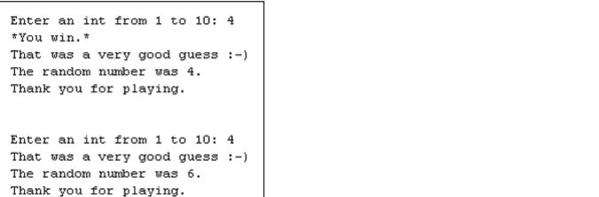

代码列表 5-2 中的语句没有 `else` 部分。当 `inputNumber` 与 `randomNumber` 相等时，计算机打印 win。当 `inputNumber` 与 `randomNumber` 不同时，计算机不打印 win。

列表 5-2 展示了另一个新想法。通过对 `System` 进行导入声明，我可以将 `Scanner(System.in)` 简化为更短的 `Scanner(in)`。添加这个导入声明并不值得付出努力。事实上，与不添加相比，我打的字反而更多。然而，代码列表 5-2 展示了导入 `System` 是可能的。

当你为了相等性（使用 `==`）或不等性（使用 `!=`）比较两个数字时，要小心。在进行一些计算并获得两个 `double` 值或两个 `float` 值后，你得到的值很少会完全相等。（问题源于小数点后那些讨厌的数字。）例如，21 摄氏度对应的华氏度是 69.8，而当你用手计算 `9.0 / 5 * 21 + 32` 时，你得到的是 69.8。

但 `9.0 / 5 * 21 + 32 == 69.8` 这个条件的结果实际上是 false。

这是因为，当计算机计算 `9.0 / 5 * 21 + 32` 时，它得到的是 69.800000000000001，而不是 69.8。

### 比较对象

当你开始使用对象时，你会发现可以使用 `==` 和 `!=` 来比较对象。例如，你在电脑屏幕上看到的某个按钮就是一个对象。你可以询问被鼠标点击的东西是否是你屏幕上的某个特定按钮。你通过 Java 的等价运算符来实现这一点。

```java
if (e.getSource() == bCopy)
   clipboard.setText(e.getText());
```

如需了解如何响应按钮点击，请对比第 15 章。

Java 比较方案中最大的陷阱出现在比较字符串时。关于 Java `String` 类型的更多信息，请参阅第 4 章中引用类型的章节。当你比较两个字符串时，你不想使用双等号。使用双等号是在问：“这个字符串在内存中的存储位置与另一个字符串完全相同吗？”通常，这并不是你想问的。相反，你想问：“这个字符串包含的字符与另一个相同？”Java 的 `String` 类型有一个方法 `equals()`。（像已知宇宙中的其他一切一样，这个 `equals()` 方法定义在 Java API 中。）`equals()` 方法比较两个字符串以判断它们是否包含相同的字符。使用 Java 的 `equals()` 方法的示例，请参见列表 5-3。（图 5-4 显示了列表 5-3 中程序的运行情况）。

图 5-4：使用 `=` 和使用 Java `equals()` 方法的结果。

```
What is the password? wordfish
You typed >>wordfish<<
```

你输入的单词没有与真实密码存储在同一个地方，但那不是大问题。你输入的单词与真实密码具有相同的字符。你可以使用我们宝贵的系统。

### 列表 5-3：检查密码

```java
import static java.lang.System.*;
import java.util.Scanner;

public class CheckPassword {
    public static void main(String args[]) {
        out.print("What's the password?");

        Scanner keyboard = new Scanner(in);
        String password = keyboard.next();

        out.println("You typed >>" + password + " <<");

        if (password == "swordfish") {
            out.println("The word you typed is stored");
            out.println("in the same place as the real");
            out.println("password. You must be a");
            out.println("hacker.");
        } else {
            out.println("The word you typed is not");
            out.println("stored in the same place as");
            out.println("the real place, but that's");
            out.println("no big deal.");
        }
        out.println();

        if (password.equals("swordfish")) {
            out.println("The word you typed has the");
            out.println("same characters as the real");
            out.println("password. You can use our");
            out.println("precious system.");
        } else {
            out.println("The word you typed doesn't");
            out.println("have the same characters as");
            out.println("the real password. You can't");
            out.println("use our precious system.");
        }

        keyboard.close();
    }
}
```

在列表 5-3 中，`keyboard.next()` 调用获取了用户在电脑键盘上输入的任何内容。代码将这个单词存入名为 `password` 的变量中。然后程序语句使用了两种不同的技术来比较 `password` 和 "swordfish"。

打印版中的示例大多是基于文本的，但你可以在这本书的网站（`www.allmycode.com/JavaForummies`）上找到大多数示例更高级的版本。这些更高级的版本包含了窗口、按钮、字段以及典型图形用户界面（GUI）的其他元素。


两种技术中更合适的是使用 Java 的 `equals()` 方法。`equals()` 方法看起来很奇怪，因为当你调用它时，要在它后面加一个点。`equals()` 方法是在问：“这个字符串包含的字符与另一个相同吗？”Java 的 `String` 类型有一个方法 `equals()`。（像已知宇宙中的其他一切一样，这个 `equals()` 方法定义在 Java API 中。）`equals()` 方法比较两个字符串以判断它们是否包含相同的字符。

### 导入所有

列表 5-3 第一行说明了通配符。事实上，`java.*` 相当于有 30 个声明，包括 `System.out`。


在比较字符串时，使用 Java `equals()` 方法，而不是使用等号。

## 第 5 章：使用决策语句控制程序流

在导入语句中使用星号通常被认为是不良习惯，因此我不经常这样做。但对于较大的程序——使用几十个 API 命名的程序——星号是微妙的。


# Java 的逻辑运算符

斯波克先生会喜欢的。Java 提供了组合和匹配逻辑测试所需的所有运算符。这些运算符如表 5-2 所示。

| 表 5-2 逻辑运算符 | 符号 | 示例 |
| :--- | :--- | :--- |
| `&&` | 与 | `5 < x && x < 10` |
| `||` | 或 | `x < 5 || 10 < x` |
| `!` | 非 | `!password.equals("swordfish")` |

你可以使用这些运算符形成各种条件。列表 5-4 有一个示例。

## 列表 5-4：检查用户名和密码

```java
import javax.swing.JOptionPane;
public class Authenticator {

  public static void main(String args[]) {

    String username =
      JOptionPane.showInputDialog("Username:");
    String password =
      JOptionPane.showInputDialog("Password:");

    if (
      username != null &&
      password != null &&
      (username.equals("bburd") &&
      password.equals("swordfish") ||
      username.equals("hritter") &&
      password.equals("preakston"))
    ) {
      JOptionPane.showMessageDialog(
        null, "You're in.");
    } else {
      JOptionPane.showMessageDialog(
        null, "You're suspicious.");
    }
  }
}
```

列表 5-4 程序的多次运行在图 5-5 中。当用户名是 `bburd` 且密码是 `swordfish`，或者用户名是 `hritter` 且密码是 `preakston` 时，用户会得到好消息。否则，用户就是一个蛋，会得到应得的糟糕消息。

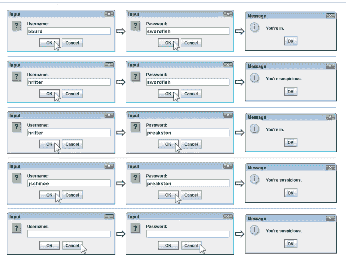

图 5-5：列表 5-4 代码的多次运行。

# 第 5 章：使用决策语句控制程序流程

**坦白：** 图 5-5 是虚假的！为了帮助你阅读用户名和密码，我在代码列表 5-4 中添加了一条额外的语句。这条额外的语句（`UIManager.put("TextField.font", new Font("Dialog", Font.BOLD, 14))`）放大了每个文本框的字体大小。我在创建图表之前修改了代码。对我过招吧！

代码列表 5-4 展示了获取用户输入的新方法；即向用户显示输入对话框。

```
String password = JOptionPane.showInputDialog("Password:");
```

代码列表 5-4 执行的任务与以下语句基本相同：

```
String password = keyboard.next();
```

来自 5-3 节。主要的区别在于，`keyboard.next()` 在控制台中显示外观枯燥的文本，而 `JOptionPane.showInputDialog("Username:")` 显示的是一个包含文本框和按钮的对话框。（对比图 5-4 和图 5-5）。当用户点击 OK 时，计算机会获取文本框中的文本并赋值给变量。事实上，代码列表 5-4 使用了两次 `JOptionPane.showInputDialog` —— 一次获取用户名的值，第二次获取密码的值。

在代码列表 5-4 的末尾，我对 `JOptionPane` 使用了稍微的变体：

```
JOptionPane.showMessageDialog(null, "You're in.");
```

通过 `showMessageDialog`，我显示了一个非常简单的对话框 —— 一个没有文本框的框。（再次参见图 5-5）。

与其他名称一样，`JOptionPane` 定义在 Java 的 API 中。（更具体地说，`JOptionPane` 定义在名为 `javax.swing` 的包内，而它又在 Java 的 API 内部）。要在整个代码列表 5-4 中使用 `JOptionPane` 名称，请在列表顶部导入 `javax.swing`。

> **提示**
>
> 在代码列表 5-4 中，`JOptionPane.showInputDialog` 工作运行良好，是因为用户的输入（用户名和密码）是字符字符串形式。如果你想让用户输入数字（`int` 或 `double`），你需要做一些额外工作。例如，要从用户处获取一个 `int` 值，可以类似于 `int numberOfCows = Integer.parseInt(JOptionPane.showInputDialog("How many cows?"))`。额外的 `Integer.parseInt` 部分强制让你的文本框输入变为 `int` 值。要从用户处获取一个 `double` 值，输入类似于 `double fractionOfHolsteins = Double.parseDouble(JOptionPane.showInputDialog("Holsteins:"))`。额外的 `Double.parseDouble` 操作强制让你的文本框输入变为 `double` 值。

## 傻瓜们万岁！

《自学指南》（For Dummies）系列书籍的法语译名为《Pour les Nuls》。因此，英语中的 "dummy" 在法语中是 "nul"。但在 Java 中，`null` 这个词意味着“空无”。当你看到：

```
if (
    username != null
```

在代码列表 5-4 中，你可以想象成看到：

```
if (
    username isn't anything
```

或者

```
if (
    username has any value at all
```

要发现 `username` 如何没有值，请查看图 5-5 的最后一行。当你点击第一个对话框中的 Cancel 时，计算机会将 `null` 传递给你的程序。在代码列表 5-4 中，变量 `username` 变为 `null`。比较语句 `username != null` 用来检查你是否点击了程序第一个对话框中的 Cancel。比较语句 `password != null` 对程序的第二个对话框执行同样的检查。当你看到代码列表 5-4 中的 `if` 语句时，你可以想象看到以下内容：

```
if (
    你没有在用户名对话框中按 Cancel 且
    你没有在密码对话框中按 Cancel 且
    (你在用户名对话框中输入了 "bburd") 且
    你在密码对话框中输入了 "swordfish") 或
    (你在用户名对话框中输入了 "hritter") 且
    你在密码对话框中输入了 "preakston")
)
```

## 在代码列表 5-4 中，比较语句 `username != null` 和 `password != null` 不是可选的。

如果你忘记包含这些内容并在程序运行时点击了取消，你将得到一个 `NullPointerException` 消息，程序会在你面前崩溃。`null` 这个词报告为空，在 Java 中，你报告……（此处由于原文存在大量重复错误，已按要求处理）。

---

## 第二部分：编写你自己的 Java 程序

```
Username: bburd
Password: swordfish
You're in.
```

图 5-6：列表 5-5 中代码的三次运行。

```
Username: bburd
Password: catfish
Incorrect password

Username: jschmoe
Unknown user
```

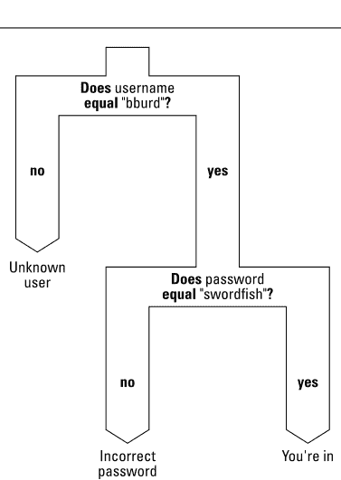

图 5-7：不要尝试用这把叉子吃饭。

列表 5-5 中的代码在嵌套 `if` 语句方面做得很好，但在处理真实世界的身份验证方面表现糟糕。首先，永远不要以明文形式显示密码（不使用星号掩盖密码）。其次，不要在不加密的情况下处理密码。第三，不要告诉恶意用户是哪一个单词（用户名或密码）输入错误。第四 . . . 额吧，我可以一直说下去。列表 5-5 中的代码并不是为了演示良好的用户名/密码实践。

---

# 第 5 章：使用决策语句控制程序流

## 在许多替代方案中选择（Java switch 语句）

我是第一个承认我讨厌做决定的的人。如果出了问题，我宁愿让问题变成别人的事。编写之前的章节（关于使用 Java 的 `if` 语句做决策）把这些东西完全消磨光了。这就是为什么当我开始这个关于选择许多替代方案的章节时，我感到头脑一胀。幸的是我已经把这段告白说了！

### 你的基础 switch 语句

现在，是时候探索具有多个分支决策的情况了。例如，流行的深红色歌曲《Al's All Wet》（歌词评论请参见侧边栏）。你渴望编写代码来打印这首歌的歌词。坦率地说，你不需要重新输入所有的单词。相反，你可以利用歌词中的重复性。

显示《Al's All Wet》歌词的完整程序直到第 6 章才会出现。在此，假设你有一个名为 `verse` 的变量。`verse` 的值为 1、2、3 或 4，取决于你试图打印的是《Al's All Wet》的哪个版本。你可以写一大堆笨拙的 `if` 语句组来检查每个可能的节数。

```
if (verse == 1) {
    out.println("That's because he has no brain.");
}
if (verse == 2) {
    out.println("That's because he is a pain.");
}
if (verse == 3) {
    out.println("Cause this is the last refrain.");
}
```

但这样做似乎很浪费。为什么不创建一个语句只检查一次 `verse` 的值，然后对找到的值采取行动呢？坦率地说，确实存在这样的语句。它被称为 `switch` 语句。列表 5-6 有一个 `switch` 语句的示例。

### 按照《Alouette》的调调唱的《Al's All Wet》：

Al's all wet, why is wet?

Al's all wet because he's standing in the rain.

Why is out in the rain?

That's because he has no brain.

Has no brain, has no brain,

In the rain, in the rain.

Ohhhhh...

Al's all wet, why is wet?

Al's all wet because he's standing in the rain.

Why is out in the rain?

That's because he is a pain.

He's a pain, he's pain,

Has no brain, has no brain,

In the rain, in the rain.

Ohhhhh...

Al's all wet, why is wet?

Al's all wet because he's standing in the rain.

Why is out in the rain?

Cause this is the last refrain.

Last refrain, last refrain,

He's a pain, he's pain,

Has no brain, has no brain,

In the rain, in the rain.

Ohhhhh...

### 列表 5-6：一个 switch 语句

```java
import static java.lang.System.out;
import java.util.Scanner;

public class JustSwitch {
    public static void main(String[] args) {
        Scanner keyboard = new Scanner(System.in);
        out.println("Which verse?");
        int verse = keyboard.nextInt();

        switch (verse) {
            case 1:
                out.println("That's because he has no brain.");
                break;
            case 2:
                out.println("That's because he is a pain.");
                break;
            case 3:
                out.println("Cause this is the last refrain.");
                break;
            default:
                out.println("No such verse. Please try again.");
                break;
        }
        out.println("Ohhhhh... ");
        keyboard.close();
    }
}
```

图 5-8 显示了列表 5-6 代码的两次运行。图 5-9 说明了程序的整体思想。首先，用户输入一个数字，假设为 2。然后，程序的执行到达 `switch` 语句。计算机检查 `verse` 的值。当计算机确定 `switch` 语句时，值 2 不匹配第一个 `case`，因此计算机继续中间的 `case`。中间的 `case`（数字 2）匹配 `verse` 的值，因此计算机执行 `case 2` 之后的语句。这两个语句是：

```
out.println("That's because he is a pain.");
break;
```

| 图 5-8: 运行列表 5-6 代码两次 | Which verse? 2 |
| :--- | :--- |
| That's because he is a pain. Ohhhhh... | Which verse? 6 |
| No such verse. Please try again. Ohhhhh... | |

这两个语句在屏幕上显示 `That's because he is a pain.`。第二个语句是一个 `break` 语句（真是惊喜！）当计算机遇到 `break` 语句时，它会跳过它所在的 `switch` 语句。因此，在列表 5-6 中，计算机跳过了显示 `Cause this is the last refrain.` 的 `case`。实际上，计算机直接跳转到 `switch` 语句之后的语句。计算机显示 `Ohhhhh . . .`，`switch` 之后的语句告诉计算机做什么。如果讨厌的用户询问 6...

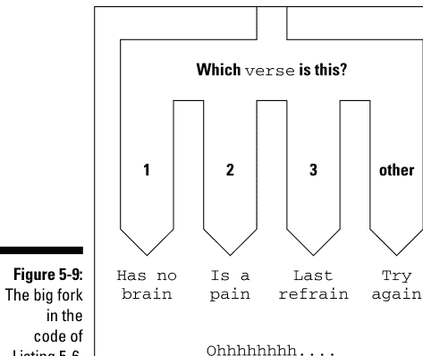

**图 5-9：** 列表 5-6 代码中的大分叉。

你并不真的需要在 `switch` 语句的末尾放一个 `break`。在列表 5-6 中，最后一个 `break`（属于 `default` 的那个）只是为了整体的整洁。

Ohhhhhhhh...

### 要 break 还是不 break

通常，当你使用 `switch` 语句时，你不希望发生穿透（fall-through），所以在整个 `switch` 语句中散布 `break` 语句。但偶尔，穿透正是你所需要的。例如，《Al's All Wet》这首歌（优雅的歌词显示在带有歌曲名的侧边栏中）。《Al's All Wet》的每一节都在之前节的内容的基础上添加了新行。这种情况（从一节到另一节累加行）非常需要一个带有穿透功能的 `switch` 语句。列表 5-7 展示了这一思想。

## 列表 5-7：带有穿透功能的 switch 语句


```java
import static java.lang.System.out;
import java.util.Scanner;

public class FallingForYou {
    public static void main(String[] args[]) {
        Scanner keyboard = new Scanner(System.in);
        out.print("Which verse?");
        int verse = keyboard.nextInt();

        switch (verse) {
            case 3:
                out.print("Last refrain,");
                out.println("last refrain,");
            case 2:
                out.print("He's a pain,");
                out.println("he's a pain,");
            case 1:
                out.print("Has no brain,");
                out.println("has no brain,");
        }

        out.print("In the rain, in the rain.");
        out.println("Ohhhhhhhh...");
        out.println();

        keyboard.close();
    }
}
```

图 5-10 显示了列表 5-7 程序的多次运行。由于 `switch` 内部没有 `break` 语句，穿透随处发生。例如，当用户选择节 2 时，计算机执行 `case 2` 中的两个语句：

```java
out.print("He's a pain,");
out.println("he's a pain,");
```

然后，计算机继续向前执行 `case 1` 中的两个语句：

```java
out.print("Has no brain,");
out.println("has no brain,");
```

# 第 5 章：使用决策语句控制程序流

| 哪一首歌？ | 内容 |
| :--- | :--- |
| 歌词?1 | 没有大脑，没有大脑，在雨中，在雨中。噢噢噢... |
| 歌词?2 | 他是个麻烦，他是个麻烦，没有大脑，没有大脑，在雨中，在雨中。噢噢噢... |
| 歌词?3 | 最后一次副歌，最后一次副歌，他是个麻烦，他是个是个麻烦，没有大脑，没有大脑，在雨中，在雨中。噢噢噢... |
| 歌词?6 | 在雨中，在雨中。噢噢噢... |

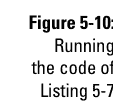

注意当用户请求第 6 段歌时发生了什么。列表 5-7 中的 `switch` 语句没有 `case 6` 也没有 `default`，`switch` 语句内部的动作都没有被执行。尽管如此，由于 `switch` 语句后面紧跟着打印“在雨中，在雨中”和“噢噢噢...”的语句，当用户请求第 6 段歌时，计算机仍然显示了内容。

## 新型且改进的 switch

在之前的列表 5-6 和 5-7 中，变量 `verse`（一个 `int` 值）引导 `switch` 语句进入某一个 `case`。`switch` 语句内部的 `int` 值在任何版本的 Java（无论新旧）中都可以工作。（事实上，`char` 值和其他几种类型的值自 Java 成为一种全新的语言以来，在 Java 的 `switch` 语句中一直有效。）

但如果你使用 Java 7 或更高版本，你可以设置使得 `switch` 语句中执行的 `case` 取决于特定字符串的值。列表 5-8 示例了字符串在 `switch` 语句中的用法。图 5-11 显示了列表 5-8 代码的运行情况。

### 列表 5-8：带有字符串的 switch 语句

```java
import static java.lang.System.out;
import java.util.Scanner;

public class Switch7 {
    public static void main(String[] args) {
        Scanner keyboard = new Scanner(System.in);
        out.println("Which verse (one, two or three)?");
        String verse = keyboard.next();

        switch (verse) {
            case "one":
                out.println("That's because he has no brain.");
                break;
            case "two":
                out.println("That's because he is a pain.");
                break;
            case "three":
                out.println("'Cause this is the last refrain.");
                break;
            default:
                out.println("No such verse. Please try again.");
                break;
        }

        out.println("Ohhhhhhh. . .");
        keyboard.close();
    }
}
```

图 5-11：运行列表 5-8 的代码。

| 哪一首歌（一、二或三）？ | 二 |
| :--- | :--- |
| 因为他是个麻烦。 | 噢噢噢噢 |

> 如果你使用 Java 创建 Android 应用，你必须使用 Java 5.0 或 Java 6。在 Java 6 或任何旧版本的 Java 中，你不能让字符串来决定 `switch` 语句的命运。

# 第 6 章：使用循环控制程序流

### 本章内容

- 使用基础循环
- 在循环时计数
- 不断地重复（直到用户给出明确答复）

1966 年，生产海飞士洗发水的公司创造了历史。在瓶背上，洗发水的使用说明写着：“泡沫-冲洗-重复”。以前从未有任何一套完整的说明（针对任何事情，更不用说洗头了）能被如此简洁地概括。说明编写行业的人称其为一项里程碑式的成就。这样的说明与当时的其他说明形成了鲜明对比。（例如，一罐杀虫喷雾上的第一句话写着：“转动这个罐子，使其指向远离你的脸。”呆！）

除了简洁之外，海飞士说明之所以如此酷的地方在于，它通过三个简单的单词，就成功捕捉了所有指令传递的核心概念——重复的概念。最后一个词 REPEAT（重复）将一个原本平淡的陈述转变成了一个复杂的行动配方。

基本思想是，当你遵循指令时，你并不是一个接一个地执行。相反，你在路口选择。你做出决策（“如果头发是干的，就使用护发素，”）并进入循环（“泡沫-冲洗，然后再次泡沫-冲洗。”）。在计算机编程中，你一直在使用决策和循环。本章将探索 Java 中的循环。

## 反复执行指令（Java while 语句）

这里有一个猜数字游戏。计算机从 1 到 10 之间生成一个随机数。计算机要求你猜这个数字。如果你猜错了，游戏将继续。一旦你猜对了，游戏就结束。列表 6-1 显示了玩该游戏的程序，图 6-1 显示了一轮。

### 列表 6-1：重复猜数字游戏

```java
import static java.lang.System.out;
import java.util.Scanner;
import java.util.Random;

public class GuessAgain {
    public static void main(String[] args) {
        Scanner keyboard = new Scanner(System.in);

        int numGesses = 0;
        int randomNumber = new Random().nextInt(10) + 1;

        out.println("************");
        out.println("Welcome to Guessing Game");
        out.println("************");
        out.println();

        out.print("Enter an int from 10: ");
        int inputNumber = keyboard.nextInt();
        numGesses++;

        while (inputNumber != randomNumber) {
            out.println("Try again...");
            out.print("Enter an int from 10: ");
            inputNumber = keyboard.nextInt();
            numGesses++;
        }

        out.print("You win after ");
        out.println(numGesses + " guesses.");

        keyboard.close();
    }
}
```

```
**********
Welcome to Guessing Game
**********

Enter an int from 10: 2
Try again...
Enter an int from 10: 5
Try again...
Enter an int from 10: 8
Try again...
Enter an int from 10: 3
Win after 4 guesses.
```

图 6-1：玩到为止。

在图 6-1 中，用户进行了四次猜测。每次，计算机都会检查猜得是否正确。错误的猜测会产生再次尝试的请求。对于正确的猜测，用户会得到“You win（你赢了）”，以及数字统计。计算机重复操作，每次检查用户的猜测是否与随机生成的数字相同。用户每进行一次猜测，计算机就会将其计数加 1。图 6-2 展示了动作的流程。

```
Welcome to Guessing Game
Enter an int from 10:
Get inputNumber from the user
Add 1 to numGuesses
```

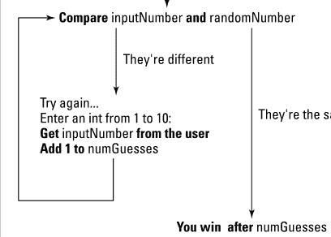

图 6-2：转转圈。

```
Try again...
Enter an int from 10:
Get inputNumber from the user
Add 1 to numGuesses
```

Compare inputNumber and randomNumber

They're different

They're the same

You win after numGuesses

当你查看列表 6-1 时，你看到了执行所有工作的代码。代码的核心被称为 `while` 语句（也称为 `while` 循环）。用英语重述，`while` 语句说：

```
当 inputNumber 不等于 randomNumber
执行大括号内的所有内容
```

大括号中的内容（重复的部分）是打印 *Try again* 和 *Enter...* 的代码。当你处理计数器时（如列表 6-1 中的 `numGesses`），很容易混淆并产生 1。通过确保 `++` 语句靠近你要计数的事件，可以避免这种头疼。例如，在列表 6-1 中，变量 `numGesses` 从 0 开始。那是程序开始时，用户还没有任何猜测。在程序的后面，每次调用 `keyboard.nextInt()` 之后都有 `numGesses++` 语句。这就是你在用户输入另一个猜测时增加计数的方法。

只要 `inputNumber != randomNumber` 为真，大括号中的语句就会重复。循环的每次重复都是一次迭代。在列表 6-1 中，循环经历了三次迭代。（如果你不相信图 6-1 恰好有三次迭代，*Try again* 的打印会在每次错误猜测时出现。）

当用户最后输入正确的猜测时，计算机回到 `while` 语句顶部，检查括号内的条件，发现处于双重否定。`inputNumber` 和 `randomNumber` 之间的不等不再成立。换句话说，`while` 语句说，`inputNumber != randomNumber` 为假。因为 `while` 语句为假，计算机跳过 `while` 循环，进入循环下方的语句。在两条语句中，计算机打印 you after 4 guesses。

### 列表 6-2：计数到十

```java
import static java.lang.System.out;

public class CountToTen {
    public static void main(String[] args) {
        for (int count = 1; count <= 10; count++) {
            out.print("The value of count is ");
            out.print(count);
            out.println(".");
        }
        out.println("Done!");
    }
}
```

列表 6-3 显示了运行列表 6-2 中的程序后得到的结果。（你得到的完全是你应得的。）列表 6-2 中的 `for` 语句首先将计数变量 `count` 设置为 1。然后，该语句进行测试以确保 `count` 小于或等于 10（它确实如此）。接着，`for` 语句向前跳转并执行大括号之间的打印语句。（在游戏的这个早期阶段，计算机打印出：`count` 的值为 1。）最后，`for` 语句执行了其括号内的最后一次操作——它将 `count` 的值加 1。

| count 的值为 1。 |
| :--- |
| count 的值为 2. |
| count 的值为 3. |
| count 的值为 4. |
| count 的值为 5. |
| count 的值为 6. |
| count 的值为 7. |
| count 的值为 8. |
| count 的值为 9. |
| count 的值为 10. |
| Done |

图 6-3：数到十。

现在 `count` 等于 2，`for` 语句再次检查以确保 `count` 小于或等于 10。（是的，2 小于 10。）由于测试通过，`for` 语句回到大括号内的语句，并在屏幕上打印出：`count` 的值为 2。最后，`for` 语句执行了其括号内的最后一次操作——它将 `count` 的值加 1，将 `count` 的值增加到 3。

以此类推。整个过程重复，直到在 10 次迭代后，`count` 的值终于达到了 11。当这种情况发生时，`count` 小于或等于 10 的检查失败，循环执行结束。计算机跳转到 `for` 语句之后的任何语句。在列表 6-2 中，计算机打印出 `Done!`。图 6-4 描述了整个过程。

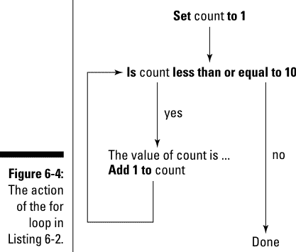

### for 语句的结构

在单词 `for` 之后，你始终要在括号中放入三个东西。这三个东西中的第一个被称为**初始化**（initialization），第二个是**表达式**（expression），第三个被称为**更新**（update）。

```
for ( initialization ; expression ; update )
```

括号中的三个项中的每一项都扮演着其独特的角色：

- **初始化** 只执行一次，当你的程序运行到该 `for` 语句时。
- **表达式** 会求值多次（在每次迭代之前）。
- **更新** 也会求值多次（在每次迭代结束时）。

如果有帮助的话，可以把循环想象成是被移动了位置：

```java
int count = 1
for (count <= 10) {
    out.print("The value of count is ");
    out.print(count);
    out.println(".");
    count++;
}
```

你可以这样写一个 `for` 语句。尽管如此，这仍然是语句部分执行的顺序。

如果你在 `for` 循环的初始化中声明了一个变量，你无法在循环之外使用该变量。例如，在列表 6-2 中，如果你尝试在循环结束后放置 `out.println(count)`，你会得到一条错误信息。

任何用 `for` 循环可以完成的事情也可以用 `while` 循环完成。选择使用 `for` 循环是一个风格和便利性的问题，而非必须。


## “Al's All Wet”的全球首演

列表 6-2 非常不错，但列表中的程序并没有做任何有趣的事。为了更引人入胜的示例，请参见列表 6-3。在列表 6-3 中，我履行了在第 5 章中的承诺。列表 6-3 中的程序打印了热门单曲《Al's All Wet》的所有歌词。（你可以在第 5 章找到歌词。）

### 列表 6-3：完整版《Al's All Wet》歌曲


# 第 6 章：使用循环控制程序流

## for 语句的结构

在单词 *for* 之后，你始终要在括号中放入三个东西。这三个东西中的第一个被称为*初始化*（initialization），第二个是*表达式*（expression），第三个被称为*更新*（update）。

```
for ( initialization ; expression ; update )
```

括号中的三个项中的每一项都扮演着其独特的角色：

- **初始化** 只执行一次，当你的程序运行到该 `for` 语句时。
- **表达式** 会求值多次（在每次迭代之前）。
- **更新** 也会求值多次（在每次迭代结束时）。

如果有帮助的话，可以把循环想象成是被移动了位置：

```
int count = 1
for (count <= 10) {
    out.print("The value of count is ");
    out.print(count);
    out.println(".");
    count++;
}
```

你可以这样写一个 `for` 语句。尽管如此，这仍然是语句部分执行的顺序。

如果你在 *for* 循环的初始化中声明了一个变量，你无法在循环之外使用该变量。例如，在列表 6-2 中，如果你尝试在循环结束后放置 `out.println(count)`，你会得到一条错误信息。

任何用 *for* 循环可以完成的事情也可以用 *while* 循环完成。选择使用 *for* 循环是一个风格和便利性的问题，而非必须。


## “Al's All Wet”的全球首演

列表 6-2 非常不错，但列表中的程序并没有做任何有趣的事。为了更引人入胜的示例，请参见列表 6-3。在列表 6-3 中，我履行了在第 5 章中的承诺。列表 6-3 中的程序打印了热门单曲《Al's All Wet》的所有歌词。（你可以在第 5 章找到歌词。）

## 列表 6-3：完整版《Al's All Wet》歌曲

```java
import static java.lang.System.out;

public class AllWet {

    public static void main(String args[]) {

        for (int verse = 1; verse <= 3; verse++) {
            out.print("Al's all wet.");
            out.println("Oh, why is all wet? Oh,");
            out.print("Al's all wet because ");
            out.println("he's standing in the rain.");
            switch (verse) {
                case 1:
                    out.println("That's because he has no brain.");
                    break;
                case 2:
                    out.println("That's because he is a pain.");
                    break;
                case 3:
                    out.println("Cause this is the last refrain.");
                    break;
            }

            switch (verse) {
                case 3:
                    out.println("Last refrain, last refrain,");
                case 2:
                    out.println("He's a pain, he's a pain,");
                case 1:
                    out.println("Has no brain, has no brain,");
            }
        }
    }
}
```

## 列表 6-2 的运行结果

列表 6-3 显示了运行列表 6-2 中的程序后得到的结果。（你得到的完全是你应得的。）列表 6-2 中的 `for` 语句首先将计数变量 `count` 设置为 1。然后，该语句进行测试以确保 `count` 小于或等于 10（它确实如此）。接着，`for` 语句向前跳转并执行大括号之间的打印语句。（在游戏的这个早期阶段，计算机打印出：`count` 的值为 1。）最后，`for` 语句执行了其括号内的最后一次操作——它将 `count` 的值加 1。

| count 的值为 1. |
| :--- |
| count 的值为 2. |
| count 的值为 3. |
| count 的值为 4. |
| count 的值为 5. |
| count 的值为 6. |
| count 的值为 7. |
| count 的值为 8. |
| count 的值为 9. |
| count 的值为 10. |
| Done |

图 6-3。数到十。

现在 `count` 等于 2，`for` 语句再次检查以确保 `count` 小于或等于 10。（是的，2 小于 10。）由于测试通过，`for` 语句回到大括号内的语句，并在屏幕上打印出：`count` 的值为 2。最后，`for` 语句执行了其括号内的最后一次操作——它将 `count` 的值加 1，将 `count` 的值增加到 3。

以此类推。整个过程重复，直到在 10 次迭代后，`count` 的值终于达到了 11。当这种情况发生时，`count` 小于或等于 10 的检查失败，循环执行结束。计算机跳转到 `for` 语句之后的任何语句。在列表 6-2 中，计算机打印出 `Done!`。图 6-4 描述了整个过程。


```java
import static java.lang.System.out;

public class AllWet {

    public static void main(String args[]) {

        for (int verse = 1; verse <= 3; verse++) {
            out.print("Al's all wet.");
            out.println("Oh, why is all wet? Oh,");
            out.print("Al's all wet because ");
            out.println("he's standing in the rain.");
            switch (verse) {
                case 1:
                    out.println("That's because he has no brain.");
                    break;
                case 2:
                    out.println("That's because he is a pain.");
                    break;
                case 3:
                    out.println("Cause this is the last refrain.");
                    break;
            }

            switch (verse) {
                case 3:
                    out.println("Last refrain, last refrain,");
                case 2:
                    out.println("He's a pain, he's a pain,");
                case 1:
                    out.println("Has no brain, has no brain,");
            }
        }
    }
}
```

# 第 6 章：使用循环控制程序流

## 列表 6-4：删除还是不删除

```java
import java.io.File;
import static java.lang.System.out;
import java.util.Scanner;

public class DeleteEvidence {
    public static void main(String args[]) {
        File evidence = new File("cookedBooks.txt");
        Scanner keyboard = new Scanner(System.in);
        char reply;

        do {
            out.print("Delete evidence? (y/n) ");
            reply = keyboard.findWithinHorizon(".", 0).charAt(0);
        } while (reply != 'y' && reply != 'n');

        if (reply == 'y') {
            out.println("Okay, here goes...");
            evidence.delete();
            out.println("The evidence has been deleted.");
        } else {
            out.println("Sorry, buddy. Just asking.");
        }

        keyboard.close();
    }
}
```

图 6-5 显示了列表 6-4 中代码的两种运行情况。程序接受小写的 `y` 和 `n`，但不接受大写的 `Y` 和 `N`。要让程序接受大写字母，请如下所示修改代码中的条件：

```java
do {
    out.print("Delete evidence? (y/n) ");
    reply = keyboard.findWithinHorizon(".", 0).charAt(0);
} while (reply != 'y' && reply != 'Y' &&
    reply != 'n' && reply != 'N');

if (reply == 'y' && reply == 'Y') {
```

图 6-6 显示了列表 6-4 中循环的控制流。使用 `do` 循环，程序中的这种情况（如本节开头所示）永远不会发生。因为 `do` 循环在不测试条件的情况下执行它的第一个动作，因此每个循环保证至少执行一次迭代。

132 第二部分：编写你自己的 Java 程序

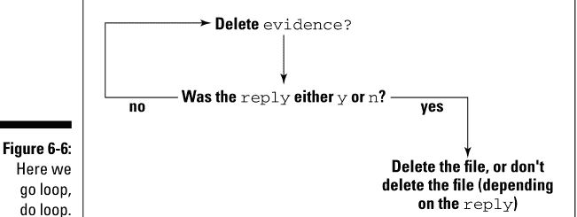

列表 6-4 中的 `cookedBooks.txt` 文件在你你的电脑硬盘上的位置取决于几个因素。如果你在错误的目录中创建 `cookedBooks.txt` 文件，列表 6-4 中的代码将无法删除该文件。（更准确地说，如果 `cookedBooks.txt` 在硬盘的错误目录中，列表 6-4 中的代码将无法找到准备删除该文件的 `cookedBooks.txt`。）在大多数情况下，新项目位于你硬盘上的一个文件夹中，而 `cookedBooks.txt` 文件属于该文件夹内部。例如，使用 Eclipse IDE，我通过在 IDE 中创建项目创建了一个名为 `Listing06-04` 的项目。新项目存储在我硬盘上一个名为 `c:\Users\user-name\workspace\listing06-04` 的文件夹中。在该文件夹内部，我有一个名为 `cookedBooks.txt` 的文件（直到我用列表 6-4 中的代码删除该文件）。在那个 `Listing06-04` 文件夹中，我还有一个名为 `src` 的子文件夹。我的 `MyDeleteEvidence.java` 文件就在该 `Listing06-04` 文件夹中。

## 读取单个字符

回到第 5 章的列表 5-3，用户在键盘上输入一个单词。`keyboard.next()` 方法获取该单词并将其放入一个名为 `password` 的 `String` 变量中。一切运行得很好，因为 `String` 变量可以同时存储许多字符，而 `next()` 方法可以一次性读取许多字符。

在列表 6-4 中，你对读取几个字符并不感兴趣。你期望用户输入一个字母——`y` 或 `n`。因此，你没有创建一个 `String` 变量来存储用户的响应。相反，你创建了一个 `char` 变量——一个一次只存储一个符号的变量。

# 第 6 章：使用循环控制程序流

Java API 没有 `nextChar()` 方法。因此，为了读取适合存储在 `char` 变量中的内容，你必须临变应变。在列表 6-4 中，这种临变应变如下：

```java
keyboard.findWithinHorizon(".", 0).charAt(0)
```

每当你想要读取单个字符时，都可以完全按照列表 6-4 中所示的方式使用这段代码。

`String` 变量可以包含许多字符，也可以只包含一个。但只包含一个字符的 `String` 变量并不等同于 `char` 变量。无论你向 `String` 变量中放入什么，`String` 变量和 `char` 变量都必须区别对待。


### Java 中的文件处理

在列表 6-4 中，实际的文件处理语句值得关注。这些语句涉及类、对象和方法的使用。关于这些内容的很多细节在其他章节中，例如第 7 章和第 9 章。尽管如此，提及一下它们也不会有害。

所以，你可以在 Java 语言 API 中找到名为 `java.io.File` 的类。语句

```java
File evidence = new File("cookedBooks.txt");
```

在计算机内存中创建了一个新对象。这个由 `java.io.File` 类形成的对象描述了程序程序所需的关于磁盘文件 `cookedBooks.txt` 的一切信息。从列表 6-4 从这里开始，变量 `evidence` 指向磁盘文件 `cookedBooks.txt`。

`evidence` 对象作为 `java.io.File` 类的实例，拥有一个 `delete()` 方法。（有什么可以删除的？在 `java.io.File` 类的文档中。）当你调用 `delete()` 方法时，它删除了文件。当然，你不能删除一个不存在的文件。为了确保文件存在，你有几种选择。最简单的是调用 `exists()` 方法。在文档中

这里是列表 6-4 的增强版本，包含了对 `exists()` 的调用：

```java
import java.io.File;
import static java.lang.System.out;
import java.util.Scanner;

public class DeleteEvidence {

    public static void main(String args[]) {
        File evidence = new File("cookedBooks.txt");
        Scanner keyboard = new Scanner(System.in);
        char reply;

        if (evidence.exists()) {
            do {
                out.print("Delete evidence? (y/n) ");
                reply = keyboard.findWithinHorizon(".", 0).charAt(0);
            } while (reply != 'y' && reply != 'n');

            if (reply == 'y') {
                out.println("Okay, here goes...");
                evidence.delete();
                out.println("The evidence has been deleted.");
            } else {
                out.println("Sorry, buddy. Just asking.");
            }
        }

        keyboard.close();
    }
}
```

### 变量声明与块

一组由大括号包围的语句形成一个块。如果你在块内部声明变量，你通常无法在块外部使用该变量。例如，在列表 6-4 中，如果你尝试如下操作，将会报错：

# 第 6 章：使用循环控制程序流 135

```java
if (reply = 'y') // reply 在循环的大括号内，外部使用名称没有意义。当你尝试编译这个时，reply != 'y' && reply != 'n' ——两个用于 reply，第三个用于 if 语句。
```

所以在列表 6-4 中，你的手被束住了。程序第一次使用 `reply` 变量是在循环内部。为了让该变量在循环后可用，你必须在循环之前声明它。在这种情况下，最好声明变量但不进行初始化。非常有趣！


要了解更多关于变量初始化知识，请参阅第 4 章。要了解块的知识，请参阅第 5 章。

所有版本的 Java 都有本章描述的三种循环（`while` 循环、`for` 循环和 `do-while` 循环）。但新的 Java 版本（即 Java 5 及以后）还有另一种被称为增强循环。要查看 Java 的增强 `for` 循环，请参阅第 11 章。

# 第三部分：大局工作：面向对象编程

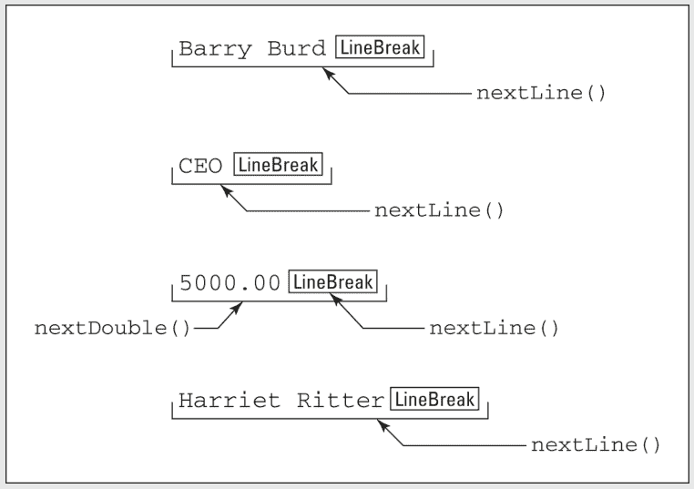

当然，你写了一个很好的应用程序，但你的代码真的运行正常吗？测试没有次数之分，如果你的测试组织良好，你就通向了拥有优秀应用程序之路。要了解如何让你的测试组织良好，请访问 `www.dummies.com/extras/java`。关于 JUnit 测试的文章为你提供了内幕消息。

# 在这一部分 ...

- 了解类和对象是什么（无需让你绞尽脑汁）。
- 了解面向对象编程如何帮助你重用现有代码（节省你的时间和金钱）。
- 通过构建全新的对象，成为你自己虚拟世界的造皇帝。

## 第 7 章：以类和对象的思维进行思考

**本章内容**

- 像真正的面向对象程序员一样思考
- 在方法之间传递值和返回值
- 在你的面向对象代码中隐藏细节

作为一本计算机书籍的作者，我被一次又一次地告知——我不应该期望人们按照逻辑顺序来阅读章节和内容。人们会东跳西跳的，挑选他们需要的，跳过他们不想读的。考虑到这一点，我意识到你可能跳过了第 1 章。如果是那样的话，请不要感到内疚。你只需要花 60 秒钟通过阅读以下从第 1 章中摘取的信息就可以弥补回来：

> 因为 Java 是一门面向对象的编程语言，你的首要目标是描述类和对象。类是某种事物背后的想法。对象是类的具体实例。程序员定义一个类，计算机根据类的定义创建出各个对象。

当然，你完全可以选择跳过这段 60 秒的总结文字。如果是那样，你可能想挽回一些损失。你可以通过阅读以下对第 1 章的两个字的总结来实现：

类，对象。

## 定义类（成为一个账户意味着什么）

一个银行账户与另一个账户的区别是什么？如果你向银行家员问这个问题，你会听到一长串推销。银行家员会描述利率、费用、罚金——一整套流程。对你来说的是，我对这些都不感兴趣。相反，我想知道我的账户和你的账户有什么不同。

第 III 部分：从大局角度工作：面向对象编程

账户。毕竟，我的账户名叫 Barry Burd，以 Burd Consulting 的名义经营，而你的账户名叫 Jane Q. Reader，读作 Budding Java Expert。我的账户里有 24.02 美元。你的呢？

归根结底，一个账户与另一个账户之间的区别可以总结为变量的值。也许有一个名为 `balance` 的变量。对我来说，`balance` 的值是 24.02。对你来说，`balance` 的值是 55.63。在编写处理账户的计算机程序时，我如何将我的 `balance` 与你的 `balance` 变量隔离开来？

答案是创建两个对象。让一个 `balance` 变量放在其中一个对象内部，让另一个 `balance` 变量放在另一个对象内部。顺便在每个对象中都放一个 `name` 变量和一个 `address` 变量。这样你就有了两个对象，每个对象代表一个账户。更准确地说，每个对象都是 `Account` 类的实例。（见图 7-1）。

| Account 类的实例 | 另一个 Account 类的实例 |
| :--- | :--- |
| name Barry | name Jane |
| address 222 Cypress Lane | address 111 Consumer Street |
| balance 24.02 | balance 55.63 |

图 7-1：两个对象。

到目前为止很好。然而，你还没有解决原始的问题。在你的计算机程序中，你如何引用 `balance` 变量，而不是你的 `balance` 变量？嗯，你有两个对象放在那里，所以也许你有变量来引用这两个对象。创建一个名为 `myAccount` 的变量，另一个创建一个名为 `yourAccount` 的变量。`myAccount` 指向我的对象（`Account` 类的实例）以及它内部的所有内容。要引用我的余额，写：

```java
myAccount.balance
```

要引用我的名字，写：

```java
myAccount.name
```

`yourAccount.balance` 指向你对象中 `balance` 变量的值，`yourAccount.name` 指向你对象中 `name` 变量的值。要告诉计算机我的账户里有多少钱，你可以写：

```java
myAccount.balance = 24.02;
```

## 第 7 章：以类和对象的思维进行思考

为了在屏幕上显示你的名字，你可以写：

```java
out.println(yourAccount.name);
```

这些思想在列表 7-1 和 7-2 中汇合。这里是列表 7-1：

### 列表 7-1：成为一个账户意味着什么

```java
public class Account {
  String name;
  String address;
  double balance;
}
```

列表 7-1 中的 `Account` 类定义了成为一个账户意味着什么。特别是，列表 7-1 告诉你 `Account` 类的每个实例都有三个变量——`name`、`address` 和 `balance`。这与图 7-1 中的信息一致。Java 程序员对这类变量有特殊的名称（属于实例的变量）。这些变量中的每一个——`name`、`address` 和 `balance`——都是一个字段（field）。


在类内部声明但在任何特定方法内部未声明的变量是字段。在列表 7-1 中，`name`、`address` 和 `balance` 变量都是字段。字段的另一个例子是实例变量。


# 第 7 章：以类和对象的思维进行思考

如果你一直在苦读第 4 到第 6 章的内容，那么 `Account` 类的代码（列表 7-1）可能会让你大吃一惊。你可以轻松地用四行代码定义一个 Java 类。一个在类内部声明但不在任何特定方法内部的变量就是字段。在列表 7-1 中，`name`、`address` 和 `balance` 变量都是字段。字段的另一个例子是实例变量。

你有两个对象放在那里，所以也许你有变量来引用这两个对象。创建一个名为 `myAccount` 的变量，另一个创建一个名为 `yourAccount` 的变量。`myAccount` 指向我的对象（`Account` 类的实例）以及它内部的所有内容。要引用我的余额，写：

```
myAccount.balance
```

要引用我的名字，写：

```
myAccount.name
```

`yourAccount.balance` 指向你对象中 `balance` 变量的值，`yourAccount.name` 指向你对象中 `name` 变量的值。要告诉计算机我的账户里有多少钱，你可以写：

```
myAccount.balance = 24.02;
```

为了在屏幕上显示你的名字，你可以写：

```
out.println(yourAccount.name);
```

这些思想在列表 7-1 和 7-2 中汇合。这里是列表 7-1：

## 列表 7-1：成为一个账户意味着什么

```
public class Account {
  String name;
  String address;
  double balance;
}
```

列表 7-1 中的 `Account` 类定义了成为一个账户意味着什么。特别是，列表 7-1 告诉你 `Account` 类的每个实例都有三个变量——`name`、`address` 和 `balance`。这与图 7-1 中的信息一致。Java 程序员对这类变量有特殊的名称（属于实例的变量）。这些变量中的每一个——`name`、`address` 和 `balance`——都是一个字段（field）。

### 声明变量和创建对象

一个年轻人在街道上走来。他告诉我打印“你将喜欢 Java！”这样我打印这些字。在哪里打印这些字并不重要。重要的是给了一些指令，我遵循了指令。

那天晚，一位老年女士坐在我身旁的长椅上。她说：“账户有一个名字、地址和一个余额。”我说：“很好，但你想让我对它做些什么？”作为回答，她盯着我，所以我没有对她的账户做任何事。我们只是静静地坐着。

142 部分：从大局角度工作：面向对象编程

列表 7-1 如前所示，就像那位老年女士。这个列表定义了成为一个账户意味着什么，但它没有告诉我要对我的账户或任何人的账户做什么。为了做些事情，我需要第二段代码。我需要另一个类——一个包含 `main` 方法的类。当我们静静坐在长椅上时，孩子们路过了列表 7-2。

## 列表 7-2：处理账户对象

```java
import static java.lang.System.out;

public class UseAccount {

    public static void main(String[] args) {
        Account myAccount;
        Account yourAccount;

        myAccount = new Account();
        yourAccount = new Account();

        myAccount.name = "Barry Burd";
        myAccount.address = "222 Cyberspace Lane";
        myAccount.balance = 24.02;

        yourAccount.name = "Jane Q. Public";
        yourAccount.address = "111 Consumer Street";
        yourAccount.balance = 55.63;

        out.print(myAccount.name);
        out.print(" ");
        out.print(myAccount.address);
        out.print(" has $");
        out.print(myAccount.balance);
        out.println();

        out.print(yourAccount.name);
        out.print(" ");
        out.print(yourAccount.address);
        out.print(" has $");
        out.print(yourAccount.balance);
    }
}
```

在某种程度上，列表 7-2 方法内部的前两行是有误导性的。有些人读取 `Account yourAccount` 就像它应该意味着“`yourAccount` 是一个 Account”，或者“变量 `yourAccount` 指向 Account 类的实例”。这并不是第一行真正的含义。

相反，`Account yourAccount;` 这行代码意思是：“当我让变量 `yourAccount` 指向某个东西时，那个东西将是 Account 类的一个实例。” 那么，区别在哪里呢？

区别在于，声明 `Account yourAccount` 并没有让 `yourAccount` 变量指向一个对象。声明只是预留了变量名 `yourAccount`，以便该名称最终可以指向 Account 类的实例。实际对象的创建直到代码后面、当计算机执行 `new Account()` 时才会发生。

从技术上讲，当计算机执行 `new Account()` 时，你正在通过调用 Account 类的构造函数来创建一个对象。关于这一点，我将在第 9 章中详细介绍。

当计算机执行赋值语句 `yourAccount = new Account()` 时，计算机创建一个新对象（Account 类的一个实例），并让变量 `yourAccount` 指向该对象。等号使变量引用了这个新对象。图 7-2 展示了这种情况。

| 执行前 | 执行后 |
|---|---|
| `Account yourAccount;` | `yourAccount = new Account();` |
| | `yourAccount` |

图 7-2：调用构造函数前后的状态。

为了验证我在最后几段中提出的主张，我在列表 7-2 的代码中额外添加了一行。我尝试在调用 `new Account()` 之前，声明 `yourAccount` 之后打印 `yourAccount.name`。

```java
Account myAccount;
Account yourAccount;

out.println(yourAccount.name);

myAccount = new Account();
yourAccount = new Account();
```


## 第三部分：大局观工作：面向对象编程

当我尝试编译新代码时，收到了这个错误信息：variable yourAccount might not have been initialized（变量 yourAccount 可能未初始化）。这就确定了。在执行 `new Account()` 之前，你无法打印对象的 name 变量，因为对象并不存在。


当一个变量具有引用类型时，仅仅声明变量是不够的。只有当你调用构造函数并使用 `new` 关键字时，才会获得对象。

关于引用类型的信息，请参见第 4 章。

### 初始化变量

在第 4 章中，我提到可以在变量的同时初始化原始类型变量。

```java
int weightOfAPerson = 150;
```

你也可以对引用类型变量执行操作，例如列表 7-2 中的 `myAccount` 和 `yourAccount`。你可以将列表 main 方法的前几行合并为两行，如下：

```java
Account myAccount = new Account();
Account yourAccount = new Account();
```

如果你这样合并，就能自动避免我在上一节中描述的变量可能未初始化错误。有时你会发现无法初始化变量的情况。但如果可以初始化，那通常是一件好事。

### 使用对象的字段

在你处理完 main 方法的前四行后，之前列表 7-2 中的剩余代码就是合逻辑且直观的。你有三行代码为 `myAccount` 对象的字段赋值，三行代码为 `yourAccount` 对象的字段赋值，还有四行代码进行打印。图 7-3 显示了程序的输出。

图 7-3：运行列表 7-1 和 7-2 中的代码。

| Barry Burd (222 Cyberspace Lane) 拥有 $24.02 | Jane Q. Public (111 Consumer Street) 拥有 $55.63 |

### 一个程序；多个类

第 3 到 6 章中的每个程序都只包含一个类。这对于书的入门章节来说很棒。但在现实生活中，一个典型的程序由数百甚至数千个类组成。跨越 7-1 和 7-2 的程序包含两个类。当然，有两个类并不像有数千个类，但这是向那个方向迈的一步。

在实践中，大多数程序员会将每个类放在自己单独的文件中。当你创建一个程序时（例如列表 7-1 和 7-2 中的程序），你会在计算机的硬盘上创建两个文件。因此，当你从网上下载本节的示例时，你会得到两个文件——`Account.java` 和 `Use.java`。


关于如何在 Eclipse、NetBeans 和 IntelliJ IDEA 中运行由多个 .java 文件组成的程序的信息，请访问本书的网站（www.allcode.com/JavaForDummies）。

### 公共类

列表 7-1 的第一行：

```java
public class Account {
```

`Account` 类是公共的（public）。公共类可供所有其他类使用。例如，如果你在网络远程角落编写一个 `ATMController` 程序，你的 `ATMController` 程序可以包含代码，例如 `myAccount.balance = 24.02`，从而使用列表 7-1 中声明的 `Account` 类。

列表 7-2 中的 `UseAccount` 类也是公共的。当一个类包含 main 方法时，本书中的大多数类都是公有的。


为什么这是一个好主意呢？之所以好，是因为你让数据片段负责自己。在面向对象的编程中，与账户相关的所有都收集在 `Account` 类的代码中。关于字符串的所有知识都位于 `String.java` 文件中。任何与你的数字的内容（例如，它们是两位数还是四位数）都直接在 `Year` 类内部处理。因此，如果有人对 `Account class` 或 `Year class` 有任何问题，他或她知道该去哪里寻找所有的代码。这太棒了！

现在想象一个增强型的账户表。在这张新表中，每个对象都具有内置功能。每个账户都知道如何使用它自己的 `display` 方法在屏幕上显示自己。当然，你不需要太大的想象力就能想象出这张表。我正好有一个你可以查看的表，就是表 7-2。

## 表 7-2 面向对象的方式

| 姓名 | 地址 | 余额 | 显示 |
| --- | --- | --- | --- |
| Barry Burd | 222 Cyberspace Lane | 24.02 | out.print.... |
| Jane Q. Public | 111 Consumer Street | 55.63 | out.print.... |

### 一个能显示自己的账户

在表 7-2 中，每个账户对象都有四个东西——一个姓名、一个地址以及一种在屏幕上显示自己的方式。当你转变为面向对象的思维后，你将永远不会回头。代码列表 7-3 和 7-4 显示了实现表 7-2 中思想的程序。

## 代码列表 7-3：账户显示自己

```java
import static java.lang.System.out;

public class Account {
    String name;
    String address;
    double balance;

    public void display() {
        out.print(" ");
        out.print(address);
        out.print(" has $");
        out.print(balance);
    }
}
```

## 代码列表 7-4：使用改进后的 Account 类

```java
public class UseAccount {
    public static void main(String args[]) {
        Account myAccount = new Account();
        Account yourAccount = new Account();
        myAccount.name = "Barry Burd";
        myAccount.address = "222 Cyberspace Lane";
        myAccount.balance = 24.02;

        yourAccount.name = "Jane Q. Public";
        yourAccount.address = "111 Consumer Street";
        yourAccount.balance = 55.63;

        myAccount.display();
        System.out.println(yourAccount.display());
    }
}
```

运行代码列表 7-3 和 7-4 中的代码看起来与运行代码列表 7-1 和 7-2 相似。你可以看到图 7-3 中的操作。

在代码列表 7-3 中，`Account` 类中包含四个东西——一个姓名、一个地址、一个余额和一个 `display` 方法。这些东西与表 7-2 中的列相对应。因此，`Account` 类的每个实例都有一个姓名、一个地址和显示自己的方式。调用这些内容的方式非常统一。要引用存储在 `myAccount` 中的姓名，你写下 `myAccount.name`。要让 `myAccount` 在屏幕上显示自己，你写下 `myAccount.display()`。唯一的区别是括号。当你调用一个方法时，要在方法名后加上括号。


### display 方法头部

再次查看代码列表 7-3 和 7-4。对 `display` 方法的调用位于 `UseAccount` 的 `main` 方法内部，但 `display` 方法的声明位于 `Account` 类中。声明包含头部和体。头部包含三个单词和一些括号：

- `public` 单词的作用与代码列表 7-1 中的 `public` 单词大致相同。可以说，任何代码都可以包含对方法的调用，即使调用代码和方法属于两个不同的类。在本节的示例中，是否让 `display` 方法公开取决于个人喜好。通常，当我创建一个在各种应用程序中有用的方法时，我会将该方法声明为 `public`。
- `void` 单词告诉计算机，当调用 `display` 方法时，它不会向调用它的地方返回任何内容。要查看向调用它的地方返回内容的方法，请参见下一节。
- `display` 单词是方法名。每个方法都必须有一个名称。否则，你就没有方法调用该方法。
- 括号包含了你在调用方法时将传递给方法的所有内容。当你调用方法时，可以即时传递信息。代码列表 7-3 中的 `display` 方法看起来很奇怪，因为方法头部的括号内什么都没有。这表示在调用 `display` 方法时没有向其传递任何信息。要看更好的例子，请参见下一节。

代码列表 7-3 包含了 `display` 方法的声明，代码列表 7-4 包含了对 `display` 方法的调用。代码列表 7-3 和 7-4 包含不同的类；代码列表 7-3 中 `public` 的使用是可选的。要找出原因，请检查输出 1。


# 第三部分：大局观：面向对象编程

| Account 类的一个实例 | Account 类的另一个实例 |
|---|---|
| 姓名 Barry | Jane |
| 地址 222 Cyberspace Lane | 地址 111 Consumer Street |
| 余额 24.02 | 余额 55.63 |

图 7-5：我的账户和你的账户。

Account

UseAccount

myAccount

yourAccount


顺便说一下，列表 7-3 中的 `main` 方法包含了两次对 `getInterest` 的调用。其中一次调用在参数列表中使用了字面量 `5.00`；另一次调用在参数列表中使用了变量 `interestRate`。为什么一个调用使用字面量，而另一个调用使用变量呢？没有原因。我只是想向你展示，这两种方法都可以。

# 向方法传递一个值

看一眼 `getInterest` 方法的头定义。（在阅读接下来的几个项目符号中的解释时，你可以结合图 7-6 中的图表理解一些视觉效果。）

```java
double getInterest(double percentageRate) {
    return balance * percentageRate / 100.00;
}
```

`Account`
`UseAccount`
`out.println(myAccount.getInterest(5.00));`

图 7-6：向方法传递一个值。

# 第 7 章：用类和对象的思维思考

- `double` 单词告诉计算机，当调用 `getInterest` 方法时，`getInterest` 方法会返回一个 `double` 类型的值给调用它的地方。`getInterest` 方法体语句确认了这一点。该语句说 `return balance * percentageRate / 100.00`，而表达式 `balance * percentageRate / 100.00` 的类型是 `double`。（该表达式中的所有内容——`balance`、`percentageRate` 和 `100.00` 都是 `double` 类型。）

- 当调用 `getInterest` 方法时，`return` 语句计算 `balance * percentageRate / 100.00` 并处理结果返回给调用该方法的代码。

- `getInterest` 是方法名。这是你在编写 `UseAccount` 类的代码时调用该方法所使用的名称。

- 括号中包含了你在调用方法时传递给方法的所有内容。当你调用方法时，可以动态地向该方法传递信息。这就是方法的参数列表。`getInterest` 方法头定义表示 `getInterest` 方法接收一条信息，且该信息必须是 `double` 类型。

```java
public double getInterest(double percentageRate)
```

确实如此，如果你看 `getInterest` 的第一次调用（在 `UseAccount` 类的 `main` 方法中），它其中包含了数字 `5.00`。而 `5.0` 是一个 `double` 字面量。当我调用 `getInterest` 时，我正在给方法传递一个 `double` 类型的值。


当你运行列表 7-5 和 7-6 中的代码时，动作执行流并不是从上到下的。动作从 `main` 跳到 `getInterest`，然后回到 `main`，再次回到 `getInterest`，最后再次回到 `main`。图 7-7 显示了整个过程。

# 第三部分：大局观：面向对象编程

```java
public class Account {
    Yada, yada, yada...

    ****************************************************
    double getInterest(double percentageRate) {
        return balance * percentageRate / 100.00;
    }
}

public class UseAccount {
    public static void main(String[] args) {
        Account myAccount = new Account();
        Account yourAccount = new Account();

        myAccount.name = "Barry Burd";
        myAccount.address = "222 Cyberspace Lane";
        myAccount.balance = 24.02;

        yourAccount.name = "Jane Q. Public";
        yourAccount.address = "111 Consumer Street";
        yourAccount.balance = 55.63;

        myAccount.display();
        out.print("* $");
        out.print(myAccount.getInterest(5.00));
        out.println(" * ");

        yourAccount.display();
        double yourInterestRate = 7.00;
        out.print("* $");
        double yourInterestAmount = 
            yourAccount.getInterest(yourInterestRate);
        out.print(yourInterestAmount);
        out.println(" * ");
    }
}
```

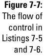

# 从 getInterest 方法返回值

当调用 `getInterest` 方法时，该方法执行方法体中的唯一语句：一个 `return` 语句。`return` 语句计算 `balance * percentageRate / 100.0` 的值。如果 `balance` 正好是 `24.02`，且 `percentageRate` 是 `5.00`，则表达式的值为 `1.2` —— 大约 `1.20`。（由于计算机完全处理 0 和 1，计算机获取的结果比预期的多了一点点点。计算机得到的是 `1.200999999999999`。这是人类必须面对的问题。）

无论如何，`return` 语句将计算结果传递给调用方法的代码。


# 第 7 章：用类和对象的思维思考

无论如何，`return` 语句将计算结果传递给调用方法的代码。`return` 语句计算 `balance * percentageRate / 100.0` 的值。如果 `balance` 正好是 `24.02`，且 `percentageRate` 是 `5.00`，则表达式的值为 `1.2` —— 大约 `1.20`。（由于计算机完全处理 0 和 1，计算机获取的结果比预期的多了一点点。计算机得到的是 `1.200999999999999`。这是人类必须面对的问题。）

## 向方法传递一个值

看一眼 `getInterest` 方法的头定义。（在阅读接下来的几个项目符号中的解释时，你可以结合图 7-6 中的图表理解一些视觉效果。）

```
double getInterest(double percentageRate) {
    return balance * percentageRate / 100.00;
}
```

```
Account
UseAccount
out.println(myAccount.getInterest(5.00));
```

图 7-6：向方法传递一个值。

- `double` 单词告诉计算机，当调用 `getInterest` 方法时，`getInterest` 方法会返回一个 `double` 类型的值给调用它的地方。`getInterest` 方法体语句确认了这一点。该语句说 `return balance * percentageRate / 100.00`，而表达式 `balance * percentageRate / 100.00` 的类型是 `double`。（该表达式中的所有内容——`balance`、`percentageRate` 和 `100.00` 都是 `double` 类型。）
- 当调用 `getInterest` 方法时，`return` 语句计算 `balance * percentageRate / 100.00` 并处理结果返回给调用该方法的代码。
- `getInterest` 是方法名。这是你在编写 `UseAccount` 类的代码时调用该方法所使用的名称。
- 括号中包含了你在调用方法时传递给方法的所有内容。当你调用方法时，可以动态地向该方法传递信息。这就是方法的参数列表。`getInterest` 方法头定义表示 `getInterest` 方法接收一条信息，且该信息必须是 `double` 类型。

```
public double getInterest(double percentageRate)
```

确实如此，如果你看 `getInterest` 的第一次调用（在 `UseAccount` 类的 `main` 方法中），它其中包含了数字 `5.00`。而 `5.0` 是一个 `double` 字面量。当我调用 `getInterest` 时，我正在给方法传递一个 `double` 类型的值。


当你运行列表 7-5 和 7-6 中的代码时，动作执行流并不是从上到下的。动作从 `main` 跳到 `getInterest`，然后回到 `main`，再次回到 `getInterest`，最后再次回到 `main`。图 7-7 显示了整个过程。

## 从 getInterest 方法返回值

当调用 `getInterest` 方法时，该方法执行方法体中的唯一语句：一个 `return` 语句。`return` 语句计算 `balance * percentageRate / 100.0` 的值。如果 `balance` 正好是 `24.02`，且 `percentageRate` 是 `5.00`，则表达式的值为 `1.2` —— 大约 `1.20`。（由于计算机完全处理 0 和 1，计算机获取的结果比预期的多了一点点。计算机得到的是 `1.200999999999999`。这是人类必须面对的问题。）

## 完整代码示例

```
public class Account {
    Yada, yada, yada...

    ****************************************************
    double getInterest(double percentageRate) {
        return balance * percentageRate / 100.00;
    }
}

public class UseAccount {
    public static void main(String[] args) {
        Account myAccount = new Account();
        Account yourAccount = new Account();

        myAccount.name = "Barry Burd";
        myAccount.address = "222 Cyberspace Lane";
        myAccount.balance = 24.02;

        yourAccount.name = "Jane Q. Public";
        yourAccount.address = "111 Consumer Street";
        yourAccount.balance = 55.63;

        myAccount.display();
        out.print("* $");
        out.print(myAccount.getInterest(5.00));
        out.println(" * ");

        yourAccount.display();
        double yourInterestRate = 7.00;
        out.print("* $");
        double yourInterestAmount = 
            yourAccount.getInterest(yourInterestRate);
        out.print(yourInterestAmount);
        out.println(" * ");
    }
}
```


## 格式化输出

| | `"$%4.2f\n"` | 计算机显示的内容： |
|---|---|---|
| 显示一个美元符号。 | 换行。 | $1.20 |
| 使用至少四个位置来显示数字，并将其中两个位置放在小数点右侧。 | | "a number" 是第二个位置（myInterest 的值） |

图 7-10：使用格式化字符串。

| | `"$%5.2f\n"` | 计算机显示的内容： |
|---|---|---|
| 显示一个美元符号。 | 换行。 | $1.20 |
| 使用至少五个位置来显示数字，并将其中两个位置放在小数点右侧。 | | |
| 因为 myInterest 仅占用四个位置，显示 myInterest 时会多出一个空白。 | | |

图 7-11：为显示数值添加额外位置。

| | `"$%8.2f\n"` | 计算机显示的内容： |
|---|---|---|
| 显示一个美元符号。 | 换行。 | $1.20 |
| 使用适当数量的位置来显示数字，并将其中两个位置放在小数点右侧。 | | |

图 7-12：在不指定具体位置数量的情况下显示数值。

| | `"$%3.2f\n"` | 计算机显示的内容： |
|---|---|---|
| 显示一个美元符号。 | 换行。 | $1.20 |
| 使用至少三个位置来显示数字，并将其中两个位置放在小数点右侧。 | | |
| 三个不够，所以计算机使用了四个位置。 | | |

图 7-13：显示数值时指定的位数太少。

```
"$%2f $%2f"
显示一个美元符号。
$1.20 $3.89
显示第二个参数(myInterest) 的值，小数点右侧保留两个位置。
显示第三个参数(yourInterest) 的值，小数点右侧保留两个位置。
显示一个空格和一个美元符号。
```

图 7-14：使用格式化字符串显示多个值。

更多关于 `printf` 方法及其格式化字符串的示例，请参见第 8 章和第 9 章。`printf` 方法格式化字符串相关的完整选项列表请参见 Java API 文档中的 `java.util.Formatter` 页面。

`printf` 中的格式化字符串不会改变数字内部计算的存储方式。格式化字符串的作用仅仅是创建一个美观的数字字符，并显示在你的屏幕上。

## 使用访问器方法隐藏细节

放下这本书，戴上你的帽子。你一直是一个忠诚的读者，我要带你出去吃午饭！

我只有一个问题。我手头有点紧。你介意我们在去午饭的路上顺路去自动取款机（ATM）取几块钱吗？而且，我们必须用你的账户。我的账户有点低。

### 良好的编程

在计算机编程领域，有一个词脱颖而出——**简单性**（simplicity）。当你编写复杂的代码时，最不想处理的就是别人命名不当变量、复杂的问题解决方案或临时的补救措施（kludges）。一个简洁的界面应该只解决你自己的问题，而不涉及别人的问题。

在我之前描述的自动取款机场景中，大问题在于机器的设计迫使你去担心别人的事情。当你应该考虑如何拿午饭钱时，你却在考虑变量和存储位置。必须有人来解决取款机的工程问题，但银行客户不是那个人。


本节关于的是安全（safety），而不是安全性（security）。安全代码防止你犯意外的编程错误。安全性代码（完全是另一个话题）防止恶意黑客进行蓄意破坏。


所以，与计算机程序每个方面相关的一切都必须是简单的，对吧？不，不是。事实并非如此。有时，为了长远来看让事情简单，你必须在前期做好大量的准备工作。建造自动取款机的人付出了努力，确保机器是“防呆的”（consumer-proof）。机器的界面及其屏幕消息和按钮经过了非常复杂且精心的设计。

要点在于，让事情简单需要一些技巧。在面向对象编程中，让事情简单的方法之一是防止类外部的代码直接使用类内部的字段。

# 第 7 章：从类和对象的角度进行思考

## 图 7-13：显示数值时指定的位数太少

```
"$%3.2f\n"
显示一个美元符号。换行。
$1.20
使用至少三个位置来显示数字，并将其中两个位置放在小数点右侧。
三个不够，所以计算机使用了四个位置。
```

## 图 7-14：使用格式化字符串显示多个值

```
"$%2f $%2f"
显示一个美元符号。
$1.20 $3.89
显示第二个参数(myInterest) 的值，小数点右侧保留两个位置。
显示第三个参数(yourInterest) 的值，小数点右侧保留两个位置。
显示一个空格和一个美元符号。
```

更多关于 `printf` 方法及其格式化字符串的示例，请参见第 8 章和第 9 章。`printf` 方法格式化字符串相关的完整列表请参见 Java API 文档中的 `java.util.Formatter` 页面。

`printf` 中的格式化字符串不会改变数字内部计算的存储方式。格式化字符串的作用仅仅是创建一个美观的数字字符，并显示在你的屏幕上。

# 使用访问器方法隐藏细节

放下这本书，戴上你的帽子。你一直是一个忠诚的读者，我要带你出去吃午饭！

（此处省略重复的 ATM 描述）

## 良好的编程

在计算机编程领域，有一个词脱颖而出——简单性。当你编写复杂的代码时，最不想处理的就是别人命名不当变量、复杂的问题解决方案或临时的补救措施。一个简洁的界面应该只解决你自己的问题，而不涉及别人的问题。

在我之前描述的自动取款机场景中，大问题在于机器的设计迫使你担心别人的事情。当你应该考虑如何拿午饭钱时，你却在考虑变量和存储位置。必须有人来解决取款机的工程问题，但银行客户不是那个人。


本节关于的是安全，而不是安全性。安全代码防止你犯意外的编程错误。安全性代码（完全是另一个话题）防止恶意黑客进行蓄意破坏。

（此处省略重复的章节标题和代码块）

## 第 7 章：基于类和对象的思维

与其直接引用 `myAccount.name`，`UseAccount` 程序员必须调用 `myAccount.setName` 或方法 `myAccount.getName`。这些名为 `setName` 和 `getName` 的方法被称为访问器方法，是因为它们提供了对 `Account` 类名称字段的访问。（实际上，访问器方法并不正式属于 Java 编程语言的一部分。它只是人们用来描述此类功能方法的常用术语。）更细致地看，`setName` 被称为 setter 方法（设置方法），而 `getName` 被称为 getter 方法（获取方法）。

有了许多 IDE，你就不需要自己编写访问器方法。首先，你输入一个如 `private String name` 这样的字段声明。然后，在 IDE 的菜单栏中，选择 `Source:Generate Getters and Setters`（生成 getter 和 setter），或者选择 `Code:Insert Cell:Setter` 或类似的命令。在你做出选择后，IDE 会创建访问器方法并将它们添加到你的代码中。

注意，列表 7-8 中所有的 setter 和 getter 方法都声明为 `public`（公有）。这确保了任何人在任何地方都可以调用这两个方法。这里的想法是：在 `Account` 类外部操纵字段是不可能的，但你可以通过这些字段轻松访问经过批准的 setter 和 getter 方法。

再次思考自动取款机（ATM）。使用 ATM 的人无法输入直接更改其或其账户余额值的命令，但存款一张百万美元支票的程序是很容易遵循的。制造自动取款机的人知道存款程序非常复杂，确实会有很多客户搞砸它。所以这就是任务所在——让人们不应该做的事情变得不可能，并确保人们应该完成的任务变得简单。

setter 和 getter 方法中没有任何什么是完全免费的。你不需要编写任何你将要使用的 setter 和 getter 方法。例如，在列表 7-8 中，我可以省略 `getAddress` 方法的声明，一切仍然运行正常。我唯一的问题是，任何想使用你的 `Account` 类并获取现有账户地址的人都是个变态狂。

当你创建一个为了给 `balance` 字段设置值的方法时，你不必将方法命名为 `setName`。你可以将其命名为 `tunaField` 或任何你喜欢的名称。麻烦在于，`setFieldName` 命名约定（`set` 部分全小写，`FieldName` 部分首字母大写）是 Java 编程领域公认的风格约定。如果你不遵循这一约定，你会让其他 Java 程序员困得晕头转向。如果你的集成开发环境具有拖拽式 GUI 设计，你可能会暂时失去该功能。（关于拖拽式 GUI 设计，请参阅第 2 章和第 15 章。）


## 164 第三部分：大局观工作：面向对象编程

当你调用 setter 方法时，你传入的是一个与被设置的类型相同的值。这就是为什么在列表 7-9 中，你使用类型为 `double` 的参数调用了 `yourAccount.setBalance(55.63)`。相比之下，当你调用 getter 时，你通常不需要向方法传入任何值。这就是为什么在列表 7-9 中，你带有一个空参数列表调用了 `yourAccount.getBalance()`。偶尔，你可能想用一条语句获取并设置一个值。要给你账户的现有余额增加 1 美元，你可以写道 `yourAccount.setBalance(yourAccount.getBalance() + 1.00)`。


### 使用访问器方法强制规则

回到列表 7-8，查看 `setName` 方法。想象将方法的赋值语句放在一个 `if` 语句中：

```java
public void setName(String n) {
    if (!n.equals("")) {
        name = n;
    }
}
```

现在，如果 `UseAccount` 程序员编写 `myAccount.setName("")`，该调用不会产生任何效果。此外，由于 `name` 字段是私有的，以下语句是非法的：

```java
myAccount.name = "";
```

当然，像 `myAccount.setName("Joe Schmee")` 的调用仍然有效，因为 "Joe Schmee" 不等于空字符串 ""。

这很酷。通过私有字段和访问方法，你可以防止给账户分配空字符串。通过更复杂的 `if` 语句，你可以执行任何想要的规则。

# 第 8 章：节省时间与金：重用现有代码

- 本章内容
- 为旧代码注入新生命
- 调整你的代码
- 无需巨资即可进行修改

从前有一位美丽的公主。当公主 25 岁时（力量、美貌和品行的最佳年龄），她慈爱的父亲带来了一份装在漂亮金盒里的礼物。公主急于知道盒子里有什么，撕开了金色包装纸。

## 166 第三部分：大局观工作：面向对象编程

### 定义类（什么是员工）

当你编写面向对象的程序时，从考虑数据开始。你正在编写关于账户的内容。那么什么是账户？你正在编写处理按钮点击的代码。那么按钮是什么？你正在编写一个向员工发送工资支票的程序。什么是员工？

在本章的第一个示例中，员工是一个拥有姓名和职位名称的人。当然，员工还有其他特征，但目前我只坚持基础知识。

## 第 8 章：节省时间与金：重用现有代码

### 列表 8-1：什么是员工？

```java
import java.lang.System.out;

public class Employee {
    private String name;
    private String jobTitle;

    public void setName(String nameIn) {
        name = nameIn;
    }

    public String getName() {
        return name;
    }

    public void setJobTitle(String jobTitleIn) {
        jobTitle = jobTitleIn;
    }

    public String getJobTitle() {
        return jobTitle;
    }

    public void cutCheck(double amountPaid) {
        out.printf("Pay to the order of %s %s", name, jobTitle);
        out.printf("%.2f\n", amountPaid);
    }
}
```

根据列表 8-1，每个员工有七个特征。其中两个特征相当简单。每个员工都有姓名和职位（在列表 8-1 中，`Employee` 类有一个 `name` 字段和一个 `jobTitle` 字段）。

那么员工还拥有什么呢？每个员工都有四个方法来处理员工姓名和职位的值。这些方法是 `setName`、`setJobTitle`、`getName` 和 `getJobTitle`。我在第 7 章中解释过方法（访问器方法）。

此外，每个员工都有一个 `cutCheck` 方法。其理念是：编写工资支票的方法必须属于某个类。由于工资支票中的大部分信息都是针对特定员工定制的，你大可以将 `cutCheck` 方法放在 `Employee` 类内部。

关于 `cutCheck` 方法中 `printf` 用的详细信息，请参阅本章后面的“开具支票”章节。

### 充分利用你的类

列表 8-1 中的 `Employee` 类没有 `main` 方法，因此没有执行代码的起点。为了弥补这一缺陷，程序员编写了一个带有 `main` 方法的独立程序，并使用该程序来创建 `Employee` 实例。列表 8-2 显示了一个带有 `main` 方法的类——它对列表 8-1 中的代码进行了测试。

### 列表 8-2：编写工资支票

```java
import java.util.Scanner;
import java.io.File;
import java.io.IOException;

public class DoPayroll {
    public static void main(String args[]) throws IOException {
        Scanner scanner = new Scanner(new File("EmployeeInfo.txt"));
        for (int empNum = 1; empNum <= 3; empNum++) {
            payEmployee(scanner);
        }
        scanner.close();
    }

    static void payEmployee(Scanner aScanner) {
        Employee employee = new Employee();

        employee.setName(aScanner.nextLine());
        employee.setJobTitle(aScanner.nextLine());
        employee.cutCheck(aScanner.nextDouble());
        aScanner.nextLine();
    }
}
```

要运行列表 8-2 中的代码，你的硬盘上必须包含一个名为 `EmployeeInfo.txt` 的文件。遗憾的是，你从本书网站（www.allimedia.com/JavaForummies）下载的内容附带了一个 `EmployeeInfo.txt` 文件。你可以将下载的材料导入三个最流行的 Java IDE（Eclipse、NetBeans 和 IntelliJ IDEA）之一。如果你导入到 Eclipse，你将得到一个名为 `08-02` 的项目。该项目通常位于你硬盘上的 `c:\Users\your-user-name\workspace\08-02` 文件夹中。在该文件夹内部，有一个名为 `EmployeeInfo.txt` 的文件。


关于硬盘上文件的智慧建议，请参阅本章中的“与磁盘文件操作（简短插曲）”章节。

列表 8-2 中的 `DoPayroll` 类有两个方法。其中一个方法 `main` 调用了另一个方法 `payEmployee` 三次。每次循环，`payEmployee` 方法都会从 `EmployeeInfo.txt` 文件获取内容，并将其传递给 `Employee` 类的方法。

以下是变量 `anEmployee` 被重用和回收的方式：

- 第一次调用 `payEmployee` 时，语句 `anEmployee = new Employee()` 使 `anEmployee` 指向一个新对象。
- 第二次调用 `payEmployee` 时，计算机再次执行相同的语句。这次执行创建了 `anEmployee` 变量的一个新实例，它指向一个全新的对象。
- 第三次循环时，发生了一同样的事情。一个新的 `anEmployee` 最终指向第三个对象。

该过程如图 8-1 所示。

| Employee 类的一个实例 | Employee 类的另一个实例 | Employee 类的第三个实例 |
|---|---|---|
| name Barry | name Harriet | name You |
| jobTitle CEO | jobTitle Captain | jobTitle Exec |

图 8-1：三次调用 `payEmployee` 方法。

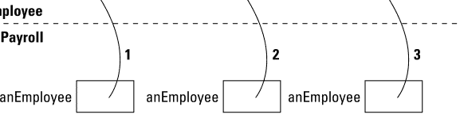

### 开具支票

列表 8-1 中有三个 `printf` 调用。每个 `printf` 都有一个格式化字符串（例如 `"%s **"`）和一个变量（例如 `jobTitle`）。每个格式化字符串都有一个占位符（例如 `%s`），它决定了变量值的显示位置和方式。

例如，在第二个 `printf` 调用中，格式字符串有一个 `%s` 占位符。这个 `%s` 为 `jobTitle` 变量的值留出了位置。根据 Java 的规则，符号 `%s` 总是为字符串留出位置，果然，在列表 8-1 中变量 `jobTitle` 被声明为 `String` 类型。括号和其他一些字符围着 `%s` 占位符，因此在程序的输出中，每个职位都被包围着。（见图 8-2）

| 图 8-2：日常领取工资。 | Pay to the order of Barry Burd (CEO) ***$5,000.00 |
|---|---|
| | Pay to the order of Harriet Bitter (Captain) ***7,000.00 |
| | Pay to the order of Your Name (Expert of the Day) ***10000.00 |

列表 8-1 中有三个 `printf` 调用。每个 `printf` 都有一个格式化字符串（例如 `"%s **"`）和一个变量（例如 `jobTitle`）。每个格式化字符串都有一个占位符（例如 `%s`），它决定了变量值的显示位置和方式。


# 第三部分：掌握全局视图：面向对象编程

### 复制和粘贴代码

在几乎任何计算机编程语言中，从文件读取数据都可能是棘手的。你需要添加额外的代码行来告诉计算机要做什么。有时你会从他人的代码中复制并粘贴这些行。例如，你可以遵循列表 8-2 中的模式：

```java
/*
 * 列表 8-2 中的模式
 */
import java.util.Scanner;
import java.io.File;
import java.io.IOException;

class SomeClassName {
    public static void main(String[] args[]) throws IOException {
        Scanner scannerName = 
            new Scanner(new File("SomeFileName"));

        // Some code goes here
        scannerName.nextInt();
        scannerName.nextDouble();
        scannerName.next();
        scannerName.nextLine();

        // Some code goes here
        scannerName.close();
    }
}
```

你需要从文件中读取数据。首先，想象你正在从键盘读取。在你的程序中使用常用的 `Scanner` 和 `next` 代码。然后，从列表 8-2 的模式中添加一些额外的项目：

- 添加两个新的 import 声明 — 一个用于 `java.io.File`，另一个用于 `java.io.IOException`。


- 在你的方法头部中输入 `IOException`。

- 在调用 `new Scanner` 的地方输入 `new File(" ")`。

- 取一个已经存在于硬盘上的文件。在引号内输入该文件名。

- 取出你用于命名扫描器的名称的单词。在调用 `next`、`nextInt`、`nextDouble` 等处复用它。

- 取出你用于命名扫描器的名称的单词。在调用 `close` 处复用它。

# 第 8 章：节省时间和金钱：重用现有代码

偶尔，复制和粘贴代码可能会给你带来麻烦。也许你正在编写一个不符合简单的列表 8-2 模式的程序。你需要对模式进行一些微调。但要微调模式，你需要理解模式背后的思想。

这就是下一节为你提供帮助的地方。它涵盖了其中一些思想。

## 从文件读取

在之前的章节中，程序从计算机键盘读取字符。这些程序使用像 `Scanner`、`System.in` 和 `nextDouble` 等东西——这些都是在 Java API 中定义的。列表 8-2 中的 `DePayroll` 程序为这个故事注入了新的花样。程序不再从键盘读取字符，而是从你计算机硬盘上的 `EmployeeInfo.txt` 文件读取字符。

要从文件中读取字符，你使用一些与帮助你从键盘读取字符时相同的东西。当你使用 `Scanner`、`nextDouble` 以及其他好工具时。但除了这些工具之外，你这里还有几个额外的障碍。列表如下：

- 你需要一个新的 `File` 对象。更准确地说，你需要 API 中 `File` 类的一个新实例。你通过代码 `new File("EmployeeInfo.txt")` 获取这个新实例。

引号中的内容是文件名 — 你计算机硬盘上的一个文件。该文件包含之前在 8-3 中所示的字符。

到目前，这些术语把小问题说复杂了。当然，我使用了“`new File` 对象”和“`new File` 实例”这些短语，但你只是让 `new File("EmployeeInfo.txt")` 代表你硬盘上的一个文件。当你向 `new Scanner` 展示 `new File("EmployeeInfo.txt")` 后，

```java
Scanner diskScanner = new Scanner(new File("EmployeeInfo.txt"));
```

你就可以忘记所有关于 `new File` 的事情了。从代码的该点开始，`diskScanner` 代表你硬盘上的 `EmployeeInfo.txt` 文件名。`diskScanner` 这个名字代表硬盘上的一个文件，就像在之前的示例中，`keyboard` 名字代表你每天按的那些按钮一样。

在列表 8-2 中创建一个新的 `File` 对象就像在同一个列表中之后创建一个新的 `Employee` 对象。它就像在第 7 章的示例中创建一个新的 `Account` 对象。唯一的区别是 `Employee` 和 `Account` 类是在本书的示例中定义的，而 `File` 类是定义在 Java API 中的。

当你通过文件连接到磁盘时，不要忘记 `new File` 的部分。如果你写 `new Scanner("EmployeeInfo.txt")` 而不写 `new File`，编译器不会介意。在运行代码之前，你不会收到任何警告或错误消息。但当你运行代码时，你不会得到预期的结果。


- 你必须通过全名引用 `File` 类 — `java.io.File`。你可以通过像列表 8-2 那样的 import 声明来实现。或者，你也可以使用语句让代码变得杂乱：

```java
Scanner diskScanner = new Scanner(new java.io.File("EmployeeInfo.txt"));
```

- 你需要一个 `IOException` 子句。当你的程序连接到 `EmployeeInfo.txt` 时，可能会发生很多问题。例如，你的硬盘上可能没有名为 `EmployeeInfo.txt` 的文件。另外，`EmployeeInfo.txt` 文件可能在错误的目录下。为了处理这个问题，Java 语言要求在调用 `Scanner` 时必须承认可能存在的危险。你可以通过几种方式承认这些风险，但最简单的方法是使用 `throws` 子句。在列表 8-2 中，`main` 方法以 `throws IOException` 结束。没有这个子句，你将得到异常消息。关于 Java 异常的完整故事，请阅读第 13 章。

- 你必须通过全名引用 `Exception` 类 — `java.io.Exception`。你可以通过像列表 8-2 那样的 import 声明来实现。或者，你也可以使用语句让代码变得杂乱：`public static void main(String args[]) throws java.io.Exception {`


- 你必须将文件扫描器的名称传递给 `payEmployee` 方法。

在第 7 章的 7-5 中，`getInterest` 方法有一个名为 `percentageRate` 的参数。每当你调用 `getInterest` 方法时，你都会向它传递额外的信息。（你向方法传递了一个数字 — 利率。图说明了这一点。）同样的情况发生在列表 8-2 中。`payEmployee` 方法有一个名为 `aScanner` 的参数。每当你调用 `payEmployee` 方法时，你都会向它传递额外的信息。（你向方法传递了一个扫描器 — 对磁盘文件的引用）。

你可能会疑惑为什么 `payEmployee` 方法需要一个参数。毕竟，在列表 8-2 中，`payEmployee` 方法总是从同一个文件读取数据。然而，为什么每次调用它时，那个磁盘文件仍然是 `EmployeeInfo.txt` 呢？

嗯，有很多方法可以调整列表 8-2 中的代码。某些方法并不涉及参数。但按照示例安排的方式，你有两个方法 — `main` 方法和 `payEmployee` 方法。你在 `main` 方法内部创建了一个扫描器，然后使用了三次 — 在每次调用 `payEmployee` 时内部使用一次。

在方法内部定义的任何内容就像只有该方法内部代码才知道的私人笑话。所以，你在 `main` 方法中定义的 `diskScanner` 不会自动被 `payEmployee` 方法内部感知。为了让 `payEmployee` 感知磁盘文件，你从 `main` 方法将 `diskScanner` 传递给 `payEmployee` 方法。

要了解更多关于方法内部和外部定义的内容，请参见第 10 章。


## 谁移动了我的文件？

当你从本书网站下载代码时，你会发现名为 `Employee.java` 和 `DePayroll.java` 的文件 — 列表 8-1 和 8-2 中的代码。你还会发现一个名为 `EmployeeInfo.txt` 的文件。这是好的，如果 Java 找不到 `EmployeeInfo.txt` 文件，整个项目将无法正常运行。相反，你会得到一个 `FileNotFoundException`。

通常情况下，当你遇到 `FileNotFoundException` 时，意味着你的程序无法访问某个文件。这是一个很容易犯的错误。这可能会让你感到沮丧，因为对你来说，像 `EmployeeInfo.txt` 这样的文件看起来是可以被程序访问的。但请记住——计算机是愚笨的。如果你犯了错，计算机无法为你理解言外之意。如果你的 `EmployeeInfo.txt` 文件不在硬盘上正确的目录中，或者文件名拼写错误，计算机在尝试运行你的代码时就会卡住。

有时你很清楚硬盘上存在一个 `EmployeeInfo.txt`（或任何 .xyz）文件。但当你运行程序时，你会得到一个含义明确的 `FileNotFoundException`。当这种情况发生时，文件通常位于硬盘上错误的目录中。（当然，这取决于你的观点。也许文件在正确的目录，但你告诉你的 Java 程序去错误的目录查找它。）当这种情况发生时，请将文件复制到硬盘上的其他某些目录，并继续运行你的代码。仔细阅读并重读硬盘上的名称和位置，直到你弄清楚问题在哪里。

在本书的网站上（www.allcode.com/JavaForDummies），你可以找到关于 `EmployeeInfo.txt` 文件正确位置的提示。寻找适用于你的操作系统（Windows、Macintosh 或 Linux）或你的 IDE（Eclipse、NetBeans 或 IntelliJ）的提示。


### 在文件名中添加目录名称

你可以在 Java 代码中指定文件的位置。`new File("C:\\Users\\bburd\\workspace\\Listing08-01-02\\EmployeeInfo.txt")` 看起来非常丑，但它确实有效。

在上一段落中，注意 "C:\\Users\\bburd\\workspace..." 中的双重反斜杠。如果你是 Windows 用户，你会很想使用单反斜杠。但在 Java 中，单反斜杠有其特殊含义（例如，在之前的代码列表 7-\n 中意味着跳到下一行）。因此在 Java 中，为了在引号字符串内表示反斜杠，你需要使用双反斜杠。

Macintosh 和 Linux 用户发现他们的分隔符 `/` 在 Java 字符串中没有特殊含义，这让他们很轻松。在 Mac 上，代码 `new File("/Users/bburd/workspace/Listing08-01-02/EmployeeInfo.txt")` 像呼吸一样自然。（好吧，几乎自然！）但 Mac 用户和 Linux 用户不会过快地自称优。像 `new File("/Users/bburd/workspace...")` 在 Windows 中同样有效。

在 Windows 中，你可以使用斜杠 (`/`) 或反斜杠 (`\`) 作为你的路径名分隔符。在 Windows 命令提示符中，你可以输入 `c:\users\bburd` 进入我的主目录。

如果你知道 Java 程序在哪里查找文件，你就可以从那里复制到你选择的目录。暂时假设列表 8-2 中的代码通常在 `Listing08-01-02` 目录中查找 `EmployeeInfo.txt` 文件。那么，作为一个实验，进入 `Listing08-01-02` 目录并创建一个子目录 `dataFiles`。然后将你的 `EmployeeInfo.txt` 文件移动到新的 `dataFiles` 目录。要从你移动的文件读取数字和单词，请修改列表 8-2，使用新文件 `"dataFiles\\EmployeeInfo.txt"`。


### 逐行读取

在 8-2 中，`payOne` 方法演示了读取数据的一些实用技巧。特别是，你创建的每个 scanner 都有一个 `nextLine` 方法。（你可能不使用该方法，但它是可用的）。当你调用 scanner 的 `nextLine` 方法时，它会获取直到当前行结束的所有内容。在列表 8-2 中，`nextLine` 可以读取 `EmployeeInfo.txt` 文件的整行。在另一个程序中，scanner 的 `nextLine` 可以读取用户在键盘上输入的任何内容，直到按下 Enter 键。注意我仔细的选择：`nextLine` 读取到行的结束。遗憾的是，读取到当前行结束并不总是你所认为的意思。将 `nextInt`、`nextDouble` 和 `nextLine` 混用可能会导致混乱。你必须观察你所做的一切并检查你程序的输出。

为了理解这一切，你需要痛苦地意识到文件的换行符。将换行符视为位于行和文本之间的额外字符。想象调用 `nextLine` 意味着读取包括换行符在内的所有内容。现在看图 8-4。

- 如果调用 `nextLine` 读取 [LineBreak]，随后的 `nextLine` 读取 [LineBreak]。

- 如果调用 `nextDouble` 读取 5000.00，随后的 `nextLine` 读取紧随 5000.00 之后的 [LineBreak]。

- 如果调用 `nextLine` 读取 [LineBreak]，随后的 `nextLine` 读取 [LineBreak]。

- 如果调用 `nextDouble` 读取 5000.00，随后的 `nextLine` 读取紧随 5000.00 之后的 [LineBreak]。

- 如果调用 `nextLine` 读取 [LineBreak]，随后的 `nextLine` 读取 [LineBreak]。

- 如果调用 `nextDouble` 读取 5000.00，随后的 `nextLine` 读取紧随 5000.00 之后的 [LineBreak]。

- 如果调用 `nextLine` 读取 [LineBreak]，随后的 `nextLine` 读取 [LineBreak]。

- 如果调用 `nextDouble` 读取 5000.00，随后的 `nextLine` 读取紧随 5000.00 之后的 [LineBreak]。

- 如果调用 `nextLine` 读取 [LineBreak]，随后的 `nextLine` 读取 [LineBreak]。

- 如果调用 `nextDouble` 读取 5000.00，随后的 `nextLine` 读取紧随 5000.00 之后的 [LineBreak]。

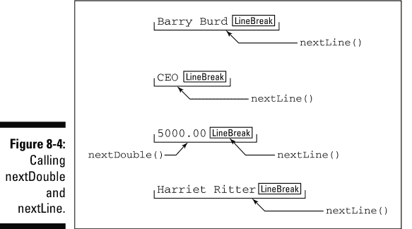

对于普通用户来说，键盘感觉不像存储在计算机上的文件。但磁盘文件和键盘输入有很多共同点。事实上，计算机系统的基本原理规定，对于程序员来说，你应该以相同的方式对待磁盘文件和键盘输入。这就是为什么列表 8-2 包含一个 `diskScanner.close()` 调用。

当你运行 Java 程序时，你通常执行 `main` 方法的语句，从方法中的第一个语句开始，到方法体中的最后一个语句结束。在此过程中你会绕路，跳过 `else` 并进入方法体，但基本上，你执行 `main` 方法结尾的语句。这就是为什么在列表 8-2 中，`close` 在 `main` 方法的结尾。当你运行列表 8-2 中的代码时，你最后的操作是断开磁盘文件。幸运的是，这种分离在你执行了所有 `next` 调用之后。

## 重用现有代码

这是因为软件是以 `Employee.class` 文件形式提供的。Brain Consulting（创建该软件的公司）不让你知道软件的内部细节。（否则，你可能会窃取他们的创意。）因此你没有软件来源 Java 程序文件。（换句话说，你拥有 `Employee.java`）。你可以运行 `Employee.class` 文件中的字节码。你也可以从名为 `Employee.html` 的网页中阅读文档。

问题在于，你公司去年购买的软件是否能跟上公司的增长。你投资了一个非常棒的程序来处理员工及其薪资，但该程序无法区分全职和兼职员工。你有几种选择：

- 给你的邻居打个电话，他 12 岁的孩子比你公司的任何人都要懂计算机编程。这可以让你花一点时间拆解员工软件，重写它，并根据你公司的要求进行所有更改和添加后交还给你。

  仔细一想，你不能这样做。无论那个孩子有多聪明，员工软件的复杂性都可能让你感到困惑。当你拿回软件时，它可能已经充满了 Bug 和不一致之处。此外，你甚至没有 `Employee.java` 文件可以交给他。你拥有的只有 `Employee.class` 文件，它无法用文本编辑器进行读取或修改。（见第 2 章。）此外，你的孩子刚打了邻居的孩子。你不想让邻居通过看到你成为那个天才之子获得快感。

- 报废那套价值 1000 万美元的员工软件。让公司里的人免费从头重写软件。

  换句话说，就是告别了你的时间和金钱。

- 为员工软件写一个新前端。也就是说，编写一段代码对全职员工进行初步处理，然后将初步结果传递到你那套 1000 万美元的软件中。


这个想法可能是可行的，也可能导致灾难。你确定现有的员工软件内部有方便的钩子吗？（也就是说，员工软件是否包含了允许你的前端轻松扩展该昂贵软件的入口点？）记住，这个计划将现有软件视为一个巨大的、单体的整体，这可能会变得非常繁琐。在前端代码和现有员工程序之间分配工作是很困难的。而且如果你在现有的黑盒代码上添加一层，你可能会得到一个效率相当低下的系统。

- 给卖给你员工软件的 Burd Consulting 公司打电话。告诉 Burd 博士，你希望他的软件新版本能够区分全职和兼职员工。

  “不，”Burd 博士说，“会在下财政季度开始时准备好。” 每一个，Burd 博士都给他的邻居打了一个私人电话……

- 创建两个名为 `FullTimeEmployee` 和 `PartTimeEmployee` 的 Java 类。每个新类将扩展 `Employee` 类的现有功能，但每个新类都为特定类型的员工定义了自身的专门功能。

  干得好！图 8-5 显示了你想要创建的结构。

## 第 8 章：节省时间和金钱：重用现有代码

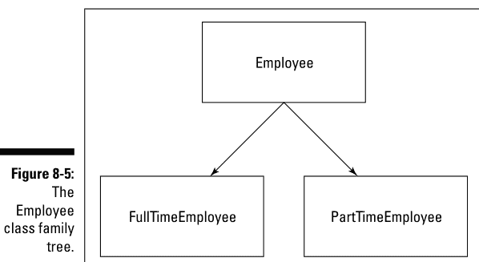

### 创建子类

在列表 8-1 中，我定义了一个 `Employee` 类。我可以使用我在列表 8-1 中定义的内容并扩展该定义来创建新的、更专门的类。因此在列表 8-3 中，我定义了一个新类——`FullTimeEmployee` 类。

列表 8-3：什么是 `FullTimeEmployee`？

```java
public class FullTimeEmployee extends Employee {
    private double weeklySalary;
    private double benefitDeduction;

    public void setWeeklySalary(double weeklySalaryIn) {
        weeklySalary = weeklySalaryIn;
    }

    public double getWeeklySalary() {
        return weeklySalary;
    }

    public void setBenefitDeduction(double benefitDedIn) {
        benefitDeduction = benefitDedIn;
    }

    public double getBenefitDeduction() {
        return benefitDeduction;
    }

    public double findPaymentAmount() {
        return weeklySalary - benefitDeduction;
    }
}
```

查看列表 8-3，你可以看到 `FullTimeEmployee` 类有两个字段：`weeklySalary` 和 `benefitDeduction`。但这些是每个 `FullTimeEmployee` 实例拥有的唯一字段吗？不，不是。列表 8-3 的第一行说 `FullTimeEmployee` 类扩展 `Employee` 类。这意味着除了拥有 `weeklySalary` 和 `benefitDeduction` 之外，每个 `FullTimeEmployee` 实例还拥有另外两个字段：`name` 和 `jobTitle`。这两个字段来自 `Employee` 类的定义，你可以在列表 8-1 中找到它们。

在列表 8-3 中，魔法单词是 `extends`。当一个类扩展另一个类时，该类会自动继承在被扩展类中定义的功能。因此，`FullTimeEmployee` 类继承了 `name` 和 `jobTitle` 字段。`FullTimeEmployee` 类还继承了 `Employee` 类中声明的所有方法——`setName`、`getName`、`setJobTitle` 和 `cutCheck`。`FullTimeEmployee` 类是 `Employee` 类的子类。这意味着 `Employee` 类是 `FullTimeEmployee` 类的超类。你也可以用血缘关系来说：`FullTimeEmployee` 类是 `Employee` 类的子，而 `Employee` 类是 `FullTimeEmployee` 类的父。

它几乎（但并不完全）正如 `FullTimeEmployee` 在列表 8-4 中定义那样。

列表 8-4：伪（但有参考价值的）代码

```java
import static java.lang.System.out;

public class FullTimeEmployee {
    private String name;
    private String jobTitle;
    private double weeklySalary;
    private double benefitDeduction;

    public void setName(String name) {
        name = name;
    }

    public String getName() {
        return name;
    }

    public void setJobTitle(String jobTitle) {
        jobTitle = jobTitle;
    }

    public String getJobTitle() {
        return jobTitle;
    }

    public void setWeeklySalary(double weeklySalaryIn) {
        weeklySalary = weeklySalaryIn;
    }

    public double getWeeklySalary() {
        return weeklySalary;
    }

    public void setBenefitDeduction(double benefitDedIn) {
        benefitDeduction = benefitDedIn;
    }

    public double getBenefitDeduction() {
        return benefitDeduction;
    }

    public double findPaymentAmount() {
        return weeklySalary - benefitDeduction;
    }

    public void cutCheck(double amount) {
        out.printf("Pay %s\n", name);
        out.printf("(%s)\n", jobTitle); // 等，这里 OCR 有错误，已根据上下文进行修正
        out.printf("%.2f\n", amount);
    }
}
```

### 第 8 章：节省时间和金钱：重用现有代码

# 186 第三部分：从大局出发：面向对象编程

**图 8-6：** 列表 8-6 中程序的输出。

| | |
|---|---|
| 支付给： | ...等一下，正在检查内容... |
| 支付给 Barry Burd (执行官) | ***$4,500.00 |
| 支付给 Steve Surace (司机) | ***$75.30 |

为了理解列表 8-6，你需要关注三个类：`Employee`（员工）、`FullTimeEmployee`（全职员工）和 `PartTimeEmployee`（兼职员工）（有关定义这些类的代码，请参见列表 8-1、8-3 和 8-5。）

列表 8-6 的前半部分处理一个全职员工。注意 `ftEmployee` 变量可以使用多少种可用方法。例如，你可以调用 `ftEmployee.setWeeklySalary`，因为 `ftEmployee` 的类型是 `FullTimeEmployee`。你也可以调用 `ftEmployee.setName`，因为 `FullTimeEmployee` 继承了 `Employee` 类。

由于 `cutCheck` 是在 `Employee` 类中声明的，你可以调用 `ftEmployee.cutCheck`。由于你也可以调用 `ftEmployee.findPaymentAmount`，因为 `findPaymentAmount` 方法在 `FullTimeEmployee` 类中。

### 使类型匹配

再次查看列表 8-6 的前半部分。特别注意最后那条语句——在该语句中，全职员工实际上被结算（cut）。该语句形成了一个很漂亮、很长的值及其类型的链。你可以通过从内向外读取方法来看到这一点。

- 调用方法 `ftEmployee.findPaymentAmount` 时带有一个空方法参数列表（列表 8-6）。这很好，因为 `findPaymentAmount` 不需要接受任何参数（列表 8-3）。
- `findPaymentAmount` 方法返回一个 `double` 类型的值（同样，参见列表 8-3）。
- `ftEmployee.findPaymentAmount` 返回的 `double` 值被传递给方法 `ftEmployee.cutCheck`（列表 8-6）。这很好很好，因为 `cutCheck` 方法接受一个 `double` 类型的参数（列表 8-1）。

为了一个生动的插图说明，请参见图 8-7。

# 第 8 章：节省时间和金钱：重用现有代码 187

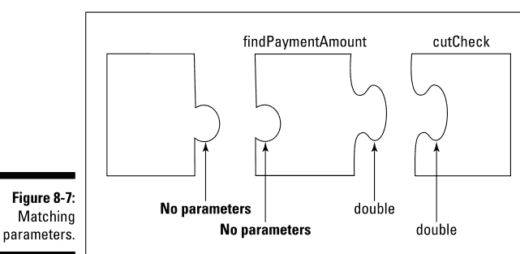

始终为方法提供其参数列表中所需的数值类型。

## 故事的后半部分

在列表 8-6 的后半部分，代码创建了一个 `PartTimeEmployee` 类型的对象。`PartTimeEmployee` 类型的变量可以执行一些 `FullTimeEmployee` 可以做的事情。但 `PartTimeEmployee` 类没有 `setWeeklySalary` 和 `setBenefitDeduction` 方法。相反，`PartTimeEmployee` 类拥有 `setHourlyRate` 方法（参见列表 8-3）。因此，在列表 8-6 中，倒数第二行是对 `setHourlyRate` 方法的调用。

列表 8-6 的最后一行将数字 10（工作小时数）传递给 `findPaymentAmount` 方法。将其与之前对 `findPaymentAmount` 的调用进行比较——即列表 8-6 前半部分对全职员工的调用。在两个子类 `FullTimeEmployee` 和 `PartTimeEmployee` 之间，有两个不同的 `findPaymentAmount` 方法。这两个方法具有不同类型的参数列表：

- `FullTimeEmployee` 类的 `findPaymentAmount` 方法不接受参数（列表 8-3）。
- `PartTimeEmployee` 类的 `findPaymentAmount` 方法接受一个参数（列表 8-5）。

这在代码中很常见。为兼职员工寻找支付金额与为全职员工寻找支付金额是不相同的。兼职员工的工资每周变化，取决于员工在每周内工作的小时数。

### 重写方法

在子类中重写方法（改变支付）

### 列表 8-7：另一个子类

```java
public class PartTimeOver {

    @Override
    public double findPaymentAmount(int hours) {
        if (hours <= 40) {
            return getHourlyRate() * hours;
        } else {
            return getHourlyRate() * 40 + getHourlyRate() * (hours - 40);
        }
    }
}
```

# 第 8 章：节省时间和金钱：重用现有代码

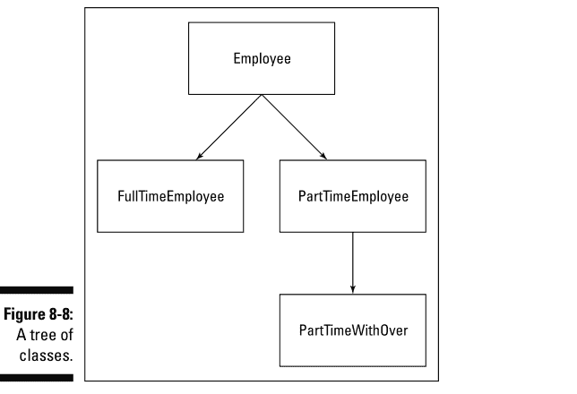

图 8-8：类的树形结构

| 类名 | 方法 |
|---|---|
| Employee (列表 8-1) | cutCheck |
| PartTimeEmployee (列表 8-5) | hourlyRate |

图 8-9：findPaymentAmount 方法未被继承

| PartTimeOver (列表 8-8) | findPaymentAmount |

# 190 第三部分：从大局出发：面向对象编程

根据官方术语

## Java 注解

列表 8-7 中的 `@Override` 是一个注解的示例。Java 注解告诉计算机关于代码的信息。特别是，列表 8-7 中的 `@Override` 注解告诉 Java 编译器监控常见的错误。该注解说：“确保跟随此注解的方法与父类中的某个方法具有（相同的名称、相同的参数等）。否则，显示错误消息。”

所以如果你不小心写成了：

```java
public double findPaymentAmount(double hours) {
```

而不是 `int hours`（如列表 8-5 和 8-7 所示），编译器会提醒你 `findPaymentAmount` 方法并没有重写列表 8-5 中的内容。

Java 注解是可选的。如果你删除了列表 8-7 中的 `@Override`，代码仍然可以运行。`@Override` 注解为你的代码提供了额外的安全性。通过 `@Override`，编译器会检查你是否正在做你想做的事情（即重写一个子类的方法）。而且，向乔治·奥威尔道歉，某些类型的注解可选性较小。只有当你愿意用大量的未注解的 Java 代码来替换注解时，才能从代码中省略注解。

## 使用类和子类的方法

如果你需要对重写方法的概念进行说明，请查看列表 8-8 中的代码。该程序的运行见图 8-10。

## 第 8 章：节省时间与金钱：重用现有代码

### 列表 8-8：测试列表 8-7 中的代码

```java
public class DoPayrollTypeF {

    public static void main(String args[]) {
        FullTimeEmployee ftEmployee = new FullTimeEmployee();

        ftEmployee.setName("Barry Burd");
        ftEmployee.setJobTitle("CEO");
        ftEmployee.setWeeklySalary(5000.00);
        ftEmployee.setBenefitDeduction(500.00);
        ftEmployee.cutCheck(ftEmployee.findPaymentAmount());

        PartTimeEmployee ptEmployee = new PartTimeEmployee();
        ptEmployee.setName("Chris Apelian");
        ptEmployee.setJobTitle("Computer Book Author");
        ptEmployee.setHourlyRate(7.53);
        ptEmployee.cutCheck(ptEmployee.findPaymentAmount(50));

        PartTimeEmployeeWithOver ptoEmployee = new PartTimeEmployeeWithOver();
        ptoEmployee.setName("Steve Surace");
        ptoEmployee.setJobTitle("Driver");
    }
}
```


# 第 9 章：构建新对象

## 本章内容

- 定义构造函数
- 在子类中使用构造函数
- 使用 Java 的默认构造函数特性
- 构建一个简单的 GUI

---

Jennie Burd 女士
121 Schoolhouse Lane
Anywhere, Kansas

亲爱的 Burd 先生：

回复您 6 月 21 日的信，我认为我可以完全确定地说，对象并不是凭空产生的。虽然我从未亲眼见过对象的创建过程（我们办公室里没有其他人能自称见过对象在创建瞬间的时刻），但我完全相信，某些过程对构建这些有趣而实用的小玩意儿负责。我们 ClassesAndObjects 同意科学界和私营部门对这种本质的共识。

此致

Scott

### 定义构造函数（其含义）

构造函数是一种用于初始化对象的特殊方法。它与类同名，且没有返回类型。当你使用 `new` 运算符创建新对象时，构造函数会被调用。

```java
Account myAccount = new Account();
```

构造函数用于设置对象的字段。如果你没有提供构造函数，Java 会提供一个默认构造函数。但你可以定义自己的构造函数来控制初始化。

枚举是 Java 的一种特殊类，允许你定义一组常量。

### 什么是枚举类型？

Java 提供了许多方法来组合元素。在第 11 章中，你将元素组合成数组。在第 12 章中，你将元素组合成集合。（当然，如果你不会读 `enum`，就无法组合任何东西。`enum` 的读音是 *ee-noom*，类似于 *enumeration* 的前音节。）创建一个复杂的枚举类型并不容易，但要创建一个简单的枚举，只需在大括号内编写一组单词。列表 9-1 定义了一个枚举类型。

**列表 9-1：TempScale 枚举类型**

```java
public enum TempScale {
    CELSIUS, FAHRENHEIT, KELVIN, RANKINE,
    NEWTON, DELISLE, RUMUR, RØMER, LEIDEN
};
```

当你定义枚举类型时，会发生两件事：

- 你创建了值。就像 13 和 151 是 `int` 值一样，CELSIUS 和 FAHRENHEIT 也是 `TempScale` 值。
- 你可以创建变量来引用这些值。在列表 9-2 中，我们声明了字段 `number` 和 `scale`。就像 `double number` 声明 `number` 是 `double` 类型一样，`TempScale scale` 声明变量 `scale` 是 `TempScale` 类型。
- 类型为 `TempScale` 意味着你可以拥有 CELSIUS、FAHRENHEIT、KELVIN 等值。因此在列表 9-2 中，我可以给 `scale` 变量赋值 `FAHRENHEIT`（更准确地说是 `TempScale.FAHRENHEIT`）。

枚举类型是一个伪装的 Java 类。这就是为什么列表 9-1 的整个文件只专注于一件事：即声明 `TempScale` 枚举类型。

列表 9-2 中的代码包含了常见的 setter 和 getter 方法（针对 `number` 和 `scale` 字段的访问器方法）。关于 setter 和 getter 方法（也称为访问器方法）的更多阅读，请参阅第 7 章。

此外，列表 9-2 还有四个看起来像方法的东西。这些类似于方法的东西每一个都名为 `Temperature`，这恰好与类名相同。这些类似于 `Temperature` 的东西都没有任何种类的返回类型——甚至连 `void`（这是一种偷懒的返回类型）都没有。

每一个此类方法都被称为构造函数。构造函数就像方法，不同之处在于构造函数有一个非常特殊的用途——创建新对象。

每当计算机创建一个新对象时，计算机就会执行构造函数内部的语句。

你可以省略列表 9-1 和 9-2 第一行中的 `public` 关键字。如果你省略了 `public`，其他 Java 程序可能无法使用你在 `TempScale` 类和 `Temperature` 类中定义的特性。（不用担心本章中的程序。无论是否带有 `public` 关键字，本章中的所有程序都可以使用列表 9-1 和 9-2 中的代码。要确定你是否在列表 1 的第一行使用了 `public` 关键字，列表 9-1 必须在一个名为 `TempScale.java` 的文件中，并以大写字母 T 开头。如果你在列表 9-2 的第一行使用了 `public` 关键字，列表 9-2 必须在一个名为 `Temperature.java` 的文件中，并以大写字母 T 开头。关于 `public` 类的介绍，请参阅第 7 章。）

## 你可以用温度做什么

列表 9-3 实现了我在上一节中描述的一些思想。在列表 9-3 中，你调用了在列表 9-2 中声明的构造函数。图 9-1 显示了运行这段代码时发生的情况。

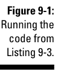

| 70.00 度 华氏 |
| 32.00 度 华氏 |
| 0.00 度 摄氏 |
| 2.73 度 开尔 |

## 列表 9-3：使用 Temperature 类

```java
import static java.lang.System.out;

public class UseTemperature {
    public static void main(String args[]) {
        final String format = "%.5.2f degrees %s\n";

        Temperature temp = new Temperature();
        temp.setNumber(70.0);
        temp.setScale(TempScale.FAHRENHEIT);
        out.printf(format, temp.getNumber(), temp.getScale());

        temp = new Temperature(32.0);
        out.printf(format, temp.getNumber(), temp.getScale());

        temp = new Temperature(2.73, TempScale.KELVIN);
        out.printf(format, temp.getNumber(), temp.getScale());
    }
}
```

打印书籍中的示例大多是基于文本的，但你可以在本书的网站（www.allmycode.com/JavaForDummies）找到更精美的示例版本。这些精美的版本包含了窗口、按钮、文本字段以及典型图形用户界面（GUI）的其他元素。

在列表 9-3 中，代码的每条语句 `temp = new Temperature(blah, blah, blah);` 都调用了列表 9-2 中的一个构造函数。因此，在运行时，它创建了四个 `Temperature` 类的实例。每个实例都是通过调用列表 9-2 中不同的构造函数创建的。

在列表 9-3 中，四个构造函数中的最后一个有两个参数——2.73 和 `TempScale.KELVIN`。这并不是构造函数调用特有的。方法调用或构造函数调用都可以有一组参数。你用逗号将一个参数与其他隔开。“一组参数”的另一个名称是参数列表。


### 如何创建：类型

在列表 9-3 中，四个构造函数中的最后一个有两个参数——2.73 和 `TempScale.KELVIN`。这并不是构造函数调用特有的。方法调用或构造函数调用都可以有一组参数。你用逗号将一个参数与其他隔开。“一组参数”的另一个名称是参数列表。

---

# 第 9 章：构造新对象 201

你可以在许多构造函数（以及其他方法）中看到给对象的字段赋值（如代码所示）。要理解这个技巧，请看列表 9-4。该列表展示了我编写相同构造函数代码的两种方式。

## 列表 9-4：实现同一结果的两种方式

```java
// 使用这个构造函数 . . .
public Temperature(double whatever) {
    number = whatever;
    scale = TempScale.FAHRENHEIT;
}

// ... 或者使用这个构造函数 . . .
public Temperature(double number) {
    this.number = number;
    scale = TempScale.FAHRENHEIT;
}

// ... 但不要在代码中同时包含这两个构造函数。
```

列表 9-4 包含两个构造函数。在第一个构造函数中，我使用了两个不同的名称——`number` 和 `whatever`。在第二个构造函数中，我不需要两个名称。我没有为构造函数的参数创建一个新名称，而是通过编写 `this.number` 来重用现有的名称。

所以，列表 9-2 中发生的情况如下：

- 在语句 `this.number = number` 中，名称 `this.number` 指的是新对象的 `number` 字段——该字段在列表 9-2 的最顶部声明。（见图 9-2）。
- 在语句 `this.number = number` 中，`number`（单独出现，不带 `this`）指的是构造函数的参数。（再次见图 9-2）。

```java
public class Temperature {
    private double number;
    private ScaleName scale;
}
```

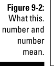

```java
public Temperature(double number) {
    this.number = number;
    scale = ScaleName.Fahrenheit;
}
```

## 202 第三部分：处理图示：面向对象编程

## 这这一切是怎么回事？

假设你的代码包含一个构造函数——列表 9-4 中两个构造函数中的第一个。`whatever` 参数接收到的数字 32.0，然后构造函数体内的第一条语句将该值 **32.0** 赋值给新对象的字段。代码可以正常工作。但在编写这段代码时，你必须为参数创建一个新名称——`whatever`。而这个新名称的唯一目的是让对象的 `number` 字段中有一个值。为了区分参数和你给出的数字，你为一个存储数字数值的临时存储空间起了名字。

命名是一门艺术，而不是科学，我经历过许多命名阶段。多年前，每当我需要为参数取新名称时，我都会选择原始变量名的一个令人困惑的拼写（我会将参数命名为 `nbr` 或 `numbr`）。我曾尝试过更改变量名的大小写来产生新名称（我会将参数名命名为 `Number` 或 `nNUMBER`）。在第 8 章中，我通过在与其对应的变量名后添加后缀 `In` 来为所有参数命名（`jobTitle` 变量对应 `jobTitleIn` 参数）。这些方案中没有一个效果良好的；我永远记不住我创建的那些奇特名称。好消息是，这种对参数命名的努力并不是必要的。你可以给参数起与变量相同的名称。为了区分两者，你可以使用 Java 关键字 `this`。

通常情况下，`this.someName` 指向包含代码的对象的字段。相比之下，普通的 `someName` 指向 `someName` 恰好声明的最最近的地方。在语句 `this.number = number`（列表 9-2）中，那个最近的地方恰好是 `Temperature` 构造函数的参数。

## 有些东西永远不会改变

第 7 章引入了 `printf` 方法并解释了每个 `printf` 调用都以一个格式化字符串开头。该字符串描述了如何显示其他参数。

在之前的示例中，这个格式化字符串始终是一个带引号的字面量。例如，列表 7-7 中的第一个 `printf` 调用是：

```java
out.printf("%$4.2f\n", myInterest);
```

在列表 9-3 中，我打破了传统，用一个命名为 `format` 的变量开始 `printf` 调用。

```java
out.printf(format, temp.getNumber(), temp.getScale());
```

# 第 9 章：构造新对象 203

只要我的格式变量类型是 `String`，那就是可以的。事实上，在列表 9-3 中，第一个变量声明是：

```java
final String format = "%5.2f degrees %s\n";
```

在 format 变量的这个声明中，请特别注意 `final` 这个词。这个 Java 关键字表示 `format` 的值不能更改。如果我在列表 9-3 中添加另一个赋值语句：

```java
format = "%6.2f (%s)\n";
```

那么编译器会向我返回一个“无法给 final 变量赋值”的错误信息。

当我编写列表 9-3 中的代码时，使用 `final` 关键字并不一定是有必要的。但 `final` 关键字提供了一些保护。当我将 `format` 初始化为 `"%5.2f degrees %s\n"` 时，我打算原封不动地反复使用这个相同的格式。我很清楚自己并不打算更改 `format` 变量。当然，在一个 10,000 行的程序中也是如此。

通常情况下，`this.someName` 指向包含代码的对象的字段。相比之下，普通的 `someName` 指向 `someName` 恰好声明的最最近的地方。在语句 `this.number = number`（列表 9-2）中，那个最近的地方恰好是 `Temperature` 构造函数的参数。

## 有些东西永远不会改变

第 7 章引入了 `printf` 方法并解释了每个 `printf` 调用都以一个格式化字符串开头。该字符串描述了如何显示其他参数。

在之前的示例中，这个格式化字符串始终是一个带引号的字面量。例如，列表 7-7 中的第一个 `printf` 调用是：

```java
out.printf("%$4.2f\n", myInterest);
```

在列表 9-3 中，我打破了传统，用一个命名为 `format` 的变量开始 `printf` 调用。

```java
out.printf(format, temp.getNumber(), temp.getScale());
```

# 第 9 章：构造新对象 203

只要我的格式变量类型是 `String`，那就是可以的。事实上，在列表 9-3 中，第一个变量声明是：

```java
final String format = "%5.2f degrees %s\n";
```

在 format 变量的这个声明中，请特别注意 `final` 这个词。这个 Java 关键字表示 `format` 的值不能更改。如果我在列表 9-3 中添加另一个赋值语句：

```java
format = "%6.2f (%s)\n";
```


那么编译器会向我返回一个“无法给 final 变量赋值”的错误信息。

当我编写列表 9-3 中的代码时，使用 `final` 关键字并不一定是有必要的。但 `final` 关键字提供了一些保护。当我将 `format` 初始化为 `"%5.2f degrees %s\n"` 时，我打算原封不动地反复使用这个相同的格式。我很清楚自己并不打算更改 `format` 变量。当然，在一个 10,000 行的程序中也是如此。

## 子类

In general, when you define a subclass, you declare new constructors first. It's true that `TemperatureNice` has its own fields. (After all, `TemperatureNice` is a subclass of the `Temperature` class, and the `Temperature` class defines `number` and `scale` fields.) But because `number` and `scale` are declared `private` inside the `Temperature` class, only the `TemperatureNice` class can directly use these fields.


Don't put all declarations of the `number` and `scale` fields inside the `TemperatureNice` class's. If you do, you inadvertently create four variables (two called `number`, and two called `scale`). You'll assign values to one of them. Then you'll be shocked, when you display the other variables, those seem to have disappeared.


When an object's code contains a call to one of its object's methods, for instance, in the last state of Listing 9-5, the object calls its methods with `getNumber()` and `getScale()`, not with `someObject.getNumber()` and `somethingOrOther.getScale()`. If doing that makes you queasy, you can compensate by taking advantage of yet another for the `this` keyword. Just write `this.getNumber()` and `this.getScale()` in the last line of Listing 9-5.

## 子类的构造函数

By far, the news in Listing 9-5 is what the code declares constructors. The `TemperatureNice` class has four of its own constructors. If you've gotten into thinking about subclass inheritance, you might wonder why these constructor declarations are necessary. Doesn't `TemperatureNice` inherit the parent `Temperature` class's constructors? No, subclasses don't inherit constructors.


Subclasses do not inherit constructors.

That's right. Subclasses do not inherit constructors. In one oddball case, a constructor may look like it's being inherited, but that oddball situation is a fluke, the norm. In general, when you define a subclass, you declare new constructors to go with the subclass.

I describe the oddball case (in which a constructor looks like it's being inherited) later in this chapter, in the section "The default constructor."

# 第三部分：从大局来看：面向对象编程

列表 9-5 中的代码有四个构造函数。每个构造函数属于 `TemperatureNice`，并且每个构造函数都有其唯一标识的参数列表。这是无聊的部分。有趣的部分是，每个构造函数都调用了名为 `super` 的内容，这是一个 Java 关键字。

在列表 9-5 中，`super` 代表父类的构造函数。

- 列表 9-5 中的语句 `super()` 调用了列表 9-2 中无参数的 `Temperature()` 构造函数。该无参数构造函数将 `number` 字段赋值为 0，并将 `scale` 字段赋值为 `TempScale.FAHRENHEIT`。
- 列表 9-5 中的语句 `super(number, scale)` 调用了列表 9-2 中的 `Temperature(double number, TempScale scale)` 构造函数，该构造为 `number` 和 `scale` 字段赋值。
- 同样的方式，列表 9-5 中的语句 `super(number)` 和 `super(scale)` 调用了列表 9-2 中的构造函数。

计算机通过查看 `super` 单词后面的参数列表来决定调用 `Temperature` 类的哪个构造函数。例如，当计算机执行列表 9-5 中的

```
super(number, scale);
```

时，计算机对自己说：“括号中的 number 和 scale 字段类型类型为 `double` 和 `TempScale`。但列表 9-2 中的 `Temperature` 构造函数中只有一个具有类型为 `double` 和 `TempScale` 的两个参数。该构造函数的头部如下：

```
public Temperature (double number, TempScale scale)
```

“所以，我想我将执行该特定构造函数内部的语句。”

## 使用这些东西

在列表 9-5 中，我定义了属于 `TemperatureNice` 类的含义。现在是时候把这个 `TemperatureNice` 类用起来了。列表 9-6 包含了使用 `TemperatureNice` 的代码。

# 第9 章：构造新对象

## 列表 9-6：使用 TemperatureNice 类

```java
public class UseTemperatureNice {

    public static void main(String args[]) {

        TemperatureNice temp = new TemperatureNice();

        temp.setNumber(70.0);

        temp.setScale(TempScale.FAHRENHEIT);

        temp.display();

        temp = new TemperatureNice(32.0);

        temp.display();

        temp = new TemperatureNice(TempScale.CELSIUS);

        temp.display();

        temp = new TemperatureNice(2.73,
            TempScale.KELVIN);

        temp.display();

    }

}
```

列表 9-6 中的代码与其在列表 9-3 中的表兄弟代码非常相似。主要的区别如下：

- 列表 9-6 创建了 `TemperatureNice` 类的实例。也就是说，列表 9-6 调用的是 `TemperatureNice` 类的构造函数，而不是 `TemperatureNice` 类本身。
- 列表 9-6 利用了 `TemperatureNice` 类中的 `display` 方法。因此，列表 9-6 中的代码比列表 9-3 中的对应代码洁得多。

运行列表 9-6 的结果与运行列表 9-3 代码完全相同——它以更加优雅的方式到达终点。（运行结果之前在图 9-1 中显示。）

## 默认构造函数

上一节的主要信息是子类不继承构造函数。那么第 8 章中那些列表是怎么回事呢？在列表 8-6 中，有一个语句说

```
FullTimeEmployee ftEmployee = new FullTimeEmployee();
```

但是，问题在于：定义 `FullTimeEmployee` 的代码（列表 8-3）内部似乎没有声明任何构造函数。那么，在列表 8-6 中，你如何可能调用 `FullTimeEmployee` 构造函数呢？

情况是这样的：当你创建一个子类不在代码中放置任何显式的构造函数声明时，Java 会为你创建一个构造函数。它被称为默认构造函数。如果你正在创建公共的 `FullTimeEmployee` 子类，默认构造函数看起来就像列表 9-7 中的那样。

## 列表 9-7：默认构造函数

```java
public FullTimeEmployee() {
  super();
}
```

列表 9-7 中的构造函数不接受参数，它的唯一语句调用了你所扩展的类的构造函数。（如果你扩展的类没有无参数构造函数，那你就麻烦了。）

你刚刚读了关于默认构造函数的内容，但注意这段话没有提到的一点：它没有说你总是能得到默认构造函数。特别是，如果你创建一个子类并自己定义了任何构造函数，Java 就不会为该子类添加默认构造函数（子类也不继承任何构造函数）。

那么这会如何让你出错呢？列表 9-8 包含了列表 8-3 代码的副本，但增加了一个构造函数。看一眼这个修改后的 `FullTimeEmployee` 代码版本。

## 列表 9-8：我有构造函数！

```java
public class FullTimeEmployee extends Employee {

  private double weeklySalary;
  private double benefitDeduction;

  public FullTimeEmployee(double weeklySalary) {
    this.weeklySalary = weeklySalary;
  }

  public void setWeeklySalary(double salaryIn) {
    weeklySalary = salaryIn;
  }

  public double getWeeklySalary() {
    return weeklySalary;
  }

  public void setBenefitDeduction(double benefitDedIn) {
    benefitDeduction = benefitDedIn;
  }

  public double getBenefitDeduction() {
    return benefitDeduction;
  }

  public double findPaymentAmount() {
    return weeklySalary - benefitDeduction;
  }

}
```

如果你使用列表 9-8 中的 `FullTimeEmployee` 代码，如下语句不起作用：

```
FullTimeEmployee ftEmployee = new FullTimeEmployee();
```

它不起作用是因为声明了一个接受一个 `double` 参数的 `FullTimeEmployee` 构造函数，你不再免费获得默认构造函数。

该怎么办？如果你声明了任何构造函数，就声明你可能需要的所有构造函数。将列表 9-7 中的构造函数添加到列表 9-8 的代码中。然后 `FullTimeEmployee` 重新工作。

在某些情况下，Java 会在构造体顶部自动添加一个对父类的调用。这种 `super` 调用的添加是一个不显眼的细节。

## 执行更多功能的构造函数

本节的示例构造函数做的不仅仅是赋值字段。示例位于列表 9-9 和 9-10 中。运行示例的结果如图 9-3 所示。

### 列表 9-9：定义框架

```java
import java.awt.FlowLayout;
import javax.swing.JFrame;
import javax.swing.JButton;

@SuppressWarnings("serial")
public class SimpleFrame extends JFrame {

    public SimpleFrame() {
        setTitle("不要点击那个按钮!");
        setLayout(new FlowLayout());
        setDefaultCloseOperation(EXIT_ON_CLOSE);
        add(new JButton("Panic"));
        setSize(300, 100);
        setVisible(true);
    }

}
```

### 列表 9-10：显示一个框架

```java
public class ShowAFrame {

    public static void main(String args[]) {
        new SimpleFrame();
    }

}
```

# 第 9 章：构建新对象

## 包与导入声明

Java 有的一项功能，允许你将类归为一组。每一组类被称为一个“包”（package）。在 Java 世界中，程序员习惯性地使用这些用点号分隔的包名。例如，我注册了 `allmycode.com` 域名，我将一个包命名为 `allmycode.com.textUtils`。Java API 实际上是一个巨大的包的集合。该 API 包含了名为 `java.lang`、`java.util`、`java.awt` 等的类。

定义类所在的包的名称。你可以通过阅读 Java 的 API 文档来了解关于 `java.util` 和 `Scanner` 的所有信息。关于阅读文档的技巧，请参阅第 3 章以及本书的网站。

这里是另一个例子。以下声明

```
import java.swing.*;
```

该声明是有效的，因为 `java.swing` 并不是 Java API 中的一个包名，而星号 `*` 指的是 `java.swing` 包中的所有类。在代码顶部使用此声明后，你可以使用 `java.swing` 包中类的缩写名称——如 `JFrame`、`JButton`、`JMenuBar`、`JCheckBox` 等许多。

有了这些关于包的信息，我可以消除关于导入声明的一些困惑。任何导入声明都不会使用带包名的静态导入（static import），并且必须以以下内容之一结束：

- 该包中的某个类名
- 一个星号（表示该包内的所有类）

例如，声明

```
import java.util.Scanner;
```

该声明是有效的，因为 `java.util` 是 Java API 中的一个包名，而 `Scanner` 是 `java.util` 包中的一个类名。用点号分隔的名字是 `java.util.Scanner` 类的全限定名。一个类的全限定名包括

这里有一个例子。像这样的行

```
import java.swing.*; // 错误！！
```


并不是有效的导入声明。Java API 中没有名为 `java` 的单单词包。你可能认为这行代码允许你缩写所有以 `java` 开头的名字（如 `java.swing.JFrame` 和 `java.sound.midi`），但导入声明并不是那样运作的。因为 `java` 并不是包名，这行 `java.*` 只会向 Java 编译器报警。

`JFrame` 构造函数中的所有方法都来自父类 `JFrame`。`JFrame` 位于 `javax.swing` 包中。这个包和另一个包 `java.awt` 包含了帮助你在计算机屏幕上放置窗口、图像、图形和其他组件的类。

（在 `java.awt` 包中，字母 `aw` 代表抽象窗口（abstract window））


关于 Java 包概念的一些小八卦，请参阅标题为“包与导入声明”的侧边栏。关于更多关于 Java 包概念的八卦，请参阅第 14 章。

在 Java API 中，人们通常所说的窗口是 `javax.swing.JFrame` 类的实例。


## 来自 Java API 的类和方法

观察图 9-3，你可能已经看出 `SimpleFrame` 类并没有做什么。窗口上只有一个按钮，当你点击该按钮时，什么都没有发生。我之所以这样设计窗口，是为了防止示例变得太复杂。尽管如此，列表 9-9 中的这种方法仍然使用了几个 API 类和方法。`setTitle`、`setLayout`、`setDefaultCloseOperation`、`add`、`getSize` 和 `setVisible` 方法都属于 `javax.swing.JFrame` 类。以下是代码中使用的名称列表：

- **setTitle**: 调用 `setTitle` 会将文字放入窗口的标题栏中。（新的 `SimpleFrame` 对象正在调用它自己的 `setTitle`）
- **FlowLayout**: `FlowLayout` 实例以居中、像打字机一样的方式在窗口上排列对象。由于图 9-3 中的窗口上只有一个按钮，该按钮位于窗口顶部的居中位置。如果窗口有八个按钮，其中五个可能会在窗口顶部排成一行，剩下的三个将沿第二行居中对齐。
- **setLayout**: 调用 `setLayout` 让新的 `FlowLayout` 负责安排窗口上的组件（如按钮）。新的 `SimpleFrame` 对象正在调用它自己的 `setLayout`）
- **setDefaultCloseOperation**: 调用 `setDefaultCloseOperation` 告诉系统当点击窗口右上角的 `x` 时该做什么。使用此方法，窗口本身以及 Java 虚拟机（JVM）将继续运行。如果你使用 Eclipse，你必须点击控制台（Console）顶部的红色方块来停止 JVM（见图 9-4）。调用 `setDefaultCloseOperation(EXIT_ON_CLOSE)` 告诉 Java 关闭。`EXIT_ON_CLOSE` 的替代方案是 `HIDE_ON_CLOSE`、`DISPOSE_ON_CLOSE` 以及我个人喜欢的 `DO_NOTHING_ON_CLOSE`。
- **JButton**: `JButton` 类位于 `javax.swing` 包中。该类的一个构造函数接收一个 `String` 实例。
- **add**: 调用 `add` 将 `JButton` 实例添加到窗口。
- **setSize**: 调用 `setSize(300, 100)` 设置窗口为 300 宽 100 高。
- **setVisible**: 调用 `setVisible` 让窗口显示。

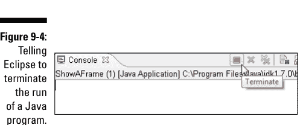

# 第四部分：精通 Java 技巧

## 第 10 章：将变量和方法放在它们应该的地方

### 10-1：Player 类

```java
import java.text.DecimalFormat;

public class Player {

    private String name;

    private double average;

    public Player(String name, double average) {

        this.name = name;

        this.average = average;

    }

    public String getName() {

        return name;

    }

    public double getAverage() {

        return average;

    }

    public String getAverageString() {

        DecimalFormat decFormat = new DecimalFormat();

        decFormat.setMaximumIntegerDigits(0);

        decFormat.setMaximumFractionDigits(3);

        decFormat.setMinimumFractionDigits(3);

        return decFormat.format(average);

    }

}
```

现在我来详细拆解列表 10-1 中的代码。幸运的是，前面的章节已经涵盖了代码中的许多内容。这段代码定义了作为 `Player` 类实例的意味着什么。以下是代码中的内容：

- 字段 `name` 和 `average` 的声明：关于字段声明的读物，请参见第 7 章。
- 一个用于 `Player` 类新实例的构造函数：关于构造函数的详细介绍，请参见第 9 章。
- 字段 `name` 和 `average` 的 getter 方法：关于访问器方法（即 setter 和 getter 方法）的闲聊，请参见第 7 章。
- 一个以字符串格式返回球员击球率的方法：关于方法的优妙之处，请参见第 7 章。（我在第 7 章里写了很多好东西，不是吗？）

### 另一种美化数字的方法

列表 10-1 中的 `getAverageString` 方法从 `average` 字段（球员的击球率）获取值，将该值（通常为 `double` 类型）转换为 `String`，然后将该 `String` 直接返回给方法调用者。使用直接来自 Java API（应用程序接口）的 `DecimalFormat` 可以确保 `String` 值看起来像棒球运动员的击球率。根据 `DecimalFormat.setMaximum...` 和 `decFormat.setMinimum...` 方法调用，该 `String` 值的小数点左侧没有数字，小数点右侧恰好有三个数字。

Java 的 `DecimalFormat` 类非常有用。例如，要用会计友好的格式显示数字 345 和 -345，你可以使用以下代码：

```java
DecimalFormat decFormat = new DecimalFormat("0.00;(0.00)");
System.out.println(decFormat.format(345));
System.out.println(decFormat.format(-345));
```

在这个小示例的格式字符串中，分号之前的内容决定了正数的显示方式，而分号之后的内容决定了负数的显示方式。使用这种格式，数字 345 和 -345 的显示如下：

| 值 (Value) |
| :--- |
| 345.00 |
| (345.00) |

想要发现更多其他关于数字的窍门，请访问 Java API 文档中的 `DecimalFormat` 页面。

### 使用 Player 类

列表 10-2 和 10-3 包含了使用 `Player` 类的代码——该类在列表 10-1 中已定义。

### 10-2：使用 Player 类

```java
import java.util.Scanner;
import java.io.File;
import java.io.IOException;
import javax.swing.JFrame;
import javax.swing.JLabel;
import java.awt.GridLayout;

@SuppressWarnings("serial")
public class TeamFrame extends JFrame {

    public TeamFrame() throws IOException {
        Player player;
        Scanner handkeesData = new Scanner(new File("Hankees.txt"));

        for (int num = 1; num <= 9; num++) {
            player = new Player(handkeesData.nextLine(),
                handkeesData.nextDouble());
            addPlayerInfo(player);
        }

        setTitle("The Hankses");
        setLayout(new GridLayout(9, 2, 20, 3));
        setDefaultCloseOperation(EXIT_ON_CLOSE);
        pack();
        setVisible(true);
        handkeesData.close();
    }

    void addPlayerInfo(Player player) {
        add(new JLabel(" " + player.getName()));
        add(new JLabel(player.getAverageString()));
    }
}
```

### 10-3：显示框架

```java
import java.io.IOException;

public class ShowTeamFrame {

    public static void main(String args[]) throws IOException {
        new TeamFrame();
    }
}
```


# 第 10 章：将变量和方法放在它们应该的地方

## 列表 10-1：Player 类

```java
import java.text.DecimalFormat;

public class Player {

    private String name;

    private double average;

    public Player(String name, double average) {

        this.name = name;

        this.average = average;

    }

    public String getName() {

        return name;

    }

    public double getAverage() {

        return average;

    }

    public String getAverageString() {

        DecimalFormat decFormat = new DecimalFormat();

        decFormat.setMaximumIntegerDigits(0);

        decFormat.setMaximumFractionDigits(3);

        decFormat.setMinimumFractionDigits(3);

        return decFormat.format(average);

    }

}
```

现在我来详细拆解列表 10-1 中的代码。幸运的是，前面的章节已经涵盖了代码中的许多内容。这段代码定义了作为 `Player` 类实例的意味着什么。以下是代码中的内容：

- 字段 `name` 和 `average` 的声明：关于字段声明的读物，请参见第 7 章。
- 一个用于 `Player` 类新实例的构造函数：关于构造函数的详细介绍，请参见第 9 章。
- 字段 `name` 和 `average` 的 getter 方法：关于访问器方法（即 setter 和 getter 方法）的闲聊，请参见第 7 章。
- 一个以字符串格式返回球员击球率的方法：关于方法的优妙之处，请参见第 7 章。（我在第 7 章里写了很多好东西，不是吗？）

## 另一种美化数字的方法

列表 10-1 中的 `getAverageString` 方法从 `average` 字段（球员的击球率）获取值，将该值（通常为 `double` 类型）转换为 `String`，然后将该 `String` 直接返回给方法调用者。使用直接来自 Java API（应用程序接口）的 `DecimalFormat` 可以确保 `String` 值看起来像棒球运动员的击球率。根据 `DecimalFormat.setMaximum...` 和 `decFormat.setMinimum...` 方法调用，该 `String` 值的小数点左侧没有数字，小数点右侧恰好有三个数字。

Java 的 `DecimalFormat` 类非常有用。例如，要用会计友好的格式显示数字 345 和 -345，你可以使用以下代码：

在这个小示例的格式字符串中，分号之前的内容决定了正数的显示方式，而分号之后的内容决定了负数的显示方式。使用这种格式，数字 345 和 -345 的显示如下：

| 值 (Value) |
| :--- |
| 345.00 |
| (*345.00*) |

想要发现更多其他关于数字的窍门，请访问 Java API 文档中的 `DecimalFormat` 页面。

## 使用 Player 类

列表 10-2 和 10-3 包含了使用 `Player` 类的代码——该类在列表 10-1 中已定义。

## 列表 10-2：使用 Player 类

```java
import java.util.Scanner;

import java.io.File;

import java.io.IOException;

import javax.swing.JFrame;

import javax.swing.JLabel;

import java.awt.GridLayout;

@SuppressWarnings("serial")

public class TeamFrame extends JFrame {

    public TeamFrame() throws IOException {

        Player player;

        Scanner handkeesData = new Scanner(new File("Hankees.txt"));

        for (int num = 1; num <= 9; num++) {

            player = new Player(handkeesData.nextLine(),

                handkeesData.nextDouble());

            addPlayerInfo(player);

        }

        setTitle("The Hankses");

        setLayout(new GridLayout(9, 2, 20, 3));

        setDefaultCloseOperation(EXIT_ON_CLOSE);

        pack();

        setVisible(true);

        handkeesData.close();

    }

    void addPlayerInfo(Player player) {

        add(new JLabel(" " + player.getName()));

        add(new JLabel(player.getAverageString()));

    }

}
```

## 列表 10-3：显示框架

```java
import java.io.IOException;

public class ShowTeamFrame {

    public static void main(String args[]) throws IOException {

        new TeamFrame();

    }

}
```

## 运行程序

运行列表 10-1、10-2 和 10-3 中的代码，请参见图 10-1。

| The Hankees 成员 | 平均 (Average) |
| :--- | :--- |
| Barry Burd | .161 |
| Harriet Ritter | .200 |
| Weelie J. Katz | .030 |
| Harry "The Crazyan" Spoonsvager | .124 |
| Felicia "Fishy" Katz | .075 |
| Mia Just "Mia" | .162 |
| Jeremy Flooflong Jones | .001 |
| L. D'Arthur | .212 |
| Rough Just | .212 |

图 10-1：你会在这些人身上下注吗？

要运行此程序，你需要 `Hankees.txt` 文件。该文件包含了你喜爱的球员的数据。

如果你从零开始创建这个章节，你必须考虑 `Hankees.txt` 的位置。想要了解这些内容，请访问该书的网站（www.allcode.com/Forummies）。

为了这个章节正确工作，你必须在 `Hankees.txt` 之后有一个换行。参见第 8 章。


## 九个实例

列表 10-2 中的代码调用了九次 `Player` 构造函数。这意味着代码创建了九个 `Player` 类实例。第一次循环，代码创建了一个名为 Barry 的实例。第二次循环，代码放弃 Barry 实例并创建了另一个名为 Harriet Ritter 的实例。第三次，代码放弃 Harriet Ritter 并为 Weelie J. Katz 创建了一个实例。代码每次只有一个实例，但总的来说创建了九个实例。

每个 `Player` 实例都有自己的 `name` 和 `average` 字段。每个实例也有自己的构造函数以及自己的 `getName` 和 `getAverage` 方法。查看图 10-3 并思考 `Player` 类及其九个化身。

| 实例 | 实例 | 实例 | 实例 | 实例 | 实例 | 实例 | 实例 | 实例 |
| :--- | :--- | :--- | :--- | :--- | :--- | :--- | :--- | :--- |
| Barry | Harriet | Weelie | Harry | Fisher | Mike | Jeremy | I.M. | Hugh |
| 101 | 202 | 303 | 405 | 507 | 111 | 187 | 608 | 709 |
| 构造函数 | 构造函数 | 构造函数 | 构造函数 | 构造函数 | 构造函数 | 构造函数 | 构造函数 | 构造函数 |
| getName | getName | getName | getName | getName | getName | getName | getName | getName |
| getAverage | getAverage | getAverage | getAverage | getAverage | getAverage | getAverage | getAverage | getAverage |
| getAverageStr | getAverageStr | getAverageStr | getAverageStr | getAverageStr | getAverageStr | getAverageStr | getAverageStr | getAverageStr |

图 10-3：一个类及其对象。

## 不要被所有的 GUI 晕

列表 10-2 中的代码使用了多个来自 Java API 的名称。其中一些名称在第 9 章中解释过。其他的在这里解释：

- `JLabel`：`JLabel` 是一个包含文本的对象。显示框架的一种方法是将 `JLabel` 类实例添加到框架中。


# 第 10 章：将变量和方法放在它们应该的地方

运行列表 10-1、10-2 和 10-3 中的代码，请参见图 10-1。

| The Hankees 成员 | 平均 (Average) |
| :--- | :--- |
| Barry Burd | .161 |
| Harriet Ritter | .200 |
| Weelie J. Katz | .030 |
| Harry "The Crazyan" Spoonsvager | .124 |
| Felicia "Fishy" Katz | .075 |
| Mia Just "Mia" | .162 |
| Jeremy Flooflong Jones | .001 |
| L. D'Arthur | .212 |
| Rough Just | .212 |

图 10-1：你会在这些人身上下注吗？

要运行此程序，你需要 `Hankees.txt` 文件。该文件包含了你喜爱的球员的数据。

## 九，数个数

列表 10-2 中的代码调用了九次 `Player` 构造函数。这意味着代码创建了九个 `Player` 类实例。第一次循环，代码创建了一个名为 Barry 的实例。第二次循环，代码放弃 Barry 实例并创建了另一个名为 Harriet Ritter 的实例。第三次，代码放弃 Harriet Ritter 并为 Weelie J. Katz 创建了一个实例。代码每次只有一个实例，但总的来说创建了九个实例。

每个 `Player` 实例都有自己的 `name` 和 `average` 字段。每个实例也有自己的构造函数以及自己的 `getName` 和 `getAverage` 方法。查看图 10-3 并思考 `Player` 类及其九个化身。

| 实例 | 实例 | 实例 | 实例 | 实例 | 实例 | 实例 | 实例 | 实例 |
| :--- | :--- | :--- | :--- | :--- | :--- | :--- | :--- | :--- |
| Barry | Harriet | Weelie | Harry | Fisher | Mike | Jeremy | I.M. | Hugh |
| 101 | 202 | 303 | 405 | 507 | 111 | 187 | 608 | 709 |
| 构造函数 | 构造函数 | 构造函数 | 构造函数 | 构造函数 | 构造函数 | 构造函数 | 构造函数 | 构造函数 |
| getName | getName | getName | getName | getName | getName | getName | getName | getName |
| getAverage | getAverage | getAverage | getAverage | getAverage | getAverage | getAverage | getAverage | getAverage |
| getAverageStr | getAverageStr | getAverageStr | getAverageStr | getAverageStr | getAverageStr | getAverageStr | getAverageStr | getAverageStr |

图 10-3：一个类及其对象。

## Player 类

## 不要被所有的 GUI 晕

列表 10-2 中的代码使用了多个来自 Java API 的名称。其中一些名称在第 9 章中解释过。其他的在这里解释：

- `JLabel`：`JLabel` 是一个包含文本的对象。显示框架的一种方法是将 `JLabel` 类实例添加到框架中。

在列表 10-2 中，`addPlayerInfo` 方法被调用了九次，对应团队中的每个玩家。每次调用 `addPlayerInfo` 时，该方法都会向框架添加两个新的 `JLabel` 对象。`JLabel` 对象的文本来自玩家对象的 getter 方法。

`GridLayout` 布局以等间距的行和列来排列内容。该 `GridLayout` 构造函数接受两个参数：行数和列数。

在列表 10-2 中，对 `GridLayout` 构造函数的调用参数为 `(9, 2, 20, 3)`。因此在图 10-1 中，显示具有九行（每个玩家一行）和两列（一个用于名称，另一个用于平均值）。两列之间的水平间隙为 20 像素宽，任意两行之间的垂直间隙为 3 像素高。

- 当你对帧进行 `pack` 操作时，你设置了帧的大小。这就是帧出现在你的计算机屏幕上时的大小。`pack` 帧会根据你添加的对象紧凑地包裹住帧。

在列表 10-2 中，在你调用 `pack` 之前，你已经调用了 `addPlayerInfo` 九次并向帧添加了 18 个标签。在执行 `pack` 方法时，计算机会为每个标签选择一个合适的大小，无论你在标签内部放置了什么。然后，考虑到帧内部有标签，计算机会为整个帧选择一个合适的大小。

在设置帧时，你在执行操作的顺序上拥有很大的回旋余地。例如，你可以在向帧添加标签和其他内容之前设置布局。如果你先调用 `setLayout` 后添加标签，标签将出现在帧上美观、整齐的位置上。如果你反转这个顺序（先添加标签再调用 `setLayout`），那么调用 `setLayout` 将会以一种美观、整齐的方式重新排列标签。两种方法都行得通。

在设置帧时，有一件事你不应该违反的是以下顺序：

```
向帧中添加内容，
pack();
setVisible(true);
```

如果你在调用 `pack` 之后再向帧添加更多内容，`pack` 方法将不会考虑你新添加的内容。如果你在添加内容或调用 `pack` 之前调用 `setVisible`，用户看到的帧就像是正在被构建的过程一样。最后，如果你忘记设置帧的大小（通过调用 `pack` 或其他方法），帧看起来就会像图 10-4 所示。通常情况下，我不会向你展示一个像图 10-4 那样的空帧，但我犯过太多次这种错误，以至于我觉得这个帧就像是我的老朋友一样。

图 10-4：一个未 own 的帧。


### 从方法到方法抛出异常

第 8 章引入了磁盘文件，伴随之而来的是异常的概念。当你处理磁盘文件时，你需要承认存在 `IOException` 的可能性。这就是为什么列表 10-2 中的构造函数带有一个 `throws` 子句的原因。

但是列表 10-3 中的 `main` 方法呢？在这个方法中没有对磁盘文件的引用，为什么它需要自己的 `throws` 呢？嗯，异常就像是一个烫手芋。如果你有一个异常，你要么必须吃掉它（正如你在第 13 章中看到的），要么使用 `throws` 子句将其抛给别人。

列表 10-2 中的构造函数抛出了 `IOException`，但这个异常是抛给谁的呢？是谁调用了列表 10-2 中的构造函数？是列表 10-3 中的 `main` 方法调用了 `TeamFrame` 构造函数。因为 `TeamFrame` 构造函数将它的烫手芋抛给了列表 10-3 中的 `main` 方法，所以 `main` 方法必须处理它。

## 第 10 章：将变量和方法放在它们该属的位置

这种推理也适用于 `totalOfAverages`。最终，`totalOfAverages` 字段将存储球员击球率的总和。对于 Hankees 队的全部九名成员，这个总和是 956。只有在调用 `findTeamAverage` 或 `findTeamAverageString` 方法时，计算机才会真正找到 Hankee 队的整体平均水平。

你也知道 `findTeamAverage` 和 `findTeamAverageString` 方法是静态的（`static`）。如果没有 `static` 关键字，就会有九个 `TeamAverage`——对应 `PlayerPlus` 类的每一个实例。这毫无意义。每个实例都将拥有独立计算 `totalOfAverages / playerCount` 的代码，而这九次计算将得到相同的答案。

通常情况下，所有实例共有的任何任务（并为每个实例产生结果）都应该被编码为静态方法。


构造函数永远不是静态的。

## 认识静态初始化

在列表 10-4 中，`decFormat` 字段是静态的。这是合理的，因为 `decFormat` 让 `totalOfAverages / playerCount` 看起来很美观，而表达式 `totalOfAverages / playerCount` 中的两者都是静态的。更直接地想，代码格式化数字只需要东西——缓冲区（buffers）。如果你有多个数字需要格式化，属于整个类的 `decFormat` 对象可以格式化每个数字。为每个玩家创建一个 `decFormat` 不仅不优雅，而且浪费。

将 `decFormat` 声明为静态会带来一个小问题。为了设置格式化，你必须调用方法 `decFormat.setMaximumIntegerDigits(0)`。你不能直接将此方法放在 `PlayerPlus` 类的任何地方。例如，以下代码是糟糕、无效、非法且不符合 Java 规范的：

```java
// 这是错误的代码：
public class PlayerPlus {
    private static DecimalFormat decFormat = new DecimalFormat();
    decFormat.setMaximumIntegerDigits(0); // 错误！
    decFormat.setMaximumFractionDigits(3); // 错误！
    decFormat.setMinimumFractionDigits(3); // 错误！
}
```

看看之前章节中的示例。在那些示例中，我从未让一个方法调用孤悬地存在，就像我在那段糟糕的代码中做的那样。在本章的列表 10-1 中，我没有在没有将方法放在 `getAverageString` 方法体内部的情况下调用 `setMaximumIntegerDigits`。这种“不悬挂方法调用”的做法并非偶然。Java 的规则限制了在代码中发布方法调用的位置，在类定义之后立即放置一个孤立的调用是绝对不允许的。

因此，在列表 10-4 中，你可以在可以放置必要的 `setMax` 和 `setMin` 调用的地方：你可以将它们放在 `findTeamAverageString` 方法体内，就像我在列表 10-1 中将它们放在 `getAverageString` 方法体内的一样。但将这些方法调用放在 `findTeamAverageString` 方法体内可能会违背初衷，因为每次调用 `decFormat.setMaximumIntegerDigits(0)` 都是浪费，而且 `decFormat` 字段只有一个，`PlayerPlus` 类的 `MaximumIntegerDigits` 值始终为 0。

最好的替代方案是将本节中的糟糕代码放在静态初始化器（static initializer）中。它们变成了良好的代码（参见列表 10-4）。静态初始化器是一个由 `static` 关键字引导的块。它为整个类执行一次静态初始化器语句。这就是所谓的“static”想要的东西。

## 显示整体平均值

当你注意到一种模式时，你会编写两部分代码。一段代码定义类，另一部分代码使用该类（使用类的方法包括引用类的非私有字段、调用类的方法等）。之前显示的列表 10-4 定义了 `PlayerPlus` 类，而列表 10-5 使用了该类。

### 列表 10-5：使用列表 10-4 的代码

```java
import java.util.Scanner;
import java.io.File;
import java.io.IOException;
import javax.swing.JFrame;
import javax.swing.JLabel;
import java.awt.GridLayout;

@SuppressWarnings("serial")
public class TeamFrame extends JFrame {
    public TeamFrame() throws IOException {
        PlayerPlus player;
        Scanner hankeesData = new Scanner(new File("Hankees.txt"));
        for (int num = 1; num <= 9; num++) {
            player = new PlayerPlus(hankeesData.nextLine(), hankeesData.nextDouble());
            addPlayerInfo(player);
        }
        add(new JLabel());
        add(new JLabel("Batting Average:"));
        setTitle("The Hankees");
        setLayout(new GridLayout(1, 2, 0, 3));
        setDefaultCloseOperation(EXIT_ON_CLOSE);
        pack();
        setVisible(true);
        hankeesData.close();
    }

    void addPlayerInfo(PlayerPlus player) {
        add(new JLabel(" " + player.getName()));
        add(new JLabel(player.getAverageString()));
    }
}
```

要运行列表 10-5 中的代码，你需要带有 `main` 方法的类。列表 10-3 中的 `TeamFrame` 类可以正常工作。图 10-6 显示列表 10-5 代码的运行结果。此运行依赖于 `Hankees.txt` 的可用。列表 10-5 中的代码几乎是列表 10-2 代码的副本（如果我付得起，我会因为盗用知识产权起诉自己）。列表 10-5 中唯一的新内容是加粗显示的部分。

| | |
|---|---|
| The Hankees | .101 |
| Barry Burd | .208 |
| Winnie, J. Katz | .030 |
| Harry "The Crazy" Spoon | .124 |
| Felicia "Lucy" Katz | .075 |
| Mila, Just "Bill" | .111 |
| Jeremy Redding Jones | .102 |
| L.M. Arthur | .001 |
| Hugh R. Davis | .212 |
| Team Batting Average: | .106 |

**图 10-6：** 列表 10-5 代码的运行结果。

在列表 10-5 中，`GridLayout` 有两行：一行用于间距，另一行用于团队平均值。这两行都包含 `Label` 对象。

- 间距行有一个空标签和一个带有虚线的标签。空标签是一个占位符。当你向 `GridLayout` 添加组件时，组件按行添加，从行的左端开始向右移动。如果没有这个空标签，虚线标签将出现在行的右端，Hugh R. Davis 的名字下方。
- 另一行有一个显示 **Batting Average** 字样的标签，另一个显示数字 **106** 的标签。这很有趣。获取数字的调用如下：

```java
PlayerPlus.findTeamAverageString()
```

看看那个方法。该调用具有如下形式：

```java
ClassName.methodName()
```


那不同。在前面的章节中，我说明你通常用对象的名称作为方法的前缀，而不是类名。那么，我们为什么要使用类名呢？答案是：当你调用静态方法（`static method`）时，你用包含它的类作为前缀。每当你引用另一个类的 `static` 字段时，情况也是如此。这是合逻辑的。记住，定义 `static` 字段或方法的整个类拥有该字段或方法。因此，要引用 `static` 字段或方法，你用类名作为该字段或方法的前缀。


提示：当你引用 `static` 字段或方法时，你可以“作弊”，使用对象的名称来代替类名。例如，在列表 10-5 中，通过合理调整其他语句，你可以使用表达式 `player.findTeamAverageString()`。

# 第 10 章：将变量和方法放在它们该属的位置

## 静态是老生常谈

本节对静态字段和方法大做文章，但静态元素自从本书早期就开始存在了。例如，第 3 章介绍了 `System.out.println`。`System` 指一个类，`out` 是该类的一个静态字段。这就是为什么从第 4 章及以后，我使用 `static` 关键字来导入 `out` 字段：

```java
import java.lang.System.out;
```

在 Java 中，静态字段和方法随处可见。当它们在别人的代码中声明，而你在自己的代码中使用它们时，你从不需要担心它们。但当你声明自己的字段和方法并决定是否将其设为静态时，你必须思考得更深入一些。

## 232 第四部分：精练的 Java 技术

无论哪种情况，你都在给自己找麻烦。你正将一个属于对象（非静态）的东西放在一个看不见任何对象的地方。

例如，以我刚才描述的两种情况中的第一种为例。为了看到这种操作的效果，请回到代码列表 10-5。在列表末尾，将 `player.getName()` 改为 `Player.getName()`。这样做就生效了。`Player.getName()` 可能意味着什么呢？如果可以说，`Player.getName()` 意味着“调用属于 Player 类的方法”。回到代码列表 10-1。`getName` 方法不是静态的。每个 `Player` 实例（或 `PlayerPlus`）都有一个 `getName` 方法。没有任何 `getName` 方法属于整个类。因此，调用 `caller.getName()` 是不符合逻辑的。（编译器可能会抛出“无法引用……”的消息。也许一个荒谬的表达式会更好。）

为了体验第二种情况（在本节之前提到的），请回到代码列表 10-4。在没有人查看的情况下，快速从声明中删除 `static` 单词（位于列表顶部）。这会将 `decFormat` 变为非静态字段。突然，`player` 对象上有一个独立的 `decFormat` 字段。

好了，在计算机到达 `findAverageString` 方法之前，一切都是如此。该方法拥有 `decFormat`。这样的语句使用了它。在任何情况下，你都不得不问这种语句可能意味着什么。`findTeamAverageString()` 不属于任何特定实例（它是静态的，因此整个 `Player` 类有一个 `findTeamAverageString` 方法）。但根据你编写代码的方式，不引用特定对象的 `decFormat` 是没有意义的。因此，你又在静态方法的上下文中引用了非静态字段 `decFormat`。真耻，真耻，真耻！

## 变量实验

大学期间的一个夏天，我坐在门廊上，和一个见过的人聊天。她的名字叫 Janine。我问：“你来自哪里？”她回答：“火星。”她停顿了一下，看我是否会问后续问题。

结果发现，Janine 来自宾夕法尼亚州，那是匹兹堡堡北部约 20 英里的一个小镇。好吧，我的重点是什么？重点在于名称的含义取决于上下文。如果你在匹兹堡堡北部并问：“我如何去火星？”你可能会得到一个合理的非静态答案。但如果你在曼哈顿的一个街角问同样的问题，可能会引起某些怀疑。（了解曼哈顿的人可能只会忽略你。）

当然，住在宾夕法尼亚州火星的人非常清楚他们的镇名字很奇怪。在火星高学的记忆并没有阻止人们了解这个大行星。在八月的一个清朗晚上，你仍然与一位当地居民进行以下对话：

你：“我如何去火星？”

当地居民：“你在火星，哥们。你想找火星的哪个部分？”

你：“不，我说的不是宾夕法尼亚州的火星。我说行星火星。”

当地居民：“噢，那个行星！那么，赶 19 号开往……火车……等一下，那是当地火车。它会带你经过西弗吉尼亚州。”

因此，名称的含义取决于你在哪里使用这个名称。尽管大多数说英语的人认为火星是一个充满二氧化碳的地方，但宾夕法尼亚州的人在考虑他们在火星上进行的所有购物。那些宾夕法尼亚州的人对“火星”这个名字确实有两个含义。在 Java 中，这些名称看起来像这样：`Mars` 和 `planets.Mars`。

## 将变量放在它的位置

你的第一个实验在列表 10-6 和 10-7 中。列表的代码强调了方法内部和外部声明变量的区别。

### 列表 10-6：火星的两种含义

```java
import static java.lang.System.out;

class EnglishSpeakingWorld {

    String mars = "red planet";

    void visitPennsylvania() {

        out.println("visitPA is running;");

        String mars = "Janine's home town";

        out.println(mars);

        out.println(this.mars);

    }

}
```

### 列表 10-7：调用列表 10-6 的代码

```java
import static java.lang.System.out;

public class GetGoing {

    public static void main(String[] args) {

        out.println("main is running:");

        EnglishSpeakingWorld e = new EnglishSpeakingWorld();

        //out.println(mars); // cannot resolve symbol

        out.println(e.mars);

        e.visitPennsylvania();

    }

}
```

图 10-7 显示了列表 10-6 代码的运行情况，列表 10-7 显示了代码结构的图。在 `Getting` 类中，`main` 方法创建了 `EnglishSpeakingWorld` 类的实例。变量引用该新实例。新实例是一个内部名为 `mars` 变量的对象。该 `mars` 变量的值为 "red planet"。

# 第 10 章：将变量和方法放在它们所属的地方

## 列表 10-9：调用列表 10-8 中的代码

```java
public class GetGoing2 {

    public static void main(String args[]) {

        EnglishSpeakingWorld2 e = new EnglishSpeakingWorld2();

        e.visitIdaho();

        e.visitNewJersey();

    }

}
```

图 10-9 显示了列表 10-8 和 10-9 代码的运行情况。图 10-10 显示了代码结构图。`EnglishSpeakingWorld2` 的代码有两个变量。`mars` 变量没有在方法内部声明，另一个变量 `atomicCity` 是一个方法局部变量，声明在 `visitIdaho` 方法内部。

图 10-9：列表 10-8 和 10-9 代码的运行情况。

```
visitID is running:
red planet
Population: 25
visitNJ is running:
red planet
```

图 10-10：列表 10-8 和 10-9 代码的结构。

| EnglishSpeakingWorld2 |
| --- |
| mars (field) |
| red planet |
| visitIdaho |
| atomicCity (method-local variable) |
| Population: 25 |
| visitNewJersey |

在列表 10-8 中，注意每个变量可以如何和不能如何使用。当你尝试在 `visitNewJersey` 方法内部使用 `atomicCity` 变量时，你会得到一个错误信息。字面上，该信息是“无法解析符号（cannot resolve symbol）”。比喻地说，该信息是：“嘿，Atomic City 在爱达荷州，而不是新泽西州。”从技术上讲，该信息表示方法局部变量 `atomicCity` 仅在声明它的 `visitIdaho` 方法中可用，因为变量在那里声明。

所以在 `visitIdaho` 方法内部，你可以随心所欲地使用 `atomicCity` 变量。`atomicCity` 变量声明在 `visitIdaho` 方法内部。

那么 Mars 呢？你忘记了你的老朋友，那个温度低下 80 度的行星了吗？事实上，`visitIdaho` 和 `visitJersey` 方法都访问 `mars` 变量。这是因为 `mars` 变量是一个字段（field）。也就是说，`mars` 变量声明在 `EnglishSpeakingWorld2` 类代码中，但不在任何特定方法内部。在我关于事物命名的故事中，请记住住在爱达荷州和新泽西州的人都听过火星的心。

`mars` 的生命周期有三个独立的步骤：

- 当 `EnglishSpeakingWorld2` 类首次存在时，计算机看到 `String mars` 并为 `mars` 字段分配空间。
- 当执行 `visitIdaho` 方法时，方法将值 "red planet" 赋值给 `mars` 字段。（`visitIdaho` 方法还会打印 `mars` 字段的值。）
- 当执行 `visitNewJersey` 方法时，方法再次打印 `mars` 的值。

这样，`mars` 字段的值从一个方法传递到另一个方法。

## 传递参数

方法可以通过多种方式与 Java 程序的部分通信。一种方法是通过方法的参数列表。使用参数列表，你可以在调用方法时向其传递即时信息。

假设你传递给方法的信息存储在程序的某个变量中。方法实际上对该变量做了什么？接下来的章节介绍了几个有趣的案例。

## 值传递

根据我的网络研究，阿肯色州的斯马克弗（Smackover）有 2,232 人。但我的研究不是最新的。就在昨天，Dora Kermongoo 在 Smackover 总医院庆祝了一个快乐的时刻——她生下了一个健康的、蓝眼睛的小女孩。（女孩重 7 磅 4 盎司，高 21 英寸。）现在镇的人口已增加到 2,233。

列表 10-10 包含一个非常糟糕的程序。该程序应该给存储 Smackover 人口的变量加 1，但该程序并没有正常工作。看一眼列表 10-10 看看为什么。

### 列表 10-10：此程序不起作用

```java
public class TrackPopulation {

    public static void main(String args[]) {

        int smackoverpop = 2232;

        birth(smackoverpop);

        System.out.println(smackoverpop);

    }

    static void birth(int cityPop) {

        cityPop++;

    }

}
```

当你运行列表 10-10 时，你在屏幕上看到的数字是 2,232。经过九个月的计划，女孩的人口应该是 2,233。问题在于 `birth` 方法没有改变原始的 `smackoverpop` 变量。这是因为当参数是八种基本数据类型之一时，它是按值传递的。

在之前的一个或两个节中，我费力强调一点——当参数是八种基本数据类型之一时，参数按值传递的。这种强调是必要的，因为传递对象（引用类型）的情况不同。

当你将对象传递给方法时，对象是通过引用传递的。这意味着被调用方法中的任何语句都可以更改对象变量中的任何值。这些更改会影响调用该方法的代码所看到的值。列表 10-12 和 13 说明了这一点。

## 返回结果

从方法返回值可以是参数传递的一种可替代方案。尽管如此，列表 10-11 显示了我的意思：`birth` 方法没有改变原始的 `smackoverpop` 变量。为了修复这个问题，你必须将结果返回给调用代码。

### 列表 10-11：此程序可以工作

```java
public class TrackPopulation2 {

    public static void main(String args[]) {

        int smackoverpop = 2232;

        smackoverpop = birth(smackoverpop);

        System.out.println(smackoverpop);

    }

    static int birth(int cityPop) {

        return cityPop + 1;

    }

}
```

### 列表 10-12：什么是城市？

```java
class City {

    int population;

}
```

### 列表 10-13：向方法传递对象

```java
public class TrackPopulation3 {

    public static void main(String args[]) {

        City smackoverAR = new City();

        smackoverAR.population = 2232;

        birth(smackoverAR);

        System.out.println(smackoverAR.population);

    }

    static void birth(City aCity) {

        aCity.population++;

    }

}
```

# 第四部分：熟练的 Java 技术

当你运行列表 10-12 和 10-13 中的代码时，你得到的输出是数字 2233。这很好，因为代码中包含了像 `++` 运算符和 `birth` 方法中的单词。这是正常的，在 `birth` 方法内部对 `aCity.population` 加 1 实际上改变了主方法中所知的 `smackoverAR.population` 的值。

要查看 `birth` 方法如何更改 `smackoverAR.population` 的值，请看图 10-12。当你将对象传递给方法时，计算机不会创建整个对象的拷贝。相反，计算机会创建该对象引用的拷贝。（想象成图 10-12 所示：计算机创建了一个指向该对象的箭头的拷贝。）

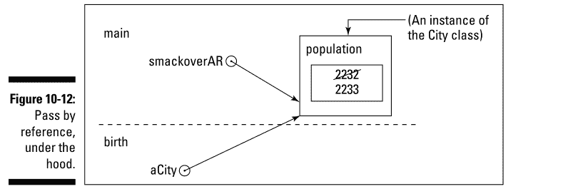

在图 10-12 中，你看到一个 `City` 类的实例，里面有一个 `population`。现在在阅读以下步骤时，请关注那个对象：

- 在调用 `birth` 方法之前，变量 `smackoverAR` 指向该对象——即 `City` 类的实例。
- 当调用 `birth` 方法并将 `smackoverAR` 传递给 `birth` 方法的参数 `aCity` 时，计算机将引用从 `smackoverAR` 拷贝到 `aCity`。现在 `aCity` 指向同一个对象——即 `City` 类的实例。
- 当在 `birth` 方法内部执行语句 `aCity.population++` 时，计算机将对象的 `population` 字段加 1。现在程序中唯一的 `City` 实例的 `population` 字段中存储了 2233。
- 执行权返回主方法。打印 `smackoverAR.population` 的值。但 `smackoverAR` 指向的是那一个 `City` 类实例。因此，`smackoverAR.population` 的值为 2233。Kermooos 函数感到非常自豪。

# 第 10 章：将变量和方法放在它们应该的地方

## 从方法返回对象

信不信由，之前关于参数传递的章节还让 Java 方法的一个角落未探索。当你调用方法时，方法可以将某些结果直接返回给调用代码。在之前的章节和节中，我返回的是原始值（例如 `int` 值）或者什么返回（即 `void`）。在本节中，我返回了一个完整的对象。它是来自列表 10-12 的 `City` 类型对象。实现这一点的代码在列表 10-14 中。

### 列表 10-14：这里，有一个 City

```java
public class TrackPopulation {

    public static void main(String[] args) {

        City smackoverAR = new City();

        smackoverAR.population = 2232;

        smackoverAR = doBirth(smackoverAR);

        System.out.println(smackoverAR);

    }

    static City doBirth(City aCity) {

        City myCity = new City();

        myCity.population = aCity.population + 1;
    }
}
```


```java
return myCity;
}
}
```

如果你运行列表 10-14 中的代码，你会得到数字 2,233。这很好。该代码的工作原理是告诉 `doBirth` 方法创建另一个 `City` 实例。新实例的 `population` 值为 2333。（见图 10-13。）

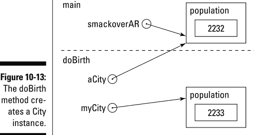

# 第四部分：熟练的 Java 技术

在执行完 `doBirth` 方法后，该 `City` 实例被返回到主方法。然后，在主方法中，该实例（`doBirth` 返回的那个）被赋值给变量 `smackoverAR`。（见图 10-14）。现在 `smackoverAR` 指向的是一个全新的 `City` 实例——一个 `population` 为 2,233 的实例。

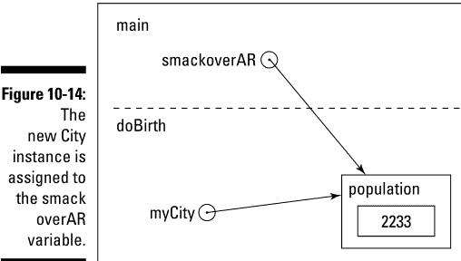

在列表 10-14 中，注意调用和返回 `doBirth` 方法时的类型一致性：

- 变量 `smackoverAR` 的类型是 `City`。变量 `smackoverAR` 被传递给参数 `aCity`，它的类型也是 `City`。
- 变量 `myCity` 的类型是 `City`。变量 `myCity` 在 `doBirth` 方法的返回语句中传回。这是致的，因为 `doBirth` 方法的头以 `static City doBirth(blah, blah, blah...)` 开始——这是一个返回 `City` 类型对象的承诺。
- `doBirth` 方法返回一个 `City` 类型的对象。在主方法中，调用 `doBirth` 返回的对象被赋值给变量 `smackoverAR`，并且（你猜对了）变量 `smackoverAR` 的类型确实是 `City`。

除了这种非常和谐之外，所有这些类型契约都是绝对必要的。如果你编写的程序中类型与另一种类型不匹配，编译器会抛出一个无情的“类型不兼容”信息。

## 结语

# 第 11 章：使用数组处理值

### 本章内容

- 处理值
- 查找值
- 创建数组
- 使用数组

在这些术语中，整行被称为数组。数组的每个组件都有自己的名称。起始组件被命名为 `[0]`，依此类推。十个组件中的最后一个被命名为 `[9]`。

实际上，使用数组可以让你避免示例代码中所有重复的无意义操作。例如，要声明一个包含十个值的数组，你可以写一条简短的语句：

```java
int guests[] = new int[10];
```

如果你特别喜欢啰嗦，可以将此语句扩展为两个独立的行：

```java
int guests[];
guests = new int[10];
```

在数组中，你总是要指定组件的数量。数组的索引从 0 开始，到总组件数减 1 的数字结束。

我展示给你的片段有两种创建数组。第一种方法使用一行。第二种方法使用两行。如果你选择单行写法，可以将其放在方法内部或外部。选择权交给你。另一方面，如果你使用分两行的写法，第二行 `guests = new int[10];` 应该放在方法内部。

在数组声明中，你可以将方括号放在变量名的之前或之后。换句话说，你可以写 `int guests[]` 或 `int[] guests`。无论使用哪种形式，计算机创建的同一个 `guests` 变量。

### 以两个简单的步骤创建数组

再次查看你用于创建数组的两行代码：

```java
int guests[];
guests = new int[10];
```

每一行都有其独特的用途：

- `int guests[]`：第一行是一个声明。该声明为预留了数组名称（一个像 `guests` 这样的名称），供程序的其余部分使用。在 Java 的比喻中，这一行代码说：“我计划建造一家酒店，并在每个房间里放入一定数量的客人。”（见图 11-2）。
- 不要管管声明 `int guests[]` 实际上做了什么。更重要的是注意到声明 `int guests[]` **没有**做什么。该声明并没有预留 10 个内存位置。事实上，像 `int guests[]` 这样的声明并没有创建一个数组。声明的作用只是设置了 `guests` 变量。在代码的那个点，`guests` 变量仍然指向一个数组（换句话说，旅馆有一个名字，但旅馆还没有建成）。
- `guests = new int[10];`：第二行是一个赋值语句。赋值语句在计算机内存中为 10 个 `int` 值预留了空间。从房地产的角度来看，这一行代码说：“我终于建好了旅馆。去给每个房间安排客人吧。”（再次，见图 11-2）：

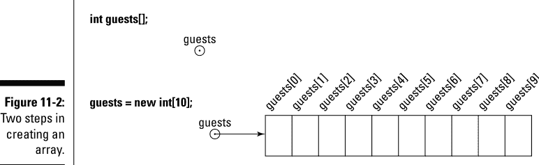

### 存储值

创建数组后，你就可以将值放入数组的组件中。例如，你想存储 6 号房间有 4 位客人的事实。要把值 4 放入索引为 6 的组件中，你写下 `guests[6] = 4`。

现在生意开始了。一辆大大停在了旅馆门口。巴士侧面有一块写着“诺亚方舟”的牌子。从车上走下来 25 对夫妇，他们有的走路、踏地、跳跃、飞行或爬着来到旅馆的小办公室。只有 10 队夫妇可以入住 Java 旅馆，但没关系，因为你可以把剩下的 15 对夫妇送往路另一头的旧 C-Side 度假村和汽车旅馆。

## 第 11 章：使用数组处理数值

无论如何，要在 Java 旅馆登记 10 对夫妇，你需要在你的 10 个房间中的每个房间放入一对夫妇（2 位客人）。在创建数组后，你可以利用数组的索引功能并使用 `for` 循环，如下：

```java
for (int roomNum = 0; roomNum < 10; roomNum++) {
    guests[roomNum] = 2;
}
```

这个循环取代了十条赋值语句。注意循环的计数器是如何从 0 变到 9 的。将其与图 11-2 进行对比并记住数组的索引是从 0 到数组组件数量减一。

然而，考虑到现实情况，你的客人永远不会以整齐的结对到达，你必须在每个房间里填入不同数量的客人。你可能在数据库中存储关于房间和客人的信息。如果是这样，你仍然可以遍历数组，在遍历的过程中收集客人数。执行此类任务的代码可能看起来如下：

```java
resultset = statement.executeQuery("select GUESTS from RoomData");
for (int roomNum = 0; roomNum < 10; roomNum++) {
    resultSet.next();
    guests[roomNum] = resultSet.getInt("GUESTS");
}
```

但由于本书直到第 17 章才介绍数据库，因此你可能从一个纯文本文件读取客人数会更好。图 11-3 显示了一个名为 `GuestList.txt` 的示例文件。

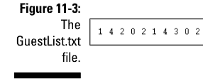

创建文件后，你可以调用 `Scanner` 类从文件中获取值。代码如列表 11-1 所示，结果输出见图 11-4。

本书的网站（www.allmycode.com/JavaForDummies）为需要创建数据文件的读者提供了提示。这包括针对 Windows、Linux 和 Macintosh 环境的说明。

### 列表 11-1：为数组填充值

```java
import static java.lang.System.out;
import java.util.Scanner;
import java.io.File;
import java.io.IOException;

public class ShowGuests {
    public static void main(String[] args) throws IOException {
        int guests[] = new int[10];
        Scanner diskScanner = new Scanner(new File("GuestList.txt"));
        for (int roomNum = 0; roomNum < 10; roomNum++) {
            guests[roomNum] = diskScanner.nextInt();
        }
        out.println("Room" + "\t");
        for (int roomNum = 0; roomNum < 10; roomNum++) {
            out.print(roomNum) + "\t");
            out.println(guests[roomNum]);
        }
        diskScanner.close();
    }
}
```

| 房间 | 客人 |
|---|---|
| 0 | 1 |
| 1 | 4 |
| 2 | 2 |
| 3 | 0 |
| 4 | 2 |
| 5 | 1 |
| 6 | 4 |
| 7 | 3 |
| 8 | 0 |
| 9 | 2 |

图 11-4：运行列表 1-1 中的代码。

列表 11-1 中有两个循环。第一个循环读取客人数，第二个循环写入客人数。

每个数组都有一个内置长度（`length`）。数组的长度是数组中组件的数量。因此，在列表 11-1 中，如果你打印 `guests.length` 的值，你会得到 10。


### 制表符和其他特殊字符

在列表 11-1 中，某些对 `print` 和 `println` 调用使用了 `\t` 转义序列。它之所以被称为转义序列，是因为你“转义”了在屏幕上显示字母 t 的行为。字符 `\t` 代表制表符（tab）。计算机向前移动到下一个制表位。Java 有一些这样的转义序列，部分见表 11-1。

| 表 11-1 | 转义序列 | 含义 |
|---|---|---|
| \b | 退格格 |
| \t | 制表符 |
| \n | 换行符 |
| \f | 分页符 |
| \r | 回车符 |
| \" | 双引号 |
| \' | 单引号 |
| \\ | 反斜杠 |

（注：此处根据原文格式翻译）

### 使用数组初始化

除了你在 11-1 中看到的方法，你还有另一种填充数组的方法——使用数组初始化。当你使用数组初始化时，你不需要告诉计算机数组有多少组件。

列表 11-2 显示了这种方法。列表 11-1 和 11-2 的唯一区别在于使用了数组初始化。11-2 的程序输出是相同的。

### 列表 11-2：数组初始化

```java
import static java.lang.System.out;

public class ShowGuests {
    public static void main(String[] args) {
        int guests[] = {1, 4, 2, 0, 2, 1, 4, 3, 0, 2};
        out.println("Room\t");
        for (int roomNum = 0; roomNum < 10; roomNum++) {
            out.print(roomNum) + "\t");
            out.println(guests[roomNum]);
        }
    }
}
```

数组初始化可以包含表达式。从通俗英语来说，这意味着你可以在初始化器中放入各种内容。例如，像 `(1 + 3, 2, 0, 2, 1, 4, 3, 0, 2)` 这样的初始化是可以行的。

### 遍历数组

Java 有增强 for 循环（enhanced for loop）——一种不需要计数器或索引的循环。列表 11-3 显示了如何操作。

本节适用于 Java 5.0 及更高版本。但对于旧版本的 Java，本节并不适用。关于 Java 版本的更多信息，请参见第 2 章。


### 列表 11-3：增强 for 循环！

```java
import static java.lang.System.out;

public class ShowGuests {
    public static void main(String[] args) {
        int guests[] = {0, 0, 0, 0, 0, 0, 0, 0, 0, 0};
        for (int numGuests : guests) {
            numGuests += 1;
            out.println(numGuests + " ");
        }
        out.println();
        for (int numGuests : guests) {
            out.println(numGuests + " ");
        }
    }
}
```

Java 的增强 for 循环需要一个警告。在循环的每次迭代，遍历值范围的变量存储的是原始范围中值的副本。该变量并不指向范围本身。

所以例如，如果你在列表 11-3 中添加一条更改 `numGuests` 值的赋值语句，该语句对 `guests` 数组中的任何值都没有影响。为了彻底说明这一点，假设生意很差，我把我的酒店的 `guests` 数组填充为 0。然后我执行以下代码：

代码的输出如下：

```
1 1 1 1 1 1 1 1
0 0 0 0 0 0 0 0 0 0
```

### 搜索

你正坐在 Java 旅馆的柜台后面。看！来了一组五个人。这些人想租一个房间，所以你需要一个软件来检查房间是否空闲。如果有空闲，该软件将通过修改 `GuestList.txt` 文件（参见图 11-3），将数字 0 替换为数字 5。。幸运的是，该软件就在你的硬盘驱动上。该软件位于列表 11-4 中。

```java
import static java.lang.System.out;
import java.util.Scanner;
import java.io.File;
import java.io.IOException;
import java.io.PrintWriter;

public class FindVacancy {
    public static void main(String[] args) throws IOException {
        int guests[] = new int[10];
        int roomNum;
        Scanner diskScanner = new Scanner(new File("GuestList.txt"));
        for (roomNum = 0; roomNum < 10; roomNum++) {
            guests[roomNum] = diskScanner.nextInt();
        }
        diskScanner.close();
        roomNum = 0;
        while (roomNum < 10 && guests[roomNum] != 0) {
            roomNum++;
        }
        if (roomNum == 10) {
            out.println("Sorry, no vacancy");
        } else {
            out.print("How many people for room ");
            out.print(roomNum);
            out.print(" ?");
        }
        Scanner keyboard = new Scanner(System.in);
        guests[roomNum] = keyboard.nextInt();
        keyboard.close();
        PrintWriter listOut = new PrintWriter("GuestList.txt");
        for (roomNum = 0; roomNum < 10; roomNum++) {
            listOut.print(guests[roomNum]);
            listOut.print(" ");
        }
        listOut.close();
    }
}
```

图 11-5 到 11-7 显示了列表 11-4 中代码的运行情况。回到图 11-3，旅馆开始时有两个空闲房间——3 号房间和 8 号房间。（记住，房间是从 0 号开始编号的。）当你第一次运行列表 11-4 代码时，程序告诉你 3 号房间是空闲的，并将五个人放入该房间。你第二次运行代码时，程序找到了剩余的空闲房间（8 号房间），并将一个十人的团体放入该房间。（真是一大家庭！）你第三次运行代码时，已经没有更多空闲房间了。当程序发现这一点时，它显示消息“Sorry, no vacancy”（对不起，没有空房），按照所有旅馆霓虹灯牌的传统，省略至少一个字母。

GuestList.txt
1 4 2 0 2 1 4 3 0 2

**图 11-5:** 填满空房。


# Console 示例

## 示例 1：填满最后一个空闲房间

```text
Console
<terminated> FindVacancy[Java Application] C:\Pro

How many people for room 3? 5
```

```text
GuestList.txt
1 4 2 5 2 1 4 3 0 2
```

**图 11-6:** 填满最后一个空闲房间。

## 示例 2：抱歉，朋友。没房间了。

```text
Console
<terminated> FindVacancy[Java Application] C:\Pro

How many people for room 8? 10
```

```text
GuestList.txt
1 4 2 5 2 1 4 3 10 2
```

**图 11-7:** 抱歉，朋友。没房间了。

## 示例 3：无空房

```text
Console
<terminated> FindVacancy[Java Application] C:\Pro

Sorry, no vacancy
```

---

运行列表 11-4 中的代码会写入一个全新的 `GuestList.txt` 文件。这可能会让人困惑，因为每个 Java IDE 都有自己显示 `GuestList.txt` 文件内容的方法。某些 IDE 不会自动显示最新的 `GuestList.txt` 文件，因此在运行列表 11-4 的代码后，你可能看不到任何变化。（例如，在图 11-5 中，3 号房间是空的。图 11-6 显示 3 号房间有五个客人。）即使你没有看到变化，连续运行列表 11-4 也会更改 `GuestList.txt` 文件。在你喜欢的 IDE 中尝试一下，看看如何让 IDE 刷新 `GuestList.txt` 文件的显示。


# 写入文件

列表 11-4 中的代码使用了本书中其他章节和部分的内容。该代码唯一的新功能是使用 `PrintStream` 写入磁盘文件。考虑本书中任何调用 `System.out.print`、`System.out.println` 或其变体的示例。当你调用这些方法之一时，内部到底发生了什么？

名为 `System.out` 的是一个对象。该对象定义在 Java API 中。事实上，`System.out` 是一个名为 `java.io.PrintStream` 的类的实例。

# 第 11 章：使用数组处理多个值

在程序开头使用 `Scanner(System.in)` 并在程序结束时放置 `keyboard.close()`。但为了让列表 11-4 尽可能易读且统一，我将键盘构造函数和关闭调用紧紧地放置在 `keyboard.nextInt` 调用周围。

## 对象数组

Java 旅馆已经开业了，现在配备了改进的客人注册软件！带你进入本章第一部分的人一直在苦思冥想寻找改进服务的最佳方法。现在，通过一些面向对象编程的思想，他们开始以 `Room` 类的方式来思考。

“你可能会问，一个 `Room` 实例看起来是什么样？”这很简单。一个 `Room` 实例有三个属性——房间内的客人数、房费以及一个吸烟/禁烟标记。图 11-8 展示了这种情况。

**图 11-8：** Java 旅馆房间的另一个抽象快照。

| 索引 | 0 | 1 | 2 | 3 | 4 | 5 | 6 | 7 | 8 | 9 |
|---|---|---|---|---|---|---|---|---|---|---|
| 客人数 | 1 | 4 | 2 | 0 | 2 | 1 | 4 | 3 | 0 | 2 |
| 房费 | $60.00 | $60.00 | $60.00 | $60.00 | $80.00 | $80.00 | $80.00 | $80.00 | $100.00 | $100.00 |
| 吸烟 | | | | | | | | | | |

列表 11-5 显示了定义 `Room` 类的代码。正如承诺的，每个 `Room` 类实例都有三个字段：`guests`、`rate` 和 `smoking`。（布尔字段 `smoking` 值为 `false` 表示是禁烟房）。此外，整个 `Room` 类有一个名为 `currency` 的静态字段。`currency` 对象让房间看起来像美元金额。

要了解 `static` 的含义，请参见第 10 章。

## 列表 11-5：房间看起来就是这样！

```java
import static java.lang.System.out;
import java.util.Scanner;
import java.text.NumberFormat;

public class Room {
    private int guests;
    private double rate;
    private boolean smoking;
    private static NumberFormat currency = NumberFormat.getInstance();

    public void readRoom(Scanner diskScanner) {
        guests = diskScanner.nextInt();
        rate = diskScanner.nextDouble();
        smoking = diskScanner.nextBoolean();
    }

    public void writeRoom() {
        out.print(guests);
        out.print("\t");
        out.print(currency.format(rate));
        out.print("\t");
        out.println(smoking ? "yes" : "no");
    }
}
```

列表 11-5 有一些奇怪之处，但我宁愿在你看到所有代码运行后再描述它们。这就是为什么此时我直接进入调用列表 11-5 代码的代码。当你读取房间数组时（如列表 11-6 所示），请查看我对比列表 11-5 奇怪之处的描述。

这是对第 4 章、第 7 章以及其他地方想法的刻意重复。当你使用 `double` 或 `float` 类型存储金额值时应该小心。使用 `double` 或 `float` 进行计算可能是不准确的。欲需更多信息，请参见第 4 章和第 7 章。

这与 Java 完全无关。如果你是喜欢吸烟的人（在列表 11-5 中 `smoking = true`），找一个——可以连续工作几天的人。让他们陪着你并在你戒烟 72 小时。你可能会暂时发疯，但最终会没事的。你的朋友会觉得像个真正的英雄。

## 使用 Room 类

所以你需要一个房间数组。创建这样一个东西的代码在列表 11-6 中。代码从 `RoomList.txt` 文件读取数据（图 11-9 显示了 `RoomList.txt` 的内容）。

图 11-10 显示了列表 11-6 代码的运行。

## 列表 11-6：你想看房间吗？

```java
import static java.lang.System.out;
import java.util.Scanner;
import java.io.File;
import java.io.IOException;

public class ShowRooms {
    public static void main(String args[]) throws IOException {
        Room rooms[];
        rooms = new Room[10];
        Scanner diskScanner = new Scanner(new File("RoomList.txt"));

        for (int roomNum = 0; roomNum < 10; roomNum++) {
            rooms[roomNum] = new Room();
            rooms[roomNum].readRoom(diskScanner);
        }

        out.println("Room\tGuests\tRate\tSmoking?");

        for (int roomNum = 0; roomNum < 10; roomNum++) {
            out.print(roomNum);
            out.print("\t");
            rooms[roomNum].writeRoom();
        }

        diskScanner.close();
    }
}
```

关于列表 11-6 中的代码，随你怎么说。就我而言，整个列表中只有一个问题应该引起你的注意。你问，那是什么呢？嗯，创建一个对象数组——相对于原始值数组——你必须做三件事：创建数组变量、创建数组本身，然后构造数组中的每个对象。这与创建一个 `int` 值数组或包含原始值的数组不同。当你创建一个原始值数组时，你只需要完成两件事。

为了理解这一切，请跟随列表 11-11 和图 11-11 查看以下点：

- `Room rooms[]`：此声明创建了 `rooms` 变量。该变量指向数组（但尚未指向任何内容）。
- `rooms = new Room[10];`：此语句在内存中预留了十个存储槽。该语句让 `rooms` 指向这组存储槽。每个槽旨在指向对象（但完全没有指向任何）。
- `rooms[roomNum] = new Room();`：此语句位于 `for` 循环内部。每个房间都会执行一次。例如，在第一次循环时，该语句执行 `rooms[0] = new Room()`。第一次运行时，该语句让槽位 `rooms[0]` 指向一个实际对象（`Room` 类的实例）。

**图 11-9：** Room 数据文件。

| Room | Guests | Rate | Smoking? |
|---|---|---|---|
| 0 | 1 | $60.00 | yes |
| 1 | 4 | $60.00 | yes |
| 2 | 2 | $60.00 | no |
| 3 | 0 | $60.00 | no |
| 4 | 2 | $80.00 | yes |
| 5 | 1 | $80.00 | no |
| 6 | 4 | $80.00 | no |
| 7 | 3 | $80.00 | no |
| 8 | 0 | $100.00 | yes |
| 9 | 2 | $100.00 | no |

**图 11-10：** 列表 11-6 代码的运行。

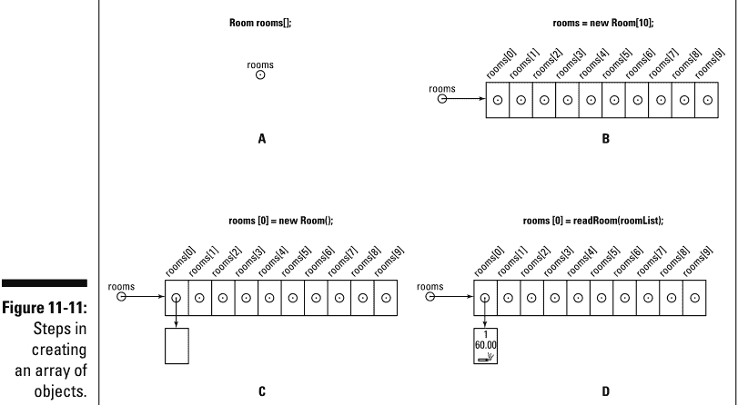

**图 11-11：** 创建对象数组的步骤。

尽管在技术上不被认为是创建数组的步骤，但你仍然必须为每个对象的字段填充值。在第一次循环时，`readRoom` 调用 `rooms[0].readRoom(scanner)`，这意味着“从 `RoomList.txt` 文件读取数据到 `rooms[0]` 对象的字段中（客人、费率和吸烟字段）”。每次循环，程序都会创建一个新对象并将数据读入该新对象的字段中。

你可以像创建原始值数组一样将步骤挤在一起。例如，你可以在一个循环中完成前两个步骤，如下：

```java
Room[] rooms = new Room[10];
```

你还可以使用数组初始化器。（关于数组初始化器的介绍，请参见前面的章节。）

## 另一种美化数字的方法

如果你比较列表 10-1 和列表 11-5 中的格式化语句，你不会看到太大区别。

- 一个列表使用构造函数：另一个列表调用 `getCurrencyInstance`。这是工厂方法作用的良好例子。工厂方法是创建常用对象的方便工具。人们总是需要显示金额的代码。`getCurrencyInstance` 方法创建美元格式，而不需要你写 `new DecimalFormat("####,#.00")`。

像构造函数一样，工厂方法返回一个新的绑定对象。与构造函数不同，工厂方法没有特殊状态。当你创建一个工厂方法时，你可以命名任何名称。当你调用工厂方法时，你不需要使用 `new` 关键字。

- 一个列表使用 `DecimalFormat`；另一个使用 `NumberFormat`。小数数字是一种数字。（事实上，小数数字是十进制中的数字）。因此，`DecimalFormat` 类是 `NumberFormat` 类的子类。`DecimalFormat` 方法更具体，对于大多数用途，我倾向于使用 `DecimalFormat`。但使用 `DecimalFormat` 类的 `getCurrencyInstance` 方法比较困难。所以对于涉及货币的程序，我倾向于使用 `NumberFormat`。

## 条件运算符

列表 11-5 使用了一个被称为条件运算符的有趣道具。这个条件运算符接受三个表达式，并只返回其中一个的值。它就像一个微型 `if` 语句。当你使用条件运算符时，它看起来像：

```text
conditionToBeTested ? expression1 : expression2
```

计算机评估 `conditionToBeTested` 条件。如果该条件为真，计算机返回 `expression1` 的值。但，如果条件为假，计算机返回 `expression2` 的值。

所以，在代码中：

```text
smoking ? "yes" : "no"
```

计算机检查 `smoking` 的值是否为 `true`。如果是，整个三部分表达式就代表第一个字符串 `"yes"`。如果不是，整个表达式就代表第二个字符串 `"no"`。

在列表 11-5 中，对 `out.println` 的调用会导致显示 `"yes"` 或 `"no"`。显示哪个字符串取决于 `smoking` 的值是 `true` 还是 `false`。

## 命令行参数

很久以前，大多数程序员都使用基于文本的开发界面。现在要运行第 3 章中的 `Displayer` 示例，他们不需要从华丽的集成开发环境菜单中选择“运行”。相反，他们在一个外观简陋的窗口中输入命令，该窗口通常是黑色背景上的白色文字。图 11-12 说明了这一点。在图 11-12 中，我输入了 `java Displayer`，计算机响应并返回了我程序的输出（你会喜欢 Java 的！）。

**图 11-12：** 命令行界面示例。


这种外观简陋的窗口有许多名称，取决于你使用的操作系统。在 Windows 中，这种文本窗口被称为命令提示符窗口。在 Macintosh 和 Linux 中，这个窗口被称为终端。某些版本的 Linux 和 UNIX 将此窗口称为 shell。

无论如何，在古代，你可以编写一个程序，在输入启动程序的命令时吸取额外信息。图 11-13 显示了这种运作方式。

**图 11-13：** 命令行参数示例。

```text
C:\> java MakeRandomNumsFile MyNumberedFile.txt 5
C:\> type MyNumberedFile.txt
1
2
3
C:\>_
```

当你启动 `MakeRandomNumsFile` 时，你输入了一些额外信息。

在图 11-13 中，程序员输入 `java MakeRandomNumsFile` 来运行 `MakeRandomNumsFile` 程序。但程序员在后面跟着 `MyNumberedFile.txt` 和 `5`。当 `MakeRandomNumsFile` 程序运行时，它会吸取两个额外信息并使用它们来完成程序需要做的任何工作。在图 11-13 中，数字是 `5`，但在另一个场合，程序员可能会输入 `SomeStuff 28` 或 `BunchNumbers 2000`。每次运行程序时，额外信息都可能不同。

所以下一个问题是：“Java 程序是如何知道它每次运行时都应该吸取额外信息的？”自从你开始学习 Java，你已经在每个 `main` 方法的头部看到过这个 `String[] args` 的事儿了。嗯，是时候让你搞清楚这到底是怎么回事了。参数 `args[]` 是一个 `String` 值的数组。这些 `String` 值被称为命令行参数。

### 在 Java 程序中使用命令行参数

列表 11-7 显示了如何在你的代码中使用命令行参数。

## 列表 11-7：生成一个数字文件

```java
import java.util.Random;
import java.io.PrintStream;
import java.io.IOException;

public class MakeRandomNumsFile {
    public static void main(String[] args) throws IOException {
        Random generator = new Random();

        if (args.length < 2) {
            System.out.println("Usage: MakeRandomNumsFile filename number");
            System.exit(1);
        }

        PrintStream printOut = new PrintStream(args[0]);
        int numNines = Integer.parseInt(args[1]);

        for (int count = 1; count <= numNines; count++) {
            printOut.println(generator.nextInt(10) + 1);
        }

        printOut.close();
    }
}
```


如果某个程序期望一些命令行参数，你不能像启动书中其他大多数程序那样启动它。向程序传递命令行参数的方法取决于你使用的 IDE —— Eclipse、NetBeans 或其他工具。这就是为什么书的网站（www.allcode.com/JavaForDummies）提供了使用各种 IDE 的说明。

当列表 11-7 中的代码开始时，`args` 数组 `[0]` 自动调用 "MyNumberedFile.txt"，而 `[1]` 自动变为 "5"。程序的赋值语句最终变为：

```java
PrintStream printOut = new PrintStream("MyNumberedFile.txt");
int numNines = Integer.parseInt("5");
```

程序创建文件 `MyNumberedFile.txt` 并将 `numNines` 设置为 5。在代码的后续部分，程序随机生成五个值并将这些值放入 `NumberedFile.txt`。程序的这次运行产生了如图 11-14 所示的文件。


| | |
|---|---|
| 6 | 3 |
| 10 | 10 |
| 8 | |

运行列表 11-7 代码后，你可以在硬盘的哪里找到新文件 (`MyNumberedFile.txt`)？答案取决于许多因素，所以我不给出特定的答案。如果你使用分了项目的 IDE，新文件就在项目文件夹中。另一种方法是你可以更改列表 11-7 以指定完整路径 —— 像 `c:\MyNumberedFile.txt`。

在 Windows 中，文件路径包含反斜杠。在 Java 中，当你想表示反斜杠时使用双反斜杠字面量。这就是为什么 `c:\\MyNumberedFile.txt` 包含两个反斜杠。相比之下，Linux 和 Macintosh 系统的文件路径包含正斜杠。在 Java 字符串中表示正斜杠使用单个斜杠。引用 Macintosh 目录中的文件，你可以写 "/Users/UserName/Documents/MyNumberedFile.txt"。

注意列表 11-7 中的每个参数都是一个 String 值。当你查看 `args[1]` 时，你看到的不是数字 5，而是包含数字的字符串 "5"。遗憾的是，你不能用 "5" 做任何事。要从 "5" 获取一个 int，你必须应用 `parseInt` 方法。（再次参见列表 11-7）

`parseInt` 方法使用一个名为 `Integer` 的类。调用 `parseInt` 时，在前面加上 `Integer`。`Integer` 类有各种处理 `int` 值的方便方法。在 Java 中，`Integer` 是类的名称，而 `int` 是基本（简单）类型的名称。两者相关，但并不相同。`Integer` 类拥有处理 `int` 值的方法和其他工具。

### 检查命令行参数数量

如果用户犯了错会怎样？如果用户忘记在图 11-13 的第一行输入数字 5 呢？

那么计算机会将 "MyNumberedFile.txt" 分配给 `args[0]`，但不会给 `args[1]` 分配任何内容。这是糟糕的。如果计算机：

```java
int numLines = Integer.parseInt(args[1]);
```

程序会因为 `ArrayIndexOutOfBoundsException` 而崩溃。

所以，你该这样做？在列表 11-7 中，你检查了 `args` 数组的长度。你将 `args.length` 与 2 进行比较。如果 `args` 数组少于两个组件，你在屏幕上显示一条消息并退出程序。图 11-15 显示了结果。

**图 11-15: 列表 11-7 中的代码告诉你如何运行它。**

```
Usage: MakeRandomNums filename number
```

尽管列表 11-7 对 `args.length` 进行了检查，代码仍然是不完善的。如果用户输入 `five` 而不是 `5`，程序会因为 `NumberFormatException` 而坠毁。第二个命令行参数不能是单词。参数必须是数字（而且必须是整数！）。我可以向列表 11-7 添加语句以使代码更健壮，但对 `NumberFormatException` 的检查在第 13 章完成更好。


当你带有命令行参数运行时，你可以输入一个带有空格的字符串值。只需将该值括在双引号中。例如，你可以使用参数 "My Big Fat.txt" 7 运行列表 11-7 代码。


本书对数组的讨论就要结束了。下一节将的是稍有不同的内容。但在离开数组主题之前，请思考这一点：数组是多行的集合，并不是每种东西都只放在一行中。本章中前几个示例涉及一家汽车酒店。编号从 0 到 9 的酒店房间在一条大行中。

## 第 12 章 使用集合和流（当数组不够用时）

本章内容

- 面对数组的局限性
- 一次处理一组对象
- 使用 Java 酷的函数式编程特性
- 为多核处理器开发代码

第 11 章是数组的。通过数组，你可以一次性管理许多事物。在酒店管理程序中，你可以跟踪所有的房间。你可以快速找到某个房间的人数，或者找到一个空房间。

然而，数组并不完美胜任。在本章中，你将发现数组的短板之处，以及集合如何解决这些问题。

### 理解数组的局限性

数组很好用，但它们也有一些严重的局限性。想象你按照某种预定的顺序存储客户姓名。你的代码包含一个数组，该数组有存储 100 个名字的空间。

```java
String name[] = new String[100];
for (int i = 0; i < 100; i++) {
  name[i] = new String();
}
```

一切都很顺利，直到某天，第 101 号客户出现了。当你的程序运行时，你输入了第 101 号客户的数据，拼命希望这个拥有 100 个组件的数组能够扩展以适应你增长的需求。

没有那么幸运。数组不会扩展。你的程序因抛出 `ArrayIndexOutOfBoundsException` 而崩溃了。

“我的下辈子，我要创建一个长度为 1000 的数组，”你对自己说。当你的下辈子来临时，你确实是这么做的。

```java
String name[] = new String[1000];
for (int i = 0; i < 1000; i++) {
  name[i] = new String();
}
```

但在你的下辈子，发生了经济衰退。你没有 1000 个客户，只有 3 个客户。现在你浪费了可以存放 1000 个名字的空间，而实际上只需要 3 个名字的空间。

如果没有发生经济衰退呢？你正带着你的 1000 元素的数组顺畅运行，使用了数组中整洁的 825 个空间。索引 0 到 824 的组件正在被使用，而 825 到 999 的组件则在静待填充。

某天，一个新客户出现了。由于你的客户是按顺序存储的（按姓氏字母顺序、按社会安全号码数字顺序，随你怎么意），你想将这个客户挤进数组的正确组件中。问题是，该客户属于数组非常靠前的位置，索引为 824。会发生什么？

你取出第 824 组件的名字并移动到第 825 组件。然后你取出第 823 组件的名字并移动到第 824 组件。你取出第 822 组件的名字并移动到第 823 组件。你一直这样做，直到移动了第 7 组件的名字。然后你把新客户的姓名放入第 7 组件中。真痛苦的痛苦！当然（如果电脑有感情的话，它可能喜欢这种无意义的体力活。）但当你移动所有的名字时，你消耗了时间，浪费了电力，并浪费了所有的资源。

“我的下辈子，要在每两个名字之间留三个空组件。”而且显然，你的业务扩张了。最终你发现空间还是不够用。

### 集合类的救星

上一节中的问题并不新。计算机科学家已经研究这些问题长期了。他们还没有发现任何万能的魔法解决方案，但他们发现了一些巧妙的技巧。

Java API 有一组被称为“集合”的类。每个类都有用于存储大量值的方法，而且每个集合类的方法都使用了一些巧妙的技巧。对你来说，核心结论如下：

某些集合类能够尽可能高效地处理上一节提出的问题。如果你在编写代码时必须处理此类问题，可以使用这些集合类并调用它们的方法。你不需要为一个姓名该属于第 7 位的客户发愁，只需调用类的方法即可。Java 最通用的类是 `ArrayList`。列表 12-1 显示了它是如何工作的。

### 使用 ArrayList

**列表 12-1：使用集合操作**

```java
import java.util.ArrayList;
import java.io.File;
import java.io.IOException;

public class ShowNames {
    public static void main(String[] args) throws IOException {
        ArrayList<String> people = new ArrayList<>();
        Scanner diskScanner = new Scanner(new File("names.txt"));
        while (diskScanner.hasNext()) {
            people.add(diskScanner.nextLine());
        }
        for (String name : people) {
            System.out.println(name);
        }
        diskScanner.close();
    }
}
```

列表 12-1 显示了一个示例：

| Name | 年龄 |
| :--- | :--- |
| Smith | 30 |
| Johnson | 25 |
| Brown | 40 |
| Taylor | 22 |
| Jones | 35 |

### 所有的泛型

Java 的最初设计目标之一是保持语言尽可能简单。该语言的开发者吸收了 C++ 中一些没复杂的特性，并将它们抛出窗外。结果是一个优雅且简洁的语言。有些人说这种语言太简洁了。在经过几年的讨论和争论后，Java 变得稍微复杂了一些。到 2004 年，Java 已经有了*枚举类型*、for 循环、静态内部类以及其他有趣的特性。但最广受关注的新特性是泛型的引入。

```java
ArrayList<String> people = new ArrayList<String>();
```

任何对 `<String>` 的使用在 Java 5.0 中都是新颖的。在旧式 Java 中，你会写成：

```java
ArrayList people = new ArrayList();
```

在那个时代，`ArrayList` 可以存储你想要放入的任何内容——一个数字、一个 `Account`、一个字符串……任何内容。`ArrayList` 非常多能，但这种通用性也意味着头疼问题。如果你向 `ArrayList` 中放入任何内容，你就无法轻松地预测你将从 `ArrayList` 中得到什么。特别是，你无法轻松编写假设 `ArrayList` 中值具有特定类型的代码。这里有一个例子：

```java
ArrayList things = new ArrayList();
things.add(new Account());
Account account = things.get(0);
// 不要使用这个。这是坏代码。
```

在第三行中，对 `get(0)` 的调用收集了 `things` 集合中的最早值。`get(0)` 的调用是可以的，但编译器阻止了对 `myAccount` 的赋值尝试。你在第三行收到一条消息，说明你从 `things` 中获取的任何内容都无法放入 `myAccount` 变量中。你收到这条消息是因为编译器到达了第三行，它已经忘记了第二行添加的项是 `Account` 类型！

泛型的引入解决了这个问题：

```java
ArrayList<Account> things = new ArrayList<Account>();
things.add(new Account());
Account account = things.get(0);
// 代替使用这段代码。这是好代码。
```

在新的位置添加 `<Account>` 告诉编译器存储的是 `Account` 实例——不再有别的，因此，在代码的第三行中，你从 `things` 集合中获取值。然后，因为 `things` 只存储 `Account` 对象，你可以让 `myAccount` 指向那个新值。

Java 5.0 将泛型加入了 Java。但在 Java 5.0 出生后，程序员发现泛型代码可以有多复杂。毕竟，你可以在泛型内部创建泛型。一个 `ArrayList` 可以包含一组数组，每个数组都可以是一个 `ArrayList`。所以你可以写：

```java
ArrayList<ArrayList<String>[]> mess = new ArrayList<ArrayList<String>>();
```

## 第 12 章：使用集合和流（当数组不够用时）

`mess` 声明中所有的重复让我头疼！为了避免这种混乱，Java 7 及更高版本有了菱形运算符 `<>`。菱形运算符告诉 Java 重用你在泛型声明之前部分输入的任何极其复杂的内容。在这个示例中，`<>` 告诉 Java 重用 `ArrayList<String>[]`，即使你只写了一次 `ArrayList<String>()`。这里是精简后的 Java 7 代码看起来像：

```java
ArrayList<String> arrayStrings = mess.new ArrayList<>();
```

在 Java 7 及更高版本中，你可以写两种 `mess` 声明——原始的、带有两次 `ArrayList<String>()` 的糟糕声明，或者精简的（仅略微糟糕的）带有菱形运算符且仅出现一次 `ArrayList<String>()` 的声明。

是的，精简的代码仍然很复杂。但没有了所有的 `ArrayList<String>()` 重复，精简的代码就不那么繁琐了。Java 7 的菱形运算符为你减少了一次复制错误内容导致代码中出现大错误的机会。

### 测试是否存在更多数据

这是一个令人惊喜的发现。当你编写像之前列表 12-1 那样的程序时，你不需要知道输入文件中有多少名字。必须知道名字的数量可能会违背使用易扩展的 `ArrayList` 类的目的。与其循环到恰好九个名字，你可以循环到没有数据为止。

`Scanner` 有几个很棒的方法，如 `hasNext`、`hasNextDouble` 以及最普通的 `hasNext`。这些方法中的每一个都会检查是否有更多数据。如果有更多数据，该方法返回 `true`。否则，方法返回 `false`。

列表 12-1 使用了通用的 `hasNext` 方法。只要程序输入中有任何内容可读，这个 `hasNext` 方法就会返回 `true`。所以，在程序获取了图 12-1 中 Lucy R. DaReader 一行的内容后，随后的 `hasNext` 调用将返回 `false`。这个 `false` 条件结束了 `while` 循环的执行，并让计数器跳转到列表 12-1 代码的剩余部分。

`hasNext` 非常实用。事实上，`hasNext` 是如此重要，以至于它是名为“迭代器（iterator）”更大概念的一部分，而迭代器内置到了所有的 Java 集合类中。

### 使用迭代器

迭代器一个接一个地输出集合的值。要从集合中获取值，你调用迭代器的 `next` 方法。要发现集合中是否有任何值，你调用迭代器的 `hasNext` 方法。列表 12-2 使用迭代器显示人的名字。

**列表 12-2：遍历集合**

```java
import static java.lang.System.out;
import java.util.Iterator;
import java.util.Scanner;
import java.io.File;
import java.io.IOException;
import java.util.ArrayList;

public class ShowNames {
    public static void main(String args[]) throws IOException {
        ArrayList<String> people = new ArrayList<>();
        Scanner diskScanner = new Scanner(new File("names.txt"));
        while (diskScanner.hasNext()) {
            people.add(diskScanner.nextLine());
        }
        people.remove(0);
        people.add(2, "Jim Newton");
        Iterator<String> iterator = people.iterator();
        while (iterator.hasNext()) {
            out.println(iterator.next());
        }
        diskScanner.close();
    }
}
```


# 第 12 章：使用集合和流（当数组不再足够时）

你可以用列表 12-2 中的代码替换列表 12-1 结尾处的增强 `for` 循环。当你这样做时，你将获得之前相同的输出（你得到图 12-2 中的输出）。在列表 12-2 中，第一行代码从 `people` 集合创建了一个迭代器。第二行和第三行调用迭代器的 `hasNext()` 和 `next()` 方法来获取 `people` 集合中存储的所有——每次迭代获取一个。

哪个更好？增强 `for` 循环还是迭代器？Java 程序员更倾向于使用增强 `for` 循环，因为它涉及的负担较少——不需要从一行代码携带到另一行迭代器对象。但正如在本章后面看到的，最增强特性也可以被升级、精简和其他方式重构。

## Java 的许多集合类

我在本章许多示例中使用的 `ArrayList` 只是 Java 集合冰山的一角。Java 库包含许多集合，每个都有自己的优势。表 12-1 包含了以下简要列表：

| ArrayList | 可调整大小的数组。 |
| LinkedList | 值的列表，每个值都有一个指向列表中下一个值的字段。 |
| Stack | 从底部到顶部生长的结构。该结构对访问顶部值进行了优化。你可以轻松地向顶部添加值或从顶部移除值。 |
| Queue | 一端生长的结构。该结构对从一端（尾部）添加值从另一端（前端）移除值进行了优化。 |
| PriorityQueue | 一种队列结构，允许（高优先级）值向前移动。 |
| HashSet | 不包含重复值的集合。 |
| HashMap | 键/值对集合。 |

每个类都有自己的一组方法（除了它从 `AbstractCollection`——所有集合类的祖先——继承的方法之外）。要发现哪些集合类最符合你的需求，请访问 Java API 文档页面：`http://docs.oracle.com/javase/8/docs/api`。

## Java 8 新特性：函数式编程

1953 年到 1957 年，John Backus 等人开发了 FORTRAN 编程语言，它包含了 20 世纪数千种编程语言的基础框架。该框架由于其“做这个，再做那个”的特性被称为命令式编程。

在 FORTRAN 兴起几年后，John McCarthy 创建了另一种名为 Lisp 的语言。与 FORTRAN 不同，Lisp 的底层框架是函数式的。在纯函数式程序中，你避免了“做这个，再做那个”。相反，当你处理时，你写的是类似“这是你如何将这个转换为那个”这样的内容。

由于某种原因，命令式编程变成了主导模式。因此，Java 从根本上是一种命令式语言。但最近，函数式编程已成为思考代码的一种强大且有用的方式。我读过并参加过几十场关于函数式编程的演讲。坦率地说，其中大部分内容并没有帮助。有些内容给你提供了一堆严谨的定义，并期望你形成自己的直觉；另一些则描述了这些思想，但没有提供具体的示例供你操作。

因此，我并没有详细描述函数式编程，而是用一个类比开始本节。在本章的其余部分，我将展示一些 Java 示例。我用来描述函数式编程的类比非常粗略。我的朋友认为这个类比很牵强，因为它适用于许多不同的框架，而不仅仅是函数式编程。无论如何，我认为这个类比是有帮助的。类比如下：将一个问题想象成一个立方体，并将命令式解决方案想象成一种将立方体切割成易处理部分的方法。（见图 12-3。）

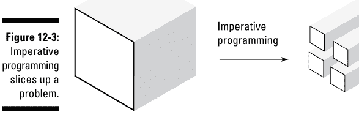

一切都很顺利，直到 2007 年计算机首次拥有了多核处理器。多核处理器可以同时执行多条指令。图 12-4 显示了当你试图将一个命令式程序挤进多核处理器时发生的情况。它并不能轻松适应，所以就把它们全部挤进一个核心。

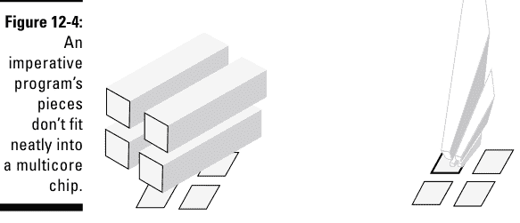

为了充分利用四核处理器的性能，你将代码划分为四个部分——每个核心一个部分。但使用命令式编程时，你的程序片段并不能整齐地放入处理器的核心中。在命令式编程中，你的代码片段之间会相互作用。所有片段可能都在更新 Oracle 股票的当前价格（代码为 ORCL）。同时更新会变得错乱。这就像是在问同一个问题。这不会产生任何好结果。如果你曾经点击过网站的购买按钮，却在填写信用卡信息时发现你想要购买的商品已经缺售了，那么你就经历过同样的现象。有太多的客户同时在抢购商品。

图 12-3 表明，使用命令式编程，你将代码分成若干部分。函数式编程也将代码划分成部分，但它是沿着不同的线条划分的。（见图 12-5。）这里有一个好消息：通过函数式编程，代码片段可以整齐地放入处理器的核心中。（见图 12-6。）

### 函数式编程

图 12-5：函数式编程沿着不同的线条切割问题：每个部分都能很好地放入一个核心中。

图 12-6：函数式程序的片段整齐地放入多核芯片中。

### 用老式方法解决问题

在第 1 章中，你使用数组来管理 Java Motel 酒店。但那段经历已成为过去。你已经放弃了酒店业务。（你告诉人们你决定继续前进。但诚实地说，酒店一直在亏钱。）自从离开酒店业务后，你转向在线销售。如今，你经营着一个销售书籍、DVD 和其他内容的网站。在你的世界里，销售看起来就像 12-3 所示。每项销售都有一个物品和一个价格。

#### 列表 12-3：Sale 类

```java
public class Sale {
    String item;
    double price;

    public Sale(String item, double price) {
        this.item = item;
        this.price = price;
    }
}
```

为了使用 `Sale` 类，你创建了一个小程序。该程序统计 DVD 的销售额。程序位于列表 12-4 中。

#### 列表 12-4：使用 Sale 类

```java
import java.text.NumberFormat;
import java.util.ArrayList;

public class TallySales {
    public static void main(String[] args) {
        ArrayList<Sale> sales = new ArrayList<>();
        NumberFormat currency = NumberFormat.getCurrencyInstance();
        fillList(sales);
        double total = 0;
        for (Sale sale : sales) {
            if (sale.item.equals("DVD")) {
                total += sale.price;
            }
        }
        System.out.println(currency.format(total));
    }

    static void fillList(ArrayList<Sale> sales) {
        sales.add(new Sale("DVD", 15.00));
        sales.add(new Sale("CD", 10.00));
        sales.add(new Sale("Book", 20.00));
        sales.add(new Sale("Smartphone", 500.00));
    }
}
```

### 流

“使用迭代器”章节引入了迭代器。你使用迭代器的 `next()` 方法输出集合的值。Java 8 通过“流”（Stream）的概念进一步扩展了这一点。流是一种迭代器，使用流时你不需要调用 `next()` 方法。事实上，典型的流没有 `next()` 方法。

### Lambda 表达式

在 20 世纪 30 年代，数学家 Alonzo Church 使用希腊字母 lambda (λ) 来表示某种即时的数学构造。在随后的几十年里，这个思想在数学和计算机科学期刊中静静生存。如今，在 Java 8 中，Lambda 表达式术语代表一段简短的代码，既作为方法声明又作为方法调用，都是即时生成的。

#### 一个极其简单的 Lambda 表达式

这是一个 Lambda 表达式的示例：

```java
(sale) -> sale.price
```

图 12-7 描述了该 Lambda 表达式的含义。

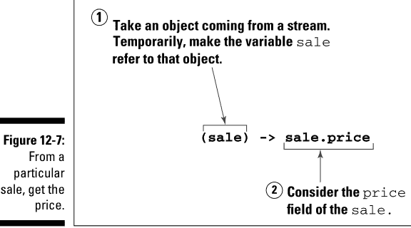

图 12-7：从特定的销售记录中获取价格。

Lambda 表达式是一种定义方法并在不给方法命名的情况下调用该方法的简洁方式。图 12-7 中的 lambda 表达式（大致）实现了以下代码的功能：

```java
double getPrice(Sale sale) {
    return sale.price;
}
getPrice(sale);
```

（记住，Listing 12-3 中的 `Sale` 类没有自己的 `getPrice()` 方法。）图 12-7 中的 lambda 表达式从流（stream）中获取对象，并在每个对象上调用类似于 `getPrice()` 的方法。结果是一个 `double` 值的流。

#### 一个更有趣的例子

这里另一个 lambda 表达式：

```java
(sale) -> sale.item.equals("DVD")
```

图 12-8 描述了该 lambda 表达式的含义。

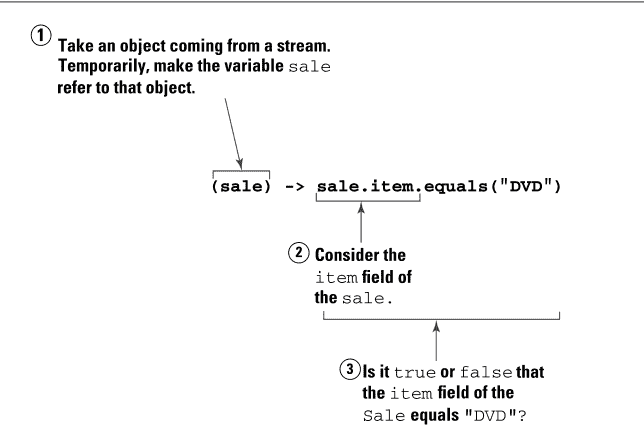

图 12-8：售出的物品恰好是 DVD 吗？

图 12-8 中的 lambda 表达式（大致）实现了以下代码的功能：

```java
boolean itemIsDVD(Sale sale) {
    if sale.item.equals("DVD") {
        return true;
    } else {
        return false;
    }
}
itemIsDVD(sale);
```

图 12-8 中的 lambda 表达式从流中获取对象，并在每个对象上调用类似于 `itemIsDVD()` 的方法。结果是一组布尔值——对于每笔 DVD 销售返回 `true`，对于每笔非 DVD 的物品销售返回 `false`。

无论是否使用 lambda 表达式，你都可以用单行方法体来重写 `itemIsDVD()` 方法：

```java
boolean itemIsDVD(Sale sale) {
    return sale.item.equals("DVD");
}
```

#### 两个参数的 lambda 表达式

考虑以下 lambda 表达式：

```java
(price1, price2) -> price1 + price2
```

图 12-9 描述了该新 lambda 表达式的含义。

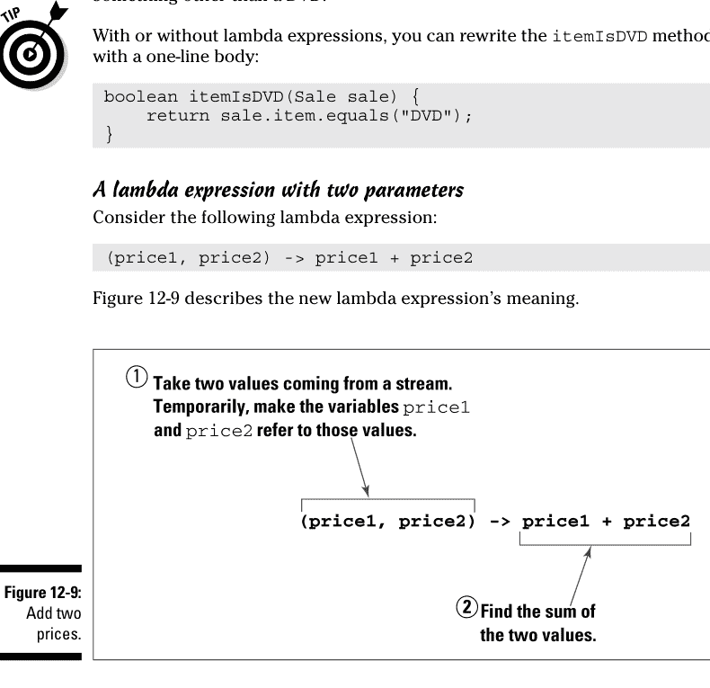

图 12-9 中的 lambda 表达式（大致）实现了以下代码的功能：

```java
double sum(double price1, double price2) {
    return price1 + price2;
}
sum(price1, price2);
```

图 12-9 中的 lambda 表达式从流中获取值，并调用类似于 `sum()` 的方法来组合这些值。结果是所有价格的总和。

### Lambda 表达式中的异类项

这里有一个趣的 lambda 表达式：

```java
(sale) -> System.out.println(sale.price);
```

这个 lambda 表达式（大致）实现了以下代码的功能：

```java
void display(Sale sale) {
    System.out.println(sale.price);
}
display(sale);
```

该 lambda 表达式对每个对象执行操作。在 `display()` 方法头中，`void` 关键字表示该方法不返回结果。当你调用 `display()` 方法（或使用等效的 lambda 表达式）时，你不期望得到一个返回值。相反，你应该期望代码在返回调用时执行某些操作（例如在计算机屏幕上显示文本）。

为了区分“返回值”和“执行某些操作”，函数式程序员为“不返回值的执行某些操作”起了一个名称。他们称之为**副作用**（side effect）。在函数式编程中，副作用被视为二等公民，是最后的手段——当你无法返回结果时使用的策略。遗憾的是，在屏幕上显示信息（在屏幕、纸上或作为杯中的茶叶）并不是纯函数式程序。

### Lambda 表达式的分类

Java 8 将 lambda 表达式分为约 45 种类别。表 12-2 列出了其中一些类别。

| 表 12-2 | 若干类 Lambda 表达式 |
| :--- | :--- |
| 名称 | 描述 | 示例 |
| Function | 接受一个参数；产生任意类型的结果 | `(sale) -> price` |
| Predicate | 接受一个参数；产生布尔结果 | `(sale) -> sale.item.equals("DVD")` |
| BinaryOperator | 接受两个相同的参数；产生相同类型的结果 | `(price1, price2) -> price1 + price2` |
| Consumer | 接受一个参数；不产生结果 | `(sale) -> System.out.println(sale.price)` |

表 12-2 中的类别并不是互斥的。例如，每个 `Predicate` 都是 `Function`。（每个 `Predicate` 都接受一个参数并返回一个结果。）

## 使用流和 lambda 表达式

Java 8 拥有巧妙利用流和 lambda 表达式的方法。通过流和 lambda 表达式，你可以创建一个优雅解决本问题的流水线。与 Listing 12-4 中的代码不同，新的流水线使用了函数式编程的概念。流水线由多个方法组成。每个方法接收数据，以某种方式转换数据，并将结果传递给线中的下一个方法。图 12-10 展示了解决本问题的流水线。

从销售集合 ...

得到流 ...

然后是流 ...

然后是 double 值流 ...

然后是一个 double 值。

图 12-10：函数式编程流水线。

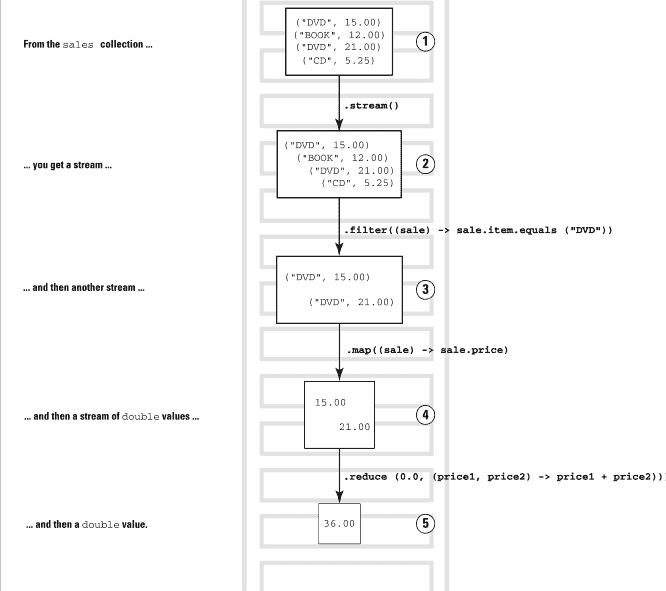

在图 12-10 中，每个框代表沿流水线转换的一批原材料。每个箭头代表一个方法（比喻地，流水线上的工人）。例如，从第二个框到第三个框的转换，工人方法（`filter()` 方法）过滤掉了不是 DVD 的物品。想象站在第二个和第三个框之间，从流水线上移除每个物品并将其扔到地上。Java `filter()` 方法的参数是一个 `Predicate`——一个结果为布值的 lambda 表达式。（参见表 12-2 和 12-3。）图 12-10 中的 `filter()` 方法过滤掉了未通过 lambda 表达式测试的物品。为了理解表 12-3 第三列中的词（`Predicate`、`Function` 和 `BinaryOperator`），请参见前面的章节“Lambda 表达式的分类”。


表 12-3 某些函数方法

| 方法名称 | 属于 | 参数(s) | 结果类型 | 结果值 |
| :--- | :--- | :--- | :--- | :--- |
| `stream()` | `Collection`（例如 `ArrayList` 对象） | （无） | `Stream` | 输出集合元素的流 |
| `filter()` | `Stream` | `Predicate` | `Stream` | 包含 lambda 返回 `true` 的值的流 |
| `map()` | `Stream` | `Function` | `Stream` | 包含将 lambda 表达式应用于输入流的结果的新流 |
| `reduce()` | `Stream` | `BinaryOperator` | 二进制运算符使用的类型 | 输入流中所有值组合的结果 |

在图 12-10 中，在从第三个框到第四个框的转换中，工人方法（`map()` 方法）从每个销售中提取出价格。准确地说，流水线只包含价格值。

更精确地说，Java 的 `map()` 方法接收如下 `Function`：

```java
(sale) -> sale.price
```

并将该 `Function` 应用于流中的每个值。（参见表 12-2 和 12-3。）因此，图 12-10 中的 `map()` 方法接收输入的 `sale` 对象流并创建一个价格值的输出流。

在图 12-10 中，在从第四个框到第五个框的转换中，工人方法（`reduce()` 方法）相加 DVD 销售的价格。Java 的 `reduce()` 方法接收两个参数：

- 第一个参数是初始值。
- 在图 12-10 中，初始值为 `0.0`。
- 第二个参数是 `BinaryOperator`。（参见表 12-2 和 12-3）

在图 12-10 中，`reduce()` 方法的 `BinaryOperator` 是：

```java
(price1, price2) -> price1 + price2
```

`reduce()` 方法使用其 `BinaryOperator` 组合输入流中的值。初始值作为所有组合的起点。因此，在图 12-10 中，`reduce()` 方法执行了两次加法。（参见图 12-11。）

作为对比，想象调用方法

```java
reduce(10.0, (value1, value2) -> value1 * value2)
```

带有值包含 `3.0`、`2.0` 和 `5.0` 的流。

结果的操作如图 12-12 所示。


## 第 12 章：使用集合和流（当数组不够用时）

你可能听过 Google 的 `MapReduce` 编程模型。该编程模型的名称与 Java 方法名 `map` 和 `reduce` 之间的相似性并非偶然。

整体来看，图 12-10 所示的整个流水线汇总了 DVD 的价格。列表 12-5 包含一个使用图 12-10 中流和 lambda 表达式的程序。

### 列表 12-5：过函数式的生活

```java
import java.text.NumberFormat;
import java.util.ArrayList;

public class TallySales {

    public static void main(String[] args) {
        ArrayList<Sale> sales = new ArrayList<Sale>();
        NumberFormat currency = 
            NumberFormat.getCurrencyInstance();
        System.out.println(currency.format(
            sales.stream()
            .filter((sale) -> sale.item.equals("DVD"))
            .map((sale) -> sale.price)
            .reduce(
                (0.0, (price1, price2) -> price1 + price2))));

        static void fillTheList(ArrayList<Sale> sales) {
            sales.add(new Sale("DVD", 15.00));
            sales.add(new Sale("Book", 12.00));
            sales.add(new Sale("DVD", 21.00));
            sales.add(new Sale("CD", 5.25));
        }
    }
}
```

列表 12-5 中的**粗体代码**是一个大的 Java 语句。该语句是方法调用的序列。每个方法调用都返回一个对象，而每一个此类对象都是下一个方法调用中的前一个对象。这就是你构建流水线的方式。

例如，在粗体代码的开头，名称指向一个 `ArrayList` 对象。每个 `ArrayList` 对象都有一个 `stream` 方法。因此在列表 12-5 中，`sales.stream()` 是对该 `ArrayList` 对象的 `stream` 方法的调用。

该流方法返回 Java `Stream` 类的实例。（真让人惊喜！）`sales.stream()` 指向一个 `Stream` 对象（见图 12-13）。

```
sales.stream().filter((sale) -> sale.item.equals("DVD"))
// 一个集合 (一个 ArrayList)
// 一个流（移除了所有非 DVD 销售})
```

图 12-13：获取所有 DVD 销售。

每个 `Stream` 对象都有一个 `filter` 方法。`sales.stream().filter((sale) -> sale.item.equals("DVD"))` 是对 `Stream` 对象的 `filter` 方法的调用。（参考图 12-14）。

模式继续。`Stream` 对象的 `map` 方法返回另一个 `Stream` 对象 —— 一个包含价格的流对象。你对这个价格流应用 `reduce` 方法，它会产生一个 `double` 值 —— DVD 价格的总和。（见图 12-15）。

```java
sales.stream().filter((sale) -> sale.item.equals("DVD")).map((sale) -> sale.price)
// 一个流（移除了所有非 DVD 销售})
// 一个价格的流
```

图 12-14：从每个 DVD 销售中获取价格。

```java
sales.stream().filter((sale) -> sale.item.equals("DVD")).map((sale) -> sale.price).reduce(0.0, ...)
// 一个价格的流
// 总价格
```

图 12-15：获取所有 DVD 销售的总价格。

## 为什么要费劲呢？

列表 12-5 中的方法调用链完成了列表 12-4 中循环所完成的所有工作。但图 12-15 中的代码使用了函数式编程的概念。那么，这有什么意义呢？相比于列表 12-4，使用列表 12-5 是否更好？

是的，更好。在过去的几年里，芯片设计的大趋势是多核处理器。由于有了多个核心，处理器可以同时执行多条语句，将程序的执行速度提高 2 倍、4 倍甚至更多。如果将工作分配到几个核心上，程序运行会快得多。你如何分配工作呢？

你可以修改列表 12-4 中的命令式代码。例如，通过一些高级特性，你可以处理循环迭代到不同的核心上。生成的代码非常混乱。为了让代码正常工作，你必须对循环迭代进行微细管理，仔细检查以确保最终总和是正确的。

相比之下，函数式代码非常容易修改。为了利用多核处理器的，你只需要更改列表 12-5 中的一个单词！

并行流（parallel stream）类似于普通流，不同之处对象不是按任何特定顺序处理。并行流的值互不依赖，因此你可以同时处理多个值。如果你的处理器具有多个核心（现在的大多数处理器都是如此），你就可以将流的值分配到可用的核心上。每个核心独立工作，每个核心都将其结果丢入一个最终的计数中。`reduce` 方法将各个核心的结果合并为最终计数，你的答案将以极快的速度计算出来。这对所有人都是双赢。

## 方法引用

仔细观察列表 12-5 中的最后一个 lambda 表达式：

```java
(price1, price2) -> price1 + price2
```

### 没有变量？没问题！

考虑共享数据。在命令式编程中，变量是语句存储值的地方。如果两个核心尝试同时修改同一个变量，就会出现问题。在函数式编程中，变量是语句共享值的地方。但当你进行函数式编程时，你甚至不需要存储值。

在命令式编程中，变量是语句共享值的地方。在命令式编程中，变量是语句共享值的地方。但当你进行函数式编程时，你甚至不需要存储值。

比较列表 12-4 中的循环与列表 12-5 中的函数式代码。在列表 12-4 中，总和由所有循环共享。由于每次迭代都可能改变总和的值，你不能将每次迭代分配给不同的核心。如果你这样做，就会面临两个核心同时更新总和的风险。

这个表达式的工作与 `sum` 方法大致相同。（事实上，你可以在之前的“Lambda 表达式”部分找到 `sum` 方法的声明。）如果你必须在三行的 `sum` 方法和输入一个一行的 lambda 表达式之间做出选择，你可能会选择 lambda 表达式。但正如命运所愿，Java 8 有一个名为 `Double` 的类。`Double` 类包含一个静态 `sum` 方法。你不需要自己创建 `sum` 方法。如果你运行以下代码：

```java
double i = 5.0, j = 7.0;
System.out.println(Double.sum(i, j));
```

计算机会显示 12.0，因此在列表 12-5 中，你不需要输入 `price + price2` lambda 表达式，你可以创建一个方法引用（method reference） —— 一个引用现有方法的表达式。

```java
sales.stream()
    .filter((sale) -> sale.item.equals("DVD
```

表达式 `Double::sum` 指向属于 Java `Double` 类的 `sum` 方法。当你使用这个 `Double::sum` 方法引用时，你做的与列表 12-5 中最后一个 lambda 表达式相同。大家都开心。

有关静态方法的信息，请参阅第 10 章。

Java 的 `Double` 类与我在第 11 章描述的 `Integer` 类相似。`Double` 类具有处理 `double` 值的方法和其他工具。


## 第 13 章

## 当意外状况发生时保持从容

**本章内容**

- 从错误输入和其他糟糕状况中恢复
- 让你的代码（在多大程度上）具有防崩溃能力
- 定义你自己的异常类

1945年9月9日：一只飞蛾飞入了哈佛 Mark II 计算机的一个继电器中，导致所有设备运行卡死。这构成了历史上第一个有案记录的真实计算机“虫虫”（bug）案例。

1957年4月20日：匹兹堡威斯豪（Westhouse）数据处理中心经理赫尔伯特·布莱特（Herbert Bright）在邮件中收到了一叠没有标记的计算机打字卡（这就像今天在邮寄中收到一张没有标签的 CD-ROM）。布莱特先生猜测这叠卡片来自 FORTRAN 的开发团队——第一种计算机编程语言。（当时还没有网络下载可用。）

布莱特仅凭这一个准确的猜测就武装出发，编写了一个短小的 FORTRAN 程序，并尝试在他的 IBM 704 上进行编译。IBM 704 位于一个特制的 2000 平英尺房间内。由于使用的是电子管而非晶体管，该机器拥有惊人的 32K RAM。（在每个程序运行之前，必须从磁带加载操作系统，一个典型的程序运行需要二到四小时。）在经过惯常的等待时间后，布莱特编译 FORTRAN 程序的尝试返回了一个单一错误——其中一条语句中缺少一个逗号。布莱特修正了错误，程序运行得如丝般滑。

1962年7月22日：水手 1 号（Mariner I）是美国首个旨在另一个行星的航天器，在发射四分钟后表现异常时被摧毁。这种异常归因于火箭速度公式中缺少了一个横杠（类似于连字符）。

大约同一时间，美国航空航天局（NASA）的轨道计算软件被发现包含错误的语句 `DO 10 I=1.10`（正确的应该是 `DO 10 I=1,0`）。在现代表示法中，这就像是用 `doi10i = 1.10` 代替了 `for (int i=1; i<=10; i++)`。从逗号到句点的变化变成了一个赋值语句。

2000年1月：2000年问题给现代世界造成了混乱。

这些笔记中历史准确的事实借自以下来源：Computer Folklore 新闻小组组（https://groups.google.com/forum/alt.folklore.computers）、计算机自由线路词典（http://foldoc.org）、《Computer Now》杂志中的“回顾过去”专栏（http://www.computer.org/portal/web/computingnow/）以及 IEEE 的网页（www.computer.org）。

## 处理异常

你正在进行盘点。这意味着要一个接一个地、一个箱接一个箱地计算物品，并在日志表、小型手持设备和计算机键盘上标记这些数字。项目的一个特定部分涉及输入你在“自第一年以来未开启的忙碌箱”架上发现的箱子数量。为了不打破公司几十来的习惯，你决定不打开这些箱子的任何一个。干脆给每个箱子随机分配 $3.25 的值。

列表 13-1 显示了处理这部分盘点的软件。该软件有一个缺陷，如图 13-1 所示。当用户输入整数值时，一切正常。当用户输入其他内容（如数字 3.5）时，程序就会彻底崩溃。对此显然可以做些什么。计算机是愚蠢的，但它们并没有愚蠢到在用户输入不当值时就表现得如此惨败。

### 列表 13-1：数箱子

```java
import java.lang.System.out;
import java.util.Scanner;
import java.text.NumberFormat;

public class InventoryA {
    public static void main(String args[]) {
        final double boxPrice = 3.25;
// ... (此处省略代码部分，根据要求不翻译代码)
```

一个完整的 try-catch 组合——包含 try 子句、catch 子句以及你拥有的内容——被称为 try 语句。有时，为了强调，我将其称为 try-catch 语句。


### catch 子句中的参数

看一眼列表 13-2 中的 catch 子句，特别注意这些词（`NumberFormatException e`）。这看起来非常像方法的参数列表，不是吗？事实上，每个 catch 子句都像一个小型的*微型方法*，它有自己的参数列表。参数列表始终包含一个名称和一个参数。

在 13-2 中，我没有对 catch 子句的 `e` 执行任何操作，但如果我想要的话，我完全可以这样做。抛出的异常是一个对象——`NumberFormatException` 类的的一个实例。当异常被捕获时，计算机会建立 catch 子句对该异常对象的引用。它存储了关于异常的信息。换句话说，名称 `e` 存储了大量关于异常的信息。为了利用这一点，你可以调用该异常的一些方法。

```java
catch (NumberFormatException e) {
    out.println("Message: \"" + e.getMessage() + "\"");
    e.printStackTrace();
}
```


# 第 13 章：当意外发生时保持体面

有了这个 `catch` 子句，库存程序的运行可能就像图 13-4 所示的运行。当你调用 `getMessage()` 时，你获取了关于异常的一些细节。（在图 13-4 中，细节是 Message: *For input string: "three"*）。当你调用 `printStackTrace()` 时，你获得了一些额外信息；即一个显示在异常抛出瞬间正在运行的方法列表。（在图 13-4 中，显示包含了 `Integer.parseInt` 和 `main` 方法。）`getMessage` 和 `printStackTrace` 均提供了帮助你找到程序困难源头的信息。

| 图 13-4 | 我们有多少个箱子？ |
| :--- | :--- |
| | Message: *For input string: "three"* |
| | at java.lang.NumberFormatException.forInputString(Unknown Source) |
| | at java.lang.Integer.parseInt(Unknown Source) |
| | at java.lang.Integer.parseInt(Unknown Source) |
| | at java.Inventory.main(String[] args) |

当你将 `System.out.println` 调用与 `printStackTrace` 混合时，Java 显示信息的顺序是不可预测的。例如，在图 13-4 中，文本 Message: ***For input string: "three"*** 可能会出现在堆栈跟踪之前，也可能出现在之后。如果此输出的顺序对你很重要，请将 `out.println("Message: ****")` 更改为 `System.err.println("Message: ****");`。


## 异常类型

那么还会出什么错？还有其他类型的异常吗——不是来自 `NumberFormatException` 类的异常？显然，存在不同的异常类型。你甚至可以自己创建一个。想试试吗？如果是的话，看列表 13-3 和 13-4。

## 列表 13-3：创建你自己的异常

```java
@SuppressWarnings("serial")
class OutRangeException extends Exception {
}
```

## 列表 13-4：使用你自定义的异常

```java
import static java.lang.System.out;
import java.util.Scanner;
import java.text.NumberFormat;

public class InventoryC {
    public static void main(String args[]) {
        final double boxPrice = 3.25;
        Scanner keyboard = new Scanner(System.in);
        NumberFormat currency = 
            NumberFormat.getCurrencyInstance();

        out.print("How many boxes do we have? ");
        String numBoxesIn = keyboard.next();

        try {
            int numBoxes = Integer.parseInt(numBoxesIn);
            if (numBoxes < 0) {
                throw new OutRangeException();
            }

            out.print("The value is ");
            out.println(
                currency.format(numBoxes * boxPrice));
        } catch (NumberFormatException e) {
            out.println("That's not a number.");
        } catch (OutOfRangeException e) {
            out.println(numBoxesIn);
            out.println(" That's impossible!");
        }

        keyboard.close();
    }
}
```

列表 13-3 和 13-4 解决了图 13-3 中出现的问题。看图 13-3 中三次运行的最后一次。用户报告货架上有 -25 个箱子，而计算机却毫不眨眼地接受了。事实是，你需要一个黑洞（或者其他某种时空扭曲现象）才能在仓库的任何货架上拥有负数量的箱子。如果用户输入负数个箱子，程序应该感到“不安”，这正是列表 13-4 中代码所做的。要看这段“不安”的代码，请看图 13-5。

| 我们有多少个箱子？ | 数值是 |
| :--- | :--- |
| 3 | $9.75 |
| fish | 那不是一个数字。 |
| -25 | 那是不可能的！ |

列表 13-3 中的代码声明了一个负数。然而，在许多情况下，输入负数应该是没问题的。列表 13-4 中的代码允许抛出任何异常。被抛出的异常是一个对象——`NumberFormatException` 类的一个实例。参数列表，不是吗？事实上，每个 `catch` 子句都像一个小型的*微型方法*，它有自己的参数列表。参数列表始终包含一个名称和一个参数。

在 13-2 中，我没有对 `catch` 子句的 `e` 执行任何操作，但如果我想要的话，我完全可以这样做。抛出的异常是一个对象——`NumberFormatException` 类的一个实例。当异常被捕获时，计算机会建立 `catch` 子句对该异常对象的引用。它存储了关于异常的信息。换句话说，名称 `e` 存储了大量关于异常的信息。为了利用这一点，你可以调用该异常的一些方法。

```java
catch (NumberFormatException e) {
    out.println("Message: \"" + e.getMessage() + "\"");
    e.printStackTrace();
}
```

有了这个 `catch` 子句，库存程序的运行可能就像图 13-4 所示的运行。当你调用 `getMessage()` 时，你获取了关于异常的一些细节。（在图 13-4 中，细节是 Message: *For input string: "three"*）。当你调用 `printStackTrace()` 时，你获得了一些额外信息；即一个显示在异常抛出瞬间正在运行的方法列表。（在图 13-4 中，显示包含了 `Integer.parseInt` 和 `main` 方法。）`getMessage` 和 `printStackTrace` 均提供了帮助你找到程序困难源头的信息。

每个 `catch` 子句，计算机会询问：“被抛出的异常是该类的一个实例吗？” (此处为：Is the exception that thrown an instance of the class?)

- 如果不是，计算机跳过此 `catch` 子句处理下一个。
- 如果是，计算机执行此 `catch` 子句并跳过所有子句。

对于具体的例子，看列表 13-5 和 13-6。

## 另一个异常

```java
@SuppressWarnings("serial")
class NumberLargeException
extends OutRangeException {
}
```

## 列表 13-6：钱在哪里停止？

```java
import static java.lang.System.out;
import java.util.Scanner;
import java.text.NumberFormat;

public class InventoryD {
    public static void main(String args[]) {
        final double boxPrice = 3.25;
        Scanner keyboard = new Scanner(System.in);
        NumberFormat currency = 
            NumberFormat.getCurrencyInstance();

        out.print("How many boxes do we have? ");
        String numBoxesIn = keyboard.next();

        try {
            int numBoxes = Integer.parseInt(numBoxesIn);
            if (numBoxes < 0) {
                throw new OutRangeException();
            }
            if (numBoxes > 1000) {
                throw new NumberLargeException();
            }

            out.print("The value is ");
            out.println(
                currency.format(numBoxes * boxPrice));
        } catch (NumberFormatException e) {
            out.println("That's not a number.");
        } catch (OutOfRangeException e) {
            out.print(numBoxesIn);
            out.println(" That's impossible!");
        } catch (Exception e) {
            out.print("Something went wrong, ");
            out.print("but I'm clueless about what ");
            out.println("it actually was was.");
        }
        out.println("That's that.");
        keyboard.close();
    }
}
```

# 第 13 章：当意外情况发生时保持体面

要运行列表 13-5 和 13-6 中的代码，你还需要一个额外的 Java 程序文件。你需要使用列表 13-3 中的 `OutRangeException` 类。

列表 13-6 处理了由于架子空间有限的场景。你没有空间存放超过 1,000 个箱子，但程序偶尔会询问你有多少个箱子，而此时有人不小心输入了数字 100000。在这种情况下，列表 13-6 会进行快速的现实性检查。任何超过 1,000 的箱子数量都会视为不现实而被丢弃。

列表 13-6 会监控 `NumberLargeException`，但为了让过程变得有趣，列表 13-6 没有为 `NumberTooLargeException` 编写 `catch` 句。尽管如此，一切仍然运行得良好。这是因为 `NumberTooLargeException` 被声明为 `OutRangeException` 的子类，而列表 13-6 有一个针对 `OutRangeException` 的 `catch` 句。

你看，`NumberTooLargeException` 是 `OutRangeException` 的子类，任何 `NumberTooLargeException` 实例都只是某种特殊的 `OutRangeException`。因此，在列表 13-6 中，计算机可能会开始寻找捕获 `NumberTooLargeException` 的语句。当计算机遇到 `OutRangeException` 的 `catch` 句时，计算机说：“我找到了一个匹配项。我将执行此 `catch` 句中的语句。”

为了避免反复编写这个故事，我们引入一些新术语：假定带有 `OutRangeException` 的 `catch` 句匹配了被抛出的 `NumberTooLargeException`。我将这个 `catch` 句称为**匹配句**（matching clause）。

接下来的项目符号描述了用户可能的操作以及计算机的响应。当你阅读这些项目符号时，可以通过图 13-6 所示的运行情况来跟踪。

| 我们有多少个箱子？ | 3 |
| :--- | :--- |
| 数值是 $9.75 | |
| 就这样了。 | |

| 我们有多少个箱子？ | fish |
| :--- | :--- |
| 那不是一个数字 | |
| 就这样了。 | |

| 我们有多少个箱子？ | -25 |
| :--- | :--- |
| 那是不可能的！ | |
| 就这样了。 | |

| 我们有多少个箱子？ | 1001 |
| :--- | :--- |
| 1001？那是不可能的！ | |
| 就这样了。 | |

图 13-6：来自列表 13-6 代码的四次运行。

用户输入了一个普通的数字，比如数字 3。`try` 句中的所有语句都执行。然后计算机跳过所有的 `catch` 句，并执行所有 `catch` 句之后紧接着的代码（见图 13-7）。

- ✔ 用户输入了一个不是整数的内容，比如单词 `fish`。代码抛出了一个 `NumberFormatException`。计算机跳过 `try` 句中剩余的语句。计算机执行第一个 `catch` 句内部的语句——参数类型为 `NumberFormatException` 的那个句。计算机跳过第二个和第三个 `catch` 句，并执行所有 `catch` 句之后的代码（见图 13-8）。

```java
try {
    // 正常处理（不抛出异常）
} catch (NumberFormatException e) {
    out.println("那不是一个数字.");
} catch (OutOfRangeException e) {
    out.println("那是不可能的!");
} catch (Exception e) {
    out.print("出问题了， ");
    out.print("但我并不清楚它 ");
    out.println("到底是什么。");
}

out.println("就这样，就这样了。");
```

图 13-7：没有抛出异常。


```java
try {
    // 出 new NumberFormatException e();

} catch (NumberFormatException e) {
    out.println("那不是一个数字.");
} catch (OutOfRangeException e) {
    out.println("那是不可能的!");
} catch (Exception e) {
    out.print("出问题了， ");
    out.print("但我并不清楚它 ");
    out.println("到底是什么。");
}

out.println("就这样，就这样了。");
```

图 13-8：抛出了一个 `NumberFormatException`。

- ✔ 用户输入了一个负数，比如数字 -25。代码抛出了一个 `OutRangeException`。计算机跳过 `try` 句中剩余的语句。计算机甚至跳过了第一个 `catch` 句中的语句（毕竟，`OutRangeException` 并不是任何 `NumberFormatException`。参数为 `NumberFormatException` 的 `catch` 句并不匹配这个 `OutRangeException`）。计算机执行第二个 `catch` 句内部的语句——参数类型为 `OutOfRangeException` 的那个句。然后计算机跳过第三个 `catch` 句，并执行所有 `catch` 句之后的代码（见图 13-9）。

```java
try {
    throw new OutRangeException();
} catch (NumberFormatException e) {
    out.println("那不是一个数字.")
} catch (OutOfRangeException e) {
    out.println("那是不可能的!")
} catch (Exception e) {
    out.print("出问题了， ")
    out.print("但我并不清楚它 ")
    out.println("到底是什么。")
}

out.println("That's that that.")
```

- ✔ 用户输入了一个巨大的数字，比如数字 1001。代码抛出了一个 `NumberLargeException`。计算机跳过 `try` 句中剩余的语句。计算机甚至跳过了第一个 `catch` 句中的语句（毕竟，`NumberLargeException` 并不是任何 `NumberFormatException`）。因此，计算机执行第二个 `catch` 句内部的语句。然后计算机跳过第三个 `catch` 句，并执行所有 `catch` 句之后的代码（见图 13-10）。

```java
try {
    throw new NumberLargeException();
} catch (NumberFormatException e) {
    out.println("那不是一个数字.")
} catch (OutOfRangeException e) {
    out.print(numBoxesIn)
    out.println("那是不可能的!")
} catch (Exception e) {
    out.print("出问题了， ")
    out.print("但我并不清楚它 ")
    out.println("到底是什么。")
}
```

图 13-10：抛出了一个 `NumberLargeException`。

- 某些其他的、不可预测的事情发生了（我不知道）。出于实验的持续冲动，我进入了列表 13-5 的 `try` 句，并添加了一个抛出 `IOException` 的语句。并没有原因——我只是想看看发生什么。

当代码抛出 `IOException` 时，计算机跳过了 `try` 句中剩余的语句。然后计算机跳过了前两个 `catch` 句。当计算机到达第三个 `catch` 句时，我能听到它说：“嗯！`Exception` 是一种 `Exception`。我找到了一个匹配句——参数为 `Exception` 的句。我将执行此 `catch` 句中的语句。”

因此，计算机执行了 `catch` 句内部的语句。然后计算机执行 `catch` 句之后的代码（见图 13-11）。

当计算机寻找匹配的 `catch` 句时，计算机锁定符合以下描述的顶部句：

- 句的参数类型与抛出的异常的类型相同。
- 句的参数类型是该异常的父类。

如果在 `catch` 句列表的后续有更好的匹配项，那就太遗憾了。例如，假设你在列表 13-6 的代码中添加了一个参数为 `NumberTooLargeException` 的 `catch` 句。同样，假设你将这个新的 `NumberTooLargeException` 句放在了参数为 `OutOfRangeException` 的 `catch` 句之后。由于 `NumberTooLargeException` 是 `OutOfRangeException` 类的子类，你新的 `NumberTooLargeException` 句中的代码永远不会被执行。这就是命运。

## 多捕获句（multi-catch clause）

从 Java 7 开始，你可以在单个 `catch` 句中捕获多种异常。例如，在一个特定的库存程序中，你可能不想区分 `NumberFormatException` 和你自己的 `OutOfRangeException` 的抛出。在这种情况下，你可以按如下重写列表 13-6：

```java
try {
    int numBoxes = Integer.parseInt(numBoxesIn);

    if (numBoxes < 0) {
        throw new OutRangeException();
    }

    if (numBoxes > 1000) {
        throw new NumberTooLargeException();
    }
}
```

### 314 第四部分：精通 Java 技巧

```java
out.print("The value is ");
out.println(
    currency.format(numBoxes * boxPrice));
);
```

```java
catch (NumberFormatException | OutOfRangeException e) {
    out.print(numBoxesIn);
    out.println(" That's impossible!");
}
```

```java
catch (Exception e) {
    out.print("Something went wrong, ");
    out.print(" I'm clueless about what ");
    out.println("it actually was.");
}
```

管道符号 `|` 允许 Java 捕获 `NumberFormatException` 或 `OutOfRangeException`。如果你抛出了其中一种类型的异常，程序将显示 `numBoxesIn` 的值，随后是文本“That's impossible!”。如果你抛出的既不是 `NumberFormatException` 也不是 `OutOfRangeException` 的异常，程序将跳转到最后一个 `catch` 子句并显示“something went wrong, but I'm clueless...”。

### 让 catch 随风而去

你是那种强迫症类型的人吗？你喜欢在异常可能导致你的程序崩溃之前，捕获每一个可能的异常吗？嗯，Java 不允许你变得偏执。如果异常没有发生的可能，你就无法捕获它。

考虑以下代码。在 `try` 子句内部有一个非常无辜的 `i++` 语句。这很合理。但随后代码的 `catch` 子句在假装捕获 `IOException`。

```java
// Bad code!
try {
    i++;
} catch (IOException e) {
    e.printStackTrace();
}
```

这个 `catch` 子句试图给谁留下印象？像 `i++` 这样的语句没有任何输入或输出。`try` 子句内部的代码不会抛出 `IOException`。因此，编译器过来说：“嘿，`catch` 子句。面对现实吧。别在那摆架子了。”嗯，更准确地说，编译器的斥责如下：

```
java.io.IOException is never thrown in body of
    corresponding try statement
```

### 第 13 章：当意外发生时保持体面

#### 做些有用的事情

到为止，本章中的每个示例都捕获一个异常，打印“bad input”消息，然后就此收工。如果能看到一个程序在捕获异常后实际上继续运行，那不是很好吗？嗯，是时候尝试新东西了。列表 13-7 在循环内部有一个 `try-catch` 语句。循环一直运行直到用户输入某些合理的内容。

#### 列表 13-7：继续坚持

```java
import static java.System.out;
import java.util.Scanner;
import java.text.NumberFormat;

public class InventoryLoop {
    public static void main(String[] args[]) {
        final double boxPrice = 3.25;
        boolean gotInput = false;
        Scanner keyboard = new Scanner(System.in);
        NumberFormat currency =
        NumberFormat.getCurrencyInstance();

        do {
            out.println("How many boxes do we have? ");
            String numBoxesIn = keyboard.next();

            try {
                int numBoxes = Integer.parseInt(numBoxesIn);
                out.println("The value is ");
                out.println((currency.format(numBoxes * boxPrice)));
                gotInput = true;
            } catch (NumberFormatException e) {
                out.println();
                out.println("That's not a number.");
            }
        } while (!gotInput);

        out.println("That's that.");

        keyboard.close();
    }
}
```

图 13-12 显示了列表 13-7 代码的运行。在前三次尝试中，用户输入了除了整数以外的所有内容。最后，第四次尝试成功了。用户输入 3，计算机离开了循环。

| How many boxes do we have? | 3.5 |
| :--- | :--- |
| That's not a number. | |
| How many boxes do we have? | three |
| That's not a number. | |
| How many boxes do we have? | fish |
| That's not a number. | |
| How many boxes do we have? | 3 |
| The value is $9.75 | |
| That's that | |

**图 13-12：列表 13-7 代码的运行。**

#### 我们的朋友，良好的异常

有一种传言在说，Java 异常总是来自不希望的、错误的情况。虽然这个传言有些事实依据，但它并不完全准确。偶尔，异常产生于正常的、预期的事件。例如，对文件结束的检测。以下代码创建了文件的副本：

```java
try {
  while (true) {
    dataOut.writeByte(dataIn.readByte());
  } catch (EOFException e) {
    numFilesCopied = 1;
}
```

为了从 `dataIn` 拷贝字节到 `dataOut`，你进入一个 `while` 循环。由于其条件为真，`while` 循环似乎是无尽的。但最终你会到达 `dataIn` 文件的结尾。当 `readByte()` 方法抛出 `EOFException`（文件结束异常）时，异常会让计算机离开 `try` 子句并离开 `while` 循环。在那里你在 `catch` 子句中执行你想做的操作，然后继续正常处理。

#### 处理异常还是推卸责任

所以你正在了解 Java，对吧？什么？你说你已经读到了第 13 章？我印象深刻了。你一定是个勤奋的人。但记住，工作之余也要玩耍……

### 第 13 章：当意外发生时保持体面

所以，休息一下怎么样？睡个小觉对你大有益处。十秒钟可以吗？或者太长了？最好设为五秒钟。

列表 13-8 有一个程序，旨在暂停执行五秒钟。问题是列表 13-8 中的程序是错误的。看一眼列表 13-8，稍后告诉你问题在哪里。

#### 列表 13-8：一个错误的程序

```java
/*
* 代码无法编译。 */
import static java.System.out;
public class NoSleepForTheWeary {

    public static void main(String args[]) {
        out.print("Excuse me while I nap ");
        out.println("for five seconds...");

        takeANap();

        out.println("Ah, that was refreshing.");
    }

    static void takeANap() {
        Thread.sleep(5000);
    }
}
```

未处理的异常类型 `InterruptedException`

无论如何，这个消息都是不受欢迎的。

#### 318 第四部分：精通 Java 技巧

为了理解异常，你不需要确切知道 `InterruptedException` 是什么。你真正需要知道的是 `sleep` 可以抛出它。但如果你好奇，`InterruptedException` 是某些代码中断某些代码时产生的。想象你有两段代码同时运行。一段代码调用 `sleep` 方法。与此同时，另一段代码调用 `interrupt` 方法。通过调用 `interrupt` 方法，第二段代码中断了第一段代码的 `Thread.sleep` 方法。该方法通过抛出一个 `InterruptedException` 来响应。

现在，Java 编程语言有两种异常。它们被称为检查异常和未检查异常：

- 可能抛出的检查异常必须被确认
- 可能抛出的未检查异常不需要在代码中被确认

`InterruptedException` 是 Java 的检查异常类型之一。当你调用一个可能抛出 `InterruptedException` 的方法时，你需要在代码中确认这一点。

现在，当我说异常在代码中被确认时，我指的是什么？

```java
// 作者想要感谢那个 InterruptedException，
// 没有它，这段代码无法编写。
```

不，那不是在代码中确认异常的意思。在代码中确认异常意味着两种情况之一：

- 可能抛出异常的语句（包括方法调用）位于 `try` 子句内部。该子句有一个在参数列表中包含匹配异常类型的 `catch` 子句。
- 可能抛出异常的语句（包括方法调用）位于一个方法内部，该方法头部有一个 `throws` 子句。`throws` 子句包含匹配的异常类型。

如果你对这两个项目中的措辞感到困惑，不要担心。接下来两个列表说明了这些项目中的观点。

在列表 13-9 中，可能抛出 `InterruptedException` 的方法调用位于 `try` 子句内部。该子句有一个异常类型为 `InterruptedException` 的 `catch` 子句。

### 第 13 章：当情况发生意外变化时保持体面

#### 列表 13-9：使用 try-catch 语句确认异常

```java
import static java.lang.System.out;
public class GoodNightsSleepA {
    public static void main(String[] args[]) {
        out.print("Excuse me while I nap ");
        out.println("for just five seconds...");
        takeAnap();
        out.println("Ah, that was refreshing.");
    }
    static void takeAnap() {
        try {
            Thread.sleep(5000);
        } catch (InterruptedException e) {
            out.println("Hey, who woke me up?");
        }
    }
}
```


在节章节的此处，提醒你某列表的运行结果显示在某图中是本书的惯例。但问题是，图 13-13 并不能说明列表 13-9 中的代码逻辑。当你运行列表 13-9 中的程序时，电脑会打印“Excuse me while I nap for just five seconds”（请打扰一下，我要睡五秒钟），暂停五秒，然后显示“Ah, that was refreshing”（啊，真清醒）。代码之所以能工作，是因为可能会抛出 `InterruptedException` 的 `sleep` 方法调用位于一个 `try` 子句内部。该 `try` 子句有一个 `catch` 子句，其异常类型为 `Exception`。

图 13-13：有五秒钟的暂停“Excuse me while I nap for just five seconds... Ah, that was refreshing.”

使用 try-catch 语句确认异常就到此。你可以通过另一种方式确认异常，如列表 13-10 所示。

## 第四部分：精通 Java 技术

### 列表 13-10：使用 throws 确认异常

```java
import static java.lang.System.out;
public class GoodNightsSleep {

    public static void main(String args[]) { 
        try {
            out.print("Excuse me I nap ");
            out.println("for just five seconds...");
            takeAnap();
        } catch (InterruptedException e) {
            out.println("Hey, who woke me up?");
        }
        out.println("Ah, that was refreshing.");
    }

    public static void takeAnap() throws InterruptedException {
        Thread.sleep(5000);
    }
}
```

要查看列表 13-10 中的运行代码，请参考图 13-13。再次，图 13-13 未能捕捉到运行的本质，但没关系。只需记住在图 13-13 中，电脑在显示“Ah, that was refreshing.”之前会暂停五秒。

列表 13-10 的重要部分在于 `takeAnap` 方法的头部。该头部以 `throws InterruptedException` 结尾。通过声明它会抛出一个 `InterruptedException`，`takeAnap` 方法推卸了责任。这个子句真正的意思是：“我意识到这个方法中的某个语句可能会抛出 `InterruptedException`，但我不想在 try-catch 语句中确认异常。Java 编译器，请不要在这个上纠结。我没有使用 try-catch 语句，而是将确认异常的责任交给了方法（即调用 `takeAnap` 方法的方法）。”

事实上，在 `main` 方法中，对 `takeAnap` 的调用位于一个 `try` 子句内部。该 `try` 子句有一个参数类型为 `Exception` 的 `catch` 子句。因此，一切正常。`takeAnap` 方法将责任交给了 `main` 方法，而 `main` 方法通过适当的 try-catch 语句接受了这一责任。大家都很开心。甚至 Java 编译器也很开心。

为了更好地理解 `throws` 子句，想象一场排球比赛，排球就是异常。当对方球员发球时，该球员正在抛出异常。球越过网直接飞向你。如果你把球传回过网，你就在捕获异常。如果你把球传给另一个球员，你就使用了 `throws` 子句。

### 使用 finally 完成工作

#### 列表 13-11：跳转

```java
import static java.lang.System.out;
public class DemoFinally {
    public static void main(String[] args[]) {
        try {
            doSomething();
        } catch (Exception e) {
            out.println("Exception caught in main.");
        }
    }

    static void doSomething() {
        try {
            out.println(0 / 0);
        } catch (Exception e) {
            out.println("Exception caught in doSomething.");
        }
        finally {
            out.println("I'll get printed.");
        }
    }
}
```

## 324 第四部分：精通 Java 技术

图 13-14：运行列表 13-11 中的代码。

> 在 doSomething 中捕获到异常。我将被打印

在 `catch` 句中，那个低劣的 `doSomething` 方法再次将 0 除以 0，这个语句说明除法并不是保护性的 `try` 句。这没关系，因为 `ArithmeticException` 不是受检查异常。它是 `RuntimeException` 的子类之一。它是一种不需要在 `try` 或 `throws` 句中确认的异常。详情请参见上一节。

无论，无论是否受检查异常，抛出另一个 `ArithmeticException` 都会导致控制跳出 `doSomething` 方法。但在离开之前，计算机执行了该语句的最后遗嘱——即 `finally` 句中的语句。这就是为什么在图 13-14 中你看到了“我将被打印”这几个字。

有趣的是，你并没有在图 13-14 中看到“我将不会打印”这些字。因为 `catch` 句的执行抛出了它自己的未被捕获的异常，计算机从未执行完 `try-catch-finally` 语句。

所以，计算机回到了它在 `main` 方法离开的地方。回到 `main` 方法中，`doSomething` 方法的 `ArithmeticException` 不匹配导致执行跳入一个 `catch` 句。计算机打印 `Exception caught in main`，然后这场糟糕的噩梦般的运行结束了。

### 带有资源的 try 语句

想象一个从两个不同的文件或从一个 `Scanner` 和磁盘文件获取输入的程序。为了确保你妥善地清理，你将 `close` 方法调用放在 `finally` 句中。（参见列表 13-12）

## 第 13 章：当事情发生意外转折时保持良好 325

#### 列表 13-12：使用两个文件

```java
import java.io.File;
import java.io.IOException;
import java.util.Scanner;

public class Main {
    public static void main(String[] args) {
        Scanner scan1 = null;
        Scanner scan2 = null;
        try {
            scan1 = new Scanner(new File("File1.txt"));
            scan2 = new Scanner(new File("File2.txt"));
            // 执行一些操作
        } catch (IOException e) {
            // 哎！
        } finally {
            scan1.close();
            scan2.close();
            System.out.println("Done!");
        }
    }
}
```

在理论上，无论执行 `try` 句期间发生了什么错误，计算机始终会执行 `scan1.close()` 和 `scan2.close()`。但那只是理论。在现实中，另一个程序员（当然不是你）可能会通过在 `try` 句中间途中关闭 `scan1` 来修改代码：

```java
try {
    scan1 = new Scanner(new File("File1.txt"));
    scan2 = new Scanner(new File("File2.txt"));
    // 执行一些操作但 ...
    scan1.close();
    scan1 = null;
} catch (IOException e) {
    // 哎！
} finally {
    scan1.close();
    scan2.close();
    System.out.println("Done!");
}
```

## 326 第四部分：精通 Java 技术

现在你有了一个真实的谓言。在 `finally` 句中，`scan1` 的值为 `null`。对 `scan1.close()` 的调用失败，程序抛出 `NullPointerException` 并在到达 `scan2.close()` 调用之前停止运行。在糟糕的情况下，`scan2` 没有被关闭，你的程序导致 `File2.txt` 被锁定，使得其他程序无法使用该文件。

当一个程序使用多个资源（许多文件、一个数据库和一个文件，或其他任何）时，`try` 语句的堆积变得非常复杂。你可以创建带有 `catch` 句和各种疯狂组合的 `try` 语句。但 Java 有更好的解决问题的方法。在 Java 7（以及后续更高版本）中，你可以创建一个 `try-with-resources` 语句。列表 13-13 向你展示了如何做。

#### 列表 13-13：确保关闭资源

```java
import java.io.*;
import java.io.IOException;
import java.util.Scanner;

public class NewMain {
    public static void main(String[] args[]) {
        try (Scanner scan1 = 
                new Scanner (new File("File1.txt"));
             Scanner scan2 =
                new Scanner (new File("File2.txt"))) {
            // 执行一些操作
        } catch (IOException e) {
            // 哎！
        }
        System.out.println("Done!");
    }
}
```

在 13-13 中，`scan1` 和 `scan2` 的声明位于 `try` 关键字后的括号内。括号内的声明让 Java 在执行完 `try` 句中的语句后自动关闭 `scan1` 和 `scan2`。你可以在一个 `try` 语句的括号内声明多个资源。当你这样做时，Java 在执行完 `try` 句的语句后会自动关闭所有资源。如果你需要，可以添加 `catch` 句和 `finally` 句。你可以访问各种资源（文件、数据库、服务器连接等），并由于知道 Java 会处理一切而心无无虑。

生活很美好。

## 第 14 章

### 在 Java 程序部分之间共享名称

- 本章内容
- 向其他类隐藏名称
- 向其他类暴露名称
- 调整你的代码以找到合适的中间点

提到私有字段和方法（我在本章中会提到这些内容）……

我正在和公司里的几个同事吃午饭。“他们可以读你的电子邮件，”一位同事说。另一人插道，“他们知道你访问的每一个网站。他们知道你买了什么产品，晚饭吃什么，穿什么，想什么。他们知道你最深层、最阴暗的秘密。如果他们知道你什么时候死，我不会感到惊讶。”

第三个声音加入了战斗。“现在已经到了这种地步，你擓涕都会有人做记录。我几周前访问了一个网站，那个页面祝我生日快乐。他们怎么知道我生日的？”

“是的，”第一个男的说，“我车上有一个标签，可以让我通过过收费站。它会自动扣除我的信用卡费用。每个月，我都会收到一份我去过哪里以及什么时候列表。”

## 328 第四部分：精通 Java 技术

在发送垃圾邮件时直接。“你好，这是给 Larry 的电话。Larry 在家吗？” 窥视他人真的很无聊。我能看到《纽约时报》头版上的标题：“Java 傻龟作者衬衫穿反了！大惊奇！”

所以我想了几秒，然后说：“他们要对付我们。摄像头！下一个大趋势——摄像头。”

### 访问修饰符

如果你读过《Java 傻龟》第6版，你可能知道一件事：面向对象的编程非常注重隐藏细节。编写一段代码的程序员不应该动另一个程序员代码内部的细节。这并不是安全和机密问题，而是模块化问题。当你隐藏细节时，可以防止代码内部的复杂性被另一段代码扭曲和破坏。你的代码以良好的、独立的、易管理的块呈现。你将复杂度降到最低。你犯的错误更少。其他章节有很多私有字段使用的示例。当一个字段被声明时，它对所有外部都是隐藏的。这种隐藏增强了模块化，最小化了复杂度，等等。

在《Java 傻龟》第6版的其他地方，还有声明为公有的东西的示例。就像名人一样，声明为公有的字段是完全开放的。许多人可能知道 Elvis 用什么牌牙膏，任何程序员都可以引用公有字段，即使它不是 Elvis。

### 类、访问与多部分程序

通过这个主题，你可能会陷入术语的迷宫中，因此你需要先掌握一些基础知识。（你大部分需要的术语来自第 10 章，但在本章开头回顾一下是有值得的。）

这里有一段虚的 Java 代码：

```java
class MyClass {
    int field; // 一个字段 (field)
    // (成员)

    void mydict() { // 一个方法 (另一个成员)
        int myField; // 一个方法局部变量
        // (不是成员)
    }
}
```

代码右侧的注释说明了所有情况。这里存在两种变量：字段（fields）和方法局部变量。这一章并不简单，它是关于方法和字段的。

相信我，无论去哪里都带着“方法和字段”这个短语是不容易的。最好给这些东西起一个统一的名字并完结它。这就是为什么方法和字段被称为类的成员（members）。

#### 成员与类

到这里，你做了一个重要的区分。思考 Java 的 `public` 关键字。你可能已经从之前的章节中知道，你可以在成员前面加上 `public`。例如，你可以这样写：

```java
public static void main(String[] args) {

```
或
```java
public int amountInAccount = 50.22;
```

这些 `public` 关键字的用法并不意外。你可能还不知道的是，你可以在类前面加上 `public` 关键字。例如，你可以这样写：

```java
public class Drawing {
    // 你的代码在这里
}
```

在 Java 中，`public` 关键字有两个略不同的含义——一个适用于成员，另一个适用于类。本章的大部分内容都在讨论 `public`（以及其他关键字）成员的含义。本章的最后部分（标题为“Java 类的访问修饰符”）处理的是类的含义。

#### 成员的访问修饰符

当然，这是关于成员的。但并不意味着你可以忽略类。无论是不是成员，Java 类仍然所有操作发生的地方。每个字段都在特定的类中声明，属于该类，并且是该类的成员。方法也是如此。每个方法都在特定的类中声明，属于该类，并且是该类的成员。你可以在代码中使用某个成员名称吗？为了回答这个问题，请检查该位置是在成员类的内部还是外部：

- 如果成员是 `private` 的，只有成员类内部的代码才能直接引用该成员的名称。

```java
class SomeClass {
    private int myField = 10;
}

class SomeObjectClass {
    public static void main(String args[]) {
        SomeClass someObject = new SomeClass();

        // 这行行不起通：
        System.out.println(someObject.myField);
    }
}
```

- 如果成员是 `public` 的，任何代码都可以直接引用该成员的名称。

```java
class SomeClass {
    public int myField = 10;
}

class SomeOtherClass {
    public static void main(String args[]) {
        SomeClass someObject = new SomeClass();
        // 这行可以工作：
        System.out.println(someObject.myField);
    }
}
```

图 14-1 到 14-3 以稍微不同的方式阐了这些思想。

| class1 | classA | classX |
| --- | --- | --- |
| class2 extends class1 | classB extends classA | classY extends classX |
| class3 extends class2 | classC extends classB | classZ extends classY |

图 14-1：若干个类及其子类。

| class1 | classA | classX |
| --- | --- | --- |


| class2 extends class1 | classB extends classA public field | classY extends classX |
|---|---|---|
| class3 extends class2 | classC extends classB | classZ extends classY |

图 14-2：`public` 字段或方法可以使用的代码范围。

| class1 | classA | classX |
|---|---|---|
| class2 extends class1 | classB extends classA private field | classY extends classX |
| class3 extends class2 | classC extends classB | classZ extends classY |

图 14-3：`private` 字段或方法可以使用的代码范围（阴影部分）。

## 在框架上绘制

为了清楚访问修饰符的这些，你需要几个示例。在本章的第一个示例中，几乎一切都是 `public` 的。有了 `public` 访问权限，你不需要担心谁可以使用它。

第一个示例的代码分为几部分。第一部分（代码 14-1）显示一个 `ArtFrame`。在 `ArtFrame` 之上是一个 `Drawing`。如果所有部分都就绪，运行代码 14-1 将显示一个如图 14-4 所示的窗口。

### 代码 14-1：显示框架

```
import com.bbrain.drawings.Drawing;
import com.bbrain.frames.ArtFrame;

class ShowFrame {
    public static void main(String args[]) {
        ArtFrame artFrame = new ArtFrame();

        artFrame.setSize(200, 100);
        artFrame.setVisible(true);
    }
}
```

创建了一个新的 `ArtFrame`。你可能怀疑 `ArtFrame` 是 Java 类的子类，事实确实如此。第 9 章说 Java 框架默认情况下是不可见的。因此，在代码 14-1 中，使用 `setVisible` 方法使 `ArtFrame` 实例可见。

现在，代码 14-1 以两个 `import` 声明开头。第一个 `import` 声明允许你使用来自 `com.bbrain.drawings` 包的 `Drawing` 名称。第二个 `import` 声明允许你使用来自 `com.bbrain.frames` 的 `ArtFrame` 名称。

侦探可能会想：“他一定写了更多代码（在这里没看到的），并将这些代码放在 `com.bbrain.drawings` 和 `com.bbrain.frames` 包中。”确实，你是的。为了让代码 14-1 工作，我创建了一个名为 `Drawing` 的东西，并将所有的绘制放在 `com.bbrain.drawings` 包中。我还需要一个 `ArtFrame` 类，并将所有此类类放在 `com.bbrain.frames` 包中。

所以，到底，`Drawing` 是什么？如果你那么想知道，看看代码 14-2。

### 代码 14-2：Drawing 类

```java
package com.bbrain.drawings;

import java.awt.Graphics;

public class Drawing {
    public int x = 40, y = 40, width = 40, height = 40;

    public void paint(Graphics g) {
        g.drawOval(x, y, width, height);
    }
}
```

`Drawing` 类的代码非常精简。它包含了几个字段和一个 `paint` 方法。就这些了。嗯，当我创建类时，我会尽量让它们保持独立。这里关于我的 `Drawing` 类的一些笔记：

- 代码顶部是 `package` 声明。看！我让我的 `Drawing` 类属于一个包——`com.bbrain.drawings` 包。我不是凭空产生这个包名的。惯例（由 Java 创建者留下的）规定通过反转你的域名部分来开始包名，所以我反转了 `bbrain.com`。然后，你添加一个或多个用点隔开的名字。我添加了 `drawings` 名称，因为我打算把所有的东西都放在这个包里。

- `Drawing` 类是 `public` 的。公共类容易受到外部入侵。通常情况下，我避免在任何类前面放置 `public` 关键字。但在代码 14-2 中，我必须将我的 `Drawing` 类声明为 `public`。如果我不这样做，不在 `com.bbrain.drawings` 包中的类就无法使用代码 14-2 中的东西。特别是，这一行

```
ArtFrame artFrame = new ArtFrame (new Drawing());
```

在代码 14-1 中是非法的，因为 `Drawing` 类是 `public` 的。

### 目录结构

代码 14-2 中的代码属于 `com.bbrain.drawings` 包。当你将类放入包中时，你必须创建一个镜像包名的目录结构。

为了在 `com.bbrain.drawings` 包中存放代码，你需要创建三个目录：一个 `com` 目录，一个 `com` 下名为 `bbrain` 的子目录，以及一个 `bbrain` 下名为 `drawings` 的子目录。整体目录结构如图 14-5 所示。

如果你在相应的目录中没有代码，就会得到一个令人讨厌的 `NoClassDefFoundError`。这个错误永远不是件乐事。当你看到这个错误时，你没有任何线索来帮助你确定缺失的类在哪里，或者编译器期望在哪里找到它。如果你保持冷静，你可以自己解决所有问题。如果你恐慌，你将摸索好几小时。作为一名资深的 Java 程序员，我记得很多因为这个可怕的 `NoClassDefFoundError` 而留下的累累破伤。

## 在所有正确的地方寻找文件

如果你尝试编译列表 14-1 中的程序，Java 编译器会遍历代码，并发现一些缺失的部分。首先是这个缺失的 `ArtFrame`。然后，你又遇到了这些 `Drawing` 业务逻辑类。列表 14-1 定义了一个名为 `ShowFrame` 的类，而不是 `ArtFrame` 或 `Drawing`。那么，编译器能找到关于 `ArtFrame` 和 `Drawing` 类的信息吗？

针对这个问题，Java 定义了名为 `CLASSPATH` 的东西。`CLASSPATH` 是编译器和 JVM 查找的地方列表。设置 `CLASSPATH` 有几种方法。程序员每次运行 Java 程序时都会创建一个新的 `CLASSPATH`。另一些则创建一个系统级的路径变量。（如果你熟悉 Windows 或 UNIX 上的 `PATH` 变量，可能已经知道它是如何工作的了。）无论何种，编译器和 JVM 都需要一个查找列表。没有这个列表，这些 Java 工具就不会去任何地方。它们找不到像 `ArtFrame` 或 `Drawing` 这样的类。因此你会收到符号错误消息或 `NoClassDefFoundError` 消息，然后你会感到不悦。

如果你仔细考虑，这个问题可能是令人生畏的。编译器应该搜索整个硬盘来寻找名为 `ArtFrame`、`Java` 或 `Drawing` 的文件吗？你的新硬盘有多大？700GB？8,000,000GB？网络驱动器的引用呢？搜索空间理论上是无限的。如果编译器最终解决了所有这些问题呢？当你尝试运行代码时，Java 虚拟机（JVM）又会从头开始。（有关 Java 虚拟机的信息，请参见第 2 章。）

## 创建框架

本章的前三个列表开发了一个多部分示例。本节是该示例三个部分中的最后一部分。这最后一部分对于理解访问修饰符（access modifiers，这是本章的主题）并不至关重要。因此，如果你想跳过对列表 14-3 的解释，你可以这样做而不会丢失本章的线索。另一方面，如果你想了解更多关于 Java Swing 类的信息，请继续阅读。

### 列表 14-3：ArtFrame 类

```java
package com.burdbrain.frames;
import java.awt.Graphics;
import javax.swing.JFrame;
import com.burdbrain.drawings.Drawing;
public class ArtFrame extends JFrame {
    private static final long serialVersionUID = 1L;
    Drawing drawing;
    public ArtFrame(Drawing drawing) {
        this.drawing = drawing;
        setTitle("Abstract Art");
        setDefaultCloseOperation(EXIT_ON_CLOSE);
    }
    public void paint(Graphics g) {
        drawing.paint(g);
    }
}
```

列表 14-3 包含了你将在 Java 框架上放置绘图所需的所有工具。代码使用了 Java API（应用程序编程接口）中的几个名称。我在第 9 章和第 10 章中解释了大部分这些名称。

列表 14-3 中唯一新的是 `paint` 方法。列表 14-3 中的 `paint` 方法委托另一个方法——属于 `Drawing` 对象的 `paint` 方法。`ArtFrame` 对象在你的计算机屏幕上创建一个浮动窗口。在该浮动窗口绘制的内容取决于传递给 `ArtFrame` 构造函数的任何 `Drawing` 对象。

如果你跟踪从列表 14-1 到 14-3 的方法流，你可能会发现一些奇怪的地方。列表 14-3 中的 `paint` 方法似乎从没有被调用过。事实上，对于 Java 的许多窗口制作组件，你只需要声明一个 `paint` 方法并让该方法静静地待在代码中即可。当程序运行时，计算机会自动调用 `paint` 方法。

这就是 `javax.swing.JFrame` 对象发生的情况。在列表 14-3 中，框架的 `paint` 方法从场景中调用。然后，框架的 `paint` 方法调用 `Drawing` 对象的 `paint` 方法，反过来又在框架上画了一个椭圆。这就是你从图 14-4 中看到内容的来源。

## 溜出原始代码

你偏好的软件供应商 Burd Brain Consulting 给了你两个文件——`Drawing.class` 和 `ArtFrame.class`。作为客户，你无法看到 `Drawing.java` 和 `ArtFrame.java` 文件内部的代码。因此，你必须接受可能发生的任何情况。如果你购买了《Java For Dummies》第 6 版，你想要修改图 14-4 中显示的内容。为了这样做，你创建一个 `Drawing` 的子类。在列表 14-4 中，你修改了 `Drawing` 类。

### 列表 14-4：Drawing 类的子类

```java
import java.awt.Graphics;
import com.burdbrain.drawings.Drawing;

public class DrawingWide extends Drawing {
    int width = 100, height = 30;

    public void paint(Graphics g) {
        g.drawOval(x, y, width, height);
    }
}
```

在列表 14-1 中，你删除了 `com.burdbrain.drawings.*` 导入，因为你不再需要它。

```java
ArtFrame artFrame = new ArtFrame(new DrawingWide());
```

在列表 14-4 中，你覆盖了 `Drawing` 类的 `width` 和 `height` 字段。得到的框架在图 14-6 中。

图 14-6：另一个框架。

在传递过程中，你可能会注意到列表 14-4 中的代码有三个包：

- `com.burdbrain.drawings` 包：`Drawing` 类（来自列表 14-2）。
- `com.burdbrain.frames` 包：`ArtFrame` 类（来自列表 14-3）。
- 未命名包：`DrawingWide` 类（来自列表 14-4）。

问题在于整个部分在接缝处崩溃了。列表 14-6 中的代码无法编译。相反，你会收到以下错误消息：

```
x is not public in com.burdbrain.drawings.Drawing;
cannot be accessed from outside package
y is not public in com.burdbrain.drawings.Drawing;
cannot be accessed from outside package
```

## 默认访问

如果你按顺序阅读这些段落，你会知道示例的结尾非常愉快。处理不同版本的程序可能会让你眩晕，所以我倒回到一点展示一下。首先，如果你在这个文件中有一个类，这些字段没有声明为 `public`，而是具有默认访问。`Drawing` 类位于 `com.burdbrain.drawings` 包中（参见列表 14-5）。

### 列表 14-5：具有默认访问的字段

```java
package com.burdbrain.drawings;

import java.awt.Graphics;

public class Drawing {
    int x = 40, y = 40, width = 40, height = 40;

    public void paint(Graphics g) {
        g.drawOval(x, y, width, height);
    }
}
```

接下来，你有一个 `DrawingWide` 子类（为了方便起见，复制在列表 14-6 中）。`DrawingWide` 类位于 Java 的未命名包。

### 列表 14-6：DrawingWide 类

```java
import com.burdbrain.drawings.*;
import java.awt.Graphics;

public class DrawingWide extends Drawing {
    int width = 100, height = 30;

    public void paint(Graphics g) {
        g.drawOval(x, y, width, height);
    }
}
```

列表 14-4 中的代码运行得非常顺畅。

代码无法编译，因为具有默认访问权限（default access）的字段无法在包外部被直接引用 —— 即使对于包含该字段类的子类也不行。任何具有默认访问权限的方法也是如此。

类的字段和方法被称为类的成员（members）。访问规则（包括默认权限及其他权限）适用于所有类成员。

在本章中描述的规则不适用于方法局部变量（method-local variables）。方法局部变量只能在其所属的方法内部访问。

关于方法局部变量的概述，请参阅第 10 章。

在 Java 中，类成员的默认访问权限是包级访问。在声明成员时如果没有加 `public`、`private` 或 `protected` 关键字，则该成员在其类所在的包内是可以访问的。图 14-7 和图 14-8 说明了这一点。

| class1 | classA | classX | 图例: |
|---|---|---|---|
| | | | 一个包 |
| class2 extends class1 | classB extends classA | classY extends classX | 另一个包 |
| class3 extends class2 | classC extends classB | classZ extends classY | 另一个包 |

图 14-7：跨越子类层次结构的包。

| class1 | classA | classX | 图例: |
|---|---|---|---|
| | | | 一个包 |
| class2 extends class1 | classB extends classA | classY extends classX | 另一个包 |
| class3 extends class2 | classC extends classB | classZ extends classY | 另一个包 |

图 14-8：包访问权限示意图。


| class2 extends class1 | classB extends classA | classY extends classX | 一个包 |
| --- | --- | --- | --- |
| class3 extends class2 | classC extends classB | classZ extends classY | 另一个包 |
| | | | 另一个包 |

**图 14-8：** 字段或方法中的代码可以使用（阴影部分）。

## 回到包中

我喜欢收到邮件。最坏的情况下，它们是那种我可以直接扔进垃圾桶的垃圾邮件。最好的情况下，它们是我能用上的东西，一个新玩具，或者某人专门为我准备的东西。

嗯，今天是我的幸运日。来自 Burd Brain Consulting 的某人发送了一个 `Drawing` 类的子类。它本质上与列表 14-6 中的代码相同。唯一的区别是这个新的 `DrawingWideBB` 类位于 `com.burdbrain.drawing` 包中。代码如列表 14-7 所示。有了这段代码，我必须通过这一行修改列表 14-1：

**列表 14-7：是的，弗吉尼亚亚，这是一个子类**

```java
package com.burdbrain.drawing;

import java.awt.Graphics;

public class DrawingWideBB extends Drawing {
    int width = 100, height = 30;

    public void paint(Graphics g) {
        g.drawOval(x, y, width, height);
    }
}
```

`ArtFrame artFrame = new ArtFrame(new DrawingWideBB());`

# 第 14 章：Java 程序各部分之间的名称共享

当你将列表 14-7 与列表 14-5 中的 `Drawing` 类一起运行时，一切运行正常。原因是什么？因为 `Drawing` 和 `DrawingWideBB` 在同一个包中。回看图 14-8，注意阴影区域跨越了整个包。`DrawingWideBB` 类中的代码有权使用 `x` 和 `y` 字段，因为这些字段在 `Drawing` 类中是用默认访问权限定义的，且 `Drawing` 和 `DrawingWideBB` 在同一个包中。


要在列表 14-7 中使用 `DrawingWideBB` 类，你需要在原始列表 14-1 中进行两个更改。修改第一个 `import`：

```
import com.burdbrain.drawing.DrawingWideBB;
```

此外，将 `ArtFrame` 的构造函数更改为 `new ArtFrame(new DrawingWideBB())`。

# Protected Access（保护访问）

当我第一次接触 Java 时，我以为 `protected` 这个词意味着友善且安全，或者类似的。“哇，那个字段是受保护的。它一定很难获取。”嗯，这个想法被证明是错误的。在 Java 中，成员的 `protected` 权限比默认访问权限更不隐藏、更不安全，也更容易使用。这个概念很奇怪——可以这样理解受保护的访问：你从一个具有默认访问权限的字段开始（在声明中没有 `public`、`private` 或 `protected` 的字段）。该字段只能在其所在的包内被访问。现在在字段的声明前面加上 `protected` 关键字。突然，字段包外的类拥有了某些访问权限。你现在可以从子类（声明字段的类的子类）引用该字段。你也可以从子子类、子子子类等引用该字段。任何后代都可以。示例请参阅列表 14-8 和 14-9。

### 列表 14-8：protected 字段

```java
package com.burdbrain.drawing;

import java.awt.Graphics;

public class Drawing {
    protected int x = 40, y = 40, width = 40, height = 40;

    public void paint(Graphics g) {
        g.drawOval(x, y, width, height);
    }
}
```

# 列表 14-9：来自蓝湖岛的子类

```java
import java.awt.Graphics;
import com.burdbrain.drawings.Drawing;

public class DrawingWide extends Drawing {
    int width = 100, height = 30;

    public void paint(Graphics g) {
        g.drawOval(x, y, width, height);
    }
}
```

列表 14-8 定义了 `Drawing` 类。列表 14-9 定义了 `DrawingWide`，它是 `Drawing` 的子类。在 `Drawing` 类中，`width` 和 `height` 字段是受保护的。`DrawingWide` 类拥有自己的 `width` 和 `height` 字段，尽管 `DrawingWide` 和 `Drawing` 不在同一个包中，它也可以访问 `Drawing` 类中受保护的 `x` 和 `y` 字段。对比图 14-8 和 14-9。即使该子类属于另一个包，它也可以访问受保护的成员。

**图 14-9：** 受保护的字段或方法可以使用代码范围（阴影部分）。

| class1 | classA | classX | 图例: |
| --- | --- | --- | --- |
| | | | 一个包 |
| class2 extends class1 | classB extends classA | classY extends classX | 另一个包 |
| class3 extends class2 | classC extends classB | classZ extends classY | 另一个包 |

# 第 14 章：Java 程序各部分之间的名称共享

你是否和一群程序员一起工作？团队外的人是否使用他们自己的包名？如果是，当他们使用你的代码时，可能会对你定义的类创建子类。这就是 `protected` 访问派用的地方。当你希望团队外的人引用你的代码字段或方法时，请使用 `protected` 访问。

# 将非子类放在同一个包中

我喜欢收到邮件。最坏的情况下，它们是那种我可以直接扔进垃圾桶的垃圾邮件。最好的情况下，它们是我能用上的东西，一个新玩具，或者某人专门为我准备的东西。

嗯，今天是我的幸运日。来自 Burd Brain Consulting 的某人发送了一个 `Drawing` 类的子类。它本质上与列表 14-6 中的代码相同。唯一的区别是这个新的 `DrawingWideBB` 类位于 `com.burdbrain.drawing` 包中。代码如列表 14-7 所示。有了这段代码，我必须通过这一行修改列表 14-1：

**列表 14-7：是的，弗吉尼亚亚，这是一个子类**

```java
package com.burdbrain.drawing;

import java.awt.Graphics;

public class DrawingWideBB extends Drawing {
    int width = 100, height = 30;

    public void paint(Graphics g) {
        g.drawOval(x, y, width, height);
    }
}
```

`ArtFrame artFrame = new ArtFrame(new DrawingWideBB());`

当你将列表 14-7 与列表 14-5 中的 `Drawing` 类一起运行时，一切运行正常。原因是什么？因为 `Drawing` 和 `DrawingWideBB` 在同一个包中。回看图 14-8，注意阴影区域跨越了整个包。`DrawingWideBB` 类中的代码有权使用 `x` 和 `y` 字段，因为这些字段在 `Drawing` 类中是用默认访问权限定义的，且 `Drawing` 和 `DrawingWideBB` 在同一个包中。


要在列表 14-7 中使用 `DrawingWideBB` 类，你需要在原始列表 14-1 中进行两个更改。修改第一个 `import`：

```
import com.burdbrain.drawing.DrawingWideBB;
```

此外，将 `ArtFrame` 的构造函数更改为 `new ArtFrame(new DrawingWideBB())`。

# 列表 14-10：画更宽的圆

```java
package com.burdbrain.drawings;

import com.burdbrain.frames.ArtFrame;

class ShowFrameWideBB {

    public static void main(String args[]) {
        Drawing drawing = new Drawing();
        drawing.width = 100;
        drawing.height = 30;

        ArtFrame artFrame = new ArtFrame(drawing);
        artFrame.setSize(200, 100);
        artFrame.setVisible(true);
    }
}
```

所以，这里是故事：列表 14-10 中的 `ShowFrameWideBB` 类与 `Drawing` 类在同一个包内（`com.burdbrain.drawings` 包）。但 `ShowFrameWideBB` 并不是 `Drawing` 的子类。

现在，想象将 `ShowFrameWideBB` 与列表 14-8 所示的 `Drawing` 类一起编译 —— 具有所有受保护字段的那个类。会发生什么？嗯，一切进展顺利，因为一个受保护的成员是

# 346 第四部分：精通 Java 技巧

在两个（某种并不相关的）的地方可用。再次查看图 14-9。受保护（protected）成员对于包外的子类是可见的，但该成员对于所在包内的代码（无论是否是子类）也是可用的。

列表 14-10 包含一个 `main` 方法，它位于一个类内部，而该类又位于 `com.burdbrain.drawings` 包中。在集成开发环境（IDEs）中，你运行一个位于命名包中的 `main` 方法时无需多虑。如果你从命令行运行程序，则可能需要输入全限定类名。例如，要运行列表 14-10 中的代码，你需要输入 `java com.burdbrain.drawings.ShowWideBB`。

关于受保护访问的真实故事比我在这一节中描述的要复杂得多。《Java 语言规范》提到了一个关于代码负责对象实现的细微观点。当你正在学习如何用 Java 编程时，不必担心这一点。等你写了许多 Java 程序之后再说吧。当你偶然遇到“变量具有受保护访问”的错误消息时，就可以开始担心了。更好的做法是跳过担心，仔细查看《Java 语言规范》中关于受保护访问的规范。


关于《Java 语言规范》的更多信息，请参阅第 3 章。

# Java 类的访问修饰符

也许你读到的关于成员访问修饰符的内容让你感到有些头眩晕。毕竟，Java 中的成员访问是一个非常复杂的话题，充满了转折和悬念。好了，眩晕结束了。与字段和方法的传奇相比，类的访问故事相当简单。

一个类可以是公共的（public），也可以是非公共的（nonpublic）。如果你看到类似的内容：

```java
public class Drawing
```

你正在看的是一个公共类的声明。但，如果你看到普通的：

```java
class ShowFrame
```

那么被声明的类并不是公共的。

### 公共类

如果一个类是公共的，你可以在代码的任何地方引用该类。当然，适用一些限制。你必须遵守本章“目录结构”部分的所有规则。你还必须正确地引用包中的类。例如，在列表 14-1 中，你可以写：

```java
import com.burdrain.drawings;
import com.burdrain.frames.ArtFrame;

ArtFrame artFrame = new Drawing();
```

或者你可以不使用 import 语句直接写：

```java
com.burdrain.frames.ArtFrame ArtFrame =
new com.burdrain.frames.ArtFrame
(new com.burdrain.drawings.Drawing());
```

无论如何，你的代码必须承认 `ArtFrame` 和 `Drawing` 类位于命名包中。

# 非公共类

如果一个类不是公共的，你只能从类所在包内的代码引用该类。

我尝试过。首先，我回到列表 14-2 并删除了 `public` 单词。我将 `public class Drawing` 变成了普通的 `class Drawing`，如下：

```java
package com.burdrain.drawings;

import java.awt.Graphics;
class Drawing {
    public int x = 40, y = 40, width = 40, height = 40;

    public void paint(Graphics g) {
        g.drawOval(x, y, width, height);
    }
}
```

# 348 第四部分：精通 Java 技巧

然后我编译了列表 14-7 中的代码。一切进展顺利，因为列表 14-7 包含了以下行代码：

```java
package com.burdbrain.drawings;
public class DrawingWideBB extends Drawing
```

由于两段代码都在同一个 `com.burdbrain.drawings` 包中，从 `DrawingWideBB` 回到非公共类 `Drawing` 的访问完全没有问题。

但我尝试编译列表 14-3 中的代码。列表 14-3 的代码开头是：

```java
package com.burdbrain.frames;
```

它不在 `com.burdbrain.drawings` 包中。所以当计算机到达列表 14-3 的这一行时：

```java
Drawing drawing;
```

计算机“崩溃”了！更准确地说，计算机显示了这条消息：

```text
com.burdbrain.drawings.Drawing is not public
in com.burdbrain.drawings;
cannot be accessed from outside package
```

好吧，这是自作自受。

事情绝非看起来看起来那么简单。我在这一节中描述的规则适用于书中的几乎每一个类。但 Java 有一种被称为“内部类”（inner classes）的东西，内部类遵循另一套不同的规则。幸运的是，典型的初学者很少接触内部类。书中唯一的内部类在第 15 章中（以及几个伪装成枚举类型的内部类）。所以目前，你可以愉快地按照我在这一节中描述的规则生活。


# 第 15 章

# 响应按键

## 鼠标点击

### 本章内容

- 创建处理鼠标点击（其他事件）的代码
- 编写和使用接口

在本章中，用户玩一个猜数字游戏。在后台，程序选择一个秘密数字（1 到 10）。然后，程序显示一个文本框和一个按钮。用户在文本框中输入数字并点击按钮。会发生两种情况之一：

- 如果用户输入的数字与秘密数字不同，计算机会显示到为止的猜测次数。用户可以再猜一次。
- 如果用户输入的数字与秘密数字相同，文本框显示“Yes!”。与此同时，游戏结束，文本框和按钮都被禁用。

# 列表 15-2：开始猜数字游戏

```java
public class ShowGameFrame {
    public static void main(String[] args[]) {
        new GameFrame();
    }
}
```

# 列表 15-1：猜数字游戏


```java
import java.awt.FlowLayout;
import java.awt.event.ActionEvent;
import java.awt.event.ActionListener;
import java.util.Random;

import javax.swing.JButton;
import javax.swing.JFrame;
import javax.swing.JLabel;
import javax.swing.JTextField;

class GameFrame extends JFrame implements ActionListener {
    private static final long serialVersionUID = 1L;

    int randomNumber = new Random().nextInt(10) + 1;
    int numesses = 0;

    JTextField textField = new JTextField(5);
    JButton button = new JButton("Guess");
    JLabel label = new JLabel("");

    public GameFrame() {
        setDefaultCloseOperation(JFrame.EXIT_ON_CLOSE);
        setLayout(new FlowLayout());
        add(textField);
        add(button);
        add(label);
        button.addActionListener(this);
        pack();
        setVisible(true);
    }

    @Override
    public void actionPerformed(ActionEvent e) {
        String textFieldText = textField.getText();
        if (Integer.parseInt(textFieldText) == randomNumber) {
            button.setEnabled(false);
            textField.setText(textField.getText() + " Yes!");
            textField.setEnabled(false);
        } else {
            textField.setText("");
            textField.requestFocus();
        }

        numesses++;
        String guessWord = (numesses == 1) ? " guess" : " guesses";
        label.setText(numesses + " " + guessWord);
    }
}
```

# 第 15 章：响应按键和鼠标

## 事件与事件处理

前一节展示的代码中，重大新闻是对用户按钮点击的处理。当你在图形用户界面（GUI）中工作时，用户做的任何操作（如按下键、移动鼠标、点击鼠标或任何操作）都被称为*事件*（event）。响应用户按下、移动或点击的代码被称为*事件处理代码*。

代码通过三个部分处理按钮点击事件：

- `GameFrame` 类声明的顶部表示该类实现了 `ActionListener`。
- `GameFrame` 类的构造函数将 `this` 添加到按钮的监听器列表中。
- `GameFrame` 类的代码有一个 `actionPerformed` 方法。

总而言之，这三个技巧让 `GameFrame` 类能够处理按钮点击。要理解它是如何工作的，你必须了解被称为*接口*（interface）的东西，我将在后续章节中讨论它。

## Java 接口

你可能已经注意到，在 Java 中，你永远无法让一个类继承超过一个父类。换句话说，你无法实现：

```
class DontDoThis extends FirstClass, SecondClass
```

一个类只能有一个父类，当你希望你的新类像一个窗口（frame）时，这没问题。但如果你希望你的新类既像一个窗口又像一个按钮点击监听器呢？你的新类可以同时像这两者吗？

是的，可以的。Java 有一种叫做*接口*的东西。接口类似于类，但它又不同。当你听到“接口”这个词时，你可以开始考虑一个类。然后，在脑海中记住以下几点：

- 一个类只能继承一个父类，但一个类可以实现多个接口。

  例如，如果你想让 `GameFrame` 既监听按键又监听按钮点击，你可以说：

  ```
  class GameFrame extends JFrame implements ActionListener, ItemListener
  ```

- 接口的方法没有自己的方法体。

  这是 `ActionListener` 接口的 API 代码副本：

  ```java
  package java.awt;

  import java.util.EventListener;

  public interface ActionListener extends EventListener {
      public void actionPerformed(ActionEvent e);
  }
  ```

  我删除了注释，但我避免了对 API 代码进行任何重大修改。在这段代码中，`actionPerformed` 方法没有方法体——没有大括号，也没有要执行的语句。取而代之的是分号。

  没有方法体的方法（如 `ActionListener` 接口中定义的方法）被称为抽象方法（abstract method）。

- 当你实现一个接口时，你需要为接口的所有方法提供方法体。

  这就是为什么代码中出现了一个 `actionPerformed` 方法。通过宣布代码将实现 `ActionListener` 接口，代码同意它将为接口的 `actionPerformed` 方法赋予具体含义。在这种情况下，赋予含义意味着声明一个带有大括号、方法体以及可能一些执行语句的 `actionPerformed` 方法。

  当你准备实现一个接口时，Java 编译器会认真对待这一声明。在代码的后续部分，如果你未能为接口的任何方法赋予含义，编译器会告诉你。

  如果你真的很懒，可以快速找出在实现接口的代码中需要声明哪些方法。尝试编译代码，编译器会列出所有你应该声明但没有声明的方法。

第 8 章介绍了 `@Override` 的使用——这是一个 Java 注解。通常，你使用 `@Override` 来标记替换已经在父类中声明的方法。从 Java 6 开始，你还可以使用 `@Override` 来标记接口方法的实现。这就是我在代码中所做的。

## 执行线程

这里有一个公开的秘密：Java 程序是多线程的，这意味着每当你运行 Java 程序时，都有几件事在同时发生。当然，计算机正在执行你编写的代码，但它也在执行其他代码（你没有写且看不到的代码）。所有这些代码都在同时执行。当计算机执行你的 `main` 方法中的语句时（一个接一个地），计算机会抽出时间，溜出去执行某些其他不可见方法中的语句。对于大多数简单的 Java 程序来说，这些语句是定义为 Java 虚拟机（JVM）的一部分。

例如，Java 有一个事件处理线程。当你的代码运行时，事件处理线程在后台运行。事件处理线程的代码监听鼠标点击，每当用户点击鼠标时，它就会采取相应的行动。下表展示了这是如何工作的：

| 你代码的线程 | 事件处理线程 |
| :--- | :--- |
| `setLayout(new FlowLayout())); add(textField); add(button); add(label);` | 用户点击鼠标了吗？ |
| | 用户点击鼠标了吗？ |
| `button.addActionListener(this); pack(); setVisible(true);` | 用户点击鼠标了吗？是的，那么我会调用 `actionPerformed` 方法。 |

当用户点击按钮时，事件处理线程会说：“用户点击了按钮吗？” 它的代码如下：

```java
if (buttonGotClicked()) {
    object1.actionPerformed(infoTheClick);
    object2.actionPerformed(infoTheClick);
    object3.actionPerformed(infoTheClick);
}
```

当然，每个答案背后都有另一个问题。在这种情况下，跟进的问题是：“事件处理线程如何找到要调用的方法？”另一个问题是：“如果你想让事件处理线程调用代码中的某些方法？”

很好，这就是你调用 `addActionListener` 方法的原因。在代码中，调用：

```java
button.addActionListener(this);
```

告诉事件处理线程：“将此代码的 `actionPerformed` 方法放入你的调用列表中。每当按钮点击时，调用此代码的 `actionPerformed` 方法。”

所以，这就是如何工作的。Java 的事件处理线程。你通过调用 `addActionListener` 来注册。`addActionListener` 方法属于实例。

### 关键字 `this`

在第 9 章和第 10 章中，`this` 关键字让你访问实例变量。那么，这个关键字到底意味着什么？将其与英语短语“填写你的名字”进行比较。

> 我，(你的名字)，庄重宣誓。

“填写你的名字”是一个占位符。每个人填写自己名字的空间。

> 我, Bob, 庄重宣誓……
>
> 我, Fred, 庄重宣誓……

将“我……宣誓……”这个誓言看作一段代码。当类的实例（一个人）执行该代码时（即实例填入了自己的名字）。

## `actionPerformed` 方法内部

代码中的 `actionPerformed` 方法使用了许多来自 API 的技巧。以下是这些技巧的简要列表：

- 每个 `JTextField`（以及 `JLabel`）的实例都有它们自己的 getter 和 setter 方法，调用 `getText` 和 `setText` 设置组件中的任何字符串。调用 `setText` 会更改组件中的字符。在代码中，灵活使用 `getText` 和 `setText` 可以从文本框中提取数字，并用空字符串（`""`）后跟单词“Yes!”替换该数字。
- `javax.swing` 包中的每个组件（`JTextField`、`JButton` 或其他）都有一个 `setEnabled` 方法。当你调用 `setEnabled(false)` 时，组件看起来会暗淡，并且不再接收点击或按键。

> **提示**：你可以执行一个测试来确保引用按钮变量的对象是正确的。只需编写 `if (e.getSource() == button)`。

## `serialVersionUID`

第 9 章引入了 `@SuppressWarnings` 注解，以避免处理所谓的 `serialVersionUID` 的内容。`serialVersionUID` 有助于 Java 在你将对象从一个地方发送到另一个地方时避免版本冲突。例如，你可以将 `JFrame` 对象的状态发送到另一台计算机。然后另一台计算机就可以检查框架的版本号，以确保没有发生异常。

在第 9 章中，我通过告诉 Java 忽略任何关于缺失序列号的警告来跳过 `serialVersionUID` 问题。但在代码中，我采取了保留的方法。我给我的 `JFrame` 对象赋予了真实的 `serialVersionUID`。这是我 `GameFrame` 的第一个版本，所以我给这个 `GameFrame` 赋予版本号 1。（实际上，我给这个 `GameFrame` 赋予了 `long` 类型的值 1。参见第 4 章）。

那么你什么时候需要更改类的 `serialVersionUID` 编号呢？如果版本 1 很好，那么版本 2 会不会更好？答案很复杂，但底线是：除非你对类代码进行了不兼容的修改，否则不要更改 `serialVersionUID`。我说的“不兼容的修改”是指那些导致接收端现有代码无法处理你新创建对象的修改。

更多关于 `serialVersionUID` 以及什么构成不兼容代码更改的细节，请访问：

```
http://download.oracle.com/javase/7/docs/platform/serialization/spec/version.html#6678
```

Java 有一些视觉化工具帮助你设计 GUI 界面。如果你访问 `eclipse.org/windowbuilder`，可以阅读关于用于 Eclipse 的 WindowBuilder。通过 WindowBuilder，你可以从调色板上将组件拖到框架上（这些组件包括按钮、文本字段等）。使用鼠标你可以移动并调整每个组件的大小。当你视觉化设计框架时，Eclipse 会自动创建框架的代码。框架上的每个组件都有显示属性的小表格。例如，你可以通过更改表格中的输入来更改按钮上的文本。当你右键点击或点击组件时，你会跳转到组件的 `actionPerformed` 方法。像 WindowBuilder 这样的工具让 GUI 界面的设计更快、更自然、更直观。

本章介绍了 Java Swing 框架的特性。自 1998 年以来，Swing 一直是开发 GUI 应用的主要框架。但在 2011 年，Oracle 增加了一个新框架 —— JavaFX。JavaFX 拥有比 Swing 更丰富的组件。对于简单的应用程序，JavaFX 使用起来更困难。如果你对阅读 JavaFX 感兴趣，访问此网站 `www.allmycode.com/JavaForummies` 下载 JavaFX 版本的示例。

## 响应点击

当你知道如何响应一种事件时，响应其他类型的事件就很简单了。列表 15-3 和 15-4 显示了转换美元和英镑的窗口。图 15-4、15-5 和 15-6 显示了代码运行的情况。

- 列表 15-3：显示货币


# 第 15 章：响应按键输入和鼠标点击

## 示例代码：货币转换器

```java
import java.awt.Color;
import java.awt.FlowLayout;
import java.awt.event.ItemEvent;
import java.awt.event.EventListener;
import java.awt.event.KeyEvent;
import java.awt.event.KeyListener;
import java.awt.event.MouseEvent;
import java.awt.event.MouseListener;
import java.text.NumberFormat;
import java.util.Locale;

import javax.swing.JComboBox;
import javax.swing.JFrame;
import javax.swing.JLabel;
import javax.swing.JTextField;

class MoneyFrame extends JFrame implements KeyListener, ItemListener, MouseListener {
    private static final long serialVersionUID = 1L;

    JLabel currencyLabel = new JLabel(" ");
    JTextField textField = new JTextField(5);
    JLabel label = new JLabel(" ");
    JComboBox<String> combo = new JComboBox<String>();

    NumberFormat currencyUS = NumberFormat.getCurrencyInstance();
    NumberFormat currencyUK = NumberFormat.getCurrencyInstance(Locale.UK);

    public MoneyFrame() {
        setLayout(new FlowLayout());
        add(currencyLabel);
        add(textField);
        combo.addItem("*US to UK");
        combo.addItem("*UK to US");
        add(label);
        add(combo);

        textField.addKeyListener(this);
        combo.addActionListener(this);
        label.addMouseListener(this);
        setDefaultCloseOperation(JFrame.EXIT_ON_CLOSE);
        setSize(300, 100);
        setVisible(true);
    }

    void setTextOnLabel() {
        String amountString = "";
        String fromCurrency = "";

        try {
            double amount = Double.parseDouble(textField.getText());
            if (combo.getSelectedItem().equals("*US to UK")) {
                amountString = currencyUK.format(amount * 0.624);
                fromCurrency = "$";
            }
            if (combo.getSelectedItem().equals("*UK to US")) {
                amountString = currencyUS.format(amount * 1.636);
                fromCurrency = "\u00A3";
            }
            label.setText(amountString);
            currencyLabel.setText(fromCurrency);
        } catch (NumberFormatException e) {
            label.setText(amountString);
            currencyLabel.setText(fromCurrency);
        }
    }

    @Override
    public void keyReleased(KeyEvent k) {
        setTextOnLabel();
    }

    @Override
    public void keyPressed(KeyEvent k) {}

    @Override
    public void keyTyped(KeyEvent k) {}

    @Override
    public void itemStateChanged(ItemEvent i) {
        setTextOnLabel();
    }

    @Override
    public void mouseEntered(MouseEvent m) {
        label.setForeground(Color.red);
    }

    @Override
    public void mouseExited(MouseEvent m) {
        label.setForeground(Color.black);
    }

    @Override
    public void mouseClicked(MouseEvent m) {}

    @Override
    public void mousePressed(MouseEvent m) {}

    @Override
    public void mouseReleased(MouseEvent m) {}
}
```

## 启动类

```java
public class ShowMoneyFrame {
    public static void main(String args[]) {
        new MoneyFrame();
    }
}
```

## 运行效果图

- 图 15-4：美元转英镑。


- 图 15-5：使用组合框。
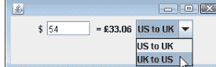

- 图 15-6：英镑转美元。


## 代码结构大纲

```
class MoneyFrame extends JFrame implements KeyListener, ItemListener, MouseListener {
    变量声明
    MoneyFrame 类的构造函数
    名为 setTextOnLabel 的方法声明
    因为该类实现了三个接口而要求的所有方法
}
```

## 构造函数组件说明

列表 15-3 中的构造函数向新的 `MoneyFrame` 窗口添加了以下四个组件：

- 一个标签（`currencyLabel`）：在图 15-4 中，标签显示美元符号。
- 一个文本字段（`textField`）：在图 15-4 中，用户在文本字段中输入 54。
- 另一个标签（`label`）：在图 15-4 中，标签显示 £33。
- 一个组合框（`combo`）：在图 15-4 中，组合框显示 US to UK。在图 15-5 中，用户选择了框中的某一项。在图 15-6 中，选中的项是 UK to US。

## 事件监听器详解

### ItemListener

实现 `ItemListener` 接口的类必须有一个 `itemStateChanged` 方法。当你在组合框中选择一个项目时，事件处理线程会调用 `itemStateChanged`。

在示例 15-3 中，当用户在组合框中选择从 US 到 UK 或从 UK 到 US 时，事件处理线程会调用 `itemStateChanged` 方法。相反，`itemStateChanged` 方法调用 `setTextOnLabel`，依此类推。

### MouseListener

实现 `MouseListener` 接口的类具有 `mouseEntered`、`mouseClicked`、`mousePressed` 和 `mouseReleased` 方法。实现 `MouseListener` 与实现 `ActionListener` 不同。当你实现 `ActionListener` 时（如示例 15-1 所示），事件处理线程仅对鼠标点击做出响应。使用 `MouseListener` 时，线程响应用户按下和释放鼠标。

在示例 15-3 中，每当你移动到标签上方或离开标签时，`mouseEntered` 和 `mouseExited` 方法就会被调用。你如何知道是标签被涉及了呢？只需查看 `MoneyFrame` 构造函数中的代码即可。标签的 `addMouseListener` 方法就是被调用的那个。查看示例 15-3 中的 `mouseEntered` 和 `mouseExited` 方法。当 `mouseEntered` 或 `mouseExited` 被调用时，程序会调用 `setForeground`。这个 `setForeground` 方法更改标签的颜色。

生活不是美好的吗？Java API 拥有如 `Color.red` 和 `Color.black` 这样的类。

示例 15-3 包含几个没有被真正使用的方法。例如，当你实现 `MouseListener` 时，你的代码必须有自己的 `mouseReleased` 方法。你需要 `mouseReleased` 方法并不是因为用户释放鼠标按钮时要做什么特殊操作，而是因为你向 Java 编译器做了承诺。

## 内部类

这是一个大新闻！你可以在类内部定义类！对于用户来说，示例 15-5 的行为与示例 15-1 相同。但在示例 15-5 中，`GameFrame` 类包含一个名为 `MyActionListener` 的类。

### 示例 15-5：类中的类

```java
import java.awt.FlowLayout;
import java.awt.event.ActionEvent;
import java.awt.event.ActionListener;
import java.util.Random;
import javax.swing.JButton;
import javax.swing.JFrame;
import javax.swing.JLabel;
import javax.swing.JTextField;

class MyFrame extends JFrame {
    private static final long serialVersionUID = 1L;

    int randomNumber = new Random().nextInt(10) + 1;
    int numGuesses = 0;
    JTextField textField = new JTextField(5);
    JButton button = new JButton("Guess");
    JLabel label = new JLabel(numGuesses + " guesses");

    public MyFrame() {
        setDefaultCloseOperation(JFrame.EXIT_ON_CLOSE);
        setLayout(new FlowLayout());
        add(textField);
        add(button);
        add(label);
        button.addActionListener(new MyActionListener());
        pack();
        setVisible(true);
    }
}

class MyActionListener implements ActionListener {
    @Override
    public void actionPerformed(ActionEvent e) {
        String textFieldText = textField.getText();

        if (Integer.parseInt(textFieldText) == randomNumber) {
            button.setEnabled(false);
            textField.setText(textField.getText() + " Yes!");
            textField.setEnabled(false);
        } else {
            textField.setText("");
            textField.requestFocus();
        }

        numGuesses++;
        String guessWord = (numGuesses == 1) ? "guess" : "guesses";
        label.setText(numGuesses + guessWord);
    }
}
```

示例 15-5 中的 `MyActionListener` 类是一个内部类。内部类就像其他类一样。但在内部类的代码中，你可以引用外部类的字段。例如，`MyActionListener` 中的语句使用了 `textField`，而 `textField` 是在外部类 `GameFrame` 中定义的。

注意示例 15-5 只使用了一次 `MyActionListener` 类。（所以我问，使用一次的东西真的需要名字吗？）不需要。你可以在 `button.addActionListener` 的调用内部替换整个类的定义。这样做你就拥有了一个匿名内部类。示例 15-6 展示了它是如何工作的。

### 示例 15-6：无名的类（有名字的类内部）

```java
import java.awt.FlowLayout;
import java.awt.event.ActionEvent;
import java.awt.event.ActionListener;
import java.util.Random;
import javax.swing.JButton;
import javax.swing.JFrame;
import javax.swing.JLabel;
import javax.swing.JTextField;

class GameFrame extends JFrame {
    private static final long serialVersionUID = 1L;

    int randomNumber = new Random().nextInt(10) + 1;
    int numGuesses = 0;
    JTextField textField = new JTextField(5);
    JButton button = new JButton("Guess");
    JLabel label = new JLabel(numGuesses + " guesses");

    public GameFrame() {
        setDefaultCloseOperation(JFrame.EXIT_ON_CLOSE);
        setLayout(new FlowLayout());
        add(textField);
        add(button);
        add(label);

        button.addActionListener(new ActionListener() {
            @Override
            public void actionPerformed(ActionEvent e) {
                String textFieldText = textField.getText();

                if (Integer.parseInt(textFieldText) == randomNumber) {
                    button.setEnabled(false);
                    textField.setText(textField.getText() + " Yes!");
                    textField.setEnabled(false);
                } else {
                    textField.setText("");
                    textField.requestFocus();
                }

                numGuesses++;
                String guessWord = (numGuesses == 1) ? "guess" : "guesses";
                label.setText(numGuesses + guessWord);
            }
        });

        pack();
        setVisible(true);
    }
}
```


内部类适用于事件处理程序，如本章示例。匿名内部类最困难的部分是跟踪括号、大括号和缩进。所以我诚恳的建议是，从编写不带内部类的代码开始，就像示例 15-1 中的代码那样。当你厌倦了普通类时，尝试将你的一些普通类改为内部类。

## 第 16 章：编写 Java Applet

本章内容
- 创建简单的 applet
- 构建 applet 动画
- 在 applet 上放置按钮（其他内容）

随着 Java 在 1995 年问世，让这种语言如此流行的概念是 applet（小程序）。applet 是一个运行在浏览器窗口内的 Java 程序。applet 在网页上拥有自己的矩形区域。applet 可以绘制绘图、显示图像、让图形移动、响应用户信息并做各种有趣的事情。当你把一个真实的、运行的计算机程序放在网页上时，你就开启了一个可能的世界。

### Applet 基础

示例 16-1 和 16-2 向你展示了一个非常简单的 Java applet。该 applet 在矩形框内显示 *For Dummies* 字样。（参见图 16-1。）

#### 示例 16-1：一个 Applet

```java
import javax.swing.Applet;

public class SimpleApplet extends Applet {

    private static final long serialVersionUID = 1L;

    public void init() {
        setContentPane(new DummiesPanel());
    }
}
```

#### 示例 16-2：Applet 的辅助代码

```java
import javax.swing.JPanel;
import java.awt.Font;
import java.awt.Graphics;

class DummiesPanel extends JPanel {

    private static final long serialVersionUID = 1L;

    public void paint(Graphics myGraphics) {
        myGraphics.drawRect(50, 60, 220, 75);
        myGraphics.setFont(new Font("Dialog", Font.BOLD, 24));
        myGraphics.drawString("Java For Dummies", 55, 100);
    }
}
```


图 16-1：漂亮的标题！

### 等待调用

当你查看列表 16-1 和 16-2 中的代码时，你可能会注意到一件事——applet（小程序）没有 `main` 方法。这是因为 applet 并不是一个完整的程序。applet 是一个包含方法的类，而你的浏览器会调用这些方法（直接或间接地调用）。你看到列表 16-1 中的 `init` 方法了吗？浏览器会调用这个 `init` 方法。然后，`init` 方法对 `setContent` 的调用会拉出列表 16-2 中的代码。

现在，看一眼列表 16-2 中的 `paint` 方法。浏览器会自动调用这个 `paint` 方法，而 `paint` 方法会告诉浏览器如何在屏幕上绘制你的 applet。

关于你的 Web 浏览器调用的 applet 方法列表，请参阅本章节后部分的“applet 中的方法”节。

### 公有类

注意列表 16-1 中的 `SimpleApplet` 是一个公有类（`public class`）。如果你创建一个 applet 但没有将类设为公有，你会得到“Applet not initialized”（applet 未初始化）或“Loading Java Failed”（加载 Java 失败）错误。直白地说，任何扩展 `JApplet` 的类必须是公有的。如果类不是公有的，你的 Web 浏览器无法调用该类的方法。

说得委婉一点，类可以具有默认（default）或公有（public）访问权限。只有与默认访问调用者处于同一个包中的代码才能引用默认访问的类。记住，你的浏览器对类方法的调用将埋没在你的 applet 内部，因为 Web 浏览器不太可能与你的 applet 处于同一个包（相信我，它不是的），所以 applet 必须是公有的。如果 applet 不是公有的，你的 Web 浏览器无法调用你 applet 的任何方法。关于公有和默认访问的更多信息，请参阅第 14 章。

### Java API（再次）

列表 16-2 中的代码使用了一些有趣的 API 技巧。这里是一些在前面的章节中没有出现过的技巧：

- `drawRect`：绘制一个未闭合的矩形。
  看列表 16-2 中的 `drawRect`。根据该调用，矩形的左上角距离面板左上角向右 50 像素，向下 60 像素。矩形的右下角距离面板左上角向右 220 像素，向下 75 像素。

  我想要矩形包围这些文字。为了算出 `drawRect` 用的数字，我使用了尝试法。然而，你可以让程序计算出文字占据了多少像素。要做到这一点，你需要 `FontMetrics`（关于 `FontMetrics` 的信息，请参阅 Java API 文档）。

- `Font` 类：描述字体的特征。列表 16-2 创建了一个加粗的、24 点的、`Dialog` 样式的字体。其他字体样式包括 `Dialog`、`Monospaced`（等宽）、`Serif`（衬线）和 `Sans-Serif`（无衬线）。
- `drawString`：绘制一个字符字符串。列表 16-2 在面板上绘制了字符串 `"You are visitor number "`。

### 让物体动起来

这个应用很酷，因为它是动画的——你可以改变屏幕上的内容。当你查看这个应用的代码时，你可能会认为代码很复杂。嗯，在某种程度上，确实如此。使用 Java 创建动画时会涉及很多操作。另一方面，这个应用的代码大部分是样板代码（boilerplate）。要创建自己的动画，你可以借用这个应用的大部分代码。要看我在说什么，请看列表 16-4 和 16-5。

#### 列表 16-4：里程表 Applet

```java
import javax.swing.JApplet;
import javax.swing.Timer;
import java.awt.Color;
import java.awt.event.ActionListener;
import java.awt.event.ActionEvent;

public class Odometer extends JApplet implements ActionListener {

    private static final long serialVersionUID = 1L;

    Timer timer;

    public void init() {
        OdometerPanel panel = new OdometerPanel();
        panel.setBackground(Color.white);
        setContentPane(panel);
    }

    public void start() {
        if (timer == null) {
            timer = new Timer(100, this);
            timer.start();
        } else {
            timer.restart();
        }
    }

    public void stop() {
        if (timer != null) {
            timer.stop();
            timer = null;
        }
    }

    public void actionPerformed(ActionEvent e) {
        repaint();
    }
}
```

#### 列表 16-5：里程表面板

```java
import javax.swing.JPanel;
import java.awt.Font;
import java.awt.Graphics;

class OdometerPanel extends JPanel {

    private static final long serialVersionUID = 1L;

    long hitCount = 0;

    public void paint(Graphics myGraphics) {
        myGraphics.setFont(new Font("Monospaced", Font.BOLD, 24));
        myGraphics.drawRect(50, 60, 170, 15);
        myGraphics.drawString("You are visitor number " + hitCount, 50, 50);
    }
}
```

*(注：由于原文中代码块 16-5 存在严重的文本错乱/混合问题，翻译时根据上下文逻辑修复了代码的逻辑结构以确保可读性)*

*(纠正：用户提供的原始文本中列表 16-5 的代码部分与描述文字混杂了一起，作为高级文档工程师，我根据 Java 逻辑将其还原为标准的代码块，如上所示。)*

- 它将面板的背景设置为白色。（这确保了包含 applet 的矩形与页面的其他部分完美融合。）
- 它中断了面板与 applet 之间稳固的连接。这是通过调用 `setContentPane` 方法实现的。

`paint` 方法描述了 applet 动作的一个快照。在列表 16-5 中，`paint` 方法设置了图形缓冲区的字体，在屏幕上写入 `hitCount` 的值，然后将 `hitCount` 加 1。（当你增加了 `hitCount` 变量时，谁还需要真正的访问者呢？）

`hitCount` 变量的值从很高开始，并变得更高。为了存储如此巨大的数字，我给 `hitCount` 分配了 `long` 类型；我使用 `Long` 类的 `toString` 方法将 `hitCount` 转换为字符字符串。这个 `toString` 方法类似于 `Integer` 类的 `parseInt` 方法。我将在第 11 章中介绍 `parseInt` 方法。

要调试 applet，你可以在 applet 的代码中调用 `System.out.println`。如果你使用 Eclipse，`println` 输出将出现在 Eclipse 的控制台（Console view）中。


### 在 applet 中响应事件

本节包含一个带有交互组件的 applet。这个 applet 与第 15 章中的示例完全一样。事实上，为了创建列表 16-7，我是从列表 15-1 的代码开始的。我这样做并不是因为懒（尽管老天知道我确实可以很懒）。这样做是因为 applet 与 Java 框架（frames）非常相似。如果你取一个框架的代码并对其进行简化，通常可以创建一个不错的 applet。这个 applet 位于列表 16-6 和 16-7 中。

#### 列表 16-6：猜数字游戏 applet

```java
import javax.swing.JApplet;

public class GameApplet extends JApplet {

    private static final long serialVersionUID = 1L;

    public void init() {
        setContentPane(new GamePanel());
    }
}
```

#### 列表 16-7：猜数字游戏面板

```java
import java.awt.Color;
import java.awt.event.ActionEvent;
import java.awt.event.ActionListener;
import java.util.Random;
import javax.swing.JButton;
import javax.swing.JLabel;
import javax.swing.JPanel;
import javax.swing.JTextField;

class GamePanel extends JPanel implements ActionListener {

    private static final long serialVersionUID = 1L;

    int randomNumber = new Random().nextInt(10) + 1;
    int numGuesses = 0;
    JTextField textField = new JTextField(5);
    JButton button = new JButton("Guess");
    JLabel label = new JLabel(numGuesses + " guesses");

    GamePanel() {
        setBackground(Color.WHITE);
        add(textField);
        add(button);
        add(label);
        button.addActionListener(this);
    }

    public void actionPerformed(ActionEvent e) {
        String text = textField.getText();
        if (Integer.parseInt(text) == randomNumber) {
            button.setEnabled(false);
            textField.setText(text + " Yes!");
        } else {
            textField.setText("");
            textField.requestFocus();
        }
        numGuesses++;
        String guessWord = (numGuesses == 1) ? " guess" : " guesses";
        label.setText(numGuesses + guessWord);
    }
}
```

要运行列表 16-6 和 16-7 中的代码，你需要一个 HTML 文件：

```html
<applet code="GameApplet" width=225 height=50></applet>
```

## 376 第四部分：精通 Java 技巧

图 16-3 和 16-4 显示了运行本节列表时发生的情况。这与运行列表 15-1 中代码的情况几乎相同。巨大的区别在于 applet 是网页的一部分出现的。

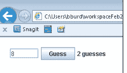
图 16-3：猜测错误。


图 16-4：猜测正确。

而不是 applet，请注意：
- `FlowLayout`
- 布局
- 默认设置


## 第 17 章：使用 Java 数据库连接

**本章内容**
- 连接到数据库
- 向数据库插入值
- 执行查询

### JDBC 和 Java

当我开始接触数据库时，最困难的部分是连接到它们。

### 创建数据

JDBC 的核心包含在两个包中：`java.sql` 和 `javax.sql`。

```java
Statement statement = connection.createStatement();

try {
    statement.executeUpdate(
        "create table ACCOUNTS "
        + "(NAME VARCHAR(32) NOT NULL PRIMARY KEY, "
        + "ADDRESS VARCHAR(32), "
        + "BALANCE FLOAT)"
    );

    statement.executeUpdate(
        "insert INTO ACCOUNTS values "
        + "('Barry Burd', '222 Cyber Lane', 24.02);"
    );

    statement.executeUpdate(
        "insert INTO ACCOUNTS values "
        + "('Joe Doe', '111 Luddite Street', 55.63);"
    );
} catch (SQLException e) {
    e.printStackTrace();
}
```


若要使用 MySQL 替 Java DB，请对列表 17-1 进行以下更改：将 `DRIVER` 的值改为 `"com.mysql.jdbc.Driver"`。将 `CONNECTION` 的值改为 `"jdbc:mysql://localhost/AccountDatabase;create=true"`。对 DB2、Oracle 和其他数据库进行类似的更改。

要运行数据库代码，你必须拥有一个包含合适驱动程序的文件，且该文件必须位于 Java 能够找到的地方。在本章的示例中，我连接到了 Java DB 数据库，也称为 Apache Derby。驱动程序位于名为 `derby.jar` 的文件中，它通常位于 JDK 的 `lib/` 目录。为了让我的 Java 程序能够使用 `db/lib/derby.jar`，我将该文件添加到我的 Java 类路径（classpath）中。

将 `.jar` 文件添加到类路径的方法取决于你使用的操作系统类型。在 Eclipse 中，我选择 `Project > Properties > Java Build Path`。然后我点击 `Add External JARs` 按钮并导航到 `db/lib/` 目录。对于其他 IDE，步骤略有不同。

当你运行列表 17-1 中的代码时，似乎什么都没有发生。程序开始运行然后停止运行。仅此如此。代码没有可见的输出，因为所有输出都进入了数据库。因此，要查看运行列表 17-1 中代码的结果，你必须查看数据库本身的变化。

## 380 第四部分：精通 Java 技巧

在上一段落中，我写道运行列表 17-1 非常不方便。我写道“什么都没有发生”以及“代码没有可见的输出”。但是，如果你仔细观察，可以发现运行列表 17-1 的证据。特别是，你的硬盘在第一次运行它后会有几个额外文件。其中一个文件 `derby.log` 包含了描述 Derby 数据库软件启动和停止的文本。你还可以找到一个名为 `derbyDB` 的新文件夹，它包含更多日志、一个 `service.properties` 文件以及另一个装满 `.dat` 文件的文件夹。（这些包含了存储在数据库中的所有内容）。如果你使用 Eclipse，可以在 Package Explorer 中选择你的项目分支，然后选择 `File > Refresh` 来创建这些新文件和文件夹。


## 使用 SQL 命令

在列表 17-1 中，执行 `executeUpdate` 的三次调用中的代码头每个都包含一个字符串，一个普通的 Java 双引号字符字符串。为了保持代码的可读性，我将每个字符串切分成了几部分，并用加号分隔这些部分（Java 的字符串拼接运算符）。

Java 的加号具有双重作用。对于数字，加号执行加法操作。对于字符串，加号将两个字符串挤在一起，创建一个大的组合字符串。


你可以制作任意长度的双引号字符串。当你写到双引号字符串时，长度可以随你想要的多长。

## 第 17 章：使用 Java 连接 383

```java
catch (IllegalAccessException e) {
    e.printStackTrace();
} catch (ClassNotFoundException e) {
    e.printStackTrace();
}
```

```java
try (Connection connection = DriverManager.getConnection(CONNECTION);
     Statement statement = connection.createStatement();
     ResultSet resultSet = statement.executeQuery("select * from ACCOUNTS")) {
    while (resultSet.next()) {
        out.print(resultSet.getString("NAME"));
        out.print("");
    }
}
```

要使用 MySQL 代替 Java DB，请对列表 17-2 进行以下更改：将 `DRIVER` 的值更改为 `"com.mysql.jdbc.Driver"`。将 `CONNECTION` 的值更改为 `"jdbc:mysql://localhost/AccountDatabase;create=true"`。对 DB2、Oracle 以及其他数据库进行类似的更改。

列表 17-2 代码的运行结果如图 17-1 所示。该代码查询数据库，然后逐行遍历数据库，并打印每一行的数据。

**图 17-1：从数据库获取数据。**

| Barry Burd | 222 Cyber Lane | $24.02 |
| Joe Dow | 111 Luddite Street | $55.63 |

## 384 第四部分：精通 Java 技术

列表 17-2 起于对 `setName`、`getConnection` 和 `createStatement` 的常规调用。然后代码调用了 `executeQuery` 并为其提供了一个 SQL 命令。对于熟悉 SQL 命令的人来说，这个特定的命令获取了 `ACCOUNTS` 表中的所有数据（你在列表 17-1 中获取的那个表）。

调用 `executeQuery` 返回的类型是 `java.ResultSet`。（这就是 `executeUpdate` 和 `executeQuery` 之间的区别——`executeQuery` 返回结果集，而 `executeUpdate` 不返回。）这个结果非常像一个数据库表。和原始表一样，结果集被分为行和列。每一行包含一个账户的数据。每行都包含一个地址和一个余额金额。

在调用 `executeQuery` 并获取结果集后，你可以逐行遍历结果集。要做到这一点，请进入一个小的循环，并在每次循环迭代的开始处测试条件 `resultSet.next()`。每次调用 `resultSet.next()` 都会做两件事：

- 如果存在另一行，它移动到结果集的下一行（下一个账户）。
- 通过返回一个布尔值（`true` 或 `false`）来告诉你是否存在另一行。

如果条件 `resultSet.next()` 为 `true`，则结果集还有另一行。计算机随后移动到该行。另一方面，如果 `resultSet.next()` 为 `false`，则结果集没有行了。你跳出循环并开始关闭所有内容。

现在，想象计算机正指向结果集的一行，而你正处于列表 17-2 的循环内部。你通过调用结果的 `getString` 和 `getFloat` 方法从结果集的行中检索数据。回到列表 17-1，你设置了包含 `NAME`、`ADDRESS` 和 `BALANCE` 列的 `ACCOUNTS` 表。因此，在列表 17-2 中，你通过调用 `getSomeTypeOrOther` 方法并将原始列名传递给这些方法从这些列获取数据。获取数据后，你在计算机屏幕上显示这些数据。

每个 `ResultSet` 实例都有几个好用的 `getTypeOrOther` 方法。根据你放入列的数据类型，你可以调用 `getArray`、`getBigDecimal`、`getBlob`、`getInt`、`getObject`、`getTimestamp` 以及其他方法。


# 第五部分：十项法


一个良好的集成开发环境（IDE）会让编写代码变成一种享受。你对 IDE 了解得越多，就能越轻松地完成枯燥的输入任务。与其一行一行地输入，你可以专注于你的编码逻辑。在 `www.dummies.com/extras/java` 发现我最喜欢的十个 Eclipse IDE 技巧。


## 在本部分...

- 在犯错之前捕获常见错误。
- 探索网络上 Java 的最佳资源。

# 第 18 章：避免本章中错误的十种方法

- 检查你的大小写和值比较
- 注意贯穿（fall-through）问题
- 将方法和构造函数放在它们应该的位置
- 使用静态和非静态引用
- 避免其他错误

从不犯错的人是根本不做任何事情的人。我的一大学教授是这么说的。我不记得那位教授的名字，所以无法给予他应有的荣誉。我想那是我的错。

Java 是一种对大小写敏感的语言，所以你真的需要注意字母表中的每一个字母。在创建 Java 程序时，请记住以下细节：

- Java 的关键字全全小写。例如，在 Java 语句中，单词不能是 `IF`。
- 当你使用 Java API（应用程序接口）中的名称时，名称的大小必须与 API 中出现的内容一致。
- 你还需要确保自己创建的名称在整个程序中大小写保持一致。如果你声明了变量 `myAccount`，你就不能用 `MyAccount`、`myaccount` 或 `account` 来引用它。如果你以不同的方式大写名称，Java 会认为你正在引用两个不同的变量。

更多关于 Java 大写敏感性的信息，请参阅第 3 章。

## 388 第五部分：十项法

### 跳出语句

如果你跳出 `switch` 语句，就会发生贯穿（fall-through）。例如，如果 `verse` 的值为 3，以下代码将打印所有行——“Last refrain,” “He's a pain,” 和 “Has no brain.”。

```java
switch (verse) {
  case 3:
    out.print("Last refrain, ");
    out.println("last refrain, ");
  case 2:
    out.print("He's a pain, ");
    out.println("he's a pain, ");
  case 1:
    out.print("Has no brain, ");
    out.println("has no brain, ");
}
```

完整故事请参阅第 5 章。

### 使用等号比较值

当你比较两个值时，使用双等号。例如，行

```java
if (a == b)
```

是正确的，但行

```java
if (a = b)
```

是不正确的。完整的报告请参阅第 5 章。

### 向 GUI 添加组件

这里是用于 Java 框架的构造函数：

```java
public SimpleFrame() {
    JButton button = new JButton("Thank you...");
    setTitle("Connie and Brian");
    setLayout(new FlowLayout());
    add(button);
    button.addActionListener(this);
    setSize(300, 100);
    setVisible(true);
}
```

无论如何，不要忘记调用 `add` 方法。如果没有这个调用，按钮就不会出现在你的框架上。关于问题的介绍请参阅第 9 章。

### 为事件添加监听器

查看上一节的代码来构造 `JFrame`。如果你忘记调用 `ActionListener`，点击按钮时什么都不会发生。关于监听器的详情，请参阅第 15 章。

### 定义构造函数

当你定义带参数的构造函数时，例如

```java
public Temperature(double number)
```

计算机不再为你创建默认构造函数。也就是说，你无法调用

```java
Temperature roomTemp = new Temperature();
```

除非你显式地定义了自己的无参数构造函数。关于构造函数的所有细节，请参阅第 9 章。

### 修复非静态引用

如果你尝试编译以下代码，会得到错误信息：

```java
class WillNotWork {
    String greeting = "Hello";
    public static void main(String args[]) {
        System.out.println(greeting);
    }
}
```

你得到错误信息是因为 `main` 是静态的，而 `greeting` 不是。关于解决此问题的完整指南，请参阅第 10 章。

### 保持在数组边界内

当你声明一个有十个组件的数组时，组件的索引从 0 到 9。也就是说，声明

```java
int guests[] = new int[10];
```

然后你可以通过编写 `guests[0]`、`guests[1]` 直到 `guests[9]` 来访问组件。你不能写 `guests[10]`，因为数组没有索引为 10 的组件。

关于数组的最新八卦，请参阅第 11 章。

### 预测空指针

本书的示例很容易抛出 `NullPointerException`，但在真实的 Java 编程中，你经常遇到这种异常。当你调用一个应该返回对象的方法，但该方法实际上返回了 `null` 时，就会出现 `NullPointerException`。这里有一个廉价的例子：

```java
import java.lang.System.out;
import java.io.File;

class ListMyFiles {
    public static void main(String args[]) {
        File myFile = new File("\\windows");
        String dir[] = myFile.list();
        for (String fileName : dir) {
            out.println(fileName);
        }
    }
}
```

此程序会列出 windows 目录中所有文件的列表。要详细了解 `\\windows` 中双反斜杠的用法，请参阅第 8 章。

但如果你将 `\\windows` 改为其他内容——不代表目录名称的内容——会发生什么？

```java
myFile = new File("*&$!");
```


那么 `new File` 调用将返回 `null`（一个表示空的特殊单词），因此变量 `File` 中没有任何内容。在代码的后续部分，`dir` 指向空值，而遍历所有 `dir` 值的尝试会惨惨地失败。你会得到一个巨大的 `NullPointerException`，程序就会会在你面前崩溃。

为了避免这种灾难，请检查 Java API 文档。如果你正在调用可能返回 `null` 的方法，请在你的程序中添加异常处理代码。

有关处理异常的故事，请参阅第 13 章。关于阅读 API 文档的建议，请参阅第 3 章以及本书的网站（www.allmycode.com/JavaForDummies）。

### 帮助 Java 找到它的文件

当你正在编译 Java 代码，忙自己的事情时，计算机给了你一个 `NoFileNotFoundError`。各种情况可能出错，但很可能是计算机找不到某个特定的 Java 文件。要修复这个问题，你必须让所有行星对齐：

- 你的项目目录必须包含代码中使用的所有 Java 文件。
- 如果你使用了包，你的项目目录必须有命名相应的子目录。
- 你的 `CLASSPATH` 必须正确设置。

有关具体指南，请参阅第 14 章以及本书的网站（www.allmycode.com/JavaForDummies）。

## 第 19 章

## Java 的十个网站

### 本章内容

- 查看本书的网站
- 寻找 Oracle 的资源
- 阅读更多关于 Java 的内容

难怪网页如此流行。它既用又。本章证明了十个有用且有趣的网站。每个网站都有资源帮助你有效地使用 Java。而且据我所知，这些网站都没有使用广告、弹出窗口或其他怪异的东西。

### 本书网站

对于与本书相关的所有技术问题，访问 allmycode.com/JavaForDummies。

对于业务问题（例如，“我如何购买 100 本《Java For Dummies》？”），访问 www.dummies.com。

### 官方入口

Java 的官方网站是 www.oracle.com/technetwork/java。

Java 技术消费者应该访问 www.java.com。

对共享 Java 技术感兴趣的程序员和开发者可以去 www.java.net。

## 第 V 部分：394 页 寻找新闻、评论和示例代码

专家文章访问 www.infoq.com。

所有人（包括很多聪明的人）的讨论访问 www.javavranch.com。

## 寻找 Java 工作

职位列表访问 www.computerwork.com。

## 大家最喜欢的网站

事实是——这两个网站专门致力于 Java。然而，如果没有 Slashdot 和 SourceForge，资源列表将是不完整的。

- Slashdot 的口号是“极客新闻”，它涵盖了一切。通过各种方式访问 http://slashdot.org。
- SourceForge 仓库（http://sourceforge.net）拥有超过 200,000 个开源项目。查看一下！

## 索引

### 符号 •

`!` (非) 运算符，105
`!=` (不等于) 运算符，101
`%` (取模) 运算符，82
`&&` (与) 运算符，176
`*` (星号) 通配符，82
`import` 声明，104–105
`/` (斜杠)，82
`@Override` 注解，190, 354
`\\` (双反斜杠)，176, 251
`\'` (单引号) 转义序列，251
` ` (空格) 转义序列，251
`\f` (页符) 转义序列，251
`\n` (换行) 转义序列，251
`\r` (回车) 转义序列，251
`\t` (制表符) 转义序列，251
`||` (或) 运算符，105
`+` (加号)，81
`<` (小于) 运算符，101
`<=` (小于等于) 运算符，101
`<>` (尖括号)，275
`<>` (菱) 运算符，277
`==` (等于) 比较值，388
`==` (等于) 运算符，101
`>` (大于) 运算符，101
`>=` (大于等于) 运算符，101
运算符，101
`""` (双引号)，251, 380
`\'` (单引号 标记)，72
`nonpublic` 类，347–348
概述，328, 346
`public` 类，347
绘制框架，333–335
访问器方法，164
`getter` 方法，197
`private` 字段，162–162
`setter` 方法，197
简单性，160–162
`actionPerformed` 方法，353–355
`applets`，373
`add` 方法，389
`collection` 类，273, 274
`constructors`，213
`&&` (与) 运算符，105
Android Java，12
`<` (尖括号)，275
`annotation`, Java
`@Override` 注解，190, 354
`SuppressWarnings`，213–214
匿名内部类，365–366
`API` (应用程序编程接口)
`applets`，369–370
`BigDecimal` 类，157
类和方法来自，212–213
概述，38
加载 Java Applet Failed，369
Applet Viewer，368
调用方法，369
Java API，369–370
方法，372–374
`public` 访问，369
响应事件，在，374–376
`abstract` 方法，353
访问修饰符
类，329–330
成员，322

## A •

396 Java For Dummies, 第 6 版

应用程序编程接口 (API)
`applets`，369–370
- `BigDecimal` 类，157
类和方法来自，212–213
`args`，269
算术运算符，82
`ArrayIndexOutOfBoundsException` 错误消息，272
数组初始化器，251–252
`ArrayList` 类，273–275, 279
数组初始化器，251–252
对象数组，259–256
关闭文件，257–256
命令行参数，265–269
创建，247–248
`for` 循环，252–253
转义序列，251
限制，271–272
概述，245–247
搜索，254–256
在边界内，390
存储值，247–250
制表符，251
写入文件，256–257
对象数组
条件运算符，264–265
`Number` 类，263–264
概述，259–260
- 单反斜杠，176
向文件名添加目录名，176
在 Windows 中，268
Backus, John，280
`BigDecimal` 类，157
`BigDecimal` 类型，68
`BinaryOperator` lambda 表达式，289
排列，77
ASCII 编码，73
定义，64–65
Unicode，73
块定义，83, 98
静态初始化器，228
`try` 块，321
变量声明和，134–135
蓝光设备，13
粗体代码，278, 293
`boolean` 类型，72, 74–75
`break` 语句，116
Herbert, Bright，229
构建块
应用程序编程接口，38–39
类，43–44
注释，52–57
大括号，50–52
标识符，39–41
关键字，39–41
主方法，46–47
方法，44–46
规范，38–39
语句，47–49
`byte` 原生类型，71
字节码 (Java)，25–26, 28–29

`Room` 类，260–263

# 398 Java 入门教程，第 6 版

编码

- Alexander Pope（亚历山德·波普）， 129
算术运算符, 82
ASCII 字符编码, 73
赋值运算符, 88–90
赋值语句, 63–64
星号通配符字符 (*), 82, 104–105
BigDecimal 类型, 68
位 (bits)
- 布局, 77
- ASCII 字符编码, 73
- 定义, 64–65
- Unicode, 73
块, 83, 98, 134–135
布尔类型, 72, 74–75
break 语句, 116
字节原始类型 (byte primitive), 71
调用, 95, 99
字符原始类型 (character primitive), 72–74
比较运算符, 101–105
拼接, 81
条件, 96–97–110
计数循环, 125–126
大括号, 83
十数字类型, 71–72
小数点, 68–70, 94
声明, 66, 70–71, 84, 104–105
135–135
自减运算符, 84–88
do 循环, 130–132
do 语句
- 块, 133–134
- 处理 (handle handling), 133–134
- do 循环, 129–132
- 读取单个字符, 132–133
- 变量声明, 134–135
双等号 (==), 97–98
双加号 (++), 84–88
双精度原始类型 (double primitive), 67, 71
if 语句中的 else 部分, 98–100
启用 for 循环, 135
equals 方法, 102, 104
do 语句中的证据对象, 133
表达式, 75, 87, 127
贯穿 (fall-throughs), 116–118

- 假值, 条件, 97
浮点精度原始类型 (float primitive), 67, 71
帧, 79
图形用户界面, 66, 104
if 语句
- 条件, 96–97
- 大括号, 88
- 双等号 (==), 97–98
- else 部分, 98–100
- 缩进, 99
- 嵌套, 111–112
- 概览, 92–95
- 随机性, 96
import 声明, 79–80, 84, 104–105
自增运算符, 84–88
缩进, 99
初始化, 70–71, 127
int 原始类型, 71
int 值 (void), 94
迭代循环, 124
java.util.Scanner, 94
JFrame 引用类型, 76–77
keyboard.next 方法, 132
keyboard.nextInt(), 95
逻辑运算符, 108
逻辑原始类型 (logical primitive), 72
long 原始类型, 71
循环
- do 语句, 129–135
- for 循环, 129, 135
- else 语句, 125–129
- while 语句, 122–124
方法调用, 85–99
减号 (-), 81
非运算符 (!), 105
null 值, 108–109
数字（字面量）
- 定义, 63
- 整数, 70
- 不带小数点的, 68–70
对象比较, 102–104
运算符
- 算术, 82
- 赋值, 83–84
- 赋值, 88–90

# 索引 399

- 星号 (*), 82
- 比较, 101–105
- 自减, 84–88
- 自增, 84–88
- 逻辑, 105–108
- 减号 (-), 81
- 概览, 81–83
- 加号 (+), 81
- 自减, 88
- 后自增, 86
- 前自减, 88
- 前自增, 85
- 余数, 82
- 斜杠 (/), 82
括号 (), 109–110
密码变量, 103
- 加号 (+), 81
- 后自减, 88
- 后自增, 86
- 前自减运算符, 88
- 前自增运算符, 85
- 原始（简单）类型, 66, 71–75
printf 调用, 99
- printf 调用, 99
if 语句中的随机性, 96
- 引用类型, 75–78
- 余数运算符, 82
重复语句
- do 语句, 125–135
- for 语句, 125–129
- while 语句, 122–124
do 语句中的重复变量, 135
- 短整原始类型 (short primitive), 71
- 单字符, 132–133
- 单引号 ('), 72
- 斜杠 (/), 82
- for 语句, 125–129
语句
- 比较运算符和和, 101–105
- 括号中的条件, 109–110
- do 语句, 125–139
- 表达式和, 87
- if 语句, 92–100, 111–112
- 逻辑运算符, 105–108
- null 值, 108–109
- for 语句, 125–129
- switch 语句, 113–119
- while 语句, 122–124
static 关键字, 84, 94
String 引用类型, 76–77
String-equals 方法, 102
String 变量, 132–133
字符串和, 118–119
switch 语句
- 贯穿 (fall-throughs), 116–118
- 概览, 113–116
- 字符串和, 118–119
System 中的中的名称, 94
System.out.printf 调用, 95
文本显示, 68
- 文本程序, 66, 104
true 值, 条件, 97
类型, 值, 62
更新, for 语句, 127
值
- 定义, 62
- 类型, 64–68
变量声明, 66, 134–135
变量名
- 赋值语句, 63–64
- 组合声明, 70–71
- 定义, 62
显示文本, 68
import 声明, 79–80
初始化, 70–71
不带小数点的数字, 68–70
运算符, 81–90
视图, 61–63
原始类型, 71–75
引用类型, 75–78
void (int 值), 94
while 语句, 122–124
整数数字
原始类型, 71
存储, 70

# 400 Java 入门教程，第 6 版

- 集合类
- ArrayList, 273–275
- 泛型 (generics), 275–277
- HashMap, 279
- HashSet, 279
- Iterators, 278–289
- LinkedList, 279
- PriorityQueue, 279
- Queue, 279
- Stack, 279
- 概览, 272–273
命令行参数
- 检查右数字, 268–269
- 概览, 265–266
命令行窗口, 265
注释, 52–57
添加到代码, 53–55
末尾行 (end-line), 54
javadoc, 54–55
概览, 52–57
传统的, 54
使用实验代码, 56–57
比较运算符
- 比较对象, 102–104
- 导入, 104–105
- 等于, 101
- 于, 101–102
编译器
- 定义, 23
- 概览, 24–26
组件（元素）
- 添加到 GUI, 389
- 数组, 246–247
计算机编程
- C 语言, 12
- C# 语言, 12
- ++ 语言, 12
- COBOL 语言, 12
- 定义, 1
- FORTRAN 语言, 11, 15, 280
- Java, 12–13
计算机科学
考试, 12
连接接, 81
条件运算符, 264–265
条件
- if 语句, 96–97
- 括号中的条件, 109–110
- 连接 Java (JDBC), 381–382
构造函数
- 默认, 207–208
- 定义, 389
double 值, 194
enum 类型, 195–202
布局类, 212
JButton 类, 213
JFrame 类, 211–212
概览, 194–195
print 方法, 202–203
setLayout 方法, 212
setSize 方法, 213
setTitle 方法, 213
Simple 类, 210–211
子类和, 203–209
SuppressWarnings 注解, 213–214
lambda 表达式, 289
控制程序
与决策语句
- 比较运算符, 101–105
- if 语句, 92–100
- 逻辑运算符, 105–108
- null 值, 108–109
- 概览, 91
switch 语句
- 贯穿 (fall-throughs), 116–118
- 概览, 113–116
- 字符串和, 118–119
-  概览, 121
- for 语句, 125–129
- while 语句, 122–124
带循环
- do 语句, 129–135

# 索引 401

书中的约定, 1–2
约定, Java
文件命名, 334
参数, 202
拷贝代码, 172–173
计数循环, 125–126
大括号
- 块, 134
- C 编程语言, 12
- if 语句, 98
- 概览, 50–52
- 嵌套, 111–112
- 概览, 92–95
随机性, 96
逻辑运算符, 105–108
null 值, 108–109
概览, 91
switch 语句
- 贯穿 (fall-throughs), 116–118
- 概览, 113–116
- 字符串和, 118–119
声明
- 组合, 70–71
import
- 中的星号通配符, 104–105
- 磁盘文件, 172
- 概览, 84
- 与包和, 211
- 变量, 79–80
方法, 45–46
包 (package), 334
变量, 66, 134–135
自减运算符（双减号 --）, 84–88


数据
- 创建, 378–380
- 获取, 382–384
- 存储, 171
- 在集合类中测试模式, 277
- 写入文件, 256–257
数据库驱动程序, 381
DB (Java 数据库), 377–378
def 字段, 232
十数字类型, 71–72
小数点
- 不带小数点的, 68–70
- 变化, 94
DecimalFormat 类, 219, 264
决策语句
比较运算符
- 比较对象, 102–104
- 使用 导入, 104–105
- 概览, 101–102
括号中的条件, 109–110
if 语句
- 条件, 96–97
- 大括号, 88
- 双等号 (==), 97–98
- else 部分, 98–100
- 缩进, 99
- 嵌套, 111–112
- 概览, 92–95
- 随机性, 96
决策语句
- 比较运算符, 101–105
- 括号中的条件, 109–110
- if 语句, 92–100
- 逻辑运算符, 105–108
- null 值, 108–109
- 概览, 91
switch 语句
- 贯穿 (fall-throughs), 116-118
- 概览, 113-116
- 字符串和, 118-119
- 默认, 207-208
- 定义, 389
double 值, 194
enum 类型, 195–202
布局类, 212
JButton 类, 213
JFrame 类, 211–212
概览, 194–195
print 方法, 202–203
setLayout 方法, 212
setSize 方法, 213
setTitle 方法, 213
Simple 类, 210–211
子类和, 203–209
SuppressWarnings 注解, 213–214
lambda 表达式, 289
控制程序
- 比较运算符, 101–105
- 括号中的条件, 109–110
- if 语句, 92–100
- 逻辑运算符, 105–108
- null 值, 108–109
- 概览, 91
switch 语句
- 贯穿 (fall-throughs), 116–118
- 概览, 113–116
- 字符串和, 118–119
- 默认, 207–208
- 定义, 389
double 值, 194
enum 类型, 195–202
布局类, 212
JButton 类, 213
JFrame 类, 211–212
概览, 194–195
print 方法, 202–203
setLayout 方法, 212
setSize 方法, 213
setTitle 方法, 213
Simple 类, 210–211
子类和, 203–209
SuppressWarnings 注解, 213–214
lambda 表达式, 289

# 索引 403

- 概述, 170–171
- 读取, 173–175
- 存储数据, 171
- 覆盖现有方法
    - 注解, 190
    - 概述, 188–190
    - 使用类和子类的方法, 190–192
- 子类
    - 创建, 181–184
    - 概述, 179–181
    - 使用, 184–188
- 表达式
    - 定义, 75
    - lambda
        - BinaryOperator, 289
        - Consumer, 289
        - Function, 289
        - 概述, 285–288
        - Predicate, 289
        - 侧效应, 288
        - 流和, 289–294
        - 两个参数, 287–288
- for 语句, 127
- 语句和, 87
- 扩展类, 182
- finally 子句, 322–324
- float 原数据类型, 67, 71, 260
- FlowLayout 类
    - applet, 376
    - 构造函数, 212
- Font 类, 370
- for 循环
    - 数组, 250
    - 定义, 129
    - 增强 for 循环, 135, 252–253, 274–275, 279
    - for 语句, 125–129
- 换符 (f) 转义序列, 251
- 格式方法, 264
- 格式字符串, 157–159
- FORTRAN 编程语言, 11, 15, 280
- frame (帧）
    - 定义, 79
    - 创建, 337–338
- 自由格式类, 155
- 全限定名, 类, 219
- 函数型 lambda 表达式, 289
- 函数式编程
    - 使用的优势, 295
    - lambda 表达式
        - 分类, 289
        - 概述, 285–288
        - 流和, 289–294
    - 方法引用, 295–297
    - 概述, 280–282
    - 使用解决问题, 282–284
    - 流, 284–285
    - 变量, 296

# F

- 工厂方法, 264
- 贯穿 (fall-throughs), 116–118
- 假值, 条件, 97
- 字段, 类 (实例变量)
    - 定义, 141
    - 设私有, 162–164
- 文件命名
    - Java 规范, 44
    - 公有类和, 146
- FileNotFoundException 消息, 175–176, 221
- files. 还有磁盘索引
    - 关闭, 257–259
    - 查找, 391
- filter 方法
    - 函数式编程, 290, 291
    - Stream 对象, 294

# G

- g 参数, paint 方法, 335
- FrameClass 类, 352
- 泛型, 集合类, 275–277
- getAsString 方法, 219
- getConnection 方法, 381
- getCurrencyInstance 方法, 264
- Going 类, 234–235
- getInterest 方法
    - double 值, 153
    - 返回值, 154–155

# 404 Java For Dummies, 第6版

- getName 方法, 232
- getter 方法, 163, 356
- Google
    - MapReduce 编程模型, 293
    - Java 的使用, 13
- Gosling, James, 15
- 图形用户界面 (GUI), 66, 104, 198, 222–223, 389
- 图形缓冲区, 335
- GridLayout 类, 223, 230
- 分组分隔符, 170, 171
- guests = new int[10] 定义, 数组, 248
- GUI (图形用户界面), 66, 104, 198, 222–223, 389
- IDE (集成开发环境)
    - 定义, 23
    - Eclipse, 34
    - IntelliJ IDEA, 34
    - Java AppletViewer 和, 368
    - main 方法, 346
    - NetBeans, 35
    - 概述, 33–35
- 标识符, 39–41
- if 语句
    - 条件, 96–97
    - 大括号, 98
    - 双等等号, 97–98
    - else 部分, 98–99
    - 缩进, 111–112
    - 概述, 92–95
- 随机性, 66
- setName 方法, 164
- 过程式编程
    - 定义, 280
    - 修改, 295
    - 变量, 296
- import 声明
    - 星号通配符, 104–105
    - 磁盘文件, 172
    - 概述, 84
    - 包, 211
    - 变量, 79–80
- 带有比较运算符导入, 104–105
- 类型不兼容消息, 244
- 自增运算符 (++), 84–88
- 缩进
    - 带有大括号, 50
    - if 语句, 99
    - 索引, 数组, 247
    - InfoQ 网站, 394
    - init 方法, 369, 372
- 初始化
    - for 语句, 127
    - 变量, 70–71, 144
    - 内部类, 348, 363
    - insertRow 方法, 380
- 实例变量
    - 定义, 141
    - 设私有, 162–164
    - 在代码中, 234
# H

- 异常处理
    - catch 子句, 307–313
    - catch 子句参数, 304–305
    - 异常类型, 305–307
    - finally 子句, 322–324
    - 良好的异常, 316
    - i 语句, 314
    - InterruptedException 类, 317–321
    - 多-catch 类, 313–314
    - 概述, 300–304
    - try-catch 语句, 315–316
    - try 语句, 325–326
- HashMap 集合, 279
- HashSet 集合类, 279
- hasNext 方法
    - 迭代器, 278
    - Scanner 类, 277
    - hasNextDouble 方法, Scanner 类, 277
    - hasNext 方法, Scanner 类, 277
    - 层级结构, Java, 50–52
- Hopper, Grace, 12
- 水平制表符序列, 251
# L

- i 语句, 314
- IBM 704 计算机, 299

# 索引 405

- int guests[] 定义, 数组, 248
- int 原数据类型, 71
- int 值 (void), 94, 243
- Integer 类, 268
- 集成开发环境 (IDE)
    - 定义, 23
    - Eclipse, 34
    - Java AppletViewer 和, 368
    - main 方法, 346
    - NetBeans, 35
    - 概述, 33–35
    - IntelliJ IDEA, 34
    - 接口, 252–354
    - InterruptedException 类, 317–321
    - IOException 类, 224, 312
- 等于 (==) 运算符, 101
- 大于 (>) 运算符, 101
- 大于等于 (>=) 运算符, 101
- 小于 (<) 运算符, 101
- 小于等于 (<=) 运算符, 101
- 不等于 (!=) 运算符, 101
- 监听器, MoneyFrame 窗口, 363
- 迭代, 循环, 124
- 迭代器, 278–279
- Java 2 标准版，1.2, 30–31
- 面对象编程 (OOP), 13–20
- 概述, 9–10
- 使用原因, 11
- 源码, 24–25
- Java 社区进程 (JCP), 39
- Java 数据库连接 (JDBC)
    - 连接, 381–382
    - 创建数据, 378–380
    - 断开, 381–382
    - 读取数据, 377–388
- SQL 命令, 380
- Java 开发工具包 (JDK), 30
- Java 语言规范, 346
- Java 运行时 (JRE), 30
- Java 虚拟机 (JVM)
    - 定义, 23
    - 查找文件, 336
    - 概述, 26–30
    - 执行线程和, 354
- java.awt 包, 211
- java.awt.Graphics 类, 335
- javadoc 注释, 54–55
- JavaFX 框架, 358
- java.sql 包, 378–380
- java.util.包, 211
- javax.sql 包, 378–380
- JButton 类, 213
- JComboBox (下拉列表), 362
- JCP (Java 社区进程), 39
- JDBC (Java 数据库连接)
    - 连接, 381–382
    - 创建数据, 378–380
    - 断开, 381–382
    - 读取数据, 382–384
- SQL 命令, 380
- JDK (Java 开发包), 30
- JFrame 类, 39, 211–212
- JFrame 类型, 76–77
- Applet 类, 372
- Java 注解
    - @Override 注解, 190, 354
    - SuppressWarnings, 213–214
- 应用程序编程接口 (API), 38–39
- BigDecimal 类, 157
- 类和方法, 212–213
- 字节码, 25–26, 28–29
- 计算机历史, 11–13
# 406 Java Dummies, 第6版

- JLabel 对象, 222–223
- JPanel 类, 372
- JRE (Java 运行时), 30
- JTextField 类, 351
- JUnit, 155
- JVM (Java 虚拟机)
    - 类, 381
    - 查找文件, 336
    - 概述, 26–30
    - 执行线程和, 354
- 逻辑运算符, 105–108
- 逻辑数据类型, 72
- long 原数据类型, 71
- 循环
    - do 语句, 134–135
    - 文件处理, 133–134
    - 概述, 129–132
    - 变量声明, 134–135
    - 数组, 250
    - 定义, 129
    - 增强 for 循环, 135, 252–253, 274–275, 279
    - 概述, 121
    - 执行线程和, 354
    - keyboard.next 方法, 132
    - keyboard.nextInt() 代码, 95
- KeyListener 接口, MoneyFrame 窗口, 362
- 关键字, 39–41
# L

- lambda 表达式
    - BinaryOperator, 289
    - Consumer, 289
    - Function, 289
    - 概述, 285–288
    - Predicate, 289
    - 侧效应, 288
    - 流和, 289–294
    - 两个参数, 287–288
    - 语言规范, 38–39
- 换行符 (\n) 序列, 251
- LinkedList 集合类, 279
- Linux 终端, 265
- terminal
- Lisp 编程语言, 280
- 监听器, 和处理事件, 389
- 字面量
    - 定义, 63
    - 显示精度, 156–159
    - 分组分隔符, 170, 171
    - 整体, 70–71
    - 不带小数, 68–70
- main 方法
    - 创建对象, 142
    - GetOrCreate 类, 234–235
    - 集成开发环境, 346
    - 概述, 46–47
    - throws IOException 子句, 224
- MakeRandomNums 程程, 266
- map 方法
    - 函数式编程, 291
    - Stream 对象, 294
- MapReduce 编程模型 (Google), 293
- Mariner 探测器, 299
- 匹配 catch 子句, 309
- McCarthy, John, 280
- 成员
    - 访问修饰符, 329–332
    - 定义, 341
    - 方法体, 45
- 方法调用
    - 定义, 45–465
    - rect 调用, 369–370
    - drawString 调用, 370
    - print 调用, 99
    - println 调用, 99
    - System.out.println 调用, 48–49, 95
- 方法声明, 45–46
- 方法头, 45
- 方法引用, 编程, 295–297
- 方法局部变量, 235, 341
- 方法
    - 抽象, 353
    - 访问器
        - 强制规则, 与, 164
        - 设字段, 162–164
        - 简单性, 160–162
    - applet 和和, 369, 372–374
    - 在类内定义, 146–149
    - 函数式编程, 291
    - 覆盖现有方法
        - 注解, 190
        - 概述, 188–190
        - 使用类和子类的方法, 192–194
        - 概述, 44–46
    - 括号, 148, 153
    - 传递值给, 152–154
    - printf, 157–159
    - 从返回对象, 233–244
    - 从返回值, 154–155, 240–241
    - 向发送值和, 149–152
    - setName
    - setter, 163, 364
- Microsoft C# 编程语言, 12
- 减号, 81
- 错误
    - 向 GUI 添加组件, 389
    - 添加监听器, 389
    - 数组边界, 390
    - 大写化, 387
    - 比较值, 388
    - 定义构造函数, 389
    - 查找文件, 391
    - 修复静态引用, 390
- switch 语句, 388
- MoneyFrame 窗口, 361–363
- 鼠标
    - actionPerformed 方法, 356
    - 事件处理, 352–363
    - 事件, 352
    - 内部类, 363–366
    - 接口, 352–354
    - 概述, 349–352
    - serialVersionID, 357–358
    - this 关键字, 355–356
    - 执行线程, 354–355
- Mouse-frames 接口, MoneyFrame 窗口, 363
- 多-catch, 313–314
- 多核进程, 281, 295
- 多线程程序, 354–355
# N

- 名称
    - 共享
        - 访问修饰符, 328–335, 346–348
        - 默认访问, 339–342
        - 目录结构, 335–337
        - 创建帧, 337–338
        - 包, 342–343
        - 保护访问, 343–346
        - 调整代码, 338–339
        - 变量, 63
- 命名规范
    - 文件命名, 44
    - 参数, 202
    - 公有类和, 146
- NetBeans IDE, 35
- new File 对象, 173–174
- 新闻网站, 394
- next 方法, 278
- nextLine 方法, 177–188
- NoClassDefFoundError 消息, 336, 391
- 非公有类, 347–348. 另见访问
- 修改
    - 非静态字段, 231
    - 非静态引用, 390
    - 非静态变量或方法无法从静态文中引用消息, 231–232
- not (?), 运算符, 105
- 空指针, 390–391
- 空值, 108–109

# 408 Java Dummies, 第6版

- NullPointerException 消息, 390–391
- NumberFormat 类, 263–264
- NumberFormatException 类, 301, 313–314
- 定义, 63
- 准确地显示, 156–159
- 分组分隔符, 170, 171
- 整数, 70–71
- 无小数, 68–70
- 减号, 81
- 概述, 81–83
- 加号, 81, 380
- 后置减, 88
- 后置增, 86
- 前置置减, 88
- 前置增, 85
- 余数, 82
- 斜杠, 82
- 逻辑或 (|| 运算符, 105
- Oracle 公司, 13
- Oracle 网站, 393
- OutOfRangeException 类, 306, 311, 313–314
- NumberTooLargeException 类, 309, 311–312
- 覆写现有方法
- 注解, 190
- 概述, 188–190
- 使用类和子类的方法, 190–192

- 面向对象编程 (OOP)
- 功能的优势, 16–18
- 内置功能, 146–147
- 类, 14, 16–20
- 对象, 14, 18–20
- 概述, 13–14
- 对象. 另见构造函数
- 对象数组, 259–265
- 类与, 14, 18–20
- 比较, 102–104
- 创建, 141–144
- 从方法返回, 243–244
- 使用字段, 44

- 在网络上, 6
- OOP (面向对象)
- 使用的优势, 16–18
- 内置功能, 146–147
- 类, 16, 18–20
- 对象, 14, 18–20
- 概述, 13–14
- OpenJDK 项目, 39
- 运算符
- 算术, 82
- 赋值, 83–94
- 赋值, 88–90
- 星号, 62
- 比较
- pack 方法, 223, 376
- 包声明, 334
- 软件包
- 导入声明和, 211
- java.sql, 378–380
- javax.sql, 378–380
- 概述, 342–343
- 子类层次结构, 341
- paint 方法, 335, 336–372, 374
- 参数 (参数列表)
- catch 句, 304–305
- 构造函数, 198–200
- lambda 表达式, 287
- 命名, 292
- 概述, 238
- 引用传递, 241–242
- 按值传递, 239–240
- printf, 157–159
- 从方法返回对象, 244–244
- 从方法返回值, 240–241
- 向方法和从方法传递值, 149–150
- 父类, 182–183, 188–190
- 括号
- 括号中的条件, 109–110
- 方法, 148, 153
- 比较对象, 102–104
- 使用...导入, 104–105
- 概述, 101–102
- 减, 84–88
- 增, 84–88
- 逻辑, 105–108
- 引用传递参数, 241–242
- 按值传递参数, 239–240
- 密码变量, 103
- 强制转换代码,磁盘文件, 172–173
- Pentium 处理器, 27–28
- Player 类, 218, 219–222
- PlayerPlus 类, 228–230
- 加号 (+), 81, 386
- Pope, Alexander, 129
- 语言流行度指数 (PYPL), 13
- 可移植性, 29
- 后置减运算符, 88
- 后置增运算符, 86, 88
- pow 常程, 38
- PowerPC 处理器, 28
- 前置减运算符, 88
- Predicate lambda 表达式, 289
- 前置增运算符, 85, 88
- 原生（简单）类型
- 布尔类型, 74–75
- 字节类型, 71
- 字符类型, 72–74
- 双精度类型, 67, 71
- 浮点类型, 71, 260
- int 类型, 71
- 逻辑类型, 72
- 长类型, 71
- 概述, 72
- 短类型, 71
- 打印调用, 99
- printf 方法, 157–159, 169–170
- printf 方法, 202–203
- printStream, 256–257
- PriorityQueue 集合类, 279
- private 关键字, 162–163
- 处理器, 多核, 281, 295
- 产品版本, 30
- 程序流程
- 使用决策进行控制
- 比较运算符, 101–105
- 括号中的条件, 109–110
- if 语句, 92–100
- 逻辑运算符, 105–108
- 空值, 108–109
- 概述, 91
- switch 语句, 113–119
- 使用循环控制
- do 语句, 129–135
- 概述, 121
- for 语句, 125–129
- while 语句, 122–124
- 程序
- 类与, 145
- 定义, 10
- 使用行参数, 266–268
- protected 访问修符, 328
- protected 访问修符, 369
- public 访问, applets, 145–146, 347. 另见访问修符
- public 关键字, 44
- PYPL (语言流行度指数), 13
- Queue 集合类, 279
- 随机性, if 语句, 96
- 从磁盘文件, 173–175
- reduce 方法, 291–292
- 引用类型, 75–78, 144
- 余数运算符 (), 82
- Remember 图标, 5
- Remington Rand COBOL 语言, 12
- remove 方法, 274
- 重复语句
- do-语句
- 块, 134–135
- 文件处理, 133–134
- 概述, 129
- 侧字符, 132–133
- 变量声明, 134–135
- for 语句, 125–129
- while 语句, 122–124
- reply 变量, 135
- result-set.next() 方法, 384
- 获取数据, 382–384
- 返回类型, 150–151
- 返回值, 240–241
- 重用现有代码
- 类, 166–170
- 磁盘文件
- 添加方法到, 71
- 连接到, 79
- 复制并粘贴代码, 172–173
- FileNotFoundException, 175–176
- nextLine 方法, 177–178
- 概述, 170–171
- 读取, 173–175
- 存储数据, 171
- setter 方法, 212
- setTitle 方法, 213–214
- set, 214–215
- 共享, 215–216
- 普通（原生）类型
- 单个字符, 132–133
- 单引号, 133
- 斜杠 (/), 82
- Smalltalk 编程, 15
- 编译器, 24–25
- 软件开发环境, 266–268
- 规范, 389–390
- 示例代码, 277
- Scanner, 291–292
- 可滚动, 160
- 序列类型, 76–77
- String equals 方法, 102
- String 值, 275
- String 变量, 132–133
- strings, 118–119
- System.in, 94
- System.out.println call, 48–49, 95
- 标签停止, 数组, 251
- Taylor, Allen. G., 380
- 技术细节, 6
- 终端, 265
- 测试用例, 155, 185
- 文本程序, 66, 104
- this 关键字, 355–356
- 执行线程, 354–355
- throw 关键字, 302
- 抛出异常, 301
- try catch 语句
- 使用异常, 319
- 处理异常, 304, 315–316
- Java Database Connectivity, 382
- try–with-resources 语句, 326, 382
- while 语句, 122–124
- static 初始化, 227–228
- static 关键字, 84, 94, 225–227, 231
- stop 方法, 373
- 存储数据, 磁盘文件, 171
- stream 方法, ArrayList 对象, 293–294

# 412 Java 傻瓜，第6版

- throws 子句, 320–321
- throws IOException 子句, 174, 224
- throws 关键字, 302
- TOIBE 编程社区索引, 13
- 提示图标, 5
- Toloy, Leo, 38
- 传统注释, 54
- 真值, 条件, 97
- try - catch 语句
    - 确认异常, 319
    - 异常异常, 304, 315–316
    - Java 数据库连接, 382
    - try 子句, 314
    - try 关键字, 302
    - try 语句, 325–326
- try-with-resources 语句, 326, 382
- 值类型, 62
- 指令式编程, 296
- import 声明, 79–80
- 初始化, 70–71, 144
- 不带小数点的数字, 68–70
- 操作符
    - 赋值, 83–84
    - 赋值, 88–90
    - 递减, 84–88
    - 递增, 84–88
    - 概述, 81–83
    - 概述, 61–63
    - 放置, 233–236
    - 基本类型, 71–75
    - 引用类型, 75–78
    - 指向位置, 236–238
    - 值类型, 64–68
- void (int 值), 94, 243
- + 未检查的异常, 318, 321
- Unicode, 73, 362
- UNIX shell, 265
- 未报告的异常错误
    - 消息, 174
    - 更新 for 语句, 127
- + 警告图标, 55
- 网站
    - 书, 393
    - Java 列表, 394
    - 新闻, 394
    - Oracle, 393
    - 评论, 394
    - 示例代码, 394
    - Slash, 394
    - SourceForge, 394
- while 循环, 306
- while 语句, 122–124
- 整数
    - 基本类型, 71
    - 存储, 70
    - Windowbuilder, 357
    - 命令行提示符, 265
    - 文件路径, 268
    - 编写代码, 32–33
    - 写入数据, 256–257
- 编写 Java 程序
    - Alexander Pope, 129
    - 算术运算符, 82
    - ASCII 编码, 73
    - 赋值操作符, 88–90
    - 赋值语句, 63–64
- + 值. 另见运算符
- 数组, 247–250
    - 使用双等号比较, 388
    - 定义, 62
    - 枚举类型, 195
    - 方法返回, 154–155, 240–241
    - 类型, 64–68
    - 变量声明, 66, 136–135
    - 变量名, 63
- 变量
    - 赋值语句, 63–64
    - 组合声明, 70–71
    - 声明, 141–144
    - 定义, 62
    - 显示文本, 68
    - 枚举类型, 195
- 函数式编程, 296

# 索引 413

- + 星号字符, 82, 104–105
- BigDecimal 类型, 68
- 位
    - 布局, 77
    - ASCII 编码, 73
    - 定义, 64–65
    - Unicode, 73
- 块
    - 定义, 83, 98
    - 变量声明, 134–135
    - 布尔类型, 72–75
- break 语句, 116
- byte 基本类型, 71
- 调用, 95, 99
-字符 基本类型, 72–74
- 比较操作符, 101–105
    - 拼接, 81
    - 条件, 96–109–110
    - 计数循环, 125–126
    - 大括号, 83, 94
- 小进制数字类型, 71–72
    - 小数, 68–70, 94
    - 声明, 66–71, 84, 104–105, 134–135
- 递减操作符, 84–88
- do 循环, 130–132
- do 语句
    - 块, 134–135
    - 文件处理, 133–134
    - 概述, 129–132
    - 读取单字符, 132–133
    - 变量声明, 134–135
- 双等号, 97–98
- 双减号, 84–88
- 双加号, 84–88
- double 基本类型, 67, 71
- else 部分, if 语句, 98–100
- 增强型 for 循环, 135
- equals 方法, 102, 104
- 证据对象, 语句, 133
- 表达式, 75, 87, 127
- 穿透, 116–118
- 假值, 条件, 97
- float 基本类型, 67, 71
- , 79
- 图形用户界面, 66, 104
- + if 语句
    - 条件, 96–97
    - 大括号, 98
    - 双等号, 97–98
    - else 部分, 98–100
    - 嵌套, 99
    - 嵌套, 111–112
    - 概述, 92–95
- import 声明, 79–80, 84, 104–105
- import 操作符, 84–88
- 初始化, 70–71, 127
- int 基本类型, 71
    - int 值 (void), 94
    - 迭代, 循环, 124
- java.util.Scanner, 94
- JFrame 引用类型, 76–77
- keyboard.next 方法, 132
- keyboard.nextInt(), 95
- 逻辑操作符, 105–108
- long 基本类型, 71
- 循环
    - do 语句, 129–135
    - for 循环, 129, 135
    - for 语句, 125–129
    - while 语句, 122–124
    - 方法调用, 95, 99
    - 减号, 81
    - not 操作符, 105
    - 空值, 108–109
    - 定义, 63, 整数, 70–71 不带小数点的, 68–70
- 对象, 102–104
- 操作符
    - 算术, 82, 83–84
    - 赋值, 88–90
    - 星号, 82
    - 比较, 101–105
    - 递减, 84–88
    - 递增, 84–88
    - 逻辑, 105–108
    - 减号, 81
    - 后递减, 88
    - 后递增, 86
    - 前递减, 88
    - 前递增, 85
    - 余数运算符, 82
    - 斜杠, 82
    - 括号, 109–110
- 密码变量, 103
- + 加号, 81
- 后递减操作符, 88
- 后递增操作符, 86, 88
- 递减操作符, 88
- (简单) 类型, 61–75
- 打印调用, 99
- println 调用, 99
- 随机性, if 语句, 96
- 重复语句
    - for 语句, 125–129
    - 回复变量, do 语句, 135
- short 基本类型, 71
- 单字符, 132–133
- 单引号, 72
- 斜杠, 82
- for 语句, 125–129
- 比较操作符和, 101–105
- 条件中的参数, 109–110
- do 语句, 125–139
- 表达式和, 87
- if 语句, 92, 111–112
- 逻辑操作符, 105–108
- 空值, 108–109
- 概述, 91
- for 语句, 125–129
- switch 语句, 113–119
- while 语句, 122–124
- static 关键字, 84, 94
- String 引用类型, 76–77
- String 类型, 102
- String 变量, 132–133
- 字符串, 118–119
- switch 语句
    - 穿透, 116–118
    - 概述, 113–116
- 字符串和, 118–119
- System.in 名称, 94
- System.out.println 调用, 95
- 文本, 显示, 68
- 基于文本的程序, 66, 104
- 真值, 条件, 97
- 类型, 62
- Unicode, 73
- 更新, for 语句, 127
- 值
    - 定义, 62
    - 类型, 64–68
    - 变量声明, 66, 134–135
- 变量名, 63
- 赋值语句, 63–64
- 组合声明, 70–71
- 定义, 62
- 显示文本, 68
- import 声明, 79–80
- 初始化, 70–71
- 不带小数点的数字, 68–70
- 概述, 61–63
- 基本类型, 71–75
- 引用类型, 75–78
- 类型值, 64–68
- void (int 值), 94
- while 语句, 122–124
- while 整数
    - 基本类型, 71
    - 存储, 70.
- • 2000程序, 300

## 关于作者

Barry Burd 在罗格格斯大学获得计算机科学硕士学位，在伊利诺伊大学获得数学博士学位。在伊利诺伊州香槟-乌尔巴纳担任助教期间，他五次当选学生评出的优秀教师。

自1980年以来，Burd 一直担任新泽西州梅德森德鲁大学数学与计算机系的教授。在不在德鲁大学授课时，Burd 博士为商业工业界的专业程序员领导培训课程。他曾在美国、欧洲、澳大利亚和亚洲的会议上演讲。他是多篇文章和书籍的作者，包括《Beginning Programming with Java For Dummies》、《Java Programming for Android Developers For Dummies》以及《Android Application Development All-in-One For Dummies》，均由 Wiley 出版公司出版。

Burd 博士与妻子和两个孩子住在新泽西州梅德森（两个孩子都在20多岁，尚未自立）。在空闲时间，他喜欢做一个工作狂。

## 献词

给

Jennie, Sam 和 Harriet,

Jennie 和 Benjamin, Katie 和 Abram,

以及 Bashava

## 作者致谢

我喜欢我的名字出现在这本书的封面上。但诚实地说，我不是创建这本书的唯一负责人。我想感谢每个人，特别是 Connie 的辛工作。

## 出版者致谢

- 购书编辑: Connie
- 文字编辑: John
- 技术编辑: Anne
- 项目协调员: Melissa
- 图片: Creative

## 数码摄影

- Big Data For Dummies, 978-1-118-50422-2
- Data Visualization For Dummies, 978-1-118-50289-1
- Diabetes For Dummies, 978-1-118-7230-7
- Digital SLR All-In-One For Dummies, 第2版, 978-1-118-59, 978-1-118-59
- Belly Fat For Dummies, 978-1-118-34585-6
- Mediterranean Diet For Dummies, 978-1-118-6785-5
- OS X Verifiers For Dummies, 978-1-118-6075-8
- Personal Finance For Dummies, 978-1-118-2940-5
- Personal Branding For Dummies, 978-1-118-11792-2
- QuickBooks For Dummies, 2014, 978-1-118-7055-8
- QuickBooks For Dummies, 978-1-118-7200-9
- Small Business Marketing For Dummies, 第3版, 978-1-118-31183-7
- Starting an Etsy Business For Dummies, 第2版, 978-1-118-59024-9
- Stock Investing For Dummies, 第4版, 978-1-118-37768-2
- French All-In-One For Dummies, 978-1-118-22815-9
- English Grammar For Dummies, 第2版, 978-0-470-54664-2
- 500 Spanish Verbs For Dummies, 978-1-118-02382-2
- Resumes For Dummies, 第6版, 978-0-470-87361-8
- Starting an Etsy Business For Dummies, 第2版, 978-1-118-59024-9
- Apple For Dummies, 第6版, 978-1-118-59
- Boosting Immunity For Dummies, 978-1-118-40200-9

## 数学与科学
- 代数I傻呆（第2版）978-0-470-55964-2
- 解剖学与生理学傻呆（第2版）978-0-470-92366-2
- 天文学傻呆（第2版）978-1-118-37697-3
- 生物学傻呆（第2版）978-0-470-59875-7
- 化学傻呆（第2版）978-1-118-00730-3
- 1001代数II练习题傻呆 978-1-118-44662-1

## Microsoft Office
- Excel 2013傻呆 978-1-118-50102-4
- Office 2013合集傻呆 978-1-118-51636-2
- PowerPoint 2013傻呆 978-1-118-50253-2
- Word 2013傻呆 978-1-118-49123-2

## 音乐
- 蓝鲁斯口琴傻呆 978-1-118-25269-7
- 吉他傻呆（第3版）978-1-118-11554-1
- iPod & iTunes傻呆（第10版）978-1-118-50864-0

## 编程
- C语言入门编程傻呆 978-1-118-73363-7
- Excel VBA傻呆（第3版）978-1-118-49037-2
- Java傻呆（第6版）978-1-118-40780-6

## 宗教与启示
- 圣经傻呆 978-0-7645-5296-0
- 佛教傻呆（第2版）978-1-118-02379-2
- 天主教傻呆（第2版）978-1-118-07778-8

## 自我帮助与关系
- 戒掉糖瘾傻呆 978-1-118-54645-1
- 冥想傻呆（第3版）978-1-118-29144-3

## 老年人
- 笔记本电脑傻呆（第3版）978-1-118-71105-7
- 电脑傻呆（第3版）978-1-118-11553-4
- 老年人iPad傻呆（第6版）978-1-118-72286-0
- 社会保障傻呆 978-1-118-20573-0

## 智能手机与平板电脑
- 安卓手机傻呆（第2版）978-1-118-72030-1
- Nexus平板电脑傻呆 978-1-118-77243-0
- 三星Galaxy S4傻呆 978-1-118-64222-1

## Windows 8
- Windows 8合集傻呆 978-1-118-82087-2
- Windows 8.1傻呆 978-1-118-82121-3
- Windows 8.1傻呆，书+DVD装包 978-1-118-82107-7
- 三星Galaxy平板傻呆 978-1-118-77294-2

## 备考
- ACT傻呆（第5版）978-1-118-01259-8
- ASVAB傻呆（第3版）978-0-470-63760-9
- GRE傻呆（第7版）978-0-470-88921-3
- 军官候选考试傻呆 978-0-470-59874-4
- 医师助理考试傻呆 978-1-118-11556-5
- 7系列考试傻呆 978-0-470-09932-2

> 提供纸质版和电子书格式。

各大书店均有销售。欲了解更多信息或直接订购请访问 www.dummies.com

## 随身携带傻呆，无论去哪里！

无论你是对电子书感兴趣、想从网上获取更多内容、必须手机应用程序，还是沉浸在社交媒体中，傻呆系列都能让一切变得简单。
