# Java 初学者指南 第 7 版

## Barry Burd, 博士

《初学者教程：Android 编程》作者


作者：Barry Burd, 博士


1 0 8 7 6 5 4 3 2 1

- 接下来是什么？ ................. 23

大括号 . . . . . . . . . . . . . . . . . . 55

分子和化合物：引用类型 . . 87

她控制了键盘的按键 . . 107

- 在文件中存储数据 ....................................................................................... 205

- 复制粘贴代码 ........................................................................................ 206

- 从文件读取 ................................................................................... 208

- 谁移动了我的文件？ ................................................................................. 210

- 为你的文件名添加目录名 ................................................................ 211

viii

## 第 14 章：在 Java 程序的不同部分间共享名称 ... 383

- 访问修饰符 ... 384

- 类、访问权限与多部分程序 ... 385

- 成员与类 ... 385

- 成员的访问修饰符 ... 386

# Java 傻瓜指南

# 引言

Java 是很棒的东西。我已经使用它多年了。我喜欢 Java 是因为它很有条理。几乎所有的内容都遵循简单的规则。这些规则有时看起来令人生畏，但这本书正是为了帮助你弄懂它们。所以，如果你想学习 Java，而且不想读那种传统的技术类纸质书，那么请坐下来，放松心情，开始阅读《Java 傻瓜指南》第 7 版。

# 如何使用本书

我真希望自己可以说：“随机打开这本书的某一页并开始编写 Java 代码。只需填空即可，不要回头。”在某种意义上，这是符合事实的。编写 Java 代码不会弄坏任何东西，所以你已经准备好进行实验了。

但让我诚实一点。如果你不懂大局，编写程序是非常困难的。对于任何计算机编程语言都是如此——Java 也例外。如果你在输入代码却不知道它在做什么，而且代码没有完全按照你想要的方式运行，你只会陷入僵局。

在书中，我将 Java 编程分为若干易于管理的区块。每个部分（多或少）就是一个章节。你可以跳转到任何你想去——第 5 章、第 10 章，或者任何地方。你甚至可以从某个章节的中间开始尝试。我尽量让示例变得有趣，同时又不让一个章节依赖于另一个章节。当我用到另一个章节中的重要概念时，我会加入注释来帮助你理清思路。

通常，我的建议如下：

- 如果你已经了解某些内容，就不必费心阅读。
- 如果你感到好奇，不要跳读。
- 如果你已经知道如何运行程序，请跳过第 2 章。

# 本书使用的规范

在书中，我使用了一些特定的格式规范来帮助你阅读材料。具体规定如下：

- 新术语使用*斜体*标记。
- 重要术语使用**粗体**标记。
- 代码示例使用等宽字体，例如：

```
public class
```

- 针对特定平台的说明放在带有 **技术细节**（Technical Stuff）图标的方框中。

# 你不需要阅读的内容

如果你已经是一个丰富的程序员，你可能会发现书中的部分是没必要的。在这种情况下，你可以跳过某些章节：

- 如果你已经知道 Java 是什么，跳过第 1 章。
- 如果你已经知道如何运行程序，跳过第 2 章。
- 如果你已经知道类如何工作，跳过第 3 章。
- 如果你已经知道如何使用对象，跳过第 4 章。
- 如果你已经知道如何处理异常，跳过第 5 章。
- 如果你已经知道如何使用线程，跳过第 6 章。
- 如果你已经知道如何使用接口，跳过第 7 章。
- 如果你已经知道如何使用抽象类，跳过第 8 章。
- 如果你已经知道如何进行 GUI 编程，跳过第 9 章。

实际上，更简单：

- 如果你以编写 Java 程序为生，请看第 7 章。
- 如果你使用 C++ 以外的语言编写程序，从第 2、3、4 章开始，然后跳过第 5 和 6 章。

# 愚蠢的假设

在书中，我对你（读者）做了一些假设。如果对你的某一个假设是不正确的，那你可能没问题。如果所有这些假设都是错误的……好吧，无论如何还是买这本书吧：

- 我假设你有一台电脑。好消息是：你可以在任何电脑上运行书中的大部分代码。你唯一无法运行这些代码的电脑是那些超过十年的老古董（正负几几年没关系）。
- 我假设你能操作常见的菜单和对话框。你不需要成为 Windows、Linux 或 Macintosh 的高级用户，但你应该能够启动程序、找到文件、将其放入特定的目录……之类操作。在大多数时候，当你练习书中的内容时，你是在键盘上输入代码，通过鼠标进行点击。在那些需要拖放、剪切和粘贴或即插即用的极少数情况下，我会仔细引导你完成这些步骤。你的电脑可能有几十亿种配置方式，我的说明可能并不适用于你的特殊情况。当你遇到这些针对特定平台的任务时，尝试遵循书中的步骤。如果步骤不完全适用，请参考针对你系统的专业书籍。
- 我假设你能进行逻辑思考。这就是 Java 编程的全部——逻辑化思考。如果你能逻辑化思考，你就成功了。如果你不相信自己能进行逻辑思考，请继续读下去。你可能会感到惊喜的。

> 我对你的计算机编程经验（或缺乏相关经验）几乎不做假设。在写这本书时，我尝试完成一项不可能完成的任务：我试图让这本书既对经验丰富的程序员来说很有趣，又对几乎或完全没有编程经验的人也有吸引。这意味着我并不假设你具备任何特定的编程背景。如果你从未创建过循环或索引过数组，没关系。

另一方面，如果你已经做过这些事情（可能是在 Visual Basic、Python 或 C++ 中），你将在 Java 中发现一些有趣的转折。Java 的开发者汲取了面向对象编程中优秀的思想，对它们进行了精简、重新加工和重新组织，并将它们整理成一种简洁、强大的解决问题思维方式。你将在 Java 中发现许多新颖、引人深思的特性。当你了解这些特性时，其中许多特性对你来说将显得非常自然。无论如何，你都会觉得使用 Java 的感觉很棒。

# 本书的结构

本书分为若干小节，小节组成若干章节，章节共同组成章节，最后归纳为五个部分。（当你写一本书时，你会非常熟悉书的结构。在几个月的写作后，你会发现自己晚上睡觉时梦到的都是章节和部分。）书的部分列在此处。

# 第 1 部分：Java入门

这部分是你关于 Java 的完整、执行简报。它包含了“什么是 Java？”的内容以及一个启动章节——第 3 章。在第 3 章中，你将接触主要的技术思想并分析一个简单的程序。

# 第 2 部分：编写你自己的 Java 程序

第 4 到第 6 章涵盖了基础知识。这些章节描述了你需要了解的内容，以便让你的计算机运转起来。

如果你用 Visual Basic、C++ 或任何其他语言写过程序，那么第 2 部分的部分内容对你来说可能熟悉。如果是这样，你可以跳过一些章节或快速阅读这些内容。但不要读得太快。Java 与其他编程语言略有不同，特别在我第 4 章中描述的内容。

## 第 3 部分：从大局角度工作：面向对象编程

第 3 部分包含我最喜欢的章节。这部分涵盖了至关重要的面向对象编程主题。在这些章节中，你将学会如何映射解决方案到大问题。（当然，这些章节中的示例并不大，但这些示例涉及大思想。）通过易于吸收的增量，你发现了如何设计类、重用类以及构建对象。

你是否读过任何那些用模糊、通用的术语解释面向对象编程的书？我很自豪地说，*Java For Dummies* 第 7 版并不像那样。在本书中，我用一个简单而具体的程序示例来阐述每个概念。

## 第 4 部分：智能 Java 技术

如果你已经领尝了 Java 的味道并想了解更多，你可以在书的其他部分找到你需要的。这部分的章节致力于细节——那些你初次看材料时看不见的东西。在你读完前面的部分并自己写了一些程序后，你可以通过阅读第 4 部分来进一步深入。

## 第 5 部分：十之十部分

“十之十部分”是一个小的 Java 糖果店。在“十之十部分中，你可以找到各种列表——避免错误的技巧列表、寻找资源的列表以及各种有趣事物的列表。

## 本书中使用的图标

如果你能看着我写这本书，你会看到我坐在电脑前，自言自语。我在脑海里读出每一个句子。对于大多数句子，我心里默念好几次。当我有一个额外的想法、旁注或不属于常规流程的内容时，我会稍微转一下头。这样，无论是谁在听我说话（通常没人），都知道我正陷入了短暂的离题中。

当然，在印刷版中，你看不见我转头。我需要其他方法来将旁注单独放在角落里。我用图标来实现。当你看到“提示（Tip）”图标或“记住（Remember）”图标时，你就知道我正在进行快速的绕行。

以下是我在书中使用的图标列表：

 **提示（Tip）**是一条额外信息——其他书籍可能忘记告诉你的有用信息。

 每个人都会犯错。上天知道我这辈子也犯过几次错。总之，当我认为人们容易犯错时，我会用**警告（Warning）**图标标记它。

 问题：什么比提示强，但没有警告那么强？答案：**记住（Remember）**图标。

 **“如果你不记得某物的意思，或想了解更多信息，请阅读这里。”**

编写代码是一种活动，最好的学习方法是实践。其中很多练习是建立信心的，但有些更具挑战性。当你刚开始练习时，你会发现各种在你开始阅读相关材料之前没有出现的问题和障碍。这是一件好事。继续努力！不要沮丧。或者，如果你感到沮丧，请访问本书的网站（`www.allcode.com/JavaDummies`）获取提示和解决方案。

 这个图标引起你对可以在网上找到的材料的。去看看吧！

偶尔，我会遇到一些技术提示。这可能帮助你理解幕后（开发 Java 的人）在想什么。你不需要读它，但如果你计划阅读其他关于 Java 的（更具技术性的）书籍，可能会发现它很有用。

# 书外

除了你现在阅读的内容外，这本书还带有一份免费的备抄表（Cheat Sheet），其中包含你可以复制和粘贴的代码。要获得此备抄表，只需访问 `www.dummies.com` 并搜索 Java Dummies。

## 接下来去哪里

如果你已经读到了这里，你就准备好开始学习 Java 开发了。将我（作者）想象成你的向导、主持人和你的私人助理。我会尽一切努力保持内容有趣，最重要的是帮助你理解。

如果你喜欢阅读的内容，请给我写信。我专门为本书创建的反馈和问题的电子邮箱是 `JavaDummies@allcode.com`。如果你不喜欢电子邮件或聊天，可以在 Twitter (@allcode) 和 Facebook (`www.facebook.com/allcode`) 联系我。不要忘了为了获取最新更新，访问本书的网站。网站地址是 `www.allcode.com/JavaDummies`。


## 第 1 部分：Java入门

> 在此部分 ...

- 了解开发 Java 程序所需的工具。
- 了解 Java 如何融入当今的技术领域。
- 查看你的第一个完整 Java 程序。

# 第 1 章：关于 Java 的一切

你可以对计算机说你想说的。就我而言，计算机的好处有两个简单的原因：

- 当计算机工作时，它们不会感到阻力、压力、无聊或疲劳。计算机是我们的电子奴隶。我让我的计算机 24/7 地为 Cosmology@Home —— 一个研究描述宇宙模型的分布式计算项目工作。我会因为我的计算机工作如此辛苦而同情它吗？计算机会抱怨吗？计算机会向国家劳动关系委员会举报我吗？
- 我可以提出要求，给计算机下命令并挥鞭。我（或应该）感到一丝愧疚吗？完全没有。
- 计算机移动思想，而不是纸。很久以前，当你向某人发送信息时，你会雇佣信使。信使骑上马或亲自交付你的信息。信息写在纸、羊皮纸、粘土板或当时的任何物理媒介上。

这个过程现在看起来很浪费，但那仅仅是因为你和我舒适地坐在电子时代。信息是思想，而物理实体如墨水、纸和马与真正的思想毫无无关（尽管人们几个世纪以来一直使用它们作为思想的临时载体）。尽管，思想本身是无纸化的、无呼吸的且无信使的。

计算机奇妙之处在于它们能高效地承载思想。它们携带除了思想、几个光子和少量的电力外，一无一物。它们这样做没有任何杂乱，没有任何额外的物理负担。

当你开始高效地处理思想时，非常棒的事情发生了。突然，开销消失了。你不再是在推销纸张和木头，而是在处理数字和概念。没有了开销，你可以运行得快得多，并完成比以往任何都要复杂的任务。

## 你用 Java 能做什么

如果所有的复杂性都是免费的，那就好了，但遗憾事实如此。有人必须苦苦思考，并准确决定要让计算机做什么。思考之后，还有人必须为计算机编写一套供其遵循的指令。

鉴于现状，你无法用英语或人们使用的任何其他语言来编写这些指令。科幻中充满了这样的故事：人们对机器人说简单的话，却得到了灾难性的、意想不到的结果。英语及此类语言不适合与计算机通信，原因有几个：

- 一个英语句子可能会被误解。“每天吃三次药片，直到吃完。”
- 很难在英语中编织一个非常复杂的命令。“将法兰西 A 连接到凸起 B，使法兰西的最外缘连接到凸起 B 的较大端，将法兰西 A 的中间缘和内缘通过垫圈 C 连接。”
- 一个英语句子有很多冗赘。“作为包含不必要词汇的句子。”
- 英语很难解释。“作为 John Wiley & Sons, Inc. (Wiley) 与作者（'Barry Burd'）之间签署的本出版协议的一部分，Wiley 将向作者支付一千两百五十十七美元六十三美分（$1,257.63），作为对《傻瓜指南》第 7 版（该作品）部分提交的报酬。”

要告诉计算机要做什么，你必须使用一种特殊的语言来编写简洁、无歧义的指令。这种特殊语言被称为*编程语言*。用这种语言编写的一组指令被称为*程序*。当将其看作一个大整体时，这些指令被称为*软件*或*代码*。以下是使用 Java 编写的代码示例：

```java
public class PayBarry {

    public static void main(String args[]) {
        double checkAmount = 1257.63;
        System.out.print("Pay to the order of ");
        System.out.print("Dr. Barry Burd ");
        System.out.print("$");

        System.out.println(checkAmount);
    }
}
```

## 为什么你应该使用 Java

是时候庆祝了！你刚刚拿起了一本《Java傻瓜指南》第 7 版，正在阅读第 1 章。按照这个速度，你很快就会成为一名 Java 程序员专家，所以请为你终将取得的成功感到高兴吧。

为了准备派对，我会烤一个蛋糕。我很懒，所以我会用现成的蛋糕配粉。让我看看 . . . 向配粉中加水，然后加黄油和鸡蛋——嘿，等等！我看了配料表。什么是味精？为什么要用丙二醇？那是在防冻液里，不是吗？

我会改变计划，从头开始做蛋糕。当然，这稍微难一点，但我可以得到确切想要的东西。

计算机程序的工作原理也是。你可以使用别人的程序，也可以编写自己的。如果你使用他人的程序，你得到什么就用什么。当你编写自己的程序时，你可以根据自己的需求定制程序。

编写代码是一项巨大的全球性行业。公司在做、专业人士在做、爱好者在做——各种各类型的人都在做。典型的大公司有团队、部门和分支为公司编写程序。但你可以为自己或为他人编写程序，为了生计，也可以为了兴趣。在最近的一项估计中，美国程序员每天编写的代码行数超过了木星上的甲烷分子数量。只要有适当的时间，你就可以编写自己的程序来完成任务。（当然，“适当的时间”可能非常长，但并不是重点。许多有趣实用的程序可以在几小时或几分钟内写完。）

*在专业领域，开发者的职责通常比程序员更广。但在本书书中，我几乎将程序员和开发者术语互换使用。

**这个事实是我自己编造的。

## 视角：Java 什么位置

以下是现代计算机编程的简史：

- 1954-1957：FORTRAN 诞生了。

FORTRAN 是第一种计算机编程语言。对于科学编程，FORTRAN 是一匹真正的赛马。一年复一年，FORTRAN 一直是全球计算机程序员中的领先语言。

- 1959：Grace Hopper 在 Remington Rand 开发了 COBOL 编程语言。

COBOL 中的 B 代表*Business*（商业），业务是 COBOL 的核心所在。在发布后的几年内，COBOL 成为最广泛使用的语言（用于业务）。

- 1972：Dennis Ritchie 在 AT&T Labs 开发了 C 语言。

C 语言有很多冗余。

- 1995：Sun Microsystems 发布了 Java 语言的官方版本。

Java 改进了 C 的特性，Java 成为最受欢迎的编程语言。

此外，Java 技术为所有蓝光设备提供了交互能力。在短短五年内，Java 语言拥有了 250 万名开发者。

- 1986：Bjarne Stroustrup 在 AT&T Labs 开发了 C++。

与 C 不同，C++ 支持面向对象编程。


- 1995年5月23日：Sun Microsystems 发布了 Java 语言的官方版本。

Java 改进了 C++，Java 的“一次编写，随处运行”哲学使其成为分发代码的理想选择。Java 是一个强大的通用编程语言。

- 2000年：College Board 宣布，从 2003 年开始，计算机科学高级考试将基于 Java。

想知道街上的孩子在学什么吗？你猜对了——是 Java。

- 2002年：微软推出了一种新语言，C#。

许多 C# 语言特性直接来自 Java。

- 2004年：Sys-Con Media 报告，Java 程序员的需求超过 C++ 程序员的 50%。

而且还有！Java 的需求比 C++ 和 C# 程序员的总和还高出 8%。Java 程序员比 Visual Basic (VB) 程序员高出 190%。

- 2007年：谷歌采用 Java 作为创建 Android 应用的主要语言。

- 2010年：Oracle 公司收购了 Microsystems，将 Java 技术引入 Oracle 产品家族。

- 2015年：Java 运行在 150 亿台设备上，Android 占据了全球 87.6% 的手机市场。

# 面向对象编程 (OOP)

现在是凌晨三点。我正梦见自己在高中时挂掉过的那门历史课。老师正在对我大吼：“你有两天时间准备期末考试，但你不会记得去复习的。你会忘记并感到愧疚，极度愧疚。”

突然，电话响了。我从深睡中猛地醒来。（诚然，我不喜欢梦见那历史课，但我更不喜欢被这样叫醒）。起初，我把手机掉在了地板上。在费劲把它捡起来后，我有些不耐烦地回了一句：“你好，哪位？”一个声音回答道我是来自《纽约时报》的记者。我正在写一篇关于 Java 的文章，我需要用五个字或更少介绍这门编程语言。你能解释一下吗？”

我的大脑一片空白。我没法思考。于是我脱出了脑子里冒出的第一个念头，然后回床上睡去。

第二天早上，我几乎不记得和那位记者的谈话了。事实上，我不记得我是怎么回答那个问题的。我有没有告诉那个记者他可以把关于 Java 的文章放在哪里？

我穿上睡袍，冲到车道上。当我拿起报纸看到那个 2 英寸宽的标题时：

> Burd 称 Java 为“一种伟大的面向对象的语言”

## 面向对象的语言

Java 是面向对象的。这意味着什么？不像 FORTRAN 那样的语言关注于给计算机发出命令式的“做这个/做那个”指令，面向对象的语言关注的是数据。当然，面向对象的程序仍然告诉计算机该做什么。然而，它们是从组织数据开始的，命令是随之而来的。

面向对象的语言优于“做这个/做那个”的语言，因为它们组织数据的方式有助于人们对数据进行各种操作。要修改数据，你可以在现有的基础上进行构建，而不是在每次需要做某事时都丢弃已完成的工作并从头开始。尽管程序员通常都是聪明人，但他们花了一段时间才明白这一点。欲了解完整的历史课程，请看侧边栏“从 FORTRAN 到 Java 的漫漫之路”（如果你不读，我不会让你感到愧疚的）。

# 从 FORTRAN 到 JAVA 的漫漫之路

在 20 世纪 50 年代中期，一个团队创建了一种名为 FORTRAN 的编程语言。它是一门很好的语言，但它基于一种观点：你应该向计算机发出直接的、命令式的指令。“计算机，做这个。然后计算机，做那个。”（当然，真实 FORTRAN 程序中的指令比“做这个”或“做那个”要精确得多。）

在随后的几年里，许多团队开发了许多新的计算机语言，其中许多语言复制了 FORTRAN 的“做这个/做那个”模型。其中最流行的之一是单字母命名的 C。当然，也出现了一些“叛逆者”。在名为 SIMULA 和 Smalltalk 的语言中，程序员将命令式的“做这个”指令推到了后台，专注于对数据进行描述。在这些语言中，你不会直接说“打印一份欠期账目列表”。相反，你从这样开始：“一个账户的含义是这样的。账户有一个名称和一个余额。”然后你说：“这就是一个账户是否欠期的方法。”突然间，数据变成了一个拥有名称、余额以及判断其是否欠期方法的“实体”。

这种首先关注数据的语言被称为**面向对象编程语言**。这些面向对象的语言是极佳的编程工具。

原因如下：

- 首先考虑数据会让你成为一名优秀的计算机程序员。

- 你可以反复扩展和重用数据的描述。然而，当你试图教旧的 FORTRAN 程序一些新花样时，你会发现这些旧程序是多么脆弱。它们会崩溃。

在 20 世纪 70 年代，像 SIMULA 和 Smalltalk 这样的面向对象语言出现了。这些面向对象的语言出现在爱好者杂志上。期间，基于 FORTRAN 模型的语言被埋没了。

因此在 1986 年，一位名叫 Bjarne Stroustrup 的家伙创建了名为 C++ 的语言。C++ 语言非常流行，因为它将旧的 C 语言与改进的面向对象结构相结合。许多公司放弃了旧的 C 风格转而采用 C++。但 C++ 有一个缺陷。在面向对象编程中，1995 年，来自 Sun 公司的 James Gosling 创建了 Java 语言。在创建 Java 时，他借用了 C++ 的大部分功能并将其扔进垃圾桶。然后他增加了让面向对象方法更加流畅、简单的特性。当你用 Java 编程时，使用的是对象。这就是这一切。

# 对象与类

在面向对象的语言中，你使用对象和类来组织你的数据。想象你正在编写一个程序来跟踪一个正在施工的住宅小区的房屋。房屋之间略有不同。每栋房子都有外墙、颜色等等。在你的计算机程序中，每栋房子都是一个对象。

这就是。面向对象编程的命名有问题。它应该被称为“类编程”。

# 第一部分 开始学习 Java

(续)

现在注意，我把“类”这个词放在了前面。我怎么这么做的！好吧，我并不疯狂。再次想象一个正在施工的住宅小区。在某个地的某个，在一个停在裸地上的简易房里，有一份被称为蓝图的主列表。建筑师的蓝图就是面向对象程序员的类。蓝图是房子将拥有的特征列表。蓝图说“外墙”。实际对象是灰色外墙。蓝图说“橱柜”。实际对象是路易十四柜。

这种类比不仅限于特征列表。蓝图和类之间存在另一个重要的相似之处。在你创建蓝图一年后，你用它建造了十栋房子。类和对象也是如此。首先，程序员编写代码来描述类。当程序运行时，它从类创建对象。

这就是类和对象之间真实的关系。程序员定义一个类，然后从类定义中创建单独的对象。

## 面向对象的语言到底有什么好？

根据上一节关于房屋建筑的故事，想象你已经写好了一个程序，用来跟踪一个新开发小区的建筑指令。然后，大老板决定了一个修改后的方案——一半房子有三间卧室，另一半有四间。

如果你使用旧的 FORTRAN/C 风格计算机编程，你的指令看起来像这样：

```
为地下室挖沟。
在沟周围浇设混凝土。
沿着沟侧面放置二乘四木作为地下室的框架。
```

然而，从类（class）开始就像是从一张蓝图开始。如果你决定既要有三卧室的房子要有四卧室的房子，你可以从一张名为“房屋蓝图”的蓝图开始，它有一个底层和一个二层，但二层没有画室内墙。然后，你再做两份二层蓝图——一张用于三卧室房屋，另一份用于四卧室房屋。（你可以将这些蓝图命名为*三卧室房屋蓝图*和*四卧室房屋蓝图*。）

建筑同事们对你的逻辑和组织能力感到惊叹，但他们也有顾虑。他们提出了问题：“你把其中一张蓝图命名为‘三卧室房屋蓝图’。如果它只是二层的蓝图，而不是整栋房子的蓝图，你怎么能这样做呢？”

你会一笑回答：“三卧室房屋蓝图可以写道：‘有关下层的信息，请参见原始房屋蓝图。’这样一来，三卧室房屋蓝图描述的就是整栋房子。四卧室房屋蓝图也可以这样做。通过这种设置，你可以利用我们为创建原始房屋蓝图所做的所有工作，节省大量的资金。”

在面向对象编程的语言中，三卧室和四卧室房屋类*继承*（inheriting）了原始房屋类的特性。你可以说三卧室和四卧室房屋类是在*扩展*（extending）原始房屋类。（参见图 1-1）。

原始房屋类被称为三卧室和四卧室房屋类的*超类*（superclass）。同样，三卧室和四卧室房屋类是原始房屋类的*子类*（subclasses）。换句话说，原始房屋类被称为三卧室和四卧室房屋类的*父类*（parent class）。三卧室和四卧室房屋类是原始房屋类的*子类*（child classes）（参见图 1-1）。

不用说，你的建筑同事们嫉妒不已。一大买房者围在你身边想听听你的妙计。所以，就在那时，你抛下了一颗炸弹：“通过创建一个带有子类的类，我们将来可以重复使用这张蓝图。如果有人想要一个五卧室的房子，我们可以通过制作五卧室房屋蓝图来扩展我们的原始房屋蓝图。我们再也不需要为原始房屋蓝图花了。”

“但是，”后排的一个同事说，“如果有人想要不同的一楼设计怎么办？我们是扔掉原始房屋蓝图，还是在原始蓝图的基础上重新计算？那得花大笔钱，不是吗？”

房屋类是：

- 三卧室房屋类的超类，
- 三卧室房屋类的父类，
- 四卧室房屋类的超类，
- 四卧室房屋类的父类。

| 超类 (Superclass) | 子类 (Subclass Child) |
| :--- | :--- |
| 房屋类 (house class) | 三卧室房屋类 |
| | 四卧室房屋类 |

图 1-1: 面向对象编程中的术语。三卧室房屋类扩展了房屋类，继承了房屋类的特性，是房屋类的子类，是房屋类的子类类。

四卧室房屋类扩展了房屋类，继承了房屋类的特性，是房屋类的子类，是房屋类的子类类。

你用充满信的语气回答：“我们不需要动原始房屋蓝图。如果有人想在我们的客厅装一个按摩缸（Jacuzzi），我们可以制作一张只描述客厅的小蓝图，并将其命名为‘带按摩缸的客厅房屋蓝图’。然后，这张新蓝图就可以引用原始蓝图（非客厅部分）。”在面向对象编程的语言中，带按摩缸的房间房屋蓝图仍然扩展了原始房屋蓝图。按摩缸部分仍然原始蓝图的子类。事实上，超类、父类和子类的所有术语仍然适用。唯一新的是按摩缸覆盖（override）了原始房屋蓝图中的客厅特性。

在面向对象语言出现之前，编程世界经历了软件开发的危机。程序员编写代码，然后发现需求不足，不得不扔掉代码并从头开始。这个问题一次又一次发生，因为程序员编写的代码无法被重用。面向对象编程让这一切变得越来越好（而且正如 Burd 所说，Java 是‘一种伟大的面向对象语言’）。

## 完善你对类和对象的理解

用 Java 编写程序时，你不断与类和对象打交道。这两个想法非常重要。这就是为什么在本章中，我用一个接一个关于类和对象的类比来冲击你的大脑。

闭上眼睛思考一下，某物成为一把椅子意味着什么……

椅子有座位、靠背和腿。每个座位都有形状、颜色、软硬程度等等。这些是椅子所拥有的属性。我描述的是“椅性”（chairness）——即某物作为椅子的概念。在面向对象的术语中，我描述的是 `Chair` 类。

现在看一眼这书书页的边缘，花一分钟观察一下你的房间。（如果你现在不在房间里，请去一个。）

房间里有几把椅子，每把椅子都是一个对象（object）。这些对象中的每一个都是 `Chair` 类的例子。这就是运作方式——类是“椅性”的概念，而每一把具体的椅子都是一个对象。


类不是物的集合。相反，类是某种事物背后的想法。当我谈到你房间里的椅子类时，我说的是每把椅子都有腿、座位、颜色等等。房间里不同椅子的颜色可能不同，但这并不重要。当你谈论一类事物时，你关注的是该事物所拥有的属性。

将对象看作类的具体实例（instance）是有意义的。事实上，官方术语与这种想法是一致的。如果你写一个定义了 `Chair` 类的 Java 程序，每一把真实的椅子（你正坐在上面的椅子、你旁边的空椅子等等）都被称为该类的实例。

这是类的类的另一种思考方式。想象一张显示你三个银行账户的表格。（参见表 1-1）。

### 账户表

| 账户号码 (Account Number) | 类型 (Type) | 余额 (Balance) |
| :--- | :--- | :--- |
| 16-3154-2284-7 | 支票账户 (Checking) | 174.87 |
| 1011 234 | 信用卡 (Credit) | -471.03 |
| 16-17238-1344-7 | 储蓄账户 (Savings) | 247.38 |

表 1-1

为了为你的计算机准备编写 Java 程序，请按照以下步骤操作：

1. 安装 Java 开发工具包 (Java Development Kit)。

   执行此操作，请访问 `www.oracle.com/technnetwork/java/javase/downloads`。

   按照该网站上的说明下载并安装最新的 Java SDK。

   寻找标准版 (SE)。不要理会企业版 (EE) 或任何其他版本。此外，选择 JDK 而不是 JRE。如果你看到代码数字，例如 `9u3`，这代表“Java 9 的第 3 次更新”。通常情况下，任何标记为 Java 9 或更高版本的对于运行本书中的示例更好。

2. 安装一个集成开发环境。

   集成开发环境 (IDE) 是一个可以帮助你编写和测试新软件的程序。对于本书中的示例，你可以使用任何支持 Java 的 IDE。

   以下是最流行的 IDE 列表：

   - Eclipse

     根据 `www.baeldung.com/java-ides-2016` 的数据，2016 年年中，全球 48.2% 的 Java 程序员使用 Eclipse IDE。

     要下载和使用 Eclipse，请遵循 `http://eclipse.org/downloads` 上的说明。Eclipse 的下载页可能提供多个不同的包，包括适用于 Java EE 的 Eclipse、适用于 JavaScript 的 Eclipse 以及适用于 Java 和 DSL 的 Eclipse。要运行本书中的示例，你需要一个较小的 Eclipse 包——开发者版 Eclipse (Eclipse IDE for Developers)。

     Eclipse 商业和非商业用途均免费。

   - IntelliJ IDEA

     在 Baeldung 对 Java IDE 的调查中（`http://www.baeldung.com/java-ides-2016`），IntelliJ IDEA 紧随其后，所有程序员中有 43.6% 使用它。

     当你访问 `www.jetbrains.com/idea` 时，你可以下载社区版（免费）或终极版（付费）。运行本书中的示例，你可以使用社区版。甚至可以使用社区版创建商业软件也是可以！

   - NetBeans

     Baeldung 对 Java IDE 的调查中（`http://www.baeldung.com/java-ides-2016`），NetBeans 的占比仅为 5.9%。但 NetBeans 是 Oracle 的官方 Java IDE。如果该网站为你提供多个下载包的选择，请选择 Java SE 包。

     要获取你自己的 NetBeans，请访问 `https://netbeans.org/downloads`。

     NetBeans 商业和非商业用途均免费。

3. 测试你安装的软件。

   这一步的操作取决于你在第 2 步选择了哪种 IDE。无论如何，这里有一些通用说明：

   - a. 启动你的 IDE（Eclipse、IntelliJ IDEA、NetBeans 或其他）。

   - b. 在 IDE 中，创建一个新的 Java 项目。

   - c. 在 Java 项目中，创建一个名为 `Displayer` 的新 Java 类。

     （在大多数 IDE 中，选择 `File::New::Class` 均可行。）

   - d. 通过输入列表 3-1 中的代码（第 3 章中的第一个列表）来编辑新的 `Displayer.java` 文件。

     对于大多数 IDE，你将代码添加到一个大的（通常是空白的）编辑器面板中。请尝试完全按照你在列表 3-1 中看到的样式准确地输入代码。如果你使用大写字母，就输入大写字母。小写字母也如此。

     什么？你说你不想输入书中的一大堆代码？好吧，那没问题！访问本书的网站（`www.allcode.com/JavaForDummies`）查找如何下载所有代码示例并将它们加载到你选择的 IDE 中。

   - e. 运行 `Displayer.java` 并检查你的运行是否成功。

     你会喜欢 Java 的。

就这些！记住：并不是每个人（无论是否是电脑极客）都能无完美地遵循这些骨架化的指令。你有几种替代方案：

> >> 访问本书的网站。

不要跳过 Go。不要尝试本节的快速启动指令。遵循你在 `www.allcode.com/JavaForDummies` 找到的更详细说明。


第 2 章 关于软件的一切

>> 尝试本节的快速启动指令。

尝试一下并无害。如果你不小心安装了错误的软件，你可能可以将错误的软件留在你的计算机上（你不需要卸载它！）。如果你不确定是否正确安装了软件，你可以随时参考网站上的详细说明。

>> 将你的问题邮件至 `JavaForDummies@allcode.com`。

>> 在推特上艾特 `@allcode`。

>> 访问我的 Facebook 页面。

我喜欢听取读者的反馈。

## 你在计算机上安装了什么

我曾遇到过一位工具制造者。他使用工具来制造工具（我很高兴见到他，因为我知道有一天，我会在计算机程序员和工具制造者之间做一个类比）。

计算机程序员使用现有的程序来创建新程序。现有的程序和新程序执行完全不同的任务。例如，一个 Java 程序（你创建的程序）可能会跟踪业务客户。为了创建一个客户跟踪程序，你可能会使用一个可以查找你代码中错误的现有程序。这个通用程序可以找到任何类型代码中的错误——客户跟踪代码、天气预测代码、游戏代码或你手机的代码。

创建 Java 程序需要多少工具？作为一个新手，你需要三个工具：

- 你需要一个编译器。编译器将 Java 代码转换为字节码。
- 你需要一个 Java 虚拟机 (JVM)。Java 虚拟机运行字节码。
- 你需要一个集成开发环境 (IDE)。集成开发环境是一个帮助你编写和测试新软件的程序。

这里的关键点在于：计算机不是人类。计算机通常不会遵循像列表 2-1 中那样的指令。也就是说，计算机并不遵循 Java 代码指令。相反，计算机遵循的是像列表 2-2 中那样的晦涩难懂的指令。

## 列表 2-1 转换为 Java 字节码


## 列表 2-2:（续）

```
bipush 100
if_imcmplt 5
get java/lang/System/out Ljava/io/PrintStream;
lc "No vacancy"
vokevirtual java/io/PrintStream/println(Ljava/lang/String;)V
return
```

列表 2-2 中的指令并不是 Java 源码指令。它们是 Java 字节码指令。当你编写 Java 程序时，你编写的是源代码指令（如列表 2-1 中的指令）。在编写完源码后，你运行一个程序（也就是说，你对你的源码应用一个工具）。这个程序就是编译器。编译器将你的源代码翻译成 Java 字节码指令。换句话说，编译器将你能够编写和理解的内容（如列表 2-1 中的代码）翻译成具有执行几率的代码（如列表 2-2 中的代码）。

你可能会将你的源码放在一个名为 `Hotel.java` 的文件中。如果是这样，编译器会将你的字节码放在另一个名为 `Hotel.class` 的文件中。通常情况下，你不会查看 `Hotel.class` 文件中的字节码。事实上，编译器并没有将 `Hotel.class` 文件编码为文本，因此你无法使用普通的编辑器来检查字节码。如果你尝试用记事本、TextEdit、KWrite 或 Microsoft Word 打开 `Hotel.class`，你看到的只有点、方块和其他乱码。为了创建列表 2-2，我不得不对我的 `Hotel.class` 文件应用了另一个工具。该工具可以显示 Java 字节码文件的类似版本。我使用了 Ando Saabas 的 Java 字节码编辑器（www.cs.ioc.ee/~ando/jbe）。


没有人（除了偏远实验室里的少数程序员之外）会编写 Java 字节码。你运行软件（编译器）来生成 Java 字节码。查看列表 2-2 的唯一理由是为了理解你的计算机工作有多辛苦。


## 什么是 Java 虚拟机？

Java 虚拟机是一个软件。Java 虚拟机解释并执行字节码指令。

> BARRY BURD, 《自学者自学 Java》, 第 7 版

在之前的“什么是编译器？”部分，我对编译器遵循像列表 2-2 中那样的指令大做了一番文章。就它的程度而言，这是一个非常棒的论述。但如果你没有仔细阅读每一个挑剔的字眼，可能会被误导。确切的措辞是“……计算机遵循像列表 2-2 那样的晦涩难懂的指令。”列表 2-2 中的指令是计算机可以执行的许多指令，但通常情况下，计算机并不执行 Java 字节码指令。相反，每种处理器都有自己的一套可执行指令，而每个计算机操作系统使用处理器指令的方式也略有不同。

这里有一个假设的情况：现在是 1992 年（Java 发布几年前！），你在一台带有旧款 Pentium 处理器的计算机上运行 Linux 操作系统。你的朋友在一台带有不同类型处理器——PowerPC 处理器的计算机上运行 Linux。90 年代，Intel 公司制造了 Pentium 处理器，IBM 制造了 PowerPC 处理器。

列表 2-3 包含了一组在计算机系统中显示 Hello world! 的指令。这些指令在运行 Linux 操作系统的 Pentium 处理器上有效。

## 列表 2-3: 用于 Pentium 处理器的简单程序

```
data
msg:
	ascii "Hello, world!\n"
	len = - msg

text
	global _start
_start:
	mov $len,edx
	mov $msg,ecx
	mov $1,ebx
	mov $4,eax
	mov $0x80
```

> *这些 Intel 指令参考自 Konstantin Boldyshev 的 Linux 汇编语言教程 (http://tldp.org/HOWTO/Assembly-HOWTO/hello.html)。

列表 2-4 包含了另一组在屏幕上显示 Hello world! 的指令。列表 2-4 中的指令在运行 Linux 的 PowerPC 处理器上有效。

## 列表 2-4: 用于 PowerPC 处理器的简单程序

```
.data
msg:
    .string "Hello, world!\n"
    len = . - msg
.text
    .global _start
_start:
	li 0,4
	li 1,4
	li 2,0
	li 3,1
	addi 4,msg
	addi 5,len
	li 6,0
	li 7,1
```

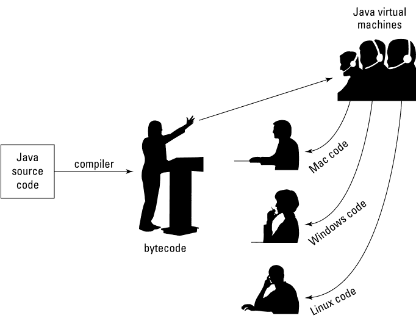

图 2-1：

联合国安理会的一场虚拟会议。

将你的解释器想象成一个虚拟大使。解释器并不真正代表你的国家，但它执行了真实大使的一项重要任务。解释器代表你倾听字节码。解释器执行的是你如果母语言是 Java 字节码时会的操作。解释器假装成 Windows 大使，耐心地听完枯燥的字节码演讲，记录每一个单词并以某种方式对每个单词进行处理。

你有一个解释器 —— 一个虚拟大使。同样，Windows 计算机运行着它自己的字节码解释软件。该软件就是 Java 虚拟机。

Java 虚拟机是一个代理人、一个跑腿的、一个中间人。JVM 在 Java 的“随处运行”字节码与你的计算机系统之间充当了解释器的角色。在它运行时，JVM 会引导你的计算机执行字节码指令。JVM 逐位检查你的字节码，并为你的 Windows 系统、Mac 或 Linux 机器，或者你正在使用的任何种计算机，执行字节码中描述的指令。这是一个好事。这让 Java 程序比任何其他语言都更具移植性。

## 第 1 部分 Java 入门

## Java 2 标准版 1.2 到底是什么？

如果你在网络上到处寻找 Java 工具，你会发现各种奇奇怪怪的名称。你会发现 Java 开发工具包（JDK）、软件开发工具包（SDK）、Java 运行时环境（JRE）以及其他许多令人困惑的名字。

- Java 开发工具包 (JDK) 和软件开发工具包 (SDK) 的名称代表同一工具集的不同版本 —— 该工具集的核心组件是 Java 编译器。
- Java 运行时环境 (JRE) 的名称代表一个工具集，其核心组件是 Java 虚拟机。

如果你在计算机上安装了 JDK，JRE 就会随之安装。你也可以[单独](its own)获取 JRE。事实上，你可以在计算机上拥有 JDK 和 JRE 的多种组合。例如，我的 Windows 计算机目前在 `\program files\Java` 目录下安装了 JDK 1.6、JDK 1.8 和 JRE 8，在 `c:\files (x86)\Java` 目录下安装了 JDK 9。我没有遇到任何版本冲突。如果你怀疑自己正经历版本冲突，最好卸载除最后一个版本之外的所有 JDK 和 JRE 版本（例如 JDK 9 和 JRE 9）。

Java 版本的命名可能会让人困惑。Java 版本的命名并不是“Java 1”、“Java 2”和“Java 3”，而是穿过了一场障碍淘汰赛。这张侧边栏图描述了随时间推移的新 Java 版本的发展。每个 Java 版本都有几个名称。*产品版本*是一个用于全球的官方名称，而*开发者版本*是一个用于标识版本以便程序员进行跟踪的名称。（在非正式对话中，程序员对各种 Java 版本使用各种名称。）*代码代号*是一个更具趣味性的名称，用于在版本创建期间标识该版本。

图中的星号标记了 Java 产品版本命名方式的变化。回溯 1996 年，产品版本是 *Java Development Kit 1.0* 和 Java Development Kit 1.1。在 1998 年，有人决定将该产品命名为 *产品 Java 2 Standard Edition 1.2*，这直到今天仍让所有人感到困惑。当时，任何使用 Java Development Kit 术语的人都被要求改用 Software Development Kit (SDK)。

第 2 章 关于软件的一切 37 页

2004 年，商业界放弃了平台版本名称，2006 年 Java 平台名称去掉了“2”和“.0”。

到目前为止，Java 程序员面临的最重大变化发生在 2004 年。随着 JSE 5.0 的发布，Java 的监管者通过添加新功能对语言进行了更改 —— 这些功能包括泛型、注解和增强型 for 语句。（有关 Java 注解的应用，请参阅第 8、9 和 16 章。关于增强 for 泛型的使用示例，请参阅第 11 和第 12 章。）

书中的大多数程序仅在 Java 5.0 或更高版本上运行。它们不会在任何早于 Java 5.0 的版本上运行。特别是，它们不会在 Java 1.4 或 Java 1.4.2 上运行。书中的某些示例不在 Java 9 或更低版本上运行。但不要太担心 Java 版本。Java 6 或 7 总比完全没有 Java 好。即使没有最新的 Java 版本，你也可以学到很多。

| 平台 | 代码代号 | 特性 |
| --- | --- | --- |
| 1995 (Beta) | | 内部类、JavaBeans、反射 |
| 1996 JDK*1.0 | | 用于创建 GUI 界面的 Swing 类 |
| 1997 JDK 1.1 | | |
| 1998 JSE*1.2 | Playground | |
| 1999 | | Java 命名和目录接口 (JNDI) |
| 2000 JSE 1.3 | Kestrel | |
| 2002 JSE 1.4 | Merlin | |
| 2004 JSE 5.0 | Tiger | 泛型、注解、增强 for、去- |
| 2005 JSE 6 | Mustang | 脚本支持、性能增强 |
| 2011 JSE 7 | Dolphin | |
| 2014 JSE 8 | | |
| 2017 JSE 9 | Jigsaw | 模块化、JShell |

第 1 部分 Java 入门

## 开发软件

这一切以前发生过，而且将再次发生。

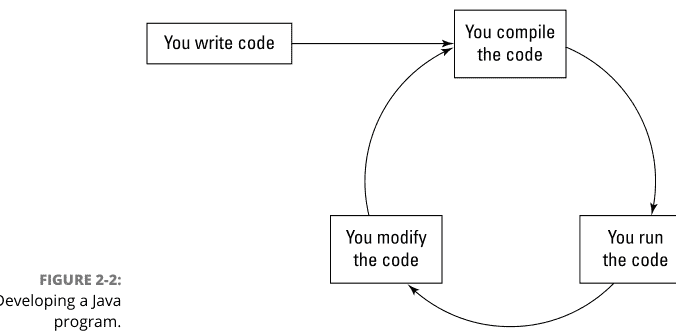

当你创建一个 Java 程序时，你会重复这些步骤。图 2–2 描述了这一循环。

首先，你编写一个程序。在写完初稿后，编译、运行并修改该程序。有了一点经验，编译和运行步骤就会变得简单。在很多情况下，点击一下即可开始编译。

然而，编写初稿和修改代码并不是一键即可完成的任务。

> 当你的代码初稿不起时，千万不要灰馁。同样，当你的代码第 25 个草稿不起时，永远不要灰馁。

有关编译和运行 Java 程序的详细说明，请访问本书网站 (www.allcode.com/JavaFor)。

当人们谈论编写程序时，使用图 2–2 中的措辞。他们说，“你编译代码”以及“你运行代码”。但“你”并不总是准确，而且“代码”在循环的每个部分略有不同。图 2–3 稍微详细地描述了图 2–2 中的循环。

第 2 章 关于软件的一切 39 页

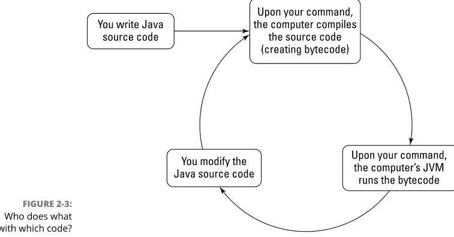

对于大多数人的需求，图 2-3 包含的信息太多。如果我点击运行图标，我不必记住计算机在代表我运行代码。而且我称之为计算机可以运行我的原始 Java 代码或原始 Java 代码的某些字节码。事实上，在书中很多地方，我随口写道“当你运行 Java 代码时”或“当计算机运行你的 Java 程序时”。不看图 2-3 你也能过上幸福的生活。图 2-3 的唯一用途是在图 2–2 中的松散措辞困惑你时提供帮助。

## 什么是集成开发环境？

> 集成开发环境帮助你管理 Java 代码，并为你的编写、编译和运行代码提供了方便的方法。 —— BARRY BURD，《JAVA FOR DUMMIES》，第 7 版

在过去，编写和运行 Java 程序涉及多个窗口 —— 一个编写程序的窗口，另一个运行程序的窗口，可能可能还有第三个窗口用于跟踪你编写的所有代码。（参阅图 2-4。）

集成开发环境将所有这些功能无缝地整合到一个组织良好的应用程序中。（参阅图 2-5。）

图 2-4：

在没有集成开发环境的情况下编写代码。

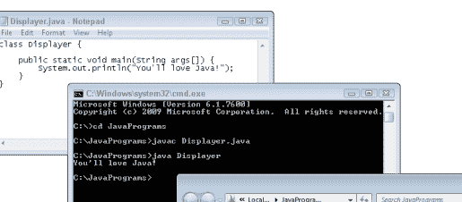

图 2-5：

使用 Eclipse 集成开发环境编写代码。

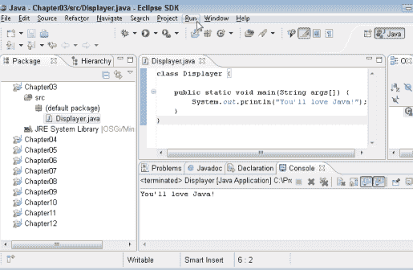

Java 也有许多自己的集成开发环境，如 Eclipse、IntelliJ IDEA 和 NetBeans。许多环境包含各种组件，让你以视觉化的方式设计图形界面。（参见图 2-6）。

要运行程序，你可能需要点击工具栏上的按钮或从菜单中选择。要编译程序，你可能什么都不用做。（你甚至可能不需要命令。某些 IDE 会在你输入代码时自动编译你的代码。）

有关安装和使用集成开发环境的帮助，请参阅本书书的网站（www.allmycode.com/JavaForDummies）。


第 2 章 关于软件的一切 41

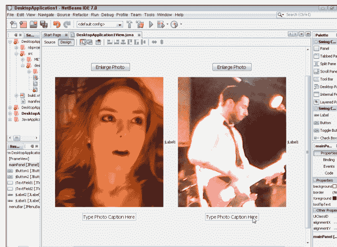

图 2-6：

在 NetBeans IDE 中使用拖放式 GUI 生成器。

42 第一部分 Java 入门

# 本章内容

>> 学习 Java 语言：API 和语言规范
>> 初探 Java 代码
>> 了解简单程序的组成部分
>> 为你的代码编写文档注释

# 第 3 章

# 使用基础构建模块

> “所有产生巨大影响的思想总是是简单的。
> （All great ideas are simple.）
> —— 列夫·托尔斯泰（LEO TOLSTOY）

这句引言适用于各种事物——如生活、爱情和计算机编程。这就是为什么本章采用了多层次的方法。在本章中，你将了解到关于 Java 编程的首批细节。在发现细节的过程中，你会看到它的简单性。

# 学习 Java 语言

如果你尝试在脑海中勾勒整个英语语言，你会看到什么？也许你看到的是单词、单词、单词。（这是哈姆莱特看到的。）在显微镜下观察语言，你会看到一个接一个单词。这种“单词堆”的形象固然无错，但如果你向后退一步，你可能会看到另外两个东西：

- >> 语言的语法
- >> 成千上万的表达、格言、习语和历史背景

第一类（语法）包含了这类规则，例如，“动词在数和人称上与名词保持一致。”第二类（表达、格言等等）包含了诸类的知识，例如，“朱利斯·凯撒是一位著名的罗马皇帝，所以不要给你的儿子起名叫朱利斯·凯撒，除非你想每天放学后都去挨打。”

Java 编程语言拥有像英语这样的口语语言的所有方面。Java 拥有单词、语法、常用名称、风格习语和其他元素。

# 语法和常用名称

太阳内部微系统公司（Sun Microsystems）创建 Java 的人认为 Java 由两部分组成。正如英语有其语法和常用名称一样，Java 编程语言也有其规范（它的语法）和其编程接口（它的常用名称）。每当我编写 Java 程序时，我的桌上都有两份重要的文档——每个部分一份：

- **Java 语言规范（The Java Language Specification）：** 这份文档包含了如下规则：“始终在单词 *for* 之后放置一个左括号”以及“使用星号来乘以两个数字。”
- **Java 编程接口（The Java programming interface）：** Java 的应用程序编程接口（API）包含了成千上万个在语言语法之后添加到 Java 中的名称，这些名称范围从普通到奇特不一。例如，其中一个名称——`JFrame`——代表你电脑屏幕上的一个窗口。另一个更亮眼的名称 `pow` 帮助你计算 5 的 5 次方，或者计算任何数的任何次次方。其他名称则帮助你监听用户的按钮点击、查询数据库以及各种各样实用的功能。


你可以通过浏览 http://docs.oracle.com/java/specs 来下载语言规范、API 文档以及所有其他 Java 文档（视图文档）。


# 图 2-4

在没有集成开发环境的情况下编写代码。


# 图 2-5

使用 Eclipse 集成开发环境编写代码。


Java 也有许多自己的集成开发环境，如 `Eclipse`、`IntelliJ IDEA` 和 `NetBeans`。许多环境包含各种组件，让你以视觉化的方式设计图形界面（参见图 2-6）。

要运行程序，你可能需要点击工具栏上的按钮或从菜单中选择。要编译程序，你可能什么都不用做（你甚至可能不需要命令。某些 `IDE` 会在你输入代码时自动编译你的代码）。

有关安装和使用集成开发环境的帮助，请参阅本书的网站（`www.allmycode.com/JavaForDummies`）。


# 图 2-6

在 NetBeans IDE 中使用拖放式 GUI 生成器。


# 本章内容

- 学习 Java 语言：API 和语言规范
- 初探 Java 代码
- 了解简单程序的组成部分
- 为你的代码编写文档注释

# 第 3 章：使用基础构建模块

> “所有产生巨大影响的思想总是简单的。”
>
> —— 列夫·托尔斯泰

这句引言适用于各种事物——如生活、爱情和计算机编程。这就是为什么本章采用了多层次的方法。在本章中，你将了解到关于 Java 编程的首批细节。在发现细节的过程中，你会看到它的简单性。

## 学习 Java 语言

如果你尝试在脑海中勾勒整个英语语言，你会看到什么？也许你看到的是单词、单词、单词（这是哈姆莱特看到的）。在显微镜下观察语言，你会看到一个接一个单词。这种“单词堆”的形象固然无错，但如果你向后退一步，你可能会看到另外两个东西：

- 语言的语法
- 成千上万的表达、格言、习语和历史背景

第一类（语法）包含了这类规则，例如，“动词在数和人称上与名词保持一致。”第二类（表达、格言等等）包含了诸类的知识，例如，“朱利斯·凯撒是一位著名的罗马皇帝，所以不要给你的儿子起名叫朱利斯·凯撒，除非你想每天放学后都去挨打。”

Java 编程语言拥有像英语这样的口语语言的所有方面。Java 拥有单词、语法、常用名称、风格习语和其他元素。

## 语法和常用名称

Sun Microsystems 创建 Java 的人认为 Java 由两部分组成。正如英语有其语法和常用名称一样，Java 编程语言也有其规范（它的语法）和其编程接口（它的常用名称）。每当我编写 Java 程序时，我的桌上都有两份重要的文档——每个部分一份：

- **Java 语言规范（The Java Language Specification）**：这份文档包含了如下规则：“始终在单词 `for` 之后放置一个左括号”以及“使用星号来乘以两个数字。”
- **Java 编程接口（The Java programming interface）**：Java 的应用程序编程接口（`API`）包含了成千上万个在语言语法之后添加到 Java 中的名称，这些名称范围从普通到奇特不一。例如，其中一个名称——`JFrame`——代表你电脑屏幕上的一个窗口。另一个更亮眼的名称 `pow` 帮助你计算 5 的 5 次方，或者计算任何数的任何次方。其他名称则帮助你监听用户的按钮点击、查询数据库以及各种各样实用的功能。


你可以通过浏览 `http://docs.oracle.com/java/specs` 来下载语言规范、`API` 文档以及所有其他 Java 文档。

Java 的第一部分，语言规范，相对较小。这并不意味着你不会花费大量时间去研究如何使用语言规范中的规则。然而，其他编程语言的规则数量可能是两倍、三倍甚至十倍。

Java 的第二部分——`API`——可能会因为规模巨大而令人望生畏。`API` 包含了成千上万个名称，并随着每一个 Java 语言版本的发布而不断增长。挺可怕的，吧？好吧，好消息是，你不需要背记它们。你用到的，你就会记住；没用到的，你就会忘记。无论我是在编写 Java 程序时，我都会记住（例如：“朱利斯·凯撒是一位著名的罗马皇帝，所以不要给你的儿子起名叫朱利斯·凯撒，除非你想每天放学后都去挨打。”）

这些名称随每个 Java 版本一同发布，因此任何编写 Java 程序的人都可以使用这些名称。此类名称的示例有 `String`、`Integer`、`JWindow`、`JButton`、`JTextField` 和 `File`。

严格来说，Java `API` 中标识符的含义并不是固定不变的。虽然你可以为 `JButton` 起自己的名字，但这并不是一个好主意。如果你这样做，你会让其他程序员非常困惑，因为他们使用标准的 `API` 映射了这些熟悉的标识符。更糟糕的是，当你的代码为像 `JButton` 这样的标识符分配名称时，你失去了 `API` 代码中为该标识符创建的计算能力。Sun Microsystems、Oracle、Java 社区进程（`JCP`）和 Open 项目的程序员已经完成了所有处理按钮的 Java 代码。如果你给 `JButton` 分配了自己的含义，你就是背离了创建 `API` 所取得的所有进展。

要查看 Java 关键字列表，请访问本书的网站：`www.allmycode.com/JavaForDummies`。

### 第一次查看 Java 代码

当你第一次看别人的 Java 程序时，你可能会感到有些不适。意识到你不理解代码中的某些内容（或许多内容）会让你感到紧张。我见过成百上千（也许是数千）个 Java 程序，当我开始阅读别人的代码时仍然感到不安全。

事实是，了解一个 Java 程序是一个自启动的过程。首先，你对这个程序感到惊叹不已。然后你运行程序看看它是做什么的。接着，你运行程序一段时间，或者阅读别人对程序及其部分的解释。然后你再多看一会儿，并再次运行程序。最后，你与这个程序达成妥协（不要相信那些说他们从未经历过这些步骤的大佬。即使是经验丰富的程序员在面对新项目时也是缓慢且谨慎的）。

在列表 3-1 中，你将看到一大段 Java 代码（像初级程序员一样，你被要求谦虚地盯着代码看）。在代码中，我放置了一些重要的思想，我将在下一节中详细解释它们。这些思想包括类、方法和 Java 语句的使用。

#### 列表 3-1：最简单的 Java 程序

```java
public class Displayer {

    public static void main(String[] args) {
        System.out.println("You'll love Java!");
    }
}
```

你不需要输入列表 3-1 中的代码（或本书中的任何列表代码）。要下载书中的所有代码，请访问书籍的网站（`www.allmycode.com/JavaForDummies`）。

当你使用 Eclipse IDE 运行列表 3-1 中的程序时，电脑会显示“You'll love Java!”。现在，我承认，仅仅为了在某人的电脑屏幕上出现“You'll love Java”，编写和运行一个 Java 程序就需要大量工作，但任何尝试都必须从某处开始。

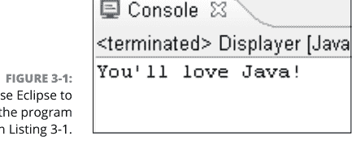

要查看如何运行列表 3-1 中的代码，请访问本书的网站（`www.allmycode.com/JavaForDummies`）。

在接下来的章节中，你将不仅仅是欣赏程序的输出。读完本节后，你将真正理解列表 3-1 中程序运行的原理。

## 理解简单的 Java 程序

本节将介绍、解释、分析、剖析并以其他方式揭示之前在列表 3-1 中所示的 Java 程序。

### Java 类

因为 Java 是一种面向对象的编程语言，你的首要目标是描述类和对象（如果你不确定这一点，请阅读第 1 章中关于面向对象编程的章节）。在那些我感性的特殊日子里，我会告诉人们，Java 在面向对象方面比许多其他所谓的面向对象的语言更纯粹。我之所以这么说，是因为在 Java 中，在你创建某种类之前，你什么也做不了。这就像是在《危险边缘》（*Jeopardy!*）节目中听到 Alex Trebek 说“我们进入广告时间”，然后你打断他说：“抱歉，Alex。在不把你的输入放在类里面的情况下，你无法发布指令。”

列表 3-1 中的代码是一个 Java 程序，该程序描述了一个类。这个程序是我写的，所以我可以为我的新类起一个名字。我选择了 `Displayer` 这个名字，因为程序在电脑屏幕上显示了一行文本。这就是为什么列表 3-1 的第一行包含 `class Displayer` 词（见图 3-2）。

#### 图 3-2：Java 程序是一个类

```java
class Displayer {
    public static void main(String args[]) {
        System.out.println("You'll love Java!");
    }
}
```

Displayer 类

列表 3-1 中的前两个词 `public` 和 `class` 是 Java 关键字（参见本章前面的“Java 程序中的单词”部分）。无论谁写 Java 程序，`public` 和 `class` 这两个词的使用方式始终是相同的。另一方面，列表 3-1 中的 `Displayer` 是一个标识符。我在写这一章时构思了 `Displayer` 这个词。

### 方法

方法是一组被收集并赋予新名称的指令。在列表 3-1 中，`main` 方法包含了程序的核心逻辑。

#### 方法头部与方法体

方法声明由方法头部和方法体组成。方法头部包含修饰符、返回类型、方法名和参数列表。方法体包含在大括号 `{}` 中的代码语句。

#### 程序中的 main 方法

图 3-3 包含了列表 3-1 中代码的副本。代码的大部分包含一个名为 `main` 的方法的声明（只需在代码的方法头部寻找 `main` 单词即可）。暂时不要担心方法头部其他的单词：`public`、`static`、`void`、`String` 和 `args`。我将在接下来的章节中解释这些单词。

##### 图 3-3：main 方法

```java
public class Displayer {
    public static void main(String args[]) {
        System.out.println("You'll love Java!");
    }
}
```

对于任何 Java 方法，`main` 方法都是一个食谱：

```
如何制作饼干：
加热烤箱。
擀面团。
烘烤擀好的面团。
```

或者

```
遵循 Displayer 的主指令：
在屏幕上打印 "You'll love Java!"。
```

`main` 单词在 Java 中起着特殊的作用。特别地，你永远不会编写显式调用 `main` 方法的代码。`main` 单词是程序在运行时自动调用的方法名。

回看图 3-1。当 `Displayer` 程序运行时，计算机会自动找到程序的 `main` 方法并执行方法体内的任何指令。在 `Displayer` 程序中，`main` 方法体只有一条指令。该条指令告诉计算机在屏幕上打印 'You'll love Java!'。因此在图 3-1 中，You'll love Java! 出现在计算机屏幕上。

方法中的指令在方法被调用之前不会执行。但是，如果你给一个方法命名为 `main`，那么该方法就会被自动调用。

几乎每种计算机编程语言都有类似于 Java 方法的东西。如果你用过其他语言，你可能记得子程序（`subprograms`）、过程（`procedures`）、函数（`functions`）、子例程（`subroutines`）和 `PERFORM` 语句等术语。无论在你喜欢的编程语言中称其为什么，方法都是一组被收集并赋予新名称的指令。

### 你最终如何告诉计算机去做某事

在列表 3-1 的核心深处有一行执行计算机直接指令的单行代码。该行在图 3-4 中被突出显示，告诉计算机显示 You'll love Java! 这是一个语句（`statement`）。在 Java 中，语句是告诉计算机执行某事的直接指令（例如，显示此文本、存入该内存位置、创建一个窗口）。

#### 图 3-4：Java 语句

```java
public class Displayer {
    public static void main(String args[]) {
        System.out.println("You'll love Java!");
    }
}
```


# 语句（对 `System.out.println` 方法的调用）

## 第 3 章 使用基本构建块

在 `System.out.println` 中，倒数第二个字符是一个小写字母，而不是数字 1。

当然，Java 有不同种的语句。我在早前的“Java 方法”部分中介绍的方法调用是 Java 语句的类型之一。图 3-3 显示了调用的样子：

```
System.out.println("You'll love Java!");
```

永远不要忘记一个事实：Java 程序首先本质上是一个大纲。

如果你在错误的位置放置大括号，或者在应该有大括号的地方漏掉大括号，你的程序可能完全无法运行。如果你的程序可以运行，它可能也会运行错误。

如果你不以易读的方式对代码行进行缩进，你的程序仍然可以正确运行，但你或其他任何程序员都无法理解你在编写这些代码时在想什么。

如果你是一个视觉型思考者，你可以在脑中勾勒出 Java 程序的大纲。我的一个朋友会想象一个真实的带有编号的大纲演变成一个 Java 程序。（见图 3-6。）另一个人不具名的人则使用了奇特的意象。（见图 3-7。）


**图 3-6：大纲转变为 Java 程序。**

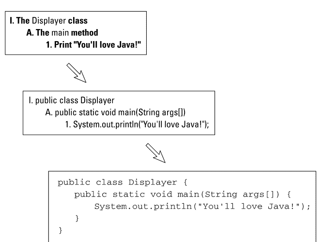

我像其他人一样欣赏好的借口，但不缩进代码是不可原谅的。在许多 Java IDE 中，都有工具可以自动缩进你的代码。访问本书的网站（`www.allmycode.com/JavaForDummies`）获取更多信息。


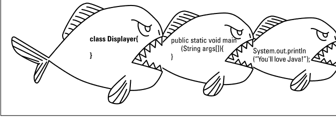

**图 3-7：类比方法大；方法比语句大。**

这里是一些你可以尝试的内容，以帮助你理解本节的内容。这很好。如果尝试这些内容增强了你的信心，很好；如果尝试这些内容让你对所读内容产生疑问，那很好。如果尝试这些内容让你感到紧张，不要气馁。你可以在本书的网站（`www.allmycode.com/JavaForDummies`）找到答案和其他帮助。你也可以通过电子邮件向我提问（`JavaForDummies@allmycode.com`）。

- 如果你从本书的网站下载了代码，将 Listing 3-1（从下载的 03-01 文件夹中）导入你的 IDE。如果你不计划下载代码，请在 IDE 中创建一个新项目。在新项目中，创建一个名为 `Display` 的类，并使用 Listing 3-1 中的代码。使用下载的项目或你自己新创建的项目，运行程序，并在输出中寻找“You'll love Java!”这些单词。
- 尝试运行 Listing 3-1 中的代码，但将文本“You'll love Java!” 更改为“No more baked beans!”。发生了什么？
- 尝试运行 Listing 3-1 中的代码，将单词 `public`（全小写）改为 `Public`（首字母大写）。发生了什么？
- 尝试运行 Listing 3-1 中的代码，将单词 `main`（全小写）改为 `Main`（首字母大写）。发生了什么？
- 尝试运行 Listing 3-1 中的代码，将单词 `System`（首字母大写）改为 `system`（全小写）。发生了什么？
- 尝试运行 Listing 3-1 中的代码并更改缩进。例如，不要对任何行进行缩进。此外，为了保险，删除掉第一个大括号和单词 `public` 之间的换行符（使代码变为 `public class Display { ... }`）。发生了什么？
- 尝试运行 Listing 3-1 中的代码，将单词 `println` 改为 `print1`（结尾处是数字 1）。发生了什么？
- 尝试运行 Listing 3-1 中的代码并缺少分号。发生了什么？

## 第 1 部分 Java 入门

- 尝试运行 Listing 3-1 中的代码，在某些行的末尾添加额外的分号。发生了什么？
- 尝试运行 Listing 3-1 中的代码，将文本“You'll love Java!” 更改为“ Use a straight quote ”（使用直引号），而不是弯引号 ””。发生了什么？

## 现在，有几点评论

人们聚集在篝堆旁，听一个关于程序员的旧传说，那个程序员因为懒惰而陷入了麻烦。为了保持这位程序员的匿名性，我称她为 Jane Pro。Jane 花费了几个月来创造圣杯：一个能够独立思考的程序。如果完成，这个程序就可以独立工作，在没有人类干预的情况下学习新事物。日复一日，夜复一夜，Jane Pro 努力赋予程序那闪发创造性、独立思考的火花。

一天，当她几乎完成项目时，她收到了来自她健康保险公司的一封令人不安的邮件。不，邮件不是关于严重的疾病，而是关于一次例行的办公室访问。保险公司的理赔单上有一个填写 Jane 出生日期的地方，或者如果她的出生日期自上次申请理赔以来发生了变化。她心不在焉地在出生年份上涂鸦了 2016，因此保险公司拒绝支付账单。

Jane 拨了保险公司的电话。在 20 分钟内，她和一位真人通了电话。“抱歉，”真人说，“要解决这个问题，你必须拨打另一个号码。”好了，你能猜到接下来发生了什么吗。“抱歉。接待员给了你正确的号码。”接着又是，“抱歉。你必须拨打原始号码。”

五个月后，Jane 的耳朵痛了，在打了 800 小时电话后，她得到了一个初步承诺，即保险公司最终会重新处理该理赔单。她虽然非常喜悦，但急于回到她的编程项目中。她还能记得所有代码行原本是要做什么的吗？

不，她记不起来。Jane 盯着自己的工作看，就像第二天早上一个毫无意义的梦一样，这些代码对她来说完全没有意义。她写了一百万行代码，但没有一行代码配有有用的解释性注释。她没有留下任何帮助她理解自己在想什么的线索，因此在挫丧中，她放弃了整个项目。

## 在你的代码中添加注释

Listing 3-6 是本章示例程序的增强版本。除了所有的关键字、标识符和标符号外，Listing 3-6 还有为了人类的内容。

### 列表 3-6: 三种注释

```java
/*
 * Listing 3-6: Java For Dummies
 * Copyright ©2017 Wiley Publishing, Inc.
 * 保留所有权利
 *
 * Displayer 类在屏幕上显示文本。
 */
public class Displayer {

    /**
     * main 方法是执行起点。
     * @param args 命令行参数
     */
    public static void main(String[] args) {
        System.out.println("I love Java"); // 行尾注释
    }
}
```

注释是程序内部的特殊文本区域，目的是帮助人们理解程序。Java 编程语言有注释：

- **传统注释**：Listing 3-6 的前五行形成了一个注释。注释以 `/*` 开始，以 `*/` 结束。`/*` 和 `*/` 之间的内容仅供人类阅读。
- **行尾注释**：Listing 3-6 中的 `// You` 是一个行尾注释。行尾注释以斜杠开始，到行尾结束。再次，编译器不翻译行尾注释中的文本。
- **Javadoc 注释**：Javadoc 注释以 `/**` 开始。Listing 3-6 有两个 javadoc 注释：一个关于 `Displayer` 类，另一个关于 `main` 方法。

Javadoc 注释是一种特殊的注释，旨在供那些从不看 Java 代码的人阅读。但这看起来不合逻辑。如果你不看 Listing 3-6，如何看到 Listing 3-6 中的 javadoc 注释呢？

嗯，一个名为 `javadoc` 的程序可以找到 Listing 3-6 中所有的 javadoc 注释，并将这些注释转换为一个漂亮的网页。页面 3-8 显示了该页面。


Javadoc 注释非常棒。关于它们有几点：

- 只有编写代码的程序员才需要看 Java 代码。使用代码的其他其他人可以通过查看生成的页面来了解代码的功能。
- 因为其他人不看 Java 代码，所以他们就不会对 Java 代码进行更改。（也就是说，其他人不会向现有的 Java 代码中引入错误。）

> 程序员并没有创建两个独立的文件——在这里写一些 Java 代码，在另一处写一些关于代码的文档。相反，程序员创建一段 Java 代码，并将文档（以 javadoc 注释的形式）直接嵌入到代码中。

最好的是，从 javadoc 生成网页是自动完成的。每个人的文档都具有相同的格式。无论你使用什么 Java 代码，你都可以通过阅读图 3-8 这样的页面来了解代码。幸运的是，图 3-8 中的格式对于任何使用 Java 的人来说都是熟悉的。

你可以从你需要的 javadoc 注释生成你自己的网页。要了解如何操作，请访问本书的网站（`www.allmycode.com/JavaForDummies`）。


```
PACKAGE CLASS LIST TREE DEPRECATED INDEX HELP
PREV NEXT CLASS FRAMES NO-HIERARCHY ALL CLASSES
SUMMARY NESTED|FIELD(COUNT) CONSTRUCTOR(COUNT) DETAIL-FIELD|CONSTRUCTOR(COUNT)|METHOD
class Dispatcher
 Inner Class
Dispatcher
public class Dispatcher
  private String[] testNames;
The Dispatcher class displays test on the computer screen.
Version
1.0 (23/16)
Author
Harry Burr
Since
System

Constructor Summary
Dispatcher()
Constructor and Description
Dispatcher()

Method Summary
Static Methods | Instance Methods
Method and Type
static void
  main(String[] args)
The main method starts the execution of the code-blocks.
Methods Inherited from java.lang.Object
equals, hashCode, notify, notifyAll, toString, wait, wait

Constructor Detail
Dispatcher()
  public Dispatcher()

Method Detail
main
  public static void main(String[] args)
The main method starts execution of the code-blocks.
Parameters
  args -- String class[11].
```

**图 3-8：根据列表 3-6 中的代码生成的 javadoc。**

# 第一部分 开启 Java 之旅

## Barry 有什么借口吗？

多年来，我一直告诉我的学生在代码中编写注释，多年来，我一直在编写带有注释的示例代码（如列表 3-1 中的代码）。为什么要这样做？

三个简单的字：了解你的受众。当你编写复杂的、现实世界的代码时，你的受众是其他程序员、信息技术经理以及需要帮助解读你所做工作的人。当我编写这类代码的简单示例时，我的受众是——初级 Java 程序员。与其阅读我的注释，不如说最好的策略是盯着我的 Java 语句——那些由 Java 编译器解读的语句。这就是为什么我在书的列表里写了如此少的注释。

此外，我有点懒。

## 使用注释对你的代码进行实验

你可能会听到程序员谈论对代码的某些部分进行注释。当你正在编写程序且某部分代码运行不正常时，尝试删除部分代码通常会有帮助。至少起码，你会发现当删掉你认为有问题的代码时会发生什么。当然，你可能不喜欢代码被删除后的结果，所以你不想完全删除代码。相反，将你普通的 Java 语句转换为注释。例如，你将语句

```
System.out.println("I love Java");
```

转换为注释：

```
// System.out.println("I love Java");
```

这种更改让你在尝试找出程序错误时，让 Java 编译器看不到这些代码。

传统的注释对代码进行注释并不有用。最大的问题是你可以不能将一个传统的注释嵌套在另一个注释中。假设你想注释掉以下语句：

```
System.out.println("Parents,");
System.out.println("pick your");
/*
 * 刻意显示为四行
 */
System.out.println("battles");
System.out.println("carefully!");
```

如果你尝试将这段代码转换为一个传统的注释，你会得到下面的乱码：

```
/*
System.out.println("Parents,");
System.out.println("pick your");
*/
* 刻意显示为四行
*/
System.out.println("battles");
System.out.println("carefully!");
*/
```

第一个 `/*`（在显示 之后）过早结束了传统的注释。然后 battles 和 carefully 语句没有被注释，而最后一个 `*/` 让编译器崩溃。你不能互相嵌套传统的注释。正因如此，我建议将行注释作为实验代码的工具。

大多数 IDE 都可以自动为你注释代码的章节。详情请访问本书的网站（`www.allmycode.com/JavaForDummies`）。


## 编写自己的 Java 程序

## 本部分中 ...

创建新值并修改现有值。

将决策逻辑放入你的应用程序中。

在程序运行时根据需要重复操作。

+ 本章
>> 给事物赋值
>> 让事物存储特定类型的值
>> 应用运算符获取新值

## 第 4 章 充分利用变量及其值

以下 Van Doren 先生和 Barasch 先生之间的对话从未发生过：

+ * Charles：海水母吃掉了了自己的大脑，将自己从动物变成了植物。
- Jack：这是你的最终答案吗？
- Charles：是对的。
- Jack：你今天账户里有多少钱？
- Charles：我的账户里有五十美元二十二分。
- Jack：你最好去给 IRS，因为你的海水母答案是正确的。你刚刚往账户里存了一百万。你对此怎么看？
- Charles：我亏了诚实和努力，Jack。

这段对话的某些方面可以用几行 Java 代码表示。

## 变量

无论你如何获得这一百万，都可以使用变量来统计财富。列表 4-1 显示了代码。

### 列表 4-1：使用变量

```
amountInAccount = 50.22;
amountInAccount = amountInAccount + 1000000;
```

不需要手动输入列表 4-1 中的代码（或书中的任何列表）。要下载本书的所有代码，请访问网站（`www.allmycode.com/JavaForDummies`）。

列表 4-1 中的代码使用了 `amountInAccount` 变量。变量是一个占位符。你可以向变量放入数字 50.22。在变量中放入数字后，你可以改变主意并放入不同的数字（这就是变量的变化）。当然，当你向变量放入新数字时，旧数字就不存在了。如果你没有把代码保存到其他地方，旧数字就消失了。

图 4-1 提供了列表 4-1 代码执行后的对比图。执行列表 4-1 的第一个语句后，变量 `amountInAccount` 的值为 50.22。然后，执行列表 4-1 的第二个语句后，`amountInAccount` 突然变成了 1000050.22。当你考虑到变量时，想象计算机内存中一个存储着 50.22、1000050.22 或任何内容的地方。在图 4-1 的左侧，想象那个有 50.22 的盒子被数百万个其他盒子所包围。

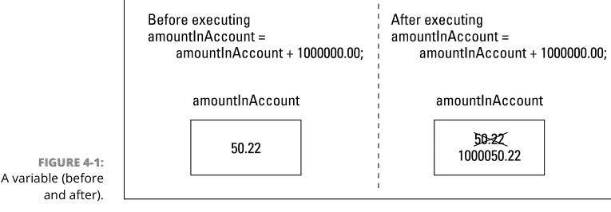

| 执行前 | 执行后 |
| :--- | :--- |
| amountInAccount = amountInAccount + 1000000.00; | amountInAccount = amountInAccount + 1000000.00; |
| amountInAccount | amountInAccount |
| 50.22 | 1000050.22 |

## 赋值语句

像列表 4-1 中那样的语句被称为赋值语句。在赋值语句中，你将一个值赋给某个东西。在很多情况下，这个“某个东西”是一个变量。

我建议养成从右向左阅读赋值语句的习惯。图 4-2 演示了列表 4-1 中第一行的作用。

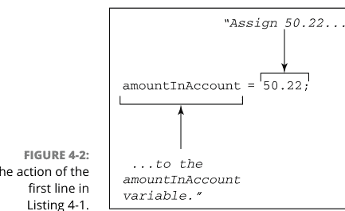

列表 4-1 中的第二行稍微复杂一点。图 4-3 演示了列表 4-1 中第二行的作用。

在赋值语句中，被赋值的物体始终位于等号的左侧。


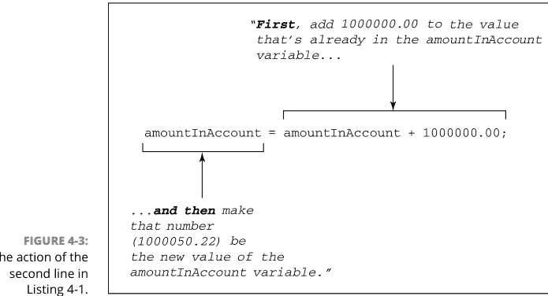

## 变量可能具有的值类型


# 变量及其值

你是否见过那些电视广告，让你觉得自己正在计算机内部的电路之间飞行？很酷，对吧？这些广告显示了 0（零）和 1（一）在穿梭，因为 0 和 1 是计算机唯一能处理的内容。当你认为计算机正在存储字母 J 时，计算机实际上在存储 `0101010`。一切都是 0 和 1 的序列。正如每个计算机所知道的那样，一个 0 或 1 被称为位（bit）。

事实证明，代表字母 J 的序列 `01010010` 也可以代表数字 74。同样的序列也可以代表 `1.0369608636003646 × 10⁻⁴³`。事实上，如果这些位被解释为屏幕像素，相同的序列可以用来表示图 4-4 中的点。`01011010` 的含义取决于软件解释这一串 0 和 1 序列的方式。

图 4-4：八个黑白像素的极特写。

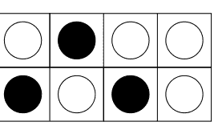

你如何告诉计算机 `01011010` 代表什么？答案就在“类型”（type）的概念中。变量的类型是变量允许存储的值的范围。

我从列表 4-1 中复制了这些行，并将它们放入一个完整的 Java 程序中。该程序位于列表 4-2。当我运行列表 4-2 中的程序时，我得到了图 4-5 所示的输出。

| 列表 4-2： | 使用 amountInAccount 的程序 |

```java
public class Millionaire {

    public static void main(String args[]) {
        double amountInAccount;
        amountInAccount = 50.22;
        amountInAccount = amountInAccount + 1000000.00;
    }
}
```

## 列表 4-2：（续）

```java
System.out.print("You have $$");
System.out.print(amountInAccount);
System.out.println(" in your account.");
```

## 图 4-5：运行列表 4-2 中的程序。

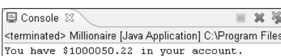

在列表 4-2 中，看主体部分的第一行：

```java
double amountInAccount;
```

这一行是一个变量声明。这一行告诉计算机我要声明一个名为 `amountInAccount` 的变量，其类型为 `double`。在程序中，`double` 关键字告诉计算机我意图在 `amountInAccount` 中存储范围在 `-1.8 × 10⁸` 到 `1.8 × 10⁸` 之间的数值。在列表 4-2 中，如果我没有将 `amountInAccount` 声明为 `double` 类型，我就无法存储 `50.22`。相反，我将只能存储没有任何小数点的整数 `50`。

另一种类型——`float`——允许你拥有小数点的数值。但 `float` 值没有 `double` 准确。

## 小数点数字

Java 有两种带有小数点的类型：`double` 和 `float`。那么它们的区别是什么？当你将一个变量声明为 `double` 时，你是在告诉计算机跟踪 64 位。当你将其声明为 `float` 时，计算机只跟踪 32 位。

在许多情况下，你都有选择。你可以将值声明为 `float` 或 `double`。但对于如今的精良处理器，为了节省空间而使用 `float` 是不值的。对于大多数程序，直接使用 `double` 即可。更多细节，请参见旁边的侧栏“小数点数字”。

列表 4-2 中的百万大奖令人印象深刻。但列表 4-2 并没有显示处理金额的最佳方法。在 Java 程序中表示货币的最佳方法是使用名为 `BigDecimal` 的类型。更多信息，请访问本书的网站（www.allcode.com/JavaForummies）。

## 显示文本

列表 4-2 中的最后三个语句使用了一种新的格式技巧。你想在屏幕上单行显示多个不同的项目。你将它们放在单独的语句中。但所有的最后都是对 `System.out.print` 的调用。（最后一条是 `System.out.println` 的调用。）`System.out.print` 的调用在行的一部分显示内容，并将光标留在行尾。执行 `System.out.print` 后，光标仍在同一行末尾，可以让 `System.out.whatever` 在同一行继续打印。通过多次调用 `print` 并在最后以一次 `println` 结尾，结果就是一行美观的输出。

运行列表 4-2 中的代码，以确保它在你的计算机上正确运行。

然后观察在进行以下更改后会发生什么：

- 给代码中的数字 `1000000.00` 添加千分位分隔符。例如，如果你居住在美国（那里千分位分隔符是逗号），请将数字改为 `1,000,000` 并看看会发生什么。（提示：不会发生什么好事。）
- 尝试在代码中使用下划线作为千分位分隔符。即，将 `100000.00` 更改为 `1_000_000.00` 并看看会发生什么。
- 给代码中的数字 `50.22` 添加货币符号。例如，如果你居住在美国（那里货币符号是 `$`），看看当你将第一个赋值语句改为 `amountInAccount=$50.22` 时会发生什么。
- 列表 4-2 有两个 `System.out.print` 语句和一个 `System.out.println` 语句。将所有三个都改为 `System.out.println`，然后运行程序。
- 列表 4-2 中的代码在输出中显示一行文本。使用 `amountInAccount` 变量，为程序添加语句，使其显示第二行文本。让第二行文本的内容为“Now you have even more! You have 2000000.00 in your account”。

# 没有小数点的数字

> “在 1995 年，平均家庭有 2.3 个孩子。”

此时，一个聪明的人总会想起，没有任何一个真实的家庭恰好有 2.3 个孩子。虽然数字在这个世界上起着作用。因此，在 Java 中，你可以声明一个变量来只存储整数。列表 4-3 显示了一个使用数字变量的程序。

## 列表 4-3：使用 int 类型

```java
public class ElevatorFitter {

    public static void main(String args[]) {
        int weightOfAPerson;
        int elevatorWeightLimit;
        int numberOfPeople;
    }
}
```

## 列表 4-3：（接上）

```java
weightOfAPerson = 150;
elevatorWeightLimit = 1400;
numberOfPeople = elevatorWeightLimit / weightOfAPerson;

System.out.print("You can fit \n");
System.out.print(numberOfPeople);
System.out.println(" people on the elevator.");
```

列表 4-3 中程序背后的故事需要大量的解释。情况如下：

你有一部容量为 1400 磅的酒店电梯。一个周末，酒店举办了 Brenchicker 家族聚会。Brenchicker 家族的一支幸运生了一组相同的十胞胎（十个兄弟姐妹具有相同的身体特征）。通常情况下，每个 Brenchicker 十胞胎的重量恰好是 145 磅。但周六，家里吃了一顿盛大的自助午餐，因为午餐包含了草莓快捷蛋糕，每个 Brenchicker 十胞胎的重量变成了 150 磅。午餐后，十个 Brenchicker 十胞胎在同一时刻到达了电梯。（为什么不呢？他们想得都一样。）所以，问题是，有多少个胞胎能挤进电梯？

现在记住，如果你在电梯上放置超过 1,400 磅的重量，电梯钢索就会断裂，导致电梯上的所有十胞胎坠入突然（代价昂贵的）死亡。

Brenchicker 谜题的答案（列表 4-3 程序的输出）如图 4-6 所示。

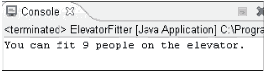

图 4-6：拯救 Brenchicker 家族。

在 Brenchicker 电梯模型的核心，你使用的是整数——即小数点后没有数字的数字。当你用 1,400 除以 150 时，你得到 9⅓，但你不应该认真对待这 1/3。无论你如何努力，你无法在电梯上多挤进一个重 50 磅的 Brickbacker 十胞胎。这一事实在 Java 中得到了很好的反映。声明三个变量（`weightOfAPerson`、`elevatorWeightLimit` 和 `numberOfPeople`）都是 `int` 类型。一个 `int` 值是一个整数。当你用一个值除以另一个值时（如你在列表 4-3 中使用斜杠那样），你会得到另一个 `int`。当你用 1,400 除以 150 时，你得到 9-1/3。你在图 4-6 中可以看到这一点。以下语句共同在屏幕上显示 9：

```java
int numberOfPeople = elevatorWeightLimit / weightOfAPerson;

System.out.print(numberOfPeople);
```

我和妻子是在 2 月 29 日结婚的，所以我们每四年才有一个周年纪念。写一个名为 `years` 变量的程序。根据 `years` 的值，程序显示我们的周年纪念次数。例如，如果 `years` 的值为 4，程序显示 1。如果 `years` 的值为 7，程序仍然显示 1。但如果 `years` 的值为 8，程序显示 2。


# 声明与初始化

回到列表 4-3。在列表中，你看到了三个变量：

```java
int weightOfAPerson, elevatorWeightLimit, numberOfPeople;
```

## 存储数字的方法

Java 有四种类型。这些类型是 `byte`、`short`、`int` 和 `long`。唯一的区别在于大小。如果你需要大于 127 的数字，使用 `short`。如果你需要大于 32767 的数字，使用 `int`。如果你需要大于 2147483647 的数字，使用 `long`。


# 使用 JShell

列表 4-2 和 4-3 中的程序都以同样老旧的调调开头：

```java
public class SomethingElse {

  public static void main(String args[]) {
```

## Java 程序需要

- 整个程序是一个类。
- `main` 方法在程序启动时被调用。

我在第 3 章中解释了这一切。

总之，在编辑器窗口中重打这些模板代码很烦人，尤其是当你的目标只是测试几个状态时。为了解决这个问题，Java 的维护者在 Java 9 中推出了一个新工具。他们称之为 JShell。

启动 JShell 的指令因计算机而异。关于你计算机上有效的指令，请访问本书网站（www.allmycode.com）。

当你使用 JShell 时，很少输入整个程序。相反，你输入一条 Java 语句，然后 JShell 响应你的语句，然后你输入第二个语句，然后 JShell 响应第二个语句，以此类推。单个语句就足以获得 JShell 的响应。

JShell 只是语言读取-求值-打印循环（REPL）的一个例子。许多编程语言都有 REPL，而从 Java 9 开始，Java 语言终于有了自己的 REPL。

在图 4-7 中，我使用 JShell 来发现 JShell 如何响应列表 4-2 和 4-3 中的赋值语句。

当你运行 JShell 时，对话大致如下：

```
jshell> 你输入语句
jshell 响应

jshell> 你输入另一个语句
jshell 响应
```

例如，在图 4-7 中，我输入 `double amountAccount` 然后按回车。JShell 的响应是显示：

```
amountAccount == 0.0
```

```
jshell double amountInAccount
amountInAccount => 0.0

jshell amountInAccount = 50.22
amountInAccount => 50.22

jshell amountInAccount = amountInAccount + 1000000.00
amountInAccount => 1000050.22

jshell int weightOfAPerson, elevatorLimit
weightOfAPerson => 0
elevatorLimit => 0

jshell weightOfAPerson = 150
weightOfAPerson => 150

jshell elevatorLimit = 1400
elevatorLimit => 1400

jshell elevatorLimit / weightOfAPerson
$ => 9

jshell $ + 1
$ => 10

jshell $ 42 + 7
$ => 49

jshell =>
```

图 4-7：我与 JShell 之间的亲密对话。

这里有几点你不需要编写整个 Java 程序：

> 你不需要编写整个 Java 程序。

输入几条语句，例如：

```
double amountInAccount
amountInAccount = 50.22
amountInAccount = amountInAccount + 1000000.00
```

就能达到效果。这就像运行列表 4-1 中的代码段一样（除了列表 4-1 没有将 `amountInAccount` 声明为 `double` 类型）。

在 JShell 中，分号是可选的。

在图 4-7 中，我在这九行代码中只在其中一行的末尾输入了分号。

关于在 JShell 中使用分号的建议，请参阅第 5 章。

在你输入每行后，JShell 都会立即响应。

当我将 `amountInAccount` 声明为 `double`，JShell 通过告诉我值为 `0.0` 来响应。当我输入 `amountInAccount = amountInAccount + 1000000.00` 后，JShell 告诉我 `amountInAccount` 的新值为 `1000050.22`。


## 你可以混合来自许多不同 Java 程序的语句。

在图 4-7 中，我混合了来自列表 4-2 和 4-3 的语句。JShell 并不在乎。

## 你可以向 JShell 询问表达式的值。

你不需要将表达式的值赋值给变量。例如，在图 4-7 中，我输入：

```
elevatorWeightLimit / weightOfAPerson
```

JShell 通过告诉我 `elevatorWeightLimit / weightOfAPerson` 的值为 `9` 来响应，JShell 为该值创建了一个临时名称。在图 4-7 中，该名称恰好是 `$8`。因此，在图 4-7 的下一行中，我询问 `$8 +1` 的值，JShell 给了我答案 `10`。

## 你甚至可以不使用变量就从 JShell 获取答案。

在图 4-7 的最后一行，我询问 `42 +7` 的值，JShell 慷慨地回答了答案 `49`。


当你运行 JShell 时，不需要重试已经用过的命令。如果你按下向上方向键，JShell 会显示你最近一次输入的命令。如果你按两次向上方向键，JShell 会显示你输入的倒数第二条命令。以此类推。当 JShell 显示一条命令时，你可以使用左、右方向键移动命令中间的任何字符。你可以修改命令中的字符。最后，当你按下回车键时，JShell 会执行你修改后的命令。

要结束 JShell 的运行，你需要输入 `/exit`（带斜杠）。`/exit` 是你可以给 JShell 的许多命令之一。要询问 JShell 还可以使用哪些类型的命令，请输入 `/help`。

通过 JShell，你可以在将语句放入完整的 Java 程序之前对它们进行测试。这使得 JShell 成为一个非常有用的工具。


访问此书的网站 (www.allmycode.com/JavaForDummies) 获取如何在你的计算机上启动 JShell 的说明。启动 JShell 后，输入图 4-7 中的几行代码。看看输入一些略有不同的行会发生什么。

## 酷的视觉效果去哪了？

列表 4-2 和 4-3 中的程序是基于文本的。基于文本的程序没有窗口、对话框——什么都没有。你看到的只有纯文本。用户输入内容，计算机会在每行输入下方显示响应。

基于文本程序的对面是图形用户界面 (GUI) 程序。图形用户界面 (GUI) 程序有窗口、菜单和其他视觉元素。

## Java 的基本数据类型

| 类型名称 | 字面量看起来像什么 | 取值范围 |
| --- | --- | --- |
| **整数类型** | | |
| `byte` | `(byte)42` | -128 到 127 |
| `short` | `(short)42` | -32768 到 32767 |
| `int` | `42` | -2147483648 到 2147483647 |
| `long` | `42L` | -9223372036854775808 到 9223372036854775807 |
| **小数类型** | | |
| `float` | `42.0F` | -3.4 × 10⁸ 到 3.4 × 10⁸ |
| `double` | `42.0` | -1.8 × 10⁸ 到 1.8 × 10⁸ |


| 字符类型 | | |
|---|---|---|
| `char` | `'A'` | 数千个字符、符号和符号 |

| 逻辑类型 | | |
|---|---|---|
| `boolean` | `true` | `true`, `false` |

## `char` 类型

几十年前，人们认为计算机只为了大数字计算。现在没人这么认为了。所以，如果你过去的 20 年里没有待过机房，你就知道计算机存储字母、标点符号和其他字符。

用于存储字符的 Java 类型被称为 `char`。列表 4-4 有一个使用 `char` 类型的简单程序。图 4-8 显示了程序的输出。

## 列表 4-4: 使用 `char` 类型

```java
public class CharDemo {

    public static void main(String[] args) {
        char myLittleChar = 'b';
        char myBigChar = Character.toUpperCase(myLittleChar);
        System.out.println(myBigChar);
    }
}
```

图 4-8：列表 4-4 程序在 Eclipse 控制台中的精彩运行。

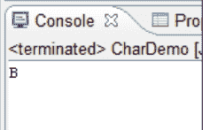

列表 4-4 中，第一次初始化将字母 b 存储在变量 `myLittleChar` 中。在初始化时，注意 b 被单引号包围。在 Java 中，每个 `char` 字面量都以单引号开始和结束。

> 记住，如果你需要区分赋值、声明和初始化这些术语，请参考本章前面的“合并声明并初始化变量”部分。

在列表 4-4 的第二次初始化中，程序调用了一个名为 `Character.toUpperCase()` 的 API 方法。`Character.toUpperCase()` 方法正如其名称所示——该方法产生字母 b 大写形式。这个大写形式（B）等同于变量 `myBigChar`，`myBigChar` 中的 B 会打印在屏幕上。

> 交叉引用：关于 Java 编程接口 (API) 的介绍，请参阅第 3 章。如果你想写以下语句：
>
> ```java
> char myLittleChars = 'barry'; // 不要这样做
> ```
>
> 请抵制这种诱惑。`char` 变量一次只能存储一个字母，你不能在一对单引号之间放置超过一个字母。如果你尝试存储单词或句子（而不仅仅是字母），你需要使用一种名为 `String`（字符串）的东西。
>
> 关于 Java 的 `String` 类型，请参阅本章节后后的“分子与化合物：引用类型”部分。

如果你习惯用其他语言编写程序，你可能了解过所谓的 ASCII 编码。大多数语言使用 ASCII；Java 使用 Unicode 表示法，每个字符只占用 8 位（但在 Unicode 中，每个字符占用 8、16 或 32 位）。ASCII 存储的是罗马（英语）字母表中的字母字母，而 Unicode 有足够的空间容纳世界上大多数常用语言的字符。唯一的问题是，某些 Java API 方法是专门为 16 位 Unicode 设计的。偶尔，这会让你头疼（或者让你迷失措，取决于具体情况）。如果你使用某个方法在屏幕上写 "Hello"，结果却显示了 "Hello wo"，请检查该方法关于 Unicode 字符的文档。


值得注意的是，列表 4-4 中的 `Character.toUpperCase()` 和 `out.println()` 方法用法不同。`toUpperCase()` 方法作为初始化或赋值语句的一部分被调用，而 `System.out.println()` 方法是独立调用的。要了解更多关于此主题的信息，请参见第 7 章中关于返回值的解释。

## `boolean` 类型

`boolean` 变量存储两个值之一：`true` 或 `false`。列表 4-5 展示了 `boolean` 变量的使用。图 4-9 显示了列表 4-5 中程序的输出。

## 列表 4-5：使用 `boolean` 类型

```java
public class ElevatorFitter {

    public static void main(String[] args) {
        System.out.println("True or False?");
        System.out.println("You can fit all ten of them:");
        System.out.println("Brickenchecker duplets");
        System.out.println("on the elevator:");
        System.out.println();
    }

    int weightOfAPerson = 150;
```

（续）

## 列表 4-5：（续）

```java
int elevatorWeightLimit = 1400;
int numberOfPeople = elevatorWeightLimit / weightOfAPerson;

boolean allTenOkay = numberOfPeople >= 10;

System.out.println(allTenOkay);
```

True or False?

You can fit all ten of the

Brickenchecker duplets

on on the elevator:

| false |

图 4-9：

Brickenchecker

detuplets strike again.

在列表 4-5 中，`allTenOkay` 变量的类型是 `boolean`。为了给 `allTenOkay` 变量赋值，程序会检查 `numberOfPeople` 是否大于或等于……（符号 `>=` 表示*大于或等于*）。

在此时，严谨地使用术语是有重要的。Java 程序中任何具有值的部分都是一个*表达式*（expression）。如果你写：

```java
weightOfAPerson = 150;
```

那么 150 就是一个表达式（表达式的值就是数量 150）。如果你写：

```java
numberOfEggs = 2 + 2;
```

那么 2 + 2 是一个表达式（因为 2 + 2 的值是 4）。如果你写：

```java
int numberOfPeople = elevatorWeightLimit / weightOfAPerson;
```

那么 `elevatorWeightLimit / weightOfAPerson` 就是一个表达式。（表达式 `elevatorWeightLimit / weightOfAPerson` 的值取决于执行包含该表达式的代码时变量 `elevatorWeightLimit` 和 `weightOfAPerson` 的任何值。）

> Java 程序中任何具有值的部分都是*表达式*。


66 第二部分 编写自己的 Java 程序

在列表 4-5 中，代码 `numberOfPeople >= 10` 是一个表达式。该表达式的值取决于 `numberOfPeople` 变量存储的值。但正如你从 Brickenicker 家族外餐午会的草莓蛋糕中看到的那样，`numberOfPeople` 的值并不大于等于十。因此，`numberOfPeople >= 10` 的值为 `false`。所以，在列表 4-5 的 `allTenOkay = ...` 赋值语句中，`allTenOkay` 变量被赋值为 `false` 值。

在列表 4-5 中，我可以在 `System.out.println()` 括号内不留内容。当我这样做时，Java 会程序的输出中添加一个换行符。在列表 4-5 中，`System.out.println()` 通知程序显示一个空行。


## 分子与化合物：引用类型

通过组合简单的东西，你会得到更复杂的东西。事物总是这样发展的。以 Java 的一些基本类型为例，将它们混合在一起做一道基础汤，你会得到什么？一个更复杂的类型，称为引用类型。程序 4-6 展示了这一点。图 4-10 显示了发生了什么。

## 列表 4-6：使用引用类型

```java
import javax.swing.*;

public class ShowAFrame {

    public static void main(String args[]) {
        JFrame myFrame = new JFrame();
        myFrame.setTitle("Blank Frame");
        myFrame.setSize(300, 200);
        myFrame.CloseOperation(JFrame.EXIT_ON_CLOSE);
        myFrame.setVisible(true);
    }
}
```

第 4 章 充分利用变量及其值 87

-   在你的计算机上运行列表 4-6 中的代码。

-   在运行列表 4-6 中的代码之前，通过在 `myFrame.setVisible(true)` 语句的左侧立即添加两个正斜杠（//）来将其注释掉。运行修改后的代码会发生什么事情吗？

-   通过改变 `main` 方法体内部语句的顺序来实验列表 4-6 中的代码。这些语句的哪些排列方式是可以的，哪些是不行的？

## 原生类型大杂烩

既然提到了窗口（frames），那么到底什么是窗口呢？窗口是一个具有特定高度、宽度以及在计算机屏幕上具有特定位置的窗口。因此，在 `Frame` 类的声明深处，你可以找到类似这样的变量声明：

```java
int width;
int height;
int x;
int y;
```

这里是另一个例子——时间（Time）。`Time` 类的实例可能有一个小时（1 到 12 之间的数字）、分钟数（0 到 59 之间）和一个字母（a 代表上午；p 代表下午）。

```java
int hour;
int minutes;
char amOrPm;
```

注意，那个高大上的 Java API 类既并不高也不大。一个类是声明的集合。这些声明中的一些是变量。某些变量声明使用原生类型（primitive types），而其他变量声明使用引用类型（reference types）。然而，这些引用类型来自其他类，而那些类的声明包含了变量。这个链条持续下去，最终，一切都以某种方式源自原生类型。

## 导入声明

提前说明你的意图总是好的。考虑以下课堂演讲：

> 今天，在我们的电影史课程中，我们将讨论演员莱昂尔·布莱斯·巴摩尔（Lionel Blythe Barrymore）的职业生涯。
>
> 巴摩尔出生于费城，出演了 200 多部电影，包括《奇妙人生》、《长加港》和《基尔德博士的婚礼日》。此外，巴摩尔还是作家、作曲家和导演。巴摩尔每年在电台里为埃伯内·斯克鲁奇（Ebene Scrooge）配音……

有趣的内容对吧？现在将这些段落与一次讲座对比，在讲座中，老师再次没有通过介绍主题来开头：

> 欢迎回到电影史。
>
> 莱昂尔·巴摩尔（Lionel Barrymore）出生于费城，出演了 200 多部电影，包括《奇妙人生》、《长加港》和《基尔德博士的婚礼日》。此外，巴摩尔（不是埃特尔、约翰或德鲁）是一位作家、作曲家和导演。莱昂尔·巴摩尔每年在电台里为埃伯内·斯克鲁奇配音……

如果没有适当的介绍，演讲者可能不得不不断提醒大家讨论的是莱昂尔·巴摩尔，而不是其他任何巴摩尔。在 Java 程序中也是如此。再次查看列表 4–6：

```java
import javax.swing.JFrame;
public class ShowAFrame {
    public static void main(String[] args) {
        JFrame myFrame = new JFrame();
```

在列表 4-6 中，你在介绍中（在导入声明中）宣布了你正在 Java 类中使用 `JFrame`。通过全名 `javax.swing.JFrame` 来阐明你指的 `JFrame` 是什么。（嘿！）第一位讲师不是也用全名“莱昂尔·赫罗莱特·巴摩尔”澄清过了吗？在导入声明中宣布你的意图后，你就可以在 Java 类代码中使用缩写 `JFrame` 了。

如果你不使用导入声明，你就必须重复完整的 `javax.swing.JFrame` 名称，而不是在代码中使用 `JFrame` 名字。例如，在没有声明的情况下，列表 4–6 的代码看起来像这样：

```java
public class ShowAFrame {
    public static void main(String[] args) {
        javax.swing.JFrame myFrame = new javax.swing.JFrame();
        String myTitle = "Blank Frame";
        myFrame.setTitle(myTitle);
        myFrame.setSize(3200, 200);
        myFrame.setDefaultCloseOperation(javax.swing.JFrame.EXIT_ON_CLOSE);
        myFrame.setVisible(true);
    }
}
```

# 第 2 部分 编写你自己的 Java 程序

这些导入事项的细节可能会非常糟糕。幸运的是，许多 IDE 都为导入声明提供了方便的辅助功能。详情请参阅本书的网站（www.allmycode.com/JavaForDummies）。

本书中的任何单一章节都无法介绍导入声明的完整故事。要开始理清导入声明的一些细微之处，请参阅第 5、9 和 10 章。

## 应用运算符创建新值

还有什么比你的老朋友加号更让你感到安心的呢？这是你小学学到的第一个主题。几乎每个人都知道如何将 2 加到 2。事实上，在英语用法中，2 加 2 是对某件易事的一种比喻。Java 有一个加号。你可以用它来实现好几个用途。你可以用加号来加两个数字，如下所示：

```java
int apples, oranges, fruit;
apples = 5;
oranges = apples + oranges;
```

你还可以使用加号来拼接字符串（String）值：

```java
String startOfThe = "It's three in the morning. I'm dreaming about the " + "course that I failed in school.";
```

这非常有用，因为在 Java 中，你不允许让一个字符串跨越的一行到另一行。换句话说，以下代码将无法工作：

```java
String thisIsBadCode = "It's three in the morning. I'm dreaming about the " + "course that I failed in school.";
```

通过在 JShell 中输入每个表达式来找到以下表达式的值（如果你在启动 JShell 时遇到困难，请创建一个 Java 程序来显示这些表达式的值）：

- `5 / 4`
- `5 / 4.0`
- `5.0 / 4`
- `5.0 / 4.0`
- `"5" + "4"`
- `5 + 4`
- `" " + 5 + 4`

## 初始化一次，赋值多次

列表 4-7 有三行代码将值放入变量 `wasLeft` 中：

```java
int wasLeft = total % 25;

wasLeft = wasLeft % 10;

wasLeft = wasLeft % 5;
```

在这些行中，只有一行是声明语句。另外两行是赋值语句。这是很好的，因为你不能多次声明同一个变量（除非你创建一个名为 `black` 的东西）。如果你在列表 4-7 中写成

```java
int wasLeft = total % 25;

int wasLeft = wasLeft % 10;
```

当你尝试编译代码时，将得到一个错误消息（例如 Duplicate variable Left 或 Variable 'wasLeft' is already defined）。

要了解什么是块（block），请参见第 5 章。对于关于重新声明变量的坦诚讨论，请参见第 10 章。

## 递增和递减运算符

Java 有一些方便的运算符，可以让生活变得更容易（对于计算机处理器、你的大脑以及你的手指都是如此）。总的来说，这类运算符有两个递增运算符和一个递减运算符。递增运算符加 1，递减运算符减 1。递增运算符使用双加号 (`++`)，递减运算符使用双减号 (`--`)。要查看它们是如何工作的，你需要一些示例。第一个示例如图 4-13 所示。

图 4-14 显示了图 4-13 中程序的运行。在这个极其平淡的运行过程中，兔子的代码打印了三次。

双加号作用于两个数字，这取决于你把它们放在哪里。当你把 `++` 放在变量之前时，`++` 被称为**前递增运算符**。（pre 表示在之前。）

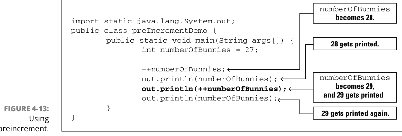

```java
import static java.lang.System.out;
public class preIncrementDemo {
    public static void main(String[] args[]) {
        int numberOfBies = 27;

        ++numberOfBies;
        out.println(numberOfBies);
        out.println(numberOfBies);
    }
}
```


```
<terminated> Preincrement
28
29
29
```

pre 有两种含义：

- 你把 `++` 放在变量之前。
- 计算机在语句的其他任何部分使用变量之前对变量加 1。

为了理解这一点，请看图 4-13 中的加粗行。计算机对 `numberOfBies` 加 1（将 `numberOfBies` 的值增加到 29）。

对于 `out.println(numberOfBies)`，计算机在打印 `numberOfBies` 的新值之前对 `numberOfBies` 加 1。

前递增的替代方案是**后递增**。（post 表示在之后。）post 有两种不同的含义：

- 你把 `++` 放在变量之后。
- 计算机在语句的其他任何部分使用变量之后对变量加 1。

为了更清楚地查看后递增是如何工作的，请看图 4-15 中的加粗行。计算机在屏幕上打印 `numberOfBies` 的旧值（即 28），然后计算机对 `numberOfBies` 加 1，将 `numberOfBies` 的值增加到 29。

通过 `out.println(numberOfBies++)`，计算机在打印 `numberOfBies` 已经有的值之前对 `numberOfBies` 加 1。

图 4-16 显示了图 4-15 中的递增代码。比较图 4-16 和图 4-14 的运行：

- 在图 4-14 的前递增中，第二个数字是 29。
- 在图 4-16 的后递增中，第二个数字是 28。

在图 4-16 中，29 直到运行结束才出现在屏幕上，此时计算机执行了最后一次 `out.println(numberOfBies)`。

| numberOfBies |
| :--- |
| becomes 29. |
| 28 printed. |
| 28 printed, and then numberOfBies becomes 29. |
| 29 printed. |

```java
import static java.lang.System.out;
public class postIncrementDemo {
    public static void main(String[] args[]) {
        int numberOfBies = 27;

        numberOfBies++;
        out.println(numberOfBies);
        out.println(numberOfBies++);
        out.println(numberOfBies);
    }
}
```

FIGURE 4-15: 使用后递增. CHAPTER 4 制作变量及其值

---

在运行以下代码之前，请尝试预测代码的输出将会是什么。然后运行代码以查看你的预测是否正确：

```java
public class Main {
    public static void main(String[] args) {
        int i = 10;
        System.out.println(i++);
        System.out.println(--i);
        --i;
        i--;
        System.out.println(i);
        System.out.println(++i);
        System.out.println(--i);
        System.out.println(i);
        i = ++i;
        System.out.println(i);
        i = i++++;
        System.out.println(i);
    }
}
```

将**粗体文本**一行接一行输入 JShell，并查看 JShell 如何响应。

```
jshell> i = 8
jshell> i++
jshell> i
jshell> i
jshell> i++
jshell> i
jshell> ++i
jshell> i
```

## 赋值运算符

如果你阅读了上一节关于加 1 运算符的内容，你可能会想是否可以操纵这些运算符来加 2、5 或加 1000000。你可以写 `numberOfBunnies++++` 并仍然自称是 Java 程序员吗？嗯，你不能。如果你尝试这样做，在编译代码时会出现错误信息。

你能做什么呢？幸运的是，Java 有许多你可以使用的赋值运算符。通过赋值运算符，你可以对任何数字进行加、减、乘、除。你可以进行酷的操作。列表 4-8 列出了各种赋值运算符（带有等号的内容）。图 4-17 显示了运行列表 4-8 的输出。

## 列表 4-8：赋值运算符

```java
public class UseAssignmentOperators {
    public static void main(String args[]) {
        int numberOfBunnies = 27;
        int numberExtra = 53;

        numberOfBunnies += 1;
        System.out.println(numberOfBunnies);

        numberOfBunnies += 5;
        System.out.println(numberOfBunnies);

        numberOfBunnies += numberExtra;
        System.out.println(numberOfBunnies);

        numberOfBunnies *= 2;
        System.out.println(numberOfBunnies);

        System.out.println(numberOfBunnies -= 7);

        System.out.println(numberOfBunnies = 100);
    }
}
```

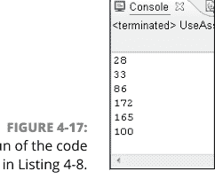

列表 4-8 显示了 Java 赋值运算符是多通用。通过赋值运算符，你可以对变量进行任何数字的加、减、乘除。注意 `+= 5` 如何给 numberOfBunnies 加 5，`*= 2` 如何将 numberOfBunnies 乘以 2。你甚至可以使用另一个表达式的值（在列表 4-8 中，为 numberExtra）作为应用的值。

列表 4-8 的最后两行演示了 Java 赋值运算符的一个特性。你可以将最后一个赋值运算符作为较大语句的一部分。在列表 4-8 的倒数第二行中，该运算符从 numberOfBunnies 中减去 7，将 numberOfBunnies 的值从 172 减少到 165。然后整个赋值操作被嵌入到 System.out.println 的调用中；

看吧，列表 4-8 的最后一行显示了你如何使用 Java 普通的等号完成同样的事情。我所说的位于章节开头的赋值语句实际上是本章中描述的赋值运算符之一。每当你给某个东西赋值时，都可以让该赋值成为较大语句的一部分。

每个赋值运算符的作用与表达式相同。在所有情况下，表达式的值等于你赋值的值。例如，在执行代码 `System.out.println(numberOfBunnies -= 7)` 之前，numberOfBunnies 的值为 172。作为语句，`numberOfBunnies -= 7` 告诉计算机从 numberOfBunnies 中减去 7（因此 numberOfBunnies 的值从 172 变为 165）。作为表达式，`numberOfBunnies -= 7` 的值为 165。所以 `System.out.println(numberOfBunnies -= 7)` 实际上意味着 `System.out.println(165)`。数字 165 显示在计算机屏幕上。


有关此类内容的更深入的解释，请参见本章前面的“语句与表达式”侧边栏。

在运行以下代码之前，请尝试预测代码的输出将会是什么。然后运行代码以查看你的预测是否正确：

```java
public class Main {

    public static void main(String[] args) {
        int i = 10;

        i += 2;
        i = 5;
        i += 6;

        System.out.println(i);
        System.out.println(i);
        System.out.println(i);
        System.out.println(i);
    }
}
```

## 决策（if 语句）

当你编写计算机程序时，你经常需要在不同的路径之间进行选择。Java 有一种方法：if 语句。如果条件为真，则执行语句内部的代码。如果为假，则代码被跳过。

## 第 5 章：做出决策

- 编写语句
- 在之间选择
- 将语句放在内部
- 做出决策
- 控制流

在这三行代码中的所有名称中，只有 `inputNumber` 和 `keyboard` 是我自己命名的的。其他所有名称都是 Java 的一部分。所以，如果我想发挥一下创意，可以这样写这几行代码：

我还可以调整程序的导入声明，就像我在稍后在列表 5-2 和 5-3 中做的那样。除此之外，我没有多少发挥空间。

当你阅读此书时，你将开始识别这三行代码背后的模式，因此我不会用所有的细节来填充这一节。现在，你只需要复制这些行，并在心中记住这个模式即可：

- **当你导入 java.Scanner 时，不需要使用 static 单词。**

但导入 `Scanner` 与导入 `System.out` 不同。当你导入 `java.lang.System.out` 时，你需要使用 `static` 单词。（参见列表 5-1）。区别之所以出现在代码中，是因为 `Scanner` 是一个类的名称，而 `System.out` 不是一个类的名称。

若要快速查看导入声明中 `static` 单词的使用，请参第 4 章关于导入声明的侧边栏：关于该单词的更完整介绍，请参见第 10 章。


- **通常（在台式机或笔记本电脑上），名称 System.in 代表键盘。**

要从键盘以外的其他地方获取字符，你可以在括号内获取 `System.in` 以外的内容。

你还可以在 `new Scanner(...)` 括号内放入什么呢？更多想法，请参见第 8 章。

在列表 5-1 中，我决定将其中一个变量命名为 `keyboard`。`keyboard` 这个名字提醒你（读者），这个变量指的是你电脑前的一组按钮。将某物命名为 `keyboard` 并不会告诉你任何关于塑料按钮或用户输入的信息。另一方面，`System.in` 这个名称始终在告诉 Java 关于那些塑料按钮。列表 5-1 中的代码 `Scanner keyboard = new Scanner(System.in)` 将 `keyboard` 这个名称与我们都熟悉并喜爱的塑料按钮连接在一起。


- **当你期望用户输入一个 int 值（某种整数）时，使用 nextInt()。**

如果你期望用户输入一个 double 值（包含小数点的数字），使用 `nextDouble()`。如果你期望用户输入 `true` 或 `false`，使用 `nextBoolean()`。如果你期望用户输入像 Barry、Java 或 Hello 这样的单词，使用 `next()`。

小数点在不同国家之间是不同的。在美国，`10.5`（使用点 `.`）代表十点半，但在法国，`10,5`（使用逗号 `,`）代表十点半。在波斯语中，小数点看起来像一个斜杠（它比数字字符低一点）。你电脑的操作系统存储了关于你所处国家的信息，Java 读取这些信息来决定十点半的样子。如果包含 `nextDouble()` 方法的程序被调用，Java 会响应 `InputMismatchException`，请检查你的输入。如果你所在的国家习惯使用 `10,5`（或其他表示十点半的另一种方式），而你输入了 `10.5`。更多信息，请参见第 8 章的“你住在地球的何处？”侧边栏。


> **警告**
>
> 关于用户输入单词的示例，请参见本章稍后的列表 5-3。关于用户输入单个字符的示例，请参见第 6 章的列表 6-4。关于程序读取整文本（一次性全部读取）的示例，请参见第 8 章。


word else。否则，计算机将继续执行 `println` 调用，显示出“感谢游玩”。

`if` 语句中的条件必须被括在括号中。然而，像 `if (inputNumber == randomNumber)` 这样的行并不是一个完整的语句（就像“如果我有一个锤子”并不是一个完整的句子一样）。这一行 `if (inputNumber == randomNumber)` 不应该以分号结尾。

有时，当我编写关于一个正在测试的条件时，我会不小心使用“表达式（expression）”一词代替“条件（condition）”。这没关系；每个条件都是表达式。表达式是一个具有值的东西，事实也如此，每个条件都有一个值。条件的值要么是 `true`（真），要么是 `false`（假）。有关表达式以及 `true` 和 `false` 等值的信息，请参阅第 4 章。）

## 双等号

在列表 5-1 中，在 `if` 语句的条件中，请注意双等号的使用。比较两个数字以查看它们是否相同，与将某个值设为另一个值不是回事。这就是为什么用于比较相等性的符号与赋值或初始化中使用的符号不同。在 `if` 语句的条件中，你不能用单等号替换双等号。如果你这样做了，你的程序将无法工作。（当你尝试编译它时，几乎总是会收到错误消息。）

另一方面，如果你从不犯下在条件中使用单等号的错误，那你就不正常了。很久以前，当我教一门 Java 入门课程时，我曾承诺过，如果我的任何实验课上没有人用过单等号，我就吞下我的激光笔。这并不是一个空头支承诺。我从未需要履行这个承诺。事实证明，即使我忽略了实验课期间任何人第一次犯下单等号错误的情况，我依然没有没有激光笔的烦恼。在编程生涯中，每个人都会误用几次单等号。

秘诀不在于避免犯下单等号的错误；秘诀在于每当你犯这个错时都能捕捉它。

## 准备好大括号

列表 5-1 中的 `if` 语句有两个部分：上半部分和下半部分。我对 `if` 语句的两个部分取了名字。我把它们称为 `if` 部分（上半部分）和 `else` 部分（下半部分)。

## 第 2 部分 编写你自己的 Java 程序

列表 5-1 中的 `if` 部分似乎包含多个语句。我通过将 `if` 部分的三个语句封装在一对大括号中来实现这一点。当我这样做时，我就形成了一个“块（block）”。块是一组由一对大括号聚集在一起的语句。

通过这个块，三个对 `printf` 调用被隐藏在 `if` 部分内部。有了大括号，星号的行和 `You win` 只有当用户猜测正确时，你才获胜。

这种关于块和大括号的机制也适用于 `if` 部分。在列表 5-1 中，当 `inputNumber` 不等于 `randomNumber` 时，计算机执行了三个 `print/printf` 调用。为了说服计算机这三个调用都在 `else` 子句中，我将它们放入一个块中。秘诀在于，这三个调用被置在一对大括号中。


严格来说，列表 5-1 在 `if` 和 `else` 语句之间只有一个语句，在 `else` 语句之后也只有一个语句。秘诀在于，当你把一组语句放在大括号内时，你就得到了一个块；而一个块在各方面表现得像一个单一语句。事实上，Java 官方文档将块列为许多语句类型之一。因此，在列表 5-1 中，打印 `You win` 和星号的块是一个单一语句，内部包含了三个较小的语句。

## 在你的代码中缩进 if 语句

注意在列表 5-1 中，当 `inputNumber` 不等于 `randomNumber` 时，计算机执行了三个 `print/printf` 调用。为了说服计算机这三个调用都在 `else` 子句中，我将它们放入一个块中。秘诀在于，这三个调用被置在一对大括号中。


严格来说，列表 5-1 在 `if` 和 `else` 语句之间只有一个语句，在 `else` 语句之后也只有一个语句。秘诀在于，当你把一组语句放在大括号内时，你就得到了一个块；而一个块在各方面表现得像一个单一语句。事实上，Java 官方文档将块列为许多语句类型之一。因此，在列表 5-1 中，打印 `You win` 和星号的块是一个单一语句，内部包含了三个较小的语句。

## 在你的代码中缩进 if 语句

注意在列表 5-1 中，当 `inputNumber` 不等于 `randomNumber` 时，计算机执行了三个 `print/printf` 调用。为了说服计算机这三个调用都在 `else` 子句中，我将它们放入一个块中。秘诀在于，这三个调用被置在一对大括号中。


严格来说，列表 5-1 在 `if` 和 `else` 语句之间只有一个语句，在 `else` 语句之后也只有一个语句。秘诀在于，当你把一组语句放在大括号内时，你就得到了一个块；而一个块在各方面表现得像一个单一语句。事实上，Java 官方文档将块列为许多语句类型之一。因此，在列表 5-1 中，打印 `You win` 和星号的块是一个单一语句，内部包含了三个较小的语句。


严格来说，列表 5-1 在 `if` 和 `else` 语句之间只有一个语句，在 `else` 语句之后也只有一个语句。秘诀在于，当你把一组语句放在大括号内时，你就得到了一个块；而一个块在各方面表现得像一个单一语句。事实上，Java 官方文档将块列为许多语句类型之一。因此，在列表 5-1 中，打印 `You win` 和星号的块是一个单一语句，内部包含了三个较小的语句。

## 在你的代码中缩进 if 语句

注意在列表 5-1 中，当 `inputNumber` 不等于 `randomNumber` 时，计算机执行了三个 `print/printf` 调用。为了说服计算机这三个调用都在 `else` 子句中，我将它们放入一个块中。秘诀在于，这三个调用被置在一对大括号中。


通过这个块，三个对 `printf` 调用被隐藏在 `if` 部分内部。有了大括号，星号的行和 `You win` 只有当用户猜测正确时，你才获胜。

这种关于块和大括号的机制也适用于 `if` 部分。在列表 5-1 中，当 `inputNumber` 不等于 `randomNumber` 时，计算机执行了三个 `print/printf` 调用。为了说服计算机这三个调用都在 `else` 子句中，我将它们放入一个块中。秘诀在于，这三个调用被置在一对大括号中。


严格来说，列表 5-1 在 `if` 和 `else` 语句之间只有一个语句，在 `else` 语句之后也只有一个语句。秘诀在于，当你把一组语句放在大括号内时，你就得到了一个块；而一个块在各方面表现得像一个单一语句。事实上，Java 官方文档将块列为许多语句类型之一。因此，在列表 5-1 中，打印 `You win` 和星号的块是一个单一语句，内部包含了三个较小的语句。

# 在 JShell 中使用块

第 4 章介绍了 Java 9 的交互式 JShell 环境。你输入一条语句，JShell 就会通过执行该语句来立即做出响应。对于简单的语句这没问题，但当你在块内部有一个语句时，会发生什么呢？

在 JShell 中，你可以用一个或多个块开始输入一条语句。在你完成整个语句（包括所有块）的输入之前，JShell 均不会做出响应。要查看它是如何工作的，请看我最近与 JShell 的这段对话：

```
jshell> import java.lang.System.out
jshell> import java.util.Random
jshell> int randomNumber = new Random().nextInt(10) + 1
randomNumber == 4

jshell> int inputNumber = 4
inputNumber == 4

jshell> if (inputNumber == randomNumber) {
...>
out.println("*You win.*");
...>
}
```

在这次对话中，我将输入的文本设为加粗。JShell 的响应也设为加粗。

当我输入 `if (inputNumber == randomNumber) {` 并按下回车时，JShell 并没有执行操作。JShell 只显示 `..` 提示符，这表示你输入的行还没有形成一个完整的语句。我必须通过输入语句的剩余部分来响应。

当我用大括号结束语句时，JShell 终于承认我输入了一个完整的语句。JShell 执行了该语句并（在本例中）显示了 `You win.`。

`out.println` 行末尾的分号：

- 当你输入一个不在块内部的语句时，JShell 允许你省略语句末尾的分号。
- 当你输入一个在块内部的语句时，JShell（就像列表 5-2 中的普通 Java 代码）就不允许你省略分号。

当你在 JShell 中输入一个块时，你总是有权选择在单行内输入整个块，且不换行，如下所示：

```
if (inputNumber == randomNumber) { out.println("You win."); }
```

# 使用比较运算符和逻辑运算符形成条件

Java 编程语言拥有许多小符号和标记，可以满足你各种形成条件的需求。本节将介绍所有的它们。

## 比较数字；比较字符

表 5-1 展示了你可以用于比较一个值与另一个值的运算符。

### 表 5-1 比较运算符

| 运算符符号 | 含义 | 示例 |
|---|---|---|
| `==` | 等于 | `numberOfCows == 5` |
| `!=` | 不等于 | `activeButton != panicButton` |
| `<` | 小于 | `numberOfCows < 5` |
| `>` | 大于 | `myInitial > 'B'` |
| `<=` | 小于等于 | `numberOfCows <= 5` |
| `>=` | 大于等于 | `myInitial >= 'B'` |

你可以使用 Java 的所有比较运算符来比较数字和字符。当你比较数字时，情况几乎完全如你预想的那样。但当你比较字符时，情况就有点奇怪了。比较两个大写字母没有问题。字母 B 在字母表上于 H 之前，所以条件 `'B' < 'H'` 是真的。比较两个小写字母也是可以的。奇怪的是，当你比较一个大写字母和小写字母时，大写字母总是更小。因此，尽管 `'Z' < 'A'` 是假的，但 `'Z' < 'a'` 却是真的。

在底层，字母 A 到 Z 以数字代码 65 到 90 存储。字母 a 到 z 以代码 97 到 122 存储。这就是为什么大写字母比每个小写字母都小。


在比较两个数字是否相等 (`==`) 或不相等 (`!=`) 时要小心。如果你进行了一些计算并得到两个 double 值或两个 float 值，你得到的值很少会完全相等。例如，21 摄氏度的华氏度等值值是 69.8，当你手动计算 `9.0 / 5 * 21 + 32` 时，你得到的是 69.8。但条件 `9.0 / 5 * 21 + 32 == out` 的结果是假的。这是因为当计算机计算 `9.0 / 5 * 21 + 32` 时，它得到的是 69.80000000000001，而不是 69.8。

## 比较对象

当你开始处理对象时，你会发现可以使用 `==` 来比较对象与对象。例如，电脑屏幕上的按钮就是一个对象。你可以询问被鼠标点击的那个物体在屏幕上的特定某个。你通过 Java 的相等性来实现这一点：

```
if (e.getSource() == bCopy) {
  clipboard.setText(which)
}
```


## 编写你自己的程序

当你开始处理对象时，你会发现可以使用 `==` 来比较对象与对象。例如，电脑屏幕上的按钮就是一个对象。你可以询问被鼠标点击的那个物体在屏幕上的特定某个。你通过 Java 的相等性来实现这一点：

```java
if (e.getSource() == bCopy) {
  clipboard.setText(which)
}
```

在比较字符串时，请使用 `equals` 方法——而不是双倍等号。

## 一次性导入所有内容

列表 5-3 的第一行演示了导入 `System.out` 和 `System.in` 的懒人方法。要导入 `System` 提供的所有内容，你可以使用星号字符（`*`）。事实上，导入 `java.lang.System.*` 相当于拥有大约 30 个独立的 import 声明，包括 `System.in`、`System.out`、`System.err`、`System.nanoTime` 以及许多其他 `System` 内容。

在 `import` 声明中使用星号通常被认为是一种良好的做法，因此我在本书的示例中并不经常这样做。对于较大的程序——使用了 Java API 中几十个名称的程序——这种懒人星号方法非常方便。

你不能在 `import` 声明的任何地方使用星号。例如，你不能通过写 `import java` 来导入所有以 java 开头的内容。你只能用星号替换名称或隐藏在类内部的静态成员的类。关于 `import` 声明中星号的更多信息，请参阅第 9 章。关于静态内容的信息，请参阅第 10 章。

## Java 的逻辑运算符

斯波克先生会感到高兴的：Java 拥有你组合逻辑所需的所有运算符。这些运算符如表 5-2 所示。

### 表 5-2 逻辑运算符

| 运算符符号 | 含义 | 示例 |
|---|---|---|
| `&&` | 与 | `5 < x && x < 10` |
| `||` | 或 | `x < 5 || 10 < x` |
| `!` | 非 | `!password.equals("swordfish")` |

你可以使用这些运算符来形成各种复杂的条件。列表 5-4 有一个示例。

## 列表 5-4：检查用户名和密码

```java
import javax.swing.JOptionPane;
```

图 5-5 显示了列表 5-4 程序的多次运行。当用户名为 `bbur` 且密码为 `swordfish`，或者当用户名为 `hritter` 且密码为 `preakston` 时，用户会收到一条友好的消息。否则，用户就是一个胆蛋，会收到他应得的糟糕消息。

**承认：** 图 5-5 是伪造！为了帮助你阅读用户名和密码，我在列表 5-4 中增加了一条额外的语句。这条额外的语句（`UIManager.put("TextField.font", new Font("Dialog", Font.BOLD, 14))`）放大了每个文本字段的字体大小。是的，我在创建图形之前修改了代码。别怪我脸！

列表 5-4 演示了一种获取输入的新方法；即向用户显示一个输入对话框。

```java
String password = JOptionPane.showInputDialog("Password:");
```

列表 5-4 中执行的任务与以下语句相似：

```java
String password = keyboard.next();
```

## 图 5-5：

列表 5-4 代码的多次运行。主要的区别在于，虽然 `keyboard.next()` 在控制台中显示枯燥的文本，但 `JOptionPane.showInputDialog("Username:")` 会显示一个包含文本和字段的对话框。在图 5-4 和图 5-5 之间，当用户点击 OK 时，计算机会获取字段中的任何文本并将其赋值给变量。事实上，列表 5-4 使用了两次 `JOptionPane.showInputDialog`——第一次获取用户名的值，第二次获取密码的值。在列表 5-4 的末尾，我对 `JOptionPane` 的操作进行了细微的变体：

```java
JOptionPane.showMessageDialog(null, "You're in.");
```

使用 `showMessageDialog`，我显示了一个非常简单的对话框——没有字段的对话框（再次见图 5-5）。如果你希望用户输入（例如，`int` 或 `double`），你需要做一些额外的工作。例如，从用户那里获取一个 `int` 值，使用类似 `numberOfCows = Integer.parseInt(JOptionPane.showInputDialog("How many cows?"));`。`Integer.parseInt` 强制你的输入为 `int` 值。从用户那里获取一个 `double` 值，使用类似 `doubleOfSteins = Double.parseDouble(JOptionPane.showInputDialog("Holsteins:"))`。`Double.parseDouble` 强制你的输入为 `double` 值。

## Vive les nuls!

《傻瓜指南》的法语版是 *Pour les Nuls*。在法语中，“dummy”是“nul”。但在 Java 中，`null` 这个词意思是“无”。当你看到：

```java
if (username != null)
```

在列表 5-4 中，你可以想象：

```java
if (username isn't null)
```

或者

```java
if (username has any value)
```

为了找出 `username` 如何没有值，看图 5-5 的最后一行。当你点击第一个对话框中的 Cancel 时，计算机会将 `null` 传递给你的程序。在列表 5-4 中，变量变成了 `null`。`username != null` 比较确保你没有点击程序第一个对话框中的 Cancel。`password != null` 对程序的第二个对话框执行相同的检查。当你看到列表 5-4 中的 `if` 语句时，你可以想象：

在俄语中，“dummy”是“чайник”，这在字面上的意思是“茶壶”。所以在俄语中，这本书是“Java For Teapots”。我从未被叫过茶壶，我不确定如果我是的话会如何反应：

```java
if (
    you didn't press Cancel in the username dialog and
    you didn't press Cancel in the password dialog and
    (
        you typed bbur in the username dialog and
        you typed swordfish in the password dialog
    ) or
    (
        you typed hritter in the username dialog and
        you typed preakaston on the password dialog
    )
)
```

在列表 5-4 中，`username != null` 和 `password != null` 并不是可选的。如果你在运行时忘记包含这些，你会得到一个糟糕的 `NullPointerException` 消息，程序会在你面前崩溃。`null` 这个词代表“无”，在 Java 中，你不能将“无”与字符串“bbur”或“swordfish”进行比较。在列表 5-4 中，`username != null` 的目的是防止 Java 在你点击 Cancel 时去检查 `username.equals("bbur")`。如果没有这个初步的 `username != null` 测试，你就会招来麻烦。列表 5-4 中的两个 `null` 与其他不同。在代码 `JOptionPane.showMessageDialog(null, "You're in")` 中，该词代表“没有其他对话框”。`showMessageDialog` 调用告诉 Java 弹出一个对话框，而 `null` 表示新对话框不是从任何现有的对话框产生的。或者另一种说法，Java 要求你说明这个新弹出的对话框的来源。（由于某种原因，Java 没有要求你指定 `showInputDialog` 框的来源。去想吧！）总之，在列表 5-4 中，从空出现 `showMessageDialog` 框是有用的。

## （括号中的条件）

注意那些括号！当你使用逻辑运算符组合条件时，浪费精力添加不必要的括号，比使用过少的括号搞砸你的结果要好。例如，取表达式：

```java
2 < 5 || 100 < 6 && 27 < 1
```

通过误读这个，你可能会认为该表达式为假。也就是说，你错误地将表达式读为 `(something-other) && 27 < 1`。因为 `27 < 1` 是假的，你会得出表达式为假的结论。事实是，在 Java 中，`&&` 运算符在任何 `||` 运算符之前求值。Java 的 `||` 运算符是包含性的。这意味着只要左侧为真、右侧为真或两者都为真，你就得到一个真值。例如，表达式 `2 < 10 || 20 < 30` 是真的。

在 Java 中，你不能像在普通英语中那样组合比较。在英语中，你可以说：“晚餐派对将有三到十个人。”但在 Java 中，如果你写 `3 <= people <= 10`，你会得到错误消息。要进行这种比较，你需要类似 `3 <= people && people <= 10`。

在列表 5-4 中，语句条件有十多个括号。如果你漏掉了其中两个会发生什么？

```java
username != null && password != null &&
// 漏了左括号
(username.equals("bbur") && password.equals("swordfish")
username.equals("hritter") && password.equals("preakaston")
// 漏了右括号
```

Java 尝试通过分组“或”（`||` 运算符）之前的内容来解释你的意愿：

```java
username != null && password != null &&
(username.equals("bbur") && password.equals("swordfish")
||
(username.equals("hritter") && password.equals("preakaston"))
```

当用户点击 Cancel 且 `username` 为 `null` 时，Java 说：“好的！`||` 运算符之前的内容是假的，但 `||` 运算符之后的内容可能是真的。我会检查 `||` 运算符之后的内容发现它是‘真’的。”（Java 经常自言自语。精神医生正在监控这一情况。）

总之，Java 终于检查了 `username.equals("hritter")`，你的程序会以一个难看的 `NullPointerException` 消息终止。由于你尝试对一个空的 `username` 应用 `.equals`，你让 Java 变得生气了。（精神医生建议为 Java 进行管理课程，但 Java 的保险计划拒绝支付这些课程的费用。）

### 修改列表 5-4 中的代码：

- 在可接受登录列表中添加第三个用户名/密码组合。
- 修改 `if` 语句的条件，使得 `username` 的大写输入也是可接受的。换句话说，输入 `BBURD` 的结果与 `bburd` 相同，输入 `HRITTER` 的结果与 `hritter` 相同。
- 在列表 5-4 中，将
  ```
  username != null && password != null
  ```
  改为
  ```
  !(username == null || password == null)
  ```
  程序还能工作吗？为什么，或者为什么不能？
- 在列表 5-4 中，将
  ```
  username != null && password != null
  ```
  改为
  ```
  !(username == null && password == null)
  ```
  这与上一个实验相同。唯一的区别是在两个空值测试之间使用了 `&&` 而不是 `||`。
  程序还能工作吗？为什么，或者为什么不能？

## 构建嵌套

你见过那些俄罗斯套娃吗？打开一个，里面还有另一个。打开第二个，里面还有一个第三个。你可以对 Java 的 `if` 语句做同样的事情（真是趣啊！）列表 5-5 向你展示了如何这样做。

## 列表 5-5：嵌套 if 语句

```java
import static java.lang.System.*;
import java.util.Scanner;

public class Authenticator {

    public static void main(String args[]) {
        Scanner keyboard = new Scanner(System.in);

        out.print("Username: ");
        String username = keyboard.next();

        if (username.equals("bburd")) {
            out.print("Password: ");
            String password = keyboard.next();

            if (password.equals("swordfish")) {
                out.println("You're in.");
            } else {
                out.println("Incorrect password");
            }
        } else {
            out.println("Unknown user");
        }

        keyboard.close();
    }
}
```

图 5-6 显示了列表 5-5 中代码的几次运行。核心思想是登录，你必须通过两个测试。（换句话说，必须满足两个条件。）第一个条件测试有效的用户名；第二个条件测试正确的密码。如果你通过了第一个测试（用户名），你就直接进入了另一个执行第二个测试（密码）的语句。如果你没有通过第一个测试，你就永远无法到达第二个测试。图 5-7 显示了整体计划。


# 列表 5-5 中的代码在处理嵌套 `if` 语句方面做得很好，但在处理现实世界中的用户时表现得非常糟糕

首先，永远不要在明文处显示密码（不使用星号掩盖密码）。第二，不要在不加密的情况下处理密码。第三，不要告诉恶意用户两个单词（用户名或密码）中哪一个输入错误。第四……我还可以继续说下去。列表 5-5 中的代码并不是为了说明良好的用户名/密码实践。

> **警告**

## 第 2 部分 编写你自己的 Java 程序

| Username | Password |
| --- | --- |
| bburd | swordfish / You're in. |
| bburd | catfish / Incorrect password |
| Jschmo | Unknown user |

**图 5-6：** 列表 5-5 中代码的运行次运行。

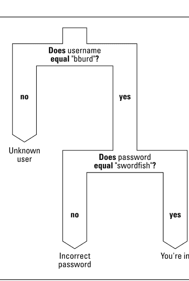

**图 5-7：** 不要尝试用这个叉子吃饭。

修改列表 5-4 中的程序，如果用户点击用户名或密码的任一处“取消”，程序将返回“信息不足”的消息。

**尝试一试**

# 在许多替代方案中选择 (Java switch 语句)

我是第一个承认自己讨厌做决定的人。如果事情出了差错，我宁愿让问题变成别人的错。编写前面的章节（关于使用 Java 的 `if statement` 来做决定）让我耗尽了力气。这就是为什么当我开始这个选择许多替代方案的章节时，我的大脑一片空白。坦白出来真是松了一口气！

## 你的基础 switch 语句

现在，是时候探索具有许多分支决策的情况了。例如，流行的营火歌“Al's All Wet”（要查看歌词，请参见“Al's All Wet”侧边栏）。回顾歌词，看看你是否需要编写代码来打印 "Al's All Wet" 的歌词。坦白说，你不需要重复打印歌词。相反，你可以利用对歌词的重复性。

| AL'S WET |
| --- |
| Sung to the tune of "Gentouette": |
| Al's wet. |
| Al's All Wet |
| ... |
| No such verse. Please try again. |

这种方法假设你有一个名为 `verse` 的变量。`verse` 的值是 1, 2, 3，取决于你尝试打印 "Al's All Wet" 的哪节。你有一大堆笨拙的 `if` 语句来检查可能的节：

```java
if (verse == 1) {
    out.println("That's because he has no.");
}
if (verse == 2) {
    out.println("That's because he is a.");
}
if (verse == 3) {
    out.println("Cause this is the.");
}
```

这种方法看起来很浪费。为什么不创建一个只检查一次 `verse` 然后对找到的值采取行动的语句呢？坦然，这样的语句存在。它被称为 `switch` 语句。

## 列表 5-6：switch 语句

```java
import static java.lang.System;
import java.util.Scanner;

public class JustSwitch {
    public static void main(String[] args) {
        Scanner keyboard = new Scanner(System.in);
        out.print("Which verse? ");
        int verse = keyboard.nextInt();

        switch (verse) {
            case 1:
                out.println("That's because he has no.");
                break;
            case 2:
                out.println("That's because he is a.");
                break;
            case 3:
                out.println("Cause this is the.");
                break;
            default:
                out.println("No such verse. Please try again.");
                break;
        }
        out.println("Ohhhhhhhh ...");
        keyboard.close();
    }
}
```

**图 5-8** 显示了列表 5-6 中程序的两次运行。（**图 5-9** 阐明了程序的整体思想。）首先，用户输入一个数字，比如 2。程序的执行到达 `switch` 语句的顶部。计算机检查 `verse` 变量的值。当计算机确定 `verse` 变量为 2 时，它检查 `switch` 语句的每个 `case`。值 2 不匹配顶部的 `case`，因此计算机继续到三个 `case` 的中间。中间 `case`（数字 2）发布的值与 `verse` 变量的值匹配，计算机执行紧随在 `case 2` 之后的语句。这两个语句是：

```java
out.println("That's because he is a.");
break;
```

| Which verse? 2 |
| --- |
| That's because he is a. |
| Ohhhhhhhh . . |
| Which verse? 6 |
| No such verse. Please try again. |
| Ohhhhhhhh . . |

**图 5-8：** 列表 5-6 中代码的两次运行。


**图 5-9：** 列表 5-6 代码中的大分支。

讨厌的用户请求请求第 6 节，计算机跳过了情况 1、2 和 3。计算机进入了默认部分（`default`）。在默认部分中，计算机显示“没有这样的歌节。请重试”，然后跳出 `switch` 语句。计算机跳出 `switch` 语句后，显示“Ohhhhhhh...”。

你并不真的需要在 `switch` 语句的末尾放置一个 `break`。在列表 5-6 中，最后一个 `break`（属于 `default` 的那个 `break`）只是为了整体的整洁。


## 跳出还是不跳

在每个程序员的生活中，都会有忘记使用 `break` 语句的时候。起初，输出结果令人困惑，然后程序员想起了“穿透”（fall-through）。这个术语描述了当你结束一个没有 `break` 语句的 case 时会发生什么。发生的是代码直接执行到下一行。执行一直持续，直到你遇到 `break` 语句或 `switch` 语句结束。

通常，当你使用 `switch` 语句时，不会发生穿透，所以在整个 `switch` 语句中充满了 `break` 语句。但偶尔，穿透正是你需要的。例如，《Al's All Wet》这首歌。（侧边栏显示了歌曲的名字。）《Al's All Wet》的每一节都在前一节的基础上增加了新行。这种情况（从一个歌节积累到另一个歌节）需要一个带有穿透的 `switch` 语句。列表 5-7 展示了这个思想。

## 列表 5-7：带有穿透的 switch 语句

```java
import java.lang.System.out;
import java.util.Scanner;

public class FallingFor {

    public static void main(String args[]) {
        Scanner keyboard = new Scanner(System.in);
        out.print("哪一节?");
        int verse = keyboard.nextInt();

        switch (verse) {
            case 3:
                out.print("副歌，");
                out.println("副歌，");
            case 2:
                out.print("真烦人，");
                out.println("真烦人，");
            case 1:
                out.print("没脑子，");
                out.println("没脑子，");
        }

        out.println("湿透了。");
        out.println("噢吼...");

        keyboard.close();
    }
}
```

**图 5-10** 显示了列表 5-7 的几次运行。因为 `switch` 内部没有 `break` 语句，穿透随处发生。例如，当用户选择节 2 时，计算机执行 `case 2` 中的语句：

```java
out.print("真烦人，");
out.println("真烦人，");
```

然后计算机直接向下执行 `case 1` 中的语句：

```java
out.print("没脑子，");
out.println("没脑子，");
```

这很好，因为歌曲的第二节包含了所有这些行。

| 哪一节? | 输出 |
| :--- | :--- |
| 1 | 没脑子，没脑子，<br>湿透了。<br>噢吼... |
| 2 | 真烦人，真烦人，<br>没脑子，没脑子，<br>湿透了。<br>噢吼... |
| 3 | 副歌，副歌，<br>真烦人，真烦人，<br>没脑子，没脑子，<br>湿透了。<br>噢吼... |

**图 5-14：** 运行列表 5-7 四次。

注意当用户请求节 6 时。列表 5-7 中的 `switch` 语句既没有 `case 6` 也没有 `default`，所以 `switch` 语句内部的动作都没有执行。尽管如此，在 `switch` 语句之后打印“湿透了。”和“噢吼...”，计算机仍然显示了内容。

## switch 语句中的字符串

在列表 5-6 和 5-7 中，之前的变量 `verse`（一个 `int` 值）存储了 `switch` 语句中的一个 case 或另一个 case。`int` 值在任何版本的 Java 中（无论旧新）都有效。（事实上，`char` 值和其他几种类型的值在 Java 还是新语言时就有效。）

从 Java 开始，你可以设置 `switch` 语句中执行的 case 取决于字符串的值。列表 5-8 说明了在 `switch` 语句中使用 switch。图 5-11 显示了列表 5-8 代码的运行。

### 列表 5-8：带有字符串的 switch 语句

```java
import java.lang.System.out;
import java.util.Scanner;

public class SwitchIt {

    public static void main(String[] args) {
        Scanner keyboard = new Scanner(System.in);
        out.println("一个、二还是三个?");
        String verse = keyboard.next();

        switch (verse) {
            case "one":
                out.println("因为他没脑子。");
                break;
            case "two":
                out.println("因为他真烦人。");
                break;
            case "three":
                out.println("因为这是副歌。");
                break;
            default:
                out.println("没有这样的歌节。请重试。");
                break;
        }

        out.println("噢吼吼... ");

        keyboard.close();
    }
}
```

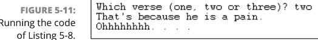


**练习一下 if 语句和 switch 语句！**

- 编写一个程序，输入月份名称并输出该月份的天数。在程序的第一个版本中，假设 2 月始终有 28 天。
- 让你的代码更好！让用户输入月份名称，同时也让用户在回答“是闰年吗？”输入“是”或“否”。

# 第 6 章：使用循环控制程序流

## 使用基础循环

## 在循环时计数

## 重复

1966 年，为你提供海飞丝洗发水的公司创造了历史。在瓶子背面，洗发水的使用说明写着：“打泡沫-冲洗-重复”。以前从未有一套完整的说明（用于任何事情，更不用说洗头）被如此简洁地概括。编写说明行业的人称其为一项里程碑式的成就。这样的说明与当时的情况形成了鲜明对比。

```java
out.print("You win after ");
out.println(numGuesses + " guesses.");

keyboard.close();

}
```

| ************ |
| --- |
| 欢迎来到猜数字游戏 |
| ************ |

| 输入一个 1 到 10 之间的整数：2 |
| --- |
| 再次尝试... |
| 输入一个 1 到 10 之间的整数：5 |
| 再次尝试... |
| 输入一个 1 到 10 之间的整数：8 |
| 再次尝试... |
| 输入一个 1 到 10 之间的整数：3 |
| 你在猜了 4 次后获胜了。 |

**图 6-1:** 玩到力竭。

在图 6-1 中，用户进行猜测。每一轮中，计算机都会检查猜测是否正确。错误的猜测会产生再次尝试的请求。对于正确的猜测，用户会得到一个振奋的“你获胜了”，并附带猜测次数的统计。计算机重复几条语句，每次检查用户的猜测是否与某个随机生成的数字相同。每当用户进行猜测时，计算机在其猜测计数器上加 1。当用户做出正确猜测时，计算机会显示该计数器。**图 6-2** 展示了动作的流程。

当你查看列表 6-1 时，你会看到执行这些工作的代码。代码的核心是一个被称为 `while` 语句（也称为 `while` 循环）的东西。用英语重述，`while` 语句的意思是：

```
while inputNumber 不等于 randomNumber
保持大括号内的所有内容：{

}
```

大括号中的内容（重复的部分）是打印“再次尝试”和“输入一个整数...”、从键盘获取值以及将用户的猜测计数加 1 的代码。

## 欢迎来到猜数字游戏

- 输入一个 1 到 10 之间的整数：
- 从用户处获取 `inputNumber`
- 将 `numGuesses` 加 1
- 比较 `inputNumber` 和 `randomGuesses`
- 如果它们不同：
    - 再次尝试...
    - 输入一个 1 到 10 之间的整数：
    - 从用户处获取 `inputNumber`
    - 将 `numGuesses` 加 1
- 如果它们相同：
    - 你在猜了 `numGuesses` 次后获胜

**图 6-2:** 周而复始。


> **提示**
>
> 当你处理计数器（例如列表 6-1 中的 `numGuesses`）时，你很容易感到困惑并在任何方向上错 1。你可以通过确保 `++` 语句靠近你正在计数的语句来避免这种令人头疼的问题。例如，在列表 6-1 中，变量 `numGuesses` 的初始值为 0。这是因为当程序开始运行时，用户还没有进行任何猜测。在程序的后面，紧接在每次调用 `keyboard.nextInt()` 之后，有一个 `numGuesses++` 语句。这就是你的做法——在用户输入另一个猜测时增加计数器的值。


大括号中的语句只要 `inputNumber != randomNumber` 为真就会一直执行。循环中语句的每次重复被称为循环的迭代。在图 6-1 中，循环经历了三次迭代。（如果你不相信图 6-1 恰好经历了三次迭代，请计算程序输出中 `Try` 的次数。对于任何错误的猜测都会出现一次 `Try`）。

当用户最后输入正确猜测时，计算机回到语句的顶部，检查括号中的条件，并发现自己处于双重否定的循环中。`inputNumber` 和 `randomNumber` 之间的不等于 (`!=`) 关系不再成立。换句话说，此时 `while` 语句的条件 `inputNumber != randomNumber` 为假。因为语句条件为假，计算机跳过 `while` 循环，执行 `while` 循环正下方的语句。在这两条语句中，计算机打印

142 第 2 部分 编写你自己的 Java 程序

使用如列表 6-1 所示的代码，计算机永远不会在循环中间跳出。当计算机发现 `inputNumber` 不等于 `randomNumber` 时，计算机会执行计算机大括号内的所有五条语句。计算机只有在完全执行完循环中的五条语句后，才会再次执行测试（检查 `inputNumber` 是否仍然不等于 `randomNumber`）。

我有两件事供你尝试：

- 修改列表 6-1 中的程序，使随机生成的数字是 1 到 100 之间的数字。为了让游戏玩家更容易，当玩家猜测错误时让程序给出提示。像“尝试更大的数字”或“尝试更小的数字”这样的提示非常有帮助。
- 编写一个程序，你连续输入 `int` 值。当用户输入一个非正数时（例如 0 或 -17），程序停止循环。在所有循环结束后，程序显示用户输入的最大数字。例如，如果用户输入了数字

## for 语句的构造结构

在 `for` 单词之后，你总是会在括号内放入三个东西。这三个中的第一个被称为初始化，第二个是表达式，第三个是更新：

```
for ( initialization ; expression ; update )
```

括号中的三个项中的每一个都起着其独特的角色：

- **初始化**执行一次，当你的程序第一次运行到该语句时执行。
- **表达式**会被求值多次（在每次迭代之前）。
- **更新**也会求值多次（在每次迭代结束时）。

如果有帮助的话，可以把循环想象成它的文本在不断移动：

你不能以这种方式写一个*真实*的 `for` 语句。尽管如此，这仍然是语句各个部分执行的顺序。

如果你在 `for` 循环的初始化中声明了一个变量，那么你无法在循环外部使用该变量。例如，在列表 6–2 中，如果你尝试在循环结束后输出 `out.println(count)`，你将会得到一个错误信息。

任何可以用 `for` 循环完成的事情，也可以用 `while` 循环完成。选择使用 `for` 循环是一个关于风格和便利性的问题，而不是必须的。

想做些练习吗？尝试一下这些实验和挑战：

- 一个 `for` 语句的初始化可能有多个部分。语句的更新也可能包含多个部分。要发现如何做到，请在 Java 的 JShell 中输入以下内容，或者将这些行添加到一个小型的 Java 程序中：

```java
import java.lang.System.out
for (int i = 0; i < 10; i++, j--) (out.println(i + " * " + j));
```

- 以下代码的输出是什么？

```java
int total = 0;
for (int i = 0; i < 10; i++) {
    total += i;
}
System.out.println(total);
```

在这段代码中，变量 `total` 被称为累加器，因为它在循环内部累加（相加）了一组值。

- 在数学中，感叹号 (!) 表示阶乘 —— 你将从 1 到包含某个数的所有正整数相乘得到的数。例如，3! 是 1 x 2 x 3，等于 6。而 5! 是 1 x 2 x 3 x 4 x 5，等于 120。

编写一个程序，用户输入一个正整数值（如 `n`），然后 Java 将 `n` 的值作为输出显示。

在不运行代码的情况下，预测代码的输出将会是：

```java
for (int row = 0; row < 5; row++) {
  for (int column = 0; column < 5; column++) {
    System.out.print("*");
  }
  System.out.println();
}
```

在做出预测后，运行代码以确定你的预测是否正确。

- 此实验中的代码是上一个实验代码的微变版本。首先，尝试预测代码将输出什么。然后运行代码以确定你的预测是否正确：

```java
for (int row = 0; row < 5; row++) {
  for (int column = 0; column <= row; column++) {
    System.out.print("*");
  }
  System.out.println();
}
```

- 编写一个程序，使用循环连续显示以下模式的三个副本：


## 列表 6-3：完整版歌曲《Al's All Wet》

列表 6-2 非常漂亮，但列表中的程序并没有做任何有趣的事情。为了一个更吸引目的例子，请参见列表 6-3。在列表 6-3 中，我履行了在第 5 章中做出的承诺。列表 6-3 中的程序打印了热门单曲《Al's All Wet》的所有歌词（你可以在第 5 章中找到这些歌词）。

```java
import java.lang.System.out;

public class AlAllWet {

    public static void main(String args[]) {

        for (int verse = 1; verse <= 3; verse++) {
            out.println("Al's all wet.");
            out.println("Oh, why is Al all wet?");
            out.println("Al's all wet 'cause");
            out.println("he's standing in the rain.");
            out.println("Why is Al out in the rain?");
        }

        switch (verse) {
        case 1:
            out.println("That's because he has no brain.");
        case 2:
            out.println("That's because he is a pain.");
        case 3:
            out.println("Cause this is the last refrain.");
        }

        switch (verse) {
        case 3:
            out.println("Last refrain, last refrain,");
        case 2:
            out.println("He's a pain, he's a pain,");
        case 1:
            out.println("Has no brain, no brain,");
        }

        out.println("In the rain, in the rain.");
        out.println("Ohhhhh...");
        out.println();
    }
}
```

```java
out.print("Al's all wet.");
out.println("Oh, why is Al all wet? Oh,");
out.print("Al's all wet 'cause");
out.println("he's standing in the rain.");
```

列表 6-3 很好，因为它包含了第 5 章和第 6 章中的许多思想。在列表 6-3 中，两个 `switch` 语句嵌套在一个 `for` 循环内部。其中一个 `switch` 语句使用了 `break;`；另一个 `switch` 则发生了贯穿。随着 `for` 循环计数器（verse）的值从 1 变为 2 再到 3，`switch` 语句中的所有 `case` 都被执行了。程序执行接近结束并已经离开了 `for` 循环，程序的最后一个 `switch` 语句打印了副歌部分。

当我宣布一个 `for` 语句是在计数时，我稍微有点夸张了事实。Java 的 `for` 语句非常多功能。你可以将它用于与计数完全无关的情况。例如，一个没有更新部分的语句，如 `for (i = 0; i < 10; )` 会一直持续下去。当循环内部的某个动作将一个大数赋值给变量 `i` 时，循环就会结束。你甚至可以创建一个括号内空无一物的 `for` 语句。`for ()` 循环会运行，如果这样做的话是好的。当你写 `for` 语句时，通常是在计算次数。但事实上，你可以进行任何类型的重复。


在第一次响应时，循环中没有任何可以检查的内容。循环并不是以“只要某事为真，就从用户处获取响应”开始的。相反，循环会跳跃，获取用户的响应，然后检查该响应以确定它是否符合逻辑。

这就是为什么列表 6-4 中的程序使用了一个 `do` 循环（也称为 `do-while` 循环）。该程序直接进入并执行操作，然后检查一个条件以确定操作的结果是否符合逻辑。如果结果符合逻辑，循环执行结束。如果不符合，程序将回到循环顶部再次执行一次。

## 列表 6-4：删除还是不删除

```java
import java.io.File;
import java.lang.System.out;
import java.util.Scanner;

public class DeleteEvidence {

    public static void main(String[] args) {
        File evidence = new File("cookedBooks.txt");
        Scanner keyboard = new Scanner(System.in);
        char reply;

        do {
            out.print("Delete evidence? (y/n):\n");
            reply = keyboard.findWithinHorizon(",", 0).charAt(0);
        } while (reply != 'y' && reply != 'n');

        if (reply == 'y') {
            out.println("Okay, here goes...");
            evidence.delete();
            out.println("The evidence has been deleted.");
        } else {
            out.println("Sorry, buddy. Just asking.");
        }

        keyboard.close();
    }
}
```

图 6-5 显示了列表 6-4 中代码的两次运行。程序接受小写字母 `y` 和 `n`，但不接受大写字母 `Y` 和 `N`。要让程序接受大写字母，请将代码中的条件改为：

```java
do {
  out.print("Delete evidence? (y/n ");
```


## 列表 6-4：删除还是不删除

```java
import java.io.File;
import java.lang.System.out;
import java.util.Scanner;

public class DeleteEvidence {
    public static void main(String[] args) {
        File evidence = new File("cookedBooks.txt");
        Scanner keyboard = new Scanner(System.in);
        char reply;

        do {
            out.print("Delete evidence? (y/n):\n");
            reply = keyboard.findWithinHorizon(".", 0).charAt(0);
        } while (reply != 'y' && reply != 'Y' && reply != 'n' && reply != 'N');

        if (reply == 'y' || reply == 'Y') {
            out.println("Okay, here goes...");
            evidence.delete();
            out.println("The evidence has been deleted.");
        } else {
            out.println("Sorry, buddy. Just asking.");
        }
        keyboard.close();
    }
}
```

图 6-5 显示了列表 6-4 中代码的两次运行。程序接受小写字母 `y` 和 `n`，但不接受大写字母 `Y` 和 `N`。要让程序接受大写字母，请将代码中的条件改为：

```java
do {
    out.print("Delete evidence? (y/n) ");
    reply = keyboard.findWithinHorizon(".", 0).charAt(0);
} while (reply != 'y' && reply != 'Y' && reply != 'n' && reply != 'N');

if (reply == 'y' || reply == 'Y') {
```

图 6-6 显示了列表 6-4 中循环的控制流。使用 `do` 循环，`twoPlusTwo` 程序（如本节开头所示）的情况永远不会发生。因为 `do` 循环在测试条件之前执行了它的第一次操作，因此每个循环保证至少执行一次迭代。

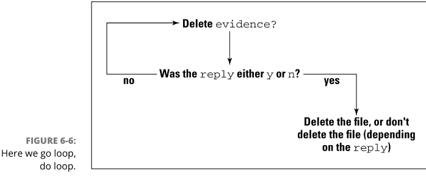

列表 6-4 的 `cookedBooks.txt` 文件在你的电脑硬盘上的位置取决于几个因素。如果你在错误的目录下创建了 `cookedBooks.txt` 文件，列表 6-4 中的代码将无法删除你的文件。（更准确地说，如果 `cookedBooks.txt` 位于你硬盘上错误的目录，列表 6-4 中的代码将无法删除它。）

---

## 尝试一下

复制列表 6-1 中的代码，但进行以下更改：

```java
out.print("Enter an int from 1 to 10: ");
int inputNumber = keyboard.nextInt();
numGuesses++;

do {
    out.println();
    out.println("Try again...");
    out.print("Enter an int from 1 to 10: ");
    inputNumber = keyboard.nextInt();
    numGuesses++;
} while (inputNumber != randomNumber);

out.print("You win after ");
out.println(numGuesses + " * " + "guesses.");
```


列表 6-1 中的代码有一个 `while` 循环，但这段修改后的代码有一个 `do-while` 循环。这段修改后的代码运行正常吗？为什么？或者为什么不？

第 6 章 使用循环控制程序流 157

# 第 3 部分 从宏观角度理解：面向对象编程

## 在这一部分中……

- 了解什么是类和对象（不需要伤脑筋）。
- 了解面向对象编程如何帮助你重用现有代码（节省你的时间和金钱）。
- 通过构建全新的对象，成为你自己虚拟世界的领主。

### 在本章中
- 像真正的面向对象程序员一样思考
- 在方法之间传递和传递值
- 在你的面向对象代码中隐藏细节

# 第 7 章
## 从类和对象的角度进行思考

作为一本计算机书籍的作者，我被反复告知这样一点：我不应该期望人们按照逻辑顺序阅读某个章节或节。人们会东来西去，挑选他们需要的，并跳过他们不想读的内容。考虑到这一点，我意识到你可能跳过了第 1 章。如果是这样，请不要感到内疚。你可以通过阅读以下节选自第 1 章的信息来弥补：

> 因为 Java 是一门面向对象的编程语言，你的首要目标是描述类和对象。类是某种事物背后的想法。对象是类的具体实例。程序员定义一个类，并从类中创建单个对象。

当然，你完全可以选择跳过那 60 秒的总结段落。如果是这样，你可能想挽回一些损失。你可以通过阅读以下对第 1 章的两个词的总结来实现这一点：

类；对象。

第 7 章 从类对象的角度进行思考 161

## 定义一个类（成为账户意味着什么）

是什么区分了一个银行账户和另一个账户？如果你向银行职员问这个问题，你会听到一段长长的推销。银行职员描述了利率、费用、罚金 —— 一整套流程。幸运的是，我对所有这些都不感兴趣。相反，我想知道我的账户和你的账户有什么不同。毕竟，我的账户名为 Barry Burd，经营名称为 Bud Brain Consulting，而你的账户名为 Jane Q. Reader，经营名称为 Budding Java Expert。我的账户里有 $24.02。你的呢？

归根结底，一个账户和另一个账户之间的区别可以总结为变量的值。也许有一个名为 `balance` 的变量。对我来说，`balance` 的值是 24.02。对你来说，`balance` 的值是 55.63。问题是，在编写处理账户的计算机程序时，我如何将我的 `balance` 变量与你的 `balance` 变量分开？

答案是创建两个独立的对象。让一个 `balance` 存在于一个对象内部，让另一个 `balance` 存在于另一个对象内部。顺便在每个对象中放入一个 `name` 变量和一个 `address` 变量。你就得到了：两个对象，每个对象代表一个账户。更准确地说，每个对象都是 `Account` 类的实例。（参见图 7-1）。

| Account 类的一个实例 | Account 类的另一个实例 |
| :--- | :--- |
| name | Barry |
| address | 222 Cyberspace Lane |
| balance | 165.28 |
| name | Jane |
| address | 111 Consumer Lane |
| balance | 1024.00 |

图 7-1：两个对象。

做得真好。然而，你仍然没有解决原始问题。在你的计算机程序中，你如何引用我的 `balance` 变量，而不是你的 `balance` 变量呢？嗯，你有两个对象在那儿，所以也许你有一些变量来引用这两个对象。创建一个名为 `myAccount` 的变量，另一个创建名为 `yourAccount` 的变量。`myAccount` 指向我的对象（我的 `Account` 类实例）以及它内部所有的内容。要引用我的 `balance`，写下

```java
myAccount.balance
```

要引用我的名字，写下

```java
myAccount.name
```

然后 `yourAccount.balance` 指向你对象中 `balance` 变量的值，而 `yourAccount.name` 指向你对象中 `name` 变量的值。为了告诉 Java 我在我的账户中有字段，我可以写下

```java
myAccount.balance = 24.02;
```

要在屏幕上显示你的名字，你可以写下

```java
out.println(yourAccount.name);
```

这些思想在列表 7-1 中汇合。这里：

# 列表 7-1：成为账户意味着什么

```java
public class Account {

    String name;

    String address;

    double balance;

}
```


列表 7-1 中的 `Account` 类定义了什么是账户。特别地，列表 7-1 告诉你 `Account` 类的实例有三个变量：`name`、`address` 和 `balance`。这与图 7-1 中的信息是一致的。在类内部但在任何方法内部定义的变量被称为字段。在列表 7-1 中，这些变量 —— `name`、`address` 和 `balance` —— 被称为字段。在类内部但在任何方法内部定义的变量是字段。如果你一直在苦读第 4 到 6 章的内容，7-1 中的代码可能会让你大吃一惊。你真的可以定义一个 Java 类吗？类是事物的分组。在 `Account` 类中，这些事物是两个 `String` 值和一个 `double` 值。7-1 中的字段声明具有默认访问权限，这意味着我没有在类型之前添加任何单词。默认权限的替代方案是 `public`、`protected` 和 `private`：

```java
public String name;

protected String address;

private balance;
```

程序员避讳使用默认权限，因为默认权限无法防止误用。但根据我的经验，你应该先学习简单的东西，而在 Java 中，默认权限是最简单的东西。在书中，我将访问权限的讨论推到了本章的“通过访问器方法隐藏细节”，并将 `protected` 权限的提及推到了第 14 章。在阅读本章的示例时，请记住默认权限在 Java 程序中并不是最佳选择，如果专业程序员问你学会了什么默认权限，请撒谎并归咎这本书。

## 声明变量和创建对象

当我走在街上时，一个家伙向我走来。他告诉我：“你会喜欢 Java 的！”于是我打印了这句话。如果你想知道，我是用粉笔在人行道上打印的。在哪里打印并不重要。重要的是有人给了指令，而我遵循了指令。

那天晚些，一位老太太坐在我旁的长椅上。她说：“账户有一个名字、地址和一个余额。”我说：“那很好，但你想让我对你的账户做什么？”作为回答，她盯着我，我没有对她的账户做任何事情。

之前所示列表 7-1 就像那位老太太。这个列表定义了什么是账户，但列表并没有告诉我要如何处理我的账户，或者如何处理任何人的账户。为了做某些事情，我们需要第二段代码。我们需要另一个包含 `main` 方法的类。幸运的是，当我和坐在长椅上静坐时，一个孩子带着列表 7-2 走了过来。

## 列表 7-2: 处理账户对象

```java
import static java.lang.System.out;

public class UseAccount {

    public static void main(String args[]) {

        Account myAccount;

        Account yourAccount;

        myAccount = new Account();

        yourAccount = new Account();

        myAccount.name = "Barry Burd";

        myAccount.address = "222 Cyberspace Lane";

        myAccount.balance = 24.02;

        yourAccount.name = "Jane Q. Public";

        yourAccount.address = "111 Consumer Street";

        yourAccount.balance = 55.63;

        out.print(myAccount.name);

        out.print(" ");

        out.print(myAccount.address);

        out.print(" has $");

        out.print(myAccount.balance);

        out.println();

        out.print(yourAccount.name);

        out.print(" ");

        out.print(yourAccount.address);

        out.print(" has $");

        out.print(yourAccount.balance);

    }

}
```

这两个类 —— `Account` 和 `UseAccount` — 共同构成了一个完整的程序。列表 7-2 中的代码定义了 `UseAccount` 类，而 `UseAccount` 类包含一个 `main` 方法。这个 `main` 方法有它自己的变量 —— `yourAccount` 和 `myAccount`。

在某种程度上，列表 7-2 中 `main` 方法内部的两行代码具有误导性。有些人读 `Account yourAccount` 时，好像它的意思是“你的账户是一个 Account”，或者“变量 `yourAccount` 指向 `Account` 类的一个实例”。这并不是这第一行的真实含义。`yourAccount` 这一行的真实意思是：“当我让变量 `yourAccount` 指向某个东西时，那个东西将是 `Account` 类的一个实例。”那么，区别究竟在哪里呢？

区别在于，仅仅通过声明 `Account yourAccount` 并没有让 `yourAccount` 变量指向一个对象。声明只是预留了变量名 `yourAccount`，以便该名称最终能够指向 `Account` 类的实例。实际对象的创建直到代码后面部分，当 Java 执行 `new Account()` 时才会发生。

从技术上说，当 Java 执行 `new Account()` 时，你正在通过调用 `Account` 类的构造函数来创建一个对象。关于这一点我将在第 9 章中详细介绍。


当 Java 执行赋值语句 `yourAccount = new Account()` 时，Java 会创建一个新对象（`Account` 类的新实例），并让变量 `yourAccount` 指向该新对象。等号使变量指向该新对象。图 7-2 描述了这种情况。

为了验证我在最后几段中提出的观点，我在列表 7-2 的代码中额外添加了一行。我尝试在声明 `yourAccount` 之后、调用 `new Account()` 之前，打印 `yourAccount.name`。

| 执行 `Account yourAccount;` 后 | | |
|---|---|---|
| | yourAccount | |
| | | |
| 执行 `yourAccount = new Account();` 后 | | |
| | yourAccount | |
| | name | |
| | address | |
| | balance | |

图 7-2: 调用构造函数的前。

```java
Account myAccount;

Account yourAccount;

out.println(yourAccount.name);

myAccount = new Account();

yourAccount = new Account();
```

当我尝试编译新代码时，我得到了这个错误信息：变量 `yourAccount` 可能未被初始化。这就定论了。在执行 `new Account()` 之前，你不能打印对象的 `name` 变量，因为对象并不存在。


当变量是引用类型时，仅仅声明变量是不够的。只有当你调用构造函数并使用 `new` 关键字时，才能获得对象。

有关引用类型的信息，请参阅第 4 章。

## 初始化变量

在第 4 章中，我提到可以在声明时初始化基本类型变量。

`int weightOfPerson = 150;`

对引用类型变量执行相同的操作，例如列表 7-2 中的 `myAccount` 和 `yourAccount`。你可以将 `main` 方法的前四行合并为两行，如下所示：

```java
Account myAccount = new Account();

Account yourAccount = new Account();
```

如果你这样合并代码行，就可以自动避免我在上一节中描述的“变量可能未被初始化”错误。有时你会发现无法初始化变量的情况。但如果可以初始化，通常是一个加分。

## 使用对象的字段

当你理解 `main` 方法的前几行后，列表 7-2 的剩余代码是非常直观易懂的。你有三行代码为 `myAccount` 对象的字段赋值，三行代码为 `yourAccount` 对象的字段赋值，还有四行代码执行打印。图 7-3 显示了程序的输出。

图 7-3: 运行列表 7-1 和 7-2 中的代码。

| Barry Burd | 222 Cyberspace Lane | $24.02 |
| Jane Q. Public | 111 Consumer Street | $55.63 |

## 一个程序多个类

在实践中，大多数程序由多个类组成。当你创建一个类时，将每个类放在单独的文件非常有用。

## 在类中定义方法（显示账户）

想象一个包含两个账户信息的表格。（如果你很难想象这样的东西，请看表 7-1）。

## 表 7-1：没有面向对象编程时

| 姓名 | 地址 | 余额 |
| --- | --- | --- |
| Barry Burd | 222 Cyberspace Lane | 24.02 |
| Jane Q. Public | 111 Consumer Street | 55.63 |

在表 7-1 中，每个账户包含三个要素：姓名、地址和余额。在面向对象编程出现之前，事情就是这样做的。但面向对象编程涉及了思维的巨大转变。通过面向对象编程，每个账户都可以拥有姓名、地址、余额以及一种显示方式。

在面向对象编程中，每个对象都有其自己的内置功能。账户知道如何显示自己。字符串可以告诉你它内部的字符与另一个字符串是否相同。`PrintStream` 实例（例如 `System.out`）知道如何打印。在面向对象编程中，每个对象都有自己的方法。这些方法是微小的子程序，你可以调用它们让对象为自己（或为他人）执行操作。

为什么这是一个好主意呢？之所以好，是因为你让数据片段为自己负责。通过面向对象编程，与账户相关的所有功能都集中在 `Account` 类的代码中。关于字符串你需要的所有知识都位于 `String.java` 中。任何与年份数字有关（例如是两位还是四位数）的内容直接在 `Year` 类内部进行处理。因此，如果有人对你的 `Account` 类或 `Year` 类有任何问题，他们只需要查找所有的代码即可。这太棒了！

想象一个增强后的账户。在这个新表中，每个对象都有内置功能。每个账户都知道如何在屏幕上显示自己。表格的每一行都有自己的 `display` 方法副本。当然，你不需要想象力就能看到这张表。我恰好有一个表可以看，那就是表 7-2。

## 表 7-2：面向对象的方式

| 姓名 | 地址 | 余额 | 显示 |
| --- | --- | --- | --- |
| Barry Burd | 222 Cyberspace Lane | 24.02 | out.print ... |
| Jane Q. Public | 111 Consumer Street | 55.63 | out.print ... |

## 一个能显示自己的账户

在表 7-2 中，每个账户对象都有四个要素：姓名、地址、余额以及一种在屏幕上显示自己的方式。当你转变为面向对象的思维后，就再也不会回头了。代码列表 7-3 和 7-4 展示了实现表 7-2 中想法程序。

### 代码列表 7-3：账户显示自己

```java
import static java.lang.System.out;

public class Account {

    String name;

    String address;

    double balance;

    public void display() {

        out.print(name);

        out.print(" ");

        out.print(address);

        out.print(" has $");

        out.print(balance);

    }

}
```

### 代码列表 7-4：使用改进后的 Account 类

```java
public class UseAccount {

    public static void main(String[] args[]) {

        Account myAccount = new Account();

        Account yourAccount = new Account();

        myAccount.name = "Barry Burd";

        myAccount.address = "222 Cyberspace Lane";

        myAccount.balance = 24.02;
```


```java
yourAccount.name = "Jane Q. Public";

yourAccount.address = "111 Consumer Street";

yourAccount.balance = 55.63;

myAccount.display();

System.out.println();

yourAccount.display();

}
}
```

代码列表 7-3 和 7-4 的运行结果与代码列表 7-1 和 7-2 的运行结果完全一样。你可以在之前的图 7-3 中看到这一操作。

在代码列表 7-3 中，`Account` 类包含四个要素：姓名、地址、余额以及一个 `display` 方法。这些方法对应表 7-2 中的四列。`Account` 类的每个实例都有一个姓名、一个地址、一个余额和一个 `display` 方法。

```java
out.print(" plus $");

out.print(myAccount.getInterest(5.00));

out.println(" interest $");
```

```java
yourAccount.display();
```

```java
double yourInterestRate = 7.00;

out.print(" plus $");

double yourInterestAmount = yourAccount.getInterest(yourInterestRate);

out.print(yourInterestAmount);

out.println(" interest $");
```

```java
}
```

图 7-4 显示了列表 7-5 和 7-6 中代码的输出。在列表 7-5 中，`Account` 类有一个 `getInterest` 方法。这个 `getInterest` 方法被列表 7-6 中的 `main` 方法调用了两次。每次的实际账户余额和利息都不同。

# 图 7-4：
运行列表 7-5 和 7-6 中的代码。

| | |
| :--- | : |
| Barry Burd (222 Cyberspace Lane) 有 $24.02 加上 $1.200999999999999 利息 |
| Jane Q. Public (111 Consumer Street) 有 $55.63 加上 $3.89410000000000 利息 |

> 在第一次调用中，余额为 24.02，利息为 5.00。第一次调用 `myAccount.getInterest(5.00)` 指的是 `myAccount` 对象以及存储在 `myAccount` 对象字段中的值。（见图 7-5）。当进行此调用时，表达式 `balance * percentageRate / 100.0` 代表 24.02 * 5.00 / 100.00。
>
> 在第二次调用中，余额为 55.63，利息为 7.00。在 `main` 方法中，在这次第二次调用之前，变量 `interestRate` 被赋值为 7.00。调用本身 `yourAccount.getInterest(yourInterestRate)` 指的是你的 `yourAccount` 对象以及存储在你的 `myAccount` 对象字段中的值。（再次见图 7-5。）当进行此调用时，表达式 `balance * percentageRate / 100.0` 代表 55.63 * 7.00 / 100.00。

顺带一下，列表 7-6 中的 `main` 方法包含两次对 `getInterest` 的调用。其中一次调用在参数列表中使用了字面量 5.00；另一次调用在参数列表中使用了变量 `yourInterestRate`。为什么一个调用使用字面量而另一个调用使用变量呢？没有理由。我只是想向你展示你可以用任何一种方式。

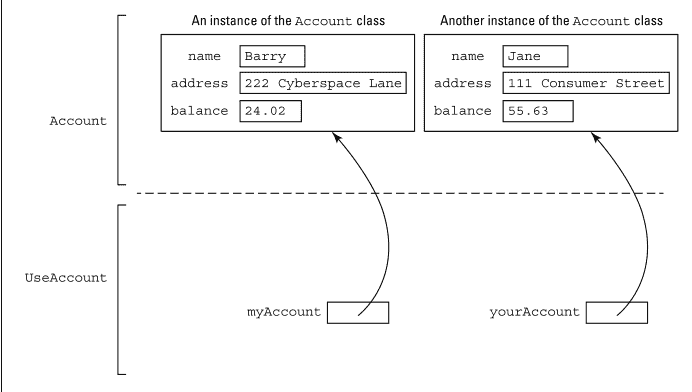

图 7-5：我的账户和你的账户。

## 向方法传递值

看看 `getInterest` 方法的头部。（当你阅读接下来的几个项目符号中的解释时，可以结合图 7-6 的图直观地理解其中的一些观点。）

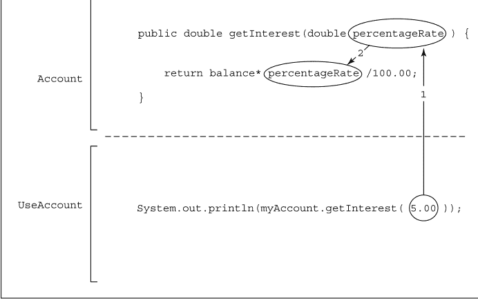

图 7-6：向方法传递值。

176 第 3 部分 从大局来看：面向对象编程

> `double` 关键字告诉 Java，当调用 `getInterest` 方法时，该方法会将一个 `double` 类型的值返回给调用它的地方。`getInterest` 方法体中的语句确认了这一点。该语句为 `return balance * percentageRate / 100.0`，而表达式 `balance * percentageRate / 100.0` 的类型为 `double`。（这是因为表达式中的所有内容——`balance`、`percentageRate` 和 100.0——的类型都是 `double`）。
>
> 当调用 `getInterest` 方法时，`return` 语句会计算 `balance * percentageRate / 100.0` 并将计算结果返回给调用它的代码。
>
> `getInterest` 是方法的名称。这是你在编写 `UseAccount` 类代码时调用该方法所使用的名称。
>
> 括号包含了你在调用方法时传递给方法的所有内容。当你调用方法时，可以即时向该方法传递信息。这些信息就是方法的参数列表。`getInterest` 方法的头部显示 `getInterest` 接收一个信息，且该信息必须是 `double` 类型的。

```java
public double getInterest(double percentageRate)
```

确实，如果你查看 `getInterest` 的第一次调用（在 `UseAccount` 的 `main` 方法下方），你会发现该调用包含了数字 5.0。5.0 是一个字面量。当我调用 `getInterest` 时，我正在给该方法提供一个 `double` 类型的值。

如果你不记得什么是字面量，请参阅第 4 章。

对 `getInterest` 的第二次调用也是如此。在列表 7-6 的底部，我调用了 `getInterest` 并将变量 `yourInterestRate` 传递到方法的参数列表中。对我来说很幸运，我在那几行之前已经将 `interestRate` 声明为 `double` 类型。


当你运行列表 7-5 和 7-6 中的代码时，执行流并不是从上到下的。执行流从 `main` 到 `getInterest`，然后返回 `main`，再次回到 `getInterest`，最后再次返回 `main`。图 7-7 显示了整个过程。

```java
public class Account {

    // name, address, balance 字段...

    double getInterest(double percentageRate) {

        return balance * percentageRate / 100.00;

    }

}
```

```java
public class UseAccount {

    public static void main(String[] args[]) {

        Account myAccount = new Account();

        Account yourAccount = new Account();

        myAccount.name = "Barry Burd";

        myAccount.address = "222 Cyberspace Lane";

        // ... 其他代码

    }

}
```

很好，由于计算机使用二进制（0 和 1），它们没有无限的空间来进行计算，因此图 7-4 所示的不精确数字是正常的。快速的方法是以更合理的方式显示这些不精确数字。你可以对数字进行四舍五入并只显示两位小数，Java 的一些实用的 API（应用程序接口）可以提供帮助。代码 7-7 显示了代码，图 7-9 显示了结果。

# 代码 7-7: 让数字看起来正确

```java
import static java.System.out;

public class UseAccount {

    public static void main(String args[]) {

        Account myAccount = new Account();

        Account yourAccount = new Account();

        myAccount.balance = 24.0;

        yourAccount.balance = 55.6;

        double myInterest = myAccount.getInterest(5.0);

        double yourInterest = yourAccount.getInterest(7.0);

        out.printf("$%.2f\n", myInterest);

        out.printf("$%.2f\n", yourInterest);

        out.printf("$2f\n", myInterest);

        out.printf("$%.2f\n", myInterest);

        out.printf("$2f $%.2f", myInterest, yourInterest);

    }

}
```

# 代码 7-9: 使用格式化字符串显示金额

| "$%8.2f\n" | 计算机显示的内容： |
| :--- | :--- |
| 显示美元符号。 | $1.20 |
| 换行。 | |
| 使用足够的位数来显示数字，并在小数点后保留两位。 | |

**图 7-13: 显示数值时指定的位数太少。**

| "$%83.2f\n" | 计算机显示的内容： |
| :--- | :--- |
| 显示美元符号。 | $1.20 |
| 换行。 | |
| 使用至少三位来显示数字，并在小数点后保留两位。 | |
| 三位不够，所以计算机使用了四位。 | |

**图 7-14: 使用格式化字符串显示多个值。**

| "$%8.2f, $%8.2f" | 计算机显示的内容： |
| :--- | :--- |
| 显示美元符号。 | $1.20 $3.89 |
| 显示第二个参数（`myInterest`）的值，并在小数点后保留两位。 | 显示第三个参数（`yourInterest`）的值，并在小数点后保留两位。 |
| 显示一个空格和一个美元符号。 | |

关于使用 `printf` 方法及其格式化字符串的示例，请参阅第 8 章和第 9 章。

图 7-4 中的不精确数字源于计算机对二进制（0 和 1）的使用。为了改进这一点，Java 提供了自己的解决方法——`BigDecimal` 类，这个类绕过了计算机奇怪的电路，并使用普通的数字进行算术运算。更多信息，请访问本书的网站（www.allcode.com/JavaForDummies）。


第 7 章 面对象的思考 181

代码 7-7 使用了一个名为 `printf` 的方便方法。当你调用 `printf` 时，始终要在括号内放入至少两个参数：

- 第一个参数是格式字符串。格式字符串使用特殊的代码来描述其他参数的显示方式。
- 所有其他参数（第一个之后）都是要显示的值。

查看代码 7-7 中的 `printf` 调用。第一个参数的格式字符串有两个数字占位符。第一个占位符 `%.2f` 描述了 `myInterest` 的显示。第二个占位符（另一个 `%.2f`）描述了 `yourInterest` 的显示。要了解这些格式字符串是如何工作的，请查看图 7-10 至图 7-14。

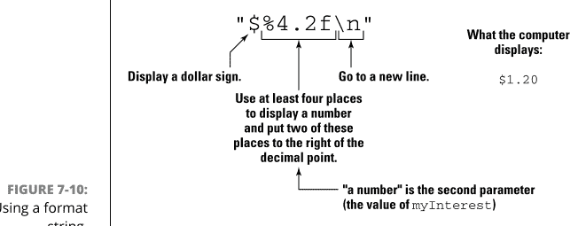

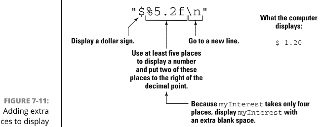

图 7-12: 在不指定精确位数的情况下显示数值。

所以，与计算机程序每个方面相关的一切都必须是简单的，对吧？不，不是这样的。有时候，为了从长远来看让事情变得简单，你必须在前面做好大量的准备工作。制造自动取款机的人致力于确保机器是防用户误操作的。机器的界面（包括屏幕消息和按钮）使得机器变成了一个非常复杂但经过精心设计的设备。

要点在于，让事情变得简单需要规划。在面向对象编程中，让事情简单的方法之一是防止类之外的代码直接使用类内部字段。看一眼列表 7-1 中的代码。你工作的一公司刚刚为 `Account` 类的代码花费了 1000 万美元。（平均每行代码超过 150 万美元！）现在你的任务是编写 `UseAccount` 类。你会写下：

```java
myAccount.name = "Barry Burd"
```

但这样做会让你太深入 `Account` 类的内部细节了。毕竟，使用自动取款机的人是不被允许编写机器变量的。他们不能使用机器的键盘输入语句：

```java
balanceOnAccount29872865457 = balanceOnAccount29872865457 + 1000000.00;
```

相反，他们通过按下按钮以按顺序的方式完成工作。这就是程序员实现安全性和简单性的方法。

为了保持整洁和有序，你需要通过禁止如下类语句来修改列表 7-1 中的 `Account` 类：

```java
myAccount.name = "Barry Burd";
```

以及

```java
out.print(yourAccount.balance);
```

当然，这带来了一个问题。你是编写 `UseAccount` 类代码的人。如果你不能写 `myAccount.name` 或 `yourAccount.balance`，你该如何完成任何工作呢？答案在于称为访问器方法（accessor methods）的东西。列表 7-8 和 7-9 展示了这些方法。

# 列表 7-8: 隐藏那些字段

```java
public class Account {
    private String name;
    private String address;
    private double balance;

    public void setName(String n) {
        name = n;
    }

    public String getName() {
        return name;
    }

    public void setAddress(String a) {
        address = a;
    }

    public String getAddress() {
        return address;
    }

    public void setBalance(double b) {
        balance = b;
    }

    public double getBalance() {
        return balance;
    }
}
```

# 列表 7-9: 调用访问器方法

```java
import static java.lang.System.out;

public class UseAccount {
    public static void main(String[] args[]) {
        Account myAccount = new Account();
        Account yourAccount = new Account();

        myAccount.setName("Barry Burd");
        myAccount.setAddress("222 Cyberspace Lane");
        myAccount.setBalance(24.02);
    }
}
```

（续）

运行列表 7-8 和 7-9 中的代码与运行列表 7-1 和 7-2 看起来没有区别。这两个程序的运行结果在之前的图 7-3 中已显示。主要的区别在于，在列表 7-8 中，`Account` 类对其名称、地址和余额字段执行了严格的控制。

## 公共生活与私密梦想：让字段变得不可访问

注意 `Account` 类每个字段声明前都添加了 `private` 关键字。`private` 是 Java 关键字。当一个字段被声明为 `private` 时，类外部的代码都无法直接引用它。如果你在列表 7-9 的 `UseAccount` 类中放入 `myAccount.name = "Barry Burd"`，你会得到类似“name has private access in Account”（name 在 Account 中具有私有访问权限）的错误信息。


与其替换，`UseAccount` 程序员必须调用方法 `myAccount.setName` 或 `myAccount.getName`。这些方法 `setName` 和 `getName` 被称为访问器方法，因为它们提供了对 `Account` 类 name 字段的访问。（实际上，“访问器方法”这个术语并不是 Java 编程语言正式组成部分。它只是人们用来描述这类方法的术语。）更细致地说，`setName` 被称为设置器方法（setter method），而 `getName` 被称为get方法（getter method）。我敢打赌你不会忘记这

在许多 IDE 中，你不需要自己编写访问器方法。首先，你输入一个如 `private String StringName` 的字段声明。然后，在你的 IDE 菜单栏中，选择 `Source: Generate Getters and Setters` 或选择。

## 列表 7-10: 你的第一个 DummiesFrame 示例

```
import com.allmycode.dummiesframe.DummiesFrame;
```

```java
public class GuessingGame {

    public static void main(String[] args) {
        DummiesFrame frame = new DummiesFrame("Greet Me!");
        frame.addRow("Your first name");
        frame.go();
    }

    public static String calculate(String firstName) {
        return "Hello, " + firstName + "!";
    }
}
```

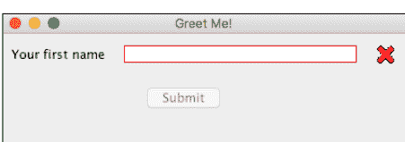

图 7-15:

列表 7-10 中的代码开始运行。

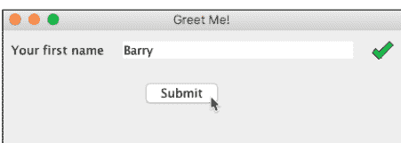

图 7-16:

用户填写文本框。

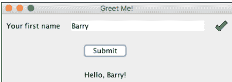

图 7-17:

用户点击按钮。

第 7 章 以类和对象的角度思考 191

这里是对列表 7-10 中代码的逐行描述：

- >> 第一行

```java
import com.allmycode.dummiesFrame.DummiesFrame;
```

使得 `DummiesFrame` 名称在列表的其余代码中可用。

- >> 在 `main` 方法内部，语句

```java
DummiesFrame frame = new DummiesFrame("Greet Me!");
```

创建了 `DummiesFrame` 类的实例并让变量指向该实例。一个 `DummiesFrame` 对象以窗口的形式出现在用户的屏幕上。窗口标题栏上的文本是 Greet Me!

- >> 下一个语句是对 frame 的 `addRow` 方法的调用：

```java
frame.addRow("Your first name");
```

这在应用程序窗口的界面添加了一行。该行包含一个标签（其文本为 Your first name）

- >> 调用 frame 对象的 `go` 方法

```java
frame.go();
```

使应用程序的窗口出现在屏幕上。

- >> `calculate` 方法的头部

```java
public static String calculate(String firstName) {
```

告诉 Java 两个重要的一点：

- `calculate` 方法返回一个 `String` 类型的值。

- Java 应该预期用户在文本框中输入一个 `String` 值，用户输入的任何内容将成为 `firstName` 参数的值。

要使用我的 `DummiesFrame` 类，你的代码必须有一个名为 `calculate` 的方法，且 `calculate` 方法必须遵守某些规则：

- `calculate` 方法的头部必须以 `public static` 单词开头。

- 该方法可以返回任何类型：`String`、`int`、`double` 或任何。（这实际上不是一条规则；而是一个机会！）

- `calculate` 方法的参数数量必须与应用程序窗口中的行数相同。

列表 7-10 只有一个 `addRow` 方法调用，因此图 7-10 中的窗口只有一行（不包括提交 按钮），因此 `calculate` 方法也只有一个参数。

当用户开始在窗口的文本框中输入文本时，红色的 X 会变成绿色的对号。（参考图 7-16）绿色对号表示用户已在文本框中输入了预期的类型（在本例中，一个 `String` 值）。

- 当用户点击按钮时，Java 执行 `calculate` 方法。方法语句中的表达式

```java
return "Hello, " + firstName + "!";
```

告诉在窗口底部显示什么。（参考图 7-17。）在这个示例中，用户在唯一的一个文本框中输入了 Barry，因此 `firstName` 的值为 "Barry"，`calculate` 方法返回字符串 "Hello, Barry!"（成为 Dummies 作者的妙处！）

使用我的 `DummiesFrame` 类，你可以用十行代码构建一个简单的 GUI 应用程序。`DummiesFrame` 类没有构建在 Java API 中，因此为了运行列表 7-10 中的代码，`DummiesFrame.java` 文件必须是项目的一部分。当你从本书网站（www.allcode.com/JavaForummies）下载代码时，你会找到名为 `dummies` 的文件夹，其中包含列表 7-10 代码和 `DummiesFrame.java`。但如果你创建自己的项目，必须手动添加 `DummiesFrame.java`。你执行此取决于取决于使用的 IDE。一种方法是 `DummiesFrame` 类位于名为 `com.allcode.dummies` 的包中，`DummiesFrame.java` 文件必须位于名为 `allcode` 的目录中。关于包的更多信息，请参见第 9 和 14 章。


为了简单，我在从本书网站下载的 `dummies` 文件夹中包含了 `DummiesFrame.java` 文件。实际上，将自己的代码添加到项目的最佳方法是？在第 1 章中，我描述了扩展名为 `.class` 的文件在 Java 程序运行中的作用。在其他情况下，如果我必须提供数百个 `.class` 文件，我应该将它们打包成一个存档文件。它被称为 JAR 文件，扩展名为 `.jar`。在现实生活的应用程序中，如果你正在准备代码供人们作为他们应用程序的一部分使用，JAR 文件绝对可行可行。`DummiesFrame` 类不仅用于问候和节日。列表 7-11 使用 `DummiesFrame` 进行算术运算。

第 7 章 以类和对象的角度思考 193

## 列表 7-11: 一个极其简单的计算器

```java
import com.allmycode.dummiesframe.DummiesFrame;
```

```java
public class Addition {

    public static void main(String[] args) {
        DummiesFrame frame = new DummiesFrame("Adding Machine");
        frame.addRow("First number");
        frame.addRow("Second number");
        frame.setButton("Sum");
        frame.go();
    }

    public static int calculate(int firstNumber, int secondNumber) {
        return firstNumber + secondNumber;
    }
}
```

图 7-18 中的窗口有两个行，因为列表 7-11 有两个 addUser 调用且列表的 `calculate` 方法有两个参数。此外，列表 7-11 调用了 frame 对象的 `setButton` 方法。因此，在图 7-18 中，按钮上的文本不是默认词。

| Adding Machine |
| --- |
| First number | 42 |
| Second number | 13 |
| Sum | 55 |

图 7-18:

看！列表 7-11 中的代码确实有效！

列表 7-12 包含了第 5 章猜数字应用程序的 GUI 版本，图 7-19 显示了运行中的游戏。

## 列表 7-12: 我在想一个数字

```java
import java.util.Random;
import com.allmycode.dummiesframe.DummiesFrame;

public class GuessingGame {
```

```java
    public static void main(String[] args) {
    DummiesFrame frame = new DummiesFrame("Guessing Game");
    frame.addRow("Enter an int from 1 to 10");
    frame.setButtonText("Submit your guess");
    frame.go();
    }
```

```java
    public static String calculate(int input) {
    Random random = new Random();
    int randomNumber = random.nextInt(10) + 1;

    if (input == randomNumber) {
        return "You win.";
    } else {
        return "You lose. The random number was " + randomNumber + ".";
    }
}
```

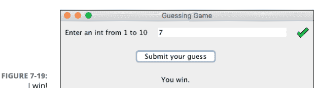

图 7-19:

在 7-13 中，我本章的 `Account` 类与 `DummiesFrame` 类一起使用。我可以在不创建 `Account` 实例的情况下相同的结果，我想向你展示类如何协作形成一个完整的程序。代码的运行见图 7-20。

## 列表 7-13: 使用 Account 类

```java
import com.allcode.dummiesframe.DummiesFrame;

public class UseAccount {

    public static void main(String[] args) {
        DummiesFrame frame = new DummiesFrame("Display an Account");
        frame.addRow("Full name");
        frame.addRow("Address");
        frame.addRow("Balance");
        frame.setButtonText("Display");

(continued)
```

```java
frame.go();
public static String calculate(String name, String address,
    double balance) {
    Account myAccount = new Account();

    myAccount.setName(name);
    myAccount.setAddress(address);
    myAccount.setBalance(balance);
    return myAccount.getName() + " " + myAccount.getBalance() + 
           " has $" + myAccount.getBalance();
}
```


| Display an Account |
| --- | --- |
| Full name | Barry Burd |
| Address | 222 Cyberspace Lane |
| Balance | 24.02 |

图 7-20: Barry Burd (222 Cyberspace Lane) has $24.02 I'm rich.

# 本章内容

- >> 为旧代码注入新生命

- >> 调整你的代码

- >> 在不花费巨额费用的情况下进行更改

# 第 8 章

# 节省时间与金钱：重用现有代码

从前以前，有一位美丽的公主。当公主满 25 岁时（这是力量、外貌和高尚品格的黄金年龄），她慈爱的老父亲送给她了一份装在精美金色盒子里的礼物。公主急于想知道盒子里装了什么，撕掉了金色的包装纸。

当盒子终于被打开时，公主感到非常兴奋。令她惊讶的是，她的父亲给了她一直一直想要的东西：一个始终正确运行的计算机程序。这个程序执行了公主想要的所有事情，而且完全按照她想要的方式来执行。公主很高兴，她的父亲也一样。

尽管时间流逝，这个计算机程序也从未故障过。多年来，公主改变了她的需求，对生活有了更高的期待，提出了日益增长的要求，扩展了她的事业，追求更多的成就感，兼顾了丈夫和孩子的愿望，拉紧了预算，并在灵魂深处寻求平静。在这个过程中，这个程序始终是一个稳定、忠实的伙伴。

随着公主变老，程序也随她一起老了。一天晚上，她坐在火炉旁，向程序提了一个巨大的问题：“你是怎么做到的？”她问，“你是如何一次又一次、一年一年地给出正确答案的？”

“洁净的生活，”程序回答道，“我每天游览 20 个 app，我把 C++ 带给 Word 病毒，我避开那些算法的算法，我适度地链接 Java，我对 bug 说 GNU，我不通过抽烟来备份，我从不承担超出我能队列范围的任务。”

不用说，公主被惊了。

## 定义类（成为一名员工意味着什么）

如果每种软件都能完全按照你的想法运行，那该有多好呢？在一个理想的世界里，你可以购买一个程序，让它立即运行，将其无缝地插入到新场景中，并在你的需求变化时轻松地更新它。遗憾的是，这种软件并不存在。（这些东西都不存在。）事实是，无论你想做什么，你都能找到执行部分任务的软件，但不能完成全部。

这就是面向对象编程成功的理由之一。多年来，公司一直购买预先编写好的代码，结果发现代码并没有按照他们想要的方式运行。那么，公司该怎么办呢？他们开始乱改代码。他们的程序员深入程序文件，更改变量名，移动子程序，重新编写公式，并通常会让代码变得更糟。现实情况是，如果一个程序本身没有按照你想要的方式运行（即使它做的事情与你的要求非常接近），你永远无法通过在代码内部胡搞乱来改善局面。最好的选择始终是选择整个程序（尽管很昂贵）并重新开始。这真是一种糟糕的状况！

有了面向对象编程，一个巨大的变化已经到来。由于，面向对象的程序的设计就是为了被修改的。通过编写良好的软件，你可以利用已经内置的功能，添加你自己的新功能，并覆盖不符合你需求的功能。最好的部分是，你所做的更改是干净的。不需要去抓挠和挖掘他人脆弱的程序代码。相反，你进行良好的、有序的添加和修改，而无需触碰现有代码的内部逻辑。这是理想的解决方案。

## 关于员工的最后结论

当你编写一个面向对象的程序时，你从编写数据开始。你正在编写账户。那么什么是账户呢？你正在编写代码来处理按钮点击。那么什么是按钮呢？你正在编写一个程序向员工发送工资支票。什么是员工呢？

在本章的第一个示例中，员工是一个拥有名字和头衔的人。当然，员工还有其他特征。在本章的示例中，员工是一个拥有名字和头衔的人。

## 什么是员工

```java
public class Employee {
    private String name;
    private String title;
    private double salary;

    public void setName(String name) {
        name = name;
    }

    public String getName() {
        return name;
    }

    public void setTitle(String title) {
        title = title;
    }

    public String getTitle() {
        return title;
    }

    public void setSalary(double salary) {
        salary = salary;
    }

    public double getSalary() {
        return salary;
    }

    public void cutCheck(double amountPaid) {
        System.out.println("Employee: " + name + " (" + title + ") - Pay: $" + amountPaid);
    }
}
```

在上面的代码中，员工还有其他特征。在本章的示例中，员工是一个拥有名字和头衔的人。

## 实例化类


```java
Employee emp = new Employee();
emp.setName("Alice");
emp.setTitle("Manager");
emp.setSalary(50000.00);
emp.cutCheck(emp.getSalary());
```

输出结果：

`Employee: Alice (Manager) - Pay: $50000.0`

## 修改对象的属性

```java
Employee emp = new Employee();
emp.setName("Alice");
emp.setTitle("Manager");
emp.setSalary(50000.00);
emp.setName("Bob");
emp.cutCheck(emp.getSalary());
```

输出结果：

`Employee: Alice (Manager) - Pay: $50000.0`

`Employee: Bob (Manager) - Pay: $50000.0`

### 覆盖不符合需求的功能

```java
Employee emp = new Employee();
emp.setSalary(50000.00);
emp.setName("Alice");
emp.setTitle("Director");
emp.cutCheck(emp.getSalary());
```

输出结果：

`Employee: Alice (Director) - Pay: $50000.0`

## 使用对象数组

```java
Employee[] employees = new Employee[2];
employees[0] = new Employee();
employees[0].setName("Alice");
employees[1] = new Employee();
employees[1].setName("Bob");

for (int i = 0; i < employees.length; i++) {
    employees[i].cutCheck(0.0);
}
```

输出结果：

`Employee: Alice (null) - Pay: $0.0`

`Employee: Bob (null) - Pay: $0.0`

## ArrayList

```java
import java.util.ArrayList;

ArrayList<Employee> employees = new ArrayList<>();
employees.add(new Employee());
employees.get(0).setName("Alice");
employees.add(new Employee());
employees.get(1).setName("Bob");

for (Employee emp : employees) {
    emp.cutCheck(0.0);
}
```

输出结果：

`Employee: Alice (null) - Pay: $0.0`

`Employee: Bob (null) - Pay: $0.0`

## 集合方法

```java
import java.util.ArrayList;

ArrayList<Employee> employees = new ArrayList<>();
employees.add(new Employee());
employees.add(new Employee());
employees.add(new Employee());
employees.remove(1);
employees.clear();
System.out.println(employees.size());
```

输出结果：

`0`

流行的 Java IDE（`Eclipse`、`NetBeans` 或 `IntelliJ IDEA`）。如果你将其导入 `Eclipse`，你将得到一个名为 `08-01` 的项目。该项目通常保存在你的硬盘上，位于一个名为 `/Users/your-user-name/workspace/08-01` 的文件夹中。在该文件夹内部，你有一个名为 `EmployeeInfo.txt` 的文件。

关于你的硬盘的更多建议，你将在本章的“与磁盘文件交互（短途旅行）”部分中看到。

列表 8-2 中的 `DoPayroll` 类有两个方法。其中一个方法 `main` 调用了另一个方法 `payOneEmployee` 三次。每次，`payOneEmployee` 方法都会从 `EmployeeInfo.txt` 文件中获取内容，并将其传递给 `Employee` 类的方法。

以下是变量 `anEmployee` 被使用和回收的方式：

- 第一次调用 `payOneEmployee` 时，语句 `anEmployee()` 使得 `anEmployee` 指向一个新对象。
- 第二次调用 `payOneEmployee` 时，计算机再次执行相同的语句。这第二次执行创建了 `anEmployee` 变量的新实例，它指向一个全新的对象。
- 第三次执行时，同样的事情再次发生。一个新的 `anEmployee` 最终导向了第三个对象。

整个过程如图 8-1 所示：

| Employee 类的一个实例 | Employee 类的另一个实例 | Employee 类的第三个实例 |
|---|---|---|
| name | Barry | name | Harriet | name | You |
| Employee job | jobTitle CEO | jobTitle Captain | jobTitle Exec |

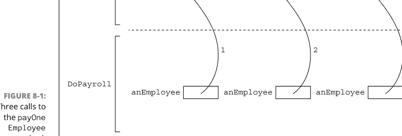

总有一些有趣的事情供你：

- `PlaceLive` 有一个地址、卧室数量和一个面积（以平方英尺或平方米为单位）。编写 `PlaceToLive` 的代码。编写名为 `DisplayThePlaces` 的独立类代码。你的 `DisplayThePlaces` 类通过给 `address`、`numberOfrooms` 和 `area` 字段赋值来创建几个 `PlaceLive` 实例。`DisplayThePlaces` 还需要读取（键盘）每个地方的生活成本。对于每个地方，你的代码将显示每平方英尺（或平方米）的成本以及每个卧室的成本。
- 使用你新的 `PlaceToLive` 类和我的 `DummiesFrame`（来自第 7 章）创建一个 GUI 应用。该 GUI 应用接收有关居住地的信息，并显示每平方英尺（或米）的成本以及每个卧室的成本。

## 开支票

列表 8-1 有三个 `printf` 调用。每个 `printf` 调用都有一个格式字符串（如 `"%s"`）和一个变量（如 `jobTitle`）。每个格式字符串都有一个占位符（如 `%s`），它决定了变量如何显示。

例如，第二个 `printf` 调用中，格式字符串有一个 `%s` 占位符。这个 `%s` 为 `jobTitle` 的值留出了位置。根据 Java 的规则，`%s` 符号始终为字符串留出位置，而且，在图 8-1 中，变量 `jobTitle` 正被声明为 `String` 类型。括号和其他一些字符包围着 `%s`，因此输出中的每个职位名称都用括号括起来（见图 8-2）。

| 付给 Barry Burd (CEO) ***$5,000.00 |
| 付给 Harriet Ritter (Captain) ***$7,000.00 |
| 付给 你的名字 (今日荣誉执行官) ***$10,000.00 |

图 8-2：每个人都得到了工资。

回到图 8-1，注意 `.2f` 占位符内部的逗号。逗号告诉程序使用分组分隔符。这就是为什么在图 8-2 中，你看到的是 `$5,000.00`、 `$7,000.00` 和 `$10,000.00`，而不是 `$5000.00`、 `$7000.00` 和 `$10000.00`。


## 与磁盘文件交互（短途旅行）

在之前的章节中，程序从计算机键盘读取字符。但列表 8-2 中的代码从特定文件读取字符。名为 `EmployeeInfo.txt` 的文件保存在你的硬盘上。

这个 `EmployeeInfo.txt` 文件就像一个处理文档。它可以包含字母、数字和其他字符。与处理文档不同，`EmployeeInfo.txt` 文件不包含格式——没有斜体、没有粗体、也没有字体大小。

`EmployeeInfo.txt` 文件只包含普通字符——你在玩猜游戏（第 5 和 6 章）时输入的字符。当然，从用户键盘获取猜测和从磁盘读取员工数据是不相同的。在猜游戏中，程序会显示提示，例如 `Enter an int`（输入1到10）。游戏与键盘前的人进行双向对话。相比之下，列表 8-2 从硬盘读取字符，不会提示或与任何人交互。

## 从文件读取

在之前的章节中，程序从计算机的键盘读取字符。这些程序使用了 `Scanner`、`System.in` 和 `nextDouble` 等工具——这些都是 Java API 中定义的。列表 8-2 中的 `DoPayroll` 程序为这个故事注入了新的花。它不是从键盘读取字符，而是从 `EmployeeInfo.txt` 文件读取字符。该文件存在于你计算机的硬盘上。

要从文件中读取字符，你可以使用一些帮助你从键盘读取字符的工具。你会使用 `Scanner`、`nextDouble` 以及其他好东西。除了这些工具，你还有几个额外的工具可以使用。以下是你的列表：

- 你需要一个新的 `File` 对象。更准确地说，你需要 API 里的 `File` 类的一个新实例。你通过以下代码获取这个新实例：

```
new File("EmployeeInfo.txt");
```

引号中的内容不是一个文件——而是你计算机硬盘上的一个文件。该文件包含之前在 8-3 中所示的字符。

到这里，这些术语听起来似乎没什么大不了的。确实，我使用了 `File` 对象和 `new Instance`（新实例）这些短语，但你执行 `new File("EmployeeInfo.txt")` 只是为了代表你硬盘上的一个文件。当你将 `new File("EmployeeInfo.txt")` 传入 `new Scanner` 时：

```
Scanner diskScanner = new Scanner(new File("EmployeeInfo.txt"));
```

你就可以忘记所有关于 `new File` 的事务了。从代码的该点开始，`diskScanner` 代表你计算机硬盘上的 `EmployeeInfo.txt` 文件名。`diskScanner` 这个名字代表硬盘上的一个文件，就像在之前的示例中，`keyboard` 名字代表日复一日按键一样。

在列表 8-2 中创建一个新的 `File` 对象就像在同一个列表中创建一个新的 `Employee` 对象。这也像在第 7 章的示例中创建一个新的 `Account` 对象。唯一的区别是 `Employee` 和 `Account` 类是在本书的示例中定义的，而该类是定义在 Java API 中的。

当你用 `new Scanner` 连接到磁盘文件时，不要忘记 `new File` 部分。如果你只写 `Scanner("EmployeeInfo.txt")` 而不写 `new File`，编译器不会介意（在运行代码之前，你不会收到任何警告或错误消息）。但当你运行代码时，得到的结果并不是你预期的那样。


你必须通过全名来引用 `File`：`java.io.File`。你可以像列表 8-2 那样通过 `import` 声明来实现。或者，你也可以使用如下语句让代码变得混乱：

```
Scanner diskScanner = new Scanner(new java.io.File("EmployeeInfo.txt"));
```

你需要一个 `throws IOException` 子句。当你的程序连接到 `EmployeeInfo.txt` 时，可能会发生很多问题。例如，你的硬盘可能没有名为 `EmployeeInfo.txt` 的文件。此外，`EmployeeInfo.txt` 文件可能在错误的目录下。为了防范这种灾难，Java 编程语言采取了某些预防措施。该语言坚持认为当涉及磁盘时，你要承认调用 `new Scanner` 可能带来的危险。

你可以通过几种可能的方式承认这些危险，但最简单的方法是使用 `throws` 子句。在列表 8-2 中，`main` 方法的头部有 `throws IOException` 这几个词。通过添加这两个词，你安抚了 Java 编译器。这就像在说：“我知道调用 `new Scanner` 可能会导致问题。你不需要提醒我。”而且确实，在你的 `main` 方法中加上 `throws IOException` 可以让编译器不再抱怨。（如果没有这个子句，你会得到一个未报告的异常消息。）


关于 Java 异常的完整故事，请参读第 13 章。在此期间，在任何调用 `new Scanner(new File("..."))` 的方法头部添加 `throws IOException`。

你必须通过全名来引用 `IOException` 类：`java.io.IOException`。

你可以像列表 8-2 那样通过 `import` 声明来实现。或者，你可以增强 `main` 方法的 `throws` 子句：

```
public static void main(String args[]) throws java.io.IOException {
```

你必须将扫描器的名称传递给 `payOneEmployee` 方法。

在第 7 章的列表 7-5 中，`getInterest` 方法有一个参数 `percentageRate`。每当你调用 `getInterest` 方法时，你都为该方法提供了一份额外的、最新的信息。（你向方法传递了一个数字——利率。图 7-7 注释了这一主意。）

同样的事情也发生在列表 8-2 中。`payOneEmployee` 方法有一个名为 `aScanner` 的参数。每当你调用 `payOneEmployee` 方法时，你都向方法传交了一份额外的、最新的信息。（你向方法传交了一个扫描器——一个对磁盘文件的引用。）

你可能会奇怪为什么 `payEmployee` 方法需要一个参数。毕竟，在列表 8-2 中，`payEmployee` 方法已经读取了数据。为什么要费此精力？嗯，有很多方法可以重排代码。某些方法并不涉及参数。你看，当你调用该方法时，你为该方法提供了一份额外的、最新的信息。（你向方法传交了一个扫描器——一个对磁盘文件的引用。）

[Wait]

关于 Java 异常的完整故事，请参读第 13 章。在此期间，在任何调用 `new Scanner(new File("..."))` 的方法头部添加 `throws IOException`。

你必须通过全名来引用 `IOException` 类：`java.io.IOException`。

你可以像列表 8-2 那样通过 `import` 声明来实现。或者，你可以增强 `main` 方法的 `throws` 子句：

```
public static void main(String args[]) throws java.io.IOException {
```

你必须将扫描器的名称传递给 `payOneEmployee` 方法。

在第 7 章的列表 7-5 中，`getInterest` 方法有一个参数 `percentageRate`。每当你调用 `getInterest` 方法时，你都为该方法提供了一份额外的、最新的信息。（你向方法传递了一个数字——利率。图 7-7 注释了这一主意。）

同样的事情也发生在列表 8-2 中。`payOneEmployee` 方法有一个名为 `aScanner` 的参数。每当你调用 `payOneEmployee` 方法时，你都向方法传交了一份额外的、最新的信息。（你向方法传交了一个扫描器——一个对磁盘文件的引用。）

你可能会奇怪为什么 `payEmployee` 方法需要一个参数。毕竟，在列表 8-2 中，`payEmployee` 方法已经读取了数据。为什么要费此精力？嗯，有很多方法可以重排代码。某些方法并不涉及参数。你看，当你调用该方法时，你为该方法提供了一份额外的、最新的信息。（你向方法传交了一个扫描器——一个对磁盘文件的引用。）

## 在文件名中添加目录

你可以在 Java 代码中指定文件的确切位置。像 `new File("C:\\Users\\burd\\08-01\\EmployeeInfo.txt")` 这样的代码看起来很丑，但它是有效的。

在前面的文中，你注意到双斜杠：`C:\\Users\\burd`。

实际上，在前面的文中，你注意到双斜杠。如果你是 Windows 用户，你会倾向于写 `C:\Users\burd`（单斜杠）。但在 Java 中，单斜杠有它自己的特殊含义。例如，在列表 7-7 中，`\n` 意味着换行。因此，在 Java 中，要在引号字符串内表示反斜杠，你需要使用双斜杠。


Mac 和 Linux 用户感到宽慰，因为他们的文件分隔符 `/` 在 Java 字符串中没有特殊含义。在 Mac 上，`new File("/Users/burd/workspace/08-01/EmployeeInfo.txt")` 是很正常的。（嗯，几乎正常！）。但 Windows 和 Linux 用户不会过早宣布优越。在 Windows 中，你可以使用斜杠 `/` 或反斜杠 `\` 作为路径分隔符。在 Windows 命令行提示符中，我可以输入 `c:/users/burd` 进入主目录。

## 技术

如果你知道程序在哪里查找文件，你就可以从代码所在的目录运行程序。假设目前，列表 8-2 中的代码通常查找 `EmployeeInfo.txt` 文件。作为实验，进入 `08-01` 目录并创建一个名为 `dataFiles` 的新子目录。然后将我的 `EmployeeInfo.txt` 文件移动到新的 `dataFiles` 目录。为了诊断这个问题，在列表 8-2 中添加以下代码：

```java
File employeeInfo = new File("EmployeeInfo.txt");
System.out.println("Looking for " + employeeInfo.getCanonicalPath());
```

当你运行代码时，Java 会告诉你 `Info.txt` 文件应该在硬盘上的什么位置。


## 逐行读取

在列表 8-2 中，`payOneEmployee` 方法演示了读取数据的一些实用技巧。特别是，你创建的每个 `Scanner` 都有一个 `nextLine` 方法。（你可能不会使用这个 `nextLine` 方法，但该方法仍然可用。）当你调用扫描器的 `nextLine` 方法时，该方法会捕取直到当前行末尾的所有内容。在列表 8-2 中，调用 `nextLine` 可以从 `EmployeeInfo.txt` 文件中读取一整行。（在另一个程序中，扫描器的 `nextLine` 可能会读取用户在键盘上输入的所有内容，直到按下回键为止。）

注意我对我词汇的仔细选择：`nextLine` 读取“直到当前行末尾”的所有内容。“不幸的是，读取到行尾的含义并不总是你想象的那样。”混杂使用 `nextInt`、`nextDouble` 和 `nextLine` 调用可能会导致混乱。你必须时刻留意自己在做什么，并仔细检查程序的输出。

理解这一切，这可能需要你对数据文件的换行符感到有些痛苦。请将换行符看作一行文本和下一行文本之间的额外字符。想象调用 `nextLine` 意味着读取直到并包含下一行在内的所有内容。

现在来看图 8-4：

- 如果一次调用 `nextLine` 读取了 Barry Burd，随后的一次 `nextLine` 调用将读取 CEO。
- 如果一次调用 `nextDouble` 读取了数字 5000.00，随后的一次 `nextLine` 调用将读取紧接着数字 5000.00 之后的空格。（这就是 `nextLine` 读取的全部内容，什么都不多。）
- 如果一次调用 `nextLine` 读取了数字 5000.00 之后的空格，随后的一次 `nextLine` 调用将读取 Harriet Ritter。

因此，在读取数字 5000.00 后，你需要调用两次 `nextLine` 才能获取 Harriet Ritter 这个名字。我通常会犯的错误是忘记了这两个调用中的第一个。

> 看看图 8-3 中的文件。为了让这段代码正常工作，你必须在最后一个 10000.00 之后有一个换行符。如果没有，最后一次 `nextLine` 调用会让你的程序崩溃。错误信息显示为 `NoSuchElementException: No line found`。


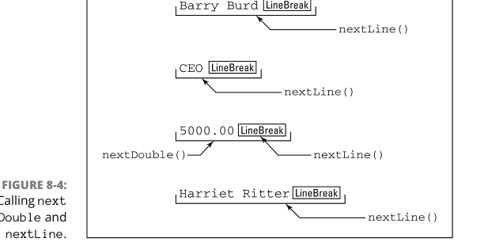

我总是对编程语言扫描方法中发现的许多怪癖感到惊讶。例如，从图 8-3 文件读取的第一个 `nextLine` 从文件中提取了 Barry。但那次 `nextLine` 调用将 Burd（不带换行符）传递给了运行中的代码。`nextLine` 寻找换行符，然后 `nextLine` 丢掉了这个换行符。是的，这是一个微妙的点。不，这个微妙的点从未给任何人带来过问题。

如果关于 `nextDouble` 和 `nextLine` 的问题让你感到困惑，请不要归咎于 Java。在任何编程语言中，混合输入调用都是微妙的。事实是，每种编程语言处理问题的方式都略有不同。你在 Java 的 `nextLine` 中发现的问题可以帮助你在接触 C++ 或 Visual Basic 时理解这些问题，但它并不能告诉你所有的细节。每种语言的细节都是该语言独有的（是的，这是一个巨大的痛苦）。但因为所有程序员最终都会变得富而有名，所以这种付出是值得的。

# 关闭与磁盘文件的连接

对于普通用户来说，键盘的感觉完全不像存储在计算机硬盘驱动上的文件。但磁盘文件和键盘输入有许多共同点。事实上，操作系统的基本原则规定，对于程序员来说，两种输入类型之间的差异越模糊越好。作为一名 Java 程序员，你应该以相同的方式对待磁盘文件和键盘输入。这就是为什么列表 8 包含了 `diskScanner.close()`。

当你运行一个 Java 程序时，你通常执行 `main` 方法的语句，从方法体中的第一条语句开始，到方法体中的最后语句结束。在此过程中，你会绕路，跳过其他部分并进入方法体，但基本上在 `main` 方法结束时完成语句的执行。这就是为什么在列表 8-2 中，`close` 的调用位于 `main` 方法体的最后。当你运行列表 8-2 中的代码时，你做的最后一件事就是断开与磁盘文件的连接。不幸的是，断开发生在执行完 `nextLine` 和 `nextDouble` 调用之后。

在本章之前，你创建了 `PlaceTo` 类的实例并显示了关于这些实例的信息。修改你文本版本的代码，使其从磁盘文件获取每个实例的特征（地址、卧室数量和面积）。


## 尝试一下

## 定义子类（全职或兼职员工的含义）

（注：此处原文存在大量重复的乱码文本，已根据逻辑进行了清理和翻译，保留了核心概念）

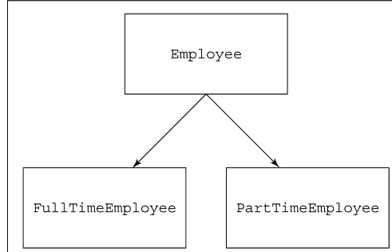

图 8-5：`Employee` 类层次树。

## 创建子类

在代码列表 8-1 中，我定义了一个 `Employee` 类。我可以使用代码列表 8-1 中定义的内容并扩展该定义以创建新的、更具体的类。因此，在代码列表 8-3 中，我定义了一个新类：`FullTimeEmployee`（全职员工）类。

代码列表 8-3：什么是 `FullTimeEmployee`？

```java
public class FullTimeEmployee extends Employee {
    private double weeklySalary;
    private double benefitDeduction;

    public void setWeeklySalary(double weeklySalary) {
        weeklySalary = weeklySalary;
    }

    public double getWeeklySalary() {
        return weeklySalary;
    }

    public void setBenefitDeduction(double benefitDed) {
        benefitDeduction = benefitDed;
    }

    public double getBenefitDeduction() {
        return benefitDeduction;
    }

    public double findPaymentAmount() {
        return weeklySalary - benefitDeduction;
    }
}
```

查看代码列表 8-3，你可以看到 `FullTimeEmployee` 类的每个实例有两个字段：`weeklySalary` 和 `benefitDeduction`。但这些是每个 `FullTimeEmployee` 实例拥有的字段吗？不，不是。代码列表 8-3 的第一行显示 `FullTimeEmployee` 类继承了现有的 `Employee` 类。这意味着除了拥有 `weeklySalary` 和 `benefit deduction`（福利扣除）之外，每个 `FullTimeEmployee` 实例还拥有两个字段：`name` 和 `title`。这两个字段源于 `Employee` 类的定义，你可以在代码列表 8-1 中找到它们。

在代码列表 8-3 中，关键字是 `extends`。当一个类继承现有的类时，扩展类会自动继承在现有类中定义的功能。因此，`FullTimeEmployee` 类继承了 `name` 和 `jobTitle` 字段。`FullTimeEmployee` 类还继承了 `Employee` 类中声明的所有方法：`setName`、`getName`、`getJobTitle` 和 `cutCheck`。`FullTimeEmployee` 类是 `Employee` 类的子类。你也可以用血亲关系描述：`FullTimeEmployee` 类是 `Employee` 类的子，而 `Employee` 类是 `FullTimeEmployee` 类的父。

这几乎（但不完全）就像 `FullTimeEmployee` 类是由代码列表 8-4 中的代码定义一样。

## 代码列表 8-4：伪造（但有助于理解）的代码

```java
import static java.lang.System.*;

public class FullTimeEmployee {
    private String name;
    private String jobTitle;
    private double weeklySalary;
    private double benefitDeduction;

    public void setName(String nameIn) {
        name = nameIn;
    }

    public String getName() {
        return name;
    }

    public void setJobTitle(String jobTitleIn) {
        jobTitle = jobTitleIn;
    }
```

（续）

## 代码列表 8-4：（续）

```java
public String getJobTitle() {
    return jobTitle;
}
```

```java
public void setWeeklySalary(double weeklySalaryIn) {
    weeklySalary = weeklySalaryIn;
}
```

```java
public double getWeeklySalary() {
    return weeklySalary;
}
```

```java
public void setBenefitDeduction(double benefitDedIn) {
    benefitDeduction = benefitDedIn;
}
```

```java
public double getBenefitDeduction() {
    return benefitDeduction;
}
```

```java
public double findPaymentAmount() {
    return weeklySalary - benefitDeduction;
}
```

```java
public void cutCheck(double amountPaid) {
    out.printf("Pay to the order of %s ", name);
    out.printf("%s ***%s,", jobTitle);
    out.printf("%.2f\n", amountPaid);
}
```


为什么代码列表 8-4 的标题是伪造的？

因为这段代码并没有真正继承 `Employee` 类；它只是重新实现了所有的方法。这只是为了向你展示如果不使用继承，代码会是什么样子。

```java
ftEmployee.setBenefitDeduction(500.00);
ftEmployee.cutCheck(ftEmployee.findPaymentAmount());
System.out.println();
```

```java
PartTimeEmployee ptEmployee = new PartTimeEmployee();
ptEmployee.setName("Steve Surace");
ptEmployee.setJobTitle("Driver");
ptEmployee.setHourlyRate(7.53);
ptEmployee.cutCheck(ptEmployee.findPaymentAmount(10));
```

图 8-6：列表 8-6 中程序的输出。

| 付给 Barry Burd (CEO) 的支票 | ***4,500.00 |
| --- | --- |
| 付给 Steve Surace (Driver) 的支票 | ***75.30 |

要理解列表 8-6，你需要关注三个类：`FullTimeEmployee`、`Employee` 和 `PartTimeEmployee`。（查看定义这些类的代码，请参阅列表 8-1、8-3 和 8-5）。

列表 8-6 的前半部分处理一个全职员工。注意看 `ftEmployee` 变量可以使用多少方法？例如，你可以调用 `ftEmployee.setWeeklySalary`，因为 `ftEmployee` 的类型是 `FullTimeEmployee`。你也可以调用 `ftEmployee.setName`，因为 `FullTimeEmployee` 继承了 `Employee` 类。

由于 `cutCheck` 声明在 `Employee` 类中，你可以调用 `ftEmployee.cutCheck`。但你也可以调用 `ftEmployee.findPaymentAmount`，因为 `findPaymentAmount` 方法在 `FullTimeEmployee` 类中。

## 使类型匹配

再次查看列表 8-6 的前半部分。特别注意最后一条语句——即全职员工实际上是一个支票的那条语句。该语句形成了一个良好的长值及其类型链。你可以通过从内向外读取语句来看到这一点：

- 调用 `findPaymentAmount` 方法时带有一个空的参数列表。（参阅列表 8-3。）这很好，因为 `findPaymentAmount` 方法不接受任何参数。（参阅列表 8-3。）
- `findPaymentAmount` 方法返回一个 `double` 类型的值。（再次参阅列表 8-3。）
- `ftEmployee.findPaymentAmount` 返回的 `double` 值被传递给方法 `ftEmployee.cutCheck`。（参阅列表 8-6）因为 `cutCheck` 方法接受一个 `double` 类型的参数。（参阅列表 8-1。）

如需有趣的图形化说明，请参阅图 8-7。

始终为方法提供其在参数列表中所需的数值类型。

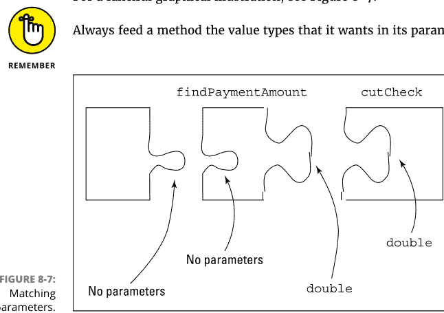

## 故事的后半部分

在列表 8-6 的后半部分，代码创建 `PartTimeEmployee` 类型的对象。`PartTimeEmployee` 类型的变量可以执行 `FullTimeEmployee` 变量可以的一些相同操作。但 `PartTimeEmployee` 类没有 `weeklySalary` 和 `setBenefitDeduction` 方法。相反，`PartTimeEmployee` 类有 `setHourlyRate` 方法。（见列表 8-5）因此在列表 8-6 中，倒数第二行是对 `setHourlyRate` 方法的调用。

列表 8-6 的最后一行是最有趣的。在那一行，代码将数字 10（工作小时数）传递给 `findPaymentAmount` 方法。将其与之前对 `findPaymentAmount` 的调用进行比较——列表 8-6 前半部分对全职员工的调用。在两个子类 `FullTimeEmployee` 和 `PartTimeEmployee` 之间，存在不同的 `findPaymentAmount` 方法。这两个方法具有两种不同的参数列表：

- `FullTimeEmployee` 类的 `findPaymentAmount` 方法不接受参数（参阅列表 8-3）。
- `PartTimeEmployee` 类的 `findPaymentAmount` 方法接受一个 `int` 参数（参阅列表 8-5）。

在这种情况下，对于全职员工的 `findPaymentAmount` 并不需要某些参数。这是重写方法的体现。


## 重写现有方法（更改某些员工的付款）

你懂吗！人力资源部门的某个傻瓜为你的兼职员工提供了加班费。现在消息传开了，其他兼职员工也想要加班费。如果这种情况持续下去，你会破产，所以你需要向兼职员工发送一份备忘录，解释为什么赚钱对他们没有好处。

与此同时，你有两种兼职员工——那些获得加班费的和那些没有的，所以你需要修改薪资软件。你的选择是什么？

- 嗯，你可以深入 `PartTimeEmployee` 类代码，进行一些更改并祈祷（这不是好主意！）
- 你可以遵循上一节的建议创建一个 `PartTimeEmployee` 的子类。“等待，”你说，“现有的 `PartTimeEmployee` 类已经有一个 `findPaymentAmount` 方法。我需要某些技巧来绕过现有的 `findPaymentAmount` 吗？”

此时，你可以感谢你在 Java 中进行面向对象编程。在面向对象编程中，你可以创建一个重写父类功能的子类。列表 8-7 正有这样一个子类。

## 列表 8-7：另一个子类

```java
public class PartTimeWithOver extends PartTimeEmployee {

    @Override
    public double findPaymentAmount(int hours) {

        if (hours <= 40) {
            return getHourlyRate() * hours;
        } else {
            return getHourlyRate() * 40 + getHourlyRate() * 2 * (hours - 40);
        }
    }
}
```

图 8-8 显示了列表 8-7 中的代码与本章其他代码之间的关系。特别是，`PartTimeWithOver` 是子类的子类。在面向对象编程中，这种链并不罕见。事实上，作为子类，这个链相当短。

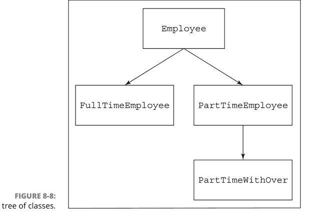

图 8-8：类的树。

根据官方术语，`PartTimeWithOver` 重写了其父类中的 `findPaymentAmount` 方法。如果你从 `PartTimeWithOver` 类创建一个对象，该对象拥有 `PartTimeEmployee` 类的 `name`、`jobTitle`、`hourlyRate` 和 `cutCheck`，但该对象拥有的是列表 8-7 中定义的 `findPaymentAmount` 方法。

## Java 注解

列表 8-7 中的 `@Override` 单词是注解的一个示例。Java 注解告诉计算机一些关于你代码的信息。特别是，列表 8-7 中的 `@Override` 注解告诉 Java 编译器留意可能的编码错误。该注解的意思是：“确保紧跟此注解后的方法与父类中的其中一个方法具有相同的内容（相同的名称、相同的参数等）。如果没有，则显示错误消息。”

```java
public double findPaymentAmount(double hours) {
```

与列表 8-5 和 8-7 中的 `int hours` 不同，编译器提醒我，我新写的 `findPaymentAmount` 方法并没有真正重写列表 8-5 中的任何内容。

Java 还有其他类型的注解（例如 `@Deprecated` 和 `@SuppressWarnings`）。你可以在第 9 章阅读关于 `@SuppressWarnings` 注解的内容。

Java 的注解是可选的。如果你从列表 8-7 中删除 `@Override` 单词，你的代码仍然可以正常运行。但 `@Override` 注解为你的代码提供了安全性。有了 `@Override`，编译器会检查以确保你正在执行你想的操作（即重写子类的一个方法）。很抱歉告诉 George Orwell，有些注解的作用确实不如其他注解。只有当你愿意用大量不必要的 Java 代码替换注解时，你才能从代码中省略注解。


## 使用类和子类中的方法

如果你对重写方法这一概念需要进一步说明，请查看列表 8-8 中的代码。该代码的运行结果如图 8-10 所示。

## 列表 8-8：测试列表 8-7 中的代码

```java
public class DoPayrollTypeF {

    public static void main(String args[]) {

        FullTimeEmployee ftEmployee = new FullTimeEmployee();

        ftEmployee.setName("Barry Burd");
        ftEmployee.setJobTitle("CEO");
        ftEmployee.setWeeklySalary(5000.00);
        ftEmployee.setBenefitDeduction(500.00);
        ftEmployee.cutCheck(ftEmployee.findPaymentAmount());

        PartTimeEmployee ptEmployee = new PartTimeEmployee();

        ptEmployee.setName("Chris Apelian");
        ptEmployee.setJobTitle("Computer Book Author");
        ptEmployee.setHourlyRate(7.53);
        ptEmployee.cutCheck(ptEmployee.findPaymentAmount(50));

        PartTimeWithOver ptoEmployee = new PartTimeWithOver();

        ptoEmployee.setName("Steve Surface");
        ptoEmployee.setJobTitle("Driver");
        ptoEmployee.setHourlyRate(7.53);
        ptoEmployee.cutCheck(ptoEmployee.findPaymentAmount(50));

    }
}
```

## 图 8-10：运行列表 8-8 的代码。

| 付给 Barry Burd (CEO) | ***4,500.00 |
| :--- | :--- |
| 付给 Chris Abelian (Computer Book Author) | ***376.50 |
| 付给 Steve Surface (Driver) | ***451.50 |

列表 8-8 中的代码为三位员工写入工资。第一位员工是全职员工。第二位是尚未获加班费方案的兼职员工。第三位员工知道加班方案并要求公平的工资。

通过子类，这三位员工在列表 8-8 中并共存在。确实，其中有一个来自旧 `PartTimeEmployee` 类的子类，但这并不意味着你不能从 `PartTimeEmployee` 类创建一个对象。事实上，Java 在方面非常智能。列表 8-8 有三次对 `findPaymentAmount` 方法的调用，每次调用都指向不同版本的方法：

- 在第一次调用 `ftEmployee.findPaymentAmount()` 中，`ftEmployee` 变量是 `FullTimeEmployee` 类的实例。调用的方法是列表 8-3 中的。
- 在第二次调用 `ptEmployee.findPaymentAmount(50)` 中，`ptEmployee` 变量是 `PartTimeEmployee` 类的实例。调用的方法是列表 8-5 中的。
- 在第三次调用 `ptoEmployee.findPaymentAmount(50)` 中，`ptoEmployee` 变量是 `PartTimeWithOver` 类的实例。调用的方法是列表 8-7 中的。

这段代码太棒了。它简洁、优雅且高效。有了你省下的所有钱，你可以负担得起给每个人支付双倍的加班费。（至于你是这样做还是把钱留给自己，那是另一个故事了。）


创建一个新对象可能涉及各种任务，在本章中，你将创建构造函数。构造函数告诉计算机执行新对象的启动任务。

## 什么是温度？

“早上好，欢迎收听 Object News。您所在地区的当地温度是舒适的 73 华氏度。”

每个温度由两个部分组成：一个数字和一个温度单位。数字只是一个 `double` 类型的值，例如 `32.0` 或 `70.52`。但什么是温度单位呢？它是一个字符字符串，比如“Fahrenheit”或“Celsius”吗？并不完全如此，因为某些字符串并不是温度单位。并没有所谓的“Quelplof”温度单位，而一个可以显示“73 degrees Quelplof”的程序是一个糟糕的程序。那么，你如何将温度单位限制在人们使用的少数几种单位上呢？一种方法是使用 Java 的 `enum`（枚举）类型。

## 什么是温度单位？（Java 的 enum 类型）

Java 提供了许多方法将事物组合在一起。在第 11 章中，你将事物组合形成一个数组（Array）。在第 12 章中，你将它们组合形成一个集合（collection）。在本章中，你将事物分组成一个 `enum` 类型。（当然，如果你无法读出某个词，就无法对任何东西分组。`enum` 这个词的读音是“ee-nom”，就像 `enumeration` 一词的前两个音节。）

创建一个复杂的 `enum` 类型并不容易，但要创建一个简单的 `enum` 类型，只需在花括号内写一组单词即可。列表 9-1 定义了一个枚举。该枚举类型的名称为 `TempScale`。

| 9-1: | TempScale 类型（一个枚举类型） |
| :--- | :--- |
| ```java | |
| public enum TempScale { | |
|     CELSIUS, FAHRENHEIT, KELVIN, RANKINE, | |
|     NEWTON, DELISLE, REAUMUR, ROMER, LEIDEN | |
| } | |

在列表 9-1 中，我通过命名不是两个、四个而是九种不同的温度单位来展示我的物理学造诣。某些读者的计算机在处理 `REAUMUR` 和 `ROMER` 单词中的特殊字符可能会遇到问题。如果你是这些读者之一，只需从代码中删除 `REAUMUR` 和 `ROMER` 单词即可。我保证：这不会破坏示例。


当你定义一个 `enum` 类型时，会发生两件事情：

- **你创建了值。**
  就像 `13` 和 `151` 是 `int` 值一样，`CELSIUS` 和 `FAHRENHEIT` 是 `TempScale` 值。
- **你可以创建变量来引用这些值。**
  在列表 9-2 中，我声明了字段 `number` 和 `scale`。就像
  ```java
  double number;
  ```
  声明一个 `number` 变量是 `double` 类型，
  ```java
  TempScale scale;
  ```
  声明变量 `scale` 的类型为 `TempScale`。

“属于 `TempScale` 类型”意味着你可以拥有 `CELSIUS`、`FAHRENHEIT`、`KELVIN` 等值。在列表 9-2 中，我给 `scale` 变量赋值为 `FAHRENHEIT`（或 `TempScale` 类型）。更准确地说，是 `FAHRENHEIT`。

`enum` 类型是一个伪装成类的 Java 类。这就是为什么列表 9-1 包含一个完全用于特定名称的文件；一个枚举类型的声明（`TempScale` 类型）。就像类的声明一样，枚举类型的声明应该属于一个独立的文件。列表 9-1 中的代码属于一个名为 `TempScale.java` 的文件。


## 好了，温度到底是什么？

每个温度都由两个数字组成：一个数字和一个温度单位。列表 9-2 中的代码清晰地说明了这一事实。

## 列表 9-2：Temperature 类

```java
public class Temperature {
    private double number;
    private TempScale scale;

    public Temperature() {
        number = 0.0;
        scale = TempScale.FAHRENHEIT;
    }

    public Temperature(double number) {
        this.number = number;
        scale = TempScale.FAHRENHEIT;
    }

    public Temperature(TempScale scale) {
        number = 0.0;
        this.scale = scale;
    }

    public Temperature(double number, TempScale scale) {
        this.number = number;
        this.scale = scale;
    }

    public void setNumber(double number) {
        this.number = number;
    }

    public double getNumber() {
        return number;
    }

    public void setScale(TempScale scale) {
        this.scale = scale;
    }

    public TempScale getScale() {
        return scale;
    }
}
```

列表 9-2 中的代码为 `number` 和 `scale` 提供了常用的 setter 和 getter 方法（访问器）。


> 关于 setter 和 getter 方法（也称为访问器），请参阅第 7 章。

除此之外，列表 9-2 还有四个类似方法的东西。这些类似方法的东西名称都为 `Temperature`，恰好与类名相同。这些类似方法的东西都没有返回类型——甚至没有 `void` 类型。这些类似方法的东西被称为构造函数。构造函数类似于方法，但构造函数有一个特殊目的：创建新对象。

每当计算机创建一个新对象时，就会执行构造函数内部的语句。

你可以省略列表 9-1 和 9-2 第一行中的 `public` 关键字。如果你省略 `public`，其他 Java 程序可能无法使用 `TempScale` 类型和 `Temperature` 类中的特征。（不用担心本章中的程序：无论是否有 `public`，本章中的程序都可以使用列表 9-1 和 9-2 中的代码。要了解哪些程序可以使用非 `public` 类，请参阅第 14 章。）如果你在列表 9-1 的第一行使用了 `public`，列表 9-1 必须是一个以大写 T 开头的 `TempScale.java`。如果你在列表 9-2 的第一行使用了 `public`，列表 9-2 必须是一个以大写 T 开头的 `Temperature.java`。关于 `public` 类的介绍，请参阅第 7 章。

## 你对温度做什么

列表 9-3 为我在上一节描述的一些想法提供了形式。在列表 9-3 中，你调用了在列表 9-2 中声明的构造函数。图 9-1 显示了运行所有代码会发生什么。

| 输出 |
| :--- |
| 32.00 degrees FAHRENHEIT |
| 0.00 degrees CELSIUS |
| 273.15 degrees KELVIN |

图 9-1：运行列表 9-3 的代码。

## 列表 9-3：

```java
import static java.lang.System.*;

public class UseTemperature {

    public static void main(String args[]) {
        final String format = "%.2f degrees %s\n";

        Temperature temp = new Temperature();
        temp.setNumber(70.0);
        temp.setScale(TempScale.FAHRENHEIT);
        out.printf(format, temp.getNumber(), temp.getScale());

        Temperature temp2 = new Temperature(32.0);
        out.printf(format, temp2.getNumber(), temp2.getScale());

        Temperature temp3 = new Temperature(TempScale.CELSIUS);
        out.printf(format, temp3.getNumber(), temp3.getScale());

        Temperature temp4 = new Temperature(273.15, TempScale.KELVIN);
        out.printf(format, temp4.getNumber(), temp4.getScale());
    }
}
```

在列表 9-3 中，每个形如下形式的语句

```java
temp = new Temperature(..., ...);
```


都会调用列表 9-2 中的构造函数之一。因此，当列表 9-3 中的代码运行时，它创建了 `Temperature` 类的四个实例。每个实例都是通过调用列表 9-2 中不同的构造函数创建的。

在列表 9-3 中，四个构造函数中的最后一个有两个参数：`2.73` 和 `TempScale.KELVIN`。这并不是构造函数调用特有的。方法调用或构造函数都可以有一组参数。你用逗号来分隔不同的参数。“一组参数”的另一个名称是参数列表。

你必须遵守的唯一规则是调用中的参数与声明中的参数相匹配。例如，在列表 9-3 中，第四个也是最后一个构造函数调用：

```java
new Temperature(2.73, TempScale.KELVIN)
```

有两个参数：第一个是 `double` 类型，第二个是 `TempScale` 类型。Java 批准此构造函数调用，因为列表 9-2 包含匹配的声明。也就是说，头部：

```java
public Temperature(double number, TempScale scale)
```

有两个参数：第一个是 `double` 类型，第二个是 `TempScale` 类型。

## 如何作弊：枚举类型与 switch 语句

列表 9-2 和 9-3 包含了诸如 `TempScale.FAHRENHEIT` 和 `TempScale.CELSIUS` 这样冗长的名称。`FAHRENHEIT` 和 `CELSIUS` 等名称属于我的 `TempScale`（在列表 9-1 中定义的类型）。这些名称在我的 `TempScale` 之外没有任何意义。（如果你认为我这种“在语境之外没有意义”的说法是在自恋，请尝试删除列表 9-2 中 `TempScale.FAHRENHEIT` 的 `TempScale` 部分。突然之间，Java 就会告诉你你的代码包含错误。）

Java 通常对类型名称和点号非常挑剔。但当他们创建枚举类型时，Java 的开发者认为枚举和 `switch` 语句应该得到特殊对待。你可以使用枚举值来决定在 `switch` 语句中执行哪一个 `case`。当你这样做时，不要在 `case` 表达式中使用类型名称。例如，以下 Java 代码是正确的：

```java
TempScale scale = TempScale.RANKINE;
char letter;
switch (scale) {
    case CELSIUS:
        letter = 'C';
        break;
    case KELVIN:
        letter = 'K';
        break;
    case RANKINE:
    case REAMUR:
        letter = 'R';
        break;
    default:
        letter = 'X';
        break;
}
```

在第一行代码中，我写了 `TempScale.RANKINE`，因为这第一行不在 `switch` 语句内部。但在接下来的代码行中，我写 `CELSIUS`、`case KELVIN` 和 `case RANKINE` 时，没有使用 `TempScale` 这个词。事实上，如果我通过写 `case TempScale.RANKINE` 来创建一个 `case`，Java 就会报出一个响亮的、令人讨厌的错误信息。

## 调用 `new Temperature(32.0)`：案例研究

当计算机执行列表 9-3 中的其中一个 `new Temperature` 语句时，计算机必须决定使用列表 9-2 中的哪一个构造函数。计算机通过查看参数列表（即 `new Temperature` 单词后面括号里的内容）来决定。例如，当计算机执行：

```java
temp = new Temperature(32.0);
```

根据列表 9-3，计算机心里想：“括号里的数字 `32.0` 是一个 `double` 值。列表 9-2 中的 `Temperature` 构造函数之一正好有一个类型为 `double` 的参数。构造函数的头部像这样：

```java
public Temperature(double number)
```

“那么，我想我将执行那个特定构造函数内部的语句。”计算机继续执行以下语句：

```java
this.number = number;
scale = TempScale.FAHRENHEIT;
```

结果，你得到了一个新对象，其 `number` 字段值为 `32.0`，`scale` 字段值为 `TempScale.FAHRENHEIT`。

在这两行代码中，你有两个语句分别为 `number` 和 `scale` 字段设置值。看看这两个语句中的第二个，它稍微好理解一点。第二个语句将新对象的 `scale` 字段设置为 `TempScale.FAHRENHEIT`。你看，构造函数的参数列表是 `(double number)`，而该列表并不包含 `scale` 值。所以，无论编写这段代码的人是谁，都必须对 `scale` 字段使用什么值做出决定。程序员可以选择 `FAHRENHEIT` 或 `CELSIUS`，但也可以选择 `KELVIN`、`RANKINE` 或列表 9-1 中的任何其他模糊的刻度。（这位程序员恰恰住在美国新泽西州，那里的人通常使用旧的 `FAHRENHEIT` 温度等级。）

回到两个语句中的第一个，这第一个语句为新对象的 `number` 字段分配了一个值。该语句使用了一个巧妙的技巧，你可以在许多构造函数（以及其他为对象字段赋值的方法）中看到它。要理解这个技巧，请看列表 9-4。

### 列表 9-4：实现相同功能的两种方法

```java
// 使用这个构造函数 ...
public Temperature(double whatever) {
    number = whatever;
    scale = TempScale.FAHRENHEIT;
}

// 或者使用这个构造函数 ...
public Temperature(double number) {
    this.number = number;
    scale = TempScale.FAHRENHEIT;
}

// 不要在你的代码中同时放置这两个构造函数。
```

列表 9-4 包含两个构造函数。在第一个构造函数中，我使用了两个不同的名称：`number` 和 `whatever`。在第二个构造函数中，我不需要名称。我没有为构造函数的参数起新名称，而是通过编写 `this.number` 来重用现有的名称。

这里是列表 9-2 中发生的情况：

> 在 `this.number = number` 语句中，`this.number` 指向新对象的字段——即列表 9-2 顶部声明的字段。（见图 9-2）。
>
> 在 `this.number = number` 语句中，`number`（右侧）指的是参数。

```java
public class Temperature {
    private double number;
    private Scale scale;

    public Temperature(double number) {
        this.number = number;
        scale = TempScale.FAHRENHEIT;
    }
}
```
*图 9-2：this.number 和 number*

## 什么是 new Temperature？

当计算机执行列表 9-3 中的其中一个 `new Temperature` 语句时，计算机必须决定使用列表 9-2 中的哪一个构造函数。计算机通过查看参数列表（即 `new Temperature` 单词后面括号里的内容）来决定。例如，当计算机执行：

```java
temp = new Temperature(32.0);
```

根据列表 9-3，计算机心里想：“括号里的数字 `32.0` 是一个 `double` 值。列表 9-2 中的 `Temperature` 构造函数之一正好有一个类型为 `double` 的参数。构造函数的头部像这样：

```java
public Temperature(double number)
```

“那么，我想我将执行那个特定构造函数内部的语句。”计算机继续执行以下语句：

```java
this.number = number;
scale = TempScale.FAHRENHEIT;
```

结果，你得到了一个新对象，其 `number` 字段值为 `32.0`，`scale` 字段值为 `TempScale.FAHRENHEIT`。

在这两行代码中，你有两个语句分别为 `number` 和 `scale` 字段设置值。看看这两个语句中的第二个，它稍微好理解一点。第二个语句将新对象的 `scale` 字段设置为 `TempScale.FAHRENHEIT`。你看，构造函数的参数列表是 `(double number)`，而该列表并不包含 `scale` 值。所以，无论编写这段代码的人是谁，都必须对 `scale` 字段使用什么值做出决定。程序员可以选择 `FAHRENHEIT` 或 `CELSIUS`，但也可以选择 `KELVIN`、`RANKINE` 或列表 9-1 中的任何其他模糊的刻度。（这位程序员恰恰住在美国新泽西州，那里的人通常使用旧的 `FAHRENHEIT` 温度等级。）

回到两个语句中的第一个，这第一个语句为新对象的 `number` 字段分配了一个值。该语句使用了一个巧妙的技巧，你可以在许多构造函数（以及其他为对象字段赋值的方法）中看到它。要理解这个技巧，请看列表 9-4。

## 某些不会改变的东西

`final` 关键字表示变量的值不能改变。在之前的例子中，`format` 是一个字符串。第一个 `printf` 调用始终是：

```java
out.printf("%.4f\n", myInterest);
```

在列表 9-3 中，`printf` 调用是以变量名称开始的：

```java
out.printf(format, temp.getNumber(), temp.getScale());
```

在列表 9-3 中，`format` 的类型是 `String`。而且，在列表 9-3 中，`format` 的第一个声明是：

```java
final String format = "%5.2f %s";
```

在这个 `format` 变量的声明中，特别注意 `final` 字。这个 Java 关键字表示 `format` 的值无法更改。如果我在列表 9-3 中添加另一个赋值语句：

```java
format = "%6.2f (%s)";
```

编译器会向我返回“无法给 final 变量赋值”。

当我在编写列表 9-3 中的代码时，使用 `final` 关键字并不是绝对必要的。但 `final` 关键字提供了额外的保护。当我将 `format` 初始化为 `"%5.2f %s"` 时，我打算原封不动地反复使用这个格式。我很清楚自己并不打算更改它。当然，在一个 10000 行的程序中，我可能会困惑并尝试给 `format` 赋一个新值。为了防止意外更改格式字符串，我将格式变量声明为 `final`。这是一种良好的、安全的编程习惯。

## 更多你可以尝试的内容

- 创建一个 `Student` 类，包含姓名、ID 号、平均学分（GPA）和专业领域。学生的姓名是 `String`。学生的 ID 是 `int` 值。GPA 是 0.0 到 4.0 之间的 `double` 值。专业是一个枚举类型，包含 `COMPUTER_SCIENCE`、`MATHEMATICS`、`LITERATURE`、`PHYSICS` 和 `HISTORY`。

- 每个学生都有姓名和 ID 号，但新学生可能没有 GPA 或专业。创建带有和不带 GPA 以及参数的构造函数。

- 通常，创建一个独立的类来组成你新的 `Student` 类。

机场代码。例如，伦敦希斯罗机场的代码是 LHR；洛杉矶国际机场的代码是 LAX；请访问 `http://www.iata.org/publications/Pages/code-search.aspx` 查看一个可搜索的航空公司代码数据库。

对于到达和离开时间，请使用 Java 的 `LocalTime` 类。（有关更多关于 `LocalTime` 的信息，请查看 `https://docs.oracle.com/javase/8/docs/api/java/LocalTime.html` 中的 `LocalTime` 文档）。创建一个设置为下午 2:15（也称为 14:15）的 `LocalTime` 对象，执行：

```java
LocalTime fifteen = LocalTime.of(14, 15);
```

创建一个设置为当前时间（根据计算机系统时）的 `LocalTime` 对象：

```java
LocalTime currentTime = LocalTime.now();
```

每班航班都有一个编号、一个出发机场和一个到达机场。但某些航班可能没有离开和到达时间。创建不带离开和到达时间参数的构造函数。

创建一个使用你新 `AirplaneFlight` 类的类。

## 更多子类（处理天气问题）

在第 8 章中，我对子类的概念大做特此。那是正确的做法。子类使得代码变得可复用，而可复用的代码就是好代码。考虑到这一点，是时候创建一个 `Temperature` 类的子类了（我在本章的第一节开发了它）。

## 构建更好的温度显示

在回顾了列表 9-3 中的代码后，你认为显示温度的决策位置非常错误。列表 9-3 中有几处打印温度值的冗长重复。一个 20 世纪 70 年代的程序员会告诉你将这些行收集到一个地方并将它们转换为一个方法。（20 世纪 70 年代的程序员不会使用“方法”这个词，但现在这不重要。）将行收集成方法是可以的，但用今天的面向对象编程方法论，你应该从更宽泛的角度来考虑。如何不让每个温度对象负责显示它自己呢？毕竟，如果你开发了一个显示方法，你可能想与其它使用温度的人共享该方法。因此，将该方法直接放在温度对象的声明内部。这样，任何使用温度代码的人都可以轻松访问你的显示方法。

现在重温一下第 8 章的内容。“吧，吧……不想修改现有代码……吧，吧，吧……从头开始成本太高了……吧，吧，吧……扩展功能。”这些都总结为一点：

不要滥用它。相反，要复用它。

所以你决定创建一个 `Temperature` 类的子类 ——列表 9-2 中定义的类。你的新子类通过具有以美观、统一方式显示值的方法，补充了 `Temperature` 类的功能。新类 `TemperatureNice` 所示于列表 9-5。

## 列表 9-5：TemperatureNice 类

```java
import java.lang.System;

public class TemperatureNice extends Temperature {

    public TemperatureNice() {
        super();
    }

    public TemperatureNice(double number) {
        super(number);
    }

    public TemperatureNice(TempScale scale) {
        super(scale);
    }

    public TemperatureNice(double number, TempScale scale) {
        super(number, scale);
    }

    public void display() {
        out.printf("%.2f degrees %s\n", getNumber(), getScale());
    }
}
```

在列表 9-5 的 `display` 方法中，注意对 `Temperature` 类的 `getNumber` 和 `getScale` 方法的调用。我为什么要这样做？嗯，在 `TemperatureNice` 类代码内部，对 `number` 和 `scale` 字段的直接引用将产生错误信息。每个 `TemperatureNice` 对象确实都有它的 `number` 和 `scale` 字段。（毕竟 `TemperatureNice` 是 `Temperature` 类的子类，而 `Temperature` 类的代码定义了 `number` 和 `scale` 字段。）但由于 `number` 和 `scale` 在 `Temperature` 类中被声明为 `private`，只有 `Temperature` 类内部的代码才能直接使用这些字段。

不要在 `TemperatureNice` 类代码中再次对 `number` 和 `scale` 字段进行声明。如果你这样做，就会无意中创建了四个不同的变量（两个名为 `number`，另一个名为 `scale`）。你会给其中一个赋值。当你显示其中一个时，你会感到惊讶的。（注：由于原文中存在大量重复的 OCR 错误，已按要求去重并保留核心逻辑。）

## 子类的构造函数

在列表 9-5 的 `display` 方法中，注意对 `Temperature` 类的 `getNumber` 和 `getScale` 方法的调用。我为什么要这样做？嗯，在 `TemperatureNice` 类代码内部，对 `number` 和 `scale` 字段的直接引用将产生错误信息。每个 `TemperatureNice` 对象确实都有它的 `number` 和 `scale` 字段。（毕竟 `TemperatureNice` 是 `Temperature` 类的子类，而 `Temperature` 类的代码定义了 `number` 和 `scale` 字段。）但由于 `number` 和 `scale` 在 `Temperature` 类中被声明为 `private`，只有 `Temperature` 类内部的代码才能直接使用这些字段。

## 使用以上内容

（注：由于 OCR 文本存在循环，已仅提供唯一内容。）

## 列表 9-6：使用 TemperatureNice 类


```java
public class UseTemperatureNice {

    public static void main(String[] args[]) {

        TemperatureNice temp = new TemperatureNice();
        temp.setNumber(70.0);
        temp.setScale(TempScale.FARENHEIT);
        temp.display();

    }
}
```

## 列表 9-7: 默认构造函数

```java
public FullTimeEmployee() {
    super();
}
```

列表 9-7 中的构造函数不接受任何参数，它的唯一一条语句调用了你所扩展的任何类的构造函数。（如果你扩展的类没有无参数的构造函数，那你就可怜了。）

你刚刚读到了关于默认构造函数的知识，但要小心！注意这段关于默认构造函数的讨论没有提到的一点：它并没有说你总是拥有一个默认构造函数。特别是，如果你创建一个子类并定义了任何构造函数，Java 就不会为子类添加默认构造函数（子类也不会继承任何构造函数）。

那么，这会如何让你困扰呢？列表 9-8 包含了列表 8-3 代码的副本，但增加了一个构造函数。看看这个修改后的 `FullTimeEmployee` 代码。

## 列表 9-8: 嘿，我有一个构造函数！

```java
public class FullTimeEmployee extends Employee {
    private double weeklySalary;
    private double benefitDeduction;

    public FullTimeEmployee(double weeklySalary) {
        this.weeklySalary = weeklySalary;
    }

    public void setWeeklySalary(double weeklySalaryIn) {
        weeklySalary = weeklySalaryIn;
    }

    public double getWeeklySalary() {
        return weeklySalary;
    }

    public void setBenefitDeduction(double benefitDedIn) {
        benefitDeduction = benefitDedIn;
    }

    public double getBenefitDeduction() {
        return benefitDeduction;
    }

    public double findPaymentAmount() {
        return weeklySalary - benefitDeduction;
    }
}
```

如果你使用列表 9-8 中的 `FullTimeEmployee` 代码，如下代码行将无法工作：

```java
FullTimeEmployee ftEmployee = new FullTimeEmployee();
```

它无法工作是因为在你声明了一个接受一个 `double` 参数的 `FullTimeEmployee` 构造函数后，你不再拥有默认的无参数构造函数。

你该怎么办？如果你有任何构造函数，请声明所有可能需要的构造函数。取列表 9-7 中的构造函数并将其添加到列表 9-8 的代码中。`new FullTimeEmployee()` 的调用将再次开始工作。

在某些情况下，Java 会自动在构造器体的顶部添加一个对类构造函数的隐藏调用。这种自动添加 `super` 调用是一个相当棘手的问题，并不经常出现，因此当它出现时，看起来可能非常神秘。更多信息，请参阅本书的网站（www.almycode.com/JavaForDummies）。

在本节中，我有三个（数一下——三个）任务供你尝试：

- 在之前的章节节中，你创建了 `Student` 类。创建一个有一个名为 `getString()` 方法的子类。

就像本章中的 `display` 方法一样，`TemperatureNice` 为其对象创建了一个良好的字符串表示。但与 `TemperatureNice` 类的 `display` 方法不同，`getString` 方法不会在屏幕上打印该字符串表示。相反，`getString` 方法简单地将该字符串作为结果返回。

在某种意义上，`getString` 方法比 `display` 方法通用得多。使用 `display` 方法，你所做的就是在屏幕上显示一个字符串表示。但使用 `getString` 方法，你可以创建一个字符串表示，然后对其进行任何你想做的操作。

创建一个单独的类，创建你新子类的实例，并让它们的 `getString` 方法发挥用处。


### 尝试一下

在之前的章节中，你创建了自己的 `AirplaneFlight` 类。创建一个有一个 `duration` 方法的子类。`duration` 方法不接受参数，返回出发时间和到达时间之间的时间。

计算两个 `LocalTime` 对象（如 `Fifteen` 和 `currentTime`）之间的小时数，执行：

```java
long hours = ChronoUnit.HOURS.between(twoFifteen, currentTime);
```

计算两个 `LocalTime` 对象（如 `Fifteen` 和 `currentTime`）之间的分钟数，执行：

```java
long minutes = ChronoUnit.MINUTES.between(twoFifteen, currentTime);
```

创建一个新的 `TemperatureEvenNicer` 类 —— 本节 `TemperatureEvenNicer` 类的子类有一个 `convertTo` 方法。如果变量指的是华氏温度且 Java 执行：

```java
temp.convertTo(TempScale.CELSIUS);
```

那么对象将变为摄氏温度，且转换正确。如果已经指的是摄氏温度，且 Java 执行：

```java
temp.convertTo(TempScale.FAHRENHEIT);
```

则发生相同的情况。

## 执行更多操作的构造函数

这里是本章开头附近的一句引用：“如果你对执行填充字段之外的操作感兴趣怎么办？也许，如果计算机创建一个新对象，你有一系列任务要让计算机执行。”好吧，如果会？

本节的示例有一个构造函数不仅仅是为字段赋值。该示例位于列表 9–9 和 9–10。运行示例代码的结果。

## 列表 9-9: 定义框架

```java
import java.awt.FlowLayout;
import javax.swing.JFrame;
import javax.swing.JButton;

@SuppressWarnings("serial")
public class SimpleFrame extends JFrame {

    public SimpleFrame() {
        setTitle("不要点！");
        setLayout(new FlowLayout());
        setDefaultCloseOperation(EXIT_ON_CLOSE);
        add(new JButton("Panic"));
        setSize(300, 100);
        setVisible(true);
    }
}
```

## 列表 9-10: 显示框架

```java
public class ShowAFrame {

    public static void main(String[] args[]) {
        new SimpleFrame();
    }
}
```

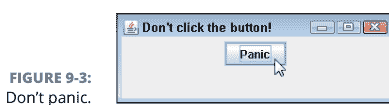

无论如何，列表 9-10 的 `main` 方法只有一条语句：对 `SimpleFrame` 类构造函数的调用。请注意，此调用创建的对象甚至没有赋值给变量。这是因为代码在其他任何地方都不需要引用该对象。

在 `SimpleFrame` 类中，只有一个构造函数声明。这个构造函数完全不是在设置变量的值，而是一个接一个调用 Java API 方法。

`SimpleFrame` 类构造函数中调用的所有方法都来自父类 `JFrame`。`JFrame` 类位于 `javax.swing` 包中。这个包和另一个包 `java.awt` 包含了在计算机屏幕上放置窗口、图像、绘图和其他组件的类。（在 `java.awt` 中，字母代表抽象窗口工具包 abstract windowing toolkit）

想了解关于 Java 包概念的八卦，请参考旁边的侧边栏“Packages and import declarations”。要了解更多关于 Java 包概念的八卦，请参阅第 14 章。

在 Java API 中，人们通常说的窗口是 `javax.JFrame` 类的实例。


## 来自 Java API 的类和方法

查看图 9-3，你可能看出 `SimpleFrame` 类的实例并没有做什么。该框架只有一个有一个按钮，当你点击该按钮时，什么都不会发生。我制作这个框架是为了防止示例变得过于复杂。尽管如此，列表 9-9 中的代码仍使用了几个 API 类和方法。`setTitle`、`setLayout`、`setDefaultCloseOperation`、`add`、`getSize` 和 `setVisible` 方法属于 `javax.swing.JFrame` 类。以下是代码中名称列表：

- **调用 `setTitle`**：将文字放入框架的标题栏中。（新的 `SimpleFrame` 正在调用它自己的 `setTitle` 方法。）

- **`FlowLayout`**：`FlowLayout` 类的实例以居中的、类似打字机的方式放置对象。图 9-3 中的框架只有一个按钮，该按钮位于框架顶部的中心位置。框架有八个按钮，其中五个可以横跨框架排在一行，剩下的三个将在第二行中居中排列。

- **调用 `setLayout`**：将文字放入负责安排框架组件（如按钮）的新的 `FlowLayout` 对象中。（新的 `SimpleFrame` 对象正在调用它自己的 `setLayout` 方法。）

- **调用 `setDefaultCloseOperation`**：告诉 Java 当你点击框架右上角的 × 时该做什么。（在 Mac 上，你点击框架左上角的红色圆圈。）如果没有这个方法，框架本身会消失，但 Java 虚拟机 (JVM) 会继续运行。要停止你程序的运行，你必须再执行一个步骤。（你可能需要在 Eclipse、IntelliJ IDEA 或 NetBeans 中寻找 `Terminate`（终止）选项。）

> 调用 `setDefaultCloseOperation(EXIT_ON_CLOSE)` 告诉 Java 在你点击框架右上角的 × 时关闭自己。`EXIT_ON_CLOSE` 的替代方案有 `HIDE_ON_CLOSE`、`DISPOSE_ON_CLOSE` 以及我个人喜欢的 `DO_NOTHING_ON_CLOSE`。当你的程序在用户关闭框架后还有更多工作要处理时，请使用这些替代方案之一。

- **`JButton`**：`JButton` 类位于 `java.swing` 包中。该类的一个构造函数接受一个 `String` 实例（例如 "Panic"）作为参数。调用此构造函数会将 `String` 实例变成按钮表面的标签。
- **`setSize`**：框架变为 300 像素宽、100 像素高。在 `java.swing` 包中，每当你指定两个维度数字，宽度数字始终在高度数字之前。
- **`setVisible`**：框架在首次创建时是不可见的。但当新框架调用 `setVisible(true)` 时，框架就会出现在你的计算机屏幕上。

## `@SuppressWarnings` 注解

第 8 章引入了注解——一种提供了关于程序性质的有用额外代码。特别是，第 8 章描述了 `@Override` 注解。

在本章中，列表 9–9 引入了另一种注解：`@SuppressWarnings` 注解。当你使用 `@SuppressWarnings` 注解时，告诉 Java 不要提醒你的程序包含某些问题的代码。在列表 9–9 中，行 `@SuppressWarnings("serial")` 告诉 Java 不要提醒你遗漏了一个名为 `serialVersionUID` 的东西。

## 字段 `name` 和 `average` 的 getter 方法

关于访问器方法（即 setter 方法和 getter 方法）的讨论，请参阅第 7 章。

## 一个返回 String 格式的球员击打率的方法

关于方法的详细介绍，请参阅第 7 章。（我在第 7 章里写了很多东西，对吧？）

## 让你的数字更美的另一种方法

列表 10-1 中的 `AverageString` 方法从 `average` 字段（球员的击打率）获取该值，将该值（通常为 `double` 类型）转换为 `String`，然后将该 `String` 值返回给该方法。通过使用直接来自 Java API（应用程序编程接口）的 `DecimalFormat`，可以确保该 `String` 值看起来像球员的击打率。根据 `decFormat.setMaximum` 和 `decFormat.setMinimum` 的调用，该字符串在小数点左侧没有数字，小数点右侧有三个数字。

Java 的 `DecimalFormat` 类非常有用。例如，为了以会计友好的格式显示值 345 和 -345，你可以使用以下代码：

```java
DecimalFormat decFormat = new DecimalFormat();

decFormat.setMinimumDigits(2);

decFormat.setNegativePrefix("-");

decFormat.setNegativeSuffix("");

System.out.println(decFormat.format(345));

System.out.println(decFormat.format(-345));
```

在这个示例的格式字符串中，分号之前的内容决定了正数的显示方式，而分号之后的内容决定了负数的显示方式。因此，使用这种格式后，数字 345 和 -345 如下所示：

```
345.00
-345.00
```

想要发现更多关于数字的技巧，请访问 Java API 文档中的 `DecimalFormat` 页面（https://docs.oracle.com/javase/8/docs/api/java/text/DecimalFormat.html）。

## 使用 Player 类

列表 10-2 和 10-3 包含了使用 `Player` 类的代码 —— 该类在列表 10-1 中已经定义。

## 列表 10-2：使用 Player 类

```java
import java.util.Scanner;
import java.io.File;
import java.io.IOException;
import javax.swing.JFrame;
import javax.swing.JLabel;
import java.awt.GridLayout;

@SuppressWarnings("serial")
public class TeamFrame extends JFrame {

    public TeamFrame() throws IOException {
        Player player;
        Scanner hankeesData = new Scanner(new File("Hankees.txt"));

        for (int num = 1; num <= 9; num++) {
            player = new Player(hankeesData.nextLine(), hankeesData.nextLine());
            addPlayerInfo(player);
        }

        setTitle("The Hankees");
        setLayout(new GridLayout(9, 2, 0, 3));
        setDefaultCloseOperation(EXIT_ON_CLOSE);
        pack();
        setVisible(true);
        hankeesData.close();
    }

    void addPlayerInfo(Player player) {
        add(new JLabel(" " + player.getName() + ""));
        add(new JLabel(player.getAverageString()));
    }
}
```

## 列表 10-3：显示窗口

```java
import java.io.IOException;

public class ShowTeamFrame {
```


```java
public static void main(String args[]) throws IOException {
    new TeamFrame();
}
```

运行列表 10-1、10-2 和 10-3 中的代码结果，请参考图 10-1。

| The Hankees | |
| :--- | :--- |
| Barry Bard | .101 |
| Harriet Ritter | .200 |
| Wendie J. Katz | .030 |
| Harry "The Crazyazman" Spoonswager | .124 |
| Felicia "Fish" Katz | .075 |
| Mia, "Mia" | .111 |
| Jeremy Flooging Jones | .162 |
| L.M. Ritter | .081 |
| Hugh R. DaReader | .212 |

图 10-1：
你会在这些这些人身上赌钱吗？

要运行此程序，你需要 `Hankees.txt` 文件。该文件包含了你喜欢的棒球球员的数据（见图 10-2）。

```
Barry Bard
101
Harriet Ritter
200
Wendie J. Katz
030
Harry "The Crazyazman" Spoonswager
124
Felicia "Fish" Katz
075
Mia, "Mia"
111
Jeremy Flooging Jones
102
K D'Arthur
001
Hugh R. DaReader
212
```

图 10-2：
好一个团队！


你不需要自己创建 `Hanks.txt` 文件。从这本书网站下载的内容都带有一个 `Hanks.txt` 文件，如图 10-2 所示。（访问 www.allcode.com/JavaForDummies）。

你可能居住在一个国家，π 的值约为 3,14159（使用逗号）而不是 3.14159（使用点）。如果是这样，图 10-2 中的文件将无法对你生效。程序会因为 `InputMismatchException` 而崩溃。要运行本节的示例，你可以将 `Hanks.txt` 文件中的点改为逗号。或者，你可以在代码中添加 `setDefault(Locale.US)` 语句。请参阅第 8 章。

你必须在硬盘的特定位置放置 `Hanks.txt` 文件。如果你使用 Eclipse，这个“特定位置”是工作空间内的一个项目目录。相反，如果你从命令行运行 Java，请让该“位置”成为包含列表 10-3 代码的目录。无论何种方式，你无法避免在正确位置缺少 `Hanks.txt` 文件的情况。如果你没有在正确位置放置 `Hanks.txt` 文件，那么

## 不要完全被 GUI 困住

10-2 中的代码使用了 Java API 中的几个名称。其中一些名称在第 9 章中会有解释。另一些在这里解释：

- `JLabel`：`JLabel` 是一个带有某些文本的对象。
- `GridLayout`：`GridLayout` 是一种布局管理器。
- `pack`：`pack()` 方法用于调整窗口大小以适应其子组件。
- `setVisible`：`setVisible(true)` 用于使窗口可见。

在书的这一部分，《笨从指南》的聪明读者可能会问一两个后续问题：“当一个 `main` 方法带有 `throws` 子句时，必须有其他人来处理 10-3 中的异常。但是谁调用了 `main` 方法呢？答案是 Java 虚拟机（或 JVM），它是运行你所有代码的地方。JVM 负责处理 10-3 中的异常。如果程序在读取 `Hanks.txt` 文件时遇到问题，责任在于 JVM。JVM 通过显示错误消息并结束程序运行来处理。你想练习本节的内容吗？如果是的话：

>>> 10-2 中的代码读取一个名为 `Hanks.txt` 的文件。从计算机硬盘上删除 `Hanks.txt` 文件，或者临时将其移动到不同的目录。然后尝试运行 10-1 到 10-3 中的程序。这样做会发生什么？

>>> 男装服装包括衬衫、裤子、外套、项链和鞋子。创建一个 `enum` 来表示这六种物品。创建一个 `WidgetItem` 类。该类的每个实例都有种类（`enum` 的值）和一个名称（例如 `Casual`）。

编写代码来显示框架（类似于图 10-1 中的框架）。框架有六行来描述一套完整的男装。

>>> 创建一个 `enum` 来表示扑牌中的花色：DIAMONDS、HEARTS 和 SPADES。创建一个 `PlayingCard` 类。每张扑牌都有一个数字（1 到 13）和一个花色。在数字方案中，11 代表 Ace，12 代表 Queen，13 代表 King。编写代码创建几张牌并将它们显示在屏幕上（纯文本格式或类似于图 10-1 中的框架）。

# 使用静态（计算团队平均值）

考虑到 10-1 到 10-3 中的代码，你决定获取团队的平均击球率。这不是一个坏主意！图 10-1 中的 `Hanks` 平均值约为 .106，所以团队需要一些强化训练。当球员在球场上练习时，你面临着哲学上的障碍。

在 10-1 到 10-3 中，你有三个类：一个 `Player` 类和另外两个帮助显示 `Player` 类数据的类。那么在这个类的困局中，存储你的团队平均计数的变量放在哪里？

>>> 将计数变量放在任何一个显示类（`TeamFrame` 和 `ShowTeamFrame`）中都没有意义。毕竟计数与球员、团队和棒球有关。显示类是关于创建窗口的，而不是关于打棒球。

>>> 你不喜欢将团队平均值放在 `Player` 类的实例中，因为 `Player` 类实例只代表团队中的一个球员。单个球员存储团队数据有什么关系？当然，你可以让代码运行，但这不是该问题的优雅解决方案。

最后，你发现了 `static` 关键字。任何声明为 `static` 的内容都属于类，而不是类的任何特定实例。当你创建静态字段 `totalAverages` 时，你只创建了一个副本。这段代码留在 `Player` 类中。无论你创建了多少个 `Player` 类实例——一个、九个还是没有——你只有一个 `totalAverages` 字段。而且，顺便你还创建了其他静态字段（`playerCount` 和 `findAverageString`）。要理解我的意思，请看图 10-5。


图 10-5：
一些静态和非静态字段及方法。

由于你对子类的热情，你将团队计数的代码放在了 `Player` 类的子类中。`Player` 子类如 10-4 所示。

## 列表 10-4：创建团队平均值

```java
import java.text.DecimalFormat;

public class PlayerPlus extends Player {

    private static int playerCount = 0;

    private static double totalAverages = 0;

    private static DecimalFormat deformat = new DecimalFormat();

    static {
        deformat.setMaximumIntegerDigits(0);
        deformat.setFractionDigits(3);
        deformat.setMinimumFractionDigits(3);
    }

    public PlayerPlus(String name, double average) {
        super(name);
        playerCount++;
        totalAverages += average;
    }

    public static double findTeamAverage() {
        return totalAverages / playerCount;
    }

    public static String findAverageString() {
        return deformat.format(totalAverages / playerCount);
    }
}
```

## 为什么有这么多 static？

也许你已经注意到 10-4 中的代码充斥着 `static` 这个词。这是因为 `deformat` 让 `totalAverages / playerCount` 看起来很漂亮，而且表达式中的两个字段只需要一种格式化方式。如果你有很多数字需要格式化，同一个 `deformat` 属于整个类。为每个球员创建一个 `deformat` 不仅优雅，而且浪费。

但将 `deformat` 声明为静态带来了一个小问题。为了设置格式，你需要调用像 `deformat.setMaximumIntegerDigits(0)` 这样的方法。你不能在 `Player` 类任意放置这些方法。例如，以下代码是错误的、非法的且不符合 Java 习惯的：

```java
// 这种错误的代码：
public class Player {
    private static DecimalFormat deformat = new DecimalFormat();
    deformat.setMaximumIntegerDigits(0); // 错误！
    deformat.setFractionDigits(3); // 错误！
    deformat.setMinimumFractionDigits(3); // 错误！
}
```

查看之前章节的示例。在这些示例中，我从未让方法调用孤立地运行，就像我在糟糕的代码中这样做那样。在本章中，在列表 10-1 中，我没有在调用 `setMaximumIntegerDigits` 时没有将其放在 `getAverageString` 方法体内部。这种避免“悬空方法调用”的做法并非偶然。Java 的规则限制了代码中可以调用方法的地方，在类定义内部放置孤立的方法调用是一个大忌。

通常情况下，实例共有的任何任务（且能为每个实例产生结果）都应该编写为静态方法。

构造函数永远不是静态的。


## 认识静态初始化

在 10-4 中，`deformat` 字段是静态的。这是因为 `deformat` 让 `totalAverages / playerCount` 看起来很漂亮，而且表达式中的两个字段只需要一种格式化方式。如果你有很多数字需要格式化，同一个 `deformat` 属于整个类。为每个球员创建一个 `deformat` 不仅优雅，而且浪费。

在列表 10-4 中，你可以将必要的 `setMax` 和 `setMin` 调用放在哪里呢？你可以将它们放在 `findTeamAverageString` 方法体内部，就就像我在列表 10-1 中将它们放在 `getAverageString` 方法体内部一样。但将这些方法放在 `findTeamAverageString` 方法体内可能会违背让 `decFormat` 为静态（static）的初衷。毕竟，程序员可能会多次调用 `findTeamAverageString`，每次都调用 `decFormat.setMaximum`。但这将是非常浪费的。整个 Player 类 类有一个 `decFormat` 字段，而且该字段的 `MaximumInteger` 值始终为 0。不要反复设置 `MaximumInteger(0)`。

最好的替代方案是将本节代码中的糟糕代码提取出来，并将它们放在一个静态初始化器中。这样它们就变成了代码中的良性代码。（参见列表 10-4）静态初始化器是一个以 `static` 单词开头的块。Java 会为整个类执行静态初始化器中的语句。这正是你对“静态”一词所想要的效果。

## 显示团队整体平均分

你可能会注意到一种模式。当你为一个类编写代码时，通常会编写两部分代码。一部分代码定义该类，另一部分代码使用该类。（使用类的方法包括调用类的构造函数、引用类的非私有字段、调用类的方法等。）之前显示的列表 10-4 包含了定义 `PlayerPlus` 类的代码，而列表 10-5 包含了使用该 `PlayerPlus` 类的代码。

### 列表 10-5：使用列表 10-4 中的代码

```java
import java.util.Scanner;
import java.io.File;
import java.io.IOException;
import javax.swing.JFrame;
import javax.swing.JLabel;
import java.awt.GridLayout;

@SuppressWarnings("serial")
public class TeamFrame extends JFrame {

    public TeamFrame(IOException exception) {
        Player player;
        Scanner hankeesData = new Scanner(new File("Hankes.txt"));
        for (int num = 1; num <= 9; num++) {
            player = new PlayerPlus(hankeesData.nextLine(), hankeesData.nextDouble());
            hankeesData.nextLine();
            addPlayerInfo(player);
        }
        add(new JLabel());
        add(new JLabel(" ------------"));
        add(new JLabel("Team Batting Average:"));
        add(new JLabel(PlayerPlus.endTeamAverageString()));
        setTitle("The Hankees");
        setLayout(new GridLayout(11, 2, 20, 30));
        setDefaultCloseOperation(EXIT_ON_CLOSE);
        pack();
        setVisible(true);
        hankeesData.close();
    }

    void addPlayerInfo(PlayerPlus player) {
        add(new JLabel(" " + player.getName()));
        add(new JLabel(player.getAverageString()));
    }
}
```

要运行列表 10-5 中的代码，你需要一个带有 `main` 方法的类。列表 10-3 中的 `ShowTeamFrame` 类运行良好。

图 6-6 显示了列表 10-5 代码的运行情况。这取决于图 10-2 中 `Hankees.txt` 文件的可用。列表 10-5 中的代码几乎是列表 10-2 代码的完全复制。（如果我付得起复制的代价，我会用自己来盗取知识产权。）列表 10-5 中唯一的新内容是下方所示的内容。

| The Hankees | |
|---|---|
| Barry The | .101 |
| Harriet Riffer | .208 |
| Weelie J. Katz | .030 |
| Harry "Crayman" Spoonswager | .124 |
| Felix "Tinky" Platz | .075 |
| Mia, Just "Mia" | .111 |
| Jeremy Flondhurst Jones | .102 |
| L. M'DArthur | .001 |
| Hugh H. Daafader | .212 |

图 6-6：列表 10-5 代码的运行情况。

| The Hankees | |
|---|---|
| Team Batting Average | |

你可能会注意到一种模式。当你为一个类编写代码时，通常会编写两部分代码。一部分代码定义该类，另一部分代码使用该类。（使用类的方法包括调用类的构造函数、引用类的非私有字段、调用类的方法等。）之前显示的列表 10-4 包含了定义 `PlayerPlus` 类的代码，而列表 10-5 包含了使用该 `PlayerPlus` 类的代码。

“调用属于 Player 类的 getName 方法。”但回看代码列表 10-1。`getName` 方法不是静态的。`Player`（或 `PlayerPlus`）类的实例拥有一个 `getName` 方法。任何一个 `getName` 方法都不属于该类本身。调用 `Player.getName` 没有任何意义。（也许计算机在显示那条无关痛痒的“无法引用”消息时留了情面。或许，一个更严厉、毫无逻辑的信息会更合适。）

若想体验一下第二种情况（参见本节之前的项目符号列表），请回到代码列表 10-4。在没人注意的情况下，静静地从 `decForm` 字段的声明中删除 `static` 关键字（位于列表顶部）。此删除将 `decForm` 变成一个非静态字段。突然，团队中的每个成员都有了独立的 `decForm` 字段。


嗯，在计算机到达 `finTeamAverageString` 方法之前，一切都很顺利。该静态方法有四个 `decForm`。其中包含了一些 `SuchAndSuch` 语句。再次，你被迫提问这类语句可能意味着什么。`findTeamAverageString` 方法不属于任何特定实例。（该方法是静态的，因此整个 `PlayerPlus` 类都拥有 `findTeamAverageString`。）按照你搞乱代码的方式，不引用特定对象的普通 `decForm` 没有任何意义。因此，你正在从一个静态方法的语文中引用非静态字段 `decForm`。真可耻，太、太可耻了！

我不清楚你们怎么想，但我需要练习一下静态变量和方法：

-   在之前的某个节中，你创建了一个类来表示男装系列中的物品。创建一个子类，包含设计师的名字（《时尚界的呆子》，Dummies of Fashion）、物品的颜色以及物品的价格。

    设计师的名字应该是静态的，因为系列中的所有物品都属于同一个设计师。颜色可以是 Java 自带的 `Color` 类中的静态字段。（参见 <https://docs.oracle.com/javase/8/docs/api/java/awt/Color.html>）

    编写代码显示一个框架（类似于图 10-1 中的框架）。该框架有八行。第一行显示设计师的名字。接下来的行描述一套男装。最后一行显示衣装的总成本。

-   在之前的某个节中，你创建了一个类来表示扑牌。在你的 `PlayingCard` 类中添加一个静态字段。该字段记录类构造函数被调用的次数，从而记录扑牌的数量。


以下代码的输出是什么？做一些预测，然后运行代码查看你的预测是否正确：

```java
import static java.lang.System.out;

public class Main {

    public static void main(String[] args) {

        out.println("bigValue: " + MutableInteger.bigValue());
        // out.println("bigValue: " + IntegerHolder.value); // 非法

        MutableInteger holder1 = new MutableInteger(42);
        MutableInteger holder2 = new MutableInteger(7);

        out.println("holder1: " + holder1.value);
        out.println("holder2: " + holder2.value);

        out.println();
        holder1.value++;
        holder2.value++;
        out.println("bigValue: " + MutableInteger.bigValue());

        out.println("holder1: " + holder1.value);
        out.println("holder2: " + holder2.value);

        out.println();
        holder1.bigValue++;
        out.println("bigValue according to holder1: " + holder1.bigValue());
        out.println("bigValue according to holder2: " + holder2.bigValue());
    }

    class MutableInteger {
        int value;
        static int bigValue = 1_000_000;

        public MutableInteger(int value) {
            this.value = value;
        }
    }
}
```

现在你有两个变量，它们的名称都为 `mars`。其中一个 `mars` 变量的值为 "red planet"。另一个 `mars` 变量是一个方法局部变量，其值为 "Janine's home town"。在代码中，当你使用 `mars` 这个单词时，你指的是哪一个变量？

如果你在宾夕法尼亚州，需要引用一个拥有两个月亮的天体，该怎么办？更准确地说，`visitPennsylvania` 方法内部的代码如何引用值为 "red planet" 的字段呢？答案是，使用 `this.mars`。`this` 单词指向包含这段代码的对象（而不是指向代码内部的任何方法）。该对象是 `EnglishSpeaking` 类的实例，它拥有一个很大的 `mars` 字段，而该字段的值就是 "red planet"。这就是你如何强制代码查看方法外部的内容——你使用了 Java 关键字。

关于该关键字的信息，请参阅第 9 章。


## 告诉变量该去哪里

多年前，当我住在威斯康星州的密尔沃基时，我经常使用当地银行的自动取款机。这种机器刚刚开始标准化。当地的取款机系统命名为 TYME，意为 Take Your Money Everywhere（随处取钱）。

我记得去加利福尼亚州旅行。有一次，我饿了并停下来吃饭，但我没有现金。于是我问一个加油站的站员：“你知道附近哪里有 TYME 机器吗？”

### 列表 10-8：原子城的故事

```java
import static java.System.out;

class EnglishSpeakingWorld2 {
    String mars;

    void visitIdaho() {
        out.println("visitID is running;");

        String mars = " red planet";

        String atomicCity = " Population: 25";

        out.println(mars);

        out.println(atomicCity);
    }

    void visitNewJersey() {
        out.println("visitNJ is running;");

        out.println(mars);

        // out.println(atomicCity); cannot resolve symbol
    }
}
```

### 列表 10-9：调用列表 10-8 代码

```java
public class GetGoing {

    public static void main(String[] args) {

        EnglishSpeakingWorld2 e = new EnglishSpeakingWorld2();

        e.visitIdaho();

        e.visitNewJersey();
    }
}
```

图 10-9 显示了列表 10-8 和 10-9 中代码的运行情况。图 10-1 显示了代码结构的图。`EnglishSpeakingWorld2` 的代码有两个变量。`mars` 变量没有在方法内部声明，是一个字段。另一个变量 `atomicCity` 是一个方法局部变量，声明在 `visitIdaho` 方法内部。

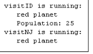

图 10-9：
列表 10-8 和
10-9 中代码的
运行。

第 10 章 将变量和方法放在它们所属的地方 281

# EnglishSpeakingWorld2

```
mars (实例变量)

red planet
```

visitIdaho

```
atomicCity

(方法局部变量)

Population: 25
```

visitNewJersey

图 10-10：
列表 10-8 和
10-9 中代码的
结构。

在列表 10-8 中，注意每个变量在哪里以及不能使用。当你尝试在 `visitNewJersey` 方法内部使用 `atomicCity` 变量时，你会得到一个错误信息。信息显示无法 resolve symbol。比喻地说，这条信息在说：“嘿，伙计，原子城在爱达荷州，不在新泽西州。”技术上讲，该信息表示方法局部变量 `atomicCity` 仅在 `visitIdaho` 方法可用，因为是在那里声明的。

回到 `visitIdaho` 方法内部后，你可以随意使用 `atomicCity` 变量。在此之后，`atomicCity` 变量是在 `visitIdaho` 方法内部声明的。

那么火星呢？你忘记了你的老朋友，那个零度下 80 度的行星吗？事实上，`visitIdaho` 和 `visitNew` 方法都可以访问 `mars` 变量。这是因为 `mars` 变量是一个字段。也就是说，`mars` 变量声明在 `EnglishSpeakingWorld2` 类的代码中，而不是任何特定方法内部。

`mars` 字段的生命周期有三个独立的步骤：

- 当 `EnglishSpeakingWorld2` 类首次出现时，计算机看到 `String mars` 并为 `mars` 字段创建空间。
- 当执行 `visitIdaho` 方法时，该方法将值 'red planet' 分配给 `mars` 字段。（`visitIdaho` 方法也会打印 `mars` 字段的值。）
- 当执行 `visitNewJersey` 方法时，该方法再次打印 `mars` 值。

通过这种，`mars` 字段的值从一个方法传递到另一个方法。

尝试这些程序。看看你的想法。


当你对任何八种基本数据类型之一进行参数传递时，计算机使用**值传递**（pass by value）。调用代码中变量所存储的值保持不变。即使调用代码中的变量与方法的参数名称恰好完全相同，这种情况也会发生。

## 返回结果

你必须修复列表 10-10 中代码存在的问题。毕竟，一只年幼的 Kermogous 小婴儿不能在没有任何追踪的情况下度一生。为了记录这个小宝宝的存在，你必须给 `smackoverARpop` 变量的值加 1。你可以通过许多方法实现这一点，而列表 10-11 中展示的方法并不是简单的。尽管如此，列表 10-11 所示的方法说明了一个点：从方法返回值可以作为参数传递的一种可接受的替代方案。查看列表 10-11 以理解我的意思。

```java
public class TrackPopulation {

    public static void main(String args[]) {

        int smackoverARpop = 2232;

        smackoverARpop = birth(smackoverARpop);

        System.out.println(smackoverARpop);
    }

    static int birth(int cityPop) {

        return cityPop + 1;
    }
}
```

运行列表 10-11 中的代码后，你在计算机屏幕上看到的数字是正确的数字：2,233。

列表 10-11 中的代码并没有任何新功能（除非你把“正常工作”视为一种新功能）。列表 10-11 中最重要的思想是 `return` 语句，它在第 7 章也出现过。尽管如此，列表 10-11 与列表 10-10 的方法形成了对比，后者是必须丢弃的。

## 引用传递

在之前的一两个节中，我费力强调了某一点——当参数是八种基本类型之一时，参数是通过值传递传递的。如果你读到这里，可能错过了对“参数是八种基本类型之一”这一点的强调。之所以需要强调，是因为传递对象（引用类型）的工作方式不同。

当你将一个对象传递给方法时，对象是通过**引用传递**（pass by reference）的。对你来说，这意味着调用方法中的语句可以更改存储在对象变量中的任何值。这些更改会影响调用方法的代码所看到的值。列表 10-12 和 10-13 说明了这一点。

### 列表 10-12: 什么是城市？

```java
class City {

    int population;
}
```

### 列表 10-13: 将对象传递给方法

```java
public class TrackPopulation3 {

    public static void main(String args[]) {

        City smackoverAR = new City();

        smackoverAR.population = 2232;

        birth(smackoverAR);

        System.out.println(smackoverAR.population);
    }

    static void birth(City aCity) {

        aCity.population++;
    }
}
```

当你运行列表 10-12 和 10-13 中的代码时，得到的输出是数字 2,233。这很好，因为代码中包含了 `++` 和 `birth` 单词。关键在于，在 `birth` 方法内部对 `aCity.population` 加 1 实际上更改了 `smackoverAR.population` 的值，正如在 main 方法中已知的那样。

要查看 `birth` 方法如何更改 `smackoverAR.population` 的值，请查看图 10-12。当你将一个对象传递给方法时，计算机不会创建整个对象的拷贝。相反，计算机创建的是该对象引用的拷贝。（想想图 10-12 所示：计算机复制了一个指向该对象的箭头。）

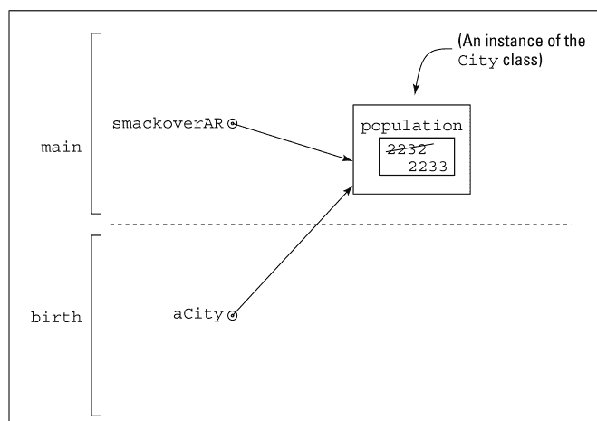

图 10-12：
底层的引用传递。

在图 10-12 中，你只看到了 `City` 类的一个实例，内部有一个 `population` 变量。在阅读以下步骤时，请关注该对象：

- 1. 在调用 `birth` 方法之前，`smackoverAR` 变量指向该对象——即 `City` 类的实例。
- 2. 当调用 `birth` 方法并将 `smackoverAR` 传递给 `birth` 方法的参数 `aCity` 时，计算机将引用从 `smackoverAR` 拷贝到 `aCity`。现在 `aCity` 指向同一个对象——即 `City` 类的实例。
- 3. 当 `birth` 方法内部执行 `aCity.population++` 语句时，计算机将对象的 `population` 字段加 1。现在，程序中只有该 `City` 实例拥有了 2233。
- 4. 执行流返回主方法。此时 `smackoverAR` 指向该实例。`smackoverAR.population` 的值为 2233。

## 从方法返回对象

信不信由，在之前的节中，我们返回的是基本类型或者不返回任何内容（`void`）。在本节中，我们返回一个对象。

### 列表 10-14: 这里返回 City

```java
public class TrackPopulation {

    public static void main(String args[]) {

        City smackoverAR = new City();

        smackoverAR.population = 2232;

        birth(smackoverAR);

        System.out.println(smackoverAR.population);
    }

    static City birth(City aCity) {

        City myCity = new City();

        myCity.population = aCity.population + 1;

        return myCity;
    }
}
```


如果你运行列表 10-14 中的代码，你会得到数字 2,233。这很好，因为代码中包含了 `++` 和 `birth` 单词。关键在于，在 `birth` 方法内部对 `aCity.population` 加 1 实际上更改了 `smackoverAR.population` 的值，正如在 main 方法中已知的那样。

要查看 `birth` 方法如何更改 `smackoverAR.population` 的值，请查看图 10-12。当你将一个对象传递给方法时，计算机不会创建整个对象的拷贝。相反，计算机创建的是该对象引用的拷贝。（想想图 10-12 所示：计算机复制了一个指向该对象的箭头。）

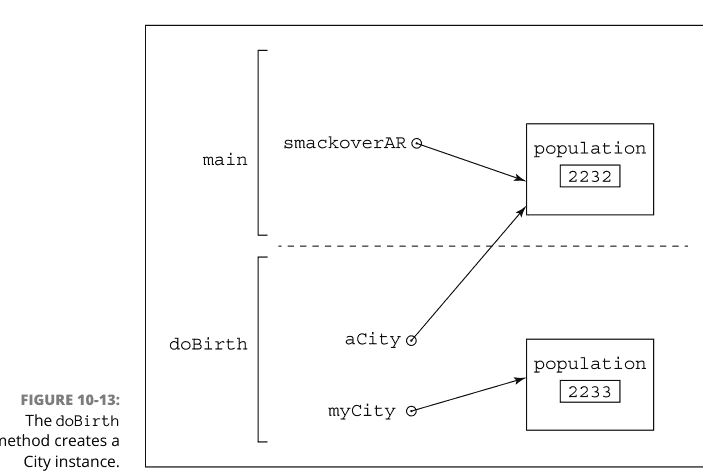

在图 10-12 中，你只看到了 `City` 类的一个实例，内部有一个 `population` 变量。在阅读以下步骤时，请关注该对象：

1. 在调用 `birth` 方法之前，`smackoverAR` 变量指向该对象——即 `City` 类的实例。
2. 当调用 `birth` 方法并将 `smackoverAR` 传递给 `birth` 方法的参数 `aCity` 时，计算机将引用从 `smackoverAR` 拷贝到 `aCity`。现在 `aCity` 指向同一个对象——即 `City` 类的实例。
3. 当 `birth` 方法内部执行 `aCity.population++` 语句时，计算机将对象的 `population` 字段加 1。现在，程序中只有该 `City` 实例拥有了 2233。
4. 执行流返回主方法。此时 `smackoverAR` 指向该实例。`smackoverAR.population` 的值为 2233。

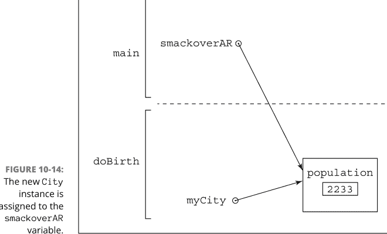

当 `birth` 方法执行后，该 `City` 实例被返回到主方法。回到主方法中，`birth` 返回的对象赋值给 `smackoverAR` 变量。（见图 10-12。）现在 `smackoverAR` 指向一个全新的实例，其人口为 2,233。

总之，你正在尝试记录每个房间的客人数。因为你有十个房间，你可能会考虑声明十个变量：

```java
int guestsInRoomNum0, guestsInRoomNum1, guestsInRoomNum2,
guestsInRoomNum3, guestsInRoomNum4, guestsInRoomNum5,
guestsInRoomNum6, guestsInRoomNum7, guestsInRoomNum8,
guestsInRoomNum9;
```

用代码这样操作可能看起来有点低效——效率低下并不是这段代码唯一的问题。更严重的问题是，你无法循环遍历这些变量。为了读取每个变量的值，你必须重复复制十次。

```java
guestsInRoomNum0 = diskScanner.nextInt();
guestsInRoomNum1 = diskScanner.nextInt();
guestsInRoomNum2 = diskScanner.nextInt();
// ... 依此类推。
```

更好的方法是使用数组。数组是一行值，就像单层旅馆的一排房间一样。为了在脑海中形成数组，只需想象“Java 旅馆”：

- 首先，是房间，它们并排排列在一起。
- 接着，是同样的房间，但去掉了前墙。在每个房间里，你可以看到特定数量的客人。
- 如果可以的话，请忘记 9 号房间的两个客人正在把一堆钞票堆进大公提箱的事。忽略 6 号房间的客人已经一天半没离开电视的事实。不要看所有这些细节，只看数字。在每个房间里，看到一个代表该房间人数的数字。（如果你擅长自由形式的可视化，请看图 11-1）。

在本章的术语中，整排房间被称为“数组”。数组中的每一行都是数组的一个组件（也称为数组元素）。每个组件都关联着两个数字：

- 房间号（从 0 到 9 的数字），它被称为数组的索引（index）。
- 客人数，它是存储在数组组件中的一个值。

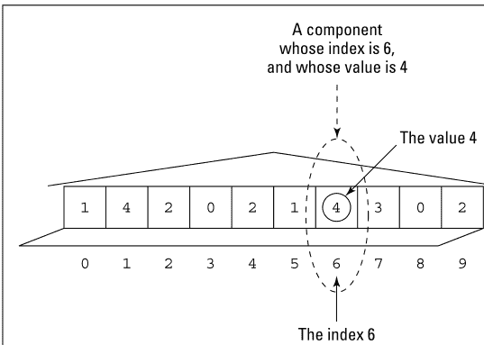

图 11-1：Java 旅馆房间的抽象快照。

使用数组可以让你避免本节开头所示示例代码中那些重复的废话。例如，要声明一个包含十个值的数组，你可以写一条相当短的语句：

```java
int[] guests = new int[10];
```

如果你特别喜欢啰嗦，可以将此语句扩展为两个独立的语句：

```java
int[] guests[];
guests = new int[10];
```

在这两个代码段中，请注意数字 10 的使用。这个数字告诉计算机让 `guests` 数组拥有十个组件。数组的每个组件都有自己的名称。起始组件被命名为 `guests[0]`，下一个是 `guests[1]`，依此类推。十个中的最后一个命名为 `guests[9]`。

> 记住在创建数组时，你始终指定组件的数量。数组的索引从 0 开始，到比组件总数少 1 的数字结束。

我向你展示的代码提供了创建数组的两种方法。第一种使用一行。第二种使用两行。如果你选择单行方案，可以将该行放在方法内部或外部。选择权交给你。另一方面，如果你使用两行独立的代码，那么第二行 `guests = new int[10]` 应该放在方法内部。

在数组声明中，你可以将方括号放在变量名的之前或之后。也就是说，你可以写 `int guests[]` 或 `int [] guests`。无论你使用哪种形式，计算机创建的同一个 `guests` 变量。

## 通过两个简单步骤创建数组

再次查看用于创建数组的两行代码：

```java
int guests[];
guests = new int[10];
```

每一行都有其独特的用途：

- `int guests[]` ：第一行是声明。声明预留了数组名称（一个如 `guests` 的名称），供程序的其余部分使用。在 Java 旅馆的比喻中，这表示：“我计划在这里建造一座旅馆，并在每个房间放入特定数量的客人。”（参见图 11-2）
- 别管声明 `int guests[]` 实际上做了什么。重要的是注意到声明 `int guests[]` 的作用是什么。声明并不预留内存位置。像 `int guests[]` 这样的声明并没有真正创建一个数组。声明只是设置了 `guests`。在代码的那个点，`guests` 仍然指向一个真实的数组。（换句话说，旅馆有一个名字，但旅馆还没有盖好。）
- `guests = new int[10]` ：第二行是一个赋值语句。赋值语句在计算机内存中预留了十个 `int` 值的空间。从房地产的角度来说，这表示：“我终于盖好了旅馆。去每个房间放入客人吧。”（再次参见图 11-2）。

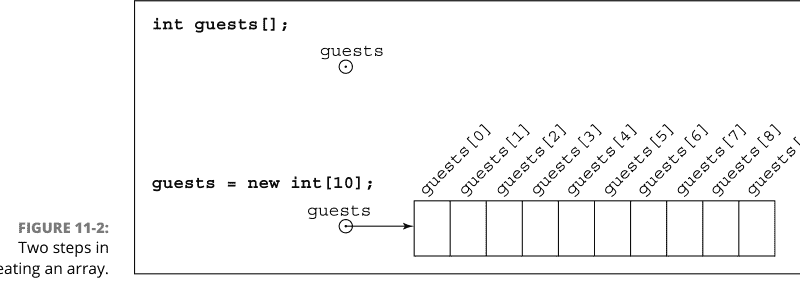

## 存储值

创建数组后，你可以向其中放入值。例如，要在数组组件中存储一个值，可以使用索引。

```java
guests[0] = 10;
```

如果你想在数组中存储多个值，可以使用循环。

```java
for (int i = 0; i < 10; i++) {
    guests[i] = diskScanner.nextInt();
}
```

这比为每个值声明单独变量有效得多。

当你想要访问数组中的某个值时，使用索引。

当你想访问数组中的所有值时，使用循环。

```java
for (int i = 0; i < 10; i++) {
    System.out.println(guests[i]);
}
```

这就是在 Java 中处理数组的方式。它们是强大的工具，可以高效地存储和处理数据。在随后的章节中，你将学习更高级的数组技术，例如多维数组。

列表 11-1 中的代码包含两个 `for` 循环：第一个循环读取客人数，第二个循环写入客人数。

每个数组都有一个内置的 `length` 字段。数组的长度是数组中包含组件的数量。因此，在列表 11-1 中，如果你打印 `guests.length` 的值，你将得到 10。

## 制表符和其他奇奇怪妙的东西

在列表 11-1 中，某些对 `print` 和 `println` 的调用使用了 `\` 转义序列。它之所以被称为转义序列，是因为你“转义”了在屏幕上显示 `t` 的行为。实际上，字符 `\` 代表制表符。在打印任何后续字符之前，计算机会移动到下一个制表符位置。Java 有一些实用的转义序列，其中一些如表 11-1 所示。

### 表 11-1 转义序列

| 序列 | 含义 |
| --- | --- |
| `\b` | 退格 |
| `\t` | 水平制表符 |
| `\n` | 换行符 |
| `\f` | 分页符 |
| `\r` | 回车符 |
| `\"` | 双引号 |
| `\'` | 单引号 |
| `\\` | 反斜杠 |

## 使用数组初始化器

除了你在列表 11-1 中看到的内容外，在 Java 中你还有另一种填充数组的方法：使用数组初始化器。当你使用数组初始化器时，你甚至不需要告诉计算机数组有多少个组件。计算机会为你计算出来。

列表 11-2 显示了填充数组的新版本代码。程序的输出与列表 11-1 的输出相同（即图 11-4 所示的内容）。列表 11-1 和 11-2 之间的唯一区别在于列表 11-2 中的粗体文本。那个粗体的小东西就是一个数组初始化器。

### 列表 11-2：使用数组初始化器

```java
import static java.lang.System.out;

public class ShowGuests {

    public static void main(String args[]) {

        int guests[] = {1, 4, 2, 0, 2, 1, 4, 3, 0, 2};

        out.println("Room " + roomNum);

        for (int roomNum = 0; roomNum < 10; roomNum++) {

            out.print(roomNum);

            out.print("\t");

            out.println(guests[roomNum]);

        }

    }

}
```

数组初始化器不仅可以包含字面量，还可以包含表达式。用通俗的话说，这意味着你可以在初始化器的逗号之间放置任何类型的内容。例如，像 `{1 + 3, keyboard.nextInt(), 2, 0, 2, 1, 3, 0}` 这样的初始化器就可以正常工作。

使用 `DummiesFrame`（来自第 7 章）根据列表 11-1 和 11-2 中的思想创建一个 GUI 程序。在你的程序中，窗口只有一个输入行：房间号行。如果用户在房间号行输入 `3` 然后点击按钮，程序将显示 3 号房间的客人数。

## 使用增强型 for 循环遍历数组

Java 拥有一种增强型 `for` 循环——一种不使用计数器或索引的循环。列表 11-3 向你展示了如何实现。

本节内容适用于 Java 5.0 及更高版本的 Java。但本节内容不适用于旧版本的 Java——例如 1.3、1.4 等版本。关于 Java 版本号的更多信息，请参阅第 2 章。

### 列表 11-3：让 for 循环跑起来吧！

```java
import static java.lang.System.out;

public class ShowGuests {

    public static void main(String args[]) {

        int guests[] = {1, 4, 2, 0, 1, 4, 3, 0, 2};

        int roomNum = 0;

        out.println("Room\tGuests");

        for (int numGuests : guests) {

            out.print(roomNum++);

            out.print("\t");

            out.println(numGuests);

        }

    }

}
```

列表 11-1 和 11-3 的输出相同。如见图 11-4。

一个增强型 `for` 语句有三个部分：

```java
for (variable-type variable-name : range-of-values)
```

前两个部分是变量类型和变量名。列表 11-3 中的循环定义了一个名为 `numGuests` 的变量，`numGuests` 的类型为 `int`。在循环迭代期间，变量 `numGuests` 会获得新值。查看图 11-4 以了解这些值。初始值是 1。下一个值是 4。之后是 2。以此类推。

循环在哪里找到这些数字的？答案就在循环的数值范围（range-of-values）中。在列表 11-3 中，循环的数值范围是 `guests`。因此，在初始循环期间，`numGuests` 的值是 `guests[0]`（值为 1）。在下一次迭代中，`numGuests` 的值是 `guests[1]`（值为 4）。之后是 `guests[2]`（值为 2）。

Java 的增强型 `for` 循环需要注意。每次通过循环时，遍历值范围的变量存储的是原始范围中值的副本。该变量并不指向范围本身。例如，如果你在列表 11-3 中添加一条更改 `numGuests` 值的赋值语句，该语句对 `guests` 数组中存储的值没有任何影响。

为了让你彻底理解这一点，假设你已经用零填充了我酒店的客数组数组（`guests`）。然后我执行以下代码：

```java
for (int numGuests : guests) {
    numGuests += 1;
}

out.println();

for (int numGuests : guests) {
    out.print(numGuests + " ");
}
```

`numGuests` 变量获取 `guests` 数组中存储的值。代码的输出如下：

1 1 1 1 1 1 1
0 0 0 0

编写一个程序，将 `double` 类型的值存储在数组中，然后显示数组值的平均值。


坐在 Java 旅馆的办公桌后。看！来了一个五个人的团体。他们想要房间，所以你需要一个软件来检查房间是否空闲。如果有空闲房间，软件将通过将 0 替换为数字 5 来修改 `GuestList.txt` 文件（参考图 11-3）。幸运的是，软件就在你的硬盘上。软件如列表 11-4所示。

### 列表 11-4：你有房吗？

```java
import java.lang.System.out;
import java.util.Scanner;
import java.io.File;
import java.io.IOException;
import java.io.PrintStream;

public class FindVacancy {

    public static void main(String[] args) throws IOException {

        int guests[] = new int[10];

        int roomNum;

        Scanner diskScanner = new Scanner(new File("GuestList.txt"));

        for (roomNum = 0; roomNum < 10; roomNum++) {
            guests[roomNum] = diskScanner.nextInt();
        }

        diskScanner.close();

        roomNum = 0;

        while (roomNum < 10 && guests[roomNum] != 0) {
            roomNum++;
        }

        if (roomNum == 0) {
            out.println("Sorry, no vacancy");
        } else {
            out.print("How many people for room ");
            out.print(roomNum);
            out.print("?");
        }

        Scanner keyboard = new Scanner(System.in);
        guests[roomNum] = keyboard.nextInt();
        keyboard.close();

        PrintStream listOut = new PrintStream("GuestList.txt");

        for (roomNum = 0; roomNum < 10; roomNum++) {
            listOut.print(guests[roomNum]);
            listOut.print(" ?");
        }

        listOut.close();
    }
}
```


## 运行结果展示

图 11-5 到 11-7 显示了列表 11-4 代码的运行情况。回到图 11-3，酒店最初有两个空房间——3 号和 8 号（记住房间是从 0 开始）。你第一次运行列表 11-4 中的代码时，程序告诉你 3 号房间空闲并放入了 5 个人。你第二次运行代码时，程序找到了最后一个空房间（8 号）并为其放入了 10 个人（真是一大派对！）。你第三次运行代码时，没有更多空房间了。当程序发现这一点时，它显示信息 `Sorry, no vacancy`（对不起，无房），根据旅馆招牌的传统至少少了一个字母。

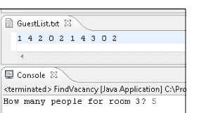

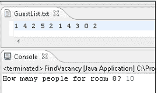

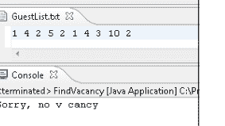

运行列表 11-4 中的代码会写入全新的 `GuestList.txt` 文件。这可能会让人困惑，因为每个 Java IDE 都有自己显示 `GuestList.txt` 内容的方式。某些 IDE 不会自动显示最新的 `GuestList.txt` 文件，因此在运行列表 11-4 的代码后，你可能不会立即看到变化。探索你喜欢的 IDE 以了解如何让 IDE 刷新 `GuestList.txt` 的显示。

## 向文件写入

列表 11-4 中的代码使用了书中其他章节和节介绍的技巧。该代码唯一的新特性是使用 `PrintStream` 写入磁盘文件。想一想书中任何调用 `System.out.print`、`System.out.println` 或其变体的示例。当你调用其中一个方法时，到底发生了什么？

名为 `System.out` 的是一个对象。该对象定义在 Java API 中。事实上，`System.out` 是 `java.io.PrintStream` 类的实例（为了方便起见，简称为 `PrintStream`）。现在，从 `PrintStream` 类创建的每个对象都拥有 `print` 和 `println` 方法。就像列表 7-3 中的每个 `Account` 对象都有一个 `display` 方法，而列表 10-5 中的 `DecimalFormat` 对象有一个 `format` 方法一样，你拥有的 `PrintStream` 对象拥有属于 `PrintStream` 实例的 `print` 和 `println` 方法。

好了，那又怎样？`System.out` 始终代表计算机屏幕上的某个区域。如果你创建了自己的 `PrintStream` 对象并让你的对象引用磁盘文件，那么该 `PrintStream` 对象就引用该磁盘文件。当你调用你对象的 `print` 方法时，就会将文本写入硬盘上的一个文件。

在列表 11-4 中，当你说：

```java
PrintStream listOut = new PrintStream("GuestList.txt");
out.print(guests[roomno]);
out.println("");
```

你是在告诉 Java 将文本写入你硬盘上的一个文件——`GuestList.txt` 文件。

这就是你更新酒店住客人数的方法。当你调用 `listOut.print` 来输出 3 号房客数时，你可能会打印数字 5。在图 11-5 和 11-6 之间，`GuestList.txt` 文件中的一个数字从 0 变为 5。然后在图 11-6 中，你第二次运行程序。当程序从新写入的 `GuestList.txt` 文件获取数据时，3 号房已不再存在。这次，程序建议使用 8 号房。

> **提示**
>
> 这与其说是一个观察而非技巧。假设你想从名为 `Employees.txt` 的文件中读取数据。要做到这一点，你需要创建一个 `Scanner`。你调用 `Scanner(new File("Employees.txt"))`。如果你不小心在没有使用 `new File` 的情况下调用 `Scanner("Employees.txt")`，调用将连接到你的 `Employees.txt` 文件。但注意你是如何准备向文件写入数据的。你通过调用 `new PrintStream("GuestList.txt")` 创建了一个 `PrintStream` 实例。你在调用中没有使用 `new File`。如果你不小心包含了 `new File`，Java 编译器就会变得愤怒，跳出来并咬你一口。

## 何时关闭文件

注意列表 11-4 中 `new Scanner` 调用、`new PrintStream` 调用以及 `close` 用的位置。正如所有的示例一样，`new Scanner` 都有一个对应的 `close` 调用。在列表 11-4 中，`new PrintStream` 有它自己的 `close` 调用（`listOut.close()`）。但在列表 11-4 中，我仔细地将这些调用紧紧包围在相应的 `print` 调用周围。例如，我没有在程序开始时设置 `Scanner`，也没有等到程序完全结束才关闭 `Scanner`。相反，我连续快速地执行我所有的 `Scanner` 任务：

```java
Scanner diskScanner = new Scanner(new File("GuestList.txt")); //构造
for (roomNum = 0; roomNum < 10; roomNum++) {
    guests[roomNum] = diskScanner.nextInt(); //读取
}
diskScanner.close(); //关闭
```

我对键盘和 `listOut` 对象也做了同样的操作。

我对输入和输出这样做是因为我的程序使用了两次 `GuestList.txt`——一次用于读取数字，第二次用于写入数字。我不确定 `GuestList.txt` 的两次使用是否会产生冲突。考虑以下程序：

```java
// 这是错误的代码
import java.io.File;
import java.io.IOException;
import java.io.PrintStream;
import java.util.Scanner;

public class BadCode {
    public static void main(String[] args) throws IOException {
        int[] guests = new int[10];
        Scanner diskScanner = new Scanner(new File("GuestList.txt"));
        PrintStream listOut = new PrintStream("GuestList.txt");
        guests[0] = diskScanner.nextInt();
        listOut.print(guests);
        diskScanner.close();
        listOut.close();
    }
}
```

与许多方法和构造器一样，`PrintStream` 构造器并不处理文件。如果它找不到 `GuestList.txt` 文件，它会创建一个 `GuestList.txt` 文件并准备其中写入值。如果 `GuestList.txt` 文件已经存在，`PrintStream` 构造器会删除现有文件并准备写入一个新的空的 `GuestList.txt` 文件。在 `BadCode` 中，`new PrintStream` 构造器会删除任何存在的 `GuestList.txt` 文件。这种删除发生在调用 `Scanner.nextInt()` 之前。因此 `Scanner.nextInt()` 无法获取 `GuestList.txt` 文件中的原始内容。这糟！为了避免这种灾难，我在列表 11-4 中仔细分离了 `GuestList.txt` 的两次使用。在列表开头，我构造了 `Scanner` 并从 `GuestList.txt` 读取。在列表末尾，我构造了 `listOut` 并写入 `GuestList.txt`。

## 对象数组

Java 酒店已开业，现在有了改进的注册系统！购买这一节的人总是抓腮，现在以 `Room` 类来思考。你问：“`Room` 实例看起来怎么样？”这很简单。`Room` 实例有三个属性：房间内的客人数、房费和是否吸烟。图 11-8 阐述了这种情况。


列表 11-5 显示了描述 `Room` 类的代码。正如承诺的，每个 `Room` 类实例都有三个字段：`guests`、`rate` 和 `smoking` 字段。（布尔字段 `smoking` 的值为 `false` 表示非吸烟房）。此外，整个 `Room` 类有一个名为 `currency` 的静态字段。在我位于美国的计算机上，这个 `currency` 对象让房费像美元金额一样。

> 要了解 `static` 的含义，请参阅第 10 章。

列表 11-5 有一些有趣的怪之处，但我宁愿在您运行所有代码之后再描述它们。因此，在这一点上，我直接跳转到了调用列表 11-5 代码的代码。在您读完关于房间数组（如列表 11-6 所示）后，请查看我对列表 11-5 奇特之处的描述。

> **提示**
>
> 这是对第 4 章、第 7 章以及某个章节中一个观点的刻意重复：使用 `double` 或 `float` 类型存储货币值时要小心。使用 `double` 或 `float` 进行计算可能是不准确的。欲需更多信息（以及更多的指责），请参阅第 4 章和第 7 章。

> **提示**
>
> 这个提示与 Java 完全没有关系。如果你是那种喜欢吸烟的人（在列表 11-5 中有一个布尔字段 `smoking = true`），请找一个这样的人——找一个可以连续请三天假的人。那个人坐在你身边，在连续的 72 小时内，你不抽烟。你可能会暂时吸入尼古丁，直到你恢复正常。而你的朋友会觉得自己像个真正的英雄。


## 使用 Room 类

现在你需要一个房间数组。创建此类对象的代码在列表 11-6 中。该代码从 `RoomList.txt` 文件中读取数据（图 11-9 显示了 `RoomList.txt` 文件的内容）。

图 11-10 显示了列表 11-6 代码的运行情况。

### 列表 11-6：想看房间吗？

```java
import static java.lang.System.out;
import java.util.Scanner;
import java.io.File;
import java.io.IOException;

public class ShowRooms {
    public static void main(String[] args) throws IOException {
        Room[] rooms;
        rooms = new Room[10];
        Scanner diskScanner = new Scanner(new File("RoomList.txt"));
        for (int roomNum = 0; roomNum < 10; roomNum++) {
            rooms[roomNum] = new Room();
            rooms[roomNum].readRoom(diskScanner);
        }
    } // (续上)
```

### 列表 11-6：（续上）

```java
out.println("Room\tGuests\tRate\tSmoking?");
for (int roomNum = 0; roomNum < 10; roomNum++) {
    out.print("\t");
    rooms[roomNum].writeRoom();
}
diskScanner.close();
```

### 列表 11-9：一个 Room 数据文件

```
1
60.00
true
1
60.00
true
2
60.00
false
2
60.00
false
3
80.00
true
3
80.00
false
4
80.00
false
4
80.00
false
5
100.00
true
5
100.00
false
```

| Room | Guests | Rate | Smoking? |
| --- | --- | --- | --- |
| 0 | 1 | $60.00 | yes |
| 1 | 4 | $60.00 | yes |
| 2 | 2 | $60.00 | no |
| 3 | 0 | $80.00 | no |
| 4 | 2 | $80.00 | yes |
| 5 | 1 | $80.00 | no |
| 6 | 4 | $80.00 | no |
| 7 | 3 | $80.00 | no |
| 8 | 0 | $100.00 | yes |
| 9 | 2 | $100.00 | no |


对于列表 11-6 中的代码，随你怎么怎么说都可以。在我看来，整个列表中只有一个问题应该引起你的关注。而你问的，那个问题是什么吗？嗯，要创建一个对象数组——而不是原始值数组——你需要做三件事：创建数组、创建数组本身，以及构造数组中的每个单独对象。这与创建一个 `int` 数组或包含其他原始值的数组是不同的。当你创建一个原始值数组时，你只做了三件事中的前两个。

为了理解这一切，请跟随列表 11-6 的操作：

- `rooms[]`：声明数组
- `rooms = new Room[10]`：创建数组本身
- `rooms[roomNum] = new Room()`：构造数组中的每个单独对象

这与创建一个 `int` 数组或包含其他原始值的数组是不同的。当你创建一个原始值数组时，你只做了三件事中的前两个。

---

### 练习：学生 GPA 计算

**grades** — 学生所修的五门课程的每门成绩。每个成绩都是从 0.0 到 4.0 之间的双精度值（4.0 是最高分）。学生的平均学点数（GPA）是学生五个成绩分值的平均值。

在本章的 `Student` 类中，其中一个字段是一个包含五个双精度值的数组。你的程序将找到学生的 GPA 并将其（连同学生的姓名和 ID 号）显示在屏幕上。

---

### 挑战性练习：简易文字处理器

这里有一个挑战性练习：编写一个原始的文字处理程序。为了展示你的程序可能的操作，我创建了一个示例运行。在这一次中，我将用户的输入设置为加粗文本。

```
>
>
>
>
>
要替换的行（或输入 -1 退出）：0
输入新行: There was an old man with glasses
> There once was an old man with glasses
>
>
>
>
>
要替换的行（或输入 -1 退出）：1
输入新行: Who learned about objects and classes.
> There once was an old man with glasses
> Who learned about objects and classes.
>
>
>
>
要替换的行（或输入 -1 退出）：3
输入新行: Go climb a tree.
> There once was an old man with glasses
> Who learned about objects and classes.
>
> Go climb a tree.
>
>
>
要替换的行（或输入 -1 退出）：2
输入新行: "At last, I see!"
> There once was an old man with glasses
> Who learned about objects and classes.
> "At last, I see!
> Go climb a tree.
>
要替换的行（或输入 -1 退出）：4
输入新行: I'll teach these ideas to the masses!
> There once was an old man with glasses
> Who learned about objects and classes.
> "At last, I see!
> Go climb a tree.
> I'll teach these ideas to the masses!
>
要替换的行（或输入 -1 退出）：3
输入新行: It's not only for me.
> There once was an old man with glasses
> Who learned about objects and classes.
> "At last, I see!
> It's not only for me.
> I'll teach these ideas to the masses!
>
要替换的行（或输入 -1 退出）：-1
```


# 命令行参数

很久以前，大多数程序员都使用基于文本的开发界面。运行第 3 章的 Displayer 示例时，他们不需要在花哨的集成开发环境中选择“运行”（Run）。相反，他们在一个看起来朴素的窗口中输入命令，该窗口通常是黑底白字。图 11-12 说明了这一点。在图 11-12 中，我输入了 `java Displayer`，计算机返回了我的 Java 程序的输出（文字 `You'll love Java!`）。

## 图 11-12
真无聊！

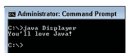

这种朴素的窗口有不同的名称，取决于你使用的操作系统。在 Windows 中，这种文本窗口被称为命令提示符窗口。在 Macintosh 和 Linux 中，这个窗口被称为终端（terminal）。某些版本的 Linux 和 UNIX 将此窗口称为 shell（壳）。

无论如何，在古代，你可以编写一个程序，在你输入启动程序的命令时吸收额外信息。图 11-13 向你展示了它是如何运作的。

## 图 11-13
当你启动 MakerNumsFile 时，你输入了一些额外信息。

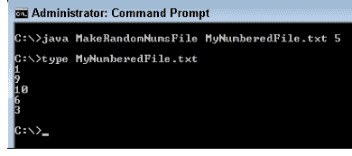

在图 11-13 中，程序员输入 `java MakeNumsFile` 来运行 MakerNums 程序。但程序员在 `java MakeNumsFile` 后面跟了两个信息：`NumberedFile.txt` 和 `5`。当 MakeNumsFile 程序运行时，程序会吸收这些额外信息并使用它们来执行任何操作。在图 11-13 中，程序吸收了 `NumberedFile.txt 5`，但在另一次运行时，程序员可能会得到 `SomeStuff` 或 `Numbers20`。额外信息每次运行时都可以不同。

下一个问题是，“Java 程序是如何知道它应该接收额外信息的？”自从你开始学习 Java，你已经在每个方法的头部看到了这个 `args[]`。好了，是时候弄清楚它了。参数 `args[]` 是字符串值的数组。这些字符串值被称为命令行参数。

> **记住**
> 有些程序员写：
> ```
> public static void main(String args[])
> ```
> 另一些程序员写：
> ```
> public static void main(String[] args)
> ```
> 无论哪种，`args` 都是字符串值的数组。

# 在 Java 程序中使用命令行参数

列表 11-7 显示了如何在代码中使用命令行参数。

## 列表 11-7：生成 Numbers

```java
import java.util.Random;
import java.io.PrintStream;
import java.io.IOException;

public class MakeNumsFile {
    public static void main(String[] args) throws IOException {
        Random generator = new Random();

        if (args.length < 2) {
            System.out.println("Usage: MakeRandomFile filename number");
            System.exit(1);
        }

        PrintStream printOut = new PrintStream(args[0]);
        int numlines = Integer.parseInt(args[1]);

        for (int count = 1; count <= numlines; count++) {
            printOut.println(generator.nextInt(10) + 1);
        }

        printOut.close();
    }
}
```


如果某个程序期望某些命令行参数，你不能像启动书中其他大多数程序那样启动它。无论你使用的是 Eclipse、NetBeans 或什么。这就是为什么这本书的网站（www.allcode.JavaForummies）提供了使用各种 IDE 向程序传递参数的方法。

# 使用数组处理数值

当列表 11-7 中的代码开始运行时，`args` 数组获取了它的值。在图 11-13 所示的运行中，数组组件 `args[0]` 自动获取值 `"NumberedFile.txt"`，而 `args[1]` 变成了 `"5"`。因此程序的赋值语句变为：

```
PrintWriter out = new PrintStream("NumberedFile.txt");
int numLines = Integer.parseInt("5");
```

程序创建一个名为 `NumberedFile.txt` 的文件并将 `numLines` 设置为 5。因此在代码的后面，程序随机生成五个值并将它们放入 `NumberedFile.txt`。程序的一个运行结果就是图 11-14 中的文件。

## 图 11-14
来自列表 11-7 代码运行产生的文件。


在运行列表 11-7 中的代码后，你可以在硬盘的哪里找到新文件 (`NumberedFile.txt`) ？答案取决于许多因素，所以我不想给出一个特定的答案。如果你使用带有分区项目的 IDE，新文件位于项目文件夹的某处。通过某种方式，你都可以更改列表 11-7 来指定完整路径——一个像 `"c:\\Users\\MyName\\Documents\\NumberedFile.txt"` 或 `"/Users/MyName/Documents/NumberedFile.txt"` 的名称。

在 Windows 中，文件名包含反斜杠字符。在 Java 中，当你想在双引号字符串内部包含反斜杠时，必须使用双反斜杠。也就是说 `"c:\\Users\\MyName\\Documents\\NumberedFile.txt"` 包含成对的反斜杠。相比之下，Linux 和 Macintosh 操作系统的文件路径包含正斜杠。要在 Java 字符串中包含正斜杠，只需使用一个正斜杠。


注意列表 11-7 中的每个命令行参数都是 `String`。当你查看 `args[1]` 时，你看到的不是 5——你看到的是带有数字字符的字符串 `"5"`。遗憾的是，你不能将那个 `"5"` 用于任何计数。要从 `"5"` 获取一个 `int` 值，你必须应用 `parseInt` 方法。（再次参见列表 11-7）。

`parseInt` 方法存于 `Integer` 类内部。因此，为了调用 `parseInt`，你需要在名字前加上 `Integer` 单词。`Integer` 类拥有用于处理 `int` 值的各种方便方法。

# 检查命令行参数的数量

如果用户犯了错误会怎样？如果用户忘记在列表 11-7 的第一行输入数字 5？那么计算机会将 `"Numberedfile.txt"` 分配给 `args[0]`，但不会给 `args[1]` 分配任何内容。这很糟糕。如果计算机到达语句：

```
int numlines = Integer.parseInt(args[1]);
```

程序将因 `ArrayIndexOutOfBoundsException` 而崩溃。

该如何处理？在列表 11-7 中，你检查 `args` 数组的长度。如果 `args` 数组少于两个组件，你在屏幕上显示一条消息并退出程序。列表 11-15 显示了结果输出。

| Usage: MakeRandomNums filename number |

但如果你想更上一层楼呢？你买了一家有 50 层楼、每层 100 个房间的大型酒店。这时，数据就是正方形的。你有 50 行，每行包含 100 个项目。当然，你可以把这些房间想象成它们都在同一条长行里，但为什么要那样做呢？用一个二维数组怎么样？它是一个正方形的数组，其中每个组件都有两个索引：行号和列号。遗憾的是，我的书中没有空间向你展示二维数组（而且无论如何，我也付不起大型酒店的价格）。但如果你访问此书的网站（www.allmycode.com/JavaForDummies），你可以读到关于它的所有信息。


- 编写一个程序，其命令行参数包含三个 `int` 值。作为输出，程序显示这三个 `int` 值中的最大值。
- 在之前的一个节中，你创建了一个简单的文字处理程序。通过添加两个命令行参数来改进程序：
  - 第一个参数是输入文件的文件名。输入文件包含五行文本，其中某些或全部可能是空白的。在程序启动运行时，程序从输入文件中读取这些行并将它们显示在屏幕上。
  - 第二个参数是另一个文件的文件名——输出文件。在程序运行结束时，程序将编辑后的文本写入输出文件。

# 第 12 章

## 使用集合和流（当数组不够用时）

第 11 章是关于数组的。通过数组，你可以一次管理许多事物。在一个酒店管理程序中，你可以跟踪所有的房间。你可以快速找到某个房间的人数，或者找到一个空闲房间。

然而，数组并不总是能胜任。在本章中，你将发现数组的短板所在，以及集合如何能够救急。

## 理解数组的局限性

数组很好用，但它们也有一些严重的局限性。假设你按照某种预定的顺序存储客户姓名。你的代码包含一个数组，该数组有存储 100 个名字的空间：

```java
String name[] = new String[100];

for (int i = 0; i < 100; i++) {
    name[i] = new String();
}
```

一切都很顺利，直到有一天，第 101 号客户出现了。当你的程序运行时，你为 101 号客户输入数据，迫切地希望这个拥有 100 个组件的数组可以扩展以适应你不断增长的需求。

没有这种运气。数组不会扩展。你的程序会因 `ArrayIndexOutOfBoundsException` 而崩溃。

“在我的下辈子，我要创建一个长度为 1,000 的数组，”你对自己说。当你的下辈子来临时，你确实这么做了：

```java
String name[] = new String[1000];

for (int i = 0; i < 1000; i++) {
    name[i] = new String();
}
```

但在你的下一辈子，发生了经济衰退。你没有 101 个客户，只有 3 个客户。你浪费了存储 1,000 个名字的空间，而实际上只需要 3 个名字的空间就够了。

如果没有发生经济衰退呢？你正带着你大小为 1,000 的数组一路顺风，使用了数组中整洁的 825 个空间。索引为 824 的组件在使用中，而索引为 825 到 999 的组件正静静地等待填充。

有一天，一个新客户出现了。由于你的客户是按姓（字母顺序）或社会安全号码（数字顺序）排列存储的，无论如何，你都想将这个客户挤进数组中正确的组件中。问题是，这个客户位于数组非常靠前的位置，索引为 7 的组件。接下来会发生什么？

你取出 824 组件中的名称并将其移动到 825 组件。你取出 823 组件中的名称并将其移动到 824 组件。取出 822 组件中的名称并将其移动到 823 组件。你一直这样做，直到移动了第 7 组件的名称。然后你将新客户的名字放入第 7 组件。真痛苦啊！当然，计算机不会抱怨的。（如果计算机有感情的话，它可能喜欢这种无意义的体力活。）但当你移动所有名称时，你浪费了时间，浪费了能量，还浪费了各种资源。

“在我的下辈子，每两个名字之间我要留三个空组件。”而且，你的业务扩张了。最终，你发现三个还不够。

## 集合类的救场

前一节中的问题并不新。计算机科学家们研究这些问题已经很久了。他们没有发现任何万能的魔法解决方案，但他们发现了一些巧妙的技巧。

Java API 有一系列类被称为集合类（collection classes）。每个类都有用于存储值的方法，而且每个类的方法都使用了一些巧妙的技巧。对你来说，底线如下：根据前一节提出的问题尽可能高效地选择集合类。如果你在编写代码时必须处理此类问题，可以使用这些集合类并调用方法。与其纠结哪个名字应该属于第 7 位置，不如使用这些集合类并调用方法。你可以在第 7 个位置插入任何内容。在最坏的情况下，这种方法可以解决问题。

## 使用 ArrayList

`ArrayList` 是 Java 集合类中最强大的之一。列表 12-1 展示了它是如何工作的。

### 列表 12-1：使用 ArrayList

```java
import java.io.File;
import java.util.ArrayList;
import java.util.Scanner;

public class Names {
    public static void main(String[] args) throws Exception {
        ArrayList<String> people = new ArrayList<>();

        Scanner scanner = new Scanner(new File("names.txt"));

        while (scanner.hasNext()) {
            people.add(scanner.nextLine());
        }

        for (String name : people) {
            System.out.println(name);
        }

        scanner.close();
    }
}
```

在列表 12-1 中，`ArrayList<String> people` 这些词表示 `people` 变量只能引用 `String` 值的集合。因此，从那时起，对 `people` 集合中项的任何引用都被视为 `String`。
如果你写：

```java
people.add(new Room());
```

编译器会拒绝你并将其吐掉，因为 `Room`（在第 11 章中创建）与 `String` 不同。（即使编译器可以访问 `Room` 类的代码——即第 11 章中的代码，这种拒绝和吐弃也会发生。）
语句：

```java
people.add("George Gow");
```

是没有问题的。因为 "George Gow" 的类型是 `String`，编译器会开心地微笑。

## 泛型

Java 最初的设计目标之一是保持语言尽可能简单。语言的创建者 James Gosling 取了 C++ 中一些不必要的复杂特性并将它们抛出了窗外。结果是一个优雅且精密的语言。有些人认为这种语言太慢了，因此在经过几年的讨论和争论后，Java 变得复杂了一些。到 2004 年，Java 已经有了枚举类型、增强型 for 循环、静态内存和其他有趣的新特性。最广受讨论的新特性是泛型的引入：

```java
ArrayList<String> people = new ArrayList<String>();
```

诸如 `<String>` 的内容使用在 Java 5.0 中是新颖的。在旧式 Java 中，你会写：

```java
ArrayList people = new ArrayList();
```

在那个时代，`ArrayList` 可以存储任何你想放入其中的任何东西：一个数字、一个 `Account`、一个 `Room`、一个 `String`——任何东西。`ArrayList` 类是多功能的，但这种多功能性也带来了一些头疼的问题。如果你向 `ArrayList` 中放入任何东西，你就无法容易地预测你会从 `ArrayList` 中得到什么。特别是，你无法轻松编写假设你已经在 `ArrayList` 中存储了某些类型值的代码。这是一个例子：

```java
ArrayList things = new ArrayList();
things.add(new Account());
Account myAccount = things.get(0);
// 不要用这个。这是糟糕的代码。
```

在第三行中，对 `get(0)` 的调用获取了 `things` 集合中最早的值。`get(0)` 的调用是可以的，但编译器在尝试赋值给 `myAccount` 时卡住了。你在第三行收到一条消息，说你从 `things` 中获取的任何内容都无法塞进 `myAccount` 变量中。你收到这条消息是因为当编译器到达第三行时，它已经忘记了第二行添加的项是 `Account` 类型！

泛型的引入解决了这个问题：

```java
ArrayList<Account> things = new ArrayList<Account>();
things.add(new Account());
myAccount = things.get(0);
// 而是用这段代码。这是良好的代码。
```

在两个地方添加 `<Account>` 告诉编译器 `things` 存储 `Account` 实例——没有其他东西。因此，在上述代码的第三行，你从 `things` 集合中获取了一个值。然后，因为 `things` 只存储 `Account` 对象，你可以让 `myAccount` 引用那个新值。

Java 5.0 为 Java 添加了泛型。但在 Java 5.0 出生后，程序员就注意到泛型代码可能会有多笨拙。毕竟，你可以在泛型内部创建泛型。一个 `ArrayList` 可以包含一组数组，每个数组又是一个 `ArrayList`。所以你可以写：


`ArrayList<ArrayList<String>[]> mess = new ArrayList<ArrayList<String>>();`

这个声明中所有的重复都让我头疼！Java 7 及更高版本有了菱形操作符：`<>`。菱形操作符告诉 Java 重用你在泛型声明前部分放入的任何极其复杂的内容。在这个例子中，`< >` 告诉 Java 重用 `<ArrayList<String>[]`，尽管你只写了一次 `ArrayList<String>()`。这里是精简后的 Java 7 代码：

```java
ArrayList<ArrayList<String>[]> mess = new ArrayList<>();
```

在 Java 7 及更高版本中，你可以写这些声明中的每一个：原始的、带有两次 `ArrayList<String>[]` 的糟糕声明，或者是带有菱形操作符且仅出现一次 `ArrayList<String>()` 的精简（仅稍微糟糕）声明。

精简的代码仍然是复杂的。但没有了所有的 `ArrayList<String>` 重复，精简后的代码不再那么繁琐了。Java 7 的菱形操作符减少了你复制错误内容并在代码中产生巨大错误的机会。

## 包装类

在第 4 章中，我指出 Java 有两种类型：基本类型和引用类型。（如果你没有读这些章节，或者你不记得了，不要感到内疚。）像 `int`、`double`、`char` 和 `boolean` 等是基本类型，而像 `String`、`JFrame`、`ArrayList` 和 `Account` 等是引用类型。

基本类型和引用类型的区别自 Java 1995 年诞生以来一直是争议的焦点。即使现在，Oracle 的 wizard们正在制定计划绕过拥有两种类型带来的更棘手的后果。这些后果之一是集合（如 `ArrayList`）不能包含基本类型的值。例如，写这个：

```java
ArrayList<String> people = new ArrayList<>();
```

但不能写：

```java
ArrayList<Integer> numbers = new ArrayList<>(); // 错误的！错误的！
```

因为 `int` 是基本类型。所以，如果你想在 `ArrayList` 中存储像 3、55 和 21 这样的值，该怎么办？与其说编译器到达第三行，不如它忘记了第二行添加的项是 `Account` 类型！

```java
public class ShowNames {

    public static void main(String[] args) throws IOException {

        List<String> people = new ArrayList<>();

        Scanner diskScanner = new Scanner(new File("names.txt"));

        while (diskScanner.hasNextLine()) {

            people.add(diskScanner.nextLine());

        }

        people.remove(0);

        people.add(2, "Jim Newton");

        Iterator<String> iterator = people.iterator();

        while (iterator.hasNext()) {

            System.out.println(iterator.next());

        }

        diskScanner.close();

    }

}
```

你可以用列表 12-1 末尾的增强型 for 循环替换列表 12-2 中的**粗体代码**。当你这样做时，你会得到与之前相同的输出。（输出如图 12-2 所示。）在列表 12-2 中，第一行**粗体代码**从 `people` 集合中创建了一个迭代器。第二行和第三行调用迭代器的 `next` 和 `next` 方法，以便在循环的每次迭代中获取存储在 `people` 集合中的所有对象。这些行显示了 `people` 集合的每个值。

哪种更好？增强型 for 循环还是迭代器？Java 程序员更倾向于增强型 for 循环，因为这种循环涉及负担——没有迭代器对象需要从一行代码携带到下一行。但正如你在本章看到的，最强大的编程增强功能也可以被升级、精简、调整以及其他方式重构。改进代码的方法数不胜完。

## Java 的许多集合类

我在本章许多示例中使用的 `ArrayList` 只是 Java 集合冰山的一一角。Java 库包含许多集合类，每个类都有自己的优势。表 12-1 包含了一个简要列表。

## 一些集合类

| 类名 | 特性 |
|---|---|
| `ArrayList` | 一个可调整大小的数组。 |
| `LinkedList` | 值的列表，每个值都有一个指向列表中下一个值的字段。 |
| `Stack` | 一种从底部向上增长的结构。该结构针对访问最顶部的值进行了优化。你可以轻松地向顶部添加值或从顶部移除值。 |
| `Queue` | 一种在末端增长的结构。该结构针对向一端（尾部）添加值和从另一端（头部）移除值进行了优化。 |
| `PriorityQueue` | 一种类似于队列的结构，允许某些（高优先级的）值向头部移动。 |
| `HashSet` | 一个不包含重复元素的集合。 |
| `HashMap` | 键/值对的集合。 |

每个类都有自己的一组方法（除了它继承自 `AbstractCollection` 的方法外，它是所有集合类的祖先）。

要弄出哪些集合类最符合你的需求，请访问 Java API 文档页面：http://docs.oracle.com/java/8/docs/api。


再次，我想向你展示应该写什么：

> 创建一个包含 `Integer` 值的 `ArrayList`。然后遍历列表中的值，以找到列表中所有值中的最大值。例如，如果列表包含数字 85、19、0、103 和 13，则显示用户的 103。

> 创建一个按字母顺序排列包含 `String` 值的 `ArrayList`。当用户在键盘上输入 ' ' 时，程序将新单词插入到 `ArrayList` 中适当（字母顺序排序）的位置。

例如，假设列表最初包含单词 "cat"、dog"、horse" 和 "zebra"（按顺序）。用户在键盘上输入单词 fish（并按回车）后，列表包含单词 "cat"、dog"、fish"、horse" 和 "zebra"（按顺序）。

编写这些代码，你可能会发现 `String` 类的 `compareToIgnoreCase` 方法和 `ArrayList` 类的 `size` 方法很有用。你可以通过访问 https://docs.oracle.com/java/8/docs/api/java/String.html#compareToIgnoreCase-java.lang.String- 和 http://docs.oracle.com/java/8/docs/api/java/util/ArrayList.html#size-- 了解了解这些方法。

332 第 4 部分 智能 Java 技巧

> 在第 11 章中，你创建了一个简单的文字处理器。你的程序在数组中存储文本行，因此行数受到数组大小的限制。

在本章中，你可以通过在 `ArrayList` 中存储文本行来改进第 11 章的工作。`ArrayList` 没有固定大小，因此行数可以增长以满足用户的需求。

你改进后的文字处理器支持三种命令：

- 命令 21 告诉你的程序在文档中插入第 21 行文本。（如果已有第 21 行文本，新行将位于现有第 20 行和第 21 行之间。）
- 命令 13 告诉你的程序替换文档中的第 13 行文本。（如果已有第 13 行文本，旧文本将消失。）
- 命令 7 告诉你的程序删除第 7 行文本。（如果存在第 8 行文本，则该行将变成第 7 行文本。）

这个文字处理器可能非常有挑战性。工作要缓慢、仔细，不要气馁。如果你起初没有理解，先放一下项目，稍后再回来。

## 函数式编程

从 1953 年到 1957 年，John Backus 和其他人开发了 FORTRAN 语言，它是许多编程语言的基础。在 FORTRAN 出现几年后，John McCarthy 创建了另一种语言 Lisp。

与 FORTRAN 不同，Lisp 是函数式的。由于其“执行此，后执行彼”的特性，命令式编程成为了主流语言。最近，函数式编程成为了一种强大且实用的方式。

为了帮助你理解函数式编程，我从一个比喻开始：将编程问题想象成一个立方体，并将命令式解决方案想象成将其切成小块。我一个朋友认为这个比喻很粗糙，它适用于许多情况，而不仅仅是函数式编程。出于某种原因，我认为这个比喻是有用的。

在 2007 年之前一切良好，直到消费者计算机配备了多核处理器。多核处理器可以一次执行多条指令。图 12-4 显示了当你尝试将命令式程序挤入多核处理器时发生的情况。

为了充分利用四核处理器，你将代码分为四个部分——每个核心一个部分。但在命令式编程中，你的代码片段无法完美地放入处理核心中。

在命令式编程中，你的代码片段会相互作用。所有的片段可能都在更新 Oracle 股票的价格（代码：ORCL）。同时更新会变得混乱。就像几个高中男生邀请同一个女孩参加毕业舞会——结果百不利。如果你曾点击网站的购买按钮，却发现你试图购买的商品缺货，你就经历过同样的现象。在你填写信用卡信息时，别人完成了购买。有太多的客户在同时抢购商品。

图 12-3 暗，在命令式编程中，你将代码分成片段。函数式编程也将代码分成片段，但它是沿着不同的线条切分的。（见图 12-5。）这里是好消息：在函数式编程中，代码片段可以完美地放入处理器核心中。（见图 12-6。）

图 12-5：函数式编程按不同的线条切分。

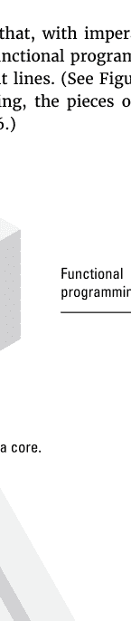

每个部分都完美放入一个核心中。

图 12-6：函数式程序的片段完美地放入多核芯片。

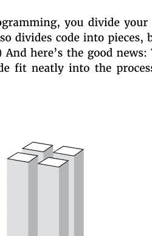

# 用老办法解决问题

在第 11 章中，你使用数组来管理 Java 旅馆。但那段创业已经成为过去。你已经放弃了酒店业务。（你告诉人们你决定转型。坦率地说，这家酒店一直在亏损。根据美国破产法院的，旧 Java 旅馆目前处于第 11 章破产保护。）

离开酒店业务后，你转入了在线销售。如今，你经营着一个销售书籍、DVD 和其他内容相关商品的网站。（Barry Burd 编写的《Java For Dummies》第 7 版目前是你的畅销书，但这并不是重点。）

在你的世界里，单个项目看起来类似于列表 12-3 中的内容。每笔销售记录都包含一个物品和一个价格。

## 列表 12-3：Sale 类

```java
public class Sale {

    private String item;

    private double price;

    public String getItem() {

        return item;

    }

    public void setItem(String item) {

        this.item = item;

    }

    public double getPrice() {

        return price;

    }

    public void setPrice(double price) {

        this.price = price;

    }

    public Sale(String item, double price) {

        this.item = item;

        this.price = price;

    }

}
```

为了使用 `Sale` 类，你创建了一个小程序。该程序计算 DVD 的销售总额。程序显示在列表 12-4 中。

## 列表 12-4：使用 Sale 类

在第 11 章中，你通过增强型 for 语句来遍历数组。列表 12–4 有它自己的增强型 for 语句。但在列表 12–4 中，增强型 for 语句遍历的是集合中的值。每个值都是一次销售记录。循环反复检查销售记录，判断销售的物品是否是 DVD。如果是，代码会将销售价格加到运行总中。程序的输出是 $36.00 —— 以货币金额形式显示的运行总额。

列表 12-4 中的场景并不稀奇。你有一个物品集合（也许是一个销售集合）。你遍历集合中的物品，寻找符合特定标准的物品（例如销售 DVD）。你获取每个符合标准的物品的某个值（作为销售价格）。然后你对获取的值做一些有用的操作（例如，将这些值相加）。

这里是其他示例：

- 遍历你的员工列表。找到每个绩效评估评分 3 分或以上的员工。给每位员工发放 100 美奖金，然后确定你将支付奖金的总金额。
- 遍历你的客户列表。对于每个表现出购买手机兴趣的客户，发送一封关于本月折扣计划的电子邮件。
- 遍历已发现的行星列表。对于每个 M 类行星，找到在该行星上发现智能生命的概率。然后找到所有此类概率的平均值。

这种场景如此常见，因此值得寻找更好的方法来处理。处理它的一种方法是使用 Java 中的一些函数式特性。

## 流 (Streams)

前面的章节“使用迭代器”引入了迭代器。你使用迭代器的 `next` 方法吐出集合的值。Java 通过“流”（stream）的概念进一步发展了这一概念。流类似于迭代器，不同在于，使用流时你不需要调用 `next` 方法。创建后，流会自动吐出集合的值。要从流中获取值，你不需要调用流的 `next` 方法。事实上，典型的流没有 `next` 方法。

这在 Java 程序中是如何运作的？你如何创建一个吐出值的流？流何时开始吐出值，它何时停止？关于这些以及其他问题的答案，请阅读后续几节。

## Lambda 表达式 (Lambda expressions)

20 世纪 30 年，数学家 Alonzo Church 使用希腊字母 lambda (λ) 来表示某种动态创建的数学结构。在接后的几十年里，这个想法在数学和计算机科学期刊中幸存了下来。如今在 Java 中，lambda 表达式表示一段代码，既是方法声明又是方法调用，都是动态创建的。

# 你的第一个 lambda 表达式

这是一个 lambda 表达式示例：

```java
(sale) -> sale.getItem().equals("DVD")
```

图 12-7 描述了 lambda 表达式的含义。lambda 表达式是一种定义方法并调用方法的简洁方式，甚至无需命名。图 12-7 中的 lambda 表达式大致上实现了以下代码的功能：

```java
boolean isItem(Sale sale) {

    if (sale.getItem().equals("DVD")) {

        return true;

    } else {

        return false;

    }

}
```

图 12-7 中的 lambda 表达式从流中获取对象，并在每个对象上调用类似于 `isItem` 的方法。结果是一系列布尔值 —— 对于销售返回 true，对于 DVD 其他的内容返回 false。以前我在伊利诺伊大学听过 Alonzo Church 的演讲。他是最的演讲者。他演讲的每一个细节都经过仔细计划和严格执行。他分发了笔记，我花了半时间盯着笔记，试图判断它们是手写的还是打印的。

取一个来自流的对象。临时让变量 `sale` 指向该对象。图 12-7：销售物品是 DVD 吗？

```java
(sale) -> sale.getItem().equals("DVD")
```

考虑 sale 的物品字段。字段等于 "DVD" 是真还是假？如果没有 lambda 表达式，你可以用一行体重写 `isItem` 方法：

```java
boolean isItem(Sale sale) {

    return sale.getItem().equals("DVD");

}
```

## 带有两个参数的 lambda 表达式

考虑以下 lambda 表达式：

```java
(price1, price2) -> price1 + price2
```

图 12-8 描述了 lambda 表达式的含义。图 12-8 中的 lambda 表达式大致上实现了以下代码的功能：

```java
double sum(double price1, double price2) {

    return price1 + price2;

}

sum(price1, price2);
```

图 12-8 中的 lambda 表达式从流中获取值，并调用类似于 `sum` 方法来组合这些值。结果是所有价格的总和。

## lambda 表达式中的异类

这是一个有趣的 lambda 表达式：

```java
(sale) -> System.out.println(sale.getPrice())
```

这个 lambda 表达式大致上实现了以下代码的功能：

```java
void display(Sale sale) {

    System.out.println(sale.getPrice());

}

display(sale);
```


lambda 表达式从流中获取对象，并在每个对象上调用类似于 `display` 的方法。在 `display` 方法的头部，`void` 单词表示方法没有返回值。当你调用 `display` 方法（或等效的 lambda 表达式）时，你不期望返回值。相反，期望代码响应调用执行某些操作（例如在计算机屏幕上显示文本）。

为了在返回值和“执行某些操作”之间做出清晰的区分，函数式程序员为“不返回值而执行某些操作”有一个名称——他们称之为副作用（side effect）。在函数式编程中，副作用被视为二等公民、最后的手段，一种当你无法返回结果时使用的策略。遗憾的是，在屏幕上显示信息（许多计算机程序所做的）是副作用。任何显示输出的程序（无论在哪里）都不是纯函数式程序。

# lambda 表达式的分类法

Java 将 lambda 表达式分为约 45 类不同的类别。表 12-2 列出了其中的一些类别。

## 表 12-2 一些 lambda 表达式

| 名称 | 描述 | 示例 |
|---|---|---|
| Function | 接受一个参数；产生任何类型的结果 | `(sale) -> sale.price` |
| Predicate | 接受一个参数；产生布尔值结果 | `(sale) -> sale.item.equals("DVD")` |
| BinaryOperator | 接受两个相同类型的参数；产生相同类型的结果 | `(price1, price2) -> price1 + price2` |
| Consumer | 接受一个参数；不产生结果 | `(sale) -> System.out.println(sale.price)` |

表 12-2 中的类别并不是互斥的。例如，每个 Predicate 都是 Function。（每个 Predicate 都接受一个参数并返回一个结果。结果恰好是布尔。）

# 使用流和 lambda 表达式

Java 拥有巧妙的方法来优化利用流和 lambda 表达式。通过流和 lambda 表达式，你可以创建一个流水线，优雅地解决本章的销售问题。与列表 12-4 中的代码不同，新的流水线解决方案使用了函数式编程的概念。

流水线由几个方法组成。每个方法获取数据，以某种方式转换数据，并将其结果交给链条中的下一个方法。图 12-9 展示了本章问题的流水线。

例如，在从第二个框到第三个框的过渡过程中，一个工作方法（`filter` 方法）筛选出不是 DVD 的商品销售记录。想象一下露西·里卡多（Lucy Ricardo）站在第二个和第三个框之间，从装配线上移除每本书或每张 CD，并随意地扔在地板上。

Java 的 `filter` 方法的参数是一个 `Predicate`（谓词）——这是一个结果为布尔值的 lambda 表达式。（参见表 12-2 和 12-3。）图 12-9 中的 `filter` 方法筛选掉未通过 lambda 表达式真/假测试的项。

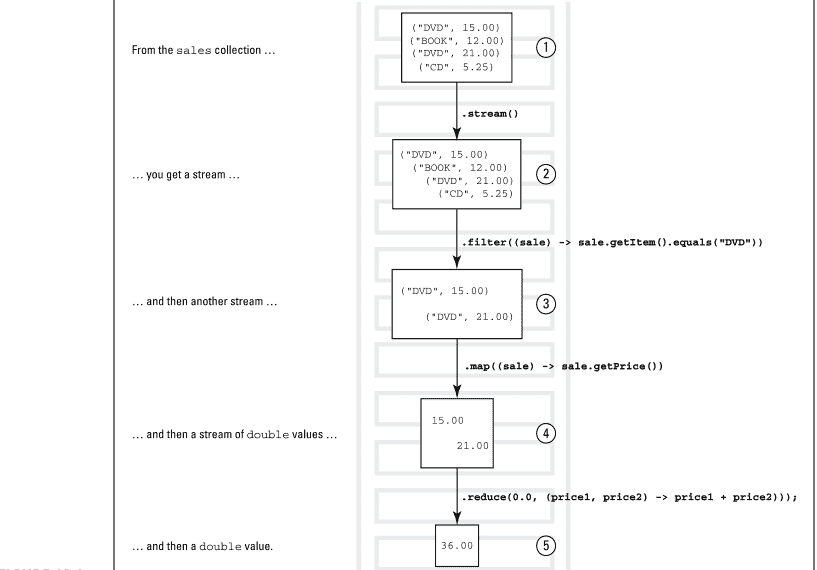

图 12-9：功能性编程装配线。

为了帮助理解表 12-3 第三列中的 `Predicate`、`Function` 和 `BinaryOperator`，请参见前面的章节“lambda 表达式的分类”。

## 表 12-3 一些功能性编程方法

| 方法名称 | 属于 | 参数 | 结果类型 | 结果值 |
| --- | --- | --- | --- | --- |
| stream | Collection（例如，一个 ArrayList 对象） | （无） | Stream | 一个产生集合元素的流 |
| filter | Stream | Predicate | Stream | 一个包含所有 lambda 表达式返回 true 的值的新流 |
| map | Stream | Function | Stream | 一个包含将 lambda 表达式应用于输入流后的结果的新流 |
| reduce | Stream | BinaryOperator | BinaryOperator 使用的类型 | 组合输入流中所有值的结果 |

在图 12-9 中，在从第三个框到第四个框的过渡过程中，一个工作方法（`map` 方法）从每笔销售记录中提取出价格。从该工作的位置开始，装配线只包含价格值。

更准确地说，Java 的 `map` 方法接收一个 `Function`，例如：

```
(sale) -> sale.getPrice()
```

并将该 `Function` 应用于流中的每个值。（表 12-2 和 12-3。）图 12-9 中的 `map` 方法接收一个销售对象的输入流，并创建一个价格值的输出流。

在图 12-9 中，在从第四个框到第五个框的过渡过程中，一个工作方法（`reduce` 方法）相加 DVD 销售的价格。Java 的 `reduce` 方法接收两个参数：

- 第一个参数是初始值。
  - 在图 12-9 中，初始值为 0.0。
- 第二个参数是一个 `BinaryOperator`。（表 12-2 和 12-3）
  - 在图 12-9 中，`reduce` 方法的 `BinaryOperator` 是：

```
(price1, price2) -> price1 + price2
```

`reduce` 方法使用其 `BinaryOperator` 组合来自输入流的值。初始值作为所有组合的起点。因此，在图 12-9 中，`reduce` 方法执行了两次加法。（参见图 12-10。）

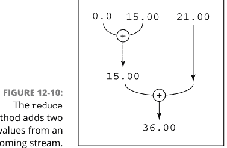

为了对比，想象调用方法：

```
reduce(10.0, (value1, value2) -> value1 * value2)
```

其值包含 3.0、2.0 和 5.0 的流。产生的操作如图 12-11 所示。


你可能听过 Google 的 MapReduce 编程模型。该编程模型名称与 Java 方法名 `map` `reduce` 之间的相似性并非偶然。

### 技术细节

第 12 章 使用集合和流（当数组不够用时）345

整体来看，图 12-9 中的整个装配线相加了 DVD 的价格。示例 12-5 包含了使用图 12-9 中流和 lambda 表达式的完整程序。

## 示例 12-5：生活

```java
import java.text.NumberFormat;
import java.util.ArrayList;

public class TallySales {

    public static void main(String[] args) {

        List<Sale> sales = new ArrayList<>();

        NumberFormat currency = NumberFormat.getInstance();

        fillList(sales);

        double total = sales.stream()
            .filter(sale -> sale.getItem().equals("DVD"))
            .map(sale -> sale.getPrice())
            .reduce(0.0, (price1, price2) -> price1 + price2);

        System.out.println(currency.format(total));

    }

    static void fillList(List<Sale> sales) {

        sales.add(new Sale("DVD", 15.00));
        sales.add(new Sale("Book", 12.00));
        sales.add(new Sale("DVD", 21.00));
        sales.add(new Sale("CD", 5.25));

    }

}
```


示例 12-5 代码需要 Java 8 或更高版本。如果你的 IDE 设置为早期版本，你可能需要调整 IDE 的设置。你可能需要下载较新版本的 Java。示例 12-5 中的加粗部分是一个大的赋值语句。语句的右侧包含一系列方法调用。每个方法调用返回一个对象，而每个此类对象都是下一个方法调用的内容。这就是你形成装配线的方式。

例如，在加粗部分的开头，名称 `sales` 指向一个 ArrayList 对象。每个 ArrayList 都有一个 `stream` 方法。在示例 12-5 中，`sales.stream()` 是对 ArrayList 的 `stream` 方法的调用。`stream` 方法返回 Java `Stream` 类的实例。（真惊喜！）`sales.stream()` 指向一个 `Stream` 对象。（参见图 12-12。）

每个 `Stream` 对象都有 `filter` 方法。因此：

```
sales.stream().filter(sale -> sale.getItem().equals("DVD"))
```

是调用 `Stream` 对象的 `filter` 方法。（参见图 12-12。）

图 12-12：获取所有 DVD 销售。

模式继续。`Stream` 对象的 `map` 方法返回另一个 `Stream` 对象 —— 一个包含价格的 `Stream` 对象。（参见图 12-13）对该价格流（Stream）应用 `reduce` 方法，它产生一个值 —— DVD 销售的总额。（参见图 12-14。）

图 12-13：从每笔 DVD 销售中获取价格。

第 12 章 使用集合和流（当数组不够用时）347

```
sales.stream().filter(sale -> sale.getItem().equals("DVD")).map(sale -> sale.getPrice()).reduce(0.0, ...)
```

一个价格流（a stream of prices）
一个总价（a total price）


## 为什么都需要？

示例 12-5 中的方法链完成了 12-4 中循环所完成的所有工作。但图 12-14 中的代码使用了功能性编程的概念。这有什么大不了的？使用示例 12-5 比使用 12-4 更好吗？

是的。在过去的几年里，芯片设计的大趋势是多核处理器。有了多个核心，处理器可以同时执行多个语句，将程序的执行速度加快 2 倍、4 倍甚至更多。如果你将工作分配到多个核心上，程序运行速度会快得多。你如何分配工作呢？

你可以修改示例 12-4 中的命令式代码。例如，通过某些高级特性，你可以处理不同的迭代到不同的核心上。但结果是杂乱的。为了让代码正常工作，你必须微管理循环迭代，确保最终总数是正确的。

相比之下，功能性代码很容易修改。为了利用多核处理器的优势，你只需要更改示例 12-5 中的一个核心！

```java
sales.parallelStream()
    .filter(sale -> sale.getItem().equals("DVD"))
    .map(sale -> sale.getPrice())
    .reduce(0.0, (price1, price2) -> price1 + price2);
```

当你阅读上一个段落时，不要忽略“最佳可能情况”这个短语。并行化并不是魔法。而且，并行化并不总是你的朋友。考虑你只有 20 个销售金额需要统计的情况。将问题分成 4 组（每组 5 个销售额）所花费的时间超过了你在四个核心上所节省的时间。此外，某些问题并不适合并行处理。想象一下，某个物品的处理过程取决于所使用的相似物品的数量。在这种情况下，你无法将问题分给四个独立运行的内核上。如果你尝试这样做，每个内核都必须知道其他内核在做什么。利用拥有四个执行线程的优势吧。


# 没有变量？没问题！

考虑早之前章节“函数式编程”开始时提出的问题。几个客户尝试同时更新 Oracle 的股票价格，或者访问者尝试在网站上购买同一个商品。问题的根源在于共享数据。有多少客户共享访问 Oracle 的股票价格？有多少客户共享访问网页的“购买”按钮？你的处理器内核中有多少个正在修改变量的值？如果你消除了数据共享，你的多核处理就消失了。

在命令式编程中，变量是语句之间共享值的地方。你可以在你的代码中避免变量吗？

将列表 12-4 中的循环与列表 12-5 中的函数式编程代码进行比较。在列表 12-4 中，变量 `total1` 在所有循环迭代之间共享。由于每次迭代都可能改变 `total1` 的值，你无法将每次迭代分配给不同的处理器。如果你这样做，你将面临由于两个内核同时更新总和的风险。（很有可能，由于同时更新，两个内核都无法正确执行操作！）但列表 12-5 中的函数式编程代码没有 `total1` 变量。运行总和在代码的函数式版本中没有起任何作用。相反，在列表 12-5 中，`reduce` 方法对来自流（stream）的值应用了求和操作。这个传入的输入流从上一个方法调用中弹出（该输入流没有名称。这很棒。你甚至不需要一个变量来存储值流）。

在命令式编程中，变量是语句之间共享值的地方。但函数式编程回避了变量。所以，当你进行函数式编程时，你有很多数据共享。许多与多个处理器相关的困难都消失于无形。你可以同时利用许多内核的优势。当你编写代码时，你不必担心数据在内核之间被共享。这是解决重要计算问题的优雅解决方案。

## 方法引用

仔细查看列表 12-5 中的最后一个 lambda 表达式：

```
(price1, price2) -> price1 + price2
```

这个表达式的工作内容与 `sum` 方法大致相同。（事实上，你可以在之前的章节“Lambda 表达式”中找到 `sum` 方法的声明）。如果你在编写一个 3 行的 `sum` 方法和编写一个 1 行的 lambda 表达式之间做选择，你可能会选择 lambda 表达式。但如果你有第三种选择呢？与其编写自己的 `sum` 方法，不如引用一个现有的 `sum` 方法。使用现有方法是最快速且安全的方法。

幸运的是，Java 的 `Double` 类包含一个静态 `sum` 方法。你不需要自己创建 `sum` 方法。如果你运行以下代码：

```java
double i = 5.0, j = 7.0;
System.out.println(Double.sum(i, j));
```

计算机显示 12.0。所以，与其在列表 12-5 中编写 `price1 + price2` lambda 表达式，你可以创建一个方法引用——一个引用方法的表达式。

```java
sales.stream()
    .filter((sale) -> sale.getItem().equals("DVD"))
    .map((sale) -> sale.getPrice())
    .reduce(0.0, Double::sum);
```


表达式 `Double::sum` 引用了属于 Java `Double` 类的 `sum` 方法。当你使用 `Double::sum` 方法引用时，你所做的与列表 12-5 中最后一个 lambda 表达式所做的操作完全相同。大家都很开心。

关于静态方法的信息，请参阅第 10 章。


你可以尝试自己构思的编程挑战。如果你没有主意来练习函数式编程，我有几点建议给你：

- 每位员工都有一个名字和一个绩效评估分。如果你给每个得分为 3 或以上的员工提供 100 美元的奖金，找到你将支付的奖金总量。
- 每份菜谱都有一个名字、一份成分列表（其中一些涉及肉类产品）和一个预计准备时间。找到其中一份素食菜谱的平均预计准备时间。

# 本章内容

- 从错误输入和其他糟糕状况中恢复
- 让你的代码（在某种程度上）能够防止崩溃
- 定义你自己的异常类

# 第 13 章

# 当事情发生意外的转折时保持良好

1962 年 9 月 9 日：水手一号，美国首个目标行星的天文器在发射四分钟后被摧毁。这种异常行为归因于公式中缺少了一个横杠（类似连字符）。

1957 年 4 月 19 日：Herbert Bright，西锐敦数据中心的经理，收到了一叠无标签的孔卡。仅凭这叠卡片，Bright 编写了一个小型 FORTRAN 程序并在 IBM 704 上编译它。由于使用的是真空管而不是晶体管，机器占据了一个 2000 平英尺的房间。操作系统必须从磁带加载。

1945 年 9 月 9 日：一只蛾子飞进继电器中导致了故障。这是第一个有记录的“虫”。大约同时，NASA 的轨道计算软件被发现包含错误的语句 `DO I=1,10`（应该是 `DO I=1,10`）。在现代表示法中，这就像用 `doi = 1.10` 替换了 `(int i=1; i<=10; i++)`。这些笔记中的历史事实借自以下来源：计算机传说新闻组、在线计算机字典、计算机杂志以及 IEEE 的其他网页。

2000 年 1 月 1 日：千禧年虫问题给现代世界带来了混乱。

## 处理异常

你正在进行库存统计。这意味着数接一个物品，一个接一个盒子，并将数字记录在日志表、小型手持设备和计算机键盘上。项目的某一部分涉及发现“自元年以来未打开过的繁忙盒子”的数量。为了打破公司几十年的习惯，你决定不打开这些盒子。你随意地为每个盒子分配了 3.25 元。列表 13-1 显示了处理这部分库存的软件。软件存在一个缺陷，如图 13-1 所示。当用户输入整数值时，一切正常。但当用户输入其他内容（比如数字 3,5）时，程序就会崩溃。显然对此会有应对措施。计算机很笨，但还没笨到在用户输入不当值时就彻底失败。

## 列表 13-1: 计数箱子

```java
import static java.lang.System.out;
import java.util.Scanner;
import java.text.NumberFormat;

public class InventoryA {
    public static void main(String[] args) {
        final double boxPrice = 3.25;
        Scanner scanner = new Scanner(System.in);
        NumberFormat currency = NumberFormat.getInstance();
        out.print("How many boxes do we have? ");
        String numBoxesIn = scanner.next();
        int numBoxes = Integer.parseInt(numBoxesIn);
        out.print("The value is ");
        out.println(currency.format(numBoxes * boxPrice));
        scanner.close();
    }
}
```

我们有多少箱子? 3
该值是 $9.75
Exception in thread "main" java.lang.FormatException: "3.5"
at java.lang.FormatException.forInputString(Unknown Source)
at java.lang.Integer.parseInt(Unknown Source)
at java.lang.Integer.parseInt(Unknown Source)
	at InventoryA.main(InventoryA.java:25)

图 13-1：
列表 13-1 中代码的三次独立运行。

修复程序错误的关键在于检查程序崩溃时出现的消息。库存程序的显示显示为 `java.lang.FormatException`。这意味着在 `java.lang` API 包中有一个 `NumberFormatException` 类。某种程度上，`Integer.parseInt` 是如何让这个 `NumberFormatException` 现身的。

关于 `Integer.parseInt` 方法的简要解释，请参见第 11 章。

那么，发生了什么？Java 编程语言有一种名为异常处理的机制。通过异常处理，程序可以检测到即将发生错误的情况，并通过创建一个全新的对象来做出响应。在官方术语中，程序被认为是在抛出（throwing）一个异常。这个新的对象（`Exception` 类的一个实例）像传烫山豆一样从一段代码传递到另一段代码，直到某些代码决定捕获（catch）异常。当异常被捕获时，程序执行某些恢复代码，掩埋异常，并移动到下一个正常状态，仿佛什么都没有发生过。该过程如图 13-2 所示。

整个过程是在几个 Java 关键字的辅助完成的。这些关键字在列表中描述：

- `throw`: 创建新的异常对象。
- `throws`: 将责任从方法向上传递给调用该方法的代码。
- `try`: 包含可能创建新异常对象的代码。在通常情况下，`try` 语句内部的代码包含对方法的调用，这些方法代码可能会创建一个或多个异常。
- `catch`: 处理异常，掩埋它，然后继续。

真相大白了。通过像图 13-2 所示的事件链，`Integer.parseInt` 方法可以抛出 `NumberFormatException`。当你调用 `Integer.parseInt` 时，这个 `NumberFormatException` 就会传递给你。

Java API 中关于 `parseInt` 方法的文档写道：“Throws: NumberFormatException — 如果字符串不包含可解析的整数。”偶尔阅读一下文档确实是有回报的。

如果你自认为是一个英雄，你最好捕获异常，以便所有其他代码能够进行其正规业务。列表 13-2 显示了异常的捕获。

## 列表 13-2: 英雄拯救箱子

```java
import static java.lang.System.out;
import java.util.Scanner;
import java.text.NumberFormat;

public class InventoryB {
    public static void main(String args[]) {
        final double boxPrice = 3.25;
        Scanner keyboard = new Scanner(System.in);
        NumberFormat currency = NumberFormat.getCurrencyInstance();
        out.print("How many boxes do we have? ");
        String numBoxes = keyboard.next();
        try {
            int numBoxes = Integer.parseInt(numBoxes);
            out.print("The value is ");
            out.println(currency.format(numBoxes * boxPrice));
        } catch (NumberFormatException e) {
            out.println("That's not a number.");
        }
        keyboard.close();
    }
}
```

图 13-3 显示了列表 13-2 中代码的三次运行。当一个误入的用户使用 `three` 而不是 `3` 时，程序通过显示 `That's not a number.` 来保持冷静。`try` 语句内部的代码包含了对可能创建一个或多个异常方法的调用。`catch` 块处理异常，掩埋它，然后继续。

## 代码列表 13-4：（续）

```java
if (numBBoxes < 0) {
    throw new OutOfRangeException();
}
out.print("The value is ");
```


```java
out.println(currency.format(numBBoxes * boxPrice));

} catch (NumberFormatException e) {

    out.println("That's not a number.");

} catch (OutOfRangeException e) {

    out.print(numBoxesIn);

    out.println("That's impossible!");

}

keyboard.close();

}
```

代码列表 13-3 和 13-4 解决了之前在图 13-3 中出现的问题。看图 13-3 中三次运行的最后一次。用户报告架子上有 -25 个箱子，而计算机毫不眨眼就采纳了这个值。事实是，你需要一个黑洞（或某种奇特的时空现象）才能让任何仓库中出现负数数量的箱子。当用户输入负数箱子数量时，程序应该报错，这正是代码列表 13-4 所做的。查看报错的代码，请看图 13-5。

| 我们有多少个箱子？ | 3 |
| :--- | :--- |
| 数值是 | 5 |
| 我们有多少个箱子？ | 三 |
| 那不是数字 | |
| 我们有多少个箱子？ | -25 |
| 这是不可能的！ | |

代码列表 13-3 中的代码声明了一个新类型的异常类：`OutOfRangeException`。在很多情况下，输入负数可能没问题，因为 `OutOfRangeException` 并不是 Java API 内置的。然而，在库存程序中，负数应该被标记为异常。

代码列表 13-3 中的 `OutOfRangeException` 类赢得了本类中第一个自包含代码块的奖。该类的代码只是一行声明和一对空的大括号。代码的操作短语`extends Exception`。作为 Java API `Exception` 类的子类，`OutOfRangeException` 类的任何实例都可以被抛出。

358 第 4 部分 智能 Java 技术

回到代码列表 13-4，抛出了一个新的 `OutOfRangeException` 实例。当这种情况发生时，`catch` 子句 `(OutOfRangeException e)` 捕获了该实例。该子句回显了用户的输入并显示“这是不可能的！”

列表 13-3 中的文本 `@SuppressWarnings("serial")` 是 Java 注解。关于注解的介绍，请参阅第 8 章。关于 `SuppressWarnings` 注解的简单介绍，请参阅第 9 章。


如果你使用 Eclipse，可能会在代码列表 13-4 的 `throw new OutOfRangeException()` 处看到黄色警告标记。当你将指针悬停在警告标记上时，Eclipse 会显示：“资源泄漏：'keyboard' 未关闭，除非你执行了 `keyboard.close()` 语句。（是的，在某些情况下，抛出 `OutOfRangeException` 会导致程序跳过 `keyboard.close()` 语句。但在运行代码列表 13-4 中的代码时，这种情况不会发生。）在我看来，你可以安全地忽略这个警告。


## 谁来捕获异常？

再次仔细观察代码列表 13-4。注意一个 `catch` 子句可以伴随一个 `try` 子句。当异常在 `try` 子句内部被抛出时，计算机开始检查随后的 `catch` 子句列表。计算机从紧跟在 `try` 子句之后的第一个 `catch` 子句开始，遍历整个程序文本。

对于每个 `catch` 子句，计算机都会问自己：“抛出的异常是该子句参数类型的实例吗？”

- 如果不是，计算机将跳过此 `catch` 子句，并继续到下一个。
- 如果是，计算机将执行此 `catch` 子句，并跳过该 `try` 子句之后的所有 `catch` 子句。

有关具体的示例，请参代码列表 13-5 和 13-6。

代码列表 13-5：另一种异常

第 13 章 意外情况下的良好表现 359

# 代码列表 13-6：在哪里停止？

```java
import java.lang.System;
import java.util.Scanner;
import java.text.NumberFormat;

public class Inventory {

    public static void main(String[] args[]) {

        final double boxPrice = 3.25;
        Scanner keyboard = new Scanner(System.in);
        NumberFormat currency = NumberFormat.getInstance();
        System.out.print("我们有多少个箱子?");
        String numBoxesIn = keyboard.next();

        try {
            int numBoxes = Integer.parseInt(numBoxesIn);
            if (numBoxes < 0) {
                throw new OutOfRangeException();
            }
            if (numBoxes > 1000) {
                throw new NumberTooLargeException();
            }
            System.out.print("数值是 ");
            System.out.println(currency.format(numBoxes * boxPrice));
        } catch (NumberFormatException e) {
            System.out.println("那不是数字.");
        } catch (OutOfRangeException e) {
            System.out.print(numBoxesIn);
            System.out.println("这是不可能的!");
        } catch (Exception e) {
            System.out.print("出错了了，");
            System.out.print("但我并不清楚 ");
            System.out.println("到底是什么。");
        }

        System.out.println("结束了.");
        keyboard.close();
    }
}
```

360 第 4 部分 智能 Java 技术

要运行代码列表 13-5 和 13-6，你需要额外的 Java 文件。你需要代码列表 13-3 中的 `OutOfRangeException` 类。

代码列表 13-6 处理了空间有限的情况。你的空间放不下超过 1000 个箱子，但偶尔程序问你有多少个箱子时，有人不小心输入了1000。在这种情况下，代码列表 13-6 会进行快速检查。任何超过 1000 的箱子都被认为是不现实的。

代码列表 13-6 监控 `NumberTooLargeException`，为了让生活更有趣，代码列表 13-6 没有为 `NumberTooLargeException` 设置 `catch` 子句。尽管如此，一切仍然运行良好。`NumberTooLargeException` 被声明为 `OutOfRangeException` 的子类，而代码列表 13-6 有一个 `OutOfRangeException` 的 `catch` 子句。

你会发现，因为 `NumberTooLargeException` 是 `OutOfRangeException` 的子类，任何 `NumberTooLargeException` 实例都是一种特殊的 `OutOfRangeException`。因此，在代码列表 13-6 中，计算机可能会开始寻找匹配 `NumberTooLargeException` 的 `catch` 子句。当计算机遇到 `OutOfRangeException` `catch` 子句时，它会：“好的，我找到了匹配。我会执行此子句中的语句。”

为了避免重复这个故事，我引入了一些新术语。我说参数为 `OutOfRangeException` 的 `catch` 子句匹配了抛出的 `NumberTooLargeException`。我把这个子句称为“匹配子句”。

下面的列表描述了你可能执行的不同操作以及计算机的响应。在阅读时，你可以对照图 13-6 中的运行：

| 我们有多少个箱子？ | 结果 |
| :--- | :--- |
| 3 | 数值是 $99.75。结束了。 |
| 我们有多少个箱子？fish | 那不是数字。结束了。 |
| 我们有多少个箱子？-25 | -25？这是不可能的！结束了。 |
| 我们有多少个箱子？1001 | 1001？这是不可能的！结束了。 |

图 13-6：代码列表 13-6 的四次运行。

第 13 章 意外情况下的良好表现 361

- 用户输入一个普通的整数，比如数字3。`try` 子句中的所有语句都会执行。然后计算机跳过所有 `catch` 子句，执行紧随所有 `catch` 子句之后的代码。（见图 13-7）。

- 用户输入不是数字的内容，比如单词 fish。代码抛出一个 `NumberFormatException`。计算机跳过 `try` 子句中剩余语句。计算机执行第一个 `catch` 子句内部的语句——其参数类型为 `NumberFormatException`。然后计算机跳过第二个和第三个 `catch` 子句，执行紧随所有 `catch` 子句之后的代码。（见图 13-8）。

```java
try {
    //正常处理（不抛出异常）
} catch (NumberFormatException e) {
    System.out.println("那不是数字.");
} catch (OutOfRangeException e) {
    System.out.println("这是不可能的!");
} catch (Exception e) {
    System.out.println("出错了了，");
    System.out.println("但我并不清楚 ");
    System.out.println("到底是什么。");
}
System.out.println("结束了.");
```

图 13-7：没有抛出异常。

- 用户输入一个负数，比如数字 -25。代码抛出一个 `OutOfRangeException`。计算机跳过 `try` 子句中剩余的语句。计算机甚至跳过了第一个 `catch` 子句的语句。（毕竟，`OutOfRangeException` 不是任何类型的 `NumberFormatException`。参数为 `NumberFormatException` 的 `catch` 子句并不是该 `OutOfRangeException` 的捕获器。）计算机执行第二个 `catch` 子句内部的语句。然后计算机跳过第三个 `catch` 子句，执行紧随所有 `catch` 子句之后的代码。（见图 13-9）。

```java
try {
    throw new NumberFormatException();
} catch (NumberFormatException e) {
    out.println("That's not a number.");
} catch (OutOfRangeException e) {
    out.print(numBoxesIn);
    out.println("That's impossible!");
} catch (Exception e) {
    out.print("Something went wrong, ");
    out.print("But I'm clueless about what ");
    out.println("it actually was.");
}
```

图 13-8：一个 NumberFormatException

```java
try {
    throw new OutOfRangeException();
} catch (NumberFormatException e) {
    out.println("That's not a number.");
} catch (OutOfRangeException e) {
    out.print(numBoxesIn);
    out.println("That's impossible!");
} catch (Exception e) {
    out.print("Something went wrong, ");
    out.print("But I'm clueless about what ");
    out.println("it actually was.");
}
out.println("That's that.");
```

图 13-9：抛出了一个 OutOfRangeException。

> **用户输入了一个大得不合理的数字，比如数字 1001。** 代码抛出了 `NumberTooLargeException`。计算机跳过了第一个 `catch` 句中的剩余语句。计算机甚至跳过了第一个 `catch` 句中的语句；毕竟，`NumberTooLargeException` 不属于任何一种 `NumberFormatException`。

但是，根据代码列表 13-5 中的代码，`NumberTooLargeException` 是 `OutOfRangeException` 的子类。当计算机到达 `catch` 句时，计算机会说：“嗯！`NumberTooLargeException` 是一种 `OutOfRangeException`。我将执行这个 `catch` 句中的语句——参数类型为 `OutOfRangeException` 的句。”换句话说，它匹配上了。

计算机执行第二个 `catch` 句内部的语句。然后，计算机跳过第三个 `catch` 句，并执行紧接在所有 `catch` 句之后的代码。（参见图 13-10。）

# 第 13 章 当意外发生时保持从容 363

## **一些其他事情，一些不可预测的事情（我不知道是什么）。** 凭借着我那不可遏灭的实验冲动，我深入了代码列表 13-6 的 `try` 句，并添加了一个抛出 `IOException` 的语句。没有理由——我只想看看会发生什么。

```java
try {
    throw new NumberTooLargeException();
} catch (FormatException e) {
    out.println("That's not a number.");
} catch (OutOfRangeException e) {
    out.println("That's impossible!");
} catch (Exception e) {
    out.print("Something went wrong, ");
    out.print("but I'm clueless about what ");
    out.println("it actually was.");
}
out.println("That's that.");
```

图 13-10：
抛出了一个 Number TooLarge Exception。

因此计算机执行了第三个 `catch` 句内部的语句。然后计算机执行了紧接在所有 `catch` 句之后的代码。（参见图 13-11。）

当计算机寻找匹配的 `catch` 句时，它会锁定符合以下描述之一的最顶部的子句：

- 句的参数类型与抛出的异常的类型相同。
- 句的参数类型是该异常类型的父类。

如果在 `catch` 句列表的后续位置出现了更好的匹配项，那太遗憾了。想象你在代码列表 13-6 的代码中添加了一个参数类型为 `TooLargeException` 的 `catch` 句。同样，想象你将新的 `catch` 句放在了参数类型为 `OutOfException` 的 `catch` 句之后。那么，由于 `NumberTooLargeException` 是 `OutOfRangeException` 类的子类，新 `NumberTooLargeException` 句中的代码将不会被执行。这就是计划泡汤的地方。

```java
try {
    throw new IOException();
} catch (NumberFormatException e) {
    out.println("That's not a number.");
} catch (OutOfRangeException e) {
    out.println("That's impossible!");
} catch (Exception e) {
    out.println("Something went wrong. I'm clueless what it was.");
}
out.println("That's that.");
```


## 一次捕获多个异常

从 Java 7 开始，你可以在一个 `catch` 语句中捕获多种异常。例如，在特定的库存程序中，你可能不想区分 `NumberFormatException` 和你的 `OutOfRangeException`。在这种情况下，你可以这样重写列表 13-6：

```java
try {
    int numBoxes = Integer.parseInt(numBoxes);
    if (numBoxes < 0) {
        throw new OutOfRangeException();
    }
    if (numBoxes > 1000) {
        throw new NumberTooLargeException();
    }
    out.print("The value is ");
    out.println(currency.format(numBoxes * boxPrice));
} catch (NumberFormatException | OutOfRangeException e) {
    out.print(numBoxes);
    out.println("That's impossible!");
} catch (Exception e) {
    out.print("Something went wrong, ");
    out.print("but I'm clueless what it was.");
}
```

管道符号 `|` 告诉 Java 捕获 `NumberFormatException` 或 `OutOfRangeException`。如果你抛出其中一种异常，程序将显示 `numBoxes` 的值，然后显示“That's impossible!”如果你抛出的既不是 `NumberFormatException` 也不是 `OutOfRangeException` 的异常，程序将跳转到最后一个 `catch` 语句并显示“Something went wrong, but I'm clueless what it was.”

## 抛之虚空

你是那种强迫症类型的人吗？你喜欢在程序崩溃之前捕获所有可能的异常吗？Java 不喜欢偏执。如果异常没有被抛出，你就无法捕获它。考虑以下代码：

```java
// 错误代码！
try {
    i++;
} catch (IOException e) {
    e.printStackTrace();
}
```

这个 `catch` 语句想表现什么？`i++` 语句没有进行任何输入或输出。`try` 语句中的代码不可能抛出 `IOException`。所以编译器回来说道：“嘿，catch 语句。来点真的。”精确一点，编译器的斥责如下：

```
java.io.IOException is never thrown
in body of corresponding try statement
```

## 执行有用的事情

到为止，本章每个示例都捕获了“错误输入”消息然后结束。如果程序在捕获异常后继续运行不好吗？嗯，该做点什么了。列表 13-7 在循环中使用 `try-catch` 语句。循环会一直运行，直到用户输入合理的内容。

### 列表 13-7：继续！

```java
import static java.lang.System.out;
import java.util.Scanner;
import java.text.NumberFormat;

public class Inventory {
    public static void main(String args[]) {
        final double boxPrice = 3.25;
        boolean goodInput = false;
        Scanner keyboard = new Scanner(System.in);
        NumberFormat currency = NumberFormat.getCurrencyInstance();
        do {
            println("How many boxes do we have?");
            String numboxesIn = keyboard.next();
            try {
                int numBoxes = Integer.parseInt(numboxesIn);
                println("The value is ");
                println(currency.format(numBoxes * boxPrice));
                goodInput = true;
            } catch (NumberFormatException e) {
                println();
                println("That's not a number.");
            }
        } while (!goodInput);
    }
}
```

### 列表 13-7：（续）

```java
println("That's that.");
keyboard.close();
```

图 13-12 显示了列表 13-7 代码的运行情况。在头三次尝试中，用户输入了除了数字以外的所有内容。最后，第四次尝试成功了。用户输入了 3，计算机离开了循环。

| How many boxes do we have? | 3 |
|---|---|
| That's not a number | |
| How many boxes do we have? | three |
| That's not a number | |
| How many boxes do we have? | fish |
| That's not a number | |
| How many boxes do we have? | 3 |
| The value is 9.75 | |
| That's that |

**列表 13-12：列表 13-7 代码的运行。**

## 我们的朋友，良好的异常

有一种传言说 Java 异常总是来自不希望的、错误频繁的情况。虽然这个传言有些道理，但并不完全准确。偶尔，异常源于正常的、预期的发生。例如，对文件结束的检测。以下是复制一个文件：

```java
try {
  while (true) {
    dataOut.writeByte(dataIn.readByte());
  }
} catch (IOException e) {
  numFilesCopied = 1;
}
```

尝试一下这些编码任务：

- 添加 `try-catch` 语句防止以下代码崩溃：

```java
import java.util.Scanner;

public class Main {
    public static void main(String[] args) {
        Scanner keyboard = new Scanner(System.in);
        String[] words = new String[5];
        int i = 0;
        do {
            words[i] = keyboard.next();
        } while (!words[i++].equals("Quit"));
        for (int j = 0; j < 5; j++) {
            System.out.println(words[j].length());
        }
        keyboard.close();
    }
}
```

- 在列表 13-6 中，每个箱子的价格和过大的箱子数量是固定值。改进代码以让用户输入这两个值。记住，这些数量的某些值是无意义的。例如，箱子数量为负数是不合理的。使用 `try-catch` 语句来处理不当的用户输入。

# 处理异常或推卸责任

你正在学习 Java，对吧？什么？你说你已经学到第 13 章了？我印象非常深刻。你一定是个勤奋的人。但记住，只工作不玩耍……

那么，休息一下怎么样？小睡一会儿会大有益处。十秒钟可以吗？还是太长了？最好设为五秒。

列表 13-8 有一个应该暂停执行五秒的程序。问题是列表 13-8 中的程序是错误的。花分钟看一下列表 13-8，然后我会告诉你哪里错了。

## 列表 13-8：一个错误的程序

```java
/* * 此代码无法编译。 */
import static java.lang.System.out;

public class NoSleepForTheWeary {
    public static void main(String[] args) {
        out.print("Excuse me while I nap");
        out.println("for just five seconds...");
        takeNap();
        out.println("Ah, that was refreshing.");
    }

    static void takeNap() {
        Thread.sleep(5000);
    }
}
```

列表 13-8 中的策略并不坏。其想法是调用 Java API 中定义的 `sleep` 方法。这个 `sleep` 方法属于 API 中的 `Thread` 类。当你调用 `sleep` 方法时，定义的数字是毫秒数。因此 `Thread.sleep(5000)` 意味着暂停五秒。

问题是 `sleep` 方法内部的代码可能会抛出异常。这种异常是 `InterruptedException` 类的实例。当你编译列表 13-8 中的代码时，你会得到如下消息：

> reported exception java.lang.InterruptedException; must be caught or declared to be thrown

也许消息显示为：

> Unhandled exception type InterruptedException

无论如何，这个消息都是不受欢迎的。

为了通理解异常，你不需要确切知道 `InterruptedException` 到底是什么。你真正需要知道的是调用 `Thread.sleep` 可能会抛出这些 `InterruptedException` 对象。如果你好奇，当某些代码中断了其他代码的睡眠时，就会抛出 `InterruptedException`。假设你有两段代码同时运行。其中一段代码调用 `Thread.sleep` 方法。同时，另一段代码调用 `interrupt` 方法，第二段代码会让第一段代码的 `Thread.sleep` 方法戛然而止。`Thread.sleep` 方法通过抛出一个 `InterruptedException` 作为响应。

现在，Java 编程语言有两种异常。它们是受检查异常（checked exceptions）和未受检查异常（unchecked exceptions）：

- 可能会抛出的受检查异常必须在代码中得到确认。
- 可能抛出的未受检查异常不需要在代码中得到确认。

`InterruptedException` 是 Java 受检查异常类型之一。当一个方法可能抛出 `InterruptedException` 时，你需要在代码中对其进行确认。

为了更好地理解 `throws` 子句，想象一场排球比赛，其中排球就是一个异常。当对方球队的一名球员发球时，该球员就在“抛出”异常。球越过球网直接向你飞来。如果你把球拍回球网，你就在“捕获”这个异常。如果你把球传给另一个球员，你就是在使用 `throws` 子句。本质上，你是在说：“给你，球员。你来处理这个异常。”

方法中的语句可以抛出一个没有被 `catch` 语句匹配的异常。这包括异常抛出的语句甚至不在 `try` 块内部的情况。当这种情况发生时，程序的执行将跳出包含该错误语句的方法。执行将跳回最初调用该方法的代码：

**示例：**

一个方法可以在其 `throws` 子句中列出多个一个异常类型。只需用逗号分隔异常的名称即可，如下所示：

```
throws InterruptedException, IOException, ArithmeticException
```

Java API 拥有数百种异常类型。其中若干个是 `RuntimeException` 类的子类。`RuntimeException` 的任何子类（或子子类、子子子类等等）都是未检查异常（unchecked）。不是 `RuntimeException` 后代的未检查异常就是已检查异常（checked）。这类异常包括计算机可以预测的内容。例如 `NumberFormatException`、`IndexOutOfBoundsException`、臭名昭著的 `ArithmeticException`、著名的 `NullPointerException` 以及许多其他异常。当你编写 Java 代码时，你的大部分代码都会受到这些异常，但将代码封装在 `try` 子句中（或通过 `throws` 子句向上传递）是完全可选的。

Java API 也有许多已检查异常。计算机可以轻易检测出这类异常。因此，Java 坚持要求对于这类异常，任何潜在的抛出异常的语句都必须通过 `try` 语句或 `throws` 子句确认。Java 的已检查异常包括 `InterruptedException`（见列表 13-9 和 13-10）、`IOException`、`SQLException` 以及其他一系列异常。

我想不出什么巧妙的方法能把 "TryItOut" 中的 "Try" 与 `try-catch` 语句联系起来。如果你想到了什么，请写在这一页的空白处。然后尝试一下这些小挑战：

以下代码无法编译，因为代码抛出了一个未处理的 `FileNotFoundException`：

```java
// 错误代码：
import java.io.File;
import java.util.Scanner;

public class Main {
    public static void main(String[] args) {
        Scanner scanner = new Scanner(new File("numbers.txt"));
        int[] numerators = new int[5];
        int[] denominators = new int[5];
        int i = 0;
        while (scanner.hasNextInt()) {
            numerators[i] = scanner.nextInt();
            denominators[i] = scanner.nextInt();
            i++;
        }
        for (int j = 0; j < numerators.length; j++) {
            System.out.println(numerators[j] / denominators[j]);
        }
        scanner.close();
    }
}
```

修复未确认的 `FileNotFound` 以使代码通过编译。请注意，根据 `numbers.txt` 文件中的值，在程序运行期间可能会抛出其他异常。添加一个或多个 `try-catch` 语句来显示这些异常的消息，而不会让程序崩溃。

添加 `try-catch` 语句或子句（或这两者的结合）来修复以下损坏的代码：

```java
// 错误代码：
import java.io.DataInputStream;
import java.io.DataOutputStream;
import java.io.IOException;
import java.io.File;
import java.io.FileInputStream;
import java.io.FileOutputStream;
```


```java
public class Main {

    public static void main(String[] args) {
        File fileIn = new File("input");
        FileInputStream fileInputStream = new FileInputStream(fileIn);
        DataInputStream dataInputStream = new DataInputStream(fileInputStream);

        File fileOut = new File("output");
        FileOutputStream fileOutputStream = new FileOutputStream(fileOut);
        DataOutputStream dataOutputStream = new DataOutputStream(fileOutputStream);

        int numFilesCopied = 0;

        try {
            while (true) {
                dataOutputStream.writeByte(dataInputStream.read());
            }
        } catch (IOException e) {
            numFilesCopied = 1;
        }
    }
}
```

## 使用 finally 完成工作

当我思考 `try` 语句时，我考虑到的是计算机从不愉快的情况下中恢复。恢复发生在 `catch` 句内部，计算机继续执行 `try` 语句之后的任何语句。嗯，如果在执行 `catch` 句的过程中发生了某些问题，这种构图就会变得有所不同。

通常，当我思考 `try` 语句时，我考虑到的是计算机从不愉快的情况下中恢复。恢复发生在 `catch` 句内部，计算机继续执行 `try` 语句之后的任何语句。嗯，如果如果在执行 `catch` 句的过程中发生了某些问题，这种图就会变得有所不同。

通常，当我思考 `try` 语句时，我考虑到的是计算机从不愉快的情况下中恢复。恢复发生在 `catch` 句内部，计算机继续执行 `try` 语句之后的任何语句。嗯，如果如果在执行 `catch` 句的过程中发生了某些问题，这种图就会变得有所不同。

通常，当我思考 `try` 语句时，我考虑到的是计算机从不愉快的情况下中恢复。恢复发生在 `catch` 句内部，计算机继续执行 `try` 语句之后的任何语句。嗯，如果如果在执行 `catch` 句的过程中发生了某些问题，这种图就会变得有所不同。

通常，当我思考 `try` 语句时，我考虑到的是计算机从不愉快的情况下中恢复。恢复发生在 `catch` 句内部，计算机继续执行 `try` 语句之后的任何语句。嗯，如果如果在执行 `catch` 句的过程中发生了某些问题，这种图就会变得有所不同。

通常，当我思考 `try` 语句时，我考虑到的是计算机从不愉快的情况下中恢复。恢复发生在 `catch` 句内部，计算机继续执行 `try` 语句之后的任何语句。嗯，如果如果在执行 `catch` 句的过程中发生了某些问题，这种图就会变得有所不同。

通常，当我思考 `try` 语句时，我考虑到的是计算机从不愉快的情况下中恢复。恢复发生在 `catch` 句内部，计算机继续执行 `try` 语句之后的任何语句。嗯，如果如果在执行 `catch` 句的过程中发生了某些问题，这种图就会变得有所不同。

通常，当我思考 `try` 语句时，我考虑到的是计算机从不愉快的情况下中恢复。恢复发生在 `catch` 句内部，计算机继续执行 `try` 语句之后的任何语句。嗯，如果如果在执行 `catch` 句的的过程中发生了某些问题，这种图就会变得有所不同。

通常，当我思考 `try` 语句时，我考虑到的是计算机从不愉快的情况下中恢复。恢复发生在 `catch` 句内部，计算机继续执行 `try` 语句之后的任何语句。嗯，如果如果在执行 `catch` 句的的过程中发生了某些问题，这种图就会变得有所不同。

378 第 4 部分 高明的 Java 技巧

因此计算机返回到 `main` 方法中之前离开的地方。在 `main` 方法中，`doSomething` 方法发生的 `ArithmeticException` 意外导致执行跳转到 `catch` 句。计算机打印出 `Exception caught in main`，然后这段糟糕噩梦般的运行就结束了。

在前面的章节“处理异常或推卸责任”（Handle an Exception or Pass the Buck）的最后，你向一个复制文件的程序添加了异常处理代码。除了你的代码外，你可能会看到警告，提示你忘记关闭 `dataInStr` 和 `dataOutStr`。通过在 `finally` 子句内部添加 `dataInStr.close()` 和 `dataOutStr.close()` 调用来修复此。


## 带资源的 try 语句

想象一个从两个不同文件或从 `Scanner` 磁盘文件获取输入的程序。为了确保妥善清理，你在 `finally` 子句中放置了 `close` 方法的调用。（参见列表 13-12）

- 列表 13-12：使用两个文件

```java
import java.io.File;
import java.io.IOException;
import java.util.Scanner;

public class Main {
    public static void main(String[] args) {
        Scanner scan1 = null;
        Scanner scan2 = null;
        try {
            scan1 = new Scanner(new File("File1.txt"));
            scan2 = new Scanner(new File("File2.txt"));
            // Do useful stuff
        } catch (IOException e) {
            // Oops!
        } finally {
            scan1.close();
            scan2.close();
            System.out.println("Done!");
        }
    }
}
```

理论上，无论执行 `try` 子句期间发生了什么错误，计算机都会执行 `scan1.close()` 和 `scan2.close()`。但那只是理论。在现实中，另一个程序员（当然不是你）可能会在 `try` 子句中间通过关闭 `scan1` 来修改代码：

```java
try {
    scan1 = new Scanner(new File("File1.txt"));
    scan2 = new Scanner(new File("File2.txt"));
    // Do useful stuff also ...
    scan.close();
    scan = null;
} catch (IOException e) {
    // Oops!
} finally {
    scan.close();
    scan2.close();
    System.out.println("Done!");
}
```

现在你陷入了真正的困境。在 `finally` 子句内部，`scan1` 的值为 `null`。如果执行 `scan1.close()` 失败，程序将抛出 `NullPointerException` 并在调用 `scan2.close()` 之前停止运行。在糟糕的情况下，`scan2` 没有被关闭，你的程序被锁定，导致其他程序无法使用该文件。

当程序使用多个资源（许多文件、数据库和一个文件，或其他任何）时，`try` 语句的清理变得非常复杂。你可以在 `catch` 子句中创建 `try` 语句，以及各种组合。但 Java 有一种更好的解决问题的方法：在 Java 7（及更高版本的 Java）中，你可以使用带资源的 try（try-with-resources）语句。列表 13-13 展示了如何操作。

### 列表 13-13：确保关闭资源

```java
import java.io.File;
import java.io.IOException;
import java.util.Scanner;

public class NewMain {

    public static void main(String[] args) {
        try (Scanner scan1 = new Scanner(new File("File1.txt"));
             Scanner scan2 = new Scanner(new File("File2.txt"))) {
            // Do useful stuff
        } catch (IOException e) {
            // Oops!
        }
        System.out.println("Done!");
    }
}
```

在列表 13-13 中，`scan1` 和 `scan2` 的声明位于 `try` 单词后的括号内。括号告诉 Java 在执行完 `try` 子句语句后自动关闭 `scan1` 和 `scan2`。你可以在一个 `try` 语句中声明多个资源。当你这样做时，Java 在执行 `try` 子句语句后会自动关闭所有资源。如果你需要，还可以添加 `catch` 子句和 `finally` 子句。你可以访问各种资源（文件、数据库、服务器连接等），并放心地知道 Java 将自动断开连接。

生活是美好的。

在前面的章节“处理异常或推卸责任”的最后，你向一个复制文件的程序添加了异常处理代码。除了你的代码外，你可能会看到警告，提示你忘记关闭 `dataInputStream` 和 `dataOutputStream`。在随后的章节“使用 finally 子句完成工作”（Finishing the Job with a finally Clause）中，你已经通过在 `finally` 子句内部添加 `dataInputStream.close()` 和 `dataOutputStream.close()` 调用消除了警告。与其添加 `close` 方法的调用，不如使用带资源的 try 语句来解决问题。


### 尝试一下

- 向其他类隐藏名称
- 向其他类暴露名称
- 调整你的代码以找到合适的平衡点

# 第 14 章

# 在 Java 程序的不同部分之间共享名称

说起私有字段和方法（我确实提到了它们），我正和几个朋友吃午饭。“他们能读取这个，”一个同计说道。另一个人插道，“他们知道你去过哪里，吃过什么，穿什么。他们甚至知道你最深处的秘密。”

第三个声音加入了战斗。“现在已经到了他们知道你的一举一动的地步。我很惊讶他们不知道你什么时候死。”

“是啊，”第一个家伙说，“我的车上有一个标签，可以让我通过收费站。每个月，我都会收到一份显示我购物习惯的名单。他们甚至能写出我的名字。”

我在心里默默想。我想：“那全是胡扯。就我个人而言，如果我的雇主或某个大公司如此在意我，追踪我的一举一动，我会感到很荣幸。你好，这是一个礼貌性电话，伯格先生在家吗？监视他人真的很无聊。我完全能看到《纽约时报》头版上的标题：‘Java Dummies 著者穿着破旧的内衣！大新闻！’”

## 访问修饰符

如果你读过《Java Dummies》第 7 版，你可能已经知道一件事：面向对象的编程非常看重隐藏细节。

在《Java Dummies》第 7 版的书中其他地方，都有使用私有字段的示例。当一个字段被声明为私有时，它对所有外部干扰都是隐藏的。这增强了模块化，降低了复杂性，等等。

在 Java 中，`public` 和 `private` 是访问修饰符。你没有看到声明中没有访问修饰符的字段或方法吗？这种字段或方法具有默认访问权限。

但在本章中并非如此。在本章中，我将描述关于默认访问的各种细节。

你还将发现另一个在本章之前的任何示例中都未用过的修饰符。（至少，我不记得在之前的任何示例中使用过它。）它就是 `protected` 访问修饰符。是的，本章将涵盖关于 `protected` 访问的某些棘手、复杂的事实。

## 类、访问与多部分程序

面对这个话题，你可能会陷入术语的泥潭中，因此你需要从中掌握基础知识。（大部分你需要的术语在第 10 章中，但在本章开头回顾一下它们是值得的。）这里有一段伪代码：

```java
class MyClass {
    int myField; // 字段（一个成员）

    void method() { // 方法（另一个方法）
        int myField; // 方法局部变量（不是成员）
    }
}
```

代码右侧的注释说明了整个情况。这里存在两种变量：字段和方法局部变量。本章关注的不是方法局部变量，而是**方法和字段**。

相信我的，无论你走到哪里都带着“方法”和“字段”这两个短语并不容易。最好给它们统称为一个名称，就完事了。这就是为什么方法和字段都被称为类的**成员**。

## 成员与类

到这里，你做了一个重要的区分。考虑 Java 的 `public` 单词。正如你可能从前面的章节中了解的那样，你可以在成员前面加上 `public`。例如，你可以写：

```java
public static void main(String[] args) {
```

或者

```java
public int amountInAccount = 50.22;
```

这些对 `public` 关键字的使用并不意外。你可能不知道的是，你可以在类前面加上 `public` 关键字。例如，你可以写：

```java
public class Drawing {
    // 你的代码在这里
}
```

在 Java 中，`public` 关键字有两个略有不同的含义——成员的含义和类的含义。本章的大部分内容涉及 `public`（以及其他此类关键字）成员的含义。本章的最后部分（题为“Java 类的访问修饰符”）涉及类的含义。

## 成员的访问修饰符

当然，这一节是关于成员的。但这并不意味着你可以忽略 Java 类。无论是不是成员，Java 类仍然是所有操作发生的地方。每个字段都在一个特定的类中声明，属于该类，并且是该类的成员。方法也是如此。每个方法都在一个特定的类中声明，属于该类，并且是该类的成员。你可以在代码的特定位置使用某个成员名称吗？在回答这个问题之前，请检查该位置是在成员类的内部还是外部：

> 如果成员是 `private` 的，只有成员类内部的代码才能引用该成员的名称：

```java
class SomeClass {
    private int myField = 10;
}

class SomeObjectClass {
    public static void main(String[] args) {
        SomeClass someObject = new SomeClass();

        // 这行不起作用：
        System.out.println(someObject.myField);
    }
}
```

如果成员是 `public` 的，运行在同一个 Java 虚拟机中的任何代码都可以直接引用该成员的名称。

```java
class SomeClass {
    public int myField = 10;
}

class OtherClass {
    public static void main(String[] args) {
        SomeClass someObject = new SomeClass();

        // 这行可以工作：
        System.out.println(someObject.myField);
    }
}
```

图 14-1 到 14-3 以略微不同的方式说明了这些思想。

 图 14-1：几个类。

当你看到这一节的示例时，可能会得出错误的结论。你可能会对自己这样说：“在 `private int myField` 的示例中代码不起作用。但在 `public int myField` 的示例中代码可以工作。所以，为了让我的代码更容易运行，我应该把字段设为 `public` 而不是 `private` 吗？”

第 14 章 Java 程序部分的名称共享 387


 图 14-2：可以使用 `public` 字段或方法的代码范围（阴影部分）。


# 第 14 章 Java 框架的组成

## 访问修饰符与封装

不，亲爱的读者，不是这样的！

`public` 字段易于使用，但也更容易误用。编写代码的最佳方法是让每个字段的访问尽可能受限。如果一个字段绝对不需要是 `public`，请尝试将其设为 `private`。如果其他类必须获取字段的值，请提供 `getter` 和 `setter` 方法。这很好地引出了下一段内容……

在这一节的示例中，由于 `SomeClass`，你无法编写 `someObject.myField`，因为变量 `myField` 被声明为 `private`。通过添加 getter 和 setter 来修复这个问题，并相应地修改 `someObject.myField` 引用。

## 在框架上放置画图

为了让这个关于修饰符的内容变得清晰，你需要一两个示例。在本章的第一个示例中，几乎所有内容都是 `public` 的。通过 `public` 访问，你不需要担心可以使用什么。

该示例的代码由几部分组成。第一部分位于列表 14-1，显示了一个 `ArtFrame`。在 `ArtFrame` 的表面有一个 `Drawing`。如果各个部分都已就位，运行列表 14-1 的代码将显示一个窗口。

### 列表 14-1：显示框架

```java
import com.burdbrain.drawings.Drawing;
import com.burdbrain.frames.ArtFrame;

class ShowFrame {

    public static void main(String[] args[]) {
        ArtFrame frame = new ArtFrame(new Drawing());

        artFrame.setSize(200, 100);
        artFrame.setVisible(true);
    }
}
```


列表 14-1 中的代码创建了一个新的 `ArtFrame` 实例。你可能怀疑 `ArtFrame` 是 Java 类 `Frame` 的子类，事实确实如此。第 9 章说 Java 框架默认是不可见的。因此，在列表 14-1 中，为了让 `ArtFrame` 实例可见，我们调用了 `setVisible` 方法。

-   `Drawing` 类是公共的（`public`）。公共类容易受到外部的入侵。通常情况下，我会避免在任何旧类前面加上 `public` 关键字。但在 14-2 节中，我必须将我的 `Drawing` 类声明为公共。如果我不这样做，不在 `com.burdbrain.drawings` 包的类就可以使用 14-2 中的良好功能了。特别是这行代码：
    ```java
    ArtFrame artFrame = new ArtFrame(new Drawing());
    ```
    在列表 14-1 中，除非 `Drawing` 类是公共的，否则这行代码是非法的。

    关于公共类和非公共类的更多信息，请参阅本章节后部分的“Java 类的访问修饰符”部分。

-   该代码有一个 `paint` 方法。这个 `paint` 方法使用了标准的 Java 技巧来在屏幕上重新绘制内容。列表 14-2 中的参数 `g` 被称为图形缓冲区（graphics buffer）。要让物体出现，你只需要在这个图形缓冲区上绘图，该缓冲区最终会被渲染到屏幕上。

    这里有一个小细节：在列表 14-2 中，参数 `g` 指的是 `java.awt.Graphics` 类的实例。由于 `Graphics` 实例是一个缓冲区，你放在这里的东西最终会显示在屏幕上。`java.awt.Graphics` 类的所有实例都有几个绘制方法——其中之一就是 `drawOval`。当你调用 `drawOval` 时，你指定了一个起始位置（x y 像素）。你还通过在宽度和高度参数中放入像素数量指定椭圆的大小。调用 `drawOval` 方法会在 `Graphics` 缓冲区中画一个小圆，这个圆以及这一切都会显示在屏幕上。

## 目录结构

列表 14-2 中的代码属于 `com.burdbrain.drawings` 包。当你将一个类放在包中时，你必须创建一个与包名相对应的目录结构。

为了存放 `com.burdbrain.drawings` 包中的内容，你需要三个目录：一个 `com` 目录，一个 `com` 下的名为 `burdbrain` 的子目录，以及一个 `burdbrain` 下名为 `drawings` 的子目录。整体目录结构如图 14–5 所示。

如果你的代码不在相应的目录中，你就会得到一个令人反感且厌恶的 `NoClassDefFoundError`。相信我，得到这个错误绝不是好玩的。当你看到这个错误时，你没有任何线索来帮助确定缺失的类在哪里，或者编译器期望修复什么。如果你能保持冷静，你可以自己解决这一切。如果你感到恐慌，你会在到处翻找好几个小时。作为一名资深的 Java 程序员，我记得很多因为这个 `NoClassDefFoundError` 而抓腮挠腮、到处乱撞的经历。

## 创建框架

本章的前三个列表开发了一个多部分的示例。本节是该示例中三个部分的最后一部分。最后一部分对于理解访问修饰符（这是本章的主题）并不至关重要。所以，如果你想跳过对列表 14-3 的解释，你可以这样做而不会丢失本章的思路。另一方面，如果你想了解更多关于 Java Swing 类的信息，请继续阅读。

### 列表 14-3：`ArtFrame` 类

```java
package com.burdbrain.frames;

import java.awt.Graphics;
import javax.swing.JFrame;
import com.burdbrain.drawings.Drawing;

public class ArtFrame extends JFrame {
    private static final long serialVersionUID = 1L;

    Drawing drawing;

    public ArtFrame(Drawing drawing) {
        this.drawing = drawing;
        setTitle("Abstract Art");
        setDefaultCloseOperation(EXIT_ON_CLOSE);
    }

    public void paint(Graphics g) {
        drawing.paint(g);
    }
}
```

## 在处处寻找文件

尝试编译列表 14-1 中的程序。Java 编译器检查了代码并发现了一些缺失的部分。首先是一个名为 `ArtFrame` 的东西。然后是这个 `Drawing` 相关的逻辑。列表 14-1 定义了一个名为 `ShowFrame` 的类，而不是 `ArtFrame` 或 `Drawing`。那么，编译器从哪里找到关于 `ArtFrame` 和 `Drawing` 类的信息呢？

如果你仔细考虑，这个问题可能是令人望而畏的。编译器应该在你的整个硬盘上搜索名为 `ArtFrame.java` 或 `Drawing.class` 的文件吗？你的硬盘有多大？500GB？750GB？6,000,000GB？还有网络驱动器上的文件引用呢？搜索空间可能是无限限制的。如果编译器最终解决了所有这些问题呢？然后你尝试运行代码，Java 虚拟机（JVM）又开始到处搜索。（关于 Java 虚拟机的信息，请参阅第 2 章。）

为了解决这个问题，Java 定义了名为 `CLASSPATH` 的东西。`CLASSPATH` 是编译器和 JVM 查找的地方列表。设置 `CLASSPATH` 有几种方法。有些程序员在每次运行 Java 程序时创建一个新的 `CLASSPATH`。另一些人创建一个系统级的 `CLASSPATH` 变量（如果你熟悉 Windows 和 Unix 计算机上的 `PATH` 变量，你可能已经知道它是如何工作的）。无论如何，编译器和 JVM 都有一个查找代码的地方列表。没有这样的列表，这些工具就不会到处寻找。它们找不到 `ArtFrame` 或 `Drawing` 等类。你会收到“找不到符号”的消息或 `NoClassDefFoundError` 消息，你会非常不开心。

> **一个无处不在的无名包**：在 Java 中，当你没有用包声明来开始一个文件时，该文件中的所有代码都会进入一个巨大的、无名的包中。列表 14-1 和 14-4 位于同一个无名包中。事实上，本书前 13 章中的大多数列表都在 Java 的无名包中。

此时，你的项目有两个绘图类：原始的 `Drawing` 类和你新写的 `DrawingWide` 类。尽管这些类非常相似，但它们位于两个独立的包中。这很意外。由你在 Burd Brain Consulting 的朋友开发的 `Drawing` 类位于一个以 `com.burdbrain` 开头的包中。但你是自己开发 `DrawingWide` 的，你不应该把它放在 `com.burdbrain` 包中。

最合理的做法是将它放在你的包之一，例如 `com.mydomain.drawings`；但将你的类放在无名包中也是可以的。

无论如何，你的 `DrawingWide` 子类都按计划编译并运行了。你回到家，为写出了有用且运行良好的代码而感到自豪。

## 默认访问

如果你按顺序阅读这些段落，你就知道上一个示例是圆满结束的。列表 14-4 中的代码运行非常顺畅。包括我优秀的编辑 Paul Levesque 在内的所有人都很开心。

等一下，你是否在想，如果你没有选择那个特定的职业、没有和某人约会，或者没有读这本《傻瓜指南》，生活会变成什么？我回溯一下，向你展示如果列表 14-2 中的代码中漏掉一个单词会发生什么。

处理不同版本的程序可能会让你感到眩晕，所以我从描述你所拥有的内容开始这段讨论。首先，你有一个 `Drawing` 类。在这个类中，字段没有被声明为 `public`，而是具有默认访问权限。`Drawing` 类位于 `com.burdbrain.drawings` 包。（参见列表 14-5）

### 列表 14-5：具有默认访问权限的字段

```java
package com.burdbrain.awt.drawings;

import java.awt.Graphics;

public class Drawing {
    int x = 40, y = 40, width = 40, height = 40;

    public void paint(Graphics g) {
        g.drawOval(x, y, width, height);
    }
}
```

接下来，你有一个 `DrawingWide` 子类（为了方便起见，复制在列表 14–6 中）。`DrawingWide` 类位于 Java 的无名包中。

### 列表 14-6：创建子类的失败尝试

```java
import com.burdbrain.drawings.*;
import java.awt.Graphics;

public class DrawingWide extends Drawing {
    int width = 100, height = 30;

    public void paint(Graphics g) {
        g.drawOval(x, y, width, height);
    }
}
```

问题在于，整个东西在接缝处崩溃了。列表 14–6 中的代码无法编译。相反，你收到了以下错误信息：

> x is not public in com.burdbrain.drawings; cannot be accessed from outside package
> y is not public in com.burdbrain.drawings; cannot be accessed from outside package

代码无法编译，因为具有默认访问权限的字段不能在包之外直接引用——不能通过包含该字段的类的子类引用。对于任何具有默认访问权限的方法也是如此。

类的字段和方法被称为类的成员。访问规则（默认或其他规则）适用于类的所有成员。

我在本章中描述的访问规则不适用于方法局部变量。方法局部变量只能在其自己的方法内部访问。


关于方法局部变量的概览，请参第 10 章。

在 Java 中，类成员的默认访问权限是包级访问。如果在声明成员时没有加 `public`、`private` 或 `protected` 关键字，则它在类所在的包内是可以访问的。图 14-7 和 14-8 解释了这一点。

包名连同所有的点和子部分可能会略有误导性。例如，当你编写一个响应按钮点击的程序时，你通常会从两个独立的包中导入类。在某一行，你可能会有 `import java.awt.*;`。在另一行，你可能会有 `import java.awt.event.*;`。从 `java.awt` 包导入所有类并不会自动导入 `java.awt.event` 包中的类。


| package p | | |
|---|---|---|
| class A | class L | class X |
| package q | | |
| class B extends A | class M extends L | class Y extends X |
| package r | | |
| class C extends B | class N extends M | class Z extends Y |


| package p | | |
|---|---|---|
| class A | class L | class X |
| package q | | |
| class B extends A | class M extends L | class Y extends X |
| default access field | | |
| package r | | |
| class C extends B | class N extends M | class Z extends Y |


## 回到包中

我喜欢收邮件。最坏的情况下，它是可以扔进垃圾桶的垃圾邮件；最好的情况下，它是我可以使用的东西、新玩具，或者是某人专门送给我的。

嗯，今天是我的幸运日。Burd Brain 提供了一个 `Drawing` 类的子类。它与列表 14-6 中的代码几乎相同。不同在于这个新的 `DrawingWide` 类位于 `com.burdbrain.drawings` 包内部。代码如列表 14-7。

### 列表 14-7：是的，子类

```java
package com.burdbrain.drawings;

import java.awt.Graphics;

public class DrawingWide extends Drawing {
    int width = 100, height = 30;

    public void paint(Graphics g) {
        g.drawOval(x, y, width, height);
    }
}
```

当你运行列表 14-7 时，一切运行正常。回看图 14-8，注意跨越整个包的阴影区域。为了使用 14-7 中的 `DrawingWide` 类，你对以下内容做了两处更改：


> **记住**
> ```java
> import com.burdbrain.drawings.DrawingWide;
> ```

此外，将 `ArtFrame` 对象的构造函数调用改为 `new DrawingWide()`。

```java
public void paint(Graphics g) {
    g.drawOval(x, y, width, height);
}
```


# 列表 14-9：源自蓝泻湖的子类，第二部分

```java
import java.awt.Graphics;
import com.burdbrain.drawings.Drawing;

public class DrawingWide extends Drawing {
    int width = 100, height = 30;

    public void paint(Graphics g) {
        g.drawOval(x, y, width, height);
    }
}
```

列表 14-8 定义了 `Drawing` 类。列表 14-9 定义了 `DrawingWide`，它是 `Drawing` 类的子类。

在 `Drawing` 类中，`x`、`y`、`width` 和 `height` 字段是 `protected`（保护性）的。`DrawingWide` 类拥有自己的 `width` 和 `height` 字段；它继承了在父类 `Drawing` 中定义的 `x` 和 `y` 字段。这意味着即使 `DrawingWide` 与其父类 `Drawing` 不在同一个包中（`Drawing` 类位于 `com.burdbrain.drawings` 包中；而 `DrawingWide` 类位于 Java 默认的未命名包中），它仍然可以使用这些字段。这是因为这些字段在 `Drawing` 类中被设置为了 `protected`。

对比图 14-8 和图 14-9。注意图 14-9 中额外的阴影部分。子类可以访问某个类的成员，即使该子类属于其他不同的包。

> 你是否在一个程序员团队中工作？你团队之外的人是否会使用他们自己的包名？如果是的话，当他们使用你的代码时，可能会对你定义的类创建子类。这时 `protected` 访问权限就派上用场了。当你希望团队之外的人直接引用你代码中的字段或方法时，请使用 `protected` 访问权限。


第 14 章 Java 程序各部分间的命名共享 401

| class A | class L | class X |
|---|---|---|
| Class B extends A | class M extends L | class Y extends X |
| | protected field | |
| class C extends B | class N extends M | class Z extends Y |

图 14-9：`protected` 字段或方法可以被使用的代码范围（阴影部分）。


**记住**

对于类的成员，`private`（私有）访问的限制最严格，然后是默认（default）访问、`protected`（保护性）访问，最后是 `public`（公共）访问。

## 不是子类的类（但在同一个包中）

来自 Burd Brain Consulting 的那些人接二连三地向你发送软件。这一次，他们发送了列表 14-1 中 `ShowFrame` 类的替代方案。这个新的 `ShowFrameWideBB` 类显示了一个更宽的椭圆（真令人兴奋！），但它没有创建 `Drawing` 类的子类。相反，新的 `ShowFrameWideBB` 代码创建了一个 `Drawing` 实例，然后更改该实例的 `width` 和 `height` 字段的值。代码如列表 14-10 所示。

### 列表 14-10：绘制更宽的椭圆

```java
package com.burdbrain.drawings;
import com.burdbrain.frames.ArtFrame;

class ShowFrameWideBB {
    public static void main(String[] args[]) {
        Drawing drawing = new Drawing();
        drawing.width = 100;
        drawing.height = 30;
        ArtFrame artFrame = new ArtFrame(drawing);

        artFrame.setSize(200, 100);
        artFrame.setVisible(true);
    }
}
```

情况是这样的：列表 14-10 中的 `ShowFrameWideBB` 类与 `Drawing` 类位于同一个包（`com.burdbrain.drawings` 包）。但 `ShowFrameWideBB` 并不是 `Drawing` 的子类。

现在想象用列表 14-8 所示的 `Drawing` 类（包含所有 `protected` 字段的类）来编译 `ShowFrameWideBB`。会发生什么？嗯，一切顺利，因为 `protected` 成员在两个（某些无关）的地方都是可用的。再次查看图 14-9。`protected` 成员对于包外的子类是可用的，但该成员对于成员包内的代码也是可用的。

列表 14-10 包含一个 `main` 方法，该方法位于 `com.burdbrain.drawings` 包。在大多数集成开发环境（IDE）中，你不需要考虑 `main` 方法所在的包。如果你从命令行运行程序，可能需要完全限定名。例如，在列表 14-10 中，你输入 `com.burdbrain.drawings.ShowFrameWideBB`。

`protected` 访问的真实情况比这要复杂。[Java 语言规范](https://docs.oracle.com/javase/specs) 提到了关于代码实现这一点。当你学习编写 Java 程序并遇到 `protected` 访问错误信息时，就会开始担心。更好的做法是跳过担心，仔细查看 Java 语言规范中的 `protected` 访问章节。


**技术细节**


**交叉引用**

关于 Java 语言规范，请参阅第 3 章。这里有一些你可以做的事：在列表 14-2 中，在框架上画一个圆。要给圆填充绿色，请使用 `Graphics` 类的 `setColor` 和 `fillOval()` 方法，如下所示：

```java
g.setColor(Color.GREEN);
g.fillOval(x, y, width);
```


**尝试一下**

# 第 14 章 Java 程序各部分间的命名 403

`Color.GREEN` 等值属于 `java.awt` 包中的 `Color` 类。创建一个显示绿、黄、红灯信号的框架。

- `Book` 类有一个 `title`（标题）和 `author`（作者）。`Author` 类有一个 `name` 和 `Book` 实例列表。一个独立的类包含一个 `main` 方法，该方法创建了几个书籍和作者。`main` 方法还显示了书籍和作者。

将每个类放在自己的包中。在可能的情况下将字段设置为 `private`，并提供 `public` 的 getter 和 setter。

- `Item` 类有一个 `name` 和 `artist`。每个 `Artist` 实例都有 `name` 和 `Item` 实例列表。

`Song` 和 `Album` 类是 `Item` 类的子类。每个 `Song` 实例都有一个 `genre`（来自枚举的值）。`Genre` 的值有 `ROCK`、`POP`、`BLUES` 和 `CLASSICAL`。每个 `Album` 实例都有一个 `Song` 列表。

最后，`Playlist` 类在一个独立的类中构造每个类的实例，并在屏幕上显示这些实例的信息。

以下四个类位于四个 `.java` 文件中。在不在 IDE 编辑器中输入这些类的情况下，判断哪些语句会导致错误。对于每个这样的语句，决定权限最低的访问方式以消除错误信息：

```java
// 此段代码无法编译：

package com.allcode.things;

import com.allcode.stuff.Stuff;
import com.allcode.stuff.morestuff.Stuff;

class Things {
    protected int i = 0;
    private int j = 0;
    int k = 0;

    public static void main(String[] args) {
        Stuff stuff = new Stuff();
        System.out.println(stuff.i);
    }
}
```

```java
MoreStuff moreStuff = new MoreStuff();
System.out.println(moreStuff.i);
```

```java
package com.allcode.stuff;

import com.allcode.stuff.morestuff.MoreStuff;

class Stuff {
    protected int i = 0;

    void aMethod() {
        new MoreStuff().myMethod();
    }
}
```

```java
package com.allcode.stuff.morestuff;

import com.allcode.things.Things;

class MoreStuff extends Things {

    protected void myMethod() {
        System.out.println(i);
    }
}
```

```java
package com.allcode.things;

class MoreThings extends Things {

    public void anotherMethod(i) {
        System.out.println(i);
        System.out.println(j);
        System.out.println(k);
    }
}
```

# Java 类的访问修饰符

也许你读到的关于成员访问修饰符的内容让你有点头晕。毕竟，Java 中的成员访问是一个复杂的课题，有很多情节转折和悬念。嗯，眩晕感结束了。与字段和方法的史诗相比，类的访问情况要简单得多。

一个类可以是 `public` 的，也可以是非 `public` 的。如果你看到一个 `public` 类的声明：

```java
public class Drawing
```

但如果你看到一个普通的

```java
class ShowFrame
```

它并没有被声明为 `public`。

## 非公共类

如果一个类不是 `public` 的，你只能在类包内的代码中引用它。

我尝试过了。首先，我回到了列表 14-2 并删除了 `public` 单词。我将 `public class Drawing` 改为了普通的 `class Drawing`，如下所示：

```java
package com.burdbrain.drawings;

import java.awt.Graphics;

class Drawing {
    public int x = 40, y = 40, width = 40, height = 40;

    public void paint(Graphics g) {
        g.drawOval(x, y, width, height);
    }
}
```

然后我编译了列表 14-7 中的代码。一切都非常顺利，因为列表 14-7 包含了以下行代码：

```java
package com.burdbrain.drawings;

class DrawingWide88 extends Drawing {
```

由于这两段代码都在同一个 `com.burdbrain.drawings` 包中，因此从 `DrawingWide88` 访问非公共的 `Drawing` 类完全没有问题。

但随后我尝试编译列表 14-3 中的代码。列表 14-3 中的代码开头于

```java
package com.burdbrain.frames;
```

那段代码不在 `com.burdbrain.drawings` 包中。所以当计算机运行到列表 14-3 中的这一行时

```java
Drawing;
```

计算机就崩溃了！更准确地说，计算机显示了这条信息：

```
com.burdbrain.drawings.Drawing is not public in com.burdbrain.drawings;
cannot be accessed from outside package
```

好吧，我猜这是我应该自受的。


事情绝没有表面看起来那么简单。我在这一节中描述的规则适用于书中的几乎每一个类。但 Java 有一种被称为“内部类”的奇特性，而内部类遵循一套不同的规则。幸运的是，一个典型的程序员与内部类的接触非常少。书中唯一的内部类位于第 15 章（以及少数伪装成枚举类型的内部类）。因此，目前你可以根据我在这一节中描述的规则很愉快地生活。

# 本章内容

- 编写和使用 Java 接口
- 使用抽象类

# 第 15 章

奇特的引用类型

在之前的章节中，你可能读到过全职员工和兼职员工的共同点。特别是，`FullTimeEmployee` 和 `PartTimeEmployee` 类都可以扩展 `Employee` 类。这是为了知道如果你在经营小生意，但如果你没有在经营生意呢？如果你在照顾宠物呢？

本章将探索宠物护理和其他紧迫的问题。

## Java 的类型

第 4 章解释了 Java 有这两种类型：

- Java 有八种基本类型。
  你最常用的四个是 `int`、`double`、`boolean` 和 `char`。
- Java 的 API 有数千种引用类型。而且，当你编写 Java 程序时，你定义了新的引用类型。

Java 的 `String` 类型是引用类型。`Scanner`、`JFrame`、`ArrayList` 和 `File` 类型也是。我的《傻瓜书》也是引用类型。在第 7 章中，你创建了自己的 `Employee`、`FullTimeEmployee` 和 `PartTimeEmployee` 引用类型。如果你的 Java 程序在类内部有一个 `main` 方法，那么它就是一个引用类型。你可能没有意识到，但每个数组都属于引用类型。

在 Java 中，引用类型无处不在。但到本书目前为止，你看到的引用类型只有类和数组。Java 还有其他类型的引用类型，本章将探索这些可能性。

## Java 接口

考虑一个类（例如 `Employee` 类）以及一个子类（例如 `FullTimeEmployee` 类）。类与其子类之间的关系是继承关系。在许多现实情况下，孩子会从父母那里继承资产。在第 8 章中，`FullTimeEmployee` 类从 `Employee` 类继承了 `name` 和 `jobTitle` 字段。这就是它的运作方式。

但考虑一下编辑和作者之间的关系。编辑说：“通过签署这份合同，你同意在 1 月 9 日之前提交一份完成的手稿。”尽管作者在截止日期之前给出了各种借口（相信我，作者们有很多借口），但编辑与作者之间的关系是义务关系。作者同意承担某些责任；为了继续当作者，作者必须履行这些责任。（顺便说一下，这段话里完全没有言外之意——完全没有。）


# 两个接口

想象两种不同的数据。一列数字。另一类是一个表格。这些东西有什么共同点？

`Displayable` 接口就像一份法律合同。`Displayable` 接口并不告诉你实现类已经拥有什么。相反，`Displayable` 接口告诉实现类必须在代码中声明什么。

## 列表 15-1: Displayable

```java
public interface Displayable {
    void display();
}
```

等等！列表 15-1 中的 `display` 方法声明有头但没有体。`display()` 后面没有大括号——只有一个分号。

作为一个接口，列表 15-1 中的代码自而易见。如果代码会说话，它会说：

“为了实现 `Displayable`，类必须为 `display` 方法提供自己的体。”

所以我创建了包含第二个 Java 合同的代码。第二份合同说：“签署此合同的人同意拥有 `summarize` 方法。”在列表 15-2 中，我声明了一个 `Summarizable` 接口。

## 列表 15-2: Summarizable

```java
public interface Summarizable {
    String summarize();
}
```

任何声称实现 `Summarizable` 接口的类无论如何都必须提供 `summarize` 方法的实现——一个没有参数并返回 `String` 值的方法。

在接口的声明中，特定方法可能没有自己的体。没有体的方法被称为抽象方法。

## 列表 15-3: 实现两个接口

```java
public class ColumnOfNumbers implements Displayable, Summarizable {
    double numbers[];

    public ColumnOfNumbers(double[] numbers) {
        this.numbers = numbers;
    }

    @Override
    public void display() {
        for (double d : numbers) {
            System.out.println(d);
        }
    }

    @Override
    public String summarize() {
        double total = 0.0;
        for (double d : numbers) {
            total += d;
        }
        return Double.toString(total);
    }
}
```


当你实现一个接口时，你为接口的抽象方法提供了方法体。

Java 编译器对 `implements` 关键字的使用非常严格。如果你在不移除 `implements` 子句的情况下，从列表 15-3 中移除任意两个方法声明中的一个，你会在 IDE 编辑器中看到令人惊恐的错误信息。Java 期望你遵守 `implements` 子句所隐含的合同。如果你不遵守合同，Java 将拒绝编译你的代码。


你可以利用 Java 的错误信息来让自己受益。通过输入包含 `class implements Displayable, Summarizable` 的代码，由于存在 `implements` 子句，编辑器会显示错误标记，并列出你应该声明但没有声明的方法名。在本节的示例中，这些方法名是 `display` 和 `summarize`。再点击几次鼠标，IDE 就会为你生成简单的 `display` 和 `summarize` 方法。

列表 15-4 包含了另一个实现了 `Displayable` 和 `Summarizable` 接口的类。

## 列表 15-4: 另一个实现接口的类

```java
import java.io.File;
import java.io.FileNotFoundException;
import java.util.ArrayList;
import java.util.Scanner;

public class Table implements Displayable, Summarizable {
    Scanner diskFile;
    ArrayList<String> lines = new ArrayList<>();

    public Table(String filename) {
        try {
            diskFile = new Scanner(new File(filename));
        } catch (FileNotFoundException e) {
            e.printStackTrace();
        }
        while (diskFile.hasNextLine()) {
            lines.add(diskFile.nextLine());
        }
    }

    @Override
    public void display() {
        for (String line : lines) {
            System.out.println(line);
        }
    }

    @Override
    public String summarize() {
        return lines.get(0);
    }
}
```

在列表 15-3 和 15-4 中，注意 `@Override` 注解的多次使用。第 8 章引入了 `@Override` 注解的使用。通常，你使用 `@Override` 来表示对一个已经在父类中声明的方法进行替换。但从 Java 6 开始，你也可以使用 `@Override` 来表示对接口方法的实现。这就是我在列表 15-3 和 15-4 中做的。

## 将部分组合在一起

列表 15-5 中的代码利用了列表 15-1 到 15-4 中的所有内容。

## 列表 15-5: 充分利用你的接口

```java
public class Main {

    public static void main(String[] args) {
        double numbers[] = { 21.7, 68.3, 5.5 };
        ColumnOfNumbers column = new ColumnOfNumbers(numbers);

        displayMe(column);
        summarizeMe(column);

        Table table = new Table("MyTable.txt");

        displayMe(table);
        summarizeMe(table);
    }

    static void displayMe(Displayable display) {
        display.display();
        System.out.println();
    }

    static void summarizeMe(Summarizable summarizable) {
        System.out.println(summarizable.summarize());
        System.out.println();
    }
}
```

结合图 15-1 所示的 `MyTable.txt` 文件，列表 15-5 的输出如图 15-2 所示。

| Name ID | Balance |
| :--- | :--- |
| Barry 01 | 19.5 |
| Carol 02 | 100.3 |
| Myrna 03 | 0.07 |

图 15-1: MyTable.txt 文件。

| Name ID | Balance |
| :--- | :--- |
| Barry 01 | 19.5 |
| Carol 02 | 100.3 |
| Myrna 03 | 0.07 |

图 15-2: 运行列表 15-5 中的代码。

仔细看列表 15-5 中的 `displayMe` 方法。`displayMe` 方法接收什么种类型的参数？它是 `ColumnOfNumbers` 吗？不是。它是 `Table` 吗？不是。

`displayMe` 方法对 `ColumnOfNumbers` 或 `Table` 实例一无所知。`displayMe` 方法只知道所有实现了 `Displayable` 的东西。这就是 `displayMe` 方法参数所表达的。当你把实现了 `Displayable` 的东西交给 `display` 方法时，`displayMe` 方法知道它能做什么，因为参数对象保证有一个 `display` 方法。

同样的情况适用于列表 15-5 中的 `summarizeMe` 方法。你知道如何在 `summarizeMe` 方法体中调用 `summarize()` 吗？当你这样调用时，参数必须有一个 `summarize()` 方法。Java 接口规则保证了这一点。这就是 Java 接口的真正威力。

在本节中，`ColumnOfNumbers` 和 `Table` 类实现了 `Displayable` 和 `Summarizable`。那么 `Deleteable` 呢？任何实现 `Deleteable` 接口的类都必须有自己的 `delete` 方法。

创建 `DeleteableColumnOfNumbers` 类 —— 它是 `ColumnOfNumbers` 类的子类除了 `ColumnOfNumbers` 所做的，它实现了 `Deleteable`。当你删除一列数字时，你将其设置为 0.0。

创建 `DeleteableTable` 类 —— 它是 `Table` 类的子类。除了 `Table` 所做的，它还实现了 `Deleteable`。当你删除一行时，你删除第一行以外的所有行。（提示：如果你从第一行到 `list.size()` 调用列表的 `remove` 方法，你对结果不会满意。）

## 列表 15-6: 程序员对动物的了解

```java
public class Animal {
    double weight;
    String sound;

    public Animal(double weight, String sound) {
        this.weight = weight;
        this.sound = sound;
    }
}
```

当我输入 `Animal` 类的代码时，我不得不停下来纠正几个输入错误。这些错误并不是我的错。我的猫在我的电脑键盘上来来去去。这让我把关于动物的主题引入了宠物的话题。

宠物是动物。但每只宠物都有名字 —— 比如 Fluffy、Blacky 或 Princess。而且每个宠物都有推荐的照顾程序。

当然，照顾程序在不同种类的宠物之间差异很大。如果我有一只狗，我绝不会尝试去散猫。事实上，我不让我们的猫出门。所以当我定义我的 `HousePet` 类时，我想在宠物护理方面保持模糊。在 Java 中，一个比较模糊的类被称为抽象类。列表 15-7 有一个示例。


# 第 15 章

## 接口与抽象类示例

```java
public class Main {

    public static void main(String[] args) {
        double numbers[] = { 21.7, 68.3, 5.5 };
        ColumnOfNumbers column = new ColumnOfNumbers(numbers);

        displayMe(column);
        summarizeMe(column);

        Table table = new Table("MyTable.txt");

        displayMe(table);
        summarizeMe(table);
    }

    static void displayMe(DisplayName display) {
        display.display();
        System.out.println();
    }

    static void summarizeMe(Summarizable summarizable) {
        System.out.println(summarizable.summarize());
        System.out.println();
    }
}
```

结合图 15-1 所示的 `MyTable.txt` 文件，列表 15-5 的输出如图 15-2 所示。

| Name ID | Balance |
| :--- | :--- |
| Barry 01 | 19.5 |
| Carol 02 | 100.3 |
| Myrna 03 | 0.07 |

图 15-1: MyTable.txt 文件。

| Name ID | Balance |
| :--- | :--- |
| Barry 01 | 19.5 |
| Carol 02 | 100.3 |
| Myrna 03 | 0.07 |

图 15-2: 运行列表 15-5 中的代码。

仔细看列表 15-5 中的 `displayMe` 方法。`displayMe` 方法接收什么种类型的参数？它是 `ColumnOfNumbers` 吗？不是。它是 `Table` 吗？不是。

`displayMe` 方法对 `ColumnOfNumbers` 或 `Table` 实例一无所知。`displayMe` 方法只知道所有实现了 `Displayable` 的东西。这就是 `displayMe` 方法参数所表达的。当你把实现了 `Displayable` 的东西交给 `display` 方法时，`displayMe` 方法知道它能做什么，因为参数对象保证有一个 `display` 方法。

同样的情况适用于列表 15-5 中的 `summarizeMe` 方法。你知道如何在 `summarizeMe` 方法体中调用 `summarize()` 吗？当你这样调用时，参数必须有一个 `summarize()` 方法。Java 接口规则保证了这一点。这就是 Java 接口的真正威力。


在本节中，`ColumnOfNumbers` 和 `Table` 类实现了 `Displayable` 和 `Summarizable`。那么 `Deleteable` 呢？任何实现 `Deleteable` 接口的类都必须有自己的 `delete` 方法。

创建 `DeleteableColumnOfNumbers` 类 —— 它是 `ColumnOfNumbers` 类的子类除了 `ColumnOfNumbers` 所做的，它实现了 `Deleteable`。当你删除一列数字时，你将其设置为 0.0。

创建 `DeleteableTable` 类 —— 它是 `Table` 类的子类。除了 `Table` 所做的，它还实现了 `Deleteable`。当你删除一行时，你删除第一行以外的所有行。（提示：如果你从第一行到 `list.size()` 调用列表的 `remove` 方法，你对结果不会满意。）

## 列表 15-6: 程序员对动物的了解

```java
public class Animal {
  double weight;
  String sound;

  public Animal(double weight, String sound) {
    this.weight = weight;
    this.sound = sound;
  }
}
```

当我输入 `Animal` 类的代码时，我不得不停下来纠正几个输入错误。这些错误并不是我的错。我的猫在我的电脑键盘上来来去去。这让我把关于动物的主题引入了宠物的话题。

宠物是动物。但每只宠物都有名字 —— 比如 Fluffy、Blacky 或 Princess。而且每个宠物都有推荐的照顾程序。

当然，照顾程序在不同种类的宠物之间差异很大。如果我有一只狗，我绝不会尝试去散猫。事实上，我不让我们的猫出门。所以当我定义我的 `HousePet` 类时，我想在宠物护理方面保持模糊。在 Java 中，一个比较模糊的类被称为抽象类。列表 15-7 有一个示例。

# 列表 15-7: 成为宠物的含义

```java
public abstract class HousePet extends Animal {
    String name;

    public HousePet(String name, double weight, String sound) {
        super(weight, sound);
        this.name = name;
    }

    abstract void howToCare();

    public void about() {
        System.out.print(" " + weighs + " pounds");
        System.out.print(sound == null ? (" and " + sound + "") : "");
        System.out.println(".");
    }
}
```

列表 15-7 的第一行，关键字 `abstract` 告诉 Java `HousePet` 是一个抽象类。由于 `HousePet` 是抽象的，因此 `HousePet` 可以拥有一个抽象方法。在列表 15-7 中，`howToCare` 就是一个抽象方法。抽象方法有头部但没有体。在抽象方法中，没有大括号——在原本出现大括号的地方只有一个分号。

那么，当你尝试执行 `howToCare` 方法时，会发生什么？嗯，你实际上无法执行列表 15-7 中的 `howToCare` 方法。事实上，你甚至无法创建列表 15-7 中声明的抽象类的实例。以下代码如下：

```java
// BAD CODE:
HousePet myPet = new HousePet("Boop", 12.0, "Meow");
```

抽象类没有它自己的生命。为了使用抽象类，你必须创建一个普通的（非抽象的）类来继承该抽象类。在普通类中，所有方法都有体。这样一切就能正常工作了。

在继续看列表 15-7 之前，请注意其中的 `super(weight, sound)` 调用。关键字 `super` 触发对父类构造函数的调用。在列表 15-7 中，调用 `super(weight, sound)` 恰好于调用列表 6 中的构造函数。该构造函数为新对象的 `weight` 和 `sound` 字段赋值。

## 照顾你的宠物

这里是引自《Java Dummies》第 7 版的引言：

> “为了使用抽象类，你必须创建一个普通的（非抽象的）类来继承该抽象类。”

因此，为了使用列表 15-7 中的 `HousePet` 类，你必须创建一个继承 `HousePet` 的类。列表 15-8 中的代码继承了抽象的 `HousePet` 类，并为 `howToCare` 方法提供了体。

# 列表 15-8: 狗狗的生活

```java
public class Dog extends HousePet {
    int walksPerDay;

    Dog(String name, double weight, int walksPerDay) {
        super(name, weight, "Woof");
        this.walksPerDay = walksPerDay;
    }

    @Override
    public void howToCare() {
        System.out.print("Walk " + name);
        System.out.println(" " + walksPerDay + " times each day.");
    }
}
```

除了有名字、体重和声音外，每只狗每天散步的次数。现在由于 `howToCare` 方法体的存在，照顾狗的含义变成了：它意味着每天带狗散步特定次数。`HousePet` 类中 `howToCare` 方法是抽象的，这是一件。

以家猫为例。“照顾”猫可能意味着不要经常打扰它。而且猫还有其他不适用于狗的特征。例如，有些猫会去户外；有些则不会。你可以让 `walksPerDay` 变成一只室内猫，但那感觉像是在作弊。相反，每只猫都可以有一个代表其室内/室外状态的布尔值。列表 15-9 包含了这些代码。

# 列表 15-9: 如何成为猫

```java
public class Cat extends HousePet {
    boolean isOutdoor;

    public Cat(String name, double weight, boolean isOutdoor) {
        super(name, weight, "Meow");
        this.isOutdoor = isOutdoor;
    }

    @Override
    public void howToCare() {
        System.out.println(isOutdoor ? "Let " : "Do not let ") + name + " outdoors.");
    }
}
```

`Dog` 和 `Cat` 类都是 `HousePet` 类的子类，由于列表 15-7 中的抽象方法声明，`Dog` 和 `Cat` 类都必须拥有 `howToCare` 方法。这两个类中的 `howToCare` 方法非常不同。一个方法引用了 `walksPerDay`；`HousePet` 类的 `howToCare` 方法是抽象的，没有默认行为。要么 `Dog` 和 `Cat` 类必须实现它们的 `howToCare` 方法，要么它们就可以声称继承了 `HousePet`。

## 技术细节

此段落描述了……此段落描述了……如果你住在非常小的公寓里列表 15-10 就足够了。

# 列表 15-10: 你可能会变成一条鱼

```java
public class Fish extends HousePet {

    public Fish(String name, double weight) {
        super(name, weight, null);
    }

    @Override
    public void howToCare() {
        System.out.println("Feed " + name + " daily.");
    }
}
```

我可以继续创建 `HousePet` 的子类。多年前，我们的女儿养了一些小鼠。照顾鼠意味着让猫远离它们。

在测试代码之前，你的工作还没有完成。大多数程序需要小时、几天甚至几个月。但对于本章 `HousePet` 示例，我只做一个。

## 使用所有类

# 列表 15-11: 动物园

```java
public class Main {

    public static void main(String[] args) {
        Dog dog1 = new Dog("Fido", 54.7, 3);
        Dog dog2 = new Dog("Rover", 15.2, 2);
        Cat cat1 = new Cat("Felix", 10.0, false);
        Fish fish1 = new Fish("Bubbles", 0.1);

        dog1.howToCare();
        dog2.howToCare();
        cat1.howToCare();
        fish1.howToCare();

        dog1.about();
        dog2.about();
        cat1.about();
        fish1.about();
    }
}
```

当你运行列表 15-11 中的代码时，你会得到图 15-3 所示的输出。

- 每天带 Fido 散步 3 次。
- 每天带 Rover 散步 2 次。
- 不要让 Felix 去户外。
- 每天喂 Bubbles。
- Fido 54.7 磅，发出“Woof”。
- Rover 15.2 磅，发出“Woof”。
- Felix 10.0 磅，发出“Meow”。
- Bubbles 0.1 磅。

图 15-3: 请不要摸那虫子。

一个大小为 2 的三角形所示：


- 作为一个额外的挑战，创建一个带有抽象 `paint` 方法的抽象 `Shape` 类。`Shape` 类还有 `size`、`color` 和 `isFilled` 字段。`size` 字段类型为 `int`，`color` 字段类型为 `java.awt.Color`，而 `isFilled` 字段类型为 `boolean`。用两个类 `Square` 和 `Circle` 扩展 `Shape` 类。在 `Square` 和 `Circle` 类的方法中，将绘制形状的代码放在 `JFrame`。

如果你读了本章之前关于接口和抽象方法的章节，你可能会感到头晕。接口和抽象类都有抽象方法。抽象方法在这些类型中扮演着不同的角色。你如何在脑中区分它们？

你需要做的第一件事是记住，没有大量的代码练习，没有人能学会对象面向的概念。如果你读了这一章并感到困惑，这可能是件好事。你对这些内容的理解越深，你对类以及所有其他想法就会越从容。

接下来要做的一件事是理清抽象方法的区别。表 15-1 给出了说明。

接口和抽象类都有抽象方法。所以你可能在纠结声明接口和声明抽象类之间应该如何选择。事实上，你可以问三个专业程序员接口和抽象类有什么不同。如果你这么做，可能会得到五个不同的答案。（是的，五个答案，而不是三个。）

接口和抽象类是非常相似的，Java 8 的新特性让它们比之前的版本更加相似。但基本思想是关于事物之间的关系。

## 使用（或不使用）抽象方法

| | 普通（非抽象）类 | 接口 | 抽象类 |
|---|---|---|---|
| 允许抽象方法吗？ | 否 | 是 | 是 |
| 方法声明包含 `abstract` 关键字吗？ | 否 | 是 | 是 |
| 方法声明包含 `default` 关键字（意味着非抽象）吗？ | 否 | 是 | 否 |
| 如果既没有 `abstract` 也没有 `default` 关键字，这是什么： | 非抽象 | 抽象 | 非抽象 |

- **扩展子类代表“是（is）”关系。**

想想本章之前“抽象类”章节的关系。宠物是一种动物。狗是宠物。猫是宠物。

- **实现一个接口代表“可以做（can do）”关系。**

想想本章之前“Java 接口”章节的关系。列表 15-3 的第一行是 `implements Displayable`。通过这些词，代码保证每个 `ColumnNumber` 对象都可以被显示。在列表后面，你通过声明一个 `display` 方法实现了这个承诺。

想想本章之前“Java 接口”章节的关系。一列数字并不总是可以总结的。但在列表 15-3 中，你承诺 `ColumnNumber` 对象是可以总结的，你通过声明一个 `summarize` 方法实现了这个承诺。

如果你想看到接口和抽象类之间更具体的区别，请考虑这一点：一个类只能扩展一个类，即使该类是一个抽象类。所以，在你声明了

```
public class Dog extends HousePet
```

之后你不能再让 `Dog` 扩展 `Friend` 类。但你可以让 `Dog` 实现一个 `Befriendable` 接口。然后你可以让同一个 `Dog` 类实现一个 `Trainable` 接口。（顺便说一下，我尝试过让我的猫实现 `Trainable` 接口，但由于某种原因，它一直不起。）

而且，如果你想要接口和抽象类之间一个更具体的区别，我有一个可以给你：接口不能包含任何非静态的、非最终的字段。例如，如果列表 15-7 中的 `HousePet` 类是一个接口，它就不能有一个 `name` 字段。那简单是不允许的。

好了。接口和抽象类是不同的。如果你是这个游戏的新手，你不必担心这些区别。多读一些代码，当看到抽象方法时不要害怕。仅此而已。

# 第 16 章

## 响应按键和鼠标点击


在 20 世纪 80 年代后期，我买了我的第一个鼠标。我花了 100 美元，因为我并不真的需要鼠标，所以在购买之前征求了我妻子的意见。（当时，我的电脑运行的是混合的文本/窗口环境。任何我用鼠标能做的事，同样可以用 `Alt` 键完成。）

现在是 21 世纪了。我最后几个鼠标都是免费获得的。普通的鼠标只是不知怎么掉进了我的手。。当地的电脑超市很少有奇特的鼠标在促销。

当我写这一章时，我使用的是最原始的：Dummies 窗口。这种窗口是可爱的。

# 继续... 点击按钮

在之前的章节中，我创建的窗口并没有做什么。典型的窗口显示一些信息但没有交互元素。用户点击按钮时，发生了事情。代码见列表 16-1。

在 16-1 中，创建框架、按钮和文本框的代码并没有什么惊天动地。我在第 9 章和第 10 章中做过类似的事情。`JTextField` 类在这里是新的，但文本框与按钮或标签并没有太大区别。与其他许多组件一样，`JTextField` 类定义在 `javax.swing` 包中。当你创建一个新的 `JTextField` 实例，可以指定列数。在列表 16-1 中，我创建了一个五列的文本框。

16-1 使用了一个巧妙的运算符来在单数猜测和复数猜测之间做选择。如果你不熟悉问号的用法，请参见第 11 章。

## 事件与事件处理

前一节所示列表 16-1 中的重大新闻是对用户点击按钮事件的处理。当你在图形用户界面（GUI）中工作时，用户的任何操作（如按下键、移动鼠标、点击鼠标等）都被称为“事件”。响应用户的按下、移动或点击的代码被称为事件处理代码。

16-1 通过代码的三个部分处理按钮点击事件：

- `GameFrame` 类声明的顶部表示该类实现了 `ActionListener`。
- 通过宣布它将实现 `ActionListener` 接口，列表 16-1 中的代码同意为该接口的 `actionPerformed` 方法赋予意义。在这种情况下，赋予意义意味着声明一个带有大括号、方法体以及可能某些执行语句的 `actionPerformed` 方法。
- `GameFrame` 类的代码有一个 `actionPerformed` 方法，并且该 `actionPerformed` 方法有一个方法体。
- 最后，`GameFrame` 类的构造函数将此添加到按钮的动作监听器列表中。

当用户点击按钮时，Java 将调用此代码的 `actionPerformed` 方法。这三个技巧结合在一起，使得 `GameFrame` 类能够处理按钮点击。

关于 Java 接口的完整详细介绍，请参阅第 15 章。

你可以通过删除某些语句并观察结果来学习许多关于列表 16-1 代码的知识。对于每种建议的删除，查看你的 IDE 是否显示了任何错误信息。如果没有，尝试运行程序。在观察结果后，将元素放回去并尝试下一个建议：

- 删除 `actionPerformed` 方法的声明——头部和输入参数。
- 删除对 `setVisible(true)` 的调用。
- 删除对 `pack()` 的调用。
- 删除对 `button.addActionListener()` 的调用。

## 执行线程

这里有一个不公开的秘密：Java 程序是多线程的，这意味着每当你运行程序时，都有几件事同时发生，计算机正在执行你编写的代码，但它也在执行其他代码。当你执行主语句时，计算机在后台执行其他，事件处理线程离开，执行语句。对于大多数 Java 程序来说，这些方法是 Java 虚拟机（JVM）的一部分。例如，Java 有事件处理线程。事件处理线程会监听鼠标点击，并在用户点击鼠标时做出相应的动作。图 16-3 展示了这种工作原理。

| 你的代码 | 事件处理线程 |
| :--- | :--- |
| `setLayout(new FlowLayout());` | 用户点击了鼠标？ |
| `add(textField);` | 用户点击了鼠标？ |
| `add(button);` | 用户点击了鼠标？ |
| `add(label);` | |
| `button.addActionListener(this);` | |
| `pack();` | |
| `setVisible(true);` | |

图 16-3：Java 线程。

当用户点击按钮时，事件处理线程说：“好的，按钮被点击了。我该怎么做？”答案是：“调用 `actionPerformed` 方法。”

```java
if (event.getSource() == button) {
    // 在这里编写逻辑
}
```

```java
public class Main {
    public static void main(String[] args) {
        new IntegerHolder(42).displayMyN();
        new IntegerHolder(7).displayMyN();
    }
}

class IntegerHolder {
    private int n;

    IntegerHolder(int n) {
        this.n = n;
    }

    void displayMyN() {
        Displayer.display(this);
    }

    public int getN() {
        return n;
    }
}

class Displayer {
    public static void display(IntegerHolder holder) {
        System.out.println(holder.getN());
    }
}
```

## 在 actionPerformed 方法内部

列表 16-1 中的 `actionPerformed` 方法使用了许多 Java API 的技巧。以下是这些技巧的简要列表：

- 每个 `JTextField` 实例（以及 `JLabel`）都有其 getter 和 setter 方法，即 `getText()` 和 `setText()`。调用 `getText()` 获取组件中的任何字符串。调用 `setText()` 修改组件中的字符。在列表 16-1 中，灵活使用 `getText` 和 `setText` 可以从文本框中提取数字并将其替换为空字符串（`""`）或数字加上单词“Yes!”。
- `java.swing` 包中的每个组件（`JTextField`、`JButton` 等）都有一个 `setEnabled` 方法。当你调用 `setEnabled(false)` 时，组件会变得暗淡（灰色），并且不再接收点击或击键。
- `java.swing` 包中的每个组件都有一个 `requestFocus` 方法。当你调用 `requestFocus()` 时，组件将获得接收输入的权限。例如，在列表 16-1 中，调用 `textField.requestFocus()` 表示：“尽管用户可能刚刚点击了按钮，也将光标放在文本框中。这样，用户就可以不先点击文本框直接在框中输入任何猜测”。

> 你可以进行测试以确保变量引用的对象确实是点击的对象。使用 `if (e.getSource() == button)`。

## serialVersionUID

第 9 章引入了 `SuppressWarnings` 注解来处理一种被称为 `serialVersionUID` 的机制，这是一个帮助 Java 在将对象从一个地方发送到另一个地方时避免冲突的数字。例如，你可以将 `JFrame` 对象的状态发送到另一台计算机的屏幕上。然后另一台计算机就可以检查框架的版本，以确保没有发生异常。

在第 9 章中，我通过告诉 Java 忽略缺失序列版本号的警告来绕过 `serialVersionUID` 问题。在列表 16-1 中，我采用了更好的方法。如果我的 `JFrame` 对象有一个真实的 `serialVersionUID`，那么这是我 `GameFrame` 的第一个版本，所以我给这个 `GameFrame` 赋值 1，即将长值设为 `1L`。请参见第 4 章。

那么，你会在什么时候更改类的 `serialVersionUID` 数字呢？如果版本号 1 很好，那么版本 2 是否更好？答案很复杂，但底线是：除非对类代码进行了不兼容的更改，否则不要更改 `serialVersionUID`。我所说的“不兼容更改”，是指会导致接收端计算机现有代码无法处理你新创建对象的更改。


关于 `serialVersionUID` 以及什么构成不兼容代码更改的详情，请查看此处：

```
http://dev.oracle.com/javase/8/docs/platform/serialization/spec
```

每个主要的 Java IDE 都有帮助你设计 GUI 界面的可视化工具。

- 带有 WindowBuilder 的 Eclipse：www.eclipse.org/windowbuilder
- IntelliJ IDEA 有 GUI Designer：www.jetbrains.com/help/idea/2016.3/gui-designer-basics.html
- NetBeans 有 GUI Builder：http://netbeans.org/kb/docs/java/quickstart-gui.html

使用这些任何一种工具，你都可以从调色板将组件拖到框架上。组件包括按钮、文本字段和组。使用鼠标你可以移动并调整每个组件的大小。当你视觉化设计框架时，它会自动创建框架的代码。框架上的每个组件都有一个小电子表格显示组件的属性。例如，你可以通过更改表格中的文本条目来更改按钮上的文本。当你右键点击或控制键点击组件图片时，你可以获得跳转到组件的 `actionPerformed` 方法的选项；在 `actionPerformed` 方法中，你可以添加 Java 代码，例如 `button.setText("You clicked me!")`。WindowBuilder、GUI Designer 和 GUI Builder 等工具让 GUI 界面的设计更加自然、更加直观。

本章描述了 Java Swing 框架的特性。自 1998 年以来，Swing 一直是 Java 开发 GUI 应用程序的主要框架。但在 2011 年，Oracle 为 Java 核心添加了新的框架——JavaFX。JavaFX 提供了比 Swing 更丰富的控件集。对于简单的应用程序，JavaFX 更难使用。如果你对阅读更多关于 JavaFX 的感兴趣，请访问 Oracle 的“Getting Started with JavaFX”页面。它的地址是 http://docs.oracle.com/javafx/2/get_started/jfxpub-get-started.html。

使用本章中的技术，创建一个显示包含三个组件的框架的程序：文本字段 (`JTextField`)、按钮 (`JButton`) 和标签 (`JLabel`)。用户在文本字段中输入文本。然后，当用户点击按钮时，程序将任何文本复制到标签上的文本字段。

## 响应非按钮点击

当你知道如何响应一种事件时，响应其他类型的事件就很简单了。列表 16–3 和 16–4 显示了一个在美元和英镑之间转换的窗口。这些列表中的代码响应许多类型的事件。列表 16–4、16–5 和 16–6 显示了代码运行的一些图片。

## 列表 16-3：显示本地货币

```java
import java.awt.Color;
import java.awt.event.FlowLayout;
import java.awt.event.ItemEvent;
import java.awt.event.EventListener;
import java.awt.event.KeyEvent;
import java.awt.event.KeyListener;
import java.awt.event.MouseEvent;
import java.awt.event.MouseListener;
import java.awt.text.NumberFormat;
import java.awt.util.Locale;

import javax.swing.JComboBox;
import javax.swing.JFrame;
import javax.swing.JLabel;
import javax.swing.JTextField;

class MoneyFrame extends JFrame implements KeyListener, MouseListener {
    private static final long serialVersionUID = 1L;

    JLabel currencyLabel = new JLabel("");
    JTextField textField = new JTextField(5);
    JLabel label = new JLabel("");
    JComboBox<String> combo = new JComboBox<>();
    NumberFormat currencyUS = NumberFormat.getCurrencyInstance();
    NumberFormat currencyUK = NumberFormat.getCurrencyInstance(Locale.UK);

    public MoneyFrame() {
        setLayout(new FlowLayout());

        add(currencyLabel);
        add(textField);
        combo.addItem("US to UK");
        combo.addItem("UK to US");
        add(label);
        add(combo);

        textField.addKeyListener(this);
        combo.addActionListener(this);
        label.addMouseListener(this);
        setDefaultCloseOperation(JFrame.EXIT_CLOSE);
        setSize(300, 100);
        setVisible(true);
    }

    void setTextLabel() {
        String amountString = "";

        try {
            double amount = Double.parseDouble(textField.getText());

            if (combo.getSelectedItem().equals("US to UK")) {
                amountString = "£" + currencyUK.format(amount);
            } else if (combo.getSelectedItem().equals("UK to US")) {
                amountString = "$" + currencyUS.format(amount);
            }
        } catch (NumberFormatException e) {
            amountString = "";
        }

        currencyLabel.setText(amountString);
    }

    @Override
    public void itemChanged(ItemEvent e) {}

    @Override
    public void keyPressed(KeyEvent e) {}

    @Override
    public void keyReleased(KeyEvent e) {}

    @Override
    public void keyTyped(KeyEvent e) {}

    @Override
    public void mouseClicked(MouseEvent e) {}

    @Override
    public void mouseReleased(MouseEvent e) {}

    @Override
    public void mouseEntered(MouseEvent e) {}

    @Override
    public void mouseExited(MouseEvent e) {}

    @Override
    public void mousePressed(MouseEvent e) {}
}
```

- **ItemListener**：实现 `ItemListener` 接口的类必须有一个 `itemChanged` 方法。当你在组合框中选择一个项目时，事件处理线程会调用 `itemStateChanged`。

在列表 16-3 中，用户在组合框中选择 US-UK 或 UK-US，事件处理线程会调用 `itemStateChanged` 方法。反之，`itemChanged` 方法调用 `setText`，以此类推。

- **MouseListener**：实现 `MouseListener` 接口的类必须拥有 `mouseEntered`、`mouseExited`、`mouseClicked`、`mousePressed` 和 `mouseReleased` 方法。实现 `MouseListener` 与实现 `ActionListener` 不同。当你实现 `ActionListener` 时（如列表 16-1所示），事件处理线程只响应鼠标点击。使用 `MouseListener`，线程会对用户按下鼠标、释放鼠标等操作做出响应。


在列表 16-3 中，每当你鼠标移入或离开标签时，`mouseEntered` 和 `mouseExited` 方法就会被调用。标签参与其中了吗？只需查看 `MoneyFrame` 构造函数中的代码即可。标签变量的 `mouseListener` 方法就是被调用的那个。

查看列表 16-3 中的 `mouseEntered` 和 `mouseExited` 方法。当 `mouseEntered` 或 `mouseExited` 被调用时，程序继续执行并调用 `setForeground`。这个 `setForeground` 方法会改变标签文本的颜色。现代生活不是美好吗？Java API 有一个 `Color` 类，拥有如 `Color.red` 和 `Color.black` 等方法。

列表 16-3 有几个并没有真正被使用的方法。例如，当你实现 `MouseListener` 时，你的代码了自己的 `mouseReleased` 方法。你需要 `mouseReleased` 方法并不是因为你打算在用户释放鼠标按钮时做特殊特殊，而是因为你向 Java 编译器做了一个承诺，并且必须遵守这个承诺。

在上一个节中，你创建了一个程序，当用户点击按钮时将文本从文本字段复制到标签。修改该程序，让用户无需点击按钮。每当用户修改文本字段的内容时，程序自动更新标签文本。


## 创建内部类

这里有一个大消息！你可以在类内部定义另一个类！对于用户来说，列表 16-5 的行为与列表 16-1 相同。但在列表 16-5 中，`GameFrame` 包含了名为 `MyActionListener` 的类。

## 列表 16-5：类内部的类

```java
import java.awt.FlowLayout;
import java.awt.event.ActionEvent;
import java.awt.event.ActionListener;
import java.util.Random;

import javax.swing.JButton;
import javax.swing.JFrame;
import javax.swing.JLabel;
import javax.swing.JTextField;

class GameFrame extends JFrame {
    private static final long serialVersionUID = 1L;

    int randomNumber = new Random().nextInt(10) + 1;
    int numGesses = 0;

    JTextField textField = new JTextField(5);
    JButton button = new JButton("Guess");
    JLabel label = new JLabel(numGesses + " guesses");

    public GameFrame() {
        setDefaultCloseOperation(JFrame.EXIT_ON_CLOSE);
        setLayout(new FlowLayout());
        add(textField);
        add(button);
        add(label);
        button.addActionListener(new MyActionListener());
        pack();
        setVisible(true);
    }

    class MyActionListener implements ActionListener {
        @Override
        public void actionPerformed(ActionEvent e) {
            String textFieldText = textField.getText();

            if (Integer.parseInt(textFieldText) == randomNumber) {
                button.setEnabled(false);
                textField.setText(textField.getText() + " Yes!");
                textField.setEnabled(false);
            } else {
                textField.setText("");
                textField.requestFocus();
            }
        }
    }
}
```

列表 16-5 中的 `MyActionListener` 类是一个内部类。内部类与任何其他类都非常相似。在内部类的代码中，你可以引用外部类的字段。例如，`MyActionListener` 内部的多个语句使用了 `textField` 名称，而 `textField` 是在 `GameFrame` 类中定义的。

注意，列表 16-5 中的代码只使用了一次 `MyActionListener` 类（唯一的使用是在调用 `button.addActionListener` 时）。所以我问，你真的需要为一个只使用一次的东西起一个名字吗？不需要。你可以在 `button.addActionListener` 的调用中替换内部类的定义。列表 16-6 向你展示了如何操作。当你这样做时，就是一个匿名内部类。

## 列表 16-6：无名的类（在有名的类内部）

```java
import java.awt.FlowLayout;
import java.awt.event.ActionEvent;
import java.awt.event.ActionListener;
import java.util.Random;

import javax.swing.JButton;
import javax.swing.JFrame;
import javax.swing.JLabel;
import javax.swing.JTextField;

class GameFrame extends JFrame {
    private static final long serialVersionUID = 1L;

    int randomNumber = new Random().nextInt(10) + 1;
    int numGuesses = 0;

    JTextField textField = new JTextField(5);
    JButton button = new JButton("Guess");
    JLabel label = new JLabel(numGuesses + " guesses");

    public GameFrame() {
        setDefaultCloseOperation(JFrame.EXIT_ON_CLOSE);
        setLayout(new FlowLayout());
        add(textField);
        add(button);
        button.addActionListener(new ActionListener() {
            @Override
            public void actionPerformed(ActionEvent e) {
                String textFieldText = textField.getText();

                if (Integer.parseInt(textFieldText) == randomNumber) {
                    button.setEnabled(false);
                    textField.setText(textField.getText() + " Yes!");
                    textField.setEnabled(false);
                } else {
                    textField.setText("");
                    textField.requestFocus();
                }

                numGuesses++;
                String guessWord = (numGuesses == 1) ? "guess" : "guesses";
                label.setText(numGuesses + " " + guessWord);
            }
        });
        pack();
        setVisible(true);
    }
}
```

即使你下载了 `derby.jar` 副本，你的 IDE 可能并不知道你将该文件放在计算机硬盘的哪个位置。通常，将 `derby.jar` 放在一个常用目录就足够了。相反，你必须告诉 Eclipse、IntelliJ IDEA 或 NetBeans 确切找到你的 `derby.jar` 文件。操作如下：

- Eclipse：选择 Project（项目）⊮ Properties（属性）。在弹出的对话框中，选择 Java Build Path，然后选择 Libraries 选项卡。点击 External JARs 按钮，然后导航到计算机硬盘上的 `derby.jar` 文件。

- IntelliJ IDEA：选择 File（文件）⊮ Project Structure（项目结构）。在弹出的对话框中，选择 Libraries。点击 (+) 图标，在弹出的下拉框中选择 Java。导航到计算机硬盘上对 .jar 文件的调用。

- NetBeans：选择 File（文件）⊮ Project Properties（项目属性）。在弹出的对话框中，选择 Libraries 然后选择 Run 选项卡。点击 Add JAR/Folder 按钮，导航到计算机硬盘上的 .jar 文件。

## 运行代码时会发生什么

在成功运行示例 17-1 中的代码时，你将看到一条 ACCOUNTS created 消息。仅此而已。代码没有其他可见输出，因为大部分输出都去了数据库。

如果你稍作找寻，就可以找到数据库存在的直接证据。使用计算机的文件资源管理器（File Explorer）或 Finder，你可以导航到包含示例 17-1 代码的项目文件夹。（如果你是从这本书的网站下载的代码，请查看你 IDE 中的 17-01 项目文件夹。）在该文件夹内部，你将看到一个全新的 AccountDatabase 子数据库（subcluster）。那里就是创建的数据库所在的地方。

遗憾的是，除非运行几个程序，否则你无法看到数据库内部的内容。请继续阅读！

## 使用 SQL 命令

在示例 17-1 中，代码的核心在于对 `executeUpdate` 的调用。`executeUpdate` 调用包含一个字符串——一个普通的、Java 双引号字符字符串。为了保持代码的可读性，我将该字符串分成了四个部分，并用加号（Java 的字符串拼接运算符）隔开这些部分。

## 到底是谁的数据库？

数据库来自许多不同的供应商，有许多形状和大小。2017 年，顶级数据库供应商包括 Oracle、Microsoft、IBM 和 SAP。一些流行的开源数据库包括 PostgreSQL 和 Oracle 的 MySQL。示例 17-1 中的代码（以及本章的其他示例）使用了来自 Apache 软件基金会的开源数据库——Apache Derby。

如果你不想使用 Apache Derby，则必须替换本章示例中的 `CONNECTION` 字符串。你使用的其他字符串取决于你拥有的数据库软件类型以及其他因素。请检查你的数据库供应商的文档。

顺便说一下，数据库驱动程序就像人：有些相当老，有些则不老。截至 2017 年 1 月，JDBC 的最新版本是 4.2。“相当老”的数据库驱动程序是为了 JDBC 4.0 之前的版本（大约 2006 年 12 月）创建的。如果你的数据库驱动程序不支持 JDBC 4.0 标准，你必须为本章的每个示例添加几条额外的语句，如下：

```java
final String DRIVER = "com.databasevendendorname.databasebrandname.maybeotherstuff";
try {
    Class.forName(DRIVER).newInstance();
} catch (InstantiationException | IllegalAccessException | ClassNotFoundException e) {
    e.printStackTrace();
}
```

再次，请检查你的数据库供应商的文档。

如果你在使用结构化查询语言或 SQL，那么 `executeUpdate` 调用中的命令字符串对你是有意义的。如果没有，请买一本 Alan G. Taylor 写的《SQL For Dummies, 8th Edition》。

## 列表 17-3: (续)

```java
)} catch (SQLException e) {
  e.printStackTrace();
}
```

要使用 Apache Derby 以外的数据库，请更改本章每个示例中 `CONNECTION` 的值。


图 17-1 显示了列表 17-3 代码的运行情况。代码查询数据库，然后遍历数据库的每一行，打印每行的数据。

### 图 17-1: 从数据库中获取数据

| Barry Burd. 222 Cyber Lane | $24.02 |
| Doe Joe. 111 Luddite Street | $55.63 |

列表 17-3 调用了 `executeQuery` 并为该调用提供了一个 SQL 命令。对于熟悉 SQL 命令的人来说，这条特定命令从 AC 表（您在列表 17-1 中创建的表）获取所有数据。

调用 `executeQuery` 返回的对象类型为 `java.sql.ResultSet`。（这是 `executeUpdate` 和 `executeQuery` 方法之间的区别之一：`executeQuery` 返回结果集，而 `executeUpdate` 不返回。）`ResultSet` 就像一个数据库表。和原始表一样，结果集也有行和列。每行包含一个账户的数据。在例示例中，每行都有一个名称和一个余额金额。

在调用 `executeQuery` 并获取结果集后，你可以逐行遍历结果集。要这样做，你只需进入一个小的循环，并在每次循环迭代的顶部测试条件 `resultSet.next()`。每次调用 `resultSet.next()` 都会执行以下操作：

- 如果存在另一行，它将移动到结果集的下一行（下一个账户）。
- 它通过返回一个布尔值（true 或 false）告诉你是否还有另一行。

如果条件 `resultSet.next()` 为 `true`，则结果集还有另一行。计算机会移动到那一行，这样你就可以进入循环体并从该行中提取数据。相反，如果 `resultSet.next()` 为 `false`，则结果集不再有更多行了。你就跳出循环并开始关闭其他内容。

现在，假设计算机指向结果集中的某行，而你正在列表 17-3 的循环内部。此时，你通过调用结果集的 `getString` 和 `getFloat` 方法从结果集的行中检索数据。在列表 17-1 中，你设置了带有 `NAME`、`ADDRESS` 和 `BALANCE` 列的 AC 表。在列表 17-3 中，你通过调用相应的 `getXXX` 方法为这些方法找到原始列名来获取数据。之后，你在计算机上显示这些数据。

每个 Java `ResultSet` 实例都有许多好用的 `getXXX` 方法。根据你放入列的数据类型，你可以调用 `getArray`、`getBigDecimal`、`getBlob`、`getInt`、`getTimestamp` 以及其他方法。


## 销毁数据

确实，好事终有尽。通过写这些，我指的是本书的内容以及本章中 `AccountDatabase` 的信息。

要删除你在列表 17-1 中创建的数据库表，请运行列表 17-4 中的代码。

### 列表 17-4: 再见，数据库表

```java
import java.sql.Connection;
import java.sql.DriverManager;
import java.sql.SQLException;
import java.sql.Statement;

public class DropTable {

    public static void main(String[] args) {
        final String CONNECTION = "jdbc:derby:AccountDatabase";

        try (Connection conn = DriverManager.getConnection(CONNECTION)) {
            Statement statement = conn.createStatement();

            statement.executeUpdate("drop table ACCOUNTS");

            System.out.println("ACCOUNTS table dropped.");
        } catch (SQLException e) {
            e.printStackTrace();
        }
    }
}
```

当你大大写字母变量名时，Java 会认为你正在引用两个不同的变量。关于大小敏感的更多信息，请参阅第 3 章。


从数据库中获取数据。

| Barry Burd. 222 Cyber Lane | $24.02 |
| Doe Joe. 111 Luddite Street | $55.63 |

那么计算机就不再为你创建一个默认的无参数构造函数了。

换句话说，你无法再调用

```
Temperature roomTemp = new Temperature();
```

除非你显式地定义无参数的 `Temperature` 构造函数。关于构造函数的所有细节，请参阅第 9 章。

## 修复非静态引用

如果你尝试编译以下代码，将得到一个错误消息：

```
class WillNotWork {
    String greeting = "Hello";

    public static void main(String[] args) {
        System.out.println(greeting);
    }
}
```

你收到错误消息是因为 `main` 是静态的，但 `greeting` 不是静态的。关于查找和修复此问题的完整指南，请见第 10 章。

## 在数组中保持边界

当你声明一个拥有十个组件的数组时，这些组件的索引从 0 到 9。换句话说，如果你声明

```
int guests[] = new int[10];
```

那么你就可以通过编写 `guests[0]`、`guests[1]` 直到 `guests[9]` 来引用 `guests` 数组的组件。你不能写 `guests[10]`，因为 `guests` 数组没有索引为 10 的组件。

关于数组的最新动态，请参阅第 11 章。

# 预判空指针

本书的示例不容易抛出 `NullPointerException`，但在现实 Java 编程中，你随处可见这种异常。当你调用一个本该返回对象的方法，但该方法实际上没有返回任何内容时，就会出现 `NullPointerException`。这里有一个简单浅易的例子：

```
import static java.lang.System.out;
import java.io.File;

class ListMyFiles {
    public static void main(String[] args) {
        File myFile = new File("Users");
        String dir[] = myFile.list();

        for (String fileName : dir) {
            out.println(fileName);
        }
    }
}
```

此程序显示 Users 目录下的所有文件列表。

但如果你将 `/Users` 改为其他内容——不代表目录名称的内容——会发生什么？

```
File myFile = new File("*!!!");
```

那么新的 `File` 调用将返回 `null`，因此 `myFile` 没有任何内容。在代码的后续部分，变量 `dir` 指向为空，遍历所有 `dir` 值的尝试将彻底失败。你会得到一个巨大的 `NullPointerException`，程序会在你面前崩溃。

为了避免这种灾难，请检查 Java API 文档。如果你正在调用一个可能返回 `null` 的方法，请在程序中添加异常处理代码。

关于处理异常的故事，请参阅第 13 章。关于阅读 API 文档的建议，请参阅第 3 章以及本书网站（www.allmycode.com/JavaForDummies）。

## 帮助 Java 找到它的文件

当你正心静事地编译 Java 代码时，计算机给了你一个 `NoClassDefFound` 错误。可能发生了各种问题，但很可能是计算机找不到某个特定的 Java 文件。要修复这个问题，你必须让所有要素对齐：

- 你的项目目录必须包含代码中用到的所有 Java 文件。
- 如果你使用了命名的包，你的项目目录必须具有相应命名的子目录。
- 如果你从计算机命令行运行代码，必须正确设置 `CLASSPATH` 环境变量。

具体指南，请参阅第 14 章以及本书网站（www.allmycode.com/JavaForDummies）。

# 第 19 章

## 十个 Java 网站

我好奇网页为什么很流行：它既实用又有趣。本章通过列出十个有用且有趣的网站来证明这一事实。每个网站都有帮助你更有效地使用 Java 的资源。据我所知，这些网站都没有使用广告软件、弹出窗口或其他怪异的东西。

## 本书的网站

有关本书的所有技术内容，请访问 www.mycode.com/JavaForDummies。

有关业务问题（例如，“我如何购买 100 份《Java For Dummies》），访问 www.dummies.com。

## 官方网站

Java 的官方网站是 www.oracle.com/technet/java。

检查官方 Java API 文档 http://docs.oracle.com/javase/8/docs/api。

Java 技术消费者应该访问 www.java.com/community/java。

## 查找新闻、评论和示例代码

专家撰写的文章，请访问 www.infoq.com 的 InfoQ 和 www.theserverside.com 的 ServerSide。你可以在这两个网站上找到好的读物。

# 有技术问题？

如果你遇到困难并需要帮助，可以在 Stack Overflow (stackoverflow.com) 搜索答案，并在 Java Ranch (coderanch.com/f33/java) 发布问题，该论坛的座右铭是“问题没有简单或太小……”

别忘了，如果你对书中的任何内容有疑问，请发送邮件到 JavaForDummies@allcode.com，或 www.facebook.com/allcode 发布推文。

# 索引

# 特殊字符

- `--` (双减号), 98, 100
- `-` (减号), 94
- `!` (逻辑非运算符), 121
- `!=` (不等于), 117
- `%` (百分号), 94, 204
- `&&` (逻辑与运算符), 121
- `*` (星号), 94, 121
- `/` (斜杠), 94
- `\` (反斜杠), 211, 318
- `\\` (双反斜杠) 转义序列, 299
- `\b` (退格) 转义序列, 299
- `\t` (制表符) 转义序列, 299
- `\n` (换行符) 转义序列, 299
- `\r` (回车符) 转义序列, 299
- `\^` (水平制表符) 序列, 299
- `{}` (大括号), 112
- `||` (逻辑或运算符), 121, 126
- `+` (加号), 93, 94
- `++` (双加号), 98, 100
- `<` (小于运算符)
- `<=` (小于等于运算符), 117
- `<>` (菱形运算符), 227
- `==` (双等于运算符), 112, 458–459
- `!=` (不等于运算符), 117
- `>` (大于运算符), 117
- `>=` (大于等于运算符), 117
- `\"` (双引号) 转义序列, 299
- `\'` (单引号) 转义序列, 299
- `abstract` 关键字, 419
- `abstract` 方法, 412, 417, 225–426
- 访问修饰符，类, 385–386
- 默认访问, 384, 396
- 目录结构, 391–392
- 成员, 385–388
- 非公共类, 406–451
- 原始代码, 394–395
- 包声明, 390
- 公类, 391, 406-访问器方法

# A

- 抽象类。*见类* 定义, 418
- 概述, 418
- 使用, 222–424
- 使用或非抽象方法, 225–436
- `AbstractCollection`, 332

# B

- 注解，Java
- 星号 (`*`), 94, 121
- `@Override`, 226
- AT&T Bell Labs, 114
- `UnsupportedWarnings` 注解, 254–255, 435
- 自动装箱, 229–330
- 匿名内部类, 443–444
- Apache Derby, 448
- 反斜杠字符
- Apache Software Foundation, 448
- 双反斜杠, 299
- 应用程序接口 (API) 转义序列, 299
- `parseInt` 方法文档, 355
- 在 Java 中, 211, 318
- 标识符来自 46-47
- 退格 (`b`) 转义序列, 299
- 概述, 44–45
- Backus, John, 333
- `args` 数组, 318–319
- Beginning Java Forum, 464
- 参数，命令
- `BigDecimal` 类, 181
- 检查数量, 319–320
- `BigDecimal` 类型, 743
- 定义, 316
- `BinaryOperator` Lambda 表达式，概述, 315–317, 342, 345
- 在程序中使用，
- `Exception` 类, 374, 378–379
- ASCII 字符编码, 85
- 算术运算符, 93–94
- 定义, 71
- 数组元素, 294–295
- 解释屏幕像素，
- `ArrayIndexOutOfBoundsException`, 319, 322
- Unicode, 85
- `ArrayList`.集合类, 323–325, 332, 409
- 块
- `byte` 原始类型, 83
- 定义, 198–240, 261
- `Byte` 包装类, 328
- 在内部定义方法, 169–173
- 自由格式, 180

# C

- 完全限定名, 252, 403
- 内部, 404, 441–444
- C# 编程语言, 15
- 接口和, 410
- C++ 编程语言, 14, 17–18, 326
- 成员, 385
- 调用
- 对象的调用, 18–19–21
- `close`, 306
- 概览, 45
- `printf`, 204, 241–242
- 参数
- `setMap`, 271
- 按引用传递, 287–289
- `setItem`, 271
- 按值传递, 285–287
- `showMessageDialog`, 125
- `System.out:println`, 54–55, 84, 94, 110, 305
- 从中返回对象, 289–292
- 无法解析符号 message, 282
- 从方法返回值, 287
- 大小写, 457–458
- 父类, 217–218
- 回车 (`\r`) 转义序列, 299
- 程序的调用, 168
- `catch` 子句, 354, 359, 361–365, 373, 378
- 受保护的访问, 402–403
- `catch` 子句参数, 356–357
- using, 219–224
- `Character.toUpperCaseMethod`, 84
- 字符类型, 83
- 使用来自的方法, 226–229
- `Character` 包装类, 328
- 父类, 250
- `char` 类型, 83–85
- 使用对象字段, 167
- 检查异常, 371, 374
- 变量
- 子类, 20, 217–218
- 声明, 164–167
- Church, Alonzo, 339
- 初始化, 167
- 类
- 包装, 328–330
- 抽象, 418
- 已定义, 417–418
- 概览, 217–418
- 使用, 422–434
- 使用或不使用抽象方法, 425–426
- 访问修饰符, 385–386
- `CLASSPATH` 环境变量, 462
- 子类, 217–218
- 类变量, 279
- 集合类
- 子句
- `AbstractCollection`, 332
- `catch`, 354, 359, 361–365, 373, 378
- `ArrayList`, 332
- `finally`, 377
- `HashMap`, 332
- `throw`, 354
- `HashSet`, 332
- `throws`, 266, 354, 373–374
- `LinkedList`, 332
- `throws IOException`, 207, 209
- `PriorityQueue`, 332
- `try`, 354, 359, 364
- `Queue`, 332
- 关闭调用, 306
- `Stack`, 332
- COBOL 编程语言, 14
- 创建对象, 164–167
- 已定义, 18–19, 162–164
- codes. 另见 software
- `MakeChange`, 87
- 抽象类, 220–422
- 让数字正确, 18
- 访问修饰符, 386–387
- 创建查询, 451–453
- `Account` 类, 195–196
- 嵌套 `if` 语句, 128
- `Account` 对象, 165
- `PartTimeEmployee`, 219
- 可以计算自己的的账户, 174–175
- 密码检查, 119–120
- 显示自身的账户, 171–172
- Pentium 处理器, 34
- 为其添加注释, 60–62
- `Player` 类, 260, 262
- `amountInAccount`, 71–72
- PowerPC 处理器, 34
- 匿名内部帧, 443–444
- 受保护的字段, 400–401
- `ArtFrame` 类, 392–393
- 引用类型, 87
- 赋值运算符, 103
- 重复猜数字游戏, 140–141
- 复用现有的
- 类内部的类, 441–442
- 类, 198–204
- 无名类, 443–444
- 磁盘文件, 205–34
- 关闭资源, 380–381
- 覆盖现有方法, 224–228
- 命令行参数, 317–318
- 子类, 214–224
- 数箱子, 352–356
- `Rose` 类, 309–310
- 创建数据库和表, 446
- `Sale` 类, 336–337
- 默认构造函数, 248–249
- 简单的, 194
- 简单程序, 48
- 定义框架, 251
- 销数据, 453–454
- 显示框架, 251, 262–263, 389
- `Drawing` 的子类, 395
- `switch` 语句, 132–133
- 带有贯穿的 `switch` 语句, 135
- 画椭圆, 402–403
- `Team Average`, 269
- `Temperature` 类, 234–237
- 员工, 199
- `Temperature Nice`, 243–244, 246
- 异常处理, 359–360
- 想数字, 194–195
- `this` 关键字, 333–434
- 用值填充数组, 298
- 对其进行实验, 63–64
- 函数式编程, 369
- 使用子类, 220–221
- 使用两个文件, 379–380
- `Guessing Come`, 106, 411–428
- `Hero Counts`, 355
- 隐藏字段, 186
- Java For Dummies
- 块
- `else` 子句, `if` 语句, 114–115
- `do` 语句, 154–155
- vs. 条件, 112
- lambda, 339–347
- 静态初始化器, 271
- 贯穿, 134–136
- `boolean` 类型, 83–85
- `false` 值, 87, 308
- `break` 语句, 136–137
- `float` 类型, 72–74, 83, 309
- 调用
- `close`, 306
- 已定义, 91
- `printf`, 204, 241–242
- 定义, 251
- `setMax`, 271
- 显示, 251, 262–263, 389
- `setMin`, 271
- 制作, 392–394
- `showMessageDialog`, 125
- 放在下方, 389–390
- `System.out.println`, 54, 85, 94, 104, 305
- 图形用户界面 (GUI), 190–193
- 添加组件, 45
- `char` 类型, 83–85
- 避免错误, 459
- 比较运算符, 117–121
- `if` 语句
- 条件, 111, 125–127
- 条件, 111–112
- 大括号, 112–113
- 计数循环, 144–145
- `else` 子句, 114–115
- 大括号, 113–114
- 嵌套, 127
- 概览, 55–99
- 概览, 106–110
- 小数点, 73–74
- `import` 声明
- `if` 语句, 115
- 组合, 77–78
- 概览, 91–93
- `import`, 91, 93, 115, 252
- packages 和, 252
- `mess`, 327
- `static`, 96
- 方法, 52
- 增加运算符, 98–102
- `package`, 381
- 缩进, `if` 语句, 113–114
- `int` 类型, 83
- 变量, 72, 77–154
- `int` 值, 311, 318
- 递减运算符, 98–102
- `JFrame` 类型, 88–89
- `do` 语句
- `keyboard.next` 方法, 120, 123, 153
- 块, 154–155
- 逻辑运算符, 121–124
- 范围值, 301
- 方法调用, 51
- `for` 语句, 143–146
- `minus (-)` 符号, 94
- `while` 循环, 141
- 括号
- `static` 关键字, 267–270, 273–274
- 括号中的条件, 125–127
- 表达式中的, 145
- 跳出, 458
- 在内部更新, 145
- `enum` 类型, 238
- 后递减运算符, 100
- 贯穿, 134–136
- 原始（简单）类型
- 概览, 130–134
- `boolean` 类型, 85–87
- 字符串中的, 136–137
- `byte` 类型, 83
- `System.out.println`, 544–55, 84, 94, 110, 305
- `double` 类型, 72, 83
- `float` 类型, 72–83
- 文本, 显示, 73–74
- `int` 类型, 83
- 类型, 值, 71–74
- 概览, 82–83, 409
- 声明, 164-167
- 已定义, 68
- 显示文本, 73-74
- 函数式编程, 349
- `import` 声明, 91-93
- 初始化, 77-78, 167
- 实例, 163, 279
- 方法局部, 279-280
- 无小数点的数字, 75-77
- 运算符, 93-104
- `void`, 412
- `while` 语句, 141


# 整数类型, 83

# 集合类

- AbstractCollection, 332
- ArrayList, 332
- generics, 325–327
- HashMap, 332
- HashSet, 332
- iterator, 330
- LinkedList, 332
- PriorityQueue, 332
- Queue, 332
- Stack, 332
- 测试更多数据, 330
- 包装类, 328–330

# Color 类, 441

# combo box, 440

# command d, 333

# command i, 333

# command line arguments

- 检查数量, 319–320
- 已定义, 316
- 概览, 315-317
- using, 317-318

# comments

- 添加注释, 60-62
- 已定义, 60
- 行尾, 61
- javadoc, 61-62
- 概览, 59
- 传统的, 61
- 使用代码进行实验, 63-64

# compiler

- 已定义, 28-29
- off, 30-32
- 要在...上安装的计算机工具, 28-36

# computer bug, 351

# Computer Folklore news, 352

# Computer magazine, 352

# computer programming language

- C, 14
- C#, 15
- C++, 14, 17–18, 326
- COBOL, 14
- FORTRAN, 14
- Fortran, 17
- history of, 14–15
- Java, 14–15
- object-oriented, 16
- SIMULA, 17
- Smalltalk, 17

# computers

- advantages of, 11–12
- moving ideas with, 11
- portability, 35
- reasons for using, 11–68
- working with, 11

# concatenation

- operator, 447
- String values, 93–94

# 条件运算符，313–315

# for 语句，143–146

# 双等号，112

# while 循环，141

# vs. 表达式，112

# 复制代码，磁盘文件，206–207

# if 语句，111–112

# 计数循环，144–145

# 在括号中，125–127

# C 编程语言，14

# 待测试条件 condition, 313

# 交叉引用图标，6

# `conn.createStatement`, 449

# 大括号 ()

# CONNECTION, 452 *参见 objects*

# C 编程语言，112–113

# 构造函数。Account 类，166

# 概览，55–59

# 避免错误，459–460

# D

# default，247–250

# data

- defined，235
- 销毁，453–454
- 定义，459–460
- 插入，450
- enum 类型，233–241
- 检索，451–453
- `Flow.layout` 方法，253
- 存储，205–206
- `GameFrame` 类，430
- 测试，330
- `JButton` 类，253–254

# database

- `JCheckBox` 类，253–254
- 创建，446–447
- `JFrame` 类，252–253
- 驱动，448
- `JMenuBar` 类，253
- 供应商，448
- 概览，232–233

# datum，368

# `setDefaultCloseOperation` 方法，253

# `dataInString`，379, 381

# `dataOut`，368

# `setLayout` 方法，253

# `setSize` 方法，254

# `dataOutField`，270, 275

# `setTitle` 方法，253

# `decFormat` 字段，270, 275

# `setVisible` 方法，254

# `decFormat.setMaximum`，261

# simple 类，254

# `decFormat.setMaximumIntegerDigits`，270

# 子类和，245–246

# `decFormat.setMinimum`，261

# `SuppressWarnings` 注解，254–255

# `DecimalFormat` 类，261,312–313

# Lambda 表达式，342

# `DecimalFormat` 对象，305

# 控制程序

## 带有决策语句

# 十进制数字类型，83

# 小数点，73–109

## 比较运算符，117–121

## 决策语句

### 在括号中，125–127

### 比较运算符

#### if 语句，106–115, 127

### 比较字符，117–121

### 逻辑运算符，121–124

### 比较数字，117–118

### null 值，124–125

### 比较对象，118–121

### 概览，104–105

### 使用 with 导入，121

### switch 语句，130–137

### 等于 (=) 运算符，117

### 大于 (>) 运算符，117

### do 语句，150–152, 154–156

### 大于等于 (=) 运算符，117

### 概览，140

### 小于 (<) 运算符，117

### 数值范围，301

### 小于等于 (<) 运算符，117

### 不等于 (=) 运算符，117

### 括号中的条件，125-127

## if 语句

# `displayMe` 方法，416

# `display` 方法，172-173, 305, 341, 411–413

## do 语句。*另参见 statements*

### + 条件，111-112

### 大括号 {}，112-113

### else 部分，114-115

### 缩进，113-114

### 嵌套，127-129

### 概览，106-110

### 逻辑性，110-111

### null 值，124-125

### 视图，104-105

### switch 语句，130–37

### + 块，154-155

### 文件处理，154-156

### 概览，150-152

### 读取单个字符，154

### 变量声明，154-155

# 双反斜杠 (`\\`)，299

# 双等号 (`=`),112, 458–459

# 双减号 (`-`),98, 100

# 双加号 (`+`),98–100

# `double` 原始类型，73, 83, 309

# 双引号 (`''`) 转义序列，299

# 双引号值，109

# `double` 包装类，328

## + 声明

### 合并，77–78

### import，91, 93, 116, 252

### method，52

### package，390

### 变量，72, 78, 154

# 递减运算符，98–102

# default 访问，164, 384, 396

# default 构造函数，247–250

# default 方法，417

## + Drawing 类，399

### Oval 方法，390-391, 395, 407

# `getConnection`,449

# 下拉列表 (`JComboBox`)，440

# duration 方法，250

## + Eclipse IDE，26, 21, 203, 456

# else 部分，if 语句，114-115

# 行尾注释，61

# Enterprise Edition，26

# enum 类型，233–241

# enum 值，267

# `equals` 方法，118

# 错误，避免

## + `DecimalNumbers` 类，416

## `Decimal` 接口，416

## `Table` 类，416

# 菱形 (`<>`) 运算符，327

# 目录名称，添加到文件名，211

# 目录结构，391–392

# 磁盘文件。*另参见 files*

## 将目录名称添加到文件名，211

## 连接，213–214

## 复制并粘贴代码，206–207

## `FileNotFoundException`，210

## 概览，205

## 从...读取，208–212

## 存储数据，205–206

## `Scanner`，306–307

# `display` 接口，411–412

# `display` 类，26

## + 添加组件到 GUI，659

## 添加监听器处理事件，459

## 数组边界，460

## 大写，457–458

## 比较值，458–459

## 定义构造函数，459–460

## 查找文件，462

## 非静态引用，460

## null 指针，461

# 转义序列

## 退格符，299

## 回车，299

## 定义，299

## 转义序列（继续）

### 双反斜杠，299

### 双引号，299

### 分页符，299

### 水平制表符，299

### 换符，299

### 单引号，299

# 事件处理，430, 459

# 事件处理代码，430

# 事件，430

# `Exception` 类，354

# 异常处理

## catch 参数，356-357

## 捕获两个或多个异常，365–366

## checked 异常，371, 374

## defined，353

## 异常类型，355–359

## finally 子句，376–379

## 良好的 异常，368-369

## `IOException`，366–367

## 概览，352–356

## try–catch 语句，367, 369, 372, 374–375

## try 语句，379–381

## unchecked 异常，371

# 异常

## 级联，377

## checked，371, 374

## 自定义，357–358

## 检测，374

## unchecked，371, 374

# `executeQuery` 方法，452

# `executeUpdate` 方法，447–449, 452

# 现有的子句，重用

## 类，198–204

# 磁盘文件

## 将目录名称添加到文件名，211

## 连接到，213–214

## 复制并粘贴代码，206–207

# 表达式

## vs. 条件，112

## `BinaryOperator`，342

## 类别，342

## `Consumer`，342

## `Function`，342

## 概览，339–340

## `Predicate`，342–343

## 副作用，340–341

## 与流和，342

## 带有两个参数，340–341

# for 语句，145

# 语句和，146

# F

# 阶乘，134–136

# 工厂方法，312

# 贯穿，134

# false 值，308

# 字段

## `decFormat`，270, 275

## defined，163

## 隐藏，188

## 制作，188–189

## `MAX_COMPONENT` 字段，328

## `MAX_VALUE` 字段，328

## `number` 字段，235, 339

## 对象，167

## protected，400–401

## `scale` 字段，245

## `text` 字段，236, 239

# `File` 类，209

# 文件处理，154–156

# `File` 实例，208

# `FileNotFoundException`，210

## 从...读取，208–212

## 存储数据，205–206

# 创建，216–219

# 概览，214–215

## 使用，219–224

# Java

# 命名，50

# Java 规范，69

# Java，33,

# Java For Dummies，474

# 文件

## 关闭，306–307

## 将目录名称添加到文件名，211

## 连接到，213–214

## 复制并粘贴代码，206–207

## `FileNotFoundException`，210

## 概览，205

## 从...读取，208–212

## 存储数据，205–206

## 填充，303

# `filter` 方法，314

# `final` 关键字，242

# finally 子句，376–379

# 查找，237

# `float` 原始类型，83

# float 类型，72–74, 839

# `Float` 包装类，328

# `FlowLayout` 方法，253

# fents，122

# 定义，251

# free-类，180

# 免费在线字典，352

# 显示，251, 262, 389

# 绘图，390–394

# 函数式编程

## 使用的优势，348–349

## 流水线，343

## lambda 表达式

### `BinaryOperator`，342

### 类别，342

### `Consumer`，342

### `Function`，342

### 概览，339–340

### `Predicate`，342–343

### 副作用，340–341

### 与流和，342

### 带有两个参数，340–341

## 方法引用，350

## 方法

### 概览，333–338

### 使用...解决问题，336–338

### 副作用，341

## 流，338

## 变量，349

# `Function` lambda 表达式，342

# Gosling, James, 18, 326

# IDE (集成开发环境)

## `g` 参数, 391

## 定义, 26, 29

## 语法, 44

## Eclipse IDE, 26, 41

# 图形用户界面 (GUI)

## IntelliJ IDEA, 26

## 添加组件到, 459

## NetBeans, 27, 42

## 避免错误, 459

## 概述, 40-42

## 创建, 193-

## 标识符, 46

# 图形用户界面 (GUI) 程序, 82

# if 语句。另请参见 statements

# 图形缓冲区, 391

## 条件, 111-112

# `Graphics` 类, 403

## 大括号, 112-113

# `OrLayout`, 265

## else 部分, 114-115

# 客人, 460

## 缩进, 113-114

# GUI Builder, 435-436

## 嵌套, 127-129

# GUI Designer, 435-436

## 概述, 106-110

# H

# 处理异常

## 随机性, 110-111

## catch 子句参数, 356-357

# 命令式编程, 333-335

## 捕获两个或多个异常, 365-366

# implements 关键字,

## 受检异常, 371

## if 语句, 115

## 定义, 353

## 概述, 91-93

## 异常类型, 357-359

## 包和, 252

## finally 子句, 376-379

## 静态, 96

## 良好的异常, 368-369

## 类型不兼容消息, 292

## `IOException`, 366-367

## 递增运算符, 98-102

## 概述, 352-356

## if 语句的缩进, 113-114

## try-catch 语句, 367-369, 372, 374-375

## try 语句, 379-381

# `IndexOutOfBoundsException` 类, 474

## 未受检异常, 371

# 继承, 20

# Harvard Mark II 计算机, 351

# for 语句的初始化, 145-146

# `HashMap` 类, 332

# 内部类, 408, 444

# `HashSet` 类, 332

# 输入文件, 320

# `hasNext.Double` 方法, 330

# 实例变量, 163, 279

# `hasNext.` 方法, 330

# `Integer` 类, 318-319

# 头部, 172-173

# `Integer` 值, 332

# Hopper., 14

# 集成开发环境 (IDE)

## 定义, 26, 29

## Eclipse IDE, 26, 41

# 水平制表符 (`\t`) 转义序列, 299

# I

# `i++` 语句, 366-387

# IBM, 448

# IBM 704 计算机, 351

# 图标, 5-6

# 476 Java For Dummies

# 默认方法, 417

# `Displayable`, 411–412

## 实现, 412–414

## 概述, 410–412

# `Summarizable`, 412

# `InterruptedException`, 371, 373–374

# `int` 原始类型, 82

# int 类型, 83

# int 值, 311, 318–319

# `IOException`, 209, 266–267, 364–366, 374

# 等于 (`==`) 运算符, 117

# 大于 (`>`) 运算符, 117

# 大于等于 (`>=`) 运算符, 117

# 小于 (`<`) 运算符, 117

# 小于等于 (`<=`) 运算符, 117

# 不等于 (`!`) 运算符, 117

# 源代码, 30–31

# 版本, 37–38

# 网站, 462

# `java.awt.event` 包, 398

# `java.awt.Graphics` 类, 391, 395–407

# Java 社区 (JCP), 45, 47

# Java 数据库连接 (JDBC)

## 连接, 449

## 创建数据库和表, 446–447

## 销毁数据, 453–454

## 断开, 449

## 概述, 445

## 在表里放入数据, 450

## 检索数据, 451–453

## 运行代码, 447

## SQL 命令, 447–448

# Java 开发包 (JDK)

## 定义, 37

## 安装, 26

# javadoc 注释, 61–62

# java 扩展, 169

# JavaFX, 436

# `java.io.File` 类, 154–155

# `java.io.PrintStream`, 305

# Java 规范, 44, 403

# Java 程序

## 抽象类, 420–422

## 访问修饰符, 368–387

## `Account` 类, 195–196

## `Account` 对象, 165

## Account 自己的计算, 174–175

## Account 自己的显示, 171–172

## Account 自己的类型, 273

## 223

## 匿名内部类, 443–444

## `Graphics` 类, 392–393

## 赋值运算符, 103

## 类中的类, 441–442

## 没有类名的类, 243–444

## 关闭资源, 380–381

## 命令行参数, 317–318

## 填充数组, 352–356

## 创建数据库和表, 446–447

## 默认构造函数, 248

## 销毁数据, 453–454

## 定义框架, 251

## 定义框架, 249

## 定义框架, 247

## 定义框架, 246

# 构建 Java

## 块, 45

## 应用程序接口, 44–45

## 类, 49–50

## 类, 53–55

## 类, 55–58

## 类, 60–64

## 类, 71–72

## 类, 79–81

## 类, 82–87

## 类, 89–90

## 类, 91–93

## 类, 96–97

## 类, 103–104

## 类, 105–106

## 类, 107–108

## 类, 110–111

## 类, 113–114

## 类, 115

## 类, 117

## 117

## 18, 22–23

# 集成开发环境 (IDE)

## 定义, 26, 29

## Eclipse IDE, 26, 41

# 水平制表符 (`\t`) 转义序列, 299

# 构建 Java

## 块, 45

## 应用程序接口, 44–45

## 类, 49–50

## 类, 53–55

## 类, 55–58

## 类, 60–64

## 类, 71–72

## 类, 79–81

## 类, 82–87

## 类, 89–90

## 类, 91–93

## 类, 96–97

## 类, 103–104

## 类, 105–106


# 索引

## 类
- 107–108
- 110–111
- 113–114
- 115
- 117
- 18, 22–23

## 集成开发环境 (IDE)
- 定义, 26, 29
- Eclipse IDE, 26, 41

## 水平制表符 (\t) 转义序列
- 299

## 构建 Java
- 块, 45
- 应用程序接口, 44–45
- 类, 49–50, 53–55, 55–58, 60–64, 71–72, 79–81, 82–87, 89–90, 91–93, 96–97, 103–104, 105–106, 107–108, 110–111, 113–114, 115, 117

## 概述
- 50-52

## MoneyFrame 窗口
- 439-440

## 绘制
- 391-393

## 鼠标
- `parseDouble`, 328
- `actionPerformed` 方法, 434
- `parseInt`, 318
- 事件处理, 430-431
- 向...传递值, 176-178
- 事件, 430-431
- 打印, 305
- 内部类, 441-444
- `printf`, 182-184, 241
- 概述, 427
- `printIn`, 305
- `serialVersionUID`, 435-436
- `readByte`, 368
- `this` 关键字, 432-434
- `reduce`, 344
- 执行线程, 431-432
- 移除, 324
- `mouseClicked` 方法, 441
- 从...返回对象, 289-292
- `mouseEntered` 方法, 441
- 从...返回值, 178-180
- `mouseExited` 方法, 441
- 返回类型, 174
- `mouseListener` 类, 441
- 返回值, 174
- `mousePressed` 方法, 441
- 相互之间发送值, 173-180
- `mouseReleased` 方法, 441
- `setColor`, 403
- 多核处理器, 334
- `setCloseOperation`, 253
- 多线程程序, 431
- `setLayout`, 253
- MySQL, 448
- `setTextOnLabel`, 440
- `setTitle`, 253
- `setVisible`, 254, 266, 430-431

## N 字母开头名称
- 向文件名添加目录名, 211
- 尺寸, 332
- 全限定的, 252, 403
- `sleep`, 370
- 共享
- `static`, 268
- 访问修饰符, 384, 406-407
- 默认访问, 396-398
- 总结, 412-413, 416
- 目录结构, 391-392
- 总结, 416
- 创建帧, 392-394
- `Thread.sleep`, 371
- 软件包, 399-400
- `toHexString`, 328
- 受保护访问, 400-403
- 从方法中抛出异常, 266
- 变量, 69
- Microsoft, 15, 448
- 嵌套语句, 127-129
- 减号 (`-`), 94
- NetBeans, 27, 403, 435, 446
- 避免,
- 新闻网站, 464
- 向 GUI 添加组件, 459
- `nextDouble`, 109, 213
- 向事件添加监听器, 459
- `nextInt`, 109
- 数组边界, 460
- `nextLine`, 213
- 大写字母, 457-458
- `next` 方法。以及其他方法
- 比较值, 458-459
- 迭代器, 330, 338
- 定义构造函数, 459–460
- 读取单个字符, 154
- 查找文件, 462
- 流, 338
- 修复非静态引用, 460
- `NoClassDefFound`, 462
- null 指针, 461
- 公有类, 406–407.
- `switch` 语句, 458
- 非静态变量, 274
- 非静态引用, 260
- 在静态上下文中引用非静态变量, 272-274
- `!=` 运算符, 121
- `NullPointerException` 消息, 125, 127, 374, 461
- null 指针, 461
- null 值, 124-125
- 数字 字段, 235, 239, 245
- `NumberFormat` 类, 312-313
- `NumberFormatException` 类, 319, 353, 361, 366, 374
- Java 中的数字, 464
- `newsRanch`, 464
- 新闻评论, 464
- 示例代码, 464
- 技术问题, 464
- ServerSide, 464

## 面向对象编程 (OOP)
- 使用的优势, 19-21
- 类, 18-19
- 对象, 18-19
- 概述, 16-17
- 术语, 21

## 数组
- `NumberFormat` 类, 312-313
- 概述, 307-308
- `Room` 类, 309-310
- 类和, 18-19-23
- 创建, 164-167
- 字段, 167
- 从方法返回, 289-292
- `String`, 347

## 在线资源
- 463

## InfoQ
- 33-53, 206, 211, 298, 316

## Macintosh
- 207, 211, 298, 316

## 处理器和
- 33

## 字节码解释
- 35-36

## 命令行窗口
- 316

## 数据文件
- 206

## 文件路径
- 318

## PATH 变量
- 393

## 运算符
- 算术, 93-94
- 赋值, 97, 102-104
- 星号 (`*`), 94
- 比较, 121
- 等于 (`==`) 运算符, 117
- 大于 (`>`) 运算符, 117
- 大于 (`>=`) 运算符, 117
- 小于 (`<`) 运算符, 117
- 小于 (`<=`) 运算符, 117
- 不等于 (`!=`) 运算符, 117
- 条件, 313-315
- 减, 98-102
- 增, 98-102
- 逻辑, 121-124
- 概述, 93-96
- 后自减, 100
- 后自增, 99-100
- 前自减, 100
- 前自增, 98-99
- 余数, 94-95
- 斜杠 (`/`), 94
- `parseInt` 方法, 318
- 按引用传递参数, 287–289
- 按值传递参数, 285–287
- 密码检查点, 119–120
- 粘贴代码，磁盘文件, 206–207
- 奔腾处理器操作系统, 33
- 简单程序用于, 33
- 百分号 (`%`), 94, 204
- 像素, 71
- `Player` 类, 260, 262
- `PlayerPlus` 类, 268–273, 275, 279
- 加号 (`+`), 93–94
- Pope, 150
- 编程语言接口 (API), 15
- 可移植性, 35
- 后自减运算符, 100
- PostgreSQL, 448
- 后自增运算符, 99–100
- PowerPowerPC 处理器, 33–34
- `prow` 例程, 45
- 前自减运算符, 100
- 前自增运算符, 98–100
- `Predicate` Lambda 表达式, 342–343

## 原始（简单）类型
- `boolean` 类型, 85–87
- `byte` 类型, 83
- `double` 类型, 72, 83
- `float` 类型, 72–74, 83
- `int` 类型, 83
- 概述, 82–83, 409
- `short` 类型, 83
- 包装类, 328
- `printf` 调用, 204, 241
- `printf` 方法, 182, 241
- 打印, 179
- `println` 方法, 305
- 堆栈跟踪, 356–357
- `PrintStream`, 110
- `PrintStream` 对象, 305
- `PriorityQueue` 类, 332, 332
- 私有访问, 164, 398
- `private` 关键字, 188, 384
- 或 (`||`) 运算符, 121, 126
- Oracle, 15, 248, 463
- `OutOfRangeException`, 361, 362
- 输出文件, 320
- `@Override` 注解, 414
- 包包声明, 390
- `java.awt`, 398
- `java.awt.event`, 398
- `java.util`, 252
- `java.sql`, 446
- `pack` 方法, 265–266, 430–431
- 绘制方法, 391–393
- 并行流, 348
- 参数列表, 173, 237
- 概述, 173
- 按引用传递, 287–289
- 返回对象方法, 289–292
- 返回值方法, 287
- 父类, 217–218
- 括号中的条件, 125–127
- 表达式在, 145
- 初始化在, 145
- 方法在, 172–173
- 更新在, 145
- `parseDouble` 方法, 328
- 产品版本, 37

## 程序流
### 使用决策语句控制
- 比较运算符, 117-121
- 括号中的条件, 125-127
- `if` 语句, 106-115, 129
- 逻辑运算符, 121-124
- null 值, 124-125
- 概述, 104-105
- `switch` 语句, 130-137

### 使用循环控制
- `do` 语句, 150-152, 154-156
- 概述, 140
- `for` 语句, 143-146
- `while` 循环, 141

## 编程语言方法
- 333-335

## 使用问题解决
- 336–338

## 侧效应
- 341

## 流
- 338

## 变量
- 349
- 类和, 168
- 在参数中, 317-318

## 受保护访问类
- 398, 402-403
- 概述, 164, 400
- 子类, 400-402

## 公有访问修饰符
- 164, 398

## 公有类
- 406

## 绘制类
- 391

## 概述
- 168-169

## `public` 关键字
- 236, 384-386

## PYPL (编程语言流行指数)
- 279

## 编程语言
- C#, 14
- C++, 15, 14, 17-18, 326
- COBOL, 14
- 定义, 12
- FORTRAN, 14
- Fortran, 17
- 历史, 14-15
- Java, 14-15, 18
- 面向对象, 16
- SIMULA, 功能性
- Smalltalk, 17
- 编程, 功能性

## 使用的优势
- 348-349

## 汇编行
- 343

## lambda 表达式
- `BinaryOperator`, 342
- 类别, 342
- `Consumer`, 342
- `Function`, 342
- 概述, 339-340
- `Predicate`, 342-343
- 侧效应, 340-341
- 流和, 342-347
- 两个参数, 340-341
- 方法引用, 350

## Q
- 查询制作, 451-453
- `Queue` 集合类, 332
- 快速上手指南, 25-28

## R
- 创建随机性, 110-111
- 值范围, 301
- `readByte` 方法, 368
- 读入执行打印循环 (REPL), 79
- `reduce` 方法, 344
- `references` 方法, 350
- 非静态, 460
- 按（参数）传递, 287-289
- 引用类型, 87-90, 329, 409
- 余数运算符, 94-95
- 记忆图标, 6

## S
- Remington Rand, 14
- `remove` 方法, 324

## 重复语句
### `do` `do`语句
- 块, 154–155
- 文件处理, 154–154
- 概述, 150-152
- 读取单个字符, 154
- 变量声明, 154–155
- 视图, 140
- 值范围, 301

### `for` 语句
- 定义, 12
- 表达式在, 145
- 初始化在, 145
- 使用循环控制, 130-137
- 更新在, 145

### `while` 循环
- 141

### -REPL (读入执行打印循环)
- 79

## 结果集
- 452

## 结果实例
- 453

## 返回语句
- 178-179

## 返回值
- 174

## 使用现有类
- 198-204

## 粘贴代码，磁盘文件
- 206–207

## 关闭到
- 213-214

## `FileNotFoundException`
- 210

## 概述
- 205

## 从...读取
- 208–210

## 存储数据
- 205–206

## 子类
- 创建子类, 216–219
- 概述, 214–215

## 安全流
- 348

## SE (标准版)
- 26–37

## `serialVersionUID`
- 255, 435-436

## `setColor` 方法
- 403

## `setCloseOperation` 方法
- 253

## `setLayout` 方法
- 253, 265

## `setMax`
- 271

## `setIntegerDigits`
- 270

## `setMin` 调用
- 271

## `setSize` 方法
- 254

## `setText`
- 434

## `setTextOnLabel` 方法
- 440

## `setTitle` 方法
- 253

## `setVisible` 方法
- 254, 266, 430-431

## 安全代码
- 185

## `short` 原始类型
- 83

## `Short` 包装类
- 328

## `ShowFrame` 类
- 402

## `ShowFrameWidthDeBB`
- 402–403

## `sshowMessageDialog` 调用
- 125

## 侧效应
- 341

## 原始（简单）类型（续）
- `boolean` 类型, 85–87
- `byte` 类型, 83
- `double` 类型, 72, 83
- `float` 类型, 72–74, 83
- `int` 类型, 83
- 概述, 82-409
- `short` 类型, 83
- 包装类 (wrapper class), 329

## 简单帧类 (simple frame class)
- 254

## SIMULA 编程语言
- 17

## 单个字符，读取
- 154

## 单引号 (`'''`) 转义序列
- 299

## 尺寸方法 (size method)
- 332

## 斜杠 (`/`)
- 94

## 睡眠方法 (sleep method)
- 370

## Smalltalk 编程语言
- 17

## 软件
- 编译器, -32
- 定义, 12
- 开发, 39-40
- 集成开发环境 (IDE), 40-42
- Java 虚拟机 (Java Virtual Machine), 32-36
- 软件开发包 (SDK), 37
- 源代码, 30-31

## SQL（结构化查询语言）命令
- 447-449

## `SQLExceptionException` 类
- 374

## 栈集合类 (Stack collection class)
- 332

## Stack Overflow
- 464

## 标准版 (SE)
- 26, 37-38

## 语句
### `for`
- 定义, 144
- 表达式, 145-146
- 初始化, 145-146
- 概述, 143-144
- 更新, 145-146

### 赋值
- 70

### `break`
- 136-137

### 比较运算符，和
- 117-121

### `do`
- 150-157

### 块 (blocks)
- 154-155

### 定义
- 144

### 文件处理
- 154-156

### 概述
- 150-152

### `i++` 语句
- 366-367

### `if`
- 条件, 111-112
- 大括号, 112-113
- `else` 部分, 114-115
- 缩进, 113-114
- 嵌套, 127-129
- 概述, 106-110
- 随机性, 110-111
- 逻辑值, 121-124
- null, 124-125

### 概述
- 53-55

### `return`
- 178-179

### `switch`
- 避免错误, 458
- 跳出, 458
- 举例类型，和 238
- 穿透 (fall-through), 134-136
- 概述, 130-134
- `switch` 中的字符串, 136

### `try`
- 359-381

### `try-catch` 语句
- 使用...确认异常, 372, 374-375
- 处理不当的输入, 369


- 循环内部, 367-368
- 概述, 356
- try-with-resources, 449
- while, 141
- 静态初始化器, 270-271
- `static` 关键字, 267-270, 273-274
- 静态方法, 268
- 静态变量, 275-276
- 流方法, 344, 347
- `Stream` 对象, 347
- 流 (streams)
  - 定义, 338
  - lambda 表达式，和 342-347
  - 并行, 348
  - 串行 (serial), 348
- `String` 类, 322, 332
- 字符串拼接运算符, 93-94, 447
- 字符串字面量, 318
- `String` 对象, 325
- switch 语句中的字符串, 136-137
- `String` 类型, 88, 109
- `String` 值. 另见值
- `ArrayList`, 332
- 拼接, 93–94
- `DecimalFormat` 类, 261
- Stroustrup, Bjarne, 14, 17
- 结构化查询语言 (SQL) 命令, 447–449
- 子类.. 另见类
  - 构造函数, 245–246
  - 创建, 216–219
  - 概述, 214–215
  - 受保护访问, 400–402
  - 使用, 219–224
  - 使用来自的方法, 226–229
- `Summarizable` 接口, 412
- `summarize` 方法, 412–413, 416
- Sun Micros, 14
- 父类, 20, 217
- `super` 关键字, 419
- `SuppressWarnings` 注解, 254–255, 435
- Swing, 336
- switch 语句
  - 避免错误, 458
  - 跳出, 458
  - 举例类型和, 238
  - 穿透, 134–136
  - 概述, 130–134
  - switch 语句中的字符串, 136–137
- `System.in`, 108, 115
- `System.out`, 108, 305
- `System.out.println` 调用, 54–55, 84, 94, 110, 305
- `Table` 类, 416
- 表 (tables)
  - 创建, 446–447
  - 放入数据, 450
- 技术问题, 464
- 技术细节
  - 向 GUI 中添加组件, 459
  - 添加监听器以处理事件, 359
  - 数组边界, 460
  - 比较值, 458–459
  - 定义构造函数, 459–460
  - 查找文件, 462
  - 修复非静态引用, 460
  - 空指针, 461
- 终端, 316
- 测试用例, 180
- 文本显示, 73–74
- 基于文本的程序, 82
- 文本编辑器, 29
- 文本域, 436, 439
- `textField`, 443
- `textMessage`, 357
- things 集合, 327
- `this` 关键字, 432–434
- `Thread.sleep` 方法, 371
- `throw` 子句, 354
- `throws` 子句, 266, 354–373
- `throws exception` 子句, 207, 209
- `toHexString` 方法, 328
- 传统注释, 61
- try-catch 语句. 另见语句
  - 使用...确认异常, 372, 374–375
  - 处理不当的输入, 369
  - 循环内部, 367–388
  - 概述, 356
  - `try` 子句, 354, 359, 364
  - `try` 语句, 356, 379–381
  - try-with-resources 语句, 449
- 类型, 71–74
- 异常, 371, 374
- Unicode, 85, 440
- Unique, 316, 393
- 未报告的错误消息
- 更新, 145–146
- 目录, 461

### V

- 回复, 156
- 静态, 275–276
- 去往哪里, 280–284
- 值类型, 71–74
- 版本, 37–38
- `vim` 编辑器, 29
- `void`, 412

### 值 另见运算符

- 数组值, 297–298
- 比较, 458–459
- 创建, 93–104
- 定义, 69
- `double` 值, 109
- 举例值, 267
- `false` 值, 87
- `Integer` 值, 332
- `int` 值, 311, 318–319
- `null` 值, 124–125
- 传递给方法, 176–178
- 范围值, 301
- 返回值, 174–287

### W

- 警告图标, 6
- 网站
  - 书, 463
  - InfoQ, 463
  - Java, 464
  - JavaBunch, 464
  - 新闻, 464
  - Oracle, 463
  - 评论, 464
  - 示例代码, 464
  - Stack Overflow, 464
  - 技术问题, 464
  - TheServer, 464
- `while` 循环, 141
- `while` 语句, 141
- 整数, 83
- 通配符 (`*`), 121
- `WindowBuilder`, 435–436
- 窗口, 196
- 记事本, 29
- Windows 操作系统
  - 字节码解释, 35–36
  - 命令行提示符, 316
  - 数据文件, 206
  - 文件路径, 318
  - 概述, 25
  - `PATH` 变量, 393
  - 奔腾处理器和, 34
  - 文字处理程序, 333
- 包装类, 328–336
- 发送到方法的, 301
- 从方法返回的, 178
- 存储, 297–298
- `String` 值, 93–94, 261, 332
- 值的类型
- 变量, 154
- 声明, 97
- 变量名, 69

## 变量

- 赋值, 70
- 类, 259
- 组合, 92
- 声明, 77
- 实例化, 77
- 实例, 267
- 函数式编程, 349
- 导入, 68
- 显示, 73–74
- 递减, 98
- 递增, 98
- 放置, 277
- 引用类型, 87
- 问题, 352
