# Java 初学者指南：从零开始成为程序员

## 本书是关于什么的？

这本书的编写是为了给想要学习编程语言并提高效率的人提供答案。你可以在没有任何编程基础的情况下从零开始。读完这本书后，你将具备成为一名合格程序员的技能，或者至少知道如何阅读和编写代码。之后，你将拥有学习更深层次内容所需的知识。在开始之前，你应该具备通用的计算机技能。在此之后，你将知道即使在看代码也不至于感到头晕脑胀。

## 为什么要读这本书？

你可以去网上寻找视频和教程来学习；然而，在顺序且在一个地方学习知识时，这存在一个明显的缺点。

大多数 YouTube 或教程网站要么是浅尝带过一个主题，要么是以乌龟爬般的速度在特定主题上花费一个小时来磨洋工。在线内容通常很短，不会深入探讨任何特定话题。它们是不完整的，或者还处于进行中。你经常会发现自己要等几周才能等到另一个视频或教程。

大多数 Java 教程都是散乱的、无序的且缺乏贯性的。要找到一个好的起点很难，要找到一个连续的列表让你对 Java 编程语言有清晰的理解更加困难。所以你知道，你会发现学习的过程是很有趣的。如果不是，你也会发现学习的过程很有趣的。

## 逻辑

1848年，乔治·布尔（George Boole）为我们带来了布尔逻辑。从差分机到第一台通用编程计算机的出现经历了近一个世纪的时间。多亏了乔治，今天的计算机使用二进制（1和0）进行计数，我们的软件则以真或假进行思考。1887年，多尔·尤金·费尔特（Dor Eugene Felt）制造了一台带有按钮的计算机器；多亏了他，我们的电脑有了键盘。19世纪90年代，一种制表机使用带有穿孔的纸（代表1和0）来记录美国的人口普查数据。在当时，它节省了200万美元和6年的工作量。20世纪初，在尼古拉·特斯拉（Nicola Tesla）和亚历山大·格拉姆·贝尔（Alexander Graham Bell）之间，晶体管的发明使得现代计算机近在咫尺。1936年，康拉德·齐泽（Konrad Zuse）制造了Z1计算机，这是另一台类似于巴贝（Babbage）的机械计算机，但这次它使用了像制表机那样的穿孔带。他后来在1941年制造了Z3计算机。

## 计算机科学

20世纪40年代，英国计算机科学家艾伦·图灵（Alan Turing）设计并制造了一种名为“炸弹”（Bombe）的加密信息解码器，它利用电磁开关在第二次世界大战期间帮助盟军。在20世纪30年代到50年代之间，图灵告诉计算机科学家，理论上计算机可以解决任何可计算的问题，并将这一概念称为图灵完备性（Turing completeness）。所有这些组件开始引导我们走向现代计算机。20世纪40年代中期，约翰·冯·诺依曼（John Von Neumann）通过他的理论证明了可以使用简单的组件构建计算机。这样，控制硬件的软件就可以添加复杂的行为。多亏了特斯拉和贝尔，Z3完全由电子元件组成。它在计算时首次使用了逻辑，使其成为第一台图灵完备的计算机。1954年，德州仪器的戈登·蒂尔（Gordon Teal）推出了硅基晶体管，这是构建今天用于每台计算机的固态电子设备的关键组件。

## 软件

Z3是使用`Plankalkül`编程的，这是齐泽在完成机器制造后不久发明的第一种高级编程语言。1952年，格蕾丝·霍珀（Grace Hopper）创建了第一个编译器，这是一种可以将人类可读的词汇翻译成机器操作的软件。程序员第一次不需要知道硬件中晶体管是如何工作的，就可以编写供计算机运行的软件。这为计算机编程向了一个全新的群体开放。在20世纪50年代到70年代之间，计算机和计算机语言在复杂性和能力方面不断增长。1958年，约翰·麦卡锡（John McCarthy）在马萨诸塞理工学院（MIT）发明了LISP。面向对象的编程在1967年的Simula 67中出现。命令式编程和过程化编程则在1970年的Pascal语言中出现。

## 现代计算机语言

由贝尔在20世纪20年代创立的贝尔实验室（Bell Labs）于1967年雇用了丹尼斯·里奇（Dennis Ritchie）。1974年，里奇发布了C编程语言，该语言已成为最流行的计算机编程语言。1983年，C++作为“带类的C”出现。詹姆斯·高斯林（James Gosling）、迈克·谢里登（Mike Sheridan）和帕特里克·诺顿（Patrick Naughton）在1991年6月启动了Java项目。Java最初是为了交互式电视设计的，但对于当时的数字电缆电视行业来说太先进了。该语言最初名为Oak，源自高斯林办公室外的一棵橡树。该项目曾名为Greenland，最终更名为Java（一种咖啡）。高斯林设计Java时采用了C/C++风格的语法，系统和应用程序程序员会感到很熟悉。

太阳微系统（Sun Microsystems）于1995年发布了第一个公共实现版本Java 1.0。它承诺“一次编写，随处运行”（WORA），在流行的平台上提供免费的运行时环境。它相当安全并具有可配置的安全性，允许进行网络和文件访问限制。主要的网页浏览器很快就加入了在网页内运行Java小程序的能力，Java迅速流行起来。Java 1.0编译器由亚瑟·范·霍夫（Arthur van Hoff）用Java重写，以严格遵守Java 1.0语言规范。随着Java 2的出现（最初于1998-1999年以J2SE 1.2的形式发布），新版本为不同类型的平台构建了多个配置。J2EE包含了通常运行在服务器环境中的企业应用程序的技术和API，而J2ME则具有针对移动应用程序优化的API。桌面版本被更名为J2SE。2006年，出于营销考虑，太阳微系统将新的Java版本分别更名为Java EE、Java ME和Java SE。

1997年，太阳微系统接触了ISO/IEC JTC 1标准机构，随后是Ecma International以使Java正式化，但很快就退出了该过程。Java仍然是一个事实标准，通过Java社区进程（Java Community Process）进行控制。曾几何时，尽管其处于专有软件状态，太阳将其大部分Java实现免费提供。太阳通过销售Java企业系统等特殊产品的许可证从Java中产生收入。

2006年11月13日，太阳微系统根据GNU通用公共许可证（GPL）的条款，将其大部分Java虚拟机（JVM）作为免费开源软件（FOSS）发布。2007年5月8日，太阳完成了这一过程，将其所有JVM的核心代码根据免费软件/开源分发条款开放，太阳不拥有版权的小部分代码除外。

## 计算机语言的未来

国际商业公司（IBM）是一家成立于20世纪20年代的美国公司，目前正在利用近一个世纪发现的粒子物理学工程新技术。现代自旋电子学源于20世纪20年代后期德国物理学的工作。如果没有粒子物理学和像弗德里希·赫尔曼·洪德（Friedrich Hermann Hund）这样的物理学家，我们无法理解量子隧道效应，固态磁盘或通用总线（USB）优盘也将不存在。在希格斯玻色子被发现和确认之后，你可能会问“为什么要费劲？”这个问题可能在百年后才能得到良好的答案，但它是值得的。Java不是最后一种计算机语言；最近又引入了许多其他，最著名的是谷歌推出的Go。

微软为了不甘落后也引入了F#。近年来有许多相对新的编程语言变得流行。尽管这些语言不同，但核心概念都是相同的。一旦理解了基本思想，就很容易将此处获得的知识应用到新语言中并继续学习。今天，量子计算机开始出现。处理今天的晶体管时，我们发送和接收值。量子计算机不通过1和0工作；而是存储0到1之间的值。为了处理这一点，新的编程语言正在开发中。

# 第2章 | 入门

## 什么是编程？

一切都是关于编写代码。编程是一个组织数据并使用逻辑来处理这些数据的过程。数据是计算机可以存储的一切；从数字到视频游戏中的僵尸角色。你通过将文本写入源代码文件来实现这一点。

类用于在内存中创建对象，并可以复制以拥有自己的生命。类用于构建对象。类中的每个数据部分都成为对象的一部分。类中不同的数据块被称为类成员。类成员也可以是逻辑块，称为函数或方法。

例如，在一个僵尸群的游戏中，每个僵尸都是从僵尸类复制或实例化的。每个僵尸在每个属性或数据元素上都有独特的值。这意味着生命值和位置对于每个僵尸对象来说都是唯一的。

为了变得有用，子僵尸还可以添加新对象，并修改它从父类继承的属性。结果是，现在子僵尸可能拥有父类没有的触手。对象之间通过事件和消息相互通信。

向僵尸射击可以创建一个事件，在程序员的术语中，这“引发”（raises）了一个事件。子弹命中事件告诉僵尸类在被子弹击中时采取必要的步骤。

事件命令类对其数据执行操作，这正是函数发挥用场的地方。

函数也称为方法（methods），是作用于数据的逻辑部分。它们允许你的类创建额外的事件并与更多对象通信。

当玩家按下扳机并移动摇杆时，可以引发更多的事件并发送更多的消息。事件和消息允许玩家与你的世界进行交互；逻辑事件和对象共同构建了你的游戏。

## 什么是数据？

从广义上来说，数据类似于名词。和名词一样，数据可以是人、地、物。程序员将这些名词称为对象（objects），这些对象作为变量（variables）存储在内存中。“变量”一词暗示了某种可能会改变的东西，但情况并非总是如此。最好将变量想成计算机内存中用于存放信息的空间。当你玩像 MadLibs 这样的游戏时，你可能会要求某人的名字、一个对象、一个副词和一个地点。你的结果可能是“加斯吃了一件夹克，并专注地在洗衣店玩耍。”在这种情况下，名字、对象、副词和地点就是变量类型。而数据就是你用来赋值变量的单词。

程序员使用`type`一词来表示将存储什么种类型的数据。计算机并不精通英语，通常不知道英语类型中名词（noun）和形容词（adjective）之间的区别，但它们知道字母与各种数字之间的区别。Java 或任何其他语言中都有许多预定义类型。

如果你加上创建新类型数据的能力，那么我们能够存储的数据种类实际上是无限制的。

C# 的内置类型有时被称为 POD，或普通旧数据（plain old data）。该术语来自最初的 C++ 标准，其起源可以追溯到 1979 年。POD 类型从原始实现以来没有发生根本变化。

到目前为止，我们已经使用了几次“类型”这个词。程序员定义“类型”一词来描述要存储的数据的多样性。

## 什么是编译器？

通常，“编译”（compiling）是每个与编程相关的人即使是远程也会经常听到的术语。编译器是一个软件程序，它将开发者用高级编程语言编写的高级源代码转换为机器语言的低级对象代码（二进制代码），这种代码是可以被处理器理解的。将高级编程转换为机器语言的过程被称为编译。

处理器执行对象代码，这些代码指示了在处理器的算术逻辑单元中何时需要二进制高低电平信号。

让我们举一个例子来理解上述定义的含义。

如果你询问任何与编程相关的人他/她写的第一个程序是什么，那么显而易见的答案是“Hello World”。所以我们也从这里开始。

```c
#include<stdio.h>
void main()
{
    printf("Hello, world!");
}
```

这个最基本的程序在计算机屏幕上打印或显示“Hello,World!”字。但存在一个问题。它并不简单。在幕后发生着很多复杂的事情。让我们窥探内部。残酷的事实是我们的计算机无法理解源文件（`helloworld.c`）包含的命令/指令，因为 C 是一种高级语言，这意味着它包含了各种字符、符号和单词，代表了复杂的基于数字的指令，例如 `printf`、`main`、头文件等。计算机可以执行的指令只有用机器语言编写的指令，完全由数字组成，即 0 和 1 的二进制语言。在我们的计算机运行我们的 C 程序之前，编译器应该将我们的 `helloworld.c` 转换为对象文件；然后一个名为链接器（linker）的程序应该将对象文件转换为可执行文件。

下面的图说明了这个过程。

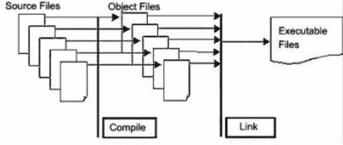

将机器语言转换为高级自然语言的编译器称为反汇编（decompiler）。产生用于系统中运行的对象代码的编译器称为交叉编译器（cross-compilers）。最后，将一种编程语言转换为另一种语言的编译器称为语言翻译器（language translator）。

编译器执行四个主要步骤：

- **扫描（Scanning）：** 扫描器从源代码中一次读取一个字符，并跟踪该字符出现在哪一行。
- **词法分析（Lexical Analysis）：** 编译器将源代码中出现的字符序列转换为一系列字符字符串（称为标记 tokens），这些标记由一个名为词法分析器的程序通过特定规则关联。词法分析器使用符号表（symbol table）来存储源代码中与生成的标记对应的单词。
- **句法分析（Syntactic Analysis）：** 在这一步中，进行句法分析，涉及预处理以确定词法分析期间创建的标记是否按照其用法处于正确顺序。一组可以产生预期结果的关键字正确顺序被称为语法（syntax）。编译器必须检查源代码以确保句法准确性。
- **语义分析（Semantic Analysis）：** 这一步由几个中间步骤组成。首先检查标记的结构，以及它们相对于给定语言语法的顺序。标记结构的含义由解析器和分析器解释，最终生成中间代码。

一个将机器语言转换为高级自然语言的编译器称为反汇编。产生旨在在系统上运行的对象代码的编译器称为交叉编译器。最后，将一种编程语言转换为另一种语言的编译器称为语言翻译器。

## 为什么不使用真正的机器语言而不是 Java 字节码？

Java 字节码比典型的高级编程语言要简单得多。对于一种新型计算机，编写一个 Java 字节码解释器比编写一个完整的 Java 编译器要容易得多。

## 编程环境搭建

当我们说“环境搭建”时，它仅仅意味着一个我们可以在上面进行编程的基础。因此，我们需要在 PC 上准备好所需的软件，即在我们的电脑上安装这些软件，用于编写计算机程序、编译并执行它们。例如，如果你需要浏览互联网，那么你需要在你的机器上进行以下设置：

- 一个可以连接互联网的有效连接
- 一个 Web 浏览器，如 Internet Explorer、Chrome、Safari 等

同样，为了开始使用任何编程语言进行编程，你还需要以下设置：

- 一个用于创建计算机程序的文本编辑器。
- 一个用于将程序编译成二进制格式的编译器。
- 一个用于直接执行程序的解释器。

我们建议你使用 IDE（集成开发环境），这是一个非常方便且出色的软件，它将文本编辑器、调试器和编译器合于一体，虽然软件包臃肿但通常非常实用。

除非你致力于在文本编辑器和命令行窗口中工作（而且这样做确实有充分的理由），否则你可能在寻找关于如何选择良好的 IDE 的建议、各种类型 IDE 的优缺点、运行特定 IDE 的相对成本（财务或系统资源）、该 IDE 可能能够良好处理的其他语言、它运行的操作系统，以及更多其他内容。

以下是程序员最常用的两种 IDE 列表。

### Eclipse

- **语言：** C, C++, Python, Perl, PHP, Java, Ruby 等
- **价格：** 免费

Eclipse 是一个免费且开源的编辑器，许多开发框架都基于它构建。它是该领域的老大哥之一，被许多专业开发者强烈推荐。Eclipse 起是一个 Java 开发环境，通过轻量级插件系统得到了极大扩展。

### NetBeans

- **语言：** Java, JavaScript, PHP, Python, Ruby, C, C++ 等
- **价格：** 免费

NetBeans 与 Eclipse 并肩，是该类别中最受推荐的 IDE。它是免费开源的，支持大量语言并不断推出新插件，而且对于初学者来说，安装和使用也非常简单。

## 编译与执行

一个简单的 Java 项目包含一个目录，所有的 Java 源文件都存储在其中。Java 文件通常不直接存储在源目录下，而是存储在与其包结构对应的子目录中。包仅仅是将相互相关的源文件分组的一种方式。

当你编译源目录中的所有源代码时，编译器会为每个 `.java` 文件生成一个 `.class` 文件。换句话说，`.class` 文件包含了 `.java` 文件的编译版本，即该 `.java` 文件的字节码。

Java 虚拟机（JVM）可以执行的是 `.class` 文件，而不是从 `.class` 文件中生成的 `.java` 文件。这通常通过指示编译器将 `.class` 文件写入单独的目录来实现。该目录通常被称为 `classes`，但再次强调，这不是强制要求的，它取决于你使用的构建工具或 IDE 等。

## 编译 Java 源码

你可以直接从 IDE 编译 Java 源码（如果你使用 IDE 的话）。或者，你可以使用 Java SDK 自带的 Java 编译器。从命令行使用 Java 编译器编译你的 Java 源码，请执行以下操作：

- 打开命令行
- 切换目录到你的项目根目录（而不是源目录）
- 确保项目根目录包含一个源目录和一个类目录
- 输入下面的命令（在 Windows 上 - 其他操作系统也类似）：

```
"c:\Program Files\Java\jdk1.8.0_25\bin\javac" src/myfirstapp/*.java -d classes
```

此命令执行了 `javac` 命令（Java 编译器），它编译了 `src/myfirstapp` 目录下的 Java 源码。`*.java` 编译器应该编译给定目录中的所有文件。

`myfirstapp` 目录是根源目录 `src` 下的一个包。如果你在根源目录下有多个包，你将必须多次运行 Java 编译器。Java IDE 会自动为你处理这一点。Ant、Maven 或 Gradle 等构建工具也是如此。

## 运行编译后的 Java 代码

一旦编译器完成工作，`classes` 目录将包含编译后的 `.class` 文件。源目录中的包结构（目录结构）将在类目录下被保留。你可以运行这些任何包含 `main()` 方法的 `.class` 文件。你可以在 Java IDE 内部运行 `.class`，也可以从命令行运行。从命令行运行看起来像这样：`'c:\Program Files\Java\jdk1.8.0_25\bin\java' -cp classes myfirstapp.MyFlaskApp`。其中 `-cp classes` 告诉 Java 虚拟机你所有的类都位于名为 `classes` 的目录下。这也被称为“类路径”（Class Path，缩写为 cp）。


要运行的类名是上述命令中的最后一个参数 —— `myfirstapp.MyFlaskApp` 部分。

JVM 需要知道全限定类名（所有包名加类名）来确定相应的 `.class` 文件所在。

当你运行该类时，你的命令行看起来如下所示（包括 Java 程序的输出）：

```
D:\data\projects\myfirstapp>"c:\Program Files\Java\jdk1.8.0_25\bin\java" -cp classes myfirstapp.MyFlaskApp
Hello World!
```

D:\data\projects\myfirstapp>

（注意，第一条命令不应该有换行符。我这样做只是为了方便阅读。）

就这些！现在你知道如何编译和执行你的程序了！如之前提到的，使用 IDE 可能会更容易，但你可能在任何地方都没有它。

# 第三章 | 基础术语

本节将涵盖许多基础术语以及编写代码背后的一些基本概念。当我们通过前几章后，我们将引入更多与读写直接相关的概念。在在此之前，我们需要涵盖一些适用于许多不同语言（而不只是 Java）的术语和概念。将单词转换为可执行代码的方法和系统需要相当严格的规则。写英语或在线聊天时，我们倾向于忽略格式和标点符号。简洁性允许更快的通信，但这仅仅是因为我们人类学会了许多新词，并可以利用上下文更好地解释在线或短信中英语形式的缩写和首略。计算机并没有那么聪明，能如此轻易地解释我们的单词。

## 标记 (Tokens)

在书面英语中，语言的最小元素是字母和数字。单独来说，大多数字母和数字缺乏特定的意义。字母之后更大的元素是单词。每个单词都有更多的意义，但复杂的思想很难用一个单词传达。为了交流一个思想，我们使用句子。句子中的每个单词都有特定的用途，如下图所示。为了传达一个概念，我们使用一组句子组成一个段落。为了表达情感，我们使用许多段落组织成章节。为了讲述故事，我们使用书籍，即章节的集合。

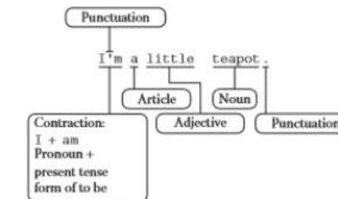

编程具有类似的组织机制。最小的有意义元素是标记（token），随后是语句、代码块、函数，然后是类和命名空间，最后是程序，在我们的案例中是游戏。我们将从最小的元素开始，逐步到编写我们自己的类。然而，在开始编写任何复杂代码之前，了解最微小的元素对于理解所有部分是如何结合的是非常重要的。

## 编写 Java：Java 是一种基于英语的编程语言；与任何类 C 编程语言一样，它可以被拆分为标记（tokens），即计算机可以理解的最小意义的文本片段。标记由单个字符或一系列字符组成。例如，在下面这个简单的语句中，有五个标记。

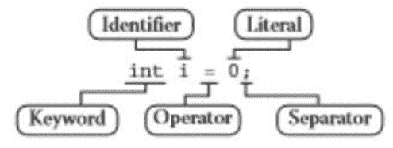

标记可以分为关键字、标识符、字面量、运算符、分隔符和空白符。上面的语句包含了五个标记，并通过空格提供了间距。关键字 `int` 后面紧跟着标识符 `i`。接着是一个运算符 `=`，它将运算符左侧的标识符赋值为右侧字面量 `0` 的值。最后一个标记 `;` 是一个分隔符，用于结束该语句。我们尚未涵盖的空白符和注释不被视为标记，尽管它们可以充当分隔符。使用适当的格式或风格是非常重要的。

让我们来看一下代码示例：

```
int i = 0;

int j = 1;
```

上面的代码是两个语句，`;` 分隔符防止计算机将代码误读为单个语句。然而，编写代码涉及人类的操作，因此代码需要让人类或任何其他可能阅读你代码的生命形式能够易读。恰当的代码意味着遵循特定的格式风格。我们将在本章晚些时候详细讨论恰当的代码风格。每组字符（或文本）都会由计算机中的词法分析器（有时称为 lexer）转换成一个符号。这个过程被称为标记化（tokenization），或者用计算机科学家的的话来说，分析器将你的代码标记为符号。一旦完成标记，符号就会被解析（parsed）；这个过程将标记组织成计算机遵循的指令。这种独特的词汇将程序员描绘了一群奇怪的外星生物，拥有完全自己的语言；但我向你，与大多数程序员聊天时，并不经常谈论分析器。这看起来似乎是一项巨大的工作，而且我们跳到了更复杂的计算机科学话题，但这一切都发生在后台，你不需要看到这些的发生。

理解编译器的作用以及它的工作原理是非常重要的，这样你就能以计算机可以理解的方式编写代码。这就是为什么一个简单的拼写错误会导致词法分析器停止构建代码。我们很快就会学习编写用于分析、标记和解析的代码。

计算机无法解释或猜测你正在尝试做什么。

因此，如果你误写了 `int i = 0:` 而不是 `int i = 0;`，最后一个标记无法被词法分析器转换为正确的符号，因此该语句将完全无法被解析。代码在编译之前就会导致错误。

## 分隔符标记

最常见的分隔符是 `;` 分号。这个标点符号用于结束一条代码语句。其他分隔符成对出现。大括号成对使用，用于分隔代码语句组。左大括号是 `{`，其尖端指向组的外部；它与关闭大括号的 `}` 配对。圆括号以 `(` 开始以 `)` 结束，而方括号以 `[` 开始以 `]` 结束。不同的起始和结束括号、方括号和圆括号有特定的用途，并用于帮助识别它们的用途。还有角括号 `<` 和 `>`；这些用于包围数据类型。不要忘记单引号 `'` 和双引号 `"` 也是成对使用的，用于包裹所谓的字符串（strings）。

注意：
在许多文字处理器中，通常使用起始引号和结束引号（“ 和 ”）。词法分析器不识别这些“智能引号”，因此编程文本编辑器使用直引号（`"`）来代替。一旦你意识到编程中使用的字母、数字和所有其他字符都被解析为美国标准信息交换代码（ASCII）或 Unicode 转换格式（UTF-8）、16 或 32，这些微妙的变化就不再微妙了。

ASCII 和 UTF 都是计算机用于读取文本时使用的字符数据库的名称。计算机不使用眼睛阅读。相反，它们使用数字数据库来查找使用的每个字符。因此，如果我们使用 UTF-16，`“` 看起来更像 `0x201C`，而 `"` 看起来像 `0x0022`。代码中的大括号用于分隔语句。圆括号通常用于接收数据。方括号 `[]` 经常用于标识数组。我们稍后会讨论数组，但在解释它们之前，你可以先想象成类似于电子表格或网格纸。

```
int[] arrayNumbers = {1, (int) 3.0, 9000};
```

上面的语句将三个数字赋值给数组。大括号包含一对用逗号分隔的语句。大括号中的第二个语句是将带有点（`.`）的数字转换为不带点的数字。这需要一些解释，但习惯看到这种东西是有好处的。我们很快就会什么是数组，以及点运算符。

通常，在学习编程时，你会看到很多奇怪的标记，它们看起来可能没有任何意义。这取决于你是否观察遇到的每一个标记并尝试理解它的作用。

如果没有任何语句是有意义的，那没关系。在这一点上，我们并不要求你现在就知道这一切意味着什么，但你很快就会了。

## 运算符标记

运算符类似于关键字，但只使用少数非单词字符。冒号分号 `:` 是一个运算符；与关键字不同，运算符会根据它们出现的位置或使用方式来改变其功能。这种行为转变被称为运算符重载（operator overloading），这是一个复杂的课题，我们稍后会涉及到。同样重要的是，要知道当你需要时可以可以创建自己的运算符。Java 中的逗号有不同的含义。它们用于分隔不同的值，例如：

```
for (int i = 0, j = 1; i++, j++)
```

## 其他运算符标记

泛而言运算符是处理变量之间特定操作的特殊字符。运算符和变量出现的表示或顺序通常通过以下数学语法：`a + b = c` 来教授。然而，在编程中，倾向于使用 `c = a + b;`；这种变化是因为 Java 中的 `=` 运算符工作方式与其数学课上通常教授的功能不同。`=` 运算符的左侧是赋值侧，右侧是操作侧。这重点放在被赋值的值上而不是如何赋值。结果比如何求解更重要。在编程中，上面的示例应该读作“给 c 赋值 a b”。

### 字面量

字面量有许多不同的形式；类似于像 `+`、`-` 或 `=` 的运算符是出现在它们之间的标记。数字被视为字面量，或者是以字面量方式使用的标记。数字可以称为数字字面量。当内容被放入引号中，例如 `"I'm a literal"`，你正在写一个字符串字面量。字面量遍布几乎所有的编程语言，并构成 Java 数据类型的基础。现在我们只处理几种不同的字面量，但我们很快就会了解到更多。

### 传递性与非传递性操作

在数学课上，有时会教某些操作在值中，而另一些不在。例如，`2 + 3 + 4` 和 `4 + 3 + 2` 得到相同的值。每个数字出现在运算符之间并不重要，所以 `+` 运算符被认为是具有传递性的。这一概念在 Java 中同样适用。当我们开始混合运算符时，结果会发生变化。

```
int a = 1 + 2 - 4 + 7; //a = 6

int b = 7 + 4 - 2 + 1; //b = 10
```

这段代码片段显示了使用相同运算符但数字位置不同的两个不同结果。我们稍后在游戏中使用它们时，将看到如何克服这些问题。运算符顺序是需要注意的，在我们构建计算时，测试每一步是非常重要的，以确保结果是我们我们预期的值。为了确保操作按照你预期的方式进行，你可以使用括号来包含操作数。

或者你也可以进行每次计算。稍后我们将通过再次查看运算符来深入探讨更多细节，但这必须等到我们对 Java 更多基础有更好的理解之后。

# 第 4 章 | Java 编程基础

## Java 程序的结构

Java 程序由不同的部分组成。其中某些是强制性的，而另一些是可选的。根据程序员的需求，可以从程序中排除可选部分。

### 文档部分 (Documentation Section)

它包含了说明程序目的的注释。它提高了程序的可读性。

### 包声明语句 (Package Statement)

它包含提供包声明的语句。

### 导入语句 (Import statements)

它包含用于引用其他包中定义的类和接口的语句。

### 接口部分 (Interface Section)

它与类相似，但仅包含常量和方法声明。

### 类部分 (Class Section)

它描述了程序中用户定义的类的信息。每个 Java 程序至少包含一个类定义。该类定义声明了 main 方法。程序实际上是从这里开始执行的。

#### 1. 文档部分 (DOCUMENTATION)

包含了提高程序可读性的注释。注释是一种非执行性语句，有助于阅读和理解程序，特别是当你的程序变得越来越复杂时。它仅仅是仅对程序员存在的信息，会被编译器忽略。一个良好的程序应该包含描述程序目的、作者姓名、程序创建日期和时间的注释。该部分是可选的，且注释可能出现在程序的任何地方。

Java 编程语言支持三种类型的注释。

**单行注释（或行尾注释）：** 它以双斜杠符号 (`//`) 开始，并在当前行结束处终止。编译器会忽略 `//` 到行尾的所有内容。

例如：

```
// 计算两个数字之和
```

**多行注释：** Java 程序员可以使用类似 C/C++ 风格的注释，该注释以定分隔符 `/*` 开始，以 `*/` 结束。分隔符之间的所有文本都会被编译器忽略。这种风格的注释可以用于行的一部分、整行，或者更常见地用于定义多行注释。

例如：

```java
/*计算两个数字之和 */
```

注释不能嵌套。换句话说，你不能注释一行已经包含传统注释的行。例如，`/* x = y /* * initial value */ + z; /*/` 是错误的。

**文档注释（Documentation comments）：** 这种注释风格是 Java 中的新特性。此类注释以分隔符 `/**` 开始，以 `*/` 结束。编译器也忽略这类注释，就像它忽略使用 `/*` 和 `*/` 的注释一样。这种注释的主要目的是自动生成程序文档。`javdoc` 工具读取这些注释并使用它们来准备 HTML 格式的程序文档。

例如：

```java
/**此处包含的文本将成为程序文档的一部分 */
```

#### 2. 包语句 (PACKAGE STATEMENT)

Java 允许你将类分组到一个名为“包”（package）的集合中。包语句包含一条提供包声明的语句。它必须作为源文件的第一条语句，出现在任何类或接口声明之前。该语句是可选的。例如：假设你在源文件的第一条语句中写了以下包声明。

```java
package employee;
```

该语句声明此源文件中定义的所有类和接口都是 `employee` 包的一部分。源文件中只能出现一个包声明。

#### 导入语句 (IMPORT STATEMENT)

Java 包含了许多存储在包中的预定义类。为了在你的程序中引用这些标准预定义类，你需要使用全限定名（即 `包名.类名`）。但这是一个非常繁琐的任务，因为需要重复输入包名以及类名。因此，更好的替代方案是使用导入语句。

导入语句用于引用在其他包中定义的类。导入语句写在包语句之后、任何类定义之前。你可以导入特定的类，也可以导入该包中的所有类。例如：如果你想使用导入语句导入 `java.util` 包中的 `Date` 类，请写下 `import java.util.Date;`。

该语句允许程序员在代码中使用简单的类名 `Date`，而不是全限定类名 `java.util.Date`。

与包语句不同，你可以在程序中指定多个导入语句。
例如：

```java
import java.util.Date; /* 仅导入 java.util 包中的 Date 类 */

import java.applet.*; // 导入 java.applet 包中的所有类 
```

#### 接口部分 (INTERFACE SECTION)

在接口部分，我们指定接口。接口与类相似，但只包含常量和方法声明。接口不能实例化。它们只能被类实现（implemented）或被其他接口扩展（extended）。这是一个可选部分，当我们希望程序中实现多继承特性时使用。

```java
interface stack
{
    void push(int item); // 将项目插入栈中
    int pop(); // 从栈中删除一个项目
}
```

#### 类部分 (CLASS SECTION)

类部分描述了程序中用户定义类的信息。类是字段（数据变量）和在字段上操作的方法的集合。Java 中的每个程序至少包含一个类，即包含 `main` 方法的类。`main()` 方法是程序实际开始执行的地方，并按照指定的顺序执行语句。

`main` 方法可以创建对象、求值表达式、调用其他方法等。当到达 `main` 的结束时，程序终止，控制交回操作系统。

类部分是强制性的。

在讨论了 Java 程序的结构之后，我们现在讨论一个在屏幕上显示字符串 "Hello Java" 的程序。

```java
// 一个在屏幕上显示信息的程序
class HelloWorld
{
    public static void main(String args[])
    {
        System.out.println("Hello Java");
    }
}
```

## main 方法 (The main Method)

Java 程序是按照特定顺序执行的指令序列。由于指令是按顺序执行的，因此程序有起点也有终点。

为了执行你的 Java 程序，你需要向虚拟机指示从哪里开始执行。在 Java 中，所有指令（代码）必须位于类内部。类是组合相关数据和指令的方法。因此，类可以可以包含变量和方法。变量可以包含数据，而方法则组合一组操作。

以下是之前在类声明中 main 方法定义的形式：

```java
package myjavaconde;
public class MyClass {
    public static void main(String[] args) {
    }
}
```

在方法的参数列表之后，首先是一个左大括号（ `{` ），然后是一些空格，最后是一个右大括号（ `}` ）。在大括号内部，你定义了执行 main 方法时要执行的 Java 指令。这被称为*方法体*（method body）。在上面的示例中，没有要执行的指令。该方法是空的。

让我们在 main 方法体中插入一条指令。以下是可能后的示例：

```java
package myjavacode;
public class MyClass {
    public static void main(String[] args) {
        System.out.println("Hello World, Java Program");
    }
}
```

现在，main 方法包含了这条唯一的 Java 指令：`System.out.println("Hello World, Java Program");`。这条指令会将文本 Hello World, Java Program 打印到*控制台*（console）。如果你从命令行运行 Java 程序，你将在命令行控制台（计算机的文本界面）中看到输出。如果你在 IDE 内部运行 Java 程序，IDE 通常会捕获所有到控制台的输出，并使其在 IDE 内部某处可见。

## 运行 main() 方法

当你启动 Java 程序时，通常是通过命令行（控制台）进行的。你调用随 JRE 附的 `java` 命令，告诉它要执行哪个 Java 类以及传递给 `main()` 方法的参数。Java 应用程序然后在 JVM 内部执行（或者有人声称是由 JVM 执行的）。这里有一张说明这一点的图：

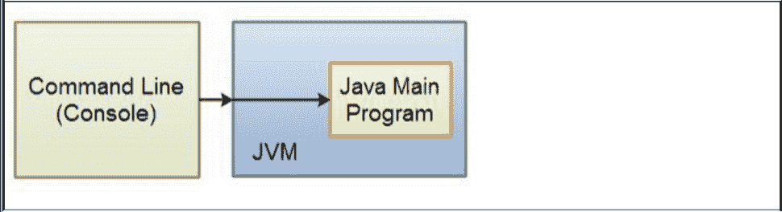

执行 `java` 命令的命令行，该命令转而执行 Java main 程序。

以下是一个命令行示例：

```
java -cp classes myjavacode.MyClass
```


该命令的第一部分是 `java` 命令。该命令启动了 JVM。在某些情况下，你可能需要指定 `java` 命令在计算机上所在的完整路径（通常在 Java 安装目录下的 `bin` 子目录）。

第二个和第三个参数（`-cp classes`）告诉 JVM 编译后的 Java 类位于哪个目录（`cp` 表示类路径，class path）。在这种情况下，编译后的 Java 类位于名为 `classes` 的目录中。

第四个参数是 JVM 要执行的 Java 类名。注意类名也包含了该类所在的包名（“完全限定类名”）。

## 向 main() 方法传递参数

你可以从命令行向 `main()` 方法传递参数。这行命令行展示了这一点：`java -cp classes myjavcode.MyClass Hello World`。当 JVM 执行 `myjavcode.MyClass` 的 `main()` 方法时，作为参数传递给 `main()` 方法的 String 数组将包含两个字符串："Hello" 和 "World"。

`main()` 方法可以如下访问来自命令行的参数：

```java
package myjavcode;

public class MyClass {

    public static void main(String[] args) {

        System.out.println(args[0]);

        System.out.println(args[1]);

    }

}
```

注意 `args` 数组中对元素 0 和元素 1 的引用（`args[0]` 和 `args[1]`）。`args[0]` 将包含字符串（文本）Hello，而 `args[1]` 将包含字符串 World。

变量和数组将在后的文中进行更详细的解释。如果你在此时还没有完全理解它们，不要担心。

## Java 主类

如果你的 Java 程序中只有一个 Java 类包含 `main()` 方法，那么包含 `main()` 方法的类通常被称为主类。

你可以在项目中拥有任意数量带有 `main()` 方法的类。但是，Java 虚拟机每次只能被指令运行其中一个。你仍然可以在 Java 虚拟机执行的 `main()` 方法内部调用其他的 `main()` 方法（你现在还没有看到如何操作），你也可以启动多个虚拟机，每个虚拟机执行单独的 `main()` 方法。

## 访问控制

所有优秀的写作者（包括编写软件的人）都知道，一件作品在被重写（通常是多次重写）之前是不完善的。如果你把一段代码放在抽屉里一段时间，然后回来查看，你可能会重新发现它。

改变的愿望与保持不变的需求之间存在张力。为了解决这个问题，Java 提供了访问修饰符，允许库创建者说明哪些是程序员可用的，哪些是不可用的。从“权限最大”到“权限最小”的访问级别分别是 `public`（公共）、`protected`（受保护）、`package access`（包访问，无关键字）和 `private`（私有）。从上一段你可能会认为，作为库的设计师，你希望尽可能地保持一切为“私有”，并只暴露你想让客户端使用的方法。事实恰恰是这样，尽管对于习惯了无限制访问一切的其他语言（如 C 语言）程序员来说，这是违反直觉的。

### 示例

让我们来看创建一个名为 `animals` 的包的示例。使用小字母作为包名是一个良好的习惯，可以避免与类和接口名称发生任何冲突。

跟随包 `example` 包含一个名为 `animals` 的接口——

```java
/* File name : Animal.java */

package animals;

interface Animal {

    public void eat();

    public void travel();

}
```

现在，让我们在同一个包 `animals` 中实现上述接口——

```java
package animals;

/* File name : MammalInt.java */

public class MammalInt implements Animal {

    public void eat() {
        System.out.println("Mammal eats");
    }

    public void travel() {
        System.out.println("Mammal travels");
    }

    public int noOfLegs() {
        return 0;
    }

    public static void main(String args[]) {
        MammalInt m = new MammalInt();
        m.eat();
        m.travel();
    }

}
```

现在按照如下所示编译 java 文件：

```
$ javac -d . Animal.java
$ javac -d . MammalInt.java
```

你可以在包内执行类文件并获得如下所示的结果。

```
Mammal eats
Mammal travels
```

## import 关键字

如果一个类想要使用同一个包中的另一个类，则不需要使用包名。同一个包中的类不需要任何特殊语法即可相互找到对方。

### 示例

在这里，一个名为 `Boss` 的类被添加到已经包含 `Employee` 的 `payroll` 包中。然后 `Boss` 就可以在不使用 `payroll` 前缀的情况下引用 `Employee` 类，如下文所示的 `Boss` 类所示。

```java
package payroll;

public class Boss {

    public void payEmployee(Employee e) {
        e.mailCheck();
    }

}
```

如果 `Employee` 类不在 `payroll` 包中会怎样？此时 `Boss` 类必须使用以下技术之一来引用不同包中的类。

- 可以使用类的完全限定名。例如——`payroll.Employee`
- 可以使用 `import` 关键字和通配符 (`*`) 导入包。例如——

```java
import payroll.*;
```

- 可以使用 `import` 关键字导入类本身。例如——

```java
import payroll.Employee;
```

**注意** – 一个类文件可以包含任意数量的 `import` 语句。`import` 语句必须出现在 `package` 语句之后，类声明之前。

## 访问修饰符

如名所示，Java 中的访问修饰符有助于限制类、构造函数、变量、方法或数据成员的范围。Java 中有四种访问修饰符：

1. Default（默认）– 无需关键字
2. Private（私有）
3. Protected（保护）
4. Public（公共）

- 对包可见，默认。不需要修饰符。
- 仅对类可见（`private`）。
- 对所有人可见（`public`）。
- 对包和所有子类可见（`protected`）。

## 默认访问修饰符 - 无关键字

默认访问修饰符意味着我们没有为类、字段、方法等显式声明访问修饰符。

在没有任何访问控制修饰符的情况下声明的变量或方法对同一个包中的任何其他类可用。接口中的字段隐含为 `public static final`，而方法默认为 `public`。

### 示例

变量和方法可以不带任何修饰符声明，如下例所示：

```java
String version = "1.5.1";

boolean processOrder() {
    return true;
}
```

## 私有访问修饰符 – Private

声明为 `private` 的方法、变量和构造函数只能在声明的类内部访问。

私有访问修饰符是最限制性的访问级别。类和接口不能是私有的。

如果类中存在 `public` getter 方法，则声明为 `private` 的变量可以在类外访问。

使用 `private` 修饰符是对象封装自身并向外部隐藏数据的手段。

### 示例

以下类使用了私有访问控制：

```java
public class Logger {

    private String format;

    public String getFormat() {
        return this.format;
    }

    public void setFormat(String format) {
        this.format = format;
    }

}
```

在这里，`Logger` 类的 `format` 变量是私有的，因此其他类没有办法直接检索或设置它的值。

因此，为了让这个变量对外部可用，我们定义了两个 `public` 方法：返回 `format` 值的 `getFormat()`，以及设置其值的 `setFormat(String)`。

## 公共访问修饰符 – Public

声明为 `public` 的类、方法、构造函数、接口等可以从任何其他类进行访问。因此，在 `public` 类内部声明的字段、方法、块可以从属于 Java 宇宙的任何类进行访问。

然而，如果我们尝试访问的 `public` 类在不同的包中，那么该 `public` 类仍然需要被导入。由于类的继承，类所有的 `public` 方法和变量都会被其子类继承。

### 示例

以下函数使用了 `public` 访问控制：

```java
public static void main(String[] arguments) {
    // ...
}
```

应用程序的 `main()` 方法必须是 `public`。否则，它无法被 Java 解释器（如 `java`）调用来运行该类。

## 保护访问修饰符 – Protected

声明为 `protected` 的变量、方法和构造函数只能由子类访问。

`protected` 访问修饰符不能接口。但方法和字段可以声明为 `protected`。

### 示例

以下父类使用了 `protected` 访问：

```java
class AudioPlayer {

    protected boolean openSpeaker(Speaker sp) {}

}

class StreamingAudioPlayer {

    boolean openSpeaker(Speaker sp) {}

}
```

在这里，如果我们把 `openSpeaker()` 定义为 `private`，那么除了 `AudioPlayer` 之外的任何类都无法访问。如果我们定义为 `public`，它将对所有人可见。但我们的意图是将其交给子类。

## 访问控制与继承

对于方法的继承遵循以下规则：

- 父类中声明为 `public` 的方法在子类中也必须是 `public`。
- 父类中声明为 `protected` 的方法在子类中必须是 `protected` 或 `public`。
- 声明为 `private` 的方法不会被继承，因此对它们没有规则。

# 第 5 章：变量、数据类型与关键字

## 变量

变量用于存储在程序中引用和处理的信息。它们还提供了一种通过描述性名称标记数据的方式，以便我们和阅读者能更好地理解程序。将变量理解为数据的容器是有帮助的。它们的唯一目的是标记和存储数据。这些数据随后可以在程序中使用。

变量的名字被称为标识符。

## 标识符

标识符被视为符号或标记，是你（程序员，在本例中是你自己）发明并为变量命名的单词。标识符可以是很简单的字母 `i`，也可以是复杂的 `@OhHAICmHasIdentifier01`。标识符是用于命名你创建的任何函数、变量或数据类型。当使用 `class` 关键字时，后面跟着另一个单词即标识符。

```java
class MyNewClassWriting {}
```

变量是通过声明创建的。声明被定义为正式的陈述或宣告。

程序员编写的每组单词被称为语句。在英语中，我们会使用 sentence（句子）一词，但程序员喜欢使用他们自己的词汇。变量的声明语句定义了变量的类型和标识符。

```java
public class Example {
    int i;
}
```

程序员使用分号（;）而不是句号（.）来结束语句。

因此，如果你想听起来像像个程序员，你可以说“我写了一条语句来声明一个类型为 int、标识符为 i 的变量。”或者如果你想表现得戏剧化一点，你可以宣布：“我宣告了一个类型为 int 且名为 i 的新变量！”事实也如此。

### 变量命名

重要的一点是，变量标识符和类标识符几乎可以是任何内容。在编程时，对任何内容的命名都有一些规则。这里是一些可以帮助的指南。长名称越容易出现拼写错误，因此请保持标识符简短。变量的命名规范应该考虑以下几点。

- 变量名应该指示它的用途，或者至少指示你打算对它做什么。这应该是显而易见的，但变量名不应具有误导性。或者说，如果你使用一个名为 `radius`（半径）的变量，你不应该把它被用作角色的速度。如果你能读出变量的名字也会很有帮助；否则当你尝试向另一个程序员解释你的代码时，可能会遇到问题。

```java
int someLong_complex_hardToRememberVariableName;
```

将名称尽可能简短但保持足够清晰是有优势的。你的电脑屏幕（以及大多数电脑）单行只能容纳有限的字符。你可以缩小字体，但当字母太小时，你就会遇到可读性问题。考虑以下函数，它需要多个变量才能工作。

```java
SomeCleverFunction(TopLeftCorner – SomeThickness + OffsetFromSomePosition, BottomRightCorner – SomeThickness + OffsetFromSomePosition);
```

上面的代码使用了长变量名。由于每个变量的长度，语句占据了多行，使得单条语句难以阅读。我们可以缩短变量名，但也很容易将其缩得太短。

```java
CleverFunc(TL–Thk+Ofst,LR–Thk+Ofst);
```

变量名应该是具有描述性的，这样你就能知道你打算用它们做什么：太短了它们可能会失去意义。

```java
int a;
```

虽然简短且容易记忆，但对于其他进来阅读你代码的人来说，知道你用变量 `a` 做什么是很困难的。在与其他程序员合作时，这变得尤为困难。变量命名并不是完全没有规则的。

```java
int 8;
```

变量名不能是数字。这是糟糕的；数字在编程中有特殊的地位，因为编程很大程度上对它们有其他用途。IDE 会尝试帮助你发现问题。在它发现的任何问题下都会出现红色的波浪线。说到带数字的变量名，你可以将数字作为变量名的一部分。

```java
int varNumber2;
```

上面的名称是完全有效的，并且是有用的，但相反，请考虑以下情况。

```java
int 13thInt;
```

变量名不能以任何数字开头。老实说，我不确定为什么这种情况会破坏编译器，但它似乎与为什么不能单独使用数字用作变量名有关。

```java
int $; int this-that; int (^);
```

大多数特殊字符也有其含义，并被留作其他用途。例如，在 JAVA 中，`-` 用于减法；在这种情况下，JAVA 可能认为你正试图从这个值中减去那个。你应该记住，关键字也是无效的变量名，因为它们对于 JAVA 已经有了特殊含义。

在 IDE（集成开发环境）中，你可能会注意到单词 `this` 被高亮了，这表示它是一个关键字。变量中间的空格也是无效的。

```java
int Spaces are bad;
```

很可能，添加不是字母的字符会破坏编译器。只有下划线和字母可以用于标识符名称。使用表情符号作为变量可能很有趣，但与代码的其他部分放在一起会非常难以阅读。

```java
int ADifferenceInCase; int differencecase;
```

这里的两个变量实际上是不同的。像 java 这样区分大小写的语言确实会注意字符的大小写；这在通过名称调用其他事物时也是如此。考虑到这一点：`A` 与 `a` 是不同的。

作为一个程序员，你需要考虑变量应该命名为什么什么。它对你以及任何与你分享工作的人来说必须是清晰的。你还会多次输入你的变量名，所以它们应该是简短、易记忆且易插入。我们在这里讨论的最后一个字符是那个奇怪的小符号 `@` 或 at。只有当 `@` 是变量名中的第一个字符时，才能使用 `@`。

```java
int @home;
int noone@home;
```

实例变量是声明在类内部但在任何方法、构造函数或块之外的变量。实例变量也是对象的变量，通常称为字段或属性。每个对象都有每个变量的副本，因此如果一个对象更改了变量的值，也不会影响实例变量。实例变量持有必须被多个方法、构造函数或块引用的值，或者对象状态在整个类中必须存在的关键部分。

```java
class Student {
    String name;
    int age;
}
```

这里 `name` 和 `age` 是 `Student` 类的实例变量。

## 2) 静态变量

静态变量是使用 `static` 关键字声明的类变量。静态变量只初始化一次。静态变量还与 `final` 关键字一起用于声明常量。

```java
class Student {
    String name;
    int age;
    static int instituteCode = 1101;
}
```


`instituteCode` 是一个静态变量。`Student` 类的每个对象将共享 `instituteCode` 属性。

### 关于静态变量的补充：

- 静态变量也被称为类变量。
- `static` 表示保持不变。
- 在 Java 中，这意味着它对于该类创建的所有实例来说都是恒不变的。
- 静态变量不需要通过对象调用。
- 通过 `类名.静态变量名` 调用。

注意：静态变量永远不能定义在方法内部，即它永远**不能**是局部变量。

### 示例：

假设你为 `Student` 类创建了 2 个对象，并从一个对象更改了静态变量的值。现在当你从另一个对象打印它时，它将显示更改后的值。这是因为它被声明为 `static`，也就是说它对于创建的每个对象都是共享的。

```java
class Student {
    int a;
    static int id = 35;

    void change() {
        System.out.println(id);
    }
}

public class StudyTonight {
    public static void main(String[] args) {
        Student o1 = new Student();
        Student o2 = new Student();
        o1.change();
        Student.id = 1;
        o2.change();
    }
}
```

### 输出：

```
35
1
```

## 3) 局部变量

局部变量声明在方法、构造函数或块中。局部变量在方法、构造函数或块开始时初始化，并在结束后销毁。局部变量位于栈（stack）中。局部变量不使用访问修饰符。

```java
float getDiscount(int price) {
    float discount;
    discount = price * (20 / 100);
    return discount;
}
```

这里 `discount` 是局部变量。

### 关于局部变量的补充：

- 局部变量在方法、构造函数或块中声明。
- 局部变量在进入方法、构造函数或块时创建，变量在退出方法、构造函数或块后将被销毁。
- 局部变量不能使用访问修饰符。
- 局部变量仅在声明的方法、构造函数或块内可见。
- 局部变量在栈级别实现。
- 局部变量没有默认值，因此在使用之前应该对局部变量进行声明并分配初始值。

### 示例：

```java
public class Test {
    public void age() {
        int age = 0;
        age = age + 7;
        System.out.println("age is: " + age);
    }

    public static void main(String[] args) {
        Test test = new Test();
        test.age();
    }
}
```

在这里，`age` 是定义在 `age()` 方法内部的局部变量，其作用范围局限于该方法。这将产生以下结果：

输出：
```
age is: 7
```

## 数据类型

数据类型表示存储在变量中的不同值。在 Java 中，有两种类型：

- 原始数据类型（Primitive data types）
- 非原始数据类型（Non-primitive data types）


| 数据类型 | 默认值 | 大小 |
| :--- | :--- | :--- |
| boolean | false | 1 bit |
| char | '\u0000' | 2 byte |
| byte | 0 | 1 byte |
| short | 0 | 2 byte |
| int | 0 | 4 byte |
| long | 0L | 8 byte |
| float | 0.0f | 4 byte |
| double | 0.0d | 8 byte |

## 为什么 char 在 Java 中使用 2 个字节？

这是因为 Java 使用的是 Unicode 系统而不是 ASCII 系统。要了解详细解释请访问下一页。

## 类型

当我们给变量赋值时（例如 `int i = 1;`），我们正在进行一种有趣的假设。计算机使用各种不同类型的数据来存储数字。到目前为止，我们一直在看到 `int` 这个词，尽管我们知道 `int` 是什么。

由于人类可以很容易将数字概念化为测量单位，因此对于计算机来说，单词“一”和“零”之间的转换并不容易。`int` 关键字是 `integer`（整数）的缩写。整数是整数值。这是 Java 的基础部分。其他内置类型包括 `float`、`double`、`string` 和 `object`。不常用的内置类型有 `char`、`short` 和 `byte`。总共有八种不同的内置类型。

除了 `object` 和 `string` 之外，所有这些都是值类型。你能够构建的任何类型都必须基于这些内置类型。创建所有这些 `float`、`double` 和 `bool` 的系统植根于计算的起源。还记得打孔带和带孔的纸片吗？那些是 1 和 0 的记录，被输入到计算机中以机械开关（开或关）的形式存储。这些模式代表了数字或逻辑。

今天，我们仍然使用相同的 1 和 0 系统（即二进制），只是我们不需要在纸上打孔来告诉计算机要做什么。创建和存储指令的方法已经变得了许多倍，但 1 和 0 的原理是相同的。这些被称为位（bits）；该名称的一个可能来源是打孔时留下的小纸片。

## 值类型和引用类型：

`int`、`float`、`double` 和 `bool` 是常用的值类型。这种用法与存储和组织计算机内存的系统有关。

## 注意：

`mega` 词指的是计算机组件可以存储的百万字节。你考虑过字节（byte）到底是什么吗？字节被称为 8 位无符号整数，或者说是使用 8 位组成一个数字的系统。这意味着它不能是负数，例如 -5。计算机术语中的一个或零被称为位（bit）。我们不会详细介绍计算机如何使用位来计数，这是一个非常有趣的点，你可以自己学习。

然而，重要的是字节的范围有限，从 0 到 255。我只是让你记住这样一个想法：如果你使用二进制而不是十进制，你可以用十根手指数到 1023。你的手指可以表示一个 10 位无符号整数。计算机的计算能力曾经比现在局限得多。20世纪80 年代制造的一台 8 位游戏机颜色有限，准确来说是 256 种。这种限制基于处理器能够处理的比特数。不久后，浮点处理器被引入，它们允许的数值范围大得多，接近 32 位。

`string` 和 `object` 类型在存储方式上略有不同。这些类型是许多较小元素的复合。这些类型被称为引用类型（reference types），或者有时称为可空类型（nullable types），因为 Java 并不是查看内存中的单个元素来获取数据。

## 强类型

这与你在键盘上打字快慢没有关系！
Java 能够识别数字在书写方式上的差异。像 1 这样的整数与 1.0 是不同的，尽管我们可以认为它们具有相同的值。这些差异中的某些可以通过添加一个字母来区分。
因此，1.0 和 1.0f 实际上也是不同的数字。Java 是一种强类型编程语言。当一种编程语言使用强类型时，你被要求保持不同类型分开。

这意味着 `1 + 1.0f` 可能会产生问题。因为这两个数字实际上是不同类型的数字，在允许操作发生之前，我们必须将其中一个转换为另一个以匹配它。要从一种类型转换为另一种类型，我们必须告诉 Java 我们打算使用所谓的“强制转换运算符（cast operator）”来完成从 1 到 1.0 的转换。除了改变内存的使用方式外，类型还限制了在程序员团队工作时可能出现的任何问题。

## 理解浮点数

多年来，浮点数一直是计算机关注的焦点。获得浮点精度是许多早期计算机科学家的目标。由于小数点后可以跟随无限种可能的数字，因此使用二进制计算是不可能完全表示任何分数的。

一个常见的例子是 $\pi$，我们称其为 pi。假设 3.14 之后有无限数量的数字。即使在今天，计算机也被用来计算小数点后的数以百亿位数字。

计算机预留了浮点数的某些比特位来表示小数点在数字中的位置，但即使这样也是受限的。第一位通常是符号位，设置数字的负范围或正范围。随其后的 8 位是该数字的指数，称为尾数（mantissa）。`float` 值可以将小数点向任一方向移动 38 位，但它受限于其能够存储的值。

在没有特殊考虑的情况下，计算机无法处理任意大的数字。要将 `float` 强制转换为 `int`，你需要更加显式化。

这就是为什么 Java 要求你使用强制转换，你需要在 `int Z = (int) Zmove;` 中添加 `(int)`。

`(int)` 是一个强制转换运算符；或者说 `(type)` 充当从右侧类型到左侧所需类型的转换器。

## 关键字

关键字是特殊的单词或符号，用于告诉编译器执行特定的任务。例如，行首的关键字 `class` 告诉编译器你正在创建一个类。类声明是告诉编译器你即将创建一个新类的代码行。单词出现的顺序很重要。英语需要句子和语法来向读者正确传达我们的思想。

在代码中，无论是 Java 还是其他，编程都需要语句和语法来向计算机正确传递指令。

```java
class className {
    // code goes here
}
```


每个类都需要一个名字；在上面的示例中，我们将类命名为 `className`，尽管我们可以很容易地将其命名为 `Charles`。当命名新类时，该名称就变成一个新的标识符。这对于每个变量名也是如此，尽管作用域限制了变量标识符的存在时长和位置。

我们学习了变量和作用域。

你不能将关键字用于 Java 预期用途之外任何地方。虽然有例外，但通常，关键字为你提供了特定的命令。

在 Java 编程语言中，关键字是 53 个保留字之一，它们在语言中具有预定义的含义；由于它们在语言中的特殊功能，大多数 Java 集成开发环境都使用语法高亮，用不同的颜色显示关键字，以便于识别。

### 关键字列表

- **abstract**：`abstract` 用于在 Java 中实现抽象。没有方法定义的方法必须声明为 `abstract`。
- **assert**（added in JavaSE 1.4）：断言描述断言始终为真；如果断言失败，通常会导致中止执行。
- **boolean**：布尔值用于定义“真”或“假”。
- **break**：用于结束执行。
- **byte**：`byte` 关键字用于声明可以持有 8 位符号补码整数。
- **case**：`switch` 语句中的标签，执行匹配的语句。
- **catch**：与 `try` 块结合使用，指定当抛出特定异常时要执行的操作。
- **char**：定义可以持有任何字符的变量。
- **class**：定义实例字段、方法和内部类。
- **continue**：用于从循环结束恢复执行。
- **default**：`default` 关键字可选地用于 `switch` 语句，在没有匹配项时执行的语句块；从 Java 8 开始，`default` 关键字还用于指定接口中的默认实现。
- **do**：`do` 关键字与 `while` 结合使用创建 `do-while` 循环，先执行语句块然后测试布尔表达式。
- **double**：`double` 关键字用于声明可以持有 64 位双精度 IEEE 754 浮点数。
- **else**：`else` 关键字与 `if` 结合使用创建 `if-else` 语句。
- **enum**（added in JavaSE 5.0）：用于声明枚举类型的关键字。
- **extends**：用于声明以指定父类；用于接口声明以指定一个或多个父接口。
- **final**：定义不可更改或不可派生的实体。具体来说：`final` 类不能被子类化，`final` 方法不能被重写，`final` 变量在执行命令的左侧表达式中最多出现一次。
- **finally**：用于定义之前由 `try` 关键字定义的块的语句块。
- **float**：`float` 关键字用于声明一个可以存储 32 位单精度 IEEE 754 浮点数的变量。该关键字也用于声明一个方法返回原始类型 `float` 的值。
- **for**：`for` 关键字用于创建 `for` 循环，它指定了变量初始化、布尔表达式和递增。首先执行变量初始化，然后评估布尔表达式。如果表达式评估的结果为 `true`，则再次执行与循环相关的语句块；此过程一直持续，直到表达式的结果为 `false` 为止。从 J2SE 5.0 开始，`for` 关键字还可以用于创建所谓的“增强型 for 循环”，它指定一个数组或 `Iterable` 对象；循环的每次迭代都会使用数组或 `Iterable` 中不同的元素来执行相关的语句块。
- **if**：`if` 关键字用于创建 `if` 语句，该语句测试一个布尔表达式；如果表达式的结果为 `true`，则执行与 `if` 语句相关的语句块。该关键字也可用于创建 `else` 语句；参见 `else`。
- **implements**：包含在类声明中，用于指定当前类实现的一个或多个接口。类继承接口中声明的类型和抽象方法。
- **import**：用于源文件的开头，用于指定稍后引用的类或整个 Java 包，而无需在引用时包含它们的包名。从 J2SE 5.0 开始，`import` 语句可以导入类的静态成员。
- **instanceof**：这是一个二元运算符，它接受一个对象引用作为第一个操作数，接受一个类或接口作为第二个操作数，并产生一个布尔结果。当且仅当对象的运行时类型与类或接口兼容时，`instanceof` 运算符评估为 `true`。
- **int**：`int` 关键字用于声明一个可以存储 32 位带符号补码整数的变量。该关键字也用于声明一个方法返回原始类型 `int` 的值。
- **interface**：用于声明一种特殊的类，该类只包含抽象方法或默认方法、常量（`static final`）字段和静态接口。它之后可以被使用 `implements` 关键字声明接口的类所实现。
- **long**：`long` 关键字用于声明一个可以存储 64 位带符号补码整数的变量。该关键字也用于声明一个方法返回原始类型 `long` 的值。
- **native**：用于方法声明，指定该方法没有在同一个 Java 源文件中实现，而是在另一种语言中实现。
- **new**：用于创建类或数组对象的实例。虽然为了此目的使用该关键字并非完全必要（如 Scala 所示），但它起两个作用：它允许方法和类名存在不同的命名空间；它在静态和局部上定义了确实创建了一个新对象，以及该对象的运行时类型（这被认为为代码引入了依赖关系）。
- **package**：一组类型。包通过 `package` 关键字声明。
- **private**：`private` 关键字用于方法、字段或内部类的声明；私有成员只能由其所属类的成员访问。
- **protected**：`protected` 关键字用于方法、字段或内部类的声明；受保护成员只能由同类成员、该类的子类或同一包中的类访问。
- **public**：`public` 关键字用于类、方法或字段的声明；公共类、方法和字段可以被任何类的成员访问。
- **return**：用于结束方法的执行。后面可以跟随方法定义所需的值，该值将返回给调用者。
- **short**：`short` 关键字用于声明一个可以存储 16 位带符号补码整数的字段。该关键字也用于声明一个方法返回原始类型 `short` 的值。
- **static**：用于将字段、方法或内部类声明为类字段。无论该类存在多少个实例，类都维护一份类字段的副本。`static` 也用于将方法定义为类方法。类方法绑定到类而不是特定的实例，并且只能操作类字段。（被声明为另一个类或接口的静态成员的类和接口实际上是顶层类，而不是内部类。）
- **strictfp**（在 J2SE 1.2 中添加）：一种 Java 关键字，用于限制浮点数计算的精度和舍入，以确保可移植性。
- **super**：用于访问当前类所继承的类的成员。它允许子类访问其父类被重写的方法和隐藏的成员。`super` 关键字还用于将从构造函数的调用转发到父类中的构造函数。还用于指定泛型中类型参数的下界。
- **switch**：`switch` 关键字与 `case` 和 `default` 配合创建 `switch` 语句，该语句评估一个变量，将其值与特定的 `case` 匹配，并执行与该 `case` 语句块。如果没有 `case` 匹配该值，则执行由 `default` 标记的可选块（如果有）。
- **synchronized**：用于方法或代码块的声明，在当前线程执行代码时获取对象的互斥锁。对于静态方法，锁定的对象是该类的 `Class`。保证同一时间对同一对象进行操作的最多线程执行该代码。当执行退出 `synchronized` 代码块时，会自动释放互斥锁。字段、类和接口不能声明为 `synchronized`。
- **this**：用于表示其所属类的实例。`this` 可用于访问类成员，并作为当前实例的引用。`this` 关键字还用于将同一类中一个构造函数的调用转发到另一个构造函数。
- **throw**：抛出声明的异常实例。这导致执行继续由 `catch` 声明的第一个异常处理器来处理赋值兼容的异常类型。如果在当前方法中没有找到此类处理器，则方法返回并在调用方法中重复该过程。如果在栈上的任何方法调用中都没有找到异常处理器，则异常传递给线程的未处理异常处理器。
- **throws**：用于方法声明，指定哪些异常未在方法内部处理而是传递给上层。方法中所有不是 `RuntimeException` 实例的未处理异常必须使用 `throws` 关键字声明。
- **transient**：声明实例字段不是对象序列化部分。当对象被序列化时，只有非 `transient` 实例字段的值包含在默认表示中。当对象被反序列化时，`transient` 字段仅初始化为默认值。如果没有使用默认形式（例如当类层次中声明了 `serialPersistentField` 时），所有的 `transient` 关键字都会被忽略。
- **try**：定义了一个异常处理语句块。如果在 `try` 块内部抛出异常，可选的 `catch` 块可以处理声明的异常。还可以声明一个 `finally` 块，无论是否抛出异常，退出 `try` 块和 `catch` 子句时执行。`try` 块必须至少有一个 `catch` 子句或一个 `finally` 块。
- **void**：`void` 关键字用于声明方法不返回任何值。
- **volatile**：用于字段声明，指定该变量由并发运行的线程异步修改。因此，方法、类和接口不能声明为 `volatile`，局部变量或参数也不行。
- **while**：关键字用于创建 `while` 循环，它测试一个布尔表达式，如果表达式的结果为 `true`，则执行与循环相关的语句块；此过程一直持续，直到表达式的结果为 `false` 为止。该关键字也可用于创建 `do-while` 循环。

### 字面量值的保留字

- **true**：一个布尔字面量值。
- **null**：一个引用字面量值。
- **false**：一个布尔字面量值。

## Return 关键字

我们需要爱 `return` 关键字。这个关键字将函数转换为数据。在它起作用之前，需要满足一些条件。到目前为止，我们一直使用 `void` 关键字来声明函数的返回类型。它看起来像下面的代码片段。

```java
void MyFunction() {
  //code here...
}
```

在这种情况下，使用 `return` 会非常简单。

```java
void MyFunction() {
  //code here ... return;
}
```

这个函数返回 `void`。这句语句具有更深层次的含义。当实际返回一个真实值（某些 `void` 以外的东西）时，返回值更有意义。让我们来看一个更有意义的函数。函数声明开头的 `void` 关键字意味着该函数没有返回类型。如果我们更改了声明，我们需要确保有一个与声明匹配的返回值。这可以像下面的代码片段一样简单。

```java
int MyFunction() {
  //code here...
  return 1;
  //1 是一个 int
}
```

这个函数返回 `int` 1。声明一个带有返回值的函数要求返回类型与声明匹配。当使用该函数时，它应该被视为与函数返回类型匹配的数据类型。

## 错误是坏的吗？

不要害怕犯错。你编写的代码不会破坏 IDE 或你的电脑。至少从这本书中学到的任何东西都无法让你做到这一点。事实上，产生错误通常是好事。错误告诉我们我们可以做什么，不能做什么。程序员经常问问自己：“编译器会允许我这样做吗？”，这可能会产生一个错误。如果没有，程序员就会继续他的思考：“呵，我想是可以的，所以这意味着我可以……”

创建和修复错误告诉我们编译器对我们的期望。这某种程度上是程序员与计算机之间的一种对话。

例如，程序员以代码语句的形式提问，而计算机对于程序员提出的它无法完成的任务，则以错误向程序员进行回复。

## 编译时错误和运行时错误

在编译时，当代码不符合《Java 语言规范》(JLS) 中描述的 Java 语法和语义规则时，就会发生编译时错误。编译的目标是确保代码符合这些规则。在此阶段检测到的任何违反规则的行为都会被报告为编译错误。

了解这些规则的最佳方法是阅读 JLS 中所有包含“编译时错误”（compile-time error）关键字的章节。通常，这些规则包括语法检查：声明、表达式、词法解析、文件命名规范等；异常处理：针对受检异常；可访问性、类型兼容性、名称解析：检查所有具名类、方法调用等是否可以通过至少一个声明的路径触及；实体 - 变量。

以下是一些常见的编译时错误：

- 类尝试继承多个一个类
- 重载或重写未正确实现
- 尝试引用不在当前块范围内的变量
- 内部类与它的任意一个外部类同名
- 类包含一个或多个抽象方法，且该类本身未声明为“abstract”（抽象）
- 类尝试引用另一个类的私有成员
- 尝试创建抽象类的实例
- 尝试更改已初始化的常量（`final` 成员）的值
- 声明两个同名的（类成员或实例成员）

当代码在没有任何错误的情况下编译时，代码仍可能在运行时失败。

只在运行时发生的错误被称为运行时错误。运行时错误是那些通过了编译器检查但在代码执行时失败的错误。有很多原因可能导致运行时错误，例如不兼容的类型转换、引用数组中的无效索引、使用空对象、资源问题（如不可用的文件句柄）、内存溢出、线程死锁、无限循环（未检测到！）等。

以下是一些常见的运行时错误：

- 尝试对未初始化变量调用方法（`NullPointerException`）
- 内存不足（内存泄漏……）（`OutOfMemoryError`）
- 尝试打开不存在的文件（`FileNotFoundException`）
- 尝试向方法传递不在接受范围内的参数（`IllegalArgumentException`）
- 尝试对已死的线程调用 `start()` 方法（`IllegalThreadStateException`）

# 第 6 章 | 函数与操作符

## 什么是函数？

函数（有时被称为方法）包含可以处理数据的语句。这些语句可以处理数据，也可以不处理。方法可以被其他语句访问。这种行为被称为调用函数或进行函数调用。

函数在不同的编程语言中看起来可能不同，但它们的工作方式大部分是相同的。通常的模式接收数据并使用逻辑来处理这些数据。函数也可以被称为其他名称，例如方法。主要区别在于语言使用语法的方式不同。语法基本上是空格或制表符、操作符或关键字的使用。

根结底，你所做的只是告诉编译器如何将你的指令转换为计算机解释的命令。变量和函数构成了编程的大部分。你想要记忆的任何数据都存储在变量中。变量由你的函数处理。通常，当你将变量和函数分组时：

```java
public void PrintNum() {
    System.out.println(anotherNum);
}
```

在编写函数时，在继续之前填写完整内容是一个良好的习惯。这会让编译器感到轻松。在这种情况下，集成开发环境（例如 MonoDevelop）会不断读取并解释你正在编写的内容。当它遇到没有结论性形式的语句时，例如变量、函数或类定义，它对你编写内容的解释将引发警告或错误。MonoDevelop 看起来有点挑剔，但它正在尽力提供帮助。

## 编写函数

函数由声明和体组成。有些程序员喜欢称这些为方法，但抛开语义不谈，函数基本上是语句集合的容器。

继续之前的示例：

```java
void MyFunction() {
}
```

这是一个名为 `MyFunction` 的基本函数。我们可以添加额外的关键字来修改函数的可见性。我们将看到的一个常见修饰符是 `public`。

```java
public void MyFunction() {
}
```

`public` 关键字需要出现在函数的返回类型之前。在这种情况下，它是 `void`，这意味着函数不返回任何内容。但函数可以通过几种不同的方式作为值存在。作为参考，一个返回 `int` 的函数看起来如下。在具有返回类型的函数中，必须存在某种形式的返回语句。

```java
public int MyFunction() {
    return 1;
}
```

`public` 修饰符并不是总是必要的，除非你需要让此函数对其他类可用。如果这一点还不理解，你很快就会理解的。函数的最后一个始终要求的部分是参数列表。留空是有效的，但为了让你对参数（`arg`，即参数列表中的参数）的样子有一个感觉，请看下一个示例。

```java
public void MyFunction(int i) {
}
```

目前，我们将推迟使用参数列表，但了解你之后将看到的内容是很重要的，这样它就不会让你意外。参数列表用于将信息从函数外部传递到函数内部。这就是类能够在类与类之间传递信息的方式。

函数声明与类声明相似。函数是处理逻辑的核心所在。


目前，我们暂不使用参数列表，但以后了解你之后会看到什么是很重要的，以免之后感到意外。参数列表用于将信息从函数外部传递到函数内部。这就是类之间能够发送信息的方式。函数声明与类声明相似。函数是处理变量逻辑的核心所在。

```csharp
public int MyFunction ()
{
    return 1;
}
```

`public` 修饰符并不总是必须的，除非你需要让这个函数对其他类可见。如果这一点现在听起来没意义，你很快就会理解了。函数始终需要的最后一部分是参数列表。保持其为空是有效的，但为了感受参数列表中的 `arg`（或 `argument`）看起来什么样，请看下一个示例。

```csharp
public void MyFunction (int i)
{
}
```

目前，我们暂不使用参数列表，但以后了解你之后会看到什么是很重要的，以免之后感到意外。参数列表用于将信息从函数外部传递到函数内部。这就是类之间能够发送信息的方式。函数声明与类声明相似。函数是处理变量逻辑的核心所在。

## 函数作用域 (Function Scope)

变量的寿命通常很短暂。某些变量只存在于几行代码中。变量可能在函数开始时产生，并在函数结束时消失。类中的变量只要类存在就会一直存在。变量的寿命取决于它创建的位置。

### 示例

```csharp
public class Class {
    int first;
    void first() {
        int second;
    }
    void second() {
        int first;
    }
}
```

如果我们看上面的图，可以可视化看到作用域是如何划分的。外层框代表谁可以看到 `first`。在 `first()` 函数内部，我们有 `second`，它只在那里存在。`second` 也是如此；同样，`second()` 可以看到 `first` 但看不到 `second`。

## 参数列表 (Parameter Lists)

当函数被调用时，其标识符后接参数列表会被添加到代码中。参数就像房子前面的小插槽。每个槽位用于整数、浮点数和数组。门上的每个槽位都是一个类型后跟一个标识符。如果我们看一个基础示例，就能看到它是如何工作的。

```csharp
public class Example {
    int a = 0;
    void setA(int i) {
        a = i;
    }
}
```

`setA(int i)` 接收一个 `int` 类型的参数。这是一个简单的示例；还有其他类型的参数，我们将在接下来详细介绍。值参数声明了类型，其作用域局限于函数的内容。当你运行上面的程序并给函数 `setA(3)` 传入 `3` 时，你会看到 `a = 3`。我们可以这样做很多次，而且每次都允许更改对 `a` 的赋值。当然，在类中直接使用 `a = 3` 更容易，但那样我们就学不到任何东西了。

## 副作用 (Side Effects)

当函数直接设置其所属类中的变量时，程序员喜欢称其为“副作用”。副作用通常是程序员试图避免的，但并不总是切的。编写带有副作用的函数往往会防止该函数在其他类中变得有用。我们将找到允许我们避免使用副作用的方法，但在某些情况下，它是必要的。

```java
class MySideEffect {
    int a = 0;
    void setA() {
        a = 5;
    }
}
```

上面的 `setA()` 函数将 `a` 设置为 5。`setA()` 函数确实有一个明确的目的，但函数内部没有任何地方可以指示它所设置的变量位于何处。如果变量位于 `MySideEffect` 继承的另一个类中，那么你甚至在这个类中看不到该变量。一旦类的复杂性增加，变量在何以及何时被更改或读取就会变得模糊。如果一个函数保持自给自足，测试和修复该函数将变得简单得多。

阅读一个函数的功能不应该跳来跳去去寻找它正在修改哪个变量。这让我们回到了作用域的话题。限制函数的作用域或范围有助于限制可能出错的地方的数量。

```java
class MySideEffect {
    int a = 0;
    void SetA () {
        a = 5;
    }
    void SetAgain () {
        a = 10;
    }
}
```

具有副作用的函数越多，就可能出现越奇怪的行为。如果 `Main()` 函数期望一个值但得到了完全不同的东西，你就会开始遇到意想不到的行为。更糟糕的是，如果从另一个类调用 `SetAgain()` 而你又期望 `a` 是 5，你将会遇到更多奇怪的行为。

### 多个参数 (Multiple Arguments)

函数接受的参数数量没有限制。某些语言限制你最多使用 16 个参数，这似乎是可以接受的。如果你的逻辑需要超过 16 个参数，将你的函数拆分为不同的部分可能会更容易。然而，即使我们要做的某些简单的事情，可能也想使用多一个参数。

```java
int a = 0;
void SetA(int i, int j) {
    a = i * j;
}
```

我们可以为 `SetA` 添加第二个参数。逗号标记告诉函数在参数列表中接受另一个变量。对于这个示例，我们使用整数进行相互相乘并将值赋值给 `a`。没有任何东西限制我们可以在参数列表中使用的类型。

```java
int a = 0;
float b = 0;
void SetA(int i, float j) {
    a = i;
    b = j;
}
```

具有多个参数的函数可以做更多事情。值参数是将数据输入函数以完成某些简单任务的有用方法。

在上面的示例中，我们可以清楚地看到 `int j` 被设置了两次。不明显的是它为什么被声明了两次。所有的行都从相同的位置开始，看起来很拥挤。编程工具提供了许多文本布局选项，因此使用空白字符来分隔不同的代码块。

```java
int i = 7;
int j = 13;
if (i < 13)
{
    int j = 7;
}
```

通过添加一些空白，我们可以让 `if` 语句更加可见。在代码块周围添加空白对于保持可读性至关重要。还有一些代码块可以存在于另一个代码块内部。通常情况下，它们都属于同一个代码块。块内部的块被称为嵌套代码块。使用空白是为了将嵌套代码与它所在的块隔开来。

```java
if(true)
{
    //all of the code
    //im also a part of the code
    if(true)
    {
        //im another block of code
    }
}
```

```java
//living inside of a bigger
//block of code
}
//yep more code here too
```

第二个 `if` 语句后面的代码块被认为嵌套在第一个代码块内部。这是由于第一个左大括号 `{` 和相关的右大括号 `}` 的放置位置决定的。你通过将不同的大括号嵌套在一起来形成层次结构。

```java
if(true)
{
    //all of the code
    //im also a part of the code
    if(true)
    {
        //im another block of code
        //living inside of another
        //block of code
    }
    //yep more code here too
}
```

缩进不当的大括号会导致代码混淆；上面的代码仍然有效，但与之前的版本相比，它的可读性较差。

大多数代码编辑工具都会自动为你添加正确数量的缩进。这是你在编写自己的代码时必须习惯的。我们将在稍后进一步详细介绍这些这一切的含义。只需要从这次讨论中了解到，出现在一对大括号之间的一组语句被视为一个代码块。

编程很大程度上涉及到对风格的正确使用，以及大量的空白字符来实现这种风格。到目前为止，我们只是在学习词汇，但如果没有这些词汇，我们就无法对编程进行适当的交流。这也包括与其他程序员朋友交流，如果你不能用他们的语言交流，他们将很难理解你。

# 逻辑与运算符

逻辑允许你根据变量的变化控制函数中哪些部分被评估。使用逻辑，你将能够更改代码中运行的语句。简单来说，你写的任何内容必须涵盖你计划涵盖每种情况。逻辑通过几个简单的系统进行控制，主要是 `if` 关键字及其变体。

## 布尔值

Java 中的布尔值（简称 `bool`）要么为真（true），要么为假（false）。最好将其想象为处于开启或关闭位置的开关。要将变量声明为 `bool`，你可以使用如下内容。

```java
public class Example
{
    public bool SomeBool;
}
```

## 等于运算符

相等运算符创建布尔条件。设置布尔变量有很多方法。例如，值之间的比较是设置变量的有用方法。确定相等的最基本方法是使用以下运算符：`==`。单等号和双等号符号的使用是有区别的。`=` 用于赋值，而 `==` 用于比较值。

当你需要比较两个值时，可以使用以下概念。如果你可能需要和程序员交流，你需要记住这些运算符被称为相等运算符。

语法初看起来看起来可能有点困惑，但有办法解决。

```java
void Func ()
{
    SomeBool = (1 == 1);
}
```

还有其他运算符需要注意。我们将在本章的后半部分介绍其他逻辑运算符。在这种情况下，我们是在询问两个数值是否相同。

为了让这更清晰，我们可以将代码拆分成更多行。现在我们正在看 `a` 和 `b`。显然，它们看起来并不相同；毕竟它们是不同的字母。然而，它们包含相同的整数值，而这才是这里正在比较的内容。

```java
void Func ()
{
    int a = 1;
    int b = 1;
    SomeBool = (a == b);
}
```

评估有左侧和右侧。单等号运算符（`=`）分隔了不同的侧。`=` 的左侧被计算，并查看右侧的值以获取赋值。因为 `1 == 1`，也就是说 1 等于 1，该语句的最终结果是 `SomeBool` 为 `true`。

## 关系运算符

布尔值也可以通过比较值来设置。用于比较两个不同值的运算符被称为关系运算符。我们使用 `==`（相等符号）来检查值是否相同；我们也可以使用 `!=`（不等于）来检查两个变量是否不同。
这与前一节中的 `!` 作用类似。程序员更经常检查一个值是否大于或小于另一个值。他们通过使用 `>`（大于）和 `<`（小于）来这样做。我们还可以使用 `>=`（大于或等于）和 `<=`（小于或等于）。让我们看看这种用法的一些示例。

```java
public class Test {
    public static void main(String args[]) {
        int a = 10;
        int b = 20;
        System.out.println("a == b");
        System.out.println("a != b");
        System.out.println("a > b");
        System.out.println("a < b");
        System.out.println("a >= b");
        System.out.println("a <= b");
    }
}
```

输出：

```
a == b = false
a != b = true
a > b = false
a < b = true
a >= b = true
a <= b = true
```

# 第 7 章 | 控制执行、循环与数组

## 控制执行

控制语句允许你根据特殊条件运行或跳过代码块。Java 代码通常从上到下执行。然而，控制语句通过采用决策、循环和分支来打破流程。

Java 使用 C 语言所有的执行语句。在 Java 中，关键字包括 `if-else`、`while`、`do-while`、`for`、`return`、`break` 以及一个名为 `switch` 的选择语句。

Java 不支持 goto（尽管它是某些问题的快捷方法，但受到了更多限制）。

## 真与假


所有条件语句都使用条件表达式真假来确定执行路径。条件表达式的一个示例是 `a == b`。这使用相等运算符检查 `a` 的值是否等于 `b`。它返回真或假。在前节中看到的任何关系运算符都可以产生条件语句。

注意 Java 不允许将数字作为布尔值，尽管这在 C 和 C++ 中是允许的（非零为真，零为假）。如果你想在布尔测试中使用非布尔值（例如 `if(a)`），你必须首先通过条件表达式将其转换为布尔值，例如 `if(a != 0)`。

## if-else 语句


`if-else` 语句是控制流程的最基本方法。`else` 是可选的，因此你可以以两种形式使用 `if`：

```
if(布尔表达式) {
    //语句
}
```

或者

```
if(布尔表达式) {
    //语句
} else {
    //语句
}
```

如果布尔表达式为真，则语句内部的代码块将被执行。如果不是，则语句结束处（右大括号之后）的第一组代码将被执行。

布尔表达式必须产生布尔结果。语句要么是以分号终止的简单语句，要么是用花括号封装的一组简单语句（复合语句）。

每当使用“语句”一词时，总是意味着语句可以是简单的或复合的。

这里是一个 if-else 语句的示例：

```java
public class Test {
    public static void main(String args[]) {
        int x = 10;
        if( x < 20 ) {
            System.out.print("This is if statement");
        }
    }
}
```

这将产生以下结果：

输出：

```
This is if statement.
```

## Switch case 语句

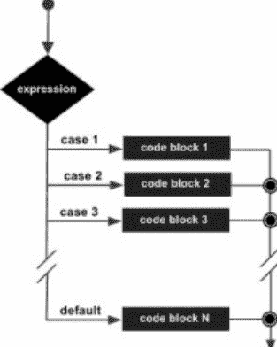

switch 有时被称为选择语句。switch 语句根据整型表达式的值，从多个代码段中进行选择。switch 语句允许对变量与一组值进行等值测试。每个值被称为一个 case（分支），被切换的变量会在每个 case 中进行检查。

其通用形式：选择器：

```
switch(integral-selector) {
    case integral-value1 : statement; break;
    case integral-value2 : statement; break;
    case integral-value3 : statement; break;
    case integral-value4 : statement; break;
    case integral-value5 : statement; break;
    // ...
    default: statement;
}
```

Integral-selector 是一个产生整型值的表达式。switch 将 integral-selector 的结果与每个 integral-value 进行比较。如果找到匹配项，则执行相应的语句（单个语句或多个语句；不需要大括号）。如果没有发生匹配，则执行 default（默认）语句。

你会在前面的定义中注意到，每个 case 都以 break 结束，这会导致执行跳转到 switch 体的末尾。这是构建 switch 语句的惯方法，但 break 是可选的。如果缺少了 break，后续 case 语句的代码将一直执行，直到遇到 break 为止。虽然你通常不希望有这种行为，但它对经验丰富的程序员来说可能是很有用的。

请注意，default 之后的最后一个语句没有 break，因为执行会直接贯穿到 break 原本会带去的地方。如果你为了样式美观认为这很重要，可以在 default 语句末尾添加一个 break 而无大碍。

switch 语句是实现多路选择的一种简洁方法（即从多个不同的执行路径中进行选择），但它需要一个评估为整型值的选择器，例如 int 或 char。如果你想使用字符串或浮点数作为选择器，它在 switch 语句中不起作用。对于非整型类型，你必须使用一系列语句。在下一章的最后，你会看到 Java SE5 的新特性枚举 enum 有助于缓解这一限制，因为枚举的设计是为了与 switch 良好配合。

示例：


```java
public class Test {
    public static void main(String args[]) {
        // char grade = args[0].charAt(0);
        char grade = 'C';

        switch(grade) {
            case 'A' :
                System.out.println("Excellent!");
                break;
            case 'B' :
                System.out.println("Well done");
                break;
            case 'D' :
                System.out.println("You passed");
                break;
            case 'F' :
                System.out.println("Better try again");
                break;
            default:
                System.out.println("Invalid grade");
        }
        System.out.println("Your grade is " + grade);
    }
}
```

这将产生以下结果：

输出：

Well done

Your grade is C

## 循环

在某些情况下，你需要多次执行一段代码。通常情况下，语句是顺序执行的：函数中的第一个语句首先执行，然后是第二个语句，依此类推。编程语言提供了各种控制结构，允许更复杂的执行路径。

循环语句允许我们多次执行一个语句或一组语句，以下是大多数编程语言中循环语句的通用形式：

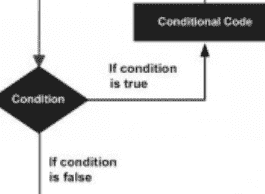

Java 编程语言提供了以下类型的循环来处理循环需求。

## While 循环

如果我们想在循环中多次运行特定的语句，我们需要另一种方法。为了实现这一点，Java 带有另外两个关键字：`while` 和 `for`。`while` 语句的使用起来稍微容易一些。它只需要一个 bool 参数来确定是否继续执行。该语句与 `if` 语句有些相似，区别在于它在完成评估后会返回到 `while` 语句的顶部。

`while` 循环的语法是：

```java
while(Boolean_expression) {
  // Statements
}
```

在这里，`statement(s)`（语句）可以是一个单独的语句或语句块。`condition`（条件）可以是任何表达式，而 true 是任何非零值。

在执行时，如果 `boolean_expression` 的结果为 true，则循环内部的操作将执行。只要表达式的结果为 true，这种操作就会持续。

当条件变为 false 时，程序控制传递到循环后的后续行。

## 流程图

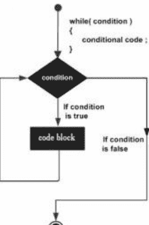

在这里，如果 `boolean_expression` 的结果为 true，则循环内部的操作将执行。只要表达式的结果为 true，这种操作就会持续。

当条件变为 false 时，程序控制传递到循环后的后续行。

示例：

```java
public class Test {
    public static void main(String args[]) {
        int x = 10;
        while(x < 20) {
            System.out.println("value of x : " + x);
            x++;
        }
    }
}
```

这将产生以下结果：

输出：

value of x : 10

value of x : 11

value of x : 12

value of x : 13

value of x : 14

value of x : 15

value of x : 16

value of x : 17

value of x : 18

value of x : 19

## For 循环

为了对循环执行获得更多控制，我们还有另一种选择。`for` 循环需要三个不同的语句来操作。第一个语句被称为初始化，第二个是条件，第三个是操作。

语法：

```java
for(initialization; Boolean_expression; update) {
  // Statements
}
```

这里 `for` 循环的控制流：

- 首先执行初始化步骤
- 接下来评估逻辑表达式。如果为 true，则执行循环体。如果为 false，则不执行循环，控制跳转到循环之后的语句。
- 在循环体执行后，控制跳转回更新语句。该语句允许你更新控制变量。该语句可以留空并以分号结尾。
- 现在再次评估逻辑表达式。如果为 true，则重复过程（循环体、更新步骤、逻辑表达式）。当逻辑表达式为 false 时，`for` 循环终止。

## 流程图

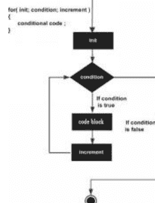

**示例：**

以下是 Java 中 `for` 循环的示例代码。

```java
public class Test {
    public static void main(String[] args) {
        for(int x = 10; x < 20; x = x + 1) {
            System.out.print("value of x : " + x);
            System.out.print("\n");
        }
    }
}
```

这将产生以下结果：

输出：

```
value of x : 10
value of x : 11
value of x : 12
value of x : 13
value of x : 14
value of x : 15
value of x : 16
value of x : 17
value of x : 18
value of x : 19
```

## 循环控制语句

循环控制语句改变其正常的执行顺序。当执行离开作用域时，在该作用域内创建的所有自动对象都会被销毁。

Java 支持以下控制语句。

- Break 语句
- Continue 语句

Java 编程语言中的 `break` 语句有两种用法：

- 当在循环内部遇到 `break` 语句时，循环立即终止，程序控制从循环后的语句继续执行。
- 可用于终止 `switch` 语句中的一个 case（下章介绍）。

## 语法

`break` 的语法是任何循环内部的条语句：

```java
break;
```

## 流程图

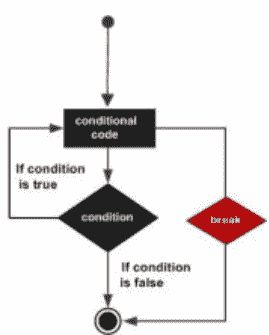

## 示例

```java
public class Test {
    public static void main(String[] args[]) {
        int[] numbers = {10, 20, 30, 40, 50};
        for(int x : numbers ) {
            if(x == 30 ) {
                break;
            }
            System.out.print( x);
        }
        System.out.print("\n"); 
    }
}
```

这将产生以下结果：

### 输出

```
10
20
```

`continue` 关键字可以用于任何循环控制结构。它会导致循环立即跳转到循环的下一次迭代。

- 在 `for` 循环中，`continue` 关键字会导致控制立即跳转到更新语句。
- 在 `while` 循环或 `do/while` 循环中，控制立即跳转到布尔表达式。

## 语法

`continue` 的语法是任何循环内部的条语句：

```java
continue;
```

## 流程图

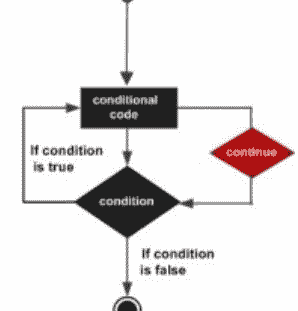

## 示例

```java
public class Test {

    public static void main(String args[]) {
        int [] numbers = {10, 20, 30, 40, 50};
        for(int x : numbers ) {
            if( x == 30 ) {
                continue;
            }
            System.out.print( x ); System.out.print("\n");
        }
    }
}
```

### 输出

```
10
20
40
50
```

## 数组

数组是组织良好的数据列表。可以将其想象一个从零开始、每当向列表中添加内容时就会扩展一行的编号列表。数组在许多情况下都非常有用，因为它们被视为一个数据整体。例如，如果你想存储一组高分，你可能希望使用数组来实现。起初，你可能想要一个包含 10 个元素的列表。理论上，你可以使用以下代码来存储每个分数。

```java
int score1;
int score2;
int score3;
int score4;
int score5;
int score6;
int score7;
int score8;
int score9;
int score10;
```

更糟糕的是，如果你需要处理每个值，你就需要创建一组通过名称处理每个变量的代码。要检查 `score2` 是否高于 `score1`，你需要专门编写一个函数在交换它们之前检查这两个变量。谢天谢地有数组。数组有两种类型：

- 一维数组
- 多维数组

## Java 中的一维数组

在 Java 中声明数组的语法：

```java
dataType[] arr; // 或
dataType arr[]; // 或
dataType[arr]; // 注：原文为 dataType[arr]，标准语法通常为 dataType[] arr 或 dataType arr[]
```

在 Java 中实例化数组：

```java
arrayRefVar = new datatype[size];
```

Java 一维数组示例：

让我们来看一个简单的 Java 数组示例，其中我们将声明、实例化、初始化并遍历一个数组。

```java
class Testarray{
    public static void main(String args[]){
        int a[] = new int[5]; // 声明和实例化
        a[0] = 10; // 初始化
        a[1] = 20; a[2] = 70; a[3] = 40; a[4] = 50; // 打印数组
        for(int i = 0; i < a.length; i++) // length 是数组的属性
            System.out.println(a[i]);
    }
}
```

输出：

10
20
70
40
50

## Java 数组的声明、实例化和初始化

我们可以通过以下方式同时声明、实例化和初始化 Java 数组：

```java
int a[] = {33, 3, 4, 5}; // 声明、实例化和初始化

// 让我们来看一个打印此数组的简单示例。

class Testarray1{
    public static void main(String args[]){
        int a[] = {33, 3, 4, 5}; // 声明、实例化和初始化
        // 打印数组
        for(int i = 0; i < a.length; i++) // length 是数组的属性
            System.out.println(a[i]);
    }
}
```

输出：

33
3
4
5

## Java 中向方法传递数组

我们可以将 Java 数组传递给方法，这样我们就可以在任何数组上重用相同的逻辑。

让我们来看一个使用方法获取数组中最小数字的简单示例。

```java
class Testarray2{
    static void min(int arr[]){
        int min = arr[0];
        for (int i = 1; i < arr.length; i++)
            if(arr[i] < min) min = arr[i];
        System.out.println(min);
    }
    public static void main(String args[]){
        int a[] = {33, 3, 4, 5};
        min(a);
    }
}
```

输出：3

## Java 中的多维数组

多维数组是数组的数组。它可以被视为行列。

在 Java 中声明多维数组的语法：

```java
dataType[][] arr; // 或
dataType arr[][]; // 或
dataType arr[][]; // 原文重复，标准语法通常为前两种
```

在 Java 中实例化多维数组：

```java
arrayRefVar = new datatype[size][size];
```

多维数组示例：

让我们来看一个简单的多维数组示例，其中我们将声明、实例化、初始化并遍历一个数组。

```java
class Testarray{
    public static void main(String args[]){
        int a[][] = {{1,2,3},{4,5,6}}; // 打印数组
        for(int i = 0; i < a.length; i++){
            for(int j = 0; j < a[i].length; j++){
                System.out.println(a[i][j]);
            }
        }
    }
}
```

输出：

1
2
3
4
5
6

```java
public class Puppy {
    public Puppy() {
    }
    public Puppy(String name) {
        // This constructor has one parameter, name.
    }
}
```

Java 还支持单例类，你只能为类创建一个实例。

# 对象介绍

面向对象编程（OOP）的发明是为了将数据和逻辑关联成封装良好的代码包。当你在 Java 中编写一个类时，你正在为新对象创建蓝图和指令。然后可以根据你的蓝图构建任意数量的实例。程序员在谈论从类蓝图创建对象时会使用“实例化”（instantiate）一词。每个实例化的对象都是其构建基础的类的实例。类本身并不是由它创建的实例之一。新创建的对象包含了写入类中的所有函数和数据。

所有的编程语言都提供抽象。可以认为，你能够解决问题的复杂性与抽象的类型和质量直接相关。我所说的“类型”是指“你正在抽象的是什么？”汇编语言是对底层机器的一种抽象。随后的许多所谓的“命令式”语言（如 FORTRAN、BASIC 和 C）都是汇编语言的抽象。这些语言是对汇编的巨大改进，但它们的主要抽象要求你按照计算机的结构而非你试图解决的问题的结构来思考。

程序员必须在机器模型（位于“解决方案空间”，即你实现该解决方案的地方，如计算机）与实际正在解决的问题模型（位于“问题空间”，即问题存在的地方，如业务）之间建立关联。执行这种映射所需的努力，以及这种映射是编程语言固有属性的事实，导致了编写困难且维护昂贵的程序，并作为副作用催生了整个“编程方法”行业。

对机器建模的替代方案是你试图解决的模型。早期语言（如 LISP 和 APL）选择了特定的世界观（分别为“所有问题归结底都是列表”或“所有问题都是算法的”）。Prolog 将所有问题转化为决策链。还创建了专门用于基于约束编程的语言以及专门通过操作图形符号进行编程的语言。（后者被证明过于局限。）这些方法对于它们设计用于解决的特定类问题可能都是很好的解决方案，但当你跳出该领域时，它们就会变得笨拙。

面向对象的方法更进了一步，为程序员提供了表示问题空间中元素的工具。这种表示足够通用，以至于程序员不受限于任何特定类型的问题。我们将问题空间中的元素及其在解决方案空间中的表示称为“对象”。（你可能还需要其他没有问题空间对应物的对象。）这种想法是，允许程序通过添加新类型的对象来使自己适应问题的术语，因此当你读取描述解决方案的代码时，你读的是同样表达了问题的词汇，而不是根据运行解决方案的计算机术语来描述。因此，OOP 允许你用问题本身来描述问题。这与计算机仍然有联系：每个对象看起来都很像一个小计算机——它有状态，还有你可以要求它执行的操作。然而，这对于现实世界中的对象似乎并不是一个糟糕的类比——它们都具有特征和行为。

简单来说，OOP 是构建对象、实例化它们然后使用它们的过程。使用对象涉及对数据读取逻辑、使用逻辑数据，然后根据逻辑执行任务。

# 创建对象

如前所述，类为对象提供了蓝图。所以基本上，对象是从类创建的。在 Java 中，使用 `new` 关键字来创建新对象。

从类创建对象有三个步骤：

- **声明：** 一个带有变量名和对象类型的变量声明。
- **实例化：** 使用 `new` 关键字创建对象。
- **初始化：** `new` 关键字后紧跟对构造函数的调用。该调用初始化了新对象。

以下是创建一个对象的示例：

```java
public class Puppy {
    public Puppy(String name) {
        // This constructor has one parameter, name.
    }
}
```


System.out.println("Passed Name is :" + name );

    }

    public static void main(String[] args) {

        // Following statement would create an object

        Puppy myPuppy = new Puppy("tommy"); 

    }

}

```

输出：
Passed Name is :tommy

# 访问实例变量和方法

实例变量和方法通过创建的对象来访问。要访问实例变量，全限定路径如下：

```java
/* 先创建一个对象 */
ObjectReference objectReference = new Constructor();

/* 现在按照如下方式调用变量 */
objectReference.variableName;
```

```java
/* 现在你可以如下所示调用类方法 */
objectReference.MethodName();
```

### 示例

此示例解释了如何访问类的实例变量和方法。

```java
public class Puppy {

    int puppyAge;

    public Puppy(String name) {

        // This constructor has one parameter, name.

        System.out.println("Name chosen is: " + name );

    }

    public void setAge(int age) {

        puppyAge = age;

    }

    public int getAge() {

        System.out.println("Puppy's age is: " + puppyAge ); 

        return puppyAge;

    }

}
```

```java
public static void main(String []args) {

    /* Object creation */

    Puppy myPuppy = new Puppy("tommy");

    /* 调用类方法设置狗的年龄 */

    myPuppy.setAge( 2 );

    /* 调用另一个方法获取狗的年龄 */

    myPuppy.getAge();

    /* 你也可以这样访问实例变量 */

    System.out.println("Variable Value :" + myPuppy.puppyAge); 

}

```

如果我们编译并运行上述程序，它将产生以下结果：

**输出：**

Name chosen is :tommy
Puppy's age is :2
Variable Value :2

# 面向对象编程的特征

这些特征代表了面向对象编程的纯粹方法：

**1. 一切皆对象。** 将一个对象看作一个高级变量；它存储数据，但你可以向该对象“提出请求”，要求它对自身执行操作。在理论上，你可以取你试图解决的问题中的任何概念性组件（狗、建筑、服务等），并将其表示为程序中的一个对象。

**2. 程序是一组对象通过发送消息来互相告诉对方该做什么。** 要对一个对象提出请求，你向该对象“发送一条消息”。更具体地说，你可以将消息看作是对特定对象的方法的调用。

**3. 每个对象都有由其他对象构成的内存。** 另一种方式是，你通过创建一个包含现有对象的包来创建一个新类型的对象。因此，你可以在隐藏对象简单性的同时，在程序中构建复杂性。

**4. 每个对象都有一个类型。** 用术语来说，每个对象都是类的实例，其中“类”与“类型”是同义的。类最重要的区别特征是“你可以向它发送什么消息？”

**5. 同一类型的所有对象都可以接收相同的消息。** 这实际上是一个带有深意的陈述，正如你稍后看到的。因为类型为“圆”的对象也是“形状”类型的对象，所以圆保证接受形状消息。这意味着你可以编写处理形状的代码，并自动处理任何符合形状描述的物体。这种可替代性是 OOP 中强大的概念之一。

对对象更简洁的描述是：

对象具有状态、行为和身份。

对象具有接口：因此，尽管我们在面向对象编程中实际执行的是创建新的数据类型，但几乎所有的面向对象编程语言都使用“class”（类）关键字。当你看到“type”（类型）这个词时，可以想成“class”，反之亦然。

由于类描述了一组具有相同特征（数据元素）和行为（功能性）的对象，因此类实际上是一个数据类型，因为例如，一个浮点数也拥有一系列特征和行为。区别在于，程序员定义一个类是为了适应某个问题，而不是被迫使用一个为表示机器中存储单元而设计的现有数据类型。你通过添加特定于你需求的新数据类型来扩展编程语言。编程系统欢迎新类，并赋予它们与对待内置类型相同的关照和类型检查。

面向对象的方法不仅限于构建仿真系统。无论你是否同意任何程序都是你正在设计的系统的模拟，使用 OOP 技术都可以轻松地将一组复杂的问题简化为单一的解决方案。

一旦建立了一个类，你就可以随心所欲创建许多该类的对象，然后操纵这些对象，就像它们是你正试图解决的问题中存在的元素一样。事实上，面向对象编程的挑战之一就是在问题空间中的元素与解决方案空间中的对象之间建立一对一的映射。

但如何让对象为你完成有用的工作呢？需要一种方式向对象发出请求，以便它执行某些操作，例如完成交易、在屏幕上画图或打开开关。每个对象只能满足某些特定的请求。你对对象提出的请求由其接口定义，而类型则决定了接口。一个简单的例子可能是灯泡的表示：

| 类型名称 | Light |
| --- | --- |
| 接口 | on(), off(), brighten(), dim() |

```java
Light lt = new Light();

lt.on();
```

接口决定了你可以对特定对象提出的请求。
然而，在某处必须有一些代码来满足该请求。这与隐藏的数据共同成了实现。从过程化编程的角度来看，这并不复杂。
一个类型与每个可能的请求关联有一个方法，当你向对象发出特定请求时，就会调用该方法。这个过程通常总结为向对象“发送消息”（发出请求），然后由对象确定如何处理该消息（即它执行代码）。

在这里，类型/类的名称是 `Light`，这个特定 `Light` 对象的名称是 `lt`，你对 `Light` 对象可以提出的请求是开启它、关闭它、让它变亮或让它变暗。你通过为该对象定义“引用”（`lt`）并调用 `new` 请求一个类型的新对象来创建一个 `Light` 对象。要向对象发送消息，只需写出对象的名称并用点号将其与消息请求连接。从预定义类用户的角度来看，这就是对象编程的全部内容了。

前面的图遵循统一建模语言（UML）的格式。每个类由一个框表示，名称位于框的顶部，你关心的任何数据成员位于框中间，方法（属于该对象的函数，接收你发送给它的任何消息）位于框的底部。通常，UML 设计图中只显示类名和公共方法，因此在本例中，中间部分不显示。如果你只对类名感兴趣，那么底部也不需要显示。

# Interfaces 接口

接口是 Java 中的一种引用类型。它与类相似。它是抽象方法的集合。类实现接口，从而继承接口的抽象方法。

除了抽象方法外，接口还可以包含常量、默认方法、静态方法和嵌套类型。方法体仅存在于默认方法和静态方法。

编写接口与编写类相似。但类描述了对象的属性和行为，而接口包含了类实现的行为。

除非实现接口的类是抽象类，否则接口的所有方法都需要在类中定义。

接口在以下方面与类相似：

- 接口可以包含任意数量的方法。
- 接口写在扩展名为 `.java` 的文件中，接口名称与文件名匹配。
- 接口的字节码出现在 `.class` 文件中。
- 接口出现在包中，其对应的字节码必须存在于与包名匹配的目录结构中。

然而，接口在几个方面与类不同，包括：

- 你不能实例化接口。
- 接口不包含任何构造函数。
- 接口中的所有方法都是抽象的。
- 接口不能包含实例字段。接口中出现的字段必须同时声明为 `static` 和 `final`。
- 接口不被类扩展，而是由类实现。
- 接口可以扩展多个接口。

# Declaring Interfaces 声明接口

`interface` 关键字用于声明接口。这是一个声明接口的简单示例——

# Example 示例

以下是一个接口的示例：

```java
/* File name : NameOfInterface.java */

import java.lang.*; // 任意数量的 import 语句

public interface NameOfInterface {

    // 任意数量的 final, static 字段
    // 任意数量的抽象方法声明

}
```

接口具有以下属性：

- 接口隐式是抽象的。声明接口时不需要使用 `abstract` 关键字。
- 接口中的每个方法也隐式是抽象的，因此不需要 `abstract` 关键字。
- 接口方法隐式为 `public`。

示例：

```java
/* File name : Animal.java */

interface Animal {

    public void eat();
    public void travel();
}
```

# Implementing Interfaces 实现接口

当类实现接口时，你可以将该类视为签署了合同，同意执行接口的行为。如果类没有执行接口的所有行为，则该类必须声明为抽象类。

类使用 `implements` 关键字来实现接口。`implements` 关键字出现在类声明中 `extends` 部分之后。

# Example 示例

```java
/* File name : MammalInt.java */

public class MammalInt implements Animal {

    public void eat() {

        System.out.println("Mammal eats");

    }

    public void travel() {

        System.out.println("Mammal travels");

    }

    public int noOfLegs() {

        return 0;

    }

    public static void main(String args[]) {

        MammalInt m = new MammalInt();
        m.eat();
        m.travel();

    }

}
```

这将产生以下结果：

# Output 输出

| Mammal eats |
| Mammal travels |

在重写接口定义的方法时，必须遵循以下规则：

- 实现方法中声明的检查异常不能是接口方法所声明的异常或其子类之外的任何异常。
- 重写方法时，应保持接口方法的签名和相同的返回类型或子类型。
- 实现类本身可以是抽象的，如果是这样，不需要实现接口方法。

实现接口时，有以下规则：

- 一个类可以同时实现多个接口。
- 一个类只能扩展一个类，但可以实现多个接口。
- 接口可以扩展另一个接口，类似于类扩展另一个类的方式。

# 对象提供服务

当你试图开发或理解程序设计时，思考对象的最佳方式之一是将它们视为“服务提供者”。你的程序本身将为用户提供服务，它将通过使用其他对象提供的服务来实现这一点。你的目标是产生（甚至更好是，在现有代码库中找到）一组能够为解决你的问题提供理想服务的对象。

开始这项工作的方法是问自己：“如果我魔术般从帽子里变出它们，哪些对象可以立即解决我的问题？”例如，假设你正在创建一个记账程序。你可能会想象一些包含预定义记账输入界面的对象，另一组执行记账计算的对象，以及一个处理在所有不同类型打印机上打印支票和发票的对象。也许这些对象中某些已经存在，而对于那些不存在的对象，它们看起来会什么样？这些对象会提供什么服务，你需要哪些对象来履行它们的职责？如果你坚持这样做，最终将达到一个点，你可以说：“那个对象看起来已经足够坐下来写代码了”或者“我确定那个对象一定已经存在了”。这是一个将问题分解为一组对象的合理方法。

将对象看作服务提供者还有一个额外的好处：它有助于提高对象的内聚性。高内聚性是软件设计的基本质量：它意味着软件组件的不同方面（例如对象，尽管这也可以适用于方法或对象库）“恰好契合”。人们在设计对象时面临的一个问题是将过多的功能挤入一个对象中。例如，在你的支票打印模块中，你可能会决定需要一个了解所有格式化和打印的对象。你可能会发现这对于一个对象来说太重了，而你需要的是三个或更多对象。其中一个对象可以是所有可能的支票布局的目录，可以对其进行查询关于如何打印支票的信息。另一个对象或一组对象可以是一个通用的打印接口，它了解所有类型打印机的所有信息（但对记账一无所知——这是购买而非编写的候选）。第三个对象可以使用另外两个的服务来完成任务。因此，每个对象都有一组其提供的内聚性服务。在良好的面向对象的设计中，每个对象只做一件事，但不会试图做太多。

这不仅允许发现可能购买的对象（打印机接口对象），还产生了可能在其他地方被重用的新对象（支票布局目录）。

将对象视为服务提供者是一个伟大的简化工具。这不仅在设计过程中有用，当其他人试图理解你的代码或重用对象时也有用。如果他们能根据对象提供的服务看到该对象的价值，那么将其整合到设计中就会变得容易得多。

# 隐藏的实现

将场地划分为类创建者（创建新数据类型的人）和客户端程序员（在应用程序中使用这些数据类型的类消费者）是有帮助的。客户端程序员的目标是收集一个装满类的工具箱，用于快速应用程序开发。类创建者的目标是构建一个只向客户端程序员暴露必要内容的类，并隐藏其他一切。为什么？因为它是隐藏的，客户端程序员无法访问它，这意味着类创建者可以更改隐藏部分而不必担心对其他人的影响。隐藏部分通常代表对象的内部，内部可能会被粗心或不了解的客户端程序员损坏，因此隐藏实现可以减少程序错误。

在任何关系中，拥有被所有参与方尊重的边界都是重要的。当你创建一个库时，你与客户端程序员建立了关系，对方也是一个程序员，但一个通过使用你的库来组合应用程序的程序员，可能是为了构建更大的库。如果类的所有成员对所有人可见，客户端程序员就可以对该类做任何事情，而且没有办法强制规则。尽管你真的倾向于让客户端不要直接操作你类的某些成员，但如果没有访问控制，就没有办法阻止它。一切对世界都是裸露的。

所以访问控制的第一个原因是让客户端程序员不要碰他们不接触的部分——这些部分对于数据类型的内部运行是必要的，但用户需要它们解决自己的特定问题。这实际上是对客户端程序员的服务，因为他们可以很容易地看到什么对他们是重要的，什么是可以忽略的。

访问控制的第二个原因是允许库设计人员更改类的内部机制，而不必担心这将如何影响客户端程序员。例如，你可能会以简单的方式实现一个特定的类以简化开发，然后发现你需要重写它以便使其运行得更快。如果接口和实现清晰地分离并保护，你就可以轻松地完成。

Java 使用三个显式关键字来设置类中的边界：`public`、`private` 和 `protected`。这些访问修饰符决定了谁可以使用后面的定义。`public` 意味着后续元素对所有人可用。相反，`private` 关键字意味着除了你（类型的创建者在该类型的方法内部），没人可以访问该元素。`private` 是你和客户端程序员之间的一堵墙。试图访问 `private` 成员的人将得到编译错误。`protected` 关键字的作用类似于 `private`，例外是继承类可以访问 `protected` 成员，但不能访问 `private` 成员。继承很快就会引入。

Java 还有“默认”访问，如果你不使用上述修饰符之一，它就会生效。这通常被称为包级访问，因为类可以访问同一包（库组件）中其他类的成员，但在包之外，这些相同的成员看起来是 `private` 的。

## 封装

Java 中的封装是将数据（变量）和作用于数据的代码（方法）封装成单个单元的机制。在封装中，类的变量将对其他类隐藏，并且只能通过当前类的方法访问。因此，它被称为数据隐藏。

在 Java 中实现封装：

- 将类的变量声明为 `private`。
- 提供公共的 setter 和 getter 方法来修改和查看变量的值。

### 示例

以下是一个如何在 Java 中实现封装的示例：

```java
public class EncapTest {

    private String name; 

    private String idNum; 

    private int age;

    public int getAge() {

        return age; 

    }

    public String getName() {

        return name; 

    }

    public String getIdNum() {

        return idNum; 

    }

    public void setAge( int newAge) {

        age = newAge; 

    }

    public void setName(String newName) {

      name = newName; 

    }

    public void setIdNum(String newId) {

      idNum = newId;

    }

}
```

公共的 `setXXX()` 和 `getXXX()` 方法是 `EncapTest` 类实例变量的访问点。通常，这些方法被称为 getter 和 setter。因此，任何想要访问变量的类都应该通过这些 getter 和 setter 来访问。

可以使用以下程序访问 `EncapTest` 类的变量：

```java
public class RunEncap {

  public static void main(String args[]) {

    EncapTest encap = new EncapTest(); 

    encap.setName("James");

    encap.setAge(20); 
```


```
encap.setIdNum("12345ms");

System.out.print("Name : " + encap.getName() + " Age : " + encap.getAge());

}
}
```

这将产生以下结果：

## 输出

| Name : James Age : 20 |
| :--- |

## 封装的优势

- 类的字段可以被设置为只读或只写。
- 类对存储在其字段中的内容具有完全的控制权。
- 类的用户不知道该类是如何存储数据的。类可以更改字段的数据类型，而类的用户不需要更改他们的任何代码。

## 重用实现

一旦一个类被创建并经过了测试，它（理想情况下）应该代表一个有用的代码单元。事实证明，这种重用性并不像许多人希望的那样容易实现；需要经验和洞察力才能产生可重用的对象设计。但一旦你拥有了这样的设计，它就需要被重用。代码重用是面向对象编程语言提供的最大优势之一。

重用类最简单的方法是直接使用该类的对象，你也可以将该类的对象放在一个新类中。我们称称为“创建成员对象”。你的新类可以由任何数量和类型的其它对象组成，并以任何你为了实现新类中所需功能的组合组合。由于你是从现有的类组合出一个新类，这个概念被称为组合（composition），如果组合是动态发生的，通常被称为聚合（aggregation）。组合通常被称为“拥有”（has-a）关系，例如“汽车有一个引擎”。


（此 UML 图表用实心菱形表示组合，表示有一辆汽车。我通常会使用更简单的形式：只需一条线，没有菱形，来表示关联。association.5）组合具有极大的灵活性。你新类的成员对象通常是私有的，使得使用该类的客户端程序员无法访问它们。这允许你在不打扰现有客户端代码的情况下更改这些成员。你还可以在运行时更改成员对象，以动态地更改程序的行为。接下去将描述的继承并不具有这种灵活性，因为编译器必须对通过继承创建的类施加编译时的限制。）

由于继承在面向对象编程中如此重要，它经常被过度强调，新程序员可能会产生继承应该无处不在的印象。这可能导致笨拙且过度复杂的设计。相反，在创建新类时，你应该首先考虑组合，因为它更简单、更灵活。如果你采用这种方法，你的设计将更加简洁。一旦你有了一些经验，什么时候需要继承就会变得显而易见。

## 继承

就本身而言，对象的概念是一个方便的工具。它允许你按概念将数据和功能封装在一起，这样你可以表示一个适当的问题空间想法，而不是被迫使用底层机器的惯用法。这些概念通过使用 `class` 关键字作为编程语言中的基本单元来表示。

然而，费尽心机创建一个类，然后又被迫创建一个可能具有相似功能的新类，这似乎很遗憾。如果我们能获取现有的类，克隆它，然后对克隆进行添加和修改，那就完美了。这实际上是你通过继承所得到的，例外是如果原始类（称为基类、父类或母类）发生了更改，修改过的“克隆”（称为派生类、继承类、子类或子类）也会反映这些变化。

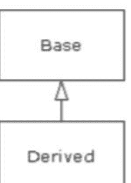

（此 UML 图中的箭头从派生类指向基类。正如你所看到的，通常会有多个派生类。）一个类型不仅仅是描述一组对象的约束；它还与其他类型存在关系。两个类型可以共同的特征和行为，但一个类型可能包含比另一个类型更多的特征，并且可能处理更多的消息（或以不同的方式处理）。继承通过使用基类型和派生类型的概念来表达类型之间的这种相似性。基类型包含了所有派自它的类型所共有的特征和行为。你创建一个基类型来表示你对系统中某些对象想法的核心。从基类型开始，你派导出其他类型，以表示该核心可以实现的不同方式。

例如，一台垃圾回收机对垃圾碎片进行分类。基类型是“垃圾”，每件垃圾都有重量、价值等，并且可以被粉碎、熔化或分解。从这里，派生出更具体的垃圾类型，它们可能具有额外的特征（瓶子有颜色）或行为（铝罐可以被压扁，钢制罐具有磁性）。此外，某些行为可能不同（纸张的价值取决于它的类型和状况）。使用继承，你可以构建一个类型层次结构，用它的类型来表示你正试图解决的问题。

第二个例子是经典的“形状”示例，可能用于计算机辅助设计系统或游戏模拟。基类型是“形状”，每个形状都有尺寸、颜色、位置等。每个形状都可以被绘制、擦除、移动、上色等。从这里，派生出（继承）特定的形状类型——圆形、正方形、三角形等——每个形状都可能有额外的特征和行为。例如，某些形状可以被翻转。某些行为可能不同，例如当你想要计算形状的面积时。类型层次结构体现了形状之间的相似点和差异。

| Shape |
| --- |
| draw() |
| erase() |
| move() |
| getColor() |
| setColor() |
| Circle | Square | Triangle |

将解决方案与问题相同的术语，这种继承是非常用的，因为你不需要中间模型就可以从问题的描述过渡到解决方案的描述。事实上，人们在面向对象设计中遇到的困难之一就是于它太简单了。

## extends 关键字

`extends` 是用于继承类属性的关键字。以下是 `extends` 关键字的语法。

### 语法

```java
class Super {
    ...
    ...
}

class Sub extends Super {
    ...
    ...
}
```

## 示例

```java
class Calculation {
    int z;
    public void addition(int x, int y) {
        z = x + y;
        System.out.println("The sum of the given numbers:" + z);
    }
    public void Subtraction(int x, int y) {
        z = x - y;
        System.out.println("The difference between the given numbers:" + z);
    }
}

public class My_Calculation extends Calculation {
    public void multiplication(int x, int y) {
        z = x * y;
        System.out.println("The product of the given numbers:" + z);
    }
    public static void main(String args[]) {
        int a = 20, b = 10;
        My_Calculation demo = new My_Calculation();
        demo.addition(a, b);
        demo.Subtraction(a, b);
        demo.multiplication(a, b);
    }
}
```

编译并执行上述代码，如下所示。

`javac My_Calculation.java; java My_Calculation`

执行程序后，将产生以下结果：

## 输出

The sum of the given numbers:30
The difference between the given numbers:10
The product of the given numbers:200

在给程序中，当创建 `My_Calculation` 类的对象时，内部会被父类内容的副本。这就是为什么使用子类对象可以访问父类的成员。

## super 关键字

**super** 关键字与 **this** 关键字相似。以下是 `super` 关键字的用法场景：

- 它用于**区分父类的成员**和子类的成员，当它们具有相同的名称时。
- 它用于从子类中**调用父类类**的构造函数。

### 区分成员

如果一个类继承另一个类的属性，并且如果父类的成员名称与子类相同，那么为了区分这些变量，我们像下面所示使用 `super` 关键字。

```java
super.variable
super.method();
```

## 示例

```java
class Super_class {
    int num = 20;
    // 父类的 display 方法
    public void display() {
        System.out.println("This is the display method of superclass");
    }
}
```

```java
public class Sub_class extends Super_class {
    int num = 10;
    // 子类的 display 方法
    public void display() {
        System.out.println("This is the display method of subclass");
    }
    public void my_method() {
        // 实例化子类 Sub_class
        Sub_class sub = new Sub_class();
        // 调用子类的 display() 方法
        sub.display();
        // 调用父类的 display() 方法
        super.display();
        // 打印子类变量 num 的值
        System.out.println("value of the named num in sub class:" + sub.num);
        // 打印父类变量 num 的值
        System.out.println("value of the named num in super class:" + super.num);
    }
    public static void main(String args[]) {
        Sub_class obj = new Sub_class();
        obj.my_method();
    }
}
```

使用以下语法编译并执行上述代码。

`javac Super_Demo.java; java Super_Demo`

执行程序后，你将得到以下结果：

### 输出

| | |
| :--- | :--- |
| This is the display method of subclass | This is the display method of superclass |
| value of the variable named num in sub class:10 | value of the super class:20 |

## 继承类型

所示所示多种类型的继承。

| 继承类型 | 代码结构 |
| :--- | :--- |
| 单级继承 | public class A { |
| | 类 A | ...... |
| | public class B extends A { |
| | } |
| | 类 B | |
| 多级继承 | public class A {..................} |
| | 类 A | public class B extends A {..................} |
| | 类 B | public class C extends B {..................} |
| | 类 C | |
| 层次继承 | public class A {..................} |
| | 类 A | public class B extends A {..................} |
| | 类 B | public class C extends A {..................} |
| | 类 C | |
| 多重继承 | public class A {..................} |
| | 类 A | public class B {..................} |
| | 类 B | public class C extends A, B {..................} |
| | 类 C | } // Java 不支持多重继承 |

需要记住的一个重要事实是，Java 不支持多重继承。这意味着一个类不能扩展多个类。因此，以下内容是非法的——

## 示例

```java
public class Sub extends Animal, Mammal{}
```

然而，一个类可以实现一个或多个接口，这帮助 Java 解决了多重继承的不可能性问题。

在这些语言中，默认情况下方法不是动态绑定的。在 Java 中，动态绑定是默认行为，你不需要记住添加任何额外的关键字来实现多态。

# 第 9 章 | 异常处理

## 使用异常进行错误处理

捕捉错误的最佳时机是编译时，在你尝试运行程序之前。然而，并非所有错误都可以在编译时检测到。其余的问题必须在运行时通过某种形式进行处理，这种形式允许错误源头将适当的信息传递给接收者，接收者将知道如何处理这些困难。

改进错误恢复是提高代码健壮性最强大的方法之一。错误恢复是你编写的每个程序都关注的基础问题，但在 Java 中它尤为重要，因为 Java 的主要目标之一是为他人创建程序组件。要创建一个健壮的系统，每个组件必须是健壮的。通过使用异常提供一致的错误报告模型，Java 允许组件可靠地向客户端代码通信问题。

Java 异常处理的目标是使用比目前更少的代码创建大型、更可靠的程序，并更有信地确保你的应用程序没有未处理的错误。异常的学习并不困难，它们是那些能为你的项目带来即时且显著收益的特性之一。

因为异常处理是 Java 错误的唯一官方方式，并且由 Java 编译器的强制执行，因此书中有很多可以在不学习异常处理的情况下编写的示例。本章将向你介绍需要编写的用于正确处理异常的代码，并展示当你的某个方法遇到问题时，你可以如何生成自己的异常。

## 概念

C 和其他早期的语言有多种错误处理方案，这些通常是根据惯例建立的而不是编程语言的一部分。通常，你会返回一个特殊值或设置一个标志位，接收者应该查看该值或标志位并判断是否发生了异常。然而，随着时间的推移，人们发现使用库的程序员倾向于认为自己是无所不能的——就像“是的，错误可能会发生在别人身上，但不会发生在我我的代码中”。所以，并不意外，他们不会检查错误条件（而且有时错误条件太愚蠢了，不需要检查）。如果你足够彻底，在每次调用方法时都检查错误，你的代码可能会变成一个不可读的噩梦。由于程序员仍然可以从这些语言中诱导系统运行，他们他们于承认事实：这种处理错误的方法是创建大型、健壮、可维护程序的主要局限。

解决方案是将错误处理的随意性质改为强制正式化。这实际上有很长的历史，因为异常处理的实现可以追溯到 20 世纪 60 年代的操作系统，甚至到了 BASIC 的“on error goto”。但 C++ 的异常处理基于 Ada，而 Java 的主要基于 C++（尽管它看起来更像 Pascal）。

“exception”（异常）一词的意思是“我对此此表示异议”。在问题发生点，你可能不知道该如何处理它，但你知道你不能继续愉快地运行了；你必须停止，并且某处的某人必须弄清楚该怎么办。但在当前的上下文中没有足够的信息来修复问题。因此，你将问题交给更高层的上下文，那里有人有权做出正确的决定。

异常的另一个相当显著的优点是它们倾向于降低错误处理代码的复杂性。如果没有异常，你必须在程序的多个地方检查并处理特定的错误。有了异常，你不再需要在方法调用点检查错误，因为异常将保证有人捕获它。你只需要在一个地方（即所谓的异常处理程序中）处理该问题即可。这为你节省了代码，并将描述正常执行期间你想做的事的代码与在发生故障时执行的代码分离开来。总的来说，使用异常，阅读、编写和调试代码比使用旧的错误处理方式要清晰得多。

## 基础异常

异常状态是一个阻止当前方法或作用域继续运行的问题。将异常状态与正常区分开来很重要，在正常情况下，你在当前环境中足够的信息以某种方式应对困难。在异常状态下，你无法继续处理，因为你没有在当前上下文处理问题所需的信息。你所能做的就是跳出当前上下文并委托给更高层的上下文。这就是当你抛出异常时发生的情况。

除法是一个简单的例子。如果你要除以零，检查该条件是值得的。但分母为零意味着什么？也许在那个特定方法尝试解决的问题背景下，你知道如何处理零分母。但如果它是一个意外之外的值，你就无法处理它，必须抛出异常而不是继续沿执行路径。

当你抛出异常时，会发生几件事。首先，异常对象以创建任何 Java 对象相同的方式创建：在堆上，使用 `new` 创建。然后，当前的执行路径（你无法继续执行的路径）停止，异常对象的引用从当前上下文抛出。此时，异常处理机制接管并开始寻找继续执行程序的适当位置。这个适当的位置就是异常处理程序，它的工作是从问题中恢复，以便程序可以采取另一种策略或直接继续运行。

作为一个抛出异常的简单示例，考虑一个可能未初始的对象引用，所以你可能想在调用方法之前进行检查。它看起来如下：

```java
if (t == null)
    throw new NullPointerException();
```


这抛出了异常，允许你在当前上下文中放弃对该问题的思考。它将在很快展示的某处被神奇地处理。

异常允许你将你所做的一切视为一个事务，而异常保护了这些事务：“……事务的基本前提是我们在分布式计算中异常处理。事务是计算机中的合同法。如果发生任何错误，我们将撤销整个计算。”你也可以把异常视为内置的撤销系统，因为（只要小心）你在程序中有各种恢复点。如果程序的某部分失败，异常将“撤销”回到稳定点。

与普通方法返回的任何相似之处到此为止，因为你返回的地方与你调用普通方法时返回的地方完全不同。（你最终会进入一个合适的异常处理器，该处理器可能距离抛出异常的地方非常远——在调用栈上可能有很多很多层之远。）此外，你可以抛出任何类型的 `Throwable`，它是异常的根类。通常情况下，你会为每种不同类型的错误抛出不同类的异常。错误的信息表示在异常对象内部，并隐含地在异常类的名称中，因此大上下文中的某些人员可以判断出该如何处理你的异常。（通常，唯一的信息是异常的类型，异常对象内部没有存储任何意义的内容。）

## 捕获异常

为了了解异常是如何被捕获的，你必须首先理解受保护区域（guarded region）的概念。这是一段可能会产生异常的代码，其后紧跟着处理这些异常的代码。

### try 块

如果你在一个方法内部并抛出一个异常（或者你在该方法内调用的另一个方法抛出了异常），那么该方法将在抛出异常的过程中退出。如果你不想让 `throw` 退出方法，你可以在“try”中设置一个特殊的块来捕获异常。这被称为 try 块，因为你在那里“尝试”你的各种方法调用。try 块是一个普通的范围，其前面由关键字 `try:` 引导：

```java
try {
    // 可能会产生异常的代码
}
```

如果你在一个不支持异常处理的编程语言中细致地检查错误，你必须在每个方法调用周围都包上设置和错误测试代码，即使你多次调用了同一个方法。有了异常处理，你只需要将所有内容都放在一个 try 块中，并在一处捕获所有异常。这意味着你的代码更易编写和阅读，因为代码的目标不会与错误检查混淆在一起。

### 异常处理器

当然，抛出的异常必须去往某个地方。这个“地方”就是异常处理器，对于你想要捕获的每个异常类型都有一个处理器。异常处理器紧随 try 块之后，并由关键字 `catch:` 标记：

```java
try {
    // 可能会产生异常的代码
} catch(Type1 id1) {
    // 处理 Type1 异常
} catch(Type2 id2) {
    // 处理 Type2 异常
} catch(Type3 id3) {
    // 处理 Type3 异常
}
```

每个 catch 子句（异常处理器）就像一个接收一个且只有一个特定类型参数的小方法。

标识符（`id1`、`id2` 等）可以在处理器内部使用，就像方法参数一样。有时你永远不会使用该标识符，因为异常的类型已经提供了足够的信息来处理异常，但标识符仍然必须在那里。

处理器必须直接跟在 try 块之后。如果抛出了异常，异常处理机制会寻找第一个参数与异常类型匹配的处理器。然后它会进入该 catch 子句，该异常即被视为已处理。一旦 catch 子句执行完毕，对处理器的搜索就会停止。只有匹配的 catch 子句会执行；它不像 `switch` 语句那样在每个 `case` 之后都需要一个 `break` 来防止剩余的分支执行。请注意，在 try 块内部，多个不同的方法调用可能会产生相同的异常，但你只需要一个处理器。

### 终止与恢复

异常处理理论中有两种基本模型。Java 支持终止（termination），在这种情况下你假设错误是如此致命，以至于无法回到发生异常的地方。抛出异常的人认为没有办法挽救局面，他们不想回来。

另一种方案被称为恢复（resumption）。这意味着预期异常处理器执行某些事情来纠正局面，然后重试出错的方法，并在第二次尝试成功。如果你想要恢复，意味着你仍然希望在异常被处理后继续执行。

如果你想在 Java 中获得类似恢复的行为，在遇到错误时不要抛出异常。相反，请调用一个修复问题的方法。或者，将你的 try 块放置在一个 `while` 循环中，该循环会不断重新进入 try 块，直到结果满意为止。

从历史上看，使用支持恢复性异常处理的操作系统的程序员最终倾向于使用类似终止的代码并跳过恢复。虽然恢复初听起来很有吸引力，但在实践中并没有那么有用。主要原因可能是由此导致的耦合：一个恢复性处理器需要知道异常是在哪里抛出的，并包含特定于抛出位置的非通用代码。这使得代码难以编写和维护，特别是对于异常可能从许多点生成的巨型系统。

### 捕获任何异常

可以创建一个捕获任何类型异常的处理器。你通过捕获基类异常类型 `Exception` 来实现（尽管还有其他类型的基异常，但 `Exception` 是与几乎所有编程活动相关的基类）：

```java
catch(Exception e) {
    System.out.println("Caught an exception");
}
```

这会捕获任何异常，如果你使用它，你会想要将其放在处理器列表的末尾，以避免抢占可能随其后的任何异常处理器。

由于 `Exception` 类是对程序员重要的所有异常类的基类，你无法获得关于异常的很多特定信息，但你可以调用源自其基类型 `Throwable` 的方法：

```java
String getMessage()
String getLocalizedMessage()
```

获取详细消息，或针对此特定本地化调整的消息。

```java
String toString()
```

返回 `Throwable` 的简短描述，如果有详细消息则包含在内。

```java
void printStackTrace()
void printStackTrace(PrintStream)
void printStackTrace(java.io.PrintWriter)
```

打印 Throwable 及其调用栈轨迹。调用栈显示了到达抛出异常点的方法调用序列。第一个版本打印到标准错误。

```java
Throwable fillInStackTrace()
```

在此 Throwable 对象中记录有关栈帧的信息。当应用程序重新抛出错误或异常时很有用（稍后详述）。

此外，你还会从 `Throwable` 的类型 `Object`（所有基类型）获得一些其他方法。可能很有用的是 `getClass()`，它返回一个表示该对象的 Class 对象。你可以反过来查询此 Class 对象的名称，使用 `getName()` 包含包信息，而 `getSimpleNameName()` 只产生类名。

这里有一个使用基本异常方法的示例：

```java
public class ExceptionMethods {
    public static void main(String[] args) {
        try {
            throw new Exception("My Exception");
        } catch(Exception e) {
            System.out.println("Caught Exception:");
            System.out.println("getMessage():" + e.getMessage());
            System.out.println("getLocalizedMessage():" + e.getLocalizedMessage());
            System.out.println("toString():" + e);
            System.out.println("printStackTrace:");
            e.printStackTrace(System.out);
        }
    }
}
```

#### 输出

```
Caught Exception:
getMessage() : My Exception
getLocalizedMessage() : My Exception
toString() : java.lang.Exception : My Exception
printStackTrace():
java.lang.Exception: My Exception
at ExceptionMethods.main(ExceptionMethods.java:8)
```

你可以看到这些方法提供了递增的信息——每个方法实际上都是前一个方法的超集。

# 第10 章 | 算法与大 O 表示法

它总是能导出一个解决方案，并尝试成为我们能想到的最高效的解决方案。

## 优秀算法的特质

1. 输入和输出应该精确定义。
2. 算法中的每一步都应该是清晰且无歧的。
3. 在解决某问题的许多不同方法中，算法应该是最高效。
4. 算法不应该包含计算机代码。相反，算法的编写方式应当使其能够在类似的编程语言中使用。

## 编程中的算法示例

### 编写一个算法来计算用户输入的两个数字之和

步骤 1：开始
步骤 2：声明变量 `num1`、`num2` 和 `sum`。
步骤 3：读取数值 `num1` 和 `num2`。
步骤 4：将 `num1` 和 `num2` 相加并将结果赋值给 `sum`。
`sum ← num1 + num2`
步骤 5：显示 `sum`
步骤 6：停止

### 编写一个算法来找到用户输入的三个不同数字中的最大值

步骤 1：开始
步骤 2：声明变量 `a`、`b` 和 `c`。
步骤 3：读入变量 `a`、`b` 和 `c`。

```
Step 4: If a > b
    If a > c
        Display a is the largest number.
    Else
        Display c is the largest number.
Else
    If b > c
        Display b is the largest number.
    Else
        Display c is the greatest number.
```

步骤 5：停止

### 编写一个算法找到二次方程 ax²+bx+c=0 的所有根

步骤 1：开始
步骤 2：声明变量 `a`、`b`、`c`、`D`、`x1`、`x2`、`rp` 和 `ip`。
步骤 3：计算判别式
`D ← b² - 4ac`
步骤 4：如果 `D ≥ 0`
    `r1 ← (-b + √D) / 2a`
    `r2 ← (-b - √D) / 2a`
    显示 `r1` 和 `r2` 为根。
Else
    计算实部和虚部
    `rp ← -b / 2a`
    `ip ← √(-D) / 2a`
    显示 `rp + j(ip)` 和 `rp - j(ip)` 为根
步骤 5：停止

### 编写一个算法计算用户输入的数字的阶乘

```
Step 1: Start
Step 2: 声明变量 n, factorial 和 i。
Step 3: 初始化变量 factorial ← 1, i ← 1
Step 4: 读取数值 n
Step 5: 重复步骤直到 i = n
    5.1: factorial ← factorial * i
    5.2: i ← i + 1
Step 6: 显示 factorial
Step 7: 停止
```


# 算法示例

## 检查质数

**步骤 1**：开始  
**步骤 2**：声明变量 `n`、`i`、`flag`。  
**步骤 3**：初始化变量  
`flag ← 1`  
`i ← 2`  
**步骤 4**：从用户读取 `n`。  
**步骤 5**：重复步骤直到 `i < (n/2)`  
&nbsp;&nbsp;&nbsp;&nbsp;5.1 如果 `n ÷ i` 的余数等于 0  
&nbsp;&nbsp;&nbsp;&nbsp;&nbsp;&nbsp;&nbsp;&nbsp;`flag ← 0`  
&nbsp;&nbsp;&nbsp;&nbsp;&nbsp;&nbsp;&nbsp;&nbsp;跳转到步骤 6  
&nbsp;&nbsp;&nbsp;&nbsp;5.2 `i ← i + 1`  
**步骤 6**：如果 `flag = 0`  
&nbsp;&nbsp;&nbsp;&nbsp;显示 `n` 不是质数  
else  
&nbsp;&nbsp;&nbsp;&nbsp;显示 `n` 是质数  
**步骤 7**：停止

## 斐波那契数列（项 ≤ 1000）

| 步骤 | 描述 |
| :--- | :--- |
| 步骤 1：开始 | |
| 步骤 2：声明变量 `first_term`、`second_term` 和 `temp` | |
| 步骤 3：初始化变量 `first_term ← 0`、`second_term ← 1` | |
| 步骤 4：显示 `first_term` 和 `second_term` | |
| 步骤 5：重复步骤直到 `second_term ≤ 1000` | |
| 5.1: `temp ← second_term` | |
| 5.2: `second_term ← second_term + first_term` | |
| 5.3: `first_term ← temp` | |
| 5.4: 显示 `second_term` | |
| 步骤 6：停止 | |

# 算法解决了哪些类型的问题？

排序绝不是为了开发算法而算法的唯一计算问题。算法的实际应用无处不在，包括以下示例：

1. **人类基因组计划**在识别人类 DNA 中所有 100,000 个基因、确定组成人类 DNA 的 30 亿个碱基对序列、将这些信息存储在数据库中以及开发数据分析工具方面取得了巨大进展。这些每一步都需要复杂的算法。尽管涉及的各种问题超出了本书的范围，但许多解决这些生物问题的方法使用了书中几个章节的理念，使科学家能够在高效利用资源的同时完成任务。这节省了时间（人类和机器）以及金钱，因为可以从实验室技术中提取更多信息。
2. **互联网**让世界各地的人能够快速访问和检索大量信息。在机明算法的帮助下，互联网上的网站能够管理和处理这些大量数据。必须使用算法的问题示例包括找到数据传输的良好路由，以及使用搜索引擎快速查找存有特定信息的页面。
3. **电子商务**使得商品和服务能够以电子方式进行谈判和交换，它依赖于个人信息（如信用卡号、密码和银行流水）的隐私性。电子商务使用的核心技术包括公钥加密和数字签名，这些技术基于数值算法和数论。
4. **制造业和其他商业企业**通常需要以最有利的方式分配稀缺资源。石油公司可能希望知道在哪里放置钻井以使其预期利润最大化。一位政治候选人可能想确定在哪里投放竞选资源……一家航空公司可能希望安排航班……互联网服务提供商可能希望分配带宽……

当程序未运行时，它处于程序的控制之外。这种现象两个主要例子是：流式对象（`streamed objects`），将对象转换为字节流，通常用于发送到另一台机器；以及持久化对象（`persistent objects`），将对象放置在磁盘上，以便在程序终止时仍保留其状态。这类存储方式的技巧在于，将对象转换为可以在其他介质上存在的东西，并在需要时能够“复活”为普通的基于内存的对象。Java 提供了轻量级持久化的支持，而 `JDBC` 和 `Hibernate` 等机制为在数据库中存储和检索对象信息提供了更复杂的支持。

# 大 O 表示法

大 O 表示法是我们用来描述算法运行所需多久的语言。它是我们比较解决问题的不同方法之效率的标准。

假设你有一个包含 10 个对象的列表，你想对它们进行排序。你有一堆算法可以实现这一目标，但并非所有算法都是平同的。有些算法比其他的快，但更重要的是，算法的速度取决于它处理的项数。大 O 是衡量算法可扩展性的一种方法。大 O 指的是算法的复杂度。

大 O 使用类似于 `O(n)` 的形式表示。这里的 `O` 仅仅表示我们在讨论大 O，你可以忽略它（至少在面试目的上如此）。`n` 是与之相关的复杂度；对于编程面试题，这几乎总是指集合的大小。复杂度会根据数据存储的大小而增加或减少。

以下是大 O 复杂度按其相对于数据集的可扩展性排序的列表。

- **O(1)/常数复杂度**：恒定。这意味着无论数据集有多大，算法总是需要恒定的时间。1 个项目需要 1 秒，10 个项目需要 1 秒，100 个项目需要 1 秒。它总是花费相同的时间。
- **O(log n)/对数复杂度**：不如常数复杂度好，但仍然非常好。时间随数据集的大小而增加，但是比例增加的。这意味着相对于较大的数据集，算法在较小数据集上的每个项目花费的时间。1 个项目需要 1 秒，10 个项目需要 2 秒，100 个项目需要 3 秒。如果你的数据集有 10 个项目，每个项目会产生 0.2 秒的延迟。每个项目仅额外花费 0.03 秒。这使得 `log n` 算法具有非常好的可扩展性。
- **O(n)/线性复杂度**：数据集越大，花费的时间成比例增加。1 个项目需要 1 秒，10 个项目需要 10 秒，100 个项目需要 100 秒。
- **O(n log n)**：前面两者的良好结合。通常排序有两个部分，第一个循环是 `O(n)`，第二个是 `O(log n)`，结合形成 `O(n log n)`。1 个项目需要 2 秒，10 个项目需要 12 秒，100 个项目需要 103 秒。
- **O(n²)/二次复杂度**：事情开始变得异常慢了。1 个项目需要 1 秒，10 个项目需要 100 秒，100 个项目需要 10000 秒。
- **O(2ⁿ)**：指数级增长！每增加一个元素，算法花费的时间翻倍。1 个项目需要 1 秒，10 个项目需要 1024 秒，100 个项目需要 1267650600222940149673205376 秒。

### 示例

希望你到目前为止跟得上我，但让我们深入研究一些排序和搜索的示例算法。重要的是能够解释一个算法属于什么复杂度。面试官喜欢让候选人设计算法，然后询问它的复杂度是多少。

## 1. O(1)

无论大小如何，它将始终以恒定的速度返回。`Queue` 的 javadoc 说明“检索方法（`peek`、`element` 和 `size`）是常数时间”。这其中的原因很清楚。对于 `peek`，我们总是返回我们始终拥有引用的第一个元素；它后面跟着多少个元素并不重要。列表的大小在元素添加/删除时会更新，而无论列表有多大，引用这个数字只需要一次操作。

## 2. O(log n)

经典的例子是二分查找（Binary search）。你是一个超级极客，所以你显然已经对你的电影收藏按字母顺序进行了排序。为了找到你的《回到未来》光盘，你首先来到列表的中间。你发现中间的电影是《霍克家族聚》，然后你前往开头和这部电影之间的电影。你发现那是《人类之子》。再次重复这个过程，你就找到了《回到未来》。

虽然增加更多元素会增加搜索所需的时间，但并不是成比例增加的。因此，它是 `O(log n)`。

## 3. O(n)

正如我在关于集合的帖子中所述，`LinkedList` 在检索方面并不太好（相对而言）。它的大 O 复杂度实际上是 `O(n)`，因为在坏情况下，为了找到元素 `T`（它是列表中的最后一个元素），必须遍历整个包含 `n` 个元素的列表来找到 `T`。元素数量增加，访问时间也成比例增加。

## 4. O(n log n)

`O(n log n)` 的最佳例子是合并排序（merge sort）。这是一种分治算法。假设你有一个整数列表。我们将它划分。通常排序有两个部分，第一个循环是 `O(n)`，第二个是 `O(log n)`，结合形成 `O(n log n)`。1 个项目需要 2 秒，10 个项目需要 12 秒，100 个项目需要 103 秒。

# 第1章 | 数据结构

尽管计算机可以每秒执行数百万次数学计算，当问题变得巨大且复杂时，性能仍然是一个重要的考虑因素。解决问题速度的关键方面之一是数据在内存中的存储方式。为了说明这一点，考虑去图书馆查找一本书。在大多数情况下，你会使用某种电子索引，在最坏的情况下使用卡片目录来确定标题和作者。由于书籍通常按类别分架，并且每个类别按作者姓名排序，从架子上选择书籍是一个非常简单的过程。

现在，假设你在寻找一本书，但面对的不是组织良好的书架，而是到处堆满了书籍的房间，找到那本书可能需要几个小时甚至几天。当数据没有以高效的格式存储时，这就是软件运行的状态。

## 简单数据结构

最简单的数据结构是变量。它们存储单个值，除此之外，用处有限。当需要存储许多相关值时，就会使用数组。假设读者对变量和数组有良好的理解。

一个稍微困难一点的概念（尽管同样基础）是指针。指针并不持有实际值，而仅仅持有内存地址，该地址上包含某些有用数据。大多数丰富的 C++ 程序员对如何使用指针有深入理解，而初级程序员可能会被更现代的“托管”语言所影响，这些语言隐式地处理指针。无论如何，只需知道指针指向内存中的某处且本身并不存储数据即可。

思考指针的一种不抽象的方法是人类大脑如何记忆（或忘记）某些事情。很多时候，优秀的工程师可能并不确定特定的公式/常量，但被问到时，他们可以准确告诉你检查哪里。

## 数组

数组是一种非常简单的数据结构，可以被视为固定长度的列表。数组之所以很好是因为它们的简单性，并且适用于数据项已知（或可以通过程序确定）的情况。假设你需要一段代码来计算几个数的平均值。

数组是存储单个值的完美数据结构，因为它们没有特定的顺序，所需的计算除了遍历所有值之外不需要任何特殊处理。数组的另一个大优势是可以通过索引进行随机访问。例如，如果你有一个包含教室里学生名字的数组，每个座位的编号从 1 到 n，那么 `studentName[i]` 就是读取或存储第 i 座学生名字的一种简易方法。

数组也可以被视为一叠预装好的纸。它有固定数量的页码，每页都持有信息，并且位于从不改变的定义位置。

## 排序技术

排序是指以特定的格式排列数据。排序算法规定了以特定顺序排列数据的方法。最常见的顺序是数值顺序或字典序。

排序的重要性在于，如果数据以排序的方式存储，数据搜索可以优化到非常高的水平。排序也用于以更可读的格式表示数据。以下是现实场景中排序的一些示例：

- **电话簿**：电话簿按姓名存储人们的电话号码，以便于搜索姓名。
- **字典**：字典按字母顺序存储单词，以便搜索任何单词都变得容易。

## 原地排序与非原地排序

排序算法可能需要一些额外的空间来比较和临时存储少数数据元素。这些算法不需要任何额外空间，排序被认为是原地发生的，例如在数组内部进行。这被称为**原地排序**。泡沫排序是原地排序的一个示例。

然而，在某些排序算法中，程序所需的空间大于或等于正在排序的元素数量。使用相等或更多空间的排序被称为**非原地排序**。归并排序是非原地排序的一个示例。

## 稳定排序与不稳定排序

如果一个排序算法在排序后，没有改变相同元素的相对顺序（即在排序内容后），它是稳定的。

如果一个排序算法在排序后，改变了相同元素的相对顺序，它就是不稳定的。算法的稳定性在我们希望保持相同元素顺序时非常重要。

## 自适应排序与非自适应排序

如果一个排序算法在排序时利用了数据已经排序的特性，那么它被称为自适应的。如果一个算法在排序时考虑了这一点，它就是自适应的。

非自适应算法则不考虑数据是否已经是有序的。

## 排序与搜索

### 二分查找

二分查找是计算机科学中的基础算法之一。为了探索它，我们首先要建立基础，以便正确实现它并避免那些错误。

#### 在有序序列中查找值

在最简单的形式下，二分查找用于在有序序列中快速查找值（考虑一个序列）。搜索空间最初是整个序列。每一步，算法将搜索空间的中位值与目标值进行比较。根据比较结果并由于序列是排序的，它随后可以消除搜索空间的一半。通过重复这样做，它最终将得到由单个元素组成的搜索空间，即目标值。

例如，考虑以下升序整数序列，并假设我们正在寻找数字 55：

```text
0 5 13 19 22 41 55 72 81 98
```

我们对目标值在序列中的位置感兴趣，因此我们将搜索空间表示为序列索引。初始的搜索空间包含索引 1 到 11。由于搜索空间实际上是一个区间，只需存储两个数字，低索引和高索引。如所述，我们现在选择中位值，即索引 1 和 11 中间点的值：这个值是 41，它小于目标值。由此我们得出不仅索引 6 的元素不是目标值，而且索引 1 到 5 的元素也不可能是目标值，因为这些索引处的所有元素都小于 41，而 41 小于目标值。这把搜索空间缩小到了索引 7 到 11：

```text
55 68 72 81 98
```

以此类推，去掉搜索空间的后半部分，剩下：

```text
55 68
```

取决于我们如何选择偶数个数元素的中位值，我们将在下一步找到 55，或者删掉 68 得到一个仅包含一个元素的搜索空间。

无论如何，我们得出结论：目标值所在的索引是 7。

如果目标值不在序列中，二分查找将完全清空搜索空间。这种条件很容易检查和处理。这里是与描述对应的代码：


# 二分查找

## 算法伪代码

```
binary_search(A, target):
    lo = 1
    hi = size(A)
    while lo <= hi:
        mid = lo + (hi - lo) / 2
        if A[mid] == target:
            return mid
        else if A[mid] < target:
            lo = mid + 1
        else:
            hi = mid - 1
    // 未找到目标值
```

## 复杂度

由于二分查找的每次比较都会使用搜索空间的一半，我们可以断定并容易地证明，二分查找找到目标值所需的比较次数（大 O 表示法）永远不会超过 `O(log N)`。

对数是一个增长极其缓慢的函数。如果你不知道二分查找有多高效，可以考虑在包含一百万名字的电话簿中查找一个名字。二分查找让你最多只需要 21 次就能找到任何给定的名字。如果你能管理一个按名字排序的世界所有人列表，你可以在少于 35 步内找到任何人。

## 程序：Java 实现递归二分查找

```java
class BinarySearch {
    // 如果 x 存在于 arr[l..r] 中则返回其索引，否则返回 -1
    int binarySearch(int arr[], int l, int r, int x) {
        if (r >= l) {
            int mid = l + (r - l) / 2;
            // 如果元素就在中间
            if (arr[mid] == x) return mid;
            // 如果元素小于中间值，则它只存在于左侧子数组
            if (arr[mid] > x) return binarySearch(arr, l, mid - 1, x);
            // 否则元素只存在于右侧子数组
            return binarySearch(arr, mid + 1, r, x);
        }
        // 当元素不在数组中时，到达这里
        return -1;
    }

    public static void main(String args[]) {
        BinarySearch ob = new BinarySearch();
        int arr[] = {2, 3, 4, 10, 40};
        int n = arr.length;
        int x = 10;
        int result = ob.binarySearch(arr, 0, n - 1, x);
        if (result == -1)
            System.out.println("Element not present");
        else
            System.out.println("Element found at index " + result);
    }
}
```

## 程序：迭代实现二分查找类 BinarySearch

```java
class BinarySearch {
    // 如果 x 存在于 arr[] 中则返回其索引，否则返回 -1
    int binarySearch(int arr[], int x) {
        int l = 0, r = arr.length - 1;
        while (l <= r) {
            int m = l + (r - l) / 2;
            // 检查 x 是否在中间
            if (arr[m] == x)
                return m;
            // 如果 x 较大，忽略左半部分
            if (arr[m] < x)
                l = m + 1;
            // 如果 x 较小，忽略右半部分
            else
                r = m - 1;
        }
        // 如果到达这里，说明元素不存在
        return -1;
    }

    public static void main(String args[]) {
        BinarySearch ob = new BinarySearch();
        int arr[] = {2, 3, 4, 10, 40};
        int n = arr.length;
        int x = 10;
        int result = ob.binarySearch(arr, x);
        if (result == -1) {
            System.out.println("Element not present");
        } else {
            System.out.println("Element found at index " + result);
        }
    }
}
```

### 输出

元素存在于索引 3

# 冒泡排序

冒泡排序算法是最简单的排序算法。

在冒泡排序算法中，数组从第一个元素遍历到最后一个元素。在这里，将当前元素与下一个元素进行比较。如果当前元素大于下一个元素，则交换它们的位置。

## 算法

我们假设 `list` 是一个包含 `n` 个元素的数组。我们进一步假设 `swap` 函数会交换给定数组元素的值。

```
begin BubbleSort(list)
    for all elements of list
        if list[i] > list[i+1]
            swap(list[i], list[i+1])
        end if
    end for
    return list
end BubbleSort
```

## 程序：Java 冒泡排序程序

```java
public class BubbleSortExample {
    static void bubbleSort(int[] arr) {
        int n = arr.length;
        int temp = 0;
        for (int i = 0; i < n; i++) {
            for (int j = 1; j < (n - i); j++) {
                if (arr[j - 1] > arr[j]) {
                    // 交换元素
                    temp = arr[j - 1];
                    arr[j - 1] = arr[j];
                    arr[j] = temp;
                }
            }
        }
    }

    public static void main(String[] args) {
        int arr[] = {3, 60, 35, 2, 45, 20, 5};
        System.out.println("Array Before Sort");
        for (int i = 0; i < arr.length; i++) {
            System.out.print(arr[i] + " ");
        }
        System.out.println();
        bubbleSort(arr); // 使用冒泡排序数组
        System.out.println("Array After Sort");
        for (int i = 0; i < arr.length; i++) {
            System.out.print(arr[i] + " ");
        }
    }
}
```

### 输出

```
Array Before Sort
3 60 35 2 45 20 5

Array After Sort
2 3 5 20 35 45 60
```

# 插入排序

插入排序是一种简单的算法，就像我们整理手中的牌一样。

## 算法

1. 如果只有一个元素，返回。
2. 取下一个元素。
3. 与 `list` 中的所有元素比较。
4. 将 `list` 中比 `key` 大的元素移动。
5. 插入值。
6. 重复直到 `list` 排序。

## 程序：Java 实现插入排序程序

```java
class InsertionSort {
    /* 使用插入排序对数组 */
    void sort(int arr[]) {
        int n = arr.length;
        for (int i = 1; i < n; i++) {
            int key = arr[i];
            int j = i - 1;
            /* 将 arr[0..i-1] 中比 key 大的元素向后移动 */
            while (j >= 0 && arr[j] > key) {
                arr[j + 1] = arr[j];
                j = j - 1;
            }
            arr[j + 1] = key;
        }
    }

    /* 打印大小为 n 的数组的工具函数 */
    static void printArray(int arr[]) {
        int n = arr.length;
        for (int i = 0; i < n; i++) {
            System.out.print(arr[i] + " ");
        }
        System.out.println();
    }

    public static void main(String args[]) {
        int arr[] = {12, 11, 13, 5, 6};
        InsertionSort ob = new InsertionSort();
        System.out.println("Array before sorting:");
        printArray(arr);
        ob.sort(arr);
        System.out.println("Array after sorting:");
        printArray(arr);
    }
}
```

### 输出

```
Array before sorting:
12 11 13 5 6

Array after sorting:
5 6 11 12 13
```

# 合并排序

合并排序可以用于排序集合。合并排序是一种分治算法。

## 算法

1. 将列表分成两部分。
2. 递归地排序这两部分。
3. 将较小的列表合并为有序顺序。

## 程序：合并排序 Java 程序

```java
class MergeSort {
    // 合并两个子数组
    // 第一个子数组是 arr[l..m]
    // 第二个子数组是 arr[m+1..r]
    void merge(int arr[], int l, int m, int r) {
        // 找到要合并的子数组的大小
        int n1 = m - l + 1;
        int n2 = r - m;

        /* 创建临时数组 */
        int L[] = new int[n1];
        int R[] = new int[n2];

        /* 将数据拷贝到临时数组 */
        for (int i = 0; i < n1; ++i)
            L[i] = arr[l + i];
        for (int j = 0; j < n2; ++j)
            R[j] = arr[m + 1 + j];

        // 第一、二子数组的初始索引
        int i = 0, j = 0;
        // 合并子数组的初始索引
        int k = l;
        while (i < n1 && j < n2) {
            if (L[i] <= R[j]) {
                arr[k] = L[i];
                i++;
            } else {
                arr[k] = R[j];
                j++;
            }
            k++;
        }

        /* 拷贝 L[] 中的剩余元素（如果有） */
        while (i < n1) {
            arr[k] = L[i];
            i++;
            k++;
        }

        /* 拷贝 R[] 中的剩余元素（如果有） */
        while (j < n2) {
            arr[k] = R[j];
            j++;
            k++;
        }
    }

    // 使用 merge() 排序 arr[l..r] 的主函数
    void sort(int arr[], int l, int r) {
        if (l < r) {
            // 找到中间点
            int m = (l + r) / 2;

            // 排序第一、二部分
            sort(arr, l, m);
            sort(arr, m + 1, r);

            // 合并排序后的两部分
            merge(arr, l, m, r);
        }
    }

    /* 打印数组的工具函数 */
    static void printArray(int arr[]) {
        int n = arr.length;
        for (int i = 0; i < n; ++i)
            System.out.print(arr[i] + " ");
        System.out.println();
    }

    public static void main(String args[]) {
        int arr[] = {12, 11, 13, 5, 6, 7};

        System.out.println("Given Array");
        printArray(arr);

        MergeSort ob = new MergeSort();
        ob.sort(arr, 0, arr.length - 1);

        System.out.println("Sorted array");
        printArray(arr);
    }
}
```

### 输出

```
Given Array
12 11 13 5 6 7

Sorted array
5 6 7 11 12 13
```

# 快速排序

排序算法根据预定义的顺序对数组元素进行排序。快速排序是一种分治法算法。在分治排序算法中，原始数据被分成两个部分，“分”即对它们进行单独排序并“解决”，然后进行合并。

## 算法

1. 如果数组只包含一个元素或零元素，则该数组已排序。
2. 如果数组包含多个元素，则：
   - 从数组中选择一个元素。这被称为“基准元素”。例如，选择数组中间的元素。
   - 将所有小于基准元素的元素放在一个数组中，将所有大于基准元素的元素放在另一个数组中。
   - 通过递归地对这两个数组应用快速排序来对它们进行排序。
   - 合并这些数组。

快速排序可以实现为“原地”排序。这意味着排序在数组内部进行，不需要创建额外的数组。

## 程序：实现快速排序的 Java 程序

```java
// 此处原文未提供完整代码实现
```


```java
class QuickSort
{
    /* 此函数选取最后一个元素作为基准，将基准元素放在排序后数组的正确位置，
    并将所有小于（小于基准）的元素放在基准的左侧，所有大于基准的元素放在基准的右侧 */

    int partition(int arr[], int low, int high) {
        int pivot = arr[high];
        for (int i = (low-1); //较小元素的索引
        for (int j=low; j<=high-1; j++) {
            // 如果当前元素小于或等于基准
            if (arr[j] <= pivot) {
                i++;
                // 交换 arr[i] 和 arr[j]
                int temp = arr[i];
                arr[i] = arr[j];
                arr[j] = temp;
            }
        }
        // 交换 arr[i+1] 和 arr[high] (或基准)
        int temp = arr[i+1];
        arr[i+1] = arr[high];
        arr[high] = temp;

        return i+1;
    }

    /* 实现 QuickSort() 的主函数 arr[] --> 要排序的数组，low --> 起始索引，
    high--> 结束索引 */
    void sort(int arr[], int low, int high)
    {
      if (low < high)
      {
        /* pi 是分区索引，arr[pi] 现在处于正确位置 */
        int pi = partition(arr, low, high);
        // 递归排序分区之前和分区之后的元素
        sort(arr, low, pi-1);
        sort(arr, pi+1, high);
      }
    }

    /* 打印大小为 n 的数组的工具函数 */
    static void printArray(int arr[])
    {
      int n = arr.length;
      for (int i=0; i<n; ++i)
        System.out.print(arr[i]+" ");
      System.out.println();
    }

    public static void main(String args[])
    {
      int arr[] = {10, 7, 8, 9, 1, 5};
      int n = arr.length;
      QuickSort ob = new QuickSort();
      ob.sort(arr, 0, n-1);
      System.out.println("sorted array");
      printArray(arr);
    }
}
```

## 输出

排序后的数组:

```
1 5 7 8 9 10
```

## 选择排序

选择排序是一种简单的排序算法。这种排序算法是一种原地基于比较的算法，其中列表分为两个部分：左侧的已排序部分和右侧的未排序部分。初始情况下，已排序部分为空，未排序部分是整个列表。

从未排序的数组中选择最小元素并与最左侧的元素交换，该元素就成为已排序数组的一部分。这个过程不断将未排序数组边界向右移动一个元素。

该算法不适用于大型数据集，因为它的平均和最坏情况复杂度均为 `O(n²)`，其中 `n` 是项目的数量。

## 算法

- **步骤 1** – 将 `MIN` 设置为位置 0
- **步骤 2** – 在列表中搜索最小元素
- **步骤 3** – 与位置 `MIN` 处的值交换
- **步骤 4** – 增加 `MIN` 以指向下一个元素
- **步骤 5** – 重复直到列表排序

## 程序：Java 中的选择排序实现

```java
public class SelectionSortExample {
    public static void selectionSort(int[] arr) {
        for (int i = 0; i < arr.length - 1; i++) {
            int index = i; 
            for (int j = i + 1; j < arr.length; j++) {
                if (arr[j] < arr[index]){
                    index = j; // 寻找最低索引 
                }
            }
            int smallerNumber = arr[index]; 
            arr[index] = arr[i];
            arr[i] = smallerNumber;
        }
    }

    public static void main(String a[]) {
        int[] arr1 = {9,14,3,2,43,11,58,22}; 
        System.out.println("Before Selection Sort");
        for (int i:arr1) {
            System.out.print(i+", "); 
        }
        System.out.println();
        
        selectionSort(arr1);
        
        System.out.println("After Selection Sort");
        for(int i:arr1){
            System.out.print(i+", "); 
        }
        System.out.println();
    }
}
```

## 输出

选择排序前

```
9, 14, 3, 2, 43, 11, 58, 22, 
```

选择排序后

```
2, 3, 9, 11, 14, 22, 43, 58, 
```

## 链表

链表是节点序列，通过链接连接。每个节点包含数据和指向下一个节点的链接。

- 单链链表 – 元素只能向前导航。
- 双向链表 – 项目可以向前向后导航。
- 循环链表 – 最后一个项包含第一个元素的链接

## 链表表示

链表可以被可视化为节点链，每个节点都指向下一个。

<https://example.com/linked_list_diagram.png>

## 基础操作

以下是列表支持的基本操作：

- 插入 – 在列表的开头、结尾或中间添加元素。
- 删除 – 在列表的开头、结尾或中间删除元素。
- 显示 – 显示完整列表。
- 搜索 – 使用给定的键搜索元素。
- 删除 – 使用给定的键删除元素。

## 删除操作

删除也是一个多步骤的过程。我们将通过图示表示来学习。首先，使用搜索算法定位要删除的目标节点。

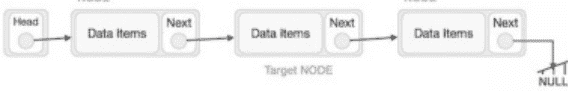

目标节点的左侧（前一个）节点现在应该指向目标节点的下一个节点——

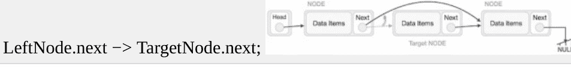

`LeftNode.next -> TargetNode.next;`

这将移除指向目标节点的链接。现在，使用以下代码，我们将移除目标节点所指向的内容。

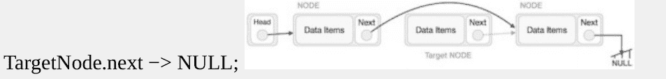

`TargetNode.next -> NULL;`

我们需要使用这个被删除的节点。我们可以将其保留在内存中，否则我们可以简单地释放内存并完全清除目标节点。

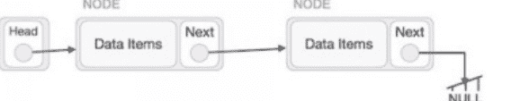

## 反转操作

这个操作是彻底的。我们需要让头节点指向最后一个节点，并反转整个链表。

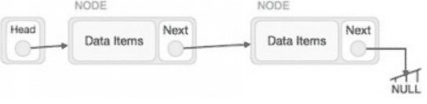

首先，我们遍历到列表的末尾。它应该指向 `NULL`。现在，我们将让它指向它的前一个节点——

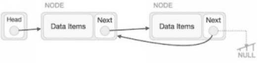

我们必须确保最后一个节点不是丢失的节点。因此，我们将有一个临时节点，看起来就像头节点指向最后一个节点。现在，我们将让所有左侧节点逐个指向它们的前一个节点。

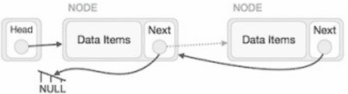

除了头节点指向的节点（第一个节点）外，所有节点都应该指向它们的先驱，使它们成为新的后继。第一个节点将指向 `NULL`。

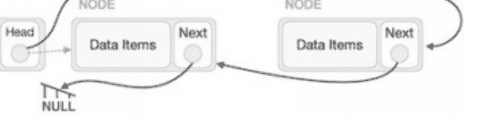

我们将使用临时节点让头节点指向新的第一个节点。

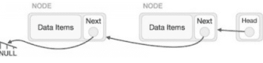

链表现在已经反转了。

## 程序：给定一个有序的链表，你将如何以排序的方式插入？

### 算法

假设输入链表是按递序排序的。

1. 如果链表为空，则将节点设为头节点并返回。
2. 如果要插入的节点的值小于头节点的值，则将节点插入到开头并设为头节点。
3. 在循环中，找到合适的节点，输入节点（假设为 9）将插入在该节点之后。要找到合适的节点，从头节点开始一直移动直到到达一个值大于输入节点的节点 `GN`（下图中的 10）。`GN` 之前的节点就是合适的节点（7）。
4. 在第 3 步找到的合适节点（7）之后插入节点（9）。

### 初始链表


### 插入 9 后的链表


```java
class LinkedList {
  Node head; // head of list

  /* Linked list */
  class Node {
    int data;
    Node next;
    Node(int d) {data = d; next = null; }
  }

  /* function to insert a new_node in a list. */
  void sortedInsert(Node new_node) {
    Node current;
    /* Special case for head node */
    if (head == null || head.data >= new_node.data) {
      new_node.next = head;
      head = new_node;
    } else {
      /* Locate the node before point of insertion. */
      current = head;
      while (current.next != null && current.next.data < new_node.data) {
        current = current.next;
      }
      new_node.next = current.next;
      current.next = new_node;
    }
  }
}

/*Utility functions*/
/* Function to create a node *(int data) */
Node newNode(int data)
{
    Node x = new Node(data);
    return x;
}

/* Function to print linked list */
void printList() {
    Node temp = head;
    while (temp != null) {
        System.out.print(temp.data+" ");
        temp = temp.next;
    }
}

/*Driver function to test above methods */
public static void main(String args[]) {
    LinkedList list = new LinkedList();
    Node new_node;
    new_node = newNode(5);
    list.sortedInsert(new_node);
    new_node = newNode(10);
    list.sortedInsert(new_node);
    new_node = newNode(7);
    list.sortedInsert(new_node);
    new_node = newNode(3);
    list.sortedInsert(new_node);
    new_node = newNode(1);
    list.sortedInsert(new_node);
    new_node = newNode(9);
    list.sortedInsert(new_node);
    System.out.println("Created Linked List");
    list.printList();
}
```

输出：`Created Linked List 1 3 5 7 9 10`

## 程序：在链表中删除给定节点

给定单链表，写一个函数来删除指定的节点。你的函数必须满足：

1. 它接受起始节点作为第一个参数，要删除的节点作为第二个参数。
2. 它应该返回头指针。
3. 它应该假设链表可能为空。在实现中，当要删除的节点是头节点时，需要修改头指针。


```java
class LinkedList {
    static Node head;

    static class Node {
        int data;
        Node next;

        Node(int d) {
            data = d;
            next = null;
        }
    }

    void deleteNode(Node node, Node n) {
        // 当要删除的节点是头节点时
        if (node.next == null) {
            System.out.println("There is one node. The list can't made ");
            return;
        }

        /* 将下一个节点的数据拷贝给头节点 */
        node.data = node.next.data;
        // 保存下一个节点的地址
        n = node.next;

        // 移除下一个节点的链接
        node.next = node.next.next;

        // 释放内存（逻辑上）

        // 不是头节点时，执行常规删除
        // 寻找前一个节点
        Node prev = head;
        while (prev.next != null && prev.next != n) {
            prev = prev.next;
        }

        // 检查节点是否存在于链表中
        if (prev.next == null) {
            System.out.println("Given node is not present in Linked List");
            return;
        }

        // 从链表中移除节点
        prev.next = prev.next.next;

        // 释放内存

        return;
    }

    /* 打印链表的实用函数 */
    void printList(Node head) {
        while (head != null) {
            System.out.print(head.data + " ");
            head = head.next;
        }
    }

    public static void main(String[] args) {
        LinkedList list = new LinkedList();
        list.head = new Node(12);
        list.head.next = new Node(15);
        list.head.next.next = new Node(10);
        list.head.next.next.next = new Node(11);
        list.head.next.next.next.next = new Node(5);
        list.head.next.next.next.next.next = new Node(6);
        list.head.next.next.next.next.next.next = new Node(2);
        list.head.next.next.next.next.next.next.next = new Node(3);

        System.out.println("Given Linked List :");
        list.printList(list.head);
        System.out.println("");

        // 删除值为 10 的节点
        System.out.println("Deleting node :" + list.head.next.next.data);
        list.deleteNode(list.head, list.head.next.next);

        System.out.println("Modified list :");
        list.printList(list.head);
        System.out.println("");

        // 删除第一个节点
        System.out.println("Deleting first Node");
        list.deleteNode(list.head, list.head);
        System.out.println("Modified Linked List");
        list.printList(list.head);
    }
}
```

### 输出

```
Given Linked List: 12 15 10 11 5 6 2 3

Deleting node 10:

Modified Linked List: 12 15 11 5 6 2 3

Deleting first node

Modified Linked List: 15 11 5 6 2 3
```

# 第 4 章 | 网络

# 什么是网络编程？

**网络编程**指的是编写在多个设备（计算机）上执行的程序，这些设备都通过网络相互连接。

J2SE API 中的 `java.net` 包包含了一系列类和接口，它们提供了底层的通信细节，允许你编写专注于解决当前问题的程序。

`java.net` 包提供了对两种常用网络协议的支持——

1. **TCP** 代表传输控制协议（Transmission Control Protocol），用于两个应用程序之间的可靠通信。TCP 通常在互联网协议上使用，称为 TCP/IP。

2. **UDP** 代表用户数据报协议（User Datagram Protocol），一种无连接协议，允许应用程序之间传输数据包。

本章对以下两个主题提供了良好的理解——

1. **套接字编程** —— 这是网络领域应用广泛的概念，已进行了非常详细的解释。

2. **URL 处理** —— URL 代表统一资源定位符（Uniform Resource Locator），代表万维网上的资源，例如 Web 页面或 FTP 目录。

# Socket 编程

Socket 提供了一种使用 TCP 在两台计算机之间进行通信的机制。客户端程序在通信的一端创建一个 socket，并尝试将该 socket 连接到服务器。

当连接建立后，服务器会在通信的另一端创建一个 socket 对象。现在，客户端和服务器可以通过向 socket 写入和读取数据来进行通信。

`java.net.Socket` 类表示 socket，而 `java.net.ServerSocket` 类为服务器程序提供了一种机制，用于监听客户端并与它们建立连接。

使用 socket 在两台计算机之间建立 TCP 连接时，会发生以下步骤：

1. 服务器实例化一个 `ServerSocket` 对象，指定用于通信的端口号。
2. 服务器调用 `ServerSocket` 类的 `accept()` 方法。该方法会等待，直到客户端在指定的端口上连接服务器。
3. 在服务器等待期间，客户端实例化一个 `Socket` 对象，指定要连接的服务器名称和端口号。
4. `Socket` 的构造函数尝试将客户端连接到指定的服务器和端口号。如果建立了连接，客户端现在就拥有了一个能够与服务器通信的 `Socket` 对象。
4. 在另一端，`accept()` 方法返回服务器上一个新 socket 的引用，该 socket 连接到客户端的 socket。
5. 连接建立后，可以使用 I/O 流进行通信。每个 socket 都有一个 `OutputStream` 和一个 `InputStream`。客户端的 `OutputStream` 连接到服务器的 `InputStream`，而客户端的 `InputStream` 连接到服务器的 `OutputStream`。

TCP 是一种双向通信协议，因此数据可以同时跨越这两个流进行发送。以下是提供实现 socket 完整方法集的实用类。

# ServerSocket 类方法

`java.net.ServerSocket` 类被服务器应用程序用于获取端口并监听客户端请求。

`ServerSocket` 类有四个构造函数——

| Sr.No. | Method & Description |
|---|---|
| 1 | `public ServerSocket(int port) throws IOException` 尝试创建一个绑定到指定端口的服务器套接字。如果端口已被另一个应用程序绑定，则会发生异常。 |
| 2 | `public ServerSocket(int port, int backlog) throws IOException` 与上一个构造函数类似，`backlog` 参数指定在等待队列中存储多少个入站客户端。 |
| 3 | `public ServerSocket(int port, int backlog, InetAddress address) throws IOException` 与上一个构造函数类似，`InetAddress` 参数指定要绑定的本地 IP 地址。`InetAddress` 用于可能具有多个 IP 地址的服务器，允许服务器指定接受其哪一个 IP 地址的客户端请求。 |
| 4 | `public ServerSocket() throws IOException` 创建一个未绑定的服务器套接字。使用此构造函数时，当您准备好绑定服务器套接字时，使用 `bind(port)` 方法。 |

如果 `ServerSocket` 构造函数没有抛出异常，意味着您的应用程序已成功绑定到指定的端口，并准备好处理客户端请求。

以下是 `ServerSocket` 类的一些常用方法——

| Sr.No. | Method & Description |
|---|---|
| 1 | `public int getLocalPort()` 返回服务器套接字正在监听的端口。如果你在构造函数中传递 `0` 作为端口号并让服务器为你查找，则此方法是很有用的。 |
| 2 | `public Socket accept() throws IOException` 等待入站客户端。此方法会阻塞，直到客户端在指定的端口上连接服务器或 socket 超时（假设已使用 `setTimeout()` 方法设置了超时值）。否则，此方法将无限阻塞。 |
| 3 | `public void setSoTimeout(int timeout)` 设置服务器套接字在 `accept()` 期间等待客户端的超时值。 |
| 4 | `public void bind(SocketAddress host, int backlog)` 绑定到 `SocketAddress` 对象中指定的服务器和端口。如果你使用无参数构造函数实例化了 `ServerSocket`，请使用此方法。 |

当 `ServerSocket` 调用 `accept()` 时，在客户端连接之前该方法不会返回。客户端连接后，`ServerSocket` 在未指定的端口上创建一个新的 `Socket` 并返回此新 `Socket` 的引用。现在客户端和服务器之间建立了 TCP 连接，通信可以开始。

# Socket 类方法

`java.net.Socket` 类表示客户端和服务器用于相互通信的 socket。客户端通过实例化来获取 `Socket` 对象，而服务器则通过 `accept()` 方法的返回值获取 `Socket` 对象。

`Socket` 类有五个客户端用于连接到服务器的构造函数——

| Sr.No. | Method & Description |
|---|---|
| 1 | `public Socket(String host, int port) throws UnknownHostException, IOException` 此方法尝试连接到指定的端口。如果此构造函数没有抛出异常，则连接成功，客户端已连接到服务器。 |
| 2 | `public Socket(InetAddress host, int port) throws IOException` 此方法与上一个构造函数相同，只是 `host` 由 `InetAddress` 对象表示。 |
| 3 | `public Socket(String host, int port, InetAddress localAddress, int localPort) throws IOException` 连接到指定的主机和端口，在本地主机上的指定地址和端口处创建一个 socket。 |
| 4 | `public Socket(InetAddress host, int port, InetAddress localAddress, int localPort) throws IOException` 此方法与上一个构造函数相同，只是 `host` 由 `InetAddress` 而不是 `String` 表示。 |
| 5 | `public Socket()` 创建一个未连接的 socket。使用 `connect()` 方法将此 socket 连接到服务器。 |

当 `Socket` 构造函数返回时，它已经尝试连接到指定的服务器和端口。`Socket` 类中的一些感兴趣的方法列在这里：

| Sr.No. | Method & Description |
|---|---|
| 1 | `public void connect(SocketAddress host, int timeout) throws IOException` 此方法尝试连接到指定的端口。如果此构造函数没有抛出异常，则连接成功，客户端已连接到服务器。 |
| 2 | `public InetAddress getAddress()` 返回此 socket 连接的主机。 |
| 3 | `public int getPort()` 返回远程机器连接的端口。 |
| 4 | `public int getLocalPort()` 返回本地机器绑定的端口。 |
| 5 | `public SocketAddress getRemoteAddress()` 返回远程地址。 |
| 6 | `public InputStream getInputStream() throws IOException` 返回 socket 的输入流。该输入流连接到远程的输出流。 |
| 7 | `public OutputStream getOutputStream() throws IOException` 返回 socket 的输出流。该输出流连接到远程的输入流。 |
| 8 | `public void close() throws IOException` 关闭 socket，该 Socket 对象无法再次连接到任何服务器。 |

# InetAddress 类方法

该类表示 Internet 协议（IP）地址。以下是你在进行套接字编程时需要的有用方法——

| Sr.No. | Method & Description |
|---|---|
| 1 | `static InetAddress getByAddress(byte[] addr)` 给定的原始 IP 地址返回 InetAddress 对象。 |
| 2 | `static InetAddress getByAddress(String host, byte[] addr)` 根据提供的主机名和 IP 地址创建 InetAddress。 |
| 3 | `static InetAddress getByName(String host)` 给定的主机名确定 IP 地址。 |
| 4 | `String getHostAddress()` 返回文本形式的 IP 地址字符串。 |
| 5 | `String getHostName()` 获取此 IP 地址的主机名。 |
| 6 | `static InetAddress getLocalHost()` 返回本地主机。 |
| 7 | `String toString()` 将此 IP 地址转换为字符串。 |

# Socket 客户端示例

下面的 GreetClient 是一个使用 socket 连接到服务器并发送问候，且等待响应的客户端程序。

### 示例

```java
// 文件名 GreetClient.java
import java.net.*; import java.io.*;
public class GreetClient {
    public static void main(String [] args) {
```


```java
String serverName = args[0]; int port = Integer.parseInt(args[1]);
try {
    System.out.println("Connecting to " + serverName + " on port " + port);
    Socket client = new Socket(serverName, port); System.out.println("Just connected to " + client.getRemoteSocketAddress());
    DataOutputStream outServer = client.getOutputStream(); DataOutputStream out = new DataOutputStream(outServer);
    out.writeUTF("Hello from " + client.getLocalSocketAddress());

    InputStream inFromServer = client.getInputStream(); DataInputStream in = new DataInputStream(inFromServer);
    System.out.println("Server says " + in.readUTF()); client.close();
} catch (IOException e) {
    e.printStackTrace();
}
```

# Socket 服务器示例

接下来的 `GreetingServer` 程序是一个服务器应用程序示例，它使用 `Command` 类在命令行参数指定的端口号上监听客户端。

示例：

```java
// 文件名 GreetingServer.java
import java.net.*; import java.io.*;
public class GreetingServer extends Thread {
    private ServerSocket serverSocket;
    public GreetingServer(int port) throws IOException {
        serverSocket = new ServerSocket(port); serverSocket.setTimeout(10000);
    }

    public void run() {
        while(true) {
            try {
                System.out.println("Waiting for client on port " +
                serverSocket.getLocalPort() + "..."); Socket server = serverSocket.accept();
                System.out.println("Connected to " + server.getRemoteSocketAddress());
                DataInputStream in = new DataInputStream(server.getInputStream());
                DataOutputStream out = new DataOutputStream(server.getOutputStream());
                System.out.println(in.readUTF()); DataOutputStream out.writeUTF("Thank you for
                connecting to " + server.getLocalSocketAddress() + "\nGoodbye!");
                server.close();
            } catch(SocketException s) {
                System.out.println("Socket timed out!");
                break;
            } catch(IOException e) {
                e.printStackTrace();
                break;
            }
        }
    }

    public static void main(String[] args) {
        int port = Integer.parseInt(args[0]); try {
            Thread t = new GreetingServer(port); t.start(); } catch(IOException e) {
            e.printStackTrace();
        }
    }
}
```

编译客户端和服务器，然后如下方式启动服务器：

```bash
$ java Greeting 6066
Waiting for client on port 6066...
```

按照如下方式检查客户端程序：

输出：

```
$ java GreetingClient localhost 6066
Connecting to localhost on port 6066
Just connected to localhost/127.0.0.1:6066
Server says Thank you for connecting to /127.0.0.1:6066
Goodbye!
```

# URL 处理

`URL` 代表统一资源定位符（Uniform Resource Locator），代表万维网上的某种资源，例如网页或 FTP 目录。

本节展示了如何编写与 `URL` 通信的 Java 程序。`URL` 可以被拆分为以下部分：

`protocol://host:port/path?query#ref`

协议的示例包括 `HTTP`、`HTTPS`、`FTP` 和 `File`。路径也被称为文件名，而主机也称为权威机构（authority）。

以下是一个协议为 `HTTP` 的网页 `URL`：

```
https://www.amrood.com/index.htm?language=en#j2se
```

注意，此 `URL` 没有指定端口，在这种情况下将使用协议的默认端口。对于 `HTTP`，默认端口是 `80`。

# URL 类方法

`java.net.URL` 类表示一个 `URL`，并拥有一套完整的方法用于在 Java 中操作 `URL`。

`URL` 类有几个用于创建 `URL` 的构造函数，包括以下几个：

| 序号 | 方法与描述 |
|---|---|
| 1 | `public URL(String protocol, String host, int port, String file) throws MalformedURLException` 通过组合给定的部分来创建 `URL`。 |
| 2 | `public URL(String protocol, String host, String file) throws MalformedURLException` 与上一个构造函数相同，区别是使用了给定协议的默认端口。 |
| 3 | `public URL(String url) throws MalformedURLException` 从给定的字符串创建 `URL`。 |
| 4 | `public URL(URL context, String url) throws MalformedURLException` 通过解析 `URL` 和 `String` 参数来创建 `URL`。 |

`URL` 类包含许多方法用于访问所表示的 `URL` 的各个部分。`URL` 类中的一些方法包括以下：

| 序号 | 方法与描述 |
|---|---|
| 1 | `public String getPath()` 返回 `URL` 的路径。 |
| 2 | `public String getQuery()` 返回 `URL` 的查询部分。 |
| 3 | `public String getAuthority()` 返回 `URL` 的权威机构。 |
| 4 | `public int getPort()` 返回 `URL` 的端口。 |
| 5 | `public int getDefaultPort()` 返回 `URL` 的默认端口。 |
| 6 | `public String getProtocol()` 返回 `URL` 的协议。 |
| 7 | `public String getHost()` 返回 `URL` 的主机。 |
| 8 | `public String getHost()` 返回 `URL` 的主机。 |
| 9 | `public String getFile()` 返回 `URL` 的文件。 |
| 10 | `public String getRef()` 返回 `URL` 的引用。 |
| 11 | `public URLConnection openConnection()` 打开到 `URL` 的连接。 |

示例：

以下 `URLDemo` 程序展示了 `URL` 的各种部分。`URLDemo` 输出这些部分。

```java
// 文件名 URLDemo.java
import java.net.*; import java.io.*;
public class URLDemo {

    public static void main(String[] args) {
        try {
            URL url = new URL("https://www.amrood.com/index.htm?language=en#j2se");
            System.out.println("URL is " + url.toString());
            System.out.println("protocol is " + url.getProtocol());
            System.out.println("authority is " + url.getAuthority());
            System.out.println("file name is " + url.getFile());
            System.out.println("host is " + url.getHost());
            System.out.println("path is " + url.getPath());
            System.out.println("port is " + url.getPort());
            System.out.println("default port is " + url.getDefaultPort());
            System.out.println("query is " + url.getQuery());
            System.out.println("ref is " + url.getRef());
        } catch (MalformedURLException e) {
            e.printStackTrace();
        }
    }
}
```

输出：

```
URL is https://www.amrood.com/index.htm?language=en#j2se
protocol is https
authority is www.amrood.com
file name is /index.htm
host is www.amrood.com
path is /index.htm
port is -1
default port is 80
query is language=en
ref is j2se
```

# URLConnections 方法

`openConnection()` 方法返回 `java.net.URLConnection`，该抽象类表示各种类型的 `URL` 连接。

例如：

如果你连接到一个协议为 `HTTP` 的 `URL`，`openConnection()` 返回一个 `HttpURLConnection` 对象。

如果你连接到一个代表 `JAR` 文件的 `URL`，`openConnection()` 返回一个 `JarURLConnection` 对象，等等。

`URLConnection` 类包含许多用于设置或确定连接信息的方法，包括以下：

| 序号 | 方法与描述 |
|---|---|
| 1 | `getContent()` 获取此连接的内容。 |
| 2 | `getContent(Class[] classes)` 获取此连接的内容。 |
| 3 | `getContentEncoding()` 返回 `content-encoding` 头部字段的值。 |
| 4 | `getContentLength()` 返回 `content-length` 头部字段的值。 |
| 5 | `getContentType()` 返回 `content-type` 头部字段的值。 |
| 6 | `getLastModified()` 返回 `last-modified` 头部字段的值。 |
| 7 | `getExpiration()` 返回 `expired` 头部字段的值。 |
| 8 | `getIfModifiedSince()` 返回此对象 `ifModifiedSince` 字段的值。 |
| 9 | `setDoInput(boolean input)` 传入 `true` 表示该连接将用于输入。默认值为 `true`，因为许多客户端通常读取 `URLConnection`。 |
| 10 | `setDoOutput(boolean output)` 传入 `true` 表示该连接将用于输出。默认值为 `false`，因为许多类型的 `URL` 不支持写入。 |
| 11 | `getInputStream()` 抛出 `IOException` 返回连接的输入流，用于读取资源。 |
| 12 | `getOutputStream()` 抛出 `IOException` 返回连接的输出流，用于写入资源。 |
| 13 | `getURL()` 返回此 `URLConnection` 对象连接的 `URL`。 |

### 示例

下面的 `URLConnectionDemo` 程序连接到从命令行输入的 `URL`。

如果该 `URL` 代表 `HTTP` 资源，则连接被强制转换为 `HttpUrlConnection`，并且资源中的数据将逐行读取。

```java
// File Name : URLConnDemo.java
import java.net.*; import java.io.*;
public class URLConnDemo {

    public static void main(String [] args) {
    try {
        URL url = new URL("https://www.amrood.com"); URLConnection
        urlConnection = url.openConnection(); HttpURLConnection connection = null;
        if(urlConnection instanceof HttpURLConnection) {
            connection = (HttpURLConnection) urlConnection;
            System.out.println("Please enter an HTTP URL."); return;
        } else {
        BufferedReader in = new BufferedReader(
        new InputStreamReader(connection.getInputStream())); String urlString = "";
        String current;
        while((current = in.readLine()) != null) {
            urlString += current;
        }
        System.out.println(urlString);
    } catch(IOException e) {
        e.printStackTrace();
    }
    }
}
```

### 输出

```
$ java URLConnDemo
......a complete HTML content of home of amrood.com...
```

# 学习复制与粘贴

“平庸的艺术家模仿，伟大的艺术家窃取。”这里有代码示例供你复制并粘贴到你的项目中。本书的内容以及所有可下载的内容并无二致。这意味着你必须理解代码在做什么，才能将其解释并以适应你的需求。每一位程序员都是习惯性地这样做。

# 复制/粘贴

学习如何做到这一点非常重要，因为在许多情况下，你实际上需要这样做，这不仅是为了学习，也是为了完成任何陌生的任务。编程是一个持续的学习过程。它是一种命令计算机的语言。

每当你学习一门新语言时，会有大量的单词需要你查阅。而且每个程序员都会创造新词汇，你面对的是一种你永远需要字典的语言。

当显示某些代码时，会被要求将这些代码复制到你的项目中。当你的手指在键盘上准备好时，你会养成打字的习惯。

程序员通常打字很快是有原因的。这也是为什么程序员对自己偏好的键盘非常挑剔的原因。在大多数情况下，书中的项目将处于某种状态，你可以阅读已经就绪的文本。


大多数项目处于更完整的状态，你可以运行它们并看到预期的结果。作为一名程序员，我已经习惯了在互联网上搜索示例代码。

一旦我发现了某些看起来很有用的东西，我就会复制它并粘贴到一个简单的测试用例中。在我弄懂了代码在做什么之后，我会将其重写为更适合我特定情况的形式。即使代码涉及一些有趣的技巧，我也会从那段代码中学习。

随着我学习新技巧，我作为一名程序员也因此成长。学习新技巧的唯一方法是找到解决新问题的必要性，而这些问题是我还没有想出解决方案的。寻找问题的解决方案是成为程序员的根本部分。

# 自学程序员通常欠缺的 5 项技能

## 1. 算法

这是经典的计算机科学。在没有算法知识的情况下编程，就像只用一把锯子做木工：你可以完成工作，但会花费更多的时间。

你可以将算法看作是一种“纪律”。当你学习编写它们时，你正在用纪律来解决问题；使用结构、模式和逻辑步骤。

当你不知道如何节律你的思想时，你就不知道如何编写算法。

除非你学习过它们，否则你不仅无法编写算法，你也不知道别人写了多少算法。

我花了四天时间尝试如何进行排列。当我解出来时，我感到非常自豪。直到我发现 B.R. Heaps 在 1963 年就想出来了。

## 2. 设计模式

这源于教育和/或经验。结构化代码的方法不止一种，而且每种方法都有正确和错误的时间点。你要么需要在过程中犯错并学习何时使用每种模式，要么就从已经犯过同样错误的人（比如老师）身上学习。

## 3. 编程范式

面向对象编程并不是“唯一途径”。函数式编程也不是。响应式编程亦是。它只是“方法之一”。

编程有不同的方式，每种都有其目的。不仅如此，某些语言天生更适合某一种范式或另一种。

> “如果你手里只有一把锤子，一切看起来都像钉子。”

以自学编程为例，你会发现自己正在敲击钉子、螺丝、订书钉和按图钉。

我记得有一个自学的 .NET 程序员曾经告诉过我：“好吧，除非是面向对象的，否则那不是编程。这就是为什么我不认为 JavaScript 是一门编程语言。”这是一个非常、非常有缺陷的思维方式。

## 4. 数据结构

承认，你的语言可以让你对不同的数据结构有一个基本概念。但再次，那只是一个基本概念。

自学程序员倾向于只坚持在他们喜爱的语言中可行的数据结构。仅仅因为它不是基本类型，甚至不是你语言中的常用结构，并不意味着它不存在。当然，这也可能意味着它不应该存在。

> 如果一切都能放入一个数组里，世界就变得很小。

## 5. 测试

也许只是我个人的想法，但在代码推送到环境之前，有很多测试方法。学习如何单元测试。

重要的是，学习测试驱动开发。

测试代码与编写可测试代码之间是有区别的。

# 我遇到的自学程序员经常缺乏以下领域的知识：

- **正式术语。** 你必须熟记数据结构和其他事物的正确名称，以便就软件开发项目进行有效的交流。

- **测试。** 大多数自学者缺乏知识，或者通常不理解测试过程的重要性。

- **范式（以及相应的语言）。** “如果你手里只有一把锤子，一切看起来都像钉子。”我遇到过很多这类人。他们通常不理解为什么问题并不相同。

- **机器相关的数学问题。** 他们缺乏数值技能，并且不理解为什么浮点数运算会失效。

# 成为伟大程序员的 9 种方法

## 1. 实践

除了遵循教程，你还应该开发自己的项目。

> “成为一名优秀的程序员需要很、很长的时间和许多痛苦的夜晚。在编写好代码之前，你必须编写数十万行代码”
>
> —— Mike Arpaia，一位前 Etsy 开发者，现在为 Facebook 构建信息安全软件。

Mike 强调，初学者应该放弃可以快速成为优秀开发者的假设。

但是……如果你还没有离开教程阶段呢？如果你仍在撞墙，并怀疑自己可能不适合编程呢？在得出结论之前，请记住每个人都有不同的学习风格。

事实上，Reserve 的 CTO Craig Coffman 是通过大量的尝试与错误以及选择那些个人化且有趣的项目来亲自学习的。然而，由于所有有趣的挑战都是大块头，他建议初学者从切口大小合理的任务开始入手。

这样，当你失去兴趣或遇到瓶颈时，你仍然能获得进步感和成就感。

## 3. 保持兴趣

如果你对正在从事的项目感到无聊，那么你可能应该重新考虑学习编程的任何宏伟目标了。或者，你可能只是在做错误的项目，或者正在通过错误的资源进行学习。始终通过专注于让你兴奋的个人项目来让自己保持动力。

Coraline Ada Ehmke 是 LGBTTech 的创始人，也是 Rails 和 RSpec 等知名开源项目的贡献者，她在很小的时候就开始学习编程了。然而，她在大学作为计算机科学专业上的的第一门课就让她对热情产生了怀疑。

> “我记得我们一个学期的项目是为 ATM 机编写软件。我当时感到非常无聊且毫无挑战性，我决定工程师的生活就是这样，我不想参与其中的任何部分，所以不久后就退学了。”

然而，她继续从事她认为有趣的项目。到 1993 年，她已经上线并开始构建网站，从那以后一直在开发 Web 应用。

## 4. 爱上错误

作为初学者，你可能会深陷于 Bug 中。如果你被满屏红色的（错误信息）感到畏缩，你并不孤单。Ross Chapman 曾在 Zendesk 写过代码，现在工作于 ScienceExchange，这位 UX 工程师承认自己在刚开始时是一个胆小的开发者。

> “我那时没有耐心，因为我还没准备好去热爱修复问题的挑战。但这正是我所有坏习惯的源头。”

话虽如此，Ross 敦促初学者将错误视为至关重要的学习时刻。既然你的一生都在调试，你就应该习惯错误并学会识别错误信息。

> “能够快速解析和理解错误信息将节省大量时间并让你走得远。你请求的人会非常感激你的尝试。”
>
> — 《Beginning jQuery》作者 Jack Franklin

Jack 还建议初学者首先尝试自己解决问题。当调试遇到瓶颈时，React 的共同贡献者 Lee Byron 会通过大量使用调试工具来亲自尝试理解发生了什么。

> “一旦我准确地理解了发生了什么——一步一步来——我就可以与我预期的结果进行比较，隔离出令人惊讶的部分，以及我的假设哪里是错误的，或者某些代码是如何导致这种意外的。”

然而，错误不仅限于 Bug。有时，你会做出错误的决策，例如使用错误的数据结构。根据 Mike 的说法，在这些错误决策上吃亏最终会帮助你学会何时使用某些设计模式是合理的。

## 5. 理解工作原理

> “无论你处于什么水平，我都会说：永远不要在不知道代码为何有效的情况下写任何代码，要深入到底层。比如，保持痴迷的好奇心。成为源代码世界的印第安纳·琼斯。好奇心是工程师唯一的永恒。我认为，如果不带着好奇心盯着显示器，你在这个行业无法立足。既孩子化，又严谨学术化。”
>
> — Ross Chapman

可以说，光有兴趣是不够的。如果你目标是成为一个像样的专业开发者，你就必须努力理解事物是如何工作的。

> “你可以通过筛选 StackOverflow 的问题来开始理解你使用的工具。我从那里学到了一些东西。[顶部的 AngularJS 问题]读起来真的很有趣，因为 Angular 是一个如此巨大的框架”
>
> — Todd Motto，AngularJS 大会演讲者，Google 开发者专家

Spotify 的高级基础设施工程师 Rohan Singh 强调了理解你目前工作堆栈下方一个层级的重要性。“我们软件工程师所做的一切都涉及到在某种抽象层面上工作，”Rohan 说。换句话说，如果你使用某种数据库，你可以忽略数据库的内部原理，并期望它“能够正常工作”。

此外，为了真正理解事物的工作原理，你应该能够解释为什么某些技术选择比其他更好，并在事物运行不符合预期时能够排除故障。Rohan 在实践中实现了这一点，通过尝试一点一点地学习和理解他使用的任何平台或系统的基础——无论是 Python、Go 还是 Linux 操作系统。据他说，这最终有助于你建立一个关于底层运行机制的心智模型，并拓宽你的知识基础。

最终，你将作为工程师成长，而且通过学习如何进行更多的“后倾式”调试而不是“前倾式”调试，你能够更高效地调试。换句话说，你会向后倾并深思考底层的工作原理，以找出问题可能在哪里。“这可能比使用交互式调试器或其他工具进行‘前倾式’调试要快得多，且涉及更少的尝试，”Rohan 说。

事实上，来自 Evernote 的 Andrei Thorp 认为每个人应该尽早学习基础 C 语言。因为它是极简的且不会替你做，它迫使你从更底层理解计算机到底是如何工作的。例如，C 让你自己管理使用的内存——这意味着以后当你使用 Python 等工具时，你实际上理解 Python 在为你做什么。然后当你看到某些奇怪的 Bug 时，你拥有理解它的背景知识。

## 6. 持续学习新事物

在 Amazon Web Services 工作的 Jonathan 表示，没有什么比不学习新事物更能扼杀你的职业生涯了。

## 7. 寻求帮助

“孤单编码者的传奇是一个神话，”Adam 说，“几乎所有实质性的项目都需要团队合作。”

最重要的是先去做：

- 尝试很糟糕地做。
- 弄清楚我要去哪里。
- 处理我确定的内容。
- 重复。

根据 Jack 的说法，当地聚会通常会有一些环节，为任何需要的人提供免费指导。其他免费资源还包括 Twitter 群组、Slack 群组和 IRC 频道。

## 8. 不要仅仅编写代码——构建解决方案

> “很多编程并不关于代码，而是关乎理解其他学科或标准。”

如果你不理解某人的问题，你就无法用代码来解决它。我接触过的项目让我看到了小企业、营销人员、经纪人和其他专业人士看待世界的方式。当你理解了他们目前如何解决问题时，你就可以与他们合作，提出更新、更好的解决方案。

— Adam Haney，Bellhops CTO

Ross 希望自己在职业生涯早期能更早地做的一件事，就是更好地欣赏软件工程本身的学科规范和历史。

如今，人们很容易投身这项职业并只关注“编码”。特别是在蓬勃的市场中，浏览器编码员或 Web 应用编码员使用着巨大的动态编程语言（Ruby, JavaScript）以及极其奇特的“计算机”语言和格式（HTML, CSS），我们可能会倾向于花费所有时间去竞赛掌握无数工具、框架和 API，以便在面试中脱颖而出或在工作中晋升。在团队中构建产品始终是一场社交活动，而且是一项具有独特挑战的活动，这些挑战大多是非技术的。例如，事实证明软件工程中最困难的事情是决定构建什么，而不是构建；尽管随着 JavaScript 菌丝体结构的剧烈扩张，这可能没那么真实了。

Ross 说，他花了一段时间才理解，大多数软件工程首先发生在你的脑海中。“编码很快就会变成容易的部分。但一个高水平的工程师可以用方框、圆圈和线条画出解决方案——我知道这是一项需要学习的技能，因为我做得越来越多，而且变得越来越擅长。”这种意识到编码更多是“托腮沉思和白板演示”的感受对他实际上产生了共鸣，他为此写了一篇博客文章。

“记住，这关乎人类和我们的生活，而不仅仅是你正在编写代码的技术，”Derick 说道。学习人类如何思考、互动和相处。然后将你学到的知识体现在你的软件架构和设计中。

## 9. 不要重复轮子

最后，无论你变得多优秀，你的代码永远不会是 100% 原创的，因为许多问题在你所选择的语言中已经得到了解决。“保持轮子原样没有任何羞耻的，”Ross 保证道，“然而，当需要提交时，你最好能确定你能像小石·约翰逊那样的魅力和自信向你的团队辩护那段代码。”

> “不要因为你不理解抽象就重新发明轮子，”Mike 提醒我们。

然而，这并不是意味着发明轮子没有任何价值。Clarifai 的首席执行官 Matthew Zeiler 鼓励人们如果他们感兴趣，就去构建已经有解决方案的东西。从零开始构建工具将帮助你了解更多软件工程、系统可扩展性等。

## 结论

在学习如何开发应用或项目时，挫败感随处可见，但希望以上提示让你在成为开发者的道路上更有信心。

## #1. 关于职业

- 编写可以被他人阅读、理解和操作的代码。这允许你交接并承担新的挑战。

- 如果你囤积知识，你将是唯一的守护者——或者在具有工程/业务头脑的组织中，这就是一个风险。

- 停止为代码或黑客马拉松自豪，这在永久性的团队中毫无意义。执行和协作将为你提供更大的服务。

## #2. 关于解决方案和编码

- 如果你无法向非程序员解释它，你可能把它过度复杂或过度优化了。

- 如果你画不出架构图，你可能也把它过度复杂了。

- 不要通过写“紧凑代码”来炫耀。

## #3. 关于个人提高

- 不要成为 Java 或 C/C++（或其他）的粉丝。在长期的职业生涯中，你将学习 10 多种语言。将它们视为工具，而不是跟风潮流。

- 永远会有更优秀的程序员，而且他们很难识别。向所有人学习。

- 你的价值不是由代码的质量定义的。不要那样评价自己。

## #4. 关于哲学

- 编程是让非程序员能够比他们独立能做的更多事的艺术。

- 计算机科学是世界上几乎每个研究领域或行业的催化剂。计算机科学使人类做得更多、解决更多、变得更好。

- 计算机科学 != 编程。如果你的大学只教你如何编程，去要钱吧。

# 程序员、优秀程序员和伟大程序员之间的区别

- **程序员 (Programmer)**：在有足够详细的问题描述的情况下，任何可以编写运行程序来解决问题的人。

- **优秀程序员 (Good programmer)**：一个与他人协作创建适合客户使用的、可维护的、优雅程序的程序员，按时交付且缺陷率低，且几乎没有或没有人际冲突。

- **伟大程序员 (Great programmer)**：一个优秀的程序员，他们能直觉地理解算法和架构，可以在很少监督的情况下构建自洽的大型系统，可以发明新算法，可以在不破坏运行系统的情况下对其进行重构，能够就技术和非技术问题与非技术人员进行有效且有说服力的沟通，理解如何控制自己的自尊，并将技能传授给他人。

成为伟大程序员的路径是从成为程序员开始，然后培养成为优秀程序员所需的技能，并练习这些技能直到精通，然后培养成为伟大程序员所需的技能，并练习它们直到精通。

这所需的时间取决于你的技能、性格和训练。它取决于职业生涯中获得的经验和机会，以及你如何应对它们。

# 程序崩溃的 4 个原因！

你的程序崩溃可能有 4 个原因：

- 你的程序可能依赖某些随机元素：用户输入、随机数、时间等。

- 如果你的程序使用了未初始化的变量，它可能会访问它不应该访问的数据（访问数组索引之外也是如此）。

- 你的程序可能使用了一个经常崩溃的外部库。

- 栈溢出！

# 编程格言！

> “语言是廉价的。展示代码。” — Linus Torvalds

> “程序必须为人类阅读而编写，而不仅仅是为了机器执行。” — Harold Abelson，《计算机程序的构造与解释》

> “今天的编程是软件工程师努力构建更大、更好的防呆程序，与宇宙试图产生更大、更好的呆子之间的竞赛。到目前为止，宇宙赢了。” — Rick Cook，《魔法编译》

> “始终编写代码，就好像最后维护你代码的人是一个知道你住址的暴力狂” — John Woods

> “那些认为自己讨厌电脑的人其实，他们真正讨厌的是糟糕的程序员。” — Larry Niven

> “最好的程序是为了让机器运行得更快，让人类能够清晰地理解。理想的程序员像是一位散文家，利用传统的审美和文学形式以及数学概念来传达算法的工作原理，并说服读者结果是正确的。” — Donald Ervin Knuth，《计算机科学论文集》

> “我不是伟大的程序员；我只是一个习惯良好的优秀程序员。” — Kent Beck

> “调试比编写代码难两倍。所以如果你在写代码时表现得尽可能聪明，那你以后如何调试它呢？” — 布莱恩·W·柯尼根（Brian W. Kernighan）

> “一种不会影响你编程思维方式的语言值得学习。” — 阿兰·J·珀利斯（Alan J. Perlis）

> “计算机程序员是宇宙的创造者，他自己就是宇宙的法律制定者。任何剧作家、导演或皇帝，无论权力多大，从未行使过如此绝对的权威来布置舞台或战场，并指挥如此忠实尽责的演员或军队。” — 约瑟夫·魏森鲍（Joseph Weizenbaum）

> “如果两者都是冻结的，那么在水上行走和根据规范开发软件都是很容易。” — 爱德华·贝拉德（Edward Berard）

> “Perl – 唯一一种在 RSA 加密前后看起来完全一样的语言。” — 基斯·博斯蒂（Keith Bostic）

> “你所能学习的最灾难的事情就是你的第一门编程语言。” — 阿兰·凯（Alan Kay）

> “计算机就像小提琴。你可以想象一个新手先尝试留声机，再尝试小提琴。他说，后者听起来很糟糕。这就是我们从人文主义者和大多数计算机科学家那里听到的论点。他们说，计算机程序对于特定用途很好，但它们并不灵活。小提琴或打字机也是如此，直到你学会如何使用它们。” — 马文·明斯基（Marvin Minsky）

> “一个程序最重要的属性是它是否实现了用户的意图。” — C.A.R. 霍尔（C.A.R. Hoare）

> “面向对象编程提供了一种编写‘面条代码’的可持续方法。它让你像堆积补丁一样堆积程序。” — 保罗·格拉姆（Paul Graham），《黑客与画家：计算机时代的重大思想》

> “四十岁时，我已经太老不能再当一名程序员了；写代码是一项年轻人的工作。” — 迈克尔·里希特（Michaelricht），《猎物》

> “说真的，最好的编程实际上是在纸上完成的。把它放入计算机只是一个小细节。” — 马克斯·卡纳特-亚历山大（Max Kanat-Alexander），《代码简单性：软件基础》

> “衡量程序员的标准不应是他们的才华和逻辑，而应是他们用例分析的完整性。” — 阿兰·J·珀利斯（Alan J. Perlis）

> “只有当我们训练自己去思考程序，而不将它们仅仅视为可执行的代码片段时，进步才是可能的。” — 埃德格·W·迪杰斯特拉（Edsger W. Dijkstra）

> “不要因为你‘知道’它能正常工作，就忽略掉涉及该漏洞的例程或代码段。证明它。在这个语境下、用这些数据、用这些边界条件来证明它。” — 安德鲁·亨特（Andrew Hunt），《程序员程序员之路：从学徒到大师》

> “记住，代码实际上是我们最终表达需求的语言。我们可能会创建更接近需求的语言。我们可能会创建帮助我们解析并将这些需求组装成正式结构的工具。但我们永远无法消除必要的精确性——所以代码永远存在。” — 罗伯特·C·马丁（Robert C. Martin）

> “软件测试是一项像狩猎一样的运动，它是找虫。” — 阿米特·卡兰特（Amit Kalant）

> “事实证明，编程是困难的。基本规则通常简单清晰。但建立在这些规则之上的程序往往变得复杂到足以引入它们自己的规则和复杂性。在某种程度上，你正在构建自己的迷宫，而你可能会迷失其中。”


— 马里恩·哈弗贝克（Marijn Haverbeke）

# 感谢！
