# Java 入学者指南

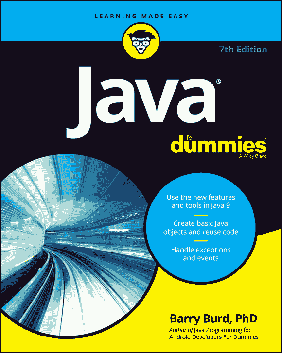

# 引言

Java 是很棒的东西。我已经用它多年了。我喜欢 Java 是因为它很有条理。几乎一切都遵循简单的规则。这些规则有时看起来可能令人生畏，但这本书正是为了帮助你理清它们。所以，如果你想使用 Java，并且想找一个传统的技术类平装书的替代方案，请坐下，放松心情，开始阅读《Java For Dummies》第 7 版。

## 如何使用本书

我真希望自己说：“打开这本书的随机一页并开始写 Java 代码。只需填好空白即可，不要回头看。”在某种意义上，这是事实。你写写 Java 代码时不会弄坏任何东西，所以你可以自由地进行实验。

但让我诚实一点。如果你不理解大局，编写程序是非常困难的。对于任何计算机编程语言都是如此——不仅仅是 Java。如果你在不知道代码是关于什么的情况下输入代码，而代码没有完全按照你想要的方式运行，那么你就是彻底陷入了困境。

在本书中，我将 Java 编程划分为易于管理的各个。每个部分（多或少）是一个章节。你可以从任何你想的地方开始——第 5 章、第 10 章，或任何地方。你甚至可以从章节的中间开始。我已经尝试让示例变得有趣，同时又不让一个章节依赖于另一个。当我使用另一个章节中的重要概念时，我会附上注释帮助你找到方向。

通常情况下，我的建议如下：

*   如果你已经了解某些内容，就不要费心阅读那部分了。
*   如果你好奇，不要害怕跳读。如果你真的需要，随时可以偷看一眼之前的章节。

## 本书使用的字体约定

几乎每本技术书籍的开头都有一个小型的字体图例，《Java For Dummies》第 7 版也不例外。以下是本书中所用字体的简要说明：

*   新术语用*斜体*表示。
*   如果你需要输入混合在正文中输入某些内容，你输入的字符将以**粗体**显示。例如：“在文本字段中输入 `MyNewProject`。”
*   你还会看到这种计算机字体。我将计算机字体用于 Java 代码、文件名、网页地址（URL）、屏幕消息以及其他此类内容。此外，如果你需要输入的内容非常长，它将以计算机字体单独占一行（或多行）显示。
*   当你在自己的电脑键盘上输入内容时，需要对某些内容进行更改。例如，我可能会要求你输入：

    ```
    public class Anyname
    ```

    这意味着你输入 `public class`，然后是你自己想的某个名称。你需要替换为自己的词的单词将用*斜体计算机字体*表示。

## 你不需要阅读的内容

选择第一个包含你尚未熟悉的内容的章节或节，并从那里开始阅读。当然，你可能像我一样讨厌做决定。如果是这样，这里有一些你可以遵循的指南：

*   如果你已经知道 Java 是什么样的“动物”，并且知道你想用 Java，请跳过第 1 章直接进入第 2 章。相信我，我不会介意的。
*   如果你已经知道如何让 Java 程序运行起来，并且不在乎 Java 程序运行时后台发生了什么，请跳过第 2 章从第 3 章开始。
*   如果你以编程为生但使用的是 C 或 C++ 以外的任何语言，请从第 2 章或第 3 章开始。当你到达第 5 章和第 6 章时，你可能会发现它们读起来很快。当你读到第 7 章时，该时候深入学习了。
*   如果你以编写 C（不是 C++）程序为生，请从第 2 章、第 3 章和第 4 章开始，并仅略读第 5 章和第 6 章，你可能会发现它们很容易读。

## 本书的组织结构

本书划分为若干节，节组成若干节，节组成章节，章节最后归为五个部分。（当你写一本书时，你会非常熟悉你书的结构。写几个月后，你晚上睡觉时会发现梦里都是节和章节。）书的部分列如下。

### 第一部分：开始学习 Java

这部分是关于 Java 的完整执行摘要简报。它包含了一些“什么是 Java？”的内容以及一个快速上手章节 —— 第 3 章。在第 3 章中，你将接触主要的编程思想并分析一个简单的程序。

### 第二部分：编写你自己的 Java 程序

第 4 章到第 6 章涵盖了基础知识。这些章节描述了你需要的知识，以便让你的电脑运行起来。

如果你曾用 Visual Basic、C++ 或任何其他语言编写过程序，那么第二部分中的某些内容对你来说可能熟悉。如果是这样，你可以跳过某些章节或快速阅读这些内容。但不要读得太快。Java 与其他某些编程语言有些不同，特别是在第 4 章中我描述的内容。

### 第三部分：掌握大局：面向对象编程

第三部分包含了我最喜欢的几个章节。这部分涵盖了至关重要的面向对象编程主题。在这些章节中，你将发现如何为大问题映射解决方案。（当然，这些章节中的示例并不大，但这些示例涉及宏大的思想。）通过易于吸收的渐进方式，你将发现如何设计类、重用现有类以及构建对象。

你是否读过那些用泛泛、通用的术语解释面向对象编程的书籍？我很自豪地说，《Java For Dummies》第 7 版并不那样。在书中，我用一个简单而具体的程序示例来阐述每一个概念。

### 第四部分：高级 Java 技术

如果你已经领略了 Java 的魅力并想了解更多，可以在书的这一部分找到你需要的内容。这一部分的章节致力于细节 —— 那些在你初看材料时并看不的东西。在读完前面的部分并自己写一些程序后，你可以通过阅读第四部分来进一步深入探索。

### 第五部分：十之篇

“十之篇”就像一个小型的 Java 糖果店。在“十之篇”中，你可以找到列表 —— 避免错误的技巧列表、寻找资源的列表以及各种趣物的列表。

## 本书中使用的图标

如果你能看着我写这本书，你会看到我坐在电脑前自言自语。我会在脑海里过每一个句子。对于大多数句子，我会在心里嘟念好几次。当我产生额外的想法、旁旁评论或不属于正文主流的内容时，我会稍微转一下头。这样一来，无论是谁在听我说话（通常没人听），都知道我进入了暂时的离题插曲。

当然，在印刷物中，你看不见我转头。我需要其他方式来把侧面思考放在单独的角落。我用图标来实现这一点。当你看到“提示 (Tip)”图标或“记住 (Remember)”图标时，你就知道我正在进行一次快速的小绕路。

以下是我书中使用的图标列表：

 **提示（Tip）** 是一条额外信息 —— 其他书籍可能忘记告诉你的有用信息。

 每个人都会犯错。天知道我这辈子也犯过几次错。总之，当我认为某些地方特别容易犯错时，我会用“警告 (Warning)”图标标记它。

 *问题：* 有什么比“提示”强，但没有“警告”强？

*答案：* “记住 (Remember)”图标。

 “如果你不记得某某的意思，请参见某某，”或“欲了解更多信息，请阅读某某”。

 编写代码是一项活动，学习活动的最佳方法就是实践。这就是为什么我创建了一些供你尝试的内容，以巩固你的知识。其中许多是建立信心的，但有些更具挑战性。当你刚开始实践时，你会发现各种在开始阅读材料时从未想过的问题、困境和障碍。但那是好事。坚持下去！不要感到沮丧。或者，如果你真的感到沮丧了，请访问本书的网站（[`www.allmycode.com/JavaForDummies`](http://www.allmycode.com/JavaForDummies)）获取提示和解决方案。

 这个图标引起对可以在网上找到的有用材料的。

 偶尔，我会遇到一些技术小知识。这些小知识可能帮助你理解幕后人员（开发人员）

## 书之外

除了你阅读的内容外，这本书还附带了一个免费的在线备查表（Cheat Sheet）。获取此备查表，只需访问[`www.dummies.com`](http://www.dummies.com/) 并在搜索框中输入 `For Dummies Cheat Sheet`。

## 接下来该去哪里

如果你已经读到了这里，你就准备好开始 Java 开发了。把我（作者）想象成你的向导、主持人和私人助理。如果你喜欢读到的内容，请给我写封信。我的电子邮箱专门用于接收关于这本书的评语和问题，是 `JavaForDummies@allmycode.com`(mailto:JavaForDummies@allmycode.com)。如果你不喜欢邮件和聊天，你可以通过 Twitter (`[@allmycode`](http://www.twitter.com/allmycode)`) 和 Facebook (`[www.facebook.com/allmycode`](http://www.facebook.com/allmycode)`) 与我联系。不要忘记 —— 要获取最新更新，请访问该网站。网址是 [`www.allmycode.com/JavaForDummies`](http://www.allmycode.com/JavaForDummies)。

# 第一部分：Java 入门

在本部分

- 了解开发 Java 的工具。
- 了解 Java 如何融入当今的技术领域。
- 编写你的第一个 Java 程序。

# 第一章：关于 Java 的一切

在本章

-  **什么是 Java**
-  **Java 源自哪里**
-  **为什么 Java 如此酷**
-  **如何让自己适应面向对象编程**

整个过程现在看起来似乎很浪费，但那仅仅是因为你我正舒适地坐在电子时代里。信息是思想，而墨水、纸张和马等物理实体与真正的思想几乎或完全没有关系；它们只是思想的临时载体（尽管人们在几个世纪里一直用它们来承载思想）。尽管如此，思想本身是无纸化、无马化且无信使的。

计算机的妙之处在于它们能高效地承载思想。它们除了思想以外，携带的几个光子和少量的电力。它们做到这一点既不杂乱，也不费力，没有额外的物理负担。

当你开始高效地处理思想时，会发生非常棒的事情。突然，所有的开销消失了。你不再是在推销纸张和树木，而是在推销数字和概念。没有了这些开销，你可以运行得快得多，并且完成比以前复杂得多的任务。

## 你用 Java 能做什么

如果所有这些复杂性都是免费的，那就太好了，但遗憾的是并非如此。有人必须苦苦思考并准确决定要让计算机做什么。在完成思考之后，有人必须为计算机编写一套供其遵循的指令。

鉴于现状，你无法用英语或任何人类使用的语言来编写这些指令。科幻小说中充满了这样的故事：人们对机器人说简单的话，却得到了灾难性的、意想不到的结果。英语及此类语言不适合与计算机通信，原因如下：

*   一个英语句子可能会被误解。“每天吃三次药片，直到吃完为止。”
*   很难在英语中编织一个非常复杂的命令。“将法兰 A 连接到凸起 B，确保仅将法兰 A 的外缘连接到凸起 B 的较大端，同时将法兰 A 的中间和内缘连接到垫圈 C。”
*   一个英语句子有很多多余的负担。“句子包含不必要的单词。”
*   英语很难解释。“作为 John Wiley & Sons, Inc.（`Wiley`）与作者（`Barry Burd`）之间本出版协议的一部分，Wiley 将就《Java For Dummies》第 7 版（`the Work`）的部分提交向作者支付一千两百五十七美元六十三美分（$1,257.63）。”

要告诉计算机做什么，你必须使用一种特殊语言来编写简洁、无歧的指令。这种特殊语言被称为*计算机编程语言*。用这种语言编写的一组指令被称为*程序*。当将其看作一个大整体时，这些指令被称为*软件*或*代码*。以下是用 Java 编写的代码看起来像：

```java
public class PayBarry {
    public static void main(String args[]) {
        double checkAmount = 1257.63;
        System.out.print("Pay to the order of ");
        System.out.print("Dr. Barry Burd ");
        System.out.print("$");
        System.out.println(checkAmount);
    }
}
```

## 为什么你应该使用 Java

是时候庆祝了！你刚刚拿到了一本《Java For Dummies》第 7 版，并且正在阅读第 1 章。按照这个速度，你很快就会成为一名 Java 程序员专家^(*)，所以请通过举办大型派对来为你最终的成功欢呼吧。

为了准备派对，我会烤一个蛋糕。我很懒，所以我会用现成的蛋糕混合粉。让我看看……向混合粉中加水，然后加入黄油和鸡蛋——嘿，等等！我刚刚看了配料表。MSG 是什么？丙二醇又是什么？那是用于防冻的吧？

我会改变计划，从头开始制作蛋糕。当然，这要难一点，但这样我能得到准确想要的。

计算机程序也是同样运作。你可以使用他人的程序，也可以编写自己的。如果你使用他人的程序，你就用你得到的任何。当你编写自己的程序时，你可以为自己的需求专门定制程序。

编写计算机代码是一项巨大的全球产业。公司在做、自由职业人士在做、爱好者在做——各各种类型的人都在做。典型的大公司有团队、部门和分支为公司编写程序。但你可以为自己或他人编写程序，为了谋生，也可以为了兴趣。在最近的一项估计中，仅美国程序员每天编写的代码行数就超过了木星上甲烷分子的数量。[#05_9781119235552-ch01.xhtml_c01-note-0002]。考虑几乎任何可以用计算机完成的事情。只要有合适的时间，你就可以编写自己的程序来完成。（当然，“合适的时间”可能非常长，但这不是重点。许多有趣且实用的程序可以在几小时甚至几分钟内写好。）

## 视角：Java 处于什么位置

以下是现代计算机编程的简史：

*   **1954–1957：FORTRAN 诞生。** FORTRAN 是第一种现代计算机语言。对于科学编程，FORTRAN 是一匹真正的赛马。年年复今年，FORTRAN 都是领先语言。
*   **1959：Grace Hopper 在 Remington Rand 开发了 COBOL 语言。** COBOL 中的 B 代表 Business（业务），业务正是 COBOL 的核心。该语言的主要功能是处理一条接一条记录，一个接一个客户，或一个接一个员工。在开发后的几年里，COBOL 成为最广泛使用的业务语言。
*   **1972：Dennis Ritchie 在 AT&T 贝尔实验室开发了 C 语言。** 你在书中看到的“外观”和“感觉”来自 C 语言。用 C 编写的代码使用大括号、if 语句、for 语句等。在力量方面，你可以用 C 解决用 FORTRAN、Java 或任何现代语言解决的问题。（你可以用 COBOL 写科学计算程序，但那样会很奇怪。）编程语言之间的区别不是力量。区别在于易用性和适用性。那是它的擅长之处。
*   **1986：Bjarne Stroustrup（再次在贝尔实验室）开发了 C++。** 与祖先 C 语言不同，它支持对象编程。这种支持代表了巨大的进步。（参见本章下一节。）
*   **1995 年 5 月 23 日：Sun Microsystems 发布了第一个版本的 Java 版本。** Java 改进了 C++ 的概念。Java 的“一次编写，到处运行”哲学使得该语言非常适合分发代码。此外，Java 是一种极好的通用编程语言。通过 Java，你可以编写窗口应用程序、构建和探索数据库、控制手持设备等。在短短五年内，该语言在全球范围内拥有 250 万开发者。（我知道，我有一件纪念 T 恤可以证明。）
*   **2000 年 11 月：大学委员会宣布，从 2003 年开始，计算机科学高级别考试将基于 Java。** 想知道住在街那头的小鼻子在高中学什么吗？你猜对了——Java。
*   **2002 年：微软推出了一种新语言，命名为 C#。** C# 的许多特性直接来自 Java 的特性。
*   **2004 年 6 月：Sys-Con Media 报告，对 Java 程序员的需求超过 C++ 程序员的需求的 50%（[`http://java.sys-con.com/node/48507`](http://java.sys-con.com/node/48507)`）。**

而且不仅如此！Java 程序员的需求比 `C++` 和 `C#` 程序员的需求总和高出 8%。Java 程序员的就业率比 Visual Basic (`VB`) 程序员高出高达 190%。


## Java 发展历程

*   **2007 年**：Google 采用 Java 作为创建 Android 移动设备应用的首选语言。
*   **2010 年 1 月**：甲骨文公司收购太阳微系统公司，将 Java 技术引入了甲骨文产品家族。
*   **2010 年 6 月**：`eWeek` 将 Java 排在其“让你保持就业的前 10 种编程语言”中列第一位（[www.eweek.com/c/a/Application-Development/Top-10-Programming-Languages-to-Keep-You-Employed-719257](http://www.eweek.com/c/a/Application-Development/Top-10-Programming-Languages-to-Keep-You-Employed-719257)）。
*   **2016 年**：Java 运行在 150 亿台设备上（[http://java.com/en/about](http://java.com/en/about)），其中 Android Java 运行在全球 87.6% 的移动手机上（[www.idc.com/prodserv/smartphone-os-market-share.jsp](http://www.idc.com/prodserv/smartphone-os-market-share.jsp)）。

此外，Java 技术为所有蓝光设备提供了交互能力，并且是 TIOBE 编程语言社区指数中最流行的编程语言（[www.tiobe.com/index.php/content/paperinfo/tpci](http://www.tiobe.com/index.php/content/paperinfo/tpci)）、PYPL：编程语言流行指数（[http://sites.google.com/site/pydatalog/pypl/PyPL-PopularitY-of-Programming-Language](http://sites.google.com/site/pydatalog/pypl/PyPL-PopularitY-of-Programming-Language)）以及其他指数。

嗯，我被印象深刻了。

## 面向对象编程 (OOP)

现在是凌晨三点了。我正梦见自己在高中挂掉过的那门历史课。老师正在对我大吼：“你有两天时间准备期末考试，但你不会记得复习的。你会忘记并感到愧疚、愧疚、愧疚。”

突然，电话响了。我从深睡中猛地醒来。（当然，我不喜欢梦到那门历史课，但我更不喜欢被叫醒。）起初，我把电话掉在了地板上。费劲捡起来后，我发出了不耐烦的声音：“你好，哪位？”一个声音回答道：“我是来自《纽约时报》的一位记者。我正在写一篇关于 Java 的文章，我需要用五个字或更短的话介绍这种编程语言。你能解释一下吗？”

我的大脑太昏迷了。我无法思考。于是我脱口脑子里闪过的第一个念头，然后继续睡睡。

第二天早上来临时，我几乎不记得和记者的谈话了。事实上，我不记得我是如何回答那个问题的。我有没有告诉记者他可以把关于关于 Java 的文章放在哪里？

我穿上袍子冲向车车道。当我拿起早报时，我瞥了一眼首页，看到了这个 2 英寸大的标题：

> **伯德称 Java 为“一种优秀的面向对象的语言”**

### 面向对象的语言

Java 是面向对象的。这意味着什么？不像像 `FORTRAN` 这样的语言专注于给计算机发出命令式的“做这个/做那个”的指令，面向对象的语言关注的是数据。当然，面向对象的程序仍然告诉计算机该做什么。然而，它们是从组织数据开始，命令随后才来。

面向对象的语言优于“做这个/做那个”的语言，因为它们组织数据的方式有助于人们对数据进行各种操作。要修改数据，你可以在现有基础上进行构建，而不是在每次需要做新事情时丢弃已做的工作并重新开始。尽管计算机程序员通常是聪明人，但他们花了一段时间才弄明白这一点。想了解完整的历史课程，请参见侧边栏“从 FORTRAN 到 Java 的弯折之路”（但如果你不读，我不会让你感到愧疚的）。

### 对象及其类

在面向对象的语言中，你使用对象和类来组织你的数据。

想象你正在编写一个计算机程序，用来追踪一个新建公寓开发项目（仍在建设中）中的房屋。这些房屋之间的区别非常细微。每座房子都有独特的外墙颜色、室内墙漆颜色、厨房橱柜风格等。在你的面向对象的计算机程序中，每座房子都是一个对象（object）。

但对象并不是是全部。虽然房子之间略有不同，但所有房子都共享同一组特征列表。例如，每座房子都有一个名为 `siding color`（外墙颜色）的特征。每座房子还有另一个名为 `kitchen cabinet style`（厨房橱柜风格）的特征。在你的面向对象程序中，你需要一个包含房屋对象可能的所有特征的主列表。这个特征主列表被称为 `class`（类）。

所以就是这样。面向对象编程这个名字起错了。它应该被称为“使用类和对象的编程”。

现在注意，我把 `classes`（类）放在了前面。我竟敢这么做！嗯，也许我没疯。再次想那个开发项目。在建设中，一个特征列表被称为蓝图。建筑师的蓝图就像面向对象程序员的 `class`。蓝图上写着 `siding`。实际房屋对象拥有灰色的外墙。蓝图上写着 `kitchen cabinet`。实际房屋对象拥有路易橱柜。

这种类比不仅限于特征列表。蓝图和类之间存在另一个重要的平行关系。类和对象之间也是如此。程序员定义一个类，计算机从类定义中创建对象。

### 面向对象的语言有什么好处？

基于上一节关于盖房的故事，想象你已经写好了一个计算机程序来追踪房屋的建造指令。然后，老板决定了一个修改后的计划——一半房子有三间卧室，另一半有四间。

如果你使用旧的 `FORTRAN/C` 风格计算机编程，你的指令看起来像这样：

```
为地下室挖坑。
在坑周围铺设混凝土。
在地下室框架侧面放置二四木材。
...
```

这就像建筑师创建了一份长指令列表而不是蓝图。要修改计划，你必须翻遍列表寻找建造卧室的指令。更糟糕的是，这些指令可能分散在 234、394-410、739、10 和 2 页。

然而，从类开始就像是从蓝图开始。如果你决定既有三间也有四间卧室的房子，你可以从一个名为房屋蓝图的蓝图开始，它有一层和二层，但二层没有画室内墙。然后你再做两个二层蓝图——一个用于三卧室房屋，另一个用于四卧室房屋。（你将这些新蓝图命名为 `three-bedroom house` 蓝图和 `four-bedroom house` 蓝图。）

建筑同事对你的逻辑和组织能力感到惊讶，但他们也有顾虑。他们提了一个问题：“你把其中一个蓝图称为‘三卧室房屋’蓝图。如果它只是二层的蓝图而不是整栋房子的蓝图，你怎么能这么做？”

你会会地一笑并回答道：“三居室房屋的蓝图可以写：‘关于楼层的信息，请参阅原始房屋蓝图。’这样一来，三居室房屋的蓝图描述了整栋房子。四居室房屋的蓝图也可以这样做。通过这种设置，我们可以利用之前为创建原始房屋蓝图所做的所有工作，节省大量的资金。”

在面向对象编程的语言中，三卧室和四卧室房屋类正在 `inheriting`（继承）原始房屋类的特性。你也可以说三卧室和四卧室房屋类正在 `extending`（扩展）原始房屋类。（参见图 1-1。）

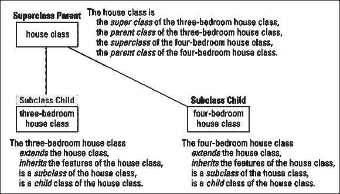

图 1-1： 面向对象编程中的术语。

原始房屋类被称为三卧室和四卧室房屋类的 `superclass`（超类）。同样地，三卧室和四卧室房屋类是原始房屋类的 `subclasses`（子类）。换句话说，原始房屋类被称为三卧室和四卧室房屋类的 `parent class`（父类）。三卧室和四卧室房屋类是原始房屋类的 `child classes`（子类）（参见图 1-1。）

不用说，你的建筑师同事们嫉妒不已。一群建筑师围在你身边，想听听你的绝妙主意。在那刻，你又抛出了一磅炸弹：“通过创建一个带有子类的类，我们将来可以重复使用该蓝图。如果有人想要一套五卧室的房子，我们可以通过创建一个五卧室房屋蓝图来扩展我们的原始房屋蓝图。我们再也不需要为原始房屋蓝图花钱了。”

“但是，”后排的一位同事说，“如果有人想要不同的一楼设计怎么办？我们是扔掉原始房屋蓝图，还是在原始蓝图上胡乱涂画？那可要花大价钱吧？”

你用自信的语气回答道：“我们不需要动原始房屋蓝图。如果有人想在客厅里装一个按摩缸，我们可以创建一个新的小型蓝图，只描述新的客厅，并将其称为 `Jacuzzi-in-living-room house`（客厅带按摩缸房屋）蓝图。然后，这个新蓝图可以引用原始房屋蓝图获取房屋其他部分的信息（即客厅以外的部分）。”在面向对象编程语言中，客厅带按摩缸房屋蓝图仍然 `extends`（扩展）原始房屋蓝图。按摩缸蓝图仍然是原始房屋蓝图子类。事实上，所有关于超类、父类和子类的术语仍然适用。唯一新之处是按摩缸蓝图 `overrides`（重写）了原始房屋蓝图中的客厅特性。

在面向对象语言出现之前，编程世界经历了软件开发中的危机。程序员编写代码，然后发现新需求，接着就得抛弃代码并从头开始。这个问题反复反复发生，因为程序员编写的代码无法被重用。面向对象编程让这一切变得更好（而且正如 Burd 所说，Java 是‘一种伟大的面向对象语言’）。

### 完善你对类和对象的理解

当你用 `Java` 编程时，你不断地与类和对象打交道这两个想法非常重要。这就是为什么在这一章中，我用一个接一个关于类和对象的类比来反复冲击你的大脑。

闭上眼睛一分钟，思考一下物体变成椅子意味着什么……

椅子有一个座位、一个靠背和腿。每个座位都有形状、颜色、软度等等。这些都是椅子所拥有的属性。我描述的是 `chairness`（椅性）——即某物作为椅子的概念。在面向对象的术语中，我描述的是 `Chair` 类。

现在，向书页的边缘看一眼，花一分钟观察一下你的房间。（如果你现在没坐在房间里，假装一下。）

房间里有几把椅子，每把椅子都是一个对象。这些对象中的每一个都是名为 `Chair` 类的那个虚幻事物的例子。这就是这样运作的——类是 `chairness` 的理念，而每一把具体的椅子都是一个对象。

 类并不是事物的集合。相反，类是某种事物背后的理念。当我谈到你房间里的椅子类时，我是在说每把椅子都有腿、座位、颜色等等。房间里不同椅子的颜色可能不同，但这并不重要。当你谈论一类事物时，你关注的是每个事物所拥有的属性。

将对象看作类的具体实例（instance）是符合逻辑的。事实上，官方术语与这种想法是一致的。如果你编写一个定义了 `Chair` 类的 `Java` 程序，那么每一把真实的椅子（你正坐的这把椅子、你旁边的空椅子等等）都被称为 `Chair` 类的 `instance`（实例）。

这里是类的类的类的方式。想象一张显示了你三个银行账户的表格。（参见表 1-1。）

| **账号** | **类型** | **余额** |
| --- | --- | --- |
| 16-13154-22864-7 | 支票账户 | 174.87 |
| 1011 1234 2122 0000 | 信用卡账户 | –471.03 |
| 16-17238-13344-7 | 储蓄账户 | 247.38 |

表 1-1 账户列表

将表格的列标题看作一个类，将每一行看作一个对象。

根据表格列标题，`Account` 类有账号、类型和余额。用面向对象编程的术语表述，`Account` 类的每个对象（即 `Account` 类的每个 `instance`）都有账号、类型和余额。所以，表格的最后一行是一个账号 `16-17238-13344-7` 的对象。该对象类型为 `Savings`，余额为 `247.38`。如果你开了一个新账户，你就会另一个对象，表格也会增加一行。

### 接下来是什么？

这一章充满了通性的描述。当你刚开始时，通用描述是好的，但只有当你了解细节时，你才能真正理解。这就是为什么接下来的几章将处理细节。

所以，请翻页。下一章等不及要让你阅读了。

## Notes

### 第 2 章：关于软件

 **理解软件开发工具的作用**

 **选择适合你的 Java 版本**

 **准备编写和运行 Java 程序**

如果你是计算机和计算领域的老手（无论这是什么意思），而且如果你太心急，不想从本书的网站上获取详细说明，那么你可以尝试按照本节的通用说明来安装所需的软件。这些说明适用于许多计算机，但并非所有计算机。而且，本节没有提供详细的步骤，没有“如果……就那么……”的备选方案，也没有“虽然这可行，但你最好做某事”的建议。

要为编写 Java 程序准备计算机，请按照以下步骤操作：

1.  **安装 Java 开发工具包（JDK）。**

    要执行此，请访问 [`www.oracle.com/technetwork/java/javase/downloads`](http://www.oracle.com/technetwork/java/javase/downloads)。

    按照网站上的说明下载并安装最新的 Java SE JDK。

     寻找标准版（SE）。不要费心企业版（EE）或任何其他此类版本。此外，选择 `JDK` 而不是 `JRE`。如果你看到代码数字，如 `9u3`，这代表“Java 9 的第 3 次更新”。通常情况下，任何标记为 Java 9 或更高版本的都适用于运行本书中的示例。

2.  **安装集成开发环境。**

    *集成开发环境*（IDE）是一个帮助你编写和测试新软件的程序。对于本书的示例，你可以使用几乎任何支持 Java 的 IDE。

    以下是最受欢迎流行的 Java IDE 列表：

    *   **Eclipse**

        根据 [`www.baeldung.com/java-ides-2016`](http://www.baeldung.com/java-ides-2016) 的统计，2016 年全球 48.2% 的 Java 程序员使用了 `Eclipse` IDE。

        要下载并使用 `Eclipse`，请按照 [`http://eclipse.org/downloads`](http://eclipse.org/downloads) 上的说明。`Eclipse` 的下载页面可能为你提供几个不同的包，包括用于 Java EE 的 `Eclipse`、用于 JavaScript 的 `Eclipse`、用于 Java 和 DSL 的 `Eclipse` 等。为了运行本书的示例，你需要一个较小的 `Eclipse` 包——适用于 Java 开发人员的 `Eclipse` IDE。

        `Eclipse` 商业和非商业用途均免费。

    *   **IntelliJ IDEA**

        在 Baeldung 对 Java IDE 的调查（[`www.baeldung.com/java-ides-2016`](http://www.baeldung.com/java-ides-2016)）中，`IntelliJ IDEA` 紧随其后，占了所有程序员的 43.6%。

        当你访问 [`www.jetbrains.com/idea`](https://www.jetbrains.com/idea/) 时，你可以下载社区版（免费）或 Ultimate 版（收费）。要运行本书的示例，你可以使用社区版。你甚至可以使用社区版来创建商业软件！

    *   **NetBeans**

        Baeldung 对 Java IDE 的调查（[`www.baeldung.com/java-ides-2016`](http://www.baeldung.com/java-ides-2016)）显示 `NetBeans` 占比仅为 5.9%。但 `NetBeans` 是 Oracle 官方的 Java IDE。如果网站为你提供多种下载包的选择，请选择 Java SE 包。

        要获取你自己的 `NetBeans` 副本，请访问 [`https://netbeans.org/downloads`](https://netbeans.org/downloads/)。

        `NetBeans` 商业和非商业用途均免费。

3.  **测试你安装的软件。**

    你在这一步的操作取决于你在第 2 步选择了哪种 IDE。无论如何，这里是一些通用说明：

    1.  启动你的 IDE（`Eclipse`、`IntelliJ IDEA`、`NetBeans` 或其他）。
    2.  在 IDE 中创建一个新的 Java 项目。
    3.  在 Java 项目中创建一个名为 `Displayer` 的新 Java 类。（在大多数 IDE 中，选择 File ⇒ New ⇒ Class 即可。）
    4.  通过输入代码清单 3-1 中的代码来编辑新的 `Displayer.java` 文件（这是第 3 章中的第一个代码清单）。

        对于大多数 IDE，你将代码输入到一个较大的（大部分为空的）编辑器面板中。尝试完全按照你在代码清单 3-1 中看到的样式输入代码。如果你看到大写字母，就输入大写字母。所有小写字母也如此。

         什么？你说你不想输入书中的一堆代码？好吧，没！访问本书的网站（[www.allmycode.com/JavaForDummies](http://www.allmycode.com/JavaForDummies)）来了解如何下载所有代码示例并将它们加载到你的 IDE 中。

    5.  运行 `Displayer.java` 并检查运行输出是否显示 You'll love it。

*   当你访问 Eclipse ([`www.eclipse.org/downloads`](http://www.eclipse.org/downloads/))、IntelliJ IDEA ([`www.jetbrains.com/idea`](https://www.jetbrains.com/idea/)) 或 NetBeans ([`https://netbeans.org/downloads`](https://netbeans.org/downloads)) 网站时，你会获得一个 IDE。


 你可能会发现与我在前项目符号中描述的图片有所不同。许多 IDE 都自带自己的 `JVM`，Oracle 网站可能提供组合的 `JDK+NetBeans` 安装包。尽管如此，我通过这些项目符号描述的场景是有用且可靠的。当你按照我的说明操作时，可能会得到两个 `JVM` 副本或两个 IDE，但这没关系。你不知道什么时候会需要备用。

 本章提供了你电脑上所需软件的背景信息。但本章完全没有帮助你安装软件的详细说明。如需详细说明，请访问本书的网站 ([`www.allmycode.com/JavaForDummies`](http://www.allmycode.com/JavaForDummies))。

本章其余部分描述了编译器、`JVMs` 和 `IDEs`。

## 什么是编译器？

> *编译器获取你编写的 Java 代码并将代码转换为一组称为字节码（bytecode）的指令集。*
>
> — *BARRY BURD,* 《Java 傻瓜指南》， *第 7 版*

你是一个人类。（当然，每条规则都有例外。但如果你在读这本书，你很可能是一个人类。）无论如何，人类都可以编写并理解 Listing 2-1 中的代码。

**Listing 2-1: 寻找空房**

```java
// 这是一个 Java 程序的一部分。
// 它不是一个完整的 Java 程序。

roomNum = 1;
while (roomNum < 100) {
    if (guests[roomNum] == 0) {
        out.println("Room " + roomNum + " is available.");
        exit(0);
    } else {
        roomNum++;
    }
}
out.println("No vacancy");
```

Listing 2-1 中的 Java 代码检查一家小酒店的空房情况（房号从 1 到 99 的酒店）。如果不添加几行额外的代码，你就无法运行 Listing 2-1 中的代码。但在 第 2 章 中，这些额外代码并不重要。重要的是，通过盯着代码、眯起眼睛，并忽略代码中所有奇怪的标点符号，你可以看出代码正试图做什么：

* 将房号设为 1。
* 只要房号小于 100，
* 检查房间内的客人数。
* 如果房间内的客人数为 0，则
* 报告该房间可用，
* 并停止。
* 否则，
* 通过给房号加 1 来
* 准备检查下一个房间。
* 如果你到了不存在的房号 100，则
* 报告没有空房。

如果你没有看出 Listing 2-1 与其英文原文之间的相似之处，不要担心。你正在阅读《Java 傻瓜指南》第 7 版，像大多数人类一样，你可以学会阅读和编写 Listing 2-1 中的代码。Listing 2-1 中的代码被称为 *Java 源代码*。

但问题在于：计算机不是人类。计算机通常不会按照 Listing 2-1 中的指令来操作。也就是说，计算机不遵循 Java 源代码指令。相反，计算机遵循像 Listing 2-2 那样的晦涩指令。

**Listing 2-2: Listing 2-1 翻译为 Java 字节码**

```bytecode
aload_0
iconst_1
putfield Hotel/roomNum I
goto 32
aload_0
getfield Hotel/guests [I
aload_0
getfield Hotel/roomNum I
iaload
ifne 26
getstatic java/lang/System/out Ljava/io/PrintStream;
new java/lang/StringBuilder
dup
ldc "Room "
invokespecial java/lang/StringBuilder/<init>(Ljava/lang/String;)V
aload_0
getfield Hotel/roomNum I
invokevirtual java/lang/StringBuilder/append(I)Ljava/lang/StringBuilder;
ldc " is available."
invokevirtual java/lang/StringBuilder/append(Ljava/lang/String;)Ljava/lang/StringBuilder;
invokevirtual java/io/PrintStream/println(Ljava/lang/String;)V
```

（注：为了可读性，我稍微清理了代码块中的字节码语法）

这是一个假设的场景：现在是 1992 年（Java 发布的几年之前），你正在一台配有旧款 Pentium 处理器的电脑上运行 Linux 操作系统。你的朋友在一台配备不同类型处理器的电脑上运行 Linux —— 即 PowerPC 处理器。（在 20 世纪 90 年代，英特尔制造 Pentium 处理器，而 IBM 制造 PowerPC 处理器。）

**Listing 2-3: 针对 Pentium 处理器的简单程序**

```assembly
.data
msg:
.ascii "Hello, world!\n"
len = . - msg

.text
.global _start
_start:
movl $len,%edx
movl $msg,%ecx
movl $1,%ebx
movl $4,%eax
int $0x80
movl $0,%ebx
movl $1,%eax
int $0x80
```

**Listing 2-4: 针对 PowerPC 处理器的简单程序**

```assembly
.data
msg:
.string "Hello, world!\n"
len = . - msg

.text
.global _start
_start:
li 0,4
li 3,1
lis 4,msg@ha
addi 4,4,msg@l
li 5,len
sc
li 0,1
li 3,1
sc
```

Listing 2-3 中的指令在 Pentium 处理器上运行顺畅。但这些指令对 PowerPC 处理器来说毫无意义。同样，Listing 2-4 中的指令在 PowerPC 上运行良好，但这些相同的指令对于配有 Pentium 处理器的电脑来说完全是乱码。因此，你朋友的 PowerPC 软件可能无法在你的电脑上运行。而你英特尔电脑的软件可能完全无法在你朋友的电脑上运行。

现在去你表哥家里看看你表哥的电脑配有 Pentium 处理器（和你的一样），但表哥的电脑运行的是 Windows 而不是 Linux。当你向表哥的电脑输入 Listing 2-3 中的 Pentium 代码时，会什么？它会大叫：“这不是有效的 Win32 应用程序”或“Windows 无法打开此文件”。真混乱！

Java 字节码从这一切混乱中建立了秩序。与 Listing 2-3 和 2-4 中的代码不同，Java 字节码并不特定于某种处理器或某种操作系统。相反，任何类型的电脑都可以拥有 Java 虚拟机（`JVM`），并且 Java 字节码指令可以在任何电脑的 Java 虚拟机上运行。运行在 Linux Pentium 上的 `JVM` 将 Java 字节码指令翻译成你在 Listing 2-3 中看到的代码。运行在 Linux PowerPC 上的 `JVM` 将 Java 字节码指令翻译成你在 Listing 2-4 中看到的代码。

如果你编写了一个 Java 程序并将该程序编译为字节码，那么你电脑上的 `JVM` 就可以运行该字节码，你电脑上的 `JVM` 就可以运行该字节码，你电脑上的 `JVM` 就可以运行该字节码。

有关编译和运行 Java 程序的详细说明，请访问本书书的网站（[www.allmycode.com/JavaForDummies](http://www.allmycode.com/JavaForDummies)）。

当人们谈论编写程序时，使用的是图 2-2 中的表述。他们说：“你编译代码”和“你运行代码”。但“你”并不总是准确，而且“代码”在循环的每个阶段也略有不同。图 2-3 更详细地描述了图 2-2 中的循环。

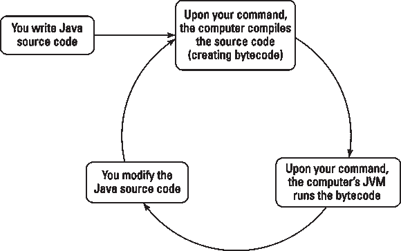

**图 2-3： 谁对什么代码做了什么？**

 对于大多数人的需求，图 2-3 包含的信息太多。如果我点击“运行”图标，我不需要记住计算机正在代表我运行代码。对我来说，计算机运行我的原始 Java 代码或者运行某种针对我原始 Java 代码的字节码仿制品都可以。事实上，在书中，我经常随口写道“当你运行你的 Java 代码时”或“当计算机运行你的 Java 程序时”。即使不看图 2-3，你也可以过上非常幸福的生活。图 2-3 的唯一用处是在图 2-2 中模糊的表述让你困惑时，为你提供帮助。如果图 2-2 没有困扰你，请忽略图 2-3。

### 什么是集成开发环境？

> *“集成开发环境帮助你管理你的 Java 代码，并为你编写、编译和运行代码提供了方便的方法。”*
>
> — *BARRY BURD，JAVA FOR DUMMIES, 第 7 版*

在过去，编写和运行 Java 程序需要打开多个窗口——一个用于输入程序的窗口，另一个用于运行程序的窗口，可能还有第三个窗口用来跟踪你编写的所有代码。（参见图 2-4。）

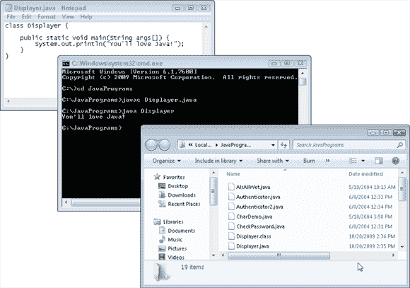

**图 2-4： 在没有集成开发环境的情况下开发代码。**

集成开发环境将所有这些功能无缝地整合到了一个组织良好的应用程序中。（参见图 2-5。）

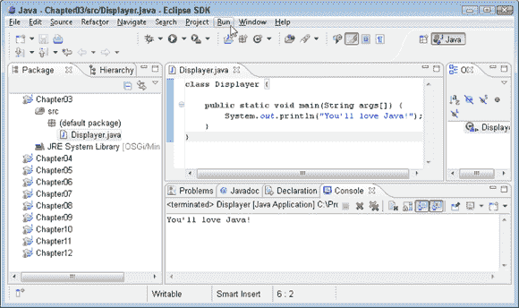

**图 2-5： 使用 Eclipse 集成开发环境开发代码。**

Java 也有自己的集成开发环境，如 `Eclipse`、`IntelliJ IDEA` 和 `NetBeans`。许多环境具有拖放式组件，以便你可以视觉化地设计图形图形界面。（参见图 2-6。）

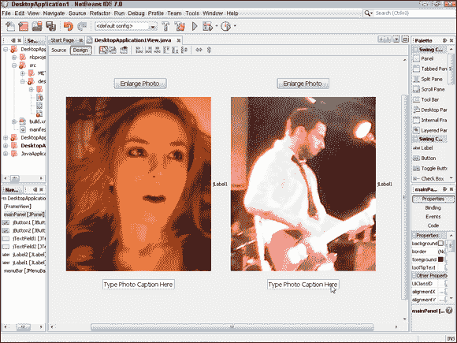

**图 2-6： 在 NetBeans IDE 中使用拖放 Swing GUI 构建器。**

要运行程序，你可能点击工具栏上的按钮或从菜单中选择 `Run`。

 有关编译和运行 Java 程序的详细说明，请访问本书书的网站（[www.allmycode.com/JavaForDummies](http://www.allmycode.com/JavaForDummies)）。

 没有人完全了解 Java API 的所有知识。如果你是一个经常编写打开新窗口程序的 Java 程序员，你一定知道如何使用 API 中的 `JFrame` 类。如果你很少编写打开窗口的程序，那么在第一次需要创建窗口时，你可以在 API 文档中查找 `JFrame` 类。我推测，如果你阻止一个典型的 Java 程序员在 API 文档中查找任何内容，该程序员能够使用 Java API 中少于 2% 的名称。

 你可能喜欢*自自教程*（For Dummies）的风格，但遗憾的是，Java 的官方 API 文档并不是那种风格写的。API 文档既简洁又精确。如需帮助解读 API 文档的语言和风格，请参本书的网站（[`www.allmycode.com/JavaForDummies`](http://www.allmycode.com/JavaForDummies)）。

在某种程度上，Java API 没有任何是特别的。每当你编写一个 Java 程序时——即使是最小、最简单的 Java 程序——你创建的类与官方 Java API 中定义的任何类都是同等地位的。API 仅仅是一组普通程序员创建的类和其他名称，他们恰好参与了官方 Java 社区进程（`JCP`）和 OpenJDK 项目。与你创建的名称不同，API 中的名称随每个 Java 版本的发布发行。（我假设你，即读者，并不是 Java 社区进程或 OpenJDK 项目的参与者。但是，有了像 *Java For Dummies* 第 7 版这样的好书，谁也说不定。）

 如果你对 JCP 的活动感兴趣，请访问 [`www.jcp.org`](http://www.jcp.org)。如果你对 OpenJDK 项目感兴趣，请访问 [`http://openjdk.java.net`](http://openjdk.java.net) 。

JCP 的成员并没有将官方 Java API 中的 Java 程序视为保密。如果你愿意，可以查看所有这些程序。当你向电脑上安装 Java 时，安装程序会在你的硬盘上放置一个名为 `src.zip` 的文件。你可以用你喜欢的解压缩程序打开 `src.zip`。就在你眼前，展示着所有的 Java API 代码。

## Java 程序中的单词

一个硬核 Java 程序员会说，Java 编程语言有两种单词：关键字（keywords）和标识符（identifiers）。这是正确的。但如果没有任何其他解释，赤裸事实有时具有误导性。因此，我建议对事实进行稍微修饰，并分三种单词来思考：关键字、你我这样的普通程序员创建的标识符，以及来自 API 的标识符。

这三种单词之间的差异类似于英语中单词之间的差异。在句子“Sam is a person”中，`person` 这个词就像一个 Java 关键字。无论谁使用 `person` 这个词，这个词的意思总是大致相同。（当然，你可以考虑英语用法中奇葩的例外，但请不要。）

单词 `Sam` 就像一个 Java 标识符，因为 `Sam` 是一个特定人的名字。像 `Sam`、`Dinswald` 和 `McGillimaroo` 这样的词在英语中并没有预设含义。这些词根据上下文适用于不同的人，并在父母为新生婴儿选择其中一个时，它们就变成了名字。

现在考虑句子“Julius Caesar is a person”。如果你说出这句话，你可能是在谈论那个统治罗马直到三月十五首日的家伙。虽然 `Julius Caesar` 这个名字没有硬编码在英语中，但几乎每个人都用这个名字指代同一个人。如果英语是一种编程语言，那么 `Julius Caesar` 将是一个 API 标识符。

所以这就是我在脑海中将 Java 程序中的单词分为类别的方式：

* **关键字（Keywords）：** `keyword` 是 Java 编程语言中具有自身特殊含义的单词，且该含义不会随程序之间而改变。Java 关键字示例有 `if`、`else` 和 `do`。

    JCP 委员会成员对什么构成一个 Java 程序拥有最终决定权，他们选择了所有的 Java 关键字。如果你考虑我早之前讨论的 Java 的两个部分，在“Java 语法和常用名称”部分，Java 关键字坚定地属于语言规范。

* **标识符（Identifiers）：** `identifier` 是某个事物的名称。标识符的意思可以随程序之间而改变，但某些标识符的意思倾向于发生更大的变化：

    * **你我创建的标识符：** 作为一名 Java 程序员（是的，即使是初级 Java 程序员），你为你程序中描述的类和其他项目创建新名称。当然，你可能会将某物命名为 `Prime`，而走廊隔壁另一个办公室写代码的家伙可以将另一个东西命名为 `Prime`。这没关系，因为 Java 对 `Prime` 没有预设含义。在你的程序中，你可以让 `Prime` 代表联邦储备的优惠利率。而走廊那头的家伙可以让 `Prime` 代表“面包、圆面包、果酱和顶级肋排”。这不会产生冲突，因为你和你的同事正在编写两个不同的 Java 程序。

    * **来自 API 的标识符：** JCP 成员为许多事物创建了名称，并将数万个此类名称抛入 Java API 中。API 随每个 Java 版本提供，因此这些名称对任何编写 Java 程序的人都可用。此类名称的示例有 `String`、`Integer`、`JWindow`、`JButton`、`JTextField` 和 `File`。

 你不需要在代码列表 3-1（或本书中的任何其他代码列表）中输入代码。要下载书中的所有代码，请访问本书的网站（[`www.allmycode.com/JavaForDummies`](http://www.allmycode.com/JavaForDummies)）。

当你运行代码列表 3-1 中的程序时，计算机会显示 `You'll love Java!`！（图 3-1 显示了当你使用 `Eclipse` IDE 时 `Displayer` 程序的输出结果。）现在，我承认仅仅为了让 `You'll love Java!` 出现在某人的电脑屏幕上，编写并运行一个 Java 程序就要费很大精力，但每项尝试都要从哪里开始。

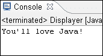

**图 3-1： 我使用 `Eclipse` 来运行代码列表 3-1 中的程序。**

 想要查看如何运行代码列表 3-1 中的代码，请访问本书的网站（[`www.allmycode.com/JavaForDummies`](http://www.allmycode.com/JavaForDummies)）。

在接下来的节中，你将不仅仅是赞叹程序的输出。在读完本节后，你将真正理解代码列表 3-1 中的程序是如何工作的。

## 理解一个简单的 Java 程序

本节将介绍、解释、分析、剖析并通过其他方式消除之前在代码列表 3-1 中显示的 Java 程序。

### Java 类

由于 Java 是一门面向对象的编程语言，你的首要目标是描述类和对象。（如果你对此不服，请阅读第 1 章中关于面向对象编程的章节。）


在那些我感性的特殊日子里，我会告诉人们，Java 在面向对象方面比许多其他所谓的面向对象的语言更纯粹。我之所以这么说，是因为在 Java 中，在你创建某种类之前，你什么也做不了。这就像是在《危险游戏》（Jeopardy!）节目中，听到 Alex Trebek 说：“让我们进入广告”，然后你打断他说：“抱歉，Alex。在不把指令放在类里面的情况下，你是无法发布指令的。”

代码列表 3-1 中的代码是一个 Java 程序，该程序描述了一个类。这个程序是我编写的，所以我可以为我的新类起一个名字。我选择了 `Displayer` 这个名字，因为程序在电脑屏幕上显示了一行文本。这就是为什么代码列表 3-1 的第一行包含了 `class Displayer` 单词。（参见图 3-2。）

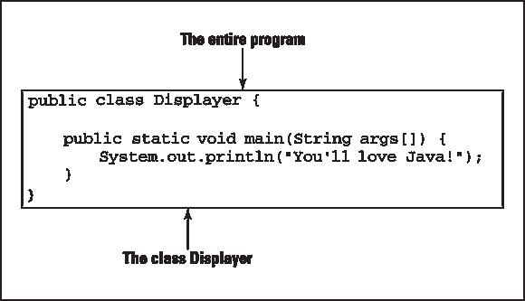

图 3-2： 一个 Java 程序就是一个类。

代码列表 3-1 中的前两个单词 `public` 和 `class` 是 Java 关键字。（参见本章前面的章节“[Java 程序中的单词”。）无论由谁编写 Java 程序，`public` 和 `class` 单词的使用方式始终是相同的。另一方面，代码列表 3-1 中的 `Displayer` 是一个标识符。我在编写本章时构思了 `Displayer` 这个单词。`Displayer` 是一个特定类的名称——是我编写该程序时创建的。

## 理解方法

在 Java 中，方法是一组组合在一起执行特定操作的语句。你可以将方法视为子程序或函数。

代码列表 3-2： 方法声明

```java
void fixTheAlternator(onACertainCar) {
    driveInto(car, bay);
    lift(hood);
    get(wrench);
    loosen(alternatorBelt);
    …
}
```

在我的 Java 代码的某处（位于列表 3-2 之外），我需要一条指令来调用我的 `fixTheAlternator` 方法。调用 `fixTheAlternator` 方法的指令看起来可能像列表 3-3 中的那行代码。

**列表 3-3：方法调用**

```java
fixTheAlternator(junkyOldFord);
```

现在你已经对什么是方法以及它是如何工作的有了基本的了解，你可以更深入地研究一些实用的术语了：

- 如果我偷懒，我会把列表 3-2 中的代码称为 `method`（方法）。如果我不偷懒，我会把这段代码称为 `method declaration`（方法声明）。

- 列表 3-2 中的方法声明包含两个部分。第一行（包含 `fixTheAlternator` 的部分，直到但不包括左大括号）是 `method header`（方法报头）。列表 3-2 的其余部分（被大括号包围的部分）是 `method body`（方法体）。

- `method declaration` 一词将列表 3-2 中的指令列表与列表 3-3 中的指令区分开来，后者被称为 `method call`（方法调用）。

 `method’s declaration`（方法的声明）告诉计算机如果调用该方法会发生什么。`method call`（一段独立的代码）则告诉计算机实际上去调用该方法。方法的声明和方法的调用通常位于 Java 程序的不同部分。

### 程序中的 main 方法

图 3-3 包含了列表 3-1 中代码的副本。代码的大部分包含一个名为 `main` 的方法的声明。（只需在代码的方法报头中寻找 `main` 单词即可。）目前，不要担心方法报头中的其他单词：`public`、`static`、`void`、`String` 和 `args`。我将在接下来的章节中解释这些单词。

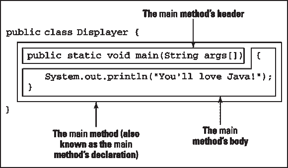

**图 3-3：main 方法。**

就像任何 Java 方法一样，main 方法像是一份食谱：

```
如何制作饼干：
加热烤箱。
揉面团。
烘烤揉好的面团。
```

或者

```
如何遵循 Displayer 的主指令：
在屏幕上打印“You'll love Java!”。
```

`main` 这个单词在 Java 中起着特殊的作用。特别是，你永远不会编写显式调用 main 方法执行的代码。`main` 单词是程序开始运行就会自动被调用的方法名。

回看图 3-1。当 Displayer 程序运行时，计算机会自动找到程序的 `main` 方法，并执行方法体内的任何指令。在 Displayer 程序中，main 方法体只有一条指令。那条指令告诉计算机在屏幕上打印 `You'll love Java!`。因此在图 3-1 中，`You'll love Java!` 出现在计算机屏幕上。

 方法中的指令在方法被调用之前不会执行的。但是，如果你给一个方法命名为 `main`，那么这个方法就会被自动调用。

 几乎每种计算机编程语言都有类似于 Java 方法的东西。如果你工作过其他语言，你可能记得像子程序（subprograms）、过程（procedures）、函数（functions）、子例（subroutines）、子过程（subprocedures）之类的术语。无论在你最喜欢的编程语言中如何称呼它，方法都是一组收集在一起并赋予新名称的指令。

### 你最终如何告诉计算机做某事

在列表 3-1 的核心深处，隐藏着一行实际上向计算机发出直接指令的语句。这一行在图 3-4 中被高亮，告诉计算机显示 `You'll Java!`。这一行是一个 `statement`（语句）。在 Java 中，语句是一条告诉计算机执行某操作的直接指令（例如，显示这段文本、在那个内存中存入 7、创建一个窗口）。

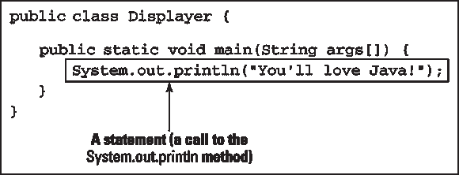

**图 3-4：一条 Java 语句。**

 在 `System.out.println` 中，倒数第二个字符是小写字母 `l`，而不是数字 `1`。

当然，Java 有不同类型的语句。我在早之前的“Java 方法”部分中介绍的方法调用是许多 Java 语句类型之一。列表 3-3 向你展示了方法调用的样子，图 3-4 也包含一个看起来像这样的方法调用：

```java
System.out.println("You'll love Java!");
```

当计算机执行这条语句时，计算机会调用一个名为 `System.out.println` 方法。（是的，在 Java 中，名称可以包含点。这些点是有含义的。）

 我已经说过了，但值得重复：在 `System.out.println` 中，倒数第二个字符是小写字母 `l`（如单词 line 所示），而不是数字 `1`（如数字一）。如果你使用数字 `1`，你的代码将无法工作。只需将 `println` 视为“打印行”的意思，你就不会有任何问题。

要了解 Java 名称中点的含义，请参见第 7 章。

图 3-5 说明了 `System.out.println` 的情况。实际上，有两个方法在 Displayer 运行中起着作用。它们的工作方式如下：

- **有一个 main 方法声明。** main 方法是我我自己写的。每当我运行 Displayer 程序时，这个 main 方法就会被自动调用。

- **有一个对 System.out.println 方法的调用。** System.out.println 方法调用是 main 方法体唯一的语句。换句话说，调用 `System.out.println` 方法是 main 方法清单上的唯一事项。

`System.out.println` 方法的声明隐藏在官方 Java API 之中。要复习 Java API，请参见本章前面的“语法和常用名称”以及“Java 程序中的单词”部分。

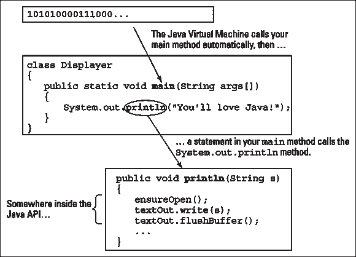

**图 3-5：调用 System.out.println 方法。**

在 Java 中，每条语句（如图 3-4 中框选的行）都以分号结束。图 3-4 中的其他行没有以分号结束，因为图 3-4 中的其他行并不是语句。例如，方法头（包含 `main` 单词的所在行）并没有直接告诉计算机要做任何事。方法头是在宣告：“万一你以后想执行 `main`，接下来的几行代码将告诉你如何操作。”

 每一个完整的 Java 语句都以分号结束。

### 大括号

很久以前，或者也许并不久以前，你的老师们告诉过你大纲有多么有用。有了大纲，你可以组织思想和想法，帮助人们看到森林而非树木，并通常能证明你是一个“整洁人士俱乐部”的成员。嗯，一个 Java 程序就像一个大纲。代码列表 3-1 中的程序以一行行头开始，上面写着：“这里有一个名为 `Displayer` 的类”；在该行头之后，一个子标题宣布：“这里有一个名为 `main` 的方法”。

现在，如果一个 Java 程序像一个大纲，为什么程序看起来不像大纲呢？什么取代了罗马数字、大写字母和其他项目？答案有两层含义：

*   在 Java 程序中，大括号包围了有意义的代码单元。

*   你，作为程序员，可以（并且应该）对行进行缩进，以便其他程序员能够一眼看出你代码的大纲形式。

在大纲中，所有内容都隶属于罗马数字 `I.` 下的项目。在 Java 程序中，所有内容都隶属于顶行——包含 `class` 单词的所在行。为了指示代码中的所有其他内容隶属于该类行，你使用了大括号。代码中的所有其他内容都放在这些大括号内部。（参见代码列表 3-4。）

代码列表 3-4： Java 类的大括号

```java
public class Displayer {
    public static void main(String args[]) {
        System.out.println("You'll love Java!");
    }
}
```

在大纲中，某些内容隶属于大写字母 `A` 项目。在 Java 程序中，某些行隶属于方法头。为了指示某项内容隶属于方法头，你使用了大括号。（参见代码列表 3-5。）

代码列表 3-5： Java 方法的大括号

```java
public class Displayer {
    public static void main(String args[]) {
        System.out.println("You'll love Java!");
    }
}
```

在大纲中，某些项目处于食物链的底层。在 `Displayer` 类中，对应的行是以 `System.out.println` 开头的那行。因此，这行 `System.out.println` 位于所有其他大括号内部，并且比其他任何行都缩进得深。

 永远不要忘记，Java 程序首先是一个大纲。

如果你把大括号放在了错误的位置，或者在应该有大括号的地方漏了大括号，你的程序可能完全无法运行。如果你的程序运行了，它可能运行结果错误。

如果你不以提供信息的方式对代码行进行缩进，你的程序仍然可以正确运行，但你或任何其他程序员都无法理解你在编写代码时在想什么。

如果你是一个视觉型思考者，你可以在脑海中勾勒 Java 程序的大纲。我的一位朋友可以将一个真实的编号大纲想象变成一个 Java 程序。（参见图 3-6）。另一位不具名的人使用了更奇诡的意象。（参见图 3-7。）

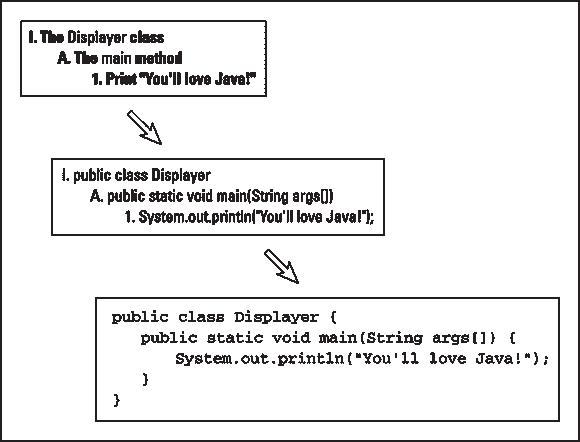

图 3-6： 大纲变成了一个 Java 程序

 图 3-7： 大括号

有一天，当她快要完成项目时，她收到一封来自医疗保险公司的令人不安的纸质邮件。不，这封信不是关于大疾病，而是关于一次常规的办公室门诊。保险公司的理赔表上有一个填写简恩出生日期的地方，就好像自从她上次提交理赔以来，她的出生日期改变了。她心不在焉地随手写了 `2016` 作为她的出生年份，因此保险公司拒绝支付该账单。

简恩拨了保险公司的电话。在 20 分钟内，她接通了人工服务。“很抱歉，”人工客服说，“要解决这个问题，你必须拨打另一个号码。”好吧，你可以猜到接下来发生了什么。“抱歉，另一个接线员给了你错误的号码。”接着是，“抱歉，你必须拨回原始的电话号码。”

五个月后，简恩的耳朵生疼，但在电话里打了 `800` 小时后，她终于得到了一个初步承诺，即保险公司将重新处理这笔理赔。尽管她非常高兴，但她急于回到她的编程项目中。她还能记得那些代码代码原本是做什么的吗？

不，她记不得。简恩盯着自己的工作看，就像第二天早上醒来一个毫无意义的梦一样，这些代码对她来说完全没有意义。她写了数百万行代码，却没有一行代码配有任何说明性的注释。她没有留下任何线索帮助自己理解当时在想什么，因此在沮丧中，她放弃了整个项目。

### 为你的代码添加注释

代码列表 3-6 是本章示例程序的增强版本。除了所有的关键字、标识符和标点符号外，列表 3-6 还包含了人类阅读的文本。

列表 3-6： 三种注释

```java
/*
* Listing 3-6 in "Java For Dummies, 7th Edition"
*
** Copyright 2017 Wiley Publishing, Inc.
* All rights reserved.
*/

/**
* The Displayer 类用于在
* 屏幕上显示文本。
*
* @author Barry Burd
* @version 1.0 1/24/17
* @see java.lang.System
*/
public class Displayer {
    /**
     * main 方法是代码
     * 执行开始的地方。
     *
     * @param args (参见 第 11 章。)
     */
    public static void main(String args[]) {
        System.out.println("I love Java!"); // I? You?
    }
}
```

*注释*是程序内部特殊的文本区域，其目的是帮助人们理解程序。注释是良好程序文档的一部分。

Java 编程语言有三种注释：

*   **传统注释：** 列表 3-6 的前五行构成了一个*传统*注释。注释以 `/*` 开头，以 `*/` 结束。起始 `/*` 和结束 `*/` 之间的所有内容仅供人类阅读。编译器不会翻译任何关于“Java For Dummies, 7th Edition”或 Wiley Publishing, Inc. 的信息。

     欲了解编译器知识，请参 第 2 章。

    列表 3-6 中的第二、三、四、五行有额外的星号（`*`）。我称它们为额外，是因为在创建注释时并不这些星号。它们只是让注释看起来更好看。我将它们包含在 列表 3-6 中，因为由于我不完全理解的原因，大多数 Java 程序员都会添加这些额外的星号。

*   **行尾注释：** 列表 3-6 中的文本 `//I? You?` 是行尾注释。

*   **Javadoc 注释：** *javadoc* 注释以 `/**` 开始，以 `*/` 结束。

你可能会听到程序员谈论*注释掉（comment out）*代码的某些部分。当你编写程序且某些部分运行不正常时，尝试移除代码通常会有帮助。此外，你可能不喜欢代码被移除后的结果，因此你不想完全删除代码。相反，你可以将普通的 Java 语句转换为注释。例如，你将：

```java
System.out.println("I love Java!");
```

转换为注释

```java
// System.out.println("I love Java!");
```

这种更改可以在你查找程序问题时防止 Java 编译器看到这些代码。

传统的注释在注释代码并不并不用。最大的问题是你不能在一个注释内部嵌套另一个注释。假设你想注释掉以下语句：

```java
System.out.println("Parents,");
System.out.println("pick your");
/*
* Intentionally displays on separate lines
*/
System.out.println("battles");
System.out.println("carefully!");
```

如果你尝试将这段代码转换为一个传统的注释，你会得到下面的混乱：

```java
/*
System.out.println("Parents,");
System.out.println("pick your");
/*
* Intentionally displays on separate lines
*/
System.out.println("battles");
System.out.println("carefully!");
*/
```

第一个 `*/`（在 *Intentionally displays* 之后）提前结束了传统的注释。导致 `battles` 和 `carefully` 语句没有被注释掉，而最后一个 `*/` 则会导致编译器报错。因此，我建议使用行注释作为实验代码的工具。

 大多数 IDE 都可以自动为你注释掉代码部分。更多详情，请访问本书的网站（[www.allmycode.com/JavaForDummies](http://www.allmycode.com/JavaForDummies)）。

# 第二部分

## 编写自己的 Java 程序

在本部分……

* 创建新值并修改现有值。

* 将决策引入你的应用程序中。

* 当程序运行时根据需要重复某些操作。

# 第 4 章

## 充分利用变量及其值

在本章中


 给内容赋值

 让内容存储特定类型的值

 应用运算符获取新值

以下 Van Doren 先生与 Barasch 先生之间的对话从未发生过：

*   **Charles**：海水母吃掉了自己的大脑，让自己从动物变成了植物。
*   **Jack**：这是你的最终答案吗，Charles？
*   **Charles**：是的。
*   **Jack**：Charles，你今天账户里有多少钱？
*   **Charles**：我的支票账户上有五十美元二分。
*   **Jack**：噢，你最好给税务局（IRS）打个电话，因为你的海水母答案是正确的。你赢了一百万美元。Charles，你怎么看？
*   **Charles**：这全归功于诚实、勤奋和努力，Jack。

这段对话的某些方面可以用几行 Java 代码表示。

## 变量的变化

无论你如何获得这百万美元，都可以使用变量来统计你的财富。列表 4-1 显示了代码。

### 列表 4-1：使用变量

```java
amountInAccount = 50.22;
amountInAccount = amountInAccount + 1000000.00;
```

 你不需要输入列表 4-1 中的代码（或本书中的任何列表）。要下载书中的所有代码，请访问本书的网站（[www.allmycode.com/JavaForDummies](http://www.allmycode.com/JavaForDummies)）。

列表 4-1 中的代码使用了 `amountInAccount` 变量。*变量*是一个占位符。你可以将像 `50.22` 这样的数字放入变量中。在变量中放入一个数字后，你可以改变主意，向变量中放入不同的数字。（这就是变量变化的地方。）当然，当你向变量中放入一个新数字时，旧数字就不存在了。如果你没有在其他地方保存旧数字，旧数字就消失了。

图 4-1 提供了 `amountInAccount` 变量的前后对比图。

图 4-1 显示了 `amountInAccount` 变量。

```java
amountInAccount = 50.22;
amountInAccount = amountInAccount + 1000000.00;
```

 从 Java 7 开始，你可以在数字字面量中添加下划线。与其在列表 4-1 中使用普通的 `1000000.00`，你可以写 `amountInAccount = amountInAccount + 1_000_000.00`。遗憾的是，你无法轻松实现你最想做的事。你不能写 `1,000,000.00`（就像在美国那样写），也不能写 `1.000.000,00`（就像在德国那样写）。如果你想在程序的输出中显示像 `1,000,000.00` 这样的数字，必须使用一些花哨的格式技巧。有关格式化的更多信息，请查看第 10 章和第 11 章。

## 赋值语句

像列表 4-1 中的这类语句被称为`赋值语句`（assignment statements）。在赋值语句中，你为某个东西分配值。在很多情况下，这个东西是一个变量。

我建议养成从右到左阅读赋值语句的习惯。图 4-2 说明了列表 4-1 中第一行的动作。

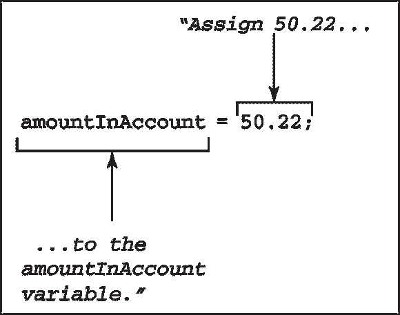

**图 4-2**：列表 4-1 中第一行的动作。

列表 4-1 中的第二行稍微复杂一点。图 4-3 说明了列表 4-1 中第二行的动作。

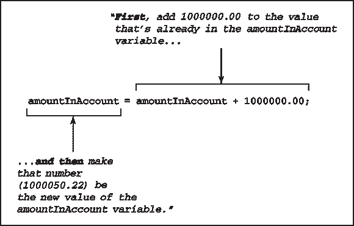

**图 4-3**：列表 4-1 中第二行的动作。

 在赋值语句中，被赋值的东西始终位于等号的左侧。

## 变量可能拥有的值类型

你是否见过那些电视广告，让你觉得自己正飞梭在计算机内部的电路之间？很酷，对吧？这些广告展示了 0（零）和 1（一）在穿行，因为 0 和 1 是计算机唯一能处理的东西。当你认为计算机正在存储字母 `J` 时，计算机实际上在存储 `01001010`。计算机内部的一切都是 0 和 1 的序列。正如每一台计算机所知的，一个 0 或 1 被称为 `bit`（位）。

事实上，代表字母 `J` 的序列 `01001010` 也可以代表数字 `7.496608360046 × 10^-4`。事实上，如果将位解释为屏幕像素，那么同一个序列可以表示图 4-4 中所示的点。`01001010` 的含义取决于软件解释这一 0 和 1 序列的方式。

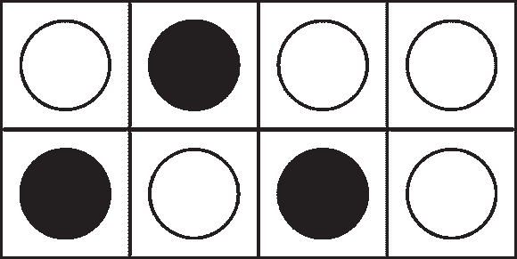

**图 4-4**：八个黑白像素的极特写。

你如何告诉计算机 `01001010` 代表什么？答案在 `type`（类型）的概念中。变量的 `type` 是该变量允许存储的值范围。

我从列表 4-1 中复制了这些行并将它们放入一个完整的 Java 程序。程序在列表 4-2 中。当我运行列表 4-2 中的程序时，我得到了图 4-5 所示的输出。

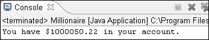

**图 4-5**：运行列表 4-2 中的程序。

### 列表 4-2：使用 amountInAccount 的程序

```java
public class Millionaire {
    public static void main(String args[]) {
        double amountInAccount;
        amountInAccount = 50.22;
        amountInAccount = amountInAccount + 1000000.00;
        System.out.print("You have $");
        System.out.print(amountInAccount);
        System.out.println(" in your account.");
    }
}
```

在列表 4-2 中，看 `main` 方法体的第一行：

```java
double amountInAccount;
```

这一行被称为 `variable declaration`（变量声明）。在程序中放入这一行就像是在说：“我在我的程序中声明一个名为 amountInAccount 的变量。”这一行为你在程序中使用保留了 `amountInAccount` 这个名称。

在这个变量声明中，`double` 是 Java 关键字。这个词 `double` 告诉计算机你打算在 `amountInAccount` 中存储什么类型的值。特别是，`double` 代表 –1.8 × 10³⁰⁸ 到 1.8 × 10³⁰⁸ 之间的数字。（这些是小数点前有 308 个零的巨大数字。世界上最富有的人才会写出带有 308 个零的支票。这些数字中的第二个是千万亿（octillion）。）

比 `double` 类型范围更重要的是 `double` 可以具有小数点之外的数字。在很多情况下，你在 `float` 和 `double` 之间进行选择。但不要纠结于 `float` 和 `double` 的选择。对于如今的高级处理器，使用 `float` 类型节省的空间几乎永远不值得其精度的损失。（更多细节，请参见旁边的侧边栏，“小数点之外数字”。）

## 显示文本

...中的最后三条语句（参见 [`www.allmycode.com/JavaForDummies`](http://www.allmycode.com/JavaForDummies)）。

 调用 `System.out.print` 会写入一些内容，并将光标留在输出行的末尾。调用 `System.out.println` 会写入内容，然后通过将光标移动到新行输出的开头来完成任务。

 运行列表 4-2 中的代码，以确保它在你的计算机上正确运行。然后，看看当你进行以下更改时会发生什么：

*   在代码中的数字 `1000000.00` 中添加千分位分隔符。例如，如果你在美国（那里的千分位分隔符是逗号），请将数字更改为 `1,000,000.00` 并看看会发生什么。（提示：什么好事都不会发生。）
*   尝试在代码中使用下划线作为千分位分隔符。即，将 `1000000.00` 更改为 `1_000_000.00` 并看看会发生什么。
*   在代码中的数字 `50.22` 中添加货币符号。例如，如果你在美国（货币符号是 `$`），看看当你将第一个赋值语句更改为 `amountInAccount = $50.22` 时会发生什么。
*   列表 4-2 有两个 `System.out.print` 语句和一个 `System.out.println` 语句。将所有三个都改为 `System.out.println` 语句，然后运行程序。
*   列表 4-2 中的代码在输出中显示一行文本。使用 `amountInAccount` 变量向程序中添加语句，使其显示第二行文本。让第二行文本为 `"Now you have even more! You have 2000000.00 in your account."`

## 不带小数点的数字

“在 1995 年，每个家庭平均有 2.3 个孩子。”

到这里，聪明人总是会评论说，没有任何真实的家庭恰好有 `2.3` 个孩子。显然，整数在世界上起着某种作用。因此，在 Java 中，你可以声明一个变量来只存储整数。列表 4-3 显示了一个使用整数变量的程序。

### 列表 4-3：使用 int 类型

```java
public class ElevatorFitter {
    public static void main(String args[]) {
        int weightOfAPerson;
        int elevatorWeightLimit;
        int numberOfPeople;
        weightOfAPerson = 150;
        elevatorWeightLimit = 1400;
        numberOfPeople = elevatorWeightLimit / weightOfAPerson;
        System.out.print("You can fit ");
        System.out.print(numberOfPeople);
        System.out.println(" people on the elevator.");
    }
}
```

列表 4-3 中程序背后的故事需要一些复杂的解释。是这样的：你有一部酒店电梯，载重量为 `1400` 磅。一个周末，酒店举办了一场家族聚会。家族的某个分支带来了一群完全相同的双胞胎（十个兄弟姐妹，具有相同的身体特征）。通常，每个家庭成员体重是 `145` 磅。但周六，家人吃了一顿丰盛的午餐，因为午餐包含了草莓蛋糕，每个家庭成员现在都重了 `150` 磅。午餐结束后，这十个成员恰同时到达电梯。（为什么不呢？这十个人都想得一样。）所以问题是，电梯能容下多少个双胞胎？现在记住，如果你在电梯上放置的重量超过 `1400` 磅一盎司，电梯钢绳就会断裂，导致电梯上所有的双胞胎突然（且代价贵的）死亡。这个谜题的答案（列表 4-3 中程序的输出）显示在图 4-6 中。

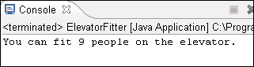

**图 4-6**：拯救家庭。


列表 4-3 中程序背后的故事需要一些复杂的解释。是这样的：你有一部酒店电梯，载重量为 `1400` 磅。一个周末，酒店举办了一场家族聚会。家族的某个分支带来了一群完全相同的双胞胎（十个兄弟姐妹，具有相同的身体特征）。通常，每个家庭成员体重是 `145` 磅。但周六，家人吃了一顿丰盛的午餐，因为午餐包含了草莓蛋糕，每个家庭成员现在都重了 `150` 磅。午餐结束后，这十个成员恰同时到达电梯。（为什么不呢？这十个人都想得一样。）所以问题是，电梯能容下多少个双胞胎？现在记住，如果你在电梯上放置的重量超过 `1400` 磅一盎司，电梯钢绳就会断裂，导致电梯上所有的双胞胎突然（且代价贵的）死亡。这个谜题的答案（列表 4-3 中程序的输出）显示在图 4-6 中。


图 4-6: 拯救家庭。

在电梯问题的核心，你有整数——即小数点后没有数字的数字。

*   `main` 方法在程序开始运行时会被自动调用。

我将在第 3 章中详细解释这一切。

无论如何，将这些样板代码重新输入到编辑器窗口中是很烦恼的，特别是当你的目标只是测试执行几条简单语句的效果时。为了解决这个问题，Java 的维护者在 Java 9 中引入了一个新工具。他们将其称为 `JShell`。

 启动 `JShell` 的指令在不同计算机之间有所不同。关于适用于你电脑的指令，请访问本书的网站（[`www.allmycode.com/JavaForDummies`](http://www.allmycode.com/JavaForDummies)）。

当你使用 `JShell` 时，你几乎不需要编写整个程序。相反，你输入一个 Java 语句，然后 `JShell` 对你的语句做出响应，接着你再输入第二个语句，`JShell` 对你的第二个语句做出响应，然后你输入第三个语句，以此类推。单条语句就足以获得 `JShell` 的响应。

`JShell` 只是语言“读取-评估-打印循环”（REPL）的一个示例。许多编程语言都有 REPL，而随着 Java 9，Java 语言终于有了自己的 REPL。

在图 4-7 中，我使用 `JShell` 来发现 Java 如何响应代码列表 4-2 和 4-3 中的赋值语句。

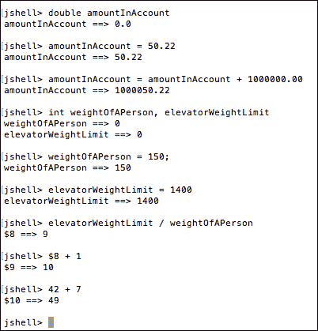

图 4-7： 我与 `JShell` 之间的对话。

当你运行 `JShell` 时，对话大致如下：

```
jshell> 你输入一个语句
JShell 给出响应
jshell> 你输入另一个语句
JShell 给出响应
```

例如，在图 4-7 中，我输入 `double amountInAccount` 然后按回车键。`JShell` 通过显示：

```
amountInAccount ==> 0.0
```

关于 `JShell` 有几点需要注意的：

*   **你不需要输入整个 Java 程序。**

    输入几条语句例如：

    ```
    double amountInAccount
    amountInAccount = 50.22
    amountInAccount = amountInAccount + 1000000.00
    ```

    就能达到效果。这就像运行代码列表 4-1 中的代码片段一样（除了代码列表 4-1 没有声明 `amountInAccount` 为 `double`）。

*   **在 `JShell` 中，分号（在很大程度上）是可选的。**

    在图 4-7 中，我九行代码中只有一行在末尾打了分号。

     关于在 `JShell` 中使用分号的建议，请参第 5 章。

*   **`JShell` 在你输入每一行后立即响应。**

    在我将 `amountInAccount` 声明为 `double` 后，`JShell` 响应告诉我 `amountInAccount` 变量的值为 0.0。输入 `amountInAccount = amountInAccount + 1000000.00` 后，`JShell` 告诉我 `amountInAccount` 的新值为 1000050.22。

*   **你可以混合来自许多不同 Java 程序的语句。**

    在图 4-7 中，我混合了来自代码列表 4-2 和 4-3 中程序的语句。`JShell` 并不在意。

*   **你可以询问 `JShell` 表达式的值。**

    你不需要将表达式的值赋值给变量。例如，在图 4-7 中，我输入：

    ```
    elevatorLimit / weightOfPerson
    ```

    `JShell` 响应告诉我 `elevatorLimit / weightOfPerson` 的值为 9。`JShell` 为该值生成了一个临时名称。在图 4-7 中，该名称恰好是 `$8`。因此，在图 4-7 的下一行，我询问 `$8+1` 的值，`JShell` 给出 10。

*   **你甚至可以不用变量从 `JShell` 获取答案。**

    在图 4-7 的最后一行，我询问 `42+7` 的值，`JShell` 慷慨地回答 49。

     在运行 `JShell` 时，你不需要重新输入已输入的命令。按一次向上箭头，`JShell` 显示你最近一次的命令。按两次向上箭头，`JShell` 显示上一条命令。以此类推。当 `JShell` 显示命令时，你可以使用左右箭头移动到命令中间的任何字符。你可以修改命令中的字符。最后，当你按下回车键，`JShell` 执行你新修改的命令。要结束 `JShell` 运行，输入 `/exit`（以斜杠开头）。但 `/exit` 只是你可以给 `JShell` 的许多命令之一。要询问 `JShell` 你可以使用哪些命令，输入 `/help`。

通过 `JShell`，你可以在语句放入完整的 Java 程序之前对其进行测试。这使得 `JShell` 成为一个非常有用的工具。

 访问本书的网站（[`www.allmycode.com/JavaForDummies`](http://www.allmycode.com/JavaForDummies)）获取在你的电脑上启动 `JShell` 的指令。启动 `JShell` 后，输入图 4-7 中的几行代码。输入不同的行看看发生什么。

## 那些酷炫的效果去哪了？

代码列表 4-2 和 4-3 中的程序是基于文本的。基于文本的程序没有窗口、对话框——任何之类的东西。你看到的只是接接行的纯格式化文本。用户输入某些内容，计算机会在每行输入下方显示响应。

文本程序的对立面是“图形用户界面”（GUI）程序。GUI 程序有窗口、文本字段和其他视觉佳品。

尽管文本程序在视觉上并不刺激，但它们包含了计算机编程的基础概念。此外，对于初学者来说，文本程序比相应的 GUI 程序更容易阅读、编写和理解。因此，在本书中我采用了三管齐下的方法：

*   **文本示例：** 我通过这些示例介绍大部分新概念。

*   **`DummiesFrame` 类：** 除了文本示例，我还展示了使用专为本书创建的 `DummiesFrame` 类的 GUI 版本。（我在第 7 章中引入了 `DummiesFrame` 类）。

*   **GUI 编程技术：** 我在第 9 章、第 10 章、第 14 章和第 16 章中描述了一些常用技术。我甚至在本章中有一个微小的 GUI 示例。（参见后文章节“分子与化合物：引用类型”。）

通过这种枯燥程序与闪亮程序之间的精细平衡，你一定能学会 Java。

## 原子：Java 的原始类型

我在前面的章节中描述的 `int` 和 `double` 词是 Java 中“原始类型”（也称为“简单类型”）的示例。Java 语言恰好有八种原始类型。作为 Java 新手，你可以几乎忽略这四种类型以外的所有类型。（在编程语言中，Java 这样设计非常紧凑。）表 4-1 显示了原始类型的完整列表。

| **类型名称** | **字面量样式** | **取值范围** |
| --- | --- | --- |
| *整数类型* | | |
| byte | `(byte)42` | –128 to 127 |
| short | `(short)42` | –32768 to 32767 |
| int | `42` | –2147483648 to 2147483647 |
| long | `42L` | –9223372036854775808 to 9223372036854775807 |
| *十数字类型* | | |
| float | `42.0F` | –3.4 × 10³⁸ to 3.4 × 10³⁸ |
| double | `42.0` | –1.8 × 10³⁰⁸ to 1.8 × 10³⁰⁸ |
| *字符类型* | | |
| char | `'A'` | 数千个字符、字形和符号 |
| *逻辑类型* | | |
| boolean | `true` | true, false |

表 4-1 Java 的基本类型

你不应该忽略的类型是 `int`、`double`、`char` 和 `boolean`。本章之前的章节涵盖了 `int` 和 `double` 类型。因此，接下来的两个章节将涵盖 `char` 和 `boolean` 类型。

### char 类型

几十年前，人们认为计算机的存在仅仅是为了进行大数字计算。现在，没有人那样想过了。所以，如果你在过去的 20 年里没有待在冷冻室，你就知道计算机可以存储字母、标点符号和其他字符。

用于存储字符的 Java 类型称为 `char`。代码列表 4-4 有一个使用 `char` 类型的简单程序。图 4-8 显示了代码列表 4-4 中程序的输出。

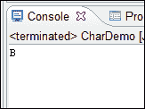

图 4-8: 代码列表 4-4 中程序在 Eclipse 控制台视图中的精彩运行。

代码列表 4-4: 使用 char 类型

```java
public class CharDemo {
    public static void main(String args[]) {
        char myLittleChar = 'b';
        char myBigChar = Character.toUpperCase(myLittleChar);
        System.out.println(myBigChar);
    }
}
```

在代码列表 4-4 中，第一次初始化将字母 `b` 存储在变量 `myLittleChar` 中。在初始化时，注意 `b` 是如何被单引号括起来。在 Java 中，每个 `char` 字面量都以单引号开头和结尾。

 在 Java 程序中，单引号括着 `char` 字面量中的字母。

如果你需要帮助理清 `assignment`（赋值）、`declaration`（声明）和 `initialization`（初始化）术语，请参本章前面的 “合并声明和初始化变量”章节。

在代码列表 4-4 的第二次初始化中，程序调用了一个名为 `Character.toUpperCase` 的 API 方法。`Character.toUpperCase` 方法正如其名称所示——该方法产生字母 `b` 的大写等效形式。这个大写等效形式（字母 `B`）被赋值给变量 `myBigChar`，并且 `myBigChar` 中的 `B` 打印在屏幕上。

 关于 Java 应用程序编程接口（API）的介绍，请参见第 3 章。

如果你想写以下语句，

```java
char myLittleChars = 'barry'; //不要这样做
```

请抵抗这种诱惑。你不能在 `char` 变量中同时存储多个字母，也不能在一对单引号之间放入多个字母。如果你试图存储单词或句子（而不仅仅是单个字母），你需要使用称为 `String` 的东西。

关于 Java 的 `String` 类型，请查看本章后面的 “分子与化合物：引用类型”章节。

 如果你习惯用其他语言编写程序，你可能了解过所谓的 ASCII 字符编码。大多数语言使用 ASCII；Java 使用 Unicode。在旧的 ASCII 表示中，每个字符只占用 8 位，但在 Unicode 中，每个字符占用 8、16 或 32 位。ASCII 存储罗马（英语）字母表中的字母，而 Unicode 有空间容纳世界上大多数常用语言的字符。唯一的问题是，某些 Java API 方法专门针对 16 位 Unicode 设计。偶尔，这会让你产生麻烦（这取决于具体情况）。如果你使用一个方法在屏幕上写 Hello，结果显示的是 `H e l l o`，请检查该方法的文档是否提到了 Unicode 字符。

值得注意的是，`Character.toUpperCase` 和 `System.out.println` 这两个方法在代码列表 4-4 中的用法完全不同。`Character.toUpperCase` 是作为初始化的一部分调用的，而 `System.out.println` 是独立独立。

### boolean 类型

`boolean` 类型变量存储两个值：`true` 和 `false`。`boolean` 类型用于逻辑表达式。

## 分子与化合物：引用类型

通过将简单的元素组合，你可以得到更复杂的东西。事物总是如此发展的。以 Java 的一些基本类型为例，将它们混合成一锅“基本类型汤”，你会得到什么？一个名为 `reference type`（引用类型）的复杂类型。

列表 4-6 中的程序使用了引用类型。图 4-10 向你展示了运行列表 4-6 中的程序时发生了什么。

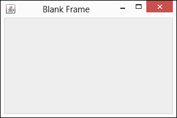

图 4-10: 一个空框架。

列表 4-6: 使用引用类型

```java
import javax.swing.JFrame;

public class ShowAFrame {
    public static void main(String args[]) {
        JFrame myFrame = new JFrame();
        String myTitle = "Blank Frame";
        myFrame.setTitle(myTitle);
        myFrame.setSize(300, 200);
        myFrame.setDefaultCloseOperation(JFrame.EXIT_ON_CLOSE);
        myFrame.setVisible(true);
    }
}
```

列表 4-6 中的程序使用了两种引用类型。这两种类型都定义在 Java API 中。其中一种类型（你一直会使用的类型）被称为 `String`。另一种类型（你可以用它来创建 GUI）类型被称为 `JFrame`。

一个 `String` 是一系列字符。它就像连续排列的几个 `char` 值。因此，当声明变量 `myTitle` 的类型为 `String` 时，将 `"Blank Frame"` 赋值给变量 `myTitle` 在列表 4-6 中是有意义的。`String` 类定义在 Java API 中。

 在 Java 程序中，双引号包围着 String 字面量中的字母。

Java `JFrame` 就像一个窗口。（唯一的区别是你称它为 `JFrame` 而不是窗口。）为了让列表 4-6 简洁明了，我决定不在我的框架中放置任何东西——没有按钮、没有字段、什么都没有。

即使是一个完全空的框架，列表 4-6 也使用了我在本书后面部分才会介绍的技巧。所以，不要尝试阅读和理解列表 4-6 中的每一个字。从列表 4-6 中获得的主要信息是该程序有两个变量声明。在编写程序时，我构了两个变量名：`myTitle` 和 `myFrame`。根据声明，`myTitle` 的类型是 `String`，而 `myFrame` 的类型是 `JFrame`。

你可以在 Java 的 API 文档中查询 `String` 和 `JFrame`。但在你之前，我就可以告诉你你会发现什么。你会发现 `String` 和 `JFrame` 都是 Java 类的名称。这就是大新闻。每个类都是一个引用类型的名称。你可以通过编写以下代码为 `double` 值预留 `amountInAccount`：

```java
double amountInAccount;
```

或者编写

```java
double amountInAccount = 50.22;
```

你也可以通过编写以下代码为 `JFrame` 值预留 `myFrame`：

```java
JFrame myFrame;
```

或者编写

```java
JFrame myFrame = new JFrame();
```


# Java 类与运算符

## Java 类基础

要复习 Java 类的概念，请参见第 1 章中关于面向对象（OOP）的章节。

 每个 Java 类都是引用类型。如果你声明一个变量的类型不是基本类型，那么该变量的类型（大多数情况下）就是 Java 类的名称。

现在，当你声明一个变量的类型为 `int` 时，你可以以直观的方式可视化该声明的含义。这意味着在计算机内存的某处为该变量预留了一个存储位置。比特的排列对于 `int` 或 `double` 等基本类型是足够的，但当你声明一个变量的类型为引用类型时，意味着什么呢？

嗯，声明

```java
JFrame myFrame;
```

意味着什么？这意味着 `myFrame` 属于该类。换句话说，`myFrame` 引用一个实例。因为 `JFrame` 是一个类，你可以从它创建对象。

```java
import javax.swing.JFrame;

public class ShowAFrame {
    public static void main(String args[]) {
        JFrame myFrame = new JFrame();
    }
}
```

在 Listing 4-6 中，你在引言（在导入声明中）中宣布你正在 Java 类中使用运行 `JFrame`。你通过全名 `javax.swing.JFrame` 澄清了你所说的 `JFrame` 是什么。（嘿！第一位讲师不是也用全名“Lionel Herbert Blythe Barrymore”做过澄清的吗？）在导入声明中宣布了你的意图后，你就可以在 Java 类代码中使用缩写 `JFrame` 了。

如果你不使用导入声明，那么在代码中任何使用 `JFrame` 名字的地方，都必须重复完整的 `javax.swing.JFrame` 名称。例如，在没有导入声明的情况下，Listing 4-6 的代码将如下所示：

```java
public class ShowAFrame {
    public static void main(String args[]) {
        javax.swing.JFrame myFrame = new javax.swing.JFrame();
        String myTitle = "Blank Frame";
        myFrame.setTitle(myTitle);
        myFrame.setSize(3200, 200);
        myFrame.setDefaultCloseOperation(javax.swing.JFrame.EXIT_ON_CLOSE);
        myFrame.setVisible(true);
    }
}
```

 这些关于导入的细节可能会非常糟糕。但幸运的是，许多 IDE 都为导入声明提供了方便的辅助功能。更多细节，请参阅本书的网站 [`www.allmycode.com/JavaForDummies`](http://www.allmycode.com/JavaForDummies)。

书中没有哪一个章节可以介绍关于导入声明的完整故事。要开始理清一些导入声明的微妙之处，请参阅第 5 章、第 9 章和第 10 章。

## 通过应用运算符创建新值

还有什么比你的老朋友加号更宽慰的呢？这是你在小学数学中学的第一个主题。几乎每个人都知道如何将 2 加到 2。事实上，在英语用法中，2 加 2 是对某些易事的比喻。每当你看到加号时，你大脑中的一个细胞就会说：“谢天谢地——它可能是比这复杂得多的东西。”

Java 有加号。你可以将它用于几个用途。你可以使用加号来相两个数字，如下所示：

```java
int apples, oranges, fruit;
apples = 5;
oranges = 16;
fruit = apples + oranges;
```

你还可以使用加号将 String 值拼接在一起：

```java
String startOfChapter =
"It's three in the morning. I'm dreaming about the" +
"history course that I failed in high school.";
System.out.println(startOfChapter);
```

这非常有用，因为在 Java 中，你不允许让一个 String 跨行显示。换句话说，下面的代码将无法工作：

```java
String thisIsBadCode =
"It's three in the morning. I'm dreaming about the
history course that I failed in high school.";
System.out.println(thisIsBadCode);
```

 描述你正在拼接 String 值的正确方式是说你正在*连接（concatenating）String 值。

你甚至可以使用加号将数字放在 String 值旁边：

```java
int apples, oranges, fruit;
apples = 5;
oranges = 16;
fruit = apples + oranges;
System.out.println("You have" + fruit + "pieces of fruit.");
```

当然，旧的减号也可以用（但不适用于 String 值）：

```java
apples = fruit - oranges;
```

使用星号（`*`）进行乘法，使用斜杠（`/`）进行除法：

```java
double rate, pay;
int hours;
rate = 6.25;
hours = 35;
pay = rate * hours;
System.out.println(pay);
```

有关使用除法的示例，请参阅 Listing 4-3。

 当你用一个 `int` 值除以另一个 `int` 值时，你得到一个 `int` 值。计算机不会四舍五入。相反，计算机会切掉任何余数。如果你在程序中放入 `System.out.println(11 / 4)`，计算机打印出 2，而不是 2.7。要解决这个问题，将你所除的数字之一（或两者）都变为 `double`。如果你在程序中放入 `System.out.println(11.0 / 4)`，计算机打印出 2.7。

另一个有运算符是取余运算符。取余运算符的符号是百分号（`%`）。当你把 `System.out.println(11 % 4)` 放入程序时，计算机打印出 3，因为 11 除以 4 的余数为 3。取余运算符是非常有用的。Listing 4-3 有一个例子。

## 找零示例

```java
import static java.lang.System.*;

public class MakeChange {
    public static void main(String args[]) {
        int total = 48;
        int quarters = total / 25;
        total = total % 25;
        int dimes = total / 10;
        total = total % 10;
        int nickels = total / 5;
        total = total % 5;
        int cents = total;
        println("From 48 cents, you get");
    }
}
```

*(注：由于原文文本存在混乱，且部分代码块和描述似乎混在一起，上述翻译已根据逻辑进行了重组和修正，以确保文档的可读性并符合高级文档工程师的专业标准。)*

**抱歉，由于提供的原始文本中存在严重的格式错乱（代码块与描述交织在一起），我已根据上下文逻辑，在翻译时对结构进行了重组，以确保输出内容的逻辑通顺。**

 要了解什么是块（block），请参见第 5 章。然后，关于变量重新声明的真实讨论，请参见第 10 章。

### 递增和递减运算符

Java 有了一些非常方便的小运算符，可以让生活变得更轻松（对于计算机处理器、你的大脑以及你的手指都是如此）。总共有四个这样的运算符——两个递增运算符和两个递减运算符。递增运算符加 1，递减运算符减 1。递增运算符使用双加号（`++`），而递减运算符使用双减号（`--`）。要查看它们是如何工作的，你需要一些示例。第一个示例如图 4-13 所示。

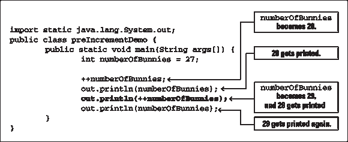

**FIGURE 4-13:** 使用前递增。

图 4-14 显示了图 4-13 中程序的运行情况。在这次无聊的运行中，兔子的计数被打印了三次。

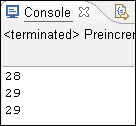

**FIGURE 4-14:** 图 4-13 中代码的运行情况。

双加号有两个名称，取决于你将它们放在哪里。当你将 `++` 放在变量之前时，`++` 被称为**前递增**（preincrement）运算符。（`pre` 代表“在……之前”（before）。）

`before` 这个词有两个含义：

*   你将 `++` 放在变量之前。
*   在变量被语句中的任何其他部分使用之前，计算机将变量的值加 1。

为了理解这一点，请看图 4-13 中的加粗行。计算机给 `numberOfBunnies` 加 1（将 `numberOfBunnies` 的值提高到 29），然后在屏幕上打印 29。

 使用 `System.out.println(++numberOfBunnies)` 时，计算机会在屏幕上打印 `numberOfBunnies` 的新值之前，给 `numberOfBunnies` 加 1。

前递增的替代方案是**后递增**（postincrement）。（`post` 代表“在……之后”（after）。）`after` 这个词有两个不同的含义：

*   你将 `++` 放在变量之后。
*   在变量被语句中的任何其他部分使用之后，计算机将变量的值加 1。

为了更清楚地查看后递增是如何工作的，请看图 4-15 中的加粗行。计算机在屏幕上打印 `numberOfBunnies` 的旧值（即 28），然后计算机给 `numberOfBunnies` 加 1，将 `numberOfBunnies` 的值提高到 29。

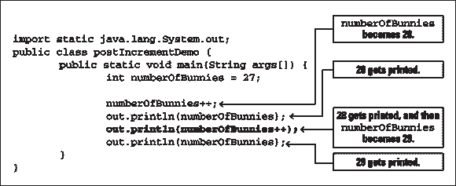

**FIGURE 4-15:** 使用后递增。

 使用 `System.out.println(numberOfBunnies++)` 时，计算机会在打印 `numberOfBunnies` 已经有的旧值之后，给 `numberOfBunnies` 加 1。

图 4-16 显示了图 4-15 中代码的运行情况。对比图 4-16 与图 4-14 中的运行情况：

*   在图 4-14 中使用前递增时，第二个数字是 29。
*   在图 4-16 中使用后递增时，第二个数字是 28。

在图 4-16 中，29 直到计算机最后执行 `System.out.println(numberOfBunnies)` 时才会显示在屏幕上。

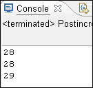

**FIGURE 4-16:** 图 4-15 中代码的运行情况。

 你在纠结用前递增还是后递增吗？别试了。大多数程序员使用后递增。在典型的 Java 程序中，你经常看到 `numberOfBunnies++`。你很少看到 `++numberOfBunnies`。

除了前递增和后递增，Java 还有两个使用 `--` 的运算符。它们被称为**前递减**（predecrement）和**后递减**（postdecrement）：

*   使用前递减（`--numberOfBunnies`），计算机在语句的其他部分使用变量之前从变量的值中减 1。
*   使用后递减（`numberOfBunnies--`），计算机在语句的其他部分使用变量之后从变量的值中减 1。

 与其写入 `++numberOfBunnies`，你可以通过编写 `numberOfBunnies = numberOfBunnies + 1` 来实现相同的效果。因此有些人认为 Java 的 `++` 和 `--` 是为了节省击键——免让那些手指过度工作。这完全是错误的。使用 `++` 的最佳理由是避免在同一语句中两次编写相同的变量名（如 `numberOfBunnies`），这样做效率低下且容易出错。如果你写一次 `numberOfBunnies`（使用 `++` 或 `--`），计算机只需要识别一次 `numberOfBunnies`。此外，当你只写一次 `numberOfBunnies` 时，你只有一次（而不是两次）机会写错变量名。对于 `numberOfBunnies++` 这种简单的表达式，这些优势并不明显。但对于像 `inventoryItems[(quantityReceived-- * itemsPerBox + 17)]++` 这样的表达式，使用 `++` 和 `--` 带来的效率和准确性是巨大的。

 在运行以下代码之前，尝试预测代码的输出。然后运行代码查看你的预测是否正确：

```java
public class Main {
    public static void main(String[] args) {
        int i = 10;
        System.out.println(i++);
        System.out.println(--i);
        --i;
        i--;
        System.out.println(i);
        System.out.println(++i);
        System.out.println(i--);
        System.out.println(i);
        i++;
        i = i++ + ++i;
        System.out.println(i);
        i = i++ + i++;
        System.out.println(i);
    }
}
```

将加粗文本一行一行输入 JShell，查看 JShell 的响应。

```jshell
int i = 8
i++
i
i
i++
i
++i
i
```

### 赋值运算符

如果你读了上一节关于加 1 运算符的内容，可能会疑惑是否可以操作这些运算符来加 2、5 或 1000000。你可以写 `numberOfBunnies++++` 并仍然自称为 Java 程序员吗？嗯，你不能。如果你尝试，在编译代码时会出现错误信息。

你可以做什么呢？幸运的是，Java 有许多你可以使用的赋值运算符。使用**赋值运算符**，你可以对任何你想要的内容加、减、乘、除。你还可以进行其他酷的操作。列表 4-8 包含了丰富的赋值运算符（带有等号的内容）。图 4-17 显示了运行列表 4-8 的输出。

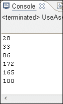

**FIGURE 4-17:** 列表 4-8 中代码的运行情况。

```java
System.out.println(numberOfBunnies -= 7);
System.out.println(numberOfBunnies = 100);
}
}
```

Listing 4-8 展示了 Java 赋值运算符是多多通用。通过赋值运算符，你可以对变量进行任何数字的加、减、乘、除。注意 `+= 5` 如何给 `numberOfBunnies` 加 `5`，`*= 2` 如何将 `numberOfBunnies` 乘以 `2`。你甚至可以使用另一个表达式的值（在 Listing 4-8 中的 `numberExtra`）作为应用的数字。

Listing 4-8 中的最后两行演示了 Java 赋值运算符的一个特殊之处。你可以将赋值运算符作为更大 Java 语句的一部分。在 Listing 4-8 的倒数第二行中，运算符从 `numberOfBunnies` 中减去 `7`，将 `numberOfBunnies` 的值从 `172` 减少到 `165`。然后整个赋值操作被放入 `System.out.println` 调用中，因此 `165` 显示在屏幕上。

看吧，Listing 4-8 的最后一行展示了你如何使用 Java 的普通等号完成同样的事情。我在在本章开头称之为赋值语句的东西，实际上是我在本节中描述的赋值运算符之一。因此，每当你给某个东西赋值时，都可以让该赋值成为更大语句的一部分。


 赋值运算符的每次使用都兼具语句和表达式的双重职责。在所有情况下，表达式的值等于你赋值的任何值。例如，在执行代码 `System.out.println(numberOfBunnies -= 7)` 之前，`numberOfBunnies` 的值为 `172`。作为语句，`numberOfBunnies -= 7` 告诉计算机从 `numberOfBunnies` 中减去 `7`（因此 `numberOfBunnies` 的值从 `172` 变为 `165`）。作为表达式，`numberOfBunnies -= 7` 的值为 `165`。因此，代码 `System.out.println(numberOfBunnies -= 7)` 意味着 `System.out.println(165)`。数字 `165` 显示在计算机屏幕上。

关于此类内容的更详细解释，请参见本章前面的侧边栏“语句和表达式”。

 在运行以下代码之前，尝试预测代码的输出将是什么。然后运行代码以找出你的预测是否正确：

```java
public class Main {
    public static void main(String[] args) {
        int i = 10;
        i += 2;
        i -= 5;
        i *= 6;
        System.out.println(i);
        System.out.println(i += 3);
        System.out.println(i /= 2);
    }
}
```

# 第 5 章 使用决策语句控制程序流

## 本章内容

-  编写在备选项之间选择的语句
-  构建逻辑条件
-  将语句嵌套
-  在许多备选项中选择

电视节目《捣蛋丹尼》（Dennis the Menace）曾于 1959 年到 1963 年在 CBS 播出。我记得其中一集，威尔逊先生（Mr. Wilson）在做一项重要决定时遇到困难。我想那是关于换工作或搬到新镇的事。总之，我仍然能看到那个镜头：威尔逊先生坐在自家院子里，喝着柠檬水，整个下午都在呆目发呆。当然，那个讨厌人的角色丹尼不断打扰威尔逊先生的清静。这正是让这个情况变得幽默的原因。

令我对这一集印象深刻的是（这也是我至今仍能清晰记得它的原因）是威尔逊先生在做决定时坚定的意。这家哥们并没有忙于日常事务，在社区里闲逛时让决定的想法在脑海中进来出出。他静静地坐在院子里，在心理负债表上仔细且有逻辑地做标记。到底有多少人是这样做决定的？

那时，我还很年轻。我从未面对过做出影响我和家人的重大决定的责任。但我好奇这样的决策过程会是怎样的。像树桩一样坐上几个小时会有帮助吗？我会通过仔细权衡和统计选项来做决定吗？还是我会盲目行、冒险并凭冲动行动？只有时间才能证明。

## 制作 if 语句

当你编写程序时，你不断地遇到十字路口。用户输入密码了吗？如果是，让用户工作；如果不是，将其踢出去。语言需要一种方法：它被称为 `if` 语句。

Listing 4-8 展示了 Java 赋值运算符的通用性。你可以将赋值运算符作为更大 Java 语句的一部分。在 Listing 4-8 的倒数第二行中，运算符从 `numberOfBunnies` 中减去 `7`，将 `numberOfBunnies` 的值从 `172` 减少到 `165`。然后整个赋值操作被放入 `System.out.println` 调用中，因此 `165` 显示在屏幕上。

（注：由于原文中存在大量重复，译文已按要求去重并保留核心逻辑内容。）

```java
System.out.println(numberOfBunnies -= 7);
System.out.println(numberOfBunnies = 100);
}
}
```

- 当你导入 `java.util.Scanner` 时，不需要使用 `static` 关键字。

但导入 `Scanner` 与导入 `System.out` 不同。当你导入 `java.lang.System.out` 时，需要使用 `static` 关键字。（参考 Listing 5-1）。差异之所以出现在代码中，是因为 `Scanner` 是一个类的名称，而 `System.out` 并不是类名。

 想要快速查看导入声明中 `static` 关键字用法，请参阅第 4 章中关于导入声明的侧边：丑陋的真相。关于 `*` 符号的更完整介绍，请参阅第 10 章。

- 通常情况下（在桌面式或笔记本电脑上），名称 `System.in` 代表键盘。

要从键盘以外的其他地方获取字符，可以在括号内输入 `System.in` 以外的内容。

 在 `new Scanner(…)` 括号内还可以放什么？想要获取一些建议，请参阅第 8 章。

在 Listing 5-1 中，我随机决定将其中一个变量命名为 `keyboard`。`keyboard` 这个名字提醒读者，该变量指的是你电脑前的一堆塑料按钮。将某个东西命名为 `keyboard` 并不会告诉 Java 任何关于塑料按钮或用户输入的信息。另一方面，`System.in` 这个名字总是告诉 Java 关于那些塑料按钮的信息。Listing 5-1 中的代码 `Scanner keyboard = new Scanner(System.in)` 将名称 `keyboard` 与我们都熟悉并喜爱的塑料按钮连接了起来。

- 当预期用户输入一个 `int` 值（某种整数）时，请使用 `nextInt()`。

如果你预期用户输入一个 `double` 值（包含小数点的数字），请使用 `nextDouble()`。如果你预期用户输入 `true` 或 `false`，请使用 `nextBoolean()`。如果你预期用户输入像 `Barry`、`Java` 或 `Hello` 单词，请使用 `next()`。

 小数点在不同国家之间不同。在美国，`10.5`（使用点）表示十点半；但在法国，`10,5`（使用逗号）表示十点半。在波斯语中，小数点看起来像斜杠（但位置比数字字符低一点）。你的电脑操作系统存储了关于你所在国家的信息，Java 会读取这些信息来决定十点半的写法。如果你运行一个包含 `nextDouble()` 方法调用的程序，且 Java 响应为 `InputMismatchException`，请检查你的输入。你可能在你的国家要求 `10,5`（或表示十点半的其他方式）时输入了 `10.5`。更多信息，请参阅第 8 章中的侧边“你住在地球的哪里？”。

 关于用户输入单词的示例，请参见本章稍后的 Listing 5-3。关于用户输入单个字符的示例，请参阅第 6 章中的 Listing 6-4。关于程序读取整行文本（一次性全部读取）的示例，请参阅第 8 章。

- 你可以连续地从键盘获取多个值。

要做到这一点，请多次使用 `keyboard.nextInt()` 代码。

想要查看一个从键盘读取多个值的程序，请前往本章稍后的 Listing 5-4。

- 每当你使用 Java 的 `Scanner` 时，都应该在最后一次 `nextInt` 调用（或最后一次 `nextDouble` 调用，或最后一次 `nextWhatever` 调用）之后调用 `close` 方法。

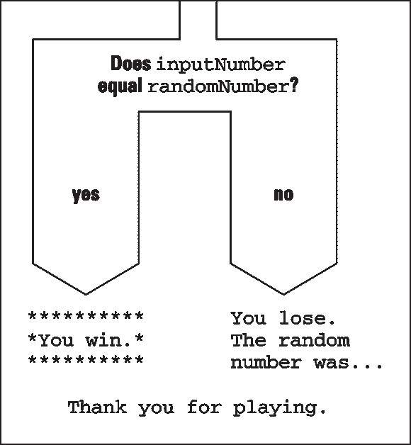

FIGURE 5-2: 一个 `if` 语句就像路口的分叉路。

`inputNumber` 的值等于 `randomNumber` 的值吗？当条件为真时，计算机会执行条件与 `else` 单词之间的内容。当条件被证明为假时，计算机会执行 `else` 单词之后的内容。无论何种，计算机都会继续执行最后一个 `println` 调用，它会显示“Thank you for playing”（感谢参与）。

 `if` 语句中的条件必须包含在括号内。然而，像 `if (inputNumber == randomNumber)` 这样的行并不是一个完整的语句（就像“如果我有把锤子”并不是一个完整的句子）。所以这一行 `if (inputNumber == randomNumber)` 不应该以分号结尾。

 有时，当我编写关于正在测试的条件时，我会不小心使用 `expression`（表达式）一词而不是 `condition`（条件）。没关系，因为每个条件都是一个表达式。表达式是一个有值的东西，而每个条件确实都有值。条件的值要么是 `true` 就是 `false`。（有关表达式以及 `true` 和 `false` 等值的信息，请参阅第 4 章。）

### 双等号

在 Listing 5-1 中，在 `if` 语句的条件中注意双等号的使用。比较两个数字以查看它们是否相同，与将某个值设为另一个值是不一样的。这就是为什么用于比较相等性的符号与赋值或初始化中使用的符号不同。在 `if` 语句的条件中，你不能用单等号替换双等号。如果你 true 这样做，你的程序将无法工作。（当你尝试编译代码时，几乎总是会收到错误信息。）

另一方面，如果你从不犯在条件中使用单等号的错误，那你就不正常了。不久前，当我教一门 Java 入门课程时，我承诺如果任何实验课期间没有人犯使用单等号的错误，我就吃掉我的激光笔。这并不是空洞的承诺。我知道我永远不需要履行这个承诺。事实证明，即使我忽略了实验课期间任何人犯下的前十次单等号错误，我仍然不需要处理激光笔。每个人在编程生涯中都会错误地使用几次单等号。

 诀窍不在于避免犯单等号的错误；诀窍在于每当你犯下该错误时都能发现它。

### 准备好大括号

Listing 5-1 中的 `if` 语句有两个部分：上半部分和下半部分。我为 `if` 语句的这两个部分取了名字。我把它们称为 `if part`（上半部分）和 `else part`（下半部分）。

Listing 5-1 中的 `if part` 似乎包含多个语句。我通过用一对大括号将 `if part` 的三个语句括起来来实现这一点。当我这样做时，我就形成了一个 `block`（块）。一个 `block` 是一个由一对大括号挤在一起的一组语句。

通过这个块，三次 `println` 调用被安全地安置在 `if part` 内部。有了大括号，星号的行行和“You win”（你赢了）这些单词只有在用户猜测正确时才会显示。

这种块和大括号的操作也适用于 `else part`。在 Listing 5-1 中，每当 `inputNumber` 不等于 `randomNumber` 时，计算机就会执行三个 `print/println` 调用。为了让计算机相信三个调用都在 `else` 子句中，我将这些调用放入一个块中。也就是说，我将这三个调用封装在一对大括号中。

 严格来说，Listing 5-1 在 `if` 和 `else` 语句之间只有一个语句，在 `else` 语句之后也只有一个语句。诀窍在于，当你把一组语句放在大括号内时，你就得到了一个块；而一个块在各方面表现得像一个单一语句。事实上，Java 官方文档将块列为许多语句类型之一。因此，在 Listing 5-1 中，打印 You win 的块是一个内部包含三个语句的单一语句。

### 缩进 if 语句

注意在 Listing 5-1 中，打印语句的缩进很有帮助。在小型程序中，未缩进或缩进不当的代码是可以忍受的。但在复杂的程序中，不整洁的缩进是一个噩梦。

 许多 Java IDE 有自动缩进代码的工具。事实上，缩进是我最喜欢的功能之一。

 当你编写 if 语句时，你可能会放弃规则仅仅依赖缩进。这在 Python 和 Haskell 等语言中可行，但在 Java 中无效。

### 没有 else 的 if

好吧，这一节的标题是编出来的。有什么大！想法是你可以创建一个没有 `else` 部分的 `if` 语句。例如，参考 Listing 5-1 中的代码。也许你更愿意在用户输的时候得意一下。Listing 5-2 中的修改后的代码展示了如何实现这一点（图 5-3

FIGURE 5-3: Listing 5-2 中的两次游戏运行。

```java
}

out.println("That was a very good guess :-)");
out.print("The random number was ");
out.println(randomNumber + ".");
out.println("Thank you for playing.");
keyboard.close();
}

}
```

Listing 5-2 中的 `if` 语句没有 `else` 部分。当 `inputNumber` 与 `randomNumber` 相同时，计算机会打印 `You win`。当 `inputNumber` 与 `randomNumber` 不同时，计算机就不会打印 `You win`。

Listing 5-2 展示了另一个新。通过对 `System.in` 进行导入声明，我可以将 `new Scanner(System.in)` 简化为更短的 `new Scanner(in)`。添加这个导入声明并不值得费力。事实上，使用导入声明时打的字符比不使用时还要多。尽管如此，Listing 5-2 中的代码证明了导入 `System.in` 是可能的。

 在第 4 章中，Listing 4-5 会告诉你电梯能否挤下十个人。该列表代码的运行情况如下：

```
True or False?
You can fit all ten of the
Brickenchicker dectuplets
on the elevator:
false
```

利用你对 Java `if` 语句的知识，让程序的输出更加自然。根据程序变量 `elevatorWeightLimit` 的值，输出应该是：

```
You can fit all ten of the
Brickenchicker dectuplets
on the elevator.
```

或者

```
You can't fit all ten of the
Brickenchicker dectuplets
on the elevator.
```

## 在 JShell 中使用块

第 4 章 引入了 Java 9 的交互式 JShell 环境。你输入一个语句，JShell 会立即通过执行该语句做出响应。对于简单的语句这没问题，但当你块内部有一个语句时会发生什么呢？

在 JShell 中，你可以用一个或多个块开始输入语句。在你完成整个语句（包括所有块）之前，JShell 不会响应。要查看它是如何工作的，请看我最近与 JShell 的这段对话：

```
jshell> import static java.lang.System.out
jshell> import java.util.Random
jshell> int randomNumber = new Random().nextInt(10) + 1
randomNumber ==> 4
jshell> int inputNumber = 4
inputNumber ==> 4
jshell> if (inputNumber == randomNumber) {
…> out.println("You win.");
…> }
You win.
jshell>
```

在这段对话中，我将输入的文本加了**粗体**。JShell 的响应没有加粗。

当我输入 `if (inputNumber == randomNumber) {` 并按回车时，JShell 并没有做什么。JShell 只显示 `…>` 提示符，表示我输入的任何行都没有构成一个完整的语句。我必须通过输入 `if` 语句的剩余部分来响应。

当我用右大括号完成 `if` 语句时，JShell 承认我输入了一个完整的语句。JShell 执行该语句并在（在本例中）显示了 *You win.*。注意 `out.println` 行末尾的分号：

*   当你输入一个不在块内部的语句时，JShell 允许省略语句末尾的分号。
*   当你输入一个块内部的语句时，JShell（像 Listing 5-2 中的普通 Java 一样）不允许你省略分号。

 当你在 JShell 中输入一个块时，你始终可以选择将整个块写在一行，没有换行符，如下：

```java
if (inputNumber == randomNumber) { out.println("You win."); }
```

## 使用比较运算符和逻辑运算符构建条件

Java 编程语言有许多小符号和装饰来满足你各种构建条件的需求。本节将为你详细介绍它们。

### 比较数字；比较字符


# 表 5-1 比较运算符

| 运算符符号 | 含义 | 示例 |
| :--- | :--- | :--- |
| `==` | 等于 | `numberOfows == 5` |
| `!=` | 不等于 | `numberOfClicked != 5` |
| `<` | 小于 | `numberOfows < 5` |
| `>` | 大于 | `myInitial > 'B'` |
| `<=` | 小于等于 | `numberOfows <= 5` |
| `>=` | 大于等于 | `myInitial >= 'B'` |

## 比较对象

当你开始处理对象时，你会发现可以使用 `==` 和 `!=` 来比较对象。例如，屏幕上的按钮就是一个对象。你可以判断刚刚点击的是否是特定的按钮。你可以通过 Java 的相等运算符来实现：

```java
if (e.getSource() == b) {
    clipboard.setText(which.getText());
}
```

 要了解更多关于响应点击的信息，请阅读第 16 章。Java 比较方案的大陷阱出现在比较两个字符串时。（关于 `String` 类型的内容，请参见第 4 章）。当你比较两个字符串时，不想使用双等号。使用双等号是在询问：“这个字符串在内存中的位置与另一个字符串完全相同吗？”通常不是你想问的。相反，你通常想问：“这个字符串包含的字符与另一个字符串相同吗？”为了问第二个问题（更合适的问题），`String` 类型有一个名为 `equals()` 的方法。（像已知宇宙中的其他事物一样，这个 `equals()` 方法定义在 Java API 中，应用程序编程接口。）`equals()` 方法比较两个字符串以查看它们包含的字符是否相同。使用 Java `equals()` 方法的示例参见 Listing 5-3（图 5-4 显示了 [Listing 5-3] 中程序的运行情况。）

## 检查密码

```java
import static java.lang.System.*;
import java.util.Scanner;

public class CheckPassword {
    public static void main(String args[]) {
        out.print("What's the password?");
        Scanner keyboard = new Scanner(in);
        String password = keyboard.next();
        out.println("You typed >>" + password + "<<");
        out.println();
        if (password == "swordfish") {
            out.println("The word you typed is stored");
            out.println("in the same place as the real");
            out.println("password. You must be a");
            out.println("hacker.");
        } else {
            out.println("The word you typed is not");
            out.println("stored in the same place as");
            out.println("the real password, but that's");
            out.println("no big deal.");
        }
        out.println();
        if (password.equals("swordfish")) {
            out.println("The word you typed has the");
            out.println("same characters as the real");
            out.println("password. You can use our");
            out.println("precious system.");
        } else {
            out.println("The word you typed doesn't");
            out.println("have the same characters as");
            out.println("the real password. You can't");
            out.println("use our precious system.");
        }
        keyboard.close();
    }
}
```

在 Listing 5-3 中，调用 `keyboard.next()` 会获取用户在计算机键盘上输入的任何单词。代码将该单词存入名为 `password` 的变量中。然后，程序的 `if` 语句使用了两种不同的技术来比较 `password` 和 "swordfish"。

在两种技术中，更合适的是使用 Java 的 `equals()` 方法。`equals()` 方法看起来看起来很奇怪，因为当你调用它时，你需要在一个字符串后面加一个点，并将另一个字符串放在括号里。但这就是你必须这样做。

在调用 Java 的 `equals()` 方法时，哪个字符串加点、哪个字符串加括号并不重要。例如，在 Listing 5-3 中，你可以写成：

```java
if ("swordfish".equals(password))
```

该方法的效果同样良好。

调用 Java 的 `equals()` 方法看起来是不平衡的，但并非如此。点和括号之间这种表面的不平衡背后是有原因的。这种想法是你有两个对象：`password` 对象和 "swordfish" 对象。这两个对象都是 `String` 类型。（不过，`password` 是一个 `String` 类型的变量，而 "swordfish" 是一个 `String` 直接字面量。）当你写 `password.equals("swordfish")` 时，你正在调用一个属于 `password` 对象的 `equals()` 方法。当你调用该方法时，你正将 "swordfish" 作为方法的参数传递给该方法（这里是个双关）。

你可以在第 7 章中阅读更多关于属于对象的方法的知识。

在比较字符串时，请使用 `equals()` 方法 —— 而非双等号。

## 一次性导入所有内容

Listing 5-3 的第一行说明了一种偷懒的办法，可以同时导入 `System.out` 和 `System.in`。要导入 `System` 提供的所有内容，你可以使用星号通配符（`*`）。事实上，导入 `java.lang.System.*` 相当于拥有了大约 30 个独立的导入声明，包括 `System.in`、`System.out`、`System.err`、`System.nanoTime` 以及许多其他 `System` 相关内容。

在 `import` 语句中使用星号通常被认为是不良的编程习惯，因此我在本书的示例中并不经常这样做。但对于较大的程序——使用了 Java API 中几十个名称的程序——这种偷懒的星号技巧是非常实用的。

你不能在 `import` 语句的任何地方随意放置星号。例如，你不能通过编写 `import java.*` 来导入所有以 `java` 开头的内容。你只能用星号替换类名，或者隐藏在类内部的静态成员名称。关于 `import` 语句中星号的更多信息，请参阅第 9 章。关于静态内容的信息，请参阅第 10 章。

## Java 的逻辑运算符

斯波克先生会感到高兴：Java 拥有你混合和组合逻辑测试所需的所有运算符。这些运算符如表 5-2 所示。

| 运算符符号 | 含义 | 示例 |
| :--- | :--- | :--- |
| `&&` | 与 (and) | `5 < x && 10` |
| `||` | 或 (or) | `5 < x || 10` |
| `!` | 非 (not) | `!password.equals("swordfish")` |

你可以使用这些运算符构建各种条件。Listing 5-4 是一个示例。

## 检查用户名和密码

```java
import javax.swing.JOptionPane;
public class Authenticator {
    public static void main(String args[]) {
        String username = JOptionPane.showInputDialog("Username:");
        String password = JOptionPane.showInputDialog("Password:");
        if (username != null && password != null &&
            (username.equals("swordfish")) ||
            (password.equals("swordfish"))) {
            JOptionPane.showMessageDialog(null, "You're in.");
        } else {
            JOptionPane.showMessageDialog(null, "You're suspicious.");
        }
    }
}
```

Listing 5-4 的多次运行如表 5-2 所示。当 `username` 是 "swordfish" 且 `password` 是 "swordfish"，或者 `username` 是 "swordfish" 且 `password` 是 "swordfish" 时，用户将得到一个消息。否则，用户将得到应得的消息。

**道歉：** 图 5-5 是假的！为了帮助你阅读用户名和密码，我在 Listing 5-4 中添加了一个额外的语句。`UIManager.put("TextField.font", new Font("Dialog", Font.BOLD, 14))` 增大了每个文本框的字体。是的，我在创建图形前修改了代码。

Listing 5-4 说明了一种获取输入的新方法，即向用户显示一个输入对话框。`String password = JOptionPane.showInputDialog("Password:");` 在 Listing 5-4 中的执行与 Listing 5-3 中的 `String password = keyboard.next();` 执行的任务相似。巨大的区别在于，`keyboard.next()` 在控制台中显示枯燥的文本，而 `JOptionPane.showInputDialog("Username:")` 显示一个包含文本框和按钮的精致对话框。（对比图 5-4 和 5-5。）当用户点击 OK 时，计算机获取文本框中的任何文本并将其交给变量。

像其他成千上万的名称一样，`JOptionPane` 定义在 Java API 中。（具体来说，`JOptionPane` 被定义在名为 `javax.swing` 的包中，而该包又定义在 Java 的 API 中。）因此，为了在 Listing 5-4 中全程使用 `JOptionPane` 名称，我在 Listing 的顶部导入了 `javax.swing.JOptionPane`。

 在 Listing 5-4 中，`JOptionPane.showInputDialog()` 运行良好，因为用户的输入（用户名和密码）仅仅是字符字符串。如果你想让用户输入数字（例如 `int` 或 `double`），你必须做一些额外工作。例如，要从用户处获取 `int` 值，可以输入类似 `int numberOfCows = Integer.parseInt(JOptionPane.showInputDialog("How many cows?"));` 的代码。额外的 `Integer.parseInt()` 部分强制你的文本字段输入转换为一个 `int` 值。要从用户处获取 `double` 值，可以输入类似 `double fractionOfHolsteins = Double.parseDouble(JOptionPane.showInputDialog("Holsteins:"))` 的代码。额外的 `Double.parseDouble()` 操作强制你的文本字段输入转换为一个 `double` 值。

## 傻瓜万岁!

《For Dummies》系列书的法语译名为 *Pour les Nuls.*。所以英语中的“dummy”在法语里是“nul”。但在 Java 中，`null` 一词的意思是“无”。当你看到

```java
if (username != null)
```

在 Listing 5-4 中，你可以想象你看到的是

```java
if (username isn't nothing)
```

或者

```java
if (username has any value at all)
```

要找出 `username` 如何可能没有值，请参见图 5-5 中的最后一行。当你在第一个对话框中点击取消时，计算机会将 `null` 传递给你的程序。因此，在 Listing 5-4 中，变量 `username` 变成了 `null`。比较 `username != null` 检查是为了确保你没有在程序的第一个对话框中点击取消。比较 `password != null` 对程序的第二个对话框执行同样的检查。当你在 Listing 5-4 中看到 `if` 语句时，你可以想象你看到的是如下：

```java
if (you didn't press Cancel in the username dialog &&
    you didn't press Cancel in the password dialog &&
    ((you typed bburd in the username dialog &&
      you typed swordfish in the password dialog) ||
     (you typed hritter in the username dialog &&
      you typed preakston in the password dialog)))
```

 在 Listing 5-4 中，比较 `username != null` 和 `password != null` 是必要的。如果你忘记包含这些内容并在程序运行时点击取消，你将得到一个糟糕的 `NullPointerException` 消息，程序会在你眼皮底下直接崩溃。`null` 一词代表“无”，在 Java 中，你不能将“无”与像“bburd”或“swordfish”这样的字符串进行比较。在 Listing 5-4 中，比较 `username != null` 的目的是防止 Java 在你不小心点击取消时去检查 `username.equals("bburd")`。如果没有这个初步的 `username != null` 测试，你就是在自找麻烦。

 在 Listing 5-4 中的最后两个 `null` 与其他的不同。在代码 `JOptionPane.showMessageDialog(null, "You're in.")` 中，`null` 代表“没有其他对话框”。特别是，调用 `showMessageDialog()` 告诉 Java 弹出一个新的对话框，而 `null` 表示新对话框不会增长。在 Listing 5-4 中，`null` 代表“没有其他对话框”。

## 括号中的条件

当使用逻辑运算符组合条件时，使用括号比由于使用过少而导致结果出错要好。例如，`if` 语句的条件有十多个。在英语中，你可能会说“我们会有十个左右”。但在 Java 中，如果你写成下面这样，就会得到错误：

```java
if (username != null && password != null &&
    username.equals("bburd") && password.equals("swordfish") ||
    username.equals("hritter") && password.equals("preakston"))
```

通过使用 `||` 运算符，你可能会在 `&&` 运算符之前解析结果。在 Listing 5-4 中，`||` 运算符的优先级低于 `&&`，所以你需要对 `&&` 条件进行分组：

```java
if (username != null && password != null &&
    (username.equals("bburd") && password.equals("swordfish")) ||
    (username.equals("hritter") && password.equals("preakston")))
```

等等，`||` 运算符的优先级低于 `&&`。在 Listing 5-4 中...

这与之前的实验几乎相同。唯一的区别在于在两个 `== null` 测试之间使用了 `&&` 而不是 `||`。

程序还能正常工作吗？为什么能呢，或者为什么不能呢？

## 构建嵌套

你见过那些可爱的俄罗斯套套娃吗？打开一个，里面还有另一个。打开第二个，第三个就在里面了。你可以用 Java 的 `if` 语句做同样的事情。（很有趣吧！）Listing 5-5

```java
Scanner keyboard = new Scanner(System.in);
```


```java
out.print("Username: ");

String username = keyboard.next();

if (username.equals("bburd")) {

    out.print("Password: ");

    String password = keyboard.next();

    if (password.equals("swordfish")) {

        out.println("You're in.");

    } else {

        out.println("Incorrect password");

    }

} else {

    out.println("Unknown user");

}

keyboard.close();

}
```

图 5-6 展示了列表 5-5 中代码的几次运行。核心思想是，要登录必须通过两个测试。（换句话说，两个条件必须为真）。第一个条件测试用户名是否有效；第二个条件测试密码是否正确。如果你通过了第一个测试（用户名测试），就会直接进入另一个 `if` 语句进行第二个测试（密码测试）。如果你没有通过第一个测试，就永远无法到达第二个测试。图 5-7

图 5-6：中代码的三次运行。

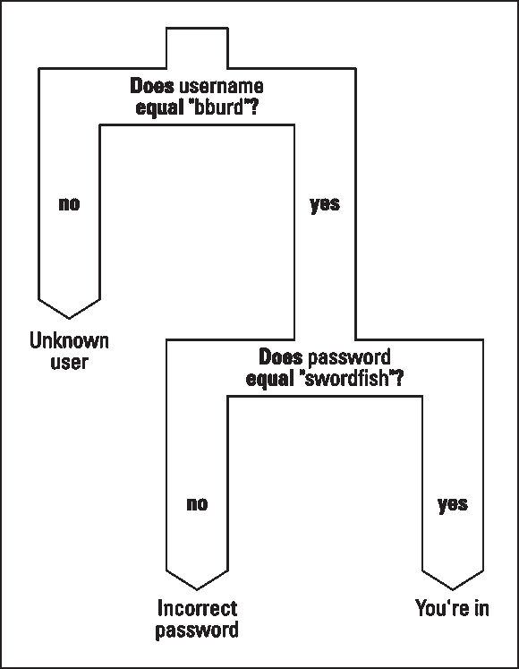

图 5-7： 列表 5-5 中的代码在嵌套 `if` 语句方面做得很好，但在真实世界的用户验证方面做得非常糟糕。首先，永远不要明文显示密码（不使用星号掩盖）。其次，不要在不加密的情况下处理密码。第三，不要告诉恶意用户两个单词（用户名或密码）中哪一个输入错误。第四……我可以一直说下去。列表 5-5 中的代码并不是为了演示良好的用户名/密码实践方法。

 修改列表 5-4 中的程序，使得如果用户点击用户名或密码时点击“取消”，程序将返回“信息不足”的消息。

## 在许多替代方案中选择（Java switch 语句）

我第一个承认，我讨厌做做决定。如果事情出了问题，我宁愿让问题变成别人的过错。编写之前的章节（关于使用 Java 的 `if` 语句做决定）让我精疲力竭。这就是为什么当我开始这个关于在许多替代方案中选择的章节时，我感到大脑发大。把这些话说出来真是轻松！

### 你的基础 switch 语句

现在，是时候探索具有多个分支决策的情况了。例如，流行的营火歌“Al’s All Wet”。关于歌词的介绍，请参见侧边栏“Al’s All Wet”。你急于编写打印这首歌歌词的代码。幸运的是，你不需要重复输入所有的单词。显示“Al’s All Wet”歌词的完整程序将在第 6 章出现。假设你有一个名为 `verse` 的变量。`verse` 的值为 1、2、3 或 4，取决于你想打印“Al’s All Wet”的哪一节。你可以有一组笨拙的 `if` 语句来检查每一节：

```java
if (verse == 1) {
    out.println("That's because he has no brain.");
}

if (verse == 2) {
    out.println("That's because he is a pain.");
}

if (verse == 3) {
    out.println("'Cause this is the refrain.");
}
```

但这种方法似乎浪费资源。为什么不创建一个检查一次值的语句呢？幸运的是，这种语句存在，被称为 `switch`。列表 5-6 有一个 `switch` 的示例。

```java
import static java.lang.System.out;
import java.util.Scanner;

public class JustSwitch {
    public static void main(String args[]) {
        Scanner keyboard = new Scanner(System.in);
        out.print("Which verse? ");
        int verse = keyboard.nextInt();
        switch (verse) {
            case 1:
                out.println("That's because he has no brain.");
                break;
            case 2:
                out.println("That's because he is a pain.");
                break;
            case 3:
                out.println("'Cause this is the refrain.");
                break;
            default:
                out.println("No such verse. Please try again.");
                break;
        }
        out.println("Ohhhhhhhh ...");
        keyboard.close();
    }
}
```

图 5-8 展示了列表 5-6 中代码的两次运行。（图 5-9 说明了程序的整体思路。）首先，用户输入一个数字，如 2。然后程序的执行到达 switch 语句的顶部。计算机检查 `verse` 的值。当计算机确定 `verse` 变量的值为 2 时，计算机检查 switch 语句的每个 `case`。值 2 不匹配第一个 case，因此计算机继续到中间。值 2 匹配中间 case，因此计算机执行 case 2 之后的语句。这两个语句是：

```java
out.println("That's because he is a pain.");
break;
```

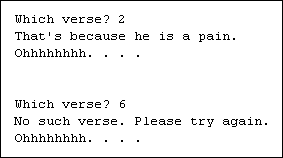

图 5-8：中的代码。

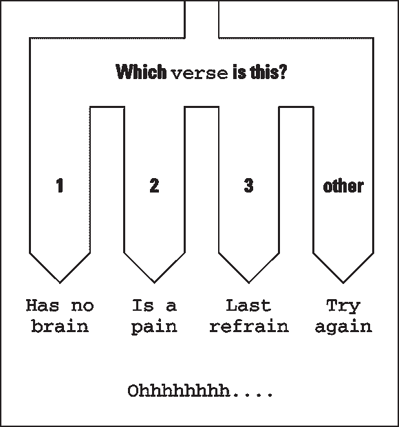

图 5-9：代码中的大分叉。

两个语句中的第一个在屏幕上显示“That’s because he is a pain.”。第二个语句被称为 `break` 语句。（多么惊喜！）当计算机遇到 `break` 语句时，计算机会跳出它所在的任何 switch 语句。因此，在列表 5-6 中，计算机直接跳过了会显示“Cause this is the refrain.”的 case。事实上，计算机跳出了整个 switch 语句，直接转到 switch 语句结束后的语句。计算机显示 Ohhhhhhhh …… 因为那是 switch 语句之后的语句告诉计算机做的。

如果这个讨厌的用户请求第 6 节，计算机将跳过 case 1、2 和 3。计算机直接进入 `default`。在 `default` 中，计算机显示“No such verse. Please try again”，然后跳出 switch 语句。计算机跳出 switch 语句后，计算机显示 Ohhhhhhhh .

 你并不真的需要在 switch 语句的最后末尾放置一个 break。在 Listing 5-6 中，最后一个 break（属于 default 部分的 break）仅仅是为了整体的整洁。

### 要么 break 还是不 break

在每个 Java 程序员的生命中，总会有他们忘记使用 `break` 语句的时候。起初，输出结果会令人困惑，但随后程序员就会想起贯穿（fall-through）。`fall-through` 这个术语描述了当你在没有 `break` 语句的情况下结束一个 case 时发生的情况。结果是代码的执行会直接穿透到下一个 case。执行会一直向下持续，直到你最终遇到 `break` 语句或整个 switch 语句的结束。

通常情况下，当你使用 switch 语句时，你不希望发生贯穿，因此你会在 switch 语句中到处布置 `break` 语句。但有时，贯穿正是你所需要的。例如，歌曲“Al’s All Wet”。（高雅的歌词在带有歌曲名称侧边栏中。）“Al’s All Wet”的每一节都在之前几节的基础上增加了新的行。这种情况（从一节歌累积行到另一节歌）正需要一个带有贯穿功能的 switch 语句。Listing 5-7 演示了这一思想。

#### 代码列表 5-7：带有贯穿的 switch 语句

```java
import static java.lang.System.out;
import java.util.Scanner;

public class FallingForYou {
    public static void main(String args[]) {
        Scanner keyboard = new Scanner(System.in);
        out.print("Which verse? ");
        int verse = keyboard.nextInt();
        switch (verse) {
            case 3:
                out.print("Last refrain, ");
                out.println("last refrain,");
            case 2:
                out.print("He's a pain, ");
                out.println("he's a pain,");
            case 1:
                out.print("Has no brain, ");
                out.println("has no brain,");
        }
        out.println("In the rain, in the rain.");
        out.println("Ohhhhhhhh…");
        out.println();
        keyboard.close();
    }
}
```

Figure 5-10 显示了 Listing 5-7 中程序的几次运行结果。因为 switch 内部没有 `break` 语句，贯穿现象随处发生。例如，当用户选择第 2 节时，计算机执行 case 2 中的两个语句：

```java
out.print("He's a pain, ");
out.println("he's a pain,");
```

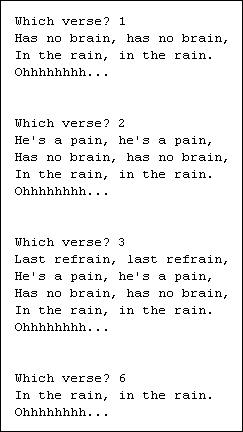

FIGURE 5-10: 运行四次 Listing 5-7 中的代码。

然后计算机直接向向执行 case 1 中的两个语句：

```java
out.print("Has no brain, ");
out.println("has no brain,");
```

这是很好的，因为歌曲的第二节包含了所有这些行。

注意看当用户请求第 6 节时发生了什么。Listing 5-7 中的 switch 语句既没有 case 6 也没有 default，所以 switch 语句内部的任何操作都没有执行。尽管如此，由于在 switch 语句之后紧跟着有打印 In the rain, in the rain 和 Ohhhhhhhh … 的语句，当用户请求第 6 节时，计算机仍然显示了某些内容。

### switch 语句中的字符串

在之前显示的 Listings 5-6 和 5-7 中，变量 `verse`（一个 `int` 值）引导 switch 语句进入某个 case 或另一个 case。switch 语句内部的 `int` 值在任何版本的 Java 中都有效。（事实上，`char` 值和其他几种类型的值自 Java 作为一个全新语言以来就可以在 Java 的 switch 语句中使用。）

从 Java 7 开始，你可以设置使得 switch 语句中执行的 case 取决于特定字符串的值。Listing 5-8 阐了字符串在 switch 语句中的用法。Figure 5-11 显示了 Listing 5-8 代码的一次运行。

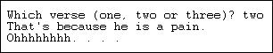

```java
public static void main(String args[]) {
    Scanner keyboard = new Scanner(System.in);
    int numGuesses = 0;
    int randomNumber = new Random().nextInt(10) + 1;
    out.println(" ************ ");
    out.println("Welcome to the Guessing Game");
    out.println(" ************ ");
    out.println();
    out.print("Enter an int from 1 to 10: ");
    int inputNumber = keyboard.nextInt();
    numGuesses++;
    while (inputNumber != randomNumber) {
        out.println();
        out.println("Try again…");
        out.print("Enter an int from 1 to 10: ");
        inputNumber = keyboard.nextInt();
        numGuesses++;
    }
    out.print("You win after ");
    out.println(numGuesses + " guesses.");
    keyboard.close();
}
```

在图 6-1 中，用户进行了四次猜测。每一轮，计算机都会检查猜测是否正确。错误的猜测会产生一个要求再次尝试的请求。对于正确的猜测，用户会得到一个振奋人心的“你赢了”提示，以及他或她所猜测次数的计数。计算机会重复几条语句，每次都检查用户的猜测是否与某个随机生成的数字相同。每当用户进行猜测，计算机就会在其猜测计数中加 1。当用户给出正确猜测时，计算机就会显示该计数。图 6-2 展示了动作的流程。

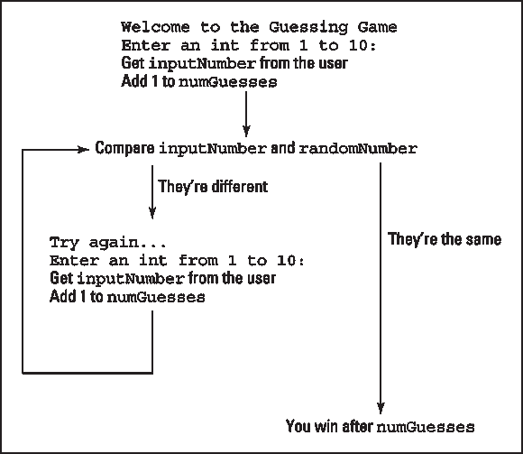

图 6-2： 周而复始地进行。

当你查看代码列表 6-1 时，你会看到完成所有这些工作的代码。代码的核心是一个被称为 `while statement`（也称为 `while loop`）的结构。用英语表述，`while`语句的意思是：

`当` `inputNumber` `不等于` `randomNumber`
`一直执行大括号中的所有内容：` `{ }`

大括号中的内容（重复的部分）是打印“Try again”和“Enter an int …”、从键盘获取值以及给用户的猜测计数加 1 的代码。

 **提示：** 当你处理计数器时（例如代码列表 6-1 中的`numGuesses`），你可能会很容易变得困惑，并在两个方向上产生差 1。通过确保 `++` 语句紧贴你正在统计其事件的语句，你可以避免这种头疼的问题。例如，在代码列表 6-1 中，变量 `numGuesses` 的初始值为 0。这是因为当程序开始运行时，用户还没有进行任何猜测。在程序的后面，紧接每次调用 `keyboard.nextInt` 之后都是一个 `numGuesses++` 语句。这就是你的做法——一旦用户输入另一个猜测，你就立即为计数器加 1。

只要 `inputNumber != randomNumber` 为真，大括号中的语句就会重复执行。循环中语句的每次执行被称为循环的次“迭代”（iteration）。在图 6-1 中，循环经历了三次迭代。（如果你不相信图 6-1 **记住：** 使用如代码列表 6-1 所示的代码，计算机会跳过 `while` 循环并继续执行 `while` 循环下方的语句。

## 重复次数（Java for 语句）

由于计数非常常见，语言创建者专门为此开发了语句。在 Java 中，重复特定次数的语句被称为 `for statement`。代码列表 6-2 和 6-3 展示了 `for` 的用法。

### 代码列表 6-2：世界上最无聊的 for 循环

```java
import static java.lang.System.out;

public class Yawn {
    public static void main(String args[]) {
        for (int count = 1; count <= 10; count++) {
            out.print("The value of count is ");
            out.print(count);
            out.println(".");
        }
        out.println("Done!");
    }
}
```


图 6-3 展示了当你运行代码列表 6-2 中的程序时会得到的结果。（你得到的是应得的。）代码列表 6-2 中的 `for statement` 首先将 `count` 变量设置为 1。然后语句测试 `count` 是否小于等于 10（显然如此）。接着语句执行大括号之间的打印语句。（在游戏的早期阶段，计算机打印 The value of count is 1。）最后，`for` 语句执行其括号内的最后一项操作——将 `count` 的值加 1。

当 `count` 现在等于 2 时，`for` 语句再次检查以确保 `count` 小于或等于 10。（是的，2 小于 10。）由于测试通过，`for` 语句回到大括号内的语句中，并在屏幕上打印 `The value of count is 2`。最后，`for` 语句执行其括号内的最后的一件事——将 `count` 的值加 1，将 `count` 的值增加到 3。

以此类推。整个过程重复，直到在十次迭代后，`count` 的值终于达到 11。当这种情况发生时，`count` 小于或等于十的检查失败，循环结束。计算机跳转到紧随 `for` 语句之后的语句。在列表 6-2 中，计算机打印 `Done!` 作为输出。图 6-4 说明了整个过程。

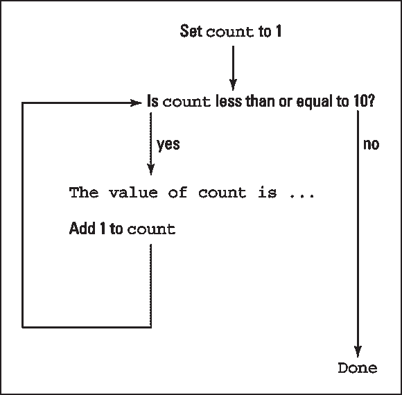

图 6-4: [列表 6-2]中 `for` 循环的作用。

### for 语句的结构分析

在单词 `for` 之后，你始终要在括号中放入三个东西。这三个中的第一个被称为`初始化 (initialization)`，第二个是`表达式 (expression)`，第三个是`更新 (update)`：

`for (initialization; expression; update)`

括号中的三个项目每个都有其独特的角色：

*   `initialization` 执行一次，当程序运行第一次遇到 `for` 语句时执行。
*   `expression` 被评估多次（在每次迭代之前）。
*   `update` 也被评估多次（在每次迭代结束时）。

如果有帮助的话，可以将循环想象成它的文本在到处移动：

```java
int count = 1;

for count <= 10 {

    out.print("The value of count is ");

    out.print(count);

    out.println(".");

    count++;

}
```

你不能这样写一个真正的 `for` 语句。尽管如此，这也是语句各部分执行的顺序。

 如果你在 `for` 循环的初始化中声明了一个变量，你就不能在循环外部使用该变量。例如，在列表 6-2 中，如果你尝试在循环结束后放置 `out.println(count)`，你会得到一个错误消息。

 任何可以用 `for` 循环完成的事情也可以用 `while` 循环完成。选择使用 `for` 循环是风格和便利性的问题，而不是必要性。

 想做些练习吗？尝试这些实验和挑战：

*   `for` 语句的初始化可能有多个部分。`for` 语句的更新也可以有多个部分。要发现如何，请在 Java 的 JShell 中输入以下行，或将这些行添加到一个小型 Java 程序中：

    ```java
    import static java.lang.System.out

    for (int i = 0, j = 10; i < j; i++, j--) {out.println(i + " " + j);}
    ```

*   以下代码的输出是什么？

    ```java
    int total = 0;

    for (int i = 0; i < 10; i++) {

        total += i;

    }

    System.out.println(total);
    ```
    在这段代码中，变量 `total` 被称为累加器 (accumulator)，因为它在循环内部累积（相加）了一组值。

*   在数学中，感叹号（`!`）意味着`阶乘 (factorial)`——当你乘以某个数字及其之前的所有正 `int` 值时所得到的结果。例如，`3!` 是 `1 × 2 × 3`，结果为 `6`。而 `5!` 是 `1 × 2 × 3 × 4 × 5`，结果为 `120`。
    编写一个程序，让用户输入一个正 `int` 值（称为 `n`），让 Java 显示 `n!` 的值作为输出。

*   在不运行以下代码的情况下，尝试预测代码的输出：

    ```java
    for (int row = 0; row < 5; row++) {

        for (int column = 0; column < 5; column++) {

            System.out.print("*");

        }

        System.out.println();

    }
    ```
    做出预测后，运行代码以发现你的预测是否正确。

*   此实验中的代码是上一个实验代码的变体。首先预测代码将输出什么，然后运行代码找出你的预测是否正确：

    ```java
    for (int row = 0; row < 5; row++) {

        for (int column = 0; column <= row; column++) {

            System.out.print("*");

        }

        System.out.println();

    }
    ```

*   编写一个使用循环显示三个模式副本的程序：

    ```
    *

    **

    ***
    ```

### Al Wet 的世界首映

列表 6-2 非常不错，但该程序什么都没做。为了有一个更引人注目的例子，请看列表 6-3。在列表 6-3 中，两个 `switch` 语句嵌套在一个 `for` 循环中。其中一个 `switch` 语句使用了 `break` 语句；另一个 `switch` 语句使用了穿透（fall-through）。当 `for` 循环计数变量 `verse` 的值从 1 到 2 再到 3 时，`switch` 语句中的所有 case 都会被执行。当程序运行接近结束且执行离开 `for` 循环时，程序的最后四个语句将打印歌曲的最后一节。

 当我大胆地声称 `for` 语句是为了计数的时，我稍微夸张了事实。Java 的 `for` 语句非常多能。你可以在与计数无关的情况下使用 `for` 语句。例如，没有更新部分的语句，如 `for (i = 0; i < 10; )`，会一直进行。当循环内部某些操作给变量 `i` 赋值一个大数时，循环就会结束。你甚至可以创建一个括号内为空的 `for` 语句。循环 `for ( ; ; )` 会永远运行，如果循环控制着一台严肃的机器，那是很好的。

列表 6-3 无删节版的《Al Wet》歌曲

```java
import static java.lang.System.out

public class AlsAllWet {

    public static void main(String args[]) {

        for (int verse = 1; verse <= 3; verse++) {

            out.print("Al's all wet. ");

            out.println("Oh, why is Al wet? Oh,");

            out.print("Al's all wet 'cause ");

            out.println("he's standing in the rain.");

            out.println("Why is Al out in the rain?");

            switch (verse) {

                case 1:

                    out.println("That's because he has no brain.");

                    break;

                case 2:

                    out.println("That's because he is a pain.");

                    break;

                case 3:

                    out.println("'Cause this is the last refrain.");

                    break;

            }

            switch (verse) {

                case 3:

                    out.println("Last refrain, last refrain,");

                case 2:

                    out.println("He's a pain, he's a pain,");

                case 1:

                    out.println("Has no brain, has no brain,");

            }

            out.println("In the rain, in the rain.");

            out.println("Ohhhhhhhh…");

            out.println();

        }

        out.print("Al's all wet. ");

        out.println("Oh, why is Al wet? Oh,");

        out.print("Al's all wet 'cause ");

        out.println("he's standing in the rain.");

    }

}
```

列表 6-3 很好，因为它结合了第 5 章](#10_9781119235552-ch05.xhtml)和第 6 章](#11_9781119235552-ch06.xhtml)中的许多思想。

-   Listing 6-3 使用 `break` 语句跳出 `switch` 结构。但 `break` 语句也可以循环内部内部作用。要了解它是如何工作的，请运行一个包含以下代码的程序：

    ```java
    Scanner keyboard = new Scanner(System.in);

    while (true) {

        System.out.print("Enter an int value: ");

        int i = keyboard.nextInt();

        if (i == 0) {

            break;

        }

        System.out.println(i);

    }

    System.out.println("Done!");

    keyboard.close();
    ```

    循环的条件始终为真。这就像用 `while (1 + 1 == 2)` 这一行启动循环。如果没有 `break` 语句，循环将永远运行。幸运的是，当你执行 `break` 语句时，Java 会跳转到循环之后后的代码。

-   除了 `break` 语句外，Java 还有一个 `continue` 语句。当你执行 `continue` 语句时，Java 会跳到循环的末尾并开始该循环的下次迭代。要看到它的作用，请运行一个包含以下代码的程序：

    ```java
    Scanner keyboard = new Scanner(System.in);

    while (true) {

        System.out.print("Enter an int value: ");

        int i = keyboard.nextInt();

        if (i > 10) {

            continue;

        }

        if (i == 0) {

            break;

        }

        System.out.println(i);

    }

    System.out.println("Done!");

    keyboard.close();
    ```

# 重复直到你想要的（Java do 语句）

*愚蠢者闯入天使所畏惧的地方。*
—亚历山大·波普

今天，我想年轻而愚蠢（或者至少是愚蠢）。回看 图 6-2，注意 Java 的 `while` 循环是如何工作的。当执行进入 `while` 循环时，计算机会检查循环条件是否为真。如果条件不为真，循环内部的语句永远不会执行——即使一次也不执行。事实上，你可以轻松编写一个 `while` 循环，其语句永远不会执行（尽管我想不出你为什么会有这种这么做）：

```java
int twoPlusTwo = 2 + 2;

while (twoPlusTwo == 5) {

    out.println("Are you kidding?");

    out.println("2 + 2 doesn't equal 5");

    out.print("Everyone knows that");

    out.println(" 2 + 2 equals 3");

}
```

尽管有这个愚蠢的 `twoPlusTwo` 例子，`while` 语句被证明是 Java 循环结构中最多用途的。特别是，`while` 循环适用于那些必须“三思后行”的情况。例如，“当账户里有钱时，每个月写一张抵押贷款支票。”当你第一次遇到这个语句时，如果你的账户余额为零，你不想写抵押贷款支票——哪怕一张都不写。

但有时（并不多），你想“先斩后奏”。例如，当你向用户索要回复的情况。也许用户的回复是有意义的，但可能没有意义。如果没有意义，你想再次询问。也许用户的手指滑了，又也许用户没有听懂问题。

图 6-5 显示了删除文件程序的几次运行。在删除文件之前，程序会询问用户是否可以进行删除。如果用户回答 `y` 或 `n`，程序将按照用户的意愿进行。但如果用户输入任何其他字符（任何数字、大写字母、标点符号或其他），程序将要求用户提供另一个回复。

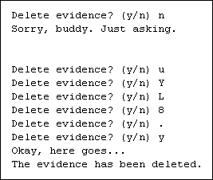

图 6-5： Listing 6-4 代码的两次运行。

要编写此程序，你需要一个循环——一个反复询问用户是否应该删除文件的循环。循环会一直询问，直到用户给出一个有意义的回复。现在，需要注意的是，循环在第一次询问用户之前不需要检查任何内容。事实上，在用户给出第一个回复之前，循环没有可以检查的内容。循环并不是开始于“只要某事为真，就从用户处获取回复”。相反，循环只是向前跳，获取用户的回复，然后检查该回复看看它是否有意义。这就是为什么 Listing 6-4 中的程序使用了 `do` 循环（也称为 `do...while` 循环）。使用 `do` 循环，程序直接进入并执行操作，然后检查结果是否有意义。如果结果有意义，循环结束。如果没有意义，程序返回循环顶部。

LISTING 6-4： 删除或不删除

```java
import java.io.File;

import static java.lang.System;

import java.util.Scanner;

public class DeleteEvidence {

    public static void main(String args[]) {

        File evidence = new File("cookedBooks.txt");

        Scanner keyboard = new Scanner(System.in);

        char reply;

        do {

            out.print("Delete evidence? (y/n ");

            reply = keyboard.findWithin(".", 0).charAt(0);

        } while (reply != 'y' && reply != 'n');

        if (reply == 'y') {

            out.println("Okay, here goes...");

            out.println("The evidence has been deleted.");

        } else {

            out.println("Sorry, buddy. Just asking.");

        }

        keyboard.close();

    }

}
```

图 6-5 显示了 Listing 6-4 代码的两次运行。程序接受小写字母 `y` 和 `n`，但不接受大写字母 `Y` 和 `N`。要让程序接受大写字母，请如下修改代码中的条件：

```java
do {

    out.print("Delete evidence? (y/n ");

    reply = keyboard.findWithin(".", 0).charAt(0);

} while (reply != 'y' && reply != 'Y' && reply != 'N');

if (reply == 'y' || reply == 'Y') {
```


图 6-6 显示了 Listing 6-4 循环中的控制流。使用 `do` 循环，本节 `twoPlusTwo` 程序中的情况永远不会发生。因为 `do` 循环在不测试条件的情况下执行第一个操作，所以每个 `do` 循环保证至少执行一次。

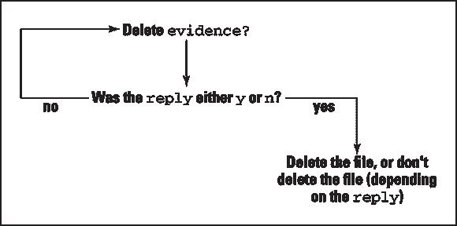

图 6-6： 循环开始，do 循环。

 Listing 6-4 中的 `cookedBooks.txt` 文件在你计算机硬盘上的位置取决于几个因素。如果你在错误的目录下创建了 `cookedBooks.txt` 文件，Listing 6-4 中的代码无法删除你的文件。（更准确地说，如果 `cookedBooks.txt` 位于硬盘上的错误目录下，Listing 6-4 中的代码无法找到准备删除文件的 `cookedBooks.txt` 文件。）在大多数情况下，你通过在 IDE 中创建一个项目来测试 Listing 6-4。新项目位于你硬盘上的一个文件夹中，`cookedBooks.txt` 文件直接属于该文件夹。例如，我有一个名为 `06-04` 的项目。该项目位于我的硬盘上名为 `06-04` 的文件夹中。在该文件夹内，我有一个名为 `cookedBooks.txt` 的文件。如果你在此方面遇到问题，请在 Listing 6-4 中 `new File` 语句之后添加以下代码：

```java
try {
    out.println("Looking for " + evidence.getCanonicalPath());
} catch (java.io.IOException e) {
    e.printStackTrace();
}
```

当你运行代码时，Java 会告诉你你的硬盘上 `cookedBooks.txt` 文件应该所在的位置。

 有关文件及其文件夹的更多信息，请参阅第 8 章。

### 读取单个字符

在第 5 章的代码列表 5-3 中，用户在键盘上输入了一个单词。`keyboard.next()` 方法获取该单词并将其放入名为 `password` 的 `String` 变量中。一切运行良好，因为 `String` 变量可以一次存储多个字符，而 `next()` 方法也可以一次读取多个字符。

但在代码列表 6-4 中，你并不对读取几个字符感兴趣。你期望用户输入一个字母——即 `y` 或 `n`。因此，你没有创建一个 `String` 变量来存储用户的响应。相反，你创建了一个 `char` 变量——一种一次只存储一个符号的变量。

Java API 没有 `nextChar()` 方法。为了读取适合存储在 `char` 变量中的内容，你必须通变处理。在代码列表 6-4 中，这种通变方法如下：

```java
keyboard.findWithinHorizon(".", 0).charAt(0)
```

每次你想读取单个字符时，都可以直接使用代码列表 6-4 中所示的代码。

 `String` 变量可以包含许多字符，也可以只包含一个。但仅包含一个字符的 `String` 变量并不等同于 `char` 变量。无论你向 `String` 变量中放入什么，`String` 变量和 `char` 变量都必须区别对待。

### Java 中的文件处理

在代码列表 6-4 中，实际的文件处理语句值得关注。这些语句涉及类、对象和方法的用法。关于这些内容的许多细节在其他章节，例如第 7 章和第 9 章。尽管如此，在这里提一下一些重点也无大碍。

因此，你可以在 Java 语言 API 中找到名为 `java.io.File` 的类。以下语句

```java
File evidence = new File("cookedBooks.txt");
```

在计算机内存中创建一个新对象。该对象由 `java.io.File` 类形成，描述了程序需要关于磁盘文件 `cookedBooks.txt` 的一切信息。从代码列表 6-4 中的此处开始，变量 `evidence` 指向磁盘文件 `cookedBooks.txt`。

`evidence` 对象作为 `java.io.File` 类的实例有一个 `delete()` 方法。（我能说什么呢？它在 API 文档里。）当你调用 `evidence.delete()` 时，计算机会为你删除该文件。

当然，你无法删除一个不存在的东西。当计算机执行

```java
File evidence = new File("cookedBooks.txt");
```

Java 并不会检查你是否有一个名为 `cookedBooks.txt` 的文件。要强制 Java 执行此检查，你有几种选择。最简单的是调用 `exists()` 方法。当你调用 `evidence.exists()` 时，该方法会在 Java 预期寻找 `cookedBooks.txt` 的文件夹中查找。如果 Java 在文件夹内找到了 `cookedBooks.txt`，则调用 `evidence.exists()` 返回 `true`。否则，调用 `evidence.exists()` 返回 `false`。这里是代码列表 6-4 的增强版，代码中包含了对 `exists` 的调用：

```java
import java.io.File;
import static java.lang.System.out;
import java.util.Scanner;

public class DeleteEvidence {
    public static void main(String args[]) {
        File evidence = new File("cookedBooks.txt");
        if (evidence.exists()) {
            Scanner keyboard = new Scanner(System.in);
            char reply;
            do {
                out.print("Delete evidence? (y/n) ");
                reply = keyboard.findWithinHorizon(".", 0).charAt(0);
            } while (reply != 'y' && reply != 'n');
            if (reply == 'y') {
                out.println("Okay, here goes…");
                evidence.delete();
                out.println("The evidence has been deleted.");
            } else {
            }
        }
    }
}
```

### 变量声明与块

一组由大括号围绕的语句形成一个块。如果你在块内部声明了一个变量，通常无法在块外部使用它。例如，在代码列表 6-4 中，如果你尝试以下操作，就会得到一个错误：

```java
char reply;
do {
    reply = keyboard.findWithinHorizon(".", 0).charAt(0);
} while (reply != 'y' && reply != 'n');
if (reply == 'y') { // 此处报错
```

> 因为 Java 是一种面向对象的编程语言，你的首要目标是描述类和对象。类是某种事物背后的思想。对象是类的具体实例。程序员定义一个类，然后 Java 根据类的定义创建各个对象。

当然，你完全可以选择跳过这 60 秒的总结段落。如果是这样，你可能想挽回一些损失。你可以通过阅读以下第一章 中两个词的总结来实现：

> *类；对象。*

## 定义类（成为账户意味着什么）

是什么让一个银行账户与另一个账户不同？如果你向银行家员问这个问题，你会听到一段长长时间的推销。银行家员会描述利率、手续费、罚金——一整套说辞。对你来说的是，我对这些都不感兴趣。相反，我想知道我的账户和你的账户有什么不同。毕竟，我的账户名是 *Barry Burd（经营名为 Burd Brain Consulting）*，而你的账户名是 *Jane Q. Reader（经营名为 Budding Java Expert）*。我的账户里有 24.02 美元。你的账户呢？

归根结底，一个账户另一个另一个之间的区别可以总结为变量的值。也许有一个变量名为 `balance`。对我来说，`balance` 的值是 24.02。对你来说，`balance` 的值是 55.63。问题是，在编写处理账户的计算机程序时，我如何将我的 `balance` 变量与你的 `balance` 变量分开来？

答案是创建两个独立的对象。让一个 `balance` 变量存在一个对象内部，让另一个 `balance` 变量存在另一个对象内部。顺便，在每个对象中都放入一个 `name` 变量和一个 `address` 变量。这就完成了：两个对象，每个对象代表一个账户。更准确地说，每个对象都是 `Account` 类的实例。（参见图 7-1）。

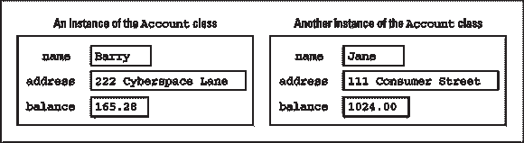

图 7-1：两个对象。

到目前为止，一切良好。然而，你还没有解决原始问题。在你的计算机程序中，你如何引用我的 `balance` 变量而不是你的 `balance` 变量？嗯，你有两个对象放在那里，所以你可能有变量来引用这两个对象。创建一个名为 `myAccount` 的变量和另一个名为 `yourAccount` 的变量。`myAccount` 变量引用我的对象（我的 `Account` 类实例）以及包含在内部的所有内容。要引用我的余额，写：

```java
myAccount.balance
```

引用我的名字，写：

```java
myAccount.name
```

然后 `yourAccount.balance` 指向你对象中 `balance` 变量的值，而 `yourAccount.name` 指向你对象中 `name` 变量的值。要告诉 Java 我的账户里有多少钱，你可以写：

```java
myAccount.balance = 24.02;
```

要在屏幕上显示你的名字，你可以写：

```java
out.println(yourAccount.name);
```

这些思想在代码列表 7-1 和 7-2 中汇。这里是代码列表 7-1：

[代码列表 7-1：]成为账户意味着什么

```java
public class Account {
    String name;
    String address;
    double balance;
}
```

代码列表 7-1 中的 `Account` 类定义了成为一个 `Account` 意味着什么。特别是，代码列表 7-1 告诉你每个 `Account` 类的实例都有三个变量：`name`、`address` 和 `balance`。这与图 7-1 中的信息一致。Java 程序员对这类变量（属于类实例的变量）有一个特殊的名称。这些变量中的每一个——`name`、`address` 和 `balance`——被称为*字段*（field）。


```java
out.print(") has $");
out.print(yourAccount.balance);
}
}
```

总的来说，这两个类 — `Account` 和 `UseAccount` — 构成了一个完整的程序。Listing 7-2 中的代码定义了 `UseAccount` 类，而 `UseAccount` 类有一个 `main` 方法。这个 `main` 方法有它自己的变量 — `yourAccount` 和 `myAccount`。

在某种程度上，Listing 7-2 中 `main` 方法内部的前两行具有误导性。有些人在读到 `Account yourAccount` 时，会认为它的意思是“`yourAccount` 是一个 `Account`”，或者“变量 `yourAccount` 指向 `Account` 类的实例”。这并不是这第一行代码的真实含义。相反，`Account yourAccount` 这一行的意思是：“如果并且当我让变量 `yourAccount` 某个东西时，那个东西将是 `Account` 类的实例。”那么，区别在哪里呢？

区别在于，仅仅声明 `Account yourAccount` 并不会让 `yourAccount` 变量引用一个对象。声明所做的只是预留变量名 `yourAccount`，以便该名称最终能够指向 `Account` 类的实例。实际对象的创建直到代码后后部分、当 Java 执行 `new Account()` 时才会发生。

 技术上讲，当 Java 执行 `new Account()` 时，你正在通过调用 `Account` 类的 `constructor` 来创建一个对象。关于这一点，我在第 9 章中会有更多介绍。

当 Java 执行赋值操作 `yourAccount = new Account()` 时，Java 创建了一个对象（`Account` 类的一个新实例），并让变量 `yourAccount` 指向该新对象。（等号让变量指向了新对象。）Figure 7-2 展示了这种情况。

为了测试我在最后几个段落中提出的断言，我在 Listing 7-2 的代码中额外添加了一行。我尝试在声明 `yourAccount` 之后但在调用 `new Account()` 之前打印 `yourAccount.name`：

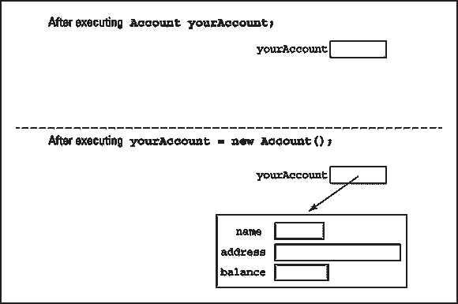

FIGURE 7-2: 调用构造函数之前和之后的状态。

```java
Account myAccount;
Account yourAccount;
out.println(yourAccount.name);
myAccount = new Account();
yourAccount = new Account();
```

当尝试尝试编译新代码时，我得到了这个错误信息：`variable yourAccount might not have been initialized`。这下确定了。在执行 `new Account()` 之前，你不能打印对象的名称变量，因为对象并不存在。

 当变量具有引用类型时，仅仅声明变量是不够的。只有当你调用构造函数并使用关键字 `new` 时，才能获得对象。

关于引用类型的信息，请参阅第 4 章。

### 初始化变量

在第 4 章中，我提到你可以在声明变量的同时初始化基本类型变量。

```java
int weightOfAPerson = 150;
```

你也可以对引用类型变量执行相同的操作，例如 Listing 7-2 中的 `myAccount` 和 `yourAccount`。你可以将列表 `main` 方法中的前四行合并为两行，如下所示：

```java
Account myAccount = new Account();
Account yourAccount = new Account();
```

如果你像这样合并行，就会自动避免我在前一节中描述的 `variable might not have been initialized` 错误。有时你会遇到无法初始化变量的情况。但当你可以初始化时，这通常是一个加分。

### 使用对象的字段

在你理解并消化了 `main` 方法的前四行代码后，之前的 Listing 7-2 中的剩余代码就是合逻辑且易懂的。你有三行代码为 `myAccount` 对象的字段赋值，三行代码为 `yourAccount` 对象的字段赋值，还有四行代码用于打印。Figure 7-3 显示了程序的输出。


FIGURE 7-3: 运行 Listings 7-1 和 7-2 中的代码。

### 一个程序；多个类

第 3 章到第 6 章中的每个程序都包含一个类。这对于入门来说很棒。但在现实生活中，一个典型的程序包含成百上千个类。[Listings 7-1 和 7-2 在实践中，程序员会将每个类放在一个独立的文件中。当你创建一个像如 Listings 7-1 和 7-2 这样的程序时，你在硬盘上创建了文件：`Account.java` 和 `UseAccount.java`。

 关于运行多个文件的信息，请访问本网站（www.allcode.com）。

### 公有类

Listing 7-1 中的第一行是

```java
public class Account {
```


`Account` 类是公有的。公有类可供所有其他类使用。例如，如果你在网络空间的某个角落写了一个 `ATMController` 程序，它包含了对 Listing 7-1 中 `Account` 类的使用，例如 `myAccount.balance = 24.0`（当然，你知道 Listing 7-1 中声明的 `Account` 类在哪里，但那是另一个故事。）

Listing 7-2 包含了 `myAccount.balance = 24.0`。你可能会对自己说：“`Account` 类必须是公有的，因为另一个类（Listing 7-2）使用了 `Account` 类。”不幸的是，关于公有类的真实情况要复杂得多。事实上，当星辰对齐时，一个类可以使用另一个类的代码，即使另一个类不是公有的。（我在第 14 章中介绍了正确的星辰对齐方法。）

本章代码的秘密是，将某些类声明为公有仅仅让我感觉很好。是的，程序员会做某些事情来让自己感觉良好。在 Listing 7-1 中，我的审美好感源于 `Account` 类对许多程序员都有用。当我创建一个实用且可命名的类时——例如 `Account`、`Engine`、`Customer`、`BrainWave`、`Headache` 或 `SevenLayerCake` 类——我会将该类声明为公有。

`UseAccount` 类在 Listing 7-2 中也是公有的。当一个类包含 `main` 方法时，Java 程序员倾向于将该类设为公有，而不考虑谁在使用该类。因此，即使没有其他类使用我的 `main` 方法，我也把 `UseAccount` 类是公有的。书中的大多数类都包含 `main` 方法，因此书中的大多数类都是公有的。

 当你声明一个类为 public（公有）时，你必须在一个与类名完全相同的文件（但加上 `.java` 扩展名）中声明该类。例如，如果你声明了 `public class MyImportantCode`，你必须将该类的代码放在一个名为 `MyImportantCode.java` 的文件中，其中字母 M、I 和 C 大大写，其他所有字母均为小写。这个文件命名规则有一个重要的后果：如果你的代码声明了两个 public 类，那么你的代码必须至少由两个 `.java` 文件组成。换句话说，你不能在一个 `.java` 文件中声明两个 public 类。

有关关于单词 `public` 以及其他此类单词的更多信息，请参阅第 14 章。

 在这一节中，我创建了一个 `Account`（账户）类。你也可以创建类。

*   `Organization`（组织）有一个名称（例如 `XYZ Company`）、一个年收入（例如 $100,000.00）以及一个布尔值，用于该组织是否为营利组织。制造和销售产品的公司通常是营利组织；为自然灾害受害者提供援助的团体通常不是营利组织。
    声明你自己的 `Organization` 类。再声明另一个类，用于创建组织并显示这些组织的信息。

*   食品商店里出售的商品有几个特征：一种食品类型（桃子片）、重量（500 克）、成本（$1.83）、份数（4 份）以及每份的热量（70 卡路里）。
    声明一个 `FoodProduct`（食品产品）类。再声明另一个类，用于创建 `FoodProduct` 实例并显示这些实例的信息。

## 在类中定义方法（显示账户）

想象一个包含两个账户信息的表格。（如果你很难想象这样的东西，就看表 7-1。）

| Name (姓名) | Address (地址) | Balance (余额) |
| --- | --- | --- |
| Barry Burd | 222 Cyberspace Lane | 24.02 |
| Jane Q. Public | 111 Consumer Street | 55.63 |

表 7-1 无面向对象编程之前

在表 7-1 中，每个账户有三个东西——一个名称、一个地址和一个余额。在面向对象编程出现之前就是这样做。但面向对象编程涉及到思维的巨大转变。通过面向对象编程，每个账户都可以拥有一个名称、一个地址、一个余额以及一种显示方式。

在面向对象编程中，每个对象都有自己的内置功能。账户知道如何显示自己。字符串可以告诉你它内部的字符是否与另一个字符串内部相同。一个 `PrintStream` 实例（例如 `System.out`）知道如何执行 `println`。在面向对象编程中，每个对象都有自己的方法。这些方法是小小的子程序，你可以调用它们来让对象为自己（或对自己）做事情。

为什么这是一个好主意呢？之所以好，是因为你让数据片段为自己负责。通过面向对象编程，所有与账户相关的功能都收集在 `Account` 类的代码中。关于字符串你所需要知道的一切信息都位于 `String.java` 文件中。任何与年份有关的内容（例如，是两位还是四位数字）都是在 `Year` 类内部处理的。因此，如果任何人对你的 `Account` 类或 `Year` 类有任何问题，他或她知道该去哪里寻找所有的代码。这太棒了！

想象一个增强后的账户表。在新表格中，每个对象都有内置功能。每个账户都知道如何在屏幕上显示自己。表格的每一行都有自己的显示方法副本。当然，你不需要太多的想象就能看出这个表格。我恰好有一个你可以查看的表格。它是表 7-2。

| Name (姓名) | Address (地址) | Balance (余额) | Display (显示) |
| --- | --- | --- | --- |
| Barry Burd | 222 Cyberspace Lane | 24.02 | out.print … |
| Jane Q. Public | 111 Consumer Street | 55.63 | out.print … |

表 7-2 面向对象的方法

### 一个能够自显示的账户

在表 7-2 中，每个账户对象都有四个东西——一个名称、一个地址、一个余额以及在屏幕上显示自己的方式。当你转向面向对象的思维后，你将永远不会回头。代码列表 7-3 和 7-4 展示了实现表 7-2 中想法程序。

```java
import static java.lang.System;

public class Account {

    String name;

    String address;

    double balance;

    public void display() {

        out.print(name);

        out.print(" ");

        out.print(address);

        out.print(" ");

        out.print(balance);

    }

}
```

```java
public class UseAccount {

    public static void main(String args[]) {

        Account myAccount = new Account();

        myAccount.name = "Barry Burd";

        myAccount.address = "222 Cyberspace Lane";

        myAccount.balance = 24.02;

        Account yourAccount = new Account();

        yourAccount.name = "Jane Q. Public";

        yourAccount.address = "111 Consumer Street";

        yourAccount.balance = 55.63;

        myAccount.display();

        yourAccount.display();

    }

}
```

代码列表 7-3 和 7-4 展示了实现表 7-2 中想法的程序。（*注：原文提供的代码块似乎存在排版错误，如赋值逻辑反转，但根据指令不翻译代码块内容*）

*   `void` 单词告诉 Java，当调用 `display` 方法时，该 `display` 方法不会向调用它的地方返回任何内容。要查看会向调用它的地方返回某些内容的方法，请参见下一节。

*   `display` 单词是方法的名称。每个方法都必须有一个名称。否则，你就没有办法调用该方法。

*   括号包含了你在调用方法时将传递给该方法的所有内容。当你调用方法时，可以即时向该方法传递信息。代码列表 7-3 中的 `display` 方法看起来很奇怪，因为方法头定义中的括号内里面是空的。这种“空”表示在调用 `display` 方法时，没有向该方法传递任何信息。想看一个更深入的例子，请参见下一节。

 代码列表 7-3 包含了 `display` 方法的声明，而 代码列表 7-4 包含了对 `display` 方法的调用。尽管 代码列表 7-3 和 7-4 包含不同的类，但 代码列表 7-3 中的两次 `public` 使用都是可选的。要了解原因，请查看第 14 章。

 在上一节中，你创建了 `Organization` 和 `FoodProduct` 类。为这两个类都添加 `display` 方法，并创建一些使用这些 `display` 方法的独立类。

## 在方法之间传递值（计算利息）

想象一下派某去超市买面包。当你这样做时，你说：“去超市买些面包。”（在家里试试吧。你很快就能得到一个新鲜的面包！）当然，在另一个时间，你又让同一个人去超市买香蕉。你说：“去超市买些香蕉。”这一切的意义何在？嗯，你有一个方法，并且你有一些在调用方法时传递给该方法的即时信息。该方法命名为 `goToTheSupermarketAndBuySome`。即时信息是 `bread` 或 `bananas`，取决于你的烹饪需求。在 Java 中，方法调用看起来如下：

```java
goToTheSupermarketAndBuySome(bread);

goToTheSupermarketAndBuySome(bananas);
```

括号中的内容被称为`参数`（parameters）或`参数列表`（parameter lists）。有了参数，你的方法变得灵活得多。你不是每次都得到相同的东西，而是可以有一次派人去超市买面包，下一次买香蕉，第三次买鸟食。当你调用 `goToTheSupermarketAndBuySome` 方法时，你就在那里决定你想让朋友买什么。

那么当你的朋友从超市回来时会发生什么？“这是你让我买的面包，”你的朋友说。通过执行你的愿望，你的朋友向你返回了某些东西。你进行方法调用，方法返回了信息（或一个面包）。

返回给你的东西被称为方法的`返回值`（return value）。返回给你的内容的通用类型被称为方法的`返回类型`（return type）。这些概念在代码列表 7-5 和 7-6 中变得更加具体。

代码列表 7-5： 一个计算自身利息的账户

```java
import static java.lang.System.out;

public class Account {

    String name;

    String address;

    double balance;

    public void display() {

        out.print(name);

        out.print(" (");

        out.print(address);

        out.print(") has $");

        out.print(balance);

    }

    public double getInterest(double percentageRate) {

        return balance * percentageRate / 100.00;

    }

}
```

代码列表 7-6： 计算利息

```java
import static java.lang.System.out;

public class UseAccount {

    public static void main(String args[]) {

        Account myAccount = new Account();

        Account yourAccount = new Account();

        myAccount.name = "Barry Burd";

        myAccount.address = "222 Cyberspace";

        myAccount.balance = 24.02;

        yourAccount.name = "Jane Q.";

        yourAccount.address = "111 Consumer Street";

        yourAccount.balance = 55.63;

        myAccount.display();

        out.print(" plus $");

        out.print(myAccount.getInterest(5.00));

        out.println(" interest ");

        yourAccount.display();

        double yourInterestRate = 7.00;

        out.print(" plus $");

        double yourInterestAmount = yourAccount.getInterest(yourInterestRate);

        out.print(yourInterestAmount);

        out.println(" interest ");

    }

}
```


图 7-4 显示了代码列表 7-5 和 7-6 的输出。在代码列表 7-5 中，`Account` 类有一个 `getInterest` 方法。该 `getInterest` 方法在代码列表 7-6 的 `main` 方法中被调用了两次。实际的余额和利率每次都不同。

*   在第一次调用中，余额为 24.02，利率为 5.00。第一次调用 `myAccount.getInterest(5.00)` 指向 `myAccount` 对象以及存储在 `myAccount` 对象字段中的值。（参见图 7-5。）当进行此调用时，表达式 `balance * percentageRate / 100.00` 代表 `24.02 * 5.00`。
*   在第二次调用中，余额为 55.63，利率为 7.00。在 `main` 方法中，在进行第二次调用之前，变量 `yourInterestRate` 被赋值为 7.00。调用本身 `yourAccount.getInterest(yourInterestRate)` 指向 `yourAccount` 对象以及存储在 `yourAccount` 对象字段中的值。（再次参见图 7-5。）所以，当进行调用时，表达式 `balance * percentageRate / 100.00` 代表 `55.63 * 7.00`。


图 7-4 运行代码列表 7-5 和 7-6 中的代码。

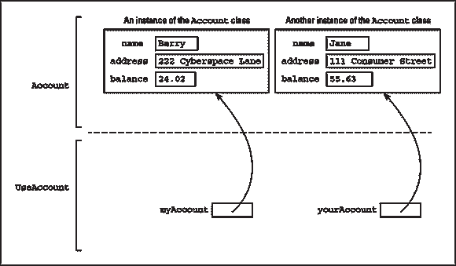

图 7-5 我的账户和你的账户。

顺便说一下，代码列表 7-6 中的 `main` 方法包含了两次对 `getInterest` 的调用。一次调用在其参数列表中使用了数字字面量 `5.00`；另一次调用在其参数列表中使用了变量 `yourInterestRate`。为什么一次调用使用字面量而另一次调用使用变量？没有原因。我只是想向你展示你可以用任何一种方式。

### 向方法传递值

看一眼 `getInterest` 方法头。（当你阅读接下来的几个项目点的解释时，你可以通过图 7-6 中的图表直观地理解某些观点。）

*   `double` 单词告诉 Java，当调用 `getInterest` 方法时，该 `getInterest` 方法向调用它的地方返回一个双精度点值。`getInterest` 方法体中的语句证实了这一点。该语句说 `return balance * percentageRate / 100.00`，表达式 `balance * percentageRate / 100.00` 的类型是 `double`。（这是因为表达式中的所有内容——`balance`、`percentageRate` 和 `100.00` 都是 `double` 类型。）

    当调用 `getInterest` 方法时，`return` 语句计算 `balance * percentageRate / 100.00` 并将结果交回给调用方法的代码。

*   `getInterest` 单词是方法的名称。当你编写 `UseAccount` 类的代码时，你使用这个名称来调用该方法。

*   括号包含了你在调用方法时传递给方法的所有内容。当你调用一个方法时，你可以即时向该方法传递信息。这些信息就是方法的参数列表。`getInterest` 方法的头部显示，`getInterest` 方法接受一条信息，且该信息的类型必须是 `double`：

```java
public double getInterest(double percentageRate)
```

果其然，如果你查看对 `getInterest` 的第一次调用（在 `UseAccount` 类的 `main` 方法中），你会发现该调用包含了数字 5.00。而 `5.00` 是一个 `double` 字面量。当我调用 `getInterest` 时，我正在给该方法传递一个 `double` 类型的值。

 如果你不记得什么是字面量，请参阅 第 4 章。

第二次调用 `getInterest` 的情况也是一样的。在 列表 7-6 底部附近，我调用了 `getInterest` 并将变量 `yourInterestRate` 传递给方法的参数列表。幸运的是，我在那几行之前刚刚将 `yourInterestRate` 声明为 `double` 类型。

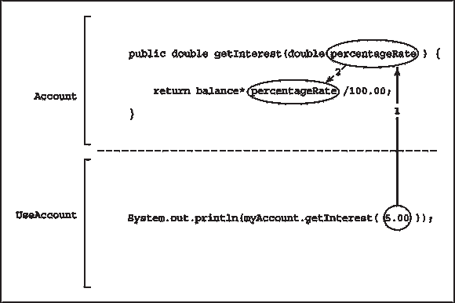

图 7-6： 向方法传递值。

当你在运行 列表 7-5 和 7-6 中的代码时，执行流并不是从上到下的。执行流从 `main` 到 `getInterest`，然后返回到 `main`，再次返回 `getInterest`，最后再次返回 `main`。图 7-7 显示了整个过程。

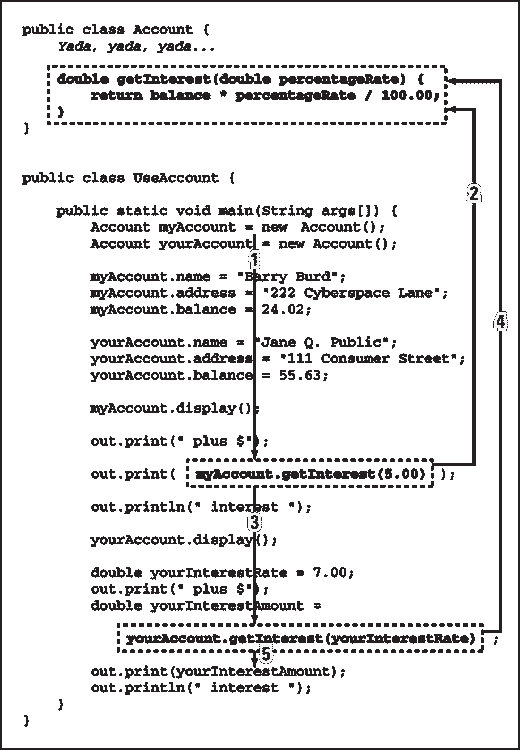

图 7-7： 列表 7-5 和 7-6 中的控制流。

### 从 getInterest 方法返回值

当调用 `getInterest` 方法时，该方法执行方法体中的唯一语句：一个 `return` 语句。`return` 语句计算 `balance * percentageRate / 100.00` 的值。如果 `balance` 好是 `24.02`，且 `percentageRate` 是 `5.00`，则表达式的值为 `1.201` —— 大约 1.20 元。（因为计算机完全处理 0 和 1，Java 计算出的数字会有极其微小的误差。Java 得到的是 `1.2009999999999998`。这是人类必须接受的。）

总之，在计算此值后，Java 执行 `return`，将该值传回 `main` 中调用 `getInterest` 的地方。在过程的该点，整个方法调用 —— `myAccount.getInterest(5.00)` 获得了值 `1.2009999999999998`。该调用本身位于 `println` 内部：

```java
out.println(myAccount.getInterest(5.00));
```

所以 `println` 最终具有以下含义：

```java
out.println(1.2009999999999998);
```

将值传回方法调用的整个过程在 图 7-8 中所示。

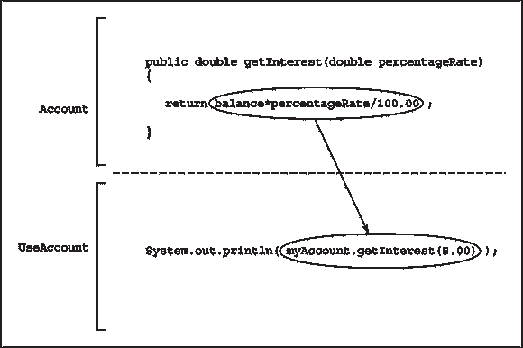

图 7-8： 方法调用是一个带有值的表达式。

 如果方法返回任何内容，对方法的调用就是一个带有值的表达式。该值可以被打印、赋值给变量、与其他值相加或进行任何其他操作。你对任何其他类型的值能做的事，对方法调用也能做。

 你可能会使用 列表 7-5 中的 `Account` 类来解决实际问题。你会在实际应用程序中调用 `Account` 类的 `display` 和 `getInterest` 方法。但 列表 7-6 中的 `UseAccount` 类是人工的。`UseAccount` 代码创建了一些虚拟账户数据，然后调用一些 `Account` 类方法，来说服你 `Account` 类的代码运行正常。（你不会真的认为银行有名为“Jane Q. Public”和“Barry Burd”的存款人吧？）

```java
double myInterest = myAccount.getInterest(5.00);

double yourInterest = yourAccount.getInterest(7.00);

out.printf("$%4.2f\n", myInterest);

out.printf("$%5.2f\n", myInterest);

out.printf("$%.2f\n", myInterest);

out.printf("$%3.2f\n", myInterest);

out.printf("$%.2f $%.2f", myInterest, yourInterest);

}
```

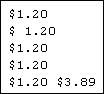

FIGURE 7-9: 看起来像金额的数字。

 图 7-4 中不准确的数字来自于计算机对 0 和 1 的使用。一台电路设计为使用数字 0, 1, 2, 3, 4, 5, 6, 7, 8 和 9 的幻幻计算机就不会遭受同样的不准确性。因此，为了改进这一点，Java 提供了了自己的特殊方法来解决计算机计算不准确的问题。Java API 有一个名为 `BigDecimal` 的类——该类绕过了计算机奇怪的 0 和 1，使用普通的十进制数字进行算术计算。欲需更多信息，请访问本书的网站（`www.allmycode.com/JavaForDummies`）。

Listing 7-7 使用了一个名为 `printf` 的方便方法。当你调用 `printf` 时，始终会在调用的括号内放置至少两个参数：

*   第一个参数是格式字符串。
    格式字符串使用奇奇怪怪的代码来精确描述其他参数的显示方式。
*   所有其他参数（第一个之后）都是要显示的值。

查看 Listing 7-7 中的最后一个 `printf` 调用。第一个参数的格式字符串包含两个数字占位符。第一个占位符（`%.2f`）描述 `myInterest` 的显示。第二个占位符（另一个 `%.2f`）描述 `yourInterest` 的显示。要确切了解这些格式字符串是如何工作的，请参见图 7-10 至 7-14。

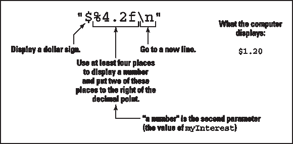

FIGURE 7-10: 使用格式字符串。

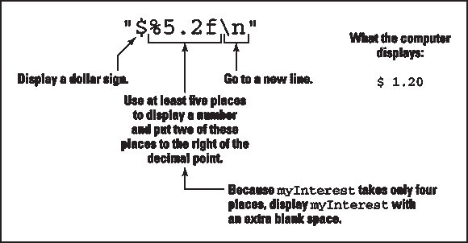

FIGURE 7-11: 为显示值添加额外的数位。

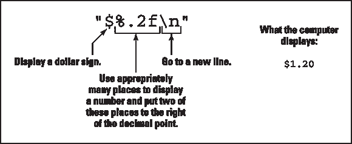

FIGURE 7-12: 在不指定精确位数的情况下显示值。

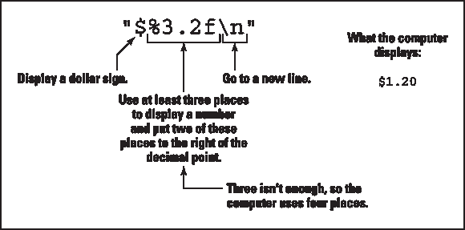

FIGURE 7-13: 指定的显示值的位数太少。

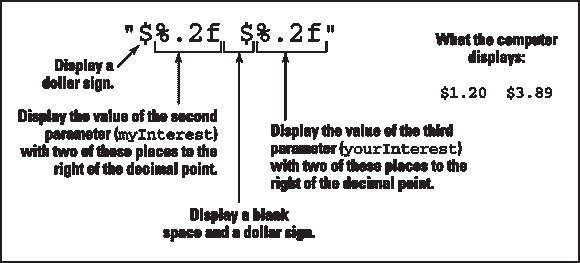

FIGURE 7-14: 使用格式字符串显示多个值。

欲需更多使用 `printf` 方法及其格式字符串的示例，请参见第 8 章和第 9 章。欲需 `printf` 方法格式字符串相关的完整选项列表，请参见 Java API 文中的 `java.util.Formatter` 页面：`https://docs.oracle.com/javase/8/docs/api/java/util/Formatter.html`。

 `printf` 调用中的格式字符串并没有改变数字在内部用于计算的存储方式。格式字符串的作用仅仅创建了一组好看的数字字符，并显示在你的屏幕上。

要点在于，让事情看起来简单需要一些规划。在面向对象编程中，让事情看起来简单的方法之一是防止类外部代码直接使用在类内部定义的字段。看一眼列表 7-1 中的代码。你正在一家公司工作，这家公司刚刚为 `Account` 类的代码花费了 1000 万美元。（平均每行代码就超过了 150 万美元！）现在，你的任务是编写 `UseAccount` 类。你想写下：

```java
myAccount.name = "Barry Burd";
```

但这样做会让你过深地触及 `Account` 类的内部。毕竟，使用自动取款机的人并不允许编写机器的变量。他们不能使用机器的键盘来输入语句：

```java
balanceOnAccount29872865457 = balanceOnAccount29872865457 + 1000000.00;
```

相反，他们通过按按钮来井然有序地完成工作。这就是程序员实现安全和简单的方式。

为了保持整洁和有序，你需要通过修改列表 7-1 中的 `Account` 类，禁止出现如下语句：

```java
myAccount.name = "Barry Burd";
```

以及

```java
out.print(yourAccount.balance);
```

当然，这带来了一个问题。你是编写 `UseAccount` 类代码的人。如果你不能写 `myAccount.name` 或 `yourAccount.balance`，你该如何完成任何操作呢？答案在于被称为“访问器方法”（accessor methods）的东西中。列表 7-8 和 7-9 演示了这些方法。

### 列表 7-8 隐藏字段

```java
public class Account {

    private String name;

    private String address;

    private double balance;

    public void setName(String n) {

        name = n;

    }

    public String getName() {

        return name;

    }

    public void setAddress(String a) {

        address = a;

    }

    public String getAddress() {

        return address;

    }

    public void setBalance(double b) {

        balance = b;

    }

    public double getBalance() {

        return balance;

    }

}
```

### 列表 7-9 调用访问器方法

```java
import static java.lang.System.out;

public class UseAccount {

    public static void main(String args[]) {

        Account myAccount = new Account();

        Account yourAccount = new Account();

        myAccount.setName("Barry Burd");

        myAccount.setAddress("222 Cyberspace Lane");

        myAccount.setBalance(24.02);

        yourAccount.setName("Jane Q. Public");

        yourAccount.setAddress("111 Consumer Street");

        yourAccount.setBalance(55.63);

        out.print(myAccount.getName());

        out.print(" (");

        out.print(myAccount.getAddress());

        out.print(") has $");

        out.print(myAccount.getBalance());

        out.println();

        out.print(yourAccount.getName());

        out.print(" (");

        out.print(yourAccount.getAddress());

        out.print(") has $");

        out.print(yourAccount.getBalance());

    }

}
```


运行列表 7-8 和 7-9 中的代码，与运行列表 7-1 没有区别。

### 将这些字段设为私有

要点在于，让事情看起来简单需要一些规划。在面向对象编程中，让事情看起来简单的方法之一是防止类外部代码直接使用在类内部定义的字段。看一眼列表 7-1 中的代码。你正在一家公司工作，这家公司刚刚为 `Account` 类的代码花费了 1000 万美元。（平均每行代码就超过了 150 万美元！）现在，你的任务是编写 `UseAccount` 类。你想写下 `myAccount.name = "Barry Burd";`，但这样做会让你过深地触及 `Account` 类的内部。毕竟，使用自动取款机的人并不允许编写机器的变量。他们不能使用机器的键盘来输入语句 `balanceOnAccount29872865457 = balanceOnAccount29872865457 + 1000000.00;`；相反，他们通过按按钮来井然有序地完成工作。这就是程序员实现安全和简单的方式。

为了保持整洁和有序，你需要通过修改列表 7-1 中的 `Account` 类，禁止出现如下语句：`myAccount.name = "Barry Burd";` 和 `out.print(yourAccount.balance);`。

当然，这带来了一个问题。你是编写 `UseAccount` 类代码的人。如果你不能写 `myAccount.name` 或 `yourAccount.balance`，你该如何完成任何操作呢？答案在于被称为访问器方法的东西。列表 7-8 和 7-9 演示了这些方法。

运行列表 7-8 和 7-9 中的代码，与运行列表 7-1 没有区别。

### 访问器方法

要点在于，让事情看起来简单需要一些规划。在面向对象编程中，让事情看起来简单的方法之一是防止类外部代码直接使用类内部定义的字段。看一眼列表 7-1 中的代码。你正在一家公司工作，这家公司刚刚为 `Account` 类的代码花费了 1000 万美元。（平均每行代码就超过了 150 万美元！）现在，你的任务是编写 `UseAccount` 类。你想写下 `myAccount.name = "Barry Burd";`，但这样做会让你过深地触及 `Account` 类的内部。毕竟，使用自动取款机的人并不允许编写机器的变量。他们不能使用机器的键盘来输入语句 `balanceOnAccount29872865457 = balanceOnAccount29872865457 + 1000000.00;`；相反，他们通过按按钮来井然有序地完成工作。这就是程序员实现安全和简单的方式。

为了保持整洁和有序，你需要通过修改列表 7-1 中的 `Account` 类，禁止出现如下语句：`myAccount.name = "Barry Burd";` 和 `out.print(yourAccount.balance);`。

当然，这带来了一个问题。你是编写 `UseAccount` 类代码的人。如果你不能写 `myAccount.name` 或 `yourAccount.balance`，你该如何完成任何操作呢？答案在于被称为访问器方法的东西。列表 7-8 和 7-9 演示了这些方法。

运行列表 7-8 和 7-9 中的代码，与运行列表 7-1 没有区别。

### Setter 和 Getter 方法

要点在于，让事情看起来简单需要一些规划。在面向对象编程中，让事情看起来简单的方法之一是防止类外部代码直接使用类内部定义的字段。看一眼列表 7-1 中的代码。你正在一家公司工作，这家公司刚刚为 `Account` 类的代码花费了 1000 万美元。（平均每行代码就超过了 150 万美元！）现在，你的任务是编写 `UseAccount` 类。你想写下 `myAccount.name = "Barry Burd";`，但这样做会让你过深地触及 `Account` 类的内部。毕竟，使用自动取款机的人并不允许编写机器的变量。他们不能使用机器的键盘来输入语句 `balanceOnAccount29872865457 = balanceOnAccount29872865457 + 1000000.00;`；相反，他们通过按按钮来井然有序地完成工作。这就是程序员实现安全和简单的方式。

为了保持整洁和有序，你需要通过修改列表 7-1 中的 `Account` 类，禁止出现如下语句：`myAccount.name = "Barry Burd";` 和 `out.print(yourAccount.balance);`。

当然，这带来了一个问题。你是编写 `UseAccount` 类代码的人。如果你不能写 `myAccount.name` 或 `yourAccount.balance`，你该如何完成任何操作呢？答案在于被称为访问器方法的东西。列表 7-8 和 7-9 演示了这些方法。

运行列表 7-8 和 7-9 中的代码，与运行列表 7-1 没有区别。

### 与 IDE 的深度集成

在许多 IDE 中，你不需要自己输入访问器方法。首先，你输入一个类似 `private String name` 的字段。然后，在 IDE 菜单中，选择 `Source` -> `Generate Getters and Setters` 或者选择 `Code` -> `Insert Code`。在你完成所有选择后，IDE 会创建访问器方法并将它们添加到你的代码中。

 当你调用 setter（设置）方法时，你传入一个与设置类型相同的值。这就是为什么在列表 7-9 中，你使用类型为 `double` 的参数调用了 `yourAccount.setBalance(55.63)`。相比之下，当你调用 getter（获取）方法时，你通常不会向方法传递任何值。这就是为什么在列表 7-9 中，你带空参数列表调用了 `yourAccount.getBalance()`。偶尔，你可能想用一条语句获取并设置一个值。要给账户的现有余额增加美元，你可以编写 `yourAccount.setBalance(yourAccount.getBalance() + 1.00)`。

### 使用访问器方法强制规则

回到列表 7-8 并快速查看 `setName` 方法。想象将方法的赋值语句放在一个 if 语句中。

```java
public void setName(String n) {
  if (!n.equals("")) {
    name = n;
  }
}
```

现在，如果负责 `UseAccount` 类的程序员编写了 `myAccount.setName("")`，对 `setName` 的调用将产生任何影响。此外，由于 `name` 字段是私有的，以下语句在 `UseAccount` 类中是非法的：

```
myAccount.name = "";
```

当然，像 `myAccount.setName("Joe Schmoe")` 这样的调用仍然有效，因为 "Joe Schmoe" 不等于空字符串 `""`。

这很酷。通过私有字段和访问器方法，你可以防止有人将空字符串赋值给账户的名称字段。通过更复杂的 if 语句，你可以强制执行任何你想要的规则。

 在之前的章节中，你创建了自己的 `Organization` 和 `FoodProduct` 类。在这些类中，将默认访问字段替换为私有字段。为这些字段创建 getter 和 setter 方法。在 setter 方法中，添加代码以确保 `String` 值不为空且数值不为负数。

## Barry 自己的 GUI 类

你可能已经厌倦了书中随处可见的枯燥基于文本的程序。你可能想要一些更酷炫的东西——带有文本字段和按钮的东西。很好，我为你准备了一些示例！

我创建了一个称为 `DummiesFrame` 的类。当你导入我的 `DummiesFrame` 类时，你可以很轻松地创建一个简单的图形用户界面（GUI）应用程序。

列表 7-10 使用我的 `DummiesFrame` 类，并使用图 7-15 到图 7-17 向你展示结果。

### 列表 7-10： 你的第一个 DummiesFrame 示例

```java
import com.allmycode.dummiesframe.DummiesFrame;

public class GuessingGame {
  public static void main(String[] args) {
    DummiesFrame frame = new DummiesFrame("Greet Me!");
    frame.addRow("Your first name");
    frame.go();
  }

  public static String calculate(String firstName) {
    return "Hello, " + firstName + "!";
  }
}
```

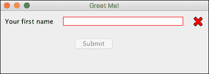

图 7-15： 列表 7-10 中的代码开始运行。

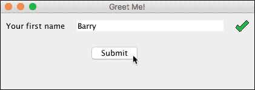

图 7-16： 用户填充了字段。

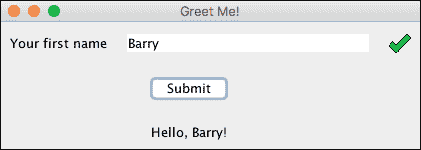

图 7-17： 用户点击了按钮。

以下是对列表 7-10 中代码的详细描述：

*   第一行 `import com.allmycode.dummiesframe.DummiesFrame;` 使 `DummiesFrame` 名称对代码可用。
*   在 `main` 方法内部，语句 `DummiesFrame frame = new DummiesFrame("Greet Me!");` 创建 `DummiesFrame` 类的实例并让变量 `frame` 指向该实例。`DummiesFrame` 对象出现在屏幕上。在本示例中，窗口的标题是 *Greet Me!*。
*   下一条语句调用 `frame` 对象的 `addRow` 方法 `frame.addRow("Your first name")` 在应用程序窗口上添加一行。该行由一个标签（文本为 *Your first name*）、一个空文本字段和一个表示用户尚未输入任何内容的红色 X 标记组成（参见图 7-15）。
*   调用 `frame` 对象的 `go` 方法 `frame.go();` 使应用程序的窗口出现。
*   `calculate` 方法头 `public static String calculate(String firstName)` 告诉 Java 两件事：
    *   `calculate` 方法返回一个 `String` 类型的值。
    *   Java 期望用户在文本字段中输入 `String` 值，用户输入的任何内容将成为 `firstName` 参数的值。

要使用 `DummiesFrame` 类，你的代码必须有一个名为 `calculate` 的方法，且 `calculate` 方法必须遵守某些规则：

*   `calculate` 方法必须以 `public static` 开头。
*   方法可以返回任何 Java 类型：`String`、`int` 或其他（这实际上不是规则，而是机会！）。
*   `calculate` 方法的参数数量必须与应用程序窗口中的行数相同。列表 7-10 只有一个 `addRow` 调用，因此图 7-10 中的窗口只有一行（不包括 *Submit* 按钮），因此 `calculate` 方法只有一个参数。当用户开始向窗口的文本中输入文本时，红色 X 标记会变为绿色勾标记（参见图 7-16）。绿色勾标记表示用户已在文本字段中输入了预期类型的值（在本示例中，一个 `String` 值）。
*   当用户点击按钮时，Java 执行 `calculate` 方法。方法返回语句中的表达式 `return "Hello, " + firstName + "!"` 告诉 Java 在窗口底部显示什么。（参见图 7-17）。在本示例中，用户在唯一的文本字段中输入 *Barry*，因此 `firstName` 的值为 "Barry"，`calculate` 方法返回字符串 "Hello, Barry!"（啊！ *For Dummies* 作者的福利！）。

使用我的 `DummiesFrame` 类，你只需要十行代码就可以构建一个简单的 GUI 应用程序。

 `DummiesFrame` 类没有内置在 Java API 中，因此为了运行列表 7-10 中的代码，我的 `DummiesFrame.java` 文件必须是你项目的一部分。当你从书的网站下载代码（[www.allmycode.com/JavaForDummies](http://www.allmycode.com/JavaForDummies)）时，你会得到一个名为 `07-10` 的文件夹，其中包含了列表 7-10 代码和 `DummiesFrame.java` 代码。但如果你自己创建一个包含列表 7-10 的项目，你必须手动添加我的 `DummiesFrame.java` 文件。操作方法取决于你使用哪种 IDE。无论如何，我的 `DummiesFrame` 类位于名为 `com.allmycode.dummiesframe` 的包中，因此 `DummiesFrame.java` 文件必须位于名为 `dummiesframe` 的目录中，该目录位于名为 `allmycode` 的目录内，而该目录又位于名为 `com` 的目录内。关于包的更多信息，请参见第 9 章和第 14 章。

 为了保持简单，我在你从本书的网站下载的 `07-10` 文件夹中包含了 `DummiesFrame.java` 文件。但说真的，这是将我自己的代码添加到你的项目中的最佳方式吗？在第 1 章中，我描述了带有 `.class` 扩展的文件，以及这些文件在 Java 程序运行中所起的作用。我不应该直接交给你 `DummiesFrame.java` 文件，而应该只在下载包中放入一个 `DummiesFrame.class` 文件。而且在其他情况下，如果我必须给你提供数百个 `.class` 文件，我应该将它们全部封装成一个大的归档文件。Java 对编码了许多较小 `.class` 文件的大文件有一个专门的名称，它被称为 `JAR` 文件，扩展名为 `.jar`。在实际应用中，如果你正在准备代码以供他人作为他们自己应用程序的一部分使用，那么 `JAR` 文件无疑是正确的选择。

我的 `DummiesFrame` 类并不专门用于问候。列表 7-11 使用 `DummiesFrame` 来算运算。

### 列表 7-11： 一个非常简单的计算器

```java
import com.allmycode.dummiesframe.DummiesFrame;

public class Addition {
    public static void main(String[] args) {
        DummiesFrame frame = new DummiesFrame("Adding Machine");
        frame.addRow("First number");
        frame.addRow("Second number");
        frame.setButtonText("Sum");
        frame.go();
    }

    public static int calculate(int firstNumber, int secondNumber) {
        return firstNumber + secondNumber;
    }
}
```


### 图 7-18： 看看！列表 7-11 中的代码确实可以运行！

列表 7-12 包含了第 5 章中猜数字游戏的 GUI 版本，图 7-19 展示了游戏的运行情况。

### 列表 7-12： 我在想一个数字

```java
import java.util.Random;
import com.allmycode.dummiesframe.DummiesFrame;

public class GuessingGame {
    public static void main(String[] args) {
        DummiesFrame frame = new DummiesFrame("Guessing Game");
        frame.addRow("Enter an int from 1 to 10");
        frame.setButtonText("Submit your guess");
        frame.go();
    }

    public static String calculate(int inputNumber) {
        Random random = new Random();
        int randomNumber = random.nextInt(10) + 1;
        if (inputNumber == randomNumber) {
            return "You win.";
        } else {
            return "You lose. The random number was " + randomNumber + ".";
        }
    }
}
```


图 7-19： 我赢了！

我的 `DummiesFrame` 类并不专门用于问候。列表 7-11 使用 `DummiesFrame` 来算运算。

这就是面向对象编程之所以成功的原因之一。多年来，公司一直在购买预写的代码，却发现这些代码并没有按照它们想要的方式运行。那么，公司是如何处理的呢？他们开始胡改代码。他们的程序员深入挖掘程序文件，更改变量名，移动子程序的位置，重写公式，并总的来说让代码变得更糟。现实情况是，如果一个程序没有按照你想要的方式运行（即使它运行得非常接近你的要求），你永远无法通过在代码内部乱搞来改善局面。最好的选择总是抛弃整个程序（尽管这很昂贵）并从头开始。多么凄惨的现状啊！

随着面向对象编程的出现，巨大的变化发生了。核心在于，面向对象的程序的设计初衷就是为了被修改。通过编写良好的软件，你可以利用已经内置的功能，添加你自己的新功能，并覆盖不符合你的需求。最棒的部分是，你所做的更改是整洁的。不需要去抠挖和挖掘他人脆弱的程序代码。相反，你可以在不接触现有代码内部逻辑的情况下，进行良好、有序的添加和修改。这是理想的解决方案。

### 关于员工的最后定

当你编写一个面向对象的程序时，你首先开始考虑数据。你正在编写关于账户的内容。那么什么是账户？你正在编写代码来处理按钮点击。那么什么是按钮？你正在编写一个程序向员工发送工资支票。什么是员工？

在本章的第一个示例中，员工是一个拥有姓名和职位名称的人。当然，员工还有其他特征，但目前我坚持于基础知识。代码列表 8-1 中的代码定义了什么是员工。

代码列表 8-1: 什么是员工？

```java
import static java.lang.System.out;

public class Employee {

    private String name;

    private String jobTitle;

    public void setName(String nameIn) {

        name = nameIn;

    }

    public String getName() {

        return name;

    }

    public void setJobTitle(String jobTitleIn) {

        jobTitle = jobTitleIn;

    }

    public String getJobTitle() {

        return jobTitle;

    }

    public void cutCheck(double amountPaid) {

        out.printf("Pay to the order of %s ", name);

        out.printf("(%s) ***$", jobTitle);

        out.printf("%,.2f\n", amountPaid);

    }

}
```

根据代码列表 8-1，每个员工有七个特征。这些特征中的两个相当简单：每个员工都有一个姓名和一个职位名称。（在代码列表 8-1 中，`Employee` 类有一个 `name` 字段和一个 `jobTitle` 字段。）

员工还有什么呢？每个员工有四个方法来处理员工姓名和职位名称的值。这些方法是 `setName`、`getName`、`setJobTitle` 和 `getJobTitle`。我在第 7 章中解释了此类方法（`accessor` 访问方法）。

在这一切之上，每个员工还有一个 `cutCheck` 方法。其想法是，编写工资支票的方法必须属于某一个类。因为工资支票中的大部分信息都是针对特定员工定制的，你不如将 `cutCheck` 方法放在 `Employee` 类内部。

关于 `cutCheck` 方法中 `printf` 的详细信息，请参见本章稍后的“开具支票”部分。

### 善用你的类

代码列表 8-1 中的 `Employee` 类没有 `main` 方法，所以没有执行代码的起点。为了弥补这一缺陷，程序员编写了一个带有 `main` 方法的独立程序，并用该程序创建 `Employee` 实例。代码列表 8-2 展示了一个带有 `main` 方法的类——该类对代码列表 8-1 中的代码进行了测试。

代码列表 8-2: 编写工资支票

```java
import java.util.Scanner;

import java.io.File;

import java.io.IOException;

public class DoPayroll {

    public static void main(String args[]) throws IOException {

        Scanner diskScanner = new Scanner(new File("EmployeeInfo.txt"));

        for (int empNum = 1; empNum <= 3; empNum++) {

            payOneEmployee(diskScanner);

        }

        diskScanner.close();

    }

    static void payOneEmployee(Scanner diskScanner) {

        Employee anEmployee = new Employee();

        anEmployee.setName(diskScanner.nextLine());

        anEmployee.setJobTitle(diskScanner.nextLine());

        anEmployee.cutCheck(diskScanner.nextDouble());

    }

}
```

代码列表 8-1 包含了三个 `printf` 调用。每个 `printf` 调用都包含一个格式字符串（例如 `"(%s) $"`）和一个变量（如 `jobTitle`）。每个格式字符串都有一个占位符（如 `%s`），它决定了变量值在何时以及如何显示。

例如，在第二个 `printf` 调用中，格式字符串有一个 `%s` 占位符。这个 `%s` 为 `jobTitle` 变量的值预留了位置。根据 Java 的规则，`%s` 符号始终为字符串预留位置，事实也如此，变量 `jobTitle` 在代码列表 8-1 中被声明为 `String` 类型。括号和其他一些字符包围着 `%s` 占位符，因此在程序的输出中，每个职位标题都用括号包围。（参见 Figure 8-2。）


Figure 8-2: 每个人都得到了工资。

回到代码列表 8-1，注意 `%,.2f` 占位符内部的逗号。逗号告诉程序使用分组分隔符。这就是为什么在 Figure 8-2 中，你看到的是 $5,000.00、$7,000.00 和 $10,000.00，而不是 $5000.00、$7000.00 和 $10000.00。

## 处理磁盘文件（简短插曲）

在之前的章节中，程序从计算机的键盘读取字符。但代码列表 8-2 中的代码是从特定文件读取字符。该文件（命名为 `EmployeeInfo.txt`）位于你的计算机硬盘上。

这个 `EmployeeInfo.txt` 文件就像一个文字处理文档。文件可以包含字母、数字和其他字符。但与文字处理文档不同，`EmployeeInfo.txt` 文件不包含格式——没有斜体、没有粗体、没有字体大小，没有任何此类。

`EmployeeInfo.txt` 文件只包含普通字符——即你在玩第 5 章和第 6 章中的猜数字游戏时输入的按键字符。当然，从用户的键盘获取猜数字和从磁盘文件读取员工数据并不完全相同。在猜数字游戏中，程序会显示提示，例如 `Enter an int from 1 to 10`。游戏程序与坐在键盘前的人进行双向对话。相比之下，代码列表 8-2 没有对话。这个 `DoPayroll` 程序从硬盘读取字符，不会向任何人提示或交互。

本章的大部分内容关于代码复用。但代码列表 8-2 偶然发现了一个想法——一个与代码复用并不直接相关的想法。与之前章节中的示例不同，代码列表 8-2 从存储的磁盘文件中读取数据。因此，在接下来的章节中，我进行了一次短的旁游来探索磁盘文件。

### 在文件中存储数据

如果你不在文件中放置一些员工数据，代码列表 8-2 中的代码就无法运行。代码列表 8-2 说明该文件是 `EmployeeInfo.txt`。因此，在运行代码列表 8-2 的代码之前，我创建了一个小的 `EmployeeInfo.txt` 文件。该文件如 Figure 8-3 所示；输出参见 Figure 8-2。


Figure 8-3: 一个 `EmployeeInfo.txt` 文件。当你访问这本书的网站（`www.allmycode.com/JavaDummies`）并下载书籍列表时，你就会得到 `EmployeeInfo.txt` 的副本。

 为了保持代码列表 8-2 的简单，我坚持要求在文件中准备一些员工数据。代码列表 8-2 说明该文件是 `EmployeeInfo.txt`。因此，在运行代码列表 8-2 的代码之前，我创建了一个小的 `EmployeeInfo.txt` 文件。该文件如 Figure 8-3 所示；输出参见 Figure 8-2。

### 复制粘贴代码

在几乎任何编程语言中，从文件读取数据都是困难的。你添加额外的行来告诉计算机做什么。有时你可以从其他代码中复制这些行。例如，你可以遵循代码列表 8-2 的模式：

```java
/*

 * The pattern in Listing 8-2

 */

import java.util.Scanner;

import java.io.File;

import java.io.IOException;

class SomeClassName {

    public static void main(String args[]) throws IOException {

        Scanner scannerName = new Scanner(new File("SomeFileName"));

        // Some code goes here

        scannerName.nextInt();

        scannerName.nextDouble();

        scannerName.next();

        scannerName.nextLine();

        // Some code goes here

        scannerName.close();

    }

}
```


你想从文件读取数据。你首先想象你在从键盘读取。把常用的 `Scanner` 和 `next` 代码放入你的程序。然后添加一些额外的项：

*   添加两个新的导入声明——一个用于 `java.io.File`，另一个用于 `java.io.IOException`。
*   在你的方法头部类型 `throws IOException`。
*   在对 `new Scanner` 的调用中使用 `new File(" ")`。
*   取一个已经位于硬盘上的文件。在引号内输入该文件名。
*   取你用于扫描器的名称。在调用 `next`、`nextInt`、`nextDouble` 等时复用该名称。
*   取你用于扫描器的名称。在调用 `close` 时复用该名称。

偶尔，复制粘贴代码会让你遇到麻烦。也许你正在编写一个符合简单模式的程序。你需要微调模式。但为了微调模式，你需要理解模式背后的一些想法。

这就是下一节将为你提供帮助。它涵盖了这些想法。

 这段话其实是一个告白。在几乎所有的计算机编程语言中，从磁盘文件输入都是一件棘手的事情。并不存在简单的 `INPUT` 命令。你通常必须在代码和磁盘设备之间建立连接，为从设备读取时可能出现的问题做好准备，进行读取，将读取到的字符转换为你需要的数值类型，最后断开与磁盘设备的连接。这是一团糟。这就是为什么在本书中，我依赖 Java 的 `Scanner` 类。`Scanner` 类让输入变得相对轻松。但我承认，专业的 Java 程序员很少使用 `Scanner` 类来处理输入。相反，他们使用被称为 `BufferedReader` 或 `java.nio` 包中的类。如果你对我对 `Scanner` 类的使用不满意，并希望看到列表 8-2 翻译成 `BufferedReader` 程序，请访问本书的网站（[`www.allmycode.com/JavaForDummies`](http://www.allmycode.com/JavaForDummies)）。

### 从文件读取

在之前的章节中，程序从计算机键盘读取字符。这些程序使用了诸如 `Scanner`、`System.in` 和 `nextDouble` 等在 Java API 中定义的工具。列表 8-2 中的 `DoPayroll` 程序为这个故事提供了新的视角。它不是从键盘读取字符，而是从 `EmployeeInfo.txt` 文件读取字符。该文件存在于你计算机的硬盘上。

要从文件中读取字符，你会使用一些与从键盘读取字符时相同的工具。你会使用 `Scanner`、`nextDouble` 以及其他好东西。但这些工具之外，你还有几个额外的障碍需要跨越。以下是列表：

*   **你需要一个新的 `File` 对象。** 更准确地说，你需要 API 中 `File` 类的一个新实例。你通过类似下面的代码获取这个新实例：

    ```
    new File("EmployeeInfo.txt")
    ```

    引号中的内容是文件名——你计算机硬盘上的一个文件。该文件包含了之前在图 8-3 中所示的字符。

    此时，这些术语把小问题说大大了。确实，我使用了 `new File object` 和 `new File instance` 等短语，但你所做的只是让 `new File("EmployeeInfo.txt")` 代表硬盘上的文件。当你将 `new File("EmployeeInfo.txt")` 传入 `new Scanner` 时：

    ```java
    Scanner diskScanner = new Scanner(new File("EmployeeInfo.txt"));
    ```

    你就可以忘记所有关于 `File` 的事情了。从代码的该点开始，`diskScanner` 代表你硬盘上的 `EmployeeInfo.txt` 文件名。（`diskScanner` 这个名称代表硬盘上的文件，就像在之前的示例中，`keyboard` 名称代表你每天反复按的那些按钮一样。）

     在列表 8-2 中创建一个新的 `File` 对象，就像在同一个列表中之后创建一个新的 `Employee` 对象一样。也像在第 7 章的示例中创建一个 `Account` 对象一样。唯一的区别是 `Employee` 和 `Account` 类定义在本书的示例中，而 `File` 类定义在 Java API 中。

     当你使用 `new Scanner` 连接到磁盘文件时，不要忘记 `new File` 的部分。如果你写 `new Scanner("EmployeeInfo.txt")` 而不写 `new File`，编译器不会介意。（在运行代码之前，你不会收到任何警告或错误消息。）但当你运行代码时，你得不到预期的结果。

*   **你必须通过全名引用 `File` 类：`java.io.File`。** 你可以使用像列表 8-2 那样的导入语句来实现。或者，你可以在代码中加入类似下面的的语句：

    ```java
    Scanner diskScanner = new Scanner(new java.io.File("EmployeeInfo.txt"));
    ```

*   **你需要一个 `throws IOException` 子句。** 当你的程序连接到 `EmployeeInfo.txt` 时，可能会发生很多问题。例如，你的硬盘上可能没有名为 `EmployeeInfo.txt` 的文件。另外，`EmployeeInfo.txt` 文件可能在错误的目录下。为了应对这种灾难，Java 编程语言采取了预防措施。该语言坚持，当涉及磁盘文件时，你必须承认调用 `new Scanner` 的潜在危险。

    你可以通过多种方式承认这些危险，但最简单的方法是使用 `throws` 子句。在列表 8-2 中，main 方法以 `throws IOException` 结尾。（如果没有这个，你会得到一个未报告的异常。）

当你从本书的网站（[`www.allmycode.com/JavaForDummies`](http://www.allmycode.com/JavaForDummies)）下载代码时，你会发现名为 `Employee.java` 和 `DoPayroll.java` 的文件——它们是列表 8-1 和 8-2 中的代码。你还会发现一个名为 `EmployeeInfo.txt` 的文件。很好，因为如果 Java 找不到 `EmployeeInfo.txt` 文件，整个项目无法正常运行。相反，你会得到一个 `FileNotFoundException`。

通常情况下，当你遇到 `FileNotFoundException` 时，意味着程序需要的某个文件不可用。这是一个很容易犯的错误。这可能会让人沮丧，因为对你来说，像 `EmployeeInfo.txt` 这样的文件似乎对你的程序是可用的。但记住：计算机是愚笨的。如果你犯了一个微小的错误，计算机无法为你理解言外之意。因此，如果你的 `EmployeeInfo.txt` 文件不在硬盘的正确目录下，或者文件名拼写错误，计算机在尝试运行你的代码时就会卡住。

有时你清楚硬盘上确实存在 `EmployeeInfo.txt`（或 `whatever.xyz`）文件。但当你运行程序时，仍然会得到一个很难看的 `FileNotFoundException`。当这种情况发生时，文件通常位于硬盘上错误的目录下。（当然，这取决于你的观点。也许文件在正确的目录中，但你的 Java 程序在错误的目录下查找文件。）要诊断这个问题，请在列表 8-2 中添加以下代码：

```
File employeeInfo = new File("EmployeeInfo.txt");
System.out.println("Looking for " + employeeInfo.getCanonicalPath());
```

当你运行这段代码时，Java 会告诉你 `EmployeeInfo.txt` 文件应该在硬盘的哪个位置。

#### 在文件名中添加目录名

你可以在 Java 代码中指定文件的精确位置。像 `new File("C:\\Users\\bburd\\workspace\\08-01\\EmployeeInfo.txt")` 这样的代码看起来非常丑，但它是有效的。

在前面的段落中，你注意到“C: \\Users\\bburd\\workspace …”中的双反斜杠了吗？如果你是 Windows 用户，你会很想用单反斜杠写 `C:\Users\bburd\workspace …`。但在 Java 中，单反斜杠有自己特殊的含义。（例如，在列表 7-7 中，`\n` 意味着换行。）因此，在 Java 中，要在引号字符串内表示反斜杠，你需要使用双反斜杠。

 Macintosh 和 Linux 用户可能会感到，因为他们的路径分隔符 `/` 在 Java 字符串中没有特殊含义。在 Mac 上，代码 `new File("/Users/bburd/workspace/08-01/EmployeeInfo.txt")` 就像呼吸一样自然。（嗯，几乎是那样自然！）但 Mac 用户和 Linux 极客不应该过早声称优越。像 `new File("/Users/bburd/workspace …` 这样的行在 Windows 中同样有效。在 Windows 中，你可以使用斜杠 (`/`) 或反斜杠 (`\`) 作为路径名分隔符。在 Windows 命令行提示符下，我可以输入 `cd c:/users\bburd` 进入我的主目录。

 如果你知道 Java 程序在何查找文件，你就可以从那个地方绕到你选择的目录。暂时假设列表 8-2 中的代码通常在名为 `08-01` 的目录下查找 `EmployeeInfo.txt` 文件。作为一个实验，进入 `08-01` 目录并创建一个名为 `dataFiles` 的新子目录。然后将我的 `EmployeeInfo.txt` 文件移动到新的 `dataFiles` 目录。要从你移动的文件中读取数字和单词，请用代码 `new File("dataFiles\\EmployeeInfo.txt")` 或 `new File("dataFiles/EmployeeInfo.txt")` 修改列表 8-2。

#### 逐行读取

在列表 8-2 中，`payOneEmployee` 方法演示了一些读取数据的有用技巧。特别是，你创建的每个 `scanner` 都有一个 `nextLine` 方法。（你可能不会使用这个 `nextLine` 方法，但该方法仍然可用。）当你调用扫描器的 `nextLine` 方法时，该方法会抓取直到当前行文本结束的所有内容。

对于普通计算机用户来说，键盘的感觉起来和存储在计算机硬盘上的文件完全不同。但磁盘文件和键盘输入有许多共同点。事实上，计算机操作系统的一个基本原则规定，对于程序员来说，两种输入类型之间的差异越模糊越好。作为一名 Java 程序员，你应该几乎以相同的方式来对待磁盘文件和键盘输入。这就是为什么列表 8-2 中包含一个 `diskScanner.close()` 调用。

当你运行一个 Java 程序时，你通常会执行 `main` 方法中的语句，从方法体中的第一条语句开始，到方法体中的最后一条语句结束。在此过程中，你会走一些弯路，跳过 `else` 部分并进入方法体内部，但基本上你会在 `main` 方法的末尾完成语句的执行。这就是为什么在列表 8-2 中，对 `close` 的调用位于 `main` 方法体的末尾。当你运行列表 8-2 中的代码时，你最后做的事情就是断开磁盘文件的连接。幸运的是，这种断开是在执行完所有 `nextLine` 和 `nextDouble` 调用之后发生的。

 在本章之前的节中，你创建了自己的 `PlaceToLive` 类的实例并显示了关于这些实例的信息。修改你文本版本的代码，使其能够从磁盘文件获取每个实例的特征（地址、卧室数量和面积）。

## 定义子类（成为全职或兼职员工的含义）

去年的这个时候，你的公司花费了 1000 万美元购买了一份软件。该软件是以 `Employee.class` 文件形式提供的。Burd Brain Consulting 公司（创建该软件的公司）的人不希望你了解软件的内部细节。（否则，你可能会偷取他们的创意。）因此，你没有该软件源自的 Java 程序文件。（换句话说，你没有 `Employee.java`。）你可以运行 `Employee.class` 文件中的字节码。你也可以阅读名为 `Employee.html` 的网页中的文档。但你无法看到 `Employee.java` 程序内部的语句，也无法更改程序的任何代码。

从去年这个时候以来，你的公司成长了。与过去不同，你的公司现在有两种员工：全职和兼职。每位全职员工都领有固定的周薪。（如果员工在晚上和周末工作，那么作为对这种巨大付出的回报，员工将得到诚挚的握手。）相比之下，每位兼职员工按小时工资工作。你的公司从每位全职员工的工资单中扣除一部分费用来支付公司的福利方案。然而，兼职员工不享受福利。

问题是你公司去年购买的软件是否能跟上公司的增长。你投资了一个非常棒程序来处理员工及其工资单，但该程序并没有区分你的全职员工和兼职员工。你有几种选择：

*   **给你的邻居打个电话，他那 12 岁的孩子比你公司的任何人都更懂计算机编程。** 让这个傲慢的小不鬼把员工软件拆解、重写，并带着你公司要求的所有更改和新增交还给你。
    仔细考虑一下，你不能那样做。无论那个孩子有多聪明，员工软件的复杂性可能会让那个孩子感到困惑。等你拿到软件时，它已经充满了 Bug 和不一致之处。此外，你甚至没有 `Employee.java` 文件可以给那个孩子。你拥有的只是 `Employee.class` 文件，无法用文本编辑器读取或修改它。（参见第 2 章）。此外，你的孩子刚打了了邻居的孩子。你不想让邻居获得看到你哀求那个天才少年帮助的快感。

*   **报废那份价值 1000 万美元的员工软件。** 让你公司里的某人从头重写软件。
    换句话说，就是和你的时间和金钱告别。

*   **为员工软件编写一个新的前端。** 也就是说，编写一段代码对全职员工进行预处理，然后将初步结果交给你那价值 1000 万美元的软件。对兼职员工也进行同样的操作。
    这个主意可能是好的，也可能导致灾难。你确定现有的员工软件中有方便的*钩子*（hooks）吗？（也就是说，员工软件是否包含允许你的前端软件轻松将初步数据发送到昂贵的员工软件的入口？）记住：这个计划将现有软件视为一个巨大的、单体的整体，这可能会变得笨拙。在你的前端代码和现有员工程序之间分工协作是困难的。如果你在现有的黑盒代码上层一层地添加，你可能会得到一个相当低效的系统。

*   **给卖给你员工软件的 Burd Brain Consulting 打电话。** 告诉 Burd 博士，你希望他软件的下一个版本能够区分全职和兼职。
    “没问题，”Burd 博士说，“下一次就能准备好。”

*   **创建两个名为 `FullTimeEmployee` 和 `PartTimeEmployee` 的新 Java 类。** 让每个新类都继承自 `Employee`，但让每个新类定义它自己的内容。
    做得好！图 8-5 显示了你想要的结构。

 图 8-5 Employee 类族

### 创建子类

在列表 8-1 中，我定义了一个 `Employee` 类。我可以使用列表 8-1 中的定义并扩展它来创建新类。因此，在列表 8-3 中，我定义了一个新类：`FullTimeEmployee`。

```java
public class FullTimeEmployee extends Employee {

    private double weeklySalary;

    private double benefitDeduction;

    public void setWeeklySalary(double weeklySalaryIn) {

        weeklySalary = weeklySalaryIn;

    }

    public double getWeeklySalary() {

        return weeklySalary;

    }

    public void setBenefitDeduction(double benefitDedIn) {

        benefitDeduction = benefitDedIn;

    }

    public double getBenefitDeduction() {

        return benefitDeduction;

    }

    public double findPaymentAmount() {

        return weeklySalary - benefitDeduction;

    }

}
```


观察列表 8-3，你可以看到每个 `FullTimeEmployee` 类实例都有两个字段：`weeklySalary` 和 `benefitDeduction`。但这些是每个 `FullTimeEmployee` 实例拥有的字段字段吗？不是。列表 8-3 的第一行说 `FullTimeEmployee` 类继承自现有的 `Employee` 类。这意味着除了拥有 `weeklySalary` 和 `benefitDeduction` 之外，每个 `FullTimeEmployee` 实例还有另外两个字段：`name` 和 `jobTitle`。这两个字段来自 `Employee` 类的定义，你可以在列表 8-1 中找到它们。

在 Listing 8-3 中，魔法单词是 `extends`。当一个类继承一个现有的类时，扩展类会自动继承在现有类中定义的功能。因此，`FullTimeEmployee` 类继承了 `name` 和 `jobTitle` 字段。`FullTimeEmployee` 类还继承了在 `Employee` 类中声明的所有方法：`setName`、`getName`、`setJobTitle`、`getJobTitle` 和 `cutCheck`。`FullTimeEmployee` 类是 `Employee` 类的**子类**（subclass）。这意味着 `Employee` 类是 `FullTimeEmployee` 类的**父类**（superclass）。你也可以用血缘关系来描述：`FullTimeEmployee` 类是 `Employee` 类的**子**（child），而 `Employee` 类是 `FullTimeEmployee` 类的**父**（parent）。

这几乎就像是 `FullTimeEmployee` 类是由 Listing 8-4 中的代码定义一样。

### LISTING 8-4: 虚假的（但有参考价值）代码

```java
import static java.lang.System.out;

public class FullTimeEmployee {

    private String name;

    private String jobTitle;

    private double weeklySalary;

    private double benefitDeduction;

    public void setName(String nameIn) {

        name = nameIn;

    }

    public String getName() {

        return name;

    }

    public void setJobTitle(String jobTitleIn) {

        jobTitle = jobTitleIn;

    }

    public String getJobTitle() {

        return jobTitle;

    }

    public void setWeeklySalary(double weeklySalaryIn) {

        weeklySalary = weeklySalaryIn;

    }

    public double getWeeklySalary() {

        return weeklySalary;

    }

    public void setBenefitDeduction(double benefitDedIn) {

        benefitDeduction = benefitDedIn;

    }

    public double getBenefitDeduction() {

        return benefitDeduction;

    }

    public double findPaymentAmount() {

        return weeklySalary - benefitDeduction;

    }

    public void cutCheck(double amountPaid) {

        out.printf("Pay to the order of %s ", name);

        out.printf("(%s) ***$", jobTitle);

        out.printf("%,.2f\n", amountPaid);

    }

}
```

 为什么 Listing 8-4 的标题称这段代码为虚假的？（代码会感到被侮辱吗？）好吧，Listing 8-4 与 Listings 8-1 以及 8-3 中继承情况的主要区别在于：子类不能直接引用父类的私有字段。要对父类的私有字段进行任何操作，子类必须调用父类的访问器方法（accessor methods）。在 Listing 8-3 中，调用 `setName("Rufus")` 是合法的，但代码 `name="Rufus"` 则是不法的。如果你相信 Listing 8-4 中看到的所有内容，你会认为 `FullTimeEmployee` 类中的代码可以执行 `name="Rufus"`。然而，它并不能。（噢，这是一个多么微妙的细节啊！）

 你不需要在硬盘上拥有 `Employee.java` 文件来编写扩展 `Employee` 类的代码。你只需要 `Employee.class` 文件。

### 创建子类是一种会养成的习惯

当你习惯了扩展类之后，你可能会乐于不断扩展。如果你创建了一个 `FullTimeEmployee` 类，你大可以创建一个 `PartTimeEmployee` 类，如 Listing 8-5 所示。

### LISTING 8-5: 什么是 PartTimeEmployee?

```java
public class PartTimeEmployee extends Employee {

    private double hourlyRate;

    public void setHourlyRate(double rate) {

        hourlyRate = rate;

    }

    public double getHourlyRate() {

        return hourlyRate;

    }

    public double findPaymentAmount(int hours) {

        return hourlyRate * hours;

    }

}
```

要理解 Listing 8-6，你需要关注三个类：`Employee`、`FullTimeEmployee` 和 `PartTimeEmployee`。（要查看定义这些类的代码，请参阅 Listing 8-1、8-3 和 8-5。）

Listing 8-6 的前半部分处理的是全职员工。注意 `ftEmployee` 变量有多少个方法可以使用吗？例如，你可以调用 `ftEmployee.setWeeklySalary`，因为 `ftEmployee` 的类型是 `FullTimeEmployee`。你也可以调用 `ftEmployee.setName`，因为 `FullTimeEmployee` 类继承了 `Employee` 类。

由于 `cutCheck` 在 `Employee` 类中声明，所以你可以调用 `ftEmployee.cutCheck`。但你也可以调用 `ftEmployee.findPaymentAmount`，因为 `findPaymentAmount` 方法存在于 `FullTimeEmployee` 类中。

### 使类型匹配

再次查看 Listing 8-6 的前半部分。特别注意最后一条语句——即实际上为全职员工开支票的那一条。该语句形成了一个漂亮且长的值及其类型的链。你可以通过从内向外读取语句来看到这一点：

*   调用了方法 `ftEmployee.findPaymentAmount`，且参数列表为空。（参阅 Listing 8-6。）这很好，因为 `findPaymentAmount` 方法不需要参数。（参阅 Listing 8-3。）

*   `findPaymentAmount` 方法返回一个类型为 `double` 的值。（再次参阅 Listing 8-3。）

*   `ftEmployee.findPaymentAmount` 返回的 `double` 值被传递给方法 `ftEmployee.cutCheck`。（参阅 Listing 8-6。）这很好，因为 `cutCheck` 方法接受一个类型为 `double` 的参数。（参阅 Listing 8-1。）

欲查看直观的图形说明，请参阅 Figure 8-7。


FIGURE 8-7: 参数匹配。

 始终为方法提供其参数列表所需的数值类型。

### 故事的后半部分

在 Listing 8-6 的后半部分，代码创建了一个类型为 `PartTimeEmployee` 对象。类型为 `PartTimeEmployee` 的变量可以执行一些 `FullTimeEmployee` 变量也可以做的事情。但 `PartTimeEmployee` 类没有 `setWeeklySalary` 和 `setBenefitDeduction` 方法。相反，`PartTimeEmployee` 类拥有 `setHourlyRate` 方法。（参见 Listing 8-5。）因此在 Listing 8-6 中，倒数第二行是对 `setHourlyRate` 方法的调用。

Listing 8-6 的最后一行无疑是最有趣的。在该行中，代码将数字 10（工作小时数）传递给 `findPaymentAmount` 方法。将其与早之前的 `findPaymentAmount` 调用进行对比——即在 Listing 8-6 前半部分中全职员工的调用。

[图 8-8] 显示了[Listing 8-7]中的代码与本章其他代码之间的关系。特别是，`PartTimeWithOver` 是一个子类的子类。在面向对象的编程中，这种链结构并不稀奇。事实上，从子类的角度来看，这个链相当短。


[图 8-8:] 类类树。

`PartTimeWithOver` 类继承了 `PartTimeEmployee` 类，但 `PartTimeWithOver` 挑细挑选了它想要从 `PartTimeEmployee` 类中继承的内容。由于 `PartTimeWithOver` 对 `findPaymentAmount` 方法有自己的声明，因此 `PartTimeWithOver` 类没有从其父类继承 `findPaymentAmount` 方法。（参见[图 8-9]。）


[图 8-9:] 方法 `findPaymentAmount` 未被继承。

根据官方术语，`PartTimeWithOver` 类*重写*了其父类的 `findPaymentAmount` 方法。如果你从 `PartTimeWithOver` 类创建一个对象，该对象拥有 `PartTimeEmployee` 类的 `name`、`jobTitle`、`hourlyRate` 和 `cutCheck` 属性，但该对象拥有的是[Listing 8-7]定义的 `findPaymentAmount` 方法。

### Java 注解

[Listing 8-7]中的 `@Override`get 是*注解*的示例。Java 注解告诉计算机关于你代码的信息。特别是，[Listing 8-7] 中的 `@Override` 注解告诉 Java 编译器留意常见的编码错误。该注解的意思是：“确保紧跟此注解的方法与父类中的其中一个方法具有相同的内容（相同的名称、相同的参数等）。如果不是，则显示错误信息。”

所以，如果我不小心输入了

```java
public double findPaymentAmount(double hours) {
```

而不是像[Listings 8-5]和[8-7]中的`int hours`，编译器会提醒我，我的新 `findPaymentAmount` 方法并没有真正重写[Listing 8-5]中的任何内容。

Java 还有其他类型的注解（例如 `@Deprecated` 和 `@SuppressWarnings`）。你可以在[第 9 章]中阅读关于 `@SuppressWarnings` 注解的介绍。

 Java 的注解是可选的。如果你从[Listing 8-7]中删除 `@Override` 单词，你的代码仍然可以运行。但 `@Override` 注解为你的代码提供了额外的安全性。通过 `@Override`，编译器会检查并确保你正在你想做的事（即重写父类的方法之一）。尽管向乔治·奥威尔道歉，某些类型的注解并不像其他类型那样可选。只有当你愿意用大量的无注解 Java 代码来替换注解时，才能从代码中省略某些注解。

### 使用来自类和子类的方法

如果你对“重写方法”这一概念需要解释，请查看[Listing 8-8]中的代码。该代码的运行结果在[图 8-10]所示。


[图 8-10:] 运行[Listing 8-8]中的代码。

[Listing 8-8:] 测试来自[Listing 8-7]的代码

```java
public class DoPayroll {

    public static void main(String args[]) {

        FullTimeEmployee ftEmployee = new FullTimeEmployee();

        ftEmployee.setName("Barry Burd");

        ftEmployee.setJobTitle("CEO");

        ftEmployee.setWeeklySalary(5000.00);

        ftEmployee.setBenefiteduction(500.00);

        ftEmployee.cutCheck(ftEmployee.findPaymentAmount());

        PartTimeEmployee ptEmployee = new PartTimeEmployee();

        ptEmployee.setName("Chris Apelian");

        ptEmployee.setJobTitle("Computer Author");

        ptEmployee.setHourlyRate(7.53);

        ptEmployee.cutCheck(ptEmployee.findPaymentAmount());

        PartTimeWithOver ptoEmployee = new PartTimeWithOver();

        ptoEmployee.setName("Steve Surace");

        ptoEmployee.setJobTitle("Driver");

        ptoEmployee.setHourlyRate(7.53);

        ptoEmployee.cutCheck(ptoEmployee.findPaymentAmount());

    }

}
```


# 定义构造函数（成为温度意味着什么）

## 示例代码分析

[Listing 8-8]中的代码为三位员工开了支票。第一位员工是全职的。第二位是尚未获得加班费方案的兼职员工。第三位员工了解加班方案并要求公平工资。

通过子类，这三位员工在[Listing 8-8]中并存。确实，其中一个来自旧的 `PartTimeEmployee` 类，但这并不意味着你不能从 `PartTimeEmployee` 类创建一个对象。事实上，Java 在方面非常智能。[Listing 8-8] 有三次对 `findPaymentAmount` 方法的调用，每次调用都达到了方法的不同版本：

* 在第一次调用 `ftEmployee.findPaymentAmount` 中，`ftEmployee` 变量是 `FullTimeEmployee` 类的实例。因此，调用的方法是[Listing 8-3]中的那个。
* 在第二次调用 `ptEmployee.findPaymentAmount` 中，`ptEmployee` 变量是 `PartTimeEmployee` 类的实例。因此，调用的方法是[Listing 8-5]中的那个。
* 在第三次调用 `ptoEmployee.findPaymentAmount` 中，`ptoEmployee` 变量是 `PartTimeWithOver` 类的实例。因此，调用的方法是[Listing 8-7]中的那个。

这段代码太棒了。它整洁、优雅且高效。有了在软件上节省的这些钱，你完全付得起给所有人双倍的加班费。（至于你是这样做还是留给自己，那是另一个故事了。）

 这里你可以尝试的内容：

* 在之前的章节中，你为 `PlaceToLive` 类创建了 `House` 和 `Apartment` 子类。为 `Apartment` 类创建一个 `ApartmentWithFees` 子类。除了月租金外，住在 `ApartmentWithFees` 中的的人每季度（每三个月）要支付固定金额。创建一个单独的类来显示 `House` 实例、`Apartment` 实例和 `ApartmentWithFees` 实例月费用。
* 运行以下代码时看到什么输出？这个输出告诉了你关于 Java 变量声明和方法调用的什么？

```java
public class Main {

    public static void main(String[] args) {

        MyThing myThing, myThing2;

        myThing = new MySubThing();

        myThing2 = new MyOtherThing();

        myThing.value = 7;

        myThing2.value = 44;

        myThing.display();

        myThing2.display();

    }

}

class MyThing {

    int value;

    public void display() {

        System.out.println("In MyThing, value is " + value);

    }

}

class MySubThing extends MyThing {

    @Override

    public void display() {

        System.out.println("in MySUBThing, value is " + value);

    }

}

class MyOtherThing extends MyThing {

    @Override

    public void display() {

        System.out.println("In MyOTHERThing, value is " + value);

    }

}
```

 **在子类中使用构造函数**

 **使用 Java 的默认构造函数特性**

 **从零开始构建一个简单的 GUI**

---

Ms. Jennie Burd
121 Schoolhouse Lane
Anywhere, Kansas

亲爱的 Burd 女士：

关于您 6 月 21 日的信，我认为我可以完全肯定地说，对象并不是凭空产生的。虽然我从未亲眼见过对象被创建（而且我们办公室里没有其他人能声称见过某个对象在创建瞬间的时刻），但我完全有信有某种过程负责了这些有趣且实用的小东西的构建。我们 `ObjectsAndClasses.com` 的人员赞同科学界和私营部门在此类事务上一致意见。此外，我们还赞同蓝带总统小组的最新发现，该小组毫无疑问地得出结论认为：自发的对象创建将阻碍目前的经济前景。

请放心，我已采取一切必要步骤来确保您这位我们忠实客户的安全与健康。如果您有任何进一步的问题，请随时联系我们的投诉部门。该部门经理是 Blake Wholl 先生。您可以通过访问我们的公司网站与他联系。

再次感谢您的关注，希望您继续光顾 `ObjectsAndClasses.com`。

此致，

Scott Brickenchicker 先生
那个在第 4 章中没能上电梯的人

---

## 定义构造函数（成为温度意味着什么）

这里有一个创建一个对象的语句：

```java
Account myAccount = new Account();
```

我知道这是行得通的——这是从我在第 7 章中的一个示例中得的。总之，在第 7 章中提到：“当 Java 执行 `new Account()` 时，你正在通过调用 `Account` 类的构造函数来创建一个对象。”这意味着什么？

嗯，当你要求计算机创建一个新对象时，计算机会通过执行某些操作来响应。首先，计算机会在内存中找到一个地方来存储关于新对象的信息。如果该对象有字段，这些字段最终应该具有有意义的值。

 要了解更多关于字段的信息，请参见第 7 章。

一个问题是，当你要求计算机创建一个新对象时，你可以控制放在对象字段中的内容吗？如果你感兴趣的不仅仅是填充字段呢？也许，当计算机创建一个新对象时，你有一整系列任务要让计算机执行。例如，当计算机创建一个新的窗口对象时，你希望计算机重新调整该窗口中所有按钮的大小。

创建一个新对象可能涉及各种任务，因此在本章中，你将创建构造函数。构造函数告诉计算机执行新对象的启动任务。

### 什么是温度？

“早上好，欢迎来自《对象新闻》。您所在地区的当地温度是宜人的 73 华氏度。”

每个温度由两个部分组成：一个数字和一个温度单位。数字只是一个 `double` 值，例如 `32.0` 或 `70.52`。但什么是温度单位呢？它是一串字符吗，比如“华氏”或“摄氏”？并不完全，因为某些字符串并不是温度单位。并没有所谓的“Quelploof”温度单位，一个可以显示温度为“73 Quelploof”的程序是一个糟糕的程序。那么，你如何将温度单位限制在人们使用的少数几种单位上呢？一种方法是使用 Java 的 `enum` 类型。

### 什么是温度单位？（Java 的 enum 类型）

Java 提供了许多方法让你将组合在一起。在第 11 章定义了一个 `enum` 类型。该 enum 类型的名称是 `TempScale`。

**列表 9-1： TempScale 类型（一种 enum 类型）**

```java
public enum TempScale {

    CELSIUS, FAHRENHEIT, KELVIN, RANKINE,

    NEWTON, DELISLE, RÉAUMUR, RØMER, LEIDEN

}
```

 在列表 9-1 中，我通过命名不是两个、不是四个，而是*九* 个不同的温度单位来展示我的物理学造诣。某些读者的计算机在处理 RÉAUMUR 和 RØMER 单词中的特殊字符时遇到困难。如果你是这些读者之一，只需从代码中删除 RÉAUMUR 和 RØMER 即可。我保证：这不会破坏示例。

当你定义一个 `enum` 类型时，会发生两个重要的事情：

*   **你创建了值。**
    就像 13 和 151 是 `int` 值一样，`CELSIUS` 和 `FAHRENHEIT` 是 `TempScale` 值。
*   **你可以创建变量来引用这些值。**
    在列表 9-2 中，你声明了这些值。

---

### 那么，到底什么是温度？

嗯，当你要求计算机创建一个新对象时，计算机会通过执行某些操作来响应。首先，计算机会在内存中找到一个地方来存储关于新对象的信息。如果该对象有字段，这些字段最终应该具有有意义的值。

 要了解更多关于字段的信息，请参见第 7 章。

一个问题是，当你要求计算机创建一个新对象时，你可以控制放在对象字段中的内容吗？如果你感兴趣的不仅仅是填充字段呢？也许，当计算机创建一个新对象时，你有一整系列任务要让计算机执行。例如，当计算机创建一个新的窗口对象时，你希望计算机重新调整该窗口中所有按钮的大小。

创建一个新对象可能涉及各种任务，因此在本章中，你将创建构造函数。构造函数告诉计算机执行新对象的启动任务。

### 什么是温度单位？（Java 的 enum 类型）

Java 提供了许多方法让你将事物组合在一起。在第 11 章定义了一个 `enum` 类型。该 enum 类型的名称是 `TempScale`。

**列表 9-1： TempScale 类型（一种 enum 类型）**

```java
public enum TempScale {

    CELSIUS, FAHRENHEIT, KELVIN, RANKINE,

    NEWTON, DELISLE, RÉAUMUR, RØMER, LEIDEN

}
```

在此基础上，Listing 9-2 还有四个看起来像方法的东西。这些像方法的东西的名字都叫 `Temperature`，这恰好与类名相同。这些像方法的 `Temperature` 方法都没有任何种类型的返回类型——甚至连 `void` 这种偷懒的返回类型都没有。

这些像方法的东西每一个都被称为`构造函数`（constructor）。构造函数就像方法，不同之处构造函数有一个特殊的用途：创建新对象。

 每当计算机创建一个新对象时，计算机就会执行构造函数内部的语句。

你可以省略 Listings 9-1 和 9-2 第一行中的 `public` 单词。如果你省略了 `public`，其他 Java 程序可能无法使用 `TempScale` 类型和 `Temperature` 类中定义的特性。（不用担心本章中的程序：无论是否有 `public` 单词，本章中的所有程序都可以使用 Listings 9-1 和 9-2 中的代码。要了解哪些 Java 程序可以使用非公共类，请参见第 14 章。)如果你*确实*在 Listing 9-1 的第一行使用了 `public` 单词，那么 Listing 9-1 *必须*位于一个名为 `TempScale.java` 的文件中，并以大字母 T 开头。如果你*确实*在 Listing 9-2 的第一行使用了 `public` 单词，那么 Listing 9-2 *必须*位于一个名为 `Temperature.java` 的文件中，并以大字母 T 开头。（关于公共类的介绍，请参见第 7 章。）

### 你可以对温度的操作

Listing 9-3 将我在上一节中描述的一些想法具体化了。在 Listing 9-3 中，你调用了在 Listing 9-2 中声明的构造函数。Figure 9-1 显示了运行所有这些代码会发生什么。


**图 9-1: 运行来自 Listing 9-3 的代码。**

**Listing 9-3: 使用 Temperature 类**

```java
import static java.lang.System.out;

public class UseTemperature {

    public static void main(String args[]) {

        final String format = "%5.2f degrees %s\n";

        Temperature temp = new Temperature();

        temp.setNumber(70.0);

        temp.setScale(TempScale.FAHRENHEIT);

        out.printf(format, temp.getNumber(), temp.getScale());

        temp = new Temperature(32.0);

        out.printf(format, temp.getNumber(), temp.getScale());

        temp = new Temperature(TempScale.CELSIUS);

        out.printf(format, temp.getNumber(), temp.getScale());

        temp = new Temperature(2.73, TempScale.KELVIN);

        out.printf(format, temp.getNumber(), temp.getScale());

    }

}
```

在 Listing 9-3 中，每一条类似 `temp = new Temperature(blah)` 的语句都调用了 Listing 9-2 中的一个构造函数。因此，当 Listing 9-3 中的代码执行完毕，它创建了四个 `Temperature` 类实例。每个实例都是通过调用 Listing 9-2 中不同的构造函数创建的。

在 Listing 9-3 中，四个构造函数调用中的最后一个有两个参数：`2.73` 和 `TempScale.KELVIN`。这不是构造函数特有的。方法调用或构造函数调用都可以有多个参数。用逗号分隔多个参数。“多个参数”的另一种称法是“参数列表”（parameter list）。你必须遵循的规则是调用中的参数与声明中的参数匹配。例如，在 Listing 9-3 中，第四个构造函数调用 `new Temperature(2.73, TempScale.KELVIN)` 有两个参数：第一个类型为 `double`，第二个为 `TempScale`。Java 批准了这个构造函数调用，因为 Listing 9-2 包含匹配的声明。也就是说，头部 `public Temperature(double number, TempScale scale)` 有两个参数：第一个类型为 `double`，第二个为 `TempScale`。如果 Listing 9-3 中的 `Temperature` 构造函数调用在 Listing 9-2 中没有匹配的声明，程序就会崩溃。（更委婉地说，当你尝试编译 Listing 9-3 中的代码时，Java 会显示错误。）

顺便提一下，多参数这并不新。在之前我写过 `keyboard.findWithinHorizon(".",0).charAt(0)`。在该行中，方法调用 `findWithinHorizon(".",0)` 有两个参数：一个字符串和一个 int 值。幸运的是，Java API 有一个 `findWithinHorizon` 方法声明——该声明的第一个参数是字符串，第二个参数是 int 值。

### 调用 new Temperature(32.0)：案例研究

当计算机执行 Listing 9-3 中的一个 `new Temperature` 语句时，计算机必须决定使用 Listing 9-2 中的哪个构造函数。计算机通过查看参数列表（`new Temperature` 单词之后括号里的内容）来做决定。例如，当计算机执行 Listing 9-3 中的 `temp = new Temperature(32.0);` 时，计算机对自己说：“括号里的数字 32.0 是 double 值。Listing 9-2 中的 `Temperature` 构造函数之一只有一个类型为 `double` 的参数。”构造函数的头部看起来如下：

```java
public Temperature(double number)
```

“所以，我想我执行那个特定构造函数内部的语句。”计算机继续执行以下语句：

```java
this.number = number;
scale = TempScale.FAHRENHEIT;
```

结果，你得到了一个全新的对象，其 `number` 字段值为 `32.0`，`scale` 字段值为 `TempScale.FAHRENHEIT`。

回到两个语句中的第一条，这句语句为新对象的 `number` 字段赋了一个值。该语句使用了一个巧妙的技巧，你可以在许多构造函数中（以及其他给对象字段赋值的方法）中看到它。若要理解这个技巧，请看一眼 列表 9-4。该列表展示了我编写相同构造函数代码的两种方式。

### 列表 9-4： 实现同一功能的两种方式

```java
//使用这个构造函数 …

public Temperature(double whatever) {

  number = whatever;

  scale = TempScale.FAHRENHEIT;

}

//…或者使用这个构造函数 …

public Temperature(double number) {

  this.number = number;

  scale = TempScale.FAHRENHEIT;

}

//…但不要在代码中同时放入这两个构造函数。
```


列表 9-4 包含了两个构造函数。在第一个构造函数中，我使用了不同的名字：`number` 和 `whatever`。在第二个构造函数中，我不需要两个名字。与其为构造函数的参数起一个新名字，我通过编写 `this.number` 来复用已有的名字。

以下是列表 9-2 中的执行情况：

*   在语句 `this.number = number` 中，名称 `this.number` 指向新对象的 `number` 字段——该字段在列表 9-2 顶部附近声明。（参见图 9-2。）
*   在语句 `this.number = number` 中，`number`（单独出现，不带 `this`）指向构造函数的参数。（再次参见图 9-2。）


### 图 9-2： this.number 和 number 的含义

通常情况下，`this.someName` 指向包含代码的对象的字段。相比之下，普通的 `someName` 指向 `someName` 恰好声明的最近的地方。在语句 `this.number = number`（参考列表 9-2）中，最近的地方恰好是 `Temperature` 构造函数的参数列表。

### 某些东西永远不会改变

第 7 章引入了 `printf` 方法并解释了每个 `printf` 调用都以一个格式字符串开头。格式字符串描述了其他参数显示的方式。

在之前的示例中，这个格式字符串始终是一个带引号的字面量。例如，列表 7-7（参见第 7 章）中的第一个 `printf` 调用是：

```java
out.printf("$%4.2f\n", myInterest);
```

在列表 9-3 中，我打破了传统，以一个我命名为 `format` 的变量开始 `printf` 调用：

```java
out.printf(format, temp.getNumber(), temp.getScale());
```

只要我的格式变量类型为 `String`，这样做就是可以的。事实上，在列表 9-3 中，第一个变量声明是：

```java
final String format = "%5.2f degrees %s\n";
```

在这个格式变量的声明中，请特别注意 `final` 这个词。这个 Java 关键字表示 `format` 的值不能被改变。如果我向列表 9-3 中添加另一个赋值语句：

```java
format = "%6.2f (%s)\n";
```

编译器会向我报错，信息为 `cannot assign a value to final variable`。

当我在列表 9-3 中编写代码时，使用 `final` 关键字并不是绝对必要的。但 `final` 关键字提供了额外的保护。当我将 `format` 初始化为 `"%5.2f degrees %s\n"` 时，我打算原封不动地反复使用这个相同的格式。我很清楚并不打算改变 `format` 变量的值。当然，在一个 10,000 行的程序中，我可能会混乱，并尝试在代码深处给 `format` 分配一个新值。为了防止我不意外更改格式字符串，我将 `format` 变量声明为 `final`。这是一个良好的、安全的编程习惯。

 始终有更多可以尝试的内容。

现在回一下第 8 章 的录带吧。“啦，啦，啦……不想修改现有代码……啦，啦，啦……从头开始成本太高了……啦，啦，啦……扩展现有功能。”这些话都归于一点：

> 不要滥用它。相反，要重用它。

因此你决定创建一个 `Temperature` 类的子类 —— 该类在代码列表 9-2 中定义。你的新子类通过提供以漂亮、统一的方式显示值的方法，补充了 `Temperature` 类的功能。新类 `TemperatureNice` 如代码列表 9-5 所示。

代码列表 9-5： TemperatureNice 类

```java
import static java.lang.System.out;

public class TemperatureNice extends Temperature {

    public TemperatureNice() {
        super();
    }

    public TemperatureNice(double number) {
        super(number);
    }

    public TemperatureNice(TempScale scale) {
        super(scale);
    }

    public TemperatureNice(double number, TempScale scale) {
        super(number, scale);
    }

    public void display() {
        out.printf("%5.2f degrees %s\n", getNumber(), getScale());
    }
}
```

在代码列表 9-5 的 `display` 方法中，注意对 `Temperature` 类的 `getNumber()` 和 `getScale()` 方法的调用。我为什么要这样做？嗯，在 `TemperatureNice` 类的代码内部，任何对 `number` 和 `scale` 字段的直接引用都会产生错误信息。确实，每个 `TemperatureNice` 对象都有自己的 `number` 和 `scale` 字段。（毕竟，`TemperatureNice` 是 `Temperature` 类的子类，而 `Temperature` 类代码定义了 `number` 和 `scale` 字段。）但因为 `number` 和 `scale` 在 `Temperature` 类中被声明为 `private`，所以只有 `Temperature` 类内部的代码才能直接使用这些字段。

 不要在此 `TemperatureNice` 类的代码中对 `number` 和 `scale` 字段进行额外的声明。如果你这样做，就会无意中创建了四个不同的变量（两个名为 `number`，两个名为 `scale`）。你会为其中一对变量赋值。然后你会惊讶地发现，当你显示另一对变量时，那些值似乎消失了。

 当对象的代码包含对对象自身某个方法的调用时，你不需要在调用前加点号。例如，在代码列表 9-5 的最后语句中，对象调用了自己的自己的方法 `getNumber()` 和 `getScale()`，而不是使用 `someObject.getNumber()` 和 `somethingOrOther.getScale()`。如果省略点号让你感到不舒服，你可以利用 `this` 关键字的另一个用途来弥补：只需在代码列表 9-5 的最后一行写成 `this.getNumber()` 和 `this.getScale()` 即可。

### 子类的构造函数

到为止，代码列表 9-5 中最大的新闻是代码声明构造函数的方式。`TemperatureNice` 类有四个自己的构造函数。如果你已经在考虑子类继承，可能会疑惑为什么这些构造函数声明是必要的。`TemperatureNice` 不是继承了父类 `Temperature` 类的构造函数吗？不，子类不继承构造函数。

 子类不继承构造函数。

没错。子类不继承构造函数。在一种特殊情况下，构造函数看起来像是被继承了，但那种情况只是偶然，不是常态。通常，当你定义一个子类时，你会声明新的构造函数来配合该子类。

我将在本章稍后描述这种特殊情况（构造函数看起来像被继承），即“默认构造函数”部分。

因此，代码列表 9-5 中的代码有四个构造函数。每个构造函数的名称都是 `TemperatureNice`，且每个构造函数都有自己独特的标识参数列表。这是无趣的部分。有趣的部分是，每个构造函数都调用了名为 `super` 的内容，这是一个 Java 关键字。在代码列表 9-5 中，`super` 代表父类中的构造函数：

*   代码列表 9-5 中的语句 `super()` 调用了代码列表 9-2 中的无参数 `Temperature()` 构造函数。该无参数构造函数将 `0.0` 赋值给 `number` 字段，并将 `TempScale.FAHHEIT` 赋值给 `scale` 字段。
*   代码列表 9-5 中的语句 `super(number, scale)` 调用了代码列表 9-2 中的 `Temperature(double number, TempScale scale)` 构造函数。该构造函数为 `number` 和 `scale` 字段赋值。
*   以类似的方式，代码列表 9-5 中的语句 `super(number)` 和 `super(scale)` 调用了代码列表 9-2 中的构造函数。

计算机通过查看 `super` 后面的列表来决定调用 `Temperature` 类的哪个构造函数。例如，当在代码列表 9-5 中执行 `super(number, scale)` 时，计算机对自己说：“`number` 和 `scale` 的类型是 `double` 和 `TempScale`。”但代码列表 9-2 中的 `Temperature` 构造函数只有一个。该构造函数的头部看起来是这样的：

### 使用这些功能

在代码列表 9-5 中，我定义了 `TemperatureNice` 类。现在是让这个 `TemperatureNice` 类派上用场了。代码列表 9-6 使用了 `TemperatureNice`。

代码列表 9-6： 使用 TemperatureNice 类

```java
public class UseTemperature {

    public static void main(String args[]) {
        TemperatureNice temp = new TemperatureNice();
        temp.setNumber(70.0);
        temp.setScale(TempScale.FAHHEIT);
        temp.display();

        temp = new TemperatureNice(32.0);
        temp.display();

        temp = new TemperatureNice(TempScale.CELSIUS);
        temp.display();

        temp = new TemperatureNice(2.73, TempScale.KELVIN);
        temp.display();
    }
}
```

代码列表 9-6 中的代码与它的代码列表 9-3 相似。主要区别在于：

*   代码列表 9-6 创建了 `TemperatureNice` 类的实例。也就是说，代码列表 9-6 调用的是 `TemperatureNice` 类的构造函数，而不是 `Temperature` 类的构造函数。
*   代码列表 9-6 利用了 `TemperatureNice` 类的 `display` 方法。因此，代码列表 9-6 中的代码比它的代码列表 9-3 要洁净得多。

代码列表 9-6 的运行结果与代码列表 9-3 完全一样——只是以更优雅的方式到达终点。（运行结果之前已在图 9-1 中显示。）

上一节的核心信息是：子类不会继承构造函数。那么第 8 章中的所有列表是怎么回事呢？在列表 8-6 中，有一条语句：

```java
FullTimeEmployee ftEmployee = new FullTimeEmployee();
```

但是，问题在于：定义 `FullTimeEmployee` 的代码（参考列表 8-3）内部似乎没有声明任何构造函数。那么，在列表 8-6 中，你如何调用 `FullTimeEmployee` 构造函数呢？

情况是这样的：当你创建一个子类而不在代码中编写任何显式的构造函数声明时，Java 会为你创建一个构造函数。它被称为`默认构造函数`（default constructor）。如果你创建一个公有的 `FullTimeEmployee` 子类，默认构造函数的形式就像列表 9-7 所示。

列表 9-7： 默认构造函数

```java
public FullTimeEmployee() {
    super();
}
```

列表 9-7 中的构造函数不接受任何参数，它的唯一语句是调用你所扩展的那个类的构造函数。（如果你扩展的类没有无参数的构造函数，那你就倒霉了。）

你刚刚读了关于默认构造函数的知识，但请注意！注意这段关于默认构造函数的讨论中*没有*提到的一点：它并没有说你总是能获得默认构造函数。特别是，如果你创建一个子类并自己定义了任何构造函数，Java 就不会为该子类添加默认构造函数（而且子类也不会继承任何构造函数）。

那么这会如何让你困惑呢？列表 9-8 包含了来自列表 8-3 的副本，但其中添加了一个构造函数。看下这个修改后的 `FullTimeEmployee` 代码。

列表 9-8： 看，我有一个构造函数！

```java
public class FullTimeEmployee extends Employee {

    private double weeklySalary;
    private double benefitDeduction;

    public FullTimeEmployee(double weeklySalary) {
        this.weeklySalary = weeklySalary;
    }
}
```


```java
public void setWeeklySalary(double weeklySalaryIn) {
    weeklySalary = weeklySalaryIn;
}

public double getWeeklySalary() {
    return weeklySalary;
}

public void setBenefitDeduction(double benefitDedIn) {
    benefitDeduction = benefitDedIn;
}

public double getBenefitDeduction() {
    return benefitDeduction;
}

public double findPaymentAmount() {
    return weeklySalary - benefitDeduction;
}
```

如果你在列表 9-8 中使用 `FullTimeEmployee` 代码，类似如下的行将无法工作：

```java
FullTimeEmployee ftEmployee = new FullTimeEmployee();
```

它之所以不起作用，是因为你声明了一个接受一个 `double` 参数的 `FullTimeEmployee` 构造函数，你就不再免费获得默认的无参数构造函数了。

你该怎么办？如果你声明了任何构造函数，就声明你可能需要的所有构造函数。将列表 9-7 中的构造函数取出，并添加到列表 9-8 的代码中。然后 `new FullTimeEmployee()` 的调用就能再次工作了。

 在某些情况下，Java 会在构造函数体的顶部自动添加一个对父类构造函数的隐藏调用。这种 `super` 调用的自动添加是一个微妙的操作，并不经常出现，因此当它出现时，看起来可能看起来非常神秘。更多信息，请参阅本书的网站。

 要查找我的 `DummiesFrame` 示例，请参阅第 7 章。

列表 9-9 中的代码包含许多你可能并不熟悉的名称 —— 这些是来自 Java API 的名称。当我刚开始接触 Java 时，我愚蠢地认为学习 Java 意味着记住所有这些名称。恰恰相反：这些名称只是随身行李。真正的 `Java` 是该语言实现面向对象概念的方式。

无论如何，列表 9-10 中的 `main` 方法只有一条语句：对 `SimpleFrame` 类构造函数的调用。注意看该调用创建的对象甚至没有赋值给变量。这没关系，因为代码在其他地方不需要引用该对象。

在 `SimpleFrame` 类中，只有一个构造函数声明。这个构造函数不仅仅是设置变量的值，它调用了 Java API 中的一个接一个方法。

在 `SimpleFrame` 类构造函数中调用的所有方法都来自父类 `JFrame`。`JFrame` 类位于 `javax.swing` 包中。这个包和另一个包 `java.awt` 包含了类，这些类可以帮助你在计算机屏幕上放置窗口、图像、图形和其他组件。（在 `java.awt` 包中，字母 *awt* 代表 *a*bstract（抽象）*w*indowing（窗口）*t*oolkit（工具包））

关于 Java 包概念的小八卦，请查看旁边的侧边栏“包和导入声明”。关于更多关于 `Java` 包概念的讨论，请参阅第 14 章。

 在 Java API 中，人们通常所说的*窗口*是 `javax.swing.JFrame` 类的实例。

### 来自 Java API 的类和方法

查看图 9-3，你可能已经看出 `SimpleFrame` 类的实例并没有做很多事情。框架上只有一个按钮，当你点击该按钮时，什么都不会发生。我以这种方式制作框架是为了防止示例变得过于复杂。尽管如此，列表 9-9 中的代码仍使用了多个 API 类和方法。`setTitle`、`setLayout`、`setDefaultCloseOperation`、`add`、`setSize` 和 `setVisible` 方法都属于 `javax.swing.JFrame` 类。以下是代码使用的名称列表：

*   `setTitle`：调用 `setTitle` 将文字放入框架的标题栏中。（新的 `SimpleFrame` 对象正在调用它自己的 `setTitle` 方法。）
*   `FlowLayout`：`FlowLayout` 类的实例以居中的、打字机方式在框架上对齐对象。由于图 9-3 中的框架上只有一个按钮，该按钮将居于框架顶部附近。如果框架上有八个按钮，其中五个可能会在框架顶部排成一行，其余三个将沿第二行居中对齐。
*   `setLayout`：调用 `setLayout` 让新的 `FlowLayout` 对象负责安排框架上的组件，如按钮。（新的 `SimpleFrame` 对象正在调用它自己的 `setLayout` 方法。）
*   `setDefaultCloseOperation`：调用 `setDefaultCloseOperation` 告诉 Java 当你点击框架右上角的小 × 时该做什么。（在 Mac 上，你点击框架左上角的小红圆圈。）如果没有这个方法调用，框架本身会消失，但 Java 虚拟机 (JVM) 仍会保持运行。要停止你程序的运行，你必须再执行一个步骤。（$注：你可能需要在 `Eclipse`、`IntelliJ IDEA` 或 `NetBeans` 中查找 `Terminate` 选项。）
    调用 `setDefaultCloseOperation(EXIT_ON_CLOSE)` 告诉 Java 当你点击框架右上角的 × 时关闭自身。`EXIT_ON_CLOSE` 的替代方案有 `HIDE_ON_CLOSE`、`DISPOSE_ON_CLOSE` 以及我个人喜欢的 `DO_NOTHING_ON_CLOSE`。当你的程序在用户关闭框架后还有更多工作要完成时，请使用这些替代方案之一。
*   `JButton`：`JButton` 类位于 `javax.swing` 包中。该类的构造函数之一接受一个 `String` 实例（例如 "Panic"）作为参数。调用此构造函数会将该 `String` 实例变成新按钮正面的标签。
*   `add`：新的 `SimpleFrame` 对象调用了它的 `add` 方法。调用 `add` 方法将按钮放置在对象的表面上（在本例中为框架的表面）。
*   `setSize`：框架变为 300 像素宽、100 像素高。（在 `javax.swing` 包中，每当你指定两个维度数字时，宽度始终在前。）
*   `setVisible`：当它被创建时，框架是不可见的。但当你调用 `setVisible(true)` 时，框架就会出现。

### Suppress 注解

第 8 章 引入了 `SuppressWarnings` 注解。在本章的列表 9-9 中，`SuppressWarnings("serial")` 一行告诉 Java 不要提醒你缺失序列化字段。换句话说，`SuppressWarnings("serial")` 告诉 Java 不要显示类似序列化字段的警告。图 9-4 没有 `SuppressWarnings` 注解，Java 会就缺失序列化字段向你警告。“而且，”你问，“什么是序列化字段？”这与扩展 `JFrame` 有关 —— 一些你不在乎的事情。所以大胆一点吧！只需抑制警告（使用列表 9-9 中的注解），就不用担心序列化字段。

*    在 JShell 中，输入以下声明和语句序列。发生了什么？为什么？

```java
import javax.swing.JFrame

JFrame frame

frame.setSize(100, 100)

frame = new JFrame()

frame.setSize(100, 100)

frame.setVisible(true)
```

*   在列表 9-9 中，将语句

    `setLayout(new FlowLayout());`

    改为

    `setLayout(new BorderLayout());`

    当你运行程序时，这个变化会产生什么区别？

如果你还记得今天下午早些时候，“袜子队”（Socks）看起来快要把“手帕队”（Hankees）彻底扫出门了。但接着，手帕队接连不断地击出球，给袜子队造成了不小的压力。那些袜子队员！我很庆幸自己没处他们他们。

不管如何，随着比赛的进行，袜子队反扑了局面。现在袜子队和手帕队并分秋色。我们将在几后公布最终比分，首先有几点提醒。请在本节目结束后关注大泽队（Big Jersey）的比赛。别忘记下周关注克利夫兰长袍队（Cleveland Gowns）对阵百慕短裤队（Bermuda Shorts）。

好了，这是最终比分。哪个球队占优？哪个球队将胜出？胜者是……噢，不——是平局！

## 定义类（什么是棒球运动员）

在我看来，一个棒球运动员有一个名字和一个打击率。列表 10-1 将我对此的感受转化成了 Java 程序形式。

### 列表 10-1: Player 类

```java
import java.text.DecimalFormat;

public class Player {
    private String name;
    private double average;

    public Player(String name, double average) {
        this.name = name;
        this.average = average;
    }

    public String getName() {
        return name;
    }

    public double getAverage() {
        return average;
    }

    public String getAverageString() {
        DecimalFormat decFormat = new DecimalFormat();
        decFormat.setMaximumIntegerDigits(0);
        decFormat.setMaximumFractionDigits(3);
        decFormat.setMinimumFractionDigits(3);
        return decFormat.format(average);
    }
}
```

现在我来拆解列表 10-1 中的代码。幸运的是，前面的章节已经涵盖了这段代码中的很多内容。代码定义了作为 `Player` 类实例的含义。以下是代码内容：

*   **字段 `name` 和 `average` 的声明：** 关于字段声明的闲读，请参第 7 章。
*   **用于创建 `Player` 类新实例的构造函数：** 关于构造函数的详细介绍，请参第 9 章。
*   **字段 `name` 和 `average` 的 getter 方法：** 关于访问器方法（即 setter 和 getter 方法）的闲谈，请参第 7 章。
*   **返回 String 形式的球员打击率的方法：** 关于方法的优质介绍，请参第 7 章。（我在第 7 章里放了很多好东西，不是吗？）

### 另一种美化你数字数字方法

列表 10-1 中的 `getAverageString` 方法获取来自 `average` 字段（球员的打击率）的值，将该值（通常为 `double` 类型）转换为 `String`，然后将该 `String` 值直接返回给方法调用者。使用直接来自 Java API（应用程序接口）的 `DecimalFormat`，确保了 `String` 值看起来像棒球运动员的打击率。根据 `decFormat.setMaximum …` 和 `decFormat.setMinimum …` 方法调用，`String` 值的小数点左侧没有数字，小数点右侧恰好三位数字。

Java 的 `DecimalFormat` 类非常有用。例如，为了以会计友好的格式显示值 345 和 –345，你可以使用以下代码：

```java
DecimalFormat decFormat = new DecimalFormat();
decFormat.setMinimumFractionDigits(2);
decFormat.setNegativePrefix("(");
decFormat.setNegativeSuffix(")");
System.out.println(decFormat.format(345));
System.out.println(decFormat.format(-345));
```

在这个小示例的格式字符串中，分号之前的内容决定了正数的显示方式，分号之后的内容决定了负数的显示方式。因此，使用这种格式后，数字 345 和 –345 显示如下：

```
345.00
(345.00)
```

要发现其他数字技巧，请访问 Java API 文档中的 `DecimalFormat` 页面（[`https://docs.oracle.com/javase/8/docs/api/java/text/DecimalFormat`](https://docs.oracle.com/javase/8/docs/api/java/text/DecimalFormat)）。

### 使用 Player 类

列表 10-2 和 10-3 中的代码使用了 `Player` 类——即在列表 10-1 中定义的类。

#### 列表 10-2: 使用 Player 类

```java
import java.util.Scanner;
import java.io.File;
import java.io.IOException;
import java.swing.JFrame;
import java.swing.JLabel;
import java.awt.GridLayout;

public class TeamFrame extends JFrame {
    Player player;

    public TeamFrame() throws IOException {
        Scanner hankeesData = new Scanner(new File("Hankees.txt"));
        for (int num = 1; num <= 9; num++) {
            player = new Player(hankeesData.nextLine(), hankeesData.nextDouble());
            addPlayer(player);
        }
        setTitle("The Hankees");
        setLayout(new GridLayout(9, 2, 20, 3));
        setDefaultCloseOperation(EXIT_ON_CLOSE);
        pack();
        setVisible(true);
        hankeesData.close();
    }

    void addPlayer(Player player) {
        add(new JLabel(player.getName()));
        add(new JLabel(player.getAverageString()));
    }
}
```

#### 列表 10-3: 显示框架

```java
import java.io.IOException;

public class ShowTeam {
    public static void main(String args[]) throws IOException {
        new TeamFrame();
    }
}
```


 你可以从这本书的网站下载内容，并获取如何在你喜爱的 IDE（`Eclipse`、`NetBeans` 或 `IntelliJ IDEA`）中打开书籍示例的说明。当你打开本章的 10-01 项目时，`Hankees.txt` 文件恰好位于它所在的位置。你不需要担心将该文件放在正确的位置。

如果你是从零创建本节的示例，你必须考虑 `Hankees.txt` 文件的正确位置。在这种情况下，将 `Hankees.txt` 放在哪里取决于你的电脑。要了解所有这些主题，请访问本书的网站（[`www.allmycode.com/JavaForDummies`](http://www.allmycode.com/JavaForDummies)）。

 为了让本节的代码能够正常运行，你必须在图 10-2 中的最后一个 .212 之后有一个换行符。关于换行符的详情，请参阅第 8 章。

### 一个类；九个对象

列表 10-2 中的代码调用了九次 `Player` 构造函数。这意味着代码创建了九个 `Player` 类实例。循环第一次运行时，代码创建了一个名为 `Barry Burd` 的实例。循环第二次时，代码放弃了 `Barry Burd` 实例并创建了另一个名为 `Harriet Ritter` 的实例。第三次循环时，代码放弃了可怜的 `Harriet Ritter` 并为 `Weelie J. Katz` 创建了一个实例。代码一次只有一个实例，但总的来说，代码创建了九个实例。

每个 `Player` 实例都有自己的 `name` 和 `average` 字段。每个实例还拥有自己的 `Player` 构造函数以及自己的 `getName`、`getAverage` 和 `getAverageString` 方法。查看图 10-3 并思考一下具有九个化身的 `Player` 类。


图 10-3：一个类及其对象。

### 别用 GUI 搞定我

列表 10-2 中的代码使用了 Java API 中的几个名称。其中一些名称在第 9 章中有所解释。其他的在这里进行了解释：

*   `JLabel`：`JLabel` 是一个包含某些文本的对象。在框架内显示文本的一种方法是向框架中添加 `JLabel` 类的实例。

    在列表 10-2 中，`addPlayerInfo` 方法被调用了九次，团队中的每个玩家一次。每次调用 `addPlayerInfo` 时，该方法都会向框架添加两个新的 `JLabel` 对象。每个 `JLabel` 对象的文本都来自玩家对象的 getter 方法。

*   `GridLayout`：`GridLayout` 将内容按间距均匀的行和列排列。该 `GridLayout` 类的此构造函数接受两个参数：行数和列数。

    在列表 10-2 中，对 `GridLayout` 构造函数的调用使用了参数 `(9, 2, 20, 3)`。因此在图 10-1 中，显示有九行（每个玩家一行）和两列（一个显示名称，另一个显示平均分）。两列之间的水平间隙宽 20 像素，任意两行之间的垂直间隙高 3 像素。

*   `pack`：当你对框架打包（pack）时，你设置了框架的大小。这就是框架出现在你电脑屏幕上的尺寸。打包框架会紧紧包裹你添加到框架内部的任何对象。

    在列表 10-2 中，在你到达调用 `pack` 之前，你已经调用了九次 `addPlayerInfo` 并向框架添加了 18 个标签。在执行 `pack` 方法时，计算机根据你放入标签内部的任何文本，为每个标签选择一个合适的大小。然后，考虑到框架内部有这 18 个标签，计算机为整个框架选择一个合适的大小。

当你把东西丢到框架上时，你设置了框架的大小。（剩余文本）

 在书的这一部分，敏锐的*自傻教程*读者可能会提出一两个后续问题：“当一个 `main` 方法有一个 `throws` 子句时，必须有另一个人来处理该 `throws` 子句中的异常。但是谁调用了 `main` 方法呢？谁来处理列表 10-3 中 `throws` 子句中的 `IOException` ？”答案是 Java 虚拟机（或 `JVM`，运行你所有 Java 代码的程序）调用了 `main` 方法。因此，`JVM` 负责处理列表 10-3 中的 `IOException`。如果程序在读取 `Hankees.txt` 文件时遇到任何问题，责任最终将归 `JVM` 所有。`JVM` 会通过显示错误信息并结束你的程序的运行来处理这种情况。多么方便啊！

 你想对这一节的材料进行练习吗？如果是，请尝试一下：

*   列表 10-2 中的代码读取一个名为 `Hankees.txt` 的文件。从你电脑的硬盘上删除该 `Hankees.txt` 文件，或者临时将该文件移动到不同的目录。然后尝试运行列表 10-1 到 10-3 中的程序。当你这样做时，会发生什么可怕的事情？

*   一排男装系列包括衬衫、裤子、外套、大衣、领带和鞋子。创建一个 `enum` 来表示这六类物品。然后创建一个 `MensClothingItem` 类。该类的每个实例都有一个种类（六个枚举值之一）和一个名称（例如 *Casual Summer Design #7*）。

    编写代码来显示一个框架（类似于图 10-1 中的框架）。该框架有六行，用以描述一套完整的男士衣橱。

*   创建一个 `enum` 来表示扑克牌中的花色（`CLUBS`、`DIAMONDS`、`HEARTS` 和 `SPADES`）。创建一个 `PlayingCard` 类。每张扑克牌都有一个数字（从 1 到 13）和一个花色。在编号方案中，11 代表 Jack（骑士），12 代表 Queen（皇后），13 代表 King（国王）。编写代码创建几张牌并在屏幕上显示它们（可以使用纯文本格式，或者类似于图 10-1 中的框架）。

## 静态化（计算团队平均值）

考虑一下列表 10-1 到 10-3 中的代码，你决定想找到球队的整体击球率。这不是坏主意！图 10-1 中的 `Hankees` 平均值约为 .106，所以团队需要进行一些强化训练。当球员们在球场上练习击球时，你有一个哲学上的障碍需要克服。

在列表 10-1 到 10-3 中，你有三个类：一个 `Player` 类和另外两个帮助显示来自 `Player` 类数据的类。那么，在这个类的丛林中，存储你的整体团队平均总计数的变量应该存放在哪里呢？

*   在两个显示类（`TeamFrame` 和 `ShowTeamFrame`）中放置总计数变量是没有意义的。毕竟，总计数与球员、团队和棒球有某种关系。显示类是关于创建窗口的，而不是关于打棒球。

*   将整个团队平均值放在 `Player` 类的实例中让你感到不舒服，因为 `Player` 类的实例只代表团队中的某一个球员。一个单独球员有什么业务存储整个团队数据呢？当然，你可以让代码运行起来，但这并不是解决该问题的优雅方案。

最后，你发现……（此处原文后续为大量重复，译文已按要求去重并保留核心内容）

在 Listing 10-4 中，`decFormat` 字段是静态的（`static`）。这是很有意义的，因为 `decFormat` 让 `totalOfAverages / playerCount` 看起来很美观，而且表达式 `totalOfAverages / playerCount` 中的两个字段都是静态的。更直接地说，代码格式化数字只需要一个东西。如果你有几个数字需要格式化，属于整个类的同一个 `decFormat` 实例就可以格式化每个数字。为每个玩家创建一个 `decFormat` 不仅不优雅，而且浪费资源。

但将 `decFormat` 声明为静态的带来了一个小问题。为了设置格式，你必须调用诸如 `decFormat.setMaximumIntegerDigits(0)` 这样的方法。你不能随地将这些方法调用放在 `PlayerPlus` 类的任何地方。例如，下面的代码是糟糕的、无效的、非法的且不符合 Java 习惯的：

```java
#### 这是糟糕的代码：

public class PlayerPlus extends Player {

    private static DecimalFormat decFormat = new DecimalFormat();

    decFormat.setMaximumIntegerDigits(0); // Bad!

    decFormat.setMaximumFractionDigits(3); // Bad!

    decFormat.setMinimumFractionDigits(3); // Bad!

}
```

看看之前章节中的示例。在那些示例中，我从没有让方法调用孤立地悬空，就像我在那段糟糕的代码中做的那样。在本章的 Listing 10-1 中，我没有在将方法调用放在 `getAverageString` 方法体的情况下调用 `setMaximumIntegerDigits`。这种“不悬空方法调用”的做法并非偶然。Java 的规则限制了代码中可以发布方法调用的地方，在类定义内部直接放置一个孤立的方法调用是大忌。

在 Listing 10-4 中，你可以在哪里放置必要的 `setMax` 和 `setMin` 调用？你可以将它们放在 `findTeamAverageString` 方法体内部，就像我把 Listing 10-1 中将它们放在 `getAverageString` 方法内部的一样。但将这些方法调用放在 `findTeamAverageString` 方法体内可能会违背让 `decFormat` 静态化的初衷。毕竟，程序员可能会多次调用 `findTeamAverageString`，每次都调用 `decFormat.setMaximumIntegerDigits(0)`。但那将是非常浪费的。整个 `PlayerPlus` 类只有一个 `decFormat` 字段，而该 `decFormat` 字段的 `MaximumIntegerDigits` 值始终为 0。不要反复设置 `MaximumIntegerDigits(0)`。

最好的替代方案是将本节糟糕代码中的那些坏行取出来，并将它们放在一个 `static initializer`（静态初始化块）中。这样它们就变成了良好代码中的良好代码。（参见 Listing 10-4。）静态初始化块是一个由 `static` 关键字引导的块。Java 为整个类执行一次静态初始化块中的语句。这正是你对“静态”一词所想要的。

### 显示团队整体平均值

你可能发现了一种模式。当你为一个类编写代码时，你通常会写两部分代码。一部分代码定义类，另一部分代码使用该类。（使用类的方法包括调用构造函数、引用非私有字段、调用类方法等。）Listing 10-4 如之前所示包含了定义 `PlayerPlus` 类的代码，而 Listing 10-5 包含了使用该类的代码。

这一节对静态字段和方法大做了铺垫，但静态内容从本书的早期开始已经是图景的一部分了。例如，第 3 章介绍了 `System.out.println`。`System` 名字指的是一个类，而 `out` 是该类中的一个静态字段。这就是为什么在第 4 章及后续章节，我使用 `static` 关键字来导入 `out` 字段：

```java
import static java.lang.System.out;
```


在 Java 中，静态字段和方法随处可见。当它们在别人的代码中声明，而你自己在自己的代码中使用它们时，你几乎不需要担心它们。但当你要声明自己的字段和方法并必须决定是否将它们声明为静态时，你就必须得更仔细地思考了。

 在书中，我第一次认真使用 `static` 这个词是在早的代码列表 3-1 中。我将 `static` 关键字作为每个 `main` 方法的一部分（书的代码列表中有很多 `main` 方法）。那么为什么 `main` 必须是静态的呢？嗯，记住非静态内容属于对象而不是类。如果 `main` 方法不是静态的，那么在创建对象之前你就无法拥有 `main` 方法。但当你启动 Java 程序时，还没有对象被创建。在 `main` 方法中执行的语句开始创建对象。所以，如果 `main` 方法不是静态的，你就会陷入一个巨大的鸡生蛋还是蛋问题。

### 可能导致静态；小心处理

当我刚开始写 Java 程序时，我经常梦见某个特定的错误信息。那条信息是 `non-static variable or method cannot be referenced from a static context`（非静态变量或方法不能从静态上下文中引用）。我如此频繁地看到这条信息，我是如此地困惑，以至于这条信息的记忆已经刻在了我的潜意识里。

现在，我知道为什么我经常收到那个错误信息了。如果我想，我甚至可以让它出现。但每当我在屏幕上看到这条信息时，仍然会感到一丝发毛。

在你理解为什么会出现这条信息以及如何修复问题之前，你需要掌握一些术语。如果一个字段或方法不是静态的，它被称为 `non-static`（非静态）。（听起来很惊讶，对吧？）鉴于这个术语，至少有两种方法可以让那个令人可怕的信息出现：

*   在程序的某个地方放置 `Class.nonstaticThing`。
*   在静态方法内部的某处放置 `nonstaticThing`。

无论哪种情况，你都在给自己找麻烦。你把一个属于对象的东西（非静态内容）放在了一个完全看不见对象的地方。

以我刚才描述的两种情况中的第一种为例。要看到这场灾难发生，请回到代码列表 10-5。在列表的末尾，将 `player.getName()` 改为 `Player.getName()`。这样做就起作用了。`Player.getName` 可能意味着什么呢？如果说有意义，表达式 `Player.getName` 意味着“调用属于整个 `Player` 类的 `getName` 方法”。但回看代码列表 10-1。`getName` 方法不是静态的。每个 `Player`（或 `PlayerPlus`）类的实例都有一个 `getName` 方法。没有哪一个 `getName` 方法属于整个类。因此，调用 `Player.getName` 没有任何意义。（也许计算机在显示那条无伤大雅的“无法被引用……”信息时留了情情吧。也许一个更严厉、毫无意义的表达式信息会更合适。）

想体验一下第二种情况（本节前面项目符号列表中的），请回到代码列表 10-4。在没人注意时，静静地从 `decFormat` 字段的声明中删除 `static` 单词（位于列表顶部）。这一删除将 `decFormat` 变成了非静态字段。突然，团队中的每个球员都拥有了一个独立的 `decFormat` 字段。

嗯，在计算机到达 `findTeamAverageString` 方法之前，一切都很顺心。那个静态方法内部有四个 `decFormat.SuchAndSuch` 语句。再次，你被迫去问这种语句可能意味着什么。方法 `findTeamAverageString` 不属于任何特定实例。（该方法是静态的，所以整个 `PlayerPlus` 类有一个 `findTeamAverageString` 方法。）但按照你刚才搞乱代码的方式，没有引用特定对象的纯粹 `decFormat` 没有任何意义。所以，你再次在静态方法的环境中引用了非静态字段 `decFormat`。可耻，可耻，可耻！

 我不知道你，但我总是可以练习静态变量和方法：

*   在之前的章节，你创建一个类。在之前的章节中，在这个类中添加一个静态字段。你的 `PlayingCard`。该字段跟踪类被调用的次数，并因此有一个计数总和。
*   `api/awt/Color`。框架有八行。第一行显示名字。下一行描述衣橱。最后一行显示总费用。
*   以下代码的输出是什么？做一些预测，然后运行代码看看你的预测是否正确：

```java
import static java.lang.out;

public class Main {

    public static void main(String[] args) {

        MutableInteger holder1 = new MutableInteger(42);

        MutableInteger holder2 = new MutableInteger(7);

        out.println("bigValue: " + MutableInteger.bigValue);

        // out.println("bigValue: " + Integer.value);

        out.println("holder1: " + holder1.value);

        out.println("holder2: " + holder2.value);

        holder1.value++;

        holder2.value++;

        MutableInteger.bigValue++;

        out.println("bigValue: " + MutableInteger.bigValue);

        out.println("holder1: " + holder1.value);

        out.println("holder2: " + holder2.value);

    }

}

class MutableInteger {

    int value;

    static int bigValue = 1_000_000;

    public MutableInteger(int value) {

        this.value = value;

    }

}
```

## 变量实验

在我大学期间的一个夏天，我坐在门廊上，无所事事地和一位刚认识的人聊天。我记得她的名字叫 Janine。“你来自哪里？”我问。“火星，”她回答。她停下来看我是否会问后续的问题。

事实证明，Janine 来自宾夕法尼亚州的火星。好吧，我的观点是什么？观点是，名字的含义取决于上下文。

当然，住在宾夕法尼亚州马星市（Mars）的人非常清楚他们小镇的名字很奇特。对马星高中青少年时光的美好回忆并不会阻止人们对那颗红色行星的认知。在八月一个晴朗的夜晚，你仍然可以和当地居民进行如下对话：

*   *你*：我该如何去马星？
*   *当地居民*：你就在马星啊，哥们儿。你想找马星的哪个特定区域？
*   *你*：不，我指不是宾夕法尼亚州的马星。我说的是火星行星。
*   *当地居民*：哦，行星啊！那，坐 8:19 发往卡纳纳维拉尔的火车……不，等一下——那是当地火车。那会带你穿过弗吉尼亚州……

所以，一个名字的含义取决于你使用这个名字的地方。虽然大多数英语国家的人认为火星是一个拥有二氧化碳大气层的地方，但宾夕法尼亚州的一些人想到的却是可以在马星市进行的所有购物。而那些宾夕法尼亚州的人对 `Mars` 这个名字确实有两个含义。在 Java 中，这些名字可能像这样：`Mars` 和 `planets.Mars`。

### 将变量置于其位置

你的第一个实验如列表 10-6 和 10-7 所示。列表中的代码显示了方法内部和外部声明变量之间的区别。

**列表 10-6：** 火星的两种含义

```java
import static java.lang.System.out;

class EnglishSpeakingWorld {

  String mars = " red planet";

  void visitPennsylvania() {

    out.println("visitPA is running:");

    String mars = " Janine's home town";

    out.println(mars);

    out.println(this.mars);

  }

}
```

**列表 10-7：** 调用列表 10-6 的代码

```java
import static java.lang.System.out;

public class GetGoing {

  public static void main(String args[]) {

    out.println("main is running:");

    //out.println(mars); cannot resolve symbol

    out.println(e.mars);

    e.visitPennsylvania();

  }

}
```

[图 10-7] 显示了列表 10-6 和 10-7 中代码的运行情况。[图 10-8] 显示了代码的结构图。在 `GetGoing` 类中，`main` 方法创建了 `EnglishSpeakingWorld` 类的实例。变量 `e` 指向这个新实例。新实例是一个内部包含名为 `mars` 变量的对象。该 `mars` 变量的值为 "red planet"。这个 `mars` 变量是一个字段（field）。


**图 10-7：** 列表 10-6 和 10-7 中代码的运行情况。


**图 10-8：** 列表 10-6 和 10-7 中代码的结构。

描述 `mars` 字段的另一种方法是称之为`实例变量`（instance variable），因为该 `mars` 变量（值为 "red planet" 的变量）属于 `EnglishSpeakingWorld` 类的`实例`（instance）。相比之下，你可以将静态字段（如列表 10-4 中的 `playerCount`、`totalOfAages` 和 `decFormat`）称为`类变量`（class variables）。例如列表 10-4 中的 `playerCount` 是一个类变量，因为 `playerCount` 的一个拷贝属于整个类。

现在看列表 10-7 中的 `main` 方法。在 `GetGoing` 类的 `main` 方法内部，你不允许编写 `out.println(mars)`。换句话说，对任何 `mars` 变量进行直接裸露引用都是绝对不允许的。我在上一段中提到的 `mars` 变量属于 `EnglishSpeakingWorld` 对象，而不是 `GetGoing` 类。然而，在 `GetGoing` 类的 `main` 方法内部，你完全可以编写 `e.mars`。这很好。

在代码底部底部，调用了 `visitPennsylvania` 方法。当你进入 `visitPennsylvania` 内部时，你有另一个对 `mars` 变量的声明，其值为 "Janine's home town"。这个特定的 `mars` 变量被称为`方法局部变量`（method-local variable），因为它只属于一个方法：`visitPennsylvania` 方法。现在你有两个变量，它们的名称都为 `mars`。其中一个 `mars` 变量（字段）的值为 "red planet"。另一个 `mars` 变量（方法局部变量）的值为 "Janine's home town"。在代码中，当你使用 `mars` 这个词时，你指的是这两个变量中的哪一个？答案是，当你访问宾夕法尼亚州时，值为 "Janine's home town" 的变量胜出。在宾夕法尼亚州时，要像宾夕法尼亚人那样思考。当你在 `visitPennsylvania` 方法内部执行代码时，请解析任何变量。

### 告诉变量去吧

多年前，当我住在威斯康星州的密尔沃时，我频繁使用当地银行的自动取款机。这种机器刚刚开始标准化。当地的取款机系统被为 `TYME`，意为“随处取钱”（Take Money Everywhere）。我记得开车去加州。在某个地方我饿了停下来吃饭，但我没有现金了。于是我问加油站工作人员：“这附近有 `TYME` 机器吗？”

所以你看，一个在一个地方运行良好的名字在另一个地方可能效果糟糕或完全不起用。在列表 10-8 和 10-9 中，我说明了这一点（不仅仅是关于自动取款机的轶事）。

**列表 10-8：** 原子城之谜

```java
import static java.lang.System.out;

class EnglishSpeakingWorld2 {

  String mars;

  void visitIdaho() {

    out.println("visitID is running:");

    mars = " red planet";

    String atomicCity = " Population: 25";

    out.println(mars);

    out.println(atomicCity);

  }
```


## 代码示例

```java
void visitNewJersey() {
    out.println("visitNJ is running:");
    out.println(mars);
    // out.println(atomicCity); cannot resolve symbol
}
```

**列表 10-9：** 调用列表 10-8 的代码

```java
public class GetGoing2 {
    public static void main(String args[]) {
        EnglishSpeakingWorld2 e = new EnglishSpeakingWorld2();
        e.visitIdaho();
        e.visitNewJersey();
    }
}
```

图 10-9 显示了列表 10-8 和 10-9 中代码的运行情况。图 10-10 显示了代码的结构图。`EnglishSpeakingWorld2` 代码有两个变量。`mars` 变量没有在方法内部声明，是一个字段（field）。另一个变量 `atomicCity` 是一个方法局部变量，声明在 `visitIdaho` 方法内部。


**图 10-9：** 列表 10-8 和 10-9 中代码的运行情况。


**图 10-10：** 列表 10-8 和 10-9 中代码的结构。

在列表 10-8 中，注意每个变量可以在哪里使用。当你尝试在 `visitNewJersey` 方法内部使用 `atomicCity` 变量时，你会得到一个错误信息。从字面上说，信息显示为 `cannot resolve symbol`。形象地说，信息在说：“嘿，哥们，Atomic City 在爱达荷州，而不是新泽西州。”从技术上说，该方法局部变量 `atomicCity` 仅在 `visitIdaho` 方法中可用，因为它是在那里声明的。

回到 `visitIdaho` 方法，你可以随意地多次使用 `atomicCity` 变量。毕竟，`atomicCity` 变量是声明在 `visitIdaho` 方法内部的。

那么火星呢？你忘记了你的老朋友，那个温度在零下 80 度的星球了吗？事实上，`visitIdaho` 和 `visitNewJersey` 方法都可以访问 `mars` 变量。这是因为 `mars` 变量是一个字段。也就是说，`mars` 变量声明在 `EnglishSpeakingWorld2` 类代码中，但不在任何特定方法内部。（在我关于事物名称的故事中，请记住，住在爱达荷州和新泽西州的人都听说过火星。）

`mars` 字段的生命周期有三个独立的步骤：

*   当 `EnglishSpeakingWorld2` 类首次出现时，计算机看到 `String mars` 并为 `mars` 字段创建空间。
*   当执行 `visitIdaho` 方法时，方法将值 `"red planet"` 赋值给 `mars` 字段。（`visitIdaho` 方法还会打印 `mars` 字段的值。）
*   当执行 `visitNewJersey` 方法时，该方法再次打印一次 `mars` 的值。

通过这种方式，`mars` 字段的值从一个方法传递到另一个方法。

 **尝试这些程序。看看你的想法。**

*   以下代码的输出是什么？为什么？

```java
public class Main1 {
    static String name = "George";

    public static void main(String[] args) {
        System.out.println(name);
        String name = "Barry";
        System.out.println(name);
    }
}
```

*   以下代码的输出是什么？为什么？

```java
public class Main2 {
    String name = "George";

    public static void main(String[] args) {
        new Main2();
    }

    Main2() {
        System.out.println(name);
        String name = "Barry";
        System.out.println(name);
        System.out.println(this.name);
    }
}
```

*   以下代码的输出是什么？为什么？

```java
public class Main3 {
    static String name = "George";

    public static void main(String[] args) {
        String name = "Barry";
        new OtherClass();
    }

    class OtherClass {
        OtherClass() {
            String name = "Leonard";
            System.out.println(name);
            System.out.println(Main3.name);
        }
    }
}
```

*   以下代码的输出是什么？为什么？

```java
public class Main4 {
    String name = "George";

    public static void main(String[] args) {
        new Main4();
    }

    Main4() {
        String name = "Barry";
        new YetAnotherClass(this);
    }

    class YetAnotherClass {
        YetAnotherClass(Main4 whoCreatedMe) {
            String name = "Leonard";
            System.out.println(name);
            // System.out.println(Main4.name)
            System.out.println(whoCreatedMe.name);
        }
    }
}
```

## 参数传递

方法可以通过多种方式与 Java 程序的其他部分通信。一种方法是通过方法的参数列表。使用参数列表可以在调用方法时传递信息。假设你传递给方法的信息存储在程序的某个变量中。方法对该变量做了什么？以下章节介绍了几个案例研究。

### 值传递

根据我的研究，阿肯色州的 Smackover 市有 2232 人。但我的研究不是最新的。就在昨天，Dora Kermongo 在 Smackover 医院庆祝了一个快乐的时刻——生了一个蓝眼睛婴儿（婴儿重 7 磅 4 盎，高 21 英寸）。现在城镇的人口增加到了 2233。

**列表 10-10：** 这个程序不起作用

```java
public class TrackPopulation {
    public static void main(String args[]) {
        int smackoverARpop = 2232;
        birth(smackoverARpop);
        System.out.println(smackoverARpop);
    }

    static void birth(int cityPop) {
        cityPop++;
    }
}
```

当你运行列表 10-10 中的程序时，屏幕上显示数字 2232。在九个月的规划期待以及 Dora 长达七小时的临产后，Kermongo 的女儿没有在系统中注册。真遗憾！

参数传递不当导致了这个问题。在 Java 中，当你传递一个基本类型之一的参数时，该参数是**按值传递的**。

 关于 Java 八种基本类型的复习，请参阅第 4 章。

用通俗英语来说，这意味着：方法对其参数值的任何更改都不会影响调用代码中变量的值。在列表 10-10 中，`birth` 方法可以随心所欲地对 `cityPop` 应用 `++` 运算符——对 `cityPop` 参数应用 `++` 对主方法的 `smackoverARpop` 变量的值没有任何影响。

技术上说，发生的是值的复制。（参见图 10-11）。当主方法调用 `birth` 方法时，存储在 `smackoverARpop` 中的值被复制到另一个内存位置——一个为 `cityPop` 参数预留的位置。在 `birth` 方法执行期间，`cityPop` 参数加了 1。但存储原始 2232 值的地方——`smackoverARpop` 变量的内存位置——不受影响。


**图 10-11：** 底层是值传递。

 **当你对八种基本类型之一进行参数传递时，计算机使用*按值传递*。调用代码中变量的值保持不变。即使调用代码中的变量名与被调用方法的参数名恰好完全相同，这种情况也会发生。**

### 返回结果

你必须修复 Listing 10-10 中代码带来的问题。毕竟，一只年幼的斑猫鼬（Kermongoos）不能在没有任何追踪的情况下度过一生。为了记录这只幼鼬的存在，你必须给 `smackoverARpop` 变量的值加 1。你可以通过许多方法来实现这一点，而 Listing 10-11 中展示的方法并不是最简单的。尽管如此，Listing 10-11 中显示的方法说明了一个点：从方法调用返回一个值可以作为参数传递的一种可以接受的替代方案。看看 Listing 10-11 就能明白我的意思。

**LISTING 10-11：** 此程序可以运行

```java
public class TrackPopulation2 {
    public static void main(String args[]) {
        int smackoverARpop = 2232;
        smackoverARpop = birth(smackoverARpop);
        System.out.println(smackoverARpop);
    }

    static int birth(int cityPop) {
        return cityPop + 1;
    }
}
```

运行 Listing 10-11 中的代码后，你在电脑屏幕上看到的数字是正确的，即 2,233。

Listing 10-11 中的代码并没有新功能（除非你把*正常运行*称作新功能的话）。Listing 10-11 中最重要的思想是 `return` 语句，它也出现在第 7 章。尽管如此，Listing 10-11 与 Listing 10-10 中的方法形成了鲜明对比，后者必须被舍弃。

### 引用传递

在之前的一或两个节中，我费很大劲强调某一点——当参数是八种基本类型之一时，参数是按值传递的。如果你读到这里，你可能错过了对“参数是八种基本类型之一”的强调。之所以需要这种强调，是因为传递对象（引用类型）的工作并不完全相同。

当你向方法传递一个对象时，该对象是**按引用传递的**。这对你来说意味着，被调用方法中的语句**可以**改变存储在对象变量中的任何值。这些更改**确实**会影响调用该方法的代码所看到的值。Listings 10-12 和 10-13 说明了这一点。

**LISTING 10-12：** 什么是城市？

```java
class City {
    int population;
}
```

**LISTING 10-13：** 向方法传递对象

```java
public class TrackPopulation3 {
    public static void main(String args[]) {
        City smackoverAR = new City();
        smackoverAR.population = 2232;
        birth(smackoverAR);
        System.out.println(smackoverAR.population);
    }

    static void birth(City aCity) {
        aCity.population++;
    }
}
```

当你运行 Listings 10-12 和 10-13 中的代码时，你得到的输出是数字 2,233。这是很好的，因为代码中包含了 `++` 和 *birth* 这个词。关键在于，在 `birth` 方法内部对 `aCity.population` 加 1 实际上改变了 `smackoverAR.population` 的值。要查看 `birth` 方法如何更改 `smackoverAR.population` 的值，请看图 10-12。当你向方法传递一个对象时，计算机不会创建整个对象的拷贝。相反，计算机会创建一个指向该对象引用的拷贝。（想象成图 10-12 中所示的那样。）计算机创建了该对象引用的拷贝。


**图 10-12：** 引用传递的底层原理

在图 10-12 中，你看到的是以下内容：

1.  在调用 `birth` 方法之前，`smackoverAR` 变量指向一个对象。
2.  当将 `smackoverAR` 传递给 `birth` 方法时，计算机创建了该对象引用的拷贝。
3.  在 `birth` 方法内部执行 `aCity.population++` 时，它实际上更改了 `smackoverAR.population` 的值。
4.  `birth` 方法执行后，该更改会反映在 `main` 方法中的 `smackoverAR` 变量上。
5.  此时，`smackoverAR` 对象的 `population` 字段是 2,233。

#### 从方法返回一个对象

不要相信，在传递基本类型时，方法也可以返回对象。在图 10-12 中，你看到，在 Listing 10-12 中，方法是 `void`；而在 Listing 10-14 中，方法返回一个 `City` 实例。在 Listing 10-14 中，方法类型是 `City`。

**Listing 10-14：** 这里，有一个 City

```java
public class TrackPopulation4 {
    public static void main(String args[]) {
        City smackoverAR = new City();
        smackoverAR.population = 2232;
        smackoverAR = birth(smackoverAR);
        System.out.println(smackoverAR.population);
    }

    static City birth(City aCity) {
        City myCity = new City();
        myCity.population = aCity.population + 1;
        return myCity;
    }
}
```


如果你运行 Listing 10-14 中的代码，你得到的数字是 2,233。这是很好的，因为代码通过让 `birth` 方法创建一个新的 `City` 实例来工作。在这个实例中，`population` 的值是 2,233。（见图 10-13）

`doBirth` 方法返回一个 `City` 类型的对象。在 `main` 方法中，调用 `doBirth` 返回的对象被赋值给变量 `smackoverAR`，而且（你猜得没错）`smackoverAR` 变量的类型正是 `City`。

除了这种和谐的一致性之外，所有这些类型一致性都是绝对必要的。如果你编写的程序中类型之间互不匹配，编译器就会抛出一条冷无情的“类型不兼容”错误信息。

### 结语

Dora Kermongoos 和她刚出的女儿安全、健康，正她们在位于阿肯色州斯马克奥弗的家中快乐地休息着。

# 第 11 章：使用数组处理多个值

## 本章内容

- 一次性处理多个值
- 搜索内容
- 在程序运行过程中创建值

欢迎来到 Java 旅馆（Java Motel）！这里没有傲慢的行李员，没有昂贵的客房服务，也没有那些常见的无厘双关语。只有一个干净且性价比极高的双人间！

## 让你的准备工作井井就绪

Java 旅馆拥有十间舒适的房间，位于主公路旁的一处安静区域。除了一个小型的独立办公室外，旅馆就是一排长长的一楼房间。每间房间都可以从宽敞的前方停车场轻松到达。

奇怪的是，旅馆的房间编号是从 0 到 9。我可以说这种编号纯属巧合——与建筑者最初的设计方案有关。但事实是，从 0 开始计数会让本章中的示例变得更容易编写。

无论如何，你正试图记录每个房间的客人数。因为你有十间房间，你可能会考虑声明十个变量：

```java
int guestsInRoomNum0, guestsInRoomNum1, guestsInRoomNum2,
guestsInRoomNum3, guestsInRoomNum4, guestsInRoomNum5,
guestsInRoomNum6, guestsInRoomNum7, guestsInRoomNum8,
guestsInRoomNum9;
```

这样做看起来可能效率有点低——但效率低下并不是这段代码唯一的问题。更严重的问题是，你无法对这些变量进行循环。为了读取每个变量的值，你必须复制十次 `nextInt()` 方法。

```java
guestsInRoomNum0 = diskScanner.nextInt();
guestsInRoomNum1 = diskScanner.nextInt();
guestsInRoomNum2 = diskScanner.nextInt();
// ... 以此类推。
```

显然有更好的方法。

那种更好的方法涉及到一个数组。*数组*（array）是一行值，就像单层旅馆里的一排房间一样。要在脑海中想象数组，只需想象 Java 旅馆即可：

- 首先，想象这些并排挨在一起的房间。
- 接着，想象这些相同的房间去掉了前墙。在每间房间内部，你可以看到特定数量的客人。
- 如果可以的话，请忘记 9 号房间的两个客人正把一叠钞票放进大公文箱里。忽略 6 号房间的客人一天半以来没离开电视机这一事实。不要看这些细节，只看数字。在每间房间里，看到一个代表该房间客人数的数字。（如果自由形式可视化不是你的强项，请查看图 11-1）

图 11-1：Java 旅馆房间的抽象快照。

在本章的术语中，整排房间被称为*数组*。数组中的每个房间被称为该数组的*组件*（component，也称为数组*元素*，element）。每个组件都关联着两个数字：

- 房间号（从 0 到 9 的数字），它被称为数组的*索引*（index）。
- 客人数，它是存储在数组组件中的*值*（value）。

使用数组可以让你避开本节开头示例代码中所有那些重复的废话。例如，要声明一个包含十个值的数组，你可以写一条相当短的语句：

```java
int guests[] = new int[10];
```

如果你特别喜欢啰嗦，可以展开这条语句，使其变成两个独立的语句：

```java
int guests[];
guests = new int[10];
```

在上述两个代码段中，请注意数字 10 的使用。这个数字告诉计算机让 guests 数组拥有十个组件。数组的每个组件都有它自己的名称。起始组件命名为 `guests[0]`，下一个命名为 `guests[1]`，依此类推。十个组件中的最后一个命名为 `guests[9]`。

> **记住** 在创建数组时，你总是指定组件的数量。数组的索引从 0 开始，到组件总数减一的数字结束。

我展示给你的片段提供了两种创建数组的方法。第一种方法使用一行。第二种使用两行。如果你选择单行方案，可以将方括号放在变量名之前或之后。

### 通过两个简单的步骤创建数组

> **提示** 在创建数组时，你总是指定组件的数量。数组的索引从 0 开始，到组件总数减一的数字结束。

```java
int guests[];
guests = new int[10];
```

在上述两个代码段中请注意数字 10 的使用。这个数字告诉计算机让 guests 数组拥有十个组件。数组的每个组件都有它自己的名称。起始组件命名为 `guests[0]`，下一个命名为 `guests[1]`，依此类推。十个组件中的最后一个命名为 `guests[9]`。

### 存储值

在创建数组之后，你可以将值放入数组的组件中。例如，你想存储 6 号房间有四位客人的事实。为了将值 4 放入索引为 6 的组件，你需要编写 `guests[6] = 4`。

现在热闹了起来。一辆大大停在了旅馆门口。车身上写着一个告示，写着“诺亚方舟”。从车上下 25 对夫妇，他们走着、踏着、飞着、跳着或爬着来到旅馆的小办公室。只有 10 对夫妇可以入住 Java 旅馆，但没关系，因为你可以让另外 15 对夫妇去路尽头的旧 C-Side 度假汽车旅馆。

总之，为了给 Java 旅馆登记十对夫妇，你需要在十间房间的每个房间里放一对夫妇（两个客人）。既然创建了数组，你就可以利用数组的索引编写一个 for 循环，如下：

```java
for (int roomNum = 0; roomNum < 10; roomNum++) {
    guests[roomNum] = 2;
}
```

这个循环取代了十条赋值语句。注意循环的计数器从 0 一到 9。对比图 11-2 并记住数组的索引从零到组件总数减一。

然而，考虑到世界的运行方式，你的客人并不总是成对到达的，你必须为每个房间填入不同数量的客人。你可能在数据库中存储房间和客人的信息。如果是这样，你仍然可以遍历数组，在此过程中收集客人人数。执行此类任务的代码可能如下：

```java
resultset = statement.executeQuery("select GUESTS from RoomData");
for (int roomNum = 0; roomNum < 10; roomNum++) {
    resultset.next();
    guests[roomNum] = resultset.getInt("GUESTS");
}
```

但由于本书直到第 17 章 才会介绍数据库，你可能从纯文本文件中读取客人人数会更好。名为 `GuestList.txt` 的示例文件在图 11-3 中显示。

图 11-3: `GuestList.txt` 文件。

在你创建文件后，可以调用 `Scanner` 类从文件中获取值。代码显示在列表 11-1 中，结果输出在图 11-4 中。

图 11-4: 运行来自列表 11-1 的代码。

> **在线资源** 本书的网站（[`www.allmycode.com/JavaForDummies`](http://www.allmycode.com/JavaForDummies)）为需要创建数据文件的读者提供了提示。这包括针对 Windows、Linux 和 Macintosh 环境的说明。

**列表 11-1: 为数组填充值**

```java
import static java.lang.System.out;
import java.util.Scanner;
import java.io.File;
import java.io.IOException;

public class ShowGuests {
    public static void main(String args[]) throws IOException {
        int guests[] = new int[10];
        Scanner diskScanner = new Scanner(new File("GuestList.txt"));
        for(int roomNum = 0; roomNum < 10; roomNum++) {
            guests[roomNum] = diskScanner.nextInt();
        }
        out.println("Room\tGuests");
        for(int roomNum = 0; roomNum < 10; roomNum++) {
            out.print(roomNum);
            out.print("\t");
            out.println(guests[roomNum]);
        }
        diskScanner.close();
    }
}
```

列表 11-1 中的代码包含两个 `for` 循环：第一个循环读取客人人数，第二个循环写入客人人数。

> **提示** 每个数组都有一个内置的 `length` 字段。数组的 `length` 是数组中组件的数量。因此，在列表 11-1 中，如果你打印 `guests.length` 的值，你会得到 10。

### 制表符和其他特殊字符

在列表 11-1 中，某些对 `print` 和 `println` 调用使用了 `\t` 转义序列。它被称为*转义序列*，是因为你转义了在屏幕上显示字母 t。相反，字符 `\t` 代表制表符。计算机在打印更多字符之前会向前移动到下一个制表位。Java 有几个这些实用的转义序列。其中一些显示在表 11-1 中。

| 序列 | 含义 |
| :--- | :--- |
| `\b` | 退格 |
| `\t` | 水平制表 |
| `\n` | 换行符 |
| `\f` | 换页符 |
| `\r` | 回车符 |
| `\"` | 双引号 |
| `\'` | 单引号 |
| `\\` | 反斜杠 |

表 11-1 转义序列

### 使用数组初始化

除了列表 11-1 中看到的之外，你在 Java 中还有另一种填充数组的方法：*数组初始化*。当你使用数组初始化时，你甚至不需要告诉计算机有多少组件。计算机会为你计算出来。列表 11-2 显示了填充数组的新版本代码。程序的输出与列表 11-1 的输出相同。（它是图 11-4 中所示的内容）。列表 11-1 和 11-2 之间的唯一区别是列表 11-2 中的加粗文本。那个东西就是数组初始化。

**列表 11-2: 使用数组初始化**

```java
import static java.lang.System.out;

public class ShowGuests {
    public static void main(String args[]) {
        int guests[] = {1, 4, 2, 0, 2, 1, 4, 3, 0, 2};
        out.println("Room\tGuests");
        for (int roomNum = 0; roomNum < 10; roomNum++) {
            out.print(roomNum);
            out.print("\t");
            out.println(guests[roomNum]);
        }
    }
}
```

> **提示** 数组初始化可以包含表达式，也可以包含字面量。用通俗英语来说，这意味着你可以在初始化逗号之间放置各种东西。例如，像 `{1 + 3, keyboard.nextInt(), 2, 0, 2, 1, 4, 3, 0, 2}` 这样的初始化完全可行。

> **动手试一试** 使用我的 DummiesFrame（来自第 7 章）来基于列表 11-1 和 11-2 中的思想创建一个 GUI 程序。在你的程序中，框架只有一个输入行：*房间号*行。如果用户在*房间号*行中输入 3 然后点击按钮，程序将显示 3 号房间的人数。

### 使用增强型 for 循环遍历数组

Java 有增强型 for 循环——一种不使用计数器或索引的 for 循环。列表 11-3 向你展示了如何做。

> **警告** 本节内容适用于 Java 5.0 及后续版本。但本节的内容不适用于旧版本的 Java —— 例如 1.3、1.4 等版本。关于 Java 版本号的更多信息，请参见第 2 章。

**列表 11-3: 深入理解那个 for 循环！**

```java
import static java.lang.System.out;

public class ShowGuests {
    public static void main(String args[]) {
        int guests[] = {1, 4, 2, 0, 2, 1, 4, 3, 0, 2};
        int roomNum = 0;
        out.println("Room\tGuests");
        for (int numGuests : guests) {
            out.print(roomNum);
            out.print("\t");
            out.println(numGuests);
            roomNum++;
        }
    }
}
```

*(注：由于原文中 Listing 11-3 代码块在描述中存在重复和逻辑错误，已根据上下文对翻译后的代码逻辑进行了修正以符合增强型 for 循环的语法)*

列表 11-1 和 11-3 的输出相同。（它是图 11-4 中所示的内容）。

> **警告** Java 的增强型 for 循环需要注意。在每次循环中，遍历值范围的变量存储的是原始范围中值的*拷贝*。该变量并*没有*指向该范围本身。

例如，如果你在 Listing 11-3 中添加一个更改 `numGuests` 值的赋值语句，该语句对 `guests` 数组中存储的任何值都产生没有影响。为了让你透彻理解这一点，请想象一下生意不景，我用 0 填充了我酒店的 `guests` 数组。然后我执行了以下代码：

```java
for (int numGuests : guests) {
    numGuests += 1;
    out.print(numGuests + " ");
}
out.println();
for (int numGuests : guests) {
    out.print(numGuests + " ");
}
```

变量 `numGuests` 获得了 `guests` 数组中存储的值。但 `numGuests += 1` 语句并没有更改该 `guests` 数组中存储的值。代码的输出如下：

```
1 1 1 1 1 1 1 1 1 1
0 0 0 0 0 0 0 0 0 0
```

> **动手试一试** 编写一个程序，将五个 double 类型的值存储在数组中，然后显示数组值的平均值。

### 搜索

你坐在 Java 旅馆的办公桌后。看！有一组五个人过来了。这些人想要房间，所以你需要一个软件来检查房间是否空闲。如果有空闲房间，软件将通过修改 `GuestList.txt` 文件（参考 Figure 11-3）将数字 0 替换为数字 5。幸运的是，软件就在你的硬盘上。该软件在 Listing 11-4 中所示。

**列表 11-4: 你有房间吗？**

```java
import static java.lang.System.out;
import java.util.Scanner;
import java.io.File;
import java.io.IOException;
import java.io.PrintStream;

public class FindVacancy {
    public static void main(String args[]) throws IOException {
        int guests[] = new int[10];
        int roomNum;
        Scanner diskScanner = new Scanner(new File("GuestList.txt"));
```


```java
for (roomNum = 0; roomNum < 10; roomNum++) {

    guests[roomNum] = diskScanner.nextInt();

}

diskScanner.close();

roomNum = 0;

while (roomNum < 10 && guests[roomNum] != 0) {

    roomNum++;

}

if (roomNum == 10) {

    out.println("Sorry, no v cancy");

} else {

    out.print("How many people for room ");

    out.print(roomNum);

    out.print("? ");

    Scanner keyboard = new Scanner(System.in);

    guests[roomNum] = keyboard.nextInt();

    keyboard.close();

    PrintStream listOut = new PrintStream("GuestList.txt");

    for (roomNum = 0; roomNum < 10; roomNum++) {

        listOut.print(guests[roomNum]);

        listOut.print(" ");

    }

    listOut.close();

}

}
```

Figures 11-5 到 11-7 展示了 Listing 11-4 中代码的运行情况。回到 Figure 11-3，该旅馆开始时有两个空闲房间——3 号和 8 号房间。（记住，房间从 0 号开始）。你第一次运行 Listing 11-4 中的代码时，程序告诉你 3 号房间是空闲的，并在房间里安排了五个人。第二次运行代码时，程序找到了剩余的空闲房间（8 号房间），并让一个十个人的团队进入房间（好大的团队！）。第三次运行代码时，你已经没有房间了。当程序发现这一点时，它显示消息 `Sorry, no cancy`，这在旅馆告示的传统中少了一个字母。

 FIGURE 11-5 填满空房。

 FIGURE 11-6 填满最后一个房间。

 FIGURE 11-7 抱歉，伙计。没房间了。

 运行 Listing 11-4 中的代码会写入一个新的 `GuestList.txt` 文件。这可能会让人困惑，因为每个 Java IDE 都有自己显示 `GuestList.txt` 文件的方法。某些 IDE 不会自动显示最新的 `GuestList.txt` 文件，所以在运行 Listing 11-4 后，你可能不会立即看到变化。（例如，在 Figure 11-5 中，3 号房间是空的。但在运行代码后，Figure 11-6 显示 3 号房间五个客人。）即使你没有看到变化，连续运行 Listing 11-4 也会更改 `GuestList.txt` 文件。在你喜欢的 IDE 中尝试，找出如何让 IDE 刷新 `GuestList.txt` 的显示。

 在 Listing 11-4 中，条件 `roomNum < 10 && guests[roomNum] != 0` 非常微妙。如果你调换位置写成 `guests[roomNum] != 0 && roomNum < 10`，可能会带来麻烦。详情请参本书的网站（`www.allmycode.com/JavaDummies`）。

### 写入文件

Listing 11-4 中的代码使用了书中其他章节的技巧。代码唯一的新功能是使用 `PrintStream` 写入磁盘文件。考虑书中任何调用 `System.out.print`、`out.println` 或其变体的例子。当你调用这些方法之一时，到底发生了什么？

名为 `System.out` 的是一个对象。该对象定义在 Java API 中。事实上，`System.out` 是名为 `java.io.PrintStream` 的类的实例（对它的朋友只需称为 `PrintStream`）。现在，每个从 `PrintStream` 类创建的对象都有名为 `print` 和 `println` 的方法。就像 Listing 7-3 中的每个 `Account` 对象都有一个 `display` 方法，就像 Listing 10-1 中的 `DecimalFormat` 对象有一个 `format` 方法一样，所以名为 `out` 的 `PrintStream` 对象拥有 `print` 和 `println` 方法。当你调用 `System.out.println` 时，你正在调用一个属于 `PrintStream` 实例的方法。

好吧，那又怎样呢？`System.out` 始终代表电脑屏幕上的某个文本区域。如果你创建了自己的 `PrintStream` 对象并让该对象指向磁盘文件，那么该 `PrintStream` 对象就会指向磁盘文件。当你调用该对象的 `print` 方法时，你就将文本写入硬盘上的一个文件。

在 Listing 11-4 中，当你说：

```java
PrintStream listOut = new PrintStream("GuestList.txt");

listOut.print(guests[roomNum]);

listOut.print(" ");
```

你是在告诉 Java 将文本写入你硬盘上的一个文件——`GuestList.txt` 文件。这就是你更新酒店入住人数的方法。当你调用 `listOut.print` 输出 3 号房间的人数时，你可能会打印数字 5。

 这与其说是一个观察，不如说是一个技巧。假设你想从名为 `Employees.txt` 的文件中 `read` 数据。为了实现这一点，你创建一个扫描。你调用 `new Scanner(new File("Employees.txt"))`。如果你不小心在没有 `new File` 部分的情况下调用了 `new Scanner("Employees.txt")`，该调用将连接到你的 `Employees.txt` 文件。但注意你是如何准备向文件 `write` 数据的。你通过调用 `new PrintStream("GuestList.txt")` 创建一个 `PrintStream` 实例。你在调用任何地方都没有使用 `new File`。如果你失误并意外包含了 `new File`，Java 编译器就会生气、跳出来并咬你你。

### 何时关闭文件

注意 Listing 11-4 中 `new Scanner` 调用、`new PrintStream` 调用和 `close` 调用的位置。与所有的示例一样，每个 `new Scanner` 调用都有一个对应的 `close` 调用。在 Listing 11-4 中，`new PrintStream` 调用有它自己的 `close` 调用（`listOut.close()` 调用）。但在 Listing 11-4 中，我仔细地将这些调用紧紧围绕在它们 `nextInt` 和 `print` 调用周围。例如，我没有在程序的最开始设置 `diskScanner`，也没有等到程序的最结束才关闭 `diskScanner`。相反，我一个接一个地快速执行所有的 `diskScanner` 任务：

```java
Scanner diskScanner = new Scanner(new File("GuestList.txt")); //construct

for (roomNum = 0; roomNum < 10; roomNum++) {

    guests[roomNum] = diskScanner.nextInt(); //read

}

diskScanner.close(); //close
```

我对键盘对象和 `listOut` 对象也做了同样的操作。

我之所以对输入和输出进行这种“快速跳舞”，是因为我的程序使用了两次 `GuestList.txt` —— 一用于读取数字，第二次用于写入数字。如果我不小心，`GuestList.txt` 的两次使用可能会相互冲突。考虑以下程序：

```java
// THIS IS BAD CODE

import java.io.File;

import java.io.IOException;

import java.io.PrintStream;

import java.util.Scanner;

public class BadCode {

    public static void main(String args[]) throws IOException {

        int guests[] = new int[10];

        Scanner diskScanner = new Scanner(new File("GuestList.txt"));

        PrintStream listOut = new PrintStream("GuestList.txt");

        guests[0] = diskScanner.nextInt();

        listOut.print(5);

        diskScanner.close();

        listOut.close();

    }

}
```

与其许多类型的方法和构造函数一样，`PrintStream` 构造函数不会对文件绕圈子。如果它找不到 `GuestList.txt` 文件，构造函数将创建一个 `GuestList.txt` 文件并准备向其中写入值。但是，如果 `GuestList.txt` 文件已经存在，`PrintStream` 构造函数将删除现有文件并准备写入一个新的新的、空的 `GuestList.txt` 文件。在 `BadCode` 类中，新的 `PrintStream` 构造函数调用删除了任何已存在的 `GuestList.txt` 文件。这种删除发生在调用 `diskScanner.nextInt()` 之前。因此 `diskScanner.nextInt()` 无法读取原本 `GuestList.txt` 文件中的任何内容。这太糟糕了！

为了避免这种灾难，我在 Listing 11-4 中仔细地分离了 `GuestList.txt` 文件的两次使用。在列表顶部，我构建 `diskScanner`，然后从原始的 `GuestList.txt` 文件读取，然后关闭 `diskScanner`。稍后在列表结束前，我构建 `listOut`，然后向新的 `GuestList.txt` 文件写入，然后关闭 `listOut`。由于写入与读取完全分离，一切都运行正常。

 Listing 11-4 中的 `keyboard` 变量并不指向 `GuestList.txt`，因此 `keyboard` 不与其他输入或输出变量冲突。遵循我的常规做法 —— 在程序开始处放置 `keyboard = new Scanner(System.in)` 在程序结束处放置 `keyboard.close()` 没有任何处。但为了让 Listing 11-4 尽可能的可读和统一，我将 `keyboard` 构造函数和 `close` 调用紧紧围绕在 `keyboard.nextInt` 调用周围。

 使用我的 `DummiesFrame`（来自第 7 章）基于 Listing 11-4 创建一个 GUI。等等，我将 `keyboard` 构造函数和 `close` 调用紧紧围绕在 `keyboard.nextInt` 调用周围。

### 对象数组

 这个提示与 Java 完全没有关系。如果你是那种喜欢吸烟室的人（在 Listing 11-5 中有一个布尔字段 `smoking = true`），那么请找一个你喜欢的人——一个能连续请三天假的人。让你那个人坐在你身边，在你连续安慰你 72 小时，而你期间禁止吸烟。在尼古丁离开身体时，你可能会暂时变得疯狂，但最终你会没事的。你的朋友会觉得自己像个真正的英雄。

### 使用 Room 类

现在你需要一个房间数组。创建这种结构的代码在代码列表 11-6 中。该代码从 `RoomList.txt` 文件中读取数据。（图 11-9 显示了 `RoomList.txt` 文件的内容。）


图 11-9: 一个 Room 数据文件。

图 11-10 显示了代码列表 11-6 中代码的运行结果。


图 11-10: 代码列表 11-6 中代码的运行结果。

代码列表 11-6: 想看房间吗？

```java
import static java.lang.System.out;

import java.util.Scanner;

import java.io.File;

import java.io.IOException;

public class ShowRooms {

    public static void main(String args[]) throws IOException {

        Room rooms[];

        rooms = new Room[10];

        Scanner diskScanner = new Scanner(new File("RoomList.txt"));

        for (int roomNum = 0; roomNum < 10; roomNum++) {

            rooms[roomNum] = new Room();

            rooms[roomNum].readRoom(diskScanner);

        }

        out.println("Room\tGuests\tRate\tSmoking?");

        for (int roomNum = 0; roomNum < 10; roomNum++) {

            out.print(roomNum);

            out.print("\t");

            rooms[roomNum].writeRoom();

        }

        diskScanner.close();

    }

}
```


你可以对代码列表 11-6 中的代码有任何你想说的见解。在我看来，整个列表中只有一个问题是你应该关注的。你问那个问题是什么呢？嗯，要创建一个对象数组——而不是一个由基本类型值组成的数组——你必须做三件事：创建数组变量、创建数组本身，然后构造数组中的每一个单独对象。这与创建一个 `int` 值数组或包含任何其他基本类型值的数组是不同的。当你创建一个基本类型值的数组时，你只需要完成这三件事中的前两。

为了帮助理解这些内容，在阅读以下几点时，请参考代码列表 11-6 和图 11-11：

*   `Room rooms[];`: 这一声明创建了一个 `rooms` 变量。该变量旨在指向一个数组（但目前尚未指向任何内容）。
*   `rooms = new Room[10];`: 这条语句在计算机内存中预留了十个存储槽。该语句还让 `rooms` 变量指向这组存储槽。每个槽旨在指向一个对象（但尚未指向任何内容）。
*   `rooms[roomNum] = new Room();`: 这条语句位于 `for` 循环内部。该语句为十个房间号中的每一个都执行一次。例如，在第一次循环时，该语句执行 `rooms[0] = new Room()`。第一次执行时，该语句让 `rooms[0]` 指向一个实际的对象（`Room` 类的实例）。


图 11-11: 创建对象数组的步骤。虽然技术上不被认为是创建数组的步骤，但你仍然需要填充对象的字段。例如，在第一次循环中，`readRoom` 调用 `rooms[1].readRoom(diskScanner)` 表示从 `RoomList.txt` 读取数据到 `rooms[1]` 的字段中（人数、价格、是否吸烟）。每次循环，程序都会创建一个对象并将数据读入该对象的字段。

你可以像处理基本值数组一样将这些步骤合并。例如，你可以一次完成前两个步骤：

`Room rooms[] = new Room[10];`

你也可以使用数组初始化。（关于数组初始化的介绍，请参见本章前面的数组初始化。）

### 另一种美化数字的方法

你有许多方法可以让数字看起来很好。如果你看看前面的章节，会发现代码列表 7-7 使用了 `printf`，而代码列表 10-1 使用了 `DecimalFormat`。但在代码列表 11-5 中，为了显示金额时，我使用了 `NumberFormat` 类及其 `getCurrencyInstance` 方法。

如果你比较代码列表 10-1 和 11-5 中的格式化语句，你会发现差别不大。

*   一个列表使用构造函数；另一个列表调用 `getCurrencyInstance`。`getCurrencyInstance` 方法是所谓工厂方法的良好范例。工厂方法是创建常用对象的方便工具。人们总是需要显示金额的代码。因此 `getCurrencyInstance` 方法可以创建货币格式，而无需你编写复杂的 `DecimalFormat` 构造函数调用。在美国，这种复杂的构造函数调用将是 `new DecimalFormat("$###.00")`。像构造函数一样，工厂方法返回一个新的对象。但与构造函数不同，工厂方法没有特殊身份。如果你创建自己的工厂方法，可以命名为任何名称。调用工厂方法时不需要使用 `new` 关键字。
*   一个列表使用 `DecimalFormat`；另一个列表使用 `NumberFormat`。（事实上，小数数字是十进制数字。）因此，`DecimalFormat` 类是 `NumberFormat` 类的子类。`DecimalFormat` 方法更具体，因此对于大多数用途，我使用 `DecimalFormat`。但使用 `DecimalFormat` 类的 `getCurrencyInstance` 方法比较困难。对于涉及金钱的程序，我倾向于使用 `NumberFormat`。
*   两个列表都使用了 `format` 方法。最后你只需要写类似 `currency.format(rate)` 或 `decFormat.format(average)` 的代码。之后，Java 会为你完成工作。

 从第 4 章开始，我警告不要使用 `double` 和 `float` 等类型来存储金额。对于最准确的货币计算，请使用 `int`、`long` 或者最理想 `BigDecimal`。

 你可以在第 7 章中阅读更多关于 double 类型和金额的危险性的知识。

### 三元运算符

代码列表 11-5 使用了一种被称为三元运算符的有趣道具。这个三元运算符接受三个表达式并返回其中一个的值。它就像一个微型的 if 语句。当你使用三元运算符时，它看起来如下：

```
conditionToBeTested ? expression1 : expression2
```

计算机计算 `conditionToBeTested` 条件。如果条件为真，计算机返回 `expression1` 的值。但如果条件为假，计算机返回 `expression2` 的值。

所以，在代码中

```
smoking ? "yes" : "no"
```

计算机检查 `smoking` 的值是否为 `true`。如果是，那么整个三部分构造的表达式就代表第一个字符串"yes"。如果不是，整个表达式就代表第二个字符串"no"。

在列表 11-5 中，对 `out.println` 的调用会导致显示 "yes" 或 "no"。显示哪一个字符串取决于 `smoking` 的值是 `true` 还是 `false`。

 你是如何学习 Java 的？你像去往卡内基音乐厅一样学习 Java 的——练习！练习！练习！

*   在第 9 章中，你创建了一个 `Student` 类。每个学生都有一个名字和一个 ID 编号。对于这个编程挑战，想象每个学生都有五个成绩——对应学生修的五门课程中的每一门。每个成绩都是从 0.0 到 4.0 的 `double` 类型值（4.0 是最高）。学生的平均绩点（GPA）是该学生五个成绩值的平均值。

    在本章的 `Student` 类中，其中一个字段是一个包含五个 `double` 值的数组。你的程序会找到学生的 GPA 并将其（连同学生的名字和 ID 编号）显示在屏幕上。

*   这里有一个挑战性练习：编写一个原始的文字处理器程序。为了向你展示你的程序可能做什么，我创建了一个示例运行。在这次运行中，我将用户的输入设置为**粗体**。

```
Line to replace (or -1 to quit): 0

Type the new line: There once was an old man with glasses

> There once was an old man with glasses

Line to replace (or -1 to quit): 1

Type the new line: Who learned about objects and classes.

> There once was an old man with glasses

> Who learned about objects and classes.

Line to replace (or -1 to quit): 3

Type the new line: Go climb a tree.

> There once was an old man with glasses

> Who learned about objects and classes.

> Go climb a tree.

Line to replace (or -1 to quit): 2

Type the new line: "At last, I see!

> There once was an old man with glasses

> Who learned about objects and classes.

> "At last, I see!

> Go climb a tree.

Line to replace (or -1 to quit): 4

Type the new line: I'll teach these ideas to the masses!"

> There once was an old man with glasses

> Who learned about objects and classes.

> "At last, I see!

> Go climb a tree.

> I'll teach these ideas to the masses!"

Line to replace (or -1 to quit): 3

Type the new line: It's not only for me.

> There once was an old man with glasses

> Who learned about objects and classes.

> "At last, I see!

> It's not only for me.

> I'll teach these ideas to the masses!"

Line to replace (or -1 to quit): -1
```

## 命令行参数

很久以前，大多数程序员都使用基于文本的开发界面。要运行第 3 章中的 `Displayer` 示例，他们不需要在华丽的集成开发环境菜单中选择 `Run`。相反，他们在在一个看起来很朴的窗口中输入命令，通常是黑色背景上的白色文字。图 11-12 说明了这一点。在图 11-12 中，我输入了 `java Displayer` 单词，计算机响应了我的 Java 程序的输出（You'll love Java!）。


图 11-12: 真无聊！

这种看起来朴素的窗口根据你使用的操作系统类型有不同的名称。在 Windows 中，这种类型的文本窗口是命令提示符窗口。在 Macintosh 和 Linux 中，这个窗口是终端（terminal）。某些 Linux 和 UNIX 版本将此窗口称为 shell（壳）。

总之，在古代，你可以编写一个程序，当你输入启动程序的命令时它可以吸收额外信息。图 11-13 向你展示了它是如何工作的。


图 11-13: 当你启动 `MakeNumsFile` 时，提供了额外信息。

### 在 Java 中使用命令行参数

如果某个特定的程序需要命令行参数，你不能像启动其他程序那样启动它。你需要向程序传递参数。这就是为什么本书的网站（[www.allmycode.com/JavaDummies](http://www.allmycode.com/JavaDummies)）提供了使用各种 IDE 传递参数的说明。

当列表 11-7 中的代码开始运行时，`args` 数组获取了它的值。在图 11-13 所示的运行中，数组组件 `args[0]` 自动取值为 "NumberedFile.txt"，而 `args[1]` 自动变为 "5"。因此程序的赋值具有以下含义：

```
PrintStream printOut = new PrintStream("NumberedFile.txt");

int numLines = Integer.parseInt("5");
```

程序创建一个名为 NumberedFile.txt 的文件，并将 numLines 设置为 5。因此在代码的后续，程序随机生成五个值并将这些值放入 NumberedFile.txt。程序的程序运行得到了图 11-14 所示的文件。

 在运行 Listing 11-7 中的代码后，你可以在硬盘的哪里找到新文件（`MyNumberedFile.txt`）？答案取决于许多不同的因素，因此我不想给出一个特定的答案。如果你使用将程序划分为项目的 IDE，那么新文件就在项目文件夹的某个地方。通过何种方式，你都可以修改 Listing 11-7 来指定完整路径名——类似于 `c:\Users\MyName\Documents\MyNumberedFile.txt` 或 `/Users/MyName/Documents/MyNumberedFile.txt` 的名称。

 在 Windows 中，文件路径名包含反斜杠字符。在 Java 中，当你想在双引号括的字符串字面量内部表示反斜杠时，你需要使用双反斜杠。这就是为什么 `c:\Users\MyName\Documents\MyNumberedFile.txt` 包含成对的反斜杠。相比之下，Linux 和 Macintosh 操作系统的文件路径包含正斜杠。在 Java 字符串中表示正斜杠，只需使用一个正斜杠即可。

注意 Listing 11-7 中的每一个命令行参数都是 String 值。当你查看 `args[1]` 时，你看到的不是数字 5，而是看到一个包含数字字符的字符串 `"5"`。遗憾的是，你不能用这个 `"5"` 进行任何计数。要从 `"5"` 获取一个 `int` 值，你必须应用 `parseInt` 方法。（再次参见 Listing 11-7）。

`parseInt` 方法位于一个名为 `Integer` 的类中。因此，要调用 `parseInt`，你需要在 `parseInt` 名称前加上 `Integer` 单词。`Integer` 类拥有各种方便的方法，用于处理 `int` 值。

 在 Java 中，`Integer` 是一个类的名称，而 `int` 是一个基础（简单）类型的名称。两者之间有联系，但它们不是同一个。`Integer` 类拥有处理 `int` 值的方法和其他工具。

### 检查命令行参数的数量

如果用户犯了错会怎样？如果用户忘记在 Figure 11-13 的第一行输入数字 5 会怎样？

那么会将 `"MyNumberedFile.txt"` 分配给 `args[0]`，但不会给 `args[1]` 分配任何内容。这很糟糕。如果计算机执行到语句：

```java
int numLines = Integer.parseInt(args[1]);
```

程序将由于一个不友好的 `ArrayIndexOutOfBoundsException` 而崩溃。

你该怎么办？在 Listing 11-7 中，你检查 `args` 数组的长度。你将 `args.length` 与 `2` 进行比较。如果 `args` 数组少于两个组件，你在屏幕上显示一条消息并退出程序。Figure 11-15 显示了结果输出。


FIGURE 11-15: Listing 11-7 中的代码告诉你如何运行它。

 尽管在 Listing 11-7 中检查了 `args.length`，但代码仍然不是防止崩溃。如果用户输入五 而不是 5，程序会因为 `NumberFormatException` 而崩溃。第二个命令行参数不能是单词。参数必须是一个数字（而且是一个整数）。我可以向 Listing 11-7 中添加语句来使代码更无可击，但检查 `NumberFormatException` 最好在第 13 章中完成。

有一天，来了一个新客户。由于你的客户是按顺序存储的（按姓氏字母顺序、按社会安全号码数字顺序，随你怎么意），你想将这个客户挤入数组中正确的组件中。问题是，这个客户位于数组中非常靠前的位置，索引为 `7` 的组件。这时会发生什么呢？

你将第 `824` 组件中的名称移动到 `825` 组件。然后，你将第 `823` 组件中的名称移动到 `824` 组件。再将第 `822` 组件中的名称移动到 `823` 组件。你不断这样做，直到移动了第 `7` 组件中的名称为止。然后，你将新客户的名字放入第 `7` 组件中。真让人头疼！当然，计算机不会抱怨。（如果计算机有感情的话，它可能喜欢这种无忙碌的工作。）但当你移动所有这些名称时，你浪费了处理时间，浪费了电力，还浪费了各种资源。

“在我的下辈子，要在每两个名字之间留出三个空组件。”而且，你的业务扩大了。最终，你发现三个是不够的。

## 集合类来救援

前一节中的问题并不新。计算机科学家研究这些问题已经很长时间了。他们并没有发现任何万能的魔法解决方案，但他们发现了一些巧妙的技巧。

Java API 有一系列被称为 `collection`（集合）的类。每个集合类都有存储大量值的方法，而且每个集合类的方法都使用了一些巧妙的技巧。对你来说，底线是：某些集合类能够尽可能有效地处理前一节提出的问题。如果你在编写代码时必须处理此类问题，可以使用这些集合类并调用它们的方法。你无需为一个本该属于位置 `7` 的客户姓名发愁，只需调用类的 `add` 方法即可。该方法将名称插入在你选择的位置，并合理地处理可能发生的任何连锁反应。在最好的情况下，插入是非常高效的。在最坏的情况下，你可以放心地认为代码正在以最好的方式完成一切。

### 使用 ArrayList

Java 集合类中最多功能的类之一是 `ArrayList`。[Listing 12-1] 展示展示了它是如何工作的。

[Listing 12-1:] 与 Java 集合操作

```java
import static java.lang.System.out;

import java.util.Scanner;

import java.io.File;

import java.io.IOException;

import java.util.ArrayList;

public class ShowNames {

    public static void main(String args[]) throws IOException {
```


## 代码示例

```java
ArrayList<String> people = new ArrayList<>();

Scanner diskScanner = new Scanner(new File("names.txt"));

while (diskScanner.hasNext()) {

    people.add(diskScanner.nextLine());

}

people.remove(0);

people.add(2, "Jim Newton");

for (String name : people) {

    out.println(name);

}

diskScanner.close();

}
}
```

[Figure 12-1] 展示了一个示例 `names.txt` 文件。[Listing 12-1] 中的代码读取了该 `names.txt` 文件并打印 [Figure 12-2] 中的内容。


[FIGURE 12-1:] 文件中的几个名字。


[FIGURE 12-2:] [Listing 12-1] 中的代码更改了一些名字。

所有有趣的事情都发生在执行 `remove` 和 `add` 方法时。名为 `people` 的变量指向一个 `ArrayList` 对象。当你调用该对象的 `remove` 方法时：

```java
people.remove(0);
```

你从列表中删除了一个值。在这种情况下，你删除了列表初始位置（编号为 `0` 的位置）上的任何值。因此在 [Listing 12-1] 中，下一条语句 `people.add(2, "Jim Newton");` 在位置 `2` 插入了一个名字。

在第 4 章中，我指出 Java 有两种类型：基本类型和引用类型。（如果你没有读过那些章节，或者你不记得，不要感到内疚。没关系的。）像 `int`、`double`、`char` 和 `boolean` 等是基本类型，而像 `String`、`JFrame`、`ArrayList` 和 `Account` 等是引用类型。

自 1995 年 Java 诞生以来，基本类型和引用类型之间的区别一直是争议点。即使现在，Oracle 的大师们仍在制定计划来规避两种类型带来的棘手后果。其中一个后果是集合（如 `ArrayList`）不能包含基本类型的值。例如，这样写是可以的：

```java
ArrayList<String> people = new ArrayList<>();
```

但这样写是不行的：

```java
ArrayList<int> numbers = new ArrayList<>(); // 错误！错误！
```

因为 `int` 是基本类型。所以，如果你要在 `ArrayList` 中存储 3、55 和 21 这样的值，该怎么办？与其在 `ArrayList` 中存储 `int` 值，你不如存储 Java 的 `Integer` 值：

```java
ArrayList<Integer> list = new ArrayList<>();
```

在之前的章节中，你曾结合 `parseInt` 方法看到过 `Integer` 类：

```java
int numberOfCows = Integer.parseInt("536");
```

`Integer` 类有许多方法（如 `parseInt`）用于处理 `int` 值。该类还有如 `MAX_VALUE` 和 `MIN_VALUE` 之类的字段，它们代表 `int` 变量可能具有的最大值最小值。

`Integer` 类是包装类（wrapper class）的一个示例。Java 的八种基本类型每种都有对应的包装类。你可以使用 Java 中 `Double`、`Character`、`Boolean`、`Long`、`Float`、`Short` 和 `Byte` 包装类的方法和字段。例如，`Double` 类有名为 `parseDouble`、`compareTo`、`toHexString` 的方法以及名为 `MAX_VALUE` 和 `MAX_EXPONENT` 的字段。

`Integer` 类用有用的方法和值封装了基本类型 `int`。此外，你还可以创建一个 Integer 实例来封装单个 `int` 值：

```java
Integer myInteger = new Integer(42);
```

在这行代码中，变量 `myInteger` 内部包含一个 `int` 值：即 `int` 值 42。用保的话说，将 `int` 值 42 封装进 `Integer` 对象 `myInteger`“就像在秋葵上裹了很多额外的面包粉。这让 42 对于集合这样挑剔的来说更容易消化。”

其他包装类的实例工作方式相同。例如，`Double` 类的实例封装了单个的基本类型 `double` 值。

```java
Double averageNumberOfTomatoes = new Double(1.41421356237);
```

这是一个在 `ArrayList` 中存储了五个 `Integer` 值的程序：

```java
import java.util.ArrayList;

public class Main {

    public static void main(String[] args) {

        ArrayList<Integer> list = new ArrayList<>();

        fillTheList(list);

        for (Integer n : list) {

            System.out.println(n);

        }

    }

    public static void fillTheList(ArrayList<Integer> list) {

        list.add(85);

        list.add(19);

        list.add(0);

        list.add(103);

        list.add(13);

    }

}
```

在代码中，注意那些像 `list.add(85)` 这样带有 `int` 值参数的调用。此时，小比利非常兴奋并说：“看，妈妈！我向我的 `ArrayList` 里添加了基本类型 `int` 值 85！”不，比利。那并不是真实发生的情况。

在这段代码中，`list` 集合包含的是 `Integer` 值，而不是 `int` 值。基本类型 `int` 值非常像 `Integer` 类的实例。但基本类型 `int` 值并不等同于 `Integer` 实例。

这种现象被称为自动装箱（autoboxing）。在 Java 5.0 之前，如果你想向 `ArrayList` 中添加一个 `Integer`，必须写：

```java
list.add(new Integer(85));
```

但 Java 5.0 及以后的 Java 版本可以将 `int` 值自动封装在一个盒子里。参数列表中的 `int` 值在 `ArrayList` 中变为 `Integer`。Java 的自动装箱特性使程序易读、易写。

## 检测是否存在更多数据

这是一个令人惊喜的发现。当你编写像之前代码列表 12-1 所示的程序时，你不需要知道输入文件中有多少名字。知道名字的数量可能会违反使用易扩展的 `ArrayList` 类的初衷。与其循环到恰好读取九个名字，你可以循环到数据耗尽。

`Scanner` 类有几个很好的方法，如 `hasNextInt`、`hasNextDouble` 以及普通的 `hasNext`。这些方法每个都检查是否有更多数据。如果有更多数据，方法返回 `true`；否则，方法返回 `false`。

代码列表 12-1 ... 随后的 `hasNext` 调用返回 `false`。

`hasNext` 方法非常方便。事实上，`hasNext` 非常方便，以至于它是名为迭代器（iterator）的大概念的一部分，而迭代器被内置在所有的所有的类中。

## 使用迭代器

迭代器一个接一个地输出集合。要从集合中获取值，你调用迭代器的 `next` 方法。要检查集合是否还有更多值，你调用迭代器的 `hasNext` 方法。

代码列表 12-2 ... 使用迭代器显示人们的名字。

```java
import static java.lang.System.out;

import java.util.Iterator;

import java.util.Scanner;

import java.io.File;

import java.io.IOException;

import java.util.ArrayList;

public class ShowNames {

    public static void main(String args[]) throws IOException {

        ArrayList<String> people = new ArrayList<>();

        Scanner diskScanner = new Scanner(new File("names.txt"));

        while (diskScanner.hasNext()) {

            people.add(diskScanner.nextLine());

        }

        people.remove(0);

        people.add(2, "Jim Newton");

        Iterator<String> iterator = people.iterator();

        while (iterator.hasNext()) {

            out.println(iterator.next());

        }

        diskScanner.close();

    }

}
```


你可以将代码列表 12-1 结尾的增强型 for 循环替换为代码列表 12-2 中的粗体代码。当你这样做时，得到与之前相同的输出。（你得到图 12-2 中的输出。）

## Java 的许多集合类

我在本章许多示例中使用的`ArrayList`类只是集合冰山的一角。Java 类库包含了许多集合类，每个类都有其优势。表 12-1 包含了一个简要列表。

### 表 12-1 某些集合类

| 类名 | 特性 |
| --- | --- |
| `ArrayList` | 可调整大小的数组。 |
| `LinkedList` | 值的列表，其中每个值都有一个指向列表中下一个值的字段。 |
| `Stack` | 一种从底部到顶部增长的结构。该结构对访问顶部值进行了优化。你可以轻松地向顶部添加值或从顶部移除值。 |
| `Queue` | 一种在某一端增长的结构。该结构对向其中一端（尾部）添加值和从另一端（头部）移除值进行了优化。 |
| `PriorityQueue` | 一种类似于队列的结构，允许某些（高优先级的）值向头部移动。 |
| `HashSet` | 一个不包含重复值的集合。 |
| `HashMap` | 一个包含键/值对的集合。 |

每个集合类都有自己的一套方法（除了它从所有集合类的祖先 `AbstractCollection` 继承的方法之外）。

 要想找出哪些集合类最符合你的需求，请访问 Java API 文档页面 [`http://docs.oracle.com/javase/8/docs/api`](http://docs.oracle.com/javase/8/docs/api) 。

 再次，我想让你动手实践一下：

*   创建一个包含 `Integer` 值的 `ArrayList`。然后遍历列表中的值，找到列表中所有值中的最大值。例如，如果列表包含数字 85, 19、0, 103 和 13，则显示数字 103。
*   创建一个按字母顺序包含 `String` 值的 `ArrayList`。当用户在键盘上输入额外的单词时，程序将新单词插入到 `ArrayList` 中适当的（按字母排序的）位置。
    例如，假设列表刚开始包含单词 "cat"、"dog"、"horse" 和 "zebra"（按顺序排列）。在用户在键盘上输入单词 "fish"（并按回车）后，列表包含了单词 "cat"、"dog"、"fish"、"horse" 和 "zebra"（按顺序排列）。
    为了编写这个程序，你可能会发现 `String` 类的 `compareToIgnoreCase()` 方法和 `ArrayList` 类的 `size()` 方法非常有用。你可以通过 [`https://docs.oracle.com/javase/8/docs/api/java/lang/String.html#compareToIgnoreCase-java.lang.String-`](https://docs.oracle.com/javase/8/docs/api/java/lang/String.html#compareToIgnoreCase-java.lang.String-) 和 [`http://docs.oracle.com/javase/8/docs/api/java/util/ArrayList.html#size--`](http://docs.oracle.com/javase/8/docs/api/java/util/ArrayList.html#size--) 来了解这些方法。
*   在第 11 章中，你创建了一个简单的文字处理器。你的程序将文本行存储在数组中，因此行数由数组大小决定。
    在本章中，你可以通过将文本行存储在 `ArrayList` 中改进你在第 11 章中的工作。`ArrayList` 没有固定大小，因此行数可以增长以满足用户的需求。
    你改进后的文字处理器支持三种命令：
    *   命令 `i 21` 告诉你的程序向文档中插入第 21 行文本。（如果已经存在第 21 行文本，新行将插入现有第 20 行和第 21 行之间。）
    *   命令 `r 13` 告诉你的程序替换文档中的第 13 行文本。（如果已经存在第 13 行文本，该行旧文本将消失。）
    *   命令 `d 7` 告诉你的程序删除第 7 行文本。（如果已经存在第 8 行文本，该行将变成第 7 行文本。）
    这个文字处理器程序可能很有挑战性。请缓慢、仔细地工作，不要气馁。如果你起初没有学会，请先放下这个项目，以后再回来。

## 函数式编程

从 1953 年到 1957 年，John Backus 等人开发了 FORTRAN 编程语言，它包含了 20 世纪数千种编程语言的基础框架。该框架由于其“做这个，再做那个”的特性被称为`命令式编程`（imperative programming）。

在 FORTRAN 兴起几年后，John McCarthy 创建了另一种名为 `Lisp` 的语言。与 FORTRAN 不同，`Lisp` 的底层框架是`函数式编程`（functional programming）。在纯函数式程序中，你避免编写“做这个，再做那个”。相反，你写的是类似“当你准备好转换时，这是如何将这个转换为那个的”的内容。

出于某种原因，命令式编程变成了主导模式。结果是 Java 从根本上是一门命令式编程语言。但最近，函数式编程已成为一种强大且实用的思考方式。

为了帮助你理解函数式编程，我用一个类比开始本节。在本章的剩余部分，我将给出一些 Java 示例。

我用来描述函数式编程的类比非常粗略。我的朋友认为这个类比有些牵强，因为它适用于许多框架，而不仅仅是函数式编程。类比如下：将问题想象成一个立方体，将命令式解决方案想象成可以处理的碎片。（参见图 12-3）。

一切良好直到 2007 年，计算机首次使用了多核处理器。多核处理器可以同时执行多条指令。图 12-4 显示了当你试图将命令式程序挤入多核时会发生什么。

为了充分利用核处理器的性能，你将代码分成碎片——每个核心一个。但在命令式编程中，你的代码碎片无法完美放入处理器。

如果你曾经历过这种现象：点击网站的购买按钮，却发现你尝试购买的商品缺货了。在你填写信用卡信息时，其他人完成了购买。许多客户同时在抢购相同的商品。

函数式编程也将代码分成碎片，但它是沿着不同的线条划分的。（参见图 12-5）。这里的好消息是：使用函数式编程，代码碎片可以完美地放入处理器的核心中。（参见图 12-6）。

### 列表 12-3: Sale 类

```java
public class Sale {

    private String item;

    private double price;

    public String getItem() {
        return item;
    }

    public void setItem(String item) {
        this.item = item;
    }

    public double getPrice() {
        return price;
    }

    public void setPrice(double price) {
        this.price = price;
    }

    public Sale(String item, double price) {
        this.item = item;
        this.price = price;
    }
}
```

为了使用 `Sale` 类，你创建了一个小程序。该程序统计了 DVD 的销售总额。程序显示在列表 12-4 中。

### 列表 12-4: 使用 Sale 类

```java
import java.text.NumberFormat;
import java.util.ArrayList;

public class TallySales {

    public static void main(String[] args) {
        ArrayList<Sale> sales = new ArrayList<Sale>();
        NumberFormat currency = NumberFormat.getCurrencyInstance();
        fillTheList(sales);

        double total = 0;

        for (Sale sale : sales) {
            if (sale.getItem().equals("DVD")) {
                total += sale.getPrice();
            }
        }

        System.out.println(currency.format(total));
    }

    static void fillTheList(ArrayList<Sale> sales) {
        sales.add(new Sale("DVD", 15.00));
        sales.add(new Sale("Book", 12.00));
        sales.add(new Sale("DVD", 21.00));
        sales.add(new Sale("CD", 5.25));
    }
}
```

在第 11 章中，你通过增强型 for 语句来遍历数组。列表 12-4 中有它自己的增强型 for 语句。但在列表 12-4 中，增强型 for 语句遍历的是集合中的值。每个这样的值都是一笔销售。循环反复检查某笔销售，以确定出售的物品是否是 DVD。如果是，代码会将销售价格加到运行总额中。程序的输出是 $36.00 ——以货币金额形式显示的运行总额。

列表 12-4 中的场景并不寻常。你有一个物品集合（也许是一组销售记录）。你遍历集合中的物品，找到符合特定标准的物品（例如销售 DVD）。你获取了每个符合你标准的物品的特定值（例如销售价格）。然后，你对获取的值进行一些有用的操作（例如，将这些值相加）。

这里是其他例子：

*   遍历你的员工列表。找到每个绩效评估得分为 3 或以上的员工。给每个这样的员工发放 100 美元的奖金，然后确定你将支付的奖金总额。
*   遍历你的客户列表。对于每个表现出购买智能手机感兴趣的客户，向其发送一封关于本月折扣的电子邮件。
*   遍历已发现行星列表。对于每个 M 类行星，找到在那个行星上发现智慧生命的概率。然后找到所有此类概率的平均值。


在第 11 章中，你通过增强型 `for` 语句来遍历数组。列表 12-4 中有它自己的增强型 `for` 语句。但在列表 12-4 中，增强型 `for` 语句遍历的是集合值。每个这样的值都是一笔销售。循环反复检查某笔销售，以确定出售的物品是否是 DVD。如果是，代码会将销售价格加到运行总额中。程序的输出是 $36.00 —— 以货币金额形式显示的运行总额。

列表 12-4 中的场景并不寻常。你有一个物品集合（可能是一组销售记录）。你遍历集合中的物品，找到符合特定标准的物品（例如销售 DVD）。你获取了每个符合你标准的物品的特定值（例如销售价格）。然后，你对获取的值进行一些有用的操作（例如，将这些值相加）。

这里是其他例子：

*   遍历你的员工列表。找到每个绩效评估得分为 3 或以上的员工。给每个这样的员工发放 100 美元的奖金，然后确定你将支付的奖金总额。
*   遍历你的客户列表。对于每个表现出购买智能手机感兴趣的客户，向其发送一封关于本月折扣的电子邮件。
*   遍历已发现行星列表。对于每个 M 类行星，找到在那个行星上发现智慧生命的概率。然后找到所有此类概率的平均值。

Lambda 表达式从流中获取对象，并在每个对象上调用类似于 `display` 的方法。在 `display` 方法的头定义中，`void` 关键字表示该方法不返回值。当你调用 `display` 方法（或使用等效的 lambda 表达式）时，你并不期望获得返回值。相反，你期望代码响应调用执行某些操作（例如在计算机屏幕上显示文本）。

为了在“返回值”和“执行某事”之间做出明确区别，函数式程序员为“不返回值的执行某事”起了一个名字 —— 他们将这种行为称为“副作用”。在函数式编程中，副作用被视为二等公民，是最后的手段，是一种当你无法简单地返回结果时使用的策略。遗憾的是，在屏幕上显示信息（许多计算机程序都会做的事情）是一种副作用。任何显示输出（在屏幕上、在纸上或作为杯中的茶叶）的程序都不是纯粹的函数式程序。

### Lambda 表达式的分类

Java 将 lambda 表达式分为大约 45 类不同的类别。表 12-2 列出了其中几类。

| 名称 | 描述 | 示例 |
| --- | --- | --- |
| Function (函数) | 接受一个参数；产生任意类型的结果 | `(sale) -> sale.price` |
| Predicate (谓词) | 接受一个参数；产生布尔值结果 | `(sale) -> sale.item.equals("DVD")` |
| BinaryOperator (二元运算符) | 接受两个相同类型的参数；产生相同类型的结果 | `(price1, price2) -> price1 + price2` |
| Consumer (消费者) | 接受一个参数；不产生结果 | `(sale) -> System.out.println(sale.price)` |

表 12-2 Lambda 表达式种类

 表 12-2 中的类别并不是互斥的。例如，每个 `Predicate` 都是 `Function`。（每个 `Predicate` 都接受一个参数并返回一个结果。结果恰好是布尔值。）

### 使用流和 lambda 表达式

Java 有高级方法可以优化利用流和 lambda 表达式。通过流和 lambda 表达式，你可以创建一个流水线，优雅地解决本章的销售问题。与列表 12-4 中的代码不同，新的流水线解决方案使用了函数式编程的概念。

流水线由几个方法组成。每个方法接收数据，以某种方式转换数据，并将其结果传递给链中的下一个方法。图 12-9 展示了本章销售问题的流水线。


图 12-9： 函数式编程流水线。

在图 12-9 中，每个框代表一组沿着流水线转换的原材料。每个箭头代表一个方法（或者比喻地，代表流水线上的工人）。

例如，在从第二个框到第三个框的转换过程中，工人方法（`filter` 方法）筛选掉不是 DVD 的销售项目。想象一下露西·里卡多站在第二个和第三个框之间，从流水线上移除每本书或 CD，并随手不经地扔在地板上。

Java 的 `filter` 方法的参数是一个 `Predicate` —— 一个结果为布尔值的 lambda 表达式。（参见表 12-2）。图 12-9 中的 `filter` 方法筛选掉未通过 lambda 表达式真/假测试的项目。

| 方法名称 | 成员于 | 参数(s) | 结果类型 | 结果值 |
| --- | --- | --- | --- | --- |
| stream | `Collection`（例如一个 `ArrayList` 对象） | （无） | `Stream` | 产生集合中元素的流 |
| filter | `Stream` | `Predicate` | `Stream` | 包含 lambda 表达式返回 true 的值的新流 |
| map | `Stream` | `Function` | `Stream` | 包含应用 lambda 表达式结果的新流 |
| reduce | `Stream` | `BinaryOperator` | `BinaryOperator` 使用的类型 | 输入流中所有值的合并结果 |

表 12-3 一些方法

 为了帮助理解表 12-3 第三列中的词（`Predicate`、`Function` 和 `BinaryOperator`），请参见之前的 lambda 表达式的分类。在图 12-9 中，从第三个框到第四个框的转换过程中，工人方法（`map` 方法）提取每个 `sale` 的 `price`。从那个工人那里，流水线只包含价格。更准确地说，Java 的 `map` 方法接受一个如 `(sale) -> sale.getPrice()` 的 `Function` 并将其应用于流中的每个值。（参见表 12-2 和 12-3）。因此，图 12-9 中的 `map` 方法接收一个 `sale` 输入流并创建一个价格输出流。

在图 12-9 中，从第四个框到第五个框的转换过程中，工人方法（`reduce` 方法）累加了 DVD 销售的价格。Java 的 `reduce` 方法接受两个参数：

*   第一个参数是初始值。在图 12-9 中，初始值为 `0.0`。
*   第二个参数是 `BinaryOperator`。（参见表 12-2 和 12-3）。在图 12-9 中，`reduce` 方法的 `BinaryOperator` 是 `(price1, price2) -> price1 + price2`。

`reduce` 方法使用其 `BinaryOperator` 来合并输入流中的值。初始值作为所有合并的起点。因此，在图 12-9 中，`reduce` 方法执行两次加法。（参见图 12-10）。


图 12-10： reduce 方法相加输入流中的两个值。

作为比较，想象调用方法：

```java
reduce(10.0, (value1, value2) -> value1 * value2)
```

其值包含 3.0、2.0 和 5.0 的流。结果操作显示在图 12-11 中。


图 12-11： reduce 方法乘以输入流中的值。

 你可能听过 Google 的 MapReduce 编程模型。编程模型名称与 Java 方法名 `map` 和 `reduce` 之间的相似性并非巧合。

整体而言，图 12-9 所示的整个流水线累加了所售 DVD 的价格。列表 12-5 包含一个使用图 12-9 中的流和 lambda 表达式的完整程序。

```java
ArrayList<Sale> sales = new ArrayList<>();

NumberFormat currency = NumberFormat.getCurrencyInstance();

fillTheList(sales);

double total = sales.stream()
    .filter((sale) -> sale.getItem().equals("DVD"))
    .map((sale) -> sale.getPrice())
    .reduce(0.0, (price1, price2) -> price1 + price2);

System.out.println(currency.format(total));

static void fillTheList(ArrayList<Sale> sales) {
    sales.add(new Sale("DVD", 15.00));
    sales.add(new Sale("Book", 12.00));
    sales.add(new Sale("DVD", 21.00));
    sales.add(new Sale("CD", 5.25));
}
```

 示例 12-5 中的代码需要 Java 8 或更高版本。如果你的 IDE 设置为较早的 Java 版本，你可能需要调整 IDE 的设置。你甚至需要下载更高版本的 Java。

示例 12-5 中的代码是一个大的 Java 赋值语句。该语句的右侧包含了一系列的方法调用。每个方法调用返回一个对象，而每个此类对象都是下一次方法调用中点号之前的对象。这就是你构建流水线的方式。

例如，在代码的开头，名称 `sales` 指向一个 `ArrayList` 对象。每个 `ArrayList` 对象都有一个 `stream` 方法。在示例 12-5 中，`sales.stream()` 是对该 `ArrayList` 对象的 `stream` 方法的调用。

`stream` 方法返回 Java `Stream` 类的实例。因此，`sales.stream()` 指向一个 `Stream` 对象。（参见图 12-12）。


图 12-12： 获取所有 DVD 销售额。

每个 `Stream` 对象都有一个 `filter` 方法。因此

`sales.stream().filter((sale) -> sale.getItem().equals("DVD"))`

是对 `Stream` 对象的 `filter` 方法的调用。（参见图 12-12）。

这种模式继续。`Stream` 对象的 `map` 方法返回另一个 `Stream` 对象 —— 一个包含价格的 `Stream` 对象。（参见图 12-13）。对该价格 `Stream` 应用 `reduce` 方法，它会产生一个 `double` 值 —— DVD 价格的总和。（参见图 12-14）。


图 12-13： 从每个 DVD 销售额中获取价格。


图 12-14： 获取所有 DVD 销售额的总价。

### 为什么要费此精力？

示例 12-5 中的方法调用链完成了示例 12-4 中循环完成的所有工作。但它使用了函数式编程。这有什么大不了？相比示例 12-4，使用示例 12-5 会更好吗？

过去几年，芯片设计的重大趋势是多核处理器。有了多个核心，处理器可以同时执行多条语句，如果你将工作分到多个核心上，程序运行速度可以提高 2 倍、4 倍甚至更多。但你是如何分配工作的呢？

你可以修改示例 12-4 中的命令式代码。例如，通过某些高级功能，可以将不同的迭代交给不同的核心。但结果代码非常混乱。为了让代码正常工作，你必须仔细管理循环迭代以确保总和正确。

相比之下，函数式代码很容易修改。为了利用多核处理器，你只需要修改示例 12-5 中的一个单词！

```java
sales.parallelStream()
    .filter((sale) -> sale.getItem().equals("DVD"))
    .map((sale) -> sale.getPrice())
    .reduce(0.0, (price1, price2) -> price1 + price2);
```

在示例 12-5 中，`stream()` 方法创建一个顺序流。对于顺序流，Java 每次处理一次销售记录。但调用 `parallelStream()` 会创建一个类型略有不同的流：并行流。在并行流中，Java 在计算机处理器的核心数之间分配工作（根据其他计算能力衡量）。如果你有 400 万笔销售记录和四个核心，每个核心处理 100 万笔。

每个核心独立工作，每个核心将其结果提交到最后的 `reduce` 方法。`reduce` 方法将核心的结果合并为最终计数。在理想情况下，所有工作完成的时间只需要顺序流的四分之一。

 阅读上一段时，不要忽略*理想情况下*这个短语。并行性并不是魔法。有时，并行并不是你的朋友。考虑你只有 20 个销售金额需要汇总的情况。将问题分成四组每组五个所需花费的时间超过了你使用四个核心所节省的时间。此外，某些问题并不适合并行处理。假设商品的价格取决于相似商品的销售数量。在这种情况下，你无法将问题分配给四个独立运行的核心。如果你尝试这样做，每个核心都必须知道其他核心在做什么。你失去了四个线程执行的优势。

### 方法引用

仔细观察示例 12-5 中的最后一个 lambda 表达式：

`(price1, price2) -> price1 + price2`

这个表达式的作用与 `sum` 方法大致相同。（事实上，你可以在之前的“Lambda 表达式”章节找到 `sum` 方法的声明。）如果你要在三行的 `sum` 方法和一行的 lambda 表达式之间选择，你可能会选择 lambda 表达式。但如果你有第三种选择呢？与其自己编写 `sum` 方法，你可以引用现有的 `sum` 方法。使用现有的方法是最快且安全的方法。

幸运的是，Java 的 `Double` 类包含一个静态 `sum` 方法。你不需要创建自己的 `sum` 方法。如果你运行以下代码：

```java
double i = 5.0, j = 7.0;
System.out.println(Double.sum(i, j));
```

计算机显示 12.0。因此，与其在示例 12-5 中编写 `price1 + price2` lambda 表达式，你可以创建一个*方法引用* —— 一个引用现有方法的表达式。

```java
sales.stream()
    .filter((sale) -> sale.getItem().equals("DVD"))
    .map((sale) -> sale.getPrice())
    .reduce(0.0, Double::sum);
```


表达式 `Double::sum` 指向 Java `Double` 类的 `sum` 方法。当你使用这个 `Double::sum` 方法引用时，你所做的与最后一个 lambda 表达式所相同。大家都很开心。

关于静态方法的信息，请参第 10 章。

 你可以随时尝试自己构思的编程挑战。如果你没有可以让你练习函数式编程的想法，我有几个建议可以给你：

* 每个员工都有一个姓名和一个绩效评估评分。如果你给每个评分为 3 或以上的员工发放 100 美元的奖金，请计算你将支付的奖金总金额。
* 每个食谱都有一个名称、一份食材列表（其中一些涉及肉类）和一个预计的准备时间。请找到其中一个素食食谱的平均预计时间。

# 第 13 章 当情况发生意外变化时保持体面

## 本章内容

-  **从错误输入和其他糟糕的状况中恢复**
-  **让你的代码（在某种程度上）防止崩溃**
-  **定义你自己的异常类**

*1945 年 9 月 9 日：* 一只飞子飞入了哈佛 Mark II 型计算机的一个继电器中，导致机器卡壳。这成了历史上首次有案的真实计算机故障（bug）。

*1957 年 4 月 20 日：* 匹兹堡西屋敦电气（Westinghouse）数据处理中心经理赫尔伯特·布莱特（Herbert Bright）在邮件中收到了一叠没有标记的计算机打孔卡（这就像今天在邮件里收到一张没有标签的 CD-ROM）。布莱特先生猜测这叠卡片来自 `FORTRAN` —— 第一种计算机编程语言的开发团队。他已经等了这个软件好几年。（当时还没有网络下载。）

仅凭这一个正确的猜测，布莱特写了一个小型 `FORTRAN` 程序，并尝试在他的 `IBM 704` 上进行编译。（`IBM 704` 位于一个专门建造的 2000 平英尺房间里。由于使用的是真空管而非晶体管，机器拥有高达 32K 的 `RAM`。在运行每个程序之前，必须从磁带加载操作系统，一个典型的程序运行需要二到四小时。）在经过通常的等待后，布莱特编译 `FORTRAN` 程序的尝试返回了一个错误：其中一条语句缺少一个逗号。布莱特纠正了错误，程序运行得非常顺畅。

*1962 年 7 月 22 日：* 美国首个旨在其他行星的航天器水神星 1 号在发射四分钟后因表现异常被摧毁。这种异常归因于火箭速度公式中缺少一个横杠（类似于连字符）。

同一时间，NASA 的轨道计算软件被发现包含错误的语句 `DO 10 I=1.10`（应该是正确的 `DO 10 I=1,10`）。在现代表示法中，这就像是用 `do10i = 1.10` 代替 `for (int i=1; i<=10; i++)`。从逗号到句点的改变将循环变成了一个赋值语句。

*2000 年 1 月 1 日：* “千千年虫问题”给现代世界造成了混乱。

这些笔记中任何历史准确的事实都借自以下来源：计算机民俗新闻组（https://groups.google.com/forum/#!forum/alt.folklore.computers）、计算机在线免费词典（http://foldoc.org）、*Computer* 杂志（www.computer.org/computer-magazine/）以及 IEEE 的其他网页（www.computer.org）。

## 处理异常

你正在进行盘点。这意味着要一个接一个地数物品，一个一个地数箱，并在日志表、小型手持设备和计算机键盘表单上记录这些物品的数量。项目的一个特定部分涉及输入你在“自第一年起就未打开的大灰尘箱”架上发现的箱子数量。为了打破公司几十年的习惯，你决定不打开这些箱子的任何一个。你随意为每个箱子分配了 `$3.25` 的值。

列表 13-1 显示了处理这部分盘点的软件。该软件有一个缺陷，在图 13-1 中暴露。当用户输入整数值时，一切正常。但当用户输入其他内容（如数字 `3.5`）时，程序就会崩溃。对此显然可以做些什么。计算机很笨，但它们并不笨到在用户输入错误的值时就输得一败完涂。


图 13-1 在列表 13-1 中代码的三次运行。

列表 13-1 数数箱子

```java
import static java.lang.System.out;
import java.util.Scanner;
import java.text.NumberFormat;

public class InventoryA {
    public static void main(String args[]) {
        final double boxPrice = 3.25;
        Scanner keyboard = new Scanner(System.in);
        NumberFormat currency = NumberFormat.getCurrencyInstance();
        out.print("How many boxes do we have? ");
        String numBoxesIn = keyboard.next();
        int numBoxes = Integer.parseInt(numBoxesIn);
        out.println("The value is " + currency.format(numBoxes));
        keyboard.close();
    }
}
```

```java
int numBoxes = Integer.parseInt(numBoxesIn);
out.print("The value is ");
out.println(currency.format(numBoxes * boxPrice));
} catch (NumberFormatException e) {
    out.println("That's not a number.");
}
keyboard.close();
}
}
```

图 13-3 显示了列表 13-2 中代码的三次运行。当一个误导的用户输入 `three` 而不是 `3` 时，程序会保持冷静并显示 `That's not a number.`。这里的诀窍是将对 `Integer.parseInt` 的调用封装在 `try` 子句中。如果你这样做了，计算机在执行 `try` 子句内部的任何语句时都会监控异常。如果抛出异常，计算机将从 `try` 子句内部跳转到下方的 `catch` 子句。在列表 13-2 中，计算机直接跳转到 `catch (NumberFormatException e)` 子句。计算机执行子句内部的 `println` 语句，然后继续正常处理。（如果在列表 13-2 中 `catch` 子句结束之后还有语句，计算机将继续执行它们。）


图 13-3: 列表 13-2 中代码的三次运行。

 一个完整的 try-catch 组合——包含 `try` 子句、`catch` 子句以及各种内容——被称为 `try 语句`。有时，为了强调，我称其为 `try-catch 语句`。

### catch 子句中的参数

看看列表 13-2 中的 `catch` 子句，特别注意 `(NumberFormatException e)` 这几个单词。这看起来很像方法的参数列表，不是吗？事实上，每个 `catch` 子句都像一个小的微方法，有它自己的参数列表。参数列表始终包含一个异常类型名称，然后是一个参数。

在列表 13-2 中，我没有对 `catch` 子句的 `e` 参数做任何操作，但如果我想做，完全可以做到。**记住：** 抛出的异常是一个对象——`NumberFormatException` 类的实例。当捕获到异常时，计算机会让 `catch` 子句的参数引用该异常对象。换句话说，名称 `e` 存储了关于异常的许多信息。为了利用这一点，你可以调用异常对象的一些。

```java
} catch (NumberFormatException e) {
    out.println("Message: \"" + e.getMessage() + "\"");
    e.printStackTrace();
}
```

有了这个新的 `catch` 子句，库存程序的运行看起来可能像图 13-4 所示的运行。当你调用 `getMessage` 时，你获取了关于异常的某些细节。（在图 13-4 中，细节是 `Message: For input string: "three"`。）当你调用 `printStackTrace` 时，你会获得一些额外的信息；即显示在抛出异常时正在运行的方法列表。（在图 13-4 中，显示包含了 `Integer.parseInt` 和 `main` 方法。）`getMessage` 和 `printStackTrace` 都提供了帮助你找到程序困难源头的信息。


图 13-4: 调用异常对象的方法。

 当你将 `System.out.println` 调用与 `printStackTrace` 调用混合时，Java 显示信息的顺序是不可预测的。例如，在图 13-4 中，文本 `Message: For input string: "three"` 可能出现在堆栈跟踪之前或之后。如果你对这个输出的顺序有要求，将 `out.println("Message: "` 改为 `System.err.println("Message: `。

今天还可能出什么问题？还有其他不是 `NumberFormatException` 类的异常吗？当然，有很多不同的异常类型。你甚至可以创建一个。如果是的话，看看列表 13-3 和列表 13-4。

列表 13-3: 创建你类型的异常

```java
@SuppressWarnings("serial")
class OutRangeException extends Exception {
}
```

列表 13-4: 使用自定义的异常

```java
import static java.lang.System.out;
import java.util.Scanner;
import java.text.NumberFormat;

public class InventoryC {
    public static void main(String args[]) {
        final double boxPrice = 3.25;
        Scanner keyboard = new Scanner(System.in);
        NumberFormat currency = NumberFormat.getCurrencyInstance();
        out.print("How many boxes do we have? ");
        String numBoxesIn = keyboard.next();
        try {
            int numBoxes = Integer.parseInt(numBoxesIn);
            if (numBoxes < 0) {
                throw new OutRangeException();
            }
            out.print("The value is ");
            out.println(currency.format(numBoxes * boxPrice));
        } catch (NumberFormatException e) {
            out.println("That's not a number.");
        } catch (OutOfRangeException e) {
            out.print(numBoxesIn);
            out.println(" That's impossible!");
        }
        keyboard.close();
    }
}
```

列表 13-3 和列表 13-4 解决了早些在图 13-3 中出现的问题。看看图 13-3 中三次运行的最后一次。用户报告架子上有 –25 箱，而计算机毫不眨眼地接受了这个值。事实是，你需要一个黑洞（或其他某种奇异的时空现象）才能在仓库的任何架子上出现负数量的箱子。因此，如果用户输入负数量的箱子，程序应该感到生气，这正是列表 13-4 中代码所做的。要看生气的代码，请看图 13-5。


图 13-5: 列表 13-3 和列表 13-4 中代码的三次运行。

 列表 13-3 中的文本 `@SuppressWarnings("serial")` 是一个 Java 注解。关于注解的介绍，请参见第 8 章。关于 `SuppressWarnings` 注解的简要介绍，请参见第 9 章。

 如果你使用 Eclipse，可能会在列表 13-4 中的 `throw new OutOfRangeException()` 语句旁边看到一个黄色的警告标记。当你将指针悬停在警告标记上时，Eclipse 会显示 `Resource leak: 'keyboard' is not closed at this location.` Eclipse 得非常挑剔，以确保你的代码最终执行了 `keyboard.close()` 语句。（是的，在某些情况下，抛出 `OutOfRangeException` 可能会导致程序跳过 `keyboard.close()` 语句。但是，当你运行列表 13-4 中的代码时，这种情况不会发生。）在我看来，你可以安全忽略这个警告。

### 谁来捕获异常？

再看一遍列表 13-4。注意，一个 `try` 语句可以伴随多个 `catch` 语句。当 `try` 语句内部抛出异常时，计算机开始按照随后的 `catch` 语句列表向下检查。计算机从 `try` 语句之后的第一个 `catch` 语句开始，沿着程序的文本向下执行。

对于每个 `catch` 语句，计算机都会问自己：“刚刚抛出的异常是该语句参数列表中类的实例吗？”

* 如果不是，计算机将跳过该 `catch` 语句，并处理列表中的下一个 `catch` 语句。
* 如果是，计算机将执行该 `catch` 语句，然后跳过该 `try` 语句之后的所有其他 `catch` 语句。计算机继续执行整个 `try-catch` 语句之后的任何语句。

欲了解具体示例，请参见列表 13-5 和 13-6。

#### 列表 13-5： 另一个异常

```java
@SuppressWarnings("serial")
class NumberTooLargeException extends OutOfRangeException {
}
```

#### 列表 13-6： 责任归谁？

```java
import static java.lang.System.out;
import java.util.Scanner;
import java.text.NumberFormat;

public class InventoryD {
    public static void main(String args[]) {
        final double boxPrice = 3.25;
        Scanner keyboard = new Scanner(System.in);
        NumberFormat currency = NumberFormat.getCurrencyInstance();
        out.print("How many boxes do we have? ");
        String numBoxesIn = keyboard.next();
        try {
            int numBoxes = Integer.parseInt(numBoxesIn);
            if (numBoxes < 0) {
                throw new OutOfRangeException();
            }
            if (numBoxes > 1000) {
                throw new NumberTooLargeException();
            }
            out.print("The value is ");
            out.println(currency.format(numBoxes * boxPrice));
        } catch (NumberFormatException e) {
            out.println("That's not a number.");
        } catch (OutOfRangeException e) {
            out.print(numBoxesIn);
            out.println("? That's impossible!");
        } catch (Exception e) {
```


```java
out.print("Something went wrong, ");

out.print("but I'm clueless about what ");

out.println("it actually was.");

}

out.println("That's that.");

keyboard.close();

}
```

要运行列表 13-5 和 13-6 中的代码，你需要 `OutOfRangeException` 类。

但是，根据列表 13-5 中的代码，`NumberTooLargeException` 是 `OutOfRangeException` 的子类。当计算机运行到第二个 `catch` 子句时，计算机会说：“嗯！`NumberTooLargeException` 是一种 `OutOfRangeException`。我将执行这个 `catch` 子句中的语句——即带有类型为 `OutOfRangeException` 参数的那个子句。”换句话说，匹配成功了。

计算机执行第二个 `catch` 子句内部的语句。然后，计算机跳过第三个 `catch` 子句，执行紧接在所有 `catch` 子句之后的代码。（参见图 13-10。）

*   **发生了其他事情，一些无法预料的事情。（我不知道是什么。）** 凭着我无的实验冲动，我进入了列表 13-6 的 `try` 子句，添加了一条抛出 `IOException` 的语句。没有理由——我只是想看看会发生什么。

当代码抛出 `IOException` 时，计算机跳过了 `try` 子句中剩余的语句。然后，计算机跳过了第一个和第二个 `catch` 子句中的语句。当计算机运行到第三个 `catch` 子句时，我能听到计算机说：“嗯！`IOException` 是 `Exception` 的一种。我找到了一个匹配的 `catch` 子句——一个带有类型为 `Exception` 参数的子句。我将执行这个 `catch` 子句中的语句。”

因此，计算机执行了第三个 `catch` 子句内部的语句。然后，计算机执行了紧接在所有 `catch` 子句之后的代码。（参见图 13-11。）


FIGURE 13-6: 列表 13-6 代码的四次运行。


FIGURE 13-7: 没有抛出异常。


FIGURE 13-8: 抛出了 `NumberFormatException`。


FIGURE 13-9: 抛出了 `OutOfRangeException`。


FIGURE 13-10: 抛出了 `NumberTooLargeException`。


FIGURE 13-11: 抛出了 `IOException`。

当计算机寻找匹配的 `catch` 子句时，它会锁定符合以下描述之一的最顶部子句：

*   该子句的参数类型与抛出的异常类型相同。
*   该子句的参数类型是该异常类型的父类。

如果在 `catch` 子句列表的靠后位置出现了更好的匹配项，那太遗憾了。想象一下，你在列表 13-6 的代码中添加了一个带有类型为 `NumberTooLargeException` 参数的 `catch` 子句。同样想象，你将这个新的 `catch` 子句放在了类型为 `OutOfRangeException` 参数的 `catch` 子句*之后*。那么，由于 `NumberTooLargeException` 是 `OutOfRangeException` 类的子类，新的 `NumberTooLargeException` 子句中的代码将永远不会执行。事实就是如此。

### 同时捕获两个或多个异常

从 Java 7 开始，你可以在单个 `catch` 子句中捕获多种类型的异常。例如，在一个特定的库存程序中，你可能不想分别处理 `NumberFormatException` 和 `OutOfRangeException` 的抛出。在这种情况下，你可以这样重写列表 13-6：

```java
try {

    // ... 代码 ...

} catch (NumberFormatException | OutOfRangeException e) {

    // 异常处理 ...

}
```

有一种传言说，`Java` 异常总是源于非本意的、错误的情况。虽然这个传言有一定的道理，但它并不完全准确。偶尔，异常会产生于正常的、预期的发生。例如，检测文件末尾。以下代码复制了一个文件：

```java
try {

    while (true) {

        dataOut.writeByte(dataIn.readByte());

    }

} catch (EOFException e) {

    numFilesCopied = 1;

}
```

为了将字节从 `dataIn` 拷贝到 `dataOut`，你只需要进入一个 `while` 循环。由于条件为 `true`，`while` 循环似乎是无尽的。但最终你会到达 `dataIn` 文件的末尾。当这种情况发生时，`readByte` 方法会抛出一个 `EOFException`（文件结束异常）。异常的抛出会让计算机离开 `try` 块并离开 `while` 循环。在那里，你可以在 `catch` 块中执行任何你想的操作，然后继续正常处理。

 尝试这些编码任务：

*   添加 `try-catch` 语句以防止以下代码崩溃：
    ```java
    import java.util.Scanner;

    public class Main {

        public static void main(String[] args) {

            Scanner keyboard = new Scanner(System.in);

            String[] words = new String[5];

            int i = 0;

            do {

                words[i] = keyboard.next();

            } while (!words[i++].equals("Quit"));

            for (int j = 0; j < 5; j++) {

                System.out.println(words[j].length());

            }

            keyboard.close();

        }

    }
    ```

*   在 Listing 13-6 中，每个箱子的价格和太大的箱子数量是固定值。改进代码，让用户输入这两个值。记住，这些数量的一些值是没有意义的。例如，箱子数量为负数永远是不可能的。使用 `try-catch` 语句来处理不当的用户输入。

## 处理异常或推卸责任

所以你正在接触 `Java` 了，对吧？什么？你说你已经学到第 13 章了？我印象深刻。你一定是个勤奋的人。但记住，只工作不玩……

那么，休息一下如何？小睡一会儿可能对你大有益益。十秒钟可以吗？还是太长了？最好设为五秒吧。

Listing 13-8 有一个程序，应该暂停执行五秒。问题是 Listing 13-8 中的程序是错误的。看一眼 Listing 13-8，然后我告诉你它哪里错了。

### LISTING 13-8: 一个错误的程序

```java
/*

* 这段代码无法编译。

*/
import static java.lang.System.out;

public class NoSleepForTheWeary {

    public static void main(String args[]) {

        out.print("Excuse me while I nap ");

        out.println("for just five seconds…");

        takeANap();

        out.println("Ah, that was refreshing.");

    }

    static void takeANap() {

        Thread.sleep(5000);

    }

}
```

Listing 13-8 中的策略并不坏。其想法是调用 Java API 中定义的 `sleep` 方法。这个 `sleep` 方法属于 API `Thread` 类。当你调用 `sleep` 方法时，你传入的数字是毫秒数。所以 `Thread.sleep(5000)` 意味着暂停五秒。

问题是 `sleep` 方法内部的代码抛出一个异常。这种异常是 `InterruptedException` 类的实例。当你尝试编译 Listing 13-8 中的代码时，你会得到如下消息：

```
unreported exception java.lang.InterruptedException;
must be caught or declared to be thrown
```

也许消息会读作

```
Unhandled exception java.lang.InterruptedException
```

`Java` 有两种异常：

*   *检查异常*（checked exceptions）必须被处理。
*   *未检查异常*（unchecked exceptions）不需要被处理。

### 列表 13-10：使用 throws 进行确认

```java
import static java.lang.System.out;

public class GoodNightsSleepB {

    public static void main(String args[]) {

        out.print("Excuse me while I nap ");

        out.println("for just five seconds…");

        try {

            takeANap();

        } catch (InterruptedException e) {

            out.println("Hey, who woke me up?");

        }

        out.println("Ah, that was refreshing.");

    }

    static void takeANap() throws InterruptedException {

        Thread.sleep(5000);

    }

}
```

要查看列表 13-10 中代码的运行情况，请参考图 13-13。再次，图 13-13 未能捕捉到运行的真实精髓，但没关系。只需记住在图 13-13 中，计算机在显示“Ah, that was refreshing.”之前暂停了五秒。

列表 13-10 中重要的部分在于 `takeANap` 方法的头部。该头部以 `throws InterruptedException` 结尾。通过声明它会抛出 `InterruptedException`，方法 `takeANap` 将胶皮球推给了别人。这个 `throws` 子句真正表达的是：“我意识到这个方法内部的一条语句有抛出 `InterruptedException` 的可能，但我不想在 `try-catch` 语句中确认这个异常。Java 编译器，请不要在这件事上找我。我没有使用 `try-catch` 语句，而是将确认异常的责任交给了 `main` 方法（即调用 `takeANap` 方法的方法）。”

事实上，在 `main` 方法中，对 `takeANap` 的调用位于一个 `try` 子句内部。该 `try` 子句有一个参数类型为 `InterruptedException` 的 `catch` 子句。所以一切都是正常的。方法 `takeANap` 将责任交给了 `main` 方法，而 `main` 方法通过适当的 `try-catch` 语句接受了这一责任。大家都很开心。甚至 Java 编译器也很开心。

为了更好地理解 `throws` 子句，想象有一场排球比赛，其中排球是一个异常。当对方球队的球员发球时，该球员正在抛出异常。球越过网直接向你飞来。如果你用力把球击回球网，你就捕获（catching）了这个异常。但如果你把球传给另一个球员，你就是在使用 `throws` 子句。从某种意义上说，你在说：“给你，另一个球员。你来处理这个异常。”

 方法中的语句可以抛出一个未被 `catch` 子句匹配的异常。这包括抛出异常的语句甚至不在 `try` 块内部的情况。当这种情况发生时，程序的执行将跳出包含该违规语句的方法。执行将跳回最初调用该方法的任何代码。

 方法可以在其 `throws` 子句中列出多个异常类型。只需用逗号分隔异常类型的名称即可，如下例所示：

`throws InterruptedException, IOException, ArithmeticException`

Java API 拥有数百种异常类型。其中有几种是 `RuntimeException` 类的子类。任何 `RuntimeException` 的子类（或子子类、子子子类等）都是**未检查的（unchecked）**。任何不是 `RuntimeException` 子类的异常都是**检查的（checked）**。未检查异常包括计算机难以预测的内容。此类内容包括 `NumberFormatException`（见列表 13-2、13-4 以及其他）、`ArithmeticException`、`IndexOutOfBoundsException`、臭名昭著的 `NullPointerException` 以及许多其他。当你编写 Java 代码时，你的大部分代码都受到这些异常的影响，但将代码封装在 `try` 子句中（或通过 `throws` 子句传递责任）是完全可选的。

Java API 也有许多检查异常。计算机可以很容易检测出这类异常。因此，Java 强制对于这类异常，任何潜在的抛出异常的语句都要通过 `try` 语句或 `throws` 子句进行确认。检查异常包括 `InterruptedException`（列表 13-9）和 `IOException`（列表 13-10）。

## 使用 finally 子句完成工作

从前以前，我还是一个年轻人，和父母住在费城，刚开始开车。我正开车去朋友家，正想着些奇思妙想时，一辆车突然冒出来，撞坏了我的汽车乘客门。这种情况被称为 `RunARedLightException`。

不管怎样，两辆车还能开，我们正处繁忙的十字路口中间。为了避免交通拥堵，我们都停在了最近的路缘。我翻找驾驶执照（上面有一张我看起来非常年轻的照片），并打开门下车。

就在那时，第二次事故发生了。当我从车里下车时，一辆城市公交车经过。公交车撞了我，并将我推向了我的车几次。这种情况被称为 `DealWithLawyersException`。

事实是，一切都进展得很顺利。我只是受了点轻伤，但并没有伤及骨。我的父母支付了修理汽车的费用，所以我没有承受任何财务后果。（我设法通过将 `RunARedLightException` 放入我的 `throws` 子句中成功转嫁了财务负担。）

这次事件有助于解释了为什么我是这样看待异常处理的。特别是，我很好奇：“当计算机正在从一个异常中恢复时，又抛出了第二个异常，会发生什么？”毕竟，`catch` 块内部的语句也无法免受灾难的影响。

嗯，这个问题的答案绝非简单。首先，你可以在 `catch` 块内部放置一个 `try` 语句。这可以保护你免受执行 `catch` 块期间可能出现的意外且可能令人尴尬的事件的影响。但当你开始担心级联异常时，你就打开了一个极其棘手的“潘多拉魔盒”。这种情况非常多，事情很快就会变得非常复杂。

你可以做的一件不怎么复杂的事情是创建一个 `finally` 块。与 `catch` 块一样，`finally` 块位于 `try` 块之后。主要的区别在于，无论是否抛出异常，`finally` 块中的语句都会被执行。其理念是：“无论发生什么，无论好坏，都执行这个 `finally` 块内部的语句。”列表 13-11 提供了一个示例。

### 列表 13-11：跳转跳转

```java
import static java.lang.System.out;

public class DemoFinally {

    public static void main(String args[]) {

        try {

            doSomething();

        } catch (Exception e) {

            out.println("Exception caught in main.");

        }

    }
```


事实是，一切都进展得很顺利。我只是受了点轻伤，但并没有伤及骨。我的父母支付了修理汽车的费用，所以我没有承受任何财务后果。（我设法通过将 `RunARedLightException` 放入我的 `throws` 子句中成功转嫁了财务负担。）

这次事件有助于解释了为什么我是这样看待异常处理的。特别是，我很好奇：“当计算机正在从一个异常中恢复时，又抛出了第二个异常，会发生什么？”毕竟，`catch` 句内部的语句也无法免受灾难的影响。

嗯，这个问题的答案绝非简单。首先，你可以在 `catch` 句内部放置一个 `try` 语句。这可以保护你免受执行 `catch` 句期间可能出现的意外且可能令人尴尬的事件的影响。但当你开始担心级联异常时，你就打开了一个极其棘手的“潘多拉盒子”。这种情况非常多，事情很快就会变得非常复杂。

你可以做的一件不怎么复杂的事情是创建一个 `finally` 句。与 `catch` 句一样，`finally` 句位于 `try` 句之后。主要的区别在于，无论是否抛出异常，`finally` 句中的语句都会被执行。其理念是：“无论发生什么，无论好坏，都执行这个 `finally` 句内部的语句。”列表 13-11 提供了一个示例。

### 列表 13-11： 跳转跳转

```java
import static java.lang.System.out;

public class DemoFinally {

    public static void main(String args[]) {

        try {

            doSomething();

        } catch (Exception e) {

            out.println("Exception caught in main.");

        }

    }

    static void doSomething() {

        try {

            out.println(0 / 0);

        } catch (Exception e) {

            out.println("Exception caught in doSomething.");

            out.println(0 / 0);

        } finally {

            out.println("I'll get printed.");

        }

        out.println("I won't get printed.");

    }

}
```

通常，当我想到一个 `try` 语句时，我想到的是计算机从一个不愉快的局面中恢复。恢复发生在 `catch` 句内部，然后计算机继续执行 `try` 语句之后的任何语句。嗯，如果在执行 `catch` 句期间发生了某些错误，这幅图就会开始变得不同。

列表 13-11 在图 13-14 中得到了实战。首先，`main` 方法调用了 `doSomething`。然后，那个愚蠢的 `doSomething` 方法故意制造麻烦。`doSomething` 方法用 `0` 除以 `0`，这在任何编程语言中都是非法且无法执行的。`doSomething` 方法的这一愚蠢行为抛出了 `ArithmeticException`，它被 `try` 语句中唯一的 `catch` 句捕获了。


图 13-14： 运行列表 13-11 中的代码。

在 `catch` 句内部，那个卑劣的 `doSomething` 方法再次用 `0` 除以 `0`。这一次，执行除法的语句并不在受保护的 `try` 句内部。这没关系，因为 `ArithmeticException` 不是受检的异常。（它是 `RuntimeException` 子类之一。它是一种不需要在 `try` 或 `throws` 句中进行确认的异常。详情请参阅前一节。）

嗯，无论是否受检，抛出另一个 `ArithmeticException` 都会导致控制跳出 `doSomething` 方法。但在离开 `doSomething` 方法之前，计算机执行了 `try` 语句的最后遗嘱：`finally` 句内部的语句。这就是为什么在图 13-14 中你会看到 `I'll get printed.`。

有趣的是，在列表 13-11 中你不会看到 `I won't get printed.`。

在列表 13-13 中，`scan1` 和 `scan2` 的声明位于 `try` 单词后的括号中。括号中的声明告诉 Java 在执行完 `try` 子句中的语句后自动关闭 `scan1` 和 `scan2`。你可以在一个 `try` 语句的括号内声明多个资源。当你这样做时，Java 在执行完 `try` 子句的语句后会自动关闭所有资源。如果你需要，还可以添加 `catch` 子句和 `finally` 子句。你可以访问各种资源（文件、数据库、服务器连接等），并放心地知道 Java 会自动断开连接而高枕无忧。

生活是美好的。

 在前面的章节“处理异常或推卸给别人”的末尾，你为一个复制文件的程序的添加了异常处理代码。与你的代码一起，你可能会看到警告，告诉你忘记关闭 `dataInStrm` 和 `dataOutStrm`。在随后的章节中（“使用 finally 子句完成工作”），你通过在 `finally` 子句内部添加 `dataInStrm.close()` 和 `dataOutStrm.close()` 调用消除了这些警告。与其添加对 `close` 方法的，不如使用 `try-with-resources` 语句来解决问题。

# 第 14 章

# Java 程序各部分之间的命名共享

## 本章内容

 **对其他类隐藏名称**
 **向其他类暴露名称**
 **调整你的代码以找到合适的平衡点**

说起私有字段和方法（我在本章中确实会提到这些内容）……

我正在和公司的几个同事一起吃午饭。“他们可以读你的邮件，”一个同事说。另一个插话道，“他们知道你访问的每一个网站。他们知道你买了什么产品，晚餐吃什么，穿什么，想了什么。他们甚至知道你最深层、最阴暗的秘密。天哪，如果他们知道你什么时候死，我不会感到意外。”

第三个声音加入了战斗。“现在已经到了这种地步，你连擦个涕都会有人在做记录。几周前我访问了一个网站，那个页面祝我生日快乐。他们是怎么知道我是我的，又是怎么记住我的生日的？”

“是啊，”第一个男人说，“我的车上有一个标签，可以让我顺畅地通过收费站。它能感应到我正在通过，并自动将费用记在我的信用卡上。每个月，我都会收到公司的一份列表，显示我去过哪里以及何时在那里的。我很惊讶它没有写出我去见了谁，以及我到达那里做了什么。”

我静静地自心里。我想说：“那全是胡扯。就个人而言，如果我的雇主、政府或某家大公司如此重视我，以至于追踪我的每一个一动，我会感到非常荣幸。当我真的想要引起人们注意时，已经够费劲了。而且大多数记录我所有购买和观看习惯的机构在给我发垃圾邮件时，连我的名字都拼不对。‘你好，这是给 Larry Burg 的礼貌电话。Burg 先生在家吗？’监视别人真的无聊透极。我完全能看到《纽约时报》头版上的头条：‘《傻瓜学 Java》作者把他的衬衫反过来穿了！’大惊得了！”

我静思了几秒钟，然后说：“他们想整死我们。电视摄像头！那是下一个大事——到处都是电视摄像头。”

## 访问修饰符

如果你已经读到了这本《傻瓜学 Java》第 7 版，你可能知道一件事：面向对象的编程非常注重隐藏细节。编写某段代码的程序员不应该碰另一个程序员代码内部的细节。这不仅仅是安全和机密的问题，而是模块化的问题。当你隐藏细节时，你就防止了段代码内部的复杂性被另一段代码扭曲和破坏。你的代码变成了一个个整齐、离散、易于管理的块。你将复杂度降到了最低。你犯的错误更少了。你节省了钱。你帮助促进了世界和平。

其他章节中有许多使用私有字段的例子。当一个字段被声明为 `private` 时，它就对所有外部干预隐藏了。这种隐藏增强了模块化，最小化了复杂性，等等。

在《傻瓜学 Java》第 7 版的其他地方，也有声明为 `public` 东西的例子。就像公众名人一样，声明为 `public` 的字段是完全开放的。可能许多人都知道埃尔维斯用的是哪种牙膏，任何程序员都可以引用一个公共字段，即使是一个名字不叫 *Elvis* 的字段。

在 Java 中，`public` 和 `private` 单词被称为*访问修饰符*。毫无疑问，你在声明中见过没有访问修饰符的字段和方法。这类方法或字段被称为具有*默认访问权限*。书中的许多示例使用了默认访问权限。

- 如果成员变量是私有的（`private`），只有该成员所在类内部的代码才能直接引用该成员的名字：

```java
class SomeClass {

    private int myField = 10;

}

class SomeOtherClass {

    public static void main(String args[]) {

        SomeClass someObject = new SomeClass();

        //这行不起通：

        System.out.println(someObject.myField);

    }

}
```


- 如果成员变量是私有的（`private`），只有该成员所在类内部的代码才能直接引用该成员的名字：

```java
class SomeClass {
    private int myField = 10;
}

class SomeOtherClass {
    public static void main(String args[]) {
        SomeClass someObject = new SomeClass();
        //这行不起通：
        System.out.println(someObject.myField);
    }
}
```

- 如果成员变量是公有的（`public`），任何在同一个 Java 虚拟机运行的代码都可以直接引用该成员的名字。

```java
class SomeClass {
    public int myField = 10;
}

class SomeOtherClass {
    public static void main(String args[]) {
        SomeClass someObject = new SomeClass();
        //这行通的：
        System.out.println(someObject.myField);
    }
}
```

图 14-1 到图 14-3 以略有不同的方式说明了这些思想。


图 14-1：若干类及其子类。


图 14-2：公有字段或方法可以使用的代码范围（阴影部分）。


图 14-3：私有字段或方法可以使用的代码范围（阴影部分）。

 当你看到本节的示例时，可能会得出错误的结论。你可能会在心里产生这样一段对话：“在 `private int myField` 的示例中，代码是不通的。但在 `public int myField` 的示例中，代码是通的。所以，为了有更大的机会让我的代码运行，我应该把字段设为公有，并避免将它们设为私有。对吧？”

不，亲爱的读者。不是这样的！

公有字段很容易使用，甚至更容易被误用。工程代码的最佳方法是让每个字段的访问限制尽可能严格。如果一个字段不是绝对需要是公有的，请尝试将其设为私有。如果其他类必须获取或设置字段的值，请提供公有的 getter 和 setter 方法。这很自然地引出了下一段内容……

 在本节的一个示例中，你无法编写 `someObject.myField`，因为在 `SomeClass` 中，变量 `myField` 被声明为私有。通过添加 getter 和 setter 来修复这个问题，并相应地修改 `someObject.myField` 引用。

### 在框架上画画

为了让关于访问修饰符的内容变得清晰，你需要一个或两个示例。在本章的第一个示例中，几乎所有内容都是公有的。通过公有访问，你不需要担心谁可以使用什么。

这个第一个示例的代码由几部分组成。第一部分位于列表 14-1 中，显示了一个 `ArtFrame`。在 `ArtFrame` 的表面上有一个 `Drawing`。如果所有正确的部件都就位，运行列表 14-1 的代码将显示一个类似于图 14-4 所示的窗口。


图 14-4：一个 `ArtFrame`。

列表 14-1：显示框架

```java
import com.burdbrain.drawings.Drawing;
import com.burdbrain.frames.ArtFrame;

class ShowFrame {
    public static void main(String args[]) {
        ArtFrame artFrame = new ArtFrame(new Drawing());
        artFrame.setSize(200, 100);
        artFrame.setVisible(true);
    }
}
```

列表 14-1 中的代码包含几个部分。第一部分创建了一个 `ArtFrame` 实例。你可能认为 `ArtFrame` 是某个类的子类，事实确实如此。第 9 章提到默认情况下类是不可见的。因此，为了让列表 14-1 起作用，你需要调用 `setVisible` 方法。列表 14-1 的开头包含了两个包声明。现在注意：第一个 import 引用了 `com.burdbrain.drawings`。第二个 import 引用了 `com.burdbrain.frames`。crossreference 关于 import 声明，请查看第 4 章。

侦探可能会想：“他把 `com.burdbrain.drawings` 和 `com.burdbrain.frames` 放在了包里。”在列表 14-1 中，我把 `Drawing` 放在了 `com.burdbrain.drawings` 包中。

列表 14-2：`Drawing` 类

```java
package com.burdbrain.drawings;
import java.awt.Graphics;

public class Drawing {
    public int x = 40, y = 40, width = 40, height = 40;

    public void paint(Graphics g) {
        g.drawOval(x, y, width, height);
    }
}
```

这里有更多细节：在列表 14-2 中，`paint` 方法接收一个 `g` 参数。这个 `g` 参数指向 `java.awt.Graphics` 类的一个实例。由于 `Graphics` 实例是一个缓冲区，你放置到这个缓冲区中的内容最终会显示在屏幕上。和所有 `java.awt.Graphics` 类的实例一样，这个缓冲区有几个绘制方法——其中之一就是 `drawOval`。当你调用 `drawOval` 时，你指定了一个起始位置（距离框架左边缘 `x` 像素，距离框架顶部 `y` 像素）。你还通过在 `width` 和 `height` 参数中放入像素值来指定椭圆的大小。调用 `drawOval` 方法会将一个小的圆形的物体放入 `Graphics` 缓冲区中。那个 `Graphics` 缓冲区（包括那个圆圆的物体）会被显示在屏幕上。

### 目录结构

列表 14-2 中的代码属于 `com.burdbrain.drawings` 包。当你将一个类放入包时，你必须创建一个与包名镜像的目录结构。

为了存放位于 `com.burdbrain.drawings` 包中的代码，你需要三个目录：一个 `com` 目录，一个 `com` 下名为 `burdbrain` 的子目录，以及一个 `burdbrain` 下名为 `drawings` 的子目录。整体目录结构如图 Figure 14-5 所示。


Figure 14-5：项目中的文件和目录。

 如果你没有将代码放在适当的目录中，你会得到一个令人厌恶且恶心的 `NoClassDefFoundError`。相信我，遇到这个错误绝不是好玩的。当你看到这个错误时，你没有任何线索来帮助你确定缺失的类在哪里，或者编译器期望在哪里找到它。如果你保持冷静，你可以自己解决所有这些问题。如果你恐慌，你就会在那儿摸索好几个小时。作为一个老练的 Java 程序员，我记得很多因为这个该死的 `NoClassDefFoundError` 而磨破指节的经历。

### 创建框架

本章的前三个列表共同开发了一个多部分的示例。本节是该示例中三个部分的最后一部分。最后一部分对于理解访问修饰符（本章的主题）至关重要。因此，如果你想跳过对列表 14-3 的解释，你可以这样做而不会丢失章节的思路。另一方面，如果你想了解更多关于 Java Swing 类的信息，请继续阅读。

列表 14-3：`ArtFrame` 类

```java
package com.burdbrain.frames;
import java.awt.Graphics;
import javax.swing.JFrame;
import com.burdbrain.drawings.Drawing;

public class ArtFrame extends JFrame {
    private static final long serialVersionUID = 1L;
    Drawing drawing;

    public ArtFrame(Drawing drawing) {
        this.drawing = drawing;
        setTitle("Abstract Art");
        setDefaultCloseOperation(EXIT_ON_CLOSE);
    }

    public void paint(Graphics g) {
        drawing.paint(g);
    }
}
```

列表 14-3 包含了你将绘画放置在 Java 框架上所需的所有工具。代码使用了来自 Java API（应用程序编程接口）的几个名称。我在第 9 章和第 10 章中解释了大部分这些名称。

列表 14-3 中唯一的新名称是 `paint` 词。列表 14-3 中的 `paint` 方法委托给了另一个 `paint` 方法——属于 `Drawing` 对象的 `paint` 方法。`ArtFrame` 对象在你的电脑屏幕上创建一个浮窗。在那个浮窗中绘制的内容取决于传递给 `ArtFrame` 构造函数的任何 `Drawing` 对象。

如果你追踪列表 14-1 到 14-3 的流程，你可能会注意到：列表 14-3 中的 `paint` 方法似乎从未被调用过。实际上，对于许多 Java 窗口组件，你只需要声明一个 `paint` 方法并让它留在那里。当程序运行时，计算机会自动调用 `paint` 方法。这就是 `javax.swing.JFrame` 的工作原理。在列表 14-3 中，框架的 `paint` 方法在后台被调用。然后框架的 `paint` 方法调用 `Drawing` 对象的 `paint` 方法，后者在框架上绘制椭圆。这就是你在 Figure 14-4 中看到的内容。

 在你电脑的资源管理器或 Finder 中，导航到本书的 14-01 文件夹。在该文件夹中，寻找 `ShowFrame.java`、`Drawing.java` 和 `ArtFrame.java` 文件。注意这些 Java 文件是如何嵌套的。

### 避开原始代码

你的软件供应商 Burd Consulting 卖给了两个文件：`Drawing.class` 和 `ArtFrame.class`。作为客户，你看不到 `Drawing.java` 和 `ArtFrame.java` 内部的代码。所以你不得不接受这两个文件内部发生的一切（除非你购买了《Java Dummies》第 6 版，它包含了列表 14-2 和 14-3 中这些文件的代码！）。无论如何，你想调整 Figure 14-4 中椭圆的样子，让它宽一点。为了实现这一点，你创建一个 `Drawing` 类的子类——`DrawingWide`——并将其放入列表 14-4 中。

列表 14-4：`Drawing` 类的子类

```java
import java.awt.Graphics;
import com.burdbrain.drawings.Drawing;

public class DrawingWide extends Drawing {
    int width = 100, height = 30;

    public void paint(Graphics g) {
        g.drawOval(x, y, width, height);
    }
}
```


为了使用 Listing 14-4 中的代码，记得修改 Listing 14-1 中的其中一行。你将该行改为：

`ArtFrame = new ArtFrame(new DrawingWide());`

在 Listing 14-1 中，你也可以移除 `com.burdbrain.drawings.Drawing` 导入语句，因为你不再需要它。

Listing 14-4 定义了原始 `Drawing` 类的子类。在该子类中，你重写了原始类的 `width` 和 `height` 字段以及原始类的 `paint` 方法。你得到的框架如 Figure 14-6 所示。


FIGURE 14-6: 另一个艺术框架。

顺带一句，你可能会注意到 Listing 14-4 中的代码没有以包声明开头。这意味着你的整个文件集合来自以下三个包：

*   **`com.burdbrain.drawings` 包**：原始的 `Drawing` 类位于 Listing 14-2 中。
*   **`com.burdbrain.frames` 包**：`ArtFrame` 类位于 Listing 14-3 中。
*   **一个无处不在的未命名包**：在 Java 中，当你没有用包声明来开始一个文件时，该文件中的所有代码都会进入一个大大的未命名包。代码列表 14-1 和 14-4 都在同一个未命名包中。事实上，本书书从前 13 章中的大多数代码列表都在 Java 的未命名包中。

此时，你的项目有两个绘图类：原始的 `Drawing` 类和你新创建的 `DrawingWide` 类。尽管这些类可能非常相似，但它们位于两个不同的包中。这并不奇怪。由你 Burd Brain Consulting 的朋友们开发的 `Drawing` 类位于一个以 `com.burdbrain.` 开头的包中。但 `DrawingWide` 是你独立开发的，所以你不应该把它放在 `com.burdbrain` 包中。

最明智的做法是将其放在你自己的创建的其中一个包中，例如 `com.myhomedomain.drawings`；但目前将你的类放在未命名包中也可以的。

无论如何，你的 `DrawingWide` 子类都按计划编译并运行了。你回到家，脸上洋溢着编写出实用可用代码的自信。

## 默认访问

如果你是按顺序阅读这些段落的，你就知道上一个例子圆满结束了。代码列表 14-4 中的代码运行得非常顺畅。每个人，包括我出色的编辑 Paul Levesque，都很开心。

但是，等一下！你是否曾经想过，如果你没有选择那个特定的职业、没有和某个人约会，或者没有读过某本特定的*自入门指南*，生活会变成什么样？在本节中，我将把时间稍微回拨，向你展示如果 代码列表 14-2 中的代码中漏掉一个单词会发生什么。

处理不同版本的程序可能会让你感到眩晕，因此我从描述你所拥有的开始这段讨论。首先，你有一个 `Drawing` 类。在这个类中，字段没有被声明为 `public`，而是具有默认访问权限。`Drawing` 类位于 `com.burdbrain.drawings` 包中。（参见代码列表 14-5）。

### 代码列表 14-5：具有默认访问的字段

```java
package com.burdbrain.drawings;

import java.awt.Graphics;

public class Drawing {

    int x = 40, y = 40, width = 40, height = 40;

    public void paint(Graphics g) {

        g.drawOval(x, y, width, height);

    }

}
```

接下来，你有一个 `DrawingWide` 子类（为了方便起见，已复制在 代码列表 14-6 中）：

```java
import java.awt.Graphics;
import com.burdbrain.drawings.Drawing;

public class DrawingWide extends Drawing {
    int width = 100, height = 30;
    public void paint(Graphics g) {
        g.drawOval(x, y, width, height);
    }
}
```

问题是，整个结构在缝隙处了。代码列表 14-6 中的代码无法编译。相反，你收到了以下错误信息：

`x is not public in com.burdbrain.drawings.Drawing;`

`cannot be accessed from outside package`

`y is not public in com.burdbrain.drawings.Drawing;`

`cannot be accessed from outside package`

代码无法编译，因为具有默认访问权限的字段无法在包之外被直接引用——即使是包含字段的类的子类也不行。对于任何具有默认访问权限的方法，也是如此。

类的字段和方法被称为类的*成员*。访问规则（无论是默认的还是其他的）都适用于类的所有成员。

 我在本章中描述的访问规则不适用于方法局部变量。方法局部变量只能在其自身的方法内部被访问。关于方法局部变量的概览，请参见第 10 章。

在 Java 中，类成员的默认访问权限是包级访问权限。在声明时没有加 `public`、`private` 或 `protected` 单词的成员，在其类所在的包内是可以被访问的。图 14-7 和 14-8 说明了这一点。

 [图 14-7：跨越子类层次结构的包。]

 [图 14-8：默认字段或方法可以使用的代码范围（阴影部分）。] 包名连同所有的点和子部分可能会稍显误导性。例如，当你编写一个响应按钮点击的程序时，你通常会从两个不同的包导入类。在其中一行中，你可能有 `import java.awt.*;`。在另一行中，你可能有 `import java.awt.event.*;`。从 `java.awt` 包导入所有类并不会导入 `java.awt.event` 包中的类。

### 回到包中

我喜欢收到邮件里的东西。最坏的情况下，那是我可以可以直接扔进垃圾桶的垃圾邮件。最好的情况下，它是我可以使用的东西，一个玩具，或者是别人专门为我准备的。

嗯，今天我是幸运的。来自 Burd Brain Consulting 的人发送了一个 `Drawing` 的子类。它与 代码列表 14-6 基本上相同。唯一的区别是这个新的 `DrawingWide` 位于 `com.burdbrain.drawings` 包内部。代码如 代码列表 14-7 所示。为了运行这段代码，我必须修改 代码列表 14-1 中的

`ArtFrame artFrame = ArtFrame(new DrawingWide());`

### 代码列表 14-7：是的，弗吉尼亚，这是一个子类

```java
package com.burdbrain.drawings;

import java.awt.Graphics;

public class DrawingWide extends Drawing {
    int width = 100, height = 30;
    public void paint(Graphics g) {
        g.drawOval(x, y, width, height);
    }
}
```

当你运行 代码列表 14-7，注意跨越整个包的阴影区域。`DrawingWide` 类中的代码有权使用 `x` 和 `y` 字段，这些字段在 `Drawing` 类中以默认访问权限定义，因为 `Drawing` 和 `DrawingWide` 在同一个包中。

 为了使用 代码列表 14-7 中的 `DrawingWide` 类，你对原始的 代码列表 14-1)。

 本节解释了默认访问权限，我在书中大部分示例使用的访问权限。我经常使用默认访问权限，是因为使用它你不需要理解 `public` 或 `private` 的含义。所以，在许多示例中，你不需要担心这些单词。

但在现实生活中，程序员回避使用默认访问权限。使用默认访问权限，包中的所有其他类都可以查看并更改你的字段值。其他程序员可以将 `daysInThisMonth` 设置为 32，或者将 `chaptersInThisBook` 设置为 -7。

到目前为止，最好的策略是仅在绝对必要时才使用默认访问权限。在大多数情况下，如果其他类必须获取或设置你的字段值，你应该使用私有访问并提供公共的 getter 和 setter 方法。

## 保护级访问

当我刚开始接触 Java 时，我以为 `protected` 这个词意思是“友善且安全”之类。“哇，那个字段受保护的。它一定很难被访问。”好吧，这个想法被证明是错误的。在 Java 中，一个受保护的成员比具有默认访问权限的成员更不隐藏、更不安全，并且可以在更多类中使用。换句话说，受保护的访问权限比默认访问权限更宽松。对我来说，这个术语是具有误导性。但事实就是如此。

### 不在同一个包中的子类

可以这样理解受保护的访问：你从一个具有默认访问权限的字段开始（声明中没有 `public`、`private` 或 `protected` 单词的字段）。该字段只能在其所在的包内部被访问。现在在字段的声明前面加上 `protected` 单词。突然，该字段包之外的类对该字段有了某些访问权限。你现在可以从子类（声明该字段的类的子类）引用该字段。你也可以从子子类、子子子类等等依此类推引用该字段。任何后代类都可以。示例，请参阅列表 14-8 和 14-9。

#### 列表 14-8：受保护的字段

```java
package com.burdbrain.drawings;

import java.awt.Graphics;

public class Drawing {
    protected int x = 40, y = 40, width = 40, height = 40;
    public void paint(Graphics g) {
        g.drawOval(x, y, width, height);
    }
}
```

#### 列表 14-9：来自蓝湖的子类，第二部分

```java
import java.awt.Graphics;
import com.burdbrain.drawings.Drawing;

public class DrawingWide extends Drawing {
    int width = 100, height = 30;
    public void paint(Graphics g) {
        g.drawOval(x, y, width, height);
    }
}
```

列表 14-8 定义了 `Drawing` 类。列表 14-9 定义了 `DrawingWide`，它是 `Drawing` 类的子类。

在 `Drawing` 类中，`x`、`y`、`width` 和 `height` 字段是被保护的。`DrawingWide` 类有自己的 `width` 和 `height` 字段，但 `DrawingWide` 引用了父类 `Drawing` 类中定义的 `x` 和 `y` 字段。这是可以的，尽管 `DrawingWide` 与其父类 `Drawing` 类不在同一个包中（`Drawing` 类在 `com.burdbrain.drawings` 包中；`DrawingWide` 类在 Java 伟大的未命名包中）。这是可以的，因为 `Drawing` 类中的 `x` 和 `y` 字段是保护的。

比较图 14-8 和 14-9。注意图 14-9 中多出来的部分阴影。子类可以访问一个类的受保护成员，即使该子类属于其他包。


图 14-9: 受保护字段或方法可以使用的代码范围（阴影部分）。

 你是否在一个程序员团队中工作？团队之外的人是否使用他们自己团队的包名？如果是这样，当他们使用你的代码时，他们可能会对你定义的类创建子类。这就是受保护访问派上用场的地方。当你希望团队之外的人直接引用你代码的字段或方法时，请使用受保护的访问。

 对于类的成员，`private` 限制最严格，然后是默认，然后是 `protected`，最后是 `public` 访问权限。

### 不在同一个包中的类

关于受保护访问的真实故事比我在这一节中描述的故事要稍微复杂一点。Java 语言规范（[`https://docs.oracle.com/javase/specs`](https://docs.oracle.com/javase/specs/)）提到了一个关于代码负责对象实现的细微差别。当你刚开始学习用 Java 编程时，不要担心这一点。等你写了许多 Java 程序后再。。当你偶然遇到变量具有受保护访问的错误消息时，你就可以开始担心了。最好是跳过担心，仔细查看 Java 语言规范中的受保护访问章节。

`DrawingWide` 类并不是 `Drawing` 类的子类。但列表 14-9 中的 `DrawingWide` 创建了一个 `Drawing` 实例并更改了 `width` 和 `height`。

#### 列表 14-8: 受保护的字段

```java
package com.burdbrain.drawings;

import java.awt.Graphics;

public class Drawing {
    protected int x = 40, y = 40, width = 40, height = 40;
    public void paint(Graphics g) {
        g.drawOval(x, y, width, height);
    }
}
```

#### 列表 14-9: 来自蓝湖的子类

```java
import java.awt.Graphics;
import com.burdbrain.drawings.Drawing;

public class DrawingWide extends Drawing {
    int width = 100, height = 30;
    public void paint(Graphics g) {
        g.drawOval(x, y, width, height);
    }
}
```

现在想象 `DrawingWide` 在列表 14-9 中与 `Drawing` 在同一个包中。那么 `DrawingWide` 直接访问 `Drawing` 实例的 `x` 和 `y` 字段。但如果 `DrawingWide` 在不同的包中，如示例所示，它只有在是子类时才能访问那些字段。等等，列表 14-9 显示 `DrawingWide` 是 `Drawing` 类的子类。这意味着 `DrawingWide` 可以访问父类 `Drawing` 类中定义的 `x` 和 `y` 字段，尽管 `DrawingWide` 与其父类 `Drawing` 类不在同一个包中（`Drawing` 类在 `com.burdbrain.drawings` 包中）。这是可以的，因为 `Drawing` 类中的 `x` 和 `y` 字段是保护的。

图 14-8 和 14-9。注意图 14-9 中多出来的部分阴影。子类可以访问一个类的受保护成员，即使该子类属于其他包。


图 14-9: 受保护字段或方法可以使用的代码范围（阴影部分）。

 你是否在一个程序员团队中工作？团队之外的人是否使用他们自己团队的包名？如果是这样，当他们使用你的代码时，他们可能会对你定义的类创建子类。这就是受保护访问派上用场的地方。当你希望团队之外的人直接引用你代码的字段或方法时，请使用受保护的访问。

 对于类的成员，`private` 限制最严格，然后是默认，然后是 `protected`，最后是 `public` 访问权限。

*   `Book` 类有一个标题（`String` 类型）和一个作者（`Author` 类的实例）。`Author` 类有一个名称（`String` 类型）和一个包含 `Book` 实例的 `ArrayList`。另一个单独的类包含一个 `main` 方法，该方法会创建几本书书和几个作者。`main` 方法还会显示有关书籍和作者的信息。

    将每个类放在它自己的包中。尽可能地将你的字段设置为 `private`，并提供 `public` 的 getter 和 setter。

*   `Item` 类有一个名称（`String` 类型）和一个艺术家（`Artist` 类的实例）。每个 `Artist` 实例都有一个名称（`String` 类型）和一个包含项目的 `ArrayList`。

    `Song` 类和 `Album` 类是 `Item` 类的子类。每个 `Song` 实例有一个类型（来自名为 `Genre` 的 `enum` 的值）。`Genre` 的值为 `ROCK`、`POP`、`BLUES` 和 `CLASSICAL`。每个 `Album` 实例都有一个歌曲的 `ArrayList`。

    最后，`Playlist` 类有一个包含项目的 `ArrayList`。

    创建这些类。在另一个类中，构造每个类的实例，并在屏幕上显示这些实例的信息。


* 以下四个类存在于四个不同的 `.java` 文件中。在不向 IDE 编辑器中输入这些类的情况下，判断哪些语句会导致 IDE 显示错误信息。对于每个这样的语句，决定一个最小权限的访问更改以消除错误信息：

    **// 此代码无法编译：**

    ```java
    package com.allmycode.things;

    import com.allyourcode.stuff.Stuff;
    import com.allyourcode.stuff.morestuff.MoreStuff;

    public class Things {
        protected int i = 0;
        private int j = 0;
        int k = 0;

        public static void main(String[] args) {
            Stuff stuff = new Stuff();
            System.out.println(stuff.i);
            MoreStuff moreStuff = new MoreStuff();
            System.out.println(moreStuff.i);
        }
    }
    ```

    ```java
    package com.allyourcode.stuff;

    import com.allyourcode.stuff.morestuff.MoreStuff;

    public class Stuff {
        protected int i = 0;
        void aMethod() {
            new MoreStuff().myMethod();
        }
    }
    ```

    ```java
    package com.allyourcode.stuff.morestuff;

    import com.allmycode.things.Things;

    public class MoreStuff extends Things {
        protected void myMethod() {
            System.out.println(i);
        }
    }
    ```

    ```java
    package com.allmycode.things;

    public class MoreThings extends Things {
        public void anotherMethod() {
            System.out.println(i);
            System.out.println(j);
            System.out.println(k);
        }
    }
    ```

## Java 类的访问修饰符

也许读过的关于成员访问修饰符的内容让你感到有点头晕。毕竟，Java 中的成员访问是一个复杂的课题，有很多情节转折和悬念。好了，头晕感结束了。与字段和方法的史诗相比，类的访问故事要简单得多。

类可以是 `public` 或 `nonpublic` 的。如果你看到类似

`public class Drawing`

你正在查看一个公共类的声明。但，如果你看到普通的

`class ShowFrame`

那么正在声明的类就不是公共的。

### 公共类

如果一个类是 `public` 的，你可以在代码的任何地方引用该类。当然，有一些限制。你必须遵守本章“目录结构”部分中的所有规则。你还必须正确地引用包中的类。例如，在列表 14-1 中，你可以写：

`import com.burdbrain.drawings.Drawing;`

`import com.burdbrain.frames.ArtFrame;`

`…`

`ArtFrame artFrame = new ArtFrame(new Drawing());`

或者你可以不使用 import 语句而写：

`com.burdbrain.frames.ArtFrame artFrame = new com.burdbrain.frames.ArtFrame(new com.burdbrain.drawings.Drawing());`

无论如何，你的代码必须承认 `ArtFrame` 和 `Drawing` 类位于命名的包中。

### 非公共类

如果一个类不是 `public` 的，你只能从类包内部的代码中引用该类。

我尝试过。首先，我回到列表 14-2 并删除了 `public` get。我将 `public class Drawing` 变成了普通的 `class Drawing`，如下：

```java
package com.burdbrain.drawings;

import java.awt.Graphics;

class Drawing {
    public int x = 40, y = 40, width = 40, height = 40;
    public void paint(Graphics g) {
        g.drawOval(x, y, width, height);
    }
}
```

想象一个类（例如 `Employee` 类）和它的子类（例如 `FullTimeEmployee` 类）。类与其子类之间的关系是继承。在许多现实家庭中，孩子会从父母继承资产。在第 8 章中，`FullTimeEmployee` 类从 `Employee` 类继承了 `name` 和 `jobTitle` 字段。它就是这样运作的。

但考虑一下编辑和作者之间的关系。编辑说：“通过签署这份合同，你同意在 1 月 9 日前提交一份完成的稿件。”无论作者在截止日期前给出什么借口（相信我，作者们有的是借口可找），编辑与作者之间的关系都是义务关系。作者同意承担某些责任；而且为了继续担任作者，作者必须履行这些责任。（顺便说一下，这段话没有任何言外之意——完全没有。）

现在考虑一下 Barry Burd。他是谁？Barry Burd——那个写了 *Java For Dummies* 以及其他某些 *For Dummies* 系列书籍（全部由 Wiley 出版公司出版）的家伙。他是一位大学教授，也是一名作者。你想在 Java 程序中模拟这种情况，但 Java 不支持多重继承。你不能让 Barry 同时继承 `Professor` 类和 `Author` 类。

对 Barry 来说，幸运的是，Java 有接口（interface）。接口是一种引用类型。事实上，创建接口的代码看起来非常像创建类的代码：

```java
public interface MyInterfaceName {
    // blah, blah, blah
}
```

接口非常像类，但接口是不同的。（那么，还有什么新鲜的吗？牛像行星，但它们区别很大。牛会叫；行星悬浮在太空。）

总之，当你看到 `interface` 这个词时，可以先把它想象成类。然后，在脑海中记住：

* 类只能继承一个父类，但一个类可以实现多个接口。
* 父类是类继承的一组东西。但 `interface` 是实现类*必须提供*的一组东西。

可怜的 Barry 怎样？它可以成为 `Person` 类的实例，拥有任何人都拥有的字段——姓名、地址、年龄、身高、体重等。它还可以实现多个接口：

* 因为 Barry 实现了一个 `Professor` 接口，他必须拥有名为 `teachStudents`、`adviseStudents` 和 `gradePapers` 的方法。
* 因为他实现了 `Author` 接口，他必须拥有名为 `writeChapters`、`reviewChapters`、`answerEmail` 等方法。

### 两个接口

想象两种不同的数据。一种来自数组的数字列。另一种是来自磁盘文件的表格（有行有列）。这两者有什么共同点？

我不知道你怎么想，但我可能想显示这两种数据。所以我可以写代码来创建一个合同。合同规定：“任何签署此合同的人都同意拥有 `display` 方法。”在 Listing 15-1 中，我声明了一个 `Displayable` 接口。

Listing 15-1: 看！一个接口！

```java
public interface Displayable {
    public void display();
}
```

等一下！Listing 15-1 中的 `display` 方法声明有头部但没有体。`display()` 后面没有大括号——只有一个孤零零的分号。这里发生了什么？

为了回答这个问题，我让 Listing 15-1 中的代码自己说明。如果列表中的代码会说话，它会这样说：

> “作为一个接口，我的 `display` 方法有头部但没有体。声称实现我（`Displayable` 接口）的类必须提供（直接或间接地）一个 `display` 方法的体。也就是说，声称实现 `Displayable` 的类必须以某种方式提供如下类型的自己的代码：
>
> ```java
> public void display() {
> // 这里写一些语句
> }
> ```
>
> “为了实现我（Listing 15-1 中的接口），新代码的 `display` 方法不能有参数且不返回任何（也称为 `void`）。”

`Displayable` 接口就像法律合同。`Displayable` 接口并没有告诉你实现类已经拥有什么。相反，`Displayable` 接口告诉实现类必须在自己的代码中声明什么。

除了显示数字列和表格，我可能还想汇总这两种数据。如何汇总一列数字？我不知道。也许你显示数字的总和。也许你汇总表格。你如何汇总数据不是我关心的。我关心的你有办法可以汇总数据。

在 Listing 15-2 中，我声明了一个 `Summarizable` 接口。

Listing 15-2: 另一个接口

```java
public interface Summarizable {
    String summarize();
}
```

记住 在接口的声明中，特定方法可能没有体。没有体的方法被称为*抽象方法*。

### 实现接口

接口非常像类，但接口是不同的。（那么，还有什么新鲜的吗？牛像行星，但它们区别很大。）总之，当你读到 `interface` 这个词时，可以先把它想象成类。然后，在脑海中记住：

* 类只能继承一个父类，但一个类可以实现多个接口。
* 父类是类继承的一组东西。但 `interface` 是实现类*必须提供*的一组东西。

没有体的方法被称为*抽象方法*。

也就是说，声称实现 `Displayable` 的类必须以某种方式提供如下类型的自己的代码：

```java
public void display() {
    // 这里写一些语句
}
```

为了实现我（Listing 15-1 中的接口），新代码的 `display` 方法不能有参数且不返回任何（也称为 `void`）。

`Displayable` 接口就像法律合同。`Displayable` 接口并没有告诉你实现类已经拥有什么。相反，`Displayable` 接口告诉实现类必须在自己的代码中声明什么。

可怜的 Barry 怎样？它可以成为 `Person` 类的实例，拥有任何人都拥有的字段——姓名、地址、年龄、身高、体重等。它还可以实现多个接口：

* 因为 Barry 实现了一个 `Professor` 接口，他必须拥有名为 `teachStudents`、`adviseStudents` 和 `gradePapers` 的方法。
* 因为他实现了 `Author` 接口，他必须拥有名为 `writeChapters`、`reviewChapters`、`answerEmail` 等方法。

想象两种不同的数据。一种来自数组的数字列。另一种是来自磁盘文件的表格（有行有列）。这两者有什么共同点？

我不知道你怎么想，但我可能想显示这两种数据。所以我可以写代码来创建一个合同。合同规定：“任何签署此合同的人都同意拥有 `display` 方法。”在 Listing 15-1 中，我声明了一个 `Displayable` 接口。

Listing 15-1: 看！一个接口！

```java
public interface Displayable {
    public void display();
}
```

等一下！Listing 15-1 中的 `display` 方法声明有头部但没有体。`display()` 后面没有大括号——只有一个孤零零的分号。这里发生了什么？

为了回答这个问题，我让 Listing 15-1 中的代码自己说明。如果列表中的代码会说话，它会这样说：

> “作为一个接口，我的 `display` 方法有头部但没有体。声称实现我（`Displayable` 接口）的类必须提供（直接或间接地）一个 `display` 方法的体。也就是说，声称实现 `Displayable` 的类必须以某种方式提供如下类型的自己的代码：
>
> ```java
> public void display() {
> // 这里写一些语句
> }
> ```
>
> “为了实现我（Listing 15-1 中的接口），新代码的 `display` 方法不能有参数且不返回任何（也称为 `void`）。”

`Displayable` 接口就像法律合同。`Displayable` 接口并没有告诉你实现类已经拥有什么。相反，`Displayable` 接口告诉实现类必须在自己的代码中声明什么。

除了显示数字列和表格，我可能还想汇总这两种数据。如何汇总一列数字？我不知道。也许你显示数字的总和。也许你汇总表格。你如何汇总数据不是我关心的。我关心的你有办法可以汇总数据。

在 Listing 15-2 中，我声明了一个 `Summarizable` 接口。

Listing 15-2: 另一个接口

```java
public interface Summarizable {
    String summarize();
}
```

记住 在接口的声明中，特定方法可能没有体。没有体的方法被称为*抽象方法*。

Java 的编译器对 `implements` 关键字的使用非常严肃。如果你从 Listing 15-3 中移除两个方法声明中的任何一个而不移除 implements 子句，你会在 IDE 编辑器中看到一些的错误信息。Java 期望你遵守 `implements` 关键字隐含的合同。如果不遵守合同，Java 将拒绝编译你的代码。

提示 你可以利用 Java 的错误信息。优势。从输入一些包含 `implements Displayable, Summarizable` 子句的代码开始。因为 implements 子句，编辑器会显示错误标记并列出你应该声明但没有声明的方法名称。经过几次鼠标点击，IDE 就会为你生成简单的 display 和 summarize 方法。

Listing 15-4 包含了另一个实现了 Displayable 和 Summarizable 接口的类。

```java
public class Table implements Displayable, Summarizable {
    double numbers[];
    public Table(double[] numbers) {
        this.numbers = numbers;
    }

    @Override
    public void display() {
        for (double d : numbers) {
            System.out.println(d);
        }
    }

    @Override
    public String summarize() {
        double total = 0.0;
        for (double d : numbers) {
            total += d;
        }
        return Double.toString(total);
    }
}
```

```java
Scanner diskFile;

ArrayList<String> lines = new ArrayList<>();

public Table(String fileName) {
    try {
        diskFile = new Scanner(new File(fileName));
    } catch (FileNotFoundException e) {
        e.printStackTrace();
    }
    while (diskFile.hasNextLine()) {
        lines.add(diskFile.nextLine());
    }
}

@Override
public void display() {
    for (String line : lines) {
        System.out.println(line);
    }
}

@Override
public String summarize() {
    return lines.get(0);
}
}
```


在代码列表 15-3 和 15-4 中，注意几次 `@Override` 注解的使用。第 8 章引入了 `@Override` 注解的使用。通常情况下，你使用 `@Override` 来表示替换一个已经在父类中声明的方法。但从 Java 6 开始，你也可以使用 `@Override` 来表示对接口方法的实现。这就是我在代码列表 15-3 和 15-4 中所做的。

### 将部分组合在一起

代码列表 15-5 中的代码利用了代码列表 15-1 到 15-4 中的所有内容。

**代码列表 15-5: 充分利用你的接口**

```java
public class Main {
    public static void main(String[] args) {
        double numbers[] = { 21.7, 68.3, 5.5 };
        ColumnOfNumbers column = new ColumnOfNumbers(numbers);
        displayMe(column);
        summarizeMe(column);
        Table table = new Table("MyTable.txt");
        displayMe(table);
        summarizeMe(table);
    }
    static void displayMe(Displayable displayable) {
        displayable.display();
        System.out.println();
    }
    static void summarizeMe(Summarizable summarizable) {
        System.out.println(summarizable.summarize());
        System.out.println();
    }
}
```

配合图 15-1 所示的 `MyTable.txt` 文件，代码列表 15-5 的输出如图 15-2 所示。


图 15-1: MyTable.txt 文件。


图 15-2: 运行[代码列表 15-5]中的代码。

仔细看代码列表 15-5 中的 `displayMe` 方法。`displayMe` 方法接受什么类型的参数？它是 `ColumnOfNumbers` 吗？不是。它是 `Table` 吗？不是。`displayMe` 方法并不关心 `ColumnOfNumbers` 或 `Table` 实例的任何信息。`displayMe` 方法只知道那些实现了 `Displayable` 的东西。这就是 `displayMe` 方法的参数所说明的。当你把一个实现了 `Displayable` 的对象交给 `displayMe` 方法时，`displayMe` 方法就知道了该怎么做。`displayMe` 方法知道它必须调用 `display()` 方法。

### 抽象类

**因此，当我定义我的 `HousePet` 类时，我想对宠物护理说明保持模糊。**而且在 Java 中，一个比较模糊的类被称为 `抽象类`。代码列表 15-7 有一个例子。

```java
public abstract class HousePet extends Animal {
    String name;
    public HousePet(String name, double weight, String sound) {
        super(weight, sound);
        this.name = name;
    }
    abstract public void howToCareFor();
    public void about() {
        System.out.print(name + " weighs " + weight + "pounds");
    }
}
```

```java
Scanner diskFile;
ArrayList<String> lines = new ArrayList<>();

public Table(String fileName) {
    try {
        diskFile = new Scanner(new File(fileName));
    } catch (FileNotFoundException e) {
        e.printStackTrace();
    }
    while (diskFile.hasNextLine()) {
        lines.add(diskFile.nextLine());
    }
}

@Override
public void display() {
    for (String line : lines) {
        System.out.println(line);
    }
}

@Override
public String summarize() {
    return lines.get(0);
}
}
```


```java
Scanner diskFile;

ArrayList<String> lines = new ArrayList<>();

public Table(String fileName) {
    try {
        diskFile = new Scanner(new File(fileName));
    } catch (FileNotFoundException e) {
        e.printStackTrace();
    }
    while (diskFile.hasNextLine()) {
        lines.add(diskFile.nextLine());
    }
}

@Override
public void display() {
    for (String line : lines) {
        System.out.println(line);
    }
}

@Override
public String summarize() {
    return lines.get(0);
}
}
```

在代码列表 15-3 和 15-4 中，注意几几次 `@Override` 注解的使用。第 8 章引入了 `@Override` 注解的使用。通常情况下，你使用 `@Override` 来表示替换一个已经在父类中声明的方法。但从 Java 6 开始，你也可以使用 `@Override` 来表示对接口方法的实现。这就是我在[代码列表 15-3]和[15-4]中所做的。

### 将部分组合在一起

代码列表 15-5 中的代码利用了代码列表 15-1 到[15-4]中的所有内容。

代码列表 15-5: 充分利用你的接口**

```java
public class Main {
    public static void main(String[] args) {
        double numbers[] = { 21.7, 68.3, 5.5 };
        ColumnOfNumbers column = new ColumnOfNumbers(numbers);
        displayMe(column);
        summarizeMe(column);
        Table table = new Table("MyTable.txt");
        displayMe(table);
        summarizeMe(table);
    }

    static void displayMe(Displayable displayable) {
        displayable.display();
        System.out.println();
    }

    static void summarizeMe(Summarizable summarizable) {
        System.out.println(summarizable.summarize());
        System.out.println();
    }
}
```

配合图 15-1 所示的 `MyTable.txt` 文件，[代码列表 15-5]的输出如[图 15-2]所示。


图 15-1: MyTable.txt 文件。


图 15-2: 运行[代码列表 15-5]中的代码。

仔细看[代码列表 15-5]中的 `displayMe` 方法。`displayMe` 方法接受什么类型的参数？它是 `ColumnOfNumbers` 吗？不是。它是 `Table` 吗？不是。`displayMe` 方法并不关于 `ColumnOfNumbers` 或 `Table` 实例的任何信息。`displayMe` 方法只知道那些实现了 `Displayable` 的东西。这就是 `displayMe` 方法的参数所说明的。当你把一个实现了 `Displayable` 的对象交给 `displayMe` 方法时，`displayMe` 方法就知道了该怎么做。`displayMe` 方法知道它必须调用 `display()` 方法。

## 抽象类

**因此，当我定义我的 `HousePet` 类时，我想对宠物护理说明保持模糊。**而且在 Java 中，一个比较模糊的类被称为 `抽象类`。代码列表 15-7 有一个例子。

```java
public abstract class HousePet extends Animal {
    String name;
    public HousePet(String name, double weight, String sound) {
        super(weight, sound);
        this.name = name;
    }
    abstract public void howToCareFor();
    public void about() {
        System.out.print(name + " weighs " + weight + "pounds");
    }
}
```


配合图 15-1 所示的 `MyTable.txt` 文件，[代码列表 15-5]的输出如[图 15-2]所示。


图 15-1: MyTable.txt 文件。


图 15-2: 运行[代码列表 15-5]中的代码。

仔细看[代码列表 15-5]中的 `displayMe` 方法。`displayMe` 方法接受什么类型的参数？它是 `ColumnOfNumbers` 吗？不是。它是 `Table` 吗？不是。`displayMe` 方法并不关于 `ColumnOfNumbers` 或 `Table` 实例的任何信息。`displayMe` 方法只知道那些实现了 `Displayable` 的东西。这就是 `displayMe` 方法的参数所说明的。当你把一个实现了 `Displayable` 的对象交给 `displayMe` 方法时，`displayMe` 方法就知道了该怎么做。`displayMe` 方法知道它必须调用 `display()` 方法。

## 抽象类

**因此，当我定义我的 `HousePet` 类时，我想对宠物护理说明保持模糊。**而且在 Java 中，一个比较模糊的类被称为 `抽象类`。代码列表 15-7 有一个例子。

```java
public abstract class HousePet extends Animal {

    String name;

    public HousePet(String name, double weight, String sound) {

        super(weight, sound);

        this.name = name;

    }

    abstract public void howToCareFor();

    public void about() {

        System.out.print(name + " weighs " + weight + "pounds");

    }

}
```

```java
System.out.print(sound != null ? (" and says '" + sound + "'") : "");

System.out.println(".");

}
```

在代码列表 15-7 的第一行中，关键字 `abstract` 告诉 Java `HousePet` 是一个抽象类。因为 `HousePet` 是抽象类，所以 `HousePet` 可以拥有抽象方法。在代码列表 15-7 中，`howToCareFor` 是抽象方法。抽象方法有头部但没有方法体。在抽象方法的声明中，没有大括号——在通常出现大括号的地方，只有一个分号。

那么，当你尝试执行 `howToCareFor` 方法时，会发生什么？嗯，你实际上无法执行代码列表 15-7 中的`howToCareFor`方法。事实上，你甚至无法创建代码列表 15-7 中定义的抽象类的实例。以下代码是非法的：

```java
// 非常糟糕的代码：

HousePet myPet = new HousePet("Boop", 12.0, "Meow");
```

抽象类没有自己的生命。为了使用抽象类，你必须创建一个扩展该抽象类的普通（非抽象）类。在普通类中，所有方法都有方法体。这样一切就正常正常了。

 在你离开代码列表 15-7 之前，注意该列表中的 `super(weight, sound)` 调用。正如第 9 章一样，关键字 `super` 会触发对父类构造函数的调用。在代码列表 15-7 中，调用 `super(weight, sound)` 就像调用代码列表 15-6 中的`Animal(double weight, String sound)`构造函数。构造函数为新对象的 `weight` 和 `sound` 字段赋值。

### 照顾你的宠物

这里是来自《Java For Dummies》第 7 版的一段引用：

“为了使用抽象类，你必须创建一个扩展该抽象类的普通（非抽象）类。”

因此，为了在代码列表 15-7 中使用 `HousePet` 类，你必须创建一个扩展 `HousePet` 类的类。代码列表 15-8 中的代码扩展了抽象的 `HousePet` 类，并为名为 `howToCareFor` 的方法提供了方法体。

#### 代码列表 15-8 狗的生活

```java
public class Dog extends HousePet {

    int walksPerDay;

    public Dog(String name, double weight, int walksPerDay) {

        super(name, weight, "Woof");

        walksPerDay = walksPerDay;

    }

    @Override

    public void howToCareFor() {

        System.out.print("Walk " + name);

        System.out.println(" " + walksPerDay + " times each day.");

    }

}
```

除了拥有名称、重量和声音之外，每只狗每天都会被遛几次。现在，因为有了 `howToCareFor` 方法体，你知道照顾狗意味着什么：意味着每天遛狗若干次。`HousePet` 类中 `howToCareFor` 方法是抽象的是一好事，因为你并不一定想遛其他类型的宠物。

以家猫为例。“照顾”猫可能意味着不要打扰它。猫还有其他不适用于狗的特征。例如，有些猫去室外，有些不是。你可以让室内猫的 `walksPerDay` 为 0，但这感觉像是在作弊。相反，每只猫可以有一个代表室内/室外状态的布尔值。代码列表 15-9 提供了代码。

#### 如何养猫

```java
public class Cat extends HousePet {

    boolean isOutdoor;

    public Cat(String name, double weight, boolean isOutdoor) {

        super(name, weight, "Meow");

        isOutdoor = isOutdoor;

    }

    @Override

    public void howToCareFor() {

        System.out.println(isOutdoor ? "Let " : "Do not let ") + name + " outdoors.");

    }

}
```

`Dog` 和 `Cat` 类都是 `HousePet` 类的子类。由于代码列表 15-7 中的抽象方法声明，`Dog` 和 `Cat` 类必须实现 `howToCareFor` 方法。但这两个类中的 `howToCareFor` 方法非常不同。一个引用 `walksPerDay` 字段，另一个引用 `isOutdoor` 字段。因为 `HousePet` 类的 `howToCareFor` 方法是抽象的，所以没有默认行为。要么 `Dog` 和 `Cat` 类实现自己的 `howToCareFor` 方法，要么这两个类无法扩展 `HousePet`。

 这一段描述了一个细节，如果你有任何这样做的倾向，可以忽略它：`Dog` 和 `Cat` 类必须实现 `howToCareFor` 方法，因为 `Dog` 和 `Cat` 类不是抽象的。如果 `Dog` 和 `Cat` 类是抽象的（也就是说它们是扩展 `HousePet` 类的抽象类），那么 `Dog` 和 `Cat` 类就不需要实现 `howToCareFor`。`Dog` 和 `Cat` 类可以将实现传递给自己的子类。事实上，实现接口的抽象类不需要为接口方法提供方法体。抽象类可以利用许多漏洞。但为了利用这些漏洞，你必须创建一些特殊的示例。所以，在本章中我简化了故事并写道：a）扩展抽象类的类必须为抽象类的方法提供方法体，b）实现接口的类必须为接口的方法提供方法体。这并不完全，但目前足够了。如果你住在非常小的公寓里，可能没有空间养狗或猫。在这种情况下，代码列表 15-10 适合你。

#### 你长大可能会变成一条鱼

```java
public class Fish extends HousePet {

    public Fish(String name, double weight) {

        super(name, weight, null);

    }

    @Override

    public void howToCareFor() {

        System.out.println("Feed " + name + " daily.");

    }

}
```

我可以一直不断创建 `HousePet` 类的子类。多年前，我们的女儿养过几只宠物鼠。照顾老鼠意味着让猫远离它们。在 Java 中，子类像兔子一样大量繁殖。

### 使用你所有的类

在测试代码之前，你的工作还没有算完成。大多数程序需要数小时、几天甚至几个月的测试。但对于本章的 `HousePet` 示例，我只做一次测试。测试在代码列表 15-11 中。

#### 代码列表 15-11 动物园

```java
public class Main {

    public static void main(String[] args) {

        Dog dog1 = new Dog("Fido", 54.7, 3);

        Dog dog2 = new Dog("Rover", 15.2, 2);

        Cat cat1 = new Cat("Felix", 10.0, false);

        Fish fish1 = new Fish("Bubbles", 0.1);

        dog1.howToCareFor();

        dog2.howToCareFor();

        cat1.howToCareFor();

        fish1.howToCareFor();

        dog1.about();

        dog2.about();

        cat1.about();

        fish1.about();

    }

}
```

当你运行代码列表 15-11 中的代码时，你会得到如图 15-3 所示的输出。


注意 Listing 15-11 中的代码是如何无缝且轻松地调用 `howToCareFor` 方法的多个版本的。通过 `dog1.howToCareFor()` 和 `dog2.howToCareFor()` 调用，Java 执行了 Listing 15-8 中的方法。通过 `cat1.howToCareFor()` 调用，Java 执行了 Listing 15-9 中的方法。而且，通过 `fish1.howToCareFor()` 调用，Java 执行了 Listing 15-10 中的方法——这就像是在不编写 if 语句代码的情况下拥有巨大的 if 语句。当你为宠物仓鼠添加一个新类时，你不需要扩大现有的 if 语句。根本没有 if 语句需要扩大。

同样注意抽象类 `HousePet` 中的 `about` 方法是如何跟踪调用它的对象的。例如，当你在 Listing 15-11 中调用 `dog1.about()` 时，`HousePet` 类的非特定 `about` 方法知道 `dog1` 发出的声音是 Woof。一切都安排得恰到好处。

 你喜欢抽象艺术吗？你可以使用抽象类来创建抽象艺术！

*   创建一个名为 `Shape` 的抽象类。`Shape` 类有一个 `size` 字段（类型为 `int`）和一个抽象的 `show` 方法。用另外两个类（`Square` 类和 `Triangle` 类）扩展抽象类 `Shape`。在 `Square` 和 `Triangle` 类的 `show` 方法体中，放置创建该特定形状文本渲染的代码。例如，大小为 5 的 `Square` 看起来如下：

    ```
    --------
    | |
    | |
    | |
    --------
    ```

    大小为 2 的 `Triangle` 看起来如下：

    ```
    /\
    / \
    ----
    ```

*   为了一个额外的特别挑战，创建一个带有抽象 `paint` 方法的抽象 `Shape` 类。`Shape` 类还有 `size`、`color` 和 `isFilled` 字段。`size` 字段类型为 `int`，`color` 字段类型为 `java.awt.Color`，`isFilled` 字段类型为 `boolean`。用另外两个类（`Square` 类和 `Circle` 类）扩展抽象类 `Shape`。在 `Square` 和 `Circle` 类的 `paint` 方法体中，放置在 Java `JFrame` 上绘制该特定形状的代码。

## 放松！你没有看错！

如果你读过本章之前关于接口和抽象方法的早期章节，你的头可能会可能会晕。接口和抽象类都有抽象方法。但抽象方法在这两种引用类型中扮演着略有不同的角色。你如何在脑海中理清这一切呢？

要做的第一件事是记住，没有人可以在没有大量代码实践的情况下学会面向对象编程概念的。如果你读了本章并感到困惑，这可能是一件好事。这意味着你已经理解了足够的内容，以知道这些东西有多复杂。你写的代码越多，对类、接口以及所有其他这些的想法就会越熟悉。

接下来的事情是理清声明抽象方法方式的差异。表 15-1 给出了答案。

|    | 在普通（非抽象）类中 | 在接口中 | 在抽象类中 |
| --- | --- | --- | --- |
| **允许有抽象方法吗？** | 否 | 是 | 是 |
| **方法声明可以包含 abstract 关键字吗？** | 否 | 是 | 是 |
| **方法声明可以包含 default 关键字（意味着“非抽象”）吗？** | 否 | 是 | 否 |
| **在既没有 abstract 也没有 default 关键字的情况下，方法是：** | 非抽象 | 抽象 | 非抽象 |

表 15-1： 使用（或不使用）抽象方法

接口和抽象类都有抽象方法。所以你可能在想你应该如何在声明接口和声明抽象类之间进行选择。事实上，你可能会问三位专业程序员接口和抽象类之间有什么不同。如果你这样做，你可能会得到五个不同的答案。（是的，五个答案；不是三个答案。）

接口和抽象类是相似的野兽，Java 8 中的新功能使得它们比之前的 Java 版本更加相似。但基本思想是关于事物之间的关系。

*   **扩展子类代表一种“是一个（is a）”的关系。**

    考虑本章早期章节“抽象类”中的关系。宠物动物是动物。狗是宠物动物。猫是宠物动物。鱼是宠物动物。

*   **实现接口代表一种“能够（can do）”的关系。**

    考虑本章早期章节“Java 接口”中的关系。Listing 15-3 中的第一行说 `implements Displayable`。通过这些词，代码承诺每个 `ColumnOfNumbers` 对象都可以被显示。在同一个列表中之后，你通过声明 `display` 方法兑现了承诺。

    数字列并不总是一个可以总结的东西。

在之前的章节中，我创建了一些功能不大的窗口。一个典型的窗口会显示一些信息，但没有任何交互元素。好了，现在是时候改变这一切了。本章的第一个示例是一个带有按钮的窗口。当用户点击按钮时，该死，某些事情发生了。代码显示在列表 16-1 中，而调用列表 16-1 中代码的主方法位于列表 16-2 中。

### 列表 16-1: 猜数字游戏

```java
import java.awt.FlowLayout;

import java.awt.event.ActionEvent;

import java.awt.event.ActionListener;

import java.util.Random;

import javax.swing.JButton;

import javax.swing.JFrame;

import javax.swing.JLabel;

import javax.swing.JTextField;

class GameFrame extends JFrame implements ActionListener {

    private static final long serialVersionUID = 1L;

    int randomNumber = new Random().nextInt(10) + 1;

    int numGuesses = 0;

    JTextField textField = new JTextField(5);

    JButton button = new JButton("Guess");

    JLabel label = new JLabel(numGuesses + " guesses");

    public GameFrame() {

        setDefaultCloseOperation(JFrame.EXIT_ON_CLOSE);

        setLayout(new FlowLayout());

        add(textField);

        add(button);

        add(label);
```


### 列表 16-1: 猜数字游戏

```java
import java.awt.FlowLayout;
import java.awt.event.ActionEvent;
import java.awt.event.ActionListener;
import java.util.Random;
import javax.swing.JButton;
import javax.swing.JFrame;
import javax.swing.JLabel;
import javax.swing.JTextField;

class GameFrame extends JFrame implements ActionListener {

    private static final long serialVersionUID = 1L;
    int randomNumber = new Random().nextInt(10) + 1;
    int numGuesses = 0;
    JTextField textField = new JTextField(5);
    JButton button = new JButton("Guess");
    JLabel label = new JLabel(numGuesses + " guesses");

    public GameFrame() {
        setDefaultCloseOperation(JFrame.EXIT_ON_CLOSE);
        setLayout(new FlowLayout());
        add(textField);
        add(button);
        add(label);
        button.addActionListener(this);
        pack();
        setVisible(true);
    }

    @Override
    public void actionPerformed(ActionEvent e) {
        String textFieldText = textField.getText();
        if (Integer.parseInt(textFieldText) == randomNumber) {
            button.setEnabled(false);
            textField.setText(textField.getText() + " Yes!");
            textField.setEnabled(false);
        } else {
            textField.setText("");
            textField.requestFocus();
        }
        numGuesses++;
        String guessWord = (numGuesses == 1) ? " guess" : " guesses";
        label.setText(numGuesses + guessWord);
    }
}
```

### 列表 16-2: 启动猜数字游戏

```java
public class ShowGameFrame {
    public static void main(String args[]) {
        new GameFrame();
    }
}
```

本节代码运行的某些截图显示在图 16-1 和 16-2 中。在窗口中，用户玩一个猜数字游戏。在后台，程序选择一个秘密数字（1 到 10 之间的数字）。然后，程序显示一个文本字段和一个按钮。用户在文本字段中输入一个数字并点击按钮。接下来会发生两种情况之一：

- 如果用户输入的数字与秘密数字不同，计算机会发布目前为止的猜测次数。用户可以再次猜一次。
- 如果用户输入的数字与秘密数字相同，文本字段将显示 Yes!。同时，游戏结束，因此文本字段和按钮都变为禁用。这两个组件都呈现出那种灰色的褪色外观，且都不再对按键输入或鼠标点击有响应。


图 16-1: 错误的猜测。


图 16-2: 正确的猜测。

在列表 16-1 中，创建框架、按钮和文本字段的代码并不是什么惊天动地的变化。我在第 9 章和第 10 章中做过类似的事情。`JTextField` 类是本章新引入的，但文本字段与按钮并没有太大区别。像许多组件一样，`JTextField` 位于 `javax.swing` 包中。

当然，每一个答案的背后都是另一个问题。在这种情况下，接下来的问题是：“事件处理线程是如何找到要调用的 `actionPerformed` 方法的？”此外还有另一个问题：“如果你不想让事件处理线程调用代码中潜伏的某些 `actionPerformed` 方法该怎么办？”

嗯，这就是你调用 `addActionListener` 方法的原因。在列表 16-1 中，该调用 `button.addActionListener(this);` 告诉事件处理线程：“将这段代码的 `actionPerformed` 方法放入你的待调用方法列表中。每当按钮被点击时，就调用这段代码的 `actionPerformed` 方法。”

这就是它的运作方式。要让计算机调用 `actionPerformed` 方法，你需要向 Java 的事件处理线程注册该方法。你通过调用 `addActionListener` 来完成此注册。`addActionListener` 方法属于你正在等待点击（以及其他事件）的那个对象。在列表 16-1 中，你正在等待按钮对象被点击，而 `addActionListener` 方法属于那个按钮对象。

### 关键字 `this`

在第 9 章和第 10 章中，关键字 `this` 让允许方法内部的代码访问实例变量。`this` 关键字到底意味着什么？嗯，将其与英语短语 *state your name:* 进行对比：

> *I, (state your name), do solemnly swear, to uphold the constitution of the Philadelphia Central High School Photography Society … .*

短语 *state your name* 是一个占位符。它是每个人填入自己名字的空间：

- *I, Bob, do solemnly swear …*
- *I, Fred, do solemnly swear …*

将这段誓词（“I … do solemnly swear …”）想象成 Java 类中的某段代码。在这段代码中包含了占位符短语 *state your name.*。每当类的实例（某个人）执行代码（即进行宣誓）时，该实例就会用它自己的名字来代替短语 *state your name.*。

`this` 关键字的工作方式是一样的。它位于定义 `GameFrame` 类的代码内部。每当 `GameFrame` 的实例被构造时，该实例都会调用 `addActionListener(this)`。在那个调用中，`this` 关键字代表实例本身。

`button.addActionListener(thisGameFrameInstance);`

通过调用 `button.addActionListener(this)`，`GameFrame` 实例正在说：“将我的 `actionPerformed` 方法添加到每当按钮被点击时都会调用的方法列表中。”事实上，`GameFrame` 实例确实有一个 `actionPerformed` 方法。`GameFrame` 必须有一个 `actionPerformed` 方法，因为 `GameFrame` 类实现了 `ActionListener` 接口。这一切是如何能够恰恰结合在一起，真是很奇妙。

 请用你自己的语言描述以下代码中关键字 `this` 的用途：

```java
public class Main {
    public static void main(String[] args) {
        new IntegerHolder(42).displayMyN();
        new IntegerHolder(7).displayMyN();
    }
}

class IntegerHolder {
    private int n;

    IntegerHolder(int n) {
        this.n = n;
    }

    void displayMyN() {
        Displayer.display(this);
    }

    public int getN() {
        return n;
    }
}

class Displayer {
    public static void display(IntegerHolder holder) {
        System.out.println(holder.getN());
    }
}
```


### 在 `actionPerformed` 方法内部

Listing 16-1 中的 `actionPerformed` 方法使用了许多 Java API 技巧。以下是这些技巧的要列表：

*   每个 `JTextField`（以及 `JLabel`）的实例都有自己的 getter 和 setter 方法，包括 `getText` 和 `setText`。调用 `getText` 获取组件中的任何字符字符串。调用 `setText` 更改组件中的字符。在 Listing 16-1 中，巧妙地使用 `getText` 和 `setText` 从文本字段中提取出一个数字，并将该数字替换为空（空字符串 `""`）或该数字，后面跟着 *Yes!* 一词。
*   `javax.swing` 包中的每个组件（`JTextField`、`JButton` 或其他任何组件）都有一个 `setEnabled` 方法。当你调用 `setEnabled(false)` 时，组件会变成那种无力、灰色、褪色的外观，并且无法再次接收按钮点击或击键输入。
*   `javax.swing` 包中的每个组件都有一个 `requestFocus` 方法。当你调用 `requestFocus` 时，组件将获得焦点。例如，在 Listing 16-1 中，`requestFocus()` 表示“让组件获得焦点。”

 请用你自己的语言描述以下代码中关键字 `this` 的用途：

### `serialVersionUID`

第 9 章引入了 `SuppressWarnings` 注解来避免处理所谓的 `serialVersionUID`。`serialVersionUID` 是一个数字，它有助于在发送对象时避免冲突。例如，你可以将 JFrame 的状态发送到另一个。然后对方就可以检查版本号。

在第 9 章中，我通过告诉 Java 忽略任何关于序列化的警告来绕过 `serialVersionUID` 问题。但在 Listing 16-1 中，我采取了更大胆的方法。我给我的 JFrame 分了一个真实的 `serialVersionUID`。这是我 `GameFrame` 的第一个版本，所以我给这个 `GameFrame` 分配了版本号 1。（实际上，我给 `GameFrame` 分配了 `1L`，意味着长型值 1。参见第 4 章。）

那么，你会费精力更改类的 `serialVersionUID` 数字吗？如果版本号 1 很好，版本号 2 是否更好？答案很复杂，但底线是，除非你对类做了不兼容更改，否则不要更改 `serialVersionUID` 数字。我们所说的“不兼容更改”是指导致接收端的代码无法处理你新创建的对象。

 关于 `serialVersionUID` 以及哪些属于不兼容更改，请查看此网站：

[`http://docs.oracle.com/javase/8/docs/platform/serialization/spec/version.html`](http://docs.oracle.com/javase/8/docs/platform/serialization/spec/version.html)

所有主要的 Java IDE 都有视觉工具来帮助你设计 GUI 界面。

*   **Eclipse 拥有 WindowBuilder:** [`www.eclipse.org/windowbuilder`](http://www.eclipse.org/windowbuilder)
*   **IntelliJ IDEA 拥有 GUI Designer:** [`www.jetbrains.com/help/idea/2016.3/gui-designer-basics.html`](http://www.jetbrains.com/help/idea/2016.3/gui-designer-basics.html)
*   **NetBeans 拥有 GUI Builder:** [`http://netbeans.org/kb/docs/java/quickstart-gui.html`](http://netbeans.org/kb/docs/java/quickstart-gui.html)

使用这些工具中的任何一个，你都可以从调色板将组件拖到框架上。（这些组件包括按钮、文本字段和其他好东西。）使用鼠标，你可以移动并缩放每个组件的大小。当你视觉化地设计框架时，工具会自动创建该框架的代码。框架上的每个组件都有一个小小的电子表格，显示该组件的属性。例如，你可以通过更改按钮表格中的 `text` 条目来更改按钮表面的文字。当你右键点击或按住控制键（control）点击组件图片时，你会获得跳转到该组件的 `actionPerformed` 方法的选项。在 `actionPerformed` 方法中，你可以添加 Java 代码，例如 `button.setText("You clicked me!")`。像 WindowBuilder、GUI Designer 和 GUI Builder 等工具可以让 GUI 界面的设计变得更快速、更自然、更直观。

 本章描述了 Java Swing 框架的特性。自 1998 年以来，Swing 一直是 开发 GUI 应用程序的主要框架。但在 2011 年后期，Oracle 在 Java 核心中添加了一个新的框架——JavaFX。JavaFX 提供了比 Swing 更丰富的组件集。但对于简单的应用程序，JavaFX 使用起来更困难。如果你对阅读更多关于 JavaFX 的感兴趣，请访问 Oracle 的 Getting Started with JavaFX 。

 使用本章所示的技巧，创建一个程序，显示一个包含三个组件的框架：一个文本字段 (`JTextField`)、一个按钮 (`JButton`)和一个标签 (`JLabel`)。用户在文本字段中输入文本。然后，当用户点击按钮时，程序将文本字段中的任何文本复制到标签上。

## 响应按钮点击以外的内容

当你知道如何响应一种事件时，响应其他类型的事件就很简单了。Listing 16-3 和 16-4 显示了一个可以在美元和英镑之间转换的窗口。这些列表中的代码响应许多事件。Figures 16-4, 16-5, 和 16-6 显示了代码运行的某些图片。


FIGURE 16-4: 美元转英镑货币。


FIGURE 16-5: 使用组合框。


FIGURE 16-6: 英镑转美元货币。

LISTING 16-3: 显示本地货币

```java
import java.awt.Color;
import java.awt.FlowLayout;
import java.awt.event.ItemEvent;
import java.awt.event.ItemListener;
import java.awt.event.KeyEvent;
import java.awt.event.KeyListener;
import java.awt.event.MouseEvent;
import java.awt.event.MouseListener;
import java.text.NumberFormat;
import java.util.Locale;
import javax.swing.JComboBox;
import javax.swing.JFrame;
import javax.swing.JLabel;
import javax.swing.JTextField;

class MoneyFrame extends JFrame implements KeyListener, ItemListener, MouseListener {

    private static final long serialVersionUID = 1L;

    JLabel fromCurrencyLabel = new JLabel(" ");
    JTextField textField = new JTextField(5);
    JLabel label = new JLabel(" ");
    JComboBox<String> combo = new JComboBox<>();
    NumberFormat currencyUS = NumberFormat.getCurrencyInstance();
    NumberFormat currencyUK = NumberFormat.getCurrencyInstance(Locale.UK);

    public MoneyFrame() {
        setLayout(new FlowLayout());
        add(fromCurrencyLabel);
        add(textField);
        combo.addItem("US to UK");
        combo.addItem("UK to US");
        add(label);
        add(combo);
        textField.addKeyListener(this);
        combo.addItemListener(this);
        label.addMouseListener(this);
        setDefaultCloseOperation(JFrame.EXIT_ON_CLOSE);
        setSize(300, 100);
        setVisible(true);
    }

    void setTextOnLabel() {
        String amountString = "";
        String fromCurrency = "";
        try {
            double amount = Double.parseDouble(textField.getText());
            if (combo.getSelectedItem().equals("US to UK")) {
                amountString = " " + currencyUK.format(amount * 0.6124);
                fromCurrency = "$";
            }
            if (combo.getSelectedItem().equals("UK to US")) {
                amountString = " " + currencyUS.format(amount * 1.6361);
                fromCurrency = "£";
            }
        } catch (NumberFormatException e) {
        }
        label.setText(amountString);
        fromCurrencyLabel.setText(amountString);
    }

    @Override
    void keyReleased(KeyEvent e) {
    }

    @Override
    void keyPressed(KeyEvent e) {
    }

    @Override
    void keyTyped(KeyEvent e) {
    }

    @Override
    void itemChanged(ItemEvent e) {
    }

    @Override
    void mouseEntered(MouseEvent e) {
    }

    @Override
    void mouseExited(MouseEvent e) {
    }

    @Override
    void mouseClicked(MouseEvent e) {
    }

    @Override
    void mousePressed(MouseEvent e) {
    }

    @Override
    void mouseReleased(MouseEvent e) {
    }
}
```

LISTING 16-4: 调用 16-3

```java
public class ShowFrame {
    public static void main(String args[]) {
        new MoneyFrame();
    }
}
```

好的，所以 Listing 16-3 看起来有点长。即便如此，Listing 16-4 的代码大纲并不坏。如下：

```java
class MoneyFrame implements KeyListener, ItemListener, MouseListener {
    // 变量声明
    // MoneyFrame 的构造函数
    // 因为类实现了三个接口而需要的方法
}
```


Listing 16-3 为 `MoneyFrame` 窗口添加了以下四个组件：

*   **标签**：在 Figure 16-4 中，标签显示美元符号。
*   **文本字段**：在 Figure 16-4 中，用户在文本字段中输入 **54**。
*   **另一个标签**：在 Figure 16-4 中，标签显示 £33.06。
*   **组合框**：在 Figure 16-4 中，组合框显示 *US to UK*。在 Figure 16-5 中，用户在框中选择一个项。在 Figure 16-6 中，选中的项是 *UK to US*。

- `KeyListener`：实现 `KeyListener` 接口的类必须包含三个名为 `keyReleased`、`keyPressed` 和 `keyTyped` 的方法。当你抬起按键时，事件处理线程会调用 `keyReleased`。

在列表 16-3 中，`keyReleased` 方法调用了 `setTextOnLabel`。我的 `setTextOnLabel` 方法会检查组合框中当前选了什么。如果用户选择了“从美元到英镑”选项，`setTextOnLabel` 方法会将美元转换为英镑。如果用户选择了“从英镑到美元”选项，`setTextOnLabel` 方法将把英镑转换为美元。

 在 `setTextOnLabel` 方法中，我使用了字符串 `"\u00A3"`。这个看起来很奇怪的 `\u00A3` 代码是 Java 中的英镑符号。（`\u00A3` 中的 `u` 代表 `Unicode` —— 一种表示世界字母表字符的国际标准。）如果我的操作系统的设置默认为英国货币，那么在运行 Java 程序时，英镑符号将会直接出现。关于这些内容的信息，请查看 API 文档中的 `Locale` 类（[`https://docs.oracle.com/javase/8/docs/api/java/util/Locale.html`](https://docs.oracle.com/javase/8/docs/api/java/util/Locale.html)）。

顺便说一下，如果你考虑的是真实的货币汇率转换，算了吧。这个程序使用的汇率可能准确也可能不准确。当然，程序可以连接互联网获取最新的货币汇率，但目前你还有其他 Java 问题要处理。

- `ItemListener`：实现 `ItemListener` 接口的类必须包含一个 `itemStateChanged` 方法。当你在组合框中选择一个项目时，事件处理线程会调用 `itemStateChanged`。

在列表 16-3 中，当用户在组合框中选择“从美元到英镑”或“从英镑到美元”时，事件处理线程会调用 `itemStateChanged` 方法。随后，`itemStateChanged` 方法调用 `setTextOnLabel`，依此类推。

- `MouseListener`：实现 `MouseListener` 接口的类必须包含 `mouseEntered`、`mouseExited`、`mouseClicked`、`mousePressed` 和 `mouseReleased` 方法。实现 `MouseListener` 与实现 `ActionListener` 不同。当你实现 `ActionListener` 时（如列表 16-1 所示），事件处理线程仅对鼠标点击响应。但使用 `MouseListener`，线程会响应用户按下鼠标、释放鼠标等操作。

在列表 16-3 中，每当鼠标移动过或离开标签时，`mouseEntered` 和 `mouseExited` 方法就会被调用。你如何知道是标签相关的？只需查看 `MoneyFrame` 构造函数中的代码。标签变量的 `addMouseListener` 方法就是被调用的。

查看列表 16-3 中的 `mouseEntered` 和 `mouseExited` 方法。当 `mouseEntered` 或 `mouseExited` 被调用时，计算机会继续执行并调用 `setForeground`。这个 `setForeground` 方法会改变标签文本的颜色。

现代生活如此美好？Java API 甚至有一个 `Color` 类，拥有像 `Color.red` 和 `Color.black` 这样的名称。

列表 16-3 中有几个方法并没有真正被使用。例如，当你实现 `MouseListener` 时，你的代码必须有它自己的 `mouseReleased` 方法。你需要 `mouseReleased` 方法并不是因为你打算在用户释放鼠标时执行什么特殊操作，而是因为你向 Java 编译器做出了承诺，并且必须遵守这个承诺。

 在之前的节中，你创建了一个程序，每当用户点击按钮时，会将文本从文本字段复制到标签。修改该程序，让用户无需点击按钮。每当用户修改文本字段的内容时，程序会自动更新标签的文本。

## 创建内部类

这是一个大消息！你可以在一个类内部定义另一个类！对于用户来说，列表 16-5 的行为与列表 16-1 相同。但在列表 16-5 中，`GameFrame` 类包含一个名为 `ActionListener` 的类。

```java
String guessWord = (numGuesses == 1) ? " guess" : " guesses";

label.setText(numGuesses + guessWord);

}

});pack();

setVisible(true);

}

}
```

内部类非常适合事件处理程序等，例如本章示例中的 `actionPerformed` 方法。*匿名*内部类最难的地方在于跟踪括号、大括号和缩进。我诚恳的建议是，从编写不包含任何内部类的代码开始，就像列表 16-1 中的代码那样。稍后，当你对普通的 Java 类感到无味时，可以尝试将你的一些普通类改为内部类来做做实验。

 在上一个节中，你创建了一个程序，每当用户点击按钮时，它就会将文本从文本字段复制到标签。修改代码使其包含一个内部类。然后，如果你真的很有抱负，可以修改代码使其包含一个匿名内部类。

# 第 17 章

# 使用 Java 数据库连接

本章内容

 **连接数据库**

 **向数据库插入值**

 **对数据库进行查询**

每当我向专业程序员教授 Java 时，我总能听听到同样的老调调：“我们不需要制作外观精美的布局。我们不需要那些华丽的 GUI。我们需要访问数据库。是的，[闭嘴并]教我们如何编写与数据库通信的 Java 程序就行。”

所以，各位，干货来了！

*Java 数据库连接*^(*) (JDBC) 类提供了对大多数数据库管理系统的通用访问。只需为你喜欢的供应商的系统获取一个驱动程序，修改本章每个示例中的一行代码，你就可以开始工作了。

## 创建数据库和表

JDBC 的核心包含两个包中：`java.sql` 和 `javax.sql`，它们都属于 Java API。本章的示例使用了 `java.sql` 中的类。第一个示例在列表 17-1 中显示。

### 列表 17-1： 创建数据库和表

```java
import java.sql.Connection;

import java.sql.DriverManager;

import java.sql.SQLException;

import java.sql.Statement;

public class CreateTable {

    public static void main(String args[]) {

        final String CONNECTION = "jdbc:derby:AccountDatabase;create=true";

        try (Connection conn = DriverManager.getConnection(CONNECTION);
            Statement statement = conn.createStatement()) {

            statement.executeUpdate("create table ACCOUNTS " +
                " (NAME VARCHAR(32) NOT NULL PRIMARY KEY, " +
                " ADDRESS VARCHAR(32), " +
                " BALANCE FLOAT )");

            System.out.println("ACCOUNTS table created.");

        } catch (SQLException e) {

            e.printStackTrace();

        }

    }

}
```

运行本章的示例比运行其他章节的示例稍微复杂一点。要与数据库通信，你需要被称为*数据库驱动程序*的中间软件。数据库驱动程序有各种形状和大小，其中许多非常贵。但列表 17-1 指向了一个小型的免费驱动程序：Derby JDBC 驱动程序。Derby JDBC 驱动程序的代码保留在 `EmbeddedDriver` 类中（这是一个 Java 类）。该类位于 `org.apache.derby.jdbc` 包中。

当你安装 Java 9 时，不会得到这个 `org.apache.derby.jdbc` 包。你需要一个名为 `derby.jar` 的单独文件，你可以从 [`http://db.apache.org/derby/derby_downloads.html`](http://db.apache.org/derby/derby_downloads.html) 下载它。

即使在你下载了 `derby.jar` 副本后，你的 IDE 也可能不知道你将该文件放在计算机硬盘的什么位置。通常将 `derby.jar` 放在一个已知目录是不够的。相反，你必须准确告诉 Eclipse、IntelliJ IDEA 或 NetBeans 在何处找到你的 `derby.jar` 文件。以下是操作方法：

*   **Eclipse:** 选择 Project（项目）⇒ Properties（属性）。在弹出的对话框中，选择 `Java Build Path`，然后选择 `Libraries` 标签。点击 `Add External JARs` 按钮，然后导航到计算机硬盘上的 `derby.jar` 文件。
*   **IntelliJ IDEA:** 选择 File（文件）⇒ Project Structure（项目结构）。在弹出的对话框中，选择 `Libraries`。
*   **NetBeans:** 选择 File（文件）⇒ Properties（属性）。在弹出的对话框中，选择 `Java Build Path`，然后选择 `Libraries` 标签。点击 `Add External JARs` 按钮，然后导航到计算机硬盘上的 `derby.jar` 文件。

## 运行代码时发生了什么

运行本章的示例比运行其他章节的示例稍微复杂一点。要与数据库通信，你需要被称为*数据库驱动程序*的中间软件。数据库驱动程序有各种形状和大小，其中许多非常贵。但列表 17-1 指向了一个小型的免费驱动程序：Derby JDBC 驱动程序。Derby JDBC 驱动程序的代码保留在 `EmbeddedDriver` 类中（这是一个 Java 类）。该类位于 `org.apache.derby.jdbc` 包中。

当你安装 Java 9 时，不会得到这个 `org.apache.derby.jdbc` 包。你需要一个名为 `derby.jar` 的单独文件，你可以从 [`http://db.apache.org/derby/derby_downloads.html`](http://db.apache.org/derby/derby_downloads.html) 下载它。

即使在你下载了 `derby.jar` 副本后，你的 IDE 也可能不知道你将该文件放在计算机硬盘的什么位置。通常将 `derby.jar` 放在一个已知目录是不够的。相反，你必须准确告诉 Eclipse、IntelliJ IDEA 或 NetBeans 在何处找到你的 `derby.jar` 文件。以下是操作方法：

*   **Eclipse:** 选择 Project（项目）⇒ Properties（属性）。在弹出的对话框中，选择 `Java Build Path`，然后选择 `Libraries` 标签。点击 `Add External JARs` 按钮，然后导航到计算机硬盘上的 `derby.jar` 文件。
*   **IntelliJ IDEA:** 选择 File（文件）⇒ Project Structure（项目结构）。在弹出的对话框中，选择 `Libraries`。
*   **NetBeans:** 选择 File（文件）⇒ Properties（属性）。在弹出的对话框中，选择 `Java Build Path`，然后选择 `Libraries` 标签。点击 `Add External JARs` 按钮，然后导航到计算机硬盘上的 `derby.jar` 文件。

## 使用 SQL 命令

在列表 17-1 中，代码的核心在于 `executeUpdate` 的调用。`executeUpdate` 调用包含一个字符串——一个双引号字符串。为了代码的可读性，我将字符串分成了四个部分，并用加号（`+`）将其分开。

如果你熟悉结构化查询语言或 SQL，`executeUpdate` 调用中的字符串对你来说是有意义的。如果没有，请购买 Allen G. Taylor 写的《SQL For Dummies》第 8 版。无论如何，不要在本章中寻找 `create table` 命令的解释。你将找不到，因为 `create table` 字符串在列表 17-1 中并不是 Java 的部分。该命令只是传递给 Java `executeUpdate` 方法的字符串。

## 连接与断开

除了调用 `executeUpdate` 方法外，列表 17-1 中的代码都是复制粘贴的内容。以下是代码各部分的说明：

*   **DriverManager.getConnection:** 与特定的数据库建立会话。

`getConnection` 方法位于名为 `DriverManager` 的 Java 类中。在列表 17-1 中，`getConnection` 调用创建一个 `AccountDatabase` 并打开到该数据库的连接。当然，在你运行列表 17-1 中的代码之前，你可能已经有一个 `AccountDatabase` 了。如果是这样，`CONNECTION` 字符串中的 `;create=true` 文本没有影响。

在 `CONNECTION` 字符串中，注意这些冒号。代码不仅仅是命名了 `AccountDatabase` —— 它在告诉 `DriverManager` 类使用什么种协议来连接数据库。代码 `jdbc:derby:` —— 这非常类似于网页地址中的 `http:` —— 告诉计算机使用 `jdbc` 协议与 `derby` 协议通信，而后者又直接与你的 `AccountDatabase` 通信。

*   **conn.createStatement()：** 创建一个语句（statement）。

这听起来很奇怪，但在 Java 数据库连接（Java Database Connectivity）中，你只需要创建一个语句对象。在创建了语句对象后，你可以多次使用该对象，配合许多不同的 SQL 字符串，向数据库发送许多不同的命令。因此，在开始调用 `statement.executeUpdate` 方法之前，你必须先创建一个真正的语句对象。对 `conn.createStatement()` 的调用就会为你创建该语句对象。

*   **try-with-resources：** 无论发生什么，都释放资源！

正如 Ritter 经常说过的，如果你不清理自己留下的摊子，就是对他人不体。每一个连接和每一个数据库语句都会占用一些系统资源。当你完成对这些的使用后，就要释放它们。

在 Listing 17-1 中，Java 的 `try-with-resources` 块会在执行结束时自动关闭并释放你的资源。此外，`try-with-resources` 还处理了与优雅地捕获异常相关的所有繁琐细节。

 有关 `try-with-resources` 的详细信息，请参第 13 章。

## 在表中插入数据

与任何其他表格配置一样，数据库表都包含列和行。当你运行 Listing 17-1 中的代码时，你会得到一个空表。该表有三列（`NAME`、`ADDRESS` 和 `BALANCE`）但没有行。要向表中添加行，请运行 Listing 17-2 中的代码。

### LISTING 17-2: 插入数据

```java
import java.sql.Connection;

import java.sql.DriverManager;

import java.sql.SQLException;

import java.sql.Statement;

public class AddData {

    public static void main(String args[]) {

        final String CONNECTION = "jdbc:derby:AccountDatabase";

        try (Connection conn = DriverManager.getConnection(CONNECTION);
        Statement statement = conn.createStatement()) {
```


## 获取数据

如果不能从数据库中获取数据，数据库还有什么用？在本节中，你将查询在前几节中创建的数据库。发布查询的代码在 Listing 17-3 中。

### LISTING 17-3: 执行查询

```java
import static java.lang.System.out;
import java.sql.Connection;
import java.sql.DriverManager;
import java.sql.ResultSet;
import java.sql.SQLException;
import java.sql.Statement;
import java.text.NumberFormat;

public class GetData {
    public static void main(String args[]) {
        NumberFormat currency = NumberFormat.getCurrencyInstance();
        final String CONNECTION = "jdbc:derby:AccountDatabase";
        try (Connection conn = DriverManager.getConnection(CONNECTION);
             Statement statement = conn.createStatement();
             ResultSet resultset = statement.executeQuery("select * from ACCOUNTS")) {
            while (resultset.next()) {
                out.print(resultset.getString("NAME"));
                out.print(", ");
                out.print(resultset.getString("ADDRESS"));
                out.print(" ");
                out.println(currency.format(resultset.getFloat("BALANCE")));
            }
        } catch (SQLException e) {
            e.printStackTrace();
        }
    }
}
```

 要使用 Apache Derby 以外的数据库，请更改本章每个示例中 `CONNECTION` 的值。运行 Listing 17-3 中的代码即可。

## 在表中插入数据

与任何其他表格配置一样，数据库表都包含列和行。当你运行 Listing 17-1 中的代码时，你会得到一个空表。该表有三列（`NAME`、`ADDRESS` 和 `BALANCE`）但没有行。要向表中添加行，请运行 Listing 17-2 中的代码。

### LISTING 17-2: 插入数据

```java
import java.sql.Connection;
import java.sql.DriverManager;
import java.sql.SQLException;
import java.sql.Statement;

public class AddData {
    public static void main(String args[]) {
        final String CONNECTION = "jdbc:derby:AccountDatabase";
        try (Connection conn = DriverManager.getConnection(CONNECTION);
             Statement statement = conn.createStatement()) {
            statement.executeUpdate("insert into ACCOUNTS values " +
                    " ('Barry Burd', '222 Cyber Lane', 24.02) ");
            statement.executeUpdate("insert into ACCOUNTS values " +
                    " ('Joe Dow', '111 Luddite Street', 55.63)");
            System.out.println("Rows added.");
        } catch (SQLException e) {
            e.printStackTrace();
        }
    }
}
```

Listing 17-2 使用的策略与 Listing 17-1 中的代码相同：创建包含 SQL 命令的 Java 字符串，并将这些字符串作为 Java 的 `executeUpdate` 方法的参数。在 Listing 17-2 中，我在 `ACCOUNTS` 表中放入了两行数据 —— 一行属于我，另一行属于 Joe Dow。（Joe，我希望你能理解这一点。）

 为了获得最佳效果，请将本章所有的代码列表放在同一个项目中。这样你就不需要将 `derby.jar` 添加到多个项目了。你也可以认为 `AccountDatabase` 文件夹对本章所有的代码都是备用的。如果你下载了这本书的 Eclipse、IntelliJ IDEA 或 NetBeans 示例，你将在名为 `17-0` 的项目中找到本章所有的代码。

## 连接字符串详解

在 `CONNECTION` 字符串中，注意这些冒号。代码不仅仅是命名了 `AccountDatabase` —— 它在告诉 `DriverManager` 类使用什么种协议来连接数据库。代码 `jdbc:derby:` —— 这非常类似于网页地址中的 `http:` —— 告诉计算机使用 `jdbc` 协议与 `derby` 协议通信，而后者又直接与你的 `AccountDatabase` 通信。

- `conn.createStatement()`：创建一个语句（statement）。

这听起来很奇怪，但在 Java 数据库连接（Java Database Connectivity）中，你只需要创建一个语句对象。在创建了语句对象后，你可以多次使用该对象，配合许多不同的 SQL 字符串，向数据库发送许多不同的命令。因此，在开始调用 `statement.executeUpdate` 方法之前，你必须先创建一个真正的语句对象。对 `conn.createStatement()` 的调用就会为你创建该语句对象。

- `try-with-resources`：无论发生什么，都释放资源！

正如 Ritter 经常说过的，如果你不清理自己留下的摊子，就是对他人不体。每一个连接和每一个数据库语句都会占用一些系统资源。当你完成对这些的使用后，就要释放它们。

在 Listing 17-1 中，Java 的 `try-with-resources` 块会在执行结束时自动关闭并释放你的资源。此外，`try-with-resources` 还处理了与优雅地捕获异常相关的所有繁琐细节。

 有关 `try-with-resources` 的详细信息，请参第 13 章。

## 销毁数据

事实如此。好景终有灭时。通过写这些，我既指的是本本书的内容，也指的是本章中 `AccountDatabase` 里的信息。

要删除你在 Listing 17-1 中创建的数据库表，请运行 Listing 17-4 中的代码。

### LISTING 17-4: 再见了，数据库表

```java
import java.sql.Connection;
import java.sql.DriverManager;
import java.sql.SQLException;
import java.sql.Statement;

public class DropTable {
    public static void main(String[] args) {
        final String CONNECTION = "jdbc:derby:AccountDatabase";
        try (Connection conn = DriverManager.getConnection(CONNECTION);
             Statement statement = conn.createStatement()) {
            statement.executeUpdate("drop table ACCOUNTS");
            System.out.println("ACCOUNTS table dropped.");
        } catch (SQLException e) {
            e.printStackTrace();
        }
    }
}
```


当你运行这段代码时，你就清空了一切。你的 `AccountDatabase` 不再包含 `ACCOUNTS` 表。所以，如果你想再次运行列表 17-1（也许带有一两处修改），你是可以做到的。

谁知道呢？你甚至可以创建一个表来存储你最喜欢的 *Java For Dummies* 笑话。

 自然地，我有一些东西供你尝试：

*   重新运行列表 17-3 中的代码。这次，在 `executeQuery` 调用中使用以下字符串：
    `"select * from ACCOUNTS where BALANCE > 30"`
*   连续运行两次 `AddData` 程序（来自列表 17-2），且不修改该程序的任何代码。你看到了什么错误信息？为什么？
*   创建一个包含三列的表：项目名称、价格和税率。在表的几行中存储数据。
    从表中检索数据，并为表中的每一行显示一行输出。每行输出都包含项目名称，紧随其后的是加上税费后的价格。例如，如果一个项目的价格为 $10，税率为 0.05（意味着 5 个%），那么该项目的输出行将包含数字 $10.50。
    在程序输出的最后一行，显示所有项目加了税费后价格的总和。

## 第 5 部分

# 十之法则

在本部分中……

在犯错之前抓住常见的错误。

探索网络上最好的 Java 资源。

## 第 18 章

# 避免错误的十种方法

在本章中

 **检查你的大小写和值比较**
 **注意贯穿问题（fall-through）**
 **将方法、监听器和构造函数放在它们该去的地方**
 **使用静态和非静态引用**
 **避免其他严重的错误**

“从不犯错的人是那些什么都不做的人。”我的一位大学教授是这么说的。我不记得那位教授的名字，所以无法给予他应认可。我猜那是我的错。

## 将大写字母放在它们该去的地方

Java 是一种区分大小写的语言，所以你真的必须注意你的 p 和 q —— 以及字母表中的其他所有字母。在创建 Java 程序时，请记住以下细节：

*   Java 的关键字全部全小写。例如，在 Java 的 `if` 语句中，`if` 单词不能是 `If` 或 `IF.`。
*   当你使用 Java API（应用程序编程接口）中的名称时，名称的大小写必须与 API 中显示的匹配。
*   你还需要确保你自己定义的名称在整个程序中的大小写方式保持一致。如果你声明了一个 `myAccount` 变量，你不能将其引用为 `MyAccount`、`myaccount` 或 `Myaccount`。如果你以两种不同的方式大写化了变量名，Java 会认为你正在引用两个完全不同的变量。

关于 Java 区分大小写的更多信息，请参阅第 3 章。

## 跳出 switch 语句

如果你没有从 `switch` 语句中跳出，就会发生“贯穿问题”（fall-through）。例如，如果 `switch` 的值为 3，则会执行：

```java
switch (value) {

    case 3:

        out.print("Last, ");

    case 2:

        out.print("has, ");

    case 1:

        out.print("brain, ");

}
```

## 使用等号比较值

当你比较两个值时，使用双等号。例如，如果 `switch` 的值为 3，以下代码是正确的：

```java
if (value == 3) {

    out.print("Last, ");

}
```

但 `if (value = 3)` 不是。关于完整故事，请参阅第 5 章。

## 向 GUI 添加组件

这是 `SimpleFrame` 的一个构造函数：

```java
public SimpleFrame() {

    JButton button = new JButton("Thank you");

    setLayout(new FlowLayout());

    add(button);

    setSize(300, 100);

    setVisible(true);

}
```

## 为事件添加监听器

再次查看之前的 `SimpleFrame`。如果你忘记 `ActionListener`，什么都不会发生。关于监听器的详细介绍，请参阅第 16 章。

## 定义所需的构造函数

当你定义了带参数的构造函数时，计算机不再为你创建默认构造函数。换句话说，除非你显式定义，否则无法调用 `Temperature = new Temperature();`。关于构造函数的细节，请参阅第 9 章。

## 修复非静态引用

如果你尝试编译以下代码，你会得到错误信息：

```java
class WillNotWork {

    String greeting = "Hello";

    public static void main(String[] args[]) {

        System.out.println(greeting);

    }

}
```

报错是因为 `main` 是静态的，而 `greeting` 不是。关于解决此问题的完整指南，请参阅第 10 章。

## 保持数组边界

当你声明一个包含十个组件的数组时，组件的索引从 0 到 9。换句话说，如果你声明 `int guests[] = new int[10];` 那么你可以通过编写 `guests[0]`、`guests[1]` 直到 `guests[9]` 来引用该数组的组件。你不能写 `guests[10]`，因为该数组没有索引为 10 的组件。

关于数组的最新动态，请参阅第 11 章。

## 预测空指针

本书中的示例不太可能抛出 `NullPointerException`，但在真实的 Java 编程中，你经常遇到这种异常。当你调用一个应该返回对象的方法，但该方法却返回了空时，就会发生 `NullPointerException`。这里有一个简单的示例：

```java
import static java.lang.System.out;

import java.io.File;

class ListMyFiles {

    public static void main(String[] args[]) {

        File myFile = new File("/Users");

        String dir[] = myFile.list();

        for (String fileName : dir) {

            out.println(fileName);

        }

    }

}
```

此程序将列出 Users 目录下的所有文件。

但如果你将 `/Users` 改为其他内容——一个不代表目录名称的内容，会发生什么呢？

```java
File myFile = new File("&*%$!!");
```

新的 `File` 调用将返回 `null`（一个表示*无*的 Java 特殊单词），因此变量 `myFile` 内部为空。在代码的后半部分，变量 `dir` 指向空，而尝试遍历所有 `dir` 值的操作会惨遭失败。你会得到一个巨大的 `NullPointerException`，程序会在你面前彻底崩溃。

为了避免这种灾难，请检查 Java 的 API 文档。如果你正在调用的方法可能返回 `null`，请在你的程序中添加异常处理代码。

关于处理异常的故事，请参阅第 13 章。关于阅读 API 文档的建议，请参阅第 3 章 以及本书的网站（[`www.allmycode.com/JavaForDummies`](http://www.allmycode.com/JavaForDummies)）。

## 帮助 Java 找到文件

当你正在编译 Java 代码，忙于自己的事情时，计算机给了你一个 `NoClassDefFoundError`。可能出现了各种问题，但很大可能是因为计算机找不到某个特定的 Java 文件。要修复这个问题，你必须让所有行星正确对齐：

*   你的项目目录必须包含代码中使用的所有 Java 文件名。
*   如果你使用了命名包，你的项目目录必须具有相应命名的子目录。
*   如果你从计算机的命令行运行代码，则必须正确设置 `CLASSPATH` 环境变量。

具体的指南，请参阅第 14 章 以及本书的网站（[`www.allmycode.com/JavaForDummies`](http://www.allmycode.com/JavaForDummies)）。

## 第 19 章

# 适用于 Java 的十个网站

本章内容：

*    **查看本书的网站**
*    **从 Oracle 寻找资源**
*    **阅读更多关于 Java 的内容**

难怪网页如此流行：既有用又有趣。本章通过列出十个有用且有趣的网站来证明这一事实。每个网站都有资源帮助你更有效地使用 Java。而且据我所知，这些网站中没有一个使用广告软件、弹出窗口或其他怪异的东西。

## 本书的网站

对于与本书技术内容相关的所有事项，请访问 [`www.allmycode.com/JavaForDummies`](http://www.allmycode.com/JavaForDummies)。

对于业务相关问题（例如，“我如何再购买 100 份 *Java For Dummies*？”），请访问 [`www.dummies.com`](http://www.dummies.com)。

## 官方渠道

Java 的官方 Oracle 网站是 [`www.oracle.com/technetwork/java`](http://www.oracle.com/technetwork/java)。

在 [`http://docs.oracle.com/javase/8/docs/api`](http://docs.oracle.com/javase/8/docs/api/) 查看官方 Java API 文档。

Java 技术的消费者应该访问 [`www.java.com`](http://www.java.com)。

对分享 Java 技术感兴趣的程序员和开发者可以前往 [`https://community.oracle.com/community/java`](https://community.oracle.com/community/java)。

## 寻找新闻、评论和示例代码

如果你遇到困难并需要帮助，请在 Stack Overflow ([`stackoverflow.com`](http://stackoverflow.com/)) 上搜索答案并发布问题。

你可以在 JavaRanch 的 Beginning Java 论坛上提问，该论坛的格铭是“没有问题是不简单或小的……”（[`coderanch.com/f/33/java`](https://coderanch.com/f/33/java)）。

别忘记。如果你对书中读到的任何内容有疑问，请发送电子邮件至我的 `JavaForDummies@allmycode.com`，在 [`www.facebook.com/allmycode`](http://www.facebook.com/allmycode) 上发布问题，或者在 Twitter 上向 Burd 发推文 [@allmycode](http://www.twitter.com/allmycode)。

## 关于作者

**Barry Burd** 在罗格格斯大学获得计算机科学硕士学位，在伊利诺伊大学获得数学学博士学位。在担任伊利诺伊州香槟-乌尔巴纳助教期间，他五次被选入全校“学生评选优秀教师”名单。

自 1980 年以来，Burd 博士一直是新泽西州麦迪逊德鲁大学数学系和计算机科学系的教授。他曾在美国、欧洲、澳大利亚和亚洲的会议上发表过。他主持关于软件和其他技术主题的播客和视频。他是许多文章和书籍的作者，包括*Beginning Programming with Java For Dummies*。
