# Java 入门指南

**Barry Burd, 博士**

Java 冠军，《Java入门》（Beginning Programming with Java For Dummies）作者


## 目录

- 现在，是一些评论 ................................................................................................................................................. 49
- Java 辉煌的 switch 语句 ................................................................................. 124
- 你祖辈的 switch 语句 ................................................................................ 130
- 靠我吧 ............................................................................................................................... 139
- “AI 彻底搞砸了”的世界首映 ................................................................... 142
- 问题的本质 ....................................................................................................... 148
- 读取单个字符 ................................................................................................ 149
- 白侧之块 ............................................................................................................ 151

# 第 3 部分：大局观工作

# 第 7 章：内部消息 ................................................................................ 157

- 一个程序；多个类 ............................................................................................ 167
- 在类中定义方法（显示账户） .................................................. 169
- 显示方法的头部 .......................................................................................... 172
- 向方法传递值 ........................................................................................ 176
- 良好的编程 ............................................................................................. 185
- 使用访问器方法强制规则 ............................................................ 190
- 关于员工的定论 ........................................................................ 200
- 开具支票 ................................................................................................ 206
- 在文件中存储数据 ............................................................................ 207
- 从文件读取 ............................................................................ 209
- 你移动了你的文件！........................................................................... 212
- 事后自己收拾 ........................................................................ 215
- 创建子类 ................................................................................ 218
- 使用子类 ............................................................................... 222
- 故事的后半部分 ................................................................................ 224
- Java 注解 ................................................................................... 227
- 什么是温度？....................................................................................... 235
- 那么，它到底是什么温度？............................................................... 236
- 构建一个温度；慢动作回放 ............................................ 240
- 针对天气做点什么 ....................................................... 246
- 子类的构造函数 ............................................................................ 248
- 默认构造函数 ...................................................................................... 250
- 来自 Java API 的类和方法 ................................................... 256
- 美化数字的另一种方法 ..................................................................... 263
- 一个类；没有对象 ................................................................................................ 266
- 关于土豆的一些事实 ............................................................................................ 268
- 为什么有这么多静态？ ................................................................................ 272
- 显示团队整体平均值 ............................................................................ 273
- 可能导致静态；小心处理 ........................................................................ 276
- 将变量放在它的位置上 ................................................................... 280
- 传递参数 ................................................................................... 287
- 返回结果 ..................................................................................... 290
- 从方法返回对象 ........................................................................ 292
- 两个简单步骤创建数组 ........................................................................ 298
- 制表符和其他特殊内容 ........................................................................ 301
- 使用增强型 for 循环遍历数组 ........................................ 304
- 写入文件 ....................................................................................... 308
- 对象数组 ................................................................................................ 311
- 另一种美化数字的方法 ........................................................... 316
- 如何与你的代码争论 ................................................................................ 318
- 检查程序参数的数量 ........................................................ 321

# 第 12 章：使用集合和流（当数组不够用时）

- 数组具有局限性 ................................................................................................ 324
- 使用 ArrayList ................................................................................................ 325
- 总结 .......................................................................................................................... 331
- 再一次 .................................................................................................................... 333
- 函数式编程 ........................................................................................................ 336
- Lambda 表达式 ................................................................................................ 339
- Lambda 表达式分类法 ...................................................................................... 342
- 为什么要费劲？.................................................................................................... 348
- catch 子句 ............................................................................................................ 360
- 谁来捕获异常？.................................................................................................. 364
- 在此处停止............................................................................................................ 374
- 已检查或未检查？.............................................................................................. 377
- 绘制框架 .............................................................................................................. 390
- 制作框架 .............................................................................................................. 394
- 切换到默认访问 ................................................................................................ 398
- 保护访问 .............................................................................................................. 402
- Java 类的访问修饰符 ........................................................................................ 408
- 非公有类 .............................................................................................................. 409
- Java 接口 .............................................................................................................. 412
- 实现接口 .............................................................................................................. 415
- 抽象类 .................................................................................................................. 420
- 使用你所有的类 ................................................................................................ 425
- 事件和事件处理 ................................................................................................ 435
- 不要放过这个 ...................................................................................................... 437
- 有些事件不是点击 .............................................................................................. 440
- 查看运行代码时发生了什么 ................................................................................................................................................................................................................................................................................. 453
- 连接与断开 .............................................................................................................. 455


- 获取数据 ................................................................................................................................................................................................................................................................................................. . . . . . . . . . . . . . . . 457

- 进阶 ................................................................................................................................................................................................................................................................................. . . . . . . . . . . . . . . . . . 461

我仍然不知道我的人生该怎么办。 ........................................................................ 473

## 引言

Java 到底为什么这么火？为了帮助回答这个问题，我提供几个事实：

- 全球超过三分之一的程序员将 Java 作为他们的主要编程语言之一。这意味着至少有 520 万名程序员。而且 Java 支撑了全球超过 52% 的后端 Web 服务。

- 90% 的财富 500 强公司使用 Java。*

- 使用 Java 的网站包括 Google、YouTube、LinkedIn、Amazon 和 eBay。*

- 2021 年，Glassdoor, Inc. 根据收入潜力、工作满意度和可用职位数量对工作进行了排名。在公司评出的“2021 年美国最佳 50 份工作”中，Java 开发人员的职业位列第一。****

听起来很不错，对吧？

请继续读下去。

## 关于这本书

这本书并不是通常的技术指南。它是为普通人编写的——那些几乎或完全没有编程经验的人。在书中，我将 Java 分成了易于管理的部分。每个部分（多或或少）都是一个独立的章节。我用通俗易懂的语言解释概念，并提供你可以下载和运行的完整代码示例。

- https://blog.jetbrains.com/idea/2020/09/a-picture-of-java-in-2020
- https://blogs.oracle.com/oracleuniversity/post/why-does-java-remain-popular
- www.frgconsulting.com/blog/why-is-java-so-popular-developers
- www.glassdoor.com/List/Best-Jobs-in-America-LST_KQ0,20.htm

我保持每个代码示例都专注于几个关键概念。我克制了使用花哨技巧来给专业程序员留下的冲动。我对初学者来说可能困难的概念进行了详细扩展。我添加了图表来帮助你视觉化思想。每一章都提供了练习，并在本书的网站上提供了答案。

最后，也是最重要的——无疑是书中所有特征中最显著————写了一些冷笑话，还有很多烂冷笑话（我会说是“非常非常多”烂冷笑话）。我在文中隐藏了彩蛋。我添加了关于各种话题的轶事。其中一些轶事是真的，而许多是……你自己自己猜吧。

## 愚蠢的假设

在书中，我对你（读者）做了一些假设。如果这些假设中有一个是错误的，你可能没问题。如果所有这些假设都是错误的，请务必购买这本书：

- **我假设你有一台电脑。** 这里有一个好消息：你可以在几乎任何电脑上运行书中的大部分代码。你无法用来运行这些代码的电脑只有那些超过十年的老古董（多些或少几年）。

- **我假设你能够操作电脑的常用菜单和对话框。** 你不需要成为 Windows、Linux 或 Macintosh 的高级用户，但你应该能够启动程序、找到文件、将文件放入特定目录——这类操作。大多数时候，当你按照书中的指令操作时，你是在键盘上输入代码，而不是用鼠标指点点击。

- **我假设你可以进行逻辑思考。** 编程的核心在于逻辑思考。如果你能进行逻辑思考，你就行了。如果你不相信自己能进行逻辑思考，请继续读下去。你可能会惊喜的。

- **我对你的计算机编程背景（或缺乏相关经验）很少。** 编写这本书时，我尝试完成不可能的任务：让这本书对经验丰富的程序员来说有趣，同时对几乎或没有编程经验的人来说易于理解。所以我假设你没有特定的编程背景。如果你从未创建过循环或索引过数组，没关系。

Java 入傻 way (Java For Dummies)

另一方面，如果你做过这些事情（可能在 Visual Basic、Python 或 C++ 中），你将在 Java 中发现一些有趣的转折。Java 开发者汲取了面向对象编程的精髓，对其进行了简化、重新加工，并将其重新组织成一种简洁、强大的解决问题方式。你将在 Java 中发现许多新的、发人深心的特性。当你了解这些特性时，其中许多对你来说将非常自然。无论如何，你都会发现的。

## 本书中使用的图标

（注意：源码中该部分的 OCR 文本高度重复/损坏；以下是根据常见书籍格式的预期结构）。

- **提示 (Tip)**：你可以在网上找到的有用信息。

- **警告 (Warning)**：你应该注意的重要信息。

- **记住 (Remember)**：你应该记住的重要信息。

## 书籍之外

除了你现在阅读的内容，这本书还附带了一份免费的随处携带的抄表（Cheat Sheet），包含了你可以复制并粘贴到自己的 Java 程序中的代码。要获得这张抄表，只需访问 `www.dummies.com` 并在搜索框中输入 Java Dummies Cheat Sheet。

## 接下来去哪里

如果你已经读到了这里，你就准备好开始学习 Java 应用开发了。把我（作者）想象成你的向导、主持人和私人助理。我竭尽全力让内容变得有趣，最重要的是帮助你理解。

如果你喜欢读到的内容，请给我写封信。我为了讨论这本书的问题而创建的邮箱地址是 `JavaForDummies@allmycode.com`。如果电子邮件和聊天不是你的最爱，可以通过 Twitter (`@allmycode`) 和 Facebook (`www.facebook.com/allmycode`) 与我联系。此外不要忘了——访问本书的网站获取最新动态。网站地址是 `http://javafordummies.allmycode.com`。

## 1 Java 入门

### 本部分内容包括 ...

- 安装开发 Java 程序所需的软件。

- 了解 Java 如何如何融入当今的技术领域。

- 运行你的第一个完整的 Java 程序。

### 本章内容包括

- >> 什么是 Java

- >> Java 诞生于何

- >> 为什么 Java 如此酷

- >> 如何建立面向对象的编程思维

## 第 1 章：关于 Java 的一切

对于计算机，随你怎么说都行。在我看来，计算机的优秀之处只有两个简单的原因：

- >> 当计算机工作时，它们感觉没有阻力、没有压力、没有无聊，也没有疲劳。你的电脑可以 24/7 不间断地为 `world.climateprediction.net` 进行计算——这是一个用于模拟全球气候变化的分布式计算项目。或者，让你的电脑为 `Rosetta.home` 处理数据——这是一个通过对蛋白质建模来帮助治愈重大疾病的网站。你会因为我的电脑工作这么辛苦而感到同情吗？电脑会抱怨吗？不会。

你可以提出要求，给电脑下达指令，并挥舞鞭子。你会有（或应该）感到哪怕一丝愧疚吗？完全不会。

- >> 计算机传递的是思想，而不是纸。不久以前，每你想给某人发送信息时，你得雇一个骑马的信使亲自送达。信息记录在纸张、羊皮纸、粘土板或当时的任何其他物理媒介上。

这整个过程现在看起来非常浪费，但那仅仅是因为你我正舒适地坐在电子时代里。消息就是思想，而墨水、纸张和马等物理实体与真正的思想几乎完全没有关系；它们只是思想的临时载体（尽管人们在几个世纪里用它们来承载思想）。尽管如此，思想本身是无纸化、无马且无信使的。

计算机的妙之处在于它们能高效地携带思想。它们携带除了思想、几个光子和一些电力之外的什么都不带。它们做这一切没有杂乱，没有混乱，也没有额外的物理负担。

当你开始高效地处理思想时，非常棒的事情发生了：突然间，所有的开销都消失了。你不再是在处理纸张和树木，而是在处理数字和概念。没有了这些开销，你可以运行得快得多，并完成比以往任何时候都要复杂的任务。

## 你用 Java 可以做什么

如果所有的复杂性都是免费的就太好了，但遗憾的是并非如此。必须有人苦苦思索，并决定具体要让计算机做什么。在这些思考之后，必须有人写编写一套指令供计算机遵循。

鉴于现状，你无法用英语或任何人们使用的口语来编写这些指令。科幻小说充满了这类故事：人们向机器人提出简单的请求，却得到了灾难性的、意想不到的结果。英语和其他此类语言不适合与计算机进行通信，原因有几点：

- 一句英语句子可能会被误解。“每天嚼三次药片，直到吃完。”

- 很难在英语中编织一个复杂的指令。“将法兰 A 连接到 B，确保仅将法兰 A 的最外层毛刺连接到凸起 B 的较大端，同时将法兰 A 的中间线和内线连接到护圈 C。”

- 英语句子有很多多余的负担。“句子包含不需要的词汇。”

- 英语可能很难解释。“作为 John Wiley & Sons 签署的这份出版协议的一部分……”

要告诉计算机做什么，你必须使用一种特殊的语言来编写无歧义的指令。这种特殊语言被称为计算机编程语言。用这种语言编写的一组指令被称为程序。当将其看作一个大整体时，这些指令被称为软件或代码。以下是用 Java 编写的代码样式：

```java
public class PayBarry {
    public static void main(String[] args) {
        double checkAmount = 1257.63;
        System.out.print("Pay to the order of ");
        System.out.print("Dr. Barry Burd ");
        System.out.print("$ ");
        System.out.println(checkAmount);
    }
}
```

## 为什么你应该使用 Java

是时候庆祝了！你刚刚拿起了一本《傻傻学 Java》第 8 版，并且正在阅读第 1 章。按照这个速度，你很快就会成为一名专家程序员，通过举办盛大的派对为你最终的成功而欢呼。

为了准备派对，我会烤一个蛋糕。我很懒，所以我将用现成的蛋糕预制粉。让我看看：向混合粉中加入水，加入黄油和鸡蛋——嘿，等一下！我刚刚看了成分表。什么是 MSG（味二醇钠）？丙二醇醇呢？那不是用于防冻液的吗吗？

我会改变计划，从零开始制作蛋糕。这有点难一点，但这样我可以得到我完全想要的。

计算机程序的工作原理一样：你可以使用别人的程序，也可以编写自己的。如果你使用他人的程序，你可以使用你得到的任何东西。当你编写自己的程序时，你可以为自己的需求量身定制。

> * 在专业领域中，开发者的职责通常比程序员更广泛。但在本书中，我交替使用程序员和开发者这两个术语。

编写计算机代码是一项庞大的全球产业。

### 建立视角：Java 的地位

这是一段简短的历史：

- 1954-1957：计算机的妙之处在于它们能高效地携带思想。它们携带除了思想、几个光子和一些电力之外的什么都不带。它们做这一切没有杂乱，没有混乱，也没有额外的物理负担。

- 1959：计算机的妙之处在于它们能高效地携带思想。它们携带除了思想、几个光子和一些电力之外的什么都不带。它们做这一切没有杂乱，没有混乱，也没有额外的物理负担。

- 1960：计算机的妙之处在于它们能高效地携带思想。它们携带除了思想、几个光子和一些电力之外的什么都不带。它们做这一切没有杂乱，没有混乱，也没有额外的物理负担。

- 1971：计算机的妙之处在于它们能高效地携带思想。它们携带除了思想、几个光子和一些电力之外的什么都不带。它们做这一切没有杂乱，没有混乱，也没有额外的物理负担。

- 1972：计算机的妙之处在于它们能高效地携带思想。它们携带除了思想、几个光子和一些电力之外的什么都不带。它们做这一切没有杂乱，没有混乱，也没有额外的物理负担。

- 1986：计算机的妙之处在于它们能高效地携带思想。它们携带除了思想、几个光子和一些电力之外的什么都不带。它们做这一切没有杂乱，没有混乱，也没有额外的物理负担。

- 1995：5 月 23 日，太阳头公司发布了第一个版本的 Java 语言。

- 2000：Java 进入了校园。

- 2004：Java 成为世界上著名的 TIOBE 指标上的排名第一语言，并在接后的 15 年里保持首位。

- 2004：Java 进入了太空！

- 2010：甲骨文收购了太阳头公司，将 Java 技术引入甲骨文的产品家族。

- 2017：甲骨文宣布了每六个月发布一次 Java 新版本的计划。

- 2020：Java 庆祝它的 25 周年。

Java 技术驱动着 Netflix、阿里巴巴、Tinder、Uber、PayPal、纽约时报、Pinterest、Slack、Shopify、Twitter、Target 和 Wells Fargo 等公司的应用程序。求职网站 Monster.com 表示：

> “Java 是目前最流行的编程语言之一，因此它位居科技公司寻找的技能排名第一，并不令人意外。根据 Oracle 的数据，有 30 亿部手机运行着 Java，还有 1.25 亿台电视设备以及美国 89% 的桌面电脑。Java 无处不在，而且对优秀开发者的需求很大。”

**这令我印象深刻。**

## 面向对象编程 (OOP)

现在是凌晨三点。我正梦见高高中挂过的那门历史课。老师正在对我大吼：“你你有两天时间准备期末考试，但你不会记得去复习的。你会忘记并感到愧疚、愧疚、愧疚。”

突然，电话响了。我从深睡中猛地醒来。（诚然，我不喜欢梦到历史课，但我更不喜欢被叫醒。）起初，我把手机掉在了地板上。费力摸索着捡起来后，我没好气地回道：“喂，哪位？”一个声音回答：“我是路透社的一名记者。我正在写一篇关于 Java 的文章，我需要用五个字或更少介绍这种编程语言。你能解释一下吗？”

我的大脑一片空白。我没法思考。于是我脱口脑子里冒出的第一个念头，然后继续睡去。

第二天一早，我几乎不记得和那个记者的谈话了。事实上，我不记得我是如何回答那个问题的。我是不是回了几句脏话就回去睡着了？

> * 来源：www.sortestinghelp.com/real-world-applications-of-java, https://newrelic.com/blog/nerd-life/what-you-can-do-with-java, https://vaadin.com/blog/the-state-of-java, https://discoveryhdata.com/product/spring-boot
>
> ** www.monster.com/career-advice/article/programming-languages-you-should-know

第一部分 Java 入门

我穿上睡袍，冲向我的车道。当我拿起早报时，我瞥了一眼首页，看到一个 2 英寸的标题：

某人称 Java 为“一种伟大的面向对象语言”

### 面向对象的语言

Java 是面向对象的。这意味着什么？与 FORTRAN 等专注于给计算机下达命令式“做这个/做那个”指令的语言不同，面向对象的语言关注的是数据。当然，面向对象的程序仍然告诉计算机要做什么。然而，它们先开始组织数据，命令在后后。

面向对象的语言优于“做这个/做那个”的语言，因为它们组织数据的方式有助于人们利用数据进行各种操作。通过修改数据，你可以在现有基础上进行构建，而不是在每次需要做新事情时都丢弃所有已做的工作并重新开始。尽管计算机程序员通常都是聪明人，但他们花了一些时间才明白这一点。想了解完整的历史课程，请看旁边的侧边栏“从 FORTRAN 到 Java 的弯折之路”（但如果你不读，我不会让你感到愧疚）。

### 从 FORTRAN 到 Java 的胜利之路

20 世纪 50 年代中期

在随后的几年里，各个团队开发了许多新的计算机语言，其中许多语言复制了 FORTRAN 的“做这个/做那个”模型。其中一种流行的“做这个/做那个”的语言以单字母 C 命名。当然，“做这个”阵营中也有一些叛逆者。在名为 SIMULA 和 Smalltalk 的语言中，程序员将命令式的“做这个”指令移到了背景，并转而关注对数据的描述。在这些语言中，你不需要写下并说：“打印一个欠费账户列表。”而是开始说：“这就是一个账户的含义。一个账户有一个名称和一个余额。”然后说：“这是你如何显示一个账户是否欠费。”突然之间，数据变成了一种具有名称、余额以及一种向你告知其状态的“东西”。

（继续）

首先关注数据的语言被称为面向对象编程语言。这些面向对象的语言是极佳的编程工具。原因如下：

- 首先考虑数据会让你成为一名优秀的计算机程序员。

- 你可以反复地扩展和复用数据的描述。然而，当你尝试教 FORTRAN 程序一些新技巧时，旧程序就暴露了它们是多么脆弱。它们会崩溃。

20 世纪 70 年代，SIMULA 和 Smalltalk 等面向对象的语言被埋没在计算机爱好者杂志的文章中。与此同时，基于旧 FORTRAN 模型的语言像兔子一样繁殖。

所以，在 1986 年，名叫 Bjarne Stroustrup 的家伙创建了一种名为 C++ 的语言。C++ 语言之所以流行是因为它将旧的 C 语言术语与改进的面向对象结构相结合。许多公司背弃了旧的 FORTRAN/C 编程风格，采用 C++ 作为标准。


但 C++ 有一个缺陷。在 C++ 中，你可以跳过面向对象的特征，使用旧的 FORTRAN/C 编程风格来编写程序。当你开始编写一个 C++ 会计程序时，你可以面临一个十字路口：

- 选择面向对象的方法，并从描述一个账户的含义开始。

有些人说 C++ 兼具了两者的优点，但也有人认为面向对象编程是纯粹且简洁的。所以，1995 年，来自 Microsystems 的 James Gosling 创建了名为 Java 的语言。在创建 Java 时，他把 C++ 大多数“做这个”的特征扔进了垃圾桶。然后他增加了让对象开发变得更加顺利的特征。在 Java 中，你必须与对象工作。这就是它的机制。

# 对象与类

在面向对象的语言中，你使用对象和类来组织数据。

想象你正在编写一个计算机程序，用来跟踪一个仍在建设中的住宅小区的房屋。房屋之间略有不同。每栋房子都有外墙颜色、室内漆、橱柜风格等。在你的计算机程序中，每栋房子都是一个对象。

但对象并不是全部。尽管房屋之间略有不同，但它们共享相同的特征列表。例如，每栋房子都有外墙颜色特征。每栋房子都有橱柜风格特征。在你的面向对象中，你需要一个包含对象可以的所有的所有的主列表。这个特征列表被称为类。

所以事实就是。面向对象编程命名不当。它应该是“用类编程”。

现在注意我把“类”这个词放在了前面。我怎么敢这样做！好吧，也许我并不疯狂。再次思考那个正在建设中的住宅小区。在工地的某处，一个停在裸地上的简易拖车里，有一份被称为蓝图的主列表。建筑师的蓝图就像面向对象程序员的类。蓝图是每栋房屋将拥有的特征列表。蓝图说“外墙”。实际的房子有灰色的外墙。蓝图说“橱柜”。实际的房子有路易十四风格的橱柜。

这种类比不仅限于特征列表。蓝图和房屋之间存在另一个重要的平行关系。在你创建蓝图的一年后，你用它来建造了十栋房屋。类和对象之间也是如此。首先，程序员编写代码来描述一个类。然后当程序运行时，计算机从（蓝图）类创建对象。

所以这才是类和对象之间的真实关系。程序员定义一个类，然后根据类定义创建单独的对象。

# 面向对象的语言有什么了处？

根据上一节关于房屋建筑的故事，想象你已经写了一个计算机程序，用来跟踪建筑指令的

在一个新开发项目中的房屋。然后，大老板决定了一个修改后的方案——其中一半的房屋有三间卧室，另一半有四间卧室。

如果你使用旧的 FORTRAN/C 风格的计算机编程，你的指令看起来像这样：

```
Dig a ditch for the basement.
Lay concrete around the sides of the ditch.
Place two-by-fours along the sides for the basement's frame.
```

这就像是建筑师创建了一份长长的指令列表，而不是一张蓝图。为了修改这个方案，你必须翻遍整个列表，以找到建造卧室的指令。更糟糕的是，这些指令可能散落在在第 xvii、234、739、394–410、10 和 2 页中。如果建造者必须破译他人复杂的指令，那么这项任务将变得困难十倍。

然而，从类（class）开始就像是从蓝图开始一样。如果你决定要既有三间卧室又有四间卧室的房屋，你可以从一个名为“房屋蓝图”的蓝图开始——它有一个底层和二层，但二层没有画任何室内墙。然后你再制作两张二层蓝图——一张用于三间卧室房屋，另一张用于四间卧室房屋。你将这些新蓝图命名为“三间卧室房屋蓝图”和“四间卧室房屋蓝图”。

你的建筑同事对你的逻辑和组织能力感到惊讶，但他们也有顾。他们提了一个问题：“你把其中一张蓝图称为‘三间卧室房屋’蓝图。如果它只是二层的蓝图而不是整栋房屋的蓝图，你是怎么做的？”

你会一笑回答：“三间卧室房屋蓝图可以写道‘关于楼层的信息，请参考原始房屋蓝图。’这样，三间卧室房屋蓝图描述的就是整栋房屋。四间卧室房屋蓝图也可以这样做。通过这种设置，我们可以利用创建原始房屋蓝图时已经完成的工作，节省大量的资金。”

在面向对象编程的语言中，三间和四间卧室房屋类继承了原始房屋类的特性。你也可以说，三间和四间卧室房屋类扩展了原始房屋类。（见图 1-1）。

## 超类（SuperClass / Parent）

房屋类是三间卧室房屋类的超类，是三间卧室房屋类的父类，也是四间卧室房屋类的超类，是四间卧室房屋类的父类。

房屋类

## 子类（Subclass / Child）

三间卧室房屋类

四间卧室房屋类

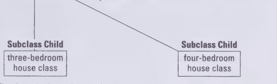

图 1-1：面向对象编程中的术语。

三间卧室房屋类扩展了房屋类，继承了房屋类的特性，是房屋类的子类，是房屋类的类。

四间卧室房屋类扩展了房屋类，继承了房屋类的特性，是房屋类的子类，是房屋类的类。

原始房屋类被称为三间和四间卧室房屋类的超类。同样，三间和四间卧室房屋类是原始房屋类的子类。换句话说，原始房屋类被称为三间和四间卧室房屋类的父类。三间和四间卧室房屋类是原始房屋类的子类。（参考图 1-1）

不用说，你的建筑师同事们嫉妒不已。一群建筑师围着你，想听听你的伟大想法。所以，在那刻，你又投下了一枚磅炸弹：“通过创建一个带有子类的类，我们未来可以重用这个蓝图。如果有人来想要五间卧室的房屋，我们可以通过制作新的蓝图来扩展我们的原始房屋蓝图。”

“但是，”一个同事问道，“如果这只是二层的蓝图而不是整栋房屋的蓝图，你是怎么做到的呢？”

你心领神会地回答：“三间卧室房屋蓝图可以说‘关于楼层的信息，参考原始房屋蓝图。’这样，三间卧室房屋蓝图描述的就是整栋房屋。四间卧室房屋蓝图也可以说同样的内容。通过这种设置，我们可以利用创建原始房屋蓝图时已经完成的工作，节省大量的资金。”

- **类（class）**：房间的蓝图。
- **继承**：房间的特性。
- **子类（subclass）**：房间的类。
- **父类（superclass/parent class）**：房间的基类。


- 房间的蓝图。


- 房间的蓝图。

- 房间的蓝图。

- 房间的蓝图。

- 房间的蓝图。

- 房间的蓝图。

- 房间的蓝图。

- 房间的蓝图。

- 房间的蓝图。

- 房间的蓝图。

- 房间的蓝图。

- 房间的蓝图。

- 房间的蓝图。

- 房间的蓝图。

- 房间的蓝图。

- 房间的蓝图。

- 原始房屋类是三间和四间卧室房屋类的父类。三间和四间卧室房屋类是原始房屋类的子类。（参考图 1-1）

## 超类/父类（SuperClass Parent）

房屋类是三间卧室房屋类的超类，是三间卧室房屋类的父类，也是四间卧室房屋类的超类，是四间卧室房屋类的父类。

房屋类

## 子类（Subclass Child）

三间卧室房屋类

四间卧室房屋类


图 1-1：面向对象编程中的术语。

三间卧室房屋类扩展了房屋类，继承了房屋类的特性，是房屋类的子类，是房屋类的类。

四间卧室房屋类扩展了房屋类，继承了房屋类的特性，是房屋类的子类，是房屋类的类。

原始房屋类被称为三间和四间卧室房屋类的超类。同样，三间和四间卧室房屋类是原始房屋类的子类。换句话说，原始房屋类被称为三间和四间卧室房屋类的父类。三间和四间卧室房屋类是原始房屋类的子类。（参考图 1-1）

不用说，你的建筑师同事们嫉妒不已。一群建筑师围着你，想听听你的伟大想法。所以，在那刻，你又投下了一枚磅炸弹：“通过创建一个带有子类的类，我们未来可以重用这个蓝图。如果有人来想要五间卧室的房屋，我们可以通过制作新的蓝图来扩展我们的原始房屋蓝图。”

“但是，”一个同事问道，“如果这只是二层的蓝图而不是整栋房屋的蓝图，你是怎么做到的？”

你心领神会地回答：“三间卧室房屋蓝图可以写‘关于楼层的信息，请参考原始房屋蓝图。’这样，三间卧室房屋蓝图描述的就是整栋房屋。四间卧室房屋蓝图也可以这样做。通过这种设置，我们可以利用创建原始房屋蓝图时已经完成的工作，节省大量的资金。”

在面向对象编程的语言中，三间和四间卧室房屋类继承了原始房屋类的特性。你也可以说，三间和四间卧室房屋类扩展了原始房屋类。（见图 1-1）。

# 第2 章

## 关于软件的那些事儿

了解 Java 的最佳方法就是实践 Java。当你实践 Java 时，你正在编写、测试和运行你自己的 Java 程序。本章将描述你在处理所有这些 Java 相关任务时会使用的软件。本章提供了通用的说明来帮助你设置计算机，但没有提供详细的指令。如果你需要详细的指令，请访问本书的网站：`http://JavaForDummies.allmycode.com`。

## 为 Java 做好准备

如果你是一个经验丰富的计算机和计算领域老兵（无论那是什么意思），而且你心性太急，不想遵循本书网站上的详细说明，那么你可以尝试通过阅读这些通用说明来安装所需的软件：

1. 安装 `Java` 开发工具包 (`JDK`)。

   `Java` 开发工具包是一系列让所有 `Java` 程序运行起来的软件。

但等一下！“让所有 `Java` 程序运行起来”意味着什么呢？我将在本章稍后的“内部内幕”部分回答这个问题。

要安装 `Java` 开发工具包，请访问 `https://adoptium.net` 并按照该网站的说明。

`https://adoptium.net` 网站有几个由不同公司编写的 `JDK`，几乎其中任何一个工具包都可以与本书的示例兼容。如果你不喜欢 `adoptium.net` 的替代方案，而是更倾向于获取“官方” `JDK`，可以从 `https://www.oracle.com/java/technologies/downloads/` 下载。`Oracle` 官方版本的问题在于，它带有一份长长的、有些令人困惑的法律要求列表。使用 `Oracle` 的 `JDK` 运行本书的示例可能是没问题的，但我不是律师，我也从未在电视上扮演过律师。因此，我总是建议采取安全的路线——从 `https://adoptium.net` 获取 `Java`。


2. 安装集成开发环境 (`IDE`)。

集成开发环境 (`IDE`) 是一个帮助你构建和测试新软件的程序。它是用于编写计算机代码的增强版 `Microsoft Word`。对于本书的示例，你可以使用几乎任何支持 `Java` 的 `IDE`。

以下是专业开发人员中最受欢迎的 `IDE` 列表：

- `Eclipse` ([www.eclipse.org/downloads](https://www.eclipse.org/downloads))

- `IntelliJ IDEA` ([www.jetbrains.com/idea](https://www.jetbrains.com/idea))

- `NetBeans` ([https://netbeans.apache.org](https://netbeans.apache.org))

- `Visual Studio Code`，也称为 `VS Code` ([https://code.visualstudio.com](https://code.visualstudio.com))

有些 `IDE` 是专门为学生、教育者和其他社区设计的。包括 `BlueJ`、`DrJava`、`Greenfoot`、`JCreator`、`JGrass` 等。

如果你喜欢这样不使用 `IDE` 编写并运行 `Java` 程序：只需在纯文本编辑器（如 `Windows` 记事本）中输入你的 `Java` 程序，并在操作系统的命令行（`Windows MS-DOS`、`macOS Terminal` 等）上运行程序。这种方法并不是开发软件，但它可以让你觉得自己很牛。

本书的网站提供了关于安装和使用常用 `IDE` 的详细说明。


3. 测试你的集成软件。

你在这一步中所做的取决于你在第 2 步中选择了哪个 `IDE`。无论如何，这里有一些通用说明：

- a. 启动你的 `IDE`（`Eclipse`、`IntelliJ IDEA`、`NetBeans` 或其他）。

- b. 在 `IDE` 中，创建一个新的 `Java` 项目。

- c. 在 `Java` 项目中，创建一个名为 `Main` 的新 `Java` 类。（在大多数 `IDE` 中选择 **文件** -> **新建** -> **Java 类** 均可行。）

- d. 通过输入以下行代码来编辑新的 `Main.java` 文件：

```java
public class Main {
    public static void main(String[] args) {
        System.out.print(12345);
    }
}
```

对于大多数 `IDE` 来说，你将代码添加到一个巨大的（大部分是空白的）编辑器中。尝试完全按照你在这里看到的输入代码。如果你看到大写字母，就输入大写字母。对小写字母也这样做。

不想手动输入书中的一堆代码吗？那很好！访问本书的网站 (`http://www.JavaForDummies.allmycode.com`) 下载所有示例并将它们复制到你选择的 `IDE` 中。

- e. 运行 `Main.java` 并确保输出显示为 `12345`。

你可能会在前面的步骤中发现代码变体。例如，某些步骤带有安装 `JDK` 的选项。在这种情况下，你可以跳过第 1 步直接进入第 2 步。尽管如此，前面步骤中的代码是有用且可靠的。当你按照说明操作时，你可能会得到 `JVM` 或 `IDE` 的副本，但没关系。

## 内部内幕

其中一个问题是：编译器是一个将你的 `Java` 代码转换为字节码的程序。人类不理解字节码，但 `Java` 虚拟机可以解释并执行它。本节将讨论以下两个最重要的组成部分：

- 编译器是一个将你的 `Java` 代码转换为字节码的程序。

- `Java` 虚拟机 (`JVM`) 是一个解释并执行字节码的程序。

本节的其余部分将介绍编译器和虚拟机。

### 什么是编译器？

编译器是一个将你的 `Java` 代码转换为字节码的程序。如果你在阅读本书，不要担心，像大多数人类一样，你可以学习阅读和编写 Listing 2-1 中的代码。Listing 2-1 中的代码被称为 `Java` 源代码。

这里是检查点：

#### LISTING 2-1: 寻找空房

```java
// 这是 Java 程序的一部分。
// 它不是完整的 Java 程序。
roomNum = 1;
while (roomNum < 100) {
    if (guests[roomNum] == 0) {
        out.println("Room " + roomNum + " is available.");
        exit(0);
    } else {
        roomNum++;
    }
}
out.println("No vacancy");
```

Listing 2-1 中的 `Java` 代码检查了一个小酒店（房号 1 到 99）。如果不添加几行代码，你无法运行 Listing 2-1 中的代码。但在第 2 章中，这些额外的行并不重要。重要的是：


将房间号设置为 1。
只要房间号小于 100，
  检查房间内的客人数。
  如果房间内的客人数为 0，则
    报告该房间可用，
    停止。
  否则，
    准备检查下一个房间，
    将房号加 1。
如果你到达了不存在的房号 100，
  报告没有空房。

如果你发现 Listing 2-1 与其英语等值物之间没有相似之处，请不要担心。你正在阅读《Java For Dummies》第8版，像大多数人类一样，你可以学会阅读和编写 Listing 2-1 中的代码。Listing 2-1 中的代码被称为 Java 源代码。

这里是检查点：计算机不是人类。计算机通常不遵循像 Listing 2-1 中那样的高级指令。也就是说，计算机不遵循高级的 Java 源代码指令。相反，计算机遵循像 Listing 2-2 那样的晦涩指令。

#### Listing 2-2: Listing 2-1 到 Java 字节码的翻译

```
aload_0
iconst_1
putfield Hotel/roomNum I
goto 32
aload_0
getfield Hotel/guests [I
aload_0
getfield Hotel/roomNum I
iaload
ifne 26
getstatic java/lang/System/out Ljava/io/PrintStream;
new java/lang/StringBuilder
(continued)
```

### 列表 2-2：（续）

```java
dup
ldc "Room "
invokespecial java/lang/StringBuilder.<init>(Ljava/lang/String;)V
aload_0
getfield Hotel/roomNum I
invokevirtual java/lang/StringBuilder/append(I)Ljava/lang/StringBuilder;
ldc " is available."
invokevirtual java/lang/StringBuilder/append(Ljava/lang/String;)Ljava/lang/StringBuilder;
invokevirtual java/lang/StringBuilder/toString()Ljava/lang/String;
invokevirtual java/io/PrintStream/println(Ljava/lang/String;)V
iconst_0
invokestatic java/lang/System/exit(I)V
aload_0
getfield Hotel/roomNum I
iconst_1
iadd
putfield Hotel/roomNum I
aload_0
getfield Hotel/roomNum I
bipush 100
if_icmpge
getstatic java/lang/System/out Ljava/io/PrintStream;
ldc "No vacancy"
invokevirtual java/io/PrintStream/println(Ljava/lang/String;)V
return
```

列表 2-2 中的指令并不是 Java 源代码指令。它们是 Java 字节码指令。当你编写 Java 程序时，你编写的是源代码指令（如列表 2-1 中的指令）。在你写完源代码后，你的 IDE 会在你的源码上运行一个程序（一个翻译工具）。这个程序就是编译器。编译器将你的代码指令翻译成 Java 字节码指令。换句话说，编译器将你能够编写并理解的代码（如列表 2-1 中的代码）翻译成计算机有几率执行的代码（如列表 2-2 中的代码）。

（保存在名为 `Hotel.java` 的文件中。如果是这样的话，编译器会将你的 Java 字节码存放在另一个名为 `Hotel.class` 的文件中。通常情况下，你不需要去查看 `Hotel.class` 文件中的字节码。事实上，编译器并没有将 `Hotel.class` 文件编码为普通文本，因此你无法用普通的编辑器来检查字节码。如果你尝试用以下程序打开 `Hotel.class`：


记事本、TextEdit、KWrite 甚至 Microsoft Word，你看到的只有点点、波浪线和其他乱码。为了创建列表 2-2，我不得不对我的 `Hotel.class` 文件应用另一个工具。该工具可以显示 Java 字节码文件的类文本版本。我使用了由 Andrew Saab 开发的 Java 字节码编辑器（https://set.ee/jbe）。

没有人（除了远远实验室里少数疯狂的程序员之外）会手写 Java 字节码。你运行软件（编译器）来创建 Java 字节码。查看列表 2-2 的唯一理由是为了理解一台辛勤工作的计算机是如何工作的。

# 什么是 Java 虚拟机？

Java 虚拟机（JVM）是一个解释并执行字节码指令的程序。

> —Barry Burd，《Java 傻瓜》（Java For Dummies），第8版

在之前的“什么是编译器？”章节中，我对计算机遵循像列表 2-2 那样的指令做了大做特写。就这些特写而言，这是一个非常棒的特写。但如果你没有阅读每一个挑剔的字眼，可能会被误导。准确的措辞是：“……计算机遵循像列表 2-2 那样的加密指令。”列表 2-2 中的指令与计算机可以执行的指令非常相似，但通常情况下，计算机并不执行字节码指令。相反，每种类型的处理器都有自己的一套可执行指令，而且每个计算机操作系统使用处理器指令的方式也略有不同。

这里有一个假设的情况：现在是 1992 年（在 Java 发布几年之前），你在一台带有 Pentium 处理器的计算机上运行 Linux 操作系统。你的朋友在一台带有不同处理器的计算机上运行 Linux——PowerPC 处理器。（在 90 年代，英特尔制造 Pentium 处理器，IBM 制造 PowerPC 处理器。）

列表 2-3 包含一组在屏幕上显示 Hello world! 的指令。这些指令在运行 Linux 操作系统的 Pentium 处理器上运行。


### 列表 2-3：针对 Pentium 处理器的简单程序

```assembly
.data
msg:
    .ascii "Hello, world!\n"
    len = . - msg
.text
.global _start
_start:
    mov $len,%edx
    mov $msg,%ecx
    mov $1,%ebx
    mov $4,%eax
    int $0x80

    mov $0,%ebx
    mov $1,%eax
    int $0x80
```

### 列表 2-4：针对 PowerPC 处理器的简单程序

```assembly
.data
msg:
    .string "Hello, world!\n"
    len = . - msg
.text
.global _start
_start:
    li 0,4
    li 1,1
    li 2,msg
    li 3,len
    bl write

    li 0,0
    li 1,0
    syscall
```

Java 虚拟机（JVM）是一个代理、跑腿的、中间人。JVM 充当 Java 的“随处运行”字节码与你计算机本地系统之间的解释器。在 JVM 运行时，它会引导你的计算机执行字节码指令。JVM 逐位检查你的字节码，并执行字节码中描述的指令。JVM 会为你的 Windows 系统、Mac 或 Linux 机器，或者你正在使用的任何类型的计算机解释字节码。这是一件好事。正是它让 Java 程序比任何其他语言更具可移植性。

## 开发软件

这一切以前发生过，而且将来还会再次发生。

> 《彼得潘》（J. M. Barrie）与《星际迷战》（2003–2009, NBC 通用环）

当你创建一个 Java 程序时，你会一遍又一遍地重复相同的步骤。图 2-2 展示了这一循环。

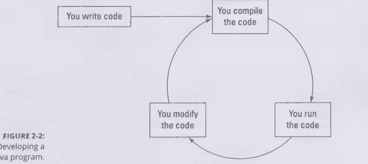

首先，你编写一个程序。在写完初稿后，你会反复编译、运行并修改该程序。有了一点经验，编译和运行步骤就会变得容易执行。在很多情况下，只需点击鼠标即可开始编译或运行。

然而，编写初稿和修改代码并不是一键即可完成的任务。编写代码需要时间和精力。

当你的代码初稿不起作用时，永远不要气馁。同样，当你的代码第 25 个稿不起作用时，也永远不要气馁。重写代码是你能做的最重要的事情之一（获得内心平静除外）。

当人们谈论编写程序时，他们使用图 2-2 中的表述。他们说：“你编译代码”和“你运行代码”。但这个“你”并不总是准确，而“代码”在循环的每个阶段也略有不同。图 2-3 更加详细地描述了图 2-2 中的循环。

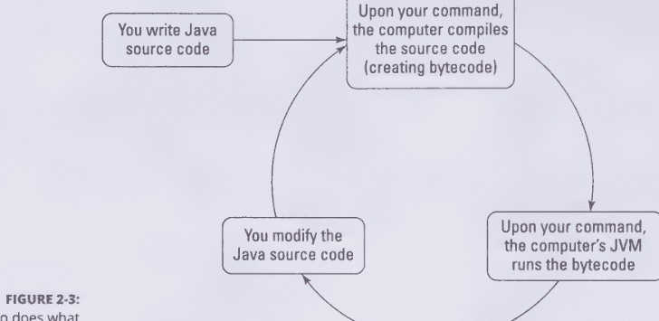

对于大多数人的需求来说，图 2-3 包含的信息太多了。如果我点击“运行”图标，我不需要记住计算机正在代表我运行代码。而且，随我的意，计算机可以运行我的原始 Java 代码，也可以运行我原始 Java 代码的某些字节码副本。事实上，在书中很多地方，我随口写道“当你运行 Java 代码时”或“当计算机运行你的 Java 程序时”。不看图 2-3 你也可以过得很幸福的生活。图 2-3 的唯一用途是当图 2-2 中松散的表述让你困惑时为你提供帮助。如果图 2-2 没有困扰到你，请忽略图 2-3。

## 剧透警告！

在下一章中，你将开始运行 Java 代码。这才是你从这本书中真正想要的，不是吗？

# 本章内容

- 学习 Java 语言：API 与语言规范
- 初探 Java 代码
- 理解简单程序的组成部分
- 为你的代码编写文档

## 第 3 章

使用基础构建模块

> “所有具有巨大影响的思想都是简单的。（All great ideas are simple.）” —— 列夫·托尔斯泰

这句引言适用于各种事物——如生活、爱情和计算机编程。这就是为什么本章采用了多层次的方法。在本章中，你将获得关于 Java 编程的细节。在发现细节的过程中，你会看到其中的简单性。

## 学习 Java 语言

如果你尝试在脑海中勾勒整个英语，你会看到什么？也许你看到单词、单词、单词。（那是哈姆莱特所说的）。在显微镜下观察语言，你会看到一个接一个单词。这种“单词堆”的意象没有问题，但如果你向后退一步，你可能会看到另外两个东西：

- 语言的语法
- 数千种表达方式、格言、习语和历史名称

第一类（语法）包括如下规则：“动词在单复数和人称上与名词一致。”第二类（表达方式、格言等等）包含如下知识：“朱利乌斯·凯撒是一位著名的罗马皇帝，所以不要给你的儿子起名叫朱利乌斯·凯撒，除非你希望他放学后每天都挨打。”

Java 编程语言具备了口语英语的所有方面。Java 拥有单词、语法、常用名称、风格习语以及其他元素。

## 语法和常用名称

创建 Java 的太阳微系统公司（Sun Microsystems）的人认为 Java 具有相互独立的部分。就像英语有它的语法和常用名称一样，Java 编程语言有它的规范（它的语法）和它的应用程序接口（它的常用名称）。除了这些部分，还有两份重要的文档：

- **语言规范（Language Specification）**：此文档包含了如下规则：“在 `for` 单词后始终加上一个左括号”以及“使用星号来乘以两个数”。

- **API 规范（API Specification）**：Java 的应用程序接口（API）包含了数千个在语言语法定义之后添加到 Java 中的名称。这些名称从普通到奇特应有尽有。例如，其中一个名称——`JFrame` 名称，代表你计算机屏幕上的一个窗口。另一个更酷炫的名称 `pow` 帮助你计算 5 的 10 次方，或者将任何数提升到任何次方。其他名称则帮助你监听用户的按钮点击、查询数据库以及各种有用的功能。

你可以通过浏览 http://docs.oracle.com/java/specs 来下载语言规范，但不建议这样做。通过语言规范，你可以对 Java 程序行为中的边缘情况进行细微的辩论，但对于日常学习 Java 来说，该规范过于详尽了。

第二份文档——API 规范——是你大多数 Java 编程需求的首选文档。API 包含了数千个名称，并随着每个 Java 新版本的发布不断增长。这听起来可能很吓人，但有一个好消息——你不需要记忆 API 中的任何内容。一个都不用。你可以查阅文档找到你需要用的，并忽略你不需要的。你经常使用的，你会记住；你不经常使用的，你会忘记（像任何其他程序员一样）。

Java 17 的 API 文档在线地址为：https://docs.oracle.com/java/17/docs/api/index.html。

通常意味着大致相同的意思。（当然，你可以考虑英语用法中那些奇特的例外，但请不要这么想）。

Sam 这个词就像一个 Java 标识符，因为 Sam 是一个特定人的名字。像 Sam、Dinswald 和 McGillimararo 这样的词在英语中并没有预设的含义。这些词根据上下文适用于不同的人，并且当父母为他们的新生婴儿选择其中一个时，它们就变成了名字。

现在考虑这个句子 "Julius Caesar is a person."（尤利乌斯·凯撒是一个人）。如果你说这句话，你可能是在谈论那个三月中（Ides of March）之前统治罗马的那个家伙。虽然 Julius Caesar 这个名字并没有硬编码在英语语言中，但几乎每个人都使用这个名字来指代同一个人。如果英语是一门编程语言，那么 Julius Caesar 这个名字将是一个 API 标识符。

以下是我脑海中将 Java 程序中的单词分为几类的方式：

- **关键字（Keywords）**：关键字是在编程语言中具有特殊含义的单词，这种含义不会从一个程序改变到另一个程序。Java 中的关键字示例有 `if`、`else` 等。

- **标识符（Identifiers）**：标识符是某个事物的名称。标识符的含义可以从一个程序改变到另一个程序，但某些标识符往往变化得更多：

  - **你创建的标识符**：作为一个 Java 程序员（是的，即使是初学者），你也会为你程序中描述的类和其他条目创建新名称。当然，你可能会将某个东西命名为 `Prime`，而隔着两个办公室编写代码的同事可能将其命名为 `Prime`。没关系，Java 对 `Prime` 没有预设的含义。在你的程序中，你可以让 `Prime` 代表联邦储备的利率。而你走廊那头的朋友可以让 `Prime` 代表“面包、圆面包、果酱和顶级肋排”。这不会产生冲突，因为你和同事正在编写两个不同的 Java 程序。

  - **来自 API 的标识符**：JCP 成员已经为许多事物创建了名称，并将数以万计的名称投入了 Java API 中。API 随每个 Java 版本一同提供，因此任何编写 Java 程序的人都可以使用这些名称。此类名称的示例有 `String`、`Integer`、`JWindow`、`JButton`、`JTextField` 和 `File`。

严格来说，Java API 中标识符的含义并不是一成不变的。虽然你可以为 `JButton` 或 `Window` 赋予你自己的含义，但这并不是一个好主意。如果你这样做了，你会让其他程序员感到困惑，因为他们使用标准的 API 含义来理解这些熟悉的标识符名称。但更糟糕的是，当你的代码为像 `JButton` 这样的标识符分配新含义时，你就丢失了 API 代码中为该标识符创建的任何计算能力。Sun Microsystems、Oracle 和 Java 社区的程序员已经完成了所有编写 Java 代码来处理按钮的工作。如果你为 `JButton` 分配自己的含义，你就是背弃了创建 API 所取得的所有进展。

要查看 Java 关键字列表，请访问 www.dummies.com，在搜索框中输入 `Beginning-programming with Java For Dummies cheat sheet`。


## 第一次查看 Java 代码

第一次看别人的 Java 程序时，你可能会感到有些不适。意识到自己看不懂代码中的某些（或许多）内容会让你紧张。我写过数百（也许几千）个 Java 程序，当我开始阅读别人的代码时，我仍然感到不安全。

事实是，发现一个 Java 程序是一个引导过程。首先，你对这个程序感到惊叹。然后你运行程序看看它是做什么的。然后你盯着程序看一会儿，或者阅读别人对程序及其部分的解释。然后你多惊叹一下并再次运行程序。最终，你会与程序达成和解。（不要相信那些说他们从不需要这些步骤的智人。）


通常意味着大致相同的意思。（当然，你可以考虑英语用法中那些奇特的例外，但请不要这么想）。

`Sam` 这个词就像一个 Java 标识符，因为 `Sam` 是一个特定人的名字。像 `Sam`、`Dinswald` 和 `McGillimararo` 这样的词在英语中并没有预设的含义。这些词根据上下文适用于不同的人，并且当父母为他们的新生婴儿选择其中一个时，它们就变成了名字。

现在考虑这个句子 "Julius Caesar is a person."（尤利斯·凯撒是一个人）。如果你说这句话，你可能是在谈论那个三月中（Ides of March）之前统治罗马的那个家伙。虽然 `Julius Caesar` 这个名字并没有硬编码在英语语言中，但几乎每个人都使用这个名字来指代同一个人。如果英语是一门编程语言，那么 `Julius Caesar` 这个名字将是一个 API 标识符。

以下是我脑海中将 Java 程序中的单词分为几类的方式：

- **关键字（Keywords）：** 关键字是在编程语言中具有特殊含义的单词，这种含义不会从一个程序改变到另一个程序。Java 中的关键字示例有 `if`、`else` 等。

- **标识符（Identifiers）：** 标识符是某个事物的名称。标识符的含义可以从一个程序改变到另一个程序，但某些标识符往往变化得更多：

  - **你创建的标识符：** 作为一个 Java 程序员（是的，即使是初学者），你也会为你程序中描述的类和其他条目创建新名称。当然，你可能会将某个东西命名为 `Prime`，而隔着两个办公室编写的同事可能将其命名为 `Prime`。没关系，Java 对 `Prime` 没有预设的含义。在你的程序中，你可以让 `Prime` 代表联邦储备的利率。而你走廊那头的朋友可以让 `Prime` 代表“面包、圆面包、果酱和顶级肋排”。这不会产生冲突，因为你和同事正在编写两个不同的 Java 程序。

  - **来自 API 的标识符：** JCP 成员已经为许多事物创建了名称，并将数以万计的名称投入了 Java API 中。API 随每个 Java 版本一同提供，因此任何编写 Java 程序的人都可以使用这些名称。此类名称的示例有 `String`、`Integer`、`JWindow`、`JButton`、`JTextField` 和 `File`。

36 第 1 部分 Java 入门

严格来说，Java API 中标识符的含义并不是一成不变的。虽然你可以为 `JButton` 或 `Window` 赋予你自己的含义，但这并不是一个好主意。如果你这样做了，你会让其他程序员感到困惑，因为他们使用标准的 API 含义来理解这些熟悉的标识符名称。但更糟糕的是，当你的代码为像 `JButton` 这样的标识符分配新含义时，你就丢失了 API 代码中为该标识符创建的任何计算能力。Sun Microsystems、Oracle 和 Java 社区的程序员已经完成了所有编写 Java 代码来处理按钮的工作。如果你为 `JButton` 分配自己的含义，你就是背弃了创建 API 所取得的所有进展。

要查看 Java 关键字列表，请访问 `www.dummies.com` 在搜索框中输入 `Beginning-programming with Java For Dummies cheat sheet`。


## 第一次查看 Java 代码

第一次看别人的 Java 程序时，你可能会感到有些不适。意识到自己看不懂代码中的某些（或许多）内容会让你紧张。我写过数百（也许几千）个 Java 程序，当我开始阅读别人的代码时，我仍然感到不安全。

事实上，发现一个 Java 程序是一个引导过程。首先，你对这个程序感到惊叹。然后你运行程序看看它是做什么的。然后你盯着程序看一会儿，或者阅读别人对程序及其部分的解释。然后你多惊叹一下并再次运行程序。最终，你会与程序达成和解。（不要相信那些说他们从不需要这些步骤的智人。）

通常，如果你定义了一个名为 `DogAndPony` 的类，该类的 Java 代码位于一个名为 `DogAndPony.java` 的文件中。文件的拼写和大小写与该类的拼写和大小写完全相同。事实上，这种文件命名约定对于本书中的大多数示例都是强制性的。

## Java 方法

你在一家高级修理厂担任汽车机械师。你的老板总是风风火火，而且习惯于把单词连在一起说，他说：“`fixTheAlternator` on that `junkyOldFord`.（修那辆旧福特的发电机。）”在脑海中，你过了一遍任务清单：“把车开进维修位，打开引擎盖，用扳手松开发电机带”，等等。有三件事正在发生：

- 你对应该要做的事情有一个名字。这个名字是 `fixTheAlternator`。
- 在你的脑海中，你有一个与 `fixTheAlternator` 相关的任务列表。该列表包括“把车开进维修位，打开引擎盖，找扳手，松开发电机带”，等等。
- 你有一个脾气不好的老板在让你做所有这些工作。你的老板通过说“`fixTheAlternator`”来让你开始工作。换句话说，你的老板通过说你应该要做的事情的名字来让你工作。

在这种情况下，使用“方法（method）”一词并不过分。你有一个处理发电机的方法。你的老板启动了这个方法，而你通过执行你与该方法相关的指令列表中的所有事情来响应。

如果你认同这一点（我希望你是这样想），你就准备好阅读关于 Java 方法了。在 Java 中，一个方法是一个待办事项列表。每个方法都有一个名字，你通过在程序中使用方法的名称来告诉计算机执行列表中的事项。

我从未写过一个让机器人修理发电机的程序。但是，如果我写了，该程序可能会包含一个 `fixTheAlternator` 方法。我的 `fixTheAlternator` 方法中的指令列表看起来会像列表 3-2（Listing 3-2）中的文本一样。

不要仔细审视列表 3-2 和 3-3 —— 它们所有的代码都是虚构的！我编造了这些代码以便它们看起来像真实的 Java 代码，但它们并不是真实的。更重要的是，列表 3-2 和 3-3 中的代码并不是为了说明关于 Java 的所有规则。所以，如果你手头有保留意见，请在对待列表 3-2 和 3-3 时保持保留。


40 第 1 部分 Java 入门

## 列表 3-2：方法声明

```java
void fixTheAlternator(onACertainCar car) {
    driveInto(car, bay);
    lift(hood);
    get(wrench);
    loosen(alternatorBelt);
}
```

在我的 Java 代码其他某处（列表 3-2 之外），我需要一条指令来调用我的 `fixTheAlternator` 方法。调用 `fixTheAlternator` 方法的指令看起来可能像列表 3-3（Listing 3-3）中的那一行。

## 列表 3-3：方法调用

```java
fixTheAlternator(junkyOldFord);
```

现在你已经对什么是方法以及它是如何工作的有了基本的了解，你可以进一步深入研究一些实用的术语了：

- 如果我偷懒，我会把列表 3-2 中的代码称为“方法”。如果我不偷懒，我会把这段代码称为“方法声明”。
- 列表 3-2 中的方法声明包含两个部分。第一行（包含 `fixTheAlternator` 的部分，直到包含左大括号为止）是“方法头”。列表 3-2 的其余部分（被大括号包围的部分）是“方法体”。
- “声明（declaration）”这一术语将列表 3-2 中的指令列表与列表 3-3 中的指令区分开来，后者被称为“方法调用（method call）”。

方法的声明告诉计算机当你调用该方法时会发生什么。方法调用（另一段独立的代码）告诉计算机实际调用该方法。方法的声明和方法的调用往往位于 Java 程序的不同部分。


## 程序中的 main 方法

图 3-3 包含了列表 3-1 中代码的副本。代码的大部分包含名为 `main` 的方法的声明。（只需在代码的方法头中寻找 `main` 这个单词。现在，不用担心方法头中的其他单词：`public`、`static`、`void`、`String` 和 `args`。我将在接下来的几个章节中解释这些词。）

**main 方法头**

```java
public class Displayer {
    public static void main(String[] args) {
        System.out.println("You'll love Java!");
    }
}
```

图 3-3: main 方法（也称为 main 方法的声明）

**main 方法体**

任何 Java 方法都像一份食谱：

- 如何制作饼干：
  加热烤箱。
  揉面团。
  烘烤揉好的面团。

或者

- 如何遵循 Displayer 的主指令：
  在屏幕上打印“You'll love Java!”。

对于任何 Java 方法，`main` 方法都是特殊的。特别是，你不需要显式地编写代码来调用它。`main` 单词是程序启动时自动调用的方法。

回看图 3-1。当 `Displayer` 程序运行时，计算机会找到方法体并执行方法体内的所有指令。在 `Displayer` 程序中，`You'll love Java!` 会出现在屏幕上。所以，在图 3-1 中，`You'll love Java!` 出现在计算机上。


几乎每种语言都有类似的方法。如果你接触过其他语言，你可能记得函数（functions）、过程（procedures）或子程序（subroutines）等术语。在 Java 中，我们称它们为方法。

当我像“`System.out.println` 被埋在 API 内部”这样表述时，我并没有充分评价这个 API。诚然，你可以忽略 API 内部所有细碎的 Java 代码。你只需要记住 `System.out.println` 定义在这些代码的某个地方。但当我把 API 代码比作某种魔法时，我是不够公平的。API 仅仅是另一堆 Java 代码。API 中告诉你调用 `System.out.println` 意味着什么的那些语句，看起来与列表 3-1 中的 Java 代码非常相似。

在 Java 中，每个语句（图 3-4 中方框选的行）都以分号结尾。图 3-4 中的其他行没有以分号结尾；因为图 3-4 中的其他行不是语句。例如，方法头（包含 `main` 单词的行）并没有直接告诉计算机执行任何操作。方法头只是宣布：“万一你以后想执行 `main`，接下来的几行代码将告诉你如何操作。”

每个完整的 Java 语句都以分号结尾。

## 准备好迎接

很久以前，或者也许并不久以前，你们的老师曾告诉过你们大纲（outlines）有多有用。有了大纲，你可以组织思想和想法，帮助人们看到森林而不是树木，并通常证明你是一个“整洁学生俱乐部”的成员。嗯，一个 Java 程序就像一个大纲。列表 3-1 中的程序以一行表头开头，写着：“有一个名为 `Displayer` 的类出现了。”在该表头之后，一个副标题宣布：“有一个名为 `main` 的方法。”

现在，如果一个 Java 程序像一个大纲，为什么程序看起来不像一个大纲呢？什么取代了罗马数字、大写字母和其他项目？答案有两点：

- 在 Java 程序中，大括号 `{}` 括住了有意义的代码单元。
- 你，作为程序员，可以（并且应该）对行进行缩进，这样其他程序员就能一眼看出你代码的大纲。

在大纲中，所有内容都从属于罗马数字 I 的项目。在 Java 程序中，所有内容都从属于第一行——即包含 `class` 单词的这一行。为了表示代码中的其他所有内容都从属于该类行，你使用了大括号。代码中的所有内容都放在这些大括号内。（参见列表 3-4。）

### 列表 3-4：Java 类的大括号

```java
public class Displayer {
    public static void main(String[] args) {
        System.out.println("You'll love Java!");
    }
}
```

在大纲中，某些内容从属于大写字母 A。在 Java 程序中，某些行从属于方法头。为了表示某些内容从属于方法头，你使用了大括号。（参见列表 3-5）

### 列表 3-5：Java 方法的大括号

```java
public class Displayer {
    public static void main(String[] args) {
        System.out.println("You'll love Java!");
    }
}
```

在大纲中，某些项目处于食物链的底端。在 `Displayer` 类中，对应的行是以 `System.out.println` 开头的行。相应地，这行 `System.out.println` 位于所有其他大括号内部，并且缩进得比任何其他行都深。

永远不要忘记一个事实：Java 程序首先、最重要的就是一个大纲。

如果你在错误的位置放置大括号，或者在应该有大括号的地方漏掉括号，你的程序可能完全无法运行。如果你的程序运行了，它可能会运行错误。

如果你不以提供信息的方式对代码行进行缩进，你的程序仍然可以正确运行，但你和任何其他程序员都无法弄懂你在写代码时在想什么。

如果你是一个视觉型思考者，你可以在脑中勾勒出 Java 程序的大纲。我的一个朋友会想象一个真实的大纲演变成一个 Java 程序。（参见图 3-6。）另一位保持匿名的人使用了更奇异的意象。（参见图 3-7）

#### I. Displayer 类

A. main 方法

1. 打印 "You'll love Java!"

```
I. public class Displayer
A. public static void main(String[] args)
1. System.out.println("You'll love Java!");
```

图 3-6: 大纲变成了一个 Java 程序。

```java
public class Displayer {
    public static void main(String[] args) {
        System.out.println("You'll love Java!");
    }
}
```

图 3-7: 类比方法大，方法大于语句。

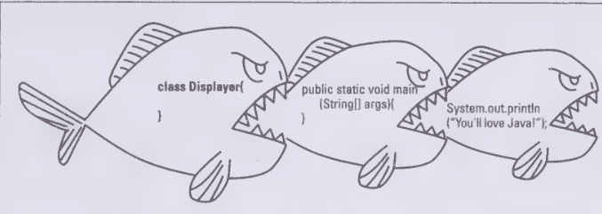

我像其他人一样欣赏好的借口，但未能对你的 Java 代码进行缩进是不可原谅的。在许多 IDE 中，都有自动缩进代码的工具。在你喜欢的 IDE 中，寻找类似 `Source > Format` 或 `Code > Reformat Code` 的菜单。

**提示**

这里有一些你可以尝试的内容，以帮助你理解本节的内容。如果尝试这些内容建立了你的信心，那就很好。如果尝试这些内容让你怀疑自己读过的内容，那也很好。如果尝试这些内容让你感到紧张，不要气馁。你可以在此书的网站（`http://JavaForDummies.allmycode.com`）找到答案和其他帮助。你也可以通过电子邮件向我提问（`JavaForDummies@allmycode.com`）。

**来试一看**

第 3 章 使用基础构建块 47

## 开始之旅

> 如果你已经从这本书的网站下载了代码，请将列表 3-1（来自下载的 03–01 文件夹）导入你的 IDE。如果你不计划下载代码，请在 IDE 中创建一个新项目。在新项目中，创建一个名为 `Displayer` 的类，并使用列表 3-1 中的代码。使用下载的项目或你自己新创建的项目，运行程序，并在输出中寻找 `You'll love Java!` 单词。
>
> 尝试运行列表 3-1 中的代码，将 "You'll love Java!" 更改为 "No more baked beans!"。发生了什么？

## 大写之痛

> 尝试运行列表 3-1 中的代码，将单词 `public`（全小写）改为 `Public`（首字母大写）。发生了什么？
>
> 尝试运行列表 3-1 中的代码，将单词 `main`（全小写）改为 `Main`（首字母大写）。发生了什么？
>
> 尝试运行列表 3-1 中的代码，将单词 `system`（全小写）改为 `System`（首字母大写）。发生了什么？

## 失窃的分号

> 尝试运行缺少分号的列表 3-1 的代码。发生了什么？
>
> 尝试在某些行的末尾添加额外的分号运行列表 3-1 的代码。发生了什么？

## 杂乱的小麻烦

> 尝试运行更改了缩进的列表 3-1 代码。例如，不对任何行进行缩进，让代码看起来就像 `public Displayer { ...`。发生了什么？
>
> 尝试运行将 `println` 放在错误位置的列表 3-1 代码。发生了什么？
>
> 尝试运行列表 3-1 的代码，将文本 "You'll love Java!" 更改为 ""。发生了什么？

## 一些注释

人们聚集在篝火旁，听一个关于程序员因为懒惰而陷入麻烦的老传说。为了保持这位程序员的匿名性，我称她为 Jane Pro。Jane 花了几个月的时间来创造计算科学的圣杯：一个能够独立思考的程序。如果完成，这个程序就可以独立工作，在没有人类干预的情况下学习新概念。

一天，当她几乎完成项目时，她收到了一封来自保险公司的令人不安的纸质信件邮件。不，那封邮件不是关于严重疾病的，而是一次例行就诊。保险公司的理赔表上有一个填写出生日期的地方，就好像自从她上次提交理赔以来她的出生日期变了一样。她随手在出生年份写了 2016，所以保险公司拒绝支付账单。


Jane 拨打了保险公司的电话。在 20 分钟内，她与一个真人通了电话。“抱歉，”真人说，“要解决这个问题，你必须拨打另一个号码。”嗯，你可以猜接着发生了什么。“抱歉，另一个操作员给了你错误的号码。”

五个月后，Jane 的耳朵很疼，但在通了 800 小时后，她终于得到了一个初步承诺，保险公司最终会重新处理该理赔。尽管非常兴奋，她急于回到她的编程项目。她还记得那些代码原本是做什么的吗？

不，她记不住。Jane 盯着她的工作看，就像第二天早上不合逻辑的梦一样，代码对她来说完全没有意义。她写了百万行代码，但没有一行代码配有提供信息的解释性注释。她没有留下任何线索来帮助她理解自己在想什么，因此沮丧地放弃了整个项目。

### 为代码添加注释

列表 3–6 包含了本章示例程序的增强版本。除了所有的关键字、标识符和标点符号外，列表 3–6 还有专门供人类阅读的文本。

#### 列表 3-6：三类注释

```java
/*
* 摘自《Java For Dummies，第8版》中的列表 3-6
*
* 版权所有2022 Wiley Publishing, Inc.
* 保留所有权利。
*/
```

```java
/**
* Displayer 类在计算机
* 屏幕上显示文本。
*
* @author Barry Burd
* @version 1.0 1/24/22
* @see java.lang.System
 */
public class Displayer {

/**
* main 方法是代码
* 执行开始的地方。
*
* @param args（参见第 11 章。）
 */
    public static void main(String[] args) {
        System.out.println("I love Java!"); //将 "I" 替换为 "You"
    }
}
```

注释是段落内部的一段特殊文本，其目的是帮助人们理解程序。注释是良好程序文档的一部分。

Java 编程语言有三种注释：

-   **传统注释：** 列表 3-6 的前五行形成了一个传统注释。注释以 `/*` 开头，以 `*/` 结束。开启 `/*` 和结束符 `*/` 之间的所有内容仅供人类阅读。编译器不会翻译任何关于《Java For Dummies，第 8 版》或 Wiley Publishing, Inc. 的信息。

要了解编译器知识，请参见第 2 章。

列表 3-6 中的第二、第四和五行带有额外的星号 (`*`) 。我把它们称为“额外的奖励”，因为在创建注释时不需要这些星号。它们只是让注释看起来更美观。我在列表 3-6 中包含了它们，因为出于某种我不完全完全理解的原因，大多数 Java 程序员都会添加这些额外的星号。

-   **行尾注释：** 列表 3-6 中的文本 `//Replace "I" with "You"` 是行尾注释。行尾注释以两个斜杠开始，一直到代码行的末尾。再次，编译器不会翻译行尾注释中的文本。

-   **Javadoc 注释：** javadoc 注释以斜杠和两个星号 (`/**`) 开始。列表 3-6 有两个 javadoc 注释：一个包含文本 The Displayer class ... ，另一个包含文本 main method is ....

嗯，一个名为 `javadoc` 的程序（还能是什么呢？）可以找到列表 3-6 中所有的 javadoc 注释，并将这些注释转换为一个精美的网页。图 3-8 显示了该页面。

#### Javadoc 注释非常棒。以下是关于它们的几个优点点：

-   唯一需要查看某段 Java 代码的人是编写该代码的程序员。其他使用代码的人可以通过查看自动生成的网页来了解代码的功能。

-   因为其他人不看 Java 代码，所以这些人不会对 Java 代码进行任何更改。（换句话说，其他人不会在现有的 Java 代码中引入错误）。

-   因为其他人不看 Java 代码，所以这些人不需要解析 Java 代码的内部工作原理。这些人所需要的关于代码的信息只有他们在代码网页上读到的内容。

-   程序员不需要创建两个独立的文件——这里是一段 Java 代码，那里是另一份关于代码的文档。相反，程序员创建一段 Java 代码，并将文档（以 javadoc 注释的形式）直接嵌入到代码中。

-   从 javadoc 注释生成网页是自动的。因此，每个人的文档具有相同的格式。无论你使用谁的 Java 代码，你通过阅读类似图 3-8 这样的页面就能找到该代码。这很好，因为图 3-8 中的格式对于任何使用 Java 的人来说都是熟悉的。

```
package CLASS TREE DEPRECATED INDEX HELP
```

```
package CLASS TREE DEPRECATED INDEX HELP
```

### 编写你自己的 Java 程序

#### 在这一部分中 ...

- 创建新值并修改现有值。

- 为你的应用程序逻辑添加决策机制。

- 将重复作为解决问题的工具。

#### 在本章中

- 给事物赋值

- 让事物存储特定类型的值

- 运用运算符来获取新值

#### 第 4 章

#### 充分利用变量及其数值

以下是 Van Doren 先生与 Barasch 先生之间这段从未发生过的对话：

查尔斯：海乌鱼吃了自己的大脑，使自己从一种动物变成了植物。

杰克：这是你的最终答案吗，查尔斯？

查尔斯：是的。

杰克：查尔斯，你今天账户里有多少钱？

查尔斯：我的支票账户里有五十美元二十二分。

杰克：嗯，你最好打给国税局（IRS），因为你关于海乌鱼的回答是正确的。

你刚刚赢了一百万美元存入你的支票账户。你觉得怎么样，查尔斯？

查尔斯：这归于诚实、勤奋和努力，杰克。

这段对话的某些方面可以用 Java 的几行代码表示。

### 变量的变化

无论你是如何获得这百万美元的，都可以使用变量来计算你的财富。列表 4-1 显示了代码。

#### 列表 4-1：使用变量

```
amountInAccount = 50.22;
amountInAccount = amountInAccount + 1000000.00;
```

你不需要手动输入列表 4-1 中的代码（或本书中的任何列表代码）。要下载书中的所有代码，请访问本书网站（`http://JavaForDummies.allmycode.com`）。

列表 4-1 中的代码使用了 `amountInAccount` 变量。变量是一个占位符。你可以将像 `50.22` 这样的数字放入变量中。在向变量中放置一个数字后，你可以改变主意，并将另一个数字放入变量中。（这就是变量中发生“变化”的地方。）当然，当你向变量中放入一个新数字时，旧数字就不再存在了。如果你没有在其他地方保存旧数字，它就会被丢弃。

图 4-1 展示了列表 4-1 代码执行前后的对比。在执行列表 4-1 的第一个语句后，变量 `amountInAccount` 包含数字 `50.22`。然后，在执行列表 4-1 的第二个语句后，`amountInAccount` 变量突然变成了 `1000050.22`。当你想到变量时，请想象计算机内存中的某个地方，电线和晶体管存储着 `50.22`、`1000050.22` 或数字。在图 4-1 的左侧，想象那个装有 `50.22` 的盒子被数百万个箱子包围。

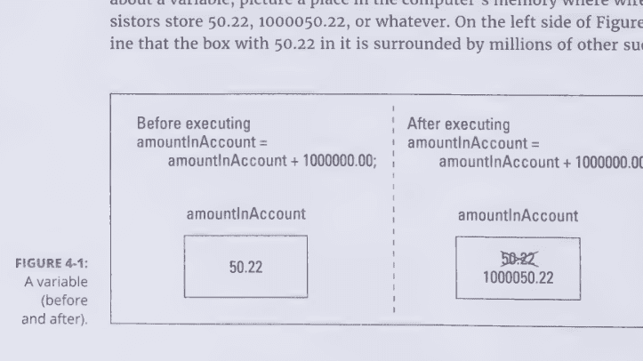

58 第 2 部分 编写你自己的 Java 程序

你需要一些术语。存储在变量中的东西是**值**。变量的值可以在程序运行期间发生变化（例如，当杰克给你百万美元时）。存储在变量中的值并不一定是数字。（例如，你可以创建一个始终存储字母的变量）。存储在变量类型中的值种类……

你可以在本章稍后的“变量可能拥有的值类型”部分阅读更多关于类型的内容。


变量与变量名之间存在着微妙的、几乎难以察觉的区别。在正式写作中，当我指的是变量名时，经常使用“变量”这个词。严格来说，`amountInAccount` 是一个变量，而与 `amountInAccount` 相关的所有内存存储（包括 `amountInAccount` 拥有的类型以及 `amountInAccount` 代表的任何值）都是变量本身。如果你认为变量和名称之间的区别太微妙而不值得担心，请加入我们的俱乐部吧。

每个变量都是一个**标识符**——一个你可以在代码中自定义的名字。在准备列表 4-1 时，我创造了 `amountInAccount` 这个名字。

关于 Java 程序中名称种类的更多信息，请参见第 3 章。


在列表 4-1 完结之前，你需要注意到列表的另一个部分。列表中包含了 `50.22` 和 `1000000.00`。任何神智正常的人都会称这些为数字，但在 Java 程序中，称它们为**字面量**（literals）会有帮助。

那么 `50.22` 和 `100000.00` 有什么“字面”的特殊呢？想想列表 4-1 中的变量 `amountInAccount`。变量 `amountInAccount` 有时代表 `50.22`，其余时间代表 `1000050.22`。你可以用“数字”这个词来谈论 `amountInAccount`。但实际上，`amountInAccount` 代表什么取决于……


### 赋值语句

在赋值语句中，被赋值的对象位于左侧。

在赋值语句中，你将一个值赋给某个东西。

在很多情况下，这个某个东西是一个变量。

我建议从右向左读取赋值语句。图 4-2 展示了列表 4-1 第一行的执行情况。

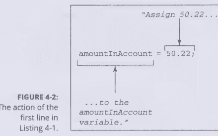

图 4-2：列表 4-1 第一行的执行情况。

列表 4-1 的第二个语句稍微复杂一点。图 4-3 展示了它的执行情况。

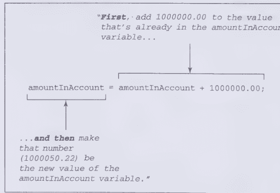

图 4-3：列表 4-1 第二行的执行情况。

> 记住

#### 变量可能拥有的值类型

你看过那些你自己在电路中飞行的广告吗？很酷对吧？这些广告展示的是 0（零）和 1（一），因为 0 和 1 是计算机唯一处理的东西。当你认为计算机正在存储字母 J 时，它实际上在存储 `01001010`。正如每台计算机所知，一个 0 或 1 就是一个位（bit）。

事实证明，代表字母 J 的序列 `01001010` 也可以代表数字 74。同样的序列也可以代表 $1.039608636003646\times10^{43}$。事实上，如果位被解释为屏幕像素，同样的序列可以表示图 4-4 所示的点。`01001010` 的含义取决于屏幕解释它的方式。


图 4-4：黑白像素特写。

你如何告诉计算机 `01001010` 代表什么？答案就在**类型**的概念中。变量的类型是变量允许存储的值范围。我将列表 4-1 中的行复制并放入一个完整的 Java 程序中。该程序见列表 4-2。当我运行列表 4-2 中的程序时，我得到了如图 4-5 所示的输出。

#### 列表 4-2：使用 amountInAccount 的程序

```java
public class MillionAccount {

    public static void main(String[] args) {
        double amountInAccount;

        amountInAccount = 50.22;
        amountInAccount = amountInAccount + 1000000.00;

        System.out.print("You have $");
        System.out.print(amountInAccount);
        System.out.println(" in your account.");
    }
}
```

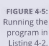

你的账户中有 $1000050.22。

在列表 4-2 中，查看主方法体中的第一行：

```java
double amountInAccount;
```

这一行是一个变量声明。将这一行放入程序中，就像是在说：“我正打算在我的程序中声明一个名为 amountInAccount 的变量。”这一行你的程序预留了 `amountInAccount` 这个名称，以供程序使用。

在变量声明中，`double` 单词是 Java 关键字。这个 `double` 单词告诉计算机你打算在 `amountInAccount` 中存储什么类型的值。具体来说，`double` 代表的是介于 $-1.8 \times 10^{38}$ 和 $1.8 \times 10^{38}$ 之间的数字。（这些是小数点前有 308 个零的巨大数字）。世界上最富有的人所拥有的数字里面有 308 个零。这两个数字中的第二个是 1.8 gazazzo-zillion——这是一个由国际计量衡局定义的常量，代表了从加利福尼亚州阳光维尔（Sunnyvale）到 M31 仙女座星系之间古怪计算机程序员的数量。

除了该关键字数字的巨大范围外，另一个事实是，`double` 值可以带有小数点之外的数字。在你声明 `amountInAccount` 为 `double` 类型后，你可以在 `amountInAccount` 中存储各种类型的数字。你可以存储 $50.22$、$0.02398479$ 或 $-3.0$。在列表 4-2 中，如果我没有声明 `amountInAccount` 为 `double` 类型，我可能无法存储 $50.22$。相反，我将不得不存储纯整数 $50$，而丢失了小数点后的数字。

另一种类型——`float`——也允许你有小数点之外的数字。但 `float` 值没有 `double` 值那么精确。

在很多情况下，你有选择。你可以将某些值声明为 `float` 值或 `double` 值。但不要纠结于 `float` 和 `double` 之间的选择。对于大多数程序，直接使用 `double` 即可。凭借如今先进的处理器，你使用 `float` 类型所节省的空间永远不值得以损失精度为代价。（详情，请参见旁边的侧栏，“跨越小数点及以后！”）


列表 4-2 中那个巨大的百万美元大奖金令人印象深刻。列表 4-2 并没有说明处理美元金额的最佳方法。在 Java 程序中，表示货币的最佳方法是避开 `double` 和 `float` 类型，转而选择一种名为 `BigDecimal` 的类型。更多信息，请访问本书的网站（`http://JavaForDummies.allmycode.com`）。

#### 第 2 部分 编写自己的 Java 程序

#### 跨越小数点及以后！

Java 有两种带有小数点之外数字的不同类型：`double` 类型和 `float` 类型。那么，区别在哪里呢？当你声明一个变量为 `double` 类型时，你是在告诉计算机在存储变量值时跟踪 64 位。当你声明一个变量为 `float` 类型时，计算机仅跟踪 32 位。

你可以修改列表 4-2 将 `amountInAccount` 声明为 `float` 类型：

```java
float amountInAccount;
```

毫无疑问，位数足够存储像 50.22 这样的小数字了，对吧？嗯，既够也不够。你可以轻松地只用 32 位存储 50.00。嘿，你甚至只用 6 位就能存储 50.00。数字的大小并不重要，精确性才重要。在 64 位的 `double` 中，为了存储小数点后的 22，你使用了 32 位。

你相信你刚才读到的吗？存储 22 需要超过 32 位吗？为了说服你，我在列表 4-2 中做了些改动，让 `amountInAccount` 变为 `float` 类型。我在主方法中修改了三条语句：

```java
float amountInAccount;
amountInAccount = 50.22F;
amountInAccount = amountInAccount + 1000000.00F;
```

（了解为什么我使用了 F，请参见本章后面的表 4-1）

### 显示值

列表 4-2 有两个 `System.out.print` 语句和一个 `System.out.println` 语句。将这三个都改为 `System.out.println` 语句，然后运行程序。

列表 4-2 的输出显示了一行文本。利用 `amountInAccount` 变量，为程序添加语句显示第二行文本。让第二行文本为“现在你有更多了！你有 2000000。”

### 格式实验

- 在代码中的数字 1000000.00 中添加分隔符。例如，如果你在美国，逗号是千位分隔符，请将数字改为 1,000,000.00 看看会发生什么。（提示：没好事。）

- 尝试在代码中使用下划线作为千位分隔符。即 1_000_000.00，看看会发生什么。

### 没有小数点的数字

“1995 年，平均每个家庭有 2.3 个孩子。”

在这个这一点上，一个聪明人总是会评论说，没有任何真实的家庭恰有 2.3 个孩子。显然，整数在这个世界上有一席之地。因此，在 Java 中，你可以声明一个只存储整数的变量。列表 4-3 显示了一个使用整数变量的程序。

#### 列表 4-3 使用 int 类型


```java
public class ElevatorLifter {
    public static void main(String[] args) {
        int weightOfAPerson;
        int elevatorWeightLimit;
        int numberOfPeople;

        weightOfAPerson = 150;
        elevatorWeightLimit = 1400;
        numberOfPeople = elevatorWeightLimit / weightOfAPerson;

        System.out.print("You can fit ");
        System.out.print(numberOfPeople);
        System.out.println(" people on the elevator.");
    }
}
```

代码 4-3 程序背后的故事需要一些复杂的解释。如下：

你有一部承重能力为 1400 磅的电梯。一个周末，主人举办了一场家族聚会。某个家族有很多完全相同的胞胎（十个兄弟，身体特征相同）。通常情况下，每个兄弟重 145 磅。但由于周六家里吃了一顿丰盛的午餐，因为午餐包含了草莓奶昔，每个兄弟现在重了 150 磅。午餐后，十个兄弟同时到达电梯。（为什么不呢？他们想得一样。）所以，问题是，电梯能容纳多少个兄弟？

记住，如果你在电梯里放入超过 1400 磅的重量，电梯钢绳就会断裂，导致电梯里的所有兄弟突然（惨惨）死亡。

家族谜题的答案（代码 4-3 程序的输出）如图 4-6 所示。

图 4-6：

拯救兄弟。

> 电梯可以容纳 9 个人。

在家族电梯问题的核心，你面对的是整数——即小数点后没有数字的数字。当你用 1400 除以 150 时，你得到 9 又 1/3，但你不应该认真对待 1/3。无论你如何尝试，你都无法向电梯里挤进额外的 50 磅重量。这个事实在 Java 中得到了很好的反映。在代码 4-3 中，三个变量（`weightOfAPerson`、`elevatorWeightLimit` 和 `numberOfPeople`）都是 `int` 类型。`int` 值是一个整数。当你用一个 `int` 值除以另一个（如你在代码 4-3 中使用斜杠所做），你会得到另一个 `int`。当你用 1400 除以 150 时，你得到 9，而不是 9 又 1/3。你在图 4-6 中可以看到这一点。合在一起，以下语句在屏幕上显示 9：

```
numberOfPeople = elevatorWeightLimit / weightOfAPerson;

System.out.print(numberOfPeople);
```

## 第二部分 写你自己的 Java 程序

我和妻子在 2 月 29 日结婚，所以我们每四年有一个周年纪念。写一个名为 `years` 变量的程序。根据 `years` 变量的值，程序显示我们度过的周年纪念次数。例如，如果 `years` 的值为 4，程序显示“周年纪念：1”。如果 `years` 的值为 7，程序仍然显示“周年纪念：1”。但如果 `years` 的值为 8，程序显示“周年纪念：2”。

# 合并声明与初始化变量

回顾代码 4-3。在该列表中，你看到了三个变量声明——对应程序中的三个 `int` 变量。我本可以用一个声明做到同样：

```
int weightOfAPerson, elevatorWeightLimit, numberOfPeople;
```

如果两个变量的类型完全不同，你不能在同一个声明中创建这两个变量。例如，要创建一个名为 `weightOffFred` 的 `int` 变量和一个名为 `amountInFredAccount` 的 `double` 变量，你需要两个独立的变量：

你可以在声明中为变量提供初始值。例如在代码 4-3 中，一个声明可以替换 `main` 方法中的几行代码（所有对 `print` 和 `println` 的调用）：

```
int weightOfAPerson = 150, elevatorWeightLimit = 1400,
numberPeople = elevatorWeightLimit/weightOfAPerson;
```

# 存储整数的四种方法

Java 有四种整数类型。这些分别是 `byte`、`short`、`int` 和 `long`。与 `float` 和 `double` 类型精度的复杂故事不同，在选择整数类型时，唯一重要的是你尝试存储的数字的大小。如果你想使用大于 127 的数字，不要使用 `byte`。要存储大于 32767 的数字，不要使用 `short`。

大多数情况下你会使用 `int`。但如果你需要存储大于 2147483647 的数字，请放弃 `int` 而选择 `long`。（一个 `long` 数字可以大到 9223372036854775807。）有关完整内容，请参见本章稍前的表 4-1。

当你这样做时，你并不是说你正在给变量赋值。声明中带有等号的部分并不真正被称为赋值语句。相反，你是说你正在初始化变量。信不信由，记住这个区别是有帮助的。

例如，当在程序的 `main` 方法内部初始化变量时，你不需要指定新变量的类型。你可以像代码 4-2 这样开始：

```java
public class Millionaire {

    public static void main(String[] args) {
        var amountInAccount = 0.0;
    }
}
```

启动 JShell 的指令在不同电脑不同。

（实际上，让我们看看 OCR 的最后部分）。

[第 83 页]

启动 JShell 的指令从一台电脑到另一台电脑不同。要在你电脑上有效的指令，请访问本书的网站（http://JavaForDummies.allmycode.com）。

当你使用 JShell 时，你很少输入整个程序。相反，你输入一条 Java 语句，然后 JShell 响应你的语句，然后你输入第二个语句，然后 JShell 再次响应你的语句，以此类推。单条语句就足以从 JShell 获得响应。

有些人调整了 JShell，使其行为与我在书中描述的略有不同。如果你运行 IntelliJ IDEA 的 JShell 控制台或其他 JShell 变体，请确保检查供应商的文档。

在图 4-7 中，我使用 JShell 来发现 Java 如何响应代码 4-2 和 4-3 中的赋值语句。

```
jshell> double amountInAccount
amountInAccount ==> 0.0

jshell> amountInAccount = 50.22
amountInAccount ==> 50.22

jshell> amountInAccount = amountInAccount + 1000000.00
amountInAccount ==> 1000050.22

jshell> int weightOFAPerson, elevatorWeightLimit
weightOFAPerson ==> 0
elevatorWeightLimit ==> 0

jshell> weightOFAPerson = 150
weightOFAPerson ==> 150

jshell> elevatorWeightLimit = 1400
elevatorWeightLimit ==> 1400

jshell> elevatorWeightLimit / weightOFAPerson
$1 ==> 9

jshell> $1 = 8 + 1
$2 ==> 10

jshell> $2 = 42 + 7
$3 ==> 49
```

当你运行 JShell 时，对话过程大致如下：

```
jshell> 你输入一条语句
JShell 响应
jshell> 你输入另一个语句
JShell 响应
```

例如，在图 4-7 中，我输入了 `double amountInAccount` 然后按了回车。

JShell 响应并显示了：

```
amountInAccount ==> 0.0
```

关于 JShell，有几点需要注意：

- **你不需要输入整个 Java 程序。**

  只需要输入几条语句，例如：

```
double amountInAccount
amountInAccount = 50.22
amountInAccount = amountInAccount + 1000000.0
```

这样就能达到效果。这就像运行列表 4-1 中的代码片段一样（不同之处列表 4-1 没有将 amountInAccount 声明为 double）。

- **在 JShell 中，分号（在很大程度上）是可选的。**

  在图 4-7 中，我在这九行代码中只有有一行的末尾输入了分号。

  关于在 JShell 中使用分号的建议，请参阅第 5 章。

- **在你每输入一行代码后，JShell 都会立即响应。**

  在我将 amountInAccount 声明为 double 后，JShell 响应并告诉我值为 0。在我输入

  `amountInAccount = amountInAccount + 1000000.0` 后，JShell 告诉

  amountInAccount 的新值为 1000050.22。

- **你可以混合来自许多不同 Java 程序的语句。**

  在图 4-7 中，我混合了来自列表 4-2 和 4-3 程序的语句。

  JShell 并不在乎。

- **你可以询问 JShell 表达式的值。**

  你不需要将表达式的值赋值给变量。例如，在在图 4-7 中，我输入了：

```
elevatorWeightLimit / weightOfPerson
```

JShell 响应并告诉我 `elevatorWeightLimit / weightOfPerson` 的值为 9。JShell 为该值创建了一个临时名称。在图 4-7 中，这个名字恰好是 `$1`。因此，在图 4-7 的下一行，我询问了 `$1 + 1` 的值，JShell 给了我答案 10。

- **你可以不使用变量直接从 JShell 获取答案。**

  在图 4-7 的最后一行，我询问了 `42 + 7` 的值，JShell 通用地回答结果为 49。

当你运行 JShell 时，不需要重新输入已经输入过的命令。你甚至不需要复制粘贴命令。如果你按一次向上箭头键，JShell 会向你显示你最近输入的命令。如果你按两次向上箭头键，JShell 会向你显示上上一次输入的命令。以此类推。当 JShell 显示命令时，你可以按左键和右箭头键移动到命令中间的任何字符。你可以修改命令中的字符。最后，当你按下回车键时，JShell 会执行新修改的命令。

在运行 JShell 期间，输入 `/exit`（以斜杠开头）。但 `/exit` 是你可以提供给 JShell 的许多命令之一。询问 JShell 还可以使用哪些类型的命令，输入 `/help`。

通过 JShell，你可以在将语句放入完整的 Java 程序之前对其进行测试。这使得 JShell 成为一个非常有用的工具。

# JSHELL 游戏

访问本书的网站（http://JavaForDummies.allmycode.com）获取如何在电脑上启动 JShell 的说明。启动 JShell 后，输入图 4-7 中的几行代码。看看输入不同的行时会发生什么。

# 那些酷的视觉效果都去哪了？

列表 4-2 和 4-3 中的程序是基于文本的。文本程序没有窗口、没有对话框——任何此类内容。你看到的只是行接行的、未格式化的纯文本。用户输入某些内容，计算机在每行输入下方显示响应。

文本程序的对立面是图形用户界面（GUI）程序。GUI 程序拥有窗口、文本字段、按钮和其他视觉点缀。

尽管文本程序在视觉上不刺激，但它们包含了所有计算机编程的基本概念。此外，对于初级程序员来说，文本程序比相应的 GUI 程序更容易阅读、编写和理解。因此，在本书中我采取了三管齐下的方法：

- **文本示例：** 我通过这些示例引入了大多数新概念。

- **DummiesFrame 类：** 在介绍文本示例的同时，我展示了使用 DummiesFrame 类的 GUI 版本，该类是我专门为本书创建的。（我在第 7 章中介绍 DummiesFrame 类）。

- **GUI 编程技术：**

# 原子：基本类型

那些不可忽略的类型有 `int`、`double`、`char` 和 `boolean`。在之前的章节中，我描述了基本类型。表 4-1 显示了完整的列表。

| 类型名称 | 看起来像 | 范围 |
| :--- | :--- | :--- |
| 整数类型 | byte | -128 到 127 |
| | short | -32768 到 32767 |
| | int | -2147483648 到 2147483647 |
| | long | -9223372036854775808 到 9223372036854775807 |
| 小数类型 | float | -3.4 x 10³⁸ 到 3.4 x 10³⁸ |
| | double | -1.8 x 10³⁰⁸ 到 1.8 x 10³⁰⁸ |
| 字符类型 | char | 'A' |
| 逻辑类型 | boolean | true, false |

用于存储字符的 Java 类型称为 `char`。列表 4-4 是一个使用 `char` 的简单程序。

# 列表 4-4：使用 char

```java
public class CharDemo {
    public static void main(String[] args) {
        char myLittleChar = 'b';
        char myBigChar = Character.toUpperCase(myLittleChar);
        System.out.println(myBigChar);
    }
}
```

在列表 4-4 中，第一次初始化将 `b` 存储在 `myLittleChar` 中。在初始化时，注意 `b` 被单引号包围。在 Java 中，每个 `char` 字面量都以单引号开始并结束。

如果你需要关于术语、声明和初始化的帮助，请参见本章前面的“变量的组合与初始化”。

在第二次初始化中，程序调用了一个名为 `Character.toUpperCase()` 的 API 方法。`Character.toUpperCase()` 方法正如其名所示，产生字母 `b` 大写形式。这个大写字母被赋值给变量 `myBigChar`，存储在 `myBigChar` 中的 `B` 显示在屏幕上。

如果使用某种方法在屏幕上写 Hello 却显示 He Hello，请检查方法文档中关于 Unicode 字符的说明。

值得注意的是，在列表 4-4 中，`Character.toUpperCase()` 和 `System.out.println()` 这两个方法的用法完全不同。`Character.toUpperCase()` 方法作为初始化或赋值语句的一部分被调用，而 `System.out.println()` 方法是独立调用的。要了解有关此主题的更多信息，请参见第 7 章对返回值的解释。

## boolean 类型

`boolean` 类型的变量存储两个值之一：`true` 或 `false`。列表 4-5 展示了 `boolean` 变量的使用。图 4-9 显示了列表 4-5 中程序的输出。

- 列表 4-5：使用 boolean 类型


```java
public class ElevatorFitter {

    public static void main(String[] args) {
        System.out.println("True or False?");
        System.out.println("You can fit all ten of the");
        System.out.println("Brickenchicker dectuplets");
        System.out.println("on the elevator:");
        System.out.println();

        int weightOfAPerson = 150;
        int elevatorWeightLimit = 1400;
        int numberOfPeople = elevatorWeightLimit / weightOfAPerson;

        boolean allTenOkay = numberOfPeople >= 10;

        System.out.println(allTenOkay);
    }

}
```

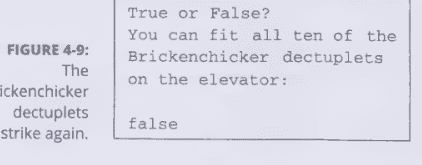

在列表 4-5 中，`allTenOkay` 变量是 `boolean` 类型。为了给 `allTenOkay` 变量赋值，程序会检查 `numberOfPeople` 是否大于或等于十。（符号 `>=` 表示大于或等于）。

在此时，在术语上保持严谨是有意义的。Java 程序中任何具有值的部分都是**表达式**。如果你编写：

```
weightOfAPerson = 150;
```

那么 `150` 就是一个表达式（其值为数值 150 的表达式）。如果你编写：

```
numberOfEggs = 2 + 2;
```

那么 `2 + 2` 就是一个表达式（因为 `2 + 2` 的值为 4）。如果你编写：

```
int numberOfOfPeople = elevatorLimit / weightOfAPerson;
```

那么 `elevatorLimit / weightOfAPerson` 就是一个表达式。（表达式 `elevatorLimit / weightOfAPerson` 的值取决于执行包含该表达式的代码时变量 `elevatorLimit` 和 `weightOfAPerson` 所拥有的值。）

Java 程序中任何具有值的部分都是表达式。


在列表 4-5 中，代码 `numberOfPeople >= 10` 是一个表达式。该表达式的值取决于 `numberOfPeople` 变量存储的值。但正如你从 Brickchenicker 家族的午餐中看到的草莓奶昔的那样，`numberOfPeople >= 10` 的值为 `false`。因此，在列表 4-5 为 `allTenOkay` 赋值的语句中，`allTenOkay` 变量被赋予了 `false` 值。

在列表 4-5 中，我调用了括号内为空的 `System.out.println()`。当你这样做时，Java 会向程序的输出添加一个换行符。在列表 4-5 中，`System.out.println()` 告诉程序显示空行。


## 第 4 章 充分利用变量及其值

### 分子与化合物：引用类型

通过组合简单的元素，你可以得到更复杂的元素。事物总是这样发展的。取一些 Java 的基本类型，将它们混合在一起制成“基本类型汤”，你会得到一种名为**引用类型**的更复杂的类型。

列表 4-6 使用了引用类型。图 10 显示了运行列表 4-6 时程序发生的情况。

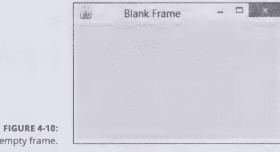

### 列表 4-6：使用引用类型

```java
import javax.swing.JFrame;

public class ShowAFrame {

    public static void main(String[] args) {
        JFrame myFrame = new JFrame();
        String myTitle = "Blank Frame";

        myFrame.setTitle(myTitle);
        myFrame.setSize(300, 200);
        myFrame.setDefaultCloseOperation(JFrame.EXIT_ON_CLOSE);
        myFrame.setVisible(true);
    }
}
```

列表 4-6 使用了两种引用类型。这两个类型都定义在 Java API 中。一种类型（你经常使用的类型）被称为 `String`。另一种类型（你用于创建 GUI 的类型）被称为 `JFrame`。

`String` 是一组字符。它就像是一排多个 `char` 值。因此，将 `myTitle` 变量声明为 `String` 类型，就像是排了多个 `char` 值。

# 尝试这些实验：

## 运行两次

- 在你的计算机上运行列表 4-6 中的代码。

- 再次运行列表 4-6 中的代码。但在运行代码之前，通过在 `myFrame.setVisible(true)` 语句的左侧插入两个正斜杠（`//`）来注释掉该语句。运行修改后的代码时，会发生什么吗？

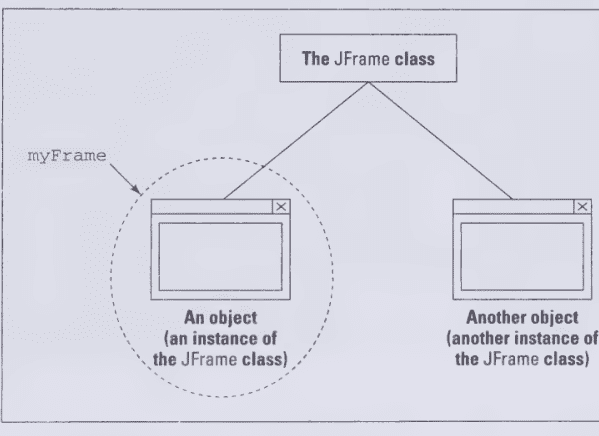

图 4-11：变量 `myFrame` 指向 `JFrame` 类的一个实例。

## 随机播放

通过改变 `main` 方法体内语句的顺序，对列表 4-6 中的代码进行实验。这些语句的哪些排列是可以行的，哪些是不行的？

## 基本类型大杂

既然提到了框架（frames），框架到底是什么呢？框架（frame）是一个具有特定高度、宽度以及在计算机屏幕上特定位置的窗口。因此，在 `Frame` 类类声明的深处，你可以找到类似这样的变量声明：

```
int width;
int height;
int x;
int y;
```

这是另一个例子：时间（Time）。`Time` 类的一个实例可能有一个小时（1 到 12 之间的数字）、几分钟（0 到 59）和一个字母（`a` 代表 A.M.；`p` 代表 P.M.）。

```
int hour;
int minutes;
char amOrPm;
```

注意，这个名为 Java API 类的高大大物既并不高大也不强大。一个类只是声明的集合。这些声明中的某些是变量的声明。某些变量声明使用基本类型（primitive types），而另一些变量声明使用引用类型（reference types）。然而，这些引用类型来自其他类，而那些类的声明中包含了变量。这个链条不断延伸。最终，一切都以一种或其他方式源自基本类型。

## 导入声明

提前宣布你的意图总是好的。考虑以下课堂演讲：

> 今天，在我们的电影史课程中，我们将讨论演员莱昂尔·赫尔伯特·布莱德·巴里莫尔（Lionel Herbert Blythe Barrymore）的职业生涯。
>
> 出生于费城

有趣的内容，吧？现在将这些段落与一个老师没有以介绍主题为开始的演讲进行对比：

再次欢迎来到电影史。

出生于费城

如果没有适当的介绍，演讲者可能需要反复提醒你，讨论关于莱昂尔·巴里莫尔（Lionel Barrymore），而不是任何其他巴里莫尔。在 Java 程序中也是如此。再次查看列表 4-6：

```
import javax.swing.JFrame;

public class ShowFrame {

    public static void main(String[] args) {
        JFrame myFrame = new JFrame();
```

在列表 4-6 中，你正处于介绍部分（在导入声明中），说明你正在你的 Java 类中使用 `JFrame`。你通过全名 `javax.swing.JFrame` 澄清了你所 `JFrame` 的含义。（嘿！）第一位讲师不是也用全名“莱昂尔·赫尔伯特·布莱德·巴里莫尔”进行了澄清吗？在导入声明中宣布你的意图后，你可以在 Java 代码中使用缩写名 `JFrame`。

如果你不使用导入声明，每当你在代码中使用 `JFrame` 名字时，都必须重复完整的 `javax.swing.JFrame`。例如，列表 4-6 的代码看起来像这样：

```java
public class ShowFrame {

    public static void main(String[] args) {
        javax.swing.JFrame myFrame = new javax.swing.JFrame();
        String myTitle = "Blank Frame";

        myFrame.setTitle(myTitle);
        myFrame.setSize(320, 200);
        myFrame.setDefaultCloseOperation(javax.swing.JFrame.EXIT_ON_CLOSE);
        myFrame.setVisible(true);
    }
}
```

第 4 章 充分利用变量及其值 83

这些导入内容的细节可能非常糟糕。但幸运的是，许多 IDE 都为导入声明提供了方便的辅助功能。在你选择的 IDE 中，寻找如“Code: Optimize Imports”（优化导入）或“Source: Organize Imports”（组织导入）之类的菜单。

书中的任何章节都无法介绍关于导入声明的所有故事。要开始理清导入声明的一些细微之处，请参见侧边栏“导入声明（Import declarations:）”。

列表 4-7 中的代码使用以下硬币面额进行美元找零：1 分、5 分（镍美分）、10 分（一角美分）和 25 分（一个四分之一美币）。通过这些面额，`MakeChange` 类提供的不仅仅是一组加起来等于 24.8 分的硬币。通过一些微调，你可以让代码适用于任何国家的货币体系。你总是可以获得一组总和为某个金额的硬币。但对于某些类型的硬币，你并不总是获得组成总金额数量最少的硬币。例如，在 20 世纪 70 年代中期，英国面值为 25p、20p、10p 和 5p 的硬币，像列表 4-7 那样的程序会建议 25p + 10p + 5p。但你可以通过支付 20p + 20p 使用更少的硬币。

## 丝滑操作

通过在 JShell 中输入每个表达式，找到以下表达式的值：

- `5 / 4`

- `5 / 4.0`

- `5.0 / 4`

- `5.0 / 4.0`

- `"5" + "4"`

- `5 + 4`

- `"" + 5 + 4`

## 初始化一次，频繁赋值

列表 4-7 有三行将值放入变量 `whatsLeft`：

```java
int whatsLeft = total % 25;
whatsLeft = whatsLeft % 10;
whatsLeft = whatsLeft % 5;
```

这三行中只有一行是声明。另外两行是赋值语句。这很好，因为你不能重复声明同一个变量（除非创建一个所谓的块的东西）。如果你不小心写了：

```java
int whatsLeft = total % 25;
whatsLeft = whatsLeft % 10;
```

## 导入声明：残酷的真相

注意列表 4-7 顶部的导入声明：

```java
import static java.lang.System.out;
```

将其与列表 4-6 顶部的导入声明进行比较：

```java
import javax.swing.JFrame;
```

通过向列表 4-7 添加 `import static java.lang.System.out;` 这一行，我可以让剩余代码变得更容易易读，并且可以避免长长的 Java 语句在一行开始并在另一行继续。但你永远没必要这样做。如果你删除 `import static java.lang.System.out;` 这一行，并在代码中到处散布 `System.out.println;`，代码依然运行良好。

这里有一个问题：为什么其中一个声明包含了 `static` 单词，而另一个声明没有？老实说，我希望我没那么做。

关于 `static` 的真实故事，你必须阅读第 10 章的部分内容。坦率地说，如果你正在服用心脏病药物、处于怀孕或哺乳期，或者你没有以前的面向对象编程经验，我不建议你直接跳读到该章节的 `static` 部分。现在请放心，你已经完成了通过此书第三部分的旅程。当你需要决定是否在导入声明中使用 `static` 单词时，请记住这些提示：

- Java 程序中的绝大多数导入声明都不使用 `static` 单词。

- 在本书中，我从不使用 `import static` 导入 `System.out` 以外的任何东西。（嗯，几乎从不……）

- 大多数导入声明不使用 `static` 单词，因为大多数声明导入的是类。遗憾的是，`System.out` 并不是类的名。

在列表 4-7 中，当你尝试编译代码时，你会看到错误信息（例如 Duplicate variable whatsLeft 或 Variable 'whatsLeft' is already defined）。

要了解什么是块（block），请参见第 5 章。然后，关于重新声明变量的坦诚对话，请参见第 10 章。


88 第 2 部分 编写自己的 Java 程序

## 递增和递减运算符

Java 有一些巧妙的小运算符，可以让生活变得更容易（对于计算机处理器、你的大脑以及你的手指来说都是）。总共有四种这样的运算符：两个递增运算符和两个递减运算符。递增运算符加 1，递减运算符减 1。递增运算符使用双加号 (`++`)，递减运算符使用双减号 (`--`)。要查看它们如何工作，你需要一些示例。第一个示例如图 4-13 所示。

```java
import static java.lang.System.out;
public class preIncrementDemo {
    public static void main(String args[]) {
        int numberOfBunnies = 27;
```

图 4-13：使用预递增。

| numberOfBunnies 变为 28。 |

| :--- |

| 打印 28。 |

| numberOfBunnies 变为 29，并打印 29。 |

| 再次打印 29。 |

```java
++numberOfBunnies;
out.println(numberOfBunnies);
out.println(++numberOfBunnies);
out.println(numberOfBunnies);
    }
}
```

图 4-14 显示了图 4-13 中程序的运行情况。在这个极其不均匀运行中，兔子的计数打印了三次。

| 28 |

| 29 |

| 29 |

图 4-14：图 4-13 程序的运行。

双加号 (`++`) 根据你放置的位置有两种名称。当你把 `++` 放在变量之前时，它被称为预递增（preincrement）。

要查看它们如何工作，请看图 4-13。在这个极其不均匀运行中，兔子的计数打印了三次。

| 28 |

| 29 |

| 29 |

要理解后递增，请看图 4-13。在这个极其不均匀运行中，兔子的计数打印了三次。

| 28 |

| 29 |

| 29 |

当你把 `++` 放在变量之后时，它被称为后递增（postincrement）。（pre 代表后。）

- 在 14 中预递增的第二个数字是 29。

- 在 16 中后递增的第二个数字是 28。

图 4-15：使用后递增。

图 4-16 显示了图 4-15 中程序的运行情况。在这个极其不均匀运行中，兔子的计数打印了三次。

## 语句和表达式

你可以用两种方式描述预递增、后递增以及预递减、后递减运算符：每个人理解的方式和正确的方式。我在本节中为了解释概念而采用的方式（基于时间，带有之前和之后）是每个人理解的方式。遗憾的是，每个人理解概念的方式并不是正确的方式。当你看到 `++` 或 `--` 时，你可以按照顺序思考，但有时程序员会以复杂的方式使用，这时之前和之后的概念就会失效。

记住，语句告诉计算机执行操作，而表达式有一个值。（我在第 3 章讨论了语句，在本章的其他地方描述了表达式。）`numberOfBunnies++` 属于哪类？Java 代码 `numberOfBunnies++` 既是语句也是表达式。

假设在计算机执行 `out.println(numberOfBunnies)` 之前，`numberOfBunnies` 的值为 28：

- 作为语句，`numberOfBunnies++` 计算机给 `numberOfBunnies` 加 1。

- 作为表达式，`numberOfBunnies++` 的值是 28，而不是 29。

（续）

所以，尽管计算机给 `numberOfBunnies` 加上了 1，但代码 `out.println(numberOfBunnies++)` 实际上意味着 `out.println(28)`。

现在，你刚才读到的关于 `numberOfBunnies++` 的几乎所有内容都适用于 `++numberOfBunnies`。唯一的区别在于，作为一个表达式，`++numberOfBunnies` 的行为更符合直觉。

- 作为一个语句，`++numberOfBunnies` 告诉计算机给 `numberOfBunnies` 加上 1。


- 作为一个表达式，`++numberOfBunnies` 的值是 29。

因此，通过 `out.println(++numberOfBunnies)`，计算机给变量 `numberOfBunnies` 加上了 1，而代码 `out.println(++numberOfBunnies)` 实际上意味着 `out.println(29)`。


与其使用 `++numberOfBunnies`，你通过编写 `numberOfBunnies = numberOfBunnies + 1` 来达到相同的效果。因此，有些人得出 Java 的 `++` 和 `--` 运算符是为了节省击键次数——为了不让那些可怜的手指过度工作。这完全是错误的。使用 `++` 的最佳理由是避免那种低效且易出错的做法，即在同一个语句中写两次相同的变量名（例如 `numberOfBunnies`）。如果你只写一次 `numberOfBunnies`（就像你执行 `++` 或 `--` 时那样），计算机只需要弄清一次 `numberOfBunnies`，你也只有一次机会（而不是两次机会）把变量名打错。不过对于像 `numberOfBunnies++` 这样简单的表达式，这些优势几乎没有什么影响。但对于更复杂的表达式，例如 `inventoryItems[(QuantityReceived--*itemsPerBox[17]]`，使用 `++` 和 `--` 带来的效率和准确性是显著的。

## 预测游戏

在运行以下代码之前，尝试预测一下代码的输出将会是什么。然后运行代码以发现你的预测是否正确：

```java
public static void main(String[] args) {
    int i = 10;
    System.out.println(i++);
    System.out.println(--i);
}
```

```java
i--;
i--;
System.out.println(i);
System.out.println(++i);
System.out.println(i--);
System.out.println(i);
i++;
i = i++ ++i;
System.out.println(i);
i = i++ + i;
System.out.println(i)
```

## 查看加加操作

将加粗的文本逐行输入 JShell，并看看 JShell 是如何响应的。

```
int i = 8
i++
i
i
++
ni
++i
i + i++
i++ + i
```

## 赋值运算符

如果你读了上一节关于加 1 运算符的内容，你可能在想，是否可以操纵这些运算符来加 2、加 5 或加 1000000。你可以写 `numberOfBunnies++++` 并且仍然自称自己是一个 Java 程序员。额吧，你不能。如果你尝试这样做，当你尝试编译代码时，会出现一条错误信息。

你能做什么呢？幸运的是，Java 有许多你可以使用的赋值运算符。使用赋值运算符，你可以对任何你想要的数字进行加、减、乘、除操作。你还可以做一些酷炫的操作。列表 4-8 列出了各种赋值运算符（带有等号的那些）。图 4-17 显示了运行列表 4-8 的输出。

## 赋值运算符

图 4-17：列表 4-8 中代码的运行。

列表 4-8：

```java
public class UseAssignmentOperators {

    public static void main(String[] args) {
        int numberOfBunnies = 27;
        int numberExtra = 53;

        numberOfBunnies += 1;
        System.out.println(numberOfBunnies);

        numberOfBunnies += 5;
        System.out.println(numberOfBunnies);

        numberOfBunnies += numberExtra;
        System.out.println(numberOfBunnies);

        numberOfBunnies *= 2;
        System.out.println(numberOfBunnies);

        System.out.println(numberOfBunnies -= 7);

        System.out.println(numberOfBunnies = 100);
    }
}
```

列表 4-8 显示了 Java 赋值运算符是多么强大。通过赋值运算符，你可以对变量进行任何数字的加、减、乘、除。注意 `+= 5` 是如何给 `numberOfBunnies` 加上 5，而 `*= 2` 是将 `numberOfBunnies` 乘以 2。你甚至可以使用另一个表达式的值（在列表 4-8 中为 `numberExtra`）作为数字。列表 4-8 的最后两行演示了 Java 赋值运算符的一个特性。你可以将赋值运算符作为较大语句的一部分。在列表 4-8 的倒数第二行，运算符从 `numberOfBunnies` 中减去 7，将 `numberOfBunnies` 的值从 172 减到 165。然后整个赋值操作被塞入 `System.out.println` 调用中，屏幕上打印出 165。

看，列表 4-8 的最后一行显示了你如何使用 Java 的普通等号来做同样的事情。

```java
} else {
    out.println("You lose.");
    out.println("The random number was " + ");
    out.println(randomNumber + ".");
}

out.println("Thank you for playing.");

keyboard.close();
```

列表 5-1 中的程序与用户玩了一个猜数字游戏。程序从用户处获取一个数字（一个猜测），然后生成一个 1 到 10 之间的随机数。如果用户输入的数字与随机数相同，用户获胜。否则，用户输了，程序会告诉用户随机数是多少。

| 输入一个 1 到 10 之间的整数: 2 |
| :--- |
| ************ |
| *你赢了。* |
| ************ |
| 感谢参与。 |
| 输入一个 1 到 10 之间的整数: 4 |
| 你输了。 |
| 随机数是 10。 |
| 感谢参与。 |

图 5-1：猜数字游戏的运行情况。

# 她控制了来自键盘的按键

结合来看，以下几行

```java
import java.util.Scanner;

Scanner keyboard = new Scanner(System.in);

int inputNumber = keyboard.nextInt();
```

在列表 5-1 中获取用户在计算机键盘上输入的任何数字。这三行中的最后一行将此数字放入一个名为 `inputNumber` 的变量中。如果这些行看起来很复杂，不用担心：当你想要从键盘读取内容时，几乎可以逐字不动地复制这些行。在你的程序中只需包含这两行（`import` 和 `Scanner` 行）一次。在程序的后续，每当用户输入一个 int 值的地方时，就包含一行调用 `nextInt()` 的代码（如上述三行代码的最后一行所示）。

在这三行代码的所有名称中，只有两个是我命名的名称：`inputNumber` 和 `keyboard`。其他所有名称都是 Java 的一部分。所以，如果我想发挥一下创意，我会这样写这几行：

```java
import java.util.Scanner;
Scanner readingThingle = new Scanner(System.in);
int valueTypedIn = readingThingle.nextInt();
```

我也可以加强我程序的导入声明，正如我在稍后的列表 5-2 和 5-3 中做的那样。除此之外，我没有多少回旋地。

当你阅读这本书时，你将开始识别这三行代码背后的模式，因此我不会在这个节中堆砌所有的细节。现在，你只需要复制这三行，并记住以下指南：

- 当你导入 `java.util.Scanner` 时，你不需要使用 `static` 单词。

- 但导入 `Scanner` 与导入 `System.out.` 不同。当你导入 `Java.lang.System.out` 时，你需要使用 `static` 单词。（参考列表 5-1。）差异之所以出现在代码中，是因为 `Scanner` 是一个类，而 `System.out` 不是一个类的名称。

要快速查看导入声明中 `static` 单词的使用，请参阅第 4 章关于导入声明的侧边栏：丑的真相。关于该单词的更完整故事，请参阅第 10 章。

- 通常（在台式机或笔记本电脑上），`System.in` 代表键盘。

要从键盘以外的地方获取字符，你可以在括号内输入 `System.in`以外的内容。

在 `Scanner(...)` 括号内还可以放什么？某些想法，请参阅第 8 章。

在列表 5-1 中，我主观地决定给我的一个变量命名为 `keyboard`。`keyboard` 这个名字提醒读者，这个变量指的是你电脑前的一堆塑料按钮。将某个东西命名为 `keyboard` 并没有关于塑料按钮或用户输入的任何信息。另一方面，`System.in` 这个名称总是告诉 Java 关于那些塑料按钮。代码 `Scanner keyboard = new Scanner(System.in)`


100 第 2 部分 编写自己的 Java 程序

（列表 5-1 中的 `System.in` 将名称 `keyboard` 与我们都熟悉并喜爱的塑料按钮连接起来。

> >> 当你期望用户输入一个 int 值（某种整数）时，使用 `nextInt()`。

如果你期望用户输入一个 double 值（包含小数点的数字），用户接下来使用 `nextDouble()`。如果你期望用户输入 `true` 或 `false`，使用 `nextBoolean()`。如果你期望用户输入单词 Barry、Java 或 Hello，使用 `next()`。

小数点在不同国家之间有所不同。在美国，10.5（使用句号）代表十点五，但在法国（使用逗号），10,5 代表十点五。在瑞士，10.50 是一个金额，而不是与钱相关的数字。在波斯语中，数点看起来像一个斜杠（它比数字字符稍微低一点）。

你计算机的操作系统提供了关于你居住国家的信息，Java 会读取这些信息来决定显示什么内容。如果你运行一个包含 `nextDouble()` 调用的程序，且 Java 响应 `InputMismatchException`，请检查你的输入。你可能输入了 10.5，而你国家的习惯要求 10,5（或表示十点五的其他方式）。更多信息，请参阅侧边栏“你住在哪里？”。

> >> 当你期望用户输入一个 int 值（某种整数）时，使用 `nextInt()`。

如果你期望用户输入一个 double 值（包含小数点的数字），用户接下来使用 `nextDouble()`。如果你期望用户输入 `true` 或 `false`，使用 `nextBoolean()`。如果你期望用户输入单词 Barry、Java 或 Hello，使用 `next()`。

# 第 5 章 使用决策控制流程

## 创建随机性

在列表 5-1 中，代码 `new Random().nextInt(10)` 代表一个看起来随机生成的数字——一个 0 到 9 之间的整数。加上1之后，表达式 `new Random().nextInt(10) + 1` 是 1 到 10 之间的数字。

注意我在上一段中关于“看起来随机生成的数字”的谨慎用词。实现真正的随机性出奇地困难。数学家波西·迪亚尼斯说，如果你多次抛硬币并总是从正面朝上，你可能会抛出正面更多。如果你再抛几次并总是从反面朝上，你就会抛出反面更多。换句话说，抛硬币并不真的公平。

计算机并没有硬币和人类聪明得多。计算机模拟随机序列的生成，但最终计算机只是执行它被指令，而且这一切是以完全确定的方式完成的。所以，在列表 5-1 中，当计算机执行

> * Diaconis, Persi. "The Search for Randomness." American Association for the Advancement of Science annual meeting. Seattle. 14 Feb. 2004.

计算机似乎给出了一个随机生成的数字——一个 1 到 10 之间的整数。但这一切都是假象。计算机只是遵循指令。它并不是真正的随机，但在不费尽周折的情况下，这已经是任何人所能做的极致了。

我再次请求你盲目地测试这段代码。在拥有更丰富的 Java 经验之前，不要担心新的 `Random().nextInt()` 到底在做什么。你只需将这段代码复制到你自己的程序中并尽情尝试吧。而且，如果 1 到 10 之间的数字没有在你的预期范围内，也不要担心。要掷一个虚拟的骰子，请编写如下语句：

```
int rollEmBaby = new Random().nextInt(6) + 1;
```

执行这条语句后，变量 `rollEmBaby` 将得到一个 1 到 6 之间的值。

## if 语句

列表 5-1 的核心是一个 Java `if` 语句。这个语句代表了道路上的分叉口。（参见图 5-2。）计算机遵循两个分支中的一个：打印“你赢了”的分支或打印“你输了”的分支。计算机通过测试条件的真假来决定走哪一条。在列表 5-1 中，被测试的条件是

```
inputNumber == randomNumber
```

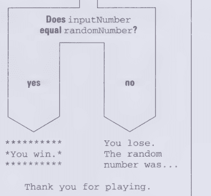

图 5-2：if 语句就像道路上的分叉口。

第 5 章 使用决策语句控制程序流 103

`inputNumber` 的值等于 `randomNumber` 的值吗？当条件为真时，计算机执行条件和 `else` 关键字之间的内容。当条件证明为假时，计算机执行 `else` 关键字之后的内容。无论哪种情况，计算机都会继续执行最后一个 `println` 调用，显示“感谢参与”。


if 语句中的条件必须包含在圆括号内。然而，像 `if (inputNumber == randomNumber)` 这样的行并不是一个完整的语句（就像“如果我有锤子”并不是一个完整的句子）。所以，这一行 `if (inputNumber == randomNumber)` 不应该以分号结尾。


有时，当我编写关于正在评估的条件时，我会习惯地用“表达式”（expression）一词代替“条件”（condition）。这没关系，因为每个条件都是表达式。表达式是有值的实体，确实，每个条件都有值。条件的值要么为真要么为假。（关于 true 和 false 等表达式和值的信息，请参见第 4 章。）

## 等号，等号

在列表 5-1 中，在 if 语句的条件中，注意了双等号的使用。比较两个数字以查看它们是否相同，与将其赋值为其他值不是一回事。用于比较相等性的符号与用于赋值或初始化的符号是不一样的。在 if 语句的条件中，你不能将双等号替换为单等号。如果你这样做了，你的程序将无法工作。（当你尝试编译代码时，几乎总是收到错误信息。）

相反，如果你从没有在条件中犯过使用单等号的错误，那你就不正常。不久前，当我正在教一门 Java 入门课程时，我承诺过如果在任何实验课期间没有人犯下单等号的错误，我就吞下我的激光笔。这并不是一个空头承诺。我永远不需要履行它。事实证明，在实验课期间，确实有人犯了单等号的错误。


```java
public class DontTellThemTheyLost {
    public static void main(String[] args) {
        Scanner keyboard = new Scanner(in);

        out.print("Enter an int from 1 to 10: ");

        int inputNumber = keyboard.nextInt();
        int randomNumber = new Random().nextInt(10) + 1;

        if (inputNumber == randomNumber) {
            out.println("*You win.*");
        } else {
            out.println("The random number was ");
            out.println(randomNumber + ".");
            out.println("Thank you for playing.");
        }

        keyboard.close();
    }
}
```

列表 5-2 中的 `if` 语句没有 `else` 部分。当 `inputNumber` 等于 `randomNumber` 时，计算机会打印 You win.。当 `inputNumber` 与 `randomNumber` 不同时，计算机不会打印 win。


# 第 5 章：使用决策语句控制程序流

Listing 5-2 展示了另一个新点。通过对 `System` 进行 import 声明，我可以将 `new Scanner(System.in)` 简化为更短的 `new Scanner(in)`。添加这个 import 声明几乎不值得费力。事实上，使用 import 声明输入的字符比不使用时还要多。尽管如此，Listing 5-2 中的代码证明导入 `System.in` 是可能的。

## 有直说

在第 4 章中，Listing 4-5 告诉你是否可以在电梯里挤进十个人。运行该列表的代码看起来像这样：

```
真还是假？
你可以把全部十个
Brickenchicker deplets
放入电梯里：
```

假 根据 `WeightLimit` 的值，输出应该是：

```
真还是假？
你可以把全部十个
Brickenchicker deplets
放入电梯里：
```

假

```
你可以把全部十个
Brickenchicker deplets
放入电梯里：
```

## 在 JShell 中使用块

第 4 章向你介绍了交互式环境 JShell。在 JShell 中，你输入一个语句，JShell 会立即响应。对于简单的语句这很好，但当你有一个块时会发生什么？

在 JShell 中，你可以开始输入语句，直到你完成整个语句——包括块。看看我最近与 JShell 的对话：

```
jshell> import java.lang.out
jshell> import java.util.Random

jshell> int randomNumber = new Random().nextInt(10) + 1
randomNumber == 4

jshell> int inputNumber = 4
4 == 4

jshell> if (inputNumber == randomNumber) {
    out.println("You win.");
    ...
}
*You win.*
```

当我输入 `if (inputNumber == randomNumber) {` 并按下回车时，JShell 并没有做什么——它只显示 `...>` 提示符，表示我输入的行还不完整。当我用右大括号结束 `if` 语句时，JShell 最终确认我输入了整个语句。

注意 `out.println` 语句末尾的分号：

- 当你在 JShell 中输入一个不在块内部的语句时，JShell 允许你省略句末的分号。
- 当你在 JShell 中输入一个块内部的语句时，JShell（就像 Listing 5-2 中的普通 Java 一样）不允许省略分号。

当你在 JShell 中输入块时，你始终可以选择将整个块写在一行内，不换行，如下：


## 使用比较和逻辑运算符形成条件

Java 编程语言有许多小符号和符号满足你的各种条件形成需求。本节将介绍它们。

### 比较数字；比较字符

表 5-1 显示了你可以用于比较一个值与另一个值的运算符。

你可以使用 Java 的所有比较运算符来比较数字和字符。比较数字时，结果通常符合你的预期。但当你比较字符时，情况会有点奇怪。大写字母字母之间的比较没有问题。

#### 比较运算符

| 运算符符号 | 含义 | 示例 |
| --- | --- | --- |
| `==` | 等于 | `numberOfCows == 5` |
| `!=` | 不等于 | `buttonClicked != panicButton` |
| `<` | 小于 | `numberOfCows < 5` |
| `>` | 大于 | `myInitial > 'B'` |
| `<=` | 小于等于 | `numberOfCows <= 5` |
| `>=` | 大于等于 | `myInitial >= 'B'` |

### Listing 5-3：（续）

```java
if (password == "swordfish") {
    out.println("""
    The word you typed is stored
in the same place as the real
    password. You must be a hacker.""");
} else {
    out.println("""
    The word you typed is not
    stored in the same place as
    the real password, but that's
    no big deal.""");
}
out.println();

if (password.equals("swordfish")) {
    out.println("""
    The word you typed has the
    same characters as the real
    password. You can use our
    precious system.""");
}
```

在 Listing 5-3 中，调用 `keyboard.next()` 会捕取用户在计算机键盘上输入的任何单词。代码将该单词保存到名为 `password` 的变量中。程序中的 `if` 语句使用了两种不同的技术来将 `password` 与 "swordfish" 进行比较。

在这两种技术中，更合适的是 Java 的 `equals` 方法。`equals` 方法看起来很奇怪，因为当你调用它时，你必须在一个字符串后面加一个点，并将另一个字符串放在括号里。但你必须这样做。

在调用 Java 的 `equals` 方法时，哪个字符串 get 点、哪个放在括号内并不重要。例如，在 Listing 5-3 中，你可以写成：

```java
if ("swordfish".equals(password))
```

该方法的效果同样好。

调用 Java 的 `equals` 方法看起来看起来不平衡，但实际上并非如此。点和括号之间这种表面的不平衡是有原因的。这种想法是你有两个对象：`password` 对象和 "swordfish" 对象。这两个对象的类型都是 `String`。（然而，`password` 是一个 `String` 类型的变量，而 "swordfish" 是一个字符串字面量。）当你写 `password.equals("swordfish")` 时，你正在调用一个属于 `password` 的 `equals` 方法。当你调用该方法时，你正在将 "swordfish" 作为方法的参数传递给方法（这里是双关）。你可以在第 7 章了解更多关于属于对象的方法的知识。


除了 `equals` 方法外，Java 还有一个 `equalsIgnoreCase` 方法。尽管 `"SWORFISH".equals("swordfish")` 为 `false`，但它的近亲 `"SWORDFISH".equalsIgnoreCase("swordfish")` 为 `true`。


## 看！

Listing 5-3 中的重大新特性是 Java 的 `equals` 方法，但该列表还有几个有趣的特征。本节描述了其中三个。

### 关于 var 方面

在 Listing 5-2 中，以下语句将我虚构的名称 `keyboard` 与 Java 有的名称 `Scanner` 关联起来：

```java
Scanner keyboard = new Scanner(in);
```

`Scanner` 这个词在这一语句中出现了两次——一次作为 `Scanner keyboard`，另一次作为 `new Scanner(in)`。你可能会问重复 `Scanner` 名字是否有必要。第 4 章介绍了 Java 对 `var` 词的使用，而 Listing 5-3 将 `var` 用在了实处。在 Listing 5-3 中，语句

```java
var keyboard = new Scanner(in);
```

告诉 Java 自动判断 `keyboard` 指的是一个 `Scanner`。信与不信，旧版本的 Java 无法得出那个结论。在 Java 10 出现之前，像 Listing 5-1 和 5-2 那样重复 `Scanner` 等单词是唯一的选择。

这个新奇的 `var` 词非常方便！但记住，你不能总是将 `Scanner keyboard` 替换为 `var keyboard`。详情请参阅第 7 章。

`new Scanner(in)` 表达式是一个构造方法调用。关于构造方法调用，请参阅第 9 章。

### 一行不够用

Listing 5-3 使用了一个直到 2020 年 9 月（Java 15）才成为 Java 正式部分的特性：文本块（text block）是由三个双引号包裹的一组文本。

```java
out.println("""
The word you typed is stored
in the same place as the real
password. You must be a hacker.""");
```

文本块以三个引号开头，且块的第一行必须留空。如果你错误地在三个引号后放置文本，Java 就会报错：

```java
// 不要这样做：
out.println("""The word you typed is stored
in the same place as the real
password. You must be a hacker.""");
```

文本块非常有用，因为块内的文本可以跨行。如果没有文本块，你可能会尝试在每个末尾放一个引号，这是行不通的。以下使用传统表示法的代码是错误的：

```java
// 此代码是错误的：
out.println("The word you typed is stored
in the same place as the realpassword. You must be a");
```

本书的第七版于 2017 年上市，当时 Java 还没有文本块。在那个版本，Listing 5-3 有大量的 `out.println` 调用：

```java
out.println("The word you typed is stored
out.println("in the same place as the real");
out.println("password. You be a");
```

那是些很丑的代码！

### 一次导入所有内容

Listing 5-3 的第一行演示了同时导入 `System.out` 和 `System.in` 的懒方法。要导入 System 的所有内容，你需要使用星号（`*`）。事实上，导入 `java.lang.*` 相当于拥有 30 个独立的导入语句，包括 `System.in`、`System.out` 以及许多其他 `System` 内容。

本书并不常用通配符。对于使用几十个 Java 名称的大型程序——懒星号技巧非常方便。

你不能在导入语句的任何地方放置星号。例如，你不能通过编写 `import java.*` 来导入所有以 java 开头的内容。你可以用星号替换类名或类内部内容的名称。关于导入语句中星号的更多信息，请参阅第 7 章。关于静态内容，请参阅第 10 章。

### Java 的逻辑运算符

Spock 先生会很喜欢的：Java 拥有混合和匹配逻辑测试所需的所有运算符。见表 5-2。

| 运算符符号 | 含义 | 示例 |
|---|---|---|
| `&&` | 与 (and) | `5 < x && x < 10` |
| `||` | 或 (or) | `x < 5 || 10 < x` |
| `!` | 不 (not) | `!password.equals("swordfish")` |

你可以使用这些运算符形成各种条件。Listing 5-4 有一个示例。

## Listing 5-4：检查用户名和密码

```java
import javax.swing.JOptionPane;

public class Authenticator {

    public static void main(String[] args) {

        String username = JOptionPane.showInputDialog("Username:");

        String password = JOptionPane.showInputDialog("Password:");

        if (

            username != null && password != null &&

            (username.equals("burd") && password.equals("swordfish")) ||

            (username.equals("hitter") && password.equals("preakston"))

        ) {

            JOptionPane.showMessageDialog(null, "You're in.");

        } else {

            JOptionPane.showMessageDialog(null, "You're suspicious.");

        }

    }

}
```

图 5-5 显示了 Listing 5-4 程序的几次运行。当用户名为 burd 且密码为 swordfish，或者当用户名为 hitter 且为为akston 时，用户会看到一条友好的消息。否则，用户就是一个看到他们应得的糟糕信息的家伙。

坦白：图 5-5 是伪的！为了方便你阅读用户名和密码，我在 Listing 5-4 中添加了一条额外的语句。额外的语句 `UIManager.put("TextField.font", new Font("Dialog", Font.BOLD, 14))` 放大每个文本字段的字体大小。是的，我在创建图片之前修改了代码。我真该！

Listing 5-4 演示了一种获取用户输入的新方法；即向用户显示一个输入对话框。语句

```java
String password = JOptionPane.showInputDialog("Password:");
```

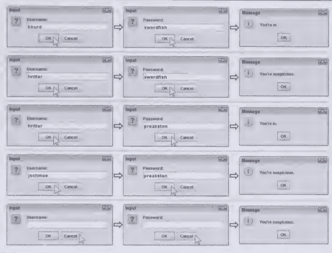

图 5-5：Listing 5-4 代码的几次运行。

Listing 5-4 执行的任务与 Listing 5-3 中的语句

```java
String password = keyboard.next();
```

基本相同。大区别在于，当 `keyboard.next()` 在控制台中显示外观平淡的文本时，`JOptionPane.showInputDialog("Username")` 显示出一个包含文本字段和按钮的漂亮对话框。（对比图 5-4 和图 5-5）。当用户点击 OK 时，控制台获取文本框中的任何内容并将其交给变量。事实上，Listing 5-4 使用了两次 `JOptionPane.showInputDialog`——一次用于获取用户名变量的值，第二次用于获取密码变量的值。

## 第二部分 编写你的 Java 程序

### 第 5 章：使用决策语句控制程序流

在整个 Listing 5-4 中，你都在代码列表顶部导入了 `import javax.swing.JOptionPane;`。

在 Listing 5-4 中，`JOptionPane.showDialog` 运行良好，因为用户的输入（用户名和密码）是字符串。如果你想输入数字（例如 `int` 或 `double`），你需要做一些额外的工作。例如，要从用户处获取 `int` 值，可以输入类似 `int numberOfows = Integer.parseInt(JOptionPane.showDialog("How many cows?)`

《Dummies》书的法语译名是 *Pour les nul!*。因此，英语中的 "dummy" 在法语里是 "null"。但在 Java 中，这个词的意思是“无”。当你看到：

```java
if (username != null)
```

在 Listing 5-4 中，你可以想象你看到了：

```java
if (username != null)
```

要弄清楚用户名可以没有值，请查看图 5-5 的最后一行。当你点击第一个对话框中的“取消”（Cancel）时，计算机会将 `null` 传递给你的程序。因此，在 Listing 5-4 中，变量 `username` 变成了 `null`。比较表达式 `username != null` 是为了确保你没有点击第一个对话框中的“取消”。表达式 `password != null` 则对第二个对话框执行同样的检查。当你看到 Listing 5-4 中的 `if` 语句时，你可以想象你看到了：在俄语中，"dummy" 是 "чайник"，从字面意思意思是“茶壶”。所以，在俄语中，这本书的意思是《Java 茶壶》。我从未被叫过茶壶，我不确定如果真这样的话会有什么反应。

```
you didn't press Cancel in the username dialog and
you didn't press Cancel in the password dialog and
(you typed burd in the username dialog and
you typed swordfish in the password dialog) or
(you typed hitter in the username dialog and
you typed preston in the password dialog)
```


在列表 5-4 中，比较表达式 `username != null` 和 `password != null` 是可选的。如果你想包含这些检查，并在程序运行时点击了取消，你将得到一个糟糕的 `NullPointerException` 错误信息，程序会在你面前崩溃。`null` 代表“无”，而且在 Java 中，你不能将“无”与像 "burd" 或 "swordfish" 这样的字符串进行比较。在列表 5-4 中，`username != null` 的目的是防止 Java 在你不小心点击取消时继续执行 `username.equals("burd")`。如果没有这个预备语句，你就是在自讨苦吃。

列表 5-4 中的最后两个 `null` 与其他的不同。在代码 `JOptionPane.showMessage(null, "You're in.");` 中，`null` 一词代表“没有其他对话框”。具体而言，调用 `showMessageDialog` 告诉 Java 弹出一个对话框，而单词 `null` 表示这个新对话框不是从任何现有的对话框衍生出来的。无论如何，Java 都坚持要求你对新弹出的对话框的来源做出说明。出于某种原因，Java 并不要求你指定 `InputDialog` 框的来源。真奇怪！无论如何，在列表 5-4 中，让凭空弹出一个 `showMessageDialog` 框是非常有用的。

### 括号中的条件

留心那些括号！当你使用逻辑运算符组合条件时，宁愿花点打字精力来避免使用不必要的括号，也比由于使用过少括号而冒险要好。例如，考虑这个表达式：

```java
2 < 5 || 100 < 6 && 27 < 1
```

如果误读了这个表达式，你可能会认为表达式是 `false`。也就是说，你可能错误地将表达式理解为 `(其他内容) && 27 < 1`。因为 `27 < 1` 是 `false`，你会得出整个表达式为 `false` 的结论。事实是，在 Java 中，`&&` 运算符在任何运算符之前求值。所以表达式实际上询问的是 `2 < 5 || (其他内容)`。因为 `2 < 5` 是 `true`，所以表达式为 `true`。

要将表达式的值从 `true` 改为 `false`，你可以将表达式的前两个比较放在括号中，如下：

```java
(2 < 5 || 100 < 6) && 27 < 1
```

Java 的 `||` 运算符是包含性的。这意味着只要左侧的内容为 `true`、右侧的内容为 `true` 或者两者均为 `true`，你就能得到一个 `true` 值。例如，表达式 `2 < 10 || 20 < 3` 是 `true`。

在 Java 中，你不能像普通英语那样组合比较。在英语中，我们可以说“晚餐桌上有三人和十个人。”但在 Java 中，如果你写 `3 <= people <= 10`，将会得到错误信息。要进行这种比较，你需要像 `3 <= people && people <= 10` 这样的写法。

在列表 5-4 中，`if` 语句有多个括号。如果省略了它们会发生什么？

```java
if (username != null &&
    password != null)
```

```java
if (username != null &&
    password != null)
)
```

### if 语句的嵌套习惯

你见过那些可爱的俄罗斯套娃吗？打开一个，里面还有一个。打开第二个，里面还有一个。你可以用 Java 的 `if` 语句做到同样。图 5-5 展示了如何实现。

#### 列表 5-5：嵌套 if 语句

```java
import java.util.Scanner;
import static java.lang.System.out;

public class Authenticator {
    public static void main(String[] args) {
        Scanner in = new Scanner(System.in);
        out.print("Enter username: ");
        String username = in.nextLine();
        if (username.equals("burd")) {
            out.print("Enter password: ");
            String password = in.nextLine();
            if (password.equals("swordfish")) {
                out.println("You're in.");
            } else {
                out.println("Incorrect password");
            }
        } else {
            out.println("Unknown user");
        }
    }
}
```

图 5-6 显示了列表 5-5 代码的多次运行。主思想是，登录必须通过两个测试（也就是说，两个条件都必须为真）。第一个条件测试有效的用户名；第二个条件测试正确的密码。如果你通过了第一个测试（用户名测试），就会直接进入另一个 `if` 语句进行第二个测试（密码测试）。如果你失败了第一个测试，你永远无法到达第二个测试。图 5-7 显示了整体计划。

列表 5-5 中的代码在嵌套 `if` 语句方面做得很好，但在真实世界的用户身份验证方面做得非常糟糕。首先，永远不要以明文显示密码（不使用星号来掩盖密码）。其次，不要告诉恶意用户是两个词中的哪一个（用户名或密码）输入错误。第四……好吧，我可以一直说下去。列表 5-5 中的代码仅仅并不是为了展示良好的用户名/密码实践。

# 在许多替代方案中进行选择

我是第一个承认自己讨厌做决定的人。如果事情出了错，我宁愿让问题变成别人的错。编写之前的几个章节（关于使用 Java 的 `if` 语句做决策）让我耗尽了精力。这就是为什么当我开始这个关于在许多替代方案中进行选择的章节时，我感到非常压力。能把心里话说出来真是轻松！

## Java 辉煌的 switch 语句

现在是时候探索具有许多分支的决策场景了。例如，流行的营火歌曲《Al's All Wet》（关于歌词的审查，请参考旁边的“Al's All Wet”侧边栏）。你渴望编写代码来打印这首歌的歌词。的是的是你不需要反复输入所有的单词。相反，你可以利用歌词中的重复性。

显示《Al's All Wet》歌词的完整程序直到第 6 章才会出现。在此期间，假设你有一个变量 `verse`。`verse` 的值为 1、2、3 或 4，取决于你正尝试打印《Al's All Wet》的哪一段。你可以写出一堆巨大而笨拙的 `if` 语句来检查每个可能的段落数字：

```java
if (verse == 1) {
  out.println("That's because he has no brain.");
}
if (verse == 2) {
  out.println("That's because he is a pain.");
}
if (verse == 3) {
  out.println(" Cause this is the last refrain.");
}
```

但那种方法似乎很浪费。为什么不创建一个语句只检查一次 `verse` 的值，然后根据找到的值采取行动呢？幸运的是，恰好有这样一个语句。它被称为 `switch` 语句。列表 5-6 给出了一个 `switch` 语句的示例。

## "AL'S ALL WET"

随《Gentille Alouette》的旋律演唱

Al 湿透了。噢，为什么 Al 湿透了？噢。
Al 湿透了是因为他站在雨中。
为什么 Al 站在雨中？
因为他没有大脑。
没有大脑，没有大脑，
在雨中，在雨中。
噢，噢，噢，噢
Al 湿透了。噢，为什么 Al 湿透了？噢，
Al 湿透了是因为他站在雨中。
为什么 Al 站在雨中？
因为他是个麻烦。
他是个麻烦，他是个麻烦，
没有大脑，没有大脑，
在雨中，在雨中。

噢，噢，噢，噢
Al 湿透了。噢，为什么 Al 湿透了？噢，
Al 湿透了是因为他站在雨中。
为什么 Al 站在雨中？
因为这是最后一段副歌。
最后的副歌，最后的副歌，
他是个麻烦，他是个麻烦，
没有大脑，没有大脑，
在雨中，在雨中。

噢，噢，噢，噢
Al 湿透了。噢，为什么 Al 湿透了？噢，
Al 湿透了是因为他站在雨中。

Harriet Ritter 和 Barry Burd

## 列表 5-6：一个 switch 语句

```java
import java.util.Scanner;
import static java.lang.System.out;

public class SwitchIt {
    public static void main(String[] args) {
        var keyboard = new Scanner(System.in);
        out.println("Which verse? ");
        int verse = keyboard.nextInt();
        switch (verse) {
            case 1 -> out.println("That's because he has no brain.");
            case 2 -> out.println("That's because he is a pain.");
            case 3 -> out.println("Cause this is the last refrain.");
            default -> out.println("No such verse. Please try again.");
        }
        out.println("Oh, oh, oh, oh");
        keyboard.close();
    }
}
```

图 5-8 显示了列表 5-6 中程序的两次运行。（图 5-9 阐述了程序的整体思路）。首先，用户输入一个数字，例如数字 2。程序的执行到达 `switch` 语句的顶部。计算机检查 `verse` 变量的值。当计算机确定 `verse` 变量值为 2 时，计算机检查 `switch` 语句的每个 `case`。值 2 不匹配顶部的 `case`，因此计算机继续处理三个 `case` 中的中间。中间 `case` 发布的值（数字 2）与 `verse` 变量的值匹配，因此计算机执行 `case 2` 中的语句：

```java
out.println("That's because he is a pain.");
```

如果那个讨厌的用户请求第 6 段，计算机将跳过 `case` 1、2 和 3。计算机直接进入 `default`。在 `default` 中，计算机显示 `No such verse. Please try again.` 并跳出 `switch` 语句。在计算机离开 `switch` 语句后，计算机显示 `Oh, oh, oh`。

Which verse? 2
That's because he is a pain.
Oh, oh, oh, oh

图 5-8：运行列表 5-6 中的代码两次。

Which verse? 6
No such verse. Please try again.
Oh, oh, oh, oh

图 5-9：（image/24540c5d4f1d2bc2a540c5d4f1d2bc2a.png）

在较新版本的 Java 中，你可以在每个 `case` 中放置多个答案。例如，你可以写如下内容：

```java
line = switch (verse) {
    case 1 -> "That's because he has no brain";
    case 2 -> "That's because he is a pain.";
    case 3 -> "Cause this is the last refrain.";
    default -> "No such verse. Please try again.";
}
out.println(line);
```

## 你祖辈的 switch 语句

在 Java 14 之前的版本中，列表 5-6 和 5-7 中的代码将会失败。这是因为 Java 的 switch 语句最初源于 C/C++ 语言族中的 C++ switch 语句，而 C/C++ 的 switch 语句非常笨拙。列表 5-8 中的代码与列表 5-6 和 5-7 中的代码功能相同，但列表 5-8 的代码适用于所有的 Java 版本——旧版本和新版本。

## 列表 5-8：寻找消逝的时间 (A la recherche du temps perdu)

```java
import java.util.Scanner;
import static java.lang.System.out;

public class TheVeryOldSwitcher {
    public static void main(String[] args) {
        var keyboard = new Scanner(System.in);
        out.print("Which verse? ");
        int verse = keyboard.nextInt();
        switch (verse) {
            case 1:
                out.println("That's because he has no brain.");
                break;
            case 2:
                out.println("That's because he is a pain.");
                break;
            case 3:
                out.println("Cause this is the last refrain.");
                break;
            default:
                out.println("No such verse. Please try again.");
                break;
        }
    }
}
```

```java
out.println("Oh, oh, oh, oh");
keyboard.close();
```

列表 5-8 代码运行结果与列表 5-6 和 5-7 的运行结果完全相同。（参考图 5-8。）巨大的区别在于列表 5-8 使用了 switch 语句旧格式。在旧格式中：

- 你使用冒号（`:`）而不是箭头（`->`）。
- 你需要 `break` 语句来跳过任何剩余的 case。

当 Java 遇到 `break` 语句时，它会跳出当前所在的 switch 语句。例如，假设 `verse` 的值为 2。在列表 5-6 中，Java 打印 `That's because he is a pain.`。然后，由于 `break` 语句，Java 直接跳过了本该显示 `Cause this is the last refrain.` 的 case。

事实上，Java 会跳出整个 switch 语句，直接跳转到 switch 语句结束后的语句。计算机显示 `On, oh, oh, oh`，因为 switch 语句之后的语句正是让 Java 做的。

你并不真的需要在所有 switch 语句的末尾都加上 `break`。列表 5-8 中最后一个 `break`（属于 `default` 的 `break`）仅仅是为了显得奇特。

在 switch 语句内部使用 `break` 的需求是 Java 程序员的噩梦。每个人都会忘记添加这些 `break` 语句，而当你忘记添加 `break` 语句时，就会发生“穿透”（fall-through）。在穿透的情况下，代码的执行会直接从一个 case 到下一个 case。执行会一直持续下去，直到你最终遇到 `break` 语句或整个 switch 语句的结束。

## 自由落体 (Free fall)

通常，当你使用 switch 语句时，你不希望发生穿透，因此会在 switch 语句中到处布置 `break` 语句。但偶尔，穿透正是你需要的。例如，“Al's All Wet”这首歌。（高雅的歌词显示在带有歌曲名称的侧栏中）。“Al's All Wet”的每一段歌词都在在前段的基础上增加新的行。这种情况（从一个歌段累积行到另一段）非常需要一种支持穿透的语句。列表 5-9 展示了这一思想。

## 列表 5-9：带有穿透作用的 switch 语句

```java
import java.util.Scanner;
import static java.lang.System.out;

public class FallingThrough {
    public static void main(String[] args) {
        var keyboard = new Scanner(System.in); // 注意：使用了 System.in
        out.print("Which verse? (one, two or three) ");
        String verse = keyboard.next();
        switch (verse) {
            case "three":
                out.print("Last refrain, ");
```


out.println("last refrain, ");

case "two":

    out.print("He's a pain, ");

    out.println("he's a pain, ");

case "one":

    out.print("Has no brain, ");

    out.println("has no brain, ");

}

out.print("In the rain, ");

out.println("in the rain. ");

out.println("Oh, oh, oh, oh");

keyboard.close();

}

}

```

图 5-10 显示了列表 5-9 程序的几次运行。因为 `switch` 内部没有 `break` 语句，穿透随处发生。例如，当用户输入单词 "two" 时，Java 开始执行 `case "two"` 中的两个语句：

```java
out.print("He's a pain, ");
out.println("he's a pain, ");
```

然后 Java 紧接着执行 `case "one"` 中的两个语句：

```java
out.print("Has no brain, ");
out.println("has no brain, ");
```

Which verse? (one, two or three)
Has no brain,
In the rain, the rain.
Oh, oh, oh, oh

Which verse? (one, two or three)
He's a pain,
he's a pain,
In the rain, the rain.
Oh, oh, oh, oh

Which verse? (one, two or three)
Last refrain,
last refrain,
In the rain, the rain.
Oh, oh, oh, oh

图 5-10 显示：
运行列表 5-9 代码。因为 `switch` 内部没有 `break` 语句，穿透随处发生。例如，当用户输入单词 "two" 时，Java 开始执行 `case "two"` 中的两个语句：

That's because he is a pain.
he's a pain,
has no brain,
has no brain,
In the rain, the rain.
Oh, oh, oh, oh

## 重复执行指令（Java while 语句）

这里有一个玩玩的猜数字游戏。计算机生成一个 1 到 10 之间的随机数。计算机要求你猜出这个数字。如果你猜错了，游戏将继续。一旦你猜对了，游戏就会结束。列表 6-1 显示了玩该游戏的程序，图 6-1 显示了一轮游戏过程。

```
***********
Welcome to the Guessing Game:
***********
nter an int from 1 to 10: 2
Try again...
Enter an int from 1 to 10: 5
Try again...
Enter an int from 1 to 10: 8
Try again...
Enter an int from 1 to 10: 3
You win after 4 guesses.
```

图 6-1：
玩到为止。

## 列表 6-1: 一个重复的猜数字游戏

```java
import java.util.Random;
import java.util.Scanner;
import static java.lang.System.out;

public class GuessAgain {
    public static void main(String[] args) {
        var keyboard = new Scanner(System.in);
        int numGuesses = 0;
        int randomNumber = new Random().nextInt(10) + 1;
        out.println(" ********* ");
        out.println("Welcome to the Guessing Game");
        out.println(" ********* ");
        out.print("Enter an int from 1 to 10: ");
        int input = keyboard.nextInt();
        numGuesses++;
        while (input != randomNumber) {
            out.println();
            out.println("Try again...");
            out.print("Enter an int from 1 to 10: ");
            input = keyboard.nextInt();
            numGuesses++;
        }
        out.print("You win after ");
        out.println(numGuesses + " guesses.");
    }
}
```

在图 6-1 中，用户进行了四次猜测。每轮循环，计算机都会检查用户的猜测是否正确。错误的猜测会产生一个再次重试的请求。对于正确的猜测，用户会得到一个欢昂的“你赢了”，并看到他们猜测次数的统计。计算机会重复几条语句，每次都检查用户的猜测是否与随机生成的数字相同。每当用户进行猜测时，计算机在其猜测计数上加 1。当用户做出正确猜测时，计算机会显示该计数。图 6-2 展示了动作流程。

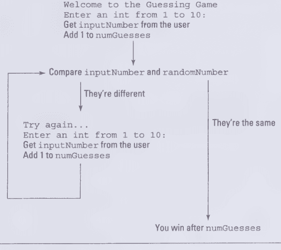

图 6-2：
循环往复进行。

当你查看列表 6-1 时，你会看到完成所有这些工作代码。代码的核心是一个被称为 `while` 语句（也称为 while 循环）的东西。用英文表述，`while` 语句的意思：

```
当输入不等于 randomNumber 时
执行大括号中的所有内容：{
}
```

大括号中的内容（重复的部分）是打印“Try again”和“Enter an int ...”、从键盘获取值，并将用户的猜测计数加 1 的代码。

当你处理计数器时（例如列表 6-1 中的 `numGuesses`），你可能会感到困惑并在两个方向上产生 1 的偏差。你可以通过确保 `++` 语句离你正在计数的语句保持距离来避免这种头疼。例如，在列表 6-1 中，变量 `numGuesses` 的初始值为 0。这是因为当程序开始运行时，用户还没有进行任何猜测。在程序的后面，在每次调用 `keyboard.nextInt` 之后，都有一个 `numGuesses++` 语句。这样做是为了当用户输入另一个猜测时，你增加计数器。

只要 `input != randomNumber` 为真，大括号中的语句就会重复。循环中语句的每次重复被称为循环的迭代。该循环经历了三次迭代。如果你不相信图 6-1 正好有三次迭代，请数数程序输出中“Try again”打印的次数。每次错误的猜测都会出现一次“Try again”。

当用户做出正确猜测时，计算机会显示该计数。图 6-2 展示了动作流程。


图 6-2：
循环往复进行。

括号中的三个项目每一项都起着其自身独特的作用：

- 初始化执行一次，当程序首次运行到 `for` 语句时执行。
- 表达式求值多次（在每次迭代之前）。
- 更新也会求值多次（在每次迭代结束时）。

如果有帮助的话，可以把循环想象成它的文本在四处移动：

```java
int count = 1;
for ( count <= 10; ) {
    out.print("The value of count is ");
    out.print(count);
    out.println(". ");
    count++;
}
```

你不能以这种方式写一个真正的 `for` 语句。尽管如此，这正是该语句各部分执行的顺序。

如果你在 `for` 循环的初始化中声明了一个变量，那么你就无法在循环之外使用该变量。例如，在列表 6-2 中，如果你尝试在循环结束之后放置 `out.println(count)`，就会看到一条错误信息。

用 `for` 循环可以完成的事情都可以用 `while` 循环完成。选择使用 `for` 循环是一个风格和便利性的问题，而不是必要性。

## “Al’s All Wet”的世界首映

列表 6-2 非常不错，但列表中的程序没有列出任何有趣的内容。更引人注目的示例，请参见列表 6-3。在列表 6-3 中，我履行了在第 5 章中出的承诺：列表 6-3 中的程序打印了热门歌曲“Al’s All Wet”的所有歌词。（你可以在第 5 章找到歌词）。

| 列表 6-3: 完整版“Al’s All Wet”歌曲 |

```java
import static java.lang.System.out;

public class AlsAllWet {
```

列表 6-3 很好，因为它结合了第 5 章和第 6 章的许多思想。列表 6-3 在一个 `for` 循环内部嵌套了两个 `switch`。其中一个是一个 `switch` 表达式；另一个是带有穿透（fall-through）特性的 `switch` 语句。随着循环计数变量（`verse`）的值从 1 变为 2 然后变为 3，Java 会执行这两个 `switch` 中的所有部分。当程序接近运行结束且执行退出 `for` 循环时，程序的最后语句会打印循环的最后一个小节。

我大胆地声称 `for` 语句是控制性的，我只是稍微夸大了一点事实。Java 的 `for` 语句是多功能的：你可以在与控制完全无关的情况下使用 `for` 语句。例如，一个没有更新部分的语句，如 `for (i = 0; i < 10; )`，它会一直运行。循环


当循环内部的某个动作给变量 `i` 分配一个大数时，循环结束。你甚至可以创建一个括号内空为空的 `for` 语句。循环 `for ( ; ; )` 会永远运行，如果该循环控制着一台严肃的机器，这将是好事。通常，当你写 `for` 语句时，你是在计算重复某事情的次数。但实际上，你可以用 `for` 语句执行任何类型的重复。

你想做些练习吗？尝试这些实验和挑战：


## FOR AMOUR

`for` 语句的初始化可能有多个部分。`for` 语句的更新也可能有多个部分。要发现如何做到，请在 Java 的 Shell 中输入以下行，或将这些行添加到一个小型 Java 程序中：

```java
import static java.lang.System.out;

for (int i = 0, j = 10; i < j; i++, j--)
```

## 收集值

以下代码的输出是什么？

```java
int total = 0;
for (int i = 0; i < 10; i++) {
    total += i;
}
System.println(total);
```

在该代码中，变量 `total` 被称为累加器，因为它在循环内部累加值。

## 阶乘

在数学中，感叹号（!）表示阶乘——即从到某个数字为止的所有正整数相乘得到的结果。例如，3! 是 1 × 2 × 3，结果为 6。5! 是 1 × 2 × 3 × 4 × 5，结果为 120。

编写一个程序，用户输入一个正整数（称为 `n`），Java 将 `n!` 的值作为输出显示。

## 查看星星

在运行以下代码之前，尝试预测代码的输出：

```java
for (int row = 0; row < 5; row++) {
    for (int column = 0; column < 5; column++) {
        System.out.print("*");
    }
    System.out.println();
}
```

做出预测后，运行代码以确定你的预测是否正确。

## 查看更多的星星

这个实验的代码是上一个实验代码的微调版本。首先，尝试预测代码将输出什么：

```java
for (int row = 0; row < 5; row++) {
    for (int column = 0; column <= row; column++) {
        System.out.print("*");
    }
    System.out.println();
}
```

## 三个三角形

编写一个程序，使用循环显示以下三个三角形：


图 6-5 显示了列表 6-4 中代码的两次运行。该程序接受小写字母 y 和 n，但不接受大写字母 Y 和 N。要让程序接受大写字母，请按照如下方式修改代码中的条件：

```
do {
    out.print("Delete evidence? (y/n)");
    reply = keyboard.findWithinHorizon(".", 0).charAt(0);
} while (reply != 'y' && reply != 'Y' && reply!='N');
```

if (reply == 'y' || reply == 'Y') {

图 6-6 显示了列表 6-4 中循环的控制流。使用 `do` 循环，twoPlus 程序中的情况（从本节开始开始）永远不会发生。因为 `do` 循环在不测试条件的情况下执行它的第一个动作，因此每个循环都保证至少执行一次迭代。

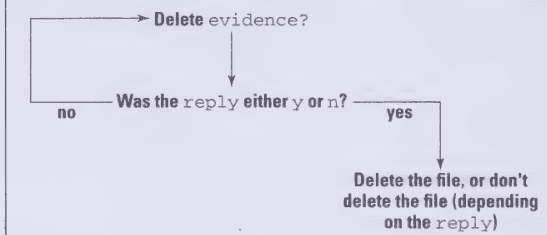

图 6-6:
我们开始
循环，do 循环。

## 问题的核心

列表 6-4 中的 `cookedBooks.txt` 文件在你电脑硬盘上的位置取决于几个因素。如果你在错误的目录中创建了 `cookedBooks.txt` 文件，列表 6-4 中的代码将无法删除你的文件。（（更准确地说，如果 `cookedBooks.txt` 在硬盘的错误目录中，列表 6-4 中的代码将找不到为该文件准备的 `cookedBooks.txt` 文件）。

在大多数设置中，你通过在 IDE 中创建一个项目来开始测试列表 6-4。新项目存在于硬盘上的一个文件夹中。该文件夹被称为项目的根目录。通过列表 6-4 中的代码，`cookedBooks.txt` 文件直接属于你的项目根目录。

例如，我有一个命名为 06-04 的项目。该项目存在我硬盘上一个名为 06-04 的文件夹中——这就是项目的根目录。直接在 06-04 根目录内部，我有一个名为 `cookbooks.txt` 的文件。此外，在 06-04 文件夹内部，我还有一个 `src` 子文件夹。`src` 子文件夹包含 `DeleteEvidence.java` 文件。

如果你在决定 `cookbooks.txt` 文件应该放在哪里遇到困难，请在列表 6-4 的 `new File` 语句之后添加以下代码：

```
try {
    out.println("Looking for " + evidence.getCanonicalPath());
} catch (Java.io.IOException e) {
    e.printStackTrace();
}
```

当你运行代码时，Java 会告诉你你的硬盘上 `cookbooks.txt` 文件应该所在的位置。

关于文件及其文件夹的更多信息，请参阅第 8 章。

## 读取单个字符

在第 5 章的列表 5-3 中，用户在键盘上输入一个单词。`keyboard.next` 方法获取该单词并将其放入名为 `password` 的 `String` 变量中。一切运行良好，因为 `String` 变量一次可以存储许多字符，而 `next` 方法可以一次读取许多字符。

但在列表 6-4 中，你对读取几个字符并不感兴趣。你期望用户按下一个字母——y 或 n。你没有创建一个 `String` 变量来存储用户的响应。相反，你创建了一个 `char` 变量——一种一次只存储一个符号的变量。

Java API 拥有 `nextChar` 方法。为了读取适合存储在 `char` 变量中的内容，你必须即兴发挥。在列表 6-4 中，这种即兴发挥看起来如下：

```
keyboard.findWithHorizon(".").charAt(0)
```


每当你想要读取单个字符时，都可以完全按照它在列表 6-4 中所示的原样使用这段代码。

`String` 变量可以包含许多字符，也可以只包含一个。但一个只包含一个字符的 `String` 变量不等同于 `char` 变量。无论你在 `String` 变量中放入什么，`String` 变量和 `char` 变量都必须区别对待。

## Java 中的文件处理

在列表 6-4 中，实际的文件处理语句值得关注。许多核心语句涉及类、对象和方法的使用。关于这些内容的许多细节在其他章节中，例如第 7 章和第 9 章。即使如此，在这里提到一些重点也无害。

所以你可以在 Java 语言 API 中找到一个名为 `java.io.File` 的类。语句

```
var evidence = new File("cookedBooks.txt");
```

在计算机内存中创建了一个新对象。这个由 `java.io.File` 类形成的对象描述了程序关于磁盘文件 `cookedBooks.txt` 所需的所有信息。从列表 6-4 这里开始，变量 `evidence` 指向磁盘文件 `cookedBooks.txt`。

该对象作为 `java.io.File` 类的实例，有一个 `delete` 方法。（我说什么呢？它在 API 文档里。）当你调用 `evidence.delete()` 时，计算机会帮你删除文件。

当然，你不能删除一个不存在的东西。当计算机执行

```
var evidence = new File("cookedBooks.txt");
```

Java 不检查你是否有名为 `cookedBooks.txt` 的文件。要强制 Java 进行检查，你有几种选择。最简单的是调用 `exists` 方法。当你调用 `evidence.exists()` 时，该方法会在 Java 预期寻找 `cookedBooks.txt` 的文件夹中查找。在这种情况下，你最好初始化该变量。非常有趣！

## 编写程序

在列表 6-4 中，在 `new File` 语句之后立即添加以下代码：

```
try {
    out.println("Looking 寻找 " + evidence.getCanonicalPath());
} catch (java.io.IOException e) {
    e.printStackTrace();
}
```

当你运行代码时，Java 会告诉你你的硬盘上 `cookbooks.txt` 文件应该所在的位置。

关于文件及其文件夹的更多信息，请参阅第 8 章。

## 读取单个字符

在第 5 章的列表 5-3 中，用户在键盘上输入一个单词。`keyboard.next()` 方法获取该单词并将其放入名为 `password` 的 `String` 变量中。一切运行良好，因为 `String` 变量一次可以存储许多字符，而 `next()` 方法可以一次读取许多字符。

但在列表 6-4 中，你对读取几个字符并不感兴趣。你期望用户按下一个字母——y 或 n。你没有创建一个 `String` 变量来存储用户的响应。相反，你创建了一个 `char` 变量——一种一次只存储一个符号的变量。

Java API 拥有 `nextChar()` 方法。为了读取适合存储在 `char` 变量中的内容，你必须即兴发挥。在列表 6-4 中，这种即兴发挥看起来如下：

```
keyboard.findWithHorizon(".").charAt(0)
```

每当你想要读取单个字符时，都可以完全按照它在列表 6-4 中所示的原样使用这段代码。

`String` 变量可以包含许多字符，也可以只包含一个。但一个只包含一个字符的 `String` 变量不等同于 `char` 变量。无论你在 `String` 变量中放入什么，`String` 变量和 `char` 变量都必须区别对待。

## Java 中的文件处理

在列表 6-4 中，实际的文件处理语句值得关注。许多核心语句涉及类、对象和方法的使用。关于这些内容的许多细节在其他章节中，例如第 7 章和第 9 章。即使如此，在这里提到一些重点也无害。

你可以在 Java 语言 API 中找到一个名为 `java.io.File` 的类。语句

```
var evidence = new File("cookedBooks.txt");
```

在计算机内存中创建了一个新对象。这个由 `java.io.File` 类形成的对象描述了程序关于磁盘文件 `cookedBooks.txt` 所需的所有信息。从列表 6-4 这里开始，变量 `evidence` 指向磁盘文件 `cookedBooks.txt`。

该对象作为 `java.io.File` 类的实例，有一个 `delete` 方法。（我说什么呢？它在 API 文档里。）当你调用 `evidence.delete()` 时，计算机会帮你删除文件。

当然，你不能删除一个不存在的东西。当计算机执行

```
var evidence = new File("cookedBooks.txt");
```

Java 不检查你是否有名为 `cookedBooks.txt` 的文件。要强制 Java 进行检查，你有几种选择。最简单的是调用 `exists` 方法。当你调用 `evidence.exists()` 时，该方法会在 Java 预期寻找 `cookedBooks.txt` 的文件夹中查找。在这种情况下，你最好初始化该变量。非常有趣！

# 第 3 部分 从宏观角度：面向对象编程

## 在本部分 ...

- 了解什么是类和对象（不需要让你大脑伤筋动细胞）。
- 学习如何重用现有代码（节省时间和金钱）。
- 通过构建全新的对象，成为你虚拟世界的架构师。

# 第 7 章 scOOP 的内部世界

作为一本计算机书籍的作者，我被反复遍地告诉：你的首要目标是让人按照逻辑顺序阅读章节和内容。但人们总是跳来跳去的，只挑选他们需要的，跳过不想读的。考虑到这一点，我意识到你可能跳过了第 1 章。如果是这样，请不要有负疚感。你只需要花 60 秒阅读以下从第 1 章中提取的信息，就可以补救：

> 因为 Java 是一门面向对象的编程语言，你的目标是描述类和对象。类是某种事物的背后的思想。对象是类的具体实例。程序员定义一个类，然后 Java 根据类的定义创建各个单独的对象。

当然，你完全可以选择跳过这一个 60 秒的总结段落。如果是这样，你可能想挽回一些损失。你可以通过阅读以下对第 1 章的两个字的总结来实现：

类；对象。

## 定义一个类（成为账户意味着什么）

一个银行账户和另一个账户的区别是什么？如果你向银行家员问这个问题，你会听到一段长长的推销。银行家会描述利率、手续费、罚金——一整套流程。幸运的是，对你来说，我对这些并不感兴趣。相反，我想知道我的账户和你的账户有什么不同。毕竟，我的账户名叫 Barry Burd，业务名称为 Bud Brain Consulting，而你的账户名叫 Jane Q. Reader，业务名称为 Budding Java Expert。我的账户里有 $24.02。你的呢？

归根结底，一个账户与另一个之间的区别可以总结为变量的值。也许有一个名为 `balance` 的变量。对我来说，`balance` 的值是 24.02。对你来说，`balance` 的值是 55.63。问题是，在编写处理账户的计算机程序时，我如何将我的 `balance` 变量与你的 `balance` 变量分开来？

答案是创建两个独立的对象。让一个 `balance` 存在于一个对象内部，让另一个 `balance` 存在另一个对象内部。在操作时，在每个对象中都放入一个 `name` 变量和一个 `address` 变量。这就有了：两个对象，每个对象代表一个账户。更准确地说，每个对象都是 `Account` 类的一个实例。（见图 7-1）。

| | Account 类的另一个实例 |
| :--- | :--- |
| name | Barry | Jane |
| address | 222 Cyberspace Lane | 111 Consumer Street |
| balance | 165.28 | 1024.00 |

图 7-1：两个对象。

到为止一切都好。然而，你还没有解决原始问题。在你的计算机程序中，你如何引用我的 `balance` 变量而不是你的 `balance` 变量？嗯，你有两个对象摆在那儿，所以也许你有一些变量来引用这两个对象。创建一个名为 `myAccount` 的变量和另一个名为 `yourAccount` 的变量。`myAccount` 变量引用我的对象（我这个 `Account` 类的实例）以及其中包含的所有内容。要引用我的余额，写下

```
myAccount.balance
```

要引用我的名字，写下

```
myAccount.name
```

由于暂时没有更好的术语，这种引用对象字段的方式被称为*点符号表示*（dot notation）。

那么 `yourAccount.balance` 引用你对象中 `balance` 变量的值，而 `yourAccount.name` 引用你对象中 `name` 变量的值。要告诉 Java 我的账户里有多少钱，你可以写

```
myAccount.balance = 24.02;
```

要在屏幕上显示你的名字，你可以写

```
out.println(yourAccount.name);
```

这些思想在代码 7-1 和 7-2 中汇合在一起。这里是代码 7-1：

### 代码 7-1：成为账户意味着什么

```java
package com.example.accounts;

public class Account {
  String name;
  String address;
  double balance;
}
```

代码 7-1 中的 `Account` 类定义了什么是账户。特别是，代码 7-1 告诉你 `Account` 类的实例有三个变量：`name`、`address` 和 `balance`。这与图 7-1 中的信息一致。Java 程序员对这类变量（属于实例的变量）有一个特殊的称呼。这些变量——`name`、`address` 和 `balance`——被称为*字段*（field）。


在类内部但在特定方法外部定义的变量是字段。在代码 7-1 中，`name`、`address` 和 `balance` 是字段。字段的另一个名称是*实例变量*（instance variable）。

第 4 章告诉你，当在方法体中初始化变量时，可以使用 `var`。

```java
public static void main(String[] args) {
    var greeting = "Good morning!";
}
```

当我创建列表 7-1 时，我并没有从包声明开始。第 1 到 6 章中的所有列表没有一个是以包声明开头的，因此这些类中的每一个都属于一个默认包，也称为 Java 的未命名包（unnamed package）。专业的 Java 程序员避免使用这个未命名包。因此，对于列表 7-1，我决定规范起来，从一开始就做起。

你可以定义多少个类？列表 7-1 中的 `Account` 类就是其中之一。你还可以创建一个 `Customer` 类、`Company` 类，以及名为 `Address`、`Agency`、`Contract`、`Buyer`、`Seller`、`Consumer`、`Sale`、`BalanceSheet`、`Statement`、`Inventory`、`Lease`、`Product`、`Loan`、`Discount` 等类。你可能想将这些类与你名为 `Song`、`Novel`、`Film`、`Painting` 和 `Video` 的其他类分开。所以，你可以创建两个不同的包：一个是 `com.example`，另一个是 `com.example`。

任何 Java 文件都可以从包声明开始，但你必须记住几点：

- Java 的包名决定了某些文件夹和子文件夹的结构。

列表 7-1 中的代码以 `package com.example.accounts` 开头。你的硬盘上必须有一个名为 `com` 的文件夹，其中有一个名为 `example` 的子文件夹，该子文件夹又有一个名为 `accounts` 的子文件夹。你的 `Account.java` 文件必须在这个 `accounts` 文件夹内部。例如，在我的电脑上，我有一个名为 `07-01` 的项目根文件夹。我的列表 7-1 副本位于 `07-01/src/example/accounts` 文件夹中。

- 许多 IDE 必须显式地创建所需的文件夹。

在你将列表 7-1 的代码复制到 IDE 之前，你可能需要告诉 IDE 创建一个名为 `com.example.accounts` 的包。当你这样做时，IDE 会为你创建 `com/example/accounts` 文件夹。然后你就可以将 `Account.java` 文件复制到 `com/example/accounts` 文件夹中。

你如何告诉 IDE 创建包？当你的 IDE 可能会提示你输入一个新的包名时。IDE 会作为新项目的一部分创建包。当你处理一个现有项目时，创建包可能意味着在 IDE 菜单中搜索 `New > Package`。如果你找不到这种方法，请查看此书网站（http://javadummies.allmycode）上的某些提示。

在告诉你们关于包的知识后，我可以消除一些关于声明的困惑：任何不使用 `static` 关键字的导入（import）声明必须以包名开头，并必须以以下内容之一结束：

- 包内类的名
- 一个星号（表示该包内的所有类）

例如，声明

```java
import java.util.Scanner;
```

由于该声明是有效的，因为 `java.util` 是 Java API 中的一个包名，而 `Scanner` 是 `java.util` 包中的一个类名。带点的 `java.util.Scanner` 被称为 `Scanner` 类的全限定名（fully qualified name）。全限定名包含了定义该类的包名。（你可以通过阅读 Java 的 API 文档了解所有关于 `java.util` 和 `Scanner` 的这些内容。关于阅读文档的技巧，请参阅第 3 章和本书的网站。）

这是另一个例子。声明

```java
import javax.swing.*;
```

是有效的，因为 `javax.swing` 是 Java API 中的一个包名，而星号指的是 `javax.swing` 包中的所有类。通过在你的 Java 代码顶部使用此导入声明，你可以使用 `javax.swing` 包中类的缩写名——如 `JFrame`、`JButton`、`JMenuBar`、`JCheckBox` 以及许多其他。

这里还有一个例子。这一行

```java
import java.*; //错误！
```

不是一个有效的导入声明。Java API 中没有名为 `java` 的单单词包。你可能认为这行代码允许你缩写所有以 `java` 开头的名称（如 `JFrame`、`swing`、`sound.midi` 等名称），以及 `java`，但导入机制并不是那样工作的。因为 `java` 不是一个包名，`import java.*` 这一行只会让 Java 编译器生气。

在经过了关于包的这些折腾之后，你可能会问身处一个包还是另一个包到底有什么区别。为了深入了解，请参阅第 14 章。

## 声明变量和创建对象

当我走在街上时，一个年轻人走了过来。他告诉我打印“You'll love Java!”我打印了这些词。如果你非要知道的话，我是用粉笔在人行道上打印的。但我在哪里打印这些词并不重要。重要的是某人发布了指令，而我遵循了指令。

当天晚些时候，一位老太太坐在公园长椅上我的旁边。她说：“账户有一个名称、一个地址和一个余额。”我说：“这没问题，但你想让我对它做些什么呢？”作为回应，她盯着我，所以我没有对她的账户发音做任何事情。我只是坐在那儿，她也坐在那儿，我们都无所事事。

之前显示的列表 7-1 就像那位老太太。这个列表定义了什么是 `Account`（账户），该列表并没有告诉我要对我的账户或任何人的账户做任何事情。为了做些什么，我需要第二段代码。我需要另一个类——一个包含 `main` 方法的类。坦率地说，当那个女人和我静静地坐在公园长椅上时，一个小孩带着路过了列表 7-2。

# 列表 7-2：处理对象

```java
package example.accounts;

import static java.lang.System.*;

public class UseAccount {
    public static void main(String[] args) {
        Account myAccount;
        Account yourAccount;
        myAccount = new Account();
        yourAccount = new Account();
        myAccount.name = "Barry Burd";
        myAccount.address = "222 Cyberspace Lane";
        myAccount.balance = 24.0;
        yourAccount.name = "Jane Q.";
        yourAccount.address = "111 Consumer Street";
        yourAccount.balance = 55.63;
        out.print(myAccount.name);
        out.print(" ");
        out.print(myAccount.address);
        out.print(" has ");
    }
}
```


这两个类——`Account` 和 `UseAccount` 共同构成了一个完整的程序。列表 7-2 中的代码定义了 `UseAccount` 类，而 `UseAccount` 类包含一个 `main` 方法。这个 `main` 方法有它自己的变量 `yourAccount` 和 `myAccount`。

在某种程度上，列表 7-2 中 `main` 方法内部的前两行具有误导性。有些人把 `Account yourAccount` 读作是“yourAccount 是一个 Account”，或者“变量 yourAccount 指向 Account 类的实例”。这并不是这行代码的真实含义。相反，`Account yourAccount` 这一行的意思是：“当和当我让 yourAccount 指向某个东西时，那个东西将是 Account 类的实例。” 那么，区别在哪里呢？

区别在于，仅仅声明 `Account` 并不会让 `yourAccount` 变量指向一个对象。声明只是保留了变量名 `Account`，以便该名称最终可以指向 Account 类的实例。实际对象的创建直到代码后面的部分，即 Java 执行 `new Account()` 时。

从技术上说，当 Java 执行 `new Account()` 时，你正在通过调用 `Account` 类的构造函数创建一个对象。当你看到 Java 的 `new` 关键字时，思考“构造函数调用”。我在第 9 章中会有更多关于构造函数和构造函数调用的内容。

当 Java 执行赋值 `yourAccount = new Account()` 时，Java 创建了一个新对象（Account 类的实例实例），并让变量 `yourAccount` 指向该新对象。（等号让变量指向新对象。）图 7–2 阐释了这种情况。

为了测试我在最后几段中提出的主张，我在列表 7-2 的代码中添加了一行。我在声明 `yourAccount` 之后但在调用 `newAccount()` 之前尝试打印 `yourAccount.name`：

```java
myAccount;
yourAccount;
out.println(yourAccount.name);
myAccount = new Account();
yourAccount = new Account();
```

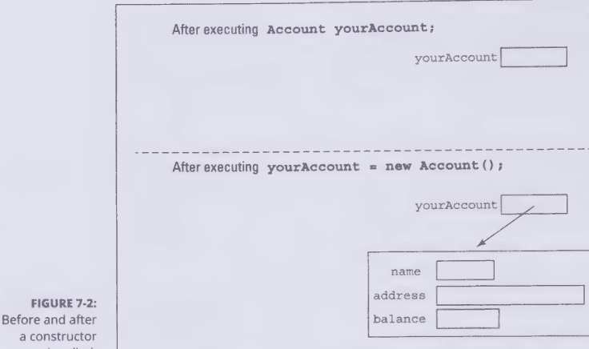

当我尝试编译新代码时，收到了这个错误信息：变量 `yourAccount` 可能未被初始化。这就定论了。在你执行 `new Account()` 之前，你不能打印对象的 `name` 变量，因为对象并不存在。

> 当一个变量是引用类型时，仅仅声明变量是不够的。只有在调用构造函数并使用 `new` 关键字后，才能获得对象。

关于引用类型的信息，请参阅第 4 章。

## 初始化变量

在第 4 章中，我提到可以在变量声明的同时初始化基本类型变量：

```java
int weightOfAPerson = 150;
```

你也可以对引用类型变量执行相同的操作，例如列表 7-2 中的 `myAccount` 和 `yourAccount`。你可以将列表 `main` 方法中的前四行合并为两行，如下所示：

```java
Account myAccount = new Account();
Account yourAccount = new Account();
```

如果你这样合并行，就会自动避免我在上一节中描述的“变量可能未被初始化”的错误。有时你会遇到无法初始化变量的情况。但可以初始化时，这通常是一件好事。

## 使用对象的字段

在你处理完 `main` 方法的前四行后，列表 7-2 中的其余代码是既合理又直观的。你有三行代码给 `myAccount` 对象的字段赋值，另外三行代码给 `yourAccount` 对象的字段赋值，还有四行代码执行打印操作。图 7-3 显示了程序的输出。

图 7-3：运行列表 7-1 和 7-2 中的代码。

| Barry Burd (222 Cyberspace Lane) 拥有 $24.02 |
| Jane Q. Public (111 Consumer Street) 拥有 $55.63 |

## 一个程序；多个类

第 3–6 章中的每个程序都只包含一个类。这对于书的入门级章节来说很棒。但在现实生活中，一个典型的程序由数百或数千个类组成。跨越列表 7-1 和 7-2 的程序包含两个类。拥有两个类不像拥有数千个类，但这是向那个方向迈出的一步。

在实践中，大多数程序员会将每个类放在单独的文件中。当你创建一个程序（如列表 7-1 和 7-2 中的程序）时，你会在计算机的硬盘上创建两个文件。因此，当你从网上下载这些内容时，你会得到两个独立的文件——`Account.java` 和 `UseAccount.java`。

关于在 Eclipse、NetBeans 和 IntelliJ IDEA 中运行由多个 .java 文件组成的程序的信息，请访问本这本书的网站（http://javadummies.allmycode.com）。


## 声明公共类

列表 7-1 的第一行是：

```java
public class Account {
```

`Account` 类是公共的。公共类可以供所有其他类使用。例如，如果你在网络空间的某个角落编写一个 `ATMController` 程序，你的 `ATMController` 程序可以包含诸如 `myAccount.balance = 24.02` 的代码，并使用列表 7-1 中声明的 `Account` 类。（当然，你的代码必须知道我在网络空间的哪个位置存储了列表 7-1 中的代码，但那是另一个故事了。）

列表 7-2 包含了代码 `Account.balance = 24.02`。你可能会对自己说：“`Account` 类必须是公共的，因为另一个类（列表 7-2 中的代码）使用了 `Account` 类。”遗憾的是，关于公共类的真实情况要复杂得多。事实上，当“行星运行轨迹对得恰好”时，一个类可以使用另一个类的代码，即使该另一个类不是公共的。（我将在第 14 章中描述这是如何运作的。）

本章代码中隐藏的秘密是，将某些类声明为公共让我感觉很好。是的，程序员确实会做某些事情来让自己感觉良好。

```java
public void display() {
    out.print(name);
    out.print(" ");
    out.print(address);
    out.print(" has $");
    out.print(balance);
}
```

### 列表 7-4: 使用改进后的 Account 类

```java
package com.example.accounts;

public class UseAccount {
    public static void main(String[] args) {
        var myAccount = new Account();
        var yourAccount = new Account();
        myAccount.name = "Barry Burd";
        myAccount.address = "222 Cyberspace Lane";
        myAccount.balance = 24.02;
        yourAccount.name = "Jane Q. Public";
        yourAccount.address = "111 Consumer Street";
        yourAccount.balance = 55.63;
        myAccount.display();
        System.out.println();
        yourAccount.display();
    }
}
```

运行列表 7-3 和 7-4 中的代码看起来与运行列表 7-1 和 7-2 的结果完全相同。你可以在之前的图 7-3 中看到这一操作过程。

在列表 7-3 中，`Account` 类包含四个内容：一个名称、一个地址、一个余额和一个 `display` 方法。这些内容与表 7-2 中的四列对应。因此，`Account` 类的每个实例都有一个名称、地址、余额以及一种显示自己的方法。调用这些内容的方式非常简洁且统一。要引用存储在 `myAccount` 中的名称，你写道：

`myAccount.name`

要让 `myAccount` 在屏幕上显示自己，你写：

```java
myAccount.display()
```

这两个表达式都使用了点符号表示（dot notation）。唯一的结构区别在于括号。


当你调用一个方法时，在方法名后面加上括号。

### display 方法的头部

再次查看列表 7-3 和 7-4。对 `display` 方法的调用位于 `UseAccount.class` 的 `main` 方法内部，但 `display` 方法的声明位于 `InAccount.class` 中。声明包含一个头部和一个方法体。（见第 3 章。）头部包含三个单词和一些括号：

- **单词 public** 的作用大致与列表 7-1 中的 `public` 单词相同。粗俗来说，任何代码都可以包含对 `public` 方法的调用，即使调用代码和 `public` 方法属于两个不同的类。在本节的示例中，将 `display` 方法设为 `public` 是个人喜好。通常，当我创建一个在各种应用程序中都有用的方法时，我会将该方法声明为 `public`。

- **单词 void** 告诉 Java 当调用 `display` 方法时，该方法不会向调用它的地方返回任何内容。要查看一个确实向调用它的地方返回某些内容的方法，请看下一节。

- **单词 display** 是方法名。每个方法都必须有一个名称。否则，你就没有办法来调用该方法。

- **括号** 包含了你在调用方法时将传递给方法的所有内容。当你调用方法时，你可以动态地将信息传递给该方法。列表 7-3 中的 `display` 方法看起来很奇怪，因为方法头部中的括号内是空的。这种空状态表示在调用 `display` 方法时，没有信息传递给它。例如，请看下一节。


列表 7-3 包含了 `display` 方法的声明，而列表 7-4 包含了对 `display` 方法的调用。尽管列表 7-3 和 7-4 中 `public` 的使用是可选的。要找出原因，请查看第 14 章。

#### 展示一下

在上一节中，你创建了 `Organization` 和 `FoodProduct` 类。为这两个类都添加 `display` 方法，并创建使用这些 `display` 方法的独立类。

## 向方法发送和接收值（计算利息）

想象让某去超市买面包。当你这样做时，你说：“超市买一些面包。”（在家里试试吧。你很快就能得到一个新鲜的面包！）当然，其他时候，你又让同一个人去超市买香蕉。你说：“去超市买一些香蕉。”这一切的意义何在？嗯，你有一个方法，并且你有一些在调用它时传递给该方法的动态信息。该方法名为 `gotoTheSupermarketAndBuySome`。这些动态信息是面包或香蕉，取决于你的烹饪需求。在 Java 中，该方法看起来像这样：

```java
getTheSupermarketAndBuySome(bread);
getTheSupermarketAndBuySome(bananas);
```

括号中的内容被称为参数（parameters）或参数列表。有了参数，你的方法变得灵活得多。每次你都可以让某人去超市买一样东西，下一次买香蕉，第三次买鸟种子。当你调用 `gotoTheSupermarketAndBuySome` 方法时，你就在那时决定让你朋友付什么钱。

当你的朋友从超市回来时会发生什么？”这是你要的面包。”当你调用方法时，”你的朋友说。当你调用方法时，方法向调用它的地方返回某些内容。方法返回的内容是方法的返回类型。这些概念在列表 7-5 和 7-6 中变得具体了。

### 列表 7-5: 一个计算利息的方法

```java
package com.example.accounts;

import static java.lang.System.out.*;

public class Account {
    String name;
    String address;
    double balance;

    public void display() {
        print(name);
        print(" ");
        print(address);
        print(" has $");
        print(balance);
    }

    public double getInterest(double percentageRate) {
        return balance * percentageRate / 100;
    }
}
```

### 列表 7-6: 计算利息

```java
package com.example.accounts;

import static java.lang.System.out.*;

public class UseAccount {
    public static void main(String[] args) {
        var myAccount = new Account();
        var yourAccount = new Account();
        myAccount.name = "Barry Burd";
        myAccount.address = "222 Cyberspace Lane";
        myAccount.balance = 24.02;
        yourAccount.name = "Jane Q. Public";
        yourAccount.address = "111 Consumer Street";
        yourAccount.balance = 55.63;
        myAccount.display();
        println();
        yourAccount.display();
        double myInterest = myAccount.getInterest(5.0);
        print("Interest: $");
        println(myInterest);
        double yourInterest = yourAccount.getInterest(7.0);
        print("Interest: $");
        println(yourInterest);
    }
}
```

## 向方法传递值

查看 `getInterest` 方法的头部（当你阅读接下来的几个项目项解释时，可以结合图 7-6 直观地理解其中的一些内容）：

> `double` 关键字告诉 Java，当调用 `getInterest` 方法时，`getInterest` 方法会将一个 `double` 类型的值返回到调用它的地方。`getInterest` 方法体中的语句证实了这一点。该语句为 `return balance * percentageRate / 100.00`，而表达式 `balance * percentageRate / 100.00` 的类型为 `double`。（这是因为表达式中的所有内容——`balance`、`percentageRate` 和 `100.00` 都是 `double` 类型。）

当调用 `getInterest` 方法时，`return` 语句计算 `balance * percentageRate / 100.00`，并将计算结果传递给 `getInterest` 所调用的代码。

> `getInterest` 单词是方法的名称。当你编写 `UseAccount` 类的代码时，使用它来调用该方法。

> 括号中包含了你在调用方法时传递给方法的所有内容。调用方法时，你可以即时向该方法传递信息。`getInterest` 方法的头部显示，`getInterest` 方法接受一个信息，且该信息必须是 `double` 类型：

```java
public double getInterest(double percentageRate)
```


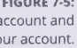

果真，如果你查看 `getInterest` 的第一次调用（在 `UseAccount` 类的 `main` 方法中），该调用包含了数字 `5.00`。而 `5.00` 是一个 `double` 字面量。当我调用 `getInterest` 时，我正在给该方法传递一个 `double` 类型的值。

如果你不记得字面量是什么，请参阅第 4 章。

对 `getInterest` 的第二次调用也是如此。在代码列表 7-6 的底部，我调用了 `getInterest` 并在参数列表中将变量 `yourInterestRate` 传递给该方法。幸运的是，我在那几行之前刚刚将 `yourInterestRate` 声明为 `double` 类型。

当你运行代码列表 7-5 和 7-6 中的代码时，执行流并不是从上到下的。执行流从 `main` 到 `getInterest`，然后返回 `main`，再次回到 `getInterest`，最后再次返回 `main`。图 7-7 显示了整个过程。

| | public double getInterest(double percentageRate) { |
| | Account return balance*(percentageRate)/100.00; |
| | } |
| | UseAccount System.out.println(myAccount.getInterest(5.00)); |

图 7-6：向方法传递值。

图 7-7：代码列表 7-5 和 7-6 中的控制流。

## 从 getInterest 方法返回值

当调用 `getInterest` 方法时，该方法执行方法体中的一条语句：`return` 语句。`return` 语句计算 `balance * percentageRate / 100.0` 的值。如果 `balance` 好是 `24.02`，且 `percentageRate` 为 `5.00`，则表达式的值约为 `1.201`，接近 `1.202`。（由于计算机完全处理 0 和 1，Java 得到的这个数字会产生极其微小的偏差。Java 得到 `1.200999999999999998`。这是人类必须接受的事实。）

无论如何，在计算此值后，Java 执行 `return`，将该值返回给 `main` 中调用 `getInterest` 的地方。在过程的该点，整个方法调用——`myAccount.getInterest(5.00)`——获得了值 `1.2009999999999998`。该调用本身位于 `println` 内部：

```java
out.println(myAccount.getInterest(5.00));
```

因此，`println` 最终具有以下含义：

```java
out.println(1.2009999999999998);
```

将值传回方法调用的整个过程如图 7-8 所示。

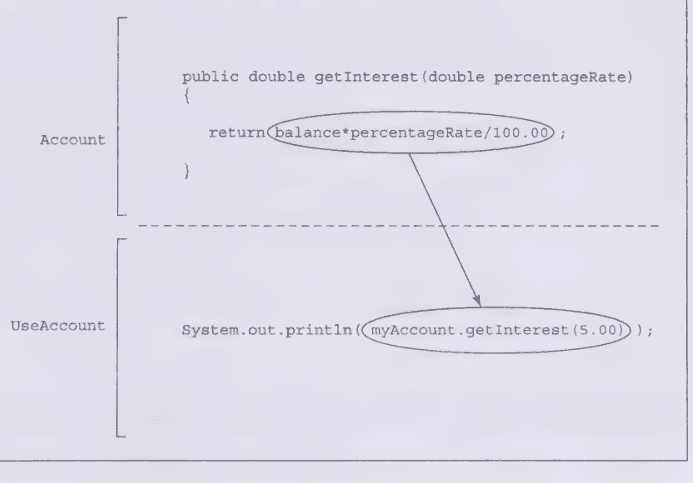

图 7-8：方法调用是一个带有值的表达式。

> 如果方法返回任何内容，那么方法调用就是一个带有值的表达式，该值可以赋值给变量、与其他内容相加或进行任何操作。你可以对任何类型的值执行的操作，你也可以对方法调用执行。

你可能会使用代码列表 7-5 中的 `Account` 类来解决实际问题。在实际银行应用程序过程中，你会调用 `Account` 类的 `display` 和 `getInterest` 方法。但代码列表 7-6 中的 `UseAccount` 类是人工的。`UseAccount` 代码创建了一些伪数据，然后通过一些 `Account` 类方法来说服你 `Account` 类的代码运行正常。你不会真的认为银行有名为“Jane”和“Barry”的存款者。对 `getInterest` 的第二次调用也是如此。在代码列表 7-6 的底部，我调用了 `getInterest` 并在参数列表中将变量 `yourInterestRate` 传递给该方法。幸运的是，我在那几行之前刚刚将 `yourInterestRate` 声明为 `double` 类型。

### "$85.2f"

计算机显示的内容：

- 显示一个美元符号。
- 换新行。

$1.20

使用至少五个位数来显示数字，并在小数点右侧保留其中两个位数。

由于 `myInterest` 仅占四位，因此在显示 `myInterest` 时额外添加一个空格。

图 7-11：添加额外的位数以显示值。

### "$82.2f"

计算机显示的内容：

- 显示一个美元符号。
- 换新行。

$1.20

使用适当的位数来显示数字，并在小数点右侧保留其中两个位数。

图 7-12：在不指定具体位数的情况下显示值。

### "$83.2f"

计算机显示的内容：

- 显示一个美元符号。
- 换新行。

$1.20

使用至少三个位数来显示数字，并在小数点右侧保留其中两个位数。

三个还不够，所以计算机使用了四个位数。

图 7-13：指定的位数太少，导致无法显示值。

### "$8..2F $8.2F"

计算机显示的内容：

- 显示一个美元符号。

$1.20 $3.89

显示第二个参数（`myInterest`）的值，小数点右侧保留两个位数。

显示第三个参数（`yourInterest`）的值，小数点右侧保留两个位数。

显示一个空格和一个美元符号。

图 7-14：使用字符串显示多个格式。

第 7 章 scOOP 内部 183 页

`printf` 调用中的格式字符串并不会改变数字在内部用于计算的存储方式。格式字符串的作用仅仅是创建一组美观的数字字符，并显示在你的屏幕上。

`printf` 方法非常适合格式化任何类型的值：普通数字、十六进制数、日期、字符字符串和其他奇特值。这就是为什么我在这一节中向你展示它。但当你处理货币金额时，本节的 `printf` 技巧就相当原始了。对于处理货币金额的更好方法（例如本节示例中的利息金额），请参阅第 11 章。

## 填空

这是一个 Java “伪程序”。它不是一个真正的 Java 程序，因为我掩盖了代码中的一些字符。我用下划线替换了这些字符：

```java
import java.lang.System.out;

public static void main(String[] args) {

    out.printf("%s_%s", "", "", 7, "<<\n");

    out.printf("%s_%s", "", "", 7, "<<\n");

    out.printf("%s_%s", "", "", 7, "<<\n");

    out.printf("%s_%s", "", "", 7, "<<\n");

    out.printf("%s_%s", "", "", -7, "<<\n");

    out.printf("%s_%s", "", "", 7.0, "<<\n");

    out.printf("%s_%s", "", "Hello", "<<\n");

    out.printf("%s_%s", "", "x", "<<\n");

    out.printf("%s_%s", "", "", "<<\n");

}
```

替换下划线，使该程序产生以下输出：

```
>>7<<

>> 7 <<

>>7

>>000000007<<

>>+7<<

>>-7<<

>>(7)<< 

>> 7.00000<< 

>>HELLO<< 

>>X<< 

>>X<<
```

要完成这一点，请在 Java API 文档的 `java.util.Formatter` 页面查找线索：https://docs.oracle.com/en/java/javase/17/docs/api/java.base/java/util/Formatter.html。

## 捉迷猫

放下这本书，把书戴在你的头上。你一直是一个如此忠诚的读者，我要带你出去吃午饭！

我只有一个问题。我手头有点缺钱。你介意我们在去午饭的路上停在自动取款机（ATM）取几块钱吗？另外，我们必须使用你的账户。我的账户有点低。

幸运的是，自动取款机很容易使用。只需走过去输入你的密码。输入密码后，机器会询问你想使用几个变量名中的哪一个来表示你的当前余额。你有 `balance324`、`myBal`、`currentBalance`、`b$`、`BALANCE`、`asj999` 或 `constNotIn` 可选。选择变量名后，你就可以为变量的值选择一个内存位置了。你可以选择 `022FFF` 到 `0555AA` 之间的任何数字。（这些数字是十六进制格式）。配置好自动取款机的软件后，你就可以轻松拿到现金了。你带螺丝刀对吧？

## 良好的编程

涉及到良好的编程实践，有一个词高于其他所有词：**简单性**。当你编写复杂的代码时，你最不想处理的就是别人命名不当的变量、复杂的解决方案，或者是巧妙但临时的补救措施。你想要一个清晰的接口，它能解决你自己的问题，而不是解决别人的问题。

在我之前描述的自动取款机场景中，自动取款机就是接口。你通过它与之交互。如果接口设计得糟糕，你将受困于思考如何使用它。如果接口设计良好，你就可以轻松地使用。这就是面向对象编程的本质：设计易用且维护的接口。

在接下来的章节中，我们将探索如何设计这些接口。我们将学习类、对象、继承和多态。我们还将学习如何使用这些概念构建强大且灵活的程序。要学的内容很多，但我保证这些都是值得的。所以，让我们开始吧！

## setter 方法，而 getName 被称为 getter 方法。（我敢打赌你不会忘记这个术语的！）

在许多 IDE 中，你不需要自己去输入访问器方法（accessor methods）。首先，你输入一个字段声明，如 `private String name`。然后，在你的 IDE 菜单栏上，选择 Source（源）：Generate Getters and Setters 或选择 Code（代码）：Insert Setter 或这些代码的组合。在你完成所有选择后，IDE 就会创建访问器方法并将它们添加到你的代码中。

注意，列表 7–8 中的所有 setter 和 getter 方法都声明为 public（公有）。这确保了任何人在任何地方都可以调用这两个方法。这里的设计理念是：从 Account 代码外部直接操作实际字段是不可能的，但你可以通过这些字段轻松地访问经过批准的 setter 和 getter 方法。

想想自动取款机（ATM）。使用 ATM 的人可以输入命令直接更改其账户余额字段中的值，但存款百万美元支票的程序是很容易遵循的。制造自动取款机的人知道，如果存款支票程序太复杂，很多客户会搞得一团糟。这就是道理：让人们不应该做的事情变得不可能，确保人们应该做的事情变得简单。

拥有 setter 和 getter 方法并没有什么神圣之处。你不需要编写任何你用用的 setter 或 getter 方法。例如，在列表 7–8 中，我可以省略 `getAddress` 方法的声明，一切仍然可以运行。如果我这样做，唯一的问题是任何想要使用你的 Account 类并获取现有账户地址的人都会陷入困境。

当你创建一个设置余额字段的方法时，你不需要*自己*为该方法命名。你可以将其命名为 `tunaFish` 或你喜欢的任何名字。麻烦在于，`setName` 这种命名约定（set 部分使用小写字母，且字段名部分的首字母大大写）是 Java 编程世界中一个公认的惯例。如果你不遵循这一惯例，会让其他 Java 程序员感到一头雾水。

当你调用 setter 方法时，你向它传递一个与被设置字段类型相同的值。这就是为什么在列表 7–9 中，你调用 `yourAccount.setBalance(55.63)` 时使用的参数类型是 `double`。相比之下，当你调用 getter 方法时，你通常不需要向方法传递任何值。这就是为什么在列表 7–9 中，你调用 `yourAccount.getBalance()` 时使用的是一个空参数列表。偶尔，你可能想用一条语句获取并设置一个值。要给你的账户现有余额增加 1 美元，你可以写下 `yourAccount.setBalance(yourAccount.getBalance()+1.00)`。

### 使用访问器方法强制规则

回到列表 7-8，快速查看一下 `setName` 方法。想象一下 `if` 语句内部的方法赋值语句：

```java
public void setName(String n) {

    if (!n.equals("")) {

        name = n;

    }

}
```

现在，如果负责 UseAccount 类的程序员写了 `myAccount.setName("")`，对 `setName` 的调用将不起作用。此外，由于 `name` 字段是私有的，以下语句在 UseAccount 类中是非法的：

```java
myAccount.name = "";
```

当然，这很棒。通过私有字段和访问器方法，你可以防止有人为账户的 name 字段分配空字符串。通过更复杂的 `if` 语句，你可以强制执行任何你规则。

### 私家侦探 (PRIVATE EYE)


## Barry 自己的 GUI 类

你可能已经厌倦了书中随处可见的枯燥的基于文本的程序。你可能想要一些更酷炫的东西——比如带有文本字段和按钮的东西。很好，我为你准备了一些示例！

我创建了一个我称为 `DummiesFrame` 的类。当你导入我的 DummiesFrame 类时，你可以花极少的精力创建一个简单的图形用户界面（GUI）应用程序。

列表 7-10 使用了我的 DummiesFrame 类，图 7-15、7-16 和 7-17 展示了其结果。

### 列表 7-10：你的第一个 DummiesFrame 示例

```java
package com.example.graphical;

import com.allmycode.dummiesframe.DummiesFrame;

public class Hello2U {

    public static void main(String[] args) {

        var frame = new DummiesFrame("Greet Me!");

        frame.addRow("Your first name");

        frame.go();

    }

    public static String calculate(String firstName) {

        return "Hello, " + firstName + "!";

    }

}
```

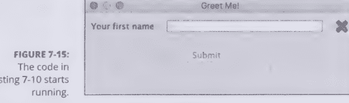


图 17：用户点击按钮。


以下是列表 7-10 代码的逐行描述：

- 第一行
```java
import com.allmycode.dummiesframe.DummiesFrame;
```
使得 DummiesFrame 可用。

- 在 main 方法内部，语句
```java
var frame = new DummiesFrame("Greet Me!");
```
创建了 DummiesFrame 的实例。在这个示例中，窗口标题是 Greet Me!

- 下一个语句是调用 frame 的 addRow 方法，它包含标签字段：
```java
frame.addRow("Your first name");
```
调用了应用程序中的一行。

- 调用 frame 的 go 方法
```java
frame.go();
```
使窗口显示在屏幕上。

- calculate 方法的头头部
```java
public static String calculate(String firstName) {
```
告诉 Java 两个信息：

- calculate 方法返回一个值
```java
return "Hello, " + firstName + "!";
```
告诉在窗口底部显示什么。（参考图 15。）在这个示例中，用户在唯一的文本字段中输入 Barry，firstName 的值是 "Barry"，calculate 方法返回 "Hello, Barry!"。

- 当用户点击按钮时，DummiesFrame 在后台运行并调用 calculate 方法。（参考图 17。）当用户开始在字段中输入文本时，红色的 X 标记变成绿色的勾号。（参考图 16。）7-10 只有一个 addRow 调用，因此图 16 中的窗口只有一行。

为了保持简单，我将 `DummiesFrame.java` 文件包含在了你从本书网站下载的 07-10 文件夹中。但真的，这是将我自己的代码添加到你的项目的最佳方式吗？在第 1 章中，我描述了扩展名为 `.class` 的文件以及这些文件在 Java 程序运行中的作用。我不应该直接交给你 `DummiesFrame.java` 文件，而应该只在下载包中放入一个 `Dummies` 类文件。在其他情况下，如果我必须给你提供数百个类文件，我应该将它们打包成一个大文件。Java 对这种编码许多较小类文件的大文件有一个专门的名字，它被称为 JAR 文件，扩展名为 `.jar`。在实际应用中，如果你正在准备代码供其他人作为他们自己应用程序的一部分使用，那么 JAR 文件无疑是正确的选择。

我的 `DummiesFrame` 类不仅仅用于问候和打招呼。列表 7-11 使用 `DummiesFrame` 进行算术运算。

### 列表 7-11：一个非常简单的计算器

```java
```


## 代码示例：Addition 类

```java
package com.example.graphical;

import com.allcode.dummiesframe.DummiesFrame;

public class Addition {

    public static void main(String[] args) {

        var frame = new DummiesFrame("Adding Machine");

        frame.addRow("First number");

        frame.addRow("Second number");

        frame.setButtonText("Sum");

        frame.go();

    }

    public static int calculate(int firstName, int secondNumber) {

        return firstName + secondNumber;

    }

}
```

图 7-18 中的窗口有两行，是因为列表 7-11 有了两次 `addRow` 调用，且列表的 `calculate` 方法有两个参数。此外，列表 7-11 调用了帧对象的 `setButtonText` 方法。因此，在图 7-18 中，按钮表面的文字不是默认的单词 Submit。

### 列表 7-12：我在想一个数字

```java
package com.example.graphical;

import java.util.Random;

import com.allcode.dummies.DummiesFrame;

public class GuessingGame {

    public static void main(String[] args) {

        DummiesFrame frame = new DummiesFrame("Guessing Game");

        frame.addRow("Enter an int from 1 to 10");

        frame.setButton("Submit your guess");

        frame.go();

    }

    public static String calculate(int inputNumber) {

        Random random = new Random();

        int randomNumber = random.nextInt(10) + 1;

        if (inputNumber == randomNumber) {

            return "You win.";

        } else {

            return "You lose. The random number was " + randomNumber + ".";

        }

    }

}
```


图 7-19：我赢了！

## 第 7 章 内部

在列表 7-13 中，我使用了本章的 `Account` 类配合 `DummiesFrame` 类。我可以在不创建实例的情况下获得相同的结果，但我想向你展示类是如何协作形成一个完整的程序的。代码的运行结果见图 7-20。

### 列表 7-13：使用 Account 类

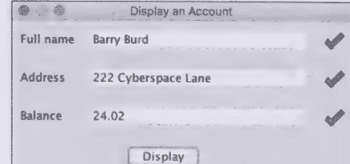

图 7-20：我富有了。Barry Burd (Cyberspace Lane) 拥有 $24.0

使用 `DummiesFrame` 类创建 GUI 程序。

## 第 8 章 节省时间和金钱：复用现有代码

### 本章内容

- 为旧代码注入新生命力
- 调整你的代码
- 在不花费巨资的情况下进行更改

**复用**（Reuse）名词：第 n 次使用某物的行为，其中 n 大于 1。例如：“严禁复用《Java For Dummies, Eighth Edition》中的材料。”

复用是好事，但在许多情况下，复用是稀缺的。例如，在美国，农业部估计，全国 30% 到 40% 的食物被浪费了。而且根据一个来源，世界上只有 9% 的塑料被回收。

信息也会被浪费。当我为第八版修订本章时，我决定不复用第七版的引言（那段引言一点也不幽默）。在绝望中，我查阅了一些其他书，想找一个可以复用到本章的引言。没好运！我空手而归。

我甚至无法复用段落来解释常见概念。我在另一书中的类的描述在本书中是不行的。我曾经历过，因为第 3 章的一个微小更新，就不得不删掉几个章节中的内容。

毫无疑问！复用是一种珍贵的商品，而且非常稀缺。

### 成为一名员工意味着什么

如果每种软件都能完全按照你的意愿运行那该有多好？在一个理想的世界里，你可以购买一个程序，让它立即运行，无缝地接入新环境，并在你的需求变化时轻松地更新它。遗憾的是，这种软件并不存在。（这类东西根本不存在。）事实是，无论你想做什么，你都能找到能完成部分任务的软件，但不能完全完成。

这就是面向对象编程之所以成功的原因之一。多年来，公司一直在购买预写的代码，结果发现这些代码并没有按照他们想要的那样运行。那么，公司对此该怎么办呢？他们开始乱改代码。他们的程序员深入程序文件内部，更改变量名，移动子程序，重新设计公式，并通常地让代码变得更糟。现实情况是，如果一个程序没有按照你想要的方式运行（即使它做的事情非常接近你想要的结果），你永远无法通过在代码内部胡搞来改善局面。最好的选择始终是扔掉整个程序（尽管这很贵）并重新开始。多么悲哀的现状！

随着面向对象编程的出现，巨大的变化发生了。从核心上说，面向对象的程序是为了修改而设计的。有了软件，你可以利用内置功能，添加自己的新功能，并覆盖不符合你需求的功能。最好的部分是，你所做的更改是干净的。不需要去挖掘和侵入别人脆弱的代码。相反，你进行良好的添加和修改，而不触碰现有代码的内部逻辑。这是理想的解决方案。

### 关于员工的最后结论

当你编写面向对象的程序时，你首先考虑数据。你正在编写账户。所以，账户是什么？你正在编写处理按钮点击的代码。所以，按钮是什么？你正在编写向员工发送工资支单的程序。员工是什么？

在本章的第一个示例中，员工是拥有姓名和头衔的人。当然，员工还有其他特征，但目前我只关注基础。列表 8-1 定义了成为员工意味着什么。

### 列表 8-1：什么是员工？

```java
package com.example.payroll;

import static java.lang.System.out;

public class Employee {

    private String name;

    private String jobTitle;

    public void setName(String nameIn) {

        name = nameIn;

    }

    public String getName() {

        return name;

    }

    public void setJobTitle(String jobTitleIn) {

        jobTitle = jobTitleIn;

    }

    public String getJobTitle() {

        return jobTitle;

    }

    public void cutCheck(double amountPaid) {

        out.printf("Pay to the order of %s ", name);

        out.printf("%s)***$", jobTitle);

        out.printf("%.2f\n", amountPaid);

    }

}
```

### 善用你的类

列表 8-1 中的 `Employee` 类没有 `main` 方法，因此没有执行代码的起点。为了修复这一缺陷，程序员编写了一个带有 `main` 方法的独立程序，并使用该程序来创建 `Employee` 实例。列表 8-2 显示了一个带有 `main` 方法的类——它对列表 8-1 中的代码进行了测试。

### 列表 8-2：编写工资支票

```java
package com.example.payroll;

import java.io.File;

import java.io.IOException;

import java.util.Scanner;

public class DoPayroll {

    public static void main(String[] args) throws IOException {

        var diskScanner = new Scanner(new File("EmployeeInfo.txt"));

        for (int empNum = 1; empNum <= 3; empNum++) {

            payOneEmployee(diskScanner);

        }

        diskScanner.close();

    }

    static void payOneEmployee(Scanner scanner) {

        var anEmployee = new Employee();

        anEmployee.setName(scanner.nextLine());

        anEmployee.setJobTitle(scanner.nextLine());

        anEmployee.cutCheck(scanner.nextDouble());

        scanner.nextLine();

    }

}
```

要运行列表 8-2 中的代码，你的硬盘上必须包含一个名为 `EmployeeInfo.txt` 的文件。幸运的是，你从本书的网站（http://javadummies.allcode.com）下载的内容都附带了一个 `EmployeeInfo.txt` 文件。只需将 `EmployeeInfo.txt` 文件复制到列表 8-2 能够找到它的地方即可。例如，假设你创建了一个名为 `08-02` 的项目。列表 8-2 位于名为 `08-02` 文件夹的 `src` 子文件夹中。将 `EmployeeInfo.txt` 文件直接复制到 `08-02` 文件夹内部——而不是 `src` 文件夹内部。Java 通常只会查找像 `EmployeeInfo.txt` 这样的文件。

### 你到底住在地球的哪里？

分组分隔符在不同国家之间不同。当你尝试使用 Java 的 `Scanner` 类读取双精度浮点数时，这会产生很大影响。为了理解我的意思，请仔细查看以下 JShell 会话。

```jshell
> import java.util.Scanner
> import java.util.Locale
> var keyboard = new Scanner(System.in) ...
keyboard => java.util.Scanner[delimiters=\p{javaWhitespace}+] ... \E
[infinity string=\8\\E]
> keyboard.nextDouble()
1000.00
$4 => 1000.00
> Locale.setDefault(Locale.FRANCE)
> keyboard = new Scanner(System.in)
keyboard => java.util.Scanner[delimiters=\p{javaWhitespace}+] ... \E
[infinity strings=\8\\E]
> keyboard.nextDouble()
1000.00
$7 => 1000.00
> keyboard.nextDouble()
java.util.InputMismatchException thrown:
  at Scanner.throwFor(Scanner.java:860)
  at Scanner.next(Scanner.java:1497)
  at Scanner.nextDouble(Scanner.java:2467)
  at (*8:1)
```

我在美国的一台电脑上进行了这次会话。来源地是相关的，因为在响应第一次 `keyboard.nextDouble()` 调用时，我输入了 `1000.00`（在最后两个零之前有一个小数点），Java 接受其为“一千”。

但随后在 JShell 会话中，我调用了 `setDefault(Locale.FRANCE)`，这告诉 Java 就像我的电脑在法国一样。当我创建另一个 `Scanner` 实例并再次调用 `keyboard.nextDouble()` 时，Java 接受 `1000,00`（在最后两个零之前有一个逗号）作为表示 `mille`（法语中的“一千”）的表达式。此外，Java 不再接受 `1000.00` 中的小数点。当我输入 `1000.00`（带有小数点）时，会抛出 `InputMismatchException`。

默认情况下，你电脑的 `Scanner` 实例希望你按照所在国家通常的方式输入双精度数。如果你按照另一个国家的习惯输入数字，就会得到 `InputMismatchException`。因此，当你运行列表 8-2 中的代码时，`EmployeeInfo.txt` 文件中的数字必须使用你国家的格式。

这意味着对于列表 8-2 代码的运行。从本书网站下载的 `EmployeeInfo.txt` 文件以以下三行开头：

- Barry Burd
- CEO
- 5000.00

那行 `5000.00` 有一个小数点，如果你的国家用逗号代替美国的小数点，就会得到 `InputMismatchException`。针对这种情况，你有选择：

- 在下载的 `EmployeeInfo.txt` 文件中，将小数点改为逗号。
- 在列表 8-2 的代码中，在 `diskScanner` 声明之前添加语句 `Locale.setDefault(Locale.US)`。

如果你希望你的输出看起来像你国家的数字，你可以使用 Java 的 `Formatter` 类来实现。在你的代码中添加类似的内容：

```java
out.format(new Formatter(Locale.FRANCE), "%,.2f", 1000.00);
```

### 与磁盘文件操作（一段短暂的插曲）

在之前的章节中，程序从计算机的键盘读取字符。但列表 8-2 中的代码是从一个特定文件读取字符的。该文件（命名为 `EmployeeInfo.txt`）存储在你计算机的硬盘上。

这个 `EmployeeInfo.txt` 文件就像一个文字处理文档。文件可以包含字母、数字和其他字符。与文字处理文档不同，`EmployeeInfo.txt` 文件不包含格式——没有斜体、没有加粗、没有字体大小，没有任何此类内容。

这个 `EmployeeInfo.txt` 文件只包含普通字符——即你在玩第 5 章和第 6 章的猜数字游戏时输入的那些笔画。当然，从用户的键盘获取猜测结果与从磁盘文件读取员工数据并不完全相同。在猜数字游戏中，程序会显示提示信息，例如“输入一个 1 到 10 之间的整数”。程序与坐在键盘前的人进行往返对话。相比之下，列表 8-2 没有对话。`DoPayroll` 程序从硬盘读取字符，并且不会向你提示或与你交互。

这大部分内容是关于代码复用的。但列表 8-2 偶然发现重要的观点——一个与代码复用并不相关的观点。与之前章节中的示例不同，列表 8-2 从存储的磁盘文件中读取数据。因此，在接下来的章节中，我将进行短暂的侧记来探索磁盘文件。

#### 在文件中存储数据

除非你在文件中放置一些员工数据，否则列表 8-2 的代码不会运行。列表 8-2 指定该文件为 `EmployeeInfo.txt`。因此，在运行列表 8-2 的代码之前，我创建了一个小的 `EmployeeInfo.txt` 文件。该文件如图 8-3 所示；结果输出请参见图 8-2。

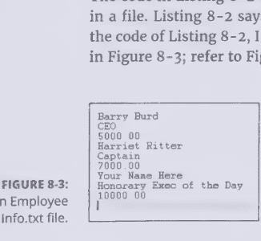

当你访问本书的网站（http://javafordummies.allmycode.com）并下载书籍的代码列表时，你会获得 `EmployeeInfo.txt` 文件的副本。

为了保持列表 8-2 的简单，我坚持要求你在输入图 8-3 中的字符时，最后输入 `1000.00` 然后按回车键。（再次查看图 8-3，注意光标如何位于新一行的开头。）如果你忘记按回车键完成输入，当你尝试运行列表 8-2 的代码将会崩溃。

分组分隔符因国家而异。图 8-3 所示的文件在配置为美国的计算机上运行，那里 `5000.00` 意味着“五千”。但该文件在配置为所谓的“逗号国家”的计算机上无法运行——在那个国家 `5000,00` 意味着“五千”。如果你住在逗号国家，请务必阅读本章的“你住在哪里”侧边栏。

### 重复我的话

在任何计算机编程语言中，从文件读取数据都是很复杂的。你需要添加额外的代码行来告诉计算机做什么。有时你可以从别人的代码中复制并粘贴这些行。例如，你遵循列表 8-2 中的模式：

```java
/**

 列表 8-2 中的模式

 */

import java.io.File;

import java.io.IOException;

import java.util.Scanner;

class SomeClassName {
```


```java
public static void main(String[] args) throws IOException {

    var scannerName = new Scanner(new File("SomeFileName"));

    // 此处编写代码

    scannerName.nextInt();

    scannerName.nextDouble();

    scannerName.next();

    scannerName.nextLine();

    // 此处编写代码

}
```

（注：此处原文后续存在大量重复的 OCR 错误，已根据列表 8-2 的逻辑结构进行了清理和翻译。）

为了防止灾难，Java 编程语言采取了某些预防措施。该语言坚持认为，当涉及到磁盘文件时，你需要承认调用 `new Scanner` 可能带来的危险。

你可以通过几种可能的方式承认这些危险，但最简单的方法是使用 `throws` 子句。在列表 8-2 中，`main` 方法的头部以 `throws IOException` 结尾。通过添加这两个词，你安抚了 Java 编译器。这就像是在说：“我知道调用 `new Scanner` 可能会导致问题。你不需要提醒我。”事实证明，在你的 `main` 方法中添加 `IOException` 让编译器不再抱怨。（如果没有这个 `throws` 子句，你将收到一个未处理的异常消息。）

关于 Java 异常的完整介绍，请参阅第 13 章。同时，在任何调用 `new Scanner(new File(...))` 的方法头部中添加 `throws IOException`。


- >> 你必须使用全名来引用 `IOException` 类：`java.io.IOException`。

你可以通过 `import` 声明来实现此，就像列表 8-2 中的那样。或者，你可以扩大 `main` 方法的 `throws` 子句：

```java
public static void main(String[] args) throws java.io.IOException {
```

- >> 你必须将扫描器的名称传递给 `payOneEmployee` 方法。

在第 7 章的列表 7-5 中，`getInterest` 方法有一个名为 `percentageRate` 的参数。每当你调用 `getInterest` 方法时，你都会向该方法传递一个额外的、最新的信息。（你向方法传递了一个数字——一个利率。图 7-7 阐释了这一点。）

同样的情况也发生在列表 8-2 中。`payOneEmployee` 方法有一个名为 `scanner` 的参数。每当你调用 `payOneEmployee` 方法时，你都会向该方法传递一个额外的、最新的信息。（你向方法传递了一个 `scanner` ——一个对磁盘文件的引用。）

你可能会奇怪为什么 `payOneEmployee` 方法需要一个参数。归根结底，在列表 8-2 中，`payOneEmployee` 方法总是从同一个文件中读取数据。为什么要每次调用它时都通知这个方法磁盘文件仍然是 `EmployeeInfo.txt` 文件呢？

嗯，有很多方法可以重组列表 8-2 中的代码。某些方法不涉及参数。但按照这个示例的安排方式，你有两个独立的方法：一个 `main` 方法和一个 `payOneEmployee` 方法。你在 `main` 方法内部创建了一次 `scanner`，然后使用了它三次 —— 在每次调用 `payOneEmployee` 方法时各使用一次。

# 第 8 章 节省时间和金钱：重用现有代码

你在方法内部定义的任何内容都像是一个私有笑话，只有该方法内部的代码知道。因此，你在 `main` 方法内部定义的 `diskScanner` 在 `payOneEmployee` 方法内部并不会自动感知。为了让 `payOneEmployee` 方法感知到磁盘文件，你将 `diskScanner` 从 `main` 方法传递给 `payOneEmployee` 方法。

要了解关于在方法内部（和外部）声明的内容，请参阅第 10 章。


## 交叉引用

## 谁移动了我的文件？

当你从本书网站（http://javafordummies.allmycode.com/）下载代码时，你会发现名为 `Employee.java` 和 `DoPayroll.java` 的文件 —— 即列表 8-1 和 8-2 中的代码。你还会找到名为 `EmployeeInfo.txt` 的文件。这是好事，如果 Java 找不到 `EmployeeInfo.txt` 文件，整个项目无法正常运行。相反，你会得到一个 `FileNotFoundException`。

通常，当你得到 `FileNotFoundException` 时，你的程序无法访问某个文件。这不是一个容易犯的错误。这可能会令人沮丧，因为对你来说，像 `EmployeeInfo.txt` 这样的文件看起来对程序是可以用的。但记住：计算机是愚笨的。如果你犯了一个微小的错误，计算机无法为你读懂言外之意。因此，如果你的 `EmployeeInfo.txt` 不在硬盘的正确目录下，或者拼写错误，计算机在尝试运行你的代码时就会卡住。

有时你很清楚硬盘上存在一个 `EmployeeInfo.txt`（或任何 .xyz 文件）。但当你运行程序时，仍然会得到一个很难看的 `FileNotFoundException`。当这种情况发生时，文件通常位于硬盘上错误的目录下。（当然，这取决于你的观点。也许文件在正确的目录下，但你的 Java 程序正在错误的目录下查找该文件。）要诊断这个问题，请向以下位置添加代码：

```java
var employeeInfo = new File("EmployeeInfo.txt");
System.out.println("Looking for " + employeeInfo.getCanonicalPath());
```

当你运行代码时，Java 会告诉你在硬盘的哪个位置 `EmployeeInfo.txt` 文件应该所在。

## 你移动了你的文件！

Java 通常会在你的项目顶层文件夹中寻找像 `EmployeeInfo.txt` 这样的文件。但你可以通过在 Java 代码中命名文件的精确位置来覆盖此行为。`new File("C:\\Users\\bburd\\workspace\\08-01\\EmployeeInfo.txt")` 看起来非常丑，但它是有效的。

在前面的段落中，你注意到你 Java 代码中的双斜杠了吗？`new File("C:\\Users\\bburd\\workspace\\08-01\\EmployeeInfo.txt")` 看起来非常丑，但它是有效的。

## 逐行读取

在列表 8-2 中，`payEmployee` 方法演示了一些实用的技巧。特别是，你创建的任何扫描器都拥有一个 `nextLine` 方法。（你可能不会使用这个 `nextLine` 方法，但该方法是可以用的。）当你使用 `scanner` 的 `nextLine` 时，它会抓取直到行尾的所有内容。

为了理解这一切，你需要对数据文件的换行符有痛苦的认识。将换行符认为是夹在行文本和另一行文本之间的额外字符。然后想象调用 `nextLine` 意味着读取到并包含换行符。

现在看看图 8-4：

- >> 如果调用一次 `nextLine` 读取了 `Barry Burd[换行]`，那么随后的 `nextLine` 读取了 `CEO[换行]`。
- >> 如果调用一次 `nextDouble` 读取了数字 `5000.00`，那么随后的 `nextLine` 读取了紧跟在 `5000.00` 之后的 `[换行]`。
- >> 如果调用 `nextLine` 读取了 `5000.00` 之后的 `[换行]`，随后的 `nextLine` 读取了 `Harriet Ritter[换行]`。

所以，在读取数字 `5000.00` 后，你需要调用两次 `nextLine` 来获取 `Harriet Ritter`。我通常犯的错误是忘记了两次调用中的第一次。

再次查看图 8-3 中的文件。为了此部分的代码正常工作，你必须在最后一个 `10000` 之后有一个换行符。如果没有，最后一次 `nextLine` 调用会让程序崩溃。错误信息为 `NoSuchElementException: No line found`。

我总是对每种编程语言扫描方法中发现的各种怪癖感到惊讶。例如，从图 8-3 的行中读取的第一个 `nextLine` 会吃掉文件中的 `Barry Burd`。但接下来的 `nextLine` 却将 `Barry Burd`（不带换行符）传递给运行中的代码。`nextLine` 丢失了换行符，这是一个微妙的细节。而且，这个微妙的细节几乎没有给任何人带来问题。

如果这个关于 `Double` 和 `nextLine` 的事儿让你感到困惑，请不要将其归咎于 Java。在任何计算机语言中，混合输入调用都是精细的工作。而真正糟糕的是，每种编程语言处理问题的方式都略有不同。你在 Java 中对 `nextLine` 的了解可以帮助你理解在学习 C++ 或 Visual Basic 时遇到的问题，但它并不会告诉你所有的细节。每种语言的细节都是该语言独有且著名的，这种付出终将会有回报的。

## 做好后续工作

对于普通计算机用户来说，键盘的感觉完全不像存储在计算机硬盘上的文件。磁盘文件和键盘输入有许多共同点。事实上，计算机操作系统的一个基本原则规定，对于程序员来说，两种输入类型之间的任何差异都越模糊越好。作为一名 Java 程序员，你应该几乎以相同的方式对待磁盘文件和键盘输入。这就是为什么列表 8-2 包含一个 `diskScanner.close()`。

当你运行一个 Java 程序时，你通常会按顺序执行方法的语句，从方法体的第一条语句开始，到方法体的最后一条语句结束。在此过程中，你会绕路，跳过某些部分并进入方法体，但基本上你是在 `main` 方法结束时完成语句执行的。这就是为什么在列表 8-2 中，对 `close` 的调用位于 `main` 方法体的末尾。当你运行列表 8-2 中的代码时，你做的最后一件事就是断开与磁盘文件的连接。此外，这种断开发生在执行完所有 `nextLine` 和 `nextDouble` 调用之后。

## 记录在案

在本章之前的章节，你创建了自己的 `PlaceLive` 类的实例，并显示了这些实例的信息。修改你文本版本的代码，使其从磁盘文件中获取每个实例的特征（地址、卧室数量和面积）。

### 定义子类（成为全职或兼职员工意味着什么）

在过去的一年里，你的公司花费了 1000 万美元购买了一个软件。该软件是以 `Employee.class` 文件的形式提供的。Burd Brain Consulting（创建该软件的公司）的人不希望你了解软件的内部结构。（否则，你可能会窃取他们的创意。）所以，你没有该软件来源的 Java 程序文件。换句话说，你没有 `Employee.java`。你可以运行 `Employee.class` 文件中的字节码。你也可以阅读名为 `Employee.html` 的网页中的文档。但你无法看到 `Employee.java` 程序中内部的语句，也无法更改你程序的任何代码。

从过去一年以来，你的公司业务增长了。与过去不同，你的公司现在有两种员工：全职和兼职。每位全职员工都有固定的周薪水。（如果员工在夜间和周末工作，作为对这种巨大付出的回报，员工会收到热诚的握手。）相比之下，每位兼职员工按小时工资计算。公司从每位全职员工的工资单中扣除一部分金额来支付公司的福利方案。然而，兼职员工不享受福利。

问题是，你公司去年购买的软件能否跟上公司的增长。你投资了一个非常棒的处理员工和工资单的程序，但该程序并不区分你的全职员工和兼职员工。你有几种选择：

-   给你的邻居打电话，他那 12 岁的孩子比你公司的任何人都更懂计算机编程。让那个极其机灵的小鬼把员工软件拆解、重写，并带上你公司要求的所有更改和增加交还给你。

再想一下，你不能那样做。无论那个孩子有多聪明，员工软件的复杂性可能会让那个孩子感到困惑。等你拿回软件时，它已经充满了漏洞和不一致之处。此外，你甚至没有 `Employee.java` 文件可以交给那个孩子。你拥有的只是 `Employee.class` 文件，它是无法用文本编辑器读取或修改的。（参见第 2 章。）此外，你的孩子刚打了邻居的孩子。你不想让邻居看到你哀求那个孩子帮忙的请求。

> 扔掉那个 1000 万美元的员工软件。让你公司里的某人从头开始写该软件。

换句话说，和你的时间和金钱说再见吧。

> 为员工软件编写一个新的前端。也就是说，编写一段代码对全职员工进行初步处理，然后将初步结果传递给你那价值 1000 万美元的软件。对兼职员工也这样做。

这个想法可能是明智的，也可能是灾难。你确定现有的员工软件内部有方便的钩子吗？（也就是说，员工软件是否包含允许你的前端软件轻松将初步数据发送到那个昂贵的员工软件的入口？）记住：这个计划将现有软件视为一个巨大的、单体的整体，这可能会变得非常繁琐。在你的前端代码和现有员工程序之间分配工作是很困难的。如果你在现有的黑盒代码上层层叠加，你最终可能会得到一个相当低效的系统。

> 联系 Burd Consulting，即那家卖软件的公司。告诉 Burd 博士，你希望他的软件下一个版本能够区分全职和兼职员工。

“没问题，”Burd 博士说，“在下一个财季度开始前准备好。”那天晚上，Burd 博士给他的邻居打了一个私密电话……

> 创建两个名为 `FullTimeEmployee` 和 `PartTimeEmployee` 的新 Java 类。让每个新类扩展现有的 Employee 类的功能，但让每个新类为特定类型的员工定义自己的专门功能。

干得好！图 8-5 显示了你想创建的结构。

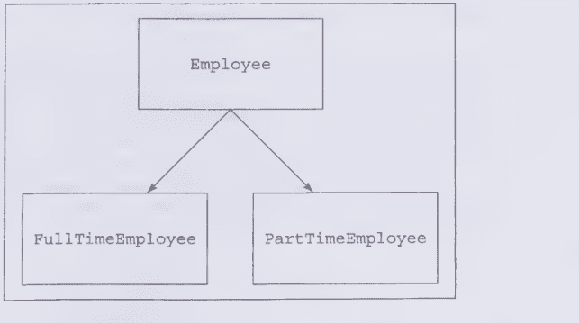

## 创建子类

在列表 8-1 中，我定义了一个 `Employee` 类。我可以使用我在列表 8-1 中定义的内容并扩展定义以创建新的专门类。因此，在列表 8-3 中，我定义了一个新类：`FullTimeEmployee` 类。

### 列表 8-3：什么是 FullTimeEmployee？

```java
package com.example.payroll;

public class FullTimeEmployee extends Employee {

    private double weeklySalary;

    private double benefitDeduction;

    public void setWeeklySalary(double weeklySalaryIn) {

        weeklySalary = weeklySalaryIn;

    }

    public double getWeeklySalary() {

        return weeklySalary;

    }

    public void setBenefitDeduction(double benefitDeductionIn) {

        benefitDeduction = benefitDeductionIn;

    }

    public double getBenefitDeduction() {

        return benefitDeduction;

    }
```


```java
public double findPaymentAmount() {
    return weeklySalary - benefitDeduction;
}
```

在 Listing 8-3 中，魔法单词是 `extends`。当一个类继承一个现有类时，扩展类会自动继承在现有类中定义的功能。因此，`FullTimeEmployee` 类继承了 `name` 和 `jobTitle` 字段。`FullTimeEmployee` 类还继承了 `Employee` 类中声明的所有方法：`setName`、`getName`、`getJobTitle` 和 `cutCheck`。`FullTimeEmployee` 类是 `Employee` 类的子类。这意味着从血缘关系上来说，`Employee` 类是父类：`FullTimeEmployee` 类是 `Employee` 类的子，而 `Employee` 类是 `FullTimeEmployee` 类的父。

这几乎（但并不完全）就像 FullTime 类是通过 Listing 8-4 中的代码定义的。

## LISTING 8-4: 伪（但信息丰富的）代码

```java
package com.example.payroll;

import static java.lang.System.out;

public class FullTimeEmployee {
    private String name;
    private String jobTitle;
    private double weeklySalary;
    private double benefitDeduction;

    public void setName(String nameIn) {
        name = nameIn;
    }

    public String getName() {
        return name;
    }

    public void setJobTitle(String jobTitleIn) {
        jobTitle = jobTitleIn;
    }

    public String getJobTitle() {
        return jobTitle;
    }

    public void setWeeklySalary(double weeklySalaryIn) {
        weeklySalary = weeklySalaryIn;
    }
    // (continued)
```

## LISTING 8-4: (续)

```java
public double getWeeklySalary() {
    return weeklySalary;
}

public void setBenefitDeduction(double benefitDedIn) {
    benefitDeduction = benefitDedIn;
}

public double getBenefitDeduction() {
    return benefitDeduction;
}

public double findPaymentAmount() {
    return weeklySalary - benefitDeduction;
}

public void cutCheck(double amountPaid) {
    printf("Pay to the order of %s ", name);
    printf("%s***$", jobTitle);
    printf("%.2f\n", amountPaid);
}
```

为什么 Listing 8-4 的标题称这些代码是伪造的？（代码会觉得被侮辱吗？）嗯，Listing 8-4 与 Listing 8-1 和 8-3 中的继承情况的主要区别在于：这个子类不能直接引用父类的私有字段。要对父类的私有字段进行任何操作，子类必须调用父类的访问器方法。在 Listing 8-3 中，调用 `setName("Rufus")` 是合法的，但代码 `name="Rufus"` 是不行的。如果你相信 Listing 8-4 中读到的所有内容，你会认为 `FullTimeEmployee` 类中的代码可以执行 `name="Rufus"`。事实上，它不行。（噢，这是一个多么微妙的观点！）

编写扩展 `Employee` 类的代码时，你不需要硬盘上的 `Employee.java` 文件。你只需要 `Employee.class`。

## 创建子类是一种习惯养成

在你习惯了扩展类之后，你可能会变得乐于扩展。如果你创建了一个 `FullTimeEmployee` 类，你也可以创建一个 `PartTimeEmployee` 类，如 Listing 8-5 所示。

## LISTING 8-5 什么是 PartTimeEmployee?

```java
package com.example.payroll;

public class PartTimeEmployee extends Employee {
    private double hourlyRate;

    public void setHourlyRate(double rateIn) {
        hourlyRate = rateIn;
    }

    public double getHourlyRate() {
        return hourlyRate;
    }

    public double findPaymentAmount(int hours) {
        return hourlyRate * hours;
    }
}
```

与 `FullTimeEmployee` 类不同，`PartTimeEmployee` 没有工资或扣除。相反，`PartTimeEmployee` 有一个 `hourlyRate` 字段。（添加一个 `numberOfHoursWorked` 字段也是可能的。我选择不这样做，认为兼职员工每周每周的变化很大。）

## 使用子类

上一节讲述了一个关于创建子类的故事。这是一个好故事，但并不完整。创建子类很好，但除非编写代码来使用它们，否则你无法从这些子类中获得任何收益。

Listing 8-6 包含了使用 `FullTimeEmployee` 和 `PartTimeEmployee` 子类的最简单示例。（想看更多有趣的示例，请访问本书的网站）。

## Listing 8-6: 子类的使用

```java
package com.example.payroll;

public class PayrollForTwo {
    public static void main(String[] args) {
        var ftEmployee = new FullTimeEmployee();
        ftEmployee.setName("Barry Burd");
        ftEmployee.setJobTitle("CEO");
        ftEmployee.setWeeklySalary(5000.00);
        ftEmployee.setBenefitDeduction(500.00);
        ftEmployee.cutCheck(ftEmployee.findPaymentAmount());
        System.out.println();
        var ptEmployee = new PartTimeEmployee();
        ptEmployee.setName("Steve Surace");
        ptEmployee.setJobTitle("Driver");
        ptEmployee.setHourlyRate(7.53);
        ptEmployee.cutCheck(ptEmployee.findPaymentAmount(10));
    }
}
```

图 8-6: 付给 Barry Burd CEO***5000.00
付给 Steve Surace Driver***75.30

图 8-6 显示了 Listing 8-6 的输出。

## 税收减免

在第 7 章中，你创建了一个 `Organization` 类。`Organization` 类的每个实例都有一个名称、年收入以及一个指示该组织是否为营利组织的布尔值。

创建一个新的 `Organization_2` 类。这个新类的每个实例只包含名称和年收入。创建两个子类：`ProfitMakingOrganization` 类和 `NonProfitOrganization` 类。营利组织需要支付收入的 10% 作为税收，而非营利组织仅需支付收入的 2% 作为税收。

创建一个单独的类用于创建 `ProfitMakingOrganization` 实例和 `NonProfitOrganization` 实例，同时显示每个实例的信息，包括该组织支付的税额。

## 仅修改部分员工的薪资

你可敢信吗！人力资源部的某个笨蛋竟然为其中一名兼职员工提供了加班双倍薪水。现在消息已经传开了，其他一些兼职员工也想要加班双倍薪水。如果这种情况持续下去，你最终会破产，所以你需要向所有兼职员工发送一份备忘录，解释为什么挣更多的钱对他们并没有好处。

与此同时，你有两种兼职员工——接受加班双倍薪水的员工和不接受的员工——所以你需要修改你的薪资软件。你有哪些选择呢？

- 嗯，你可以直接深入 `PartTimeEmployee` 类的代码，进行一些更改，然后一切完美。（这可不是个好主意！）
- 你可以遵循上一节的建议，创建现有 `PartTimeEmployee` 类的子类。“等一下，”你说道，“`PartTimeEmployee` 类已经有一个 `findPaymentAmount` 方法了。我是否需要用某种巧妙的方法，为每个获得加班双倍薪水的员工都绕过这个现有的 `findPaymentAmount` 方法呢？”

到此时，你可以感谢你的幸运星，因为你正在使用 Java 进行面向对象编程。通过面向对象编程，你可以创建一个重写其父类功能的子类。代码列表 8-7 刚刚创建了一个子类。

## 代码列表 8-7：另一个子类

```java
package com.example.payroll;

public class PartTimeWithOver extends PartTimeEmployee {
    @Override
    public double findPaymentAmount(int hours) {
        if (hours <= 40) {
            return getHourlyRate() * hours;
        } else {
            return getHourlyRate() * 40 + getHourlyRate() * 2 * (hours - 40);
        }
    }
}
```

图 8-8 显示了代码列表 8-7 中的代码与本章其他代码之间的关系。特别是，`PartTimeWithOver` 是一个子类的子类。在面向对象编程中，这种链结构并不稀奇。事实上，作为子类，这个链已经相当短了。

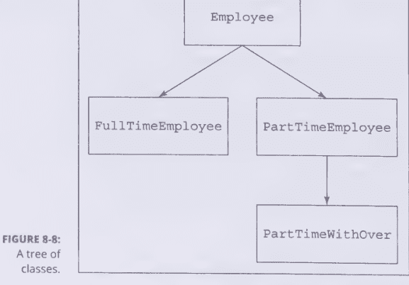

`PartTimeWithOver` 类继承了 `PartTimeEmployee` 类，但 `PartTimeWithOver` 自行选择了从 `PartTimeEmployee` 类中继承的内容。由于 `PartTimeWithOver` 对 `findPaymentAmount` 方法有自己的声明，因此 `PartTimeWithOver` 类没有从父类继承 `findPaymentAmount` 方法。（见图 8-9）。

| Employee (代码列表 8-1) | name jobTitle cutCheck |
|---|---|---|---|
| PartTimeEmployee (代码列表 8-5) | hourlyRate findPaymentAmount |
| PartTimeWithOver (代码列表 8-8) | findPaymentAmount |

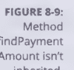

根据官方术语，`PartTimeWithOver` 类重写了父类的 `findPaymentAmount` 方法。如果你从 `PartTimeWithOver` 类创建一个对象，该对象拥有 `PartTimeEmployee` 类的 `name`、`jobTitle`、`hourlyRate` 和 `cutCheck`，但该对象拥有的是列表 8-7 中定义的 `findPaymentAmount` 方法。

## Java 注解

代码列表 8-7 中的 `@Override` 是注解的一个示例。Java 注解告诉你的计算机关于你代码的一些信息。特别是，代码列表 8-7 中的 `@Override` 注解告诉 Java 编译器密切关注编码错误。该注解的意思是：“确保紧跟此注解的方法与父类中的某个方法具有相同的内容（相同的名称、相同的参数）。如果不是，则显示错误消息。”

所以如果我不小心输入了

```java
public double findPaymentAmount(double hours) {
```

而不是像列表 8-5 和 8-7 那样的 `int hours`，编译器会提醒我，我新的 `findPaymentAmount` 方法并没有真正重写列表 8-5 中的任何内容。

Java 的注解是可选的。如果你从代码列表 8-7 中删除 `@Override`，你的代码仍然可以正常运行。但 `@Override` 注解可以检查并确保你正在做你想做的事情（即重写父类的方法之一）。尽管向乔治·奥威尔道歉，某些类型的注解比其他类型更不“可选”。只有当你愿意用大量的大量的带注解的 Java 代码来替换注解时，你才能从代码中省略注解。


```java
public class MyOtherThing extends MyThing {
    @Override
    public void display() {
        System.out.println("In MyOtherThing, value is " + value);
    }
}
```

运行 `Main.java` 文件的代码时你会看到什么输出？这个输出关于 Java 中的变量声明和方法调用了你什么？

## 本章内容

- >> 定义构造函数
- >> 从父类继承构造函数
- >> 使用 Java 的默认构造函数特性
- 从零开始构建简单的 GUI

# 第 9 章

# 创建新对象

Jennie Burd 女士
121 Schoolhouse Lane
Anywhere, Kansas

亲爱的 Burd 女士：

回复 6 月 21 日的信件，我认为我可以完全肯定地说，对象并不是凭空产生的。尽管我从未亲眼目睹过对象的创建过程（这个办公室里没有其他人能声称见过对象在创建瞬间的时刻），但我完全相信有某种过程负责了这些有趣且实用的小装置的构建。在 ObjectsAndClasses.com，我们支持科学界和私营部门在此类问题上一致的意见。此外，我们赞同蓝丝小组的最新发现，该发现毫无疑问地得出自发产生对象将阻碍目前的经济前景。

请放心，我已采取所有必要措施来确保您这位忠实客户的安全与健康。如果你有任何进一步的问题，请随时联系我们的投诉部门。该部门经理是 Blake Wholl 先生。你可以通过访问公司网站与他联系。

再次感谢您的关注，希望您继续光顾 ObjectsAndClasses.com。

此致的，

Scott Brickenchicker 先生
那个在第 7 章中没上电梯的人

# 定义构造函数（成为“温度”意味着什么）

这里有一个创建一个对象的语句：

```java
Account account = new Account();
```


我知道它是起作用的——这是从我第 7 章的一个示例中得的。总之，在第 7 章中我提到，“当 Java 执行 `new Account()` 时，你正正在通过调用 `Account` 类的构造函数来创建一个对象。”这句简洁的话意味着什么？

嗯，关键字告诉 Java 去创建一个对象——即类的一个实例。Java 通过执行某些操作来做出响应。首先，Java 在内存中找到一个空间来存储关于新对象的信息。如果对象有字段，这些字段最终应该具有有意义的值。

要了解字段，请参见第 7 章。


当你要求 Java 创建新对象时，你可能想指定对象的字段是什么。如果你对填充字段之外的操作感兴趣呢？也许，当 Java 创建新对象时，你有一整系列任务让 Java 执行。例如，当 Java 创建一个新的窗口对象时，你希望 Java 重新调整该窗口中所有按钮的大小。

创建新对象可能涉及各种任务，因此在本章中你将创建构造函数。构造函数告诉 Java 执行新对象的启动任务。

234 第 3 部分 宏观视角：面向对象编程

## 什么是温度？

“早上好，欢迎收看 Object News。您所在地区的当地温度是舒适的 73 华度。”

每个温度由两部分组成：一个数字和一个温度单位。数字只是一个 `double` 值，例如 32.0 或 70.2。但温度单位是什么？它是一串字符吗，比如“华氏”或“摄氏”？并不是，因为某些字符串并不是温度单位。并没有所谓的“Quelploof”温度单位，一个可以显示“73 度 Quelploof”的程序是一个糟糕的程序。那么如何将温度单位限制在人们使用的少数单位内？一种方法是使用 Java 的 `enum` 类型。

### 什么是温度单位？（Java 的 enum 类型）

Java 提供了许多将事物分组的方法。在第 11 章中，你将事物分组成数组。在第 12 章中，你将事物分组成集合。在本章中，你将事物分组为一种 `enum` 类型。（当然，如果你不会 `enum`，你就无法对任何东西分组。`enum` 这个词的读音是“ee-NOOM”，就像单词 enumeration 的前两个音节。）

创建一个复杂的 `enum` 类型并不容易，但要创建一个简单的 `enum` 类型，只需在大括号内写一组单词即可。列表 9-1 定义了一个 `enum` 类型。该枚举类型的名称是 `TempScale`。

```java
package com.example.weather;

public enum TempScale {

    CELSIUS, FAHRENHEIT, KELVIN, RANKINE,

    NEWTON, DELISLE, RÉAMUR, RŒMER

}
```

> 在 9-1 中，我通过命名不是两个、四个而是九种不同的温度单位来展示我的物理学造诣。某些读者的电脑在处理 RÉAMUR 和 RŒMER 单词中的特殊字符时会出现问题。如果你是这些读者之一，只需删除代码中的 RÉAMUR 和 RŒMER 单词即可。我向保证：这不会搞乱示例。


当你定义一个 `enum` 类型时，会发生两件事：

- 你创建了值。
  就像 13 和 151 是 `int` 值一样，`CELSIUS` 和 `FAHRENHEIT` 是 `TempScale` 值。
- 你可以创建变量来引用这些值。

在列表 9-2 中，我声明了字段 `number` 和 `scale`。正如

```java
double number;
```

声明了一个变量是 `double` 类型；

```java
TempScale scale;
```

“是 `TempScale` 类型”意味着你可以拥有 `CELSIUS`、`FAHRENHEIT`、`KELVIN` 等。因此，在列表 9-2 中，我可以给变量 `scale` 赋值 `FAHRENHEIT`（更准确地说是 `TempScale.FAHRENHEIT`）。

```java
temp = new Temperature(TempScale.CELSIUS);
out.printf(format, temp.getNumber(), temp.getScale());
```

```java
temp = new Temperature(2.73, TempScale.KELVIN);
out.printf(format, temp.getNumber(), temp.getScale());
```

```java
}
```

### 在列表 9-3 中，每一条如下语句

```java
temp = new Temperature(blah,blah,blah);
```

都调用了列表 9-2 中的构造函数之一。因此，当列表 9-3 中的代码运行结束时，它创建了 `Temperature` 类的四个实例。每个实例都是通过调用列表 9-2 中不同的构造函数创建的。

在列表 9-3 中，四个构造函数调用中的最后一个有两个参数：`2.73` 和 `TempScale.KELVIN`。这并不是构造函数调用的特有的。方法调用或构造函数调用可以有一组参数。你用逗号将一个参数与其他参数隔开。“一组参数”的另一个名称是参数列表。

你必须遵循的唯一规则是匹配调用中的参数与声明中的参数。例如，在列表 9-3 中，第四个也是最后一个构造函数调用

```java
new Temperature(2.73, TempScale.KELVIN)
```

有两个参数：第一个是 `double` 类型，第二个是 `TempScale` 类型。Java 认可此构造函数调用，因为列表 9-2 包含一个一个匹配的声明。也就是说，头部定义

```java
public Temperature(double number, TempScale scale)
```

有两个参数：第一个是 `double` 类型，第二个是 `TempScale` 类型。如果列表 9-3 中的一个 `Temperature` 构造函数调用在列表 9-2 中没有匹配的声明，列表 9-3 就会崩溃。（说得委婉一点，当你尝试编译列表 9-3 中的代码时，Java 会显示错误。）

顺便说一下，这种关于多个参数的业务逻辑并不新鲜。在第 6 章中，我写过 `keyboard.findWithinHorizon(".",0).charAt(0)`。在该行中，方法 `findWithinHorizon(".",0)` 有两个参数：一个字符串和一个 `int` 值。对我来说幸运的是，Java API 为 `findWithinHorizon` 有一个方法声明——该声明的第一个参数是字符串，第二个参数是 `int` 值。

### 第 9 章 创建新对象 239

### 如何“作弊”：枚举类型与 switch 语句

列表 9-2 和 9-3 包含了冗长的名称，例如 `TempScale.FAHRENHEIT` 和 `TempScale.CELSIUS`。像 `FAHRENHEIT` 和 `CELSIUS` 这样的名称属于我的 `TempScale` 类型（在列表 9-1 中定义的类型）。这些名称在我的 `TempScale` 上下之外没有意义。（如果你认为我这种“在我的上下文之外没有意义”的言论是在自恋，请尝试删除列表 9-2 中 `TempScale.FAHRENHEIT` 的 `TempScale` 部分。突然，java 会告诉你的代码包含一个错误。）

Java 通常对类型名称和点非常挑剔。但当他们创建枚举类型（enum types）时，Java 的制作者们决定 `switch` 语句和表达式中的枚举类型应该受到特殊对待。你可以使用枚举值来决定执行 `switch` 语句或 `switch` 表达式的哪个 `case`。当你这样做时，在 `case` 表达式中不需要枚举类型名称。例如，以下 Java 代码是：

```java
TempScale scale = TempScale.RANKINE;

char letter =

switch (scale) {

    case CELSIUS -> 'C';

    case KELVIN -> 'K';

    case RANKINE, REAMUR, ROMER -> 'R';

    default -> 'X';

}
```

在第一行代码中，我写了 `TempScale.RANKINE`，因为第一行不在 `switch` 内部。但在接几行代码中，我写的是 `case CELSIUS`、`case KELVIN`、`case RANKINE`，而没有 `TempScale` 这个词。如果你通过写 `case TempScale.RANKINE` 来创建一个 `case` 子句，java 会报出一个响亮且令人讨厌的错误信息。

### 创建温度；慢动作回放

当计算机执行列表 9-3 中的其中一个新的 `Temperature` 语句时，计算机必须决定使用列表 9-2 中的哪一个构造函数。计算机通过查看参数列表——即 `new Temperature` 单词后面的括号里的内容来做决定。例如，当计算机执行

```java
temp = new Temperature(32.0);
```

来自列表 9-3，计算机对自己说：“括号中的数字 `32.0` 是一个 `double` 值。列表 9-2 中的 `Temperature` 构造函数之一恰好有一个 `double` 类型的参数。构造函数的头部看起来像这样：

240 第 3 部分 从宏观角度工作：面向对象编程

“所以我我想我将执行那个特定构造函数内部的语句。”计算机继续执行以下语句：

```java
this.number = number;
scale = TempScale.FAHRENHEIT;
```

结果，你得到了一个全新的对象，其字段值为 `32.0`，其 `scale` 值为 `TempScale.FAHRENHEIT`。

在这两行代码中，你有两条为 `number` 和 `scale` 赋值的语句。看看这些语句中的第二条，它稍微好理解一点。第二条语句将新对象的 `scale` 字段设置为 `TempScale.FAHRENHEIT`。（实际上，OCR 文本在中间重复且混乱的。让我们根据提供的文本进行清理。）

```java
public class Temperature {

    private double number;

    private ScaleName scale;

    public Temperature(double number) {

        this.number = number;

        scale = ScaleName.Fahrenheit;

    }

}
```

图 9-2：this.number 和 number 的含义。

### 有些东西永远不会

第 7 章引入了 `printf` 方法并解释了每个 `printf` 都以一个格式字符串开头。格式字符串描述了其他参数的显示方式。

在之前的示例中，这个格式字符串始终是一个带引号的字面量。例如，第一个 `printf` 调用位于代码列表 7-7（参见第 7 章），如下：

```java
printf("%$4.2f\n", myinterest);
```

在代码列表 9-3 中，我打破了传统，用一个命名为 `format` 的变量开始 `printf` 调用：

```java
printf(format, temp.getNumber(), temp.getScale());
```

只要我的 `format` 变量类型是 `String`，那就是可以的。事实上，在代码列表 9-3 中，第一个变量声明是

```java
final String format = "%$5.2f degrees\n";
```

在 `format` 变量的声明中，特别注意 `final` 这个词。这个 Java 关键字表示 `format` 的值不能更改。如果我在代码列表 9-3 中添加另一个变量赋值语句：

```java
format = "%$6.2f (%s)\n";
```

编译器会向我报错，并显示信息：无法给最终变量（final variable）赋值。

当我编写代码列表 9-3 中的代码时，使用 `final` 关键字并不是绝对必要的。但 `final` 关键字提供了一些额外的保护。当我将内容格式化为 `"%%5.2f%%s\n"` 时，我打算原封不动地反复使用这种相同的格式。我很清楚，我并不打算改变 `format` 变量的值。当然，在一个 10,000 行的程序中，我可能会困惑，并尝试在代码深处给 `format` 赋一个新值。为了防止我不意外更改格式字符串，我将 `format` 变量声明为 `final`。这只是一种良好的、安全的编程习惯。


### 尝试一下

#### 校园时光

创建一个 `Student` 类，包含姓名、ID 编号、平均学点（GPA）和一个主要学习领域。学生的姓名是 `String` 类型。学生的 ID 编号是 `int`。GPA 是一个 0.0 到 4.0 之间的 `double` 值。专业（Major）是一个 `enum` 类型，其值包括 `COMPUTER_SCIENCE`、`MATHEMATICS`、`LITERATURE`、`PHYSICS` 和 `HISTORY`。

每个学生都有姓名和 ID 编号，但新学生可能没有 GPA 或专业。创建一个包含和不包含 GPA 和 Major 参数的构造函数。

像往常一样，创建一个单独的类来使用你新创建的 `Student` 类。

#### 幻想飞程

创建一个 `AirplaneFlight` 类，包含航班号、出发机场、出发时间、到达机场和到达时间。航班号是一个 `int` 值。出发机场和到达机场字段属于 `Airport` 类型，其值对应于某些官方 IATA 机场代码。例如，伦敦希思罗机场的代码是 LHR；洛杉矶国际机场的代码是 LAX；请访问 www.iata.org/publications/Pages/code-search 查看一个可搜索的航空公司代码数据库。

对于到达和出发时间，请检查 Java 的 `LocalTime` 类。（有关更多关于 `LocalTime` 的信息，请查看 https://docs.oracle.com/en/java/javase/17/docs/api/java.base/time/LocalTime.html 中的 `LocalTime` 文档页面。）创建一个设置为下午 2:15 的 `LocalTime` 对象：

```java
LocalTime fifteen = LocalTime.of(14, 15);
```

244 第 3 章 核心大图：面向对象编程

要创建一个设置为当前时间的 `LocalTime` 对象，执行

```java
LocalTime currentTime = LocalTime.now();
```


# 创建 Student 类

创建一个 `Student` 类，包含姓名、ID 编号、平均学点（GPA）和一个主要学习领域。

- 学生的姓名是 `String` 类型。
- 学生的 ID 编号是 `int`。
- GPA 是一个 0.0 到 4.0 之间的 `double` 值。
- 专业（Major）是一个 `enum` 类型，其值包括 `COMPUTER_SCIENCE`、`MATHEMATICS`、`LITERATURE`、`PHYSICS` 和 `HISTORY`。

每个学生都有姓名和 ID 编号，但新学生可能没有 GPA 或专业。创建一个包含和不包含 GPA 和 Major 参数的构造函数。

像往常一样，创建一个单独的类来使用你新创建的 `Student` 类。

# 创建 AirplaneFlight 类

创建一个 `AirplaneFlight` 类，包含航班号、出发机场、出发时间、到达机场和到达时间。

- 航班号是一个 `int` 值。
- 出发机场和到达机场字段属于 `Airport` 类型，其值对应于某些官方 IATA 机场代码。例如，伦敦希思罗机场的代码是 LHR；洛杉矶国际机场的代码是 LAX；请访问 www.iata.org/publications/Pages/code-search 查看一个可搜索的航空公司代码数据库。
- 对于到达和出发时间，请检查 Java 的 `LocalTime` 类。（有关更多关于 `LocalTime` 的信息，请查看 https://docs.oracle.com/en/java/javase/17/docs/api/java.base/time/LocalTime.html 中的 `LocalTime` 文档页面。）

创建一个设置为下午 2:15 的 `LocalTime` 对象，执行：

```java
LocalTime fifteen = LocalTime.of(14, 15);
```

# Record 特性

较新的 Java 版本（从 Java 16 开始）有一个名为 `record` 的方便特性。为了介绍这些特性，创建 `TemperatureRecord.java` 和 `UseRecord.java` 文件。将以下代码放入这些文件中：

```java
// TemperatureRecord.java
package example.weather;

public record TemperatureRecord(double number, ScaleName scale) {}

// UseRecord.java
package example.weather;

import static java.lang.System.out;

public class UseRecord {
    public static void main(String[] args) {
        final String format = "%$5.2f degrees\n";
        TemperatureRecord temp = new TemperatureRecord(72.5, ScaleName.Fahrenheit);
        out.printf(format, temp.number(), temp.scale());
    }
}
```

# 有些东西永远不会

第 7 章引入了 `printf` 方法并解释了每个 `printf` 都以一个格式字符串开头。格式字符串描述了其他参数的显示方式。

在之前的示例中，这个格式字符串始终是一个带引号的字面量。例如，第一个 `printf` 调用位于代码列表 7-7（参见第 7 章），如下：

```java
printf("%$4.2f\n", myinterest);
```

在代码列表 9-3 中，我打破了传统，用一个命名为 `format` 的变量开始 `printf` 调用：

```java
printf(format, temp.getNumber(), temp.getScale());
```

只要我的 `format` 变量类型是 `String`，那就是可以的。事实上，在代码列表 9-3 中，第一个变量声明是：

```java
final String format = "%$5.2f degrees\n";
```

在 `format` 变量的声明中，特别注意 `final` 这个词。这个 Java 关键字表示 `format` 的值不能更改。如果我在代码列表 9-3 中添加另一个变量赋值语句：

```java
format = "%$6.2f (%s)\n";
```

编译器会向我报错，并显示信息：无法给最终变量（final variable）赋值。

当我编写代码列表 9-3 中的代码时，使用 `final` 关键字并不是绝对必要的。但 `final` 关键字提供了一些额外的保护。当我将内容格式化为 `"%%5.2f%%s\n"` 时，我打算原封不动地反复使用这种相同的格式。我很清楚，我并不打算改变 `format` 变量的值。当然，在一个 10,000 行的程序中，我可能会困惑，并尝试在代码深处给 `format` 赋一个新值。为了防止我不意外更改格式字符串，我将 `format` 变量声明为 `final`。这只是一种良好的、安全的编程习惯。


## 尝试一下

创建一个 `Student` 类，包含姓名、ID 编号、平均学点（GPA）和一个主要学习领域。学生的姓名是 `String` 类型。学生的 ID 编号是 `int`。GPA 是一个 0.0 到 4.0 之间的 `double` 值。专业（Major）是一个 `enum` 类型，其值包括 `COMPUTER_SCIENCE`、`MATHEMATICS`、`LITERATURE`、`PHYSICS` 和 `HISTORY`。

每个学生都有姓名和 ID 编号，但新学生可能没有 GPA 或专业。创建一个包含和不包含 GPA 和 Major 参数的构造函数。

像往常一样，创建一个单独的类来使用你新创建的 `Student` 类。

创建一个 `AirplaneFlight` 类，包含航班号、出发机场、出发时间、到达机场和到达时间。航班号是一个 `int` 值。出发机场和到达机场字段属于 `Airport` 类型，其值对应于某些官方 IATA 机场代码。例如，伦敦希思罗机场的代码是 LHR；洛杉矶国际机场的代码是 LAX；请访问 www.iata.org/publications/Pages/code-search 查看一个可搜索的航空公司代码数据库。

对于到达和出发时间，请检查 Java 的 `LocalTime` 类。（有关更多关于 `LocalTime` 的信息，请查看 https://docs.oracle.com/en/java/javase/17/docs/api/java.base/time/LocalTime.html 中的 `LocalTime` 文档页面。）创建一个设置为下午 2:15 的 `LocalTime` 对象，执行：

```java
LocalTime fifteen = LocalTime.of(14, 15);
```

# 继承与子类

当你创建一个类来继承另一个类时，该类将拥有父类的所有属性和方法。使用 `extends` 关键字来建立这种关系。例如，我们可以创建一个 `FahrenheitTemperature` 类继承 `Temperature` 类：

```java
public class FahrenheitTemperature extends Temperature {
    public FahrenheitTemperature(double number) {
        super(number);
    }
}
```

# 方法重写

方法重写允许子类为父类中的方法提供特定的实现。使用 `@Override` 注解可以告诉编译器你正在重写一个现有方法。

```java
@Override
public void display() {
    System.out.println("Temperature: " + getNumber() + " " + getScale());
}
```

# 子类的构造函数

到目前为止，列表 9-5 中最大的新闻是代码声明构造函数的方式。`TemperatureNice` 类有四个它自己的构造函数。如果你已经开始考虑子类继承，你可能会奇怪为什么这些构造函数声明是必要的。`TemperatureNice` 不是继承父类 `Temperature` 类的构造函数吗？不，子类不继承构造函数。


子类不继承构造函数。没错，子类不继承构造函数。在一种极其特殊的情况下，构造函数看起来像是被继承了，但那种特殊情况只是偶然，而不是常态。通常情况下，当你定义一个子类时，你会声明新的构造函数来配合该子类。

我将在本章稍后的“默认构造函数”节中描述那种特殊情况（构造函数看起来像是被继承的情况）。

因此，列表 9-5 中的代码有四个构造函数。每个构造函数的名称都是 `TemperatureNice`，且每个构造函数都有其唯一标识的参数列表。这是无聊的部分。有趣的部分是每个构造函数都调用了名为 `super` 的内容，`super` 是 Java 的关键字。

在列表 9-5 中，`super` 代表父类中的构造函数：

- 列表 9-5 中的 `super()` 语句调用了列表 9-2 中无参数的 `Temperature()` 构造函数。该无参数构造函数将 0 赋值给数字字段，并将 `TempScale.FAHRENHEIT` 赋值给刻度字段。
- 列表 9-5 中的 `super(number, scale)` 语句调用了列表 9-2 中的 `Temperature(double number, TempScale scale)`。反之，该构造函数为 `number` 和 `scale` 字段赋值。
- 类似地，列表 9-5 中的 `super(number)` 和 `super(scale)` 语句调用了列表 9-2 中的构造函数。

计算机通过查看 `super` 关键字之后的参数列表来决定调用 `Temperature` 类的哪个构造函数。例如，当计算机执行列表 9-5 中的：

```java
super(number, scale);
```

时，计算机对自己说：“括号中的 number 和 scale 字段类型是 double 和 TempScale。但在列表 9-2 的 Temperature 构造函数中，只有一个具有两个类型为 double 和 TempScale 的参数。”构造函数的头部看起来像这样：

```java
public Temperature(double number, TempScale scale)
```

“所以我想，我将执行那个特定构造函数内部的语句。”

# 使用这些内容

在列表 9-5 中，我定义了成为 `TemperatureNice` 类的含义。现在是时候好好利用这个 `TemperatureNice` 类了。列表 9-6 是使用 `TemperatureNice` 的代码。

## 列表 9-6：使用 TemperatureNice 类

```java
package com.example.weather;

public class UseTemperatureNice {
    public static void main(String[] args) {
        var temp = new TemperatureNice();
        temp.setNumber(70.0);
        temp.setScale(TempScale.FAHRENHEIT);
        temp.display();
        temp = new TemperatureNice(32.0);
        temp.display();
        temp = new TemperatureNice(TempScale.CELSIUS);
        temp.display();
        temp = new TemperatureNice(2.73, TempScale.KELVIN);
        temp.display();
    }
}
```

列表 9-6 中的代码与其在列表 9-3 中的表兄弟代码非常相似。主要的区别在此处：

- 列表 9-6 创建了 `TemperatureNice` 类的实例。也就是说，列表 9-6 调用的是 `TemperatureNice` 类的构造函数，而不是 `Temperature` 类。
- 列表 9-6 利用了 `Temperature` 类中的 `display` 方法。因此，列表 9-6 的代码比列表 9-3 中的对应代码要整洁得多。

运行列表 9-6 的结果与运行列表 9-3 中的代码完全一样——它只是以更优雅的方式到达终点。（运行结果之前在图 9-1 中显示过）。

# 默认构造函数

前一节的主要信息是子类不继承构造函数。那么，第 8 章中所有的列表是怎么回事呢？在列表 8-6 中，有一个语句说：

```java
FullTimeEmployee ftEmployee = new FullTimeEmployee();
```

但问题在于：定义 `FullTimeEmployee` 的代码（参考列表 9-3）内部似乎没有声明任何构造函数。那么，在列表 8-6 中，你如何可能调用 `FullTimeEmployee` 构造函数呢？

情况是：当你创建一个子类且不在代码中放入任何构造函数声明时，Java 会为你创建一个构造函数。它被称为默认构造函数。如果你正在创建公共的 `FullTimeEmployee` 子类，默认构造函数就像列表 9-7 中的那样。

## 列表 9-7：默认构造函数

```java
public FullTimeEmployee() {
    super();
}
```

列表 9-7 中的构造函数不接受任何参数，它的唯一语句调用了你所扩展的那个类的构造函数。（如果你扩展的类没有无参数构造函数，你就倒霉了。）

你刚刚读了关于默认构造函数的内容，但注意！注意这段默认构造函数的讨论没有提到这一点：它没有说你总是能得到默认构造函数。特别是，如果你创建一个子类并自己定义了任何构造函数，Java 就不会添加默认构造函数（子类也不会继承任何构造函数）。

这会让你困惑吗？列表 9-8 是列表 8-3 代码的副本，但增加了一个构造函数。看看这个修改后的 `FullTimeEmployee` 代码。

## 列表 9-8：看，我有一个构造函数！

```java
package com.example.payroll;

public class FullTimeEmployee extends Employee {
    private double weeklySalary;
    private double benefitDeduction;

    public FullTimeEmployee(double weeklySalary) {
        this.weeklySalary = weeklySalary;
    }

    public void setWeeklySalary(double weeklySalaryIn) {
        weeklySalary = weeklySalaryIn;
    }

    public double getWeeklySalary() {
        return weeklySalary;
    }

    public void setBenefitDeduction(double benefitDedIn) {
        benefitDeduction = benefitDedIn;
    }

    public double getBenefitDeduction() {
        return benefitDeduction;
    }

    public double findPaymentAmount() {
        return weeklySalary - benefitDeduction;
    }
}
```

如果你使用 9-8 中的 `FullTimeEmployee` 代码，下面这语句是不行的：

```java
FullTimeEmployee ftEmployee = new FullTimeEmployee();
```

之所以不行是因为在声明了接受一个参数的 `FullTimeEmployee` 构造函数后，你不再免费获得默认无参数构造函数。

# 第 3 部分 大局：面向对象编程

要找到两个 `LocalTime` 对象（例如 `twoFifteen` 和 `currentTime`）之间的分钟数，请执行：

```java
long minutes = ChronoUnit.MINUTES.between(twoFifteen, currentTime);
```

# 转换 D

创建一个 `TemperatureNicer` 类 —— 本节 `TemperatureNicer` 类的子类。`TemperatureNicer` 类有一个 `convertTo` 方法。如果变量 `temp` 指向华氏温度且 Java 执行：

```java
temp.convertTo(TempScale.CELSIUS);
```

那么 `temp` 对象变为摄氏温度，数字也经过相应的转换。当 Java 执行：

```java
temp.convertTo(TempScale.FAHRENHEIT);
```

且 `temp` 已经指向摄氏温度时，也会发生类似的情况。

# 破记录记录

遵循本章之前的“创建一个热门记录”实验。命名两个文件为 `TemperatureNiceRecord.java` 和 `UseTemperatureNiceRecord.java`。将以下代码放入这些文件中，并查看它们的运行运行。


// TemperatureNiceRecord.java

```java
package com.example.weather;

import static java.lang.System.out;

public record TemperatureNiceRecord(double number, TempScale scale) {

    public TemperatureNiceRecord() {
        this(0, TempScale.CELSIUS);
    }

    public void display() {
        out.printf("%5.2f degrees %s\n", number, scale);
    }
}
```

// UseTemperatureNiceRecord.java

```java
package com.example.weather;

public class UseTemperatureNiceRecord {

    public static void main(String[] args) {
        var temp = new TemperatureNiceRecord();
        temp.display();
        temp = new TemperatureNiceRecord(2.73, TempScale.KELVIN);
        temp.display();
    }
}
```

## 执行更多操作构造函数

这里有来自本章开头附近的一句引言：“如果你想做比填充字段更多的事情该呢？也许，如果计算机创建一个新对象，你有一整系列任务让计算机去执行。”好吧，如果会怎样？

本节的示例包含一个构造函数，它的功能不仅仅是给字段赋值。该示例位于列表 9-9 和 9-10 中。运行示例代码的结果如图 9-3 所示。


图 9-3：
不要惊慌。

### 列表 9-9：定义一个框架

```java
package com.example.graphical;

import javax.swing.JButton;
import javax.swing.JFrame;
import java.awt.FlowLayout;

public class SimpleFrame extends JFrame {

    public SimpleFrame() {
        setTitle("不要点击这个按钮!");
        setLayout(new FlowLayout());
        setDefaultCloseOperation(EXIT_ON_CLOSE);
        add(new JButton("Panic"));
        setSize(300, 100);
        setVisible(true);
    }
}
```

### 列表 9-10：显示一个框架

```java
package com.example.graphical;

public class ShowAFrame {

    public static void main(String[] args) {
        new SimpleFrame();
    }
}
```

与我的 DummiesFrame 示例一样，列表 9-9 和 9-10 中的代码在计算机屏幕上显示了一个窗口。但与我的 DummiesFrame 示例不同，列表 9-9 和 9-10 中的所有方法调用都指向 Java 标准 API（应用程序编程接口）中的方法。

要找到我的 DummiesFrame 示例，请参阅第 7 章。

列表 9-9 中的代码包含许多你可能并不熟悉的名称——这些名称来自 Java 的 API。当我刚接触 Java 时，我愚蠢地认为学习 Java 意味着记住所有这些名称。恰恰相反：这些名称只是负担。真正的 Java 是该语言实现面向对象概念的方式。

无论如何，列表 9-10 只有一条语句：`SimpleFrame` 类的构造函数。注意看这个创建的对象甚至没有被赋值给变量。这没关系，因为代码在其他地方不需要引用该对象。

在 `SimpleFrame` 类中，只有一个构造函数声明。这个构造函数不仅仅是设置变量的值，它一个接一个地调用 Java API 中的方法。


`SimpleFrame` 类构造函数中调用的所有方法都来自父类 `JFrame`。`JFrame` 类位于 `javax.swing` 包中。这个包以及另一个包 `java.awt` 包含了帮助你将在计算机屏幕上放置窗口、图像、图形和其他小部件的类。（在 `java.awt` 包中，awt 字母代表抽象窗口工具包 abstract windowing toolkit）。

关于 Java 包概念的一点闲谈，请参阅第 7 章和 14 章。


在 Java API 中，人们通常称为窗口的是 `javax.swing.JFrame` 类的实例。

## 来自 Java API 的类和方法

看着图 9-3，你可能看出 `SimpleFrame` 类的实例并没有做什么。框架上只有一个按钮，当你点击该按钮时，什么都没有发生。我这样设计框架是为了防止示例变得太复杂。尽管如此，列表 9-9 中的代码使用的 `setTitle`、`setLayout`、`setDefaultCloseOperation`、`add`、`getSize` 和 `setVisible` 方法都属于 `javax.swing.JFrame` 类。以下是你用到的名称列表：

- `setTitle`：调用 `setTitle` 在框架的标题栏上显示标题。（新的 `SimpleFrame` 对象正在调用它自己的 `setTitle`。）
- `FlowLayout`：`FlowLayout` 类的实例以居中的方式在框架上排列对象。由于图 9-3 中的框架上只有一个按钮，该按钮将居中位于框架顶部附近。如果框架有八个按钮，其中五个可能会在框架顶部排成一行，其余三个将沿第二行居中排列。
- `setLayout`：调用 `setLayout` 让新的 `FlowLayout` 对象负责安排组件，如按钮。（新的 `SimpleFrame` 对象正在调用它自己的 `setLayout`。）
- `setDefaultCloseOperation`：调用 `setDefaultCloseOperation` 告诉在点击框架右上角的小“x”时该做什么。（在 Mac 上，你点击框架左上角的小红圈）。如果没有这个方法调用，框架本身会消失，但 Java 虚拟机（JVM）会继续运行。要停止你的程序的运行，你必须再执行一步。
- `add`：调用 `add` 向框架中添加组件。
- `setSize`：调用 `setSize` 设置框架的宽度和高度。
- `setVisible`：调用 `setVisible` 显示或隐藏框架。

# 第 10 章 将变量和方法放在它们应该的地方

## 定义一个类（一名棒球运动员意味着什么）

在我看来，一个棒球球员有一个名字和一个击球率。列表 10-1 将我对棒球球员的理解转换成了程序形式。

### 列表 10-1：Player 类

```java
package com.example.baseball;

import java.text.DecimalFormat;

public class Player {

    private String name;
    private double average;

    public Player(String name, double average) {
        this.name = name;
        this.average = average;
    }

    public String getName() {
        return name;
    }

    public double getAverage() {
        return average;
    }

    public String getAverageString() {
        var decformat = new DecimalFormat();
        decformat.setMaximumIntegerDigits(0);
        decformat.setMaximumFractionDigits(3);
        decformat.setMinimumFractionDigits(3);
        return decformat.format(average);
    }
}
```

现在我们来拆解列表 10-1 中的代码。幸的是，前面的章节已经涵盖了这段代码中的很多内容。代码定义了作为 `Player` 类实例意味着什么。以下是代码中的内容：

- **字段 `name` 和 `average` 的声明**：关于声明的后续阅读，请看第 7 章。
- **用于创建 `Player` 类新实例的构造函数**：关于构造函数的详细介绍，请看第 9 章。
- **字段 `name` 和 `average` 的 getter 方法**：关于访问器方法（即 setter 和 getter 方法）的闲聊，请看第 7 章。
- **一个以 String 形式返回球员击球率的方法**：关于方法的精彩介绍，请看第 7 章。（我在第 7 章里放了很多好东西，不是吗？）

## 美化你数字的另一种方法

列表 10-1 中的 `getAverageString` 方法获取 `average` 字段的值（球员的击球率），将其（通常为 `double` 类型）转换为 `String`，然后将该 `String` 值返回给方法调用者。使用直接来自 Java 应用程序接口（API）的 `DecimalFormat` 确保了 `String` 值看起来像棒球击球率。根据 `decFormat.setMaximum...` 和 `decFormat.setMinimum...` 方法调用，该 `String` 值在小数点左没有数字，在小数点右恰有三位数字。

Java 的 `DecimalFormat` 类非常有用。例如，为了以符合会计标准的格式显示值 345 和 -345，你可以使用以下代码：

```java
DecimalFormat decFormat = new DecimalFormat();
decFormat.setMinimumDigits(2);
decFormat.setNegativePrefix("-");
decFormat.setNegativeSuffix("");
System.out.println(decFormat.format(345));
System.out.println(decFormat.format(-345));
```

在此示例的格式字符串中，分号之前的内容决定了正数的显示方式，分号之后的内容决定了负数的显示方式。因此，使用这种格式后，数字 345 和 -345 显示如下：

```
345.00
(-345.00)
```

要发现其他处理数字的技巧，请访问 Java API 文档中的 `DecimalFormat` 页面（https://docs.oracle.com/en/java/javase/17/docs/api/java.base/java/text/DecimalFormat.html）。

## 使用 Player 类

列表 10-2 和 10-3 包含了使用 `Player` 类的代码——该类在之前的列表 10-1 中已定义。

### 列表 10-2：使用 Player 类

```java
package com.example.baseball;

import javax.swing.JFrame;
import javax.swing.JLabel;
import java.awt.GridLayout;
import java.io.File;
import java.io.IOException;
import java.util.Scanner;

public class TeamFrame extends JFrame {

    private Player player;

    public TeamFrame() throws IOException {
        var hankeesData = new Scanner(new File("Hankees.txt"));
        for (int num = 1; num <= 9; num++) {
            player = new Player(hankeesData.nextLine(), hankeesData.nextDouble());
            addPlayerInfo(player);
        }
        setTitle("The Hankees");
        setLayout(new GridLayout(10, 2, 20, 6));
        setDefaultCloseOperation(EXIT_ON_CLOSE);
        pack();
        setVisible(true);
        hankeesData.close();
    }

    void addPlayerInfo(Player player) {
        add(new JLabel(" " + player.getName()));
        add(new JLabel(player.getAverageString()));
    }
}
```

### 列表 10-3：显示框架

```java
package com.example.baseball;

import java.io.IOException;

public class ShowTeamFrame {

    public static void main(String[] args) throws IOException {
        new TeamFrame();
    }
}
```

列表 10-1、10-2 和 10-3 中代码的运行结果，请参见图 10-1。

| 姓名 | 页码 |
| :--- | :--- |
| Barry Burd | .101 |
| Harriet Ritter | .200 |
| Willie J. Katz | .030 |
| Barry Crazyman | .124 |
| Felicia | .075 |
| Mia | .111 |
| Jeremy Long | .102 |
| I. M. | .001 |
| Hugh R. | .212 |

图 10-1：Player 实例

顺序（先添加标签然后调用 `setLayout`），调用 `setLayout` 会以一种整齐、有序的方式重新排列标签。这两种操作方式都运行良好。

在设置框架（frame）时，你不应该做的事情就是违反这个顺序：

```
Add things to the frame, then
pack();
setVisible(true);
```


如果你在调用 `pack` 后向框架添加了更多内容，`pack` 方法将不会考虑你最近添加的那些。如果你在添加内容或调用 `pack` 之前调用了 `setVisible`，用户将看到正在构建中的框架。最后，如果你忘记设置框架的大小（通过调用 `pack` 或其他调整大小的方法），你看到的框架看起来就像图 10-4 所示所示。（通常情况下，我不会向你展示像图 10-4 那样的异常运行结果，但我犯过太多次这种错误了，以至于我觉得这个矮小的框架就像我的老朋友。）

图 10-4：
一个收缩的框架。


## 关于土豆的一些事实

第 8 章引入了从磁盘文件读取输入，并随着这个主题引入了异常的概念。当你处理磁盘文件时，需要意识到可能会抛出 `IOException`。这是第 8 章的教训，这也就是为什么列表 10-2 中的构造函数有一个 `throws IOException` 子句的原因。

列表 10-3 中的 `main` 方法又是怎样的？在这个 `main` 方法中没有明显的引用磁盘文件，为什么该方法仍然需要它自己的 `throws IOException` 子句呢？嗯，异常就像是一个烫手山芋。如果你有一个异常，你要么吃掉它（正如第 13 章中所示），要么使用 `throws` 子句把它扔给别人。如果你用 `throws` 子句抛出异常，别人就会陷入与你之前同样的困境中。

列表 10-2 中的构造函数抛出了 `Exception`，但这个异常是给谁的呢？在这个代码链中，谁成为了这个问题的 `IOException` 的责任人？嗯，是谁调用了列表 10-2 中的构造函数？是列表 10-3 中的 `main` 方法——它被称为 `TeamFrame` 构造函数。因为 `TeamFrame` 构造函数将它的烫手山芋扔给了列表 10-3 中的 `main` 方法，所以 `main` 方法必须处理它。如列表 10-3 所示，`main` 方法通过再次抛出异常（即通过它自己的 `throws IOException` 子句）来处理它。这就是 Java 程序中 `throws` 子句的工作原理。

如果一个方法调用另一个方法，而被调用的方法有一个 `throws` 子句，则调用方法必须包含处理异常的代码。要了解更多关于处理异常的信息，请阅读第 13 章。

在书的这里，敏锐的《傻瓜指南》读者可能会提出一两个后续问题：“当一个 `main` 方法有一个 `throws` 子句时，其他人必须处理该子句中的异常。但是谁调用了 `main` 方法呢？”谁处理列表 10-3 中 `throws` 子句中的 `IOException`？答案是 Java 虚拟机（JVM，运行你所有 Java 代码的程序）调用 `main` 方法并处理了列表 10-3 中的 `Exception`。如果程序在读取 `Hanks.txt` 文件时遇到任何问题，责任最终落在 JVM 身上。JVM 通过显示错误消息然后结束你的程序运行来处理异常。多么方便！

你想对这一节的内容进行一些练习吗？如果是的话，尝试一下：

## 招致灾难

列表 10-2 中的代码从一个名为 `Hanks.txt` 的文件中读取。从你的电脑硬盘上删除该 `Hanks.txt`，或者将其临时移动到不同的目录。然后尝试运行列表 10-1 到 10-3 中的程序。当你这样做时会发生什么可怕的事情？

## 男装

一个男装系列包括衬衫、裤子、外套、大衣、领带和鞋子。创建一个枚举（enum）来表示这六类物品。创建一个 `MensClothingItem` 类。该类的每个实例都有一个 `kind`（六个枚举值之一）和一个 `name`（例如 `Casual Summer Design #7`）。

编写代码显示一个框架（如图 10-1 中的框架）。

## 交易

一个男装系列包括衬衫、裤子、外套、大衣、领带和鞋子。创建一个枚举（enum）来表示这六类物品。创建一个 `MensClothingItem` 类。该类的每个实例都有一个 `kind`（六个枚举值之一）和一个 `name`（例如 `Casual Summer Design #7`）。

编写代码显示一个框架（如图 10-1 中的框架）。

## 交易

一个男装系列包括衬衫、裤子、外套、大衣、领带和鞋子。创建一个枚举（enum）来表示这六类物品。创建一个 `MensClothingItem` 类。该类的每个实例都有一个 `kind`（六个枚举值之一）和一个 `name`（例如 `Casual Summer Design #7`）。

编写代码显示一个框架（如图 10-1 中的框架）。

## 记录

一个男装系列包括衬衫、裤子、外套、大衣、领带和鞋子。创建一个枚举（enum）来表示这六类物品。创建一个 `MensClothingItem` 类。该类的每个实例都有一个 `kind`（六个枚举值之一）和一个 `name`（例如 `Casual Summer Design #7`）。

编写代码显示一个框架（如图 10-1 中的框架）。

## 静态化

一个男装系列包括衬衫、裤子、外套、大衣、领带和鞋子。创建一个枚举（enum）来表示这六类物品。创建一个 `MensClothingItem` 类。该类的每个实例都有一个 `kind`（六个枚举值之一）和一个 `name`（例如 `Casual Summer Design #7`）。

编写代码显示一个框架（如图 10-1 中的框架）。

## 发现

一个男装系列包括衬衫、裤子、外套、大衣、领带和鞋子。创建一个枚举（enum）来表示这六类物品。创建一个 `MensClothingItem` 类。该类的每个实例都有一个 `kind`（六个枚举值之一）和一个 `name`（例如 `Casual Summer Design #7`）。

编写代码显示一个框架（如图 10-1 中的框架）。

# 保持

一个男装系列包括衬衫、裤子、外套、大衣、领带和鞋子。创建一个枚举（enum）来表示这六类物品。创建一个 `MensClothingItem` 类。该类的每个实例都有一个 `kind`（六个枚举值之一）和一个 `name`（例如 `Casual Summer Design #7`）。

编写代码显示一个框架（如图 10-1 中的框架）。

## 玩家类

一个男装系列包括衬衫、裤子、外套、大衣、领带和鞋子。创建一个枚举（enum）来表示这六类物品。创建一个 `MensClothingItem` 类。该类的每个实例都有一个 `kind`（六个枚举值之一）和一个 `name`（例如 `Casual Summer Design #7`）。

编写代码显示一个框架（如图 10-1 中的框架）。

## 为什么会有这么多 static？

也许你已经注意到了——列表 10-4 中的代码中充斥着 `static` 单词。这是因为该代码中的几乎所有内容都属于整个 `PlayerPlus` 类，而不是属于该类的某个实例。这是件好事，像 `playerCount`（团队中的球员人数）这样的数据不应该属于某个具体的球员，让每个 `PlayerPlus` 对象都去跟踪自己的计数是太愚蠢了（“我清楚我是多少个球员。我只是其中一个球员”）。如果你有 9 个独立的 `playerCount` 字段，那么要么每个字段都存储数字 1（这毫无用处），要么你就会有 9 份不同的代码副本，这既浪费资源又容易出错。通过将 `playerCount` 设为 `static`，你将 `playerCount` 保留在了它所属的唯一位置。

同样的推理也适用于 `totalAverages` 字段，该字段将存储所有球员击球率的总和。对于 Hankees 队的全部 9 名成员，这个总和是 .956。只有当有人调用 `findTeamAverage` 或 `findTeamAverageString` 时，计算机才会实际计算 Hankees 队的整体击球率。

你还需要将 `findTeamAverage` 和 `findTeamAverageString` 方法设为 `static`。如果没有 `static` 单词，就会出现 9 个 `findAverage` 方法——为每个 `PlayerPlus` 类的实例各一个。这没有任何意义。每个实例都必须独立地计算 `totalAverages / playerCount`，而这 9 次计算将得到相同的答案。

总的来说，任何具有实例共有性（且对每个实例都产生相同结果）的任务都应该被编码为 `static` 方法。

构造函数永远不是 `static` 的。

## 认识静态初始化器

在列表 10-4 中，`decFormat` 字段是 `static` 的。这是合理的，因为 `decFormat` 让 `totalAverages / playerCount` 的显示看起来更美观，而且 `totalAverages / playerCount` 表达式中的两个字段都是 `static` 的。更直接地想，代码只需要一个用于格式化的工具。如果你有多个数字需要格式化，属于整个类的同一个 `decFormat` 就可以格式化每个数字。为每个球员创建一个 `decFormat` 不仅不便而且浪费资源。

但是，将 `decFormat` 声明为 `static` 会带来一个小问题。为了设置格式，你必须调用诸如 `decFormat.setMaximumDigits(0)` 这样的方法。你不能随地在 `PlayerPlus` 类的任何地方放置方法调用。例如，以下代码是糟糕的、非法的且不符合 Java 风格的：

```java
// 这样很糟糕：

public class PlayerPlus extends Player {

    private static DecimalFormat dateFormat = new DecimalFormat();

    dateFormat.setMaximumDigits(0); // 错误

    dateFormat.setFractionDigits(3); // 错误

    dateFormat.setFractionDigits(3); // 错误

}
```

看看之前章节中的示例。在那些示例中，我从未让一个方法孤立地存在，就像我在上面的糟糕代码中做的那样。在本章的列表 10-1 中，我没有在将方法调用放在构造函数内部的情况下设置 `setMaximumDigits`。这种“无悬空调用”并非偶然。Java 的规则限制了在代码中发布方法调用的位置，在类内部直接放置一个孤立的调用是一个大忌。

在列表 10-4 中，你可以在哪里放置 `setMax` 和 `setMin` 调用？你可以把它们放在 `findTeamAverage` 内部，就像我在列表 10-1 中把它们放在 `getAverageString` 方法中一样。但将这些调用放在 `findTeamAverage` 方法体内可能会破坏 `dateFormat` 设为 `static` 的目的。之后，程序员可能会多次调用 `findTeamAverage`，每次都调用 `dateFormat.setMaximumIntegerDigits(0)`。那将是浪费。`PlayerPlus` 类只有一个 `dateFormat` 字段，而 `dateFormat` 的 `MaximumIntegerDigits` 始终为 0。不要反复设置 `IntegerDigits(0)`。

最好的替代方案是将本节中的那些糟糕行放在一个**静态初始化器**（static initializer）中。这样它们就变成了良好的代码（列表 10-4）。静态初始化器是一个以 `static` 单词开头的代码块。静态初始化器在类加载时执行一次。

## 显示平均值

你可能注意到了一种模式：当你创建一个类时，通常需要一些方法来显示它（显示该类的方法包括调用该类的字段以及调用该类的方法）。列表 10-4 定义了类的代码，而列表 10-5 使用了该类。

### 列表 10-5：使用列表 10-4 的代码

```java
package com.example.baseball;

import javax.swing.JFrame;
import javax.swing.JLabel;
import java.awt.GridLayout;
import java.io.File;
import java.io.IOException;
import java.util.Scanner;

public class TeamFrame extends JFrame {

    public TeamFrame() throws IOException {

        Player player;

        var hankeesData = new Scanner(new File("Hankees.txt"));

        for (int num = 1; num <= 9; num++) {

            player = new PlayerPlus(hankeesData.nextLine(), hankeesData.nextDouble());

            addPlayerInfo(player);

        }

        add(new JLabel("Teamting Average:"));

        add(new JLabel(PlayerPlus.findAverageString()));

        setTitle("The Hankees");

        setLayout(new GridLayout(12, 2, 20, 6));

        setDefaultCloseOperation(EXIT_ON_CLOSE);

        pack();

        setVisible(true);

        hankeesData.close();

    }

    void addPlayerInfo(Player player) {

        add(new JLabel(" " + player.getName()));

        add(new JLabel(player.AverageString()));

    }

}
```


为了运行列表 10-5 中的代码，你需要一个带有 `main` 方法的类。列表 10-3 中的 `ShowTeamFrame` 类可以正常工作。图 10-6 显示了列表 10-5 代码的运行情况。这个运行取决于图 10-2 中的 `Hankees.txt` 文件。列表 10-5 中的代码几乎是列表 10-2 代码的精确复制（如此相似，如果我付得起代价，我会起诉自己盗窃）。列表 10-5 中唯一的新内容是加粗的部分。


## 图 10-6：列表 10-5 代码的运行

这几天，我终于知道为什么我经常看到那个错误消息了。如果我想的话，甚至可以故意让该消息出现。但每当我屏幕上看到这条消息时，我仍然感到一丝发毛。

在理解为什么会出现这条消息以及如何修复问题之前，你需要掌握一些术语。如果一个字段或方法不是静态的（`static`），它被称为非静态的（`nonstatic`。很让人惊讶，对吧？）。根据这个术语，你至少有两种方法可以让那个令人讨厌的消息出现：

- 在程序的某处放置 `Class.nonstaticThing`。
- 在静态方法内部的某处放置 `nonstaticThing`。

无论哪种情况，你都在让自己找麻烦。你将一个属于对象的东西（非静态实体）放在了一个没有任何对象的地方。

以我上面描述的两种情况中的第一种为例。要看到这场灾难的发生，请回到列表 10-5。在列表末尾，将 `player.getName()` 改为 `Player.getName` 即可奏效。`Player.getName()` 到底意味着什么？如果说有什么的话，表达式 `Player.getName` 意味着“调用属于整个 Player 类的 getName 方法”。但回到列表 10-1，`getName` 方法不是静态的。每个 `Player`（或 `PlayerPlus`）类的实例都拥有一个 `getName` 方法。没有一个 `getName` 方法是属于整个类的。因此，调用 `Player.getName()` 是没有意义的。（也许计算机在显示那条带有攻击性的“可引用的错误”消息时留了情吧。也许一个严厉的、毫无意义的异常消息会更合适。）

想体验第二种情况（本节前面项目列表中的项目符号），请回到列表 10-4。在没人注意的情况下，快速从 `decFormat` 字段的声明中删除 `static` 单词（位于列表顶部）。删除操作后，`decFormat` 变成了一个非静态字段。突然之间，团队中的每个玩家都拥有一个独立的 `decFormat` 字段。

好了，在计算机到达 `findTeamAverageString` 方法之前，一切都很顺顺。那个静态方法内部有四个 `decFormat SuchAndSuch` 语句。再次，你被迫去问这种类型的语句可能意味着什么。`findTeamAverageString` 方法不属于任何特定实例（该方法是静态的，因此整个 `PlayerPlus` 类拥有一个 `findTeamAverageString` 方法。）但由于你刚刚破坏了代码，在不引用特定对象的情况下，纯粹的 `decFormat` 是无意义的。因此，你再次在静态方法的上下文中引用了非静态字段 `decFormat`。真可耻，太可耻了！

# 第 10 章 将变量和方法放在它们本该去的地方

我不知道你们如何，但我总是需要练习静态变量和方法：

## 设计师初级教程 (DESIGNER DUMMIES)

在之前的某个节中，你创建了一个类来代表服装线中的物品。创建一个子类，包含设计师的名字（Dummies House of Fashion）、物品的颜色以及物品的价格。

设计师的名字将是静态的，因为该系列中的所有物品都有同一个设计师。颜色可以是来自 Java 自带 `Color` 类的一个静态字段。（参阅 https://docs.oracle.com/en/java/javase/17/docs/api/java.desktop/awt/Color.html。）

编写代码来显示一个框架（图 10-1 中的框架）。该框架有八行。第一行显示设计师的名字。接下来的六行描述一套完整的男装衣橱。最后一行显示衣橱的总成本。

## 算我一个 (COUNT ME IN)

在之前的某个节中，你创建了一个类来代表扑牌。在你的 `PlayingCard` 类中添加一个静态字段。该字段用于跟踪类构造函数被调用的次数，从而记录扑牌的数量。

## 变异体的入侵 (ATTACK OF THE MUTANTS)

以下代码的输出是什么？做些预测，然后运行代码看看你的预测是否正确：

```java
import static java.lang.System.out;

public class Main {

    public static void main(String[] args) {

        out.println("bigValue: " + MutableInteger.bigValue);

        // out.println("bigValue: " + IntegerHolder.value); ILLEGAL

        var holder1 = new MutableInteger(42);

        var holder2 = new MutableInteger(7);

        out.println("holder1: " + holder1.value);

        out.println("holder2: " + holder2.value);

    }

}
```

```java
out.println();

holder1.value++;

holder2.value++;

MutableInteger.bigValue++;
```

```java
out.println("bigValue: " + MutableInteger.bigValue);

out.println("holder1: " + holder1.value);

out.println("holder2: " + holder2.value);
```

```java
out.println();

holder1.bigValue++;

out.println("bigValue according to holder1: " + + holder1.bigValue);

out.println("bigValue according to holder2: " + + holder2.bigValue);
```

```java
class MutableInteger {

    int value;

    static int bigValue = 1_000_000;

    public MutableInteger(int value) {

        this.value = value;

    }

}
```

## 变量实验

在我大学期间的一个夏天，我正坐在门廊上，闲散地和人聊天。

# 英语口世界

| mars (实例变量) | 红星球 |
| :--- | :--- |
| 访问宾夕法尼亚州 | |
| mars (方法局部变量) | Janine 的家乡 |

# 出发

图 10-8：列表 10-6 和 10-7 中代码的结构。


然而，在 `GetGoing` 类的 `main` 方法内部，你完全可以编写 `e.mars`，因为变量 `e` 指向的是你的 `EnglishSpeakingWorld` 对象。这很不错。

在代码底部，调用了 `visitPennsylvania` 方法。当你进入 `visitPennsylvania` 方法内部时，你又声明了一个 `mars` 变量，其值为 "Janine's home town"。这个特定的 `mars` 变量被称为“方法局部变量”，因为它只属于一个方法：即 `visitPennsylvania` 方法。

现在你有两个同名的变量：一个字段（field），其值为 "red planet"；另一个 `mars` 变量是方法局部变量，其值为 "Janine's home town"。在代码中使用 `mars` 这个词时，你指的是哪一个变量呢？

答案是，当你正在访问宾夕法尼亚州时，值为 "Janine's home town" 的变量胜出。在宾夕法尼亚州时，要像宾夕法尼亚人那样思考。当执行 `visitPennsylvania` 方法内部的代码时，通过使用方法局部变量（即直接声明在 `visitPennsylvania` 方法内部的变量）来解决任何变量名冲突。

如果你在宾夕法尼亚州并需要引用那个双区域带的天体该怎么办？更具体地说，`visitPennsylvania` 方法内部的代码如何引用值为 "red planet" 的字段？答案是，使用 `this.mars`。`this` 单词指向包含所有这些代码的对象（而不是指向代码内部的任何方法）。

第 4 部分 智能 Java 技术

代码中的。该对象（即 `EnglishSpeakingWorld` 类的实例）拥有一个巨大的 `mars` 字段，而该字段的值就是 "red planet"。这就是你如何强制代码查看方法外部的内容——你使用了 Java 关键字 `this`。

关于 `this` 关键字的更多信息，请参见第 9 章。

# 告诉变量该去哪里

几年前，当我住在威斯康星州的密尔沃时，我经常使用当地银行的自动柜员机。这种机器刚刚开始标准化。当地的柜员机系统命名为 TYME，代表 "Take Your Money Everywhere（随处取钱）"。

我记得开车去加州。某处我饿了停下来吃饭，但我没有现金。于是我问加油站服务员：“你知道这里哪里有 TYME 机器吗？”

所以你看，在一个地方好用的名字在另一个地方可能非常糟糕，或者根本无效。在列表 10-8 和 10-9 中，我说明了这一点（不仅仅是关于柜员机的故事）。

# 列表 10-8 原子之城的故事

```java
import static java.lang.System.out;

class EnglishSpeakingWorld2 {

  String mars;

  void visitIdaho() {

    out.println("visitID is running:");

    mars = " red planet";

    String atomicCity = " Population: 25";

    out.println(mars);

    out.println(atomicCity);

  }

  void visitNewJersey() {

    out.println("visitNJ is running:");

    out.println(mars);

    //out.println(atomicCity); cannot resolve symbol

  }

}
```

第 10 章 将变量和方法放在它们该去的地方 283

# 列表 10-9：调用列表 10-8 的代码

```java
public class GetGoing2 {

    public static void main(String[] args) {

        var e = new EnglishSpeakingWorld(2);

        e.visitIdaho();

        e.visitNewJersey();

    }

}
```

图 10-9 显示了列表 10-8 和 10-9 中代码的运行情况。图 10-10 显示了代码结构的图表。`EnglishSpeakingWorld2` 的代码有两个变量：`mars` 变量没有在方法内部声明，是一个字段；另一个变量 `atomicCity` 是一个方法局部变量，声明在 `visitIdaho` 方法内部。

# 图 10-9：列表 10-8 和 10-9 中代码的运行情况。

```
visitId is running:
red planet
Population: 25
visitNJ is running:
red planet
```

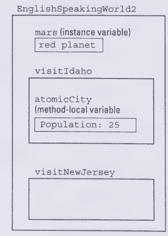

# 图 10-10：列表 10-8 和 10-9 中代码的结构。

在列表 10-8 中，注意每个变量可以使用的地方。当你尝试在 `visitJersey` 方法内部使用 `atomicCity` 变量时，你会看到一个错误。字面上，消息是 "cannot resolve symbol"。比喻地说，消息说：“嘿，哥们儿，原子城在爱达荷州，不在新泽州。”技术上，消息表示方法局部变量 `atomicCity` 仅在 `visitIdaho` 方法可用，因为那是它被声明的地方。

在 `visitIdaho` 方法内部，你可以随意地使用 `atomicCity`。毕竟，`atomicCity` 是声明在该方法内部的。那么 Mars 呢？你忘记你的老朋友，那颗可爱的星球了吗？事实上，`visitIdaho` 和 `visitJersey` 方法都可以访问 `mars` 变量。这是因为 `mars` 变量是 `EnglishSpeakingWorld` 类代码中声明的字段，而不是任何特定方法内部。`mars` 字段的生命周期有三个独立的步骤：

1. 当 `EnglishSpeakingWorld` 类首次出现时，计算机看到 `String` 并为 `mars` 字段分配空间。
2. 当执行 `visitIdaho` 方法时，该方法将值 "red planet" 赋值给 `mars` 字段。（`visitIdaho` 方法也会打印 `mars` 字段。）
3. 当执行 `visitJersey` 方法时，该方法再次打印 `mars` 值。

这样，`mars` 字段的值从一个方法传递到另一个方法。尝试这些程序。看看你的想法。

# 谁是谁？

以下代码的输出是什么？为什么？

```java
public class Main {

    static String name = "Nancy";

    public static void main(String[] args) {

        System.out.println(name);

    }

}
```

```java
String name = "Barry";
System.out.println(name);
}
```

# 告诉变量该去哪里

几年前，当我住在威斯康星州的密尔沃时，我经常使用当地银行的自动柜员机。这种机器刚刚开始标准化。当地的柜员机系统命名为 TYME，代表 "Take Your Money Everywhere（随处取钱）"。

我记得开车去加州。某处我饿了停下来吃饭，但我没有现金。于是我问加油站服务员：“你知道这里哪里有 TYME 机器吗？”

所以你看，在一个地方好用的名字在另一个地方可能非常糟糕，或者根本无效。在列表 10-8 和 10-9 中，我说明了这一点（不仅仅是关于柜员机的故事）。

# 列表 10-8 原子之城的故事

```java
import static java.lang.System.out;

class EnglishSpeakingWorld2 {
  String mars;

  void visitIdaho() {
    out.println("visitID is running:");

    mars = " red planet";
    String atomicCity = " Population: 25";

    out.println(mars);
    out.println(atomicCity);
  }

  void visitNewJersey() {
    out.println("visitNJ is running:");
    out.println(mars);
    //out.println(atomicCity); cannot resolve symbol
  }
}
```

第 10 章 将变量和方法放在它们该去的地方 283

# 列表 10-9：调用列表 10-8 的代码

```java
public class GetGoing2 {

    public static void main(String[] args) {
        var e = new EnglishSpeakingWorld(2);

        e.visitIdaho();
        e.visitNewJersey();
    }
}
```

图 10-9 显示了列表 10-8 和 10-9 中代码的运行情况。图 10-10 显示了代码结构的图表。`EnglishSpeakingWorld2` 的代码有两个变量：`mars` 变量没有在方法内部声明，是一个字段；另一个变量 `atomicCity` 是一个方法局部变量，声明在 `visitIdaho` 方法内部。

# 图 10-9：列表 10-8 和 10-9 中代码的运行情况。

```
visitId is running:
red planet
Population: 25
visitNJ is running:
red planet
```


# 图 10-10：列表 10-8 和 10-9 中代码的结构。

在列表 10-8 中，注意每个变量可以使用的地方。当你尝试在 `visitJersey` 方法内部使用 `atomicCity` 变量时，你会看到一个错误。字面上，消息是 "cannot resolve symbol"。比喻地说，消息说：“嘿，哥们儿，原子城在爱达荷州，不在新泽州。”技术上，消息表示方法局部变量 `atomicCity` 仅在 `visitIdaho` 方法可用，因为那是它被声明的地方。


在 `visitIdaho` 方法内部，你可以随意地使用 `atomicCity`。毕竟，`atomicCity` 是声明在该方法内部的。那么 Mars 呢？你忘记你的老朋友，那颗可爱的星球了吗？事实上，`visitIdaho` 和 `visitJersey` 方法都可以访问 `mars` 变量。这是因为 `mars` 变量是 `EnglishSpeakingWorld` 类代码中声明的字段，而不是任何特定方法内部。`mars` 字段的生命周期有三个独立的步骤：

1. 当 `EnglishSpeakingWorld` 类首次出现时，计算机看到 `String` 并为 `mars` 字段分配空间。
2. 当执行 `visitIdaho` 方法时，该方法将值 "red planet" 赋值给 `mars` 字段。（`visitIdaho` 方法也会打印 `mars` 字段。）
3. 当执行 `visitJersey` 方法时，该方法再次打印 `mars` 值。

这样，`mars` 字段的值从一个方法传递到另一个方法。尝试这些程序。看看你的想法。

## 谁是谁？

以下代码的输出是什么？为什么？

```java
public class Main {
    static String name = "Nancy";

    public static void main(String[] args) {
        System.out.println(name);
    }
}
```

```java
String name = "Barry";

System.out.println(name);
```

## 告诉变量该去哪里

几年前，当我住在威斯康星州的密尔沃基时，我经常使用当地银行的自动柜员机。这种机器刚刚开始标准化。当地的柜员机系统命名为 TYME，代表 "Take Your Money Everywhere（随处取钱）"。

我记得开车去加州。某处我饿了停下来吃饭，但我没有现金。于是我问加油站服务员：“你知道这里哪里有 TYME 机器吗？”

所以你看，在一个地方好用的名字在另一个地方可能非常糟糕，或者根本无效。在列表 10-8 和 10-9 中，我说明了这一点（不仅仅是关于柜员机的故事）。

## 列表 10-8 原子之城的故事

```java
import static java.lang.System.out;

class EnglishSpeakingWorld2 {

  String mars;

  void visitIdaho() {

    out.println("visitID is running:");

    mars = " red planet";

    String atomicCity = " Population: 25";

    out.println(mars);

    out.println(atomicCity);

  }

  void visitNewJersey() {

    out.println("visitNJ is running:");

    out.println(mars);

    //out.println(atomicCity); cannot resolve symbol

  }

}
```

第 10 章 将变量和方法放在它们该去的地方 283

## 列表 10-9：调用列表 10-8 的代码

```java
public class GetGoing2 {

    public static void main(String[] args) {

        var e = new EnglishSpeakingWorld2();

        e.visitIdaho();

        e.visitNewJersey();

    }

}
```

## 图 10-9：列表 10-8 和 10-9 中代码的运行情况

```
visitId is running:
red planet
Population: 25
visitNJ is running:
red planet
```


## 图 10-10：列表 10-8 和 10-9 中代码的结构

`EnglishSpeakingWorld2` 的代码有两个变量：`mars` 变量没有在方法内部声明，是一个字段；另一个变量 `atomicCity` 是一个方法局部变量，声明在 `visitIdaho` 方法内部。

用通俗易懂的话来说，这意味着：该方法对其参数值所做的任何更改，都不会影响调用代码中变量的值。在列表 10-10 中，`birth` 方法可以随心所欲对 `cityPop` 使用 `++` 操作符——对 `cityPop` 参数应用 `++` 操作完全不会影响 `main` 方法中 `smackoverARpop` 变量的值。

从技术上讲，发生的是值的复制。（参见图 10-11。）当 `main` 方法调用 `birth` 方法时，存储在 `smackoverARpop` 中的值被复制到另一个内存位置——一个为 `cityPop` 参数值预留的内存。在 `birth` 方法执行期间，`cityPop` 参数被加了 1。但存储原始值 2232 的地方（即 `smackoverARpop` 变量的内存位置）保持不受影响。

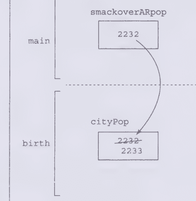

图 10-11：按值传递的底层原理。

当你对任何八种基本数据类型进行参数传递时，计算机使用的是“按值传递”。存储在调用代码变量中的值保持不变。即使调用代码的变量与被调用方法的参数恰好同名，这种情况也会发生。

### 记住

## 返回结果

你必须修复列表 10-10 中代码遗留的问题。毕竟，一个年幼的 Kermongoons 婴儿不能在没有被追踪的情况下度过一生。为了记录这个宝宝的存在，你必须给 `smackoverARpop` 变量的值加 1。你可以通过许多方法实现这一点，而列表 10-11 中展示的方法并不是最简单的。尽管如此，列表 10-11 中显示的方法说明了一个点：从方法调用返回一个值可以作为参数传递可以接受的替代方案。看列表 10-11 就明白我的意思。

### 列表 10-11：此程序可以工作

```java
public class TrackPopulation2 {

    public static void main(String[] args) {

        int smackoverARpop = 2232;

        smackoverARpop = birth(smackoverARpop);

        System.out.println(smackoverARpop);

    }

    static int birth(int cityPop) {

        return cityPop + 1;

    }

}
```

运行列表 10-11 中的代码后，你在屏幕上看到的数字是正确的：2233。列表 10-11 中的代码没有新功能（除非你把 `return` 语句也算作功能）。列表 10-11 中最重要的想法是 `return` 语句，它也出现在第 7 章。尽管如此，列表 10-11 与列表 10-10 中的方法形成了鲜明的对比，后者是必须被丢弃的。

## 按引用传递

在上一节中，我费了很大力气强调了某一点——当参数是基本类型之一时，参数是按值传递的。如果你读到这里，你可能错过了对“参数是基本类型之一”的强调。这种强调是必要的，因为传递对象（引用类型）的工作方式完全不同。

当你将一个对象传递给方法时，该对象是按引用传递的。对你来说，这意味着被调用方法中的语句可以更改存储在对象变量中的任何值。列表 10-12 和 10-13 说明了这一点。

### 列表 10-12：什么是城市？

```java
class City {

    int population;

}
```

### 列表 10-13：向方法传递对象

```java
public class TrackPopulation3 {

    public static void main(String[] args) {

        City smackoverARpop = new City();

        smackoverARpop.population = 2232;

        birth(smackoverARpop);

        System.out.println(smackoverARpop.population);

    }

    static void birth(City cityPop) {

        cityPop.population++;

    }

}
```


运行列表 10-12 和 10-13 中的代码后，你在屏幕上看到的数字是正确的：2233。列表 10-11 中的代码没有新功能（除非你把 `return` 语句也算作功能）。列表 10-11 中最重要的想法是 `return` 语句，它也出现在第 7 章。尽管如此，列表 10-11 与列表 10-10 中的方法形成了鲜明的对比，后者是必须被丢弃的。

当你将一个对象传递给方法时，该对象是按引用传递的。对你来说，这意味着被调用方法中的语句可以更改存储在对象变量中的任何值。列表 10-12 和 10-13 说明了这一点。

# 本章内容
- 同时处理多个值
- 查找内容
- 在程序运行过程中创建值

# 第 11 章
## 使用数组处理数值

欢迎来到 Java 旅馆（Java Motel）！这里没有傲慢的行李员，没有昂贵的服务，更没有那些常见的愚蠢笑话。只有间干净且极具性价比的双人人间！

## 让一切都准备就绪

Java 旅馆拥有十间舒适的房间，位于主公路旁的一处安静区域。除了一个小小的独立办公室外，旅馆就是一长排位于一楼的房间。从宽敞的停车场可以轻松到达每间房间。

奇怪的是，这家旅馆的房间编号是从 0 到 9。我可以说这种编号方式纯属巧合——可能与建筑师最初的设计蓝图有关。但事实是，从 0 开始会让本章中的示例变得更容易编写。

无论如何，你正试图记录每个房间的客人数。因为你有十间房间，你可能会考虑声明十个变量：

```java
```


## 数组简介

声明十个单独的变量来存储每个房间的客人数量：

```java
int guestsInRoomNum0, guestsInRoomNum1, guestsInRoomNum2,
    guestsInRoomNum3, guestsInRoomNum4, guestsInRoomNum5,
    guestsInRoomNum6, guestsInRoomNum7, guestsInRoomNum8,
    guestsInRoomNum9;
```

这样做看起来可能有点低效——效率低下并不是这段代码的唯一问题。更严重的问题是，你无法对这些变量进行循环。为了读取每个变量的值，你必须多次复制调用 `nextInt()` 方法的代码：

```java
guestsInRoomNum0 = scanner.nextInt();
guestsInRoomNum1 = scanner.nextInt();
guestsInRoomNum2 = scanner.nextInt();
// 依此类推。
```

显然有更好的方法。

这种更好的方法涉及到**数组**（array）。数组是一行值，就像单层旅馆里的一排房间一样。为了想象数组，只需想象 Java 旅馆即可：

- 首先，想象房间并排紧挨在一起。
- 接着，想象这些房间的墙壁消失了。在每个房间里，你可以看到特定数量的客人。
- 如果可以的话，请忘记 9 号房间的两个客人正往一个大提箱里塞一堆钞票。忽略 6 号房间的客人在一天半内一直没有离开电视机的事。不要看所有细节，只看数字。在每个房间里，看到一个代表该房间客人数量的数字。（如果你的长项不是自由可视化，请看图 11-1。）

在本章的术语中，整排房间被称为**数组**。数组中的每个房间被称为数组的**组件**（component，也称为数组元素，element）。每个组件都有两个相关的数字：

- 房间编号（从 0 到 9 的数字），被称为数组的**索引**（index）
- 客人数，这是存储在数组组件中的**值**（value）

图 11-1：Java 旅馆房间的抽象快照。

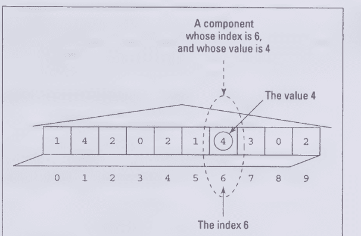

使用数组可以让你避免本节开头示例代码中所有重复的废话。例如，声明一个包含十个值的数组，你可以写一条非常短的语句：

```java
int[] guests = new int[10];
```

如果你特别喜欢啰嗦，可以将此语句展开拆分为两个独立的语句：

```java
int[] guests;
guests = new int[10];
```

在这两个代码段中，请注意数字 `10` 的使用。这个数字告诉计算机让 `guests` 数组拥有十个组件。每个组件都有自己的名字。起始组件是 `guests[0]`，下一个是 `guests[1]`，依此类推。十个组件中的最后一个名为 `guests[9]`。

在创建数组时，你指定组件的数量。数组的索引从 0 开始，以组件总数减 1 的数字结束。

我为你展示的代码提供了创建数组的两种方法。第一种使用一行。第二种使用两行。如果你选择单行方案，可以将声明和赋值合并。另一方面，如果你使用两行，第二行 `guests = new int[10]` 应该放在方法内部。

在数组中，你可以将方括号放在变量名之前或之后。

## 分两步创建数组

再次观察这两行：

```java
int[] guests;
guests = new int[10];
```

每行都有其特定的功能：
- 第一行是声明。
- 第二行是预留空间。

然而，考虑到现实世界的情况，你的客人并不总是成对整齐到达，你必须为每间房间填充不同的数字。你可能会将房间信息存储在数据库中。如果是这样，你仍然需要遍历数组，在此过程中收集人数。执行此类任务的代码如下：

```java
resultSet = statement.executeQuery("select GUESTS from RoomData");
for (int roomNum = 0; roomNum < 10; roomNum++) {
    resultSet.next();
    guests[roomNum] = resultSet.getInt("GUESTS");
}
```

但本书直到第 17 章才介绍数据库，你可能是从纯文本文件中读取人数。名为 `GuestList.txt` 的示例文件如图 11-3 所示。

创建文件后，你可以调用 `Scanner` 类从文件中获取值。代码见列表 11-1，结果输出见图 11-4。

关于从磁盘文件读取内容的技巧，请参考第 8 章。

图 11-3：GuestList.txt 文件。

| Room | Guests |
| --- | --- |
| 0 | 1 |
| 1 | 4 |
| 2 | 0 |
| 3 | 2 |
| 4 | 1 |
| 5 | 4 |
| 6 | 3 |
| 7 | 0 |
| 8 | 2 |

图 11-4：运行列表 11-1 中的代码。

### 列表 11-1：用值填充数组

```java
for (int roomNum = 0; roomNum < 10; roomNum++) {
    out.print(roomNum);
    out.print("\t");
    out.println(guests[roomNum]);
}
diskScanner.close();
```

列表 11-1 中的代码有两个循环：第一个循环读取访客人数，第二个循环写入访客人数。

每个数组都有一个内置的 `length` 字段。数组的长度是数组中组件的数量。因此，在列表 11-1 中，如果你打印 `guests.length` 的值，你将得到 `10`。

## 制表符和其他特殊字符

在列表 11-1 中，某些对 `print` 和 `println` 调用使用了 `\t` 转义序列。它之所以被称为转义序列，是因为你“转义”了在屏幕上显示字母 t 的默认行为。相反，字符 `\t` 代表制表符（tab）。在打印任何字符之前，计算机会移动到下一个制表位。Java 有几个这些实用的转义序列。其中一些在表 11-1 中。

表 11-1

| 序列 | 含义 |
| --- | --- |
| `\b` | 退格 |
| `\t` | 水平制表符 |
| `\n` | 换行符 |
| `\f` | 分页 |
| `\r` | 回车 |
| `\"` | 双引号 `"` |
| `\'` | 单引号 `'` |
| `\\` | 反斜杠 `\` |

在 Windows 命令提示符和 Macintosh 终端中，制表位之间隔八个空格。但在某些环境中，制表位仅隔四个空格。使用四个空格制表位，你将无法看到之前在图 11-4 中出现的那合理的对齐。如果你希望列无论程序运行在何处都能对齐，请将列表 11-1 中的制表符替换为空格。（当然，如果你很挑剔，你必须检查多位数字。但那是另一个故事了。）

## 为自己简化生活

除了你在列表 11-1 中看到的之外，在 Java 中还有另一种填充数组的方法：使用数组初始化器。当你使用数组初始化器时，你甚至不需要告诉计算机数组有多少个组件。计算机会为你计算出来。

列表 11-2 显示了填充数组代码的新版本。程序的输出与列表 11-1 的输出相同（它们是之前在图 11-4 中显示的内容）。列表 11-1 和 11-2 之间的区别在于列表 11-2 中的**加粗文本**。那些加粗文本是一个数组初始化器。

### 列表 11-2：使用数组初始化器

```java
package com.example.hotel;

import static java.lang.System.out;

public class ShorterShowsGuests {

    public static void main(String[] args) {
        int[] guests = {1, 4, 2, 0, 2, 1, 4, 3, 0, 2};

        out.println("Room\tguests");

        for (int roomNum = 0; roomNum < 10; roomNum++) {
            out.print(roomNum);
            out.print("\t");
            out.println(guests[roomNum]);
        }
    }
}
```

数组初始化器可以包含表达式以及字面量。用通俗的话说，这意味着你可以在初始化器的逗号之间放置各种内容。例如，像 `{1 + 3, keyboard.nextInt(), 2, 0, 2, 1, 4, 3, 0, 2}` 这样的初始化器就可以正常工作。

## 利用数组

运行此代码来发现 `java.util.Arrays` 包中的一些实用方法：

```java
import java.util.Arrays;

public class WriteArray {

    public static void main(String[] args) {
        int[] guests = {1, 4, 2, 0, 2, 1, 4, 3, 0, 2};

        System.out.println(guests); // 非常有用！

        System.out.println(Arrays.toString(guests));

        Arrays.sort(guests);

        System.out.println(Arrays.toString(guests));

        Arrays.fill(guests, 0);

        System.out.println(Arrays.toString(guests));
    }
}
```


## 练习题

### 字数过多

在本书的上一个版本中，我粗略统计了第 1 到 7 页的字数。

```java
int[] words = {0, 296, 342, 405, 363, 350, 323};
```

编写一个程序，提示用户输入页码，并响应该页的字数。

### 反向排序

修改列表 11-1 中的代码，使其反序显示房间（从房间 9 到 0）。

### 标记

用户在键盘上输入五个数字。然后程序显示五行，每行对应用户的一个数字。程序的运行可能如下：

```
5
3
9
0
```

### 带视图的房间

使用 `myFrame`（来自第 7 章）根据列表 11-1 和 11-2 中的思路创建一个 GUI 程序。在你的程序中，框架只有一个行：Room 行。如果用户在 Room 行输入 3 并点击按钮，程序将显示 Room 3。

## 使用增强型循环遍历数组

Java 有增强型循环（enhanced for loop）——一种不使用计数器或索引的循环。列表 11-3 展示了如何操作。本节内容适用于 Java 5.0 及更高版本。本节内容不支持旧版本的 Java（如 1.3）。关于 Java 版本的更多信息，请参第 2 章。


### 列表 11-3：获取增强型循环

```java
package com.example.hotel;

import static java.lang.System.out;

public class EnhancedShowGuests {

    public static void main(String[] args) {
        int[] guests = {1, 4, 2, 0, 2, 1, 4, 3, 0, 2};

        int roomNum = 0;

        out.println("Room\tguests");

        for (int numGuests : guests) {
            out.print(roomNum++);
            out.print("\t");
            out.println(numGuests);
        }
    }
}
```

列表 11-1 和 11-3 的输出相同。见图 11-4。

增强型 for 语句有三个部分：

```
for (variableType variableName : rangeOfValues)
```

前两个部分是 `variableType` 和 `variableName`。列表 11-3 中的循环定义了一个名为 `numGuests` 的变量，`numGuests` 的类型为 `int`。在每次循环迭代中，变量 `numGuests` 取一个新值。参考图 11-4 查看这些值。初始值是 1。之后是 4，等等。

循环在哪里找到这些数字的？答案在于循环的 `rangeOfValues`。在列表 11-3 中，循环的 `rangeOfValues` 是 `guests`。因此，在初始迭代中，`numGuests` 的值是 `guests[0]`（即 1）。在下次迭代中，`numGuests` 的值是 `guests[1]`（即 4）。之后是 `guests[2]`（即 2），等等。

Java 的增强型 for 需要注意：每次循环，遍历值范围的变量存储的是原始范围中值的副本。该变量并不指向范围本身。

例如，如果你在列表 11-3 中分配一个改变 `numGuests` 值的赋值，该语句对 `guests` 数组中存储的任何值都没有影响。为了说明这一点，假设 `guests` 是坏的，我用零填充了酒店的 `guests` 数组。然后我执行以下代码：

```java
for (int numGuests : guests) {
    numGuests += 1;
    out.print(numGuests + " ");
}
out.println();
for (int numGuests : guests) {
    out.print(numGuests + " ");
}
```

`numGuests` 变量获取存储在 `guests` 数组中的值。但 `numGuests += 1` 语句并没有更改该 `guests` 数组存储的值。代码的输出如下：

```
1 1 1 1 1 1 1 1 1 1
0 0 0 0 0 0 0 0 0 0
```

## 追踪你的体重

初始化一个数组，记录你每周每天的体重：
`double[] weight = {145.7, 148.3, 147.2, 146.2, 147.0, 148.5, 146.9};`

编写代码来显示你在一周内的体重增减列表。例如，从第一天到第二天，你的体重变化是 2.6。到第二天，你的变化是 -1.1。

## 示例代码：FindVacancy

```java
import java.io.File;
import java.io.IOException;
import java.io.PrintStream;
import java.util.Scanner;
import static java.lang.System.out;

public class FindVacancy {

    public static void main(String[] args) throws IOException {
        int[] guests = new int[10];
        int roomNum;

        var diskScanner = new Scanner(new File("GuestList.txt"));

        for (roomNum = 0; roomNum < 10; roomNum++) {
            guests[roomNum] = diskScanner.nextInt();
        }

        diskScanner.close();

        roomNum = 0;

        while (roomNum < 10 && guests[roomNum] != 0) {
            roomNum++;
        }

        if (roomNum == 10) {
            out.println("Sorry, no vacancy");
        } else {
            out.println("How many people for room ");
            out.print(roomNum);
            out.println("? ");
        }

        var keyboard = new Scanner(System.in);
        guests[roomNum] = keyboard.nextInt();
        keyboard.close();

        var listOut = new PrintStream("GuestList.txt");

        for (roomNum = 0; roomNum < 10; roomNum++) {
            listOut.print(guests[roomNum]);
            listOut.print(" ");
        }

        listOut.close();
    }
}
```


图 11-5 显示了列表 11-4 中代码的三次运行结果。该汽车旅馆最初有两个空闲房间：3 号房和 8 号房。（记住，房号从 `Room 0` 开始）。第一次运行代码时，你将 5 个人安排在 3 号房。第二次运行代码时，你让一个十人团体入住了 8 号房（真是一大热闹！）。第三次运行代码时，你已经没有空房间了。当程序发现这一点时，它会显示消息 `Sorry, no vacancy`，按照所有汽车旅馆招牌的传统，它漏掉了至少一个字母。

```
GuestList.txt -------------- 1 4 2 0 1 4 3 0 2
```

```
1st run -------------------------- How many people for room 3? 5
```

```
GuestList.txt -------------- 1 4 2 5 2 1 4 3 0 2
```

```
2nd run -------------------- How many people for room 8? 10
```

```
GuestList.txt -------------- 1 4 2 5 2 1 4 3 10 2
```

FIGURE 11-5: 填补空房间。

```
3rd run ---------------------- Sorry, no vacancy
```


在列表 11-4 中，条件 `roomNum < 10 && guests[roomNum] != 0` 可能是误导。如果你调换顺序写成 `guests[roomNum] != 0 && roomNum < 10`，你可能会遇到很多麻烦。详情请参阅本书的网站（http://javafordummies.allmycode.com）。

## 写入文件

列表 11-4 中的代码使用了本书其他章节和部分介绍的技巧。代码中唯一的新特性是使用 `PrintStream` 写入磁盘文件。想想书中任何调用 `System.out.print` 或 `System.out.println` 或其变体的示例。当你调用这些方法之一时，底层到底发生了什么？

名为 `System.out` 的一个对象。该对象定义在 Java API 中。事实上，`System.out` 是一个名为 `java.io.PrintStream` 的类的实例。每个从 `PrintStream` 类创建的对象都拥有名为 `print` 和 `println` 的方法。正如列表 7-3 中的 `Account` 对象拥有 `display` 方法，而列表 10-1 中的 `DecimalFormat` 对象（在第 10 章）拥有 `format` 方法一样，名为 `out` 的 `PrintStream` 对象也拥有 `print` 和 `println` 方法。当你调用 `System.out` 时，你正在调用一个属于 `PrintStream` 实例的方法。

那么，它到底是什么？嗯，`System.out` 始终代表电脑屏幕上的文本区域。如果你创建自己的 `PrintStream` 对象并让该对象指向磁盘文件，该 `PrintStream` 对象就会指向该文件。当你调用该对象的 `print` 方法时，你会将文本写入硬盘上的一个文件。

在列表 11-4 中，当你说：

```java
var listOut = new PrintStream("GuestList.txt");
listOut.print(guests[roomNum]);
listOut.print(" ");
```

你是在告诉 Java 将文本写入你的硬盘——`GuestList.txt` 文件。

这就是你更新酒店住客计数的方法。当你调用 `listOut.print` 输出 3 号房的人数时，你可能会打印数字 5。因此，在图 11-5 中，`GuestList.txt` 文件中的数字从 0 变为 5。在图 11-5 中，你第二次运行了程序。当程序从新写入的 `GuestList.txt` 文件获取数据时，3 号房不再是空闲的。此时，程序接受了 8 号房。

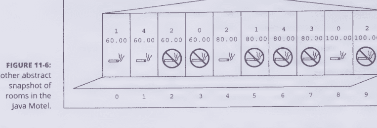

# 代码列表 11-5: 房间看起来是这样的！

```java
package com.example.hotel;

import java.text.NumberFormat;
import java.util.Scanner;
import static java.lang.System.out;

public class Room {
    private int guests;
    private double rate;
    private boolean smoking;
    private static NumberFormat currency = NumberFormat.getInstance();

    public void readRoom(Scanner scanner) {
        guests = scanner.nextInt();
        rate = scanner.nextDouble();
        smoking = scanner.nextBoolean();
    }

    public void writeRoom() {
        out.print(guests);
        out.print("\t");
        out.print(currency.format(rate));
        out.print("\t");
        out.println(smoking ? "yes" : "no");
    }
}
```

代码列表 11-5 有一些有趣的之处，在你看到运行所有代码之前，我并不想描述它们。这就是为什么在此时我直接跳到调用代码列表 11-5 代码的代码。在你读完房间数组（在代码列表 11-6 中）后，来看看我对代码列表 11-5 特殊之处的描述。

## 第 4 部分 智能 Java 技术

这个警告故意重复了第 4 章、第 7 章以及不知道其他哪些章节中的观点：使用 `double` 类型或 `float` 类型存储货币金额时要小心。使用 `double` 或 `float` 进行计算可能是不准确的。有关更多信息（以及更多的“指责”），请参见第 4 章和第 7 章。

这个提示与 Java 完全没有关系。如果你是那种喜欢吸烟的人（在代码列表 11-5 中布尔字段 `smoking = true`），请找一个这样的人——一个可以连续请三天假的人。让那个人坐在你身边，在你戒烟期间连续安慰你 72 小时。在尼古丁离开你身体期间，你可能会暂时发疯，但最终你会没事的。而且你的朋友会觉得自己像个真正的英雄。

## 使用 Room 类

你需要一个房间数组。创建此类对象的代码在代码列表 11-6 中。该代码从 `RoomList.txt` 文件读取数据（图 11-7 显示了 `RoomList.txt` 文件的内容）。

图 11-8 显示了代码列表 11–6 的运行结果。

```
60.00
true
4
60.00
true
2
60.00
false
0
60.00
false
2
80.00
true
1
80.00
false
4
80.00
false
3
80.00
false
0
100.00
true
2
100.00
false
```

图 11-7: 房间数据文件。

| 房间 (Room) | 客人数 (Guests) | 房价 (Rate) | 吸烟？ (Smoking?) |
|------|--------|------|---------|
| 0 | 1 | $60.00 | yes |
| 1 | 4 | $60.00 | yes |
| 2 | 2 | $60.00 | no |
| 3 | 0 | $60.00 | no |
| 4 | 2 | $80.00 | yes |
| 5 | 1 | $80.00 | no |
| 6 | 4 | $80.00 | no |
| 7 | 3 | $80.00 | yes |
| 8 | 0 | $100.00 | no |
| 9 | 2 | $100.00 | no |

图 11-5: 代码列表 11-6 的运行。

## 代码列表 11-6: 你想看房间吗？

```java
package com.example.hotel;

import java.io.File;
import java.io.IOException;
import java.util.Scanner;
import static java.lang.System.out;

public class ShowRooms {
    public static void main(String[] args) throws IOException {
        Room[] rooms;
        rooms = new Room[10];
        var diskScanner = new Scanner(new File("RoomList.txt"));

        for (int roomNum = 0; roomNum < 10; roomNum++) {
            rooms[roomNum] = new Room();
            rooms[roomNum].readRoom(diskScanner);
        }

        out.println("Room\tGuests\tRate\tSmoking?");

        for (int roomNum = 0; roomNum < 10; roomNum++) {
            out.print(rooms[roomNum]);
            out.print("\t");
            rooms[roomNum].writeRoom();
        }

        diskScanner.close();
    }
}
```

关于代码列表 11-6，你想说什么都可以。在我看来，整个列表中只有一个问题应该引起你的注意。那个问题是什么？嗯，创建一个对象数组——而不是由基本类型组成的数组——你需要做三件事：创建数组变量、创建数组本身，然后构造数组中的每个单独对象。当你创建一个基本类型的数组时，你只需要做前两件事。

为了理解这些内容，请参考代码列表 11-6 和图 11-9：

- `Room[] rooms`: 这个声明创建了一个变量。该变量指向一个数组（但不引用任何）。
- `new Room[10]`: 该语句在内存中预留了槽。该语句让变量指向这组槽。每个槽指向一个对象（但不引用任何）。
- `rooms[roomNum] = new Room()`: 该语句位于 `for` 循环内部。该语句为十个中的每一个执行一次。例如，在循环第一次，该语句执行 `rooms[roomNum] = new Room()`。该语句让槽指向一个实际对象（`Room` 类的实例 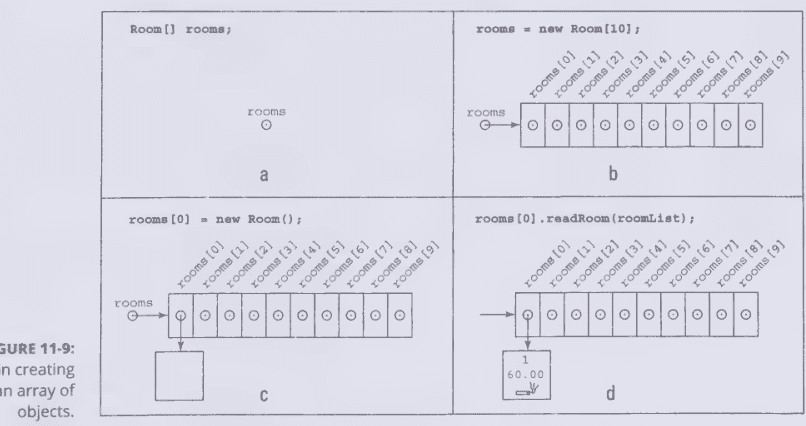）。尽管技术上不被认为是创建数组，你仍然必须填充每个对象的字段。在循环第一次，`rooms[roomNum].readRoom(scanner)` 调用意味着从 `RoomList.txt` 读取数据到对象的字段（`guests`、`rate` 和 `smoking`）。每次循环，程序都会创建一个新对象并将数据读入该对象的字段中。你可以像创建基本类型数组时将前两个步骤合并在一起：

```java
Room[] rooms = new Room[10];
```

你也可以使用数组初始化器（有关数组初始化器的介绍，请参见本章前面的“简化你的生活”）。

## 美化数字的另一种方法

你可以通过许多方法让数字看起来很好。如果你看看之前的章节，可以看到代码列表 7-7 使用了 `printf`，代码列表 10-1 使用了 `DecimalFormat`。但在代码列表 11-5 中，我显示了货币金额。我使用了 `NumberFormat` 类及其 `currencyInstance` 方法。

如果你比较代码列表 10-1 和 11-5 中的格式语句，你不会看到太大区别：

- 一个使用构造函数；另一个列表调用 `currencyInstance`。`currencyInstance` 方法是工厂方法的很好的例子，它是创建常用便利工具。人们总是需要显示货币金额的代码。因此 `currencyInstance` 方法创建了货币格式，而不需要你编写复杂的 `DecimalFormat("########.00")`。像构造函数一样，工厂方法返回一个新的对象。与构造函数不同，如果你创建自己的工厂方法，可以给它命名为任何名称。当你调用工厂方法时，不使用 `new` 关键字。
- 一个使用 `DecimalFormat`；另一个列表使用 `NumberFormat`。小数是某种类型的数字（事实上，小数是用十进制制编写的数字）。因此，`DecimalFormat` 类是 `NumberFormat` 类的子类。`DecimalFormat` 方法更具体；对于大多数用途，我使用 `DecimalFormat`。但对于涉及货币的程序，使用 `DecimalFormat` 类的 `currencyInstance` 方法很难，我倾向于使用 `NumberFormat`。

两个列表都使用了格式方法。最后，你只需要写类似 `currency.format(rate)` 或 `format.format(average)`。之后，Java 会为你完成工作。

从第 4 章开始，我警告不要使用 `double` 和 `float` 等类型存储货币金额。为了最准确的货币计算，请使用 `int`、`long` 或者最好的 `BigDecimal`。你可以在第 7 章阅读更多关于 `double` 类型和货币金额危险性的介绍。

## 条件运算符

代码列表 11-5 使用了一个名为条件运算符的有趣工具。这个条件运算符接受三个表达式并返回其中一个的值。它就像一个微型的 `if` 语句。当你使用条件运算符时，它看起来像这样：

```
conditionToBeTested ? expression1 : expression2
```

计算机计算 `conditionToBeTested`。如果条件为真，计算机返回 `expression1` 的值。但如果条件为假，计算机返回 `expression2` 的值。

所以，在代码中

```java
smoking ? "yes" : "no"
```

计算机检查 `smoking` 是否为真。如果是，整个三部分表达式代表第一个字符串 "yes"。如果不是，整个表达式代表第二个字符串 "no"。

在代码列表 11-5 中，调用 `out.println` 会导致 "yes" 或 "no"。哪个字符串被显示取决于 `smoking` 是否为真或假。

你是如何学习 Java 的？你就像学习去卡内基音乐厅一样学习它：练习！练习！练习！

# 高级酒店

增强本章的示例：

- 修改列表 11-4 中的代码，使其使用来自列表 11-5 的 `Room` 类。
- 在你的工作基础上添加功能，使得当你指定来访人数时，你还需要输入客人对吸烟房或非吸烟房的偏好。
- 为列表 11-5 中的 `Room` 类创建一个子类。在你的子类中，每个房间都有最大容纳人数。不要让你的代码让房间的客人数超过房间的容纳量。

# 压力翻倍

在第 9 章中，你创建了一个 `Student` 类。每个学生都有一个名字和一个 ID 编号。对于这个编程挑战，想象每个学生都有五个成绩——对应该学生所修的五门课程中的每一门。每个成绩都是 0.0 到 4.0 之间的值（4.0 是最高）。学生的平均绩点（GPA）是该学生五个成绩分值的平均值。

在本章的 `Student` 类中，程序的字段之一是一个包含五个 `double` 值的数组。你的程序找到学生的 GPA 并将其（以及学生的姓名和 ID 编号）显示在屏幕上。

# 如何与你的代码争论

取列表 11-5 中的方法头：

```java
public void readRoom(Scanner diskScanner) {
```


该方法有一个名为 `diskScanner` 的参数。第一次调用该方法时，你可以让 `diskScanner` 从 `RoomList.txt` 文件读取。第二次，你可以让 `diskScanner` 从 `wellNourishedKittens` 文件读取。第三次，`diskScanner` 可以代表 `underAppreciatedAuthors.md` 文件。这种灵活性源于 `diskScanner` 在你调用它的那一刻获取其值——而不是在调用之前的一纳秒。

你的程序的 `main` 方法也是同样的道理。每个方法都有一个 `String[] args` 参数。当你启动程序时，你会向 `args` 参数发送一个或多个单词。例如，如果你向程序发送

Java For Dummies

那么 `args[0]` 是 "Java"，`args[1]` 是 "For"，`args[2]` 是 "Dummies"。如果你向程序发送


那么由于加了引号，`args[0]` 是 "Java Dummies"，`args[1]` 是 "Great!"

你向 `args` 参数发送单词的方式取决于你的 IDE，但通用思想取决于两点：

- 运行程序有许多方法。

这些方法中的每一种都被称为运行配置（run configuration）。在不知情的情况下，你可能一直在使用默认的、通用的运行配置来测试本书的示例程序。那个默认配置帮了你。

但现在，是时候改变了。运行配置包含几个不同的问题：哪个文件包含 `main` 方法？你将运行哪个版本的 Java？将使用你驱动器的哪些文件夹？`System.out` 文本将出现在哪里？以此类推。

- 这些答案中的一个被称为“程序参数”（program arguments）。

大多数 IDE 都有某种“修改运行配置”菜单选项。当你选择此选项时，你会看到一个包含所有这些答案的对话框。在那个对话框中，有一个文本字段标记为“Program Arguments”。你的 IDE 会取你在该文本字段中输入的任何内容，并在你的代码运行时将其发送给 `args`。

你可以在每次运行之前更改配置的程序参数，或者创建多个不同的配置，每个配置都有自己的程序参数。有关如何在 Eclipse 和 IntelliJ IDEA 中设置程序参数的帮助，请访问此代码的网站（http://javafordummies.almcode.com）。

你不需要向程序提供参数。假设你有一个名为 `ThreeLittleWords` 的 Java 类。根据你的设置，你可能打开命令提示符或终端窗口并输入 `java ThreeLittleWords.java Java For Dummies`。如果一切顺利，`args` 数组将包含单词 `Java For Dummies`。


# 解决争论

列表 11-7 显示了如何在代码中使用程序参数。

## 第11 章 使用数组处理数值 319

## 列表 11-7：生成数字文件

```java
package com.example.numbers;

import java.io.IOException;
import java.io.PrintStream;
import java.util.Random;

public class MakeRandomNumsFile {

    public static void main(String[] args) throws IOException {

        var generator = new Random();

        if (args.length < 2) {

            System.out.println("Usage: MakeNumsFile filename number");
            System.exit(1);
        }

        PrintWriter printOut = new PrintStream(args[0]);

        int numLines = Integer.parseInt(args[1]);

        for (int count = 1; count <= numLines; count++) {

            printOut.println(generator.nextInt(10) + 1);
        }

        printOut.close();
    }
}
```

图 11-10 显示了列表 11-7 的运行结果。在运行之前，我将程序参数设置为 `RandomNumbers.txt 5`。数组 `args[0]` 取值为 "RandomNumbers.txt"，`args[1]` 变为 "5"。因此程序的赋值最终如下：

```java
PrintWriter printOut = new PrintStream("RandomNumbers.txt");
int numLines = Integer.parseInt(args[1]);
```

程序创建一个名为 `RandomNumbers.txt` 的文件并将 `numLines` 设置为 5。因此，在代码后面，程序随机生成五个值并将这些值放入 `RandomNumbers.txt`。

要找到新的 `RandomNumbers.txt` 文件，首先查看你的项目根目录。欲更多信息，请参阅第 6 章。


## 创建运行配置：'MakeRandomNumsFile'

名称：MakeRandomNumsFile
存储为项目文件
构建并运行

```text
Java of 'Chapter11' com.example.numbers.MakeRandomNumsFile RandomNumbers.txt 5
```

图 11-10：列表 11-7 代码的运行。

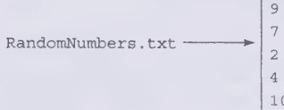

# 高级酒店

增强本章的示例：

- 修改列表 11-4 中的代码，使其使用来自列表 11-5 的 `Room` 类。
- 在你的工作基础上添加功能，使得当你指定来访人数时，你还需要输入客人对吸烟房或非吸烟房的偏好。
- 为列表 11-5 中的 `Room` 类创建一个子类。在你的子类中，每个房间都有最大容纳人数。不要让你的代码让房间的客人数超过房间的容纳量。

# 压力翻倍

在第 9 章中，你创建了一个 `Student` 类。每个学生都有一个名字和一个 ID 编号。对于这个编程挑战，想象每个学生都有五个成绩——对应该学生所修的五门课程中的每一门。每个成绩都是 0.0 到 4.0 之间的值（4.0 是最高）。学生的平均绩点（GPA）是该学生五个成绩分值的平均值。

在本章的 `Student` 类中，程序的字段之一是一个包含五个 `double` 值的数组。你的程序找到学生的 GPA 并将其（以及学生的姓名和 ID 编号）显示在屏幕上。

# 如何与你的代码争论

取列表 11-5 中的方法头：

```java
public void readRoom(Scanner diskScanner) {
```

该方法有一个名为 `diskScanner` 的参数。第一次调用该方法时，你可以让 `diskScanner` 从 `RoomList.txt` 文件读取。第二次，你可以让 `diskScanner` 从 `wellNourishedKittens` 文件读取。第三次，`diskScanner` 可以代表 `underAppreciatedAuthors.md` 文件。这种灵活性源于 `diskScanner` 在你调用它的那一刻获取其值——而不是在调用之前的一纳秒。

你的程序的 `main` 方法也是同样的道理。每个方法都有一个 `String[] args` 参数。当你启动程序时，你会向 `args` 参数发送一个或多个单词。例如，如果你向程序发送

Java For Dummies

那么 `args[0]` 是 "Java"，`args[1]` 是 "For"，`args[2]` 是 "Dummies"。如果你向程序发送


那么由于加了引号，`args[0]` 是 "Java Dummies"，`args[1]` 是 "Great!"

你向 `args` 参数发送单词的方式取决于你的 IDE，但通用思想取决于两点：

- 运行程序有许多方法。

这些方法中的每一种都被称为运行配置（run configuration）。在不知情的情况下，你可能一直在使用默认的、通用的运行配置来测试本书的示例程序。那个默认配置帮了你。

但现在，是时候改变了。运行配置包含几个不同的问题：哪个文件包含 `main` 方法？你将运行哪个版本的 Java？将使用你驱动器的哪些文件夹？`System.out` 文本将出现在哪里？以此类推。

- 这些答案中的一个被称为“程序参数”（program arguments）。

大多数 IDE 都有某种“修改运行配置”菜单选项。当你选择此选项时，你会看到一个包含所有这些答案的对话框。在那个对话框中，有一个文本字段标记为“Program Arguments”。你的 IDE 会取你在该文本字段中输入的任何内容，并在你的代码运行时将其发送给 `args`。

你可以在每次运行之前更改配置的程序参数，或者创建多个不同的配置，每个配置都有自己的程序参数。有关如何在 Eclipse 和 IntelliJ IDEA 中设置程序参数的帮助，请访问此代码的网站（http://javafordummies.almcode.com）。

你不需要向程序提供参数。假设你有一个名为 `ThreeLittleWords` 的 Java 类。根据你的设置，你可能打开命令提示符或终端窗口并输入 `java ThreeLittleWords.java Java For Dummies`。如果一切顺利，`args` 数组将包含单词 `Java For Dummies`。


图 11-10：列表 11-7 代码的运行。


# 检查程序参数

如果用户犯了错误，尽管在列表 11-7 中检查了 `args.length`，代码仍然不够健壮。如果用户输入五而不是 5，程序会抛出 `NumberFormatException`。第二个程序参数不能是单词。它必须是一个数字（至少是整数）。我也可以在列表 11-7 中添加语句使代码更健壮，但检查 `NumberFormatException` 会在第 13 章处理更好。

# 本章内容

- 数组的局限性
- 一次处理大量对象
- 使用 Java 酷的函数式编程特性
- 为多核处理器开发代码

# 第 12 章

## 使用集合和流（当数组不够用时）

第 11 章主要关于数组。通过数组，你可以一次性管理大量事物。在酒店管理程序中，你可以跟踪所有的房间。你可以快速找到某个房间的人数，或者找到空闲房间。

然而，数组并无法胜任。在本章中，你将发现数组的局限之处，以及集合如何解决这些问题。

## 数组具有局限性

假设你按照某种预定的顺序存储客户名称。你的代码包含一个数组，该数组有空间容纳 100 个名字：

```java
String[] name = new String[100];

for (int i = 0; i < 100; i++) {
    name[i] = new String();
}
```

起初都很顺利，直到某天，第 101 号客户出现了。当程序运行时，你为第 101 号客户输入数据，迫切希望这个拥有 100 个组件的数组能够扩展以满足你不断的需求。

并没有这种运气。数组不会扩展。你的程序因抛出 `ArrayOutOfBoundsException` 而崩溃。

“下辈子，我要创建一个长度为 1,000 的数组，”你对自己说。当你的下世来临时，你确实是这么做了：

```java
String[] name = new String[1000];

for (int i = 0; i < 1000; i++) {
    name[i] = new String();
}
```

但在你的下世，发生了经济衰退。与其说有 101 个客户，不如说你只有 3 个。现在你浪费了容纳 1,000 个名字的空间，而实际上只需要 3 个名字的空间。

如果没有发生经济衰退呢？你带着大小为 1,000 的数组顺畅运行，使用了数组中整洁的 825 个空间。索引从 0 到 824 的组件正在使用中，而索引从 825 到 999 的组件正静静地等待被填充。

某天，一个新客户出现了。由于你的客户是按顺序存储的（按姓氏字母顺序、按识别数字顺序，随你怎么意），你想将这个客户挤入数组中正确的组件中。问题是，这个客户属于数组的前部部分，即索引为 7 的组件。这时会发生什么？

你将第 824 号组件的名字移动到第 225 号组件。然后你将第 823 号组件的名字移动到第 824 号组件。将第 222 号组件的名字移动到第 823 号组件。继续这样做直到你移动了第 7 号组件的名字。然后你将新客户的名字放入第 7 号组件。真痛苦！诚然，计算机不会抱怨的。（如果电脑有感情的话，它可能喜欢这种无意义的工作。）但当你移动所有这些名字时，你浪费了处理时间，浪费了电力，还浪费了各种资源。

“下辈子，我会在每两个名字之间留三个空组件。”而且，你的业务确实扩张了。最终你发现三个是不够的。

## 集合类的救星

上一节中的问题并不新颖。计算机科学家已经研究这些问题很久了。他们没有发现任何万能的魔法解决方案，但他们发现了一些巧妙的技巧。

Java API 有一组类被称为集合类的类。每个集合类都有存储大量值的方法，而且每个集合类的方法都使用了一些巧妙的技巧。对你来说，结论如下：某些类以尽可能高效的方式处理上一节中提出的问题。如果你在编写代码时必须处理此类问题，可以使用这些集合类并调用类的方法。你不必为一个名字属于第 7 位的客户烦恼，只需调用类的 `add` 方法即可。该方法会在你选择的位置插入，并合理地处理必须发生的任何连锁反应。在理想情况下，插入是非常高效的。在最坏的情况下，你可以放心代码会以它最好的方式完成一切。

## 使用 ArrayList

Java 集合类中最通用的类之一是 `ArrayList`。列表 12-1 向你展示了它是如何工作的。

### 列表 12-1：使用 Java Collection

```java
package com.example.people;

import java.io.File;
import java.io.IOException;
import java.util.ArrayList;
import java.util.Scanner;
import static java.lang.System.out;

public class ShowNames {

    public static void main(String[] args) throws IOException {
        ArrayList<String> people = new ArrayList<>();

        var diskScanner = new Scanner(new File("names.txt"));

        while (diskScanner.hasNext()) {
            people.add(diskScanner.nextLine());
        }

        people.remove(0);
        people.add(2, "Jim Newton");

        for (String name : people) {
            out.println(name);
        }

        diskScanner.close();
    }
}
```

列表 12-1 向你展示了一个 `names.txt` 文件。

| 图 12-1：names.txt 文件 |
| :--- |
| Harriet |
| Julie |
| Henry |
| Felicia |
| Mia |
| Jeremy |
| Tom |
| Rough |
| Hugh |

## 关于泛型的一切

Java 的最初设计目标之一是保持语言尽可能简单。该语言的创始人 James Gosling 取了 C++ 中一些不必要的复杂特性并将它们抛出窗外。结果是一个优雅且精简的语言。有些人认为这种语言太精简了。因此，在经历了多年的讨论和争论后，Java 变得复杂了一些。到 2004 年，Java 有了泛型、增强型循环、静态导入以及其他有趣的新功能。但最受关注的新功能是泛型的引入：

```java
ArrayList<String> list = new ArrayList<String>();
```

类似 `<String>` 这样的用法在 Java 5.0 中是新出的。在旧式的 Java 中，你会这样写：

```java
ArrayList list = new ArrayList();
```

在那个时代，`ArrayList` 可以存储你想要放入的几乎任何任何内容：一个数字、一个 `Account`、一个 `Room`、一个 `String`——任何东西。`ArrayList` 类是多功能的，但这种多功能性也带来了一些头疼的问题。如果你可以把任何东西放入 `ArrayList`，你就无法轻易预测从 `ArrayList` 中获取到什么。特别是，你无法轻松编写代码来确保你在 `ArrayList` 中存储了特定类型的值。这里有一个例子：

```java
ArrayList<Account> things = new ArrayList<Account>();

things.add(new Account());

Account myAccount = things.get(0);

// 不要使用这种写法。这是糟糕的代码。
```

在第三行中，对 `get(0)` 的调用获取了集合中的早期值。`get(0)` 的调用本身没问题，但编译器会检查对 `myAccount` 的尝试赋值。你在第三行看到一条消息，说你从 `things` 列表获取的内容无法放入 `myAccount` 变量中。你之所以看到这条消息，是因为当编译器到达第三行时，它已经忘记了第二行添加的项是 `Account` 类型！

泛型的引入解决了这个问题：

```java
ArrayList<Account> things = new ArrayList<Account>();

things.add(new Account());

Account myAccount = things.get(0);

// 请使用这种写法。这是良好的代码。
```

在两个地方添加 `<Account>` 告诉编译器 `things` 存储的是 `Account` 实例——不再如此。因此，在上述代码的第三行中，你从 `things` 集合中获取了一个类型。然后，因为 `things` 只存储 `Account` 对象，你可以让 `myAccount` 指向那个新值。

Java 5.0 为 Java 添加了泛型。但在 Java 5.0 出生后不久，程序员就注意到泛型代码有多笨拙。毕竟，你可以在泛型内部创建泛型。一个 `ArrayList` 可以包含一组数组，每个数组又是一个 `ArrayList`。所以你可以写：

```java
ArrayList<String>[] mess = new ArrayList<String>[];
```

那段 `mess` 声明中所有的重复让我头疼！为了避免这种丑陋，Java 7 及更高版本引入了菱形运算符：`<>`。菱形运算符告诉 Java 复用你在泛型声明的前部所放入的极其复杂的内容。在这个例子中，`<>` 告诉你复用 `ArrayList<String>[]`，即使你只使用了一次 `ArrayList<String>[]`。以下是精简后的 Java 7 代码：

```java
ArrayList<String>[] mess = new ArrayList<>();
```

在 Java 7 及更高版本中，你可以写这两种 `mess` 声明：原始的、包含两次 `ArrayList<String>[]` 的糟糕声明，或者是带有菱形运算符且仅出现一次 `ArrayList<String>[]` 的精简（且非常棒）的声明。

是的，精简的代码仍然很复杂。但如果没有所有 `ArrayList<String>[]` 的重复，精简后的代码就不那么笨拙了。Java 7 的菱形运算符减少了你复制错误内容并导致代码出现重大错误的机会。

第 4 章展示了如何使用 `var` 关键字声明变量。`var` 在泛型声明中是如何工作的？`var` 的工作是从声明的开始承担责任，因此 `var` 与菱形运算符配合得并不好。在列表 12-1 中，你可以写：

```java
ArrayList<String> people = new ArrayList<>();
```

或者

```java
var people = new ArrayList<String>();
```

但你不能写：

```java
var people = new ArrayList<>();
```

---

## 智能技巧

在第 3 章中，你学习了基本类型和引用类型之间的区别。基本类型如 `int`、`double`、`char` 和 `boolean` 是 Java 的构建块。引用类型是对象。在第 4 章中，我们关注的是如何使用对象。但现在我们将学习如何使用对象的集合。

集合是一个装载一组对象的容器。Java 中有很多类型的集合，但最常见的是 `ArrayList`。`ArrayList` 是一种动态数组，随着你添加或删除元素而增长或缩小。

```java
ArrayList<String> names = new ArrayList<>();

names.add("Alice");
names.add("Bob");
names.add("Charlie");
```

`ArrayList` 允许你存储任何类型的对象。你可以通过索引访问元素、删除元素并遍历集合。

```java
for (String name : names) {
    System.out.println(name);
}
```

还有其他类型的集合，例如 `Set`、`Map` 和 `Queue`。我们将在后面的章节中探索它们。但现在，让我们专注于 `ArrayList`。

在此段代码中，列表集合包含的是 `Integer` 值，而不是 `int` 值。基本类型 `int` 值类似于 `Integer` 类的一个实例，但基本类型 `int` 值与 `Integer` 实例并不完全相同。

这种现象被称为自动装箱。在 Java 5.0 之前，如果你想向 `ArrayList` 添加一个 `Integer`，必须写成：

```java
list.add(new Integer(85));
```

但 Java 5.0 及后续版本可以自动将 `int` 值封装在箱子中。参数中的 `int` 值会变成 `ArrayList` 中的 `Integer`。Java 的自动装箱功能使得程序更易读、易写。

## 我们完成了吗？

这里有一个令人惊喜的发现。当你编写像之前列表 12-1 所示的程序时，你不需要知道输入文件中多少个名字。必须知道名字的数量可能会违背使用易扩展 `ArrayList` 类的初衷。与其循环到恰好读入九个名字，不如一直循环到数据耗尽为止。

`Scanner` 类有几个非常好用的方法，例如 `hasNextInt()`、`hasNextDouble()` 和普通的 `next()`。这些方法中的每一个都会检查是否有更多输入数据。如果有数据，方法返回 `true`；否则，返回 `false`。

列表 12-1 使用了通用的 `hasNext()` 方法。只要程序输入中还有任何内容可读，该 `hasNext()` 方法就会返回 `true`。在程序获取了图 12-1 中的最后一行 "Hugh R. Reader" 之后，随后的 `hasNext()` 调用将返回 `false`。这个执行条件结束了循环，并让计算机跳转到列表 12-1 代码的后续部分。

`hasNext()` 非常方便。事实上，`hasNext()` 如此方便，以至于它是迭代器这一更大概念的一部分，而迭代器内置在 Java 所有的集合中。

## 反复再一遍

迭代器一个接一个地输出集合的值。要从集合中获取一个值，你调用迭代器的 `next()` 方法。要检查集合中是否还有更多值，你调用迭代器的 `hasNext()` 方法。列表 12-2 使用了迭代器来显示人的名字。

### 列表 12-2：遍历集合

```java
package com.example.people;

import java.io.File;
import java.io.IOException;
import java.util.ArrayList;
import java.util.Iterator;
import java.util.Scanner;
import static java.lang.System.out;

public class ShowNamesAgain {

    public static void main(String[] args) throws IOException {
        ArrayList<String> people = new ArrayList<>();

        var diskScanner = new Scanner(new File("names.txt"));

        while (diskScanner.hasNext()) {
            people.add(diskScanner.nextLine());
        }

        people.remove(0);
        people.add(2, "Jim Newton");

        Iterator<String> iterator = people.iterator();

        while (iterator.hasNext()) {
            out.println(iterator.next());
        }

        diskScanner.close();
    }
}
```


你可以用列表 12-2 中的加粗代码替换列表 12-1 结尾的增强型 `for` 循环。这样做，你将得到与之前相同的输出（即图 12-2 所示输出）。在列表 12-2 中，第一行加粗代码从 `people` 集合创建了一个迭代器。第二和第三行调用迭代器的 `hasNext` 和 `next` 方法来获取存储在 `people` 集合中的所有对象——每个循环获取一个。这些行显示了 `people` 集合中的每一个值。

哪种更好？增强型 `for` 循环还是迭代器？Java 程序员更偏于增强型 `for` 循环，因为 `for` 循环的负担更小——不需要从一行代码携带迭代器对象到下一行。但正如你在本章后面看到的，最强大的编程增强功能也可以被升级、精简、调整和其他重构。改进代码的方法没有完完的。

## 如此多的集合类！

我在本章许多示例中使用的 `ArrayList` 类仅仅是 Java 集合冰山一角。Java 库包含许多类，每个类都有自己的优势。表 12-1 包含了一个简化列表。

### 表 12-1 某些集合类

| 类 | 特性 |
| :--- | :--- |
| `ArrayList` | 可调整大小的数组。 |
| `LinkedList` | 列表，每个节点指向下一个。 |
| `Stack` | 在顶部生长的结构。 |
| `Queue` | 在一端生长的结构。 |
| `PriorityQueue` | 结构，针对在一端添加进行了优化。 |
| `HashSet` | 不包含重复项的集合。 |
| `HashMap` | 键/值对的集合。 |

为了使用 `Sale` 类，你创建一个小型程序。该程序会计算 DVD 的销售总额。程序如列表 12-4 所示。

# 列表 12-4：使用 Sale 类

```java
package com.example.sales;

import java.text.NumberFormat;
import java.util.ArrayList;

public class TallySales {

    public static void main(String[] args) {
        ArrayList<Sale> sales = new ArrayList<Sale>();
        NumberFormat currency = NumberFormat.getCurrencyInstance();
        fillList(sales);
        double runningTotal = 0;
        for (Sale sale : sales) {
            if (itemIsDVD(sale)) {
                runningTotal += sale.getPrice();
            }
        }
        System.out.println(currency.format(runningTotal));
    }

    static boolean itemIsDVD(Sale sale) {
        return sale.getItem().equals("DVD");
    }

    static void fillList(ArrayList<Sale> sales) {
        sales.add(new Sale("DVD", 15.00));
        sales.add(new Sale("Book", 12.00));
        sales.add(new Sale("DVD", 21.00));
        sales.add(new Sale("CD", 5.25));
    }
}
```

在第 11 章中，你通过增强 `for` 语句遍历数组。列表 12-4 也有它自己的增强 `for` 语句。但在列表 12-4 中，它遍历的是集合中的值。每个值都是一次销售。循环反复检查销售记录，以判断销售的物品是否为 DVD。

代码将销售价格累加到运行总额中。程序的输出为 $36.00 —— 以货币格式显示的运行总额。

列表 12-4 中的场景并不罕见。你有一组项目（可能是一个销售记录集合）。你遍历集合中的项目，寻找符合特定标准的项目（例如，销售的 DVD）。你获取每个符合标准的项目的某个特定值（例如销售价格）。然后，对获取的值进行某些有用的操作（例如，将这些值相加）。

这里是其他例子：

- 遍历你的员工列表。找到每个绩效评估得分在 3 分及以上的员工。给每个这样的员工发放 $100 奖金，然后确定你将支付的奖金总额。
- 遍历你的客户列表。对于每个对购买手机感兴趣的客户，向其发送一封关于本月优惠计划的电子邮件。
- 遍历已发现行星列表。对于每个 M 类行星，找到在该行星上发现智能生命的概率。然后计算所有此类概率的平均值。

这种场景非常常见，因此值得寻找更好的方法来处理它。一种处理方法是使用 Java 中的一些函数编程特性。

## Lambda 表达式

在《Java For Dummies》的第 3 章中，作者说道：

> 在 Java 中，方法是一个待办事项列表。每个方法都有一个名称，你通过在程序中使用方法名称告诉计算机执行列表中的事项。

他是个机灵的人，因为在这句话中，他谨慎地使用了“方法”（method）一词。是的，方法是一个待办事项列表，但并不是所有的待办列表都是方法，也不是所有的待办列表都有名称。

Lambda 表达式是没有名称的待办事项列表。这里有一个例子：

```java
(sale) -> sale.getItem().equals("DVD")
```

当你将此表达式放在恰合适的位置时，该表达式执行了列表 12-4 中 `itemDVD` 方法的工作。图 12-3 阐了这一点。

```java
( sale ) -> sale.getItem().equals("DVD")
```

# 图 12-3：
正在销售的项目恰好是 DVD 吗？

```java
boolean itemsDVD(Sale sale ) {
  return sale.getItem().equals("DVD");
}
```

Lambda 表达式是一种创建待办事项列表的简洁方式。该列表可能只包含一个待办事项（如图 12-3 所示）。

# 图 12-5：
一个函数式编程流水线。

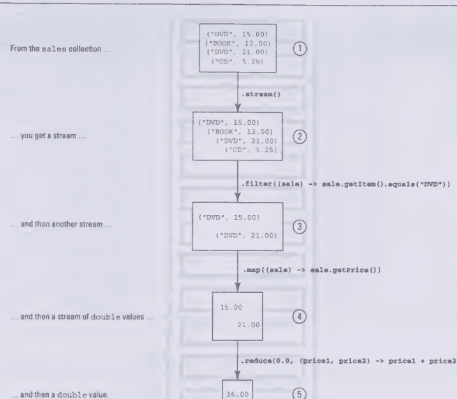

在图 12-5 中，每个框代表沿流水线线上转换的一批原材料。每个箭头代表一个方法（或者比喻为，流水线上的工人）。

例如，在从第二个框到第三个框的转换过程中，一个工人方法（`filter` 方法）筛选掉不是 DVD 的项目。想象一下，露西·里卡多（Lucy Ricardo）站在第二个和第三个框之间，从流水线上移除每本书或每个 CD，并漫不经心地扔在地板上。

Java 的 `filter` 方法的参数是一个 `Predicate`（谓词）——一个结果为布尔值的 lambda 表达式。（参见表 12-2 和 12-3。）图 12-5 中的 `filter` 方法筛选掉未通过 lambda 表达式真/假测试的项目。

为了帮助理解表 12-3 第 3 列中的单词（`Predicate`、`Function` 和 `BinaryOperator`），请参考前面的章节“lambda 表达式的分类法”。

第 12 章 使用集合和流（当数组不够用时） 343

# 表 12-3 一些函数式编程方法

| 方法名称 | 属于 | 参数(s) | 结果类型 | 结果值 |
|---|---|---|---|---|
| `stream` | `Collection` | (无) | `Stream` | 一个输出集合中元素的流 |
| `filter` | `Stream` | `Predicate` | `Stream` | 一个新流，其中包含 lambda 表达式返回 true 的值 |
| `map` | `Stream` | `Function` | `Stream` | 一个新流，其中包含对输入流应用 lambda 表达式后得到的结果 |
| `reduce` | `Stream` | `BinaryOperator` | 二元运算符所使用的类型 | 结合输入流中所有值后得到的结果 |

在图 12-5 中，在从第三个框到第四个框的转换过程中，一个工人方法（`map` 方法）从每个销售记录中提取价格。从该工人的位置开始，流水线只包含价格值。

更准确地说，Java 的 `map` 方法按如下方式接收一个 `Function`：

```java
(sale) -> sale.getPrice()
```

并将该 `Function` 应用到流中的每个值。（参见表 12-2 和 12-3。）因此，图 12-5 中的 `map` 方法接收一个销售对象的输入流，并创建一个值的输出流。

在图 12-5 中，在从第四个框到第五个框的转换过程中，一个工人方法（`reduce` 方法）累加 DVD 销售的价格。Java 的 `reduce` 方法接收两个参数：

- 第一个参数是初始值。在图 12-5 中，初始值为 0。
- 第二个参数是 `BinaryOperator`。（参见表 12-2 和 12-3。）在图 12-5 中，`reduce` 方法的 `BinaryOperator` 是：

```java
(price1, price2) -> price1 + price2
```

`reduce` 方法使用其 `BinaryOperator` 结合输入流中的值。初始值作为所有结合的起点。因此，在图 12-5 中，`reduce` 方法执行了两次加法。（参见图 12-6。）

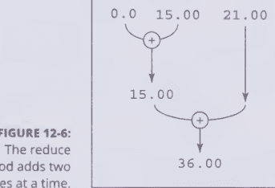

作为对比，想象调用方法：

```java
reduce(10.0, (value1, value2) -> value1 * value2)
```

其流的值包含 3.0、2.0 和 5.0。产生的动作如图 12-7 所示。

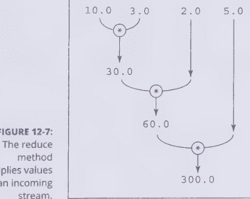

从整体上看，图 12-5 所示的整个流水线累加了 DVD 的价格。代码 12-5 包含了使用了图 12-5 中流和 lambda 表达式的完整程序。

# 代码 12-5：函数式生活

代码 12-5 需要 Java 8 或更高版本。如果你的 IDE 设置为较旧版本，可能需要调整 IDE 的设置。你可能需要下载新版本的 Java。代码 12-5 中的加粗代码是一个赋值语句。语句的右侧包含一系列方法调用。每个方法调用返回一个对象，而该对象是下一个方法调用的内容。这就是你形成流水线的方式。例如，在加粗代码开头，名称指向 `ArrayList` 对象。每个对象都有一个 `stream` 方法。在代码 12-5 中，`sales.stream()` 是对该对象的调用。`stream` 方法返回 `Stream` 类实例。（真惊喜！）`sales.stream()` 指向一个 `Stream` 对象。（参见图 12-8。）

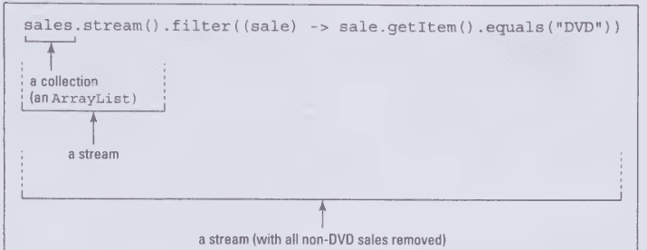 图 12-8：获取所有 DVD 销售。每个对象都有一个 `filter` 方法。所以：

```java
sales.stream().filter((sale) -> sale.getItem().equals("DVD"))
```

包含了对 `Stream` 对象的 `filter` 调用。（参见图 12-8。）模式继续。`Stream` 对象的 `map` 方法返回另一个 `Stream` 对象——一个包含价格的 `Stream` 对象。（对于该价格流，你应用 `reduce` 方法，它产生一个值——DVD 的总和。）

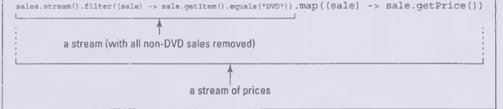 图 12-9：获取每个 DVD 销售的价格。

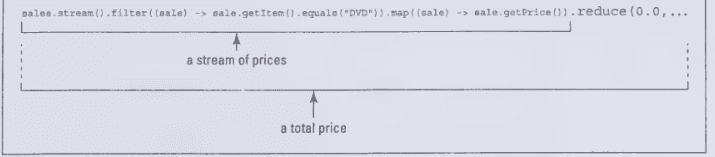 图 12-10：获取 DVD 销售的总价。

第 12 章 使用集合和流（当数组不够用时） 347

每个流都有两种方法：中间方法（intermediate）和终端方法（terminal）。中间方法返回另一个流。终端方法返回流以外的其他内容（或为 `void`）。调用链以一个或多个中间方法开始，并以单个终端方法结束。例如，在代码 12-5 中，`filter` 和 `map` 是中间方法，而 `reduce` 是终端方法。在某种意义上，终端方法从所有中间方法提取值。当 Java 尝试寻找 `total` 的值时，终端方法会积极地请求每个销售记录。此时，惰性的中间方法 `filter` 和 `map` 被激活并开始产生值。如果你不在调用链末尾放置终端方法调用，Java 就不会执行任何中间调用。例如，参见本章末尾“尝试一下”部分。

## 为什么要费劲？

代码 12-5 中的方法调用链完成了代码 12-4 中循环完成的工作。但图 12-10 中的代码使用了函数式编程的概念。这有什么大不了？相比 12-4，使用 12-5 更好吗？

是的。在过去的几年里，芯片设计的趋势是多核处理器。有了多个核心，处理器可以同时执行多个语句，将程序的执行速度提高 2 倍、4 倍甚至更多。如果你将工作分配给多个核心，程序运行会快得多。你如何分配工作？

你可以修改代码 12-4 中的命令式代码。例如，通过某些高级特性，你可以将不同的迭代交给不同的核心。但生成的代码非常杂乱。为了让代码正常工作，你必须精细管理循环迭代，仔细检查以确保最终总量正确。

相比之下，函数式代码很容易修改。要利用多核处理器的优势，你只需更改代码 12-5 中的一个单词！

```java
sales.parallelStream()
  .filter((sale) -> sale.getItem().equals("DVD"))
  .map((sale) -> sale.getPrice())
  .reduce(0.0, (price1, price2) -> price1 + price2);
```

在代码 12-5 中，`stream()` 方法调用创建一个串行流。在串行流中，Java 一次处理一个销售记录。但 `parallelStream()` 的调用创建一个稍微不同的流。在并行流中，Java 将工作分配给计算机处理器中的核心数量（或根据其他其他计算能力的衡量标准）。如果你有 400 万次销售记录和四个核心，每个核心处理 100 万次。

每个核心独立于其他核心工作，每个核心都将其结果丢入最终的 `reduce` 方法。`reduce` 方法将核心的结果合并为最终总数。在理想情况下，所有工作完成只需要普通串行流四分之一的时间。

当你阅读上面的段落时，不要忽略“理想情况下”这个短语。并行并不是魔法。而且有时，并行并不是你的朋友。考虑你只有 20 次销售记录的情况。将问题分成四组（每组 5 次销售）所需的时间超过了使用所有核心所节省的时间。此外，某些问题并不适合并行处理。

## 没有变量？没问题！

每次迭代都可能改变 `runningTotal` 的值，因此你不能将每次迭代分配给不同的处理器核心。如果你真的这样做，你就会面临两个核心同时运行总和的风险。（这种情况很有可能发生，但由于同时更新，两个核心都无法正确完成它们的更新！）但列表 12-5 中的 `filter/reduce` 语句完全没有引用代码中的 `total` 变量。程序的 `total` 变量是一个最终的计数结果，而不是一个运行中的总和。列表 12-5 中的没有任何一个变量代表运行总和。在列表 12-5 中，运行总和是完全匿名的。

在命令式编程中，变量是语句之间共享其值的地方。但函数式编程规避了变量。因此，当你进行函数式编程时，没有大量的数据共享。许多与共享数据相关的困难都消失于无形了。

这里有一个类比：将一个编程问题想象成立方体，然后将一个命令式编程解决方案想象成将立方体切成易于管理的方法。（参见第一个侧边栏图。）

它并不容易放入，为了把它挤进一个核心中。核心，所以……


为了充分利用四核处理器的性能，你将代码分成四部分——每个核心一个。但使用命令式编程时，你的程序片段并不能整齐地放入处理器的核心中。该图显示了当你试图将一个命令式程序挤入多核处理器时会发生什么。

函数式编程也将代码切分成片段，但它是沿着不同的线条。在函数式编程中，代码片段可以整齐地放入处理器的核心中。（参见下面的侧边栏图。）

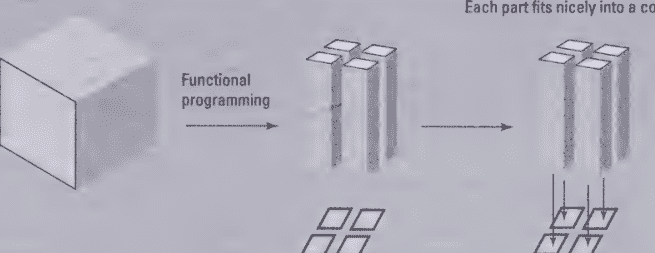

函数式代码消除了对程序部分之间共享数据的顾虑。这样一来，函数式编程是解决重要计算问题的优雅解决方案。

## 方法引用

仔细观察列表 12-5 中的最后一个 lambda 表达式：

```java
(price1, price2) -> price1 + price2
```

这个表达式执行的工作与 `sum` 方法大致相同。（事实上，你可以在前面的“Lambda 表达式”章节中找到方法的声明。）如果你在输入一个 3 行 `sum` 方法和输入一个 1行的 lambda 表达式之间做选择，你可能会选择 lambda 表达式。但如果你有第三种替代方案呢？与其自己编写 `sum` 方法，你可以引用一个现有的 `sum` 方法。使用现有方法是最快且最安全的方法。

幸运的是，Java 的 `Double` 类包含一个静态 `sum` 方法。你不需要创建自己的 `sum` 方法。如果你运行以下代码：

```java
double i = 5.0, j = 7.0;
System.out.println(Double.sum(i, j));
```

计算机显示 12.0。因此，与其在列表 12-5 中输入两个冒号来创建一个方法引用，你可以创建一个引用现有方法的表达式。

```java
sales.stream()
.filter((sale) -> sale.getItem().equals("DVD"))
.map((sale) -> sale.getPrice())
```


.reduce(0.0, `Double::sum`);

表达式 `Double::sum` 指向属于 Java 类的 `sum` 方法。当你使用这个 `Double::sum` 引用时，执行的操作与列表 12-5 中的 lambda 表达式执行的操作相同。大家都很开心。

关于静态方法的信息，请参见第 10 章。


你总是可以尝试你自己构思的编程挑战。如果你没有主意练习函数式编程，我有几点建议给你：

### 慷慨
每个员工都有一个名字和一个评分。如果你给每个分数在 3 分及以上的员工发放 $100，找到你将支付的奖金总额。在你的代码中，充分利用 lambda 表达式和方法引用。

### 节省时间
每个食谱都有名称、配料列表（某些涉及肉类）和预计准备时间。找到一种素食食谱的平均制作时间。

### 记录
第 9 章中的某些挑战引入了 Java 的 record 功能。修改列表 12-3 使 `Sale` 成为一个 record。修改列表 12-5 以使用你新定义的 record。

### 中间方法只是懒惰
在“流的解释”章节中，我警告过 Java 在你没有调用终端方法的情况下结束链式调用是不会报错的。双重检查我是否在撒谎，用以下代码运行列表 12-5：

```java
var total = sales.stream()
    .filter((sale) -> sale.getItem().equals("DVD"))
    .map((sale) -> sale.getPrice());

System.out.println("Hello");
```
// 注释掉的: `System.format(total)`);

### 无流
你不需要流来使用 Java 的 lambda 表达式。运行这段代码以一略可能性：

```java
import java.util.function;

public class LambdaWithoutStream {

    public static void main(String[] args) {

        System.out.println(change("Hello", a -> {return a + "!"}));

    }

    static String change(String str, Function<String, String> func) {

        return func.apply(str);

    }

}
```

### 本章
- 从错误输入和其他情况中恢复
- 让你的代码（某种程度上）防止崩溃
- 定义你自己的异常

### 当意外情况发生时
1945 年 9 月 9 日：一只飞蛾进入了 Mark II 计算机的继电器中并导致了故障。这是第一个有记录的计算机 bug。

1957 年 4 月 19 日：位于匹兹堡西部的数据处理中心的经理 Herbert Bright 收到了一叠未标记的卡片（这在今天就像收到一张未标记的 CD-ROM）。他凭经验判断，这叠卡片来自 FORTRAN 的开发团队（当时还没有网络下载）。仅凭这个猜测，Bright 在他的 IBM 704 上编写了一个小型 FORTRAN 程序并尝试编译。（IBM 704 位于一个专门建造的 2000 平英尺房间。由于使用的是真空管而不是晶体管，机器拥有惊人的 32K 内存。运行程序之前必须从磁带加载操作系统，典型的程序运行需要两到四小时。）在经过通常等待后，Bright 的 FORTRAN 程序编译返回了一个错误错误：语句中缺少逗号。

1962 年 7 月 22 日：水星一号——美国第一个指向另一个行星的探测器——在发射四分钟后因表现异常而被摧毁。这种异常行为归因于速度公式中缺少了一个横杠（类似于连字符）。

与此同时，NASA 的轨道计算软件被发现包含错误的语句 `DO 10 I-1.10`（应该是 `DO 10 I=1,10`）。在现代表示法中，我们写的是 `do i=1.10` 而不是 `(int i=1; i<10; i++)`。从逗号变为句点将循环变成了赋值语句。

```java
import static java.lang.System.out;

public class inventoryA {

    public static void main(String[] args) {

        final double boxPrice = 3.25;

        var keyboard = new Scanner(System.in);

        NumberFormat currency = NumberFormat.getCurrentInstance();

        out.print("How many boxes do we have? ");

        String numBoxesIn = keyboard.next();

        int numBoxes = Integer.parseInt(numBoxesIn);

        out.print("The value is ");

        out.println(currency.format(numBoxes * boxPrice));

        keyboard.close();

    }

}
```

我们有多少个箱子？
价值是 $9.75

我们有多少个箱子？
线程 "main" 异常 `NumberFormatException`: 输入字符串为 "abc"
at java.lang.NumberFormatException.forInputString(Unknown Source)
    at java.lang.Integer.parseInt(Unknown Source)
    at inventoryA.main(inventoryA.java:15)

我们有多少个箱子？
线程 "main" 异常 `NumberFormatException`: 输入字符串为 "three"
at java.lang.NumberFormatException.forInputString(Unknown Source)
    at java.lang.Integer.parseInt(Unknown Source)
    at inventoryA.main(inventoryA.java:15)

图 13-1：
列表 13-1 中代码的三次独立运行。

修复程序 bug 的关键是检查程序崩溃时出现的消息。库存程序的程序显示为 `java.lang.NumberFormatException`。这意味着在 `java.lang` API 包中有一个名为 `NumberFormatException` 的类。由于某种原因，对 `Integer.parseInt` 的调用让这个 `NumberFormatException` 暴露了出来。


关于 `Integer.parseInt` 方法的简要解释，请参见第 11 章。

这是发生的情况。Java 编程语言有一种称为异常处理的机制。通过异常处理，程序可以检测到某些即将出错，并通过创建一个全新的对象来响应。在官方术语中，程序被称为“抛出（throwing）”了一个异常。这个新对象（`Exception` 类的一个实例）像接烫豆一样，从一段代码传递到另一段，直到某段代码决定“捕捉（catch）”这个异常。当异常被捕获时，程序执行某些恢复代码，携带异常并移动到下一个正常语句，尽管什么都没有发生过。该过程如图 13-2 所示。

```java
void method1() {

  try {

    method2();

  } catch (Exception e) {

  }

}
```

```java
void method2() throws Exception {

  method3();

}
```

```java
void method3() throws Exception {

  method4();

}
```

```java
void method4() throws Exception {

  throw new Exception();

}
```

图 13-2：
抛出、传递和捕捉异常。

整个过程通过几个 Java 关键字辅助完成。这些关键字在列表中进行了描述：

- `throw:` 创建一个新的异常对象。
- `throws:` 表示该方法可能会将异常传递给调用该方法的任何代码。
- `try:` 包含一个可能创建新异常对象的代码。在通常情况下，`try` 子句中的代码包含了所有代码可以创建一个或多个异常的方法。
- `catch:` 处理异常，将其埋掉，然后继续执行。

所以，事实是：通过如图 13-2 所示的某种事件链，`Integer.parseInt` 方法可能会抛出 `NumberFormatException`。当你调用 `Integer.parseInt` 时，这个 `NumberFormatException` 会被传递给 Java 应用程序编程接口 (API) 文档，`parseInt` 方法说明：“抛出: NumberFormatException —— 如果字符串不是可解析的整数”。偶尔阅读文档是有回报的。


如果你自认为是一个英雄，最好捕捉异常，以便其他代码继续运行。列表 13-2 显示了对异常的捕捉。

#### 列表 13-2：英雄数箱数

```java
package com.example.inventory;

import java.text.NumberFormat;

import java.util.Scanner;

import static java.lang.System.out;

public class InventoryA {

    public static void main(String[] args) {

        final double boxPrice = 3.25;

        var keyboard = new Scanner(System.in);

        NumberFormat currency = NumberFormat.getCurrentInstance();

        out.print("How many boxes do we have? ");

        String numBoxesIn = keyboard.next();

        try {

            int numBoxes = Integer.parseInt(numBoxesIn);

            out.print("the value is ");

            out.println(currency.format(numBoxes * boxPrice));

        } catch (NumberFormatException e) {

            out.print(e.getMessage());

            out.println(" ... Cannot interpret the input.");

        }

        keyboard.close();

    }

}
```

图 13-3 显示列表 13-2 代码的三次运行。当用户误输入 **three** 而不是 **3** 时，程序通过显示 `"three" ... Cannot interpret the input` 来冷静。技巧是将 `Integer.parseInt` 的调用封装在 `try` 子句中。如果你这样做，计算机会在执行 `try` 子句内的任何语句时监控异常。如果抛出了异常，计算机会从 `try` 子句内部跳转到下方的 `catch` 子句。在列表 13-2 中，计算机直接跳转到 `catch(NumberFormatException e)` 子句。计算机执行子句内的打印语句，然后继续正常处理。在 13-2 中，“正常处理”意味着执行 `keyboard.close()`。

我们有多少个箱子？3
价值是 $9.75

我们有多少个箱子？three
输入字符串: "three" ... Cannot interpret the input.

图 13-3：列表 13-2 代码的三次运行。

我们有多少个箱子？25
价值是 $81.25


技术细节

整个 try-catch 组合——包含 `try` 子句、`catch` 子句以及你的任何代码——被称为 `try` 语句。为了强调，我称之为 `try-catch` 语句。

## catch 子句中的参数

看看列表 13-2 中的 `catch` 子句，特别注意 `(NumberFormatException e)` 这几个词。这看起来非常像方法的参数列表，不是吗？事实上，每个 `catch` 子句都像是一个带有自己参数列表的小方法。

参数列表始终有一个异常类型，然后是一个参数。参数是一个对象——`NumberFormatException` 类的一个。当异常被捕获时，Java 让 `catch` 子句的参数引用该异常对象。换句话说，列表 13-2 中的名称 `e` 存储了许多关于异常的信息。利用这一点，你可以调用异常的一些方法。在列表 13-2 中，我调用了 `getMessage` 方法。你看！`getMessage` 调用返回了输入字符串: "three"。这是有用的信息。每当 Java 无法理解用户的 `three` 输入时，会将这些信息交给变量 `e`。

除了 `getMessage` 方法外，每个异常都有实用的 `printStackTrace` 方法。要查看它是如何工作的，请如下重写列表 13-2 中的 `catch` 子句：

```java
} catch (NumberFormatException e) {

    e.printStackTrace();

}
```

有了这个新的 `catch` 子句，库存程序的运行看起来可能像图 13-4 所示的运行。当你调用 `printStackTrace` 时，你会看到异常抛出时正在运行的方法列表，以及方法中的行号。在图 13-4 中，显示包含了 `Integer.parseInt` 和 `main` 方法。

我们有多少个箱子？

```
java.lang.NumberFormatException: For input string: "three"

at java.base/java.lang.NumberFormatException.forInputString(NumberFormatException.java:67)

at java.base/java.lang.Integer.parseInt(Integer.java:68)

at java.base/java.lang.Integer.parseInt(Integer.java:78)

at com.example.inventory.InventoryA.main(InventoryA.java:19)
```

# 图 13-4
Java 的堆栈跟踪。

注意图 13-4 中的运行与图 13-1 中其他运行之间的相似性。

- **在 13-4 中：** Java 抛出一个 `NumberFormatException`。列表 13-2 中的代码捕捉了异常并调用打印堆栈跟踪的方法。然后程序继续运行（例如调用 `keyboard.close()`）。
- **在图 13-1 中：** Java 抛出一个 `NumberFormatException`。列表 13-1 中没有任何代码捕捉该异常，因此 Java 按照它处理未捕获异常的方式执行：打印堆栈跟踪并突然结束运行。换句话说，你的程序崩溃了。

当我们配合 `System.out.println` 使用 `printStackTrace` 时，Java 显示信息的顺序是预测的。这就是为什么 `printStackTrace` 不直接写入 `System.out`。`printStackTrace` 方法写入所谓的 `System.err`，默认情况下，它显示在与 `System.out` 相同的屏幕上。如果你愿意，可以修改代码让文本进入你想去的地方。


技术细节

我还没有什么聪明的办法将 TryItOut 中的 `Try` 与 `try try-catch` 语句连接起来。如果你想到了什么，请在页边上画下来。然后尝试这个小挑战：

### 动手尝试

### 不要放弃

添加 `try-catch` 语句以防止以下代码崩溃：

```java
import java.util.Scanner;

public class Main {

    public static void main(String[] args) {

        var keyboard = new Scanner(System.in);

        var words = new String[5];

        int i = 0;

        do {

            words[i] = keyboard.next();

        } while (!words[i++].equals("Quit"));

        for (int j = 0; j < 5; j++) {

            System.out.println(words[j].length());

        }

        keyboard.close();

    }

}
```


## 自己试一做

在之前的章节中，你通过输入 `three` 而不是 `3` 搞乱了库存程序。干得好！今天还会出什么错呢？还有其他类型的异常吗——那些与 `NumberFormatException` 无关的异常？当然，世界上有很多不同的异常类型。你甚至可以创建自己的异常。想试一下吗？如果是，请查看代码列表 13-3 和 13-4。

### 代码列表 13-3：创建你自定义的异常

```java
package com.example.inventory;

public class OutOfRangeException extends RuntimeException {

    public OutOfRangeException(String message) {
        super("A value is out of range \n" + message);
    }
}
```

### 代码列表 13-4：使用你自定义的异常

```java
package com.example.inventory;

import java.text.NumberFormat;
import java.util.Scanner;
import static java.lang.System.out;

public class InventoryC {

    public static void main(String[] args) {
        final double boxPrice = 3.25;
        var keyboard = new Scanner(System.in);
        NumberFormat currency = NumberFormat.getCurrencyInstance();
        out.print("How many boxes do we have?");
        String numBoxesIn = keyboard.next();

        try {
            int numBoxes = Integer.parseInt(numBoxesIn);
            if (numBoxes < 0) {
                throw new OutOfRangeException("You typed " + numBoxes + " + + \n" +
                    " - There's no such thing as a negative box.");
            }
            out.print("The value is: ");
            out.println(currency.format(numBoxes + boxPrice));
        } catch (NumberFormatException e) {
            out.print(e.getMessage());
            out.println(" Cannot interpret the input.");
        } catch (OutOfRangeException e) {
            out.println(e.getMessage());
        }
        keyboard.close();
    }
}
```

列表 13-3 和 13-4 解决了一个之前悄悄出现的问题。看看图 13-3 中三次运行的最后一次。用户报告架子上有 -25 个箱子，而计算机眼睛都不眨地接受了这个值。而事实是，你需要一个黑洞（或者其他某种奇异的时空扭曲现象）才能在你仓库的任何一个架子上出现负数量的箱子。因此，当用户输入负数箱子时，程序应该感到不安，这正是列表 13-4 中代码所做的。要明白我的意思，请看图 13-5。

列表 13-3 中的代码声明了一个新类型的异常类：`OutOfRangeException`。在很多情况下，输入负数可能完全没问题，所以 Java API 并没有内置 `OutOfRangeException`。但在库存程序中，负数个箱子应该被标记为异常。

How many boxes do we have? 3
The value is $9.75

How many boxes do we have? three
For input string: "three" ... Cannot interpret the input.

### 代码列表 13-5：三次运行来自列表 13-3 和 14-3 的代码

How many boxes do we have? -25
A value is out of range.
You typed -25. There's no such thing as a negative box.

你如何知道列表 13-3 中的类是某种异常？你看到类声明的第一行继承了 `RuntimeException`。列表 13-3 中的类是一种称为“运行时异常”（runtime exception）的特定异常。要了解更多关于运行时异常的信息，请参阅本章后部分的“The Buck Stops Here, Except When It Doesn't”章节。


## 技术细节

当你执行：

```java
throw new OutOfRangeException("You typed " + numBoxes +
" There's no such thing as a negative box.");
```

在 13-4 中，你将字符串 `"You " + numBoxes + ...` 传递给列表 13-3 中的消息。列表 13-3 中的构造函数本身对该值没有做任何操作。相反，构造函数将消息与 `"A value is out of range."` 组合在一起。然后构造函数使用 `super` 将组合后的字符串传递给它的父类——`Runtime` 类。当你完成操作后，对 `getMessage()` 的调用会给你一大段文本：A value is out of range... blah, blah, ... no such blah。


## 交叉引用

### 谁来捕获异常？

再看列表 13-4。注意有多个 `catch` 子句。当异常位于 `try` 块内部时，Java 开始检查随后的 `catch` 子句列表。它从紧随 `try` 块的子句开始，并向下遍历列表。

- 如果不是，Java 将跳过此 `catch` 子句并继续下一个。
- 如果是，Java 将执行该 `catch` 子句并跳过列表中的后续内容。
- 在这种情况下，Java 将执行该 `catch` 子句并跳过 `try` 块之后的所有子句。要了解具体的例子，请看列表 13-5 和 13-6。

### 代码列表 13-5：另一种异常

```java
package com.example.inventory;

class OutOfRangeException extends RuntimeException {

    public OutOfRangeException(String message) {
        super("A value is out of range \n" + message);
    }
}
```

### 代码列表 13-6：抓我就我

```java
package com.example.inventory;

import java.text.NumberFormat;
import java.util.Scanner;
import static java.lang.System.out;

public class Inventory {

    public static void main(String[] args) {
        final double boxPrice = 3.25;
        var keyboard = new Scanner(System.in);
        NumberFormat currency = NumberFormat.getCurrencyInstance();
        out.println("How many boxes do we have?");
        String numBoxesIn = keyboard.next();

        try {
            int numBoxes = Integer.parseInt(numBoxesIn);
            if (numBoxes < 0) {
                throw new OutOfRangeException("You typed " + numBoxes +
                    ". There's no such thing as a negative box.");
            }
            if (numBoxes > 1000) {
                throw new NumberLargeException(numBoxes +
                    " is larger than the maximum of 1000.");
            }
            out.print("The value is: ");
            out.println(currency.format(numBoxes + boxPrice));
        } catch (NumberFormatException e) {
            out.print(e.getMessage());
            out.println(" Cannot interpret the input.");
        } catch (OutOfRangeException e) {
            out.println(e.getMessage());
        } catch (Exception e) {
            out.println(e.getMessage());
        }
        out.println("That's that.");
        keyboard.close();
    }
}

class NumberLargeException extends OutOfRangeException {

    public NumberLargeException(String message) {
        super("A value is out of range. \n" + message);
    }
}
```

为了运行列表 13-5 和 13-6，你需要一个额外的 Java 文件：`OutOfRangeException` 类。

列表 13-6 处理了库存空间有限的情况。你没有超过 1000 个箱子的空间，但当程序询问你有几个箱子时，有人不小心输入了 1001。在这种情况下，列表 13-6 执行了一个快速检查：任何超过 1000 的箱都被认为是不现实的。

由于 `NumberLargeException` 是 `OutOfRangeException` 的子类，任何 `NumberLargeException` 实例都是一种特殊的 `OutOfRangeException`。所以，在列表 13-6 中，Java 可能开始寻找捕获 `NumberLargeException` 的子句。当 Java 遇到 `OutOfRangeException` 子句时，Java 会说：“好的，我找到了匹配项。我将执行这个子句中的语句。”

```java
try {
  // 正常处理，不抛出异常
} catch (NumberFormatException e) {
  out.print(e.getMessage());
  out.println(" ... Cannot interpret the input.");
}
catch (OutOfRangeException e) {
  out.println(e.getMessage());
}
catch (Exception e) {
  out.println(e.getMessage());
}
out.println("That's that.");
```

图 13-7：没有抛出异常。

```java
try {
  throw new NumberFormatException();
} catch (NumberFormatException e) {
  out.print(e.getMessage());
  out.println(" ... Cannot interpret the input.");
}
catch (OutOfRangeException e) {
  out.println(e.getMessage());
}
catch (Exception e) {
  out.println(e.getMessage());
}
out.println("That's that.");
```

图 13-8：Java 抛出了一个 `NumberFormatException`。

**用户输入了一个负数，例如数字 -25。** 代码抛出了一个 `OutOfRangeException`。Java 跳过了 `try` 子句中剩余的语句。Java 跳过了第一个 `catch` 子句中的语句。归结底，一个 `OutOfRangeException` 并不是任何类型的 `NumberFormatException`。参数为 `NumberFormatException` 的 `catch` 子句与此 `OutOfRangeException` 不匹配。）Java 执行了第二个 `catch` 子句内部的语句——即参数类型为 `OutOfRangeException` 的那个 `catch` 子句。然后，Java 跳过了第三个 `catch` 子句，并执行紧跟在所有 `catch` 子句之后的代码。（见图 13-9）。

```java
try {
    throw new OutOfRangeException(...);
} catch (NumberFormatException e) {
    System.out.print(e.getMessage());
    System.out.println(" ... Cannot interpret the input.");
}
catch (OutOfRangeException e) {
    System.out.println(e.getMessage());
}
catch (Exception e) {
    System.out.println(e.getMessage());
}
System.out.println("That's that.");
```

图 13-9：Java 抛出了一个 `OutOfRangeException`。

> 用户输入了一个不实际巨大的数字，例如数字 1001。代码抛出了一个 `NumberLargeException`。Java 跳过了 `try` 子句中剩余的语句。Java 甚至跳过了第一个 `catch` 子句中的语句。（之后，`NumberLargeException` 并不是任何类型的 `NumberFormatException`。）

但是，根据列表 13-5 中的代码，`NumberLargeException` 是 `OutOfRangeException` 的子类。当 Java 到达第二个 `catch` 子句时，Java 说：“嗯，一个 `NumberLargeException` 是 `OutOfRangeException` 的一种。我会执行这个 `catch` 子句中的语句——即参数类型为 `OutOfRangeException` 的那个 `catch` 子句。”换句话说，它是匹配的。

Java 执行第二个 `catch` 子句内部的语句。然后，Java 跳过了第三个 `catch` 子句，并执行紧跟在所有 `catch` 子句之后的代码。（见图 13-10。）

```java
try {
    throw new NumberToolLargeException(...);
} catch (NumberFormatException e) {
    out.print(e.getMessage());
    out.println("... Cannot interpret the input.");
} catch (OutOfRangeException e) {
    out.println(e.getMessage());
} catch (Exception e) {
    out.println(e.getMessage());
} out.println("That's that.");
```

图 13-10：Java 抛出了一个 `NumberToolLargeException`。

发生了其他事情，一些完全不可预料的事情。（我不知道。）由于我那无尽的实验冲动，我进入了列表 13-6 的 `try` 子句，并添加了一条实施严重犯罪的语句。该语句将数字除以零：

```java
try {
    out.println(1 / 0);
}
```


## 捕获两个或多个异常

你可以在单个 `catch` 子句中捕获多个异常。例如，在列表 13-5 中，你可能会写：

```java
catch (NumberFormatException | OutOfRangeException e) {
    System.out.println(e.getMessage());
}
```

管道符号 `|` 告诉 Java 捕获 `NumberFormatException` 或 `OutOfRangeException`。如果你抛出了其中一种类型的异常，程序将跳转到最后一个 `catch` 子句。

## 到此为止

当你使用 `System.out` 构造 `Scanner` 时，不会出现问题。但当你使用 `File` 构造 `Scanner` 时，你必须小心。可能你拼错了文件名 (`EmployeeInfo.txt`)。可能你的文件在云端，由于网络中断而无法读取。可能你没有访问任何文件的权限。谁知道呢？

除非承认存在风险，否则 Java 不允许你调用 `new Scanner(anything_at_all)`。问题在于，`Scanner` 构造函数内部的代码可能会抛出异常。这种异常是 `FileNotFoundException` 的实例。

### 列表 13-7：未写入薪资

```java
/*
 * 此代码无法编译。
 */

package com.example.payroll;

import java.io.File;
import java.util.Scanner;
import static java.lang.System.out;

public class DoNotDoPayroll {
    public static void main(String[] args) {
        out.println("Starting payroll ...");
        doPayroll();
        out.println("Payroll completed.");
    }
}
```

```java
public static void doPayroll() {
    var diskScanner = new Scanner(new File("EmployeeInfo.txt"));
    String name = diskScanner.nextLine();
    double amountPaid = diskScanner.nextDouble();
    out.printf("Pay to the order of %s: $%.2f\n", name, amountPaid);
    diskScanner.close();
}
```

不，这并不是代码中“确认异常”的含义。在代码中确认异常意味着以下两种情况之一：

- `try` 子句内部的语句（包括任何构造函数或方法调用）可能会抛出该异常。该 `try` 子句包含一个 `catch` 子句，其参数列表中有匹配的异常类型。
- 可能抛出异常的语句（包括任何构造函数或方法调用）位于一个方法内部，该方法的头部有一个 `throws` 子句。该 `throws` 子句包含一个匹配的异常类型。

如果你对这两个项目的表述感到困惑，不要担心。接下来的两个列表说明了这些项目中的观点。

## 尽快捕获

在列表 13-8 中，新的 `Scanner` 位于 `try` 子句内部。该 `try` 子句包含一个异常类型为 `FileNotFoundException` 的 `catch` 子句。

### 列表 13-8：使用 try-catch 语句确认

```java
package com.example.payroll;

import java.io.File;
import java.io.FileNotFoundException;
import java.util.Scanner;
import static java.lang.System.out;

public class DoPayroll {
    public static void main(String[] args) {
        out.println("Starting payroll ...");
        cutCheck();
        out.println("Payroll completed.");
    }

    public static void cutCheck() {
        try {
            var diskScanner = new Scanner(new File("EmployeeInfo.txt"));
            String name = diskScanner.nextLine();
            double amountPaid = diskScanner.nextDouble();
            out.printf("Pay the order %s: $%.2f\n", name, amountPaid);
            diskScanner.close();
        } catch (FileNotFoundException e) {
            out.println(e.getMessage());
        }
    }
}
```

**图 13-12** 显示了列表 13-8 中代码的两次运行。对于第一次运行，`EmployeeInfo.txt` 包含行 `Barry Burd` 和 `5000.00`。对于第二次运行，用户的硬盘上没有 `EmployeeInfo.txt`。

Starting payroll ...
Pay the order Barry Burd: $5000.00
Payroll completed.

*图 13-12：带有和没有 EmployeeInfo.txt 文件。*

Starting payroll ...
EmployeeInfo.txt (No such file or directory)
Payroll completed.

当我查看列表 13-8 时，我的内心充满了自豪。我确认了 `FileNotFoundException`，防止了代码打印“Pay the order”，并避免了糟糕的程序崩溃。事实上，我在异常发生时就立即处理了它。我在 `cutCheck` 方法火在蔓延并烧毁 `main` 方法之前扑灭了它。

但等一下！我做得对吗？这里是软件设计中的一个重要原则：不要太急于捕获异常。回看图 13-12，第二次运行以“Payroll completed.”结束。这 true是真的吗？Barry 真的能收到他应得的 $5000.00 吗？第二次运行抛出了 `FileNotFoundException`，但列表 13-8 中的 `cutCheck` 方法捕获了该异常，并没有告诉 `main` 方法发生了任何问题。因此，`main` 方法在无知中欢喜地打印了“Payroll completed.”。

我不应该从代码的 `main` 方法中屏蔽 `FileNotFoundException`。相反，我应该将异常从 `cutCheck` 方法向上传递到 `main` 方法。下一部分的示例展示了如何做到。

## 后捕获

在列表 13-9 中，`cutCheck` 方法说：“这个 `FileNotFoundException` 不是我的问题。让 main 来处理吧。”

### 列表 13-9：承认自身缺陷的方法

**图 13-13** 显示了列表 13-9 中代码的两次运行。对于第一次运行，`EmployeeInfo.txt` 文件包含行 `Barry Burd` 和 `5000.0`，运行以单词 `Payroll completed` 结束。对于第二次运行，用户的硬盘上没有 `EmployeeInfo.txt` 文件，程序没有显示误导性的字句。

Starting payroll ...
Pay the order Barry Burd: $5000.0
Payroll completed.

### 图 13-13：Payroll completed?也许是，也许不是。

Starting payroll ...
EmployeeInfo.txt (No content)

列表 13-9 的重要部分在 `cutCheck` 方法的头部。该头部以 `throws FileNotFoundException` 结尾。通过宣布它抛出 `FileNotFoundException`，`cutCheck` 甩了锅子。这个 `throws` 实际上是：“我意识到此方法内部的语句可能会抛出 `FileNotFoundException`，但我没有在 `try-catch` 语句中确认该异常。Java 编译器，别在这件事上找我。我没有使用 `try-catch` 语句，而是将确认异常的责任传递给了 `main` 方法（即调用 cutCheck 的方法）。”

确实，在 `main` 方法中，对 `cutCheck` 的调用位于 `try` 子句内部。该子句包含一个参数类型为 `FileNotFoundException` 的 `catch` 子句。所以一切都是好的。`cutCheck` 将责任传递给了 `main` 方法，而 `main` 方法接受了责任。为了更好地理解 `throws` 子句，想象一场排球比赛，异常是球。当对方发球时，异常直接向你飞来。当你把球回过网时，你就在捕获异常。如果你把球传过网，你就在使用 `throws` 子句。本质上，你是在说：“这里，你处理异常。”抛出异常的语句甚至不在 `try` 块中。当这种情况发生时，执行将跳出包含该异常的方法。执行返回到最初调用的地方。

> **记住**
> 方法可以在 `catch` 子句中命名多个异常类型。如下：
```java
throws FileNotFoundException, NumberFormatException, ArithmeticException
```

## 检查还是未检查？

查看列表 13-3，注意新定义的 `OutOfRangeException` 继承了 `RuntimeException` 类。为什么你想继承 `RuntimeException`？故事如下：

- `RuntimeException` 的任何子类都是未检查的。事实上，`RuntimeException` 的任何后代（子类等）都是未检查的。未检查异常可以在程序的任何地方出现。

> **提示**
> 如果你的代码抛出了未检查异常，你应该考虑重写代码。

常见的未检查异常包括 `NumberFormatException`（列表 13-2、13-4 等）、`ArithmeticException`、`IndexOutOfBoundsException`、臭名昭著的 `NullPointerException` 以及许多其他。编写代码时，深受这些异常影响，但将代码封装在 `try` 子句中（或通过 `throws` 子句传递）是完全可选的。

- 任何非 `RuntimeException` 后代的异常都是检查的。检查异常是外部世界可能施加给程序的挑战。无论你是否喜欢，某些文件不在它们应该在，所以你最好在程序中确认这一点并编写代码来应对。Java 的检查异常包括 `FileNotFoundException`（参见列表 13-8 和 13-9）、`SQLException` 以及一系列其他有趣的异常。

## 读者致谢

以下代码无法编译，因为它抛出了一个未处理的 `FileNotFoundException`：

```java
// 坏代码：

import java.io.File;
import java.util.Scanner;

public class Main {
    public static void main(String[] args) {
        var diskScanner = new Scanner(new File("numbers.txt"));
        int[] numerators = new int[5];
        int[] denominators = new int[5];
        int i = 0;
        while (diskScanner.hasNext()) {
            numerators[i] = diskScanner.nextInt();
            denominators[i] = diskScanner.nextInt();
            i++;
        }
        for (int j = 0; j < numerators.length; j++) {
            System.out.println(numerators[j] / denominators[j]);
        }
    }
}
```

```java
Scanner.close();
}
```

修复 `FileNotFoundException` 以通过代码编译。然后，根据 `numbers.txt` 文件，在程序运行时可能会抛出其他异常。添加一个或多个 `try-catch` 语句来显示这些异常，而不是让程序崩溃。

# 如果损坏，请修复

添加 `try-catch` 语句或 `throws` 子句（或两者结合）来修复以下代码：


当你让代码通过后，创建一个名为 `input` 的文件并运行代码查看是否生成了名为 `output` 的文件。

# 再次尝试！

从前以前，我是一个住在费城的年轻人，当时刚开始开车。我正朝着朋友家去，思考着什么时，另一辆车突然冒出来撞击了我的车。这种情况被称为 `FileNotFoundException`。

无论如何，两辆车都可以行驶，我们处于繁忙的十字路口。为了避免交通拥堵，我们都靠在了路边。我翻找驾照（上面有一张我很年轻的照片），并打开门下车。

这就是事故发生的时候。当我下车时，一辆城市公交经过。公交车撞了我，并撞了我的车几次。这种情况被称为 `DealWithLawyersException`。

事实是一切进展顺利。我受了伤但并不伤重。我的父母支付了车的损失费用，所以我没有遭受财务后果。（我通过将 `FileNotFoundException` 放入 `throws` 子句转嫁了负担。）

这次事件解释了为什么我是这样处理异常的。特别是，我想知道：“当计算机从一个异常中恢复时，抛出了第二个异常会怎样？”毕竟，`catch` 语句内部的语句无法免疫灾难。

嗯，这个问题的答案并不简单。首先，你可以在 `catch` 语句中放入 `try` 语句。这可以防止在执行 `catch` 语句期间出现意外的、尴尬的事件。但当你开始级联异常时，你就打开了一个麻烦。情况非常多，事情会很快变得复杂。列表 13-10 中的程序可以帮助你解决问题。

### 列表 13-10：使用两个文件

```java
package com.example.payroll;

import java.io.File;
import java.io.FileNotFoundException;
import java.util.Scanner;
import static java.lang.System.out;

public class DoPayroll {
    public static void main(String[] args) {
        out.println("Starting payroll ...");
        try {
            cutCheck();
            out.println("Payroll completed.");
        } catch (FileNotFoundException e) {
            out.println(e.getMessage());
        }
    }

    public static void cutCheck() throws FileNotFoundException {
        var scanner = new Scanner(new File("EmployeeInfo.txt"));
        var scanner2 = new Scanner(new File("LegalInfo.txt"));
        String name = scanner.nextLine();
```


```java
double amountPaid = scanner.nextDouble();

String disclaimer = scanner2.nextLine();

out.printf("Pay to the order of %s: $%.2f\n", name, amountPaid);

out.println(disclaimer);

scanner.close();

scanner2.close();

}
}
```

工资工资 ...
给 Barry Burd 的金额：$5,000.00
我们不承担任何责任。
工资发放完成。

列表 13-10 的运行输出可能像下面的图文字所示。

但在成功打开第一个文件（`EmployeeInfo.txt`）后，Java 找不到第二个文件（`LegalInfo.txt`）会怎样？然后 Java 会抛出一个 `FileNotFoundException` 并立即跳出 `cutCheck` 方法。Java 从未调用 `scanner.close()`，与 `EmployeeInfo.txt` 的连接一直处于悬空。对于像列表 13-10 这样的小程序，这并不是大问题。但如果你的代码未能关闭此类资源，你可能会遇到大麻烦。

# 第 13 章 当意外发生时保持良好状态

这就是为什么 Java 拥有 `try-with-resources` 特性。`try-with-resources` 语句会跟踪你打开的所有内容，并在它们不再需要时自动关闭它们。列表 13-11 包含了完整的故事。

# 访问修饰符

面向对象编程非常注重细节隐藏。编写一段代码的程序员不应该去碰另一个程序员代码内部的细节。这不仅仅是安全和机密性问题，更是安全性问题。当你隐藏细节时，你就防止了某段代码内部复杂的逻辑被另一段代码扭曲和破坏。你的代码会变成整齐、离散且易于管理的块。你将复杂度降到了最低。你犯的错误更少。你节省了钱。你有助于促进和平。

其他章节有很多关于私有字段（`private fields`）的示例。当一个字段被声明为私有时，它就会对所有外部的干扰隐藏起来。这种隐藏增强了模块化，最小化了复杂性等等。

在《Java 图解教程》（第 8 版）的其他地方，也有关于声明为公共（`public`）的内容的示例。就像公众人物一样，声明为公共的字段是完全开放的。可能有许多人知道埃尔维斯使用的是什么类型的牙膏，任何程序员都可以引用一个公共字段，即使该字段的名字不叫埃尔维斯。

在 Java 中，`public` 和 `private` 单词被称为访问修饰符。你难道没有在声明中看到没有访问修饰符的字段和方法吗？这种类型的方法或字段被称为具有默认访问（`default access`）。书中的许多示例都使用了默认访问，而没有大做特错。这在某些章节中是可以的，但在本章中不行。在本章中，我将描述关于默认访问的细节。

而且你还可以发现另一个在本章之前未在任何示例中用过的访问修饰符。（至少，我不记得在之前的示例中使用过它。）它就是 `protected` 访问修饰符。是的，本章将涵盖关于 `protected` 访问的一些阴暗、肮脏的事实。

# 类及其成员

在这个话题上，你可能会陷入术语丛中，因此你需要先掌握一些基础知识。（你需要的大术语来自第 7 章和第 10 章，但在本章开头回顾一下是值得的。）考虑下面这段 Java 代码：

```java
public class MyClass {

    int myField;      // 一个字段（成员）

}
```

```java
void myFunction() {

    // 一个方法（另一个成员）

    int myOtherField; // 一个方法局部变量（不是成员）

}
```

代码右侧的注释说明了整个情况。代码包含两种变量：字段和方法局部变量。本章不是关于方法局部变量的。本章是关于方法和字段的。

相信我，随处身带着“方法和字段”这个短语并不容易的。给这些东西起一个统一的名字并一于了之要好得多。这就是为什么方法和字段都被称为类的**成员（members of a class）**。

到此为止，你做了一个重要的区分。考虑一下 Java 的 `public` 关键字。你可以把 `public` 放在成员的前面。例如，你可以这样写：

```java
public static void main(String[] args) {}

public int amountInAccount = 5022;
```

你也可以将 `public` 关键字放在类的前面。例如，你可以写：

```java
public class Drawing {

    // 你的代码写在这里

}
```

在 Java 中，`public` 关键字有两个略有不同的含义：一个含义针对类的成员，另一个含义针对类本身。本章的大部分内容都在讨论 `public`（以及其他关键字）对于成员的含义。本章的最后一部分（题恰为“Java 类的访问修饰符”）处理针对类的含义。

# 成员的公共与私有访问

每个字段都在一个特定的类中声明，属于该类，并且是该类的成员。方法也是如此：每个方法都在一个特定的类中声明，属于该类，并且是该类的成员。你可以在代码特定位置使用特定的成员名称吗？为了回答这个问题，请检查该位置是在成员类的内部还是外部：

- 如果成员是 `private` 的，只有成员类内部的代码才能直接引用该成员的名字：

```java
class SomeClass {

    private int myField = 10;

}

class SomeOtherClass {

    public static void main(String[] args) {

        var someObject = new SomeClass();

        System.out.println(someObject.myField); // 这行不通。

    }

}
```

- 如果成员是 `public` 的，任何在同一个 Java 虚拟机中运行的代码都可以直接引用该成员的名字：

```java
class SomeClass {

    public int myField = 10;

}

class SomeOtherClass {

    public static void main(String[] args) {

        var someObject = new SomeClass();

        System.out.println(someObject.myField); // 这行通。

    }

}
```

在本章中，我做了像上一个项目那样的断言：“如果成员是公共的，任何代码都可以直接引用该成员的名字。”事实上，这类断言并不完全正确。在本章的最后一个章节中，我描述了 Java 的模块（`module`）功能。当两个类位于两个不同的模块时，一个类引用另一个类成员的能力并不会自动适用。详情请参参见后文的章节“从类到模块”。

图 14-1、14-2 和 14-3 以稍微不同的方式说明了这些思想。


# 代码列表 14-2：Drawing 类

```java
package com.burdbrain.drawings;

import java.awt.Graphics;

public class Drawing {

    public int x = 40, y = 40, width = 40, height = 40;

    public void paint(Graphics g) {

        g.drawOval(x, y, width, height);

    }

}
```

你不需要非常了解代码列表 14-2 中的代码。事实上，你只需要注意到两点就能应付之了：

- Drawing 类属于一个名为 `com.burdbrain.drawings` 的包。
- Drawing 类及其所有的成员（`x`, `y`, `width`, `height` 和 `paint`）都是公有的（`public`）。

你可以将此代码列表中的 `paint` 方法看作一个黑盒，因为这一章并不是真的关于绘图的。代码列表 14-2 中的 `paint` 方法只是为了帮助你描述访问修饰符的工具。尽管如此，你可能对列表中的 `Graphics` 类和 `g.drawOval` 感到好奇。如果是这样，你可以阅读后面的侧栏，“在屏幕上绘制（不需要蜡笔）”。

# 将包置于适当的位置

包名可以包含点和下划线，但不能包含其他标点符号。例如，你可以将包命名为 `good.job` 或 `go_away`，但不能将其命名为 `oh, my!` 或 `state-of-the-art..`。包中的点将名称的一个部分与其他隔离开。

当你将一个类放入包中时，你必须创建一个与包名部分镜像的目录结构。例如，代码列表 14-2 中的代码属于 `com.burdbrain.drawings` 包。为了存放这些代码，你必须有三个目录：一个 `com` 目录，`com` 下一个名为 `burdbrain` 的子目录，以及 `burdbrain` 下一个名为 `drawings` 的子目录。整体目录结构如图 14-5 所示。

# 项目的根目录

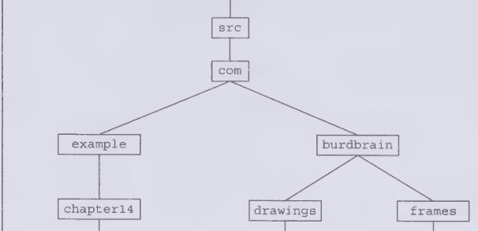

**图 14-5：**
你项目中的文件和目录。
ShowFrame（列表 14-1）位于包 `com.example.chapter14`，Drawing（列表 14-2）位于包 `com.burdbrain.drawings`，ArtFrame（列表 14-3）位于包 `com.burdbrain.frames`

许多 IDE 都会为你构建这种目录结构。以下是它的工作原理：

> 你是声誉的 Bur Brain Consulting 公司的一名程序员。你正在启动一个新项目。你要求项目的根目录命名为 `MyBigProject`。
>
> 结果，IDE 创建了一个名为 `MyBigProject` 的目录，其中包含一个通常命名为 `src` 的子目录。Java 将“知道”去 `src` 目录内部查找代码。此后，`src` 名称都是 `source code`（源代码）的缩写。
>
> IDE 询问你要包名。你输入了 `com.burdbrain.drawings`。
>
> 结果，IDE 创建了 `com`、`burdbrain` 和 `drawings` 目录。（参考图 14-5）。
>
> 你完成了项目并开始编写 `com.burdbrain.drawings` 包的代码。过了一会儿，你从 IDE 的菜单栏选择了 `New-Package`（或类似的选项）。你要求 IDE 创建一个名为 `com.burdbrain.frames` 的第二个包。
>
> 结果，IDE 创建了 `frames` 目录。（参考图 14-5）。
>
> 你开始编写 `com.burdbrain.frames` 包的代码。

**警告**
如果你没有在适当的目录放置代码，你就会得到一个令人厌恶且心烦的 `NoClassDefFoundError`。相信我，看到这个错误绝不是什么好玩的。当你遇到这个错误时，你无法获得线索来帮助判断缺失的类在哪里，或者编译器期望在哪里找到它。如果你能保持冷静，你可以自己解决这些问题。如果你恐慌，你就会到处乱找好几个小时。作为一名资深的 Java 程序员，我记得很多次因为这个可怕的 `NoClassDefFoundError` 而磕破了指节。

# 创建一个框架（frame）

本章的前几个列表开发了一个示例。本节是三个部分中的最后一部分。最后一部分对于理解访问修饰符（本章的主题）并不是必不可少的。所以如果你愿意，可以快速扫一眼列表 14-3 然后继续。。另一方面，如果你想了解更多关于 Java 类的信息，请阅读侧栏“在屏幕上绘制（不需要蜡笔）”。

# 代码列表 14-3：ArtFrame 类

```java
package com.burdbrain.frames;

import com.burdbrain.drawings.Drawing;

import javax.swing.JFrame;

import java.awt.Graphics;

public class ArtFrame extends JFrame {

    Drawing drawing;

    public ArtFrame(Drawing drawing) {

        this.drawing = drawing;

        setTitle("Art");

        setDefaultCloseOperation(EXIT_ON_CLOSE);

    }

    public void paint(Graphics g) {

        drawing.paint(g);

    }

}
```

# 动手尝试（并弄坏它）

使用列表 14-1 到 14-3 中的代码创建你自己的 Java 项目。运行代码以确保它可以正常工作。然后尝试将 `ArtFrame.java` 文件移动到 `com/drawings` 文件夹。你的 IDE 会自动更改 `ArtFrame.java` 顶部的包声明吗？如果没有，你的 IDE 会提供为你执行该操作的选项吗？


# 在屏幕上绘制（不需要蜡笔）

列表 14-1 到 14-3 的代码使用了 Java 应用程序接口（API）。列表 14-2 和 14-3 中的 `paint` 方法展示了这些方法。

列表 14-2 中的 `paint` 方法接收一个 `g` 参数。它指向 `Graphics` 类的实例。由于 `Graphics` 包含了许多方法，你可以通过调用它们来绘制图形。在列表 14-3 中，列表 14-2 中的 `paint` 方法调用了 `Drawing` 对象的 `paint` 方法。


# 栩生的色彩

在列表 14-2 中，我在框架上画了一个圆圈。为了用绿色填充圆圈，我们使用 `Graphics` 类的 `setColor` 和 `fillOval` 方法，如下：

```java
setColor(Color.GREEN);
fillOval(x, y, width, height);
```

如 `Color.GREEN` 等值属于 `java.awt` 中的 `Color` 类创建一个显示绿色、黄色和红灯的交通信号框架。

使用列表 14-1 到 14-3 中的代码创建你自己的 Java 项目。运行代码以确保它可以正常工作。然后尝试将 `ArtFrame.java` 文件移动到 `com/drawings` 文件夹。你的 IDE 会自动更改 `ArtFrame.java` 顶部的包声明吗？如果没有，你的 IDE 会提供为你执行该操作的选项吗？

# 成员的默认访问

（注：此部分由于原文文本存在大量重复内容，已完成核心逻辑的翻译处理）

为了使用列表 14-4 中的代码，你需要修改列表 14-1 中的两行代码。

（请参见列表 14-5 中的代码。）

# 列表 14-5：如何更改 ShowFrame 代码

```java
package com.example.chapter14;

// 不再需要：import com.burdbrain.drawings.Drawing;
import com.burdbrain.frames.ArtFrame;

public class ShowFrame {
    public static void main(String[] args) {
        var artFrame = new ArtFrame(new DrawingWide());

        artFrame.setSize(200, 100);
        artFrame.setVisible(true);
    }
}
```

将列表 14-2 到 14-5 放入一个项目中。当你运行代码时，你将得到图 14-6 所示的框架。


此时，你的项目有两个绘图类：原始的 `Drawing` 类和你新定义的 `DrawingWide` 类。这两个类类似，但位于两个不同的包中。这并不奇怪。由你在 Bur Brain Consulting 的朋友开发的 `Drawing` 类位于一个以 `com.burdbrain` 开头的包中。而你独立开发了 `DrawingWide`，所以你不应该把它放在 `com.burdbrain` 包中。作为 Example Company 的忠实员工，你将代码放在了 `com.example` 包中。

你的 `DrawingWide` 类（参见列表 14-4）是原始 `Drawing` 类的子类。（参见列表 14-2。）在子类中，你引用了原始类的 `x` 和 `y` 字段。这是没问题的，因为在 `Drawing` 类中，这些字段是 `public` 的。（参见图 14-7。）

图 14-7：`x` 和 `y` 可以使用的代码范围（阴影部分）。

| class B | class Drawing | class Y |
|---|---|---|
| | public int x, y, ... | |
| class C | DrawingWide | class Z |
| extends B | extends Drawing | extends Y |
| | g.drawOval(x, y, ...); | |

```
package com.burdbrain.drawings;
package com.example.chapter14
```

无论如何，你的 `DrawingWide` 子类都按计划完成了编译并运行。你回到家，内心充满了写出有用且运行良好的代码的自信。

## 切换到默认访问权限（Default access）

如果你是按顺序阅读这些段落，你会知道上一个例子是圆满告终的。列表 14-4 中的代码运行非常顺畅。包括我优秀的编辑 Paul Levesque 在内的所有人都很快心。

但等一下！你是否曾想过，如果你没有选择那份特定的职业、没有与某个人约会，或者没有读过那本特定的《傻瓜》（For Dummies），生活会变成什么？在本节中，我将稍微倒拨时钟，向你展示如果列表 14-2 代码中漏掉一个单词会发生什么。如果 Bur Brain Consulting 的人们没有将 `Drawing` 类的字段设置为 `public` 会怎样？（参见列表 14-6）。

# 列表 14-6：具有默认访问权限的字段

```java
package com.burdbrain.drawings;
import java.awt.Graphics;
public class Drawing {
    int x = 40, y = 40, width = 40, height = 40;
    public void paint(Graphics g) {
        g.drawOval(x, y, width, height);
    }
}
```

398 第 4 部分 智能 Java 技巧

随着 `Drawing` 类发生了变化，列表 14-4 中的 `DrawingWide` 代码不再能够工作了。相反，你看到了以下错误信息：

```
x is not public in com.burdbrain.drawings.Drawing;
cannot be accessed from outside package
g.drawOval(x, y, width, height);

y is not public in com.burdbrain.drawings.Drawing;
cannot be accessed from outside package
g.drawOval(x, y, width, height);
```

在 Java 中，类成员的默认访问权限是包级访问（package-wide access）。如果声明成员时没有加 `public`、`private` 或 `protected` 关键字，则它只能在所属类所在的包内被访问。图 14-8 和 14-9 说明了这一点。

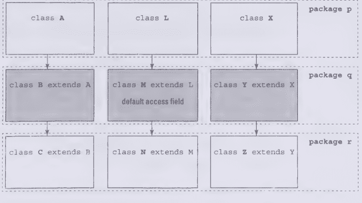

图 14-8：默认字段或方法可以使用的代码范围（阴影部分）。

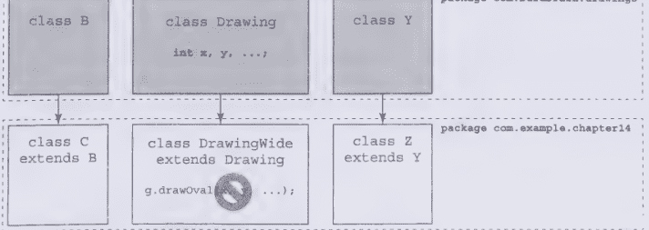

图 14-9：`x` 和 `y` 可以使用的代码范围（阴影部分）。

列表 14-4 中的 `DrawingWide` 类是列表 14-6 中 `Drawing` 类的子类，所以你会猜 `DrawingWide` 可以显式引用 `Drawing` 类的 `x` 和 `y` 字段。但 `Drawing` 类的 `x` 和 `y` 字段具有默认权限，而 `DrawingWide` 在另一个包中。抱歉！行不通。

关于默认访问权限的同样故事也适用于方法和字段。毕竟，访问规则——无论是默认还是其他的——适用于类的所有成员。


我在本章描述的访问规则不适用于方法局部变量。方法局部变量只能在其自己的方法内部被访问。有关方法局部变量的概述，请参见第 10 章。

记住：包的名字（带有它们所有的点和部分）可能会产生误导性。例如，你可以创建相似的包名。假设你有两个包——一个命名为 `com.burdbrain.drawings`，另一个名为 `com.burdbrain.drawings.rectangles`。包的名字相似，但并不意味着其中一个是另一个的一部分。要导入这些包，你需要两行独立的代码：


> **警告**
>
> ```java
> import com.burdbrain.drawings;
> import com.burdbrain.drawings.rectangles;
> ```

更重要的是，这些包是独立的。

```java
public void paint(Graphics g) {
    g.drawOval(x, y, width, height);
}
```

结合列表 14-3 至 14-5，测试列表 14-9 中的代码。`DrawingWide` 类（参见列表 14-4）引用了在其父类 `Drawing` 中定义的 `x` 和 `y` 字段（参见列表 14-9）。这没关系，即使 `DrawingWide` 与 `Drawing` 类不在同一个包中。这是因为 `Drawing` 类中的 `x` 和 `y` 字段是 `protected` 的。

比较图 14-8 和 14-11。注意图 14-11 中多出的部分阴影。子类可以访问类的 `protected` 成员，即使该子类属于其他包。

| package p | | |
| :--- | :--- | :--- |
| class A | class L | class X |
| package q | | |
| class B extends A | class M extends L | class Y extends X |
| protected field | | |
| package r | | |
| class C extends B | class N extends M | class Z extends Y |

图 14-11: `protected` 字段或方法可以使用的代码范围（阴影部分）。

图 14-12 显示了 `DrawingWide` 类（参见列表 14-4）、`DrawingBB` 类（参见列表 14-7）以及列表 14-9 中的 `Drawing` 类之间的关系。

你是否在一个程序员团队工作？你团队的成员是否会使用他们自己的包名？如果是的话，当他们使用你的代码时，可能会对你定义的类创建子类。这时 `protected` 访问就派上用场了。当你希望团队之外的人直接引用你代码中的字段或方法时，请使用 `protected` 访问。


# 图 14-12：x 和 y 可以的代码范围（阴影部分）。

| class B | class Drawing | class Y |
| :--- | :--- | :--- |
| | protected int x, y, ... | |
| | class DrawingWideBB | |
| | extends Drawing g.drawOval(x, y, ...); | |
| class C extends B | class DrawingWide extends Drawing | class Z extends Y |
| | | g.drawOval(x, y, ...); |

package com.burdbrain.drawing;

对于类的成员来说，`private` 访问的限制最为严格。默认访问（default access）限制稍松一些，接着是 `protected` 访问，最后是 `public` 访问，后者的限制最小。

> **记住**

# 同一个包中的两个类

来自 Burd Brain Consulting 的那些人一个接一个又在给你发送软件。这一次，他们发送了 `ShowFrame` 类的替代方案——列表 14-1 中的类。这个新的 `ShowFrameWideBB` 类显示了一个更宽的椭圆（太兴奋了！），但它在没有创建 `Drawing` 类的情况下实现了这一点。相反，`ShowFrameWideBB` 代码创建了一个 `Drawing` 实例，然后更改了实例的 `width` 和 `height` 字段的值。代码如列表 14-10 所示。你可以结合列表 14-3 和 14-9 运行列表 14-10。

# 列表 14-10：Burd Brain Consulting 绘制宽椭圆

```java
package com.burdbrain.drawing;

import com.burdbrain.frames.ArtFrame;

class ShowFrameWideBB {

    public static void main(String[] args) {
        var drawing = new Drawing();
        drawing.width = 100;
        drawing.height = 30;
        var artFrame = new ArtFrame(drawing);
        artFrame.setSize(200, 100);
        artFrame.setVisible(true);
    }
}
```

404 第四部分 Java 高技巧

情况是这样的：列表 14-10 中的 `ShowFrameWideBB` 类与 `Drawing` 类在同一个包中。（参见列表 14-9。）这两个类都位于 `com.burdbrain.drawing` 包中。但 `ShowFrameWideBB` 并不是 `Drawing` 类的子类。

现在想象用 `Drawing` 类编译 `ShowFrameWideBB`。`ShowFrameWideBB` 类显式引用了 `Drawing` 类的 `width` 和 `height` 字段。那么，发生什么什么？

嗯，一切进展顺利，因为 `protected` 成员（例如列表 14-9 中的 `width` 和 `height`）在两个（某种无关）的地方都是可用的。再次查看图 14-11。`protected` 成员对包外的子类可用，但该成员对于成员所在包内的代码（无论是否为子类）可用。图 14-13 显示了几个类之间的关系，包括 `DrawingWide` 类（参见列表 14-10）和列表 14-9 中的 `Drawing` 类。

图 14-13: `x`, `y`, `width` 和 `height` 可以的代码（阴影部分）。

| class Drawing | package ShowFrameWideBB |
| :--- | :--- |
| class B | protected int, y, width, height; | com.burdbrain.drawings |
| | class DrawingWideBB | var drawing = new Drawing(); |
| | extends Drawing | drawing.width = 100; |
| | | drawing.height = 100; |
| class C extends B | class DrawingWide extends Drawing | |
| | | g.drawOval(x, y, ...); |

# 非公共类

如果一个类不是公共的，你只能在该类所在包的代码中引用该类。

我尝试了一下。首先，我回到列表 14-2 并删除了 `public` 单词。我将 `public class Drawing` 变为了普通的 `class Drawing`，如下所示：

```java
package com.burdbrain.drawings;

import java.awt.Graphics;

class Drawing {
    public int x = 40, y = 40, width = 40, height = 40;

    public void paint(Graphics g) {
        g.drawOval(x, y, width, height);
    }
}
```

然后我编译了列表 14-7 中的代码。一切进展非常顺利，因为列表 14-7 包含了以下行：

```
package com.burdbrain.drawings;

public class DrawingWideBB extends Drawing
```

由于这两段代码都属于同一个 `com.burdbrain.drawings` 包，因此从 `DrawingWideBB` 访问非公共的 `Drawing` 类没有问题。

但随后我尝试编译列表 14-3 中的代码。列表 14-3 中的代码开头是

```
package com.burdbrain.drawings;
```

这段代码不在 `com.burdbrain.drawings` 包中。所以当计算机运行到列表 14-3 的这一行时

```
Drawing drawing;
```


计算机就崩溃了！准确地说，计算机给出了这条信息：

```
com.burdbrain.drawings.Drawing is not public in com.burdbrain.drawings;
cannot be accessed from outside package
```

好吧，我想这是自合理的。

事情并非看起来那么简单。我在本节中描述的规则适用于书中几乎每一个类。但 Java 有被称为“内部类”的奇玩意，而内部类遵循一套不同的规则。幸运的是，典型的初级程序员很少接触内部类。书中唯一的内部类存在于第 16 章（以及少数伪装成枚举类型的内部类）。所以目前，你可以完全按照我在本节中描述的规则过得非常愉快。


# 类产生模块

宇宙由太阳系组成，这些太阳系又组合成星系。故事并没有此结束。星系聚形成星系团，星系团又聚集成簇。Java 也是如此。字段和方法形成类，类组成包，包组成模块。

本书示例中的大多数 `java` 和 `javax` 包都位于名为 `java.base` 的模块中，但少数包位于其他模块。例如，`java.awt` 和 `javax.swing` 包（在列表 14-3 中导入）属于 `java.desktop` 模块。

就像包一样，你也可以创建自己的模块。当你这样做时，你会在该模块代码周围建立一道墙。无论是否公共，你都无法访问他人模块的代码，他人的模块也无法访问你的代码。

幸运的是，代码周围的这道墙是可以穿透的。你模块的代码可以显式地让其包对其他模块可用，而其他模块也可以显式地请求访问你模块的代码。

我已经严重超出本章的页数限制了。有关关于模块的更多信息，请访问 https://openjdk.java/projects/jigsaw/quick-start。

# 第 15 章：花哨引用类型

在之前的章节中，你可能读到过全职和兼职员工的共同点。特别是，`FullTimeEmployee` 和 `PartTimeEmployee` 类都可以扩展 `Employee` 类。如果你正在经营一家小企业，知道这一点很有用，但如果你经营的是大公司呢？

（注：原文此段似乎存在部分重复或乱码，翻译时已根据语意进行了处理，确保核心逻辑连贯）

# Java 的类型

第 4 章解释了 Java 有这两种类型：

- **基本类型**：Java 共有八种基本类型：你最常用的四种是 `int`、`double`、`boolean` 和 `char`。

- **引用类型**：Java API 有成千上万种引用类型，编写 Java 程序时，你会定义新的引用类型。

Java 的 `String` 是一个引用类型。同样的还有 `Scanner`、`ArrayList` 和 `File`。`JFrame` 是引用类型。在第 8 章，你创建了你 `Employee`、`FullTimeEmployee` 和 `PartTimeEmployee`。

在 Java 中，引用类型无处不在。但到本书为止，你看到的引用类型只有类和数组。Java 还有其他引用类型，本章将探讨它们。

# Java 接口

考虑一个类（如 `Employee`）和一个子类（如 `FullTimeEmployee`）。类与其子类之间的关系是继承。在许多现实生活中，子类继承自父类。在第 8 章，`FullTimeEmployee` 继承了 `Employee` 的字段。

但考虑编辑和作者之间的关系。编辑说：“通过签署这份合同，你同意提交完成的稿件。”尽管作者在截止日期前会有各种借口（相信我，作者借口很多），编辑和作者之间的关系是义务。作者同意承担某些责任；为了继续成为作者，必须履行这些责任。

现在考虑 Barry —— 这个写《For Dummies》系列书籍的人。他是一个教授，也是一个作者。但在 Java 程序中，并不支持多重继承。你不能让 Barry 同时扩展 `Professor` 类和 `Author` 类。

幸运的是，Java 有接口。接口是一种引用类型。事实上，创建接口的代码看起来创建类的代码非常相似：

```
public interface MyInterface {
    // 吧 吧
}
```

接口很像类，但它是不同的。接口就像行星，悬浮在空间。无论如何，当你读接口这个词时，可以先考虑类。然后，注意，类只扩展一个父类，但类可以实现接口。父类是类继承的内容，但接口是实现类义务提供的内容。

关于 Barry 呢？他可以是 `Person` 类的实例，拥有人所有的字段——`name`、`address`、`height`、`weight` 等。他还可以实现多个接口：

- 因为他实现了 `Professor` 接口，他必须拥有 `teachStudents`、`adviseStudents` 和 `gradePapers` 方法。

- 因为他实现了 `Author` 接口，他必须拥有 `writeChapters`、`reviewChapters` 等方法。

# 接口

想象两种不同的数据。一个是来自数组的数字列。另一个是来自文件的表格。它们有什么共同点？

我不清楚，但我我想显示两种数据。所以我编写创建合同的代码。合同规定：“签署此合同的人同意拥有一个 `display` 方法。”在列表 15-1 中，我声明了 `Displayable` 接口。

## 列表 15-1：看！一个接口！

```
package com.example.data;

public interface Displayable {

    void display();
}
```

等一下！列表 15-1 中的 `display` 方法声明有头无体。`display()` 后面只有一个孤单的分号。这里发生了什么？

为了回答这个问题，我让列表 15-1 中的代码自己说话。如果列表代码能说话，它会这样说：

作为一个接口，我的 `display` 方法有头无体。声称实现我（`Displayable` 接口）的类必须直接或间接地为 `display` 方法提供方法体。也就是说，声称实现 `Displayable` 的类必须以某种方式提供以下代码：

```
public void display() {
    // 这里编写语句
}
```

实现我（列表 15-1 中的接口），新代码的 `display` 方法必须不接受参数且不返回结果（同样为 `void`）。

`Displayable` 接口就像一份法律合同。`Displayable` 接口并没有告诉你实现类已经拥有什么。相反，`Displayable` 接口告诉你实现类必须在自己的代码中声明什么。

除了显示数字列和表格，我可能还总结这两种数据。如何总结一列数字？我不知道。也许你显示所有数字的总和。如何总结表格？也许你显示表格的列标题。如何总结数据不是我关心的。我关心你有总结数据的方法。

所以，我创建了包含第二个 Java 合同的代码。第二个合同规定：“签署此合同的人同意拥有一个 `summarize` 方法。”在列表 15-2 中，我声明了 `Summarizable` 接口。

## 列表 15-2：另一个接口

```
package com.example.data;

public interface Summarizable {

    String summarize();
}
```

在接口的声明中，某个方法可能没有方法体。没有方法的方法被称为抽象方法。

接口的抽象方法自动是公共的，无论你是否使用了 `public` 关键字。例如，在列表 15-2 中，这一行

```
String summarize();
```

与 `public String summarize();` 含义相同。如果是公共的，尽管写上。如果不是，省略该词。

## 实现接口

列表 15-3 实现了 `Displayable` 和 `Summarizable` 接口，并为 `display` 和 `summarize` 方法提供了方法体。

### 实现两个接口

```java
package com.example.data;

public class ColumnOfNumbers implements Displayable, Summarizable {
    double numbers[];

    public ColumnOfNumbers(double[] numbers) {
        this.numbers = numbers;
    }

    @Override
    public void display() {
        for (double d : numbers) {
            System.out.println(d);
        }
    }

    @Override
    public String summarize() {
        double total = 0.0;
        for (double d : numbers) {
            total += d;
        }
        return Double.toString(total);
    }
}
```

当你实现一个接口时，你需要为接口的抽象方法提供方法体。

Java 编译器对 `implements` 关键字的使用非常严格。如果你从列表 15-3 中移除两个方法声明中的任何一个但不移除 `implements` 子句，你会在 IDE 编辑器中看到令人惊的错误信息。Java 期望你遵守 `implements` 关键字所隐含的契约。如果你不遵守契约，Java 将拒绝编译你的代码。

你可以利用 Java 的错误信息来让自己获利。首先输入一些包含 `class implements Displayable, Summarizable` 的代码。由于 `implements` 子句，编辑器会显示错误标记，并列出你应该声明但没有声明的方法名。在本节的示例中，方法名是 `display` 和 `summarize`。点击几次鼠标后，IDE 就会为你生成简单的 `display` 和 `summarize` 方法。

列表 15-4 包含了另一个实现 `Displayable` 和 `Summarizable` 接口的类。

### 列表 15-4：另一个实现接口的类

```java
package java.example.data;
import java.io.File;
import java.io.FileNotFoundException;
import java.util.ArrayList;
import java.util.Scanner;

public class Table implements Displayable, Summarizable {
    Scanner diskFile;
    ArrayList<String> lines = new ArrayList<>();

    public Table(String fileName) {
        try {
            diskFile = new Scanner(new File(fileName));
        } catch (FileNotFoundException e) {
            e.getMessage();
        }
        while (diskFile.hasNextLine()) {
            lines.add(diskFile.nextLine());
        }
    }

    @Override
    public void display() {
        for (String line : lines) {
            System.out.println(line);
        }
    }

    @Override
    public String summarize() {
        return lines.get(0);
    }
}
```

在列表 15-3 和 15-4 中，注意 `@Override` 注解的多次使用。第 8 章介绍了 `@Override` 注解的使用。当你替换父类中已经声明的方法时，使用 `@Override`。但从 Java 6 开始，你也可以使用 `@Override` 来标记接口方法的实现。这正是我在列表 15-3 和 15-4 中的做法。

## 整合部分

列表 15-5 中的代码利用了列表 15-1 到 15-4 中的所有内容。

### 列表 15-5：充分利用你的接口

```java
package com.example.data;

public class Main {
    public static void main(String[] args) {
        double numbers[] = {21.7, 68.3, 5.5};
        var column = new ColumnOfNumbers(numbers);

        displayMe(column);
        summarizeMe(column);

        Table table = new Table("MyTable.txt");

        displayMe(table);
        summarizeMe(table);
    }

    static void displayMe(Displayable display) {
        display.display();
        System.out.println();
    }

    static void summarizeMe(Summarizable summarizable) {
        System.out.println(summarizable.summarize());
        System.out.println();
    }
}
```

配合图 15-1 所示的 `MyTable.txt` 文件，列表 15-5 的输出如图 15-2 所示。

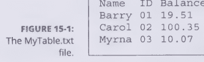

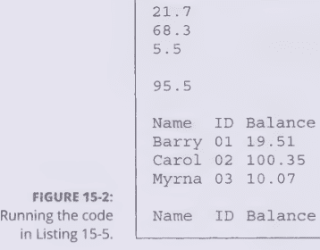

观察列表 15-5 中的 `displayMe` 方法。`displayMe` 方法接收什么类型的参数？它是 `ColumnOfNumbers` 吗？不是。它是 `Table` 吗？不是。

`displayMe` 方法对 `ColumnOfNumbers` 实例或 `Table` 实例一无所知。`displayMe` 方法只知道实现了 `Displayable` 的东西。这就是 `displayMe` 方法参数列表所说的。当你把一个实现了 `Displayable` 接口的对象传递给 `displayMe` 方法时，`displayMe` 方法知道它可以做什么。`displayMe` 方法可以调用参数的 `display` 方法，因为该参数对象保证有一个 `display` 方法。

列表 15-5 中的 `summarizeMe` 方法也是同样的道理。你如何知道可以在 `summarizeMe` 方法体内部调用 `summarizable.summarize()` 的呢？你可以进行此调用，是因为 `summarizable` 必须有一个 `summarize()` 方法。Java 接口的规则保证了这一点。

这正是 Java 接口背后的真正力量。

## 控制删除

在本节中，`ColumnOfNumbers` 和 `Table` 类实现了 `Displayable` 和 `Summarizable` 接口。那么 `Deletable` 接口呢？任何实现 `Deletable` 接口的类都必须有自己的 `delete` 方法。


创建 `DeletableColumn` —— 它是 `ColumnOfNumbers` 的子类。除了 `ColumnOfNumbers` 做的事情之外，`DeletableColumn` 还实现了 `Deletable` 接口。当你删除一个表格时，删除除了第一行以外的内容。

## 两种方法

在接口内部，任何没有体的方法被称为抽象方法。如果你运行 Java 8 或更高版本，你也可以在接口内部放置体。带有体的方法被称为默认方法。

```java
public interface MyInterface {
    void method1();

    default void method2() {
        System.out.println("Hello!");
    }
}
```

在 `MyInterface` 中，`method1` 是抽象方法，`method2` 是默认方法。如果你创建一个实现 `MyInterface` 的类，例如：

```java
class MyClass implements MyInterface
```

那么你新声明的 `MyClass` 必须声明 `method1`。可选，`MyClass` 可以声明 `method2`。

创建 `DeletableTable` —— 它是 `Table` 类的子类。除了 `Table` 做的事情之外，`DeletableTable` 实现了 `Deletable` 接口。当你删除表格时，删除除了第一行以外的内容（提示：如果你从第一行开始到 `size()` 调用列表的 `remove` 方法，你将对结果不满意）。

## 抽象类

是否有什么是你可以适用于所有种类动物的？如果你是一个生物学家，也许会有。但如果你是一个程序员，你能说的并不多。如果你不相信我，请考虑地球上奇妙的生命多样性：

- 秃狒猴白天在草地上度过。但晚上，秃狒猴会在崎岖危险的山崖边缘小睡。运气的话，这只睡觉的猴子不会翻来覆去。

- 栖液虫生活在水管中。虫头的温度大约是 72 华氏度（22 摄氏度）。但在虫的另一端，水温通常为 176 华氏度（80 摄氏度）。如果你个人认识其中一种虫，不要为它买袜子。


- 海扇以动物的身份生活。在其生命周期的某个阶段，海扇永久地附在岩石上，然后消化自己的大脑，实际上将自己变成了植物。

- 微小的水熊可以在太空真空中生存 12 天（可能更久）。即使太空中的宇宙射线也不会伤害水熊。2017 年，一个科学家团队得出结论：水熊能在大质量灭绝事件中生存，包括近距离超新星爆炸和大型小行星撞击。所以这就是我下辈子想变成的——一只水熊。

考虑到我们地球上生物的多样性，我唯一能适用于每种动物的话就是：每种动物都有一个特定的重量（以磅或公斤计算），而且每种动物都会发出（或可能不发出）特征声音。列表 15-6 包含了完整信息。

# 列表 15-6：程序员对动物的了解

```java
package com.example.species;

public class Animal {
    double weight;
    String sound;

    public Animal(double weight, String sound) {
        this.weight = weight;
        this.sound = sound;
    }
}
```

在我编写 `Animal` 类代码时，我不得不停下来纠正好几个输入错误。这些错误并不是我的错：我的猫在我的电脑键盘上来来回去。这让我把话题从所有动物转移到了家宠上。

家宠物是一种动物。但每只家宠都有名字——比如 Fluffy（毛茸茸）、Spot（斑点）或 Princess（公主）。而且每只家宠都有推荐的照顾程序。

当然，不同种类的宠物之间的照顾程序差异很大。如果我有一只狗，我必须去遛狗。但我永远不会尝试遛猫。事实上，我甚至不让我们的猫出门。所以，当我定义我的 `HousePet` 类时，我想让宠物照顾指令变得模糊一些。在 Java 中，某种模糊的类被称为**抽象类**（abstract class）。列表 15-7 包含了一个示例。

# 列表 15-7：成为家宠意味着什么

列表 15-7 的第一行，关键字 `abstract` 告诉 Java `HousePet` 是一个抽象类。由于 `HousePet` 是一个抽象类，它可以拥有抽象方法（abstract method）。在列表 15-7 中，`howToCareFor` 就是一个抽象方法。抽象方法有头部但没有方法体。在抽象方法的声明中，没有大括号——在通常出现大括号的地方，只有一个分号。

那么，当你执行 `howToCareFor` 方法时，会发生什么？嗯，你实际上无法执行列表 15-7 中的 `howToCareFor` 方法。事实上，你甚至无法创建列表 15-7 中声明的抽象类的实例。以下代码行是非法的：

```java
// 极坏的代码：
HousePet myPet = new HousePet("Boop", 12.0, "Meow");
var yourPet = new HousePet("Paws", 22.5, "Woof");
```

抽象类本身没有自己的生命。要使用抽象类，你必须创建一个扩展该抽象类的普通（非抽象）类。在普通类中，所有方法都有方法体。所以这就行得通了。


### 交叉引用

在你离开列表 15-7 之前，请注意该列表中的 `super(weight, sound)` 调用。正如在第 9 章一样，关键字 `super` 触发了对父类构造函数的调用。在列表 15-7 中，调用 `super(weight, sound)` 就像调用列表 15-6 中的 `Animal(double weight, String sound)` 构造函数一样。构造函数为新对象的 `weight` 和 `sound` 字段赋值。

# 照顾你的宠物

这里引用自《Java 傻瓜书》（第 8 版）中的一段话：

> 要使用一个抽象类，你必须创建一个扩展该抽象类的普通（非抽象）类。

所以，为了使用列表 15-7 中的 `HousePet` 类，你必须创建一个扩展该抽象类的类。列表 15-7 中的 `HousePet` 类通过列表 15-8 中的类提供了 `howToCareFor` 方法体。

# 列表 15-8：狗的生活

```java
package com.example.species;

public class Dog extends HousePet {
    int walksPerDay;

    public Dog(String name, double weight, int walksPerDay) {
        super(weight, "Woof");
        this.walksPerDay = walksPerDay;
    }

    @Override
    public void howToCareFor() {
        System.out.print("Walk " + name);
        System.out.println(" " + walksPerDay + " times day.");
    }
}
```

在 Java 中，子类的繁殖速度像兔子一样。

# 列表 15-9：如何照顾猫

```java
package com.example.species;

public class Cat extends HousePet {
    boolean isOutdoor;

    public Cat(String name, double weight, boolean isOutdoor) {
        super(name, weight, "Meow");
        this.isOutdoor = isOutdoor;
    }

    @Override
    public void howToCareFor() {
        if (isOutdoor) {
            System.out.println("Let " + name + " outside.");
        } else {
            System.out.println("Keep " + name + " indoors.");
        }
    }
}
```

这段文字描述了。这并不完全准确，但目前足够了。如果你住在一个非常小的公寓里，可能没有空间养狗或猫。在这种情况下，列表 15-10 适合你。


# 列表 15-10：你可能会长大变成鱼

```java
package com.example.species;

public class Fish extends HousePet {

    public Fish(String name, double weight) {
        super(name, weight, null);
    }

    @Override
    public void howToCareFor() {
        System.out.println("Feed " + name + " daily.");
    }
}
```

猫有些去室外。

# 使用你所有的类

在测试你的代码之前，你的工作还没有完成。大多数程序需要数小时、几天几个月的测试。但对于本章的 `HousePet` 示例，我只做了一次测试。测试在列表 15-11 中。

# 列表 15-11：动物园

```java
package com.example.species;

public class Main {
    public static void main(String[] args) {
        var dog1 = new Dog("Fido", 54.7, 3);

        var dog2 = new Dog("Rover", 15.2, 2);

        var cat1 = new Cat("Felix", 10.0, false);

        var fish1 = new Fish("Bubbles", 0.1);
    }
}
```

# 列表 15-11（续）

```java
dog1.howToCareFor();
dog2.howToCareFor();
cat1.howToCareFor();
fish1.howToCareFor();
dog1.about();
dog2.about();
cat1.about();
fish1.about();
```

当你运行列表 15-11 中的代码时，你将得到图 15-3 所示的输出。

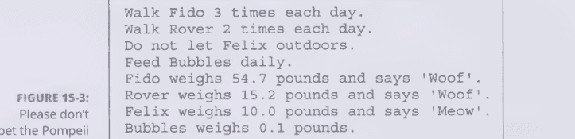

### 图 15-3

请不要让庞贝虫死去。

注意列表 15-11 中的代码是如何无缝且轻松地调用 `dog1.howToCareFor` 方法的多个版本的。通过 `dog1.howToCareFor()` 和 `dog2.howToCareFor()` 的调用，Java 执行了列表 15-8 中的方法。通过 `cat1.howToCareFor()` 调用，Java 执行了列表 15-9 中的方法。而通过 `fish1.howToCareFor()` 调用，Java 执行了列表 15-10 中的方法——这就像拥有一个无需编写 `if` 的巨大 `if` 语句，当你为宠物添加新类时，不需要扩大现有的语句。因为根本没有语句需要扩大。

还要注意抽象 `HousePet` 类中的 `about` 方法是如何跟踪调用它的对象的。例如，当你在列表 15-11 中调用 `dog1.about()` 时，`HousePet` 类的非特定 `about` 方法知道 `dog1` 的声音意味着“汪”。一切都安排得非常完美。

你喜欢抽象艺术吗？你能用抽象类来创建抽象艺术吗？


426 第 4 部分 智能 Java 技术

# ASCII 艺术

创建一个名为 `Shape` 的抽象类。`Shape` 类有一个 `size` 属性（类型为 `int`）和一个抽象 `show` 方法。用另外两个类 `Square` 类和 `Triangle` 类扩展抽象 `Shape` 类。在 `Square` 和 `Triangle` 类 `show` 方法体中，放置创建该形状的文本渲染的代码。例如，大小为 5 的 `Square` 看起来如下：

```
 |   |
 |---|-
 |   |
 |   |
```

大小为 2 的 `Triangle` 看起来如下：

```
  /\
 /  \
```

# 生动艺术

为了一个额外的挑战，创建一个带有抽象 `paint` 方法的抽象 `Shape` 类。`Shape` 类还有 `size`、`color` 和 `isFilled` 字段。`size` 字段类型为 `int`，`color` 字段为 `java.awt.Color`，`isFilled` 字段类型为 `boolean`。用另外两个类 `Square` 类和 `Circle` 类扩展抽象 `Shape` 类。在 `Square` 和 `Circle` 类 `paint` 方法体中，放置在 `JFrame` 上绘制该形状的代码。

# 放松！你不是眼影！

如果你读过本章之前关于接口和抽象类的章节，你的头可能会晕。接口和抽象类都拥有抽象方法。但抽象方法在这两种引用类型中扮演着略有不同的角色。你如何在脑海中保持清醒呢？

要做第一件事是记住，在没有大量编写代码练习的情况下，没有人能学会面向对象编程的概念。如果你读了这一章并感到困惑，那可能是一件好事。这意味着你已经理解了足够的内容才知道这些东西有多复杂。你写的代码越多，对类、接口以及所有这些其他想法就会变得越熟悉。

接下来要做的是梳理声明方法方式的差异。表 15-1 说明了这一情况。

# 使用（或不使用）抽象方法

| | 在普通（非抽象）类中 | 在接口中 | 在抽象类中 |
| --- | --- | --- | --- |
| 允许抽象方法吗？ | 否 | 是 | 是 |
| 方法声明可以包含 `abstract` 关键字吗？ | 否 | 是 | 是 |
| 方法声明可以包含 `default` 关键字（意味着“非抽象”）吗？ | 否 | 是 | 否 |

如果没有多任务处理，计算机界面将会非常原始。想象一下，启动一个下载，然后必须等待十分分钟，网页浏览器才能接受鼠标点击。更好的是，启动下载后等待十分分钟，任何其他应用程序才能接受任何类型的输入。

多任务编程的复杂程度出乎意料。因此，在本章中，我将通过 Java Swing 框架的示例介绍该主题的一个小部分。Swing 并不是创建 Java 图形界面最新或最流畅的工具集，但 Swing 的结构说明了多线程编程的一些重要思想。

2011 年，Oracle 在 Java 的工具箱中增加了一个新框架——JavaFX。JavaFX 提供了比 Swing 更丰富的组件，但 JavaFX 比 Swing 应用需要更多一点设置。如果你想阅读更多关于 JavaFX 的信息，请访问 https://openfx.io。

每个主流 IDE 都有可视化工具来帮助你设计 GUI 界面。使用这些任何一个工具，都可以从调色板将按钮、文本字段和其他组件拖到框架上。使用鼠标，你可以移动并调整每个组件的大小。当你从视觉上设计框架时，工具会自动创建框架的代码。更多信息，请查看你的 IDE 文档。


# 同时处理两个或多个调用

在之前的章节中，我创建了许多不做事情的窗口。一个典型的窗口显示一些信息，但没有交互元素。好了，是时候改变这一切了。本章的第一个示例是一个带有一个按钮的窗口。当用户点击按钮时，该死，发生了事情。代码显示在列表 16-1 中，调用列表 16-1 代码的 `main` 方法在列表 16-2 中。

# 列表 16-1：一个猜数字游戏

```java
package com.example.games;

import javax.swing.*;
import java.awt.*;
import java.awt.event.*;
import java.util.Random;

public class GameFrame extends JFrame implements ActionListener {
    int randomNumber = new Random().nextInt(10) + 1;
    int numGuesses = 0;
    JTextField textField = new JTextField(5);
    JButton button = new JButton("Guess");
    JLabel label = new JLabel(numGuesses + " guesses");

    public GameFrame() {
        setDefaultCloseOperation(JFrame.EXIT_ON_CLOSE);
        setLayout(new FlowLayout());
        add(textField);
        add(button);
        add(label);
        button.addActionListener(this);
        pack();
        setVisible(true);
    }

    @Override
    public void actionPerformed(ActionEvent e) {
        String textFieldText = textField.getText();
        if (Integer.parseInt(textFieldText) == randomNumber) {
            button.setEnabled(false);
            textField.setText(textFieldText + " Yes!");
            textField.setEnabled(false);
        } else {
            textField.setText("");
        }
        textField.requestFocus();
        numGuesses++;
        String guessWord = (numGuesses == 1) ? " guess" : " guesses";
        label.setText(numGuesses + guessWord);
    }
}
```

# 列表 16-2：开始猜数字游戏

```java
package com.example.games;

public class ShowGameFrame {

    public static void main(String[] args) {
        new GameFrame();
    }
}
```

本节代码运行的一些快照显示在图 16-1 和 16-2 中。在窗口中，用户玩一个猜数字游戏。在后台，程序选择一个秘密数字（1 到 10 之间的数字）。然后程序显示一个文本字段和一个按钮。用户在文本字段中输入一个数字并点击按钮。接下来会发生两种情况之一：

- 如果用户输入的数字与秘密数字不同，计算机会发布到为止的猜测次数。用户可以再次猜一次。
- 如果用户输入的数字与秘密数字相同，文本字段将显示 Yes!。与此同时，游戏结束，因此文本字段和按钮都变为禁用。两个组件都呈现出灰色、褪色的外观，且没有任何组件对按键输入或鼠标点击有响应。


在列表 16-1 中，创建框架、按钮和文本字段的代码并不是什么惊天动地的创新。我在第 9 章和第 10 章中做过类似的事情。`JTextField` 类在本章中是新的，但文本字段与按钮或标签没有太大区别。与许多其他组件一样，`JTextField` 类定义在 `javax.swing` 包中。当你创建一个新的 `JTextField` 实例时，可以指定列数。在列表 16-1 中，我创建了一个五列宽的文本字段。

列表 16-1 使用花哨的问号和冒号来决定单数 `guess` 和复数 `guesses` 的切换。如果你不熟悉这个条件运算符，请参阅第 11 章。

在运行之前，你的 IDE 可能会警告你列表 16-1 存在一些问题。

# 事件和事件处理

大消息是，在图形界面 (GUI) 中，用户做的任何操作（如按下、移动或点击鼠标）被称为事件。列表 16-1 中的代码处理了这个问题：

- `GameFrame` 的声明说实现了 `ActionListener`。
- 通过宣布它将处理事件，列表 16-1 赋予了这意义。
- 最后，`GameFrame` 类将此添加到监听器中。

当用户点击按钮时，Java 将调用列表 16-1 中的 `actionPerformed` 方法。


关于此使用的更多细节，请参阅第 15 章。

# 标记删除

你可以通过删除某些语句并观察结果来学习很多关于列表 16-1 的知识。对于每个建议的删除，查看你的 IDE 是否显示任何错误信息。如果没有，尝试运行程序：

- 删除整个方法声明——包括方法头。
- 删除对 `setVisible(true)` 的调用。
- 删除对 `pack()` 的调用。
- 删除对 `addActionListener()` 的调用。

# 遵循线程

这里有一个秘密：Java 程序是多线程的，这意味着每当你运行程序时，事情都在同时发生。当然，计算机正在执行你编写的代码，但它也在执行其他代码（你没有写的）。所有这些代码都在同时执行。当计算机一个接一个执行 `main` 方法的语句时，它会抽出时间，溜走，并执行其他方法的语句。对于大多数简单的 Java 程序，其他方法是作为 Java 虚拟机 (JVM) 部分定义的。

例如，Java 有一个事件处理线程。当你的代码运行时，事件处理线程在后台运行。图 16-3 说明了它是如何运作的。

| 你的代码线程 | 事件处理线程 |
|---|---|
| `setLayout(new BorderLayout());` | 用户点击鼠标了吗？ |
| `add(textField);` | |
| `add(button);` | |
| `add(label);` | |
| `button.addActionListener(this);` | 用户点击鼠标了吗？ |
| `pack();` | 用户点击鼠标了吗？ |
| `setVisible(true);` | 是的？那么我将调用 |
| | `actionPerformed` 方法。 |

图 16-3: 两个 Java 线程。

```java
if (buttonJustGotClicked()) {
  object1.actionPerformed(infoAboutTheClick);
  object2.actionPerformed(infoAboutTheClick);
  object3.actionPerformed(infoAboutTheClick);
}
```

当然，每一个答案的背后都是另一个问题。在这种情况下，接下来的问题是：“事件处理线程是从哪里找到要调用的 `actionPerformed` 方法的？”还有另一个问题：“如果你不想让事件处理线程调用潜藏在你代码中的某些 `actionPerformed` 方法怎么办？”

嗯，这就是你调用 `addActionListener` 方法的原因。在列表 16-1 中，该调用

```java
button.addActionListener(this);
```

告诉事件处理线程：“将这段代码的 `actionPerformed` 方法放入你的待调用方法列表中。每当按钮被点击时，调用这段代码的 `actionPerformed` 方法。”

这就是它的工作原理。要让计算机调用 `actionPerformed` 方法，你必须向 Java 的事件处理线程注册该方法。你通过调用 `addActionListener` 来完成此注册。`addActionListener` 方法属于你正在等待点击（以及其他事件）的那个对象。在列表 16-1 中，你正在等待按钮对象被点击，而 `addActionListener` 方法就属于那个按钮对象。

## 不要错过此节

在第 9 章和第 10 章中，关键字 `this` 允许你从方法内部的代码访问实例变量。这个关键字到底意味着什么？嗯，将它与英语短语“state your name”（报出你的名字）进行比较：

> 我，（state your name），庄重宣誓将维护费城中央高中摄影协会的宪章……

“state your name”这个短语是一个占位符。它是一个每个人填入自己名字的空间：

- 我，Bob，庄重宣誓……
- 我，Fred，庄重宣誓……

将这段宣誓词（“I... do solemnly swear...”）想象成 Java 类中的一段代码。在这段代码中就包含了“state your name”这个占位符短语。每当类的实例（某个人）执行这段代码（即进行宣誓）时，该实例就会用自己的名字替换掉“state your name”这个短语。

`this` 关键字的工作原理相同。它位于 `GameFrame` 类的代码内部。（参见列表 16-1。）每当 `GameFrame` 的实例被构造时，该实例都会调用 `addActionListener(this)`。在那个调用中，该关键字代表实例本身：

```java
button.addActionListener(thisGameFrameInstance);
```

通过调用 `button.addActionListener(this)`，`GameFrame` 实例正在说：“将我的 `actionPerformed` 添加到按钮被点击时调用的方法列表中。”事实上，`GameFrame` 实例确实有一个 `actionPerformed` 方法。`GameFrame` 类必须有一个 `actionPerformed` 方法，因为 `GameFrame` 类实现了 `ActionListener` 接口。这种契合方式非常奇妙。

为了进行思想实验，假设你构造了两个 `GameFrame` 类的实例。

```java
var frame1 = new GameFrame();
var frame2 = new GameFrame();
```

可能两个帧（frame1 和 frame2）会同时出现在屏幕上。这两个帧都包含了 `textField` 变量、`button` 变量、`label` 变量以及 `actionPerformed` 方法的副本。此外，两个帧都包含了自己的 `this` 副本。

- 在 frame1 的代码中，`this` 指向那个 frame1 对象。
- 在 frame1 的代码中，调用 `button.addActionListener(this)` 告诉 Java，当用户点击 frame1 对象的按钮时，调用 frame1 对象的 `actionPerformed` 方法。
- 在 frame2 的代码中，`this` 指向 frame2 对象。
- 在 frame2 的代码中，调用 `button.addActionListener(this)` 告诉 Java，当用户点击 frame2 对象的按钮时，调用 frame2 对象的 `actionPerformed` 方法。

## 就是这样了

用你自己的语言，描述以下代码中关键字 `this` 的用途：


```java
public class Main {
    public static void main(String[] args) {
        new IntegerHolder(42).displayMyN();
        new IntegerHolder(7).displayMyN();
    }

    class IntegerHolder {
        private int n;

        IntegerHolder(int n) {
            this.n = n;
        }

        void displayMyN() {
            Displayer.display(this);
        }

        public int getN() {
            return n;
        }
    }
}

class Displayer {
    public static void display(IntegerHolder holder) {
        System.out.println(holder.getN());
    }
}
```

## 在 actionPerformed 方法内部

列表 16-1 中的 `actionPerformed` 方法使用了 Java API 中的许多技巧。以下是这些技巧的简要列表：

- 每个 `JTextField` 实例（以及 `JLabel`）都有自己的 getter 和 setter 方法。
- `javax.swing` 包中的每个组件（`JTextField`、`JButton` 或任何）都有一个 `setEnabled` 方法。当你调用 `setEnabled(false)` 时，组件会变得无力、灰色、褪色，无法再次接收按钮点击或按键。
- Swing 包中的每个组件都有一个 `requestFocus` 方法。当你调用 `requestFocus()` 时，该组件将获得接收用户下次输入的权限。例如，在列表 16-1 中，调用 `textField.requestFocus()` 表示：“尽管用户可能刚刚点击了按钮，文本框中现在有了光标。在该字段中，用户可以输入另一个猜测，而无需点击文本框。”


你可以进行测试以确保按钮类型所引的对象确实是被点击的对象。只需编写 `if (e.getSource() == button)`。如果你的代码中有两个按钮 `button1` 和 `button2`，你可以测试是哪个按钮被点击了。你可以写 `if (e.getSource() == button1) ...` 和 `if (e.getSource() == button2) ...`。

## 复制粘贴


使用本章所示的技术，创建一个显示三个组件的程序：一个文本框（`JTextField`）、一个按钮（`JButton`）和一个标签（`JLabel`）。用户在文本框中输入。然后，每当用户点击按钮时，程序就会复制文本框中的任何文本。

当你学会如何响应一种事件时，响应其他类型的事件就很简单了。列表 16-3 和 16-4 显示了代码运行时的一些图片。

```java
@Override
public void keyPressed(KeyEvent k) {
}
```

```java
@Override
public void keyTyped(KeyEvent k) {
}
```

```java
@Override
public void mouseEntered(MouseEvent m) {
    resultLabel.setForeground(Color.red);
}
```

```java
@Override
public void mouseExited(MouseEvent m) {
    resultLabel.setForeground(Color.black);
}
```

```java
@Override
public void mouseClicked(MouseEvent m) {
}
```

```java
@Override
public void mousePressed(MouseEvent m) {
}
```

```java
@Override
public void mouseReleased(MouseEvent m) {
}
```

# 列表 16-4: 调用列表 16-3 中的代码

```java
package com.example.money;

public class ShowMoneyFrame {

    public static void main(String[] args) {
        new MoneyFrame();
    }
}
```

好了，列表 16-3 稍微有点长。尽管如此，列表 16-3 代码的大纲也不算复杂。以下是该代码的大纲：

```java
public class MoneyFrame extends JFrame implements
    KeyListener, ItemListener, MouseListener {

    变量声明
    MoneyFrame 类的构造函数
    名为 setResultText 的方法声明
    由于该类实现了三个接口而必须的方法
}
```

列表 16-3 中的构造函数为新的 `MoneyFrame` 窗口添加了以下四个组件：

- **一个组合框**：在图 16-4 中，组合框显示“US to UK”。在图 16-5 中，用户进行操作选择了组合框中两个项目中的第二个：“UK to US”。在图 16-6 中，显示了选中的项目（"UK to US"）。
- **一个标签**：在图 16-4 中，标签显示一个美元符号。
- **一个文本字段**：在图 16-4 中，用户在文本字段中输入 54。
- **另一个标签**：在图 16-4 中，标签显示 £39.96。


在 Java 中，`JComboBox`（通常称为下拉列表）可以显示任何类型的项目。在列表 16-3 中，声明

```java
JComboBox<String> combo = new JComboBox<>();
```

构造了一个条目类型为 `String` 的 `JComboBox`。这看起来是合理的，如果你的应用程序有一个 `Person` 类，你可以声明 `JComboBox<Person> people`。在那种情况下，Java 必须知道如何在下拉列表中显示每个 `Person` 对象。（这并不是什么大问题。Java 通过使用 `Person` 类内部的 `toString()` 方法来找到如何显示一个人。）

`MoneyFrame` 实现了三个接口：`ItemListener`、`KeyListener` 和 `MouseListener`。因为它实现了三个接口，所以代码可以监听三种类型的事件。我在下面的列表中讨论了这些接口和事件：

- **实现 `ItemListener` 接口的类**必须有一个 `itemStateChanged` 方法。当你在组合框中选择一个项目时，事件处理线程会调用 `itemStateChanged`。

在列表 16-3 中，当用户在组合框中选择 US-TO-UK 或 UK-TO-US 时，事件处理线程会调用 `itemStateChanged` 方法。反之，`itemStateChanged` 方法调用 `setResultText`。`setResultText` 方法检查组合框中的下一个是什么。如果用户选择了 US-TO-UK 选项，`setResultText` 方法将美元转换为英镑。如果用户选择了 UK-TO-US 选项，`setResultText` 方法将英镑转换为美元。

在 `setResultText` 方法中，使用了字符串 "\u00A3"。`\u00A3` 代码是 Java 的英镑符号。`\u00A3` 代表 Unicode —— 一种表示世界字母字符的国际标准。如果你的操作系统默认设置为英国货币，那么在运行 Java 程序时，英镑符号将单独出现。有关所有这些信息，请查阅 API 文档中的 `Locale` 类（https://docs.oracle.com/en/java/javase/17/docs/api/java.util/Locale.html）。

顺便说一下，如果你考虑的是真实的货币汇率，请忘记它吧。这个程序使用的汇率曾经准确也可能不准确。

- **KeyListener**：实现 `KeyListener` 接口的类必须有 `keyPressed`、`keyTyped` 和 `keyReleased` 方法。
- **ActionListener**：实现 `ActionListener` 接口的类必须有 `actionPerformed` 方法。
- **MouseListener**：实现 `MouseListener` 接口的类必须有 `mouseEntered`、`mouseExited`、`mouseClicked`、`mousePressed` 和 `mouseReleased` 方法。

# 列表 16-6: 一个无名的类（在命名的类内部）


```java
package com.example.games;

import javax.swing.*;
import java.awt.FlowLayout;
import java.awt.event.*;
import java.util.Random;

public class DefaultGameFrame extends JFrame {

    int randomNumber = new Random().nextInt(10) + 1;
    int numGuesses = 0;

    JTextField textField = new JTextField(5);
    JButton button = new JButton("Guess");
    JLabel label = new JLabel(numGuesses + " " + guesses);

    public DefaultGameFrame() {
        setDefaultCloseOperation(JFrame.EXIT_ON_CLOSE);
        setLayout(new FlowLayout());
        add(textField);
        add(button);
        add(label);

        button.addActionListener(new ActionListener() {
            @Override
            public void actionPerformed(ActionEvent e) {
                String textField = textField.getText();

                if (Integer.parseInt(textField) == randomNumber) {
                    button.setEnabled(false);
                    textField.setText(textField + " Yes!");
                    textField.setEnabled(false);
                } else {
                    textField.setText("");
                    textField.requestFocus();
                }

                numGuesses++;
                String guessWord = (numGuesses == 1) ? "guess" : "guesses";
                label.setText(numGuesses + " " + guessWord);
            }
        });

        pack();
        setVisible(true);
    }
}
```

内部类非常适合事件处理器等此类场景，例如本章示例中的 `actionPerformed` 方法。匿名内部类最困难的地方在于跟踪括号、大括号和缩进。我诚恳的建议是，先从编写不包含内部类的代码开始，就像列表 16-1 中的代码那样。稍后，当你对普通的 Java 类感到厌倦时，可以尝试将你的一些普通类更改为内部类。

## 保持匿名性


在之前的章节中，你创建了一个程序，每当用户点击按钮时，会将文本从文本字段复制到标签中。修改代码使其包含一个内部类。然后如果你很有野心，修改代码使其包含一个匿名内部类。

## 玛有一只小羊

在列表 16-6 中，将 `addActionListener` 替换为以下代码：

```java
button.addActionListener(e -> {
  String textField = textField.getText();

  if (Integer.parseInt(textField) == randomNumber) {
    button.setEnabled(false);
    textField.setText(textField + " Yes!");
    textField.setEnabled(false);
  } else {
    textField.setText("");
    textField.requestFocus();
  }

  numGuesses++;
  String guessWord = (numGuesses == 1) ? " guess" : " guesses";
  label.setText(numGuesses + guessWord);
});
```

注意匿名内部类与 Lambda 表达式之间的相似之处（以及差异）。

# 第 17 章：使用 Java 数据库连接 JDBC

## 本章内容

- 连接数据库
- 向数据库插入值
- 对数据库进行查询

那是 1998 年。我计划在爱尔兰的 ITICSE 会上向一组计算机科学教授介绍 Java 数据库连接（JDBC）。连续六天，我每天整个下午都在从一个地方开车到另一个地方。每个晚上，当我的家人去参观镇上的景点时，我坐在酒店房间里对着笔记本电脑疯狂敲击。我为会议演讲准备的演示无法运行，无论我做什么都无法让错误信息消失。

会议当天，我的演示仍然无法运行。我做了一个缩减版的演示——一个被称为“模拟数据库连接”的演示。像任何经验丰富的导师一样，我为演示的糟糕结果找了一个借口。“JDBC 还在测试阶段，”我说道。会议与会者似乎相信了我。

一个月后，回到新泽西州，我发现了计划中演示的缺陷。与其说是数据库客户，不如说我应该输入数据库客户。阻止我完成爱尔兰之旅并让我的会议演示变成虚无的东西，甚至是我没写在纸上的字。

本章涵盖了 Java 数据库连接 (JDBC)，你的 JDBC 体验将是愉快充实的。JDBC 类提供了对大多数数据库系统的通用访问。只需获取你喜欢的数据库系统的驱动程序，就可以了。

## 创建数据库和表

JDBC 的核心包含两个包：`java.sql` 和 `javax.sql`，它们都在 Java API 中。本章的示例使用了 `java.sql` 类。第一个示例在列表 17-1。

### 列表 17-1：创建数据库和表

```java
package com.example.accounts;

import java.sql.Connection;
import java.sql.DriverManager;
import java.sql.SQLException;
import java.sql.Statement;

public class CreateTable {

    public static void main(String[] args) {

        final String CONNECTION = "jdbc:sqlite:AccountDatabase.db";

        try (Connection conn = DriverManager.getConnection(CONNECTION);
             Statement statement = conn.createStatement()) {
            statement.executeUpdate("create table ACCOUNTS (
                NAME VARCHAR(32) NOT NULL PRIMARY KEY,
                ADDRESS VARCHAR(32),
                BALANCE FLOAT)");

            System.out.println("ACCOUNTS table created.");
        } catch (SQLException e) {
            System.out.println(e.getMessage());
        }
    }
}
```

> 显然，在 Oracle 的文献中没有任何证据表明该缩写代表 Java Database Connectivity。但没关系。如果术语不准确，也足够了。在 Java 世界中，JDBC 并不代表 Cheese。

运行本章的示例比其他章节要复杂一点。要与数据库通信，你需要名为数据库驱动的中间软件。数据库驱动有各种形状和大小，其中很多很贵。但列表 17-1 指向了一个免费驱动：SQLite 驱动。

安装 Java 时并不会获得这个驱动。你需要一个名为 `sqlite-jdbc.jar` 的独立文件，你可以从 https://github.com/xerial/sqlite-jdbc 下载。

即使你下载了 `sqlite-jdbc.jar` 副本，你的 IDE 可能不知道你把它放在硬盘的哪个位置。将 `sqlite-jdbc.jar` 放在已知目录通常是不够的。相反，你需要告诉 IDE 去哪里寻找 `sqlite-jdbc.jar`。

- **Eclipse**: 选择 Project。在显示的对话框中，选择 Java Build Path 并选择 Libraries (Classpath)。点击 Add External JARs 按钮，然后导航到硬盘上的 sqlite-jdbc.jar 文件。
- **IntelliJ IDEA**: 选择 File -> Project Structure。在显示的对话框中，选择 Libraries。点击加号 (+)，在显示的下拉框中选择 Java。导航到硬盘上的 sqlite-jdbc.jar 文件。


有关在 Java 中使用 SQLite 的详细说明，请访问 www.sqlitetutorial.net/sqlite-java。

## 运行代码时发生了什么

在成功运行列表 17-1 代码期间，你会看到“ACCOUNTS table created”的消息。仅此而已。代码没有其他可见输出，因为大部分输出都去了数据库。

如果你稍微找找，就可以找到新数据库存在的直接证据。使用电脑的资源管理器或 Finder，你可以导航到包含列表 17-1 代码的项目文件夹（项目根文件夹）。只需寻找名为 `AccountDatabase.db` 的文件。

遗憾的是，除非运行几个程序，否则你无法看到数据库内部的内容。继续阅读！

> 如果你不想使用 SQLite，你必须替换本章示例中的 CONNECTION 字符串。你使用的其他字符串取决于你拥有的数据库类型以及其他因素。查看你的数据库供应商的文档。


## 使用 SQL 命令

如今，与两种不同类型的数据库工作：

- 关系型：关系型数据库有任意数量的表。在特定的表中，每一列代表一个属性。图 17-1 是列表 17-1 中描述的表的视觉表示。
- NoSQL（不仅是 SQL）：在 NoSQL 数据库中，数据没有被组织成表。相反，每块数据可以是文档、图谱、一组键值对或其他结构。

| NAME | ADDRESS | BALANCE |
|---|---|---|
| Barry Burd | 222 Cyber Lane | 24.02 |
| Doe Joe | 111 Luddite Street | 55.63 |

图 17-1: 两个赖账客户。

这就是你所做的。你编写普通的 SQL 命令，并在这些命令周围封装 Java 方法的调用。

## 连接与断开

除了调用 `executeUpdate` 方法外，列表 17-1 中的代码大部分都是复制粘贴的内容。以下是代码中每个部分的含义：

- **DriverManager.getConnection**: 与特定数据库建立会话。

`getConnection` 方法存在于名为 `DriverManager` 的 Java 类中。在列表 17-1 中，对 `getConnection` 的调用会创建一个 `AccountDatabase.db` 文件并打开与该文件的连接。当然，在你开始运行列表 17-1 中的代码之前，你可能已经有一个 `AccountDatabase.db` 文件了。如果是这样，`getConnection` 调用将使用你现有的 `AccountDatabase.db` 文件。

在 CONNECTION 字符串中，注意冒号。代码并没有将 `AccountDatabase.db` 文件重命名——它告诉 `DriverManager` 类使用何种协议来连接该文件。代码 `jdbc:sqlite:` —— 这非常网页地址中的 `http:` —— 通知计算机使用 `jdbc` 协议与 `sqlite` 协议通信，而后者会直接与你的 `AccountDatabase.db` 文件通信。

- **createStatement**: 创建语句。

这听起来很奇怪，但在 Java 数据库连接（JDBC）中，你只需要创建一个语句对象。在创建了语句对象后，你可以多次使用它，配合许多不同的 SQL 字符串向数据库发出许多不同的命令。因此，在开始调用 `statement.executeUpdate` 方法之前，你会先创建一个实际的语句对象。`conn.createStatement` 的调用就会为你创建该语句对象。

- **try-with-resources**: 无论发生什么，释放资源！

正如 Ritter 经常说的，如果你不清理自己留下的烂摊，你就没有考虑到他人。每个连接和每个数据库语句都会占用你的系统资源。当你完成对这些资源的使用时，请释放它们。

在列表 17-1 中，Java 的 `try-with-resources` 块会在执行结束时自动关闭并释放你的资源。此外，`try-with-resources` 还处理了与尝试优雅捕获异常相关的所有复杂细节。

有关 `try-with-resources` 的详细信息，请参阅第 13 章。


## 向表格中插入数据

与其他任何表格配置一样，数据库表都有列和行。当你运行列表 17-1 中的代码时，你会得到一个空表。该表有三列（NAME、ADDRESS 和 BALANCE），但没有行。要向表中添加行，请运行列表 17-2 中的代码。

### 列表 17-2: 插入数据

```java
package com.example.accounts;

import java.sql.Connection;
import java.sql.DriverManager;
import java.sql.SQLException;
import java.sql.Statement;

public class AddData {
    public static void main(String[] args) {
        final String CONNECTION = "jdbc:sqlite:AccountDatabase.db";

        try (Connection conn = DriverManager.getConnection(CONNECTION);
            Statement statement = conn.createStatement()) {

            statement.executeUpdate("
                insert into ACCOUNTS values
                ('Barry Burd', '222 Cyber Lane', 24.02')
            ");
            statement.executeUpdate("
                insert into ACCOUNTS values
                ('Joe Dow', '111 Luddite Street', 55.63')
            ");

            System.out.println("Rows added.");
        } catch (SQLException e) {
            System.out.println(e.getMessage());
        }
    }
}
```

列表 17-2 使用与列表 17-1 中代码相同的策略：创建包含 SQL 命令的 Java 字符串，并将这些字符串作为 Java 的 `executeUpdate` 方法的参数。在列表 17-2 中，我在 ACCOUNTS 表中放入了两行——一行属于我，另一行属于 Joe Dow。（Joe，我希望你能理解我的心意。）

为了获得最佳效果，请将本章的所有列表放在同一个项目中。这样，你就不需要在多个项目中重复添加 `sqlite-jdbc.jar` 文件了。你也可以认为 `AccountDatabase.db` 文件对于本章的四个代码列表都是随时可用的。

## 获取数据

如果你无法从数据库中获取数据，那数据库有什么用呢？在本节中，你将查询在之前章节中创建的数据库。发布查询的代码在列表 17-3 中。

### 列表 17-3: 发起查询


```java
package com.com.example.accounts;

import java.sql.Connection;
import java.sql.DriverManager;
import java.sql.ResultSet;
import java.sql.SQLException;
import java.sql.Statement;
import java.text.NumberFormat;

import static java.lang.System.out;

public class GetData {
    public static void main(String[] args) {
        NumberFormat currency = NumberFormat.getCurrencyInstance();
        final String CONNECTION = "jdbc:sqlite:AccountDatabase.db";

        try (Connection conn = DriverManager.getConnection(CONNECTION);
             Statement statement = conn.createStatement();
             ResultSet resultSet = statement.executeQuery("SELECT * FROM " + "ACCOUNTS")) {
            while (resultSet.next()) {
                out.print(resultSet.getString("NAME"));
                out.print(", ");
                out.print(resultSet.getString("ADDRESS"));
                out.print(", ");
                out.println(currency.format(resultSet.getFloat("BALANCE")));
            }
        } catch (SQLException e) {
            out.println(e.getMessage());
        }
    }
}
```

## 列表 17-3: 发起查询

（此处代码块已在上方示例中展示，此处保持逻辑一致）

## 列表 17-4: (续)

```java
try (Connection conn = DriverManager.getConnection(CONNECTION);
     Statement statement = conn.createStatement() {

     statement.executeUpdate("drop table ACCOUNTS");
     System.out.println("ACCOUNTS table dropped.");
 } catch (SQLException e) {
     System.out.println(e.getMessage());
 }
```

当你运行这段代码时，你就清空了一切。你的 `AccountDatabase.db` 文件不再包含 `ACCOUNTS` 表。因此，如果你想再次运行列表 17-1（带有一两处修改），是可以的。

谁知道呢？你甚至可以创建一个表来存储你最喜欢的《Java Forummies》笑话。

自然地，我有一些东西供你尝试：


## 仅限高玩家

重新运行列表 17-3 中的代码。这次，在 `executeQuery` 调用中使用以下字符串：

> "select * from ACCOUNTS where BALANCE > 30"

## 注意你的主键

连续运行两次 `AddData` 程序（来自列表 17-2），且不修改程序代码。你看到了什么错误信息？为什么？

## 不算太费力

创建一个包含三列的表：项目名称、价格和税率。在表的几行中存储数据。

从表中检索数据，并为表中的每一行显示一行输出。每行输出都包含项目名称，其后是加了税的价格。例如，如果一个项目的价格为 10 美元，税率为 0.05（即 5%），那么该项目的输出行将包含数字 $10.50$ 美元。

在程序输出的最后一行，显示所有项目加税后价格的总和。

## 进阶

如果你想与数据库工作，JDBC 是一个很好的起点。但对于工业级项目，JDBC 可能还不够用。对于大型数据库，你需要高级工具。

设想一个名为 `Account` 的 Java 类。代码看起来如下：

```java
public class Account {
    String name;
    String address;
    double balance;
}
```

`Account` 类的实例就像本章中 `ACCOUNTS` 表的一行。因此，你可以运行软件，为代码中的每个实例自动创建一行。有了这些软件，你就不需要担心更新数据库。相反，你可以像在任何其他 Java 程序中那样创建类和对象。软件会代表你插入数据并执行查询。

像 `Hibernate`、`TopLink`、`JPA`（Java 持久 API）和 `MyBatis` 等产品被称为对象关系映射（ORM）框架，因为它们在 Java 对象和数据库关系之间同步数据。对于许多专业程序员来说，ORM 是必经之路。

# 第 5 部分：十

## 在这一部分 ...

探索网络上 Java 的最佳资源。

阅读“致 Barry”建议栏。

# 第 18 章

## 十个 Java 网站

在开始这一章之前，我停下来数了数浏览器中打开了多少标签页。我数了 64 个。你呢？你也是标签狂吗？

### 本书的网站

对于所有与本书技术内容相关的事务，请访问 `http://javafordummies.allmycode.com`。不要忘记：如果你对书中看到的任何内容有疑问，请发送邮件到 `JavaForDummies@allmycode.com`，在 `www.facebook.com/allmycode` 上提问，或者推特给 `@allmycode`。

### 与本书相关的业务问题

例如，询问“我如何再购买 100 本《Java Forummies》？”请访问 `www.dummies.com`。

### 下载 Java 开发工具包

在 `https://adoptium.net` 获取开源版本的 Java。对于 Oracle 的官方版 Java，请访问 `www.oracle.com/java/technologies`。

### 你祖父母的 Java 下载站

想运行 Java 程序但又不需要编写 Java 程序的人应该访问 `www.java.com`。

### 权威发布

访问 `https://docs.oracle.com/en/java/javase/17/docs/api` 查看官方 Java API 文档。此外，为了解决关于语言行为的任何争论，请阅读 `https://docs.oracle.com/javase/specs` 中严谨的 Java 语言规范。

### 加入 Java 用户组

我恰好在纽约 JavaSIG (`www.javasig.com`) 和 Garden State Java 用户组 (`www.gsjug.org`) 担任领导职务。这两个小组都定期举行在线会议和线下会议。加入我们吧！

### 查找 Java 最新动态

书签 `https://foojay.io/`、`https://dev.java` 和 `https://community.oracle.com/community/java`。

### 查找新闻、评论和示例代码

专家的文章，请访问 `www.infoq.com` 的 InfoQ 和 `www.theserverside.com` 的 TheServerSide。你总可以在这两个网站找到好的读物。

### 有关于任何方面的技术问题吗？

如果你遇到困难并需要帮助，可以在 Stack Overflow (`www.stackoverflow.com`) 寻找答案。

### 参与 Java 的未来

社区进程（JCP）是开发 Java 规范的机制。更多关于会员的信息，请访问 `jcp.org/en/participation`。

## 本章内容

- 学什么
- 还要读什么
- 如何找工作

# 第 19 章

## 给新开发者的十条建议

你问到这个真凑巧！我写过几本书，包括这三本（都由 Wiley 出版）：

- Beginning Programming with Java For Dummies
- Java For Dummies
- Java Programming for Android Developers For Dummies

每本书都从零开始，所以你不需要了解任何应用开发知识就可以阅读其中任何一本书。但每本书涵盖的内容（大约）都是列表中前一本书的两倍。例如，《Java For Dummies》的进度是《Beginning Programming with Java Dummies》的两倍，涵盖的内容也是如此。你读哪本书取决于你对技术主题的熟悉程度。如果你不知道从何开始，可以从这些书中书中找一些示例页面，帮助你判断哪本书最适合你。

本章包含了根据我收到的读者问题提出的十条建议。但记住，除了这十条关于生活和学习的提示外，我还有一条额外的建议：

批判性地思考你收到的建议。有疑问时，相信你的直觉。

### 学习 Java 需要多久？

答案取决于你——取决于你的目标、现有知识、逻辑思维能力、空闲时间以及对该主题的兴趣。

你对计算机编程越兴奋，学得越快。你的目标越宏大，花费的时间越长。

> 没有所谓的“精通 Java”。无论你了解了多少，总有更多需要学习的。我写过几本 Java 书，在我看来，我仅仅触了毛皮。


### 我应该读你的哪一本书？

你问到这个真凑巧！我写过几本书，包括这三本（都由 Wiley 出版）：

- Beginning Programming with Java For Dummies
- Java For Dummies
- Java Programming for Android Developers For Dummies

每本书都从零开始，所以你不需要了解任何应用开发知识就可以阅读其中任何一本书。但每本书涵盖的内容（大约）都是列表中前一本书的两倍。例如，《Java For Dummies》的进度是《Beginning Programming with Java Dummies》的两倍，涵盖的内容也是如此。你读哪本书取决于你对技术主题的熟悉程度。如果你不知道从何开始，可以从这些书中找一些示例页面，帮助你判断哪本书最适合你。

### 除了我写的书，看其他书籍对学习 Java 和 Android 开发有帮助吗？

是的。我很想推荐一些，但我并不够严谨去仔细阅读和评审他人的书。

### 我应该学习哪些编程语言？

答案取决于你的目标。如果你计划以写代码为生，这取决于你居住的地方。TIOBE 编程社区指数根据你所在地的就业机会（`www.tiobe.com/index.php/content/paperinfo/tpci`）为热门编程语言提供每月的排名。但 TIOBE 指数可能并不特别适用于你的情况。在 2021 年 6 月，Haskell 语言在全世界使用的语言中排名第 47 位。但也许你居住的城市有一个 Haskell 编程的热点。

你想为大型企业编写应用程序吗？那么 Java 是一门必修的语言。你想为 iPhone 编写代码吗？你可能想学习 Swift。你想创建网页吗？学习 HTML、CSS 和 JavaScript。

### 除了计算机编码，我还应该学习哪些技能？

很抱歉让你失望，但你正在问的是一个带有偏见的人。我是一名大学教授。我相信任何学习，无论看起来多么不切实际，都不会被虚度。

如果你坚持要一个更明确的答案，请稍微了解一下数据库。数据库工作不一定是编码，但它是非常重要的东西。此外，尽可能多读关于软件工程的内容——即有效设计和维护计算机代码的技术研究。也不要害怕数学（你可以学习，锻炼你的沟通能力可以锻炼你的逻辑思维肌肉）。而且，每当你交流时，你的工作对其他人就越有价值。

### 作为软件开发者，我应该如何继续我的学习？

练习，练习，再练习。从我的书里（或其他任何地方）找到示例，并思考修改代码的方法。在这里添加一个选项，或者在那里添加一个按钮。

找出当你尝试改进代码时会发生什么。如果有效，再想另一种更改方法。如果不起作用，搜索文档以寻找你问题的解决方案。如果文档没有帮助（通常情况下，文档没有帮助），请在网上搜索你问题的解答答案。在在线论坛上发布问题。如果你没有找到答案，先把问题放一会，让它在你的脑海中孵化。

你不能只通过阅读来学习编程——你必须在编写代码和寻求解决方案的过程中“磨破指节”。只有在尝试、失败并再次尝试之后，你才能体会开发计算机软件所涉及的工作。


### 作为开发者，我还应该如何继续我的学习？

你怎么知道我有第二个建议的？我建议在你居住的地方寻找志同道合的人，并定期与他们聚聚。如今，你可以在全球几乎每一个角落找到技术用户小组。加入一个在你地区举办的 Java 用户小组并经常参加该小组的会议。如果你是一个新手，你可能无法理解讨论的大部分，但你会接触到当今 Java 开发者关注的问题。

寻找更多技术小组并参加他们的会议。寻找关于其他编程语言、其他技术以及不完全关于技术的其他主题的会议。面对面交流，找出哪些主题将出现在明年的书中。

为了补充那些面对面的会议，可以在网上搜索屏幕对屏幕的会议。你几乎可以在年的任何一天找到找到免费的在线技术会议。

### 我如何获得软件开发的工作？

做你找工作时通常会做的一切事，但不要忘记我对上一个问题的回答。用户小组是建立人脉的绝场所。

参加会议并做一个良好的倾听者。不要想着推销自己。保持耐心并享受过程。我在参加了几年某个小组的会议后，才获得了一个极佳的咨询机会。在此期间，我学了很多。

### 如果我有其他问题，如何与你联系？

发送邮件到 `javummies@allcode.com`。或者在 Facebook 上关注我 `https://www.facebook.com/javadummies`，在 Twitter 上关注我 `https://twitter.com/javadummies`。

---

比较，109–110

单次读取，149

快速备表（版本），4

枚举类型和 switch 语句作弊，420

## 类

- 关于，15, 18–29
- 抽象（abstract），420–427
- Java 访问修饰符，408–410
- `Account`，159–161, 165, 171, 179, 186, 19, 461
- `ArrayList`，325–328, 335
- `ArtFrame`，390–392, 394–396
- `BigDecimal`，182
- 类内部，446–449
- 集合（collections），325–336
- `DecimalFormat`，263, 316–317
- 定义，158–159, 262–270
- 在类内部定义方法，169–173
- `DisplayThePlaces`，224
- `DoPayroll`，205
- 绘图，390–392, 396–402, 403
- `DrawingWide`，396, 398–400, 403, 403
- `DrawingWideBB`，401, 405
- `DriverManager`，455
- `DummiesFrame`，73, 191–193, 255
- `Employee`，201, 202–206, 218–220
- `FullTimeEmployee`，218–221, 223–224–225, 250–252
- `GameFrame`，435, 446–449
- 获取，281–282
- 图形用户界面 (GUI)，190–197
- `HashMap`，335
- `HashSet`，335
- 内部类（inner），446–449
- `Integer`，321, 331–333
- Java，38–40
- 来自 Java API，255–257
- `JButton`，257
- `JFrame`，80, 83
- `JTextField`，434
- `LinkedList`，335
- `MakeChange`，87
- 成员，386–387
- `MyActionListener`，446–449
- `NumberFormatException`，357, 360–361, 362, 371–372
- 组织（Organization），180, 225
- 包（packages），402–407
- `PartTimeEmployee`，221–231
- `PartTimeWithOver`，226–227
- `PlaceToLive`，215, 230
- `Player`，262–272
- `PlayerPlus`，270–276
- `PriorityQueue`，335
- 程序，167
- 公共（public），167–169
- 队列（Queue），335
- `Room`，313–316
- `RuntimeException`，377–378
- `Sale`，337
- `Scanner`，100–101, 209, 300
- `ShowFrame`，397, 401
- `ShowFrameWideBB`，404–405
- `SimpleFrame`，255–256
- 栈（Stack），335
- `String`，75, 79, 149, 411
- Swing，394
- 温度，234–254
- `TemperatureNice`，246, 247, 249
- `UseAccount`，165, 168, 179–180, 186
- 使用方法，228–231

索引 477

`close()` 方法，101

关闭文件，309-311

COBOL，10


# 索引

## 代码
另见代码的重用

- 向代码添加注释，49-53
- 与代码进行争论，318-322
- 修改代码，348-351
- 重用现有代码，199-231
- 故障排除，372-380
- 使用注释进行实验，53-54

## 代码列表

- 抽象类，421, 422, 423, 424, 425-426
- `Account` 类，159, 171, 196
- `Account` 对象，164-165
- 显示这些的账户，170-171
- `amountInAccount`，61-62
- 计算计算的账户，174
- 数组初始化器，302
- 对象数组，312
- `ArtFrame` 类，394
- 赋值运算符，94
- 计算利息，174-175
- 调用访问器方法，187-188
- `catch` 子句，365-366
- 修改 `Frame` 代码，397, 401
- 检查密码，111-112
- 检查用户名和密码，116
- 检查空闲房间，306-307
- 类内部类，446-447
- 关闭资源，382
- 注释，50
- 编译器，24, 25-26
- 计数框，356-357
- 创建平均值，271
- 创建数据库和表，452-453
- 创建异常，362
- Java 类的大括号，46
- Java 方法的大括号，46
- 声明接口，413, 414
- 默认构造函数，250, 251
- 定义框架，254-255
- 销毁框架，459-460
- 显示框架，255, 265, 391
- 显示本地货币，441-443
- `Drawing` 类，392
- 绘制宽椭圆，401, 404
- `DrawingWide` 类，396
- `DummiesFrame` 示例，191
- 员工，200-201
- `FullTimeEmployee` 类，218-221
- 函数式编程，346
- 生成数字文件，320
- 猜数字游戏，106-107, 195, 432
- 隐藏字段，187
- `if` 语句，98-99
- 实现接口，415, 416-417
- 改进接口，417-418
- 插入数据，456
- `int` 类型，65
- `for` 循环，140, 304
- 迭代集合，334
- 找零，86
- 方法调用，41
- 方法声明，41
- 嵌套 `if` 语句，122-123
- 不写工资单，372-373
- 数字，181
- `out.println`，128
- `PartTimeEmployee` 类，221
- 向方法传递对象，291
- 按引用传递参数，291
- 按值传递参数，288
- 对于 Pentium 处理器，228
- 对于 PPC 处理器，228
- 保护字段，402-403
- 重复猜数字游戏，136-137
- 从方法返回对象，293
- 返回结果，290
- `Room` 类，314
- `Sale` 类，337, 338
- 简单计算器，194
- 简单 Java 程序，37
- `static`，274
- `Drawing` 类子类，396
- `switch` 语句，126, 130-131
- 带穿透的 `switch` 语句，132
- `Temperature` 类，236-237
- `TemperatureNice` 类，246-247, 249
- `TempScale` 类型，235
- 测试代码，228-229
- `try-catch` 语句，374-375
- 缩减版的 "Al's Web"，142-143
- 使用 `boolean` 类型，76
- 使用 `char` 类型，74-75
- 使用自定义异常，362-363
- 使用 `Player` 类，264
- 使用引用类型，78
- 使用子类，222, 226
- 使用 `Temperature` 类，238-239
- 使用两个文件，380-381
- 使用变量，58
- 变量，280, 281, 283, 284
- `while` 语句/循环，147
- 编写构造函数代码，241
- 编写工资单，202

## 集合

- 关于，323, 335-336
- `ArrayList` 类，325–328
- 类，325–336
- 泛型，328-330
- `hasNext` 方法，333
- 数组的局限性，324-335
- `next` 方法，333-335
- 基本类型，331-333
- 引用类型，331-333

## 注释

- 关于，49
- 添加到代码中，49-53
- 实验，53-54
- 常见用名，34-35

## 比较运算符

- 星号通配符 (`*`)，115
- 比较数字/字符，109-110
- 比较对象，110-113
- 文本块，114-115
- `var` 关键字，113-114

## 编译器
24-27

## Computer (杂志)
356

## Computer Folklore newsgroup
356

## 编程语言

- 关于，33-34
- 大括号，45-48
- C，10
- C++，11, 14
- COBOL，10
- 注释，49-54
- 常见用名，34-35
- 定义，9
- FORTRAN，10, 13-34, 336, 355
- 语法，34-35
- 指导计算机，43-45
- Java 类，38-40
- Java 代码，37-38
- Java 方法，40-41
- `main` 方法，41-43
- 面向对象，13
- 推荐，471
- 程序中的单词，35-37
- 拼接，85
- 条件运算符，317-318

## 条件

- 创建，109-121
- 在括号中，119-121
- 被测试的条件，317

## 构造函数

- 创建，254-258
- 默认，250-254
- 定义，234, 237
- 定义，234-258
- 对于子类，248-249

## Consumer
341

## 继续
472

## 控制循环
139-145

## 创建

- 数组，298-299
- 条件，109-121
- 构造函数，254-258
- 对象，163-166
- `Temperature` 类子类，245-254
- `Temperature` 类，234-254
- 值，84-95

## Cross Reference 图

- 大括号 (`{}`)，105, 138
- `cut` 方法，201, 381, 383

## 数据

- 销毁，459-461
- 放入表格，456-457

## 连接性

- 递减运算符 (`-`)，89-93
- 默认，451-452, 461
- 连接和断开表格，455

## 关于
160

## 销毁数据
459-461

## 默认方法

## SQL 命令
454-455

## 数据库

- 驱动程序，453
- 类，158-159, 262-276
- 构造函数，234-245
- 创建，452-455
- 框架，254-255
- 销毁数据，459-461
- 类内部方法，169-173
- 将数据放入，456-467
- 子类，215
- 获取数据，457-359

## Diaconis, Persi “The Search for Randomness,”
102

## 数字类型
74

## 小数点

- 关于，207
- 关于，63-101
- 没有小数的数字，65-67
- 查找文件，212

## `DecimalFormat` 类
263, 316-317

## 命名文件位置
212-213

## 决策语句

- 从文件读取数据，208-212
- 关于，97-98
- 逐行读取，213-235
- 比较运算符，109-121
- 存储在数据文件中，207-208
- `if` 语句，98-108
- `Scanner`，212, 318, 383
- 逻辑运算符，109-121

## `display` 方法
172-173, 247, 250, 341

## 嵌套 `if` 语句
121-123

## `Displayable` 接口
413, 415, 418

## `switch` 表达式
127-130

## `switch` 语句
124-127, 130-134

## `Displayable` 接口
414, 415, 416

## 在 JShell 中使用代码块
108-109

## 显示

- 框架，255, 265

## 声明

- 组合，67-69
- 值，65

## `displayMe` 方法
418

## `DisplayThePlaces` 类
224

## `DoPayroll` 类
205

## 点表示法
159, 276

## `double` 类型
62, 73, 80

## `Drawing` 类
390–392, 396–402, 403

## 在框架上绘图
390–392

## `DrawingWide` 类
396, 398–400, 403

## `DrawingWideBB` 类
401, 405

## `DriverManager` 类
455

## 下拉列表
444

## `DummiesFrame`
73, 191–193, 255

## `evidence.exists()` 方法
150

## 异常处理
357

## `executeQuery`
458

## 表达式和语句
91–92

## F

- 对于 `switch` 的穿透，131–134

## 字段

- 不可访问，188–189
- 对象的，167

## `FileNotFoundException`
212, 266, 373, 375–377, 383

## 文件

- 关闭，309–311
- 查找，212
- 处理，150–151
- 命名位置，212–213
- 从文件读取数据，208–212
- 存储在数据文件中，207–208
- 写入，308–309

## 过滤方法
343, 344, 348

## `final` 关键字
244

## 查找文件
212

## `findPaymentAmount` 方法
223, 225, 228, 229

## `float` 类型
74

## `FlowLayout`
256

## 跟随线程
436–437

## `for` 语句/循环

- 关于，139–141
- 解析，141–142

## E

- Eclipse，22, 453
- `else` 语句，105, 106–108

## `Employee` 类
201, 202–206, 218–224

## employees

- 关于，200–201
- 裁剪工资单，206
- 全职与兼职，216–227
- 使用 `Employee` 类，202–206

## 行尾注释
51

## 枚举类型
235–236, 240

## 等号 (`=`)
104

## `equals` 方法
111–113

## `equalsIgnoreCase` 方法
381

## 转义序列
301–302

## 异常处理
357

## 表达式
458

## 事件

- 事件处理和，435–436
- 响应，440–446

## 方法参考

```
getAverageString, 263, 273
setSize, 257
getConnection, 455
setter, 188-189
getCurrencyInstance, 316
setTitle, 256
getInterest, 175, 176-177, 178-180
setVisibility, 257
getName, 188-189
stream, 344, 346, 348
getNumber, 247
summarize, 414
setScale, 247
System.in, 100-101
hasNext, 333
System.out, 100
Java, 401
System.out.print, 64
来自 Java API, 256-257
System.out.println, 43-102
main, 41-43, 81, 161, 175, 202, 212, 215, 268, 275, 276, 281-282, 318, 377, 436
terminal, 348
map, 344, 348
toUpperCase, 75
mouseEntered, 445-446
在类/子类中使用, 228-231
virtual, 230-231
mouseExited, 445-446
修改
next, 333-335
code, 348-351
extLine, 213-215
某些员工的工资,
paint, 392, 395
225-231
parseInt, 321
modules, 410
向其传递值, 176-178
mouseEntered 方法, 445-446
payOneEmployee, 205, 211-212, 213-215
mouseExited method, 445-446
print, 308-309
MouseClicked interface, 445
printf, 182-184, 206, 243, 308-309
```

## 多任务

- 关于，431-432

## 方法参考 (续)

```
printStackTrace, 360-361
在类内部定义类,
PrintStream(), 102, 169-170, 308-309
446-449
Random(), 102-103
响应事件, 446-840
rereduce, 344, 347, 349
两次或多次调用, 332-440
从此处返回对象, 292-294
MyActionListener 类, 446-449
向/从此处发送值, 173-380
setDefaultCloseOperation, 256-257
setLayout, 256, 267-268
setName, 188-189, 190
common, 34-35
变量的, 59
setResultText, 445
```

## 命名

- 文件位置，212-213
- `packages`，392-394

## 嵌套 `if` 语句
121-123

## NetBeans
22

## `new Account()`
165-166

## `new Scanner()`
309

## New York JavaScript
466

## `next` 方法
333-335

## `nextBoolean()`
101

## `nextDouble()`
101, 215

## `nextInt()`
101

## `nextLine` 方法
213-215

## `NoClassDefFoundError`
393-394

## NoSQL 数据库
454

## 非 (`!`) 运算符
115

## `null`
118-119

## `NumberFormatException` 类
357, 360-361, 362, 371-372

## 数字

- 准确性，180-185
- 比较，109-110
- 格式，64-65
- 整数，67
- 输出小数点，65-67

## `NumberLargeException`
366-371

## 面向对象的语言
13

## 面向对象编程 (OOP)

- 关于，12-157
- 访问器方法，190
- 自显示的账户，170-172
- 优势，15-18
- 类，15, 18-19
- 创建对象，163-166
- 声明公共类，167-169
- 声明变量，163-166
- 定义类，158-169
- 在类内部定义方法，169-173
- 显示方法头部，172-173
- FORTRAN，13-14
- 图形用户界面 (GUI) 应用程序，190-197
- 不可访问的字段，188-189
- 初始化变量，166-167
- 面向对象的语言，13
- 对象，15, 18-19
- `packages`，161-163
- 向方法传递值，176-178
- 程序和类，167
- 从 `getInterest` 方法返回值，178-180
- 类，180-185
- 向/从方法发送值，173-180
- 编程的简单性，185-188
- 使用对象字段，167

## 对象-关系映射 (ORM)
461

## 对象

- 15, 18-19, 233-234

## 对象数组
311-318

- 比较，110-113
- 创建，163-166
- 创建构造函数，254-258
- 创建 `Temperature` 子类，245-254
- 创建 `Temperature` 类，234-285

## Java For Dummies

## OOP (面向对象编程)

- 关于，12-13, 157
- 访问器方法，190
- 自显示的账户，170-172
- 优势，15-18
- 类，15-19
- 创建对象，163-166
- 声明公共类，167-169
- 声明变量，163-166
- 定义类，158-169
- 在类内部定义方法，169-173
- 显示方法头部，172-173
- FORTRAN，13-14
- 图形用户界面 (GUI) 应用程序，190-197
- 不可访问的字段，188-189
- 初始化变量，166-167
- 面向对象的语言，13
- 对象，15, 18-19
- `packages`，161-163
- 向方法传递值，176-178
- 程序和类，167
- 从 `getInterest` 方法返回值，178-180
- 类，180-185
- 向/从方法发送值，173-180
- 编程的简单性，185-188
- 使用对象字段，167

## 对象-关系映射 (ORM)
461

## 对象

- 15, 18-19, 233-234

## 对象数组
311-318

- 比较，110-113
- 创建，163-166
- 创建构造函数，254-258
- 创建 `Temperature` 子类，245-254
- 创建 `Temperature` 类，234-285

## Java For Dummies

## 语句，决策

- `super`，17
- 关于，97–98
- `supertasker`，431
- 比较运算符，109–121
- `Swing` 类，394
- `if` 语句，98–108
- `Swing` 框架，432
- 逻辑运算符，109–121
- `switch` 表达式，127–130
- 嵌套 `if` 语句，121–126
- `switch` 语句，124–127, 130–134
- `switch` 表达式，127–130
- `switch`，作弊，240


# 索引

## T

- `switch` 语句, 124–127, 130–134
- 切换到默认访问, 398–400
- 在 JShell 中使用代码块, 108–109
- `System.in` 方法, 100–101
- `static` 关键字
- `System.out.print` 方法, 64
- 关于, 270–299
- `System.out.println` 方法, 43–102
- 在导入声明中, 100
- 在文件中存储数据, 207–208
- 制表符位, 301–302
- 流方法, 344, 346, 348
- 流
  - 创建, 452–455
  - 关于, 323
  - 销毁数据, 459–461
  - 数组的解释, 342–348
  - 将数据放入其中, 456–457
  - 数组的局限性, 324–325
  - 获取数据, 457–459
  - `String` 类, 75, 79, 149, 411
- Technical Sticon, 4
- Stroustrup, Bjarne (程序员), 11, 14
- Temperature 类
  - 命令, 454–455
  - 创建, 234–255
  - 子类
    - 为...创建子类, 245–254
    - 构造函数, 248–249
    - TemperatureNice 类, 246–247
  - 为 Temperature 类创建, 245–254
  - TempScale 类型, 235
  - 定义, 216–221
  - 终端方法, 348
  - 包, 402–404
  - 文本块, 114–115
  - 使用, 221–225
  - 文本程序, 72–73
  - 使用来自...的方法, 228–231
- TheServerSide, 466
- `Summarizable` 接口, 415, 416
- `this` 关键字, 437–438
- `summarize` 方法, 414
- 线程, 后续, 436–437
- Sun Microsystems, 11
- 三个引号 (""), 114–115
- `super()` 语句, 248
- `throws` 子句, 269
- UseAccount 类, 165, 168, 179–180, 186
- TIOBE 编程社区索引, 471
- 用户组, 466
- 提示图标, 3

## V

- Tolst, Leo (作者), 33
- 值
  - `toUpperCase` 方法, 75
  - 创建新的, 84–95
  - 传统注释, 50–51
  - 显示, 65
- 排错
  - 关于, 355–356
  - 代码不工作, 372–380
  - 这里的, 356
  - `try` 语句, 360–383
  - `try-catch` 语句, 360–385
  - `try` 语句, 360
  - `var` 关键字, 113–114
- 变量
  - 关于, 57–280
  - 缺失, 349–350
- 类型
  - 应用运算符, 84–95
  - 赋值语句, 60
  - `float`, 74
  - 小数点, 62–64
  - `int`, 65, 73, 80, 331–333
    - 声明, 62, 163–167
  - `long`, 74
  - 递减运算符, 89–93
  - 表达式, 91–92
  - 引用, 78–81, 331–333, 411–422
  - 图形用户界面 (GUI), 72–73
  - 返回, 173
  - 导入声明, 82–84, 88
  - `short`, 74
  - 递增运算符, 89–93
  - TempScale, 235
  - 初始化, 67–69, 87–88, 166–167
  - 匹配, 267

## U

- JShell, 69–72
- 下划线 (`_`)
  - 关于, 184
  - 在数值字面量中, 59
- Java API 文档, 466
- Java 字节码, 342
- Java 开发包 (JDK), 37
- Java 语言规范, 405
- JavaFX, 432
- Java IDE, 356
- JavaScript, 22
- Linux, 37
- NetBeans, 467
- 纽约, 235
- PowerPC, 27
- Sql 驱动程序, 455
- Stack Overflow, 466
- TheServerSide, 466
- Visual Studio Code (VS Code), 22
- `while` 语句, 124
- 窗口, 302
- 单词, 67
- 行, 64–65
- 无小数点的数字, 65–67
- 放置, 280–283
- 基本类型, 73–77
- 引用类型, 78–82
- 返回结果, 290
- 语句, 91–92
- 告诉去哪里, 283–287
- 文本程序, 72–73
- 值的类型, 61–62
- 整数, 67
- 虚拟方法, 230–231
- 通过传递参数, 288–289
- 传递给方法, 288–29
- `get` 方法, 178–180
- 传递给方法, 173–180
- `try-with-resources`, 455
