# Java 入门指南

Barry Burd

《傻办法学 Java 入门》作者

# 关于作者

Barry Burd 在罗格斯大学获得计算机科学硕士学位，在伊利诺伊大学香槟-厄纳分校获得数学博士学位。在纽泽西州马德逊的大学担任助理期间，曾被选为优秀教师。他曾在美国、欧洲、亚洲进行过培训。1980 年以来，他在印第安纳州印第纳波利斯的大学担任讲师。Burd 博士住在新泽西州马德逊市，与妻子和两个孩子在一起。在空闲时间，他是个工作狂。

# 献辞

给 Jennie、Sam、Harriet 和 Sam。

# 致谢

我们对这本书感到自豪；请通过我们的在线表单向我们提供反馈。帮助这本书的人包括：

- 采购和媒体开发：Barry Burd
- 采购编辑：Katie Fetchman
- 拷贝编辑：Laura
- 媒体经理：Laura Atkinson
- 媒体协调员：Laura Jenkins
- 媒体主管：Laura Moss
- 编辑助理：Erin Fox
- 编辑助理：Erin Case
- 项目协调员：Erin Tennant
- 校对人员：John Purple
- 排版和图形设计：John Paisley
- 索引：Mary Burd
- 特别帮助：Mary Lane
- 技术编辑：Richard Shward
- 出版小组：Richard Cummings
- 技术出版：Diane Green

# 目录

- 在网页上运行 GUI (Java Applet) ................................. 41
- 第一次查看 Java 代码............................................................... 50
- 还有，几条注释........................................................................... 59
- Barry 的借口是什么？............................................................................. 63
- 创建子类....................................................................................... 190
- 极繁主义者的程序............................................................................... 196
- 重写现有方法（更改某些员工的支付金额）。............................................................................... 199
- 静态化（计算团队平均值）。........................................... 236
- 显示总平均值............................................................................... 239
- 返回结果..................................................................... 252
- 从方法返回对象............................................................... 254
- 使用数组初始化........................................................................... 264

## 第 14 章：Java 的十组网络资源 ................................... 323

- 权威来源.......................................................................... 323
- 检查常见问题（FAQs）获取有用信息...................................................................... 325
- Adobe Acrobat Reader ....................................................................... 335
- NetCaptor ................................................................................. 336
- WinOne ......................................................................................... 336
- 访问修饰符......................................................... CD2
- 类、访问以及类............................................................... 3
- 成员与类.................................................................. CD3
- 成员的访问修饰符..................................................... CD4
- 目录结构........................................................................... CD9
- 处理按钮点击之外事件...................................... CD32
- 在这些方法中放入什么............................................... CD45
- 在 Applet 中响应事件...................................... CD47
- 获取数据............................................................................ CD59

# 引言

Java 是一种很棒的东西。我已经使用多年了。我喜欢 Java 是因为它非常有条理。几乎所有的内容都遵循简单的规则。这些规则有时可能会让人望而畏之，但本书为了帮助你弄懂它们。所以，如果你想使用 Java，并且想找一个传统技术类平装书的替代方案，请坐下，放松心情，开始阅读 *Java 傻瓜指南第 4 版*。

# 如何使用本书

我希望我可以说：“随机翻开一页并开始写 Java 代码。尽管在空白处填写吧，不要回头看。”在某种意义上，这是真的。写 Java 代码不会破坏任何东西，所以你可以一直自由地进行实验。

但让我诚实一点。如果你不了解大局，编写程序是非常困难的。这对于任何计算机编程语言都是如此——Java 也例外。如果你在不知道代码是做什么的情况下输入代码，而代码没有完全按照你预想要的方式运行，你就会陷入了僵局。

因此，在书中，我将 Java 编程划分为易于管理的各个。每个部分（多或少）是一个章节。你可以从任何地方跳入——第 5 章、第 10 章或任何地方。你甚至可以从某个章节的中间开始研究。我尝试让示例变得有趣，同时不让一个章节依赖于另一个。当我使用其他地方的重要概念时，我会包含一个注释帮助你找到方向。

总来说，我的建议如下：

- 如果你已经了解某些内容，就不要费力读了。
- 如果你好奇，不要害怕跳读。如果你真的需要，可以随时偷看前面的章节。

## 本书中使用的约定

几乎每本技术书都从一个小字体图例开始，*Java 傻瓜指南第 4 版*也不例外。以下是书中使用的字体的简要说明：

- 新术语使用*斜体*。
- 如果你需要在正文中输入某些混合在其中的内容，你插入字符将以**粗体**显示。例如：“在文本字段中输入 **MyProject**。”
- 你还会看到这种电脑字体。我将这种字体用于 Java 代码、文件名、Web 地址 (URL)、屏幕消息以及其他内容。此外，如果你需要输入内容非常长，它将以这种电脑字体单独占一行（或几行）显示。
- 在自己的电脑键盘上打字时，你需要考虑某些事情。例如，我可能会要求你输入

```
public class Anyname
```

这意味着你输入 `public class` 然后一个你自己自己想的名字。你需要替换为自己的单词的词汇将设置为*斜体电脑字体*。

## 你不需要阅读的内容

找到第一个包含你未知材料的章节或小节，并从那里开始阅读。当然，你可能和我一样在做决定。如果是这样，这里有一些你可以遵循的指南：

- 如果你已经知道 Java 是什么样的“动物”并知道你想用 Java，请跳过第 1 章直接看第 2 章。相信我，我不在意的。
- 如果你已经知道如何让 Java 程序运行，请跳过第 2 章从第 3 章开始。
- 如果你靠写程序生存，但使用 C 或 C++ 以外的任何语言，请从第 2 或 3 章开始。当你到达第 5 和 6 章时，你可能会发现它们很容易读。当你到达第 7 章时，是时候深入研究了。
- 如果你靠写 C++ 程序生存，看一眼第 3 章，扫读第 4 到 6 章，并从第 7 章开始认真阅读。（Java 在处理类和对象方面与 C++ 有点不同。）
- 如果你靠写 Java 程序生存，来我家里帮我写 *Java 傻瓜指南第 5 版*。

如果你想跳过侧栏和“技术细节”图标，请尽管跳过。事实上，如果你想跳过任何内容，请随意。

在书中，我对你这个读者做了一些假设。如果这些假设中有一个是错误的，你可能没问题。如果这些假设都是错误的……好吧，还是买这本书吧。

- 我假设你可以使用电脑。这里有一个好消息：你可以在几乎任何电脑上运行书中的代码。你可以用来运行这些代码的唯一电脑是超过六年的古董（正多减几年）。
- 我假设你可以操作电脑的常用菜单和对话框。你不需要成为 Windows、Unix 或 Macintosh 高级用户，但你应该能够启动程序、找到文件、将其放入特定目录……此类操作。大多数时候，当你练习书中的内容时，你是在键盘上打字，而不是点击鼠标。

在这些需要拖拽、剪切和粘贴，或者插入或播放的情况下，我会仔细引导你完成这些步骤。你的电脑可能有几十亿种配置方式中的一种，我的指令可能帮助你找到方向。总来说，我的建议如下：

- 如果你已经了解某些内容，就不要费力读了。
- 如果你好奇，不要害怕跳读。如果你真的需要，可以随时偷看前面的章节。
- 在第 15 章中，你会将几个较小的程序组合起来创建一个更大的程序。在这个过程中，你会发现一个程序中的哪些部分对其他程序有帮助。你可以在附录 B 中获得关于这些材料的详细描述。
- 在第 16 章中，你将处理按钮点击、按键输入等操作。你将了解到一种额外的 Java 语言特性（类似于 Java 类），它被称为*接口*（interface）。
- 在第 17 章中，你将处理 Java 程序（applets）。你将这些程序放在页面上、绘制图形并让它们移动。你将创建一个网站访问者可以玩的小游戏。
- 在第 18 章中，你将看到 Java 数据库处理的示例。该示例将带你从头到尾——从建立连接和创建表到添加行和查询。

**注意：** 对于那些狂热的粉丝们，你也可以在 www.dummies.com/javafordummies4e 在线阅读书中章节。

如果你能看到我写这本书，你会看到我坐在电脑前自言自语。我在脑海里说每一句话。大多数句子我会在心里嘟念好几次。当我有一个额外的想法、旁旁评论，或者不属于常规思维流的内容时，我会稍微歪一下脑袋。这样，无论是谁在听我说话（通常没人听），都会知道我暂时偏离了主题。

当然，在印刷版中，你没法转我的头。我需要另一种方法将一个想法单独放在角落里。我用图标来实现这一点。当你看到“提示”（Tip）或“记住”（Remember）图标时，你就知道我正在进行一次快速的小偏移。

以下是我在书中使用的图标列表。

“提示”（Tip）是一条额外信息——其他书籍可能倾向于告诉你的有用内容。

每个人都会犯错。上天知道我这辈子也犯过不少错。总之，当我认为人们特别容易犯错时，我会用“警告”（Warning）图标标记它。

*问题：* 什么比“提示”强，但没有“警告”强？答案：“记住”（Remember）图标。

“如果你不起某某方法，请参见某某某某，”或

“欲了解更多信息，请阅读某某某某。”

这个图标引起你对可以在网上找到有用材料的。（你不需要等到看到这些图标。我在本引言的结尾就使用了一个！）

偶尔，我会遇到一些技术小知识。这些小知识可能帮助你理解幕后人员（即开发 Java 的人）在想什么。你不必阅读它，但可能会发现它很有用。如果你计划阅读其他（更极客的）关于 Java 的书籍，你可能发现这些小知识很有帮助。

如果你已经读到了这里，你就准备好开始学习 Java 了了。请将我（作者）想象成你的向导、主持人和私人助理。我会尽一切努力保持内容的趣味性，最重要的是帮助你理解。

如果你喜欢你读的内容，请给我写封信。我的电子邮件地址专门为关于本书的评论和问题创建的：JavaForDummies@BurdBrain.com。别忘记访问本书的支持网站以获取最新更新。支持网站的地址为 www.dummies.com/go/javafordummies4e. 和 www.BurdBrain.com。

“在我继续解释更高级的程序（如‘击败不听讲的学生’函数）之前，我们将从一些基础知识开始。”

熟悉 Java。弄清楚 Java 到底是什么以及你是否想（或不想）使用 Java。如果你听过关于 Java 的传闻但不确定它们是什么意思，这部分的内容可以帮助到你。如果你正盯着电脑，纳闷如何运行一个 Java 程序，这部分提供了你所需的信息。也许你已经告诉过别人你是 Java 专家，而现在你需要进行一些认真的装傻。如果是这样，这本书的这部分就是你的 Java 速成课程。（当然，如果“装傻”这个词准确描述了你，你可能也想买一本《傻瓜道德指南。）

- 什么是 Java
- Java 源自哪里
- 如何建立对象思维

在本章中，我们将探索 Java 是什么、它来自哪里以及它为什么如此受欢迎。我们还将向你介绍面向对象的编程，这是掌握 Java 的关键。

## 你可以用 Java 做什么

如果所有这些复杂性都是免费的那就太好了，但遗憾并非如此。有人必须深入思考并精确决定让计算机做什么。考虑到目前的情况，你不能用英语或任何人类使用的语言来编写这些指令。科幻小说中充满了这类人们对机器人说简单指令却得到灾难性、意外结果的故事。

```java
public static void main(String args[]) {
    double checkAmount = 1257.63;
    out.print("Pay to the order of *");
    out.print("Dr. Barry Burd ");
    out.print("$");
    out.println(checkAmount);
}
```

## 为什么你应该使用 Java

是时候庆祝了！你刚刚拿到了一本《Java傻瓜指南》第4版，而且你正在阅读第1章。按照这个速度，你很快就会成为一名 Java 专家程序员了，所以请通过举办一个大派对来为你最终的成功而欢呼吧。

为了准备派对，我会烤一个蛋糕。我很懒，所以将用用现成的蛋糕粉粉。让我……往面粉里加水，然后加入黄油和鸡蛋……嘿，等一下！我刚刚看了看成分表。什么是MSG（味精）？丙二醇又是什么？那东西不是用于防冻液的吗？

我打算改变计划，从零开始制作蛋糕。确实，这要稍微困难一点。但这样，我得到的就是我完全想要的。

计算机程序的工作原理也是如此。你可以使用别人的程序，也可以编写自己的程序。如果你使用别人的程序，你只能使用他们提供的任何功能。当你编写自己的程序时，你可以根据自己的需求定制程序。

编写代码是一项巨大的全球产业。公司在做，自由职业人士在做，爱好者在做，各行都在做。一家典型的公司有团队、部门和分支为公司编写程序。但你可以为自己或他人编写程序，为了生活或为了娱乐。根据最近的一项估计，美国程序员每天编写的代码行超过了木星上的分子数量。几乎任何计算机可以完成的任务，只要时间足够，你就可以编写自己的程序来实现。（当然，“足够的时间”可能非常长，许多有趣实用的程序可以在几小时甚至几分钟内完成。）

* 这个事实是我自己编造的。

## 视角：Java 位于何

以下是现代计算机编程的简史：

- 1954–1957：FORTRAN 被开发。
- FORTRAN 是第一种现代计算机编程语言。对于科学编程，FORTRAN 是一匹真正的赛马。年复年，FORTRAN 一直是全球计算机程序员中的领先语言。
- 1959：COBOL 被创建。


- COBOL 中的 B 代表 `Business`（业务），而业务正是 COBOL 的核心。该语言的主要特征是处理一条接一条的记录、一个客户接一个客户，或者一个员工接一个员工。

在最初开发后的几年里，COBOL 成为最广泛用于业务数据处理的语言。今天，COBOL 代表了计算机编程行业的很大一部分。

- 1972：AT&T 贝尔实验室的丹尼斯·里奇（Dennis Ritchie）开发了 C 编程语言。

你在书中看到的视觉效果和感受源于这种编程语言。用 C 编写的代码使用大括号 `{` 和 `}`、`if` 语句、`for` 语句等。

在功能方面，你可以使用 C 来解决使用 FORTRAN、Java 或任何其他现代编程语言可以解决的问题。（你可以在 COBOL 中写一个科学计算器程序，但这样做看起来会非常奇怪。）一种编程语言与另一种区别不在于功能。区别在于使用的易用性和适用性。这正是 Java 语言所擅长的。

- 1986：比雅尼·斯特传斯特普（Bjarne Stroustrup，同样在 AT&T 贝尔实验室）开发了 C++。

- 与祖先 C 不同，C++ 语言支持面向对象编程。这代表了巨大的进步。（见本章下一节）。

- 1995年5月：太阳微系统公司（Sun Microsystems）发布了 Java 编程语言的第一个正式版本。

Java 改进了 C++ 中的概念，Java 的“一次编写，随运行”哲学使得这种语言成为跨互联网分发代码的理想选择。

此外，Java 是一种极好的通用编程语言。通过 Java，你可以编写窗口应用程序、构建和探索数据库、控制手持设备等。在短短的五年内，Java 编程语言在全球范围内拥有了 250 万开发者。（我清楚。我有一件纪念 T 恤可以证明这一点。）

- 2000年11月：大学理事会（College Board）宣布，从2003年开始，计算机科学高级别（AP）考试将以 Java 为基础。

想知道住在街那头的那个小小子在高中学什么吗？你猜得没错——Java。

- 2002年：微软推出了一种名为 C# 的新语言。

C# 语言许多特性直接源自 Java 的特性。

- 2003年3月：SkillMarket (marketplace.com/sm) 报告称，Java 程序员的需求超过了 C++ 程序员的需求。

而且还有更多！Java 程序员的需求比 C++ 和 C# 程序员的总需求还要高出 10%。Java 程序员的就业前景比 VB（Visual Basic）程序员更好，而后者正以 111% 的速度疯狂跳槽。

- 2005年：超过 90% 的财富 500 强企业依赖 Java 技术来实现其业务交易的某些方面。

嗯，我印象深刻。

现在是凌晨三点。我正在梦见高中掉过的那门历史课。老师正在对我大吼：“你有两天时间准备期末考试，但你不会记得去复习。你会忘记并感到内疚、内疚、内疚。”

突然，电话响了。我从深睡中猛然醒。（。（，我不喜欢梦到历史课，但我更不喜欢被叫醒。）我把手机掉在地板上。费劲捡起来后，我发出了不耐烦：“你好，哪位？”一个声音回答：“我是来自《新时报》（The New Times）的记者。我正在写一篇关于 Java 的文章，我需要用五个字或更少介绍这种编程语言。你能解释一下吗？”

我的大脑太模糊了。我无法思考。所以我随口说出脑子里出现的任何话，然后回去睡觉。

第二天一早，我几乎不记得和记者的谈话了。事实上，我不记得我是如何回答那个问题的。我告诉记者他写的是关于 Java 的文章了吗？

我穿上袍子，冲向我家车道的尽头。我拿起早报，扫了一眼头条版，看到那个两英寸高的标题：

# Java 是面向对象的。这意味着什么？

## 源自 FORTRAN 的根源

20 世纪 50 年代，一个团队创建了一种名为 FORTRAN 的编程语言。它是一门很好的语言，但它的基于是：你应该向计算机发出直接的、命令式的指令。做这个，然后做那个。（当然，真实 FORTRAN 程序中的命令要比“做这个”或“做那个”精确得多。）

20 世纪 70 年代，像 SIMULA 和 Smalltalk 这样的面向对象的语言淹没在了计算机爱好杂志中。与此同时，基于旧过程化模型的语言也在大量涌现。

1986 年，一位名叫詹姆斯·斯特鲁斯特普（James Stroustrup）的人创建了一种名为 C++ 的语言。C++ 语言非常流行，因为它将旧的 C 术语与改进的面向对象结构相结合。许多人放弃了旧的过程化/C 编程风格，转而采用 C++ 作为标准。

在随后的几年里，许多团队开发了许多新的计算机语言，许多语言复制了 FORTRAN 的“做这个/做那个”模型。在最流行的“做这个/做那个”语言中，有一个单字母名字 C。在这些语言中，“做这个/做那个”派感到有些遗憾。在命名为 SIMULA 和 Smalltalk 的语言中，程序员将命令式指令作为背景，集中在对数据的描述上。在这些语言中，你无法跳出来说：“打印一份欠费账户列表。”

但 C++ 有一个缺陷。使用 C++ 时，你可以跳过所有的面向对象特征，使用旧的 FORTRAN/C 编程风格编写程序。当你开始编写一个 C++ 会计程序时，你可以面临两个路口：

- 你可以从向计算机发出直接的“做这个”指令开始。相反，你开始说：“账户的含义是这样的。账户有名称和余额。”然后你说：“这是询问账户是否欠费的方法。”突然之间，数据成了王。账户是一个拥有名称、余额以及判断是否欠费方法的实体。

- 你可以采用面向对象的方法，从描述账户的含义开始。

有些人说 C++ 兼顾了两个者的优点，但他们认为第一个世界（FORTRAN 和 C 的世界）不应是现代编程的一部分。如果你给程序员一个机会以任何一种方式编写代码，程序员往往会选择错误的方式。

- 思考前者让你成为一名出色的计算机程序员。

- 你可以反复地扩展和重用数据的描述。然而，当你教旧的 FORTRAN 程序新花样时，旧程序会显示出它们是多么脆弱。崩溃。

现在注意我把“类”（classes）这个词放在了。我是怎么做到的？嗯，也许我并不疯狂。想象一个正在建设的住宅小区。在场地的某处，在一个停在裸露土地上的摇晃拖车房里，有一份被称为“蓝图”的特征主列表。建筑师的蓝图就像面向对象程序员的类。蓝图是每栋房子将拥有的特征列表。蓝图写着“外墙”。实际房屋有灰色的外墙。蓝图写着“橱柜”。实际房屋对象拥有路易十四风格的橱柜。

这种类比并不结束于特征列表。蓝图和类之间存在另一种平行关系。在你创建蓝图一年后，你使用代码来建造房屋。类和对象也是如此。首先，程序员编写代码来描述一个类。当程序运行时，计算机根据蓝图创建对象。

这就是类和对象之间的真实关系。程序员定义一个类，计算机从类中创建对象。

基于上一节关于建筑的故事，想象你已经写好了一个程序来跟踪小区的建筑指令。然后，老板决定了一个修改后的计划——一半房子有三个卧室，另一半有四个。

如果你使用 FORTRAN/C 风格的编程，你的指令看起来像这样：

```
挖掘地沟。
沿着沟边铺设混凝土。
沿着基底边缘放置木方。
...
```

这就像是建筑师创建了一个长清单而不是蓝图。为了修改计划，你必须翻阅列表来寻找卧室的指令。更糟糕的是，这些指令可能散落在第 234、394-410、739 和 2 页。如果建筑师必须破译他人复杂的指令，任务将变得困难倍。

然而，从类开始就像从蓝图开始。如果你决定既有三卧室也有四卧室的房子，你可以从一个名为“房屋蓝图”的蓝图开始，它有一层二层，但二层没有内墙——一个用于三卧室，另一个用于四卧室。（你将这些蓝图命名为三卧室蓝图和四卧室蓝图。）

你的同事对你的逻辑和组织感到惊讶，但他们也有顾虑。他们提问：“你把其中一个蓝图命名为‘三卧室’蓝图。如果它是二层的蓝图而不是房屋，你是怎么做到的？”

你意味地微笑回答：“三卧室蓝图可以说‘关于下层的信息，请参见原始房屋蓝图’。”这样，三卧室蓝图描述了整栋房子。四卧室蓝图也可以这样做。通过这种设置，我们可以利用创建原始房屋蓝图时所做的所有工作，并节省大量的资金。

在面向对象编程的语言中，三卧室和四卧室房屋类正在继承原始房屋类的特征。


闭上眼睛一分钟，思考一下某个东西被称为椅子意味着什么…… . . .

一把椅子有一个座位、一个靠背和几条腿。每个都有形状、颜色、软度等等。这些都是椅子所拥有的属性。我所描述的是“椅子性”（chairness）——即事物作为椅子的概念。在面向对象编程中，我描述的就是“椅子类”（chair class）。

现在，向这把椅子的边缘看过去，花一分钟环顾你的房间。（如果你不是坐在一个你喜欢的房间里，就去布置一个。）

房间里有几把椅子，每把椅子都是一个对象（object）。这些对象中的每一个都是名为“椅子类”的抽象事物的实例。它就是这样运作的——类是“椅子性”的概念，而每一把具体的椅子都是一个对象。

类并不等同于类本身。相反，类是某种事物背后的概念。当我谈论你房间里椅子的类时，我指的是座位、颜色等等等属性。房间里不同椅子的颜色可能不同，但这并不重要。当你谈论一类事物时，你关注的是这些事物所拥有的属性。

将对象看作类的具体实例（instance）是有合逻辑的。事实上，官方术语与这种思维是一致的。如果你编写一个定义了 `Chair` 类的 Java 程序，那么每一把真实的椅子（你正坐的这把椅子、你旁边的空椅子等等）都被称为 `Chair` 类的实例。

| 16-13154-22864-7 | 支票账户 (Checking) | 174.87 |
| 1011 1234 2212 0000 | 信用卡 (Credit) | -471.03 |
| 16-17238-13344-7 | 储蓄账户 (Savings) | 247.38 |

将表格的列标题看作一个类，将表格的每一行看作一个对象。表格的列标题描述了 `Account` 类。

根据表格的列标题，每个账户都有一个账号、类型和余额。用面向对象编程的术语重新表达，`Account` 类中的每个对象（即每个 `Account` 类的实例）都有一个账号、一个类型和一个余额。因此，表格的最后一行是一个账号为 `16-17238-13344-7` 的对象。该对象类型为 `Savings`，余额为 `247.38`。如果你开了一个新账户，你就会另一个对象，表格会多出一行。新对象将是同一个类的实例。

本章充满了对事物的通用描述。当你刚开始学习时，通用描述是有益的，但在你了解细节之前，你并不能真正理解事物。所以，请翻页。下一章可以等你阅读。


# 第 2 章：运行内置 Java 程序

在本章中：

- 配置你的电脑以运行 Java
- 运行基于文本的程序
- 运行基于窗口的程序
- 运行 Applet

了解 Java 的最好方法就是去实践 Java。当你实践 Java 时，你正在编写、测试和运行自己的程序。本章将通过让你运行我为你写好的程序，让你做好实践 Java 的准备。

首先，你需要一些 Java 软件。你可以从几个产品中进行选择。事实上，你的电脑上可能已经有了这些产品中的一个。如果没有，你可以访问 Sun Microsystems 网站进行下载。你想要下载的产品有几个不同的名称。它被称为 Java 开发工具包（JDK）、软件开发包（SDK）以及 Java 标准版（Java SE）。你甚至可能会看到像 Java 2SE 这样的名称，但这个 2 并没有任何意义（Sun Microsystems 在年前添加了 2， 然后在 2006 年删除了它）。

本节告诉你如何下载和安装 Java SDK。首先，我将提供一组简练的快速启动说明。然后，我将提供一个详细的、逐步步进的版本。

以下是适用于 Windows 系统的快速启动版说明。如果这些说明对你来说太简练了，请遵循紧随其后的详细说明。如果你使用的是 Linux、MacOS 或其他非 Windows 系统，请访问本书的网站获取进一步的说明。


1. 访问 java.sun.com。
2. 找到下载 Java SE 6（Java 标准版第 6 版）的链接。如果你发现了其他版本，如 6.0.2，那没关系。只需确保你的版本号是 6 或更高即可。
3. 下载 JDK，而不是 JRE。

JRE（Java 运行时环境）对你的电脑没有害处，但它是不够的。为了创建 Java 程序，你需要比 JRE 更多。当你运行 Java 程序时，你需要 JDK。（当你只想运行 Java 程序时，JRE 就够了）。

4. 按照向导提示安装 Java SDK。双击下载的文件开始安装 JDK。

安装程序开始后，它会询问要安装哪些组件。你可以选择安装所有组件或部分组件。在安装时选择安装 JDK。你甚至可能会看到像 Java 2SE 这样的名称，但这个 2 并没有任何意义。

6. 将 JDK 解压到你的 Java 主目录。

你的 Java 主目录包含几个子目录：`bin`、`lib` 等。解压后，你的 Java 主目录会有一个名为 `docs` 的新目录。

如果前面的说明对你来说太快，你可以参考本节的详细说明。

以下是下载 JDK 的详细说明：

1. 访问 java.sun.com。
2. 在 java.sun.com 首页的右侧找到“热门下载”（Popular Downloads）。
3. 在热门下载下，寻找 Java SE 6 链接。

当你阅读本书时，它可能是 Java SE 6 Update 2 链接，或者是一个纯 Java SE 链接（没有任何数字）。无论如何，点击此链接。你看到的将是一个完整的下载页面。

## 命名是什么？

Java SDK 版本的命名非常令人困惑。它们没有遵循“Java 1”、“Java 2”和“Java 3”的顺序，Java 版本的命名经历了一个障碍赛。它的运作方式如下：

- Java JDK 1.1 (1997)
- Java SDK 2.1 (1998)：Sun Microsystems 添加了一个额外的“2”，并将“JDK”（Java 开发工具包）更改为“SDK”（软件开发包）
- Java SDK 1.3 (2000)
- Java SDK 1.4 (2002)
- Java 2 JDK, 5.0 (2004)：Sun 回归了“JDK”并放弃了愚蠢的 1.x 命名方案。
- Java 6 JDK (2006)：删除了不必要的 2 并去 .0。

更糟糕的是，文件名命名方案与产品命名方案并不一致。因此当你安装 Java 6 JDK 时，你会得到一个名为 `jdk1.6.0` 的目录。1.x 命名再次回来骚扰你，.0 小数点也是如此。

> 警告！
>
> 本书中的大多数程序仅在 Java 5.0 或更高版本下运行。它们不会在任何 Java 5.0 较早的版本下运行。特别是，它们不会在 Java 1.4 或 Java 1.4.2 版本下运行。

- 4. 花几分钟时间检查下载链接。

取决于你访问网站时 Sun Microsystems 正在准备的内容，你可能会发现简单的 Java SE 链接有变体。你可能会看到 Platform（平台）一词以及 JDK 和 JRE缩写。你可能会看到版本号，例如 6 或“Update 2”。你可能想要网站上提供的最高版本号。

避免带有 JRE 标签的，因为它们是用于运行 Java 程序的软件，而不是编写新 Java 程序的软件。在你的电脑上安装 JRE 并不是最终的目的，而是为了编写新的 Java 程序，你需要一个比 JRE 更强大的东西。你需要 JDK。（事实上，当你下载 JDK 时，你会获得与 JDK 一起的 JRE。所以不要单独下载 JRE。）

> 警告！

- 5. 点击链接下载最新版本的 JDK。

在 java.sun.com，你可以找到 Windows、Linux 和 Solaris 的下载内容。如果你喜欢的操作系统不是 Windows、Linux 或 Solaris，请不要担心。许多第三方供应商已将 Java 转换到其他环境。如果 Mac 是你的选择，请访问 developer.apple.com/java。

点击 JDK 下载链接将带你进入 Sun Microsystems 许可协议页面。

- 6. 按照你通常处理许可协议的方式进行操作。

我不会告诉你不要费力阅读它。如果你接受该协议，你将跳转到另一个网页。

- 7. 在这个最终的网页上，点击链接或按钮开始下载。

对于 Windows，该网页提供了两种安装下载——常规（在线）安装和离线安装。我更倾向于离线安装，但你可能更倾向于在线安装。

- 如果你想节省硬盘空间，在线安装是比较好的。
- 如果你以后想重新安装 Java JDK，离线安装是比较好的。

点击离线安装链接将为你的硬盘下载一个巨大的设置文件。最终，你的硬盘上有一个巨大的设置文件加上安装的 Java JDK。

> 提示

## 在你的电脑上安装 Java

- 1. 打开“我的电脑”并找到你下载的 JDK 文件。

文件的名称类似于 `jdk-6-blah.exe`。确切名称取决于你使用的操作系统、Sun 在 Java 上达到的版本号，以及 Sun 的人员自本书编写以来更改的任何命名约定。

- 2. 双击 JDK 文件的图标。

接下来发生什么取决于你在上一组说明的第 7 步中选择了哪种选项。

- 如果你下载了微型在线安装文件，你的电脑将从互联网下载更多文件并在下载的同时安装 Java。
- 如果你下载了巨大的离线安装文件，你的电脑将提取巨大设置文件的内容并根据这些内容安装 Java。

你可以选择安装部分或全部组件。确保你的选择包含这两项。要选择或取消某个项目，请点击项目名称左侧的图标。

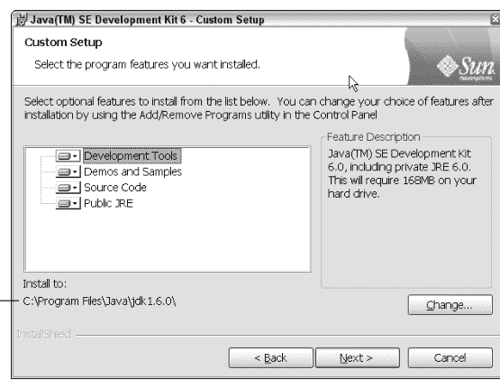

图 2-1: Java JDK 安装向导的一页。


## 你的 Java 目录

- 记录 Java SDK 安装的目录名称，然后点击下一步。

从一个版本到另一个版本，安装包会将 Java 安装在电脑硬盘上的不同目录。最近的包将 Java 安装在名为 `C:\Program Files\Java\jdk6` 的目录中。安装包会将 Java 安装在 `C:\Program Files\Java\jdk6` 目录中。在安装时，请注意你硬盘上的目录。在安装时，安装包会将 Java 安装在 `C:\Program Files\Java\jdk6` 目录中。在安装时，请注意这个目录。通常是 `C:\Program Files\Java\jdk6`。如果你是 Windows 用户，你的安装路径通常是 `C:\Program Files\Java\jdk6`。


- 5. 享受安装时看到的启动界面。

安装结束时，你还没有完全完成。

- 6. 将文档拷贝到你的 Java 目录。

在第 9 步中，你下载了一个 `jdk6.zip`。解压该文件，使其内容进入你的 Java 目录。你的目录名为 `jdk.6`。

- 7. 检查你是否正确解压了文档。

在解压文档后，你的 Java 目录下应该有一个名为 `docs` 的子目录。打开“我的电脑”并导航到该文件夹。在该文件夹内部，你应该看到一个名为 `docs` 的新文件夹。这个目录（见图 2-2）。


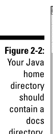

当你的文档都排列好齐后，你就可以继续下一步——安装 Java 开发环境。

## 准备使用集成开发环境

如果你按照说明操作到这里，你已经有了编写和运行自己的 Java 程序所需的所有软件。但你可能还需要另一件事。它被称为集成开发环境（IDE）。如果你没有 IDE，编写和运行程序会打开多个窗口——一个编写程序的窗口，另一个运行程序的窗口，可能还有第三个窗口跟踪你编写的所有代码。IDE 将所有这些功能无缝结合到一个组织良好的应用程序。

Java 有自己的集成开发环境。一些流行的包括 Eclipse、IntelliJ IDEA 和 NetBeans。一些高级环境具有拖放组件，你可以视觉化地设计图形界面。（见图 2-3）。有关酷的 Jigloo 图形界面构建器的更多信息，请访问 `garden.com/jigloo/index.html`。

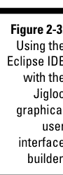

# 第 2 章：运行现成的 Java 程序

## JCreator

书中的程序适用于几乎任何 Java IDE。在本章中，我将向你展示如何使用 JCreator LE（轻量版）。我选择 JCreator 而不是其他 IDE 有以下几个原因：

- JCreator LE 是免费的。
- 在所有 Java IDE 中，JCreator 在功能和简单性之间取得了很好的折中点。
- 与其他 Java IDE 不同，JCreator 兼容几乎任何版本的 Java，从古老的 1.0.2 版本到新的 Java SE 6，再到 Java SE 7。
- JCreator LE 是免费的。（值得提两次。）


如果你是那种倾向于使用纯文本编辑器和命令行提示符而非 IDE 的人，请访问本书的网站。在该网站上，我发布了不使用 IDE 编写和运行 Java 程序的说明。

本书的 CD-ROM 包含一个特殊版本的 JCreator LE —— 该版本专门为《傻学 Java》（第4版）的读者定制！因此，请从 CD-ROM 安装 JCreator。（谁知道呢？你可能会非常喜欢它，并购买 JCreator Pro！）

要从 CD-ROM 安装材料，请参见附录 A。


## 首次运行 JCreator

第一次运行 JCreator 时，程序会询问一些配置信息。只需按照以下步骤操作：

1. 如果你还没有启动，请启动 JCreator。

JCreator 安装向导出现在你的屏幕上。向导的第一页用于文件关联的。

2. 接受文件关联默认值并点击“下一步”（Next）。

出现向导的下一页（JDK Home 目录页）。

3. 查看 JDK Home 目录页上的文本框。确保该字段显示你的 Java home 目录名称。（参见图 2-4）

如果文本框中出现错误的目录名称，只需点击浏览（Browse）按钮并导航到计算机的 Java home 目录。

## JDK Home 目录列表

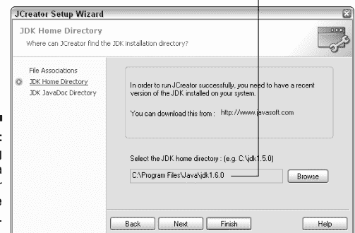

**图 2-4：**确认你的 Java home 目录的位置。

关于你计算机 Java home 目录的信息，请参见本章“下载和安装 Java 开发工具包 (JDK)”部分的第 4 步，或本章“在计算机上安装 Java”部分的第 4 步。

4. 当你对目录文本框中的名称满意时，点击“下一步”（Next）。

出现向导的最后一页（JDK JavaDoc 页）。

5. 查看 JDK JavaDoc 目录上的编辑字段。确保该字段显示你的 JavaDoc 目录名称。（参见图 2-5）。

## JDK JavaDoc 目录列表

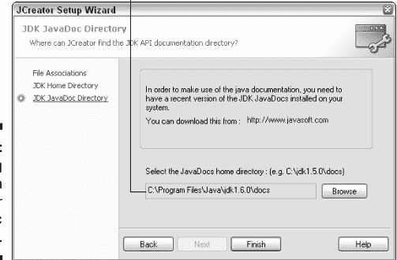

**图 2-5：**确认你的 JavaDoc 目录的位置。

通常，你的 Java 目录名称是你的 home 目录名称，后面加上 `\docs`。关于你计算机的 Javadoc 目录的信息，请参见本章“下载和安装 Java 开发工具包 (JDK)”部分的第 6 步，或本章“在计算机上安装 Java”部分的第 7 步。

如果文本框中出现错误的目录名称，只需点击浏览（Browse）按钮并导航到计算机的 JavaDoc 目录。

如果你在第 3 或第 4 步中做了任何错误，可以以后纠正。详细信息请查看本书的网站。

6. 点击“完成”（Finish）。

此时，出现 JCreator 启动页。（参见图 2-6）。


## 运行 Java 程序

在本节中，你将运行三个 Java 程序 —— 这些程序是我写的，帮助你练习 Java 代码。每个程序都计算房屋贷款的每月还款额，但每个程序以自己的方式与用户交互。在完成本节后，你将知道如何运行三种程序：基于文本程序、独立 GUI 和 Java Applet。

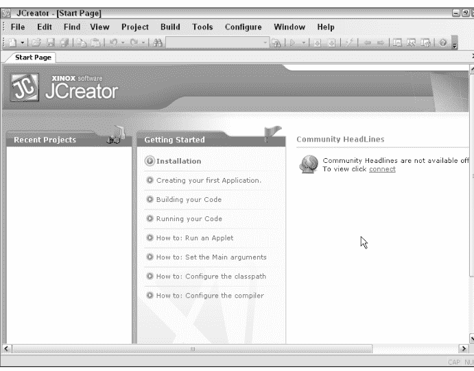

图 2-6：JCreator 的启动页。

## 运行基于文本的程序

第一个贷款计算程序不会打开窗口。相反，程序运行在 JCreator 的通用输出（General Output）面板中。（参见图 2-7。）完全在这个通用输出面板运行的程序被称为基于文本的程序。

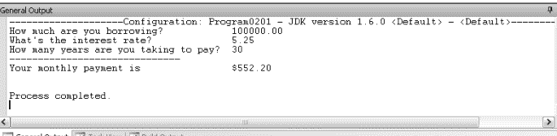

| 通用输出 | 配置 | Programa0201 | JRE 版本 1.6.0 <Default> | <Default> |
|---|---|---|---|---|
| 你借了多少钱？ | | 100000.00 | | |
| 利率是多少？ | | 30 | | |
| 你打算多少几年还清？ | | | $552.20 | |
| 你的每月还款额为 | | | | | |


如果你使用的是 Linux、Unix、Mac 或其他非 Windows 系统，本节的说明不适用于你。请访问本书的网站获取备用说明。

实际上，当你运行贷款程序时，会在通用输出面板中看到两点：

- 贷款程序发送给你的消息和结果。消息包括“你借了多少钱？”之类的。结果包括“你的每月还款额为”之类的。
- 你对程序的响应。

# 第一部分：入门

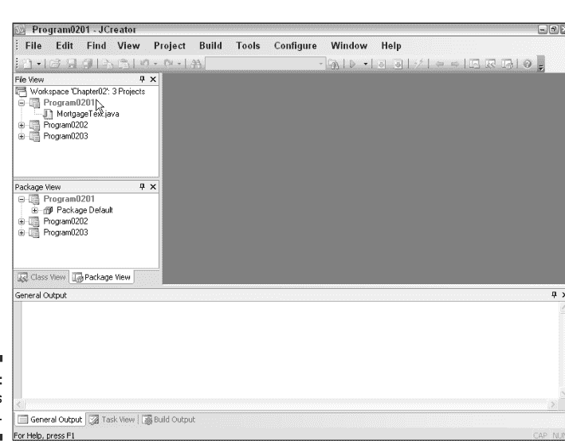

### 图 2-8：JCreator 的工作区域

在本书中，我将图 2-8 中的窗口（包括菜单栏、工具栏、文件视图、输出面板等）称为 JCreator 的**工作区域（work area）**。但 JCreator 的帮助文档使用的术语略有不同。在 JCreator 的帮助文件中，图 2-8 中的窗口被称为“工作空间（workspace）”，而不是 work area。在这些帮助文件的其他地方，JCreator 使用 workspace 一词指代完全不同的意思。为了避免混淆，我将图 2-8 中的窗口称为 `work area`，而将另一个那个东西称为 `workspace`（我稍后会解释它）。

JCreator 将程序分为多个工作空间。每个工作空间又被划分为多个项目。为了组织本书中的示例示例，我为每个章节都创建了一个项目。当你打开 `Chapter02.java` 时，你会得到 Chapter02 工作空间——该工作空间包含三个项目。项目名称分别为 `Program0201`、`Program0202` 和 `Program0203`。然后，在 JCreator 的帮助视图中，你会看到一个 Chapter02 树，其分支标记为 `Program0201`、`Program0202` 和 `Program0203`（见图 2-8）。

在第 4 步中点击“打开”（Open）可能会弹出一个对话框，询问是否要保存工作空间？如果是，点击“是”（Yes）。点击“打开”可能会弹出另一个框询问是否要关闭所有文档？如果是，点击“是”。


## 第 2 章：运行 Java 程序

5. 在文件视图（File View）树中，右键点击标记为 `Program0201` 的分支。在弹出的右键菜单中，选择“设置为活动项目”（Sets As Active Project）（见图 2-9）。

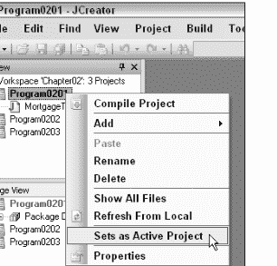

### 图 2-9：将特定项目设置为活动项目

选择“设置为活动”（Sets As Active）会让 `Program0201` 成为活动项目。

在 JCreator 中，一次只有一个项目可以是活动项目。要运行一个项目，你的程序代码必须位于当前活跃的项目中。在 JCreator 的文件视图中，你可以通过寻找**加粗**的项目名称来判断哪个项目是活动项目。在某些系统上，活动项目的名称为浅灰色加粗字体。

如果一个项目不是活动项目，你就无法运行该程序，但你可以对其进行其他操作。例如，你可以在 JCreator 的某一个面板中查看程序、对程序进行修改、保存程序等。出于这个原因，很容易产生混淆并忘记哪个项目是活动项目。请始终将活动项目置于脑后。如果你的代码运行结果不符合预期，请检查要运行的项目是否确实为活动项目。

6. 从主菜单中选择“生成：编译项目”（Build:Compile Project）。

“编译项目”的作用顾名思义。它会编译项目的代码。（要了解编译的含义，请参阅侧栏“编译和运行 Java 程序”部分）。

在硬盘发出一些悦耳的啾啾声后，JCreator 的底部面板会显示完成信息。（见图 2-10）。

7. 从主菜单中选择“生成：执行项目”（Build:Execute Project）。

当你选择“执行项目”（Execute Project）时，计算机会运行项目的代码。（也就是说，计算机运行了我编写的一个 Java 程序。）作为运行的一部分，消息“你借了多少钱？”(How much are you borrowing?) 会出现在 JCreator 的通用输出（General Output）面板中。（参考图 2-7）。


### 图 2-10：编译过程完成。

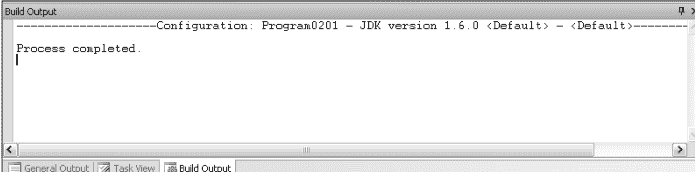


8. 在 JCreator 的通用输出面板内任意点击，输入一个数字（例如 `100000.0`），并按回车。

在第 8 步中输入数字时，不要包含你国家的货币符号，也不要使用分位分隔符。（美国居民请输入美元符号且不要使用逗号。）像 `$100000.00` 这样的数字会导致程序崩溃。你会在通用输出面板中看到 `NumberFormatException` 异常。

按下回车后，Java 程序会在 JCreator 的通用输出面板中显示另一个消息“利率是多少？”(What's the interest rate?)。

9. 针对利率问题，输入一个数字（例如 `5.25`），并按回车。

按下回车后，Java 程序会在 JCreator 的通用输出面板中显示另一个消息“多少年……”(How many years...?)。

10. 针对年份的问题，输入一个数字（例如 `30`），并按回车。

按下回车后，Java 程序会在 JCreator 的通用输出面板中显示另一个消息“每月还款是多少？”(What is the monthly payment?)。这就是计算结果。

```java
import java.text.NumberFormat;
import java.io.IOException;

public class MortgageText {
    public static void main(String[] args) throws IOException {
        double balance = 100000.0;
        double annualRate = 0.05;
        int years = 30;
        double monthlyRate = annualRate / 12;
        double monthlyPayment = (balance * monthlyRate) / (Math.pow(1 + monthlyRate, years * 12) - 1);
        NumberFormat format = NumberFormat.getCurrencyInstance();
        System.out.println("Monthly payment: " + format.format(monthlyPayment));
    }
}
```

当你运行此程序时，通用输出面板中的输出将为：

Monthly payment: $536.82

# 40 第一部分：入门

如果你从本书的 CD 光盘中安装了 JCreator，你可以在一个名为 `Program0202` 的项目中找到一个抵押贷款计算程序的 GUI 版本。要运行该程序，请按照以下指令操作：

1. 如果你还没有执行过此操作，请遵循“运行基于文本的程序”节中的第 1 到第 4 步。

当你完成这些步骤后，Chapter 02 工作区会在每次启动到下次启动之间保持打开状态。这意味着，每当你重启 JCreator 时，都可以跳过打开工作区的步骤（基于文本项目部分的第 3 和第 4 步）。为了让 JCreator 记住，请在 JCreator 菜单栏中选择 Configure（配置） > Options...（选项...）。然后在 Options 对话框中选择 Workspace（工作区） > Start Up（启动）。在 Startup 下拉框中，选择 Open Last Workspace。（见图 2-11。）最后，点击 OK 关闭 Options 对话框。

2. 在 File View（文件视图）的树目录中，右键点击标记为 `Program0202` 的分支。在弹出的上下文菜单中，选择 Sets As Active Project（设为活动项目）。

这将 `Program0202` 变为活动项目。

3. 遵循“运行基于文本的程序”节中的第 6 和第 7 步。

这会编译并运行 `Program0202` 的代码。代码将显示一个如图 2-12 所示的窗口。在窗口中，你可以尝试并为本金、利率和贷款年限输入自己的值。每当你更改一个值，程序都会立即响应并更新 Payment（付款）字段中的值。


图 2-11：使用 JCreator 自动打开工作区。

| General（常规） |
| :--- |
| - Editor（编辑器） |
| - Jera |
| - Vip |
| - Ant |
| - Hist（历史） |
| - Plans（计划） |
| - Default（默认） |
| - Descriptions（描述） |
| - JOK Policies（JOK 策略） |
| - JOK Tools（JOK 工具） |
| - Workspace（工作区） |
| - Startup（启动） |
| - File View（文件视图） |
| - Task View（任务视图） |
| - Output View（输出视图） |
| - Code Invention（代码发明） |
| - Tools（工具） |

## 第 2 章：运行现成的 Java 程序

图 2-12：GUI 抵押贷款程序的的运行界面。

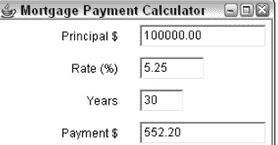

## 在网页上运行 GUI（Java Applet）


# 在网页上运行 GUI（Java Applet）

Java 的巨大影响力出现于 20 世纪 90 年代中期。Sun Microsystems 的人员成功地将 Java 程序整合到页面中，结果令人惊艳。Java 对 Web 的注入是强大、高效、可移植且安全的。诀窍在于创建程序的一部分，称为 `applet`（小程序），在网页上的矩形内显示该 `applet`。

如今，`applet` 已经过时了。真正的 Java 程序员在听到 `applet` 这个词时都会翻白眼。原因有三点：

- 自 20 世纪 90 年代中期以来，出现了更好的技术可以在网页上展示引人注目的内容。
- 全球最强大 Web 浏览器的制造商微软拒绝为其浏览器提供最新的 Java 工具。
- 对于程序员来说，真正的金钱不在于闪闪发光的 Web 页面。真正的钱在于使用 `Java EE` 的业务应用程序。

关于 `Java EE` 的更多信息，请参阅第 3 章。

无论是否过时，仍有人在等待创建 `applet`。在本节中，我们展示了一个简单的 Java `applet`。只需遵循以下步骤：

1. 如果你还没有执行过此操作，请遵循“运行基于文本的程序”节中的第 1 到第 4 步。

   当你完成这些步骤后，`Chapter 02` 工作区处于打开状态。

2. 在 `File View` 中，右键点击标记为 `Program0203` 的分支。在弹出的上下文菜单中，选择 `Sets As Active Project`（设为活动项目）。

   这将 `Program0203` 变为活动项目。

   

# 第一部分：入门

## 运行 applet

在本章中，你可以找到一个标题为“编译并运行 Java 程序”的侧边栏。该侧边栏描述了 Java 项目的执行。要执行一个项目，计算机运行 `Java` 虚拟机（`JVM`），这个 `JVM` 承载 Java 程序的指令。对于不涉及 `applet` 的项目，它是这样工作的。但当你的项目涉及 `applet` 时，情况就有点不同。

此标签指示 `Internet Explorer` 寻找名为 `MortgageApplet` 的 Java 程序。当它找到该程序时，`Internet Explorer` 会在浏览器窗口中显示 `applet`（文本字段、`Principal` 本金、`Rate` 利率、`Payment` 付款和其他内容）。

如果你处理过网页，你可能对 `HTML` 很熟悉 —— 用于万维网的超文本标记语言。几乎每个网页都以 `HTML` 文件开头。这就是为什么当你在 `JCreator` 的 `File View` 格中展开 `Program0203` 时，你会看到类似 `MyPage.html` 的东西。

那么当要执行 `applet` 时，`JCreator` 做了什么？`JCreator` 不直接运行 `JVM`。相反，`JCreator` 告诉 `Internet Explorer` 访问一个 `HTML` 文档。然后 `Internet Explorer` 在网页上运行 `JVM` 和 `applet`。你读过微软和 `Sun Microsystems` 之间所有的诉讼案件吗？这些诉讼的核心是 `Internet Explorer` 中过时的 `JVM`。

如果 `JCreator` 执行 `Program0203` 项目，它会找到 `MyPage.html` 文件并用 `Internet Explorer` 打开该文件。此时，`Internet Explorer` 接管了运行你代码的全部负担。`Internet Explorer` 根据命令（`MyPage.html` 文件中的标签）执行操作。特别是，`Internet Explorer` 在 `MyPage.html` 内部发现了以下标签：

顺便提一下，`JCreator` 可以配置使用 `Sun` 的 `appviewer` 而不是 `Internet Explorer`。`appviewer` 是一个专门为查看 Java `applet` 设计的小型浏览器。`appviewer` 只显示 `applet`（没有超链接，没有 `applet` 文本以外的文本），因此你无法使用 `appviewer` 预览完整的网页。关于在 `appviewer` 和 `Internet Explorer` 之间切换的提示，请参本书的网站。

```html
<applet code="MortgageApplet"
width="300"
height="200"></applet>
```

3. 遵循“运行基于文本的程序”节中的第 6 和第 7 步。

   这会编译并运行 `Program0202` 的代码。代码将显示一个如图 2-12 所示的窗口。在窗口中，你可以尝试并为本金、利率和贷款年限输入自己的值。每当你更改一个值，程序都会立即响应并更新 `Payment`（付款）字段中的值。（见图 2-11。）

## 第 2 章：运行现成的 Java 程序

图 2-12：GUI 抵押贷款程序的运行界面。


| General（常规） |
| :--- |
| - Editor（编辑器） |
| - Jera |
| - Vip |
| - Ant |
| - Hist（历史） |
| - Plans（计划） |
| - Default（默认） |
| - Descriptions（描述） |
| - JOK Policies（JOK 策略） |
| - JOK Tools（JOK 工具） |
| - Workspace（工作区） |
| - Startup（启动） |
| - File View（文件视图） |
| - Task View（任务视图） |
| - Output View（输出视图） |
| - Code Invention（代码发明） |
| - Tools（工具） |


无论是否过时，仍有人在等待创建 applet。在本节中，我们展示了一个简单的 Java applet。只需遵循以下步骤：

1. 如果你还没有执行过此操作，请遵循“运行基于文本的程序”节中的第 1 到第 4 步。

当你完成这些步骤后，Chapter 02 工作区处于打开状态。

2. 在 File View 中，右键点击标记为 `Program0203` 的分支。在弹出的上下文菜单中，选择 `Sets As Active Project`（设为活动项目）。

这将 `Program0203` 变为活动项目。


# 第一部分：入门

## 运行 applet

在本章中，你可以找到一个标题为“编译并运行 Java 程序”的侧边栏。该侧边栏描述了 Java 项目的执行。要执行一个项目，计算机运行 Java 虚拟机（JVM），这个 JVM 承载 Java 程序的指令。对于不涉及 applet 的项目，它是这样工作的。但当你的项目涉及 applet 时，情况就有点不同。

此标签指示 Internet Explorer 寻找名为 `MortgageApplet` 的 Java 程序。当它找到该程序时，Internet Explorer 会在浏览器窗口中显示 applet（文本字段、Principal 本金、Rate 利率、Payment 付款和其他内容）。

如果你处理过网页，你可能对 HTML 很熟悉 —— 用于万维网的超文本标记语言。几乎每个网页都以 HTML 文件开头。这就是为什么当你在 JCreator 的 File View 格中展开 `Program0203` 时，你会看到类似 `MyPage.html` 的东西。

那么当要执行 applet 时，JCreator 做了什么？JCreator 不直接运行 JVM。相反，JCreator 告诉 Internet Explorer 访问一个 HTML 文档。然后 Internet Explorer 在网页上运行 JVM 和 applet。你读过微软和 Sun Microsystems 之间所有的诉讼案件吗？这些诉讼的核心是 Internet Explorer 中过时的 JVM。

如果 JCreator 执行 `Program0203` 项目，它会找到 `MyPage.html` 文件并用 Internet Explorer 打开该文件。此时，Internet Explorer 接管了运行你代码的全部负担。Internet Explorer 根据命令（`MyPage.html` 文件中的标签）执行操作。特别是，Internet Explorer 在 `MyPage.html` 内部发现了以下标签：

顺便提一下，JCreator 可以配置使用 Sun 的 `appviewer` 而不是 Internet Explorer。`appviewer` 是一个专门为查看 Java applet 设计的小型浏览器。`appviewer` 只显示 applet（没有超链接，没有 applet 文本以外的文本），因此你无法使用 `appviewer` 预览完整的网页。关于在 `appviewer` 和 Internet Explorer 之间切换的提示，请参本书的网站。

```html
<applet code="MortgageApplet"
width="300"
height="200"></applet>
```

3. 遵循“运行基于文本的程序”节中的第 6 和第 7 步。

这会编译并运行 `Program0202` 的代码。代码将显示一个如图 2-12 所示的窗口。在窗口中，你可以尝试并为本金、利率和贷款年限输入自己的值。每当你更改一个值，程序都会立即响应并更新 Payment（付款）字段中的值。（见图 2-11。）

## 第 2 章：运行现成的 Java 程序

图 2-12：GUI 抵押贷款程序的运行界面。


## 第 3 章：使用基础构建模块

没有人完全了解 Java API 的所有内容。如果你是一个经常编写打开新窗口程序的 Java 程序员，那么你一定知道如何使用 API 里的 `Frame` 类。如果你很少编写打开窗口的程序，那么当你第一次需要创建窗口时，你可以在 API 文档中查阅 `Frame` 类。我猜想，如果你找来一个典型的 Java 程序员，并阻止他从 API 文档中查找任何内容，那么这个程序员可能只会使用 Java API 中少于 2% 的所有工具。

当然，你可能更偏喜欢《傻傻指南》（For Dummies）那种风格。但遗憾的是，Java 的官方 API 文档并不是为你编写的。API 文档既简练又精确。为了帮助你理解 API 文档的语言和风格，请参阅这个网站。

在某种程度上，Java API 没有任何地方是特别的。每当你创建一个 Java 程序时——即使是最小的 Java 程序——你创建的类与官方 Java API 中定义的任何类都是同等地位的。API 是一组由普通程序员创建的类和其他工具，这些程序员必须参与官方的 JCP——Java 社区进程（Java Community Process）。与你自己创建的工具不同，API 中的工具会随着每个 Java 版本一起发布。（我假设你，读者，并不是 Java 社区进程的参与者。不过，既然你已经见过像《傻傻指南》第四版这样的好书了。）

如果你对 JCP 的活动感兴趣，请访问 `www.jcp.org`。

JCP 的人员并没有把官方 Java API 中的 Java 程序保密。如果你愿意，可以查看所有这些程序。当你向电脑上安装 Java 时，安装程序会在你的硬盘上放置一个名为 `src.zip` 的文件。你可以用你喜欢的解压缩程序打开 `src.zip`。就在你面前，就是所有的 Java API 代码。

### Java 程序中的单词

一个硬核的 Java 粉丝会说，Java 编程语言有两种不同类型的单词：关键字（keywords）和标识符（identifiers）。这是事实。但在不加其他解释的情况下，裸露事实有时具有误导性。因此，我建议对事实进行稍微修饰，并用三种单词来思考：关键字、像你我这样的普通程序员创建的标识符，以及来自 API 的标识符。

这三种单词之间的差异类似于英语中单词之间的差异。在句子“Sam is a person”中，`person` 这个词就像一个 Java 关键字。无论谁使用这个词，它的含义总是大致相同。（当然，你可以考虑英语用法中构思奇特的例外，但请不要这样做。）

`Sam` 这个词就像一个 Java 标识符，因为 `Sam` 是一个特定人的名字。像 `Sam`、`Dinswald` 和 `McGillimaroo` 这样的单词在英语中并没有预设的含义。这些单词根据上下文适用于不同的人，并在父母为新生婴儿挑选其中一个名字时，它们就变成了名字。

现在考虑“Julius Caesar is a person”。当你说这句话时，你可能在谈论那个统治罗马直到 3 月 15 日的那个伙计。几乎每个人都使用 `Julius Caesar` 这个名字；它并没有硬编码在英语语言中，几乎每个人都用这个名字来指代同一个人。如果英语是一种编程语言，那么这个名字就是一个 API 标识符。

所以这就是我自己在脑海中将 Java 程序中的单词分为几类的方法：

- **关键字**：关键字是在 Java 编程语言中具有特殊含义的单词，且该含义在不同程序之间不会改变。关键字的示例包括 `if`、`else` 和 `do`。本书开头的“备忘表”（Cheat Sheet）提供了 Java 关键字完整列表。

JCP 成员对什么构成 Java 程序具有最终决定权，他们选择了所有的 Java 关键字。如果你考虑在本章前面的“语法和通用名称”部分中讨论的 Java 两个部分，Java 关键字坚定地属于 Java 规范（Java Specification）。

- **标识符**：标识符是像你我这样的普通程序员创建的标识符，以及来自 API 的标识符。这三种单词之间的差异类似于英语中单词之间的差异。（此处省略重复示例的翻译逻辑，保持结构一致）

### Java 类

由于 Java 是一门面向对象的编程语言，你的首要目标是描述类和对象。（如果你对这一点不信服，请阅读第 1.2 节中关于面向对象编程的内容。）

在那些我心情感性的特殊日子里，我会告诉人们，Java 在面向对象化方面比大多数其他所谓的面向对象的语言更纯粹。在 Java 中，除非你创建了某种类，否则你无法做任何事情。这就像是在参加《危险竞答》（*Jeopardy*节目），Alex Trebec 说：“让我们进入广告环节，”而你打断他说：“抱歉，Alex。在不把指令放在类里面的情况下，你不能发布指令。”

在 Java 中，整个程序都是一个类。我写这个程序是为了给我的新类起一个名字。我选择了 `Display` 这个名字，因为这个程序会在电脑屏幕上显示一行文本。这就是为什么列表 3-1 中的代码以 `class Display` 开头。（参见图 3-2。）

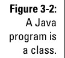

| 整个程序 | 类 Display |
| :--- | :--- |

```java
class Display {
  public static void main(String[] args) {
    System.out.println("You'll love Java!");
  }
}
```

列表 3-1 中的第一个单词，`class` 单词是一个 Java 关键字。（参见本章前面的“Java 程序中的单词”部分。）无论谁来写 Java 程序，`class` 单词的使用方式都是一样的。另一方面，列表 3-1 中的 `Display` 单词是一个标识符。我在编写这个类时临时构思了 `Display` 这个单词。`Display` 单词是某个特定类的名称——即我正在通过这个程序创建的那个类。

Java 编程语言是区分大小写的。这意味着如果你将单词中的一个小写字母改为大写字母，你就改变了这个单词的含义。改变大小写可能会导致整个单词失去意义。在列表 3-1 的第一行中，你不能将 `class` 替换为 `Class`。如果你这样做，整个程序就会停止工作。


### Java 方法

你在一家高级修车厂担任汽车技师。你的老板正赶时间，而且习惯把单词连在一起说，他说：“修理发电机。”在脑海中，你过了一遍任务清单：把车开上升降，用扳手打开引擎盖，松开发电机，等等。这里有三件事：

- 你对要执行的事情有一个名字。这个名字是 Fix alternator。在你的脑海中，你有一份与 Fix alternator 关联的任务列表。该列表包括“把车开上升降，打开引擎盖，使用扳手，松开发电机”等等。

- 你有一个脾气不好的老板在让你做所有工作。老板通过说“Fix alternator”让你开始工作。换句话说，老板通过说出你要完成的任务名称让你开始工作。

在这种情况下，使用 method（方法）这个词并不牵强。你有一套处理发电机的方法。你的老板通过方法号召行动，而你通过执行列表中与该方法相关的所有任务来响应。如果你相信（我希望你相信），那么你就准备好阅读关于 Java 方法了。在 Java 中，一个方法是一个待办事项列表。每个方法都有一个名字，你在程序中使用方法名告诉计算机去执行列表中的事项。

我从未写过让机器人去修理发电器的程序。但是，如果我真的写了，程序可能包含一个 `FixAlternator` 方法。我的方法的指令列表看起来就像列表 3-2 中的文本一样。

#### 列表 3-2：方法声明

```java
void FixAlternator() {
  DriveInto(car);
  Lift(hood);
  Get(wrench);
  Loosen(alternator);
}
```

在我的代码其他某个地方（列表 3-2 之外），我需要一条指令来调用我的方法执行。调用方法执行的指令可能像列表 3-3 中的那行。

#### 列表 3-3：方法调用

```java
FixAlternator();
```

不要太仔细审视列表 3-2 和 3-3。列表 3-2 和 3-3 中的所有代码都是虚假的！我编写了这些代码是为了让它们看起来像真实的 Java，但它们并不是真实的。更重要的是，列表 3-2 和 3-3 中的代码并不是为了说明关于 Java 的所有规则。所以，如果你持保留态度，请谨慎对待列表 3-2 和 3-3。

现在你已经对什么是方法以及它是如何工作的有了基本的了解，你可以更深入地研究一些术语了：

- 如果我偷懒，就把列表 3-2 中的代码称为一个方法（method）。如果我不偷懒，就称这段代码为方法声明（method declaration）。

- 列表 3-2 中的方法声明有两个部分。第一行（包含 method 的部分，直到左大括号为止）被称为方法头（method header）。列表 3-2 的剩余部分（被大括号包围的部分）是方法体（method body）。

- “方法声明”一术语将列表 3-2 中的指令列表与列表 3-3 中的指令区分开来，后者被称为方法调用（method call）。

方法声明告诉计算机如果调用该方法执行会发生什么。方法调用（另一段代码）告诉计算机调用该方法。方法的声明和调用往往位于 Java 程序的不同部分。

### 程序中的 main 方法

列表 3-3 包含了来自列表 3-1 的代码副本。代码的大部分包含一个名为 `main` 的方法声明。（在代码方法头中寻找 `main` 单词。）目前，不要担心方法头中的其他单词——`public`、`static`、`void`、`String` 和 `args`。我将在接下来的章节中解释这些单词。

就像任何 Java 程序一样，`main` 方法是一个方法的“配谱”。

```
如何制作饼干：
加热烤箱。
揉制面团。
烘烤揉好的面团。
```

或者

```
如何为 Displayer 遵循主指令：
在屏幕上打印 "You'll love Java!"。
```

```java
class Displayer {
    public static void main(String args[]) {
        System.out.println("You'll love Java!");
    }
}
```

图 3-3：main 方法。

`main` 单词在 Java 中起着特殊作用。在特殊情况下，你永远不会显式地调用 `main` 方法。`main` 是程序启动时自动调用的方法名称。

所以回想图 3-1。在 Jcreator 中选择 Build-Execute 来运行程序。当 `Displayer` 程序运行时，计算机会自动找到 `main` 方法并执行方法体内的任何指令。在 `Displayer` 程序中，`main` 方法体只有一条指令。该指令告诉计算机在屏幕上打印 "You'll love Java"。


# 56 第一部分：入门

当我说“`System.out.println` 埋在 API 内部”时，我并没有充分说明这个 API 的价值。确实，你可以忽略 API 内部所有精妙的 Java 代码。你只需要记住，`System.out.println` 定义在它的内部的某处。但当我把 API 代码描述得像某种魔法时，我是不够公平的。API 就是 API，它告诉计算机执行对 `System.out.println` 的调用看起来像什么样，就像列表 3-1 中的 Java 代码一样。


在 Java 中，每条语句（如图 3-4 中框选的行）都以分号结尾。图 3-4 中的其他行没有以分号结尾；因为图 3-4 中的其他行并不是语句。例如，方法头（带有 `main` 单词的行）并没有直接告诉计算机要做任何事。方法头的出现是为了：“万一你想做点什么，”接下来的几行代码会告诉你将如何去做。

每条完整的 Java 语句都以分号结尾。


```
101010000111000...

计算机会自动调用你的 main 
方法，然后...

class Display {
    public static void main(String args[]) {
        System.out.println("You'll love Java!");
    }
}

...你方法头中的一条语句
调用了 System.out.println 方法。

public void println(String s) {
    ensureOpen();
    textOut.write(s);
    textOut.flushBuffer();
}
```

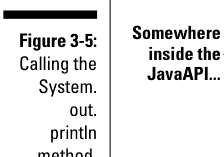

## 大括号

很久以前，或者也许并没有那么久，你的学校老师们就告诉过你大纲有多用。有了大纲，你可以组织思想和想法，帮助人们看到森林而非树木，并通常能证明你是一个“整洁俱乐部”的成员。嗯，一个 Java 程序就像一个大纲。列表 3-1 中的程序以一个大标题开头，写着：“这是一个名为 Displayer 的类。”在那个第一个大标题之后是一个子标题，宣布：“这里有一个名为 main 的方法。”

现在，如果一个 Java 程序像一个大纲，为什么程序看起来不像大纲呢？用什么取代了罗马数字、大写字母和其他东西？答案有两点：

- 在 Java 程序中，大括号包围了有意义的代码单元。
- 你，作为程序员，可以（并且）对代码行进行缩进，这样其他程序员就能一眼看出你代码的大纲形式。

在大纲中，一切都隶属于罗马数字 I 下的项目。在 Java 程序中，一切都隶属于第一行——即带有 `class` 单词的这一行。为了表示代码中的其他所有内容都隶属于这个类行，你使用大括号。代码中的其他所有内容都放在这些大括号内部。（参见列表 3-4）

### 列表 3-4：Java 类的大括号


```
class Displayer {

    public static void main(String[] args[]) {
        System.out.println("You'll love Java!");
    }
}
```

# 列表 3-5：Java 方法的大括号

```
class Displayer {

    public static void main(String[] args[]) {
        System.out.println("You'll love Java!");
    }
}
```

# 第3章：构建块

## 大括号

很久以前，或者也许并没有那么久，你的学校老师们就告诉过你大纲有多用。有了大纲，你可以组织思想和想法，帮助人们看到森林而非树木，并通常能证明你是一个“整洁俱乐部”的成员。嗯，一个 Java 程序就像一个大纲。列表 3-1 中的程序以一个大标题开头，写着：“这是一个名为 `Displayer` 的类。”在那个第一个大标题之后是一个子标题，宣布：“这里有一个名为 `main` 的方法。”

现在，如果一个 Java 程序像一个大纲，为什么程序看起来不像大纲呢？用什么取代了罗马数字、大写字母和其他东西？答案有两点：

-   在 Java 程序中，大括号包围了有意义的代码单元。
-   你，作为程序员，可以（并且）对代码行进行缩进，这样其他程序员就能一眼看出你代码的大纲形式。

在大纲中，一切都隶属于罗马数字 I 下的项目。在 Java 程序中，一切都隶属于第一行——即带有 `class` 单词的这一行。为了表示代码中的其他所有内容都隶属于这个类行，你使用大括号。代码中的其他所有内容都放在这些大括号内部。（参见列表 3-4）

### 列表 3-4：Java 类的大括号

```
class Displayer {

    public static void main(String[] args[]) {
        System.out.println("You'll love Java!");
    }
}
```

在大纲中，某些内容隶属于大写字母 A。在 Java 程序中，某些行隶属于方法头。为了表示某项内容隶属于方法头，你使用大括号。（参见列表 3-5）

### 列表 3-5：Java 方法的大括号

```
class Displayer {

    public static void main(String[] args[]) {
        System.out.println("You'll love Java!");
    }
}
```

## 程序结构与缩进

在大纲中，某些项目处于食物链的底端。在 `Displayer` 类中，对应的行就是以 `System.out.println` 开头的行。因此，这行 `System.out.println` 位于所有其他大括号内部，并且缩进得比任何内容都深。


永远不要忘记这样一个事实：Java 程序首先是一个大纲。

如果你把大括号放在错误的地方，或者在应该有大括号的地方漏了大括号，你的程序可能完全无法运行。如果你的程序运行了，它可能运行错误。

如果你不以一种提供信息的方式对代码行进行缩进，你的程序可以正确运行，但你或其他任何程序员都无法理解你在编写代码时的思考过程。

如果你是那些视觉化思考者之一，你可以在脑海中构思 Java 程序的大纲。我的一位朋友可以将实际的带编号大纲变成一个 Java 程序。（参见图 3-6。）另一个人（不具名）使用了更奇异的意象。（参见图 3-7。）


图 3-6：大纲变成了 Java 程序。

```
class Displayer {
  public static void main(String args[]) {
    System.out.println("You'll love Java!");
  }
}
```

## API 与语句

当我说“`System.out.println` 埋在 API 内部”时，我并没有充分说明这个 API 的价值。确实，你可以忽略 API 内部所有精妙的 Java 代码。你只需要记住，`System.out.println` 定义在它的内部的某处。但当我把 API 代码描述得像某种魔法时，我是不够公平的。API 就是 API，它告诉计算机执行对 `System.out.println` 的调用看起来像什么样，就像列表 3-1 中的 Java 代码一样。


在 Java 中，每条语句（如图 3-4 中框选的行）都以分号结尾。图 3-4 中的其他行没有以分号结尾；因为图 3-4 中的其他行并不是语句。例如，方法头（带有 `main` 单词的行）并没有直接告诉计算机要做任何事。方法头的出现是为了：“万一你想做点什么，”接下来的几行代码会告诉你将如何去做。

**每条完整的 Java 语句都以分号结尾。**


```
101010000111000...

计算机机会自动调用你的 main 
方法，然后...

class Display {
    public static void main(String args[]) {
        System.out.println("You'll love Java!");
    }
}

...你方法头中的一条语句
调用了 System.out.println 方法。

public void println(String s) {
    ensureOpen();
    textOut.write(s);
    textOut.flushBuffer();
}
```


如果你不以一种提供信息的方式对代码行进行缩进，你的程序可以正确运行，但你或其他任何程序员都无法理解你在编写代码时的思考过程。

如果你是那些视觉化思考者之一，你可以在脑海中构思 Java 程序的大纲。我的一位朋友可以将实际的带编号大纲变成一个 Java 程序。（参见图 3-6。）另一个人（不具名）使用了更奇异的意象。（参见图 3-7。）


图 3-6：大纲变成了 Java 程序。

```
class Displayer {
  public static void main(String args[]) {
    System.out.println("You'll love Java!");
  }
}
```

# 第3章：构建块

当我说“`System.out.println` 埋在 API 内部”时，我并没有充分说明这个 API 的价值。确实，你可以忽略 API 内部所有精妙的 Java 代码。你只需要记住，`System.out.println` 定义在它的内部的某处。但当我把 API 代码描述得像某种魔法时，我是不够公平的。API 就是 API，它告诉计算机执行对 `System.out.println` 的调用看起来像什么样，就像列表 3-1 中的 Java 代码一样。


在 Java 中，每条语句（如图 3-4 中框选的行）都以分号结尾。图 3-4 中的其他行没有以分号结尾；因为图 3-4 中的其他行并不是语句。例如，方法头（带有 `main` 单词的行）并没有直接告诉计算机要做任何事。方法头的出现是为了：“万一你想做点什么，”接下来的几行代码会告诉你将如何去做。

每条完整的 Java 语句都以分号结尾。


```
101010000111000...

计算机机会自动调用你的 main 
方法，然后...

class Display {
    public static void main(String args[]) {
        System.out.println("You'll love Java!");
    }
}

...你方法头中的一条语句
调用了 System.out.println 方法。

public void println(String s) {
    ensureOpen();
    textOut.write(s);
    textOut.flushBuffer();
}
```


## 大括号

很久以前，或者也许并没有那么久，你的学校老师们就告诉过你大纲有多用。有了大纲，你可以组织思想和想法，帮助人们看到森林而非树木，并通常能证明你是一个“整洁俱乐部”的成员。嗯，一个 Java 程序就像一个大纲。列表 3-1 中的程序以一个大标题开头，写着：“这是一个名为 Displayer 的类。”在那个第一个大标题之后是一个子标题，宣布：“这里有一个名为 main 的方法。”

现在，如果一个 Java 程序像一个大纲，为什么程序看起来不像大纲呢？用什么取代了罗马数字、大写字母和其他东西？答案有两点：

- 在 Java 程序中，大括号包围了有意义的代码单元。
- 你，作为程序员，可以（并且）对代码行进行缩进，这样其他程序员就能一眼看出你代码的大纲形式。

在大纲中，一切都隶属于罗马数字 I 下的项目。在 Java 程序中，一切都隶属于第一行——即带有 `class` 单词的这一行。为了表示代码中的其他所有内容都隶属于这个类行，你使用大括号。代码中的其他所有内容都放在这些大括号内部。（参见列表 3-4）

### 列表 3-4：Java 类的大括号

```
class Displayer {

    public static void main(String[] args[]) {
        System.out.println("You'll love Java!");
    }
}
```

在大纲中，某些内容隶属于大写字母 A。在 Java 程序中，某些行隶属于方法头。为了表示某项内容隶属于方法头，你使用大括号。（参见列表 3-5）

### 列表 3-5：Java 方法的大括号

```
class Displayer {

    public static void main(String[] args[]) {
        System.out.println("You'll love Java!");
    }
}
```

在大纲中，某些项目处于食物链的底端。在 Displayer 类中，对应的行就是以 `System.out.println` 开头的行。因此，这行 `System.out.println` 位于所有其他大括号内部，并且缩进得比任何内容都深。


永远不要忘记这样一个事实：Java 程序首先是一个大纲。

如果你把大括号放在错误的地方，或者在应该有大括号的地方漏了大括号，你的程序可能完全无法运行。如果你的程序运行了，它可能运行错误。

如果你不以一种提供信息的方式对代码行进行缩进，你的程序可以正确运行，但你或其他任何程序员都无法理解你在编写代码时的思考过程。

如果你是那些视觉化思考者之一，你可以在脑海中构思 Java 程序的大纲。我的一位朋友可以将实际的带编号大纲变成一个 Java 程序。（参见图 3-6。）另一个人（不具名）使用了更奇异的意象。（参见图 3-7。）


图 3-6：大纲变成了 Java 程序。

```
class Displayer {
  public static void main(String args[]) {
    System.out.println("You'll love Java!");
  }
}
```

# 第3章：构建块

当我说“`System.out.println` 埋在 API 内部”时，我并没有充分说明这个 API 的价值。确实，你可以忽略 API 内部所有精妙的 Java 代码。你只需要记住，`System.out.println` 定义在它的内部的某处。但当我把 API 代码描述得像某种魔法时，我是不够公平的。API 就是 API，它告诉计算机执行对 `System.out.println` 的调用看起来像什么样，就像列表 3-1 中的 Java 代码一样。


在 Java 中，每条语句（如图 3-4 中框选的行）都以分号结尾。图 3-4 中的其他行没有以分号结尾；因为图 3-4 中的其他行并不是语句。例如，方法头（带有 `main` 单词的行）并没有直接告诉计算机要做任何事。方法头的出现是为了：“万一你想做点什么，”接下来的几行代码会告诉你将如何去做。

每条完整的 Java 语句都以分号结尾。


```
101010000111000...

计算机机会自动调用你的 main 
方法，然后...

class Display {
    public static void main(String args[]) {
        System.out.println("You'll love Java!");
    }
}

...你方法头中的一条语句
调用了 System.out.println 方法。

public void println(String s) {
    ensureOpen();
    textOut.write(s);
    textOut.flushBuffer();
}
```

## 62 第一部分：入门

- 程序员并不是创建两个独立的东西 —— 即在这一写一些 Java 代码，在对面写一些关于代码的文档。相反，程序员创建一段 Java 代码，并将文档（以 javadoc 注释的形式）直接嵌入到代码中。
- 最棒的是，从 javadoc 注释自动生成 Web 页面。每个人的文档格式都是相同的。无论你使用什么 Java 代码，你都可以通过阅读类似于图 3-8 所示页面来了解该代码，这种页面对于任何使用 Java 的人都是熟悉的。

你可以从代码中放入的 javadoc 注释生成你自己的 Web 页面。要了解如何操作，请访问你的网站。


| 类 | 树形 | 已弃用 | 索引 | 帮助 |
|---|---|---|---|---|
| 上一个类 | 下一个类 | | | |
| 摘要：嵌套 (java.lang.Object) | 构造函数 | 方法 | | |

class Displayer

extends java.lang.Object

-Dispatcher

Displayer 类在计算机屏幕上显示文本。

另需查看：

Dispatcher

| 构造函数摘要 |
|---|
| Dispatcher () |

| 方法摘要 |
|---|
| void main(String[] args) 程序的执行从此 main 方法开始。 |

从类 java.lang.Object 继承的方法：

clone, equals, finalize, get, hashCode, notify, notifyAll, toString, wait, wait

| 构造函数详情 |
|---|
| Dispatcher () |

| 方法详情 |
|---|
| main |
| public static void main(String[] args) 程序的执行从此 main 方法开始。 |

图 3-8. 根据代码列表 3-6 中的代码生成的 javadoc 页面。

参数：

args（参见第 11 章）。

| 包 | 树形 | 已弃用 | 索引 | 帮助 |
|---|---|---|---|---|
| 上一个类 | 下一个类 | | | |
| 摘要：嵌套 (java.lang.Object) | 构造函数 | 方法 | | |

## 第 3 章：使用基础构建块

### Barry 的借口是什么？

多年多年来，我一直告诉我的学生在代码中编写注释，而多年来，我一直在创建没有任何注释的示例代码（如列表 3-1 中的代码）。为什么？

三个简单的词：“了解你的受众。”当你编写复杂的真实世界代码时，你的受众是其他程序员、信息技术经理以及需要帮助破译你所做工作的人。当我为这本书编写简单的示例代码时，我的受众是 —— 初级程序员。与其阅读我的注释，你最好的策略是盯着我的 Java 语句 —— 即那些 Java 编译器破译的语句。这就是为什么我在书中的列表里放了如此少的注释。

此外，我有点懒。

### 查找 javadoc 页面

在第 2 章中，我鼓励你下载一份官方 Java API 文档。这份文档是根据 javadoc 注释自动生成的 Web 页面构成的巨大集合。要访问此文档，请执行以下操作：

1. 遵循本章紧接列表 3-1 之后的步骤列表中的步骤 1 和步骤 2。

列表 3-1 的代码出现在 JCreator 的编辑器面板中。

2. 在编辑器面板中，右键点击单词 `System`。在弹出的菜单中，选择 Show JDK Help（显示 JDK 帮助）。

`System` 的 javadoc 页面出现在 JCreator 的编辑器面板中。要查看此页面的更多内容，请使用面板的滚动条。页面上的内容现在对你来说可能没有意义，但随着你阅读更多这本书，事情会变得越来越清晰。

关于阅读和理解 Java API 文档的提示，请参本书的网站。

3. 点击编辑器面板顶部的 `Displayer.java` 标签。

列表 3-1 的代码再次出现。

4. 在编辑器面板中，右键点击单词 `println`，并从出现的右键菜单中选择 Show JDK Help。

出现一个对话框。该对话框向你显示 Java API 中的项列表，每项的名称都为 `println`。


5. 在对话框列表中，双击标记为 `println(String - Method in java.io.PrintStream` 的项目。

`println` 方法的文档出现在编辑器面板中。

### 使用注释测试你的代码

你可能会听到程序员谈论对代码的某些部分进行注释。当你编写程序且某些部分运行不正常时，尝试移除一些代码通常会有帮助。即使没有，你也能发现移除可疑代码后会发生什么。当然，你可能会发现移除代码后的结果，所以你不想完全删除代码。相反，你可以使用注释。

```
System.out.println("I love Java!")
```

```
System.out.println("Parents,")
System.out.println("battles")
System.out.println("carefully!")
```


# 第 3 章：使用基础构建块

## Barry 的借口是什么？

多年来，我一直告诉我的学生在代码中编写注释，而多年来，我一直在创建没有任何注释的示例代码（如列表 3-1 中的代码）。为什么？

三个简单的词：“了解你的受众。”当你编写复杂的真实世界代码时，你的受众是其他程序员、信息技术经理以及需要帮助破译你所做工作的人。当我为这本书编写简单的示例代码时，我的受众是 —— 初级程序员。与其阅读我的注释，你最好的策略是盯着我的 Java 语句 —— 即那些 Java 编译器破译的语句。这就是为什么我在书中的列表里放了如此少的注释。

此外，我有点懒。

## 查找 javadoc 页面

在第 2 章中，我鼓励你下载一份官方 Java API 文档。这份文档是根据 javadoc 注释自动生成的 Web 页面构成的巨大集合。要访问此文档，请执行以下操作：

1. 遵循本章紧接列表 3-1 之后的步骤列表中的步骤 1 和步骤 2。

列表 3-1 的代码出现在 JCreator 的编辑器面板中。

2. 在编辑器面板中，右键点击单词 `System`。在弹出的菜单中，选择 Show JDK Help（显示 JDK 帮助）。

`System` 的 javadoc 页面出现在 JCreator 的编辑器面板中。要查看此页面的更多内容，请使用面板的滚动条。页面上的内容现在对你来说可能没有意义，但随着你阅读更多这本书，事情会变得越来越清晰。

关于阅读和理解 Java API 文档的提示，请参本书的网站。

3. 点击编辑器面板顶部的 `Displayer.java` 标签。

列表 3-1 的代码再次出现。

4. 在编辑器面板中，右键点击单词 `println`，并从出现的右键菜单中选择 Show JDK Help。

出现一个对话框。该对话框向你显示 Java API 中的项列表，每项的名称都为 `println`。


5. 在对话框列表中，双击标记为 `println(String) - Method in java.io.PrintStream` 的项目。

`println` 方法的文档出现在编辑器面板中。

## 使用注释测试你的代码

你可能会听到程序员谈论对代码的某些部分进行注释。当你编写程序且某些部分运行不正常时，尝试移除一些代码通常会有帮助。即使没有，你也能发现移除可疑代码后会发生什么。当然，你可能会发现移除代码后的结果，所以你不想完全删除代码。相反，你可以使用注释。

---

## 创建新项目

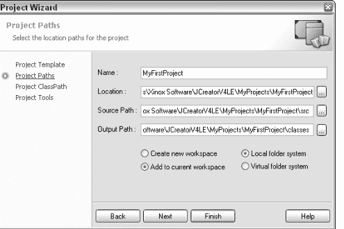

**图 3-11：项目向导的路径（Paths）选项卡。**

如果你点击“下一步”（Next）而不是“完成”（Finish），你会看到一些现在不需要的其他选项。为了避免任何混淆，只需点击“完成”。

点击“完成”将你带回 JCreator 的工作区域，其中加粗显示的 **MyFirstProject** 是当前活动项目。下一步是创建一个新的 Java 源代码。

**8. 在文件（File）视图中，右键点击 `MyFirstProject`。从出现的右键菜单中选择“添加新类”（Add-New Class），如图 3-12 所示。**

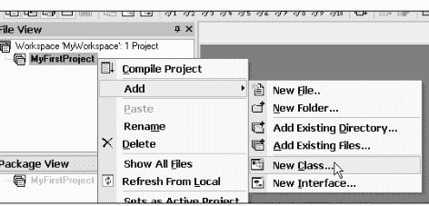

**图 3-12：在 JCreator 添加新类。**

与其他所有窗口一样，JCreator 提供了许多方法来完成任务。与其右键点击 `MyFirstProject`，你也可以通过菜单栏的 `File > New Class`。但通过右键点击项目名称，新创建的类无疑位于该项目中。如果你使用菜单栏，新创建的类将进入恰好是活动项目的任何工作区。如果你的工作区包含许多项目，你可能会无意中将新类放入错误的项目中。

## 创建新类

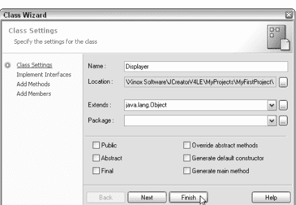

**图 3-13：类向导（Class Wizard）的类设置（Class Settings）选项卡。**

9. 在类向导的名称（Name）字段中，输入你新类的名称。

对于这个第一个项目，我强烈建议命名为 `Display`。为了安全起见，请使用大写字母 D，其他字符均使用小写字母。（参考图 3-13）。

10. 跳过类向导中除名称字段以外的所有内容。（换句话说，点击“完成”。）

点击“完成”将你带回 JCreator 区域。现在，编辑器面板格有一个名为 `Display.java` 的选项卡。为了方便起见，`Display.java` 选项卡中已经包含了少量代码。（见图 3-14）。

**图 3-14：JCreator 在编辑器面板格中写了一段代码。**

```
class Display {
}
```

11. 输入你的新 Java 程序。

将你的代码添加到 JCreator 编辑器面板格中的代码中。对于这个第一个项目，我建议完全按照你看到的样子复制列表 3-1 中的代码。

- 严格按照我在列表 3-1 中的单词拼写方式拼写每个单词。
- 严格按照我在列表 3-1 中的大小写方式处理每个单词。
- 包含所有标点符号——大括号、分号、所有符号。

## 编译与运行

12. 从菜单栏选择 `Build > Compile Project`（构建 > 编译项目）。

如果你输入的内容完全正确，你会在 JCreator 构建输出（Build Output）面板格的底部看到安心的“Process completed”（处理完成）消息，没有任何错误信息，该面板格现在覆盖了旧的常规输出（General Output）面板格。（见图 3-15。）

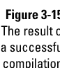

| Configuration: MyThirdProject | JDK version 1.6.0 (Default) | \<Default\> |
| :--- | :--- | :--- |
| Process completed | | |


当你选择 `Build > Compile Project` 时，JCreator 会编译当前活动的项目。一次只有一个项目是活动状态。如果有许多其他事情，任务列表（Task List）包含了多个项目，请确保[想要编译的项目]当前是活动项目。

13. 检查 JCreator 工作区域底部的错误信息。

如果在第 11 步中，你输入的代码与列表 3-1 显示的不完全一致，你会在任务列表面板格中看到一些错误信息。（与许多其他事情一样，任务列表出现在 JCreator 工作区域的底部。

每个错误信息都指向你 Java 代码中的特定位置。要将光标跳转到编辑器面板格中的该位置，双击任务列表面板格中的消息。将你看到的所有内容与列表 3-1 中的代码进行逐字符的对比。不要漏掉任何一个细节，包括拼写、标点和大小写。

14. 对编辑器面板格进行任何更改或更正。然后重复第 12 和第 13 步。

当你看到没有错误信息的“Process completed”消息时，你就可以准备好运行程序了。

15. 从菜单栏选择 `Build > Execute Project`（构建 > 执行项目）。

这样就搞定了。你的新 Java 程序将在 JCreator 的常规输出面板格中运行。如果你正在运行列表 3-1 中的代码，你会在图 3-1 中看到“Youll love Java!”（你会喜欢 Java 的！）的消息。相信我；这样的消息永远不会错。

---

# 第 4 章：充分利用变量及其值

## 本章内容

- 给项目赋值
- 让项目存储特定类型的值
- 对值使用运算符

以下是发生过的对话：

> Charles：一个水母变成了动物。Meredith：这是你的最终答案吗？Charles：是的。Meredith：你现在有多少钱？Charles：我有五十美元二分。Meredith：我在你的账户里存入了一百万美元。你对此怎么看？Charles：这一切归功于诚实、勤奋。

这种对话的一部分可以用几行 Java 代码来表示。

## 改变变量

无论你如何获得财富，你都可以使用变量来记录财富。代码在列表 4-1 中。

### 列表 4-1：使用变量

```
amountInAccount = 50.22;
amountInAccount = amountInAccount + 1000000.00;
```

列表 4-1 中的代码使用了变量。变量是一个占位符。你可以将像 `50.22` 这样的数字放入变量。当你在变量中放入一个数字后，你可以更改它并放入一个不同的数字。（变量变化。）当然，当你向变量中放入数字时，旧数字就不存在了。如果你没有在其他地方保存旧数字，它就消失了。

图 4-1 给出了 4-1 代码的前后对比。

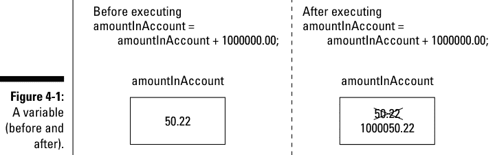

你现在需要一些术语。存储在变量中的被称为值。变量的值在程序运行期间可能会改变（例如 Meredith 给了你百万美元）。存储在变量中的值并不一定是变量。（例如，你创建一个始终存储字母的变量。）存储在变量中的值的类型是变量类型。

你可以在本章后面的“理解变量可能拥有的值的类型”部分阅读更多关于类型的内容。

变量和变量名称之间存在细微、几乎不可察觉的区别。在正式写作中，我经常使用变量一词来表示变量名。严格来说，`amountInAccount` 是一个变量名，与 `amountInAccount` 关联的内存存储（包括 `type amountInAccount` 拥有以及 `amountInAccount`（目前代表的）的任何值都是变量本身。如果你觉得变量和变量名之间的这种区别太微妙，不值得浪费精力，请加入我们的俱乐部吧。

每个变量名都是一个标识符——一个你可以在代码中自己起的名字。在准备列表 4-1 时，我构思了 `amountInAccount` 这个名字。

关于 Java 程序中命名的类型的更多信息，请参见第 3 章。

在阅读列表 4-1 结束之前，你需要注意列表的另一个部分。该列表中包含了 `50.22` 和 `1000000.00`。任何在你旁边的人都会称这些为数字，但在 Java 程序中，称它们为“字面量”（literals）会有所帮助。

`50.22` 和 `1000000.00` 有什么特别“字面”的吗？嗯，想想列表 4-1 中的变量 `amountInAccount`。变量 `amountInAccount` 在多数时候代表 `50.22`，但在其余时间它代表 `1000050.22`。你可以用“字面量”这个词来描述 `amountInAccount`。但实际上，`amountInAccount` 代表什么取决于当时的状况。另一方面，`50.22` 字面上就代表值 `50.22`。

变量的值会变，而字面量的值不会变。


## 赋值语句

像列表 4-1 中的那些语句被称为赋值语句。在赋值语句中，你将某个值赋值给变量。在很多情况下，这是一个变量。

我建议养成从右到左阅读赋值语句的习惯。例如，列表 4-1 中的第一行是：

```
"将 50.22...
amountInAccount =
50.22;
...赋值给
amountInAccount
变量。"
```

列表 4-1 中的第二行稍微复杂一点。从右到左读第二行，你会得到：

```
"将 1000000.00 加到 amountInAccount
变量中已有的值...
amountInAccount = amountInAccount + 1000000.00;
..并让
那个数字
(1000050.22) 成为
amountInAccount 变量的新值。"
```


在赋值语句中，被赋值的对象始终位于等号的左侧。

## 理解变量可能拥有的值的类型

你见过那些让你觉得自己正在计算机内部电路中飞行的电视广告吗？很酷，对吧？这些广告显示了 `0`（零）和 `1`，因为 `0` 和 `1` 是计算机真正能处理的唯一东西。当你认为计算机正在存储字母 `J` 时，计算机实际上存储的是 `01001010`。计算机内部的一切都是 `0` 和 `1` 的序列。正如每个计算机所知，一个 `0` 或 `1` 被称为一个位（bit）。

事实证明，代表字母 `J` 的序列 `01001010` 也可以代表数字 `74`。同样的序列也可以代表 `1.036908630063646×10⁻⁴`。事实上，如果位被解释为屏幕像素，相同的序列也可以用来表示图 4-2 中的点。`01001010` 的含义取决于软件解释 `0` 和 `1` 的方式。

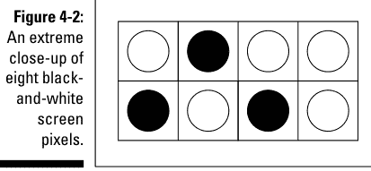

你如何告诉计算机 `01001010` 代表什么呢？答案在“类型”（type）的概念中。变量的类型是该变量允许存储的值的范围。

我复制了列表 4-1 中的行，并将它们放入一个完整的 Java 程序中。该程序在列表 4-2 中。当我运行列表 4-2 中的程序时，我得到了图 4-3 所示的输出。

### 列表 4-2：使用 amountInAccount 的程序

```java
import static java.lang.System.out;
class Millionaire {
    public static void main(String[] args[]) {
        double amountInAccount = 50.22;
        amountInAccount = amountInAccount + 1000000.00;

        out.print("You have $");
        out.print(amountInAccount);
        out.println(" in your account.");
    }
}
```

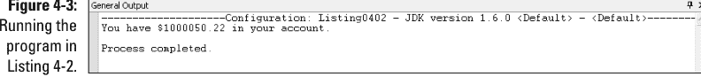

在列表 4-2 中，看 `main` 方法体内的第一行。

```
double amountInAccount;
```

这一行是一个变量声明。在程序中放入这一行就像是在说：“我在程序中声明一个名为 `amountInAccount` 的变量”。这为你的程序预留了 `amountInAccount` 这个名字。在这个声明中，`double` 是关键字。它告诉计算机在 `amountInAccount` 中存储什么类型的值。特别地，`double` 代表从 $-1.8 \times 10^{-38}$ 到 $1.8 \times 10^{38}$ 之间的数字。这些是小数点前有 38 个零的巨大数字。世界上最富有的人写带有 30 个零的支票——即“nonillion”。国际计量衡局定义的 $1.8 \times 10^{38}$ 是加利福尼亚州阳光谷到仙女座星之间的数字。

## 小数点后的数字

Java 有两种带有小数点后数字的类型：`double` 和 `float`。那么区别是什么呢？当你将变量声明为 `double` 时，你告诉计算机在存储变量值时跟踪 64 位。当你将变量声明为 `float` 时，计算机只跟踪 32 位。Charles 的账户里多出了三分。通过改为 32 位 `float` 类型，我杀死了变量的小数位精度。这糟糕了。

`float` 的另一个困难是完全具体的。再次看列表 4-2 中的字面量 `100000.00`。Java 规定这样的字面量占据 64 位位。这意味着如果你将 `amountInAccount` 声明为 `float`，就会遇到麻烦。你把那些 64 位字面量放入了 32 位变量。为了对比，你可以通过给每个字面量加上 `F` 将 `double` 切换为 `float`，但这看起来很奇怪。

```
float amountInAccount;
```


显然，位能够存储像 50.22 这样的小数字吗？你只能用 32 位存储 50.00。在这里，你可以用 64 位存储 50.00。数字的大小并不重要，精度才重要。在 64 位 `double` 中，你可以存储小数点之后的所有位。要存储 50.22 的 .22 部分，你通过 `float` 得到的少于 32 位。

```java
float amountInAccount = 50.22f;
amountInAccount = amountInAccount + 100000f;
```

你真的相信你读到的——存储 .22 需要超过 32 位吗？为了说服你，我对列表 4-2 代码做了一些改动，将 `amountInAccount` 设为 `float` 类型，并得到了我的输出。想要实验，请访问 `http://babgage.cs.edu/courses/cs341/IEEE-754.html`。这些页面接受你输入的任何数字，并显示该数字如何表示为 32 位和 64 位。

你的账户里有 100000.50。

关键字巨大的范围在于 `double` 值可以有小数点后的数字。当你将 `amountInAccount` 声明为 `float` 后，你可以在 `amountInAccount` 中存储各种数字。你可以存储 50.22、0.029479、3.0。在列表 4-2 中，如果我没有将 `amountInAccount` 声明为 `double`，我可能无法存储 50.22。相反，我将不得不存储没有任何小数点数字的纯数字 50。


另一种类型——`float` 类型也允许你有小数点后的数字，但这种类型没有那么精确。（完整故事请参见侧栏“小数点后的数字”）。不要纠结于 `float` 和 `double` 的选择。对于大多数程序，直接使用 `double`。

## 导入声明

提前宣布你的意图总是好的。考虑以下课堂演讲：

> “今天，在我们的电影史课程上，我们将讨论演员莱昂·布莱斯·巴莫尔的生涯。
>
> Barrymore 出生于费城，出演了 200 多部电影，包括《生活如此美好》、《长拉戈岛》和《基尔德博士的婚礼日》。此外，Barrymore 还是位作家、作曲家和导演。Barrymore 每年都在电台里为埃本·史鲁奇配音……”

很有趣的内容，不是吗？现在将上述段落与一段讲师没有从开始介绍主题的演讲进行对比：

> “再次欢迎来到电影史。
>
> 出生于费城的莱昂·巴莫尔 出演了 200 多部电影，包括《生活如此美好》、《长拉戈岛》和《婚礼日》。此外，Barrymore（不是 Ethel、John 或 Drew）是一名作家、作曲家和导演。莱昂·巴莫尔每年都在电台里为史鲁奇配音……”

有了适当的介绍，演讲者可能不得不不断提醒你讨论是关于莱昂·巴莫尔而不是其他的巴莫尔。在 Java 程序中也是如此。对比列表 3-1 和 4-2 中的一些代码。

列表 3-1：

```java
class Display {
    System.out.println("You’ll love Java!");
}
```

和列表 4-2：

```java
import static java.lang.System.*;
class Millionaire {
    out.print("You have $");
    out.print(amountInAccount);
    out.println(" in your account.");
}
```

# 80 第二部分：编写你自己的 Java 程序

在列表 4-2 中，你在开头部分（import 声明）宣布了你在 Java 类中使用了 `System.out`。通过使用全名 `java.lang.System` 来明确你所说的 `System` 是什么。（嘿！第一位讲师的全名难道不是 "Lionel Herbert Blythe Byrne" 吗？）在 import 声明中宣布你的意图后，你就可以在 Java 类中使用缩写的 `out` 了。

这些关于 import 的细节可能会非常棘手。所以现在，只需将列表 4-2 中的 import 声明粘贴到你 Java 程序的顶部即可。（不要费劲将这个 import 声明粘贴到没有使用 `System.out` 的程序中。它可能不会产生任何影响，但对老练的程序员来说，看起来会非常奇怪。）

书中没有哪一个简单的章节可以阐述关于 import 声明的完整故事。通过理清 import 声明的一些细微之处，请参阅第 5、9 和第 10 章。


## 显示文本

列表 4-2 中的最后三个语句使用了一种全新的格式方法。你希望在屏幕上单行显示几个不同的内容。你将它们放在单独的语句中。但所有的语句都是对 `out.print` 的调用。（最后一条语句是对 `out.println` 的调用。）`out.print` 的调用在行的一部分显示文本，并将光标留在当前行的末尾。执行 `out.print` 后，光标位于同一行的末尾，因此任何内容都可以在同一行继续打印。通过多个调用并以单个 `println` 调用作为结尾，结果就是某一行美观的输出。（参见第 4-3 节）


`out.print` 的调用会写入一些内容并让光标留在行末尾。`out.println` 的调用会写入内容，然后通过将光标移动到输出新行的开头来完成任务。

## 不带小数点的数字

> “在 1995 年，平均家庭有 2.3 个孩子。”

此时，一个聪明人评论道，没有任何一个家庭恰好有 2.3 个孩子。显然，整数在这个世界上扮演着某种角色。因此，在 Java 中，你可以声明一个变量来存储整数。列表 4-3 显示了一个使用整数变量的程序。

# 第 4 章：充分利用变量及其值

列表 4-3：使用 `int` 类型

```java
import static java.lang.System.out;

class ElevatorFitter {
    public static void main(String[] args) {
        int weightOfAPerson;
        int elevatorWeightLimit;
        int numberOfPeople;

        weightOfAPerson = 150;
        elevatorWeightLimit = 1400;
        numberOfPeople = elevatorWeightLimit / weightOfAPerson;

        out.print("You can fit ");
        out.print(numberOfPeople);
        out.println(" people on the elevator.");
    }
}
```

列表 4-3 背后的故事需要一些大量的解释。现在开始：

你有一部酒店电梯，其承重能力为 1,400 磅。一个周末，酒店举办了 Brickenicker 家族聚会。Brickenicker 家族的一支幸运地生了相同的十胞胎（十个兄弟姐妹，具有相同的身体特征）。通常情况下，每个 Brickenicker 十胞胎的重量恰好是 145 磅。但周六，家里吃了一顿丰盛的自助午餐，因为午餐包含了草莓蛋糕，每个 Brickenicker 十胞胎的重量都变成了 150 磅。午餐一结束，所有十个 Brickenicker 十胞胎在同一时刻到达了电梯。（为什么不这样呢？他们想得完全一样。）所以，问题是，电梯能容纳几个十胞胎？

现在记住，如果你在电梯上放置了超过 1,400 磅的重量，电梯电缆就会断裂，导致电梯上的所有十胞胎坠入突然（且昂贵的）死亡。

Brickenicker 谜题的答案（列表 4-3 程序的输出）如图 4-4 所示。

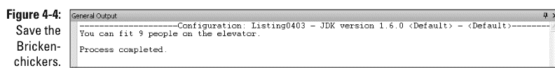

# 82 第二部分：编写你自己的 Java 程序

## 存储整数的四种方法

Java 有四种不同的整数类型。这些类型被称为 `byte`、`short`、`int` 和 `long`。与 `float` 和 `double` 类型准确性的复杂故事不同，选择整数类型时唯一考虑的因素是你尝试表示的数字的大小。如果你想使用大于 127 的数字，不要使用 `byte`。

要存储大于 32767 的数字，不要使用 `short`。大多数情况下，你会使用 `int`。但如果你需要存储大于 2147483647 的数字，请优先考虑 `long`。（一个 `long` 型数字可以大到 922337203685477807。）了解完整故事，请参阅表 4-1。

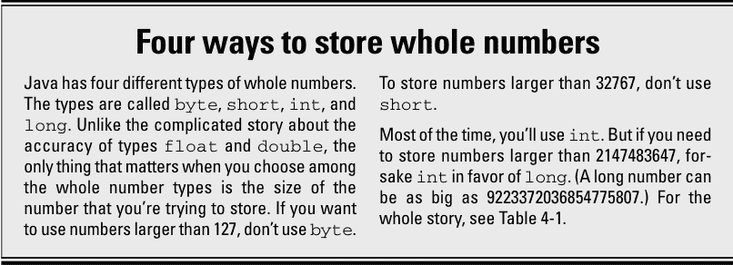

# 84 第二部分：编写你自己的 Java 程序

表 4-1（续）

| 类型名称 | 字面量外观 | 取值范围 |
|---|---|---|
| `int` | 42 | -2147483648 to 2147483647 |
| `long` | 42L | -922337203685477508 to 922337203685477507 |
| **浮点数类型** | | |
| `float` | 42.0F | -3.4 × 10⁻⁹ to 3.4 × 10⁹ |
| `double` | 42.0 | -1.8 × 10³⁰⁸ to 1.8 × 10³⁰⁸ |
| **字符类型** | | |
| `char` | 'A' | 数千个字符、字形和符号 |
| **逻辑类型** | | |
| `boolean` | true | true, false |

你应该忽略的类型是 `int`、`char` 和 `boolean`。本章的章节涵盖了 `int` 和 `double` 类型。因此，本节涵盖了 `char` 和 `boolean` 类型。

## `char` 类型

不久以前，人们认为计算机的存在仅仅是为了进行大数字计算。如今，随着文字处理器的出现，不再那样认为了。所以，如果你在过去的 20 年里没有待在冷冻室内，你就知道计算机存储字母、标点和其他字符。

用于存储字符的 Java 类型称为 `char`。列表 4-4 是一个使用 `char` 类型的简单程序。列表 4-4 程序的输出如图 4-5 所示。

### 列表 4-4：使用 `char` 类型

```java
public static void main(String args[]) {
    char myLittleChar = 'b';
    char myBigChar = Character.toUpperCase(myLittleChar);
    System.out.println(myBigChar);
}
```

# 第 4 章：充分利用变量及其值

图 4-5：


# 第 4 章：充分利用变量及其值

## 列表 4-4 程序的精彩运行结果

| 普通输出 |
| --- |
| Configuration: Listing0404 - JDK version 1.6.0 \<Default\> - \<Default\> |
| B |
| Process completed. |

在列表 4-4 中，第一次初始化将字母 `b` 存储在变量 `myLittleChar` 中。在初始化时，注意 `b` 是如何被单引号围绕的。在 Java 中，每个 `char` 字面量都以单引号开头和结尾。


在 Java 程序中，单引号包围 `char` 字面量中的字母。

如果你需要帮助区分*赋值*（assignment）、*声明*（declaration）和*初始化*（initialization）这些术语，请参见本章前面的“合并声明与初始化变量”部分。

在列表 4-4 的第二次初始化中，程序调用了一个名为 `Character.toUpperCase()` 的 API 方法。`Character.toUpperCase()` 方法的作用正如其名称所示——该方法产生字母 `b` 的大写等效值。这个大写等效值（字母 `B`）被赋值给变量 `myBigChar`，并且 `myBigChar` 中的 `B` 被打印在屏幕上。


有关 Java 应用程序接口（API）的介绍，请参见第 3 章。

如果你忍不住想写语句：

```
char myLittleChar = 'barry'; //不要这样做
```

请抵制这种诱惑。你不能在 `char` 变量中一次存储多个字母，也不能在一对单引号之间放置超过一个字母。如果你试图存储单词或句子（而不只是单个字母），你需要使用类似 `String` 的类型。

要查看 Java 的 `String` 类型，请参见本章后面的“分子与化合物：引用类型”部分。


如果你习惯用其他语言编写程序，你可能知道过所谓的 ASCII 字符编码。大多数语言使用 ASCII；Java 使用 Unicode。在旧的 ASCII 表示中，每个字符仅占用 8 位，但 Unicode 占用 16 位或 32 位。虽然 ASCII 存储熟悉的罗马（英语）字母表，但 Unicode 有空间容纳世界上大多数常用语言的字符。

唯一的问题是，某些 Java API 方法是专门针对 16 位 Unicode 设计的。偶尔，这会让你吃亏（或者视情况而定让你碰壁）。如果你使用一个方法在屏幕上写 Hello，结果却出现了 H e l l o，请检查该方法的文档是否提到了 Unicode 字符。

值得注意的是，`Character.toUpperCase()` 和 `System.out.println()` 这两个方法在列表 4-4 中的用法完全不同。`Character.toUpperCase()` 是作为初始化或赋值语句的一部分被调用的，而 `System.out.println()` 是独立调用的。要了解详情，请参见第 7 章。

## boolean 类型

`boolean` 类型的变量存储一个值：`true` 或 `false`。列表 4-5 展示了 `boolean` 的用法。

### 列表 4-5：使用 boolean

```java
import java.lang.System;

class Elevator {

    public static void main(String args[]) {
        int weightLimit = 150;
        boolean allTenOkay = weightLimit >= 10;

        System.out.println("True or False?");
        System.out.println(allTenOkay);
    }
}
```

在列表 4-5 中，我在括号内什么都没调用 `out.println()`。这样做时，Java 会在输出中添加一个换行符。在列表 4-5 中，`out.println()` 告诉程序显示空行。


## 分子与化合物：引用类型

通过组合简单的东西你可以得到更复杂的东西。规律总是如此。取 Java 的一些基本类型，我们将它们混合制成一个“基本类型汤”，你会得到什么？一个更复杂的类型，被称为引用类型。

列表 4-6 中的程序使用了引用类型。图 4-7 展示了运行列表 4-6 中的程序时发生了什么。

### 列表 4-6：使用引用类型

```java
import javax.swing.JFrame;

class ShowAFrame {

    public static void main(String[] args) {
        JFrame myFrame = new JFrame();
        String myTitle = "Blank Frame";

        myFrame.setTitle(myTitle);
        myFrame.setSize(200, 200);
        myFrame.setDefaultCloseOperation(
            JFrame.EXIT_ON_CLOSE);
        myFrame.setVisible(true);
    }
}
```

列表 4-6 中的程序使用了两种引用类型。这些类型定义在 Java API 中。其中一种类型（你将经常用到的那种）被称为 `String`。另一种类型（你用来创建 GUI 的那种）被称为 `JFrame`。

`String` 是一组字符。它就像是连续的几个 `char` 值。因此，在列表 4-6 中，声明类型为 `String` 的变量 `myTitle` 并为 `myTitle` 赋值 `"Blank Frame"` 是合理的。`String` 类定义在 Java API 中。

在程序中，双引号包围 `String` 字面量中的字母。

`JFrame` 就像一个窗口。唯一的区别是你称其为 `JFrame` 而不是窗口。为了保持列表 4-6 简洁明了，我决定不在我的框架中放入任何内容——没有按钮、没有字段、什么都没有。

即使是一个完全空的框架，列表 4-6 也使用了一些我在本章稍后部分才会描述的技巧。所以，不要尝试阅读和解释列表 4-6 的每一个字。从列表 4-6 中获得的最重要信息是该程序有两个变量。在编写程序时，我创建了两个变量——`myTitle` 和 `myFrame`。根据声明，`myTitle` 的类型是 `String`，而 `myFrame` 的类型是 `JFrame`。

你可以在 Java 的 API 文档中查询 `String` 和 `JFrame`，但在那之前，我可以告诉你你会发现什么。你会发现 `String` 和 `JFrame` 是 Java 类的名称。这就是大新闻。每个类都是一个引用类型的名称。你可以通过编写代码为 `double` 值预留 `amountInAccount`：

```java
double amountInAccount;
```

或者编写：

```java
double amountInAccount = 50.22;
```

你也可以通过编写代码为 `JFrame` 值预留 `myFrame`：

```java
JFrame myFrame;
```

或者编写：

```java
JFrame myFrame = new JFrame();
```

要复习 Java 类的概念，请参见第 1 章关于面向对象编程（OOP）的章节。


每个 Java 类都是引用类型。如果你声明一个变量的类型不是基本类型，那么该变量的类型（大多数情况下）就是 Java 类的名称。

现在，当你声明一个变量类型为 `int` 时，你可以以非常直观的方式可视化该声明的含义。这意味着在计算机内存的某个处，为该变量的值保留了一个存储位置。在该存储位置中有一组位（bits）。这些位的排列确保了某个整数被表示出来。

这种解释对于 `int` 或 `double` 等基本类型是足够的，但当你声明一个变量为引用类型时，意味着什么呢？声明你的 `variableFrame` 类型为 `JFrame` 意味着什么？

嗯，声明 `I-thank You God` 为一首 E. Cummings 的诗意味着什么？写下下面的声明又意味着什么？

```java
EECummingsPoem ithankYouGod;
```

这意味着这类物的类是 `EECummingsPoem`，而 `ithankYouGod` 指的是该类的一个实例。换句话说，`ithankYouGod` 是属于 `EECummings` 类的一个对象。

由于 `JFrame` 是一个类，你可以从该类创建对象。（参见第 1 章）每一个这样的对象（`JFrame` 类的每个实例）都是当你运行列表 4-6 中的代码时出现在屏幕上的窗口。通过声明变量 `myFrame` 的类型为 `JFrame`，你是在预留名称 `myFrame` 的使用权。这种预留告诉计算机 `myFrame` 可以引用一个实际的 `JFrame` 类型对象。换句话说，`myFrame` 可以成为计算机屏幕上显示的某个窗口的昵号。这种情况如图 4-8 所示。

当你声明 `ClassName variableName;` 时，你是在说某个变量可以引用特定类的一个实例。

在列表 4-6 中，短语 `JFrame myFrame` 预留了名称 `myFrame` 的使用。在该行代码上，短语 `new JFrame()` 创建了一个新对象（`JFrame` 类的实例）。最后，该行的等号让 `myFrame` 引用该新对象。知道这两个单词 `JFrame()` 创建了一个对象可能非常重要。关于对象的更深入的解释，请参见第 7 章。

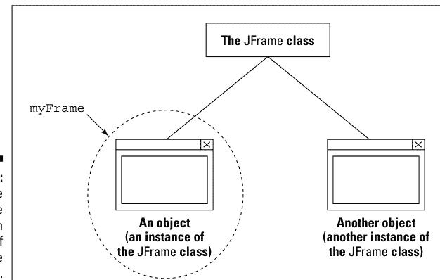

图 4-8：变量 `myFrame` 引用 `JFrame` 类的实例。

## 基本类型大杂烩

既然说到框架，到底什么是框架呢？框架是一个具有特定高度、宽度以及在计算机屏幕上特定位置的窗口。因此，在 `Frame` 类定义的深处，你可以找到类似这样的变量声明：

```java
int hour;
int minutes;
char amOrPm;
int width;
int height;
int x;
int y;
```

这是另一个例子——时间。`Time` 的实例包含了（此处原文不完整，根据上下文推断为时间属性）。

### 列表 4-7：（续上）

```java
out.println(quarters + " quarters");
out.println(dimes + " dimes");
out.println(nickels + " nickels");
out.println(cents + " cents");

}
```

列表 4-7 代码的运行结果如图 4-9 所示。你从总共 248 分分开始。然后：

```
quarters = total / 25
```

将 248 除以 25，得到 9。这意味着你可以从 248 分分中换出 9 个季度币（quarters）。接下来，

```
whatsLeft = total % 25
```

将 248 除以 25，并将余数 23 放入 `whatsLeft` 中。现在你准备好进行下一步，即从 23 分分中尽可能提取硬角币（dimes）。

| 图 4-9：$248 的找零 |
| :--- |
| 9 个季度币 |
| 2 个硬角币 |
| 0 个镍币 |
| 3 个分分 |

## 初始化一次，赋值多次

列表 4-7 有三行将值放入 `whatsLeft` 变量：

```
int whatsLeft = total % 25;
whatsLeft = whatsLeft % 10;
whatsLeft = whatsLeft % 5;
```

这些行中只有一行是声明语句。另外两行是赋值语句。这是好事，因为你不能多次声明同一个变量（除非创建一个所谓的“块”）。如果你确实这样做并写了：

```
int whatsLeft = total / 25;
whatsLeft = whatsLeft % 10;
```

在列表 4-7 中，当你尝试编译代码时，会看到错误信息（whatsLeft 已定义）。

要了解什么是“块”，请参阅第 5 章。关于重新声明变量的诚实讨论，请参阅第 10 章。

## 增加和减少运算符

Java 有一些简洁的运算符，可以让生活变得更容易（对于计算机处理器、你的大脑以及你的手指都是如此）。总共有四种这样的运算符——两个增加和减少运算符。增加运算符加 1，减少运算符减 1。增加运算符使用双加号 (`++`)，减少运算符使用双减号 (`--`)。为了了解它们是如何工作的，你可能需要一些示例。第一个示例在图 4-10 中。

图 4-10 中程序的运行结果如图 4-11 所示。在这个充满事件的运行过程中，兔子的数量被打印了三次。

双加号有两个不同的名称，取决于你把它放在哪里。当你将 `++` 放在变量之前时，`++` 被称为**前增运算符**（preincrement operator）。pre 表示“在之前”。


```java
import static java.lang.System.out;
class preIncrementDemo {
    public static void main(String args[]) {
        int numberBunnies = 27;

        ++numberBunnies;
        out.println(numberBunnies);
        out.println(+numberBunnies);
        out.println(numberBunnies);
    }
}
```

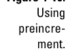

| numberBunnies | 说明 |
| :--- | :--- |
| 变为 28。 | `++numberBunnies;` |
| 打印 28。 | `out.println(numberBunnies);` |
| 打印 28。 | `out.println(+numberBunnies);` |
| 再次打印 28。 | `out.println(numberBunnies);` |

输出结果：
```
28
28
28
Process completed
```

# 第 4 章：充分利用变量及其取值

## 前增运算符与后增运算符

“在之前”这个词有两个不同的含义：

- 你将 `++` 放在变量之前。
- 在变量被语句中的任何其他部分使用之前，计算机将变量的值加 1。

为了理解这一点，请看图 4-10 中的加粗行。计算机给 `numberOfBunnies` 加 1（将 `numberOfBunnies` 的值提升到 29），然后计算机在屏幕上打印数字 29。

使用 `out.println(++numberOfBunnies)`，计算机在打印 `numberOfBunnies` 的新值之前，给 `numberOfBunnies` 加 1。

前增运算符的替代方案是**后增运算符**（postincrement）。post 表示“在之后”。“在之后”这个词有两个不同的含义：

- 你将 `++` 放在变量之后。
- 在变量被语句中的任何其他部分使用之后，计算机将变量的值加 1。

为了更清楚地看到后增是如何工作的，请看图 4-12 中的加粗行。计算机在屏幕上打印 `numberOfBunnies` 的旧值（即 28），然后计算机给 `numberOfBunnies` 加 1，将 `numberOfBunnies` 的值提升到 29。

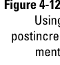

```java
import static java.lang.System.out;
class postIncrementDemo {
    public static void main(String args[]) {
        int numberBunnies = 27;

        numberBunnies++;
        out.println(numberBunnies);
        out.println(numberBunnies++);
        out.println(numberBunnies);
    }
}
```

## 赋值运算符

如果你读了前一节（关于加 1 的操作符的节），你可能在想，是否可以操作这些操作符来加 2、加 5 或加 1000000。你可以写 `numberOfBunnies++++` 并且仍然称自己为 Java 程序员吗？嗯，你可以。但如果你尝试这样做，在尝试编译代码时会出现一个错误信息。

那么你能做些什么呢？幸运的是，Java 有许多你可以使用的赋值运算符。通过赋值运算符，你可以对任何你想要的数字进行加、减、乘、除操作。你还可以进行其他酷炫的操作。列表 4-8 列出了各种赋值运算符（带有等号的符号）。图 4-14 显示了运行列表 4-8 的输出。

### 列表 4-8：赋值运算符

```java
import static java.lang.System.out;
class UseAssignmentOperators {
    public static void main(String args[]) {
        int numberOfBunnies = 27;
        int numberExtra = 53;

        numberOfBunnies += 1;
        out.println(numberOfBunnies);

        numberOfBunnies += 5;
        out.println(numberOfBunnies);

        numberOfBunnies += numberExtra;
        out.println(numberOfBunnies);

        numberOfBunnies *= 2;
        out.println(numberOfBunnies);

        out.println(numberOfBunnies -= 7);

        out.println(numberOfBunnies = 100);
    }
}
```

### 图 4-14：列表 4-8 代码的运行结果

| 输出 |
| :--- |
| 28 |
| 33 |
| 86 |
| 172 |
| 165 |
| 100 |
| 已完成。 |

列表 4-8 展示了 Java 赋值运算符是多么灵活。通过赋值运算符，你可以对变量进行任何数字的加、乘或除运算。注意 `+= 5` 如何给 `numberOfBunnies` 加 5，以及 `*= 2` 如何将 `numberOfBunnies` 乘以 2。你甚至可以使用另一个表达式的值（在列表 4-8 中为 `numberExtra`）作为被应用的数字。

列表 4-8 中的两行演示了 Java 赋值运算符的一个特殊特性。你可以将赋值运算符作为更大 Java 语句的一部分。列表 4-8 的倒数第二行，该运算符从 `numberOfBunnies` 中减去 7，将 `numberOfBunnies` 的值从 172 减少到 165。然后整个赋值操作被填充到 `out.println` 的调用中，因此数字 165 被打印在计算机屏幕上。

看吧，列表 4-8 的最后一行显示了你如何使用 Java 普通的等号完成同样的事情。我在本章开头称之为赋值语句的东西，实际上是在本节中描述的赋值运算符的现实。因此，每当你向某个东西赋值时，你都可以让该赋值成为更大语句的一部分。

我们的每一个赋值运算符都兼任语句和表达式的双重职责。在所有情况下，表达式的值都等于你赋值的任何值。例如，在执行代码 `out.println(numberOfBunnies -= 7)` 之前，`numberOfBunnies` 的值是 172。作为语句，`numberOfBunnies -= 7` 让计算机从 `numberOfBunnies` 中减去 7（因此 `numberOfBunnies` 的值从 172 降到 165）。作为表达式，`numberOfBunnies -= 7` 的值是 165。因此，代码 `out.println(numberOfBunnies -= 7)` 意味着 `out.println(165)`。数字 165 显示在计算机屏幕上。

关于此类事情更丰富的解释，请参阅本章早之前的侧边栏“语句和表达式”。


# 第 5 章：使用决策语句控制程序流

## 本章内容

- 编写在备选项之间进行选择的语句
- 将语句嵌套
- 在许多备选项中进行选择

电视节目《捣蛋丹尼》（Dennis the Menace）于 1959 年到 1963 年在 CBS 播出。我记得其中一集，威尔逊先生正面临做出一个重要决定的困难。我想是关于换工作或搬到新小镇的事情。总之，我仍然能看到那个镜头：威尔逊先生坐在院子里，喝着柠檬水，整个下午都在对着虚空发呆。当然，那个讨厌鬼的角色丹尼不断打断威尔逊先生的宁静。这让这个局面变得幽默起来。

这一集令我印象深刻的是（这也是我现在记忆得如此清晰的原因）是威尔逊先生在做决定时的专注态度。这家伙并没有在忙他的日常事务、在社区里游荡，而关于决定的思绪在他的脑海中进进出出。他静静地坐在院子里，在心理天平上仔细且有逻辑地做标记。有多少人实际上是这样做决定的？

那时，我还很年轻，从未面对过做出影响我和家人的重大决定的责任。但我很好奇这种决策过程是什么样的。只有时间能给出答案。

## 决策（if 语句）

当你编写程序时，你不断地遇到路口。如果是，就让用户工作；如果不是，这就是语言。`if` 语句的使用在列表 5-1 所示。

### 列表 5-1：猜游戏

```java
import static java.lang.System.out;
import java.util.Scanner;
import java.util.Random;

class GuessingGame {
    public static void main(String args[]) {
        Scanner myScanner = new Scanner(System.in);

        out.print("输入 1 到 10 之间的整数：");

        int inputNumber = myScanner.nextInt();
        int randomNumber = new Random().nextInt(10) + 1;

        if (inputNumber == randomNumber) {
            out.println("************");
            out.println("你赢了。");
        } else {
            out.println("你输了。");
            out.print("数字是 ");
            out.println(randomNumber + ".");
        }

        out.println("感谢参与。");
    }
}
```

### 图 5-1：猜游戏的两次运行

| 运行 1 | 运行 2 |
| :--- | :--- |
| 输入 1 到 10 之间的整数：2 | 输入 1 到 10 之间的整数：4 |
| ************ | 你输了。 |
| 你赢了。 | 数字是 10。 |
| 感谢参与。 | 感谢参与。 |
| 已完成。 | 已完成。 |

### 她控制了键盘按键

结合在一起，这几行代码在列表 5-1 中获取用户在键盘上输入的任何内容：

```java
import java.util.Scanner;

Scanner myScanner = new Scanner(System.in);

int inputNumber = myScanner.nextInt();
```

最后一行将此数字放入名为 `inputNumber` 的变量中。如果这些行看起来很复杂，不要担心。当你需要读取时，可以几乎逐字不差地复制这些行。在程序中只需包含前两行（`import` 和 `Scanner` 行）一次。

我也可以加强程序的导入（`import`）部分，就像我在列表 5-2 和 5-3 中做的那样。除此之外，我没有多少回旋之地。

当你继续阅读这本书时，你将开始识别这些代码行背后的模式，因此我不会用所有的细节来弄乱这一节。现在，你只需要复制这三行代码，并记住以下几点：

- 当你导入 `java.util.Scanner` 时，不需要使用 `static` 单词。
  导入 `Scanner` 与导入 `System.out` 不同。当你导入 `java.lang.System.out` 时，你需要使用 `static` 单词（参见列表 5-1）。
  关于 `static` 单词的真实故事，请参阅第 10 章。
- `System.in` 代表键盘。
  要从键盘其他地方获取字符，你可以在括号内输入 `System.in` 以外的内容。
  括号内还可以放什么？想是一些想法，请参见第 8 章。
- 当你预期输入一个 `int`（整数类型）时，使用 `nextInt()`。
  如果你预期输入一个 `double`（包含小数点的值），使用 `nextDouble()`。如果你预期输入 `true` 或 `false`，使用 `nextBoolean()`。如果你预期输入像 `Barry`、`Java` 或 `Hello` 这样的单词，使用 `next()`。
  用户输入单词的示例，请参见列表 5-3。用户输入单个字符的示例，请参见第 6 章的列表 6-4。程序读取一整行文本（一次性读完）的示例，请参见第 8 章。
- 当你可以连续从键盘获取多个值时。
  要做到这一点，请多次使用 `myScanner.nextInt()` 代码。
  要查看从键盘读取多个值的程序，请前往列表 5-4。


## 创建随机性

实现随机性出奇地困难。数学家波西·迪亚科尼斯（Persi Diaconis）说，如果你抛几次硬币，且总是正面朝上，你得到正面的概率可能比反面大。如果你多抛几次，总是反面朝上，你得到反面的概率可能比正面大。换句话说，抛硬币并不公平。

> Diaconis, Persi. "The Search for Randomness." American Association for the Advancement of Science annual meeting. Seattle. 14 Feb. 2004.

计算机并没有硬币和人类拇指好到哪里。计算机模拟随机序列的生成，但最终，计算机执行的是指令，而且这一切都是以完全确定的方式进行的。在列表 5-1 中，`java.util.Random`：

```java
import java.util.Random;

int randomNumber = new Random().nextInt(10) + 1;
```

计算机似乎给了我们一个随机生成的数字——1 到 10 之间。但这一切都是假的。计算机只是遵循指令。它并不是真正的随机，但如果不费尽全力，这就是你所能做的最好的。

再次，我请求你对这段代码盲目信任。在你拥有更多 Java 经验之前，不要担心新的 `Random().nextInt()`。将此代码复制到你的程序中并尽情玩吧。如果 1 到 10 的数字不符合你的预期，也不要皱眉。要掷想象的骰子，写：

```java
int rollEmBaby = new Random().nextInt(6) + 1;
```

执行该语句后，变量 `rollEmBaby` 将获得一个 1 到 6 之间的值。

## if 语句

列表 5-1 的是一个 Java 语句。这个语句代表了道路的叉路（参见图 5-2）。计算机遵循两个分支之一——打印“You win”的分支或打印“You lose”的分支。计算机通过测试条件的真假来决定走哪条分支。在列表 5-1 中，测试的条件是：

```java
inputNumber == randomNumber
```

`inputNumber` 的值等于 `randomNumber` 的值吗？当条件为真时，计算机执行条件与 `else` 单词之间的内容。当条件为假时，计算机执行 `else` 单词之后的内容。无论何种，计算机都会执行最后一个调用，显示“Thanks for playing”。

`if` 语句中的条件必须包含在括号内。然而，像 `if (inputNumber == randomNumber)` 这样的行并不是完整的语句（“如果我有一个锤子”并不是一个完整的句子）。所以这一行 `if (inputNumber == randomNumber)` 不应该以分号结尾。


### 图 5-2：`if` 语句就像道路的叉路。“You win”或“You lose”。

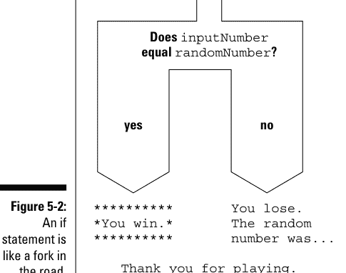

## 准备好

列表 5-1 中的 `if` 语句有两个部分——上半部分和下半部分。我将这两个部分称为 `if` 部分和 `else` 部分。

列表 5-1 中的 `if` 部分似乎有多个语句。我通过将 `if` 部分的语句封装在大括号中来实现这一点。这样做时，我形成了一个块（block）。块是一组由大括号聚集在一起的语句。通过这样，`println` 的调用被隐藏在 `if` 部分内部。有了大括号，只有在猜对时才会显示星号。

这种大括号的做法也适用于 `else` 部分。在列表 5-1 中，每当 `inputNumber` 不等于 `randomNumber`，计算机就会执行三个 `println` 调用。为了让计算机相信三个调用都在 `else` 子句中，我将这些调用放入块中。也就是说，我将这些调用封装在大括号中。

## 在你的代码中缩进 if 语句

注意，在列表 5-1 中，`print` 和 `println` 调用是缩进的（这包含了 You win 和 Lose 语句。在 `if` 语句之后的 `print` 和 `println` 调用仍然在那里）。严格来说，你不需要对 `if` 语句内部的语句进行缩进。对于所有编译器，你都可以将代码写在一行上，或者以某种逻辑方式放置所有语句。问题是，如果你不缩进，就会失去对代码的感知。


# 第 5 章：使用决策语句控制程序流

当你编写 `if` 语句时，你可能想把所有的大括号都扔出窗外，仅仅依靠缩进。遗憾的是，这通常行不通。如果你在 `else` 单词后面缩进了三个语句，却忘记用大括号将这些语句括起来，计算机会认为 `else` 部分只包含这三个语句中的第一个。糟糕糟糕，缩进会误导你，认为 `else` 部分包含了全部三个语句。这让你更难弄清楚为什么代码没有按照预期的方式运行。所以，看好那些大括号！

## 在没有 else 的情况下

这一节的标题是胡造的。大不了！核心思想是你可以创建一个不带 `else` 部分的 `if` 语句。例如，列表 5-1 中的代码。也许我们不想提那个游戏。然而，列表 5-2 中修改后的代码向你展示了何时以及何地这样做（图 5-3 显示了结果）。

列表 5-2：一个更友好、更温柔的猜游戏

列表 5-2 中的 `if` 语句没有 `else` 部分。当 `inputNumber` 与 `randomNumber` 相同时，计算机会打印“You win”。当 `inputNumber` 与 `randomNumber` 不同时，计算机就不会打印“You win”。

图 5-3：列表 5-2 中游戏的两次运行。

```
Configuration          General Output
Enter an int from 1 to 10
*You win * a very good guess -
The random number was 4
Thank you for playing. 
-------------------------
Configuration
Enter an int from 1 to 10
That was a very good guess -
The random number was 6
Thank you for playing.
```

列表 5-2 演示了另一个新概念。通过对 `System.in` 进行导入声明，可以将 `new Scanner(System.in)` 简化为更短的 `new Scanner(in)`。添加这个声明几乎不费吹之力。事实上，使用导入声明比不使用时输入的字符更多。尽管如此，列表 5-2 中的代码证明了导入 `System.in` 是可能的。

## 使用比较运算符和逻辑运算符形成条件

Java 编程语言有许多小符号和道具来满足你各种形成条件的需求。本节将为你详细介绍它们。

### 比较数字；比较字符

表 5-1 显示了你可以用于比较事物与事物的运算符。

| 运算符符号 | 含义 | 示例 |
|---|---|---|
| `==` | 等于 | `numberOfCows == 5` |
| `!=` | 不等于 | `cancelButton != panicButton` |
| `<` | 小于 | `numberOfCows < 5` |
| `>` | 大于 | `myInitial > 'B'` |
| `<=` | 小于等于 | `numberOfCows <= 5` |
| `>=` | 大于等于 | `myInitial >= 'B'` |

你可以使用 Java 所有的比较运算符来比较数字和字符。当你比较数字时，情况通常按照你预想的方式发展。但当你比较字符时，情况就有点奇怪。因为字母 B 在字母表中排在 H 之前，所以条件 `'B' < 'H'` 是真的。比较彼此之间的小写字母也是可以的。奇怪的是，当你比较一个大写字母和一个小写字母时，大写字母更小。所以，尽管 `'Z' < 'a'` 是假的，但 `'Z' < 'a'` 是真的。

在底层，字母 A 到 Z 以数值代码 65 到 90 存储。字母 a 到 z 以代码 97 到 122 存储。这就是为什么每个大写字母都比每个小写字母小。

在比较两个数字是否相等 (`==`) 或不相等 (`!=`) 时，要务必小心。在经过一些计算并获得两个 `double` 值或两个 `float` 值后，你得到的值很少是完全相等的。问题出在小数点之外那些讨厌的数字上。21 摄氏度对应的华氏度是 69.8，而当你计算 `9.0 / 5 * 21 + 32` 时，你得到的 69.8 结果实际上为 false。但该条件，当计算机计算 `9.0 / 5 * 21 + 32` 时，得到的是 `69.80000000001`，而不是 `69.8`。

### 比较对象

当你开始处理对象时，你会发现可以使用 `==` 和 `!=` 来比较对象。例如，你在计算机屏幕上看到的按钮就是一个对象。你可以询问刚才点击鼠标的那个是否是屏幕上的某个特定按钮。你通过 Java 的运算符来实现这一点。

```java
if (e.getSource() == bCopy)
    clipboard.setText(which.getText());
```

要了解更多关于响应按钮点击的知识，请阅读此光盘的第 16 章。

Java 比较方案中的大陷阱出现在比较两个字符串时。（关于 `String` 类型的更多信息，请参阅第 4 章中关于引用类型的章节）。当你比较两个字符串时，你不想使用双等号。使用双等号将意味着是在问：“这个字符串存储在内存中的位置与另一个字符串完全相同吗？”

图 5-4：使用 `==` 和 Java 的 `equals` 方法的结果。

```
---Configuration: Li
What's the password? swordfish
You win >>swordfish<
The word you typed is not
stored in the same place as
the real password, but that's
no big deal.You can use our
precision system.
Processed completed.
```

列表 5-3：检查密码

```java
import java.System.*;
import java.util.Scanner;

class CheckPassword {
    public static void main(String[] args) {
        Scanner myScanner = new Scanner(in);
        out.println("What's the password?");
        String password = myScanner.next();

        if (password.equals("swordfish")) {
            out.println("You win!");
        } else {
            out.println("The word you typed is not the same place as the real password, but that's no big deal.");
        }
    }
}
```

在列表 5-3 中，`myScanner.next()` 获取用户在键盘上输入的任何单词。代码将此单词显示在名为 `password` 的变量中。程序的 `if` 语句使用事实上的两种技术来比较 `password` 与 `"swordfish"`。

两种技术中更合适的是使用 Java 的 `equals` 方法。当你调用它时，在一个字符串后面跟着一个点，并把另一个字符串放在括号里，看起来很奇怪。但这就是你必须这样做。

在 Java 的 `equals` 方法中，哪个字符串接点和接括号并不重要。例如，在列表 5-3 中，你可以写成

```java
if ("swordfish".equals(password))
```

该方法同样有效。比较字符串时，使用 `equals` 方法 ——而不是双等号。

## 一次性导入所有内容

列表 5-3 的第一行演示了导入 `System.out` 和 `System` 的懒方法。要导入 System 提供的所有内容，你可以使用星号通配符 (`*`)。事实上，导入 `java.lang.System.*` 相当于拥有约 30 个独立的导入声明，包括 `System.out`、`System.nanoTime` 以及许多其他 System 内容。

在导入声明中使用星号通常被认为是一种不良的编程习惯，因此我在本书的示例中没有这样做。但对于较大的程序——即使用了 Java API 中几十个名称的程序——这个古怪的小技巧非常实用。

你可以在导入声明内部的任何地方放置星号。例如，你不能通过编写 `import java.*` 来导入 java 的所有内容。你只能用星号替换类名或嵌套在类内部的静态成员的名称。关于导入声明的更多信息，请参阅第 9 章。关于静态内容的信息，请参阅第 10 章。

## Java 的逻辑运算符

斯波克先生会感到高兴的。Java 拥有你混合和匹配逻辑测试时所需的所有运算符。运算符如表 5-2 所示。

| 运算符符号 | 含义 | 示例 |
|---|---|---|
| `&&` | 与 | `5 < x && x < 10` |
| `||` | 或 | `x < 5 || 10 < x` |
| `!` | 非 | `!password.equals("swordfish")` |

你可以使用这些运算符来形成各种复杂的条件。列表 5-4 包含一个示例。

列表 5-4 程序的某些运行结果如图 5-5 所示。当用户名为 `bburd` 且密码为 `swordfish`，或者用户名为 `hritter` 且密码为 `preakston` 时，用户会收到一条友好的消息。否则，用户就是一个笨蛋，会得到他应得的糟糕消息。

### 列表 5-4：检查用户名和密码

```java
import static java.lang.System.out;
import java.util.Scanner;

class Authenticator {

    public static void main(String[] args[]) {
        Scanner myScanner = new Scanner(System.in);

        out.print("Username: ");
        String username = myScanner.next();

        out.print("Password: ");
        String password = myScanner.next();

        if (
            (username.equals("bburd") &&
            password.equals("swordfish")) ||
            (username.equals("hritter") &&
            password.equals("preakston"))
        ) {
            out.println("You're in.");
        } else {
            out.println("You're suspicious.");
        }
    }
}
```

图 5-5 使用逻辑运算符。

| 普通输出 | 普通输出 | 普通输出 | 普通输出 |
| :--- | :--- | :--- | :--- |
| Username bburd | Username hritter | Username Isachoe | |
| You're in | Password swordfish | Password swordfish | Password preakston |
| | You are suspicious | You're in | You're suspicious |
| General Out | Build Out | General Out | Build Out |

注意这些括号！当你使用逻辑运算符比较值时，宁愿浪费一点打字精力添加不必要的括号，也不要因为括号太少而导致结果出错。例如，考虑表达式：

```
2 < 5 || 100 < 6 && 27 < 1
```

通过误读这个表达式，你可能会得出表达式为假的结论。也就是说，你可能错误地将表达式理解为 `(某些内容) && 27 < 1`。因为 `27 < 1` 是假的，你会得出整个表达式是假的。事实是，在 Java 中，任何 `&&` 运算符都会在任何 `||` 运算符之前求值。因此，该表达式实际上询问 `2 < 5 || (某些内容)`。因为 `2 < 5` 是真的，所以表达式为真。

要将表达式的值从 `true` 改为 `false`，你可以将表达式的前两个部分放在括号中，如下：

```java
(2 < 5 || 100 < 6) && 27 < 1
```

Java 的 `||` 运算符是包含性的。这意味着只要左侧为真、右侧为真或两者均为真，你就会得到 `true` 值。例如，表达式 `2 < 10 || 20 < 30` 是真的。

在 Java 中，你可以像在普通英语中那样组合方式。在英语中，你可以说：“晚餐桌会有三到十个人。”但在 Java 中，如果你写 `3 <= people <= 10`，会收到错误信息。要进行这种比较，你需要类似 `3 <= people && people <= 10` 的写法。

## 构建嵌套

你见过俄罗斯套娃吗？打开一个，里面还有一个。打开第二个，第三个就在它里面。你也可以对 Java 的 `if` 语句做同样的事情。这太有趣了！列表 5-5 向你展示了如何操作。

### 列表 5-5：嵌套的 if 语句

```java
import static java.lang.System.*;
import java.util.Scanner;

class Authenticator {

    public static void main(String[] args) {
        Scanner myScanner = new Scanner(System.in);

        out.print("Username: ");
        String username = myScanner.next();

        if (username.equals("bburd")) {
            out.print("Password: ");
            String password = myScanner.next();

            if (password.equals("swordfish")) {
                out.println("You're in.");
            } else {
                out.println("Incorrect password");
            }
        } else {
            out.println("Unknown user");
        }
    }
}
```

图 5-8 显示了列表 5-6 中程序的两次运行。（程序的整体设计思想在图 5-9 中所示。）第一个用户输入一个数字，例如 2，程序执行到 `switch` 语句的顶部。计算机检查 `verse` 变量的值。当计算机确定 `verse` 变量的值为 2 时，它检查 `switch` 语句的每个 `case`。值 2 不匹配顶部的 `case`，因此计算机继续到三个 `case` 中的中间。中间 `case` 指定的值（数字 2）与 `verse` 变量的值匹配，因此计算机执行紧随 `case 2` 之后的语句。这两条语句为

```
out.println("That's because he is a pain.");
break;
```

这两条语句中的第一条在屏幕上显示 `That's because he is a pain`。第二条语句被称为 `break` 语句（真意外！）。当计算机遇到 `break` 语句时，它会跳出当前所在的任何 `switch` 语句。因此，在列表 5-6 中，计算机直接跳过了可能会显示 'Cause this is the last refrain.' 的 `case`。事实上，计算机跳出了整个 `switch` 语句，直接进入 `switch` 语句结束后的语句。计算机显示 `Ohhhhhhh`，因为那是 `switch` 语句之后的语句告诉计算机要做的。

图 5-8：常规输出

| 运行 Which verse? 2 | ---Configuration--- |
| :--- | :--- |
| That's because he is a pain 的代码 | Which verse? 6 |
| 列表 5-6 Ohhhhhhh. | No such verse Please try again |
| 6 | | | Please try again |

如果用户请求第 6 节，计算机通过跳过 `case` 1、2 和 3 来做出。相反，计算机执行了 `default`。在 `default` 中，计算机显示 `No such verse. Please try again`，然后跳出 `switch` 语句。计算机跳出 `switch` 语句后，显示 `Ohhhhhhh . . .`


你并不非要在 `default` 语句的最后也放置一个 `break`。在列表 5-6 中，最后一个 `break`（属于 `default` 的 `break`）仅仅是为了整体的整洁。

## “Al 湿透了”

按照《Gentile Alouette》的调律演唱：

Al 湿透了，为什么 Al 湿透了？噢，

Al 湿透了是因为他正站在雨中。

为什么 Al 站在雨中？

因为他没有大脑。

没有大脑，没有大脑，

在雨中，在雨中。

Ohhhhhhh....

Al 湿透了，为什么 Al 湿透了？噢，

Al 湿透了是因为他正站在雨中。

为什么 Al 站在雨中？

因为他是个麻烦蛋。

他是个麻烦蛋，他是个麻烦蛋，

没有大脑，没有大脑，

在雨中，在雨中。

Ohhhhhhh....

Al 湿透了，为什么 Al 湿透了？噢，

Al 湿透了是因为他正站在雨中。

为什么 Al 站在雨中？

因为这是最后的副歌。

最后的副歌，最后的副歌，

他是个麻烦蛋，他是个麻烦蛋，

没有大脑，没有大脑，

在雨中，在雨中。

Ohhhhhhh....

Al 湿透了，为什么 Al 湿透了？噢，

Al 湿透了是因为他正站在雨中。

Harriet Ritter 和 Barry Burd


图 5-9：列表 5-6 代码中的大分叉。

## 使用 break 还是不使用

在每个 Java 程序员的生命中，总会有那么他或她会忘记使用 `break` 语句。起初，产生的输出会令人困惑，但随后程序员会想起“贯穿”（fall-through）。“贯穿”这一术语描述了当你在结束一个 `case` 而没有使用 `break` 语句时发生的情况。发生的是代码的执行直接落到行中的下一个 `case`。

通常，当你使用 `switch` 语句时，你不会发生贯穿，因此你到处都是 `break` 语句。但偶尔，贯穿正是你所需要的。例如，“Al 湿透了”（歌词在侧边栏中显示）。每一节都在之前节的行的基础上添加了新行。这种情况（从一节累积行到另一节）正需要需要一个带有贯穿特性的 `switch` 语句。列表 5-7 展示了这一思想。

## 列表 5-7：带有贯穿功能的 switch 语句

```java
import static java.lang.System.out;
import java.util.Scanner;

class FallingForAll {
    public static void main(String args[]) {
        Scanner myScanner = new Scanner(System.in);
        out.print("Which verse? ");
        int verse = myScanner.nextInt();

        switch (verse) {
            case 3:
                out.print("Last refrain, ");
                out.println("last refrain, ");
            case 2:
                out.print("He's a pain, ");
                out.println("he's a pain, ");
            case 1:
                out.print("Has no brain, ");
                out.println("has no brain, ");
        }

        out.println("In the rain, in the rain, ");
        out.println("Ohhhhhhh...");
    }
}
```

图 5-10 显示了 5-7 的几次运行。由于 `switch` 语句中没有 `break` 语句，当用户选择 2 时，计算机执行紧随 `case 2` 之后的语句。

```java
out.print("He's a pain, ");
out.println("he's a pain, ");
```

计算机会跳过 `case 1`（因为贯穿）。事实上，计算机会执行过 `case 1` 之后的下一个 `case`。

```java
out.print("Has no brain, ");
out.println("has no brain, ");
```

```java
out.println("In the rain, in the rain, ");
out.println("Ohhhhhhh...");
```

如果用户请求第 6 节，计算机通过跳过 `case` 1、2 和 3 来响应。相反，计算机执行了 `default`。在 `default` 中，计算机显示 `No such verse. Please try again`，然后跳出 `switch` 语句。计算机跳出 `switch` 语句后，显示 `Ohhhhhhh . . .`

# 第 6 章：使用循环控制程序流

## 本章

- 使用基础循环
- 计数循环
- 让你的朋友印象深刻

循环的核心思想是，当你遵循指令时，你并不是一条一条地执行。相反，你会进行循环。你做出决策（“如果头发干了，就用护发素”），并进入循环（“洗头，直到再洗一遍”）。在计算机编程中，你总是使用决策和循环。本章将探索 Java 中的循环。

## 图 6-1：配置

| ************* |
| :--- |
| 欢迎来到猜游戏 |
| ************ |
| 输入一个 1 到 10 之间的整数：2 |
| 再次尝试。 |
| 输入一个 1 到 10 之间的整数：5 |
| 再次尝试。 |
| 输入一个 1 到 10 之间的整数：8 |
| 再次尝试。 |
| 输入一个 1 到 10 之间的整数：3 |
| 你在 4 次猜测后赢了 |

一直玩直到精力枯竭。

在图 6-1 中，用户进行了四次猜测。每次循环时，计算机都会检查猜测是否正确。错误的猜测会产生再次尝试的请求。对于正确的猜测，用户会得到一条激昂的“你赢了”，以及他或她猜测次数的计数。计算机重复执行几条语句，每次都检查用户的猜测是否与某个随机生成的数字。每当用户做出猜测时，计算机就会在其猜测计数上加 1。当用户给出正确猜测时，计算机就会显示该计数：动作流程如图 6-2 所示。

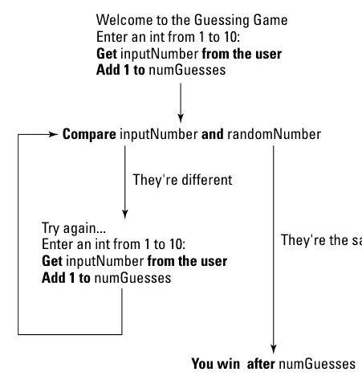

图 6-2：周而复始。

# 126 第 II 部分：编写你自己的 Java 程序

当你查看代码列表 6-1 时，你会看到完成所有这些工作的代码。代码的核心是一个被称为 `while` 语句的东西（也称为 `while` 循环）。用英语重新表述，`while` 语句的意思是：

```text
while inputNumber 不等于 randomNumber
    继续执行大括号 {} 中的所有内容：{
n
}
```

大括号中的内容（反复执行的内容）是打印“再次尝试。”、“输入一个 1 到 10 之间的整数...””、从键盘获取一个值并向用户的猜测计数器加 1 的代码。

当你处理计数器时（如代码列表 6-1 中的 `numGuesses`），你很容易变得困惑，并在两个方向上产生 1 的偏差。通过确保 `++` 语句紧离你正在计数的语句，你可以避免这种令人头疼的问题。例如，在列表 6-1 中，变量 `numGuesses` 的初始值为 0。这是因为当程序启动时，用户还没有进行任何猜测。在程序的后面，紧接每次调用 `myScanner.nextInt()` 之后，都是一个 `numGuesses++` 语句。这就是做法——一旦用户输入猜测，你就立即增加计数器的值。

只要 `inputNumber != randomNumber` 一直为真，大括号中的语句就会重复执行。循环中语句的每次重复都称为循环的单词 *迭代*（iteration）。在图 6-1 中，循环经历了三次迭代。如果你不相信图 6-1 恰好有三次迭代，请数一数输出结果中“再次尝试”的打印次数。每个正确猜测都会出现一次“再次尝试”。

当用户最后输入正确猜测时，计算机返回到 `while` 循环的顶部，检查括号中的条件，并发现自己处于双重否定的逻辑中。`inputNumber` 和 `randomNumber` 之间的不等于 (`!=`) 关系不再成立。换句话说，`while` 语句 `inputNumber != randomNumber` 变为假。因为 `while` 语句为假，计算机跳过了 `while` 循环，继续执行 `while` 循环下方的语句。计算机打印“猜测 4 次后赢了”。

使用代码列表 6-1 所示的代码，计算机从不会在循环中间跳转。当计算机发现 `inputNumber` 不等于 `randomNumber` 时，计算机继续前进并执行循环大括号内的所有五个语句。计算机只有在执行完循环内的所有五个语句后，才会再次测试（检查 `inputNumber` 是否仍然不等于 `randomNumber`）。


## 重复特定次数（for 语句）

“在黑板上写 100 次‘我不会在课堂说话’。”

你的老师真正的意思是说：

```text
将计数设置为 0。
只要计数小于 100，
    在黑板上写‘我不会在课堂说话’，
    将计数加 1。
```

幸运的是，你那时并不知道循环和计数器。如果你向你的老师指出所有这些，你面临的麻烦会比现在的多得多。

无论如何，生活充满了计数循环的例子。计算机编程反映了生活——或者恰恰相反？当你告诉计算机要做什么时，你通常是在告诉计算机打印三次、处理十个账户、拨打百万个电话号码或任何内容。因为计数循环在编程中非常常见，创建编程语言的人们专门为这种类型的循环开发了语句。在 Java 中，重复特定次数的语句被称为 `for` 语句。`for` 语句的使用如代码列表 6-2 和 6-3 所示。列表 6-2 有一个极其简单的示例，而列表 6-3 有一个更新奇的示例。随你挑选。

## 列表 6-2：世界上最无聊的 for 循环

```java
import static java.lang.System.out;
class Yarn {
    public static void main(String args[]) {
        for (int count = 1; count <= 10; count++) {
            out.print("The value of count is ");
            out.print(count);
            out.println(".");
        }
        out.println("Done!");
    }
}
```

# 128 第 II 部分：编写你自己的 Java 程序

图 6-3 显示了运行列表 6-2 时你得到的结果。在早期阶段，`for` 语句通过将 `count` 设置为 1 开始。然后语句开始检查 `count` 是否小于等于 10。（是的，是 1。）因为测试通过，`for` 语句进入大括号并打印“The value of count is”。最后，`for` 语句执行括号内的最后的一件事——将 `count` 加 1。

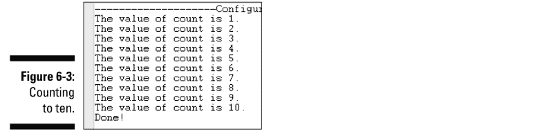

当 `count` 等于 2 时，`for` 语句再次检查 `count` 是否小于等于 10。这整个过程反复进行，直到 10 次迭代后，`count` 的值达到 11。当这种情况发生时，小于等于 10 的检查失败，循环结束。计算机跳转到 `for` 语句之后的语句。在列表 6-2 中，计算机打印 `Done!`。整个过程如图 6-4 所示。

## for 语句的结构

在单词 `for` 之后，你总是括号中放入三个东西。这三个东西中的第一个被称为初始化，第二个是表达式，第三个是更新。

```text
for ( initialization ; expression ; update )
```

# 第 6 章：使用循环控制程序流 129

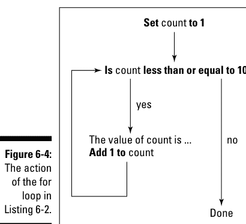

括号中的三个项目中的每个都有其独特的角色：

- 初始化在程序第一次到达 `for` 语句时执行一次。
- 表达式评估多次（在每次迭代之前）。
- 更新也会评估多次（在每次迭代结束时）。

如果帮助的话，把循环想象成文本移动如下：

```text
int count = 1
for count <= 10 (
    out.print("The value of count is ");
    out.print(count);
    out.println(".");
)
```

你不能这样写真正的 `for` 语句。尽管如此，这就是语句各部分执行的顺序。

> 如果你在 `for` 循环的初始化中声明变量，你就不能在循环之外使用该变量。例如，在列表 6-2 中，如果你在循环结束后尝试输出 `out.println(count)`，你会收到错误消息。
>
> 任何可以用 `for` 循环完成的事情都可以用 `while` 循环完成。选择使用 `for` 循环是一种风格和便利性的选择，而非必须。

# 130 第二部分：编写自己的 Java 程序

## “Al's All Wet” 的全球首映

列表 6-2 非常不错，但列表中的程序并没有做任何有趣的事。为了更吸引人的例子，请参见列表 6-3。在列表 6-3 中，我履行了在第 5 章中的承诺。列表 6-3 中的程序打印了热门单曲《Al's All Wet》的所有歌词。（你可以在第 5 章找到这些歌词。）

**列表 6-3：完整版 "Al's All Wet"**

```java
import static java.lang.System.out;
class AlsAllWet {
    public static void main(String[] args) {
        for (int verse = 1; verse <= 3; verse++) {
            out.println("Al's all wet.");
            out.println("Oh, why is Al all wet? Oh;");
            out.println("Al's all wet 'cause '");
            out.println("He's standing in the rain.");
            out.println("Why is Al in the rain?");

            switch (verse) {
                case 1:
                    out.println("That's because he has no brain.");
                    break;
                case 2:
                    out.println("That's because he is a pain.");
                    break;
                case 3:
                    out.println("'Cause this is the last refrain.");
                    break;
            }

            switch (verse) {
                case 3:
                    out.println("Last refrain, last refrain,");
                case 2:
                    out.println("He's a pain, he's a pain,");
                case 1:
                    out.println("Has no brain, has no brain,");
            }
            out.println("In the rain, in the rain.");
        }
    }
}
```

### 列表 6-3（续）

```java
out.println("Ohhhhhhh...");
out.println();

out.println("Al's all wet.");
out.println("Oh, why is Al all wet? Oh, ");
out.println("Al's all wet 'cause ");
out.println("he's standing in the rain.");
```

列表 6-3 之所以很好是因为结合了第 5 章和第 6 章的许多思想。在列表 6-3 中，两个 `switch` 语句嵌套在一个 `for` 循环内部。`switch` 语句使用了 `break` 语句；另一个 `switch` 语句使用了贯穿（fall-through）。随着 `for` 循环计数器（`verse`）的值从 1 变到 2 再到 3，`switch` 语句中的所有 `case` 都会执行。当程序运行接近结束且执行离开了 `for` 循环时，程序的最后四个语句打印歌曲的最后一段。


当我声称 `for` 语句是为了计数的时，我稍微夸大了事实。Java 的 `for` 语句非常通用。你可以在与更新部分无关的情况下使用 `for` 语句，例如 `for (i = 0; i < 10; )` 只直一直下去。当循环内部的某个动作给变量赋值一个很大的数字时，循环就会结束。你甚至可以创建一个括号为空的 `for` 语句。`for ( ; )` 循环将永远运行，如果该循环控制着一台关键的机器，那是很好的。通常，当你写一个 `for` 语句时，你是在计算重复某事的次数。但实际上，你可以用 `for` 语句执行任何类型的重复。

列表 6-3 使用 `break` 语句跳出 `switch`。但 `break` 语句也可以在循环内部起作用。要看示例，请访问本书的网站。

## 重复直到你得到想要的结果（Java do 语句）

> “愚者勇入天使也胆战涉足之地。”

今天，我想表现得年轻而愚蠢（或者至少是年轻、愚蠢）。回图 6-2，注意 Java 的 `while` 循环是如何工作的。当执行时

```java
int twoPlusTwo = 2 + 2;
while (twoPlusTwo == 5) {
    out.println("Are you kidding?");
    out.println("2 + 2 doesn't equal 5");
    out.println("Everyone knows that");
    out.println("2 + 2 equals 3");
}
```

在这个非常简单的 `twoPlusTwo` 示例中，`while` 语句证明是 Java 最灵活的循环结构之一。特别是，`while` 循环适用于那些你必须在离开之前先看一眼的情况。例如：“我的账户里有钱，每个月写一张抵押贷款支票。”当你第一次遇到这个语句时，如果你的账户余额为零，你不想写抵押贷款支票——哪怕一次也不写。

但在某些时候（很多时候），你想不思而行。例如，你向用户请求回复的情况。也许用户的回复是合理的，但也可能不合理。如果你不想再次询问。也许用户的手指滑了，或者也许用户不理解问题。

图 6-5 显示了删除文件程序的几次运行。在删除文件之前，程序询问用户删除是否可以。如果用户输入 `y` 或 `n`，程序将按照用户的意愿进行。如果用户输入任何其他字符（任何数字、字母），程序将重复。

| 用户输入 | 输出 |
| :--- | :--- |
| y | Okay, here goes... |
| n | Sorry, not today |
| x | Please enter y or n |

在这个程序中，循环一直重复直到用户给出有效的回复。图 6-5 显示了删除文件程序的几次运行。在删除文件之前，程序询问用户删除是否可以。如果用户输入 `y` 或 `n`，程序将按照用户的意愿进行。如果用户输入任何其他字符（任何数字、字母），程序将重复。

## 134 第二部分：编写自己的 Java 程序

图 6-6 显示了 6-4 中的控制流。使用 `do` 循环，之前所示 `twoTwo` 程序的情况永远不会发生。因为 `do` 循环在执行第一次操作时不测试条件，所以每个 `do` 循环保证至少执行一次。

## 读取单个字符

在列表 5-3 中，用户在键盘上输入一个单词。`myScanner.next` 获取单词并将其放入 `String` 变量 `password` 中。一切运行良好，因为 `String` 变量可以同时存储多个字符，`next` 方法也可以同时读取多个字符。

但在列表 6-4 中，你对读取多个字符并不。你预期用户输入一个字母——`y` 或 `n`。因此你没有创建一个 `String` 变量来存储用户的回复。相反，你创建一个 `char` 变量，每次存储一个符号。

Java API 没有 `nextChar` 方法。为了读取并存储到 `char` 变量中，你必须自己变通。在列表 6-4 中，改进如下：

```
myScanner.findWithinHorizon(".", 0).charAt(0)
```

你可以完全按照列表 6-4 所示的方式使用这段代码来读取单个字符。

# 第 6 章：使用循环控制程序流

## Java 中的文件处理

列表 6-4 中，实际的文件处理语句值得关注。这些语句涉及类、对象和方法的使用。关于这些内容的许多细节在其他章节中，例如第 7 章和第 9 章。尽管如此，在这里介绍一些重点也无害处。

因此，你可以在 Java 语言 API 中找到一个名为 `java.io.File` 的类。该语句

```
File evidence = new File("c:\\cookedBooks.txt");
```

在计算机内存中创建了一个新对象。这个由 `java.io.File` 类形成的对象描述了程序关于磁盘文件 `c:\cookedBooks.txt` 需要的所有信息。（在 Java 中，如果你想在双引号字面量中表示反斜杠，需要使用双反斜杠。）从列表 6-4 的这里开始，变量 `evidence` 指向文件 `c:\cookedBooks.txt`。

在你记住了所有 `java.io.File` 的内容后，唯一还需要的是 `evidence` 对象作为 `java.io.File` 类的实例，拥有一个 `delete` 方法。（我还能说什么呢？它在 API 文档中。）当你调用 `evidence.delete` 时，计算机就会为你删掉该文件。

## 变量声明与块

一组被大括号包围的语句称为块。如果你在块内部声明一个变量，通常不能在块外部使用该变量。例如，在列表 6-4 中，如果你执行以下操作，就会收到错误信息：

```
do {
    out.print("Delete evidence? (y/n) ");
    char reply = myScanner.findWithinHorizon(".", 0).charAt(0);
} while (reply != 'y' && reply != 'n');
```

由于在循环的大括号内声明了 `char reply`，在大括号之外任何使用 `reply` 名字都是没有意义的。当你尝试编译这段代码时，你会得到三个错误信息——两个是针对 `while (reply != 'y' && reply != 'n')` 中的 `reply` 单词，第三个是针对语句中的 `reply`。

因此在列表 6-4 中，你被束手无策了。程序对 `reply` 变量的第一次实际使用是在循环内部。但是，为了让该变量在循环后可用，你必须在循环之前声明 `reply`。在这种情况下，最好声明 `reply` 变量但不对其初始化。非常有趣！

要了解更多关于变量初始化的信息，请参见第 4 章。要了解更多关于块，请参见第 5 章。


## 让循环变得毫不轻松

我永远不会忘记第一次玩《妙案》（Clue）的场景。我们在尼加拉瀑布度假期间买了这款桌游游戏。（尼加拉瀑布？）我和表哥阿兰坐在酒店房间里连续玩了几个小时的游戏。在我的小侦探笔记本上胡乱涂鸦写着复杂的断言。

在某某一点，我通过提议我手里的三张牌来进行虚诈。阿兰中了招，并提出了一个三个方面都错误的指控。因为他输了游戏，而我又表现得如此得意，他把我揍了一顿。如果有机会的话，我还会再玩一次。

本节内容适用于 Java 5、Java 6 或未来几年出现的任何版本号。但本节内容不适用于旧版本的 Java——例如 1.3、1.4 等版本。要了解关于 Java 版本号的更多信息，请参见第 2 章。


## 不需要那些讨厌的计数器

列表 6-2 中的循环从 1 计数到 10。它的朋友（列表 6-3 中的循环）计数 1, 2, 3。这种计数方式非常棒，但有时它并不是思考问题的自然方式。例如，在桌游《妙案》中列出所有可能的指控。嫌疑者从 1 到 6 编号，房间或武器也是如此。你可以给这些东西编号，但当编程语言提供更简单的解决方案时，为什么要费心编号呢？

Java 的增强型 `for` 循环（enhanced for loop）允许你遍历一组事物，而无需使用计数变量。你只需要定义这个组即可。列表 6-5 展示了该如何做。

## 列表 6-5：“我指控……”

```java
import static java.lang.System.out;

class Clue {

    enum Suspect {mustard, plum, green,
    peacock, scarlet, white};

    enum Room {ballroom, kitchen, diningRoom,
    lounge, hall, study, library,
    billiardRoom, conservatory};

    enum Weapon {knife, candlestick, revolver,
    rope, leadPipe, wrench};

    public static void main(String args[]) {

    for (Suspect mySuspect : Suspect.values()) {
        for (Room myRoom : Room.values()) {
            for (Weapon myWeapon : Weapon.values()) {
                out.print(mySuspect);
                out.print(" in the ");
                out.print(myRoom);
                out.print(" with a ");
                out.println(myWeapon);
            }
        }
    }

    Suspect killer = Suspect.peacock;
    Room sceneOfTheCrime = Room.study;
    Weapon murderWeapon = Weapon.leadPipe;

    out.println("I Accuse ");
    out.print(killer);
    out.print(" in the ");
    out.print(sceneOfTheCrime);
    out.print(" with a ");
    out.print(murderWeapon);
    out.println(". ");
}
```

列表 6-5 中代码的输出有 324 行，所以我无法全部显示。但前几行出现在图 6-7 中。首先你看到的是 Mustard（芥末）的。然后你看到 Mustard 的厨房。在运行的后期，当所有 Mustard 的情况完成后，你会看到普鲁教授（Professor Plum）相同的可能性。

| 列表 |
| :--- |
| mustard in the bedroom with a knife |
| mustard in the bedroom with a candlestick |
| mustard in the bedroom with a revolver |
| mustard in the bedroom with a rope |
| mustard in the bedroom with |
| mustard in the kitchen with a knife |
| mustard in the kitchen with a candlestick |
| mustard in the kitchen with a revolver |
| mustard in the kitchen with leadpipe |
| mustard in the kitchen with |
| mustard in the diningroom with a knife |
| mustard in the diningroom with a candlestick |
| mustard in the diningroom with a revolver |
| mustard in the diningroom with a rope |
| mustard in the diningroom with leadpipe |
| mustard in the diningroom with wrench |
| mustard in the lounge with a knife |
| mustard in the lounge with a candlestick |
| mustard in the lounge with a revolver |
| mustard in the lounge with a rope |
| mustard in the lounge with leadpipe |
| mustard in the lounge with wrench |
| mustard in the hall with a knife |
| mustard in the hall with a candlestick |
| mustard in the hall with a revolver |
| mustard in the hall with a rope |
| mustard in the hall with leadpipe |
| mustard in the hall with wrench |
| mustard in the study with a knife |
| mustard in the study with a candlestick |
| mustard in the study with a revolver |
| mustard in the study with a rope |
| mustard in the study with leadpipe |
| mustard in the study with wrench |
| mustard in the library with a knife |
| mustard in the library with a candlestick |
| mustard in the library with a revolver |
| mustard in the library with a rope |
| mustard in the library with leadpipe |
| mustard in the library with wrench |
| mustard in the billiardroom with a knife |
| mustard in the billiardroom with a candlestick |
| mustard in the billiardroom with a revolver |
| mustard in the billiardroom with a rope |
| mustard in the billiardroom with leadpipe |
| mustard in the billiardroom with wrench |
| mustard in the conservatory with a knife |
| mustard in the conservatory with a candlestick |
| mustard in the conservatory with a revolver |
| mustard in the conservatory with a rope |
| mustard in the conservatory with leadpipe |
| mustard in the conservatory with wrench |
| plum in the bedroom with a knife |
| plum in the bedroom with a candlestick |
| plum in the bedroom with a revolver |
| plum in the bedroom with a rope |
| plum in the bedroom with leadpipe |
| plum in the bedroom with wrench |
| plum in the kitchen with a knife |
| plum in the kitchen with a candlestick |
| plum in the kitchen with a revolver |
| plum in the kitchen with a rope |
| plum in the kitchen with leadpipe |
| plum in the kitchen with wrench |
| plum in the diningroom with a knife |
| plum in the diningroom with a candlestick |
| plum in the diningroom with a revolver |
| plum in the diningroom with a rope |
| plum in the diningroom with leadpipe |
| plum in the diningroom with wrench |
| plum in the lounge with a knife |
| plum in the lounge with a candlestick |
| plum in the lounge with a revolver |
| plum in the lounge with a rope |


# Clue Game Combinations

## Suspect: Plum

### Lounge
- `plum in the lounge with leadpipe`
- `plum in the lounge with wrench`

### Hall
- `plum in the hall with a knife`
- `plum in the hall with a candlestick`
- `plum in the hall with a revolver`
- `plum in the hall with a rope`
- `plum in the hall with leadpipe`
- `plum in the hall with wrench`

### Study
- `plum in the study with a knife`
- `plum in the study with a candlestick`
- `plum in the study with a revolver`
- `plum in the study with a rope`
- `plum in the study with leadpipe`
- `plum in the study with wrench`

### Library
- `plum in the library with a knife`
- `plum in the library with a candlestick`
- `plum in the library with a revolver`
- `plum in the library with a rope`
- `plum in the library with leadpipe`
- `plum in the library with wrench`

### Billiard Room
- `plum in the billiardroom with a knife`
- `plum in the billiardroom with a candlestick`
- `plum in the billiardroom with a revolver`
- `plum in the billiardroom with a rope`
- `plum in the billiardroom with leadpipe`
- `plum in the billiardroom with wrench`

### Conservatory
- `plum in the conservatory with a knife`
- `plum in the conservatory with a candlestick`
- `plum in the conservatory with a revolver`
- `plum in the conservatory with a rope`
- `plum in the conservatory with leadpipe`
- `plum in the conservatory with wrench`

## Suspect: Green

### Bedroom
- `green in the bedroom with a knife`
- `green in the bedroom with a candlestick`
- `green in the bedroom with a revolver`
- `green in the bedroom with a rope`
- `green in the bedroom with leadpipe`
- `green in the bedroom with wrench`

### Kitchen
- `green in the kitchen with a knife`
- `green in the kitchen with a candlestick`
- `green in the kitchen with a revolver`
- `green in the kitchen with a rope`
- `green in the kitchen with leadpipe`
- `green in the kitchen with wrench`

### Dining Room
- `green in the diningroom with a knife`
- `green in the diningroom with a candlestick`
- `green in the diningroom with a revolver`
- `green in the diningroom with a rope`
- `green in the diningroom with leadpipe`
- `green in the diningroom with wrench`

### Lounge
- `green in the lounge with a knife`
- `green in the lounge with a candlestick`
- `green in the lounge with a revolver`
- `green in the lounge with a rope`
- `green in the lounge with leadpipe`
- `green in the lounge with wrench`

### Hall
- `green in the hall with a knife`
- `green in the hall with a candlestick`
- `green in the hall with a revolver`
- `green in the hall with a rope`
- `green in the hall with leadpipe`
- `green in the hall with wrench`

### Study
- `green in the study with a knife`
- `green in the study with a candlestick`
- `green in the study with a revolver`
- `green in the study with a rope`
- `green in the study with leadpipe`
- `green in the study with wrench`

### Library
- `green in the library with a knife`
- `green in the library with a candlestick`
- `green in the library with a revolver`
- `green in the library with a rope`
- `green in the library with leadpipe`
- `green in the library with wrench`

### Billiard Room
- `green in the billiardroom with a knife`
- `green in the billiardroom with a candlestick`
- `green in the billiardroom with a revolver`
- `green in the billiardroom with a rope`
- `green in the billiardroom with leadpipe`
- `green in the billiardroom with wrench`

### Conservatory
- `green in the conservatory with a knife`
- `green in the conservatory with a candlestick`
- `green in the conservatory with a revolver`
- `green in the conservatory with a rope`
- `green in the conservatory with leadpipe`
- `green in the conservatory with wrench`

## Suspect: Peacock

### Bedroom
- `peacock in the bedroom with a knife`
- `peacock in the bedroom with a candlestick`
- `peacock in the bedroom with a revolver`
- `peacock in the bedroom with a rope`
- `peacock in the bedroom with leadpipe`
- `peacock in the bedroom with wrench`

### Kitchen
- `peacock in the kitchen with a knife`
- `peacock in the kitchen with a candlestick`
- `peacock in the kitchen with a revolver`
- `peacock in the kitchen with a rope`
- `peacock in the kitchen with leadpipe`
- `peacock in the kitchen with wrench`

### Dining Room
- `peacock in the diningroom with a knife`
- `peacock in the diningroom with a candlestick`
- `peacock in the diningroom with a revolver`
- `peacock in the diningroom with a rope`
- `peacock in the diningroom with leadpipe`
- `peacock in the diningroom with wrench`

### Lounge
- `peacock in the lounge with a knife`
- `peacock in the lounge with a candlestick`
- `peacock in the lounge with a revolver`
- `peacock in the lounge with a rope`
- `peacock in the lounge with leadpipe`
- `peacock in the lounge with wrench`

### Hall
- `peacock in the hall with a knife`
- `peacock in the hall with a candlestick`
- `peacock in the hall with a revolver`
- `peacock in the hall with a rope`
- `peacock in the hall with leadpipe`
- `peacock in the hall with wrench`

### Study
- `peacock in the study with a knife`
- `peacock in the study with a candlestick`
- `peacock in the study with a revolver`
- `peacock in the study with a rope`
- `peacock in the study with leadpipe`
- `peacock in the study with wrench`

### Library
- `peacock in the library with a knife`
- `peacock in the library with a candlestick`
- `peacock in the library with a revolver`
- `peacock in the library with a rope`
- `peacock in the library with leadpipe`
- `peacock in the library with wrench`

### Billiard Room
- `peacock in the billiardroom with a knife`
- `peacock in the billiardroom with a candlestick`
- `peacock in the billiardroom with a revolver`
- `peacock in the billiardroom with a rope`
- `peacock in the billiardroom with leadpipe`
- `peacock in the billiardroom with wrench`

### Conservatory
- `peacock in the conservatory with a knife`
- `peacock in the conservatory with a candlestick`
- `peacock in the conservatory with a revolver`
- `peacock in the conservatory with a rope`
- `peacock in the conservatory with leadpipe`
- `peacock in the conservatory with wrench`

## Suspect: Scarlet

### Bedroom
- `scarlet in the bedroom with a knife`
- `scarlet in the bedroom with a candlestick`
- `scarlet in the bedroom with a revolver`
- `scarlet in the bedroom with a rope`
- `scarlet in the bedroom with leadpipe`
- `scarlet in the bedroom with wrench`

### Kitchen
- `scarlet in the kitchen with a knife`
- `scarlet in the kitchen with a candlestick`
- `scarlet in the kitchen with a revolver`
- `scarlet in the kitchen with a rope`
- `scarlet in the kitchen with leadpipe`
- `scarlet in the kitchen with wrench`

### Dining Room
- `scarlet in the diningroom with a knife`
- `scarlet in the diningroom with a candlestick`
- `scarlet in the diningroom with a revolver`
- `scarlet in the diningroom with a rope`
- `scarlet in the diningroom with leadpipe`
- `scarlet in the diningroom with wrench`

### Lounge
- `scarlet in the lounge with a knife`
- `scarlet in the lounge with a candlestick`
- `scarlet in the lounge with a revolver`
- `scarlet in the lounge with a rope`
- `scarlet in the lounge with leadpipe`
- `scarlet in the lounge with wrench`

### Hall
- `scarlet in the hall with a knife`
- `scarlet in the hall with a candlestick`
- `scarlet in the hall with a revolver`
- `scarlet in the hall with a rope`
- `scarlet in the hall with leadpipe`
- `scarlet in the hall with wrench`

### Study
- `scarlet in the study with a knife`
- `scarlet in the study with a candlestick`
- `scarlet in the study with a revolver`
- `scarlet in the study with a rope`
- `scarlet in the study with leadpipe`
- `scarlet in the study with wrench`

### Library
- `scarlet in the library with a knife`
- `scarlet in the library with a candlestick`
- `scarlet in the library with a revolver`
- `scarlet in the library with a rope`
- `scarlet in the library with leadpipe`
- `scarlet in the library with wrench`

### Billiard Room
- `scarlet in the billiardroom with a knife`
- `scarlet in the billiardroom with a candlestick`
- `scarlet in the billiardroom with a revolver`
- `scarlet in the billiardroom with a rope`
- `scarlet in the billiardroom with leadpipe`
- `scarlet in the billiardroom with wrench`

### Conservatory
- `scarlet in the conservatory with a knife`
- `scarlet in the conservatory with a candlestick`
- `scarlet in the conservatory with a revolver`
- `scarlet in the conservatory with a rope`
- `scarlet in the conservatory with leadpipe`
- `scarlet in the conservatory with wrench`


| scarlet in the conservatory with a revolver |
| scarlet in the conservatory with a rope |
| scarlet in the conservatory with leadpipe |
| scarlet in the conservatory with wrench |
| white in the bedroom with a knife |
| white in the bedroom with a candlestick |
| white in the bedroom with a revolver |
| white in the bedroom with a rope |
| white in the bedroom with leadpipe |
| white in the bedroom with wrench |
| white in the kitchen with a knife |
| white in the kitchen with a candlestick |
| white in the kitchen with a revolver |
| white in the kitchen with a rope |
| white in the kitchen with leadpipe |
| white in the kitchen with wrench |
| white in the diningroom with a knife |
| white in the diningroom with a candlestick |
| white in the diningroom with a revolver |
| white in the diningroom with a rope |
| white in the diningroom with leadpipe |
| white in the diningroom with wrench |
| white in the lounge with a knife |
| white in the lounge with a candlestick |
| white in the lounge with a revolver |
| white in the lounge with a rope |
| white in the lounge with leadpipe |
| white in the lounge with wrench |
| white in the hall with a knife |
| white in the hall with a candlestick |
| white in the hall with a revolver |
| white in the hall with a rope |
| white in the hall with leadpipe |
| white in the hall with wrench |
| white in the study with a knife |
| white in the study with a candlestick |
| white in the study with a revolver |
| white in the study with a rope |
| white in the study with leadpipe |
| white in the study with wrench |
| white in the library with a knife |
| white in the library with a candlestick |
| white in the library with a revolver |
| white in the library with a rope |
| white in the library with leadpipe |
| white in the library with wrench |
| white in the billiardroom with a knife |
| white in the billiardroom with a candlestick |
| white in the billiardroom with a revolver |
| white in the billiardroom with a rope |
| white in the billiardroom with leadpipe |
| white in the billiardroom with wrench |
| white in the conservatory with a knife |
| white in the conservatory with a candlestick |
| white in the conservatory with a revolver |
| white in the conservatory with a rope |
| white in the conservatory with leadpipe |
| white in the conservatory with wrench |

## 增强型循环的解析

增强型循环和非增强型循环有许多共同点。图 6-8 阐明了这一点。

| | | |
| :--- | :--- | :--- |
| 列表 6-2: | `for (int count = 1; count <= 10; count++)` | |
| 变量可以拥有的类型 | 变量名称 | 变量在循环执行期间取的值范围 |
| 列表 6-5: | `for (Suspect mySuspect : Suspect.values())` | |

# 140 第二部分：编写你自己的 Java 程序

- 在这两种循环中，你都定义了一个变量。

列表 6-2 中的循环定义了一个名为 `count` 的变量。列表 6-5 中的循环定义了一个名为 `mySuspect` 的变量。

在两个列表中，循环内部的语句都引用了新定义的变量。列表 6-2 中的循环包含语句：

```
out.print(count);
```

而列表 6-5 中的循环包含语句：

```
out.print(mySuspect);
```

在连续的迭代中，列表 6-2 中的 `print` 代表 `out.print(1)`、`out.print(2)` 等。在连续的迭代中，列表 6-5 中的 `print` 代表 `out.print(mustard)`、`out.print(plum)` 等。

- 在这两种循环中，你都声明了变量所持有的值类型。

在列表 6-2 中，变量 `count` 必须存储一个 `int` 值（-7, 0, 5, 15 等）。在列表 6-5 中，变量 `mySuspect` 必须引用一个 `Suspect` 值（mustard, plum, white 等）。

事实上，声明值的规则适用于 Java 的所有地方——不仅仅是循环。每个 Java 变量都属于某一种类型。在列表 6-1 中，这一行：

```
int numGuesses = 0;
```

声明 `numGuesses` 必须存储一个 `int` 值。该行接着说在所有可能的 `int` 值中，`numGuesses` 的起始值为 0。同样在列表 6-1 中，这一行：

```
Scanner myScanner = new Scanner(System.in);
```

声明 `myScanner` 引用一个 `Scanner` 对象。所有此类对象，`myScanner` 的起始值都是从键盘（通过 `System.in`）获取按键的对象。

- 在这两种循环中，你指定了一个值的范围。

你指定了变量在循环执行期间所取的值范围。在列表 6-2 中，你将 `count` 变量的值缩小到 1 到 10 的数字。在列表 6-5 中，你不顾一切，表示 `mySuspect` 可以是 `Suspect.values()` 中的每一个项。

## 第 6 章：使用循环控制程序

你可以将 `values()` 应用于任何枚举类型的名称。事实上，要创建一个带有枚举类型的增强 for 循环，你必须使用类似 `values()` 的东西。`Suspect.values()` 表达式代表你在 `Suspect` 枚举类型声明中列出的所有项。因此，在列表 6-5 的循环中，`mySuspect` 变为 `mustard`，然后是 `plum`，然后是 `green` 等。


当你将 `values()` 应用枚举类型的名称时，你会得到属于该枚举类型的项数组。要了解数组的所有知识，请参第 11 章。

# 第三部分

大局观：

面向对象编程

Rich Tennant 著

第五波浪

@RICHTENNANT


> 我要求软件在被丢弃后能够生物降解，而不是在运行时降解。

# 在这一部分中……

你读过或听过关于面向对象编程的任何吗？有时，所有的面向对象程序员似乎都属于一个小俱乐部。他们有秘密的握手、秘密的手势，并承诺不向任何外人泄露面向对象编程的概念。好吧，秘密就要结束了。在这一部分中，我将消除面向对象编程的所有神秘色彩。我将逐步介绍这些概念，并用一个或两个 Java 程序来说说明每个概念。

# 第 7 章

# 从类和对象的角度思考

在本章中

- 像真正的面向对象程序员一样思考
- 在方法之间来传递值
- 在你的面向对象代码中隐藏细节

作为一本计算机书籍的作者，我被反复告知这一点——我不应该期望人们按照逻辑顺序阅读章节和内容。人们会跳来跳去，挑选他们需要的，跳过他们不想读的。考虑到这一点，我意识到你可能跳过了第 1 章。如果是这样，请不要感到内疚。你只需要花六十秒钟阅读以下来自第 1 章的信息，就可以弥补：

> 因为 Java 是一种面向对象编程语言，你的首要目标是描述类和对象。类是某种思维方式背后的想法。对象是类的具体实例。程序员定义一个类，计算机从该类中创建单独的对象。

当然，你完全可以选择跳过那 60 秒的总结段落。如果是这样，你可能想挽回一些损失。你可以通过阅读以下对第 1 章的两个词的总结来实现：

类；对象。

# 定义类（成为账户意味着什么）

一个银行账户与另一个的区别是什么？如果你向银行家问这个问题，你会听到一段长长的推销。银行家会描述利率、费用、罚金——整的财富。对你来说的是，我对这些并不感兴趣。相反，我想知道我的账户和你的账户有什么不同。毕竟，我的账户名叫 Barry Burd，以 Bur Brain Consulting 的义经营，而你的账户名叫 Jane Q. Reader，以 Building Java Expert 的义经营。我的账户里有 $24.02。你的呢？

直说主题时，一个账户与另一个之间的区别可以总结为变量之间的。可能有一个名为 `balance` 的变量。对我来说，`balance` 的值是 55.63。问题是，在编写处理账户的程序时，我如何将我的余额与你的余额变量分开？

答案是创建单独的对象。一个 `balance` 变量存在一个对象内部，另一个 `balance` 变量存在另一个内部。当你这样做时，在每个对象中使用一个名称变量和一个地址变量。你就明白了。你拥有两个对象，每个对象代表一个账户。更准确地说，每个对象都是 `Account` 类的一个实例。

## 第 7 章：用类和对象的角度思考

当计算机执行赋值语句 `yourAccount = new Account()` 时，计算机会创建一个新对象（`Account` 类的新实例），并让变量 `yourAccount` 指向该新对象。（正是等号让变量引用了新对象。）这种情况在图 7-2 所示。

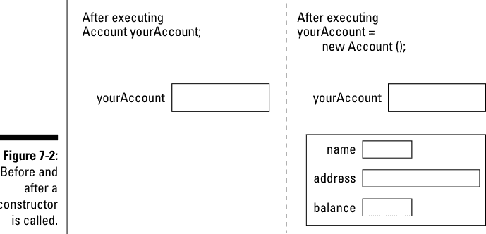

为了说明我在最后几段话中提出的论点，我在列表 7-1 的代码中额外添加了一行。我尝试在声明 `yourAccount` 之后、但在调用 `new Account()` 之前，打印 `yourAccount.name`。

```
Account myAccount;
Account yourAccount;
System.out.println(yourAccount.name);
myAccount = new Account();
yourAccount = new Account();
```

当我尝试编译新代码时，我收到了这个错误信息：`variable yourAccount might not have been initialized`（变量 yourAccount 可能未被初始化）。所以结论已经了：在执行 `new Account()` 之前，你无法打印对象的名称变量；因为对象并不存在。

当变量具有引用类型时，仅仅声明变量是不够的。只有当你调用构造方法并使用 `new` 关键字时，才能获得对象。

## 150 第三部分：全局观：面向对象编程


关于引用类型的信息，请参阅第 4 章。

## 初始化变量

在第 4 章中，我提到可以在声明变量的同时初始化原始类型变量。

```
int weightOfAPerson = 150;
```

你也可以对引用类型变量执行相同的操作，例如列表 7-2 中的 `myAccount` 和 `yourAccount`。你可以将列表 `main` 方法中的前四行合并为两行，如下所示：

```
Account myAccount = new Account();
Account yourAccount = new Account();
```

如果你这样合并代码行，就自动避免了我在上一节中描述的变量可能未被初始化的错误。有时你会遇到无法初始化变量的情况，但当你初始化它时，这通常是一件好事。

## 使用变量

在你处理完 `main` 方法的前四行后，列表 7-2 中的其余代码是合理且直观的。你有三行代码将值赋给 `myAccount` 对象的变量，以及四行代码进行打印。程序的输出如图 7-3 所示。

图 7-3 运行列表 7-1 和 7-2 中的代码。

| 配置：列表 071-02 |
| :--- |
| Barry Burd (222 Cyberspace Lane) has 424.62 |
| Jane Q. Public (111 Consumer Street) has 555.6 |
| Process completed. |

## 第 7 章：用类和对象的角度思考

### 编译和运行多个类

第 3 到 6 章中的每个程序都只包含一个类。这对于书的介绍章节很棒。但在现实生活中，一个典型的程序由数百甚至上千个类组成。跨列表 7-1 和 7-2 的程序包含两个类。诚然，拥有两个类并不同于拥有成千上万个类，但这是向该方向迈出的一步。

在实践中，大多数程序员会将每个类放在单独的文件中。当你创建一个像列表 7-1 和 7-2 那样的程序时，你会在电脑硬盘上创建两个文件。因此，来自此书光盘驱动器的代码包含两个独立的文件——`Account.java` 和 `UseAccount.java`。（见图 7-4）。

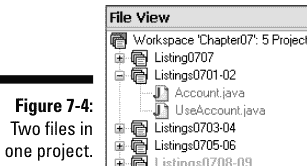

要运行代码，只需按照运行任何旧单文件程序的方法操作即可：

- 打开 Chapter07 工作空间。
- 将 Listings:0701-02 设置为活动项目。
- 选择 Build:Compile Project（编译项目）。
- 选择 Build:Execute Project（执行项目）。

有关从光盘中复制的代码的编译和运行详情，请参阅第 2 章。

创建一个包含两个或多个类的新程序简单。（你只需要在本章和第 3 章之间来回翻阅百万次即可。）

- 遵循第 3 章“编写你自己的代码”部分中的第 1 到 7 步。
通过这些步骤，你创建了一个新项目。

## 第三部分：全局观：面向对象编程

- 遵循第 8 到 11 步（同样在第 3 章“编写你自己的代码”部分）创建两个或多个类中的第一个。
如果你正在尝试列表 7-1 和 7-2 中的代码，这个第一个类名为 `Account`。
- 遵循第 8 到 11 步创建另一个类。
如果你正在尝试列表 7-1 和 7-2 中的代码，这个第二个类名为 `UseAccount`。
- 为你的每个类重复一次第 8 到 11 步。
- 遵循第 12 到 15 步。

这一切是非常良好且统一的。要引用 `myAccount` 中存储的名字，你需要编写：

```
myAccount.name
```

要让 `myAccount` 在屏幕上显示自己，你需要编写：

```
myAccount.display()
```

唯一的区别在于括号。

> **记住**
>
> 当你调用一个方法时，要在方法名后面加上括号。

## display 方法的头部

再次查看列表 7-3 和 7-4。对 `display` 方法的调用位于 `UseAccount` 类的 `main` 方法内部。但 `display` 方法的定义在上面的 `Account` 类中。定义包含两个单词和一个方法体。（参见第 3 章。）头部有两个单词和一些括号：

- 单词 `void` 告诉计算机当调用 `display` 方法时，该方法不会向调用它的地方返回任何内容；有关向调用者返回内容的方法，请参阅下一节。
- `display` 是方法名。每个方法必须有一个名称。否则，你将无法调用该方法。


- 括号包含了你在调用方法时将传递给该方法的所有内容。当你调用方法时，你可以动态地向该方法传递信息。列表 7-3 中的 `display` 方法看起来很奇怪，因为方法头部的括号内是空的。这种空状态表示在调用 `display` 方法时没有向其传递任何信息。关于更丰富的例子，请参阅下一节。

## 在方法之间传递值（计算利息）

想象一下派某人去超市买面包。当你这样做时，你说：“去超市买一些面包。”（在家里试试吧，你很快就能有一块新鲜的面包！）当然，其他时间你派某人去超市买香蕉。你说：“去超市买香蕉。”这一切的意义何在？嗯，你有一个方法，并且在调用它时有了一些动态传递给方法的信息。该方法被命名为 `gotoTheSupermarketAndBuySome`。动态信息是面包或香蕉，取决于你的烹饪需求。在 Java 中，该方法看起来如下：

```
gotoTheSupermarketAndBuySome(bread);
gotoTheSupermarketAndBuySome(bananas);
```

括号中的内容被称为参数或参数列表。有了参数，你的方法可以变得灵活得多。你不再一次只能买面包，而是可以一次派某人去超市买香蕉，第三次去买鸟种子。当你调用 `gotoTheSupermarketAndBuySome` 方法时，你就在那里决定了要付钱让他买单。

当你的朋友从超市回来时会发生什么？“这是你让我买的面包，”你的朋友说。由于执行了你的愿望，你的朋友返回给你了一些东西。你进行了方法调用，方法返回了信息（或一块面包）。

返回给你的东西被称为方法的返回值。返回给你的内容的通用类型被称为方法的返回类型。这些概念在列表 7-5 和 7-6 中更加具体。

## 列表 7-5：计算自身利息的账户

```java
import static java.lang.System.out;
class Account {
    String name;
    String address;
    double balance;
    void display() {
        out.print(" ");
        out.print(address);
        out.print(" has $");
        out.print(balance);
    }
    double getInterest(double percentageRate) {
        return balance * percentageRate / 100.00;
    }
}
```

## 列表 7-6：计算利息

```java
import static java.lang.System.out;

class UseAccount {

    public static void main(String[] args) {
        Account myAccount = new Account();
        Account yourAccount = new Account();

        myAccount.name = "Barry Burd";
        myAccount.address = "222 Cyberspace Lane";
        myAccount.balance = 24.02;

        yourAccount.name = "Jane Q. Public";
        yourAccount.address = "111 Consumer Street";
        yourAccount.balance = 55.63;

        myAccount.display();

        out.print(" plus $");
        out.print(myAccount.getInterest(5.00));
        out.println(" interest ");

        yourAccount.display();

        double yourInterestRate = 7.00;
        out.print(" plus $");
        double yourInterestAmount =
            yourAccount.getInterest(yourInterestRate);
        out.println(yourInterestAmount);
        out.println(" interest ");

    }
}
```

列表 7-5 和 7-6 中代码的输出如图 7-5 所示。在列表 7-5 中，`Account` 类有一个 `getInterest` 方法。该 `getInterest` 方法在列表 7-6 的 `main` 方法中被调用了两次。实际的账户余额和利率都是不同的。

## 图 7-5

运行列表 7-5 和 7-6 中的代码。

# 第 7 章：用类和对象的角度思考

当你运行列表 7-5 和 7-6 中的代码时，执行流并不是从上到下的。执行流从 `main` 跳到 `getInterest`，然后返回 `main`，再次回到 `getInterest`，最后再次返回 `main`。整个过程如图 7-8 所示。

```java
class Account {
    Yada, yada...

    double getInterest(double percentageRate) {
        return balance * percentageRate / 100.00;
    }
}

class UseAccount {
    public static void main(String args[]) {
        Account myAccount = new Account();
        Account yourAccount = new Account();

        myAccount.name = "Barry Burd";
        myAccount.address = "222 Cyberspace Lane";
        myAccount.balance = 24.02;

        yourAccount.name = "Jane Q. Public";
        yourAccount.address = "111 Consumer Street";
        yourAccount.balance = 55.63;

        myAccount.display();

        System.out.print(" plus $");
        System.out.print(myAccount.getInterest(5.000));

        System.out.println(" interest $");
        yourAccount.display();

        double yourInterestRate = 7.00;
        System.out.print(" plus $");
        double yourInterestAmount = yourAccount.getInterest(yourInterestRate);
        System.out.print(yourInterestAmount);
        System.out.println(" interest ");
    }
}
```

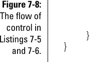

## 从 getInterest 方法返回值

当调用 `getInterest` 时，该方法执行其方法体中的一条语句：`return` 语句。`return` 语句计算 `balance * percentageRate / 100.0` 的值。如果 `balance` 正好是 24.02，且 `percentageRate` 是 5.00，那么该表达式的值为 1.201——大约 1.20。由于计算机完全使用 0 和 1，计算机在处理这个数字时会产生极小的误差。计算机得到的是 1.2009999999999998。这只能是事实。

无论如何，在计算出此值后，计算机执行 `return`，将该值传回 `main` 中调用 `getInterest` 的地方。在过程的该点，方法调用 `myAccount.getInterest(5.00)` 获取了值 `1.2009999999999998`。该调用本身位于 `println` 内部：

```java
out.println(myAccount.getInterest(5.00));
```

因此 `println` 最终的含义是：

```java
out.println(1.2009999999999998);
```

将值传回方法调用的整个过程如图 7-9 所示。

如果一个方法返回任何内容，那么对该方法的调用就是一个带有值的表达式。这个值可以被打印、赋值给变量、与其他内容相加或进行任何操作。你对任何其他类型的值能做的事，都可以对方法调用做的事。


| double getInterest(double percentageRate) { |
| return balance * percentageRate / 100.0; |
| } |
| Account out.println(myAccount.getInterest(5.00)); |

# 第 7 章：用类和对象的角度思考

## 让数字看起来更好看

回看图 7-5，你可能担心我账户的利息只有 $1.200999999999998。看起来银行在欺骗我 200 万亿分之一个美分。我应该直接去要公平的利息。也许你我应该一起去。我们会为那家老银行大闹，现在就揭这个骗局。如果我猜得没错，这是一个庞大的“意大利香肠骗局”（salami scam）的一部分。在意大利香肠骗局中，有人从数百万个账户中切走薄片。人们没有注意到自己微小的损失，但操作者积攒的钱足够让他们快速逃到巴哈多斯（或买一整车意大利香肠）。

等一下！没有任何事能激励你来银行的。重新查看图 7-5，我发现你领先了一步。根据我的计算，程序多付了 300 万亿分之一个美分。我们两个加起来多出了 100 万亿分之一个美分。这是怎么回事？

嗯，因为计算机使用 0 和 1，且没有无限的空间来进行计算，像图 7-5 所示的不精确是不可避免的。你能做的最好的就是以更合理的方式显示数字。你可以对数字进行四舍五入并只显示小数点后两位，Java API（应用程序编程接口）中的一些工具可以提供帮助。代码见列表 7-7，理想的结果见图 7-10。

### 列表 7-7：让显示正确

```java
import java.lang.System;
class UseAccount {
    public static void main(String args[]) {
        Account myAccount = new Account();
        Account yourAccount = new Account();

        myAccount.balance = 24.02;
        yourAccount.balance = 55.63;

        double myInterest = myAccount.getInterest(5.00);
        double yourInterest = yourAccount.getInterest(7.00);

        System.out.printf("%.4f\n", myInterest);
        System.out.printf("%.5f\n", myInterest);
        System.out.printf("%.2f\n", myInterest);
        System.out.printf("%.3f\n", myInterest);
        System.out.printf("%.2f %.2f\n", myInterest,yourInterest);
    }
}
```

## 图 7-10：像金额一样的数字

| 数字 | $1.20 |
| | $1.20 |
| | $1.20 |
| $1.20 $3.89 处理完成 |


在运行列表 7-7 中的代码之前，你必须在项目中放入两个类。一个类是列表 7-7 中的代码；另一个是像列表 7-5 中的 `Account` 类。

列表 7-7 使用了一个名为 `printf` 的方便方法。当你调用 `printf` 时，始终要在括号内放入两个参数。

- 第一个参数是格式字符串。格式字符串使用看起来奇怪的代码来描述其他参数的显示方式。
- 第一个之后的所有参数都是要显示的值。

看列表 7-7 的最后一个 `printf` 调用。第一个参数的格式字符串有两个占位符。第一个占位符 `%.2f` 描述 `myInterest` 的显示。第二个占位符 `%.2f` 描述 `yourInterest` 的显示。要了解这些格式字符串是如何工作的，请查看图 7-11 到 7-15。

### 图 7-11：使用格式字符串

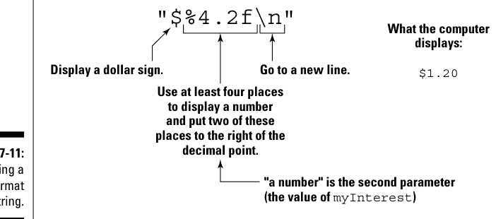

### 图 7-12：为显示值添加额外的位数

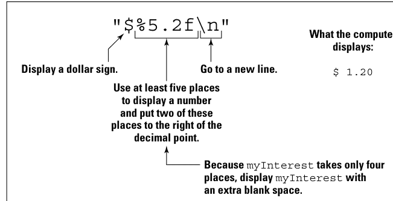

### 图 7-13：在不指定具体位数的情况下显示值

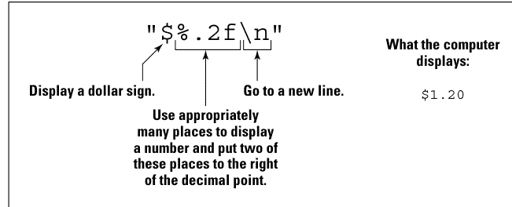

### 图 7-14：显示值指定的位数太少

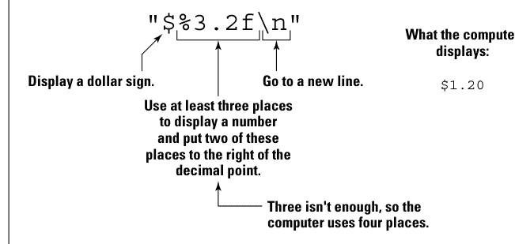

### 表 7-15：使用格式字符串显示多个值

| 显示符号 | 计算机显示的内容 |
|---|---|
| "$%.2f %.2f" | $1.20 $3.89 |
| 显示第二个参数 (myInterest) 的值，小数点后保留两位。 | 显示第三个参数 (yourInterest) 的值，小数点后保留两位。 |
| | 显示空白符号。 |


关于 `printf` 方法及其格式字符串的示例，请参见第 8 章和第 9 章。要获取 `printf` 方法格式字符串相关的选项列表，请查看 Java API 文档中的 `java.util.Formatter` 页面。

`printf` 调用中的字符串不会改变数字内部计算存储的方式。格式字符串只是创建了一组好看的数字字符并显示在你的屏幕上。

## 使用访问器方法隐藏细节（为什么你不应该对银行柜员进行微观管理）

放下书，戴上帽子。你是一个如此忠实的读者，我要带你出去吃午饭！

我有一个问题。我手头现金有点紧。你介意在去吃饭的路上，我们先在自动取款机上取点钱吗？另外，我们必须用你的账户。我的账户余额很少。

幸运的是，取款机很好用。只需走上前输入你的密码。输入密码后，机器会询问你想用哪个变量名作为当前余额。你可以选择 `balance324`、`myBal`、`currentBalance`、`b$`、`BALANCE`、`asj999` 或 `conStanTinole`。选择好变量名后，你就可以选择内存位置了。

对于变量的值，你可以选择 022FFF 到 0555AA 之间的任何数字。（这些数字是十六进制格式。）在你配置好自动取款机的软件后，你就可以轻松地拿到现金。你带了螺丝刀，对吧？

### 良好的编程

在涉及到良好的编程实践时，有一个词凌于所有其他词之上——简单性。当你编写复杂的代码时，你最不想处理的就是某人命名不当的变量；问题的复杂解决方案；或者是聪明的、临时的凑合方案（kludges）。你想要一个清晰的接口，它能解决你自己的问题，而不是别人的问题。

在我之前描述的自动取款机场景中，大问题是机器的设计迫使你去考虑他人的关注。当你本该考虑如何为午饭付钱时，你却在考虑存储位置。必须有人来解决自动取款机的工程问题。但银行客户并不是解决这些问题的人。

这一节关于安全性（safety），而不是安全防护（security）。安全代码防止你犯意外的编程错误。安全的代码（完全是另一回事）则防止恶意的黑客破坏你的意图。

这意味着与计算机程序每个方面相关的一切都必须是简单的。对吧？不，不是的。有时候，为了从长期来看让事情简单，你必须在前面做好大量的准备工作。自动取款机的人努力确保机器是防误的（consumer-proof）。机器的界面带有屏幕消息和按钮，使得机器成为非常复杂但经过精心设计的设备。

关键点在于，让事情看起来简单需要一些规划。在面向对象编程中，方法之一是防止类外部的代码直接使用类内部的变量。看看列表 7-1 中的代码。你所在的公司刚刚为 `Account` 类的代码花费了 1000 万美元（每行超过一百五十万！）。你的任务是写：

```
myAccount.name = "Barry Burd";
```

但这样做会让你太深地进入 `Account` 类内部。毕竟，使用自动取款机的人是不被允许


编写机器的变量。他们不能使用机器的键盘来输入语句


## 第 7 章：从类和对象的角度思考

```java
balanceOnAccount29872865457 =
balanceOnAccount29872865457 + 1000000.00;
```

相反，他们通过按按钮以有序的方式完成工作。这就是程序员实现安全和简单的方法。

所以，为了保持事情良好且有序，你需要通过列出如下的语句来更改列表 7-1 中的 `Account` 类：

```java
myAccount.name = "Barry Burd";
```

和

```java
out.print(yourAccount.balance);
```

但是，当然，这带来了一个问题。你是编写 `UseAccount` 类代码的人。如果你不能写 `myAccount.name` 或 `yourAccount.balance`，你该如何完成任何工作？答案在于被称为访问器方法（accessor methods）的东西。这些方法在列表 7-8 和 7-9 中演示。

### 列表 7-8：隐藏这些变量

```java
class Account {
    private String name;
    private String address;
    private double balance;

    public void setName(String n) {
        name = n;
    }

    public String getName() {
        return name;
    }

    public void setAddress(String a) {
        address = a;
    }

    public String getAddress() {
        return address;
    }

    public void setBalance(double b) {
        balance = b;
    }

    public double getBalance() {
        return balance;
    }
}
```

### 列表 7-9：调用访问器方法

```java
import static java.lang.System.out;
class UseAccount {
    public static void main(String args[]) {
        Account myAccount = new Account();
        Account yourAccount = new Account();

        myAccount.setName("Barry Burd");
        myAccount.setAddress("222 Cyberspace Lane");
        myAccount.setBalance(24.02);

        yourAccount.setName("Jane Q. Public");
        yourAccount.setAddress("111 Consumer Street");
        yourAccount.setBalance(55.63);

        print(myAccount.getName());
        print(" * ");
        print(myAccount.getAddress());
        print(" has $");
        print(myAccount.getBalance());
        println();

        print(yourAccount.getName());
        print(" * ");
        print(yourAccount.getAddress());
        print(" has $");
        print(yourAccount.getBalance());
    }
}
```

运行列表 7-8 和 7-9 中的代码看起来与运行列表 7-1 和 7-2 没有区别。

注意，在 7-8 和 7-9 的情况下，机器的设计迫使你担心他人的关注。当你本该考虑如何为午饭付钱时，你却在考虑存储位置。必须有人来解决自动取款机的工程问题。但银行客户并不是解决这些问题的人。

这一节关于安全性，而不是安全防护。安全代码防止你犯意外的编程错误。安全的代码（完全是另一回事）则防止恶意的黑客破坏你的意图。

这意味着与计算机程序每个方面相关的一切都必须是简单的。对吧？不，不是的。有时候，为了从长期来看让事情简单，你必须在前面做好大量的准备工作。自动取款机的人努力确保机器是防误的。机器的界面带有屏幕消息和按钮，使得机器成为非常复杂但精心设计的设备。

关键点在于，让事情看起来简单需要一些规划。在面向对象编程中，方法之一是防止类外部的代码直接使用类内部的变量。看看列表 7-1 中的代码。你所在的公司刚刚为 `Account` 类的代码花费了 1000 万美元（每行超过一百五十万！）。你的任务是写：

```java
myAccount.name = "Barry Burd";
```

但这样做会让你太深地进入 `Account` 类内部。毕竟，使用自动取款机的人是不被允许编写机器变量的。他们不能使用机器的键盘来输入语句

```java
balanceOnAccount29872865457 =
balanceOnAccount29872865457 + 1000000.00;
```

相反，他们通过按按钮以有序的方式完成工作。这就是程序员实现安全和简单的方法。

所以，为了保持事情良好且有序，你需要通过列出如下的语句来更改列表 7-1 中的 `Account` 类：

```java
myAccount.name = "Barry Burd";
```

和

```java
out.print(yourAccount.balance);
```

但是，当然，这带来了一个问题。你是编写 `UseAccount` 类代码的人。如果你不能写 `myAccount.name` 或 `yourAccount.balance`，你该如何完成任何工作？想象将方法的赋值语句放在一个 `if` 语句中。

```java
public void setName(String n) {
  if (n.equals("")) {
    name = n;
  }
}
```

现在，如果负责 `UseAccount` 类的程序员写 `myAccount.setName("")`，对 `setName` 的调用将产生任何影响。

由于 `name` 变量是私有的，因此在 `UseAccount` 类中，以下语句是非法的：

```java
myAccount.name = "";
```

当然，像 `myAccount.setName("Joe Schmoe")` 这样的调用仍然有效，因为 "Joe Schmoe" 不等于空字符串 `""`。

这很酷。通过私有变量和访问器方法，你可以防止某些人向账户的 `name` 变量赋值空字符串。通过编写更复杂的 `if` 语句，你可以强制执行你想要的规则。

## 第 8 章：节省时间与金钱：重用现有代码

### 本章内容

- 为旧代码注入新生命
- 调整你的代码
- 在不花费巨资的情况下进行更改

从前，有一位美丽的公主。当公主满 25 岁时（这是力量、美貌和良好品质的最佳年龄），她慈爱的父亲送给她一个精美金色盒子礼物。公主急于知道盒子里装了什么，于是撕掉了金色的包装纸。

当盒子终于打开时，公主惊喜极了。令她惊讶的是，她的父亲给了她一直想要的东西——一个永远运行正确的计算机程序。这个程序做了公主想要的所有事情，而且完全按照她想要的方式运行。公主很高兴，她慈爱的老父亲也是如此。

随着时间的推移，这个计算机程序从未出错。在随后的多年里，公主改变了自己的需求，对生活有了更高的期待，提出了要求，扩展了事业，追求更多的成就感，审视丈夫和孩子的欲望，调整了预算，并在灵魂深处寻求平静。在这个过程中，这个程序始终是稳定且忠实的伴侣。

随着公主变老，程序也随她一起老了。一天晚上，当她坐在炉旁时，向程序提出了一个挑战性的问题。“你是怎么做到的？”她问，“你是如何做到一次又一次、年复一年地给出正确答案的？”

随着面向对象编程的出现，一场巨大的变化发生了。面向对象程序的设计初衷就是为了修改。通过编写良好的软件，你可以利用已内置的功能，添加你自己的新功能，并覆盖不符合你需求的功能。最棒的部分是，你做的更改是整洁的。不需要去挖掘和破解他人脆弱的程序代码。相反，你可以进行良好、有序的添加和修改，而不触碰现有代码的内部逻辑。这是理想的解决方案。

### 关于员工的最后说明

当你编写面向对象程序时，首先要考虑数据。你正在编写关于账户的内容。那么什么是账户？你正在编写处理按钮点击的代码。那么按钮是什么？你正在编写一个程序向员工发送工资支票。那么员工是什么？

在本章的示例中，员工是指拥有姓名和职衔的人。当然，员工还有其他特征，但目前我只坚持基础定义。代码列表 8-1 中的代码定义了什么是员工。

#### 代码列表 8-1：什么是员工？

```java
import static java.lang.System.out;

class Employee {
    private String name;
    private String jobTitle;

    public void setName(String nameIn) {
        name = nameIn;
    }

    public String getName() {
        return name;
    }

    public void setJobTitle(String jobTitleIn) {
        jobTitle = jobTitleIn;
    }

    public String getJobTitle() {
        return jobTitle;
    }

    public void cutCheck(double amountPaid) {
        out.printf("Pay to the order of %s ", name);
        out.printf("%s) ***$", jobTitle);
        out.printf("%.2f\n", amountPaid);
    }
}
```

根据代码列表 8-1，每个员工都有七个特征。其中两个特征相当简单：每个员工都有姓名和一个职衔。

员工还有什么？每个员工都有四个方法来处理员工姓名和职衔的值。这些方法是 `setName`、`getName`、`setJobTitle` 和 `getJobTitle`。这类方法（访问器方法）将在第 7 章中介绍。

此外，每个员工都有一个 `cutCheck` 方法。其想法是，编写工资支票的方法必须属于某一个类。由于工资支票中的大部分信息都是针对特定员工定制的，不如将 `cutCheck` 方法放在 `Employee` 类中。

关于 `cutCheck` 方法中 `printf` 用的细节，请参阅本章稍后的“开具支票”章节。

### 善用你的类

列表 8-1 中的 `Employee` 类没有 `main` 方法，因此没有执行代码的起点。为了修复这个缺陷，程序员必须编写一个带有 `main` 方法的独立程序，并使用该程序创建 `Employee` 实例。（如何单独编译两个程序，请参见第 7 章。）代码列表 8-2 显示了一个带有 `main` 方法的类——它对列表 8-1 中的代码进行了测试。

#### 代码列表 8-2：编写工资支票

```java
import java.util.Scanner;
import java.io.File;

class DoPayroll {
    public static void main(String[] args) throws IOException {
        Scanner diskScanner = new Scanner(new File("Employee.txt"));

        for (int empNum = 1; empNum <= 3; empNum++) {
            Employee employee = new Employee();
            employee.setName(diskScanner.next());
            employee.setJobTitle(diskScanner.next());
            employee.cutCheck(diskScanner.nextDouble());
        }
    }
}
```

`EmployeeInfo.txt` 文件就像一个文字处理文档。该文件可以包含字母、数字和其他字符。与文字处理文档不同，`EmployeeInfo.txt` 文件不包含任何格式——没有斜体、没有粗体、没有固定字体，没有任何此类内容。


# EmployeeInfo.txt 文件只普通字符——即你在玩第 5 章或第 6 章的猜游戏时输入的那些按键字符

当然，从用户的键盘获取猜测结果与从磁盘文件读取员工数据并不完全相同。在猜游戏中，程序会显示提示信息，例如“输入 1 到 10 之间的整数”。游戏与坐在键盘前的人进行来回回的问答式对话。相比之下，列表 8-2 没有对话。这个 `DoPayroll` 程序从硬盘读取内容，不会向任何人提示或与任何人交互。

这部分大部分是关于代码重用的。但列表 8-2 触及了一个重要的想法——这个想法与代码重用没有直接关系。与之前章节中的示例不同，列表 8-2 从存储的磁盘文件中读取数据。在本节中，我将抽花一点时间来探索文件。

## 在文件中存储数据

除非你在文件中已经准备了一些员工数据，否则列表 8-2 的代码不会运行。列表 8-2 指出该文件为 `EmployeeInfo.txt`。在运行代码之前，我创建了一个小的 `EmployeeInfo.txt` 文件。该文件如图 8-3 所示；输出结果请参考图 8-2。

| EmployeeInfo.txt | DoPayroll.java |
| :--- | :--- |
| 图 8-3: 一个 Employee Info.txt 文件 | Barry Burd 5000.00 Harriet Ritter Captain 7000.00 Your Name Here Honorary Exec of the Day 10000.00 |

当你从本书的光盘镜像中安装 JCreator 时，计算机会将 `EmployeeInfo.txt` 文件精确地复制到你需要的地方——即列表 8-1 和 8-2 的项目目录。你可以运行本节的代码，而无需担心 `EmployeeInfo.txt` 文件。

尽管你可能并不担心它，但你可能也想在 JCreator 的编辑器中查看 `EmployeeInfo.txt` 文件。谁知道呢？你可能想更改文件中的某些数据。以下是将文件引入编辑器面板的方法：

1. 在打开 JCreator 的情况下，选择 `File::Open Workspace`。
   出现一个 Open 对话框。
2. 在 Open 对话框中，选择 `Chapter08.jcw`，并点击 Open。
   Chapter08 工作空间将填充 JCreator 的 File 面板。
3. 在 View 面板中，右键点击 `Listings0801-02` 项目。
   出现一个右键菜单。
4. 在右键菜单中，选择 All Files。
   在 File View 树形的 `Listings0801-02` 分支下，会出现一些额外的文件名。其中一个文件名就是 `EmployeeInfo.txt`。
5. 在 File View 树形中，双击 `EmployeeInfo.txt`。

当你编写代码时，可能需要创建像我自己的 `EmployeeInfo.txt` 这样的文件。以下是操作方法：

1. 在 File 面板中，右键点击项目名称。然后从出现的右键菜单中选择 `Add::New File`。
   在 File Wizard 窗口侧侧查找 File Wizard 的标签页名称（File Type and Path）。确保 File Path 已高亮。如果没有，在移动到下一步之前点击 Name Path。
2. 在 Name 字段中，输入你新数据文件的名称。
   你可以输入任何计算机认为有效的文件名。对于这个示例，我使用了 `EmployeeInfo.txt`，但其他名称，如 `EmployeeInfo.dat`、`EmployeeInfo` 或 `Employees123.01.datafile` 也可以的。我尽量避免引起麻烦的名字（包括包含空格的名字），但你选择的名称完全取决于你（以及你的操作系统、你的喜好以及你的自定义）。

> **提示**
> 
>
> **提示**
> 
> 始终在 Name 字段中包含一个点。在名称末尾添加一个点。创建一个名为 EmployeeInfo 的文件（而不是 `EmployeeInfo.txt` 或 `EmployeeInfo.dat`），按照此处所示输入 `EmployeeInfo`。如果你没有在 Name 字段中输入任何内容，JCreator 会添加默认扩展名（将 `EmployeeInfo` 变为 `EmployeeInfo.java`）。

3. 点击 Finish。
   文件名出现在 JCreator 的 File View 面板中。一个带有新文件名的标签出现在 JCreator 的 Editor面板中。
4. 在 Editor面板中输入文本。
   为了创建本节的示例，我输入了图 8-3 所示的文本。要创建你自己的示例，输入程序运行所需的任何文本。


本书为需要使用 JCreator 创建文件的读者提供了提示。这些提示适用于 Linux、Unix 和 Macintosh。

### 复制粘贴代码

在任何计算机语言中，从文件中读取数据都是很复杂的。你需要添加额外的代码行来告诉计算机做什么。有时你会复制并粘贴这些行。例如，你可以遵循列表 8-2 中的模式：

```java
/*
 * 列表 8-2 中的模式
 */
import java.util.Scanner;
import java.io.File;
import java.io.IOException;

class SomeClassName {
    public static void main(String[] args) throws IOException {
        Scanner scannerName = new Scanner(new File("SomeFileName"));

        // 此处编写一些代码
        scannerName.nextInt();
        scannerName.nextDouble();
        scannerName.next();
        scannerName.nextLine();

        // 此处编写一些代码
    }
}
```

你想从文件中读取数据。你首先想象自己正在从键盘读取数据。将常用的 `Scanner` 和 `next` 引入你的程序，并根据列表 8-2 添加一些额外项：

- 添加两个 import 声明——一个用于 `java.io.File`，另一个用于 `java.io.IOException`。
- 在方法头部输入 `throws IOException`。
- 在调用 `Scanner` 时输入 `new File("")`。
- 使用已经在硬盘上的文件。在引号内输入该文件名。
- 使用你用于 scanner 名称的单词。在调用 `next()`、`nextInt()`、`nextDouble()` 等时重用。

偶尔复制代码可能会带来麻烦。你可能正在编写一个不适用于列表 8-2 的程序。你需要对模式进行微调。但为了微调模式，你需要理解模式背后的一些思想。下一节的内容涵盖了这些思想。

## 从文件读取

在之前的章节中，程序从计算机键盘读取字符。这些程序使用 `Scanner`、`System.in` 和 `nextDouble()` 等工具——这些都是 Java API 中定义的。列表 8-2 中的 `DoPayroll` 程序为这个故事提供了新的视角。程序不是从键盘读取字符，而是从 `EmployeeInfo.txt` 文件读取字符。该文件位于你的计算机硬盘上。

从文件中读取字符，你使用一些帮助从键盘读取字符的相同工具。你使用 `Scanner`、`nextDouble()` 以及其他工具。但这些工具之外，你还有几个额外的需要处理。列表如下：

- 你需要一个 `File` 对象。更准确地说，你需要 API 的 `File` 类的一个新实例。你通过以下代码获取这个新实例：

```java
new File("EmployeeInfo.txt")
```

引号中的内容是一个文件名——你硬盘上的一个文件。该文件包含之前在图 8-3 中所示的字符。

到这里，术语就容易理解了。当然，我使用了 `new File object` 和 `new File instance` 等短语，但你只是让 `new File("EmployeeInfo.txt")` 代表硬盘上的一个文件。在向 `Scanner` 显示 `new File("EmployeeInfo.txt")` 后：

```java
Scanner diskScanner = new Scanner(new File("EmployeeInfo.txt"));
```

你可以忘记所有关于 `new File` 的事务。在代码的某处，`diskScanner` 代表你硬盘上的 `EmployeeInfo.txt` 文件名（`diskScanner` 名称代表硬盘上的一个文件，就像之前的 `myScanner` 名称代表计算机键盘一样）。

在列表 8-2 中创建一个新的 `File` 就像在同一行中创建一个 `Employee` 对象。它也像第 7 章示例中创建 `Account` 对象。唯一的区别是 `Employee` 和 `Account` 类是在本书的示例中定义的。`File` 类是在 Java API 中定义的。当你用 `Scanner` 连接磁盘文件时，不要忘记 `File` 部分。如果你写成 `new Scanner("EmployeeInfo.txt")` 而没有 `new File`，编译器不会报错。（选择 Build::Compile Project 会给你一个友好的 Process completed 信息。）但当你运行代码时，你不会得到预期的任何结果。


- 你必须通过全名 `java.io` 引用 `File` 类。你可以像列表 8-2 那样通过 import 声明来实现。或者，你可以在代码中充斥语句：

```java
Scanner diskScanner = new Scanner(new java.io.File("EmployeeInfo.txt"));
```

- 你有一个 `throws` 异常子句。当你的程序连接到 `EmployeeInfo.txt` 时可能会出现问题。其中，你的硬盘可能没有名为 `EmployeeInfo.txt` 的文件。另一个，`EmployeeInfo.txt` 文件可能在错误的目录下。为了应对这种因果关系，Java 编程语言采取了一些预防措施。语言要求在涉及磁盘文件时，必须承认调用 `Scanner` 的潜在危险。你可以通过多种方式承认这些危险，但最简单的方法是使用 `throws` 子句。在列表 8-2 中，main 方法以 `throws Exception` 结尾。

## 184 第二部分：掌握大局：面向对象编程

关于 IO 异常的完整介绍，请阅读第 12 章。在此，请在任何调用 `Scanner(new File(...))` 的方法头中添加 `throws IOException`。

- 你必须使用全名 `java.io.IOException` 来引用 `IOException` 类。

你可以使用类似列表 8-2 中的导入语句来实现。或者，你可以扩大 `main` 方法的 `throws` 子句：

```java
public static void main(String[] args) throws
    java.io.IOException {
```

- 你必须将扫描器的名称传递给 `payEmployee()` 方法。

在第 7 章的列表 7-5 中，`getInterest()` 方法有一个参数 `percentageRate`。每当你调用 `getInterest()` 方法时，你都会向该方法传递一个额外的、最新的信息。（你向方法传递了一个数字——利率。图 7-7 阐释了这一概念。）

同样的情况也发生在列表 8-2 中。`payEmployee()` 方法有一个参数 `aScanner`。每当你调用 `payEmployee()` 方法时，你都会向该方法传递一个额外的、最新的信息。（你向方法传递了一个扫描器——对文件的引用。）

你可能会奇怪，为什么 `payEmployee()` 方法需要一个参数。毕竟，在列表 8-2 中，`payEmployee()` 方法始终从同一个文件中读取数据。通过告知这个方法，你每次调用它时，磁盘文件仍然是 `payEmployee.txt` 文件吗？

嗯，有很多种方法可以重排列表 8-2 中的代码。某些方法并不涉及参数。但按照这个示例的安排方式，你有两个独立的方法——一个 `main()` 方法和一个 `payEmployee()` 方法。你在 `main()` 方法内部创建了一个扫描器，然后使用了三次该扫描器——每次调用 `payEmployee()` 方法时使用一次。

你在方法内部定义的任何内容都类似于该方法内部代码的私有变量。你在 `main()` 方法内部定义的 `diskScanner` 在 `payEmployee()` 方法内部不会自动感知。为了让 `payEmployee()` 感知磁盘文件，你从 `main()` 方法将 `diskScanner` 传递给 `payEmployee()` 方法。

你可以阅读关于方法内部（及外部）声明的变量的内容，参见第 10 章。

## 第 8 章：节省时间和金钱：重用现有代码

## 185

### 谁移动了我的文件？

如果你从这本书的 CD-ROM 安装了 JCreator，你的 `MyProjects` 目录下有一个名为 `Listings0801-02` 的子目录。该 `Listings0801-02` 目录包含了名为 `Employee.java` 和 `DoPayroll.java` 文件——即列表 8-1 和 8-2 中的代码。`Listings0801-02` 目录还包含 `EmployeeInfo.txt` 文件。很好，因为如果 `Employee` 没有正常运行，你会得到一个 `FileNotFoundException`。

通常，当你遇到 `FileNotFoundException` 时，程序需要的某个文件不可用。这是一个很容易犯的错误。这可能会让人沮丧，因为像 `EmployeeInfo.txt` 这样的文件看起来对你的程序是可用。记住——计算机是愚笨的。如果你犯了错，计算机无法为你读取那些行。所以，如果你的 `EmployeeInfo.txt` 文件不在硬盘的正确目录中，或者文件名拼写错误，计算机会在尝试运行你的代码时报错。

有时你非常清楚 `EmployeeInfo.txt`（或其他任何文件）在你的硬盘上。但当你运行程序时，你会得到一个看起来很难看的 `FileNotFoundException`。当这种情况发生时，文件通常位于硬盘上错误的目录下。（当然，这取决于你的观点。也许文件在正确的目录下；但你告诉你的 Java 程序去错误的目录下查找文件。）当这发生时，将文件复制到硬盘上的其他目录并重新运行你的代码。（JCreator 的 `MyProjects` 目录下的子目录始终是存放文件的好地方。）仔细检查硬盘上文件的名称和位置，直到你清楚哪里出了问题。

### 在文件名中添加目录名

你可以在 Java 代码中指定文件的精确位置。像 `File("C:\\Program Files\\Xinois Software\\JCreatorV3 LE\\MyProjects\\Listings0801-02\\EmployeeInfo.txt")` 这样的代码看起来确实丑，但它是有效的。

在上一段中，请注意 `"C:\\Program Files\\Xinois Software"` 中的双反斜杠。如果你是 Windows MS-DOS 用户，你会想用单反斜杠写 `C:\Program Files\Xinois Software`。但在 Java 中，单反斜杠有它特殊的含义。（例如，在列表 7-7 中，`\n` 意味着换行。）因此在 Java 中，为了在引号字符串内表示反斜杠，你需要使用双反斜杠。

## 186 第三部分：掌握大局：面向对象编程

如果你知道你的 Java 程序在查找文件，你就可以从此推导出你选择的目录。例如，列表 8-2 中的代码通常在名为 `Listings0801-02` 的目录中查找 `EmployeeInfo.txt` 文件。所以，作为一个实验，进入 `Listings0801-02` 目录并创建一个名为 `dataFiles` 的新子目录。然后将 `EmployeeInfo.txt` 文件移动到新的 `dataFiles` 中。为了从你移动的文件读取数字和单词，修改列表 8-2 使用代码 `File("dataFiles\\EmployeeInfo.txt")`。

### 逐行读取

在 8-2 中，`payEmployee()` 方法演示了一些读取数据的实用技巧。特别是，你创建的每个扫描器都有 `nextLine()` 方法（你可能不使用这个方法，但它是可用的）。当你调用 `nextLine()` 时，它会获取到当前行之前的所有内容。混合使用 `nextInt()`、`nextDouble()` 和 `nextLine()` 可能会混乱。要理解这一点，你需要意识到换行符。将换行符想象成一个额外的字符，卡在一行文本和另一行之间。

现在，看看图 8-4。

- 如果一次 `nextLine()` 调用读取 Burd，随后的 `nextLine()` 调用读取 CEO。
- 如果一次 `nextLine()` 调用读取数字 5000.00，随后的 `nextLine()` 调用读取 Harriet Ritter。
- 如果 `nextLine()` 调用读取数字 5000.00 之后的一行，随后的 `nextLine()` 调用读取 Harriet Ritter。

## 187

所以在读取了数字 5000.0 之后，你需要调用两次 `nextLine()` 才能获取名字 Harriet Ritter。我通常犯的错误是忘记了这两次调用中的第一个。

再次查看图 8-3 中的文件。为了让此部分正常工作，在最后一个 10000.0 之后必须有一个换行符。如果没有，最后一次 `nextLine()` 调用会导致你的程序崩溃。错误信息显示为 `ElementName: No line found`。

# 188 第三部分：从大局工作：面向对象编程


去年这个时候，你的公司花费了 1000 万购买了一份软件。该软件是以 `Employee.class` 文件形式提供的。Brain Consulting（创建该软件的公司）不希望你了解软件的内部结构（否则，你可能会偷取他们的东西）。换句话说，你没有该软件来源的 Java 程序文件。（换句话说，你没有 `Employee.class` 文件。你也可以在名为 `Employee.html` 的网页上阅读文档。但你无法看到 `Employee.java` 程序内部的语句，也无法修改任何代码。）

从去年以来，你的公司发展了。与过去不同，你的公司现在有两种员工：全职和兼职。每位全职员工领有固定的周薪。（如果员工在晚上和周末工作，作为这种巨大努力的回报，员工将获得握手。）相比之下，兼职员工按小时工资工作。公司从每位全职员工的工资单中扣除金额来支付公司的福利。然而，兼职员工没有福利。

问题是，公司去年购买的软件如何跟上公司的增长？你投入了一个项目来处理员工薪资，但该程序没有区分全职和兼职员工。你有几个选择：

- 打给 Brain Consulting（卖给你软件的公司）。那个孩子比你公司的任何人都要精通编程。让这个听话的孩子把软件拆开、重写，并交付公司所需的所有更改和添加。
- 其次，考虑这一点。无论那个孩子有多聪明，软件的复杂性可能会让你困惑。当你拿到软件时，它将充满了错误和不一致之处。此外，你甚至没有 `Employee.java` 文件可以交给编辑器。此外，你的孩子只是搞砸了那里。你不想向他们请求帮助。
- 丢弃那份价值 1000 万的软件。让你的公司从头开始重写软件。

# 第 8 章：节省时间和金钱：重用代码

换句话说，与你的时间和金钱说再见。

- 为软件编写一些前端代码。即，对全职员工进行一些初步处理，然后将结果交给那份价值 1000 万的软件。
- 对兼职员工执行同样的操作。

这个想法可能是好的，也可能是灾难。你确定现有软件内部有钩子吗？（即，软件是否包含允许前端轻松发送数据的入口？）记住，这个计划将现有软件视为一个巨大的单体，这会变得繁琐。在前端代码和现有程序之间划分工作是困难的。如果你在现有黑盒上层层叠加，可能会得到一个效率低下的系统。

- 联系 B Consulting。告诉 B 博士你想让他软件的下一个版本区分全职和兼职员工。

“没问题，”B 博士说，“下季度开始前就能准备好。”那天晚上，B 博士打通了一个私人电话……

- 创建名为 `FullTimeEmployee` 和 `PartTimeEmployee` 的新 Java 类。让每个类扩展 `Employee` 类的功能。但让每个新类为特定类型的员工定义专门的功能。

做得好！图 8-5 显示了你想创建的结构。

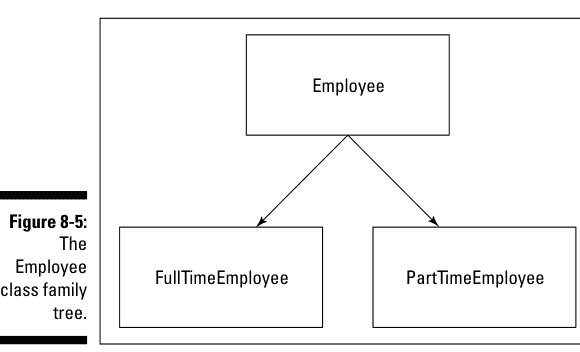

# 创建子类

在列表 8-1 中，我定义了一个 `Employee` 类。我可以使用列表 8-1 中定义的内容并扩展它以创建更专门的类。因此，在列表 8-3 中，我定义了一个新类——`FullTimeEmployee`。

```java
class FullTimeEmployee {
    private double weeklySalary;
    private double benefitDeduction;

    public void setWeeklySalary(double weeklySalary) {
        weeklySalary = weeklySalary;
    }

    public double getWeeklySalary() {
        return weeklySalary;
    }

    public void setBenefitDeduction(double benefitDedIn) {
        benefitDeduction = benefitDedIn;
    }

    public double getBenefitDeduction() {
        return benefitDeduction;
    }

    public double findPaymentAmount() {
        return weeklySalary - benefitDeduction;
    }
}
```

查看 8-3，可以看到每个该类的实例有两个变量：`weeklySalary` 和 `benefitDeduction`。但那是每个 `FullTimeEmployee` 实例拥有的唯一变量吗？不的。列表 8-3 的第一行说 `FullTime` 类扩展了 `Employee` 类。这意味着在拥有 `weeklySalary` 和 `benefitDeduction` 的同时，每个 `FullTimeEmployee` 实例还另外两个变量：`name` 和 `jobTitle`。

# 列表 8-4：伪造（但有参考价值）的代码

```java
import static java.lang.System.out;

class FullTimeEmployee {
    private String name;
    private String jobTitle;
    private double weeklySalary;
    private double benefitDeduction;

    public void setName(String nameIn) {
        name = nameIn;
    }

    public String getName() {
        return name;
    }

    public void setJobTitle(String jobTitleIn) {
        jobTitle = jobTitleIn;
    }

    public String getJobTitle() {
        return jobTitle;
    }

    public void setWeeklySalary(double weeklySalaryIn) {
        weeklySalary = weeklySalaryIn;
    }

    public double getWeeklySalary() {
        return weeklySalary;
    }

    public void setBenefitDeduction(double benefitDedIn) {
        benefitDeduction = benefitDedIn;
    }

    public double getBenefitDeduction() {
        return benefitDeduction;
    }

    public double findPaymentAmount() {
        return weeklySalary - benefitDeduction;
    }
}
```

```java
public void cutCheck(double amountPaid) {
    out.printf("Pay to the order of %s ", name);
    out.printf("(%s,\n", jobTitle);
    out.printf("%.2f\n", amountPaid);
}
```

# 创建子类养成习惯

当你习惯了扩展类，你就会变得喜欢扩展。如果你创建了 `FullTimeEmployee` 类，你大可以创建一个 `PartTimeEmployee` 类，如列表 8-5 所示。

# 列表 8-5：什么是兼职员工？

```java
class PartTimeEmployee extends Employee {
    private double hourlyRate;

    public void setHourlyRate(double rateIn) {
        hourlyRate = rateIn;
    }

    public double getHourlyRate() {
        return hourlyRate;
    }

    public double findPaymentAmount(int hours) {
        return hourlyRate * hours;
    }
}
```

与 `FullTimeEmployee` 类不同，`PartTimeEmployee` 没有工资或扣款。`PartTimeEmployee` 有一个 `hourlyRate` 变量。（添加一个 `numberOfHoursWorked` 变量也是一种可能。我选择不这样做，因为我认为兼职员工每周的工作小时数每周都会发生巨大变化。）

## 使用子类

上一节讲述了一个关于创建子类的故事。这是一个好故事，但它并不完整。创建子类本身很好，但如果你不编写代码来使用这些子类，你并无法从中获得任何益处。在本节中，你将探索使用子类的代码。

现在，是你将自己归类为 F 型人或 P 型人的时候了。F 型人想要看到基础原理。（字母 F 代表 fundamentals，基础。）“给我看一个以最原始、最基本的形式列出原理的程序，”F 型人说，他们并不担心那些花里胡哨的东西。点缀以后会来，而哨子根本不会出现。如果你是一个 F 型人，你希望看到一个使用子类并避开你的程序，这样你就能完成一些工作。

另一方面，P 型人想要实际应用。（字母 P 代表 practical，实用的。）P 型人需要在语境中看到想法；否则，这些想法很快就会无影无踪。“给我看一个展示子类用处的程序，”P 型人说，“我不需要那些臭臭的抽象。我想要真实生活的案例，而且现在就要。”

因为我总是致力于满足读者的需求，这一节有两个（哦 — 两个）利用了上一节子类的示例。代码列表 8-6 是为 F 型读者群准备的，内容非常精简，适合作为睡前读物。另一方面，针对 P 型狂热者的代码列表 8-7 展示了子类如何融入到实用的语境中。就是这些。选择你的“毒药”并继续读下去吧。

## 给极简主义者的程序

代码列表 8-6 展示了一个使用 `FullTimeEmployee` 和 `PartTimeEmployee` 子类的精简程序。图 8-6 显示了程序的输出。

**代码列表 8-6：使用子类，然后让我静静**

```java
public static void main(String args[]) {
    FullTimeEmployee ftEmployee = new FullTimeEmployee();

    ftEmployee.setName("Barry Burd");
    ftEmployee.setJobTitle("CEO");
    ftEmployee.setWeeklySalary(5000.00);
    ftEmployee.setBenefitDeduction(500.00);
    ftEmployee.cutCheck(ftEmployee.findPaymentAmount());
    System.out.println();

    PartTimeEmployee ptEmployee = new PartTimeEmployee();

    ptEmployee.setName("Steve Surace");
    ptEmployee.setJobTitle("Driver");
    ptEmployee.setHourlyRate(7.53);
    ptEmployee.cutCheck(ptEmployee.findPaymentAmount(10));
}
```

图 8-6：代码列表 8-6 中程序的输出。

| --- 配置: Listing801-03-05-06 - JDK 版本--- |
| 付给抬头：Barry Burd (CBS) ***5000.00 |
| 付给抬头：Steve Surace (Driver) ***75.30 |

要理解代码列表 8-6，你需要关注三个类：`Employee`、`FullTimeEmployee` 和 `PartTimeEmployee`。（要查看定义这些类的代码，请参阅代码列表 8-1、8-3 和 8-5）。

代码列表 8-6 的前半部分处理一个全职员工。注意对于 `ftEmployee` 变量有多少个方法可以使用。例如，你可以调用 `ftEmployee.setWeeklySalary`，因为 `ftEmployee` 的类型是 `FullTimeEmployee`。你也可以调用 `ftEmployee.setName`，因为 `FullTimeEmployee` 类继承了 `Employee` 类。

由于 `cutCheck` 在 `Employee` 类中声明，所以你可以调用 `ftEmployee.cutCheck`。你也可以调用 `ftEmployee.findPaymentAmount`，因为 `findPaymentAmount` 方法在 `FullTimeEmployee` 类中。

## 匹配类型

再次查看代码列表 8-6 的前半部分。特别注意最后一条语句——那个全职员工实际上是一张支票的语句。该语句形成了一个漂亮、长长的值及其类型的链。你可以通过从向外读取该语句来看到此。

- 方法 `ftEmployee.findPaymentAmount` 在调用时带有空参数列表（代码列表 8-6）。这很好，因为 `findPaymentAmount` 方法不接受参数（代码列表 8-3）。
- `findPaymentAmount` 方法返回一个 `double` 类型的值（再次，参见代码列表 8-3）。
- `ftEmployee.findPaymentAmount` 返回的 `double` 值被传递给方法 `ftEmployee.cutCheck`（代码列表 8-6）。这很好，因为 `cutCheck` 方法接受一个 `double` 类型的参数（代码列表 8-1）。

如需奇幻的图解说明，请参见图 8-7。


## 后半部分

在代码列表 8-6 的后半部分，代码创建了一个 `PartTimeEmployee` 对象。代码列表 8-6 的后半部分是非常有趣的。在两个子类 `FullTimeEmployee` 和 `PartTimeEmployee` 之间，兼职员工的工资每周都会变化，取决于工作的小时。

## 给极大主义者的程序

如果你渴望有用且实际的应用，你要么跳过了该列表，要么在阅读它时咬了牙。代码列表 8-7 为你提供了相同的信息，但视角更实用。当然，这是有代价的。代码列表 8-7 比上一节更长、更复杂。

**代码列表 8-7：大量薪资程序**

```java
import java.lang.System.out;
import java.util.Scanner;
import java.io.File;
import java.io.IOException;

class DoPayrollP {
    public static void main(String[] args) throws IOException {
        Scanner diskScanner =
            new Scanner(new File("EmpInfoNew.txt"));
        Scanner kbdScanner = new Scanner(System.in);

        for (int empNum = 1; empNum <= 3; empNum++) {
            payOneFTEmployee(diskScanner);
        }

        for (int empNum = 4; empNum <= 6; empNum++) {
            payOnePTEmployee(diskScanner, kbdScanner);
        }
    }
}
```


# 198 第三部分：大局观：面向对象编程

## 列表 8-7（续）

```java
public static void payOneFTEmployee(Scanner diskScanner) {
    FullTimeEmployee employee = new FullTimeEmployee();

    employee.setName(diskScanner.nextLine());
    employee.setJobTitle(diskScanner.nextLine());
    employee.setWeeklySalary(diskScanner.nextDouble());
    employee.setBenefitDeduction(diskScanner.nextDouble());
    diskScanner.nextLine();
    diskScanner.nextLine(); // 读取分隔

    // 两个员工的虚线

    employee.cutCheck(employee.findPaymentAmount());
    out.println();
}
```

```java
public static void payOnePTEmployee(Scanner diskScanner, Scanner kbdScanner) {
    PartTimeEmployee employee = new PartTimeEmployee();

    employee.setName(diskScanner.nextLine());
    employee.setJobTitle(diskScanner.nextLine());
    employee.setHourlyRate(diskScanner.nextDouble());
    diskScanner.nextLine();
    diskScanner.nextLine(); // 读取分隔

    // 两名员工的虚线

    out.print("Enter ");
    out.print(employee.getName());
    out.print(employee.s + " hours worked this week: ");
    int hours = kbdScanner.nextInt();

    employee.cutCheck(employee.findPaymentAmount(hours));
    out.println();
}
```

尽管列表 8-7 的代码非常复杂，但它仍然不是完整的工资程序。它是一个演示程序，但比列表 8-6 中的程序更真实。列表 8-7 中的代码为六名员工编写支票——三名全职员工和三名兼职员工。调用 `payOneFTEEmployee` 和 `payPTEEmployee` 确保每位员工都能收到支票。这些 `payOneEmployee` 方法分别从文件中读取数据，并使用这些数据填充员工对象的值。图 8-8 显示了我用于测试列表 8-7 的文件，运行结果如图 8-9 所示。

### 图 8-8：大型工资程序的输入数据

**EmpInfoNew.txt**
```
Barry Burd
CBO
5000.00
500.00
Harriet Ritter
Captain
7000.00
700.00
Your Name Here
Honorary Exec of the Day
10000.00
200.00
Steve Surac
Driver
7.52
Bernard Smith
Messenger
9.26
Chris Apelian
Computes Book Author
3.54
```

### 图 8-9：支付员工工资

```
普通输出
--Configuration: listing802 - sql.jdbc:5.8-compile-db...
付给 Barry Ritter (CEO) ***$56,300.00
付给 Your Name Here (荣誉执行官) ***$9,800.00
输入 Steve Source 本周工作小时: 10
付给 Steve Source (Driver) ***$4710.30
输入 Bernard Smith 本周工作小时: 15
付给 Bernard Smith (Messenger) ***$5138.90
输入 Chris Allen 本周工作小时: 45
付给 Chris Allen's (Computer Book Author) ***$5230.10
```

与其“表兄弟级”级方法相比，`payPTEEmployee` 方法从它的锦箱里多使出了一招。当需要获取员工工作小时数时，`payPTEEmployee` 方法并不查询磁盘文件。相反，该方法要求用户进行实时键盘输入。这里的思路是，磁盘文件是存储所有员工长期信息的地方。由于员工本周的工作小时数是非长期信息，`payPTEEmployee` 方法让用户现场输入这些内容。

`payPTEEmployee` 方法从 PTE 文件中读取姓名、职位和时薪。该方法从键盘读取小时数。由于 `payPTEEmployee` 方法从两个不同的来源读取数据，因此向该方法传递了两个不同的 `scanner`。在方法的参数列表中，你用逗号分隔这两个项。

## 重写现有方法（更改部分员工的付款金额）

你知道吗！人力资源部的某个呆呆蛋给其中一名兼职员工提供了加班双倍工资。现在消息传开了，其他一些兼职员工也想要加班双倍工资。如果这种情况持续下去，你会破产的，因此你需要向所有兼职员工发送一份备忘录，解释为什么赚更多钱对他们并没有好处。与此同时，你有两种兼职员工——获得加班双倍工资的和没有的——所以你需要修改你的工资软件。你有哪些选择？

- 那么，你可以直接进入 `PartTimeEmployee` 类代码，做一些更改，然后听天由命。（这不是个好主意！）
- 你可以遵循上一节的建议，创建 `PartTimeEmployee` 类的子类。“等一下，”你说，“现有的 `PartTimeEmployee` 类已经有一个 `findPaymentAmount` 方法了。我需要某种技巧来为每个加班双倍工资的员工跳过这个 `findPaymentAmount` 方法吗？”
- 此时，你可以感谢自己幸运，正在 Java 中使用面向对象编程。通过面向对象编程，你可以创建一个覆盖父类功能的子类。列表 8-8 就有这样一个子类。

### 列表 8-8：另一个子类

```java
class PartTimeOver extends PartTimeEmployee {
    public double findPaymentAmount(int hours) {
        if (hours <= 40) {
            return getHourlyRate() * hours;
        } else {
            return getHourlyRate() * 40 + (getHourlyRate() * 1.5) * (hours - 40);
        }
    }
}
```

图 8-10 显示了 `PartTimeOver` 与其父类之间的关系。特别是，`PartTimeOver` 是一个子类。当然，一个子类来自旧的 `PartTimeEmployee` 类，但这并不意味着你不能从 `PartTimeEmployee` 类创建对象。事实上，Java 在这方面非常聪明。列表 8-9 有三次对 `findPaymentAmount` 的调用，每次调用都指向方法的不同版本。

### 图 8-10：继承层次结构

| 类 | 方法 |
| --- | --- |
| Employee (基类) | `findPaymentAmount()` |
| PartTimeEmployee (子类) | `findPaymentAmount()` (重写) |
| PartTimeOver (子类) | `findPaymentAmount()` |
| FullTimeEmployee (子类) | `findPaymentAmount()` |

### 列表 8-9：测试代码

```java
public static void main(String[] args[]) {
    Scanner kbdScanner = new Scanner(System.in);
    Scanner diskScanner = new Scanner(new File("EmpInfoNew.txt"));

    FullTimeEmployee employee = new FullTimeEmployee();
    employee.setHourlyRate(diskScanner.nextDouble());
    diskScanner.nextLine();
    diskScanner.nextLine(); // 读取分隔
    // 两名员工的虚线

    out.print("Enter ");
    out.print(employee.getName());
    out.print(employee.s + " hours worked week: ");
    int hours = kbdScanner.nextInt();

    employee.cutCheck(employee.findPaymentAmount(hours));
    out.println();
}
```

# 第 9 章：构建新对象

**本章内容**

- 定义构造函数
- 在子类中使用构造函数
- 使用 Java 的默认构造函数特性
- 构建一个简单的 GUI

---

Jennie Rebekah Burd 女士
121 Schoolhouse Lane
Anywhere, Kansas州

亲爱的 Burd 女士：

感谢您 6 月 21 日的来信。我认为我可以完全肯定地说，对象并非从无有中自发产生的。尽管我从未亲眼目睹过对象的创建过程（而且我们办公室里没有人能声称见过某个对象在创建的那一刻），但我完全相信，某种过程负责了这些有趣且实用的各种小物件的构建。我们 ClassesAndObjects.com 的人员完全支持科学界和私营部门对此类问题的一致意见。此外，我们也赞同蓝带总统小组最近的发现，该小组毫无疑问地得出结论：对象的对象的创建将阻碍目前的经济前景。

请放心，我已采取一切必要措施以确保您这位我们忠实客户的安全与健康。如果您有任何进一步的问题，请随时联系我们部门。部门经理是 Blake Wholl 先生。您可以通过访问我们公司的网站与他联系。

再次感谢您的关注，希望您继续光临 ClassesAndObjects.com。

您忠实的，
Scott Brickenchicker 先生
那个在第 4 章没能上电梯的人

## 定义构造函数（成为“温度”意味着什么）

这里有一个创建对象的语句：

`Account myAccount = new Account();`

我知道这行得通——这是我从第 7 章的一个示例中获取的。总之，在第 7 章中，我提到：“当计算机执行 `new Account()` 时，计算机通过调用 `Account` 类的构造函数来创建一个对象。”这意味着什么呢？

嗯，当你要求计算机创建一个新对象时，计算机通过执行某些动作来响应。首先，计算机在它的内存中找到一个地方来存储关于新对象的信息。如果该对象有变量，这些变量最终将具有有意义的值。

所以问题是，当你要求计算机创建一个新对象时，你能控制放入对象变量中的内容吗？如果你对填充变量之外还有感兴趣的内容呢？也许，当计算机创建一个新对象时，你有一份任务列表让计算机执行。例如，当计算机确定该窗口中所有按钮的大小时。

创建一个新对象可能涉及各种任务，因此在本章中，你将创建构造函数。构造函数告诉计算机执行新对象的启动任务。

## 什么是温度？

“早上好，欢迎收听对象新闻。您所在地区的当地温度舒适的 73 华氏度。”

每个温度由两个部分组成——一个数字和一个温度单位。列表 9-1 中的代码让这一事实变得非常清晰。

### 列表 9-1：Temperature 类

```java
class Temperature {
    private double number;
    private ScaleName scale;

    public Temperature() {
        number = 0.0;
        scale = ScaleName.fahrenheit;
    }

    public Temperature(double number) {
        this.number = number;
        this.scale = ScaleName.fahrenheit;
    }

    public Temperature(ScaleName scale) {
        number = 0.0;
        scale = scale;
    }

    public Temperature(double number, ScaleName scale) {
        this.number = number;
        this.scale = scale;
    }

    public void setNumber(double number) {
        this.number = number;
    }

    public double getNumber() {
        return number;
    }

    public void setScale(ScaleName scale) {
        this.scale = scale;
    }

    public ScaleName getScale() {
        return scale;
    }
}
```

在列表 9-1 代码的顶部有两个变量：`number` 和 `scale`。一个数字只是一个 `double` 值，例如 32.0 或 70.52。一个单位是一个枚举值。我在列表 9-2 中定义了枚举类型 `ScaleName`。

> 关于枚举类型的介绍，请参阅第 6 章。

### 列表 9-2：ScaleName 枚举类型

```java
enum ScaleName {celcius, fahrenheit, kelvin, rankine};
```

列表 9-1 的代码中还包含常用的 setter 和 getter 方法（用于 `number` 和 `scale` 变量的访问器）。

> 关于 setter 和 getter 方法（也称为访问器方法）的阅读，请参阅第 7 章。

除此之外，列表 9-1 还有四个看起来像方法的东西。这些看起来像方法的东西每一个名字都叫 `Temperature`，这恰好与类的名字相同。这些看起来像方法的东西都没有任何类型的返回类型——不是 `void`（`void` 是偷懒的返回类型）。

每一个看起来像方法的东西都被称为构造函数。构造函数就像方法，但构造函数有一个非常特殊的用途——创建新对象。

每当计算机创建一个新对象时，计算机执行构造函数内部的语句。

## 你能用温度做什么

在列表 9-1 中，你声明了构造函数。图 9-1 显示了运行 9-3 时发生了什么。

### 列表 9-3：使用类

```java
import static java.lang.System;
class Temperature {
    final String format = "%.2f degrees %s%n";

    public static void main(String[] args) {
        Temperature temp = new Temperature();
        temp.setNumber(70.0);
        temp.setScale(ScaleName.fahrenheit);
        System.out.printf(format, temp.getNumber(), temp.getScale());

        temp = new Temperature(32.0);
        System.out.printf(format, temp.getNumber(), temp.getScale());

        temp = new Temperature(ScaleName.celsius);
        System.out.printf(format, temp.getNumber(), temp.getScale());

        temp = new Temperature(ScaleName.kelvin);
        System.out.printf(format, temp.getNumber(), temp.getScale());

        temp = new Temperature(ScaleName.rankine);
        System.out.printf(format, temp.getNumber(), temp.getScale());
    }
}
```

## 调用 new Temperature (32.0)：一个案例研究

从 9-3 开始，计算机决定使用 9-1 中的哪个构造函数。括号中的 `32.0` 是一个 `double` 值。其中 Temperature 构造函数只有一个参数。构造函数的头部如下：

```java
public Temperature(double number)
```


# 第 9 章：构建新对象

“所以，我想我要执行构造函数内部的语句。”计算机继续执行：

```java
this.number = number;
scale = ScaleName.fahrenheit;
```

结果是你获得了一个全新的对象，其 `number` 变量值为 32.0，其 `scale` 变量值为 `fahrenheit`。

在两行代码中，你有两个设置 `number` 和 `scale` 值的语句。看看这些语句中的第二个，它更容易理解。第二个语句将对象的 `scale` 变量设置为 `fahrenheit`。你看到，构造函数的参数是 `(double number)`，而该列表并不包含单位值。因此，编写此代码的人必须对 `scale` 变量使用的值做出决定。程序员可以选择 `fahrenheit` 或 `celsius`，也可以选择 `kelvin` 或 `rankine`。（这位程序员住在美国新泽西州，那里的人们通常使用华氏制。）

对应两个语句中的第一个，这个第一个语句为新对象的 `number` 变量赋值。该语句使用了一个技巧，你在许多构造函数（以及其他为对象变量赋值的方法）中都能看到。要理解这个技巧，请看列表 9-4。

## 列表 9-4：实现相同功能的两种方式

```java
// 使用这个构造函数
public Temperature(double whatever) {
    number = whatever;
    scale = ScaleName.fahrenheit;
}

// ... 或者使用这个构造函数
public Temperature(double number) {
    this.number = number;
    scale = ScaleName.fahrenheit;
}
// ../ 但不要在你的代码中把两个构造函数都写进去。
```

列表 9-4 包含两个构造函数。在第一个构造函数中，我使用了两个不同的名字——`number` 和 `whatever`。在第二个构造函数中，我不需要两个名字。我没有为构造函数的参数发明一个新名字，而是通过编写 `this.number` 来重用现有的名称。

以下是列表 9-1 中发生的情况：

- 在 `this.number = number` 语句中，`this.number` 指向新对象的 `number` 变量——即在列表 9-1 最上方声明的变量。（见图 9-2）。
- 在 `this.number = number` 语句中，`number` 单词（不带 `this`）指的是构造函数的参数。（再次见图 9-2）。

```java
class Temperature {
  private double number;
  private ScaleName scale;

  public Temperature(double number) {
    this.number = number;
    scale = ScaleName.fahrenheit;
  }
}
```

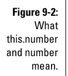

通常情况下，`this.someName` 指向包含代码的对象的变量。相比之下，普通的 `someName` 指向 `someName` 恰好被声明的最近的地方。在 `this.number = number` 语句（列表 9-1）中，那个最近的地方恰好是 `Temperature` 构造函数的参数列表。

## 这这一切到底是怎么的？

假设你的代码包含一个构造函数——列表 9-4 中两个构造函数中的第一个。`whatever` 变量接收了一个像 `32.0` 这样的数字，然后构造函数体内的第一条语句将值 `32.0` 赋值给新对象的变量。代码可以工作。但在编写这段代码时，你必须为参数 `whatever` 发明一个新名字。而这个新名字唯一的目的就是为对象的变量保存一个值。为了区分参数和 `number` 变量，你为一个仅仅是数字值内存存储空间的东西起了一个名字。

我选择了一个原始变量名中令人困惑的拼写错误。（我会将参数命名为 `numr` 或 `number` 之类的名字）。我还尝试过通过更改变量名的大小写来产生参数名（我使用像 `Like` 或 `Number` 这样的参数名）。在第 8 章中，我通过在相应名称后添加后缀来命名我所有的参数（`title` 参数匹配得很好）。这种方案效果很好，唯一问题是我永远记不住自己创建的名字。好消息是，这种参数命名并不是必须的。你可以给参数起一个和变量相同的名字。为了区分两者，你使用 Java 关键字 `this`。

起名是一门艺术，而不是科学。多年来经历了许多命名阶段。几年前，每当我需要为参数起一个新名字时，

## 枚举类型作为一等公民

看看书本书 CD-ROM 中的代码，讲述了一个有趣的故事。本节的项目包含三个 Java 文件：`Temperature.java`（列表 9-1）、`ScaleName.java`（列表 9-2）和 `UseTemperature.java`（列表 9-3）。这三者中的大新闻是 `ScaleName`。类型值得待在它自己独立的 Java 文件中吗？

嗯，存在两个问题，而且都非常重要：

- 枚举类型是一个伪装的类。当 Java 获取到你的枚举声明时，编译器立即将枚举类型转换为一个类：

```java
class ScaleName extends Enum {
  // 这里有我没有给你看的代码
  celsius = new ScaleName("celsius", 0);
  fahrenheit = new ScaleName("fahrenheit", 1);
  kelvin = new ScaleName("kelvin", 2);
  rankine = new ScaleName("rankine", 3);
  // 这里有我没有给你看的代码
}
```

这通常在背后发生。因此，在之前的示例中（例如列表 6-5），你不需要考虑它。但在本书的大多数示例中（以及标准的 Java 编程中），每个 Java 类都存在于它拥有的文件中。由于 `ScaleName` 是一个类，所以拥有一个独立的 `ScaleName.java` 文件是完全合理的。

回到列表 6-5，我将三个枚举声明堆砌在另一个名为 `Cl` 的类中。在第 6 章中，这看起来并不寻常，但现在你可能会想：“一个类可以嵌套在另一个类内部”。Java 确实支持名为“内部类”的特性——定义在其他类内部。内部类也允许你在另一个类内部定义内容。不正确的是初学者不应该使用内部类，除非在枚举这种狭义定义的范围内。因此，通常情况下，当你忍不住将一个类放在另一个类内部时，不要那样做。


- `ScaleName` 枚举类型必须同时属于 `Temperature` 类和 `UseTemperature` 类。在这一节的初稿中，我将 `ScaleName` 枚举声明放在列表 9-1 中。直到我使用了 `UseTemperature` 类（列表 9-3）。因此，为了获取我塞在列表 9-1 中的这个 `ScaleName` 内容，我不得不在列表 9-3 中放置冗长而繁琐的语句：

```java
temp.setScale(ScaleName.fahrenheit);
temp = new Temperature(ScaleName.celsius);
temp = new Temperature(ScaleName.kelvin);
```

此时，有一个小声音告诉我，将 `ScaleName` 枚举声明放在它自己拥有的文件中更简单。这样，`Temperature` 类和 `UseTemperature` 类都可以引用 `ScaleName`，而不需要任何额外的点操作链。

## 有些事情永远不会改变

第 7 章引入了 `printf` 方法，并解释了每个 `printf` 都以一个格式字符串开头。格式字符串描述了其他参数的方式。在之前的示例中，这个格式字符串始终是一个带的字面量。例如，列表 7-7 中的第一个 `printf` 调用是：

```java
out.printf("%.2f\n", interest);
```

在列表 9-3 中，我打破了传统，以一个命名为 `format` 的变量开始 `printf` 调用。

```java
out.printf(format, temp.getNumber(), temp.getScale());
```

只要 `format` 是 `String` 类型，这样做是可以的。为了防止修改，你使用了 Java 关键字 `final`。在列表 9-3 中，我声明了：

```java
final format = "%.2f\n";
```

在 `format` 变量的赋值中，我添加了：

```java
format = "%.2f (%s)\n";
```

然后编译器会报错“无法给 `format` 赋值”。使用 `final` 是良好的编程实践。

## 更多的子类（关于天气）

在第 8 章中，我大费口舌讨论了子类的概念。这是正确的做法。子类是可重用的，而重用的代码是良好的代码。考虑到这一点，是时候创建一个子类了（在本章的第一节中）。

### 构建更好的温度

在追求列表 9-3 的代码后，你认为温度的责任被错放了。列表 9-3 中有几处重复的打印温度值的语句。70 年代的程序员会告诉你将这些行收集到一个地方，并将它们转换为方法。（70 年代的程序员可能不会使用 `method` 这个词，但那现在不重要）。将行转换为方法很好，但根据今天的面向对象编程方法论，你应该考虑得更广泛。为什么不让每个对象负责显示自己呢？毕竟，如果你开发了一个显示方法，你可能想与其他使用温度的人共享这个方法。所以你把方法放在温度对象的声明内部。

在列表 9-5 的 `display` 方法中，请注意对 `Temperature` 类的 `getNumber()` 和 `getScale()` 方法的调用。我为什么要这样做呢？嗯，在 `TemperatureNice` 类的代码中，任何对 `number` 和 `scale` 变量的直接引用都会产生错误信息。确实，每个 `TemperatureNice` 都有自己的 `number` 和 `scale` 变量。（毕竟，`TemperatureNice` 是 `Temperature` 类的子类，而 `Temperature` 类的代码定义了 `number` 和 `scale` 变量。）由于 `number` 和 `scale` 在 `Temperature` 类内部被声明为私有，因此只有 `Temperature` 类内部的代码才能使用这些变量。

不要在 `TemperatureNice` 类的代码中对 `number` 和 `scale` 变量进行额外的声明。如果你这样做，你就会无意中创建了四个不同的变量（两个名为 `number`，另一个名为 `scale`）。你会为其中一对变量赋值。然后当你显示另一对变量时，你会感到震惊，因为那些值似乎消失了。

当一个对象的代码包含对该对象的某个方法的调用时，你不需要在调用前加上点号。例如，在列表 9-5 的最后状态中，代码通过 `getNumber()` 和 `getScale()` 调用了它的方法，使用了 `someObject().getNumber()` 和 `somethingOrOther.getScale()`。如果不加点的写法让你感到不舒服，你可以利用该关键字的另一个用途来补偿。只需在列表 9-5 的最后一行写 `this.getNumber()` 和 `this.getScale()` 即可。


### 子类的构造函数

到目前为止，列表 9-5 中最大的新闻是代码的构造方式。`TemperatureNice` 类有四个构造函数。如果你已经在深入思考子类继承，你可能会奇怪，为什么这些构造函数声明是必要的。`TemperatureNice` 不是继承了父类 `Temperature` 的构造函数吗？不，子类不继承构造函数。

> 子类不继承构造函数。


没错。子类不继承构造函数。在一种奇特殊的情况下，构造函数看起来像像是被继承了，但那个特殊情况是巧合，而不是常态。通常情况下，当你定义一个子类时，你会声明新的构造函数来配合该子类。

我将在本章稍后的“默认构造函数”部分描述那个特殊情况（即构造函数看起来像是在被继承的情况）。

所以，列表 9-5 中的代码有四个构造函数。每个构造函数的名称都是 `TemperatureNice`，并且每个构造函数都有自己独特的、可标识的参数列表。那是无趣的部分。有趣的部分是，每个构造函数都调用了名为 `super` 的东西，`super` 是 Java 关键字。

在列表 9-5 中，`super` 代表父类中的构造函数。

- 列表 9-5 中的语句 `super()` 调用了列表 9-1 中无参数的 `Temperature()` 构造函数。无参数构造函数将 `0.0` 赋值给 `number` 变量并将 `ScaleName.fahrenheit` 赋值给 `scale` 变量。
- 列表 9-5 中的语句 `super(number, scale)` 调用了 9-1 中的 `Temperature(double number, ScaleName scale)` 构造函数。相反，该构造函数为 `number` 和 `scale` 变量赋值。
- 同样，列表 9-5 中的语句 `super(number)` 和 `super(scale)` 调用了列表 9-1 中的构造函数。

计算机通过查看 `super` 单词后面的参数列表来决定调用 `Temperature` 类的哪个构造函数。例如，当计算机执行

```java
super(number, scale);
```

来自列表 9-5，计算机在心里想：“括号中的 `number` 和 `scale` 变量类型类型为 `double` 和 `ScaleName`。但在 9-1 中 `Temperature` 的构造函数中只有一个具有两个参数（`double` 和 `ScaleName`）的构造函数。该构造函数的头部看起来如下：

```java
public Temperature(double number, ScaleName scale);
```

所以，我想我将执行该特定构造函数内部的语句。

### 使用这些东西

在列表 9-5 中，我定义了处于 `TemperatureNice` 类中的含义。现在是把这个 `TemperatureNice` 类用好时候了。列表 9-6 有使用 `TemperatureNice` 的代码。

```java
FullTimeEmployee ftEmployee = new FullTimeEmployee();
```

但是，问题是：定义 `FullTimeEmployee` 的代码（列表 8-3）似乎没有在内部声明任何构造函数。所以，在列表 8-6 中，你如何可能调用 `FullTimeEmployee` 构造函数？

情况是这样的：当你创建一个子类且没有在代码中放置任何显式的构造函数声明时，Java 会为你创建一个构造函数。它被称为默认构造函数。如果你正在创建公共的 `FullTimeEmployee` 子类，默认构造函数在列表 9-7 所示。

## 列表 9-7：默认构造函数

```java
public Employee() {
    super();
}
```

你刚刚读到了默认构造函数，但注意！如果你声明了任何构造函数，就不再有默认构造函数了。该怎么办？如果你声明了任何构造函数，但仍然需要一个无参数的构造函数，你就必须手动写一个。如果你需要带参数的构造函数，在列表 9-8 所示。

## 列表 9-8：看，我有构造函数！

```java
class FullTimeEmployee extends Employee {
    private double number;
    private ScaleName scale;

    public FullTimeEmployee() {
        super();
    }

    public FullTimeEmployee(double number, ScaleName scale) {
        super(number, scale);
        this.number = number;
        this.scale = scale;
    }

    public void display() {
        System.out.println("Temperature: " + number + " " + scale);
    }
}
```


# 第 9 章：构建新对象

## Temperature 与 TemperatureNice 类

```java
return number;
}

public void setNumber(double number) {
    this.number = number;
}

public void setScale(ScaleName scale) {
    this.scale = scale;
}

public double getNumber() {
    return number;
}

public ScaleName getScale() {
    return scale;
}
}

class TemperatureNice extends Temperature {
    private double numberNice;
    private ScaleName scaleNice;

    public TemperatureNice() {
        super(0.0, ScaleName.fahrenheit);
    }

    public TemperatureNice(double number, ScaleName scale) {
        super(number, scale);
        this.numberNice = number;
        this.scaleNice = scale;
    }

    public void display() {
        System.out.println("Temperature Nice: " + numberNice + " " + scaleNice);
    }
}
```

如果你使用列表 9-5 中的代码行：

```
FullTimeEmployee ftEmployee = new FullTimeEmployee();
```

在列表 9-5 中，我定义了处于 `TemperatureNice` 类中的含义。现在是把这个 `TemperatureNice` 类用好时候了。列表 9-6 有使用 `TemperatureNice` 的代码。

```
FullTimeEmployee ftEmployee = new FullTimeEmployee();
```

但是，问题是：定义 `FullTimeEmployee` 的代码（列表 8-3）似乎没有在内部声明任何构造函数。所以，在列表 8-6 中，你如何可能调用 `FullTimeEmployee` 构造函数？

情况是这样的：当你创建一个子类且没有在代码中放置任何显式的构造函数声明时，Java 会为你创建一个构造函数。它被称为默认构造函数。如果你正在创建公共的 `FullTimeEmployee` 子类，默认构造函数在列表 9-7 所示。

### 列表 9-7：默认构造函数

```java
public Employee() {
    super();
}
```

你刚刚读到了默认构造函数，但注意！如果你声明了任何构造函数，就不再有默认构造函数了。该怎么办？如果你仍然需要一个无参数的构造函数，你就必须手动写一个。如果你需要带参数的构造函数，在列表 9-8 所示。

## 一个调用

在某些情况下，Java 会自动添加一个不可见的 `super` 调用，位于构造体体的顶部。这就像列表 9-10 中的 `MySubclass` 构造函数看起来像这样：

```java
MySubclass() {
    super();
    System.out.println("MySubclass constructor being called.");
}
```

在列表 9-10 中，不可见的 `super` 调用触发了 `MyClass` 构造函数，打印出消息 MyClass constructor being called。这种自动添加的 `super` 调用是一个棘手的问题，它并不经常出现，所以当它出现时，可能显得非常神秘。

## 第三部分：宏观视角：面向对象编程

## 功能丰富的构造函数

这里引用了本章开头附近的一句话：“如果你对除了填充变量之外的更多操作感兴趣呢？也许，当计算机创建一个新对象时，你有一整系列任务让计算机执行？好吧，如果是这样呢？”

本节的示例包含一个构造函数，它的功能不仅仅给变量赋值。示例位于列表 9-12 和 9-13。运行示例代码的结果如图 9-4 所示。

### 列表 9-12：定义框架

```java
import java.awt.FlowLayout;
import javax.swing.JFrame;
import javax.swing.JButton;

class SimpleFrame extends JFrame {
    setTitle("Don't click the button!");
    setLayout(new FlowLayout());
    setDefaultCloseOperation(EXIT_ON_CLOSE);
    add(new JButton("Panic"));
    setSize(300,100);
    setVisible(true);
}
```

### 列表 9-13：显示框架

```java
class ShowFrame {
    public static void main(String[] args[]) {
        new SimpleFrame();
    }
}
```

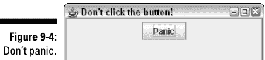

## 包与导入声明

Java 有一个功能允许你将类归为一组类。每一组类被称为一个 `package`（包）。在 Java 世界中，程序员习惯于给这些包命名为点分隔的名字。例如，如果我想要 `com.burdbrain.util` 这个名字，我就可以给包命名为它。Java API 实际上是如 `java.lang`、`java.util`、`java.awt`、`java.swing` 等包的集合。

类定义所在包的名字。（你可以通过阅读 Java API 文档了解关于 `java.util` 和 `Scanner` 的所有信息。关于阅读文档的技巧，请参阅第 3 章和本书的网站。）

这是另一个示例。声明：

```java
import java.swing.*;
```

是有效的，因为 `java.swing` 是 Java API 中一个包的名字，而星号 `*` 指代 `java.swing` 包中的所有类。在 Java 类的顶部使用此导入声明，你可以使用 `java.swing` 包中类的简写名称——如 `JFrame`、`JButton`、`JCheckBox` 等许多类。

有了这些关于包的知识，我可以消除关于导入声明的一些困惑。任何不使用 `static` 单词的导入声明必须以包名开头，并以以下之一结尾：

- 该包内某个类的名称
- 星号（包括该包内的所有类）

例如，声明：

```java
import java.util.Scanner;
```

是有效的，因为 `java.util` 是 Java API 中一个包的名字，而 `Scanner` 是 `java.util` 包中一个类的名称。点分隔名 `java.util.Scanner` 是 `Scanner` 类的*全限定名*（fully qualified name）。类的全限定名包含了类定义所在包的名字。

更多示例。这样的一行：

```java
import java.swing.*; // 错误！！
```

并不是有效的声明。API 中没有名为 `java` 的单单词包。你可能认为这一行允许你缩写所有以 `java` 开头的名称（如 `java.swing.JFrame`、`java.sound.midi`），但导入机制并不是这样的。因为 `java` 并不是包的名字，`import java.*` 这一行只会让编译器生气。


---

# 第 10 章：将变量和方法放在它们该所在的地方

## 本章内容

- 让某些内容属于整个类
- 将变量放在方法内部和外部
- 提高你的击球率

你好，再次回到。你正在收听 WWW 音电台，我是你的主持人 Sam Burd。大型棒球赛季又开始了，今天 WWW 音电台为你带来了现场直播：Hankees 队对阵 Socks 队的比赛。此时，我正在等待比赛的最终比分消息。

如果你还记得今天下午早些时候的情况，Socks 队看起来要把那些 Hankees 队打个精光。接着，Hankees 队一个接一个地击球，让 Socks 队压力巨大。那些 Socks 球员！我很庆幸自己不是他们。

不管怎样，随着比赛的进行，Socks 队奋起反击。现在 Socks 队与 Hankees 队平分秋色。我们几后就会公布比分，但首先有几点提醒。请在广播结束后继续关注大 Jersey 队的比赛。不要忘记在下周收听 Cleveland Gowns 队对阵 Bermuda Shorts 队的比赛。

好了，这是最终比分。哪个队占据上风？哪支队胜出？获胜者是 ...... 噢，不！是平局！

## 定义一个类（成为棒球运动员意味着什么）

在我看来，一个棒球运动员有一个名字和一个击球率。列表 10-1 将我对此的感受转化成了 Java 程序形式。

### 列表 10-1：Player 类

```java
import java.text.DecimalFormat;
class Player {
    private String name;
    private double average;

    public Player(String name, double average) {
        this.name=name;
        this.average=average;
    }

    public String getName() {
        return name;
    }

    public double getAverage() {
        return average;
    }

    public String getAverageString() {
        DecimalFormat decFormat = new DecimalFormat(".000");
        return decFormat.format(average);
    }
}
```

现在由我来拆解列表 10-1 中的代码。幸运的是，前面的章节已经涵盖了这段代码中的许多内容。这段代码定义了作为 Player 类实例意味着什么。以下是代码中的内容：

- **变量 `name` 和 `average` 的声明。** 关于实例变量声明，请参阅第 4 章。
- **一个用于 Player 类新实例的构造函数。** 关于构造函数的详细信息，请参阅第 9 章。
- **变量 `name` 和 `average` 的 getter。** 关于每个访问器方法（即 setter 和 getter 方法），请参阅第 7 章。
- **一个以 String 形式返回球员击球率的方法。** 关于方法的介绍，请参阅第 7 章。

## 另一种美化数字的方法

列表 10-1 中的最后一个方法从 `average` 变量（球员的击球率）获取值，将该值（通常是 `double` 类型）转换为 `String`，然后将该 String 值返回给方法调用者。使用直接来自 Java API（应用程序接口）的 `DecimalFormat`，可以确保该 String 值看起来像棒球运动员的击球率。也就是说，该 String 值以许多空格开头，小数点左侧没有数字，小数点右侧恰好有三个数字。（空格确保了击球率与其之前的任何文本之间有间隔。）

Java 的 `DecimalFormat` 类非常有用。例如，要以符合会计习惯的格式显示值 345 和 -345，可以使用以下代码：

```java
DecimalFormat decFormat = new DecimalFormat("####.00; ($####.00)");
System.out.println(decFormat.format(345));
System.out.println(decFormat.format(-345));
```

在这个示例的格式字符串中，分号之前的内容决定了正数的显示方式，分号之后的内容决定了负数的显示。因此，使用这种格式，数字 345 和 -345 显示为：

```
$345.00
($345.00)
```

要发现其他处理数字的技巧，请访问 Java API 文档中的 `DecimalFormat` 页面。

## 使用 Player 类

列表 10-2 和 10-3 包含了使用 `Player` 类的代码——即在列表 10-1 中定义的类。

### 列表 10-2：使用 Player 类

```java
import java.util.Scanner;
import java.io.File;
import java.io.IOException;
import javax.swing.JFrame;
import javax.swing.JLabel;
import java.awt.GridLayout;

class TeamFrame extends JFrame {

    public TeamFrame() throws IOException {
        Player player;
        Scanner myScanner = new Scanner(new File("Hankees.txt"));

        for (int num = 1; num <= 9; num++) {
            player = new Player(myScanner.nextLine());
            myScanner.nextDouble();
            myScanner.nextLine();

            addPlayerInfo(player);
        }

        setTitle("The Hankees");
        setLayout(new GridLayout(9,2));
        setDefaultCloseOperation(EXIT_ON_CLOSE);
    }

    void addPlayerInfo(Player player) {
        add(new JLabel(player.getName()));
        add(new JLabel(player.getAverageString()));
    }
}
```

### 列表 10-3：显示 Frame

```java
import java.io.IOException;

class ShowTeam {

    public static void main(String[] args) throws IOException {

        new TeamFrame();

    }

}
```


# 第 10 章：将变量和方法放在它们该去的地方

对于列表 10-1、10-2 和 10-3 中的代码，请查看 `Hankees.txt` 文件以了解运行它们。幸运的是，前面的章节已经涵盖了这段代码中的许多内容。`Hankees.txt` 文件包含了：

| Hankees | |
| :--- | :--- |
| 101 | |
| 202 | |
| 303 | |
| 404 | |
| 505 | |
| 606 | |
| 707 | |
| 808 | |
| 909 | |

图 10-2：[你赌这些数字能获胜吗？](img/cd0a1789102e167dca0579253_0.png)

为了让本节代码正常工作，你必须在图 10-2 换行。关于换行，请参阅第 8 章。

## 九，数数它们

列表 10-2 中的代码调用了九次构造函数。这意味着代码创建了九个实例。第一次循环时，代码创建了一个名为 Burd 的实例。第二次循环时，代码放弃了 Burd 并创建了一个名为 Ritter 的实例。第三次循环时，代码放弃了 Ritter 并创建了一个名为 Weelie 的实例。

每个实例都有自己的 `name` 和 `average` 变量。每个实例还有自己的 `Player` 构造函数以及 `getName()`、`getAverage()` 和 `getAverageString()` 方法。看图 10-3 带有实例的 `Player` 类。

# 234 第四部分：精通的 Java 技术

# Player 类

| 实例 | 实例 | 实例 | 实例 | 实例 | 实例 | 实例 | M. | 实例 |
| :--- | :--- | :--- | :--- | :--- | :--- | :--- | :--- | :--- |
| Barry | Harriet | Weelie | Harry | Fisher | Jeremy | 000 | Hugh |
| 101 | 102 | 103 | 104 | 105 | 106 | 107 | 212 | 213 |
| 构造函数 | 构造函数 | 构造函数 | 构造函数 | 构造函数 | 构造函数 | 构造函数 | 构造函数 | 构造函数 |
| getName | getName | getName | getName | getName | getName | getName | getName | getName |
| getAv | getAv | getAv | getAv | getAv | getAv | getAv | getAv | getAv |
| getAvStr | getAvStr | getAvStr | getAvStr | getAvStr | getAvStr | getAvStr | getAvStr | getAvStr |

**图 10-3** 一个类及其对象。

## 别用 GUI 对我

列表 10-2 中的代码使用了 Java API 的几个名称。这些名称中的某些在第 9 章中解释过。其他的在这里解释：

- **JLabel**：`JLabel` 是一个带有文本的组件。显示框架的方法之一是将 `JLabel` 类的实例添加到框架中。

在列表 10-2 中，`addPlayerInfo()` 方法被调用了九次，每个球员一次。每当调用 `addPlayerInfo()` 时，该方法都会向框架添加两个新的 `JLabel` 对象。每个 `JLabel` 对象的文本来自球员对象的 getter 方法。

- **GridLayout**：`GridLayout` 在等间距的行和列中排列物品。`GridLayout` 的构造函数接受两个参数——行数和列数。

在列表 10-2 中，对 `GridLayout` 的调用带了参数 `(9, 2)`。

## 第 10 章：将变量和方法放在它们该去的地方

当你向框架中添加内容时，在操作顺序上你有很大的灵活性。例如，你可以在向框架添加标签和其他内容之后再设置布局。如果你先调用 `setLayout()` 然后再添加标签，标签将出现在框架上美观且整齐的位置。如果你反过来这个顺序（先添加标签再调用 `setLayout()`），那么 `setLayout()` 的调用会以一种美观且整齐的方式重新排列标签。两种方法效果都很好。

在设置框架时，唯一你不应该做的是违反以下顺序：

```
Add things to the frame, then

pack();

setVisible(true);
```

如果你在调用 `pack()` 后又向框架添加更多内容，`pack()` 方法将不会考虑你最近添加的内容。如果你在添加内容或调用 `pack()` 之前调用了 `setVisible()`，用户看到的框架将是正在构建中的状态。最后，如果你忘记设置框架的大小（通过调用 `pack()` 或其他其他调整大小的方法），你看到的框架就像图 10-4 所示。（通常情况下，我不会向你展示像图 10-4 那样的异常运行情况，但我犯过太多次这种错误，以至于我觉得这个膨胀的框架就像我的老朋友一样。）

图 10-4：


## 在方法之间抛出异常

第 8 章介绍了从磁盘文件输入，随之这个话题也引入了异常的概念。当你处理磁盘文件时，你需要承认可能会抛出 `IOException` 的可能性。这是第 8 章的教训，这也是为什么列表 10-2 中的构造函数有 `throws IOException` 子句的原因。

但是列表 10-3 中的 `main()` 方法呢？在这个 `main()` 方法中没有明显对磁盘文件的引用，为什么该方法仍然需要它自己的 `throws IOException` 子句呢？嗯，异常就像一个烫手山芋。如果你手里有一个异常，你要么必须吃掉它（如你在第 12 章中看到的），要么使用 `throws` 子句把它扔给别人。如果你用 `throws` 子句抛出异常，那么就有人得承担这个异常，就像你之前一样。

列表 10-2 中的构造函数抛出了 `IOException`，但这个异常被抛给了谁呢？嗯，这段代码中谁调用了这个有问题的 `IOException` 的责任承担者？是谁调用了列表 10-2 中的构造函数？——那是列表 10-3 中的 `main()` 方法 —— 那个调用 `TeamFrame` 构造函数的方法将“烫手山芋”扔给了列表 10-3 中的 `main()` 方法，`main()` 方法必须处理它。正如列表 10-3 所示，`main()` 方法通过抛出 `IOException`（通过拥有它自己的 `throws` 子句）来处理它。这就是 Java 程序中 `throws` 子句的工作方式。


如果一个方法调用另一个方法，而被调用的方法有一个 `throws` 子句，那么调用方法必须包含处理该异常的代码。要了解更多关于处理异常的信息，请阅读第 12 章。

在书的这里，敏锐的《For Dummies》读者可能会产生一两个问题。“当一个 `main()` 方法有一个 `throws` 子句时，另一个人必须处理该 `throws` 子句中的异常。但是谁调用了 `main()` 方法呢？是谁处理了列表 10-3 中 `throws` 子句中的 `IOException`？”答案是 Java 虚拟机（或 JVM，即运行你所有代码的东西）调用了 `main()` 方法。在列表 10-3 中，如果程序在读取 `Hankees.txt` 文件时遇到任何问题，责任最终归 JVM 所有。JVM 通过显示错误消息然后结束你的程序运行来处理问题。

## 使其静态化（计算团队平均值）

关于列表 10-1 到 10-3 中的代码，你决定想找到团队的整体击球率。这不是个坏主意！图 10-1 中的 Hankees 队平均水平只有 .106，所以团队需要密集的训练。当球员们在球场上练习时，你面临着一个哲学层面的障碍。

在列表 10-1 到 10-3 中，你有三个类：一个 `Player` 类和另外两个帮助显示 `Player` 类数据的类。在这些类中，存储你的整体团队平均总计数的变量应该放在哪里呢？

- ✔ 在任何一个显示类（`TeamFrame` 和 `ShowTeamFrame`）中放入总计变量都是没有意义的。毕竟，总计数与球员、团队和棒球有关。显示类是关于创建窗口的，而不是关于棒球的。
- ✔ 将整个团队信息放在 `Player` 类的实例中让你感到不安，因为 `Player` 类的实例只代表团队中的某一个人。一个单独球员存储整个团队数据有什么业务关系呢？当然，你可以让它行通，但这并不是解决该问题的优雅方案。

最后，你发现了关键字 `static`。任何被声明为 `static` 的内容都属于整个类，而不是该类的任何特定实例。当你创建静态变量 `totalAverages` 时，你只创建了它的一个副本。无论你创建多少个实例，这个副本都与类保持。明白我的意思吧——看图 10-5。

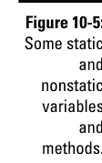

## 第 10 章：将变量和方法放在它们该去的地方

等等，图 10-5 中的代码是什么？让我们来看看：

```java
import java.text.DecimalFormat;

class PlayerPlus extends Player {

    private static int playerCount = 0;

    private static double totalAverages = 0.0;

    private static DecimalFormat decFormat = new DecimalFormat(".000");

    public PlayerPlus(String name, double average) {

        super(name, average);

        playerCount++;

        totalAverages += average;

    }

    public static double findTeamAverage() {

        return totalAverages / playerCount;

    }

    public static String findTeamAverageString() {

        return decFormat.format(totalAverages / playerCount);

    }

}
```

## 为什么有这么多 static？

你可能注意到——列表 10-4 中的代码充斥着 `static` 这个词。该代码中几乎所有的内容都属于整个 `PlayerPlus` 类，而不是该类的单个实例。这是件好事，因为像 `playerCount`（团队中的人数）这样的东西不应该属于单个球员，让每个 `PlayerPlus` 对象都跟踪自己的计数是愚蠢的（“我知道我是几个球员。我只是一个球员！”）。如果你有九个独立的 `playerCount` 变量，每个变量都将存储数字 1（这毫无用处），或者你有九份计数的副本，这既浪费又容易出错。因此，通过将 `playerCount` 设为静态，你将 `playerCount` 保在了一个地方，即它该去的地方。

# 第 10 章：将变量和方法放在它们所属的位置

你可能希望 `findTeamAverage()` 和 `findTeamAverageString()` 方法也是静态的。如果没有 `static` 关键字，将会有个 `findTeamAverage()` 方法——为每个 `PlayerPlus` 类的实例各一个。这不符合逻辑。每个实例都将拥有计算 `totalOfAverages / playerCount` 的代码，而且每个计算结果将是相同的答案。

通常情况下，任何所有实例共有的（并为每个实例产生结果）的任务都应该被编码为静态方法。

构造方法永远不会是静态的。

在列表 10-4 中，`decFormat` 变量是静态的。这是很合理的，因为 `decFormat` 让 `totalAverages / playerCount` 看起来很美观，而且表达式 `totalAverages / playerCount` 中的两个都是静态的。更直接地考虑，代码格式化数字只需要一个。如果你有几个数字需要格式化，属于整个类的同一个 `decFormat` 可以格式化每一个数字。为每个玩家创建一个 `decFormat` 不仅不方便，而且浪费。

在本书书中，我第一次使用 `static` 这个词是在列表 3-1 中。我在每个 `main()` 方法中都使用了 `static` 关键字（书中列表中有很多 `main()` 方法）。那么，为什么 `main()` 必须是静态的呢？记住，非静态的内容属于对象而不是类。在创建对象之前，你无法拥有 `main()` 方法。当你启动 Java 程序时，还没有创建任何对象。在 `main()` 方法中执行的语句开始创建对象。所以，如果 `main()` 方法不是静态的，你就会面临一个巨大的“鸡生蛋”问题。

## 显示团队整体平均分

你可能注意到了一种模式。当你为一个类编写代码时，你会生成两部分代码。一部分代码定义类，另一部分代码使用该类。（使用类的方法包括调用类的构造方法、引用类的非私有变量、调用类的方法等。）之前展示的列表 10-4 包含了定义 `PlayerPlus` 类的代码，而列表 10-5 包含了使用该 `PlayerPlus` 类的代码。

## 列表 10-5：使用列表 10-4 中的代码

```java
import java.util.Scanner;

import java.io.File;

import java.io.IOException;

import javax.swing.JFrame;

import javax.swing.JLabel;

import java.awt.GridLayout;

class TeamFrame extends JFrame {

    public TeamFrame() throws IOException {

        Player player;

        Scanner myScanner = new Scanner(new File("Hankees.txt"));

        for (int num = 1; num <= 9; num++) {

            player = new Player(myScanner.nextLine(), myScanner.nextDouble());

        }

        addPlayerInfo(player);

        add(new JLabel());

        add(new JLabel("------"));

        add(new JLabel("Team Batting Average:"));

        add(new JLabel());

        add(new JLabel(PlayerPlus.findTeamAverageString()));

        setTitle("The Hankees");

        setLayout(new GridLayout(11, 2));

        setDefaultCloseOperation(EXIT_ON_CLOSE);

        pack();

        setVisible(true);

    }

    void addPlayerInfo(PlayerPlus player) {

        add(new JLabel(player.getName()));

        add(new JLabel(player.getAverageString()));

    }
}
```

要运行列表 10-5 中的代码，你需要一个带有 `main()` 方法的类。列表 10-3 中的 `ShowTeamFrame` 类运行良好。（如果你运行的是书中光盘中的 JCreator，那么一切都好了，因为 `ShowTeamFrame.java` 文件已经和列表 10-5 一起在项目里了。）

图 10-6 显示了列表 10-5 代码的运行情况。这次运行取决于列表 10-2 中 `Hankees.txt` 文件的可用性。列表 10-5 中的代码是列表 10-2 代码的完全复制。（如果我付得起这种复制的代价，我会起诉自己盗窃知识产权。）列表 10-5 中唯一的新内容是**加粗**显示的部分。

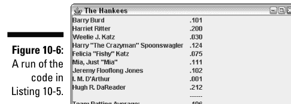

在列表 10-5 中，`GridLayout` 有两行：一行用于间距，另一行用于 Hankee 团队。这些每一行都包含 `Label` 对象。

- 间距行有一个空白标签和一个带虚线的标签。空白标签是一个占位符。当你向 `GridLayout` 中添加组件时，组件是按行添加的，从行的左端开始，一直到行的右端。如果不这样做，虚线标签将出现在行的左端，并使用 Hugh R. DaReader 的名字。
- 另一行有一个显示“Team Batting Average”（团队击率）字字的标签，以及另一个显示数字 `.106` 的标签。获取数字 `.106` 的方法调用很有趣。该调用看起来像这样：

```
PlayerPlus.findTeamAverageString()
```

看一眼那个方法调用。该调用具有以下形式：

```
ClassName.methodName()
```


这是新的，而且在较早的章节中，我提到过非静态的内容属于对象而不是类。在创建对象之前，你无法拥有 `main` 方法。当你启动 Java 程序时，还没有创建任何对象。在 `main` 方法中执行的语句开始创建对象。所以，如果 `main` 方法不是静态的，你就会面临一个巨大的“鸡生蛋”问题。更直接地考虑，代码格式化数字只需要一个。如果你有几个数字需要格式化，属于整个类的同一个 `decFormat` 可以格式化每一个数字。为每个玩家创建一个 `decFormat` 不仅不方便，而且浪费。

## 第四部分：精通 Java 技术

事实证明，Jane 来自宾夕法尼亚州的马星市（Mars），那是匹兹堡以北约 20 英里的小镇。好了，我想说的重点是什么？重点是，名称的含义取决于上下文。如果你在匹兹堡北部并问：“我从这里怎么去火星？”，你可能会得到一个合理且漫经意的回答。但如果你在曼哈顿的街角问同样的问题，可能会引起某些人的怀疑。（好吧，考虑到曼哈顿，人们可能直接无视你。）

当然，住在宾夕法尼亚州马星市的人非常清楚自己的小镇名字很奇怪。在马星高中度过的青少年时光的记忆并阻止人们知道那颗红色行星。在八月一个晴朗的夜晚，你仍然可以和一位当地居民进行以下对话：

我该如何去火星？

当地居民：你就在马星市，哥们儿。你想找马星的哪个部分？

你：不，我不是不是宾夕法尼亚州的马星。我说的是火星行星。

当地居民：噢，火星行星！那，坐 8:19 号发往卡纳维拉尔的火车……不，等等，那是当地火车。那会带你经过西弗吉尼亚州……

所以，名称的含义取决于你使用该名称的地方。尽管大多数说英语的人认为火星是一颗具有二氧化碳大气层的地方，但宾夕法尼亚州的一些人想的是在马星市能进行的所有购物。而那些宾夕法尼亚州的人对“Mars”这个名字确实有两个含义。在 Java 中，这些名称可能像这样：`Mars` 和 `planets.Mars`。

## 将变量放在它的位置

你的第一个实验如列表 10-6 和 10-7 所示。列表的代码突出了方法内部外部声明的变量的区别。

- 列表 10-6：Mars 的两种含义

```java
import static java.lang.System.out;

class EnglishSpeakingWorld {

    String mars = "red planet";

    void visitPennsylvania() {

        out.println("visitPa is running;");

        String mars = "Janine's home town";

        out.println(mars);

        out.println(this.mars);

    }

}
```

列表 10-7：调用列表 10-6 代码

```java
import static java.lang.System.out;

class GetGoing {

    public static void main(String args[]) {

        out.println("main is running;");

        EnglishSpeakingWorld e = new EnglishSpeakingWorld();

        //out.println(mars); cannot resolve symbol

        out.println(e.mars);

        e.visitPennsylvania();

    }

}
```

图 10-7 显示了列表 10-6 和 10-7 的运行情况。图 10-8 显示了代码结构的图表。在 `GetGoing` 类中，`main` 方法创建了 `EnglishSpeakingWorld` 类的实例。变量 `e` 指向该新实例。新实例是一个内部有一个名为 `mars` 变量的对象。那个 `mars` 的值为 "red planet"。`mars` 变量被称为**实例变量**，因为该变量属于一个对象——`EnglishSpeakingWorld` 类的实例。

现在看列表 10-7 中的方法。在 `GetGoing` 的 `main` 方法内部，你不允许编写 `out.println(mars)`。换句话说，对任何 `mars` 变量的裸引用都是绝对不允许的。我在上一段中提到的 `mars` 变量属于 `EnglishSpeakingWorld` 对象，而不是 `GetGoing` 类。

然而，在 `GetGoing` 类的 `main` 方法内部，你完全可以编写 `e.mars`，因为变量 `e` 指向 `EnglishSpeakingWorld` 对象。很好。

在代码底部，调用了 `visitPennsylvania` 方法。当你进入 `visitPennsylvania` 方法时，你有另一个 `mars` 变量的声明，其中 `mars` 是 "Janine's home town"。这个特定的 `mars` 变量被称为**方法局部变量**，因为它只属于一个方法——`visitPennsylvania` 方法。

图 10-7：
列表 10-6 和 10-7 代码的运行。

```
main is running:

red planet

visitPa is running:

Janine's home town

red planet
```

图 10-8：
列表 10-6 和 10-7 代码的结构。

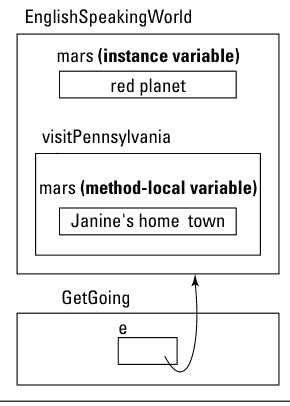

现在你有两个变量，名字都叫 `mars`。其中一个 `mars` 变量（实例变量）值为 "red planet"。另一个 `mars` 变量（方法局部变量）值为 "Janine's home town"。在代码中，当你使用 `mars` 这个词时，你指的是哪一个？

答案是，当你访问宾夕法尼亚州时，值为 "Janine's home town" 的变量会胜出。在宾夕法尼亚州，要像宾夕法尼亚人那样思考。当你执行 `visitPennsylvania` 方法代码时，通过使用直接在 `visitPennsylvania` 方法内部定义的变量来解决任何名称冲突。

## 第 10 章：将变量和方法放在它们所属的地方

所以如果你在宾夕法尼亚州并需要引用那个双鼻天体？更准确地说，`visitPennsylvania` 方法是如何引用 `mars` 的？答案是，`EnglishSpeakingWorld` 类有一个 `mars` 变量。更多信息请参见第 9 章。

## 告诉变量该去哪里

多年前，当我住在密尔沃基时，我经常使用机器。在列表 10-8 和 10-9 中，我说明了这一点。

- 列表 10-8：原子城的故事

```java
import static java.lang.System.out;

class EnglishSpeakingWorld2 {

    void visitIdaho() {

        out.println("visitID is running:");

        String mars = "red planet";

        String atomicCity = "Population: 25";

        out.println(mars);

        out.println(atomicCity);

    }

    void visitNewJersey() {

        out.println("visitNJ is running:");

        out.println(mars);

    }

}
```

列表 10-8（续）

```java
 //out.println(atomicCity);

// cannot resolve symbol

}
```

- 列表 10-9：调用列表 10-8 代码

```java
public static void main(String args[]) {

    EnglishSpeakingWorld2 e = new
    EnglishSpeakingWorld2();

    e.visitIdaho();

    e.visitNewJersey();

}
```

图 10-9 显示了列表 10-8 和 10-9 的运行情况。图 10-10 显示了代码结构的图表。

在列表 10-8 中，注意每个变量可以在哪里使用的不能。当你在 `visitNewJersey` 方法内部尝试使用 `atomicCity` 变量时，你会得到一个错误信息。字面上，信息是 `cannot resolve symbol`。比喻地说，信息说：“嘿，哥们儿，原子城在爱达荷州，不在新泽西州。”技术上，信息表示方法局部变量 `atomicCity` 仅在 `visitIdaho` 方法可用。

所以回到 `visitIdaho` 方法内部，你可以随心所欲使用 `atomicCity` 变量。

## 第 10 章：将变量和方法放在它们所属的位置 249

| 英语世界 2 |
| :--- | :--- |
| mars (实例变量) 红色行星 |
| visitIdaho |
| atomicCity (方法局部变量) 人口: 25 |
| visitNewJersey |

**图 10-10：** 列表 10-8 和 10-9 中代码的结构。

那么火星呢？你忘记了你的老朋友，那个最近酷爱上零度下 80 度的星球吗？好了，`visitIdaho` 和 `visitNewJersey` 方法都可以访问 `mars` 变量。这是因为 `mars` 变量是一个实例变量。`mars` 变量在 `EnglishSpeakingWorld2` 类的代码中声明，但不在任何特定的方法内部。（在我的故事中，事物的名称是这样的——记住住在爱达荷州和新泽西州的这两个人都都听说过火星。）

`mars` 变量的生命周期有三个步骤：

- 当 `EnglishSpeakingWorld2` 类首次出现时，计算机看到 `String mars` 并为该变量创建空间。
- 当执行 `visitIdaho` 方法时，该方法将值 "red planet" 赋值给 `mars` 变量。（`visitIdaho` 方法还会打印 `mars` 变量的值。）
- 当执行 `visitNewJersey` 方法时，该方法再次打印 `mars` 的值。

通过这样，`mars` 变量的值从一个方法传递另一个方法。

## 第四部分：精通 Java 技术

## 传递参数

方法可以通过多种方式与 Java 程序的其他部分进行通信。其中一种方法是通过方法的参数列表。使用参数列表，你可以在调用方法时将即时信息传递给方法。

想象一下，你传递给方法的信息存储在程序的一个变量中。该方法实际上对该变量做了什么？如果有的话？本节介绍了几个有趣的案例研究。

## 值传递

根据我的网络搜索结果，阿肯色州的斯马克奥弗（Smackover）镇有 2,232 人。但我的研究已经过时了。就在昨天，Dora Kermongoos 在斯马克奥弗总医院庆祝了一个快乐的时刻——她那健康、蓝眼睛的女儿出生了。（女孩重 7 磅 4 盎司，高 21 英寸。）现在该镇的人口已增加 2,233。

列表 10-10 包含一个糟糕的程序。程序应该给存储斯马克奥弗人口的变量加 1，但该程序无法工作。看看列表 10-10 看看为什么。

## 列表 10-10：此程序无法工作

```java
class TrackPopulation {

    public static void main(String[] args[]) {

        int smackoverARPop = 2232;

        birth(smackoverARPop);

        System.out.println(smackoverARPop);

    }

    static void birth(int cityPop) {

        cityPop++;

    }

}
```

当你运行列表 10-10 中的程序时，程序在屏幕上显示数字 2,232。在经历了九月的规划、期待以及 Dora 长达七小时的分娩后，Kermongoos 一家的女儿没有在系统中注册。真遗憾！

参数传递的不当使用导致了这个问题。在 Java 中，当你向方法传递具有八种基本类型之一的参数时，该参数是通过值传递的。

要复习 Java 的八种基本类型，请参见第 4 章。

用通俗易懂的话来说这意味着：方法对其参数值所做的任何更改都不会影响调用代码中变量的值。在列表 10-10 中，`birth` 方法可以随心所欲地对 `cityPop` 应用 `++` 运算符——对 `cityPop` 参数的应用完全不会影响主方法中 `smackoverARpop` 变量的值。

技术上发生的是值的复制（见图 10-11）。当主方法调用 `birth` 方法时，存储在 `smackoverARpop` 中的值被复制到另一个内存位置——为 `cityPop` 参数值预留的位置。在 `birth` 方法执行期间，`cityPop` 参数被加了 1。但存储原始 2232 值的地方（`smackoverARpop` 变量的内存位置）仍不受影响。

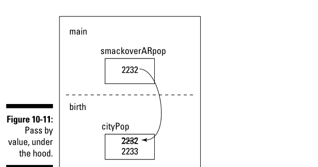

当你对八种基本类型中的任何一种进行参数传递时，计算机使用值传递。调用代码变量中存储的值保持不变。即使调用代码变量与被调用方法的参数名称完全相同，这种情况也会发生。

## 返回结果

你必须修复列表 10-10 代码所带来的问题。毕竟，一个小宝宝 Kermongoose 不能在没有被记录的情况下过一生。为了记录这个小生命，你必须给 `smackoverARPop` 变量的值加 1。你可以通过许多方法实现。尽管如此，列表 10-11 所示的方法并不是简单的。从方法返回一个值可以作为替代方案。

## 列表 10-11：此程序可以工作

```java
class TrackPopulation {

    public static void main(String[] args[]) {

        int smackoverARPop = 2232;

        birth(smackoverARPop);

        System.out.println(smackoverARPop);

    }

    static void birth(int cityPop) {

        cityPop++;

    }

}
```

当你运行 10-11 中的程序时，你得到的输出是 2,233。在九月的规划、期待以及 Dora 长达七小时的分娩后，Kermongoos 一家的女儿在系统中注册了。`birth` 方法实际上更改了 `smackoverAR.population`。当你向方法传递对象时，计算机并没有复制整个对象。相反，计算机复制了指向对象的引用。

## 列表 10-12：什么是 City？

```java
class City {

    int population;

}
```

## 列表 10-13：传递对象

```java
class TrackPopulation {

    public static void main(String[] args[]) {

        City smackoverAR = new City();

        smackoverAR.population = 2232;

        birth(smackoverAR);

        System.out.println(smackoverAR.population);

    }

    static void birth(City city) {

        city.population++;

    }

}
```

在图 10-12 中，你看到了一个 City 类的实例，内部有一个人口变量。在阅读以下步骤时请关注该对象：

- 在调用 `birth` 方法之前，`smackoverAR` 变量指向该对象——City 类的实例。
- 当调用 `birth` 方法并将 `smackoverAR` 传递给方法参数时，计算机将 `smackoverAR` 的引用复制给 `city`。现在 `city` 指向同一个对象——City 类的实例。
- 当 `birth` 方法内部执行 `city.population++` 时，计算机将对象的人口变量加了 1。现在程序中唯一的 City 实例存储了 2333。
- 执行流回到主方法。打印 `smackoverAR.population`。但由于 `smackoverAR` 指向那一个 City 类实例。因此 `smackoverAR.population` 的值为 2233。

## 从方法返回对象

信与否，之前关于参数传递的节还有一个 Java 方法的一个角落未被探索。当你调用方法时，方法可以将结果直接返回给调用代码。在之前的章节和节中，我返回基本值（如 int 值）或空（即 void）。在本节中，我返回一个完整的对象。它是列表 10-12 中的 City 对象。实现这一点的代码在列表 10-14 中。

# 第 10 章：将变量和方法放在它们所属的位置 255

**代码列表 10-14：** 这里，有一座城市

```java
class TrackPopulation4 {

    public static void main(String args[]) {

        City smackoverAR = new City();

        smackoverAR.population = 2232;

        smackoverAR = doBirth(smackoverAR);

        System.out.println(smackoverAR.population);

    }

    static City doBirth(City aCity) {

        City myCity = new City();
```


myCity.population = aCity.population + 1;

return myCity;

}

}

```

如果你运行列表 10-14 中的代码，你将得到数字 2233。这很好。代码的运行原理是告诉 `doBirth` 方法创建另一个 `City` 实例。在新的实例中，`population` 的值为 2333（图 10-13）。

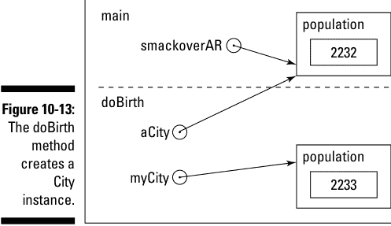

执行 `doBirth` 方法后，`City` 实例被返回到 `main` 方法。然后，回到 `main` 方法，该实例（`doBirth` 返回的那个实例）被赋值给 `smackoverAR` 变量。（见图 10-14。）现在 `smackoverAR` 指向一个全新的 `City` 实例——一个人口为 2233 的实例。

256 第四部分：精通 Java 技术

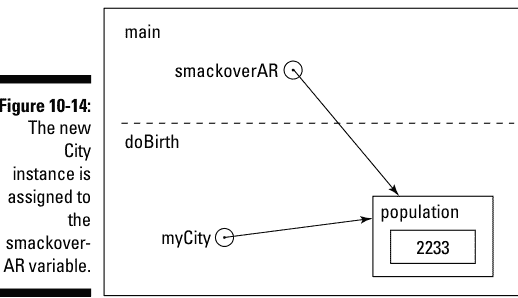

在列表 10-14 中，注意调用和返回 `doBirth` 方法时的类型一致性：

- `smackoverAR` 变量的类型为 `City`。`smackoverAR` 变量被传递给参数 `aCity`，该参数的类型也是 `City`。
- `myCity` 变量的类型为 `City`。`myCity` 变量在 `doBirth` 方法的返回语句中传回。这是一致的，因为 `doBirth` 方法的头部以 `public static City` 开头——这是返回一个 `City` 类型对象的承诺。
- `doBirth` 方法返回一个类型为 `City` 的对象。回到 `main` 方法中，调用 `doBirth` 返回的对象被赋值给 `smackoverAR` 变量（正如你猜的那样），`smackoverAR` 变量的类型是 `City`。

除了非常协调之外，所有这些类型约定都是绝对必要的。如果你编写的程序中类型之间互不一致，编译器就会抛出一条毫不留情的“类型不兼容”（incompatible types）信息。

# 结语

Dora Kermongoos 和她的新生女儿安全、健康且快乐地休息在她们位于阿肯色州斯马克弗（Smackover）的家中。

# 第11章：使用数组和集合来处理数值

## 本章内容

- 同时处理多个值
- 在程序运行过程中创建值
- 用花哨的泛型给其他程序员留下深刻印象

欢迎来到 Java 旅馆（Java Mote）！没有傲慢的服务员，没有昂贵的客房服务，没有那些常见的愚蠢琐事。只有一个物超所值的双人间间！

## 让你的一切都井井就绪

Java 旅馆拥有十间舒适的房间，位于主干公路旁一个安静的地方。除了一个小型的独立办公室外，这家旅馆只有一排一层的房间。每个房间都可以从宽敞的停车场轻松到达。

奇怪的是，旅馆的房间编号为从 0 到 9。我可以说这种编号是一个巧合——与建筑师最初的设计方案有关。但事实是，从 0 开始会让本章中的示例更容易编写。

无论如何，你正试图记录每个每个房间的住客人数。因为你有十间房间，你可能会考虑声明十个变量：

```
int guestsInRoomNum0, guestsInRoomNum1, guestsInRoomNum2,
guestsInRoomNum3, guestsInRoomNum4, guestsInRoomNum5,
guestsInRoomNum6, guestsInRoomNum7, guestsInRoomNum8,
guestsInRoomNum9;
```

这样做可能看起来有点低效。效率低下不是这段代码的唯一问题。更具问题的是，你无法对这些变量进行循环。为了读取每个变量的值，你必须复制十次 `nextInt()`。

```
guestsInRoomNum0 = diskScanner.nextInt();
guestsInRoomNum1 = diskScanner.nextInt();
guestsInRoomNum2 = diskScanner.nextInt();
... 等此类推。
```

显然有更好的办法。

那种方法涉及一个数组。数组是一行值，就像单层旅馆的一排房间一样。要想象这个数组，只需想象 Java 旅馆即可：

- 首先，想象这些并排相邻的房间。
- 接着，想象这些房间去掉了前墙。在每个房间内部，你可以看到特定数量的住客。
- 如果可以的话，请忘记 9 号房间的住客正把一叠叠钞票放入大公文包中。忽略 6 号房间的住客一天半没有离开电视机的事实。与其关注这些细节，不如看数字。在每个房间里，看到一个代表该房间住客数量的数字。（如果自由形式可视化不是你的强项，请看图 11-1。）

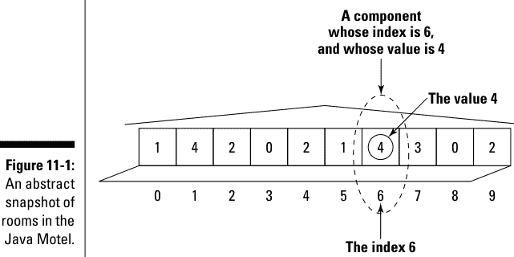

图 11-1：Java 旅馆的抽象图

| | 1 | 2 | 3 | 4 | 5 | 6 | 7 | 8 | 9 |
|---|---|---|---|---|---|---|---|---|---|
# 第11章：使用数组和集合来处理数值 259

在本章的术语中，整排房间被称为数组。数组中的每个房间被称为数组的元素（element）。每个元素有两个数字：

- 房间编号（从 0 到 9）
- 索引（index）

使用数组可以避免重复性工作。在本节开头，例如，为了创建一个包含十个值的数组，你可以写一条语句：

```
int[] guests = new int[10];
```

如果你特别啰嗦，可以将此语句拆分为两条：

```
int guests[];
guests = new int[10];
```

## 分两个简单步骤创建数组

再次查看创建数组的这两行代码：

```
int guests[];
guests = new int[10];
```

每一行都有其独特的用途：

- `int guests[];` 第一行是声明。它为程序的其余部分预留了数组名称（如 `guests`）。在旅馆的隐喻中，这一行的意思是：“我计划建造一座旅馆，并在每个房间安排一定数量的住客。”（图 11-2）
- `guests = new int[10];` 第二行是赋值语句。它在内存中为十个 `int` 值预留了空间。在房地产术语中，这一行的意思是：“我终于盖好了旅馆。去给每个房间安排住客吧。”

忽略 `int guests` 做了什么。重要的是 `int guests[]` 做了什么。声明并没有预留十个内存位置。事实上，像 `int guests[]` 这样的声明并没有创建数组。在代码的那个点，`guests` 变量还没有指向数组。

# 第 11 章：使用数组和集合处理数值

## 存储值

在创建数组之后，你可以将值放入数组的组件中。例如，你想存储 6 号房有 4 位客这一事实。要将值 4 放入索引为 6 的组件，你需要写 `guests[6] = 4`。

现在生意活跃起来。一辆大巴士停在了汽车旅馆门口。巴士侧面有一块写着“诺亚方舟”的牌子。25 对客人从巴士上下来，他们走着、跺着、飞着、跳着或滑着来到汽车旅馆的小办公室。只有 10 对客人入住 Java 旅馆，但那是因为你可以把另外 15 对客人送到路尽头的老 C-Side 度假度假村和汽车旅馆。

总之，要在 Java 旅馆登记 10 对客人，你需要在你的 10 个房间中的每个房间放入一对（2 位客人）。在创建数组后，你可以利用索引优势并免费使用它，如下所示：

```java
for (int roomNum = 0; roomNum < 10; roomNum++) {
    guests[roomNum] = 2;
}
```

这取代了十条赋值语句。注意循环计数器是如何从 0 变 9 的。将其与图 11-2 进行对比，记住数组的索引是从 0 到数组组件数减 1。

然而，考虑到它的工作方式，你的客人并不总是整齐成对到达的，你必须为每个房间填充不同人数的客人。你可能在数据库中存储关于房间和客人的信息。如果是，你仍然可以通过数组执行此操作，在处理过程中收集客人人数。执行此类任务的代码可能看起来如下：

```java
resultSet =
    statement.executeQuery("select GUESTS FROM RoomData");
for (int roomNum = 0; roomNum < 10; roomNum++) {
    resultSet.next();
    guests[roomNum] = resultSet.getInt("GUESTS");
}
```

但由于在第 18 章（光光带上）之前不会涵盖数据库，你可能从一个纯文本文件中读取客人人数更好。图 11-3 显示了一个示例文件。在创建文件后，你可以调用 `Scanner` 类从文件中获取值。代码在列表 11-1 中，结果输出在图 11-4 中。

关于如何创建像图 11-3 那样的自己的所有者文件，请参见第 8 章。

图 11-3：GuestList.txt 文件。

| GuestList.txt |
| --- |
| 1 4 0 2 1 4 3 0 2 |

## 列表 11-1：用值填充数组

```java
import static java.lang.System.out;
import java.io.File;
import java.io.IOException;
import java.util.Scanner;

class ShowGuests {
    public static void main(String[] args[]) throws
        IOException {
        int guests[] = new int[10];
        Scanner diskScanner =
            new Scanner(new File("GuestList.txt"));
        for(int roomNum = 0; roomNum < 10; roomNum++) {
            guests[roomNum] = diskScanner.nextInt();
        }
        out.println("Room" + guests.length);
        for(int roomNum = 0; roomNum < 10; roomNum++) {
            out.print("Room" + roomNum);
            out.print("\t");
            out.println(guests[roomNum]);
        }
    }
}
```

列表 11-1 中的代码有两个循环。第一个循环读取客人人数，第二个循环写入客人人数。

| 通用输出 |
| Room | Guests |
| 0 | 1 |
| 1 | 4 |
| 2 | 2 |
| 3 | 0 |
| 4 | 2 |
| 5 | 1 |
| 6 | 3 |
| 7 | 0 |
| 8 | 2 |

图 11-4：运行列表 11-1 中的代码。


每个数组都有一个内置的 `length` 字段。数组的*长度*是数组中组件的数量。因此，在列表 11-1 中，如果你打印 `guests.length` 的值，你会得到 10。

## 制表符和其他特殊内容

在列表 11-1 中，某些对 `print` 和 `println` 的调用使用了 `\t` 转义序列。它被称为*转义序列*，是因为你逃逸了在屏幕上显示字母 t 的操作。相反，字符 `\t` 代表一个制表符。在打印任何更多字符之前，计算机会移动到下一个制表位。Java 有几个这些方便的转义序列。其中一些显示在表 11-1 中。

| 表 11-1 转义序列 |
| 序列 | 含义 |
| --- | --- |
| \b | 退格 |
| \t | 水平制表符 |
| \n | 换行符 |
| \f | 分页 |
| \r | 回车 |
| \" | 双引号 |
| \' | 单引号 |
| \\ | 反斜杠 |

## 使用数组初始化

除了你在列表 11-1 中看到的之外，在 Java 中还有另一种填充数组的方法——使用数组初始化。当你使用数组初始化时，你不需要告诉计算机数组有多少个组件。列表 11-2 显示了填充数组的新版本代码。程序的输出与列表 11-1 相同（如图 11-4 所示）。列表 11-1 和 11-2 之间的区别在于列表 11-2 中的加粗文本。那是数组初始化。

## 列表 11-2：使用数组初始化

```java
import static java.lang.System.out;

class ShowGuests {
    public static void main(String[] args[]) {
        int guests[] = {1, 4, 2, 0, 2, 1, 4, 3, 0, 2};
        out.println("Room\tGuests");
        for (int roomNum = 0; roomNum < 10; roomNum++) {
            out.print(roomNum);
            out.print("\t");
            out.println(guests[roomNum]);
        }
    }
}
```

> 初始化器可以包含表达式，也可以包含字面量。用通俗英语来说，这意味着你可以在初始化器逗号之间放置任何内容。例如，像初始化器 `{1 + 3, diskScanner.nextInt(), 2, 2, 1, 4, 3, 0, 2}` 是合法的。

## 使用增强 for 循环遍历数组

Java 有增强 for 循环——一种不使用计数器或索引的 for 循环。第 6 章的 6-5 使用增强循环遍历数组类型。可以说，数组类型就是一组值。但想想本章的数组。数组也是一组值。所以增强循环可以遍历数组并不意外。列表 11-3 显示了如何这样做。本节适用于 Java 5.0、Java 6 或未来的任何版本。本节不适用于旧版本的 Java——例如 1.3、1.4 等。关于 Java 数字的更多信息，请参见第 2 章。


## 列表 11-3：获取增强 for 循环！

```java
import java.lang.System.out;

class ShowGuests {
    public static void main(String[] args[]) {
        int guests[] = {1, 4, 2, 0, 2, 1, 4, 3, 0, 2};
        int roomNum = 0;
        out.println("Room\tGuests:");
        for (int numGuests : guests) {
            out.print(roomNum++);
            out.print("\t");
            out.println(numGuests);
        }
    }
}
```

列表 11-1 和 11-3 有相同的输出。在图 11-4 中。

如果你查看列表 11-3 中的循环，你会看到旧模式。就像列表 6-5 中的循环一样，这个示例有三个部分：

```
(变量类型 变量名 : 范围)
```

两个部分是变量类型和变量名。列表 11-3 中的循环定义了一个名为 `numGuests` 的变量，`numGuests` 的类型为 `int`。在每次迭代中，变量 `numGuests` 获得一个新值。看图 11-4 以这些这些值初始值是 1。之后是 2。以此类推。

循环在哪里找到这些数字的？答案在于循环的范围。在列表 11-3 中，循环的范围是 `guests`。因此，在初始迭代中，`numGuests` 的值是 `guests[0]`（即 1）。在下次迭代中，`numGuests` 的值是 `guests[1]`（即 4）。之后是 `guests[2]`（即 2）。以此类推。

## 搜索

你坐在 Java 旅馆的柜台后面。看！来了一组五个人。这些人想要房间，所以你需要一个检查房间是否空空的软件。如果有空房间，软件将通过将 `GuestList.txt` 文件（参见图 11-3）中的数字 0 替换为数字 5。幸运的是，软件就在你的硬盘上。软件如列表 11-4所示。

## 列表 11-4：你有房间吗？

```java
import static java.lang.System.out;
import java.util.Scanner;
import java.io.File;
import java.io.IOException;
import java.io.PrintStream;

public class FindVacancy {
    public static void main(String[] args[]) 
    throws IOException {
        Scanner kbdScanner = new Scanner(System.in);
        Scanner diskScanner = new Scanner(new File("GuestList.txt"));
        int guests[] = new int[10];
        int roomNum;
        for (int roomNum = 0; roomNum < 10; roomNum++) {
            guests[roomNum] = diskScanner.nextInt();
        }
```


# 第11章：使用数组和集合进行调度

```java
while (roomNum < 10 && guests[roomNum] != 0) {
    roomNum++;
}

if (roomNum == 10) {
    out.println("Sorry, no vacancy");
} else {
    out.print("How many people for room ");
    out.print(roomNum);
    out.print(" ? ");
    guests[roomNum] = kbdScanner.nextInt();
}

PrintStream listOut = new PrintStream("GuestList.txt");

for (int roomNum = 0; roomNum < 10; roomNum++) {
    listOut.print(guests[roomNum]);
    listOut.print(" ");
}
```

图 11-5 到 11-7 显示了列表 11-4 中代码的运行情况。回到图 11-3，汽车旅馆开始时有两个空闲房间——3 号和 8 号房间。（记住，旅馆是从 0 号房间开始的）。当你第一次运行列表 11-4 中的代码时，程序告诉你 3 号房间是空的，并将五个人放入该房间。第二次运行代码时，程序找到了剩余的空闲房间（8 号房间），并将一个十人的团体放入该房间。（当你第三次运行代码时，你已经没有更多的空闲房间了。当程序发现这一点时，它会显示“Sorry, no vacancy”（抱歉，无房），按照所有汽车旅馆的传统省略了至少一个字母。）

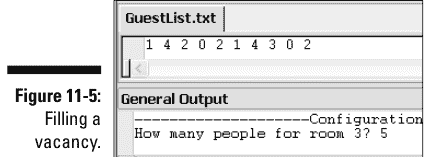
图 11-5：填充空闲房间。

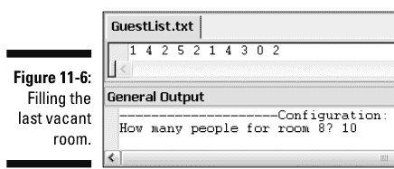
图 11-6：填充最后一个空闲房间。

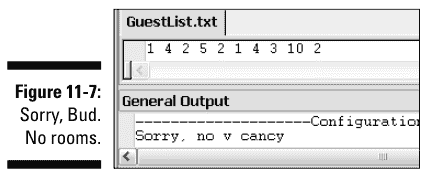
图 11-7：抱歉，伙计。没房了。

## 268 第四部分：精通 Java 技术

每次运行 11-4 的代码都会写入一个全新的 `GuestList.txt` 文件。如果你使用 JCreator，可以轻松地监控 `GuestList.txt` 的变化。在 JCreator 的编辑器面板中保持显示 `GuestList.txt`。在运行 11-4 中的代码后，切换到屏幕上的其他窗口（你的 Web 浏览器），或者切换到 JCreator 编辑器面板中的其他文档。返回 JCreator 中 `GuestList.txt` 的显示界面。此时，JCreator 会提示你 `GuestList.txt` 已被修改。“你想重新加载它吗？”“是的，可以。”然后 JCreator 会显示更新后的 `GuestList.txt` 版本。

11-4 中的代码使用了此书中其他章节和节的技巧。代码中唯一的新功能是使用 `PrintStream` 写入磁盘文件。想想书中任何调用 `System.out.println` 或其变体的例子。当你调用这些方法之一时，到底发生了什么？

名为 `System.out` 的是一个对象。该对象定义在 Java API 中。事实上，`PrintStream` 是 `java.io.PrintStream` 类（或它的类）的一个实例。现在，从 `PrintStream` 类创建的每个对象都有名为 `print` 和 `println` 的方法。就像列表 7-3 中的每个 `Account` 对象都有一个 `display` 方法，就像列表 10-1 中的 `DecimalFormat` 对象有一个 `format` 方法一样，名为 `out` 的 `PrintStream` 对象也有 `print` 和 `println` 方法。当你调用 `System.out.println` 时，你正在调用一个属于 `PrintStream` 实例的方法。

好了，那怎样？`System.out` 始终代表你电脑屏幕上的某个区域。如果你创建自己的 `PrintStream` 对象并让该对象引用磁盘文件，那么该 `PrintStream` 对象就引用该磁盘文件。当你调用该对象的 `print` 方法时，你就将文本写入了硬盘。

因此在 11-4 中，当你说：

```java
PrintStream listOut = new PrintStream("GuestList.txt");
listOut.print(guests[roomNumber]);
listOut.print(" ");
```

你是在告诉 Java 将文本写入你硬盘上的文件——`GuestList.txt` 文件。

这就是你更新酒店中住客数量的方式。当你调用 `listOut.print` 输出 3 号房间的人数时，可能会打印数字 5。因此，在图 11-5 和 11-6 之间，`GuestList.txt` 文件中的数字从 0 变为 5。在图 11-6 中，你第二次运行。当程序从新写入的 `GuestList.txt` 文件获取数据时，3 号房间不再空闲。这次程序建议使用 8 号。

与其他许多方法和构造函数一样，`PrintStream` 构造函数会处理文件。如果找不到 `GuestList.txt` 文件，它会创建一个并向其中写入。但如果 `GuestList.txt` 文件已存在，构造函数会覆盖现有文件并准备写入一个新的 `GuestList.txt`。如果你不喜欢文件被覆盖，在调用 `PrintStream` 构造函数之前采取措施。

在列表 11-4 中，条件 `roomNum < 10 && guests[roomNum] != 0` 可能会很微妙。如果你调换顺序，使用 `guests[roomNum] != 0 && roomNum < 10`，你会遇到很多麻烦。详情请参本书。

## 对象数组

Java 旅馆已开业，现在有了改进的注册软件！本章第一节的人总是抓着脑袋寻找改进服务的方法。现在，通过面向对象编程的思想，他们开始以 `Room` 类的方式思考。

“那么，”你问，“`Room` 实例是什么？”这很简单。`Room` 实例有三个属性：房间人数、费率和是否吸烟标记。图 11-8 展示了这种情况。


列表 11-5 显示了描述 `Room` 类的代码。正如承诺的，`Room` 类的每个实例有三个变量：`guests`、`rate` 和 `smoking`。（布尔变量 `false` 表示非吸烟。）此外，整个 `Room` 类有一个名为 `currency` 的静态变量。这个 `currency` 对象让房间看起来像金额。要了解 `static` 的含义，请参阅第 10 章。

## 列表 11-5：Room 看起来是这样

```java
import static java.lang.System.out;
import java.util.Scanner;
import java.text.NumberFormat;

class Room {
    private int guests;
    private double rate;
    private boolean smoking;
    private static NumberFormat currency = NumberFormat.getCurrencyInstance();

    public void readRoom(Scanner diskScanner) {
        guests = diskScanner.nextInt();
        rate = diskScanner.nextDouble();
        smoking = diskScanner.nextBoolean();
    }

    public void writeRoom() {
        out.print(guests);
        out.print("\t");
        out.print(currency.format(rate));
        out.print("\t");
        out.println(smoking ? "yes" : "no");
    }
}
```

列表 11-5 有一些有趣的特性，但我倾向于在你看到所有代码运行后再描述它们。这就是为什么在此处我跳转到调用列表 11-5 代码的代码。在你读了房间数组（列表 11-6 所示）之后，查看我对列表 11-5 特性的描述。

## 使用 Room 类

现在你需要一个房间数组。创建这种东西的代码在列表 11-6 中。代码从 `GuestList.txt` 文件读取数据（图 11-9 显示 `GuestList.txt` 文件的内容）。图 11-10 显示了列表 11-6 代码的运行情况。

## 列表 11-6：你想看房间吗？

```java
import static java.lang.System.out;
import java.util.Scanner;
import java.io.File;
import java.io.IOException;

class ShowRooms {
    public static void main(String[] args) throws IOException {
        Room[] rooms = new Room[10];
        Scanner diskScanner = new Scanner(new File("RoomList.txt"));

        for (int roomNum = 0; roomNum < 10; roomNum++) {
            rooms[roomNum] = new Room();
            rooms[roomNum].readRoom(diskScanner);
        }

        out.print("Guests\tRate\tSmoking?");
        for (int roomNum = 0; roomNum < 10; roomNum++) {
            out.print(roomNum);
            out.print("\t");
            rooms[roomNum].writeRoom();
        }
    }
}
```

## 272 第四部分：精通 Java 技术

对于列表 11-6 中的代码随你怎么说什么都可以。在我看来，整个列表中只有一个问题应该引起你的关注。你问那个问题是什么？嗯，要创建一个对象数组，你必须做三件事：创建数组变量、创建数组本身以及构造数组中的每个对象。这与创建一个 `int` 数组或任何其他原始类型数组不同。当你创建一个原始类型数组时，你只做前两个。

为了帮助理解所有这些，请结合列表 11-6 和图 11-11 阅读以下几点：

- `rooms[];` 此声明创建了 `rooms` 变量。该变量指向一个数组（但尚未引用任何内容）。
- `rooms = new Room[10];` 此语句在计算机内存中预留了存储槽。该语句让 `rooms` 变量指向这组存储槽。每个槽指向一个对象（但尚未引用任何内容）。
- `rooms[roomNum] = new Room();` 此语句位于 `for` 循环中。该语句为每个房间号执行一次。例如，在第一次循环中，该语句让 `rooms[0]` 指向一个实际的对象（`Room` 类实例）。

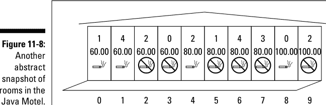

## 第11章：使用数组和集合处理数值 273

通用输出

| 房号 | 客客数 | 房价 | 是否吸烟？ |
|---|---|---|---|
| 0 | 1 | $60.00 | 是 |
| 1 | 4 | $60.00 | 是 |
| 2 | 3 | $60.00 | 否 |
| 3 | 0 | $60.00 | 否 |
| 4 | 2 | $60.00 | 是 |
| 5 | 1 | $80.00 | 否 |
| 6 | 4 | $80.00 | 否 |
| 7 | 8 | $100.00 | 是 |
| 8 | 9 | $100.00 | 否 |

图 11-10：代码列表 11-6 的运行结果。


图 11-11：创建对象数组的步骤。

虽然在技术上这不被视为创建数组的一个步骤，但你仍然必须为对象的变量填充值。例如，在循环第一次执行时，`readRoom` 调用了 `rooms[1].readRoom(diskScanner)`，这意味着“从 `RoomList.txt` 文件中读取数据到 `rooms[1]` 对象的变量中”。每次循环时，程序都会创建一个新对象，并将数据读到该新对象的变量中。

你可以像创建基本数据类型数组一样，将这些步骤合并在一起。例如，你可以一次性完成前两个步骤，如下所示：

```java
Room rooms[] = new Room[10];
```

274 第四部分：精通 Java 技巧

你还可以使用数组初始化器。（有关数组初始化器的介绍，请参阅本章前面的部分的“使用数组初始化器”章节。）

## 另一种美化数字的方法

你可以通过许多方式让数字看起来很好看。例如，列表 7-7 使用了 `printf`，列表 10-1 使用了 `DecimalFormat`。但在列表 11-5 中，我显示了一个货币金额。我使用了 `NumberFormat` 类及其 `getCurrencyInstance` 方法。

如果你比较列表 10-1 和 11-5 中的格式语句，你会发现没有太大区别。

- 其中一个列表使用构造函数；另一个列表获取了 `CurrencyInstance`。

`getCurrencyInstance` 方法是所谓“工厂方法”的一个很好的示例。工厂方法是创建许多对象的方便工具。人们都需要显示金额的代码。`getCurrencyInstance` 方法创建了一个美元格式，而无需强制你编写新的 `DecimalFormat ($###.00; ($#.00))`。

像构造函数一样，工厂方法会返回一个全新的对象。与构造函数不同的是，工厂方法没有特殊地位。当你创建一个工厂方法时，你可以为它命名任何你喜欢的名称。当你调用工厂方法时，不需要使用 `new` 关键字。

- 其中一个列表使用 `DecimalFormat`；另一个列表使用 `NumberFormat`。

小数是一种特定的数字。（事实上，小数是用十进制系统编写的。）因此，`DecimalFormat` 类是 `NumberFormat` 类的子类。`DecimalFormat` 更具体，所以对于大多数用途，我使用 `DecimalFormat`。但使用 `DecimalFormat` 类的 `getCurrencyInstance` 比较困难。对于涉及资金的程序，我倾向于使用 `NumberFormat`。

- 两个列表都使用了格式化方法。

最后，你只需要编写类似 `currency.format(rate)` 或 `decFormat.format(average)` 的代码。之后，Java 会为你完成工作。

## 三元运算符

列表 11-5 使用了一个有趣的技巧——三元运算符。这个运算符接受三个表达式并返回其中一个的值。它就像一个微型的 `if` 语句。当你使用三元运算符时，它看起来像这样：

```java
conditionToBeTested ? expression1 : expression2
```

计算机会评估 `conditionToBeTested`。如果条件为真，计算机返回 `expression1` 的值。但如果条件为假，计算机返回 `expression2` 的值。

所以，在代码中

```java
smoking ? "yes" : "no"
```

计算机检查 `smoking` 的值是否为 `true`。如果是，整个三部分表达式就代表第一个字符串 `"yes"`。如果不是，整个表达式就代表第二个字符串 `"no"`。

在 11-5 中，对 `out.println` 的检查会导致 `"yes"` 或 `"no"` 显示值为 `true` 或 `false`。显示哪个字符串取决于 `smoking` 是否具有……

### 命令行参数

自从你开始学习 Java 以来，你就在每个 `main` 方法的头部看到过这个 `String args[]`。好了，是时候弄清楚它到底是什么了。

当你想要运行一个 Java 程序时，可以通过选择 `Build::Execute Project` 或点击开发环境中的某处来获取程序。

在很多情况下，点击是你需要做的全部。但有时，你想在启动程序时添加一些额外信息。例如，假设程序在你的计算机硬盘上放置了一个新文件。也许，当你启动程序时，你想告诉程序这个文件包含随机数。（想象一下那个新文件。）当程序运行时，你告诉程序你想要的名称和数字个数。

这就是 `args[]` 出现的地方。`args[]` 是字符串值，被称为命令行参数。

### 在 Java 程序中使用参数

列表 11-7 显示了如何使用它们：

```java
import java.util.Random;
import java.io.File;
```


# 第 11 章：使用数组和集合处理多个值

## 示例代码：RandomNums

```java
import java.io.PrintStream;
import java.io.IOException;
import java.util.Random;

class RandomNums {
    public static void main(String args[]) throws IOException {
        Random generator = new Random();

        if (args.length < 2) {
            System.out.println("Usage: MakeRandomFile filename number");
            System.exit(1);
        }

        PrintStream printOut = new PrintStream(args[0]);
        int numLines = Integer.parseInt(args[1]);

        for (int count = 1; count <= numLines; count++) {
            printOut.println(generator.nextInt(10));
        }
    }
}
```

## 运行结果与异常处理

图 11-12 中的对话框出现了。在图 11-12 中，创建器提示用户。点击 OK 后，代码开始。图 11-14 显示了输出结果。


等，让我重新对齐流程。在 11-5 中，`out.println` 的检查会导致 "yes" 或 "no" 显示值为 `true` 或 `false`。显示哪个字符串取决于 `smoking` 是否具有……

`parseInt` 方法位于名为 `Integer` 的类中。所以，为了调用 `parseInt`，你倾向于使用 `Integer`。`Integer` 有各种处理 `int` 的方便方法。在 Java 中，`Integer` 是一个类的名称，而 `int` 是基本类型的名称。两者是相关的，但并不相同。`Integer` 还有其他处理 `int` 的工具。


### 检查正确的命令行参数数量

如果用户犯了错会怎样？如果图 11-12 中的对话框（如所示）弹出，而用户忘记输入数字 5。用户输入了 `MyNumberedFile.txt`，其他什么都没输。

那么计算机会将 `MyNumberedFile.txt` 赋值给 `args[0]`，但不会给 `args[1]` 赋值任何内容。这糟糕了。如果计算机到达了语句

```java
int numLines = Integer.parseInt(args[1]);
```

程序会崩溃并产生 `ArrayIndexOutOfBoundsException`。

所以，该怎么办？在列表 11-7 中，你检查 `args` 数组的长度。将 `args.length` 与 2 进行比较。如果数组少于两个组件，你在屏幕上显示一条消息并退出程序。图 11-14 显示了输出结果。

| 通用输出 | 配置列表11-7 |
| :--- | :--- |
| Usage MakeRandomFile filename number | |
| Process completed | |

尽管在清单 11-7 中检查了 `args.length`，代码仍然并不是防崩溃的。如果你输入 `five` 而不是 `5`，程序会因为 `NumberFormatException` 而崩溃。第二个命令行参数不能是单词。该参数必须是一个数字（而且是一个整数）。我可以在清单 11-7 中添加语句来使代码无懈可击，但检查 `NumberFormatException` 最好在第 12 章进行。

当你处理命令行参数时，可以输入带有空格的字符串类型值。只需将该值用双引号括起来即可。例如，你可以用 `"My File.txt" 7` 来运行清单 11-7 中的代码。

## 配置 JCreator 以使用命令行参数

通常，当你选择构建：执行项目（Build:Execute Project）时，计算机开始运行你的代码。计算机不会等待你输入任何额外信息，因此像额外的文件名和文件中的值数量等信息可能会丢失。使用命令行参数可以告诉计算机暂停一下。在暂停期间，计算机会提示用户输入更多信息。

对于光盘上的代码，我配置了 JCreator 显示图 11-12 中的对话框。但如果你自己正在创建一个程序，如何告诉 Creator 暂停并提示用户输入信息呢？要答案，请按照以下步骤操作：

1. 在 JCreator 的视图面板（View pane）中，找到主程序使用命令行参数的项目。
2. 在文件视图（File View）树上右键点击项目分支。在结果菜单中，选择设置为活动项目（Set As Active Project）。
   > 这使得相应的项目变为激活。很容易忘记第 2 步。别忘记第 2 步！
3. 在 JCreator 的菜单栏中，选择项目：项目设置（Project:Project Settings）。
   > 出现项目设置窗口。
4. 在项目设置窗口中，选择 JDK Tools 选项卡。（图 11-15。）


5. 确保“选择工具类型”（Select Tool Type）下拉列表中出现“运行应用程序”（Run Application）。
6. 在选择工具类型列表下方，选择默认配置（Default configuration）。
7. 点击复制（Copy）按钮。
   > 出现一个标题为“工具配置：运行应用程序”（Tool Configuration: Run Application）的窗口。
8. 在工具配置窗口的名称（Name）文本框中，输入任何可以提醒你这个示例关于什么的内容。
   > 在图 11-16 中，我输入了 `GetCommandLineArguments`。


图 11-15：准备复制默认的运行应用程序配置。
图 11-16：工具配置窗口。

9. 在工具配置窗口中，选择参数（Parameters）选项卡。
10. 勾选提示主方法参数（Prompt For main Method Arguments）复选框。
11. 点击 OK。
    > 工具配置窗口消失。现在你又看到了项目设置窗口。
12. 在项目设置窗口中，选择你新创建配置旁边的复选框。
    > 在图 11-17 中，我选择了我的 `GetCommandLineArguments` 配置。
13. 点击 OK。

这些指令列表似乎总是这样结束的吗？


图 11-17：选择你的新配置。

按照步骤 1 到 13 操作后，你的项目发生了变化。每当你的项目是活动进程时，选择构建>执行项目（Build>Execute Project）就会给你弹一个类似于图 11-12 所示的对话框。

关于在 JCreator 以外的环境中使用命令行参数的提示，请参阅本书的网站。

本书关于数组的讨论就要结束了。下一个将涉及一些稍有不同的内容。但在离开数组这个主题之前，请思考一下：数组是一行物品，而每种物品都只属于某一行。以本章中前几个涉及汽车旅馆的例子为例。编号从 0 到 9 的旅馆房间排成一条长长的横线。


## 列表 11-8：使用 Java 集合

```java
import static java.lang.System.out;
import java.util.Scanner;
import java.io.File;
import java.io.IOException;
import java.util.ArrayList;

class ShowNames {
    public static void main(String args[]) throws IOException {
        ArrayList<String> people = new ArrayList<String>();
        Scanner scanner = new Scanner(new File("names.txt"));

        while (scanner.hasNext()) {
            people.add(scanner.nextLine());
        }

        people.remove(0);
        people.add(2, "Jim Newton");

        for (String name : people) {
            out.println(name);
        }
    }
}
```

图 11-18 显示了一个示例 `names.txt` 文件。列表 11-8 中的代码读取该 `names.txt` 文件，并打印出图 11-19 中的内容。

| names.txt |
|---|
| Burd |
| Harriet Ritter |
| Umelie J. Katz |
| Harry "The Crestan" Spoonswager |
| Felicia "Tissy" Katz |
| Mia Just "Mia" |
| Jeremy Floyd Jones |
| I. N. D'Arthur |
| Hugh R. DaReader |

图 11-18：文件中的几个名字。

### 运行结果

| 配置/结果 |
|---|
| Harriet Ritter |
| Weullie J. Katz |
| Jim Newton |
| Harry "The Crazyman" Spoonswagler |
| Felicia "Fishy" Katz |
| Mia. Jun. Mia |
| Jeremy Flocing Jones |
| 1 M. D'Arthur |
| Hugh R. DaReader |

图 11-19：列表 11-8 中的代码更改了一些名字

执行 `remove` 和 `add` 方法时，会有很多有趣的事情。名为 `people` 的变量指向一个 `ArrayList` 对象。因此，在列表 11-8 中，你调用了该对象的 `remove` 方法：

```java
people.remove(0);
```

你从列表中删除了一个值。在这种情况下，你删除了列表中初始位置（编号为 0 的位置）上的任何值。因此，在列表 11-8 中，移除代码将 Barry 从列表中移除。

列表中只剩下八个名字，但接下来的语句

```java
people.add(2, "Jim Newton");
```

在位置 2 处插入了一个名字。（在 Barry 被移除后，位置 2 是原由 Harry Spoonswagler 占据的位置，Harry 移动到了位置 3，而 Jim Newton 变成了第 2 号人物）。

注意，`ArrayList` 对象有两个不同的 `add` 方法。添加 Jim Newton 的方法有两个参数——一个位置编号和一个要添加的值。另一个 `add` 方法：

```java
people.add(scanner.nextLine());
```

该语句获取在输入文件某行中找到的任何名字，并将其附加到列表末尾。（只有一个参数的 `add` 方法始终将其值附加到 `ArrayList` 对象的当前末尾。）

## 使用泛型

再次查看列表 11-8，注意那个奇怪的 `ArrayList` 声明：

```java
ArrayList<String> people = new ArrayList<String>();
```

从 Java 5.0 开始，每个集合类都泛型化了。那个听起来很难听的词要求每个声明都应该包含 `<SomeTypeName>`。夹在 `<` 和 `>` 之间的内容告诉 Java 新集合可能包含什么类型的值。


本节内容适用于 Java 5.0、Java 6 或未来几年中出现的任何版本。更多关于 Java 版本划分的信息，请参见第 2 章。

例如，在列表 11-8 中，`ArrayList<String> people` 表示 `people` 变量可以指向 String 值的集合。因此，从该点开始，对 `people` 集合中任何项的引用都完全被视为 String。如果你写

```java
people.add(new Room());
```

那么编译器就会报错，因为 `Room` 并不是 `String`。即使编译器拥有相同的 `Room` 类代码（见列表 11-5 中的代码），这种报错也会发生。但语句

```java
people.add("George Gow");
```

是完全没有问题的。因为 `"George Gow"` 的类型是 `String`，编译器愉快地通过了。

## 测试更多数据的存在

这是一个意外的惊喜。当你编写像之前列表 11-8 所示的程序时，你不需要知道输入文件中有多少个名字。要求知道有多少个名字会违背使用可扩展 `ArrayList` 类的目的。与其循环读取九个名字，不如循环到数据耗尽。

`Scanner` 类有几个很好的方法，如 `hasInt()`、`nextDouble()` 和 `hasNext()`。这些方法中的每一个都会检查更多数据。如果有更多数据，方法返回 `true`；否则，返回 `false`。

---

# 第 12 章：处理异常

## 列表 12-1：计算箱数

```java
import static java.lang.System.out;
import java.util.Scanner;
import java.text.NumberFormat;

class InventoryA {
    public static void main(String[] args) {
        final double boxPrice = 3.25;
        Scanner myScanner = new Scanner(System.in);
        NumberFormat currency = NumberFormat.getCurrencyInstance();

        out.print("How many boxes do we have? ");
        String numBoxesIn = myScanner.next();
        int numBoxes = Integer.parseInt(numBoxesIn);

        out.print("The value is ");
        out.println(currency.format(numBoxes * boxPrice));
    }
}
```

大约那时，美国航天局的轨道计算软件被发现包含一条错误的语句 `DO 10 I=1.10`（应为 `DO 10 I=1,10`）。在现代表示法中，这就像是用 `doi0i = 1.10` 替了 `for (int i=1; i<10; i++)`。从逗号到句点的改变变成了一个赋值语句。

2000年1月：2000年问题给现代世界带来了混乱。

这些笔记中任何符合历史事实的事实都借自以下来源：计算机传说新闻组（alt.folklore.computers，你可以通过 groups.google.com 访问）、自由计算机词典（www.foldoc.org）、《计算机》杂志的“回顾过去”专栏（www.computer.org/computer）以及 IEEE 的网页（www.computer.org/history）。

### 处理异常

你正在进行库存盘点。这意味着要一个接一个、一箱接一箱地计数，并在日志表、小型手持设备和电脑键盘上记录这些数字。项目中的一个特定部分涉及输入你在“自元年以来未打开的忙碌箱”架上的箱箱数量。你决定不遵循公司几十来的习惯去打开任何箱子，而是为每个箱子随机分配 $3.25 的值。

列表 12-1 显示了处理这部分盘点的软件。该软件有一个缺陷，如图 12-1 所示。当用户输入一个数值时，一切正常。但当用户输入其他内容（如数字 3.5）时，程序就会崩溃。显然，对此可以采取措施。计算机虽然愚蠢，但并不愚蠢到会在用户输入不当的值时付出昂贵的代价。


## 通用输出

```
How many boxes do we have? 3
How many boxes do we have? 3
The value is $99.75
Process completed
```

图 12-1

哎！那不是数字。

```
How many boxes do we have? 3
java.lang.NumberFormatException: for input string "abc"
at java.lang.NumberFormatException.forInputString(InputString(Nu))
at java.lang.NumberFormatException.parse(Integer 46)
at java.lang.NumberFormatException.parseInt(Integer 446)
at java.lang.NumberFormatException.parse(Integer 49)
at at Inventory.main in thread "main"
Process completed
```


修复程序 bug 的关键是检查程序崩溃时出现的消息。盘点程序的程序显示为 `java.lang.NumberFormatException`。这意味着 `java.lang` API 中有一个名为 `NumberFormatException` 的类。然而，对 `Integer.parseInt` 的调用让这个 `NumberFormatException` 暴露了出来。

有关 `Integer.parseInt` 方法的简要解释，请参见第 11 章。

好了，情况是这样的：Java 编程语言有一种称为异常处理的机制。通过处理异常，程序可以检测到情况即将出错，并通过创建一个新对象来做出响应。在官方术语中，程序被称为“抛出”了一个异常。该对象（`Exception` 类的实例）被传递给 `catch`。当异常被捕获时，程序执行某些恢复代码，忽略异常，并进入下一个正常状态，仿佛什么都没有发生过。该过程如图 12-2 所示。

整个过程通过几个 Java 关键字的辅助完成。这些关键字如下：

- `throw`：创建一个新的异常对象。
- `throws`：将责任从方法向上传递给调用该方法的代码。
- `try`：封装可能创建新异常对象的代码。在通常情况下，`try` 语句中的代码包含对方法的调用，这些代码可能会创建一个或多个异常。
- `catch`：处理异常，忽略它，然后继续执行。

所以，事实是这样的：通过如图 12-2 所示的一系列事件链，`Integer.parseInt` 方法可以抛出一个 `NumberFormatException`。当你调用 `Integer.parseInt` 时，这个 `NumberFormatException` 就会传递给你。

Java API（应用程序接口）关于 `parseInt` 方法的文档说明：“抛出：NumberFormatException — 如果字符串不包含可解析的整数。”偶尔读读文档确实是有值的。


# 第 12 章：应对意外状况时保持从容

# 第 12 章：当意外情况发生时保持从容

| 图 12-4：调用异常对象的方法。 | 我们有多少个箱子？三个\n那不是一个数字\nFormatException: 输入字符串为 "three" (NumberFormatException 异常)\n现在是堆栈跟踪：njava java.lang.NumberFormatException: For input string "three" (FormatException java 48)\nat java.lang.Integer.parseInt(Integer java 446)\nat java.lang.Integer.parseInt(Integer java 494)\nat Inventory.main(Inventory java 17)\n你喜欢这个堆栈跟踪吗？ |
|---|---|

进程完成

## 异常类型

那么，今天可能还会发生什么其他错误呢？还有其他类型的异常吗——即那些不是来自 `NumberFormatException` 类的异常？当然有，世界上有很多不同的异常类型。你可以创建你自己的异常。想试试吗？如果的话，请查看代码列表 12-3 和 12-4。

### 代码列表 12-3：创建你自定义的异常

```java
class OutOfRangeException extends Exception { }
```

### 代码列表 12-4：使用你自定义的异常

```java
import static java.lang.System.out;
import java.util.Scanner;
import java.text.NumberFormat;

class InventoryC {

    public static void main(String[] args) {
        final double boxPrice = 3.25;
        Scanner myScanner = new Scanner(System.in);
        NumberFormat currency =
            NumberFormat.getCurrencyInstance();

        out.print("How many boxes do we have?");
        String numBoxesIn = myScanner.next();

        try {
            int numBoxes = Integer.parseInt(numBoxesIn);
            if (numBoxes < 0) {
                throw new OutOfRangeException();
            }

            out.print("The value is ");
            out.println(currency.format(numBoxes * boxPrice));
        } catch (NumberFormatException e) {
            out.println("That's not a number.");
        } catch (OutOfBoundsException e) {
            out.print(numBoxesIn);
            out.println("That's impossible!");
        }
    }
}
```

代码列表 12-3 和 12-4 解决了图 12-3 中出现的问题。查看图 12-3 中三次运行的最后一次。架子上有 -25 个箱子，而计算机却毫不眨眼地接受了它。事实是，你需要一个黑洞（或某种其他奇特的时空扭曲现象）才能让仓库的任何架子上出现负数量的箱子。如果用户输入负数个箱子，程序就会“生气”，这正是列表 12-4 中代码所做的。要看这段“生气”的代码，请看图 12-3。

| 通用输出 | 通用输出 | 通用输出 |
|---|---|---|
| How many boxes do we have? 6 | How many boxes do we have? three | How many boxes do we have? -25 |
| The value is 19.75 | That's not a number | That's impossible! |
| Process completed | | |

列表 12-3 中的代码声明了一个新类型的异常类——`OutOfRangeException`。在很多情况下，输入负数是没问题的，所以 `OutOfRangeException` 并没有内置在 Java API 中。然而，在库存程序中，负数应该被标记为异常。

列表 12-3 中的 `OutOfRangeException` 类获得了书中“最短自包含代码段”的奖。该类只有一行声明语句和一对空括号。该代码的其他部分是扩展了 `Exception`。作为 Java API `Exception` 类的子类，任何 `OutOfRangeException` 实例都可以被抛出。

回到列表 12-4，抛出了一个新的 `OutOfRangeException` 实例。当此发生时，`catch` 子句 `(OutOfRangeException e)` 捕获了该实例。该子句选择了用户的输入并显示消息“That's impossible!”（这不可能）。

## 谁来捕获异常？

再看一眼列表 12-4。注意，一个 `try` 语句可以带有多个 `catch` 子句。当异常在 `try` 语句内部被抛出时，计算机开始向下检查相应的 `catch` 子句。计算机从紧跟在 `try` 之后的某个 `catch` 子句开始，按照程序的文本顺序向下执行。

对于每个 `catch` 子句，计算机都会问自己：“刚刚抛出的异常是该子句参数中类的实例吗？”

- 如果不是，计算机跳过这个 `catch` 子句，并移动到下一个 `catch` 子句。
- 如果是，计算机执行这个 `catch` 子句，然后跳过随该 `try` 语句的所有其他 `catch` 子句。计算机继续执行整个 `try` 语句之后的任何语句。

有关具体的示例，请查看代码列表 12-5 和 12-6。

### 代码列表 12-5：另一个异常

```java
class NumberTooLargeException extends OutOfRangeException
{
}
```

### 代码列表 12-6：责任归谁？

```java
import static java.lang.System.out;
import java.util.Scanner;
import java.text.NumberFormat;

class InventoryD {
    public static void main(String args[]) {
        final double boxPrice = 3.25;
        Scanner myScanner = new Scanner(System.in);
        NumberFormat currency =
            NumberFormat.getCurrencyInstance();

        out.print("How many boxes do we have?");
        String numBoxesIn = myScanner.next();

        try {
            int numBoxes = Integer.parseInt(numBoxesIn);

            if (numBoxes < 0) {
                throw new OutOfRangeException();
            }

            if (numBoxes > 1000) {
                throw new NumberTooLargeException();
            }

            out.print("The value is ");
            out.println(currency.format(numBoxes * boxPrice));
        } catch (NumberFormatException e) {
            out.println("That's not a number.");
        } catch (OutOfRangeException e) {
            out.print(numBoxesIn);
            out.println("That's impossible!");
        } catch (Exception e) {
            out.print("Something went wrong, ");
            out.print("But I'm clueless about what ");
            out.println("it actually was.");
        }
    }
}
```

为了运行 12-5 和 12-6，你需要额外的 Java 程序。你需要列表 12-3 中的 `OutOfRangeException` 类。

列表 12-6 处理了空间有限的情况。你没有超过1000个箱子的空间，但偶尔程序会问你有多少箱子，结果有人不小心输入了10000。在这种情况下，列表 12-6 会将其判定为不现实。

列表 12-7 捕获 `NumberTooLargeException`，为了让生活更有趣，列表 12-6 没有针对该异常的 `catch` 子句。尽管如此，一切仍然运行正常。这是因为 `NumberTooLargeException` 被声明为 `OutOfRangeException` 的子类，而列表 12-6 有针对 `OutOfRangeException` 的 `catch` 子句。

为了避免重复编写这个故事，引入一些新术语。我说参数为 `OutOfRangeException` 的 `catch` 子句匹配抛出的 `NumberTooLargeException`。我把这个 `catch` 子句称为匹配子句。

下面的符号描述了用户可能的操作以及计算机的响应。当你阅读这些这些符号时，可以通过查看图 12-6 显示的运行来跟踪。


- 用户输入了一个普通的整数，如数字 3。
  - `try` 语句中的所有语句都执行了。计算机跳过所有 `catch` 子句，执行紧跟在所有 `catch` 之后的代码。（见图 12-7）。

- 用户输入了不是整数的内容，如单词 fish。
  - 代码抛出了 `NumberFormatException`。计算机跳过 `try` 语句中剩余的语句。计算机执行第一个 `catch` 子句内部的语句——参数类型为 `NumberFormatException` 的子句。然后计算机跳过第二个和第三个 `catch` 子句，执行紧跟在所有 `catch` 之后的代码。（见图 12-8）。

## 示例代码片段

```java
try {
    //正常处理（不抛出异常）
}
catch (NumberFormatException e) {
    out.println("That's not a number.");
}
catch (OutOfRangeException e) {
    out.print(numBoxesIn);
    out.println("? That's impossible!");
}
catch (Exception e) {
    out.print("Something went wrong, ");
    out.print("but I'm clueless about what ");
    out.println("it actually was.");
}
out.println("That's that.");
```

图 12-7：没有抛出异常。

```java
try {
    throw new NumberFormatException();
}
catch (NumberFormatException e) {
    out.println("That's not a number.");
}
catch (OutOfRangeException e) {
    out.print(numBoxesIn);
    out.println("? That's impossible!");
}
catch (Exception e) {
    out.print("Something went wrong, ");
    out.print("but I'm clueless about what ");
    out.println("it actually was.");
}
out.println("That's that.");
```

图 12-8：抛出了一个 NumberFormatException。

# 第 12 章：当情况发生意外转折时保持体面

- 用户输入了一个负数，例如数字 -25。
  - 代码抛出一个 `OutOfRangeException`。计算机跳过了 `try` 子句中剩余的语句。计算机甚至跳过了第一个 `catch` 子句中的语句。（毕竟，`OutOfRangeException` 不是任何 `NumberFormatException`。参数为 `NumberFormatException` 的 `catch` 子句与此 `OutOfRangeException` 不匹配。）计算机执行第二个 catch 子句中的语句——参数类型为 `OutOfRangeException` 的子句。然后计算机跳过第三个 `catch` 子句，并执行所有 `catch` 子句之后紧的代码。（见图 12-9。）

- 用户输入了一个不实际的大数字，例如数字 1001。
  - 代码抛出一个 `NumberTooLargeException`。计算机跳过了 `try` 子句中剩余的语句。计算机甚至跳过了第一个 `catch` 子句中的语句。（毕竟，`NumberTooLargeException` 不是任何 `NumberFormatException`。）


# 第 12 章：当意外状况发生时保持从容

```java
try {
  throw new OutOfRangeException();
}
catch (NumberFormatException e) {
  out.println("That's not a number.");
}
catch (OutOfRangeException e) {
  out.print(numBoxes);
  out.println(" That's impossible!");
}
catch (Exception e) {
  out.print("Something went wrong, ");
  out.print("but I'm clueless about what ");
  out.println("it actually was.");
}
```


## 异常捕获的匹配规则

但是，根据列表 12-5 中的代码，`NumberTooLargeException` 是 `OutOfRangeException` 的子类。当计算机到达第二个 `catch` 子句时，计算机说：“嗯！`NumberTooLargeException` 是一种 `OutOfRangeException`。我将执行这个 catch 子句中的语句——参数类型为 `OutOfRangeException` 的子句。换句话说，它是匹配的。”

所以，计算机执行第二个 `catch` 子句内部的语句。然后计算机跳过第三个 `catch` 子句，并执行所有 `catch` 子句之后紧随的代码。（见图 12-10）。

- 发生了其他事情，非常不可预测的事情（我不知道是什么）。

由于我不断想要实验的冲动，我进入了列表 12-6 的 `try` 子句并添加了一条抛出 `IOException` 的语句。没有理由——我只是看看会发生什么。

当代码抛出 `IOException` 时，计算机跳过了 `try` 子句中的剩余语句。然后计算机跳过了第一个和第二个 `catch` 子句。当计算机到达第三个 `catch` 子句时，我听到计算机说：“嗯！`IOException` 是一种 `Exception`。我找到了一个匹配的 catch 子句——参数类型为 `Exception` 的子句。我将执行这个 catch 子句中的语句。”

```java
try {
    throw new NumberTooLargeException();
}

catch (NumberFormatException e) {
    out.println("That's not a number.");
}

catch (OutOfRangeException e) {
    out.println("That's impossible!");
}

catch (Exception e) {
    out.println("Something went wrong, ");
    out.println("but I'm clueless about what went ");
    out.println("it actually was.");
}

out.println("That's that.");
```


## 第 12 章：当意外状况发生时保持从容 303

所以，计算机执行了 `catch` 子句内部的语句。然后计算机执行了所有 `catch` 子句之后紧随的代码。（见图 12-11。）

```java
try {
  throw new IOException();
}
catch (NumberFormatException e) {
  out.println("That's not a number.");
}
catch (OutOfRangeException e) {
  out.print(numBoxesIn);
  out.println(" That's impossible!");
}
catch (Exception e) {
  out.println("Something went wrong, ");
  out.println("it actually was.");
}
```


### 捕获异常的具体场景

当计算机匹配时，它遵循以下规则：

- 用户输入了一个负数，例如数字 -25。
- 代码抛出一个 `OutOfRangeException`。计算机跳过了 `try` 子句中剩余的语句。计算机甚至跳过了第一个 `catch` 子句中的语句。（毕竟，`OutOfRangeException` 不是任何 `NumberFormatException`。参数为 `NumberFormatException` 的 `catch` 子句与此 `OutOfRangeException` 不匹配。）计算机执行第二个 catch 子句中的语句——参数类型为 `OutOfRangeException` 的子句。然后计算机跳过第三个 `catch` 子句，并执行所有 `catch` 子句之后紧随的代码。（见图 12-9。）

- 用户输入了一个不实际的大数字，例如数字 1001。
- 代码抛出一个 `NumberTooLargeException`。计算机跳过了 `try` 子句中剩余的语句。计算机甚至跳过了第一个 `catch` 子句中的语句。（毕竟，`NumberTooLargeException` 不是任何 `NumberFormatException`。）

如果异常是 `IOException`，计算机遵循以下规则：

- 计算机跳过了 `try` 子句中的剩余语句。
- 计算机跳过了第一个和第二个 `catch` 子句。
- 当计算机到达第三个 `catch` 子句时，它说：“嗯！`IOException` 是一种 `Exception`。我找到了一个匹配的 catch 子句——参数类型为 `Exception` 的子句。我将执行这个 catch 子句中的语句。”

## 我们的朋友，良好的异常

有一种传言说，Java 异常总是源于不想要的、错误的情况。虽然这个传言有一定道理，但它并不完全准确。偶尔，异常会产生于正常的、预期的发生。例如，对文件末尾的检测。以下代码复制了一个文件：

```java
try {
    while (true) {
        dataOut.writeByte(dataIn.readByte());
    }
} catch (EOFException) {
    numFilesCopied = 1;
}
```

从 `dataIn` 拷贝字节到 `dataOut`，你只需要进入一个 `while` 循环。由于其条件为 `true`，`while` 循环似乎是无尽的。但最终，你会到达 `dataIn` 文件的末尾。当发生时，`read` 方法会抛出一个 `EOFException`（文件结束异常）。异常的抛出会将计算机跳出 `try` 语句并退出 `while` 循环。从那里，你可以在 `catch` 语句中执行任何你想的操作，然后继续正常处理。

## 处理异常还是推卸责任

所以，你正在熟悉 Java，对吧？什么？你说你已经读到第 12 章了？

我印象很深。你一定是个非常努力工作的人。但记住，工作之余也要休息……

那么，休息一下怎么样？小睡一会儿大有益处。十秒钟可以吗？还是太长了？最好设为五秒。

列表 12-8 包含一个应该暂停执行五秒的程序。问题是列表 12-8 中的程序是错误的。花时间看一下列表 12-8，然后我会告诉你有问题在哪里。

### 列表 12-8：一个错误的程序

```java
/*
 * 此代码无法编译。
 */
import static java.lang.System.out;
class NoSleepForTheWearary {
    public static void main(String[] args) {
        out.print("Excuse me while I nap ");
        out.println("for just five seconds...");
        takeANap();
    }

    private static void takeANap() {
        Thread.sleep(5000);
    }
}
```

列表 12-8 中的策略并不坏。其想法是调用 Java API 中定义的 `sleep` 方法。这个 `sleep` 方法属于该 API 类。当你调用 `sleep` 方法时，你传入的数字是毫秒数。因此，`Thread.sleep(5000)` 意味着暂停五秒。

问题是 `sleep` 方法内部的代码可能会抛出异常。这种异常是 `InterruptedException` 类的实例。当你尝试编译列表 12-8 中的代码时，你将得到以下消息：

```
unreported exception java.lang.InterruptedException: must be caught or declared to be thrown
```

为了通俗理解异常，你不需要确切知道 `InterruptedException` 到底是什么。你们都必须知道调用 `Thread.sleep` 如何抛出这些 `InterruptedException` 对象之一。但如果你真的好奇，当某些代码中断了其他代码的 `sleep` 时，就会抛出 `InterruptedException`。假设你有两段代码同时运行。一段代码调用了 `Thread.sleep` 方法。与此同时，另一段代码调用了 `interrupt` 方法。通过调用 `interrupt` 方法，第二段代码使第一段代码的 `Thread.sleep` 方法戛然而止。`Thread.sleep` 方法通过抛出一个 `InterruptedException` 来响应。


## 检查异常与未检查异常

现在，Java 编程语言有两种不同类型的异常。

它们被称为检查异常（checked exceptions）和未检查异常（unchecked exceptions）：

- 可能抛出的检查异常必须在代码中得到确认。
- 可能抛出的未检查异常不需要在代码中得到确认。

`InterruptedException` 是 Java 的检查异常类型之一。当你调用一个可能抛出 `InterruptedException` 的方法时，你需要在代码中确认该异常。

现在，当我说异常在代码中被确认时，我到底是指什么？

```java
// 作者想要感谢 InterruptedException，
// 没有它这段代码是无法编写的。
```

不，这就是在代码中被确认的意思。在代码中确认异常意味着两种情况之一：

- `try` 语句内部可以抛出异常的语句（包括方法调用）。该 `try` 拥有一个 `catch` 语句，其参数列表中有匹配的异常类型。
- 可以抛出异常的语句（包括方法调用）位于一个头部带有 `throws` 子句的方法中。该 `throws` 子句包含匹配的异常类型。

如果你对这两个项目的措述感到困惑，不要担心。接下来的两个列表说明了这些项目中的观点。

在列表 12-9 中，可以抛出 `InterruptedException` 的方法位于 `try` 语句内部。该 `try` 拥有一个带有异常 `InterruptedException` 的 `catch` 语句。

### 列表 12-9：使用 try-catch 语句确认

```java
import static java.lang.System.sleep;

class GoodNightsSleep {
    public static void main(String[] args) {
        out.print("Excuse me while I nap ");
        out.println("for just five seconds...");
        try {
            Thread.sleep(5000);
        } catch (InterruptedException e) {
            out.println("Hey, who woke up?");
        }
        out.println("Ah, that was refreshing.");
    }
}
```

（注：由于原始 OCR 文本存在大量碎片化重复，已根据上下文和标准 Java 逻辑结构进行了重构。）

## 方法调用栈中的异常传播

方法中的语句可能会抛出一个未被 `catch` 子句匹配的异常。这包括抛出异常的语句甚至不在 `try` 块内部的情况。当这种情况发生时，程序的执行将跳出包含该故障语句的方法。执行将跳回最初调用该方法的代码。

一个方法可以在其 `throws` 子句中命名多个异常类型。只需用逗号分隔这些异常类型的名称即可，如下例所示：

```
throws InterruptedException, IOException,
ArithmeticException
```

Java API 拥有数百种异常类型。其中有若干类是 `RuntimeException` 类的子类。任何内容（或其子类、子类的子类等）都是**未检查的异常**（unchecked）。任何不是 `RuntimeException` 后代的异常都是**已检查的异常**（checked）。未检查异常包括计算机难以预测的内容。此类内容包括 `NumberFormatException`（代码列表 12-2, 12-4）等、`ArithmeticException`、`IndexOutOfBounds`、臭名昭著的 `NullPointerException` 以及许多其他。当你编写 Java 代码时，你的大部分代码都容易受到这些异常，但将代码包含在 `try` 子句中（或通过 `throws` 子句传递）是完全可选的。

Java API 也有许多已检查异常。计算机可以很容易检测出这类异常。Java 强制要求，对于这类异常，任何抛出异常的语句都必须通过语句或 `throws` 子句进行确认。Java 的已检查异常包括 `InterruptedException`（代码列表 12-9 和 12-10）、`IOException`、`SQLException` 以及其他许多有趣的异常。

## 使用 finally 子句完成工作

从前早几何时，我还是一个年轻的小伙子，在费城和父母住在一起，刚开始开车。我正开车去朋友家，心里正想着些稀奇古怪的事情，这时另一辆车突然凭空出现，撞飞了我车里的驾驶员。这种情况被称为 `RunARedLightException`。

不管怎样，两辆车仍然还可以，而且我们正处于一个繁忙的交叉路口中间。为了避免交通拥堵，我们靠在了最近的路缘上。我笨拙地寻找我的驾照（上面有一张我非常年轻的照片），打开门准备下车。

就在那时，第二次事故发生了。当我正下车时，一辆城市公交车正开过来。公交车撞了我，并将我撞在车上好几次。这种情况被称为 `DealWithLawyersException`。

事实是，一切进展顺利。我身上有淤青，但并没有受重。我父母支付了汽车的损坏费用，所以我没有承担任何财务后果。（我成功地通过将 `RunARedLightException` 放入我的 `throws` 子句中转嫁了财务负担。）

这一事件有助于解释我为什么想做异常处理。特别是，我在想：“当计算机正在从一个异常中恢复时，如果抛出了第二个异常会怎样？”毕竟，`catch` 子句中的语句也无法免于灾难。

嗯，回答这个问题非常简单。首先，你可以在 `catch` 子句内部放置一个 `try`。这可以保护你免受在 `catch` 子句执行期间可能出现的意外且潜在令人尴尬的事件。但当你开始担心级联异常时，你就打开了一个非常棘手的马蜂窝。情况非常多，事情会很快变得非常复杂。

你可以做的非常重要的事情是创建一个 `finally` 子句。像 `catch` 子句一样，`finally` 子句位于 `try` 子句之后。巨大的区别在于，无论是否抛出异常，`finally` 子句中的语句都会执行。其理念是：“无论发生什么，无论好坏，都执行此 `finally` 子句内部的语句。”代码列表 12-11 提供了一个示例。

### 代码列表 12-11：到处跳转

```java
import java.lang.System.out;
class DemoFinal {
    public static void main(String[] args[]) {
        try {
            doSomething();
        } catch (Exception e) {
            out.println("Exception caught in main.");
        }
    }
    static void doSomething() {
        try {
            out.println(0 / 0);
        } catch (Exception e) {
            out.println("Exception caught in doSomething.");
            out.println(0 / 0);
        } finally {
            out.println("I'll get printed.");
        }

        out.println("I won't get printed.");
    }
}
```


通常，当我想到 `try` 语句时，我想到的是计算机从一个不愉快的情况下中恢复。恢复发生在 `catch` 子句内部，然后计算机继续执行 `try` 语句之后的任何语句。嗯，如果在执行 `catch` 子句期间发生了任何问题，这个画面就会变得不同。

代码列表 12-11 在图 12-14 中得到了演示。首先，`main` 方法调用了某个东西。愚蠢的 `doSomething` 制造麻烦。`doSomething` 方法将 0 除以 0，这在任何编程语言中都是非法且无法执行的。`doSomething` 方法的这一愚蠢行为抛出了 `ArithmeticException`，它被 `try` 语句唯一的匹配项捕获了。

当你编写 Java 代码时，你的大部分代码都容易受到这些异常，但将代码包含在 `try` 子句中（或通过 `throws` 子句传递）是完全可选的。

Java API 也有许多已检查异常。计算机可以很容易检测出这类异常。Java 强制要求，对于这类异常，任何抛出异常的语句都必须通过语句或 `throws` 子句进行确认。Java 的已检查异常包括 `InterruptedException`（代码列表 12-9 和 12-10）、`IOException`、`SQLException` 以及其他许多有趣的异常。

当你编写 Java 代码时，你的大部分代码都容易受到这些异常，但将代码包含在 `try` 子句中（或通过 `throws` 子句传递）是完全可选的。

（注：OCR 文本在后面的页面中有些重复和破碎的句子；我已根据提供的上下文清理了流程，同时保留了所有技术信息。）

等待，查看提示词“保留原始语言和所有信息，不要删除或总结。”我将根据提供的文本提供清晰的合并输出。

| 通用输出 | 配置 |
|---|---|
| Exception caught in doSomething | I'll printed |
| Exception caught in main | Processed. |

### 跳出 switch 语句

如果你没有从 switch 语句中跳出，就会发生“穿透”（fall-through）。例如，如果 `verse` 的值为 3，以下代码将打印所有三行内容——Last refrain（最后的副歌）、He's a pain（他真讨厌）和 Has no brain（没脑）。

```java
switch (verse) {
  case 3:
    out.print("Last refrain, ");
    out.println("last refrain, ");
  case 2:
    out.print("He's a pain, ");
    out.println("he's a pain, ");
  case 1:
    out.print("Has no brain, ");
    out.println("has no brain, ");
}
```

完整故事请参见第 5 章。

### 使用双等号比较值

当你比较两个值时，要使用双等号。这一行：

```java
if (inputNumber == randomNumber)
```

是正确的，但这一行：

```java
if (inputNumber = randomNumber)
```

是不正确的。完整报告请参见第 5 章。

### 向 GUI 添加组件

这里是一个 Java 框架（frame）的构造函数：

```java
public SimpleFrame() {
    JButton button = new JButton("Thank you..");
    setTitle("Katie Feltman and Heidi Unger");
    setLayout(new FlowLayout());
    add(button);
    button.addActionListener(this);
    setSize(300, 100);
    setVisible(true);
}
```

无论你做什么，不要忘记调用 `add` 方法。如果没有这个调用，你费了劲创建了一个按钮，但按钮并没有显示在你的框架上。关于此类问题的介绍，请参见第 9 章。

### 添加监听器处理事件

再次查看上一节中用于构建 `SimpleFrame` 的代码。如果你忘记调用 `addActionListener`，点击按钮时什么都不会发生。第二次用力点击按钮也没有也没有用。关于监听器的概述，请参阅 CD-ROM 上的第 16 章。

### 定义所需的构造函数

当你定义一个带参数的构造函数时，例如：

```java
public Temperature(double number)
```

那么计算机就不再为你创建一个默认的无参数构造函数了。换句话说，你无法再调用

```java
Temperature roomTemp = new Temperature();
```

除非你显式定义了自己的无参数 `Temperature` 构造函数。关于构造函数的所有细节，请参见第 9 章。

### 修复非静态引用

如果你尝试编译以下代码，会得到错误消息：

```java
class WillNotWork {
  String greeting = "Hello";

  public static void main(String args[]) {
    System.out.println(greeting);
  }
}
```

你得到一个错误是因为 `base` 是静态的，而 `greeting` 不是静态的。

查找和修复此问题的完整指南，请参见第 10 章。

### 保持在数组边界

当你声明一个包含十个组件的数组时，组件的索引从 0 到 9。换句话说，如果你声明：

```java
int guests[] = new int[10];
```

那么你就可以通过编写 `guests[0]`、`guests[1]` 直到 `guests[9]` 来引用 `guests` 数组的组件。你不能写 `guests[10]`，因为 `guests` 数组没有索引为 10 的组件。

关于数组的最新趣闻，请参见第 11 章。

### 预判空指针

本书中的示例不容易抛出 `NullPointerException`，但在真实的 Java 编程中，你会经常看到这种异常。当你调用一个本应该返回对象的方法，但该方法实际上没有返回任何内容时，就会出现 `NullPointerException`。这是一个简单的示例：

```java
import static java.lang.System.*;
import java.io.File;
class ListMyFiles {
  public static void main(String args[]) {
    File myFile = new File("\\windows");

    String dir[] = myFile.list();

    for (String fileName : dir) {
      out.println(fileName);
    }
  }
}
```

该程序显示 windows 目录下所有文件的列表。（关于双反斜杠 `\\windows` 使用的说明，请参见第 8 章。）

但如果你将 `\windows` 改为其他东西——一个不代表目录的名字——会发生什么？

```java
myFile = new File("*&&!!");
```

那么新的调用将返回 `null`（一个表示“无”的特殊单词），因此变量 `myList` 中没有任何内容。在代码的后面，`dir` 指向空，尝试遍历所有 `dir` 值的操作将失败。你会得到一个巨大的 `NullPointerException`，程序会在你面前崩溃。

为了避免这种灾难，请检查 Java 的 API 文档。如果你调用的方法可能返回 `null`，请为你的程序添加异常处理代码。

关于处理异常的故事，请参见第 12 章。关于阅读 API 文档的建议，请参见第 3 章以及本书的网站。

### 帮助 Java 找到它的文件

你正在编译代码，忙你自己的事，计算机却找到了一个 `NoClassFoundError`。各种情况都可能出错，但很可能是计算机找不到某个特定的 Java 文件。要修复这个问题，你必须让所有行星对齐。

- 你的目录必须包含代码中用到的所有 Java 文件。
- 如果你命名了包（packages），你的项目目录必须有相应命名的子目录。
- 如果你命名了包，你的项目目录必须有相应命名的子目录。

### 326 第五部分：十部分

- ✓ Simon Philipps 的博客 — www.webmink.net/minkblog.htm

  Simon 是 Sun Microsystems 公司的首席技术传播官。无论他选择什么主题，Simon 总是直抒胸臆。

- ✓ Jonathan Schwartz 的博客 — blogs.sun.com/jonathan

  Jonathan 是 Sun Microsystems 公司的首席运营官。当 Jonathan 说话时，人们在倾听。当 Jonathan 写字时，人们在阅读。

- ✓ Mary Smaragdis 的博客 — blogs.sun.com/mary

  Mary 是 Sun Microsystems 公司的营销经理。当你阅读 Mary 的博客时，她的热情会从电脑屏幕溢出来。我在几次会议上见过她，她本人比文字上还要活泼。

### 寻找 Java 工作

你正在找工作吗？你想成为一名 Java 程序员并拥有一份令人兴奋且收入丰厚的职业吗？尝试访问一个专门为像这样的人设计的网站。将你的网络浏览器指向 www.javajobs.com 或 java.computerwork.com。

### 获取 Java 认证

现如今，每个人都渴望获得认证。如果你也是其中一员，你可以在网上找到许多关于 Java 认证的资源。只需从访问 www.javaprepare.com 和 www.javaranch.com/ring.jsp 开始。这两个网站都链接到了其他有趣的网站，包括包含练习认证考试的网站。

### 大家最喜爱的网站

确实——这些网站并不是专门针对 Java 的。然而，如果没有 Slashdot 和 SourceForge，任何对极客有价值的资源清单都是不完整的。

Slashdot 的口号“给极客的新闻，关重要的事情”说明了一切。在 Slashdot.org，你可以找到几乎任何与计算相关的新闻、评测和评论。甚至有一个新词来描述在 Slashdot 网站上被评测或讨论过的网站。当一个网站因为来自 Slashdot 的引流而访问量过载时，人们说该网站被“slashdotted”（刷屏）了。

虽然热度没那么高，sourceforge.net 是寻找任何类型开源软件的地方。SourceForge 仓库包含超过 80,000 个项目。在 SourceForge 网站上，你可以下载软件、阅读进行中的作品、为现有项目做出贡献，甚至启动自己的项目。SourceForge 是适合各个经验水平的程序员和开发者的绝佳网站。

## 附录 A

### 使用 CD-ROM

本附录

- 了解系统要求
- 从 CD-ROM 安装软件
- 在 CD-ROM 上查找本书的列表
- 玩玩此 CD-ROM 上的“玩具”（即软件）
- 故障排除

当然，你可以一直读、一直读、一直读，直到你的眼睛发直。但在你编写并运行一些代码之前，你无法真正 Java。此外，仅仅阅读编程是毫无趣味的。你必须进行实验、尝试、犯一些错误，并自己发现一些东西。

这本书的 CD-ROM 包含了你开始交互所需的所有内容。首先，阅读关于破坏本书光盘封条所有法律后果的小警告。然后，抛开顾虑，把它打开。将 CD-ROM 放入驱动器，你就可以准备就绪。

### 你可以在 CD-ROM 上找到什么

此 CD-ROM 包含四种类型的文件：

- 作者创建的文件：大部分这些文件包含书中的列表（例如第 3-1 章）。
- JCreator 集成开发环境：为本书定制的软件免费副本。
- PDF 格式的额外章节：最终，Wiley 的纸张用完了，所以他们把额外的章节放在了 CD-ROM 上。
- 各种免费软件、共享软件：通常这些东西统称为共享软件，法律部门告诉我应该更小心。

### 系统要求

你的系统要求取决于你拥有的计算机类型以及使用的操作系统。在典型的 Windows 计算机上运行 Java 1.5 需要以下资源：

- Pentium II 处理器。（比 Pentium II 旧的也可以，但我不做保证。）
- Microsoft Windows（98, Me, 2000, XP, Server 2003, 或 Vista）。
- 足够的，无论这意味着什么。Sun Microsystems 的官方说法对此没有规定，但我认为 128MB 是最低要求。

> 你最好有一个 CD-ROM 驱动器。否则，你很难从本书的 CD-ROM 获取软件。

- 对于编写和运行 Java 程序的基础工具，你需要大约 140MB 的磁盘空间。如果你想存储 Sun 的文档、演示和其他好东西，你需要 400MB 以上。

如果你的电脑不符合这些大部分要求，你在运行 Java 程序时可能会遇到问题。但记住，“可能会遇到问题”并不意味着它无法工作。关于 Windows 配置的更多信息，请访问 java.sun.com/j2se/1.5.0/install-windows.html。关于配置的列表（不受 Sun Microsystems 官方支持的 Java 编译器版本经常出现在网上），访问 java.sun.com/j2se/1.5.0/system-configurations.html。如果你的电脑运行 Macintosh OS，在网上搜索你需要的编译器。你可能会找到它。

### 在 Microsoft Windows 下使用 CD

要将项目从 CD 安装到硬盘（已启用自动运行功能），请遵循以下步骤：

1. 将 CD 插入计算机的 CD-ROM 驱动器。

   出现一个窗口，带有以下选项：HTML 界面、浏览 CD 和退出。

2. 选择以下选项之一：

   - HTML 界面：点击此按钮以初学者教程演示的形式查看 CD 内容。它看起来像一个网页。在这里你也可以找到书中的链接列表。
   - 浏览 CD：点击此按钮跳过演示，直接从目录结构查看 CD 内容。这意味着你只看到一个文件夹列表——简单直接。
   - 退出：如果你想离开，点击此按钮。

如果你没有启用自动运行功能，或者自动运行窗口没有出现，请按照以下步骤访问 CD：

1. 将 CD 插入计算机的 CD-ROM 驱动器。
2. 点击“开始”按钮并从菜单中选择“运行”。
3. 在出现的对话框中，输入 `d:\start.htm`。如果你的 CD-ROM 使用不同的驱动器符，请将 `d` 替换为正确的驱动器符。（如果你不知道该驱动器符，双击桌面上的“我的电脑”图标，查看 CD-ROM 驱动器列的是什么字母。）

你的浏览器打开了，出现了许可协议。如果你没有浏览器，CD 上包含了 Microsoft Internet Explorer。

4. 仔细阅读许可协议，如果你想使用此 CD，请点头并点击“同意”按钮。

点击“同意”后，你将进入主菜单，你可以在那里浏览 CD 的内容。

5. 要导航界面，点击感兴趣的主题，它将带你进入对 CD 上文件的说明以及如何使用或安装它们。

6. 要从 CD 安装软件，只需点击软件名称。

   你看到两个选项：从当前位置运行或打开文件，或将文件保存到你的硬盘。选择从当前位置运行或打开文件，安装程序将继续。使用界面时，照常关闭你的浏览器即可。

> 注意：我在这些 HTML 页面中包含了一个“简易安装”。如果你的浏览器支持从内部安装，请点击你看到的程序链接。你看到两个选项：从当前位置运行或打开文件，或将文件保存到你的硬盘。选择从当前位置运行或打开文件，安装程序将继续。出现安全警告对话框。点击“是”继续安装。

### 在 Mac OS 下使用 CD

要将项目从 CD 安装到硬盘，请遵循以下步骤：

1. 将 CD 插入计算机的 CD-ROM 驱动器。

   片刻后，代表刚插入的 CD 的图标出现在你的 Mac 桌面上。图标看起来像是一个 CD-ROM。

2. 双击 CD 图标显示 CD 内容。

3. 双击 `start.htm` 打开浏览器并显示许可协议。

   如果你的浏览器没有自动打开，请按常法打开它：在 Internet Explorer 中选择“文件：打开文件”，或在 Netscape 中选择“文件：打开位置”，并选择 Java 初学者。协议出现了。

4. 仔细阅读许可协议，如果你想使用此 CD，请点头并点击“接受”按钮。

点击“接受”后，你将进入主菜单。你可以在那里浏览 CD 的内容。

5. 若要在界面内导航，请点击任何感兴趣的主题，你将看到有关光盘上文件的说明以及如何使用或安装它们的指南。

6. 若要从光盘安装软件，只需点击软件名称。

### 运行 Java 代码

这在本书中

CD-ROM 包含了书中所有列出的代码。它还包含了一些辅助文件（数据文件和其他内容），这些文件可以帮助你充分利用所有代码。

如果你从 CD-ROM 安装了 JCreator，书中列出的所有代码将自动安装。代码将安装在你电脑硬盘上 JCreator 的项目目录中。详细信息，请参阅第 2 章。


如果你没有从 CD-ROM 安装 JCreator，可以简单地将本书的代码复制到电脑硬盘上。只需导航到 CD-ROM 上名为 `Author` 的文件夹。该文件夹中的所有内容对你都有帮助。

我尝试用一种简单而合理的方式来组织书中的代码列表。我思考了良久，想出了一个大的计划。这个计划非常直观，因此你可以阅读关于该计划的内容，也可以随性而事。我个人喜欢随性一点，但你可能更喜欢有整齐打印的规则带来的安全感。如果你想要规则，我在这里提供：


- 如果你使用 JCreator，所有代码都在 `MyProjects` 目录的子目录下。（参见第 2 章。）
- 每个示例都有自己的子目录，每个子目录构成一个单一项目。例如，列表 3-1 的代码位于名为 `Listing0301` 的小目录中。JCreator 文件视图面板中的树形有一个标记为 `Listing0301` 的分支。
- 在某些情况下，书中的多个列表组合成一个示例。在这种情况下，该子目录有一个大的组合名称。例如，在第 7 章中，当你编译并运行列表 7-1 和 7-2 时，你会得到第一个完整的示例。因此，该示例的目录名为 `Listings0701-02`。JCreator 文件视图面板中的树形有一个标记为 `Listings0701-02` 的分支。
- 根据经验，当列表以 `className` 开头时，代码位于名为 `SomeName.java` 的文件中。
- 示例按章节分组，每个章节都有自己的 JCreator 工作空间。

例如，JCreator 的 `MyProjects` 目录下有名为 `Listing0501`、`Listing0502`、`Listing0601` 等子目录。`MyProjects` 目录还有 `Chapter05.jcw`、`Chapter06.jcw` 等文件。

如果你选择“打开工作空间”（Open Workspace）并选择 `Chapter05.jcw`（或简单的 `Chapter05`），你就打开了第 5 章的工作空间。这样做之后，你不会在 JCreator 的视图面板中看到 `Listing0601`。你只能看到名为 `Listing0501`、`Listing0502`、`Listing0503` 等项目。

## 免费软件、共享软件和普通软件

以下章节提供了你可以在光盘上找到的软件和其他赠品的摘要。如果你需要帮助来安装光盘上提供的项目，请参阅前一节中的安装说明。


共享软件（Shareware）是受版权保护程序的完整功能试用版。如果你喜欢某个程序，可以支付少量费用向作者注册，并获得许可、增强版本和技术支持。免费软件（Freeware）是免费的受版权保护的游戏、应用程序和工具。你可以将它们复制到任意数量的电脑上——完全免费，但它们不提供技术支持。GNU 软件受其自身的许可协议约束。GNU 软件的分发不受限制。更多信息请参见光盘根目录下的 GNU 许可。软件的试用版、演示版或评估版通常受时间或功能限制（例如，在你创建项目后不让你保存）。

## JCreator

特别版

适用于 Windows。当我开始编写这本书的第二版时，我一直在寻找合适的 Java 开发环境。我需要一个能够满足你所有需求的工具：

- 易于使用：你想使用 Java。你不想记忆各种点击和操作的方法。
- 功能强大：随着你编写出更大、更好的程序，你需要一个能够支持不断增长的复杂需求的环境。
- 高效：不需要内存大噬者和 CPU 大噬者。
- 价格便宜：嘿，免费的怎么样？

我在一个产品中发现了所有特性：来自 Wiley Software 的 JCreator。仅仅有这些需求列表还不够，我还需要一家能与我合作进行定制的公司。基于这本书第二版中找到的示例，我有一些特定的需求。我想更改这个默认设置和那个选项。我想在安装开发环境的同时安装我书的代码。再次，Wiley Software 的人员帮助了我——并在我更新示例时再次给予了我的支持。JCreator 是这本书第二版的一个非常棒的产品，对于《Java傻瓜指南》（Java For Dummies）的第四版来说同样出色。我希望你喜欢使用它。欲了解更多信息和 JCreator PRO 的免费试用，请访问 www.jcreator.com。

## Adobe Reader

商业版

适用于 Windows 和 Mac。关于附加价值！要查看这些章节，你需要一个名为 Adobe Reader 的程序，因为 CD-ROM 上有一份免费的 Reader 代码。如果你在旅途中，需要一些轻松的读物，只需进入附近的网吧即可。你可以在网站上找到额外的章节。


## indent

试用版

跨平台。在编写代码时，美观比深度更重要。一个丑陋的程序很难阅读。如果出现任何问题，即使是程序的作者也无法穿过那些晦涩难懂、格式糟糕的类和方法行。为了让代码看起来好看，你可以遵循一些清晰、统一的风格指南。始终缩进固定数量的空格，始终以一种方式排列大括号，总是这样做，永远不要做那样的。你可以记住很多规则，也可以让软件为你完成。所以，按你喜欢的任何方式编写代码吧。然后将你的代码交给 `indent`，它会美化你的代码，使其更容易阅读、更易理解，并且（是的！）维护成本更低廉。欲了解更多信息，请访问 www.indent.com。

## NetCaptor

免费版

适用于 Windows。NetCaptor 使用标签页来跟踪多个打开的页面。这些标签页取代了打开多个浏览器窗口的需求。当然，很多浏览器都使用标签页，但 NetCaptor 是我的最爱。当我访问搜索引擎时，我会保持结果页面打开。欲了解更多信息，请访问 www.netcaptor.com。

## WinOne

评估版

适用于 Windows。如果你使用 Windows 并且是一个极客，你就知道 MS-DOS 是多么笨拙。我在重新输入命令上浪费的时间远不如我在深层嵌套菜单和资源管理器树中寻找项目花费的时间。为了让你的生活更简单，请尝试 WinOne。WinOne Shell 类似于内置的命令提示符。但 WinOne 具有彩色文本、智能文件名补全、滚动条、命令分组、智能删除、宏、命令历史、扩展批处理以及（最棒的）轻松访问目录。欲了解更多 WinOne 的信息，请访问 www.winone.com。

## 如果你遇到任何问题 . . .

我尝试寻找适用于大多数符合配置要求的共享软件。遗憾的是，你的电脑可能不同，某些程序由于某些原因无法正常运行。

如果你在使用光盘上的共享软件时遇到问题，最可能的原因是内存（RAM）不足或有其他程序运行影响了安装或运行。如果你收到如“内存不足”或“设置无法继续”之类的错误消息，请尝试以下建议并重试：

- 关闭电脑上运行的任何杀病毒软件。安装程序有时会模拟病毒活动，可能会让你的电脑错误地认为正受到感染。
- 关闭所有运行的程序。你运行的程序越多，提供其他程序的内存就越少。安装程序通常更新文件和程序。如果你保持其他程序运行，安装可能无法正常工作。
- 让你的本地电脑增加内存。这诚然，这是一个激进且昂贵的步骤。然而，增加内存确实可以提高电脑速度并允许同时运行更多程序。

如果你在安装光盘项目仍然遇到困难，请拨打 Wiley Publishing, Inc. 客服电话 800-762-2974（美国境外：+317-572-3993），或发送电子邮件至任一地址：JavaForDummies@BurdBrain.com 或 techsupdum@wiley.com。

# 索引

## 符号与数字

- `&&`（与符号）作为逻辑运算符，113–115
- `*`（星号）
  - 在赋值运算符中，99–100
  - 额外的，作为注释行时，61
  - 作为导入通配符使用，113, 223, CD17
  - 在 javadoc 注释中，61
  - 作为乘法运算符，93
  - 用于密码掩码，116
  - 在传统注释中（** 和 * **），61
- `\`（反斜杠）
  - 转义序列，263
  - 在字符串字面量内（`\\`），123
  - 在注释字符串中，178
- `{ }`（大括号）
  - 用于块，57–58, 107–108, 135
  - 不通过代码缩进替换，108
  - 变量声明，135–136
- `.`（点）
  - 与方法 equals、括号和 and 配合使用，112
  - 对象调用自己的方法，216
- `"`（双引号）
  - 转义序列，263
  - 包围字符串，189
- `=`（等号）
  - 在赋值运算符中，99–100
  - 在比较运算符中，106, 109
  - 单个双值，106, 318
- `!`（感叹号）
  - 在比较运算符中，109
  - 作为逻辑运算符，113
- `-`（减号）
  - 在赋值运算符中，99–100
  - 作为递减运算符（`--`），95, 97–98
  - 作为减法运算符，93
- `( )`（括号）
  - 括起 if 语句条件，105
  - 与 equals 方法、点 92 以及 and 112 配合使用
  - 在逻辑运算符中，114
  - 与方法配合，155
- `%`（百分号）
  - 作为格式字符串占位符，178
  - 作为取余运算符，93–95
- `+`（加号）
  - 加法运算符，92
  - 在赋值运算符中，99–100
  - 作为拼接运算符，92
  - 作为递增运算符，95–97
- `;`（分号）结束，56
- `'`（单引号）
  - es 转义序列，263
  - 包围字符字面量，85
- `/`（斜杠）
  - 除法运算符，93
  - 在行尾注释中（`//`），61
  - 在 javadoc 注释中（** 和 * **），61
  - 在传统注释中（** 和 * **），61
- `[`（方括号）
  - 在数组声明中，259
  - 0，数组的第一个索引，259
- `||`（竖线）作为逻辑运算符，113
- 16 位 Unicode，86
- 32 位与 64 位数字，78

## A

Access（方法）。参见 databases（数据库）

访问修饰符（access modifiers）。另参见 private

关键字：public 关键字

  - 用于类，349–350, CD22–CD24
  - 默认访问，344–347, CD2, CD15–CD19,
  - 已定义，CD2
  - 用于类成员，342–348, CD3–CD6

- `asterisk`（星号）

访问修饰符（续）

  - 概述，CD2
  - protected 访问，CD16, CD19–22, CD68–CD70
  - 在代码中使用名称，CD4–CD6, CD63–CD67

访问方法（accessor methods）

  - Account 类，167–168
  - 作为 bean 方法，169
  - 调用，170
  - 声明，169–170
  - Employee 类，176
  - 使用其强制规则，170–171
  - get 方法，169
  - 命名规范，170
  - 必要性，166–177
  - 私有变量名，169
  - 公共声明用于，169
  - setter 方法，169
  - 子类使用，192

Account 类

  - 访问方法，167–168
  - 从中创建对象，148–149
  - 描述，148
  - display()，153–155
  - 动作流，160
  - OOfInterest() 方法，156
  - 简单示例，147

ActionListener 接口，CD29, CD45

  - 用于 actionPerformed 的接口，CD29
  - 使用其事件处理线程，CD30–CD31
  - 在 Meter 类中，CD46
  - 概述，CD32

add 方法

  - ArrayAdapter 类，285
  - 用于 GUI 的调用，205–319
  - 集合类，283
  - JFrame 类，225
  - addActionListener 方法，CD31–CD32
  - addition 运算符，92
  - addPlayerInfo 方法，234

Adobe Acrobat Reader（光盘版），335

“Al’s All Well”（歌词与鸟）

ampersands（`&&`）作为逻辑运算符，113–115

API（应用程序编程接口）

  - 额外注释，325
  - 在构造函数中调用方法，222–225
  - 作为声明集合，91
  - 集合类，283
  - 由 JCP 创建，47
  - 描述，46
  - 模拟大小，46–47
  - printf 格式字符串文档，165
  - 其中的引用类型，89
  - 程序的源码，47
  - 使用，46–47
  - 查看 javadoc 页面，63–64

Applet 未标记消息，CD41

applets（小程序）

  - 使用动画，CD43–CD47
  - appletviewer (Sun) 用于，42
  - 描述，CD41, CD39
  - 错误消息，CD41
  - 通过事件处理，CD47–CD49
  - Gamelet 示例，CD47–CD49
  - HTML 文件，CD40–CD41
  - it 方法，CD41, CD45, CD46
  - meter 类，CD43–CD47
  - 公共需要，CD41–CD42
  - 使用，41
  - 运行，41–43
  - SimpleApple 示例，CD39–CD42
  - 故障，43

appletviewer (Sun)，42

Application Programming Interface。参见 API

算术运算符，92–95

ArithmeticException，311, 313–314

ArrayIndex 类，283, 285, 286, 27

  - 用于，258–259
  - 赋值语句，259, 260
  - 命令行参数，275–282
  - 组件或元素，定义，259
  - 创建，259, 260
  - 声明，259, 260
  - 定义，258, 259
  - 使用初始化器，264
  - 使用循环，261–262, 273
  - 索引，259
  - 初始化器，264
  - 长度，263
  - 局限性，282–283
  - 需要，257–258
  - 对象，269–275
  - 搜索，266–269
  - 在范围内，320
  - 步步执行，264–265
  - 值，259

# 索引 343

命令行参数

- 数量检查, 278–279
- JCreator 设置, 271–281
- MakeRandomNumsFile 示例, 276–279
- 必要性, 275–276
- String args[] 用于, 275–276, 277, 278–279

注释

- 在线 API 文档, 325
- 注释代码, 64–65
- 定义, 60
- Displayer.java 示例, 60
- 离线, 61, 65
- javadoc, 61–62, 63
- 本书缺失的解释, 63
- 必要性, 59
- 嵌套, 65
- 传统的, 61, 64–65
- 取消代码注释, 65

比较运算符

- 字符的大小大小写问题, 110
- 比较字符, 109–110
- 比较数字, 106–109
- 比较对象, 110–112
- 单个双等号用于, 106, 318
- 总结表格, 109

编译

- 用于 CLAS, CD11
- 定义, 39
- Java 与其他语言的比较, 39
- 多类类, 151–152
- JCreator 中的项目, 69
- JCreator 中的文本化程序, 37, 38

数组的组件, 259, 263

计算机

- 优势, 11–12
- 本书的要求, 3
- CD 的系统要求, 330–331
- 条件运算符, 275
- connection.createStatement 方法, CD58–CD59
- 连接性, 数据库. 见 databases

构造函数

- API 方法调用中的, 222–225
- 调用, 209–210, 220–221
- 默认, 218–220
- 定义, 206
- 隐式调用, 220–221
- 与方法的对比, 208
- 子类继承的热点, 218
- 构造参数列表, 209–210
- 需要的, 创建, 219–220, 319
- 不使用 static 关键字, 239
- 用于子类, 216–217
- 用于 super 关键字, 217
- Temperature 类, 208–209
- 用于 this 关键字, 211–212
- 由...赋值的变量值, 210–211

转换

- 字符转大写, 86
- 字符串转数字, 277–278

计数器

- for 语句的使用, 127–128, 131
- 递增运算符用于, 126
- 用于 static 关键字, 238
- while 语句的使用, 126

CreateTable 程序, CD55–CD59

大括号 ({})

- 用于块, 57–108–107, 135
- 不由代码缩进替换, 108
- 内部的变量声明, 135–136

cutCheck 方法, 176, 178


数据库

- 连接与断开, CD58–CD59
- 创建表并插入数据, CD55–CD55
- 创建 Access 数据库, CD52–CD55
- 驱动, CD58
- Java DB, CD52, CD56, CD60
- 获取数据, CD59–CD61


# 索引

- 使用 SQL 命令, 57
- 调试. 见错误消息; 异常处理
- applets, 43
- 注释代码, 64–65
- 历史, 289–290
- JCreator 中的项目, 69

# 344 Java 快速入门, 第4版

## 小数

- 格式化字符串, 162–165, 178, 213–214, 231
- 类型, 70–79, 84
- `DecimalFormat` 类, 231, 274

## 决策语句. 见特定语句

- 比较运算符用于, 106, 109–113
- if, 增强型, 115–116
- if, 常规, 102–109
- 逻辑运算符用于, 113–115, 116–122, 318

## 声明. 见导入声明; 变量声明

- 访问方法的声明, 169–170
- 作为集合的 API 类, 91
- 数组的声明, 259, 260
- 默认构造函数的声明, 220
- 方法的声明, 53
- 包的声明, CD8
- 引用类型的声明, 89–90, 148, 149
- 递减运算符, 95, 98
- 默认访问, CD12–CD15, CD19, CD66–CD68
- 默认构造函数, 218–220
- `delete` 方法 (`java.io.File`), 135
- `deleteEvidence`, 133–136
- 删除, 用于 `do...while` 语句, 132–134
- 演示版本, 334. 见随书附的 CD-ROM
- `DemoFinally` 程序, Persi (312–314)
- Diaconis, (The Search for Randomness), 104

## 目录

- 添加到接口, 185–188
- 用于 `com.bodybrain.drawings` 包, CD9–CD10
- `FileNotFoundException` 用于, 185
- Java home, 28–29
- 用于 Java 安装, 25–28
- Javadoc (用于 Java 文档), 24, 29
- `ListMyFiles` 程序, 320–321
- MyProjects (JCreator, 35)
- `NoClassDeffoundError`, 321, CD99
- 磁盘文件. 见文件

## display 方法

- `Account` 类, 153–154
- 由 `UseAccount` 类调用, 154–155
- 头部, 155
- `TemperatureNice` 类, 215, 216, 218

## Dispatcher.Java 程序

- 添加注释, 60
- 作为一个类, 51
- 在 JCreator 中创建, 65–69
- 用于大括号, 57–58
- 在 CD 上查找, 50
- `main` 方法, 53–54
- 轮廓结构, 57–59
- 在 JCreator 中运行, 列表, 49
- `System.out.println` 语句, 54–56

- 除法运算符, 93
- `birth` 方法, 155–156
- doc (Javadoc), 24, 29–32–36
- `DocumentListener` 接口, CD36
- `DontTellLog` 程序, 108–194
- `DoPayroll` 类, 176–187, 184–186
- `DoPayPalType` 类, 194–196, 202–203
- `DoPayPal` 类, 196–199

## 点 (.)

- 用于 `equals` 方法, 112
- 调用其他方法, 216

## 双引号

- 转义序列用于, 263
- 环绕的字符串字面量, 89

## double 类型

- 转换为 `String`, 231
- 定义, 77–78
- `float` 类型, 78, 79
- 用于 `nextDouble()` 方法, 104
- 读取键盘输入, 104
- 作为返回类型, 158–159
- 转换为 `float`, 78
- 总结表格, 84

## do...while 语句

- 检查键盘输入, 133–134
- `DeleteEvidence` 示例, 133–136
- 必要性, 132–133


# 索引 345

## 下载. 见 Web

- API, 46
- Java, 23–24, 25–27
- Java SE 文档, 25, 27
- 语言规范, 46

- `Drawing` 类, CD8–CD9, CD15, CD19
- `DrawingWide` 类, CD13–CD15, CD16, CD20
- `draw` 方法, CD42
- `drawString` 方法, CD42
- `DriverManager.getConnection` 方法, CD58
- `Exception` (文件异常), 306
- `equals` 方法 (`String`), 111–112

## 等号 (=)

- 赋值运算符, 99–100
- 比较运算符, 106, 109
- 单个 `double`, 106, 318

## 错误消息. 见调试: 异常处理

- 用于 applets, CD41
- 绝不抛出 `Exception`..., 304
- 在 JCreator 中, 69
- `NoClassDefError`, 321, CD99
- 非静态变量或方法无法被引用..., 242–243, 319–320
- 保护访问, 348, CD22
- 数组的 (元素), 259, 263
- `ElevatorFilter` 程序, 81
- `ElevatorFilter2` 程序, 86–88
- `else` 语句, 107
- `Employee` 类, 175, 176, 178
- `EmployeeInfo.text` 文件, 179
- 在 JCreator 中安装, 179
- `repeat` 方法, 177, 184
- 在 JCreator 中查看, 180
- 密码, 116
- 文件异常 (`Exception`), 306
- 离线注释, 61, 65
- `EnglishWorld` 类, 244–247
- `EnglishWorld2`, 247–249

## enum 类型

- 创建类, 212–213
- 创建变量, 139
- 声明, 139, 212–213
- 循环通过, 136–138, 140
- 读音, 138
- `ScaleName.java` 类, 212–213
- 简单的, 138–139
- `Temperature` 类, 207–208
- 转义序列, 263
- 软件评估, 334. 见随书的 CD
- applet 示例, CD47–CD49
- 按钮点击, CD28
- 接口实现, CD28, CD29
- 用于 `this` 关键字, CD30–CD31
- 执行, CD30–CD31
- `executeQuery` 方法, CD61
- `executeUpdate` 方法, CD58

## 执行. 见 Java 程序

## 表达式

- 作为赋值运算符, 100
- 作为条件, 106
- 定义, 87
- 在 `for` 语句中, 129
- 递增递减运算符, 98
- 作为值, 87

## 扩展类. 见子类

- 提取 Java SE 文档, 255
- `FallingForYou` 程序, 121–122
- 穿透 `switch` 语句, 121–122
- 常见问题 (FAQs), 325
- `File` 类, 135, 182–183
- `FileNotFoundException`, 185

## 文件

- 检查更多输入数据, 286–287
- 用于类, 151
- 复制和粘贴代码处理, 181–182
- 离线异常, 306
- `FileNotFoundException` 用于, 185
- 用于处理的 `Java.io` 类, 135\185–186
- `NoClassNotFoundError`, CD29
- 指向 `PrintStream` 方法, 268–269
- 从读取字符, 178–179, 181–184
- 逐行读取, 186–187
- `Scanner` 与 `PrintStream`, 用于 269
- 指定确切位置, 用于 185
- 存储在文件中, 179–181
- 写入, 268–269

- `final` 关键字, 214
- 用于 `final` 子句, 311–314

## findPaymentAmount 方法

- `FullTime` 类, 195, 199
- `PartAndTime` 类, 196
- `PartTimeWithOver` 类重写, 200–202

- `FindVacancy` 程序, 266–269
- `FixTheAlternator` 方法, 52–53
- `float` 类型, 78, 79, 84
- `Flowout` 类, 224, CD49
- `Font` 类, CD42

## 本书的字体规则, 2

## for 语句

- `AllEvent`, 130–131
- 使用 `break` 语句, 131
- 计数器, 127–138, 131
- 增强型, 136–141, 264–265
- 表达式中的, 129

# 索引 347

## 数组使用, 261–262, 273

- 初始化在, 129
- 嵌套, 138
- 指定的范围在, 140–141
- 遍历数组, 264–265
- 遍历数组 `enum` 类型, 136–138, 140
- `switch` 语句中的, 130–131
- 声明的类型在, 140
- 更新在, 129
- 声明的变量在, 129
- 声明的变量在, 140
- `while` 语句版本, 129

- 分页符序列, 127–128
- 格式化字符串 (`Decimal`), 231

## 格式化字符串 (printf)

- API 文档, 164
- 用于分组分隔的逗号, 178
- `Employee`, 178, 213
- `final` 关键字与, 294
- 内部存储未被改变, 165
- 百分号作为占位符, 178
- `Temperature`, 213–214
- `UseAccount` 示例, 162–165

- FORTRAN 语言, 14, 16, 17, 18–19, 289
- `Frame` 类, 91, CD

## frames. *参见* `JFrame` 类型或类

- 构造函数用于, 224–225
- 定义, 91
- 在上面绘制图形, CD12–CD13
- `setVisible` 方法用于, CD7
- `ShowArray` 程序, 88–91, 222
- `SimpleFrame` 类定义, 222, 223–225

- 免费软件, 334. *参见* 带有书籍的 CD-ROM

## FullTimeEmployee 类

- 创建, 190–192
- 默认构造函数-三步示例, 219–220
- `findPaymentAmount` 方法, 195, 196
- `payOneEmployee` 方法, 198
- `payOneEmployee` 方法, 198–199

- 全限定名, 223
- `GameApplet` 苹果, CD47–CD49

## GameFrame 程序

- `actionPerformed` 方法, CD29, CD30–CD31, CD32
- `addActionListener` 方法, CD31–CD32
- 按钮点击处理, CD28–CD32
- 描述, CD27
- 接口实现, CD28–CD29
- `JTextField` 类, CD27
- 列出, CD26–CD37
- `this` 关键字,
- 执行线程, CD30–CD31

- `GamePanel` 类, CD47–CD48
- 泛型, 286, 287
- `getConnection` 方法, CD58
- `CurrencyInstance` 方法, 274
- `GetData` 类, CD59–CD61
- `getFloat` 方法, CD61
- `Getting` 类, 245–247
- `Getting2` 类, 248
- `getInterest()` 方法, 156, 157–159
- `getName` 方法, 169
- `getString` 方法, CD61
- getters 方法, 170. *参见* 访问方法
- `get` 方法, CD32
- GNU 软件, 336
- `GoodSleepA` 程序, 308–309
- `GoodSleepB` 程序, 309–311
- Gosling, (Java 类), 17–18

## 图形界面. *参见* GUI

## 图形缓冲区, CD99

- `GridLayout` 类, 234, 241

## 组. *参见* 数组; enum 类型

- `GuessAgain` 程序, 124–126

## GuessingGame 程序

- 比较两个数字, 126
- `else` 语句, 107
- `if` 语句, 102–103, 105–107–108
- 随机数生成, 104–105
- 从键盘读取, 103–104
- 运行两次, 103

# 348 Java For Dummies, 第 4 版

## 猜游戏程序

- `DontTellMeLost`, 108–109
- `GameApplet`, CD47–CD49
- `GameFrame`, CD25–CD32
- `GuessAgain`, 124–126
- `GuessingGame`, 102, 106, 107
- `GuestList.txt` 文件, 266, 268–269

## GUI (图形用户界面)

- def, 38
- Jigloo GUI 生成器, 30
- 运行独立式 GUI, 40–41

## IDEs (集成开发环境), 30–31. 另另

- ICreateLE (轻版) IDE

## if 语句

- 用于块的, 107
- `CheckPassword` 示例, 111–112
- 比较运算符用于, 106, 109–113
- 括号内的条件, 105
- 表达式用于, 106
- `DontTellMeLost` 示例, 108–109
- 带有 `else` 语句的, 107
- 使用访问方法强制规则, 170–171

## 处理练习. *参见* exception

- `Hankes.txt` 文件, 232
- `nextMethod`, 286–287
- `nextDouble` 方法, 286
- `nextInt` 方法, 286

## 方法头

- `display()`, 155
- `OfInterest()`, 158–159
- 方法名在, 159
- 参数列表, 159
- 返回类型在, 158–159
- `throws Exception` 在, 183–184
- `throws Exception` 在, 182

## Java 的主目录

- 将数据复制到, 24, 29
- Javadoc 目录 (docs) 在, 24, 29
- 用于 iCreate, 31–32
- 不在此期间, 28–29

## HTML (超文本标记语言)

- 用于 applets, CD40–CD41, CD48
- def, 42
- `GuessingGame` 示例, 102, 103, 105–106, 108
- 逻辑运算符用于, 113–115
- 嵌套, 115
- 概述, 102–103, 105–106
- 没有 `else` 语句的, 108–109
- 实现接口, CD28–CD29
- 星号通配符在, 113, CD27
- 用于 `java.util.Scanner`, 103–104
- 视图, 70–80
- 用于包, 223, CD7
- 用于列表, 182
- 用于 `ShowFrame` 类, CD7–CD8
- `static` 关键字在, 222, 243
- 用于 `System.in`, 109

## 增减运算符, 95–98, 126

- 缩进代码, 57, 58, 108
- `IndexOfOutOfBoundsException`, 311

## 数组索引

- 定义, 259
- 第一个数字 0, 259
- 在数组边界内, 320
- 存储值, 261–263

## 继承

- 子类未继承, 218
- 描述, 19–20
- 通过子类, 190–191
- 书中的图标, 6–7

## 标识符, 47–49, 75. *另见* identifiers

# 索引 349

- applets 的 `init` 方法, CD41, CD45, CD46
- 数组的初始化器, 264
- 用于 `static` 变量, 244
- 用于初始化语句, 129
- 没有声明的, 136
- 概述, 83
- 基本类型, 83, 85
- 引用类型, 150
- `static` 变量, 242
- 内部类, 213

## 输入; 键盘输入;

- 从文件读取
- `executeUpdate` 方法, CD36

## 安装 Java 详细说明, 27–30

- 目录, 25, 28–29
- Java SE 文档, 25
- 在线版本, 26–28
- 快速入门说明, 23–24

## 实例变量. *另见* 类的成员

- 默认访问, CD36, CD16
- 作为类的成员, 341, CD3, CD4
- 传递给方法, 247, CD31–CD32
- `this` 关键字引用

## int 类型

- 转换 `String`, 270–278
- `nextInt()` 方法, 103, 104
- 其他 `while`, 82
- 概述, 80–82
- 用于键盘输入, 103–104
- 总结, 84

- `Integer` 类, 277–278
- 集成开发环境 (IDEs), 30–31. *另见* JCreator (Interfaces)

- `ActionListener`, CD29, CD45
- 类, CD28–CD29
- `DocumentListener`, CD36
- 实现, CD28–CD29
- `ItemListener`, CD36
- `MouseListener`, CD36–CD37

- Internet Explorer (Microsoft), 42
- 网络资源. *参见* Web resources
- `InterruptedException`, 307–311
- `InventoryA` 程序, 290–292
- `InventoryB` 程序, 293–295
- `InventoryC` 程序, 295–297
- `InventoryD` 程序, 297–303
- `InventoryLoop` 程序, 304–305

## IOException

- 捕捉, 302–303
- 作为检查异常, 213
- `IOException` 从未抛出... 消息, 304


# 索引

## J

- 用于 `IOException` 子句, 182, 183–184, 235–236
- 书中的, 2
- `ItemListener` 接口, CD36
- `itemChanged` 方法, CD36
- 迭代, 126

# 索引 J

### Java

- 大小写敏感, 51, 317
- 认证, 326
- 作为编程语言, 12
- 需求, 15
- 下载, 23–24, 25–27
- 作为面向对象语言, 16
- 历史, 14–15, 17
- 暂停, 23–24, 27–30
- 接口, CD28–CD29
- 官方网站, 223
- 我们的, 25
- 与本书兼容的版本, 26
- 网络资源, 323

- **Java applets.** *参见* applets
- **Java 社区进程 (JCP)**, 47, 323
- **Java 数据库连接.** *参见* JDBC
- **Java DB**, CD52, CD56
- **Java 运行时 (JRE)**, 24, 26

# 索引 350 Java Dummies, 第 4 版

- **Java SE (或 Java SE) 文档**, 24, 25, 27
- **软件开发包.** *参见* JDK
- **Java 标准版 (JSE).** *参见* JDK
- **Java 版 (JSE).** *参见* JDK
- **Java 虚拟机 (JVM)**, 24, 29
- `java.awt.Graphics` 类, CD9
- `javadoc` 注, 61–62, 63
- **Javadoc (docs) 目录**, 24, 29
- `javadoc` 程序, 61
- `java.io.Exception` 类, 184, 304
- `java.io.File` 类, 135, 182–183
- `java.io.PrintStream` 类, 268–279
- `java.lang.System.out`, 226
- `java.sql` 包, CD55
- `java.sql.ResultSet` 类, CD61
- `java.util.Random`, 105
- `java.util.Scanner` 类. *参见* 方法
- `javax.sql` 包, CD55
- `JButton` 类, 225
- **JCreator (Java 项目)**, 47, 323
- **JCreator (轻版) IDE**
    - 类向导, 67–68
    - 命令行参数, 279–281
    - 注释代码, 65
    - 在 MyWorkspace 中创建项目, 65–69
    - 创建包, CD10–CD12
    - CD 自定义版本, 31, 329–334
    - 错误消息, 69
    - 通用输出面板, 34, 50
    - 主目录设置, 31–32
    - 用于文件创建, CD41
    - Javadoc 目录设置, 32–33
    - MyProjects 目录, 35
    - 打开工作区域, 35–36
    - 项目向导, 66–67
    - 项目, 定义, 36
    - 运行 applets, 41–43
    - 在 CD 上运行代码, 333–334
    - 在其中运行 `Display.java`, 50
    - 第一次运行, 31–33
    - 运行独立式 GUI, 38, 40–41
    - 运行基于文本的程序, 34–38
    - 设置向导, 31–33
    - 显示 JDK帮助命令, 63
    - 起始页, 33
    - 取消注释代码, 65
    - 查看 `employeeInfo.file` 文本, 180
    - 查看 javadoc 页面, 63–64
    - 工作区域, 定义, 36
    - 工作空间, 定义, 36
    - 工作空间, 准备, 65

- `paint` 方法, CD13
- 引用类型声明, 89–90
- 引用类型, 定义, 89
- `defCloseOperation` 方法, 225
- `setLayout` 方法, 224, 235
- `setSize` 方法, 225
- `setTitle` 方法, 224
- `setVisible` 方法, 225, 235
- `SimpleFrame` 类继承, 222, 223–225
- `TeamFrame` 类继承, 231–232, 233–236, 239–242
- **Jigoo GUI 构造器**, 30
- **Jindent 程序（在 CD 上）**, 336
- `Label` 类, 234
- 任务目标, 326
- **JRE (Java 环境)**, 24, 26
- `JTextField` 类, CD27, CD32
- **JustSwitch 程序**, 118–120
- **JVM (Java 虚拟机)**, 39, CD421
- 监听器, 添加以处理事件, 319
- `Listing0301` 文件, 50
- `ListMy` 程序, 320–321
- **字面量**
    - `char`, 使用单引号包含, 85
    - 定义, 75
    - 针对基本类型, 83–84
    - `String`, 内部包含反斜杠, 135
    - `String`, 使用双引号包含, 89
    - 与变量对比, 75
- Java 应用失败, CD41
- 逻辑运算符, 113, 114
- 逻辑类型. *参见* `boolean` 类型
- `long` 类型, 82, 84
- **循环.** *另见* 特定语句
    - 用于 `do..while` 语句, 132–136
    - 用于增强 `for` 语句, 136–141
    - 用于填充数组, 261–262
    - 用于迭代, 127–126
    - 用于 `while` 语句, 124–126, 131–132
- 小写. *参见* case

## K

- **键盘输入.** *另见* 异常处理：guise-game 程序；密码
    - `documentListener` 接口用于, CD36
    - 用于检查的 `do..while` 语句, 133–134
    - 读取字符, 103–104
    - 读取字符串, 111–112, 114, 115–116
    - `System.in` 名称, 104
    - 针对的类型, 104
- **关键字.** *另见* 特定关键字
    - 大写敏感性, 51
    - 用于异常处理, 292
    - 概述, 47–48

## M

- **Macintosh 电脑**
    - 下载 Java, 26
    - CD 程序, 334–336
    - 运行基于测试的程序, 34
    - 使用 CD, 332–333
- **main 方法.** *另见* 特定程序
    - 自动调用, 54
    - 之前的 `enum` 类型声明, 139
    - 在其中初始化变量, 150
    - applet 中缺失, CD41, CD49
    - 概述, 53–54
    - 其中的变量声明, 148, 149
- **MakeChange**, 93–95
- **MakeRandomNums** 文件, 276–279
- **类的成员**
    - 定义, 341, CD3, CD16
    - 用于 `private` 关键字, 342–344, CD4–CD6
    - 用于 `protected` 关键字, CD19–CD20, CD21, CD68–70

## L

- `GridILayout` 类, 241
- 语言规范, 46
- 启动. *参见* 运行 Java 程序
- 数组长度, 263
- 换行符序列, 263

# Java For Dummies, 第4 版

- **类的成员 (续)**
    - 用于 `public` 关键字, CD3–CD6, CD64–66
    - 在其中成员成员, CD3–CD6, CD64–66
- **方法局部变量**
    - 定义, 246
    - 与实例变量对比, CD3, CD16, CD63
- **方法.** *另参见* 方法; main
- **方法: 类的成员**
    - 访问器, 165–171
    - 类比, 52
    - 主体, 53
    - 与构造函数对比, 208
    - 大括号, 57
    - 声明, 53
    - 默认访问, CD66–CD69
    - 在内部定义, 152–155
    - 描述, 52
    - Header, 153, 158–159
    - 接口, CD29
    - 作为类的成员, CD3, CD4, CD63
    - 非静态——引用: 242–254, 319–320
    - 非静态, 定义, 242
    - 在其他语言中, 54
    - 重写, 20, 199–203
    - 带有括号, 115
    - 引用传递, 252–254
    - 值传递, 250–252
    - 传递, 247–249
    - `return` 语句, 159, 161
    - 返回类型, 156
    - 返回对象, 254–256
    - 返回值, 161
    - 简单示例, 52–53
    - `static`——关键字, 238–239, 241–242
- **Microsoft Access.** *另参见* 数据库
- **Microsoft Internet Explorer**, 42
- **Millionaire**, 77–80
- **错误, 避免**
    - 向 GUI 添加组件, 318–319
    - 向句柄添加监听器, 319
    - 预判空指针, 320–321
    - 跳出 `switch` 语句, 318
    - 比较, 318
    - 定义所需的构造函数, 319
    - 修复非静态引用, 319–320
    - 留在数组边界, 320
- **MoneyFrame 程序**, CD32–CD38
- **Mortgage-applet**, 41–43
- **Mortgage-UI 版本**, 38–41
- **文本版本**, 34–38
- `MortgageText.class` 文件, 39
- `MortgageText.java` 文件, 39
- 按钮点击, 110, CD25–32
- 组合框选择, CD36
- `MouseListener` 接口, CD36–37
- `mouseClicked` 方法, CD36
- `mouseEntered` 方法, CD37
- `mousePressed` 方法, CD36
- `mouseReleased` 方法, CD36, 37
- 乘法运算符, 93
- `MyFrame` 变量, 89–91
- `MyNumberedFile.txt`, 277–278
- `MyPage.html` 文件, 42
- `MyWorkspace.java` (JCreator), 65
- **名称**
    - 访问器方法, 170
    - 目录, 添加文件名, 185–186
    - 全限定, 223
    - 含义依赖内容, 243–244
    - 代码中的成员, CD4–CD6, CD64–66
    - 在赋值运算符中, 99–100
    - 作为递减运算符 (–), 95–98
    - 方法的, 155, 159
    - 针对包, CD8
    - 用于变量的 `private` 关键字, 169
    - 通过对象引用变量, 146–147
    - 变量与名称对比, 74–75
    - `names.txt` 文件, 284
- 内置功能, 153
- 调用自己的方法, 216
- 作为类的实例, 21
- 用于创建的 `new` 关键字, 148–206
- 传递给方法, 252–254
- 通过类引用变量, 146–147
- 与类的关系, 18
- **嵌套**
    - 类, 213
    - `if` 语句, 115–116
- 从方法返回, 254–256
- **JComboBox applet**, CD43–CD47
- `CodePanel` 类, CD44
- CD 图标, 7
- Web 图标, 7
- **Netcat 程序（在 CD 上）**, 336
- `new File()`, 182–183
- new 组, 324–325
- **OOP (面向对象编程).** *另参见* 类；对象
    - 优势, 16, 18–22
- `nextBoolean()` 方法, 104
- `nextDouble()` 方法, 104, 186
- `nextInt()` 方法, 104, 187
- `nextLine` 方法, 186–187
- `ClassNotFoundError`, 329
- **非静态变量或方法无法引用.**, 消息, 242–243, 319
- 定义为, CD2
- 开发, 17–18
- 在其中, 19–20
- 语言, 16
- 关于数据, 175
- `NoOverflowThrowable`, 306–307
- `NullPointerException`, 311, 320–321
- `NumberFormat` 类, 274
- `NumberFormatException`, 290–292, 299, 300, 311
- **运算符**
    - 算术, 92–95
    - 赋值, 99–100
    - 比较, 106, 109–113
    - 拼接, 92
    - 条件, 275
    - 递增与减, 95–98
    - 逻辑, 113–115
- **数字.** *另参见* 异常处理
    - 比较, 106–119
    - 转换为字符串, 231
    - 十进制, 类型, 77–79, 84
    - `DecimalFormat` 类, 231
    - 格式化, 162–175, 178–213, 231, 274
    - 字面量, 75
    - 结构概述, 57–59
- `OutOfRangeException`, 295, 297, 298, 301
- 随机, 生成, 104–105
- 读取键盘输入, 103–104
- 整体类型, 80–82–83
- `pack` 方法, 234, 235
- 未声明代码时, CD14
- 在 JCreator 中创建, CD10–CD12
- 声明, CD8
- 默认访问, CD16–CD17, CD66–69
- 定义, 223
- 导入, JDBC, CD55
- 命名规范, CD8
- 面向对象编程. *参见* 构造函数, 16, 18–22

# 索引 355

- `for` 循环, 349–350, CD3–CD4, CD8, CD23, CD24
- `for` 类的成员, 342–344, CD3–CD6, CD16
- **重用代码**
    - OOP 的优势, 174
    - 用于方法重写, 199–203
    - 用于子类, 190–199, 214–215
- **Ritchie, Dennis** (C 语言开发者), 14
- **Ritter, Harriet** (““Ai’s All Wet”), 120
- `Room` 类, 269–270, 274–275
- **运行 Java 游戏.** *另见* 命令行参数
    - Java applet 示例, 41–43
    - Jcreator 项目, 69
    - 用于 JVM, 59
    - 带有多个类, 151–152
    - 暂停执行, 306–311
    - 独立 GUI 示例, 38, 40–41
    - 基于文本的示例, 34–38
- `RuntimeException` 类, 311

## O

- 查询数据库, CD59–CD61

## R

- **随机数生成**
    - `GuessingGame` 示例, 104–105
    - `MakeRandomNumsFile` 示例, 276–279
- **从文件读取**
    - 字符, 181–184
    - 用于复制和粘贴, 181–182
    - `FileNotFoundException`, 185
    - 用于导入声明, 182
    - `new File()` 调用, 182–183
    - 逐行读取, 186–187
    - 概述, 182
    - 传递 scanner `java.io.Exception`, 184
    - 引用 `java.io.File`, 183
    - 精确指定文件位置, 185–186
    - `rows IOException` 子句, 182, 183–184
- **读取输入.** *另见* 键盘输入；输入
- **引用类型**
    - 作为类, 89–90
    - 声明, 89–90, 148, 149
    - 初始化变量, 150
    - 概述, 88–99
    - 按引用传递, 252–254
    - 作为对象的引用, 90
    - 剩余顺序, 93–95
- **Remember member**, 6
- `remove` 方法, 285
- `removeUpdate` 方法, CD36
- **重复指令.** *另见* 循环
- 方法的 `return` 语句, 159, 161
- 返回类型, 156
- 返回值, 156

## S

- 安全性, 166–167, 214
- 意大利腊肠肠攻击 (salami claims), 162
- `ScaleName.java` 类, 212–213
- **Scanner 类**
    - `hasNext`, 286–287
    - `hasDouble` 方法, 286
    - `hasNext` 方法, 286
    - 导入声明, 103–104
    - `nextBoolean()` 方法, 104
    - `nextDouble()` 方法, 104, 186, 187
    - `nextInt()` 方法, 103, 184
    - 不配合 `static` 关键字, 104
    - 可滚动结果集, CD57
- **SDK.** *另见* JDK (Java 开发工具包)
- “随机性的探寻” (Diaconis), 104
- 搜索数组, 266–269
- 安全, 116, 166
- 分号 () 结束语句, 56
- `setDeleteOperation` 方法, 225
- `setEnabled` 方法, CD32
- `setLayout` 方法, 224, 235
- `setName` 方法, 167–168, 170–171
- `setSize` 方法, 225

# 356 傻瓜学 Java 第4版 (Java For Dummies, 4th Edition)


# 索引

## S

- **set器方法**, 169, 170. *另见访问器方法*
  - `setText` 方法, CD32
  - `setTextLabel` 方法, CD36
  - `setTitle` 方法, 224
  - `setVisible` 方法, 225, 235, CD77, CD49

- **共享软件**, 336. *另见本书附带的 CD-ROM*

- **short 类型**, 82, 83

- **ShowFrame 程序**, 88–91, 222

- **ShowFrame 类**, CD78–CD84, CD11

- **ShowFrameWide 类**, CD20–CD22

- **ShowGuests 类**, 262, 264, 265

- **ShowNames 类**, 284–287

- **ShowRooms 类**, 271–274

- **ShowTeam 类**, 232, 240

- **简单类型**. *另见原始类型*

- **SimpleApplet**, CD39–CD42

- **SimpleFrame 类**, 222–225

- **简单性**, 166–167, 287

- **SIMULA 语言**, 17

- **单引号** (`*`)
  - 包围字符, 85

- **16 位 Unicode**, 86

- **64 位数字**, 78

- **Skill 网站**, 15

- **除法运算符**, 93

- **行尾注释** (`//`), 61

- **javadoc 注释** (`/**`), 61

- **传统注释** (`/*`), 61

- **点状**, 272

- **Slash dot 网站**, 326

- **sleep 方法**, 307

- **Smalltalk 语言**, 17

- **源代码**
  - 用于 API 程序, 47
  - 注释掉, 64–65
  - 定义, 39
  - 缩进, 57, 58, 108
  - 用于大纲结构, 57–59
  - 重用, 174, 190–203, 214–215

- **简单示例** (`Display.java`), 49–69
  - 在其中成员名, CD4–CD66, CD64–CD66

- **SourceForge 网站**, 327

- **SQL** (结构化查询语言) 命令, 定义, CD57

- **SQLException**, 311, CD59

- **数组声明中的方括号** (`[]`) 开始, CD43, CD45–CD46

- **作为赋值运算符的**, 75–76, 100

- **递增和递减运算符的术语**, 98

- **冒号结束**, 56

- **简单示例**, 54–56

- **static 关键字**
  - 在导入声明中, 223, 242
  - 初始化器, 242
  - 用于方法, 239, 241–242
  - 非静态变量或方法的静态上下文中, 242–243, 318–320
  - 未使用的构造函数, 239
  - 未配合 `Java.util.Scanner`, 104
  - 用于变量到整个类, 236–237, 239–242

- **停止方法**, CD43, CD45–46

- **String 类型**. *另见字符串*
  - 字符类型, 85
  - 在其中, 231, 277
  - 字面值, 231, 277
  - 引用类型, 89

## T

- **格式**, 163–178

- **从键盘读取**, 111–112, 114, 163

- **制表符序列**, 263

- **GoodA 示例**, 209

- **GoodSleep 示例**, 210

- **GoodSleep 语言**, 207

- **Java**, 4

- **Scanner 类**
  - `hasNext`, 286–287
  - `hasDouble` 方法, 286
  - `hasNext` 方法, 286
  - 导入声明, 103–104
  - `nextBoolean()` 方法, 104
  - `nextDouble()` 方法, 104, 186, 187
  - `nextInt()` 方法, 103, 184
  - 不配合 `static` 关键字, 104
  - 可滚动结果集, CD57

- **SDK**. *另见 JDK (Java 开发工具包)*

- **“随机性的探寻”** (Diaconis), 104

- **搜索数组**, 266–269

- **安全**, 116, 166

- **分号** (`;`) 结束语句, 56

- `setDeleteOperation` 方法, 225

- `setEnabled` 方法, CD32

- `setLayout` 方法, 224, 235

- `setName` 方法, 167–168, 170–171

- `setSize` 方法, 225

## V

- **值** (`values`)，定义，74

- **变量名对比**，70–75

- **用作逻辑运算符的垂直竖线** (`|`)，113

- **visitIdaho 方法**，248, 249

- **visitJersey 方法**，248, 249

- **void 关键字**，155

## W

- **新闻、评论和示例代码**，324

- **新闻组** (newssgroups)，324–325

- **Slashdot**, 327

- **SourceForge**, 327

- **本书支持网站**，7, 337

- **32 位和 64 位数字信息**，78

- **WinOne 网站**，337

- **while 语句**
  - 计数器，126
  - 用于数据库查询，DC61
  - `do...`， 136–132
  - 与 `for` 语句对比，129

- **GuessAgain 示例**，124–126

- **网页** (Web pages)。*另见 Web 资源* (Web resources)
  - 最小 HTML 文件，用于 CD40
  - 从 javadoc 注释创建，61, 62

- **Web 资源** (Web resources)
  - Adobe Acrobat Reader 网站，335
  - API 文档注释，325
  - API 下载网站，46
  - applet 运行信息，CD41
  - 博客 (blogs)，325–326
  - 本书的附章节，6
  - 错误历史信息，290
  - 常见问题 (FAQs)，325
  - Java 认证，326
  - Java 社区进程 (JCP) 网站，323
  - Java DB 信息，CD52
  - Java 下载网站，24, 25, 26
  - Java SE 文档，24, 27
  - Java 官网，323
  - Java 教程，324
  - JCP，47
  - JCreator PRO 网站，335
  - Jigloo GUI 构建器，30
  - Jindent 网站，336
  - 就业机会，326
  - 语言规范 (Language Specification)，46
  - NetCaptor 网站，336

- **迭代** (iterations)，126
  - 概述，126, 131–132
  - 用于输入，132–134
  - 多变性，132

- **整数类型**，80–82, 83–84

- **Wiley 出版公司客户服务**，337

- **windows**。*见 frames；JFrame 类型或类*

- **Windows 计算机**
  - CD 上的程序，334–337
  - WinOne 外壳（在 CD 上），331–337
  - 工作流 (Creator)，36, 65, 66

- **写入文件**，268–269

## Y

- **Yawn 程序**，127–128

## Z

- **零** (0)，作为数组的第一个索引号，259

---

# Wiley Publishing, Inc.

## 用户许可协议

**请务必阅读。** 在打开随附本书“本书”的软件包之前，您应当仔细阅读这些条款和条件。本协议是您与 Wiley Publishing, Inc.（下简称“WPI”）之间的许可协议（简称“本协议”）。通过打开软件包，您即确认已阅读并接受以下条款和条件。如果您不同意且不希望受此类条件的约束，请立即将本书和未打开的软件包退还给获取处，以获得全额退款。

### 1. 授权

WPI 授予您（个人或非排他性许可）使用一份随附软件程序（统称为“软件”）的许可，该许可仅限在单台计算机（无论是标准计算机还是工作站组件）上用于您个人的或业务之目的。当软件被加载到临时内存（RAM）或安装到永久内存（硬盘、CD-ROM 或其他存储设备）时，软件即处于使用状态。WPI 保留所有明确授予的权利。

### 2. 所有权

WPI 是包含在本书中的物理包（下简称“软件介质”）中记录的软件编译体的所有权利、所有权和利益（包括版权）。记录在软件介质上的单个程序的版权由每个程序的作者或其他授权版权所有者所有。软件的所有权及其所有专有权利仍归 WPI 及其许可者所有。

### 3. 使用和传输限制

(a) 您可以 (i) 为备份或存档目的制作一份软件副本，或 (ii) 将软件传输到单个硬盘上，前提是您保留原始版本用于备份或存档目的。您不能 (i) 租用或租赁软件， (ii) 通过局域网或其他网络系统或通过任何计算机订阅系统或公告板系统复制或复制软件，或 (iii) 修改、适配或创建衍生作品。

(b) 您不能反向工程、反编译或反汇编软件。只要您保留原始版本用于备份或存档目的，您就可以将软件传输到单个硬盘上。

### 4. 程序的限制

软件介质上记录的程序限制必须遵循书中详细的限制。这些限制也包含在软件介质的任何更新中。

### 5. 有限保证

(a) WPI 保证软件和介质在购买之日起 (60) 天内不存在材料和工艺缺陷。如果 WPI 在材料和工艺缺陷期内收到通知，WPI 将更换软件。

(b) WPI 和作者对于软件或其中包含的任何代码不排除任何明示或暗示的保证，包括但不限于对商品适用性和特定用途适用性的保证。

(c) 本有限保证赋予了您特定的法律权利，且您可能拥有根据管辖区不同的其他权利。

### 6. 补救措施

WPI 对材料和工艺缺陷的唯一补救措施是更换软件介质，介质可返回至以下 WPI 地址：Software Media Fulfillment, Attn.: Java For Dummies, 4th Edition, Wiley Publishing, Inc., 10475 Crospoint Blvd., Indianapolis, IN 46256，或拨打 1-800-762-2974。请留出四到六周交付时间。如果介质因意外、误用或误解而失效，则本有限保证无效。任何更换介质的保证期为原始保证期的剩余或三十天，以较者为准。

- 在任何情况下，WPI 或作者对因使用或无法使用软件或本书而产生的任何损害（包括但不限于利润损失、业务中断、信息损失或任何其他经济损失）均不承担责任，即使 WPI 已预见到此类损害的可能性。

- 由于某些管辖区不允许排除间接或附带损害，该限制可能不适用于您。

### 7. 美国政府限制权利

为美国政府或代表美国政府使用、复制或披露软件和/或“美国政府”受 DFARS 技术数据和计算机软件条款 52.227-7013 第 (c)(1)(ii) 条所述的限制，以及 FARS 52.227-19 通用计算机软件 限制权利条款的第 (1) 和 (2) 小节以及 NASA FAR 补充中类似条款的适用。

---

## 商业、职业与个人财务

### 更多可用：


- 傻人会计指南 (Accounting for Dummies)
- 0-7645-5314-3
- 傻人商业计划包 (Business Plans Kit For Dummies)
- 0-7645-5365-8
- 傻人求职信指南 (Cover Letters For Dummies)
- 0-7645-5224-4
- 傻人节约生活 (Frugal Living For Dummies)
- 0-7645-5403-4
- 傻人领导力指南 (Leadership For Dummies)
- 0-7645-5170-6
- 傻人管理指南 (Managing For Dummies)
- 0-7645-1771-6
- 傻人营销指南 (Marketing For Dummies)
- 0-7645-5600-2
- 傻人个人财务指南 (Personal Finance For Dummies) *
- 0-7645-2590-5
- 傻人项目管理指南 (Project Management For Dummies)
- 0-7645-5283-X
- 傻人简历指南 (Resume For Dummies) *
- 0-7645-5471-9
- 傻人销售指南 (Selling Dummies)
- 傻人小企业包 (Small Business Kit For Dummies) *
- 0-7645-5093-4

## 家庭与办公电脑基础


### 更多可用：

- 傻人 2004 微软软件 (Microsoft Software 2004 For Dummies)
- 0-7645-4199-1
- 傻人 Office 2003 全能桌面参考指南 (Office 2003 All-in-One Desk Reference For Dummies)
- 0-7645-3883-7
- 傻人 Outlook 2004 (Outlook 2004 For Dummies)
- 0-7645-3759-8
- 傻人 PC 电脑 (PCs For Dummies)
- 0-7645-4072-4
- 傻人 Mac OS Panther 无缝技术指南 (Mac OS Panther Seamless Techniques For Dummies)
- 0-7645-5812-9
- 傻人 Mac 电脑 (Mac For Dummies)


# 食品、爱好、园、音乐与宠物


## 更多可用：

- 傻人贝斯吉他 (Bass Guitar For Dummies) - `0-7645-2487-9`
- 傻人糖尿病食谱 (Diabetes Cookbook For Dummies) - `0-7645-5230-5`
- 傻人园艺指南 (Gardening For Dummies) * - `0-7645-5130-2`
- 傻人吉他指南 (Guitar For Dummies) - `0-7645-5106-X`
- 傻人节假日装饰 (Holiday Decorating For Dummies) - `0-7645-5710-8`
- 傻人家居装修全能指南 (Home Improvement All-in-One For Dummies) - `0-7645-5680-0`
- 傻人针织指南 (Knitting For Dummies) - `0-7645-5395-X`
- 傻人钢琴指南 (Piano For Dummies) - `0-7645-5105-1`
- 傻人幼犬指南 (Puppies For Dummies) - `0-7645-5645-4`
- 傻人手工剪贴指南 (Scraprapping For Dummies) - `0-7645-7208-3`
- 傻人老年犬指南 (Senior Dogs For Dummies) - `0-7645-5810-8`
- 傻人歌唱指南 (Singing For Dummies) - `0-7645-2475-5`
- 傻人快速简餐指南 (Minute Meals For Dummies) - `0-7645-2589-1`

# 互联网与数字


## 更多可用：

- 傻人 2005 线购物目录 (2005 Online Shopping Directory For Dummies) - `0-7645-7495-7`
- 傻人 CD 与录制 (CD & Recording For Dummies) - `0-7645-5956-7`
- 傻人 eBay 购物 (eBay For Dummies) - `0-7645-5654-1`
- 傻人格斗技巧 (Fighting For Dummies) - `0-7645-2706-6`
- 傻人在线家谱查询 (Genealogy Online For Dummies) - `0-7645-5964-8`
- 傻人谷歌搜索 (Google For Dummies) - `0-7645-4420-9`
- 傻人音乐家家庭参考指南 (Home Reference For Musicians For Dummies) - `0-7645-1634-5`
- 傻人上网指南 (The Internet For Dummies) - `0-7645-7150-2`
- 傻人 iPod 与 iTunes (iPod & iTunes For Dummies) - `0-7645-7772-7`
- 傻人预防身份盗用 (Preventing Identity Theft For Dummies)
- 傻人技术全能桌面参考指南 (Tech All-in-One Desk Reference For Dummies) - `0-7645-5714-9`
- 傻人 Roxio 轻松媒体创建 (Roxio Easy Media Creator For Dummies) - `0-7645-7131-1`
- 另有加拿大版
- 另有英国版

欲了解更多信息或直接订购：请访问 `www.wiley.com` 客户服务或拨打 `0-877-762-2974`。加拿大客户服务访问 `www.wiley.com` 或拨打 `1-800-567-477`。


# 运动、健身、育儿、宗教与精神

## 更多可用：

- 傻人收养 (Adoption For Dummies) - `0-7645-5488`
- 傻人烘焙指南 (Baking For Dummies) - `0-7645-5241`
- 傻人圣经 (The Bible For Dummies) - `0-7645-5296`
- 傻人佛教指南 (Buddhism For Dummies) - `0-7645-5399`
- 傻人天主教指南 (Catholicism For Dummies) - `0-7645-5391`
- 傻人冰球运动 (Hockey For Dummies) - `0-7645-5228`
- 傻人犹太教 (Judaism For Dummies) - `0-7645-5299-6`
- 傻人武术指南 (Martial Arts For Dummies) - `0-7645-5252`
- 傻人普拉提指南 (Pilates For Dummies) - `0-7645-5397-6`
- 傻人宗教指南 (Religion For Dummies) - `0-7645-5264-3`
- 傻人教学指南 (Teaching to Dummies) - `0-7645-4043-2`
- 傻人负重训练指南 (Weight Training For Dummies) - `0-7645-5168-X`
- 傻人瑜伽指南 (Yoga For Dummies) - `0-7645-5117-5`


给普通人的参考书！

- `0-7645-5146-9`

给普通人的参考书！

- `0-7645-5418-2`

# 旅游

## 更多可用：

- 傻人阿拉斯加 (Alaska For Dummies) - `0-7645-1761-9`
- 傻人亚利桑那 (Arizona For Dummies) - `0-7645-6938-4`
- 傻人坎昆与尤卡坦 (Cancun and the Yucatan Dummies) - `0-7645-2437-2`
- 傻人邮轮 (Cruise For Dummies) - `0-7645-6941-4`
- 傻人欧洲 (Europe For Dummies) - `0-7645-5456-5`
- 傻人爱尔兰 (Ireland For Dummies) - `0-7645-5457-5`
- 傻人拉斯维加斯 (Las Vegas For Dummies) - `0-7645-5448-4`
- 傻人伦敦 (London For Dummies) - `0-7645-4277-X`
- 傻人纽约 (New York For Dummies) - `0-7645-6945-7`
- 傻人巴黎 (Paris For Dummies) - `0-7645-5494-8`
- 傻人房车旅行 (RV For Dummies) - `0-7645-5451-5`
- 傻人华特迪士尼与奥兰多 (Walt Disney & Orlando For Dummies) - `0-7645-6943-0`


给普通人的指南书！

- `0-7645-5438-7`

给普通人的指南书！

- `0-7645-5453-0`

# 图形、设计与网页开发

## 更多可用：

- 傻人 Acrobat (Adobe For Dummies) - `0-7645-3760-1`
- 傻人建站 (Building a Site For Dummies) - `0-7645-7143-3`
- 傻人 Dreamweaver MX 2004 (Dreamweaver MX 2004 For Dummies) - `0-7645-4342-3`
- 傻人 FrontPage 2003 (FrontPage 2003 For Dummies) - `0-7645-3882-9`
- 傻人 HTML (HTML For Dummies) - `0-7645-1995-6`
- 傻人 Illustrator (Illustrator For Dummies) - `0-7645-4084-X`
- 傻人 Macromedia Flash MX 2004 (Macromedia Flash MX 2004 For Dummies) - `0-7645-4358-X`
- 傻人 Photoshop 7 全能指南 (Photoshop 7 All-in-One Dummies) - `0-7645-5671-5`
- 傻人 Photoshop 技巧 (Photoshop Saves For Dummies) - `0-7645-5782-9`
- 傻人 PHP (PHP For Dummies) - `0-7645-4166-8`
- 傻人 PowerPoint 2003 (PowerPoint 2003 For Dummies) - `0-7645-3908-6`
- 傻人 Quark (Quark For Dummies) - `0-7645-2593-X`

# 网络、编程与数据库

## 更多可用：

- 傻人认证 (Certification For Dummies) - `0-7645-4187-0`
- 傻人 Access 2003 全能参考指南 (Access 2003 All-in-One Dummies Reference) - `0-7645-3988-8`
- 傻人入门编程 (Beginner Programming For Dummies) - `0-7645-4997-9`
- 傻人 C语言语言 (C For Dummies) - `0-7645-7068-4`
- 傻人防火墙指南 (Firewalls For Dummies) - `0-7645-4063-5`
- 傻人家庭网络 (Home Networking For Dummies) - `0-7645-4279-6`
- 傻人网络安全 (Network Security For Dummies) - `0-7645-1679-5`
- 傻人网络技术 (Networking For Dummies) - `0-7645-1677-9`
- 傻人 TCP/IP (TCP/IP For Dummies) - `0-7645-1760-0`
- 傻人 VBA (VBA For Dummies) - `0-7645-3989-2`
- 傻人无线全能桌面参考指南 (Wireless All-In-One Desk Reference For Dummies) - `0-7645-7496-5`
- 傻人无线家庭网络 (Wireless Home Networking For Dummies) - `0-7645-3910-8`

# 健康与自我自助

## 更多可用：

- 傻人阿尔茨海默症 (Alzheimer's For Dummies)
- 傻人哮喘 (Asthma For Dummies) - `0-7645-5233`
- 傻人胆固醇 (Cholesterol For Dummies) - `0-7645-5481`
- 傻人抑郁症 (Depression For Dummies) - `0-7645-3900`
- 傻人减肥饮食 (Dieting For Dummies) - `0-7645-5149`
- 傻人不孕生育 (Fertility For Dummies) - `0-7645-2498`
- 傻人纤维肌痛 (Fibromyalgia For Dummies) - `0-7645-5441`
- 傻人提高记忆力 (Improving Your Memory For Dummies) - `0-7645-5335`
- 傻人怀孕 (Pregnancy For Dummies) - `0-7645-2629`
- 傻人戒烟 (Quitting Smoking For Dummies) - `0-7645-5174`
- 傻人人关系 (Relationships For Dummies) - `0-7645-5384`
- 傻人甲状腺疾病 (Thyroid For Dummies) - `0-7645-532`

# 教育、历史与参考

## 更多可用：

- 傻人代数基础 (Algebra For Dummies) - `0-7645-5325`
- 傻人英国史 (British History For Dummies) - `0-7645-5215`
- 傻人微积分 (Calculus For Dummies) - `0-7645-4998`
- 傻人英语语法 (English Grammar For Dummies) - `0-7645-5580`
- 傻人法医学鉴定 (Forensics For Dummies) - `0-7645-5322`
- 傻人 GMAT 考试 (The GMAT For Dummies) - `0-7645-5251`
- 傻人西班牙语 (Inglés Para Dummies) - `0-7645-5427`
- 傻人意大利语 (Italian For Dummies) - `0-7645-5196`
- 傻人拉丁语 (Latin For Dummies) - `0-7645-5741`
- 傻人路易斯与克拉克险 (Lewis & Clark For Dummies) - `0-7645-2545`
- 傻人研究论文写作 (Research Papers For Dummies) - `0-7645-5426`
- 傻人艺术基础 (The Art For Dummies) - `0-7645-7193`
- 傻人美国史 (U.S. History For Dummies) - `0-7645-5249`
