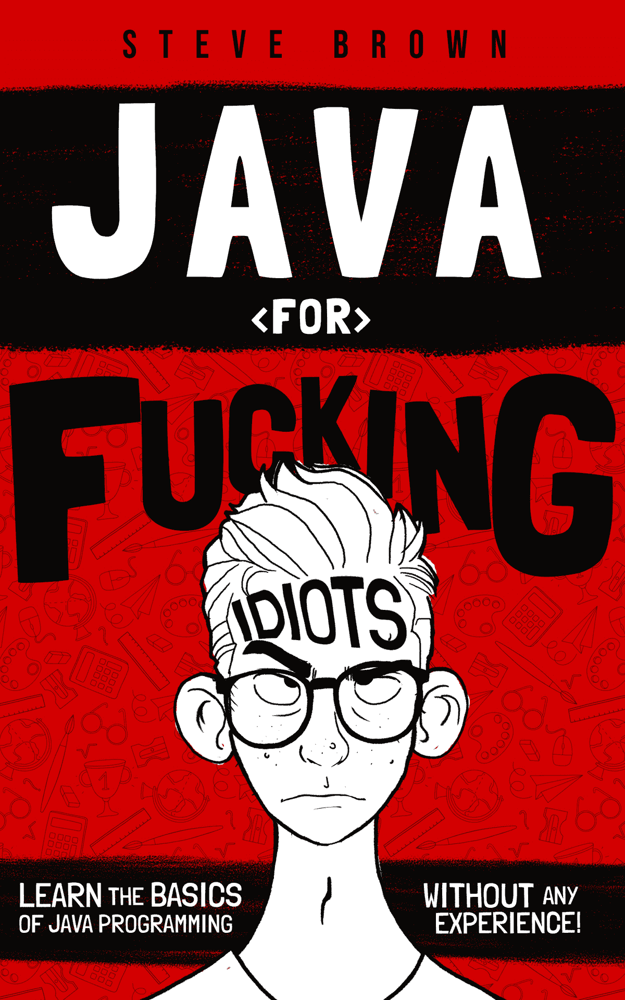

# Java 傻瓜指南：无需任何基础，学习 Java 编程基础！



# 目录

- 引言
- 第 0 章：软件要点
- 第 1 章：Java 到底是什么鬼？
- 第 2 章：Hello, World!
- 第 3 章：对象
- 第 4 章：变量
- 第 5 章：运算符
- 第 6 章：条件判断
- 第 7 章：数组
- 第 8 章：循环
- 第 9 章：实例化
- 第 10 章：方法
- 第 11 章：字符串
- 第 12 章：Java 电影宇宙
- 第 13 章：面向对象概念
- 第 14 章：整合一切
- 结语

# 引言

你好，我是 Steve。我在这里是为了教你 `Java` 的基础知识。或者说是 `Java` 的入门教程。二选一，或者两者都有。也许我应该在书的开头用一段小短的电梯演讲介绍一下它为什么存在。

厌倦了跳来份去工作来赚钱吗？点击这里学习如何在家里每月赚取 120,000 美元！！！

等一下，那写错了。让我重新开始……

根据我的经验，很多专为“完全初学者”设计的书可能只花一章像对待初学者一样对你说话，然后突然开始把你当成一个智力平均水平的人来对待。它们忘记了自己的读者群体。它就变成了一本普通的教科书。

我觉得这很令人沮丧。我想要被像对待我这个大傻瓜一样对待我，该死的。我向你保证，在本书里，我不会忘记你是一个像我一样的妈死的傻痴。唯一的真实要求是你能读字。如果你在下载电子书时还不会读字，那朋友，我不知道该对你说什么。

## 这本书是什么

这是一本快速、易读的书，它将引导你学习 `Java` 的基础知识；从变量、方法、运算符，到类、对象和包。不知道这些词是什么意思？没问题。我对英语的精通程度（在高中时至少能拿 B- 级）将带你进入一个 `Java` 编程的神秘世界。

那些完全自创且有机的代码片段将解释英语原本无法表达的内容。我在写这本书时看 YouTube 这一事实完全不会产生任何负面影响。而且这一切都是我我自己写的，所以你知道这本书是完全自创且有机的。并且倾向于用“而且”开头很多句子。

这本书的目标是让你，这个对 `Java` 编程感兴趣的空头读者，能够合上书并说：“嘿，我学到的比开始读它时多得多。而且这并并不太糟糕！”

## 这本书不是什么

就像任何一段健康的关系一样，我们应该诚实相待。我现在就对你诚实，告诉你这本书不是什么：

1. **关于如何下载、安装和配置 `Java` 的详细指南。**

   我不认为这符合此本书的格式或主题，而且我对写这个话题一点都不感兴趣。我确实在这个话题上写了一段简短的介绍，但我侧重于 `Java` 语言本身。

2. **一本充满练习的练习册。**

   考虑到 `Java` 已经有 24 多年的历史，这类练习多得的是。我将专注于教你概念，你只需要在代码里瞎搞腾并锻炼你的大脑。

3. **一份全面的 Java 指南，详细探索它所提供的所有功能。**

   是的，哥们，我拒绝这个。`Java` 中更复杂的部分我只会略带提及。其他部分我们根本来不及。这就是一本给妈死的傻痴看的书的本质。

4. **由拥有几十年经验的 Java 大师编写。**

   我写 `Java` 代码大约有 6 年了，但我只是个普通人。

5. **情绪稳定**

   这本书会非常不公平并对你发火，有时会进行人身攻击。先先歉了。

6. **可能会让我赚到钱。**

   但我愿意接受这一点。

## 我应该如何读这本书？

它是被设计成像你在马桶上上厕时翻看的东西，但你会非常喜欢它以至于一直读下去。

## 系好安全带

准备好你的毛巾，好戏了。我们要开始第一章了，一旦我们开始，就无路回头。

# 第 0 章：软件要点

开玩笑的，我们要从第 0 章开始……因为编程。这里有一个关于软件的简要总结，让你进入状态。

- 这是一个操作系统：`Windows`。它运行并与各个部分通信，这样我们就不需要自己去。

- 这是一个编程语言：`C++`。它是人类用来编写运行在操作系统上的程序。

- 这是一个程序：`Google Chrome`。它是一个用编程语言编写的网络浏览器，运行网站。

- 这是我们在书中使用的编程语言：`Java`。

- 这是细胞的动力工厂：线粒体。

- 这些是圆括号：`()`

- 这些是大括号：`{}`

- 这些是括号：`[]`

- 这些角括号：`<>`


太好了，现在你进入状态了……进入正文！

# 第 1 章：Java 到底是什么鬼？

`Java` 是一种编程语言（顺便说一下，它是最流行的）。编程语言是计算机可以理解的特殊语言。当你用编程语言写东西时，你创建的内容通常被称为 `code`。不是摩斯密码，或任何你用来告诉某人你不高兴而不是说你为什么不高兴的密码。不是那些；是计算机代码。

因此，程序员是指用编程语言编写代码的人，以便计算机为我们工作。然而，计算机是傻痴，甚至比你还傻。如果你把你的 `Java` 代码展示给你的计算机，它并不知道怎么读。哈！该死的机器！

我们通过一种被称为“编译”的过程将我们的编程语言代码转换为计算机可以理解的格式。Com – pill – ayy – shin。编译的行为。就像汇总一份你想从中餐馆点的一切东西清单。现在，当我看到“我们”时，我并不是指人类实际上在做这个“编译”事情。只是说我们依赖“编译”过程来创建我们的程序。

让我给你举个例子：

1. Steve 写了一段可以自动生成表情包的程序代码。
2. 编译器将他的源代码（他写的代码）转换为机器码。
3. Steve 的计算机运行这些机器码，这样他就可以享受他的新鲜表情包了。

所以，Steve 的源代码（人类可读）通过编译器编译成机器码（机器可读）。而机器码就是要在计算机上运行的内容。这就像是请了一位翻译员来和说不同语言的人交流。

`Source Code -> Compiler -> Machine Code`

“计算机，请把 2 加 2” -> 编译器 -> “01100110101”

明白了吗？你编写源代码，编译器将其转换为机器码，然后计算机运行这些机器码。把这些东西记进你那厚实的脑瓜里（两个两个 c）。

## 编译的兴趣（Compiling interest）

现在，我漏掉了一个部分。你看，机器码是专门为计算机的 `CPU` 创建的。到这里，你的眼睛可能已经快要翻到脑后了。要么你已经知道这是怎么回事，要么你已经开始困惑了。请耐心听我说。

对于那些还不了解情况的人来说，`CPU`（中央处理单元）是机器的大脑，负责所有的繁重工作。有些人称其为“芯片”或“处理器”。你怎么叫它都无所谓，对我来说，你管它叫门门手也行。总之，我们创建机器码是为了在计算机的处理器/`CPU` 上运行。如果我们把这些机器码给另一台计算机，会发生什么呢？

具体来说，如果我写了一些代码，将其编译成一个程序并在我的计算机上运行（使用处理器 A），然后把它给我的朋友运行（使用处理器 B），会发生什么？嗯。我写了代码并为处理器 A 编译……我的朋友有处理器 B……我猜它可以运行！是啊，程序很智能，直接就能运行，没问题的！

不，答案是行不通的！想象一下用英语写了一本小说，并请一位专业人士将其翻译成西班牙语。你会指一个只会说瑞典语的人能懂翻译员的作品吗？

对我们来说的是，由于架构设计的原因，`CPUs` 读取的是特定的计算机指令。处理器 A 需要的指令与处理器 B 不同。

我们该如何解决这个问题？等死吗？也许吧！更现实一点，我需要为处理器 A 编译我的程序，然后为处理器 B 编译，最后确保将正确版本的程序交给正确的计算机。“噢，那太糟糕了！”—— 兰迪·马什（Randy Marsh）。

## 核心思想（The Big Idea）

大多数编程语言从人类可读的源代码编译成机器码，以便在特定类型的计算机上运行。

## Java 圣经中的读段

Java 的创造者感到非常沮丧，并问道：“如果我们能编写一种可以在任何计算机上运行的编程语言会怎样？”而他们做到了。他们降临人间，向世人宣告。

“看吧。我们将创造一种可以在每个 `CPU` 上运行的编程语言。程序员将能够编译一次代码，并在处处运行！”

“但这怎么可能呢？”程序员们回答道，“你如何能同时为每台机器编译呢？每种类型的机器都必须有一个版本的程序！”

“不要害怕，孩子。这种语言是 Java，而 Java 是好的。你们将用 Java 编写代码，它将被编译并在 `Java Virtual Machine`（Java 虚拟机）上运行。”天空中的回答道。

他们很困惑，质疑创造者们：“但什么是 `Java Virtual Machine` ？”

“`JVM`？很简单，”他们回答道，“每台机器上都应该有一个名为 `Java Virtual Machine` 的程序，它能理解编译后的 Java 代码。你们不需要为机器本身进行编译；你们需要为 `Java Virtual Machine` 进行编译！”

“但我的烤面包机呢！我把 `BASIC` 代码编译为运行在烤面包机架构上，我要如何运行我的程序？”一位勇敢的程序员问道。

“哈！哈哈！愚蠢的人类。我们为烤面包机准备了一个版本的 `JVM`。还有冰箱。以及 PC、Mac 和 Linux。为每个系统安装正确的 `JVM`，Java 程序就能运行了。”

于是，事情就成了。

## 严肃时刻（Serious time）

你是否希望自己从未读过这样的段落？你现在恨我恨入骨髓了吗？我不怪你，但让我们快速触及一些在讨论编程语言，呃……“移植性”这个话题时会提到的术语。毕竟，你可能不想在描述技术性内容时引用一个虚构的圣经故事。我仍然不信任你能尝试描述任何技术性东西，但如果你需要的话，这部分应该会有帮助。

*   **机器语言 (Machine Language)**：针对计算机 `CPU` 的极其具体的指令，告诉它如何处理 0 和 1、执行数学运算以及那些令人困惑的破事。

*   **汇编语言 (Assembly Language)**：一种比机器语言稍微好理解一点的语言。汇编语言代表我们，为特定的 `CPU` 架构创建机器码。它基本上是机器语言的缩写。离远点。

*   **编程语言 (Programming Language)**：现代人类用来编写软件的语言。像汇编语言一样，它根据你针对的处理器类型编译成对应类型的机器码。

但我们并不需要使用像汇编语言那种晦涩、完全无法理解的垃圾（真的，去 Google 搜搜），而是可以使用相对容易编写和理解的编程语言。编程语言的编译器会负责将我们降级为机器码！！

## Java 的卖点

Java 程序员不需要担心为戴尔电脑、惠普电脑或 MacBook 计算机编写代码。他们为一台名为 `Java Virtual Machine`（`JVM`）的虚构计算机编写代码。

`JVM` 基本上充当我们的终极翻译员；它可以理解几乎任何类型处理器的机器语言。我们只需要提供编译后的 Java 代码，剩下的由它来处理。

所以，Java 是一种编程语言，它将“编译为机器语言”的做法替换为“编译为虚拟机语言”。

## 那么，编译后的 Java 代码到底是什么呢？

我的意思是，Java 虚拟机（`JVM`）理解的是什么语言？它被称为 `bytecode`（字节码）。任何用 Java 编写并想要在虚拟机上运行的代码都需要先编译成 `bytecode`。不，你不需要担心字节码到底是什么。它只是编译 Java 程序的结果。C++ 可能编译成机器码，但 Java 是编译成 `bytecode`。

所以，流程是：

1. 你用 Java 编写源代码。
2. Java 编译器“编译”或翻译源代码为 `bytecode`。
3. 运行在你计算机上的 Java 虚拟机 (`JVM`) 执行该 `bytecode`。
4. 只要有 `JVM`，同样的 `bytecode` 就可以在数十亿不同的计算机上运行。

明白了吗？如果你不懂，请给我写信：`1600 Pennsylvania Ave NW, Washington, DC 20500`。（注意：这不是我的真实地址）。

## 盒里有什么？

`Oracle` 是维护 Java 的公司。他们以 Java 开发工具包（`JDK`）的形式，向我们开发者（现在包括你了）提供这种伟大的编程语言及其相关工具。里面有什么？

*   Java 编译器，让你将编写的 Java 程序编译成字节码，以供虚拟机执行。
*   Java 虚拟机 (`JVM`)，让你的计算机可以运行 Java 编写的程序。
*   Java 标准库，让你不需要为了完成其他 Java 程序员做的常见事情而重新发明轮子。
*   一大堆其他东西。

# Java 编程语言本身在哪里？我该如何安装它？

Java 语言其实只是一堆规则。它规定了我们如何组合单词和字符，以便编译器能够理解它们。你不需要“安装”Java 编程语言。这就像是在写论文之前先“安装”英语一样。

你可以在记事本中编写 Java 程序，将其保存为名为 `Hello.java` 的文件，然后编译它并在 `JVM` 上运行，完全没问题。

利用你的 Google 技能从 Oracle 官网下载 `JDK`（选一个让你满意的版本即可）。没错，就是 Google，那个搜索引擎。习惯它吧。搜索“Download JDK”之类的内容。你需要的是 `JDK`，而不是 `JRE` 或其他任何东西。

当你拿到它时，请确保你已经同意了他们的法律协议，否则他们会让你进去坐一牢。

你应该能看到类似这样的界面：

没错，Java 8 现在的已经是老古董的东西了，但它目前对我来说还够用。不管，如果你用的是 Windows，就下载 Windows x64 版；如果你用的是 Mac，就下载 Mac 版。运行下载的程序。Java 现在已经安装好了；搞定，大功告。

## 集成式开发环境

机械师有工具箱。木工有工具箱。技师也有酷酷的胸部……我的意思是，他们也有工具箱。

我们程序员也有工具箱来帮助工作。那些重磅的被称为集成式开发环境（IDE），它们试图提供我们编写软件所需的一切功能，一站式解决方案。

Microsoft Word 就像是写论文、散文、小说或大多数涉及文字处理任务的 IDE。它有表格、段落、字体颜色、字体大小、缩进、列表等工具，老天，功能多到你可能永远在需要时找找不到它们。

你不会用 Word 来写代码。`IntelliJ` 和 `Eclipse` 是编写 Java 代码的 IDE 示例。

像 `IntelliJ` 这样的 IDE 可以帮助我们编写源码、编译、运行、共享、测试、重写，凡是你想到的都可以。对于成为编程社会中一名高效成员来说，它们至关重要。

### 你应该用哪一个？

`IntelliJ`。去搜搜它。下载社区版（Community Edition）。继续你的生活吧。它很纯粹！

虽然我认为了解手动编译和运行 Java 代码是有价值的，但我不认为它适合这本书。不过，我会指引一个正确的方向。

从命令提示符开始……

```bash
javac HelloWorld.java
```

会创建一个名为 `HelloWorld.class` 的字节码文件。

```bash
java HelloWorld
```

然后将使用生成的字节码运行该程序。

阅读更多：

- [一些人关于命令行的博客文章](https://www.lifewire.com/command-prompt-2625840)
- [Oracle 文档](https://www.oracle.com/technetwork/java/compile-136656.html)
- [WikiHow，反正何不呢](https://www.wikihow.com/Compile-%26-Run-Java-Program-Using-Command-Prompt)

或者不看。我不在乎。除非你对如何在极底层、手动的层面学习编译和运行 Java 代码有偏执症，否则你真的不需要停下来阅读关于这个话题的更多内容。

有些人人会认为这部分是“基础”，但我并不完全认同。诚然，它很基础，但初学者需要理解它才能开始写 Java 代码吗？要在不讨厌生活的情况下上手吗？不需要。用 IDE 就行。

# 第 2 章：Hello, World!

对于第一个程序，大多数人会写一个叫做“Hello, world!”的东西。以下是操作方法。

```java
print ( "Hello, world!" )
```

完成！哈，开玩笑的。那是 Python。我们现在处于 Java 世界，这意味着我们需要付出双倍努力才能得到同样妈死的的结果。

好了，这是你要做的。创建一个名为 `HelloWorld.java` 的文件，将以下内容放入其中：

```java
public class HelloWorld {
    // 程序运行时调用
    public static void main (String[] args) {
        System. out.println( "Hello, world!" );
    }
}
```

编译它。运行它。

程序输出了“Hello, world!”。哇。太棒了。这既无趣也没教你什么东西。我有点讨厌这个程序，但从某种意义上说，它是一种成年礼。

我有几点想要强调一下。不是用荧光笔，而是用文字。

首先，在英语中，我们在句子末尾加句号。在 Java 中你不想这样做，因为句号的意思完全不同。相反，使用分号。这个就是分号：`;`

没错，就是那个你在英语中永远不知道该怎么用的东西；它是放在两个句子之间，在列表之前，还是在某些句子片段之间？等等，我刚刚用了一个；那正确吗？噢天天。

在 Java 中就简单得多。你那些执行操作的 Java“句子”被称为语句（statements），它们都以分号结尾。别担心，如果你忘了，Java 会到处吐出错误，然后你就会知道自己搞砸了。

噢，还有那些双斜杠 `//`？你在它们之后写的任何内容都会被 Java 编译器忽略。你可以写任何你想写的字。这被称为注释。如果你想写多行，使用单斜杠后跟着星号 `*`。

# 第 3 章：对象

“Ryan 使用了一个对象。” – Kelly 很多 Java 课程和教程都会谈到这个。类（class）是某个可以存在的蓝图。

- 它有属性（properties），描述它是什么
- 它有方法（methods），描述它能做什么

对象（object）是类的实例（instance）。意味着，它是被赋予了生命的类。例如，可能有一个类叫 `Douchebag`。它是 `Douchebag` 可能行为的模板。


## 一 我写了一个 `Airplane` 类

- 它的属性有 `name`、`speed` 和 `weight`。
- 它的方法有 `takeoff()`、`land()`、`crash()` 和 `burn()`。

我从 `Airplane` 类创建一个实例（对象）。

- 我给它命名为“Crash”，速度设为 420，重量设为 10000。
- 我让飞机 `takeoff()` 和 `land()`。我不使用 `crash` 和 `burn` 方法。客气了各位。

## 二 我写了一个 `Monster` 类

- 它的属性有 `name`、`damage` 和 `health`。
- 它的方法有 `fight()` 和 `die()`。

我为 `Monster` 类创建了两个怪物对象。

- 第一个叫“goblin”，有 10 点 `health` 和 2 点 `damage`。
- 第二个叫“troll”，有 50 点 `health` 和 6 点 `damage`。

我让他们轮替互相 `fight()` 战斗，这会降低对方怪物的生命值。当其中一个的生命值达到 0 时，我告诉它 `die()`。哎。

## 三 我写了一个 `Book` 类

- `Book` 类的属性有 `title` 和 `stars`。
- `Book` 类没有方法，因为它什么都不干。

我写了一个 `Reader` 类。

- `Reader` 类的唯一属性是 `currentBook`，它是一个 `Book`。
- `Reader` 类的方法有 `read()` 和 `rate()`。

呼。铺垫了这么多。我们能用这些类做些什么呢？

嗯，也许我会从 `Book` 类创建一个对象，并将其标题设置为“给白痴看的 Java”。我会创建一个 `Reader` 对象，将 `name` 属性设置为“Chad”，并将它的 `currentBook` 设置为我刚刚创建的那个书。我会运行 `Reader` 对象的 `read()` 方法，然后是运行它的 `rate()` 方法。`rate()` 方法会将书籍的 `stars`（星级）属性设置为 5，因为 Chad 看起来真的很喜欢。很有意思。

# 面向对象的设计

Java 以及面向对象的设计（Java 像信拜宗教一样遵循它）是一种对现实世界建模的方式，只不过是在代码中建模。

让我们想一下亚马逊的计算机系统。你每天购买的产品都是对象，我向你保证。送到你家门口的包裹是对象。司机每停一处都是一个对象。你的房子是一个对象。这段旅程本身也是一个对象。

那么 Java 中的程序是什么样子的呢？它是一堆对象以有意义的方式相互作用，从而让事情发生。

在 Java 的世界里，这可能是一个桌面电脑程序（每个屏幕都是对象，屏幕上的元素也是对象）、一个 Web 服务（在互联网上发出的每个网络请求都是对象）、从数据库返回的数据是一个对象，你能想到的都有。

虽然我不能声称你在 Java 中写的每个 `Class`（类）都基于现实世界中的某些东西，但它们将是具有属性和方法的名词。欢迎来到面向对象编程！祝你呆得愉快……混蛋。

# Hello, world?

现在，让我们稍微后退一步，看看这些知识如何应用于“Hello, World!”程序。这里是给那些短期记忆缺失的人的（可能是你们中的大多数人）准备的。

```java
public class HelloWorld {
    public static void main (String[] args) {
        System. out .println( "Hello, world!" );
    }
}
```

让我们看看……有一个叫做 `HelloWorld` 的类。有一个叫做 `main()` 的方法。而且……额……呃……:thinking: emoji 表情 嗯……“Hello, World!” 和面向对象编程有什么关系呢？

剧透：它真的没关系……这里没有对象。它展示了 Java 中少数几个不是面向对象的概念之一：静态方法。这些方法存在于对象领域之外。该死的 Java。为什么你的“Hello, world!”程序不能没那么愚蠢？

但我应该冷静一下。这对我的健康不好。让我们聊聊 `main` 方法中到底发生了什么。

## Main 方法

“你觉得你自己是谁？凭什么……凭凭什么？”—— 迈克尔·斯科特

`main` 方法是程序的入口；当程序运行时，就会运行 `main` 方法。包含“Hello, World!”字样的代码位于 `main` 方法内部。你放在那些大括号 `{}` 之间的任何内容实际上都在 `main` 方法内部。

```java
public class HelloWorld {
    public static void main (String[] args) {
        System. out .println( "Hello, world!" );
    }
}
```

为什么有一个 `main` 方法？是什么让它如此特别？`main` 方法之所以存在是因为程序启动时需要某些东西运行。还记得那个“鸡生蛋还是蛋生鸡”的困境吗？

- 有人说鸡先生，因为所有的蛋都是鸡产的。
- 有人说蛋先生，因为所有的鸡都是从蛋里出来的。

Java 的答案是，这两个对象都不是先生的。`main` 方法才是。如果没有 `main` 方法首先在对象领域之外运行，任何东西都不会存在。这就是那个“静态狗屁”的意思。静态属性和方法在没有对象的情况下存在。

“没有对象，没问题。”—— `static` 关键字

或者……

“除非必要，否则不要让事情变成静态的，因为对象是好的。”—— 我

如果你还没有 100% 理解这一点，不用太担心。就担心一点点。好吧，你可能在想。但是 `main` 单词前面的那些其他东西呢？`public`？还是 `void`？这简直太让人困惑了。

我会在书的后面更详细地介绍这些内容。但我现在也会简要回答一下，因为我讨厌当你想知道某事，而作者却说“等一下，我们会讲到的”。混蛋，我现在就告诉你。

- 在东西前面加上 `public` 表示所有其他类（即使在不同的文件夹中）都能看到它。如果你的某些代码要去上厕所并需要隐私之类的，你也可以将其描述为 `private`（私有的），但 `main` 方法不会！它总是是公开的！
- 在某些代码前面加上 `void` 意味着它执行了一些酷炫的操作，但不汇报结果。没有人要求 `main` 方法报告事情进展是否顺利，或者返回某个数学计算的值。`Main` 方法不在乎是否有人知道。

懂了吗？如果没有懂，再读一遍那些解释……好吧，我知道你不会去读。我会更简短地总结一下：

1. `main` 方法是 Java 开始运行你的程序的方式。
2. `main` 方法是 `static`（静态的），因为需要某些东西存在于对象领域之外。Java 的开发者是这么说的。
3. `main` 方法是 `void`（无返回），因为它不需要向调用它的人提供值。Java 的开发者是这么说的。
4. `main` 方法是 `public`（公共的），因为它会被这个文件夹之外的人调用。Java 的开发者是这么说的。

# 声明一个类

让“Hello, World!”留在它该去的地方，我来解释如何声明一个类：

```java
class Book {
}
```

很酷！任务完成。

好了，我们声明了一个基础类。

然而，当类像这样空空运行时几乎是没用的。让我们添加一个属性。

```java
class Book {
    String title ;
}
```

# 属性

在现实世界中，属性是什么？不，不是富翁游戏里的属性。让我们问问字典。属性：“事物的本质或独特的特征或品质。”

是的。在 Java 中也是如此。我们称 `title` 为属性是因为它属于一个类。它是书籍的名字。没有书，它就不存在。我们可以添加更多属性：

```java
class Book {
    String title ;
    String content ;
    String[] chapterNames ;
    int bookmarkedPage ;
    double averageRating ;
    boolean hasSequel ;
    Author author ;
}
```

总之，开始理解大意了吗？类可以与其关联的信息，称为属性。提醒你一下——这些属性对于从该类创建的每个对象都是特定的。我可以创建 500 本书，它们会有不同的 `title` 属性。我最终可能会写出不错的书。

## 读写 101

在 Java 中，你可以使用句号与这些属性进行交互。这被称为“点符号法”。假设我们有一个名为 `bestBook` 的 `Book` 类实例。这是一个真正的 `Book` 对象，是从 `Book` 类创建的。以下是我如何操作它的属性。

```java
bestBook. title = "如何在不到 20 分钟内成为一名高级服务员" ;
bestBook.content = "忘记所有精致餐饮以外的一切。还有呼吸。";
bestBook. averageRating = 5.0 ;

System. out .println(bestBook. title );
```

结果是什么？程序输出了文本：“如何在不到 20 分钟内成为一名华丽的服务员”。那个点，或者说句号，就像通往对象灵魂的窗口。在你的对象名称后面加上这个点，就可以访问它能看到的所有内容。

## Methods

还记得主方法吗？没错，它被称为 `main` 方法，因为它是第一个运行的、非常重要的方法。但你可以拥有多个方法。

事实上，非常建议拥有多个方法。将你的代码拆分为许多较小的方法，会使其更容易阅读和理解程序在做什么。

我们刚刚简要地提到了属性（properties），它们是与对象相关的数据片段。属性和方法之间的区别是什么？

- 属性是对象**是什么**。
- 方法是对象**能做什么**。

“但是……但是，Steve。这并不能真正解释 Java 中的方法到底是什么。你算什么，我是个白痴吗？”——你

好吧好吧，也许不是你说的。你可能不记得我的名字了。听着，这本书才刚开始。有很多很多内容要涵盖，我不想陷入方法的细节（该死它吧）中。我会给你一个它们在 Java 中可能样子的例子。

```java
class Video {
    void resume() {…}
    void pause() {…}
    int getLikesCount() {…}
    String getTitle() {…}
    Video[] fetchRecommendations() {…}
    boolean isPaused() {…}
}
```

就像属性一样，你可以使用点符号法来操作它的东西。

`bestVideo.resume();`

`bestVideo.pause();`

我刚刚快速恢复并暂停了视频。希望这没有让它坏掉并导致缓存永恒……总之，我意识到我把那些方法留空了。也许那些方法正在修改 `Video` 对象的属性（我没写出来的那些）。

对象和方法的伟大之处在于，你将代码的职责划分成了易于管理的区块。`pause()` 方法不需要知道如何 `resume()`。`fetchRecommendations()` 方法负责寻找 YouTube 想塞进你嘴子里的“相关”视频；`getTitle()` 根本不在乎这些！

优秀的程序员保持其方法短小、命名良好且直截了当。但关于方法就到此为止了——在我们深入研究之前，还需要涵盖很多非常基础的 Java 概念。继续前进，不断进步！

# Chapter 4: Variables

“变量不够……嗯……变量远远不够。” - Heimerdinger

好了，现在是时候深入学习这种语言的细枝末节了。穿上大男孩（或大女孩）裤，因为事情要变得真格了。让我们聊聊变量。初中学上过代数吗？见过这样的东西吗？

`7 = 3 + x`

解出 `x` 对吧？变量就像那样。

这是一个例子：

```java
int myFavoriteNumber = 7 ;
```

之后如果我们使用 `myFavoriteNumber` 变量，它将等于 7。所以，变量是被赋予了值的可读内容。你计算机的短期记忆说：“好的，我会为你存储那个值。当你想知道那个值或更改它时，再次使用那个变量名。”

人在 Microsoft Outlook 中输入“请将我从这个邮件列表中删除”。程序会将该数据表示为一个变量。另一个人在电脑上打开计算器并按下数字 3。那是另一个变量。虽然类型不同，但终它是变量。你的兽医电脑系统会检查你之前是否使用过他们；这个是/否或真/假的值也可以用变量表示。

变量无处不在。创建它们，存储它们以备后用，改变它们，发送它们给你的朋友，对它们产生感情，为它们哭泣。它们太棒了。

## 为什么我们需要变量？

我们无法预测未来，我们的程序也是如此（目前）。我们的代码可能需要响应用户输入的用户名、时间、库存中的物品数量、条形码扫描的信息、可爱照片中狗的品种、你手机的 GPS 坐标，你想到的都有。

我们现在不知道，但我们的程序在运行时（at runtime）可以发现的东西，都是变量的候选对象。

好了，现在让我们创建一些。

## Making 变量

你可以声明一个变量，基本上是告诉编译器“嘿，这是我以后要用到的东西，好吗？”，像这样：

```java
int numberOfStarsToAwardThisBook;
```

变量已声明。万岁！但是，它还没有值。我们稍后可以用新行代码初始化该值来修复它：

```java
numberOfStarsToAwardThisBook = 5 ;
```

或者，我们可以从一开始就完成（声明并初始化）：

```java
int numberOfStarsToAwardThisBook = 5 ;
```

自然地，Amazon 的软件中并没有内置让每条评论都变成 5 星的代码。我们可能会向用户显示一个屏幕进行选择，然后将此变量设置为他们选择的星数。

## Data types

“int”部分是干什么用的？

`int` 是 integer（整数）的缩写。整数是全数。老实说这是基础数学，但正如我之前提到的……做出最少假设。

这些是整数：4, 8, 15, 23, 42, -15

这些不是全数：½, ¾, 84

你可以在变量前加上 `int` 来指定它是一个全数。Java 对这些“类型”非常敏感。这里是一些你可以创建的不同类型的变量：

- `byte`: 一个很小的数字（-128 到 127），支持正负数。通常用于处理文件。
- `int`: 一个整数。非常常见。
- `short`: 一个较小的 `int`（除非你有特殊需求）。
- `long`: 一个可以存储非常巨大的整数。
- `double`: 可以带有小数点的数字，如 4.2。
- `float`: `double` 的一个没用的版本。
- `char`: 单个引号内的单个字符，如 ‘g’ 或 ‘f’。
- `boolean`: 真或假。没有别的。这种类型。

你可以搜索“Java 数据类型”或点击[此链接](https://docs.oracle.com/javase/tutorial/nutsandbolts/datatypes.html) 查看所有的选项。

## 它们是什么？

它们是原始数据类型；不是因为它们底层，而是它们不是对象。想象 Java 宇宙在底层不是由质子、中子和电子组成的（希望你初中毕业了！），而是原始变量。每个存储或处理数据的类或对象，深处都有由原始类型表示的数据。我想。也许。例如，我列出的所有示例都以小写字母开头；这是原始变量的典型特征。

秘密地说（好吧，没那么秘密）它是一堆绑定在一起的字符变量。`String` 类已经为你处理了这一切。我们在书中有一整整一个章节专门介绍字符串、如何处理它们，以及书中后面会遇到的这类各种垃圾内容。但希望这能让你先应付这一关。

## 实验

我建议你尝试声明变量、给它们赋值，并看看会发生什么。你甚至可以启动你那蠢的“Hello, World!”程序，并把它放在 `main` 方法中。

```java
public class HelloWorld {
    public static void main(String[] args) {
        int myNumber = 420;
        boolean shouldBlazeIt = true;
        char charmander = 'C';
        double moneyInTheBank = 500.36;
        long speedOfLight = 299792458L;
        String bestAuthor = "Steve";
    }
}
```

尽管去尝试一些行不行通的事情。挑战 Java 编译器的极限。例如，你可以写这样一行代码：`int wellThisIsJustWrong = false;`。然后编译并运行代码。它会发大雷霆，向 NASA 发送报告，并通知你的互联网服务提供商立即取消你的套餐。

# 第 5 章：运算符

“你好，运算符？快给我叫海军来！[你已拨入海军的自动电话服务。] 章奇！机器人接管了海军！不是海军啊！！” —— 海绵宝宝派水粉丝

好了，现在你已经知道变量的基础知识了。希望如此吧。现在，让我们看看运算符，或者说我们与变量交互的各种。

## 什么是运算符？

它们是执行特殊操作的特殊符号。也许你想把两个值相加。或者看看两个值是否相同。或者检查一个数字是否大于或等于另一个数字。或者，你想同时执行以上所有操作。运算符，出发！

注意，运算符不是变量。它们不是方法，不是对象，不是数据类型，而且它们对你并不感兴趣。它们就像计算器上那些不是数字的按钮。

## 算术运算符！

让我们开始吧！

- 使用 `+` 加数
- 使用 `–` 减数
- 使用 `/` 除数
- 使用 `*` 乘数

对于 99% 的场景来说，这听起来一样简单。

`int x = 2 + 2;`

…`x` 变为 4

`int y = 4 * 9;`


…`x` 变为 36，但当我们开始组合运算符时会发生什么？我们如何知道哪个更重要并先执行？我们是先乘法、再加法再减法吗？要是有某种气动设备能记住…… 嗯，你猜怎么着？[PEMDAS](https://www.mathsisfun.com/operation-order-pemdas.html) 回来了！！

## 运算顺序

操作就是一小块数学破事。你的服务员可能按照特定的顺序为你服务（每个桌子都是一个操作），取决于你到达的时间、他们对你的喜爱程度、他们预期你给的小费金额、你在餐厅的位置等。

数学有它自己的运算顺序：PEMDAS。

* **P**arentheses 括号 `()`
* **E**xponents 幂 `^`
* **M**ultiplication 乘法 & **D**ivision 除法 `*/`
* **A**ddition 加法 & **S**ubtraction 减法 `+-`

好消息是！你真美。不，但 Java 中没有幂。你只需要记住括号里的东西先发生，然后是乘法/除法，最后是加法/减法。如果这些类别之间没有组合，你只需从左到右即可。相信我，这超级简单。进入示例，走！

### 示例一

`int x = 5 + 3 - 7;`

`x` 是 1。为什么？不需要担心 PEMDAS 规则，这只是加法/减法。`5 + 3` 是 8。如果我们从结果减去 7，就得到 1。

### 示例二

`int y = 5 - 7 * 6;`

`y` 是 -37。为什么？乘法必须先发生，因为 PEMDAS 是这么说的。`7 * 6` 是 42。如果我们从 5 中减去 42，就得到 -37。

### 示例三

`int z = 28 / ( 3 + 4 );`

`z` 是 4。为什么？虽然是加法，但 3 和 4 必须先处理，因为它们在括号内。`3 + 4` 是 7。然后我们可以用 28 除以 7 得到 4。

编程中的大多数数学（至少对于 90% 的开发者来说）是非常基础的；加两个值，乘两个值等。所以不要指望会经常需要担心这个“运算顺序”。

## 取模

另外……我纠结过要不要提它，但好吧，还有一个。它被称为取模运算符，它很蠢。它使用百分号（因为去你的吧，它就是这样）。

`int remainder = 5 % 2;`

`remainder` 被设置为 1。为什么？因为取模执行除法，然后给你该除法操作的余数。

此外，检查一个数字是否为偶数：`boolean isEven = myNumber % 2 == 0;` 关于这个我就说这么多。

## 逻辑运算符

这些非常简单。它们基本上是这些英语单词的 Java 版本：

* 与 `&&`
* 或 `||`

不，那不是艺术。它们是括号里的新运算符。让我们创建一些布尔值！记得那个数据类型吗？布尔值要么真要么假。这种数据类型与这些“逻辑”运算符紧密结合。

```java
boolean imBored = true;
boolean imHungry = false;
// 真
boolean imGoingToFood = imBored || imHungry;
```

看到或运算符 `||` 是如何工作的了吗？“我很聊或者我很饿，我就去吃。”只要其中一个条件为真，`imGoingToFood` 就设置为真。

* 我正在制作一个文字冒险游戏。如果用户输入“exit”或“done”，我就退出程序。
* 我正在写一个监控股市的程序（这是金钱生死之地）。如果我拥有的股票价格大幅上涨或下跌，我就发送电子邮件警报。事实上，如果 `||` 运算符的左侧已经为真，Java 甚至不会看右侧；没意义！Java 就像……如果我已经知道 `imBored` 足够让我吃饭了，为什么要检查 `imHungry` 呢？

对于与 `&&` 运算符 true 如此。两者都必须为真，表达式结果才为真。

```java
boolean wellRested = true;
boolean motivated = false;
// 假
boolean goingToWorkOut = wellRested && motivated;
```

即使我休息充足，如果我完全没有动力，也不会健身。而且即使我有健身的动力，如果因为睡眠不足没有精力，我也会放弃。

* 我正在写一个应用程序，用户必须使用账户信息登录。只有当他们输入了用户名和密码时，我才尝试让他们登录。
* 我正在创建一个照明系统，如果灯处于开启状态且房间内 5 分钟无人，它就会自动关灯。

觉得太简单了？这很“逻辑化”，对吧？懂了吗？逻辑（Logical）？因为它们被称为逻辑-噢（logic-Oh），就像数学运算符一样；不，你不应该创建一个始终为 `true` 或始终为 `false` 的变量。它们是变量。但我现在正试图把这个概念传达达，明白？等我们进入条件判断和 `if` 语句时会讨论。

## 赋值运算符

“现在，男士们准备好接受你们的超……特殊的……秘密……任务了吗！？！你们两个要给我房子的内部刷漆！！耶耶耶！！” – 海绵宝宝

是的，你已经见过这个东西了（它就是等号 `=` ），但我们将介绍它，以消除学者可能会产生的误解。

回想一下你以前学校的代数课。你可能已经不记得了。不，不是关于三角形的那个……这个听起来眼熟吗？

`x = 7`

你会怎么大声读它？可能是这样的：“x 等于 7”。

在 Java 中你可以做非常相似的操作。看这行代码：

```java
int x = 7 ;
```

这和之前的一样的，对吧？“x 等于 7”？？错误！不对！否定！想知道为什么吗？如果我给你看这个呢？

```java
int x = 1 ;
```

好的，`x` 是 1……`x = x + 1` 唔……好的，现在 `x` 等于……`x + 1`？？等等……如果 `x` 是 1，那么意味着 `1 = 1 + 1`？？这意味着 `1 = 2` ？？希望你的大脑已经从沉睡中醒来，并对着页面尖叫：“这不可能！这完全没意义！他们为什么要搞这么乱？”

`=` 并不是“等于”。因为在 Java 中，单等号是**赋值运算符**。它的工作原理是：左侧的内容被赋予右侧内容的值。你可以这样说：

```java
int x = 7 ;
```

“给 `x` 赋值为 7”

`x = x + 1`

“将 `x` 的当前值加 1 赋值给 `x`”

猜怎么着？现在 `x` 的值是 8 了（震惊表情）。

这似乎是一个细微的区别，不是吗？“给某物赋值”，与说“某物等于另一个东西”。但这个概念是一个神秘的妙妙工具；一个以后会帮助我们的惊喜工具。

## 关系运算符

还记得箭头符号 `<` 和 `>` 吗？也许你被教过把它们想象成鳄鱼；鳄鱼的嘴指向较大的数字？也许吧？反正……在普通数学中这里是一些真陈述：

`2 < 3` 小于 3。

`3.5 > 4` 大于 4。

酷。现在，这是错的。

`5 > 5` 大于 5。

它们的值相同；5 并不大于 5。错误，你现在一定在尖叫了！

现在，如果我们把它写成这样呢？

`5 ≥ 5`

这是正确的。5 确实大于或等于值 5。语句 `5 ≥ 4` 也是正确的。

既然我已经总结了你六年级代数课的所有内容，让我们来看看这在 Java 中是如何运作的。关系！

```java
// True
boolean itsSmaller = 2 < 3 ;

// False
boolean itsBigger = 3 > 4 ;
```

我知道你在想什么。我胜有稳筹。那些运算符很简单！比较值以判断其中一个比另一个大还是小？哈！真是笑话。这家哥们一定觉得我是个完全的白痴。好吧，没错，重点就在这里。

但还有更多的变数要向你袭来了。记得我上面提到的“或等于”部分吗？在普通的数学中，那是给箭头符号加下划线，像这样：`≥`

你可以将等号与比较运算符之一结合起来形成相同的内容；一种更疯狂的关系检查：

```java
// True
boolean itsBiggerOrTheSame = 5 >= 5 ;

// False
boolean itsSmallerOrTheSame = 3 <= 2 ;
```

当然，把等号放在箭头后面不像在代数中那样加下划线那么“酷炫”。但在 Java 中就是这么做的。你可以继续尝试这些内容，但你可能已经掌握要窍了。是的，我想可以说这是一种赞美。继续加油，伙计。编程如此简单难道不不可思议吗！！！！你太聪明了！还是个极好的读者！另外，你给这本书打 5 星评了吗？

## 比较运算符

如果你把两个等号放在一起会发生什么呢：思考表情：答案是，妈妈等号和爸爸等号结合在一起，形成了一个新运算符；**比较运算符**！这就是我之前关于单等号 (=) 意思是“赋值”而不是“等于”的那些插话真正发挥作用的地方。所以我希望你一直留住了那个神秘的妙妙工具！

好的，假设我们不想给变量赋值。相反，我们想检查一个变量是否等于一个值。顺便说一下，这是超级超级常见的。

```java
// True
boolean isSameCharacter = 5 == 5 ;

// False
boolean isSameNumber = 5 == 4 ;
```

“将 `numGiraffes` 赋值为 `numGiraffes` 当前值乘以 2。”

老实说，我通常不建议使用这些运算符，可能 `++` 和 `--` 除外。我**个人认为**（观点警告！！）觉得直接写出具体的数学运算更容易理解。记住，你编写代码的主要目的是为了让人类读懂；你未来的自己以及团队成员会感激之的。

### 布尔之王

还记得我讲过的感叹号（`!`）吗？它基本上就是“不”的意思。所以 `!=` 是在检查一个值是否“不等于”另一个值，对吗？

如果你只是想翻转某个值从真到假（`boolean` 值），或反之，在 `Java` 中有更简单的写法。例如，与其写成：

`boolean isBad = isGood != true ;`

你完全可以直接说：

`boolean isBad = !isGood ;`

感叹号直接放在 `boolean` 前面。哇，再次惊叹！！

其他的运算符……我都不打算讲了。如果你想学习位运算、移位或三元运算符，请去找更高级的材料。或者鼓励我再写一本书。眨眼。

### 我头疼

所有那些深奥的理论都是可选的，所以别纠结。此外，如果你使用像 `IntelliJ` 这样的 IDE，当你用很蠢的方法做事时，它会纠正你。

# 第 6 章：条件语句

“是时候玩点花了。” – DJ Casper

大多数时候，你的代码不能简单地从上到下一条接一条执行并完成任何有用操作。你需要代码根据用户输入的内容、库存产品、或者运行的 `Android` 版本等执行不同的操作。

看，强大的 `if` 语句：

```java
if (numGiraffes > 500 ) {
    System.out.println( "Please send help." );
}
```

那行打印到系统的代码只在我们拥有超过 500 只长颈鹿时才会发生。另一个例子：

```java
Scanner userInputReader = new Scanner(System.in);

int userInputNumGiraffes = userInputReader.nextInt();

if (userInputNumGiraffes <= 0 ) {
    System.out.println( "它们在哪儿?" );
}
```

那行代码只有在用户输入 0 或负数时才会打印到系统。我将跳过解释[如何通过 Scanner 获取输入](https://stackoverflow.com/questions/11871520/how-can-i-read-input-from-the-console-using-the-scanner-class-in-java/31241089)，好吗？真的，非常无聊的内容。

不管怎样，`if` 部分好理解吗？它其实和英语很像。如果这样，就做那样。现在，如果我们还想在用户输入实际数值时做些什么呢？如果你还记得比较运算符，你可以在该条件语句下方添加类似下面的代码：

```java
if (userInputNumGiraffes <= 0 ) {
    System.out.println( "它们在哪儿?" );
}

if (userInputNumGiraffes > 0 ) {
    System.out.println( "我会立即添加它们。" );
}
```

两个连续的 `if` 语句。这样可以运行，对吧？但太蠢了。为什么要在这两个地方检查 `userInputNumGiraffes` 的值？不要这样做。

相反，在原始的 `if` 语句中添加一个 `else` 块，如下：

```java
if (userInputNumGiraffes <= 0 ) {
    System.out.println( "它们在哪儿?" );
} else {
    System.out.println( "我会立即添加它们。" );
}
```

如果第一个检查（用户输入的值小于等于 0）为真，我们就进入 `if` 块。否则（`else`！）我们就进入 `else` 块。编程非常简单，哥们。

噢，你不需要把 `else` 单词和那个大括号 `{` 写在同一行。你可以按回车并将 `else {` 推到下一行，如下所示：

```java
if (userInputNumGiraffes == 0 ) {
    System.out.println( "它们在哪儿?" );
}

else {
    System.out.println( "我会立即添加它们。" );
}
```

你也可以把每个大括号单独占一行。这会是在违反 `Java` 代码风格的暴行，但如果你真的想惹恼我，你可以这么做。

好了，我希望你目前为止都跟上了；你可以检查某值是真是假，然后使用 `if/else`（条件）逻辑采取相应的行动。这被称为控制流。你正在控制程序的流向。

然而，在某些情况下并不是简单的“如果 X 则这样做，否则做不同的”。例如，你可能想根据长颈鹿的数量来做不同的事情。我们怎么做呢？嗯，有几种方法……

## 多个 if/else 检查

这种怎么样？在 `else` 块内部添加另一个 `if/else` 检查。在那个 `else` 块内部再添加另一个 `if/else`，以此类推。这样得通，对吧？注意，如果你在小屏幕上，这部分可能会变得很乱，但请耐心听……

```java
if (userInputNumGiraffes < 0 ) {
    System.out.println("离我的长颈鹿远点。" );
} else {
    if (userInputNumGiraffes == 0 ) {
        System.out.println("抱歉，你不能添加 0 只长颈鹿。");
    } else {
        if (userInputNumGiraffes < 3 ) {
            System.out.println("感谢提供 1-2 只长颈鹿。");
        } else {
            if (userInputNumGiraffes < 10 ) {
                System.out.println("感谢提供 3-9 只长颈鹿。");
            } else {
                System.out.println("你怎么会有 10 只以上的长颈鹿？");
            }
        }
    }
}
```

```java
player.moveRight();

default :
    player.stopMoving();
}
```


哇，太疯狂了！我们创建了一个取值为用户输入的 `switch` 语句，然后对每个 `case` 执行不同的操作。不，`case` 与大写或小写字母没有关系；它是当 `switch` 等于某个特定值时。如果他们按了 ‘W’，就会运行 ‘W’ `case` 下的代码。如果他们按了 ‘D’，就会运行 ‘D’ `case` 下的代码。`default` 是当用户输入不符合我们的任何一个 `case` 时发生的情况。也许他们按了空格键，或者按了某个我们没有考虑到的字母。明白吗？和之前的 `if/else` 示例对比一下。

然而，这个 `switch` 示例代码中有一个致命的缺陷（它其实并不是没有错误，是个变球！！！）。如果用户按下 ‘A’ 会发生什么？玩家向哪个方向移动？想一想。向上滚动/翻回去/坐出租车回来看看；用户按下 ‘A’ 可能会有什么问题？或者别想。反正我会告诉你。玩家开始移动 `moveLeft()`，但紧接着就被要求 `stopMoving()`。“发生了这种情况？！但为什么呢？？用户按了 ‘A’，所以它匹配了 ‘A’ `case`，对吧？向左移动？”——也许是你这么想。

嗯，`default` 行代码实际上每次都会执行，除了 `case` 之外……因为除非你另指定，否则 `switch` 会检查每一个 `case`，然后进入 `default` 代码块。那个 `switch` 不会停止！你需要为每个 `case` 给 Java 一个非常特殊的单词。它被称为 `break`。

```java
switch (keyPressed) {
    case 'W' :
        player.moveForward();
        break ;
    case 'A' :
        player.moveLeft();
        break ;
    case 'S' :
        player.moveBackward();
        break ;
    case 'D' :
        player.moveRight();
        break ;
    default :
        player.stopMoving();
        break ;
}
```

现在当匹配到其中一个 `case` 时，Java 看到 `break` 就会触发“停止开关”（嘿嘿），防止 `switch` 语句中的其他内容运行。Java 会跳转到整个 `switch` 语句下方的任何代码（大括号 `{}` 之外）。

我们为什么要这样做？“因为去你的吧，这就是原因。”——Java。

现在告诉我，哪一个更容易理解：一些 `if/else`，还是一个 `switch/case/break/default` 组合？完全取决于你的选择。想根据某个变量的值执行不同的操作吗？选一个你更喜欢的吧。但如果你选择了 `switch`，最好希望你没有忘记写 `break` 语句（这确实会发生）。

# 第 7 章：数组

“电视上难道没有什么不是关于**盒子**的内容了吗？！我们现在回到冠军拳赛。”——海绵宝宝

随堂测验：字母表的第一个字母是什么？答案：（嘟嘟，嘟嘟，嘟嘟）双倍机会。好吧，不。它实际上是 `A`。我们在 Java 中如何表示这个字母呢？哪种数据类型？滴答，滴答。你猜到是 `char` 吗？如果是，你就对了！如果不是……哎呀！我真的很支持你，笨蛋。它就在这里！

```java
char firstLetter = 'A' ;
```

再次祝喜。

## 多个值？？

酷酷。现在，如果我们想存储多个值怎么办？我们使用数组。在 Java 中我们如何表示它呢？我们在类型后面使用方括号 `[]`。

```java
char firstLetter = 'A' ;
```

等等，那不对。为了声明一个字符数组，我们使用 `char[]`。

```java
char[] letters;
```

这创建一个可以包含多个 `char` 值的数组。我们如何初始化它？我们可以使用大括号：

```java
char[] letters = {'A', 'B', 'C'};
```

这是一个包含三个元素的数组。如果我们想先定义大小呢？我们在括号中使用大小：

```java
char[] letters = new char[10];
```

这创建了一个包含 10 个 `char` 元素的数组，它们都初始化为默认值。我们如何访问元素？我们使用索引：

```java
letters[0] = 'Z';
```

记住，索引是从 0 开始的！所以第一个元素是 `letters[0]`。

如果我们想遍历数组呢？我们使用 `for` 循环：

```java
for (int i = 0; i < letters.length; i++) {
    System.out.println(letters[i]);
}
```

等等，`length` 是数组的一个属性，告诉我们它可以包含多少元素。这非常有用！

让我们看更多的例子：

```java
int[] numbers = {1, 2, 3};
double[] prices = {1.9, 2.5, 3.0};
String[] names = {"Alice", "Bob", "Charlie"};
```

这些每一个都是不同类型的数组。`[]` 是告诉 Java 这是一个数组的关键。

总结：

- 声明：`type[] name;`
- 尺寸初始化：`type[] name = new type[size];`
- 值初始化：`type[] name = {val1, val2, ...};`
- 访问元素：`name[index]`
- 数组长度：`name.length`

`userFavoriteLetters[ 1 ] = 'Q' ;` 看到我刚才在做什么了吗？我说“把字母 Q 放在第一个槽位。” 然后你可以继续这么搞：`userFavoriteLetters[ 2 ] = 'C' ;` 见鬼，你甚至可以直接跳到这里：`userFavoriteLetters[ 7 ] = 'Z' ;` 现在你的数组在底层看起来是这样：`[ , Q, C, , , , , Z, , ]`

所以我们把用户喜欢的字母 Q 放在第一个槽位，然后我们放……等等。等一下。Q 前面有个逗号吗？Q 不在第一个槽位吗？第一个槽位看起来是空的！发生什么事了？！

我告诉你：在 `Java` 中，数组是从 0 开始的。没错，槽位 `0` 是第一个位置，而不是槽位 `1`。在第一个槽位放入东西的正确方法是：`userFavoriteLetters[ 0 ] = 'Q' ;`

这非常重要！数组在 `Java` 中到处都是，即使你有时并没有意识到。顺便说一下，这不仅仅是老爸 `Java` 想出了这种奇怪的“从 0 开始”的规则，几乎每种编程语言都是这样。

所以是的，一旦创建了数组，你就可以用方括号 `[]` 把东西放进去。为了方便理解，我再展示几个例子。`String[] words = { "Hello" , "world" };`

*   这是一个长度为 2 的数组，因为里面有 `2` 个东西。
*   “Hello ”位于位置 `0`，“world ” 位于位置 `1`。

`words[ 1 ] = "universe" ;`

*   现在，“Hello ”位于位置 `0`，但“universe ” 位于位置 `1`。

## 从盒子里拿东西

和把东西放进去的方法几乎一样，使用一些方括号 `[]`。`char firstLetter = userFavoriteLetters[ 0 ];`

这些方括号中提供的数字被称为 `index`（索引）。在任何你想要放入或取出东西的数组中，你都必须指定你进行操作的 `index`。

让我们测试一下你的知识。如果我的 `char` 数组有 `10` 个槽位，我们如何获取数组中的最后一个元素？我们在方括号里应该填什么“index”？在继续阅读之前思考一下。如果需要，可以开个窗口。

答案是：`userFavoriteLetters[ 10 ]`……绝对是错误的。你实际上需要在那里放入 `9` 才能获取盒子里的最后一个元素！！为什么？因为数组是从 0 开始的！如果有 `10` 个槽位，那么最后一个字符就在索引 `9` 位置！比数组的大小少一。`10 – 1 = 9` 。`userFavoriteLetters[ 9 ]` 返回数组中的最后一项。

这是一个你的大脑可能很难适应的概念。嗯，几乎任何新想法或观点对你来说可能都有点困惑。但尤其是这一个。记住，在处理数组时，你需要在脑子里把你用英语描述的数字减去 1。

*   第 1 个位置的项目索引为 `0`。
*   第 2 个位置的项目索引为 `1`。
*   第 5 个位置的项目索引为 `4`。

## 脑筋急转弯

如果你向数组请求一个不存在的槽位的物品会发生什么？例如，在我们 10 个槽位的数组中，如果我们请求用户的第 15 个喜爱的字母呢？`char fifteenthFavoriteLetter = userFavoriteLetters[ 14 ];`

答案是你的程序“崩溃”了。发生了一个“异常”。一切都变得一团糟。你见过电脑、手机或游戏机上的程序直接完全关闭，并让你按一个按钮报告错误吗？

有很多方法可以防止这种情况。你可以在在确保盒子至少那么大后才查看其内部（使用 `if` 检查）。或者做一些被称为“[异常处理](https://docs.oracle.com/javase/tutorial/essential/exceptions/index.html)”的奇特操作，我不会在这本书里讲这部分。

## 列表

`Java` 有一些非常有用的类，我们可以用来代替数组。虽然我不会在书中介绍它们，但欢迎[去过目了解一下](https://docs.oracle.com/javase/tutorial/collections/interfaces/list.html)。

# 第 8 章：循环

“你让循环转圈圈，拉拉拉

你的鞋看起来很酷

你来来回回，从左到右

转圈圈，你把它们拉紧”– 海绵宝宝

欢迎来到循环章节。`Java` 有 3 种循环。其中一种被一直使用。另一种偶尔用一次。还有一种几乎从不用。我会让你在学习过程中去猜。

你：等一下，妈的什么是循环？

生活。生活就是一个循环。你醒来。为这一天准备。去学校或上班。你精疲力竭地回家。如果有时间尝试放松。你睡觉。重复。

我们可以在 `Java` 代码中做同样的事情，稍微没那么压抑！

回到我用字母表介绍数组的时候。`char alphabet = { 'A' , 'B' , 'C' , 'D' , 'E' , 'F' , … };` 让我们一个个把它们打印到系统。

```
System. out .println(alphabet[ 0 ]);
System. out .println(alphabet[ 1 ]);
System. out .println(alphabet[ 2 ]);
System. out .println(alphabet[ 3 ]);
System. out .println(alphabet[ 4 ]);
```

哇，这太累了。就像生活一样，对吧，我的 Z 世代伙伴？写一次这行代码，然后对字母表的每个字母运行一次，不是容易得多吗？`Java` 在这里救你。好吧，每种编程语言都可以救你。但 `Java` 也可以。

## while 循环：通向无限……超越！

假设你想永远做某件事。给你：

```java
while ( true ) {
    System.out.println( "This is the loop that never ends." );
}
```

`while` 循环查看括号 `()` 内部的条件，如果为真则运行大括号 `{}` 内部的代码。然后它回到顶部，查看条件是否为真，如果是就运行大括号 `{}` 内部的代码……然后它回到顶部，查看条件是否为真，如果是就运行大括号 `{}` 内部的代码……

每通过一次大括号被称为一次“迭代”。`while` 循环就像 `if` 语句一样，依赖于条件的布尔值（真或假）来判断大括号内部的混乱是否应该运行。

```java
if ( true ) {
    System. out .println( "This line of code runs once." );
}
```

```java
while ( true ) {
    System. out .println( "This line of code runs forever." );
}
```

猜猜看？`true` 永远是一个真值，这并不意外。所以它会一直重复直到宇宙热寂。或者你的电脑着火了。

我这里有比无限循环更好的例子留给你。但在我们开始看这些例子之前，让我们先创建一个变量。这个变量将作为我们“循环遍历”时的当前索引。`int index = 0 ;` 记住，在一个包含每个字符的数组中，索引为 `0` 的字母是 A，`1` 是 B 等等等

别担心，一旦你创建了 `alphabet` 数组，你只需使用 `alphabet.length` 获取大小？那么，我们如何写一个 while 循环遍历字母表的每个字母，并将每一个打印到屏幕上？思考一下：

*   `while ( )` 里面应该什么来决定循环多久？
*   我们如何知道要打印哪个字母？

你能使用刚刚创建的 `index` 变量来解决这两个点吗？花点时间（如果你有主动性的话）看看自己能不能搞定。如果不行，这就是答案。是的，这次我写了所有的字母。

```java
char [] alphabet = { 'A' , 'B' , 'C' , 'D' , 'E' , 'F' , 'G' , 'H' , 'I' , 'J' , 'K' , 'L' , 'M' , 'N' , 'O' , 'P' , 'Q' , 'R' , 'S' , 'T' , 'U' , 'V' , 'W' , 'X' , 'Y' , 'Z' };
int index = 0 ;

while(index < alphabet. length ) {
    System. out .println(alphabet[index]);
    index = index + 1 ;
}
```

这种在循环中执行某些操作然后将索引加 1（递增）的方法非常常见。你基本上是在逐个地遍历数组。注意：如果你愿意，可以将索引加 2，并打印每隔一个字母！那难道不令人兴奋吗？！？！哇！！

## 闯入与进入

想象一下你的 Netflix 收藏库（让我们看看能多快让这本书“老去”吧！）

你看着 Netflix 推荐列表中的第一项。你考虑了考虑，但不想看它。你移动到下一个。你重复这个过程，直到你看到一部你知道自己会喜欢的剧集或电影，因为你很讨厌尝试新事物。一旦你看到一个决定要看的项目，你就会停止（并打破循环）。

```java
String[] recommendations = { "ShowA" , "ShowB" , "The Office" , "ShowC" };

int index = 0 ;

while (index < recommendations. length ) {
    String recommendation = recommendations[index];

    if (recommendation == "The Office" ) {
        System. out .println( "I'll watch this one:" );
        System. out .println(recommendation);
        break ;
    }
    System. out .println( "Not sure, incrementing..." );
    index++;
}
```

你认为这里发生了什么？我们遍历了每一个推荐项吗？我们是在某一点停止的吗？为什么？这里是程序的输出结果：

```
Not sure, incrementing...
Not sure, incrementing...
I'll watch this one:
The Office
```

看到我们甚至没有轮到 `ShowC` 吗？那是因为了神奇的 `break` 语句。它表示循环现在就结束了，无论其他任何情况！所以基本上，`break` 语句允许我们在任何时间、出于任何原因杀死循环。不需要等到回到顶部重新评估条件。这次迭代完成了，我们不会进入下一次迭代。我们在 `while` 循环之后编写的任何代码现在都可以运行了。

## 继续

我们已经见过了一个无限运行的 `while` 循环。接着是一个遍历字母表中每个字母的循环。然后是一个在当它想看《办公室》时停止的循环（这在意料之中）。

我还有一个我觉得我必须提到的 Java 关键字。它叫做 `continue`。你知道 `break` 基本上是杀死了循环吗？彻底死了，结束了？`continue` 说“不要杀死循环，但跳过这次迭代”。进入下一次迭代。这里没什么好读的。

假设你想打印字母表中的每个字母，但不是 ‘F’。你就是讨厌那个字母。

```java
while (index < alphabet. length ) {
    char letter = alphabet[index];

    if (letter == 'F' ) {
        continue ;
    }
    System. out .println(letter);
    index = index + 1 ;
}
```

我们打印了除 ‘F’ 外的所有内容。`continue` 语句之后的代码永远不会被执行，相反，我们返回到循环的顶部。它就像 `break` 语句的小兄弟。它“打破”了这次迭代并进入下一次，但它没有杀死整个循环。小家伙。

如果你如此讨厌 ‘F’ 以至于想立即停止打印字母，你就会回到使用 `continue`。

## 漏洞？我的代码里有漏洞吗？

我的上一个例子有一个问题。程序员可能会说的“bug”，即发生了你意料之外的事情。你注意到了吗？可能没有。但你现在能看到吗？为什么这段写得优美的代码不会完全按照我描述的那运行？

**提示：** 看看 `continue;` 语句在哪里。当字母是 F 时，什么没有发生？

你明白了吗？花一点时间。


**答案：** 循环无限运行！看看字母是 `F` 时发生了什么；我们立即使用 `continue;` 跳过这次迭代并进入循环的下一次迭代。但下一次迭代我们要看哪个字母呢？`F`。再下一次？`F`。我们从来没有增加 `index` 的值！！！由于索引没有改变，我们会不断从数组中取出 `F`。不要犯这个错误。

这里是修复后的示例。我们在从数组中取出字母后立即增加索引：

```java
while (index < alphabet.length) {
    char letter = alphabet[index];
    index = index + 1;

    if (letter == 'F') {
        continue;
    }
    System.out.println(letter);
}
```

这可能是一个刻意的例子，但它提醒我们，在循环内部需要小心，不要让自己无限空转。

## 嘟嘟嘟 while 循环

注意，循环并不一定得运行。如果在对字母表进行循环之前，我们将 `index` 设置为 0 以外的值？一个字母表大小之外的值？

```java
int index = 87;
while (index < alphabet.length) {
```

我承认。`for` 循环对新手来说更让人困惑，尤其是对于那些白痴、蠢货和菜鸟来说。而且不，我也不知道最后那个词是什么意思。但一旦你习惯了它，你就能获得非常简洁且易于理解的代码。你猜怎么着？你在 `Java` 中 95% 的情况下看到的都是这种循环。

这是因为循环最常见的原因是遍历数据集中的每一个元素（比如一个 `array`），并对每个元素执行某些操作。这是实现该操作最简洁的方法。

## 为什么要用以及何时用 for 循环？

99% 的情况下，当你有一个数据 `array`（或某些 `list`）时，你会使用 `for` 循环。你需要对 `array` 中的每个项执行某些操作，或者你需要使用 `array` 中的每个项完成某些任务。

- 对于购物车中的每种产品应用优惠券代码。
- 对于比赛中的每只马，计算它们获胜的概率。
- 对于每一段忧郁的记忆，哭泣 1 小时。
- 反转，反转！

通过调整 `for` 循环的三个部分，也可以轻松进行不同类型的循环。如果你注意到，这些部分确实是用分号隔开的。例如，也许你想反向遍历 `array`。以下是这 3 个部分指定的内容：

1. 将索引的初始值设置为 `array` 的末尾
   `int i = myArray.length - 1;`
2. 持续运行循环直到我们到达 `array` 的开头（包括位置 0）
   `i >= 0;`
3. 在每次循环迭代结束时减少索引的值
   `i--`

```java
char[] myArray = { 'A', 'B', 'C', 'D' };

for (int i = myArray.length - 1; i >= 0; i--) {
    System.out.println(myArray[i]);
}
```

尝试自己多读几次以理解每个部分在做什么。然后我就来揭秘了。我讨厌豆子。以下是我们要求 `Java` 运行的事情的英文描述……

1. 创建一个包含 4 个元素 `A`、`B`、`C`、`D` 的 `array`。
2. 创建一个变量 `i`（索引）并将其初始值设置为 `3`。
3. 指定只要 `i` 大于或等于 `0`，循环就持续持续。
4. 指定在每次循环结束时，我们将索引减去 `1`。

下面是它实际运行的每一步说明。如果你现在感到困惑，这部分应该会有帮助。

```java
char[] myArray = { 'A', 'B', 'C', 'D' };

for (int i = myArray.length - 1; i >= 0; i--) {
    System.out.println(myArray[i]);
}
```

1. 将 `i` 设置为 `3`。这大于或等于 `0`。运行循环内部的代码（打印‘D’）。将 `i` 减 `1`。
2. `i` 现在是 `2`。这大于或等于 `0`。运行循环内部的代码（打印‘C’）。将 `i` 减 `1`。
3. `i` 现在是 `1`。这大于或等于 `0`。运行循环内部的代码（打印‘B’）。将 `i` 减 `1`。
4. `i` 现在是 `0`。这大于或等于 `0`。运行循环内部的代码（打印‘a’）。将 `i` 减 `1`。
5. `i` 现在是 `-1`。这不大于或等于 `0`。循环结束。

## 增强型 for 循环

`Java` 让 `for` 循环变得更加简单。在只需遍历某些数据集合的简单情况下，你可以这样做：

```java
Meme[] memes;

for (Meme currentMeme : memes) {
    // 对 meme 做些什么
}
```

你甚至不需要创建和初始化索引变量。不需要获取 `array` 中该位置的项。不需要在循环结束时增加索引。这些统统不需要。它是遍历 `list` 中某些项的完美方式。除非你有理由不这样做，否则请始终使用其中之一。

作为另一个例子，你可以这样替换我们之前的示例：

```java
char[] myArray = { 'A', 'B', 'C', 'D' };

for (int i = 0; i < myArray.length; i++) {
    System.out.println(myArray[i]);
}

char[] myArray = { 'A', 'B', 'C', 'D' };

for (char character : myArray) {
    System.out.println(character);
}
```

# 第 9 章：实例化

“噢！那到底是什么鬼！？？[实例化]！那是你仪式的第一部分。什么仪式？我们要让你安息了！” – 海绵宝宝 Square 裤

我们回来了，宝贝们！对象重回到菜单上了！！！是时候从一个 `CLASS` 创建一个对象了。准备好了吗？？

## 创建对象

```java
Book myBook = new Book();
```

“我做到了！我做到了，爸爸！我造了一个对象！” - 你

好了，你造了一个对象。

构造函数的名称总是类名，后面跟着圆括号 `()`。然后是一些大括号 `{}`。看到那个例子中的构造函数了吗？当一个 `House` 对象被创建时，`color` 属性被赋予了值“Gray”（灰色）。然后，构造函数开始工作了，……额吧，这一个什么都没做。甚至不需要写出来。但它一直存在那儿！！

你有时会看到人们这样声明 `House`：

```java
class House {
    String color;
    House() {
        color = "Gray";
    }
}
```

在这个例子和上一个例子之间切换一下。注意它们的区别。嗯，实际上没有区别，但你可以选择你偏好的方式。我喜欢在构造函数内部设置属性值（这一个）。

## 从一开始就做对

无论如何，当然；Bob 可以盖好房子，把它漆成灰色的，然后你可以来自己重新粉刷地方。

```java
House stevesHouse = new House();
System.out.println(stevesHouse.color);
stevesHouse.color = "Blue";
System.out.println(stevesHouse.color);
```

输出：

> Gray
> Blue

这没问题……或者，你可以从一开始就得到你想要的颜色。看这里！

```java
class House {
    String color;
    House(String customColor) {
        color = customColor;
    }
}
```

圆括号不再是空的了！你能猜到这里发生了什么吗？即使你猜到了，这些词汇也只是死记硬背。我任何考试中最不喜欢的部分。或者生活中也是。`customColor` 被称为**参数**（parameter）。通过将这个参数放在我们的构造函数中，如果有人想盖房子，他们现在必须提供一个颜色！

```java
House stevesHouse = new House();
```

那现在行不通了，笨蛋！！！抱歉我说话有点刻毒。尤其是因为那不是你写的，是我写的。但由于你创建了一个需要 `customColor` 参数的构造函数，如果你尝试在不指定颜色的情况下构建一个 `House`，Java 会杀掉你的长子。

这怎么样呢？

```java
House stevesHouse = new House("Blue");
System.out.println(stevesHouse.color);
```

是的，这行了！我们盖了房子，而且它是蓝色的。“Blue”被打印到了控制台上。

## 大脑筋转弯！

你认为这里发生了什么？

```java
class House {
    String color = "Gray";
    House() {
        color = "White";
    }
}
```

如果我这样做，会打印什么颜色：

```java
House coloredHouse = new House();
System.out.println(coloredHouse.color);
```

答案是？它是…………颜色……White（白色）！是的，构造函数的代码在属性值赋值之后运行。你可以通过添加一些 `Sysouts` 来验证这一点。

```java
class House {
    String color = "Gray";
    House() {
        System.out.println(color);
        color = "White";
        System.out.println(color);
    }
}
```

结果是？

> Gray
> White

Bob 的蓝图上有 Gray，但当他开始建筑时，他决定用 White。大脑筋转弯结束。你的大脑不再被戏弄了。

## 大脑筋转弯 #2！

哈哈，捉到你了！我们带着又一个回来了。如果我们创建一个像这样的构造函数呢？

```java
class House {
    String color;
    House(String color) {
        color = color;
    }
}
```

当我们说“color”应该被赋值为“color”的值时，这行代码到底发生了什么什么鬼事 ？？ `color = color` ？？答案是什么都没有发生。房子的 `color` 属性被原封不动了。我们提供给 Bob 的自定义颜色值被重新赋值了相同的值。这简直是愚蠢。

我们可以通过指定想要将自定义颜色赋值给我们的属性 `color` 来修复这个问题。

```java
class House {
    String color;
    House(String color) {
        this.color = color;
    }
}
```

就像你可以通过“点表示法”（dot notation）——即句号来访问对象的属性和方法一样，对象可以使用 `this` 后面跟着点来引用它自己的属性和方法。这在这种情况下太棒了，因为我们需要区分同名的属性和参数。

## 构造函数重载

是时候向你介绍一个叫做“工程师过度设计”（engineer overkill）的概念了。等等，不是那个……构造函数压力？不，不……构造函数……重载（overload）？是的，就是它！**构造函数重载**！

对我这个 Java 开发者来说很幸运，我不需要只有一个构造函数。我可以根据需要有这么多或几个！对你来说遗憾，这是另一个你需要学习的知识。看这个：

```java
class House {
    String color;
    House() {
        color = "White";
    }
    House(String customColor) {
        color = customColor;
    }
}
```

创建 `House` 的两种方法。这里是输出：

```java
// 使用空构造函数
House houseOne = new House();
// 使用 StringColor 构造函数
House houseTwo = new House("Magenta");
```

## 什么是 null？


听过 `NullPointerException`（空指针异常）吗？没过？好吧，如果你学了 Java，你一生都会看到它们。在那之前，让我们聊聊 `null`。

```java
marriage = null ;
```

该变量被设置为 `null`。`null` 是任何内容的缺失。这意味着你的对象完全没有值。

由于即使一个 `NullPointerException` 都能杀死你的程序，所以防御性编程是一个好主意。这意味着在尝试使用变量之前确保它们有合理的值。

让我们暂时恢复 `House` 的例子。我们知道它有一个叫 `color` 的属性。我们为什么不在房子还没建立时就尝试给该变量赋值呢？

```java
House stevesHouse = null ;
stevesHouse. color = "Blue" ;
```

你弄坏了。`NullPointerException` 宝贝！喔呼！！程序崩溃了！Java 中有一种叫做空检查的实践，可以避免这种事情。基本上，除非你绝对确定你的变量不是 `null`，否则你最好检查一下：

```java
if (stevesHouse != null ) {
    stevesHouse. color = "Blue" ;
}
```

# 第 10 章：方法

“执行吧。” —— 帕帕廷议员

方法负责某些事情。飞机 `fly()`。咖啡机 `brew()`。人飞得像纸一样，嗨得像飞机一样。猫在我努力工作时无缘无故地喵喵叫，该死的 JASPER 我刚刚喂过你罐头——

```java
class Cat {
    String name ;
    Cat(String name) {
        this . name = name;
    }
    void meow() {
}
```

```java
System.out.println("Meow!");
}
}
```

`name` 是一个属性。`meow()` 是一个方法。为什么猫会喵叫？在现实生活中，谁知道妈。在 Java 中，当我们在 `Cat` 对象上调用适当的方法时。`Cat jasper = new Cat("Jasper");`

`jasper.meow();` 我们刚刚做了什么？嗯，首先我们实例化了一个新的 `Cat`，这我在上一章中讲过，你这个笨蛋。但之后我们使用了一个名为 `meow` 的方法。它在屏幕上打印了“Meow!”。我们可以对刚刚做的事情有许多称呼：调用方法。调用方法。运行方法。执行方法。“办该的事”。

总的来说，我看到并使用 `calling`（调用）这个词。我们调用了 `meow()` 方法。当 `meow()` 方法被调用时，猫就喵叫了。

## 迷失翻译

```java
class Translator {
    String languageFrom;
    String languageTo;

    Translator(String languageFrom, String languageTo) {
        this.languageFrom = languageFrom;
        this.languageTo = languageTo;
    }

    void translate(String textToTranslate) {}
}
```

哦，伙计，一个新类！这个类负责在两种不同的语言之间翻译文本。我会隐藏实际执行翻译的代码。但我向你保证，它是非常棒的。

让我们创建一个新的翻译器。我叫他 Eugene。`Translator eugene = new Translator("English", "Spanish");`

现在我们已经把它配置为从英语翻译成西班牙语。我们可以调用 `translate` 方法来学习如何用西班牙语找洗手间。`eugene.translate("Where is the bathroom?");`

我们做到了。对吧？我觉得我们做到了。但西班牙语翻译在哪里？是 Eugene 在脑子里翻译了，但甚至没有告诉我们翻译结果吗？Eugene？翻译结果是什么？哈啰？说话啊。

问题是我们的 `translate` 方法是 `void`（空类型）。`void` 方法在执行完成后不会向我们提供任何数据。它们只是做了一些事情，然后结束了。这就像发送了短信却没有收到回音，无论你多么希望他们能赶紧他妈地回复。

Eugene 在脑子里翻译了，但没有和我们分享。我们可以通过让他的方法返回 `String` 来修复这个问题。

```java
String translate(String textToTranslate) {
    textToTranslate = textToTranslate.trim();
    String translation = //稍后编写这段代码
    return translation;
}
```

这个特殊的关键字 `return` 会直接结束方法；在 `return` 语句之后不能存在任何代码。方法结束，结果返回。

方法可以返回我们见过的任何数据类型，无论是 `int`、`char`、`boolean` 等原始变量，还是像 `String`、`Cat` 或 `Meme` 等对象。在这种情况下，我们将 `void` 替换为了 `String`。现在我们可以从 Eugene 那里学习翻译结果，而不需要把他开除。

```java
Translator eugene = new Translator("English", "Spanish");
String translatedString = eugene.translate("Where is the bathroom?");
System.out.println(translatedString);
```

> “¿Dónde está el baño?” 谢谢，Eugene!!

## 条件返回！

“这是什么，联动集吗？”—— 花生先生

在这个小节中，条件判断返回了。哈。它们返回了。字面意义上的返回。因为它们回来了，而且好吧。

总之，你实际上可以在方法中拥有多个 `return` 语句。规则是，在方法中 `return` 语句之后不能存在任何内容；但如果你的 `return` 语句在条件判断内部呢？那么你需要多个 `return` 语句了！

对于非 `void` 方法，Java 需要绝对的 100% 保证方法会返回一个值。以下情况是不可接受的：

```java
boolean isPositive(int number) {
    if (number > 0) {
        return true;
    }
}
```

如果数字小于或等于 0 呢？你需要显式地在所有情况下给你的方法一个返回值！Java 并不聪明到能推断其他任何情况都是 `false`，例如。你必须这样做：

```java
boolean isPositive(int number) {
    if (number > 0) {
        return true;
    } else {
        return false;
    }
}
```

或者，你可以在方法的底部提供一个“兜底”返回值，在这个例子中它的作用是相同的：

```java
boolean isPositive(int number) {
    if (number > 0) {
        return true;
    }
    return false;
}
```

## 静态方法

通常，你会在对象上调用方法。其思想是方法将与该对象的属性进行交互；修改值，获取值。

（注：此处原文存在大量重复文本，已按要求保留核心逻辑翻译）

```java
airplane.fly( 0 , 12552.854 );
```

是的，最后那行代码会让飞机以惊人的速度坠毁。别担心，`fly` 方法应该确保传递的参数是合理的。如果你想在调用方法时允许更多自定义的行为，同时又提供一种简单的方法在传递那么多参数的情况下调用方法，那么对方法进行重载通常是一个好主意。在底层，你甚至可以像这样操作让你的代码非常具复用性：

```java
class Airplane {
    void fly() {
        fly(currentAltitude);
    }
    void fly( int altitude) {
        fly(altitude, currentSpeed);
    }
    void fly( int altitude, double speed) {
        //真正的飞行代码
    }
}
```

看到它们是如何互相调用的了吗？这就是如何在无需复制粘贴的情况下重用代码的示例！！！！这就像链链之类的。只想开始飞行吗？调用 `fly`，它将使用当前高度。想改变高度吗？它将以当前速度飞到那个高度。想同时改变两者吗？调用完整的 `fly` 方法。

## 疯狂中的方法 (Method to the Madness)

Java 中的对象一直在忙碌。这就是我们写代码的原因的原因；程序需要为我们人类做一些有价值的事。方法不仅有助于代表对象做事；它们还让我们这些程序员将混乱的意大利条面代码变成合理的代码块。例如，还记得尤金（Eugene）吗？你认为尤金只有一个方法来执行他的翻译吗？

在底层，那个 `translate` 方法可能在执行这一系列操作：

```java
String translate(String textToTranslate) {
    cleanseInput(textToTranslate);
    parseWords();
    translateWords();
    adjustPunctuation();
    …
    return translation ;
}
```

这比 1000 行的面条型方法好得多。拆分你的方法以防止方法的疯狂。

# 第 11 章：字符串 (Strings)

## 字符串理论 (String theory)

这是一个理论框架，其中粒子物理学中的点粒子被称为“字符串”的一维对象所取代。我的字符串理论是，Java 中的 `String` 是史上最好的变量类型。有史以来最好！

## 什么是字符串？

你见过它们。我聊过它们。你现在可能对它们是什么有个大概的了解。它只是一些文本，对吧？“abc”或“23890chusoao”？这些不是 `Strings` 吗？是的。双引号 “ ” 是标识 `Strings` 的标志。或者，你知道的……`String` 这个单词。呆。但 `Strings` 在 Java 中非常特殊；它们不仅极其常见，还有大量的内置方法让它们变得超级强大。你应该知道为什么 `Strings` 是最好的。就是 Alanis Morisette 会提倡的那种“应该知道”的东西。任何不需要数学（加法、乘法之类的）且不是布尔值（真或假）的值在 99.9% 的情况下都应该是字符串，ISO（在 Steve 看来）。

## 文本 (Text)

想表示单个字符吗？你可以使用 `char`，对吧？

```java
char firstLetter = 'A' ;
```

直接用 `String` 吧。

```java
String firstLetter = "A" ;
```

既然可以获得真货，何必去用基本类型呢？不用说，如果你需要字符字符串，你也会使用 `String`。

```java
String myName = "Steve" ;
```

你……你刚才说了一个字符字符串吗？是的，这就是 `String` 的面目，至少在底层是这样。在 Java 制作 `String` 的内部某处存在一个 `char[]`。事实上，我刚刚查了 `String` 的源码。看！

```java
public final class String … {
    //该值用于字符存储。
    private final char value [];
    …
}
```

想象一排字符排好队，用一根绳把它们系在一起。并没有那么牢固；如果你想的话，可以剪断绳。但它们是一个整体！耶，`Strings!`！

## 数字 (Numbers)

那数字呢？仅仅因为一个值看起来是数字并不意味着它应该是一个整数。别误会我，很多时候你需要数字是 `ints` 或 `doubles`（去他的浮点型）。但并不如此！例如，电话号码……

```java
long jennysNumber = 5558675309L ;
```

你不会把电话号码加在一起的！把它变成字符串！

```java
String jennysNumber = "5558675309" ;
```

## 创建字符串 (Making a String)

“你只是把一些东西放在两个双引号里，我懂。”好吧……我应该告诉你，理论上你可以这样做。别这样做。

```java
String jennysNumber = new String( "5558675309" );
```

是的，`Strings` 是对象。它们有构造函数。不过，这个构造函数完全没用。说真的，比男人的乳头还没用。Java 让我们使用简写简单地将值放在双引号内并就此结束。

嗯。我们如何检查“vaccines”是否在里面，无论字母的大小写情况如何？我知道了！我们可以用 `containsIgnoreCase`！开个玩笑的——根本没这个方法！该死的 Java。

对于 99.9% 的场景，有一个简单的方法可以实现。这涉及到我们的下一个超能力，所以我们先过一遍。`toLowerCase` 和 `toUpperCase`。

```java
String bestGame = "Old School Runescape" ;

//"OLD SCHOOL RUNESCAPE"

String bigBoy = bestGame.toUpperCase();

//"old school runescape"

String lilBoi = bestGame.toLowerCase();
```

极其直观。只是将字母转换为大写或小写版本。写这些方法的人呢？[对他们来说没那么简单](http://unicode.org/reports/tr21/tr21-5.html)。

`containsIgnoreCase`？记得吗？哈喽？啊，对了！好了，首先，你只需要统一字母的大小写。然后就可以使用 `contains` 了。

```java
String testString = "BOy I HatE HoW VACccINeS" CauSe AUTisM" ;

//"boy i hate how vaccines cause autism"

testString = testString.toLowerCase();

//true

testString.contains( "vaccines" );
```

如果你真的想做，你也可以把它改为 `toUpperCase` 并寻找“VACCINES”。`charAt`。还记得数组的“索引”吗？你知道 `[0]` 获取第一个元素，`[1]` 获取第二个元素，以此类推吗？遗憾的是，对你来说，这些知识在这次练习中死而复活了。

```java
"we live in a society" .charAt( 1 );
```

这返回字符‘e’。

```java
"I hate sand" .charAt( 7 );
```

这返回字符‘s’。是的，你从空格键打出的空格“ ” 也是字符，所以当你处理 `String` 中字符的索引时，需要包含它们。

还不赖。现在来看下一个方法。:)

## `substring`

假设我们想要获取一个 `String` 的前 5 个字母。

```java
String helloWorld = "Hello, world!" ;
```

噢天哪，它回来了。不管如何，我们可以通过给 Java 我们想要的字符的起始索引和结束索引，从这个 `String` 中提取出一个“子字符串”。

```java
String firstFive = helloWorld.substring( 0 , 5 );
```

这是说“给我第 0 个字符到第 5 个字符”。结果是“Hello”。等等，0 到 5？那不是 6 个字符吗？`0, 1, 2, 3, 4, 5`……那是 6 个！这这里到底发生了什么？！为什么我们只得到了“Hello”而没有得到逗号？

这里是棘手的地方（你知道它要来了）：Java 不是那样工作的。你要求获取从第 0 个字符开始**但不包含**第 5 个字符。这被称为“包含（inclusive）”和“排除（exclusive）”。

```java
String firstFive = helloWorld.substring( 0 , 5 );
```

“获取从索引 0 开始**包含**且到索引 5 结束（不包含）**的子字符串。”`0, 1, 2, 3, 4, 5`（在这里，5 是班级里没有小组的朋友，被排挤掉了）`H, E, L, L, O`

让我们再来一个。看看现在是谁在清理内容。

```java
"Ah geez I don’t know Rick" .substring( 4 , 7 );
```

假设这个 `String` 写在一张薄薄的纸上。想象拿着一把剪刀，在位置 4 和 7 处剪断字符串。所有我们不要的东西都扔进纸篓。

**第一刀**：我们做的第一刀是在“geez”中的小写字母 g 处。它距离左侧第 4 个位置。因为规则规定我们在结果中包含第一个索引，所以我们从它的左侧剪切，这样我们就不会丢失它。“Ah ” 然后被扔进垃圾桶。

**第二刀**：我们做的第二刀是在“I”之后的空格“ ”处。它距离左侧第 7 个位置。记住；我们不需要索引 7 处的字符；它是被排除在外的。我们也不想要它右边的任何东西。因为规则规定我们在结果中排除最后一个索引，所以我们从它的左侧剪切，这样它就被排除了。右侧包括空格“ ”在内的所有内容随后被扔掉。

剪切完成！剩下的纸写着“geez”。垃圾桶里有“Ah ”和“ I don’t know Rick”。想象一下 `String` 被剪开的过程，再次按照这些指令操作两次。

## 更多甜头

我知道，我知道。你是个笨蛋新手，你仍然很困惑。但这是那种真正需要刻在脑里的事情之一。在这里，我会给你一些例子来帮助你，朋友。用你的手指从左到右数，理解为什么结果会是那样：


```java
// "NOP"
"LMNOPQ".substring(2, 5);

// "B"
"ABCDEFG".substring(1, 2);

// "WH"
"WHAT".substring(0, 2);

// "" (空字符串)
"GAWRSH".substring(1, 1);
```

希望你开始理解这个了。这里还有一点要提。你知道我们是如何提供起始索引和结束索引的吗？如果你愿意，Java 允许你只提供起始索引。结果是？你只剪一刀，Java 会给你整个 `String` 的尾部分。

```java
// "Cool"
"Lame Cool".substring(5);

// "BC"
"ABCDEFGHIJKLMNOP".substring(1);
```

## `split`

我喜欢这个方法。它从 `String` 中创建出一系列较小的 `String`。你给 Java 一个字符来执行 `split`（分割）。你会得到一个数组。该字符每次出现的地方变成字符串。

```java
String sentence = "I just think they're neat";
String[] words = sentence.split(" ");
```

猜怎么着？我们现在有一个数组！`{ "I", "just", "think", "they're", "neat" }`。当 Java 看到空格时，它去掉了字符串。左侧和右侧部分最终进了数组。

## `trim`

好了，最后一个。这个很容易。它移除 `String` 首尾所有的空格和换行符。

```java
"This is great.".trim();
```

我们留下了“This is great.”

好的，不错！再来一个例子。假设你是互联网上的购物网站。用户购买了一个商品，你想感谢他们的购买。也许你会向他们显示这样的消息：

```java
String itemName = "Everybody Poops";

double price = 2.99;
```

```java
String messageToUser = "Thanks for purchasing the " + itemName + " for $" + price + ".";
```

当我们最终将这个 `String` 显示给用户时，你可能会看到“Thanks for purchasing Everybody Poops for $2.99.”不，对于网站来说，`System.out.println()` 并不够用……但那是另一个话题了。而且，你大可以相信，我为了在句末加个句号，特意多加了一个 `String` 拼接，即使只是为了例子也是如此。这真让我火大。总之，`String` 拼接无处不在。我的意思是，真的。将 `Strings` 与 `Strings` 结合，或者和数字、对象，或者各种破事结合在一起。`+` 是一个非常重要的小家伙。

## 格式化 (Formatting)

上一个例子为了创建一个巨大的 `String` 用了很多加号。那些变量真的应该包含在那个 `String` 里面，不是吗？我们必须手动自己构建这个 `String`；将字符串切割成部分，并将变量插入到它们应该所在的位置。

有一种更简单的方法。它是 `String` 类中的一个静态方法，叫做 `format`。是的，它是静态的，这意味着你可以直接调用 `String.format`（注意大写的 `S`），而不需要对象即可使用该方法。

以下是你如何使用这种方法实现完全相同的消息：

```java
String messageToUser = String.format("Thanks for purchasing %s for %f.", itemName, price);
```

看到这些字母前面有一个百分号 `%` 了吗？不，它不是你熟悉的那种百分比符号。这不是一个基于 100 的值。这也不是模运算。它们就像小小的占位符。然后当你使用 `String.format` 时，你给了 Java 真实的值！它会将它们插入到所属的位置。

关于使用哪个字母，这种疯狂行为其实是有可循的（呵呵）。基本上，每种类型的变量都有它自己的字母。而且你知道吗？我没在这里贴占位符表。如果你发现自己需要创建一个包含变量的 `String`，请用你的 Google 搜索技巧来[在线查找该表格](https://dzone.com/articles/java-string-format-examples)。或者直接使用 `%s` 将所有内容视为 `String`。:)

## 字符串是不可变的 (Strings are Immutable)

“不可变”意味着什么？它是描述当你看电视时需要静音但却没法用的遥控器吗？不是。它的意思是 `Strings` 不能被改变。

拼接？那创建了一个新的 `String`。当你使用我们看到的任何 `String` 方法时？它们都创建了新的 `Strings`。你需要确保不要期望通过使用这些方法让 `String` 发生改变。相反，你必须预期 Java 会根据你要求它操作创建一个新的 `String`。

```java
String initialString = "Ah, hello there.";

initialString.toUpperCase();

System.out.println(initialString);
```

> “Ah, hello there.”

看到了吗？字符串并没有变成全大写。你以为欧比旺（Obi-Wan）会大喊“AH, HELLO THERE.” 吗？真遗憾。

确实，我们调用了 `toUpperCase()` 方法。但这并没有修改我们创建的现有 `String`；它创建了一个带有这些修改的新字符串。我们对调用 `toUpperCase()` 时生成的 `String` 做了什么？什么都没做！它消失在虚空之中了。我们没有把它赋值给变量，也没有在条件语句内部使用。

另一个失败：

```java
String sillyString = "haha dank memerinos!";

sillyString.substring(5);

System.out.println(sillyString);
```

> “haha dank memorinos!”

请杀了我吧。但再次，那个 `String` 方法并没有改变我们 `String` 的值，它创建了一个被忽略的新字符串。我们没有把 `sillyString` 改为“dank memerinos!”

事实上，如果你查看 `String` 类中可用的方法，没有任何一个“改变”或“修改”`String` 的方法是 `void` 类型。相反，Java 根据原始字符串创建一个新的 `String` 并将其返回供你使用。基本上，你不需要担心为什么字符串是“不可变的”；只需确保不要发现自己在尝试改变一个 `String`，而不是基于原始字符串创建新的即可。

噢，这里是你正确编写这些示例的方法：

```java
String initialString = "Ah, hello there.";

String initialStringUpper = initialString.toUpperCase();

String sillyString = "haha dank memerinos!";

// 重用同一个变量
sillyString = sillyString.substring(5);
```

# 第 12 章：Java 电影宇宙 (The Java Cinematic Universe)

“我明白失去是什么感觉。那种绝望地觉得你是正确的，但仍然失败了的感觉。这很恐惧。让双腿发软。我问你，为了什么？恐惧它吧。逃避它。命运终究会降临。现在，它在这里。或者我应该说，我在这里。” – 灭霸

在 Java 中，大反派不是灭霸。而是复杂性。

复杂的代码是所有程序员的敌人。至少对于优秀的程序员是如此。源代码越复杂，修复问题、添加新功能、将其交给他人处理就越困难，凡你能想到的都有。而且只会更容易引入漏洞、让自己困惑，并后悔曾经开始过这个项目。

有很多方法可以应对复杂性。你可以有良好的方法命名。直观且有意义的注释。但我更多讨论的是规模上的复杂性。这就是为什么 Java 英雄们团结在一起非常重要。

*   需要在文件中存储数据？
*   需要连接数据库
*   需要生成随机数？
*   需要网络调用？
*   需要一个带有按钮、输入框之类的用户界面？

Java 提供了许多预制的类来帮助处理这些任务。这些都是我在开头提到的 Java 标准部分。它们可能不是最酷的，但它们确实为你提供服务。不像你半夜去买牛奶再也没回来的父亲。我想你了，爸爸。

它字面上就是 `package` 单词，后面跟着 Java 文件所在的目录。哦，还有一个分号。是的，这个类目前什么都没做。它只是一个 `main` 方法。也许如果我们真的开发了这个东西，我们会打开一个新窗口并向用户显示一个表情包（memes）列表。目前我主要关注包（packages），谢谢大家。

## 俄罗斯套娃

你可以在文件夹内部继续创建文件夹。因此，可以在包内部继续创建包。就像那些俄罗斯套娃，一个俄罗斯套娃里面套着俄罗斯套娃，里面再套着……

我确实提到过我们可能会向用户显示一个表情包列表，因为这是一个表情包商店。让我们添加一个名为 `list` 的新包，并在里面放入一个 `MemeListScreen` 类 

好了，我们创建了那个新包（字面上就是一个文件夹），并创建了一个名为 `MemeListScreen.java` 的新 Java 文件。

```java
package app.list;

public class MemeListScreen {

}
```

### 理解包的结构

惊喜吧，它实际上什么都不是。但请注意这一行包定义。看到那里的点了吗？这表示该类属于 `app.list` 包，而它是它所在的目录结构。

例如，如果我们继续这样操作，在 `list` 文件夹内部，我们可以创建一个 `options` 文件夹。然后在 `options` 文件夹内部，我们可以再创建一个 `about` 文件夹。然后我们就可以在 `app.list.options.about` 包中有一个类。也许它叫 `AboutMemeStoreScreen` 之类的什么鬼名字。我不知道。

该类会在文件顶部放置如下内容：`package app.list.options.about;`

感到困惑了吗？核心思想是这样的：我们组织代码是为了保持内容的整洁和易于理解。就像你可能会把 Word 文档放在一个文件夹里，把 PowerPoint 放在另一个文件夹里一样，将相关的 Java 代码放在同一个文件夹（包）中也是一个好主意。你可以继续将其不断细分。

## 为你的包命名

和 Java 的其他许多领域一样，在创建包时也有惯例（或常用的处理方法）。我先给你们看几个示例包，因为这些惯例可能会变得显而易见：

* `com.google.gson`
* `com.google.dagger`
* `com.google.copybara.templatetoken`
* `com.google.common.math`
* `com.google.common.base.internal`

注意包的每个部分都是小写的。而且即使一个包包含多个单词（看 `templatetoken` 的例子吗？），我们也将它们合并成一个单词。

到为止，最让人困惑的部分是 `com.google` 部分……为什么在所有包的前面有一个网站名称？而且为什么是反的？？这到底在搞什么鬼？

人们，至少在美国，有名字、中间名和姓，以便更独特地标识我们，对吧？就像那样，只不过要具体得多。也许像社会安全号。这让开发者之间共享代码变得简单直接，而不会发生包名冲突。如果 Google、Java、Facebook、Amazon 和 Steve 都有一个名为 `math` 的包。而且我们都想把它分享给世界，这样任何人再也不需要写代码来做数学运算了？那我们就麻烦了。

相反，我们在所有的包之前都加上自己的网站名称作为前缀。

### “好吧，但为什么是反的？”

我不知道。人们就是这么做的。而且，如果你没有域名，就编一个。`com.stevebrown.memestore.app` 看起来不错！

## 所以……这有点让人困惑

是吗？也许吧。当我们仅仅有一个名为 `app` 的文件夹，且里面有一些文件夹时，它要直观得多（意思是容易于理解）。这意味着我们现在有一个 `com` 文件夹吗？然后是一个 `stevebrown` 文件夹？然后在里面是我所有的带有 Java 代码的实际包？

是的，没错。但由于我们是正常的人类而不是精神异常者，我们使用像 `IntelliJ` 这样的程序来编写代码。它会根据包名替我们创建所有这些文件夹。例如，我可以使用 `IntelliJ` 创建这样的包结构：

看到 `com.stevenbrown.memestore.app` 是如何显示为一个大包的了吗？当然，在底层，它实际上是文件夹中的文件夹中的文件夹中的文件夹中的文件夹。但 `IntelliJ`（或者愿天保佑不是 `Eclipse`）会代表你创建这些文件夹。

在这种情况下，我的电脑上确实拥有整个文件夹层级结构：`C:\Code\MemeStore\src\com\stevenbrown\memestore\app`

哦，为了明确起见，包声明也反映了这个完整的“反向域名”：

```java
package com.stevenbrown.memestore.app;

public class MemeApp {
    public static void main(String[] args) {

    }
}
```

随着时间的推移，你会习惯的。我发誓。相信我吗？

## 我应该如何对类进行打包？

完全由你决定组织所有类的最佳方式。但这里有一些人们常用的流行选项：

1. 按功能划分 (Package by feature)
2. 按分层划分 (Package by layer)
3. 按你随心情划分 (Package by whatever hell you feel like)

### 按功能划分

如果你喜欢选项 3，那么现在可以跳过本节的剩余内容。胆鬼。

这意味着什么？功能，嗯，就是你软件的一个功能。你提供的有价值的东西。对于一个用户真正看到的软件，一个功能可能是一个屏幕，或者是一组屏幕。想象你正在为 Amazon 创建一个移动应用程序。在按功能划分的方法中，我们可能会为每个屏幕创建一个顶级包。然后为其他所有内容创建一个包。

* `Product List` (产品列表)
* `Product Detail` (产品详情)
* `Shopping Cart` (购物车)
* `Settings` (设置)
* `Shared` (共享)
    * `Database` (数据库)
    * `Networking` (网络)

这是用纯英语描述的结构（我喜欢英语）。使用我们刚刚学过的打包惯例，看起来可能是这样： 注意，Amazon 的 App 比这复杂得多。而且我不在那里工作，不知道他们是如何组织代码的。但这是“按功能划分”方法的一个简单示例。每个功能都有自己的大包，任何不完全属于功能的东西都被丢在其他地方。

### 按分层划分

当然，按“层”划分……随你如何称呼它。按功能、按目的等。在上一种方法“按功能划分”中，我们为应用程序的每个主屏幕创建一个包……为我们提供的用户的每个“功能”。在这种方法“按分层划分”中，我们根据类的类型进行分组。例如，这个类是用户界面的部分吗？放在 `userinterface` (ui) 包中。 懂我的意思吗？你感受到了吗？

* `package by feature`：根据应用程序的板块或你认为的程序的任何“功能”将内容分组。
* `package by layer`：完全根据其功能将内容分组，无论是用户界面、网络、辅助类、创建文件、数学之类的。

假设我想添加一些与网络相关的代码，这些代码只影响 `ProductDetailScreen`。它们应该放在哪里？

按功能划分，它们放在 `productdetail` 包中。

按分层划分，它们放在 `networking` 包中。

## (Imports)

“很显然，我们的国家依赖于外国石油。我们越来越多的进口来自海外。”–乔治·W·布什

这段话和任何事情都没关系。但最后那部分花了老死的时间，我想在这里重置一下我们的思路。呼。好……

我们如何让类之间相互交互呢？如果 `ProductListScreen` 在没有先向 Amazon 发起网络调用之前，不知道该显示哪些产品怎么办？它显然需要向 Amazon 请求建议，因为它们了解我们生活的方方面面。我们在 `ProductListScreen` 内部直接这样做这样的代码吗？

```java
Networker networker = new Networker();
Response networkResponse = networker.getProductsToDisplay();
```

…这看起来很合理，对吧？我们知道在项目中有一个 `Networker` 类。为什么我们不能从这个类创建对象呢？为什么我们不能随心所欲地“实例化”它呢？

因为 Java 需要你对其进行“导入（import）”。除非你想使用的类与你的类在完全相同的包中，否则你必须在 Java 文件的顶部添加 import 语句。还记得包声明（package declarations）吗？那是一个简单的单行语句，指定类所属的包。在它的下方（基本上仍然在文件的顶部），你只需要从该文件外部导入所有需要的类。

```java
package com.amazon.app.productlist;

import com.amazon.app.shared.networking.Networker;
```


现在，对于类的其余部分，你可以创建新的 `Networkers` 了！尽情发挥吧！去连接到存在过的每一个网站吧！喔哦呜呜呜！咳。没错，这就是你如何从项目的其他部分导入类的方法。但同样的规则也适用于使用 Java 自带的类。

为了好玩，假设我想生成一个随机数。与其自己写一个类或函数来完成任务，我可以使用 Java 标准库中的 `Random` 类。但我不能像那样直接创建一个 `Random()`！我必须导入它。在我的文件顶部……

```java
import java.util.Random;
```

然后在我的其中一个函数中，我就可以搞定了！

```java
Random randomNumberGenerator = new Random();

int randomInt = randomNumberGenerator.nextInt();
```

太棒了！我的记忆力像金鱼一样，所以我需要记住每个想用到的类的完整包名吗？不需要！你只需要知道类的名称，在代码中开始输入它，然后使用你像 IntelliJ 这样超级强大的 IDE（优惠码 Steve）来自动导入你需要的类。导入类（Import class）。它会将导入语句添加到你类的顶部。砰，搞定。

## 导入导入一切

看到上面我们是如何导入 `Random` 类的吗？我们可以使用星号 `*` 导入 `java.util` 包中的每一个类。

```java
import java.util.*;
```

没错。现在这个类可以使用 `java.util` 包中的任何类。得益于 IntelliJ 等其他软件提供的这种“防金鱼式”导入管理方法，几乎没有理由这样做。但这样导入是完全可能的。

## 规则的例外？

在本书中我们一直在使用一个类，但我们从未需要导入它。你能猜出它是什么吗？它和“我真该死的什么都记不住”以及“当、当、当！”听起来很押韵。没错，它就是 `String` ！！为什么我们不需要导入 `String` 呢？

我刚才才说过，如果一个类不在你的包中，你需要在使用它之前对其进行导入。我们知道 `String` 是一个类，因为我们讨论过它最重要的方法。怎么回事？我是撒谎的吗？

Java 对我们耍了个小花招。他们悄地在每个 Java 文件中导入了一个特殊的包。那个包的名字是什么？阿尔伯特·爱因斯坦。不，是 `java.lang`；`String` 属于 `java.lang` 包。这意味着你不需要导入它。

## 趣味事实

如果你想让你周围的人都哭，你可以这样创建一个 `String`：

```java
String oofOuchOwie = new java.lang.String( "Why?");
```

## 这些就是规则

再次强调一下，对于每一个 Java 文件：

1. 文件名应与 Java 类匹配，并以 `.java` 结尾。
2. 文件应该存放在与包名匹配的文件夹结构中（仅用点分隔文件夹）。
3. 文件顶部应该说明该类所属的包。
4. 在包语句下方，文件应该导入它将要用到的每一个类。

# 第 13 章：面向对象概念

为了结束这本书，我将为你简要介绍一些让语言成为“面向对象”的软件“设计”原则，仅仅是因为我很喜欢你。

## 抽象（Abstraction）

你去餐厅。你点了一份非常美味、昂贵的晚餐。服务员离开了，20-30 分钟后带着你的菜回来。服务员是从哪里拿到食物的？是他自己做的吗？他是去商店买的吗？他是跑去街对面的餐厅从那里拿的吗？

当你点餐时，你不需要走进厨房，告诉厨师如何准备，微观管理他们如何互动，自己把食物放入烤箱，或者顺便去沃尔玛买餐厅卖光了的面包等。你只需要向服务员要菜；并预期他们会为你提供。服务员抽象了食物是如何准备的细节。

优秀的程序员创建这样的类。你可能有一个非常大、强大的程序，拥有几十个或数百个类来完成超级复杂的事情。也许你有一个程序可以计算地图上 A 点和 B 点之间旅行的最快路径。但你的用户界面需要直接与所有这些不同的类来计算路线吗？或者我们可以创建一个抽象掉所有复杂性的类？也许一个类只需要简单地接收地址 1 作为一个 `String`，地址 2 作为一个 `String`，然后返回你需要执行的步骤数组（此处原文略有逻辑断层）。这正是抽象的精髓：暴露给其他类或系统的设计简化。

## 封装（Encapsulation）

我们可以强制抽象。类可以简单地拒绝将自己暴露为公共（public）。感谢天谢如此。你可能是一个拥有 500 个属性、1500 个方法以及全世界糟糕代码的类。但你知道吗？其他类不需要看到那些。它们不需要关心。封装是将我们的代码与其他类隔离开的一种方式。

假设我们经营一家比萨业务，让客户跟踪订单进度。客户使用安装在手机上的 App。该 App 需要通过互联网进行一些网络调用以获取更新。不，你不需要担心这些。这就是重点。假设这个该示例中使用的每个类都在完全不同的包中。

```java
class StatusScreen {
    private Order order;
    private Networker networker;

    public void showOrderStatus() {
        String currentStatus = networker.getOrderStatus(order.getId());
        updateProgressBar(currentStatus);
    }

    private void updateProgressBar(String status) {
        //更新进度条
    }
}
```

`private` 表示没有其他类知道如何更新屏幕上的进度条。只有 `StatusScreen` 可以调用这个方法。对它们来说是不可见的。将私有属性和方法视为与交互类“抽象”掉的内容。`public` 表示任何其他类都可以调用这个方法。我们可能用户界另一个部分想要告诉这个屏幕显示订单状态。幸运的是，看起来 `Networker` 的 `getOrderStatus` 方法是公共的，因为我们能够使用它。而且这是正确的；这就是 `Networker` 可能的模样：

```java
public class Networker {
    public String getOrderStatus(String id) {
        establishNetworkConnection();
        makeRequest(id);
        processResult();
        return getStatusFromResult();
    }

    private void establishNetworkConnection() {}
    private void makeRequest(String id) {}
    private void processResult() {}
    private String getStatusFromResult() {}
}
```

我们可以从用户界面类调用公共方法 `getOrderStatus`。而我们完全不知道底层正在发生这些复杂的网络操作。这就是封装的魅力所在；我们强制实现了抽象。如果其他类根本没有访问它的权限，它们就没法搞乱我们的事儿。

`private` 和 `public` 是访问修饰符。还有两种。如果你不指定，你的类、`method`（方法）或 `property`（属性）将被视为 `package private`（包私有）。这基本上是默认值。同一个包中的其他类可以看到你。`protected` 是它的特殊版本。不同之处在于子类也可以看到该方法或属性。

# 继承

你更想要哪种形式“继承”？

1. 来自你心爱的父母留下的几百万美元储蓄，他们很理财，把钱留给了孩子们。
2. 他们的某些特征，比如发色、身高、性格……多动症抑郁……会骑单轮车、动耳朵的能力……

选 B 对吧？显而易见！谁需要钱，我不需要对吧？哈。哈哈哈。请给这本书打 5 星评价，并点赞、关注和订阅获取更多内容。

## 什么是继承？

定义一个另一个类的更具体版本的类。定义一个作为“父类”“子类”的类。一种无需复制粘贴即可复用代码的方法。另一种以人类易理解的方式对我们的代码进行建模。

在 `Java` 中，`class`（类）并不会找到另一个类、挂钩并直接产生一个子类。对它们来说，不幸的是……子类是父类的特殊版本。子类继承父类的属性和方法。子类是父类的“子类”。

当你思考如何编写一个程序时，无论是网站、App、数据库工具、视频游戏还是大学作业，你经常会发现程序的许多部分将具有相似的特征。也许你的 App 会有很多不同的屏幕，它们共享相同的颜色或工具栏，或者以类似的方式显示信息。不需要在多个地方做相同的事情；声明一个名为 `Screen` 的类，然后为应用中的每个屏幕 `extend`（扩展）该类。

也许你的视频游戏将有一许多不同类型的英雄和敌人，它们都可以造成伤害、受到伤害、死亡、复活、组队、使用技能等。你可以使用 `classes`（类）和 `inheritance`（继承）仔细地为代码建模，以尽量减少你的代码库变得多么巨大和混乱。

## 如何继承？

我将从最简单的例子开始我们的第一个例子。

```java
class Meme {

}
```

继承，我们做到了！等一下……是谁继承了什么？这看起来像是一个空类。剧情反转！到为止我们创建的每一个类都继承自另一个类：`java.lang.Object`！如果你愿意，你也可以显式地继承 `Object` 类。

```java
class Meme extends Object {

}
```

但不要这样做。`Java` 已经为我们完成了这一点。而且，是的，`Java` 说 `extends` 而不是“继承自”。不要尝试去 `extend` 你的父母，无论那是什么意思。

## 交配

让我们创建一些属于我们自己的实际继承：

```java
class Monster {
    int health = 10 ;
    int damage = 2;

    void attack(Monster monsterToAttack) {
        monsterToAttack.health -= damage ;
    }
}
```

在这里，我们有一个简单的 `Monster` 类。从这个类创建的任何 `Monster` 初始都拥有 `10 health`、`2 damage` 以及攻击另一个怪物的能力。但我们正致力于制作 21 世纪最伟大的怪物主题视频游戏。一个能与《宝可梦》或《巫师 3》相衡的作品！并不是所有的怪物都是一样的！让我们它变得更有趣；专门的子类 `Monster` 类！

首先是一个 `Goblin`（地鬼）。它的健康值较低，伤害也较低，因为妈死的地鬼总是是一群中最弱的。

```java
class Goblin extends Monster {
    Goblin() {
        health = 5 ;
        damage = 1;
    }
}
```

我们在这里所做的是创建一个名为 `Goblin` 的新类，它继承自 `Monster`。它有自己的构造函数来指定其独特的值；`5 health` 和 `1 damage`。通过继承的魔法，它也可以 `attack`，因为它是一个 `Monster`。而 `Monster` 类是定义该方法的。是的，这意味着你可以这样做：

```java
Goblin warts = new Goblin();
warts.attack(someOtherMonster);
```

就这样！地鬼可以战斗了！喔！！！再来一个！这一个更强；一个大而强石魔。

```java
class Golem extends Monster {
    Golem() {
        health = 100 ;
        damage = 9;
    }
}
```

和之前的 `Goblin` 一样，我们不需要重新定义那些 `health` 和 `damage` 属性；父类已经定义过了。我们只是给它们分配了我们自己的值。好，最后一个。这一个不仅仅具有特殊的健康和伤害；它在攻击时会执行不同的事情！

```java
class Zombie extends Monster {
    Zombie() {
        damage = 3;
    }

    void attack(Monster monsterToAttack) {
        super.attack(monsterToAttack);
        health += damage ;
    }
}
```

看它的 `attack` 方法！它不仅攻击另一个怪物，还通过 `super.attack()` 自愈！那是什么？`Zombie` 类继承？

另一方面，想要完全替换父类功能的子类可以简单地永远不要调用 `super`。如果在 `Zombie` 情况下这样做，僵尸会自愈但不会造成伤害（因为父类方法从未运行）。

## 决战

```java
Goblin goblin = new Goblin();
Golem golem = new Golem();

while (goblin.health > 0 && golem.health > 0){
    goblin.attack(golem);
    golem.attack(goblin);
}
```

公平地，这两个将一直战斗，直到其中一个的健康值达到或低于 0。请注意，子类可以添加自己的新方法；它们不必仅仅修改父类的方法；它们可以添加全新的功能 set。

## 现实世界示例

作为一个 Android 开发者，我有点偏见，但我认为这些是一些相关的例子。

- Android 屏幕的一个部分是一个 [Fragment](https://developer.android.com/reference/android/app/Fragment)。我们可以 `extend` `Fragment` 来创建一个我们自己的类，也许是一个 `ListFragment`，并将该用户界面连接到我们恨自己的理由列表。
- 整个屏幕本身是一个 [Activity](https://developer.android.com/reference/android/app/Activity)。我们可以 `extend` `Activity`，也许是一个 `MainActivity`，开始向 App 中添加我们自己的 fragment，使用父类 `Activity` 的方法！
- 用户可以编辑的输入字段，[EditText](https://developer.android.com/reference/android/widget/EditText)，它继承自 [TextView](https://developer.android.com/reference/android/widget/TextView)，后者只显示文本。`EditText` 可以做 `TextView` 能做的一切以及更多……主要是编辑这些文本。
- 我们可以通过扩展 [RoomDatabase](https://developer.android.com/reference/androidx/room/RoomDatabase) 类在我们的 Android 设备上创建数据库。不需要尝试从零编写本地数据库来让自己丢脸，我们只需要继承这个类然后遵循规则即可。

上一个例子？看看[你的特殊数据库类通过继承自动拥有多少代码](https://android.googlesource.com/platform/frameworks/support/+/refs/heads/androidx-master-dev/room/runtime/src/main/java/androidx/room/RoomDatabase.java) ，仅仅通过继承就做到了。太棒了！继承！老实说，继承在这里还有很多东西可以挖掘。想从我这里学习更多吗？那我们需要一本更大的书才行。

## 多态 (Polymorphism)

这可能是学习 Java 的人来说，最大且最令人生畏的词了。老实说，如果有很多全职编写 Java 程序的人甚至不知道它的意思，我并不会感到惊讶。这并不是在针对他们。它既是一个棘手的概念，也是一个令人困惑的词。好吧，也许稍微有一点点针对他们。但对你不会。你会的。我会强迫你去学习……如果你自愿阅读的话。

### 什么是多态？

Java 有时很聪明。它最聪明的一点就是知道该调用哪个方法。这听起来可能很简单：我有一个类，它有一个方法。我创建该类的一个实例，并调用该方法。编程语言怎么会搞混呢？当涉及到继承时，就是它搞混的时候。

让我们回到我们的怪物示例。我们之前写了一些类似这样的代码：

```java
Goblin warts = new Goblin();
```

但我们可以在这里抛出一个巨大的转折。看到 `goblin` 变量的数据类型是 `Goblin` 吗？我们使用的构造函数是 `Goblin()` 吗？由于 `Goblin` 是一个 `Monster`，我们可以这样做：

```java
Monster warts = new Goblin();
```

喔哦哦！它们不需要是一样的吗？不！左侧的数据类型不需要与你在右侧调用的构造函数相同。右侧可以是子类的构造函数。

### 为什么要多态？

这带给了我们什么？有点像抽象；我们可以抽象掉面具背后的东西。记得 `Monster` 上的 `attack` 方法吗？

```java
public void attack(Monster monsterToAttack) {
    monsterToAttack.health -= damage ;
}
```

有一个 `Monster` 被传递到这个方法中。它是 `Goblin` 吗？`Golem`？`Zombie`？还是其他类型的 `Monster`？我们根本完全不在乎。我们可以把它们都视为 `Monsters`；Java 会自动调用子类的适当方法，而不需要我们去关心。想象一下，如果有不同类型的 `Lists`、`Monsters`、`Heroes`、`Screens`、`Coffee` 等，而你必须逐个处理它们，那会有多烦人？

Java 使用多态允许我们针对类的父类数据类型进行编码，而它负责动态地运行该类子类实现的方法。


```java
class Magikarp extends Monster {
    Magikarp() {
        damage = 50000;
    }
    void attack(Monster monsterToAttack) {
        System.out.println("Magikarp used SPLASH! But nothing happened!");
    }
}
```

看看。这是一种新的怪物，它在攻击时会做完全不同的事情；什么都没有！现在，如果我们运行这段代码会发生什么？

```java
Monster fishy = new Magikarp();
fishy.attack(goblin);
```

*   我们会编译失败吗？
*   我们会触发水花并造成 0 伤害吗？
*   我们会攻击并造成 50000 伤害吗？
*   Java 调用的是父类 `Monster` 的“attack”方法，还是子类 `Magikarp` 的“attack”方法？

我的头。我那可怜的头。答案是，我们溅起了水花，然后什么都没有发生！注意，`fishy` 的数据类型是 `Monster`。但我们创建了一个新的 `Magikarp()`。再次，这种当使用父类数据类型创建变量时调用子类方法的能力，被称为多态。

### 多态的实际示例？

Java 中多态的一个极其常用的用法是 `Lists`。我在数组部分简要提到过它们……说是说我不会涵盖它们。但对于这一节，我会讲，哪怕只有一下。

```java
List firstList = new ArrayList();
List secondList = new LinkedList();
firstList.add(new Goblin());
secondList.add(new Goblin());
```

这两种 `List` 的“实现”——[`ArrayList`](https://docs.oracle.com/javase/8/docs/api/java/util/ArrayList.html) 和 [`LinkedList`](https://docs.oracle.com/javase/8/docs/api/java/util/LinkedList.html)——对内容的管理方式非常不同；一个底层是数组，另一个是一系列混乱的节点。但这并不重要；一旦你将这些变量声明为 `Lists`，你就可以以相同的方式与它们交互。

另一个是与 Android 相关的：我在 Android 应用中创建了几个继承自 `Activity` 类的屏幕。Android 本身可能会将这些存储为 `Activities` 数组：

```java
Activity[] currentActivities;
```

当应用关闭时，Android 会遍历这些活动并告诉我们屏幕正在销毁。

```java
for (Activity activity : currentActivities) {
    activity.onDestroy();
}
```

Java 和 Android 不在乎它是翻译文本的屏幕，还是显示当前 GPS 坐标的屏幕。它不在乎代码有一百万行，还是 3 行。它不在乎是否是子类。

# 第 14 章：总结

我们学了什么？我能用编号列表来总结整本 Java 入门书吗？让我们发现吧。” —— 扭士糖棒上的猫头鹰

1. 计算机理解“机器语言”。我们自己不写这种语言；我们使用编程语言以我们凡人能理解的格式进行编写。
2. Java 作为一种编程语言不像大多数语言那样直接编译或转换为机器语言。它编译为“字节码”，字节码在 Java 虚拟机（`JVM`）上运行，而虚拟机运行在实际计算机上。“一次编写，随处运行。”
3. Java 开发人员使用 Java 开发工具包（`JDK`）来编译代码，并使用 Java 标准库提供的功能，如字符串、网络、数学、UI 等。对于 Java 的底层部分，我希望你对语言的每个基本部分是什么、为什么存在以及如何开始有了大致了解。记住 Google 是你的朋友，你想知道的一切都是一系列沮丧的网络搜索。
4. Java 坚守于面向对象编程，代码被划分为逻辑块，称为类。这些类作为蓝图，我们据此创建对象。对象之间以直观的方式交互，创建出易维护、易理解且有价值的软件。希望如此。
5. 对象拥有属性；如数字、单词、列表或其他数据，这些数据与对象相关并描述它是什么。飞机可以有速度，书籍可以有价格，人可以有头部。
6. 类通过“实例化”或通过创建该类的“实例”转变为对象。你使用 `new` 关键字来完成这一点。注意：实例和对象是同一东西；即被赋予了生命的类。
7. 你可以声明一个变量，例如 `int x;`；之后可以使用等号给它赋值，例如 `x=5;`。你也可以同时进行声明和赋值，例如 `int x = 5;`。
8. Java 中的所有变量都是“强类型”的，这意味着它们绝对、绝对必须有一个数据类型（如 `int`、`char`、`String` 等），且永远无法改变。
9. 类拥有方法；或者说是对象执行的操作……它们是动词，可以执行计算、比较、显示或任何其他动作操作。一个 `MemeListScreen` 可能会 `refreshMemes()`，一个 `RemoteController` 可能会 `sendButtonPressToTV()`，一个 `Driver` 可能会 `checkBlindSpot()`。
10. `main` 方法是每个 Java 程序都必须拥有的特殊方法，它是每个 Java 程序运行的第一个方法（由 Java 虚拟机自动运行）。
11. `Strings` 是 Java 内置的类，被频繁使用，拥有如 `toLowerCase()`、`equals()`、`contains()`、`substring()` 和 `trim()` 等方法。
12. Java 内置了一些称为“运算符”的特殊字符，用于执行基本功能，如加（`+`）、减（`-`）、逻辑或（`||`）、逻辑与（`&&`）、比较（`>`、`>=`、`<`、`<=`、`==`）等。通过这些运算符我们可以构建出强大的功能。
13. 当程序需要根据某些条件（如用户输入、变量值等）更改其行为时，它会使用条件语句或 `if` 语句。在这些条件内部，只有当条件被认为为真时，代码才会运行。
14. 条件语句可以通过“else if”块变得更加特殊，该块会在某些次要条件时执行；或者通过“else”块，它在所有其他条件都不满足时执行。
15. `Arrays` 是可以包含多个值的箱子，例如 `Strings` 数组或数字数组。它们必须永远保持相同的大小。数组中的第一个项索引为 `0`。
16. 循环是只要某些条件为真重复运行相同代码的方法。`while` 循环只是在该条件下持续运行，而 `for` 循环是一个增强版，内置了方法来跟踪循环的次数以及循环结束后要执行的操作。
17. 当类正在被“实例化”时，会使用其构造函数来构建该类。可以创建一个自定义构造函数，并以“参数”的形式提供指令，即传递到构造函数括号 `()` 中的变量。
18. 类被分组在包中，例如 `com.example.mypackage`。该包中的类会在文件顶部写上 `package com.example.mypackage;`。
19. 想要使用其他包中类的（这非常常见）必须先导入它们，使用诸如 `import java.util.ArrayList` 的代码行。
20. 类可以“扩展”另一个类，以减少代码重复，并提供比父类更具体的的功能。这被称为继承。`Dog` 可以扩展 `Animal`。
21. 我们可以创建一个父类数据类型的变量，但使用子类的构造函数。当调用父类方法时，Java 仍然知道调用子类的方法。这被称为多态。
22. 抽象是一种策略，只暴露关于类的功能及其如何实现的那些需要暴露的部分。并不是每个类都需要看到另一个类内部是如何运作的。
23. 封装是一种通过访问修饰符 `public`/`protected`/`private`/`default` 强制执行抽象的方法。大多数内容应该保持为私有，以防止其他类看到它们。
24. 在 Java 编程中，你不再是个大傻瓜了。你可能还是个新手，但你现在已经准备好在 Java 游泳池中游得更深了。

## 结语

感谢阅读。我希望你在这里感到有些轻松，并在过程中学到了东西。如果你不介意留下评价，我将不胜感激（无论好评差评）。你也可以通过 `scbWriterGuy@gmail.com` 向我发送你的反馈。这是我第一次尝试写超出大学论文规定页数限制的内容，所以我会接受任何帮助。愿父亲保佑你，祝你好运。
