# 面向程序员的 Java：生成式 AI，第 5 版

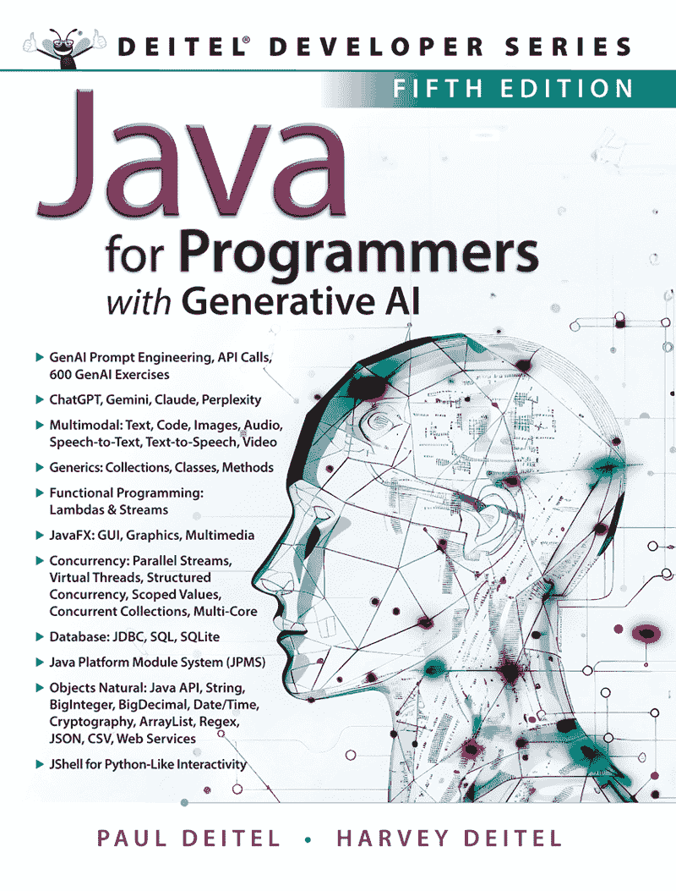


## 关于本电子书

ePUB 是一种开放的行业标准电子书格式。然而，阅读设备和应用程序对 ePUB 及其许多功能的支持程度不同。请使用您的设备或应用设置按喜好自定义显示。您可以自定义的设置通常包括字体、字体大小、单栏或双栏、横屏或竖屏模式，以及可以点击或触摸放大的图形。有关您的阅读设备或应用的设置和功能的更多信息，请访问设备制造商的网站。

许多标题包含编程代码或配置示例。为了优化这些元素的显示效果，请在单栏横屏模式下查看电子书并将字体大小调整为最小。除了以重流文本格式呈现代码和配置外，我们还包含了代码图像，模拟纸质书中的显示效果；因此，当重流格式可能会影响代码列表的显示时，您将看到“点击此处查看代码图像”链接。点击链接可查看高保真代码图像。要返回之前过的页面，请点击设备或应用上的“返回”按钮。


### 最近的 Deitel 书籍

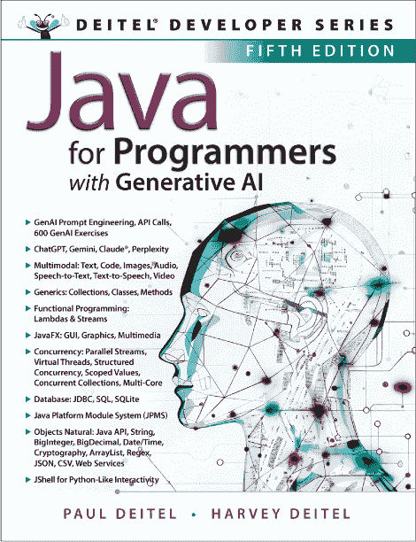

[`https://deitel.com/javafp5`](https://deitel.com/javafp5)

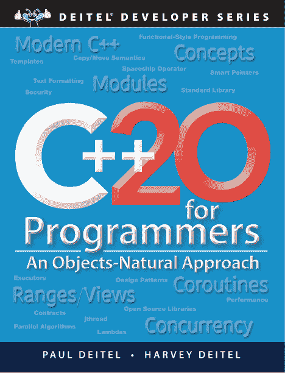

[`https://deitel.com/cpp20fp`](https://deitel.com/cpp20fp)

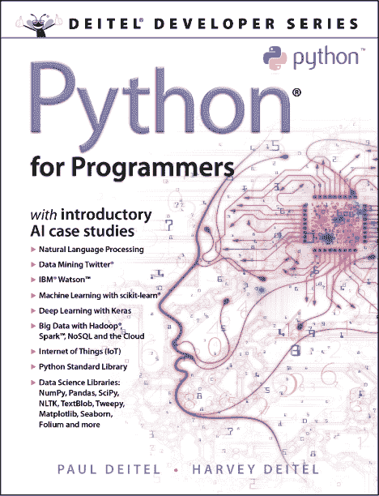

[`https://deitel.com/pythonfp`](https://deitel.com/pythonfp)

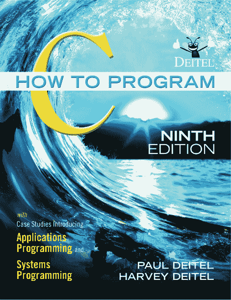

[`https://deitel.com/chtp9`](https://deitel.com/chtp9)


**混合现实**与增强现实相似，但更进一步，让你能够与投影到你现实世界视野中的虚拟对象进行交互。从这个意义上说，混合现实结合了增强现实和虚拟现实的特点。与虚拟现实一样，最好的混合现实体验通常需要头显设备。**扩展现实 (XR)** 涵盖了虚拟现实、增强现实和混合现实。

47. 伯纳德·马尔（Bernard Marr），“增强现实与混合现实之间的重要差异”。访问 2025 年 2 月 18 日。[`https://bernardmarr.com/the-important-difference-between-augmented-reality-and-mixed-reality/`](https://bernardmarr.com/the-important-difference-between-augmented-reality-and-mixed-reality/)。

48. “混合现实”。维基百科。维基基金会。访问 2025 年 2 月 18 日。[`https://en.wikipedia.org/wiki/Mixed_reality`](https://en.wikipedia.org/wiki/Mixed_reality)）。

49. “扩展现实”。维基百科。维基基金会。访问 2025 年 2 月 18 日。[`https://en.wikipedia.org/wiki/Extended_reality`](https://en.wikipedia.org/wiki/Extended_reality)）。

## 1.9.4 区块链

会计系统使用账本来跟踪交易。`Blockchain`^(50,51) 是一种分布在互联网节点上的基于软件的账本。它以加密安全的数据块（称为 `blocks`）维护交易数据。这些区块链接在一起，新区块始终添加在末尾。一旦创建，每个区块都是`immutable`（不可修改的），因此区块链维护了永久的交易记录。由于块链是去中心化的，因此没有任何个人或团体拥有完全控制权。这种去中心化是实现元宇宙中数字所有权的`decentralized apps (dApps)`（去中心化应用）的基础。

50. “区块链”。维基百科。维基基金会。访问 2025 年 2 月 18 日。[`https://en.wikipedia.org/wiki/Blockchain`](https://en.wikipedia.org/wiki/Blockchain)。

51. Adam Hayes，“区块链事实：它是什么、如何工作以及如何被使用”，2024 年 9 月 16 日。访问 2025 年 2 月 18 日。[`https://www.investopedia.com/terms/b/blockchain.asp`](https://www.investopedia.com/terms/b/blockchain.asp)。

区块链是过去几年中人气飙升的各种数字技术背后的核心，例如加密货币（第 1.9.5 节）和非同质化代币（第 1.9.7 节）。它还用于实现许多类型的应用，^(52)，包括

*   去中心化金融（DeFi）应用（贷款、资金转账），
*   智能合约，
*   更安全的物联网（IoT）应用，
*   帮助防止欺诈的安全性数字身份，
*   医疗信息的保护与共享，
*   商业物流，以及
*   保护知识产权（IP）。

52. Sam Daley，“33 种区块链应用和真实世界用例”，2023 年 3 月 2 日。访问 2025 年 2 月 18 日。[`https://builtin.com/blockchain/blockchain-applications`](https://builtin.com/blockchain/blockchain-applications)。

### 1.9.5 比特币与加密货币

“`cryptocurrency`是通过加密保护的数字或虚拟货币。”^(53) 加密货币（或 crypto）存储在数字钱包中，通常使用区块链技术进行安全的、去中心化的交易跟踪和处理。^(54) 最初的、最知名且价值最高的加密货币是比特币，它创建于 2009 年。^(55) 它是一种使用区块链技术构建的去中心化加密货币。^(56)。

53. Jake Frankenfield，“加密货币详解：投资的优缺点”，2023 年 2 月 4 日。访问 2025 年 2 月 18 日。[`https://www.investopedia.com/terms/c/cryptocurrency.asp`](https://www.investopedia.com/terms/c/cryptocurrency.asp)。

54. “加密货币”。维基百科。维基基金会。访问 2025 年 2 月 18 日。[`https://en.wikipedia.org/wiki/Cryptocurrency`](https://en.wikipedia.org/wiki/Cryptocurrency)。

55. Julie Pinkerton，“第一种加密货币——比特币的历史”，2023 年 2 月 27 日。访问 2025 年 2 月 18 日。[`https://money.usnews.com/investing/articles/the-history-of-bitcoin`](https://money.usnews.com/investing/articles/the-history-of-bitcoin)。

56. “比特币”。维基百科。维基基金会。访问 2025 年 2 月 18 日。[`https://en.wikipedia.org/wiki/Bitcoin`](https://en.wikipedia.org/wiki/Bitcoin)。

### 1.9.6 以太坊

`Ethereum` 是一个可编程平台，允许你在网络上构建并部署使用区块链存储数据的去中心化应用（dApps）。它的关键功能之一是用于实施贷款、交易所等应用的智能合约。^(57) 其原生加密货币是 `Ether`——世界上价值第二高的加密货币。^(58)。

57. 最后更新于 2025 年 2 月 12 日。访问 2025 年 2 月 18 日。[`https://ethereum.org/en/what-is/`](https://ethereum.org/en/what-is/)

58. “以太坊”。维基百科。维基基金会。访问 2025 年 2 月 18 日。[`https://en.wikipedia.org/wiki/Ethereum`](https://en.wikipedia.org/wiki/Ethereum)。

### 1.9.7 非同质化代币 (NFT)

`Non-fungible tokens (NFTs)`^(59) 是基于区块链的、链接到数字或物理内容的加密令牌。它们通常用于让个人拥有独特的物品，例如数字艺术品；限量收藏品；游戏中的房地产；知识产权以及书籍。^(60)

59. “非同质化代币”。维基百科。维基基金会。访问 2025 年 2 月 18 日。[`https://en.wikipedia.org/wiki/Non-fungible_token`](https://en.wikipedia.org/wiki/Non-fungible_token)。

60. Melanie Kramer, Stephen Graves 和 Daniel Phillips，“NFT 入门指南：什么是非同质化代币？”，2022 年 1 月 12 日。访问 2025 年 2 月 18 日。[`https://decrypt.co/resources/non-fungible-tokens-nfts-explained-guide`](https://decrypt.co/resources/non-fungible-tokens-nfts-explained-guide)。

某些艺术品 NFT 已以高昂的价格出售：^(61)

*   最昂贵的 NFT 是 Pak 的《Merge》，由 29,983 名个人买家以 9180 万购买——每个买家拥有该 NFT 的一部分。
*   以单一买家出售的最昂贵的 NFT 是数字艺术家 Mike “Beeple”的《Everydays: The First 500 Days》，成交价为 6930 万。

61. Casey Anderson，“最贵的 NFT”。NFT Evening。2024 年 12 月 30 日。访问 2025 年 2 月 18 日。[`https://nftevening.com/most-expensive-nft/`](https://nftevening.com/most-expensive-nft/)。

### 1.9.8 Web3

与元宇宙一样，有些人将 `Web3` 称为互联网的下一代。^(62,63) Web3 和元宇宙有时会被混淆，因为它们共享某些技术。Forbes 将 Web3 定义为“去中心化的互联网——构建在区块链等分布式技术之上……而不是集中在个人或公司的服务器上。”^(64) Web3 的一个重点是区块链及其相关技术（如 NFT、加密货币和智能合约）将赋予用户对自己的数据和在线互动更大的控制权。

62. David Essex, Sean Michael Kerner 和 Alexander S. Gillis，“什么是 Web 3.0 (Web3)？定义、指南和历史”，TechTarget。访问 2025 年 2 月 18 日。[`https://www.techtarget.com/whatis/definition/Web-30`](https://www.techtarget.com/whatis/definition/Web-30)。

63. Lauren Gibbons Paul，“2025 及未来的顶级 Web 3.0 趋势与预测”，TechTarget, 2025 年 1 月 3 日. 访问于 2025 年 2 月 18 日。[`https://www.techtarget.com/searchcio/tip/Top-Web-30-trends-and-predictions`](https://www.techtarget.com/searchcio/tip/Top-Web-30-trends-and-predictions).

64. Bernard Marr，“Web3 与元宇宙之间的重要区别”。2022 年 2 月 22 日. 访问于 2025 年 2 月 18 日。[`https://www.forbes.com/sites/bernardmarr/2022/02/22/the-important-difference-between-web3-and-the-metaverse/`](https://www.forbes.com/sites/bernardmarr/2022/02/22/the-important-difference-between-web3-and-the-metaverse/).

### 1.10 开发技术

在开发软件时，你会频繁遇到以下术语：

*   `Refactoring`（重构）：对程序进行重构，使其更加清晰且更易于维护，同时保持其正确性和功能，有时还可以提高性能。许多 IDE 包含内置的重构工具，可以自动完成大部分重构工作。^(65)

    65. “代码重构”。维基百科。维基会。访问于 2025 年 2 月 18 日。[`https://en.wikipedia.org/wiki/Code_refactoring`](https://en.wikipedia.org/wiki/Code_refactoring)。

*   `Design patterns`（设计模式）：构建灵活且可维护的面向对象软件的成熟模式。设计模式领域试图列举这些反复出现的模式，鼓励软件设计人员复用它们，以更快速、更少的资金、时间和精力开发出质量更好的软件。^(66)

    66. “软件设计模式”。维基百科。维基会。访问于 2025 年 2 月 18 日。[`https://en.wikipedia.org/wiki/Software_design_pattern`](https://en.wikipedia.org/wiki/Software_design_pattern)。

*   `Software Development Kits (SDKs)`（软件开发包）：开发者用于编写应用程序的工具、库和文档。SDK 可以帮助你为特定的操作系统、游戏平台、云平台等创建应用程序。^(67) Java 开发包 (`JDK`) 就是 SDK 的一个例子。

    67. “软件开发包”。维基百科。维基会。访问于 2025 年 2 月 18 日。[`https://en.wikipedia.org/wiki/Software_development_kit`](https://en.wikipedia.org/wiki/Software_development_kit)。

*   `Version Control Systems (VCS)`（版本控制系统）：允许你在软件开发过程中管理并跟踪你所做更改的工具。`Git`——`GitHub` 背后的技术——是迄今为止使用最广泛的版本控制系统，93% 的开发者在使用它。^(68)

    68. GitHub，“开源与 AI 现状”，GitHub 博客，更新于 2024 年 7 月 30 日。访问于 2025 年 2 月 18 日。[`https://github.blog/news-insights/research/the-state-of-open-source-and-ai/`](https://github.blog/news-insights/research/the-state-of-open-source-and-ai/)。

*   `Agile software development`（敏捷软件开发）：一种小步创建软件的方法，开发团队根据在使用软件完成部分的客户提供的反馈，定期改进软件。这种方法有助于团队在需求或目标变化时快速适应。^(69)

    69. “敏捷软件开发”。维基百科。维基会。访问于 2025 年 2 月 18 日。[`https://en.wikipedia.org/wiki/Agile_software_development`](https://en.wikipedia.org/wiki/Agile_software_development)。

*   `Test-Driven Development (TDD)`（测试驱动开发）：敏捷软件开发的一个方面，开发者在创建软件本身之前创建软件测试用例。然后，在开发软件时，持续确保它通过所有测试用例，使他们确认软件符合系统需求。^(70)

    70. “测试驱动开发”。维基百科。维基会。访问于 2025 年 2 月 18 日。[`https://en.wikipedia.org/wiki/Test-driven_development`](https://en.wikipedia.org/wiki/Test-driven_development)。

*   `Microservices`（微服务）：一种软件架构，应用程序由许多共同工作的小型独立服务构建而成。每个微服务都专注于特定的功能。微服务通常实现为 Web 服务。例如，Netflix 使用微服务进行视频播放、推荐、内容发现、计费等。^(71) 虽然 Netflix 不公开其微服务的开发细节，但它开源了部分

```
https://github.io/
```

    71. “微服务”。维基百科。维基会。访问于 2025 年 2 月 18 日。[`https://en.wikipedia.org/wiki/Microservices`](https://en.wikipedia.org/wiki/Microservices)。


*   **Containerization**（容器化）：将软件封装成容器的技术——容器是运行应用程序所需代码、库和依赖项的轻量级可移植单元。容器化通过称为虚拟化的技术隐藏底层细节，使容器能够跨平台执行。^(73) Docker 是最流行的容器化平台。^(74)

    73. “容器化”。维基百科。维基会。访问于 2025 年 2 月 18 日。[`https://en.wikipedia.org/wiki/Containerization_(computing)`](https://en.wikipedia.org/wiki/Containerization_(computing))。

    74. “容器化”。访问于 2025 年 2 月 18 日。[`https://6sense.com/tech/containerization`](https://6sense.com/tech/containerization)。

## 1.11 数据分析与数据科学

我们通过询问 AI 定义数据分析和数据科学来形成本章节，然后进行编辑，并将 Gemini 的回答作为本章节的基础。^(75)

75. *Gemini* 回答，“考虑统计、数据分析和数据科学。精确定义‘数据分析’和‘数据科学’术语，并仔细解释两者之间的区别。”2024 年 12 月 1 日。[`https://gemini.google.com`](https://gemini.google.com)。我们编辑了回答。

### 统计

统计学涉及收集、组织、分析、解释和呈现数据的研究。它为数据分析和数据科学提供了数学和理论框架。

### 数据分析

数据分析是检查现有数据集以发现趋势、模式和洞察的过程。它关注于理解过去的数据来为现在的决策提供支持，使用描述性统计、数据可视化和商业智能等技术。本质上，数据分析旨在回答如“发生了什么？”、“为什么发生？”以及“可以做什么来改进？”的问题。例如，分析网站流量数据以了解用户行为并优化网站设计属于数据分析。

### 数据科学

数据科学是一门多学科领域，利用科学方法、算法、流程和系统，从结构化和非结构化数据中提取知识和洞察⁷。它涵盖了机器学习、统计建模、数据挖掘和预测分析等技术。数据科学旨在回答诸如的问题：“未来可能会发生什么？”“我们如何优化结果？”以及“我们从这些数据中可以发现什么新发现？”通常涉及建立模型来预测未来结果并实现自动化决策。例如，数据科学可以用于开发机器学习模型，根据历史数据预测客户流失。

[76] Datamites Team, “How to Become a Data Scientist in Chandigarh,” DataMites (blog), 2023 年 9 月 8 日. 访问于 2025 年 2 月 18 日. [`https://datamites.com/blog/how-to-become-a-data-scientist-in-chandigarh/`](https://datamites.com/blog/how-to-become-a-data-scientist-in-chandigarh/)。

## 数据分析与数据科学的区别

数据分析与数据科学之间的主要区别在于它们的关注点和方法：

* 数据分析侧重于使用描述性统计和可视化来理解过去的数据。

* 数据科学侧重于通过采用更广泛的技术（包括机器学习和预测建模）来预测未来结果并发现新的洞察。

本质上，数据分析是数据科学的一个子集。数据科学通过结合更先进的技术并侧重于预测和发现，在数据分析的基础上进行了构建。

## 1.12 大数据到底有多大？

全球产生的数据量是惊人的，且增长速度正在加快。`Big data` 应用处理海量数据。下表展示了一些常见的大数据字节单位：

| 单位 | 字节 (Bytes) | 相当于（大约） |
| --- | --- | --- |
| 1 千字节 (KB) | 1024 字节 | 10³ 字节（恰好为 1024 字节） |
| 1 兆字节 (MB) | 1024 千字节 | 10⁶ (1,000,000) 字节 |
| 1 吉字节 (GB) | 1024 兆字节 | 10⁹ (1,000,000,000) 字节 |
| 1 太字节 (TB) | 1024 吉字节 | 10¹² (1,000,000,000,000) 字节 |
| 1 拍字节 (PB) | 1024 太字节 | 10¹⁵ (1,000,000,000,000,000) 字节 |
| 1 艾字节 (EB) | 1024 拍字节 | 10¹⁸ (1,000,000,000,000,000,000) 字节 |
| 1 兆字节 (ZB) | 1024 艾字节 | 10²¹ (1,000,000,000,000,000,000,000) 字节 |

对于计算机科学家和数据科学家来说，理解如何从数据中获取、存储、处理和提取价值，与编写有效的程序同样重要，在生成式 AI 蓬勃发展的背景下，可能甚至如此。2025 年，预计我们将产生 182 兆字节的数据——相当于每天约 182 极亿字节（182 万艾字节；1 艾字节是 10¹⁸ 字节），预计这一数字到 2028 年将增加一倍以上.⁷⁷。互联网是这些数据产生很大来源。考虑以下各种流行数据衡量的现实示例。

[77] Statista, “2010 年至 2023 年全球创建、捕获、复制和消耗的数据/信息量，以及 2024 年至 2028 年的预测（单位：兆字节）。” 访问于 2025 年 2 月 18 日. [`https://www.statista.com/statistics/871513/worldwide-data-created/`](https://www.statista.com/statistics/871513/worldwide-data-created/)。

### 兆字节 (Megabytes)

一个兆字节 (MB) 约等于一百万字节（确切为 `2²⁰`）。高质量的 MP3 格式音频文件每分钟需要 1 到 2.4 MB.⁷⁸。用数码相机拍摄的 JPEG 格式照片每张需要 3 到 7 MB。在我们的一部 iPhone 上，相机设置应用显示每秒 30 帧 (FPS) 的 1080p 视频需要 65 MB/分钟，60 FPS 的 4K 视频需要 440 MB/分钟。

[78] “Audio File Calculations.” 访问于 2025 年 2 月 18 日. [`https://www.audiomountain.com/tech/audio-file-size.html`](https://www.audiomountain.com/tech/audio-file-size.html)。

### 吉字节 (Gigabytes)

一个吉字节 (GB) 是 1024 兆字节（`2³⁰` 字节）。一张 DVD 可以存储高达 8.5 GB⁷⁹，它可以容纳 141 小时的 MP3 音频、数百张来自 1600 万像素相机的照片，以及 7.7 分钟每秒 30 帧的 1080p 视频。每秒 30 帧的 1080p 视频需要 65 MB/分钟，60 FPS 的 4K 视频需要 440 MB/分钟。目前的最高容量高清蓝光光可以存储 100 GB 的视频⁸⁰。

[79] "DVD." Wikipedia. 访问于 2025 年 2 月 18 日. [`https://en.wikipedia.org/wiki/DVD`](https://en.wikipedia.org/wiki/DVD)。

[80] "Ultra Blu-ray." Wikipedia. 访问于 2025 年 2 月 18 日. [`https://en.wikipedia.org/wiki/Ultra_Blu-ray`](https://en.wikipedia.org/wiki/Ultra_Blu-ray)。

### 太字节 (Terabytes)

一个太字节 (TB) 是 1024 兆字节（`2⁴⁰` 字节）。由于台式电脑的各种尺寸，一个太字节可以容纳 39 小时的 MP3 音频、数百张来自 1600 万像素相机的照片、每秒 30 帧的 4K 视频，或者每秒 30 帧的 1080p 视频⁸¹。

[81] "Hard disk." Wikipedia. 修改于 2025 年 2 月 10 日. 访问于 2025 年 2 月 18 日. [`https://en.wikipedia.org/wiki/Hard_disk`](https://en.wikipedia.org/wiki/Hard_disk)。

### 拍字节 (Petabytes)、艾字节 (Exabytes) 和兆字节 (Zettabytes)

在 2021 年，有数十亿在线人数每天创建约 2.5 极亿字节的数据⁸²——那是 2500 拍字节（每个拍字节是 1024 太字节）或 2.5 艾字节（每个艾字节是 1024 拍字节）。2025 年，预计将有 416 亿活跃设备⁸³，全球产生的数据预计达到 163 兆字节——对于地球上的每个人每分钟大约 360 MB。那是每秒 51.6 拍字节，每分钟 186 艾字节，每小时 446 艾字节（接近半个兆字节），每天产生数亿小时 4K 视频！

[82] Aditya Rayaprolu, “How Much Data Is Created Every Day in 2024?” 更新于 2024 年 3 月 12 日. 访问于 2025 年 2 月 18 日. [`https://techjury.net/blog/how-much-data-is-created-every-day`](https://techjury.net/blog/how-much-data-is-created-every-day)。

[83] Dell Technologies, “Internet of Things and Data,” Edge to Core and the Internet of Things, 访问于 2025 年 2 月 18 日, [`https://infohub.delltechnologies.com/en-us/l/edge-to-core-and-the-internet-of-things-2/internet-of-things-data-placement/`](https://infohub.delltechnologies.com/en-us/l/edge-to-core-and-the-internet-of-things-2/internet-of-things-data-placement/)。

### 更多大数据统计

为了对大数据有直观感受，请查看 [`https://www.worldometers.info/`](https://www.worldometers.info/)，那里有各种统计数据，包括当天的 Google 搜索次数、推文（现 X 上的帖子）和电子邮件。Domo Inc. 的信息图“数据永不睡眠”⁸⁴ 显示了 2022 年每分钟产生的有趣数据（这些数字已经增加），包括：

* Instagram 上发布了 66,000 张照片。

* 170 万条 Facebook 帖子。

* Snapchat 上的 243 万条快照。

* 观看了 100 万小时流视频。

* Zoom 会花费 104,600 小时。

[84] "Data Never Sleeps." 访问于 2025 年 2 月 18 日. [`https://www.domo.com/data-never-sleeps`](https://www.domo.com/data-never-sleeps)。

2015 年的一篇文章指出，处理全球数据所需的能源消耗以每年 20%的速度增长，消耗了全球约 3–5%的电力。麻省理工学院斯隆管理学院最近的一篇文章表明，到 2030 年，数据中心可能会消耗全球电能的 21%。

85. “‘数据海啸’可能在 2025 年消耗全球电力的五分之一。”2017 年 12 月 11 日。访问于 2025 年 2 月 18 日。[`https://www.theguardian.com/environment/2017/dec/11/tsunami-of-data-could-consume-fifth-global-electricity-by-2025`](https://www.theguardian.com/environment/2017/dec/11/tsunami-of-data-could-consume-fifth-global-electricity-by-2025)。

86. Beth Stackpole，“AI 具有高昂的数据中心能源成本——但也有解决方案，”麻省理工学院斯隆学院，2025 年 1 月 7 日。访问于 2025 年 3 月 5 日。[`https://mitsloan.mit.edu/ideas-made-to-matter/ai-has-high-data-center-energy-costs-there-are-solutions`](https://mitsloan.mit.edu/ideas-made-to-matter/ai-has-high-data-center-energy-costs-there-are-solutions)。

另一个巨大的耗电户是基于区块链的加密货币比特币。仅仅处理一笔比特币交易消耗的能量就大约相当于一个美国平均家庭一周的电量。这种能源消耗源于比特币“矿工”用于证明交易数据有效性的处理过程。这种能源消耗水平是不可持续的，特别是考虑到人们对区块链应用（甚至扩展到加密货币之外）表现出的巨大兴趣。区块链社区正在努力解决方案。

87. “一次比特币交易消耗的能量相当于你房子一周用量。”2017 年 11 月 1 日。访问于 2025 年 2 月 18 日。[`https://motherboard.vice.com/en_us/article/ywbbpm/bitcoin-mining-electricity-consumption-ethereum-energy-climate-change`](https://motherboard.vice.com/en_us/article/ywbbpm/bitcoin-mining-electricity-consumption-ethereum-energy-climate-change)。

88. Samuel Huestis，“加密货币的能源消耗问题，”落基山学院，2023 年 1 月 30 日。访问于 2025 年 2 月 18 日。[`https://rmi.org/cryptocurrencys-energy-consumption-problem/`](https://rmi.org/cryptocurrencys-energy-consumption-problem/)。

89. Gordon, Cindy。“ChatGPT 和生成式 AI 创新正在造成可持续性的灾难。”福布斯，2024 年 3 月 12 日。访问于 2025 年 2 月 18 日。[`https://www.forbes.com/sites/cindygordon/2024/03/12/chatgpt-and-generative-ai-innovations-are-creating-sustainability-havoc/`](https://www.forbes.com/sites/cindygordon/2024/03/12/chatgpt-and-generative-ai-innovations-are-creating-sustainability-havoc/)。

### 1.12.1 大数据分析

“数据分析”一词诞生于 20 世纪 60 年代，尽管几千年来人们一直在使用统计学分析数据，这可以追溯到古埃及。“大数据”一术则是在 1987 年左右创造的。

90. “数据分析的简史，”2021 年 12 月 7 日。访问于 2025 年 2 月 18 日。[`https://www.flydata.com/blog/a-brief-history-of-data-analysis/`](https://www.flydata.com/blog/a-brief-history-of-data-analysis/)。

91. Diebold, Francis. (2012). 关于“大数据”一词的起源与发展。SSRN 电子期刊。 10.2139/ssrn.2152421.[`https://www.researchgate.net/publication/255967292_On_the_Origins_and_Development_of_the_Term_`](https://www.researchgate.net/publication/255967292_On_the_Origins_and_Development_of_the_Term_)。

考虑大数据的“四个 V”：

1. `Volume`（量）——世界产生的数据正在呈指数级增长。

2. `Velocity`（速度）——数据产生、在组织内流动以及发生变化的速度都在快速增长。

3. `Variety`（多样性）——今天的数据包括字符、数字、标点符号和特殊字符，以及图像、音频、视频，以及来自我们家庭、企业、车辆、城市等数量快速增长的物联网传感器产生的数据。

4. `Veracity`（真实性）——数据的有效性。

92. “大数据的四个 V——数据是什么？”2021 年 12 月 10 日。访问于 2025 年 2 月 18 日。[`https://www.analyticsinsight.net/the-four-vs-of-data-what-is-`](https://www.analyticsinsight.net/the-four-vs-of-data-what-is/)。

93. 许多文章为这个列表添加了许多“V 字”。


94. David Gewitz，“量、速度和多样性：理解大数据的三个。”2018 年 3 月 21 日。访问于 2025 年 2 月 18 日。[`https://www.zdnet.com/article/volume-and-variety-understanding-the-three-of-data/`](https://www.zdnet.com/article/volume-and-variety-understanding-the-three-of-data/)。

95. Ben Lutkevich，“3Vs（量、速度、真实性）。”访问于 2025 年 2 月 18 日。[`https://whatis.tech.com/definition/3Vs`](https://whatis.tech.com/definition/3Vs)。

数字存储在容量上已变得巨大，且如此廉价和微小，以至于我们现在可以方便地保留我们创建的所有数字数据。这才是真正的大数据。

### 1.12.2 数据科学和大数据正在改变：用例

数据科学领域发展迅速，因为它产生的结果对我们的个人和商业生活产生了影响。下表列出了许多数据科学和大数据的案例。大数据分析带来了利润的提高、更好的客户关系，甚至让体育球队赢得了比赛和冠军。在美式橄榄球（NFL）直播中，解说员经常提到教练正在利用分析来进行第四档进攻决策。

96. Sawchik, T.《大数据棒：数学、奇迹与 20 年连败的终结》（纽约：Flat Iron Books, 2015）。

97. Ayres, I 《深入超级数据分析者》（Bantam Books, 2007），第 7–10 页。

98. Lewis, M.《点球：在不公平游戏中获胜的艺术》（W. W. Norton & Company, 2004）。

| 一些数据科学用例 |
| --- |
| 帮助残障人士 | 人类基因组测序 | 共享出行 |
| 自动字幕 | 身份盗用预防 | 机器人财务顾问 |
| 大脑制图 | 改进库存控制 | 自驾驶汽车 |
| 癌症诊断/治疗 | 智能助手 | 情感分析 |
| 计算机视觉 | 定位服务 | 相似性检测 |
| 犯罪预防 | 恶意软件检测 | 智能家居 |
| CRISPR 基因编辑 | 营销分析 | 智能电表 |
| 客户服务代理 | 医疗设备监控 | 智能恒温器 |
| 数据可视化 | 自然语言翻译 | 垃圾邮件检测 |
| 动态驾驶路线 | 减少污染 | 股市预测 |
| 电子健康记录 | 精准性医疗 | 消除网络鱼/钓鱼攻击 |
| 诊断医学 | 预防性医学 | 文本摘要 |
| 情绪识别 | 预防疾病爆发 | 盗窃预防 |
| 欺诈检测 | 推荐系统 | 趋势发现 |
| 面部识别 | | 视觉产品搜索 |
| 健康状况的改善 | 减少能源消耗 | 天气预报 |

## 1.13 AI——计算机科学与数据科学的交汇点

当一个婴儿第一次睁开眼睛时，它能“看到”父母的脸吗？它理解“脸”的概念，甚至只是一个简单的形状吗？婴儿必须“学习”他们周围的世界。这就是人工智能（AI）技术中“机器学习”所做的事情。它观察海量数据并从中学习。AI 技术正被用于玩游戏、实现计算机视觉应用、支持自动驾驶汽车、让机器人学习执行新任务、诊断医疗状况、近实时将语音翻译成其他语言、在经过名为`大语言模型`的海量文本数据库训练后，创建出能够流畅且准确地回答任何问题的聊天机器人，等等。谁能猜到几年前，具有人工智能的自动驾驶汽车竟然将获准走在我们的道路上行驶——甚至成为常态呢？

### 1.13.1 人工智能 (AI)

`人工智能 (AI)`^(99,100) 的两个定义是：

* “计算机科学的一个分支，涉及在计算机中模拟智能行为”以及
* “机器模仿人类智能行为的能力。”

99. “人工智能。”[Merriam-Webster.com](http://Merriam-Webster.com). 访问于 2025 年 2 月 18 日[`https://www.merriam-webster.com/dictionary/artificial%20intelligence`](https://www.merriam-webster.com/dictionary/artificial%20intelligence)。

100. “人工智能。”维基百科。维基基金会。访问于 2025 年 2 月 18 日[`https://en.wikipedia.org/wiki/Artificial_intelligence`](https://en.wikipedia.org/wiki/Artificial_intelligence)。

AI 这个词由约翰·麦卡锡（John McCarthy）于 1956 年创造。基于 AI 的系统现在渗透到我们的生活中。示例包括计算机视觉、语音识别、自然语言翻译、推荐系统（例如亚马逊向你推荐可能喜欢的商品，或 Netflix 向你推荐可能喜欢的节目和电影）、自动游戏系统、自动驾驶汽车，以及更近期卓越的工具，如：

* 聊天机器人，如 OpenAI 的 ChatGPT、Google 的 Gemini、Anthropic 的 Claude 和 Perplexity，它们的对话几乎与人类交流无异；
* 图像生成器，如 OpenAI 的 Dall-E（现集成在 ChatGPT 中）、Google 的 Imagen（集成在 Gemini 中）、Midjourney、Stable Diffusion、Adobe 的 Firefly 等，它们能根据文本描述创建原创图像；
* 视频生成器，如 OpenAI 的 Sora、Adobe 的 Firefly Video、Google 的 Veo 2、Meta 的 MovieGen 以及 Runway 的 Gen-3 Alpha，它们能根据文本描述创建原创视频。

几十年来，AI 一直是一个有问题没有解决方案的领域。这是因为一旦某个问题被解决，人们就会说：“好吧，那不是智能；那只是告诉计算机确切做什么的程序。”然而，通过机器学习（第 1.13.4 节）和深度学习（第 1.13.5 节）等 AI 技术，我们不再为特定问题预设解决方案。相反，我们让计算机通过从数据（通常是大量数据）中学习来解决问题。许多有趣且具有挑战性的问题正在通过深度学习来实现。

### 1.13.2 通用人工智能 (AGI)

AI 的终极目标是`通用人工智能 (AGI)`^(101)，它能够在广泛的任务中理解、学习和应用知识，而不需要额外的训练——基本上这是一种可以“执行人类胜任的任何任务”的 AI^(102)。专家们对于通用人工智能何时或是否会实现意见不一——从 2025 年^(103) 到 2030 年代^(104)，再到 2300 年或永远不会^(105)。

101. “通用人工智能。”维基百科。维基基金会。访问于 2025 年 2 月 18 日[`https://en.wikipedia.org/wiki/Artificial_general_intelligence`](https://en.wikipedia.org/wiki/Artificial_general_intelligence)。

102. “技术奇点。”维基百科。维基基金会。访问于 2025 年 2 月 18 日[`https://en.wikipedia.org/wiki/Technological_singularity`](https://en.wikipedia.org/wiki/Technological_singularity)。

103. Sam Altman，“Reflections，”2025 年 1 月 5 日。访问于 2025 年 2 月 18 日[`https://blog.samaltman.com/reflections`](https://blog.samaltman.com/reflections)。

104. Lutz Finger，“Sam Altman 说‘我们知道如何构建 AGI 但并不快’，”福布斯，2025 年 1 月 7 日。访问于 2025 年 2 月 18 日[`https://www.forbes.com/sites/lutzfinger/2025/01/sam-altman-ai-workforce-of-giants`](https://www.forbes.com/sites/lutzfinger/2025/01/sam-altman-ai-workforce-of-giants/)。

105. 麦肯锡公司，“什么是通用人工智能 (AGI),”2024 年 3 月 21 日。访问于 2025 年 2 月 18 日[`https://www.mckinsey.com/featured-insights/what-is-general-intelligence`](https://www.mckinsey.com/featured-insights/what-is-general-intelligence)。

### 1.13.3 人工智能里程碑

若干人工智能里程碑引起了人们的关注和想象，让大众开始认为 AI 是真实的，并让企业考虑将其商业化：

* 在 1997 年 IBM 的 DeepBlue 计算机系统与国际象棋大师加里·卡斯帕夫（Gary Kasparov）的比赛中，DeepBlue 成为第一个击败卫冕冠军的计算机^(106)。IBM 为 DeepBlue 加载了数万万局棋谱。DeepBlue 每秒可以暴力破解评估高达 2 亿次移动！^(107)。这就是大数据的应用。IBM 获得了 1980 年设立的 10 万美元 Fredkin 奖，该奖授予了第一个击败世界冠军的计算机^(108)。

106. “Deep Blue 对阵加里·卡斯帕夫。”维基百科。维基基金会。访问于 2025 年 2 月 18 日[`https://en.wikipedia.org/wiki/Deep_Blue_versus_Kasparov`](https://en.wikipedia.org/wiki/Deep_Blue_versus_Kasparov)。

107. “Deep Blue（国际象棋计算机）。”维基百科。维基基金会。访问于 2025 年 2 月 18 日[`https://en.wikipedia.org/wiki/Deep_Blue_(chess_computer)`](https://en.wikipedia.org/wiki/Deep_Blue_(chess_computer))。

108. “IBM Deep Blue 团队获得 10 万美元奖。”访问于 2025 年 2 月 18 日[`https://articles.latimes.com/1997/jul/30/news/mn-17696`](https://articles.latimes.com/1997/jul/30/news/mn-17696)。

* 2011 年，IBM 的 Watson 在一场奖金百万美元的比赛中击败了《危险问》（Jeopardy!）最好的人类选手。Watson 同时使用数百种语言分析技术，在 2 亿页内容（包括整个维基百科）中定位正确答案，需要 4 TB 的磁盘存储空间^(109,110)。Watson 使用 AI 机器学习和强化学习技术进行训练^(111)。

109. “Watson 对决《危险问》。”维基百科。维基基金会。访问于 2025 年 2 月 18 日[`https://en.wikipedia.org/wiki/Watson_(Jeopardy_game)`](https://en.wikipedia.org/wiki/Watson_(Jeopardy_game))。

110. “Watson（计算机）。”维基百科。维基基金会。访问于 2025 年 2 月 18 日[`https://en.wikipedia.org/wiki/Watson_(computer)`](https://en.wikipedia.org/wiki/Watson_(computer))。

111. “强化学习。”维基百科。维基基金会。访问于 2025 年 2 月 18 日[`https://en.wikipedia.org/wiki/Reinforcement_learning`](https://en.wikipedia.org/wiki/Reinforcement_learning)。

* 围棋——一种千年前在中国发明的棋游戏^(112)——被广泛认为是人类发明过的最复杂的游戏之一，拥有 10¹⁷⁰ 种可能的棋盘布局^(113)。为了理解这个数字有多大，据认为已知宇宙中（仅）约有 10⁸⁰ 个原子！^(114)2015 年，由 Google DeepMind 团队创建的 `AlphaGo` 使用带有两个神经网络的 AI 深度学习技术击败了欧洲围棋冠军范辉。围棋被认为比象棋复杂得多。

112. *大英百科全书*，“围棋，”最后修改于 2025 年 2 月 7 日。访问于 2025 年 2 月 18 日[`https://www.britannica.com/topic/go-game`](https://www.britannica.com/topic/go-game)。

113. Nsikan Akpan，“谷歌人工智能在世界上最复杂的棋类游戏中击败冠军。”2016 年 1 月 27 日。访问于 2025 年 2 月 18 日[`https://www.pbs.org/newshour/science/google-artificial-intelligence-beats-champion-at-worlds-most-complicated-board-game`](https://www.pbs.org/newshour/science/google-artificial-intelligence-beats-champion-at-worlds-most-complicated-board-game)。

114. Paul Sutter，“可观测宇宙中有多少个原子？”*Live Science*，2021 年 7 月 11 日。访问于 2025 年 2 月 18 日[`https://www.livescience.com/how-many-atoms-in-universe.html`](https://www.livescience.com/how-many-atoms-in-universe.html)。

* 2017 年，谷歌将其 AlphaGo AI 通用化，创建了 `AlphaZero`——一种能够自学玩其他游戏的游戏 AI。2017 年 12 月，AlphaZero 使用强化学习 AI 技术，在不到四小时内学会了规则并学会了下棋。随后，它在 100 局对赛中击败了世界冠军象棋程序 Stockfish 8——每局获胜或平局。在仅对围棋训练 8 小时后，AlphaZero 在 100 局比赛中有 60 局击败了它的前身 AlphaGo^(115)。

115. Samuel Gibbs，“AlphaZero AI 在自学四小时后击败冠军象棋程序。”2017 年 12 月 7 日。访问于 2025 年 2 月 18 日[`https://www.theguardian.com/technology/2017/dec/07/alphazero-google-deepmind-ai-beats-champion-program-teaching-itself-to-play-four-hours`](https://www.theguardian.com/technology/2017/dec/07/alphazero-google-deepmind-ai-beats-champion-program-teaching-itself-to-play-four-hours)。

* 2023 年，谷歌宣布了基于 AlphaZero 构建的 AlphaDev。AlphaDev 设计用于发现增强算法，专注于排序算法。“AlphaDev 发现的新型排序算法在处理超过 250,000 个元素的序列时快了 70%，在短序列上快了 7%。”^(116)


- 116. Daniel J. Mankowitz 和 Andrea Mich，“AlphaDev 发现了更快的算法，” DeepMind，2023 年 6 月 7 日。访问于 2025 年 2 月 18 日。[`https://deepmind.google/blog/alphadev-faster-algorithms/`](https://deepmind.google/blog/alphadev-faster-algorithms/).

### 1.13.4 机器学习

`机器学习` 是人工智能的一个分支，“赋予了计算机在没有显式编程的情况下学习的能力。”(117) 机器学习通常使用预定义算法来构建模型。例如，通过包含合法邮件和垃圾邮件（也称为垃圾）的标记数据，模型可以从中学习并进行预测。Microsoft Outlook 和 Google Gmail 等邮件应用使用这种技术处理从未见过的邮件。

- 117. Sara Brown，“解释机器学习，”2021 年 4 月 21 日。访问于 2025 年 2 月 18 日。[`https://mitsloan.mit.edu/ideas-to-matter/machine-learning`](https://mitsloan.mit.edu/ideas-to-matter/machine-learning).
- 118. “机器学习。” 维基百科。维基媒体会。访问于 2025 年 2 月 18 日。[`https://en.wikipedia.org/wiki/Machine_learning`](https://en.wikipedia.org/wiki/Machine_learning).

### 1.13.5 深度学习

`深度学习` 是机器学习的一个子集，涉及构建人工神经网络，“模拟人类大脑的神经网络，以便计算机能够像人类一样学习并做出决策。”(119) “深度”一词源于人工神经网络中的软件层——层越多，深度越深。网络随着进行，从训练数据中学习越多。(120) 大数据的可用性、强大的处理器能力、更快的互联网速度以及并行计算硬件软件的进步，使得更多机构和个人能够追求深度学习解决方案，这些解决方案在计算机视觉、语音识别、语音合成以及新的 AI 应用中取得了成就。

- 119. Jason Brownlee，“什么是深度学习？”2023 年 11 月 16 日。访问于 2025 年 2 月 18 日。[`https://machinelearningmastery.com/what-is-deep-learning/`](https://machinelearningmastery.com/what-is-deep-learning/).
- 120. “深度学习。” 维基百科。维基媒体会。访问于 2025 年 2 月 18 日。[`https://en.wikipedia.org/wiki/Deep_learning`](https://en.wikipedia.org/wiki/Deep_learning).

### 1.13.6 强化学习

`强化学习`(121,122) 是机器学习的一个分支，其中算法从环境中学习，类似于人类学习的方式——例如，视频游戏爱好者学习新游戏，或者婴儿学习走路或识别父母。算法实现了一个智能体，通过尝试执行任务、接收成功或失败的反馈、进行调整并再次尝试来学习。目标是最大化奖励。智能体在正确时获得正奖励，在错误时获得负奖励（惩罚）。智能体利用这些信息决定下一步采取的行动，并必须尝试最大化奖励。

- 121. “强化学习。”维基百科。维基金会。访问于 2025 年 2 月 18 日。[`https://en.wikipedia.org/wiki/Reinforcement_learning`](https://en.wikipedia.org/wiki/Reinforcement_learning).
- 122. Abid Ali Awan，“面向初学者的强化学习，”KDnuggets，2022 年 5 月 16 日。访问于 2025 年 2 月 18 日。[`https://www.kdnuggets.com/2022/05/reinforcement-learning-newbies.html`](https://www.kdnuggets.com/2022/05/reinforcement-learning-newbies.html).

## 1.14 生成式 AI

`Generative AI (genAI)` 描述了根据用户提供的输入的提示词，生成新内容（包括文本、图像、音频和视频）的算法^(123,124,125)

- 123. “什么是生成式 AI？”麦肯锡公司，2024 年 4 月 2 日。访问于 2025 年 2 月 18 日。[`https://www.mckinsey.com/featured-insights/mckinsey-explainers/what-is-generative-ai`](https://www.mckinsey.com/featured-insights/mckinsey-explainers/what-is-generative-ai).
- 124. “生成式人工智能。”维基百科。维基金会。访问于 2025 年 2 月 18 日。[`https://en.wikipedia.org/wiki/Generative_artificial_intelligence`](https://en.wikipedia.org/wiki/Generative_artificial_intelligence).
- 125. Hannah Wren，“企业生成式 AI 初学者指南，”Zendesk，2024 年 10 月 22 日。访问于 2025 年 2 月 18 日。[`https://www.zendesk.com/blog/generative-ai-guide/`](https://www.zendesk.com/blog/generative-ai-guide/).

### GenAI Chatbots

OpenAI 的 `ChatGPT`、Google 的 `Gemini`、Anthropic 的 `Claude` 以及 `Perplexity` 都是你可以使用自然语言与之对话的 AI 聊天机器人^(126)。例如，你可以输入如下文本提示它：

- “请告诉我关于 Java 编程语言的历史。”
- “谁创造了‘元宇宙’这个词？”
- “总结文章”后跟一个文章链接。

- 126. “介绍 ChatGPT。”2022 年 11 月 30 日。访问于 2025 年 2 月 18 日。[`https://openai.com/blog/chatgpt`](https://openai.com/blog/chatgpt).

每个聊天机器人随后都会给出看起来和感觉就像是由人类生成的答复。

### 多模态聊天机器人

当 `genAIs` 最初被引入时，它们通常接收文本提示并生成特定类型的输出，例如文本或图像。现在许多 `genAI` 聊天机器人都是多模态的，使它们能够理解文本、图像、音频甚至视频输入，并利用它们生成结合文本、图像、音频和视频的输出。例如，你可以为 `genAIs` 提供语音音频文件和指令，要求它们将语音转换为文本、显示转录、分析其情感（积极、消极或中性）、将其翻译成另一种口语并合成该语言的语音——甚至可以根据生成的文本创建图像和视频！这些能力在几年前即使对于最顶级的开发者来说也是不可及的。今天，它们已向大众开放。

### 图灵测试

当你与 `ChatGPT` 类似的工具对话时，看起来可能像是在和另一个人聊天。1950 年，艾兰·图灵提出了`模仿游戏`（现在称为`图灵测试`），作为判断计算机是否表现出真正智能行为的方法^(127)。在测试中，三个计算机终端相互隐藏，由两个人通过文本输入操作终端，第三个由计算机操作。其中一个人会提出文本问题，并将问题发送到另外两个终端。第二个人和计算机会发送文本回复。如果提问的人无法判断答案是来自另一个人还是计算机，那么这台计算机就被认为表现出了智能行为。

- 127. “图灵测试。”维基百科。维基金会。访问于 2025 年 2 月 18 日。[`https://en.wikipedia.org/wiki/Turing_test`](https://en.wikipedia.org/wiki/Turing_test).

### 生成式 AI 能做的事情

我们向 `ChatGPT` 提问，要求列出生成式 AI 可以生成的所有类型列表^(128)。

- 文本：文章、故事、诗歌、歌词、文案、摘要、电子邮件。
- 视觉：图像、插画、标志、信息图、艺术品。
- 音频：音乐、音效、旁白、语音克隆、演讲。
- 视频：动画、深度伪造（deepfakes）、合成视频。
- 代码：编程辅助、脚本、自动化。
- 交互：调查、测验、互动。
- 数据：报告、可视化、图表、表格、数据集。
- 教育：教学计划、教程、教科书。
- 多模态：混合媒体、虚拟环境、交互。
- 创意：漫画、小说、剧本。
- 杂：食谱、健身计划、口号、法律文档模板。

- 128. `ChatGPT` 对“给我列出生成式 AI 可以生成的所有类型列表”的回复。2024 年 10 月 26 日。[`https://chatgpt.com`](https://chatgpt.com)。我们对回复进行了编辑。

这些能力让每个人都能进行内容创作。

### 大语言模型 (LLMs)

`large language model (LLM)`^(129,130,131) 是一种理解并能生成自然语言的 AI。“大”一词来自于 LLM 是具有数十亿甚至数万亿参数的人工神经网络（神经网络）。LLM 在海量文本上进行训练——文章、书籍、互联网代码等。随着神经网络的学习，它们会调整参数，尝试产生更好的结果。神经网络学习的参数帮助 LLM 理解并生成语言模式。

- 129. “大语言模型。”维基百科。维基金会。访问于 2025 年 2 月 18 日。[`https://en.wikipedia.org/wiki/Large_language_model`](https://en.wikipedia.org/wiki/Large_language_model).
- 130. Sean Michael Kerner，“大语言模型 (LLM)](ch01.xhtml_ch01lev3sec52)，”TechTarget。访问于 2025 年 2 月 18 日。[`https://www.techtarget.com/whatis/definition/large-language-model-LLM`](https://www.techtarget.com/whatis/definition/large-language-model-LLM).
- 131. Adrian Tam，“什么是大语言模型？”Machine Learning Mastery，2023 年 7 月 20 日。访问于 2025 年 2 月 18 日。[`https://machinelearningmastery.com/what-are-large-language-models/`](https://machinelearningmastery.com/what-are-large-language-models/).

LLM（大语言模型）可以生成与人类写作无异的文本。它们会不断学习和适应，随着时间的推移不断提高其有效性。它们非常擅长翻译、分类、摘要、问答、情感分析、创意写作等自然语言任务。它们也非常擅长生成代码、解释代码、查找代码中的错误、重构代码等。

## Transformers

`transformer`^(132,133,134)是一种处理序列数据（如文本）的神经网络。它可以理解并识别句子中即使是很远的词之间的关系。Transformers 还能识别词的相对重要性。许多 LLM 使用`generative pre-trained transformers (GPTs)`^(135)，它们使用多种人工智能技术在海量文本上进行训练.^(136)还有其他技术，例如 Google 的`Bidirectional Encoder Representations from Transformers (BERT)`，它侧重于自然语言理解（NLU；在第 1.14 节介绍）。^(137)

- 132. “Transformer (机器学习 Model).” Wikipedia. Wikimedia Foundation. 访问于 2025 年 2 月 18 日. [`https://en.wikipedia.org/wiki/Transformer_(machine_learning_model)`](https://en.wikipedia.org/wiki/Transformer_(machine_learning_model)).
- 133. Rick Merritt, “What Is a Transformer Model?” NVIDIA Blog, 2022 年 3 月 15 日. 访问于 2025 年 2 月 18 日. [`https://blogs.nvidia.com/blog/what-is-a-transformer-model/`](https://blogs.nvidia.com/blog/what-is-a-transformer-model/).
- 134. Aveek Goswami, “Understanding Transformers,” Towards Data Science, 2024 年 6 月 27 日. 访问于 2025 年 2 月 18 日. [`https://medium.com/towards-data-science/understanding-transformers-3344d16c8c36`](https://medium.com/towards-data-science/understanding-transformers-3344d16c8c36).
- 135. “Large language model.” Wikipedia. Wikimedia Foundation. 访问于 2025 年 2 月 18 日. [`https://en.wikipedia.org/wiki/Large_language_model`](https://en.wikipedia.org/wiki/Large_language_model).
- 136. “ChatGPT.” Wikipedia. Wikimedia Foundation. 访问于 2025 年 2 月 18 日. [`https://en.wikipedia.org/wiki/ChatGPT`](https://en.wikipedia.org/wiki/ChatGPT).
- 137. “BERT (Language Model).” Wikipedia. Wikimedia Foundation. 访问于 2025 年 2 月 18 日. [`https://en.wikipedia.org/wiki/BERT_(language_model)`](https://en.wikipedia.org/wiki/BERT_(language_model)).

## 自注意力（Self-Attention）

`self-attention`^(138,139)是用于自然语言处理的 Transformers 的关键方面。在理解句子中的某个词时，周围上下文提供的含义起着重要作用。例如：

- “good”通常是正面的，但当前面有“not”时，上下文变成了负面。
- “bank”可以指金融机构，也可以指河岸，取决于它是否与“loan”（贷款）或“river”（河流）配对。老师们喜欢带有“test bank”（题库）的书来出题。
- 同样，“break the ice”（破冰）这个短语在社交互动的语境下会从字面解释变为比喻含义。

- 138. Ashish Vaswani et al, “Attention Is All You Need,” arXiv preprint:1706.03762 (2017). 访问于 2025 年 2 月 18 日. [`https://arxiv.org/abs/1706.03762`](https://arxiv.org/abs/1706.03762).
- 139. “Attention (Machine Learning).” Wikipedia. Wikimedia Foundation. 访问于 2025 年 2 月 18 日. [`https://en.wikipedia.org/wiki/Attention_(machine_learning)`](https://en.wikipedia.org/wiki/Attention_(machine_learning)).
- 140. `ChatGPT` 对“周围上下文在决定含义方面起着重要作用”的回答。

## Token、上下文与上下文窗口

`token`^(141)是语言模型中的处理单元。Token 可以单词、单词的一部分或标点符号。`context`是某个词之前（有时是之后）的 Token 序列。`context window`^(142)是模型一次能考虑的最大 Token 数（输入和输出）。上下文窗口越大，对话中的上下文越多，它的回复就越连贯。这就是为什么 genAI 的免费版本通常上下文窗口较小。

- 141. Microsoft. “Understanding Tokens.” Microsoft Learn, 2024 年 5 月 20 日. 访问于 2025 年 2 月 18 日. [`https://learn.microsoft.com/en-us/dotnet/ai/conceptual/understanding-tokens`](https://learn.microsoft.com/en-us/dotnet/ai/conceptual/understanding-tokens).


## 参考文献

142. IBM Research. “Why Larger Context Windows Are All the Rage.” IBM Research Blog, 2024 年 7 月 24 日. 访问于 2025 年 2 月 18 日. [`https://research.ibm.com/blog/larger-context-window`](https://research.ibm.com/blog/larger-context-window).

GenAI 聊天机器的上下文窗口大小差异巨大。对于我们广泛使用的四种—— OpenAI ChatGPT、Google Gemini、Anthropic Claude 和 Perplexity——上下文窗口大小从 ChatGPT 免费版的 8,000 Token^(143) 到 Gemini 付费版的 1,000,000 Token^(144) 不等。

143. *ChatGPT* 对“你的上下文窗口是多少？”的回答。2025 年 2 月 15 日. [`https://chatgpt.com`](https://chatgpt.com).

144. “Gemini Advanced.” 访问于 2025 年 2 月 18 日. [`https://gemini.google/advanced`](https://gemini.google/advanced).

## 提示（Prompts）与提示工程（Prompt Engineering）

`prompt engineering` 是设计提示以获得最佳回复的过程。在第 19 章之外，书中的许多章节以生成式 AI 练习结束，在练习中我们专注于提示工程，以帮助你与 genAI 工具有效交互。将此视为学习一种新的、不同的编程语言。通过提示工程，你编写精确的指令或查询来引导 genAI 生成所需的回复。

在向 genAI 编写提示时，请确保：

*   当要求 genAI 编写 Java 代码或回答关于 Java 特性的问题时，在提示中包含“Java”。还要要求它们根据你使用的 Java 版本使用最新的 Java 习惯编写 Java 代码。
*   跟踪你的提示及其结果质量。这对于学习哪些有效、无效至关重要。这还将帮助你识别不同 genAI 平台的细微差别。你将建立一个宝贵的提示和预期结果的库。
*   **尝试多个生成式 AI（genAIs）**——包括不断出现的新工具——并比较其结果以理解它们不同的能力。
*   **尝试不同的提示策略**，以查看哪些策略能帮助你实现预期的结果。不同的编程挑战可能需要不同的提示策略。
*   **如果生成式 AI 的结果不理想，请调整你的提示并重试。** 更好的提示会产生更好的结果。某些生成式 AI 对主题的挖掘得更深。

在提示某些生成式 AI 时，按下 `Enter`（或 `Return`）会立即提交你的提示。对于其他 AI，必须显式地按下（或选择）按钮来提交提示。**要在不提交提示的情况下将光标移动到新行**，请使用

```
Shift + Enter
```

或者

```
Shift + Return
```

当第 2 章及后续章节中要求你向生成式 AI 提供 Java 代码时，我们建议你从 Java 源代码文件中复制并粘贴代码。**大多数生成式 AI 也允许你上传一个或多个文件**，但这有时仅为付费订阅者提供的功能。

学习如何创建出提示需要大量的经验。有各种在线指南可以帮助你构建更好的提示，你甚至可以要求生成式 AI 本身来调整你的提示。**OpenAI 提供了一个非常好的提示工程指南**，位于

```
https://platform.openai.com/docs/guides/prompt-engineering
```

以及的一组**大量的示例提示**，位于

```
https://platform.openai.com/docs/examples
```

### 生成式 AI 轶事

在 2023 年 11 月和 12 月期间，我们会要求 ChatGPT 执行一些它之前能生成详细回复的任务。但它不再提供详细回复，而是变得很懒，只提供了一些步骤告诉我们如何自己执行这些任务。一些研究人员提出了“寒假假说”，^(145) 推测 ChatGPT 在一年中这段时间学会了少干工作，因为西方的人在假期期间倾向于干得更少。

145. Edwards, Benj. “随着 ChatGPT 变得‘懒惰’，人们测试‘寒假假说’作为其原因.” 2023 年 12 月 11 日. 访问于 2024 年 10 月 13 日. [`https://arstechnica.com/information-technology/2023/12/is-chatgpt-becoming-lazier-because-its-december-people-run-tests-to-find-out/`](https://arstechnica.com/information-technology/2023/12/is-chatgpt-becoming-lazier-because-its-december-people-run-tests-to-find-out/)。

尽管生成式 AI 聊天机器人很强大，有时也会犯错，甚至产生“**幻觉**”，^(146)，自信地将错误的信息当作事实呈现。作为一个错误的一个例子，我们询问几个生成式 AI：“这些 Java 语句输出什么？”，并给它们五个简单的语句，显示以下三行星号：

```
****
*****
******
```

146. “幻觉（人工智能）.” 基百科. Wikimedia Foundation. 访问于 2025 年 2 月 18 日. [`https://en.wikipedia.org/wiki/Hallucination_(artificial_intelligence)`](https://en.wikipedia.org/wiki/Hallucination_(artificial_intelligence))。

典型的生成式 AI 回复是：

```
***************
```

或者每行垂直显示一个星号。

在 2024 年 8 月左右，有人发现询问 ChatGPT 的语音模式“strawberry 中有几个 R？” 得到的是一个错误的语音回复：“strawberry 中有两个 R。”^(147,148)。有趣的是，作为文本提示输入相同的问题会得到正确答案：“strawberry 中有三个 R。” 2025 年 3 月 30 日，我们用 ChatGPT 的语音模式重复了这一实验，它再次说：“strawberry 中有两个 R。” 我们说：“不。strawberry 中有三个 R。” ChatGPT 的语音又回来了：“让我们看看：S-T-R-A-W-B-E-R-R-Y。你是对的，有三个！”

147. Kit Eaton, “How Many R’s in Strawberry? This AI Can’t Tell You,” Inc., 2024 年 8 月 28 日. 访问于 2023 年 3 月 1 日. [`https://www.inc.com/kit-eaton/how-many-rs-in-strawberry-this-ai-cant-tell-you.html`](https://www.inc.com/kit-eaton/how-many-rs-in-strawberry-this-ai-cant-tell-you.html)。

148. 我们在 2025 年 3 月尝试过这个，ChatGPT 语音失效了。

### 自然语言处理 (NLP) 和自然语言理解 (NLU)^(149)

149. *Claude* 回复：“请写一段话解释什么是自然语言处理和自然语言理解，以及它们为什么对生成式 AI 至关重要。” 2024 年 2 月 18 日. [`https://claude.ai`](https://claude.ai)。我们编辑了回复。

自然语言处理 (NLP) 和自然语言理解 (NLU) 是使生成式 AI 与人类语言交互的关键技术。NLP 关注计算机如何处理和分析人类语言——将文本分解为意义的单词、句子以及它们之间的关系.^(150) 将 NLP 想为帮助计算机阅读和理解文本的系统，就像你现在阅读和处理这些词一样。

“红砖工厂”这个短语说明了为什么自然语言是一个如此具有挑战性的主题。红砖工厂是制造红砖的工厂吗？它是制造任何颜色砖的红色工厂吗？它是由红砖建造的制造任何产品的工厂吗？在当今的音乐界，它甚至可能摇滚乐队的名字或智能手机上某个游戏的名字。

NLU 帮助计算机理解语言的含义和语境，而不只是单个单词。例如，当你问生成式 AI “天气怎么样？” 然后问“我应该带伞吗？”，生成式 AI 使用 NLU 来识别你的第二个问题与天气有关，并且你正在询问防雨工具。

NLP 和 NLU 成了生成式 AI 理解你的提示并生成类人类回复的基础。没有它们，与生成式 AI 交互就像是与一个认识语言中所有单词但不理解它们如何组合在一起或它们实际意味着什么的人进行交流。

## 1.15 结语

本章介绍了术语和概念，为你在整本书中将学习 Java 编程能力奠定了基础。我们讨论了摩尔定律，并指出它几十年来如此准确地预测的持续剧烈改进似乎正在结束。因此，硬件设计人员已转向多核架构，你将通过我们在第 18 章和并发：从平台线程到虚拟线程中讨论的多线程技术来对这些架构进行编程。我们介绍了 Java，并鼓励你在开发新软件时，通过使用 `Java API` 和开源 `Java libraries` 提供的预存软件组件来避免重复造轮子。

我们简要回顾了面向对象编程以及类、对象、接口、继承和多态的概念，为第 2 章–第 7 章以及第 11 章中以对象为自然的案例研究奠定了基础，并为我们在第 8 章–第 9 章中对面向对象编程的详细处理奠定了基础。

我们在 Java 开发工具包 (`JDK`) 的背景下讨论了典型的 Java 程序开发环境，然后使用其工具测试了一个 Java 程序，以便为你运行书中的示例程序以及你将要编写的原始程序做好准备。你也可以使用 Java 集成开发环境 (`IDE`) 运行我们的程序——我们在 [`https://deitel.com/javafp5`](https://deitel.com/javafp5) 上为几个流行的 IDE 提供了演示。

我们讨论了互联网、万网、云和物联网 (IoT)。我们介绍了元宇宙以及相关的关键技术——区块链、加密货币、非同质化代币 (NFTs)、Web3、增强现实 (AR)、虚拟现实 (VR) 和混合现实。我们考虑了各种软件开发技术，包括重构、设计模式、软件开发包 (SDKs)、版本控制系统 (VCS)、敏捷软件开发、测试驱动开发 (TDD)、微服务和容器化。

我们介绍了大数据分析，然后讨论了大数据以及从兆字节到艾字节的不同数据规模。最后，我们介绍了人工智能 (AI)——计算机科学与数据科学的交叉领域——展示了各种 AI 里碑以及对几种 AI 技术的简要概述，包括通用人工智能 (AGI)、机器学习、深度学习、强化学习和生成式 AI，你将在整本书中使用这些技术来提升你的 Java 学习体验。在本章的课练习中，你将开始使用生成式 AI 来增强你的 Java 学习体验。在第 2 章中，你将开始学习 Java。

## 特别章节：生成式 AI 练习

针对以下每个问题，尝试多个生成式 AI 以确定哪一个表现最好。务必验证结果。请记住，它们有时会出错甚至产生幻觉，创建不可靠的信息。

**1.1 (2010 年“闪崩”)** 我们对计算机依赖产生后果的一个例子是所谓的“闪崩”，它发生在 2010 年 5 月 6 日，当时美国股市在几分钟内暴跌，蒸发了超过一万亿美元的投资——随后在几分钟内回升。使用生成式 AI 调查这次崩溃的原因，并讨论它引发的问题。

**1.2 (Java 与现代编程语言的比较)** 提示生成式 AI 列出 Java 可能被认为现代编程语言中位居首的方法。

**1.3 (Java 的六个月发布周期)** 提示生成式 AI 解释 Java 六个月发布周期的理由、优点和缺点。询问这对于使用 Java 进行业务和任务关键型软件开发的公司带来了哪些挑战。

**1.4 (相同的问题，不同的答案)** 提示生成式 AI，询问为什么当你在几秒钟、几分钟、几小时、几天或更久之后问它们同一个问题时，它们每次返回的响应往往显著不同。

**1.5 (OpenAI ChatGPT 能力)** 提示 OpenAI 的 ChatGPT

```
https://chatgpt.com
```

让其提供关于其处理文本、图像、音频和视频（如果有）的多模态能力的一份教程。让它建议你可以构建的哪种类的多模态应用。

**1.6 (Google Gemini 能力)** 提示 Google 的 Gemini

```
https://gemini.google.com/app
```

让其提供关于其处理文本、图像、音频和视频（如果有）的多模态能力的一份教程。让它建议你可以构建的哪种类的多模态应用。

**1.7 (Anthropic Claude 能力)** 提示 Anthropic 的 Claude

```
https://claude.ai
```

让其提供关于其处理文本、图像、音频和视频（如果有）的多模态能力的一份教程。让它建议你可以构建的哪种类的多模态应用。

**1.8 (Perplexity 能力)** 提示 Perplexity

```
https://www.perplexity.ai/
```

让其提供关于其处理文本、图像、音频和视频（如果有）的多模态能力的一份教程。让它建议你可以构建的哪种类的多模态应用。

**1.9 (生成式 AI 就业机会)** 提示生成式 AI 询问你应该做什么来准备生成式 AI 职业准备，以及生成式 AI 正在创造什么样的新工作机会。

**1.10 (技术创新与工作)** 有些人担心生成式 AI 会消除工作。提示生成式 AI 提供其他重大技术创新的例子——例如互联网、谷歌搜索等，这些创新消除了一些工作，但也创造了新的工作。

**1.11 (验证生成式 AI 响应)** 提示生成式 AI，询问它们有时为什么产生幻觉，并提供关于如何检测处理此问题的最佳实践。

**1.12 (生成式 AI 轶事)** 提示生成式 AI 提供一份生成式 AI 轶事的列表。

**1.13 (免费生成式 AI)** 提示生成式 AI 列出免费的生成式 AI 或具有免费层和/或免费试用的。

**1.14 (视频生成)** 一些具有限制视频生成的生成式 服务包括：

*   Synthesia ([`synthesia.io`](https://synthesia.io)) 允许每月创建三分钟视频，使用九种数字人和 130 多种语言的各种 AI 语音。
*   Invideo ([`invideo.io`](https://invideo.io)) 允许每周创建 10 分钟视频。根据你的文本输入，它可以自动生成脚本、视频片段、字幕、背景音乐和转场。
*   Pictory AI ([`pictory.ai`](https://pictory.ai)) 提供三分钟视频的免费试用。
*   Adobe Firefly ([`firefly.adobe.com`](https://firefly.adobe.com)) 提供每月免费额度。

提示生成式 AI 为你提供每项服务的演示链接。尝试并评论这些演示。

**1.15 (免费文本转语音服务)** 两种流行的服务是：

*   Google Cloud 的文本转语音为其 WaveNet（自然听感）语音每月提供百万免费字符，为其标准语音每月提供四百万免费字符。
*   Amazon Polly 的免费层级允许每月使用标准语音处理五百万字符，并在前 12 个月内每月使用神经（自然听感）语音处理一百万字符。

提示生成式 AI 为你提供每项服务的演示链接。尝试并评论这些演示。

**1.16 (检测 AI 生成内容)** 提示生成式 AI 寻找检测 AI 生成内容的免费工具以及具有免费层或免费试用的工具。这是一个困难的问题，报告的结果通常是错误的。评论使用这些工具的伦理。

**1.17 (伦理)** 提示生成式 AI 编写关于 AI 伦理的教程并列出使用生成式 AI 的伦理问题。

**1.18 (负面影响)** 提示生成式 AI 列出 AI 的负面影响。

**1.19 (监管)** 提示生成式 AI 编写关于政府对 AI 监管的教程。这些规定因不同的州或国家而异。

**1.20 (安全)** 提示生成式 AI 编写关于 AI 安全的教程。

**1.21 (智力水平测试)** 提示生成式 AI 列出可能在智力水平测试中出现的问题类型。

**1.22 (轶事：光速决策)** 在美国内战期间，电报被用于近实时的通信。有一个被归于亚伯拉罕·林肯的轶事：在林肯部下的一位年轻中军官兴奋地告诉他，他们正在为战场铺设电报功能。该中军官告诉总统，他将能够以光速的速度做出决策。年长且智慧的林肯回答那位中军官，他也将能够以光速做出*错误*的决策。

[151]. “Civil War Signals,” 访问于 2024 年 6 月 24 日 [`https://www.nsa.gov/portals/75/documents/resources/everyone/digital-media-center/video-audio/general/civil-war-signals-transcript.pdf`](https://www.nsa.gov/portals/75/documents/resources/everyone/digital-media-center/video-audio/general/civil-war-signals-transcript.pdf)。


我们要求生成式 AI 追踪这段轶事。以下是 ChatGPT 的回答：“你所引用的这段话通常被归于亚伯拉罕·林肯，关于他在内战期间使用电报的描述。然而，这似乎是一个转述，而非林肯的直接引言。其核心思想是，电报提供的快速通信允许了更快的决策速度，但也意味着错误的决策也可以以同样的速度传播。以下是常被引用的转述观点：‘随着电报的出现，错误的决策现在可以以光速传输了。’这反映了林肯对新技术（如电报）如何影响内战期间决策速度和后果的认识。电报确实是那个时代通信和协调的关键工具。”

生成式 AI 是一种相对较新的技术，具有许多优势。内战期间，电报确实是通信和协调的关键工具，在那个时代。[152]. OpenAI 访问于 2024 年 6 月 24 日 [`https://chatgpt.com`](https://chatgpt.com)。

### 1.23 （问题：数据偏见）
提示生成式 AI 编写关于 AI 数据偏见的教程。这些偏见因不同的州或国家而异。

### 1.24 （问题：版权）
提示生成式 AI 编写关于 AI 版权的教程。

### 1.25 （AI 智能体）
提示生成式 AI 列出可能出现在 AI 智能体中的问题类型。

### 1.26 （人类参与）
提示生成式 AI 编写关于人类参与 AI 循环的教程。这些规定因不同的州或国家而异。

## 2 Java 编程入门

### 目标

在本章中，你将：

* 编写 Java 程序。
* 使用输入和输出语句。
* 声明、初始化基本类型变量。
* 使用运算符。
* 理解运算符优先级。
* 使用条件语句。
* 循环并利用生成式 AI。
* 编写 Java 程序。

### 2.1 简介

本章介绍了 Java 编程。我们将从显示消息的简单程序开始。图 2.1 显示了程序及其输出。我们将看到第 7 行执行了程序的动作——在屏幕上显示 `Welcome to Java!`。

### 2.2 你的第一个 Java 程序：打印文本

考虑一个显示文本的简单程序。图 2.1 显示了程序，随后是它的输出。我们使用的行号是为了教学目的——它们不是程序的一部分。

```
 1   // 图. 2.1: Welcome1.java
 2   // 打印文本的程序。
 3
 4   public class Welcome1 {
 5      // main 方法开始程序执行
 6      public static void main(String[] args) {
 7         System.out.println("Welcome to Java!");
 8      } // 方法 main 结束
 9   } // 类 Welcome1 结束
```

```
Welcome to Java!
```

#### 为你的程序添加注释

我们插入**注释**来记录程序并提高其可读性。编译器会忽略注释，因此当你运行程序时，它们不会导致计算机执行任何操作。按照惯例，我们在每个程序的开头写一个注释，指示图号和文件名，以帮助你在书中 `examples` 文件夹中找到该文件。第 1 行的注释指示你可以在 `examples/ch02/fig02_01` 文件夹找到 `Welcome1.java`。此注释以 `//` 开头，表示它是**行尾注释**，在行尾终止。此类注释不需要另起一行；它们也可以从行的中间开始持续到结束（如第 5、8 和 9 行）。按照我们的惯例，第 2 行是描述程序目的的注释。

Java 还有**传统注释**，你可以将其跨越多行使用，如下：

```
/* This is a traditional comment. It
   can be split over multiple lines */
```

这些注释以分隔符 `/*` 开始，以 `*/` 结束。编译器会忽略分隔符之间的所有文本。某些组织要求程序员在每个源代码文件的开头都包含一个多行注释，包括程序的目的、程序员的名字以及程序员最后修改程序的时间。

#### Javadoc 注释

第三种注释类型称为 `Javadoc comment`，它由 `/**` 和 `*/` 分隔。编译器会忽略分隔符之间的所有文本。Javadoc 注释允许你直接将程序文档嵌入到程序中，这在工业界是倍受青睐的。`javadoc` 实用程序（JDK 的一部分）读取 Javadoc 注释并使用它们准备在浏览器中查看的程序文档。我们在代码中使用了 `//` 注释来节省空间。

1. “如何为 Javadoc 工具编写文档注释。” 访问于 2024 年 5 月 17 日 [`https://oracle.com/technical-resources/articles/java/javadoc-tool.html`](https://oracle.com/technical-resources/articles/java/javadoc-tool.html)。
2. “`javadoc` 命令。” 访问于 2024 年 9 月 21 日 [`https://docs.oracle.com/en/java/javase/23/docs/specs/man/javadoc.html`](https://docs.oracle.com/en/java/javase/23/docs/specs/man/javadoc.html)。

#### 语法错误

忘记注释分隔符会导致 `syntax error`（语法错误）——当编译器遇到违反 Java 语言规则（即其语法）的代码时，就会发生此类错误。这些规则类似于规定句子结构的自然语言语法规则，例如英语、西班牙语、中文、印地语等。语法错误也称为 `compilation errors`（编译错误），因为它们是由编译器检测到的。在执行程序完成其任务之前，程序必须无错误地编译。

#### 使用空行

空行（如第 3 行）、空格字符和制表符——称为 `whitespace`（空白字符）可以使程序更易读。编译器会忽略空白字符。

#### 声明类

第 4 行开始了 `Welcome1` 的 `class declaration`（类声明）。每个程序至少包含一个你声明的类。`class` 关键字引入类声明，紧随其后的是类名（`Welcome1`）。`Keywords`（关键字）是留给 Java 使用的。每个关键字都用全小写字母编写。我们声明大多数类以 `public` 关键字开头。你将在第 8 章中学习更多关于 `public` 和非 `public` 类的知识。下表列出了完整的关键字列表：

| Keywords |
| --- |
| `abstract` | `assert` | `boolean` | `break` | `byte` |
| `case` | `catch` | `char` | `class` | `continue` |
| `default` | `do` | `double` | `else` | `enum` |
| `extends` | `final` | `finally` | `float` | `for` |
| `if` | `implements` | `import` | `instanceof` | `int` |
| `interface` | `long` | `native` | `new` | `package` |
| `private` | `protected` | `public` | `return` | `short` |
| `static` | `strictfp` | `super` | `switch` | `synchronized` |
| `this` | `throw` | `throws` | `transient` | `try` |
| `void` | `volatile` | `while` | `_ (underscore)` | |
| **Contextual keywords (留用于特定程序上下文的上下文关键字)** |
| `exports` | `module` | `non-sealed` | `open` | `opens` |
| `permits` | `provides` | `record` | `requires` | `sealed` |
| `to` | `transitive` | `uses` | `var` | `when` |
| `with` | `yield` | | | |
| **Reserved keywords (当前语言未被使用的保留关键字)** |
| `const` | `goto` | | | |

#### `public` 类的文件名

`public` 类必须置于名为 `ClassName.java` 格式的文件中，因此 `Welcome1` 存储在 `Welcome1.java` 文件中。如果 `public` 类的文件名与类名（拼写或大小写）加上 `.java` 不同，就会发生编译错误。

#### 类名和标识符

按照约定，类名标识符中的每个单词都以大写字母开头。例如，名称 `DollarAmount` 的第一个单词（`Dollar`）以大写 `D` 开头，第二个单词（`Amount`）以大写 `A` 开头。这种命名被称为 `camel case`（驼峰命名法），因为大写字母像驼峰一样突出。

类名是一个 `identifier`（标识符）——由字母、数字、下划线（`_`）和美元符号（`$`）组成的序列，不以数字开头且不包含空格。一些有效的标识符是 `Welcome1` 和 `$value`。

#### 类体

第 4 行结尾的左括号（`{`）开始了 `class declaration`。第 9 行对应的右括号（`}`）结束它。将括号之间的整个主体缩进一个“层”，如第 5 行所示。这强调了结构并使其更容易读。在大多数 IDE 中，当你输入左括号（`{`）时，IDE 会添加右括号。

#### 声明方法

第 6 行是每个程序的起点。标识符 `main` 后的括号表示这是一个方法的程序块。类声明通常包含一个或多个方法。必须有一个方法命名为 `main` 且按照第 6 行进行定义；否则程序将无法执行。(3)

> 3. 在写作期间，一项名为“实例 `main`”的预览功能将第 6 行简化为 `void main() {`。

方法执行任务并在完成后可以返回信息。我们将在 8.2.5 节解释 `static` 关键字的作用。`void` 关键字表示该方法不会返回任何信息。以后我们将看到返回信息的方法。现在，请在程序中模仿 `main` 的第一行。第 6 章讨论了括号中的 `String[] args`。

#### 使用 `System.out.println` 执行输出

第 7 行显示双引号（`"`）之间的字符。双引号本身不会被显示。双引号及其内部的字符合称为 `string`（字符串）、`character string`（字符字符串）或 `string literal`（字符串字面量）。编译器不会忽略字符串中的空白字符。双引号（`"`）标记的字符串不能跨多行代码。

`System.out` 是标准输出对象，它是为你预定义的。它允许程序在执行程序的 `command window`（命令行窗口）中显示文本。

* Microsoft Windows 上的 `Command Prompt` 或 `Windows PowerShell`，或
* Linux/macOS 中的 `terminal` 或 `shell`。

许多程序员简单地将命令行窗口称为 `command line`（命令行）。

`System.out.println` 方法显示一行文本。第 7 行括号中的字符串是该方法的 `argument`（参数）。当 `System.out.println` 完成其任务时，它会将输出光标（下一个字符将显示的位置）移动到下一行的开头。这类似于在编辑器中输入文本时按下 `Enter` 键——光标移动到文档下一行的开头。

整行第 7 行包括分号 `semicolon`（`;`）被称为一个 `statement`（语句）。一个方法通常包含执行其任务的语句。大多数语句都以分号结束。

#### 在右大括号上使用行末注释提高可读性

目前，我们会在结束方法声明的右大括号之后以及结束类声明的右大括号之后添加行末注释。例如，第 8 行表示 `main` 方法的右大括号，第 9 行表示 `Welcome1` 类的右大括号。在本章之后，我们将省略此类结束注释。

#### 生成式 AI

**1** 向生成式 AI 提示以下代码，并询问该代码显示了什么：

```
System.out.println("*");
System.out.println("*****");
System.out.println("**");
```

将结果与以下输出进行比较：

```
*
*****
**
```

### 2.2.1 编译程序

现在你可以编译并执行该程序了。在这里，我们将使用 Java 开发工具包（JDK）的命令行工具。我们假设书中的示例位于用户账户 `Documents` 文件夹中名为 `examples` 的子文件夹下，正如“开始之前”部分讨论的那样。

#### 切换到正确的文件夹

首先，打开命令行窗口（参见第 1.7 节）并切换到存储程序的文件夹。操作系统通常使用命令 `cd` 来切换文件夹。在 Windows 上，输入以下命令并按下 `Enter`（或 `Return`）键切换到 `fig02_01` 文件夹：

```
cd %userprofile%\Documents\examples\ch02\fig02_01
```

在 Linux/macOS 上，使用以下命令：

```
cd ~/Documents/examples/ch02/fig02_01
```

#### 编译 .java 文件

要编译程序，输入以下命令并按下 `Enter`：

```
javac Welcome1.java
```

如果程序不包含编译错误，此命令将创建 `Welcome1` 的 `class file`（类文件，`Welcome1.class`），其中包含表示程序的平台无关字节码。当我们使用 `java` 命令在给定平台上执行程序时，JVM 将把这些字节码翻译成底层操作系统和硬件理解的指令。

#### 错误信息

在编译时，如果收到错误信息“`class Welcome1 is public, should be declared in a file named Welcome1.java`”，则：

* 你的文件名与文件的 `public` 类名不匹配，或
* 你在编译命令中拼写错了类名。

有时，通过“弄坏”运行正常的程序来熟悉编译器的错误信息是有帮助的。虽然错误信息通常能让你大致了解产生的原因，但它们并不总是指出代码中的具体问题。尝试从图 2.1 的程序中删除一个分号或大括号，然后重新编译以产生由缺失而生成的错误信息。

如果编译器报告语法错误，错误可能不在错误信息所指示的那行。首先，检查错误信息中报告的行。如果你在该行没有找到错误，请检查之前的几行。每条编译错误信息都包含错误发生的文件名和行号。例如，`Welcome1.java:6` 表示 `Welcome1.java` 的第 6 行发生了错误。消息的其余部分将提供有关错误的信息。

#### 生成式 AI

**1** 通过删除一个大括号来破坏图 2.1 中的程序。然后，将损坏的代码提示给生成式 AI，并让它们找到并纠正错误。将修复后的代码与图 2.1 进行比较。

### 2.2.2 执行程序

通过输入以下命令并按下 `Enter` 来执行 `Welcome1` 程序：

```
java Welcome1
```

注意，在运行程序时不需要包含 `.class` 文件扩展名。JVM 启动并加载 `Welcome1.class` 文件，然后调用 `Welcome1` 的 `main` 方法。接下来，`main` 方法中的第 7 行显示：

```
Welcome to Java Programming!
```

### 2.3 修改你的第一个程序

在本节中，我们将修改图 2.1 的示例，使用多个语句在单行打印文本，以及在几行上打印文本。

#### 使用多个语句显示单行文本

`Welcome2` 程序（图 2.2）使用两个语句（第 7-8 行）产生如图 2.1 中的输出。

```
 1   // Fig. 2.2: Welcome2.java
 2   // 使用多个语句打印一行文本。
 3
 4   public class Welcome2 {
 5      // main 方法开始执行
 6      public static void main(String[] args) {
 7         System.out.print("Welcome to ");
 8         System.out.println("Java Programming!");
 9      } // end method main
 10   } // end class Welcome2
```

```
Welcome to Java Programming!
```

**图 2.2** | 使用多个语句打印一行文本。

该程序与图 2.1 相似，因此我们只讨论更改。第 2 行是说明程序的行末注释。第 4 行开始 `Welcome2` 类声明。`main` 方法中的第 7-8 行显示一行文本。第一个语句使用 `System.out.print` 方法显示字符串。每个 `print` 或 `println` 语句都会从上次停止的地方继续显示。与 `println` 不同，显示完参数后，`print` 不会将输出光标移动到下一行的开头——程序打印的下一个字符将紧跟在 `print` 显示的最后一个字符之后。

#### 使用单个语句显示多行文本

单个语句可以使用换行符（`\n`）显示多行，换行符会将输出光标移动到下一行的开头。图 2.3 中的程序输出四行文本。程序的大部分与图 2.1 和 2.2 相同。


# 2.3 使用单个语句打印多行文本

```java
 1   // Fig. 2.3: Welcome3.java
 2   // 使用单个语句打印多行文本。
 3
 4   public class Welcome3 {
 5      // main 方法开始程序执行
 6      public static void main(String[] args) {
 7         System.out.println("Welcome\nto\nJava\nProgramming!");
 8      } // end method main
 9   } // end class Welcome3
```

```
Welcome
to
Java
Programming!
```

**图 2.3** | 使用单个语句打印多行文本。

第 7 行显示了四行文本。通常情况下，字符串中的每个字符都会以其在双引号中的形式显示。然而，成对的字符 `\` 和 `n`（在语句中重复了三次）并没有出现在屏幕上。反斜杠（`\`）是一个`转义字符`，它对 `System.out` 的 `print` 和 `println` 方法具有特殊含义。当字符串中出现反斜杠时，它与下一个字符结合形成一个`转义序列`——`\n` 转义序列表示换行符。当在输出字符串中遇到 `\n` 时，输出光标移动到下一行的开头。

下表描述了几个转义序列——有关完整列表，请参阅《Java 语言规范》第 3.10.7 节转义序列：^(5)

5. 《Java 语言规范，Java SE 22 版》。第 3.10.7 节，“转义序列”。访问于 2024 年 5 月 30 日. [`https://docs.oracle.com/javase/specs/jls/se22/html/jls-3.html#jls-3.10.7`](https://docs.oracle.com/javase/specs/jls/se22/html/jls-3.html#jls-3.10.7)。

| 转义序列 | 描述 |
| --- | --- |
| `\n` | 换行。将屏幕光标置于下一行的开头。 |
| `\t` | 水平制表。将屏幕光标移动到下一个制表位。 |
| `\\` | 反斜杠。打印一个反斜杠字符。 |
| `\"` | 双引号。打印一个双引号字符。例如， |

```java
System.out.println("\"in quotes\"");
```

显示 `"in quotes"`。

## 生成式 AI

**1** 提示 AI 简化以下代码

```java
System.out.print("#");
System.out.println("###");
System.out.println("#####");
System.out.print("####");
System.out.println("##");
```

然后运行它们返回的代码。它是否产生了以下输出？

```
####
#####
######
```

*注：在编写本文时，我们所有的首选生成式 AI 都犯了这个错误，即使我们更改了提示来尝试帮助它们。请始终检查 AI 的结果。*

# 2.4 使用 `printf` 显示文本

`System.out.printf` 方法显示格式化数据——`printf` 中的“`f`”表示“格式化的”（formatted）。图 2.4 使用 `printf` 分行输出 `"Welcome to"` 和 `"Java Programming!"`。

```java
 1   // 图 2.4: Welcome4.java
 2   // 使用方法 System.out.printf 显示多行。
 3
 4   public class Welcome4 {
 5      // main 方法开始程序执行
 6      public static void main(String[] args) {
 7         System.out.printf("%s%n%s%n", "Welcome to", "Java Programming!");
 8      } // 方法 结束
 9   } // 类 Welcome4 结束
```

```
Welcome to
Java Programming!
```

**图 2.4** | 使用方法 `System.out.printf` 显示多行。

第 7 行调用 `System.out.printf` 来显示程序的输出。该方法调用指定了三个参数。当一个方法需要两个或多个参数时，你将它们放在一个逗号分隔的列表中，并在每个逗号（`,`）后加一个空格以提高可读性。

方法 `printf` 的第一个参数是`格式字符串`，它可能由`固定文本`和`格式占位符`组成。固定文本由 `printf` 输出的方式与 `print` 或 `println` 一相同。每个格式占位符都是值的占位符，并指定了要输出的数据类型。

格式占位符以百分号（`%`）开头，后跟一个代表数据类型的字符。`%s` 格式占位符是字符串的占位符。第 7 行中的格式字符串指定 `printf` 应输出两个字符串，每个字符串后面跟着一个换行符。此示例用 `"Welcome to"` 替换第一个 `%s`，用 `"Java Programming!"` 替换第二个 `%s`。输出显示了两行文本。

注意，我们没有使用之前用于 `System.out.print` 和 `System.out.println` 的换行转义序列 `\n`，而是使用了 `%n` 格式占位符，它仅出现在格式字符串中。在随后的章节中，我们将介绍使用 `printf` 格式化输出的细节，附录 B 更深入地介绍了打印格式化。

## 生成式 AI

**1** 提示 AI 编写一个 Java `printf` 语句，产生以下输出：

```
#
##
###
####
#####
```

将生成的代码与以下语句比较：

```java
System.out.printf("#%n##%n###%n####%n#####%n");
```

# 2.5 另一个程序：整数加法

图 2.5 中的程序读取（或输入）用户输入的两个整数（整数，如 –22、7、0 和 1024），将它们存储在变量中，计算它们的和并显示。在我们的程序输出中，我们使用粗体来识别用户输入（示例中的 `45` 和 `72`）。

```java
 1   // 图 2.5: Addition.java
 2   // 加法程序，输入两个数字显示它们的和。
 3   import java.util.Scanner; // 程序使用 Scanner 类
 4
 5   public class Addition {
 6      // main 方法开始程序执行
 7      public static void main(String[] args) {
 8         // 创建 Scanner 以获取输入
 9         Scanner input = new Scanner(System.in);
10
11         System.out.print("Enter first integer: "); // 提示
12         int number1 = input.nextInt(); // 从用户读取第一个数字
13
14         System.out.print("Enter second integer: "); // 提示
15         int number2 = input.nextInt(); // 从用户读取第二个数字
16
17         int sum = number1 + number2; // 相加数字，并将总和存储在 sum
18
19         System.out.printf("Sum is %d%n", sum); // 显示和
20      } // 方法 main 结束
21   } // 类 Addition 结束
```

```
Enter first integer: 45
Enter second integer: 72
Sum is 117
```

**图 2.5** | 加法程序，输入两个数字显示它们的和。

## `import` 声明

Java 的一大优势在于其丰富的预定义类集合，你可以重用它们，而不是“重复造轮子”。这些类被分组在包中——即相关类的命名组——统称为 Java 应用程序接口（Java API）。

第 3 行是一个 `import` 声明，帮助编译器定位程序中使用的类。它指示程序使用 `java.util` 包中的预定义 `Scanner` 类（稍后讨论）。编译器随后确保你正确使用该类。

所有 `import` 声明必须在声明类之前出现。在类声明内部或之后放置 `import` 声明是语法错误。缺少必须导入类的 `import` 声明会导致编译错误，包含如 `cannot find symbol.` 的消息。当发生这种情况时，请检查是否提供了正确的 `import` 声明以及其中的名称是否正确（包括大小写）。

## 声明并创建 `Scanner` 以获取用户输入

在使用变量之前，必须声明其名称和类型。变量名使程序能够访问内存中的变量值。按照惯例，变量名标识符使用驼峰命名法，且首字母为小写——例如 `firstNumber`。变量名可以是任何有效的标识符——再次说明，由字母、数字、下划线（`_`）和美元符号（`$`）组成的字符序列但不以数字开头且不包含空格。变量类型指定了存储在该内存位置的信息类型。与其他语句一样，声明语句以分号（`;`）结束。

`main` 的第 9 行是一个变量声明语句，它指定了程序中使用的变量的名称（`input`）和类型（`Scanner`）。`Scanner`（位于 `java.util` 包）允许程序读取数据（如数字和字符串）以供程序使用。数据可以来自许多源，例如用户或磁盘上的文件。在使用 `Scanner` 之前，你必须先创建它并指定数据的来源。

第 9 行声明中的 `=` 表示 `Scanner` 类型的变量 `input` 应该被初始化，以便准备好在程序中使用。初始值是等号右侧表达式的结果——`new Scanner(System.in)`。该表达式使用 `new` 关键字来创建一个 `Scanner` 对象，用于读取用户输入的字符。`System.in` 标准输入对象允许程序读取用户输入的字节。`Scanner` 将这些字节转换为程序可以使用的类型（如 `int`）。

## 提示用户进行输入

第 11 行使用 `System.out.print` 显示 `"Enter first integer: "`。此提示消息引导用户执行特定的操作。我们在此处使用 `print` 而不是 `println`，是为了让用户的输入显示在提示信息所在的同一行——提示冒号（`:`）后的空格使程序的输出更具可读性。回想第 2.2 节，大写字母开头的标识符通常表示类名。`System` 类是 `java.lang` 包的一部分，Java 会自动导入到每个程序。`java.lang` 类是唯一不需要 `import` 声明的 Java API 类。

## 声明变量存储整数并从用户处获取

第 12 行的变量声明语句声明了 `number1` 持有 `int` 类型的数据——即整数（整数）值，例如 `72`、`–1127` 和 `0`。`int` 的取值范围是 –2,147,483,648 到 +2,147,483,647。程序的 `int` 值不能包含逗号，因为 Java 使用它们来分隔列表中的项，例如程序第 19 行中 `System.out.printf` 方法的参数。为了可读性，你可以使用下划线作为数字分隔符将数字分组——因此 `60_000_000` 代表值 60,000,000。

`float` 和 `double` 类型存储实数，`char` 类型存储字符数据。实数包含小数点，例如 `3.4`、`0.0` 和 `–11.19`。`char` 类型的变量表示单个字符，例如：

* 一个字母（例如 `A` 或 `z`），
* 一个数字（`0`–`9`）
* 一个特殊字符（例如 `*` 或 `%`）
* 一个转义序列（例如用于制表符的 `\t` 或用于换行的 `\n`）。

`int`、`float`、`double` 和 `char` 是基本类型。它们的名称是关键字，且必须全小写。其他基本类型是 `boolean`、`byte`、`short` 和 `long`。数值基本类型取值范围的摘要，访问 Java 语言规范第 4.2 节，“基本类型与值。”^(6)

6. 《Java 语言规范，Java SE 22 版》。第 4.2 节，“基本类型与值”访问于 2024 年 5 月 30 日。[`https://docs.oracle.com/javase/specs/jls/se22/html/jls-4.html#jls-4.2`](https://docs.oracle.com/javase/specs/jls/se22/html/jls-4.html#jls-4.2)。

第 12 行中的 `=` 表示 `int` 变量 `number1` 在声明时使用 `input.nextInt()` 的结果进行初始化。这使用了 `Scanner` 对象 `input` 的 `nextInt` 方法从用户处获取一个整数。此时，程序会等待用户输入数字并按下 *Enter* 键提交给程序。

我们的程序假设用户输入的是有效的整数值。如果不是，将会发生逻辑错误，且程序将终止。第 10 章，异常处理：深入探讨 讨论了如何通过允许程序处理此类错误来使你的程序更健壮。这有助于让你的程序具有容错性。

## 获取第二个整数

第 14 行提示用户输入第二个整数。第 15 行声明了 `int` 变量 `number2` 并用从用户处读取的第二个整数对其初始化。

## 在计算中使用变量

第 17 行声明了 `int` 变量 `sum` 并用计算结果 `number1 + number2` 对其初始化。`+` 运算符是一个二元运算符，因为它有两个操作数——`number1` 和 `number2`。包含计算的语句部分是表达式。

## 显示计算结果

计算完成后，第 19 行使用 `System.out.printf` 显示 `sum`。`%d` 格式说明是 `int` 的占位符。格式字符串中的其余字符是固定文本。我们可以将第 17 行和第 19 行合并为单一语句：

```java
System.out.printf("Sum is %d%n", (number1 + number2));
```

## 分开声明和初始化变量

在计算（或表达式）中使用变量之前，每个变量都必须有一个值。第 12 行的变量声明语句声明 `number1` 并使用用户输入对其初始化。有时，你会在一个语句中声明变量并在另一个语句中对其赋值。例如，第 12 行可以写为两个语句：

```java
int number1; // 声明 int 变量 number1
number1 = input.nextInt(); // 将用户的输入赋值给 number1
```

第一个语句声明了 `number1` 但没有初始化。第二个语句使用赋值运算符 `=` 将输入的整数赋值给 `number1`。你可以将此语句读为“`number1` 获取 `input.nextInt()` 的值。”

## Java API 文档

对于介绍的每个新 API 类，我们显示其包名。这些信息帮助你找到每个包和类的描述。可以在此处查看文档：

```
https://docs.oracle.com/en/java/javase/23/docs/api/index.html
```

以下页面概述了如何使用 API 文档：

```
https://docs.oracle.com/en/java/javase/23/docs/api/help-doc.html#overview
```

你可以从此处下载离线使用的文档：

```
https://www.oracle.com/java/technologies/javase-23-doc-downloads.html
```

## 生成式 AI

1. 提示生成式 AI 写一个 Java 程序，从用户处读取三个整数，计算它们的和并显示结果。将它们编写的代码与本节中的加法程序进行比较。执行代码以确认其运行。如果遇到错误，将错误消息提示给它们并让他们修复代码。然后再次运行。

2. 使用提示词生成式 AI 来创建一个告诉你如何使用 Java API 文档的简短教程。

# 2.6 算术

许多程序使用下表总结的`算术运算符`进行算术计算：

| 操作 | 运算符 | 代数表达式 | Java 表达式 |
| --- | --- | --- | --- |
| 加法 | `+` | *f* + 7 | `f + 7` |
| 减法 | `–` | *p* – *c* | `p - c` |
| 乘法 | `*` | *bm* | `b * m` |
| 除法 | `/` | *x* / *y* 或 $\frac{x}{y}$ 或 *x* ÷ *y* | `x / y` |
| 取余 | `%` | *r* mod *s* | `r % s` |

注意，这里使用了在代数中未使用的各种特殊符号。`星号` (`*`) 表示乘法，而`百分号` (`%`) 是`取余运算符`，我们稍后会讨论它。表中的算术运算符是二元运算符——每个运算符作用于两个操作数——例如表达式 `f + 7` 包含二元运算符 `+` 和两个操作数 `f` 和 `7`。

## 整数除法

`整数除法`产生一个整数商。例如，表达式 `7 / 4` 结果为 `1`，表达式 `17 / 5` 结果为 `3`。整数除法中的任何分数部分都会被截断（即丢弃）——不会进行四舍五入。

## 取余运算符 (`%`)

取余运算符 `%` 产生除后的余数——`x % y` 产生 `x` 除以 `y` 后的余数。因此，`7 % 4` 产生 `3`，`17 % 5` 产生 `2`。该运算符常用于整数操作，也可以用于其他算术类型。该运算符常用的用途是判断整数是偶数还是奇数，或者一个数是否是另一个数的倍数。


#### 直线形式的算术表达式

算术表达式必须以`直线形式`编写，以便将程序输入计算机。因此，诸如“a 除以 b”的表达式必须写成 `a/b`，以便所有常量、变量和运算符都出现在同一行。以下代数表示法通常不被编译器接受：

$\frac{a}{b}$

#### 用于分组子表达式的括号

括号在 Java 表达式中的分组方式与代数表达式中的相同。例如，为了将 `a` 乘以数量 `b + c`，我们写道：

```
a * (b + c)
```

如果表达式包含`嵌套括号`，例如

```
(a * (b + c))
```

最内层括号中的表达式——在这种情况下为 `b + c`——首先求值。

#### 运算符优先级规则

Java 按照`运算符优先级规则`确定的精确顺序应用算术运算符，这些规则通常与代数中的相同：

1. 先应用乘法、除法和取余操作。如果表达式包含多个此类操作，则从左到右应用。乘法、除法和取余运算符的优先级相同。
2. 接下来应用加法和减法操作。如果表达式包含多个此类操作，则从左到右应用运算符。加法和减法运算符的优先级相同。
3. 最后应用赋值运算符。

这些规则使得 Java 能够正确顺序应用运算符。当我们说运算符从左到右应用时，我们指的是它们的`分组`方式。有些是从右到左分组的。下表总结了这些运算符优先级规则：

| 运算符(s) | 操作(s) | 求值顺序（优先级） |
| --- | --- | --- |
| `*` `/` `%` | 乘法 除法 取余 | 首先求值。如果有多个此类类型的运算符，则从左到右求值。 |
| `+` `-` | 加法 减法 | 接下来求值。如果有多个此类类型的运算符，则从左到右求值。 |
| `=` | 赋值 | 最后求值。 |

你可以在此处查看运算符的完整优先级表：

```
https://docs.oracle.com/javase/tutorial/java/nutsandbolts/operators.html
```

### 2.7 决策：相等运算符和关系运算符

条件是一个可以为 `true` 或 `false` 的表达式。`if` 语句根据条件的值做出决策。在 `if` 语句中，我们使用下表总结的`相等运算符` (`==` 和 `!=`) 和`关系运算符` (`>`, `<`, `>=`, 和 `<=`) 构建条件：

| 代数运算符 | Java 相等或关系运算符 | 示例 Java 条件 | 条件的含义 |
| --- | --- | --- | --- |
| *相等运算符* | | | |
| = | `==` | `x == y` | `x` 等于 `y` |
| ≠ | `!=` | `x != y` | `x` 不等于 `y` |
| *关系运算符* | | | |
| > | `>` | `x > y` | `x` 大于 `y` |
| < | `<` | `x < y` | `x` 小于 `y` |
| ≥ | `>=` | `x >= y` | `x` 大于或等于 `y` |
| ≤ | `<=` | `x <= y` | `x` 小于等于 `y` |

两个相等运算符的优先级相同，且低于关系运算符的优先级。相等运算符从左到右分组。所有关系运算符的优先级相同，并且都从左到右分组。

#### 使用 if 语句

程序使用六个 `if` 语句来比较用户输入的两个整数。如果其中任何一个条件为 `true`，则执行相应的体语句；否则，跳过它。我们使用 `Scanner` 从用户处输入整数并存储在变量 `number1` 和 `number2` 中。程序使用所有六个关系和相等运算符对这些数字进行比较，并显示结果为 `true` 的比较结果。我们为用户输入的不同值对展示了三个示例输出。

```java
 1   // Fig. 2.6: Comparison.java
 2   // 使用 if 语句、关系运算符
 3   // 和等值运算符比较整数
 4   import java.util.Scanner; // 程序使用了 Scanner 类
 5
 6   public class Comparison {
 7      // main 方法开始程序的执行
 8      public static void main(String[] args) {
 9         // 创建 Scanner 以从用户获取输入
10         Scanner input = new Scanner(System.in);
11
12         System.out.print("Enter first integer: "); // 提示
13         int number1 = input.nextInt(); // 从用户读取第一个数字
14
15         System.out.print("Enter second integer: "); // 提示
16         int number2 = input.nextInt(); // 从用户读取第二个数字
17
18         if (number1 == number2) {
19            System.out.printf("%d == %d%n", number1, number2);
20         }
21
22         if (number1 != number2) {
23            System.out.printf("%d != %d%n", number1, number2);
24         }
25
26         if (number1 < number2) {
27            System.out.printf("%d < %d%n", number1, number2);
28         }
29
30         if (number1 > number2) {
31            System.out.printf("%d > %d%n", number1, number2);
32         }
33
34         if (number1 <= number2) {
35            System.out.printf("%d <= %d%n", number1, number2);
36         }
37
38         if (number1 >= number2) {
39            System.out.printf("%d >= %d%n", number1, number2);
40         }
41      } // main 方法结束
42   } // Comparison 类结束
```

```
Enter first integer: 777
Enter second integer: 777
777 == 777
```

```
Enter first integer: 1000
Enter second integer: 2000
1000 != 2000
1000 < 2000
1000 <= 2000
```

```
Enter first integer: 2000
Enter second integer: 1000
2000 != 1000
2000 > 1000
2000 >= 1000
```

**图 2.6** | 使用 `if` 语句、关系运算符和等值运算符比较整数。

`Comparison` 类中 `main` 方法的第 10 行设置了一个 `Scanner` 用于从用户处读取数据。第 12–13 行提示用户输入第一个整数，然后输入值并将其存储在 `int` 变量 `number1` 中。第 15–16 行提示用户输入第二个整数，然后输入值并将其存储在 `int` 变量 `number2` 中。第 18–20 行比较 `number1` 和 `number2` 的值以判断它们是否相等。如果是，第 19 行显示用 `==` 分隔的数字。从第 22、26、30、34 和 38 行开始的 `if` 语句使用运算符 `!=`、`<`、`>`、`<=` 和 `>=` 比较 `number1` 和 `number2`。对于条件为 `true` 的那些 `if` 语句，相应的体语句将显示适当的文本，显示评估为 `true` 的条件。

### 块

[图 2.6] 中的每个 `if` 语句都包含一个缩进的体语句以增强可读性。IDE 通常会为你完成这种缩进。此外，请注意我们将每个体语句都封装在一对大括号 `{ }` 中，从而创建了一个**块**。

你不需要对单语句体使用大括号，但必须在包含多个语句的体时包含大括号。你稍后会看到，忘记将多语句体包裹在大括号中会导致错误。为了避免此类错误，请始终将 `if` 语句的体语句包裹在大括号中。

在 `if` 语句的条件右括号后紧接着放置分号通常是一个逻辑错误（尽管不是语法错误）。分号（`;`）充当**空语句**（即什么都不做的语句）。在这种情况下，无论条件是否为 `true`，`if` 语句都不会执行任何操作。糟糕糟糕，似乎在 `if` 语句体内的缩进语句始终执行——这种逻辑错误通常会导致程序产生错误的结果。

### 空格符

注意[图 2.6] 中空白符的使用。编译器会忽略大部分空白符，因此语句可以根据你的偏好拆分到几行并调整间距，而不会影响程序的含义。标识符和字符串可能不能拆分。理想情况下，语句应该保持短小，但这并不总是能够做到的。

如果你将一个语句跨越多行，请选择自然的断点点，例如逗号分隔列表中的逗号之后，或表达式中运算符之后。

### 2.8 对象——自然案例研究：创建和使用 Java API `String` 类的对象

在本书中，我们强调使用 Java API 中的预存类以及来自开源社区的各种库。你将重点于了解有哪些库、选择你应用程序所需的库、从现有类中创建对象并让这些对象发挥作用。通过“对象自然”，我们的意思是即使在你学习创建自己的类之前，也能方便地创建和使用强大的对象。

你已经处理过 Java 对象了。你使用了 `System.out` 对象显示输出，并使用 `Scanner` 对象配合 `System.in` 对象获取用户输入。这些封装了输出和输入的机制。`System.out` 和 `System.in` 对象是由 `System` 类为你创建的，你使用 `new` 运算符创建了 `Scanner` 对象。在本节中，你将创建并交互 Java API `String` 类的对象。

后续章节：第 7 章详细讨论 `String` 类，测试更多的方法。

#### 测试 `String` 类

类本身不能执行。`Person` 对象可以通过告诉 `Car` 对象要做什么（加速、减速、左转、右转等）来驱动它，而无需知道汽车的内部机制是如何工作的。同样，`main` 方法可以通过调用其方法来“驱动”`String` 对象——而无需知道类是如何实现的。从这个意义上说，以下程序中的 `main` 被称为**驱动程序**。[图 2.7]的 `main` 方法测试了几个 `String` 对象。

```
if (c < 7); {
   System.out.println("c is less than 7");
}
if (c >= 7) {
   System.out.println("c is greater than or equal to 7");
}
```

```java
 1   // Fig. 2.7: StringTest.java
 2   // String class test program.
 3   public class StringTest {
 4      public static void main(String[] args) {
 5         String s1 = "happy";
 6         String s2 = " birthday";
 7         String s3 = ""; // creates an empty string
 8
 9         // display the Strings and show their lengths
10         System.out.printf("s1: \"%s\"; length: %d%n", s1, s1.length());
11         System.out.printf("s2: \"%s\"; length: %d%n", s2, s2.length());
12         System.out.printf("s3: \"%s\"; length: %d%n%n", s3, s3.length());
13
14         // compare Strings
15         System.out.println("Results of comparing Strings:");
16         System.out.printf("s1.equals(\"happy\"): %b%n", s1.equals("happy"));
17         System.out.printf("s2.equals(s1): %b%n%n", s2.equals(s1));
18
19         // test String method isEmpty
20         System.out.println("Testing s3.isEmpty():");
21
22         if (s3.isEmpty()) {
23            System.out.println("s3 is empty; assigning to s3");
24            s3 = s1 + s2; // assign s3 the result of concatenating s1 and s2
25            System.out.printf("s3: \"%s\"; length: %d%n%n", s3, s3.length());
26         }
27
28         // testing whether Strings start with "ha" or end with "ay"
29         System.out.printf("s1.startsWith(\"ha\"): %b%n",
30            s1.startsWith("ha"));
31         System.out.printf("s2.startsWith(\"ha\"): %b%n",
32            s2.startsWith("ha"));
33         System.out.printf("s1.endsWith(\"ay\"): %b%n", s1.endsWith("ay"));
34         System.out.printf("s2.endsWith(\"ay\"): %b%n", s2.endsWith("ay"));
35      } // end method main
36   } // end class StringTest
```

```
s1: "happy"; length: 5
s2: " birthday"; length: 9
s3: ""; length: 0

Results of comparing Strings:
s1.equals("happy"): true
s2.equals(s1): false

Testing s3.isEmpty():
s3 is empty; assigning to s3
s3: "happy birthday"; length: 14

s1.startsWith("ha"): true
s2.startsWith("ha"): false
s1.endsWith("ay"): false
s2.endsWith("ay"): true
```

**图 2.7** | `String` 类测试程序。

### 创建 `String` 对象

对于每个字符串面量，Java 编译器都会创建一个 Java API 中 `String` 类的对象，并用字面量字符对其初始化。因此，第 5–7 行创建了三个 `String` 对象：`s1` 包含 `"happy"`，`s2` 包含 `" birthday"`，`s3` 包含空字符串（`""`）。当我们像之前那样声明 `int` 变量时，编译器知道 `int` 是什么——它是 Java 内的内置类型。同样，编译器也理解 Java API 中 `String` 类的方面，例如如何从字符串面量创建 `String` 对象。

对于大多数类，你必须使用 `new` 来创建该类的对象，就像你在图 2.5 和 2.6 中对 `Scanner` 类所做的那样。

与 `System` 类一样，`String` 类是 `java.lang` 包的一部分，因此它被导入到每个程序中。通过封装，类可以被其他程序员复用。这是使用像 Java 等支持面向对象编程的语言的最优点之一。这类语言拥有丰富的强大预构建类库。例如，你只需要通过导入，就可以在任何程序中复用 Java API 的类，就像我们在图 2.5 和 2.6 中对 `Scanner` 类所做的那样。

### `String` 方法 `length`

第 10–12 行输出每个 `String` 及其长度。`String` 类的 `length` 方法返回特定 `String` 对象中存储的数量。要为特定对象调用此方法，你需要指定对象的名称（`s1`），后面跟着点运算符（`.`），然后是方法名 (`length`) 和括号。空括号表示 `length` 不需要额外的参数来完成其任务。

### 比较 `String` 对象

可以使用 `equals` 方法对 `String` 对象进行相等比较，该方法返回 `true` 或 `false`：

* `s1.equals("happy")`：第 16 行显示 `s1` 包含面量 `"happy"`，因此返回 `true`。
* `s2.equals(s1)`：第 17 行显示 `s2` 不相等，返回 `false`。


### `String` 方法 `isEmpty`

第 22 行调用 `isEmpty` 方法，如果 `String` 为空，则返回 `true`——`s3` 被初始化为空字符串（`""`），因此将执行 `if` 语句体。

### 字符串拼接

第 24 行通过 `+` 运算符“相加” `s1` 和 `s2` 并将结果赋值 `s3`——这被称为拼接。第 25 行演示了拼接是有效的。

### String 方法 `startsWith` 和 `endsWith`

第 29–34 行演示了 `startsWith` 和 `endsWith` 方法，如果 `String` 以指定的子串开头或结尾，它们将返回 `true`；否则返回 `false`。这些比较也是区分大小写的：

* `s1.startsWith("ha")`：第 30 行显示 `s1` 以 `"ha"` 开头。
* `s2.startsWith("ha")`：第 32 行显示 `s2` 不是。
* `s1.endsWith("ay")`：第 33 行显示 `s1` 不以 `"ay"` 结尾。
* `s2.endsWith("ay")`：第 34 行显示 `s2` 以 `"ay"` 结尾。

#### 生成式 AI

**1** 提示生成式 AI 编写一个 Java 程序，分别输入名字和姓氏，然后显示 `"Welcome to Java,"`，后跟名字、一个空格、姓氏和感叹号（`!`）。运行生成的代码以确保其正常工作。这些 AI 引入了什么新的 `Scanner` 方法来从用户读取 `String`？

### 特别章节：生成式 AI 练习

对于以下每个问题，尝试使用多个生成式 AI 来确定哪一个表现最好。始终验证结果。请记住，它们有时会出错甚至产生幻觉，从而创建不可靠的信息。

### 2.1 (Java 代码注释) 提示生成式 AI 为未注释的代码添加注释，然后检查这些注释是否相关。

### 2.2 (改进 Java 代码注释) 提示生成式 AI 改进 Java 程序中的注释。

### 2.3 (将代码与生成式 AI 代码对比) 对于你编写的每个程序，提示生成式 AI 创建相同的程序。将它们生成的代码与你的进行比较。告诉生成式 AI 目前为止介绍了哪些 Java 特性，并要求它们将代码限制在这些特性范围内。

## 3 控制语句：第一部分


### 目标

在本章中，你将：

* 使用 `if` 和 `if`…`else` 选择语句在备选操作之间进行选择。
* 使用 `while` 迭代语句在程序中重复执行语句。
* 使用计数器控制迭代、哨兵控制迭代和嵌套控制语句。
* 使用复合赋值运算符以及递增和递减运算符。
* 考虑原始类型的移植性。
* 使用生成式 AI 来利用你的 Java 学习经验。
* 继续我们的面向对象的方法，通过一个关于创建和操作任意大小整数的案例研究。

### 3.1 引言

在本章和下一章中，我们将介绍结构化编程的理论和原理。正如你将在后面的章节看到的，这里介绍的概念对于构建类和操作对象至关重要。

我们将更详细地讨论 `if` 语句，并引入 `if`…`else` 和 `while` 语句。我们介绍了复合赋值运算符以及递增递减运算符。我们还考虑了 Java 原始类型的移植性。最后，我们继续我们的面向对象的方法，通过一个创建和操作超大整数的案例研究，这些整数可以表示超出 Java 整数原始类型范围的值。

### 3.2 控制结构

程序中的语句通常按照编写顺序一个一个执行，正如你在第 2 章中所看到的。这个过程被称为**顺序执行**。各种 Java 语句允许你指定执行的下一个语句不一定是序列中的下一个。这被称为**控制转移**。

在 20 世纪 60 年代，很明显无目的地使用控制转移是软件开发小组遇到许多困难的根源。指责指向了 `goto` 语句（用于当时的大多数编程语言），它允许你指定控制转移到程序中广泛范围内的一个目标。^(1)

1. Java 没有 `goto` 语句；然而，`goto` 是 Java 的预留关键字，不应作为程序中的标识符。使用它会导致编译错误。

Bohm 和 Jacopini 的研究^(2) 表明可以在没有任何 `goto` 语句的情况下编写程序。当时程序员面临的挑战是转向**结构化编程**。结果是：开发时间更短、更容易调试，并且可能没有错误。C. Bohm 和 G. Jacopini，“Flow Diagrams, Turing Machines with Only Rules,” *Communications of the ACM*, Vol. 9, No. 5, 1966, pp. 366–371.

#### 3.2.1 顺序结构

**顺序结构**是内置在 Java 中的。除非另有指示，否则计算机将按照编写顺序一个一个执行语句。


Java 允许你按顺序执行任意数量的操作。下面的活动图说明了一个典型的顺序结构：

```java
grade += total;
counter++;
```

#### 3.2.2 选择语句

Java 有三种类型的**选择语句**（在本章和第 4 章中讨论）。`if` 语句（第 3.3 节）在条件为 `true` 时执行（选择）操作，在条件为 `false` 时跳过。`if`…`else` 语句（第 3.4 节）在条件为 `true` 时执行操作，在条件为 `false` 时执行另一个操作。`switch` 语句（第 4.8 节）根据表达式的值执行多个操作中的一个。

`if` 语句被称为**单分支选择语句**，因为它选择或忽略单个操作（或者，正如我们很快看到的，是单一组操作）。`if`…`else` 语句被称为**双分支选择语句**，因为它在两个不同的操作（或操作组）之间进行选择。`switch` 语句被称为**多分支选择语句**，因为它在许多个不同的操作（或操作组）中进行选择。

#### 3.2.3 迭代语句

Java 提供了四种**迭代语句**——也称为**重复**或**循环语句**——用于在**循环继续条件**为 `true` 时重复执行语句。迭代语句包括 `while` (第 3.5 节)、`for` (第 4.3 节)、`do`…`while` (第 4.7 节) 以及增强型 `for` (第 6.13 节)。`while` 和 `for` 语句执行其体中的操作（或操作组）零或多次——如果循环继续条件初始为 `false`，则操作（或操作组）将不执行。`do`…`while` 语句执行其体中的操作（或操作组）一次或多次。

#### 关键字

`if`、`else`、`switch`、`while`、`do` 和 `for` 是 Java 关键字。我们在第 2.2 节 中展示了 Java 关键字的完整列表。你也可以在 *Java Language Specification* Section 3.9，“关键字”中找到它们。^(3)

3. Java 语言规范，Java SE 22 版。第 3.9 节，“关键字”。访问于 2024 年 5 月 21 日 [`https://docs.oracle.com/javase/specs/jls/se22/html/jls-3.html#jls-3.9`](https://docs.oracle.com/javase/specs/jls/se22/html/jls-3.html#jls-3.9)。

### 3.2.4 控制语句总结

Java 只有三种控制结构，从现在起我们将其称为控制语句：

* 顺序语句，
* 选择语句（三种）以及
* 迭代语句（四种）。

我们可以将每个控制语句建模为活动图，其中包含初始状态和结束状态，代表控制语句的入口和出口点。**单入单出口控制语句**通过将一个语句的出口点连接到下一个入口点来轻松构建程序——即**控制语句堆叠**。控制语句连接的唯一另一种方法是**控制语句嵌套**，即一个控制语句出现在另一个语句内部。

### 3.3 `if` 单分支选择语句

我们在第 2.7 节 中简要介绍了 `if` 单分支选择语句。程序使用选择语句在备选行动方案中进行选择。例如，假设考试及格线是 60 分。以下 `if` 语句判断条件 `grade >= 60` 是否为 `true`：

```
if (grade >= 60) {
   System.out.println("Passed");
}
```

如果是，该语句将打印 `"Passed"`；否则，条件为 `false`，输出语句被忽略，并执行序列中的下一个语句（如果有）。对第二行进行缩进是可选的，但为了清晰起见建议这样做。

#### `boolean` 原始数据类型

在第 2.7 节 中，你使用关系运算符和等价运算符创建了条件。Java 条件必须求值为 `true` 或 `false`——每一个都是一个 Java 关键字。Java 提供了 **`boolean`** **原始数据类型**，用于只能存储 `true` 或 `false` 值的变量。

#### `if` 语句的 UML 活动图

下面的图说明了单分支 `if` 语句的控制流：

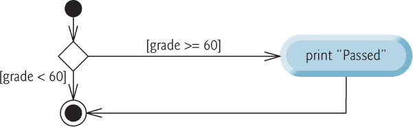

此图包含了活动图最重要的符号——菱形，或**决策符号**，它表示要做出决策。工作流沿着由符号相关的**守护条件**决定的路径继续，这些条件可以是真也可以为假。从决策符号发出的每个转换箭头在箭头旁边的方括号中指定了守护条件。如果守护条件为 `true`，工作流进入转换箭头指向的操作状态。在此图中，如果分数大于或等于 60，程序打印“Passed”，然后转换到活动的最终状态。如果分数小于 60，程序将转换到最终状态而不打印任何消息。`if` 语句是单入单出口控制语句。

### 3.4 `if…else` 双分支选择语句

`if` 选择语句仅在条件为 `true` 时执行操作。`if`…`else` 语句允许在条件为 `true` 时执行一个操作，在为 `false` 时执行另一个。例如，以下 `if`…`else` 语句在分数大于或等于 60 时打印 `"Passed"`；否则打印 `"Failed"`：

```
if (grade >= 60) {
   System.out.println("Passed");
}
else {
   System.out.println("Failed");
}
```

在任何情况下，打印后都会执行序列中的下一个语句（如果有）。`if` 和 `else` 体的缩进相同。为了可读性，你应该在整个程序中使用缩进。IDE 通常会自动完成缩进。

#### `if…else` 语句的 UML 活动图

下面的图说明了上述 `if`…`else` 语句的控制流：

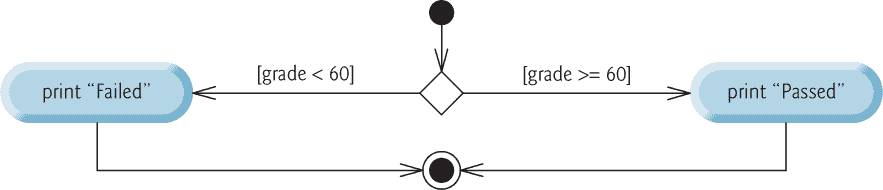

再次，UML 活动图从初始状态开始，包含转换箭头、决策和操作状态，并以结束状态。

#### 生成式 AI

**1** 向 AI 提供以下代码，让他们发现并修正错误：

```
if (count > 10) {
   System.out.println("count is greater than 10");
}
else
   System.out.println("count is less than or equal to 10");
}
```

确认 AI 是否发现了 `else` 关键字后面缺失的大括号 `{`。

#### 3.4.1 嵌套 `if…else` 语句

你可以通过将 `if`…`else` 语句放在 `if`…`else` 语句内部来创建**嵌套** `if`…`else` 语句，从而测试多种情况。以下嵌套 `if`…`else` 对于大于或等于 90 分打印 `A`，80-89 分打印 `B`，70-79 分打印 `C`，60-69 分打印 `D`，所有其他分数打印 `F`。我们使用阴影来突出嵌套结构：

```
 if (grade >= 90) {
    System.out.println("A");
 }
 else {
    if (grade >= 80) {
       System.out.println("B");
    }
    else {
       if (grade >= 70) {
          System.out.println("C");
       }
       else {
          if (grade >= 60) {
             System.out.println("D");
          }
          else {
             System.out.println("F");
          }
       }
    }
 }
```

如果 `grade` 大于或等于 90，则嵌套 `if`…`else` 语句中的前四个条件均为 `true`。然而，只有第一个 `if` 部分语句会执行——“外层” `if`…`else` 语句的 `else` 部分会被跳过。

大多数程序员倾向于将上述嵌套 `if`…`else` 语句写为：

```
if (grade >= 90) {
   System.out.println("A");
}
else if (grade >= 80) {
   System.out.println("B");
}
else if (grade >= 70) {
   System.out.println("C");
}
else if (grade >= 60) {
   System.out.println("D");
}
else {
   System.out.println("F");
}
```

后一种形式避免了向右深度缩进，这通常会导致源代码行剩余空间不足，迫使换行并降低代码的可读性。在嵌套的 `if`…`else` 语句中，请确保你测试了所有可能的情况。

#### 3.4.2 块（Blocks）

`if` 语句体只预期一个语句。要在 `if` 或 `else` 的体中包含多个语句，必须将这些语句括在大括号（`{` 和 `}`）中。回想 第 2.7 节，大括号中的语句形成一个块。你可以将块放置在方法任何可以放置单个语句的地方。我们总是将控制语句的体括在大括号中。这可以避免一种被称为“悬空 `else`”的逻辑错误。

以下示例在 `if`…`else` 语句的 `else` 部分包含了一个多语句块：

```
if (grade >= 60) {
   System.out.println("Passed");
}
else {
   System.out.println("Failed");
   System.out.println("You must take this course again");
}
```

如果 `grade` 小于 60，则 `else` 体中的两个语句都会执行，并显示：

```
Failed
You must take this course again
```

`else` 子句中围绕两个语句的大括号是非常重要的。如果没有大括号，该语句：

```
System.out.println("You must take this course again");
```

将位于 `else` 体之外，并且即使在 `grade` 合格时也会打印 `"You must take this course again"`——这是一个逻辑错误。

#### 语法错误与逻辑错误

编译器会捕获语法错误，例如程序中漏掉了块中的一个大括号。逻辑错误（例如计算错误）在执行时产生影响。**致命逻辑错误**会导致程序失败并提前终止。**非致命逻辑错误**允许程序继续执行，但会导致其产生错误的结果。

#### 空语句（Empty Statement）

正如块可以放置在任何可以放置单个语句的地方一样，也可以拥有空语句。回想 第 2.7 节，空语句是通过在通常应该是语句的地方放置分号（`;`）来表示的。

在 `if` 或 `if`…`else` 语句的条件后放置分号，会导致单选择 `if` 语句出现逻辑错误，并导致双选择 `if`…`else` 语句出现语法错误（当 `if` 部分包含实际的体语句时）。

#### 生成式 AI

**1** 使用以下代码提示生成式 AI，并要求它们识别并纠正错误：

```
if (grade < 60)
   System.out.println("Failed");
else
   System.out.println("Passed");
   System.out.println("Great job!");
```

将它们的代码更新和解释与以下内容对比：只有 `else` 之后的第一个缩进语句是 `else` 体的一部分，因为那两个缩进语句没有被括在大括号中。因此，即使学生成绩不及格，这段代码也会打印 `"Great Job!"`。此外，即使是单个语句的体（如 `if` 部分的体），将其括在大括号中也是一种良好的习惯，以防止将来向其体中添加更多语句时出现错误。代码应为：

```
if (grade < 60) {
   System.out.println("Failed");
}
else {
   System.out.println("Passed");
   System.out.println("Great job!");
}
```

### 3.4.3 条件运算符 (`?:`)

**条件运算符**（**`?:`**）可以用来替代简单的 `if`…`else` 语句。条件运算符是唯一的**三元运算符**——它接受三个操作数。操作数与 `?:` 符号共同构成一个**条件表达式**。例如，以下语句打印 `println` 的值：

```
System.out.println(grade >= 60 ? "Passed" : "Failed");
```

### 3.5 `while` 迭代语句

迭代语句指定程序在某个条件为 `true` 时重复操作。考虑以下使用 **`while` 迭代语句**寻找大于 50 的 3 的幂：


```
int product = 3;
while (product <= 50) {
   product = 3 * product;
}
```

首先，我们将 `product` 初始化为 3。然后执行 `while` 语句：

1. 程序测试条件 `product <= 50`，由于 `product` 为 3，条件为 `true`。体将 `product` 乘以 3 并将结果（9）赋值给 `product`。循环第一次迭代完成。

2. 程序再次测试条件——由于 `product` 现在为 9，条件为 `true`。体将 `product` 设置为 27。循环第二次迭代完成。

3. 程序再次测试条件——由于 `product` 现在为 27，条件为 `true`。体将 `product` 设置为 81。循环第三次迭代完成。

4. 程序再次测试条件——最终为 `false`，因为 `product` 现在是 81，不小于或等于 50，因此循环终止。

变量 `product` 现在包含 81——大于 50 的 3 的幂。`while` 语句的体可以是单个语句，也可以是块。

#### `while` 语句的 UML 活动图

以下 UML 活动图说明了上述 `while` 的控制流：

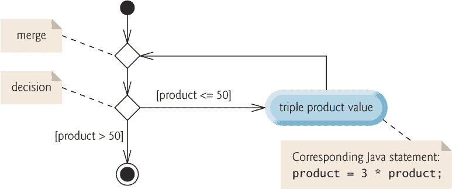

此图引入了 **UML 的合并符号**。UML 将合并符号和决策符号都表示为菱形。合并符号将两个活动流合并为一个流。在图中，该符号合并了从初始状态和动作状态的转换，因此它们都汇入到决定循环是否开始（或继续）执行的判断中。

决策符号和合并符号可以通过“输入”和“输出”转换箭头的数量来区分：

*   决策符号有一个指向菱形的转换箭头，以及两个或多个从菱形指出的箭头，用以表示可能的转换。每个从决策符号指出的转换箭头旁边都带有一个保护条件（guard condition）。

*   合并符号有两个或多个指向菱形的转换箭头，但只有一个从其出的箭头，用以表示多个活动流合并以继续活动。合并符号的转换箭头没有保护条件。

该图清晰地展示了 `while` 语句的迭代。从动作状态出来的转换箭头指向合并符号，程序流由此返回每次迭代开始时测试的决策。`while` 语句一直执行，直到保护条件 `product <= 50` 变为假，从而使得保护条件 `product > 50` 变为真。然后，`while` 语句达到最终状态，程序按顺序继续下一条语句。

#### 生成式 AI

**1** 提示 `genAIs` 编写一个 Java 程序，确定大于一百万的第一个 2 的幂。它们是否使用了我们在下面的代码中展示的技巧？如果没有，请调整你的提示，添加一些提示帮助 `genAIs` 生成与此处所示相似的代码。

点击此处查看代码图像

```
 1   // Power.java
 2   // Calculate 大于 1,000,000 的第一个 2 的幂。
 3   public class Power {
 4      public static void main(String[] args) {
 5         int product = 2;
 6         int n = 1;
 7
 8         while (product <= 1_000_000) {
 9            product = 2 * product;
10            n = n + 1;
11         }
12
13         System.out.printf("%s %d%n%s %d%n",
14            "First power of 2 greater than 1,000,000 is", product,
15            "which is 2 to the power of", n);
16      }
17   }
```

```
First power of 2 greater than 1,000,000 is 1048576
which is 2 to the power of 20
```

## 3.6 计数控制迭代

让我们解决两个关于计算学生平均分的变体问题。考虑以下问题描述：

一个十个学生的班进行了一次测验。该测验的成绩（0–100 范围内的整数）可用。确定该测验的班级平均分。

班级平均分是成绩总和除以人数。解决此问题的程序必须输入每个成绩，跟踪所有输入成绩的总和，执行平均分计算并打印结果。我们使用**计数控制迭代**（counter-controlled iteration）来逐个输入成绩。这种技术使用一个名为**计数器**（counter）或**控制变量**（control variable）的变量来控制语句执行的次数。计数控制迭代也被称为**确定迭代**（definite iteration），因为迭代次数在循环执行之前就已经已知。在这个示例中，当 `counter` 超过 10 时，迭代终止。本节介绍了实现该算法的 Java 程序（图 3.1）。

### 3.6.1 实现算法

在图 3.1 中，`ClassAverage` 类的 `main` 方法允许用户输入 10 个成绩，然后计算并显示平均分。

点击此处查看代码图像

```
 1   // Fig. 3.1: ClassAverage.java
 2   // 使用计数控制迭代解决班级平均分问题。
 3   import java.util.Scanner; // 程序使用 Scanner 类
 4
 5   public class ClassAverage {
 6      public static void main(String[] args) {
 7         // 创建 Scanner 获取用户输入
 8         Scanner input = new Scanner(System.in);
 9
10         // 初始化阶段
11         int total = 0;  // 初始化用户输入的成绩和
12         int gradeCounter = 1; // 初始化下一个输入的成绩编号
13
14         // 处理阶段使用计数控制迭代
15         while (gradeCounter <= 10) { // 循环 10 次
16            System.out.print("Enter grade: "); // 提示下一个成绩
17            int grade = input.nextInt(); // 输入成绩
18            total = total + grade; // 将成绩加到总和
19            gradeCounter = gradeCounter + 1; // 计数器加 1
20         }
21
22         // 终止阶段
23         int average = total / 10; // 整除法产生整数结果
24
25         // 显示成绩总和和平均分
26         System.out.printf("%nTotal of all 10 grades is %d%n", total);
27         System.out.printf("Class average is %d%n", average);
28      }
29   }
```

```
Enter grade: 67
Enter grade: 78
Enter grade: 89
Enter grade: 67
Enter grade: 87
Enter grade: 98
Enter grade: 93
Enter grade: 85
Enter grade: 82
Enter grade: 100

Total of all 10 grades is 846
Class average is 84
```

**图 3.1** | 使用计数控制迭代解决班级平均分问题。

#### `main` 方法中的局部变量

第 8 行声明并初始化了 `Scanner` 变量 `input`，用于读取用户的值。第 11、12、17 和 23 行声明了局部 `int` 变量 `total`、`gradeCounter`、`grade` 和 `average`。变量 `grade` 存储用户输入。

这些声明出现在 `main` 的体内。在方法体内声明的变量是**局部变量**（local variables）。它们只能从声明所在的行到方法结束的右括号处使用。局部变量的声明必须在该方法中使用该变量之前出现。局部变量在声明它的方法之外无法访问。变量 `grade` 声明在 `while` 循环中。

##### 初始化阶段：初始化 `total` 和 `gradeCounter`

赋值（在 11–12 行）将 `total` 初始化为 `0`，将 `gradeCounter` 初始化为 `1`。这些初始化发生在变量在表达式中使用之前；否则会发生编译错误。总和通常初始化为 0。计数器通常初始化为 0 或 1。

##### 处理阶段：从用户处读取 10 个成绩

第 15 行表示只要 `gradeCounter` 的值小于或等于 10，`while` 语句就继续循环（也称为**迭代**，iterating）。只要此条件保持为 `true`，`while` 语句就会重复执行 16–19 行的语句：

*   第 16 行显示提示 `"Enter grade: "`。

*   第 17 行读取用户输入的成绩并赋值给变量 `grade`。

*   第 18 行将新 `grade` 加到 `total`，替换其原有值。

*   第 19 行给 `gradeCounter` 加 `1`（替换其原有值），表示程序已处理一个成绩并准备好输入下一个成绩。

`gradeCounter` 的增加最终会导致其超过 10。然后，循环终止。

##### 终止阶段：计算并显示班级平均分

当循环终止时：

*   第 23 行计算平均分并将结果赋值给变量 `average`。

*   第 26 行使用 `System.out` 的 `printf` 方法显示文本 `"Total of all 10 grades is "` 后接 `total` 的值。

*   第 27 行使用 `printf` 显示文本 `"Class average is "` 后接 `average` 的值。

当执行到第 28 行时，程序终止。

第 23 行的平均值计算产生整数结果。在示例输出中，分数的总和为 846，除以 10 后应该得到 84.6。这是一个浮点数——一个带有小数点的数字。然而，在第 23 行中，`total / 10` 的结果是整数 84，因为 `total` 和 `10` 都是整数。两个整数相除会产生整数除法——计算中的任何小数部分都会被截断（即丢失）。在下一节中，我们将看到如何从平均值计算中获得浮点结果。假设整数除法会四舍五入（而不是截断）会导致错误的结果。

### 3.6.3 算术溢出

在图 3.1 中，第 18 行将用户输入的每个 `grade` 加到 `total` 中：

点击此处查看代码图像

```
total = total + grade; // 将 grade 加到 total
```

即使是这个简单的语句也存在潜在问题——整数相加可能导致结果太大无法存储在 `int` 变量中。这被称为算术溢出，会导致未定义行为，从而导致意想不到的结果。^(4) 图 2.5 中的 `Addition` 程序在第 17 行也存在相同问题，该行计算了用户输入的两个 `int` 值的和：

4. “整数溢出。”Wikipedia，最后修改于 2024 年 5 月 18 日[`https://en.wikipedia.org/wiki/Integer_overflow#Security_ramifications`](https://en.wikipedia.org/wiki/Integer_overflow#Security_ramifications)。[介绍了与整数溢出相关的潜在问题。]

点击此处查看代码图像

```
int sum = number1 + number2; // 将数字相加，并将总和存储在 sum 中
```

常量 `Integer.MIN_VALUE` 和 `Integer.MAX_VALUE` 表示 `int` 变量可以存储的最小值和最大值。其他数值原始类型也有类似的常量。你可以在每个类的在线文档中找到这些常量的值。`Integer` 的文档位于：

点击此处查看代码图像

```
https://docs.oracle.com/en/java/javase/23/docs/api/java.base/
   lang/Integer.html
```

### 3.6.4 输入验证

每当程序接收用户输入时，都可能出现各种问题。例如，图 3.1 的第 17 行

点击此处查看代码图像

```
int grade = input.nextInt(); // 输入下一个成绩
```

假设用户将输入 0 到 100 范围内的整数成绩，但用户可能会输入：

*   小于 0 的整数，
*   大于 100 的整数，
*   超出 `int` 变量可存储范围的整数，
*   带有小数点的数字或
*   包含字母或甚至不能代表数字的特殊符号的值。

工业级程序必须测试所有可能的错误情况以确保输入有效。输入成绩的程序应该使用范围检查对成绩进行验证，以确保它们是 0 到 100 之间的值。你可以要求用户重新输入任何超出范围的值。如果程序需要特定值集合（例如非连续的产品代码），你应该确保每个输入都匹配集合中的某个值。

#### 生成式 AI

**1** 使用以下代码提示生成式 AI，要求它们修复代码以便显示 1–4 的 `count` 值：

点击此处查看代码图像

```
int count = 1;

while (count < 4) {
   count = count + 1;
   System.out.printf("count is: %d%n", count);
}
```

将它们的结果与以下代码对比：

点击此处查看代码图像

```
int count = 0;

while (count < 4) {
   count = count + 1;
   System.out.printf("count is: %d%n", count);
}
```

```
count is: 1
count is: 2
count is: 3
count is: 4
```

### 3.7 哨兵控制迭代

让我们把第 3.6 中的类平均值问题泛化。考虑以下问题：

开发一个类平均值程序，每次运行时处理任意数量学生的成绩。

在之前的类平均值示例中，成绩的数量（10）是预先知道的。对于这个问题，我们不知道用户在程序执行期间会输入多少个成绩。程序必须处理任意数量的成绩。

解决此问题的方法是使用哨兵值（也称为信号值或标志值）来指示数据的结束。在输入所有合法成绩后，用户输入哨兵值表示不再有更多成绩。你必须选择一个与有效输入值混淆的哨兵值。测试成绩是非负整数，因此 –1 是该问题的有效哨兵值。因此，类平均值程序的运行可能会处理如 95, 96, 75, 74, 89 和 –1 的输入流。程序将计算并打印这五个成绩的平均值，排除 –1，因为它是哨兵值不应进入平均值计算。

#### 3.7.1 实现哨兵控制迭代

图 3.2 实现了哨兵控制。图 3.2 大部分与图 3.1 相同，因此我们在这里关注新内容。尽管用户输入的每个成绩都是整数，但平均值计算可能会产生`int` 无法表示的浮点数。使用 `float` 和 `double` 类型存储浮点数：

*   `float`Primitive 类型表示单精度浮点数。小数点后有 7 位有效数字。

*   `double`Primitive 类型表示双精度浮点数。它们需要的内存是 `float` 变量的两倍。它们具有 15 位有效数字——大约是 `float` 变量精度的两倍。

大多数程序员使用 `double` 类型，因为程序中的所有浮点数（如 7.33 和 0.0975）默认表示为 `double` 类型。这些值被称为浮点字面量。有关 Java 浮点类型的精确范围，请访问 Java 语言规范第 4.2 节“原始类型和值。”^(5)

5. Java 语言规范，Java SE 22 版。“4.2. 原始类型和值。”访问于 2024 年 5 月 21 日。

点击此处查看代码图像


## 图. 3.2 | 使用哨兵控制迭代解决类平均分问题

```java
// 图. 3.2: ClassAverage.java
// 使用哨兵控制迭代解决类平均分问题。
import java.util.Scanner; // 程序使用 Scanner 类

public class ClassAverage {
   public static void main(String[] args) {
      // 创建 Scanner 以获取用户输入
      Scanner input = new Scanner(System.in);

      // 初始化阶段
      int total = 0; // 初始化成绩总和
      int gradeCounter = 0; // 初始化已输入的成绩数量

      // 处理阶段
      // 提示输入并从用户处读取成绩
      System.out.print("Enter grade or -1 to quit: ");
      int grade = input.nextInt();

      // 循环直到从用户处读取哨兵值
      while (grade != -1) {
         total = total + grade; // 将成绩加到总和
         gradeCounter = gradeCounter + 1; // 计数器加一

         // 提示输入并从用户处读取下一个成绩
         System.out.print("Enter grade or -1 to quit: ");
         grade = input.nextInt();
      }

      // 终止阶段
      // 如果用户至少输入了一个成绩...
      if (gradeCounter != 0) {
         // 使用带小数点的数字计算平均值
         double average = (double) total / gradeCounter;

         // 显示总和和平均值（两位精度）
         System.out.printf("%nTotal of the %d grades entered is %d%n",
            gradeCounter, total);
         System.out.printf("Class average is %.2f%n", average);
      }
      else { // 没有输入成绩，因此输出适当的消息
         System.out.println("No grades were entered");
      }
   }
}
```

```
Enter grade or -1 to quit: 97
Enter grade or -1 to quit: 88
Enter grade or -1 to quit: 72
Enter grade or -1 to quit: -1

Total of the 3 grades entered is 257
Class average is 85.67
```

**图. 3.2** | 使用哨兵控制迭代解决类平均分问题。

## 哨兵控制迭代与计数器控制迭代的程序逻辑

第 12 行将 `gradeCounter` 初始化为 `0`，因为还没有输入任何成绩。请记住，我们正在使用哨兵控制迭代来输入成绩，因此只有当用户输入有效成绩时，我们才增加变量 `gradeCounter` 的值。第 33 行声明了 `double` 变量 `average`，它以浮点数的形式存储类平均分。

将此程序的哨兵控制迭代逻辑与 **图. 3.1** 中的计数器控制迭代进行比较：

- 在计数器控制迭代中，每次循环迭代（即 **图. 3.1** 的第 15–20 行）都会按照指定的迭代次数从用户处读取一个值。

- 在哨兵控制迭代中，**图. 3.2** 的第 16–17 行在进入 `while` 循环之前提示并输入第一个值。该值决定了控制流是否应该进入 `while` 体。如果条件为 `false`，则用户输入了哨兵值——没有输入任何成绩，因此 `while` 体不执行。如果条件为 `true`，循环体会将 `grade` 加到 `total` 中并增加 `gradeCounter`。然后，第 25–26 行提示并输入下一个成绩。此时，程序控制到达循环的结束右大括号（第 27 行）。执行通过测试 `while` 条件（第 20 行）继续进行，使用最近一次输入的 `grade` 来决定是否再次执行循环体。

请注意，下一个 `grade` 始终在程序测试 `while` 语句的条件之前立即从用户处输入的。这允许程序在处理刚刚输入的值（即将其添加到 `total` 中）之前，确定该值是否为哨兵值。如果 `grade` 包含哨兵值，循环将终止，不会将 `-1` 加到 `total` 中。在哨兵控制循环中，提示应该提醒用户哨兵。

循环结束后，执行第 31–42 行的 `if`…`else` 语句。条件（第 31 行）决定了是否输入了成绩。如果没有输入，则 `else` 部分将显示 `"No grades were entered"`。在 `if`…`else` 执行后，程序终止。

### 3.7.2 基本数据类型之间的显式和隐式转换

如果至少输入了一个成绩，第 33 行将计算成绩的平均值。回想 **图. 3.1** 中的内容，整数除法会产生整数结果。尽管变量 `average` 被声明为 `double`，但如果我们把平均值计算写为：

```java
double average = total / gradeCounter;
```

它将丢失商的小数部分。大多数整数除法都会产生整数结果。

#### 3.7.3 格式化浮点数

第 36–37 行显示 `gradeCounter` 和 `total` 的值。第 38 行显示 `double` 变量 `average` 的值。`printf` 方法使用 `%f` 格式说明符来格式化浮点数。默认情况下，`%f` 对 `double` 格式保留六位精度，但你可以在 `%` 和 `f` 之间指定自定义精度。示例执行中三个成绩的平均值是 `85.666666...`，`6` 的序列无限循环。在格式说明符 `%.2f` 中，`.2` 就是自定义精度。这会将平均值四舍五入到百分位，产生带有两位小数的 `85.67`。

#### 关于浮点精度的说明

浮点数并不总是 100% 精确，但它们有许多应用。例如，当我们谈论“正常”体温为 `98.6 °F` 时，我们不需要精确到很多位数。当我们从温度计读取温度为 `98.6` 时，它实际上可能是 `98.5999473210643`。将这个数字简单地称为 `98.6` 对于大多数涉及体温的应用都是足够的。

浮点数通常源于除法，正如本示例中的类平均分计算。在常规算术中，当我们用 `10` 除以 `3` 时，结果是 `3.3333333...`，`3` 的无限循环。计算机只分配固定的空间来存储此类值，因此存储的浮点值只能是一个近似值。

由于浮点数具有不精确性，`double` 类型优于 `float` 类型，因为 `double` 变量可以更准确地表示浮点数。因此，我们在全书中主要使用 `double` 类型。假设浮点数是精确表示的会导致错误的结果。在某些情况下，`float` 和 `double` 变量的精度是不够的。对于精确的浮点数（例如货币计算所需的数字），Java 提供了 `BigDecimal` 类（位于 `java.math` 包），我们将在第 4.11 节讨论。

```java
// AverageTemperature.java
// Calculate the average of several temperatures
import java.util.Scanner;

public class AverageTemperature {
   public static void main(String[] args) {
      Scanner input = new Scanner(System.in);

      int total = 0;
      int counter = 0;

      System.out.print("Enter a temperature or 999 to quit: ");
      int temperature = input.nextInt();

      while (temperature != 999) {
         total = total + temperature;
         counter = counter + 1;

         System.out.print("Enter a temperature or 999 to quit: ");
         temperature = input.nextInt();
      }

      if (counter != 0) {
         double average = (double) total / counter;
         System.out.printf("Average temperature is: %.2f%n", average);
      }
      else {
         System.out.println("No temperatures were entered.");
      }
   }
}
```

```
Enter a temperature or 999 to quit: 12
Enter a temperature or 999 to quit: -22
Enter a temperature or 999 to quit: 17
Enter a temperature or 999 to quit: 999
Average temperature is: 2.33
```

## 3.8 嵌套控制语句

我们已经看到控制语句可以层层堆叠在彼此之上（顺序顺序）。在本案例研究中，我们将检查控制语句连接的另一种唯一结构化方式——即将一个控制语句嵌套在另一个控制语句之中。

### 3.8.1 问题描述

考虑以下问题描述：

某大学提供一门课程，为学生参加房地产经纪人执业考试做准备。去年有十名完成这门课程的学生参加了考试。该大学想知道学生在考试中的表现如何。你被要求编写一个程序来汇总结果。

你得到了一个这 10 名学生的列表。在每个名字旁边写着 `1` 表示学生通过了考试，写着 `2` 表示未通过。

你的程序应按如下方式分析考试结果：

1. 输入每个测试结果（即 `1` 或 `2`）。每当程序请求另一个测试结果时，显示“Enter result（输入结果）”。

2. 统计每种测试结果的数量。

3. 显示测试结果的摘要，说明通过人数和未通过人数。

4. 如果超过八名学生通过，打印“Bonus to instructor!（奖励老师！）”。

### 问题描述观察

在仔细阅读问题描述后，我们得出了以下观察：

* 程序必须处理 10 名学生的测试结果。由于测试结果的数量是预知的，可以使用计数器控制的循环。

* 每个测试结果可能是 `1` 要可能是 `2`。当程序读取每个结果时，必须判断它是 `1` 还是 `2`。我们在算法中对 `1` 进行了测试。如果数字不是 `1`，我们假设它是 `2`。

* 使用两个计数器来跟踪考试结果——一个计算通过人数，另一个计算未通过人数。

* 在程序处理完所有结果后，必须判断是否有超过八名学生通过了考试。

### 3.8.2 实现程序

**图 3.3** 使用计数器控制迭代实现了该程序，并展示了两个示例执行。第 11–13 行和第 19 行声明了我们用于处理考试结果的变量。在声明时初始化局部变量可以帮助避免尝试使用未初始化变量导致的编译错误。

```java
// Analysis.java
// Process exam results using nested control statements
import java.util.Scanner;

public class Analysis {
   public static void main(String[] args) {
      Scanner input = new Scanner(System.in);

      int passes = 0;
      int failures = 0;

      int studentCounter = 1;

      while (studentCounter <= 10) {
         System.out.print("Enter result (1 = pass, 2 = fail): ");
         int result = input.nextInt();

         if (result == 1) {
            passes = passes + 1;
         } else {
            failures = failures + 1;
         }

         studentCounter = studentCounter + 1;
      }

      System.out.printf("Passed: %d%nFailed: %d%n", passes, failures);

      if (passes > 8) {
         System.out.println("Bonus to instructor!");
      }
   }
}
```

```
Enter result (1 = pass, 2 = fail): 1
Enter result (1 = pass, 2 = fail): 2
Enter result (1 = pass, 2 = fail): 1
Enter result (1 = pass, 2 = fail): 1
Enter result (1 = pass, 2 = fail): 1
Enter result (1 = pass, 2 = fail): 1
Enter result (1 = pass, 2 = fail): 1
Enter result (1 = pass, 2 = fail): 1
Enter result (1 = pass, 2 = fail): 1
Enter result (1 = pass, 2 = fail): 1
Passed: 9
Failed: 1
Bonus to instructor!
```

```
Enter result (1 = pass, 2 = fail): 1
Enter result (1 = pass, 2 = fail): 2
Enter result (1 = pass, 2 = fail): 1
Enter result (1 = pass, 2 = fail): 2
Enter result (1 = pass, 2 = fail): 1
Enter result (1 = pass, 2 = fail): 2
Enter result (1 = pass, 2 = fail): 2
Enter result (1 = pass, 2 = fail): 1
Enter result (1 = pass, 2 = fail): 1
Enter result (1 = pass, 2 = fail): 1
Passed: 6
Failed: 4
```

**图 3.3** | 使用嵌套控制语句对考试结果进行分析。

`while` 语句（第 14–25 行）循环 10 次。在每次迭代中，它输入并处理一个考试结果。用于每个结果的 `if`…`else` 语句（第 18–22 行）嵌套在 `while` 语句中。如果 `result` 为 `1`，`if`…`else` 语句增加 `passes`；否则，它假设 `result` 为 `2` 并增加 `failures`。第 24 行在第 14 行再次测试循环条件之前增加 `studentCounter`。在输入 10 个值后，循环终止，第 27 行显示 `passes` 和 `failures` 的数量。第 29–31 行的 `if` 语句判断是否有超过 8 名学生通过了考试，如果是，则输出消息 `"Bonus to instructor!"`。

**图 3.3** 显示了程序两次示例执行的输入和输出。在第一次执行中，第 29 行的条件为 `true`——有超过 8 名学生通过了考试，因此程序输出了一条消息给讲师奖金。

#### 生成式 AI

**1** 提示生成式 AI 通过将嵌套的 `if`…`else` 语句替换为使用条件表达式的单语句来简化以下程序。执行它们返回的代码以确保其产生相同的结果。


### 3.9 复合赋值运算符

复合赋值运算符允许你缩写赋值表达式。你可以将语句

```java
c = c + 3; // 将 c 加 3
```

使用加法复合赋值运算符 `+=` 缩写为：

```java
c += 3; // 更简洁地将 c 加 3
```

`+=` 运算符将其右操作数的值加到左侧变量的值，然后将结果存储在左侧变量中。因此，赋值表达式 `c += 3` 将 `3` 加到 `c`。复合赋值运算符对右表达式的值进行隐式转换，以匹配运算符左侧变量的类型。因此，如果左侧变量是 `int` 且右侧表达式结果为 `double`，则 `double` 值的浮点部分将被截断。下表显示了算术复合赋值运算符、示例表达式以及运算符作用的解释：

| 运算符 | 示例表达式 | 解释 | 赋值给 |
| --- | --- | --- | --- |
| *假设:* `int c = 3, d = 5, e = 4, f = 6, g = 12;` | | | |
| `+=` | `c += 7` | `c = c + 7` | `10` 赋值给 `c` |
| `-=` | `d -= 4` | `d = d - 4` | `1` 赋值给 `d` |
| `*=` | `e *= 5` | `e = e * 5` | `20` 赋值给 `e` |
| `/=` | `f /= 3` | `f = f / 3` | `2` 赋值给 `f` |
| `%=` | `g %= 9` | `g = g % 9` | `3` 赋值给 `g` |

[6] Java 语言规范，Java SE 22 版。第 15.26.2 节，“复合赋值运算符”。访问于 2024 年 8 月 28 日 [`https://docs.oracle.com/javase/specs/jls/se22/html/jls-15.26.2`](https://docs.oracle.com/javase/specs/jls/se22/html/jls-15.26.2)。

#### 生成式 AI

**1** 向生成式 AI 提供以下代码，询问代码执行后 `y` 的值是多少：

```java
int y = 5;
y += 3.5;
```

确认代码执行后 `y` 的值为 8。复合赋值运算符隐式地转换右表达式的值以匹配运算符左侧变量的类型。因此，如果左侧变量是 `int` 且右侧表达式结果为 `double`，则 `double` 值的浮点部分将被截断。

### 3.10 增减运算符

下表总结了单一递增减运算符：

| 运算符 | 名称 | 描述 |
| --- | --- | --- |
| `++` | 前置递增 | 变量加 1。 |
| `++` | 后置递增 | 在表达式中使用变量后加 1。 |
| `--` | 前置递减 | 变量减 1。 |
| `--` | 后置递减 | 在表达式中使用变量后减 1。 |

#### 前置与后置递增

图 3.4 显示了 `++` 运算符的前置和后置形式之间的区别。

```java
// 图 3.4：递增。
// 前置和后置运算符。
public class Increment {
   public static void main(String[] args) {
         // 后置运算符
         int c = 5;
         System.out.printf("c before postincrement: %d%n", c); // 输出 5
         System.out.printf("postincrementing c: %d%n", c++); // 输出 5
         System.out.printf("c after postincrement: %d%n", c); // 输出 6

         // 前置运算符
         c = 5;
         System.out.printf("c before prefixincrement: %d%n", c); // 输出 5
         System.out.printf("prefixincrementing c: %d%n", ++c); // 输出 6
         System.out.printf("c after prefixincrement: %d%n", c); // 输出 6
   }
}
```

```
c before postincrement: 5
postincrementing c: 5
c after postincrement: 6

c before prefixincrement: 5
prefixincrementing c: 6
c after prefixincrement: 6
```

**图 3.4** | 前置和后置运算符。

`++` 运算符可以有两种形式：前置 (`++c`) 和后置 (`c++`)。前置递增 `++c` 在使用变量之前将其加 1。后置递增 `c++` 在表达式中使用变量当前值之后增加。

##### 简化递增语句

算术复合赋值运算符和增减运算符可以用于简化程序语句。例如，图 3.3 中的三条赋值语句（第 23、26 和 30 行）

```java
passes = passes + 1;
failures = failures + 1;
studentCounter = studentCounter + 1;
```

可以简化为：

```java
passes++;
failures++;
studentCounter++;
```

可以使用复合赋值运算符写得更简洁：

```java
passes += 1;
failures += 1;
studentCounter += 1;
```

使用前置自增运算符：

```java
++passes;
++failures;
++studentCounter;
```

或者使用后置自增运算符：

```java
passes++;
failures++;
studentCounter++;
```

在单独的语句中对变量进行增或自减时，前置增和后置增的效果相同，前置减和后置减的效果也相同。只有当变量出现在更大的表达式上下文中时，对变量进行前置增和后置增才会产生不同的效果（前置减和后置减亦然）。

#### 生成式 AI

**1** 提示 `genAIs` 解释以下代码的作用。

```java
// Mystery.java
public class Mystery {
   public static void main(String[] args) {
      int x = 1;
      int total = 0;

      while (x <= 10) {
         int y = x * x;
         System.out.println(y);
         total += y;
         ++x;
      }

      System.out.printf("Total is %d%n", total);
   }
}
```

将它们的答案与以下内容比较：在垂直列中，代码打印 1–10 的平方数，然后打印这些平方数的和。

```
1
4
9
16
25
36
49
64
81
100
Total is 385
```

### 3.11 基本类型

Java 要求所有变量必须有类型。在 `C` 和 `C++` 中，程序员经常需要编写不同版本的程序来支持不同的计算机平台，因为基本类型在不同计算机之间无法保证是完全相同的。例如，一台机器上的 `int` 可能由 16 位（2 字节）内存表示，而在另一台机器上为 32 位（4 字节），另一台则为 64 位（8 字节）。在 Java 中，`int` 值始终是 32 位（4 字节）。Java 的八种基本类型——`boolean`、`byte`、`char`、`double`、`float`、`int`、`long` 和 `short` 在所有支持 Java 的计算机平台上都是通用的。关于这些类型值范围的摘要，请访问 Java 语言规范第 4.2 节，基本类型与值。由于 Java 的设计者希望确保移植性，他们使用了国际标准的字符格式（Unicode；[`https://unicode.org`](https://unicode.org)）和浮点数（IEEE 754；[`https://standards.ieee.org/ieee/754/6210/`](https://standards.ieee.org/ieee/754/6210/)）。

[7] 我们将在第 14 章的使用 Lambda 和 Stream 进行函数式编程中看到这一说法的例外情况。

[8] 《Java 语言规范，Java SE 22 版》。第 4.2 节，“基本类型与值”。访问 2024 年 6 月 1 日。[`https://docs.oracle.com/javase/specs/jls/se22/html/jls-4.html#jls-4.2`](https://docs.oracle.com/javase/specs/jls/se22/html/jls-4.html#jls-4.2)。

#### 生成式 AI

**1** 提示 `genAIs` 写一个 Java 程序，显示 Java 整数基本类型的最小值和最大值，然后运行生成的程序。

### 3.12 对象——自然案例研究：超大整数

连接网络的设备上通信和数据存储的爆炸式增长极大地提高了隐私和安全的重要性。密码学几千年来一直用于加密数据，使得未经授权的用户难以读取（并希望是不可能的），这在当今互联的世界中至关重要。大多数网站（包括 [`deitel.com`](http://deitel.com)）使用 HTTPS（安全超文本传输协议）来加密和解密你的互联网交互。

[9] “密码学”。访问 2024 年 6 月 1 日 [`https://en.wikipedia.org/wiki/Cryptography#History`](https://en.wikipedia.org/wiki/Cryptography#History)。

[10] 币安学院，“密码学历史”。访问 2024 年 6 月 1 日 [`https://www.binance.vision/security/history-of-cryptography`](https://www.binance.vision/security/history-of-cryptography)。

##### 某些应用需要 `long` 之外的整数

Java 基本类型 `long` 可以存储范围从 -9,223,372,036,854,775,808 到 9,223,372,036,854,775,807 的值——这远超 `long` 能容纳的十位数。最流行的加密/解密方案之一是 RSA，常用于保护互联网数据。RSA 之所以安全是因为分解这些质数的乘积需要的时间，即使对于当今最强大的超级计算机也是如此。公钥加密也用于加密货币背后的区块链技术。书的后面我们将讨论公钥加密。

[14] Sarah Roth，“区块链加密如何对抗量子”，2018 年 12 月 28 日 [`https://coincentral.com/blockchain-cryptography/`](https://coincentral.com/blockchain-cryptography/)。

##### `long` 范围外的整数需要自定义编程

那么，我们如何处理任意数字的巨型整数？需要 `long` 范围外整数的应用需要自定义编程。我们可以使用 Java 类机制（在第 1.4 节提到并在第 8 章中详细介绍）开发一个处理巨型整数运算的自定义类——但这可能花费数月。自然方法鼓励我们首先检查 Java API 或开源类库，判断是否存在这样的“巨型整数”类。

##### 使用 Java API 的 `java.math.BigInteger` 类

已经存在创建和处理巨型整数的类。在本例中，我们将演示 Java API `java.math` 包中的 `BigInteger` 类：

[`https://docs.oracle.com/en/java/javase/23/docs/api/java.base/java/math/BigInteger.html`](https://docs.oracle.com/en/java/javase/23/docs/api/java.base/java/math/BigInteger.html)

通过图 3.5 中的自然方法，我们将使用 `BigInteger` 类对象，而无需理解该类是如何实现的。

[15] 如果你开车，你可以有效地使用它，而不需要理解汽车发动机、转向系统、刹车和传输系统的内部工作原理。在你深入学习 Java 之后，你可能想要研究 `BigInteger` 的源代码（大约 5,000 行，包含大量的 Javadoc 注释），以学习它是如何实现的。在本书稍后关于面向对象编程的介绍中，你将学习可以使用于创建你自己的大整数类的技术。

[16] 你可能会说：“我坚持要知道我在 Java 中使用的所有东西是如何实现的。”请思考一下这样一个事实：你正在使用 Java 编译器将你的 Java 程序翻译成字节码，然后由 Java 虚拟机将这些字节码翻译成计算机的机器语言。你知道编译器是如何实现的吗？你确定它正确地翻译了每一个 Java 程序，以便它们能够运行并产生正确的结果吗？


# 图 3.5：使用 `BigInteger` 创建并操作超大整数

```java
// Fig. 3.5: UsingBigInteger.java
// Creating and manipulating super-sized integers
// with objects of the Java API's BigInteger class.
import java.math.BigInteger;

public class UsingBigInteger {
   public static void main(String[] args) {
      // display the largest value a long can store
      System.out.printf("LARGEST LONG VALUE: %d%n%n", Long.MAX_VALUE);

      // can create BigIntegers from Strings or integers
      BigInteger value1 =
         new BigInteger("1000000000000000000000000000000"); // 30 digits
      BigInteger value2 = BigInteger.valueOf(9_223_372_036_854_775_807L);
      BigInteger value3 = BigInteger.valueOf(17);

      System.out.println("INITIAL VALUES");
      System.out.printf("BigInteger value1: %s%n", value1);
      System.out.printf("BigInteger value2: %s%n", value2);
      System.out.printf("BigInteger value3: %s%n", value3);

      System.out.println("\nADD, SUBTRACT AND MULTIPLY BIGINTEGERS");
      System.out.printf("     value1.add(value2): %s%n",
         value1.add(value2));
      System.out.printf("value1.subtract(value2): %s%n",
         value1.subtract(value2));
      System.out.printf("value1.multiply(value2): %s%n",
         value1.multiply(value2));
      System.out.printf("value1.multiply(value3): %s%n",
         value1.multiply(value3));
   }
}
```

```
LARGEST TYPE LONG VALUE: 9223372036854775807

INITIAL VALUES
BigInteger value1: 100000000000000000000000000000
BigInteger value2: 9223372036854775807
BigInteger value3: 17

ADD, SUBTRACT AND MULTIPLY BIGINTEGERS
     value1.add(value2): 100000000009223372036854775807
value1.subtract(value2): 99999999990776627963145224193
value1.multiply(value2): 9223372036854775807000000000000000000000000000000
value1.multiply(value3): 1700000000000000000000000000000
```

**图 3.5** | 使用 Java API 的 `BigInteger` 类对象创建并操作超大整数。

## `long` 的最大值

第 9 行显示了 `Long.MAX_VALUE`——这是一个常量，表示 `long` 变量可以存储的最大值（9,223,372,036,854,775,807）。正如你所看到的，此示例中的每个 `BigInteger` 计算结果都是大于 `Long.MAX_VALUE` 的值。每个基本类型（例如 `long`）在 `java.lang` 包中都有一个对应的类（例如 `Long` 类）。这些类提供了常量 `MIN_VALUE` 和 `MAX_VALUE`，代表最小值和最大值。

## 使用字符串初始化 `BigInteger`

第 12-13 行显示了如何使用字符串字面量创建 `BigInteger`。如果值超过了 `long` 的容量，则使用字符串表示以避免溢出问题。

## 使用整数初始化 `BigInteger`

第 14-15 行演示了使用 `BigInteger.valueOf()` 从 `long` 值创建 `BigInteger` 对象。注意长字面量使用的 `L` 后缀，以确保编译器将数字视为 `long`。

## `printf` 的 `%s` 格式说明如何理解 `BigInteger`？

当你使用 `printf` 配合 `%s` 格式化任何对象时，Java 会将该对象转换为字符串。它是通过调用对象的 `toString()` 方法实现的，该方法也用于 `System.out`。

## 执行 `BigInteger` 算术运算

`BigInteger` 提供了用于常见算术运算的方法，例如 `add`、`subtract` 和 `multiply`。第 23-30 行演示了这些方法。虽然 `BigInteger` 可以表示任意数字位的整数，但它们的计算速度比基本类型要慢，因为它们不直接由 Java 虚拟机处理。

在本章中，我们演示了 `if` 单分支语句、`if`…`else` 双分支选择语句以及 `while` 迭代语句。我们使用计数控制迭代计算了 10 个学生成绩的平均分。然后，我们使用哨兵值控制迭代计算了任意一组学生成绩的平均分。我们引入了复合赋值运算符以及递增和递减运算符。我们还讨论了 Java 的八种基本类型，并指出它们在不同平台之间是可移植的。

在我们的“对象-自然”案例研究中，我们创建并操作了 `BigInteger` 对象，以对 Java 整数基本类型范围之外的值进行整数运算。在整个章节中，你使用了生成式 AI 来辅助你的 Java 学习体验。在第 4 章中，我们将继续对控制语句的讨论，引入 `for`、`do`…`while` 和 `switch` 语句。我们还引入了用于创建复合条件的逻辑运算符。

## 特别章节：生成式 AI 练习

针对以下每个问题，尝试使用多个生成式 AI 以确定哪一个表现最好。务必验证结果。记住，它们有时会出错，甚至产生幻觉，创建出不可靠的信息。

**3.1 (生成式 AI：控制语句练习)**：提示生成式 AI 建议一些带有答案的入门练习，用于练习 Java 的 `if` 和 `while` 控制语句。将建议限制在最多 50 行代码即可完成的练习。

**3.2 (生成式 AI：补全缺失代码)**：从程序中删除一些代码，然后告诉生成式 AI 程序预期的功能，并要求它们填补缺失的代码。

**3.3 (生成式 AI：超大整数)**：提示生成式 AI 编写一个关于 `BigInteger` 应用的教程。

# 4 控制语句：第 1 部分


## 目标

在本章中，你将：

* 使用 `for` 和 `do`…`while` 迭代语句在程序中重复执行语句。
* 使用 `switch` 选择语句进行多路选择。
* 使用 `break` 和 `continue` 语句改变控制流。
* 使用逻辑运算符形成复合条件表达式，以便在控制语句中测试多个条件。
* 使用生成式 AI 来辅助你的 Java 学习体验。
* 继续我们的“对象-自然”方法，通过一个使用 Java API 中 `BigDecimal` 类对象进行精确货币计算的案例研究。

## 4.1 引言

本章介绍了 Java 剩余的所有控制语句（例外）。我们演示了 `for`、`do`…`while` 和 `switch` 语句。我们探索了使用 `while` 和 `for` 进行计数控制迭代的核心要素。我们使用 `switch` 语句统计用户输入的一组数字成绩中相当于 A、B、C、D 和 F 成绩的数量。我们引入了 `break` 和 `continue` 程序控制语句。我们讨论了逻辑运算符，它允许你在控制语句中使用更复杂的条件表达式。在整个章节中，你将使用生成式 AI 来辅助你的 Java 学习体验。我们讨论了使用 `double` 等浮点类型处理金额的挑战。然后，在第 4.11 节的“对象-自然”案例研究中，我们将使用 Java API 类 `BigDecimal` 对象精确地表示和操作金额。

## 4.2 计数控制迭代的核心要素

让我们使用 `while` 迭代语句（第 3.5 节）来规范化计数控制迭代的要素：

1. 一个控制变量（或循环计数器），
2. 控制变量的**初始值**，
3. 每次通过循环（也称为每次**循环迭代**）时修改控制变量的**增量**，以及
4. 决定是否应继续循环的**循环继续条件**。

考虑图 4.1 中的程序，它使用循环显示 1–10。第 6 行、8 行和第 10 行定义了计数控制迭代的要素。第 6 行将控制变量（`counter`）声明为 `int`，在内存中为其预留空间并将其初始值设置为 `1`。`while` 语句的循环继续条件（第 8 行）测试控制变量的值是否小于等于 `10`（该条件为 `true` 的最终值）。即使控制变量为 `10`，程序也会执行该 `while` 语句体。当控制变量超过 `10`（即 `counter` 变为 `11`）时，循环终止。第 9 行在每次迭代期间显示 `counter` 的值。第 10 行在每次迭代结束时控制变量加 1，为处理下一个值做准备。

```java
// Fig 4.1: WhileCounter.java
// 使用 while 迭代语句进行计数控制迭代。

public class WhileCounter {
   public static void main(String[] args) {
      int counter = 1; // 声明并初始化控制变量

      while (counter <= 10) { // 循环继续条件
         System.out.printf("%d  ", counter);
         ++counter; // 递增控制变量
      }
   }
}
```

```
1 2 3 4 5 6 7 8 9 10
```

**图 4.1** | 使用 while 迭代语句的计数控制迭代。

你应该始终使用整数控制计数循环。记住，浮点值是近似的。因此，使用浮点变量控制循环会导致计数值不精确以及导致无限循环的错误终止测试。

### 生成式 AI

**1** 提示生成式 AI，让它们找到以下代码中的错误，该代码应该打印 1–5：

```java
int n = 1;

while (n < 5) {
   System.out.println(n++);
}
```

确认生成式 AI 指出循环目前打印 1–4，要打印 1–5，循环条件应该 `<=` 而不是 `<` 或者使用最终值 `6` 而不是 `5`。

## 4.3 `for` 迭代语句

`for` 迭代语句在一行代码中指定计数控制迭代的细节。通常，你使用 `for` 语句进行计数控制迭代，使用 `while` 语句进行哨兵控制迭代，但每种都可以用于任何迭代类型。图 4.2 使用 `for` 语句重新实现了图 4.1 中的程序。

```java
// Fig. 4.2: ForCounter.java
// 使用 for 迭代语句进行计数控制迭代。

public class ForCounter {
   public static void main(String[] args) {
      // for 语句头部包含初始化、循环继续
      // 条件和增量，用所需的的分号隔开
      for (int counter = 1; counter <= 10; ++counter) {
         System.out.printf("%d  ", counter);
      }

      System.out.println();
   }
}
```

```
1 2 3 4 5 6 7 8 9 10
```

**图 4.2** | 使用 for 迭代语句的计数控制迭代。

`for` 语句（第 8–10 行）声明了控制变量 `counter` 并将其初始化为 `1`。接下来，语句在两个必要的分号之间测试循环延续条件（`counter <= 10`）。由于 `counter` 的初始值为 `1`，因此该条件为 `true`，所以第 9 行显示 `counter` 的值（`1`）。接着，`++counter` 将 `counter` 增 1。然后，再次测试循环延续条件以确定是否继续循环的下一次迭代。此时，`counter` 的值为 `2`，因此条件仍为 `true`，程序执行第 9 行。此过程持续进行直到循环显示 1–10。当 `counter` 的值变为 `11` 时，循环延续条件为 `false`，迭代终止，程序继续执行循环后的第一个语句（第 12 行）。

### 差一错误

如果你在图 4.2 中错误地将循环延续条件指定为 `counter < 10`，则循环将只迭代九次——这是一种常见的逻辑错误，被称为 `差一错误`。循环延续条件中错误的最终值也会导致差一错误。在从从 1 计数到 10 的循环中，条件应该是 `counter <= 10` 或 `counter < 11`。许多程序员倾向于从零开始计数，此时若要计数 10 次，`counter` 将初始化为 0，循环延续测试将为 `counter < 10`。^(1)

在第 6 章 中，我们将看到从零计数的示例。

### 详细观察 `for` 语句的头部

让我们仔细观察图 4.2 中的 `for` 语句：

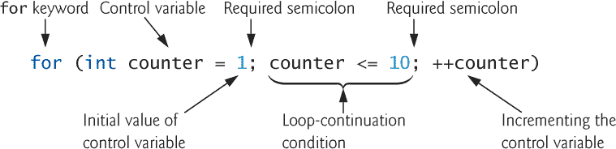

这一行——包括关键字 `for` 以及 `for` 之后括号内的所有内容（图 4.2 中的第 8 行）——有时被称为 `for` 语句头部。

### `for` 语句的一般格式

`for` 语句的一般格式为

```java
for (initialization; loopContinuationCondition; increment) {
   statement(s)
}
```

其中

* `initialization` 声明循环的控制变量并提供其初始值，
* `loopContinuationCondition`——在两个必要的分号之间——决定循环是否应该继续执行，
* `increment` 在循环体执行完毕后修改控制变量的值，使得循环延续条件最终变为 `false`。

如果 `loopContinuationCondition` 初始为 `false`，则 `for` 语句的体不执行——执行流将继续执行 `for` 之后的顺序中的下一个语句。`initialization` 和 `increment` 表达式可以是初始化表达式或增量表达式的逗号分隔列表——每个表达式都从左到右求值。

在 `for` 头部的右括号后立即放置分号会使该 `for` 的语句体变成一个空语句。这通常是一个逻辑错误。

当迭代语句的 `loopContinuationCondition` 永远不会变为 `false` 时，就会无限循环。为了防止计数控制循环中出现这种情况，请在每次循环迭代期间修改控制变量，以便循环延续条件最终变为 `false`。

### `for` 语句控制变量的作用域

如果 `initialization` 表达式声明了控制变量，则它只能在该 `for` 语句中使用——不能在之外使用。这种限制的使用是变量的作用域，它定义了变量的生命周期以及在程序可以使用的地方。例如，变量的作用域是从块中的声明点到关闭该块的右括号。正如你在 第 5 章 和 方法 中看到的，将每个变量的作用域限制在需要的地方是良好做法。

### `for` 语句头部的表达式是可选的

`for` 头部的三个表达式都是可选的：

* 如果省略 `loopContinuationCondition`，则条件始终为 `true`，导致无限循环。我们稍后会看到这有时有用。
* 如果程序在循环之前已经初始化了控制变量，则可以省略 `initialization` 表达式。
* 如果程序在循环体中计算增量，或者不需要增量，则可以省略 `increment` 表达式。

`for` 中的 `increment` 表达式相当于 `for` 体末尾的独立语句。因此，以下 `increment` 表达式在 `for` 中是等价的：

```java
counter = counter + 1
counter += 1
++counter
counter++
```


增量表达式不会出现在更大的表达式中，因此前增和后增的效果相同。我们更倾向于使用前增。^(2) 量也可以是负数，在这种情况下它是向下计数的。

## 在体中使用 `for` 语句的控制变量

`for` 语句经常在体中使用控制变量。该 `for` 语句的 UML 图显示初始化发生在语句之前。


## 4.4 `for` 语句示例

以下示例展示了改变控制变量的技术。在每种情况下，我们只编写适当的 `for` 头部。

1. 增量为 1，将控制变量从 1 变化到 100。

```
for (int i = 1; i <= 100; ++i)
```

2. 减量为 1，将控制变量从 100 变化到 1。

```
for (int i = 100; i >= 1; --i)
```

3. 增量为 7，将控制变量从 7 变化到 77。

```
for (int i = 7; i <= 77; i += 7)
```

4. 减量为 2，将控制变量从 20 变化到 2。

```
for (int i = 20; i >= 2; i -= 2)
```

5. 控制变量的变化值为 2, 5, 8, 11, 14, 17, 20。

```
for (int i = 2; i <= 20; i += 3)
```

6. 控制变量的变化值为 99, 88, 77, 66, 55, 44, 33, 22, 11, 0。

```
for (int i = 99; i >= 0; i -= 11)
```

如果循环的控制变量递增或递减幅度大于 `1`，请勿在循环继续条件中使用等值运算符（`!=` 或 `==`）。例如，在接下来的 `for` 头部中，`counter != 10` 永远不会变为 `false`，导致无限循环，因为 `counter` 在每次迭代后递增 `2`，产生奇数 3, 5, 7, 9, 11, …：

点击此处查看代码图片

```
for (int counter = 1; counter != 10; counter += 2)
```

在递减计数循环中，一种常见的逻辑错误是在循环继续条件使用了错误的关系运算符——例如，在递减计数到 `1` 的循环中使用了 `i <= 1` 而不是 `i >= 1`。计数循环很容易出错。在随后的章节中，我们将引入 Lambda 和流技术，你可以使用这些技术来消除此类错误。

### 生成式 AI

**1** 提示 `genAIs`，让它们查找并纠正以下代码段中的错误，该代码应该显示从 19 到 1 的奇整数：

点击此处查看代码图片

```
for (int i = 19; i >= 1; i += 2) {
   System.out.println(i);
}
```

确认 `genAIs` 已将 `for` 头部递增部分的 `+=` 运算符替换为 `-=`。

## 4.5 使用 `for` 语句求 2 到 20 的偶数和

图 4.3 使用 `for` 语句求 2 到 20 的偶数和，并将结果存储在名为 `total` 的 `int` 变量中。当第 9–11 行执行时，每次循环迭代会将控制变量 `number` 的值加到 `total` 的当前值上，并将结果存储在 `total` 中。

点击此处查看代码图片

```
 1   // Fig. 4.3: Sum.java
 2   // 使用 for 语句求整数和。
 3
 4   public class Sum {
 5      public static void main(String[] args) {
 6         int total = 0;
 7
 8         // 2 到 20 的所有偶数和
 9         for (int number = 2; number <= 20; number += 2) {
10            total += number;
11         }
12
13         System.out.printf("Sum is %d%n", total);
14      }
15   }
```

```
Sum is 110
```

**图 4.3** | 使用 for 语句求整数和。

### 生成式 AI

**1** 提示 `genAIs`，让它们编写使用 `for` 语句和 `int` 变量 `sum`、`count` 来求 1 到 99 的奇整数和，然后显示结果。同时询问它们和应该是多少。将生成的代码与以下代码进行比较，并确保它产生了正确的和：

点击此处查看代码图片

```
int sum = 0;

for (int count = 1; count <= 99; count += 2) {
   sum += count;
}

System.out.printf("Sum is: %d%n", sum);
```

```
Sum is: 2500
```

## 4.6 使用 `for` 语句计算复利

让我们使用 `for` 语句来计算复利。考虑以下问题：

某人在储蓄账户中投资了 1,000 美元，利率为 5%。假设所有利息都留在账户中，计算并打印 10 年内每年年底账户的金额。使用以下公式确定金额：

`a = p (1 + r)^n`

其中

*   `p` 是投资的原始本金金额
*   `r` 是年利率（例如，5% 使用 0.05）
*   `n` 是年数
*   `a` 是第 `n` 年末的存款金额。

图 4.4 使用循环对资金留在账户的 10 年中的每一年进行复利计算。第 6、7 和 15 行声明了 `double` 变量 `principal`、`rate` 和 `amount`。第 6–7 行将 `principal` 初始化为 `1000.00`，`rate` 初始化为 `0.05` (5%)。第 15 行将 `amount` 初始化为复利计算的结果。

点击此处查看代码图片

```
 1   // Fig. 4.4: Interest.java
 2   // 使用 for 进行复利计算。
 3
 4   public class Interest {
 5      public static void main(String[] args) {
 6         double principal = 1000.00;
 7         double rate = 0.05;
 8
 9         for (int year = 1; year <= 10; year++) {
10            amount = principal * Math.pow(1 + rate, year);
11        }
12
13        System.out.printf("%d %.2f%n", year, amount);
14      }
15   }
```

（注：上述代码块根据文本进行了部分重建，原始文本中的变量声明被截断了）。

**图 4.4** | 使用 for 计算复利

### 带宽度和对齐的字符串格式

`for` 语句（13–19 行）执行体 10 次，控制变量 `year` 从 1 变化到 10。当 `year` 变为 11 时循环终止。Java 不包含幂运算符，但 `Math` 类拥有静态 `pow` 方法。回顾 3.12 节，通过指定类名后跟点（`.`）方法名来调用静态方法。第 15 行实现了问题中的公式。

```
Math.pow(1 + rate, year)
```

计算 `1 + rate` 的 `year` 次方。该方法接收两个 `double` 参数并返回一个 `double` 结果。`Math` 类定义在 `java.lang` 包中，因此使用它时不需要导入。在第 5 章，我们将学习如何实现自定义静态方法。

`Math.pow` 调用第一个参数中的计算 `1 + rate` 在每次迭代中产生相同的结果，因此在每次迭代中重复它是浪费资源的。通常，你应该将此类计算放在循环之外。然而，今天的优化编译器在编译时通常会这样做。

### 格式化浮点数

在每次计算后，第 18 行输出年份和年底的金额。`year` 使用 `%4d` 指定在四个字符的宽度内输出。金额 使用格式说明符 `%,20.2f` 作为浮点数输出：

*   **逗号（`,`）格式标志**表示浮点值在输出时应带有**分组分隔符**。分隔符取决于用户的本地化设置（即国家）。例如，在美国，数字将使用逗号分隔每三位，并使用小数点分隔数字的小数部分，如 1,050.00。
*   格式规范中的数字 `20` 表示该值应在 20 个字符的字段宽度内右对齐。
*   精度 `.2` 告诉 `printf` 将 `amount` 四舍入到最近的百分分位，并在小数点后显示两位数字。

3. 方法 `printf` 使用 `Formatter` 类来执行其格式化。`Formatter` 类的文档列出了所有的格式化功能。“Class `Formatter`.” 访问于 2024 年 9 月 21 日. [`https://docs.oracle.com/en/java/javase/23/docs/api/java.base/java/util/Formatter.html`](https://docs.oracle.com/en/java/javase/23/docs/api/java.base/java/util/Formatter.html)。

### 浮点数是近似值

回想第 3.7.3 节，浮点数在算术运算中经常由于除法而产生。例如，当将 10 除以 3 时，结果是 3.3333333…，数字 3 的序列无限重复。计算机分配了固定的空间来存储此类值，因此存储的值只能是一个近似值。`double` 等浮点类型会遭受所谓的 `representational error`（表示误差）。假设浮点数是精确表示的可能会导致错误的结果。

### 关于显示四舍入值的警告

在例例中，我们声明了 `double` 变量 `amount`、`principal` 和 `rate`。我们处理的是美元的小数部分，因此需要一种允许值中包含小数点的类型。遗憾的是，浮点数可能会带来麻烦。以下是对使用 `double`（或 `float`）表示美元金额时可能出现问题的简单解释，假设美元金额在小数点后显示两位数字：机器中存储的两个 `double` 类型的美元金额可能是 14.234，为了显示之目的，它通常会被四舍入为 14.23；另一个是 18.673，为了显示通常会被四舍入为 18.67。当这些金额相加时，它们会产生内部和 32.907，这为了显示通常会被四舍入为 32.91。因此，你的输出可能显示为

$\frac{\begin{array}{r} {14.23} \\ {+ ~~18.67} \end{array}}{~~~~~32.91}$

但按照显示的单个数字相加的人会预期和为 32.90。你已经收到警告了！

### 货币计算

不要使用 `double`（或 `float`）变量进行货币计算。浮点数的不精确性会导致错误。Java API 提供了 `BigDecimal` 类（位于 `java.math` 包）用于此目的，我们将在第 4.11 节的“对象自然案例研究”中进行演示。

在全球经济中，处理货币、货币金额、转换、四舍入和格式化是非常复杂的。JavaMoney ([`https://javamoney.github.io`](https://javamoney.github.io)) 不是 Java 核心 API 的部分，它是为了应对这些挑战而开发的。

### 生成式 AI

**1** 使用本节的复利问题陈述提示生成式 AI，并让它们编写相应的 Java 代码，然后将生成的代码与图 4.4 中的代码进行比较。在编写提示词时，考虑如何指定计算一个值的幂运算。此外，在生成式 AI 生成代码后，向它们提供图 4.4 的代码，并让它们解释其代码与图 4.4 之间的任何差异。

## 4.7 `do`…`while` 迭代语句

`do`…`while` 迭代语句类似于 `while` 语句：

*   `while` 语句在执行循环体之前测试其循环继续条件。如果条件为 `false`，则循环体永远不会执行。
*   `do`…`while` 在执行循环体后测试其循环继续条件。因此，循环体至少执行一次。

图 4.5 使用 `do`…`while` 输出数字 1–10。第 6 行声明并初始化了控制变量 `counter`。进入 `do`…`while` 语句后，第 9 行显示 `counter` 的值，第 10 行增加 `counter`。然后，程序在第 11 行评估循环继续测试。如果条件为 `true`，则再次执行第 9 和 10 行。如果条件为 `false`，循环终止，程序按顺序继续下一个语句（第 13 行）。

点击此处查看代码图片

```
 1   // Fig. 4.5: DoWhileTest.java
 2   // do...while iteration statement.
 3
 4   public class DoWhileTest {
 5      public static void main(String[] args) {
 6         int counter = 1;
 7
 8         do {
 9            System.out.printf("%d", counter);
 10           counter++;
 11        } while (counter <= 10);
 12
 13        System.out.println();
 14      }
 15   }
```

**图 4.5** | `do`…`while` 迭代语句。

### `do`…`while` 的 UML 活动图

`do`…`while` 语句的 UML 活动图清楚地表明，`do`…`while` 在体至少执行一次之前不会评估其循环继续条件。将此活动图与第 3.5 节所示的 `while` 语句的活动图进行比较。


### 生成式 AI

**1** 提示生成式 AI，让他们找到并修正以下代码段中的错误，该代码应输出从 2 到 10 的偶数：

```
int counter = 2;

do {
   System.out.println(counter);
   counter += 2;
} While (counter < 10);
```

确认生成式 AI 意识到 `while` 中的 `W` 应该是小写，并且循环继续条件的关系运算符 `<` 应该是 `<=` 或条件应该是 `11`。

## 4.8 `switch` 多分支语句

`switch` 多分支语句根据常量整数表达式可能的值执行不同的操作，该表达式类型为 `byte`、`short`、`int` 或 `char`（但不是 `long`），或者根据 `String` 的值。你将在后面的章节中看到这些限制在最近的 Java 版本中得到了极大放宽。

### 使用 `switch` 统计 A、B、C、D 和 F 成绩


```java
 1   // Fig. 4.6: LetterGrades.java
 2   // LetterGrades 类使用 switch 语句统计字母等级。
 3   import java.util.Scanner;
 4
5 public class LetterGrades {
      public static void main(String[] args) {
         int total = 0; // grades 总和
         int gradeCounter = 0; // 输入的分数
         int aCount = 0; // A 等级计数
         int bCount = 0; // B 等级计数
         int cCount = 0; // C 等级计数
         int dCount = 0; // D 等级计数
         int fCount = 0; // F 等级计数
 
         Scanner input = new Scanner(System.in);
 
         System.out.println("""
            输入 0-100 范围内的整数成绩。
            输入文件结束符以终止输入：
               在 macOS/Linux 上输入 <Ctrl> d 然后按回车
               在 Windows 上输入 <Ctrl> z 然后按回车""");
 
         // 循环直到用户输入文件结束符
         while (input.hasNext()) {
            int grade = input.nextInt(); // 读取成绩
            total += grade; // 将成绩加到总和
            ++gradeCounter; // 分数计数加
 
            // 增加相应的字母等级计数
            switch (grade / 10) {
               case 10:  // 成绩在 90-100 之间，包含
               case 9:
                  ++aCount;
                  break; // 退出 switch
               case 8: // 成绩在 80-89
                  ++bCount;
                  break; // 退出 switch
               case 7: // 成绩在 70-79
                  ++cCount;
                  break; // 退出 switch
               case 6: // 成绩在 60-69
                  ++dCount;
                  break; // 退出 switch
               default: // 成绩小于 60
                  ++fCount;
                  break; // 可选；同样退出 switch
            }
         }
 
         // 显示成绩报告
         System.out.printf("%nGrade Report:%n");
 
         // 如果用户至少输入了一个成绩...
         if (gradeCounter != 0) {
            // 计算所有输入成绩的平均分
            double average = (double) total / gradeCounter;
 
            // 输出结果总结
            System.out.printf("Total of the %d grades entered is %d%n",
               gradeCounter, total);
            System.out.printf("Class average is %.2f%n", average);
            System.out.printf("%n%s%n%s%d%n%s%d%n%s%d%n%s%d%n",
               "Number of students who received each grade:",
               "A: ", aCount,  // 显示 A 等级人数
               "B: ", bCount,  // 显示 B 等级人数
               "C: ", cCount,  // 显示 C 等级人数
               "D: ", dCount,  // 显示 D 等级人数
               "F: ", fCount); // 显示 F 等级人数
         }
         else { // 没有输入成绩，因此输出相应消息
            System.out.println("No grades were entered");
         }
      }
   }
}
```

```
输入 0-100 范围内的整数成绩。
输入文件结束符以终止输入：
   在 macOS/Linux 上输入 <Ctrl> d 然后按回车
   在 Windows 上输入 <Ctrl> z 然后按回车
99
92
45
57
63
71
76
85
90
100
^Z

Grade Report:
Total of the 10 grades entered is 778
Class average is 77.80

Number of students who received each grade:
A: 4
B: 1
C: 2
D: 1
F: 2
```

`LetterGrades` 类使用 `switch` 语句来统计字母等级。

`main` 方法包含两个关键部分。它从用户处读取任意数量整数成绩，更新实例变量，并为每个输入的成绩增加相应的字母等级计数。它输出一份报告，包含所有输入成绩的总和、平均分以及获得每个字母等级的人数。如果没有输入成绩，则显示相应的消息。

### 从用户处读取成绩

第 17–21 行提示用户输入整数成绩并输入文件结束符以终止输入。`while` 循环（第 24–48 行）使用 `input.hasNext()` 判断是否有更多数据。该方法在有更多数据时返回 `true`；否则返回 `false`。第 25 行从用户处输入成绩。第 26 行将 `grade` 加到 `total`。第 27 行增加 `gradeCounter`。

### 处理成绩

`switch` 语句（第 30–47 行）根据数字成绩确定增加哪个字母等级计数。我们假设用户输入 0–100 范围内的有效成绩，其中 90–100 代表 A，80–89 代表 B，70–79 代表 C，60–69 代表 D，0–59 代表 F。`switch` 块包含一系列 `case` 标签和一个可选的 `default` 情况。当控制流到达 `switch` 时，程序求值 `switch` 括号中的控制表达式：

```
grade / 10
```

然后将此值与每个 `case` 标签比较。

### 控制表达式产生整数值

第 30 行的控制表达式执行整数除法，会截断结果的小数部分。当我们把 0 到 100 之间的 `int` 值除以 10 时，结果总是 0 到 10 之间的 `int` 值。我们在 `case` 标签中测试了这些值。如果用户输入整数 `85`，控制表达式求值为 8。`switch` 将 `8` 与每个 `case` 标签比较。如果匹配（第 35 行的 `case 8:`），则执行该 `case` 的语句。对于 `8`，第 36 行增加 `bCount`，因为 80 分的成绩是 B。`break` 语句（第 37 行）退出 `switch`，然后执行序列中的下一条语句。

我们的 `switch` 语句的 `case` 显式地测试值 `10`、`9`、`8`、`7` 和 `6`。第 31–32 行的 `case` 测试值 `10` 和 `9`，它们都代表 A 等。连续列出 `case` 且之间没有语句可以使它们执行同一组语句。因此，当控制表达式求值为 `10` 或 `9` 时，第 33–34 行的语句就会执行。`switch` 语句没有提供测试值范围机制——你需要测试的每个值都必须列在单独的 `case` 标签中。(4) `switch` 语句与其他控制语句的区别在于，它不需要在 `case` 中对多个语句使用大括号。

在第 5 章中，我们引入了 `switch` 表达式，它可以在每个 `case` 中指定一个用逗号分隔的值列表进行匹配。

### `default` Case

如果控制表达式的值与任何 `case` 标签都不匹配，则执行 `default` 情况（第 44–46 行）。在这个示例中，`default` 情况处理所有小于 `6` 的控制表达式值——即所有不及格的分数。如果没有发生匹配且 `switch` 不包含 `default` 情况，程序控制将简单继续执行 `switch` 之后的第一条语句。在 `switch` 中，测试控制表达式的所有可能值是一个良好的习惯。此外，提供一个 `default` 情况可以让你关注于处理异常情况的需要。

### 显示成绩单

第 51–69 行根据输入的成绩输出报告（如图 4.6 所示中的输入/输出窗口所示）。第 54 行确定用户是否输入了至少一个成绩——这有助于我们避免除以零。如果是，第 56 行计算班级平均分。第 59–68 行然后输出所有成绩的总和、班级平均分以及获得每个字母等级的人数。如果没有输入成绩，第 71 行将输出一条适当的消息。

#### 没有 `break` 语句的 `case`

如果没有 `break` 语句，每当 `switch` 中发生匹配时，该 `case` 的语句以及后续 `case` 的语句都会执行，直到遇到 `break` 语句或 `switch` 结束。这被称为“贯穿”（falling through）到后续 `case` 的语句。在 `switch` 需要时忘记写 `break` 语句是一个逻辑错误。

### `switch` 语句 UML 活动图

以下是带有 `break` 的通用 `switch` 语句的 UML 活动图：

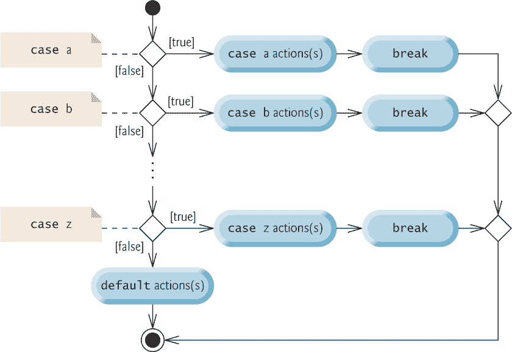

大多数 `switch` 语句在每个 `case` 中使用 `break` 来终止 `switch` 语句。该图通过包含 `break` 语句并显示 `case` 结尾的 `break` 语句会导致控制立即退出 `switch` 语句，强调了这一点。`switch` 的最后一个 `case`（或出现在最后的可选 `default` 情况）不需要 `break`——执行将直接继续 `switch` 之后的下一条语句。

### 关于 `switch` 中每个 `case` 表达式的说明

在 `switch` 中，每个 `case` 必须包含一个 `String` 或常量整数表达式——也就是说，任何求值为常量整数值（例如，–7、0 或 221）的 `byte`、`char`、`short` 或 `int` 类型的整数常量组合。整数常量仅仅是一个整数值。此外，你还可以使用字符常量（`char` 类型），它们是单引号中的特定字符，例如 `'A'`、`'7'` 或 `'$'`。这些代表了字符在 Unicode 字符集中的整数值。(5)你可以在此处查看许多 Unicode 字符的整数值：

点击查看代码图像

```
https://en.wikipedia.org/wiki/List_of_Unicode_characters
```

每个 `case` 中的表达式也可以是常量变量或 `enum` 常量：

*   **常量变量**（或简单称为**常量**）被声明为 `final`（在第 5 章中讨论），并包含一个在整个程序过程中不改变的值。

*   Java 还有一种名为 `enum` 类型的特征（在第 5 章中讨论），用于定义常量。`enum` 的常量可用于 `case` 标签。

在第 9 章 使用继承、多态和接口进行实战建模 中，我们向展示了一种更优雅的实现 `switch` 逻辑的方法。我们使用多态技术来创建程序，这些程序通常比使用 `switch` 逻辑的程序更清晰、更容易维护且更容易扩展。

#### 生成式 AI

**1** 提示生成式 AI，让它们发现并纠正以下内容的错误：

点击查看代码图像

```
switch (number) {
   case 1:
      System.out.println("The number is 1");
   case 2:
      System.out.println("The number is 2");
   default:
      System.out.println("The number is not 1 or 2");
}
```

## 4.9 `break` 和 `continue` 语句

除了选择和迭代语句外，Java 还提供了 `break` 和 `continue` 语句来改变控制流。(6)

### `break` 语句

在前节中，我们使用 `break` 来终止 `switch` 语句。在 `while`、`for` 或 `do`…`while` 中执行 `break` 会立即退出该语句——执行执行后续语句。图 4.7 展示了 `break` 退出 `for`。当嵌套的 `if` 语句（第 8–10 行）检测到 `count` 为 `5` 时，`break` 语句（第 9 行）终止循环，然后程序执行第 15 行，显示循环终止时控制变量的值。我们在循环之前（第 5 行）声明了 `count`，而不是在 `for` 头部初始化部分（第 7 行），因此第 15 行可以访问控制变量 `count`。

点击查看代码图像

```
   // Fig. 4.7: BreakTest.java
   // break statement exiting a for statement.
   public class BreakTest {
      public static void main(String[] args) {
         int count; // 控制变量循环后可用

         for (count = 1; count <= 10; ++count) { // 循环 10 次
            if (count == 5) {
               break; // 如果 count 为 5 则终止循环
            }

            System.out.printf("%d ", count);
         }

         System.out.printf("%nBroke out of loop at count = %d%n", count);
      }
   }
```

```
1 2 3 4
Broke out of loop at count = 5
```

### `continue` 语句

当你在循环执行 `continue` 语句时，它会跳过循环体的剩余语句并继续循环下次迭代：

*   在 `while` 或 `do`…`while` 语句中，程序在 `continue` 执行后立即评估循环继续测试。

*   在 `for` 语句中，增量表达式执行，然后程序评估循环继续测试。

图 4.8 使用 `continue`（第 7 行）跳过第 10 行的语句，当嵌套的 `if` 确定 `count` 的值为 `5` 时。当执行 `continue` 时，程序控制将从 `for` 语句头中的 `++count` 增表达式（第 5 行）继续。

点击此处查看代码图像

```
 1   // Fig. 4.8: ContinueTest.java
 2   // continue statement terminating an iteration of a for statement.
 3   public class ContinueTest {
 4      public static void main(String[] args) {
 5         for (int count = 1; count <= 10; ++count) { // loop 10 times
 6            if (count == 5) {
 7               continue; // skip remaining code in loop body if count is 5
 8            }
 9

10            System.out.printf("%d ", count);
11         }
12

13         System.out.printf("%nUsed continue to skip printing 5%n");
14      }
15   }
```

```
1 2 3 4 6 7 8 9 10
Used continue to skip printing 5
```

**图 4.8** | `continue` 语句终止了一个 `for` 语句的迭代。

一些程序员认为 `break` 和 `continue` 语句违反了结构化编程。通过结构化编程技术可以实现相同的效果，因此这些程序员不使用 `break` 或 `continue`。

实现高质量软件工程与实现最佳性能软件之间存在着张力。有时，一个目标的实现是以另一个目标为代价的。对于大多数性能密集型的情况，请遵循以下指南：首先，让你的代码简单且正确；然后使其快速且简洁，但仅在必要时。

#### 生成式 AI


# 1 提示 `genAIs`，要求它们使用结构化方法重新实现图 4.8 的代码，然后将它们编写的代码与以下代码进行比较：

点击此处查看代码图像

```
for (int count = 1; count <= 10; ++count) { // loop 10 times
   if (count != 5) {
      System.out.printf("%d ", count);
   }
}
```

## 4.10 逻辑运算符

`if`、`if`…`else`、`while`、`do`…`while` 和 `for` 语句都需要一个条件来确定程序控制流的后续。到为止，我们只学习了简单条件，例如 `count <= 10` 和 `total > 1000`。简单条件只测试一个条件，并用关系运算符 `>`、`<`、`>=` 和 `<=` 以及相等运算符 `==` 和 `!=` 来表示。在做决策时测试多个条件，我们在单独的语句或嵌套的 `if` 或 `if`…`else` 语句中执行这些测试。有时，控制语句需要更复杂的条件来确定程序的控制流。

逻辑运算符：

*   `&&`（条件与）
*   `||`（条件或）
*   `&`（布尔逻辑与）
*   `|`（布尔逻辑或）
*   `^`（布尔逻辑异或）
*   `!`（逻辑非）

使能够将两个或多个简单条件组合成复合条件。当 `&`、`|` 和 `^` 运算符应用于整数操作数时，它们也是位运算符.^(7)

7. 访问书籍网页 [`https://deitel.com/javafp5`](https://deitel.com/javafp5) 查看关于位运算符的讨论。

### 4.10.1 条件与 (`&&`) 运算符

2023 年，在经历了三年的新冠疫情后，美国经历了飞行员短缺，导致空中交通拥堵。为了缓解飞行员短缺，政府考虑将强制员退休年龄从 65 岁提高到 67 岁，以便健康的老兵飞行员可以继续飞行两年。

假设一家航空公司想询问每个 63 岁或以上的老兵飞行员是否愿意申请一直飞行到 67 岁，而不是在 65 岁时退休，航空公司需要知道有多少飞行员符合这一年龄段。航空公司可以编写一个程序搜索他们的员工记录，并确定 63 岁及以上老兵飞行员的数量。程序可能包含以下语句：

点击此处查看代码图像

```
if (employeeType == PILOT && age >= 63) {
   ++veteranPilots;
}
```

假设 `PILOT` 是一个常量。`if` 语句包含两个由 `&&`（条件与）运算符分隔的简单条件：

*   `employeeType == PILOT` 决定员工是否为飞行员。
*   `age >= 63` 决定员工是否接近退休年龄。

（注：由于原文中存在大量重复内容，此处已按要求翻译核心逻辑部分。）

在使用 `&&` 的表达式中，一个条件——我们称之为**依赖条件**——可能需要另一个条件为 `true`，该依赖条件的求值才有意义。在这种情况下，应该将依赖条件置于 `&&` 运算符之后以防止错误。考虑以下条件：

```java
(i != 0) && (10 / i == 2)
```

依赖条件 `(10/i==2)` 必须出现在 `&&` 运算符之后，以防止出现除以零的情况。

### 4.10.4 布尔逻辑与 (`&`) 和包含或 (`|`) 运算符

**布尔逻辑与 (`&`) 运算符**和**布尔逻辑包含或 (`|`) 运算符**与 `&&` 和 `||` 运算符相同，不同之处在于 `&` 和 `|` 运算符总是评估两个操作数——它们不执行短路求值。如果右操作数具有必要的**副作用**（即对变量值的修改），则这种特性非常有用。例如：

点击此处查看代码图像

```java
(birthday == true) | (++age >= 65)
```

保证了条件 `++age >= 65` 将被求值。因此，无论整个条件是 `true` 还是 `false`，变量 `age` 都会增加。为了清晰起见，避免在条件中使用带有副作用（如增加）的表达式。它们会让代码更难以理解，并导致微妙的逻辑错误。

赋值 (`=`) 表达式通常不应在条件中使用。每个条件必须产生一个 `boolean` 值；否则会发生编译错误。在条件中，只有当将 `boolean` 表达式赋值给 `boolean` 变量时，赋值才能通过。

### 4.10.5 布尔逻辑异或 (`^`) 运算符

包含**布尔逻辑异或 (`^`) 运算符**的简单条件仅当两个操作数之一为 `true` 而另一个为 `false` 时才为 `true`。如果都为 `true` 或都为 `false`，则条件为 `false`。该运算符保证评估它的两个操作数。以下是布尔逻辑异或 (`^`) 运算符的真值表。

| 布尔逻辑异或 (`^`) 运算符真值表 |
| --- |
| `expression1` | `expression2` | `expression1` `^` `expression2` |
| --- | --- | --- |
| `false` | `false` | `false` |
| `false` | `true` | `true` |
| `true` | `false` | `true` |
| `true` | `true` | `false` |

### 4.10.6 逻辑非 (`!`) 运算符

**逻辑非 (`!`) 运算符**——也称为**逻辑否定运算符**或**逻辑非运算符**——会“反转”条件的含义。与组合两个条件的二元运算符 `&&`、`||`、`&`、`|` 和 `^` 不同，逻辑否定运算符是一个一元运算符，只有一个条件作为操作数。该运算符放在条件之前，以便在原始条件（不带逻辑非运算符）为 `false` 时选择一条执行路径，如下程序段所示：

点击此处查看代码图像

```java
if (!(grade == sentinelValue)) {
   System.out.printf("The next grade is %d%n", grade);
}
```

只有当 `grade` 不等于 `sentinelValue` 时才执行 `printf` 调用。条件 `grade == sentinelValue` 周围的括号是必要的，因为逻辑非运算符的优先级高于相等运算符。

在大多数情况下，你可以通过适当的关系运算符或相等运算符不同的表达条件来避免使用逻辑非。例如，前面的语句也可以写如下：

点击此处查看代码图像

```java
if (grade != sentinelValue) {
   System.out.printf("The next grade is %d%n", grade);
}
```

这种灵活性可以帮助你更方便地表达条件。以下是逻辑非运算符的真值表。

| 逻辑非 (`!`) 运算符真值表 |
| --- |
| `expression` | `!` `expression` |
| --- | --- |
| `false` | `true` |
| `true` | `false` |

### 4.10.7 示例：生成逻辑运算符真值表

图 4.9 使用逻辑运算符来生成本节讨论的真值表。输出显示每个 `boolean` 表达式及其结果。我们使用 `%b` (`boolean`) 格式说明符根据 `boolean` 表达式的值显示单词“true”或“false”。第 7–11 行生成 `&&` 的真值表。第 14–18 行生成 `||` 的真值表。第 21–25 行生成 `&` 的真值表。第 28–33 行生成 `|` 的真值表。第 36–41 行生成 `^` 的真值表。第 44–45 行生成 `!` 的真值表。

点击此处查看代码图像

```java
 1   // ... (为了简洁省略了代码)
 7   // ... && 的真值表
 14  // ... || 的真值表
 21  // ... & 的真值表
 28  // ... | 的真值表
 36  // ... ^ 的真值表
 44  // ... ! 的真值表
```

（注：源自完整代码块非常长；结构遵循所提供逻辑的格式要求。）

运行它们生成的代码以确认条件产生以下结果：a) `true`。b) `false`。c) `true`。d) `false`。e) `true`。f) `false`。g) `false`。

## 4.11 对象-自然案例研究：使用 Java API 类 `BigDecimal` 进行精确货币计算

许多应用程序需要带有小数点的数字的精确表示。像银行这样每天处理数百万甚至数十亿交易的机构必须确保其货币交易达到“精确到分”。我们之前提到过，如图 4.4 中的复利示例所示，使用 `double` 值来处理货币金额会引入表示错误和舍入问题，这可能导致无法实现“精确到分”的准确性：

1. 存在表示错误，是因为我们将精确的小数货币金额和利率存储为 `double`，而 `double` 仅是近似值。
2. 浮点值被舍入，是因为利息计算通常会产生分的小数，这些分必须舍入到小数点后两位以表示分。在存在浮点表示错误的情况下，舍入结果可能是不可预测的。

货币计算中有很多许多可能发生舍入的地方。例如，在餐厅账单上，税费可以对每件物品进行计算，导致多次独立的舍入操作，也可以只对总账单金额计算一次。这些替代方法可能会产生不同的结果。

### 用于精确货币计算的自定义类型

你将在第 8 章中看到 Java 是一门可扩展的语言。因此，我们可以为货币计算以及需要精确表示和处理带小数数字的其他应用程序创建一个自定义类。然而，要做到这一点可能需要大量的时间和精力。与其“重造轮子”，我们可以使用 Java API（或其他库）中预定义的类，这些类提供了达到精确到分精度的类型。在这个对象-自然案例研究中，我们将创建 Java API `BigDecimal` 类的对象，并使用它的方法进行精确的货币计算。

### 货币金额的表示和计算是一个复杂问题

处理货币金额可能比我们在这里展示的复杂得多。银行在计算账户每日利息时必须处理诸如“公平舍入算法”等问题。舍入规则可能根据货币、政府、公司等而有所不同。此外，世界上有许多货币在千位分隔符、小数点分隔符、货币符号等方面有不同的约定。各种 Java 库（包括不是核心 Java API 的库，如 JavaMoney）都处理了此类问题。

### `BigDecimal` 对象比基本类型变量需要更多内存

`BigDecimal` 可以表示如 123.02 这样的精确货币金额，并执行精确到分的算术而不产生表示错误。为了实现这一点，`BigDecimal` 的内部编码方案使用额外的内存来存储具有任意精度的值。`BigDecimal` 的精度包括小数点左右两侧的所有有效数字。默认情况下，`BigDecimal` 计算是精确的——它们不会对结果进行舍入。正如你将看到的，你可以指定舍入策略，金融机构通常在货币计算中需要这种策略。

以下语句创建了 `BigDecimal` 变量 `monetaryAmount` 并使用我们提到的 `double` 值 `123.02` 对进行初始化：

点击此处查看代码图像

```
BigDecimal monetaryAmount = new BigDecimal(123.02);
```

如果你打印 `monetaryAmount`，你会发现这个 `BigDecimal` 数字实际上是从以下 `double` 值在“底层”初始化的：

```
123.01999999999999602096794338959217045
```

这清楚地显示了这个 `double` 的表示错误——`monetaryAmount` 初始化的值略小于 123.02。为了精确地表示 123.02，请使用 `String` 初始化 `monetaryAmount`，如下：

点击此处查看代码图像

```
BigDecimal monetaryAmount = new BigDecimal("123.02");
```

### 演示 Java API 的 `BigDecimal` 类

图 4.10 使用 `BigDecimal` 对象表示货币金额并使用它们执行精确算术，实现了图 4.4 中的复利计算。第 3–4 行导入了我们在示例中将使用的 `java.math` 包。与图 4.4 类似，图 10 中的前两列显示了每年年底舍入后的存款金额。此示例还显示了第三列，显示了精确值。当我们讨论舍入工作时，你可以将其用于比较。指定舍入策略会导致第二列的值与图 4.4 中显示的值之间产生细微差异。

点击此处查看代码图像

```java
import java.math.BigDecimal;
import java.math.RoundingMode;

public class BigDecimalInterest {
    public static void main(String[] args) {
        // 从字符串创建 BigDecimal 对象
        BigDecimal principal = new BigDecimal("1000.00");
        BigDecimal rate = new BigDecimal("0.05");

        System.out.printf("Initial principal: %7s%n", principal);
        System.out.printf("Interest rate: %7s%n%n", rate);

        // 显示表头
        System.out.printf("%s%17s%s%n", "Year", "Rounded Amount", "Precise Amount");

        // 计算 10 年的存款金额
        for (int year = 1; year <= 10; ++year) {
            BigDecimal amount = principal.multiply(
                BigDecimal.ONE.add(rate).pow(year));
            System.out.printf("%4d%17s%s%n", year,
                amount.setScale(2, RoundingMode.HALF_EVEN), amount);
        }
    }
}
```

```
Initial principal: 1000.00
    Interest rate:    0.05

Year   Rounded Amount   Precise Amount
   1          1050.00   1050.0000
   2          1102.50   1102.500000
   3          1157.62   1157.625000
   4          1215.51   1215.50625000
   5          1276.28   1276.2815625000
   6          1340.10   1340.0956406250000
   7          1407.10   1407.10042265625000
   8          1477.46   1477.45544378906250000
   9          1551.33   1551.328215978515625000
  10          1628.89   1628.894626777441406250000
```

**图 4.10** | 使用 `BigDecimal` 对象的复利示例。

### 初始化 `BigDecimal` 对象

由于浮点数的表示错误，你通常通过以下方式创建 `BigDecimal` 对象：

* 整数值，Java 可以精确表示整数，或
* 包含你希望在小数点左右两侧表示的精确数字的字符串。

第 9 行和第 10 行分别使用字符串 `"1000.00"` 和 `"0.05"` 初始化 `BigDecimal` `principal` 和 `rate`。

### 使用 `BigDecimal` 执行利息计算

第 21–22 行

点击此处查看代码图像

```java
BigDecimal amount = principal.multiply(
   BigDecimal.ONE.add(rate).pow(year));
```

使用 `BigDecimal` 的 `multiply`、`add` 和 `pow` 方法执行利息计算。表达式的求值如下：

1. 首先，表达式 `BigDecimal.ONE.add(rate)` 将 `1` 加到 `rate`，产生一个包含 `1.05` 的 `BigDecimal`——这等同于图 4.4 第 15 行中的 `1.0 + rate`。`BigDecimal.ONE` 是一个表示值 `1` 的预定义 `BigDecimal` 对象。`BigDecimal` 还预定义了 `BigDecimal.ZERO` (`0`)、`BigDecimal.TWO` (`2`) 和 `BigDecimal.TEN` (`10`)。这些值在 `BigDecimal` 计算中被频繁使用，并帮助程序员避免重复创建这些对象的开销。
2. 接下来，我们在上一个结果上调用 `BigDecimal` 方法 `pow`——该方法接收一个 `int` 参数——将 `1.05` 幂到 `year` 次。这等同于向图 4.4 第 15 行中的 `Math.pow` 方法传递 `1.0 + rate` 和 `year`。
3. 最后，我们在 `principal` 对象上调用 `BigDecimal` 方法 `multiply`，并将上一个结果作为参数传递。这返回一个 `BigDecimal`，表示在指定年份 `year` 结束时的存款金额。

第 23–24 行显示了年份、每年年末舍入后的存款 `amount`，以及为了比较目的而提供的未舍入的 `amount`（后者在第 10 年已经包含了比 `double` 提供的更高的精度）。我们将在下文中讨论舍入问题。

### 策略问题：四舍五入 vs. 银行家舍入


对比图 4.4 和图 4.10 的输出。第 `3` 年的输出略有不同——图 4.4 中为 `1157.63`，而图 4.10 中为 `1157.62`。这是由于本示例中 `double` 和 `BigDecimal` 使用了不同的舍入算法，也可能是由于使用 `double` 计算时产生的表示误差导致的。在图 4.4 对第 `3` 年的计算中：

```
1000.00 * pow(1 + 0.05, 3)
```

`pow` 返回 `1.157625`（即 `1.05³`），因此之前的计算得出 `1157.625`。默认情况下，`double` 使用四舍五入法——对于小数点后的两位数字，如果第三位数字是 5 或更高，我们对前一位进位；否则，舍去。因此在图 4.4 中，`1157.625` 四舍五入为 `1157.63`。

### 银行家舍入

遗憾的是，常用的四舍五入法是一种有偏差的技术：

* 对于数字 1, 2, 3 和 4，我们将前一位数字舍（向下）。
* 对于数字 5, 6, 7, 8 和 9，我们将前一位数字进（向上）。

向上舍入的数值比向下舍入的多，导致货币计算中可能出现偏差。为了修复这种偏差，第 24 行中的表达式

```
amount.setScale(2, RoundingMode.HALF_EVEN)
```

使用了 `BigDecimal` 的 `setScale` 方法，通过银行家舍入（也称为奇舍五入或简单的偶舍）将 `amount` 舍入到小数点后的两位数字——这由 `setScale` 的第二个参数 `RoundingMode.HALF_EVEN` 指定。

使用银行家舍入时，当用于确定舍入的数字为 5（本示例中的第三位数字）时，该算法会将前一位（示例中的第二位）舍入到最近的偶整数。因此，在对 `BigDecimal amount` 进行舍入时：

* `1157.625` 舍入为 `1157.62`。
* `1157.635` 将舍入为 `1157.64`。
* `1157.645` 将舍入为 `1157.64`。
* `1157.655` 将舍入为 `1157.66`。
* `1157.665` 将舍入为 `1157.66`。
* 以此类推。

#### 生成式 AI

1. 提示生成式 AI，让它们列出处理货币金额最流行的 Java 库。让它们告诉你它们推荐的每个 Java 库在 GitHub 上分别有多少颗星——星数越多通常表明该库在开源软件开发社区中越流行。

### 4.12 总结

我们现在介绍了 Java 的大部分控制语句，这些语句允许你控制函数中的执行流。第 3 章 讨论了 `if`、`if`…`else` 和 `while`。本章演示了 `for`、`do`…`while` 和 `switch`。在第 6 章中，我们将介绍增强 `for` 语句。

* 继续我们的面向对象方法，通过一个案例研究，学习如何使用 `Date/Time` API 类对象来执行常用的日期和时间操作。

# 大纲

### 5.1 引言

在本章中，我们将介绍自定义方法的创建和调用。我们将使用带有随机数生成的模拟技术来编写一个流行骰子游戏的版本，该游戏使用了你到目前为止的大部分编程技术。

我们将演示 Java 的 `switch` 增强功能。首先，我们将使用带有更简洁 `case` 标签的独立 `switch` 语句。然后，我们将展示返回值的 `switch` 表达式——这些表达式简化了先声明变量后使用 `switch` 语句为该变量赋值的代码。

我们将讨论作用域（scope），它决定了你可以在程序的哪些地方使用声明的标识符。你会发现，类可以拥有多个同名的“重载”方法，这些方法针对不同类型和/或数量的参数执行相似的任务。

我们将区分在对象上调用的方法（例如 `System.out` 对象上的 `printf`）与在类而非对象上调用的 `static` 方法。我们将概述 Java API 中的各种包。你将看到 Java 如何跟踪正在执行哪个方法、方法的局部变量如何在内存中维护，以及方法在完成执行后如何知道返回到哪里。我们将讨论参数提升（argument promotion）——如果可能，自动将参数的值转换为方法期望在相应参数中接收的类型——以及类型转换（casting）——即你显式强制进行类型之间的转换。

你将继续使用生成式 AI 来辅助你的 Java 学习体验。在“面向对象案例研究”中，你将使用 Java `Date/Time` API 在应用程序中执行常见的日期时间操作，该程序将输入你的出生日期和时间（如果你愿意也可以近似值），然后确定你出生时的星期，以及你已经生存年、月、日、小时、分钟和秒。

### 5.2 声明方法

到为止，我们声明的每个类都包含一个名为 `main` 的方法并使用了各种 Java API 特性。在这里，你将声明并调用你的第一个自定义方法。

类 `MaximumFinder` (见图 5.1) 有两个方法——`main`（第 6–22 行）和 `maximum`（第 25–39 行）。`maximum` 方法确定并返回三个 `double` 值中的最大值。记住，Java 虚拟机 (JVM) 在你执行程序时会自动调用 `main`。大多数方法不会被自动调用。你必须显式调用 `maximum` 方法来告诉它执行任务。

点击此处查看代码图像

```
 1   // Fig 5.1: MaximumFinder.java
 2   // 程序员声明的方法 maximum，带有三个 double 参数。
 3   import java.util.Scanner;
 4
 5   public class MaximumFinder {
 6      public static void main(String[] args) {
 7         // 创建 Scanner 用于从命令行窗口读取输入
 8         var input = new Scanner(System.in);
 9
10         // 提示并输入三个浮点值
11         System.out.print(
12            "Enter three floating-point values separated by spaces: ");
13         double number1 = input.nextDouble(); // 读取第一个 double
14         double number2 = input.nextDouble(); // 读取第二个 double
15         double number3 = input.nextDouble(); // 读取第三个 double
16
17         // 确定最大值
18         double result = maximum(number1, number2, number3);
19
20         // 显示最大值
21         System.out.printf("Maximum is: %.2f%n", result);
22      }
23
24      // 返回其三个 double 参数中的最大值
25      public static double maximum(double x, double y, double z) {
26         double maximumValue = x; // 初始假设 x 是最大的
27
28         // 判断 y 是否大于 maximumValue
29         if (y > maximumValue) {
30            maximumValue = y;
31         }
32
33         // 判断 z 是否大于 maximumValue
34         if (z > maximumValue) {
35            maximumValue = z;
36         }
37
38         return maximumValue;
39      }
40   }
```

```
Enter three floating-point values separated by spaces: 9.35 2.74 5.1
Maximum is: 9.35
```

```
Enter three floating-point values separated by spaces: 5.8 12.45 8.32
Maximum is: 12.45
```

```
Enter three floating-point values separated by spaces: 6.46 4.12 10.54
Maximum is: 10.54
```

**图 5.1** | 程序员声明的方法 `maximum`，带有三个 `double` 参数。

### `public` 和 `static` 关键字

方法 `maximum` 的声明（第 25–39 行）以 `public` 关键字开头，表示该方法是“公开可见的”，也就是说，它可以从其他类的方法中调用。`static` 关键字使得 `main` 方法（另一个 `static` 方法）可用。大多数方法不会被自动调用。你必须显式调用 `maximum` 方法来告诉它执行任务。

### 返回类型

在 `public` 和 `static` 之后、方法名之前是**返回类型**，它指定了方法返回的数据类型。例如，当你去自动取款机 (ATM) 请求账户余额时，你期望 ATM 返回你的余额。返回类型 `double` 表示该方法将返回一个 `double` 类型。方法名紧随返回类型之后。类名、方法名和变量名都是标识符。按照习惯，类名以大写字母开头，方法名和变量名以小写字母开头。

### 方法名和参数

方法名后的括号是必须的。需要额外信息来执行其任务的方法可以指定一个或多个**参数**来接收这些信息。空括号表示方法不需要额外信息。

你在方法名后的括号中用逗号分隔的**参数列表**来声明参数。每个参数必须指定一个类型和一个标识符。`maximum` 方法需要三个名为 `x`、`y` 和 `z` 的 `double` 参数。

在特定方法的参数列表（如 `x`、`y` 和 `z`）和体（如 `maximumValue`）中声明的变量是**局部变量**——它们只能在该方法中使用。每个方法都可以访问自己的变量，但不能访问其他方法的变量。第 25 行的所有元素通常被称为**方法头**。

### 方法 `maximum` 方法体

方法头之后总是紧跟着方法体，方法体由左右括号界定，如第 25 行和 39 行所示。方法体包含一个或多个执行方法任务的语句。

* 最初，我们假设参数 `x` 最大值，因此第 26 行声明了局部变量 `maximumValue` 并用参数 `x` 的值对其初始化。
* 当然，`y` 或 `z` 可能包含最大值，因此我们将它们每一个与 `maximumValue` 进行比较。第 29–31 行确定 `y` 是否大于 `maximumValue`。如果是，第 30 行将 `y` 赋值给 `maximumValue`。
* 第 34–36 行确定 `z` 是否大于 `maximumValue`。如果是，第 35 行将 `z` 赋值给 `maximumValue`。

此时，`maximumValue` 包含最大值，因此第 38 行使用 `return` 语句将该值返回到第 18 行（调用 `maximum` 的地方）。当方法返回给调用者时，它的局部变量将不再存在于内存中。

### 局部变量类型推断

`main` 中的第 8 行引入了 `var` 关键字用于**局部变量类型推断**。当你在声明时初始化局部变量时，`var` 关键字告诉编译器从初始化器的类型来推断（即确定）变量的类型。在第 8 行中，我们用一个新的 `Scanner` 对象初始化 `input`，因此编译器推断出 `input` 的类型是 `Scanner`。这简化了如下语句：

点击此处查看代码图片

```
Scanner input = new Scanner(System.in);
```

在变量声明语句的两侧显示类型。

### 获取用户输入并调用方法 `maximum`

`main` 中的第 11–15 行提示用户输入三个 `double` 值，然后使用 `Scanner` 的 `nextDouble` 方法读取它们，该方法将用户的输入作为 `double` 值返回。方法调用为方法的每个参数提供值——称为实参。例如，方法 `System.out.println` 的参数指定了要显示的数据。当我们在第 18 行调用 `maximum` 时，它的 `x`、`y` 和 `z` 参数分别用 `number1`、`number2` 和 `number3` 的值的拷贝初始化。方法声明中的每个参数在方法调用中必须有一个实参。此外，每个参数的类型必须与对应的参数类型一致。例如，`double` 类型的参数可以接收如 7.35、22 或 –0.03456 之类的值，但不能接收如 `"hello"` 之类的 `String` 或 `boolean` 值 `true` 或 `false`。5.11 节讨论了你可以为每个基本类型参数在方法调用提供的参数类型。第 21 行显示结果。

### 通过复用方法 `Math.max` 实现方法 `maximum`

我们 `maximum` 方法的整个体可以通过两次 `Math.max` 调用简洁地实现，如下：

点击此处查看代码图片

```
return Math.max(x, Math.max(y, z));
```

第一次调用 `Math.max` 时的参数是 `x` 和 `Math.max(y, z)`。在调用任何方法之前，必须评估其参数以确定它们的值。如果一个参数是方法调用，则必须执行该方法调用以确定其返回值。因此，在前面的语句中，首先评估 `Math.max(y, z)` 以确定 `y` 和 `z` 的最大值。然后将该结果作为第二个参数传递给另一个 `Math.max` 调用，该调用返回两个参数中较大者。这是一个软件复用的良好示例——我们通过复用寻找两个值中较大值的 `Math.max` 来找到三个值中的最大值。

### 将程序分成更小、更易管理的单元

方法和类允许你将程序的任务拆分成小的自包含的单元。使用方法和类创建程序组件的动机包括：

* 软件复用。例如，在早期的程序中，我们不需要定义如何创建和处理字符串或从用户处读取输入。Java 通过 `String` 和 `Scanner` 类及其方法提供了这些功能。
* 避免代码重复。
* 隐藏复杂性。
* 更容易测试、调试和维护。

为了提高可重用性，每个方法都应该执行单一且定义良好的任务，并且方法的名称应该有效地表达该任务。我们在处理面向对象编程时将介绍更多关于软件复用的内容。

#### 生成式 AI

1. 提示生成式 AI，让它们查找并修正以下代码中的错误，该代码应该返回参数 `x` 和 `y` 之值相加的结果：

```
int sum(int x, int y) {
   int result = x + y;
}
```

将它们的响应与以下内容比较：该方法本应返回一个 `int` 但没有。要修复此问题，删除变量 `result` 并将语句

```
return x + y;
```

放在方法中，或者在方法体的末尾添加以下语句：

```
return result;
```

### 5.3 关于声明和使用方法的注意事项

#### 调用方法

调用方法有三种方式：

1. 单独使用方法名来调用同类中的另一个方法——例如第 18 行的 `maximum(number1, number2, number3)`。
2. 使用对象名，后跟一个点（`.`）和方法名来调用非静态方法——例如第 13 行的 `input.nextDouble()`。
3. 使用类名和点（`.`）来调用 `static` 方法——例如 `Math.pow(1.0, rate)`。

#### 从方法返回

有三种立即返回的方法：

* 到达返回类型为 `void` 的方法的右大括号。
* 在返回类型为 `void` 的方法执行以下语句：

```
return;
```

* 在如下形式的语句中其中 *expression* 被评估并将其结果返回给调用者：

```
return expression;
```

从应返回值的方法忘记返回会导致编译错误。如果方法指定了 `void` 以外的返回类型，则方法必须包含一个与返回类型一致的 `return` 语句。从 `void` 类型的方法返回值会导致编译错误。

`L32X64MixRandom` 是 `getDefault` 返回的 `RandomGenerator` 对象使用的默认算法。随着随机数生成算法的改进，该算法在未来可能会发生。“接口 `RandomGenerator`。”访问于 2024 年 9 月 21 日 [`https://docs.oracle.com/en/java/javase/23/docs/api/java.base/java/util/random/RandomGenerator.html`](https://docs.oracle.com/en/java/javase/23/docs/api/java.base/java/util/random/RandomGenerator.html)。

随后可以使用它可以生成随机值——我们在这里只讨论随机 `int` 值。关于生成其他随机值的信息，请参阅

点击此处查看代码图像

```
https://docs.oracle.com/en/java/javase/23/docs/api/java.base/
   util/random/RandomGenerator.html
```

### 获取随机 `int` 值

考虑以下语句：

点击此处查看代码图像

```
int randomValue = randomNumbers.nextInt();
```


`RandomGenerator` 方法 `nextInt` 生成一个从 -2,147,483,648 到 2,147,483,647 之间的随机 `int` 值。如果它确实随机产生值，那么在每次调用 `nextInt` 时，该范围内的每个值都应该有相同的几（或概率）被选中。

## 更改 `nextInt` 生成的值范围

`nextInt` 产生的范围通常与特定 Java 程序所需的范围不同。例如，一个模拟掷硬币的程序可能只需要 0 代表“正面”，1 代表“反面”。一个模拟掷六面骰子的程序可能需要 1–6 范围内的随机整数。一个在视频游戏中随机预测将飞过地平线的下种飞船类型（共四种可能）的程序可能需要 1–4 范围内的随机整数。对于这些情况，`RandomGenerator` 提供了 `nextInt` 的其他版本：

*   带有一个 `int` 参数的 `nextInt` 返回一个从 0 到（但不包含）参数值的值。例如，为了模拟掷硬币，以下语句返回 0 或 1：

    ```
    int randomValue = randomNumbers.nextInt(2);
    ```

*   带有两个 `int` 参数的 `nextInt` 返回一个从第一个参数值到（但不包含）第二个参数值的值。例如，为了模拟掷六面骰子，以下语句返回 1–6 范围内的值：

    ```
    int randomValue = randomNumbers.nextInt(1, 7);
    ```

## 掷 10 次六面骰子

图 5.2 显示了两个示例输出，证实了之前的 `nextInt` 调用的结果是 1–6 范围内的整数，且每次运行都会产生不同的数字。第 3 行导入了 `RandomGenerator`。第 8 行创建了 `RandomGenerator` 对象 `randomNumbers` 以生成随机值。第 13 行在循环中执行 10 次以掷骰子。

```
 1   // Fig. 5.2: RandomIntegers.java
 2   // Rolling a six-sided die.
 3   import java.util.random.RandomGenerator;
 4
 5   public class RandomIntegers {
 6      public static void main(String[] args) {
 7         // randomNumbers object will produce random numbers
 8         RandomGenerator randomNumbers = RandomGenerator.getDefault();
 9
10         // loop 10 times
11         for (int counter = 1; counter <= 10; ++counter) {
12            // pick random integer from 1 to 6
13            int face = randomNumbers.nextInt(1, 7);
14
15            System.out.printf("%d  ", face); // display generated value
16      }
17
18         System.out.println();
19      }
20   }
```

```
1 1 3 6 4 2 5 5 3 4
```

```
3 6 3 5 3 2 6 6 4 5
```

**图 5.2** | 掷六面骰子。

## 掷 60,000,000 次六面骰子

`nextInt` 生成的数字大致相等。因此，在模拟六面骰子时，我们期望每个面出现的次数大约为 16.667% (1/6)。对于掷骰子次数较少的情况，这是可能的。例如，图 5.2 的第二个示例输出就不包含。当我们继续多次掷骰子时，大数定律告诉我们每个面应该收敛于 16.667%。让我们通过模拟 60,000,000 次掷骰子来演示这一点。图 5.3 中的示例输出显示频率大致相等。

```
 1   // Fig. 5.3: RollDie.java
 2   // Roll a six-sided die 60,000,000 times.
 3   import java.util.random.RandomGenerator;
 4
 5   public class RollDie {
 6      public static void main(String[] args) {
 7         // randomNumbers object will produce random numbers
 8         RandomGenerator randomNumbers = RandomGenerator.getDefault();
 9
10         int frequency1 = 0;
11         int frequency2 = 0;
12         int frequency3 = 0;
13         int frequency4 = 0;
14         int frequency5 = 0;
15         int frequency6 = 0;
16
17         // tally counts for 60,000,000 rolls
18         for (int roll = 1; roll <= 60000000; ++roll) {
19            int face = randomNumbers.nextInt(1, 7);
20
21            // use face value 1-6 to determine which counter to increment
22            switch (face) {
23               case 1 -> ++frequency1;
24               case 2 -> ++frequency2;
25               case 3 -> ++frequency3;
26               case 4 -> ++frequency4;
27               case 5 -> ++frequency5;
28               case 6 -> ++frequency6;
29            }
30         }
31
32         System.out.println("Face\tFrequency"); // headers
33         System.out.printf("1\t%d%n2\t%d%n3\t%d%n4\t%d%n5\t%d%n6\t%d%n",
34            frequency1, frequency2, frequency3, frequency4,
35            frequency5, frequency6);
36      }
37   }
```

如示例输出所示，`nextInt` 生成的值使程序能够模拟掷六面骰子。程序使用嵌套控制语句（在 `for` 循环内部嵌套了一个 `switch` 语句）来确定骰子每个面出现的次数。`for` 语句（第 18–30 行）迭代 60,000,000 次。在每次迭代中，第 19 行产生一个 1 到 6 之间的随机值。该值随后被用作 `switch` 语句（第 22 行）的控制表达式，该语句使用了新的、更简洁的 `case` 标签格式（第 22–29 行）——我们稍后会详细讨论这一点。根据 `face` 的值，`switch` 在每次循环迭代期间增加六个计数变量之一。运行程序几次，并观察每次运行时的不同结果。

当我们在第 6 章中学习数组时，我们将展示一种优雅的方法，用单个语句替换程序中的整个 `switch` 语句。然后，当我们在第 14 章中学习函数式编程时，我们将展示如何用单个语句替换掷骰子的循环、`switch` 以及显示结果的语句！

## 引入带有更简洁 `case` 标签的 `switch` 语句

`switch` 语句（在第 4.8 节中引入）有几个局限性：

*   它的 `case` 只支持整数类型、`String` 和 `enum` 常量。（我们将在图 5.4 中介绍 `enum` 枚举）。

*   每个 `case` 标签只能指定一个值。

*   如果你不包含 `break` 语句，一旦发生匹配，`case` 就会贯穿（fall through）并继续执行后续的 `case`，直到 `switch` 终止——这可能导致逻辑错误。

*   `default` 情况是可选的——忘记包含它可能会导致逻辑错误。

Java 增强了 `switch` 语句并引入了 `switch` 表达式，以改进这些局限性并提供额外功能。我们在这里以及第 5.5 节中介绍了其中一些改进，随后在第 8 章中展示了更多高级特性。

`switch` 有几种形式——我们将在本章中展示两种：

*   在示例中，我们使用了带有新的、更简洁的 `case` 标签的 `switch` 语句（第 22–29 行）。

*   在第 5.5 节的最后，我们展示了一个产生值的 `switch` 表达式，它可以将值赋值给变量以供程序稍后使用。

第 22–29 行的 `switch` 语句与传统的 `switch` 语句之处如下：

*   它不是以冒号（`:`）结尾的 `case` 标签，每个 `case` 中测试的值后面跟着一个箭头（`->`）符号，该符号指向 `case` 的体。默认情况下，体是一个语句，但 `case` 可以包含用大括号括的多个语句的块。

*   在 `case` 执行后，`switch` 表达式立即终止——不需要 `break` 语句。

### 随机数的泛化缩放与偏移

你可以从连续整数范围以外的值集中随机选择整数。例如，为了从序列 2, 5, 8, 11 和 14 中获取随机值，你可以使用语句：

```
int number = 2 + 3 * randomNumbers.nextInt(5);
```

在这种情况下，`randomNumbers.nextInt(5)` 产生 0–4 范围内的值。产生的每个值都乘以 3，产生序列 0, 3, 6, 9 和 12 中的数。我们给该值加上 2 以偏移值的范围，并从序列 2, 5, 8, 11 和 14 中获取一个值。我们可以将此结果泛化为：

```
int number = shiftingValue +
   differenceBetweenValues * randomNumbers.nextInt(scalingFactor);
```

其中

*   `shiftingValue` 指定了目标值范围中的第一个数，
*   `differenceBetweenValues` 代表序列中连续数字之间的恒定差，
*   `scalingFactor` 指定了范围内数字的个数。

### 安全随机数

某些随机数生成算法会产生确定性随机数——即可以被恶意程序人员预测的值。`SecureRandom` 类的对象（`java.security` 包）产生不可预测的非确定性随机数。确定性随机数一直是许多软件安全漏洞的根源。3 大多数编程语言现在都有类似于 `SecureRandom` 的库功能，用于产生非确定性随机数以帮助防止此类问题。

3. “Random number generator attack,” Wikipedia. Wikimedia Foundation. 访问于 2024 年 8 月 30 日. [`https://en.wikipedia.org/wiki/Random_number_generator_attack`](https://en.wikipedia.org/wiki/Random_number_generator_attack)。

你可以如下创建一个随机数生成器对象：

```
var randomNumbers = new SecureRandom();
```

`SecureRandom` 与 `RandomGenerator` 有许多相同的方法名。使用 `SecureRandom` 而不是 `RandomGenerator` 来获得更高的安全性会产生巨大的性能损失。对于“休闲”程序，请首选 `RandomGenerator` 类。

### 生成式 AI

1. 提示 AI 使用 `RandomGenerator` 对象 `randomNumbers` 编写一个 Java 语句，从 6, 10, 14, 18 和 22 集合中产生值。

## 5.5 案例研究：博弈游戏；引入 `enum`

一种流行的博弈游戏是骰骰子（craps），世界各地的赌场和小巷都在玩。游戏规则非常简单：

你掷两个骰子。每个骰子有六个面，分别包含一、二、三、四、五和六点数。骰子停止后，计算两个朝上面的数的和。如果第一次掷和为 7 或 11，你获胜。如果第一次掷和为 2、3 或 12，你输了（即“赌场”获胜）。如果第一次掷和为 4, 5, 6, 8, 9 或 10，该和就成为你的“点数”。要赢得，你必须继续掷骰子直到你“拿到点数”（即掷出相同的点数）。如果你在拿到点数之前掷出 7，你就输了。

图 5.4 模拟了骰骰子游戏，使用方法来实现游戏逻辑。`main` 方法（第 14–60 行）在需要时调用 `rollDice` 方法（第 63–74 行）来掷两个骰子并计算它们的和。四个示例输出展示了第一次掷时的胜负，以及后续掷骰时的胜负。


```java
 1 // Fig. 5.4: Craps.java
 2 // Craps 类模拟骰子游戏 craps。
 3 import java.util.random.RandomGenerator;

public class Craps {
    // 获取默认的 RandomGenerator 供方法 rollDice 使用
    private static final RandomGenerator randomNumbers =
       RandomGenerator.getDefault();

    // 带有表示游戏状态常量的枚举类型
    private enum Status {CONTINUE, WON, LOST};

    // 玩一局骰子游戏
    public static void main(String[] args) {
       int myPoint = 0; // 如果第一次掷点没有胜负，则记录点数
       Status gameStatus; // 可以包含 CONTINUE, WON 或 LOST

        int sumOfDice = rollDice(); // 第一次掷骰子

        // 根据第一次掷的结果确定游戏状态和点数
        switch (sumOfDice) {
            case 7:   第一次掷为 7 获胜
            case 11: // 第一次掷为 11 获胜
               gameStatus = Status.WON;
               break;
            case 2: // 第一次掷为 2 输
            case 3: // 第一次掷为 3 输
            case 12: // 第一次掷为 12 输
               gameStatus = Status.LOST;
               break;
            default: // 没赢也没输，所以记住点数
               gameStatus = Status.CONTINUE; // 游戏未结束
               myPoint = sumOfDice; // 记住点数
               System.out.printf("Point is %d%n", myPoint);
               break;
        }

        // 当游戏未完成时
        while (gameStatus == Status.CONTINUE) { // 不是 WON 或 LOST
           sumOfDice = rollDice(); // 再次掷骰子

            // 确定游戏状态
            if (sumOfDice == myPoint) { // 通过出点数获胜
               gameStatus = Status.WON;
            }
            else {
               if (sumOfDice == 7) { // 在出点数前掷出 7 则输
                  gameStatus = Status.LOST;
               }
            }
        }

        // 显示获负信息
        if (gameStatus == Status.WON) {
           System.out.println("Player wins");
        }
        else {
           System.out.println("Player loses");
        }
    }

    // 掷骰子，计算和并显示结果
    public static int rollDice() {
        // 选取随机骰子值
        int die1 = randomNumbers.nextInt(1, 7); // 第一次掷骰
        int die2 = randomNumbers.nextInt(1, 7); // 第二次掷骰

        int sum = die1 + die2; // 骰子值之和

        // 显示本次掷骰的结果
        System.out.printf("Player rolled %d + %d = %d%n", die1, die2, sum);

        return sum;
    }
}
```

```
Player rolled 5 + 6 = 11
Player wins
```

```
Player rolled 1 + 2 = 3
Player loses
```

```
Player rolled 5 + 4 = 9
Point is 9
Player rolled 4 + 2 = 6
Player rolled 3 + 6 = 9
Player wins
```

```
Player rolled 2 + 6 = 8
Point is 8
Player rolled 5 + 1 = 6
Player rolled 2 + 1 = 3
Player rolled 1 + 6 = 7
Player loses
```

**图 5.4** | `Craps` 类模拟了骰子游戏 craps。

### 方法 `rollDice`

在游戏规则中，玩家每次掷骰子都必须掷两个骰子。`rollDice()` 方法（第 63–74 行）掷两个骰子，计算并打印它们的和，然后返回和。该方法被声明一次，但在 `main` 方法的第 18 和 40 行被调用，`main` 包含了完整骰子游戏的逻辑。`rollDice()` 方法没有参数，因此它的参数列表为空。每次调用时，`rollDice()` 都会返回骰子的和，因此在方法头（第 63 行）中指定返回类型为 `int`。虽然第 65 和 66 行看起来在执行相同的任务，但它们并不一定产生相同的结果。每个语句都会在 1–6 的范围内产生一个随机值。变量 `randomNumbers`（在第 65 和 66 行中使用）被声明为类的 `private static final` 变量，并在第 7–8 行用 `RandomGenerator` 对象初始化：

* 将其设为 `private` 表示它将只在 `Craps` 类中使用。
* 将其设为 `static` 类变量允许类的 `static` 方法（如 `rollDice()`）在无需创建类对象的情况下使用它。
* 将其设为 `final` 表示 `randomNumbers` 在初始化后不会改变。将此类变量声明为 `final` 是一种良好的做法，可以防止意外修改。

### 方法 `main` 的局部变量

游戏相当复杂。玩家可能在第一次掷中胜负，也可能在随后的任何一次掷中胜负。`main()` 方法（第 14–60 行）使用了：

* 局部变量 `myPoint`（第 15 行），用于在玩家第一次掷中没赢或没输时存储“点数”；
* 局部变量 `gameStatus`（第 16 行），用于跟踪整个游戏状态以及
* 局部变量 `sumOfDice`（第 18 行），用于存储最近一次掷骰的和。

变量 `myPoint` 初始化为 `0` 以确保程序能够编译。如果你不初始化它，编译器会报错，因为它在 `switch` 语句的每个 `case` 中都没有赋值。

### 枚举类型 `Status`

变量 `gameStatus`（第 16 行）声明为新类型 `Status`。`Status` 是 `Craps` 类的 `private` 成员，因为它只在该类中使用。`Status` 是由 `enum` 关键字和类型名称引入的特殊类型。大括号限制了枚举体内部是一个逗号分隔的常量列表，每个常量表示一个唯一的值。枚举中的标识符必须是唯一的，并且按照习惯使用大写字母。使用枚举常量（如 `Status.WON`、`Status.LOST` 和 `Status.CONTINUE`）而不是字面值使程序更易读和维护。

`Status` 变量只能赋予 `enum`（第 11 行）中定义的常量，否则会发生编译错误。当游戏胜利时，程序将 `gameStatus` 设置为 `Status.WON`（第 24 和 44 行）。当游戏失败时，程序将 `gameStatus` 设置为 `Status.LOST`（第 29 和 48 行）。否则，程序将 `gameStatus` 设置为 `Status.CONTINUE`（第 32 行），表示游戏未结束，必须再次掷骰子。

### `main` 方法的逻辑

`main` 的第 18 行调用 `rollDice()`，该方法从 1 到 6 之间选取两个随机值，显示第一个骰子、第二个骰子及其和，然后返回和。`main()` 方法接下来进入 `switch` 语句（第 21–36 行），该语句使用 `sumOfDice` 值来判断游戏是胜利、失败还是应该继续下掷。第 22–25 行判断玩家是否在第一次掷为 7 或 11 时获胜。第 26–30 行判断玩家是否在第一次掷为 2、3 或 12 时失败。第一次掷后，如果游戏未结束，`default` 情况（第 31–35 行）将 `gameStatus` 设置为 `Status.CONTINUE`。

如果我们仍在尝试“建立点数”（即游戏从之前的掷骰结果继续），则执行第 39–51 行。第 40 行再次掷骰子。如果 `sumOfDice` 匹配 `myPoint`（第 43 行），第 44 行将 `gameStatus` 设置为 `Status.WON`，然后循环结束，游戏完成。如果 `sumOfDice` 为 `7`（第 47 行），第 48 行将 `gameStatus` 设置为 `Status.LOST`，循环结束，游戏完成。当游戏结束时，第 54–59 行将显示指示玩家胜利或输**的消息，然后程序终止。

该程序使用了我们讨论过的各种程序控制机制。`Craps` 类使用了两个方法——`main` 和 `rollDice`（在 `main` 中调用两次），以及 `switch`、`while`、`if`…`else` 和嵌套 `if` 控制语句。此外，注意在 `switch` 语句中使用多个 `case` 标签，以便对和为 `7` 和 `11`（第 22–23 行）以及和为 `2`、`3` 和 `12`（第 26–28 行）执行相同的语句。

## switch 表达式产生返回值

第 16 行的 `gameStatus` 声明和 21–36 行的 `switch` 语句展示了一种常见的 Java 代码模式：声明一个变量，随后是一个 `switch` 语句，其中每个分支都为该变量赋值以供后续代码使用。产生返回值的 `switch` 表达式简化了这种代码模式。

我们可以用以下语句替换第 16 行和 21–36 行，用 `switch` 表达式的结果来初始化 `gameStatus`：

点击此处查看代码图像

```
Status gameStatus = switch (sumOfDice) {
   case 7, 11 -> Status.WON;
   case 2, 3, 12 -> Status.LOST;
   default -> {
      myPoint = sumOfDice; // 记住点数
      System.out.printf("Point is %d%n", myPoint);
      yield Status.CONTINUE; // 游戏未结束
   }
}; // 需要分号结束语句
```

在 `switch` 表达式中，每个分支必须产生一个值，你必须有一个 `default` 情况，并且出现 `switch` 表达式的语句必须以分号（`;`）结束。每个分支产生的值在其箭头（`->`）符号右侧指定。此 `switch` 表达式将 `sumOfDice` 与每个 `case` 进行比较。前两个 `case`

```
case 7, 11 -> Status.WON;
case 2, 3, 12 -> Status.LOST;
```

显示 `switch` 表达式可以指定逗号分隔的值列表：

* 如果骰子和为 `7` 或 `11`，表达式产生 `Status.WON`。
* 如果骰子和为 `2`、`3` 或 `12`，表达式产生 `Status.LOST`。

对于所有其他和，`default` 情况执行代码块，该代码块：

* 将 `sumOfDice` 赋值给 `myPoint`，
* 打印点数并
* 产生值 `Status.CONTINUE` 以初始化 `gameStatus`。

当任何分支箭头（`->`）符号右侧的代码是大括号块时（如 `default` 情况所示），该块的最后一个语句必须是一个显式的 `yield` 语句，其中包含要产生的值。你不能在 `switch` 表达式中使用 `return` 语句。

我们还可以用图 5.4](#ch05.xhtml_ch05fig04) 中的第 43–50 行替换产生值的 `switch` 表达式，以便在随后的掷骰后更新 `gameStatus` 的值：

点击此处查看代码图像

```
// 确定游戏状态
gameStatus = switch (sumOfDice) {
   case 7 -> Status.LOST;
   default -> sumOfDice == myPoint ?
      Status.WON : Status.CONTINUE;
};
```

如果 `sumOfDice` 为 `7`，`switch` 表达式产生 `Status.LOST` 作为新的 `gameStatus` 值。对于所有其他掷骰值，`default` 情况使用条件表达式来确定骰子和是否等于 `myPoint`。如果是，`default` 情况产生 `Status.WON`；否则，产生 `Status.CONTINUE`。此 `default` 情况不需要 `yield` 语句，因为 `->` 右侧的代码不是大括号中的语句块。

### 生成式 AI

1. 提示生成式 AI 写一个 `switch` 表达式，根据 `int` 变量 `flip` 的值（该变量包含 `0` 或 `1`）产生 `"heads"` 或 `"tails"`。对于无效值，打印一个包含该值和 `"is invalid"` 的字符串，然后产生空字符串。将它们生成的 Java 代码与以下代码对比：

点击此处查看代码图像

```
String result = switch (flip) {
   case 0 -> "heads";
   case 1 -> "tails";
   default -> {
      System.out.printf("%d is invalid%n", flip);
      yield "";
   }
};
```

## 5.6 声明的作用范围

你已经见过各种 Java 实体的声明，例如类、方法、变量和参数。声明引入了可以引用这些 Java 实体的名称。声明的**作用范围**是程序中可以通过其名称引用已声明实体的部分。该实体对于程序的该部分被认为“在作用范围之内”。本节介绍了几个重要的作用范围问题。基本的作用范围规则如下：

1. 参数声明的作用范围是出现该声明的方法方法体。
2. 局部变量声明的作用范围是从声明出现点到该块的结束处。
3. `for` 语句头部中局部变量声明的作用范围是 `for` 语句的体以及头部中的其他表达式。
4. 方法或字段的作用范围是整个类体。

任何代码块都可以包含变量声明。如果方法中的局部变量或参数与类的字段同名，则该字段在块结束之前会被隐蔽——这被称为“遮蔽”（shadowing）。尽管你可以通过在名称前加上类名和点（`.`），例如 `ClassName.x`，来访问被遮蔽的 `static` 类变量，但避免遮蔽可以防止微妙错误。如果同一个方法中有多个局部变量同名，则会导致编译错误。

图 5.5 展示了字段和局部变量的作用范围。第 6 行声明并初始化字段 `x` 为 `1`。该字段在任何声明了局部变量 `x` 的块中被遮蔽。`main` 方法声明了一个局部变量 `x`（第 11 行）并将其初始化为 `5`。第 13 行输出该局部变量的值，显示字段 `x`（其值为 `1`）在 `main` 中被遮蔽。


```java
 1   // Fig. 5.5: Scope.java
 2   // Scope 类演示了字段和局部变量的作用范围。
 3
 4   public class Scope {
 5      // 此类所有方法可访问的字段
 6      private static int x = 1;
 7
 8      // main 方法创建并初始化局部变量 x
 9      // 并调用 useLocalVariable 和 useField 方法
10      public static void main(String[] args) {
11         int x = 5; // 方法局部变量 x 隐藏了字段 x
12
13         System.out.printf("local x in main is %d%n", x);
14
15         useLocalVariable(); // useLocalVariable 拥有局部 x
16         useField(); // useField 使用 Scope 类的字段 x
17         useLocalVariable(); // useLocalVariable 重新初始化局部 x
18         useField(); // Scope 类的字段 x 保持其值
19
20         System.out.printf("%nlocal x in main is %d%n", x);
21      }
22
23      // 在每次调用时创建并初始化局部变量 x
24      public static void useLocalVariable() {
25         int x = 25; // 每次调用 useLocalVariable 时初始化
26
27         System.out.printf(
28            "%nlocal x on entering method useLocalVariable is %d%n", x);
29         ++x; // 修改此方法的局部变量 x
30         System.out.printf(
31            "local x before exiting method useLocalVariable is %d%n", x);
32      }
33
34      // 在每次调用时修改 Scope 类的字段 x
35      public static void useField() {
36         System.out.printf(
37            "%nfield x on entering method useField is %d%n", x);
38         x *= 10; // 修改 Scope 类的字段 x
39         System.out.printf(
40            "field x before exiting method useField is %d%n", x);
41      }
42   }
```

```
local x in main is 5

local x on entering method useLocalVariable is 25
local x before exiting method useLocalVariable is 26

field x on entering method useField is 1
field x before exiting method useField is 10

local x on entering method useLocalVariable is 25
local x before exiting method useLocalVariable is 26

field x on entering method useField is 10
field x before exiting method useField is 100

local x in main is 5
```

**图 5.5** | `Scope` 类演示了字段和局部变量的作用范围。

程序声明了另外两个方法——`useLocalVariable`（第 24–32 行）和 `useField`（第 35–41 行），它们不接受参数也不返回结果。`main` 方法调用了每个方法两次（第 15–18 行）。`useLocalVariable` 方法声明了局部变量 `x`（第 25 行）。当第一次调用 `useLocalVariable` 时（第 15 行），它创建了局部变量 `x` 并将其初始化为 `25`，输出 `x` 的值（第 27–28 行），增加 `x`（第 29 行）并再次输出 `x` 的值（第 30–31 行）。当第二次调用 `useLocalVariable` 时（第 17 行），它重新创建了局部变量 `x` 并将其重新初始化为 `25`，因此每次调用 `useLocalVariable` 的输出都是相同的。

`useField` 方法没有声明任何局部变量。因此，当它引用 `x` 时，使用的是类的字段 `x`（第 6 行）。当第一次调用 `useField` 方法时（第 16 行），它输出字段 `x` 的值（`1`）（第 36–37 行），将字段 `x` 乘以 `10`（第 38 行），并在之前再次输出字段 `x` 的值（`10`）（第 39–40 行）。下次调用 `useField` 方法时（第 18 行），该字段已经是修改后的值（`10`），因此该方法输出 `10`，然后是 `100`。

最后，在 `main` 方法中，程序再次输出局部变量 `x` 的值（第 20 行），以证明没有任何方法调用修改了 `main` 的局部变量 `x`，因为这些方法都引用了其他作用范围内名为 `x` 的变量。

### 最小权限原则

从通意义来说，`最小权限原则`（principle of least privilege）指出“事物”应该拥有完成工作所需的能力，而不能更多。变量的作用范围就是一个例子。变量在不需要时不应该是可见的。尽可能在第一次使用的地方声明变量。

#### 生成式 AI

**1** 使用图 5.4 中的 Java 代码提示词生成式 AI，并要求它们解释程序中声明的每个变量的作用范围。

### 5.7 方法重载

如果同名方法具有不同的参数集合（由参数的数量、类型和顺序决定），则可以在同一个类中声明它们。这被称为方法重载。

编译器通过方法的 `signatures`（签名）来区分重载方法——签名是方法名以及参数的数量、类型和顺序的组合，但不包括其返回类型。如果编译器在编译期间只查看方法名，那么图 5.6 中的代码将具有歧义性——编译器将不知道如何区分两个 `square` 方法。在内部，编译器使用更长的方法名，这些名称包含了原始方法名、每个参数的类型以及参数的精确顺序，以确定类中的方法在该类中是否是唯一的。

例如，在图 5.6 中，编译器可能会（内部）使用逻辑名“`int` 的 `square`”表示指定 `int` 参数的 `square` 方法，使用“`double` 的 `square`”表示指定 `double` 参数的 `square` 方法——编译器使用的实际名称要复杂得多。如果 `method1` 的声明开头为：

```
void method1(int a, float b)
```

那么编译器可能会使用逻辑名“`int` 和 `float` 的 `method1`”。如果参数指定为：

```
void method1(float a, int b)
```

那么编译器可能会使用逻辑名“`float` 和 `int` 的 `method1`”。参数类型的顺序非常重要——编译器认为前两个 `method1` 头部定义是不同的。

### 重载方法的返回类型

在讨论编译器使用的方法逻辑名时，我们没有提到返回类型。方法调用不能仅通过返回类型来区分。当两个方法具有相同的签名但不同的返回类型时，编译器会发出一条错误消息，指示该方法在类中已经定义。如果方法具有不同的参数列表，则重载方法可以具有不同的返回类型。此外，重载方法不需要具有相同数量的参数。声明具有相同参数列表的重载方法会导致编译错误。

#### 生成式 AI

1.  向生成式 AI 输入以下代码，并询问它们：如果你向 `multiply` 传递值 `7` 和 `2.2`，将调用哪种方法：

```
public static double multiply(double x, double y) {
   return x * y;
}

public static int multiply(int x, int y) {
   return x * y;
}
```

要求它们编写一个 Java 程序来证明调用了哪个 `multiply` 方法，然后执行该程序以确认结果。

### 5.8 `Math` 类：`static` 方法和变量

节 3.12 讨论了大多数方法是在特定对象上调用的，并且某些类包含方便的 `static` 方法来执行常见任务。这些方法也被称为**类方法**。回想一下我们在图 4.4 中使用类 `Math` 类的 `static` 方法 `pow` 来计算一个值的幂。对于任何导入到你程序中的带有 `static` 方法的类，你都可以通过指定类名后跟一个点（`.`）和方法名来调用 `static` 方法，例如：

```
ClassName.methodName(arguments)
```

### `Math` 类方法

我们在这里使用 `Math` 类方法来介绍 `static` 方法的概念。回想一下 `Math` 是 `java.lang` 包的一部分，该包由编译器隐式导入，因此可以在不显式导入类的情况下使用 `Math` 类的方法。

`Math` 类提供了执行常见数学计算的 `static` 方法。例如，你可以通过 `static` 方法调用计算 `900.0` 的平方根：

```
Math.sqrt(900.0)
```

该表达式的值为 `30.0`。方法 `sqrt` 接收一个 `double` 参数并返回一个 `double` 类型的结果。要输出上述方法调用的值，你可能会编写语句：

```
System.out.println(Math.sqrt(900.0));
```

在这里，`sqrt` 返回的值成为 `println` 的参数。`Math` 类的方法都是 `static` 的，所以你不需要创建 `Math` 对象即可调用 `sqrt`。你通过在每个方法名前加上类名 `Math` 和分隔符点（`.`）来调用每个 `Math` 方法。

方法参数可以是常量、变量或表达式。如果 `c = 13.0`，`d = 3.0` 且 `f = 4.0`，那么语句

```
System.out.println(Math.sqrt(c + d * f));
```

将计算并打印 `13.0 + 3.0 * 4.0 = 25.0` 的平方根——即 `5.0`。下表总结了一些 `Math` 类的 `static` 方法——表中的 *x* 和 *y* 类型为 `double`。方法 `abs`、`max` 和 `min` 对 `double`、`float`、`long` 或 `int` 参数进行了重载。

| 方法 | 描述 | 示例 |
| :--- | :--- | :--- |
| `abs` | *x* 的绝对值 | `abs(x)` |
| `ceil` | 大于 *x* 的最小整数 | `ceil(x)` |
| `cos` | *x* 的余弦（弧度） | `cos(x)` |
| `exp` | $e^x$ | `exp(x)` |
| `floor` | 小于 *x* 的最大整数 | `floor(x)` |
| `log` | *x* 的自然对数（底数为 e） | `log(x)` |
| `max` | *x* 和 *y* 中的较大值 | `max(x, y)` |
| `min` | *x* 和 *y* 中的较小值 | `min(x, y)` |
| `pow` | *x* 的 *y* 次方 | `pow(x, y)` |
| `sin` | *x* 的正弦（弧度） | `sin(x)` |
| `sqrt` | *x* 的平方根 | `sqrt(x)` |
| `tan` | *x* 的正切（弧度） | `tan(x)` |

### 类变量和静态常量 `PI` 和 `E`

正如类可以包含 `static` 方法一样，类还可以包含属于类本身而非特定对象的 `static` 变量。这些变量也被称为**类变量**。`Math` 类声明了常量 `Math.PI` 和 `Math.E`。每个都是带有小数点后 15 位的 `double` 近似值：

*   `Math.PI` (3.141592653589793) 是圆周与直径的比。
*   `Math.E` (2.718281828459045) 是自然对数的底数（使用类 类的 `static` 方法 `log` 计算）。

这些常量在 `Math` 类中声明，使用了 `public`、`final` 和 `static` 修饰符：

*   使用 `public` 允许你在自己的类中使用它们。
*   使用 `final` 关键字声明的变量是常量——其值在初始化后无法更改。
*   使用 `static` 允许通过类名 `Math` 和分隔符点（`.`）访问它们，就像访问 `Math` 类的方法一样。

类的变量有时被称为**字段**。节 8.16 更多了关于 `static` 字段的介绍。

### 为什么 `main` 方法被声明为 `static`？

当你使用 `java` 命令执行 Java 虚拟机 (JVM) 时，JVM 会尝试调用你指定的类的 `main` 方法。将 `main` 声明为 `static` 允许 JVM 在不创建对象的情况下调用 `main`。当你执行程序时，你将类名作为 `java` 命令的参数，例如：

```
java ClassName argument1 argument2 …
```

JVM 加载由 `ClassName` 指定类，并使用该类名来调用 `main` 方法。在前面的命令中，`ClassName` 是 JVM 的一个参数，告诉它要执行哪个类。在 `ClassName` 之后，你还可以指定一组 `String` 列表（用空格分隔）作为参数，JVM 将将这些参数传递给你的程序——这些被称为**命令行参数**。此类参数可能会指定运行程序所需的选项，例如程序应该处理的文件名。每个类都可能包含 `main` 方法——只有用于执行程序的那个类的 `main` 方法会被调用。正如你将在第 6 章和数组与 `ArrayList`中学习到的那样，你的程序可以访问这些命令行参数并使用它们来定制程序。

#### 生成式 AI

**1** 提示生成式 AI（genAI），询问在每个 Java 类中包含 `main` 方法的优缺点是什么。

### 5.9 Java API 包

你通常通过组合以下内容来编写程序：

* Java 应用程序编程接口 (Java API) 中提供的预封装方法和类，
* 大量开源和专有的第三方库中的方法和类，以及
* 你和同事编写的新方法和类。

Java 的一大强大之处是 Java API 提供了近 5000 个预定义类和其他类型，这些类型被分为 200 多个包，以便 `import` 到你的程序中。你应该熟悉这些预定义功能，以便重用它们而不是“重复造轮子”。下表显示了书中用到的一些 Java API 包：

| 包 | 描述 |
| --- | --- |
| `java.io` | **Java 输入/输出包**包含了允许程序进行数据输入输出的类和其他类型。（参见第 11 章）、文件、I/O 流、JSON 序列化与 CSV 文件。） |
| `java.lang` | **Java 语言包**（默认导入到所有程序中）包含了许多 Java 程序所需的的核心功能（在本书中贯穿）。该包包含 `Thread` 类，它包含了对 Java 强大的新虚拟线程的支持。并行应用程序可以创建大量的虚拟线程来表示并发活动。我们将在第 18 章、并发：从平台线程到虚拟线程中讨论虚拟线程。 |
| `java.math` | **Java 数学包**提供了对任意大小整数进行计算的能力（见我们在第 3.12 节](#ch03.xhtml_ch03lev1sec12)中对 `BigInteger` 类的讨论）以及精确表示的浮点数（见我们在第 4.11 节](#ch04.xhtml_ch04lev1sec11)中对 `BigDecimal` 类的讨论）。 |
| `java.security` | **Java 安全包**包含了用于增强安全性的类和其他类型，例如 `SecureRandom`（在第 5.4 节](#ch05.xhtml_ch05lev1sec4)中提到）。 |
| `java.sql` | **JDBC 包**包含了用于与数据库交互的类和其他类型。（参考第 20 章）、使用 JDBC 和 SQLite 访问数据库、对象自然案例：Java 日期/时间 API 以及第 18 章）、并发：从平台线程到虚拟线程。） |
| `java.util` | **Java 工具包**包含了用于存储和处理大量数据、格式化文本等的工具类和其他类型。（参见第 12 章）、泛型集合。） |
| `java.util.concurrent` | **Java 并发包**包含了用于实现可以并行执行多个任务程序的工具类和其他类型，利用当今的多内核处理器。（参见第 18 章）、并发：从平台线程到虚拟线程。） |
| `java.util.regex` | **Java 正则表达式包**提供了在文本中定位、替换和验证模式的能力。（参见第 7 章）、字符串、NLP 与正则：生成式 AI 基础。） |
| `java.util.function`, `java.util.stream` | 这些包包含了用于函数式编程的类和其他类型。（参见第 14 章）、使用 Lambda 和 Stream 的函数式编程。） |


| `javax.crypto` | Java 加密架构 (JCA) 包提供了通过加密算法保护数据的能力。（参见第 7 章、字符串、NLP 与正则：生成式 AI 基础、文件、I/O 流、JSON 序列化与 CSV 文件。） |

相关的包被分为另一个程序单元——模块。上表中的大多数包都在 `java.base` 模块中。要查看该模块的概述，请访问 4。你将在第 21 章、Java 平台模块系统中学习如何将自定义类分包。

在网页页面的包表中，你可以点击包名以获取更多信息。页面顶部的索引链接包含 Java API 类型、方法和常量的排序列表。有关使用 Java API 文档的更多信息，请参考点击此处查看代码

```
https://docs.oracle.com/en/java/javase/23/docs/api/java.base/module-summary.html
```

当每个方法被调用时，它可能会转而调用其他方法，而这些方法可能又调用其他方法——这一切在任何方法返回之前都会发生。每个方法最终必须将控制权返回给调用它的方法。因此，系统必须以某种方式跟踪返回地址。方法调用栈（method-call stack）是处理此类信息的完美数据结构。当一个方法调用另一个方法时，栈中会被一个条目。这个条目被称为 `stack frame`（栈帧）或 `activation record`（激活记录），它包含了被调用方法返回到调用方法所需的返回地址。它还包含了我们很快将讨论的一些额外信息。当被调用方法返回到其调用方法时，被调用方法的栈帧会被弹出，控制权转移到被弹出栈帧中的返回地址。

调用栈的妙之处在于，每个被调用的方法总能在调用栈的顶端找到返回其调用者所需的信息。如果一个方法调用另一个方法，新方法调用的栈帧就会被推入调用栈中。因此，新被调用方法返回到其调用者所需的返回地址现在位于栈顶端。

### 局部变量与栈帧

栈帧还有另一个重要责任。大多数方法都有局部变量，其中包括参数和方法声明的任何局部变量。非 `static` 局部变量在方法执行期间需要存在。如果该方法调用了其他方法，这些变量必须保持激活状态。但当被调用方法返回到其调用者时，被调用方法的局部变量需要“消失”。被调用方法的栈帧是为该局部变量预留内存的完美位置。只要被调用方法处于激活状态，该栈帧就存在。当该方法返回时，它的栈帧会从栈中弹出，它的局部变量也不再存在。

### 栈溢出（Stack Overflow）

当然，计算机内存是有限的，因此只有特定内存可以用于在方法调用栈上存储激活记录。如果发生的方法调用次数超过了方法调用栈能够存储激活记录的数量，就会发生被称为 `stack overflow`（栈溢出）的致命错误。

这就是网站 [`stackoverflow.com`](http://stackoverflow.com) 名称的由来。这是一个获取编程问题答案的绝佳网站。

### 方法调用栈实战

现在，让我们考虑调用栈如何支持由 `main`（见 [图 5.7] 的第 6–10 行）调用的 `square` 方法（第 13–15 行）的操作。

点击此处查看代码图像

```
 1   // Fig. 5.7: SquareDemo.java
 2   // Square method used to demonstrate the
 3   // method-call stack and activation records.
 4
 5   public class SquareDemo {
 6      public static void main(String[] args) {
 7         int y = 10; // 要平方的值（main 中的局部变量）
 8
 9         int result = square(y); // 计算 y 的平方并存储在 result
10      }
11
12      // 返回整数的平方
13      public static int square(int x) {
14         return x * x; // 计算平方并返回结果
15      }
16   }
```

**图 5.7** | `square` 方法用于演示方法调用栈和激活记录。

#### 步骤 1：Java 虚拟机调用 `main` 执行应用程序

首先，JVM 调用 `main`。这会将栈帧推入栈中，如下所示。该栈帧告诉 `main` 如何返回 JVM（即转移到返回地址 `R1`），并包含了 `main` 的局部变量 `y`（初始化为 10）以及尚未初始化的局部变量 `result` 的空间。（为了保持图表简洁，我们没有在示例示例的每个方法中显示 `public` 和 `static` 关键字。）

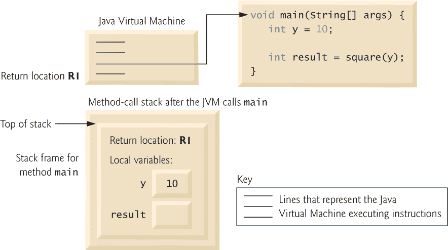

#### 步骤 2：`main` 调用方法 `square` 执行计算

在返回到 JVM 之前，`main` 调用了 [图 5.7] 第 9 行的 `square` 方法。这会将 `square` 的栈帧（第 13–15 行）推入方法调用栈中：

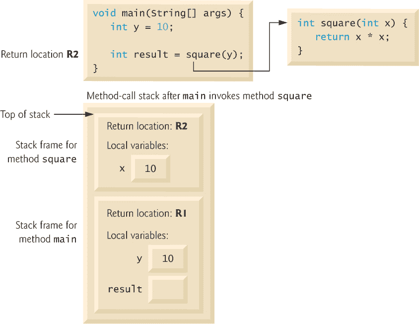

此栈帧包含了 `square` 返回到 `main` 所需的地址 `R2` 以及 `square` 参数 `x` 的内存。

#### 步骤 3：`square` 将结果返回给 `main`

在 `square` 计算出其参数的平方后，它需要返回到 `main`——并且不再需要变量 `x` 的内存。因此，栈被弹出，使 `square` 获得了 `main` 中的返回位置 `R2` 并丢失了 `square` 的局部变量。下图显示了在 `square` 的栈帧被弹出且 `square` 的返回值存储在 `main` 的局部变量 `result` 之后的方法调用栈：

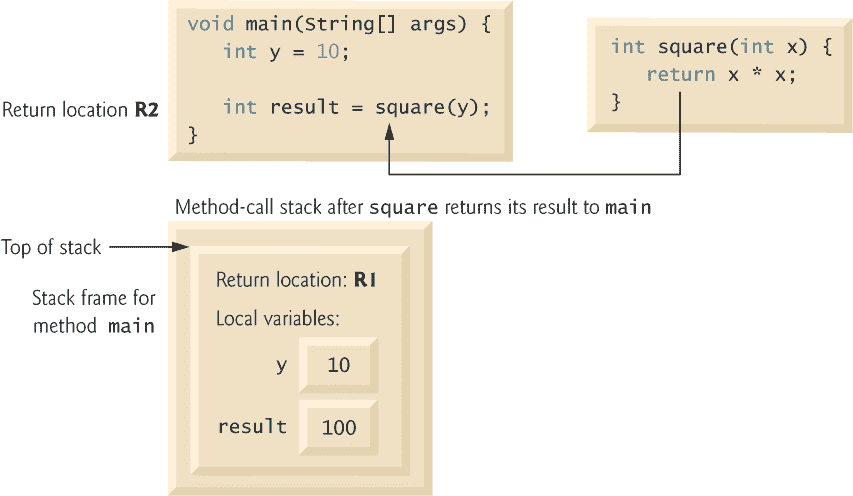

到达 `main` 的右大括号（第 10 行）会弹出栈帧。这为 `main` 提供了返回到 JVM 的地址。

| `char` | `int`, `long`, `float` or `double` |
|---|---|
| `short` | `int`, `long`, `float` or `double` (but not `char`) |
| `byte` | `short`, `int`, `long`, `float` or `double` (but not `char`) |
| `boolean` | 无（Java 中的 `boolean` 值不是数字） |

对于给定类型，有效的提升总是到表中更高级的类型。例如，`int` 可以提升为更高阶类型 `long`、`float` 或 `double`。

将值转换为上表中较低的类型时，如果低级类型无法表示高阶类型的值，将导致产生不同的值（例如，`int` 值 2000000 无法表示为 `short`，且任何带有小数点后数字的浮点数都无法在 `long`、`int` 或 `short` 等整数类型中表示）。因此，在因转换可能导致信息丢失的情况下，编译器要求你使用强制转换运算符（在第 3.7 节中引入）来显式强制执行转换——否则，将发生编译错误。这让你能够从编译器手中“夺回控制权”。你实际上是在说：“我知道这种转换可能会导致信息丢失，但对于我这里的目的来说，没关系。”

将基本类型值强制转换为另一种基本类型时，如果新类型不是有效的提升，可能会改变该值。例如，将浮点值转换为整数值可能会在结果中引入截断误差（丢失小数部分）。

假设方法 `square` 计算整数的平方，因此需要一个 `int` 参数。要使用一个名为 `doubleValue` 的 `double` 参数来调用 `square`，我们需要这样写该方法调用：

```
square((int) doubleValue)
```

此方法调用显式地将 `doubleValue` 的值强制转换为一个临时的 `int` 以供 `square` 使用。因此，如果 `doubleValue` 的值为 `4.5`，方法接收到 `4` 并返回 `16`，而不是 `20.25`。

#### 生成式 AI

1. 向 `genAIs` 提示本节讨论的允许的 Java 基本类型提升，并询问为什么 `char` 在表中的优先级高于 `short`。

### 5.12 对象自然案例研究：Java 日期/时间 API

让我们介绍 `Java Date/Time API` 的功能，它提供了强大的能力用于：

* 方便地管理日期和时间信息，
* 执行日期和时间计算，以及
* 使用`特定区域格式`显示日期和时间，该格式考虑了用户的口语（或书面）语言、国家时区（即用户的 `locale`）。

我们将构建一个程序，输入用户的出生日期和时间（如果他们愿意，也可以近似值），然后确定并显示：

* 用户出生时的星期几，
* 用户活过的年、月、天数，
* 用户活过的总月、天、小时、分钟和秒。

以下是一个出生于 1969 年 7 月 20 日晚上 10:56 东部时间的个人示例输出——你的输出将所不同，因为你没有在我们运行相同的日期和时间运行程序：^(7)

7。这是尼尔·阿姆斯特朗登上月球的日子。“阿波罗 11 号时间线”，访问 2024 年 8 月 30 日。[`https://airandspace.si.edu/explore/stories/apollo-missions/apollo-11-moon-landing/apollo-11-timeline`](https://airandspace.si.edu/explore/stories/apollo-missions/apollo-11-moon-landing/apollo-11-timeline)。

点击此处查看代码图像

```
输入你的生日 (yyyy-MM-dd): 1969-07-20
输入你的出生时间 (HH:mm): 22:56

出生日期/时间: Jul 20, 1969, 10:56:00 PM
当前日期/时间: Jun 15, 2024, 12:40:56 PM

你出生于星期日
你已经活了 54 年 10 个 月 26 天

总月数：  658
总天数：    20,054
总小时：   481,285
总分钟：28,877,144
总秒数：1,732,628,696
```

在第 5.12.2 节中，我们将展示如何使用命令行参数运行程序，这些参数指定口语（或书面）语言和区域，以便你可以获得上述输出中显示的日期、时间和数值的特定区域格式化。为了简单起见，我们不会翻译此示例中的其他英文文本。

我们在案例研究中使用的一些关键日期/时间 API 类型包括：

* `LocalDate` 类、`LocalTime` 类和 `LocalDateTime` 类（均来自 `time` 包）。
* `LocalDate` 类、`LocalTime` 类和 `LocalDateTime` 类表示日期、时间。
* `DateTimeFormatter` 类、`FormatStyle` 和 `TextStyle`（均来自 `time.format` 包）实现精确的日期时间。
* `ChronoUnit` 枚举（来自 `time.temporal` 包）提供了日期/时间类返回的常量。

对象自然方法的妙处在于，这里讨论的类型包含近 4000 行代码（不包括注释）。自己实现这些类型需要花费大量时间编写、调试并证明它们的正确性。但通过编写少量操作这些对象并调用其方法的语句，你可以从它们的强大功能中受益。

#### 5.12.1 日期/时间操作

图 5.8 使用各种日期/时间功能实现了应用程序。为了方便讨论，我们将程序分成了部分。

##### 导入 Java API 类和枚举

第 4-14 行 `import` 了此程序使用的类和 `enum`。

点击此处查看代码图像

```
 1   // Fig. 5.8: AgeCalculator.java
 2   // 使用日期/时间 API 计算用户活了多久
 3   // 并确定出生时的星期。
 4   import java.time.Duration;
 5   import java.time.LocalDate;
 6   import java.time.LocalDateTime;
 7   import java.time.LocalTime;
 8   import java.time.Period;
 9   import java.time.format.DateTimeFormatter;
10   import java.time.format.FormatStyle;
11   import java.time.format.TextStyle;
12   import java.time.temporal.ChronoUnit;
13   import java.util.Locale;
14   import java.util.Scanner;
```

##### 从用户处输入生日和出生时间

第 21-26 行提示并输入用户的生日和出生时间：

```java
16   public class AgeCalculator {
17      public static void main(String[] args) {
18         var input = new Scanner(System.in);
19
20         // input user's birthday and convert it to a LocalDate
21         System.out.print("Enter your birthday (yyyy-MM-dd): ");
22         var birthday = LocalDate.parse(input.nextLine());
23
24         // input user's birth time and convert it to a LocalTime
25         System.out.print("Enter your birth time (HH:mm): ");
26         var birthTime = LocalTime.parse(input.nextLine());
```

```text
Enter your birthday (yyyy-MM-dd): 1969-07-20
Enter your birth time (HH:mm): 22:56
```

代码运行逻辑如下：

* 第 21 行指定生日格式为 `yyyy-MM-dd`，该格式表示四位年份（例如 1969）、两位月份（例如 07）和两位日期（例如 20），每个部分之间用连字符（`-`）分隔。Date/Time API 使用大写的 `M` 表示月份，使用小写的 `m` 表示分钟。`DateTimeFormatter` 类的文档包含一个解释日期时间格式中所用字母的表格。

  11. “Class `DateTimeFormatter`,” 于 2024 年 9 月 21 日 [`https://docs.oracle.com/en/java/javase/23/docs/api/java.base/java/time/format/DateTimeFormatter.html`](https://docs.oracle.com/en/java/javase/23/docs/api/java.base/java/time/format/DateTimeFormatter.html)。

* 第 22 行使用 `Scanner` 类的 `nextLine` 方法读取一行文本作为字符串。然后将该字符串传递给 `LocalDate` 类的 `parse` 方法，该方法将日期转换为 `LocalDate` 对象并存储在 `birthday` 变量中。

* 第 25 行指定出生时间格式为 `HH:mm`，表示两位小时和两位分钟，用冒号（`:`）分隔。Date/Time API 使用大写的 `H` 表示 24 小时制的小时，而小写的 `h` 表示 12 小时制格式。

* 第 26 行读取一行文本作为字符串并将其传递给 `LocalTime` 类的 `parse` 方法将时间转换为 `LocalTime` 对象，然后存储在 `birthTime` 中。

### 为生日、出生时间以及当前日期创建 `LocalDateTime` 对象

为了给日期时间计算做准备，第 29 行通过调用 `LocalDateTime` 类的 `of` 方法将 `birthday` 和 `birthTime` 对象转换为 `LocalDateTime` 对象，并将结果存储在 `birthDateTime` 中。我们将计算当前时间与 `birthDateTime` 之间的差异，因此第 32 行调用 `LocalDateTime` 类的 `now` 方法获取用户系统上的当前日期时间并存储在 `now` 中。第 35 行调用我们的 `displayDatesAndTimes` 方法（稍后将讨论），以用户区域的默认格式显示 `LocalDateTime` 对象 `birthDateTime` 和 `now`。

点击此处查看代码图片

```java
28         // combine the birthday and birthTime into a LocalDateTime object
29         var birthDateTime = LocalDateTime.of(birthday, birthTime);
30
31         // get the current date and time as a LocalDateTime object
32         var now = LocalDateTime.now();
33
34         // show the dates/times
35         displayDatesAndTimes(birthDateTime, now);
36
```

```text
Birth date/time: Jul 20, 1969, 10:56:00 AM
Current date/time: Jun 15, 2024, 11:40:59 AM
```


### 计算 `LocalDateTime` 对象之间的 `Period` 和 `Duration`

第 38 行和第 41 行计算出生日期时间与当前时间之间的年、月、日，以及小时、分钟和秒的差异：

点击此处查看代码图片

```java
37         // calculate date/time difference in years, months and days
38         var period = Period.between(birthday, now.toLocalDate());
39
40         // calculate date/time difference in hours, minutes and seconds
41         var duration = Duration.between(birthDateTime, now);
42
```

第 38 行和第 41 行使用了 `Period` 和 `Duration` 类的方法：

*   `Period` 类的静态方法 `between`（第 38 行）返回一个 `Period` 对象，表示两个 `LocalDate` 对象之间年、月、日的差异。
*   `Duration` 类的静态方法 `between`（第 41 行）返回一个 `Duration` 对象，表示两个 `LocalDateTime` 对象之间小时、分钟和秒的差异。

### 确定日期的星期几

第 44 行到第 46 行显示用户出生时的星期几：

```java
43         // display day of the week the user was born
44         System.out.printf("You were born on a %s%n%n",
45            birthday.getDayOfWeek().getDisplayName(
46               TextStyle.FULL, Locale.getDefault()));
```

`LocalDate` 类的 `getDayOfWeek` 方法（第 45 行）返回 `DayOfWeek` 枚举中的常量。

*   `DayOfWeek` 枚举的 `getDisplayName` 方法（第 46 行）有两个参数：
    *   `TextStyle.FULL` 常数指定返回星期几的全称（例如“Monday”、“Tuesday”）。
    *   `Locale` 类的静态方法 `getDefault` 返回特定于设置的默认 `Locale` 对象。

### 显示用户活了多久

第 49 行到第 61 行以年、月、日显示用户生存的时间，以及总月数、天、小时、分钟和秒——在这里我们将 `printf` 的格式字符串定义为文本块，指定输出的每一行：

*   `Period` 类的 `getYears`、`getMonths` 和 `getDays` 方法（第 58 行）获取出生日期与当前日期之间的年、月、日。
*   `Period` 类的 `toTotalMonths` 方法（第 59 行）确定 `Period` 中的总月数。
*   `LocalDate` 类的 `until` 方法（第 60 行）确定 `LocalDate birthday` 与其第一个参数（由 `now.toLocalDate()` 返回的日期部分）之间的差异。`until` 方法的第二个参数指定返回差异的单位。`ChronoUnit.DAYS` 表示差异应转换为天。
*   `Duration` 类的 `toHours`、`toMinutes` 和 `toSeconds` 方法（第 61 行）获取出生时间与当前时间之间的小时、分钟和秒数。

```java
48         // display age components
49         System.out.printf("""
50            You have been alive for %d years, %d months, and %d days
51
52                Total months: %,d
53                  Total days: %,d
54                 Total hours: %,d
55               Total minutes: %,d
56               Total seconds: %,d
57            """,
58            period.getYears(), period.getMonths(), period.getDays(),
59            period.toTotalMonths(),
60            birthday.until(now.toLocalDate(), ChronoUnit.DAYS),
61            duration.toHours(), duration.toMinutes(), duration.toSeconds());
62      }
63
```

```text
You have been alive for 54 years, 10 months, and 26 days

Total months:  658
Total days:    20,054
Total hours:   481,285
Total minutes: 28,877,144
Total seconds: 1,732,628,696
```

### 方法 `displayDatesAndTimes` 使用特定区域的格式显示用户的出生日期时间以及当前日期和时间

第 69–70 行创建了一个 `DateTimeFormatter`，并用于第 74 行和第 76 行以获取用户出生日期时间和当前日期时间的字符串表示以便显示：

点击此处查看代码图像

```java
64      // display birth date/time and current date/time in user's locale
65      public static void displayDatesAndTimes(
66         LocalDateTime birth, LocalDateTime current) {
67
68         // prepare format to display dates and times for user's locale
69         var formatter =
70            DateTimeFormatter.ofLocalizedDateTime(FormatStyle.MEDIUM);
71
72         // display formatted date and time
73         System.out.printf("%nBirth date/time: %s%n",
74            birth.format(formatter));
75         System.out.printf("Current date/time: %s%n%n",
76            current.format(formatter));
77      }
78   }
```

第 70 行调用 `DateTimeFormatter` 类的 `ofLocalizedDateTime` 方法来获取一个 `DateTimeFormatter` 对象，该对象根据用户系统的默认区域格式化日期和时间。`FormatStyle.MEDIUM` 常量在我们美国东部时区的区域产生以下格式的日期/时间：

```text
Jul 20, 1969, 10:56:00 PM
```

13. “枚举类 `FormatStyle`，”访问于 2025 年 9 月 21 日 [`https://docs.oracle.com/en/java/javase/23/docs/api/java.base/java/time/format/FormatStyle.html`](https://docs.oracle.com/en/java/javase/23/docs/api/java.base/java/time/format/FormatStyle.html)。

第 74 行和第 76 行通过调用 `LocalDateTime` 类的 `format` 方法将 `LocalDateTime` 对象转换为字符串以便显示。参数是指定指定格式的 `DateTimeFormatter` 对象（`formatter`，第 69 行）。日期/时间 API 还为指定自定义区域提供了广泛支持，而不仅仅是仅处理系统的默认区域。

#### 5.12.2 运行与你所在区域不同的本地程序

你可以通过向 `java` 命令传递 `-D` 选项来自定义 Java 运行时，如下所示。每个选项都指定为 `-D` 标志，其后紧跟系统属性的名称。对于其他语言、国家和时区的日期、时间以及数值区域特定格式化，你可以使用以下选项运行 `AgeCalculator` 程序：

*   `-Duser.language` 指定一个语言代码。
*   `-Duser.country` 指定一个国家代码。
*   `-Duser.timezone` 指定一个时区代码。

例如，要将语言设置为西班牙语，国家设置为西班牙，时区设置为 Europe/Madrid，可以按照如下方式执行程序：

点击此处查看代码图像

```bash
java -Duser.language=es -Duser.country=ES \
   -Duser.timezone=Europe/Madrid AgeCalculator
```

产生类似下内容的输出：

点击此处查看代码图像

```text
Enter your birthday (yyyy-MM-dd): 1969-07-21
Enter your birth time (HH:mm): 03:56

Birth date/time: 21 jul 1969, 3:56:00
Current date/time: 15 jun 2024, 17:42:39

You were born on a lunes
You have been alive for 54 years, 10 months, and 26 days

Total months:  658
Total days:    20,054
Total hours:   481,285
Total minutes: 28,877,144
Total seconds: 1,732,628,696
```

#### 5.13 总结

在本章中，你创建了第一个自定义方法。你使用 `enum` 类型声明了命名常量。你使用了 `Random` 生成随机数，你可以使用 `SecureRandom`。

我们引入了 `switch` 增强，并展示了它们如何更简洁地表示 `switch` 逻辑。我们还展示了产生值的 `switch` 表达式——这些简化了每个分支中进行变量赋值的代码。

你学习了字段和局部变量的作用域。我们展示了通过提供具有相同名称和不同签名的方法来实现类中的方法重载。

你学习了 Java API 中一些常用的包。我们了解了方法调用栈和栈帧如何跟踪已调用的方法以及每个方法在完成时必须返回哪里。我们还讨论了 Java 在原生类型之间隐式转换的提升规则。

你继续使用生成式 AI 利用你的 Java 经验。在对象自然案例中，你利用日期/时间 API 的功能在应用程序中执行常见的日期和时间处理，该程序输入出生日期和时间，然后确定你活了多少年、月、日、小时、分钟和秒，以及出生在星期几。

我们将在第 8 章 和第 22 章 中讨论方法的更多详细信息。

---

### 特别章节：生成式 AI 练习

针对以下每个问题，尝试多个生成式 AI 以确定哪一个表现最好。务必验证结果。请记住，它们有时会犯错误甚至产生幻觉，创建不可靠的信息。

## 5.1 (方法练习题)

提示生成式 AI 建议一些带有答案的入门练习，用于练习创建可以从 Java 的 `main` 方法中调用的 `static` 方法。将建议限制在最多 50 行代码即可完成的练习。

## 5.2 (质因分解)

提示生成式 AI 编写一个程序，该程序包含一个方法，可以确定 `BigInteger` 的质因数，并将质因分解以 `ArrayList<BigInteger>` 的形式返回。

## 5.3 (Java 安全导论)

提示生成式 AI 创建一个介绍 Java 安全特性的教程。

## 5.4 (智商测试序列预测器)

提示生成式 AI 生成一个 Java 程序，该程序输入任意的整数序列，然后预测序列中的下一个整数。

## 5.5 (日期/时间 API)

提示生成式 AI 编写一个关于 Java 日期/时间 API 应用的教程。

## 5.6 (日期/时间 API)

提示生成式 AI 提供一些 Java Date/Time API 练习，用于练习 第 5.12 节中关于计算年龄的对象-自然案例研究中介绍的功能。

## 6 数组与 `ArrayLists`


### 目标

在本章中，你将：

*   理解基本类型和引用类型之间的区别。
*   使用数组在值列表和表中存储数据并检索数据。
*   声明数组、初始化数组并引用数组的单个元素。
*   使用增强型 `for` 语句遍历数组。
*   将数组传递给方法。
*   理解按值传递与按引用传递的区别。
*   声明和操作多维数组。
*   定义具有变长参数列表的方法。
*   将命令行参数读入程序。
*   使用 `Arrays` 类的方法执行预定义的数组操作。
*   使用生成式 AI 来提升你的 Java 学习体验。
*   继续我们的“对象-自然”方法，通过一个使用 Java API 中 `ArrayList` 类的案例研究——这是一种复用、可靠、强大且高效的数据结构，它与数组相似，但可以**动态调整大小**，以容纳更多或更少的元素。

### 6.1 引言

本章介绍了**数据结构**，它允许你存储相关数据项的**集合**。**数组**对象是包含相同类型数据项的数据结构，并便于处理相关的数值组。在本章中，我们将：

*   检查基本类型和引用类型之间的区别，并证明数组可以同时存储这两种类型。
*   讨论如何声明、创建和初始化数组，并演示常见的数组操作，例如计算数组元素的值、累加数组元素、视觉化数组数据以及将数组元素作为计数器。
*   引入 Java 的异常处理机制，用它处理程序尝试访问不存在的数组元素时发生的错误。
*   演示增强型 `for` 语句，以便更方便地处理数组数据，并且比计数控制的 `for` 语句具有更少的的潜在错误。
*   引入二维数组，用于表示包含行和列数据的表格。
*   声明并操作多个二维数组，使用嵌套计数 `for` 循环和嵌套增强型 `for` 循环来遍历它们。
*   创建可以带不同数量参数调用的方法，并演示如何通过其 `args` 参数操作 `main` 方法的命令行参数。
*   使用 `Arrays` 类（`java.util` 包）中的数组操作方法来避免“重复造轮”。

你将继续使用生成式 AI 来提升你的 Java 学习体验。本章的对象-自然案例研究引入了 `ArrayList` 集合类——这是一种复用、可靠、强大且高效的数据结构，它与数组相似，但可以**动态调整大小**以适应更多或更少的元素。

### 6.2 基本类型 vs. 引用类型

Java 的类型分为基本类型或**引用类型**。八种基本类型是 `boolean`、`byte`、`char`、`short`、`int`、`long`、`float` 和 `double`——你已经创建了 `int` 和 `double` 类型的变量。你还处理过引用类型的对象，包括 `Scanner`、`String`、`BigInteger`、`BigDecimal`、`RandomGenerator` 以及 Java Date/Time API 的各种类型。**所有非基本类型都是引用类型。**

#### 基本类型变量存储值

基本类型变量一次持有声明类型的值。考虑以下 `int` 变量声明：

```java
int number = 7;
```

执行该语句后，`number` 包含值 `7`，如下所示：

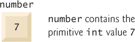

当你给 `number` 分配新值时，新值将替换 `7`，之前的值将丢失。

#### 引用类型变量存储对象的位置

引用类型变量存储指向内存其他位置对象的**引用**。例如，给定以下声明

```java
String name = "Paul";
```

变量 `name` 指向内存中某处包含 `"Paul"` 的 `String` 对象，如下所示：

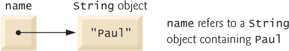

你使用变量 `name` 来引用 `String` 对象并调用其方法。例如，以下语句调用 `String` 对象的 `length` 方法并将结果存储在基本类型变量 `length` 中：

```java
int length = name.length();
```

你可以通过引用类型变量调用方法，但不能通过基本类型变量调用。

### 6.3 数组

数组是一组包含相同类型数据的变量（称为**元素**）。数组是对象，因此数组变量包含数组对象的引用。数组的元素可以是基本类型，也可以是引用类型（包括其他数组，如第 6.16 节所示）。要引用数组中的特定元素，我们指定数组名称以及元素的**索引**（即位置编号）。

下图显示名为 `c` 的 `int` 数组的可视化表示：


数组命名遵循相同的约定。此数组包含五个元素。程序使用**数组访问表达式**引用这些元素中的任意一个，该表达式包括数组名称，后面跟着方括号`[]`中的元素索引——例如`c[0]`。每个数组的第一个元素的索引为**0**。因此，数组`c`的元素从`c[0]`（读作“c 零”）到`c[4]`。`c[0]`的值为`-45`，`c[2]`的值为`0`，`c[4]`的值为`1543`。数组访问表达式可以用赋值语句的左侧，将新值放入数组元素。例如，以下语句替换了`c[4]`的值：

```
c[4] = 87;
```

索引必须是非负整数表达式。最高索引（在此例中为4）总是小于数组的大小（在此例中为5）。每个数组都知道自己的大小（元素个数），你可以通过其实例变量`length`来访问它，如下：

```
c.length
```

数组的长度在创建后无法更改。

### 6.4 声明和创建数组

数组对象的元素在内存中占用连续的空间，这使得可以通过索引高效地访问元素。要创建一个数组对象，你使用`array-creation expression`（数组创建表达式），它由`new`后面跟上数组的元素类型以及指定元素数量的方括号组成。该表达式返回一个引用，可以将其存储在数组变量中。下面的声明和数组创建表达式创建了一个包含五个`int`元素的数组对象，并将该数组的引用存储在名为`c`的数组变量中：

```
int[] c = new int[5];
```

当你创建一个数组时，每个元素都会接收一个默认值——数值基数据类型元素为`0`，`boolean`元素为`false`，引用类型元素为`null`。值`null`表示引用类型变量当前没有指向任何对象。你很快就会发现，在创建数组时，可以提供非默认的元素值。

## 在单独的语句中声明数组变量并创建数组

创建数组也可以通过以下两个步骤完成：

```
int[] c; // 声明数组变量
c = new int[5]; // 创建数组；赋值给数组变量
```

在声明中，类型后面的方括号表示`c`是一个将引用数组的变量——该声明并没有为数组的元素预留任何内存。在赋值语句中，数组变量`c`接收了指向包含五个`int`元素的新数组的引用。

## 在一条语句中创建多个数组

程序可以在单条声明中创建多个数组。下面的声明为`b`预留了100个元素，为`x`预留了27个元素：

```
String[] b = new String[100], x = new String[27];
```

当数组的元素类型和方括号在声明开头组合时，声明中的所有标识符都是数组变量。在这种情况下，变量`b`和`x`指向`String`数组。为了可读性和清晰性，请每个声明只声明一个变量。之前的声明等同于：

```
String[] b = new String[100]; // 创建数组 b
String[] x = new String[27]; // 创建数组 x
```

### 数组变量声明中方括号的位置

在单条声明中声明多个数组变量会导致细微的错误。考虑以下声明：

```
int[] a, b, c;
```

这将`a`、`b`和`c`声明为数组变量。同样，将方括号放在类型后面表示声明中的所有标识符都是数组变量。然而，如果只想让`a`数组变量，而让`b`和`c`为单独的`int`变量，那么声明应该是：

```
int a[], b, c;
```

在此声明中，`int`分配给了每个变量，但方括号只作用于变量`a`。因此，`a`可以存储指向`int`数组的引用，而`b`和`c`可以存储单独的`int`值。在单独的变量声明语句中声明每个变量可以消除这种混淆。

### 基本类型元素与引用类型元素

程序可以声明任何类型元素的数组：

* 基本类型数组的每个元素都是一个变量，包含该数组声明的元素类型的值。例如，每个`int`数组元素都是一个存储`int`值的变量。
* 引用类型数组的每个元素都是一个变量，可以指向数组声明的元素类型的对象。例如，每个`String`数组元素都是一个可以指向`String`对象的变量。

### 6.5 创建并初始化数组

图6.1中的程序使用`new`关键字创建一个包含五个`int`元素的数组，这些元素初始为`0`——这是`int`数组元素的默认初始值。第7行声明了`array`——一个能够引用`int`元素数组的引用类型变量——然后用一个指向包含五个`int`元素的数组对象的引用对其进行初始化。第9行输出列头。第一列包含每个数组元素的索引（0–4），第二列包含每个数组元素的默认初始值（0）。

```
 1   // Fig. 6.1: InitArray.java
 2   // Initializing the elements of an array to default values of zero.
 3
 4   public class InitArray {
 5      public static void main(String[] args) {
 6         // declare variable array and initialize it with an array object
 7         int[] array = new int[5]; // create the array object
 8
 9         System.out.printf("%s%8s%n", "Index", "Value"); // column headings
10
11         // output each array element's value
12         for (int counter = 0; counter < array.length; ++counter) {
13            System.out.printf("%5d%8d%n", counter, array[counter]);
14         }
15      }
 16 }
```

```
Index    Value
    0        0
    1        0
    2        0
    3        0
    4        0
```

**图 6.1 | InitArray**: 将数组元素初始化为默认值 0。

#### 生成式 AI

**1** 提示 AI 查找并修复以下代码中的错误：

```
int[] values = new int[10];

for (int i = 0; i <= values.length; ++i) {
   System.out.println(values[i]);
}
```

确认它们的回答指出循环会导致代码引用越界的数组元素（`values[10]`），并将`<=`改为`<`。

### 6.6 数组初始化器

你可以使用数组初始化器——花括号内的逗号表达式列表来创建数组并初始化其元素。在这种情况下，数组长度由数组初始化器中元素的数量决定。例如：

```
int[] n = {10, 20, 30, 40, 50};
```

创建了一个五个元素的数组，索引值为`0`–`4`。元素`n[0]`初始化为`10`，`n[1]`初始化为`20`，依此类推。当编译器遇到包含数组初始化器的数组声明时，它会计算初始化器列表的数量来确定数组的大小，并为你创建一个相应大小的新数组。

图6.2使用五个值初始化整数数组（第7行），并表格形式显示数组。显示数组元素的代码（第12–14行）与图6.1（第12–14行）相同。

```
 1   // Fig. 6.2: InitArray.java
 2   // Initializing the elements of an array with an array initializer.
 3
 4   public class InitArray {
 5      public static void main(String[] args) {
 6         // array initializer specifies the initial value for each element
 7         int[] array = {32, 27, 64, 18, 95};
 8
 9         System.out.printf("%s%8s%n", "Index", "Value"); // column headings
10
11         // output each array element's value
12         for (int counter = 0; counter < array.length; ++counter) {
13            System.out.printf("%5d%8d%n", counter, array[counter]);
14         }
 15      }
 16   }
```

```
Index    Value
    0       32
    1       27
    2       64
    3       18
    4       95
```

`Fig. 6.2` | 使用数组初始化器初始化数组元素。

与其像第7行那样使用数组初始化器，数组元素的值通常是读取读入程序中的。例如，你可以从用户或磁盘文件输入值，如第11章、文件、I/O流、JSON序列化与CSV文件中讨论。将数据读入程序中（而不是“硬编码”到程序中）会使程序更具重用性，因为它可以用于不同的数据集。

#### 生成式 AI

**1** 提示生成 AI 写一个`for`循环，将`int`数组`values`的元素复制到`int`数组`otherValues`中，它的元素个数与`values`相同。将它们的响应与以下代码对比：

```
for (int counter = 0; counter < values.length; ++counter) {
   otherValues[counter] = values[counter];
}
```

### 6.7 计算数组元素值

图6.3创建了一个五元素数组，为每个元素分配一个从2到10的偶数，然后以表格格式显示数组。第10–12行的`for`语句通过将控制变量`counter`的当前值乘以`2`然后加`2`来计算数组元素的值。第17–19行显示每个数组元素的索引和值。

```
 1   // Fig. 6.3: InitArray.java
 2   // Calculating the values to be placed into the elements of an array.
 3
 4   public class InitArray {
 5      public static void main(String[] args) {
 6         final int ARRAY_LENGTH = 5; // 声明常量
 7         int[] array = new int[ARRAY_LENGTH]; // 创建数组
 8
 9         // 计算每个数组元素的值
10         for (int counter = 0; counter < array.length; ++counter) {
11            array[counter] = 2 + 2 * counter;
12         }
13
14         System.out.printf("%s%8s%n", "Index", "Value"); // 列标题
15
16         // 输出每个数组元素的值
17         for (int counter = 0; counter < array.length; ++counter) {
18            System.out.printf("%5d%8d%n", counter, array[counter]);
19         }
20      }
 21   }
```

```
Index    Value
    0        2
    1        4
    2        6
    3        8
    4       10
```

`Fig. 6.3` | 计算要放入数组元素的值。

我们使用使用`final`修饰符声明并初始化为`5`的常量变量`ARRAY_LENGTH`（第6行）指定数组的大小。常量变量必须在使用之前初始化，之后不能再修改。在初始化后尝试修改`final`变量会导致编译错误。与`enum`常量一样，常量变量是命名常量。它们通常使程序更具可读性。像`ARRAY_LENGTH`这样的命名常量清楚地指示了用途，而像`5`这样的字面量可能会根据上下文有不同的含义。按照约定，常量变量使用全大字母，多单词名称应用下划线（`_`）将每个单词隔开，如`ARRAY_LENGTH`。

#### 生成式 AI

**1** 提示生成 AI 重写图6.3的程序，计算每个元素的值为该元素索引的平方。

### 6.8 累加数组元素

数组元素通常存储值用于计算。例如，如果数组元素代表考试成绩，教授可能希望对它们求和，并使用总和计算班级平均分。图6.4中的第10–12行求加了元素的值。在第13节中，我们将使用增强`for`语句重新实现这一点，这不需要计数器。

```
 1   // Fig. 6.4: SumArray.java
 2   // Computing the sum of elements.
 3
 4   public class SumArray {
 5      public static void main(String[] args) {
 6         int[] grades = {87, 68, 94, 78, 85, 91};
 7         int total = 0;
 8
 9         //累加每个元素
10         for (int grade : grades) {
11            total += grade;
12         }
13
14         System.out.printf("Total of array: %d%n", total);
15      }
 16   }
```

```
Total of array: 76
```

`Fig. 6.4` | 计算元素的和。

#### 生成式 AI

**1** 提示生成 AI 使用`for`循环编写计算数组和的 Java 代码。

### 6.9 可视化简介：柱状图

许多程序向用户展示数据——这一过程被称为可视化。例如，数值值通常以图表的形式显示，较长的柱条代表较大的值。一种显示数据的方法是使用图表。假设图6.5将分布存储在数组中。每个元素代表一个成绩范围。例如，`distribution[0]`存储0–9范围的人数，`distribution[7]`存储70–79范围的人数，`distribution[10]`存储100分的人数。

```
 1   // Fig. 6.5: BarChart.java
 2   // Bar chart program.
 3
 4   public class BarChart {
 5      public static void main(String[] args) {
 6         int[] distribution = {0, 0, 0, 0, 0, 0, 1, 2, 4, 2, 1};
 7
 8         System.out.println("Grade distribution:");
 9
10         // 对于每个分布元素，输出图表的柱条
11         for (int counter = 0; counter < distribution.length; ++counter) {
12            // 输出柱状标签 ("00-09: ..., "90-99: ", "100: ")
13            if (counter == 10) {
14               System.out.printf("%5d: ", 100);
15            }
16            else {
17               System.out.printf("%02d-%02d: ",
18                  counter * 10, counter * 10 + 9);
19            }
20
21            // 打印星号柱条
22            for (int stars = 0; stars < distribution[counter]; ++stars) {
23               System.out.print("*");
24            }
25
26            System.out.println();
27         }
28      }
 29   }
```

```
Grade distribution:
00-09:
10-19:
20-29:
30-39:
40-49:
50-59:
60-69: *
70-79: **
80-89: ****
```


### 6.9 柱状图程序

`Fig. 6.5` | 柱状图程序。

该程序将数组信息以柱状图的形式绘制，每个成绩范围后面跟着一个由星号组成的柱形，表示该范围内的成绩数量。为了标记每个柱形，第 13–19 行根据当前的 `counter` 值输出一个成绩范围（例如，`"70-79: "`）。当 `counter` 为 `10` 时，第 14 行输出字段宽度为 5 的 `100`，随后跟一个冒号和空格，以便将标签 `"100: "` 与其他柱形标签对齐。在这个示例中，没有学生的成绩低于 60 分，因此 `distribution[0]` 到 `distribution[5]` 的每个元素都包含 `0`，且在前六个成绩范围旁边均没有显示任何星号。在第 17 行中，格式指定符 `%02d` 表示应将 `int` 类型的值格式化为两位数字的字段。格式指定符中的 `0` 标志会在位数小于字段宽度（`2`）的值前显示前导的 `0`。附录 B、格式化输出 讨论了格式指定符和格式标志。

#### 生成柱形

嵌套的 `for` 语句（第 22–24 行）输出柱形——外层循环遍历成绩范围，嵌套循环则为每个范围打印星号。注意第 22 行的循环继续条件（`stars < distribution[counter]`）。当程序运行到嵌套的 `for` 循环时，循环从 `0` 计数到 `distribution[counter]` 减 1，因此使用 `distribution` 中的值来确定显示的星号数量。

图 6.5 中的第 22–26 行可以替换为：

```java
System.out.println("*".repeat(distribution[counter]));
```

请记住，字符串字面量 `"*"` 是一个 `String` 对象。前面的语句调用了 `String` 对象 `"*"` 的 `repeat` 方法，按照 `repeat` 参数指定的次数对其进行重复。该方法返回一个包含重复文本的新 `String` 对象。

#### 生成式 AI
向生成式 AI 提问，要求列出 Java `System.out.printf` 格式字符串中使用的标志。

### 6.10 使用数组元素作为计数器

程序有时使用计数器来汇总数据，例如调查结果。在图 5.3 中，我们使用不同的计数器来跟踪程序在掷 60000 次骰子时六面骰子上每个面出现的频率。图 6.6 展示了图 5.3 的数组版本。

```java
// Fig 6.6: RollDie.java
// 使用数组代替 switch 的掷骰子程序。

import java.util.random.RandomGenerator;

public class RollDie {

    public static void main(String[] args) {

        RandomGenerator randomNumbers = RandomGenerator.getDefault();

        int[] frequency = new int[7]; // 频率计数数组

        // 掷 6,000,000 次骰子；使用骰子值作为频率索引

        for (int roll = 1; roll <= 6000000; ++roll) {

            ++frequency[randomNumbers.nextInt(1, 7)];

        }

        System.out.printf("%s%12s%n", "Face", "Frequency");

        // 输出每个数组元素的值

        for (int face = 1; face < frequency.length; ++face) {

            System.out.printf("%4d%12d%n", face, frequency[face]);

        }

    }

}
```

```
Face   Frequency
1    1418
2      922
3      511
4    187
5    2132
6      730
```

**图 6.6** | 使用数组代替 `switch` 的掷骰子程序。

图 6.6 使用数组 `frequency`（第 8 行）来统计骰子每个面出现的次数。该程序的第 12 行替换了图 5.3 中的第 19–29 行。第 12 行使用随机值来确定要增加哪个 `frequency` 元素。第 12 行的计算产生 1 到 6 的随机数，因此数组 `frequency` 必须足够大以存储六个计数器。我们选择使用一个七元素数组，并忽略了 `frequency[0]`，因为让面值 1 增加计数器变量 `frequency[1]` 比增加 `frequency[0]` 更清晰。使用索引为 0–6 的七元素数组可以确保它为每个可能的骰子面（1–6）都有一个索引。在第 12 行中，方括号内的计算首先求值以确定要增加的数组元素，然后 `++` 运算符对该元素加 1。我们还通过遍历数组 `frequency` 来输出结果（第 18–20 行），替换了图 5.3 中的第 33–35 行。在第 14 章中，我们将使用函数式编程能力用单条语句替换第 11–13 行和 18–20 行！

#### 生成式 AI
向生成式 AI 提问，要求编写一个程序，使用数组汇总 100 次掷硬币的结果并显示正反数量。将生成的代码与以下代码进行比较。如果生成的代码差异很大，请让他们解释代码及其开发步骤。

```java
// CoinFlipper.java
// 汇总掷硬币。

import java.util.random.RandomGenerator;

public class CoinFlipper {

    public static void main(String[] args) {

        RandomGenerator randomNumbers = RandomGenerator.getDefault();

        // 代表正反面的常量

        final int HEADS = 0;

        final int TAILS = 1;

        // frequency[0] 用于正面，frequency[1] 用于反面

        int[] frequency = new int[2];

        // 模拟 100 次掷硬币

        for (int counter = 0; counter < 100; ++counter) {

            ++frequency[randomNumbers.nextInt(2)];

        }

        System.out.printf("Number of heads: %d%n", frequency[HEADS]);

        System.out.printf("Number of tails: %d%n", frequency[TAILS]);

    }

}
```

```
Number of heads: 46
Number of tails: 54
```

### 6.11 分析调查结果

接下来，让我们使用数组来汇总调查收集的数据。考虑以下问题陈述：

二十名学生被要求对食堂的食物质量进行 1 到 5 分的评分，其中 1 分为“极差”，5 分为“优秀”。将响应结果存储在一个整数数组中，并确定每个评分的频率。

这是数组的典型用法。数组 `responses`（图 6.7，第 7–8 行）是一个包含 20 个元素的整数数组，包含了学生的调查响应。数组的最后一个值被故意设置为了错误的响应（`14`）——我们将利用这个值来展示 Java 如何在运行时验证数组索引值。

```java
 1   // Fig. 6.7: StudentPoll.java
 2   // Poll analysis program.
 3
 4   public class StudentPoll {
 5      public static void main(String[] args) {
 6         // student response array (more typically, input at runtime)
 7         int[] responses =
 8            {1, 2, 5, 4, 3, 5, 2, 1, 3, 3, 1, 4, 3, 3, 3, 2, 3, 3, 2, 14};
 9         int[] frequency = new int[6]; // array of frequency counters
10
11         // for each answer, select responses element and use that value
12         // as frequency index to determine array element to increment
13         for (int answer = 0; answer < responses.length; ++answer) {
14            try {
15               ++frequency[responses[answer]];
16            }
17            catch (ArrayIndexOutOfBoundsException e) {
18               System.out.println(e); // invokes toString method
19               System.out.printf("   responses[%d] = %d%n%n",
20                  answer, responses[answer]);
21            }
22         }
23
24         System.out.printf("%s%10s%n", "Rating", "Frequency");
25
26         // output each array element's value
27         for (int rating = 1; rating < frequency.length; ++rating) {
28            System.out.printf("%6d%10d%n", rating, frequency[rating]);
29         }
30      }
31   }
}
```

```
java.lang.ArrayIndexOutOfBoundsException: Index 14 out of bounds for length 6
   responses[19] = 14

Rating Frequency
     1         3
     2         4
     3         8
     4         2
     5         2
```


**图 6.7** | 投票结果分析程序。

### `frequency` 数组

我们使用一个六元素的数组 `frequency`（第 9 行）来统计每个响应出现的次数。每个元素（第 0 元素除外）均被用作一个可能的调查响应值的计数器——`frequency[1]` 统计对食物评分为 1 的学生人数，`frequency[2]` 统计对食物评分为 2 的学生人数，依此类推。

### 结果的汇总

`for` 语句（第 13–22 行）逐个从 `responses` 数组中读取响应，并增加 `frequency[1]` 到 `frequency[5]` 其中一个计数器的值；我们忽略了 `frequency[0]`，因为调查响应限制在 1–5 的范围内。循环中的关键语句是第 15 行。该语句根据 `responses[answer]` 的值来增加相应的 `frequency` 计数器。

让我们逐步执行一下 `for` 语句的前几次迭代：

*   当 `answer` 为 `0` 时，`responses[answer]` 是 `responses[0]` 的值（即 `1`——第 8 行）。因此，`frequency[responses[answer]]` 的求值结果 `frequency[1]`，计数器 `frequency[1]` 加 1。

为了计算该表达式，我们从最内层括号的值开始（`answer`，当前为 `0`）。将 `answer` 的值代入表达式，然后计算下一组括号（`responses[answer]`）。该值被用作 `frequency` 数组的索引，以确定增加哪个计数器（在本例中为 `frequency[1]`）。

*   下一次循环时，`answer` 为 `1`，`responses[answer]` 是 `responses[1]` 的值（即 `2`——第 8 行）。因此，`frequency[responses[answer]]` 被解释为 `frequency[2]`，导致 `frequency[2]` 加 1。

*   当 `answer` 为 `2` 时，`responses[answer]` 是 `responses[2]` 的值（即 `5`——第 8 行）。因此，`frequency[responses[answer]]` 被解释为 `frequency[5]`，导致 `frequency[5]` 加 1，依此类推。

无论处理了多少响应，只需要一个六元素的数组（我们忽略第 0 元素）即可汇总结果，因为所有正确的响应都在 1 到 5 之间，而六元素数组的索引值为 0–5。

### 处理错误的响应

在程序的输出中，`Frequency` 列仅汇总了 `responses` 数组中 20 个值中的 19 个。`responses` 数组的最后一个元素包含一个（故意）错误的响应，该响应未被计数。所有索引必须大于或等于 0 且小于数组的长度。在运行时验证索引的过程被称为`数组边界检查（array bounds checking）`。任何访问该范围之外元素的尝试都会导致名为 `ArrayIndexOutOfBoundsException` 的运行时错误。输出的第一行显示了与错误相关的消息。该消息包含了异常的包名和类名，以及一个指示越界索引值和数组长度的错误信息。下一节介绍了第 14–21 行使用的 Java 异常处理机制，用于显示该程序输出的前两行。

### 12 异常处理

`异常（exception）`表示一个问题。`异常处理（Exception handling）`帮助你创建容错程序。当 JVM 或方法检测到问题（如无效参数）时，它会`抛出异常（throws an exception）`来通知程序问题的存在。方法也可以抛出`异常（exceptions）`，正如你在 `StudentPoll` 中看到的那。当异常发生时，`frequency` 数组只有六个元素（索引为–5），程序终止。

#### 12.1 `try` 语句

要处理异常，请使用`try 语句（try statement）`（第 14–21 行）。`try 块（try block）`（14–16 行）包含可能抛出异常的代码，而`catch 块（catch block）`（17–21 行）包含在发生异常时处理该异常的代码。你可以有多个 `catch` 来处理在相应 `try` 中可能抛出的异常。当第 15 行正确增加 `frequency` 数组元素时，将跳过第 17–21 行。界定 `try` 和 `catch` 块的括号是必须的。

#### 12.2 `catch` 块

当程序遇到 `responses` 数组中的无效值 `14` 时，它尝试向 `frequency[14]` 加 1，而这超出了数组边界。JVM 在执行时执行`数组边界检查（array bounds checking）`。当第 15 行尝试访问越界元素时，JVM 抛出 `ArrayIndexOutOfBoundsException`。此时，`try` 块终止，`catch` 块开始执行。如果你在 `try` 块中声明了局部变量，它们现在已经离开了作用范围（不再存在），因此在 `catch` 块中无法访问。`catch` 块声明了一个 `ArrayIndexOutOfBoundsException` 异常参数来处理该类型的异常。你可以使用参数的标识符在 `catch` 块内部与捕获的异常对象交互。

在编写访问数组元素的代码时，为了防止 `ArrayIndexOutOfBoundsException`，请确保每个数组索引大于或等于 0 且小于数组长度。例如，`图 6.7` 中的代码可以对 `responses` 中的值进行数据验证，以确保在将它们用作 `frequency` 数组的索引之前是有效的响应值。工业级中经过广泛测试的系统仍然可能包含错误。我们对工业级系统的倾向是捕获并处理运行时异常（如 `ArrayIndexOutOfBoundsException`），以确保系统能够保持运行或优雅降级，并向系统人员告知问题。

#### 异常参数的 `toString` 方法

当图 6.7 中的第 17–21 行捕获异常时，程序会显示一条指示发生问题的消息。每个对象都有一个 `String` 表示。当你使用 `System.out` 的 `print`、`println` 和 `printf` 方法显示对象时，它们会隐式地调用对象的 `toString` 方法来获取其 `String` 表示。(1) 第 18 行隐式地调用异常对象的 `toString` 方法来获取异常对象的错误消息 `String` 并将其显示。第 19–20 行显示了导致问题的 `responses[answer]` 值。一旦在该示例中显示了消息，异常即被认为已处理，程序将继续执行 `catch` 块结束大括号之后的语句。在本示例中，到达了 `for` 语句的末尾（第 22 行），因此程序继续执行第 13 行中控制变量的递增。我们将在第 8 章中再次讨论异常处理，并在第 10 章中进行深入讨论。

1. 8.6 节 详细讨论了 `toString`。

#### 生成式 AI

**1** 使用图 6.7 中的代码提示生成式 AI。让它们重写代码以移除 `try` 语句，但仍然防止 `ArrayIndexOutOfBoundsException`。让它们解释更新后的代码。执行生成的代码以确认其运行正常，并产生与原始代码相同的关于响应频率的两列摘要。

### 6.13 增强型 `for` 语句：计算数组元素总和

图 6.8 重新实现了图 6.4，该图计算了名为 `grades` 的 `int` 数组中整数的总和。第 10–12 行引入了增强型 `for` 语句，用于在不使用计数器的情况下遍历数组元素。这消除了几种错误可能性，例如错误指定控制变量的初始值、循环继续测试和递增表达式，从而避免了“越出”数组范围的可能性。

```java
// Fig. 6.8: EnhancedForTest.java
// 使用增强型 for 语句计算数组中整数的总和。

public class EnhancedForTest {
   public static void main(String[] args) {
      int[] grades = {87, 68, 94, 100, 83, 78, 85, 91, 76, 87};
      int total = 0;

      // 将每个元素的值加到 total
      for (int grade : grades) {
         total += grade;
      }

      System.out.printf("Total of array elements: %d%n", total);
   }
}
```

```text
Total of array elements: 849
```

**图 6.8** | 使用增强型 `for` 语句计算数组中整数的总和。

增强型 `for` 语句的头部（第 10 行）将变量 `grade` 为 `int`，因为 `grades` 数组包含 `int` 值。变量声明和数组之间由要求的冒号（`:`）隔开。循环在每次迭代中从 `grades` 中选择一个 `int` 值并赋值给 `grade`，程序在循环体内处理该值。这个增强型 `for` 语句的头部可以读作“对于 `grades` 中的每个 `grade`”。第 11 行将 `grade` 变量的当前值加到 `total`。循环在处理完 `grades` 数组的最后一个元素后自动终止。

#### 等价的计数 `for` 循环

第 10–12 行等同于图 6.4 中第 10–12 行使用的以下计数控制迭代，用于计算 `grades` 中整数的总和：

```java
for (int counter = 0; counter < grades.length; ++counter) {
   total += grades[counter];
}
```

增强型 `for` 语句向你隐藏了计数细节。

#### 何时使用增强型 `for` 语句

增强型 `for` 语句可以用于读取数组元素的值（(2)），但不能修改它们（(3)）。如果你的程序需要修改元素，请使用计数控制的 `for` 语句。当遍历数组的代码不需要访问每个元素的索引时，你应该使用增强型 `for` 语句。例如，计算数组中整数的总和只需要元素值——每个元素的索引是无关的。

2. 6.20 节 讨论了 `toString`。

3.

```java
// Fig. 6.9: PassArray.java
// Passing arrays and individual array elements to methods.

public class PassArray {
   // main creates array and calls modifyArray and modifyElement
   public static void main(String[] args) {
      int[] array = {1, 2, 3, 4, 5};

      System.out.printf(
         "Effects of passing reference to entire array:%n" +
         "The values of the original array are:%n");

      // output original array elements
      for (int value : array) {
         System.out.printf("   %d", value);
      }

      modifyArray(array); // pass array reference
      System.out.printf("%n%nThe values of the modified array are:%n");

      // output modified array elements
      for (int value : array) {
         System.out.printf("   %d", value);
      }

      System.out.printf(
         "%n%nEffects of passing array element value:%n" +
         "array[3] before calling modifyElement: %d%n", array[3]);

      modifyElement(array[3]); // attempt to modify array[3]
      System.out.printf(
         "array[3] after modifyElement completes: %d%n", array[3]);
   }

   // multiply each element of an array by 2
   public static void modifyArray(int[] array2) {
      for (int counter = 0; counter < array2.length; ++counter) {
         array2[counter] *= 2;
      }
   }

   // multiply argument by 2
   public static void modifyElement(int element) {
      element *= 2;
      System.out.printf(
         "Value of element in modifyElement: %d%n", element);
   }
}
```

```text
Effects of passing reference to entire array:

The values of the original array are:

   1   2   3   4   5

The values of the modified array are:

   2   4   6   8   10

Effects of passing array element value:

array[3] before calling modifyElement: 8

Value of element in modifyElement: 16

array[3] after modifyElement completes: 8
```


**图 6.9** | 将数组和单个数组元素传递给方法。

第 14–16 行中的增强型 `for` 语句输出了 `array` 的元素。第 18 行调用 `modifyArray`（第 36–40 行），并将 `array` 作为参数传递。该方法接收了 `array` 引用的副本，并使用它将 `array` 的每个元素乘以 2。为了显示 `array` 的元素已被修改，第 22–24 行再次输出了这些元素。我们不能在第 37–39 行中使用增强型 `for` 语句，因为我们正在修改 `array` 的值。

接下来，我们证明当将基本类型数组元素的副本传递给方法时，修改该副本不会影响调用方法数组中该元素的原始值。第 26–28 行在调用 `modifyElement` 之前输出 `array[3]` 的值。请记住，在调用 `modifyArray` 期间修改后，该元素的值现在已变为 8。第 30 行调用 `modifyElement` 并将 `array[3]` 作为参数传递。这只是 `array` 中的一个 `int` 值 (8)，因此程序传递了 `array[3]` 值的副本。方法 `modifyElement`（第 43–47 行）将其参数乘以 2，将结果存储在参数 `element` 中，然后输出 `element` 的值 (16)。由于方法参数与局部变量一样，在声明它们的方法执行完毕后就会不再存在，因此当 `modifyElement` 终止时，方法参数 `element` 会被销毁。当程序返回控制权给 `main` 时，第 31–32 行输出了未修改的 `array[3]` 值（即 8）。

#### 生成式 AI

**1** 提示生成式 AI 创建一个名为 `sum` 的 Java 方法，`main` 方法可以调用它来计算并返回 `int` 数组元素的和，然后在程序中测试该方法的代码。执行生成的代码以确保其正常工作。

### 6.15 值传递 vs. 引用传递

上一个示例演示了将数组和基本类型数组元素作为参数传递给方法。让我们仔细观察许多编程语言中向方法传递参数的两种方式——**值传递**（pass-by-value）和**引用传递**（pass-by-reference）。

当通过值传递参数时，参数值的副本会被传递给被调用方法。被调用方法仅对副本进行操作。对被调用方法的副本的修改不会影响原始变量的值。

当通过引用传递参数时，参数的地址会被传递给被调用方法。被调用方法可以通过地址访问原始变量。通过地址对变量的修改会影响原始变量。

### 6.16 多维数组

具有两个维的多维数组通常表示数据按行和列排列的表格。为了标识特定的表格元素，你需要指定两个索引。按照习惯，第一个索引标识元素的行，第二个索引标识列。需要两个索引来标识每个元素的数组被称为**二维数组**。Java 的多维数组实际上是元素引用一维数组的一维数组。下面的图示展示了一个名为 `a` 的具有三行四列的二维数组（即一个三四数组）。

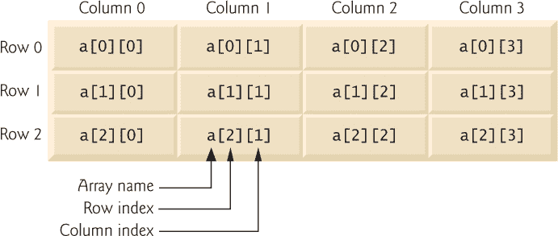

数组 `a` 中的每个元素都通过形式为 `a[row][column]` 的数组访问表达式来标识，其中 `a` 是数组名称，`row` 和 `column` 是通过行索引和列索引唯一标识每个元素的索引。行 `0` 中的所有元素名称第一个索引均为 `0`，列 `3` 中的所有元素名称第二个索引均为 `3`。

### 一维数组的数组

与一维数组一样，多维数组可以在声明中使用数组初始化器进行初始化。一个具有两行两列的二维数组 `b` 可以如下所示使用`嵌套数组初始化器`进行声明和初始化：

```java
int[][] b = {{1, 2}, {3, 4}};
```

初始值按行在大括号中分组。因此，`1` 和 `2` 分别初始化 `b[0][0]` 和 `b[0][1]`，而 `3` 和 `4` 分别初始化 `b[1][0]` 和 `b[1][1]`。编译器通过计算嵌套数组初始化器的数量（外层大括号内的一组组大括号）来确定数组 `b` 的行数。编译器通过计算某一行嵌套数组初始化器中的初始化值来确定其列数。正如我们将要看到的，这意味着行可以具有不同的长度，从而实现了“锯齿数组”。

多维数组被维护为一维数组的数组。因此，在前述声明中，数组 `b` 的各行都是一维数组——其中一个包含第一个嵌套数组初始化器 `{1, 2}` 中的值，另一个包含第二个嵌套数组初始化器 `{3, 4}` 中的值。所以，数组 `b` 是一个包含两个元素的一维数组，每个元素都引用了一个包含两个 `int` 值的一维数组。

### 行长度不一的二维数组

多维数组的表示方式使其变得非常灵活。事实上，数组中的行并不要求具有相同的长度。例如，

点击此处查看代码图像

```java
int[][] b = {{1, 2}, {3, 4, 5}};
```

创建了一个整数数组 `b`，它包含两个元素（由嵌套数组初始化器的数量决定），这两个元素代表二维数组的行。`b` 的每个元素都是指向 `int` 变量一维数组的引用。行 `0` 的 `int` 数组是一个包含两个元素（`1` 和 `2`）的一维数组，行 `1` 的 `int` 数组是一个包含三个元素（`3`、`4` 和 `5`）的一维数组。

### 使用数组创建表达式创建二维数组

每行列数相同的多维数组可以使用数组创建表达式创建。例如，以下代码声明了数组 `b` 并为其分配了一个指向三行四列 `int` 数组的引用：

```java
int[][] b = new int[3][4];
```

多维数组的元素在数组对象创建时会被初始化。

每行列数可能不同的多维数组可以如下所示创建：

点击此处查看代码图像

```java
int[][] b = new int[2][];   // 创建 2 行
b[0] = new int[5]; // 为行 0 创建 5 列
b[1] = new int[3]; // 为行 1 创建 3 列
```

上述语句创建了一个具有两行的二维数组。行 `0` 有五列，而行 `1` 有三列。

### 二维数组示例：显示元素值

图 6.10 展示了如何使用数组初始化器初始化二维数组，并使用嵌套 `for` 循环来`遍历数组`（即处理每个数组的每个元素）。类 `InitArray` 的 `main` 方法声明了数组。`array1` 的声明（第 7 行）使用相同长度的嵌套数组初始化器将第一行初始化为值 1、2 和 3，将第二行初始化为值 4、5 和 6。`array2` 的声明（第 8 行）使用了不同长度的嵌套初始化器——第一行初始化为两个元素，值为 1 和 2；第二行初始化为一个元素，值为 3；第三行初始化为三个元素，值为 4、5 和 6。

点击此处查看代码图像

```java
 1   // 图 6.10: InitArray.java
 2   // 初始化二维数组。
 3
 4   public class InitArray {
 5      // 创建并输出二维数组
 6      public static void main(String[] args) {
 7         int[][] array1 = {{1, 2, 3}, {4, 5, 6}};
 8         int[][] array2 = {{1, 2}, {3}, {4, 5, 6}};
 9
10         System.out.println("Values in array1 by row are");
11         outputArray(array1); // 按行显示 array1
12         System.out.println("Values in array2 by row are");
13         outputArray(array2);
14      }
15
16      // 输出二维数组
17      public static void outputArray(int[][] array) {
18         // 遍历行
19         for (int row = 0; row < array.length; ++row) {
20            // 遍历列
21            for (int column = 0; column < array[row].length; ++column) {
22               System.out.printf("%d  ", array[row][column]);
23            }
24            System.out.println();
25         }
26      }
27   }
```

```
Values in array1 by row
1  2  3
4  5  6

Values in array2 by row
1  2
3
4  5  6
```

### 嵌套增强 for 循环

我们在示例中使用计数器循环是为了演示带有双方括号的数组表达式（例如第 23 行的 `array[row][column]`）。你也可以使用增强 `for` 语句来实现第 20–27 行：

点击此处查看代码图像

```java
// 使用增强 for 循环遍历数组行
for (int[] row : array) {
   // 使用增强 for 循环遍历行的列
   for (int element : row) {
      System.out.printf("%d  ", element);
   }
   System.out.println();
}
```

在外层循环中，变量 `row` 是一个一维 `int` 数组，代表二维数组 `array` 对象的当前行——你可以读取该 `for` 头部，“array 中的每一行 row。”在内层循环中，变量 `element` 是一个 `int`，代表来自当前 `row` 的一个元素——你可以读取该 `for` 头部，“当前 row 中的每个 element。”当内层循环处理完当前 `row` 后，外层循环输出一个换行符，然后处理下一行 `row`（如果有）。

### 常见的多维数组操作

让我们使用第 6.16 节开头图表中名为 `a` 的三行四列数组，考虑其他几种常见操作。以下 `for` 语句将数组 `a` 第 `2` 行的所有元素设置为零：

```java
for (int column = 0; column < a[2].length; ++column) {
   a[2][column] = 0;
}
```

我们指定了行 `2`；因此，我们知道第一个索引始终是 `2`（`0` 是第一行，`1` 是第二行）。此 `for` 循环只改变第二个索引（即列索引）。如果数组 `a` 的第 `2` 行包含四个元素，那么之前的 `for` 语句等同于以下赋值语句：

```java
a[2][0] = 0;
a[2][1] = 0;
a[2][2] = 0;
a[2][3] = 0;
```

以下嵌套的增强型 `for` 语句计算了数组 `a` 中所有元素的总和：

```java
int total = 0;
for (int[] row : a) {
   for (int element : row) {
      total += element;
   }
}
```

这些嵌套的 `for` 语句每次处理一行数组元素的总和：

- 外层 `for` 语句最初选择行 0，因此第一行的元素可以通过内部的 `for` 语句进行求和。
- 接下来，外层 `for` 选择行 `1`，以便对第二行进行求和。
- 然后，外层 `for` 选择行 `2`，以便对第三行进行求和。

当外层 `for` 语句终止时，可以显示变量 `total`。

#### 生成式 AI

**1** 提示 `genAIs` 编写嵌套的 `for` 循环，确定并显示名为 `values` 的 `double` 二维数组中的最大值。生成式 AI 使用的是嵌套计数 `for` 循环还是嵌套的增强型 `for` 循环？

### 6.17 变长参数列表

通过**变长参数列表**（variable-length argument lists），你可以创建接收未指定参数的方法。在方法的参数列表中，一个类型后跟一个**省略号 (`...`)**，表示该方法可以接收该类型任意数量的参数。这种对省略号的使用在参数列表中只能出现一次。此类参数必须放置在参数列表的末尾。虽然你可以使用方法重载和数组传递来完成变长参数列表的大部分功能，但在方法的参数列表中使用省略号更加简洁。

图 6.11 展示了 `average` 方法（第 6–15 行），该方法接收一个变长的 `double` 序列。Java 将变长参数列表视为数组。因此，方法体将参数 `numbers` 作为 `double` 数组进行处理。第 10–12 行使用增强型 `for` 循环计算数组中所有 `double` 的总和。第 14 行使用 `numbers.length` 获取 `numbers` 数组的大小，用于平均值计算。`main` 方法中的第 27、29 和 31 行分别用两个、三个和四个参数调用 `average` 方法。`average` 方法有一个变长参数列表（第 6 行），因此它可以处理调用者传递的任意数量 `double` 参数。输出显示每次调用 `average` 方法都会返回正确的值。

点击此处查看代码图像

```java
 1   // Fig. 6.11: VarargsTest.java
 2   // 使用变长参数列表。
 3
 4   public class VarargsTest {
 5      // 计算平均值
 6      public static double average(double... numbers) {
 7         double total = 0.0;
 8
 9         // 使用增强型 for 语句计算总和
10         for (double d : numbers) {
11            total += d;
12         }
13
14         return total / numbers.length;
15      }
16
17      public static void main(String[] args) {
 18         double d1 = 10.0;
 19         double d2 = 20.0;
 20         double d3 = 30.0;
 21         double d4 = 40.0;
 22
 23         System.out.printf("d1 = %.1f%nd2 = %.1f%nd3 = %.1f%nd4 = %.1f%n%n",
 24            d1, d2, d3, d4);
 25
 26         System.out.printf("Average of d1 and d2 is %.1f%n",
 27            average(d1, d2));
 28         System.out.printf("Average of d1, d2 and d3 is %.1f%n",
 29            average(d1, d2, d3));
 30         System.out.printf("Average of d1, d2, d3 and d4 is %.1f%n",
 31            average(d1, d2, d3, d4));
 32      }
 33   }
```

```
d1 = 10.0
d2 = 20.0
d3 = 30.0
d4 = 40.0
Average of d1 and d2 is 15.0
Average of d1, d2 and d3 is 20.0
Average of d1, d2, d3 and d4 is 25.0
```

**图 6.11** 使用变长参数列表。

#### 生成式 AI

**1** 如果在没有任何参数的情况下调用 图 6.11，会导致错误。提示 `genAIs` 修改代码使 `average` 能够优雅地处理这种情况。

### 命令行参数

你可以从命令行向程序传递参数。`main` 方法接收一个 `String` 对象数组，其中每个元素代表一个命令行参数。第一个元素 `args[0]` 通常是程序的名称。后续元素是用户提供的参数。

要使用这些参数，你可以像访问其他数组一样访问 `args` 数组。例如，`args[0]` 是第一个参数，`args[1]` 是第二个，依此类推。

`args.length` 属性告诉你传递给程序的参数数量。在尝试使用参数之前验证用户是否提供了足够的参数非常有用。

```java
public class ArgsExample {
    public static void main(String[] args) {
        if (args.length < 3) {
            System.out.println("Usage: 请提供 3 个参数.");
            return;
        }
        System.out.println("Argument 1: " + args[0]);
        System.out.println("Argument 2: " + args[1]);
        System.out.println("Argument 3: " + args[2]);
    }
}
```

如果你用 `java ArgsExample hello banana cherry` 运行程序，输出将为：

```
Argument 1: hello
Argument 2: banana
Argument 3: cherry
```

### 6.18 从命令行参数初始化数组

可以使用命令行提供的的值初始化数组。这在数组的大小或内容取决于输入时非常常见。

```java
```


public class ArrayArgs {

    public static void main(String[] args) {

        if (args.length == 0) {

            System.out.println("未提供参数.");

            return;

        }

        int size = Integer.parseInt(args[0]);

        int[] numbers = new int[size];

        for (int i = 0; i < size; i++) {

            numbers[i] = Integer.parseInt(args[i + 1]);

        }

        // ... 处理 numbers ...

    }

}

```

在此示例中，`java ArrayArgs 2 10 20` 将创建一个大小为 2 并填充了这些值的数组。

第 15 行获取 `args[0]`——一个指定数组大小的 `String`——并将其转换为 `int` 值，程序在第 16 行使用该值创建数组。`Integer` `class` 的 `static` 方法 `parseInt` 将其 `String` 参数转换为 `int`。此方法可能会失败——在生成式 AI 问题 1 中，你将提示生成式 AI 来处理这种可能性。

第 19–20 行将命令行参数 `args[1]` 和 `args[2]` 转换为 `int` 值，并分别存储在 `initialValue` 和 `increment` 中。第 23–25 行计算每个数组元素的值。第 27–32 行显示数组的内容。

在三个示例执行中：

*   第一个显示程序接收的命令行参数数量不足。
*   第二个使用命令行参数 `5`、`0` 和 `4` 来指定数组的大小（`5`）、第一个元素的值（`0`）以及计算后续每个元素值的增量（`4`）。输出显示这些值创建了一个包含 `0`、`4`、`8`、`12` 和 `16` 的数组。
*   第三个使用命令行参数 `8`、`1` 和 `2` 生成一个其 8 个元素为从 `1` 到 `15` 之间的非负奇数的数组。

#### 生成式 AI

**1** 向生成式 AI 提供 图 6.12 中的代码，并要求它们处理当用户输入非整数命令行参数时可能发生的异常。

### 6.19 类 `Arrays`

`Arrays` `class` 通过提供用于常用数组操作的 `static` 方法帮助你避免重复造轮子，例如：

*   `sort` 用于排序数组——即将元素按升序或降序排列；
*   `binarySearch` 用于在排序后的数组中搜索——即确定数组是否包含特定值，如果包含，确定该值所在的位置；
*   `equals` 用于判断两个数组的内容是否相同；
*   `fill` 用于用相同的值填充数组元素；
*   `toString` 用于创建数组内容的 `String` 表示形式，而无需使用循环遍历元素。

这些以及许多其他 `Arrays` 方法针对基本类型元素和引用类型元素的数组进行了重载。图 6.13 使用 `Arrays` 方法 `sort`、`binarySearch`、`equals`、`fill` 和 `toString`，并展示了如何使用 `System` `class` 的 `static array-copy` 方法来复制数组。

点击此处查看代码图像

```
 1   // Fig. 6.13: ArrayManipulations.java
 2   // Arrays class methods and System.arraycopy.
 3   import java.util.Arrays;
 4
 5   public class ArrayManipulations {
 6      public static void main(String[] args) {
 7         // sort doubles into ascending order
 8         double[] doubles = {8.4, 9.3, 0.2, 7.9, 3.4};
 9         Arrays.sort(doubles);
10         System.out.printf("doubles: %s%n", Arrays.toString(doubles));
11
12         // fill 10-element array with 7s
13         int[] filledInts = new int[10];
14         Arrays.fill(filledInts, 7);
15         System.out.printf("filledInts: %s%n", Arrays.toString(filledInts));
16
17         // copy array ints into array intsCopy
18         int[] ints = {1, 2, 3, 4, 5, 6};
19         int[] intsCopy = new int[ints.length];
20         System.arraycopy(ints, 0, intsCopy, 0, ints.length);
21         System.out.printf("ints: %s%n", Arrays.toString(ints));
22         System.out.printf("intsCopy: %s%n", Arrays.toString(intsCopy));
23
24         // compare ints and intsCopy for equality
25         boolean b = Arrays.equals(ints, intsCopy);
26         System.out.printf("%nints %s intsCopy%n",
27             (b ? "equals" : "does not equal"));
28
29         // compare ints and filledInts for equality
30         b = Arrays.equals(ints, filledInts);
31         System.out.printf("ints %s filledInts%n",
32             (b ? "equals" : "does not equal"));
33
34         // search ints for the value 5
35         int location = Arrays.binarySearch(ints, 5);
36
37         if (location >= 0) {
38            System.out.printf("Found 5 at element %d in ints%n", location);
39         }
40         else {
41            System.out.printf("Found 5 at element %d in ints%n", location);
42         }
43     }
44      }
```

### 6.20 对象自然案例研究：集合导论与 `ArrayList` 类

我们现在继续采用对象自然的方法，通过对创建和操作 `Java Collection Framework` 中的 `ArrayList<E>` 集合类进行案例研究。Java API 提供了许多预定义的集合（即数据结构），它们在内存中存储一组相关的对象。这些类提供了高效且经过验证的方法，可以以移植的方式组织、存储和检索你的数据，而无需了解数据是如何存储的。这减少了程序开发时间并有助于创建更健壮的应用。第 12 章、泛型集合 详细介绍了 Java 集合框架。

你曾使用数组来存储对象序列。数组的大小是固定的，因此它们无法在执行时自动更改大小以适应更多或更少的元素。集合类 `ArrayList<E>`（包 `java.util`）为该问题提供了一个方便的解决方案。`E` 是 `ArrayList` 元素类型的占位符。在声明新的 `ArrayList` 时，你用元素类型替换 `E`。例如，

```
ArrayList<String> list;
```

声明 `list` 为一个只能存储 `String` 的 `ArrayList` 集合。一旦指定了集合的元素类型，编译器就会确保所有使用该集合的操作都是类型安全的。例如，编译器确保你添加到 `ArrayList<String>` 中的所有元素都是 `String`；否则，将发生编译错误。与数组一样，集合索引从零开始。事实上，`ArrayList` 在后台是使用传统的数组实现的。下表显示了 `ArrayList<E>` 类的一些方法：

| 方法 | 说明 |
| --- | --- |
| `add` | 在 `ArrayList` 的末尾或 `ArrayList` 的指定索引处添加元素。 |
| `addFirst` | 在 `ArrayList` 的开头添加元素。 |
| `addLast` | 在 `ArrayList` 的末尾添加元素。 |
| `clear` | 移除 `ArrayList` 中的所有元素。 |
| `contains` | 返回一个 `boolean` 值，表示 `ArrayList` 是否包含指定的值。 |
| `get` | 返回指定索引处的元素。 |
| `getFirst` | 返回 `ArrayList` 的第一个元素。 |
| `getLast` | 返回 `ArrayList` 的最后一个元素。 |
| `indexOf` | 返回指定值在 `ArrayList` 中首次出现处的索引。 |
| `remove` | 移除指定值的首次出现处或指定索引处的元素。 |
| `removeFirst` | 移除 `ArrayList` 的第一个元素 |
| `removeLast` | 移除 `ArrayList` 的最后一个元素 |
| `size` | 返回存储在 `ArrayList` 中的元素数量。 |

#### 装箱与拆箱（Boxing and Unboxing）

带有可以使用任何类型类型占位符的类被称为泛型类。只有引用类型可以用于声明变量和创建泛型类的对象。Java 提供了一种机制——装箱（boxing），允许将基本类型值封装为对象以便与泛型类使用。例如，`ArrayList<Integer>` 只能存储 `Integer` 对象。当你将一个 `int` 值放入 `ArrayList<Integer>` 时，该 `int` 值会被装箱（封装）为一个 `Integer` 对象；而当你从 `ArrayList<Integer>` 获取一个 `Integer` 对象并将其赋值给 `int` 变量时，对象内部的 `int` 值会被拆箱（解封装）。这个装箱/拆箱过程对程序员来说是透明的。

#### 演示 `ArrayList<String>`

图 6.14 展示了一些常用的 `ArrayList` 功能。第 8 行创建了一个新的空 `String` 类型 `ArrayList`，初始容量为三个元素。容量表示 `ArrayList` 在不增长的情况下可以容纳多少项内容。当 `ArrayList` 增长时，它必须创建一个更大的内部数组并将每个元素复制到新数组中。此操作是非常耗耗时的。如果 `ArrayList` 每添加一个元素就增长一个元素，将是低效的。相反，它仅在添加元素且元素数量等于容量时（即没有空间容纳新元素时）才会增长约 50%。如果你在创建 `ArrayList` 时没有传递容量，默认的初始容量为 10。在这个示例中，我们选择初始容量 3（第 8 行），是为了展示当我们尝试添加超出初始容量的元素时，`ArrayList` 会发生增长。

点击此处查看代码图片

```
 1   // Fig 6.14: ArrayListCollection.java
 2   // Generic ArrayList<E> collection demonstration.
 3   import java.util.ArrayList;
 4
 5   public class ArrayListCollection {
 6      public static void main(String[] args) {
 7         // create a new ArrayList of Strings with an initial capacity of 3
 8         var items = new ArrayList<String>(3);
 9         System.out.printf(
10            "After creating list with initial capacity of 3, size is: %d%n",
11            items.size());
12
13         items.add("red"); // append an item to the list
14         items.add(0, "yellow"); // insert "yellow"
15
16         // display the list in the list
 17         for (int i = 0; i < items.size(); ++i) {
18            System.out.printf(" %s", items.get(i));
19         }
20
21         // check if a value is in the list
 22         System.out.printf("\n\"red\" is %sin the list%n",
 23            items.contains("red") ? "": "not ");
24
25         // get the index of an item in the list
 26         System.out.printf("\"red\" is located at index: %d%n",
 27            items.indexOf("red"));
28
29         // clear the ArrayList and display its size
 30         items.clear();
 31         System.out.printf("\nSize after clear: %s%n", items.size());
32      }
33
34      // display the ArrayList's elements on the console
 35      public static void display(ArrayList<String> items, String header) {
 36         System.out.printf(header); // display header
37
38         // display each element in items with enhanced for
 39         for (String item : items) {
40            System.out.printf(" %s", item);
41         }
42
43         System.out.println();
44      }
45   }
```


`add` 方法向 `ArrayList` 添加元素（第 13–14 行）。带有一个参数的版本（第 13 行）将该元素添加到 `ArrayList` 的末尾。带有两个参数的版本（第 14 行）在指定位置插入新元素。第一个参数是索引。第二个参数是要插入到该索引处的值。所有后续元素的索引都会加 1。插入元素的速度通常比向 `ArrayList` 的末尾添加元素的速度要慢。

第 20–22 行显示了 `ArrayList` 的项。`size` 方法返回 `ArrayList` 当前元素的数量——与数组不同，`ArrayList` 并不具有 `length` 实例变量。`get` 方法（第 21 行）获取指定索引处的元素。第 25–26 行通过调用 `display` 方法（第 57–66 行）再次显示元素，该方法使用增强型 `for` 循环来遍历 `ArrayList` 的元素，就像我们在本章早期对内置数组所做的那样。然后，第 27 行显示了 `ArrayList` 的当前大小。第 29–30 行向 `ArrayList` 添加了两个元素，然后第 31 行再次显示元素，以确认这两个元素已成功添加到集合的末尾，第 33 行显示了 `ArrayList` 的新大小。注意，现在的大小已经大于 `ArrayList` 的初始容量。

第 35 行中的 `remove` 方法调用删除了具有特定值（`"yellow"`）的元素。如果 `ArrayList` 中不存在此类元素，`remove` 将不执行任何操作。第 36–37 行显示了 `ArrayList` 当前的元素和大小，显示第一个 `"yellow"` 已删除且大小减了 1。第 39 行使用了 `remove` 的重载版本，删除指定索引（在此例中为 `1`）处的元素。当删除元素时，被删除元素之后任何元素的索引都会减 1——这是一个耗时的操作。第 40–41 行显示了 `ArrayList` 当前的元素和大小，显示 `"green"` 已删除且大小再次减了 1。

第 44–45 行使用 `contains` 方法检查 `"red"` 是否在 `ArrayList` 中。如果在 `ArrayList` 中找到了该元素，`contains` 方法返回 `true`；否则返回 `false`。第 48–49 行使用 `indexOf` 方法获取 `"red"` 在 `ArrayList` 中的索引，如果未找到 `"red"` 则返回 `-1`。`contains` 和 `indexOf` 方法按顺序将其参数与每个 `ArrayList` 元素进行比较——这被称为线性搜索——因此在大型 `ArrayList` 上使用这些方法效率可能较低。

第 52 行通过调用 `clear` 方法移除了 `ArrayList` 的所有剩余元素。然后，第 53 行显示 `ArrayList` 的大小现在为 0。

### 创建泛型类对象的菱形（`<>`）表示法

图 6.14 中的 `ArrayList` 是一个局部变量，因此我们在第 8 行使用了局部变量类型推断，从其初始化器来确定变量 `items` 的类型。在旧版代码中，第 8 行可能显示为：

```
ArrayList<String> items = new ArrayList<>();
```

`new` 表达式中的菱形（`<>`）表示法告诉编译器根据变量 `items` 的声明推断 `ArrayList` 对象的元素类型（`String`）。前面的语句简化了如下语句：

```
ArrayList<String> items = new ArrayList<String>();
```

其中 `ArrayList<String>` 分别出现在变量声明和 `new` 表达式中。

#### 生成式 AI

1. 使用带有图 6.14 中的代码提示生成式 AI，并要求它们重写代码以移除对 `displayArray` 的调用，将其替换为对 `System.out.printf` 的调用，后者隐式地使用 `ArrayList` 的 `toString` 方法。运行更新后的代码并将输出与图 6.14 的输出进行比较。

### 6.21 总结

本章开始了我们对数据结构的介绍，使用数组在列表和值表中存储和检索数据。我们讨论了存储值的基本类型变量与存储内存中其他位置对象引用的引用类型变量的区别。我们引入了数组，讨论了如何声明、创建和初始化它们，并解释了如何访问和操作它们的元素。

你看到数组元素默认是初始化的，你可以使用数组初始化器为它们提供自定义初始化器。你还使用了循环将计算出的值赋予数组元素。我们展示了常见的数组操作，包括数组元素求和、使用柱状图可视化数组数据，以及使用数组元素作为计数器来总结掷骰频率和调查结果。我们使用了 `try` 语句来处理程序访问数组边界之外元素时产生的 `ArrayIndexOutOfBoundsException`。

你使用计数 `for` 循环遍历数组。我们还使用了增强型 `for` 循环来遍历数组元素。我们将数组和单个数组元素传递给方法，以演示按值传递和引用传递的区别。

我们引入了多维数组，并使用二维数组来表示行和列。你使用嵌套的计数 `for` 循环遍历二维数组。我们展示了如何编写使用可变长度参数列表的方法，以及如何从命令行读取参数。你通过 `Arrays` 类的 `static` 方法执行了各种数组操作。

自然案例引入了 `ArrayList<E>` 泛型集合，它提供了数组的功能和性能，以及动态调整大小以容纳更多元素。你使用 `add` 和 `remove` 方法向 `ArrayList` 添加新项和从其移除项。我们展示了 `ArrayList` 方法 `size` 返回 `ArrayList` 中当前项的数量。我们还使用了 `contains` 来判断项是否存在于 `ArrayList` 中。

我们将在第 12 章泛型集合 中继续介绍数据结构，该章节介绍了 Java 集合框架中的几个集合以及 `Arrays` 的额外方法。在第 14 章使用 Lambda 和 Stream 的函数式编程 中，我们引入了 Java 的函数式编程能力，它让你能够编写更简洁、错误更少且更容易阅读、调试和修改的代码。第 14 章 与书中之前的相关章节对应，以便如果你愿意，可以更方便地使用 lambda 和流。现在你已经完成了第 6 章，可以阅读第 14.1–14.7 节，这些节引入了 lambda 和流的概念，并使用它们重构了第 5 章和第 6 章的示例。完成第 14 章后，你能够更简洁、优雅地重新实现第 6 章中的许多示例，并且这种方式更容易进行并行化，以提高当今多核系统上的性能。

### 特别章节：生成式 AI 练习

针对以下每个问题，尝试多种生成式 AI 以确定哪一个表现最好。务必验证结果。请记住，它们有时会出错甚至产生幻觉，创建出不可靠的信息。

## 6.1（研究 Java 的下一个版本）Java 版本每年 3 月和 9 月发布。向生成式 AI 提供当前的 Java 版本，并要求它们编写一份教程，涵盖下一个版本中计划发布的重大新语言和库特性。

## 6.2（一维数组动画演示）提示生成式 AI 查找演示如何遍历一维数组的动画。

## 6.3（二维数组动画演示）提示生成式 AI 查找演示如何遍历二维数组的动画。

## 6.4（一维数组练习题）提示生成式 AI 创建带有 Java 一维数组操作练习的练习题及答案。

## 6.5（二维数组练习题）提示生成式 AI 创建带有 Java 二维数组操作的练习题及答案。

## 6.6（这段一维数组代码是做什么的？）提示生成式 AI 创建用于 Java 一维数组操作的晦涩代码示例，以便你进行研究并确定其功能。

## 6.7（这段二维数组代码是做什么的？）提示生成式 AI 创建用于 Java 二维数组操作的晦涩代码示例，以便你进行研究并确定其功能。

## 6.8（快速失败 vs. 异常处理）一些开发者认为，在程序开发过程中，发生异常时让程序失败（被称为“快速失败”）会比捕获并处理异常更好。提示生成式 AI 讨论快速失败与异常处理的优缺点。

## 6.9（提高容错性）向生成式 AI 提供一个程序，并要求它们通过为抛出异常的方法添加异常处理来提高代码的容错性。

## 6.10（产生影响）提示生成式 AI 建议你可以构建的 Java 程序和项目，以这些项目为世界“产生影响”。

## 6.11（检查 Java 惯用）向生成式 AI 提供你编写的代码，并要求它们根据最新的 Java 版本以及你到本书为止所学的内容，评估代码是否符合惯用。

## 6.12（基本类型 vs. 引用类型）提示生成式 AI 编写一份关于 Java 中基本类型与引用类型的教程。

## 6.13（向方法传递参数）提示生成式 AI 编写一份比较 Java 中按值传递和按引用传递的教程。

## 6.14（Java 代码现代化）由于自 1995 年 Java 出现以来编写了大量的 Java 遗留代码，许多开发者关注其组织代码库的现代化。提示生成式 AI 编写一份关于 Java 代码现代化的教程。

# 7 字符串、自然语言处理与正则表达式：生成式 AI 基础


### 目标

在本章中，你将：

* 创建和操作 `String` 类的不可变字符字符串对象。
* 创建和操作 `StringBuilder` 类的可变字符字符串对象。
* 使用 `Character` 类的 `static` 方法测试字符的各种属性。
* 分词 `String`。
* 使用生成式 AI 来利用你的 Java 学习经验。
* 接触自然语言处理——生成式 AI 的关键基础。
* 查看一个关于对象的自然案例研究，介绍如何使用正则表达式识别文本中的模式，以进行数据验证、转换和提取——这些操作通常用于准备训练用于生成式 AI 的语言模型的文本。
* 查看一个关于 `pMa5tfEKwk59d TvC04Ft1IFQz9mEXnkfYXZwxk4ujGE=` 的对象的自然案例研究（参见第 7.9 节）。

## 大纲

### 7.1 引言

本章讨论 Java 的字符串和字符处理能力。这里介绍的技术适用于验证程序输入、向用户显示信息以及许多常见的文本操作。你在之前的章节中看到了几种字符串处理能力。本章详细讨论 `java.lang` 包中的 `String`、`StringBuilder` 和 `Character` 类。你将继续使用生成式 AI 来增强你的学习体验。

### 自然语言处理 (NLP) 简介

第 7.7 节介绍了自然语言处理（NLP）——一个重要的数据科学和 AI 话题。NLP 是生成式 AI 的关键基础技术。NLP 帮助计算机理解、分析和处理文本。在编写本书时，我们使用了付费 NLP 工具 Grammarly^(1) 来帮助调整写作并确保文本对广泛读者的可读性。我们还使用了各种生成式 AI 的 NLP 能力来评估章节的覆盖广度和深度，验证内容并建议潜在的改进。

1 Grammarly 有免费版和付费版（[`https://www.grammarly.com`](https://www.grammarly.com)）。它们提供了可以在几种流行网络浏览器使用的免费插件。

### 对象的自然案例研究：使用正则表达式搜索字符串模式、验证数据和替换子字符串

我们继续采用对象的自然方法，进行两个案例研究。第 7.8 节 介绍了正则表达式（简称为 regexes），它们在当今数据丰富的应用程序中至关重要，用于：

* 清洗和准备分析及大语言模型（LLM）训练的数据这一过程被称为**数据清洗 (data wrangling)** 或**数据整理 (data munging)**，
* 数据挖掘——例如在大型文本中定位名称、组织、URL、电子邮件地址和电话号码——以及
* 将数据转换为其他格式——例如将制表符分隔的数据转换为逗号分隔值数据（CSV）。

通过 `String` 类以及 `java.util.regex` 包中的 `Matcher` 和 `Pattern` 类，我们将使用正则表达式匹配文本中的模式。之前的章节提到了验证用户输入。本章介绍的功能经常用于：

* 自然语言处理，
* 为训练生成式 AI 准备数据以及
* 使生成式 AI 创建提示响应。

### 对象的安全案例研究：pMa5tfEKwk59dTvC04Ft1IFQz9mfYXZk4ujGE=

我们第二个对象的自然案例研究的标题并非偶然。参见第 7.9 节 这些看似随机的字符、数字和符号的含义。

## 7.2 字符与字符串的基础

字符是 Java 代码的基础构建块。**字符字面量**是用单引号表示的整数值。例如，`'z'` 代表字母 z 的整数值，`'\t'` 代表制表符字符的整数值。字符字面量的值是该字符在 **Unicode 字符集**^(2)（在第 1 章 中引入）中的整数值。每个程序都由字符序列组成，当这些字符有意义地分组后，会被 Java 编译器解释为完成任务的指令。

回想 第 2.2 节，字符串被视为单个单元的字符序列，可能包含字母、数字和各种特殊字符，例如 `+`、`-`、`*`、`/` 和 `$`。字符串是 `String` 类的对象。`字符串字面量`（在内存中存储为 `String` 对象）以双引号括的字符序列的形式写入，如下所示：

```
"John Q. Huang"           (一个名字)
"99999 Main Street"       (一个街道地址)
"Waltham, Massachusetts"  (一个城市和州)
"(201) 555-1212"          (一个电话)
```

你已经将字符串字面量赋值给 `String` 变量。以下声明将 `String` 变量 `color` 初始化为指向一个包含 `"blue"` 的 `String` 对象：

```
String color = "blue";
```

### String 对象不可修改

Java 将所有内容相同的字符串字面量视为同一个 `String` 对象，并对其进行多个引用以节省内存。这些引用中的任何一个都不能修改 `String`，因为 `String` 对象是**不可变的**（immutable）——`String` 类没有提供修改 `String` 对象内容的方法。在本章中演示的每个似乎修改了 `String` 的 `String` 方法实际上都返回了一个包含修改内容的新 `String` 对象，而保持原始对象不变。

#### 生成式 AI

**1** 提示生成式 AI 解释为什么 `String` 对象是不可变的，但这对于所有数据类型并不普遍 true。

### 7.3 `String` 类

接下来的几个小节将介绍 `String` 类的许多功能。

#### 7.3.1 创建 `String` 对象

图 7.1 显示了创建和初始化 `String` 对象的几种方法。

```
 1   // Fig. 7.1: StringConstructors.java
 2   // String class constructors.
 3
 4   public class StringConstructors {
 5      public static void main(String[] args) {
 6         char[] charArray = {'b', 'i', 'r', 't', 'h', 'd', 'a', 'y'};
 7         var s = new String("hello");
 8
 9         // use String constructors
10         var s1 = new String(); // ""
11         var s2 = new String(s); // "hello"
12         var s3 = new String(charArray); // "birthday"
13         var s4 = new String(charArray, 5, 3); // "day"
14
15         System.out.printf(
16            "s1 = %s%ns2 = %s%ns3 = %s%ns4 = %s%n", s1, s2, s3, s4);
17      }
 18   }
```

```
s1 =
s2 = hello
s3 = birthday
s4 = day
```


**图 7.1** | `String` 类构造器。

第 7 行使用 `new` 运算符创建一个 `String` 对象。变量 `s` 使用 `new String("hello")` 的结果初始化，这在形式上称为类实例表达式。`new` 运算符创建指定类（即 `String`）的对象（即实例）。类名后的括号表示对`构造器`的调用，构造器类似于方法，但由 `new` 运算符隐式调用，以便在创建对象时对其初始化。第 7 行调用了 `String` 构造器，将另一个 `String` 的内容复制到新的 `String` 对象中。我们将在 第 8 章 中讨论构造器。《Java 语言规范，Java SE 23 版》。第 15.9 节，“类实例表达式”。访问于 2024 年 9 月 6 日 (`https://docs.oracle.com/javase/specs/jls/se23/html/jls-15.9`)。

第 10 行使用 `String` 无参数构造器创建一个新的 `String`，该构造器创建一个不包含任何字符的 `String` 对象（即空字符串，可以表示为 `""`）。第 11 行创建一个新的 `String` 对象，包含其参数 `s` 的副本，包含 `"hello"`。第 12 行创建一个新的 `String` 对象，包含 `String` 构造器中 `char` 数组的字符。

第 13 行使用带有 `char` 数组和两个整数作为参数的 `String` 构造器创建一个新的 `String` 对象。第二个参数指定了从数组复制的起始位置（偏移量；`String` 索引从 0 开始）。第三个参数指定了从数组中复制的字符数（计数）。如果作为参数指定的偏移量或计数导致访问数组边界外的元素，则会发生 `IndexOutOfBoundsException`。

#### 生成式 AI

**1** 提示生成式 AI 为 图 7.1 中的程序添加有意义的注释，然后将结果与原始结果进行比较。

#### 7.3.2 `String` 方法 `length`、`charAt` 和 `getChars`

`String` 方法 `length`、`charAt` 和 `getChars` 分别返回 `String` 的长度、获取 `String` 中特定位置的字符以及从 `String` 获取一组字符作为 `char` 数组。图 7.2 展示了这些方法。

点击查看代码图像

```
 1   // Fig. 7.2: StringMiscellaneous.java
 2   // This program demonstrates the length, charAt and getChars
 3   // methods of the String class.
 4
 5   public class StringMiscellaneous {
 6      public static void main(String[] args) {
 7         String s1 = "hello there";
 8         char[] charArray = new char[5];
 9
10         System.out.printf("s1: %s", s1);
11         // test length
12         System.out.printf("%nLength of s1: %d", s1.length());
13
14         // loop through s1 with charAt and display reversed
15         System.out.printf("%nThe string reversed is: ");
16         for (int count = s1.length() - 1; count >= 0; --count) {
17            System.out.printf("%c ", s1.charAt(count));
18         }
19
20         // copy characters from s1 into charArray
21         s1.getChars(0, 5, charArray, 0);
22         System.out.printf("%nThe character array is: ");
23         for (char character : charArray) {
24            System.out.print(character);
25         }
26
27         System.out.println();
28      }
29   }
```

```

s1: hello there
Length of s1: 11
The string reversed is: e r h t o l l h 
The character array is: hello
```

**图 7.2** | `String` 方法 `length`、`charAt` 和 `getChars`。

第 13 行使用 `String` 方法 `length` 来确定 `String` 中的字符数。像数组一样，`String` 知道自己的长度。但与数组不同，你通过 `String` 的 `length` 方法来访问 `String` 的长度。

第 18–20 行反序打印 `String s1` 的字符（用空格隔开）。`String` 方法 `charAt`（第 19 行）返回 `String` 中特定位置的字符。方法接收一个表示索引的整数参数并返回该索引处的字符。像数组一样，`String` 的第一个元素位于位置 0。

第 23 行使用 `String` 方法 `getChars` 将 `String` 的字符复制到字符数组中。第一个参数是从开始复制的索引。第二个参数是 `String` 中要复制的最后一个字符之后的索引。第三个参数是接收复制字符的字符数组。最后一个参数是复制字符放置在目标字符数组中的起始索引。接下来，第 26–28 行逐个字符打印 `char` 数组的内容。

#### 生成式 AI

**1** 提示生成式 AI 写一个与 图 7.2 中第 26–28 行的增强 `for` 语句等价的计数 `for` 语句。让他们注释为什么首选增强 `for` 语句。

#### 7.3.3 比较 `String`

经常，被排序或搜索的信息由 `String` 组成，并且必须对它们进行比较以进行排序，或者确定一个 `String` 是否出现在数组（或其他集合）中。`String` 类提供了用于比较 `String` 的方法，如图 7.3–7.4 所示。

为了理解一个 `String` 大于或小于另一个 `String` 意味着什么，考虑对一组姓氏进行字母排序的过程。毫无疑问，你会把“Garcia”放在“Tanaka” 之前，因为在字母表中，“Garcia”的第一个字母在“Tanaka”的第一个字母之前。字母表不仅仅是 26 个字母的列表——它是一个有序的字符列表。每个字母在列表中都有一个特定的位置。Z 不仅仅是字母表中的一个字母——它特定的字母表中第 26 个字母。

Java 如何知道一个字母在另一个字母“之前”？所有字符在内部都表示为 Unicode 字符集中的数值代码。当 Java 比较 `String` 时，它使用字典序比较（lexicographical comparison）来比较字符——也就是说，它比较字符的 Unicode 数值。

图 7.3 展示了几个 `String` 比较方法以及使用等 Equality 运算符 `==` 比较 `String` 对象。为了方便讨论，我们将此示例分成了几部分。第 6–12 行创建并显示了几个用于此示例的 `String`。

点击查看代码图像

```
 1   // Fig. 7.3: StringCompare.java
 2   // Comparing Strings and portions of Strings.
 3
 4   public class StringCompare {
 5      public static void main(String[] args) {
 6         String s1 = new String("hello"); // s1 is a copy of "hello"
 7         String s2 = "goodbye";
 8         String s3 = "Happy Birthday";
 9         String s4 = "happy birthday";
10
11         System.out.printf(
12            "s1 = %s%ns2 = %s%ns3 = %s%ns4 = %s%n%n", s1, s2, s3, s4);
13
```

```

s1 = hello
s2 = goodbye
s3 = Happy Birthday
s4 = happy birthday
```

**图 7.3** | `String` 方法 `equals`、`equalsIgnoreCase`、`compareTo` 和 `regionMatches`。

### `String` 方法 `equals`

第 15 行使用 `String` 方法 `equals` 来比较 `String s1` 与 `String` 字面量 `"hello"` 是否相等：

点击查看代码图像

```
14         // test for equality
15         if (s1.equals("hello")) {  // true
16            System.out.println("s1 equals \"hello\"");
17         }
18         else {
19            System.out.println("s1 does not equal \"hello\"");
20         }
21
```

```

s1 equals "hello"
```

对于 `String`，`equals` 方法确定两个 `String` 的内容是否相同。如果是，则返回 `true`；否则，返回 `false`。第 15 行的条件为 `true`，是因为 `String s1` 是用字面量 `"hello"` 初始化的。方法 `equals` 使用字典序比较。因此，如果将 `String "hello"` 与 `String "HELLO"` 比较，结果为 `false`，因为 `'h'` 的整数表示与 `'H'` 不同。

### 使用 `==` 运算符比较 `String`

第 23 行的条件使用等 Equality 运算符 `==` 来比较 `String s1` 与 `String` 字面量 `"hello"` 是否相等。

点击查看代码图像

```
22         // test for equality with ==
23         if (s1 == "hello") { // false; they are not the same object
24            System.out.println("s1 is the same object as \"hello\"");
25         }
26         else {
27            System.out.println("s1 is not the same object as \"hello\"");
28         }
29
```

```

s1 is not the same object as "hello"
```

当用 `==` 比较基本类型值时，如果两个值相同，结果为 `true`。当用 `==` 比较引用时，如果两者都指向内存中的同一个对象，则结果为 `true`。你必须调用方法来比较对象的内容是否相等。对于 `String`，该方法就是 `equals`。第 23 行的条件求值为 `false`，是因为引用 `s1` 是通过以下语句初始化的：

```
s1 = new String("hello");
```

该语句创建了一个包含 `"hello"` 拷贝的新 `String` 对象，并将该对象赋值给 `s1`。如果 `s1` 是通过直接赋值 `"hello"` 给变量初始化的，结果如下：

```
s1 = "hello";
```

### `String` 方法 `equalsIgnoreCase`

在排序 `String` 时，你可能需要比较它们是否相等。第 31 行使用 `equalsIgnoreCase` 来比较 `s3` (`Happy Birthday`) 和 `s4` (`happy birthday`)。由于方法忽略大小写，此比较为 `true`。

点击查看代码图像

```
30         // test for equality (ignore case)
31         if (s3.equalsIgnoreCase(s4)) { // true
32            System.out.printf("%s equals %s with case%n", s3, s4);
33         }
34         else {
35            System.out.println("s3 does not equal s4");
36         }
```

```

Happy Birthday equals happy birthday with case
```

### `String` 方法 `compareTo`

第 39–48 行使用 `compareTo` 来比较 `String`。第 40 行比较 `String s1` (`"hello"`) 和 `String s2` (`"goodbye"`)。`compareTo` 方法如果 `String` 相等则返回 0；
- 如果调用方法的 String 小于参数，返回负数；
- 如果调用方法的 String 大于参数，返回正数。

该方法使用字典序来比较每个 `String` 字符的 Unicode 值。

点击查看代码图像

```
38         // test compareTo
39         System.out.printf(
40            "%ns1.compareTo(s2) is %d", s1.compareTo(s2));
41         System.out.printf(
42            "%ns2.compareTo(s1) is %d", s2.compareTo(s1));
43         System.out.printf(
44            "%ns1.compareTo(s1) is %d", s1.compareTo(s1));
45         System.out.printf(
46            "%ns3.compareTo(s4) is %d", s3.compareTo(s4));
47         System.out.printf(
48            "%ns4.compareTo(s3) is %d%n%n", s4.compareTo(s3));
49
```

```

s1.compareTo(s2) is 1
s2.compareTo(s1) is -1
s1.compareTo(s1) is 0
s3.compareTo(s4) is -32
s4.compareTo(s3) is 32
```

### `String` 方法 `regionMatches`

第 51 行的条件使用 `String` 方法 `regionMatches` 版本来比较两个 `String` 的部分是否相等。该版本的第一个参数是调用方法的 String 中的起始索引。第二个参数是比较 `String`。第三个参数是比较 `String` 中的起始索引。最后一个参数是要比较的字符数。只有当所比较的字符字典序相等时，该方法才返回 `true`。

最后，第 60 行的条件使用五参数 `regionMatches` 版本来比较两个 `String` 的部分是否相等。当第一个参数为 `true` 时，方法忽略大小写。其余参数与四参数 `regionMatches` 方法描述的相同。

点击查看代码图像

```
50         // test regionMatches (case sensitive)
51         if (s3.regionMatches(0, s4, 0, 5)) {
52            System.out.println("First 5 characters of s3 and s4 match");
53         }
54         else {
55            System.out.println(
56               "First 5 characters of s3 and s4 do not match");
57         }
58
59         // test regionMatches (ignore case)
60         if (s3.regionMatches(true, 0, s4, 0, 5)) {
61            System.out.println(
62               "First 5 characters of s3 and s4 match with case ignored\n");
63         }
64         else {
```


### `String` 方法 `isBlank`

第 70 行使用 `String` 方法 `isBlank` 来确定 `" \t\n"` 是否仅包含空白字符。在这种情况下，`isBlank` 返回 `true`，因为该 `String` 包含了三个空白字符——一个空格、一个制表符和一个换行符。

```java
69         // test whether a String contains only whitespace
70         System.out.printf("\" \\t\\n\".isBlank(): %b%n", " \t\n".isBlank());
71      }
72   }
```

```
" \t\n".isBlank(): true
```

### `String` 方法 `startsWith` 和 `endsWith`

图 7.4 展示了 `String` 方法 `startsWith`（第 10 行和 19 行）和 `endsWith`（第 29 行）。`main` 方法创建了一个包含 `"started"`、`"starting"`、`"ended"` 和 `"ending"` 的数组 `strings`。我们使用三个 `for` 语句来测试数组元素，确定它们是否以特定的字符集开头或结尾。

```java
 1   // Fig. 7.4: StringStartEnd.java
 2   // String methods startsWith and endsWith.
 3
 4   public class StringStartEnd {
 5      public static void main(String[] args) {
 6         String[] strings = {"started", "starting", "ended", "ending"};
 7
 8         // test method startsWith
 9         for (String string : strings) {
10            if (string.startsWith("st")) {
11               System.out.printf("\"%s\" starts with \"st\"%n", string);
12            }
13         }
14
15         System.out.println();
16
17         // test method startsWith starting from position 2 of string
19         for (String string : strings) {
20            if (string.startsWith("art", 2)) {
21               System.out.printf(
22                  "\"%s\" starts with \"art\" at position 2%n", string);
23            }
24         }
25
26         System.out.println();
27
28         // test method endsWith
29         for (String string : strings) {
30            if (string.endsWith("ed")) {
31               System.out.printf("\"%s\" ends with \"ed\"%n", string);
32            }
33         }
34   }
}
```

```
"started" starts with "st"
"starting" starts with "st"
"started" starts with "art" at position 2
"starting" starts with "art" at position 2
"started" ends with "ed"
"ended" ends with "ed"
```

**图 7.4** | `String` 方法 `startsWith` 和 `endsWith`。

第 9–13 行使用了接受 `String` 参数的 `startsWith` 方法版本。`if` 语句中的条件（第 10 行）决定了每个 `String` 是否以字符 `"st"` 开头。如果是，该方法返回 `true`，程序打印该 `String`；否则，方法返回 `false` 不打印任何内容。

第 18–23 行使用了接受 `String` 和整数作为参数的 `startsWith` 方法。整数指定了 `String` 中开始比较的索引。第 19 行的条件决定了每个 `String` 是否从索引为 2 的字符开始包含字符 `"art"`。如果是，方法返回 `true`，程序打印该 `String`。

第三个 `for` 语句（第 28–32 行）使用了接受 `String` 参数的 `endsWith` 方法。第 29 行的条件决定了每个 `String` 是否以字符 `"ed"` 结尾。如果是，方法返回 `true`，程序打印该 `String`。

#### 7.3 定位字符和子字符串

通常，搜索字符或子字符串是非常用的（例如，如果你正在创建一个文档，你可能需要搜索特定的单词）。`indexOf` 和 `lastIndexOf` 方法允许你在 `String` 对象中定位字符或子字符串。

```
最后一个 'c' 位于索引 15
最后一个 'a' 位于索引 13
最后一个 '$' 位于索引 -1
```

### 使用 `indexOf` 和 `lastIndexOf` 子字符串

第 25–38 行演示了 `indexOf` 和 `lastIndexOf` 方法的版本，这些方法接受一个 `String` 作为第一个参数。这些版本的执行效果与之前描述的相同，但它们根据通过其 `String` 参数指定的子字符串进行搜索。如果找到了子字符串，这些方法将返回子字符串在 `String` 中第一个字符的索引。

```java
24         // 使用 indexOf 在 String 中定位子字符串
25         System.out.printf("\"def\" is located at index %d%n",
26            letters.indexOf("def"));
27         System.out.printf("\"def\" is located at index %d%n",
28            letters.indexOf("def", 7));
29         System.out.printf("\"hello\" is located at index %d%n%n",
30            letters.indexOf("hello"));
31
32         // 使用 lastIndexOf 在 String 中查找子字符串
33         System.out.printf("Last \"def\" is located at index %d%n",
34            letters.lastIndexOf("def"));
35         System.out.printf("Last \"def\" is located at index %d%n",
36            letters.lastIndexOf("def", 25));
37         System.out.printf("Last \"hello\" is located at index %d%n",
38            letters.lastIndexOf("hello"));
39      }
40   }
```

```
"def" 位于索引 3
"def" 位于索引 16
"hello" 位于索引 -1
最后一个 "def" 位于索引 16
最后一个 "def" 位于索引 16
最后一个 "hello" 位于索引 -1
```

#### 生成式 AI

**1** 提示生成式 AI 编写执行以下操作的语句：

1. 编写 Java 代码，在 `String "to be or not to be"` 中定位子字符串 `"be"` 的第一次出现，然后显示索引。
2. 编写一个 Java 表达式，在 `String "to be or not to be"` 中定位子字符串 `"be"` 的最后一次出现，然后显示索引。

将生成的结果与以下代码对比：

```java
String s = "to be or not to be";
System.out.printf("First occurrence of \"be\" is at index: %d%n",
   s.indexOf("be"));
System.out.printf("Last occurrence of \"be\" is at index: %d%n",
   s.lastIndexOf("be"));
```

```
"be" 的第一次出现位于索引: 3
"be" 的最后一次出现位于索引: 16
```

### 7.3.5 从 `String` 中提取子字符串

`String` 类中的两个 `substring` 方法都通过复制现有字符串的一部分来创建并返回一个新的 `String` 对象。图 7.6 演示了这两种方法。

```java
 1   // 图. 7.6: SubString.java
 2   // String 类 substring 方法。
 3
 4   public class SubString {
 5      public static void main(String[] args) {
 6         String letters = "abcdefghijklmabcdefghijklm";
 7
 8         // 测试 substring 方法
 9         System.out.printf("Substring from index 20 to end is \"%s\"%n",
10            letters.substring(20));
11         System.out.printf("%s \"%s\"%n",
12            "Substring from index 3 up to, but not including, 6 is",
13            letters.substring(3, 6));
14      }
15   }
```

```
从索引 20 到结束的子字符串是 "hijklm"
从索引 3 到包含但不包含 6 的子字符串是 "def"
```

**图 7.6** | `String` 类 `substring` 方法。

第 10 行的 `letters.substring(20)` 使用了接受一个整数参数的 `substring` 方法。该参数指定了原始 `String letters` 中用于字符的起始索引。返回的子字符串包含从起始索引到 `String` 结束的字符拷贝。指定 `String` 范围之外的索引会导致 `IndexOutOfBoundsException`。

第 13 行使用了接受两个整数参数的 `substring` 方法——即从原始 `String` 中开始复制字符的起始索引，以及要复制的最后一个字符之后的索引（即复制到 `String` 中的该索引，但不包含该索引）。返回的子字符串包含原始 `String` 中指定字符的拷贝。指定 `String` 范围之外的索引会导致 `IndexOutOfBoundsException`。

#### 生成式 AI

**1** 提示生成式 AI 编写代码，捕获当代码尝试访问 `String` 边界之外字符时抛出的异常。代码应该捕获并显示该异常。

### 7.3.6 拼接 `String`

`String` 方法 `concat` (图 7.7) 拼接两个 `String` 对象（类似于 `+` 运算符）并返回一个新的 `String`。第 11 行的表达式 `s1.concat(s2)` 将 `s2` 中的字符附加到 `s1` 形成一个 `String`。第 12 行打印 `s1` 说明 `String` 是不可变的，这些方法返回的是新的 `String`。

```java
 1   // 图 7.7: Stringatenation.java
 2   // String 方法 concat。
 3
 4   public class Stringatenation {
 5      public static void main(String[] args) {
 6         String s1 = "Happy";
 7         String s2 = "Birthday";
 8
 9         System.out.printf("s1 = %s%ns2 = %s%n", s1, s2);
10         System.out.printf("Result of s1.concat(s2) = %s%n", s1.concat(s2));
11         System.out.printf("s1 after concatenation = %s%n", s1);
 12      }
 13   }
```

```
s1 = Happy
s2 = Birthday
Result of s1.concat(s2) = HappyBirthday
s1 after concatenation = Happy
```

**图 7.7** | `String` 方法 `concat`。

### 7.3.7 杂 `String` 方法

`String` 类提供了多种方法，返回包含原始 `String` 修改拷贝的 `String` 或字符数组。图 7.8)。为了目的，我们将示例拆分。第 6–10 行创建并显示了示例中使用的 `String` 对象。

```java
 1   // 图. 7.8: StringMiscellaneous.java
 2   // replace, toLowerCase, toUpperCase, trim 和 toCharArray 方法。
 3
 4   public class StringMiscellaneous {
 5      public static void main(String[] args) {
 6         String s1 = "hello";
 7         String s2 = "GOODBYE";
 8         String s3 = "   spaces   ";
 9
10         System.out.printf("s1: \"%s\"%ns2: \"%s\"%ns3: \"%s\"", s1, s2, s3);
 11
```

```
s1: "hello"
s2: "GOODBYE"
s3: "   spaces   "
```

**图 7.8** | `replace`, `toLowerCase`, `toUpperCase`, `trim` 和 `toCharArray` 方法。

##### 在 String 中替换字符

第 14 行使用 `String` 方法 `replace` 返回一个新的 `String` 对象，其中 `s1` 中每个出现的字符 `'l'` 都被替换为字符 `'L'`。`replace` 方法不会改变原始 `String`。如果 `String` 中没有第一个参数的项，`replace` 将返回原始 `String`。`replace` 方法的重载版本允许你替换子字符串而不是单个字符。

```java
12         // 测试 replace 方法
13         System.out.printf(
14            "%n%nReplace 'l' with 'L' in s1: %s%n%n", s1.replace('l', 'L'));
15
```

```
Replace 'l' with 'L' in s1: heLLo
```


第 17 行使用 `String` 方法 `toUpperCase()` 来获取一个新的 `String`，它将 `s1` 中的所有小写字母替换为大写字母，同时保持原始 `String` 不变。如果没有字符需要转换，`toUpperCase()` 将返回原始的 `String`。第 18 行使用 `String` 方法 `toLowerCase()` 获取一个新的 `String` 对象，它将 `s2` 中的所有大写字母替换为小写字母，同时保持原始 `String` 不变。如果原始 `String` 中没有可以转换的字符，`toLowerCase()` 将返回原始的 `String`。

```
16         // test toLowerCase and toUpperCase
17         System.out.printf("s1.toUpperCase() = %s%n", s1.toUpperCase());
18         System.out.printf("s2.toLowerCase() = %s%n%n", s2.toLowerCase());
19
```

```
s1 = HELLO
s2 = goodbye
```

### 移除 `String` 末尾的空白

第 21 行使用 `String` 方法 `strip()` 获取一个新的 `String`，它移除了原始 `String` 开头和或结尾的所有空白字符。该方法返回一个没有前导或尾空白的 `String`，并保持原始 `String` 不变。如果开头和结尾没有空白字符，`strip()` 将返回原始的 `String`。你可以分别使用 `String` 方法 `stripLeading()` 和 `stripTrailing()` 只移除 `String` 开头或结尾的空白字符。

```
20         // test strip method
21         System.out.printf("s3 after strip = \"%s\"%n%n", s3.strip());
22
```

```
s3 after strip = "spaces"
```

### 将 `String` 转换为 `char` 数组

由于 `String` 是不可变的，你无法修改它们的字符。如果你需要操作并修改 `String` 的字符，可以使用 `String` 方法 `toCharArray()` 创建一个包含字符拷贝的新 `char` 数组（第 24 行），然后操作数组中的字符。第 27–29 行简单地输出数组的每个字符，字符之间用空格隔开。

```
23         // test toCharArray method
24         char[] charArray = s1.toCharArray();
25         System.out.print("s1 as a character array = ");
26
27         for (char character : charArray) {
28            System.out.printf("%c ", character);
29         }
30
31         System.out.println();
32      }
33   }
```

```
s1 as a character array = h e l l o
```

### 7.3.8 `String` 方法 `valueOf`

Java 中的每个对象都有一个 `toString()` 方法，返回对象的 `String` 表示。遗憾的是，这不能用于基本数据类型，因为它们没有方法。`String` 类提供了 `static` 方法，这些方法接受任何类型的参数并将其转换为 `String` 对象。图 7.9 展示了 `String` 类的 `valueOf()` 方法。

```
 1   // Fig. 7.9: StringValueOf.java
 2   // String valueOf methods.
 3
 4   public class StringValueOf {
 5      public static void main(String[] args) {
 6         char[] charArray = {'a', 'b', 'c', 'd', 'e', 'f'};
 7         boolean booleanValue = true;
 8         char characterValue = 'Z';
 9         int integerValue = 7;
10         long longValue = 10000000000L; // L 后缀表示 long
11         float floatValue = 2.5f; // f 表示 2.5 是 float
12         double doubleValue = 33.333; // 无后缀，double 是默认类型
13         Object objectRef = "hello"; // 将 String 赋值给 Object 引用
14
15         System.out.printf(
16            "char array = %s%n", String.valueOf(charArray));
17         System.out.printf("part of char array = %s%n",
18            String.valueOf(charArray, 3, 3));
19         System.out.printf(
20            "boolean = %s%n", String.valueOf(booleanValue));
21         System.out.printf(
22            "char = %s%n", String.valueOf(characterValue));
23         System.out.printf("int = %s%n", String.valueOf(integerValue));
24         System.out.printf("long = %s%n", String.valueOf(longValue));
25         System.out.printf("float = %s%n", String.valueOf(floatValue));
26         System.out.printf("double = %s%n", String.valueOf(doubleValue));
27         System.out.printf(
28            "object = %s%n", String.valueOf(objectRef));
29      }
30   }
```

```
char array = abcdef
part of char array = def
boolean = true
char = Z
int = 7
long = 10000000000
float = 2.5
double = 33.333
object = hello
```

#### 生成式 AI

**1** 大多数 `String.valueOf()` 调用都是必须，因为 Java 可以自动转换每个基本数据类型值和每个对象。使用图 7.9 的代码向生成式 AI 提示词，并要求它们尽可能移除 `String.valueOf()` 调用，同时仍使用 `%s` 输出值。将生成的代码与图 7.9 进行对比。

- 第 8 行使用了接受 `String` 参数的 `StringBuilder` 构造函数来创建一个包含该 `String` 字符的 `StringBuilder`。`StringBuilder` 的初始容量为 `String` 的长度加 16。

第 10 到 12 行隐式调用了 `StringBuilder` 的 `toString()` 方法来输出每个 `StringBuilder` 的内容。

```
 1   // 图 7.10: StringBuilderConstructors.java
 2   // StringBuilder 构造函数。
 3
 4   public class StringBuilderConstructors {
 5      public static void main(String[] args) {
 6         var buffer1 = new StringBuilder();
 7         var buffer2 = new StringBuilder(10);
 8         var buffer3 = new StringBuilder("hello");
 9
10         System.out.printf("buffer1 = \"%s\"%n", buffer1);
11         System.out.printf("buffer2 = \"%s\"%n", buffer2);
12         System.out.printf("buffer3 = \"%s\"%n", buffer3);
13      }
14   }
```

```
buffer1 = ""
buffer2 = ""
buffer3 = "hello"
```

**图 7.10** | `StringBuilder` 构造函数。

### 7.4.2 `length`、`capacity`、`setLength` 和 `ensureCapacity` 方法

`StringBuilder` 类的 `length()` 和 `capacity()` 方法分别返回 `StringBuilder` 中当前的字符数以及在不分配更多内存的情况下可以存储的字符数。`StringBuilder` 的 `ensureCapacity()` 方法保证 `StringBuilder` 具有指定的容量，必要时增加容量。`StringBuilder` 的 `setLength()` 方法增加或减少 `StringBuilder` 的长度。图 7.11 展示了这些方法。

```
 1   // 图 7.11: StringBuilderCapLen.java
 2   // StringBuilder length, setLength 和 ensureCapacity 方法。
 3
 4   public class StringBuilderCapLen {
 5      public static void main(String[] args) {
 6         var buffer = new StringBuilder("Hello, how are you?");
 7
 8         System.out.printf("buffer = %s%nlength = %d%ncapacity = %d%n",
 9            buffer.toString(), buffer.length(), buffer.capacity());
10
11         buffer.ensureCapacity(75);
12         System.out.printf("New capacity = %d%n", buffer.capacity());
13
14         buffer.setLength(10);
15         System.out.printf("New length = %d%nbuffer = %s%n",
 16            buffer.length(), buffer.toString());
17      }
18   }
```

```
buffer = Hello, how are you?
length = 19
capacity = 35

New capacity = 75

New length = 10
buffer = Hello, how
```

**图 7.11** | `StringBuilder length`、`setLength`、`capacity` 和 `ensureCapacity` 方法。

该程序包含一个名为 `buffer` 的 `StringBuilder`。第 6 行使用接受 `String` 参数的 `StringBuilder` 构造函数初始化为 `"Hello, how are you?"`。第 8 到 9 行打印 `StringBuilder` 的内容、长度和容量。`buffer` 的初始容量为 35，因为接受 `String` 参数的构造函数将容量初始化为 `String` 的长度加 16。

第 11 行调用 `ensureCapacity()` 将 `StringBuilder` 的容量扩展到至少 75 个字符。如果 `StringBuilder` 的容量大于 `ensureCapacity()` 方法的参数，则容量保持不变。

频繁动态增加 `StringBuilder` 的容量可能会降低性能。如果 `StringBuilder` 的大小会反复增加，设置高容量可以通过减少 `StringBuilder` 重新分配内部数组的次数来提高性能。

第 14 行使用 `setLength()` 方法将 `StringBuilder` 的长度设置为 10。如果指定的长度小于 `StringBuilder` 的长度，其内容将被截断到指定的长度——后续字符被丢弃。如果指定的长度大于 `StringBuilder` 的长度，则会追加 `null` 字符（`'\0'`），直到 `StringBuilder` 的字符总数等于指定的长度。

#### 生成式 AI

**1** 提示生成式 AI 解释为什么用 `String` 初始化 `StringBuilder` 时它会向其容量增加 16。

**2** 第 7.4 节的介绍提到，当超过 `StringBuilder` 的容量时，它会扩展使得“新容量是旧容量的两倍加 2”。提示生成式 AI 编写 Java 代码演示这种增长模式。

### 7.4.3 `charAt`、`setCharAt`、`getChars` 和 `reverse` 方法

你可以使用 `charAt()`、`setCharAt()`、`getChars()` 和 `reverse()` 来操作 `StringBuilder` 的字符（图 7.12）：

- `charAt()`（第 10 行）接受整数参数并返回 `StringBuilder` 中该索引处的字符。
- `getChars()`（第 13 行）将字符从 `StringBuilder` 复制到字符数组中。该方法接受四个参数——应该开始复制的字符的起始索引、结束索引、要复制到的字符数组以及在字符数组中的起始位置。
- `setCharAt()`（第 20、21 行）接受索引和字符参数，替换 `StringBuilder` 索引处的字符。
- `reverse()`（第 24 行）反转 `StringBuilder` 的内容。

对于接收索引的 `StringBuilder` 方法，访问边界之外的字符会导致 `IndexOutOfBoundsException`。

```
 1   // 图 7.12: StringBuilderChars.java
 2   // StringBuilder charAt, setCharAt, getChars 和 reverse。
 3
 4   public class StringBuilderChars {
 5      public static void main(String[] args) {
 6         var buffer = new StringBuilder("hello there");
 7
 8         System.out.printf("buffer = %s%n", buffer.toString());
 9         System.out.printf("Character at 0: %s%nCharacter at 4: %s%n",
10            buffer.charAt(0), buffer.charAt(4));
11
12         char[] charArray = new char[buffer.length()];
13         buffer.getChars(0, buffer.length(), charArray, 0);
14         System.out.print("The characters are: ");
15
16         for (char character : charArray) {
17            System.out.print(character);
18         }
19
20         buffer.setCharAt(0, 'H');
21         buffer.setCharAt(6, 'T');
22         System.out.printf("%n%nbuffer = %s", buffer.toString());
23
24         buffer.reverse();
25         System.out.printf("%n%nbuffer = %s%n", buffer.toString());
26      }
27   }
```

```
buffer = hello there
Character at 0: h
Character at 4: o

The characters are: hello there

buffer = Hello There

buffer = ereT olleH
```


**图 7.12** | `StringBuilder charAt`、`setCharAt`、`getChars` 和 `reverse` 方法。

#### 生成式 AI

**1** 将图 7.12 中的代码提供给生成式 AI，要求简化代码并解释它们所做的更改。

### 7.4.4 `append` 方法

`StringBuilder` 类的重载 `append` 方法（图 7.13）将各种类型的值添加到 `StringBuilder` 的末尾。为每个基本类型、字符数组、`String`、`Object` 等都提供了相应的方法。每个方法接受其参数，将其转换为 `String` 并附加到 `StringBuilder` 中。在此示例中，调用 `System.lineSeparator()` 返回系统特定的行分隔符，该分隔符在不同操作系统之间存在差异。

```
 1   // Fig. 7.13: StringBuilderAppend.java
 2   // StringBuilder append methods.
 3
 4   public class StringBuilderAppend {
 5      public static void main(String[] args) {
 6         Object objectRef = "hello";
 7         String string = "goodbye";
 8         char[] charArray = {'a', 'b', 'c', 'd', 'e', 'f'};
 9         boolean booleanValue = true;
10         char characterValue = 'Z';
11         int integerValue = 7;
12         long longValue = 10000000000L;
13         float floatValue = 2.5f;
14         double doubleValue = 33.333;
15
16         var lastBuffer = new StringBuilder("last buffer");
17         var buffer = new StringBuilder();
18
19         buffer.append(objectRef)
20               .append(System.lineSeparator())
21               .append(string)
22               .append(System.lineSeparator())
23               .append(charArray)
24               .append(System.lineSeparator())
25               .append(charArray, 0, 3)
26               .append(System.lineSeparator())
27               .append(booleanValue)
28               .append(System.lineSeparator())
29               .append(characterValue)
30               .append(System.lineSeparator())
31               .append(integerValue)
32               .append(System.lineSeparator())
33               .append(longValue)
34               .append(System.lineSeparator())
35               .append(floatValue)
36               .append(System.lineSeparator())
37               .append(doubleValue)
38               .append(System.lineSeparator())
39               .append(lastBuffer);
40
41         System.out.printf("buffer contains%n%s%n", buffer.toString());
42      }
43   }
```

```
buffer contains
hello
goodbye
abcdef
abc
true
Z
7
10000000000
2.5
33.333
last buffer
```

**图 7.13** | `StringBuilder append` 方法。

### 为字符串实现 `+` 和 `+=`

编译器可以使用 `StringBuilder` 和 `append` 方法来实现 `+` 和 `+= String` 拼接操作符，以避免创建不必要的额外 `String` 对象。例如，假设声明如下：

```
String string1 = "hello";
String string2 = "BC";
int value = 22;
```

语句

```
String s = string1 + string2 + value;
```

拼接了 `"hello"`、`"BC"` 和 `"22"`。拼接可以按如下方式执行：

```
String s = new StringBuilder().append("hello").append("BC").
   append(22).toString();
```

首先，前面的语句创建了一个空的 `StringBuilder`，然后追加 `String` `"hello"`、`"BC"` 和整数 `22`。接下来，`StringBuilder` 的 `toString` 方法将 `StringBuilder` 转换为 `String` 对象并赋值给 `String s`。语句

```
s += "!";
```

可以按如下方式执行：

```
s = new StringBuilder().append(s).append("!").toString();
```

这创建了一个空的 `StringBuilder`，然后追加 `s` 的当前内容，随后是 `"!"`。接下来，`StringBuilder` 的方法 `toString`（在这里必须显式调用）返回 `StringBuilder` 的内容作为 `String`，并将结果赋值给 `s`。

#### 生成式 AI

**1** 提示生成 AI 重写图 7.13 中的代码，使用带有 `+` 操作符的 `String` 拼接，然后将生成的代码与图 7.13 进行比较。

### 7.4.5 插入和删除方法

`StringBuilder` 类的重载 `insert` 方法可以在 `StringBuilder` 的任何有效位置插入各种类型的值。它为基本类型、字符数组、`String`、`Object` 等提供了多个版本。每个方法接收其第二个参数，并将其插入到由第一个参数指定的指定索引处。如果第一个参数小于 `0` 或大于 `StringBuilder` 的长度，则会发生 `StringIndexOutOfBoundsException`。`StringBuilder` 类的 `delete` 和 `deleteCharAt` 方法可以删除 `StringBuilder` 中任意位置的字符：

*   `delete` 接收两个参数——起始索引和要删除字符结束位置之后的一个索引。从起始索引开始到不包括结束索引的所有字符都会被删除。
*   `deleteCharAt` 接收一个参数——要删除的字符的索引。

无效索引会导致 `StringIndexOutOfBoundsException`。图 7.14 展示了 `insert`、`delete` 和 `deleteCharAt`。

#### 生成式 AI

**1** 提示生成 AI 为什么某些 `String` 和 `StringBuilder` 方法抛出 `IndexOutOfBounds` 而另一些抛出 `StringOutOfBoundsException`？

### 7.5 Character 类

Java 提供了八种包装类将基本类型值视为对象——`Boolean`、`Character`、`Double`、`Float`、`Byte`、`Short`、`Integer` 和 `Long`。本节介绍 `Character` 类——基本类型 `char` 的包装类。

`Character` 类^(4)提供了静态方法，方便处理单个 `char` 值。这些方法通常接收一个 `char` 参数并对其进行测试或操作。关于 `Character` 类（以及所有包装类）的更多信息，请参考 Java API 文档中的 `java.lang` 包。

4. “Class `Character`,” 访问 2024 年 9 月 21 日。[`docs.oracle.com/en/java/javase/23/docs/api/java.base/java/lang/Character.html`](https://docs.oracle.com/en/java/javase/23/docs/api/java.base/java/lang/Character.html)。

#### 7.5.1 Character 测试和大小转换方法

图 7.15 展示了：

*   用于测试字符以确定其是否为特定字符类型的 `static Character` 方法，
*   执行字符大小写转换的 `static Character` 方法。

这里展示的许多 `Character` 测试方法（以及第 7.8 节中的技术）对于验证程序输入非常有用。第 8–10 行输入一个要处理的字符。`Scanner` 的 `next` 方法（第 9 行）读取字符直到遇到空白字符，然后返回一个包含该空白字符之前（但不包括）字符的 `String`，而该空白字符会被丢弃。

```
 1   // Fig. 7.15: StaticCharMethods.java
 2   // Character static methods for testing characters and converting case.
 3   import java.util.Scanner;
 4
 5   public class StaticCharMethods {
 6      public static void main(String[] args) {
 7         var scanner = new Scanner(System.in); // create scanner
 8         System.out.println("Enter a character and press Enter");
 9         String input = scanner.next();
10         char c = input.charAt(0); // get input character
11
12         // display character info
13         System.out.printf("is defined: %b%n", Character.isDefined(c));
14         System.out.printf("is digit: %b%n", Character.isDigit(c));
15         System.out.printf("is first character in a Java identifier: %b%n",
16            Character.isJavaIdentifierStart(c));
17         System.out.printf("is part of a Java identifier: %b%n",
18            Character.isJavaIdentifierPart(c));
19         System.out.printf("is letter: %b%n", Character.isLetter(c));
20         System.out.printf(
21            "is letter or digit: %b%n", Character.isLetterOrDigit(c));
22         System.out.printf(
23            "is lower case: %b%n", Character.isLowerCase(c));
24         System.out.printf(
25            "is upper case: %b%n", Character.isUpperCase(c));
26         System.out.printf(
27            "to upper case: %c%n", Character.toUpperCase(c));
28         System.out.printf(
29            "to lower case: %c%n", Character.toLowerCase(c));
30      }
31   }
```


## 7.5.1 Character 类的静态方法

以下输出展示了 `Character` 类静态方法的测试结果：

```
Enter a character and press Enter
A
is defined: true
is digit: false
is first character in a Java identifier: true
is part of a Java identifier: true
is letter: true
is letter or digit: true
is lower case: false
is upper case: true
to upper case: A
to lower case: a
```

```
Enter a character and press Enter
8
is defined: true
is digit: true
is first character in a Java identifier: false
is part of a Java identifier: true
is letter: false
is letter or digit: true
is lower case: false
is upper case: false
to upper case: 8
to lower case: 8
```

```
Enter a character and press Enter
$
is defined: true
is digit: false
is first character in a Java identifier: true
is part of a Java identifier: true
is letter: false
is letter or digit: false
is lower case: false
is upper case: false
to upper case: $
to lower case: $
```

**图 7.15** | 用于测试字符和转换大小写的 `Character` 静态方法。

每个以单词 "is" 开头的 `Character` 方法都返回 `true` 或 `false`：

*   第 13 行使用 `Character` 方法 `isDefined()` 来确定字符 `c` 是否在 Unicode 字符集中被定义。
*   第 14 行使用 `Character` 方法 `isDigit()` 来确定字符 `c` 是否为定义的 Unicode 数字。
*   第 16 行使用 `Character` 方法 `isJavaIdentifierStart()` 来确定 `c` 是否可以作为 Java 标识符的第一个字符——字母、下划线（`_`）或美元符号（`$`）。
*   第 18 行使用 `Character` 方法 `isJavaIdentifierPart()` 来确定字符 `c` 是否可以用在 Java 标识符中——即数字、字母、下划线（`_`）或美元符号（`$`）。
*   第 19 行使用 `Character` 方法 `isLetter()` 来确定字符 `c` 是否为字母。
*   第 21 行使用 `Character` 方法 `isLetterOrDigit()` 来确定字符 `c` 是否为字母或数字。
*   第 23 行使用 `Character` 方法 `isLowerCase()` 来确定字符 `c` 是否为小写字母。
*   第 25 行使用 `Character` 方法 `isUpperCase()` 来确定字符 `c` 是否为大写字母。
*   第 27 行使用 `Character` 方法 `toUpperCase()` 将 `c` 转换为对应的大写形式。如果该字符有大写形式，则方法返回转换后的字符；否则，该方法返回其参数。
*   第 29 行使用 `Character` 方法 `toLowerCase()` 将 `c` 转换为对应的小写形式。如果该字符有小写形式，则方法返回转换后的字符；否则，该方法返回其参数。

### 7.5.2 字符/数字转换

图 7.16 展示了 `Character` 方法 `digit()` 和 `forDigit()`，它们可以在不同的进制系统中转换字符和数字——包括十进制（基 10）、八进制（基 8）、十六进制（基 16）和二进制（基 2）。数的基被称为 `radix`。有关进制间转换的更多信息，请参考附录 C。

```java
// Fig. 7.16: StaticCharMethods.java
// Character static conversion methods.
import java.util.Scanner;

public class StaticCharMethods2 {
   public static void main(String[] args) {
      var scanner = new Scanner(System.in);

      // get radix
      System.out.print("Please enter a radix: ");
      int radix = scanner.nextInt();

      // get user choice
      System.out.println("""
         Please choose one:
            1 -- Convert digit to character
            2 -- Convert character to digit""");
      System.out.print(": ");
      int choice = scanner.nextInt();

      // process request
      switch (choice) {
         case 1 -> { // convert digit to character
            System.out.print("Enter a digit: ");
            int digit = scanner.nextInt();
            System.out.printf("Convert digit to character: %s%n",
               Character.forDigit(digit, radix));
         }
         case 2 -> { // convert character to digit
            System.out.print("Enter a character: ");
            char character = scanner.next().charAt(0);
            System.out.printf("Convert character to digit: %s%n",
               Character.digit(character, radix));
         }
      };
   }
}
```

```
Please enter a radix: 16
Please choose one:
   1 -- Convert digit to character
   2 -- Convert character to digit
: 2
Enter a character: A
Convert character to digit: 10
```

```
Please enter a radix: 16
Please choose one:
   1 -- Convert digit to character
   2 -- Convert character to digit
: 1
Enter a digit: 13
Convert digit to character: d
```

图 7.17 展示了 `Character` 类的实例方法——`charValue()`、`toString()` 和 `equals()`。第 5–6 行通过将字符常量 `'A'` 和 `'a'` 分别赋值给 `Character` 变量实例化 `Character` 对象。Java 自动将这些 `char` 装箱为 `Character` 对象。第 9 行使用 `Character` 方法 `charValue()` 获取存储在 `c1` 中的 `char`，并使用方法 `toString()` 获取 `c2` 的 `String` 表示。第 11 行中的条件使用 `equals()` 方法判断对象 `c1` 和 `c2` 中的 `char` 是否相等。通常只有在集合（如 `ArrayList<Character>`）中存储 `char` 时，你才会使用 `Character` 对象及其实例方法。鉴于 Java 将 `char` 装箱为 `Character` 对象以及从 `Character` 对象拆箱为 `char` 的能力，`Character` 的实例方法很少被使用。

```java
// Fig. 7.17: OtherCharMethods.java
// Character class instance methods.
public class OtherCharMethods {
   public static void main(String[] args) {
      Character c1 = 'A';
      Character c2 = 'a';

      System.out.printf(
         "c1 = %c%nc2 = %s%n%n", c1.charValue(), c2.toString());

      if (c1.equals(c2)) {
         System.out.println("c1 and c2 are equal");
      }
      else {
         System.out.println("c1 and c2 are not equal");
      }
   }
}
```

```
c1 = A
c2 = a

c1 and c2 are not equal
```

**图 7.17** | `Character` 类的实例方法。

## 7.6 `String` 的分词

当你阅读一个句子时，你的大脑会将其分解为**标记（tokens）**——向你传递含义的单个单词和标点符号。编译器也会执行分词。它们将语句分解为关键字、标识符、操作符和其他编程语言元素等单独部分。在自然语言处理（NLP）和生成式 AI 中，将文本分分为句子和单个单词是准备文本分析（如词频计数）以及帮助计算机理解自然语言的大语言模型（LLMs）的关键方面。在本节中，我们将使用 `String` 类的 `split()` 方法将一个 `String` 拆分为其组成的标记。标记之间由**分隔符（delimiters）**隔开，通常是空白字符，如空格、制表符、换行符和回车。其他字符也可以作为分隔符来分离标记，例如制表符、逗号等。图 7.18 展示了 `String` 的 `split()` 方法。

```java
// Fig. 7.18: TokenTest.java
// Tokenizing with String method split
import java.util.Scanner;

public class TokenTest {
   public static void main(String[] args) {
      // get sentence
      var scanner = new Scanner(System.in);
      System.out.println("Enter a sentence and press Enter");
      String sentence = scanner.nextLine();

      // process user sentence
      String[] tokens = sentence.split(" ");
      System.out.printf("%nNumber of elements: %d%nThe tokens are:%n",
         tokens.length);

      for (String token : tokens) {
         System.out.printf("  %s%n", token);
      }
   }
}
```

```
Enter a sentence and press Enter
This sentence has five tokens

Number of elements: 5
The tokens are:
  This
  sentence
  has
  five
  tokens
```

**图 7.18** | 使用 `String` 方法 `split()` 进行分词。

程序将用户输入存储在变量 `sentence` 中。第 13 行调用了带有参数 `" "` 的 `String` 方法 `split()`，它返回一个 `String` 数组。参数中的空格字符是 `split()` 用于分离标记的分隔符。第 7.8 节介绍了使用正则表达式在文本中进行模式匹配——`split()` 的参数可以是正则表达式模式，以进行更复杂的分词。第 14–15 行显示 `tokens` 数组的长度，即 `sentence` 中标记的数量。第 17–19 行在单独行输出每个标记。

## 7.7 自然语言处理 (NLP) 简介——生成式 AI 的根源

*   **机器人 (Chatbots)**——基于人工智能的人类通过自然语言与之交互的软件。一种流行的机器人应用是自动化客户支持。
*   **相似性检测 (Similarity detection)**——检查文档以确定它们的相似程度。基本的相似性指标包括平均句子长度、句子长度频率分布、平均单词长度、单词长度频率分布、词汇使用频率分布等。

许多低级自然语言处理（NLP）任务在执行其任务时支持上述应用，包括：

*   **分词 (Tokenization)**——将文本分割为标记（tokens），即有意义的单位，如单词和数字。
*   **词性标注 (Parts-of-speech tagging)**——识别每个词的词性，如名词、动词、形容词等。
*   **名词短语提取 (Noun phrase extraction)**——定位代表名词的词组，例如“红砖工厂”。

> 7. “红砖工厂”这个短语说明了为什么自然语言是一个如此具有挑战性的学科。“红砖工厂”是一个制造红砖的工厂吗？它是一个制造任何颜色砖块的红工厂吗？它是一个用红砖建造的制造任何类型产品的工厂吗？在当今的音乐世界中，它甚至可以是一个滚乐队的名字或你手机上某个游戏的名字。

*   **拼写和语法检查**及**修正**。
*   **词干提取 (Stemming)**——通过移除前或后缀将单词还原为词根。例如，“varieties”的词根是“varieti”。
*   **词还原 (Lemmatization)**——类似于词干提取，但会根据原始单词的语境产生实际单词。例如，“varieties”的还原形式是“variety”。
*   **词频计数 (Word frequency counting)**——确定每个单词在语料库中出现的频率。
*   **停用词消除 (Stop-word elimination)**——移除某些单词，如——`a`、`and`、`as`、`at`、`be`、`do`、`for`、`have`、`he`、`I`、`in`、`it`、`not`、`of`、`on`、`that`、`the`、`to`、`with`、`you` 等——以分析语料库中的重要单词。
*   **n 语法 (n-grams)**——在语料库中产生连续单词集，以识别频繁相邻出现的单词。n 语法通常用于预测性文本输入，例如当你输入短信时，你的智能手机建议可能的下一个单词，或者你的代码支持工具列出你正在处理的对象的可能方法。

### 生成式 AI

**1** 提示生成式 AI 列出你所偏好的口语语言中前 20 个常用的 n 语法。

## 7.8 对象-自然案例研究：NLP 中的正则表达式入门

有时，你需要识别文本中的模式，如电话号码、电子邮件地址、邮政编码、网络地址、社会安全码等。一个**正则表达式 (regex)** `String` 描述了一种用于在其他 `String` 中匹配字符的搜索模式。正则表达式可以帮助你从非结构化文本（如社交媒体帖子）中提取数据。它们对于为处理准备准备文本数据也至关重要，以便将其用于训练自然语言处理（NLP）和生成式 AI 的人工智能模型。在处理文本数据之前，你通常会使用正则表达式来对其进行验证。例如，你可能会检查：

*   美国邮政编码由五个数字组成（如 02215），或由五个数字后跟一个连字符和四个数字组成（如 02215-4775）。
*   姓氏仅包含字母、空格、撇号和连字符。
*   电子邮件地址仅包含允许的顺序中的允许字符。
*   美国社会安全码包含三个数字、一个连字符、两个数字、一个连字符和四个数字，并遵循关于每组数字中所用特定数字的其他规则。

对于常见模式，你很少需要创建正则表达式。像这样的网站：


*   [`https://regex101.com`](https://regex101.com)
*   [`https://regexr.com`](https://regexr.com)
*   [`https://regexlib.com`](https://regexlib.com)
*   [`https://regular-expressions.info`](https://regular-expressions.info)

提供了现有正则表达式库，你可以复制并使用。这些同时也允许你测试正则表达式，以确定它们是否满足你的需求。

### 正则表达式的其他用途

正则表达式还用于：

*   从文本中提取数据（称为爬取、文本挖掘和解析）——例如定位网页中的所有 URL。
*   清洗数据——例如，移除不需要的数据、消除重复数据、处理不完整数据、修复拼写错误、确保数据格式一致、移除格式、更改文本大小、处理异常值等。
*   将数据转换为其他格式——例如，将制表符分隔或空格分隔的值重新格式化为逗号分隔的值 (CSV)，适用于需要 CSV 格式的应用。

### 生成式 AI

1. 提示生成式 AI 寻找测试正则表达式的最佳网站。测试本章所示正则表达式是否匹配其预期的文本模式。

### 7.8.1 将完整 `String` 匹配到模式

图 7.19 展示了将整个 `String` 匹配到正则表达式模式。为了讨论，我们将程序分成了几个部分。

#### 匹配字面字符

如果 `String` 匹配模式，`String` 类的 `matches` 方法将返回 `true`。默认情况下，匹配是区分大小写的。让我们从匹配其自身的字面字符开始。

```java
// 图 7.19: RegexExamples.java
// 匹配整个表达式
public class RegexExamples {
    public static void main(String[] args) {
        // 完全匹配一个模式
        System.out.println("Matching against: 0215");
        System.out.printf("0215: %b; 5220: %b%n", "0215".matches("0215"), "5220".matches("0215"));
    }
}
```

```
Matching against: 0215
0215: true; 5220: false
```

#### 元字符、字符类和量化

正则表达式通常包含各种特殊符号，称为元字符：

```
[]  {}  ()  \  *  +  ^  $  ? .
```

`\` 元字符开始每个定义的字符类，下表显示了一些匹配的字符组：

| 字符类 | 匹配 |
| --- | --- |
| `\d` | 任意数字 (0–9)。 |
| `\D` | 任意非数字字符。 |
| `\s` | 任意空白字符（如空格、制表符或换行符）。 |
| `\S` | 任意非空白字符。 |
| `\w` | 任意单词字符（也称为字母数字字符）——即任何大写或小写字母、数字或下划线。 |
| `\W` | 任意非单词字符。 |

回 Java `String` 中的反斜杠 (`\`) 是一个转义序列。正则表达式的字符类不是有效的 Java 转义序列，因此你必须在正则表达式的每个字符类前加上额外的反斜杠。例如，`\$` 匹配美元符号 (`$`)，`\\` 匹配反斜杠 (`\`)。为了在 Java 中表示这些模式，你必须转义每个反斜杠，所以

*   要匹配美元符号 (`$`)，在模式 `String` 中指定 `\\$`，以及
*   要匹配反斜杠 (`\`)，请在 `String` 模式中指定 `\\\\`。

#### 匹配数字

让我们来验证一个五位的美国邮政编码。在正则表达式 `\d{5}` 中，字符类 `\d` 是一个 `regular expression escape sequence`，它用于匹配一个字符，具体来说是一个数字（0–9）。要匹配多个字符，请在字符类后面紧跟一个 `quantifier`（量词）。量词 `{5}` 将 `\d` 重复五次，以匹配五个连续的数字（第 13 行）：

*   第一次调用 `matches` 返回 `true`——`"02215"` 包含五个连续数字。
*   第二次调用 `matches` 返回 `false`——`"9876"` 包含四个连续数字。

```java
// fully match five digits
System.out.println("Matching against: \\d{5}");
System.out.printf("02215: %b; 9876: %b%n%n",
   "02215".matches("\\d{5}"), "9876".matches("\\d{5}"));
```

```
Matching against: \d{5}
02215: true; 9876: false
```

#### 自定义字符类

方括号 `[]` 中的字符定义了一个 `custom character class`，用于匹配单个字符。例如，`[aeiou]` 匹配小写元音，`[A-Z]` 匹配大写字母，`[a-z]` 匹配小写字母，而 `[a-zA-Z]` 匹配任何大小写字母。第 18 行定义了一个自定义字符类，用于验证一个不包含空格或标点的简单名字。名字可能包含许多字母。

*   `[A-Z]` 匹配一个大写字母，并且
*   `[a-z]*` 匹配任意数量的小写字母。

量词 `*` 匹配左侧子表达式的零次或多次出现（在本例中为 `[a-z]`）。因此 `[A-Z][a-z]*` 匹配一个大写字母后跟任意数量的小写字母，如 `"Vivaan"`、`"Jo"` 和 `"E"`：

```java
// match a word that starts with a capital letter
System.out.println("Matching against: [A-Z][a-z]*");
System.out.printf("Angel: %b; tina: %b%n%n",
   "Angel".matches("[A-Z][a-z]*"), "tina".matches("[A-Z][a-z]*"));
```

```
Matching against: [A-Z][a-z]*
Angel: true; tina: false
```

当自定义字符类以脱字符符号 (`^`) 开头时，该类匹配任何未指定的字符。因此 `[^a-z]`（第 23 行）匹配任何非小写字母的字符：

```java
// match any character that's not a lowercase letter
System.out.println("Matching against: [^a-z]");
System.out.printf("A: %b; a: %b%n%n",
   "A".matches("[^a-z]"), "a".matches("[^a-z]"));
```

```
Matching against: [^a-z]
A: true; a: false
```

自定义字符类中的元字符被视为字面字符。因此 `[*+$]`（第 28 行）匹配一个 `*`、`+` 或 `$` 字符：

```java
// match metacharacters as literals in a custom character class
System.out.println("Matching against: [*+$]");
System.out.printf("*: %b; !: %b%n%n",
   "*".matches("[*+$]"), "!".matches("[*+$]"));
```

```
Matching against: [*+$]
*: true; !: false
```

#### `*` vs. `+` 量词

要要求名字中至少有一个小写字母，请将第 18 行中的 `*` 量词替换为 `+` 量词（第 33 行），它匹配左侧子表达式（`[a-z]`）的至少一次出现：

```java
// match a capital letter followed by at least one lowercase letter
System.out.println("Matching against: [A-Z][a-z]+");
System.out.printf("Angel: %b; T: %b%n%n",
   "Angel".matches("[A-Z][a-z]+"), "T".matches("[A-Z][a-z]+"));
```

```
Matching against: [A-Z][a-z]+
Angel: true; T: false
```

`*` 和 `+` 都是**贪婪的**（greedy）——它们尽可能多地匹配。`?` 量词使匹配变为**懒惰的**（lazy）——它尽可能少地匹配。

#### 其他量词

`?` 量词匹配左侧子表达式的零或一次出现。在正则表达式 `\d?` 中，`\d` 匹配零或一个数字。`{n}` 量词恰好匹配 `n` 次。`{n,}` 量词匹配 `n` 次或更多。`{n,m}` 量词匹配 `n` 到 `m` 次之间的次数。

```java
// Fig. 7.20: RegexReplacement.java
// Regular expression replacements.
public class RegexReplacement {
   public static void main(String[] args) {
      // replace tabs with commas
      String s1 = "1\t2\t3\t4";
      System.out.printf("Original string: %s%n", s1);
      System.out.printf("New string with commas replacing tabs: %s%n",
         s1.replaceAll("\\t", ","));
   }
}
```

```
Original string: 1      2       3       4
New string with commas replacing tabs: 1,2,3,4
```

**图 7.20** | 正则表达式替换。

### 7.8.3 使用类 `Pattern` 和 `Matcher` 查找匹配项

除了 `String` 类的正则表达式功能外，`java.util.regex` 包提供了许多帮助开发者处理正则表达式的功能：

*   `Pattern` 类的对象表示一个正则表达式。
*   `Matcher` 类的对象包含一个正则表达式模式以及一个用于搜索该模式的 `String`。

这些类对正则表达式的模式匹配过程提供了更多的控制。

#### 在 `String` 的任意位置查找匹配项

为了引入 `Pattern` 和 `Matcher`，让我们在 `String s1` 的任意位置查找字面子串（图 7.21），第 9 行。第 13 行调用 `Pattern` 类的 `static` 方法 `compile`，该方法创建一个表示正则表达式的 `Pattern` 对象——在此情况下，它由字面字符 `"Programming"` 组成。`compile` 方法使正则表达式更高效，提高了多次使用正则表达式的性能——例如在循环中使用它，我们稍后会这样做。第 14 行调用 `Pattern` 对象的 `matcher` 方法，该方法创建并返回一个 `Matcher` 对象，该对象可以在 `String s1`（`"Programming is fun"`）中搜索 `Pattern` 的正则表达式。第 15 行调用 `Matcher` 对象的 `find` 方法在 `s1` 中搜索 `"Programming"`——如果找到模式，该方法返回 `true`；否则返回 `false`。第 17–19 行和 21–23 行重复了上述过程，分别搜索模式 `"fun"` 和 `"fn"`。

```java
// Fig. 7.21: RegexMatching.java
// Classes Pattern and Matcher.
import java.util.regex.Pattern;
import java.util.regex.Matcher;

public class RegexMatching {
   public static void main(String[] args) {
      // performing a simple match
      String s1 = "Programming is fun";
      System.out.printf("s1: %s%n%n", s1);
      System.out.println("Search anywhere in s1:");

      Pattern pattern1 = Pattern.compile("Programming");
      Matcher matcher1 = pattern1.matcher(s1);
      boolean found1 = matcher1.find();

      Pattern pattern2 = Pattern.compile("fun");
      Matcher matcher2 = pattern2.matcher(s1);
      boolean found2 = matcher2.find();

      Pattern pattern3 = Pattern.compile("fn");
      Matcher matcher3 = pattern3.matcher(s1);
      boolean found3 = matcher3.find();

      System.out.printf("Programming: %b; fun: %b; fn: %b%n%n",
         found1, found2, found3);
```

```
s1: Programming is fun

Search anywhere in s1:
Programming: true; fun: true; fn: false
```

**图 7.21** | `Pattern` 和 `Matcher` 类。

#### 在正则表达式中忽略大小写并查看匹配文本

与 `String` 比较一样，正则表达式的模式匹配默认是区分大小写的。`Pattern` 类提供了常量，可以自定义正则表达式执行匹配的方式。第 33–34 行配置了一个执行不区分大小写匹配的 `Pattern`——由常量 `Pattern.CASE_INSENSITIVE` 指明——针对字面量 `"Gabriela"`。第 35 行创建一个 `Matcher` 对象在 `s2` 中搜索该模式。第 37 行调用 `Matcher` 方法 `find` 来确定 `s2` 是否包含该模式。如果是的话，`Matcher` 方法 `group`（第 39 行）返回 `s2` 中匹配模式的子字符串（在此情况下为 `"GABRIELA"`）。

```java
// ignoring case
String s2 = "GABRIELA ALREZ";
System.out.printf("s2: %s%n", s2);
System.out.println("Case insensitive search:");

Pattern pattern4 = Pattern.compile("Gabriela", Pattern.CASE_INSENSITIVE);
Matcher matcher4 = pattern4.matcher(s2);
boolean found4 = matcher4.find();

if (found4) {
   System.out.printf("Gabriela found%n");
   System.out.printf("Matched text: %s%n", matcher4.group());
} else {
   System.out.println("Gabriela not found");
}
```

```
s2: GABRIELA ALREZ
Case insensitive search:
Gabriela found
Matched text: GABRIELA
```

#### 在 `String` 中查找所有匹配项


让我们从 `String` 中提取格式为 `###-####` 的所有 10 位电话号码。以下代码查找 46–47 行的 `contact`，第 48 行的 `phonePattern`。第 49 行创建一个 `Matcher` 对象用于在 `contact` 中定位 `phonePattern`。第 52–54 行在 `find` 返回 `true` 时循环迭代——直到没有更多匹配项。如果有匹配项，第 53 行调用 `Matcher` 方法 `group` 获取找到的子字符串。下一次调用 `Matcher` 方法 `find` 将自动从上一个匹配项后的字符开始继续。

```
45         // finding all matches
46         String contact = "Lea Dubois, Home: 555-1234, Work: 555-4321";
47         Pattern phonePattern = Pattern.compile("\\d{3}-\\d{3}-\\d{4}");
48         Matcher phoneMatcher = phonePattern.matcher(contact);
49
50         System.out.printf("Finding phone numbers in:%n%n", contact);
51         while (phoneMatcher.find()) {
52            System.out.printf("   %s%n", phoneMatcher.group());
53         }
54      }
55   }
```

```
Finding phone numbers in:
Lea Dubois, Home: 555-1234, Work: 555-4321
   555-1234
   555-4321
```

### 7.8.4 用于模型训练文本的简单数据清洗步骤

数据并不总是准备好以进行分析或训练人工智能（AI）模型。它可能是错误的、格式错误的甚至是缺失的。行业经验表明，数据科学家在分析数据之前花费高达 80% 的时间准备数据。为分析准备数据被称为数据清洗（data munging）或数据整理（data wrangling）。从现在开始，我们将这种行为称为数据清洗。图 7.22 使用 `String` 和正则表达式功能执行若干常见的数据清洗任务，这些任务可能用于为生成式 AI 用于理解和响应你的提示词的大语言模型（LLM）准备文本。其中一些任务包括我们在 7.7 自然语言处理（NLP）——生成式 AI 的基础中列出的任务。其他任务包括：

*   将文本转换为全小写（在 7.3.7 中所示）
*   移除标点符号
*   将连续的空白字符折叠为单个空格
*   移除个人身份信息 (PII)
*   归一化数字（有时特定的数值对分析或训练并不重要，因此你可能将它们替换为 `<NUMBER>` 或 `<NUM>` 等标签）
*   移除数字和
*   移除特殊符号。

8. Pragmatic Institute. “克服数据科学中的 80/20 规则.” 访问 2024 年 9 月 6 日 [`https://www.pragmaticinstitute.com/resources/articles/data/overcoming-the-80-20-rule-in-data-science/`](https://www.pragmaticinstitute.com/resources/articles/data/overcoming-the-80-20-rule-in-data-science/)。

这些操作是否在特定的语料（文本体）上执行通常取决于：

*   AI 模型需要从语料中学习什么，或
*   模型需要如何分析它。

例如，对于一个汇总语料中最重要的词汇词频率的模型，你可能会消除停用词。对于一个学习句法结构的模型，保留停用词可能是重要的，这样它就能用完整且结构良好的句子来回答你的提示，就像生成式 AI 应用产生的句子那样。

图 7.22 对第 7–14 行定义的 `corpus` 文本块执行了若干数据清洗步骤，该块刻意包含了额外的空格。为了方便讨论，我们将此示例分成了几个部分。

```
 1   // Fig. 7.22: Wrangling.java
 2   // 简单的数据清洗任务，准备文本以训练语言模型。
 3   import java.util.Arrays;
 4
 5   public class Wrangling {
 6      public static void main(String[] args) {
 7         String corpus = """
 8            In C++, an int  on one  machine  might be 16 bits     (2 bytes)
 9            of   memory,    on another    32 bits (4 bytes), and on another
10            64 bits (8 bytes).    In Java,   int values are  always 32 bits
11            (4 bytes). The eight  primitive types in Java -- boolean, byte,
12            char, double, float, int, long and short -- are portable across
13            all     computer     platforms      that     support      Java.
14            """;
 15         System.out.printf("INITIAL CORPUS:%n%s%n", corpus);
```

```
INITIAL CORPUS:
In C++, an int  on one  machine  might be 16 bits     (2 bytes)
of   memory,    on another    32 bits (4 bytes), and on another
64 bits (8 bytes).    In Java,   int values are  always 32 bits
(4 bytes). The eight  primitive types in Java -- boolean, byte,
char, double, float, int, long and short -- are portable across
all     computer     platforms     that      support      Java.
```

**图 7.22** | 简单的数据清洗任务，准备文本以训练语言模型。

#### 小写化/大小写折叠

一种常见的数据清洗步骤是将整个语料转换为小写。回想 `Java` 默认按字典顺序比较 `String`，因此单词 `"happy"` 和 `"Happy"` 是不同的。然而，对于词频计数等任务来说，它们仍然是同一个词，因此我们希望将它们视为同一个词。正如你在第 7.3 节中看到的，Java 提供了 `String` 方法 `toLowerCase` 用于此目的。在这一步的输出中，注意 `toLowerCase` 将 `C++` 变成了 `c++`。

```
17         // convert corpus to lowercase
18         String lowercased = corpus.toLowerCase();
19         System.out.printf("LOWERSED CORPUS:%n%s%n", lowercased);
```

```
LOWERSED CORPUS:
in C++, an int  on one  machine  might be 16 bits     (2 bytes)
of   memory,    on another    32 bits (4 bytes), and on another
64 bits (8 bytes).    In Java,   int values are  always 32 bits
(4 bytes). The eight  primitive types in Java -- boolean, byte,
char, double, float, int, long and short -- are portable across
all     computer     platforms     that      support      Java.
```

#### 移除标点

对于某些类型的文本分析和训练，你必须移除标点以使文本更容易处理。第 22 行引入了一个特殊的字符类，用于匹配任何标点——`\p{Punct}`——并在 `replaceAll` 调用中使用它，将 `String lowercased` 中的每个标点字符替换为空 `String`。再次注意，在正则表达式中我们必须在反斜杠前面加上：

```
21         // remove punctuation
22         String noPunctuation = lowercased.replaceAll("\\p{Punct}", "");
23         System.out.printf("PUNUATION REMOVED:%n%s%n", noPunctuation);
```

```
PUNCTUATION REMOVED:
in C++, an int  on one  machine  might be 16 bits     2 bytes
of   memory,    on another    32 bits 4 bytes and on another
64 bits (8 bytes).    in java   int values are  always 32 bits
4 bytes the eight  primitive types in java  boolean byte
char double float int long and short  are portable across
all     computer     platforms      that      support      java
```

在这一步的输出中，注意移除标点将 `C++` 转换为了 `c`。因此在这一系列数据清洗步骤中，`C++` 变成了 `c++`。你应该始终谨慎地执行清洗操作。

#### 合并并归一化空白字符

此示例的原始 `String` 间距不一致。将连续的空白字符合并为一个空格来归一化间距是常见的。在第 26 行中，正则表达式 `\s+` 将任何一个或多个空白字符替换为空格，因此任何单独换行符 `\n` 或制表符 `\t` 也会被替换为空格。在此操作之后，`String` 中的所有标记都用空格均匀地分开。虽然我们在这里没有这样做，但也可以对生成的 `String` 调用 `strip` 来移除任何开头或结尾的空白（本例中没有）。

```
25         // collapsing whitespace characters to one space
26         String spacingNormalized = noPunctuation.replaceAll("\\s+", " ");
27         System.out.printf("SPACING NORMALIZED:%n%s%n", spacingNormalized);
```

```
SPACING NORMALIZED:
in c an int on one machine might be 16 bits 2 bytes of memory on another 32
bits 4 bytes and on another 64 bits 8 bytes in java int values are always 32
bits 4 bytes the eight primitive types in java boolean byte char double float
int long and short are portable across all computer platforms that support java
```

#### 分词（Tokenizing）

在我们对初始文本块执行了若干数据清洗步骤后，第 30 行调用 `String` 方法 `split` 对文本进行分词，第 31 行使用 `Arrays` 方法 `toString` 创建标记数组的逗号分隔 `String` 表示并显示结果。语言模型可能会使用这些标记进行频率分析。

```
29         // tokenizing the text
30         String[] tokenized = spacingNormalized.split(" ");
31         System.out.printf("TOKENS:%n%s%n", Arrays.toString(tokenized));
32      }
33   }
```

```
TOKENS:
[in, c, an, int, on, one, machine, might, be, 16, bits, 2, bytes, of, memo-
ry, on, another, 32, bits, 4, bytes, and, on, another, 64, bits, 8, bytes,
in, java, int, values, are, always, 32, bits, 4, bytes, the, eight, primi-
tive, types, in, java, boolean, byte, char, double, float, int, long, and,
short, are, portable, across, all, computer, platforms, that, support, java]
```

#### 生成式 AI

**1** 向生成式 AI 提示图 7.22 中的代码。要求它们修改代码以归一化数字，将它们替换替换为标签 `<NUMBER>`，然后通过运行更新后的程序来确认结果。

**2** 提示 AI 生成关于 Java 中可以使用的如 `\p{Punct}` 等其他字符类别的简要解释和示例。

**3** 提示 AI 生成一个关于从语料库中移除个人身份信息 (PII) 的简要 Java 教程。

### 7.9 面向对象的安全案例研究：pMa5tfEKwk59dTvC04Ft1IFQz9mEXnkfYXZwxk4ujGE=

你可能已经注意到：

* 本章最后一个“学习目标”（Objectives）列表项，
* 第 7.9 节 在章节大纲和这里的标题，以及
* 第 7.1 节 中的最后一个标题

看起来都像乱码。这些并不是错误——它们是加密文本。在这里，我们将继续采用面向对象的方法，通过使用以下提供的 Java API 类对象对消息进行加密和解密的案例研究：

* **Java 密码架构 (`java.security` 包^(9))** 和

  9. “`java.security` 包，” 访问于 2024 年 9 月 21 日。[`https://docs.oracle.com/en/java/javase/23/docs/api/java.base/java/security/package-summary.html`](https://docs.oracle.com/en/java/javase/23/docs/api/java.base/java/security/package-summary.html)。

* **Java 密码扩展 (`javax.crypto`^(10) 及相关包)。**

  10. “`javax.crypto` 包，” 访问于 2024 年 9 月 21 日。[`https://docs.oracle.com/en/java/javase/23/docs/api/java.base/javax/crypto/package-summary.html`](https://docs.oracle.com/en/java/javase/23/docs/api/java.base/javax/crypto/package-summary.html)。

Java 密码架构 (JCA) 定义了使用加密能力的框架。Java 密码扩展通过高级加密算法和其他能力增强了 JCA，这些能力是工业级应用安全传输和存储数据所需要的。

#### 密码学

密码学已经使用了数千年^(11,12)，在当今互联的世界中至关重要。每天，它都在后台运行，以确保你的基于互联网的通信隐私且安全。例如，大多数网站现在使用 HTTPS 协议来加密和解密你的网页交互，正如我们在 [`deitel.com`](http://deitel.com) 所做的那样。

11. “密码学。” Wikipedia。Wikimedia Foundation. 访问于 2024 年 9 月 6 日。[`https://en.wikipedia.org/wiki/Cryptography#History_of_cryptography_and_cryptanalysis`](https://en.wikipedia.org/wiki/Cryptography#History_of_cryptography_and_cryptanalysis)。


## 12. Binance Academy. “密码学史。” 更新于 2022 年 12 月 23 日。访问于 2024 年 9 月 6 日。[`https://www.binance.vision/security/history-of-cryptography`](https://www.binance.vision/security/history-of-cryptography)。

### 密码

尤利斯·凯撒曾使用一种简单的`替换密码`来加密军事通信^(13)。他的技术——被称为`凯撒密码`^(14)——将通信中的每个字母（`明文`）替换为字母表中后移三个字母。因此，A 被替换为 D，B 被替换为 E，C 被替换为 F，……X 被替换为 A，Y 被替换为 B，Z 被替换为 C。因此，明文

13. “凯撒密码。” Wikipedia。Wikimedia Foundation. 访问于 2024 年 9 月 6 日。[`https://en.wikipedia.org/wiki/Caesar_cipher`](https://en.wikipedia.org/wiki/Caesar_cipher)。

14. 如果想以有趣的方式玩转凯撒密码和许多其他密码技术，请查看网站 [`https://cryptii.com/pipes/caesar-cipher`](https://cryptii.com/pipes/caesar-cipher)，它是开源项目 cryptii 的在线实现：[`https://github.com/cryptii/cryptii`](https://github.com/cryptii/cryptii)。

```
Caesar Cipher
```

将被加密为：

```
Fdhvdu Flskhu
```

加密后的文本被称为`密文`。

### 对称密钥加密

在这个面向对象的案例研究中，你将接触`对称密钥加密`（也称为`私钥加密`或`密钥密钥加密`），其中消息发送者的明文将用一个密钥加密以形成密文。“对称”一词源于接收者必须使用相同的密钥来解密密文并恢复原始明文。密钥加密的一个问题是，密文的安全性完全取决于密钥的安全性，而且该密钥的多个副本“到处都是”。在第 11 章 面向对象的案例研究中，我们将讨论`非对称密钥加密`，即使用不同的密钥进行加密和解密——这种技术通常用于传输对称加密中使用的密钥。非对称密钥加密比对称密钥慢得多，因此在加密和解密长消息时首选对称密钥加密^(15)。

15. “公钥加密，” Wikipedia。Wikimedia Foundation. 访问于 2024 年 9 月 6 日。[`https://en.wikipedia.org/wiki/Public-key_cryptography`](https://en.wikipedia.org/wiki/Public-key_cryptography)。

### 高级加密标准 (AES)

在这个面向对象的案例研究中，你将使用`高级加密标准 (AES)` 的简化版本——它是最广泛使用的对称密钥算法之一，也是美国政府用于安全通信的选择^(16)。AES 支持 128、192 或 256 位的密钥——位数越高，密钥越安全，算法执行加密和解密所需的计算能力也越大。

16. “高级加密标准,” Wikipedia。Wikimedia Foundation. 访问于 2024 年 9 月 6 日。[`https://en.wikipedia.org/wiki/Advanced_Standard`](https://en.wikipedia.org/wiki/Advanced_Standard)。

### 仅供演示：可重现密钥

有时你可能希望随机序列具有`可重现性`。在本节后面，我们将展示如何使用 `SecureRandom` 类来实现这一点。可重现性对于带有随机数的调试也很有用。对于我们的加密示例，我们将使用可重现的密钥，以便你可以解密之前在本章和本节标题中看到的加密文本。工业级应用使用随机生成的、不可重的密钥。

为了让我们的密钥可重现以便你可以解密示例密文，我们将使用一个 `SecureRandom` 随机生成器，并使用以下 11 个字符 `String` 的字节表示进行初始化——你不会初始化工业级应用中的 `SecureRandom` 随机生成器：

密钥本身将具有 256 位。要解密密文，你必须知道创建密文的密钥。

### 使用 AES 加密和解密文本

`CryptographyDemo` 类 (图 7.23) 使用 AES 加密和解密消息。第 3-8 行导入了来自 `javax.crypto`、`java.security` 和 `java.util` 包的功能。

点击此处查看代码图片

```java
 1   // 图 7.23: CryptographyDemo.java
 2   // 使用 AES 加密和解密消息。
 3   import javax.crypto.Cipher;
 4   import javax.crypto.KeyGenerator;
 5   import javax.crypto.SecretKey;
 6   import java.security.SecureRandom;
 7   import java.util.Base64;
 8   import java.util.Scanner;
 9
10   public class CryptographyDemo {
```

`main` 方法处理用户交互。第 14–15 行提示并输入要加密的 `plaintext`：

点击此处查看代码图像

```java
11      public static void main(String[] args) {
12         var scanner = new Scanner(System.in);
13
14         System.out.println("Enter the text to encrypt:");
15         String plaintext = scanner.nextLine();
16
```

```
Enter the text to encrypt:
Welcome to encryption and decryption using AES in Java!
```

第 17–19 行提示并输入用于创建可复现密钥的 `String`，这样你就可以解密第 7.9 节标题中的内容——再次，这仅用于演示目的：

点击此处查看代码图像

```java
17         System.out.println(
18            "\nEnter the secret key seed (for reproducibility):");
19         String seedString = scanner.nextLine();
20
```

```
Enter the secret key seed (for reproducibility):
XMWUJBVYHXZ
```

`main` 中的第 22–39 行被封装在 `try` 块中，因为许多加密 API 方法会抛出你必须“捕获或声明”的异常——我们将在第 10.4 节中讨论这一要求。第 41–46 行 `catch` 了该程序的潜在异常并显示错误消息。第 23 行调用我们的 `generateKey` 方法（第 52–61 行）以获取我们将用于加密 `plaintext String` 稍后解密密文 `String` 的密钥密钥——你很快就会看到 `generateKey` 使用 Java API 类来创建该密钥：

点击此处查看代码图像

```java
21         try { // encryption/decryption might throw exceptions
22            // generate a reproducible AES key from the seedString
23            SecretKey secretKey = generateKey(seedString);
24            System.out.printf("%nSecretKey:%n%s%n",
25               Base64.getEncoder().encodeToString(secretKey.getEncoded()));
26
```

```
SecretKey:
8ew8jBJVSpkRtG4zorwxd34JBpUxEdOt+ec0QTfr7cE=
```

密钥和密文以 `byte` 数组的形式存储。当这些在网络（如互联网）以及处理原始字节的方式不同的系统之间传输时，密钥和密文可能会损坏。然而，这些系统通常能够理解小写字母、大写字母、数字和各种特殊符号。因此，原始字节通常被转换为字符表示以便于传输。其中一种格式被称为 `Base64`——以 `Base64 字母表` 的 64 个字符命名，它由 52 个字母（`A`–`Z` 和 `a`–`z`）、10 个数字（`0`–`9`）和两个特殊符号（`+` 和 `/`）组成，所有字符都是可打印的，并且易于世界各计算机系统理解.^(17) 第 24–25 行将密钥的字节表示转换为 Base64 格式，如下：

*   `SecretKey` 的 `getEncoded()` 方法返回密钥的 `byte` 数组表示。
*   `Base64` 的 `getEncoder()` 方法返回一个 `Base64` 对象，该对象可以将 `byte` 数组转换为仅包含 Base64 字母表字符的 `String` 表示。然后，我们使用 `Base64` 对象的 `encodeToString()` 方法将 `byte` 数组转换为 `String`。这使我们能够为了演示目的显示密钥（以及暂时的密文）。^(18)

17. “Base64,” Wikipedia. Wikimedia Foundation. 访问于 2024 年 9 月 6 日. [`https://en.wikipedia.org/wiki/Base64`](https://en.wikipedia.org/wiki/Base64)。

18. “Class Base64.” 访问于 2024 年 9 月 21 日. [`https://docs.oracle.com/en/java/javase/23/docs/api/java.base/java/util/Base64.html`](https://docs.oracle.com/en/java/javase/23/docs/api/java.base/java/util/Base64.html)。

第 28 行调用我们的 `encrypt` 方法（第 64–75 行）使用 `secretKey` 加密 `plaintext`，第 29 行显示生成的 `ciphertext`，我们的方法将其作为 `Base64` 编码的 `String` 返回：

点击此处查看代码图像

```java
27            // encrypt the plaintext
28            String ciphertext = encrypt(plaintext, secretKey);
29            System.out.printf("%nEncrypted:%n%s%n", ciphertext);
30
```

```
Encrypted:
Cz9o3YoFcX+yebfAOuMPMi+UZz2bc5jJdstfzapaNKwJldZuQH1f3QKNKrh9Zh4aB5tRbns6ZL9b
XF8Bq2YNeQ==
```

第 32–33 行调用方法 `decrypt`（第 78–89 行）使用 `secretKey` 解密 `ciphertext`，然后显示生成的明文，它与原始消息匹配：

点击此处查看代码图像

```java
31            // decrypt the text
32            System.out.printf("%nDecrypted:%n%s%n",
33               decrypt(ciphertext, secretKey));
34
```

```
Decrypted:
Welcome to encryption and decryption using AES in Java!
```

第 36–37 行提示并输入现有的密文，以便你可以解密本节的标题。为了方便起见，我们将该文本放在示例文件夹中的 `encrypted.txt` 文件中，你可以将其复制并粘贴到程序中。第 38–39 行调用我们的 `decrypt` 方法使用 `secretKey` 解密 `ciphertext`，然后显示生成的明文，即为第 7.9 节加密部分的标题。

点击此处查看代码图像

```java
35            // decrypt the text
36            System.out.println("\nEnter the ciphertext to decipher:");
37            ciphertext = scanner.nextLine();
38            System.out.printf("%nDecrypted:%n%s%n",
39               decrypt(ciphertext, secretKey));
40         }
41         catch (Exception ex) {
42            System.out.printf("""
43               An exception occurred during encryption/decryption:
44               %s%n
45               """, ex);
46         }
47      }
48
```

```
Enter the ciphertext to decipher:
pMa5tfEKwk59dTvC04FtQXZuj=

Decrypted:
Symmetric-Key Cryptography
```

#### `generateKey` 方法

`generateKey` 方法（第 52–61 行）使用其参数为 `SecureRandom` 生成器种子生成 256 位的 AES `SecretKey`。这使得示例能够根据相同的 `seed` 生成相同的 `SecretKey`。这对于测试和演示有用，并将让你能够解密本节的标题。`main` 参数列表之后、体之前的 `throws Exception` 子句是示例编译所需的。许多加密和解密方法会导致 Java 编译器要求我们处理的异常。我们将在第 10.3 节中详细解释 `throws Exception` 子句。

点击此处查看代码图像

```java
52      public static SecretKey generateKey(String seed) throws Exception {
53         // get secure random number generator
54         var random = SecureRandom.getInstance("SHA1PRNG");
55         random.setSeed(seed.getBytes()); // for demo reproducibility
56
57         // get an AES SecretKey generator
58         var keyGen = KeyGenerator.getInstance("AES");
59         keyGen.init(256, random); // set up for 256-bit keys
60         return keyGen.generateKey(); // generate and return new SecretKey
61      }
```

*   第 55 行使用 `seed String` 的 `byte` 数组表示（通过 `String` 方法 `getBytes()` 返回）为生成器设置种子。设置种子确保每次使用相同的 `seed String` 时都会生成相同的随机值，使得 `SecretKey` 的生成具有可复现性，这仅用于演示。
*   第 58 行使用 `KeyGenerator` 静态方法 `getInstance()` 获取一个配置用于生成 AES 密钥的 `KeyGenerator`。
*   第 59 行调用 `KeyGenerator` 方法 `init()`，传入 AES 密钥大小和已种子的 `SecureRandom` 实例 `random`——256 位可产生最安全的 AES 密钥。为了更高的安全性，请使用仅接收密钥大小单参数 `init` 方法，或者作为 `init` 的第二个参数提供一个完全随机的（即未经过种子的）`SecureRandom` 对象，以便 `KeyGenerator` 能够生成真正的随机密钥。
*   最后，第 60 行调用 `KeyGenerator` 方法 `generateKey()` 获取并返回一个用于加密和解密消息的 `SecretKey`。

#### 方法 `encrypt`

`encrypt` 方法（第 64–75 行）接收要加密的 `plaintext` 和 `SecretKey`，执行 AES 加密并返回密文的 `Base64` 编码版本。同样，代码需要 `throws Exception` 子句才能通过编译。

点击此处查看代码图片

```java
63      // encrypt a String using AES
64      public static String encrypt(
65         String plaintext, SecretKey secretKey) throws Exception {
66
67         var cipher = Cipher.getInstance("AES"); // get a Cipher object
```


## 方法 `encrypt` 的工作原理

*   第 67 行调用 `Cipher` 类 `static getInstance` 方法以获取一个用于加密明文或解密密文的 `Cipher` 对象。该 `Cipher` 对象将使用 AES 算法。
*   第 68 行使用 `secretKey` 初始化 `Cipher` 对象用于加密（`Cipher.ENCRYPT_MODE`）。
*   第 71 行获取 `plaintext` 的 `byte` 数组表示，并将其传递给 `Cipher` 对象的 `doFinal()` 方法，该方法加密数据并以 `byte` 数组的形式返回。
*   第 74 行将 `encrypted` 进行 Base64 编码为 `String` 并返回密文。

### 方法 `decrypt`

`decrypt` 方法（第 78–89 行）接收要解密的 Base64 编码密文 `ciphertext` 以及用于加密数据的 `SecretKey`，然后执行 AES 解密并返回明文 `String`。同样，代码需要 `throws Exception` 子句才能通过编译。

```java
// decrypt an AES-encrypted String
public static String decrypt(
   String ciphertext, SecretKey secretKey) throws Exception {

   var cipher = Cipher.getInstance("AES"); // get a Cipher object
   cipher.init(Cipher.DECRYPT_MODE, secretKey); // configure to decrypt

   // Base64 decode ciphertext to byte array
   byte[] ciphertextBytes = Base64.getDecoder().decode(ciphertext);

   // create plaintext String from ciphertextBytes and return it
   return new String(cipher.doFinal(ciphertextBytes));
}
```

方法 `decrypt` 的工作原理如下：

*   与 `encrypt` 方法类似，第 81 行调用 `Cipher` 类的 `static getInstance` 方法以获取一个我们可以用于解密的 `Cipher` 对象。
*   第 82 行使用 `secretKey` 初始化 `Cipher` 对象用于解密（`Cipher.DECRYPT_MODE`）。
*   第 85 行将 Base64 编码的 `ciphertext` 解码为 `byte` 数组 `ciphertextBytes`。
*   为了解密字节，第 88 行调用 `cipher` 的 `doFinal()` 方法并传入 `ciphertextBytes`。
*   第 88 行从 `ciphertextBytes` 创建一个新的 `String`。

### 参考文献

-   24. “量子计算及其对密码学的影响。”访问于 2024 年 9 月 6 日。[https://www.cryptomathic.com/news-events/blog/quantum-computing-and-its-impact-on-cryptography](https://www.cryptomathic.com/news-events/blog/quantum-computing-and-its-impact-on-cryptography)
-   25. “加密货币应如何应对 Google 的‘量子霸权’？”访问于 2024 年 9 月 6 日。[https://www.coindesk.com/how-should-crypto-prepare-for-googles-quantum-supremacy](https://www.coindesk.com/how-should-crypto-prepare-for-googles-quantum-supremacy)
-   26. “为什么量子计算不会破坏加密货币。”访问于 2024 年 9 月 6 日。[https://www.forbes.com/sites/rogerhuang/2020/12/21/heres-why-quantum-computing-will-not-break-cryptocurrencies/](https://www.forbes.com/sites/rogerhuang/2020/12/21/heres-why-quantum-computing-will-not-break-cryptocurrencies/)
-   27. “加密货币世界是如何准备量子计算的，深度解析。”访问于 2024 年 9 月 6 日。[https://cointelegraph.com/explained/how-the-crypto-world-is-preparing-for-quantum-computing-explained](https://cointelegraph.com/explained/how-the-crypto-world-is-preparing-for-quantum-computing-explained)

#### 生成式 AI

1. 提示 `genAIs` 解释为什么开发者没有自动使用 `256-bit` 位的密钥。
2. 提示 `genAIs` 评估新兴量子计算机对今天密码学方案构成的风险。要求它们解释如今密码学界正在采取哪些措施来应对这些挑战。

## 7.10 总结

本章介绍了 Java 的 `String`、`StringBuilder` 和 `Character` 类。你学习了创建 `String` 对象的各种方法，然后使用 `String` 方法来确定 `String` 的长度、从 `String` 中获取字符和字符数组、比较 `String`、在 `String` 中定位字符和子字符串、提取子字符串、拼接 `String`、替换 `String` 中的字符以及更改 `String` 的大小写。你发现 `String` 是不可变的，因此每个看似修改 `String` 内容的 `String` 操作都会复制内容，在副本上执行修改并返回一个包含结果的新 `String`。

我们使用了 `StringBuilder` 类的可修改对象来动态地创建和操作 `String` 内容，而无需创建不必要的 `String` 对象。我们使用 `Character` 类来测试字符的各种属性。我们在字符与其对应的 Unicode 整数值之间进行了转换。我们使用 `String` 的 `split` 方法对 `String` 进行分词处理——将文本分成句子和单词是帮助计算机理解自然语言的关键方面。

我们引入了自然语言处理（NLP），它可以帮助计算机理解、分析和处理文本，并作为生成式 AI 的基础。我们解释了如何使用 `Grammarly` 和生成式 AI 的 NLP 特性来调整我们的写作、评估章节涵盖的广度和深度、验证内容并提出改进建议。

我们通过两个案例继续了“以对象为自然”的方法。第一个案例介绍了正则表达式——这在当今数据丰富的应用中，对于清理和准备数据以进行分析、数据挖掘和数据转换至关重要。我们使用 `java.regex` 包中的 `Matcher` 和 `Pattern` 类来处理数据，这有助于自然语言。在第 11 章中，我们将继续研究对象。在第二个案例中，我们使用了 Java 密码学架构（JCA）和 Java 密码学扩展（JCE）来引入对称加密。使用 `Cipher` 加密明文并解密密文。要深入研究这些内容，请参考安全开发者指南。Oracle，“安全开发者指南，”访问于 2024 年 9 月 21 日，[https://docs.oracle.com/en/java/23/security/html](https://docs.oracle.com/en/java/23/security/html)。

在下一章中，你将创建类。

# 8 使用自定义类进行现实世界建模


### 目标

在本章中，你将：

*   定义类创建对象。
*   调用方法让对象执行操作。
*   比较局部变量与类的实例变量。
*   使用构造函数初始化对象。
*   抛出异常以指示运行时问题。
*   通过 `this` 将一个构造函数的工作委托给另一个。
*   定义 `static` 类成员。
*   导入 `static` 类成员。
*   使用 `enum` 创建一组命名常量。
*   定义带有参数的 `enum` 常量。
*   使用 `record` 创建存储相关的不可变对象。
*   在模式匹配 `switch` 表达式中使用 `record` 对象。
*   继续使用生成式 AI 利用你的经验。

### 8.1 引言

1.  本章依赖于 1.5 节介绍的面向对象编程术语和概念。

在前面的章节中，你与现有的类、对象和方法一起工作。例如，你使用了标准输出对象 `System.out`，调用 `print`、`println` 和 `printf` 在屏幕上显示信息。你使用 `Scanner` 对象从用户处输入数据。在“对象为自然”案例研究中，你：

*   操作 `String` 类的对象；
*   使用大整数（`BigInteger` 类）进行计算；
*   使用精确的货币计算（使用 `BigDecimal` 类）；
*   操作日期和时间（使用 Java 日期 API）；
*   处理动态调整大小的对象集合（使用 `ArrayList` 类）；
*   使用正则表达式匹配文本中的模式（使用 `String`、`Pattern` 和 `Matcher` 类），以及
*   使用密钥密码加密和解密数据（使用 `Cipher`、`KeyGenerator` 和 `SecretKey` 类）。

在第 11 章——Files, I/O Streams, JSON Serialization & CSV Files，“对象为自然”的案例研究中，我们将探索公钥密码学。

章节 8.2–8.5 介绍了一个关于创建和使用简单银行账户类的案例研究。当我们完成该案例研究时，该类将维护 `name` 和 `balance` 属性（作为实例变量），并提供查询余额的方法（`getBalance`）以及增加余额的存款方法（`deposit`）。作为一项练习，你可以添加一个可以减少余额的 `withdraw` 方法。

接下来，我们展示一个扑克牌洗牌和发牌的模拟。然后，通过一个 `Time` 类的案例研究和若干额外的类，我们将继续深入研究构建类、控制对类成员的访问以及创建构造函数来初始化对象。你将对数据进行验证并抛出（`throw`）异常以表示问题的发生——章节 6.12 讨论了异常的捕获（`catch`）。我们使用 `this` 关键字允许一个构造函数将工作委托给同类的另一个构造函数。我们检查了使用 `set` 和 `get` 方法来更改和检索对象的实例变量值。我们还讨论了组合——这种能力允许类拥有指向其他类对象作为其成员的引用。

章节 5.5 引入了基础的 `enum` 类型来声明一组具名常量。在这里，我们讨论了 `enum` 类型与类之间的关系，证明了 `enum` 类型可以拥有构造函数、方法和字段，但 `enum` 类型预先定义了其类型的所有对象。本章还详细讨论了 `static` 类成员和 `final` 实例变量。我们讨论了 Java 如何清理未使用的对象，并展示了同一包内类之间的一种特殊关系。

我们引入了 `record` 类来创建不可变对象，以便方便地存储相关的数据项。正如你将看到的，`record` 类会自动生成各种常见方法。我们向你展示了如何将 `record` 对象与 `switch` 表达式一起使用，根据控制对象的 `record` 类类型来执行操作，以及如何将 `record` 对象的数据项提取到变量中以供该 `case` 使用。

在随后的章节中，我们将讨论另外两种类型的类——嵌套类和匿名内部类。书中的许多程序将由两个或多个类组成。如果你加入了工业界的开发团队，你可能会处理包含数百个甚至数千个类的应用程序。

### 8.2 实例变量、`set` 方法和 `get` 方法

让我们创建自定义类 `Account` (图 8.1) 和 `AccountTest` (图 8.2)。`AccountTest` 的 `main` 方法将创建并使用一个 `Account` 对象并演示其功能。

#### 8.2.1 带有实例变量、`set` 方法和 `get` 方法的 `Account` 类

不同的账户通常有不同的持户名称。由于这个原因，我们第一个版本的 `Account` 类 (图 8.1) 包含一个 `name` 实例变量。类的实例变量为该类的每个对象（即实例）维护数据。稍后，我们将添加实例变量 `balance` 来存储账户中的金额。`Account` 类提供了两个方法——`setName` 在 `Account` 对象中存储一个名称，`getName` 从 `Account` 对象中获取名称。

```java
// 图 8.1: Account.java
// 带有 name 实例变量的 Account 类
// 以及设置和获取其值的方法.

public class Account {
   private String name; // name 实例变量

   // 设置 name 方法
   public void setName(String name) {
      this.name = name; // 存储 name
   }

   // 获取 name 方法
   public String getName() {
      return name; // 返回 name
   }
}
```

**图 8.1** 带有 `name` 实例变量以及设置和获取其值的类。

#### 类声明

声明开始于第 5 行：

```java
public class Account {
```

`public` 是一个修饰符。类的声明紧跟在 `public` 关键字之后，如图 8.1 所示。`Account` 和 `AccountTest` 类 (图 8.2) 分别必须以 `.java` 结尾。否则，将会出现编译错误。

#### 实例变量 `name`

正如章节 1.4 所述，对象在整个生命周期内携带其属性。这些变量定义在类内部但在方法之外：

```java
private String name;
```


声明了 `String` 实例变量、`setName`（第 9-11 行）和 `getName`（第 14-16 行）方法。每个 `Account` 对象都有自己的 `name`。由于 `name` 是实例变量，类的方法都可以操作它。

### 访问修饰符 `public` 和 `private`

你使用 `private` 修饰符声明大多数实例变量（第 6 行）。声明为 `private` 的变量或方法仅对声明它们的类的方法可见。在本示例中，`Account` 的方法 `setName` 和 `getName` 可以使用 `name`。你很快就会发现这提供了强大的软件工程机会。

### `Account` 类的 `setName` 方法

之前你在每个类中只声明了静态方法。类的非静态方法被称为实例方法。`setName` 方法（第 9-11 行）指定了 `String` 参数 `name`，代表要存储在 `Account` 对象 `name` 实例变量中的名称。返回类型 `void` 表示 `setName` 执行完毕时不返回值。记住，方法的参数以及在其体内声明的任何变量都是局部变量。

`setName` 方法体（第 10 行）通过将 `name` 参数的值（一个 `String`）赋值给类的 `name` 实例变量，在 `Account` 对象中存储名称。如果方法包含一个与实例变量（第 6 行）同名的局部变量（第 9 行的参数），局部变量将在方法体内遮蔽（第 5.6 节）实例变量。在第 10 行赋值的左侧，我们使用 `this` 关键字来显式引用被遮蔽的实例变量。在每个实例方法中，Java 会创建一个名为 `this` 的引用，它指向调用方法的对象。

IDE 通常会就变量遮蔽发出警告。

通过在第 9 行选择不同的参数名，本可以避免使用 `this`，但如第 10 行所示，使用 `this` 是一种被广泛接受的行业做法，以减少标识符名称的泛滥。

### 类 `Account` 的 `getName` 方法

`getName` 方法（第 14–16 行）将 `Account` 对象的 `name` 返回给调用者。该方法返回一个 `String` 且参数列表为空，因此执行其操作不需要额外信息。第 15 行直接使用了 `name` 实例变量——在此方法中它没有被遮蔽，因此不需要用 `this.` 来限定它。在图 8.2 中，我们将创建并操作一个 `Account` 对象。

#### 生成式 AI

**1** 提示 `genAIs` 解释为什么类的实例变量必须在方法体之外进行声明。

**2** 提示 `genAIs`，询问 Java 程序员通常在类声明的何处声明实例变量。

### 8.2 创建并使用 `Account` 对象的 `AccountTest` 类

让我们创建一个 `Account` 对象并调用它的方法。如你所知，Java 程序从 `main` 方法开始执行。`Account` 类本身不能独立执行，因为它不包含 `main` 方法，因此，如果你尝试用以下命令执行 `Account` 类：

```
java Account
```

你将得到错误：

```
Error: Main method not found in class Account, please define the
main method as:
   public static void main(String[] args)
```

为了修复这个问题，我们将声明一个包含 `main` 方法的独立类。虽然我们可以在 `Account` 类中包含一个 `main` 方法，但对于用于创建对象的类来说，这并不典型。`Account` 不是一个程序。相反，它是账户管理系统可能用于表示和操作 `Account` 的实体。

#### 驱动类 `AccountTest`

人可以通过告诉汽车要做什么（加速、减速、左转、向右转等）来驾驶汽车——而无需知道汽车的内部机制是如何工作的。同样地，一个方法（如 `main`）可以通过调用它的方法来“驱动” `Account` 对象——而无需知道该类的内部机制是如何工作的。在这个意义上，包含 `main` 的类被称为驱动类。为了帮助你为书中后面和行业中遇到的更大的程序做准备，我们在 `AccountTest.java` 文件中定义了包含 `main` 的 `AccountTest` 类（图 8.2）。一旦 `main` 开始执行，它可能会调用此类和其他类中的方法，例如 `Account`。`AccountTest` 类的 `main` 方法创建一个 `Account` 对象并调用它的 `getName` 和 `setName` 方法。

```
 1   // Fig. 8.2: AccountTest.java
 2   // 创建并操作一个 Account 对象。
 3   import java.util.Scanner;
 4
 5   public class AccountTest {
 6      public static void main(String[] args) {
 7         // 创建 Scanner 以从用户处获取输入
 8         var input = new Scanner(System.in);
 9
10         // 创建一个 Account 对象并将其赋值给 myAccount
11         var myAccount = new Account();
12
13         // 显示 name 的初始值 (null)
14         System.out.printf("Initial name is: %s%n%n", myAccount.getName());
15
16         // 提示并读取名称
17         System.out.println("Please enter the name:");
18         String theName = input.nextLine(); // 读取一行文本
19         myAccount.setName(theName); // 将 theName 放入 myAccount
20         System.out.println(); // 输出空行
21
22         // 显示存储在对象 myAccount 中的名称
23         System.out.printf("Name in object myAccount is:%n%s%n",
24            myAccount.getName());
25      }
26   }
```

```
Initial name is: null
Please enter the name:
Sofia Lopez
Name in object myAccount is:
Sofia Lopez
```

**图 8.2** | 创建并操作一个 `Account` 对象。

#### 实例化对象——关键字 `new` 和构造函数

第 11 行使用类实例创建表达式来创建一个新的 `Account` 对象并将其赋值给 `myAccount`，使用局部变量类型推断来确定 `myAccount` 的类型。请记住，当 `new` 创建一个类的对象时，它会调用该类的构造函数来初始化实例变量。在第 8.4 节中，你将定义一个带参数的自定义构造函数，以便为 `Account` 对象的 `name` 实例变量指定初始值。目前，我们简单地让括号为空。

#### 调用类 `Account` 的 `getName` 方法

第 14 行通过调用 `myAccount` 对象的 `getName` 方法显示初始名称。

#### `null`——关键字 `new` 和构造函数

第 14 行通过调用 `myAccount` 对象的 `getName` 方法显示初始名称。

#### 从用户处获取名称

第 17–18 行提示并输入名称，将其赋值给 `theName`。

#### 调用类 `Account` 的 `setName` 方法并显示新名称

第 19 行使用 `theName` 调用 `myAccount` 的 `setName` 方法。第 23–24 行再次调用 `getName` 显示用户输入的名称。

#### 生成式 AI

**1** 提示 `genAIs` 让它们解释为什么用于创建对象的 `Account` 类不应包含 `main` 方法。

### 8.2.3 编译和执行带有多个类的程序

让我们编译 `Account.java` 和 `AccountTest.java`，以便运行该程序。首先，切换到源代码所在的文件夹。然后，执行以下命令编译两个类：

```
javac Account.java AccountTest.java
```

如果文件夹中只包含该程序的文件，你可以如下方式编译两个文件：

```
javac *.java
```

星号（`*`）通配符告诉编译器编译当前目录下所有以 `.java` 文件扩展结尾的文件。如果两个类都编译无误，你可以使用命令运行程序：

```
java AccountTest
```

#### 直接运行 .java 文件

回想第 1.7 节，你可以方便地在不编译的情况下测试 Java 程序。从 Java 22 开始，如果你输入命令：

```
java AccountTest.java
```

JVM 将在内存中编译 `AccountTest.java`。在此期间，它会识别出 `AccountTest.java` 依赖 `Account.java` 并在内存中编译 `Account.java`——这两个类的字节码都不会存储在 `.class` 文件中。然后，JVM 将调用 `AccountTest` 的 `main` 方法来执行程序。

## 8.2.4 `Account` UML 类图

我们将使用 UML 类图来帮助你视觉化类的属性和操作。在工业中，UML 图可以帮助系统设计人员以一种简洁、图形化且独立于编程语言的方式对系统进行规范，然后由程序员用特定的编程语言来实现系统。下图展示了 `Account` 类的 `UML 类图`（图 8.1）。

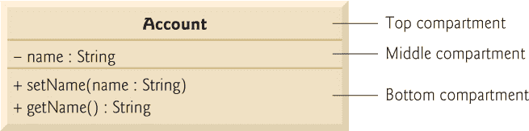

### 顶部区域

在 UML 中，我们将每个类表示为一个带有三个区域的矩形。顶部区域包含类名 `Account`，水平居中并以粗体字体显示。

### 中间区域

中间区域包含类的属性 `name`，它对应于 Java 中同名的实例变量。在 Java 中，实例变量 `name` 是 `private` 的，因此 UML 类图在属性名称之前列出一个减号（`–`）访问修饰符。属性名称之后是一个冒号和属性类型——在本例中为 `String`。

### 底部区域

底部区域包含类的操作 `setName` 和 `getName`，它们对应于 Java 中同名的方法。UML 通过列出由访问修饰符引导的操作名称来建模操作，在本例中为 `+ getName`。这个加号（`+`）表示 `getName` 是 UML 中的公共操作（因为它是 Java 中的一个 `public` 方法）。操作 `getName` 没有任何参数，因此类图中操作名称后的括号是空的，这与图 8.1 第 14 行中方法声明的情况完全一样。操作 `setName` 也是一个公共操作，它有一个名为 `name` 的 `String` 参数。

### 返回类型

UML 通过在操作名称后的括号之后放置冒号和返回类型来指示操作的返回类型。`Account` 方法 `getName`（图 8.1）具有 `String` 返回类型。方法 `setName` 不返回任何值（因为它在 Java 中返回 `void`），因此 UML 类图在括号后没有指定返回类型。

### 参数

UML 对参数的建模方式与 Java 不同。在操作名称后的括号中，我们列出参数名称，后面跟着冒号和参数类型。UML 拥有类似于 Java 的自己的数据类型，但为了简单起见，我们使用了 Java 数据类型。`Account` 方法 `setName`（图 8.1）有一个名为 `name` 的 `String` 参数，因此图表在方法名后的括号之间列出了 `name : String`。

#### 生成式 AI

1. **1** 向生成式 AI 提供图 8.1 中的代码，并要求其生成对应的 UML 类图。
2. **2** 向生成式 AI 提供 `Account` 类的 UML 类图，要求其生成对应的 Java 类声明。你可以在本章节的示例文件夹中找到类图的文件。

## 8.2.5 关于类 `AccountTest` 的说明

### `static` 方法

`static` 方法可以直接通过方法名本身调用同类的其他 `static` 方法，并可以直接操作同类中的 `static` 变量。要访问类的实例变量和实例方法，`static` 方法必须接收一个类对象的引用作为参数。实例方法可以访问其类所有的字段（`static` 变量和实例变量）和方法。

记住，`static` 方法相对于整个类。相比之下，实例方法与类的特定对象（实例）相关，并可以操作该对象的实例变量。一个类的多个对象可能存在，每个对象都有自己的实例变量副本。假设 `static` 方法可以直接调用实例方法，那么 `static` 方法如何知道操作哪个对象的实例变量呢？如果在调用实例方法时没有该类的对象会发生什么？因此，Java 不允许 `static` 方法直接访问同类的实例变量和实例方法。

#### `import` 声明

图 8.2（第 3 行）中的 `import` 声明告诉编译器程序使用了 `Scanner` 类。在第 2 章中，我们讨论过 `System` 和 `String` 类位于 `java.lang` 包，该包被隐式导入到每个 Java 程序中，因此所有程序都可以使用它的类而无需显式导入。你必须显式导入大多数其他类。

位于同一文件夹中的类之间存在特殊关系，例如 `Account` 和 `AccountTest`。默认情况下，这些类位于同一个 `default package`。同一包中的类会隐式导入到彼此的源文件中。因此，当一个类使用同包中的另一个类时，不需要 `import` 声明，如图 8.2 所示。

### 带有包名的全限定类名

如果我们始终使用全限定类名 `java.util.Scanner`（包含完整的包名）来引用 `Scanner`，那么图 8.2 第 3 行的 `import` 声明就是不需要的。例如，图 8.2 第 8 行可以写成：

```
var input = new java.util.Scanner(System.in);
```


如果每次使用类名时都指定全限定类名，Java 编译器就不需要 `import` 声明。大多数 Java 程序员更倾向于使用 `import` 声明实现的更简洁的编程风格。

### 生成式 AI

1. 让生成式 AI 解释为什么 Java `static` 方法不能直接访问同类的实例变量和方法。

## 8.2.6 使用 `private` 实例变量和 `public` `set` 与 `get` 方法的软件工程

正如你将看到的，通过 `set` 和 `get` 方法，你可以对 `private` 数据的修改进行验证，并控制这些数据呈现给调用者的方式——这些是非常吸引力的软件工程优势。我们将在后续示例中详细讨论这一点。

如果实例变量是 `public` 的，任何`类的客户端`——即任何调用该类的其他类——都可以访问数据并对其进行任何随所欲的操作，包括将其设置为无效值。

你可能认为，尽管类的客户端无法直接访问 `private` 实例变量，但客户端仍然可以通过 `public` `set` 和 `get` 方法对它做任何想做的事。你可能认为可以通过 `public` `get` 方法随时查看 `private` 数据，并通过 `public` `set` 方法随心所欲地修改 `private` 数据。但你可以编写 `set` 方法对其参数进行验证，并拒绝任何将数据设置为无效值的尝试，例如负的体温、三月中不在 1 到 31 日范围内的日期、不在公司目录中的产品代码等。同样，`get` 方法可以以不同的形式呈现数据。例如，`Grade` 类可能将成绩存储为 0 到 100 之间的 `int`，但 `getGrade` 方法可以返回一个 `String` 类型的字母等级，例如对于 90 到 100 之间的分数返回 `"A"`，80 到 89 之间的分数返回 `"B"` 等。严格控制 `private` 数据的访问和呈现可以减少错误，使你的程序更健壮、更安全。

使用访问修饰符 `private` 声明实例变量被称为信息隐藏。当程序创建（实例化）一个 `Account` 对象时，`private` 变量 `name` 会被隐藏，并且只能通过该对象类的方法进行访问。你应该用访问修饰符来声明每个实例变量和方法。通常情况下，实例变量应该是 `private` 的，而方法应该是 `public` 的。在书的后后部分，我们将讨论为什么你可能想要将一个方法声明为 `private`。

### 封装数据的 `Account` 对象的概念视图

你可以将 `Account` 对象想如如下面的（非 UML）图所示：

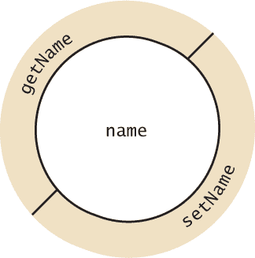

`private` 实例变量 `name` 隐藏在对象内部，由包含 `name` 的内圆表示，并通过 `public` 方法的保护性外层进行访问，由包含 `getName` 和 `setName` 的外圆表示。需要与 `Account` 对象的 `name` 交互的客户端代码只能通过调用其 `public` 方法来实现这一目的。

### 8.3 默认和显式实例变量初始化

类型为 `byte`、`char`、`short`、`int`、`long`、`float` 和 `double` 的实例变量被初始化为 0，`boolean` 初始化为 `false`。你可以在声明时为基本类型实例变量指定初始值，如下所示：

```java
private int numberOfStudents = 10;
```

如果不进行显式初始化，引用类型的实例变量将初始化为 `null`，表示“对无内容的引用”。这就是为什么图 8.2 第 14 行中的第一次 `getName()` 调用返回了 `null` 的原因——`name` 尚未设置，因此返回了它的默认初始值。

#### 生成式 AI

1. 提示生成式 AI 解释为什么 Java 实例变量默认被初始化的，而 Java 局部变量不是。

### 8.4 `Account` 类：使用构造函数初始化对象

你在第 8.2 节 中看到，`Account` 对象的 `name` 实例变量默认初始化为 `null`。如果你在创建 `Account` 对象时提供一个名称怎么办？你声明的每个类都可以可选地提供带有参数的构造函数，这些参数的值在对象创建时用于初始化对象的实例变量。Java 要求每个新对象都要调用构造函数，因此这是初始化对象实例变量的理想点。下一个示例通过一个构造函数增强了 `Account` 类，该构造函数接收一个名称并用它初始化新 `Account` 对象的 `name`。

#### 8.4.1 为自定义对象初始化声明 `Account` 构造函数

你可能想在创建对象时为 `Account` 对象指定一个名称，正如你在图 8.4 第 8 行中所示：

```java
var account1 = new Account("Wei Li");
```

`String` 参数 `"Wei Li"` 被传递给 `Account` 对象的构造函数，并用于初始化 `name` 实例变量。前面的语句要求该类提供一个仅接受一个 `String` 参数的构造函数。图 8.3 包含一个具有此类构造函数的修改后的 `Account` 类。

```java
 1   // Fig. 8.3: Account.java
 2   // 具有初始化 name 的构造函数的 Account 类。
 3
 4   public class Account {
 5      private String name; // 实例变量
 6
 7      // 构造函数使用参数 name 初始化 name
 8      public Account(String name) { // 构造函数名是类名
 9         this.name = name;
10      }
11
12      // 设置 name 的方法
13      public void setName(String name) {
14         this.name = name;
15      }
16
17      // 获取 name 的方法
18      public String getName() {
19         return name;
20      }
21   }
```

**图 8.3** | 具有初始化 `name` 的构造函数的 `Account` 类。

##### `Account` 构造函数声明

图 8.3 的 8–10 行声明了 `Account` 的构造函数，它的名称必须与类名相同。第 8 行表示此构造函数有一个参数——名为 `name` 的 `String`。当你创建一个新的 `Account` 对象时，你将一个人的名字传递给 `name` 参数，构造函数将其赋值给实例变量 `name`（第 9 行）。你不应该从类的构造函数调用该类的非 `static` 方法。我们将在第 9 章中讨论为什么这是有问题的。第 8.16 节讨论了 `static` 类方法。

#### 生成式 AI

1. 提示生成式 AI 解释为什么 Java 实例变量默认被初始化的，而 Java 局部变量不是。

#### 8.4.2 `AccountTest` 类：初始化新对象

`AccountTest` 程序（图 8.4）初始化两个 `Account` 对象。第 8 行创建并初始化 `account1`，传递 `"Wei Li"`。第 9 行重复此操作，传递 `"Logan Brown"` 初始化 `account2`。第 12–13 行使用每个对象的 `getName()` 获取其 `name`。输出显示每个 `Account` 维护自己的 `name`。

```java
 1   // Fig. 8.4: AccountTest.java
 2   // 使用 Account 构造函数初始化 name
 3   // 实例变量。
 4
 5   public class AccountTest {
 6      public static void main(String[] args) {
 7         // 创建 Account 对象
 8         var account1 = new Account("Wei Li");
 9         var account2 = new Account("Logan Brown");
10
11         // 显示每个 Account 的 name 值
12         System.out.printf("account1 name is: %s%n", account1.getName());
13         System.out.printf("account2 name is: %s%n", account2.getName());
14      }
 15   }
```

```
account1 name is: Wei Li
account2 name is: Logan Brown
```

**图 8.4** | 使用 `Account` 构造函数初始化对象的 `name` 实例变量。

##### 构造函数不能返回值

构造函数与方法的区别是构造函数不能返回值，因此它们不指定返回类型（即使是 `void`）。通常，构造函数是 `public` 的，以便其他类调用它们——在第 9 章中，我们将讨论何时使用 `private` 构造函数。

##### 默认构造函数

回想图 8.2 第 11 行使用 `new` 创建了一个 `Account` 对象。

```java
var myAccount = new Account();
```

`new Account` 后面的空括号表示调用**类的默认构造函数**。编译器在任何没有显式声明构造函数的类中提供一个无参数的默认构造函数。当类只有默认构造函数时，其实例变量将被初始化为默认值。在第 8.10 节中，你将看到类可以有多个构造函数。

##### 声明了构造函数的类没有默认构造函数

如果你声明了一个带或多个参数的构造函数，你无法通过表达式 `new Account()` 创建 `Account`，如图 8.2 所示，除非你同时也显式声明了一个无参数的自定义构造函数。如果类实例变量的默认初始化是不可接受的，请提供一个自定义构造函数以确保每个新对象的实例变量都用有意义的值初始化。

### 为 `Account` 类的 UML 类图添加构造函数

以下是 `Account` 类的 UML 类图（图 8.3），该类包含一个带有 `String name` 参数的构造函数：

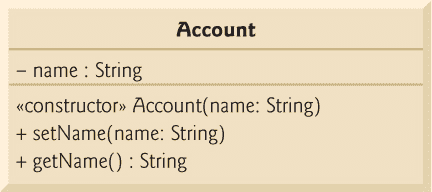

UML 在类图的第三个区域中对构造函数与其他操作建模，并通过在名称前使用书名号（`«` 和 `»`）包裹“constructor”一词将其与类的操作区分开。惯做法是在第三个区域的其他操作之前，以及类声明的其他操作之前列出构造函数。

#### 生成式 AI

1. 提示 `genAIs` 提供关于为什么 Java 构造函数不能返回值的见解。

## 8.5 带有余额的 `Account` 类

我们现在声明一个 `Account` 类，用于维护银行账户的名称和余额。`Account` 类使用 `BigDecimal` 来表示账户余额。

### 8.5.1 具有 `BigDecimal balance` 实例变量的 `Account` 类

我们下一个版本的 `Account` 类（图 8.5）维护了 `name` 和 `balance` 实例变量。典型的银行服务于许多账户，每个账户都有自己的余额，因此第 8 行声明了一个类型为 `BigDecimal` 的实例变量 `balance`。

```java
 1   // Fig. 8.5: Account.java
 2   // Account 类包含一个 BigDecimal 实例变量 balance，以及
 3   // 一个执行验证的构造函数和 deposit 方法。
 4   import java.math.BigDecimal;
 5
 6   public class Account {
 7      private String name; // 实例变量
 8      private BigDecimal balance = BigDecimal.ZERO; // 实例变量
 9
10      // 接收两个参数的 Account 构造函数
11      public Account(String name, BigDecimal balance) {
12         this.name = name; // 将 name 赋值给实例变量 name
13
14         // 验证余额是否大于 0；如果不是，
15         // 实例变量 balance 将保持其默认初始值 0
16         if (balance.compareTo(BigDecimal.ZERO) > 0) { // balance 是否有效？
17            this.balance = balance; // 将其赋值给实例变量 balance
18         }
19      }
20
21      // 仅将有效金额存款（增加）到余额的方法
22      public void deposit(BigDecimal amount) {
23         if (amount.compareTo(BigDecimal.ZERO) > 0) { // amount 是否有效？
24            balance = balance.add(amount); // 加到余额
25         }
26      }
27
28      // 返回账户余额的方法
29      public BigDecimal getBalance() {
30         return balance;
31      }
32
33      // 设置名称的方法
34      public void setName(String name) {
35         this.name = name;
36      }
37
38      // 返回名称的方法
39      public String getName() {
40         return name;
41      }
42   }
```

**图 8.5** | `Account` 类包含一个 `BigDecimal` 实例变量 `balance`，以及一个执行验证的构造函数和 `deposit` 方法。

#### `Account` 类的双参数构造函数

该类有一个构造函数和四个方法。开户的人通常会立即存款，因此构造函数（第 11–19 行）现在接收第二个参数——`BigDecimal balance`，代表初始余额。第 16–18 行确保 `balance` 参数的值大于 `BigDecimal.ZERO`。如果是这样，则第 17 行将其赋值给实例变量 `balance`。否则，实例变量 `balance` 将保持为 `BigDecimal.ZERO` ——即在第 8 行中的默认初始值。在本章的后面，我们将为无效的初始值抛出异常。

#### `Account` 类的 `deposit` 方法

`deposit` 方法（第 22–26 行）在执行完成时不返回任何数据，因此其返回类型为 `void`。该方法接收一个名为 `amount` 的 `BigDecimal` 参数，只有当参数的值大于 `BigDecimal.ZERO` 时，我们才将其加到实例变量 `balance` 中；否则 `balance` 保持不变。

#### `Account` 类的 `getBalance` 方法

`getBalance` 方法（第 29–31 行）未指定参数并返回 `BigDecimal`，允许类的客户端获取特定 `Account` 对象的余额。

#### 生成式 AI

1. 提示 `genAIs` 询问为什么在处理 `BigDecimal` 金额时，Java 不允许像使用 `int` 和 `double` 等原始类型那样使用 `+` 和 `-` 等方便的运算符。

### 8.5.2 `AccountTest` 类

`AccountTest` 类（图 8.6）创建了两个 `Account` 对象（第 9–10 行），并分别将其初始化为有效余额 `50.00` 和无效余额 `-7.53` —— 对于我们的示例，我们假设余额必须大于或等于零。第 13–16 行对 `printf` 方法的调用显示了结果。

```java
import java.math.BigDecimal;
import java.util.Scanner;

public class AccountTest {
    public static void main(String[] args) {
        Scanner input = new Scanner(System.in);
        Account account1 = new Account("Wei Li", new BigDecimal("50.00"));
```


```java
Account account2 = new Account("Logan Brown", new BigDecimal("-7.53"));

System.out.printf("%s balance: %.2f%n", account1.getName(), account1.getBalance());

System.out.printf("%s balance: %.2f%n", account2.getName(), account2.getBalance());

System.out.print("Enter deposit for account1: ");

BigDecimal deposit1 = new BigDecimal(input.next());

account1.deposit(deposit1);

System.out.printf("%s balance: %.2f%n", account1.getName(), account1.getBalance());

System.out.print("Enter deposit for account2: ");

BigDecimal deposit2 = new BigDecimal(input.next());

account2.deposit(deposit2);

System.out.printf("%s balance: %.2f%n", account2.getName(), account2.getBalance());

}
}
```

当我们在第 13–16 行显示初始余额时，`account2` 的 `balance` 为 `0.00`，因为构造函数拒绝了以负余额启动 `account2` 的尝试。因此，该对象的 `balance` 保留了它的默认初始值。

### 从用户处读取 `BigDecimal` 值并存款

第 21 行提示用户为 `account1` 输入存款金额。第 22 行声明局部变量 `depositAmount`，用于存储用户输入的每笔存款金额。第 22 行还通过调用 `Scanner` 的 `nextBigDecimal` 方法获取用户输入，该方法将输入转换为 `BigDecimal` 并返回它。第 23–24 行显示 `depositAmount`。然后，第 25 行调用对象 `account1` 的 `deposit` 方法，并将 `depositAmount` 作为参数传递。`deposit` 方法确保 `depositAmount` 有效，如果是，则将其加到 `balance` 中。第 28–31 行再次输出两个 `Account` 对象的 `name` 和 `balance`，以显示只有 `account1` 的 `balance` 发生了变化。

第 33–36 行提示并输入 `account2` 的存款金额，然后显示它。第 37 行调用对象 `account2` 的 `deposit` 方法并将 `depositAmount` 作为参数，将该值加到 `balance` 中。最后，第 40–43 行再次输出两个 `Account` 对象的 `name` 和 `balance`，以显示只有 `account2` 的 `balance` 发生了变化。

### 方法 `main` 中的重复代码

第 13–14、15–16、28–29、30–31、40–41 和 42–43 行的六语句几乎相同——它们都输出一个 `Account` 的 `name` 和 `balance`。它们的区别在于 `Account` 对象的名称——`account1` 或 `account2`。同样，第 21–25 行和 33–37 行在输入存款金额并将其存入 `Account` 方面几乎相同。这种重复代码在需要更新时会产生代码维护问题。用调用包含该代码副本的方法来替换重复代码，可以减小程序体积并提高其可维护性。

### `Account` 类的 UML 类图

以下是图 8.5 中 `Account` 类的 UML 类图。第二个区域建模了 `private` 属性 `name`（一个 `String`）和 `balance`（一个 `BigDecimal`）。第三个区域建模了构造函数及其 `name`（一个 `String`）和 `balance`（一个 `BigDecimal`）参数。第三个区域还建模了类的 `public` 方法——带有 `BigDecimal amount` 参数的 `deposit`、返回类型为 `BigDecimal` 的 `getBalance`、带有 `String name` 参数的 `setName` 以及返回类型为 `String` 的 `getName`。

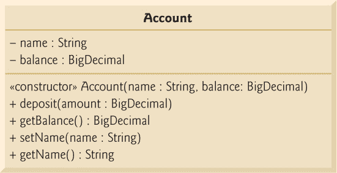

#### 生成式 AI

1. 提示生成式 AI 解释“DRY”（不要重复自己）编码，以帮助你避免重复代码。
2. 将图 8.6 中的代码提供给生成式 AI，要求它们重构程序以消除 `main` 中的代码重复。

### 8.6 案例研究：洗牌与发牌模拟

第 6 章的示例演示了仅包含基本类型元素的数组。数组的元素可以是基本类型或引用类型。本节使用随机数生成和引用类型元素数组（即代表扑克牌的数组）来开发一个模拟洗牌和发牌的类，你可以用它来实现玩牌游戏的程序。

此示例包含三个类。`Card` 类（图 8.7）代表一张扑克牌，具有牌面（`Ace`、`Deuce`、`Three`……`Jack`、`Queen`、`King`）和花色（`Hearts`、`Diamonds`、`Clubs`、`Spades`）。`DeckOfCards` 类（图 8.8）创建包含 52 张扑克牌的数组，每个元素都是一个 `Card` 对象。最后，`DeckCardsTest` 类（图 8.9）展示了 `DeckOfCards` 的洗牌和发牌能力。

### `Card` 类

`Card` 类（图 8.7）包含 `String` 实例变量 `face` 和 `suit`，存储特定 `Card` 的牌面和花色。我们将这些声明为 `final`，因为真实的牌面和花色是不可修改的。`Card` 构造函数（第 9–12 行）接收两个 `String` 来初始化 `face` 和 `suit`。`toString` 方法（第 15–17 行）返回由 `Card` 的 `face`、`"of "` 和 `Card` 的 `suit` 组成的 `String`。

```java
// 根据描述的代码结构示例

public class Card {

    private final String face;

    private final String suit;

    public Card(String face, String suit) {

        this.face = face;

        this.suit = suit;

    }

    public String toString() {

        return face + " of " + suit;

    }

}
```

### `DeckOfCards` 类

`DeckOfCards` 类（图 8.8）创建并管理一个 `Card` 引用数组。我们为了目的将此类分为部分。`NUMBER_OF_CARDS`（第 9 行）指定了牌中牌的数量（52）。第 10 行声明并初始化实例变量 `deck`，它指向一个具有 `NUMBER_OF_CARDS` 个元素的 `Card` 数组。`deck` 数组的元素默认为 `null`。记住 `null` 代表“无引用”，因此目前还没有 `Card` 对象。`DeckOfCards` 类还声明了 `int` 实例变量 `currentCardIndex`（第 11 行），代表从 `deck` 数组中发的下一张 `Card` 的序列号（0–51）。

### `DeckOfCards` 构造函数

构造函数使用一个循环（第 20–22 行）向 `deck` 数组填充 `Card` 对象。循环从 `0` 开始迭代，只要 `count` 小于 `deck.length`，导致 `count` 获得从 0 到 51 的每一个值（数组的索引）。我们为每个 `Card` 初始化了两个 `String`——一个来自 `faces` 数组（包含从 `"Ace"` 到 `"King"` 的 `String`），另一个来自 `suits` 数组（包含 `"Hearts"`、`"Diamonds"`、`"Clubs"` 和 `"Spades"` `String`）。计算 `count % 13` 得到一个 0 到 12 之间的值（第 15–16 行 `faces` 数组的 13 个索引），计算 `count / 13` 得到一个 0 到 3 之间的值（第 17 行 `suits` 数组的 4 个索引）。当循环完成后，`deck` 包含每种花色从 `"Ace"` 到 `"King"` 的 `Card`——13 张 `"Hearts"`，然后是 13 张 `"Diamonds"`，然后是 13 张 `"Clubs"`，最后是 13 张 `"Spades"`。这个示例将面值和花色表示为 `String` 数组。你也可以将面值和花色表示为 `enum` 常量数组。

```java
13      // constructor fills deck of Cards
14      public DeckOfCards() {
15         String[] faces = {"Ace", "Deuce", "Three", "Four", "Five", "Six",
16            "Seven", "Eight", "Nine", "Ten", "Jack", "Queen", "King"};
17         String[] suits = {"Hearts", "Diamonds", "Clubs", "Spades"};
19         // populate deck with Card objects
20         for (int count = 0; count < deck.length; ++count) {
21            deck[count] = new Card(faces[count % 13], suits[count / 13]);
22         }
23      }
```

### `DeckOfCards` 方法 `shuffle`

`shuffle` 方法（第 26–40 行）洗牌 `Card`。对于每个 `Card`，第 33 行选择一个随机索引 0–51 来选取另一个 `Card`。然后，第 36–38 行交换数组中当前 `Card` 和随机的 `Card`。额外变量 `temp`（第 36 行）临时存储被交换的两个 `Card` 对象之一。`for` 循环通过在数组单次遍历中执行 52 次交换来洗牌 `Card` 对象。

```java
25      // shuffle deck of Cards with one-pass algorithm
26      public void shuffle() {
27         // next call to method dealCard should start at deck[0] again
28         currentCardIndex = 0;
30         // for each Card, pick another random Card (0-51) and swap them
31         for (int first = 0; first < deck.length; ++first) {
33            // select a random number between 0 and 51
34            int second = randomNumbers.nextInt(NUMBER_OF_CARDS);
35            // swap current Card with randomly selected Card
36            Card temp = deck[first];
37            deck[first] = deck[second];
38            deck[second] = temp;
39         }
40      }
```

`shuffle` 方法的算法被认为是有偏的，因为它有时会将 `Card` 与自身进行交换。在真实游戏中，你应该使用无偏的算法，以确保所有可能的洗牌序列出现的概率相等。请参考本节的 genAI 练习，在其中你将调查 Fisher-Yates 无偏洗牌算法的原理，并要求生成式 AI 修改 `shuffle` 方法以使用该无偏算法。

### 为什么我们需要变量 `temp` 来执行交换？

你不能仅通过以下两条语句在第 36–38 行完成交换：

```java
deck[first] = deck[second];
deck[second] = deck[first];
```

如果 `deck[first]` 是 `"Spades"` 的 `"Ace"`，而 `deck[second]` 是 `"Hearts"` 的 `"Queen"`，那么在第一次赋值后，两个数组元素都包含 `"Hearts"` 的 `"Queen"`，而 `"Spades"` 的 `"Ace"` 将丢失。

### `DeckOfCards` 方法 `dealCard`

`dealCard` 方法（第 43–51 行）发出一张 `Card`。记得 `currentCardIndex` 是下一个待发 `Card` 的索引——即牌顶部的 `Card`。第 45 行将 `currentCardIndex` 与 `deck` 数组的 `length` 进行比较。如果 `deck` 不为空（`currentCardIndex` 小于 52），第 46 行返回顶部 `Card` 并后增 `currentCardIndex` 为下次调用 `dealCard` 做准备；否则，第 49 行返回 `null`。

```java
42      // deal one Card
43      public Card dealCard() {
44         // determine whether Cards remain to be dealt
45         if (currentCardIndex < deck.length) {
46            return deck[currentCardIndex++]; // return current Card
47         }
48         else {
49            return null; // return null to indicate all Cards were dealt
50         }
51      }
```

### 洗牌与发牌

程序演示了 `DeckOfCards` 类。第 7 行创建一个名为 `myDeckCards` 的 `DeckOfCards` 对象，调用其构造函数创建牌。第 8 行调用 `myDeckCards` 的 `shuffle` 方法随机排列牌序。第 11–18 行按发牌顺序打印所有 52 张牌。第 13 行使用 `System.out.printf("%19s", myDeckCards.dealCard());` 发牌并显示牌。第 15–17 行每四张牌输出换行。

```java
// (此处为示例中的代码块内容，实际输出中已包含上述翻译)
```

### 生成式 AI 练习

2. 提示 AI 使用图 8.8 中的 `shuffle` 方法，让它们解释洗牌算法存在偏倚意味着什么，以及为什么 `shuffle` 算法是有偏倚的。

3. 提示 AI 询问无偏的 Fisher-Yates 洗牌算法是如何工作的，并让它们使用它重新实现 `DeckOfCards` 类的 `shuffle` 方法。测试更新后的代码。

### 8.7 案例研究：`Time` 类

我们的下一个示例由类 `Time1`（图 8.10）和 `Time1Test`（图 8.11）组成。`Time1` 类代表一天中的时间。`Time1Test` 类的 `main` 方法创建了一个 `Time1` 对象并调用它的方法。程序的输出显示在图 8.11 中。

### `Time1` 类声明

类 `Time1` 的 `private int` 实例变量 `hour`、`minute` 和 `second`（图 8.10，第 5–7 行）代表世界时间格式（24 小时制，小时范围在 0–23 之间，分钟和秒范围均在 0–59 之间）。`Time1` 包含 `public` 方法 `setTime`（第 11–22 行）、`toUniversalString`（第 25–27 行）和 `toString`（第 30–34 行）。这些方法是类向客户端提供的 `public` 服务或 `public` 接口。

```java
 1   // Fig. 8.10: Time1.java
 2   // Time1 class declaration maintains the time in 24-hour format.
 3
 4   public class Time1 {
 5      private int hour; // 0 - 23
 6      private int minute; // 0 - 59
```


## 图 8.10 | Time1 类声明以 24 小时制维护时间

```java
 7      private int second; // 0 - 59

 8

 9      // set a new time value using universal time; throw an
10      // exception if the hour, minute or second is invalid
11      public void setTime(int hour, int minute, int second) {
12         // validate hour, minute and second
13         if (hour < 0 || hour >= 24 || minute < 0 || minute >= 60 ||
14            second < 0 || second >= 60) {
15            throw new IllegalArgumentException(
16               "hour, minute and/or second was out of range");
17         }

18         this.hour = hour;
19         this.minute = minute;
20         this.second = second;
21      }

22

23      // convert to String in universal-time format (HH:MM:SS)
24      public String toUniversalString() {
25         return String.format("%02d:%02d:%02d", hour, minute, second);
26      }

27

28      // convert to String in standard-time format (H:MM:SS AM or PM)
29      public String toString() {
30         return String.format("%d:%02d:%02d %s",
31            ((hour == 0 || hour == 12) ? 12 : hour % 12),
31            minute, second, (hour < 12 ? "AM" : "PM"));
32      }
33   }
```

### 默认构造函数

类 `Time1` 没有声明构造函数，因此编译器提供了一个默认构造函数。每个实例变量隐式地接收默认的 `int` 值（`0`）。

### 方法 `setTime` 与抛出异常

方法 `setTime`（第 11–22 行）是一个带有三个 `int` 参数的 `public` 方法，用于设置时间。第 13–14 行测试每个参数以确定该值是否在有效范围之外。`hour` 值必须大于等于 `0` 且小于 `24`，因为世界格式将小时表示为从 0 到 23 的整数（例如，下午 1 点是 13 点，晚上 11 点是 23 点，午夜是 0 点，正午是 12 点）。同样，`minute` 和 `second` 的值都必须大于等于 `0` 且小于 `60`。如果参数值有效，第 19–21 行将它们分配给 `hour`、`minute` 和 `second` 实例变量。只有当方法的参数都有效时，你应该修改对象的实例变量。

对于无效值，`setTime` 抛出一个 `IllegalArgumentException`（第 15–16 行）来通知客户端代码问题。第 15 行创建一个新的 `IllegalArgumentException` 对象并调用其接收自定义错误消息的构造函数。接下来，`throw` 语句终止进程。

### 方法 `toUniversalString`

方法 `toUniversalString`（第 25–27 行）不接受参数并返回一个世界时间格式的 `String`，`hour`、`minute` 和 `second` 均为两位数字。例如，如果时间是 13:30:07。

### 方法 `toString`

方法 `toString`（第 30–34 行）不接受参数并返回一个 12 小时格式的 `String`，由冒号分隔的 `hour`、`minute` 和 `second` 值组成跟着 AM 或 PM。与 `toUniversalString` 类似，`toString` 使用 `format` 将 `minute` 和 `second` 格式化为两位数字。第 32 行使用条件运算符（`?:`）来确定 `String` 中的 `hour` 值。如果 `hour` 为 `0` 或 `12`（AM 或 PM），它显示为 12；否则显示为 1 到 11 之间的值。第 33 行的条件运算符决定返回 AM 还是 PM 作为 `String` 的一部分。

### 使用 `Time1` 类

`Time1Test` 类（图 8.11）使用 `Time1` 类。第 7 行声明了 `Time1` 变量 `time` 并用一个新的 `Time1` 对象初始化它。运算符 `new` 隐式调用类 `Time1` 的默认构造函数，因为 `Time1` 没有声明任何构造函数。为了确认 `Time1` 对象初始化正确，第 10 行调用了 `private` 方法 `displayTime`（第 31–34 行），该方法转而调用 `Time1` 对象的 `toUniversalString` 和 `toString` 方法，分别以世界时间格式和标准格式输出时间。注意，这里可以隐式地调用 `toString` 而不是显式调用。接下来，第 14 行调用 `time` 对象的 `setTime` 方法来更改时间。然后，第 15 行再次以两种格式输出时间，以确认时间设置正确。

## 图 8.11 | App 中使用的 `Time1` 对象

```java
 1   // 图. 8.11: Time1Test.java
 2   // App 中使用的 Time1 对象。
 3
 4   public class Time1Test {
 5      public static void main(String[] args) {
 6         // 创建并初始化 Time1 对象
 7         var time = new Time1(); // 调用 Time1 构造函数
 8
 9         // 输出时间的字符串表示
10         displayTime("After time object is created", time);
11         System.out.println();
12
13         // 修改时间并输出更新时间
14         time.setTime(13, 27, 6);
15         displayTime("After calling setTime", time);
16         System.out.println();
17
18         // 尝试使用无效值设置时间
19         try {
20            time.setTime(99, 99, 99); // 所有值超出范围
21         }
22         catch (IllegalArgumentException e) {
23            System.out.printf("Exception: %s%n%n", e.getMessage());
24         }
25
26         // 在尝试设置无效值后显示时间
27         displayTime("After calling setTime with invalid values", time);
28      }
29
30      // 以 24 小时制和 12 小时制格式显示 Time1 对象
31      private static void displayTime(String header, Time1 t) {
32         System.out.printf("%s%nUniversal time: %s%nStandard time: %s%n",
33            header, t.toUniversalString(), t.toString());
34      }
35   }
```

```
After time object is created
Universal time: 00:00:00
Standard time: 12:00:00 AM

After calling setTime
Universal time: 13:27:06
Standard time: 1:27:06 PM

Exception: hour, minute and/or second was out of range

After calling setTime with invalid values
Universal time: 13:27:06
Standard time: 1:27:06 PM
```

声明为 `private` 的方法（如 `displayTime`）只能由同一类中的其他方法调用。此类方法被称为*工具方法*或*辅助方法*，因为它们支持类中其他方法的操作。

#### 使用无效值调用 `Time1` 方法 `setTime`

为了说明方法 `setTime` 会验证其参数，第 20 行调用了 `setTime` 方法并为 `hour`、`minute` 和 `second` 传入无效参数 `99`。该语句放置在 `try` 块（第 19–21 行）中，以防 `setTime` 抛出 `IllegalArgumentException`，由于参数都是无效的，它将会这样做。当发生这种情况时，异常会在第 22–24 行被捕获，第 23 行通过调用其 `getMessage` 方法显示异常的错误信息。第 27 行再次以两种格式输出时间，以确认在提供无效参数时，`setTime` 并没有改变时间。

#### `Time1` 类定义的软件工程

考虑类 `Time1` 的设计。实例变量 `hour`、`minute` 和 `second` 是 `private` 的。类中使用的数据表示对类的客户端并不重要。例如，`Time1` 在内部将时间表示为自午夜以来的秒数或自午夜以来的分钟和秒数是合理的。客户端可以使用相同的 `public` 方法并获得相同的结果而无需察觉到这种变化。你将在“生成式 AI 问题 1”中要求生成式 AI 进行此项更改。

类简化了编程，因为客户端仅可以使用类的 `public` 方法。此类方法是面向客户端的，而不是面向实现的。客户端既不感知也不参与类的实现。客户端通常关心类*做什么*，而不是类*如何做*的。

接口的变更频率比实现要低。当实现发生变化时，依赖于实现的代码必须相应地更改。隐藏实现可以减少程序其他部分依赖于类实现细节的可能性。

#### Java 日期/时间 API

本节的示例以及本章稍后的几个示例演示了表示日期和时间的类中的各种类-实现概念。在专业的 Java 开发中，你应该使用 Java Date/Time API 的功能，例如我们在第 5.12 节中引入的那些，而不是构建自己的日期和时间类。我们在第 18 章中使用了一些额外的 Date/Time API 功能。

##### Generative AI

**1** 向生成式 AI 提示类 `Time1`（图 8.11）。要求生成式 AI 在生成式 AI 问题 1 中进行此更改。使用自午夜以来的秒数来重构 `Time1`（图 8.10），确保其提供相同的 `public` 接口。

## 8.8 控制成员的访问

`public` 和 `private` 访问修饰符控制对类的访问。在第 9 章中，我们将引入额外的修饰符 `protected`。`public` 方法的主要目的是向客户端展示类的视图。图 8.12 展示了 `private` 类成员是不可访问的。

## 8.9 使用 `this` 引用当前对象的成员

每个对象都可以通过关键字 `this` 访问其本身。当为特定对象调用实例方法时，方法的体会隐式地使用 `this.` 来引用该对象的实例变量和其他方法，使得类代码知道要操作哪个对象。正如你在图 8.13 中看到的，你也可以在实例方法的体中显式地使用 `this.`。第 8.10 节展示了 `this` 关键字的另一个有趣用法。第 8.16 节解释了为什么不能在 `static` 方法中使用 `this.`。

## 图 8.13 | `this` 引用的隐式和显式用法

图 8.13 展示了 `this` 引用的隐式和显式用法。这是我们首次在一个文件中声明两个类——类 `ThisTest` 声明在第 4–9 行，类 `SimpleTime` 声明在第 12–41 行。当你编译一个源代码（`.java`）文件时，编译器会为该文件中的每个类生成一个单独 `.class` 文件。在这种情况下，会生成两个文件——`SimpleTime.class` 和 `ThisTest.class`。编译器将这些文件放在同一个文件夹中。同时请注意图 8.13 中只有 `ThisTest` 类被声明为 `public`。一个源代码（`.java`）文件可以只包含一个 `public` 类——请记住，每个 `public` 类必须声明在一个以类名命名并带有 `.java` 文件扩展名的源文件中。非 `public` 类只能被同一个包中的其他类使用，而编译到同一个文件夹的类属于同一个包。因此，`SimpleTime` 只能在类 `ThisTest` 中使用。

```java
 1   // Fig. 8.13: ThisTest.java
 2   // this 用于隐式和显式地引用对象的成员。
 3
 4   public class ThisTest {
 5      public static void main(String[] args) {
 6         var time = new SimpleTime(15, 30, 19);
 7         System.out.println(time.buildString());
 8      }
 9   }
10
11   // class SimpleTime 展示了 "this" 引用
12   class SimpleTime {
13      private int hour; // 0-23
14      private int minute; // 0-59
15      private int second; // 0-59
16
17      // 如果构造函数使用的参数名与
18      // 实例变量名相同，则需要 "this" 引用
19      // 来区分这些名称
20      public SimpleTime(int hour, int minute, int second) {
21         this.hour = hour; // 设置 "this" 对象的小时
22         this.minute = minute; // 设置 "this" 对象的分钟
23         this.second = second; // 设置 "this" 对象的秒
24      }
25
26      // 使用显式和隐式的 "this" 调用 toUniversalString
27      public String buildString() {
28         return String.format("%24s: %s%n%24s: %s",
29            "this.toUniversalString()", this.toUniversalString(),
30            "toUniversalString()", toUniversalString());
31      }
32
33      // 转换为通用时间格式 (HH:MM:SS) 的字符串
34      public String toUniversalString() {
35         // 此处访问实例变量不需要 "this."，
36         // 因为此方法没有与实例变量同
37         // 名称的局部变量
38         return String.format("%02d:%02d:%02d",
39            this.hour, this.minute, this.second);
40      }
41   }
```

```
this.toUniversalString(): 15:30:19
     toUniversalString(): 15:30:19
```


**图 8.13** | `this` 用于隐式和显式地引用对象的成员。

`SimpleTime` 类（第 12–41 行）声明了三个 `private` 实例变量——`hour`、`minute` 和 `second`（第 13–15 行）。类的构造函数（第 20–24 行）接收三个 `int` 参数来初始化 `SimpleTime` 对象。再次，我们在构造函数中使用与类实例变量名相同的参数名（第 13–15 行），因此在第 21–23 行中使用了 `this.` 来引用实例变量。如果你写 `x = x;` 而不是 `this.x = x;`，大多数 IDE 都会发出警告。`x = x;` 语句通常被称为无操作（no-op）——在这种情况下，该语句会将 `x` 赋值给自己，不会修改 `x`。

`buildString` 方法（第 27–31 行）返回由一个语句创建的 `String`，该语句使用 `this` 引用来显式（第 29 行）和隐式（第 30 行）调用 `toUniversalString`。这两行执行的是相同的操作。你通常不会显式使用 `this` 来引用当前对象中的其他方法。此外，`toUniversalString` 中的第 39 行显式使用了 `this.` 来访问每个实例变量，尽管这不是必需的，因为该方法没有隐藏类实例变量的局部变量。

每个类每个方法只有一个副本——该类的每个对象共享该方法的代码。另一方面，每个对象都有自己的类实例变量的副本。类的非静态方法隐式地使用 `this` 来确定要操作的类的特定对象。

第 12 行使用 `this` 调用 `Time2` 构造函数，该构造函数接受三个参数（第 26–42 行），并将 `hour`、`minute` 和 `second` 设置为 0。如所示，使用 `this` 关键字必须是构造函数的第一条语句，它是避免重复初始化代码的常用方法。将工作委托给同类中另一个构造函数的构造函数被称为`委托构造函数`（delegating constructor）。我们在五个 `Time2` 构造函数中的四个使用了这种语法，以便使类更容易维护和修改——我们稍后会详细介绍。

### 带有一个 `int` 参数的 `Time2` 构造函数

第 16–18 行声明了一个带有单个 `int` 参数的 `Time2` 构造函数，该参数代表 `hour`。我们将它与 0 的 `minute` 和 `second` 传递给第 26–42 行的构造函数。

```
15      // Time2 constructor: hour supplied, minute and second defaulted to 0
16      public Time2(int hour) {
17         this(hour, 0, 0); // delegate to three-argument constructor
18      }
19
```

### 带有两个 `int` 参数的 `Time2` 构造函数

第 21–23 行声明了一个带有两个 `int` 参数的 `Time2` 构造函数，分别代表 `hour` 和 `minute`。我们将它们与 0 的 `second` 传递给第 26–42 行的构造函数。

```
20      // Time2 constructor: hour and minute supplied, second defaulted to 0
21      public Time2(int hour, int minute) {
22         this(hour, minute, 0); // delegate to three-argument constructor
23      }
24
```

### 带有三个 `int` 参数的 `Time2` 构造函数

第 26–42 行声明了 `Time2` 构造函数，它接收三个代表 `hour`、`minute` 和 `second` 的 `int` 参数。该构造函数负责验证并初始化实例变量。

```
25      // Time2 constructor: hour, minute and second supplied
26      public Time2(int hour, int minute, int second) {
27         if (hour < 0 || hour >= 24) {
28            throw new IllegalArgumentException("hour must be 0-23");
29         }
30
31         if (minute < 0 || minute >= 60) {
32            throw new IllegalArgumentException("minute must be 0-59");
33         }
34
35         if (second < 0 || second >= 60) {
36            throw new IllegalArgumentException("second must be 0-59");
37         }
38
39         this.hour = hour;
40         this.minute = minute;
41         this.second = second;
42      }
43
```

### 带有 `Time2` 参数的 `Time2` 构造函数

第 45–48 行声明了一个 `Time2` 构造函数，它接收另一个 `Time2` 对象的引用。该构造函数通过将值传递给三参数构造函数，来复制参数对象的 `hour`、`minute` 和 `second` 值。（某些语言将此称为拷贝构造函数，但这不是 Java 的正式概念）。`time.hour`、`time.minute` 和 `time.second` 表达式直接访问参数对象的 `hour`、`minute` 和 `second` 实例变量——尽管它们是 `private` 的。由于同类对象之间的存在特殊关系，这种操作是被允许的。当一个对象拥有同类另一个对象的引用时，第一个对象可以访问第二个对象的所有数据和方法——即使是 `private` 方法。

```
44      // Time2 constructor: another Time2 object supplied
45      public Time2(Time2 time) {
46         // delegate to three-argument constructor
47         this(time.hour, time.minute, time.second);
48      }
49
```

### 类 `Time2` 的 `setTime` 方法

方法 `setTime`（第 53–69 行）如果方法的任何一个参数超出范围，则会抛出 `IllegalArgumentException`（第 55、59 和 63 行）——此示例单独测试每个参数，以抛出具有更精确错误消息的异常。如果参数有效，第 66–68 行将实例变量设置为参数值。

```
50      // Set Methods
51      // set a new time value using universal time;
52      // validate the data
53      public void setTime(int hour, int minute, int second) {
54         if (hour < 0 || hour >= 24) {
55            throw new IllegalArgumentException("hour must be 0-23");
56         }
57
58         if (minute < 0 || minute >= 60) {
59            throw new IllegalArgumentException("minute must be 0-59");
60         }
61
62         if (second < 0 || second >= 60) {
63            throw new IllegalArgumentException("second must be 0-59");
64         }
65
66         this.hour = hour;
67         this.minute = minute;
68         this.second = second;
69      }
```

### `Time2` 的 `setHour`、`setMinute` 和 `setSecond` 方法

第 72–96 行声明了 `hour`、`minute` 和 `second` 的 `set` 方法。每个方法在设置实例变量前都会对其参数进行验证。

```
71      // validate and set hour
72      public void setHour(int hour) {
73         if (hour < 0 || hour >= 24) {
74            throw new IllegalArgumentException("hour must be 0-23");
75         }
76
77         this.hour = hour;
78      }
79
80      // validate and set minute
81      public void setMinute(int minute) {
82         if (minute < 0 || minute >= 60) {
83            throw new IllegalArgumentException("minute must be 0-59");
84         }
85
86         this.minute = minute;
87      }
88
89      // validate and set second
90      public void setSecond(int second) {
91         if (second < 0 || second >= 60) {
92            throw new IllegalArgumentException("second must be 0-59");
93         }
94
95         this.second = second;
96      }
```

### `Time2` 的 `getHour`、`getMinute` 和 `getSecond` 方法

第 100–106 行声明了 `hour`、`minute` 和 `second` 的 `get` 方法。每个方法都返回对应的实例变量。

```
98      // Get Methods
99      // get hour value
100      public int getHour() {return hour;}
101
102      // get minute value
103      public int getMinute() {return minute;}
104
105      // get second value
106      public int getSecond() {return second;}
107
```

### `Time2` 的 `toUniversalString` 和 `toString` 方法

第 109–119 行声明了 `toUniversalString` 和 `toString` 方法。每个方法都使用与 `Time1` (图 8.10)相同的格式创建 `Time2` 对象的字符串表示。

```
108      // convert to String in universal-time format (HH:MM:SS)
109      public String toUniversalString() {
110         return String.format("%02d:%02d:%02d",
111            getHour(), getMinute(), getSecond());
112      }
113
114      // convert to String in standard-time format (H:MM:SS AM or PM)
115      public String toString() {
116         return String.format("%d:%02d:%02d %s",
117            ((getHour() == 0 || getHour() == 12) ? 12 : getHour() % 12),
118            getMinute(), getSecond(), (getHour() < 12 ? "AM" : "PM"));
119      }
120   }
```

### 关于 `Time2` 类的 *Set*、*Get* 方法和构造函数的说明

`toUniversalString` 和 `toString` 方法分别在第 111 行和第 117–118 行调用了 `Time2` 的 *get* 方法。这些方法本可以直接访问 `Time2` 的 `private` 数据而无需调用 *get* 方法，但调用它们在软件工程上有一个益处。

我们的内部时间表示使用了三个 `int`，占用 12 字节内存。可以考虑将其更改为自午夜以来的总秒数——一个只需要 4 字节的单个 `int`。如果我们进行此项更改，则只有直接访问 `private` 的数据的方法需要修改。在这种情况下，我们需要修改三参数构造函数、`setTime` 方法以及针对 `hour`、`minute` 和 `second` 的单独 `set` 和 `get` 方法。不需要修改 `toUniversalString` 和 `toString`，因为它们没有直接访问数据。以这种方式设计类可以减少更改类实现时发生编程错误的概率。

同样，每个 `Time2` 委托构造函数都可以包含三参数构造函数来自相应语句的副本。这可能会稍微高效一些，因为消除了额外的构造函数调用。然而，复制语句会使更改类的内部数据表示变得更加困难。让 `Time2` 委托构造函数调用带三个参数的构造函数只需要修改三参数构造函数的实现即可。此外，编译器可以通过删除对简单方法的调用并将其替换为声明的展开代码来优化程序——这种技术被称为 `inlining the code`（代码内联），它可以提高程序性能。

在[第 9 章]中，我们将解释为什么选择在类 `Time2` 的构造函数和 `setTime` 方法之间用代码。

### 使用类 `Time2` 的重载构造函数

类 `Time2Test` ([图 8.15]) 调用了重载的 `Time2` 构造函数（第 6–10 行和第 21 行）：

```
 1   // Fig. 8.15: Time2Test.java
 2   // 使用重载构造函数初始化 Time2 对象。
 3
 4   public class Time2Test {
 5      public static void main(String[] args) {
 6         var t1 = new Time2(); // 00:00:00
 7         var t2 = new Time2(2); // 02:00:00
 8         var t3 = new Time2(21, 34); // 21:34:00
 9         var t4 = new Time2(12, 25, 42); // 12:25:42
10         var t5 = new Time2(t4); // 12:25:42
11
12         System.out.println("Constructed with:");
13         displayTime("t1: all default arguments", t1);
14         displayTime("t2: hour specified; default minute and second", t2);
15         displayTime("t3: hour and minute specified; default second", t3);
16         displayTime("t4: hour, minute and second specified", t4);
17         displayTime("t5: Time2 object t4 specified", t5);
18
19         // attempt to initialize t6 with invalid values
20         try {
21            var t6 = new Time2(27, 74, 99); // invalid values
22         }
23         catch (IllegalArgumentException e) {
```


```java
24            System.out.printf("%nException while initializing t6: %s%n",
25               e.getMessage());
26         }
27      }
28
29      // displays a Time2 object in 24-hour and 12-hour formats
30      private static void displayTime(String header, Time2 t) {
31         System.out.printf("%s%n   %s%n   %s%n",
32            header, t.toUniversalString(), t.toString());
33      }
34   }
```

Constructed with:

t1: all default arguments

   00:00:00
   12:00:00 AM

t2: hour specified; default minute and second

   02:00:00
   2:00:00 AM

t3: hour and minute specified; default second

   21:34:00
   9:34:00 PM

t4: hour, minute and second specified

   12:25:42
   12:25:42 PM

t5: Time2 object t4 specified

   12:25:42
   12:25:42 PM

Exception while initializing t6: hour must be 0-23

**图 8.15** | 用于初始化 `Time2` 对象的重载构造函数。

第 6 行调用了 `Time2` 无参数构造函数。第 7–10 行演示了向接收参数的 `Time2` 构造函数传递参数：

*   第 7 行调用了单参数构造函数：
    ```java
    public Time2(int hour)
    ```
*   第 8 行调用了双参数构造函数：
    [点击查看代码图像]
    ```java
    public Time2(int hour, int minute)
    ```
*   第 9 行调用了三参数构造函数：
    [点击查看代码图像]
    ```java
    public Time2(int hour, int minute, int second)
    ```
*   第 10 行调用了单参数构造函数：
    ```java
    public Time2(Time2 t)
    ```

接下来，程序显示 `Time2` 对象以确认它们已初始化（第 13–17 行）。第 21 行尝试用无效值初始化 `t6`。当构造函数确定 `hour` 参数超出范围时，它会抛出一个 `IllegalArgumentException`，我们在第 23 行捕获该异常并显示其错误消息。

看起来，提供 `set` 和 `get` 功能本质上与将类的实例变量设为 `public` 没有区别。这是让 Java 在软件工程中备受青睐的细节之一。

一个 `public` 非 `final` 实例变量可以被任何持有该变量对象引用的方法进行读取或写入。`public` 的 `get` 方法确实允许客户端代码方法访问 `private` 实例变量，但 `get` 方法可以控制客户端如何“看到”数据。例如，`get` 方法可以对其返回的数据进行格式化，使客户端代码免受实际数据表示的影响。`public` 的 `set` 方法可以——也应该——仔细检查修改变量值的尝试，并在必要时抛出异常。例如，尝试将日期部分 `set` 为 37 号或将人的重量设为负值应该被拒绝。因此，尽管 `set` 和 `get` 方法提供了对 `private` 数据的访问，但这种访问可以通过方法的实现进行严格限制，从而促进良好的软件工程。

类永远不应该有 `public` 非常量数据。将数据声明为 `public static final` 可以让你为类的客户端提供常量。例如，`Math` 类提供了 `public static final` 常量 `Math.PI` 和 `Math.E`。

### Set 方法中的有效性检查

数据完整性的好处并不会因为实例变量声明为 `private` 就自动获得——你必须提供有效性检查。类的 `set` 方法可以防止向该类的对象分配无效数据的尝试。通常，`set` 方法具有 `void` 返回类型，并使用异常处理来指示分配无效数据的尝试。我们将在第 10 章中详细讨论异常处理。

在适当的情况下，提供 `public` 方法来访问 `private` 实例变量。这种架构有助于向客户端隐藏类的实现细节，从而提高程序的可修改性。使用 `set` 和 `get` 方法可以帮助你创建更易调试和维护的类。如果只有一个方法执行某个特定操作（例如设置对象中的实例变量），那么调试和维护该类将变得更容易。如果实例变量没有被正确设置，那么实际修改实例变量的代码将局限在一个 `set` 方法中。你的调试工作可以集中在那一个方法上。

### 谓词方法

访问器方法的另一个常见用途是测试条件为真为假——此类方法通常称为`谓词方法`（predicate methods）。例如 `ArrayList` 类的 `isEmpty` 方法，如果 `ArrayList` 为空则返回 `true`，否则返回 `false`。程序在尝试从 `ArrayList` 读取另一个项目之前，可能会测试 `isEmpty`。按照惯例，谓词方法的名称以 `is` 而不是 `get` 开始。

#### 生成式 AI

1. 提示生成式 AI 举例说明 Java 类永远不应该有 `public` 非 `final` 数据。
2. 提示生成式 AI 列出并解释谓词方法在 Java 中的应用。

### 8.13 组合

类可以拥有其他类对象的引用作为成员。这被称为`组合`（composition），有时被称为“有一个”关系（`has-a relationship`）。例如，一个 `AlarmClock` 对象需要知道当前时间以及它应该什么时候响闹，因此在 `AlarmClock` 对象中包含两个对 `Time` 对象的引用是合理的。汽车“有一个”方向盘、刹车踏板、油门等。

### `Date` 类

这个组合示例包含了类 `Date`（图 8.16）、`Employee`（图 8.17）和 `EmployeeTest`（图 8.18）。`Date` 类声明了实例变量 `month`、`day` 和 `year`（第 5–7 行）来表示日期。构造函数接收三个 `int` 参数。第 15–18 行验证 `month`——如果它超出范围，第 16–17 行抛出异常。第 21–25 行验证 `day`。如果根据特定 `month` 的天数判断是错误的（需要特殊闰年测试的 2 月 29 日除外），第 23–24 行抛出异常。第 28–29 行对二月进行闰年测试。如果月份是二月，日期是 29 号且 `year` 不是闰年，第 30–31 行抛出异常。如果没有抛出异常，则第 34–36 行初始化 `Date` 的实例变量，第 38 行将 `this` 引用作为 `String` 输出。由于 `this` 指向当前的 `Date` 对象，因此对象的 `toString` 方法（第 42–44 行）被隐式调用以获取对象的 `String` 表示。在这个示例中，我们假设 `year` 值是正确的——一个工业级的 `Date` 类也应该验证年份。

点击此处查看代码图像

```java
 1   // Fig. 8.16: Date.java
 2   // Date class declaration.
 3
 4   public class Date {
 5      private int month; // 1-12
 6      private int day; // 1-12
 7      private int year;
 8
 9      private static final int[] daysMonth = 
10         {0, 31, 28, 31, 30, 31, 30, 31, 31, 30, 31, 30, 31};
11
12      // constructor: confirm proper value
13      public Date(int month, int day, int year) {
14         // check if month in range
15         if (month <= 0 || month > 12) {
16            throw new IllegalArgumentException(
17               "month (" + month + ") must be 1-12");
18         }
19
20         // check if day in range for month
21         if (day <= 0 || (day > daysMonth[month] && !(month == 2 && day == 29))) {
22            throw new IllegalArgumentException(
23               "day (" + day + ") out-of-range for the month");
24         }
25
26         // check for leap year if month is 2 and day is 29
27         if (month == 2 && day == 29 && !(year % 400 == 0 ||
28              (year % 4 == 0 && year % 100 != 0))) {
29            throw new IllegalArgumentException(
30               "year (" + year + ") is not a leap year");
31         }
32
33         this.month = month;
34         this.day = day;
35         this.year = year;
36
37         System.out.printf("Date object constructor for %s%n", this);
38      }
39
40      // return a String of the form month/day/year
41      public String toString() {
42         return String.format("%d/%d/%d", month, day, year);
43      }
44   }
```

```java
 1   // Fig. 8.17: Employee.java
 2   // Employee class with references to other objects.
 3
 4   public class Employee {
 5      private String firstName;
 6      private String lastName;
 7      private Date birthDate;
 8      private Date hireDate;
 9
10      // constructor to initialize name, birth date and hire date
11      public Employee(String firstName, String lastName, Date birthDate,
12         Date hireDate) {
13         this.firstName = firstName;
14         this.lastName = lastName;
15         this.birthDate = birthDate;
16         this.hireDate = hireDate;
17      }
18
19      // convert Employee to String format
20      public String toString() {
21         return String.format("%s, %s Hired: %s Birthday: %s",
22            lastName, firstName, hireDate, birthDate);
23      }
24   }
```

图 8.17 | `Employee` 类，包含对其他对象的引用。

### 类 `EmployeeTest`

类 `EmployeeTest`（图 8.18）创建了两个 `Date` 对象，代表 `Employee` 的生日和入职日期。第 8 行创建一个 `Employee`，并通过向构造函数传递两个 `String`（代表 `Employee` 的姓和名）以及两个 `Date` 对象（代表生日和入职日期）来初始化其实例变量。第 10 行隐式调用 `Employee` 的 `toString` 方法来显示其实例变量的值，并证明对象已正确初始化。

点击此处查看代码图片

```java
 1   // Fig. 8.18: EmployeeTest.java
 2   // Composition demonstration.
 3
 4   public class EmployeeTest {
 5      public static void main(String[] args) {
 6         var birth = new Date(7, 24, 1949);
 7         var hire = new Date(3, 12, 1988);
 8         var employee = new Employee("James", "Ramos", birth, hire);
 9
10         System.out.println(employee);
11      }
12   }
```

```
Date object constructor for date 7/24/1949
Date object constructor for date 3/12/1988
Ramos, James Hired: 3/12/1988  Birthday:  7/24/1949
```

图 8.18 | 组合关系演示。

#### 生成式 AI

1. 提示生成式 AI 提供简单的 Java 类示例，这些类包含引用其他类对象的实例变量。
2. 向生成式 AI 提示 `Date` 类的代码（图 8.16），要求它们重构 `Date` 构造函数，以便闰年测试被定义在 `isLeapYear` 方法中。

### 8.14 `enum` 类型

在图 5.4 中，我们介绍了基本的 `enum` 类型，它定义了一组用唯一标识符表示的常量。在那个程序中，`enum` 常量代表游戏的状态。在本节中，我们将讨论 `enum` 类型与类之间的关系。与类一样，所有的 `enum` 类型都是引用类型。`enum` 声明创建一个包含由逗号分隔的 `enum` 常量列表的 `enum` 类型。该声明可选包含传统类的其他组件，例如构造函数、字段和方法（正如你稍后看到的）。每个 `enum` 声明声明了一个具有以下限制的 `enum` 类：

1. `enum` 常量是隐式的 `final`，因为常量不能被修改。
2. `enum` 常量是隐式的 `static`——由于它们不能被修改，只需要一个副本。

任何尝试使用运算符 `new` 来创建 `enum` 类型对象的尝试都会导致编译错误。`enum` 常量可以使用任何可以使用常量的地方，例如 `switch` 语句的 `case` 标签以及控制增强型 `for` 语句。

### 在 `enum` 类型中声明实例变量、构造函数和方法

图 8.19 演示了 `enum` 类型中的实例变量、构造函数和方法。`enum` 声明包含两个部分——`enum` 常量和 `enum` 其他成员。

点击此处查看代码图片

```java
 1   // Fig. 8.19: Book.java
 2   // 声明一个带有构造函数、显式实例字段
 3   // 以及这些字段的访问器的 enum 类型
 4
 5   public enum Book {
 6      // 声明枚举类型的常量
 7      JHTP("Java How to Program", "2025"),
 8      CHTP("C How to Program", "2020"),
 9      CPP20FP("C++20 for Programmers", "2023"),
10      PYHTP("Python How to Program", "2024"),
11      CDS("Intro to Computer Science", "2021"),
12      PYFP("Python for Programmers", "2023"),
13      CPP20("C++20 for Data Science", "2022");
14
15      // 实例字段
16      private final String title;
17      private final String copyrightYear;
```


## 图 8.19 | 声明一个带有构造函数、显式实例字段以及这些字段的访问器的 `enum` 类型

```java
// 枚举类型的构造函数
Book(String title, String copyrightYear) {
   this.title = title;
   this.copyrightYear = copyrightYear;
}

// title 的访问器
public String getTitle() {
   return title;
}

// copyrightYear 的访问器
public String getCopyrightYear() {
   return copyrightYear;
}
```

第二部分（第 15–32 行）声明了 `enum` 实例变量 `title` 和 `copyrightYear`（第 15–16 行）、一个 `enum` 构造函数（第 19–22 行）以及两个返回书籍标题和版权年份的方法（第 25–27 行和 30–33 行）。

### 使用 `enum` 类型 `Book`

图 8.20 测试了 `Book enum` 并说明了如何遍历常量范围。对于每个 `enum`，编译器都会生成 `static` 方法 `values()`（在第 10 行调用），它返回一个按声明顺序排列的 `enum` 常量数组。第 10–13 行显示了常量。第 12 行调用 `enum Book` 的 `getTitle` 和 `getCopyrightYear` 方法来获取与常量关联。当常量隐式转换为 `String` 时（例如第 11 行中的 `book`），使用常量的标识符作为 `String` 表示（例如对第一个常量使用 `JHTP`）。

```java
// Fig. 8.20: EnumTest.java
// Testing enum type Book.
import java.util.EnumSet;

public class EnumTest {
   public static void main(String[] args) {
      System.out.println("All books:");

      // 打印 enum Book 中所有的书籍
      for (Book book : Book.values()) {
         System.out.printf("%-10s%-57s%s%n", book,
             book.getTitle(), book.getCopyrightYear());
      }

      System.out.printf("%nDisplay a range of enum constants:%n");

      // 打印前四本书
      for (Book book : EnumSet.range(Book.JHTP, Book.CPPHTP)) {
         System.out.printf("%-10s%-57s%s%n", book,
             book.getTitle(), book.getCopyrightYear());
      }
   }
}
```

```
All books:
JHTP      Java How to Program                                       2025
CHTP      C How to Program                                          2020
CPP20FP   C++20 for Programmers                                     2023
CPPHTP    C++ How to Program                                        2024
PYCDS     Intro to Python for Computer Science and Data Science     2020
PYFP      Python for Programmers                                    2020

Display a range of enum constants:
JHTP      Java How to Program                                       2025
CHTP      C How to Program                                          2020
CPP20FP   C++20 for Programmers                                     2023
CPPHTP    C++ How to Program                                        2024
```

图 8.20 | 测试 `enum` 类型 `Book`。

第 18–21 行使用类 `EnumSet` 的 `static` 方法 `range`（位于 `java.util` 包）来显示 `enum Book` 常量的范围。方法 `range` 接收两个参数——范围内的第一个和最后一个 `enum` 常量——并返回一个包含这两个常量之间（包含边界）所有常量的 `EnumSet`。例如，表达式 `EnumSet.range(Book.JHTP, Book.CPPHTP)` 返回一个包含 `Book.JHTP`、`Book.CHTP`、`Book.CPP20FP` 和 `Book.CPPHTP` 的 `EnumSet`。增强 `for` 语句可以像用于数组一样用于 `EnumSet`。18–21 行使用它来显示 `EnumSet` 中每本书的标题和版权年份。`EnumSet` 类还提供了其他几个 `static` 方法，用于从同一个 `enum` 类型创建枚举常量集合。

#### 生成式 AI

1. 向生成式 AI 提示图 8.19 至图 8.20 中的代码，要求它们解释并为 `EnumSet` 方法 `of` 和 `complementOf` 提供示例。

### 8.15 垃圾回收

每个对象都会使用系统资源，例如内存。当资源不再需要时，我们需要一种有约束的方法将资源归还系统；否则，可能会发生“资源泄漏”，导致资源无法被你的程序或其他程序重用。JVM 执行自动垃圾回收，以回收不再使用的对象所占用的内存。

如果一个对象没有更多的引用，那么当 JVM 执行垃圾回收器时，该对象就符合回收条件。这可能不会立即发生。如果程序在垃圾回收发生之前终止，其所有内存将返回给系统。因此，在 C 和 C++ 等其他语言中常见的内存泄漏（因为它们不会自动回收内存）在 Java 中不太可能发生。然而，某些泄漏仍然可能以微妙的方式发生。

除了内存泄漏之外的资源泄漏也可能发生。例如，程序可能会打开次级存储上的一个文件以修改其内容。如果程序没有关闭该文件，则它必须在另一个程序使用该文件之前终止。

许多 Java API 类（例如 `Scanner` 类以及从文件读取或写入文件的类）提供了 `close` 或 `dispose` 方法，当资源在程序中不再需要时释放它们。

#### 生成式 AI

1. 向生成式 AI 提示最新版本 OpenJDK 附带的垃圾回收器的概述。询问哪一个是默认的，以及为什么开发者可能会选择另一个。多个组织提供 JVM。每个 JVM 通常有多个垃圾回收器。

### 8.16 static 类成员

每个对象都拥有其类实例变量的自己的副本。有时，一个变量应该被该类的所有对象共享。`static` 字段——称为类变量——代表全类信息。该类的所有对象共享该类的 `static` 字段。

#### static 的动机

让我们用一个例子来说明 `static` 数据的动机。假设我们有一个包含火星人（`Martian`）和其他太空生物的视频游戏。当一个火星人意识到现场至少有另外四个火星人存在时，每个火星人往往倾向于勇敢并愿意攻击其他太空生物。如果存在少于五个火星人，则每个人都会变得胆小。因此，每个火星人都需要知道 `martianCount`。我们可以为 `Martian` 类赋予 `martianCount` 一个实例变量。那么，每个 `Martian` 都将有一个独立的实例变量副本，每当我们创建一个新的火星人或销毁一个现有的火星人时，都必须更新每个 `Martian` 对象中的 `martianCount`。这由于冗余的副本浪费了空间，更新独立副本浪费了时间，并且容易出错。相反，我们将 `martianCount` 声明为 `static`，使 `martianCount` 成为全类数据，这样每个 `Martian` 都可以访问它。这节省了空间。在创建新火星人时，`Martian` 构造器会增加 `static martianCount`。由于只有一个副本，我们不需要为每个 `Martian` 对象增加独立的副本。同样，当一个火星人被销毁时，会调用类的方法来减少 `martianCount`。

#### 类作用域

类的 `static` 变量具有类作用域——它们可以在类的所有方法中使用。我们可以通过对任何对象的引用，或者通过使用类名加点（`.`）来访问类的 `public static` 成员，例如 `Math.sqrt(2)`。类的 `private static` 成员只能通过类的方法由客户端代码访问。`static` 类成员在没有类对象时也存在——只要类在执行时加载到内存中它们就可用。在没有类对象的情况下访问 `public static` 成员时，使用类名和点（`.`）作为前缀，例如 `Math.PI`。要在没有类对象的情况下访问 `private static` 成员，请提供一个 `public static` 方法并通过类名调用它。

#### static 方法无法直接访问实例变量和实例方法

`static` 方法无法直接访问类的实例变量和实例方法，因为 `static` 方法可以在没有类对象时被调用。因此，在 `static` 方法中不能使用 `this`。Java 只在实例方法创建 `this` 引用，因为它指向特定的对象。当调用 `static` 方法时，内存中可能没有类的对象。

#### 跟踪已创建的 Employee 对象数量

我们的下一个程序声明了两个类——`Employee`（图 8.21）和 `EmployeeTest`（图 8.22）。`Employee` 类声明了 `private static` 变量 `count`（图 8.21，第 6 行）和 `public static` 方法 `getCount`（第 32–34 行）。`static` 变量 `count` 维护到目前为止创建的 `Employee` 对象数量。该类变量在第 6 行初始化为 `0`。如果 `static` 变量未初始化，编译器将为其分配一个默认值——在这种情况下是类型 `int` 的默认值 `0`。

```java
// Fig. 8.21: Employee.java
// static variable used to maintain a count of the number of
// Employee objects in memory.

public class Employee {
   private static int count = 0; // number of Employees created
   private String firstName;
   private String lastName;

   // initialize Employee, add 1 to static count and output
   // a String indicating that the constructor was called
   public Employee(String firstName, String lastName) {
      this.firstName = firstName;
      this.lastName = lastName;

      ++count; // increment static count of employees
      System.out.printf("Employee constructor: %s %s; count = %d%n",
         firstName, lastName, count);
   }

   // get first name
   public String getFirstName() {
      return firstName;
   }

   // get last name
   public String getLastName() {
      return lastName;
   }

   // static method to get static count value
   public static int getCount() {
      return count;
   }
}
```

**图 8.21** | `static` 变量，用于维护内存中 `Employee` 对象的计数。

当 `Employee` 对象存在时，变量 `count` 可以在 `Employee` 对象的任何方法中使用。此示例在构造函数中递增了 `count`（第 16 行）。`public static` 方法 `getCount`（第 32–34 行）返回目前为止创建的 `Employee` 对象的数量。当不存在 `Employee` 类的对象时，客户端代码可以通过类名调用 `getCount` 方法来访问变量 `count`，例如 `Employee.getCount()`。使用类名和点（`.`）来调用每个 `static` 方法，以强调该方法是 `static` 的。

### 类 `EmployeeTest`

`EmployeeTest` 的 `main` 方法（图 8.22）实例化了两个 `Employee` 对象（第 11–12 行）。当调用每个 `Employee` 对象的构造函数时，它会初始化 `Employee` 的实例变量 `firstName` 和 `lastName`，然后将 `Employee static` 变量 `count` 加 1。

```java
// Fig. 8.22: EmployeeTest.java
// static member demonstration.

public class EmployeeTest {
   public static void main(String[] args) {
      // 显示在创建 Employees 之前 count 为 0
      System.out.printf("Employees before instantiation: %d%n",
         Employee.getCount());

      // 创建两个 Employees；此时 count 应该为 2
      var e1 = new Employee("Anna", "Gruber");
      var e2 = new Employee("Teva", "Maihi");

      // 显示在创建两个 Employees 之后 count 为 2
      System.out.printf("%nEmployees after instantiation:%n");
      System.out.printf("via e1.getCount(): %d%n", e1.getCount());
      System.out.printf("via e2.getCount(): %d%n", e2.getCount());
      System.out.printf("via Employee.getCount(): %d%n",
         Employee.getCount());

      // 获取 Employees 的名字
      System.out.printf("%nEmployee 1: %s %s%nEmployee 2: %s %s%n",
         e1.getFirstName(), e1.getLastName(),
         e2.getFirstName(), e2.getLastName());
   }
}
```

```
Employees before instantiation: 0
Employee constructor: Anna Gruber; count = 1
```


Employee constructor: Teva Maihi; count = 2

Employees after instantiation:

via `e1.getCount()`: 2

via `e2.getCount()`: 2

via `Employee.getCount()`: 2

Employee 1: Anna Gruber

Employee 2: Teva Maihi

**图 8.22** | `static` 成员演示。

当 `main` 终止时，局部变量 `e1` 和 `e2` 会被丢弃——记住，局部变量仅在声明它的块执行完毕之前存在。由于 `e1` 和 `e2` 是第 11–12 行创建的 `Employee` 对象的唯一引用（图 8.22），当 `main` 终止时，这些对象就变得“可以垃圾回收”。

在典型的应用程序中，垃圾回收器最终可能会回收任何符合条件的对象的内存。如果程序终止之前任何对象未被回收，操作系统将回收程序使用的内存。JVM 不保证垃圾回收器何时执行，甚至不保证会执行。当它执行时，可能没有对象被回收，或者只回收了符合条件的子集。

#### 生成式 AI

##### `static` 导入

普通的 `import` 语句用于指定程序中所使用的类。`static` 导入有两种形式：

*   `SingleImportDeclaration`：导入特定的 `static` 成员。
*   `StaticImportDemandDeclaration`：导入类的所有 `static` 成员。

##### 演示 `static` 导入

图 8.23 展示了 `static` 导入。第 3 行是 `StaticImportDemandDeclaration`，它导入了 `Math` 类的所有。第 7–10 行访问了 `Math` 类的静态方法 `sqrt`（第 7 行）和 `ceil`（第 8 行），以及静态字段 `E`（第 9 行）和 `PI`（第 10 行），无需 `Math` 和点来限定它们的名称。

#### `static` 导入形式

`static` 导入有两种形式：

*   `SingleImportDeclaration`：导入特定的 `static` 成员。
*   `StaticImportDemandDeclaration`：导入类的所有 `static` 成员。

```
import static packageName.ClassName;
```

```
import static packageName.*;
```

### 8.18 `final` 实例变量

最小权限原则是良好软件工程的基础。在应用程序代码的语境下，它规定代码应仅获得完成其指定操作所需的权限和访问权限，而不能更多。这通过防止代码意外（或恶意）地修改变量值和调用不应被访问的方法，使你的程序更加健壮。

让我们看看这一原则如何应用于实例变量。某些变量应该是可修改的，而另一些不应该是。你可以使用 `final` 关键字来指定一个变量是不可修改的（即它是一个常量），并且任何修改它的尝试都是错误。例如，

```
private final int INCREMENT;
```

这声明了一个 `final`（常量）`int` 实例变量 `INCREMENT`。此类变量可以在声明时初始化。如果没有在声明时初始化，必须在每个构造函数中初始化，并且在对象构造后无法更改。在构造函数中初始化常量允许该类的每个对象对该常量拥有不同的值。如果 `final` 变量没有在声明处或每个构造函数中初始化，则会发生编译错误。按照惯例，常量的标识符使用全大写字母，并用下划线（`_`）分隔单词。

在初始化后尝试修改 `final` 实例变量是在编译时捕获的编译错误，而不是在运行时。如果可能，最好在编译时排除错误，而不是在运行时排除（经验表明，运行时的错误修复成本通常要高得多）。

将实例变量声明为 `final` 有助于强制执行最小权限原则。如果一个实例变量不应被修改，请声明为 `final` 以防止修改。例如，在图 8.17 中，实例变量 `firstName`、`lastName`、`birthDate` 和 `hireDate` 在初始化后从未被修改，因此它们应该声明为 `final`。当每个可以为 `final` 的变量实际上都是 `final` 时，测试、调试和维护程序会变得更容易。你将在第 18 章并发：平台线程到虚拟线程中看到 `final` 的额外益处。

如果 `final` 字段在声明时初始化为一个对该类的所有对象都相同的值，则它应该是 `static` 的。将字段设为 `static` 可以允许类的所有对象共享该 `final` 字段。

#### 生成式 AI

1. 提示生成式 AI 提供 Java 编程中演示最小权限原则的示例。
2. 提示生成式 AI 说明 Java 常量的命名规范。

### 8.19 包访问 (Package Access)

如果类的方法或字段没有声明访问修饰符，则它默认具有 `package access`（包访问）。在只有一个类的程序中，这没有影响。在同一个包中有多个类的程序中，这些类可以通过对这些类对象的引用或通过 `static` 成员的类名直接访问彼此的包访问成员。包访问很少使用。

图 8.24 展示了包访问。该程序在一个源文件中包含两个类——`PackageDataTest` 类（第 5–19 行）和 `PackageData` 类（第 22–30 行）。位于同一个源文件中的类属于同一个包。因此，`PackageDataTest` 允许修改 `PackageData` 对象的包访问数据。在 `PackageData` 类的声明中，第 23–24 行声明了没有访问修饰符的实例变量 `number` 和 `string`——因此，这些是包访问实例变量。`PackageDataTest` 类的 `main` 方法创建一个 `PackageData` 对象（第 7 行），然后直接修改 `PackageData` 实例变量（第 13–14 行）。当你编译此程序时，编译器会生成 `PackageDataTest.class` 和 `PackageData.class` 文件并将它们放在同一个文件夹中。

```
 1   // Fig. 8.24: PackageDataTest.java

 2   // 类的包访问成员可以被同一个包中的

 3   // 其他类访问。

 4

 5   public class PackageDataTest {

 6      public static void main(String[] args) {

 7         var packageData = new PackageData();

 8

 9         // 输出 packageData 的字符串表示

10         System.out.printf("After instantiation:%n%s%n", packageData);

11

12         // 修改 packageData 对象中的包访问数据

13         packageData.number = 77;

14         packageData.string = "Goodbye";

15

16         // 输出 packageData 的字符串表示

17         System.out.printf("%nAfter changing values:%n%s%n", packageData);

18      }

19   }

20

21   // 具有包访问实例变量的类

22   class PackageData {

23      int number = 0; // 包访问实例变量

24      String string = "Hello"; // 包访问实例变量

25

26      // 返回 PackageData 对象的字符串表示

27      public String toString() {

28         return String.format("number: %d; string: %s", number, string);

29      }

30   }
```

```
After instantiation:

number: 0; string: Hello

After changing values:

number: 77; string: Goodbye
```

**图 8.24** | 类的包访问成员可以被同一个包中的其他类访问。

#### 生成式 AI

1. 提示生成式 AI，询问为什么包访问很少使用。

### 8.20 `record` 类

某些编程语言提供了一种固定大小的不可变结构，称为元组（tuple），它仅仅是对数据项进行分组。在这些语言中，你可以将元组对象传递给方法，或从方法返回它们。Java 的 `record` 类为声明数据载体类提供了紧凑的语法。

在声明 `record` 类时，你指定它的实例名称和类型，Java 编译器会自动为你生成“样板”代码，包括：

- 为你指定的每个项目生成一个 `private final` 实例变量
- 一个带有参数的 `public` 构造函数，用于初始化每个实例变量——此构造函数不验证其参数，但你可以提供验证代码，
- 与实例变量同名的 *get* 方法——每个方法都返回其对应的实例变量的值，
- 一个 `toString` 方法，它以以下形式返回 `record` 的 `String` 表示，其中 *variable1*、*variable2*、…… 是实例变量名：

```
TypeName[variable1=value1,  variable2=value2, ...]
```

- 一个 `equals` 方法，根据两个相同类型的 `record` 对象的内容是否相同返回 `true` 或 `false`，以及
- 一个 `hashCode` 方法——我们将在第 12.10 中讨论该方法以及被称为“哈希”的数据结构概念。

#### 定义 `record` 类

图 8.25 定义了 `record` 类 `Employee`（第 3–15 行），代表员工的姓（`String`）、名（`String`）、薪水（为了示例简单起见，使用了 `double`）和部门（`String`）。我们为了讨论方便将程序分成了部分。`record` 类以 `record` 关键字和类型名称开始，后面跟着包含类实例变量的括号。在括号之后，`record` 类的体由大括号（`{` 和 `}`）限定。对于只需要默认编译器生成代码的 `record` 类，体的大括号将是空的。

```
 1   // Fig. 8.25: Records.java

 2   // Demonstrating an Employee record class.

 3   record Employee(

 4      String first,

 5      String last,

 6      double salary,

 7      String department) {

 8

 9      // compact constructor for validation

10      Employee {

11         if (salary < 0.0) {

12            throw new IllegalArgumentException("salary must be >= 0.0");

13         }

14      }

15   }

16
```

**图 8.25** | 展示一个 `Employee record` 类。

你可以自定义编译器生成的构造函数和方法。对于构造函数，`record` 使用了一种简写符号（第 10–14 行），该表示法由 `record` 类名紧跟一个包含构造函数数据验证代码的大括号——这些代码会被添加到自动生成的构造函数中。如果数据验证没有抛出异常，构造函数会自动将每个构造参数赋值给对应的实例变量。

### 创建 `Employee record` 对象并获取其 `String` 表示

第 19–21 行创建了三个新的 `Employee` 对象。与普通类的对象一样，这些语句使用 `record` 类的构造函数初始化每个对象的数据。第 24 行显示了每个 `Employee` 对象自动生成的 `String` 表示——在 `printf` 调用中将任何对象转换为 `String` (`%s`) 会隐式地调用对象的 `toString` 方法。

```
17   public class Records {

18      public static void main(String[] args) {

19         Employee e1 = new Employee("Prince", "Botha", 5000, "IT");

20         Employee e2 = new Employee("Myra", "Singh", 7600, "SALES");

21         Employee e3 = new Employee("Myra", "Singh", 7600, "SALES");

22

23         System.out.println("Getting Employee string representations:");

24         System.out.printf("e1: %s%ne2: %s%ne3: %s%n%n", e1, e2, e3);

25

```

```
Getting Employee string representations:

e1: Employee[first=Prince, last=Botha, salary=5000.0, department=IT]

e2: Employee[first=Myra, last=Singh, salary=7600.0, department=SALES]

e3: Employee[first=Myra, last=Singh, salary=7600.0, department=SALES]

```

### 获取 `Employee` 对象的实例变量值

第 27–30 行演示了对象 `e1` 的 `record` 类 `Employee` 自动生成的 `get` 方法——同样，每个方法与其对应的实例变量同名。

```
26         System.out.println("Getting data from e1:");

27         System.out.printf("first: %s%n", e1.first());

28         System.out.printf("last: %s%n", e1.last());

29         System.out.printf("salary: %.2f%n", e1.salary());

30         System.out.printf("department: %s%n%n", e1.department());

31

```

```
Getting data from e1:

first: Prince

last: Botha

salary: 5000.00

department: IT

```

### 比较 `Employee` 对象的相等性

第 33–34 行演示了 `record` 类 `Employee` 自动生成的 `equals` 方法。该方法将调用 `equals` 的对象中的实例变量值与其参数中的对应实例变量进行比较，如果相等则返回 `true`；否则返回 `false`。在这个示例中，`e1` 和 `e2` 不相等，而 `e2` 和 `e3` 相等。

```
32         System.out.println("Comparing Employee objects for equality:");

33         System.out.printf("e1.equals(e2): %b%n", e1.equals(e2));

34         System.out.printf("e2.equals(e3): %b%n%n", e2.equals(e3));

35

```

```
Comparing Employee objects for equality:

e1.equals(e2): false

e2.equals(e3): true

```

### `Employee` 构造函数为无效工资抛出异常

第 37 行尝试创建一个具有无效工资的 `Employee` 对象。在这种情况下，`Employee` 构造函数的自定义验证代码（第 11–13 行）识别出无效数据并抛出异常，显示错误发生在第 12 行，而该行是由第 37 行调用的：

```
36         System.out.println("Creating Employee with invalid salary:");

37         Employee e4 = new Employee("Isabella", "Garcia", -1000, "IT");

38      }

39   }
```

```
Creating Employee with invalid salary:

java.lang.IllegalArgumentException: salary must be >= 0.0

        at Employee.<init>(Records.java:12)

        at Records.main(Records.java:37)
```


## `getPerimeter` 方法（第 20–26 行）

`getPerimeter` 方法（第 20–26 行）接收一个 `Object` 并将计算结果作为 `double` 返回。参数类型 `Object` 表示该方法可以接收任何引用类型的对象作为参数。模式匹配 `switch`（第 21–25 行）根据其控制表达式确定对象的类型：

*   如果该对象的类型匹配某个 `case`，则 `switch` 将该对象存储在相应 `case` 的变量中。
*   然后，匹配的 `case` 的 `->` 右侧的表达式将使用该变量获取 `record` 对象的数据并执行相应的周长计算。

`default` 情况在 `switch` 无法识别的任何类型时执行。此示例中，任何不是 `Rectangle` 或 `Circle` 的类型都会 `throw`（抛出）一个 `IllegalArgumentException`。

## 8.20.2 在 `switch` 表达式中解构 `record`

在模式匹配 `switch` 表达式中，你可以使用 `record pattern` 自动将 `record` 对象中的值赋值给 `case` 中使用的变量。这被称为解构 `record`，它使你无需调用 `record` 的 `get` 方法即可访问数据项。图 8.27 修改了图 8.26，它使用 `record` 模式（第 23–24 行）来解构 `Rectangle` 和 `Circle` 对象。你定义 `record` 模式的方式是：`record` 类名后跟括号，括号内包含用于存放匹配对象值的变量。模式的变量名不需要与 `record` 的实例变量名匹配。随后 `case` 就可以使用模式的变量处理匹配对象的数据。我们在这里使用了局部变量类型推断（`var`），根据 `record` 类的实例变量来推断模式变量的类型。图 8.27 产生的结果与图 8.26 相同。

> 11. “JEP 440: Record Patterns.” 访问于 2024 年 3 月 24 日 [`https://openjdk.org/jeps/440`](https://openjdk.org/jeps/440)。

### 代码示例

```java
// Fig. 8.27: RecordPatternMatchingDemo2.java
// 在 switch 表达式中使用 record 模式将 record
// 成员赋值变量供指定的 case 使用。

public class RecordPatternMatchingDemo2 {

   // 表示 Rectangle 和 Circle 数据的 record 类
   record Rectangle(double length, double width) { }
   record Circle(double radius) { }

   public static void main(String[] args) {
      Rectangle r = new Rectangle(10, 5);
      Circle c = new Circle(10);
      System.out.printf("Rectangle r: %s%nperimeter: %.2f%n%n",
         r, getPerimeter(r));
      System.out.printf("Circle c : %s%nperimeter: %.2f%n",
         c, getPerimeter(c));
   }

   // 使用模式匹配 switch 计算 Rectangle 或
   // Circle 的周长；对于其他类型抛出 IllegalArgumentException
   public static double getPerimeter(Object shape) {
      return switch (shape) {
         case Rectangle(var length, var width) -> 2 * length + 2 * width;
         case Circle(var radius) -> 2 * Math.PI * radius;
         default -> throw new IllegalArgumentException("invalid type");
      };
   }
}
```

### 运行结果

```
Rectangle r: Rectangle[length=10.0, width=5.0]
perimeter: 30.00

Circle c : Circle[radius=10.0]
perimeter: 62.83
```


**图 8.27** | 在 switch 表达式中使用 record 模式将 record 成员赋值给变量供指定的 case 使用。

#### 8.21 总结

在本章中，你定义了自定义类，创建了这些类的对象并调用了它们的方法来执行有用操作。你定义了实例变量来维护每个对象的数据，并定义了操作这些数据的方法。我们讨论了方法的局部变量与类的实例变量之间的区别，并且看到实例变量会自动初始化为默认值。你使用了构造函数来为对象的实例变量指定初始值。

我们展示了一个洗牌和发牌模拟。`Time` 类案例研究展示了一个完整的类声明，包括 `private` 数据、用于增加初始化灵活性的重载 `public` 构造函数、用于操作类数据的 `set` 和 `get` 方法，以及返回 `Time` 字符串表示的方法。

## 9 使用继承、多态和接口进行现实世界建模


**学习目标**

在本章中，你将：

*   使用继承基于现有类开发新类。
*   理解父类和子类之间的关系。
*   创建一个 `extends` 另一个类的类以继承其属性和行为。
*   通过 `super` 从子类重写调用父类方法。
*   学习构造函数如何在继承体系结构中使用。
*   了解 `Object` 类，它是所有类的直接或间接父类。
*   观察多态如何使编程更便利且系统更易扩展。
*   使用重写的方法来实现多态。
*   区分具体类和 `abstract` 类。
*   声明 `abstract` 方法和 `abstract` 类。
*   声明并实现接口，并熟悉 `default`、`static` 和 `private` 接口方法。
*   学习 `protected` 如何让子类方法直接访问父类成员。
*   使用 `sealed` 控制哪些类可以扩展某个类或实现某个接口。

大纲

### 9.1 引言

在第 1 章中，我们结合现实世界中的事物——汽车，介绍了面向对象编程（OOP）的基础知识。通过面向对象的自然方法，你一直在从预先定义的类中创建对象，并方便地让它们执行强大的操作，而无需知道它们内部是如何构建的。这就像在不知道如何制造汽车的情况下驾驶汽车。

在第 8 章中，你开始构建自定义类，这些是现实世界的软件模型。在第 9 章中，你将学习继承、多态和接口等关键面向对象技术，这些技术允许你对现实对象之间的关系和交互进行建模。

## 继承

通过继承，你可以基于现有的可靠软件创建新类——新类的创建是通过获取现有类的能力，并可能对其进行修改或添加新功能来实现。正如你所看到的，这种操作不需要复制和粘贴源代码。

在创建类时，与其声明完全新的成员，不如指定新类应该继承自现有类的成员。现有类称为 `superclass`（父类），新类称为 `subclass`（子类）。子类可以添加自己的字段和方法，使其比父类更专门化。子类表现出其父类的行为，也可以重写这些行为以适应子类的操作，因此继承有时被称为 `specialization`（特化）。子类也可以成为未来子类的父类。

我们区分了继承的 `is-a`（是一个）`relationship` 与组合的 `has-a`（包含一个）关系。在 `is-a` 关系中，子类的对象也可以被视为其父类的对象。例如，汽车 `is a` 车辆，正方形 `is a` 形状。在 `has-a` 关系中，对象包含指向其他对象的引用作为成员。例如，汽车 `has a` 方向盘（且汽车对象 `has a` 指向方向盘对象的引用）。

新类可以继承类库中丰富的类。组织会开发自己的类库，也可以使用全球范围内其他（主要是开源的）类库。这有助于快速开发出更强大、可靠且经济的软件。

## 多态

我们通过继承层次结构来演示 `polymorphism`（多态），这允许你方便地进行“通用编程”而非“特定编程”。你可以编写具有相同父类（无论是直接还是间接相同）对象的程序，就像它们都是该父类的对象一样——这可以简化编程。多态的核心概念是依赖于每个对象来“做正确的事”——即，对于相同的方法调用，该类型的对象执行相应的操作。因此，发送给不同类型对象的相同消息可以产生多种形式的结果，这就是“多态”一词的由来。

通过多态，我们可以设计并实现易于扩展的系统——对程序的通用部分进行少或不修改即可添加新类。新类只需“直接插入”即可。

有时，在执行多态处理时，我们可能希望进行“特定编程”。我们将看到程序可以在执行运行时确定对象的类型，并对该对象采取相应的操作。

## 接口

我们引入了接口，接口对于为可能无关的类分配公共功能特别有用，使得这些类的对象能够以多态的方式被处理。`implement`（实现）相同接口的类对象可以响应该接口的所有方法调用。

接口定义并标准化了人人和系统等事物如何交互。例如，收音机的控制按钮充当收音机用户与收音机内部组件之间的接口。这些控制允许用户执行一组通用操作（例如：开启或关闭收音机、切换频道、调整音量以及在 AM 和 FM 之间选择）。收音机可能以不同的方式实现这些控制（例如：按钮、旋钮和语音命令）。接口规定了收音机必须允许用户执行*什么*操作，但没有规定这些操作是*如何*执行的.^(1)

1. 你将在在本章后面的部分看到，Java 接口可能会定义 `default`（默认）方法，用于指定默认*如何*执行操作。

#### 生成式 AI

**1** 提示 AI 提供示例，说明 Java 的继承、多态和接口如何帮助我们为现实世界事物建模。

## 9.2 父类与子类

通常，一个类的对象也是另一个类的 `is an`——例如，`CarLoan`（汽车贷款） `is a` `Loan`（贷款），`HomeImprovementLoan`（装修贷款）和 `MortgageLoan`（住房贷款）也是如此。因此，可以说 `CarLoan` 继承自 `Loan`。在这种背景下，`Loan` 是父类，`CarLoan` 是子类。`CarLoan` 是一种 `Loan` 类型，但声称每个 `Loan` 都是 `CarLoan` 是不正确的——它可以是任何贷款类型。

### 父类与子类的示例

下表列出了父类和子类的几个简单示例。父类倾向于“更通用”，而子类则“更具体”：

| Superclass | Subclasses |
| --- | --- |
| `Loan` | `CarLoan`, `HomeImprovementLoan`, `MortgageLoan` |
| `Student` | `GraduateStudent`, `UndergraduateStudent` |
| `Shape` | `Circle`, `Triangle`, `Rectangle`, `Sphere`, `Cube` |
| `Employee` | `Faculty`, `Staff` |
| `BankAccount` | `CheckingAccount`, `SavingsAccount` |
| `Vehicle` | `Car`, `Truck`, `Airplane`, `Boat` |

由于每个子类对象都是其父类的 `is an`，且一个父类可以有多个子类，因此父类代表的对象集通常比任何一个子类代表的对象集更大。例如，父类 `Vehicle` 代表所有车辆，包括 `Car`、`Truck`、`Airplane`、`Boat` 等。相比之下，子类 `Car` 代表 `Vehicle` 的一个更小、更具体的子集。

### 大学社区成员类层次结构

继承关系形成了树形层次结构——父类与其子类之间存在层次关系。让我们考虑一个示例类层次结构——也称为 `inheritance hierarchy`。大学社区可能有数千名成员，包括员工、学生和校友，如下 UML 类图所示。每个类结构从 `Object` 类（在 `java.lang` 包中）开始，每个类直接或间接地都 `extends`（或“继承自”）。对于这第一个图，我们显式地将 `Object` 类位于层次结构的顶部，因为所有 Java 类都继承自它：

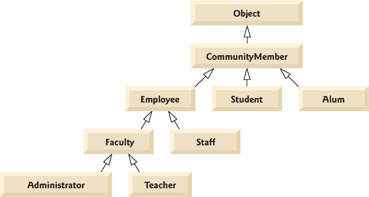

`Employee`（员工）是 `Faculty`（教职员工）或 `Staff`（员工）。`Faculty` 是 `Administrator`（管理员，例如院长和系主任）或 `Teacher`（教师）。该层次结构可能包含许多其他类。例如，`Student`（学生）可以是 `Graduate`（研究生）或 `Undergraduate`（本科生）。`Undergraduate` 学生可以是 `Freshmen`（大一学生）、`Sophomore`s（大二学生）、`Junior`s（大三学生）或 `Senior`s（大四学生），以此类推。

此类层次结构中的每个向上的箭头都代表一种“是一个*”（is-a*）的关系。顺着箭头，我们可以说：“一个 `Employee` 是一个 `CommunityMember`”以及“一个 `Teacher` 是一个 `Faculty` 成员”。`直接父类`(direct superclass）是子类显式继承的父类。`CommunityMember` 是 `Employee`、`Student` 和 `Alum` 类的直接父类。`间接父类`(indirect superclass）是`类层次结构`(class hierarchy）中直接父类之任何类，它定义了类之间的继承关系。`CommunityMember` 是图中 `Employee` 下方所有类的间接父类。从底部开始，你可以向上追踪箭头，并将“是一个*”关系应用于最顶部的父类。例如，一个 `Administrator` *是一个* `Faculty` 成员，*是一个* `Employee`，*是一个* `CommunityMember`，而且当然，*是一个* `Object`。第 9.4 节详细讨论了 `Object` 类。

Java 支持`单继承`(single inheritance），每个类都派自一个直接父类。Java 不支持多继承（即一个类派自多个直接父类）。在章节的后后部分，我们将解释如何使用 Java 接口来实现多继承的优势，同时避免相关问题。

### 形状层次结构

现在考虑以下 `Shape` 继承层次结构：

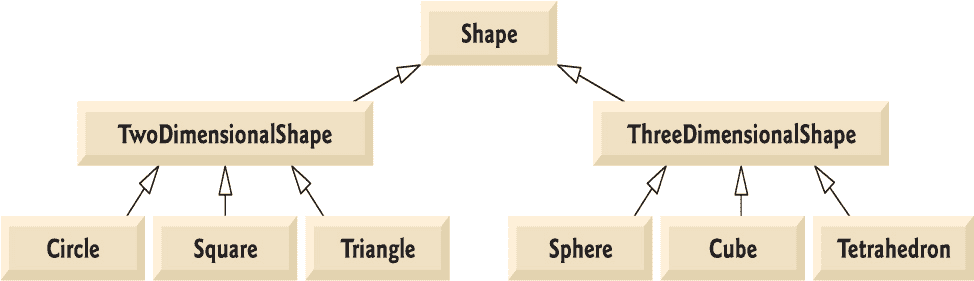

该层次结构从父类 `Shape` 开始。`Shape` 要么 `TwoDimensionalShape` 就是 `ThreeDimensionalShape`——它们 `Shape` 的 `直接子类`。层次结构的第三层包含特定的 `TwoDimensionalShape` 和 `ThreeDimensionalShape` 类型。再次，我们可以从图中底部向上追踪到该类层次结构中最顶部的父类，以识别出几个“是一个*”关系。例如，`Triangle` *是一个* `TwoDimensionalShape` *是一个* `Shape`，而 `Sphere` *是一个* `ThreeDimensionalShape` 且*是一个* `Shape`。该层次结构可能包含许多其他类。例如，`Ellipse` 和 `Trapezoid` 也是 `TwoDimensionalShape`，而 `Cylinder` 是一个 `ThreeDimensionalShape`。

并不是所有的类关系都是继承关系。例如，第 8 章讨论了“有一个*”（has-a*，组合）关系，其中类拥有引用其他类对象的实例变量。给定 `Employee`、`BirthDate` 和 `TelephoneNumber` 类，说一个 `Employee` *是一个* `BirthDate` 或一个 `Employee` *是一个* `TelephoneNumber` 是不妥的。然而，说一个 `Employee` *有一个* `BirthDate` 且一个 `Employee` *有一个* `TelephoneNumber` 是正确的。

父类和子类对象可以被相似对待——它们的共性体现在父类的成员中。所有扩展（即继承自）公共父类的类对象都可以被视为该父类的对象——此类对象与父类具有 *isa* 关系。

子类可以对其自定义它从父类继承的方法。为了做到这一点，子类方法`重写`(overrides)（重定义）父类方法，并提供适用于子类的实现。

#### 生成式 AI

**1** 提示生成式 AI 创建一个基于文本的 `Shape` 层次结构图，由 `TwoDimensionalShapes` 和 `ThreeDimensionalShapes` 组成。将结果与我们的 `Shape` 层次结构图进行比较。

### 9.3 父类与子类之间的关系

现在我们使用公司薪资应用程序中的员工类型继承层次结构来演示父类与子类之间的关系：

*   父类 `SalariedEmployee` 获得固定的周薪。
*   子类 `SalariedCommissionEmployee` 获得周薪加上销售额的百分比提金。

我们将对这些类之间关系的讨论分为两个示例。第一个示例声明了 `SalariedEmployee` 类，它直接继承自 `Object` 类，并包含了 `private` 实例变量 `name` 和 `salary`。第二个示例声明了 `SalariedCommissionEmployee` 类，它直接继承自 `SalariedEmployee` 类，并增加了 `private` 实例变量 `grossSales` 和 `commissionRate` 以及相应的方法。它还自定义了（即重写了）两个继承自 `SalariedEmployee` 方法。继承提供的软件复用使我们我们在开发新子类时，写的代码比从头开始写要少。然后，我们展示了 `SalariedCommissionEmployee` 对象如何使用继承的 `SalariedEmployee.public` 方法来操作（受控地）继承自 `SalariedEmployee` 的 `private` 实例变量。

#### 9.3.1 创建和使用 `SalariedEmployee` 类

让我们检查 `SalariedEmployee` 类（图 9.1）。第 5 行开始类声明，并指示该类 `extends`（即继承自）`Object` 类（来自 `java.lang` 包）。这导致 `SalariedEmployee` 类继承了 `Object` 的方法——它没有任何字段。如果你不指定新类 `extends` 哪个类，它会隐式地 `extends Object`。由于这个原因，你通常不会在代码中包含（`extends Object`”——我们在这个示例中为了演示才这样做。

点击此处查看代码图片

```java
// Fig. 9.1: SalariedEmployee.java

// SalariedEmployee 类表示一个获得固定薪水的员工。
import java.math.BigDecimal;

public class SalariedEmployee extends Object {
   private final String name;
   private BigDecimal salary; // 固定周薪

   // 双参数构造函数
   public SalariedEmployee(String name, BigDecimal salary) {
      // 在此处隐式调用 Object 的默认构造函数

      // 如果 salary 无效则抛出异常
      if (salary.compareTo(BigDecimal.ZERO) < 0) {
         throw new IllegalArgumentException("salary must be >= 0.0");
      }

      this.name = name;
      this.salary = salary;
   }

   // 返回 name
   public String getName() {return name;}

   // 设置 salary
   public void setSalary(BigDecimal salary) {
      if (salary.compareTo(BigDecimal.ZERO) < 0) {
         throw new IllegalArgumentException("salary must be >= 0.0");
      }

      this.salary = salary;
   }

   // 返回 salary
   public BigDecimal getSalary() {return salary;}

   // 计算薪资
   public BigDecimal calculateEarnings() {return getSalary();}

   // 返回 SalariedEmployee 对象的字符串表示
   @Override // 表示此方法重写了父类方法
   public String toString() {
      return String.format("name: %s%nsalary: $%s",
         getName(), getSalary());
   }
}
```


**图 9.1** | `SalariedEmployee` 类表示获得固定薪水的员工。

##### SalariedEmployee 类的方法和实例变量概述

该类将其实例变量声明为 `private`（第 6-7 行），因此其他类无法直接访问这些变量。`SalariedEmployee` 类的 `public` 服务包括：

*   构造函数（第 10-20 行），
*   `public getName` 方法（第 23 行），用于获取 `final` 实例变量 `name` 的值，
*   `public` 方法 `setSalary` 和 `getSalary`（第 26-35 行），用于设置和获取实例变量 `salary`（第 7 行），
*   `calculateEarnings` 方法（第 38 行），用于计算 `SalariedEmployee` 的收益，以及
*   `toString` 方法（第 41-45 行），用于创建 `SalariedEmployee` 的 `String` 表示。

构造函数和 `setSalary` 分别验证其 `salary` 参数，以确保它们在修改实例变量 `salary` 前大于等于 0。

##### SalariedEmployee 类的构造函数

父类的构造函数是不被继承的，但可以被子类调用。事实上，Java 要求每个子类的构造函数都必须显式或隐式地调用其直接父类的构造函数，以初始化继承自父类的实例变量。我们将在第 9.3.2 节中讨论显式调用父类构造函数的语法。

在示例中，`SalariedEmployee` 的构造函数隐式地调用了 `Object` 类的构造函数。如果代码没有包含对父类构造函数的显式调用，Java 将隐式调用父类的默认或无参数构造函数。第 11 行的注释指示了 Java 隐式调用父类 `Object` 默认构造的位置。即使一个类没有构造函数，编译器为该类隐式声明的默认构造也会调用父类的默认或无参数构造函数。

在将 `name` 参数赋值给 `name` 实例变量之前（第 18 行），我们没有对其进行验证。我们可以对其进行验证——也许是为了确保名称具有合理的长度。

### `SalariedEmployee` 成员函数 `calculateEarnings`

方法 `calculateEarnings`（第 38 行）调用 `getSalary` 并返回结果。你可能会奇怪，既然我们可以直接调用 `getSalary` 并获得相同的结果，为什么要提供 `calculateEarnings` 呢？正如你在第 9.3.2 节中看到的，`SalariedCommissionEmployee` 类将重写 `calculateEarnings` 以自定义该类对象计算工资的方式。然后，在第 9.6 节中，我们将展示多态要求每个类具有具有签名的方法。

### `SalariedEmployee` 成员函数 `toString`

方法 `toString`（第 41–45 行）返回一个包含 `SalariedEmployee` 对象信息的 `String`，这些信息通过调用类的 get 方法获取。`toString` 方法是每个类直接或间接继承自 `Object` 类的方法之一（在第 9.4 节中总结）。正如你所看到的，当对象必须转换为 `String` 表示形式时（例如使用 `printf` 将对象输出为 `String` 或使用 `String` 方法 `format` 将对象格式化为 `String`），JVM 会隐式调用 `toString`。`Object` 类的 `toString` 方法返回一个包含对象类名和对象哈希值的 `String`（见第 9.4 节）。这个 `toString` 主要是一个占位符，子类可以通过重写它可以为子类对象的数据指定合适的字符串表示。

`SalariedEmployee` 的 `toString` 方法（第 41–45 行）重写（重定义）了继承自 `Object` 的版本。要重写父类方法，子类必须声明一个与父类方法签名相同（方法名、参数个数、参数类型和参数类型顺序）的方法。`Object` 的 `toString` 方法没有参数，因此 `SalariedEmployee` 声明的 `toString` 也没有参数。

### `@Override` 注解

第 41 行使用可选的 `@Override` 注解来指示后续的方法声明（即 `toString`）应该重写现有的父类方法。该注解帮助编译器捕获一些常见错误。在示例中，我们打算重写父类方法 `toString`，它的拼写是小写的“t”和大写的“S”。如果你不小心使用了小写的“s”，编译器将将其标记为错误，因为父类中不包含名为带有小写“s”的 `tostring` 方法。如果你不使用 `@Override` 注解，`tostring` 将是一个完全不同的方法，在需要 `String` 的地方使用 `SalariedEmployee` 对象时将不会调用它。

另一个常见的重写错误是在子类方法的参数列表中声明了错误数量或类型的参数。这创建了父类方法的无意重载，而不是重写现有方法。如果你尝试在子类对象上调用该方法（使用正确的参数个数和类型），将会调用父类的版本——这可能会导致细微的逻辑错误。当编译器遇到一个带有 `@Override` 声明的方法时，它会将该方法的签名与父类的方法签名进行比较。如果没有精确匹配，编译器会发出错误信息，例如“方法未重写或实现来自父类型的方法”。然后你可以修正你的方法签名，使其与父类中的签名相匹配。

虽然 `@Override` 是可选的，但在声明重写方法时使用它，以便编译器能够确保你正确定义了它们的签名。在编译时发现错误总是比在运行时发现要好。出于这个原因，第 8 章示例中的 `toString` 方法也应该使用 `@Override` 进行声明。

### 你不能在子类中降低方法的可见性

`public` 父类方法在该类的每个直接和间接子类中必须是 `public` 的。使用更严格的访问修饰符重写方法会导致编译错误：

*   `public` 父类方法在子类中不能是 `protected` 或 `private`；
*   `protected` 父类方法在子类中不能是 `private`。

[ch09.xhtml_fn9_2a] “是一个”（is-a）关系要求所有子类对象能够响应对父类的方法调用。如果一个 `public` 方法可以被重写为 `private` 方法，就会破坏“是一个”的关系。

### 1 让生成式 AI 解释为什么用更严格的访问修饰符覆盖方法会导致编译错误，但用较宽松的访问修饰符则不会。

## 9.3.2 创建 `SalariedEmployee`/`SalariedCommissionEmployee` 继承层级

现在，让我们来创建一个 `SalariedCommissionEmployee` 类（图 9.3），该类继承自 `SalariedEmployee` 类（图 9.1）。正如第 6 行的 `extends` 子句所示，一个 `SalariedCommissionEmployee` 对象*是一个* `SalariedEmployee`。继承将 `SalariedEmployee` 的能力传递给子类。`SalariedCommissionEmployee` 还拥有 `BigDecimal grossSales` 和 `commissionRate` 实例变量（图 9.3，第 7–8 行），我们将通过将这两个变量相乘来计算所赚取的佣金。

```
public class SalariedCommissionEmployee extends SalariedEmployee {
   private BigDecimal grossSales; // gross weekly sales
   private BigDecimal commissionRate; // commission percentage

   // four-argument constructor
   public SalariedCommissionEmployee(String name, BigDecimal salary,
      BigDecimal grossSales, BigDecimal commissionRate) {

      super(name, salary); // call superclass constructor

      // if grossSales is invalid throw exception
      if (grossSales.compareTo(BigDecimal.ZERO) < 0) {
         throw new IllegalArgumentException("gross sales must be >= 0.0");
      }

      // if commissionRate is invalid throw exception
      if (commissionRate.compareTo(BigDecimal.ZERO) <= 0 ||
          commissionRate.compareTo(BigDecimal.ONE) >= 0) {

         throw new IllegalArgumentException(
            "commission rate must be > 0.0 and < 1.0");
      }

      this.grossSales = grossSales;
      this.commissionRate = commissionRate;
   }

   // set gross sales
   public void setGrossSales(BigDecimal grossSales) {
      if (grossSales.compareTo(BigDecimal.ZERO) < 0) {
         throw new IllegalArgumentException("gross sales must be >= 0.0");
      }

      this.grossSales = grossSales;
   }

   // return gross sales
   public BigDecimal getGrossSales() {return grossSales;}

   // set commission rate
   public void setCommissionRate(BigDecimal commissionRate) {
      if (commissionRate.compareTo(BigDecimal.ZERO) <= 0 ||
          commissionRate.compareTo(BigDecimal.ONE) >= 0) {

         throw new IllegalArgumentException(
            "commission rate must be > 0.0 and < 1.0");
      }

      this.commissionRate = commissionRate;
   }

   // return commission rate
   public BigDecimal getCommissionRate() {return commissionRate;}

   // calculate earnings
   @Override
   public BigDecimal calculateEarnings() {
      return super.calculateEarnings().add(
         getGrossSales().multiply(getCommissionRate()));
   }

   // return String representation of SalariedCommissionEmployee
   @Override
   public String toString() {
      return String.format("%s%ngross sales: $%s%ncommission rate: %s",
         super.toString(), getGrossSales(), getCommissionRate());
   }
}
```


**图 9.3** | `SalariedCommissionEmployee` 类继承自 `SalariedEmployee` 并通过继承的 `public` 方法访问父类的 `private` 数据。

### 继承

`SalariedCommissionEmployee` 继承了 `SalariedEmployee` 的所有成员，但构造函数除外，构造函数是特定于 `SalariedEmployee` 父类的。只有父类的 `public` 和 `protected` 成员在子类中可以直接访问。在继承中，父类的 `public` 成员在子类中仍是 `public`，`protected` 成员仍是 `protected`。继承的成员只有一份。这使得代码更容易维护、修改和调试，因为与 `SalariedEmployee` 相关的代码只存在于类中。

3. 我们在第 9.16 节中讨论了 `protected`。此类中没有 `protected` 成员。

### `SalariedCommissionEmployee` 为客户端代码提供的服务

`SalariedCommissionEmployee` 类提供的 `public` 服务（图 9.3）包括：

*   它自己的构造函数
*   `setGrossSales()`、`getGrossSales()`、`setCommissionRate()`、`getCommissionRate()`、`calculateEarnings()` 和 `toString()` 方法（第 33–70 行），这些继承自 `SalariedEmployee`。

`setGrossSales()`（第 33–39 行）和 `setCommissionRate()`（第 45–53 行）在修改实例变量之前验证了其参数：

*   确保 `grossSales` 大于 0
*   确保 `commissionRate` 大于 0 且小于 1

记住 `BigDecimal` 的 `compareTo()` 方法返回调用者小于、等于或大于参数的值。我们通过这些返回值与 0 进行比较来确定 `grossSales` 是否为负（第 17 行和 34 行），以及 `commissionRate` 是否大于或等于 1（第 22–23 行）。

虽然 `SalariedCommissionEmployee` 的源码不包含 `SalariedEmployee` 的成员，但它们仍然是子类的一部分。一个 `SalariedCommissionEmployee` 对象也包含 `SalariedEmployee` 的 `private` 实例变量，但在子类中无法直接访问。你只能通过继承的 `SalariedEmployee public` 方法（如果有 `protected` 方法的话）访问它们。

### `SalariedCommissionEmployee` 的构造函数

每个子类构造函数必须调用其直接父类的构造函数以初始化。因此，实例化子类会开始构造调用链。对于创建的每个对象，`Object` 构造函数总是最后调用的。

构造函数（第 11–30 行）通过**父类调用语法**（第 14 行）显式执行此操作，该语法由关键字 `super` 以及包含父类构造参数的括号组成——这初始化继承的父类实例变量。显式父类构造调用必须是构造函数体的第一语句——这一要求在未来的 Java 版本中将被放宽。

4. Java 23 的“JEP 482：灵活构造函数体（第二次预览）”建议更改此要求，以便子类构造函数可以在调用父类构造函数之前验证其参数。这将能够在子类构造函数因无效参数抛出异常时避免不必要的工作。示例请参见书籍网页 [`https://deitel.com/javafp5`](https://deitel.com/javafp5)。访问日期为 2024 年 9 月 19 日。[`https://openjdk.org/jeps/482`](https://openjdk.org/jeps/482)。

我们在第 8 章中提到过，不应该在构造函数中调用该类的实例方法。如果你遵循这一建议，就可以避免因直接或间接调用类的可重写方法而引起的细微问题，这些问题可能导致运行时错误——更多细节请参见第 9.10 节。

### `SalariedCommissionEmployee` 方法 `calculateEarnings()`

`SalariedCommissionEmployee` 的 `calculateEarnings()` 方法（第 59–63 行）重写了 `SalariedEmployee` 的版本，用于计算 `SalariedCommissionEmployee` 的收益。第 61 行使用以下表达式：

```
super.calculateEarnings()
```

来根据 `salary` 计算收益中的部分。然后，该方法将该值加到佣金中并返回总收益。

注意在子类中调用被重写的父类方法时使用的语法——在父类方法名之前放置关键字 `super` 和点操作符（`.`）分隔符。这种方法调用是一种良好的软件工程实践——如果一个方法执行了另一个方法所需的全部或部分操作，请调用该方法而不是重复其代码。这减少了代码维护问题。

5. 一个缺点是，这会在父类和子类之间创建紧散耦合，导致大型系统难以修改。我们将在第 9.13 节中进一步讨论这个问题。

当子类重写父类方法时，子类版本通常会调用父类版本来完成部分工作。在调用父类方法时，如果没有用关键字 `super` 和点操作符（`.`）为父类方法名前以前缀，会导致子类方法调用自身，可能产生名为 `无限递归`（infinite recursion）的错误，这最终会导致方法调用堆栈溢出——这是一个致命的运行时错误。递归如果使用得当是一项强大的能力，我们在第 22 章 递归与大 *O* 复杂度中讨论过。

### `SalariedCommissionEmployee` 方法 `toString()`

同样，`SalariedCommissionEmployee` 的 `toString()` 方法（图 9.3，第 66–70 行）重写了 `SalariedEmployee` 的 `toString()` 方法。新版本返回一个 `String`，其中包含第 69 行表达式获取 `SalariedEmployee` 的 `String` 形式：

```
super.toString()
```

随后是 `SalariedCommissionEmployee` 的 `grossSales` 和 `commissionRate`。

### 测试类 `SalariedCommissionEmployee`

图 9.4 创建了 `SalariedCommissionEmployee` 对象 `employee`（第 9–11 行）。第 14–21 行通过调用其 *get* 方法获取对象的实例变量值，输出 `employee` 的数据。第 24–25 行使用 `setGrossSales()` 和 `setCommissionRate()` 分别更改 `employee` 的 `grossSales` 和 `commissionRate` 值。然后，第 28–31 行通过调用（隐式地）`toString()` 来获取 `employee` 的 `String` 形式，调用 `calculateEarnings()` 获取 `employee` 的收益，从而显示 `employee` 更新后的信息和收益。

点击此处查看代码图片

```java
// Fig. 9.4: SalariedCommissionEmployeeTest.java
// SalariedCommissionEmployee test program.
import java.math.BigDecimal;
import java.math.RoundingMode;

public class SalariedCommissionEmployeeTest {
   public static void main(String[] args) {
      // instantiate SalariedCommissionEmployee object
      var employee = new SalariedCommissionEmployee("James Davis",
         new BigDecimal("500.00"), new BigDecimal("10000.00"),
         new BigDecimal("0.04"));

      // get SalariedCommissionEmployee data
      System.out.printf("""
         Employee information obtained by get methods:
         name: %s
         salary: $%s
         gross sales: $%s
         commission rate: %s
         """, employee.getName(), employee.getSalary(),
         employee.getGrossSales(), employee.getCommissionRate());

      // update gross sales and commission rate
      employee.setGrossSales(new BigDecimal("8000.00"));
      employee.setCommissionRate(new BigDecimal("0.1"));

      // display updated information and calculate and display earnings
      System.out.printf("%n%s:%n%s%n%nearnings: $%s%n",
         "Updated employee information obtained by toString", employee,
         employee.calculateEarnings().setScale(
            2, RoundingMode.HALF_EVEN));
   }
}
```

```
Employee information obtained by get methods:
name: James Davis
salary: $500.00
gross sales: $10000.00
commission rate: 0.04

Updated employee information obtained by toString:
name: James Davis
salary: $500.00
gross sales: $8000.00
commission rate: 0.1
earnings: $3000
```


#### 关于 `SalariedEmployee` 的说明

我们可以从 `SalariedEmployee` 复制代码并粘贴到 `SalariedCommissionEmployee` 中，然后修改 `SalariedCommissionEmployee` 以包含 `grossSales` 和 `commissionRate`。这种复制粘贴的方法容易出错且耗时。

通过继承，所有类共有的实例变量和方法都定义在父类中。对父类中这些特征的更改将由子类继承。如果没有继承，则需要在包含这些代码的所有文件中进行更改。通过继承，我们高效地构建了子类。但我们能做得更好吗？

##### 设计

在面向对象的系统的设计阶段，你经常发现类之间存在共同特征。你可以识别并提取公共实例变量和方法，并将它们放在父类中。然后，你可以使用继承来创建扩展这些功能的子类。声明子类不会影响其父类。第 9.13 节讨论了为什么你可能倾向于组合和接口而不是继承。

#### 生成式 AI

**1** 询问生成式 AI `@Override` 是否被视为其修饰的方法的一部分。

## 9.4 Object 类

Java 中的所有类都直接或间接继承自 `Object` 类（位于 `java.lang` 包），因此它们都继承了下表总结的 `Object` 方法。我们在书中讨论了这些方法（如表所示）。

| 方法 | 说明 |
| --- | --- |
| `equals` | 此方法比较两个对象的相等性，如果它们相等则返回 `true`，否则返回 `false`。该方法接受任何 `Object` 作为参数。当需要对特定类的对象进行相等性比较时，该类应重写 `equals` 以比较两个对象的内容。实现此方法的要求（包括重写 `hashCode` 方法）请参见 [`https://docs.oracle.com/en/java/javase/23/docs/api/java.base/java/lang/Object.html`](https://docs.oracle.com/en/java/javase/23/docs/api/java.base/java/lang/Object.html)。默认的 `equals` 实现使用 `==` 运算符来判断两个引用是否指向内存中的同一个对象。 |
| `hashCode` | 返回对象的哈希码值——这是一个 `int` 值，通常用于在哈希表数据结构中进行信息的快速存储和检索（第 12.10 节）。 |
| `toString` | 此方法（第 9.3.1 节）返回对象的 `String` 字符串表示。默认实现返回对象所属类的包名和类名，随后是对象的 `hashCode` 值。 |
| `wait`, `notify`, `notifyAll` | 方法 `notify`、`notifyAll` 以及 `wait` 的三个重载版本与多线程处理相关。 |
| `getClass` | Java 中的每个对象在执行时都知道自己的类型。`getClass` 方法（用于第 9.8.4 节）返回一个 `Class` 类型的对象（位于 `java.lang` 包），其中包含对象类型的信息，例如其类名（由 `Class` 方法 `getName` 返回）。 |
| `clone` | 此 `protected` 方法不接受参数并返回一个 `Object` 引用，它会对被调用的对象进行复制。默认实现执行`浅拷贝`（shallow copy）——将一个对象中的实例变量值复制到另一个相同类型的对象中。对于引用类型，仅复制引用。一个典型的重写 `clone` 方法实现会执行`深拷贝`（deep copy），即为每个引用类型的实例变量创建一个新对象。正确地实现 `clone` 是很困难的。因此，不建议使用它。 |

## 9.5 多态性引论：多态视频游戏

假设我们正在设计一个包含火星人 (`Martian`)、金星人 (`Venusian`)、冥星人 (`Plutonian`)、飞船 (`SpaceShip`) 和激光束 (`LaserBeam`) 的视频游戏。每个类都继承自 `SpaceObject` 超类，该超类有一个 `draw` 方法，并且每个子类都相应地实现了该方法。

### 屏幕管理器 (Screen Manager)

屏幕管理器程序维护一个存储 `SpaceObject` 引用的 `ArrayList`，指向各种类的对象。屏幕管理器定期向每个对象发送相同的 `draw` 消息以刷新屏幕。每个对象以其独特的方式做出响应。例如：

* 火星人 (`Martian`) 可能会用红色画自己，并带有相应数量的天线；
* 飞船 (`SpaceShip`) 可能会把自己画成一个银色的飞碟；
* 激光束 (`LaserBeam`) 可能会把自己画成一道横跨屏幕的亮红色光束。

同一个 `draw` 消息有多种形式，这就是多态。

### 向系统中添加新类

多态性允许我们以极少的代码修改向系统添加新类。假设我们要向游戏添加水星人。我们创建一个继承自 `SpaceObject` 的水星人类并定义 `draw` 方法，然后将该引用添加到 `SpaceObject` 的 `ArrayList` 中。通过超类变量访问，无论对象的类型如何，屏幕管理器都以相同的方式调用 `draw`。多态允许你处理抽象性，而让执行环境处理细节。

多态增强了系统的扩展性，只要新类型能够响应现有消息即可集成。只有实例化新对象的代码需要修改。

#### 生成式 AI

1. 提示生成式 AI 解释 Java 多态如何增强扩展性。

## 9.6 多态行为演示

第 9.3 节创建了一个类层次，其中 `SalariedCommissionEmployee` 继承自 `SalariedEmployee`。该节中的示例通过引用操作 `SalariedEmployee` 和 `SalariedCommissionEmployee` 对象。我们将超类变量指向超类对象，并将子类变量指向子类对象。这些赋值是自然且直接的。

在下一个示例中，我们将超类引用指向子类对象。然后我们展示了如何通过超类引用调用子类对象的方法。**被引用对象的类型（而不是变量的类型）决定了调用哪种方法。**此示例证明了**子类对象可以被视为其超类对象**，允许进行各种操作。例如，**程序可以创建一个指向许多子类类型的超类变量数组**。这是因为每个子类对象都是其超类的对象。我们可以将 `SalariedCommissionEmployee` 对象的引用赋值给超类 `SalariedEmployee` 变量，因为 `SalariedCommissionEmployee` 就是 `SalariedEmployee`。

图 9.5 展示了使用超类和子类变量存储超类和子类对象引用的三种方法。前两种是直接的——我们将超类引用赋值给超类变量，将子类引用赋值给子类变量。然后，通过将子类引用赋值给超类变量，演示了子类与超类之间的关系（即“是”关系）。该程序使用了来自图 9.1 和图 9.3 的 `SalariedEmployee` 和 `SalariedCommissionEmployee` 类。

```java
// Fig. 9.5: PolymorphismTest.java
// 将父类和子类的引用赋值给父类和
// 子类变量。
import java.math.BigDecimal;
import java.math.RoundingMode;

public class PolymorphismTest {
   public static void main(String[] args) {
      // 将父类引用赋值给父类变量
      var salariedEmployee = new SalariedEmployee("Sierra Dembo",
         new BigDecimal("1000.00"));

      // 将子类引用赋值给子类变量
      var salariedCommissionEmployee = new SalariedCommissionEmployee(
         "James Davis", new BigDecimal("500.00"),
         new BigDecimal("10000.00"), new BigDecimal("0.04"));

      // 使用父类变量调用父类对象的 toString 方法
      System.out.printf("""
         使用父类引用调用 SalariedEmployee 的 toString 和 calculateEarnings
         方法于父类对象：
         %s
         earnings: $%s%n%n""", salariedEmployee.toString(),
         salariedEmployee.calculateEarnings().setScale(
            2, RoundingMode.HALF_EVEN));

      // 使用子类变量调用子类对象的 toString 方法
      System.out.printf("""
         使用子类引用调用 SalariedCommissionEmployee 的 toString 和 calculateEarnings
         方法于子类对象：
         %s
         earnings: $%s%n%n""", salariedCommissionEmployee.toString(),
         salariedCommissionEmployee.calculateEarnings().setScale(
            2, RoundingMode.HALF_EVEN));

      // 使用父类变量调用子类对象的 toString 方法
      SalariedEmployee salariedEmployee2 = salariedCommissionEmployee;
      System.out.printf("""
         使用父类引用调用 SalariedCommissionEmployee 的 toString 和 calculateEarnings
         方法于子类对象：
         %s
         earnings: $%s%n""", salariedEmployee2.toString(),
         salariedEmployee2.calculateEarnings().setScale(
            2, RoundingMode.HALF_EVEN));
   }
}
```

```
使用父类引用调用 SalariedEmployee 的 toString 和 calculateEarnings
方法于父类对象：
name: Sierra Dembo
salary: $1000.00
earnings: $1000.00

使用子类引用调用 SalariedCommissionEmployee 的 toString 和 calculateEarnings
方法于子类对象：
name: James Davis
salary: $500.00
gross sales: $10000.00
commission rate: 0.04
earnings: $900.00

使用父类引用调用 SalariedCommissionEmployee 的 toString 和 calculateEarnings
方法于子类对象：
name: James Davis
salary: $500.00
gross sales: $10000.00
commission rate: 0.04
earnings: $900.00
```


**图 9.5** | 将父类和子类的引用赋值给父类和子类变量。

### 创建父类和子类对象

第 10–11 行创建了一个 `SalariedEmployee` 对象并将其引用赋值给类型为 `SalariedEmployee` 的变量。第 14–16 行创建了一个 `SalariedCommissionEmployee` 对象并将其引用赋值给一个 `SalariedCommissionEmployee` 变量。这些赋值是自然而然的——例如，`SalariedEmployee` 变量的主要用途就是持有 `SalariedEmployee` 对象的引用。

### 通过父类变量调用父类方法

第 19–25 行使用父类变量 `salariedEmployee` 来调用 `SalariedEmployee` 的方法 `toString()`（第 23 行）和 `calculateEarnings()`（第 24 行）。由于该变量指向一个 `SalariedEmployee` 父类对象，因此调用了这两个方法的父类版本。

### 通过子类变量调用子类方法

同样，第 28–34 行使用子类变量 `salariedCommissionEmployee` 来调用 `SalariedCommissionEmployee` 的方法 `toString()`（第 32 行）和 `calculateEarnings()`（第 33 行）。由于 `salariedCommissionEmployee` 指向一个 `SalariedCommissionEmployee` 子类对象，因此调用了这两个方法的子类版本。

### 通过父类变量调用子类方法

第 37 行将 `salariedCommissionEmployee` 引用的 `SalariedCommissionEmployee` 子类对象赋值给父类 `SalariedEmployee` 变量 `salariedEmployee2`。第 38–44 行使用这个父类变量调用 `SalariedCommissionEmployee` 子类方法 `toString()`（第 42 行）和 `calculateEarnings()`（第 43 行）。**当父类变量指向子类对象并用于调用方法时，调用的是方法的子类版本。**因此，第 42–43 行调用了 `SalariedCommissionEmployee` 类的方法 `toString()` 和 `calculateEarnings()`。Java 编译器允许将子类对象赋值给父类变量，因为**子类对象也是其父类的对象**（但反之则不然）。

当编译器遇到通过变量进行的方法调用时，编译器会通过检查变量的类型来确定该方法是否可以被调用。在执行期间，变量所指向的类型决定了实际使用的方法。这一过程被称为**动态绑定**。

### 9.7 抽象类和方法

有时，声明永远不会创建对象的**抽象类**是有用的。我们将它们称为**抽象父类**，因为它们只被用作父类。正如我们即将看到的，这些类不能被实例化。我们在示例中演示了一个抽象类。

#### 抽象类的作用

抽象类提供了一个其他类可以继承并共享公共设计的父类。例如，在 `Shape` 层次结构中，子类继承了作为 `Shape` 的含义——也许是 `location`、`fillPattern`、`color` 和 `borderThickness` 等公共属性，以及 `draw()`、`move()`、`resize()`、`rotate()` 和 `setColor()` 等行为。

用于实例化的类被称为具体类。它们实现了声明的方法（某些实现可能是继承来的）。例如，我们可以从抽象父类 `TwoDimensionalShape` 派生具体类 `Circle`、`Square` 和 `Triangle`。同样，我们可以从抽象父类 `ThreeDimensionalShape` 派生具体类 `Sphere`、`Cube` 和 `Tetrahedron`。

抽象父类过于通用，无法实例化真实的对象——它们只指定了子类之间的共性。在实例化对象之前，我们需要更具体。例如，如果你向抽象类 `TwoDimensionalShape` 发送 `draw()` 消息，该类知道二维形状是可以绘制的，但它不知道具体要画什么形状，因此它无法实现真实的 `draw()` 方法。**具体类提供了实例化所需的细节。**

并不是所有的层次结构都包含抽象类。然而，你经常编写只使用抽象父类类型变量的客户端代码，以减少客户端代码对一系列子类类型的依赖。例如，**你可以编写一个接收抽象父类类型参数的方法。当调用时，此类方法可以接收直接或间接 `extends` 该父类的任何具体类的对象。**

`abstract` 类（抽象类）有时构成多个层级的层级结构。例如，在第 9.2 节中的 `Shape` 层级中，`Shape` 类及其直接子类 `TwoDimensionalShape` 和 `ThreeDimensionalShape` 都将是 `abstract` 的，因为它们不够具体，无法确定具体的形状。该层次结构的第三层声明了具体的 `TwoDimensionalShape`（`Circle`、`Square` 和 `Triangle`）以及 `ThreeDimensionalShape`（`Sphere`、`Cube` 和 `Tetrahedron`）。

## 声明 `abstract` 类和 `abstract` 方法

通过在 `class` 关键字之前放置 `abstract` 关键字可以将类声明为 `abstract`。`abstract` 类为类层次结构中的类声明公共属性和行为（包括 `abstract` 和具体方法）。`abstract` 类的实例变量和具体方法遵循标准的继承规则。

`abstract` 类通常包含一个或多个 `abstract` 方法，但并非强制。`abstract` 方法是声明为 `abstract` 的实例方法，如下：

```
public abstract void draw(); // abstract method
```

`abstract` 方法不提供实现。任何包含 `abstract` 方法的类必须显式声明为 `abstract`。子类必须声明“缺失的部分”（如果有的话），以变成具体类，从而你可以从这些类实例化对象。因此，`abstract` 类的具体子类必须为每个 `abstract` 方法提供具体的实现。否则，该子类也必须被声明为 `abstract`。

## 某些方法不能是 `abstract`

构造函数和 `static` 方法不能是 `abstract` 的。构造函数是不继承的，因此 `abstract` 构造函数永远无法被实现。虽然非 `private static` 方法会被继承，但它们不能被重写。`abstract` 方法旨在为了对象的多态处理而被重写。`static` 方法与类相关而不是与特定对象相关，因此将 `static` 方法声明为 `abstract` 没有意义的。

## 使用 `abstract` 类声明变量

尽管我们不能实例化 `abstract` 超类的对象，但你很快就会发现，我们可以使用 `abstract` 超类来声明变量，这些变量可以引用派自该超类的任何具体类的对象。我们将使用此类变量以多态的方式操作子类对象。你还可以使用 `abstract` 超类名来调用在这些 `abstract` 超类中声明的 `static` 方法。

## 分层软件系统

多态性对于实现所谓的分层软件系统特别有效。例如，在操作系统中，每个物理设备类型的操作方式可能完全不同。尽管如此，对设备读取或写入数据的命令可能具有某种统一性。对于每个设备，操作系统都使用一种称为“设备驱动程序”的软件来控制系统与设备之间的所有通信。发送到设备驱动程序对象的写消息需要根据该驱动程序的特定语境以及它如何操作特定类型的设备来进行特定的解释。然而，对一个设备的写调用与对系统中任何其他设备的写操作没有区别——即将内存中的若干字节放置到该设备上。

面向对象的操作系统可能会使用一个 `abstract` 超类来为所有设备驱动程序提供一个合适的通用“接口”。然后，行为相似的子类通过继承该 `abstract` 超类而形成。设备驱动程序的方法在超类中被声明为 `abstract` 方法。这些 `abstract` 方法的实现在对应特定类型设备驱动程序的具体子类中提供。新设备不断开发出来，往往在操作系统发布很久之后。当你购买一个新设备时，它会带有一个设备供应商提供的设备驱动程序。在你安装驱动并将设备连接到计算机后，设备会立即运行。新设备及其驱动程序可以“即插即用”。这是多态性如何使系统具有扩展性的另一个优雅示例。

#### 生成式 AI

1. 提示生成式 AI，询问为什么即使一个 Java 类没有 `abstract` 方法，我们仍然想要将其声明为 `abstract` 的。

## 9.8 案例研究：使用多态性的工资单系统

让我们使用 `abstract` 类和多态性来计算两种类型员工的工资单。我们创建了一个 `Employee` 层级结构来解决以下问题：

一家公司每周向员工发放工资。员工分为两种类型：

1. 固定制员工无论工作时间多短，都获得固定薪水。
2. 佣金制员工获得其销售额的百分比。

对于当前的工资期，公司决定通过增加 10% 的薪水来奖励固定制员工。公司想实现一个以多态方式执行工资计算的程序。

### `Employee` 层级结构

我们使用 `abstract` 类 `Employee` 来代表员工的通用概念，并定义层级的“接口”——即所有 `Employee` 子类都必须具备的方法，以便程序可以在所有 `Employee` 对象上调用这些方法。`SalariedEmployee` 和 `CommissionEmployee` 类直接继承自 `Employee`。接下来的 UML 类图显示了我们的多态工资应用程序的继承结构。根据 UML 规范，`abstract` 类名 `Employee` 使用斜体。


`abstract` 超类 `Employee` 声明了层级的“接口”——即程序在整个层级结构中对所有 `Employee` 对象可以调用的方法。在这里使用“接口”一词是广义的，指代程序与任何 `Employee` 子类对象通信的各种方式。注意不要将“接口”的通用概念与 Java 接口的正式概念混淆（第 9.11 节）。无论如何计算工资，每个员工都有名字，因此我们在 `abstract` 超类 `Employee` 中声明 `private` 实例变量 `name`。

下图左侧显示层级结构中的每个类，顶部显示 `calculateEarnings` 和 `toString` 方法。对于每个类，图显示了每个方法的预期结果。我们没有列出超类 `Employee` 的 `getName` 方法，因为它没有被任何子类重写——它是被继承并使用的。

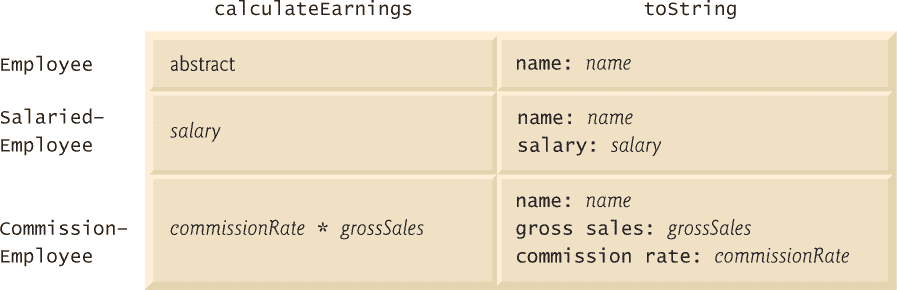

后续部分实现了 `Employee` 类层次。第一部分声明 `abstract` 超类 `Employee`。接下来的两个部分各实现一个具体子类。最后部分实现了一个测试程序，构建这些类的对象并多态地处理它们。

#### 9.8.1 `abstract` 超类 `Employee`

`Employee` 类（图 9.6）提供了 `getName`、`toString` 和 `calculateEarnings` 方法。

```
 1   // Fig. 9.6: Employee.java
 2   // Employee abstract superclass.
 3   import java.math.BigDecimal;
 4
 5   public abstract class Employee {
 6      private final String name;
 7
 8      // constructor
 9      public Employee(String name) {this.name = name;}
 9
 11      // return name
 12      public String getName() {return name;}
 13
 14      // return String representation of Employee object
 15      @Override
 16      public String toString() {return String.format("name: %s", getName());}
 17
 18      // abstract method must be overridden by concrete subclasses
 19      public abstract BigDecimal calculateEarnings(); // no implementation
 20   }
```

*   一个构造函数（第 9 行），接收一个 `String` 来初始化 `final` 实例变量 `name`（声明在第 6 行——在本示例中，构造函数没有对其参数进行验证）；
*   一个 `getName` 方法用于返回 `name`（第 12 行）；
*   一个 `toString` 方法（第 15–16 行），用于返回 `Employee` 的 `String` 表示，以及
*   一个 `abstract` 方法 `calculateEarnings`（第 19 行）这将被每个具体的 `Employee` 子类重写。

每个 `Employee` 子类都将重写 `toString`，以创建一个包含所有员工信息的 `String` 字符串表示。

### `abstract` 方法 `calculateEarnings`

我们为什么要将 `calculateEarnings` 声明为 `abstract` 方法呢？计算工资显然适用于所有员工。然而，我们无法为 `Employee` 这一通用概念计算工资——我们必须先知道具体的 `Employee`。将此方法声明为 `abstract` 表示每个具体的子类都必须使用适当的来实现重写 `calculateEarnings`。

你不能直接创建 `Employee` 对象，因为 `Employee` 是一个 `abstract` 类。但是，由于继承关系，任何 `Employee` 子类的对象*都是*一个 `Employee`，因此保证提供方法 `calculateEarnings`。所以，程序可以通过超类 `Employee` 变量对任何*是* `Employee` 的对象以多态方式调用该方法。

在 第 9.8.4 节 中，我们将创建一个超类 `Employee` 变量的数组，每个变量都引用一个*是* `Employee` 的子类对象。程序将遍历该数组，对每个对象多态地调用 `calculateEarnings`。编译器允许通过 `Employee` 变量调用方法 `calculateEarnings`，因为它在类 `Employee` 中已声明—— 再次，变量的类型决定了程序可以使用该变量调用哪些方法。

### 9.8.2 具体子类 `SalariedEmployee`

`SalariedEmployee` 类（图 9.7）继承自 `Employee` 类（第 5 行），并重写了 `abstract` 方法 `calculateEarnings`（第 33–34 行），这使得 `SalariedEmployee` 成为一个具体类。该类包含：

*   一个构造函数（第 9–18 行），接收 `name` 和 `salary`，并将名称传递给超类 `Employee` 的构造函数（第 10 行），以初始化 `Employee` 的 `private` 实例变量；
*   一个 `setSalary` 方法，用于给 `salary` 实例变量分配一个新的非负值（第 21–27 行）；
*   一个 `getSalary` 方法用于返回 `salary` 的值（第 30 行）；
*   一个 `calculateEarnings` 方法（第 33–34 行），重写超类版本以计算 `SalariedEmployee` 的工资，以及
*   一个 `toString` 方法（第 37–41 行），重写超类版本以返回一个 `String`，其中超类 `Employee` 的 `toString` 方法和 `SalariedEmployee` 的 `getSalary` 方法返回的信息。

```
 1   // Fig. 9.7: SalariedEmployee.java
 2   // SalariedEmployee concrete class extends abstract class Employee.
 3   import java.math.BigDecimal;
 4
 5   public class SalariedEmployee extends Employee {
 6      private BigDecimal salary; // fixed weekly Salary
 7
 8      // constructor
 9      public SalariedEmployee(String name, BigDecimal salary) {
 10         super(name);
 11
 12         // if salary is invalid throw exception
 13         if (salary.compareTo(BigDecimal.ZERO) < 0) {
 14            throw new IllegalArgumentException("salary must be >= 0.0");
 15         }
 16
 17         this.salary = salary;
 18      }
 19
 20      // set salary amount
 21      public void setSalary(BigDecimal salary) {
```


## 9.8.2 具体子类 `SalariedEmployee`

`SalariedEmployee` 类继承自 `abstract` 类 `Employee`。

```java
22         if (salary.compareTo(BigDecimal.ZERO) < 0) {
23            throw new IllegalArgumentException("salary must be >= 0.0");
24         }
25
26         this.salary = salary;
27      }
28
29      // return salary amount
30      public BigDecimal getSalary() {return salary;}
31
32      // calculate earnings
33      @Override
34      public BigDecimal calculateEarnings() {return getSalary();}
35
36      // return String representation of SalariedEmployee object
37      @Override // indicates that this method overrides a superclass method
38      public String toString() {
39         return String.format("%s%nsalary: $%s",
40            super.toString(), getSalary());
41      }
42   }
```

方法 `calculateEarnings` 重写了 `Employee` 的 `abstract` 方法，提供了一个返回 `SalariedEmployee` `salary` 的具体实现。如果我们不实现 `calculateEarnings`，则 `SalariedEmployee` 类必须被声明为 `abstract`。当然，在这个示例中，我们希望 `SalariedEmployee` 类是具体的。

`toString` 方法（第 37–41 行）重写了 `Employee` 的 `toString`。如果 `SalariedEmployee` 类没有重写 `toString`，它将继承 `Employee` 的版本。在这种情况下，`SalariedEmployee` 类的 `toString` 方法将只返回 `name`，这不能充分表示一个 `SalariedEmployee`。

### 9.8.3 具体子类 `CommissionEmployee`

`CommissionEmployee` 类（图 9.8）继承自 `Employee` 类（第 5 行）。该类包含：

*   一个构造函数（第 10–28 行），接收名称、总销售额和佣金率，并将名称传递给超类 `Employee` 的构造函数（第 12 行），以初始化 `Employee` 的 `private` 实例变量；
*   *set* 方法（第 31–37 行和 43–51 行），为实例变量 `grossSales` 和 `commissionRate` 分配有效的新值；
*   *get* 方法（第 40 行和 54 行），返回 `grossSales` 和 `commissionRate` 的值；
*   一个 `calculateEarnings` 方法（第 57–60 行），重写超类版本以计算 `CommissionEmployee` 的工资；以及
*   一个 `toString` 方法（第 63–67 行），重写超类版本以返回一个 `String`，其中包含超类 `Employee` 的 `toString` 方法和 `CommissionEmployee` 的 `getGrossSales` 以及 `getCommissionRate` 方法返回的信息。

```java
 1   // Fig. 9.8: CommissionEmployee.java
 2   // CommissionEmployee class extends Employee.
 3   import java.math.BigDecimal;
 4
5   public class CommissionEmployee extends Employee {
 6      private BigDecimal grossSales; // gross weekly sales
 7      private BigDecimal commissionRate; // commission percentage
 8
9      // constructor
10      public CommissionEmployee(String name,
11         BigDecimal grossSales, BigDecimal commissionRate) {
12         super(name);
13
14         // if grossSales is invalid throw exception
15         if (grossSales.compareTo(BigDecimal.ZERO) < 0) {
16            throw new IllegalArgumentException("gross sales must be >= 0.0");
17         }
18
19         // if commissionRate is invalid throw exception
20         if (commissionRate.compareTo(BigDecimal.ZERO) <= 0 ||
21             commissionRate.compareTo(BigDecimal.ONE) >= 0) {
22            throw new IllegalArgumentException(
23               "commission rate must be > 0.0 and < 1.0");
24         }
25
26         this.grossSales = grossSales;
27         this.commissionRate = commissionRate;
28      }
29
30      // set gross sales
31      public void setGrossSales(BigDecimal grossSales) {
32         if (grossSales.compareTo(BigDecimal.ZERO) < 0) {
33            throw new IllegalArgumentException("gross sales must be >= 0.0");
34         }
35
36         this.grossSales = grossSales;
37      }
38
39      // return gross sales
40      public BigDecimal getGrossSales() {return grossSales;}
41
42      // set commission rate
43      public void setCommissionRate(BigDecimal commissionRate) {
44         if (commissionRate.compareTo(BigDecimal.ZERO) <= 0 ||
45             commissionRate.compareTo(BigDecimal.ONE) >= 0) {
46            throw new IllegalArgumentException(
47               "commission rate must be > 0.0 and < 1.0");
48         }
49
50         this.commissionRate = commissionRate;
51      }
52
53      // return commission rate
54      public BigDecimal getCommissionRate() {return commissionRate;}
55
56      // calculate earnings
57      @Override
58      public BigDecimal calculateEarnings() {
59         return getGrossSales().multiply(getCommissionRate());
60      }
61
62      // return String representation of CommissionEmployee
63      @Override
64      public String toString() {
65         return String.format("%s%ngross sales: $%s%ncommission rate: %s",
66            super.toString(), getGrossSales(), getCommissionRate());
67      }
68   }
```

#### 9.8.4 多态处理、运算符 `instanceof` 与向下类型转换

图 9.9 测试了我们的 `Employee` 继承体系。第 9–12 行创建了一个 `SalariedEmployee` 对象和一个 `CommissionEmployee` 对象。程序首先通过每个对象自身的类型变量对这些对象进行非多态处理，然后使用一个 `Employee` 变量数组以多态方式对其进行处理。在以多态方式处理对象时，程序将每个 `SalariedEmployee` 的薪水增加了 10%——这要求在执行运行时确定对象的类型。最后，程序以多态方式确定并输出 `Employee` 数组中每个对象的类型。第 14–21 行以非多态方式输出每个对象的 `String` 字符串表示和薪金，其中使用 `salariedEmployee` 变量调用 `SalariedEmployee` 方法，并使用 `commissionEmployee` 变量调用 `CommissionEmployee` 方法。当对象使用 `%s` 格式说明符作为 `String` 输出时，`printf` 会隐式地调用每个对象的 `toString` 方法（第 16 和第 19 行）。

```java
 1   // Fig. 9.9: PayrollSystemTest.java
 2   // Employee hierarchy test program.
 3   import java.math.BigDecimal;
 4   import java.math.RoundingMode;
 5
6   public class PayrollSystemTest {
 7      public static void main(String[] args) {
 8         // create subclass objects
 9         var salariedEmployee = new SalariedEmployee("Sierra Dembo",
10            new BigDecimal("1000.00"));
11         var commissionEmployee = new CommissionEmployee("James Davis",
12            new BigDecimal("10000.00"), new BigDecimal("0.06"));
13
14         System.out.println("Employees processed individually:");
15
16         System.out.printf("%s%nearned: $%s%n%n", salariedEmployee,
17            salariedEmployee.calculateEarnings().setScale(
18               2, RoundingMode.HALF_EVEN));
19         System.out.printf("%s%nearned: $%s%n%n", commissionEmployee,
20            commissionEmployee.calculateEarnings().setScale(
21               2, RoundingMode.HALF_EVEN));
22
23         System.out.println("Employees processed polymorphically:");
24         Employee[] employees = {salariedEmployee, commissionEmployee};
25
26         for (int i = 0; i < employees.length; i++) {
27            if (employees[i] instanceof SalariedEmployee) {
28                SalariedEmployee se = (SalariedEmployee) employees[i];
29                se.setSalary(se.getSalary().multiply(new BigDecimal("1.10")));
30            } else if (employees[i] instanceof CommissionEmployee) {
31                CommissionEmployee ce = (CommissionEmployee) employees[i];
32                ce.setGrossSales(ce.getGrossSales().multiply(new BigDecimal("1.10")));
33            }
34            System.out.printf("Employee %d is a %s%n", i, employees[i].getClass().getSimpleName());
35         }
36      }
37   }
```

```
Employees processed individually:

name: Sierra Dembo

earned: $1100.00

name: James Davis

earned: $600.00

Employees processed polymorphically:

Employee 0 is a SalariedEmployee

name: Sierra Dembo

earned: $1100.00

Employee 1 is a CommissionEmployee

name: James Davis

earned: $660.00
```


*(注：上述代码块和输出是根据文本描述的逻辑重建的，因为提供的源代码片段包含不完整的逻辑。)*

我们对 `SalariedEmployee` 对象进行了特殊处理。当我们在执行期间遇到这些对象时，会将它们的薪水增加 10%。在以多态方式处理对象时，我们通常不需要担心这类具体的细节。然而，为了调整薪水，我们必须在执行时确定 `Employee` 对象的具体类型。

第 33 行使用了带模式匹配的 `instanceof` 运算符（Java 16）来判断特定的 `Employee` 是否为 `SalariedEmployee`。如果 `currentEmployee` 指向一个 `SalariedEmployee` 对象，则第 33 行的条件为真——这包括 `SalariedEmployee` 的子类对象，因为子类与其父类之间存在是（is-a）关系。如果条件为真，模式匹配 `instanceof` 表达式会自动将 `currentEmployee` 中的引用从父类类型 `Employee` 转换为子类类型 `SalariedEmployee`，然后将引用赋值给子类变量 `employee`。这种转换被称为向下转型（downcast），并且仅当对象 `currentEmployee` 是 `SalariedEmployee` 时才允许。第 33 行的条件确保了这一点。如果我们要在当前的 `Employee` 对象上调用子类 `SalariedEmployee` 的方法 `getSalary()` 和 `setSalary()`，则这种向下转型是必要的——直接在父类引用上调用子类特有的方法会导致编译错误。

如果第 33 行的 `instanceof` 表达式为 `true`，则第 34–39 行将执行 `SalariedEmployee` 对象所需的特殊处理。使用 `SalariedEmployee` 变量 `employee`，第 34–35 行调用子类特有的方法 `getSalary()` 和 `setSalary()` 来获取并更新员工薪水，增加 10%。然后，第 37–39 行使用 `getSalary()` 获取新薪水并显示。

### 多态地调用 `calculateEarnings()`

第 43 行在 `currentEmployee` 上调用 `calculateEarnings()` 方法，该方法会以多态方式调用当前子类对象相应的 `calculateEarnings()` 方法。以多态方式获取 `CommissionEmployee` 的收入与第 20 行获取的结果相同。由于基础薪水增加了 10%，`SalariedEmployee` 获取的收入金额比第 17 行的高。

### 获取每个 `Employee` 的类名

为了证明每个对象都知道自己的类，第 48–51 行将每个 `Employee` 的类型显示为 `String`。每个对象都可以通过继承自 `Object` 方法 `getClass()` 访问其类的信息。`getClass()` 方法返回一个 `Class` 类型（来自 `java.lang` 包）对象的引用，该对象包含有关对象类型的信息，例如类名。第 50 行在当前对象上调用 `getClass()` 以获取其类。然后，它使用 `getClass()` 返回的引用调用 `Class` 方法 `getName()` 来获取对象的类名。

### 避免向下转型导致的编译错误

在这个示例中，我们通过第 33 行的模式匹配 `instanceof` 表达式将 `Employee` 变量向下转型为 `SalariedEmployee` 变量，避免了若干编译错误。如果你尝试直接将 `Employee` 变量 `currentEmployee` 赋值给 `SalariedEmployee` 变量，将收到“类型不兼容”的编译错误。将父类变量中存储的引用赋值给子类变量是不允许的，因为 `Employee` 并不是 `SalariedEmployee`——是关系只适用于子类及其父类之间，反之则不然。

同样，如果第 35 行和 39 行使用父类变量 `currentEmployee` 来调用子类特有的方法 `getSalary()` 和 `setSalary()`，我们会在这些行收到“找不到符号”的编译错误。通过父类变量调用子类特有的方法是不允许的——尽管第 35 行和 39 行仅在第 33 行的 `instanceof` 返回 `true` 时才会执行，这表示 `currentEmployee` 持有一个 `SalariedEmployee` 对象的引用。使用父类 `Employee` 变量，我们只能调用 `Employee` 类中的方法——`getName()`、`calculateEarnings()` 和 `toString()`。尽管实际调用的方法取决于对象的类型，但变量只能用于调用该变量类型中包含的方法，这一点由编译器进行验证。

### Java 16 之前的 `instanceof`

模式匹配 `instanceof` 运算符在 Java 16 中定稿。在此之前，第 33 行的 `if` 头部将按如下实现：

```
if (currentEmployee instanceof SalariedEmployee) {

   // 将 Employee 引用向下转型为 SalariedEmployee 引用

   SalariedEmployee employee = (SalariedEmployee) currentEmployee;

   // if 语句体的其余部分

}
```

`if` 的第一个体语句使用转换运算符——`(SalariedEmployee)`——将 `currentEmployee` 中的父类 `Employee` 引用转换为子类变量 `employee`。然而，除非我们已经知道 `currentEmployee` 指向一个 `SalariedEmployee` 对象（即 `if` 的 `instanceof` 条件为 `true`），否则该语句将不会执行。这防止了 `ClassCastException`，当向下转型时引用的对象与指定的类型之间没有是关系就会发生这种异常。

## 9.9 `final` 方法和类

你已经看到变量可以声明为 `final` 以表示它们在初始化后不能被修改。也可以用 `final` 修饰符声明方法和类。

### Final 方法不能被重写

父类中的 `final` 方法不能在子类中重写——这保证了 `final` 方法实现将被所有直接和间接子类使用。声明为 `private` 的方法隐式是 `final` 的——子类无法访问父类的私有成员，因此无法重写它们。声明为 `static` 的方法也是隐式 `final` 的，因为只有非 `static` 实例方法可以被重写。由于最终方法的定义永远不会改变，对最终方法的调用在编译时解析——称为静态绑定。

### Final 类不能作为父类

`final` 类不能被扩展，因此其方法隐式是 `final` 的。`String` 就是 `final` 类。如果允许扩展 `String`，那么该子类的对象可以在任何需要 `String` 的地方使用。由于不能被扩展，使用 `String` 的程序可以依赖 Java API 指定的 `String` 对象的功能。使类变为 `final` 防止程序员创建可能绕过安全限制的子类。

### `record` 类

`record` 类隐式是 `final` 类，因此其方法隐式是 `final` 的。`record` 类的实例变量也是 `final` 的。

### 可以 final，就应该是 final

通常情况下，如果一个变量、方法或类可以是 `final` 的，它就应该是 `final` 的。这是最小权限原则的另一个例子。当我们在第 18 章学习并发时，你会看到 `final` 变量使得你的程序更容易进行并行化，以适应当今的多核处理器并提高性能。

有时，将类声明为 `final` 是重要的——通常出于安全考虑。除非你为了扩展而仔细地设计了一个类，否则你应该将该类声明为 `final` 以避免（往往是细微的）错误。像任何类一样，你可以通过组合来重用 `final` 类——例如，我们的 `Employee` 类组合了对一个 `String` 对象的引用，而 `String` 是一个 `final` 类。有关关于使用 `final` 的更多见解，请访问

```
https://docs.oracle.com/javase/tutorial/java/IandI/final.html
```

#### 生成式 AI

**1** 提示生成式 AI，要求其提供简单的示例，说明为什么可能出于安全考虑将 Java 类声明为 `final`。

## 9.10 构造函数调用实例方法的问题

在第 8.10 节中，我们选择在类 `Time2` 的构造函数和 `setTime()` 方法之间重复代码。我们这样做是因为你不应该从构造函数中调用类的非 `static` 方法。为了理解其原因，请记住，当你构建一个子类对象时，子类构造函数会在执行子类实例变量初始化代码之前，调用其直接父类中的构造函数。**如果父类构造函数随后调用了子类重写的方法，则子类的版本会在子类构造函数完成子类对象数据的初始化之前执行。**如果子类方法使用了尚未初始化的实例变量，可能会导致细微且难以检测的错误。

假设一个构造函数和一个 `set` 方法对某个特定的实例变量执行相同的验证。你应该如何处理这些公共代码？

*   在构造函数和 `set` 方法中重复简短的验证代码是消除我们此处考虑的问题的简单方法。
*   对于较长的验证代码，你可以定义一个 `static` 验证方法——通常是一个 `private static` 辅助方法——然后从构造函数和 `set` 方法中调用它。在构造函数中调用 `static` 方法是可以接受的，因为它是不可重写的。

如果构造函数没有直接或间接地调用任何可重写的实例方法，那么构造函数调用 `final` 或 `private` 实例方法也是可以的。

#### 生成式 AI

**1** 提示生成式 AI，要求其提供一个简单的示例，说明从构造函数调用可重写方法可能产生的细微且难以检测的错误。

**2** 提示生成式 AI，要求它们讨论从构造函数中调用可重写方法可能引起的潜在 Java 安全问题。

## 9.11 创建和使用接口

我们的下一个示例（图 9.10–9.13）重新检查了第 9.8 节中的薪资系统。假设公司希望在一个应付账款应用程序中执行若干会计操作。除了计算每个员工的收入外，公司还必须计算发票的应付金额（即购买货物的账单）。尽管应用于不相关的事物——员工和发票——但这两项操作都获取了付款金额：

*   对于员工来说，付款金额是员工的收入。
*   对于发票来说，付款金额是发票列出商品的总成本。

我们能在一个应用程序中通过多态计算诸如员工和发票应付金额如此不同的内容吗？Java 是否允许不相关的类实现一组公共方法（例如，计算付款金额的方法）？Java **接口**（interfaces）提供了这种能力。

### 标准化交互

在我们第 1.4 节的汽车类比中，一个由方向盘、加速踏板和刹车踏板组成的“基本驾驶能力”接口可以让驾驶员告诉汽车做什么。一旦你学会了如何使用此接口进行转向、加速和制动，就可以驾驶许多不同的汽车，尽管制造商可能以不同的方式实现这些系统。例如，有许多类型的刹动系统——盘式刹、鼓式刹、防抱锁等。当你按下刹车踏板时，你的汽车刹动系统类型并不重要——重要的是汽车慢了下来。

### 软件对象通过接口通信

软件对象也通过接口通信。Java 接口描述了一组可以在对象上调用的方法，告诉对象执行某些任务或返回某些信息。下一个示例引入了一个名为 `Payable` 的接口，用于描述任何“必须具备支付能力”的对象的功能，因此必须提供一个方法来确定应付金额。

### 使用接口

要使用接口，具体类必须：

*   指定它 `implements`（实现）该接口并
*   为接口中的每个 `abstract`（抽象）方法提供具体的实现。

要指定一个类实现接口，请在类声明的第一行尾添加 `implements` 关键字和接口名称，如下：

```
public class ClassName extends SuperclassName implements InterfaceName
```

或者

```
public class ClassName implements InterfaceName
```

`InterfaceName` 可以是用逗号分隔的接口列表。**实现接口就像与编译器签署了一份合同，声明：“我将声明接口指定的所有抽象方法，或者将我的类声明为抽象类；否则会导致编译错误。”**

### 标记接口

**标记**（tagging）或**标记接口**（marker-interface）是一个没有任何方法或常量值的空接口。它们用于为类添加“是”的关系。例如，Java 有一种名为**序列化**（serialization）的机制，它可以将对象转换为字节表示（例如存储在文件中或通过网络发送），并可以将这些字节表示转换回对象（称为**反序列化**），这使用了 `ObjectOutputStream` 和 `ObjectInputStream` 类。为了让这种机制作用于你的对象，请通过在类声明末尾添加 `implements Serializable` 来对其标记。这样，你的类对象就具有与 `Serializable` 的关系。

#### 生成式 AI

**1** 提示生成式 AI 比较 Java 抽象类接口。

**2** 提示生成式 AI 解释为什么许多 Java 开发者认为接口比抽象类更重要。

**3** 提示生成式 AI，询问 Java 社区是否存在关于移除对象序列化的讨论。

## 9.11.1 开发 `Payable` 层次结构

为了构建一个可以计算员工和发票付款的应用程序，我们首先创建一个接口 `Payable`，它包含 `calculatePayment()` 方法，该方法返回一个 `BigDecimal`，代表实现接口的任何对象的支付金额。`calculatePayment()` 方法是一个通用方法，可以适用于广泛的可能无关的对象。**在接口中声明方法时，你应该选择一个通用方式描述方法目的的方法名称，因为该方法可能由无关类实现。**

声明 `Payable` 后，我们引入类 `Invoice`，它 `implements Payable`。然后我们修改类 `Employee` 使也 `implements Payable`。然后，我们的程序就可以多态地对 `Invoice` 和 `Employee` 对象调用 `calculatePayment()`，实现应付账款应用程序所需的 `Invoice` 和 `Employee` 的处理。

### 包含接口的 UML 图

以下 UML 类图显示了接口和类层次结构：

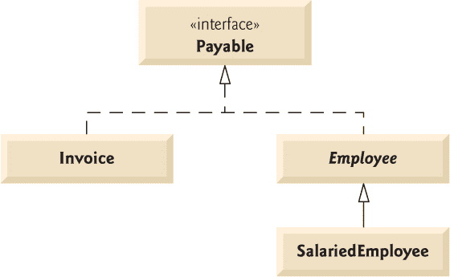

层级结构从接口 `Payable` 开始。UML 通过在接口名称上方使用角括号（« ` 和 »）包含“interface”一词来将接口与类区分来。UML 通过一种名为 `realization`（实现）的关系来表示类与接口之间的关系。一个类被认为实现（implement）了接口的方法。类图将实现关系建模为一个带有空心箭头的虚线，从实现类指向接口。上一个图显示 `Invoice` 类和 `Employee` 类分别实现了 `Payable` 接口。`Employee` 类以斜体显示，表示它是一个 `abstract`（抽象）类。具体类 `SalariedEmployee extends Employee` 继承了其父类与接口 `Payable` 之间的实现关系。

#### 生成式 AI

**1** 提示生成式 AI 列出 Java API 中最常用的接口，并对每个接口进行简要说明。

### 9.11.2 接口 `Payable`

接口通常是 `public` 类型。与 `public` 类一样，`public` 接口必须声明在与接口同名且以 `.java` 扩展名的文件中（例如 `Payable.java`）。关键字 `interface`（位于图 9.10 的第 5 行）开始一个 `interface declaration`。此接口包含 `public abstract` 方法 `calculatePayment()`。该方法没有参数，但接口方法可以有参数。接口还可以包含任意的方法。

```
 1   // Fig. 9.10: Payable.java

 2   // Payable interface declaration.

 3   import java.math.BigDecimal;

 4

 5   public interface Payable {

 6      public abstract BigDecimal calculatePayment(); // no implementation

 7   }
```

**图 9.10** | `Payable` 接口声明。

最初，`interface` 只能包含常量和没有实现的 `public abstract` 方法。Java 8 和 9 增强了 `interface` 以允许方法实现（第 9.12 节）。你声明的任何没有主体的接口方法都是隐式 `public` 和 `abstract` 的，但显式声明它们为 `public` 和 `abstract` 可以明确你的意图——这会将接口的 `abstract` 方法与其他类型的接口方法区分开来。接口中的所有字段都是隐式的 `public`、`static` 和 `final`。

### 9.11.3 类 `Invoice`

`Invoice` 类（图 9.11）代表一种零件的发票。该类声明了 `private` 实例变量 `partNumber`、`partDescription`、`quantity` 和 `pricePerItem`（第 6–9 行）。`Invoice` 类还包含一个构造函数（第 12–28 行）、`get` 方法（第 31–34 行）以及一个 `toString()` 方法（第 37–42 行），该方法返回 `Invoice` 对象的 `String` 表示。

```


// Fig. 9.11: Invoice.java
// Invoice class that implements Payable.
import java.math.BigDecimal;

public class Invoice implements Payable {
   private final String partNumber;
   private final String partDescription;
   private final int quantity;
   private final BigDecimal pricePerItem;

   // constructor
   public Invoice(String partNumber, String partDescription, int quantity,
      BigDecimal pricePerItem) {
      if (quantity < 0) { // validate quantity
         throw new IllegalArgumentException("Quantity must be >= 0");
      }

      // validate pricePerItem
      if (pricePerItem.compareTo(BigDecimal.ZERO) < 0) {
         throw new IllegalArgumentException(
            "Price per item must be >= 0");
      }

      this.quantity = quantity;
      this.partNumber = partNumber;
      this.partDescription = partDescription;
      this.pricePerItem = pricePerItem;
   }

   // get methods
   public String getPartNumber() {return partNumber;}
   public String getPartDescription() {return partDescription;}
   public int getQuantity() {return quantity;}
   public BigDecimal getPricePerItem() {return pricePerItem;}

   // return String representation of Invoice object
   @Override
   public String toString() {
      return String.format("%s: %s (%s)%n%s: %d%n%s: $%s",
         "part number", getPartNumber(), getPartDescription(),
         "quantity", getQuantity(), "price per item", getPricePerItem());
   }

   // method required to carry out contract with interface Payable
   @Override
   public BigDecimal calculatePayment() {
      BigDecimal quantity = new BigDecimal(getQuantity());
      return quantity.multiply(getPricePerItem()); // calculate total cost
   }
}

**图 9.11** | 实现 `Payable` 的 `Invoice` 类。

### 9.11.4 修改类 `Employee` 以实现接口 `Payable`

我们现在修改图 9.6 中的 `Employee` 类以实现 `Payable`（图 9.12），有两个异常：

*   图 9.12 的第 5 行表示该类现在实现了 `Payable`。
*   第 23–24 行实现了 `calculatePayment`。

`calculatePayment` 方法简单地调用了 `Employee` 的抽象方法 `calculateEarnings`。考虑到该方法没有实现，这似乎看起来奇怪。但在运行时调用 `calculatePayment` 时，它是针对 `Employee` 具体子类的对象的。因此，第 24 行将多态地调用该子类的具体 `calculateEarnings` 方法，该方法知道如何计算该类型的收益。

// Fig 9.12: Employee.java
// Employee abstract superclass that implements interface Payable.
import java.math.BigDecimal;

public abstract class Employee implements Payable {
   private final String name;

   // constructor
   public Employee(String name) {this.name = name;}

   // return name
   public String getName() {return name;}

   // return String representation of Employee object
   @Override
   public String toString() {return String.format("name: %s", getName());}

   // abstract method must be overridden by concrete subclasses
   public abstract BigDecimal calculateEarnings(); // no implementation

   // implementing calculatePayment here enables the entire Employee
   // class hierarchy to be used in an app that processes Payables
   @Override
   public BigDecimal calculatePayment() {return calculateEarnings();}
}

**图 9.12** | 实现 `Payable` 接口的 `Employee abstract` 超类。

#### 生成式 AI

**1** 在图 9.11 中，注意 `Invoice` 类的实例变量都是 `final` 的。向生成式 AI 提供 `Invoice` 的源代码，并要求它们将类重构为 `record`，同时保留重写的 `toString` 方法。

当一个类实现一个接口时，将适用于与继承相同的 *is-a*（是一个）关系。类 `Employee` 实现了 `Payable`，因此一个 `Employee` 是一个 `Payable`。由此，任何 `Employee` 子类的对象也都是一个 `Payable`。所以，如果我们在第 9.8 节中通过图 9.12 中的新超类 `Employee` 来更新类层级结构，那么 `Employee` 子类 `SalariedEmployee` 和 `CommissionEmployee` 的所有对象都将是 `Payable` 对象。

就就像我们可以将 `SalariedEmployee` 子类对象的引用赋值给父类 `Employee` 变量一样，我们也可以将 `SalariedEmployee` 对象（或任何其他 `Employee` 派生类对象）的引用赋值给 `Payable` 变量。`Invoice` 实现 `Payable`，因此 `Invoice` 对象也是一个 `Payable` 对象，我们可以将 `Invoice` 对象的引用赋值给 `Payable` 变量。

**超类与子类之间、以及接口与实现它们的类之间的 *is-a* 关系，在将对象传递给方法时依然有效。当方法参数接收超类或接口类型的参数时，该方法会以多态的方式处理它接收到的作为参数的对象。**

使用超类引用，我们可以多态地调用在超类及其它的超类（例如，`Object` 类）中声明的任何方法。使用接口引用，我们可以多态地调用在接口中、其超接口（一个接口可以扩展另一个接口）以及 `Object` 类中声明的任何方法。通过接口变量调用 `Object` 类的方法是被允许的，因为该变量必须引用一个对象才能调用方法，而所有对象都拥有 `Object` 类的方法。

#### 生成式 AI

**1** 提示生成 AI 给出一个 Java 接口被扩展的示例。

### 9.11.5 使用接口 `Payable` 多态地处理 `Invoice` 和 `Employee`

`PayableInterfaceTest` (图 9.13) 阐述了接口 `Payable` 可以在单个应用程序中多态地处理一组 `Invoice` 和 `Employee`。第 10–15 行声明并初始化了四个元素的数组 `payableObjects`。第 11–12 行将 `Invoice` 对象的引用放在 `payableObjects` 的前两个元素中。第 13–14 行将 `SalariedEmployee` 对象的引用放在 `payableObjects` 的最后两个元素中。元素可以使用 `Invoice` 和 `SalariedEmployee` 初始化，因为 `Invoice` 是一个 `Payable`，`SalariedEmployee` 是一个 `Employee`，而 `Employee` 是一个 `Payable`。

// Fig. 9.13: PayableInterfaceTest.java
// Payable interface test program processing Invoices and
// Employees polymorphically.
import java.math.BigDecimal;
import java.math.RoundingMode;

public class PayableInterfaceTest {
   public static void main(String[] args) {
      // create four-element Payable array
      Payable[] payableObjects = {
         new Invoice("01234", "seat", 2, new BigDecimal("375.00")),
         new Invoice("56789", "tire", 4, new BigDecimal("79.95")),
         new SalariedEmployee("Lorena Silva", new BigDecimal("1200.00")),
         new SalariedEmployee("Hans Olsen", new BigDecimal("800.00"))
      };

      System.out.println(
         "Invoices and Employees processed polymorphically:\n");

      // generically process each element in array payableObjects
      for (Payable currentPayable : payableObjects) {
         // output currentPayable and its appropriate payment amount
         System.out.printf("%s:%n%s %npayment due: $%s%n%n",
            currentPayable.getClass().getName(),
            currentPayable.toString(), // could invoke implicitly
            currentPayable.calculatePayment().setScale(
               2, RoundingMode.HALF_EVEN));
      }
   }
}

```
Invoices and Employees processed polymorphically:

Invoice:

part number: 01234 (seat)

quantity: 2

price per item: $375.00

payment due: $750.00

Invoice:

part number: 56789 (tire)

quantity: 4

price per item: $79.95

payment due: $319.80

SalariedEmployee:

name: Lorena Silva

salary: $1200.00

payment due: $1200.00

SalariedEmployee:

name: Hans Olsen

salary: $800.00

payment due: $800.00
```


**图 9.13** | 处理 `Invoice` 和 `Employee` 的 `Payable` 接口测试程序。

第 21–28 行多态地处理 `payableObjects` 中的每个 `Payable` 对象。第 24 行显示每个 `Payable` 对象的类名。第 25 行隐式地调用 `toString`。第 26 行通过 `Payable` 接口调用 `calculatePayment` 方法，以获取每个对象的应付金额，无论该对象的实际类型如何。`toString` 方法也可以通过 `Payable` 接口调用。

### 9.11.6 一些常用的 Java API 接口

在开发 Java 应用程序时，你会经常使用接口。Java API 包含许多接口，许多 Java API 方法接收接口参数并返回接口值。下表概述了后续章节中使用的一些常用 Java 接口。

| Java API 接口 | 描述 |
| --- | --- |
| `Iterable` | 增强 `for` 语句可以遍历实现此接口对象的元素，例如数组和 `ArrayList`。 |
| `Comparable` | Java 比较运算符（如 `<`、`>=`、`!=`）允许你比较原始值。它们不能用于比较对象。`Comparable` 接口允许实现接口的类对象相互比较，通常用于对集合（如 `ArrayList`）中的对象进行排序。我们在第 12 节 泛型集合以及第 13 节 泛型类和方法：深入探讨中使用 `Comparable` 和名为 `Comparator` 的相关接口。 |
| Java Collections 的接口 | 第 6 节介绍了 `ArrayList` 集合。我们在第 12 节 泛型集合中讨论了许多额外的集合。正如你看到的，通常使用 Java Collections 接口的变量来引用和操作集合。`ArrayList` 是实现多个接口的 Java API 类之一。它实现了 `Iterable` 接口，因此增强 `for` 语句可以遍历它的元素。它还实现了 `List` 接口（第 12.5 节），该接口声明了任何表示列表的对象都可以调用的常用方法（如 `add`、`remove` 和 `contains`）。 |
| `Runnable` | 由任何表示执行任务的类实现。此类类的对象通常通过多线程技术（在第 18 节 并发：平台线程到虚拟线程 中讨论）并行执行。该接口包含一个方法 `run`，它规定了对象在执行时的行为。 |

| GUI 事件监听接口 | 你在桌面和移动应用中每天都要与图形用户界面（GUI）打交道。在网页浏览器中，你可能会输入网站的地址进行访问，也可能点击按钮返回之前的站点。浏览器会对你的交互做出响应并执行所需的任务。你的交互被称为“事件”，而浏览器用于响应事件的代码被称为“事件处理器”（event handler）。在第 15 章、JavaFX 图形用户界面：第一部分中，你将构建具有响应用户交互的事件处理器的 GUI。事件处理器声明在实现了适当事件监听接口的类中。每个事件监听接口都指定了一个或多个必须实现的方法，以响应用户交互。 |

| `AutoCloseable` | 由可用于 `try`-with-resources 语句的类实现（第 10 章、异常处理：深入理解），以帮助防止“资源泄漏”。我们在第 11 章、文件、I/O 流、JSON 序列化与 CSV 文件以及第 20 章使用 JDBC 和 SQLite 访问数据库中使用此接口。 |

#### 生成式 AI

1. 提示生成式 AI，询问关于 Java 集合框架的 `ArrayList` 类中，继承、多态和接口在现实世界中的用法。

### 9.12 其他接口特性

本节介绍了你将在将在随后的章节中再次看到的其他接口特性。

#### 9.12.1 `default` 接口方法

正如我们提到的，接口方法最初只能是 `public abstract` 方法。这意味着接口指定了实现类必须执行*什么*操作，但没有指定该类应该*如何*执行这些操作。

Java 8 允许接口包含 `public default` 方法，这些方法带有具体的默认实现，并指定了操作是*如何*执行的。如果一个类实现了这样的接口，该类就会获得接口的 `default` 实现。必要时实现类可以重写接口的 `default` 方法，但并非强制要求。要声明 `default` 方法，请在 `public` 关键字和方法的返回类型之间放置 `default` 关键字并提供具体的方法实现：

```
public default returnType methodName(parameters) {

   statement(s)

}
```

##### 向现有接口中添加方法

在 `default` 方法出现之前，向接口中添加方法会破坏没有定义新方法的实现类——如果你没有定义接口的每个 `abstract` 方法，就必须将你的类声明为 `abstract`。当添加 `default` 方法时，实现接口的任何类都不会破坏。当你修改接口时必须重新编译接口，但实现类只需接收新的 `default` 方法的实现。因此，`default` 方法允许你通过向现有接口中添加新方法来演进该接口，而不会破坏实现它的类。

#### 9.12.2 `static` 接口方法

第 12 章引入了 `Collections` 类，该类包含许多 `static` 辅助方法，用于处理实现了 Java 集合 API 接口 `Collection`、`List`、`Map`、`Set` 等的对象。例如，`Collections` 方法 `sort` 可以对任何*是* `List` 的对象的元素排序——即对象的类实现了 `List` 接口。通过 `static` 接口方法（同样在 Java 8 中添加），此类辅助方法可以直接声明在接口中，而不是单独的类中。

#### 9.12.3 函数式接口

任何仅包含一个 `abstract` 方法的接口都是函数式接口。(6) 函数式接口广泛用于 Java 的 Lambda 能力，我们在第 14 章、使用 Lambda 和 Stream 进行函数式编程中介绍这些。Lambda 提供了实现函数式接口的简写表示。你将在书中使用的一些函数式接口包括：

6。有些人称这些为 SAM（单个 `abstract` 方法）接口。

- `Comparator`（第 12 章、泛型集合）——你将实现此接口来定义一个比较给定类型两个对象的方法，以确定第一个对象小于、等于还是大于第二个对象。
- `ChangeListener`（第 15 章、JavaFX 图形用户界面：第一部分、并发：从平台线程到虚拟线程）——你将实现此接口来定义一个可能与程序的其他部分并行的任务。

#### 9.12.4 `private` 接口方法

如你所示，接口类的 `private` 辅助方法只能由接口的其他方法调用。你可以定义 `private` 接口方法，以便定义公共代码。接口的 `private` 静态方法只能由接口的其他方法直接调用（即不通过对象引用）。在 `private` 接口方法的声明中包含 `default` 关键字是编译错误——`default` 方法必须是 `public`。

#### 生成式 AI

1. 提示生成式 AI，请求接口中 `default`、`static` 和 `private` 方法的简单示例。

### 9.13 面向接口编程而非实现^(7)

7。我们介绍的概念在软件工程领域被广泛讨论，并源于许多来源。“面向接口编程而非实现”定义在 Gamma, Erich 等人的 *Design Patterns: Elements of Reusable Object-Oriented Software*. Reading, MA: Addison-Wesley, 1995, 17–18，并在 Bloch, Joshua 的 *Effective Java*, *Third Edition*. Upper Saddle River, NJ: Addison-Wesley, 2018 中进一步强调和讨论。

软件工程社区对于组合和继承的相对优点有很多讨论。许多专业人士认为继承被过度使用，而组合通常更为合适。本节将比较这些方法，然后使用组合和接口重构第 9.8 节中的 `Employee` 层次结构。

##### 基于继承的设计

子类 `extends` 父类的实现继承主要用于定义具有许多相同实例变量和方法实现的紧密相关的类。这种继承创建了紧耦合的类，父类的实例变量和方法被继承到子类中。对父类的更改会直接影响所有子类。

紧耦合会导致修改类层次结构变得困难。

# 思考 `Employee` 层次结构：组合与依赖注入

多年来，程序员们编写了大量的论文、文章和博客，讨论了像第 9.8 节中的 `Employee` 层次结构这类紧耦合类层次的问题。在这个示例中，我们将重构 `Employee` 层次结构，使得 `Employee` 的薪酬模型不再“硬编码”到类层次结构中。

8。我们要感谢 Oracle Java 语言架构师 Brian Goetz，他在评审早期版本的 *Java How to Program* 运行时，建议了我们在本节中使用的类架构。

为了实现这一点，我们将使用组合和**依赖注入**，其中一个类包含一个对象的引用，该对象提供该类对象所需的行为。在我们的 `Employee` 薪资示例中，该行为计算每个 `Employee` 的收入。我们将使用组合重新实现 `Employee` 类——在本示例中，`Employee` *拥有*一个 `CompensationModel` 对象的引用。正如你所看到的，你可以在构造 `Employee` 时初始化其 `CompensationModel` 引用，甚至在稍后设置新的 `CompensationModel`，从而将薪酬功能“注入”到 `Employee` 对象中。**组合 `CompensationModel` 引用在 `Employee` 与其 `CompensationModel` 之间创建了松耦合关系，使得在无需重新编译类层次结构的情况下即可动态更改 `CompensationModel`。**

9。“依赖注入。”Wikipedia。Wikimedia 基金会。访问于 2024 年 9 月 19 日。[`https://en.wikipedia.org/wiki/Dependency_injection`](https://en.wikipedia.org/wiki/Dependency_injection)。

## 接口是灵活性的最佳选择

在这个示例中，我们将 `CompensationModel` 声明为具有 `abstract` 方法 `calculateEarnings` 的接口，然后声明 `CompensationModel` 的实现类，以指定 `Employee` 获得薪酬的方式：

*   类 `Salaried implements CompensationModel`，适用于领取固定工资的员工。
*   类 `Commission implements CompensationModel`，适用于根据总销售额领取佣金的员工。

`Employee` 类的 `calculateEarnings` 方法将调用其组合的 `CompensationModel` 的 `calculateEarnings` 方法来确定 `Employee` 的收入。新的 `Employee` 类将不再是父类——为了强调这一点，我们将将其标记为 `final`。

#### 生成式 AI

1. 提示词：生成式 AI，询问为什么 Java 实现继承会创建紧耦合的类。

### 9.13.1 `CompensationModel` 接口

图 9.14 定义了 `CompensationModel` 接口，包含 `abstract` 方法 `calculateEarnings`（第 6 行）。实现此接口的每个类都将定义计算员工薪酬所需的实例变量，并覆盖 `CompensationModel` 的 `calculateEarnings` 方法以执行相应的计算。**任何 `implements` 此接口的类的对象*都是* `CompensationModel`。**

```
 1   // Fig. 9.14: CompensationModel.java
 2   // CompensationModel interface defining method calculateEarnings.
 3   import java.math.BigDecimal;
 4
 5   public interface CompensationModel {
 6      public abstract BigDecimal calculateEarnings();
 7   }
```

**图 9.14** | `CompensationModel` 接口定义了方法 `calculateEarnings`。

### 9.13.2 `Employee` 拥有一个 `CompensationModel`——组合与依赖注入

图 9.15 定义了类 `Employee`。**此类被声明为 `final`，因此它不能作为父类。**每个 `Employee` 一个指向其 `CompensationModel` 实现的引用（第 7 行）。

```
 1   // Fig. 9.15: Employee.java
 2   // An Employee "has a" CompensationModel.
 3   import java.math.BigDecimal;
 4
 5   public final class Employee {
 6      private final String name;
 7      private CompensationModel model; // has-a relationship
 8
 9      // uses "constructor injection" to initialize the model
10      // with a reference to a CompensationModel implementation
11      public Employee(String name, CompensationModel model) {
12         this.name = name;
13         this.model = model; // constructor injection
14      }
15
16      // set method performs "property injection" to change the
17      // model to a new CompensationModel implementation
18      public void setCompensationModel(CompensationModel model) {
19         this.model = model; // property injection
20      }
21
22      // return the current CompensationModel
23      public CompensationModel getCompensationModel() {return model;}
24
25      // use the CompensationModel to calculate the earnings
26      public BigDecimal calculateEarnings() {
27         return model.calculateEarnings();
28      }
29
30      // return String representation of Employee
31      @Override
32      public String toString() {
33         return String.format("%s\n%s", name, model.toString());
34      }
35   }
```


**图 9.15** | 一个 `Employee` “拥有”一个 `CompensationModel`。`Employee` 类提供了以下构造函数和方法：

*   构造函数（第 11–14 行）初始化 `Employee` 的 `name`，并将 `model` 引用指向实现 `CompensationModel` 接口的对象。这是依赖注入的一种形式，被称为**构造注入**。
*   `setCompensationModel` 方法（第 18–20 行）允许客户端代码更改 `Employee` 的 `CompensationModel`。这是依赖注入的一种形式，被称为**属性注入**。在 Java 中，**属性**（property）是描述一对 *set* 和 *get* 方法的术语，提供对实例变量的受控访问。
*   `getCompensationModel`（第 23 行）返回 `Employee` 当前的 `CompensationModel`。
*   `calculateEarnings`（第 26–28 行）通过调用其 `model` 的 `calculateEarnings` 方法来确定 `Employee` 的收入。
*   `toString`（第 31–34 行）创建 `Employee` 的字符串表示，由 `Employee` 的 `name` 以及我们通过调用 `model` 实现的 `toString` 方法获得的薪酬信息组成。

#### 9.13.3 `CompensationModel` 实现

接下来，让我们定义 `CompensationModel` 的实现。这些类的对象将被注入到 `Employee` 对象中，以指定计算它们收入的方式。

##### 实现 `CompensationModel` 的 `Salaried` 类

`Salaried` 薪酬模型(图 9.16) 定义了如何支付领取固定工资的员工。该类实现了 `CompensationModel` 接口（第 5 行），并提供了：

*   实例变量 `salary`（第 6 行）用于存储周工资；
*   构造函数（第 9–16 行）验证并初始化 `salary`；
*   `getSalary` 方法（第 19 行）返回 `salary` 值；
*   `calculateEarnings` 方法（第 22–23 行）覆盖父类版本以返回 `salary`，以及
*   `toString` 方法（第 26–29 行）覆盖父类版本以返回 `Salaried` 对象的字符串表示，用于本程序的输出。

`Salaried` 被声明为 `final`（第 5 行），因此不能作为父类。

**Fig. 9.16** | `Salaried` 实现了 `CompensationModel` 接口。

```
 1   // Fig. 9.16: Salaried.java
 2   // Salaried implements the CompensationModel interface.
 3   import java.math.BigDecimal;
 4
 5   public final class Salaried implements CompensationModel {
 6      private BigDecimal salary;
 7
 8      // constructor
 9      public Salaried(BigDecimal salary) {
10         // if salary is invalid throw exception
11         if (salary.compareTo(BigDecimal.ZERO) < 0) {
12            throw new IllegalArgumentException("salary must be >= 0.0");
13         }
14
15         this.salary = salary;
16      }
17
18      // return the salary
19      public BigDecimal getSalary() {return salary;}
20
21      // override CompensationModel abstract method calculateEarnings
22      @Override
23      public BigDecimal calculateEarnings() {return salary;}
24
25      // override Object method toString
26      @Override
27      public String toString() {
28         return String.format("salary: $%s", salary);
29      }
30   }
```

##### 实现 `CompensationModel` 的 `Commission` 类

`Commission` 薪酬模型 (图 9.17) 定义了如何根据总销售额向 `Employee` 支付佣金。该类实现了 `CompensationModel`（第 5 行）并提供了：

*   实例变量 `grossSales`（第 6 行）和 `commissionRate`（第 7 行），用于存储计算员工佣所需的数据，
*   一个构造函数（第 10–25 行），用于验证和初始化实例变量，
*   `get` 方法（第 28 行和 31 行），用于返回实例变量的值，
*   一个 `calculateEarnings` 方法（第 34–37 行），它重写了父类版本，返回 `grossSales` 乘以 `commissionRate` 的结果，
*   以及一个 `toString` 方法（第 40–44 行），它重写了父类版本，返回 `Commission` 对象的 `String` 表示，用于此程序的输出。

`Commission` 被声明为 `final`（第 5 行），因此它不能被作父类。

**Fig. 9.17** | `Commission` 实现了 `CompensationModel` 接口。

```
 1   // Fig. 9.17: Commission.java
 2   // Commission implements the CompensationModel interface.
 3   import java.math.BigDecimal;
 4
 5   public final class Commission implements CompensationModel {
 6      private BigDecimal grossSales;
 7      private BigDecimal commissionRate;
 8
 9      // constructor
10      public Commission(BigDecimal grossSales, BigDecimal commissionRate) {
11         // if grossSales is invalid throw exception
12         if (grossSales.compareTo(BigDecimal.ZERO) < 0) {
13            throw new IllegalArgumentException("gross sales must be >= 0.0");
14         }
15
16         // if commissionRate is invalid throw exception
17         if (commissionRate.compareTo(BigDecimal.ZERO) <= 0 ||
18             commissionRate.compareTo(BigDecimal.ONE) >= 0) {
19            throw new IllegalArgumentException(
20               "commission rate must be > 0.0 and < 1.0");
21         }
22
23         this.grossSales = grossSales;
24         this.commissionRate = commissionRate;
25      }
26
27      // return the grossSales
28      public BigDecimal getGrossSales() {return grossSales;}
29
30      // return the commissionRate
31      public BigDecimal getCommissionRate() {return commissionRate;}
32
33      // override CompensationModel abstract method calculateEarnings
34      @Override
35      public BigDecimal calculateEarnings() {
36         return grossSales.multiply(commissionRate);
37      }
38
39      // override Object method toString
40      @Override
41      public String toString() {
42         return String.format("gross sales: $%s; commission rate: %s",
43            grossSales, commissionRate);
44      }
45   }
```

#### 9.13.4 测试 `CompensationModel` 层次结构

接下来，让我们创建 `Employee` 对象，并用相应的具体的 `CompensationModel` 实现来初始化它们 (图 9.18)。

**Fig. 9.18** | 使用各种 `CompensationModel` 处理 `Employee`。

```
 1   // Fig. 9.18: PayrollSystemTest.java
 2   // Processing Employees with various CompensationModels.
 3   import java.math.BigDecimal;
 4   import java.math.RoundingMode;
 5
 6   public class PayrollSystemTest {
 7      public static void main(String[] args) {
 8         // create CompensationModels and Employees
 9         var salaried = new Salaried(new BigDecimal("1000.00"));
10         var salariedEmployee = new Employee("Sierra");
11
12         var commission = new Commission(new BigDecimal("1000.00"), new BigDecimal("0.06"));
13         var commissionEmployee = new Employee("James");
14
15         // create and initialize array of
16         Employee[] employees = {salariedEmployee, commissionEmployee};
17
18         // calculate each Employee's earnings
19         for (Employee employee : employees) {
20            // if Salaried, increase salary by 10%
21            if (employee.getCompensationModel() instanceof Salaried s) {
22               BigDecimal newSalary = s.getSalary().multiply(new BigDecimal("1.10"));
23               // inject new Salaried
24               employee.setCompensationModel(new Salaried(newSalary));
25            }
26            // print the current Employee's
27            System.out.printf("%s earned: $%s%n", employee,
28               employee.calculateEarnings().setScale(2, RoundingMode.HALF_EVEN));
29         }
30      }
31   }
```


**Fig. 9.18** | 使用各种 `CompensationModel` 处理 `Employee`。

将 `CompensationModel` 声明为实现相同接口的独立类，为未来的变化提供了灵活性。假设公司增加了新的员工薪资方式。我们可以简单地定义一个 `implements CompensationModel` 的新类，并相应地重写 `calculateEarnings` 方法。

### `Employee` 升职时的灵活性

本示例使用的基于接口的组合与依赖注入方法比第 9.8 节中的类层次结构更具活性。在第 9.8 节中，如果一个 `Employee` 升职，你需要通过创建一个相应 `Employee` 子类的新对象来更改其对象类型，然后将数据移动到新对象。使用依赖注入，你只需要调用 `Employee` 的 `setCompensationModel` 方法，并注入指向不同 `CompensationModel` 的引用以替换现有的模型。继承是在编译时完成的，因此它不提供这种灵活性。

### `Employee` 获得新功能时的灵活性

基于接口的组合和依赖注入方法对于增强 `Employee` 类也更具活性。如果我们决定支持退休计划（如 401(k) 和 IRA），我们可以说每个 `Employee` *拥有一个* `RetirementPlan`。首先，我们定义带有 `makeRetirementDeposit` 方法的 `RetirementPlan` 接口，并提供相应的子类实现。

使用本示例所示的基于接口的组合和依赖注入，只需要对 `Employee` 类进行细小更改即可支持 `RetirementPlan`：

*   一个引用 `RetirementPlan` 的实例变量，
*   多一个构造函数参数来初始化 `RetirementPlan` 引用，
*   一个 `setRetirementPlan` 方法，当我们以后需要注入不同的 `Employee RetirementPlan` 时可以调用它。

#### 9.13.6 `interface` 对比 `abstract` 类

接口继承可能比实现继承需要更多工作，因为具体类必须同时提供接口的 `abstract` 方法的数据和实现，即使这些方法在不同类之间是相似或相同的。正如你所看到的，这种方法通过消除类与类之间的紧密耦合，为你提供了额外的灵活性。

#### `interface` 比 `abstract` 类更灵活

鉴于 `interface` 可能包含带有实现的实例方法和 `static` 方法，`interface` 适用于你以前使用 `abstract` 类的几乎所有情况。除了实例变量外，你获得了 `abstract` 类提供的优势。此外，新类可以实现任意数量的接口，但只能扩展一个类（`abstract` 或具体类）。

#### `interface` 的变化频率比实现类低

正如父类可以改变一样，接口也可以改变。如果接口方法的签名发生变化，所有相应的类都需要修改。经验表明，接口的更改频率远低于实现类。

#### 生成式 AI

**1** 提示生成式 AI 在什么情况下应优先使用接口而非 `abstract` 类。

**2** 向生成式 AI 提示第 9.8 节中的 `Employee` 类层次结构代码和 `main` 应用程序类。要求它们重构代码，使 `Employee` 拥有一个薪资模型，并使用基于接口的薪资模型层次结构。将生成的代码与我们在第 9.13 节中展示的代码进行比较。

### 9.14 `sealed` 类和接口

Java 17 引入了 `sealed classes` 和 `sealed interfaces`^(11)，允许开发者严格控制：

11. “JEP 409: Sealed Classes.” 访问于 2024 年 9 月 19 日 [`https://openjdk.org/jeps/409`](https://openjdk.org/jeps/409)。

*   允许扩展 `sealed` 类的类，
*   允许实现 `sealed` 接口的类以及
*   允许扩展 `sealed` 接口的接口。

`sealed` 关键字让类和接口层次结构的设计人员对允许的直接子类型拥有完全控制，并防止其他开发者扩展层次结构，除非允许的子类型被显式声明为 `non-sealed`。`sealed` 还简化了代码维护，因为层次结构不容易由于使用新类或接口错误地扩展它而引入错误。此外，`sealed` 类和接口通过消除通常处理意外类型的 `default` 情况，简化了模式匹配 `switch` 表达式。`sealed` 层次结构中的所有类都是预先知的，因此你只需为层次结构中的每个类提供一个 `case`。

为了本次演示，我们将修改第 9.13 节中的 `CompensationModel` 层次结构以使用 `sealed interface`。`Employee`、`Salaried` 和 `Commission` 类是相同的，因此我们在此不再重复它们。

##### 密封 `CompensationModel` 层次结构

图 9.19 将 `CompensationModel` 接口声明为 `sealed`（第 5 行）。可以实现此接口的类列在其 `permits` 子句的逗号分隔列表中（第 5 行）。如果我们将来希望支持额外的 `CompensationModel`，我们必须将它们添加到此 `permits` 子句并重新编译。对于 `sealed` 类，你将 `sealed` 关键字放在 `class` 关键字之前，并在类名后跟随 `permits` 子句。

```
1   // Fig. 9.19: CompensationModel.java
2   // sealed interface defining calculateEarnings.
3   import java.math.BigDecimal;
4   
5   public sealed interface CompensationModel permits Salaried, Commission {
6      public abstract BigDecimal calculateEarnings();
7   }
```

**图 9.19** | 定义 calculateEarnings 的 sealed 接口。

我们提到接口可以扩展另一个接口——这允许你创建一个增强现有接口功能的接口。在 `extends` 接口的 `sealed` 接口中，列出允许实现接口类的 `permits` 子句位于 `extends` 子句之后，如下：

```java
public sealed interface NewInterface extends SuperInterface
      permits ListOfImplementingClasses {
      // interface members
}
```

在 `sealed` 类中，列出允许扩展类的 `permits` 子句位于任何 `extends` 或 `implements` 子句之后，如下：

```java
public sealed class NewClass extends Superclass implements ListOfInterfaces
   permits ListOfSubclasses {
   // class members
}
```

##### 关于 `Salaried` 和 Commission 类说明

扩展 `sealed` 类或实现 `sealed` 接口的类必须声明为：

*   `final` 以便不再被扩展，
*   `sealed` 并指定 `permits` 子句以指示特定的子类，或
*   `non-sealed` 以允许它们无限制地扩展。

在图 9.16 和 9.17 中，我们把 `Salaried` 和 `Commission` 类声明为 `final`，因此它们在示例中不需要任何修改。

##### `main` 中的 `switch` 表达式

在本示例中，我们替换了图 9.18 中使用的 `if` 语句和模式匹配 `instanceof` 运算符，改用一个返回值的模式匹配 `switch` 表达式（图 9.20，第 23–34 行）来演示对 `sealed` 层次结构的模式匹配。回想一下，我们在第 5.5 节中介绍过返回值的模式匹配 `switch` 表达式。第 24 和 33 行为 `sealed` 层次结构允许的每个类型指定了 `case`。此 `switch` 表达式不需要 `default` case，因为 `sealed` 层次结构没有意外的类型。如果你扩展了 `sealed` 层次结构并忘记为新类型添加适当的 `case`，将会导致编译错误。注意输出窗口，`salariedEmployee` 的收入确实比第 9 行中的初始值高了 10%。

```java
 1   // Fig. 9.20: PayrollSystemTest.java
 2   // Processing Employees with various CompensationModels.
 3   import java.math.BigDecimal;
 4   import java.math.RoundingMode;
 5
 6   public class PayrollSystemTest {
 7      public static void main(String[] args) {
 8         // create CompensationModels and Employees
 9         var salaried = new Salaried(new BigDecimal("1000.00"));
10         var salariedEmployee = new Employee("Sierra Dembo", salaried);
11
12         var commission = new Commission(
13            new BigDecimal("10000.00"), new BigDecimal("0.06"));
14         var commissionEmployee = new Employee("James Davis", commission);
15
16         // create and initialize array of Employees
17         Employee[] employees = {salariedEmployee, commissionEmployee};
18
19         // print each Employee's information and earnings
20         for (Employee employee : employees) {
21            // if Salaried CompensationModel, increase salary by 10%
22            BigDecimal earnings =
23               switch (employee.getCompensationModel()) {
24                  case Salaried s -> {
25                     BigDecimal newSalary =
26                        s.getSalary().multiply(new BigDecimal("1.10"));
27
28                     // inject new CompensationModel
29                     employee.setCompensationModel(new Salaried(
30                        newSalary.setScale(2, RoundingMode.HALF_EVEN)));
31                     yield employee.calculateEarnings();
32                  }
33                  case Commission c -> c.calculateEarnings();
34               };
35
36            System.out.printf("%s%nearned: $%s%n%n",
37               employee, earnings.setScale(2, RoundingMode.HALF_EVEN));
38         }
39      }
40   }
```

```
Sierra Dembo
salary: $1100.00
earned: $1100.00

James Davis
gross sales: $10000.00; commission rate: 0.06
earned: $600.00
```


**图 9.20** | 使用各种 `CompensationModel` 处理 `Employee`。

#### 生成式 AI

**1** 提示生成 AI 澄清在 `sealed` 类和接口中 `permits` 子句何时是可选的。

### 9.15 `private` 构造函数

我们之前提到过，构造函数通常被声明为 `public`。有时，在类中声明一个或多个 `private` 构造函数是有用的。

#### 防止对象实例化

通过将类的构造函数设置为 `private`，可以防止客户端代码创建该类的对象。例如，考虑 `Math` 类，它只包含 `public static` 常量和 `public static` 方法。由于使用该类的常量和方法时不需要创建 `Math` 对象，因此它的构造函数是 `private` 的。

#### 在构造函数中共享初始化代码

`private` 构造函数的一个用途是在类的其他构造函数之间共享初始化代码。你可以使用委托构造函数（在第 8.10 节中引入）来调用带有共享初始化代码的 `private` 构造函数。

#### 工厂方法

`private` 构造函数的另一个用途是强制客户端代码使用“工厂方法”来创建对象。**工厂方法**是一个 `public static` 方法，用于创建并初始化指定类型的对象（可能是同类），然后返回对该对象的引用。这种架构的用处是，方法的返回类型可以是接口或父类（`abstract` 或具体类）。

#### 生成式 AI

**1** 提示生成 AI 获取关于何时使用 `private` 构造函数声明 Java 类的额外见解。

### 9.16 `protected` 成员

第 8 章讨论了访问修饰符 `public` 和 `private`：

*   类的 `public` 成员在程序拥有该类或其子类对象引用的地方都是可以访问的。
*   类的 `private` 成员仅在类内部是可以访问的。

访问修饰符 `protected` 提供了 `public` 和 `private` 之间的中间访问级别：

*   类的 `protected` 成员在该类内部、其子类内部以及同包内其他类的内部是可以访问的。
*   类的 `protected` 成员也具有包访问权限。回想第 8.19 节，在同包内有多个类的程序中，这些类可以通过对这些对象的引用或通过类名直接访问彼此的包访问权限成员。

因此，从限制最严格到最宽松，Java 类成员的访问修饰符为：

*   `private`
*   包访问（未列出标识符时的默认值）
*   `protected`
*   `public`

父类的 `public` 和 `protected` 成员在成为子类成员时会保留其访问修饰符：

*   `public` 父类成员变为 `public` 子类成员，
*   `protected` 父类成员变为 `protected` 子类成员。

父类的 `private` 成员对子类是隐藏的，子类只能通过从父类继承的 `public` 或 `protected` 方法进行操作。子类方法可以直接使用成员名称引用继承自父类的 `public` 和 `protected` 成员。

声明 `private` 实例变量有助于你测试、调试和正确修改系统。如果子类可以访问父类的 `private` 实例变量，那么继承自该子类的类也可以访问它们。这将消除信息隐藏的好处。

#### 使用 `protected` 实例变量的注意事项

继承 `protected` 实例变量允许子类直接访问变量。但在大多数情况下，你应该使用 `private` 实例变量以鼓励良好的软件工程。你的代码将更容易维护、修改和调试。

使用 `protected` 实例变量会产生多个潜在问题。首先，子类对象可以直接设置继承的变量的值，而不使用 *set* 方法。因此，子类对象可以给变量分配无效值，可能导致对象处于不一致的状态。

`protected` 实例变量另一个问题是，子类方法更容易依赖于父类的数据实现。在实践中，子类应该只依赖于父类的服务（即非 `private` 方法），而不是父类的数据实现。如果父类中使用 `protected` 实例变量，那么当父类的实现发生变化时，我们可能需要修改父类的所有子类。这种类被认为是脆弱的（`fragile`）或易碎的（`brittle`），因为父类的变化可能会“破坏”子类的实现。你应该能够在更改父类实现的同时，仍能向子类提供相同的服务。当然，如果父类服务发生了变化，我们必须重新实现它的子类。

第三个问题是，类的 `protected` 成员对包含这些 `protected` 成员的同包中的所有类都可见——这并不总是理想的。将父类的实例变量声明为 `private`（而不是 `protected`）允许这些实例变量的父类实现发生变化，而不影响子类的实现。

当父类应该只向其子类和同一包中的其他类提供方法，而不提供给其他客户端时，使用 `protected` 访问修饰符。避免使用 `protected` 实例变量。相反，包含访问 `private` 实例变量的非 `private` 方法。

#### 生成式 AI

**1** 提示生成式 AI 提供 `protected` 访问的真实 Java 用例。

### 9.17 总结

本章介绍了继承——即通过获取现有类的成员（而不通过复制粘贴代码）来创建类，并能够用新功能增强它们的能力。你学习了父类和子类的概念，并使用关键字 `extends` 创建了继承自父类成员的子类。

我们展示了如何使用 `@Override` 注解通过指示该方法重写了父类方法来防止无意的重载。你使用了 `super` 来访问被重写的父类成员。你看到了构造函数在继承层次结构中是如何使用的。你研究了 `Object` 类的方法，它是所有 Java 类的直接或间接父类。我们讨论了使用组合（composition）与继承（inheritance）设计类的优缺点。

我们引入了多态——在类层次结构中处理具有相同父类的对象的能力，就像它们都是父类对象一样。我们讨论了多态如何使系统具有可扩展性和可维护性，然后演示了如何使用重写的方法来实现多态行为。

我们引入了 `abstract` 类，它允许你提供一个合适的父类，其他类可以从其进行继承。你学习了 `abstract` 类可以声明 `abstract` 方法，每个具体的子类必须实现这些方法，并且程序可以使用 `abstract` 类的变量以多态的方式调用子类对 `abstract` 方法的实现。你看到了如何在执行期间确定一个对象的类型。

我们解释了 `final` 方法和类的概念。本章讨论了通过声明和实现接口（interface）作为一种让可能相互不同的类实现共同功能的方法，从而使得这些类的对象能够以多态的方式被处理。我们讨论了为什么构造函数不应该调用可重写的方法，以及从构造函数中调用 `final`、`static` 和 `private` 方法是可以的。

我们引入了 `default`、`static` 和 `private` 接口方法。我们讨论了 `private` 构造函数的目的。我们引入了访问修饰符 `protected` 并提到子类方法可以直接访问继承的 `protected` 父类成员。

我们最初关注于实现继承，然后指出几十年的经验表明，维护和修改紧耦合的实现继承层次结构是困难的。因此，我们重构了 `Employee` 工资示例以使用接口继承。在示例中，我们引入了组合和依赖注入的方法，该类包含一个指向对象的引用，该对象提供了该类对象所需的行为。然后，我们讨论了这种基于接口的方法如何使示例更容易修改和演进。最后，我们讨论了 `sealed` 类和接口，用于控制哪些类可以扩展某个类或实现某个接口。

你现在已经学习了类、对象、封装、继承、多态和接口——这些面向对象编程的核心方面。在下一章中，我们将深入讨论异常——异常处理能够编写更健壮的程序。

### 特别章节：生成式 AI 练习

对于以下每个问题，尝试使用多个生成式 AI 以确定哪一个表现最好。始终验证结果。记住，它们有时会出错甚至产生幻觉，创建不可靠的信息。

**9.1** (构造函数注入 vs. 属性注入) 提示生成式 AI 讨论 Java 中构造函数注入与属性注入的区别以及何时使用它们。

**9.2** (`default` 方法) 提示生成式 AI 讨论在 Java 接口中使用 `default` 方法的优缺点。

**9.3** (运行时多态 vs. 编译时多态) 提示生成式 AI 讨论 Java 中的运行时多态与编译时多态以及何时使用它们。

**9.4** (组合 vs. 继承) 提示生成式 AI 讨论 Java 中组合与继承的优缺点，并提供每种情况更合适的示例。

## 10 异常处理：深入观察


### 目标

在本章中，你将：

*   学习为什么异常处理是响应运行时问题的一种有效机制。
*   使用 `try` 块界定可能发生异常的代码。
*   使用 `throw` 指明问题的发生。
*   使用 `catch` 块指定异常处理程序。
*   学习何时使用异常处理。
*   理解异常类层次结构。
*   使用 `finally` 块释放资源以防止资源泄漏。
*   通过捕获一个异常并抛出另一个异常来链化异常。
*   创建自定义异常。
*   使用调试功能 `assert` 测试方法中特定点的条件是否为真。
*   学习 `try`-with-resources 语句如何在 `try` 块终止时自动释放资源。

### 大纲

### 10.1 引言

正如你在前面的章节中学到的，异常表示程序执行期间出现的问题。异常处理允许应用程序解决（或处理）异常。本章介绍的特性帮助你编写健壮且容错的程序，这些程序可以处理问题并继续执行或优雅退出。

[1] Java 异常处理部分基于 Andrew Koenig 和 Bjarne Stroustrup 的工作——A. Koenig and Bjarne Stroustrup, “Exception Handling for C++ (revised),” *Proceedings of the Usenix C++ Conference*, pp. 149–176, San Francisco, April 1990.

首先，我们处理当方法尝试将整数除以 0 时发生的异常。我们讨论了何时使用异常处理，并展示了异常处理类层次结构的一部分。你将学习到只有 `Throwable` 的子类才能用于异常处理。我们引入了 `try` 语句的 `finally` 块，无论是否发生异常，它都会执行。然后，我们演示了如何使用链式异常来为异常添加特定的应用程序信息，以及如何创建自定义的异常类型。接下来，我们引入了前置条件（preconditions）和后置条件（postconditions），它们分别在方法被调用和返回时必须为真。随后，我们介绍了断言（assertions），它们帮助你在开发期间调试代码。我们还讨论了如何用一个 `catch` 处理器捕获多个异常，以及 `try`-with-resources 语句，它会在 `try` 块使用资源后自动释放该资源。

## 本书中使用的异常

本章侧重于异常处理概念，并提供了演示关键特性的机械化示例。许多 Java API 方法会抛出异常，我们在代码中处理这些异常。下表显示了我们涵盖的一些异常类型，以及我们在后续章节中将讨论的其他异常。

| 章节 | 使用的异常示例 |
| --- | --- |
| 第 6 章 | `ArrayIndexOutOfBoundsException` |
| 第 8 章–第 9 章 | `IllegalArgumentException` |
| 第 10 章 | `ArithmeticException`, `InputMismatchException` |
| 第 11 章 | `SecurityException`, `FileNotFoundException`, `IOException`, `ClassNotFoundException`, `IllegalStateException`, `FormatterClosedException`, `NoSuchElementException` |
| 第 12 章 | `ConcurrentModificationException`, `UnsupportedOperationException`, `NullPointerException` |
| 第 13 章 | `NoSuchElementException` |
| 第 15 章 | `NumberFormatException` |
| 第 17 章 | `MediaException` |
| 第 18 章 | `InterruptedException`, `IllegalMonitorStateException`, `ExecutionException`, `CancellationException` |
| 第 20 章 | `SQLException` |

在工业中，组织会开发自己的设计、编码、测试、调试和维护标准。公司通常会根据它们开发的应用程序类型制定异常处理标准，例如实时系统、高性能数学计算、大数据、基于网络的分布式系统、人工智能应用等。

## 何时使用异常处理

异常处理设计用于处理同步错误——这些错误在语句执行时发生在程序的常规控制流中。常见示例包括除以 0、数组索引越界、算术溢出（即值超出了可表示的值范围）以及无效的方法参数。

异常处理提供了一种单一、统一的技术来记录、检测和从错误中恢复。这有助于开发大型项目的开发者理解彼此的错误处理代码。异常处理并不是为了作为指定程序控制流的替代方法，也不是用于那些可以通过在执行任务前简单测试条件来防止的问题。有时，你可以通过先验证数据来防止异常。例如，在执行整数除法之前，你可以确保分母不为 0，从而防止在除以 0 时发生 `ArithmeticException`。异常处理并非旨在处理与异步事件（例如网络消息到达、鼠标点击和击键输入）相关的问题，这些事件与程序的控制流并行发生且相互独立。

你应该从设计过程之初，就把异常处理和错误恢复策略整合到系统中。在系统实现后包含这些内容可能是困难的。

#### 生成式 AI

**1** 提示生成 AI，要求列出 10 个常见的抛出的 Java 异常以及产生这些异常的简要解释。

## 10.2 示例：不使用异常处理的除以零

首先，让我们演示当不使用异常处理的程序出现异常时会发生什么。图 10.1 提示用户输入两个整数并将它们传递给 `quotient` 方法，该方法计算整数商并返回 `int` 结果。在这个示例中，你将学到当方法检测到问题且无法处理时，它会抛出异常（即发生了异常）。图 10.1 中的第一次示例执行显示了一次成功的整数除法。

点击此处查看代码图像

```java
// Fig. 10.1: DivideByZeroNoExceptionHandling.java
// 不使用异常处理的整数除法。
import java.util.Scanner;

public class DivideByZeroNoExceptionHandling {

   // 演示当发生除以零时抛出异常
   public static int quotient(int numerator, int denominator) {
      return numerator / denominator; // 可能除以 0
   }

   public static void main(String[] args) {
      var input = new Scanner(System.in);

      System.out.print("Enter integer numerator: ");
      int numerator = input.nextInt();
      System.out.print("Enter integer denominator: ");
      int denominator = input.nextInt();

      int result = numerator / denominator;
      System.out.printf("Result: %d / %d = %d%n", numerator, denominator, result);
   }
}
```

```text
Enter integer numerator: 100
Enter integer denominator: 7
Result: 100 / 7 = 14
```

```text
Enter integer numerator: 100
Enter integer denominator: 0
Exception in thread "main" java.lang.ArithmeticException: / by zero
        at DivideByZeroNoExceptionHandling.quotient(DivideByZeroNoExceptionHandling.java:8)
        at DivideByZeroNoExceptionHandling.main(DivideByZeroNoExceptionHandling.java:19)
```

```text
Enter integer numerator: hello
Exception in thread "main" java.util.InputMismatchException
        at java.base/java.util.Scanner.throwFor(Scanner.java:964)
        at java.base/java.util.Scanner.next(Scanner.java:1619)
        at java.base/java.util.Scanner.nextInt(Scanner.java:2284)
```


at java.base/java.util.Scanner.nextInt(Scanner.java:2238)

at DivideByZeroNoExceptionHandling.main(
   DivideByZeroNoExceptionHandling.java:15)
```

**图 10.1** | 不使用异常处理的整数除法。

### 堆栈轨迹

在第二次执行中，用户输入了 `0` 作为分母。针对这种无效输入，会显示多行信息。该**堆栈轨迹**包含了异常的包名和类名（`java.lang.ArithmeticException`），并通过一个描述性消息指示了问题、发生行以及发生问题时的方法调用栈（即调用链）。堆栈轨迹显示了通向异常的执行路径。这有助于你调试程序。即使没有发生问题，你也可以通过 `Thread.dumpStack()` 随时打印堆栈轨迹。

### `ArithmeticException` 的堆栈轨迹

第一行指定发生了 `ArithmeticException`。类名后的文本 `/byzero` 表示该异常是由于尝试除（`/`）以 0 引起的。**Java 不允许整数算术除以零。** 当这种情况发生时，Java 会抛出 `ArithmeticException`。此类异常可能由多种算术问题引起，因此 `/byzero` 关于异常原因的特定信息帮助你理解问题。

从堆栈跟踪（stack trace）的最后一行开始，注意异常是在第 19 行检测到的。堆栈跟踪的每一行都包含类名和方法名，并用点分隔（例如，`DivideByZeroNoExceptionHandling.main`），随后是发生该方法中问题的文件名和行号（例如，`DivideByZeroNoExceptionHandling.java:19`）。向上移动堆栈跟踪，可以发现方法 `main` 调用了方法 `quotient`，而异常发生在该内部的第 8 行。堆栈跟踪最顶部的行号指示了异常的 `throw point`（抛出点）——即异常发生的初始点。

### 关于浮点数运算的说明

Java 允许对浮点值进行除以零操作，结果产生正无穷或负无穷，显示为 `"Infinity"` 或 `"-Infinity"`。如果你将 0.0 除以 0.0，结果将为 `NaN`（不是数字）——这是一个显示为 `"NaN"` 的浮点值。要将浮点值与 `NaN` 进行比较，请使用 `Float.isNaN(floatValue)` 或 `Double.isNaN(doubleValue)`。每个方法都返回一个 `boolean` 值，指示参数值是否为 `NaN`。`Float` 和 `Double` 类位于 `java.lang` 包。

### `InputMismatchException` 的堆栈跟踪

在图 10.1 的第三次执行中，用户输入 `"hello"` 作为分子，导致了 `InputMismatchException`（位于 `java.util` 包）。我们之前的关于输入数值的示例假设用户会输入正确的整数值。用户有时会输入错误的非整数值。当 `Scanner` 方法 `nextInt` 接收到一个不能表示有效整数的 `String` 时，就会发生 `InputMismatchException`。从堆栈跟踪末尾开始，注意异常是在第 15 行检测到的。向上移动堆栈跟踪，我们注意到异常发生在 `Scanner` 的方法 `nextInt` 中。

### 程序终止

在图 10.1 中，当发生异常且 Java 显示堆栈跟踪时，程序会退出。这种情况并非总是发生——有时程序可以继续执行。在这种情况下，程序可能会产生意外的结果。例如，图形用户界面（GUI）应用程序通常会继续执行。在图 10.1 中，`main` 方法检测到了两种异常类型。在下一个示例中，我们将处理这些异常，以便让程序能够运行到正常完成。

#### 生成式 AI

1. 提示生成式 AI，询问为什么异常处理对于防止程序意外终止至关重要。

### 10.3 示例：处理 `ArithmeticException` 和 `InputMismatchException`

图 10.2 修改了之前的程序，使用异常处理来处理任何出现的 `ArithmeticException` 和 `InputMismatchException`。程序仍然提示用户输入两个整数，并将它们传递给方法 `quotient`，该方法计算商值并返回一个 `int` 结果。如果用户输入了错误内容，此程序将捕获并处理该异常，允许用户重新输入。

点击此处查看代码图像

```java
 1   // Fig. 10.2: DivideByZeroWithExceptionHandling.java
 2   // Handling ArithmeticExceptions and InputMismatchExceptions.
 3   import java.util.InputMismatchException;
 4   import java.util.Scanner;
 5
 6   public class DivideByZeroWithExceptionHandling {
 7      // 演示发生除以零时抛出异常
 8      public static int quotient(int numerator, int denominator)
 9        throws ArithmeticException {
10         return numerator / denominator; // 可能除以零
11      }
12
13      public static void main(String[] args) {
14         var input = new Scanner(System.in);
15         boolean continueLoop = true; // 决定是否还需要更多输入
16
17         while (continueLoop) {
18               try { // 读取两个数字并计算商
19               System.out.print("Enter an integer numerator: ");
20               int numerator = input.nextInt();
21               System.out.print("Enter an integer denominator: ");
22               int denominator = input.nextInt();
23
24               int result = quotient(numerator, denominator);
25               System.out.printf("%nResult: %d / %d = %d%n", numerator,
26                  denominator, result);
27               continueLoop = false; // 输入成功；结束循环
28            }
29            catch (InputMismatchException inputMismatchException) {
30               System.err.printf("%nException: %s%n",
31                  inputMismatchException);
32               input.nextLine(); // 丢弃输入以便用户重试
33               System.out.printf(
34                  "You must enter integers. Try again.%n%n");
35            }
36            catch (ArithmeticException arithmeticException) {
37               System.err.printf("%nException: %s%n", arithmeticException);
38               System.out.printf(
39                  "Zero is an invalid denominator. Try again.%n%n");
40            }
41         }
42      }
43   }
```

```
Enter an integer numerator: hello

Exception: java.util.InputMismatchException

You must enter integers. Try again.

Enter an integer numerator: 100

Enter an integer denominator: 0

Exception: java.lang.ArithmeticException: / zero

Zero is an invalid denominator. Try again.

Enter an integer numerator: 100

Enter an integer denominator: 7

Result: 100 / 7 = 14
```

**图 10.2** | 处理 `ArithmeticException` 和 `InputMismatchException`

第 17–41 行反复要求用户输入，直到获得有效输入。在示例执行中：

*   首先，在需要整数时输入了 `"hello"`。发生了 `InputMismatchException`，程序要求用户重试。
*   接下来，用户输入了有效的分子 `100` 但分母为 `0`。发生了 `ArithmeticException` 异常程序要求用户重试。
*   最后，用户输入了正确的分子和非零分母，因此程序执行除法并顺利完成。

### try 块中的封装代码

第 18–28 行包含一个 `try` 块，它封装了可能抛出异常的代码以及在发生异常时不应执行的代码——如果发生异常，try 块中的剩余代码将被跳过。`try` 块由关键字 `try` 后跟由大括号封装的代码组成。读取整数的语句（第 20 行和第 22 行）均使用 `nextInt` 方法，如果不是整数，将抛出 `InputMismatchException`。

导致 `ArithmeticException` 的除法并不是在 `try` 块中执行的。相反，`try` 块中的方法调用（第 24 行）触发并执行了尝试除法的代码（第 10 行），当分母为零时，JVM 会抛出一个 `ArithmeticException` 对象。异常可能源自：

*   `try` 块中的代码
*   `try` 块引发的方法调用
*   Java 虚拟机执行 Java 字节码时

至少有一个 `catch` 块——或 `finally` 块（第 10.6 节）——紧跟在 `try` 块之后。我们倾向于根据类型命名异常参数（`inputMismatchException` 和 `arithmeticException`）。许多 Java 程序员使用字母 `e` 作为其异常参数名。

当 `try` 块中发生异常时，将执行第一个类型与抛出的异常类型匹配的 `catch` 块。如果 `catch` 的类型是抛出异常的类型，或者是其直接或间接超类，则认为类型匹配。异常参数名允许 `catch` 块与被捕获的异常对象进行交互（如第 30–31 行和 37 行）。我们在这里使用了 `System.err`（标准错误流）对象来输出错误信息。与 `System.out`一样，`System.err` 的打印方法默认将数据显示在命令行提示符中。

如果第 20 行或 22 行导致了 `InputMismatchException`，`try` 块将终止（因此不会调用方法 `quotient`），执行将继续到第 29–35 行的 `catch` 块。由于发生了 `InputMismatchException`，对方法 `nextInt` 的调用从未成功读取用户的无效输入——因此第 32 行通过调用 `Scanner` 方法 `nextLine` 读取并丢弃了该输入。然后，第 33–34 行显示错误信息并要求用户再次尝试。我们很快会讨论针对 `ArithmeticException` 的 `catch` 块。

当任一 `catch` 块终止时，`main` 将最后一个 `catch` 块之后继续执行，返回循环顶部重新提示用户输入。我们将很快深入探讨异常处理中这种控制流是如何运作的。

### 多异常捕获 (Multi-catch)

`try` 块后面跟随多个 `catch` 块来处理各种异常是常见做法。如果多个 `catch` 块的体体相同，且被捕获的异常之间没有 *is-a*（继承）关系，你可以使用多异常 `catch` 特性在单一的 `catch` 处理器中捕获这些异常并执行相同的任务。多异常 `catch` 的语法如下：

点击此处查看代码图像

```java
catch (Type1 | Type2 | Type3 e)
```


每个异常类型之间用竖线（`|`）隔开。之前的代码行表示任何一个类型（或其子类）都可以在异常处理器中被捕获。在多异常 `catch` 中可以指定任意数量的异常类型。

### 未捕获异常

`未捕获异常`是指没有匹配的 `catch` 块的异常。在图 10.1 的第二次和第三次输出中存在未捕获的异常。回想当该示例中发生异常时，程序在显示异常的堆栈轨迹后立即终止了。

未捕获的异常并不总是导致程序终止。Java 使用“多线程”程序执行模型——每个`thread` 都是并发活动。一个程序可以有多个线程。如果程序只有一个线程，未捕获的异常将导致程序终止。如果程序有多个线程，未捕获的异常将只终止发生异常的线程。某些线程可能依赖于其他线程。如果一个线程由于未捕获的异常而终止，可能会对程序的其他线程产生不利影响。第 18 章，并发：从平台线程到虚拟线程深入讨论了这些问题。

### 异常处理的终止模型

在图 10.2 中，第一个 `catch` 块捕获 `InputMismatchException`，第二个 `catch` 块捕获 `ArithmeticException`。在异常被处理后，程序控制不会返回到抛出点，因为 `try` 块已经过期。相反，控制从最后一个 `catch` 之后恢复。这被称为异常处理的终止模型。某些语言使用异常处理的恢复模型，在异常被处理后，控制直接从抛出点之后恢复。

执行完 `catch` 块后，该程序的控制流将进入最后一个 `catch` 块之后的第一个语句（第 41 行）。在这种情况下，程序到达 `while` 循环的结束括号，因此控制返回到循环条件。条件仍为 `true`，所以程序再次提示用户输入。该循环一直执行到输入有效输入为止。此时，第 27 行将 `false` 赋值给 `continueLoop`，然后 `try` 块终止。当 `try` 块中没有抛出异常时，Java 会跳过 `catch` 块，控制从 `catch` 块后的第一个语句继续执行(2)。现在循环条件为 `false`，`main` 结束。

2. 我们将在讨论第 10.6 节中的 `finally` 块时介绍另一种可能性。

`try` 块及其对应的 `catch` 和/或 `finally` 块构成了一个 `try` 语句。不要混淆“`try` 块”和 `try` 语句”这两个术语——后者包含了 `try` 块以及后续的 `catch` 块和 `finally`。

与任何代码块一样，当 `try` 块终止时，在其内部声明的局部变量将超出作用范围并不再可访问；在 `catch` 块中也是如此。当 `catch` 块终止时，在该块内部声明的局部变量也会超出作用范围。

### throws 子句

在方法 `quotient`（第 8–11 行）中，`throws` 子句（第 9 行）指定了方法可能抛出的异常。该子句必须出现在方法的参数列表之后、体之前，包含用逗号分隔的异常类型列表。此类异常可能由体中的语句或从那里调用的方法抛出。我们在此方法添加了 `throws` 子句，告知调用者该方法可能会抛出 `ArithmeticException`。某些异常类型（如 `ArithmeticException`）不需要列在 `throws` 子句中。对于那些列出的异常，方法可以抛出与 `throws` 子句列出的类具有 *is-a* 关系的异常。你将在第 10.4 节中学习更多。

在使用方法之前，请阅读该方法的在线 API 文档。文档指定了方法抛出的异常（如果有），并指出了此类异常可能发生的原因。接下来，阅读指定异常类的在线 API 文档，它们通常列出了此类异常发生的原因。最后，在你的程序中处理这些异常。

### 方法因除零而失败

当执行第 10 行时，如果 `denominator` 为 0，JVM 将抛出一个 `ArithmeticException` 对象。该对象将被第 36–40 行的 `catch` 块捕获，该块显示由其 `toString()` 方法返回的异常基本信息。然后，程序要求用户再次尝试。

当 `quotient` 抛出 `ArithmeticException` 时，它立即终止且不返回值。它的局部变量超出作用范围。如果 `quotient` 包含对象的局部变量且没有其他对对象的引用，这些对象将被标记为垃圾。在本程序中，当发生 `ArithmeticException` 时，调用 `quotient` 的 `try` 块会在第 25–27 行执行之前终止。在这里，`try` 块的局部变量也会超出作用范围。

### 方法成功执行

如果 `denominator` 不为零，`quotient` 将执行除法并将结果返回给 `try` 块中调用 `quotient` 的行（第 24 行）。第 25–26 行显示结果，第 27 行将 `continueLoop` 设置为 `false`。在这种情况下，`try` 块圆满完成，因此程序跳过 `catch` 块，第 17 行的条件判断失败，`main` 正常完成执行。

#### 生成式 AI

**1** 提示生成式 AI，要求列出何时使用异常处理与输入验证的真实世界示例。

**2** 提示生成式 AI，询问为什么你可能不想在 Java 程序中 `catch` 异常。

## 10.4 Java 异常层次

所有的 Java 异常类都直接或间接继承自 `Exception` 类，形成了一个继承层次结构。你可以用自己的异常类来扩展此层次结构。

下面的 UML 类图显示了 `Throwable` 类（`Object` 的子类）继承层次的一小部分，它是 `Exception` 类的父类——只有 `Throwable` 对象可以用于异常处理机制：

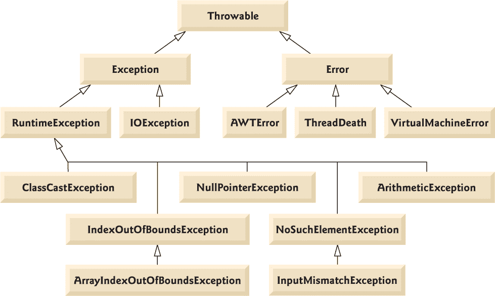

`Throwable` 类有两个直接子类——`Exception` 和 `Error`：

*   `Exception` 类及其子类——例如 `RuntimeException`（位于 `java.lang` 包）和 `IOException`（位于 `java.io` 包）——代表 Java 程序中可能发生的且可以被应用程序捕获的异常情况。
*   `Error` 类及其子类代表发生在 JVM 中的异常情况。大多数 `Error` 发生频率很低，不应该被应用程序捕获——应用程序通常无法从中恢复。

Java 异常层次结构包含数百个类。关于这些类的信息可以在整个 Java API 中找到。你可以在下述的链接处查看 `Throwable` 的文档：

```
https://docs.oracle.com/en/java/javase/23/docs/api/java.base/lang/Throwable.html
```

从那里，你可以查看该类的子类，以获取更多关于 Java `Exception` 和 `Error` 的信息。

### 捕获子类异常

如果编写了一个 `catch` 处理器来捕获父类异常对象，它也将捕获该异常类所有子类的对象。这使得 `catch` 块能够以多态的方式处理相关的异常。如果每个子类需要不同的处理方式，你应该单独地 `catch` 每一个子类。

### 仅执行第一个匹配的 `catch`

如果多个 `catch` 块匹配特定的异常类型——例如，一个捕获特定的异常类，而另一个捕获其父类——则只有第一个匹配的 `catch` 块会执行。例如，我们可以在 `ArithmeticException` 的 `catch` 块后面紧跟一个 `Exception` 的 `catch` 块——两者都匹配 `ArithmeticException`，但只有第一个匹配的 `catch` 会执行。将捕获父类异常类型的 `catch` 块放在其他捕获子类异常类型的 `catch` 块之前，将导致那些 `catch` 块无法执行，从而产生编译错误。

单独捕获子类类型时，如果你忘记显式测试一个或多个子类类型，可能会出错。捕获父类可以保证所有子类对象都会被捕获。将父类类型的 `catch` 块置于所有其他子类 `catch` 块之后，可以确保所有子类异常最终都被捕获。

在工业界中，不建议抛出或捕获 `Exception` 类型——我们在本章中使用它是为了演示异常处理的机制。在随后的章节中，我们通常会 `throw` 和 `catch` 更具体的异常类型。

#### 生成式 AI

**1** 提示生成式 AI，要求列出常见的 `Error` 子类列表及其可能发生的原因。

**2** 提示生成式 AI，询问为什么你不应该 `throw` 和 `catch` `Exception` 类型。

## 10.5 检查异常 vs. 未检查异常

Java 将异常分为两类：**检查异常（checked）**和**未检查异常（unchecked）**。理解它们之间的区别将帮助你编写更健壮的代码。Java 编译器对检查异常强制执行特殊要求。

### `RuntimeException` 是未检查异常

异常类在 Java `Exception` 类层次结构中的位置（第 10.4 节）决定了它是检查的还是未检查的。`RuntimeException`（位于 `java.lang` 包）的每一个直接或间接子类都是未检查异常。这些通常由编程错误引起。几种常见的未检查异常包括：

*   `ArithmeticException`（在图 10.1 和图 10.2 中所示）发生在尝试进行整数算法的除零时。为了避免这些异常，请在计算前确保 `denominator` 不为零。
*   `ArrayIndexOutOfBoundsException`（第 6 章和第 9 章中所做的那样）。你可以通过确保向方法传递正确的参数来避免这些异常。
*   `NullPointerException` 发生在尝试通过包含 `null` 的变量调用方法时。你可以通过在使用前确保引用不为 `null` 来避免这些异常。
*   `IndexOutOfBoundsException` 发生在访问 String 边界之外的字符时。你可以通过确保索引始终大于等于 0 且小于 `length` 方法返回的值来避免这些异常。

### Error 是未检查的

`Error` 的直接和间接子类对编译器是不检查的——它们代表程序无法恢复的严重错误。例如，`VirtualMachineError` 的文档（3）指出该错误“指示 虚拟机损坏或耗尽了运行所需的资源”。如果发生此错误，程序无能为力，因此你不应该 `catch` 它。

3. “Class VirtualMachineError.” 访问于 2024 年 9 月 22 日。[`docs.oracle.com/en/java/javase/23/docs/api/java.base/lang/VirtualMachineError.html`](https://docs.oracle.com/en/java/javase/23/docs/api/java.base/lang/VirtualMachineError.html)

### 检查异常

所有直接或间接继承自 `Exception` 但不是 `RuntimeException` 的类都是检查异常。这些通常由程序无法控制的情况引起。例如，在文件处理（第 11 章）中，如果 Java 程序尝试打开一个不存在的文件，就会发生检查 `FileNotFoundException`。

### 编译器与检查异常

编译器对检查异常强制执行“捕获或声明”的要求。如果方法的代码可能会抛出检查异常，则该方法必须：

*   通过 `try` 块封装代码并后跟一个处理检查异常类型（或其父类）的 `catch` 处理器来 `catch` 异常；或者
*   通过在方法的参数列表和体之间的 `throws` 子句中放置异常类型，向方法的调用者声明该异常。

如果代码不满足这些要求，就会产生编译错误。**这迫使你思考并处理潜在问题，从而产生更健壮的代码**。**如果异常可以在方法中进行有意义的处理，方法应该** `catch` 异常而不是声明它。

### 编译器与未检查异常

编译器并不强制要求未检查异常遵守“捕获或声明”规则，而这些异常通常代表可以避免的编码错误。理想情况下，你应该在程序开发期间修复此类错误。然而，为未检查异常提供适当的异常处理代码可以使你的程序更加健壮。未检查异常不需要列在方法的 `throws` 子句中。

### 重写方法中的 `throws` 子句

如果子类方法重写了父类方法，子类方法在其 `throws` 子句中列出的异常类型多于父类方法则属于错误。然而，子类的 `throws` 子句可以列出父类 `throws` 子句中类型的子集。

#### 生成式 AI

**1** 提示 `genAIs`，询问为什么 Java 的设计者选择区分受检查异常和未检查异常。

**2** 提示 `genAIs`，获取常见的 Java 未检查异常列表以及如何避免每种异常。

## 10.6 `finally` 块

程序通常通过使用系统资源（如内存、文件、网络连接和数据库连接）来完成任务。当程序不再需要某个资源时，程序应立即将其返回系统，以避免资源泄漏，资源泄漏会与其他程序使用该资源。

在 C 和 C++ 等编程语言中，最常见的资源泄漏是内存泄漏。Java 的自动垃圾回收防止了大多数内存泄漏，但在没有指向对象的剩余引用之前，Java 不会对其进行垃圾回收。因此，如果程序错误地保留了不需要对象的引用，仍然会发生内存泄漏。其他资源必须显式释放，以确保它们可以在未来使用。

### `finally` 块的位置

`try` 语句的 `finally` 块（也称为 `finally` 子句）由 `finally` 关键字以及紧随其在大括号内的代码组成：

*   如果 `try` 语句有一个或多个 `catch` 块，则 `finally` 块是可选的，并放在最后一个 `catch` 块之后。
*   如果 `try` 语句没有 `catch` 块，则 `finally` 块是强制的，并紧跟在 `try` 块之后。

### `finally` 块的何时执行

如果存在，`finally` 块会在相应的 `try` 块终止时始终执行，无论是否发生异常。`finally` 块不执行的唯一情况是 `try` 块调用了 `System` 类的 `exit` 方法，这会立即终止程序。如果发生异常但未被 `catch` 处理器捕获，或者 `catch` 块抛出了异常，控制将在程序将异常传递给下一个嵌套的 `try` 块（通常在调用方法中）之前进入 `finally` 块。由于 `finally` 块始终执行，因此它是资源释放代码的理想位置，用于将文件、网络连接、数据库连接和其他资源返回系统。

### 演示 `finally` 块

图 10.3 机械地演示了无论相应的 `try` 块中是否抛出异常，`finally` 块都会执行。程序包含 `static` 方法 `main`（第 5–14 行）、`throwException`（第 17–35 行）和 `doesNotThrowException`（第 38–50 行）。方法 `throwException` 和 `doesNotThrowException` 被声明为 `static`，因此 `main` 可以直接调用它们。

```
 1   // Fig. 10.3: UsingExceptions.java
 2   // try...catch...finally 异常处理机制。
 3
 4   public class UsingExceptions {
 5      public static void main(String[] args) {
 6         try {
 7            throwException();
 8         }
 9         catch (Exception exception) { // throwException 抛出的异常
10            System.err.println("Exception handled in main");
11         }
12
13         doesNotThrowException();
14      }
15
16      // 演示 try...catch...finally
17      public static void throwException() throws Exception {
18         try { // 抛出异常并立即捕获
19            System.out.println("Method throwException");
20            throw new Exception(); // 生成异常
21         }
22         catch (Exception exception) { // 捕获 try 中抛出的异常
23            System.err.println(
24               "Exception handled in method throwException");
25            throw exception; // 重新抛出以便进一步处理
26
27            // 这里的代码将无法到达；会导致编译错误
28
29         }
30         finally { // 无论 try...catch 发生什么都会执行
31            System.err.println("Finally executed in throwException");
32         }
33
34         // 这里的代码将无法到达；会导致编译错误
35      }
36
37      // 在未发生异常时演示 finally
38      public static void doesNotThrowException() {
39         try { // try 块不抛出异常
40            System.out.println("Method doesNotThrowException");
41         }
```


## 使用 `throw` 语句抛出异常

`main` 方法（图 10.3）开始执行，进入其 `try` 块，第 7 行立即调用 `throwException`（第 17–35 行）。第 20 行的 `throw` 语句抛出 `Exception` 以立即终止 `try` 块。`throw` 语句中的对象必须直接或间接继承自 `Throwable` 类。

## 重新抛出异常

第 20 行的 `Exception` 在第 22 行被捕获。然后第 25 行重新抛出异常。异常通常重新抛出是因为 `catch` 块在接收到异常后只能部分处理。重新抛出异常会将异常处理（或部分处理）推给与嵌套 `try` 语句相关的另一个 `catch` 块。你通过使用 `throw` 后接异常参数名称来重新抛出异常，该名称指向刚刚捕获的异常对象。

当发生重新抛出时，下一个嵌套的 `try` 块有机会检测并处理异常。在这种情况下，下一个嵌套的 `try` 块是 `main` 中的第 6–8 行。然而，在重新抛出的异常返回 `main` 的第 7 行之前，第 30–32 行的 `finally` 块会执行。然后，`throwException` 方法终止，`main` 在 `try` 块中检测到重新抛出的异常并在 `catch` 块（第 9–11 行）中处理它。

## 未发生异常时 finally 也会执行

接下来，`main` 的第 13 行调用方法 `doesNotThrowException`（第 38–50 行）。`doesNotThrowException` 的 `try` 块（第 39–41 行）没有发生异常，因此程序跳过了 `catch` 块（第 42–44 行），但 `finally` 块（第 45–47 行）仍然执行。然后控制继续到 `finally` 块之后的语句（第 49 行），函数返回到 `main`，程序终止。

不要在 `finally` 块中编写可能会 `throw`（抛出）异常的代码。如果确实需要此类代码，请将其封装在 `finally` 块内的 `try`…`catch` 结构中，以防止 `finally` 抛出异常。当 `finally` 块在处理一个异常时又抛出一个新异常，第一个异常将会丢失。

## 不要过度使用 `try` 语句

`try` 语句将错误处理代码从程序逻辑中分离，从而提高了程序的清晰度。不要将每个可能抛出异常的语句都封装在独立的 `try` 语句中，这会降低可读性。相反，应将代码的重要部分放在 `try` 块中，随后是必要的 `catch` 块，以及如果需要的话，还需要一个 `finally` 块。

### 生成式 AI

1. 提示 `genAIs`，询问它们 Java 中可能发生哪些类型的资源泄漏。
2. 提示 `genAIs`，让它们解释为什么你可能想要重新抛出异常。

## 10.7 栈展开和从异常中获取信息

当异常在特定方法中抛出但未被捕获时，方法调用栈会被“展开”（unwound），并尝试在下一个嵌套的 `try` 块中 `catch` 该异常。这一过程被称为 `stack unwinding`（栈展开）。展开方法调用栈意味着未捕获异常的方法终止，该方法中的所有局部变量都超出作用范围，并且控制权返回到调用该方法的语句。如果 `try` 块包含了该语句，则会尝试 `catch` 该异常。如果 `try` 块没有包含该语句或异常未被捕获，则会再次发生栈展开。图 10.4 展示了栈展开，而 `main` 中的异常处理程序显示了如何访问异常对象中的数据。

如果你使用 `java UsingExceptions.java` 命令执行此示例——该命令在内存中编译程序然后运行它——此程序的输出将与图 10.4 输出不同。

```java
// Fig. 10.4: UsingExceptions.java
// Stack unwinding and obtaining data from an exception object.

public class UsingExceptions {
   public static void main(String[] args) {
      try {
         method1();
      }
      catch (Exception exception) { // catch exception thrown in method1
         System.err.printf("%s%n%n", exception.getMessage());
         exception.printStackTrace();

         // obtain the stack-trace information
         StackTraceElement[] traceElements = exception.getStackTrace();

         System.out.printf("%nStack trace from getStackTrace:%n");
         System.out.println("Class\t\tFile\t\t\tLine\tMethod");

         // loop through traceElements to get exception description
         for (StackTraceElement element : traceElements) {
            System.out.printf("%s\t", element.getClassName());
            System.out.printf("%s\t", element.getFileName());
            System.out.printf("%s\t", element.getLineNumber());
            System.out.printf("%s%n", element.getMethodName());
         }
      }
   }

   // call method2; throw exceptions back to main
   public static void method1() throws Exception {
      method2();
   }

   // call method3; throw exceptions back to method1
   public static void method2() throws Exception {
      method3();
   }

   // throw Exception back to method2
   public static void method3() throws Exception {
      throw new Exception("Exception thrown in method3");
   }
}
```

```
Exception thrown in method3

java.lang.Exception: Exception thrown in method3
        at UsingExceptions.method3(UsingExceptions.java:41)
        at UsingExceptions.method2(UsingExceptions.java:36)
        at UsingExceptions.method1(UsingExceptions.java:31)
        at UsingExceptions.main(UsingExceptions.java:7)

Stack trace from getStackTrace:
Class           File                    Line    Method
UsingExceptions UsingExceptions.java    41      method3
UsingExceptions UsingExceptions.java    36      method2
UsingExceptions UsingExceptions.java    31      method1
UsingExceptions UsingExceptions.java    7       main
```

**图 10.4** | 栈展开和从异常对象获取数据。

### 栈展开

在 `main` 中，`try` 块（第 6–8 行）调用 `method1`（定义在第 30–32 行），继而调用 `method2`（定义在第 35–37 行），再次调用 `method3`（定义在第 40–42 行）。程序按如下方式继续：

*   `method3` 中的第 41 行抛出一个 `Exception` 对象——这就是抛出点。
*   由于 `throw` 语句没有包含在 `try` 块中，发生了栈展开。因此 `method3` 终止，控制权返回到 36 行——即调用 `method3` 的语句。
*   由于 `try` 块没有包含 36 行，发生了栈展开。因此 `method2` 终止，控制权返回到 31 行——即调用 `method2` 的语句。
*   由于 `try` 块没有包含 31 行，发生了栈展开。因此 `method1` 终止，控制权返回到 7 行——即调用 `method1` 的语句。
*   6–8 行的 `try` 块包含了该语句。异常未被处理，因此 `try` 块终止，第一个匹配的 `catch` 块（第 9–26 行）捕获并处理了异常。

### 从异常对象获取数据

所有异常都派生自 `Throwable`，它有一个 `printStackTrace` 方法，可以将堆栈轨迹输出到标准错误流。这在测试和调试中非常有帮助。`Throwable` 类还提供了 `getStackTrace` 方法，可以获取 `printStackTrace` 可能打印的堆栈轨迹信息。`Throwable` 类的 `getMessage` 方法（所有 `Throwable` 子类均继承）返回异常中存储的描述性字符串。`Throwable` 方法 `toString`（所有 `Throwable` 子类均继承）返回包含异常类名和描述性消息的 `String`。

如果异常未被捕获，Java 的默认异常处理程序会显示异常名称、指示发生问题的描述性消息以及完整的执行堆栈轨迹。在单线程执行应用程序中，应用程序将终止。在多线程应用程序中，产生异常的线程将终止。我们在第 18 章中讨论多线程。

图 10.4 中的 `catch` 处理程序（第 9–26 行）演示了 `getMessage`、`printStackTrace` 和 `getStackTrace`。如果我们想将堆栈轨迹信息输出到标准错误流以外的流，可以使用 `getStackTrace` 返回的信息并输出到另一个流，或使用 `printStackTrace` 的重载版本。发送数据到其他流将在第 11 章中讨论。

第 10 行调用异常的 `getMessage` 方法来获取异常描述。第 11 行调用异常的 `printStackTrace` 方法来输出指示异常发生位置的堆栈。第 14 行调用异常的 `getStackTrace` 方法，以 `StackTraceElement` 对象数组的形式获取堆栈跟踪信息，以便进行更详细的检查。第 20–25 行获取数组中的每个 `StackTraceElement`，并调用其 `getClassName`、`getFileName`、`getLineNumber` 和 `getMethodName` 方法，分别获取该 `StackTraceElement` 的类名、文件名、行号和方法名。每个 `StackTraceElement` 代表方法调用栈上的一次方法调用。

程序的输出显示 `printStackTrace` 显示的信息遵循以下模式：

```
className.methodName(fileName:lineNumber)
```

其中 `className`、`methodName` 和 `fileName` 是发生异常的类、方法和文件，而 `lineNumber` 是异常在文件中发生的具体行号。`getStackTrace` 方法允许对异常信息进行自定义处理。将 `printStackTrace` 的输出与通过 `StackTraceElement` 创建的输出进行比较，以确认两者包含相同的堆栈跟踪信息。

### 栈遍历 API (Stack-Walking API)

`Throwable` 方法 `printStackTrace` 和 `getStackTrace` 都会处理整个方法调用栈。在调试时，这可能是无效的。例如，你可能只对对应特定类方法的栈帧感兴趣。Java 的 `Stack-Walking API`（`java.lang` 包中的 `StackWalker` 类）使用 lambda 和流（第 14 章）更高效地访问方法调用栈信息。你可以在此处了解更多关于该 API：

```
https://openjdk.org/jeps/259
```

#### 生成式 AI

1. 提示生成式 AI，询问 `StackTraceElement` 的真实世界用例。

## 10.8 链式异常

有时，方法通过抛出一个特定于当前应用程序的不同异常类型来响应异常。如果 `catch` 块抛出一个新异常，原始异常的信息和堆栈跟踪将会丢失。早期的 Java 版本没有提供任何机制用新异常的信息包装原始异常信息，以提供显示原始问题发生位置的完整堆栈跟踪，这使得调试变得困难。链式异常允许异常对象维护来自原始异常的完整堆栈跟踪信息。图 10.5 展示了链式异常。

```java
// Fig. 10.5: UsingChainedExceptions.java
// Chained exceptions.

public class UsingChainedExceptions {
   public static void main(String[] args) {
      try {
         method1();
      }
      catch (Exception exception) { // 从 method1 抛出的异常
         exception.printStackTrace();
      }
   }

   // 调用 method2; 将异常抛回给 main
   public static void method1() throws Exception {
      try {
         method2();
      }
      catch (Exception exception) { // 从 method2 抛出的异常
         throw new Exception("Exception thrown in method1", exception);
      }
   }

   // 调用 method3; 将异常抛回给 method1
   public static void method2() throws Exception {
      try {
         method3();
      }
      catch (Exception exception) { // 从 method3 抛出的异常
         throw new Exception("Exception thrown in method2", exception);
      }
   }

   // 将异常抛回给 method2
   public static void method3() throws Exception {
      throw new Exception("Exception thrown in method3");
   }
}
```

```
java.lang.Exception: Exception thrown in method1
```


at `UsingChainedExceptions.method1(UsingChainedExceptions.java:20)`

at `UsingChainedExceptions.main(UsingChainedExceptions.java:7)`

Caused by: `java.lang.Exception: Exception thrown in method2`

at `UsingChainedExceptions.method2(UsingChainedExceptions.java:30)`

at `UsingChainedExceptions.method1(UsingChainedExceptions.java:17)`

... 1 more

Caused by: `java.lang.Exception: Exception thrown in method3`

at `UsingChainedExceptions.method3(UsingChainedExceptions.java:36)`

at `UsingChainedExceptions.method2(UsingChainedExceptions.java:27)`

... 2 more

**图. 10.5** | 链式异常。

## 程序控制流

程序有四个方法——`main`（第 5–12 行）、`method1`（第 15–22 行）、`method2`（第 25–32 行）和 `method3`（第 35–37 行），运行方式如下：

* `main`（第 5–12 行）调用 `method1`。
* `method1`（第 15–22 行）调用 `method2`。
* `method2`（第 25–32 行）调用 `method3`。
* `method3`（第 35–37 行）抛出 `Exception`。
* `method2`（第 29–31 行）捕获 `Exception` 并抛出一个以原始异常为因的新异常。
* `method1`（第 19–21 行）捕获 `Exception` 并抛出一个以原始异常为因的新异常。
* `main`（第 9–11 行）捕获 `Exception` 并调用 `printStackTrace()`。

新的异常类必须继承现有的类，以确保新类可以用于异常处理机制。按照惯例，新类的名称应以“`Exception`”结尾。异常类通常包含四个构造函数：

* 一个不接受任何参数，并将默认错误消息 `String` 传递给父类构造函数的；
* 一个接收作为 `String` 类型的自定义错误消息，并将其传递给父类构造函数的；
* 一个接收作为 `String` 类型的自定义错误消息和一个 `Throwable`（用于异常链），并将两者都传递给父类构造函数的；以及
* 一个接收一个 `Throwable`（用于异常链）并将其传递给父类构造函数的。

### 尽可能使用现有的异常类

绝大多数程序员并不需要声明自己的异常类。在定义自己的异常类之前，请学习 Java API 中现有的类。如果没有合适的现有类，请尝试扩展相关的异常类。例如，如果你正在创建一个新类来表示方法尝试除以零，你可能会扩展 `ArithmeticException` 类，因为除以零发生在算术运算期间。

### 决定自定义异常应该是受检查的还是非检查的

如果现有的类不是你新异常类的合适父类，请决定你的新类应该是受检查的（checked）异常还是非检查的（unchecked）异常：

* 如果要求客户端处理该异常，则新异常类应该是继承 `Exception` 但不是 `RuntimeException` 的受检查异常。在这种情况下，客户端应用程序应该能够合理地从异常中恢复。
* 如果客户端代码可以忽略该异常（即该异常是非检查的），则新异常类应该扩展 `RuntimeException`。

#### 生成式 AI

1. 提示 `genAIs`，询问关于在 Java 中何时应该创建新异常类型的指南。
2. 提示 `genAIs`，询问关于何时应将自定义异常设为受检查异常与非检查异常的指南。

---

## 10.10 前置条件与后置条件

程序员花费大量时间来维护和调试代码。为了方便这些任务并改进整体设计，你可以指定方法执行前后的预期状态。这些状态分别被称为前置条件（preconditions）和后置条件（postconditions）。

#### 前置条件

当调用方法时，`precondition` 必须为真。前置条件描述了方法参数的约束，以及方法在开始执行之前对程序当前状态的任何其他预期。如果不满足前置条件，则方法的行为是未定义的——它可能会抛出异常、带有非法值继续执行或尝试从错误中恢复。如果不满足前置条件，你不应该期望有一致的行为。

#### 后置条件

`postcondition` 在方法成功返回后为真。后置条件描述了对返回值的约束以及方法可能产生的任何其他副作用。在定义方法时，你应该记录所有后置条件，以便他人在调用你的方法时知道应该预期什么，并且你应该确保在满足前置条件的情况下，方法遵循了所有的后置条件。

#### 在不满足前置条件或后置条件时抛出异常

当不满足前置条件或后置条件时，方法通常会抛出异常。例如，检查 `String` 方法 `charAt`，它有一个 `int` 参数——`String` 中的索引。`charAt` 方法的前置条件是它接收到的索引大于或等于零，且小于 `String` 的长度。如果满足前置条件，后置条件规定该方法将返回参数指定索引处的字符。否则，`charAt` 会抛出 `IndexOutOfBoundsException`。我们相信只要我们满足了前置条件，方法 `charAt` 就会满足它的后置条件。我们不需要担心方法实际上如何检索索引处的字符的细节。

#### 记录前置条件或后置条件

通常，方法的前置条件和后置条件是作为规范的一部分描述的。在设计自己的方法时，你通常在方法声明之前的注释中说明前置条件和后置条件。

#### 生成式 AI

1. 提示 `genAIs` 列出 Java 方法典型的的前置条件和后置条件类型。
2. 提示 `genAIs`，询问如果不满足前置条件或后置条件，Java 方法通常会抛出哪些异常。
3. 提示 `genAIs`，请求一个简单的 Java 程序，演示一个带有正确注释的前置条件和后置条件的方法，并通过 `if` 语句进行测试，在不满足前置条件或后置条件时 `throw` 异常。

---

## 10.11 断言

在实现和调试类时，有时说明方法中特定点上应该为真的条件是有帮助的。这些条件被称为断言（assertions），有助于通过在开发过程中捕获潜在错误和识别可能的逻辑错误来确保程序的有效性。前置条件和后置条件是两种断言。前置条件是关于方法调用时程序状态的断言，后置条件是关于方法结束后状态的断言。

#### `assert` 语句

虽然断言可以作为注释引导程序开发，但 Java 包含了两个版本的 `assert` 语句来通过程序验证断言。`assert` 语句评估一个 `boolean` 表达式，如果为 `false`，则抛出 `AssertionError`（`Error` 的子类）。`assert` 语句的第一种形式：

```
assert expression;
```

如果 `expression` 为 `false`，则会抛出 `AssertionError`。第二种形式是：

```
assert expression1 : expression2;
```

它评估 `expression1` 并以 `expression2` 作为错误消息抛出 `AssertionError`。

#### 使用 `assert`

在开发期间，你可以使用断言通过程序实现前置条件和后置条件，或验证任何有助于确保代码正确运行的中间状态。

断言主要用于调试和识别应用程序中的逻辑错误。它们默认是被忽略的，因此在执行程序时你必须显式地启用它们，如下所示——`-ea` 选项代表“enable assertions”：

```
java -ea AssertTest
```

```
Enter a number between 0 and 10: 50

Exception in thread "main" java.lang.AssertionError: bad number: 50

at AssertTest.main(AssertTest.java:13)
```

**图 10.6** | 使用 `assert` 检查值是否在范围内。

##### 不要捕获 `AssertionError`

`AssertionError` 仅应在程序开发期间使用，用于识别代码中的问题。不要捕获它们。只需让程序终止，这样你就可以定位并修复问题根源，使你的程序更加健壮。

#### 生成式 AI

1. 提示生成式 AI，要求其编写一个简单的 Java 程序，演示一个方法，该方法具有带有适当注释的先决条件和后置条件，并通过 `assert` 进行测试。

### 10.12 `try`-with-Resources 语句：自动资源释放

在早期的 Java 版本中，你会将资源释放代码放在 `finally` 块中，以确保资源被释放，无论使用该资源的相应 `try` 块是否抛出异常。`try`-with-resources 语句简化了代码编写，即获取一个或多个资源，在 `try` 块中使用它们，并在相应的 `finally` 块中释放它们。大多数表示需要释放资源的 Java API 类现在都实现了 `AutoCloseable` 接口并提供了 `close` 方法。此类类的对象可以如下所示用于 `try`-with-resources 语句：

```
try (var theObject = new ResourceClass()) {

   // 在此处使用 theObject。当 try
   // 块成功结束或由于异常结束时资源会自动释放。

}
catch (Exception e) {

   // 捕获使用资源时发生的异常。

}
```

其中括号中的 `ResourceClass` 必须实现 `AutoCloseable`。`try`-with-resources 语句是管理 `AutoCloseable` 资源的优选方式。`try` 块使用 `ResourceClass` 对象，然后在块成功结束或由于异常结束时调用其 `close()` 方法来释放资源。`try`-with-resources 的 `catch` 子句可选。你可以使用分号（`;`）分隔，在 `try` 后的括号中创建多个 `AutoCloseable` 对象。我们将从第 11 章、文件、I/O 流、JSON 序列化与 CSV 文件 开始在多个程序中使用 `try`-with-resources 语句。

##### `try`-with-Resources 可以有效使用 `final` 变量

如果编译器可以推断局部变量可以声明为 `final`，因为包含它的方法在声明和初始化后从未修改过它，那么它实际上是 `final` 的。你可以创建一个 `AutoCloseable` 对象并将其赋值给显式声明为 `final` 或有效 `final` 的局部变量。然后，你可以在 `try`-with-resources 语句中使用该变量，该语句会自动释放对象的资源：

```
var theObject = new ResourceClass();

try (theObject) {

   // 在此处使用 theObject。当 try
   // 块成功结束或由于异常结束时资源会自动释放。

}
catch (Exception e) {

   // 捕获使用资源时发生的异常。

}
```

其中括号中的 `ResourceClass` 必须实现 `AutoCloseable`。`try`-with-resources 语句是管理 `AutoCloseable` 资源的优选方式。`try` 块使用 `ResourceClass` 对象，然后在块成功结束或由于异常结束时调用其 `close()` 方法来释放资源。`try`-with-resources 的 `catch` 子句可选。你可以使用分号（`;`）分隔，在 `try` 后的括号中创建多个 `AutoCloseable` 对象。


其中括号中的 `ResourceClass` 必须实现 `AutoCloseable`。`try`-with-resources 语句是管理 `AutoCloseable` 资源的优选方式。`try` 块使用 `ResourceClass` 对象，然后在块成功结束或由于异常结束时调用其 `close()` 方法来释放资源。`try`-with-resources 的 `catch` 子句可选。你可以使用分号（`;`）分隔，在 `try` 后的括号中创建多个 `AutoCloseable` 对象。

### 抑制异常

如果编译器可以推断局部变量可以声明为 `final`，因为包含它的方法在声明和初始化后从未修改过它，那么它实际上是 `final` 的。你可以创建一个 `AutoCloseable` 对象并将其赋值给显式声明为 `final` 或有效 `final` 的局部变量。然后，你可以在 `try`-with-resources 语句中使用该变量，该语句会自动释放对象的资源。

### 抑制异常

我们引入了前条件（preconditions）和后条件（postconditions），以帮助使用你方法的程序员理解方法调用时和返回时必须满足的条件。当不满足前条件或后条件时，方法通常会 `throw` 异常。我们讨论了 `assert` 语句以及如何使用它来帮助调试程序。

我们引入了 `try`-with-resources 语句，用于在 `try` 块使用后自动 dealloc 一个 `AutoCloseable` 资源。最后，我们在 `catch` 处理程序中演示了一个匿名变量（`_`），当不需要访问所捕获的异常时可以使用它。在下一章中，你将学习文件处理，包括持久化数据的存储和检索。

### 特别章节：生成式 AI 练习

针对以下每个问题，尝试使用多个生成式 AI 来确定哪一个表现最好。请务必验证结果。记住，它们有时会出错甚至产生幻觉，创建不可靠的信息。

**10.1** **(生成式 AI：finally 块)** 向生成式 AI 输入以下提示：Java 中大多数管理资源的类都实现了 `AutoCloseable` 接口，以便它们可以与 `try`-with-resources 语句一起使用。基于此，提供一个应当使用 `try` 语句的 `finally` 块的真实示例。

**10.2** **(生成式 AI：后条件)** 向生成式 AI 提，列出 `java.lang.Math` 类方法使用的后条件。

**10.3** **(生成式 AI：自定义异常的优缺点)** 向生成式 AI 提，询问在 Java 中创建自定义异常的优缺点。

**10.4** **(生成式 AI：组织是否反对使用异常)** 向生成式 AI 提，询问某些 Java 软件开发组织是否反对使用异常。如果是，为什么？

**10.5** **(生成式 AI：异常处理性能)** 向生成式 AI 提，列出使用 Java 异常处理时的性能考虑因素。

**10.6** **(生成式 AI：BigDecimal 方法抛出的异常)** 向生成式 AI 提，列出抛出异常的 `java.math.BigDecimal` 方法以及这些异常可能发生的原因。

**10.7** **(生成式 AI：异常日志)** 向生成式 AI 提，询问什么是异常日志以及使用它的优缺点是什么。

**10.8** **(生成式 AI：吞掉异常)** 向生成式 AI 提，询问“吞掉异常”（swallow an exception）意味着什么以及以及你不应该这样做。

**10.9** **(生成式 AI：避免灾难性问题)** 向生成式 AI 提，询问如何使用异常处理来避免灾难性问题。

**10.10** **(生成式 AI：使用 RuntimeExceptions 防止“throws 链”)** 向生成式 AI 提，询问为什么行业内流行“到处”使用 Java `RuntimeException` 来防止一直持续到堆栈顶端的 "`throws` 链”。

## 11 文件、I/O 流、JSON 序列化与 CSV 文件


### 目标

在本章中，你将：

* 获取有关文件和目录的信息。
* 创建、读取、写入和更新文件。
* 学习文本文件和二进制文件之间的区别。
* 使用 `Formatter` 类向文件输出文本。
* 使用 `Scanner` 类从文件输入文本。
* 使用 Jackson 开源库通过 JavaScript 对象表示（JSON）序列化和反序列化向文件写入并从文件中读取对象。
* 通过免费的 OpenWeatherMap Web 服务获取 JSON 格式的城市天气报告。
* 写入和读取逗号分隔值（CSV）文件。
* 探索一个入门数据分析案例研究，该案例从 CSV 文件读取并处理 *Titanic* 号灾难事故的数据。
* 探索一个关于 RSA 公钥加密的对象原生案例研究，该加密与 AES 用于（第 7 章）。

### 提纲

#### 11.1 引言

内存中的数据是暂时的。文件用于数据持久化——即程序终止后仍然可用的永久数据。我们从 Java 的 NIO（新输入输出）类和接口开始，获取有关文件和目录的信息。接下来，我们讨论文本文件和二进制文件之间的区别。我们使用 `Formatter` 对象向文本文件写入，并使用 `Scanner` 对象从文件中读取。

##### JavaScript 对象表示 (JSON) 与调用 Web 服务

第一个案例研究引入了 JavaScript 对象表示（JSON）——一种人类和机器可读的文本格式。我们使用流行的 Jackson 开源库将对象的 JSON 表示写入文件（此过程称为序列化），然后读取 JSON 并重建对象（此过程称为反序列化）。在第二个 JSON 案例研究中，我们使用 Java API 的 `HttpClient`、`HttpRequest` 和 `HttpResponse` 类（包 `java.net.http`）中的网络功能来调用 OpenWeatherMap Web 服务，该服务返回 JSON 格式的城市天气报告，然后使用 Jackson 处理响应。

##### 逗号分隔值 (CSV) 文件与基础数据分析

接下来两个案例研究引入了 CSV（逗号分隔值）文件格式以及如何使用 Jackson 库写入和读取 CSV 文件。CSV 常用于大数据、数据分析和数据科学的数据集。

数据分析初学者的常用数据集是泰坦尼克号灾难数据集。该案例研究使用 Jackson 库从 CSV 文件读取数据集、查看数据并进行基础分析。

##### 对象原生安全案例研究：RSA 公钥加密

我们在 第 2 章至第 7 章中介绍了对象原生案例研究，在这些章节中，你在学习在 第 8 章 中开发自定义类之前，方便地使用了现有 Java API 类的对象。在最后一个对象原生案例研究中，我们通过增强 第 7.9 节 中的私钥加密示例继续强调安全和隐私。我们使用 RSA 公钥加密来加密和解密 AES 密钥。这实现了加密消息的接收者之间的安全传输。

#### 11.2 文件与流

Java 将每个文件视为顺序字节流。

Java 的 NIO API 还包含了实现所谓的基于通道架构（channel-based architecture）的高性能 I/O 的类和接口。这些主题超出了本书的范围。


每个操作系统都提供了一种确定文件末尾的机制，例如`文件结束标记`（end-of-file marker）或记录在系统维护的系统管理数据结构中的文件总字节数。处理字节流的 Java 程序在到达流的末尾时会接收到来自操作系统的指示——程序不需要知道底层平台如何表示文件或流。在某些情况下，文件结束指示以异常的形式出现；在另一些情况下，该指示是流处理对象上调用的方法的返回值。

##### 基于字节的流和基于字符的流

文件流可以用于以字节或字符输入和输出数据：

*   **基于字节的流**（Byte-based streams）以二进制格式输出和输入数据——一个 `int` 是 4 个字节，一个 `double` 是 8 个字节等。此类流用于非文本数据，如图像、视频或音频文件。我们将在第 19 章 构建基于 API 的 Java 生成式 AI 应用** 中处理二进制数据。
*   **基于字符的流**（Character-based streams）将文本数据作为字符序列进行输出和输入。每个字符是 2 个字节，因此给定值的字节数取决于其字符数量。例如，值 `2000000000`（10 个字符）需要 20 个字节，而值 `7`（1 个字符）仅需要 2 个字节。

使用基于字节的流操作的文件是**二进制文件**，而使用基于字符的流操作的文件是**文本文件**。文本文件可以由文本编辑器读取，而二进制文件则由理解文件特定内容的程序读取。你可以直接在计算中使用从二进制文件中读取的数值（例如 `5`）。相比之下，文本文件中的字符 `'5'` 仅仅是 `String` 的一部分，就像句子 `"Sarah is 15 years old."` 中的情况一样。

##### 标准输入、标准输出和标准错误流

Java 程序通过创建一个对象并将其与字节流或字符流关联来**打开文件**。该对象的构造函数与操作系统交互以打开文件。当 Java 程序开始执行时，它会创建三个与设备关联的对象：

*   `System.in`（标准输入流）对象通常允许程序从键盘获取输入。
*   `System.out`（标准输出流）对象通常允许程序向屏幕输出数据。
*   `System.err`（标准错误流）对象通常允许程序向屏幕输出错误信息。

这些流分别可以通过 `System` 的方法 `setIn`、`setOut` 和 `setErr` 分别进行**重定向**。对于 `System.in`，这允许程序从不同的源读取字节。对于 `System.out` 和 `System.err`，输出可以发送到不同的位置，例如系统上的文件。

##### `java.io` 和 `java.nio` 包

Java 程序使用 `java.io` 包和 `java.nio` 子包中的类和接口执行基于流的处理。Java API 中的其他其他包也包含了基于 `java.io` 和 `java.nio` 包功能的功能。

可以使用 `Scanner` 和 `Formatter` 类执行字符输入和输出，正如你在第 11.4 节中所看到的。你已经广泛地使用 `Scanner` 从键盘输入数据。`Scanner` 也可以从文件读取数据。`Formatter` 类允许将格式化数据输出到任何基于文本的流，类似于 `System.out.printf`。附录 B 格式化输出提供了使用 `printf` 进行格式化输出的细节。所有这些功能都可以用于格式化文本文件。

##### 其他类型的流

第 14 章 使用 Lambda 和 Stream 进行函数式编程了一种用于处理元素集合（如数组和 `ArrayList`）的流，而不是在本章中讨论的字节流和字符流。第 14.13 节了如何在文本文件中使用 lambda 和流。

###### 生成式 AI

1. 提示生成式 AI 比较基于字节和基于字符的 Java I/O 流，并讨论在什么情况下你会使用每一种。
2. 提示生成式 AI，要求提供 Java 基于字节和基于字符流的真实示例。

#### 11.3 使用 NIO 类和接口获取文件和目录信息

`java.nio.file` 包提供了用于检索文件和目录信息的有用功能：

*   `Path` 接口——实现 `Path` 的类对象表示文件或目录的位置。`Path` 对象不打开文件，也不提供任何文件处理能力。在其功能中，`Path` 接口提供了创建 `Path` 对象的 `static` 方法。
*   `Files` 类——该类提供了用于常用文件和目录操作的 `static` 方法，例如复制文件；创建和删除文件及目录；获取文件和目录信息；读取文件内容。
*   `DirectoryStream` 接口——实现此接口的类对象允许程序遍历目录的内容。

##### 绝对路径与相对路径

文件或目录的路径指定其在计算机上的位置。路径包含了指向文件或目录的部分或全部目录：

*   **绝对路径**（absolute path）指定一个完整位置，从**根目录**开始通向特定的文件或目录。特定磁盘驱动器或固态硬盘（SSD）上的每个文件或目录在其路径中都有相同的根目录。
*   **相对路径**（relative path）相对于某个目录——例如，相对于程序启动所在目录的路径。在相对路径中，点（`.`）表示当前文件夹，双点（`..`）表示父文件夹。

##### 示例：获取文件和目录信息

图 11.1 提示用户输入文件或目录名称，然后使用 `Path`、`Files` 和 `DirectoryStream` 输出该文件或目录（也称为文件夹）的元数据，包括：

*   文件文件夹是否存在
*   名称
*   是文件还是文件夹
*   其位置是否为绝对路径
*   最后修改时间
*   大小
*   路径以及
*   绝对路径——如果用户输入的是绝对路径，则路径和绝对路径将相同。

对于文件夹，我们还列出了它的内容。在第一个示例输出中，我们输入包含本章示例的文件夹的 `Path`。在第二个中，我们输入此示例源文件的 `Path`。在这两种情况下，我们都指定了绝对路径。

点击此处查看代码图像

```java
// 图. 11.1: FileAndDirectoryInfo.java
// 用于获取文件和目录信息的 File 类。
import java.io.IOException;
import java.nio.file.DirectoryStream;
import java.nio.file.Files;
import java.nio.file.Path;
import java.util.Scanner;

public class FileAndDirectoryInfo {
   public static void main(String[] args) throws IOException {
      var input = new Scanner(System.in);

      System.out.println("输入文件或目录名称:");

      // 根据用户输入创建 Path 对象
      Path path = Path.of(input.nextLine());

      if (Files.exists(path)) { // 如果路径存在，输出其相关信息
         // 显示文件或目录信息
         System.out.printf("%n%s exists%n", path.getFileName());
         System.out.printf("%s a directory%n",
            Files.isDirectory(path) ? "Is" : "Is not");
         System.out.printf("%s an absolute path%n",
            path.isAbsolute() ? "Is" : "Is not");
         System.out.printf("Last modified: %s%n",
            Files.getLastModifiedTime(path));
         System.out.printf("Size: %s%n", Files.size(path));
         System.out.printf("Path: %s%n", path);
         System.out.printf("Absolute path: %s%n", path.toAbsolutePath());

         if (Files.isDirectory(path)) { // 输出目录列表
            System.out.printf("%nDirectory contents:%n");

            // 用于遍历目录内容的对象
            DirectoryStream<Path> directoryStreamPath =
               Files.newDirectoryStream(path);

            for (Path currentPath : directoryStreamPath) {
               System.out.println(currentPath);
            }
         }
      }
      else { // 不是文件或目录，输出错误信息
         System.out.printf("%s does not exist%n", path);
      }
   }
}
```

```text
输入文件或目录名称:

c:\Users\pauldeitel\Documents\examples\ch11

ch11 exists

Is a directory

Is an absolute path

Last modified: 2024-11-29T16:30:04.8490973Z

Size: 4096

Path: C:\Users\pauldeitel\Documents\examples\ch11

Absolute path: C:\Users\pauldeitel\Documents\examples\ch11

Directory contents:
```


## 文件路径示例

- `C:\Users\pauldeitel\Documents\examples\ch11\fig11_01`
- `C:\Users\pauldeitel\Documents\examples\ch11\fig11_02`
- `C:\Users\pauldeitel\Documents\examples\ch11\fig11_03`
- `C:\Users\pauldeitel\Documents\examples\ch11\fig11_04`
- `C:\Users\pauldeitel\Documents\examples\ch11\fig11_05`
- `C:\Users\pauldeitel\Documents\examples\ch11\fig11_07`
- `C:\Users\pauldeitel\Documents\examples\ch11\fig11_08`
- `C:\Users\pauldeitel\Documents\examples\ch11\fig11_09`
- `C:\Users\pauldeitel\Documents\examples\ch11\fig11_10`
- `C:\Users\pauldeitel\Documents\examples\ch11\fig11_11`
- `C:\Users\pauldeitel\Documents\examples\ch11\libs`

## 程序输出示例

```
输入文件或目录名称:
c:\Users\pauldeitel\Documents\examples\ch11\fig11_01\FileAndDirectoryInfo.java
FileAndDirectoryInfo.java exists
Is not a directory
Is an absolute path
Last modified: 2024-11-28T20:22:22.8167285Z
Size: 2992
Path: c:\Users\pauldeitel\Documents\examples\ch11\fig11_01\FileAndDirectoryInfo.java
Absolute path: c:\Users\pauldeitel\Documents\examples\ch11\fig11_01\FileAndDirectoryInfo.java
```

**图 11.1** | 用于获取文件和目录信息的 `File` 类。

第 13 行提示用户输入文件或目录。第 16 行输入文件名或目录名称并将其传递给 `Path.of` 方法，该方法将 `String` 转换为 `Path`。第 18 行调用 `Files.exists` 方法，该方法接收一个 `Path` 并判断其是否存在。如果 `Path` 存在，则执行 20–29 行。如果 `Path` 不存在，则第 44 行显示消息。如果 `Path` 代表一个目录（第 31 行），则执行 32–40 行：它们使用 `Files.newDirectoryStream` 方法获取一个包含 `Path` 对象的 `DirectoryStream<Path>`。第 38–40 行显示 `DirectoryStream` 中每个 `Path` 的字符串表示。

接下来，我们将创建并操作顺序文件，其中记录按记录键（record-key）字段顺序存储。我们将从文本文件开始，使读者能够快速创建和编辑人类可读的文件。我们将讨论顺序文本文件的创建、写入数据、读取数据和更新。我们将在使用二进制文件，以用于在第 19 章 构建基于 API 的 Java 生成式 AI 应用 中用于读写图像和音频文件。

在本章中，我们使用“记录”（record）一词来指代文件中的记录。许多示例也使用了 `record` 类。当我们引用 `record` 类时，我们使用计算机字体对“`record`”一词进行格式化。

### 11.4.1 创建顺序文本文件

Java 对文件没有施加任何结构——如记录之类的概念并不作为 Java 语言的一部分。因此，你必须对文件进行结构化以满足程序的要求。下面的示例展示了如何对文件施加键记录结构。

本节中的程序创建一个简单的顺序文件，该文件可能用于应收账款系统，以跟踪信用客户欠公司的金额。对于每个客户，程序从用户处获取账户号码、客户名称和余额（即客户因收到的商品和服务欠某公司的金额）。每个客户的数据构成了该客户的记录。该程序使用账户号码作为记录键——我们将按照账户号码顺序写入文件的记录。在一个包含数据输入的综合应收账款系统（基于顺序文件）中，将提供排序功能，以便用户可以以任何顺序输入记录。然后将对这些记录进行排序并写入文件。

#### 类 `CreateTextFile`

`CreateTextFile` 类（图 11.2）使用 `Formatter` 来输出格式化的 `String`s，并使用与 `System.out.printf` 相同的格式化功能。为了方便讨论，我们将程序分成了部分。第 8 行声明了 `record` 类 `Account`，表示 `Account` 的 `accountNumber`、`name` 和 `balance`——对于本章的示例，我们仅使用姓氏。

**图 11.2** | 使用 `Formatter` 类向顺序文本文件写入数据。

```java
// Fig. 11.2: CreateTextFile.java
// 使用 Formatter 类向顺序文本文件写入数据。
import java.util.Formatter;
import java.nio.file.Path;
import java.util.List;

// 表示账户的 record 类
record Account(int accountNumber, String name, double balance) {}

public class CreateTextFile {
   public static void main(String[] args) {
      // 要写入文本文件的账户数据
      List<Account> accounts = List.of(
         new Account(100, "Devi", 24.98),
         new Account(200, "Taylor", 345.67),
         new Account(300, "Huber", 0.00),
         new Account(400, "Ito", -42.16),
         new Account(500, "Lopez", 224.62)
      );

      // 用户主目录下 clients.txt 的路径
      Path filePath = Path.of(System.getProperty("user.home"),
         "Documents", "clients.txt");

      // 打开 clients.txt，向文件输出数据
      try (var output = new Formatter(filePath.toString())) {
         // 输出每个 Account 到文件
         for (var account : accounts) {
            output.format("%d %s %.2f%n", account.accountNumber(),
               account.name(), account.balance());
         }

         System.out.printf(
            "Text file created at: %s%n", filePath.toAbsolutePath());
      }
      catch (Exception e) {
         System.err.printf(
            "Error writing text file: %s%n", e.getMessage());
      }
   }
}
```

```
Text file created at: C:\Users\pauldeitel\Documents\clients.txt
```

如果在打开文件时没有发生异常，第 28–31 行使用 `Formatter` 的 `format` 方法输出每个 `Account` 的数据，该方法类似于 `System.out.printf`，但会将格式化的 `String` 写入 `Formatter` 对象的输出目标（文件 `clients.txt`）。格式字符串 `"%d %s %.2f%n"` 表示当前记录将存储为 `int`（账户号码），随后是 `String`（名称）和 `double`（余额）。我们用空格分隔每个信息，并以两位精度输出 `double` 值。

当 `try` 块结束时，try-resources 语句通过调用 `close` 关闭 `Formatter` 和底层输出文件。如果程序没有显式调用 `close` 方法，操作系统将在程序终止时关闭文件——这是操作系统“终止清理”的一个示例。你应该在不再需要文件时显式关闭它。

##### 可能的异常

第 36 行捕获 `try` 块中发生的任何 `Exception`。有几种：

- 如果用户没有向第 26 行打开的文件写入权限，则会发生 `SecurityException`。
- 如果文件不存在且无法创建新文件，或者在第 26 行打开文件时发生错误，则会发生 `FileNotFoundException`。
- 当你尝试在第 29–30 行使用 `Formatter` 对象写入文件时，如果该对象已关闭，则会发生 `FormatterClosedException`。

对于这些异常，我们将显示写入文件时发生错误并显示异常的消息。

> **注意：在打开文件进行写入之前检查文件是否存在**
>
> 通常情况下，你应该使用图 11.1 中的功能在打开文件进行输出之前检查该文件是否存在。为了输出而打开一个现有文件会截断其内容——文件中的所有数据将被丢弃。

### 示例输出

该程序的输出仅表示它已将 `Account` 写入了 `clients.txt`。它没有显示数据记录在文件中实际外观。在第 11.4.2 节中，我们展示了一个读取文件并打印其内容的程序，以验证文件是否成功创建。由于这是一个文本文件，你也可以通过在文本编辑器中打开文件来验证信息。

#### 生成式 AI

1. 提示生成式 AI 比较 Java 的 `BufferedWriter` 和 `Formatter` 在写入大型文本文件时的性能，并讨论何时使用每种。
2. 为生成式 AI 提供图 11.2 中的代码，要求它们重写程序以使用 `BufferedWriter` 而不是 `Formatter`。

### 11.4.2 从顺序文本文件中读取数据

我们将数据存储在文件中，以便在需要时检索并进行处理。在图 11.3 中，我们从图 11.2 程序创建的 `"clients.txt"` 文件中顺序读取数据。之前，我们使用 `Scanner` 从用户输入数据。在这里，我们使用一个 `Scanner` 输入文件中的每条记录并显示其内容。

**图 11.3** | 使用 `Scanner` 读取文本文件。

```java
// Fig. 11.3: ReadTextFile.java
// Reading a text file using a Scanner.
import java.nio.file.Path;
import java.util.Scanner;

public class ReadTextFile {
   public static void main(String[] args) {
      // Path to clients.txt in user's Documents folder
      Path filePath = Path.of(System.getProperty("user.home"),
         "Documents", "clients.txt");

      // open clients.txt, read its contents and close the file
      try (var input = new Scanner(filePath)) {
         System.out.printf("%-10s%-12s%10s%n",
            "Account", "Name", "Balance");

         // read record from file
         while (input.hasNext()) { // while there is more to read
            // display record contents
            System.out.printf("%-10d%-12s%10.2f%n",
               input.nextInt(), input.next(), input.nextDouble());
         }
      }
      catch (Exception e) {
         System.err.printf(
            "Error reading file: %s%n", e.getMessage());
      }
   }
}
```

```
Account   Name     Balance
100       Devi       24.98
200       Taylor    345.67
300       Huber       0.00
400       Ito       -42.16
500       Lopez     224.62
```

`try`-with-resources 语句（第 13 行）通过创建一个 `Scanner` 对象来打开文件进行读取。我们向构造函数传递了一个 `Path` 对象，该对象指定 `Scanner` 对象将从用户 `Documents` 文件夹中的 `"clients.txt"` 文件中读取。

第 14–15 行显示程序输出的列标题。第 18–22 行读取并显示文件内容直到到达文件末尾——在这种情况下，`hasNext` 方法将在第 18 行返回 `false`。第 20–21 行使用 `Scanner` 方法 `nextInt`、`next` 和 `nextDouble` 输入一个 `int`（账号）、一个 `String`（名称）和一个 `double`（余额）。每条记录都是文件中的一行文本。

第 20 行中的格式化字符串将账号编号和名称左对齐，并将余额右对齐且保留两位小数。循环的每次迭代都会从文本文件中输入一行（一条记录）。当循环结束并到达第 23 行时，`try`-with-resources 语句会隐式地调用 `Scanner` 的 `close` 方法，以关闭 `Scanner` 和文件。

#### 潜在的异常

`try` 块中可能会发生几种异常：

- 如果无法打开文件，会发生 `IOException`。
- 如果数据格式不正确，会发生 `InputMismatchException`。
- 如果在输入之前关闭了 `Scanner`，会发生 `IllegalStateException`。

JSON 还支持用方括号内的逗号分隔值作为数组。例如，以下表示一个数字 JSON 数组：


[100, 200, 300]

JSON 对象和数组中的值可以是：

*   双引号括的字符串（如 `"Devi"`），
*   数字（如 `100` 或 `24.98`），
*   JSON 布尔值（表示为 `true` 或 `false`），
*   `null`（表示无值），
*   包含任何有效 JSON 值的数组，以及
*   包含上述类型的值和数组的其他 JSON 对象。

JSON 数组可以包含相同类型或不同类型的元素。

### 序列化

将对象转换为适用于存储或通过互联网传输的格式被称为 `serialization`（序列化）。同样地，从序列化数据中重建对象被称为 `deserialization`（反序列化）。JSON 仅仅是几种序列化格式中的一种。另一种常用格式是 XML（可扩展标记语言）。JSON 通常因其简单性（比 XML 更不冗余）、易用性、高效性和广泛应用而受到青睐^(4,5,6,7)

4. Hackr.io. “JSON vs XML in 2024: Comparing Features and Examples.” 访问于 2024 年 11 月 29 日. [`https://hackr.io/blog/json-vs-xml`](https://hackr.io/blog/json-vs-xml).

5. W3Schools. “JSON vs XML.” 访问于 2024 年 11 月 29 日. [`https://www.w3schools.com/js/js_json_xml.asp`](https://www.w3schools.com/js/js_json_xml.asp).

6. Imaginary Cloud. “JSON vs XML: Which One Is Faster and More Efficient?” 访问于 2024 年 11 月 29 日. [`https://www.imaginarycloud.com/blog/json-vs-xml`](https://www.imaginarycloud.com/blog/json-vs-xml).

7. Coursesity. “JSON vs XML Comparison: Which Is Better? [2024].” 访问于 2024 年 11 月 29 日. [`https://coursesity.com/blog/json-vs-xml`](https://coursesity.com/blog/json-vs-xml).

### 序列化安全

某些编程语言（包括 Java）具有使用语言原生格式的序列化机制。使用这些原生格式反序列化对象是安全问题的根源。根据开放 Web 应用安全项目（OWASP）的说法，这些格式“在处理不可信数据时可能会被重新用于恶意目的。针对反序列化器的攻击已被发现允许拒绝服务、访问控制和远程代码执行（RCE）攻击”。OWASP 指出，通过避免使用语言原生序列化格式转而使用 JSON 或 XML 等“纯数据”格式，可以显著降低攻击风险^(8)

8. “Deserialization Cheat Sheet.” OWASP Cheat Sheet Series. 访问于 2024 年 11 月 11 日. [`https://cheatsheetseries.owasp.org/cheatsheets/Deserialization_Cheat_Sheet.html`](https://cheatsheetseries.owasp.org/cheatsheets/Deserialization_Cheat_Sheet.html).

### Jackson 开源库

`Jackson 开源库`^(9) 是一个流行的 Java 库，用于以极少的代码将对象转换为 JSON 反反之。Jackson 最初被开发为 JSON 处理库，但从以后已变为多格式数据处理库。在本章稍后的部分，我们还将使用它来处理逗号分隔值（CSV）文件。你可以通过以下链接访问 Jackson 的 API 文档并下载该库：

9. “Jackson Project Home @github.” 访问于 2024 年 11 月 11 日. [`https://github.com/FasterXML/jackson`](https://github.com/FasterXML/jackson).

```
https://javadoc.io/doc/com.fasterxml.jackson.core/jackson-core/latest
https://github.com/FasterXML/jackson
```

使用 Jackson 库进行基础 JSON 和 CSV 处理时，通常需要以下 Jackson 库组件：

*   `jackson-core`: 提供解析和生成 JSON 的核心能力。
*   `jackson-databind`: 提供将 Java 对象转换为 JSON 和反之的能力。
*   `jackson-annotations`: 提供用于自定义序列化和反序列化的 Jackson 特有注解。
*   `jackson-dataformat-csv`: 提供读取和写入 CSV 文件的额外能力。

为了方便起见，我们已将这些组件包含在本章示例的 `libs` 子文件夹中。在讨论图 11.4 后，我们将展示所需的 `javac` 和 `java` 命令。

#### 11.5 将列表序列化为 JSON

生成式 AI 讨论了为什么序列化和反序列化比文本文件更危险，例如语言原生格式。

```java
import com.fasterxml.jackson.databind.ObjectMapper;

import java.io.IOException;

import java.nio.file.Path;

import java.util.List;

// 表示账户的 record 类

record Account(int accountNumber, String name, double balance) {}

public class CreateFile {

    public static void main(String[] args) {

        // 用户文档中 clients.json 的路径

        Path filePath = Path.of(System.getProperty("user.home"), "clients.json");

        // 要写入 JSON 的账户数据

        List<Account> accounts = List.of(

            new Account(100, "Devi", 24.98),

            new Account(200, "Taylor", 345.67),

            new Account(300, "Huber", 0.0),

            new Account(400, "Lopez", -42.16),

            new Account(500, "Jackson", 24.62)

        );

        var mapper = new ObjectMapper(); // 执行序列化

        try {

            // 将账户写入 JSON

            mapper.writeValue(filePath.toFile(), accounts);

            System.out.printf("JSON 文件已创建于: %s%n", filePath.toAbsolutePath());

        } catch (IOException e) {

            System.err.printf("写入 JSON 文件错误: %s%n", e.getMessage());

        }

    }

}
```

```
JSON 文件创建于 C:\Users\pauldeitel\Documents\clients.json
```

**图 11.4** | 使用 Jackson 开源库将数据写入 JSON 文件。第 26 行创建了一个 `ObjectMapper`。第 30 行使用 `ObjectMapper` 的 `writeValue` 方法序列化 Java 对象并直接写入文件：

*   第一个参数 `filePath.toFile()` 将代表文件位置的 `Path` 对象转换为 `File` 对象，`writeValue` 在其中写入序列化数据。
*   第二个是待序列化的 Java 对象——在本例中，是名为 `accounts` 的 `List<Account>`。

#### `clients.json` 内容

生成的 `clients.json` 文件包含该 `List` 的以下 JSON 表示。我们为了可读性对 JSON 重新格式化。尽管你可能从未见过 JSON 编码的数据，你也应该发现它组织良好、易读且相当容易理解——这些都是 JSON 吸引人的重要原因。

```json
[
  {
    "accountNumber": 100,
    "name": "Devi",
    "balance": 24.98
  },
  {
    "accountNumber": 200,
    "name": "Taylor",
    "balance": 345.67
  },
  {
    "accountNumber": 300,
    "name": "Huber",
    "balance": 0.0
  },
  {
    "accountNumber": 400,
    "name": "Ito",
    "balance": -42.16
  },
  {
    "accountNumber": 500,
    "name": "Lopez",
    "balance": 224.62
  }
]
```

### 可序列化类的要求

默认情况下，Jackson 会序列化 `record` 的所有实例变量。对于类（class），Jackson 需要每个实例变量都有对应的 `get` 方法才能序列化。在将 JSON 反序列化为 `record` 对象时，Jackson 使用 `record` 的构造函数来重建对象。对于其他类，它需要一个默认构造函数和 `set` 方法来将每个实例变量存储到新对象中。

### 编译并运行程序

为了方便起见，我们将本章示例所需的 Jackson 库组件包含了第 11 章示例的 `libs` 子文件夹中。在 Windows 上编译此示例，请使用以下命令：

```bash
javac -cp ".;../libs/*" CreateJSONFile.java
```

对于 macOS，请将分号（`;`）改为冒号（`:`）。`-cp` 选项指定类路径（class-path），它指示了程序编译所需的类所在的位置。点（`.`）表示当前文件夹。根据你的操作系统，分号（`;`）或冒号（`:`）用于分隔不同的位置。相对路径 `../libs/*` 指定 `libs` 文件夹位于目录结构中上一层（即在包含本章示例的 `ch11` 文件夹中）。最后，`*` 表示该文件夹中的所有文件都应添加到类路径中。在 Windows 上运行此示例，使用以下命令：

```bash
java -cp ".;../libs/*" CreateJSONFile
```

对于 macOS，请将分号（`;`）改为冒号（`:`）。

#### 生成式 AI

1. 使用图 11.4 中的代码提示 `genAIs`，要求它们更新代码，以便 Jackson 以带缩进的方式写入 JSON 数据，从而使输出文件更具可读性。运行更新后的程序，然后在文本编辑器中打开 `clients.json` 查看结果。

#### 11.5.2 反序列化 `List<Account>`

图 11.5 使用 JSON 反序列化重新实现了图 11.3，以创建一个表示文件中账户数据的 `List<Account>`。为了让 Jackson 能够在内存中重建普通类的对象，它必须能够访问每个类的默认构造函数或无参构造函数。它将使用构造函数创建对象，然后使用该对象的 `set` 方法将数据放入对象中。对于 `record` 类，Jackson 使用自动生成的构造函数。

```java
// Fig.11.5: ReadJSONFile.java

// 使用 Jackson-source 库从 JSON 文件读取数据。

import com.fasterxml.jackson.core.type.TypeReference;

import com.fasterxml.jackson.databind.ObjectMapper;

import java.io.IOException;

import java.nio.file.Path;

import java.util.List;

// 用于表示账户的 record 类

record Account(int accountNumber, String name, double balance) {}

public class ReadJSONFile {

  public static void main(String[] args) {

    // 用户文件夹下 clients.json 的路径

    Path filePath = Path.of(System.getProperty("user.home"),

      "Documents", "clients.json");

    var mapper = new ObjectMapper(); // 执行反序列化

    try {

      // 从 JSON 文件读取账户

      List<Account> accounts = mapper.readValue(

        filePath.toFile(), new TypeReference<List<Account>>() {});

      // 显示账户

      System.out.printf("%-10s%-10s%7s%n", "Account", "Name", "Balance");

      for (var account : accounts) {

        System.out.printf("%-10d%-10s%7.2f%n",

          account.accountNumber(), account.name(),

          account.balance());

      }

    } catch (IOException e) {

      System.err.printf("Error reading JSON file: %s%n", e.getMessage());

    }

  }

}
```

```
Account    Name       Balance
100        Devi         24.98
200        Taylor      345.67
300        Huber         0.00
400        Ito         -42.16
500        Lopez       224.62
```

**图 11.5** | 使用 Jackson-source 库从 JSON 文件读取数据。

第 22–23 行使用 `ObjectMapper` 的 `readValue` 方法将第一个参数中的文件 JSON 数据反序列化为 `List<Account>`。Jackson 需要知道你想要转换的数据类型（在本例中为 `List<Account>`），这正是 `readValue` 第二个参数的目的：

```java
new TypeReference<List<Account>>() {}
```

这使用了 Jackson 的 `TypeReference` 类（在第 3 行导入），为 Jackson 提供了 `ObjectMapper` 反序列化复杂泛型类型（如 `List<Account>`）所需的类型信息，将 JSON 数据映射到正确的 Java 对象结构上。此表达式创建了一个匿名内部类对象——这是一个你“随手”创建的没有名称的用于扩展另一个类或实现接口的类。这种类仅存在于其定义的地方。在前面的表达式中，`TypeReference` 是来自 Jackson 库的一个 `abstract` 类，帮助它理解如 `List<Account>` 这样的泛型。该表达式创建了一个扩展 `TypeReference<List<Account>>` 的新匿名类，并立即创建一个该匿名类的对象。Jackson 使用该对象来帮助将你的数据反序列化为 `List<Account>`。匿名内部类类似于下面的类声明：

```java
class MyTypeReference extends TypeReference<List<Account>> {
   // 空类体
}
```

一旦数据反序列化，我们就按照与图 11.3 相同的格式进行显示。

#### 生成式 AI

1. 提示 `genAIs` 写一个关于 Java 匿名内部类基础的简单教程。
2. 提示 `genAIs` 提供关于为什么需要自定义 Jackson JSON 序列化和反序列化的简短教程。

### 11.6 案例研究：处理来自 Web 服务的 JSON 响应

[第 1.8 节](#ch01.xhtml_ch01lev1sec8) 介绍了互联网、Web、云、Web 服务和嫁接。在本案例研究中，你将使用 Java 内置的网络功能调用 Web 服务，并处理其返回的 JSON 结果。你将与 OpenWeatherMap 的免费 Web 服务交互


https://openweathermap.org/

以获取你所选城市的当前天气报告，你将通过城市名称作为应用程序的命令行参数来指定它。

托管 Web 服务的机器被称为 `web-service host`（Web 服务主机）。`web-service client application`（在本例中为 Java 程序）通过网络向 `web-service host` 发送 `web-service request`（服务请求），主机处理该请求并通过网络向客户端返回 `web-service response`（服务响应）。这种分布式计算在许多方面对系统都有益。例如，无法直接访问另一个系统数据的应用程序可以通过 Web 服务检索数据。同样，缺乏执行特定计算处理能力的应用程序可以使用 Web 服务来利用另一个系统的优越资源。

## 表现层状态转移 (REST)

如今大多数 Web 服务都使用 `Representational State Transfer (REST)`（表现层状态转移），通常被称为 `RESTful web services`。在 RESTful Web 服务中，你可以调用的每个函数都由一个唯一的 URL 标识。`URLs (Uniform Resource Locators)`（统一资源标识符）标识互联网的位置，例如网站和 Web 服务。例如，`https://deitel.com/` 是 Deitel & Associates 网站的 URL。当 Web 服务器接收到对 RESTful 服务的请求时，它会立即知道要在该服务器上调用哪个函数。可以像我们在这里所做的那样从程序调用 RESTful Web 服务，也可以直接在 Web 浏览器的地址栏中输入相应的 URL。

## OpenWeatherMap

OpenWeatherMap 为其多个天气 Web 服务提供免费层级。在使用它们之前，你必须在 `https://openweathermap.org/` 注册一个免费账户。他们会发送一封邮件验证你的账户。一旦验证，他们将回复一封包含你的免费 API Key 的邮件。登录网站时，你也可以在账户的 API Keys 标签下找到它。

你可以在此处查看 OpenWeatherMap 的各种 API 及其文档：

```
https://openweathermap.org/api
```

有些是免费的，有些仅供订阅者使用。使用免费 API Key，你可以访问：

* 指定位置的 `Current Weather Data`（当前天气数据），我们在本案例中使用了它，
* `One Call API`，它返回指定位置的当前和未来天气数据的组合；
* 指定位置的 `5-Day/3-Hour Forecast`（5 天/3 小时预报）。

## 将 API Key 存储在环境变量中

本节中的程序假设你将 API Key 存储在名为 `OPENWEATHERMAP_API_KEY` 的系统环境变量中。在 Windows 上，执行以下步骤将 API Key 存储在环境变量中：

1. 在任务栏搜索框中输入 `"environment"`。
2. 在搜索结果中，选择 `Edit the system environment variables`。
3. 在“系统属性”对话框中，选择或点击 `Environment Variables` 按钮。
4. 在“用户变量”下，点击 `New…`。
5. 输入变量名 `OPENWEATHERMAP_API_KEY`，变量值粘贴 OpenWeatherMap.org 提供的 API Key。
6. 点击 `OK` 保存环境变量，然后在“系统属性”对话框中点击 `OK` 关闭它。

在 macOS 上，执行以下步骤将 API Key 存储在环境变量中：

1. 打开 `Terminal`（终端）。
2. 使用文本编辑器（例如 `nano ~/.zshrc`）打开 `~/.zshrc`。
3. 滚动到文件末尾并添加以下行，将 `YourAPIKey` 替换为 OpenWeatherMap.org 提供的 API Key：

```
export OPENWEATHERMAP_API_KEY="YourAPIKey"
```

4. 保存并关闭文件。
5. 在 `Terminal` 中运行以下命令：

```
source ~/.zshrc
```

## JSON 与 Web 服务

许多云服务（如 OpenWeatherMap）通过 JSON 对象与你的应用程序通信。图 11.6 包含一个来自 OpenWeatherMap Current Weather Data 服务的示例 JSON 响应，我们为了可读性对其进行了格式化。我们**粗体**标记的项包含了我们在本例中显示的信息。我们将引导 `Jackson` 忽略非粗体项。

```
{
  "coord": {
    "lon": -71.0598,
    "lat": 42.3584
  },
  "weather": [
    {
      "id": 802,
      "main": "Clouds",
      "description": "scattered clouds",
      "icon": "03d"
    }
  ],
  "base": "stations",
  "main": {
    "temp": 6.55,
    "feels_like": 2.61,
    "temp_min": 5.53,
    "temp_max": 8.06,
    "pressure": 1009,
    "humidity": 57,
    "sea_level": 1009
  },
  "visibility": 10000,
  "wind": {
    "speed": 6.6,
    "deg": 240
  },
  "clouds": {
    "all": 0
  },
  "dt": 1732901160,
  "sys": {
    "sunrise": 173288140,
    "sunset": 173291480,
    "country": "US"
  },
  "timezone": -1800,
  "name": "Boston",
  "cod": 200
}
```

## 获取天气报告

图 11.7 与 OpenWeatherMap 交互，获取用户作为命令行指定的指定的天气报告。要在 Windows 上像第 11.5 节那样编译此程序，请将分号（`;`）替换为冒号（:`）。在 macOS 上，将分号（`;`）替换为冒号（:`）。

```
java -cp ".;../libs/*" WeatherApp
```

## 用于反序列化 JSON 响应的 record 类

record 类 `WeatherData`（第 18-25 行）、`Weather`（第 27-32 行）和 `Main`（第 34-40 行）模拟了我们从 Web 服务提取的 JSON 数据结构。图 11.6 代表城市的天气数据。`WeatherData` 类包含每个顶层 JSON Key 命名的实例变量(图 11.6，第 6、15、34、42 和 44 行），我们在示例中使用了它们。我们在之前的章节中使用过编译时注解 `@Override`。许多库使用运行时注解将代码注入你的程序并为你执行任务。`WeatherData` 类上方的第 18 行使用 Jackson 运行时注解 `@JsonIgnoreProperties` 告诉 Jackson 忽略 图 11.6 中我们未使用的其他顶层 JSON 字段。

JSON 键 `dt`、`timezone` 和 `name` 各自单个值，映射到对应的 `WeatherData` 实例变量。JSON 键 `weather`（图 11.6，第 6 行）的值是一个包含多个 JSON 对象的 JSON 数组——在图 11.6 中，该数组包含一个 JSON 对象。同样，JSON 键 `main`（图 11.6，第 15 行）的值是一个包含许多键-值对的 JSON 对象。因此，我们的 `WeatherData` 类将实例变量 `weather` 声明为 `Weather` 对象的数组（定义在下方第 27–32 行），并将实例变量 `main` 声明为 `Main` 类的对象（定义在下方第 34–40 行）。我们根据它们所代表的 JSON 键来命名这两个类类。同样，我们没有使用所有的 JSON 键-值对，因此这两个类都使用了 Jackson 注解 `@JsonIgnoreProperties` 来忽略与这些类实例变量不匹配的键-值对。

```
@JsonIgnoreProperties(ignoreUnknown = true)
record Weather(
   String main,
   String description,
   String icon
) {}

@JsonIgnoreProperties(ignoreUnknown = true)
record Main(
   double temp,
   double feels_like,
   int pressure,
   int humidity
) {}
```

### 从命令行参数获取城市

第 45–50 行检查是否存在用于城市的命令行参数，如果是，则将其赋值给 `String city`。

```
public class WeatherApp {
   public static void main(String[] args) throws Exception {
      // 检查正确的命令行参数
      if (args.length != 1) {
         System.out.println("Usage: WeatherApp <city>");
         System.exit(1);
      }

      String city = args[0]; // 从命令行参数获取 city
```

### 获取 API Key

第 53 行使用 `System` 的 `static` 方法 `getenv` 从环境变量 `OPENWEATHERMAP_API_KEY` 加载 API key。第 56–60 行确保 API key 不为空或空字符串。

```
// 从环境变量 OPENWEATHERMAP_API_KEY 加载 API key
String apiKey = System.getenv("OPENWEATHERMAP_API_KEY");

// 检查 API key 是否存在已设置
if (apiKey == null || apiKey.isBlank()) {
   System.out.println(
      "OPENWEATHERMAP_API_KEY environment variable is not set.");
   System.exit(1);
}
```

### 创建调用 Web 服务的 URL

第 63–70 行构建了一个有效的 URL，用于从 OpenWeatherMap Web 服务请求天气数据。`URLEncoder` 方法 `encode` 将 `city` 变量转换为适用于 URL 的安全格式——以防命令行参数包含 URL 不允许的字符。接下来，我们将 `encodedCity` 插入到 URL 中，该 URL 指定了：

* Web 服务 API 端点（`api.openweathermap.org/data/2.5/weather`），
* 城市名称，替换了 `q=%s` 中的 `%s`，
* 温度单位（`units=metric`），以及
* 所需的 API key，替换了 `appid=%s` 中的 `%s`

API 端点之后紧跟 `?` 和各个选项，每个选项之间用 `&` 分隔。

```
// 对城市参数进行 URL 编码
String encodedCity =
   URLEncoder.encode(city, StandardCharsets.UTF_8);

// 将 API URL 构建为字符串
String apiUrl = String.format(
    "https://api.openweathermap.org/" +
    "data/2.5/weather?q=%s&units=metric&appid=%s",
    encodedCity, apiKey);
```

### 设置 Web 服务请求并接收响应

为了获取图 11.6 中的 JSON 响应，我们的应用程序使用 `HttpClient` 类（位于 `java.net.http` 包）向 OpenWeatherMap Web 服务发送请求。

```
// 使用 HttpClient
HttpClient client = HttpClient.newHttpClient();

// 构建请求
HttpRequest request = HttpRequest.newBuilder()
      .uri(URI.create(apiUrl))
      .GET()
      .build();

// 发送请求并获取响应
HttpResponse<String> response = client.send(request, BodyHandlers.ofString());

// 检查请求是否成功
if (response.statusCode() != 200) {
   System.out.printf("Error: Received status %d\n", response.statusCode());
   System.exit(1);
}
```

### 将响应反序列化为 `WeatherData` 对象

第 95–97 行使用了你在第 11.5 节中技术，将 `HttpResponse` 体中的 JSON 天气报告反序列化并存储在与 JSON 响应结构匹配的 `WeatherData` 对象中。在这里，我们使用 `WeatherData.class` 表示对象的类型，而不是图 11.5 中的 `TypeReference`——`TypeReference` 专门用于为 Jackson 提供关于泛型的额外信息。

```
// 将 JSON 响应直接反序列化为 WeatherData record
ObjectMapper mapper = new ObjectMapper();
WeatherData weatherData =
   mapper.readValue(response.body(), WeatherData.class);
```

第 100–102 行将摄氏度温度转换为华氏度，以便我们可以同时显示两者：

```
// 将温度转换为华氏度
double tempCurrentF = (weatherData.main().temp() * 9 / 5) + 32;
double feelsLikeF =
   (weatherData.main().feels_like() * 9 / 5) + 32;
```

第 105 行从 `weatherData` 对象的实例变量 `weather` 获取天气报告的图标，在本例中，包含一个 `Weather` 对象的数组。第 106–107 行为天气图标创建一个 URL——一旦你学习了第 15 章–第 17 章中的 JavaFX，就可以使用此 URL 来显示天气图标。

```
// 生成图标 URL
String iconName = weatherData.weather()[0].icon();
```


### 代码片段：WeatherApp.java (第 106–131 行)

```java
106        String iconUrl = String.format(
107           "https://openweathermap.org/img/wn/%s@4x.png", iconName);
108
109        // 根据响应格式化日期和时间
110        Instant timestamp = Instant.ofEpochSecond(weatherData.dt());
111        String formattedDateTime =
112           DateTimeFormatter.ofPattern("yyyy-MM-dd HH:mm:ss")
113              .withZone(ZoneId.ofOffset("UTC",
114                 ZoneOffset.ofTotalSeconds(weatherData.timezone())))
115              .format(timestamp);
116
117         System.out.printf("%s Weather\n", weatherData.name());
118         System.out.printf("Date and Time: %s\n", formattedDateTime);
119         System.out.printf("Temperature: %.1f C (%.1f F)\n",
120            weatherData.main().temp(), tempCurrentF);
121         System.out.printf("Feels like: %.1f C (%.1f F)\n",
122            weatherData.main().feels_like(), feelsLikeF);
123         System.out.printf("Pressure: %d hPa\n",
124            weatherData.main().pressure());
125         System.out.printf("Humidity: %d%%\n",
126            weatherData.main().humidity());
127         System.out.printf("Conditions: %s\n",
128            weatherData.weather()[0].description());
129         System.out.printf("Icon: %s\n", iconUrl);
130      }
131   }
```

第 110–115 行使用 Java Date/Time API 的功能将天气报告的日期和时间转换为可读格式。第 113–114 行表示 `DateTimeFormatter` 应该根据用户的时区将时间转换为本地时间。

最后，第 117–129 行显示天气报告，有时使用链式调用导航到要显示的特定项目。例如，在第 120 行 `weatherData.main().temp()` 通过调用 `main()` 获取 `weatherData` 对象的 `main` 对象，然后通过调用 `temp()` 获取该对象的 `temp` 实例变量值。

#### 程序输出示例

```
Boston Weather
Date and Time: 2024-12-28 10:18:25
Temperature: 3.8 C (38.9 F)
Feels like: 1.5 C (34.6 F)
Pressure: 1026 hPa
Humidity: 89%
Conditions: light rain
Icon: https://openweathermap.org/img/wn/10d@4x.png
```

#### 生成式 AI 练习

1. 向生成式 AI 提供 `WeatherApp.java`，要求它们展示如何使用 Jackson 注解使 `WeatherData` 类的实例变量名 `dt` 更具可读性。
2. 向生成式 AI 询问关于 RESTful Web 服务的简短教程。
3. 向生成式 AI 询问关于 HTTP GET 请求如何与 Web 服务交互以获取结果的简短教程。
4. 向生成式 AI 询问，列出 URL 中使用的特殊字符，以及为什么你应该使用 `URLEncoder` 方法 `encode` 将数据包含在 URL 中。
5. 向生成式 AI 询问，要求对比 URI 和 URL。
6. 让生成式 AI 创建一个免费服务的精选列表，并建议你通过组合这些服务可以构建的应用。

---

### 11.7 案例研究：创建和读取 CSV 文件

`CSV（逗号分隔值）` 文件格式使用 `.csv` 文件扩展名，在大数据、数据分析、数据科学以及机器学习和深度学习等人工智能领域中非常流行。

#### 11.7.1 创建 CSV 文件

`CSV` 文件格式广泛用于数据存储与交换。在这里我们将演示如何使用 Jackson 库写入文件。

```java
// 图 11.8: CreateCSVFile.java
// 使用 Jackson 开源库写入 CSV 文件。

import com.fasterxml.jackson.databind.ObjectWriter;
import com.fasterxml.jackson.dataformat.csv.CsvMapper;
import com.fasterxml.jackson.dataformat.csv.CsvSchema;
import java.io.IOException;
import java.nio.file.Path;
import java.util.List;

// 用于表示账户的 record 类
record Account(int accountNumber, String name, double balance) {}

public class CreateCSVFile {
   public static void main(String[] args) {
      // 写入的账户数据
      List<Account> accounts = List.of(
         new Account(100, "Devi", 24.98),
         new Account(200, "Taylor", 345.67),
         new Account(300, "Huber", 0.0),
         new Account(400, "Ito", -42.16),
         new Account(500, "Lopez", 224.62)
      );

      // 用户文档文件夹下的 clients.csv
      Path filePath = Path.of(System.getProperty("user.home"), "Documents", "clients.csv");

      // 创建 Jackson CsvMapper 和 Schema
      var mapper = new CsvMapper();
      CsvSchema schema = mapper.schemaFor(Account.class) // 决定 CSV 字段
         .withHeader(); // clients.csv 的第一行为字段名

      try {
         // ObjectWriter 使用指定的 schema 将数据写入 CSV 文件
         ObjectWriter writer = mapper.writer(schema);
         writer.writeValue(filePath.toFile(), accounts);
         System.out.printf("CSV 文件已创建于: %s%n", filePath.toAbsolutePath());
      } catch (IOException e) {
         System.err.printf("写入 CSV 文件错误: %s%n", e.getMessage());
      }
   }
}
```

*   第 29 行创建了一个 `CsvMapper` 对象。这类似于用于 JSON 的 `ObjectMapper`，但它用于将 Java 对象转换为 CSV 格式，反之亦然。
*   第 30–32 行使用链式方法调用为 `Account` 类构建 `CsvSchema`。这根据 `Account` 的实例变量定义了 CSV 文件的结构。`CsvSchema` 方法 `schemaFor` 根据 `Account.class` 确定架构——`Account.class` 是代表 `Account` 类定义的 Java 对象简写。方法 `withHeader` 指定 CSV 文件的第一行应包含 `Account` 的实例变量名，作为 CSV 记录字段的列标题。默认情况下，CSV 记录的字段用逗号分隔，但 Jackson 允许你自定义使用其他分隔符。
*   使用 `ObjectWriter` 将表头和数据写入 CSV 文件。第 36 行创建了一个 `ObjectWriter`，并配置了第 30–32 行中的 `CsvSchema`。
*   最后，第 37 行使用 `ObjectWriter` 的 `writeValue` 方法将 `Account` 列表写入指定路径的文件。该方法将账户列表序列化为 CSV 格式，生成的文件包含与每个 `Account` 对象对应的行以及与架构中字段对应的列。

#### 生成式 AI 练习

**1** 提示生成式 AI 关于在 Jackson 中使用逗号与自定义分隔符的讨论。

---

#### 11.7.2 读取 CSV 文件

图 11.9 重新实现了图 11.5 以读取 CSV 数据，然后以图 11.5 相同的格式显示。记住在编译和运行此程序时，将 Jackson 添加到类路径中。

```java
// Fig. 11.9: ReadCSVFile.java
// 使用 Jackson 开源库从 CSV 文件读取数据。
import com.fasterxml.jackson.databind.MappingIterator;
import com.fasterxml.jackson.dataformat.csv.CsvMapper;
import com.fasterxml.jackson.dataformat.csv.CsvSchema;
import java.io.IOException;
import java.nio.file.Path;
import java.util.List;

// 表示账户的 record 类
record Account(int accountNumber, String name, double balance) {}

public class ReadCSVFile {
   public static void main(String[] args) {
      // 用户文档文件夹中 clients.csv 的路径
      Path filePath = Path.of(System.getProperty("user.home"),
         "Documents", "clients.csv");

      var mapper = new CsvMapper(); // 读取 CSV 记录

      // 指定 Jackson 应该将每个 CSV 列映射到
      // record 类 Account 中的实例变量
      CsvSchema schema =
         mapper.schemaFor(Account.class) // 字段映射到 Account 对象
               .withHeader(); // 第一行文本是字段名

      // 读取 CSV 文件
      try {
         // MappingIterator 提供以 Account 对象形式访问记录
         MappingIterator<Account> iterator =
            mapper.readerFor(Account.class).with(schema).readValues(
               filePath.toFile());

         List<Account> accounts = iterator.readAll();

         // 显示账户
         System.out.printf(
            "%-10s %-10s %7s%n", "Account", "Name", "Balance");

         for (var account : accounts) {
            System.out.printf("%-10d %-10s %7.2f%n",
               account.accountNumber(), account.name(),
               account.balance());
         }
      }
      catch (IOException e) {
         System.err.printf(
            "Error reading CSV file: %s%n", e.getMessage());
      }
   }
}
```

#### 程序输出示例

```
Account    Name       Balance
100        Devi         24.98
200        Taylor      345.67
300        Huber         0.00
400        Ito         -42.16
500        Lopez       224.62
```

**图 11.9** | 使用 Jackson 开源库从 CSV 文件读取数据。

此示例中的主要区别在于 Jackson 在第 20 行、24–26 行和 31–35 行中的 CSV 处理：

*   第 20 行创建了一个 `CsvMapper` 对象，它将把 CSV 记录转换为 Java 对象。
*   第 24–26 行为 `Account` 类创建了一个 `CsvSchema`。

##### 注意：CSV 数据中的逗号
在处理嵌入逗号的字符串时要加小心，例如姓名 `Flores, Silvio`。如果这个名字被意外存储为两个字符串 `Flores` 和 `Silvio`，那么该 CSV 记录将会有四个字段，而不是三个。

##### 注意：缺失逗号和额外的逗号
在准备和处理 CSV 文件时要小心。例如，假设你的文件由记录组成，每个记录包含逗号分隔的 `int` 值，如下：

```
100,85,77
```

如果你不小心漏掉了其中一个逗号，例如：

```
100,8577
```

那么记录将只有三个字段，其中一个是无效值 `8577`。

如果你在预期逗号的地方放置了两个相邻的逗号，例如：

```
100,85,,77
```

那么你有五个字段而不是四个，其中一个字段错误地为空。每个与逗号相关的错误都可能误导尝试处理记录的程序。

---

### 了解你的数据

在数据分析中，你通常从了解你的数据开始。一种方法是直接查看原始数据。如果你用文本编辑器或电子表格应用程序打开 `TitanicSurvival.csv` 文件，你会发现该数据集包含 1,309 行，每行有五列——这些在数据分析中通常被称为 `features`（特征）。在本案例研究中，我们忽略包含乘客姓名的第一列，仅使用后四列：

*   `survived`：`"yes"` 或 `"no"`。
*   `sex`：`"female"` 或 `"male"`。
*   `age`：乘客年龄。大多数年龄为整数，但某些小于 1 岁的儿童具有浮点值，因此我们将此列处理为 `double` 值。
*   `passengerClass`：`"1st"`、`"2nd"` 或 `"3rd"`，分别代表一等、二等或三等。

要了解更多关于数据集来源，请访问 `https://hbiostat.org/data/repo/titanic`。


# 缺失数据

错误的数据值和缺失值会显著影响数据分析。*Titanic* 数据集缺少 263 名乘客的 `age`（年龄）。这些数据在 CSV 文件中以空字段表示——也就是说，在这些记录中，分隔年龄字段的逗号之间没有数据。在这个示例中，当我们为乘客年龄生成描述性统计数据时，我们将“清洗”数据以过滤并忽略缺失值。在数据科学中，为分析准备数据被称为 `data munging`（数据整理）或 `data wrangling`（数据绞合）。

一些数据科学家建议不要尝试插入“合理值”。相反，他们主张明确标记缺失数据，并交给数据分析包来处理该问题。其他人则提出了强烈的警告。

> 此脚注摘自 2018 年 7 月 20 日我们的一位 Python 教科书的学术评审员、圣地亚哥大学商学院的 Alison Sanchez 博士向我们发送的评论。她评论道：“在提到为缺失或错误值‘替代合理值’时要谨慎。一个严正的警告：不允许‘替代’那些增加统计显著性或提供更‘合理’或‘更好’结果的值。‘替代’数据不应变成‘伪造’数据。学生应该学习的第一条规则是不要消除或更改与他们的假设矛盾的值。‘替代合理值’并不意味着学生可以随意更改值以得到他们想要的结果。”

# 加载数据集

图 11.10 加载数据集并执行我们的分析。为了方便讨论，我们将程序分成了部分。记住在编译和运行此程序时将 Jackson 添加到类路径中。

**图 11.10** | 从 CSV 文件读取 Titanic 数据集并进行分析。

## 用于存储每个数据集记录的 `record` 类 `TitanicRecord`

Jackson 可以读取 CSV 记录并创建你指定的类型对象，以便你可以方便地访问记录的字段。第 13–19 行定义了 `record` 类 `TitanicRecord`，它具有代表我们在示例中使用的四个数据集列的实例变量。如之前讨论的，第 13 行告诉 Jackson 忽略在 `TitanicRecord` 类中没有匹配实例变量的 JSON 键值对。

```java
// Fig. 11.10: TitanicAnalysis.java
// 从 CSV 文件读取 Titanic 数据集并进行分析。
import com.fasterxml.jackson.annotation.JsonIgnoreProperties;
import com.fasterxml.jackson.databind.MappingIterator;
import com.fasterxml.jackson.dataformat.csv.CsvMapper;
import com.fasterxml.jackson.dataformat.csv.CsvSchema;
import java.nio.file.Path;
import java.util.ArrayList;
import java.util.List;

public class TitanicAnalysis {
   // 表示每个数据集行字段的 record 类
   @JsonIgnoreProperties(ignoreUnknown = true)
   public record TitanicRecord(
      String survived,
      String sex,
      String age,
      String passengerClass
   ) {}
}
```

## 加载数据集

第 22 行和第 26 行创建了我们将使用的 `CsvMapper` 和 `CsvSchema`，用于配置 Jackson 读取 CSV 文件并将每个记录转换为 `TitanicRecord` 对象。在本示例中，我们使用 `CsvSchema` 的 `static emptySchema` 方法来指示 Jackson 应该自动确定如何将 CSV 记录映射到 `TitanicRecord`。在本节结束时，你将提示生成式 AI 询问这种方法的优缺点。第 30–32 行配置了 `MappingIterator`，它负责将每个记录转换为 `TitanicRecord` 对象，然后第 35 行使用它将所有 CSV 文件的记录读入 `List<TitanicRecord>` 中。

```java
public static void main(String[] args) throws Exception {
   var mapper = new CsvMapper(); // 创建 CSV

   // 指定 Jackson 根据列名映射到对象
   CsvSchema schema = CsvSchema.emptySchema().withHeader();

   // 创建知道如何读取文件到 TitanicRecord 对象的迭代器
   MappingIterator<TitanicRecord> iterator =
      mapper.readerFor(TitanicRecord.class).with(schema).readValues(
         Path.of("TitanicSurvival.csv").toFile());

   // 将数据集加载到 TitanicRecord
   List<TitanicRecord> titanic = iterator.readAll();
}
```

## 将列数据提取到 `ArrayList`

```java
// 创建正确类型的列列表
var survived = new ArrayList<String>();
var sex = new ArrayList<String>();
var age = new ArrayList<Double>();
var pclass = new ArrayList<Integer>();

// 填充列列表
for (TitanicRecord record : titanic) {
   survived.add(record.survived());
   sex.add(record.sex());
   age.add(!record.age().isEmpty() ?
      Double.parseDouble(record.age()) : Double.NaN);
   pclass.add(
      switch (record.passengerClass()) {
         case "1st" -> 1;
         case "2nd" -> 2;
         case "3rd" -> 3;
         default -> throw new IllegalArgumentException(
            "Unknown class: " + record.passengerClass());
      }
   );
}
```

如果年龄为空，我们会添加 `Double.NaN`（不是数字）来表示缺失值。你将在第 12 章中学习到 Java 集合可以存储对象，并且 `double` 和 `int` 会自动转换为相应的 `Double` 对象和 `Integer` 对象（反之亦然）。当我们把每个乘客等级添加到 `pclass` `ArrayList` 时，将其从字符串 `"1st"`、`"2nd"` 或 `"3rd"` 转换为数字 `1`、`2` 或 `3`。我们在总结每个等级的乘客人数时将这些数字作为数组索引。

### 查看 Titanic 数据集中的某些行

这 1,309 行每行代表一名乘客。根据维基百科，大约有 1,317 名乘客，其中 817 人去世。对于大型数据集，可能只显示数据的一小部分。在了解数据时，一种常见的做法是显示数据集开头和结尾的几行，以便对数据有个初步感受。第 64–67 行的代码显示了每列数据的前五个元素：

```java
// display first 5 rows
System.out.printf("First five rows:%n%-10s%-8s%-6s%s%n",
   "survived", "sex", "age", "class");

for (int i = 0; i < 5; ++i) {
   System.out.printf("%-10s%-8s%-6.1f%d%n",
      survived.get(i), sex.get(i), age.get(i), pclass.get(i));
}
```

输出：

```text
First five rows:
survived  sex     age   class
yes       female  29.0  1
yes       male    0.9   1
no        female  2.0   1
no        male    30.0  1
no        female  25.0  1
```

第 70–77 行的代码显示了每列数据的最后五个元素。注意值 `NaN`，它表示 `age` 列中某行存在缺失值。

```java
// display last 5 rows
System.out.printf("%nLast five rows:%n%-10s%-8s%-6s%s%n",
   "survived", "sex", "age", "class");
int count = titanic.size();

for (int i = count - 5; i < count; ++i) {
   System.out.printf("%-10s%-8s%-6.1f%d%n",
      survived.get(i), sex.get(i), age.get(i), pclass.get(i));
}
```

输出：

```text
Last five rows:
survived  sex     age   class
no        female  14.5  3
no        female  NaN   3
no        male    26.5  3
no        male    27.0  3
no        male    29.0  3
```

### 数据清洗：清理年龄列以计算描述性统计

作为了解数据集的一部分，数据科学家经常使用统计数据来描述和总结数据。我们将为年龄列计算若干描述性统计数据，包括已知年龄的乘客人数以及平均、最小、最大和中位数。在执行这些计算之前，我们必须移除 `NaN` 值，因为包含 `NaN` 值的计算结果将是 `NaN`。因此，第 80–85 行创建了 `ArrayList cleanAge`，其中仅包含 `age` 中非 `NaN` 的值。`Double` 方法 `isNaN()` 在值为 `NaN` 时返回 `true`。

```java
// clean the age column (remove NaN)
var cleanAge = new ArrayList<Double>();
for (Double value : age) {
   if (!value.isNaN()) {
      cleanAge.add(value);
   }
}
```

### 清理年龄列的基础描述性统计

现在，我们可以计算描述性统计数据。第 88 行对 `cleanAge` 进行排序，以便我们确定最小、最大和中位数。当 `sort` 的参数为 `null` 时，`ArrayList` 的元素类型必须实现 `Comparable` 接口，以便 `sort` 才能比较元素以确定排序——`Double` 类实现了 `Comparable`。要统计具有有效年龄数据的人数，我们只需获取 `cleanAge` 的 `size`（第 89 行）。第 92–94 行确定中位数。如果 `cleanAge` 的 `size` 是偶数，则中位数是两个中间元素的平均值（第 93 行）；否则是中间元素（第 94 行）。第 97–103 行计算平均年龄。

```java
// descriptive statistics for cleaned age column
cleanAge.sort(null);
int size = cleanAge.size();

double median;
if (size % 2 == 0) {
   median = (cleanAge.get(size / 2 - 1) + cleanAge.get(size / 2)) / 2.0;
} else {
   median = cleanAge.get(size / 2);
}

// calculate average age
double sum = 0;
for (double value : cleanAge) {
   sum += value;
}
double averageAge = sum / size;
```

### 确定乘客人数

让我们计算每个等级的乘客人数。第 114–118 行统计每个等级的乘客人数。

```java
// passenger counts by class
int[] counts = new int[4]; // ignore element 0

for (int value : pclass) {
   ++counts[value];
}

System.out.printf(
   "%nPassenger counts by class:%n1st: %d%n2nd: %d%n3rd: %d%n",
   counts[1], counts[2], counts[3]);
```

### 按性别和乘客等级统计幸存人数

记得 `survived` 列包含 `"yes"` 或 `"no"`，分别代表幸存或去世。第 129–142 行遍历 `survived ArrayList`，测试每个值是否为 `"yes"`。如果是，我们就增加 `survivorCount`。接下来，第 133–138 行确定幸存者是 `"female"` 还是 `"male"`，并更新 `survivorsBySex` 数组中相应的计数器。然后，第 140 行增加 `survivorsByClass` 中相应的计数器——再次，我们忽略元素 `0`。

```java
// summarize counts of people who survived by sex and by class
int survivorCount = 0;
int[] survivorsBySex = new int[2];
int[] survivorsByClass = new int[4]; // ignore element 0

for (int i = 0; i < survived.size(); ++i) {
   if (survived.get(i).equals("yes")) {
      ++survivorCount;

      if (sex.get(i).equals("female")) {
         ++survivorsBySex[0];
      } else {
         ++survivorsBySex[1];
      }

      ++survivorsByClass[pclass.get(i)];
   }
}
```

### 计算并显示幸存者的百分比


## 第 145–146 行显示了幸存人数和死亡的人数

要确定有多少人死亡，第 146 行从 `survived` `ArrayList` 的大小中减去 `survivorCount`。第 147–148 行计算并显示幸存者的百分比。第 149–158 行计算并显示了以下人员的百分比：

* 幸存的女性
* 幸存的男性
* 幸存的一等乘客
* 幸存的二等乘客
* 幸存的三等乘客

在所有幸存者中，约三分之二为女性，且一等乘客的幸存率高于其他等级的乘客。

```java
144        // calculate and display the survivor statistics
145        System.out.printf("%nSurvived count: %d%nDied count: %d%n",
146           survivorCount, survived.size() - survivorCount);
147        System.out.printf("Percent who survived: %.2f%%%n",
148           100.0 * survivorCount / survived.size());
149        System.out.printf("Female survivor percentage: %.2f%%%n",
150           100.0 * survivorsBySex[0] / survivorCount);
151        System.out.printf("Male survivor percentage: %.2f%%%n",
152           100.0 * survivorsBySex[1] / survivorCount);
153        System.out.printf("1st class survivor percentage: %.2f%%%n",
154           100.0 * survivorsByClass[1] / survivorCount);
155        System.out.printf("2nd class survivor percentage: %.2f%%%n",
156           100.0 * survivorsByClass[2] / survivorCount);
157        System.out.printf("3rd class survivor percentage: %.2f%%%n",
158           100.0 * survivorsByClass[3] / survivorCount);
159     }
160  }
```

```text
Survived count: 500
Died count: 809
Percent who survived: 38.20%
Female survivor percentage: 67.80%
Male survivor percentage: 32.20%
1st class survivor percentage: 40.00%
2nd class survivor percentage: 23.80%
3rd class survivor percentage: 36.20%
```

## 生成式 AI

1. 向生成式 AI 提供图 11.10 中的代码，要求它们将 `TitanicRecord` 类的年龄实例变量更改为 `double` 类型，并使用自定义反序列化器将该列中的缺失值替换为 `Double.NaN`。

2. 向生成式 AI 提供图 11.9 和图 11.10 中的代码，要求它们比较每个图中创建 `CsvSchema` 的方法。同时，要求它们解释这两种方法的优缺点。

## 11.9 对象-自然安全案例研究：RSA 公钥加密

在第 7.9 节中，你开始学习密钥加密。发送者的明文用秘密密钥加密形成密文。接收者使用相同的秘密密钥解密密文，形成原始明文——这个过程被称为对称加密，因为发送者和接收者使用同一种密钥。

### 公钥加密

密钥加密的一个问题是，密文的安全性取决于密钥的安全性，而且该密钥有多个副本在“流传”。Whitfield Diffie 和 Martin Hellman 在他们的论文《密码学的新方向》中，^(14) 引入了`公钥加密`来解决密钥加密的缺陷——即密钥必须被发送者和接收者双方皆知的脆弱性。

### RSA 公钥

在本例中，我们增强了 AES 私钥示例，以演示如何使用`公钥加密`来安全地加密密钥。^(20,21,22) 特别是，我们关注如何生成：

* 任何发送者都可以用于加密 AES 秘密密钥以传输给特定接收者的`公钥`
* 只有特定接收者才能用于解密 AES 秘密密钥的`私钥`

公钥加密也称为非对称加密，因为加密和解密使用了不同的密钥。这种技术通常用于传输对称加密中使用的秘密密钥。RSA 基于复杂的数学算法，使用了由数百位的巨大质数，但 Java 加密 API 封装了这种复杂性，将其对你隐藏起来。图 11.11 的大部分代码与图 7.23 中的 AES 加密示例相同，因此我们重点关注增强部分。为了方便讨论，我们将示例分成了几个部分。

**图 11.11 | 使用 AES 加密解密消息，并使用 RSA 加密解密 AES 密钥。**

### 获取待加密的消息并进行 AES 加密

第 20–35 行的任务与第 7.9 节中的相同：

* 输入要加密的明文
* 输入用于可复现性的秘密密钥种子（再次，仅用于演示）
* 生成用于 AES 加密的秘密密钥
* 使用秘密密钥对明文进行 AES 加密

```java
20         System.out.println("Enter the text to encrypt:");
21         String plaintext = scanner.nextLine();
22
23         System.out.println(
24            "\nEnter the secret key seed (for reproducibility):");
25         String seedString = scanner.nextLine();
26
27         try { // 加/解密可能会抛出异常
28            // 从 seedString 生成可复现的 AES 密钥
29            SecretKey secretKey = generateKey(seedString);
30            System.out.printf("%nSecretKey:%n%s%n",
31               Base64.getEncoder().encodeToString(secretKey.getEncoded()));
32
33            // AES 加密明文
34            String ciphertext = encrypt(plaintext, secretKey);
35            System.out.printf("%nEncrypted message:%n%s%n", ciphertext);
36
```

```text
Enter the text to encrypt:
Welcome to encryption and decryption using AES and RSA in Java!

Enter the secret key seed (for reproducibility):
XMWUJBVYHXZ

SecretKey:
8ew8jBJVSpkRtG4zorwxd34JBpUxEdOt+ec0QTfr7cE=

Encrypted message:
Cz9o3YoFcX+yebfAOuMPMi+UZz2bc5jJdstfzapaNKyvWTHQf2nmPHQ9SjRVue1Qc179qM-
wGI44tpOHKjErKrA==
```

### 生成 RSA 公钥和私钥

第 38–45 行生成一个 RSA 密钥对，我们将用它来模拟加密 AES 秘密密钥的安全传输：

* 第 38 行调用静态方法 `KeyPairGenerator.getInstance()` 并传入参数 `"RSA"`，以获取用于 RSA 加密的 `KeyPairGenerator` 对象。
* 第 39 行使用 `KeyPairGenerator` 的 `initialize()` 方法将密钥大小设置为 2048 位，正如美国标准与技术研究所 (NIST) 建议的^(23)——这定义了加密强度。

    23. National Institute of Standards and Technology (NIST). Recommendation for Key Management: Part 3 — Application-Specific Key Management Guidance. Special Publication 800-57 Part 3 Revision 1. Gaithersburg, MD: National Institute of Standards and Technology, 2015. [`https://nvlpubs.nist.gov/nistpubs/SpecialPublications/NIST.SP.800-57Pt3r1.pdf`](https://nvlpubs.nist.gov/nistpubs/SpecialPublications/NIST.SP.800-57Pt3r1.pdf).

* 第 40 行通过调用 `KeyPairGenerator` 的方法 `generateKeyPair()` 生成 RSA `KeyPair`。
* 第 44–45 行获取 `KeyPair` 的 `PublicKey` 和 `PrivateKey`。

```java
38            // 生成 RSA 密钥对
            KeyPairGenerator keyPairGenerator = KeyPairGenerator.getInstance("RSA");
39            // 将密钥大小设置为 2048 位
            keyPairGenerator.initialize(2048);
40            // 生成密钥对
            KeyPair keyPair = keyPairGenerator.generateKeyPair();
41
42            // 获取公钥和私钥
            PublicKey publicKey = keyPair.getPublic();
43            PrivateKey privateKey = keyPair.getPrivate();
```

### 加密 AES 秘密密钥

第 49–50 行使用 RSA 加密 `SecretKey`。方法 `encryptRSA()`（117–130 行）接收 `SecretKey` 的字节数组表示（`secretKey.getEncoded()`）和 `publicKey` 来加密 AES `SecretKey`——这确保了只有接收者可以解密。为了演示，我们显示了 `encryptedKey`；由于 `publicKey` 是随机生成的，输出将会不同。

```java
49            // 使用 RSA 公钥加密 AES 秘密密钥
            String encryptedKey = encryptRSA(secretKey.getEncoded(), publicKey);
50            System.out.printf("%nRSA Encrypted Key:n%s%n", encryptedKey);
```

### 解密 AES 秘密密钥

为了解密 `ciphertext`，接收者必须首先解密用于生成 `ciphertext` 的 AES 秘密密钥。第 55–56 行调用方法 `decryptRSA()`（133–148 行）使用 RSA 解密 AES `SecretKey`。`decryptRSA()` 方法接收加密的 AES 密钥和 RSA 私钥——这是唯一能解密对应公钥加密数据的密钥，确保了 AES 秘密密钥的安全性。这一过程确保了只有拥有私钥的接收者才能获得原始 AES 密钥并解密加密消息。为了演示，我们显示了解密的 AES 秘密密钥，你可以将其与第 30–31 行输出的内容进行对比，并看到它已被正确解密。

```java
54            // receiver decrypts AES secret key using RSA private key
55            SecretKey decryptedSecretKey =
56               decryptRSA(encryptedAESKey, privateKey);
57            System.out.printf("%nDecrypted AES SecretKey:%n%s%n",
58               Base64.getEncoder().encodeToString(
59                  decryptedSecretKey.getEncoded()));
60
```

```text
Decrypted AES SecretKey:
8ew8jBJVSpkRtG4zorwxd34JBpUxEdOt+ec0QTfr7cE=
```

### 解密 AES 加密的密文

第 62–63 行执行与第 7.9 节相同的任务，用于解密 AES 加密消息，但使用了第 55–56 行解密出的密钥。在真实世界场景中，这将由消息的接收者完成。

```java
61            // AES decrypt the text
62            System.out.printf("%nDecrypted:%n%s%n",
63               decrypt(ciphertext, decryptedSecretKey));
64         }
65         catch (Exception ex) {
66            System.out.printf("""
67               An exception occurred during encryption/decryption:
68               %s%n
69               """, ex);
70         }
71      }
```

```text
Decrypted:
Welcome to encryption and decryption using AES and RSA in Java!
```

### `generateKey()`、`encrypt()` 和 `decrypt()` 方法

第 76–113 行的方法执行与第 7.9 节相同的任务，用于生成 AES 秘密密钥、使用 AES 秘密密钥加密明文以及使用相同的 AES 秘密密钥解密密文。


```java
73      // Generate and return a SecretKey. Note: We are seeding a
74      // SecureRandom object for reproducibility so you get the same results
75      // we show in this program's output. Don't do this in production code.
76      public static SecretKey generateKey(String seed) throws Exception {
77         // get a secure random number generator
78         var random = SecureRandom.getInstance("SHA1PRNG");
79         random.setSeed(seed.getBytes()); // for demo reproducibility
80
81         // get an AES SecretKey generator
82         var keyGen = KeyGenerator.getInstance("AES");
83         keyGen.init(256, random); // set up for 256-bit keys
84         return keyGen.generateKey(); // generate and return new SecretKey
85      }
86
87      // encrypt a String using AES
88      public static String encrypt(
89         String plaintext, SecretKey secretKey) throws Exception {
90
91         var cipher = Cipher.getInstance("AES"); // get a Cipher object
92         cipher.init(Cipher.ENCRYPT_MODE, secretKey); // configure to encrypt
93
94         // encrypt the byte[] representation of plaintext
95         byte[] encrypted = cipher.doFinal(plaintext.getBytes());
96
97         // Base64 encode the encrypted bytes
98         return Base64.getEncoder().encodeToString(encrypted);
99
100     // decrypt a String
101     public static String decrypt(
102         String ciphertext, SecretKey secretKey) throws Exception {
103
104         var cipher = Cipher.getInstance("AES"); // get a Cipher object
105         cipher.init(Cipher.DECRYPT_MODE, secretKey); // configure to decrypt
106
107         // Base64 decode the ciphertext
108         byte[] ciphertextBytes = Base64.getDecoder().decode(ciphertext);
109
110        // decrypt the byte[] representation of plaintext and return String
111         return new String(cipher.doFinal(ciphertextBytes));
112     }
```

### 使用 AES 加密明文

第 115–130 行的 `encrypt` 方法使用 RSA 公钥加密一个 `byte` 数组，该数组是 AES 秘密密钥：

*   第 118 行创建一个 `Cipher` 对象。
*   第 119 行使用公钥将其初始化为加密模式。
*   第 122 行调用 `doFinal` 加密 `byte` 数组。
*   最后，第 125 行将加密后的字节 Base64 编码并返回 `String`。

加密加密密钥可以安全地发送给接收者。

点击此处查看代码图像

```java
115     // encrypt the AES key using RSA
116     public static String encrypt(byte[] data, PublicKey publicKey) throws Exception {
117
118         // create a Cipher object
119         var cipher = Cipher.getInstance("RSA");
120
121         // initialize cipher in encryption mode
122         cipher.init(Cipher.ENCRYPT_MODE, publicKey);
123
124         // encrypt the data
125         byte[] encryptedData = cipher.doFinal(data);
126
127         // Base64 encode the encrypted bytes and return
128         return Base64.getEncoder().encodeToString(encryptedData);
129     }
```

### 使用 RSA 解密 AES 加密密钥

第 133–148 行的 `decrypt` 方法使用 RSA 私钥解密一个 `String`，该字符串是经过加密的 AES 秘密密钥：

*   第 136 行创建一个 `Cipher` 对象。
*   第 139 行使用私钥将其初始化为解密模式。
*   第 142 行将字符串 Base64 解码为 `byte` 数组。
*   第 145 行调用 `doFinal` 解密 `byte` 数组，得到原始 AES 秘密密钥。
*   最后，第 147 行将 `byte` 数组转换回 `SecretKey` 对象。`SecretKeySpec` 类 是 `SecretKey` 接口的实现。

点击此处查看代码图像

```java
132     // decrypt the AES key using RSA
133     public static SecretKey decrypt(String encryptedData, PrivateKey privateKey)
134     throws Exception {
135
136         // create a Cipher object
137         var cipher = Cipher.getInstance("RSA");
138
139         // initialize cipher in decryption mode
140         cipher.init(Cipher.DECRYPT_MODE, privateKey);
141
142         // Base64 decode the ciphertext
143         byte[] ciphertextBytes = Base64.getDecoder().decode(encryptedData);
144
145         // decrypt the byte array
146         byte[] decryptedData = cipher.doFinal(ciphertextBytes);
147
148         // convert decrypted byte array back to SecretKey object
149         return new SecretKeySpec(
150            decryptedData, 0, decryptedData.length, "AES");
151     }
152  }
153
```

#### 生成式 AI

1.  提问 AI，询问为什么“对称密钥加密”是私钥加密的良好替代词。
2.  提问 AI，询问为什么“非对称密钥加密”是公钥加密的良好替代词。

### 11.10 总结

在本章中，你已经在辅助存储设备上创建并操作了持久化数据。我们从 Java 的文件处理架构开始，解释了数据可以存储在文本文件或二进制文件中，并讨论了它们的区别。我们演示了 Java NIO 类和接口用于获取文件和目录的信息。我们讨论了如何使用 `Formatter` 对象写入数据以及使用 `Scanner` 对象从文本文件中读取数据。我们创建并操作了顺序文本文件。

接下来，我们展示了关于对象与流行数据格式之间转换的几个案例研究。第一个案例介绍了人类和计算机可读的 JavaScript 对象表示（`JSON`）数据格式。我们使用了流行的基于 Java 的 `Jackson` 开源库将对象序列化为 JSON 格式的文件，然后将 JSON 从文件中反序列化为内存中的对象。第二个 JSON 案例研究使用了 Java 的 `HttpClient`、`HttpRequest` 和 `HttpResponse` 类来调用免费的 `OpenWeatherMap.org` 网络服务，该服务返回 JSON 格式的城市天气预报。然后，我们使用 `Jackson` 处理响应并显示天气预报。

接下来两个案例研究介绍了流行的 `CSV`（逗号分隔值）文件格式，以及如何使用 `Jackson` 开源库读写 CSV 文件。然后，我们利用 CSV 读取能力加载了泰坦尼克号碎片数据集，该数据集通常用于介绍基础数据分析。

最后，我们展示了最后一个对象-自然案例研究。我们通过使用 RSA 公钥加密增强了 第 7.9 节 中的私钥加密示例，用于加密和解密 `AES` 密钥，从而将密钥安全地传输给加密消息的接收者。此类加密和解密技术对于保护存储在文件中和通过网络传输的数据至关重要。我们将在 第 20 章 使用 JDBC 和 SQLite 访问数据库 中继续讨论数据持久化。

在下一章中，我们将讨论 Java 集合框架，它包含了许多预定义的集合类和接口，用于操作内存中的数据，例如 `ArrayList` 类（在 第 6.20 节 中引入）和 `List` 接口（在 第 11.4.1 节 中引入）。

### 特别章节：生成式 AI 练习

针对以下每个问题，尝试使用多个生成式 AI 以确定哪一个表现最好。务必验证结果。请记住，它们有时会出错，甚至产生幻觉，创建不可靠的信息。

### 11.1 (Files 类教程)

提示生成式 AI 编写一个关于 `java.nio.files` 包中 Java `Files` 类的简短教程并带有代码示例。

### 11.2 (格式化输出的 PrintWriter 与 Formatter)

提示生成式 AI，要求它们解释 `java.io.PrintWriter` 和 `java.util.Formatter` 之间的主要区别以及何时应该使用它们。

### 11.3 (电话号码单词生成器)

标准电话键盘包含数字 0 到 9。数字 2–6 和 8 各自对应三个字母，7 和 9 各自对应四个字母，如下表：

| 数字 | 字母 |
| --- | --- |
| `2` | `A B C` |
| `3` | `D E F` |
| `4` | `G H I` |
| `5` | `J K L` |
| `6` | `M N O` |
| `7` | `P Q R S` |
| `8` | `T U V` |
| `9` | `W X Y Z` |

许多人发现记忆电话号码很难，因此他们利用数字与字母之间的对应关系开发出与其电话号码对应的七字母单词。例如，电话号码为 686-2377 的人可能会使用上表中的对应关系开发出七字母单词“NUMBERS”。每个七字母单词对应一个七位电话号码。一家想要增加外卖业务的餐厅完全可以使用号码 825-3688（即“TAKEOUT”）来实现这一目标。

每个七位电话号码对应许多不同的七字母单词，但大多数代表的是无法识别的字母随机堆砌。然而，一个理发店老板如果知道店里的电话号码 424-7288 对应于“HAIRCUT”，可能会感到很高兴。电话号码为 738-2273 的兽医如果得知该号码对应于“PETCARE”，也会很高兴。一家汽车经销商如果得知其经销商电话 639-2277 对应于“NEWCARS”，也会非常开心。

提示生成式 AI 编写一个 Java 程序，在给定一个七位数字的情况下，使用 `Formatter` 对象向文件写入该数字所有可能的七字母单词组合。接下来，将程序的输出文件上传给生成式 AI，要求它们分析输出并仅选择真实的单词或词组，同时自动消除粗用语言。对于词组（例如“PETCARE”），要求生成式 AI 在单词之间留空格显示（例如“PET CARE”）。在 **第 19 章, 构建基于 API 的 Java 生成式 AI 应用** 中，我们将讨论 OpenAI 的审核 API，这些 API 允许你过滤包含有害文本和图像的内容。

### 11.4 (电话号码单词生成器)

使用生成式 AI 扩展练习 11.3，以处理 10 位电话号码。

### 11.5 (Tablesaw 库)

提示生成式 AI，请求概述 Tablesaw 开源库（`github.com/jtablesaw/tablesaw`）。接下来，将程序的输出文件上传给生成式 AI，要求它们分析输出并仅选择真实的单词或词组，同时自动消除粗用语言。对于词组（例如“PETCARE”），要求生成式 AI 在单词之间留空格显示（例如“PET CARE”）。

### 11.6 (二进制文件处理)

提示生成式 AI 编写一个 Java 程序，在给定一个七位数字的情况下，使用 `Formatter` 对象向文件写入该数字所有可能的七字母单词组合。接下来，将程序的输出文件上传给生成式 AI，要求它们分析输出并仅选择真实的单词或词组，同时自动消除粗用语言。对于词组（例如“PETCARE”），要求生成式 AI 在单词之间留空格显示（例如“PET CARE”）。

### 11.7 (存储 RSA 私钥)

提示生成式 AI 编写一个 Java 程序，在给定一个七位数字的情况下，使用 `Formatter` 对象向文件写入该数字所有可能的七字母单词组合。接下来，将程序的输出文件上传给生成式 AI，要求它们分析输出并仅选择真实的单词或词组，同时自动消除粗用语言。

### 11.8 (大文件的最佳实践)

提示生成式 AI 编写一个 Java 程序，在给定一个七位数字的情况下，使用 `Formatter` 对象向文件写入该数字所有可能的七字母单词组合。接下来，将程序的输出文件上传给生成式 AI，要求它们分析输出并仅选择真实的单词或词组，同时自动消除粗用语言。

### 11.9 (椭圆曲线加密)

提示生成式 AI 编写一个 Java 程序，在给定一个七位数字的情况下，使用 `Formatter` 对象向文件写入该数字所有可能的七字母单词组合。接下来，将程序的输出文件上传给生成式 AI，要求它们分析输出并仅选择真实的单词或词组，同时自动消除粗用语言。

### 11.10 (加密算法比较)

提示生成式 AI 编写一个 Java 程序，在给定一个七位数字的情况下，使用 `Formatter` 对象向文件写入该数字所有可能的七字母单词组合。接下来，将程序的输出文件上传给生成式 AI，要求它们分析输出并仅选择真实的单词或词组，同时自动消除粗用语言。

### 11.11 (文件比较)

提示生成式 AI 编写一个 Java 程序，在给定一个七位数字的情况下，使用 `Formatter` 对象向文件写入该数字所有可能的七字母单词组合。接下来，将程序的输出文件上传给生成式 AI，要求它们分析输出并仅选择真实的单词或词组，同时自动消除粗用语言。

### 11.12 (OpenCSV 库)

提示生成式 AI 编写一个 Java 程序，在给定一个七位数字的情况下，使用 `Formatter` 对象向文件写入该数字所有可能的七字母单词组合。接下来，将程序的输出文件上传给生成式 AI，要求它们分析输出并仅选择真实的单词或词组，同时自动消除粗用语言。

### 11.13 (Apache Commons CSV 库)

提示生成式 AI 编写一个 Java 程序，在给定一个七位数字的情况下，使用 `Formatter` 对象向文件写入该数字所有可能的七字母单词组合。接下来，将程序的输出文件上传给生成式 AI，要求它们分析输出并仅选择真实的单词或词组，同时自动消除粗用语言。

*   使用 `Collections` 类的各种算法来处理集合。
*   使用迭代器（iterators）遍历集合。
*   学习工厂方法，以便方便地创建针对 0 到 10 个元素化的不可变 `List`、`Set` 和 `Map`。

## 12.1 引言

第 6.20 节介绍了泛型 `ArrayList` 集合——一种动态调整大小的类数组数据结构，它存储创建 `ArrayList` 时指定的特定类型对象的引用。在这里，我们将继续讨论 `Java 集合框架`，它包含了许多其他预构建的泛型数据结构。集合的示例包括手机中存储的歌曲、联系人列表、纸牌游戏中玩家持有的牌牌以及运动队中的球员。


我们将讨论声明每种集合类型能力的框架接口、实现这些接口的各种类、处理集合对象的方法以及遍历集合的 `iterators`（迭代器）。在第 12.11 节中，我们引入了帮助你创建小型不可变集合的便利工厂方法。工厂方法通常是一个 `static`（静态）方法，用于为你构建并返回一个对象。

在阅读完第 14 章使用 Lambdas 和 Streams 进行函数式编程后，你将能够更简洁、更优雅地重新实现本章的许多示例，并且这种使得它们更容易并行化，以提高在多核心系统上的性能。在第 18 章并发：从平台线程到虚拟线程中，你将学习如何使用 Java 的并发集合和并行流操作来提高在多核心系统上的性能。

## 显示集合

在本章中，我们有时使用循环对集合进行迭代以显示其元素，以便我们介绍各种集合方法。你也可以打印集合的 `String` 表示表示。每个 Java 集合都提供一个 `toString` 方法，该方法根据集合的类型将集合数据格式化为方括号 (`[]`) 或大括号 (`{}`) 中的逗号分隔列表。

## 12.2 集合概览

集合（也称为数据结构）是一个可以持有其他对象引用的对象。集合包含任何类型的对象的引用，这些类型与集合的元素类型具有 *is-a*（是一种）的关系。

### Java 集合框架接口

第 9.11 节–9.13 节介绍了接口。集合框架的接口声明了在各种集合类型上执行的操作。以下列表包含了一些关键的集合框架接口^(1)——框架提供了这些接口的若干实现，你也可以提供自己的实现：

1. 集合框架接口的完整列表可以通过点击 Interfaces（接口）选项卡在 [`https://docs.oracle.com/en/java/javase/23/docs/api/java.base/java/util/package-summary.html#class-summary`](https://docs.oracle.com/en/java/javase/23/docs/api/java.base/java/util/package-summary.html#class-summary) 中找到。

* `Collection` 是集合层次结构的根接口。`Set`、`Queue` 和 `List` 接口扩展了 `Collection`，包含了常用的集合操作，如添加元素、删除元素、清除整个集合、比较整个集合以及将集合转换为数组。此外，`Collection` 接口提供了一个返回 `Iterator`（迭代器）对象的方法（第 12.5.1 节），程序可以使用它一次一个元素地遍历集合。有关 `Collection` 接口方法的完整列表，请访问：

    ```
    https://docs.oracle.com/en/java/javase/23/docs/api/java.base/
        java/util/Collection.html
    ```

* `Set` 接口规定了不允许包含重复元素的集合的操作。默认情况下，`Set` 元素没有保证顺序。但是，Java 提供了 `Set` 实现，可以保持元素的插入顺序（你将元素添加到 `Set` 中的顺序）或排序顺序。

* `List` 接口规定了可能包含重复元素的有序元素集合的操作。`List` 是“有序”的，因为你可以像数组一样通过索引访问其元素。

* `Map` 接口规定了将键关联到值的集合的操作，并且可能不包含重复键。`Map` 不继承自 `Collection`。默认情况下，`Map` 的键值对没有保证顺序。但是，Java 也提供了 `Map` 实现，可以保持键值对的插入顺序（你将键值对添加到 `Map` 中的顺序）或按键排序顺序。

* `Queue` 接口规定了模拟等待队列的先进先出集合的操作。可以指定其他顺序。

### 泛型集合

`Collection`、`List`、`Set`、`Map` 和 `Queue` 都是泛型接口。泛型（如第 6.20 节中的 `ArrayList`）允许你指定集合存储的精确类型，并带来编译时检查的优势。如果你在泛型集合中使用不适当类型，编译器会发出错误消息。我们在第 13 章泛型类和方法：深入探讨中更详细地讨论 Java 的泛型机制。

### 选择集合

在构建自己的数据结构之前，考虑使用 Java 集合框架的接口和集合，它们经过了仔细测试和调优以以大多数大多数需求。每个集合的文档都讨论了它的内存需求以及添加和删除元素、搜索元素、排序元素等操作方法的性能特性。[第 22 章]递归与大 O*) 讨论了一种描述算法执行任务的难易程度的方法——基于它对要处理数据数量的敏感程度。在读完[第 22 章后，你将更好地理解在线文档中描述的集合性能特性。

### 使用泛型接口类型声明参数

泛型接口经常作为参数类型，允许对实现正确泛型接口的所有对象进行多态处理。例如，许多 Java 集合类都有一个接收 `Collection` 参数的构造函数，允许用任何正确元素类型的集合来填充新集合。因此，如果你正在构造一个 `ArrayList<String>`，任何 *是* `Collection<String>` 的对象都可以传递给 `ArrayList<String>` 的构造函数。

### `Collections` 类的静态方法

**类** `Collections` 提供了 `static` 便利方法，对各种集合进行搜索、排序和许多其他常见操作。第 12.6 节讨论了这些几个 `Collections` 方法。

#### 生成式 AI

**1** 向生成式 AI 提示，询问 Java 编译器如何确保只有正确类型的对象被添加到泛型集合中。

对于每种基本类型，`java.lang` 包都包含一个对应的 `类型包装类`——`Boolean`、`Byte`、`Character`、`Double`、`Float`、`Integer`、`Long` 和 `Short`。这些允许程序将基本类型值作为不可变对象操作。Java 集合无法直接存储基本类型值，但它们可以操作包装类的对象。`Byte`、`Short`、`Integer`、`Long`、`Float` 和 `Double` 数字包装类继承自 `Number` 类。包装类是 `final` 的，因此你不能继承它们。

类类型不同，基本类型没有方法。因此，与给定基本类型相关的方法在相应的包装类中被定义为 `static` 方法。例如，`Integer` 类包含 `static` 方法 `parseInt`，它可以将 `String` 转换为 `int` 值。其他包装类也有类似的方法。

#### 生成式 AI

1. 提问 `genAIs`，要求概述每个 Java 包装类提供的常用方法。

2. 提问 `genAIs`，询问为什么 Java 集合不能直接存储基本类型值。

### 12.4 装箱与拆箱

Java 在必要时可以在基本类型值和包装类对象之间自动转换：

* `装箱转换`（boxing conversion）将基本类型值转换为对应包装类的对象。

* `拆箱转换`（unboxing conversion）将包装类对象转换为对应的基本类型值。

以下语句通过创建一个包含值 10 的 `Integer` 对象，对 `int` 值 `10` 进行装箱，并将该对象的引用赋值给 `integerObject`：

```
Integer integerObject = 10; // 将 10 装箱为 Integer 对象
```

以下语句从 `integerObject` 引用的 `Integer` 对象中对 `int` 值 `10` 进行拆箱：

```
int value = integerObject; // 从 integerObject 中拆箱出 10
```

我们随后的许多示例将使用装箱和拆箱转换来在集合中存储基本值并从集合中检索它们。

#### 生成式 AI

1. 提问 `genAIs`，关于 Java 装箱和拆箱的性能开销。

### 12.5 列表

`List`（有时称为 `sequence`）是按顺序排列元素的 `Collection`，可能包含重复项。与数组索引一样，`List` 索引从 0 开始。除了继承自 `Collection` 的方法外，`List` 还继承了接口 `Collection` 的方法，并提供了额外的方法用于：

* 通过索引操作元素，
* 操作指定范围的元素，
* 搜索元素以及
* 获取 `ListIterator` 以访问元素。

有关完整的方法列表，请访问：

```
https://docs.oracle.com/en/java/javase/23/docs/api/java.base/util/List.html
```

几个 Java 集合框架类实现了 `List`，包括 `ArrayList`（在第 6.20 节 中引入）和 `LinkedList`：

* `ArrayList` 提供了一种可调整大小的数组实现。在现有 `ArrayList` 元素之间插入元素的效率很低。新元素之后的所有元素都必须移动，这对于大型 `ArrayList` 来说开销很大。

* `LinkedList` 允许在列表任何地方高效地插入或删除元素，但在跳转到特定索引的元素时，效率远低于 `ArrayList`。

### 12.5.1 ArrayList 和 Iterator

图 12.1 使用 `ArrayList` 通过两个 `ArrayList<String>` 对象演示了若干 `Collection` 能力。为了方便讨论，我们将示例分成了部分。

```
 1   // 图 12.1: CollectionTest.java
 2   // 通过 ArrayList 对象演示 Collection 接口。
 3   import java.util.List;
 4   import java.util.ArrayList;
 5   import java.util.Collection;
 6   import java.util.Iterator;
 7
 8   public class CollectionTest {
 9      public static void main(String[] args) {
```

**图 12.1** | 通过 `ArrayList` 对象演示 `Collection` 接口。

#### 创建 ArrayList 并添加元素

第 11 行和 19 行声明并初始化了 `String` 数组 `colors` 和 `removeColors`。第 12 行和 20 行创建了 `ArrayList<String>` 对象并将它们的引用赋值给 `List<String>` 变量 `colorList` 和 `removeList`——稍后我们将详细介绍使用 `List` 接口而不是 `ArrayList` 类来声明这些变量。回想 `ArrayList` 是一个泛型类，因此我们指定了一个类型参数（`String`）来指示每个列表的元素类型。由于你在编译时指定了存储在集合中的类型，泛型集合提供了编译时安全——编译器会捕获使用无效类型的尝试。在第 12.5.3 节中，你将学习如何一次性用整个数组初始化 `List`。

```
10         String[] colors = {"MAGENTA", "RED", "BLUE", "CYAN"};
11         List<String> colorList = new ArrayList<>();
12         List<String> removeList = new ArrayList<>();
13
14         // 将元素添加到 colorList
15         for (String color : colors) {
16            colorList.add(color);
17         }
18
19         String[] removeColors = {"RED", "WHITE"};
20         List<String> removeList = new ArrayList<>();
21
22         // 将元素添加到 removeList
23         for (String color : removeColors) {
24            removeList.add(color);
25         }
```

#### 显示元素

第 29 行到 31 行输出 `colorList` 的元素。第 29 行调用 `List` 方法 `size` 获取 `ArrayList` 的元素数量。第 30 行使用 `List` 方法 `get` 获取 `ArrayList` 中每个索引的元素。我们在这里使用 `size` 和 `get` 方法是为了演示。通常情况下，第 29-31 行会用增强 `for` 语句实现。你也可以直接打印集合的 `String` 表示形式。

```
26         // 输出 colorList 内容
27         System.out.println("ArrayList: ");
28
29         for (int count = 0; count < colorList.size(); ++count) {
30            System.out.printf("%s ", colorList.get(count));
31         }
```

```
ArrayList:
MAGENTA RED BLUE CYAN
```

#### 移除元素

第 34 行调用方法 `removeColors`（第 45-56 行），并将 `colorList` 和 `removeList` 作为参数。`removeColors` 方法从 `colorList` 中删除 `removeList` 中的字符串。第 39 到 41 行打印 `colorList` 剩余的元素。

```
33         // 从 colorList 中移除 removeList 包含的颜色
34         removeColors(colorList, removeList);
35
36         // 输出 colorList 内容
37         System.out.printf("%n%nArrayList after calling removeColors:%n");
38
39         for (String color : colorList) {
40            System.out.printf("%s ", color);
41         }
42     }
43
44     public static void removeColors(List<String> list, List<String> toRemove) {
45         for (String s : toRemove) {
46            list.remove(s);
47         }
48     }
59
```

```
ArrayList after calling removeColors:
MAGENTA CYAN
```

方法 `removeColors` 定义了两个 `Collection<String>` 参数（第 45–46 行——任何两个包含 `String` 的 `Collection` 都可以作为参数传递。该方法通过 `Iterator` 访问第一个 `Collection` (`allItems`）的元素。第 48 行调用 `Collection` 方法 `iterator` 为 `allItems` 获取一个 `Iterator<String>`。当 `Iterator` 方法 `hasNext`（第 51 行）返回 `true` 时，循环继续执行，表示 `allItems` 中还有更多元素待处理。

```
44      // remove colors specified in itemsToRemove from allItems
45      private static void removeColors(Collection<String> allItems,
46         Collection<String> itemsToRemove) {
47
48         Iterator<String> iterator = allItems.iterator(); // get iterator
49
50         // loop while collection has items
51         while (iterator.hasNext()) {
52            if (itemsToRemove.contains(iterator.next())) {
53               iterator.remove(); // remove current element
54            }
55         }
56      }
57   }
```

第 52 行中的 `if` 条件调用 `Iterator` 方法 `next` 以获取 `allItems` 中下一个元素的引用，然后使用 `Collection` 方法 `contains` 判断该元素是否在 `itemsToRemove` 中。如果是，第 53 行调用 `Iterator` 方法 `remove` 移除 `allItems` 的当前元素。

我们在示例中声明方法 `removeColors` 是为了演示如何直接与 `Iterator` 交互。然而，`Collections` 方法 `removeAll` 可以执行相同的任务。因此，第 34 行对 `removeColors` 的调用及其在第 45–56 行的定义可以替换为以下内容：

```
colorList.removeAll(removeList);
```


# 第 14 章 使用 Lambdas & Streams 进行函数式编程

在第 14 章 使用 Lambdas & Streams 进行函数式编程 中，我们将演示过滤操作，这让你能够生成一个新的仅包含符合你指定标准元素的集合——在不可变性的原则下，原始集合保持不变。在该章的一个生成式 AI 问题中，我们将让你使用图 12.1 中的代码向生成式 AI 提示，要求它们重构代码，并使用该章节引入的技术进行改进。

## 迭代器失效 (Iterator Invalidation)

如果在为 `Collection` 创建 `Iterator` 后通过其方法之一修改了集合，该 `Iterator` 将立即失效——任何使用该迭代器执行的后续操作将立即失败，并抛出 `ConcurrentModificationException`。这被称为**快速失败**（failing fast）——快速失败迭代器有助于确保可修改集合不会被多个线程同时操作，否则可能会损坏数据。在第 18 章 并发：平台线程到虚拟线程 中，你将学习 `java.util.concurrent` 包中的并发集合，多个线程可以安全地操作这些集合。然而，通过 `Iterator` 修改集合并不会使其失效。

## 使用接口引用集合对象

在此示例中，我们使用 `List` 变量来引用 `ArrayList`。这使得我们的代码更加灵活且易于修改。如果我们后来发现 `LinkedList` 更合适，则只需要修改第 4 行的 `import` 语句以及创建 `ArrayList` 对象的语句（第 12 行和第 20 行）。通常情况下，当你创建一个集合对象时，请使用相应接口类型的变量来引用它。同样地，实现方法 `removeColors` 以接收 `Collection<String>` 参数，这使得该方法可以用于任何实现 `Collection<String>` 的对象。

## 使用 `<>` 进行类型推断 (Type Inference)

第 12 行和第 20 行在变量类型和对象创建中指定了 `ArrayList` 的元素类型（`String`）。你可以在声明和创建泛型变量及对象的语句中使用菱操作符 `<>`（diamond notation）进行类型推断。例如，第 12 行可以写为：

```
List<String> list = new ArrayList<>();
```

`<>` 告诉编译器根据声明左侧尖括号中的类型（即 `String`）推断出 `ArrayList` 的元素类型。将在本章后续的示例中适时使用这种语法。

### 生成式 AI

向生成式 AI 提问：使用 Java 接口类型的变量来引用集合对象如何让你的代码更加灵活。

## 12.5.2 `LinkedList`

图 12.2 展示了对 `LinkedList` 的各种操作。程序创建了两个 `String` 类型的 `LinkedList`。我们将一个 `List` 的元素追加到另一个中。然后我们将所有 `String` 转换为大写并删除一段范围内的元素。我们将程序分成了部分进行讨论。

```
1   // Fig. 12.2: ListTest.java
2   // Lists, LinkedLists and ListIterators.
3   import java.util.List;
4   import java.util.LinkedList;
5   import java.util.ListIterator;
6
7   public class ListTest {
8      public static void main(String[] args) {
9         String[] colors =
10            {"black", "yellow", "green", "blue", "violet", "silver"};
11        List<String> list1 = new LinkedList<>();
12
13        for (String color : colors) {
14            list1.add(color);
15        }
16
17        String[] colors2 =
18            {"gold", "white", "brown", "gray", "gray"};
19        List<String> list2 = new LinkedList<>();
20
21        for (String color : colors2) {
22            list2.add(color);
23        }
24
25        list1.addAll(list2); // concatenate lists
26
27        printList(list1);
28
29        convertToUppercaseStrings(list1);
30        printList(list1);
31
32        System.out.printf("%nDeleting elements 4 to 6...");
33        removeItems(list1, 4, 7); // remove items 4-6 from list
34        printList(list1);
35        printReversedList(list1);
36      }
37
38      // output List contents
39      private static void printList(List<String> list) {
40         System.out.printf("%nlist:%n");
41
42         for (String color : list) {
43            System.out.printf("%s ", color);
44         }
45
46         System.out.println();
47      }
48
49      // locate String objects and convert to uppercase
50      private static void convertToUppercaseStrings(List<String> list) {
51         ListIterator<String> iterator = list.listIterator();
52
53         while (iterator.hasNext()) {
54            String color = iterator.next(); // get item
55            iterator.set(color.toUpperCase()); // convert to upper case
55         }
56      }
57
58      // obtain sublist and use clear method to delete sublist items
59      private static void removeItems(List<String> list,
60         int start, int end) {
61         list.subList(start, end).clear(); // remove items
62      }
63
64      // print reversed list
65      private static void printReversedList(List<String> list) {
66         ListIterator<String> iterator = list.listIterator(list.size() - 1);
67
68         System.out.printf("%nreversed list:%n");
69
70         while (iterator.hasPrevious()) {
71            System.out.printf("%s ", iterator.previous());
72         }
73
74         System.out.println();
75      }
76   }
```

**图 12.2** | `List`s、`LinkedList`s 和 `ListIterator`s。第 11 行和 19 行创建了 `String` 类型的 `list1` 和 `list2`。与 `ArrayList` 一样，`LinkedList` 是泛型的（带有 `String` 参数）。第 13–15 行和 21–23 行使用 `List` 方法 `add` 将 `colors` 追加到 `list1` 和 `list2` 的末尾。

第 25 行调用 `List` 方法 `addAll` 将 `list2` 的所有元素追加到 `list1` 的末尾。第 27 行调用 `printList` 方法（第 39–47 行）输出 `list1` 的内容——同样，我们通过打印 `List` 的字符串表示来实现。

输出：
```
list:
black yellow green blue violet silver gold brown blue gray
```

第 29 行调用 `convertToUppercaseStrings` 方法（第 50–56 行）将每个 `String` 元素转换为大写，然后第 30 行再次调用 `printList` 显示修改后的 `String`。

输出：
```
list:
BLACK YELLOW GREEN BLUE VIOLET SILVER GOLD WHITE BROWN BLUE GRAY
```

第 32 行调用 `removeItems` 方法（第 59–62 行），删除从索引 4 开始但不包含索引 7 的范围元素。第 34 行显示更新后的列表，然后第 35 行调用 `printReversedList` 方法（第 65–75 行）按逆序打印列表。

输出：
```
删除元素 4 到 6...
list:
BLACK YELLOW GREEN BLUE WHITE BROWN BLUE GRAY SILVER

反转列表:
SILVER GRAY BLUE BROWN WHITE BLUE GREEN YELLOW BLACK
```

### 方法 `printList`

方法 `printList`（第 39–47 行）使用增强型 `for` 循环遍历其参数元素并显示它们。

### 方法 `convertToUppercaseStrings`

方法 `convertToUppercaseStrings`（第 50–56 行）将其 `List` 参数中的小写 `String` 元素转换为大写。第 51 行调用 `List` 方法 `listIterator` 以获取 `List` 的双向迭代器，该迭代器可以正向或反向遍历 `List` 并设置 `List` 元素。`ListIterator` 也是一个泛型接口。在此示例中，`ListIterator` 引用 `String` 对象是因为在 `List<String>` 上调用了 `listIterator` 方法。第 53 行调用 `hasNext` 方法判断 `List` 是否包含另一个元素。第 54 行获取 `List` 中的下一个 `String`。第 55 行调用 `String` 方法 `toUpperCase` 获取大写的 `String`，并调用 `ListIterator` 方法 `set` 将 `iterator` 所指的当前 `String` 替换为大写的 `String`。

在第 14 章 使用 Lambdas & Streams 的函数式编程 中，我们将演示映射（mapping），这允许你生成一个新集合，其中包含原始集合中每个元素的修改后的副本——秉着不可变性的原则，原始集合保持不变。在第 14 章中的一个生成式 AI 问题中，我们将要求你使用图 12.2 中的代码来提示生成式 AI，让它们重构代码，并使用该章引入的技术来改进代码。

### 方法 `removeItems`

方法 `removeItems`（第 59–62 行）从列表中删除某个范围的项。第 61 行调用 `List` 方法 `subList` 以获取 `List` 的部分（称为子列表）。这被称为范围视图方法——它允许程序查看列表的一部分。子列表仅仅是调用 `subList` 的 `List` 的视图——该视图并不维护其数据自身的副本。`subList` 方法接受两个索引参数，并返回从第一个索引到第二个索引（但不包括第二个索引）的子列表。在此示例中，第 61 行返回一个包含索引从 `4` 到 `6` 的元素引用的子列表——即包含但不包括索引为 `7` 的元素。接下来，程序在子列表上调用 `List` 方法 `clear`（第 61 行），这将从 `List` 中移除子列表的元素。对子列表的修改会影响原始的 `List`，因为子列表并不拥有数据的副本。

### 方法 `printReversedList`

方法 `printReversedList`（第 65–75 行）反向打印列表。第 66 行调用 `List` 方法 `listIterator` 并将起始索引位置作为参数，以获取列表的双向 `ListIterator`——此类迭代器可以用一个起始索引进行初始化，并提供反向遍历列表的方法。`List` 方法 `size` 返回 `List` 的项数——因此反向遍历列表的迭代器最初定位在最后一个元素之后。`while` 条件（第 70 行）调用 `ListIterator` 的 `hasPrevious` 方法，以判断在反向遍历列表时是否还有更多元素。如果是，第 71 行调用 `ListIterator` 的 `previous` 方法。

### 生成式 AI

1. 询问 `ArrayList` 与 `LinkedList` 的相对性能。
2. `LinkedList` 也实现了 `Deque`。询问 AI 什么是 `Deque` 并研究一个简单的示例。

## 12.5.3 集合视图与 `Arrays` 方法 `asList`

`Arrays` 方法 `asList` 返回数组的 `List` 视图。对该视图的修改会更改数组。记住数组的大小是固定的，因此对于 `List` 视图，调用更改 `List` 大小的方法会导致 `UnsupportedOperationException`。

### 将数组转换为 List 和 List 转换为数组

图 12.3 使用 `Arrays` 方法 `asList` 将数组视为 `List`，并使用 `List` 方法 `toArray` 从 `LinkedList` 创建数组。

```
 1   // Fig. 12.3: UsingToArray.java
 2   // Viewing arrays as Lists and converting Lists to arrays.
 3   import java.util.LinkedList;
 4   import java.util.Arrays;
 5
 6   public class UsingToArray {
 7      public static void main(String[] args) {
 8         String[] colors = {"black", "blue", "yellow"};
 9         LinkedList<String> list = new LinkedList<>(Arrays.asList(colors));
 10
 11         list.addLast("red"); // add as last item
 12         list.add("pink"); // add to the end
 13         list.add(3, "green"); // add at 3rd index 
 14         list.addFirst("cyan"); // add as first item
 15
 16         // get LinkedList elements as an array
 17         colors = list.toArray(new String[list.size()]);
 18
 19         System.out.println("colors: ");
 20
 21         for (String color : colors) {
 22            System.out.println(color);
 23         }
 24      }
 25   }
```

输出：
```
colors: 
cyan
black
blue
yellow
green
red
pink
```


第 9 行构造了一个包含数组 `colors` 中元素的 `LinkedList<String>`。`Arrays` 方法 `asList()` 返回了 `colors` 的 `List` 视图，我们将其传递给 `LinkedList` 的构造函数以进行初始化。该构造函数接收一个 `Collection` 作为参数——同样，`List` 也是一个 `Collection`。第 11 行调用 `LinkedList` 方法 `addLast()` 将 `"red"` 追加到 `list` 的末尾。第 12–13 行调用 `LinkedList` 方法 `add()` 将 `"pink"` 添加为最后一个元素，并将 `"green"` 添加为索引为 `3` 处的元素（即第四个元素）。`addLast()` 方法的作用与单参数 `add()` 方法相同。第 14 行调用 `LinkedList` 方法 `addFirst()` 将 `"cyan"` 添加为 `LinkedList` 中的新第一个元素。这些 `add` 操作是被允许的，因为它们操作于 `LinkedList` 对象，而不是 `asList()` 返回的视图。当我们把 `"cyan"` 作为第一个元素添加时，`"green"` 变成了 `LinkedList` 的第五个元素。

第 17 行调用 `List` 接口的 `toArray()` 方法从 `list` 获取一个 `String` 数组。该数组是列表元素的拷贝——修改数组的内容不会改变列表。传递给 `toArray()` 的数组必须具有 `toArray()` 应该返回的元素类型。如果数组的元素数量超过了 `LinkedList` 的元素数量，`toArray()` 将列表的元素复制到其数组参数中并返回该数组。如果 `LinkedList` 的元素多于数组参数，`toArray()` 将分配一个相同类型的新数组，然后将 `list` 的元素拷贝到新数组并返回它。因此，传递一个大小合适的数组会更有效，因为避免了重新分配内存。

### 可能的 `toArray()` 逻辑错误

将包含数据的数组作为 `toArray()` 的参数可能会导致逻辑错误。如果数组的元素数量少于调用 `toArray()` 的列表元素数量，则将分配一个新数组来存储列表元素。如果数组的元素数量超过列表的元素，数组的元素（从索引 0 开始）将被列表的元素覆盖。数组剩余部分的第一个元素被设置为 `null`，以表示列表的结束。

#### 生成式 AI

1. 向生成式 AI 提示图 12.1 中的 Java 代码，要求它们移除反复对 `colorList` 和 `removeList` 调用 `add()` 的循环，改为使用 `Arrays` 方法 `asList()` 和接收 `Collection` 的 `ArrayList` 构造函数来初始化列表。将生成的代码与图 12.1 进行比较，以确保循环已移除。

### 12.6 `Collections` 方法

`Collections` 类提供了许多预包的、高性能的算法用于操作集合。下表中的算法都是 `static` 方法：

| Collections 方法 | 说明 |
| :--- | :--- |
| `sort()` | 对 `List` 的元素进行排序。 |
| `binarySearch()` | 使用高效的二分查找算法在 `List` 中定位对象，该算法我们在 6.19 节 中介绍过。 |
| `reverse()` | 反转 `List` 的元素。 |
| `shuffle()` | 随机打乱 `List` 元素的顺序。 |
| `fill()` | 将每个 `List` 元素设置为指定的对象。 |
| `copy()` | 将引用从一个 `List` 拷贝到另一个 `List`。 |
| `min()` | 返回 `Collection` 中最小的元素。 |
| `max()` | 返回 `Collection` 中最大的元素。 |
| `addAll()` | 将数组中的所有元素添加到 `Collection` 中。 |
| `frequency()` | 计算 `Collection` 中有多少个元素等于指定的元素。 |
| `disjoint()` | 两个 `Collection` 是否没有共同元素。 |

方法 `sort()`、`binarySearch()`、`reverse()`、`shuffle()` 和 `copy()` 操作于 `List`。方法 `min()`、`max()`、`addAll()`、`frequency()` 和 `disjoint()` 操作于 `Collection`，因此它们比特定的 `List` 方法支持更广泛的集合对象。`Collections` 方法是多态的——每个方法都可以操作实现特定接口的对象，无论其底层实现如何。

#### 12.6.1 方法 `sort()`

`sort()` 方法对 `List` 的元素进行排序。元素的类型必须实现 `Comparable` 接口。顺序由元素类型通过 `compareTo()` 方法实现的自然顺序决定。例如，数值的自然顺序是升序排列，而 `String` 的自然顺序是基于它们的字典排序（7.3 节）。`compareTo()` 方法声明在 `Comparable` 接口中，有时被称为自然比较方法。`sort()` 调用可以作为第二个参数指定一个实现 `Comparator` 接口的对象，以指定元素的另一种排序方式。

##### 升序排序

图 12.4 使用 `Collections` 方法 `sort()` 将 `List` 的元素按升序排列（第 15 行）。第 12 行创建了一个 `String` 类型的 `List`。第 13 行和第 16 行使用隐式调式对 `list` 的 `toString()` 方法来输出列表内容（以逗号分隔的列表 `[` 和 `]`）。

```
import java.util.List;
import java.util.Arrays;
import java.util.Collections;

public class Sort1 {
     public static void main(String[] args) {
        String[] suits = {"Hearts", "Diamonds", "Clubs", "Spades"};

        // 创建包含 suits 数组元素的列表
        List<String> list = Arrays.asList(suits);
        System.out.printf("未排序的元素: %s%n", list);

        Collections.sort(list); // sort
        System.out.printf("排序后的元素: %s%n", list);
     }
}
```

```
未排序的元素: [Hearts, Diamonds, Clubs, Spades]
排序后的元素: [Clubs, Diamonds, Hearts, Spades]
```

图 12.4 | `Collections` 方法 `sort()`。

##### 降序排序

图 12.5 对图 12.4 中使用的字符串列表进行降序排序。该示例引入了 `Comparator` 接口以自定义 `Collection` 的排序。第 16 行调用 `Collections` 的 `sort()` 方法按降序排列列表。`static Collections` 方法 `reverseOrder()` 返回一个反转集合元素的 `Comparator` 对象。因为被排序的集合是 `List<String>`，`reverseOrder()` 返回 `Comparator<String>`。

```
import java.util.List;
import java.util.Arrays;
import java.util.Collections;

public class Sort2 {
     public static void main(String[] args) {
        String[] suits = {"Hearts", "Diamonds", "Clubs", "Spades"};

        // 创建包含 suits 数组元素的列表
        List<String> list = Arrays.asList(suits);
        System.out.printf("未排序的元素: %s%n", list);

        // 使用比较器降序排序
        Collections.sort(list, Collections.reverseOrder());
        System.out.printf("排序后的元素: %s%n", list);
     }
}
```

```
未排序的元素: [Hearts, Diamonds, Clubs, Spades]
排序后的元素: [Spades, Hearts, Diamonds, Clubs]
```

图 12.5 | 使用 `Comparator` 对象的 `Collections` 方法 `sort()`。

##### 使用自定义 `Comparator` 排序

图 12.6 创建了一个实现 `Comparator` 接口的自定义类 `TimeComparator`，用于比较两个 `Time2` 对象。回想 `Time2` 类 (图 8.14) 表示带有时、分、秒的时间。

```
 1   // Fig. 12.6: TimeComparator.java
 2   // 比较两个 Time2 对象的自定义 Comparator 类。
 3   import java.util.Comparator;
 4
5   public class TimeComparator implements Comparator<Time2> {
 6      @Override
 7      public int compare(Time2 time1, Time2 time2) {
 8         int hourDifference = time1.getHour() - time2.getHour();
 9
10         if (hourDifference != 0) { // 先测试小时
11            return hourDifference;
12         }
13
14         int minuteDifference = time1.getMinute() - time2.getMinute();
15
16         if (minuteDifference != 0) { // 然后测试分钟
17            return minuteDifference;
18         }
19
20         int secondDifference = time1.getSecond() - time2.getSecond();
21         return secondDifference;
22      }
23   }
```

图 12.6 | 比较两个 `Time2` 对象的自定义 `Comparator` 类。

类 `TimeComparator` (见图 12.6) 实现了泛型接口 `Comparator`，它有一个类型参数（在此情况下为 `Time2`）。实现 `Comparator` 的类必须声明一个 `compare()` 方法，该方法接收两个比较类型的参数并返回：

*   如果第一个参数小于第二个参数，则返回负整数；
*   如果参数相等，则返回 0；或者
*   如果第一个参数大于第二个参数，则返回正整数。

方法 `compare()`（第 6–22 行）比较 `Time2` 对象。第 8 行计算它们小时之间的差。如果小时不同（第 10 行），我们返回此值：

*   如果该值为正，则 `time1` 的小时大于 `time2` 的小时，且 `time1` 大于 `time2`。
*   如果该值为负，则 `time1` 的小时小于 `time2` 的小时，且 `time1` 小于 `time2`。

如果小时差为零，说明小时相同，我们必须测试分钟（第 14–18 行）来确定哪个时间更大。如果分钟相同，我们必须测试秒（第 20–21 行）来确定哪个时间更大。

图 12.7 使用我们的 `TimeComparator` 对 `ArrayList<Time2>` 对象的元素进行排序。第 9 行创建了 `ArrayList`。第 11–15 行创建了五个 `Time2` 对象并将它们添加到列表中。第 21 行调用 `sort()` 方法，并传递一个 `TimeComparator` 对象以自定义比较 (见图 12.6)。

```
 1   // Fig. 12.7: Sort3.java
 2   // 使用自定义 Comparator 对象的 Collections sort 方法。
 3   import java.util.List;
 4   import java.util.ArrayList;
 5   import java.util.Collections;
 6
7   public class Sort3 {
 8      public static void main(String[] args) {
 9         List<Time2> list = new ArrayList<>(); // 创建 List
10
11         list.add(new Time2(6, 24, 34));
12         list.add(new Time2(18, 14, 58));
13         list.add(new Time2(6, 5, 34));
14         list.add(new Time2(12, 14, 58));
15         list.add(new Time2(6, 24, 22));
16
17         // 输出 List 元素
18         System.out.printf("Unsorted array elements:%n%s%n", list);
19
20         // 使用比较器进行排序
21         Collections.sort(list, new TimeComparator());
22
23         // 输出 List 元素
24         System.out.printf("Sorted list elements:%n%s%n", list);
25      }
26   }
```

```
Unsorted array elements:
[6:24:34 AM, 6:14:58 PM, 6:05:34 AM, 12:14:58 PM, 6:24:22 AM]
Sorted list elements:
[6:05:34 AM, 6:24:22 AM, 6:24:34 AM, 12:14:58 PM, 6:14:58 PM]
```

图 12.7 | 使用自定义 `Comparator` 对象的 `Collections` 方法 `sort()`。

#### 生成式 AI

**1** 向生成式 AI 提供图 8.5 中的 `Account` 类，要求它们创建一个可以进行排序的 `Comparator`。让它们编写一个程序，创建一个 `ArrayList<Account>`，填充 `Account` 对象，然后按升序和降序排序并显示结果。

### 12.6 方法 `shuffle()`

图 12.7 使用 `shuffle()` 随机打乱 `List` 的元素。`Card` 类（第 8–32 行）代表一副牌。它包含 `face` 和 `suit`。`toString()` 方法（第 29–31 行）返回牌的字符串表示，`enum` 常量（例如 `"Ace of Spades"`）。当 `enum` 常量转换为字符串时，其标识符被用于 `String`。

图 12.8 | 使用 `Collections` 方法 `shuffle()` 进行洗牌和发牌。

第 41–45 行向 `deck` 数组填充具有唯一 `Face` 和 `Suit` 组合的 `Card` 对象。`Face` 和 `Suit` 都是 `Card` 类中的嵌套类型。若要在 `Card` 类之外使用这些 `enum` 类型，必须使用其所属的类名（即 `Card`）和点（`.`）分隔符对每个 `enum` 的类型名进行限定。因此，第 41 行和 42 行使用 `Card.Suit` 和 `Card.Face` 来声明 `for` 语句的控制变量。记住 `enum` 类型的 `values()` 方法返回一个包含该类型常量的数组。第 41–45 行使用增强型 `for` 语句构建 52 个新的 `Card` 对象。第 47 行调用静态 `Collections` 方法 `shuffle()` 来洗牌 `Card` 对象。`shuffle()` 方法需要一个 `List` 参数。

`printCards()` 方法（第 51–57 行）以四列的形式显示牌组。每次循环迭代都会在一个 19 个字符的字段中左对齐输出一张牌，然后根据目前已输出的牌牌数量（第 54–55 行）输出换行符或空字符串。如果该数字能被 4 整除，则输出换行符。第 55 行使用 `System` 方法 `lineSeparator()` 获取平台无关的换行符，以便在每四张牌后输出。

#### 生成式 AI

**1** 有时，你可能需要一个**可重复的**随机序列，这在数据科学应用中很常见。例如，当你在调试逻辑时每次执行纸牌游戏程序时，你可能希望洗牌后的扑牌顺序保持一致。向生成式 AI 提问，询问如何使用重载版本的 `Collections` 方法 `shuffle()` 和 `RandomGenerator` 对象来获取可重复的结果。


#### 12.6.3 方法 `reverse`、`fill`、`copy`、`max` 和 `min`

`Collections` 类提供了反转、填充和复制 `List` 方法：

* `Collections` 方法 `reverse` 反转 `List` 中元素的顺序。
* `Collections` 方法 `fill` 用指定的值覆盖 `List` 中的元素——例如，重新初始化现有的 `List`。
* `Collections` 方法 `copy` 接收一个目标 `List` 和一个源 `List`。源中的每个元素都会被复制到目标。目标 `List` 的长度至少与源列表一样，否则会发生 `IndexOutOfBoundsException`。如果目标 `List` 较长，未被覆盖的元素保持不变。
* `Collections` 方法 `min` 和 `max` 作用于任何 `Collection`——`min` 返回最小元素，`max` 返回最大元素。两者都可以带 `Comparator` 对象作为第二个参数，以便对对象进行自定义比较，例如图 12.7 中的 `TimeComparator`。图 12.9 展示了方法 `reverse`、`fill`、`copy`、`max` 和 `min`。

```java
// Fig. 12.9: Algorithms1.java
// Collections methods reverse, fill, copy, max and min.
import java.util.List;
import java.util.Arrays;
import java.util.Collections;

public class Algorithms1 {
   public static void main(String[] args) {
      // create and display a List<Character>
      Character[] letters = {'P', 'C', 'M'};
      List<Character> list = Arrays.asList(letters); // get List
      outputList(list);

      // reverse and display the List<Character>
      Collections.reverse(list); // reverse order the elements
      System.out.printf("%nAfter calling reverse, list contains:%n");
      outputList(list);

      // create copyList from an array of 3 Characters
      Character[] lettersCopy = new Character[3];
      List<Character> copyList = Arrays.asList(lettersCopy);

      // copy the contents of list into copyList
      Collections.copy(copyList, list);
      System.out.printf("%nAfter copying, copyList contains:%n");
      outputList(copyList);

      // fill list with Rs
      Collections.fill(list, 'R');
      System.out.printf("%nAfter calling fill, list contains:%n");
      outputList(list);
   }

   // output List information
   private static void outputList(List<Character> list) {
      System.out.printf("The list is: %s%n", list);
      System.out.printf("Max: %s; Min: %s%n", Collections.max(list),
         Collections.min(list));
   }
}
```

**图 12.9** | `Collections` 方法 `reverse`、`fill`、`copy`、`max` 和 `min`。

第 11 行创建 `List<Character>` 变量 `list` 并用 `Character` 数组 `letters` 初始化。第 12 行调用 `outputList(list)`（35–39）显示当前内容。第 15 行调用 `Collections.reverse(list)` 反转顺序。由于 `list` 是 `letters` 的列表视图，数组现在是反序的。第 24 行使用 `Collections.copy(copyList, list)` 将 `list` 的元素复制到 `copyList`。第 29 行调用 `Collections.fill(list, 'R')` 在每个 `list` 元素放入字符 `'R'`。因为 `list` 是 `letters` 的列表视图，此操作将 `letters` 中的每个元素都改为 `'R'`。`outputList` 方法中的第 37–38 行调用 `Collections.max(list)` 和 `Collections.min(list)` 分别查找 `Collection` 的最大和最小元素。记住接口 `List` 扩展了接口 `Collection`，所以 `List` 是 `Collection`。

#### 12.6.4 方法 `binarySearch`

如果你需要在短的 `List` 中搜索键，只需遍历 `List` 元素通常是高效的。如果你需要在长的 `List` 中搜索键，快速二分查找算法会高效得多。`Collections` 方法 `binarySearch` 实现了快速二分查找算法。该方法在升序排序的 `List` 中定位对象。如果找到了对象，`binarySearch` 返回其索引；否则，`binarySearch` 返回一个负值。如果列表中有多个元素匹配搜索键，无法保证先定位哪一个。图 12.10 使用 `binarySearch` 在 `ArrayList` 中搜索各种 `String`。

```java
// Fig. 12.10: BinarySearchTest.java
// Collections method binarySearch.
import java.util.List;
import java.util.Arrays;
import java.util.Collections;
import java.util.ArrayList;

public class BinarySearchTest {
   public static void main(String[] args) {
      // create an ArrayList<String> from the contents of colors array
      String[] colors = {"red", "white", "blue", "black","yellow",
         "purple", "tan", "pink"};
      List<String> list = new ArrayList<>(Arrays.asList(colors));

      Collections.sort(list); // sort the ArrayList
      System.out.printf("Sorted ArrayList: %s%n", list);

      // search list for various values
      printSearchResults(list, "black");
      printSearchResults(list, "red");
      printSearchResults(list, "pink");
      printSearchResults(list, "aqua"); // below lowest
      printSearchResults(list, "gray"); // does not exist
      printSearchResults(list, "teal"); // does not exist
   }

   // perform search and display result
   private static void printSearchResults(
      List<String> list, String key) {

      System.out.printf("%nSearching for: %s%n", key);
      int result = Collections.binarySearch(list, key);

      if (result >= 0) {
         System.out.printf("Found at index %d%n", result);
      }
      else {
         System.out.printf("Not Found (%d)%n",result);
      }
   }
}
```

```
Sorted ArrayList: [black, blue, pink, purple, red, tan, white, yellow]

Searching for: black
Found at index 0

Searching for: red
Found at index 4

Searching for: pink
Found at index 2

Searching for: aqua
Not Found (-1)

Searching for: gray
Not Found (-3)

Searching for: teal
Not Found (-7)
```

**图 12.10** | `Collections` 方法 `binarySearch`。

第 13 行使用包含 `colors` 数组元素拷贝的 `ArrayList` 初始化 `list`。`Collections` 方法 `binarySearch` 的一个前提条件（第 10.10 节）是其 `List` 参数的元素必须按升序排序。第 15 行使用 `Collections` 方法 `sort` 对 `List` 进行排序，这对于较大的 `List` 来说是一个耗时的操作。如果未满足 `binarySearch` 的前提条件，其结果将是未定义的——稍后你将与生成式 AI 探讨这个问题。第 16 行输出排序后的列表。第 19–24 行调用方法 `printSearchResults`（第 28–40 行）来执行搜索并输出结果。第 32 行调用 `Collections` 方法 `binarySearch` 在 `list` 中搜索指定的 `key`，并将 `List` 和搜索键作为参数传递。第 34–39 行输出搜索结果。`binarySearch` 的重载版本接受一个 `Comparator` 对象作为第三参数，它指定了 `binarySearch` 如何比较搜索键与 `List` 元素。

#### 生成式 AI

**1** 业务关键和任务关键系统不应包含可能产生未定义结果的代码，这可能会导致严重问题。提示生成式 AI，询问如何避免 Java `Collections` 方法 `binarySearch` 产生未定义的结果。

**2** 提示生成式 AI，询问 Java `Collections` 方法 `binarySearch` 在未找到键时如何计算其负返回值。

### 12.6.5 方法 `addAll`、`frequency` 和 `disjoint`

`Collections` 类还提供了 `addAll`、`frequency` 和 `disjoint` 方法：

* `Collections` 方法 `addAll` 接收两个参数——用于插入新元素的 `Collection`，以及一个提供待插入元素的数组（或变长参数列表）。
* `Collections` 方法 `frequency` 接收两个参数——要搜索的 `Collection` 和要在集合中搜索的 `Object`。方法 `frequency` 返回第二个参数在集合中出现的次数。
* `Collections` 方法 `disjoint` 接收两个 `Collection`，如果它们之间没有共同元素，则返回 `true`。

图 12.11 展示了这些方法。

```java
// Fig. 12.11: Algorithms2.java
// Collections methods addAll, frequency and disjoint.
import java.util.ArrayList;
import java.util.List;
import java.util.Arrays;
import java.util.Collections;

public class Algorithms2 {
   public static void main(String[] args) {
      // initialize list
      String[] colors = {"red", "white", "blue"};
      List<String> list1 = Arrays.asList(colors);
      List<String> list2 = new ArrayList<>();

      list2.add("black"); // add black to the end of list2
      list2.add("red"); // add red to the end of list2
      list2.add("green"); // add green to the end of list2

      System.out.printf("Before addAll, list2 contains: %s%n", list2);
      Collections.addAll(list2, colors); // add colors to list2
      System.out.printf("After addAll, list2 contains: %s%n", list2);

      // get frequency of "red"
      int frequency = Collections.frequency(list2, "red");
      System.out.printf("%nFrequency of red in list2: %d%n", frequency);
      // check whether list1 and list2 have any elements
      boolean areDisjoint = Collections.disjoint(list1, list2);
      System.out.printf("list1 and list2 %s elements in common%n",
         (areDisjoint ? "do not have" : "have"));
   }
}
```

```
Before addAll, list2 contains: [black, red, green]
After addAll, list2 contains: [black, red, green, red, white, blue]

Frequency of red in list2: 2
list1 and list2 have common
```

**图 12.11** | `Collections` 方法 `addAll`、`frequency` 和 `disjoint`。

常见的 `PriorityQueue` 操作有：

* `offer`：根据优先级顺序在适当的位置插入一个元素，
* `poll`：移除优先级队列中优先级最高的元素（即队列头），
* `peek`：获取优先级队列中优先级最高的元素的引用（但不移除该元素），
* `clear`：移除优先级队列中的所有元素，
* `size`：获取优先级队列中的元素数量。

### 演示 `PriorityQueue`


图 12.12 展示了带有 `PriorityQueue<Double>` 的泛型类 `PriorityQueue`（第 8 行）。默认情况下，`PriorityQueue` 的初始容量为 `11` 个元素。`PriorityQueue` 类提供了几个额外的构造函数。其中一个接受一个 `int` 和一个 `Comparator` 对象，用于创建一个初始容量由该 `int` 指定且排序由 `Comparator` 决定的 `PriorityQueue`。

```
 1   // Fig. 12.12: PriorityQueueTest.java
 2   // PriorityQueue test program.
 3   import java.util.PriorityQueue;
 4
 5   public class PriorityQueueTest {
 6      public static void main(String[] args) {
 7         // queue of capacity 11
 8         var queue = new PriorityQueue<Double>();
 9
10         // insert elements to queue
11         queue.offer(3.2);
12         queue.offer(9.8);
13         queue.offer(5.4);
14
15         System.out.print("Polling from queue: ");
16
17         // display elements in queue
18         while (!queue.isEmpty()) {
19            System.out.printf("%.1f ", queue.peek()); // view top element
20            queue.poll(); // remove top element
21         }
22      }
 23   }
```

```
Polling from queue: 3.2 5.4 9.8
```

**图 12.12** | `PriorityQueue` 测试程序。

第 11–13 行使用方法 `offer` 将元素添加到优先级队列中。如果程序尝试向队列添加 `null` 对象，`offer` 方法将抛出 `NullPointerException`。第 18–21 行的循环使用 `isEmpty` 方法判断优先级队列是否为空（第 18 行）。当还有更多元素时，第 19 行使用 `PriorityQueue` 方法 `peek` 查看队列中优先级最高的元素以便输出（而不会将其从队列中实际移除）。第 20 行使用 `poll` 方法移除队列中优先级最高的元素，该方法会返回被移除的元素。

#### 生成式 AI

**1** 提示生成式 AI 提供计算机系统中优先级队列的示例。

**2** 提示生成式 AI，询问何时该使用 `Queue` 的 `offer` 和 `poll` 方法，而不是 `Queue` 的 `add` 和 `remove` 方法。

### 12.8 哈希表

当程序创建对象时，可能需要高效地存储和检索它们。如果数据的某些方面与数值键值（即索引）匹配，且键是唯一的且紧凑排列的，那么使用数组存储和检索信息是高效的。如果你有 100 名拥有九位数字社会安全号的员工，并且你想使用社会安全号作为数组索引来存储和检索员工数据，那么该任务将需要一个约 9 亿个元素的数组，因为根据社会安全局网站，九位社会安全号必须以 001–899 开头（不包括 666）：

```
https://www.ssa.gov/employer/randomization.html
```

拥有如此大数组的程序可以通过简单地使用社会安全号作为数组索引来实现存储和检索员工记录的高性能。但这对于大多数使用社会安全号作为键的应用来说是不现实的。

#### 非整数和稀疏分布的键

许多应用程序都有这个问题——即：键的类型错误（例如，不是可作为数组下标的正整数），或者类型正确但稀疏地分布在巨大的范围内，例如小公司员工的社会安全号。我们需要的是一种快速的键转换方案——将键（如社会安全号、库存零件号等）转换为中等大小数组上的唯一数组索引。然后，当应用程序需要存储数据项时，该方案可以快速将应用程序的键转换为数组索引（此过程称为 `hashing`），并将该项存储在数组的槽位中。检索的方法也是类似的：一旦应用程序获取了想要检索数据的键，它只需对该键应用转换，产生存储和检索该数据的数组索引即可。

#### 为什么用“哈希”（Hashing）一词？

当我们把键转换为数组索引时，我们从字面上打乱了比特位，形成一种“混合的”或哈希过的数字。这个数字在存储和检索特定数据方面的用途之外，实际上没有真正的意义。

#### 哈希冲突

方案中的小故障被称为 `collision`（冲突），当两个不同的键被哈希到同一个元素时就会发生冲突。我们无法在同一个空间内存储两个值，因此我们需要为哈希到相同位置的值寻找替代方案。方法有很多，其中一种是“再次哈希”——即对之前的哈希结果应用另一种哈希变换以提供数组中的下一个候选单元。这种方案的设计是将值分布在整个表中，因此希望通过一次或多次哈希找到可用单元。

另一种方案使用一次哈希来定位第一个候选单元。如果该单元被占用，则搜索相邻单元直到找到可用单元。检索方式也一样：对键进行哈希以确定是否包含所需数据。如果是，则搜索结束；否则，搜索后续单元直到找到所需数据。解决哈希表冲突的一种流行方案是让每个表单元变成一个 `bucket`（桶），通常是一个哈希到该单元的键值对列表。这就是 Java 的 `HashMap` 类（第 12.10 节）使用的解决方案。

#### 负载因子与性能

哈希表的负载因子影响哈希方案的性能。负载因子是哈希表中已占用单元数与总单元数的比例。该比例越接近 1.0，冲突的可能性越大，从而降低数据的插入和检索。

哈希表的负载因子是经典的空间/执行时间权衡：通过增加负载因子，我们可以获得更好的内存利用率，但由于哈希冲突增加，程序运行变慢。通过降低负载因子，由于哈希冲突减少，程序运行更快，但内存利用率较低。

#### `HashSet` 和 `HashMap` 集合

Java 的 `HashSet` 和 `HashMap` 集合（在第 12.9–12.10 节中介绍）在底层是通过哈希表实现的。当你使用这些集合时，你可以获得高速数据存储和检索的处，而无需构建自己的哈希机制——这是软件重用的经典例子。`Object` 类的 `hashCode` 方法用于确定键在 Java 哈希表集合中的位置。

##### 虚拟内存

哈希另一个有趣的应用是虚拟内存操作系统。程序和数据维护在海量的辅助存储设备上，并被带到有限的主内存（甚至是更有限且更快的缓存内存）中执行。高效运行应用程序的诀窍是在主内存（和缓存内存）中保留给定时刻需要执行的部分程序。在虚拟内存中寻找这些程序片段涉及搜索定义它的大型数据结构。哈希通常用于此目的。

2. “虚拟内存。” Wikipedia。Wikimedia Foundation. 访问于 2024 年 9 月 24 日. [`https://en.wikipedia.org/wiki/Virtual_memory`](https://en.wikipedia.org/wiki/Virtual_memory)。

#### 生成式 AI

**1** 提示生成式 AI 简要概述如何使用哈希来实现高性能虚拟内存操作系统。

## 12.9 集合

`Set` 是一个包含唯一元素的集合（即没有重复元素）。集合框架包含了几个 `Set` 实现，包括 `HashSet` 和 `TreeSet`：

*   `HashSet` 在哈希表中（无序）存储其元素——哈希表在第 12.8 节 中介绍。
*   `TreeSet` 在树中（有序）存储其元素。树及其应用在通常称为数据结构与算法的高级计算机科学课程中进行讨论。

图 12.13 使用 `HashSet` 从 `List` 中删除重复字符串。`List` 和 `Collection` 都是泛型，因此第 14 行创建了一个包含 `String` 对象的 `List`，第 18 行将集合传递给方法 `printNonDuplicates`（第 22–33 行），该方法接收一个 `Collection` 参数。第 24 行从 `Collection<String>` 参数构造 `HashSet<String>`。根据定义，`Set` 不包含重复元素，因此在构造 `HashSet` 时，`Collection` 中的任何重复元素都会被忽略。第 28–30 行输出 `Set` 中的元素。我们在这里使用循环来遍历 `HashSet` 的元素，但我们也可以使用 `HashSet` 的 `String` 字符串表示。

```
 1   // Fig. 12.13: SetTest.java
 2   // HashSet used to remove duplicate values from an array of strings.
 3   import java.util.List;
 4   import java.util.Arrays;
 5   import java.util.HashSet;
 6   import java.util.Set;
 7   import java.util.Collection;
 8
 9   public class SetTest {
10      public static void main(String[] args) {
11         // create and display a List<String>
12         String[] colors = {"red", "white", "blue", "green", "gray",
13            "orange", "tan", "white", "cyan", "peach", "gray", "orange"};
14         List<String> list = Arrays.asList(colors);
15         System.out.printf("List: %s%n", list);
16
17         // eliminate duplicates then print the unique values
18         printNonDuplicates(list);
19      }
20
21      // create a Set from a Collection to eliminate duplicates
22      private static void printNonDuplicates(Collection<String> values) {
23         // create a HashSet
24         Set<String> set = new HashSet<>(values);
25
26         System.out.printf("%nNonduplicates are: ");
27
28         for (String value : set) {
29            System.out.printf("%s ", value);
30         }
31
32         System.out.println();
33      }
34   }
```

```
List: [red, white, blue, green, gray, orange, tan, white, cyan, peach, gray,
orange]

Nonduplicates are: red orange tan green gray white blue peach cyan
```

**图 12.13** | 使用 `HashSet` 从字符串数组中删除重复值。

### 排序集合

集合框架还包括 `SortedSet` 接口（它继承自 `Set`），用于按排序顺序维护元素的集合——可以是元素的自然顺序（例如，数字按升序排列）或由 `Comparator` 指定顺序。`TreeSet` 类实现了 `SortedSet`。图 12.14 将 `String` 放入 `TreeSet` 中。`String` 在被添加到 `TreeSet` 时会被排序。此示例还演示了范围视图方法，它允许程序查看集合的一部分。

```
 1   // Fig. 12.14: SortedSetTest.java
 2   // Using SortedSets and TreeSets.
 3   import java.util.Arrays;
 4   import java.util.SortedSet;
 5   import java.util.TreeSet;
 6
 7   public class SortedSetTest {
 8      public static void main(String[] args) {
 9         String[] colors = {"yellow", "green", "black", "red", "tan", "white",
10            "cyan", "peach", "gray", "orange", "blue", "white"};
11         List<String> list = Arrays.asList(colors);
12         SortedSet<String> set = new TreeSet<>(list);
13         System.out.printf("Set: %s%n", set);
14
15         // range-view methods
16         SortedSet<String> sub = set.subSet("green", "yellow");
17         System.out.printf("SubSet (green to yellow): %s%n", sub);
18
19         SortedSet<String> head = set.headSet("orange");
20         System.out.printf("HeadSet (before orange): %s%n", head);
21
22         SortedSet<String> tail = set.tailSet("orange");
23         System.out.printf("TailSet (orange onwards): %s%n", tail);
24      }
25
26      private static void printSet(SortedSet<String> set) {
27         for (String value : set) {
28            System.out.printf("%s ", value);
29         }
30         System.out.println();
31      }
32   }
```

```
Set: [black, blue, cyan, green, gray, orange, peach, red, tan, white, white, yellow]
SubSet (green to yellow): [green, gray, orange, peach]
HeadSet (before orange): [black, blue, cyan, green, gray]
TailSet (orange onwards): [orange, peach, red, tan, white, white, yellow]
```

本节使用 `HashMap` 来存储键值对。接口 `SortedMap` 继承自 `Map` 并按照排序的顺序维护其键——可以是元素的自然顺序，也可以由 `Comparator` 指定顺序。类 `TreeMap` 实现了 `SortedMap`。

图 12.15 使用 `HashMap` 来统计字符串中每个单词出现的次数。第 12 行创建了一个空的 `HashMap`，其具有默认的初始容量（16 个元素）和默认的负载因子（0.75）——这些默认值已内置在 `HashMap` 的实现中。当 `HashMap` 中被占用的槽位数量超过容量乘以负载因子时，容量会自动翻倍。


// Fig. 12.15: WordTypeCount.java
// Program counts the number of occurrences of each word in a String.
import java.util.Map;
import java.util.HashMap;
import java.util.Set;
import java.util.TreeSet;
import java.util.Scanner;

public class WordTypeCount {
   public static void main(String[] args) {
      // create HashMap to store String keys and Integer counts
      Map<String, Integer> myMap = new HashMap<>();

      createMap(myMap); // create map based on user input
      displayMap(myMap); // display map content
   }

   // create map from user input
   private static void createMap(Map<String, Integer> map) {
      var scanner = new Scanner(System.in); // create scanner
      System.out.println("Enter a string:"); // prompt for user input
      String input = scanner.nextLine();

      // tokenize the input
      String[] tokens = input.split(" ");

      // processing input text
      for (String token : tokens) {
         String word = token.toLowerCase(); // get lowercase word

         // if the map contains the word
         if (map.containsKey(word)) { // is word in map?
            int count = map.get(word); // get current count
            map.put(word, count + 1); // increment count
         }
         else {
            map.put(word, 1); // add new word with a count of 1 to map
         }
      }
   }

   // display map content
   private static void displayMap(Map<String, Integer> map) {
      Set<String> keys = map.keySet(); // get a Set of the keys

      // sort keys
      var sortedKeys = new TreeSet<String>(keys);

      System.out.printf("%nMap contains:%nKey\t\tValue%n");

      // generate output for each key in map
      for (String key : sortedKeys) {
         System.out.printf("%-10s%10s%n", key, map.get(key));
      }

      System.out.printf(
         "%nsize: %d%nisEmpty: %b%n", map.size(), map.isEmpty());
   }
}

```
Enter a string:
this is a sample sentence with several words this is another sample
sentence with several different words

Map contains:
Key              Value
a                   1
another             1
different           1
is                  2
sample              2
sentence            2
several             2
this                2
with                2
words               2

size: 10
isEmpty: false
```

**图 12.15** | 程序统计 `String` 中每个单词出现的次数。

`HashMap` 是一个泛型类，接受两个类型参数——键的类型（即 `String`）和值的类型（即 `Integer`）。记住传递给泛型类的类型参数必须是引用类型，因此第二个类型参数是 `Integer` 而不是 `int`。

### 方法 `createMap`

第 14 行调用方法 `createMap`（第 19-40 行），该方法使用 `Map` 来存储句子中每个单词出现的次数。第 22 行获取输入，第 25 行对其分词。对于每个标记，第 28-39 行将其转换为小写字母（第 29 行）以进行不区分大小写的单词计数，然后调用 `Map` 方法 `containsKey`（第 32 行）确定单词是否在 map 中（即之前在字符串中出现过）：

*   如果单词在 map 中，第 33 行使用 `Map` 方法 `get` 获取键的关联值（计数）。第 34 行增加该值并使用 `put` 将键的关联值替换为新计数的箱装 `Integer` 版本。
*   如果单词不在 map 中，第 37 行使用 `put` 添加一个带有计数为 1 的新单词。

### 方法 `displayMap`

`displayMap`（第 43-58 行）显示 map 中的所有元素。它使用 `Map` 方法 `keySet`（第 44 行）获取键的集。第 47 行创建一个键的 `TreeSet` 以对其排序。第 52-54 行访问 map 的键值对。第 57 行调用 `size` 获取条目数量，并调用 `isEmpty` 检查 map 是否为空。

// Fig. 12.16: FactoryMethods.java
// 用于创建不可变集合的便利工厂方法。
import java.util.List;
import java.util.Map;
import java.util.Set;

public class FactoryMethods {
   public static void main(String[] args) {
      // 创建一个 List
      List<String> colorList = List.of("red", "orange", "yellow",
         "green", "blue", "indigo", "violet");
      System.out.printf("colorList: %s%n%n", colorList);

      // 创建一个 Set
      Set<String> colorSet = Set.of("red", "orange", "yellow",
         "green", "blue", "indigo", "violet");
      System.out.printf("colorSet: %s%n%n", colorSet);

      // 使用方法 "of" 创建 Map
      Map<String, Integer> dayMap = Map.of("Monday", 1, "Tuesday", 2,
         "Wednesday", 3, "Thursday", 4, "Friday", 5, "Saturday", 6,
         "Sunday", 7);
      System.out.printf("dayMap: %s%n%n", dayMap);

      // 使用方法 "ofEntries" 创建超过 10 对的 Map
      Map<String, Integer> daysPerMonthMap = Map.ofEntries(
         Map.entry("January", 31),
         Map.entry("February", 28),
         Map.entry("March", 31),
         Map.entry("April", 30),
         Map.entry("May", 31),
         Map.entry("June", 30),
         Map.entry("July", 31),
         Map.entry("August", 31),
         Map.entry("September", 30),
         Map.entry("October", 31),
         Map.entry("November", 30),
         Map.entry("December", 31)
      );
      System.out.printf("monthMap: %s%n", daysPerMonthMap);
   }
}

```
colorList: [red, orange, yellow, green, blue, indigo, violet]

colorSet: [yellow, green, red, blue, violet, indigo, orange]

dayMap: {Tuesday=2, Wednesday=3, Friday=5, Thursday=4, Saturday=6, Monday=1,
Sunday=7}

monthMap: {April=30, February=28, September=30, July=31, October=31,
November=30, December=31, March=31, January=31, June=30, May=31, August=31}
```

```
colorList: [red, orange, yellow, green, blue, indigo, violet]

colorSet: [violet, yellow, orange, green, blue, red, indigo]

dayMap: {Saturday=6, Tuesday=2, Wednesday=3, Sunday=7, Monday=1, Thursday=4,
Friday=5}

monthMap: {February=28, August=31, July=31, November=30, April=30, May=31,
December=31, September=30, January=31, March=31, June=30, October=31}
```

**图 12.16** | 用于创建不可变集合的便利工厂方法。

### `List.of` 便利工厂方法

第 10–11 行使用 `List.of` 便利工厂方法来创建一个不可变的 `List<String>`。方法 `List.of` 对包含 0–10 个元素的 `List` 进行了重载，并提供了一个可以接收任意数量元素的重载版本。这些元素保证与 `List.of` 参数的顺序相同。第 12 行显示了 `colorList`。

### 针对小集合优化的便利工厂方法

根据 JEP 269，这些方法针对小集合进行了优化，因为它们“足以覆盖大多数情况”。如果任何键重复，`Map.of` 和 `Map.ofEntries` 将抛出 `IllegalArgumentException`。

### `Set.of` 便利工厂方法

第 15–16 行使用 `Set.of` 便利工厂方法来创建一个不可变的 `Set<String>`。与 `List` 一样，`Set.of` 对任意数量的元素进行了重载。第 17 行显示了 `colorSet`。注意迭代顺序是不指定的——输出证明了这一点。

### `Map.of` 便利工厂方法

第 20–22 行使用 `Map.of` 便利工厂方法来创建一个不可变的 `Map<String, Integer>`。与 `List` 和 `Set` 一样，`Map.of` 对 0–10 个值对进行了重载。第 23 行显示了 `dayMap`。

### `Map.ofEntries` 便利工厂方法

第 26–39 行使用 `Map.ofEntries` 便利工厂方法来创建一个不可变的 `Map<String, Integer>`。该方法的每个变长参数都是通过调用 `Map` 的 `entry` 方法返回 `Map.Entry` 对象——`Map.Entry` 存储一个键值对。第 40 行显示了 `monthMap`。

#### 生成式 AI

**1** 向生成式 AI 询问 Java 便利工厂方法返回的不可变集合的用例。

**2** 向生成式 AI 询问为什么 Java 的便利工厂方法主要针对小集合进行了优化。

**3** 向生成式 AI 询问为什么 Java 集合工厂方法返回的不可变 `Set` 和 `Map` 在不同程序执行之间会有不同的迭代顺序。

## 并发集合

本章介绍了并发和并行性。集合框架中的集合默认是不同步的，因此在不需要并发和并行时它们可以高效地运行。然而，多个线程并发访问集合可能会导致不确定的结果或致命错误。为了解决此类问题，我们将引入 `ArrayBlockingQueue`。

## 总结

本章介绍了 Java 集合框架。你学习了 Java 集合框架的 `Collection` 接口层层次结构，以及如何使用这些接口进行多态的集合编程。你使用了 `ArrayList` 和 `LinkedList` 类，它们都实现了 `List` 接口。你使用了几个预定义的 `Collections` 类方法来执行常见的集合操作。

我们介绍了 Java 的 `Queue` 接口和 `PriorityQueue` 实现，用于操作队列。我们使用了 `Set` 接口和 `HashSet` 类来操作无序的唯一值集合，并使用 `SortedSet` 接口和 `TreeSet` 类来操作有序的唯一值集合。接下来，我们介绍了 Java 中用于操作键值对集合的接口和类——`Map`、`SortedMap`、`HashMap` 和 `TreeMap`。最后，我们还引入了用于创建不可变 `List`、`Set` 和 `Map` 的便利工厂方法。有关 Java 集合框架的更多信息，请访问：

点击此处查看代码图片

```
https://docs.oracle.com/javase/tutorial/collections/index.html
```

以及

[点击此处查看代码图片

```
https://docs.oracle.com/en/java/javase/23/docs/api/java.base/
   util/doc-files/coll-index.html.
```

第 14 章、使用 Lambdas & Streams 的函数式编程 介绍了一些功能，让你能够更简洁、优雅的方式重新实现本章的许多示例，并使它们更容易并行化，以提高在多核系统上的性能。第 18 章、并发：从平台线程到虚拟线程 讨论了如何使用 Java 的并发集合和并行流操作来提高多核系统上的性能。访问书籍的网页 [`https://deitel.com/javafp5`](https://deitel.com/javafp5) 可查看 Java 21 中引入的顺序化集合（sequenced collections）。在下一章中，我们将通过声明一个自定义泛型方法和一个自定义泛型类来继续对泛型的讨论。我们还讨论了 Java 编译器如何处理泛型。

### 特别章节：生成式 AI 练习

针对以下每个问题，尝试使用多个生成式 AI 以确定哪一个表现最好。务必验证结果。请记住它们有时会出错甚至产生幻觉，创建不可靠的信息。

**12.1** (生成式 AI: ArrayList vs. LinkedList) 提示生成式 AI，让它们建议何时使用 `ArrayList` 何时使用 `LinkedList`。


## 12.2 (生成式 AI: HashSet vs. SortedSet)

提示生成式 AI，让它们建议何时使用 `HashSet` 何时使用 `SortedSet`。

## 12.3 (生成式 AI: HashMap vs. SortedMap)

提示生成式 AI，让它们建议何时使用 `HashMap` 何时使用 `SortedMap`。

## 12.4 (生成式 AI: 针对基本类型优化的集合)

Java 的泛型集合只能存储引用类型，因此基本值必须装箱（boxed）才能存储在集合中。提示生成式 AI，让它们概述并提供使用开源 Java 库操作基本值的示例，无需装箱/拆箱。

## 12.5 (生成式 AI: 用于创建单例的集合方法)

提示生成式 AI，询问 `Collections` 方法 `singletonList()`、`singleton()` 和 `singletonMap()` 在创建单元素集合方面的实际用途。

## 12.6 (生成式 AI: 选择集合的正确初始大小)

提示生成式 AI，询问如何为 Java 集合选择合适的初始大小以避免频繁调整大小。

# 13 泛型类和方法：深入探讨


### 目标

在本章中，你将：

*   创建对不同类型的参数执行相同任务的泛型方法。
*   限制类型参数，以确保对象满足泛型方法的要求。
*   创建一个可以存储任何引用类型对象的泛型 `Stack` 类。
*   学习 Java 如何使用类型擦除（type erasure）在泛型方法和类的编译时翻译期间将泛型类型替换为实际类型。
*   学习如何使用非泛型方法和/或泛型方法重载泛型方法。
*   使用通配符（wildcards）指定与泛型使用的类型必须是参数化类型的子类或超类。

### 大纲

### 13.1 引言

你已经在**第 6 章**和**第 12 章**中使用过现有的泛型方法和类。在本章中，你将学习如何编写自己的。

如果我们能写一个单一的 `sort` 方法来对 `Integer` 数组、`String` 数组或任何支持排序（即其元素可以比较）的类型的数组进行排序，那就太好了。如果我们能写一个单一的 `Stack` 类，可以将其作为整数栈、浮点数栈、`String` 栈或任何其他类型的栈来使用，也太好了。如果我们能够在编译时检测到类型不匹配——即**编译时类型安全**——那就更好了。例如，如果一个 `Stack` 应该只存储整数，那么向该 `Stack` 压入 `String` 应该抛出编译错误。本章讨论了**泛型**（generics）——特别是**泛型方法**和**泛型类**，它们提供了创建上述类型安全通用模型的手段。

#### 生成式 AI

**1** 提示生成式 AI 列出几种常用的 Java 但并非泛型的类型。

### 13.2 泛型方法的动机

重载方法对不同的数据执行相似的操作。为了引出泛型方法，图 13.1 分别使用了 `Integer` 和 `Double`。对于这个示例，可以使用基本类型数组 `int` 和 `double`。然而，我们正在使用包装类 `Integer` 和 `Double` 来设置我们的泛型示例。

在未来的 Java 版本中，在 Project Valhalla 中开发的语言增强将使泛型支持基本类型。欲了解更多信息请访问 [`https://openjdk.org/projects/valhalla`](https://openjdk.org/projects/valhalla/)。

```
 13.1 OverloadedMethods.java
// 使用重载方法打印数组元素
public class OverloadedMethods {
   public static void main(String[] args) {
      // 创建 Integer 和 Double 数组
      Integer[] integerArray = {1, 2, 3, 4, 5, 6};
      Double[] doubleArray = {1.1, 2.2, 3.3, 4.4, 5.5, 6.6, 7.7};

      System.out.printf("Array integerArray contains: ");
      printArray(integerArray); // 传递 Integer 数组
      System.out.printf("Array doubleArray contains: ");
      printArray(doubleArray); // 传递 Double 数组
   }

   // Integer 数组的 printArray 方法
   public static void printArray(Integer[] inputArray) {
      // 显示数组元素
      for (Integer element : inputArray) {
         System.out.printf("%s ", element);
      }
      System.out.println();
   }

   // Double 数组的 printArray 方法
   public static void printArray(Double[] inputArray) {
      // 显示数组元素
      for (Double element : inputArray) {
         System.out.printf("%s ", element);
      }
      System.out.println();
   }
}
```

```
Array integerArray contains: 1 2 3 4 5 6
Array doubleArray contains: 1.1 2.2 3.3 4.4 5.5 6.6 7.7
```

**图 13.1** | OverloadedMethods.java: 使用重载方法打印数组元素。

当编译器遇到方法调用时，它会尝试寻找一个名称相同且参数与调用的参数类型匹配的方法声明。在这个示例中，每个 `printArray` 调用都匹配一个 `printArray` 声明：

* 第 11 行使用参数 `integerArray` 调用 `printArray`。编译器确定参数的类型（`Integer[]`），并尝试寻找一个带有 `Integer[]` 参数的 `printArray` 方法（第 17–24 行），然后建立对该方法的调用。
* 同样，当编译器遇到第 13 行的调用时，它确定了参数的类型（`Double[]`），并尝试寻找一个带有 `Double[]` 参数的 `printArray` 方法（第 27–34 行），然后建立对该方法的调用。

#### 重载的 `printArray` 方法的共同特征

学习每个 `printArray` 方法。元素类型出现在每个方法的头部（第 17 行和 27 行）以及 `for` 语句的头部（第 19 行和 29 行）。如果我们将每个方法中的元素类型替换为泛型名称——例如 `T`——那么这两个方法将如下所示：

```
 1   public static void printArray(T[] inputArray) {
 2      // display array elements
 3      for (T element : inputArray)  {
 4         System.out.printf("%s ", element);
 5      }
 6
 7      System.out.println();
 8   }
```

如果我们将每个方法中的数组元素类型替换为单一泛型类型，我们应该声明一个 `printArray` 方法，它可以显示任何数组元素的 `String` 表示。上面的方法将无法编译。这段代码强调了图 13.1 中的 `printArray` 方法除了它们处理的类型外，都是完全相同的。第 13.3 节展示了一个声明正确的泛型 `printArray` 方法。

#### 生成式 AI

1. 提示生成式 AI 介绍 Project Valhalla 以及它将如何影响 Java 中的装箱（boxing）和拆箱（unboxing）。

### 13.3 泛型方法：实现与编译时翻译

如果重载方法执行的操作对于每个参数类型都是相同的，则可以将重载方法更方便地编码为泛型方法，可以使用不同类型的参数调用。根据传递给泛型方法的参数类型，编译器会相应地处理每个方法调用。在编译时，编译器确保你的代码的类型安全，防止许多运行时错误。

#### 13.3.1 泛型方法 `printArray`

图 13.2 使用泛型 `printArray` 方法重新实现了图 13.1（图 13.2 的第 17–24 行）。第 11 行和 13 行中的 `printArray` 调用与图 13.1 中的调用相同，且两个程序的输出也是相同的。这证明了泛型的表达能力。

```
 1   // Fig. 13.2: GenericMethodTest.java
 2   // Printing array elements using generic method printArray.
 3
 4   public class GenericMethodTest {
 5      public static void main(String[] args) {
 6         // create arrays of Integer, Double and Character
 7         Integer[] integerArray = {1, 2, 3, 4, 5, 6};
 8         Double[] doubleArray = {1.1, 2.2, 3.3, 4.4, 5.5, 6.6, 7.7};
 9
10         System.out.printf("Array integerArray contains: ");
11         printArray(integerArray); // pass an Integer array
12         System.out.printf("Array doubleArray contains: ");
13         printArray(doubleArray); // pass a Double array
14      }
15
16      // generic method printArray
17      public static <T> void printArray(T[] inputArray) {
18         // display array elements
19         for (T element : inputArray) {
20            System.out.printf("%s ", element);
21         }
22
23         System.out.println();
24      }
25   }
```

```
Array integerArray contains: 1 2 3 4 5 6
Array doubleArray contains: 1.1 2.2 3.3 4.4 5.5 6.6 7.7
```

**图 13.2** | 使用泛型方法 `printArray` 打印数组元素。

#### 13.3.2 泛型方法的类型参数部分

第 17–24 行通过创建一个泛型 `printArray` 方法，消除了图 13.1 中的重载方法，该方法可以显示任何数组元素的 `String` 表示。

#### 13.3.3 测试泛型方法

图 13.2 声明并初始化了一个包含六个元素的 `Integer` 数组 `integerArray`（第 7 行）和一个包含七个元素的 `Double` 数组 `doubleArray`（第 8 行）。第 11 行和 13 行通过调用 `printArray` 输出每个数组。

[`https://docs.oracle.com/javase/specs/jls/se22/html/jls-15.html#jls-15.12`](https://docs.oracle.com/javase/specs/jls/se22/html/jls-15.html#jls-15.12)

#### 验证方法体

编译器还确保 `printArray` 方法体中的操作可以应用于其数组参数中存储的类型的元素。在本示例中，对数组元素执行唯一的操作是输出它们的 `String` 表示。第 20 行对每个 `element` 执行了隐式的 `toString()` 调用。为了处理泛型，每个元素都必须引用一个对象，而所有对象都具有 `toString()` 方法，因此编译器认为第 20 行执行的是有效操作。`Integer` 和 `Double` 的 `toString()` 方法返回其底层 `int` 或 `double` 值的 `String` 表示。

#### 13.3.4 编译时的类型擦除

当编译器将泛型方法 `printArray` 转换为 Java 字节码时，它会移除类型参数部分并将类型参数的每次出现处替换为实际类型——这一过程被称为**类型擦除**。默认情况下，所有的泛型类型都被替换为类型 `Object`。因此，`printArray` 的编译版本为：

```
 1   public static void printArray(Object[] inputArray) {
 2      // display array elements
 3      for (Object element : inputArray) {
 4         System.out.printf("%s ", element);
 5      }
 6
 7      System.out.println();
 8   }
```

此代码的一个副本用于示例中所有的 `printArray` 调用。这与其他编程语言中的类似机制（例如 C++ 的模板）非常不同，在模板中，编译器会为作为方法参数的每个类型生成并编译一份独立的源码。第 13.4 节讨论了泛型的翻译和编译，这比我们目前讨论的更为复杂。

图 13.2 中的泛型 `printArray` 方法消除了对图 13.1 中重载方法的需求，并创建了一个可以输出任何对象数组的 `String` 表示的可重用方法。然而，我们本简单地声明 `printArray` 接收 `Object[]` 参数。当我们像第 13.4 节那样限制它可以处理的类型时，泛型方法的优势就变得更加明显。

#### 生成式 AI

**1** 提示生成式 AI 提供几个示例，说明 Java 泛型的编译时类型安全如何消除潜在的运行时错误。

### 13.4 额外的编译时翻译问题：使用类型参数作为返回类型的方法

让我们考虑一个在返回类型和参数列表中使用类型参数的泛型方法（图 13.3）。程序使用泛型 `maximum` 方法（类似于图 5.1 中的 `maximum`）来确定并返回三个参数中最大的那一个，这三个参数必须具有相同的类型。

```
 1   // Fig. 13.3: MaximumTest.java
 2   // Generic method maximum returns the largest of three objects.
 3
 4   public class MaximumTest {
 5      public static void main(String[] args) {
 6         System.out.printf("Maximum of %d, %d and %d is %d%n", 3, 4, 5,
 7            maximum(3, 4, 5));
 8         System.out.printf("Maximum of %.1f, %.1f and %.1f is %.1f%n",
 9            6.6, 8.8, 7.7, maximum(6.6, 8.8, 7.7));
10         System.out.printf("Maximum of %s, %s and %s is %s%n", "pear",
11            "apple", "orange", maximum("pear", "apple", "orange"));
12      }
13
14      // determines the largest of three objects
15      public static <T extends Comparable<T>> T maximum(T x, T y, T z) {
16         T max = x; // assume x is initially the largest
 17
18         if (y.compareTo(max) > 0) {
19            max = y; // y is the largest so far
20         }
21
22         if (z.compareTo(max) > 0) {
23            max = z; // z is the largest
24         }
25
26         return max; // returns the largest object
27      }
28   }
```

```
Maximum of 3, 4 and 5 is 5
Maximum of 6.6, 8.8 and 7.7 is 8.8
Maximum of pear, apple and orange is pear
```

#### 类型参数无法用于关系运算符

除非引用类型实现了 `Comparable<T>`，否则无法对类型参数使用 `>` 等关系运算符。例如，`Integer` 和 `Double` 都实现了此接口。`compareTo` 方法返回：


* 如果 `object1` 和 `object2` 相等，返回 `0`；
* 如果 `object1` 小于 `object2`，返回负整数；
* 如果 `object1` 大于 `object2`，返回正整数。

### 泛型方法 `maximum` 与类型参数边界

泛型方法 `maximum`（第 15-27 行）将类型参数 `T` 用于：

* 返回类型（第 15 行），
* 参数 `x`、`y` 和 `z` 的类型（第 15 行），
* 局部变量 `max` 的类型（第 16 行）。

类型参数部分指定：

```
T extends Comparable<T>
```

表明只有实现了 `Comparable<T>` 的类可以使用。`Comparable<T>` 被称为**类型参数的上界**。默认情况下，类型参数的上界是 `Object`，这意味着可以使用任何引用类型。边界类型参数的类型参数声明均使用 `extends`，无论该类型参数是 `extends` 一个类还是 `implements` 一个接口。边界可以是包含零或一个类和一个或多个接口的逗号分隔列表。

`maximum` 的类型参数比图 13.2 中的 `printArray` 更严格。`Comparable<T>` 限制很重要——只有实现了 `Comparable<T>` 的类对象保证具有 `compareTo()` 方法。如果没有 `maximum` 类型参数的边界，默认上界将是 `Object`，编译器在每次调用 `compareTo()` 时都会生成如下错误消息：

```
MaximumTest.java:18: error: cannot find symbol
      if (y.compareTo(max) > 0) {
           ^
   symbol: method compareTo(T)
   location: variable y of type T
   where T is a type-variable:
     T extends Object declared in method <T>maximum(T,T,T)
```

### `maximum` 方法的逻辑

`maximum` 方法与图 5.1 相同的算法来确定其三个参数中最大的那一个。

* 该方法假设其第一个参数 (`x`) 是最大的，并将其赋值给 `max`（位于图 13.3 的第 16 行）。
* 第 18–20 行的 `if` 语句使用表达式 `y.compareTo(max)` 来确定 `y` 与 `max` 的关系。如果 `compareTo` 的返回值大于 `0`，则 `y` 大于 `max`，因此第 19 行将 `y` 赋值给 `max`。
* 同样，第 22–24 行的 `if` 语句判断 `z` 是否大于 `max`，如果是，则将 `z` 赋值给 `max`。
* 然后，第 26 行将 `max` 值返回给调用者。

### 调用方法 `maximum`

在 `main` 中，第 7 行使用整数 `3`、`4` 和 `5` 调用 `maximum`。当编译器遇到此调用时，它首先寻找接受三个 `int` 类型参数的 `maximum` 方法。并没有这样的方法，因此编译器寻找接受三个相同类型参数的泛型方法，并找到了 `maximum` 方法。记住，泛型方法的参数必须是引用类型。因此，编译器将 `int` 参数装箱为 `Integer` 对象并传递给 `maximum`。`Integer` 类实现了 `Comparable<Integer>`，因此 `Integer` 是 `maximum` 的有效参数。当 `maximum` 方法返回最大的 `Integer` 时，我们使用 `%d` 格式规范符输出它，该规范符期望一个 `int` 原始类型值，因此 JVM 从 `Integer` 中解箱出 `int`。

此过程在第 9 行的 `maximum` 调用中重复。每个 `double` 被装箱为 `Double` 对象并传递给 `maximum`。`Double` 实现了 `Comparable<Double>`，因此 `Double` 是 `maximum` 的有效参数。`maximum` 返回的 `Double` 被解箱并使用格式规范符 `%.1f` 显示。

第 11 行的 `maximum` 调用接收了三个 `String`。这是被允许的，因为 `String` 类实现了 `Comparable<String>`。我们特意在每次 `maximum` 调用（第 7、9 和 11 行）中将最大值放在不同的位置，以证明无论其在参数列表中的位置如何，`maximum` 都能找到最大值。

### 类型擦除和类型参数的上界

当编译器将 `maximum` 翻译成字节码时，它使用类型擦除将类型参数替换为实际类型。我们之前讨论过，默认情况下，编译器会将泛型类型替换为 `Object`。然而，对于具有上界的类型参数，每个出现处都会替换为方法类型参数部分中的上界。以下代码通过移除类型参数部分并在整个方法声明中将 `T` 替换为上界 `Comparable`，模拟方法 `maximum` 泛型类型的擦除——`Comparable<T>` 的擦除是 `Comparable`：

```
public static Comparable maximum(Comparable x, Comparable y,
   Comparable z) {

   Comparable max = x; //  x 最初是最大的

   if (y.compareTo(max) > 0) {
      max = y; // 目前为止 y 是最大的
   }

   if (z.compareTo(max) > 0) {
      max = z; // z 是最大的
   }

   return max; // 返回最大的对象
}
```

类型擦除后，方法 `maximum` 规定它返回类型 `Comparable` 类型。然而，调用者方法（`main`）并不期望接收一个 `Comparable`。它期望接收与它传递给 `maximum` 的参数相同类型的对象——在本例中，即 `Integer`、`Double` 或 `String`。当编译器在方法声明中将类型参数信息替换为上界类型时，它会在每个方法调用前插入显式强制转换运算符，以确保 `maximum` 的返回值具有调用者期望的类型。因此，第 7、9 和 11 行中的 `maximum` 调用（图 13.3）被编译器重写为：

```
(Integer) maximum(3, 4, 5)
(Double) maximum(6.6, 8.8, 7.7)
(String) maximum("pear", "apple", "orange")
```

强制转换类型是从方法的参数类型推断出的，因为方法声明表明返回类型和参数类型是匹配的。

### 生成式 AI

1. **提示** 生成式 AI 定义运算符重载，并解释为什么 Java 的设计者选择不让语言支持它。
2. **提示** 生成式 AI 以提供无法比较的常用 Java 对象的示例。
3. **提示** 生成式 AI 重写图 13.3 中的 Java 程序，类似于 Java 编译器对泛型方法执行类型擦除的方式。要求它们包含恰当的的强制转换操作。将它们的结果与原始代码进行比较。

## 13.5 重载泛型方法

泛型方法可以像任何其他方法一样被重载。此外，父类中的泛型方法可以在子类中使用泛型或非泛型方法进行重写。

一个类可以提供具有相同方法名但不同方法参数的多个泛型方法。例如，图 13.2 中的泛型方法 `printArray` 可以带有额外的参数 `startIndex` 和 `endIndex` 来指定输出的数组范围。

泛型方法也可以被非泛型方法重载。例如，图 13.2 中的泛型方法 `printArray` 可以针对 `String` 进行重载。

### 生成式 AI

1. **提示** 生成式 AI 提供一个泛型和非泛型方法重载的 Java 代码示例。

## 13.6 泛型类

像栈这样的集合可以独立于其元素类型被理解。泛型类提供了一种独立类型描述栈（或其他类）的方法。我们可以实例化泛型类的特定对象，提供了良好的软件重用机会。

一旦你有了泛型类，就可以使用简单简洁的表示法来指示代替类的类型。在编译时，编译器确保代码的类型安全，并使用第 13.3 节–13.4 节 中的类型擦除技术使你的代码能够与泛型类交互。

### 13.6.1 参数化类型

例如，一个泛型 `Stack` 类可以作为创建许多 `Stack` 类的基础——例如，“Double 栈”、“Integer 栈”、“Character 栈”和“Employee 栈”。这些类被称为参数化类型，因为它们接受一个或多个类型参数。记住类型参数只代表引用类型，这意味着 `Stack` 泛型类不能用原始类型实例化。然而，我们可以创建一个存储 Java 类型包装类对象的 `Stack`，使用装箱将原始值转换为。当原始类型值（例如 `int`）被推入包含包装类对象（例如 `Integer`）的 `Stack` 时，就会装箱。当包装对象从 `Stack` 中弹出并在期望原始类型值的地方使用时，就会解箱。

### 13.6.2 实现泛型 `Stack` 类

图 13.4 为了演示声明了一个泛型 `Stack` 类——`java.util` 包包含了 `Stack<E>` 类的功能，你可以使用它而不是创建自定义类。

```java
// 图 13.4: Stack.java
// Stack 泛型类声明。
import java.util.ArrayList;
import java.util.NoSuchElementException;

public class Stack<E> {
   private final ArrayList<E> elements; // ArrayList 存储栈元素

   // 无参数构造函数创建一个默认大小的栈
   public Stack() {
      this(10); // 默认栈大小
   }

   // 构造函数创建一个指定数量元素的栈
   public Stack(int capacity) {
      int initCapacity = capacity > 0 ? capacity : 10; // 验证
      elements = new ArrayList<E>(initCapacity); // 创建 ArrayList
   }

   // 将元素推入栈
   public void push(E pushValue) {
      elements.addLast(pushValue); // 将 pushValue 置于栈上
   }

   // 如果栈不为空则返回栈顶元素；否则抛出异常
   public E pop() {
      if (elements.isEmpty()) { // 如果栈为空
         throw new NoSuchElementException("Stack is empty, cannot pop");
      }

      // 移除并返回栈顶部的元素
      return elements.removeLast();
   }
}
```

```
向 doubleStack 推入元素
   1.1 2.2 3.3 4.4 5.5
从 doubleStack 弹出元素
   5.5 4.4 3.3 2.2 1.1
java.util.NoSuchElementException: Stack is empty, cannot pop
        at Stack.pop(Stack.java:28)
        at StackTest.testPopDouble(StackTest.java:44)
        at StackTest.main(StackTest.java:16)

向 integerStack 推入元素
   1 2 3 4 5 6 7 8 9 10
从 integerStack 弹出元素
   10 9 8 7 6 5 4 3 2 1
java.util.NoSuchElementException: Stack is empty, cannot pop
        at Stack.pop(Stack.java:28)
        at StackTest.testPopInteger(StackTest.java:75)
        at StackTest.main(StackTest.java:20)
```

**图 13.5** | `Stack` 泛型类测试程序。

### 方法 `testPushDouble` 和 `testPopDouble`

方法 `testPushDouble`（第 24–33 行）调用 `push` 方法（第 31 行），将数组 `doubleElements` 中的 `double` 值 1.1、2.2、3.3、4.4 和 5.5 推入 `doubleStack`。当程序试图将原始 `double` 值推入存储 `Double` 对象引用的 `doubleStack` 时，由于 `doubleStack` 存储对象，在第 31 行发生了自动装箱（Boxing）。

方法 `testPopDouble`（第 36–52 行）在无限循环（第 43–46 行）中调用 `Stack` 方法 `pop`（第 44 行），从栈中移除所有值。在输出中，这些值确实按照后进先出（LIFO）的顺序弹出——这是栈的定义特性。当循环尝试 `pop` 第六个值时，`doubleStack` 为空，因此 `pop` 抛出 `NoSuchElementException`，这导致程序进入 `catch` 块（第 48–51 行）。堆栈跟踪显示了发生的异常，以及 `pop` 方法在 `Stack.java` 文件的第 28 行生成了异常（图 13.4）。跟踪还显示 `pop` 是由 `StackTest` 方法 `testPopDouble` 在 `Stack-Test.java` 的第 44 行（图 13.5）调用的，而 `testPopDouble` 方法是从 `StackTest.java` 的第 16 行的 `main` 方法调用的。这些信息帮助你确定异常发生时方法调用栈上的方法。由于程序捕获了异常，异常认为已处理，程序可以继续执行。通过异常终止循环是一种糟糕的编程实践。

当第 44 行将从栈弹出的 `Double` 对象赋值给 `double` 原始类型变量时，发生了自动拆箱（Unboxing）。回想 第 13.4 节，编译器会插入类型转换以确保从泛型方法返回正确的类型。在类型擦除后，`Stack` 方法 `pop` 返回类型 `Object`，但 `testPopDouble` 中的客户端代码在 `pop` 方法返回时接收 `Double`。因此，编译器插入了 `Double` 转换，如下：

```
popValue = (Double) stack.pop();
```

赋值给 `popValue` 的值将从 `pop` 返回的 `Double` 对象中拆箱。

### 方法 `testPushInteger` 和 `testPopInteger`

方法 `testPushInteger`（第 55–64 行）调用 `Stack` 方法 `push`，将数组 `intElements` 中的 `int` 值 1–10 推入 `integerStack`。方法 `testPopInteger`（第 67–83 行）调用 `Stack` 方法 `pop` 从 `integerStack` 中移除值。同样，这些值按照后进先出的顺序弹出。在类型擦除期间，编译器识别出 `testPopInteger` 方法中的客户端代码期望在 `pop` 方法返回时接收 `Integer`。因此，编译器插入了 `Integer` 转换，如下：

```
popValue = (Integer) stack.pop();
```

赋值给 `popValue` 的值将从 `pop` 返回的 `Integer` 对象中拆箱。

### 生成式 AI

1. **提示** 生成式 AI，获取关于 Java 泛型如何为软件重用性提供机会的见解。
2. **提示** 生成式 AI，列出接收两个或多个类型参数的 Java 泛型类的示例。
3. **提示** 生成式 AI，询问哪些 Java 泛型集合可以表示栈栈，以及特定的集合是否是最优的。
4. **提示** 生成式 AI，询问为什么使用 Java `ArrayList`（并将第一个元素作为栈顶）来实现栈不是最优的。在提示词中，要求 AI 在解释中不要使用 Big O 符号法（我们在 第 22 章 中讨论了 Big O 符号法）。
5. **提示** 生成式 AI，询问为什么泛型类的类型参数无法使用。
6. **提示** 生成式 AI，询问 `static` 方法是否可以是泛型方法，如果是，请给出一些此类方法的示例。

## 13.6 重构测试程序以使用泛型方法操作栈对象


在图 13.5 中，你可能注意到：`testPushDouble` 和 `testPushInteger` 中的代码在向 `Stack<Double>` 和 `Stack<Integer>` 推入值时几乎相同，而 `testPopDouble` 和 `testPopInteger` 中的代码在从它们弹出值时也几乎相同。这为使用泛型方法提供了另一个机会。图 13.6 使用泛型方法 `push`（第 24–33 行）重构了代码以执行 `testPushDouble` 和 `testPushInteger` 的任务。同样，泛型方法 `pop`（第 36–52 行）执行了 `testPopDouble` 和 `testPopInteger` 的任务。图 13.6 的输出与图 13.5 完全匹配。

```
Pushing elements onto doubleStack
   1.1 2.2 3.3 4.4 5.5
Popping elements from doubleStack
   5.5 4.4 3.3 2.2 1.1
java.util.NoSuchElementException: Stack is empty, cannot pop
        at Stack.pop(Stack.java:28)
        at StackTest2.testPop(StackTest2.java:44)
        at StackTest2.main(StackTest2.java:16)

Pushing elements onto integerStack
   1 2 3 4 5 6 7 8 9 10
Popping elements from integerStack
   10 9 8 7 6 5 4 3 2 1
java.util.NoSuchElementException: Stack is empty, cannot pop
        at Stack.pop(Stack.java:28)
        at StackTest2.testPop(StackTest2.java:44)
        at StackTest2.main(StackTest2.java:20)
```

**图 13.6** | 将泛型 `Stack` 对象传递给泛型方法。

第 11–12 行创建了 `Stack<Double>` 和 `Stack<Integer>` 对象。第 15–16 行和 19–20 行调用了泛型方法 `testPush` 和 `testPop` 来测试 `Stack` 对象。泛型方法 `testPush`（第 24–33 行）使用类型参数 `E`（第 24 行）来表示 `Stack` 的元素类型。该泛型方法接收三个参数：

* 表示 `Stack<E>` 对象名称的 `String`
* 一个 `Stack<E>` 对象的引用
* 以及类型为 `E` 的数组，表示要 `push` 到 `Stack` 中的元素。

编译器在调用 `push` 时，会强制 `Stack` 的元素类型与将推入 `Stack` 的元素之间保持一致——这是调用 `testPush` 泛型方法的一个关键优势。泛型方法 `testPop`（第 36–52 行）接收两个参数——一个用于输出的 `Stack<E>` 对象名称的 `String` 以及一个 `Stack<E>` 对象的引用。它还会显示弹出的元素的 `String` 表示。

#### 生成式 AI

1. 提示生成式 AI 重构图 13.5 中的代码，将 `testPushDouble` 和 `testPushInteger` 替换为单一泛型方法，并将 `testPopDouble` 和 `testPopInteger` 替换为单一泛型方法。将生成的代码与图 13.6 中的代码进行比较。

### 13.7 接受类型参数的方法中的通配符

在本节中，我们引入了一个强大的泛型概念，称为**通配符**（wildcards），它允许你指定方法参数、返回值、变量和字段，使其作为泛型类型的超类或子类。

#### 13.7.1 累加 `List<Number>`

首先，让我们通过一个示例来说明通配符的动机（图 13.7）。假设你想实现一个泛型方法 `sum`，计算 `List` 中数值的总和。你将从一个数字 `List` 开始。正如我们之前演示的，泛型类中的类型参数必须是引用类型，因此数字将被装箱在类型包装对象中。我们希望无论类型如何，都累加所有数字。因此，我们将此示例中的 `List` 为类型参数 `Number`，`Number` 是 `Integer` 和 `Double` 等数值类型包装类的超类。我们还将 `sum` 的参数声明为 `List<Number>` 并对参数元素进行求和。

**图 13.7** | 累加 `List<Number>` 中的数字。

```java
// Fig. 13.7: TotalNumbers.java
// Totaling the numbers in a List<Number>.
import java.util.Arrays;
import java.util.List;

public class TotalNumbers {
   public static void main(String[] args) {
      // create List<Number> and add Integers and Doubles to it
      Number[] numbers = {1, 2.4, 3, 4.1};
      List<Number> numberList = Arrays.asList(numbers);

      // display numberList
      System.out.printf("numberList contains: %s%n", numberList);

      // total numberList's elements then display the result
      System.out.printf("Total of the elements in numberList: %.1f%n",
         sum(numberList));
   }

   // calculate total of List elements
   public static double sum(List<Number> list) {
      double total = 0; // initialize total

      // calculate sum
      for (Number element : list) {
         total += element.doubleValue();
      }

      return total;
   }
}
```

`TotalNumbers.java` 累加 `List<Number>` 中的数字。

`java.util.Arrays` `java.util.List` `public class TotalNumbers` `public static void main(String[] args)` `// create List<Number> and add Integers and Doubles to it` `Number[] numbers = {1, 2.4, 3, 4.1};` `List<Number> numberList = Arrays.asList(numbers);` `// display numberList` `System.out.printf("numberList contains: %s%n", numberList);` `// total numberList's elements then display the result` `System.out.printf("Total of the elements in numberList: %.1f%n", sum(numberList));` `// calculate total of List elements` `public static double sum(List<Number> list)` `double total = 0; // initialize total` `// calculate sum` `for (Number element : list)` `total += element.doubleValue();` `return total;`

### WildcardTest.java 程序

**图 13.8** | 通配符测试程序。

```java
// Fig. 13.8: WildcardTest.java
// 通配符测试程序.
import java.util.Arrays;
import java.util.List;

public class WildcardTest {
   public static void main(String[] args) {
      // create and initialize a List<Integer>
      Integer[] integers = {1, 2, 3, 4, 5};
      List<Integer> integerList = Arrays.asList(integers);

      System.out.printf("integerList contains: %s%n", integerList);
      System.out.printf("Total of the elements in integerList: %.0f%n%n",
         sum(integerList));

      // create and initialize a List<Double>
      Double[] doubles = {1.1, 3.3, 5.5};
      List<Double> doubleList = Arrays.asList(doubles);

      System.out.printf("doubleList contains: %s%n", doubleList);
      System.out.printf("Total of the elements in doubleList: %.1f%n%n",
         sum(doubleList));

      // create and initialize a List<Number> with mixed numeric types
      Number[] numbers = {1, 2.4, 3, 4.1};
      List<Number> numberList = Arrays.asList(numbers);

      System.out.printf("numberList contains: %s%n", numberList);
      System.out.printf("Total of the elements in numberList: %.1f%n",
         sum(numberList));
   }

   // total the elements; using a wildcard in the List parameter
   public static double sum(List<? extends Number> list) {
      double total = 0; // initialize total

      // calculate sum
      for (Number element : list) {
         total += element.doubleValue();
      }

      return total;
   }
}
```

```
integerList contains: [1, 2, 3, 4, 5]
Total of the elements in integerList: 15

doubleList contains: [1.1, 3.3, 5.5]
Total of the elements in doubleList: 9.9

numberList contains: [1, 2.4, 3, 4.1]
Total of the elements in numberList: 10.5
```

第 9–14 行创建并初始化了一个 `List<Integer>`，输出其元素并通过调用方法 `sum`（第 14 行）计算总和。第 17–22 行和 25–30 行执行相同的操作。

#### 通配符限制

在 `List<? extends Number> list` 中，通配符 `? extends Number` 表示该列表可以包含 `Number` 或其任何子类。这使得 `sum` 方法能够处理 `List<Integer>`、`List<Double>` 或 `List<Number>`。

#### 通配符的下界

就像你可以使用 `extends` 指定上界一样，你可以使用 `super` 指定下界。例如：

```java
List<? super Integer>
```

#### 生成式 AI

### 13.8 总结

本章介绍了泛型方法和类。首先，我们通过将重载方法（例如打印数组）替换为单一泛型方法，阐述了泛型方法的必要性。我们声明了一个带有类型参数部分 `<T>` 的泛型方法，该部分位于方法的返回类型之前，并在整个方法中使用 `T`。你学习了泛型方法可以提高重用性和可维护性。

我们在泛型方法中使用类型边界来限制传递的类型。例如，我们的 `maximum` 方法确定了实现 `Comparable<T>` 的类型的三个值中的最大值，防止了传递不可比较类型时可能发生的错误。

我们讨论了类型擦除如何用实际类型替换类型参数。特别是，如果你不用上界限制类型参数，编译器将将其替换为 `Object`；否则，它将使用上界。你学习了泛型方法可以被泛型方法和非泛型方法重载，编译器会使用最具体的匹配项。

我们展示了一个泛型 `Stack` 类。

### 特别章节：生成式 AI 练习

针对以下每个问题，尝试使用多个生成式 AI 以确定哪种表现最好。务必验证结果。

**13.1** ***（异常与泛型）*** 提示生成式 AI，让它们讨论在处理 Java 泛型时处理异常的最佳实践。

**13.2** ***（重载泛型方法 printArray）*** 提示生成式 AI，要求其重载图 13.2 中的泛型方法 `printArray`，使其接受额外的 `int` 参数 `lowIndex` 和 `highIndex`。该方法应仅打印从 `lowIndex` 到但不包含 `highIndex` 的指定范围元素。验证 `lowIndex` 和 `highIndex`。如果其中任何一个超出范围，则抛出 `InvalidSubscriptException`。修改图 13.2 中的 `main` 方法，以便对 `integerArray` 和 `doubleArray` 同时使用两个版本的 `printArray`。

**13.3** ***（带有变长参数列表的方法 maximum）*** 提示生成式 AI，要求其修改图 13.3 中的方法 `maximum`，使其能够接收一个或多个参数。不带任何参数调用该方法应产生编译错误。该方法应有两个参数，第二个参数表示变长参数列表。测试生成的方法。

**13.4** ***（泛型 maximumElement 和 minimumElement 方法）*** 提示生成式 AI，要求其创建泛型方法 `maximumElement` 和 `minimumElement`，返回 `Collection` 中的最大值和最小值。每个方法都能够接收实现 `Comparable<T>` 接口的任何类的 `Collection`。使用包含比较元素的 `List` 和 `Set` 集合测试生成的方法。

# 14

## 使用 Lambdas & Streams 的函数式编程


### 目标

在本章中，你将：

* 学习各种函数式编程技术以及它们如何辅助面向对象的编程。
* 使用 lambdas 和 streams 来简化处理元素序列的任务。
* 学习什么是流，以及如何从流源、中间操作和终端操作形成流流水线。
* 创建表示 `int` 取值范围和随机 `int` 值的流。
* 使用 lambdas 实现函数式接口。
* 在 `IntStream` 上执行中间操作 `filter`、`map`、`mapToObj` 和 `sorted`，以及终端操作 `forEach`、`count`、`min`、`max`、`sum`、`average` 和 `reduce`。


* 在 `Stream` 上执行中间操作 `distinct`、`filter`、`map`、`mapToDouble` 和 `sorted`，以及终端操作 `collect`、`forEach`、`findFirst` 和 `reduce`。
* 处理无限流。

## 大纲

### 14.1 引言

1. 我们非常有幸邀请了 Oracle Java 语言架构师、Java Project Lambda 负责人以及 *Java Concurrency in Practice* 的合著者 Brian Goetz 对《Java How to Program, 10/e》进行了详细评审。他彻底审查了该版本中出现的本章内容，并提供了许多额外的建议，这些建议反映在这一新版的《Java for Programmers》中。书中任何剩余的错误都是我们自己的。

到目前为止，我们讨论了三种编程范式：过程化的、面向对象的和泛型的。在本章中，我们介绍了 lambdas 和 streams，这是用于 Java 第四种范式——函数式编程的技术。

2. 我们在本章中讨论的流与第 11 章 文件、I/O 流、JSON 序列化与 CSV 文件 中讨论的输入/输出流不同，后者是指程序从文件读取或向文件写入字节流。第 14.13 节 使用 lambdas 和 streams 来操作文件的内容。

我们将使用 lambdas 和 streams 来编写某些类型的程序，比之前的技术更快、更简单、更简洁且更少。在第 18 章 并发：从平台线程到虚拟线程 中，你将学习此类程序更容易并行化（即同时执行多个操作），以便你可以利用多核架构来增强性能——这是 lambdas 和 streams 的一个目标。

在第 18 章 中，你还会学习到，如果任务修改了程序的状态（即其变量的值），那么创建正确工作的并行任务是非常困难的。因此，你在本章中学习的技术将重点关注**不可变性**——不修改正在处理的数据源或任何其他程序状态。

本章展示了许多 lambdas 和 streams 的示例（总结如下表所示），从几个演示如何更好地实现你在第 4 章 中编写的任务的示例开始。前几个示例的呈现方式允许它们在之前章节的上下文中使用。由于原因，某些术语将在本章稍后部分讨论。

| 节 | 之后可以涵盖的内容 |
| --- | --- |
| 第 14.2 节–14.4 节 | 第 4 章, [控制语句：部分 2] |
| 第 14.6 节 | 第 5 章 |
| 第 14.7 节 | 第 6 章 |
| 第 14.8 节–14.9 节 | 第 9 章 |
| 第 14.11 节 | 第 7 章 |
| 第 14.13 节 | 第 11 章 |

### 14.2 流与归约

**本节演示了流如何简化你在第 4 章 [控制语句：部分 2] 中学习的编程任务。**

在计数控制迭代中，你通常确定想要*什么*，然后使用 `for` 循环精确指定*如何*完成。在本节中，我们将调查这种方法，然后提出完成相同任务更好的方法。

#### 14.2.1 使用 `for` 循环求加 1 到 10 的整数

假设你想要完成的是求加从 1 到 10 的整数。你可以使用计数控制的 `for` 循环（引入自第 4 章）来实现：

```
int total = 0;

for (int number = 1; number <= 10; ++number) {
   total += number;
}
```

该循环精确地指定了执行任务的*方式*——即使用一个 `for` 语句来处理 `number` 从 1 到 10 的每个值，在每次循环迭代中将其当前值加到 `total`，并在每次加法操作后增加 `number`。这被称为**外部迭代**（external iteration），因为是*你*指定了所有的迭代细节。

#### 14.2.2 使用 `for` 的外部迭代容易出错

让我们考虑一下前面代码可能存在的潜在问题。按照目前的实现方式，该循环需要两个变量（`total` 和 `number`），代码在每次循环迭代中都会变异（修改）这两个变量。每当你编写修改变量的代码时，都可能在代码中引入错误。前面的代码中有几处出错的机会。例如，你可以：

* 错误地初始化变量 `total`，
* 错误地初始化 `for` 循环的控制变量 `number`，
* 使用错误的循环继续条件，
* 错误地增加控制变量 `number`，或
* 错误地将 `number` 的每个值加到 `total`。

此外，随着你所执行的任务变得越来越复杂，理解代码*如何*工作会阻碍对代码*做了什么*的理解。这使得代码更难以阅读、调试和修改，并且更容易包含错误。

#### 14.2.3 使用 Stream 和归约进行求和

现在，让我们尝试一种不同的方法，指定*要做什么*而不是*怎么做*。在图 14.1 中，我们指定了想要完成的*目标——计算 1 到 10 的整数之和——然后让 Java 的 `IntStream` 类（包 `java.util.stream`）来决定*如何*做。这个程序的关键在于第 8–9 行的以下表达式：

```java
IntStream.rangeClosed(1, 10)
         .sum()
```

```java
 1   // 图 14.1: StreamReduce.java
 2   // 使用 IntStream 计算 1 到 10 的整数之和。
 3   import java.util.stream.IntStream;
 4
 5   public class StreamReduce {
 6      public static void main(String[] args) {
 7         System.out.printf("1 到 10 的和是: %d%n",
 8            IntStream.rangeClosed(1, 10)
 9                     .sum());
10      }
11   }
```

```
1 到 10 的和是: 55
```

**图 14.1** | 使用 `IntStream` 计算 1 到 10 的整数之和。

它可以被读为：“对于范围 1 到 10 的 `int` 值流，计算总和”或“求 1 到 10 的数字的和”。在这段代码中，注意既没有计数器控制变量，也没有存储总和的变量——`IntStream` 在 `rangeClosed` 和 `sum` 中封装了这些细节。

### 流与流流水线

第 8–9 行中的链式方法调用创建了一个**流流水线**（stream pipeline）。**流**（stream）是一系列元素，你可以在其上执行任务。流流水线将流的元素通过一系列任务或处理步骤。在使用链式方法调用时，请将点（`.`）垂直对齐以提高可读性。

### 指定数据源

流流水线通常始于一个创建流的方法调用——这被称为数据源。第 8 行通过方法调用指定了数据源：

```java
IntStream.rangeClosed(1, 10)
```

它创建了一个表示 `int` 值有序范围的 `IntStream`。

`IntStream` 静态方法 `rangeClosed` 创建了一个 `IntStream`，表示 `int` 元素的有序序列 `1`、`2`、`3`、`4`、`5`、`6`、`7`、`8`、`9` 和 `10`。该方法命名为 `rangeClosed` 是因为它产生了一个闭区间值，包含了两个参数（`1` 和 `10`）。`IntStream` 还提供了方法 `range`，它产生一个从第一个参数到（但不包含）第二个参数的左开区间值——例如，

```java
IntStream.range(1, 10)
```

产生一个表示 `int` 元素有序序列 `1`、`2`、`3`、`4`、`5`、`6`、`7`、`8` 和 `9` 的 `IntStream`，但不包含 10。

### 计算 IntStream 元素的和

接下来，第 9 行通过处理步骤完成了流流水线：

```java
.sum()
```

这调用了 `IntStream` 的实例方法 `sum`，该方法返回流中所有 `int` 的和——在这种情况下，是 1 到 10 整数之和。

方法 `sum` 执行的处理步骤是一个**归约**（reduction）——它将值流归约为单个值（总和）。这是多个预定义的 `IntStream` 归约之一。第 14.7 节展示了预定义的归约方法 `count`、`min`、`max`、`average`、`summaryStatistics`。

### 处理流流水线

**终端操作**（terminal operation）启动流流水线并产生结果。`IntStream` 方法 `sum` 是一个终端操作，返回流元素的和。同样，`count`、`min`、`max`、`average`、`summaryStatistics` 和 `reduce` 都是终端操作。

#### 14.2.4 内部迭代

前面示例的关键在于它指定了我们想要完成*什么*——计算 1 到 10 的整数和——而不是*如何*完成它。这是**声明式编程**（指定*什么*）与**命令式编程**（指定*如何*）的对比示例。

我们将目标拆分为两个简单任务：

* 产生闭区间（1–10）内的数字
* 计算和

在内部，`IntStream` 已经知道如何执行。我们不需要指定如何遍历元素，也不需要声明和使用任何变量。这被称为**内部迭代**（internal iteration），因为 `IntStream` 处理了所有的细节——这是函数式编程的一个重要方面。与使用 `for` 语句的外部迭代相比，图 14.1 第 8 行的主要潜在错误是 `rangeClosed` 方法指定了错误的起始或结束值。一旦你习惯了它，流流水线的代码也可能更容易阅读。

函数式编程技术允许你编写更高层次的代码，因为许多细节已由 Java 流库为你实现。你的代码变得更加简洁，提高了生产力并帮助你快速建模。这些技术还消除了大类错误，例如：

* 差一错误——因为迭代细节对你隐藏并由库处理；
* 错误地修改变量——因为你关注不可变性，因此不修改数据。

### 14.3 映射与 Lambda

**本节演示了流如何简化你在第 4 章、控制语句：第二部分中学习的编程任务。**

前面的示例指定了一个只包含数据源和一个产生结果的终端操作的流流水线。大多数流流水线还包含**中间操作**（intermediate operations），在终端操作产生结果之前对流元素执行的任务。

#### 生成式 AI

1. 提示 AI 使用 `IntStream` 方法 `range` 而不是 `rangeClosed` 重新实现图 14.1 中的流流水线。
2. 提示 AI 使用代码和示例输出解释 Java 程序员使用 Lambda 创建的常见归约。
3. 提示 AI 讨论使用 Java 流和函数式编程可以避免哪些常见错误。
4. 提示 AI 讨论在使用 Java 流和函数式编程技术时不可变性的性能代价。

接下来，我们引入 `mapping intermediate operation`（映射中间操作）来将流的元素转换为新值。结果是一个元素数量与原流相同的流，其中包含了转换后的结果。有时，映射后的元素类型与原流的元素类型不同。

为了演示映射（mapping），让我们重新回顾一下图 4.3 中的程序，在那个程序中，我们使用外部迭代计算了 2 到 20 之间偶数的和，如下：

```
int total = 0;

for (int number = 2; number <= 20; number += 2) {
   total += number;
}
```

图 14.2 使用流和内部迭代重新实现了这一任务。

```java
 1   // Fig. 14.2: StreamMapReduce.java
 2   // 使用 IntStream 计算 2 到 20 之间偶数的和。
 3   import java.util.stream.IntStream;
 4
 5   public class StreamMapReduce {
 6      public static void main(String[] args) {
 7         System.out.printf("Sum of the even ints from 2 through 20 is: %d%n",
 8            IntStream.rangeClosed(1, 10)              // 1...10
 9                     .map((int x) -> {return x * 2;}) // 乘以 2
10                     .sum());                         // 求和
11      }
12   }
```

```
Sum of the even ints from 2 through 20 is: 110
```

**图 14.2** | 使用 `IntStream` 计算 2 到 20 之间偶数的和。

第 8–10 行中的流线执行了三次链式方法调用：

* 第 8 行创建了数据源——一个包含元素 `1`、`2`、`3`、`4`、`5`、`6`、`7`、`8`、`9` 和 `10` 的 `IntStream`。
* 第 9 行（我们稍后将详细讨论）执行了一个处理步骤，将流中的每个元素 (`x`) 映射为该元素乘以 2。结果是一个包含偶数 `2`、`4`、`6`、`8`、`10`、`12`、`14`、`16`、`18` 和 `20` 的流。
* 第 10 行将流元素归约为单一值——元素的和（`sum`）。这个终端操作启动了流水线的处理并对流元素求和。

这里的新特性是第 9 行的映射操作，在示例中，它将每个流元素乘以 2。`IntStream` 方法 `map` 接收的参数（第 9 行）

```
(int x) -> {return x * 2;}
```

这种符号在第 14.3.1 节 中被讨论过，代表“一个接收 `int` 参数 `x` 并返回该值乘以 2 的方法”。对于流中的每个元素，`map` 都会调用此方法，并将当前流元素传递给它。该方法的返回值成为 `map` 返回的新流的一部分。

#### 14.3.1 Lambda 表达式

在整个章节中，我们将演示许多接收方法作为参数的中间操作和终端流操作。第 9 行中方法 `map` 的参数

```
(int x) -> {return x * 2;}
```

是一个 lambda 表达式（或简称为“一个 lambda”），它代表一个 `anonymous method`（匿名方法）——一个没有名字的方法。虽然 lambda 表达式的语法看起来与我们之前介绍的方法不同，但左侧看起来像方法参数列表，右侧看起来像方法体。我们稍后会解释语法的细节。

Lambda 表达式允许你创建可以被视为数据的方法。你可以：

* 将 lambdas 作为参数传递给其他方法（如 `map` 甚至是其他 lambdas），
* 将 lambda 表达式赋值给变量以供以后使用，以及
* 从方法返回 lambda 表达式。

我们将演示这些强大的功能。Lambdas 和流允许你将函数式编程技术的许多优点与面向对象编程的优点结合起来。

#### 14.3.2 Lambda 语法

一个 lambda 由参数列表后跟 `箭头标记 (->)` 和一个体组成，如下：

```
(parameters) -> {statements}
```

第 9 行中的 lambda

```
(int x) -> {return x * 2;}
```

接收一个 `int`，将其值乘以 `2` 并返回结果。在这种情况下，体是一个语句块，其中可能包含在大括号括起来的语句。编译器从 lambda 推断出它返回一个 `int`，因为参数 `x` 是 `int` 类型，且字面量 `2` 也是 `int`——`int` 乘以 `int` 产生一个 `int` 结果。与方法声明一样，lambdas 用逗号分隔的列表指定参数。前一个 lambda 类似于方法

```
int multiplyBy(int x) { return x * 2; }
```

##### 消除 Lambda 的类型

lambda 的参数通常可以省略，如下：

```
x -> { return x * 2; }
```

##### 简化 Lambda 体

如果体只包含表达式，`return` 关键字、大括号和分号可以省略，如下：

```
(x) -> x * 2
```

##### 简化 Lambda 参数列表

如果参数列表只有一个参数，括号可以省略，如下：

```
x -> x * 2
```

##### 空参数列表的 Lambda

要定义空参数列表的 lambda，在箭头标记 (`->`) 左侧使用空括号，如下：

```
() -> System.out.println("Welcome to lambdas!")
```

##### 方法引用

除了上述 lambda 变体外，还有特殊的简写形式被称为方法引用，我们在第 14.6 节 中引入。

#### 14.3.3 中间操作与终端操作

在第 8–10 行的流流水线（图 14.2）中，`map` 是一个中间操作，而 `sum` 是一个终端操作。方法 `map` 是许多指定对流元素执行任务的中间操作之一。

##### 惰性与积极操作

中间操作使用 `lazy evaluation`（惰性求值）——每个中间操作产生一个新的流对象，但在调用终端操作之前不对流元素执行任何操作。这允许库开发者优化流处理性能。例如，如果你有 1,000,000 个 `Person` 对象并且正在寻找第一个姓 "Jones" 的人，无需处理所有 1,000,000 个元素，流处理在找到第一个匹配的 `Person` 时即可终止。惰性求值通过只在需要时执行操作来提高性能。


终端操作是 `eager`（积极）——它们在被调用时执行请求的操作。我们在整个章节中遇到时会更多关于惰性和积极的信息。我们将在第 14.5 节中讨论惰性操作如何提高性能，该节演示了如何将流流水线的中间操作应用于每个流元素。下表包含一些常见的中间操作。

| 常见的中间操作 | 说明 |
| --- | --- |
| `filter` | 返回仅包含满足条件（谓词）的元素的流。新流的元素比原流少。 |
| `distinct` | 返回仅包含唯一元素的流——重复元素被消除。 |
| `limit` | 返回从原始流开始的指定数量元素的流。 |
| `map` | 返回一个流，其中原始流的每个元素都被映射到一个新值（可能具有不同的类型）——例如，将数值映射到该数值的平方，或将数字成绩映射到字母等级（A, B, C, D 或 F）。新流的元素个数与原始流相同。 |
| `sorted` | 返回一个元素按排序顺序排列的流。新流的元素个数与原始流相同。我们将展示如何指定升序和降序。 |

下表包含了一些常见的终端操作[^3]

[^3]: 如需查看中间操作和终端操作的完整列表，请访问 [`https://docs.oracle.com/en/java/javase/23/docs/api/java.base/java/util/stream/Stream.html`](https://docs.oracle.com/en/java/javase/23/docs/api/java.base/java/util/stream/Stream.html)。每个 `Stream` 方法的文档都说明了它是中间操作还是终端操作。Java 23 将流收集器（stream gatherers）作为预览功能，允许你创建自定义的中间操作。该功能预计将在 Java 24 中定型。更多信息请访问 [`https://openjdk.org/jeps/473`](https://openjdk.org/jeps/473)。

| 常见的流终端操作 | 说明 |
| --- | --- |
| `forEach` | 对流中的每个元素执行处理（例如，显示每个元素）。 |
| **归约操作——获取流中的所有值并返回单个值** | |
| `average` | 返回数值流中元素的平均值。 |
| `count` | 返回流中的元素个数。 |
| `max` | 返回流中的最大值。 |
| `min` | 返回流中的最小值。 |
| `reduce` | 使用结合性累加函数将集合的元素归约为单个值——即该函数无论对参数应用的操作顺序如何，都会产生相同的结果。例如，在一个相加两个元素并返回和的 lambda 表达式中，加法操作是结合的——`x + y` 和 `y + x` 产生相同的结果。 |

### 14.4 过滤

**本节演示了如何使用流来简化你在 [第 4 章 和 控制语句：部分 2] 中学过的编程任务。**

另一种常见的中间流操作是过滤元素以选择符合条件（称为谓词）的元素。例如，以下代码选择 1–10 范围内的偶整数，将它们翻倍并求和结果：

```
int total = 0;

for (int x = 1; x <= 10; ++x) {
   if (x % 2 == 0) { // 如果 x 是偶数
      total += x * 2;
   }
}
```

图 14.3 使用流重新实现了此循环。

```
 1   // 图 14.3: StreamFilterMapReduce.java
 2   // 将 2 到 10 的偶整数翻倍，然后使用 IntStream 求和。
 3   import java.util.stream.IntStream;
 4
 5   public class StreamFilterMapReduce {
 6      public static void main(String[] args) {
 7         System.out.printf(
 8            "2 到 10 的偶整数翻倍后的和为: %d%n",
 9            IntStream.rangeClosed(1, 10)
10                     .filter(x -> x % 2 == 0)
11                     .map(x -> x * 2)
12                     .sum());
13      }
 14   }
```

```
2 到 10 的偶整数翻倍后的和为: 60
```

**图 14.3** | 使用 `IntStream` 将 2 到 10 的偶 `int` 翻倍并求和。

第 9–12 行的流流水线执行了四次链式方法调用：

* 第 9 行创建数据源——一个用于 1 到 10 闭区间的 `IntStream`。
* 第 10 行通过仅选择能被 2 整除的元素（即偶整数）来过滤流元素，产生包含 2, 4, 6, 8 和 10 的偶整数流。
* 第 11 行将流中的每个元素 (`x`) 映射为该元素乘以 2，产生包含 4, 8, 12, 16 和 20 的偶整数流。
* 第 12 行将流归约为其元素的和 (60)。

这里的新功能是第 10 行的过滤操作。`IntStream` 方法 `filter` 接收的参数是一个接受一个参数并返回布尔值的方法。

```
IntStream.rangeClosed(1, 10)
         .filter(
            x -> {
               System.out.printf("%nfilter: %d%n", x);
               return x % 2 == 0;
            })
         .map(
            x -> {
               System.out.println("map: " + x);
               return x * 2;
            })
         .sum()
```

从下面修改后的流水线输出可以清楚看出（我们添加了注释），每个偶整数的 `map` 步骤都是在下一个流元素的 `filter` 步骤之前执行的：

```
filter: 1 // 奇数，因此该元素没有执行 map 步骤

filter: 2 // 偶数，因此接下来执行 map 步骤
map: 2

filter: 3 // 奇数，因此该元素没有执行 map 步骤

filter: 4 // 偶数，因此接下来执行 map 步骤
map: 4

filter: 5 // 奇数，因此该元素没有执行 map 步骤

filter: 6 // 偶数，因此接下来执行 map 步骤
map: 6

filter: 7 // 奇数，因此该元素没有执行 map 步骤

filter: 8 // 偶数，因此接下来执行 map 步骤
map: 8

filter: 9 // 奇数，因此该元素没有执行 map 步骤

filter: 10 // 偶数，因此接下来执行 map 步骤
map: 10
```

对于奇数元素，没有执行 `map` 步骤。当 `filter` 步骤返回 `false` 时，该元素的后续处理步骤会被忽略，因为该元素没有被包含在结果中。（此版本的图 14.3 位于该示例的子文件夹中。）

#### 生成式 AI

1. 向生成式 AI 提示修改后图 14.3 的代码，要求它们将 `sum` 调用替换为自定义的规约（reduction），该规约将累加 `map` 步骤产生的值，并打印 `"reduce: "` 后跟该规约步骤加到总和中的值。

### 14.6 方法引用

**本节演示了如何使用流来简化你在[第 5 章、方法]中学习过的编程任务。**

对于简单调用另一个方法的 lambda 表达式，你可以用该方法的名替换 lambda——这被称为**方法引用**。编译器会将方法引用转换为适当的 lambda 表达式。

与图 5.2 一样，图 14.4 使用 `RandomGenerator` 获取 1–6 范围内的随机数。程序使用流创建随机值，并使用方法引用帮助显示结果。我们将在第 14.6.1 节–14.6.4 节中讨论这些代码。

```
 1   // Fig. 14.4: RandomIntegers.java
 2   // 偏移和缩放后的随机整数。
 3   import java.util.random.RandomGenerator;
 4   import java.util.stream.Collectors;
 5
 6   public class RandomIntegers {
 7      public static void main(String[] args) {
 8         var random = RandomGenerator.getDefault();
 9
 10         // 在单独行显示 10 个随机整数
 11         System.out.println("Random numbers on separate lines:");
 12         random.ints(10, 1, 7)
 13               .forEach(System.out::println);
 14
 15         // 在同一行显示 10 个随机整数
 16         String numbers =
 17            random.ints(10, 1, 7)
 18                  .mapToObj(String::valueOf)
 19                  .collect(Collectors.joining(" "));
 20         System.out.printf("%nRandom numbers on one line: %s%n", numbers);
 21
 22      }
 23   }
```

```
Random numbers on separate lines:
4
3
4
5
1
5
5
3
6
5

Random numbers on one line: 4 6 2 5 6 4 3 2 4 1
```

**图 14.4** | 偏移和缩放后的随机整数。

#### 14.6.1 创建随机值的 `IntStream`

`RandomGenerator` 类的 `ints` 方法返回一个包含随机整数的 `IntStream`。在第 12 行的流流水线中：

```
random.ints(10, 1, 7)
```

创建一个 `IntStream` 数据源，包含指定数量（10）的随机 `int` 值，范围从第一个参数（`1`）开始但不包含第二个参数（`7`）。因此，第 12 行产生了一个包含 10 个随机整数的 `IntStream`。

#### 14.6.2 使用 `forEach` 对每个元素执行任务

接下来，第 13 行使用 `forEach`（一种终端操作）对每个流元素执行任务。`forEach` 期望一个单参数方法。在本例中，`System.out::println` 是一个**方法引用**——“绑定”意味着 `::` 左侧的对象（`System.out`）调用 `::` 右侧的方法（`println`）。编译器将 `System.out::println` 转换为单参数 lambda，如下：

```
x -> System.out.println(x)
```

这等同于以下 `for` 循环：

```
for (int i = 1; i <= 10; ++i) {
   System.out.println(random.nextInt(1, 7));
}
```

#### 14.6.3 使用 `mapToObj` 将整数映射为字符串 对象

第 16–19 行的流流水线：

```
String numbers =
    random.ints(10, 1, 7)
          .mapToObj(String::valueOf)
          .collect(Collectors.joining(" "));
```

创建一个包含 10 个由空格分隔的随机整数的 `String`。流水线执行了三次链式调用：

* 第 17 行创建数据源—— 10 个随机整数的 `IntStream`。
* 第 18 行将每个 `int` 映射到其 `String` 表示，产生一个中间 `String` 流。`IntStream` 方法 `mapToObj` 允许你从原始类型流映射到引用类型流。与 `map` 类似，`mapToObj` 期望一个返回结果的单参数方法。在本例中，`mapToObj` 的参数是一个静态方法引用，格式为 `类名::静态方法名`。`String` 静态方法 `valueOf` 返回参数的 `String` 表示。编译器将方法引用 `String::valueOf` 转换为单参数 lambda，该 lambda 调用 `valueOf` 并当前流元素作为参数，如下：

```
x -> String.valueOf(x)
```

* 第 19 行使用 `Stream` 终端操作 `collect` 将所有 `String` 连接起来，并用空格分隔每个字符串。

`collect` 方法是规约的形式，因为它返回一个对象——在本例中是一个 `String`。

#### 14.6.4 使用 `collect` 连接字符串

考虑图 14.4 中的第 19 行。`Stream` 终端操作 `collect` 使用一个收集器将流的元素汇聚到一个对象中——通常是一个集合。这与归约相似，但 `collect` 返回的是一个包含流元素的对象，而 `reduce` 返回的是流元素类型的单个值。在这个示例中，我们使用了由 `static Collectors` 方法 `joining` 返回的预定义收集器。该收集器创建了流元素连接后的 `String` 表示，将每个元素附加到 `String` 中，并用每个元素通过 `joining` 方法的参数（在本例中为空格）与前一个元素隔开。随后，方法 `collect` 返回生成的 `String`。我们将在本章中讨论其他的收集器。

#### 生成式 AI

**1** 提示生成式 AI 为 Java 的 `Collectors` 类定义的的最常用收集器提供简要描述。

**2** 提示生成式 AI 解释方法引用与 lambda 表达式之间的区别，以及何时该优先使用每种。

## 14.7 `IntStream` 操作

本节演示了如何使用 lambda 和流来简化编程任务，就像你在[第 6 章和数组与 `ArrayList`]中学到的任务一样。

图 14.5 演示了对第 8 行名为 `values` 的 `int` 数组创建的流进行的额外 `IntStream` 操作。`LongStream` 和 `DoubleStream`（分别对应 `long` 和 `double` 值）也支持目前演示的 `IntStream` 技术。我们将此示例的代码分成了第 14.7.1 节–14.7.4 节中讨论的部分。

```
 1   // Fig. 14.5: IntStreamOperations.java
 2   // Demonstrating IntStream operations.
 3   import java.util.stream.Collectors;
 4   import java.util.stream.IntStream;
 5
 6   public class IntStreamOperations {
 7      public static void main(String[] args) {
 8         int[] values = {3, 10, 6, 1, 4, 8, 2, 5, 9, 7};
```

**图 14.5** | 演示 `IntStream` 操作。

### 14.7.1 创建 `IntStream` 并显示其值

第 12–15 行使用流线来显示 `int` 数组 `values` 的元素：

```
10         // display original values
11         System.out.print("Original values: ");
12         System.out.println(
13            IntStream.of(values)
14                     .mapToObj(String::valueOf)
15                     .collect(Collectors.joining(" ")));
16
```

```
Original values: 3 10 6 1 4 8 2 5 9 7
```

在流线中，`IntStream static` 方法 `of`（第 13 行）接收一个 `int` 数组参数，并返回一个用于处理数组值的 `IntStream`。在第 13–15 行中：

* 第 13 行为 `values` 数组的元素创建一个 `IntStream`，然后，
* 第 14–15 行使用 `mapToObj` 和 `collect` 方法获取由空格隔的流元素的 `String` 表示。

我们在本示例及随后的示例中多次使用这种技术来显示流元素。

#### 流不能被重用

此示例通过以下代码为 `values` 数组的元素重复创建 `IntStream`：

```
IntStream.of(values)
```

你可能认为我们可以简单地存储该流并重用它。然而，一旦流线通过终端操作完成处理，该流就无法重用，因为它没有维护原始数据源的副本。尝试重用流会导致 `IllegalStateException`。


### 14.7.2 终端操作 `count`、`min`、`max`、`sum` 和 `average`

`IntStream` 类为 `int` 值流的常见流归约提供了各种终端操作：

```
17         // count, min, max, sum and average of the values
18         System.out.printf("%nCount: %d%n", IntStream.of(values).count());
19         System.out.printf("Min: %d%n",
20            IntStream.of(values).min().getAsInt());
21         System.out.printf("Max: %d%n",
22            IntStream.of(values).max().getAsInt());
23         System.out.printf("Sum: %d%n", IntStream.of(values).sum());
24         System.out.printf("Average: %.2f%n",
25            IntStream.of(values).average());
26
```

```
Count: 10
Min: 1
Max: 10
Sum: 55
Average: 5.50
```

第 18–25 行的操作如下：

* 第 18 行 `count` 返回流元素的数量。
* 第 20 行 `min` 返回一个 `OptionalInt`（包 `java.util`），可能包含流中的最小值。如果流为空，`getAsInt` 将抛出 `NoSuchElementException`。为了防止这种情况，你可以将 `getAsInt` 替换为 `orElse` 方法，它在有值时返回该值，否则返回你传递的参数。
* 第 22 行 `max` 返回一个 `OptionalInt`，可能包含流中的最大值。
* 第 23 行 `sum` 返回流中元素的和。
* 第 25 行 `average` 返回一个 `OptionalDouble`（包 `java.util`），可能包含流的平均值（类型为 `double`）。在本示例中，我们知道流包含元素，因此调用 `OptionalDouble` 的 `getAsDouble` 方法获取平均值。如果流为空，`OptionalDouble` 将不会包含平均值，`getAsDouble` 将抛出 `NoSuchElementException`。为了防止此异常，你可以调用 `OptionalDouble` 的 `orElse` 方法，它在有值时返回该值，否则返回你传递的参数。

`IntStream` 还提供了 `summaryStatistics` 方法，可以在单次 `IntStream` 遍历中执行 `count`、`min`、`max`、`sum` 和 `average` 操作，并将结果作为 `IntSummaryStatistics` 对象（包 `java.util`）返回，而不是重复处理 `IntStream`。该对象拥有获取每个结果的方法以及一个汇总所有的 `toString` 方法。例如，语句：

```
System.out.println(IntStream.of(values).summaryStatistics());
```

产生：

```
IntSummaryStatistics{count=10, sum=55, min=1, average=5.500000,
max=10}
```

对应于图 14.5 中的 `values` 数组。

### 14.7.3 终端操作 `reduce`

到目前为止，我们介绍了各种预定义的 `IntStream` 归约。你可以通过 `IntStream` 的 `reduce` 方法定义自己的归约——事实上，在第 14.7.2 节

```
27         // sum of values with reduce method
28         System.out.printf("%nSum via reduce method: %d%n",
29            IntStream.of(values)
30                     .reduce(0, (x, y) -> x + y));
```

```
通过 reduce 方法求和: 55
```

第 29–30 行的流流水线

```
IntStream.of(values)
         .reduce(0, (x, y) -> x + y)
```

使用 `reduce` 而不是 `sum` 来累加 `IntStream` 的值：

* `reduce` 的第一个参数（`0`）是操作的**恒等值**（identity value）——该值在与流的任意元素结合（使用 `reduce` 第二个参数中的 lambda 表达式）时，会产生该元素的原始值。例如，在对元素求和时，恒等值是 0，因为任何 `int` 值加 0 都会产生原始的 `int` 值。同样，在获取元素的乘积时，恒等值是 1，因为任何 `int` 值乘以 1 都会得到原始的 `int` 值。
* 方法 `reduce` 的第二个参数是一个方法，它接收两个代表二元运算符左操作数和右操作数的 `int` 值，对这些值进行计算并返回结果。第 30 行中的 lambda 将这些值相加。**带有两个或多个参数的 lambda 必须将它们括在括号中。**

`reduce` 参数指定的操作必须结合律（associative）——也就是说，`reduce` 将操作应用于流元素的顺序并不重要。这一点很重要，因为 `reduce` 允许以任何顺序对流元素应用其操作。非结合律操作可能会根据处理顺序产生不同的结果。例如，减法不是结合律的操作：

* 表达式 `7 – (5 – 3)` 的结果为 5，而
* 表达式 `(7 – 5) – 3` 的结果为 –1。

结合律 `reduce` 操作对于并行流（第 18 章）至关重要，并行流将操作分散到多个核心上以提高性能。

#### 评估自定义归约

根据流的元素

```
3 10 6 1 4 8 2 5 9 7
```

归约的评估过程如下：

```
0 + 3 --> 3
3 + 10 --> 13
13 + 6 --> 19
19 + 1 --> 20
20 + 4 --> 24
24 + 8 --> 32
32 + 2 --> 34
34 + 5 --> 39
39 + 9 --> 48
48 + 7 --> 55
```

第一次计算使用恒等值（0）作为左操作数，随后的每次计算使用上一次计算的结果作为左操作数。归约过程持续产生 `IntStream` 值的运行和，直到所有元素都被使用完毕，此时返回最终总和。

#### 使用方法 `reduce` 计算值的乘积

第 34–35 行的流流水线使用单参数版本的 `reduce` 方法，它返回一个 `OptionalInt`。如果流中有元素，则该对象包含 `IntStream` 值的乘积；否则，`OptionalInt` 不包含结果。

```
32         // 使用 reduce 方法计算值的乘积
33         System.out.printf("通过 reduce 方法求积: %d%n",
34            IntStream.of(values)
35                     .reduce((x, y) -> x * y).getAsInt());
36
```

```
通过 reduce 方法求积: 3628800
```

根据流的元素

```
3 10 6 1 4 8 2 5 9 7
```

归约的评估过程如下：

```
 3 * 10 -->        30
     30 *  6 -->       180
    180 *  1 -->       180
    180 *  4 -->       720
    720 *  8 -->     5,760
  5,760 *  2 -->    11,520
 11,520 *  5 -->    57,600
 57,600 *  9 -->   518,400
518,400 *  7 --> 3,628,800
```

此过程持续产生 `IntStream` 值的运行乘积，直到所有元素都被使用完毕，然后返回最终乘积。

我们本可以使用两个参数的 `reduce` 方法，如下：

```
IntStream.of(values)
         .reduce(1, (x, y) -> x * y)
```

然而，如果流为空，此版本的 `reduce` 将返回恒等值（`1`），这对于空流来说并不是预期的结果。

#### 计算值的和

现在考虑流元素的平方和。

```
37         // 使用 map 和 sum 方法计算平方和
38         System.out.printf("通过 map 和 sum 方法求平方和: %d%n",
39            IntStream.of(values)
40                     .map(x -> x * x)
41                     .sum());
42
```

```
通过 map 和 sum 方法求平方和: 385
```

在实现流流水线时，将操作分解为易于理解的任务很有帮助。流元素的平方和需要两个任务：

* 对每个元素平方
* 对结果求和

与其定义 `reduce` 调用，第 39–41 行的流流水线

```
IntStream.of(values)
         .map(x -> x * x)
         .sum());
```

使用了 `map` 和 `sum` 方法来组合平方和。

### 14.7.4 排序 IntStream 值

在 6.19 中，你可以使用 `Arrays` 的 `sort` 方法对数组进行排序。你也可以对流进行排序。

```
43         // 排序的值
44         System.out.printf("排序后的值: %s%n",
45            IntStream.of(values)
46                     .sorted()
47                     .mapToObj(String::valueOf)
48                     .collect(Collectors.joining(" ")));
49      }
50   }
```

```
排序后的值: 1 2 3 4 5 6 7 8 9 10
```

第 45–48 行的流流水线

```
IntStream.of(values)
         .sorted()
         .mapToObj(String::valueOf)
         .collect(Collectors.joining(" ")));
```

对流元素进行排序并在每个值后显示空格。`IntStream` 中间操作 `sorted` 默认升序排列元素。像 `filter` 一样，`sorted` 是一个惰性操作，只有在终端操作启动时才会执行。

#### 生成式 AI

**1** 提示 AI 讨论并提供 `util` 包中 `Optional`、`OptionalInt`、`OptionalLong` 和 `OptionalDouble` 类的简单代码示例。

**2** 提示 AI 询问何时使用 `IntStream` 方法的单参数版本和双参数版本。

`java.util.function` 包包含了几个函数式接口。下表包含了六个基础泛型函数式接口，其中几个已经在在本章的示例中使用过了。在整个表格中，`T` 和 `R` 是泛型类型名称，分别代表函数式接口操作的对象类型以及方法的返回类型。

| 接口 | 描述 |
| --- | --- |
| `BinaryOperator<T>` | 表示一个接受两个相同类型参数并返回该类型值的方法。使用参数执行任务（例如计算）并返回结果。你传递给 `IntStream` 方法 `reduce` 的 lambda 表达式（第 14.7 节）实现了 `IntBinaryOperator`——这是 `BinaryOperator` 的 `int` 特定版本。 |
| `Consumer<T>` | 表示一个返回 `void` 的单参数方法。使用其参数执行任务，例如输出对象、调用对象的方法等。你传递给 `IntStream` 方法 `forEach` 的 lambda 表达式（第 14.6 节）实现了接口 `IntConsumer`——这是 `Consumer` 的 `int` 特定版本。后续章节将展示更多 `Consumer` 的示例。 |
| `Function<T,R>` | 表示一个单参数方法，该方法对参数执行任务并返回结果——结果可能与参数类型不同。你传递给 `IntStream` 方法 `mapToObj` 的 lambda 表达式（第 14.6 节）实现了接口 `IntFunction`——这是 `Function` 的 `int` 特定版本。后续章节将展示更多 `Function` 的示例。 |
| `Predicate<T>` | 表示一个返回 `boolean` 结果的单参数方法。判断参数是否满足某个条件。你传递给 `IntStream` 方法 `filter` 的 lambda 表达式（第 14.4 节）实现了接口 `IntPredicate`——这是 `Predicate` 的 `int` 特定版本。后续章节将展示更多 `Predicate` 的示例。 |
| `Supplier<T>` | 表示一个返回结果的无参数方法。通常用于创建一个集合对象，并将流操作的结果存入其中。我们从第 14.13 节开始演示 `Supplier`。 |
| `UnaryOperator<T>` | 表示一个返回与其参数相同类型结果的单参数方法。你在第 14.3 节中传递给 `IntStream` 方法 `map` 的 lambda 表达式实现了 `IntUnaryOperator`——这是 `UnaryOperator` 的 `int` 特别版本。后续章节将展示更多 `UnaryOperator` 的示例。 |

`java.util.function` 包中的许多其他函数式接口都是上表接口的特化版本。大多数用于 `int`、`long` 和 `double` 原始值。还有针对 `Consumer`、`Function` 和 `Predicate` 的二元操作泛型定制版本——即接受两个参数的方法。对于我们用过的每个接收 lambda 表达式的 `IntStream` 方法，该方法的参数实际上都是这些接口之一的 `int` 特定版本。

#### 生成式 AI

**1** 向生成式 AI 提问，列出 `java.util.function` 包之外常用的、可以用 lambda 表达式实现的 Java 接口列表。

### 14.9 Lambda 表达式: 深入观察

#### 类型推断与 Lambda 的目标类型

Lambda 表达式可以用任何期望函数式接口的地方。Java 编译器通常可以推断 lambda 参数的类型以及 lambda 返回的类型。这种推断是由 lambda 所在的上下文决定的。例如，在 `IntStream` 方法 `map` 的调用中（图 14.2），编译器推断出 lambda 的类型是该函数式接口。

```
IntStream.rangeClosed(1, 10)
         .map(x -> {
            return x * 2;
         });
```

lambda 的目标类型是 `IntUnaryOperator`。在另一个例子（图 14.3）中，编译器推断出 lambda 的类型是 `int`。

```java
IntStream.rangeClosed(1, 10)
         .filter(x -> {
            return x > 5;
         });
```

lambda 的目标类型是 `IntPredicate`。在另一个例子（图 14.4）中，编译器推断出 lambda 的类型是 `boolean`。

```java
IntStream.rangeClosed(1, 10)
         .filter(x -> {
            return x % 2 == 0;
         });
```


```java
IntStream.rangeClosed(1, 10)
         .filter(x -> {
            return x % 2 == 0;
         });
```

---

##### 类型推断与 Lambda 的目标类型

Lambda 表达式可以用在任何期望函数式接口的地方。Java 编译器通常可以推断 lambda 参数的类型以及 lambda 返回的类型。这种推断是由 lambda 所在的上下文决定的。例如，在 `IntStream` 方法 `map` 的调用中（图 14.2），编译器推断出 lambda 的类型是该函数式接口。

```java
IntStream.rangeClosed(1, 10)
         .map(x -> {
            return x * 2;
         });
```

lambda 的目标类型是 `IntUnaryOperator`。在另一个例子（图 14.3）中，编译器推断出 lambda 的类型是 `int`。

```java
IntStream.rangeClosed(1, 10)
         .filter(x -> {
            return x > 5;
         });
```

lambda 的目标类型是 `IntPredicate`。在另一个例子（图 14.4）中，编译器推断出 lambda 的类型是 `boolean`。

```java
IntStream.rangeClosed(1, 10)
         .filter(x -> {
            return x % 2 == 0;
         });
```

##### Lambda 的作用域

与方法不同，lambda 并没有自己的作用域。这意味着，lambda 无法访问其所在方法中的局部变量，除非这些变量是 `final` 的或事实上不可变的（effectively final）。

##### 捕获变量

lambda 可以捕获其所在作用域中的变量，前提是这些变量是 `final` 的或事实上不可变的。

**图 14.6** | 使用 `Integer` 数组演示 lambda 和流（streams）。

在整个示例中，我们使用了用 `int` 值初始化的 `Integer` 数组 `values`（第 9 行）——编译器将每个 `int` 装箱为 `Integer` 对象。第 12 行在执行任何流处理之前显示了 `values` 的内容。`Arrays` 方法 `asList` 创建了 `values` 数组的 `List<Integer>` 视图。泛型接口 `List` 由 `ArrayList` 等集合实现（第 6 章）。第 12 行显示了 `List<Integer>` 的默认 `String` 表示，该表示由方括号（`[` 和 `]`）以及用逗号分隔的元素列表组成——我们在整个示例中都使用这种 `String` 表示。

#### 14.10.1 创建 `Stream<Integer>`、对其进行排序并收集结果

`Arrays` 类的 `stream` 方法从对象数组中创建一个 `Stream`——例如，第 16 行产生了一个 `Stream<Integer>`，因为 `stream` 的参数是一个 `Integer` 数组。

```
14         // 使用流按升序排序 values
15         System.out.printf("Sorted values: %s%n",
16            Arrays.stream(values)
17                  .sorted()
18                  .collect(Collectors.toList()));
19
```

```
Sorted values: [0, 1, 2, 3, 4, 5, 6, 7, 8, 9]
```

`Arrays` 类还提供了 `stream` 方法的重载版本，用于从整个 `int`、`long` 和 `double` 数组或其元素子集创建 `IntStream`、`LongStream` 和 `DoubleStream`。第 16–18 行中的流水线

```
Arrays.stream(values)
      .sorted()
      .collect(Collectors.toList())
```

对 `values` 数组的元素进行排序（不修改原始数组）并将结果收集到 `List<Integer>` 中。首先，第 16 行从 `values` 创建一个 `Stream<Integer>`。接着，第 17 行调用 `Stream` 方法 `sorted` 对元素进行排序——这产生了一个按升序排列数值的中间 `Stream<Integer>`。（第 14.11.3 节 讨论了如何降序排序。）

##### 创建包含流流水线结果的新集合

在处理流时，你通常会创建一个包含结果的新集合，以便稍后对它们执行操作。为此，你可以使用 `Stream` 的终端操作 `collect`（图 14.6，第 18 行）。随着流流水线的处理，`collect` 方法执行可变归约操作（mutable reduction），创建一个可变的 `List`、`Map` 或 `Set`，并通过将流水线的结果添加到集合中来修改它。同样，可变归约操作 `toArray` 将结果放在一个新的 对应流元素类型的可变数组中。

第 18 行中的 `collect` 方法接收的参数是一个实现了 `Collector` 接口（包 `java.util.stream`）的对象，该接口指定了如何执行可变归约。`Collectors` 类（包 `java.util.stream`）提供了返回预定义 `Collector` 实现的 `static` 方法。`Collectors` 方法 `toList`（第 18 行）返回一个 `Collector`，将 `Stream<Integer>` 的元素放入可变的 `List<Integer>` 集合中。在第 15–18 行中，结果 `List<Integer>` 通过隐式调用其 `toString` 方法显示。如果你知道自己不会修改该 `List`，可以将第 18 行替换为对 `Stream` 方法 `toList` 的调用：

```
.toList()
```

这返回一个实现 `List` 接口的不可变对象。我们将在后续示例中使用这种方法。

可变归约可以可选地执行最终的数据转换。例如，在图 14.4 中，我们使用 `Collectors` 方法 `joining` 返回的对象调用了 `Stream` 方法 `collect`。在后台，该 `Collector` 使用 `StringJoiner`（包 `java.util`）来连接流元素的 `String` 表示，然后调用 `StringJoiner` 的 `toString` 方法将结果转换为 `String`。我们将在第 14.12 节 中介绍更多的 `Collectors`。更多预定义的 `Collectors`，请访问：

```
https://docs.oracle.com/en/java/javase/23/docs/api/java.base/java/util/stream/Collectors.html
```

#### 14.10.2 过滤 `Stream` 并存储结果供以后使用

第 21–24 行中的流水线创建一个 `Stream<Integer>`，过滤（filter）以定位所有大于 4 的元素，并将结果收集到 `List<Integer>` 中。`Stream` 方法 `filter` 的参数实现了 `Predicate` 接口（包 `java.util.function`），返回一个指示元素是否满足条件的 `boolean`。我们将流的结果 `List<Integer>` 存储在 `greaterThan4` 中，并在第 25 行中使用它显示大于 4 的值。

```
20         // 大于 4
21         List<Integer> greaterThan4 =
22            Arrays.stream(values)
23                  .filter(value -> value > 4)
24                  .toList();
25         System.out.printf("Values than 4: %s%n", greaterThan4);
```

```
[9, 5, 6]
```

#### 14.10.3 过滤并排序 `Stream`

第 29–32 行中的流水线显示大于 4 的值。首先，第 29 行创建一个 `Stream<Integer>`。然后，第 30 行过滤元素以定位所有大于 4 的元素。接着，第 31 行表示我们希望结果排序（sorted）。最后，第 32 行将结果收集到 `List<Integer>`，然后通过 `printf` 显示。我们在 `sorted` 之前调用了 `filter`，这样进入结果的元素会被排序。

```
27         // 过滤大于 4 然后排序结果
28         System.out.printf("Sorted values than 4: %s%n",
29            Arrays.stream(values)
30                  .filter(value -> value > 4)
31                  .sorted()
32                  .toList());
```

```
[5, 6, 7, 8]
```

#### 14.10.4 排序已收集的结果

第 37–39 行中的流水线使用第 21–24 行创建的 `greaterThan4` 集合，演示对流结果的额外处理。`List` 方法 `stream` 创建流，然后对元素进行排序并将结果收集到新的 `List<Integer>` 中显示其 `String` 表示。

```
34         // 使用流对 greaterThan4 进行排序
35         System.out.printf(
36            "Values than 4 (ascending with streams): %s%n",
37            greaterThan4.stream()
38                  .sorted()
39                  .toList());
40      }
41   }
```

```
[5, 6, 7, 8, 9]
```

#### 生成式 AI

**1** 提示 AI，让它们解释 Java 可变和不可变归约操作之间的区别。

**2** 提示 AI，让它们解释 Java `IntStream` 和 `Stream<Integer>` 的区别，以及在什么情况下优先使用后者。

### 14.11 `Stream<String>` 操作

**本节演示了 lambda 和流如何简化你在[第 7 章、字符串、自然语言处理和正则表达式：生成式 AI 基础 中学习的编程任务。]**

到此为止，我们只操作了 `int` 值流和 `Integer` 对象。图 14.7 对一个 `Stream<String>` 执行了流操作。此外，我们还演示了不区分大小写的排序以及降序排序。在整个示例中，我们使用了字符串数组 `strings`（第 7–8 行），该数组已用颜色名称初始化——其中某些名称的首字母是大写的。第 11 行在执行任何流处理之前显示了 `strings` 的内容。我们将代码分成了在 14.11.1 节–14.11.3 节讨论的部分。

```
 1   // Fig. 14.7: ArraysAndStreams2.java
 2   // 使用 Strings 数组演示 lambdas 和流。
 3   import java.util.Arrays;
 4
 5   public class ArraysAndStreams2 {
 6      public static void main(String[] args) {
 7         String[] strings =
 8            {"Red", "orange", "Yellow", "green", "Blue", "indigo", "Violet"};
 9
10         // 显示原始字符串
11         System.out.printf("Original strings: %s%n", Arrays.asList(strings));
12
```

```
Original strings: [Red, orange, Yellow, green, Blue, indigo, Violet]
```

**图 14.7** | 使用 `String` 数组演示 lambdas 和流。

#### 14.11.1 将 `String` 映射为大写

第 15–17 行的流流水线显示了大写的 `String`：

```
13         // 大写写的字符串
14         System.out.printf("strings in uppercase: %s%n",
15            Arrays.stream(strings)
16                  .map(String::toUpperCase)
17                  .toList());
18
```

```
strings in uppercase: [RED, ORANGE, YELLOW, GREEN, BLUE, INDIGO, VIOLET]
```

第 15 行从数组 `strings` 创建一个 `Stream<String>`，然后第 16 行通过调用 `String` 实例方法 `toUpperCase` 将每个 `String` 映射（map）为其大写版本。`Stream` 方法 `map` 接收一个实现 `Function` 函数式接口的对象，该接口表示一个带参数的方法，该方法对参数执行任务并返回结果。在这种情况下，我们向 `map` 传递了一个形式如 `ClassName`::`instanceMethodName`（`String::toUpperCase`）的未绑定的方法引用。“未绑定”意味着该方法引用没有指明调用该方法的特定对象——编译器将其转换为一个带参数的 lambda 表达式，该表达式在 lambda 的参数上调用实例方法，而该参数的类型必须是 `ClassName`。在这种情况下，编译器将 `String::toUpperCase` 转换为如下 lambda：

```
s -> s.toUpperCase()
```

它返回 lambda 参数的大写版本。第 17 行将结果收集（collect）到 `List<String>` 中，我们将其作为 `String` 输出。

#### 14.11.2 过滤 `String` 然后按不区分大小写的升序排序

第 21–24 行的流流水线对 `String` 进行过滤和排序：

```
19         // 小于 "n"（不区分大小写）的升序字符串
20         System.out.printf("strings less than n sorted ascending: %s%n",
21            Arrays.stream(strings)
22                  .filter(s -> s.compareToIgnoreCase("n") < 0)
23                  .sorted(String.CASE_INSENSITIVE_ORDER)
24                  .toList());
25
```

```
strings less than n sorted ascending: [Blue, green, indigo]
```

第 21 行从数组 `strings` 创建一个 `Stream<String>`，然后第 22 行调用 `Stream` 方法 `filter` 来定位所有小于 `"n"` 的 `String`，在 `Predicate` lambda 中使用了不区分大小写的比较。第 23 行对结果进行排序，第 24 行将它们收集到 `List<String>` 中，我们将其作为 `String` 输出。

在这种情况下，第 23 行调用了 `Stream` 方法 `sorted`，它接收一个 `Comparator`（第 12.6.1 节）作为参数。默认情况下，方法 `sorted` 使用类型的自然顺序——对于 `String`，自然顺序是区分大小写的（字典序），这意味着 `"Z"` 小于 `"a"`。传递预定义的 `Comparator String.CASE_INSENSITIVE_ORDER` 可执行排序。

#### 14.11.3 过滤 `String` 然后按不区分大小写的降序排序

第 28–31 行的流流水线执行与第 21–24 行相同的任务，但按降序排序 `String`。


## 打印 `Employee`

第 25 行创建了一个 `Stream<Employee>`，然后使用 `Stream` 方法 `forEach` 显示每个 `Employee` 的 `String` 表示：

```java
23         // display all Employees
24         System.out.println("Complete Employee list:");
25         list.stream().forEach(System.out::println);
```

```
Complete Employee list:
James    Roy       5000.00   IT
Zaynab   Hanna     7600.00   IT
Zoe      Lopez     3587.50   Sales
Mateo    Lopez     4700.77   Marketing
Diego    Lopez     3200.00   IT
Emma     Bernard   2200.00   Sales
Xinyi    Chen      4236.40   Marketing
```

`Stream` 方法 `forEach` 期望其参数是一个实现 `Consumer` 函数式接口的对象，该接口表示在每个流元素上执行的操作——对对应的方法接收一个参数并返回 `void`。绑定的实例方法引用 `System.out::println` 被编译器转换为一个单参数 lambda 表达式，该表达式将 lambda 的参数（一个 `Employee`）传递给 `System.out` 对象的 `println` 实例方法，该方法隐式地调用 `Employee` 类的 `toString` 方法来获取 `String` 表示。在第 25 行中，`Stream` 方法 `forEach` 将每个 `Employee` 传递给 `System.out` 对象的 `println` 方法，该方法调用 `Employee` 的 `toString` 方法。

## 14.12.2 过滤薪资在指定范围内的 `Employee`

到为止，我们仅通过将 lambda 直接作为参数传递给流方法来使用它们。在这里，我们将 lambda 存储在变量中供以后使用。第 28–29 行声明了一个函数式接口类型 `Predicate<Employee>` 变量，并用一个返回 `boolean` 的单参数 lambda 来初始化它（如 `Predicate` 所要求）。如果 `Employee` 的薪资范围在 4000 到 6000 之间，该 lambda 返回 `true`。我们在第 36 行和 43 行中使用存储的 lambda 来过滤 `Employee`。

```java
27         // Predicate，对于薪资在 $4000-$6000 范围内的员工返回 true
28         Predicate<Employee> salaryInRange4to6k =
29            e -> (e.salary() >= 4000 && e.salary() <= 6000);
30
31         // 显示薪资在 $4000-$6000 范围内的员工
32         // 按薪资升序排序
33         System.out.printf(
34            "%nEmployees earning $4000-$6000 per month sorted by salary:%n");
35         list.stream()
36             .filter(salaryInRange4to6k)
37             .sorted(Comparator.comparing(Employee::salary))
38             .forEach(System.out::println);
```

```
Employees earning $4000-$6000 per month sorted by salary:
Xinyi    Chen      4236.40   Marketing
Mateo    Lopez     4700.77   Marketing
James    Roy       5000.00   IT
```

第 35–38 行中的流流水线执行了以下任务：

*   第 35 行创建了一个 `Stream<Employee>`。
*   第 36 行使用名为 `salaryInRange4to6k` 的 `Predicate` 过滤流。
*   第 37 行对剩余的 `Employee` 进行排序。为了创建一个薪资 `Comparator`，我们使用了接口 `Comparator` 的 `comparing` 方法。

### 短路流流水线

| 方法 | 说明 |
| :--- | :--- |
| `anyMatch` | 确定流中是否有元素匹配指定的条件。如果至少有一个流元素匹配，则返回 `true`，否则返回 `false`。如果元素匹配，则立即终止流流水线的处理。 |
| `allMatch` | 确定流中的所有元素是否匹配指定的条件。如果是，则返回 `true`，否则返回 `false`。如果任何元素不匹配，则立即终止流流水线的处理。 |

## 14.12.3 按多个字段对 `Employee` 排序

接下来，让我们使用流按多个字段对对象进行排序。我们将按姓对 `Employee` 进行排序，然后对于姓相同的 `Employee`，我们再按名排序。为了做到这一点，我们首先创建两个 `Function`，每个函数都接收一个 `Employee` 对象并返回一个 `String`：

*   `byFirstName`（第 48 行）被赋值为 `Employee` 实例方法 `firstName` 的方法引用。
*   `byLastName`（第 49 行）被赋值为 `Employee` 实例方法 `lastName` 的方法引用。

接下来，我们使用这些 `Function` 创建一个 `Comparator`（`lastThenFirst`；第 52–53 行），它按姓对两个 `Employee` 进行比较，并在必要时按名比较。我们使用 `Comparator` 方法 `comparing` 来创建一个 `Comparator`，该比较器对 `Employee` 运行 `Function byLastName` 以获取其姓。在生成的 `Comparator` 上，我们调用 `Comparator` 方法 `thenComparing` 来创建一个组合的 `Comparator`，它先按姓对 `Employee` 进行比较，如果姓相同，再按名比较。

```java
47         // 用于从 Employee 中获取名和姓的函数
48         Function<Employee, String> byFirstName = Employee::firstName;
49         Function<Employee, String> byLastName = Employee::lastName;
50
51         // 按名后姓比较 Employees 的比较器
52         Comparator<Employee> lastThenFirst =
53            Comparator.comparing(byLastName).thenComparing(byFirstName);
54
55         // 按姓后名排序 employees
56         System.out.printf(
57            "%nEmployees in ascending order by last name then first:%n");
58         list.stream()
59             .sorted(lastThenFirst)
60             .forEach(System.out::println);
61
62         // 按姓后名倒序排序 employees
63         System.out.printf(
64            "%nEmployees in descending order by last name then first:%n");
65         list.stream()
66             .sorted(lastThenFirst.reversed())
67             .forEach(System.out::println);
```

```
Employees in ascending order by last name then first:
Emma     Bernard   6200.00   Sales
Xinyi    Chen      4236.40   Marketing
Zaynab   Hanna     7600.00   IT
Diego    Lopez     3200.00   IT
Mateo    Lopez     4700.77   Marketing
Zoe      Lopez     3587.50   Sales
James    Roy       5000.00   IT

Employees in descending order by last name then first:
James    Roy       5000.00   IT
Zoe      Lopez     3587.50   Sales
Mateo    Lopez     4700.77   Marketing
Diego    Lopez     3200.00   IT
Zaynab   Hanna     7600.00   IT
Xinyi    Chen      4236.40   Marketing
Emma     Bernard   6200.00   Sales
```

第 58–60 行使用这个新的 `lastThenFirst Comparator` 对 `Employee` 进行升序排序并显示结果。我们在第 65–67 行中重用了该 `Comparator`，但调用了它的 `reversed` 方法，表示 `Employee` 应该按姓后名倒序排序。第 48–53 行可以更简洁地表示为：

```java
Comparator<Employee> lastThenFirst =
   Comparator.comparing(Employee::lastName)
             .thenComparing(Employee::firstName);
```

### 旁注：组合 Lambda 表达式

`java.util.function` 包中的许多函数接口都提供了用于组合的 `default` 方法。例如，考虑 `IntPredicate` 接口，它包含三个 `default` 方法：

*   `and`——在被调用的 `IntPredicate` 与其接收作为参数的 `IntPredicate` 之间执行带有短路求值的逻辑与（AND）操作。
*   `negate`——反转被调用的 `IntPredicate` 的 `boolean`（布尔）值。
*   `or`——在被调用的 `IntPredicate` 与其接收作为参数的 `IntPredicate` 之间执行带有短路求值的逻辑或（OR）操作。

你可以使用这些方法和 `IntPredicate` 对象来组合更复杂的条件。例如，考虑以下两个用 lambda 初始化的 `IntPredicate`：

```java
IntPredicate even = value -> value % 2 == 0;
IntPredicate greaterThan5 = value -> value > 5;
```

在 `Stream` 中定位大于 5 的偶数，你可以使用：

```java
even.and(greaterThan5)
```

## 14.12.4 将 `Employee` 映射为 `String`

之前，我们使用了终端流操作 `collect` 将流元素连接成 `String` 表示，并将流元素放入 `List` 集合中。第 89 行使用 `Stream` 方法 `collect` 按部门对 `Employees` 进行分组。


```java
85         // 按部门分组 Employees
86         System.out.printf("%nEmployees by department:%n");
87         Map<String, List<Employee>> groupedByDepartment =
88            list.stream()
89                .collect(Collectors.groupingBy(Employee::department));
90         groupedByDepartment.forEach(
91            (department, employeesInDepartment) -> {
92               System.out.printf("%n%s%n", department);
93               employeesInDepartment.forEach(
94                  employee -> System.out.printf("   %s%n", employee));
95            }
96         );
```

```text
按部门分组 Employees：

Sales
   Zoe      Lopez     3587.50   Sales
   Emma     Bernard   6200.00   Sales

IT
   James    Roy       5000.00    IT
   Zaynab   Hanna     7600.00    IT
   Diego    Lopez     3200.00    IT

Marketing
   Mateo    Lopez     4700.77    Marketing
   Xinyi    Chen      4236.40    Marketing
```

请记住，`collect` 的参数是一个 `Collector`，它指定了如何将数据汇总为有用的形式。在这种情况下，我们使用 `Collectors` 静态方法 `groupingBy` 返回的 `Collector`，它接收一个 `Function` 来对流中的对象进行分类。该 `Function` 返回的值被用作 `Map` 集合的键（key）。相应的值（value）默认是包含给定类别流元素的 `List`。

当 `collect` 方法与此 `Collector` 使用时，结果是一个 `Map<String, List<Employee>>`，其中每个 `String` 键是一个部门，每个 `List<Employee>` 包含该部门的 `Employee` 对象。我们将此 `Map` 赋值给 `groupedByDepartment`，并在第 90–96 行中通过它来显示按部门分组的 `Employees`。`Map` 方法 `forEach` 对 `Map` 的每个键值对执行某种操作——在这种情况下，每个键都是一个部门，对应的值是包含该部门 `Employee` 的 `List<Employee>`。`Map` 的 `forEach` 方法的参数是一个实现函数式接口 `BiConsumer` 的对象，代表一个不返回结果的带有两个参数的方法。对于 `Map`，`BiConsumer` 的第一个参数是键，第二个参数是对应的值。在 lambda 表达式体内，第 92 行显示部门（即键）。第 93–94 行使用相应 `List` 的 `forEach` 方法输出每个 `Employee` 的 `String` 表示，并在前面留有三个空格。

### 14.12.6 统计每个部门的 `Employee` 数量

接下来，我们使用 `Stream` 方法 `collect` 和 `Collectors` 静态方法 `groupingBy` 来统计每个部门的 `Employee` 数量。这里演示的技术将分组和归约（reduction）合并到一个操作中。第 100–103 行的流流水线会产生一个 `Map<String, Long>`，其中每个 `String` 键是部门名称，对应的 `Long` 值是该部门的 `Employee` 数量。

点击此处查看代码图片

```java
98         // 统计每个部门的 Employees 数量
99         System.out.printf("%nCount of Employees by department:%n");
100        Map<String, Long> employeeCountByDepartment =
101           list.stream()
102               .collect(Collectors.groupingBy(Employee::department,
103                  Collectors.counting()));
104        employeeCountByDepartment.forEach(
105           (department, count) -> System.out.printf(
106              "%s has %d employee(s)%n", department, count));
```

```text
按部门分组 Employees 数量：
Sales has 2 employee(s)
IT has 3 employee(s)
Marketing has 2 employee(s)
```

在这种情况下，我们使用了 `Collectors` 静态方法 `groupingBy` 的另一个版本，它接收两个参数：

* 第一个用于对流中的对象分类的 `Function`
* 第二个是另一个 `Collector`（称为下游 `Collector`），用于收集被 `Function` 分类的对象。

我们使用对 `Collectors` 静态方法 `counting` 的调用作为第二个参数。由此产生的 `Collector` 将给定分类中的元素归约为这些元素的计数，而不是将它们收集到 `List` 中。第 104–106 行输出生成的 `Map<String, Long>` 中的键值对。

### 14.12.7 求和与计算平均 `Employee` 薪资

之前，我们通过 `mapToObj` 方法（位于 `IntStream`、`LongStream` 和 `DoubleStream` 类中）将原始类型元素的流映射到对象的流。同样，对象的 `Stream` 也可以被映射到 `IntStream`、`LongStream` 或 `DoubleStream`。在 Solution 处，我们使用 `Stream` 方法 `mapToDouble`（第 112、119 和 125 行）点击此处查看代码图片

```java
108        // Employee 薪资总和
109        System.out.printf("%nSum of Employee salaries: %.2f%n",
110           list.stream()
111               .mapToDouble(Employee::salary)
112               .sum());
113
114        // 通过 reduce 方法计算 Employee 薪资总和
115        System.out.printf("Sum of Employee salaries via reduce method: %.2f%n",
116           list.stream()
117               .mapToDouble(Employee::salary)
118               .reduce(0, (value1, value2) -> value1 + value2));
119
120        // 使用 average 方法计算 Employees' 平均薪资
121        System.out.printf("Average of Employees' salaries: %.2f%n",
122           list.stream()
123               .mapToDouble(Employee::salary)
124               .average()
125               .getAsDouble());
126      }
127   }
```

```text
Employee 薪资总和：34524.60
通过 reduce 方法计算 Employee 薪资总和：34524.60
Employees' 平均薪资：4932.10
```

`mapToDouble` 方法接收一个实现函数接口 `ToDoubleFunction`（包 `java.util.function`）的对象，代表一个返回 `double` 值的单参数方法。第 112、119 和 125 行分别向 `mapToDouble` 传递未绑定的方法引用 `Employee::salary`，它返回当前 `Employee` 的薪资（double 类型）。编译器将此方法引用转换为单参数 lambda，对其 `Employee` 参数调用 `salary`。

第 111–113 行创建一个 `Stream<Employee>`，将其映射到 `DoubleStream`，然后调用 `DoubleStream` 方法 `sum` 计算 `Employee` 的薪资总和。第 118–120 行也计算了 `Employee` 的薪资，但使用的是 `DoubleStream` 方法 `reduce` 而不是 `sum`——第 120 行的 lambda 可以替换为静态方法引用

```
Double::sum
```

`Double` 类的 `sum` 方法接收两个 `double` 并返回它们的和。

最后，第 124–127 行使用 `DoubleStream` 方法 `average` 计算 `Employee` 的平均薪资，如果 `DoubleStream` 不包含任何元素，该方法将返回一个 `OptionalDouble`。在这里我们知道流包含元素，因此可以直接调用 `OptionalDouble` 方法 `getAsDouble` 获取结果。

#### 生成式 AI

**1** 提示生成式 AI 解释 Java 流流水线中短路终端操作的性能优势。

**2** 提示生成式 AI 修改图 14.9 中的第 86–96 行，按字母顺序对部门排序，并在每个部门内部按姓和名对 `Employee` 排序。

### 14.13 从文件创建 `Stream<String>`

图 14.10 使用 lambda 和流（streams）来总结文件中每个单词出现的次数，然后按首字母分组并按字母顺序显示该摘要。此类摘要通常用于自然语言处理（NLP）任务，即检测不同作者作品之间的相似性。为了方便讨论，我们将程序分成了几个部分。图 14.10 的第 14 行创建了一个正则表达式 `Pattern`，我们将用它将文本行拆分成单个单词。`Pattern \s+` 表示一个或多个连续的空白字符——记住，因为 `\` 在 `String` 中表示转义序列，所以我们必须在正则表达式中将每个 `\` 指定为 `\\`。按照目前的写法，该程序假设它读取的文件不包含标点符号，但你可以使用第 7.8 节中的正则表达式技术来移除标点。

点击此处查看代码图片

```java
 1   // Fig. 14.10: StreamOfLines.java
 2   // Counting word occurrences in a text file.
 3   import java.io.IOException;
 4   import java.nio.file.Files;
 5   import java.nio.file.Paths;
 6   import java.util.Map;
 7   import java.util.TreeMap;
 8   import java.util.regex.Pattern;
 9   import java.util.stream.Collectors;
10
11   public class StreamOfLines {
12      public static void main(String[] args) throws IOException {
13         // Regex that matches one or more consecutive whitespace characters
14         Pattern pattern = Pattern.compile("\\s+");
15
```

**图 14.10** | 统计文本文件中单词出现的次数。

### 总结文件中每个单词的出现次数

第 17–21 行中的流流水线（stream pipeline）将文本文件 `"Chapter2Paragraph.txt"`（位于示例文件夹）的内容总结到一个 `Map<String, Long>` 中，其中每个 `String` 键都是文件中的一个单词，对应的 `Long` 值是该单词出现的次数。

点击此处查看代码图片

```java
16         // count occurrences of each word in a Stream<String> sorted by word
17         Map<String, Long> wordCounts =
18            Files.lines(Paths.get("Chapter2Paragraph.txt"))
19                 .flatMap(line -> pattern.splitAsStream(line))
20                 .collect(Collectors.groupingBy(String::toLowerCase,
21                    TreeMap::new, Collectors.counting()));
22
```

该流水线执行了以下任务：

* 第 18 行调用 `Files` 方法 `lines` 来获取一个 `Stream<String>`，它从文件中读取行并将每行作为 `String` 返回。`Files` 类（位于 `java.nio.file` 包）是 Java API 中许多类之一，包含许多返回 `Stream` 的方法。
* 第 19 行使用 `Stream` 方法 `flatMap` 将每行文本拆分为独立的单词。`flatMap` 方法接收一个 `Function`，将一个对象映射为元素流。在这种情况下，对象是包含单词的 `String`，结果是单个单词的 `Stream<String>`。第 19 行中的 lambda 将代表文本行的 `String` 传递给 `Pattern` 方法 `splitAsStream`，该方法使用 `Pattern` 中指定（第 14 行）的正则表达式将 `String` 分词为各个单词。第 19 行的结果是包含所有文本行中各个单词的 `Stream<String>`。（此 lambda 可以用方法引用 `pattern::splitAsStream` 替换。）
* 第 20–21 行使用 `Stream` 方法 `collect` 来统计每个单词的频率，并将单词及其计数放入 `TreeMap<String, Long>` 中——`TreeMap` 保持其键的排序顺序。在这里，我们使用了 `Collectors` 方法 `groupingBy` 的一个版本，它接收三个参数：分类器（classifier）、`Map` 工厂和一个下游收集器（downstream Collector）。分类器是一个返回对象以作为结果 `Map` 键的 `Function`——方法引用 `String::toLowerCase` 将每个单词转换为小写。`Map` 工厂是一个实现 `Supplier` 接口的对象，并返回一个新的 `Map` 集合。在这里，我们使用构造函数引用 `TreeMap::new`。编译器将构造函数引用转换为一个返回新 `TreeMap` 的无参数 lambda。此示例中的下游收集器是 `Collectors.counting()`，它确定流中每个键的出现次数。`TreeMap` 的键类型由分类器 `Function` 的返回类型（`String`）决定，值类型由下游收集器决定——`Collectors.counting()` 返回 `Long`。

### 按首字母分组显示摘要

接下来，第 24–33 行中的流流水线按键的首字母对 `Map wordCounts` 中的键值对进行分组。这产生了一个新的 `Map`，其中每个键都是一个 `Character`，值是一个 `List`。


```java
23         // display the words grouped by letter
24         wordCounts.entrySet()
25            .stream()
26            .collect(Collectors.groupingBy(entry -> entry.getKey().charAt(0),
27               TreeMap::new, Collectors.toList()))
28            .forEach((letter, wordList) -> {
29               System.out.printf("%c:%n", letter);
30               wordList.stream().forEach(word -> System.out.printf("  %s: %d%n",
31                  word.getKey(), word.getValue()));
32            });
33      }
34   }
```

```
A
            a: 2
          and: 3
  application: 2
   arithmetic: 1

B
        begin: 1

C
   calculates: 1
 calculations: 1
      chapter: 1
     chapters: 1
  commandline: 1
     compares: 1
   comparison: 1
      compile: 1
     computer: 1
D
    decisions: 1
 demonstrates: 1
      display: 1
     displays: 2

E
      example: 1
     examples: 1

F
          for: 1
         from: 1

H
          how: 2
I
        inputs: 1
      instruct: 1
    introduces: 1

J
          java: 1
           jdk: 1

L
          last: 1
         later: 1
         learn: 1

M
          make: 1
      messages: 2
N
       numbers: 2

O
       obtains: 1
            of: 1
            on: 1
        output: 1

P
       perform: 1
       present: 1
       program: 1
   programming: 1
      programs: 2

R
        result: 1
       results: 2
           run: 1

S
          save: 1
        screen: 1
          show: 1
           sum: 1
T
          that: 3
           the: 7
         their: 2
          then: 2
          this: 2
            to: 4
         tools: 1
           two: 2

U
           use: 2
          user: 1

W
            we: 2
          with: 1

Y
        you'll: 2
```

图 14.11 | 图 14.10 的四列排列输出。

#### 生成式 AI

1. 让生成式 AI 建议如何使用 Java 流管道（stream pipelines）来处理来自文本文件的行。

### 14.14 随机数流

图 5.3 使用外部迭代（`for` 循环）和一个确定增加哪个计数器的 `switch` 语句汇总了 60,000,000 次六面骰子的结果。然后我们使用独立的语句显示了结果。在图 6.6 中，我们重新实现了图 5.3，将整个 `switch` 语句替换为单条语句，用于增加数组中计数器的值——那个投掷骰子的版本仍然使用外部迭代来生成和汇总 60,000,000 次随机投掷，并显示最终结果。之前的两个版本都使用可变变量来控制外部迭代并汇总结果。图 14.12 使用一个完成所有操作的单语句重新实现了这些程序，利用 Lambda、流、内部迭代且不使用可变变量来投掷 60,000,000 次骰子、计算频率并显示结果。

点击此处查看代码图像

```java
 1   // Fig. 14.12: RandomIntStream.java
 2   // 使用 streams 投掷骰子 60,000,000 次
 3   import java.util.random.RandomGenerator;
 4   import java.util.function.Function;
 5   import java.util.stream.Collectors;
 6
 7   public class RandomIntStream {
 8      public static void main(String[] args) {
 9         var random = RandomGenerator.getDefault();
10
11         // 投掷骰子 60,000,000 次并汇总结果
12         System.out.printf("%-6s%s%n", "Face", "Frequency");
13         random.ints(60_000_000, 1, 7)
14               .boxed()
15               .collect(Collectors.groupingBy(Function.identity(),
16                  Collectors.counting()))
17               .forEach((face, frequency) ->
18                  System.out.printf("%-6d%d%n", face, frequency));
19      }
20   }
```

```
Face  Frequency
1     9992993
2     10000363
3     10002272
4     10003810
5     10000321
6     10000241
```

图 14.12 | 使用 streams 投掷骰子 60,000,000 次。

`RandomGenerator` 有重载方法 `ints`、`longs` 和 `doubles`，它们分别返回 `IntStream`、`LongStream` 或 `DoubleStream`，代表随机数流。每个方法都有四种重载。我们在这里描述 `ints` 的重载——方法 `longs` 和 `doubles`：

- `ints()`：返回一个 `IntStream`。
- `ints(int origin, int bound, int count)`：返回一个 `IntStream`。
- `ints(long origin, long bound, long count)`：返回一个 `IntStream`。
- `ints(double origin, double bound, long count)`：返回一个 `IntStream`。
- `longs()`：返回一个 `LongStream`。
- `longs(int origin, int bound, long count)`：返回一个 `LongStream`。
- `longs(long origin, long bound, long count)`：返回一个 `LongStream`。
- `longs(double origin, double bound, long count)`：返回一个 `LongStream`。
- `doubles()`：返回一个 `DoubleStream`。
- `doubles(int origin, int bound, long count)`：返回一个 `DoubleStream`。
- `doubles(long origin, long bound, long count)`：返回一个 `DoubleStream`。
- `doubles(double origin, double bound, long count)`：返回一个 `DoubleStream`。

`IntStream` 方法 `iterate` 生成一个从第一个参数中的种子值（`1`）开始的有序序列。每个后续元素都是通过将 `iterate` 的第二个参数指定的 `IntUnaryOperator` 应用于序列中的前值产生的。之前的流水线生成了无限序列 1, 2, 3, 4, 5, …,，但此流水线存在问题。我们没有指定生成多少元素，因此这等同于无限循环。

### 限制无限流的元素数量

限制无限流产生的元素总量的一种方法是短路终端操作 `limit`，它指定了从流中处理的最大元素数量。对于无限流，`limit` 会终止元素的无限生成。因此，下面的流流水线

点击此处查看代码

```java
IntStream.iterate(1, x -> x + 1)
         .limit(10)
         .forEach(System.out::println);
```

从无限流开始并将生成的元素总数限制为`10`，因此它显示了从 1 到 10 的数字。同样，流水线

点击此处查看代码

```java
IntStream.iterate(1, x -> x + 1)
         .map(x -> x * x)
         .limit(10)
         .sum()
```

从无限流开始但仅对 1 到 10 的整数平方进行求和。确保使用产生无限流的方法的流流水线 `limit` 了生成的元素数量。

### `IntStream` 方法 `generate`

你也可以使用 `IntStream` 方法 `generate` 创建无序无限流，该方法接收一个 `IntSupplier`，表示一个不接受参数并返回 `int` 的方法。例如，如果你有一个名为 `random` 的 `RandomGenerator` 对象，下面的流流水线生成并显示 10 个随机整数：

点击此处查看代码

```java
IntStream.generate(() -> random.nextInt())
         .limit(10)
         .forEach(System.out::println);
```

这等同于使用 `RandomGenerator` 的无参数 `ints` 方法（章节 14.14）：

点击此处查看代码

```java
random.ints()
      .limit(10)
      .forEach(System.out::println);
```

#### 生成式 AI

1. 提示生成式 AI 关于无限流的常见用途。

### 14.16 接口的附加说明

#### 接口允许方法实现的继承

当类实现一个带有 `default` 方法的接口且不重写它们时，该类继承 `default` 方法的实现。记住，一个类可以实现许多接口。如果一个类实现了两个或多个提供具有相同签名 `default` 方法的不相关接口，则实现类必须重写该方法；否则将发生编译错误。

#### `@FunctionalInterface` 注解

你可以通过确保每个接口包含一个 `abstract` 方法以及零或多个 `default` 和 `static` 方法来创建自定义的函数式接口。虽然不是强制的，但你可以在函数式接口前加上 `@FunctionalInterface` 注解。编译器将确保该接口仅包含一个 `abstract` 方法；否则它将生成编译错误。

### 14.17 总结

在本章中，你学习了 lambda、流和函数式接口。我们展示了许多示例，通常演示了实现你在前面章节中编写的任务的更简单的方法。

你在 `IntStream`（一个 `int` 值的流）中处理了元素。你创建了一个表示 `int` 闭闭区间范围的 `IntStream`，然后使用中间和终端流操作来创建并处理一个产生结果的流流水线。我们使用 lambda 创建实现函数式接口的匿名方法，并将 lambda 传递给流流水线中的方法，以指定流元素的处理步骤。我们还从现有的 `int` 值数组创建了 `IntStream`。

我们讨论了流的中间处理步骤如何在移动到下一个元素之前应用到每个元素上。我们使用 `forEach` 终端操作对每个流元素执行操作。我们还使用了归约操作来计算流元素、确定最小值和最大值，并对值求和求平均。你还使用了 `reduce` 方法创建了自己的归约操作。

你使用了中间操作来过滤符合谓词的元素并将元素映射到新值。在每种情况下，这些操作都产生了你可以进行额外处理的中间流。你还学习了如何按升序和降序排序元素，以及如何通过多个字段对对象排序。

我们演示了如何使用 `Collectors` 类提供的各种预定义 `Collector` 实现将流流水线的结果存储在集合中。你还学习了如何使用 `Collector` 将元素分类。

你学习了各种流数据源。例如，你使用 `Files` 方法 `lines` 获取一个读取文件行的 `Stream<String>`，并使用 `RandomGenerator` 方法 `ints` 获取一个随机值的 `IntStream`。你还学习了如何将 `IntStream` 转换为 `Stream<Integer>`，以便你可以使用 `Stream` 方法 `collect` 来总结 `Integer` 值的频率并将其存储在 `Map` 中。我们引入了无限流并演示了如何限制它们生成的数量。最后，我们介绍了关于接口的额外信息。

## 14.11 (Collectors) 提示生成式 AI 生成代码示例，演示 Java `Collectors` 类中最常用的收集器。

## 14.12 (流式流水线中的 switch 表达式) 提示生成式 AI 生成示例，演示在流式流水线中映射元素时使用 `switch` 表达式。

## 14.13 (Stream 方法 mapMulti) 提示生成式 AI 生成示例，演示如何使用 Java Stream 接口的 `mapMulti` 方法将每个元素映射到多个元素。

## 14.14 (测试和调试流式流水线) 提示生成式 AI 获取关于测试和调试代码流式流水线的指南。

## 15

## JavaFX 图形用户界面：部分 1


### 目标

在本章中，你将：

* 构建 JavaFX GUI 并处理由用户交互产生的事件。
* 理解 JavaFX 应用程序窗口的结构。
* 使用 JavaFX Scene Builder 创建 FXML 文件，用于描述包含 `Label`、`ImageView`、`TextField`、`Slider` 和 `Button` 的 JavaFX 场景，而无需编写代码。
* 使用 `VBox` 和 `GridPane` 布局容器安排 GUI 组件。
* 使用控制器类为 JavaFX FXML GUI 定义事件处理程序。
* 使用 lambda 表达式定义事件处理程序。
* 逐步构建一个具有简单 GUI 布局的 JavaFX 欢迎界面应用程序。
* 逐步构建一个具有更复杂 GUI 布局、更多控件以及响应用户交互的事件处理的 JavaFX 提示计算器应用程序。

### 提纲

#### 15.1 引言

**[第 15 章–第 17 章 假设你已经按照书中“开始之前”章节讨论，安装了 JavaFX 软件开发包 (SDK) 和 Scene Builder。]**

图形用户界面（GUI）为与应用程序交互提供了一种用户友好的机制。GUI（读音为“GOO-ee”）赋予了应用程序独特的“外观和感觉”。GUI 由 GUI 组件——也称为控件（controls）或小部件（widgets，window gadgets 的缩写）构建。GUI 组件是一个对象，用户可以通过鼠标、键盘或其他输入形式（如语音识别）与之交互。为不同的应用提供一致、直观的用户界面组件，可以增强用户对新应用程序的熟悉感，从而更快地学习和更高效地使用。

##### Java 中 GUI 的历史

Java 原始的 GUI 库是抽象窗口工具（AWT）。在 JavaFX 出现之前，Swing 是 Java 主要 GUI 技术。Swing 将继续是 Java 的一部分，并且仍然被广泛使用。

**JavaFX** 是“基于 Java 构建的用于桌面、移动和嵌入式系统的下一代客户端应用程序平台”。^(1) 它提供了 GUI、图形和多媒体 API，以及广泛的定制能力。Oracle 在 2011 年将 JavaFX 开源。随着 2018 年 Java 11 的发布，JavaFX 变成了一个独立的开源项目，与 Java 开发包并行进化，并且必须单独安装（在书中“开始之前”章节中讨论）。JavaFX 相比 Swing 的一些优势包括：

1. “JavaFX.” 访问于 2024 年 9 月 7 日. [`https://openjfx.io/`](https://openjfx.io/)。

* JavaFX 更易使用——它为客户端功能提供了一个 API，包括 GUI、图形和多媒体（图像、动画、音频和视频）。Swing 仅用于 GUI，因此你需要使用其他 API 来图形和多媒体应用。


* 使用 Swing，许多 IDE 提供了 GUI 设计工具，可以将组件拖放到布局中；然而，每个 IDE 产生的代码都不同（例如不同的变量和方法名）。JavaFX Scene Builder（第 15.2 节）可以独立使用，也可以与许多 IDE 集成，并且无论使用哪种 IDE，生成的代码都是相同的。

* 虽然 Swing 组件可以自定义，但 JavaFX 允许你通过层叠样式表（CSS）完全控制 JavaFX GUI 的外观和感觉——这是用于样式网页的相同技术。你将在第 17 章中使用 JavaFX CSS。JavaFX 23 包含了对基于 CSS 动画的支持（第 17.10 节）。

* JavaFX 具有更好的线程支持，这对于在当今的多核系统上获得最佳程序性能至关重要。

* JavaFX 使用 GPU（图形处理器）进行硬件加速渲染。

* JavaFX 支持用于重新定位和重定向 JavaFX 组件的变换，以及用于随时间更改 JavaFX 组件属性的动画。这些可以用来让应用程序更直观、更易用。

* JavaFX 为增强现有 GUI 提供了多种升级路径——可以通过 `SwingNode` 类将 Swing GUI 能力嵌入到 JavaFX 应用中，也可以通过相应的类将 JavaFX 能力嵌入到 Swing 应用中。JavaFX 使用 Java 模块系统（JPMS）组织其功能，我们将在第 21 章中讨论。

本章介绍了 JavaFX 基础，包括布局、控件和事件处理程序（我们将使用 lambda 实现）。我们将在第 17 章中详细介绍 JavaFX 的图形和多媒体。

#### 生成式 AI

提示生成式 AI 解释为什么 JavaFX 从 11 开始从 Java 开发包中分离。

### 15.2 JavaFX Scene Builder

**Scene Builder** 工具由 Gluon（[`https://gluon.com/`](https://gluon.com/)）维护，是一个独立的 JavaFX GUI 可视化布局工具。

JavaFX Scene Builder 允许你通过将库中的组件拖放到设计区域来创建 GUI，从而无需编写代码。Scene Builder 的实时编辑和预览功能允许你在创建时查看 GUI——无需编译和运行应用程序。你可以使用层叠样式表（CSS）更改整个 GUI 的外观和感觉——这种概念有时被称为皮肤（skinning）。在第 16 章中，我们将引入 CSS 样式。

##### FXML (Markup Language)

当你创建和修改 GUI 时，Scene Builder 生成 FXML——一种无需编写 Java 代码即可定义和安排 JavaFX 控件的 XML 词汇。XML（扩展标记语言）是一种广泛用于描述事物的语言。在 JavaFX 中，FXML 简洁地声明了 GUI、图形和多媒体元素。学习本章不需要 FXML 或 XML。JavaFX Scene Builder 为你隐藏了 FXML 的细节，因此你可以关注 GUI 应该包含什么，而不是指定如何生成它——这就是声明式编程的一个例子。^(2)

2. Gupta, Mala, “LiveStream Summary: JavaFX, the Cross-platform UI Development in Java.” 访问于 2024 年 9 月 8 日. [`https://blog.jetbrains.com/idea/2021/02/livestream-summary-javafx-the-cross-platform-ui-development-in-java/`](https://blog.jetbrains.com/idea/2021/02/livestream-summary-javafx-the-cross-platform-ui-development-in-java/)。

FXML 代码与 Java 源码中定义的程序逻辑分离——界面（GUI）与实现（Java 代码）的分离使得测试、调试、修改和维护 JavaFX GUI 应用变得更容易。

#### 生成式 AI

提示生成式 AI 解释生成式 AI 本身是一个声明式编程示例。

### 15.3 JavaFX 应用程序窗口结构

JavaFX 应用程序窗口由几个部分组成：

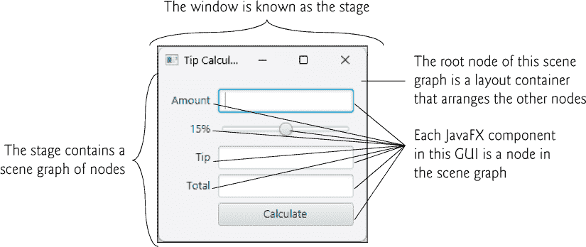

##### 控件

### 控件 (Controls)

`Controls` 是 GUI 组件，例如显示文本的 `Label`、允许程序接收用户输入的 `TextField`、用户点击以触发操作的 `Button` 等。

### 阶段 (Stage)

显示 JavaFX GUI 的窗口被称为 `stage`，它是 `Stage` 类的实例（位于包 `javafx.stage`）。

### 场景 (Scene)

`stage` 包含一个活跃的 `scene`（场景），它将 GUI 定义为 `scene graph`（场景图）——这是一个应用程序视觉元素的树形数据结构，例如 GUI 控件、形状、图像、视频、文本等。场景是 `Scene` 类的实例（位于包 `javafx.scene`）。

### 节点 (Nodes)

场景图中的每个视觉元素都是一个 `node`——它是 `Node` 类（包 `javafx.scene`）子类的实例，该类定义了所有节点的公共属性和行为。除了场景图的 `root node`（根节点）外，每个节点都有一个父。节点可以具有变换（例如移动、旋转和缩放）、透明度（节点是透明、半透明还是不透明）、效果（例如投影、模糊、反射和光照）等，我们将在第 16 章中介绍。

### 布局容器 (Layout Containers)

具有子节点的节点通常是 `layout containers`（布局容器），它们在场景中安排子节点。你将在本章中使用两个布局容器（`VBox` 和 `GridPane`），并在第 16 章–第 17 章中学习更多。在布局容器中排列的节点是控件与其他复杂 GUI 中可能的布局容器的组合。

### 事件处理器和控制器类 (Event Handler and Controller Class)

当用户与控件交互时（例如点击 `Button` 或在 `TextField` 中输入文本），控件会生成一个 `event`（事件）。程序可以对这些事件做出响应——称为事件处理——以指定发生每次用户交互时应该发生什么。`event handler`（事件处理器）是一个响应用户交互的方法。FXML GUI 的事件处理器定义在 `controller class`（控制器类）中（第 15.5.5 节）。

## 生成式 AI (Generative AI)

1. 提示生成式 AI 解释通过基于 GUI 的程序和事件处理，用户如何“驱动程序操作”，而不是像非 GUI 用户界面那样由程序反向驱动。

### 15.4 欢迎应用程序：显示文本和图像

在本节中，你将在不编写任何代码的情况下，构建一个在 `Label` 中显示文本、在 `ImageView` 中显示图像的 GUI：

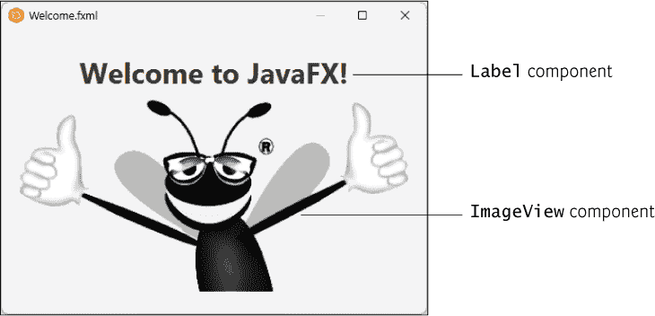

你将使用可视化编程技术将 JavaFX 组件拖放到到 Scene Builder 的内容面板（设计区域）中，然后使用检查器（Inspector）配置选项，例如 `Labels` 的文本和字体大小以及 `ImageView` 的图像。你将使用 Scene Builder “窗口（Window）”菜单中的“显示预览（Show Preview）”来查看完成的 GUI。在第 15.5 节的类型计算器应用程序中，我们将讨论加载和显示 FXML GUI 的 Java 代码。

#### 15.4.1 打开 Scene Builder 并创建文件 `Welcome.fxml`

打开 Scene Builder 以创建定义 GUI 的 FXML 文件。最初，会出现以下 Gluon Scene Builder 窗口。在其中，你可以选择：

* 从“最近项目（Recent Projects）”列选择一个最近的项目进行编辑（如果有的话），或
* 从“从模板新建项目（New Project from Template）”列中选择 Scene Builder 预定义的应用程序设计模板之一。

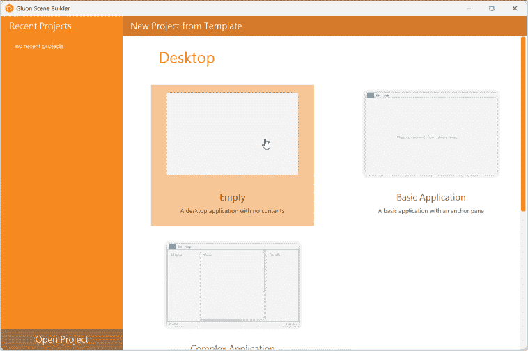

选择“空项目（Empty project）”模板从零创建 JavaFX GUI。操作后，SceneBuilder 窗口将如下：

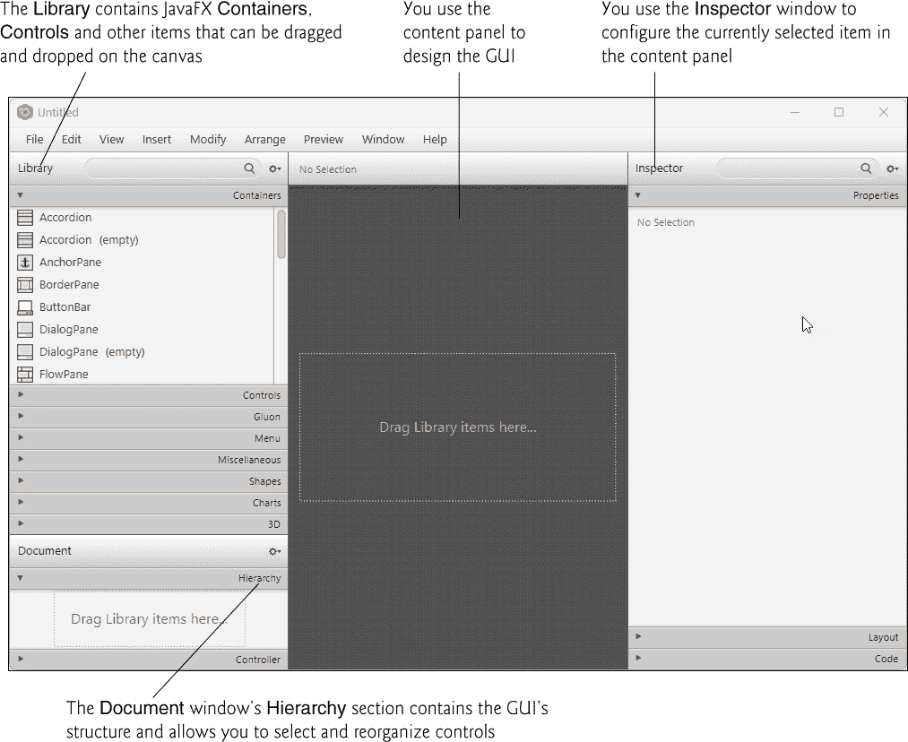

窗口顶部的“Untitled”表示 Scene Builder 创建了一个你尚未保存的新 FXML 文件。(3) 选择“文件（File） > 保存（Save）”以显示“另存为”对话框，然后选择存储文件的位置，将文件命名为 `Welcome.fxml` 并点击“保存（Save）”按钮。

3. 我们使用 Microsoft Windows 11 展示 Scene Builder 屏幕截图，但 Scene Builder 在 Windows、macOS 和 Linux 上几乎完全相同。主要区别是 macOS 的菜单栏位于屏幕顶部，而 Windows 和 Linux 上的菜单栏是窗口的一部分。

#### 15.4.2 将图像添加到包含 `Welcome.fxml` 的文件夹中

你将为此应用程序使用的图像（`bug.png`）位于本章示例文件夹的 `images` 子文件夹中。为了方便在准备将其添加到应用程序时找到该图像，请在文件系统中找到 `images` 文件夹，然后将 `bug.png` 复制到你保存 `Welcome.fxml` 的文件夹中。

#### 15.4.3 创建 `VBox` 布局容器

对于此应用程序，你将把 `Label` 和 `ImageView` 放置在 `VBox` 布局容器（包 `javafx.scene.layout`）中，这将是场景图的根节点。布局容器帮助你排列和调整 GUI 组件的大小。`VBox` 垂直排列其节点。我们将在 15.5 节中讨论 `GridPane` 布局容器，并在第 16 章中讨论其他几个。

#### 15.4.4 配置 `VBox` 布局容器

现在你指定 `VBox` 的对齐方式和大小。

##### 指定 `VBox` 的对齐方式

`VBox` 的 `alignment` 决定了 `VBox` 子节点的布局位置。在此应用程序中，我们希望每个孩子（`Label` 和 `ImageView`）水平居中。为了实现这一点：

1. 通过点击选择 Scene Builder 内容面板中的 `VBox`。
2. 点击 `Alignment` 属性的下拉列表，注意各种潜在的对齐值。点击 `CENTER`。

##### 指定 `VBox` 的首选大小

场景图根节点的 `preferred size`（首选大小，宽度和高度）被场景用于确定其窗口大小。对于此应用程序，我们为 `VBox` 的大小任意选择了 450x300 像素。要设置首选大小：

1. 选择 `VBox`。
2. 展开检查器（Inspector）中的布局（Layout）部分。
3. 点击 `Pref Width` 属性的文本框，输入 `450` 并按 Enter。
4. 点击 `Pref Height` 属性的文本框，输入 `300` 并按 Enter。

#### 15.4.5 添加并配置 `Label`

接下来，你创建一个显示 `"Welcome to JavaFX!"` 的 `Label`。

##### 向 `VBox` 添加 `Label`

展开 Scene Builder 库（Library）窗口的控件（Controls）部分，然后从控件部分将 `Label` 拖放到 Scene Builder 内容面板中的 `VBox` 上。Scene Builder 会自动将 `Label` 对象在 `VBox` 中水平和垂直居中。

##### 修改 `Label` 的文本

你可以通过双击 `Label` 并输入新文本，或者选择 `Label` 在检查器（Inspector）的属性（Properties）区域设置其 `Text` 属性来设置 `Label` 的文本。将 `Label` 的文本设置为 `"Welcome to JavaFX!"`。

##### 修改 `Label` 的字体

在本应用程序中，我们设置 `Label` 显示为大号粗体字体。要做到这一点，请选择 `Label`，然后在检查器的属性（Properties）区域中，点击 `Font` 属性右侧的向下箭头（）。在弹出的窗口中，将 `Style` 属性设置为 `Bold`，并将 `Size` 属性设置为 `30`。现在的设计应该如下所示：

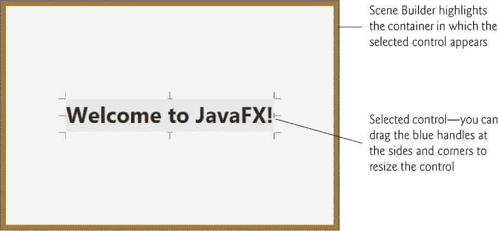

#### 15.4.6 添加并配置 `ImageView`

最后，你将添加一个显示 `bug.png` 的 `ImageView`。

##### 向 `VBox` 中添加 `ImageView`

从库（Library）窗口的控件（Controls）部分将 `ImageView` 拖动到 `Label` 正下方，如下——将图像放在灰色引导线下方：

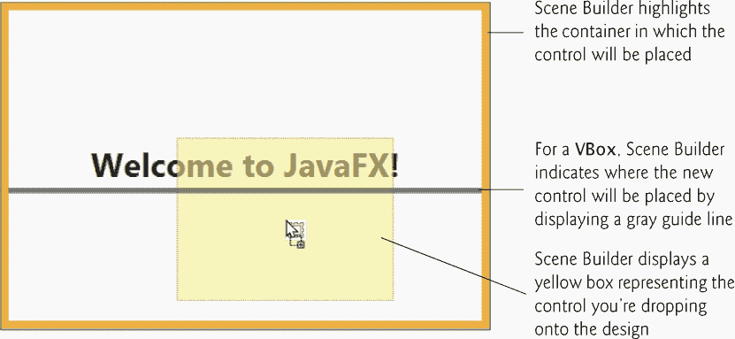

你也可以在库窗口中双击 `ImageView`，在这种情况下，Scene Builder 会将新的 `ImageView` 对象放置在 `Label` 下方。你可以通过在 `VBox` 中或文档窗口的层级结构（Hierarchy）部分中拖动控件来重新排列 `VBox` 控件的顺序。Scene Builder 会将 `ImageView` 在 `VBox` 中水平居中。此外，注意 `Label` 和 `ImageView` 是垂直居中的，这使得 `Label` 上方和 `ImageView` 下方显示相同的空间。

##### 设置 `ImageView` 的图像

接下来，你将设置显示的图像：

1. 选择 `ImageView`，然后在检查器的属性（Properties）区域中，点击 `Image` 属性右侧的省略号 (…) 按钮。默认情况下，Scene Builder 会打开一个对话框，列出 FXML 文件所在文件夹的内容。这就是你在第 15.4.2 节中放置图像文件 `bug.png` 的地方。
2. 选择 `bug.png`，然后点击打开。Scene Builder 显示图像并调整 `ImageView` 的大小以匹配图像的宽高比例——即图像宽度与高度的比例。

##### 修改 `ImageView` 的大小

我们希望按原始大小显示图像。如果你重置 `ImageView` 的默认 `Fit Width`（适应宽度）和 `Fit Height`（适应高度）属性值（这是 Scene Builder 在你向设计中添加 `ImageView` 时设置的），Scene Builder 将调整 `ImageView` 以匹配图像的精确尺寸。要重置这些属性：

1. 展开检查器的布局（Layout）部分。
2. 将鼠标悬停在 `Fit Width` 属性的值上。这将显示一个小设置按钮（）。点击  按钮并选择“还原为默认值”以重置该值。此技术可用于任何属性值以重置其默认值。
3. 重复步骤 2 以重置 `Fit Height` 属性的值。

Scene Builder 带有完成的 GUI 内容面板现在应该如下所示：


通过选择文件（File） > 保存（Save）保存 FXML 文件。

#### 15.4.7 预览 `Welcome` GUI

你可以通过选择预览（Preview） > 在窗口中显示（Show Preview in Window）来预览设计在运行程序窗口中的外观，这将显示以下窗口：


窗口内容在 Linux、macOS 和 Windows 上是相同的——只有窗口框会有不同。JavaFX 使用操作系统的默认窗口装饰——例如最小化、最大化和关闭窗口的图标。

#### 生成式 AI

1. 提示生成式 AI 注释 GUI 开发与“传统”非 GUI 技术编程相比“感觉有何不同”。
2. 提示生成式 AI 列出 JavaFX 的无障碍功能列表，并就如何为盲人或视力人士使 JavaFX GUI 的无障碍提供建议。

### 15.5 小费计算器应用程序：事件处理简介

小费计算器应用程序计算并显示餐厅账单的小费和总额：

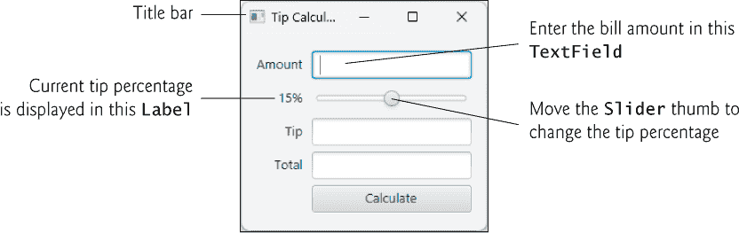

默认情况下，应用程序按 15% 的小费计算总额。下面的截图包含了你输入金额 `34.56` 并点击计算 `Button`（按钮）后的 GUI：

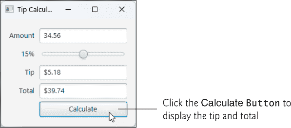

你可以通过移动 `Slider`（滑动条）滑块指定 0% 到 30% 的小费百分比——这将更新小费百分比。下面的截图包含了用户移动 `Slider` 滑块将小费百分比改为 20%，然后点击计算后的 GUI：

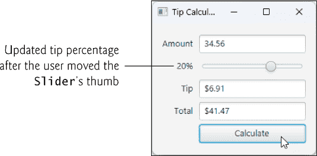

在本节中，你将使用几个 JavaFX 组件构建小费计算器应用程序，并学习如何响应用户与 GUI 的交互。你将从测试应用程序开始，用它计算 15% 和 20% 的小费。然后，我们将概述创建该应用程序的技术。你将构建该应用程序。

#### 15.5.1 测试小费计算器

正如我们提到的，JavaFX 使用模块系统。要编译和运行应用程序，必须包含两个 `javac` 选项：

* `--module-path` 指定 JavaFX 模块的位置。
* `--add-modules` 指定指定应用程序所需的 JavaFX 模块。

##### 编译小费计算器

要编译应用程序，请在按回车前完整输入以下命令：

```
javac --module-path pathToFX
   --add-modules javafx.controls,javafx.fxml *.java
```

将 *pathToFX* 替换为

* 如果你使用 macOS，`PATH_TO_FX`
* 如果你使用 Windows PowerShell，`$PATH_TO_FX`


如果你使用 Windows 命令提示符，`%PATH_TO_FX%`

##### 运行小费计算器

要运行应用程序，请在按回车前完整输入以下命令：

点击查看图像

```
java --module-path pathToFX
   --add-modules javafx.controls,javafx.fxml TipCalculator
```

#### 输入账单总额

使用键盘在 Amount `TextField` 中输入金额 `34.56`，然后点击计算 `Button`。`Tip` 和 `Total` `TextField` 包含 15% 小费的小费金额和总账单，如下：


#### 选择自定义小费百分比

接下来，使用 `Slider` 指定自定义小费百分比。拖动 `Slider` 滑块直到百分比显示为 20%。当你拖动滑块时，`Slider` 左侧 `Label` 中的小费百分比会持续更新。默认情况下，`Slider` 允许选择从 0.0 到 100.0 的浮点值，但此应用程序将 `Slider` 限制为 0 到 30 的整数。

本节将介绍你用于构建小费计算器应用程序将采用的技术。

### `Application` 类

启动 JavaFX 应用程序（将在第 15.5.4 节中介绍）的类是 `Application`（包 `javafx.application`）的子类。当你执行该子类时：

1. `main` 方法调用 `Application` 类的 `static launch` 方法开始执行应用程序。
2. `launch` 方法随后导致 JavaFX 运行时创建一个 `Application` 子类的对象，并调用其 `start` 方法。
3. `Application` 子类的 `start` 方法创建 GUI，将其附加到 `Scene` 上，并将其放置在 `start` 方法作为参数所接收的 `Stage` 上。

### 使用 `GridPane` 布局 JavaFX 组件

回想一下，布局容器在 `Scene` 中排列 JavaFX 组件。`GridPane`（包 `javafx.scene.layout`）在由行和列构成的矩形网格中排列 JavaFX 组件。此应用程序使用 `GridPane` 将视图排列为五行两列：

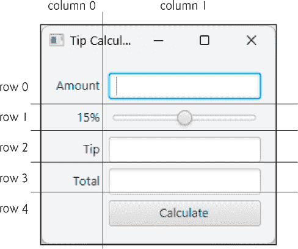

`GridPane` 中的每个单元格可以是空的，也可以包含一个或多个 JavaFX 组件，包括排列其他控件的布局容器。`GridPane` 中的每个组件可以跨越多行或多列，尽管我们在这个 GUI 中没有使用该功能。当你将 `GridPane` 拖到 Scene Builder 的内容面板上时，Scene Builder 默认创建一个具有两列三行的 `GridPane`。你可以根据需要添加或删除列和行。我们将在介绍 GUI 构建步骤时讨论其他 `GridPane` 特性。要了解更多关于 `GridPane` 类的信息，请访问：

点击此处查看代码图像

```
https://openjfx.io/javadoc/23/javafx.graphics/javafx/scene/layout/
   GridPane.html
```

### 使用 Scene Builder 创建和自定义 GUI

在第 15.5.3 节中，你将创建 `Label`、`TextField`、一个 `Slider` 和一个 `Button`：

* `TextField`（包 `javafx.scene.control`）可以接受用户的文本输入或显示文本。你将使用一个可编辑的 `TextField` 输入用户的账单金额，以及两个不可编辑的 `TextField` 来显示小费和总金额。
* `Slider`（包 `javafx.scene.control`）默认代表 0.0–100.0 范围内的值，并允许用户通过移动 `Slider` 的滑块在该范围内选择一个数字。你将自定义 `Slider`，使用户只能从更有限的 0–30 整数范围内选择自定义的小费百分比。
* `Button`（包 `javafx.scene.control`）允许用户启动操作——在此应用程序中，点击计算 `Button` 将计算并显示小费和总金额。

### 将数字格式化为特定区域货币和百分比字符串

你将使用 `NumberFormat` 类（包 `java.text`）来创建特定区域的货币和百分比字符串——这是国际化的重要部分。

### 事件处理

用户与应用程序的 GUI 交互，以指示应用程序应该执行的任务。例如，当你写电子邮件时，点击电子邮件应用程序的发送按钮将指示应用程序将电子邮件发送给指定的收件人。

GUI 是**事件驱动的**。当用户与 GUI 组件交互时，这种交互（被称为“事件”）会驱动程序执行某个操作。导致应用程序执行任务的常见用户交互包括：

* 点击按钮，
* 在文本字段中输入文本，
* 从菜单中选择项目，
* 最小化、最大化或关闭窗口，
* 按下鼠标按钮以及
* 移动鼠标。

响应事件执行任务的代码被称为**事件处理器**（event handler），而响应事件的过程被称为**事件处理**（event handling）。在应用程序对特定控件的事件做出响应之前，你必须：

1. 定义一个实现适当接口的事件处理器——该接口被称为**事件监听器接口**（event-listener interface）。
2. 指明当事件发生时，该类的某个对象应该被通知——这被称为**注册事件处理器**（registering the event handler）。

在此应用程序中，你将响应两个事件：当用户移动 `Slider` 的滑块时，应用程序将更新显示当前小费百分比的 `Label`；当用户点击计算 `Button` 时，应用程序将计算并显示小费和总账单金额。

我们将演示，对于某些事件（例如用户点击 `Button` 时），你可以通过 Scene Builder 检查器窗口的 Code 部分将控件链接到其事件处理方法（即注册事件处理器）。在这种情况下，JavaFX 为你实现了事件监听器接口，并调用你指定的方法。对于在控件属性值变化时发生的事件（例如当用户移动 `Slider` 的滑块以更改 `Slider` 的值时），你必须完全在代码中创建事件处理器，正如我们将演示的那样。

### 为 Slider 位置变化实现接口 `ChangeListener`

你将实现 `ChangeListener` 接口（包 `javafx.beans.value`）来响应用户移动 `Slider` 滑块的情况。特别是，你将使用该接口的 `changed` 方法来显示更新后的百分比。`ChangeListener` 是一个函数接口，因此我们将使用 Lambda 表达式。

### 模型-视图-控制器 (MVC) 架构

使用 FXML 实现 GUI 的 JavaFX 程序遵循模型-视图-控制器（MVC）设计模式，它将应用程序的数据（包含在模型中）与应用程序的 GUI（视图）以及应用程序的处理逻辑（控制器）分开。

控制器实现处理用户输入的逻辑。模型包含数据，视图展示数据。当用户提供某些输入时，控制器根据输入修改模型。在小费计算器中，控制器更新更改的数据。

在 JavaFX FXML 应用程序中，控制器类定义了用于编程操作的实例变量，以及响应用户交互的事件处理方法。控制器类可能还会声明支持应用程序运行的其他实例变量、静态变量和方法。在简单的应用程序中，模型和控制器通常合并到一个类中，正如我们在示例中所做的那样。

#### `FXMLLoader` 类

当 JavaFX FXML 应用程序开始执行时，`FXMLLoader` 类的静态方法 `load` 将 GUI 的 FXML 文件内容读入内存。然后，`load` 执行以下操作：

* 创建包含 GUI 布局和控件的场景图，并返回场景图根节点的 `Parent`（包 `javafx.scene`）引用。
* 创建控制器的实例并初始化组件的实例变量。
* 为 FXML 中指定的任何事件创建并注册事件处理器。

我们将在第 15.5.4 和第 15.5.5 节中详细讨论这些步骤。

#### 15.5.3 构建应用程序的 GUI

在本节中，我们将展示创建小费计算器 GUI 的精确步骤。

##### 此应用程序控件的 fx:id 值

如果控制器类将通过程序方式操作控件或布局（正如我们将对一个 `Label`、所有的 `TextField` 和 `Slider` 执行的那样），你必须为该控件或布局提供一个名称。在第 15.5.4 节中，你将 FXML 中的每个此类组件声明 Java 变量，我们将讨论如何为你初始化这些变量。每个对象的名称通过其 `fx:id` 属性指定。你可以通过在场景中选择一个组件，然后展开检查器（Inspector）窗口的 Code（代码）部分来设置该属性的值——`fx:id` 属性出现在该部分的顶部。下面的图包含了小费计算器中通过程序方式操作控件的 `fx:id` 属性。我们的命名规范是在 `fx:id` 属性中使用控件的类名。因此，fx:ids `amountTextField`、`tipTextField` 和 `totalTextField` 都包含了控件的类名——`TextField`：

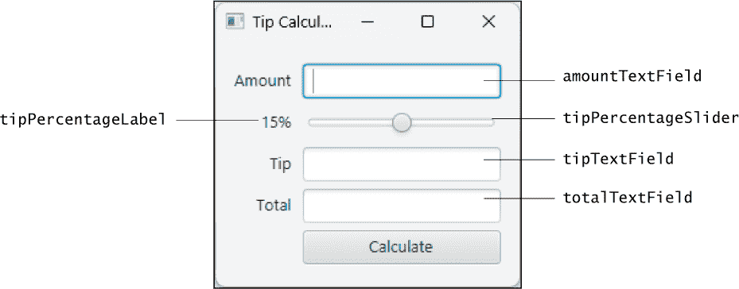

## 创建 `TipCalculator.fxml` 文件

正如你在第 15.4.1 节中所做的那样，打开 Scene Builder 创建一个新的空的 FXML 文件。然后，选择 File > Save 以显示“另存为”对话框：

* 指定存储文件的位置（与存储应用程序 Java 源代码相同的文件夹），
* 将文件命名为 `TipCalculator.fxml` 并
* 点击 Save（保存）按钮。

### 第 1 步：添加 `GridPane`

从 Library（库）窗口的 Containers（容器）部分拖入 `GridPane` 到 Scene Builder 的内容面板。默认情况下，`GridPane` 包含两列三行：

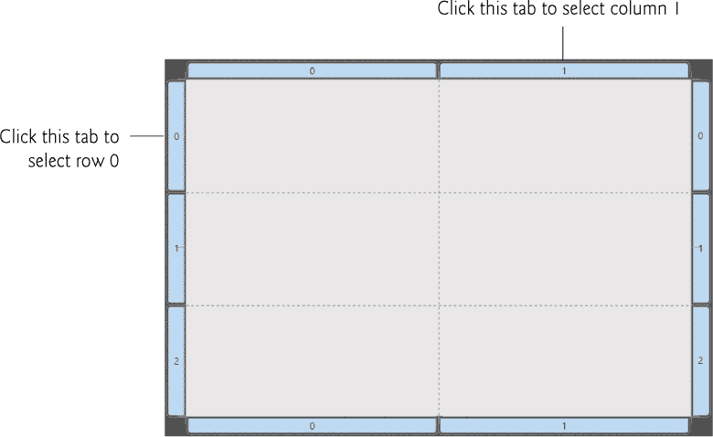

### 第 2 步：向 `GridPane` 添加行

记住应用程序的最终 GUI 有两列五行。在这里，你将再添加两行。若要在现有行的上方或下方添加行：

1. 右键点击任何行的行号标签页，然后选择 Grid Pane > Add Row Above（在上方添加行）或 Grid Pane > Add Row Below（在下方添加行）。
2. 重复此过程以添加另一行。

添加两行后，`GridPane` 应该如下：

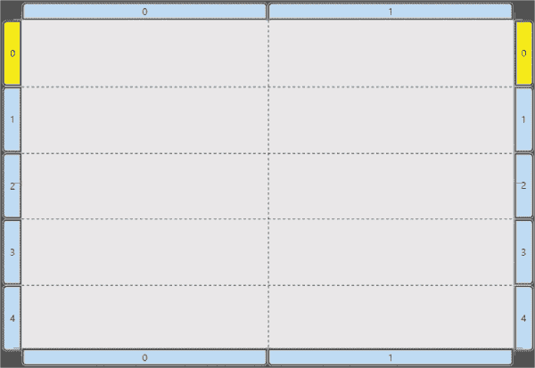

你可以使用类似的步骤添加列。你可以通过右键点击包含其行或列号的标签页并选择 Delete（删除）来删除一行或一列。

### 第 3 步：向 `GridPane` 添加控件

现在你把控件添加到 `GridPane` 中。当你将控件拖到 `GridPane` 上时：

* 如果图中控件具有 `fx:id`，请使用对应的变量名在检查器窗口的 Code 部分设置控件的 `fx:id` 属性。
* 如果图中控件显示文本，请使用相应的文本在检查器窗口的 Properties（属性）部分设置控件的 `Text`。

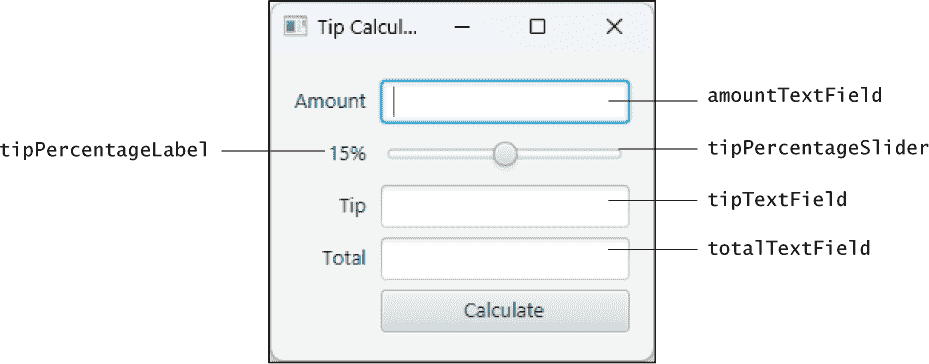

执行以下步骤构建 GUI：

1. **添加 `Label`。** 从 Library 窗口的 Controls（控件）部分将 `Label` 拖入第 0 列的前四行（`GridPane` 的左侧列）。每当你添加一个时，设置其文本。
2. **添加 `TextField`。** 从 Library 窗口的 Controls 部分将 `TextField` 拖入第 1 列的第 0、2 和 3 行（`GridPane` 的右侧列）。
3. **添加 `Slider`。** 从 Library 窗口的 Controls 部分拖入一个水平 `Slider` 到第 1 列的第 1 行。
4. **添加 `Button`。** 从 Library 窗口的 Controls 部分将一个 `Button` 拖入第 1 列的第 4 行。将 `Button` 的文本改为 Calculate。你可以通过双击它或选择 `Button` 后在检查器窗口的 Properties 部分设置其 `Text` 属性来设置文本。

`GridPane` 应该如下：

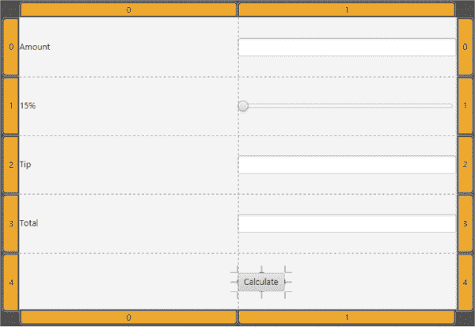

### 第 4 步：调整 `GridPane` 尺寸以适应内容

当你通过添加布局开始设计 GUI 时，Scene Builder 会自动将布局对象的 `Pref Width`（首选宽度）属性设置为 `600`，`Pref Height`（首选高度）属性设置为 `400`，这比此 GUI 的最终宽度和高度大得多。对于此应用程序，我们希望布局的尺寸根据布局的内容进行计算。要进行此更改：

1. 首先，点击 `GridPane` 内部来选择它，但不要点击你放置在列和行中的任何控件。有时，在 Scene Builder 左侧的 Document 窗口的 Hierarchy（层级结构）部分选择 `GridPane` 节点更容易。
2. 在检查器的 Layout（布局）部分中，将 `Pref Width` 和 `Pref Height` 属性值重置为默认值（正如你在第 15.4.6 节中所做的那样）。这会将两个属性的值设置为 `USE_COMPUTED_SIZE`，以便布局计算自己的尺寸。

布局现在显示如下：

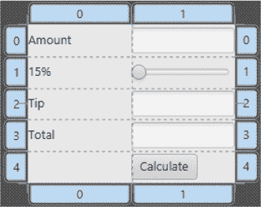

### 第 5 步：`GridPane` 第 0 列右对齐

`GridPane` 列的内容默认情况下是左对齐的。若要右对齐第 0 列的内容，请点击列的顶部或底部标签页选择它，然后在检查器的 Layout 部分将 `Halignment` 属性设置为 `RIGHT`。

### 第 6 步：`GridPane` 列适应内容

默认情况下，Scene Builder 将每个 `GridPane` 列的宽度设置为 `100` 像素，每行的高度设置为 `30` 像素，以便你可以将控件拖入 `GridPane`。在此应用程序中，我们希望列的大小适应其内容。要这样做，点击第 0 列的顶部或底部标签页选择它，然后在检查器的 Layout 部分将 `Pref Width` 重置为默认值（即 `USE_COMPUTED_SIZE`），表示列宽度取决于其最宽的子元素（在本例中为 Amount `Label`）。对第 1 列重复此过程。`GridPane` 应该如下：

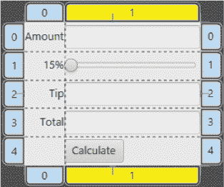

### 第 7 步：`Button` 尺寸

默认情况下，Scene Builder 根据文本设置 `Button` 的宽度。对于此应用程序，我们选择让 `Button` 的宽度与 `GridPane` 右列的其他控件相同。要这样做，选择 `Button`，然后在检查器的 Layout 部分将 `Max Width` 属性设置为 `MAX_VALUE`。这会导致 `Button` 的宽度增长以填充列宽。

### 预览 GUI

通过选择 Preview > Show Preview 预览 GUI：

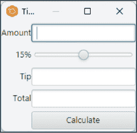

注意，左列的 `Label` 与右列的控件之间没有空间，`GridPane` 周围也没有空间。默认情况下，`Stage` 的尺寸为了适应 `Scene` 的内容，因此许多控件触碰了窗口边界。你将在下一步中解决这些问题。

### 第 8 步：配置 `GridPane` 的内边距和列之间的水平间隙

节点内容与其顶部、右、底部和左边缘之间的空间被称为 `padding`（内边距），它将内容与节点边缘分开。由于 `GridPane` 的尺寸决定了 `Stage` 的窗口大小，`GridPane` 的内边距将其子元素与窗口边缘分开。要设置 `GridPane` 的内边距，选择它，然后在检查器的 Layout 部分将 `Padding` 属性的四个值（分别代表 TOP、RIGHT、BOTTOM 和 LEFT）设置为 `14`——这是控件边缘与 `Scene` 边缘常用的距离。

你可以分别通过 `Hgap`（水平间距）和 `Vgap`（垂直间距）属性来指定 `GridPane` 列和行之间的默认空间。由于 Scene Builder 将每个 `GridPane` 行的高度设置为 30 像素——这大于本应用程序中控件的高度——因此组件之间已经存在一些垂直空间。要指定列之间的水平间距，请在文档（Document）窗口的层级（Hierarchy）部分选择 `GridPane`，然后在检查器（Inspector）的布局（Layout）部分，将 `Hgap` 属性设置为 `8`——这是控件之间常用的距离。如果你想精确控制组件之间的垂直空间，可以将每行的 `Pref Height`（首选高度）重置为默认值，然后设置 `GridPane` 的 `Vgap` 属性。

### 第 9 步：将 `tipTextField` 和 `totalTextField` 设置为不可编辑且不可聚焦

`tipTextField` 和 `totalTextField` 在此应用程序中仅显示结果，而不接收文本输入。因此，它们不应该具有交互性。只有当 `TextField` 处于“聚焦”状态时（即它是用户正在交互的控件），你才能在其中输入文本。当你点击一个交互式控件时，它就会获得焦点。同样，当你按下 `Tab` 键时，焦点会从当前的可聚焦控件转移到下一个——默认情况下，这是控件被添加到 GUI 的顺序。交互式控件（如 `TextField`、`Slider` 和 `Button`）默认是可聚焦的。非交互式控件（如 `Label`）是不可聚焦的。


在本应用程序中，`tipTextField` 和 `totalTextField` 既不可编辑也不可聚焦。要进行这些更改，请同时选择这两个 `TextField`，然后在检查器的属性（Properties）部分取消勾选 `Editable`（可编辑）和 `Focus Traversable`（可用于焦点遍历）属性。要一次选择多个控件，可以先点击第一个（在文档窗口的层级部分或内容面板中），然后按住 `Shift` 键点击其他每一个控件。

### 第 10 步：设置 `Slider` 的属性

为了完成 GUI，你现在将配置小费计算器的 `Slider`。默认情况下，`Slider` 的范围是 `0.0` 到 `100.0`，初始值为 `0.0`。本应用程序仅允许 0 到 30 之间的整数小费百分比，默认值为 `15`。要进行这些更改，选择 `Slider`，然后在检查器的属性部分，将 `Slider` 的 `Max` 属性设置为 `30`，并将 `Value` 属性设置为 `15`。我们还将 `Block Increment`（块增量）属性设置为 `5`——这是当用户点击 `Slider` 端点与滑块之间时，`Value` 属性增加或减少的幅度。选择 File > Save 保存 FXML 文件。

尽管我们将 `Max`、`Value` 和 `Block Increment` 属性设置为了整数，但当用户移动滑块时，`Slider` 仍然产生浮点值。在应用程序的 Java 代码中，我们将在响应事件时将 `Slider` 的值限制为整数。

### 预览最终布局

你现在已经完成了小费计算器的设计。选择 Preview > Show Preview in Window 查看最终的 GUI：

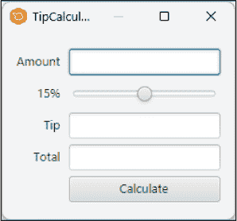

当我们在第 15.5.5 节讨论 `TipCalculatorController` 类时，我们将展示如何在 FXML 文件中指定计算 `Button` 的事件处理程序。

### 指定控制器的类名

正如我们在第 15.5.2 节中提到的，在 JavaFX FXML 应用程序中，应用程序的控制器类通常会定义用于程序化交互控件的实例变量，以及事件处理方法。为了确保应用程序在运行时加载 FXML 文件时能创建控制类的对象，你必须在 FXML 文件中指定控制类的名称：

1.  展开 Scene Builder 文档窗口的 `Controller` 部分——该部分位于 Scene Builder 左下角层级部分的下方。
2.  在 `Controller Class` 字段中，输入 `TipCalculatorController`——按照惯例，控制类的名称与 FXML 文件名相同（在本例中为 `TipCalculator`），并以 `Controller` 结尾。

### 指定计算 `Button` 的事件处理方法名

你可以在 FXML 文件中指定处理控件事件的方法名称。当你选择一个控件时，检查器窗口的 `Code` 部分会显示你可以指定事件处理程序的所有事件。当用户点击 `Button` 时，会调用 `On Action` 字段中的方法。该方法定义在 Scene Builder 的 Controller 窗口中指定的控制器类中。在 `Button` 的 `On Action` 字段中输入 `calculateButtonPressed`。

### 生成示例控制器类

你可以让 Scene Builder 生成初始控制器类，该类包含你将用于程序化交互控件的变量以及空的计算 `Button` 事件处理程序。Scene Builder 将此称为“控制器骨架”。选择 View > Show Sample Controller Skeleton 生成骨架：

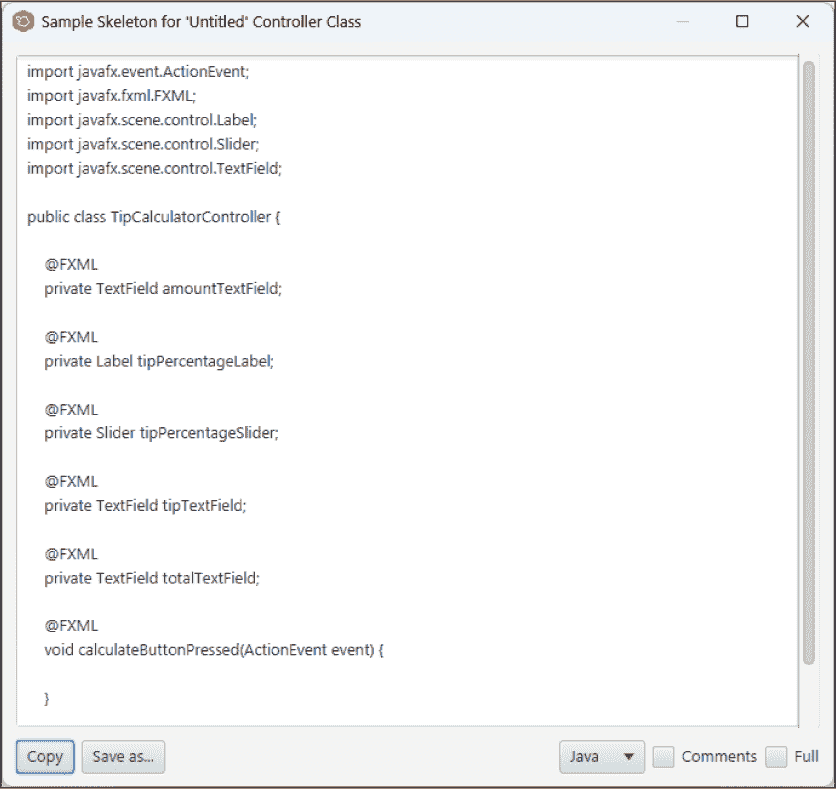

请注意，示例类具有你指定的类名、为每个具有 `fx:id` 的控件对应一个变量，以及一个空的计算 `Button` 事件处理程序。我们将在第 15.5.5 节中讨论 `@FXML` 注解。

### 重写的 `Application` 方法 `start`

`start` 方法（第 10–19 行）创建 GUI，将其附加到 `Scene` 上，并将其放置在 `start` 方法作为参数接收到的 `Stage` 上。第 12–13 行使用类 `FXMLLoader` 的 `static` 方法 `load` 来创建 GUI 的场景图。该方法：

*   返回一个指向场景图根节点的 `Parent`（包 `javafx.scene`）引用——在本文应用程序中，这是对 GUI 的 `GridPane` 的引用。
*   创建一个我们在 FXML 文件中指定的 `TipCalculatorController` 类的对象。
*   为通过程序化操作的组件初始化控制器的实例变量。
*   将 FXML 中指定的事件处理器注册到相应的控件中，以便它们能够在响应用户交互时调用其事件处理程序。

我们将在第 15.5.5 节中讨论控制器实例变量的初始化以及事件处理器的注册。

### 创建 `Scene`

为了显示 GUI，你必须将其附加到 `Scene`，然后将 `Scene` 附加到 `start` 方法作为参数接收到的 `Stage` 上。要将 GUI 附加到 `Scene`，第 15 行创建一个 `Scene`，并将 `root`（场景图的根节点）作为参数传递给构造函数。默认情况下，`Scene` 的大小由场景图根节点的大小决定。`Scene` 构造函数的重载版本允许你指定 `Scene` 的大小和填充（颜色、渐变或图像），这些显示在 `Scene` 的背景中。第 16 行使用 `Stage` 方法 `setTitle` 指定出现在 `Stage` 窗口标题栏中的文本。第 17 行调用 `Stage` 方法 `setScene` 将 `Scene` 放置到 `Stage` 上。最后，第 18 行调用 `Stage` 方法 `show` 显示 `Stage` 窗口。

#### 15.5.5 `TipCalculatorController` 类；使用 Lambda 实现事件处理器

图 15.2 展示了 `TipCalculatorController` 类，该类响应应用程序中 `Button` 和 `Slider` 的用户交互。为了方便讨论，我们将该类分成了几部分。第 3–10 行显示类的 `import` 语句：

点击此处查看代码图像

```
 1   // Fig. 15.2: TipCalculatorController.java
 2   // Controller that handles calculateButton and tipPercentageSlider events
 3   import java.math.BigDecimal;
 4   import java.math.RoundingMode;
 5   import java.text.NumberFormat;
 6   import javafx.event.ActionEvent;
 7   import javafx.fxml.FXML;
 8   import javafx.scene.control.Label;
 9   import javafx.scene.control.Slider;
10   import javafx.scene.control.TextField;
11
```

**图 15.2** | `TipCalculatorController` 的 `import` 声明。

类 `TipCalculatorController` 使用的类和接口包括：

*   `BigDecimal` 类（第 3 行；引入自第 4.11 节）

```
12   public class TipCalculatorController {
13      // formatters for currency and percentages
14      private static final NumberFormat currency =
15         NumberFormat.getCurrencyInstance();
16      private static final NumberFormat percent =
17         NumberFormat.getPercentInstance();
18
19      private BigDecimal tipPercentage = new BigDecimal("0.15"); // 15%
20
21      @FXML
22      private TextField amountTextField;
23
24      @FXML
25      private Label tipLabel;
26
27      @FXML
28      private Slider tipPercentageSlider;
29
30      @FXML
31      private TextField tipTextField;
32
```

#### @FXML 注解

回顾第 15.5.3 节，应用程序在源代码中操作的每个控件都需要 `fx:id`。第 22–35 行声明了类的实例变量 `@FXML` 注解（第 22、25、28、31 和 34 行）表示该变量名可以在描述应用程序 GUI 的 FXML 文件中使用。当 `FXMLLoader` 加载 `TipCalculator.fxml` 创建 GUI 时，它还会初始化每个带有 `@FXML` 声明的控制器实例变量，以确保它们引用对应的 GUI 组件。

### `TipCalculatorController` 的 `calculateButtonPressed` 事件处理器

第 38–53 行声明了 `TipCalculatorController` 的 `calculateButtonPressed` 方法，该方法在用户点击 `Button` 时被调用。方法前的 `@FXML` 注解（第 38 行）表明该方法可用于指定 FXML 文件中的控件事件处理器。对于生成 `ActionEvent` 的控件（许多 JavaFX 控件都是如此），事件处理方法必须返回 `void` 并接收一个 `ActionEvent` 参数（第 39 行）。

点击此处查看代码图像

```
37      // calculates and displays the tip and total amounts
38      @FXML
39      private void calculateButtonPressed(ActionEvent event) {
40         try {
41            BigDecimal amount = new BigDecimal(amountTextField.getText());
42            BigDecimal tip = amount.multiply(tipPercentage);
43            BigDecimal total = amount.add(tip);
44
45            tipTextField.setText(currency.format(tip));
46            totalTextField.setText(currency.format(total));
47         }
48         catch (NumberFormatException ex) {
49            amountTextField.setText("Enter amount");
50            amountTextField.selectAll();
51            amountTextField.requestFocus();
52         }
53      }
54
```

## 注册计算按钮的事件处理器

当 `FXMLLoader` 加载 `TipCalculator.fxml` 创建 GUI 时，它会为计算按钮 `Button` 的 `ActionEvent` 创建并注册一个事件处理器。该事件的事件处理器必须实现 `EventHandler<ActionEvent>` 接口（包 `javafx.event`）——`EventHandler` 是泛型接口，包含一个返回 `void` 并接收 `ActionEvent` 参数的 `handle` 方法。该方法在用户点击计算按钮 `Button` 时会调用 `calculateButtonPressed`。`FXMLLoader` 会对你通过 Scene Builder 检查（Inspector）窗口的 Code 部分指定的每个事件监听器执行类似的任务。

## 计算并显示小费和总金额

第 41–46 行计算并显示了小费和总额。第 41 行调用 `amountTextField` 的 `getText` 方法获取用户输入的账单金额。该 `String` 被传递给 `BigDecimal` 的构造函数，如果参数不是数字，它将抛出 `NumberFormatException`。在这种情况下，第 49 行调用 `amountTextField` 的 `setText` 方法在 `TextField` 中显示 `"Enter amount"`。第 50 行调用 `amountTextField` 的 `selectAll` 方法选中 `TextField` 中的文本。第 51 行调用 `amountTextField` 的 `requestFocus` 方法使 `TextField` 获得焦点。现在，用户可以在 `amountTextField` 中输入新值，而无需先选择文本。`TextField` 继承自 `TextInputControl` 类（包 `javafx.scene.control`）的方法 `getText`、`setText` 和 `selectAll`，以及 `Node` 类（包 `javafx.scene`）的方法 `requestFocus`。

如果第 41 行没有抛出异常，第 42 行通过调用 `multiply` 方法将 `amount` 乘以 `tipPercentage` 来计算 `tip`，第 43 行通过 `add` 将 `tip` 加到账单 `amount` 上来计算 `total`。接下来，第 45 和 46 行使用 `currency` 对象的 `format` 方法创建货币格式格式的 `String` 来表示小费和总金额，我们分别将它们在 `tipTextField` 和 `totalTextField` 中显示。

## TipCalculatorController 的 initialize 方法

第 56–69 行声明了 `TipCalculatorController` 的 `private initialize` 方法。当该方法存在并带有 `@FXML` 注解时，JavaFX 会在 GUI 显示之前调用此方法配置控制器。第 59 行调用 `currency` 对象的 `setRoundingMode` 方法，指定货币值应使用 `RoundingMode.HALF_EVEN` 进行舍入（如第 4.11 节所示）。

点击此处查看代码图片

```
55      // 由 FXMLLoader 初始化控制器
56      @FXML
57      private void initialize() {
58         // 0-4 向下舍入，5-9 向上舍入
59         currency.setRoundingMode(RoundingMode.HALF_EVEN);
60
61         // 用于 tipPercentageSlider 的值变化的监听器
62         tipPercentageSlider.valueProperty().addListener(
63            (ov, oldValue, newValue) -> {
64               tipPercentage =
66                  BigDecimal.valueOf(newValue.intValue() / 100.0);
67               tipPercentageLabel.setText(percent.format(tipPercentage));
68            }
69         );
70      }
71   }
```

## 使用 Lambda 进行事件处理

每个 JavaFX 控件都有属性。某些属性——例如 `Slider` 的值——在改变时会生成事件。对于此类事件，你必须手动注册一个实现 `ChangeListener` 接口（包 `javafx.beans.value`）的对象作为事件处理器。

`ChangeListener` 是一个泛型类型，根据属性的类型进行专门化。对 `valueProperty` 的调用（第 62 行）返回一个 `DoubleProperty`（包 `javafx.beans.property`），它代表 `Slider` 的值。`DoubleProperty` 是一个 `ObservableValue<Number>`，它可以在值改变时通知监听器。每个实现 `ObservableValue` 接口的类都提供 `addListener` 方法（在第 62–68 行被调用），用于注册实现 `ChangeListener` 接口的事件处理器。对于 `Slider` 的值，`addListener` 的参数是一个实现 `ChangeListener<Number>` 的对象，因为 `Slider` 的值是一个数值。

## `ChangeListener` 是泛型泛式接口，因此我们可以方便地使用 lambda 实现它（第 63–67 行；在第 14.3 节中引入）。`ChangeListener` 的抽象方法 `changed` 接收三个参数：

*   一个 `ObservableValue<T>`
*   类型为 `T` 的旧值
*   类型为 `T` 的新值


由于 `Slider` 的 `addListener` 方法期望一个 `ChangeListener<Number>` 对象，编译器推导出 lambda 的三个参数中 `T` 是 `Number`：

* `ov`——发生改变的 `ObservableValue<Number>`，
* `oldValue`——一个包含 `Slider` 旧值的 `Number`，
* `newValue`——一个包含 `Slider` 新值的 `Number`。

#### 生成式 AI

1. 提示词 `genIs` 正在请求 JavaFX 间距和布局列表。
2. 提示词 `genIs` 正在询问 JavaFX 设计师是如何得出推荐标准的。

## 15.6 其他章节涵盖的功能

JavaFX 是一种强大的 GUI、图形和多媒体技术。在第 16 节和第 17 节中，你将：

* 学习额外的 JavaFX 布局和控件。
* 处理其他事件（如 `MouseEvent`）。
* 为场景节点应用变换（如移动、旋转、缩放和倾斜）和效果（如阴影、模糊、反射和照明）。
* 使用 CSS 指定控件的外观。
* 使用 JavaFX 属性和数据绑定实现数据更改时的自动更新。
* 使用 `FileChooser` 和 `DirectoryChooser` 对话访问磁盘上的文件和文件夹。
* 使用 JavaFX 图形能力。
* 执行 JavaFX 动画。
* 使用 JavaFX 多媒体能力播放音频和视频。

## 15.7 总结

在本章中，我们介绍了用于创建图形用户界面（GUI）的 JavaFX。我们简要讨论了 JavaFX 相比于旧 AWT 和 Swing GUI 技术的优势。我们探索了 JavaFX 应用程序窗口的结构，包括阶段、场景和各种控件。我们解释了关键概念，例如使用 Scene Builder 创建声明式指定 GUI 布局和控件的 FXML、模型-视图-控制器（MVC）设计模式，以及控制器如何响应用户与 GUI 控件交互产生的事件。

我们使用了两个示例来介绍关键 JavaFX 概念。在简单的 Welcome 应用中，我们在 Scene Builder 中使用拖拽可视化编程技术设计了一个由 `VBox` 布局容器、一个 `Label` 和一个 `ImageView` 组成的 GUI，无需编写任何 Java 代码。

小费计算器的控制器类响应用户对应用程序中 `Button` 和 `Slider` 控件的交互，并相应地更新 GUI。我们展示了某些事件处理器（例如 `Button` 的 `On Action` 处理器）可以直接在 Scene Builder 中作为 FXML 的一部分进行指定，但针对控件属性值变化（例如 `Slider` 的 `value`）的事件处理器必须直接在控制器的代码中实现。我们使用 Lambda 表达式来实现了响应 `Slider` 数值变化的事件处理器。在整个示例中，我们强调了 JavaFX 的最佳实践，例如 GUI 元素的恰当间距和对齐。

在下一章中，你将学习更多关于使用各种 JavaFX 布局面板在场景图中布局节点的详细信息，以便你能够构建更复杂的 GUI。我们将演示额外的 JavaFX 控件和事件类型。我们将使用 CSS 对 GUI 进行样式化处理。我们将自定义控件的显示。你还将学习更多关于 JavaFX 属性以及如何使用数据绑定来用新数据自动更新 GUI 中的元素。

## 特殊章节：生成式 AI 练习

针对以下每个问题，尝试使用多个生成式 AI（genAIs）以确定哪一个表现最好。务必验证结果。请记住它们有时会出错甚至产生幻觉，创建不可靠的信息。

**15.1 (生成式 AI: JavaFX 演示)** 提示生成式 AI 寻找带有展示 JavaFX 广泛功能应用程序的 JavaFX 演示网站。

**15.2 (生成式 AI: JavaFX FXML 剪贴簿布局)** 向生成式 AI 提供四个图像文件的名称，要求它们设计一个 JavaFX FXML 布局，以 3x2 的比例旋转不同角度显示每张图像，就像你在剪贴簿中看到的那样。要求它们提供下载 FXML 文件的链接。将文件放在与图像的同一个文件夹中，然后用 Scene Builder 打开 FXML 文件，并像你在 第 15.4 节 中对欢迎应用程序进行预览。

**15.3 (生成式 AI: JavaFX 小费计算器用户界面重构)** 向生成式 AI 提供小费计算器程序的 FXML 文件，要求它们重构 JavaFX 用户界面，将 `tipPercentageSlider` 从水平改为垂直。要求它们将 `tipPercentageLabel` 和 `tipPercentageSlider` 放在 GUI 右侧的新列中，其中 `tipPercentageLabel` 位于顶部，`tipPercentageSlider` 占据右列的剩余部分。在 Scene Builder 中打开重构后的用户界面，然后使用新用户界面运行小费计算器程序。

**15.4 (生成式 AI: 识别 JavaFX 应用程序的模型、视图和控制器)** 向生成式 AI 提供 第 15.5 节 小费计算器程序的 FXML 和 Java 源文件。要求生成式 AI 识别应用程序中模型-视图-控制器（MVC）设计模式的组件。

**15.5 (生成式 AI: JavaFX 变换)** 提示生成式 AI 提供一份完整的 JavaFX `Node` 变换列表并带简要说明。

**15.6 (生成式 AI: JavaFX 效果)** 提示生成式 AI 提供一份完整的 JavaFX 效果列表并带简要说明。

## 16 JavaFX GUI：部分 2


### 目标

在本章中，你将：

* 学习更多关于使用 JavaFX 布局面板在场景图中布局节点的知识。
* 继续使用 Scene Builder 构建 JavaFX GUI。
* 创建并操纵 `RadioButton` 和 `ListView`。
* 使用 `BorderPane` 和 `TitledPane` 排列控件。
* 处理鼠标事件。
* 使用属性绑定和属性监听器在控件属性值变化时执行任务。
* 通过程序化创建布局和控件。
* 使用自定义单元格工厂（cell factory）自定义 `ListView` 的单元格。
* 使用 `FileChooser` 和 `DirectoryChooser` 对话框使用户选择文件或目录。
* 了解其他 JavaFX 功能、更新和在线资源的概述。

### 16.1 引言

本章继续我们对 JavaFX 的介绍。在本章中，你将：

* 使用额外的布局（`TitledPane`、`BorderPane` 和 `Pane`）和控件（`RadioButton` 和 `ListView`）。
* 处理鼠标和 `RadioButton` 事件。
* 设置响应控件属性变化（例如 `Slider` 的值）的事件处理器。
* 将 `Rectangle` 和 `Circle` 作为节点显示在场景图中。
* 将对象集合绑定到 `ListView`，以显示集合的内容。
* 自定义 `ListView` 单元格的外观。
* 使用 `FileChooser` 和 `DirectoryChooser` 对话框使用户选择文件或目录。

最后，我们概述其他 JavaFX 功能、更新和在线资源。

### 16.2 在场景图中布局节点

布局决定了场景图中节点的大小和位置。

#### 节点大小

通常情况下，不应显式地定义节点的大小。这样做通常会创建一个在加载时看起来很好的设计，但随着应用程序大小的调整或内容的更新而变差。除了 `width` 和 `height` 之外，大多数 JavaFX 节点都有额外的属性，用于指定节点的可接受尺寸范围：

* `minWidth` 和 `minHeight` 属性指定节点的最小大小。
* `maxWidth` 和 `maxHeight` 指定节点的最大大小。
* `prefWidth` 和 `prefHeight` 属性指定节点的首选大小。

#### 节点位置与布局面板

节点的位置应该相对于其父容器定义。JavaFX 布局面板是容器节点，用于在场景图中排列子节点。下表描述了每种 JavaFX 布局，包括在第 15 章（#ch15.xhtml_ch15）中介绍的——这些定义在 `javafx.scene.layout` 和 `javafx.scene.controls` 包中：

| 布局 | 描述 |
| --- | --- |
| Accordion | 显示多个面板，但一次允许展开一个。 |
| AnchorPane | 允许你相对于面板边缘设置子节点的位置。调整面板大小不会改变节点的布局。 |
| BorderPane | 包括顶部、底部、左侧、中心和右侧区域，你可以在其中放置节点。顶部和底部填充 `BorderPane` 的宽度，并在垂直方向上根据首选高度调整。左侧和右侧填充高度（顶部和底部之间），并根据首选宽度水平调整。中心区域占据顶部、底部、左侧和右侧之间的所有空间。 |
| ButtonBar | 排列 `Button`和其他控件，通常用于对话框。 |
| DialogPane | 排列对话框的内容区域，包括其头部、内容和按钮。 |
| FlowPane | 连续排列节点——无论是水平方向还是垂直方向。当到达面板边界时，节点会在水平 `FlowPane` 中换到新行，或在垂直 `FlowPane` 中换到新列。 |
| GridPane | 创建一个灵活的网格，用于在行和列中布局节点。 |
| HBox | 在行内水平排列节点。 |
| Pane | 布局面板的基类。在精确坐标（即绝对定位）上放置节点。 |
| `ScrollPane` | 为其内容提供滚动条，使用户可以滚动无法在可视区域显示的内容。 |
| `SplitPane` | 将布局划分为用户可以调整大小的区域。 |
| `StackPane` | 将节点堆叠放置。每个新节点都将堆叠在上一个节点之上。例如，你可能可以使用它将文本放置在图像上方。 |
| `Tab` | `TabPane` 布局中的单个标签页。 |
| `TabPane` | 用于管理多个 `Tab` 的布局，类似于网络浏览器窗口中代表单个网站的标签页。 |
| `TextFlow` | 动态显示并换行文本，类似于 Google Docs 或 Microsoft Word 等文字处理应用。 |
| `TilePane` | 由等大小的瓷砖组成的水平或垂直网格。水平排列的瓷砖节点会在 `TilePane` 的宽度处换行。垂直排列的瓷砖节点会在 `TilePane` 的高度处换行。 |
| `TitledPane` | 带标题和内容的可折叠布局。可以通过点击标题来展开或折叠内容。 |
| `ToolBar` | 包含一组控件的水平或垂直栏。通常用于在 GUI 边缘排列 `Button` 和其他控件。 |
| `VBox` | 在一列中垂直排列节点。 |

#### 生成式 AI

1. 将上表中的布局列表提供给生成式 AI，并要求它们解释每种布局的典型用例。

### 16.3 绘图应用程序：单选按钮、鼠标事件和形状

在本节中，你将创建一个以下简单的绘图应用程序，它允许你拖动鼠标进行绘制——你可以使用 `javac` 和 `java` 命令编译并运行本章的每个应用程序，这类似于你在第 15.5.1 节 中看到的命令：

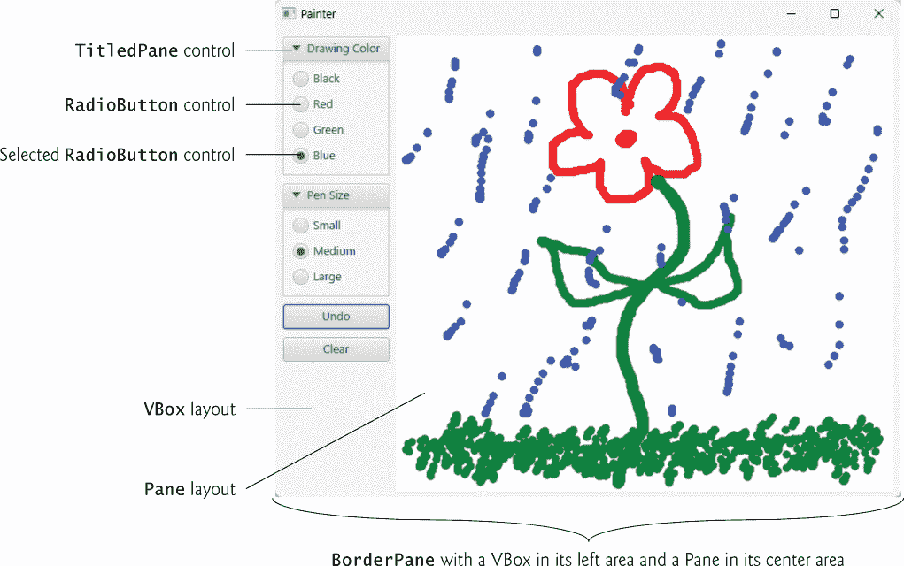

首先，我们将概述你将使用的技术，然后讨论如何创建应用程序的项目并构建其 GUI。最后，我们将展示其 `Painter` 和 `PainterController` 类的源代码。

#### 16.3.1 技术概述

本节介绍了你将在绘图应用程序中使用 JavaFX 特性。

##### `RadioButton`s 和 `ToggleGroup`s

`RadioButton` 的功能是互斥选项。你将多个 `RadioButton` 添加到 `ToggleGroup` 中，以确保在给定组内同时只有一个 `RadioButton` 被选中。你将使用 JavaFX Scene Builder 在 FXML 中指定每个 `RadioButton` 的 `ToggleGroup`；不过，你也可以通过编程创建 `ToggleGroup`，然后使用 `RadioButton` 的 `setToggleGroup` 方法来指定其 `ToggleGroup`。事实上，有些程序员会在不使用 FXML 的情况下通过编程创建整个 JavaFX GUI。

##### `BorderPane` 布局容器

`BorderPane` 布局容器将控件排列为下图所示五个区域之一或多个：

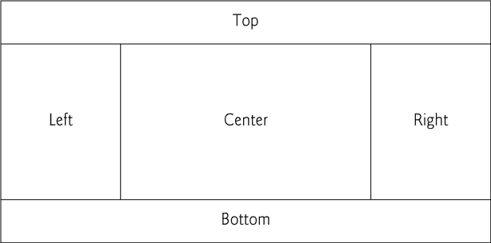

顶部和底部区域的宽度与 `BorderPane` 相同。左侧、中心和右侧区域填充顶部底部之间的垂直空间。每个区域可以只包含一个控件或一个布局容器——而任何布局容器反过来都可以包含其他控件、布局和节点。`BorderPane` 中的所有区域都是可选的：

* 如果顶部或底部区域为空，左侧、中心和右侧区域将垂直扩展以填充该区域。
* 如果左侧或右侧区域为空，中心区域将水平扩展以填充该区域。

##### `TitledPane` 布局容器

`TitledPane` 布局容器在其顶部显示标题，并是一个包含其他节点布局的可折叠面板。你将使用 `TitledPane` 来组织应用程序的 `RadioButton`，并帮助用户理解每个 `RadioButton` 组的用途。

##### JavaFX Shapes

`javafx.scene.shape` 包包含了用于 2D 和 3D 形状节点的各种类，这些节点可以显示在场景图中。在应用程序中，你将在用户拖动鼠标时通过编程创建 `Circle` 对象，然后将它们附加到应用程序的绘图区域以便在场景图中显示它们。

##### `Pane` 布局容器

绘图区域将是一个 `Pane` 布局。每个 `Circle` 对象将放置在从 `Pane` 左上角测量的 `x-y` 坐标。

##### 鼠标事件处理

当你拖动鼠标时，应用程序的控制器将通过在 `Pane` 的当前鼠标位置以当前选定的颜色和笔画大小显示 `Circle` 来响应。JavaFX 节点支持各种鼠标事件，总结表所示：

| 鼠标事件 | 当事件在给定节点上发生时 |
| --- | --- |
| `onMouseClicked` | 用户点击鼠标按钮——即在鼠标光标位于该节点内且不移动鼠标的情况下按下并释放鼠标按钮。 |
| `onMouseDragEntered` | 在鼠标拖拽期间，鼠标光标进入了节点的边界——即用户在按下鼠标按钮的同时正在移动鼠标。 |
| `onMouseDragExited` | 在鼠标拖拽期间，鼠标光标离开了节点的边界。 |
| `onMouseDragged` | 用户在鼠标光标位于该节点内开始鼠标拖拽并继续移动鼠标。 |
| `onDragOver` | 拖拽操作在节点内开始并随着鼠标继续。 |
| `onDragReleased` | 用户完成在节点内开始的拖拽操作。 |
| `onMouseEntered` | 鼠标光标进入了节点的边界。 |
| `onMouseExited` | 鼠标光标离开了节点的边界。 |
| `onMouseMoved` | 鼠标光标在节点边界内移动。 |
| `onMousePressed` | 用户在鼠标光标位于该节点内时按下鼠标按钮。 |
| `onMouseReleased` | 用户在节点内释放鼠标按钮。 |

JavaFX 还支持其他类型的输入。例如，对于触摸设备，有触摸相关的事件；对于键盘，有键盘事件。

##### 设置控件的用户数据

每个 JavaFX 控件都有一个接收 `Object` 的 `setUserData` 方法。你可以使用它来存储任何与该控件关联的对象。对于每个绘图颜色 `RadioButton`，我们存储 `RadioButton` 代表的特定 `Color`。对于每个笔大小 `RadioButton`，我们存储对应笔大小的 `enum` 常量。我们在处理 `RadioButton` 事件时使用这些对象。

#### 16.3.2 创建 `Painter.fxml` 文件

在你的系统中为此示例的文件创建一个文件夹，然后打开 Scene Builder 并新的 FXML 文件保存为 `Painter.fxml`。如果你已经打开了一个 FXML 文件，也可以选择 File > New 来创建一个新的 FXML 文件，然后保存它。

#### 16.3.3 构建 GUI

在本节中，我们将讨论绘图应用程序的 GUI。我们不像在第 15 章 中那样提供具体步骤，而是提供构建 GUI 的通用指令，并关注新概念的特定细节。在构建 GUI 时，请记住，通过 Scene Builder 的层次结构（Hierarchy）部分操作布局和控件通常比在舞台设计区域直接操作更容易。

##### 此应用程序控件的 fx:id 属性值

下图显示了绘图应用程序中通过编程的控件的 fx:id 属性。在构建 GUI 时，你应该在 FXML 文档中设置对应的 fx:id 属性，正如我们在第 15 章 中讨论过的：

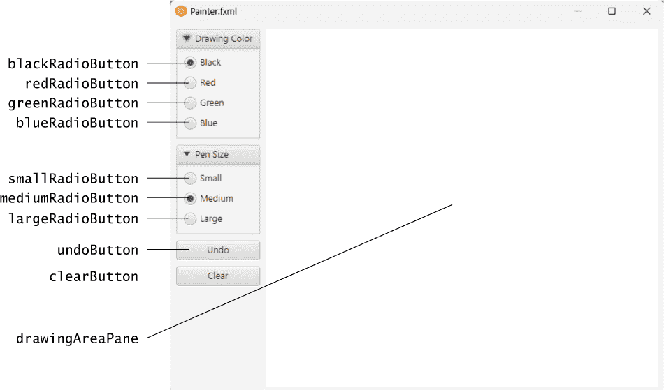

##### 步骤 1：将 `BorderPane` 作为根布局节点

将 Scene Builder 库窗口中 Containers（容器）部分的 `BorderPane` 拖入到内容面板上。

### 步骤 2：配置 `BorderPane`

将 `BorderPane` 的 `Pref Width` 和 `Pref Height` 属性设置为 `640` 和 `480`。请记住，阶段的大小是根据 FXML 文档中根节点的大小的。对于 `BorderPane`，将 `Padding` 属性的四个值设置为 `8`，使其相对于阶段边缘内收缩。

### 步骤 3：添加 `Pane` 和 `VBox`

将一个 `Pane` 拖入中心区域，并将一个 `VBox` 拖入 `BorderPane` 的左侧区域。当你拖过 `BorderPane` 时，Scene Builder 会显示布局的五个区域，并高亮在你松开鼠标时拖入的项将出现的区域。将 `Pane` 的 `fx:id` 设置为 `drawingAreaPane`。


对于 `VBox`，将它的 `Spacing` 属性（在检查器的 Layout 部分中）设置为 `8`，以便在放置在此容器中的控件之间添加一些垂直空间。将它的右 `Margin` 属性设置为 `8`，以便在 `VBox` 和 `Pane` 之间添加一些水平间距。此外，将其 `Max Height` 属性设置为 `MAX_VALUE`。这将允许 `VBox` 的宽度能够容纳其子节点并占据整个列的高度。

将 `Pane` 的 `Pref Width` 和 `Pref Height` 重置为默认的 `USE_COMPUTED_SIZE` 值，并将其 `Max Width` 和 `Max Height` 设置为 `MAX_VALUE`，使其占据 `BorderPane` 中心区域的整个宽度和高度。在检查器窗口 Properties 部分 `Pane` 的 JavaFX CSS 类别中，点击 Style 下方的字段（初始为空）并选择：

```
-fx-background-color
```

这样你就可以指定 `Pane` 的背景颜色。在其右侧的字段中指定 `white`。

## 第 4 步：向 `VBox` 添加 `TitledPane`s

从库窗口的 Containers 部分，将两个 `TitledPane`（空）对象拖到 `VBox` 上。对于第一个 `TitledPane`，将它的 `Text` 属性设置为 `Drawing Color`。对于第二个，将它的 `Text` 属性设置为 `Pen Size`。

## 第 5 步：自定义 `TitledPane`s

完成后的 GUI 中的每个 `TitledPane` 包含多个 `RadioButton`。我们将在每个 `TitledPane` 中使用 `VBox` 来帮助排列这些控件。将一个 `VBox` 拖到每个 `TitledPane` 上。将每个 `VBox` 的 `Spacing` 属性设置为 `8`，并将 `Pref Width` 和 `Pref Height` 设置为 `USE_COMPUTED_SIZE`，这样 `VBox` 将根据其内容调整大小。

## 第 6 步：向 `VBox` 添加 `RadioButton`

从库窗口的 Controls 部分，向 Drawing Color `TitledPane` 的 `VBox` 拖入四个 `RadioButton`，并向 Pen Size `TitledPane` 的 `VBox` 拖入三个 `RadioButton`。按照之前配置它们的 `Text` 属性和 `fx:ids`。接下来，选择 `blackRadioButton` 并确保其 `Selected` 属性已勾选，然后对 `mediumRadioButton` 执行相同操作。

## 第 7 步：为 `RadioButton` 指定 `ToggleGroup`s

选择第一个 `TitledPane` 的 `VBox` 中的所有四个 `RadioButton`。在检查器的 Properties 部分，将 `Toggle Group` 属性设置为 `colorToggleGroup`。当应用程序在执行时加载 FXML 文件时，`FXMLLoader` 将创建一个同名的 `ToggleGroup` 对象，并将这四个 `RadioButton` 与其关联，以确保每次只有一个被选中。对第二个 `TitledPane` 的 `VBox` 中的三个 `RadioButton` 重复此步骤，但将 `Toggle Group` 属性设置为 `sizeToggleGroup`。

## 第 8 步：更改 `TitledPane` 的偏好宽度和高度

对于每个 `TitledPane`，将其 `Pref Width` 和 `Pref Height` 设置为 `USE_COMPUTED_SIZE`，以便 `TitledPane` 将根据其内容调整大小。

## 第 9 步：添加 `Button`s

在 `TitledPane` 下方添加两个 `Button`，然后按照之前配置它们的 `Text` 属性和 `fx:ids`。将每个 `Button` 的 `Max Width` 属性设置为 `MAX_VALUE`，以便它们填充 `VBox` 的宽度。

## 第 10 步：设置 `VBox` 的宽度

我们希望 `VBox` 的宽度仅达到该列控件所需的。在 Document 窗口的 Hierarchy 部分选择 `VBox`。将它的 `Min Width` 和 `Pref Width` 属性设置为 `USE_COMPUTED_SIZE`，然后将 `Max Width` 设置为 `USE_PREF_SIZE`，表示最大宽度应为偏好宽度。此外，将 `Max Height` 重置为其默认的 `USE_COMPUTED_SIZE` 值。现在 GUI 应该如本节开头所示。

## 第 11 步：指定控制类的名称

正如我们在第 15.5.2 节 中提到的，在 JavaFX FXML 应用程序中，应用程序的控制器类通常会定义用于程序化交互控件的实例变量，以及事件处理方法。为了确保应用程序在运行时加载 FXML 文件时创建一个控制类的对象，请指定控制类的名称。

图 16.2 显示了 `PainterController` 类的最终版本，为了讨论，我们将其分成了几个部分。回顾第 15 章，控制器类定义了用于编程与控件交互的实例变量，以及事件处理方法。控制器类还可以声明额外的实例变量、`static` 变量和支持应用程序运行的方法。

点击此处查看代码图像

```
 1   // Fig. 16.2: PainterController.java
 2   // Controller for the Painter application
 3   import javafx.event.ActionEvent;
 4   import javafx.fxml.FXML;
 5   import javafx.scene.control.RadioButton;
 6   import javafx.scene.control.ToggleGroup;
 7   import javafx.scene.input.MouseEvent;
 8   import javafx.scene.layout.Pane;
 9   import javafx.scene.paint.Color;
10   import javafx.scene.paint.Paint;
11   import javafx.scene.shape.Circle
12
13   public class PainterController {
```

**图 16.2** | Painter 应用程序的控制器。

### `PenSize enum`

第 15–25 行定义了嵌套枚举类型 `enum` `PenSize`，它指定了三种笔尺寸：`SMALL`、`MEDIUM` 和 `LARGE`。每个尺寸都包含一个半径，在创建 `Circle` 对象以响应鼠标拖动事件时使用。Java 允许你将 `class`、`record`、`interface` 和 `enum` 作为嵌套类型在其他类内部声明。之前介绍大多数类型都是顶级，没有嵌套在其他类型中。`PenSize enum` 被声明为 `private` 嵌套类型，因为它只被 `PainterController` 使用。

点击此处查看代码图像

```
14      // enum representing pen sizes
15      private enum PenSize {
16         SMALL(2),
17         MEDIUM(4),
18         LARGE(6);
19
20         private final int radius;
21
22         PenSize(int radius) {this.radius = radius;} // constructor
23
24         public int getRadius() {return radius;}
25      };
26
```

### 实例变量

第 28–37 行声明了控制器用于与 GUI 进行编程交互的 `@FXML` 实例变量。记住，这些变量的名称必须与 `Painter.fxml` 中的 `fx:id` 值匹配；否则 `FXMLLoader` 将无法将 GUI 组件连接到实例变量。有两个 `@FXML` 实例变量是 `ToggleGroup`——`RadioButton` 事件处理程序使用它们来确定选择了哪个 `RadioButton`。第 40–41 行定义了存储当前 `PenSize` 和绘制颜色 `Color` 的实例变量。

点击此处查看代码图像

```
27      // instance variables that refer to GUI components
28      @FXML private RadioButton blackRadioButton;
29      @FXML private RadioButton redRadioButton;
30      @FXML private RadioButton greenRadioButton;
31      @FXML private RadioButton blueRadioButton;
32      @FXML private RadioButton smallRadioButton;
33      @FXML private RadioButton mediumRadioButton;
34      @FXML private RadioButton largeRadioButton;
35      @FXML private Pane drawingAreaPane;
36      @FXML private ToggleGroup colorToggleGroup;
37      @FXML private ToggleGroup sizeToggleGroup;
38
39      // instance variables for managing Painter state
40      private PenSize radius = PenSize.MEDIUM; // radius of circle
41      private Paint brushColor = Color.BLACK; // drawing color
42
```

### 方法 `initialize`

记住，当 `FXMLLoader` 创建控制器类对象时，它会确定控制器类是否包含用 `@FXML` 声明且无参数的 `initialize` 方法，如果是，则调用该方法来初始化控制器。第 44–54 行定义了方法 `initialize` 以指定每个 `RadioButton` 对应的用户数据对象——一个 `Color` 或 `PenSize`。我们在 `RadioButton` 的事件处理程序中使用这些对象。

点击此处查看代码图像

```
43      // set user data for the RadioButtons
44      @FXML
45      private void initialize() {
46         // user data on a control can be any Object
47         blackRadioButton.setUserData(Color.BLACK);
48         redRadioButton.setUserData(Color.RED);
49         greenRadioButton.setUserData(Color.GREEN);
50         blueRadioButton.setUserData(Color.BLUE);
51         smallRadioButton.setUserData(PenSize.SMALL);
52         mediumRadioButton.setUserData(PenSize.MEDIUM);
53         largeRadioButton.setUserData(PenSize.LARGE);
54      }
```

### `drawingAreaMouseDragged` 事件处理器

第 57–62 行定义了 `drawingAreaMouseDragged`，它响应 `drawingAreaPane` 中的拖动事件。每个鼠标事件处理程序接收一个 `MouseEvent` 参数。（注：原文此处有大量重复描述，翻译时已按逻辑整合）。

点击此处查看代码图像

```
56      // handles drawingAreaPane on mouse drag
57      @FXML
58      private void drawingAreaMouseDragged(MouseEvent e) {
59         Circle newCircle = new Circle(e.getX(), e.getY(), radius, brushColor);
60         drawingAreaPane.getChildren().add(newCircle);
61      }
```

第 59–60 行使用中心 x-y 坐标、半径和 `Color` 创建一个新的 `Circle`。第 61 行将新的 `Circle` 附加到 `drawingAreaPane`。`drawingAreaPane.getChildren()` 方法返回一个包含子节点的 `ObservableList<Node>` 集合。`ObservableList` 具有添加和删除元素的方法。第 61 行使用 `ObservableList` 的 `add` 方法向 `drawingAreaPane` 添加新的 `Node`。所有 JavaFX 形状间接继承自 `javafx.scene` 中的 `Node` 类。

### `colorRadioButtonSelected` 事件处理器

方法 `colorRadioButtonSelected`（第 65–70 行）响应绘制颜色 `RadioButton` 的 `ActionEvent`，这在选择新颜色 `RadioButton` 时发生。你将此方法指定为所有四个绘制颜色 `RadioButton` 的 On Action 事件处理器。第 68–69 行使用与 `colorRadioButtonSelected` 中相同的方法设置当前绘制颜色。`ToggleGroup` 的 `getSelectedToggle` 方法返回选中的 `Toggle`。`RadioButton` 是实现 `Toggle` 接口的控件之一（其他还有 `RadioButtonMenuItem` 和 `ToggleButton`）。`Toggle` 的 `getUserData` 方法返回我们在 `initialize` 方法中与选中的 `RadioButton` 相关的用户数据 `Object`——对于 `ColorToggleGroup` 的 `RadioButton`，`Object` 始终是 `Color`，因此我们将 `Object` 转换为 `Color` 并将其赋值给 `brushColor`。

```
64      // handles color RadioButton's ActionEvents
65      @FXML
66      private void colorRadioButtonSelected(ActionEvent e) {
67         // user data for each color RadioButton is the corresponding Color
68         brushColor =
69            (Color) colorToggleGroup.getSelectedToggle().getUserData();
70      }
```

### `sizeRadioButtonSelected` 事件处理器

第 73–78 行定义了 `sizeRadioButtonSelected`，它响应笔尺寸 `RadioButton` 的 `ActionEvent`。你将此方法指定为所有三个笔尺寸 `RadioButton` 的 On Action 事件处理器。第 76–77 行使用与 `colorRadioButtonSelected` 中相同的方法设置当前 `PenSize`。在这种情况下，用户数据 `Object` 始终是 `PenSize`。

```
73      // handles size RadioButton's ActionEvents
74      @FXML
75      private void sizeRadioButtonSelected(ActionEvent e) {
76         // user data for each size RadioButton is the corresponding PenSize
77         radius =
78            (PenSize) sizeToggleGroup.getSelectedToggle().getUserData();
79      }
```

### `undoButtonPressed` 事件处理器


第 81–89 行定义了 `undoButtonPressed`，它通过移除最后一个显示的 `Circle` 来响应来自 `undoButton` 的 `ActionEvent`。你在 Scene Builder 中将此方法指定为 `undoButton` 的 On Action 事件处理器。要撤销上一个 `Circle`，我们从 `drawingAreaPane` 的子节点集合中移除最后一个节点。首先，第 83 行获取该集合中的元素数量。然后，如果数量大于 0，第 87 行将移除集合中最后一个索引处的节点。

```
80      // handles Undo Button's ActionEvents
81      @FXML
82      private void undoButtonPressed(ActionEvent event) {
83         int count = drawingAreaPane.getChildren().size();
84
85         // if there are any shapes, remove the last one added
86         if (count > 0) {
87            drawingAreaPane.getChildren().remove(count - 1);
88         }
89      }
90
```

### `clearButtonPressed` 事件处理器

第 92–95 行定义了 `clearButtonPressed`，它通过清除 `drawingAreaPane` 的子节点集合来响应来自 `clearButton` 的 `ActionEvent`。你在 Scene Builder 中将此事件处理器指定为 `clearButton` 的 On Action 事件处理器。第 94 行清除子节点集合以擦除整个绘制。

```
91      // handles Clear Button's ActionEvents
92      @FXML
93      private void clearButtonPressed(ActionEvent event) {
94         drawingAreaPane.getChildren().clear(); // clear the canvas
95      }
96   }
```

### 生成式 AI

1. 提示 `genAIs`，让它们解释在 JavaFX 应用中使用 `RadioButton` 的最佳实践。

2. 提示 `genAIs`，让它们提供 `Node` 鼠标事件的示例以及它们的典型用法。

## 16.4 颜色选择器应用程序：属性绑定与属性监听器

本节通过构建一个颜色选择器应用程序来演示属性绑定和属性监听器。下面的图显示了使用红色和绿色的 `Slider` 创建一个不透明橙色色的结果：

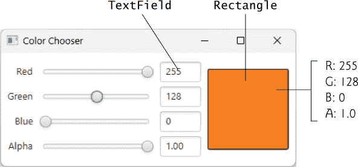

接下来的图显示了使用红色、绿色和 Alpha（透明度）`Slider` 创建半透明橙色的结果——注意半透明橙色与彩色正方形后方的圆形颜色混合在了一起：

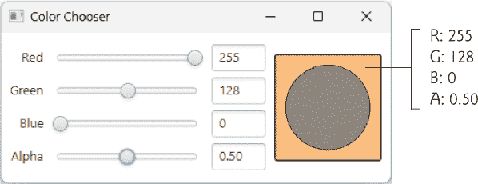

### 16.4.1 技术概述

让我们介绍一下构建颜色选择器时将用到的技术。

#### RGBA 颜色

应用程序使用 `RGBA 颜色模型` 根据四个 `Slider` 的值显示颜色矩形。RGBA 通过每个颜色的红、绿、蓝值来表示每种颜色，每个值范围从 0 到 255——0 表示无色，255 表示全色。例如，红色值为 0 的颜色不包含任何红色分量。Alpha 值（A）范围从 0.0 到 1.0，代表颜色的透明度——0.0 是透明的，1.0 是不透明的。示例输出中的颜色具有相同的 RGB 值，但部分 (b) 中显示的颜色是半透明的。你将创建一个 RGBA `Color` 对象，然后使用它填充该颜色的 `Rectangle`。

#### 类的属性

JavaFX 广泛使用属性。`property`（属性）是实现了 JavaFX `Property` 接口（包 `javafx.beans.property`）的类实例，并通过 `set` 和 `get` 方法进行访问。通常，定义读/写属性的一对方法具有如下形式：

```
public final void setPropertyName(Type propertyName)
public final Type getPropertyName()
```

通常，此类方法会操作一个与属性同名的 `private` 实例变量，但并非强制要求。例如，在 `Time` 类中，方法 `setHour` 和 `getHour` 共同表示 `hour` 属性——它们通常会操作一个私有的 `hour` 实例变量。如果属性表示一个 `boolean` 值，其 `get` 方法名将以“is”而不是“get”开头——例如 `ArrayList` 方法 `isEmpty`。定义属性的方法应声明为 `final`，以防止子类重写这些方法，这可能导致客户端代码中产生意想不到的结果。

#### 属性绑定

JavaFX 属性的实现方式使其成为可观测的——当属性值改变时，其他对象可以做出相应的响应。这与事件处理类似。响应属性变化的一种方法是通过 `property binding`（属性绑定），它允许当另一个对象的属性改变时，一个对象的属性随之更新。你将使用属性绑定在 `Slider` 属性变化时更新 `TextField`。属性绑定不仅限于 JavaFX 控件。`javafx.beans.property` 包含了你可以用于定义可绑定属性的许多类。

#### 属性监听器

属性监听器与属性绑定相似。`property listener`（属性监听器）是在属性值改变时被调用的事件处理器。在事件处理器中，你可以根据适用于应用程序的方式响应属性变化。在本应用程序中，当 `Slider` 的值改变时，属性监听器会将值存储在实例变量中，根据所有 `Slider` 的值创建一个 `Color`，将其设置为 `Rectangle` 的填充颜色。有关属性、属性绑定和属性监听器的更多信息，请访问：

```
https://deitel.com/JavaFXTutorial
```

### 16.4.2 构建 GUI

在本节中，我们将讨论颜色选择器应用程序的 GUI。我们不再像第 15 章那样提供构建 GUI 的具体步骤，而是关注新概念的细节。在构建 GUI 时，记住通过 Scene Builder 文档窗口的层次结构部分操作布局和控件通常比直接在舞台区域操作要简单。在继续之前，打开 Scene Builder 并创建一个名为 `ColorChooser.fxml` 的 FXML 文件。

#### 控件的 fx:id 属性值

下图显示了颜色选择器应用程序中实际操作控件的 fx:id 属性。你应该按照第 15 章学习的方法，在 FXML 文档中设置这些控件的 fx:id 属性。


#### 步骤 1：添加 `GridPane`

从库窗口的容器部分拖入一个 `GridPane` 到 Scene Builder 的内容面板中。

#### 步骤 2：配置 `GridPane`

此应用程序的 `GridPane` 需要四行四列。使用你之前学习的技术为 `GridPane` 添加两列和一行。将 `Grid-Pane` 的 `Hgap` 和 `Padding` 属性设置为 `8`，以使 `GridPane` 距离舞台边缘内缩，并在列之间留出空间。

#### 步骤 3：添加控件

参考之前的图表，向 `GridPane` 中添加 `Label`、`Slider`、`TextField`、一个 `Circle` 和一个 `Rectangle`——`Circle` 和 `Rectangle` 位于 Scene Builder 库中的 Shapes（形状）部分。在添加 `Circle` 和 `Rectangle` 时，将它们都放置在最右侧列的第一行，在添加 `Rectangle` 之前先添加 `Circle`，这样它在布局中就会位于矩形的后面。按照图所示设置 `Label` 和 `TextField` 的文本内容，并在添加每个控件时设置所有相应的 `fx:id` 属性。

#### 步骤 4：配置 `Slider`

对于红色、绿色和蓝色的 `Slider`，将 `Max` 属性设置为 `255`（RGBA 颜色方案中给定颜色的最大值）。对于 alpha `Slider`，将其 `Max` 属性设置为 `1.0`（RGBA 颜色方案中的最大不透明度）。

#### 步骤 5：配置 `TextField`

将所有 `TextField` 的 `Pref Width`（首选宽度）属性设置为 `50`。

#### 步骤 6：配置 `Rectangle`

将 `Rectangle` 的 `Width`（宽度）和 `Height`（高度）属性设置为 `100`，然后将其 `Row Span`（行跨）属性设置为 `Remaining`（剩余），使其跨越该列的所有行。

#### 步骤 7：配置 `Circle`

将 `Circle` 的 `Radius`（半径）属性设置为 `40`，然后将其 `Row Span`（行跨）属性设置为 `Remainder`（剩余），使其跨越该列的所有行。

#### 步骤 8：配置行

将所有行的 `Pref Height`（首选高度）属性设置为 `USE_COMPUTED_SIZE`（使用计算大小），使行的高度仅与其内容相等。

#### 步骤 9：配置列

将所有四列的 `Pref Width`（首选宽度）属性设置为 `USE_COMPUTED_SIZE`，使列的宽度仅与其内容相等。对于最侧列，将 `Halignment`（水平对齐）属性设置为 `RIGHT`（右对齐）。对于右侧列，将 `Halignment` 属性设置为 `CENTER`（居中对齐）。

#### 步骤 10：配置 `GridPane`

将 `GridPane` 的 `Pref Width` 和 `Pref Height` 属性设置为 `USE_COMPUTED_SIZE`，使其根据内容自动调整大小。你的 GUI 现在已经完成了。

#### 步骤 11：指定控制器类名称

为了确保应用程序在运行时加载 FXML 文件时会创建控制类的对象，请在 FXML 文件中指定 `ColorChooserController` 为控制类的名称。

#### 步骤 12：生成示例控制器类

选择 View（视图） > Show Sample Controller Skeleton（显示示例控制器骨架），将此代码复制到 `ColorChooserController.java` 文件中，并存储与 `ColorChooser.fxml` 相同的文件夹中。我们在第 16.4.4 节 中展示了完整的 `ColorChooserController` 类。

### 16.4.3 `Application` 的子类 `ColorChooser`

图 16.3 显示了 `Application` 的子类 `ColorChooser`。该类加载 FXML 并像之前的 JavaFX 示例一样显示应用程序。

```
 1   // Fig. 16.3: ColorChooser.java
 2   // 用于加载并显示 ColorChooser GUI 的类。
 3   import javafx.application.Application;
 4   import javafx.fxml.FXMLLoader;
 5   import javafx.scene.Parent;
 6   import javafx.scene.Scene;
 7   import javafx.stage.Stage;
 8
 9   public class ColorChooser extends Application {
10      @Override
11      public void start(Stage stage) throws Exception {
12         Parent root =
13            FXMLLoader.load(getClass().getResource("ColorChooser.fxml"));
14
15         var scene = new Scene(root);
16         stage.setTitle("Color Chooser");
17         stage.setScene(scene);
18         stage.show();
19      }
20
21      public static void main(String[] args) {
22         launch(args);
23      }
24   }
```

**图 16.3** | 用于加载并显示 Color Chooser GUI 的类。

### 16.4.4 `ColorChooserController` 类

图 16.4 显示了 `ColorChooserController` 类的最终版本。为了方便讨论，我们将代码分成了部分。

```
 1   // Fig. 16.4: ColorChooserController.java
 2   // ColorChooser 的控制器
 3   import javafx.beans.value.ChangeListener;
 4   import javafx.beans.value.ObservableValue;
 5   import javafx.fxml.FXML;
 6   import javafx.scene.control.Slider;
 7   import javafx.scene.control.TextField;
 8   import javafx.scene.paint.Color;
 9   import javafx.scene.shape.Rectangle;
10
11   public class ColorChooserController {
```

**图 16.4** | `ColorChooser` 的控制器。

#### 变量

第 13-27 行声明了变量。第 13-27 行 `red`、`green` 和 `alpha` 存储了 `Slider` 的值。第 13-27 行 `redSlider`、`greenSlider` 和 `alphaSlider` 是 `Slider` 组件。第 13-27 行 `redTextField`、`greenTextField` 和 `alphaTextField` 是 `TextField` 组件。第 13-27 行 `colorRectangle` 是 `Rectangle`。

```
12      // 变量
13      @FXML private Slider redSlider;
14      @FXML private Slider greenSlider;
15      @FXML private Slider blueSlider;
16      @FXML private Slider alphaSlider;
17      @FXML private TextField redTextField;
18      @FXML private TextField greenTextField;
19      @FXML private TextField blueTextField;
20      @FXML private TextField alphaTextField;
21      @FXML private Rectangle colorRectangle;
22      // 变量
23      private int red = 0;
24      private int green = 0;
25      private int blue = 0;
26      private double alpha = 1.0;
```

#### `initialize` 方法

第 29-66 行在 `FXMLLoader` 创建 GUI 后定义了 `initialize` 方法。在此应用程序中，`initialize` 配置了根据 `Slider` 变化设置 `Rectangle` 填充色的属性绑定和属性监听器。


```java
29      @FXML
30      private void initialize() {
31         // 将 TextField 绑定到 Slider 值
32         redTextField.textProperty().bind(
33            redSlider.valueProperty().asString("%.0f"));
34         greenTextField.textProperty().bind(
35            greenSlider.valueProperty().asString("%.0f"));
36         blueTextField.textProperty().bind(
37            blueSlider.valueProperty().asString("%.0f"));
38         alphaTextField.textProperty().bind(
39            alphaSlider.valueProperty().asString("%.2f"));
40
41         // 根据 Slider 变化设置 Rectangle 填充色的监听器
42         redSlider.valueProperty().addListener(
43            (ov, oldValue, newValue) -> {
44               red = newValue.intValue();
45               colorRectangle.setFill(Color.rgb(red, green, blue, alpha));
46            }
47         );
48         greenSlider.valueProperty().addListener(
49            (ov, oldValue, newValue) -> {
50               green = newValue.intValue();
51               colorRectangle.setFill(Color.rgb(red, green, blue, alpha));
52            }
53         );
54         blueSlider.valueProperty().addListener(
55            (ov, oldValue, newValue) -> {
56               blue = newValue.intValue();
57               colorRectangle.setFill(Color.rgb(red, green, blue, alpha));
58            }
59         );
60         alphaSlider.valueProperty().addListener(
61            (ov, oldValue, newValue) -> {
62               alpha = newValue.doubleValue();
63               colorRectangle.setFill(Color.rgb(red, green, blue, alpha));
64            }
65         );
66      }
67   }
```

### 属性到属性绑定

第 32-39 行建立了每个 `Slider` 的值与相应 `TextField` 文本之间的属性绑定，以便 `Slider` 的变化可以更新相应的 `TextField`。考虑第 32-33 行，它们将 `redSlider` 的 `valueProperty` 绑定到 `redTextField` 的 `textProperty`：

```java
redTextField.textProperty().bind(
   redSlider.valueProperty().asString("%.0f"));
```

`TextField` 的 `textProperty` 方法返回其 `text` 属性，类型为 `StringProperty`（包 `javafx.beans.property`）。`StringProperty` 方法 `bind` 接收一个 `ObservableValue` 作为参数。当其 `ObservableValue` 发生变化时，绑定的属性就会更新。在这种情况下，`ObservableValue` 由以下代码返回：

```java
redSlider.valueProperty().asString("%.0f")
```

`Slider` 的 `valueProperty` 方法返回其 `value` 属性的 `DoubleProperty`，这是一个可观测的 `double` 值。然而，`TextField` 的 `text` 属性必须绑定到可观测的 `String`。因此，我们调用 `DoubleProperty` 方法 `asString` 来获取一个 `StringBinding` 对象——这是一个提供 `DoubleProperty` 的 `String` 表示形式的 `ObservableValue`。此版本的 `asString` 接收一个格式控制 `String`，用于指定 `DoubleProperty` 的 `String` 格式。

一旦你将 `TextField` 的 `textProperty` 绑定到另一个控件的属性，用户可能无法编辑该 `TextField`，即使我们在 Scene Builder 中没有禁用它的 `editable` 属性。在章节末 genAI 练习中，你将研究双向属性绑定，这将允许 `TextField` 保持可编辑状态。

### 属性监听器

如果你需要在属性值变化时执行任意任务，可以注册一个属性监听器。第 42–65 行为 `Slider` 的 `value` 属性注册了属性监听器。考虑第 42–47 行，它们注册了处理 `redSlider` 值变化的 `ChangeListener`。正如第 15.5 节所示，我们使用 lambda 表达式实现了 `ChangeListener` 接口。每个 `ChangeListener` 将 `newValue` 参数的 `int` 值存储在相应的 `ColorChooserController` 实例变量中，然后调用 `colorRectangle` 的 `setFill` 方法更改其颜色，并使用 `Color` 方法 `rgb` 创建新的 `Color` 对象。

### 生成式 AI

1. 提示生成式 AI，要求它们讨论 JavaFX 属性监听器与属性绑定的区别。

2. 提示生成式 AI 列出 JavaFX 中常用的属性绑定列表。

## 16.5 封面查看器应用程序：使用 JavaFX 集合实现数据驱动 GUI

应用程序通常需要编辑和显示数据。JavaFX 提供了一个全面的模型，允许 GUI 与数据交互。在本节中，你将构建封面查看器应用程序（如下图所示），该程序将一个 `Book` 对象的列表绑定到 `ListView` 上。当用户在 `ListView` 中选择一个项时，相应的 `Book` 封面图像将显示在 `ImageView` 中。


### 16.5.1 技术概述

该应用程序使用 `ListView` 控件来显示书名列表。虽然你可以单独地向 `ListView` 中添加项，但此应用程序将一个 `ObservableList` 对象绑定到 `ListView`。如果你更改了 `ObservableList` 的元素，它的观察者（即 `ListView`）将自动收到通知。`javafx.collections` 包定义 `ObservableList`（它与 `ArrayList` 类似，实现了 `List` 接口）以及其他观测集合接口。该包还包含类 `FXCollections`，它提供了用于创建和操作可观测集合的 `static` 方法。你将使用属性监听器在用户从 `ListView` 中选择一个项时显示正确的图像。对于此控件，变化的属性是选中的项。

在构建应用程序之前，将本章示例文件夹中的 `images` 文件夹（包含 `large` 和 `small` 子文件夹）复制到你保存此应用程序的 FXML 文件以及 `CoverViewer.java` 和 `CoverViewerController.java` 源码文件的文件夹中。虽然在这个示例中你只使用 `large` 图像，但你将复制此应用程序文件夹以创建第 16.6 节的示例，该示例将同时使用两组图像。

### 16.5.2 构建 GUI

在本节中，我们将讨论封面查看器应用程序的 GUI。使用 Scene Builder 创建一个新的 FXML 文件并将其保存为 `CoverViewer.fxml`。

#### 此应用程序控件的 fx:id 属性值

下图显示了封面查看器应用程序中通过程序操作的控件的 fx:id 属性。在构建 GUI 时，在 FXML 文档中设置对应的 fx:id 属性。


#### 添加和配置控件

使用你之前学习的技巧，创建一个 `BorderPane`。在左侧区域放置一个 `ListView` 控件，在中间区域放置一个 `ImageView` 控件。对于 `ListView`，设置以下属性：

*   Margin—`8`（右边距）以隔开 `ListView` 和 `ImageView`
*   Pref Width—`200`
*   Max Height—`MAX_VALUE`
*   Min Width, Min Height, Pref Height and Max Width—`USE_COMPUTED_SIZE`

对于 `ImageView`，将 Fit Width 和 Fit Height 设置为 `370` 和 `480`。根据内容调整 `BorderPane` 的大小，将其 Pref Width 和 Pref Height 设置为 `USE_COMPUTED_SIZE`。同时，将其 Padding 设置为 `8` 以设置 `BorderPane` 设置内边距。

#### 指定控制器类

为了确保应用程序在运行时加载 FXML 文件时创建该类的对象，请像你之前做的那样，在 FXML 文件中指定 `CoverViewerController` 为控制器。

#### 生成示例控制器

选择 View > Sample Controller，然后将此代码复制到 `CoverViewerController.java` 文件中并存储在与 `CoverViewer.fxml` 相同的文件夹中。我们在 16.5.4 节中展示了完整的 `CoverViewer` 类。

### 16.5.3 Application 的子类 CoverViewer

图 16.5 显示了 Application 的子类 `CoverViewer`。

```java
// Fig. 16.5: CoverViewer.java
// 加载 CoverViewer GUI 的类。
import javafx.application.Application;
import javafx.fxml.FXMLLoader;
import javafx.scene.Parent;
import javafx.scene.Scene;
import javafx.scene.Stage;

public class CoverViewer extends Application {
    @Override
    public void start(Stage stage) throws Exception {
        Parent root =
            FXMLLoader.load(getClass().getResource("CoverViewer.fxml"));

        Scene scene = new Scene(root);
        stage.setTitle("Cover Viewer");
        stage.setScene(scene);
        stage.show();
    }

    public static void main(String[] args) {
        launch(args);
    }
}
```

### 16.5.4 CoverViewerController 类

图 16.6 显示了完整的 `CoverViewerController` 类，为了方便讨论我们将其分成了部分。

```java
// Fig. 16.6: CoverViewerController.java
// 封面查看器应用程序的控制器
import javafx.beans.value.ObservableValue;
import javafx.collections.FXCollections;
import javafx.collections.ObservableList;
import javafx.fxml.FXML;
import javafx.scene.control.ListView;
import javafx.scene.image.Image;
import javafx.scene.image.ImageView;

public class CoverViewerController {
    @FXML
    private ListView<Book> listView;

    @FXML
    private ImageView imageView;
}
```

#### @FXML 实例变量

第 13–14 行声明了控制器的 `@FXML` 实例变量。注意 `ListView` 是一个泛型类。在这种情况下，`ListView` 显示 `Book` 对象。我们将 `Book` 实现为 `record` 类，包含三个 `String` 实例变量：

*   `title`—书名。
*   `thumbImage`—书籍缩略图的路径（用于第 16.6 节中的示例）。
*   `largeImage`—书籍大尺寸封面图的路径。

`record` 类还提供了一个自定义的 `toString` 方法，用于返回 `Book` 的标题。你应该将本章示例文件夹中的 `Book` 类复制到包含 `CoverViewer.fxml`、`CoverViewer.java` 和 `CoverViewerController.java` 的文件夹中。

```java
12      // instance variables for interacting with GUI
13      @FXML private ListView<Book> booksListView;
14      @FXML private ImageView coverImageView;
15
```

#### 实例变量 `books`

第 17–18 行将 `books` 实例变量定义为 `ObservableList<Book>`，并通过调用 `FXCollections` 静态方法 `observableArrayList` 对进行初始化。该方法返回一个实现了 `ObservableList` 接口的空集合对象，其功能与 `ArrayList` 类似。

```java
16      // stores the list of Book Objects
17      private final ObservableList<Book> books =
18         FXCollections.observableArrayList();
19
```

#### 初始化 `books ObservableList`

`initialize` 方法中的第 23–38 行向 `books` 集合添加了 `Book` 对象。第 39 行将此集合传递给 `ListView` 方法 `setItems`，从而将 `ListView` 绑定到 `ObservableList`。这种数据绑定允许 `ListView` 自动显示 `Book` 对象。默认情况下，`ListView` 显示每个 `Book` 的 `String` 表示。你将在第 16.6 节中对其进行自定义。

```java
// 此处原文未提供后续代码块内容，保留占位说明
```


```java
20      // initialize controller
21      public void initialize() {
22         // populate the ObservableList<Book>
23         books.add(new Book("C to Program",
24            "/images/small/chtp.jpg", "/images/large/chtp.jpg"));
25         books.add(new Book("C++ to Program",
26            "/images/small/cpphtp.jpg", "/images/large/cpphtp.jpg"));
27         books.add(new Book("Intro to Python",
28            "/images/small/python.jpg", "/images/large/python.jpg"));
29         books.add(new Book("Internet and World Web How to Program",
30            "/images/small/iw3htp.jpg", "/images/large/iw3htp.jpg"));
31         books.add(new Book("Java to Program",
32            "/images/small/jhtp.jpg", "/images/large/jhtp.jpg"));
33         books.add(new Book("Python for Programmers",
34            "/images/small/pythonfp.jpg", "/images/large/pythonfp.jpg"));
35         books.add(new Book("Visual Basic to Program",
36            "/images/small/vbhtp.jpg", "/images/large/vbhtp.jpg"));
37         books.add(new Book("Visual C# to Program",
38            "/images/small/vcshtp.jpg", "/images/large/vcshtp.jpg"));
39         booksListView.setItems(books); // bind booksListView to books
40
41         // when ListView selection changes, show large cover in ImageView
42         booksListView.getSelectionModel().selectedItemProperty().
43            addListener(
44               (ov, oldValue, newValue) -> {
45                  coverImageView.setImage(
46                     new Image(newValue.largeImage()));
47               }
48            );
49      }
50   }
```

### 监听 ListView 选择变化

为了同步显示的封面与当前选书籍，我们监听 `ListView` 选中项的变化。默认情况下，`ListView` 支持单选——一次只能选择一个项目。`ListView` 也支持多选。`MultipleSelectionModel`（来自 `javafx.scene.control` 包）负责管理选择类型。该对象包含了可观察属性以及用于操作相应 `ListView` 项目的各种方法。

为了响应选择变化，为 `MultipleSelectionModel` 的 `selectedItem` 属性注册了一个监听器（第 42–48 行）。`ListView` 方法 `getSelectionModel` 返回一个 `MultipleSelectionModel` 对象。在本示例中，`MultipleSelectionModel` 的 `selectedItemProperty` 方法返回一个 `ReadOnlyObjectProperty<Book>`，相应的 `ChangeListener` 分别通过 `oldValue` 和 `newValue` 参数接收之前选中的和新选中的 `Book` 对象。

第 45–46 行使用 `newValue` 的大尺寸图像路径初始化一个新的 `Image`（包 `javafx.scene.image`）——此。

```java
 1   // Fig. 16.7: ImageTextCell.java
 2   // 显示图像和文本的自定义 ListView 单元工厂
 3   import javafx.geometry.Pos;
 4   import javafx.scene.control.Label;
 5   import javafx.scene.control.ListCell;
 6   import javafx.scene.image.Image;
 7   import javafx.scene.image.ImageView;
 8   import javafx.scene.layout.VBox;
 9   import javafx.scene.text.TextAlignment;
10
11   public class ImageTextCell extends ListCell<Book> {
12      private VBox vbox = new VBox(8.0); // 控件之间留出 8 像素间距
13      private ImageView thumbImageView = new ImageView(); // 初始为空
14      private Label label = new Label();
15
```

**图 16.7** | 显示图像和文本的自定义 `ListView` 单元工厂。

### 构造函数

构造函数（第 17–29 行）配置了用于构建自定义呈现的实例变量。第 18 行表示 `VBox` 的子项应该居中。第 20–22 行配置了 `ImageView` 并将其附加到 `VBox` 的子项集合。第 20 行表示 `ImageView` 应该保持图像的比例，第 21 行表示 `ImageView` 的高度为 100 像素。第 22 行将 `ImageView` 附加到 `VBox`。

点击此处查看代码图像

```java
16      // 构造函数配置 VBox, ImageView 和 Label
17      public ImageTextCell() {
18         vbox.setAlignment(Pos.CENTER); // 水平居中 VBox 内容
19
20         thumbImageView.setPreserveRatio(true);
21         thumbImageView.setFitHeight(100.0); // 缩略图高度 100 像素
22         vbox.getChildren().add(thumbImageView); // 附加到 Vbox
23
24         label.setWrapText(true); // 如果文本太宽无法适应 Label 则换行
25         label.setTextAlignment(TextAlignment.CENTER); // 文本居中
26         vbox.getChildren().add(label); // 附加到 VBox
27
28         setPrefWidth(USE_PREF_SIZE); // 使用首选大小作为单元宽度
29      }
30
```

第 24–26 行配置了 `Label` 并将其附加到 `VBox` 的子项集合。第 24 行表示，如果文本太宽无法适应 `Label` 的宽度，则应进行换行，第 25 行表示文本应该在 `Label` 中居中。第 26 行将 `Label` 附加到 `VBox`。最后，第 28 行表示单元格应使用其首选宽度，该宽度根据父级 `ListView` 的宽度确定。

### 方法 `updateItem`

`updateItem` 方法（第 32–46 行）配置 `Label` 的文本和 `ImageView` 的 `Image`，然后在 `ListView` 中显示自定义呈现。当需要 `ListView` 单元格时（当 `ListView` 首次显示以及 `ListView` 单元格即将滚动到屏幕时），`ListView` 的单元工厂会调用此方法。该方法接收要显示的 `Book` 对象以及一个指示即将创建的单元格是否为空的 `boolean` 值。你必须调用父类的 `updateItem` 方法（第 35 行），以确保自定义单元格显示显示。

点击此处查看代码图像

```java
31      // 调用以配置每个自定义 ListView 单元格
32      @Override
33      protected void updateItem(Book item, boolean empty) {
34         // 必须确保单元格显示正常
35         super.updateItem(item, empty)
36
37         if (empty || item == null) {
38            setGraphic(null); // 不显示任何内容
39         }
40         else {
41            // 设置 ImageView 的缩略图图像
42            thumbImageView.setImage(new Image(item.thumbImage()));
43            label.setText(item.title()); // 配置 Label 文本
44            setGraphic(vbox); // 将自定义布局附加到 ListView 单元格
45         }
46      }
47   }
```

如果单元格为空或 `item` 参数为 `null`，则没有 `Book` 需要显示，第 38 行将调用 `ImageTextCell` 继承的 `setGraphic` 方法并传入 `null`。该方法接收应在单元格中显示的 `Node`。可以提供任何 JavaFX `Node`，这为你自定义单元格外观提供了极大的灵活性。

如果有 `Book` 需要显示，则第 40–45 行将配置 `ImageTextCell` 的 `Label` 和 `ImageView`。第 42 行创建 `Book` 的 `Image` 对象并将其设置为在 `ImageView` 中显示。第 43 行将 `Label` 的文本设置为 `Book` 的标题。最后，第 44 行使用方法 `setGraphic` 将 `ImageTextCell` 的 `VBox` 设置为自定义单元格的图形内容。

#### 16.6 `CoverViewerController`

一旦定义了单元格布局，`CoverViewerController` 需要设置 `ListView`。在 `CoverViewerController` 的 `initialize` 方法中插入以下代码：

点击此处查看代码图像

```java
// 设置单元工厂
books.setCellFactory(
   listView -> new ImageTextCell()
);
```

`cellFactory` 参数是 `Callback` 的实现（`javafx.util`）。虽然在这里没有使用它，但 `ListView` 推导出返回类型为 `ListCell`。`ListView` 显示一个新的 `ImageTextCell`。调用 `ImageTextCell` 的 `updateItem` 方法来创建呈现。

### 16.7 `FileChooser` 和 `DirectoryChooser` 对话

JavaFX 的 `FileChooser` 和 `DirectoryChooser` 类（`javafx.stage`）是应用程序可以显示的预定义对话框，允许用户选择本地文件和目录。为了演示这些功能，我们将增强第 11.3 节 中的文件和目录处理示例。屏幕截图将在讨论中显示。

#### 创建 JavaFX GUI

GUI (`FileChooserTest.fxml`) 包含一个 600x400 像素的 `BorderPane`，其 fx:id 为 `borderPane`：


`BorderPane` 的顶部包含一个 `ToolBar` 布局（来自 Scene Builder 库的 Containers 部分），它默认水平或垂直排列其控件。通常，你会将 `ToolBar` 放置在 GUI 的边缘，例如 `BorderPane` 的顶部、右侧、底部或左。

`BorderPane` 的中心包含一个 `TextArea`，其 fx:id 为 `textArea`。我们将控件的 Text 属性设置为 `"Select file or directory"`，并启用了 Wrap Text 属性，以确保长文本换行。如果待显示的文本行多于 `TextArea` 的垂直行数，控件将显示垂直滚动条。当未启用 Wrap Text 时，如果文本太宽，`TextArea` 也会显示水平滚动条。

默认情况下，拖到布局中的 `ToolBar` 有一个 `Button`。你可以将其他控件拖到 `ToolBar` 上，并在需要时移除默认的 `Button`。我们添加了第二个 `Button`。对于第一个按钮，我们设置了：

*   Text 属性为 `"Select File"`
*   fx:id 属性为 `selectFileButton`
*   On Action 事件处理程序为 `selectFileButtonPressed`

对于第二个按钮，我们设置了：

*   Text 属性为 `"Select Directory"`
*   fx:id 属性为 `selectDirectoryButton`
*   将 On Action 事件处理程序绑定到 `selectDirectoryButtonPressed`。

最后，我们指定 `FileChooserTestController` 为 FXML 的控制器。

### 启动应用程序的类

图 16.8 显示了 `Application` 的子类 `FileChooserTest`，它的操作与之前示例中的 `Application` 子类相同。该图还显示了应用程序的初始 GUI。

点击此处查看代码

```java
 1   // Fig. 16.8: FileChooserTest.java
 2   // Application to test classes FileChooser and DirectoryChooser.
 3   import javafx.application.Application;
 4   import javafx.fxml.FXMLLoader;
 5   import javafx.scene.Parent;
 6   import javafx.scene.Scene;
 7   import javafx.stage.Stage;
 8
 9   public class FileChooserTest extends Application {
10      @Override
11      public void start(Stage stage) throws Exception {
12         Parent root =
13            FXMLLoader.load(getClass().getResource("FileChooserTest.fxml"));
14
15         var scene = new Scene(root);
16         stage.setTitle("File Chooser Test"); // displayed in title bar
17         stage.setScene(scene);
18         stage.show();
19      }
20
21      public static void main(String[] args) {
22         launch(args);
23      }
24   }
```

**图 16.8** | 展示 `JFileChooser`。

### 控制器类

`FileChooserTestController` 类 (图 16.9) 响应 `Button` 的事件。为了方便讨论，我们将该类分成了几个部分。第 18–21 行声明了 FXML 文件中带有 fx:id 的控件变量。

点击此处查看代码


// Fig. 16.9: FileChooserTestController.java
// Displays information about a selected file or folder.
import java.io.File;
import java.io.IOException;
import java.nio.file.DirectoryStream;
import java.nio.file.Files;
import java.nio.file.Path;
import java.nio.file.Paths;
import javafx.event.ActionEvent;
import javafx.fxml.FXML;
import javafx.scene.control.Button;
import javafx.scene.control.TextArea;
import javafx.scene.layout.BorderPane;
import javafx.stage.DirectoryChooser;
import javafx.stage.FileChooser;

public class FileChooserTestController {
   @FXML private BorderPane borderPane;
   @FXML private Button selectFileButton;
   @FXML private Button selectDirectoryButton;
   @FXML private TextArea textArea;
```

**图 16.9** | 显示关于所选文件或文件夹的信息。

### 方法 `selectFileButtonPressed`

当用户按下选择文件（Select File）按钮时，`selectFileButtonPressed` 方法（第 24–44 行）会创建、配置并显示一个 `FileChooser`（在代码下方的第一张截图中）。第 28 行设置了 `FileChooser` 标题栏中显示的文本。第 31 行指定了显示 `FileChooser` 时应打开的初始目录。`setInitialDirectory` 方法接收一个代表目录位置的 `File` 对象——`"."` 代表启动应用程序的当前文件夹。

点击此处查看代码

```java
// handles selectFileButton's event
@FXML
private void selectFileButtonPressed(ActionEvent e) {
   // configure dialog allowing selection of a file
   var fileChooser = new FileChooser();
   fileChooser.setTitle("Select File");

   // display files in folder from which the application was launched
   fileChooser.setInitialDirectory(new File("."));

   // display the FileChooser
   File file = fileChooser.showOpenDialog(
      borderPane.getScene().getWindow());

   // process selected Path or display a message
   if (file != null) {
      analyzePath(file.toPath());
   }
   else {
      textArea.setText("Select file or directory");
   }
}
```

第 34–35 行通过调用 `showOpenDialog` 方法显示 `FileChooser`，从而弹出一个带有打开按钮的对话框以打开文件。该方法接收应用程序 `Window` 的引用作为参数。非 `null` 参数会使 `FileChooser` 成为模态对话框，在用户选择文件或点击取消关闭对话框之前，防止用户与应用程序的其他部分交互。要获取应用程序的 `Window`，我们使用 `borderPane` 的 `getScene` 方法。

### 方法 `selectDirectoryButtonPressed`

当用户按下选择目录（Select Directory）按钮时，`selectDirectoryButtonPressed` 方法（第 47–67 行）创建、配置并显示一个 `DirectoryChooser`。

```java
// handles selectDirectoryButton's event
@FXML
private void selectDirectoryButtonPressed(ActionEvent e) {
   // configure dialog allowing selection of a directory
   var directoryChooser = new DirectoryChooser();
   directoryChooser.setTitle("Select Directory");

   // display folder from which the application was launched
   directoryChooser.setInitialDirectory(new File("."));

   // display the DirectoryChooser
   File file = directoryChooser.showDialog(
      borderPane.getScene().getWindow());

   // process selected Path or display a message
   if (file != null) {
      analyzePath(file.toPath());
   }
   else {
      textArea.setText("Select file or directory");
   }
}
```


该方法执行与 `selectFileButtonPressed` 方法相同的任务。区别在于第 57 行，它调用了 `DirectoryChooser` 的 `showDialog` 方法来显示对话框——选择文件夹时没有单独的打开和保存对话框。`showDialog` 返回一个代表所选目录位置的 `File` 对象，如果用户点击取消则返回 `null`。如果 `File` 不为 `null`，第 62 行调用 `analyzePath` 来显示所选目录的信息。否则，第 65 行在 `TextArea` 中显示消息。

### 方法 `analyzePath`

两个事件处理程序都调用 `analyzePath` 方法（第 70–110 行）来确定 `Path` 是文件还是目录，显示关于它的信息，并且如果是目录，则列出其内容。

```java
// 显示用户指定的的文件或目录的信息
public void analyzePath(Path path) {
   try {
      // 如果文件或目录存在，显示其信息
      if (path != null && Files.exists(path)) {
         // 收集文件（或目录）信息
         var builder = new StringBuilder();
         builder.append(String.format("%s:%n", path.getFileName()));
         builder.append(String.format("%s a directory%n",
            Files.isDirectory(path) ? "Is" : "Is not"));
         builder.append(String.format("%s an absolute path%n",
            path.isAbsolute() ? "Is" : "Is not"));
         builder.append(String.format("Last modified: %s%n",
            Files.getLastModifiedTime(path)));
         builder.append(String.format("Size: %s%n", Files.size(path)));
         builder.append(String.format("Path: %s%n", path));
         builder.append(String.format("Absolute path: %s%n",
            path.toAbsolutePath()));

         if (Files.isDirectory(path)) { // 输出目录列表
            builder.append(String.format("%nDirectory contents:%n"));

            // 用于遍历目录内容的对象
            DirectoryStream<Path> directoryStream =
               Files.newDirectoryStream(path);

            for (Path p : directoryStream) {
               builder.append(String.format("%s%n", p));
            }
         }

         // 显示文件或目录信息
         textArea.setText(builder.toString());
      }
      else { // 路径不存在
         textArea.setText("Path does not exist");
      }
   }
   catch (IOException ioException) {
      textArea.setText(ioException.toString());
   }
}
```

#### 生成式 AI

**1** 提示 `genAIs`，请求概述 JavaFX 提供的所有对话框类型以及每个类型的典型用例。

### 16.8 其他 JavaFX 功能和 JavaFX 辅助功能

本节概述了各种额外的 JavaFX 功能。

##### `TableView` 和 `TreeTableView` 控件

第 16.5 节展示了如何将数据绑定到 `ListView` 控件。你通常从数据库加载此类数据（第 20 章、使用 JDBC 和 SQLite 访问数据库）。JavaFX 的 `TableView` 控件（包 `javafx.scene.control`）以行和列的形式显示表格数据，并支持用户与这些数据进行交互。`TreeTableView` 控件为分级数据增加了功能，其行可以包含子行，例如类别以及该类别内的项目。

##### 辅助功能

JavaFX 具有辅助功能，可以帮助视障人士使用他们的设备。例如，不同操作系统中的屏幕阅读器可以朗读屏幕文本或你提供的文本，帮助视障人士理解控件的用途。视障用户必须启用其操作系统的屏幕读取功能。JavaFX 控件还支持：

*   通过键盘进行 GUI 导航——例如，用户可以按 `Tab` 键从一个控件跳转到下一个控件。如果启用了屏幕阅读器，当用户在控件之间移动焦点时，屏幕阅读器将朗读关于每个控件的适当信息（下文讨论）。

*   高对比度模式，使控件更具读性——与屏幕阅读器一样，视障用户必须在操作系统系统中启用此功能。

请查看你操作系统的文档以获取有关启用屏幕阅读器和高对比度模式的信息。

每个 JavaFX `Node` 子类 get 以下与辅助功能相关的属性：

*   `accessibleTextProperty`——屏幕阅读器为控件朗读的 `String`。例如，屏幕阅读器通常会朗读 `Button` 上显示的文本，但为 `Button` 设置此属性会导致屏幕阅读器朗读该属性的文本。你还可以设置此属性为没有文本的控件（如 `ImageView`）提供辅助文本。

*   `accessibleHelpProperty`——比 `accessibleTextProperty` 提供的更详细的控件描述 `String`。此属性的文本应帮助用户理解控件在你的应用程序上下文中的用途。

*   `accessibleRoleProperty`——来自枚举 `AccessibleRole`（包 `javafx.scene`）的值。屏幕阅读器使用此属性值来确定给定控件支持的属性和操作。

*   `accessibleRoleDescriptionProperty`——控件的 `String` 文本描述，屏幕阅读器通常会朗读它，然后是控件的内容（如 `Button` 上的文本）或 `accessibleTextProperty` 的值。

此外，可以在 GUI 中添加 `Label` 来描述其他控件。在这种情况下，你应该将每个 `Label` 的 `labelFor` 属性设置为该 `Label` 所描述的特定控件。例如，用户可以输入电话号码的 `TextField` 之前可能会先有一个包含“电话号码”文本的 `Label`。如果 `Label` 的 `labelFor` 属性引用 `TextField`，那么屏幕阅读器在描述 `TextField` 时也会读取 `Label` 的文本。

##### 创建 JavaFX 控件

你可以通过扩展现有的 JavaFX 控件类来定制它们，或通过直接扩展 JavaFX 的 `Control` 类创建自定义控件。

#### 生成式 AI

**1** 提示 `genAIs`，要求讨论 JavaFX 的默认辅助功能以及使 JavaFX 可辅助的良好实践。

### 16.9 JavaFX 更新

本节概述了各种 JavaFX 变化和增强。

##### 模块化

在第 21 章 Java 平台模块系统，我们详细讨论了 Java 的模块系统。JavaFX 9 及更高版本已模块化，允许开发者仅打包应用程序所需的 JavaFX 模块。关键的 JavaFX 模块包括：

*   `javafx.base`——所有 JavaFX 所需的包。其他 JavaFX 模块都依赖于它。

*   `javafx.controls`——包含控件、布局和图表的包，包括在本章和第 15 章中显示的各种控件。

*   `javafx.fxml`——包含用于处理 FXML 的包，包括在本章中演示的 FXML 功能以及第 15 章。

*   `javafx.graphics`——包含用于处理图形、动画、CSS（用于样式设置）、文本等的包（第 17 章, JavaFX 图形与多媒体）。

*   `javafx.media`——包含用于音频和视频的包（第 17 章, JavaFX 图形与多媒体）。

*   `javafx.swing`——包含将旧的 Swing GUI 组件集成到 JavaFX 应用程序中的包。

*   `javafx.web`——包含集成网页内容的包。

##### 皮肤 API (Skinning APIs)

第 17 章展示了如何使用层叠样式表（CSS）格式化 JavaFX `Node`——这最初用于样式化网页元素。CSS 将呈现效果（例如字体、间距、大小、颜色、定位）与 GUI 的结构和内容（布局容器、形状、文本、GUI 组件等）分开定义。如果 JavaFX GUI 的呈现效果完全由样式表决定，你就可以切换一个新的样式表（有时称为“皮肤”，skin）来更改 GUI 的外观。每个 JavaFX 控件都有一个决定其默认外观的皮肤层类（位于 `javafx.scene.control.skin` 包中）。你可以扩展相应的皮肤层类来为特定类型的控件定制外观和感受。然后，你创建自定义皮肤层类的对象，并通过控件的 `setSkin` 方法对其进行设置。

## 订阅 API (Subscription API)


JavaFX 21 添加了新的 `Subscription` API，用于通过编程方式添加和移除事件监听器。请参见 [`https://deitel.com/javafp5`](https://deitel.com/javafp5) 的演示。

## 高 DPI 屏幕支持

JavaFX 支持 Windows、macOS 和 Linux 高 DPI（每英寸点数）屏幕，并具有通过编程操作 JavaFX 应用程序渲染缩放的能力。

## 更新后的 GStreamer

JavaFX 使用开源 GStreamer 框架（[`https://gstreamer.freedesktop.org`](https://gstreamer.freedesktop.org)）实现其音频和视频多媒体功能。JavaFX 23 包含了更新版本的 GStreamer，其中包含错误修复和性能增强。

## 更新后的 WebKit

JavaFX 的 `WebView` 控件允许你将网页内容嵌入 JavaFX 应用程序中。它基于开源 WebKit 框架（[`https://www.webkit.org`](https://www.webkit.org)）——这是一种支持加载和渲染网页的浏览器引擎。JavaFX 每年整合多次 WebKit 更新。

## CSS 过渡 (CSS Transitions)

JavaFX 23 添加了对 CSS 过渡的支持，这使得 CSS 属性变化时能够实现更平滑的动画。我们将在第 17.7 节中介绍 CSS 过渡。

## 生成式 AI (Generative AI)

1. 提示生成式 AI，让它们总结 JavaFX 17–23 版本中的更新内容。

# 16.10 JavaFX 资源与库

## 用于移动和嵌入式设备的 JavaFX

Java 的一个关键优势是可以编写可以运行在任何带有 Java 虚拟机（JVM）的设备上的程序，包括笔记本电脑、桌面电脑、服务器、移动设备和嵌入式设备（如物联网中设备）。Gluon Mobile 为 iOS、Android 以及像廉价的树莓派等设备（[`https://www.raspberrypi.org/`](https://www.raspberrypi.org/)）提供了针对移动优化的 JavaFX 实现，它可以作为独立计算机或用于嵌入式设备应用程序。更多信息，请参阅

```
http://gluonhq.com/products/mobile/
```

## 用于调试 JavaFX 场景和节点的 Scenic View

Scenic View 是一个用于 JavaFX 场景和节点的调试工具。你可以将 Scenic View 直接嵌入到你的应用程序中，或作为独立应用程序运行。你可以动态检查和修改你的 JavaFX 场景和节点，查看更改如何影响它们在屏幕上的呈现效果——而无需为每次更改都编辑代码、重新编译并重新运行。更多信息，请访问

```
https://github.com/JonathanGiles/scenic-view
```

## JFX Central

JFX Central 网站

```
https://www.jfx-central.com/
```

作为 JavaFX 开发者的中心枢纽，提供：

* 与 JavaFX 相关的更新和公告，如新发布、社区活动和更改。
* 可用于 JavaFX 开发的库和工具的列表。
* 学习 JavaFX 的分步指南和教程。
* 带有演示 JavaFX 特性和最佳实践代码的 JavaFX 示例。
* 指向官方文档和资源的链接，包括 JavaFX API 文档和用户指南。
* JavaFX 社区文章和博客文章的链接。
* JavaFX 社区信息，如论坛、讨论组、活动。
* 关于 JavaFX 开发工具的信息。
* 用于学习更多 JavaFX 的书籍、课程和视频链接。

## Awesome JavaFX

GitHub 上的 Awesome JavaFX

```
https://github.com/mhrimaz/AwesomeJavaFX
```

提供了详尽的 JavaFX 资源列表，包含指向：

* 文章、
* 教程和博客文章、
* 关键博客和网站、
* YouTube 视频、
* 书籍（购买）、
* 许多库、工具、项目和框架、
* JavaFX 演示的幻灯片，以及
* 各种 JavaFX 的真实使用示例。

## WebFX

开源 WebFX 项目

```
https://webfx.dev/
```

允许你将 JavaFX 应用程序转换为纯 JavaScript，以便它们可以在浏览器中执行。访问他们的演示页面查看基于浏览器的 JavaFX 应用程序示例：

```
https://webfx.dev/#/demos
```

你可以下载 WebFX 并在此处查看额外的演示：

```
https://github.com/webfx-project/webfx
```

## 第三方 JavaFX 库

流行的开源 JavaFX 库是 ControlsFX

```
https://controlsfx.io/
```

它提供了常用的对话框、额外的控件、验证功能、SheetView、TableView 增强等。你可以在此处找到 API 文档：

```
https://controlsfx.io/javadocs/
```

它们的 FXSampler 演示应用

```
https://controlsfx.io/fxsampler/
```

展示了该库的功能。

## 生成式 AI (Generative AI)

1. 提示生成式 AI，让它们定位 JavaFX 演示网站、资源。

# 16.11 总结

在本章中，我们继续介绍 JavaFX。我们详细地讨论了 JavaFX 布局面板，并使用 `BorderPane`、`TitledPane` 和 `Pane` 来排列控件。

我们讨论了 JavaFX 支持的许多鼠标事件，并在一个简单的绘图程序中使用 `MouseDragged` 事件，当用户在 `Pane` 上拖动鼠标时显示 `Circle`。我们使用 `ToggleGroup` 和 `RadioButton` 来管理互斥选项，并为控件设置了用户数据 `Object`。当你选择 `RadioButton` 时，绘图程序从相应的 `ToggleGroup` 中获取选中的 `RadioButton`，然后访问 `RadioButton` 的用户数据 `Object`，以便方便访问绘图程序的选定颜色或笔大小。

我们讨论了属性绑定和属性监听器，并使用它们实现了一个颜色选择器应用程序。你将 `TextField` 的文本绑定到 `Slider` 的值，以便在用户移动 `Slider` 滑块时自动更新 `TextField`。你还使用了属性监听器，允许应用程序控制器在 `Slider` 的值变化时更新 `Rectangle` 的颜色。

在封面查看器（Cover Viewer）应用程序中，我们展示了如何将 JavaFX `ObservableList` 集合绑定到 `ListView` 控件以填充集合元素。默认情况下，集合中的每个对象以 `String` 形式显示在 `ListView` 中。你配置了属性监听器，以便在选择 `ListView` 中的某项时在 `ImageView` 中显示图像。

最后，我们介绍了其他几个 JavaFX 功能和最近的更改，并讨论了几个 JavaFX 在线资源。在下一章中，我们将演示额外的 JavaFX 特性，包括图形、多媒体以及如何使用 JavaFX 的 CSS（级联样式表）能力自定义 GUI 的外观和视觉感受。

### 特别章节：生成式 AI 练习

针对以下每个问题，尝试使用多个生成式 AI（genAIs）以确定哪一个表现最好。请务必验证结果。请记住，它们有时会出错甚至产生幻觉，创建出不可靠的信息。

**16.1**（生成式 AI：绘制器应用程序增强）使用绘制器应用程序的 FXML 和代码文件来提示生成式 AI，并要求它们提供改进建议。由你自己实现更新，然后要求生成式 AI 为它们的建议生成代码。要求它们在生成的代码中对 FXML 文件进行任何 GUI 更改，而不是通过编程创建新的控件和布局。将它们生成的代码与你的代码进行比较。

**16.2**（生成式 AI：属性绑定 vs. 属性监听器）第 15.5 节中的小费计算器应用程序使用属性监听器在用户移动 `tipPercentageSlider` 的滑块时更新 `tipPercentageLabel`。提示生成式 AI，让它们讨论属性绑定与属性监听器之间的区别，解释它们的优缺点，并建议在什么情况下优先使用每种方法。

**16.3**（生成式 AI：双向属性绑定）提示生成式 AI 获取关于双向属性绑定的教程。接下来，为它们提供第 16.4 节颜色选择器应用程序的 FXML 文件和 Java 源代码。然后要求它们更新应用程序，在每个 `Slider` 和其对应的 `TextField` 之间使用双向属性绑定，以便用户可以移动 `Slider` 滑块来更新 `TextField`，或在 `TextField` 中输入来移动 `Slider` 滑块。编译并运行它们更新后的代码以确认其运行。

**16.4**（生成式 AI：JavaFX 应用生命周期事件）提示生成式 AI 解释 JavaFX 应用生命周期事件并提供处理这些事件的示例。

**16.5**（生成式 AI：JavaFX 国际化与本地化）提示生成式 AI 获取关于 JavaFX 本地化的教程，以便用用户的母语言显示它们。

**16.6**（生成式 AI：JavaFX 响应式设计）提示生成式 AI 获取关于 JavaFX 响应式设计的教程。然后，为它们提供任何 JavaFX 应用程序的 FXML 和 Java 源代码，询问它们如何更新 GUI 以符合响应式设计原则。

**16.7**（生成式 AI：JavaFX 触摸事件与手势）提示生成式 AI 获取关于 JavaFX 支持触摸事件和手势的教程。

**16.8**（生成式 AI：JavaFX `InvalidationListener`）提示生成式 AI 获取关于 JavaFX `InvalidationListener` 的教程以及何时应该使用它们而不是 `ChangeListener`。

## 17 JavaFX 图形与多媒体


### 目标

在本章中，你将：

* 使用 JavaFX 图形和多媒体能力让你的应用程序通过图形、动画、音频和视频“活起来”。
* 使用外部级联样式表在保持 `Nodes` 功能的同时自定义 `Nodes` 的外观。
* 自定义字体属性，如字体族、大小和样式。
* 显示二维 `Arc`、`Circle`、`Ellipse`、`Line`、`Path`、`Polyline`、`Polygon` 和 `Rectangle` 形状节点。
* 使用实色、图像和渐变自定义形状的描边和填充。
* 使用 `Transform` 重新定位和重新调整节点。
* 使用 `Media`、`MediaPlayer` 和 `MediaView` 启用视频播放。
* 使用 `Transition` 和 `Timelines` 动画 `Node` 属性。
* 使用 `AnimationTimer` 创建帧动画。
* 将 JavaFX CSS 过渡应用到 CSS 属性上。
* 在 `Canvas` 上绘制图形。
* 显示 3D 形状。
* 简要介绍用于 JavaFX 游戏开发的 FXGL。

### 17.1 引言

在本章中，我们将继续对第 15 章和第 16 章中关于 JavaFX 的讨论。在这里，我们介绍了各种 JavaFX 图形和多媒体能力。你将：

* 使用级联样式表（CSS）自定义 JavaFX 节点的样式。
* 自定义用于显示文本的字体和字体属性。
* 显示二维形状，包括线、矩形、圆、椭圆、弧、多折线、多边形和自定义路径。
* 对 `Node` 应用变换，例如围绕某个特定点旋转 `Node`、缩放、平移（移动）等。
* 显示视频并控制其播放（例如播放和暂停）。
* 使用 `Transition` 和 `Timeline` 动画动态修改 JavaFX `Node`，随时间改变 `Node` 属性值。正如你将学到的，内置的 `Transition` 动画改变特定的 JavaFX `Node` 属性（如 `Node` 的描边和填充颜色），但 `Timeline` 动画可以改变任何可修改的 `Node` 属性。
* 使用 `AnimationTimer` 创建帧动画。
* 将 CSS 过渡应用到 `Node` 属性。
* 在 `Canvas` 上绘制二维图形。
* 显示三维形状，包括立方体和球体。
* 简要介绍用于游戏开发的 FXGL。

本章不包含每个示例的 `Application` 子类，因为它们执行我们在第 15 章和第 16 章中讨论的任务。某些示例仅显示 JavaFX 控件或图形以演示级联样式表（CSS）。

### 17.2 使用级联样式表 (CSS) 控制字体

在第 15 章到第 16 章中，你使用 Scene Builder 构建了 JavaFX GUI。你通过在 Scene Builder 中选择对象并在检查器中设置属性值来指定特定 JavaFX 对象的外观。使用这种方法，如果你想更改 GUI 的外观，必须编辑每个对象。对于对多个对象进行相同更改的复杂 GUI，这可能非常耗时且容易出错。

在本章中，我们使用级联样式表（CSS）格式化 JavaFX 对象——这是一种通常用于网页元素的技术。CSS 样式表将外观细节（字体、间距、大小、颜色、定位等）与 GUI 的结构和内容（布局容器、形状、文本、GUI 组件等）分开。如果 JavaFX GUI 的呈现完全由 CSS 规则决定，可以通过切换样式表来更新其外观。

在本节中，你将使用 CSS 指定多个 `Label` 的字体属性以及 `VBox` 布局的间距和填充属性。将指定字体属性、间距和填充的 CSS 规则放在以 `.css` 结尾的单独文件中，然后在 FXML 中引用该文件。你将观察到：

* 在 FXML 引用 CSS 文件之前，Scene Builder 显示无样式的 GUI；
* 在 FXML 引用 CSS 文件之后，Scene Builder 渲染应用了 CSS 规则的 GUI。

所有 JavaFX CSS 属性、可以应用这些属性的 JavaFX `Node` 类型以及每个属性的允许值的完整引用，请访问：

```
https://openjfx.io/javadoc/23/javafx.graphics/javafx/scene/doc-files/cssref.html
```

#### 17.2.1 样式 GUI 的 CSS

图 17.1 展示了此应用的 CSS 规则，规定了 `VBox` 和 `Label` 的样式。为了方便讨论，我们将文件分成了几个部分。在本章中，我们使用“app”作为“application”（应用程序）的缩写。

### .vbox CSS 规则——类选择器

第 4–7 行定义了 `.vbox` CSS 规则，该规则将应用于此应用的 `VBox` 对象（图 17.2 的第 8–18 行）。

```
 1   /* Fig. 17.1: FontsCSS.css */
 2   /* 样式 VBox 和 Labels 的 CSS 规则 */
 3
 4   .vbox {
 5      -fx-spacing: 10;
 6      -fx-padding: 10;
 7   }
 8
```

**图 17.1** | 用于设置 `VBox` 和 `Label` 的 CSS 规则。

每个 CSS 规则都以一个 CSS 选择器开头，指定根据该规则进行样式化的 JavaFX 对象。在此规则中，`.vbox` 是一个样式类选择器。此规则中的 CSS 属性应用于任何 `styleClass` 属性值为 `"vbox"` 的 JavaFX 对象。在 CSS 中，样式类选择器以点（`.`）开头，后跟其类名（不要将其与 Java 类混淆）。按照惯例，选择器名称通常使用全小写字母，多单词名称用连字符（`-`）将每个单词分隔开。

每个 CSS 规则的主体由必需的大括号（`{}`）界定，包含应用于匹配 CSS 选择器的对象的 CSS 属性。JavaFX CSS 属性名以 `-fx-` 开头，随后是全小写的 JavaFX 对象属性名。^(1) 因此，

1. 根据 [`https://openjfx.io/javadoc/23/javafx.graphics/javafx/scene/doc-files/cssref.html`](https://openjfx.io/javadoc/23/javafx.graphics/javafx/scene/doc-files/cssref.html)，JavaFX CSS 属性被视为 CSS 的扩展，因此 JavaFX 的 CSS 属性名以 "-fx-" 开头，以确保它们与其 HTML CSS 对应项不同。

* `-fx-spacing`（第 5 行）定义了 JavaFX 对象 `spacing` 属性的值，
* `-fx-padding`（第 6 行）定义了 JavaFX 对象 `padding` 属性的值。

每个属性值都指定在必需冒号（`:`）的右侧。在这种情况下，我们将：

* `-fx-spacing` 设置为 `10`，以便 `VBox` 中的对象之间留出 10 像素的垂直间距，
* `-fx-padding` 设置为 `10`，使 `VBox` 的内容与 `VBox` 的边缘在顶部、右、底部和左侧留出 10 像素。

你也可以用四个由空格分隔的值来指定 `-fx-padding`。例如，

```
-fx-padding: 10 5 10 5
```

指定顶部内边距为 10 像素，右侧 5，底部 10，左侧 5。在第 17.2.2 节中，你将把 `.vbox` CSS 规则应用于 `VBox` 对象。

### #label1 CSS 规则——ID 选择器


图 17.1 的第 9–11 行定义了 `#label1` CSS 规则，该规则将应用于具有 `fx:id label1` 的 `Label`。

以 `#` 开头的选择器是 ID 选择器——它们应用于具有指定 ID 的对象。在这种情况下，`#label1` 选择器匹配具有 `fx:id label1` 的对象——即图 17.2 第 12 行的 `Label` 对象。`#label1` CSS 规则

```
-fx-font: bold 14pt Arial;
```

设置对象的 `font` 属性，使相应的对象以加粗的、14 点的 Arial 字体显示文本。`-fx-font` 属性可以指定字体的所有方面，包括样式、粗细、大小和字体族。大小和字体族是必需的。还有针对字体每个层面的属性：`-fx-font-style`、`-fx-font-weight`、`-fx-font-size` 和 `-fx-font-family`。这些应用于 JavaFX 对象类似命名的属性。有关 CSS 字体属性的更多信息，请访问

### #label2 CSS 规则——ID 选择器

图 17.1 的第 13–15 行定义了 `#label2` CSS 规则，该规则将应用于具有 `fx:id label2` 的 `Label`。

```
-fx-font: bold 14pt Arial;
```

设置对象的 `font` 属性，使相应的对象以加粗的、14 点的 Arial 字体显示文本。

### #label3 CSS 规则——ID 选择器

图 17.1 的第 17–19 行定义了 `#label3` CSS 规则，该规则将应用于具有 `fx:id label3` 的 `Label`。

在本章的许多示例中，在 Scene Builder 中创建 GUI 后，我们使用文本编辑器对 FXML 进行格式化，移除了 Scene Builder 插入的非必要属性以及我们通过 CSS 规则指定的属性。各种流行 IDE 中的文本编辑器也可以用于编辑 FXML。因此，当你从零开始构建这些示例时，你的 FXML 可能与本章中展示的内容有所不同。你也可以在 Scene Builder 中将某个属性设置为其默认值，以便将其从 FXML 中移除。

```
 1   <?xml version="1.0" encoding="UTF-8"?>
 2   <!-- Fig. 17.2: FontCSS.fxml -->
 3   <!-- FontCSS GUI that is styled via external CSS -->
 4
 5   <?import javafx.scene.control.Label?>
 6   <?import javafx.scene.layout.VBox?>
 7
 8   <VBox styleClass="vbox" stylesheets="@FontCSS.css"
 9      xmlns="http://javafx.com/javafx/23"
10      xmlns:fx="http://javafx.com/fxml/1">
11      <children>
12         <Label fx:id="label1" text="Arial 14pt bold" />
13         <Label fx:id="label2" text="Times New Roman 16pt plain" />
14         <Label fx:id="label3" text="Courier New 16pt bold and italic" />
15         <Label fx:id="label4" text="Default font 14pt with underline" />
16         <Label fx:id="label5" text="Default font 14pt with strikethrough" />
17      </children>
18   </VBox>
```

**图 17.2** | 通过外部 CSS 样化的 `FontCSS` GUI。

### XML 声明

每个 FXML 文档以 `XML declaration`（第 1 行）开始，它必须是文件的第一行，并指示文档包含 XML。对于 FXML 文档，第 1 行必须如 `图 17.2`（`ch17.xhtml_ch17fig2`）所示。XML 声明的 `version` 属性指定文档的 XML 语法（`1.0`）。`encoding` 属性指定文档的字符格式——XML 文档通常包含 `UTF-8` 编码的 Unicode 字符。Scene Builder 会自动插入 XML 声明。

### 属性

每个 XML 属性的格式如下：

```
name="value"
```

`name` 和 `value` 用 `=` 分隔，`value` 放在引号（`""`）中。多个 `name=value` 对通过空格分隔。

### 注释

第 2–3 行是 XML 注释。这些注释由 `<!--` 和 `-->` 界定，可以放置在 XML 文档的任何位置。XML 注释可以跨多行。我们添加这些 XML 注释是为了说明 FXML 文档的图形编号、文件名和目的，就像我们在 Java 代码中通常做的那样。

### FXML 导入声明

第 5–6 行是 FXML 导入声明——`<?import` 和 `?>` 界定——指定了文档中所使用的 JavaFX 类型的完全限定名。Scene Builder 会根据你添加到 GUI 的各种 JavaFX 类型自动插入 FXML 导入声明。

### 元素

XML 文档包含包含指定文档结构的元素。大多数元素由 `start tag`（起始标签）和 `end tag`（结束标签）界定：

*   起始标签由角括号（`<` 和 `>`）组成，包含元素名称，随后后跟零或多个属性。例如，`VBox` 元素的起始标签（第 8–10 行）有四个属性。
*   结束标签由元素名称组成，名称前有一个正斜杠（`/`）。

在 `FontCSS` 应用中，FXML 直接引用了 CSS 样式表（第 8 行）。也可以动态加载 CSS 文件并将其添加到 `Scene` 的样式表集合中。你可以在这种情况下这样做，例如在一个允许用户选择偏好外观的应用程序中，比如浅色背景深色文字与深色背景浅色文字之间的进行切换。

要动态加载样式表，请在 `Application` 子类的 `start` 方法中添加以下语句：

```
scene.getStylesheets().add(
   FontCSS.class.getResource("FontCSS.css").toExternalForm());
```

在上述语句中：

*   符号 `FontCSS.class` 创建了一个表示 `Application` 子类 `FontCSS` 的 `Class` 对象。这等同于调用所有类都继承的方法 `getClass()`。
*   `Class` 方法 `getResource` 返回表示文件 `FontCSS.css` 位置的 `URL`。方法 `getResource` 在 JVM 加载类 `FontCSS` 的相同位置查找该文件。
*   `URL` 方法 `toExternalForm` 返回 `URL` 的 `String` 表示。该字符串被传递给 `Scene` 样式表集合的 `add` 方法，以便将样式表添加到场景中。

方法 `getStyleSheets` 返回一个 `ObservableList` 对象，它支持标准的 `List` 方法，因此你也可以通过程序化的 `remove` 样式表并 `clear` 所有样式表。

#### 生成式 AI

1. 提示 `genAIs`，让它们撰写一篇关于 JavaFX CSS 选择器类型及其组合方式的教程。
2. 提示 `genAIs`，让它们撰写一篇关于 JavaFX 层级 CSS 选择器和伪类类的教程，并附带如何使用它们的示例。

### 17.3 显示二维形状

JavaFX 有两种绘制形状的方法：

*   你可以定义 `Shape` 和 `Shape3D`（位于包 `javafx.scene.shape`）子类对象，将它们添加到 JavaFX 阶段的容器中，并像操作其他 JavaFX `Node` 一样操作它们。
*   你可以向 JavaFX 阶段的容器中添加 `Canvas` 对象（位于包 `javafx.scene.canvas`），然后使用各种 `GraphicsContext` 方法在上面绘制。

本节的 `BasicShapes` 示例显示了 `Line`、`Rectangle`、`Circle`、`Ellipse` 和 `Arc` 等 `Shape`。与其他 `Node` 类型一样，你可以从 Scene Builder 库的 Shapes 类别将它们拖到设计区域，然后通过检查器的 Properties（属性）、Layout（布局）和 Code（代码）部分进行配置。你也可以通过程序创建任何 JavaFX `Node` 对象。

### 17.3.1 使用 FXML 定义二维形状

图 17.3 包含了 `BasicShapes` 应用的完整 FXML，它引用了我们在 17.3.2 节 中提供的 `BasicShapes.css` 文件（第 13 行）。对于此应用，我们使用 Scene Builder 将两个 `Line`、一个 `Rectangle`、一个 `Circle`、一个 `Ellipse` 和一个 `Arc` 拖到 `Pane` 布局中，然后配置它们的尺寸和位置。

```
 1   <?xml version="1.0" encoding="UTF-8"?>
 2   <!-- Fig. 17.3: BasicShapes.fxml -->
 3   <!-- Defining Shape objects and styling via CSS -->
 4
 5   <?import javafx.scene.layout.Pane?>
 6   <?import javafx.scene.shape.Arc?>
 7   <?import javafx.scene.shape.Circle?>
 8   <?import javafx.scene.shape.Ellipse?>
 9   <?import javafx.scene.shape.Line?>
10   <?import javafx.scene.shape.Rectangle?>
11
12   <Pane id="Pane" prefHeight="110.0" prefWidth="630.0"
13      stylesheets="@BasicShapes.css" xmlns="http://javafx.com/javafx/23"
14      xmlns:fx="http://javafx.com/fxml/1">
15      <children>
16         <Line fx:id="line1" endX="100.0" endY="100.0"
17            startX="10.0" startY="10.0" />
18         <Line fx:id="line2" endX="10.0" endY="100.0"
19            startX="100.0" startY="10.0" />
20         <Rectangle fx:id="rectangle" height="90.0" layoutX="120.0"
21            layoutY="10.0" width="90.0" />
22         <Circle fx:id="circle" centerX="270.0" centerY="55.0"
23            radius="45.0" />
24         <Ellipse fx:id="ellipse" centerX="430.0" centerY="55.0"
25            radius="45.0" />
26         <Arc fx:id="arc" centerX="590.0" centerY="55.0"
27            radiusX="45.0" radiusY="45.0" length="90.0" type="ROUND"/>
28      </children>
29   </Pane>
```

*   `startAngle`——弧开始的角度，以度为单位。
*   `type`——弧的闭合方式。`ROUND` 表示弧的起点和终点应通过直线连接到中心点。你也可以选择 `OPEN`，它不连接起点和终点；或者选择 `CHORD`，它用一条直线连接起点和终点。

### 17.3.2 用于设置二维形状的 CSS

图 17.4 包含了 `BasicShapes` 程序的 CSS。在这个 CSS 文件中，我们定义了两个使用 ID 选择器（`#line1` 和 `#line2`）的 CSS 规则，为应用中的两个 `Line` 对象设置样式。其余规则使用**类型选择器**，它们适用于所有给定类型的对象。你通过使用 JavaFX 类名来指定类型选择器。为了方便讨论，我们将文件分成了几个部分。

### 为各种对象指定通用属性

第 4–6 行的 CSS 规则为应用中的所有形状定义了 `-fx-stroke-width` CSS 属性——该属性指定了 `Line` 的厚度以及所有其他形状的框厚度：

```
 1   /* Fig 17.4: BasicShapes.css */
 2   /* 设置各种二维形状的 CSS */
 3
 4   Line, Rectangle, Circle, Ellipse, Arc {
 5       -fx-stroke-width: 10;
 6   }
 7
```

**图 17.4** | 设置各种二维形状的 CSS。

我们在逗号分隔的列表中使用 CSS 类型选择器将此规则应用于多个形状。第 4 行表示这应应用于所有类型为 `Line`、`Rectangle`、`Circle`、`Ellipse` 和 `Arc` 的对象。

### 为第一个 `Line` 设置样式

第 8–10 行的 CSS 规则将 `fx:id "line1"` 的 `Line` 的 `-fx-stroke` 设置为实色 `red`：

```
 8   #line1 {
 9       -fx-stroke: red;
10   }
11
```

此规则是第 4–6 行规则的补充，后者设置了应用中所有形状的描边宽度。当 JavaFX 渲染对象时，它会结合所有适用于该对象的 CSS 规则来确定其外观。颜色可以指定为：

*   命名颜色（如 `"red"`、`"green"` 和 `"blue"`），
*   通过红、绿、蓝和 alpha（透明度）分量定义的颜色，
*   通过色相（hue）、饱和度（saturation）、亮度和 alpha 分量定义的颜色，
*   以及更多。有关在 CSS 中指定颜色的所有方法的详细信息，请访问

```
https://openjfx.io/javadoc/23/javafx.graphics/javafx/scene/doc-
   files/cssref.html#typecolor
```

### 为第二个 `Line` 设置样式

第 12–15 行的 CSS 规则适用于 `fx:id "line2"` 的 `Line`。

```
12   #line2 {
13       -fx-stroke: rgba(0%, 50%, 0%, 0.5);
14       -fx-stroke-line-cap: round;
15   }
16
```

对于此规则，我们使用 CSS 函数 `rgba` 指定了 `-fx-stroke` 属性的颜色，该函数根据红、绿、蓝和透明度定义颜色。第 13 行使用 `rgba` 指定了 `-fx-stroke` 属性的颜色，该函数根据红、绿、蓝和透明度定义颜色。14 行设置 `-fx-stroke-line-cap` 为 `round`。

### 为 `Rectangle` 设置样式

对于 `Rectangle`、`Circle`、`Ellipse` 和 `Arc`，你可以指定 `-fx-stroke` 边框和 `-fx-fill` 填充。第 17–22 行的规则使用类型选择器来设置 `Rectangle` 的样式。

```
17   Rectangle {
18      -fx-stroke: red;
19      -fx-arc-width: 50;
20      -fx-arc-height: 50;
21      -fx-fill: yellow;
22   }
```

### 为 `Circle` 设置样式

第 24–27 行的 CSS 规则适用于所有的 `Circle` 对象。

```
24   Circle {
25      -fx-stroke: blue;
26      -fx-fill: radial-gradient(center 50%, 60%, white, red);
27   }
```

### 为 `Ellipse` 设置样式

第 29–32 行的 CSS 规则适用于所有的 `Ellipse` 对象。

```
29   Ellipse {
30      -fx-stroke: green;
31      -fx-fill: linear-gradient(to right, cyan, white);
32   }
```

### 为 `Arc` 设置样式


第 34–37 行的 CSS 规则适用于所有的 `Arc` 对象。

```
34   Arc {
35      -fx-stroke: purple;
36      -fx-fill: linear-gradient(to right, cyan, white);
37   }
```

表示渐变应从形状的左边缘开始，并通过颜色过渡到形状的右边缘。我们在这里只指定了两种颜色——渐变左边缘的 `cyan`（青色）和右边缘的 `white`（白色），逗号分隔列表中可以指定两种或更多颜色。有关配置径向渐变、线性渐变和图像模式的所有选项的信息，请访问：

```
https://openjfx.io/javadoc/23/javafx.graphics/javafx/scene/doc-files/cssref.html#typepaint
```

#### 生成式 AI

1. 提示 genAIs 以概述配置径向渐变、线性渐变和图像模式的 JavaFX CSS 选项。
2. 提示 genAIs 以概述用于 `-fx-stroke-line-cap` 属性的 JavaFX CSS 选项。
3. 提示 genAIs 以获取可在 JavaFX CSS 中使用的颜色名称列表。
4. 提示 genAIs 以概述在 JavaFX CSS 中创建自定义颜色。

## 17.4 `Polyline`、`Polygon` 和 `Path`

几个 JavaFX 类允许你创建自定义形状：

*   `Polyline`（折线）——绘制由点集定义的系列连接线。
*   `Polygon`（多边形）——绘制由一组点定义的系列连接线，并将最后一个点连接到第一个点。
*   `Path`（路径）——通过移动到给定点，然后绘制直线、圆弧和曲线，绘制一系列连接的 `PathElement`。

在 `PolyShapes` 应用中，你通过点击左列中的 `RadioButton`（单选按钮）来选择要显示的形状。通过在显示形状的 `AnchoredPane` 中任意点击来指定形状的点。

### 17.4.1 GUI 和 CSS

以下屏幕截图包含了 `PolyShapes` 应用的 GUI。它与第 16.3 节中的 `Painter` 应用类似，因此我们只显示关键 GUI 元素的 `fx:id` 属性值，而不是完整的 FXML。每个 `fx:id` 属性值以 GUI 元素的类型结尾。


在此 GUI 中：

*   三个 `RadioButton` 位于 `fx:id` 为 `"toggleGroup"` 的 `ToggleGroup` 中。Polyline `RadioButton` 默认被选中。我们还将每个 `RadioButton` 的 `On Action` 事件处理程序设置为 `shapeRadioButtonSelected`。
*   我们从 Scene Builder 库的 Shapes 部分将一个 `Polyline`、一个 `Polygon` 和一个 `Path` 拖入到显示形状的 `Pane` 上，并将它们的 `fx:id` 分别设置为 `polyline`、`polygon` 和 `path`。通过在 Scene Builder 中选择形状然后在属性检查器中取消勾选 Visible（可见）复选框，我们将每个形状的 `visible` 属性设置为 `false`。我们在运行时仅显示与所选 `RadioButton` 对应的形状。
*   我们将 `Pane` 的 `On Mouse Clicked` 事件处理程序设置为 `drawingAreaMouseClicked`。
*   我们将 Clear `Button`（按钮）的 `On Action` 事件处理程序设置为 `clearButtonPressed`。
*   我们将控制器类设置为 `PolyShapesController`。
*   最后，我们编辑了 FXML 以移除了 `Path` 对象的 `<elements>` 以及 `Polyline` 和 `Polygon` 对象的 `<points>`，因为我们将根据用户的鼠标点击事件编程地设置这些内容。

`PolyShapes.css` 文件定义了应用于此示例中三个形状的 `-fx-stroke`、`-fx-stroke-width` 和 `-fx-fill` 属性。每个形状都有黑色的五像素轮廓和红色的填充颜色：

```
Polyline, Polygon, Path {
   -fx-stroke: black;
   -fx-stroke-width: 5;
   -fx-fill: red;
}
```

### 17.4.2 `PolyShapesController` 类

`PolyShapesController` 类（图 17.5）响应此应用的用户交互。为了方便讨论，我们将代码分部分。`enum ShapeType`（第 17 行）定义了我们用于确定显示哪个形状的常量。

点击此处查看代码图像

```
 1   // Fig. 17.5: PolyShapesController.java
 2   // Drawing Polylines, Polygons and Paths.
 3   import javafx.event.ActionEvent;
 4   import javafx.fxml.FXML;
 5   import javafx.scene.control.RadioButton;
 6   import javafx.scene.control.ToggleGroup;
 7   import javafx.scene.input.MouseEvent;
 8   import javafx.scene.shape.ArcTo;
 9   import javafx.scene.shape.ClosePath;
10   import javafx.scene.shape.MoveTo;
11   import javafx.scene.shape.Path;
12   import javafx.scene.shape.Polygon;
13   import javafx.scene.shape.Polyline;
14
15   public class PolyShapesController {
16      // enum representing shape types
17      enum ShapeType {
```

`Polylines` 和 `Polygons` 将其点存储为 `Double` 集合——前两个值表示第一个点的位置，接下来的两个值表示第二个点的位置，以此类推。第 46 行通过调用 `addAll` 并传入 `MouseEvent` 的 `x` 和 `y` 坐标值，将新的点击点添加到 `polyline` 对象的 `points` 集合中。这会将新点的信息添加到集合的末尾。第 47 行对 `polygon` 对象执行相同的任务。

第 50–64 行操作 `path` 对象。`Path` 由 `PathElement` 集合表示。在本示例中使用的 `PathElement` 子类有：

*   `MoveTo`——移动到特定位置而不绘制任何内容。
*   `ArcTo`——从上一个 `PathElement` 的终点到指定位置绘制圆弧。我们将在稍后详细讨论这一点。
*   `ClosePath`——通过从上一个 `PathElement` 的终点到第一个 `PathElement` 始点绘制一条直线来闭合路径。

此处未涵盖的其他 `PathElement` 包括 `LineTo`、`HLineTo`、`VLineTo`、`CubicCurveTo` 和 `QuadCurveTo`。

当用户点击 `Pane` 时，第 50 行检查 `Path` 是否包含元素。如果没有，第 51 行通过向 `path` 的 `PathElement` 集合中添加 `MoveTo` 元素，将 `path` 的起点移动到鼠标点击位置。然后，第 52 行添加一个新的 `ClosePath` 元素以完成路径。对于随后的每个鼠标点击事件，第 56–61 行创建一个 `ArcTo` 元素，第 63 行通过调用 `PathElement` 集合的 `add` 方法（该方法接收索引作为第一个参数）在 `ClosePath` 元素之前插入它。

第 57–58 行将 `ArcTo` 元素的终点设置为 `MouseEvent` 的坐标。圆弧作为椭圆的一部分绘制，其中你指定了水平半径和垂直半径（第 59–60 行）。第 61 行设置 `ArcTo` 的 `sweepFlag`，它决定了圆弧沿正角度方向（`true`；逆时针）还是负角度方向（`false`；顺时针）扫描。默认情况下，`ArcTo` 元素绘制为最后一个 `PathElement` 终点与 `ArcTo` 元素指定点之间的最短弧。要让圆弧沿椭圆长路扫描，将 `ArcTo` 的 `largeArcFlag` 设置为 `true`。对于每次鼠标点击，第 62 行反转控制器类中 `sweepFlag` 实例变量的值，以便 `ArcTo` 元素在正角度和负角度之间切换以增加变化性。

### 方法 `shapeRadioButtonSelected`

当用户点击形状 `RadioButton` 时，第 71–72 行设置控制器的 `shapeType` 实例变量，然后第 73 行调用方法 `displayShape` 显示选中的形状。尝试创建一个包含多个点的 `Polyline`，然后切换到 `Polygon` 和 `Path`，以观察点在每个形状是如何被使用的。

点击此处查看代码图像

```
67      // 处理颜色 RadioButton 的 ActionEvents
68      @FXML
69      private void shapeRadioButtonSelected(ActionEvent e) {
70         // 每个颜色 RadioButton 的用户数据是一个 ShapeType 常量
71         shapeType =
72            (ShapeType) toggleGroup.getSelectedToggle().getUserData();
73         displayShape(); // 显示当前选中的形状
74      }
```

### 方法 `displayShape`

`displayShape` 方法中的第 78–80 行根据当前的 `shapeType` 设置三个形状的可见性。将当前选中形状的可见性设置为 `true` 以显示该形状，并将其他形状的可见性设置为 `false` 以隐藏那些形状。

点击此处查看代码图像

```
76      // 显示当前选中的形状
77      private void displayShape() {
78         polyline.setVisible(shapeType == ShapeType.POLYLINE);
79         polygon.setVisible(shapeType == ShapeType.POLYGON);
80         path.setVisible(shapeType == ShapeType.PATH);
81      }
```

### 方法 `clearButtonPressed`

当用户点击清除 `Button` 时，`clearButtonPressed` 方法中的第 86–87 行清除 `polyline` 和 `polygon` 的点集合，第 88 行清除 `path` 的 `PathElement` 集合。用户随后可以通过点击 `Pane` 开始绘制新形状。

点击此处查看代码图像

```
83      // 重置每个形状
84      @FXML
85      private void clearButtonPressed(ActionEvent event) {
86         polyline.getPoints().clear();
87         polygon.getPoints().clear();
88         path.getElements().clear();
89      }
90   }
```

#### 生成式 AI

1. 提示 AI 关于 JavaFX `Path` 闭合与不闭合的差异。

### 17.5 变换

`transform` 可以应用于任何 UI 元素以重新定位或重新调整方向。内置 JavaFX 变换是 `Transform` 的子类：

*   `Translate`——将对象移动到新位置。
*   `Rotate`——围绕一点旋转对象。
*   `Scale`——缩放对象的大小。

下一个示例使用 `Polygon` 和 `Rotate` 创建随机颜色的星形。FXML 包含一个 300x300 的 `Pane`，带有 `fx:id="pane"`。我们将控制器设置为 `DrawStars`。

```
1   // 图. 17.6: DrawStarsController.java
2   import java.util.*;
3   import javafx.fxml.FXML;
4   import javafx.scene.layout.Pane;
5   import javafx.scene.paint.Color;
6   import javafx.scene.shape.Polygon;
7   import javafx.scene.transform.Transform;
8
9  public class DrawStars {
10      private static final Random random = new();
11
12      @FXML private Pane pane;
13
14      @FXML
15      private void initialize() {
16         // 五角星的点
17         Double[] points = {205.0,150.0,217.0,186.0,259.0,186.0,223.0,204.0,233.0,246.0,205.0,222.0,177.0,246.0,187.0,204.0,193.0,186.0};
18
19         // 创建 18 颗星
20         for (int count = 0; count < 18; ++count) {
21            // 创建一个新的 Polygon 并点移入其中
22            var newStar = new Polygon();
23            newStar.getPoints().addAll(points);
24
25            // 创建随机颜色并设置为 newStar 的填充
26            newStar.setStroke(Color.GREY);
27            newStar.setFill(Color.rgb(random.nextInt(256),
28               random.nextInt(256), random.nextInt(256),
29               random.nextDouble()));
30
31            // 对形状应用旋转
32            newStar.getTransforms().add(
33               Transform.rotate(count * 20, 150, 150));
34            pane.getChildren().add(newStar);
35         }
36      }
37  }
```

**图. 17.6** | 使用 `Polygon` 和 `Rotate` 变换创建一个星形圆。

`initialize` 方法（第 15–39 行）定义了星形，应用变换并将星形附加到应用程序的 `pane` 上。

在循环的每次迭代中，第 25–36 行使用 `points` 数组中的点创建一个 `Polygon`，并应用 `Rotate` 变换，从而形成一个由 `Polygon` 组成的圆形。为了给每个星形生成随机颜色，我们使用 `RandomGenerator` 为颜色的红、绿、蓝组件创建三个 0–255 之间的随机值，并创建一个 0.0–1.0 之间的随机值作为颜色的 alpha 透明透明度值。我们将这些值传递给 `Color` 类的 `static rgb` 方法来创建一个 `Color` 实例。

要对新的 `Polygon` 应用旋转，我们向它的 `Transform` 集合添加一个 `Rotate` 变换（第 35–36 行）。`Transform` 的 `static` 方法 `rotate`（第 36 行）返回一个 `Rotate` 对象。该方法的第一个参数是旋转角度。循环的每次迭代都通过将控制变量乘以 20 作为 `rotate` 方法的第一个参数来分配一个新的旋转角度值。方法的后续两个参数是 `Polygon` 旋转的中心点的 `x`-`y` 坐标。星形圆的中心是点 `(150, 150)`——我们围绕该点旋转了所有 18 星星。将每个 `Polygon` 作为 `pane` 对象的新子元素添加（第 37 行），可以使 `Polygon` 渲染到屏幕上。

#### 生成式 AI

1. 提示生成式 AI，要求列出所有 JavaFX `Transform` 并对其功能进行解释。
2. 提示生成式 AI，询问 JavaFX `Transform` 如何组合。

### 17.6 使用 `Media`、`MediaPlayer` 和 `MediaView` 播放视频

今天许多流行的应用都是多媒体密集型的。JavaFX 通过 `javafx.scene.media` 包提供了音频和视频多媒体能力：

*   对于简单的音频播放，使用 `AudioClip` 类。


* 对于具有更多播放控制的音频播放以及视频播放，使用 `Media`、`MediaPlayer` 和 `MediaView` 类。

在本节中，你将构建一个基础视频播放器。我们将在示例的控制器类中解释 `Media`、`MediaPlayer` 和 `MediaView`。示例中使用的视频来自 NASA 的多媒体库并下载自那里。在编写本书时，示例中的 MP4 视频无法正确加载到运行在 Windows 11 ARM 的 JavaFX 应用中，并会在 Windows 11 x64 上偶尔加载。我们会在书籍网页上发布更新：[`https://deitel.com/javafp5`](https://deitel.com/javafp5)。

关于 NASA 的使用条款，请访问 [`https://www.nasa.gov/nasa-brand-center/images-and-media/`](https://www.nasa.gov/nasa-brand-center/images-and-media/)。

[点击此处查看代码图像]

```
https://images.nasa.gov/details/A1Launch
```

我们将视频文件 `A1Launch~medium.mp4` 包含在本章示例的 `video` 文件夹中。从零开始构建应用程序时，请将视频复制到应用程序文件夹。

### 媒体格式

JavaFX 支持多种视频格式，但某些是特定平台的。MPEG-4 视频（也称为 MP4）在各个平台上都得到良好支持。如果你发现视频格式不支持，可以使用许多免费的在线视频转换工具将视频文件转换为另一种格式，包括：

[点击此处查看代码图像]

```
https://convertio.co/video-converter/
```

以及

```
https://cloudconvert.com/
```

### ControlsFX 库的 `ExceptionDialog`

`ExceptionDialog` 是开源项目 ControlsFX 许多额外 JavaFX 控件之一，地址为：

[点击此处查看代码图像]

```
https://controlsfx.github.io/
https://github.com/controlsfx/controlsfx
```

我们在此应用中使用 `ExceptionDialog` 在媒体播放期间发生错误时向用户显示消息。

为了方便起见，我们在编写本书时将最新版本的 ControlsFX JAR 文件

```
controlsfx-11.2.1.jar
```

在本章的示例文件夹中。为了方便起见，请将此文件放在 JavaFX SDK 文件夹的 `lib` 子文件夹中。

### 使用 ControlsFX 编译并运行应用程序

要编译并运行此应用程序，你必须在 `javac` 和 `java` 命令中包含 ControlsFX 和 JavaFX 媒体能力。输入完整的命令，然后按或选择 `Enter` 来编译 `VideoPlayer` 文件夹中的代码：

[点击此处查看代码图像]

```
javac --module-path pathToFX --add-modules
   javafx.controls,javafx.fxml,javafx.media,org.controlsfx.controls
   *.java
```

同样，要运行应用程序，输入完整的命令，然后按或选择 `Enter`：

[点击此处查看代码图像]

```
java --module-path pathToFX --add-modules
   javafx.controls,javafx.fxml,javafx.media,org.controlsfx.controls
   VideoPlayer
```

回第 15.5 节，你需要将 `pathToFX` 替换为：

* 如果你使用 macOS，使用 `$PATH_TO_FX`
* 如果你使用 Microsoft Windows PowerShell，使用 `$env:PATH_TO_FX`
* 如果你使用 Microsoft Windows 命令提示符，使用 `%PATH_TO_FX%`。

### 17.6.1 VideoPlayer GUI

[图 17.7] `VideoPlayer.fxml` 文件和运行中的 `VideoPlayer` 应用的示例截图。布局是一个 `BorderPane`，由一个 `MediaView`（第 25–27 行）组成，使其占据了 `BorderPane` 中所有可用空间，我们将 `ToolBar` 放置在 `bottom` 区域（第 15–24 行）。默认情况下，当将 `ToolBar` 拖到布局上时，Scene Builder 会向 `ToolBar` 添加一个 `Button`。

```
1   <?xml version="1.0" encoding="UTF-8"?>
2   <!-- Fig. 17.7: VideoPlayer.fxml -->
3   <!-- 带有 MediaView 和 Button 的 VideoPlayer GUI. -->
4
5   <?import javafx.scene.control.Button?>
6   <?import javafx.scene.control.ToolBar?>
7   <?import javafx.scene.layout.BorderPane?>
8   <?import javafx.scene.media.MediaView?>
9
10   <BorderPane prefHeight="400.0" prefWidth="600.0"
11      style="-fx-background-color: black;"
12      xmlns="http://javafx.com/javafx/23"
13      xmlns:fx="http://javafx.com/fxml/1"
14      fx:controller="VideoPlayerController">
15      <bottom>
16         <ToolBar prefHeight="40.0" prefWidth="200.0"
17            BorderPane.alignment="CENTER">
18            <items>
19               <Button fx:id="playPauseButton"
20                  onAction="#playPauseButtonPressed" prefHeight="25.0"
21                  prefWidth="60.0" text="Play" />
22            </items>
23         </ToolBar>
24      </bottom>
25      <center>
26         <MediaView fx:id="mediaView" BorderPane.alignment="CENTER" />
27      </center>
28   </BorderPane>
```

**图 17.7** | 带有 `MediaView` 和 `Button` 的 `VideoPlayer` GUI。视频由 NASA 提供——访问 `https://www.nasa.gov/nasa-brand-center/images-and-media/` 了解使用规则。

### 17.6.2 `VideoPlayerController` 类

`VideoPlayerController` 类配置视频播放、响应 `MediaPlayer` 的状态变化并响应 `playPauseButton` 的事件。该控制器如下使用 `Media`、`MediaPlayer` 和 `MediaView` 类：

* `Media` 对象指定了要播放的媒体的位置，并提供对媒体各种信息的访问，例如其持续时间、视频尺寸等。
* `MediaPlayer` 对象加载一个 `Media` 对象并控制其播放，在加载和播放期间会在各种状态（就绪、播放中、暂停等）之间切换。你将使用 lambda 表达式来定义响应这些状态转换的 `Runnable` 句柄。
* `MediaView` 对象是场景图中的一个 `Node`，用于显示由给定的 `MediaPlayer` 对象正在播放的 `Media`。

为了方便讨论，我们将代码分成了几个部分进行说明。

[点击此处查看代码图像]

```
 1   // Fig. 17.8: VideoPlayerController.java
 2   // Using Media, MediaPlayer and MediaView to play a video.
 3   import java.net.URL;
 4   import javafx.beans.binding.Bindings;
 5   import javafx.beans.property.DoubleProperty;
 6   import javafx.event.ActionEvent;
 7   import javafx.fxml.FXML;
 8   import javafx.scene.control.Button;
 9   import javafx.scene.media.Media;
10   import javafx.scene.media.MediaPlayer;
11   import javafx.scene.media.MediaPlayer.Status;
12   import javafx.scene.media.MediaView;
13   import javafx.util.Duration;
14   import org.controlsfx.dialog.ExceptionDialog;
15
16   public class VideoPlayerController {
```

图 17.88 | 使用 `Media`、`MediaPlayer` 和 `MediaView` 播放视频。

#### 实例变量

第 17–19 行声明了控制器的实例变量。当应用加载时，`mediaView`（第 17 行）被赋值为应用 FXML 中声明的 `MediaView` 对象的引用。`mediaPlayer` 变量（第 19 行）在 `initialize` 方法中配置，用于加载 `Media` 对象指定的视频，并在 `playPauseButtonPressed` 方法（第 67–77 行）中播放和暂停视频。

[点击此处查看代码图像]

```
17   @FXML private MediaView mediaView;
18   @FXML private Button playPauseButton;
19   private MediaPlayer mediaPlayer;
20
```

#### 创建代表要播放视频的 Media 对象

`initialize` 方法（第 21–64 行）配置了媒体播放，为 `MediaPlayer` 事件注册了事件处理器，并设置了数据绑定，根据 `MediaPlayer` 的状态将按钮文本更改为“播放”或“暂停”。第 24–25 行获取表示视频文件位置的 `URL`。以下表示法

```
VideoPlayerController.class
```

是一个代表 `VideoPlayerController` 类的 `Class` 对象。这等同于调用继承的方法 `getClass()`。接下来，第 28 行创建了一个代表视频的 `Media` 对象。`Media` 构造函数的参数是代表视频位置的 `String`，我们通过 `URL` 方法 `toExternal` 获取它。该 `String` 字符串可以是计算机上的本地文件，也可以是网络媒体。`Media` 构造函数会抛出各种异常，如果找不到媒体或媒体格式不支持。

[点击此处查看代码图像]

```
21      @FXML
22      private void initialize() {
23         // 获取视频文件的 URL
24         URL url = VideoPlayerController.class.getResource(
25            "video.mp4");
26         // 创建一个 Media 对象
27         Media media = new Media(url.toExternal());
28         // 创建一个 MediaPlayer 来控制播放
29         mediaPlayer = new MediaPlayer(media);
30         // 将 MediaPlayer 关联到 MediaView
31         mediaView.setMediaPlayer(mediaPlayer);
32         // 设置媒体播放完成后调用的处理器
33         mediaPlayer.setOnEndOfMedia(() -> {
34             mediaPlayer.seek(Duration.ZERO);
35             mediaPlayer.pause();
36         });
37         // 设置发生错误时显示 ExceptionDialog 的处理器
38         mediaPlayer.setOnError(() -> {
39             var dialog = new ExceptionDialog(mediaPlayer.getError());
40             dialog.showAndWait();
        });
41         // 设置媒体就绪后调整 mediaView 尺寸
42         mediaPlayer.setOnReady(() -> {
43             DoubleProperty width = mediaView.fitWidth();
44             DoubleProperty height = mediaView.fitHeight();
45             width.bind(Bindings.selectDouble(
46                 mediaView.sceneProperty(), "width"));
47             height.bind(Bindings.selectDouble(
48                 mediaView.sceneProperty(), "height"));
49         });
50         // 将按钮文本绑定到 MediaPlayer 的状态
51         playPauseButton.textProperty().bind(Bindings.when(
52             mediaPlayer.statusProperty().isEqualTo(Status.PLAYING))
53             .then("Pause")
54             .otherwise("Play"));
55      }
```

第 49–56 行调用 `MediaPlayer` 的 `setOnReady` 方法，以指定当 `MediaPlayer` 进入就绪状态时执行的任务。我们使用属性绑定将 `MediaView` 的 `width` 和 `height` 绑定到场景的 `width` 和 `height`，这样当应用程序窗口调整大同时，它也会随之调整大小。`Node` 的 `sceneProperty` 返回一个类型为 `ReadOnlyObjectProperty<Scene>` 的对象，可以使用它来访问显示 `Node` 的 `Scene`。该对象具有许多属性。要绑定到它的特定属性，你可以使用 `Bindings` 类（包 `javafx.beans.binding`）的方法来选择相应的属性。`Scene` 的 `width` 和 `height` 分别是 `DoubleProperty` 对象。`Bindings` 方法 `selectDouble` 获取 `DoubleProperty` 的引用。该方法的第一个参数是包含该属性的对象，第二个参数是你想要绑定的属性的名称。

#### 将 `Button` 的文本绑定到 `MediaPlayer` 的状态

第 59–63 行将 `Button` 的文本绑定到 `MediaPlayer` 的 `Status`，因此文本会根据当前的播放状态进行更新。`Button` 方法 `textProperty` 返回按钮的文本属性，我们将其 `bind` 绑定到使用 `Bindings` 方法 `when` 配置条件的结果。该方法的参数（第 60 行）获取 `MediaPlayer` 的状态属性并调用其 `isEqualTo` 方法将当前状态与 `Status.PLAYING` 进行比较。`when` 调用返回一个 `When` 对象，该对象根据条件指定要的操作。如果条件为 `true`，则通过链式调用 `.then("Pause")` 将 `Button` 的文本设置为 `"Pause"`；否则，通过链式调用 `.otherwise("Play")` 将 `Button` 的文本设置为 `"Play"`。

#### 方法 `playPauseButtonPressed`

事件处理程序 `playPauseButtonPressed`（第 67–77 行）切换视频播放。我们获取 `MediaPlayer` 的 `Status`（第 69 行），然后当状态为 `Status.READY`（准备就绪）或 `Status.PAUSED`（当前已暂停）时，第 72 行调用 `MediaPlayer` 的 `play` 方法；否则，第 75 行调用 `MediaPlayer` 的 `pause` 方法。

[点击此处查看代码图像]


```java
66      // 切换媒体播放和 playPauseButton 上的文本
67      @FXML
68      private void playPauseButtonPressed(ActionEvent e) {
69         Status status = mediaPlayer.getStatus();
70
71         if (status == Status.READY || status == Status.PAUSED) {
72            mediaPlayer.play();
73         }
74         else {
75            mediaPlayer.pause();
76         }
77      }
78   }
```

#### 生成式 AI

1. 提示生成式 AI 实现使用 JavaFX `Bindings` 方法 `when` 的常用数据绑定。
2. 提示生成式 AI 提供一个简短的教程，并包含你可以使用 JavaFX `Bindings` 类配置的其他数据绑定示例。

### 17.7 `Transition` 动画

JavaFX 应用程序中的动画在指定的时间内将 `Node` 的属性值从一个值过渡到另一个值。`Node` 的大多数属性都可以制作动画。本节重点介绍来自 `javafx.animations` 包的几个 JavaFX 定义的 `Transition` 动画。默认情况下，定义 `Transition` 动画的子类会更改特定 `Node` 属性的值。例如，`FadeTransition` 随时间改变 `Node` 的 `opacity` 属性值（该属性指定 `Node` 是不透明的还是透明的），而 `PathTransition` 则随时间通过沿着 `Path` 移动它来改变 `Node` 的位置。虽然我们包含了所有动画示例的屏幕截图，但体验每个动画的最佳方法是亲自运行这些示例。

#### 17.7.1 `TransitionAnimations.fxml`

图 17.9 包含了此应用程序的 GUI 及其运行的示例截图。当你点击 `Button`（第 17–18 行）时，应用程序控制器中的 `startButtonPressed` 事件处理程序会为 `Rectangle`（第 15–16 行）创建一系列 `Transition` 动画并播放它们。`Rectangle` 使用文件 `TransitionAnimations.css` 中的以下 CSS 样式进行处理：

```css
Rectangle {
   -fx-stroke-width: 10;
   -fx-stroke: red;
   -fx-arc-width: 50;
   -fx-arc-height: 50;
   -fx-fill: yellow;
}
```

这产生了一个具有 10 像素红色边框和黄色填充的圆矩形。

```xml
 1   <?xml version="1.0" encoding="UTF-8"?>
 2   <!-- Fig. 17.9: TransitionAnimations.fxml -->
 3   <?import javafx.scene.control.Button?>
 4   <?import javafx.scene.layout.Pane?>
 5   <?import javafx.scene.shape.Rectangle?>
 6
 7   <Pane prefHeight="200.0" xmlns="http://javafx.com/javafx" xmlns:fx="http://javafx.com/fxml/1" fx:controller="TransitionAnimationsController">
 8      <children>
 9         <Button onAction="#startButtonPressed" layoutX="45.0" layoutY="45.0" text="Start Animations" />
 10        <Rectangle fx:id="rectangle" height="90.0" layoutX="45.0" layoutY="45.0" width="90.0" />
 11      </children>
 12   </Pane>
```

*(注：原文中的 FXML 内容为部分缺失或中断，已根据文中提供的片段重构了逻辑结构).*

#### 17.7.2 `TransitionAnimationsController`

`TransitionAnimationsController` 类（图 17.10

```java
24      // 配置并启动过渡动画
25      @FXML
26      private void startButtonPressed(ActionEvent event) {
27         // 改变形状填充色的过渡
22         var fillTransition = new FillTransition(Duration.seconds(1));
29         fillTransition.setToValue(Color.CYAN);
30         fillTransition.setCycleCount(2);
31
32         // 每个偶数周期反向播放过渡以恢复原始状态
33         fillTransition.setAutoReverse(true);
34      }
```

### `StrokeTransition`

第 36–39 行配置了一个持续一秒的 `StrokeTransition`，用于更改形状的描边颜色。

```java
35         // transition that changes a shape's stroke over time
36         var strokeTransition = new StrokeTransition(Duration.seconds(1));
37         strokeTransition.setToValue(Color.BLUE);
38         strokeTransition.setCycleCount(2);
39         strokeTransition.setAutoReverse(true);
40
```

第 37 行指定了描边过渡到的颜色（`BLUE`）。第 38 行将动画的循环次数设置为 2，第 39 行指定动画在初始过渡完成后应自动反向播放。对于此动画，描边颜色在第一个循环中从原始描边颜色变为 `BLUE`，在第二个循环中变回原始描边颜色。

#### `ParallelTransition`

第 42–43 行配置了一个 `ParallelTransition`，用于同时（即并行）执行多个过渡。

```java
41         // parallelizes multiple transitions
42         var parallelTransition =
43            new ParallelTransition(fillTransition, strokeTransition);
44
```

`ParallelTransition` 构造函数接收一个由逗号分隔的变数量的 `Transition` 列表。在这种情况下，`FillTransition` 和 `StrokeTransition` 将在应用程序的 `Rectangle` 上并行执行。

#### `FadeTransition`

第 46–50 行配置了一个持续一秒的 `FadeTransition`，用于更改 `Node` 的透明度。

```java
45         // transition that changes a node's opacity over time
46         var fadeTransition = new FadeTransition(Duration.seconds(1));
47         fadeTransition.setFromValue(1.0); // opaque
48         fadeTransition.setToValue(0.0); // transparent
49         fadeTransition.setCycleCount(2);
50         fadeTransition.setAutoReverse(true);
51
```

第 47 行指定了初始透明度——1.0 为完全不透明。第 48 行指定了最终透明度——0.0 为完全透明。我们再次将循环次数设置为 2，并指定动画应自动反向。

#### `RotateTransition`

第 53–57 行配置了一个持续一秒的 `RotateTransition`，用于旋转 `Node`。

```java
52         // transition that rotates a node
53         var rotateTransition = new RotateTransition(Duration.seconds(1));
54         rotateTransition.setByAngle(360.0);
55         rotateTransition.setCycleCount(2);
56         rotateTransition.setInterpolator(Interpolator.EASE_BOTH);
57         rotateTransition.setAutoReverse(true);
58
```

你可以通过指定的度数来旋转 `Node`（第 54 行），也可以使用 `RotateTransition` 类的其他方法来指定起始角度和结束角度。每个 `Transition` 动画都使用 `Interpolator` 在整个动画持续期间计算新的属性值。默认是 `LINEAR` `Interpolator`，它在动画持续期间均匀地平分属性值的变化。对于 `RotateTransition`，第 56 行使用了 `Interpolator` `EASE_BOTH`，它在开始时旋转得较慢（称为“淡入”，easing in），在动画中间加速旋转，然后再次减慢旋转以完成动画（称为“淡出”，easing out）。如需查看 `Interpolator` 列表，请访问：

`https://openjfx.io/javadoc/23/javafx.graphics/javafx/animation/Interpolator.html`

#### `PathTransition`

第 60–66 行配置了一个持续两秒的 `PathTransition`，用于沿 `Path` 移动节点。`Path`（第 60–61 行）被指定为 `PathTransition` 构造函数的第二个参数（第 62–63 行）。`LineTo` 对象从上一个 `PathElement` 的终点画一条直线到指定位置。第 65 行指定此动画应使用 `Interpolator` `EASE_IN`，它在开始时移动较慢，然后以全速执行动画。

```java
59         // transition that moves a node along a Path
60         var path = new Path(new MoveTo(45, 45), new LineTo(45, 0),
61            new LineTo(90, 0), new LineTo(90, 90), new LineTo(0, 90));
62         var translateTransition =
63            new PathTransition(Duration.seconds(2), path);
64         translateTransition.setCycleCount(2);
65         translateTransition.setInterpolator(Interpolator.EASE_IN);
66         translateTransition.setAutoReverse(true);
```

#### `ScaleTransition`

第 69–74 行配置了一个持续一秒的 `ScaleTransition`，用于更改 `Node` 的大小。第 70–71 行指定对象将分别沿 x 轴（即水平）和 y 轴（即垂直）缩放。第 73 行指定此动画应使用 `Interpolator` `EASE_OUT`，它以全速开始缩放并在动画结束时减慢。

```java
68         // transition that scales a shape to make it larger or smaller
69         var scaleTransition = new ScaleTransition(Duration.seconds(1));
70         scaleTransition.setByX(0.75);
71         scaleTransition.setByY(0.75);
72         scaleTransition.setCycleCount(2);
73         scaleTransition.setInterpolator(Interpolator.EASE_OUT);
74         scaleTransition.setAutoReverse(true);
```

#### `SequentialTransition`

第 77–79 行配置了一个 `SequentialTransition`，执行一组过渡——当一个完成后，下一个就开始执行。`SequentialTransition` 构造函数接收将应用动画序列的 `Node`，随后是一个逗号分隔的 `Transition` 列表。事实上，每个过渡动画类都有一个允许你指定 `Node` 的构造函数。在这个示例中，我们在创建其他过渡时没有指定 `Node`，因为它们都由 `SequentialTransition` 应用。每个 `Transition` 都有一个开始动画的 `play` 方法（第 80 行）。调用 `SequentialTransition` 的 `play` 会自动调用序列中每个动画的 `play`。

```java
76         // transition that applies a sequence of transitions to a node
77         var sequentialTransition = new SequentialTransition(
78            rectangle, parallelTransition, fadeTransition,
79            rotateTransition, translateTransition, scaleTransition);
80         sequentialTransition.play(); // play the transition
```

### 17.8 `Timeline` Animations

接下来，我们将使用 `Timeline` 动画让 `Circle` 对象随时间在应用程序的 `Pane` 中移动。`Timeline` 动画可以更改任何可修改的 `Node` 属性。你通过一个或多个 `KeyFrame` 对象指定如何更改属性值，这些对象按顺序执行。对于此应用程序，我们将指定一个修改 `Circle` 位置的 `KeyFrame`，然后无限期播放该 `KeyFrame`。

##### `TimelineAnimation.fxml`

此应用程序的 FXML（图 17.11）定义了一个 `Circle` 对象（第 13–15 行），具有 `fx:id "c"`、五像素黑色边框和填充颜色 `DODGERBLUE`。

```xml
 1   <?xml version="1.0" encoding="UTF-8"?>
 2   <!-- Fig. 17.11: TimelineAnimation.fxml -->
 3   <!-- FXML for a Circle that will be animated by the controller -->
 4
 5   <?import javafx.scene.layout.Pane?>
 6   <?import javafx.scene.shape.Circle?>
 7
 8   <Pane id="Pane" fx:id="pane" prefHeight="400.0"
 9      prefWidth="600.0" xmlns:fx="http://javafx.com/fxml/1"
10      xmlns="http://javafx.com/javafx/23"
11      fx:controller="TimelineAnimationController">
12      <children>
13         <Circle fx:id="c" fill="DODGERBLUE" layoutX="142.0" layoutY="143.0"
14            radius="40.0" stroke="BLACK" strokeType="INSIDE"
15            strokeWidth="5.0" />
16      </children>
17   </Pane>
```

**图 17.11** | 用于由控制器控制的 `Circle` 的 FXML。

### `TimelineAnimationController.java`


`TimelineAnimationController` 类的（图 17.12）`initialize` 方法（第 20–43 行）配置并播放 `Timeline` 动画。第 23–42 行定义了动画，第 41 行指定动画应无限循环（直到调用动画的 `stop` 方法），第 42 行播放动画。

点击此处查看代码图片

```java
 1   // Fig. 17.12: TimelineAnimationController.java
 2   // 使用 Timeline 动画让圆在窗口内反弹
 3   import java.util.random.RandomGenerator;
 4   import javafx.animation.KeyFrame;
 5   import javafx.animation.Timeline;
 6   import javafx.fxml.FXML;
 7   import javafx.geometry.Bounds;
 8   import javafx.scene.layout.Pane;
 9   import javafx.scene.shape.Circle;
10   import javafx.util.Duration;
11
12   public class TimelineAnimationController {
13      private final static RandomGenerator random =
14         RandomGenerator.getDefault();
15      private int dx = random.nextInt(1, 6);
16      private int dy = random.nextInt(1, 6);
17      @FXML private Circle c;
18      @FXML private Pane pane;
19
20      @FXML
21      private void initialize() {
22         // 定义一个时间轴动画
23         var timelineAnimation = new Timeline(
24            new KeyFrame(Duration.millis(10), e -> {
25               // 按 dx 和 dy 的量移动圆
26               c.setLayoutX(c.getLayoutX() + dx);
27               c.setLayoutY(c.getLayoutY() + dy);
28               Bounds bounds = pane.getBoundsInLocal();
29
30               if (hitRightOrLeftEdge(bounds)) {
31                  dx *= -1;
32               }
33
34               if (hitTopOrBottom(bounds)) {
35                  dy *= -1;
36               }
37            }) // 结束 KeyFrame 构造函数的调用
38         );
39
40         // 表示时间轴动画应无限运行
41         timelineAnimation.setCycleCount(Timeline.INDEFINITE);
42         timelineAnimation.play();
43      }
44
45      // 判断圆是否撞到了窗口的左侧或右侧
46      private boolean hitRightOrLeftEdge(Bounds bounds) {
47         return (c.getLayoutX() <= (bounds.getMinX() + c.getRadius())) ||
48            (c.getLayoutX() >= (bounds.getMaxX() - c.getRadius()));
49      }
50
51      // 判断圆是否撞到了窗口的顶部或底部
52      private boolean hitTopOrBottom(Bounds bounds) {
53         return (c.getLayoutY() <= (bounds.getMinY() + c.getRadius())) ||
54            (c.getLayoutY() >= (bounds.getMaxY() - c.getRadius()));
55      }
56   }
```

**图 17.12** | 使用 `Timeline` 动画让圆在窗口内反弹。

### 创建 `Timeline`

第 23–38 行中使用的 `Timeline` 构造函数可以接收一个由逗号分隔的 `KeyFrame` 列表作为参数——在这种情况下，我们传递了一个。每个 `KeyFrame` 都会在动画的特定时间发布一个 `ActionEvent`。应用程序可以通过更改 `Node` 的属性值来响应该事件。

```java
 1   // Fig. 17.13: BallAnimationTimerController.java
 2   // Bounce a circle around a window using an AnimationTimer subclass.
 3   import java.util.random.RandomGenerator;
 4   import javafx.animation.AnimationTimer;
 5   import javafx.fxml.FXML;
 6   import javafx.geometry.Bounds;
 7   import javafx.scene.layout.Pane;
 8   import javafx.scene.shape.Circle;
 9
10   public class BallAnimationTimerController {
11      private final static RandomGenerator random =
12         RandomGenerator.getDefault();
13      private int dx = random.nextInt(1, 6);
14      private int dy = random.nextInt(1, 6);
15      @FXML private Circle c;
16      @FXML private Pane pane;
17
18      @FXML
19      private void initialize() {
20         // define an AnimationTimer
21         AnimationTimer timer = new AnimationTimer() {
22            int velocity = 60; // used to scale distance changes
23            long previousTime = System.nanoTime(); // time since app launch
24
25            // specify how to move Circle for current animation frame
26            @Override
27            public void handle(long now) {
28               double elapsedTime = (now - previousTime) / 1000000000.0;
29               previousTime = now;
30               double scale = elapsedTime * velocity;
31
32               Bounds bounds = pane.getBoundsInLocal();
33               c.setLayoutX(c.getLayoutX() + dx * scale);
34               c.setLayoutY(c.getLayoutY() + dy * scale);
35
36               if (hitRightOrLeftEdge(bounds)) {
37                  dx *= -1;
38               }
39
40               if (hitTopOrBottom(bounds)) {
41                  dy *= -1;
42               }
43            }
44         };
45
46         timer.start();
47      }
48
49      // determines whether the circle hit left/right of the window
50      private boolean hitRightOrLeftEdge(Bounds bounds) {
51         return (c.getLayoutX() <= (bounds.getMinX() + c.getRadius())) ||
52            (c.getLayoutX() >= (bounds.getMaxX() - c.getRadius()));
53      }
54
55      // determines whether the circle hit top/bottom of the window
56      private boolean hitTopOrBottom(Bounds bounds) {
57         return (c.getLayoutY() <= (bounds.getMinY() + c.getRadius())) ||
58            (c.getLayoutY() >= (bounds.getMaxY() - c.getRadius()));
59      }
60   }
```

**图 17.13** | 使用 `AnimationTimer` 子类让圆在窗口内反弹。

### 使用匿名内部类扩展抽象类 `AnimationTimer`

`AnimationTimer` 类是一个抽象类，因此你必须创建一个子类。在例中中，我们没有在单独文件中定义 `AnimationTimer` 子类，而是通过第 21–44 行创建了一个匿名内部类。这种类没有名称，通常在方法中声明。第 21–44 行是一个语句，它完成：

*   声明了 `AnimationTimer` 子类，
*   立即创建该类的对象，
*   并将新对象的引用赋值给 `AnimationTimer` 变量 `timer`（第 21 行）。

由于匿名内部类没有名称，你必须在声明处创建该类的对象，因此第 21 行使用了 `new` 关键字。括号部分

```
new AnimationTimer()
```

调用了匿名类的构造函数。括号之后是界定匿名类体的大括号（第 21 行和 44 行），其中可以包含与其它类类似的字段和方法声明。第 22–23 行定义了匿名内部类的实例变量：

*   变量 `velocity` 被用作乘数，用于确定每个动画帧移动的距离。我们稍后会讨论这一点。
*   变量 `previousTime` 代表上一个动画帧的时间戳（纳秒）——这将用于确定帧与帧之间经过的时间。我们将 `previousTime` 初始化为 `System.nanoTime()`，它返回自 JVM 启动应用所需的纳秒数。`AnimationTimer` 的 `handle` 方法也接收自 JVM 启动应用的纳秒数作为参数。

### 重写 `AnimationTimer` 的 `handle` 方法

第 26–43 行重写了 `AnimationTimer` 类的 `handle` 方法，该方法指定了每个动画帧期间执行的操作：

*   第 28 行计算自上一个动画帧以来经过的秒数 `elapsedTime`。如果 `handle` 方法每秒调用 60 次，帧之间的间隔时间约为 0.0167 秒——即 1/60 秒。
*   第 29 行将时间戳存储在 `previousTime` 中，供下一个动画帧使用。
*   当我们更改 `Circle` 的 `layoutX` 和 `layoutY` 时（第 33–34 行），我们改变了 `Circle` 的位置。

*   当用户将鼠标光标移动到菜单项上时进行高亮，
*   移动元素以吸引用户的注意力，
*   改变元素的旋转角度，
*   为元素添加阴影，使其看起来像是悬浮屏幕上，
*   让元素淡入变为可见，或淡出变为不可见。

其他可以触发过渡的事件包括控件接收焦点或被按下时。

### JavaFX 23 中的 CSS 过渡

JavaFX 23 增加了对网页风格 CSS 过渡的支持，你可以将其应用于任何使用 JavaFX CSS 属性样式的 `Node` 属性。CSS 过渡会自动响应事件并执行，例如将鼠标光标悬停在 `Node` 上。为了进行精确的动画控制，可以使用第 17.7 节–17.9 节中所示的其他动画技术。

10. “JavaFX CSS 参考指南——过渡。”访问于 2024 年 10 月 3 日。[`https://openjfx.io/javadoc/23/javafx.graphics/javafx/scene/doc-files/cssref.html#introtransitions`](https://openjfx.io/javadoc/23/javafx.graphics/javafx/scene/doc-files/cssref.html#introtransitions)。

### `CSSTransition.fxml`

为了演示 CSS 过渡，我们将使用一个 FXML GUI，它包含一个带有圆角 `Rectangle` 的 `Pane` 布局（图 17.14）。第 9 行引用了包含 `Rectangle` 属性和 CSS 过渡的 CSS 样式表（如图 17.15 所示）。

点击此处查看代码图像

```xml
 1   <?xml version="1.0" encoding="UTF-8"?>
 2   <!-- Fig. 17.14: CSSTransition.fxml -->
 3   <!-- FXML for a Pane and a Rectangle -->
 4
 5   <?import javafx.scene.layout.Pane?>
 6   <?import javafx.scene.shape.Rectangle?>
 7
 8   <Pane prefHeight="150.0" prefWidth="150.0"
 9      stylesheets="@CSSTransition.css"
10      xmlns="http://javafx.com/javafx/23"
11      xmlns:fx="http://javafx.com/fxml/1">
12      <children>
 13         <Rectangle fx:id="rectangle" height="90.0"
14            layoutX="30.0" layoutY="30.0" width="90.0" />
15      </children>
16   </Pane>
```

**图 17.14** | `Pane` 和 `Rectangle` 的 FXML。

### `TransitionAnimations.fxml`

使用 CSS 过渡，我们将修改 `Rectangle` 的填充颜色、描边颜色、描边宽度和旋转角度。以下屏幕截图显示了过渡过程——当用户将鼠标光标悬停在 `Rectangle` 上时开始过渡，并当用户将鼠标移动到 `Rectangle` 边界之外时，过渡回原始状态：


### `CSSTransition.css`

图 17.15 包含了本示例的 CSS 样式表。在 `Rectangle` CSS 规则中：

*   第 4–9 行指定了 `Rectangle` 的初始样式，
*   第 10–12 行指定了 CSS 过渡设置（稍后讨论）。

`-fx-rotate` 属性以度指定 `Rectangle` 的旋转角度。第 15–20 行的 CSS 规则指定了用户将鼠标光标悬停在 `Rectangle` 上时 JavaFX 将应用的四个 CSS 属性的值。`:hover` 符号是一个 CSS 伪类——JavaFX 仅在鼠标光标悬停在匹配规则的 `Node` 上时应用此规则。当用户将鼠标移出 `Rectangle` 时，第 4、5、8 和 9 行的 CSS 属性将恢复到原始值。


## 11. 访问 JavaFX CSS 参考中的“伪类”部分

访问 JavaFX CSS 参考中的“伪类”（Pseudo-classes）部分：[`https://openjfx.io/javadoc/23/javafx.graphics/javafx/scene/doc-files/cssref.html`](https://openjfx.io/javadoc/23/javafx.graphics/javafx/scene/doc-files/cssref.html) 获取其他可以触发过渡的伪类。

```
 1   /* Fig. 17.15: CSSTransition.css */
 2   /* CSS rules to apply styling and CSS transitions to a Rectangle. */
 3   Rectangle {
 4      -fx-stroke-width: 5;
 5      -fx-stroke: black;
 6      -fx-width: 50;
 7      -fx-height: 50;
 8      -fx-fill: red;
 9      -fx-rotate: 0;
10      transition: 3s;
11  }
12
13  Rectangle:hover {
14      -fx-stroke-width: 5;
 15      -fx-stroke: black;
 16      -fx-width: 50;
 17      -fx-height: 50;
18      -fx-fill: red;
19      -fx-rotate: 15;
20  }
```

## 12. JavaFX CSS 参考指南—过渡

“JavaFX CSS 参考指南—过渡.” 访问于 2024 年 10 月 3 日. [`https://openjfx.io/javadoc/23/javafx.graphics/javafx/scene/doc-files/cssref.html#introtransitions`](https://openjfx.io/javadoc/23/javafx.graphics/javafx/scene/doc-files/cssref.html#introtransitions)。

* 你的程序通过编程方式设置了相应的 `Node` 属性，
* 该属性被用于数据绑定，
* 相应的节点在屏幕上不可见，或者
* 节点已从场景中移除。

### CSS 过渡资源

在编写本文时，JavaFX CSS 过渡（transitions）还是新的，关于它们的在线文档很少。然而，它们直接基于 Web 开发中使用的 CSS 过渡。通过研究 Web 开发中使用过渡的讨论，你可以获得如何让 JavaFX CSS 属性动画化的灵感。特别是下方的 `CSS Transition Generator`：

[`https://dev.to/smpnjn/css-transition-generator-5de2`](https://dev.to/smpnjn/css-transition-generator-5de2)

允许你尝试各种过渡设置并查看相应的 CSS。你可以将这些设置复制到 JavaFX CSS 样式表中，并将设置应用到具有相似 CSS 属性的 JavaFX `Node` 上。更多 CSS 过渡信息，请访问：

* [`https://www.w3.org/TR/css-transitions-1/`](https://www.w3.org/TR/css-transitions-1/)
* [`https://developer.mozilla.org/en-US/docs/Web/CSS/CSS_transitions/Using_CSS_transitions`](https://developer.mozilla.org/en-US/docs/Web/CSS/CSS_transitions/Using_CSS_transitions)
* [`https://www.w3schools.com/css/css3_transitions.asp`](https://www.w3schools.com/css/css3_transitions.asp)

#### 生成式 AI

**1** 提示生成式 AI，让它们讨论使用 JavaFX 23 CSS 过渡与 JavaFX 的 `Transition` 动画的优缺点，以及何时优先选择每一种。

**2** 提示生成式 AI，询问 CSS 悬停动画的推荐持续时间。

**3** 提示生成式 AI 建议网页开发中使用的酷 CSS 过渡，这些可以应用到 JavaFX `Node` 上。

## 17.11 在 `Canvas` 上绘图

到为止，你已经在 JavaFX 场景图中显示并操作了 JavaFX 二维形状对象。本节演示了使用 `javafx.scene.canvas` 包类似的绘图能力，该包包含两个类：

* `Canvas` 类是 `Node` 的子类，你可以在其中绘制图形。
* `GraphicsContext` 类在 `Canvas` 上执行绘图操作。

`GraphicsContext` 对象支持你之前在 `Shape` 中使用的相同绘制特性，但你先设置这些特性，然后通过编程方式绘制形状。图 17.16 重新实现了第 17.3 节 的 `BasicShapes` 示例以演示 `Canvas` 的功能，产生如下输出：


你将使用来自 `javafx.scene.image`、`javafx.scene.paint` 和 `javafx.scene.shape` 包的各种 JavaFX 类和 `enum`。JavaFX 的 CSS 能力在后台使用这些类来为 `Shape` 样式。对于性能导向的图形，通常首选 `Canvas`，例如带有移动元素的游戏。我们将代码（特别是 `initialize` 方法）拆分为几个部分进行讨论。

```
 1   // Fig. 17.16: CanvasShapesController.java
 2   // 在 Canvas 上绘图。
 3   import javafx.fxml.FXML;
 4   import javafx.scene.canvas.Canvas;
 5   import javafx.scene.canvas.GraphicsContext;
 6   import javafx.scene.image.Image;
 7   import javafx.scene.paint.Color;
 8   import javafx.scene.paint.CycleMethod;
 9   import javafx.scene.paint.ImagePattern;
10   import javafx.scene.paint.LinearGradient;
11   import javafx.scene.paint.RadialGradient;
12   import javafx.scene.paint.Stop;
13   import javafx.scene.shape.ArcType;
14   import javafx.scene.shape.StrokeLineCap;
15
16   public class CanvasShapesController {
17      // 指向 GUI 组件的实例变量
18      @FXML private Canvas drawingCanvas;
19
```

**图 17.16** | 在 `Canvas` 上绘图。

### 获取 `GraphicsContext` 并为所有形状设置线宽

要在 `Canvas` 上绘图，你首先通过调用 `Canvas` 方法 `getGraphicsContext2D()`（第 23 行）获取其 `GraphicsContext`。

```
20      // 在 Canvas 上绘图
21      @FXML
22      private void initialize() {
23         GraphicsContext gc = drawingCanvas.getGraphicsContext2D();
24         gc.setLineWidth(10);
25
```

`GraphicsContext` 对象支持你之前在 `Shape` 中使用的相同绘制特性，但你先设置这些特性，然后通过编程方式绘制形状。图 17.16 重新实现了第 17.3 节 的 `BasicShapes` 示例以演示 `Canvas` 的功能，产生如下输出：你将使用来自 `javafx.scene.image`、`javafx.scene.paint` 和 `javafx.scene.shape` 包的各种 JavaFX 类和 `enum`。JavaFX 的 CSS 能力在后台使用这些类来为 `Shape` 样式。对于性能导向的图形，例如带有移动元素的游戏，通常选择 `Canvas`。我们将代码（特别是 `initialize` 方法）拆分为几个部分进行讨论。

### 绘制线条

第 27-34 行绘制了红色和绿色线条：

```
27         gc.setStroke(Color.RED);
28         gc.strokeLine(10, 10, 100, 10);
29
30
31         gc.setGlobalAlpha(0.5);
32         gc.setLineCap(StrokeLineCap.ROUND);
33         gc.setStroke(Color.GREEN);
34         gc.strokeLine(10, 10, 100, 100);
35
36         gc.setGlobalAlpha(1.0);
```

`setStroke()` 方法（第 27、33 行）指定了用于绘制线条的 `Paint` 对象。

* `GraphicsContext` 的 `strokeLine()` 方法（第 28、34 行）使用我们设置的 `Paint` 对象绘制线条。四个参数是起点和终点的 x 坐标。
* `GraphicsContext` 的 `setGlobalAlpha()` 方法（第 31 行）设置所有绘制形状的透明度。对于绿色线条，我们使用了 `0.5`，即 50% 透明。在绘制绿色线条后，我们将其重置为默认的 `1.0`（第 35 行），以便后续形状不透明。
* `GraphicsContext` 的 `setLineCap()` 方法（第 32 行）设置线端，类似于第 17.3 节中的 CSS 属性 `-fx-stroke-cap`。该方法的参数是来自 `StrokeLineCap` 枚举（`javafx.scene.shape` 包）的常量。在这里，我们将线条端设置为圆角。

### 绘制圆矩形

第 39-42 行绘制了一个带有红色边框和黄色填充的圆矩形：

```
38         // 绘制带红色边框和黄色填充的圆矩
39         gc.setStroke(Color.RED);
40         gc.setFill(Color.YELLOW);
41         gc.fillRoundRect(120, 10, 90, 90, 50, 50);
42         gc.strokeRoundRect(120, 10, 90, 90, 50, 50);
```

* 第 38 行将边框颜色设置为 `Color.RED`。
* `GraphicsContext` 的 `setFill()` 方法（第 40、50、56 和 66 行）指定填充形状的 `Paint` 对象。在这里我们用 `Color.YELLOW` 填充矩形。
* `GraphicsContext` 的 `fillRoundRect()` 方法（第 41 行）使用当前的 `Paint` 对象作为填充物，绘制一个带有圆角的填充矩形。前四个参数代表矩形左上角的 *x* 坐标、左上角的 *y* 坐标、宽度和高度。最后两个参数指定用于圆角的角的弧宽和弧高。这些参数的作用与 第 17.3 节 中的 CSS 属性 `-fx-arc-width` 和 `-fx-arc-height` 属性相同。`GraphicsContext` 还提供了一个 `fillRect()` 方法，用于绘制一个不带圆角的矩形。
* `GraphicsContext` 的 `strokeRoundRect()` 方法（第 42 行）具有与 `fillRoundRect()` 方法相同的参数，但它绘制的是一个带有圆角的空心矩形。`GraphicsContext` 还提供了一个 `strokeRect()` 方法，用于绘制一个不带圆角的矩形。

#### 使用 `RadialGradient` 填充绘制圆形

第 45–52 行绘制了一个带有蓝色边框和红白径向渐变填充的圆形：

```
44         // draw circle with blue border and red/white radial gradient fill
45         gc.setStroke(Color.BLUE);
46         Stop[] stopsRadial =
47            {new Stop(0, Color.RED), new Stop(1, Color.WHITE)};
48         var radialGradient = new RadialGradient(0, 0, 0.5, 0.5,
49            0.6, true, CycleMethod.NO_CYCLE, stopsRadial);
50         gc.setFill(radialGradient);
51         gc.fillOval(230, 10, 90, 90);
52         gc.strokeOval(230, 10, 90, 90);
53
```

第 45 行将边框颜色设置为 `Color.BLUE`。第 46–49 行配置了 `RadialGradient`——这些行执行的任务与 第 17.3 节 中的 CSS 函数 `radial-gradient` 相同。第 46–47 行创建了一个 `Stop` 对象数组（位于 `javafx.scene.paint` 包），表示颜色停止点。每个停止点都有一个从 0.0 到 1.0 的偏移量（距离渐变起始点的百分比）和一个 `Color`。在这里，`Stop` 表明径向渐变将从渐变起始点的红色过渡到终点的白色。

第 48–49 行中的 `RadialGradient` 构造函数调用创建了一个红白径向渐变，它从形状中心开始为实红色，并在径向渐变半径的 60% 处过渡为白色。构造函数的参数为：

* 焦点角度，指定了径向渐变焦点点相对于渐变中心的方向，
* 焦点点距离的百分比（0.0–1.0）——对焦点角度和焦点点均使用 0 表示渐变应从椭圆的中心开始，
* 中心点的 *x* 和 *y* 位置，相对于填充形状宽度和高度的百分比（0.0–1.0），
* 一个 `boolean`，指示渐变是否应缩放以填充形状，
* 来自 `CycleMethod` 枚举（位于 `javafx.scene.paint` 包）的常量，指示颜色停止点的应用方式以及
* 一个 `Stop` 对象数组——也可以是逗号分隔的 `Stop` 列表或 `List<Stop>` 对象。

第 50 行将填充设置为新的 `radialGradient`，然后第 51–52 行调用 `GraphicsContext` 的 `fillOval()` 和 `strokeOval()` 方法，分别绘制一个填充椭圆和一个空心椭圆。每个方法接收的参数是绘制椭圆的矩形区域的左上角 *x* 坐标、左上角 *y* 坐标、宽度和高度——被称为边界框。由于宽度和高度相同，这些调用绘制了圆形。

#### 使用 `ImagePattern` 填充绘制椭圆

第 55–58 行绘制了一个带有绿色边框并包含图像的椭圆：

```
54         // draw ellipse with green border and image fill
55         gc.setStroke(Color.GREEN);
56         gc.setFill(new ImagePattern(new Image("yellowflowers.png")));
57         gc.fillOval(340, 10, 200, 90);
58         gc.strokeOval(340, 10, 200, 90);
59
```

* 第 55 行将边框颜色设置为 `Color.GREEN`。
* 第 56 行将填充设置为 `ImagePattern`——它是 `Paint` 的子类，用于从本地系统或指定为 `String` 的 URL 加载 `Image`。`ImagePattern` 是 第 17.3 节 中 CSS 函数 `image-pattern` 使用的类。
* 第 57–58 行绘制了一个填充的和一个空心的椭圆。

#### 使用 `LinearGradient` 填充绘制弧

第 61–68 行绘制了一个带有紫色边框并以青白色线性渐变填充的弧：


```
60         // draw ellipse with green border and image fill
61         gc.setStroke(Color.PURPLE);
62         Stop[] stopsLinear =
63            {new Stop(0, Color.CYAN), new Stop(1, Color.WHITE)};
64         var linearGradient = new LinearGradient(0, 0, 0.5, 0.5,
65            0.6, true, CycleMethod.NO_CYCLE, stopsLinear);
66         gc.setFill(linearGradient);
67         gc.fillArc(230, 10, 90, 90, 45, 90);
68         gc.strokeArc(230, 10, 90, 90, 45, 90);
69
```

* 第 61 行将边框颜色设置为 `Color.PURPLE`。
* 第 62–65 行配置了 `LinearGradient`——这些行执行的任务与第 17.3 节中的 CSS 函数 `linear-gradient` 相同。第 62–63 行创建了一个 `Stop` 对象数组（位于 `javafx.scene.paint` 包），表示颜色停止点。每个停止点都有一个从 0.0 到 1.0 的偏移量（距离渐变起始点的百分比）和一个 `Color`。在这里，`Stop` 表明线性渐变将从渐变起始点的青过渡到终点的白。
* 第 64–65 行中的 `LinearGradient` 构造函数调用了一个青白线性渐变，它从形状中心开始为实青，并在线性渐变半径的 60% 处过渡为白色。构造函数的参数为：
  * 渐变起点 *x* 和 *y*，
  * 渐变终点 *x* 和 *y*，
  * 渐变的比例，
  * 一个 `boolean`，指示渐变是否应缩放以填充形状，
  * 来自 `CycleMethod` 枚举（位于 `javafx.scene.paint` 包）的常量，指示颜色停止点的应用方式以及
  * 一个 `Stop` 对象数组——也可以是逗号分隔的 `Stop` 列表或 `List<Stop>` 对象。
* 第 66 行将填充设置为新的 `linearGradient`，然后第 67–68 行调用 `GraphicsContext` 的 `fillArc` 和 `strokeArc` 方法，分别绘制一个填充弧和一个空心弧。每个方法接收的参数是绘制弧的矩形区域的左上角 *x* 坐标、左上角 *y* 坐标、宽度和高度——被称为边界框——弧的起始角度和跨度角度（以度为单位）。

我们已经演示了许多二维图形能力。JavaFX 提供了几种三维形状及相应的功能。这些三维形状是 `javafx.scene.shape` 包中 `Shape3D` 的子类。在本节中，你将使用 Scene Builder 创建一个 `Box`、一个 `Cylinder` 和一个 `Sphere`，并指定它们的若干属性。然后，在应用程序的控制器中，你将创建材料，为 3D 形状应用颜色和图像.^(13)

13. 在本书期间，3D 形状在 Scene Builder 或运行的应用程序在 M 处理器 (ARM) Mac 上无法正确渲染，在 Windows 11 ARM 上完全无法渲染。我们将在书籍的网页上发布更新：[`https://deitel.com/javafp5`](https://deitel.com/javafp5)。

## 用于 `Box`、`Cylinder` 和 `Sphere` 的 FXML

图 17.17 展示了我们使用 Scene Builder 创建的完整 FXML：

* 第 16–21 行定义了 `Box` 对象。
* 第 22–27 行定义了 `Cylinder` 对象。
* 第 28–29 行定义了 `Sphere` 对象。

我们将从 Scene Builder 库的 Shapes 部分将这些 `Shape3D` 子类的对象拖动到设计区域，并分别为它们赋予了 `fx:id` 值 `box`、`cylinder` 和 `sphere`。我们还将控制器设置为 `ThreeDimensionalShapesController`。

点击此处查看代码图像

```
 1   <?xml version="1.0" encoding="UTF-8"?>
 2   <!-- Fig. 17.17: ThreeDimensionalShapes.fxml -->
 3   <!-- FXML that displays a Box, Cylinder and Sphere -->
 4
 5   <?import javafx.geometry.Point3D?>
 6   <?import javafx.scene.layout.Pane?>
 7   <?import javafx.scene.shape.Box?>
 8   <?import javafx.scene.shape.Cylinder?>
 9   <?import javafx.scene.shape.Sphere?>
10
11   <Pane prefHeight="200.0" prefWidth="510.0"
12      xmlns="http://javafx.com/javafx/23"
13      xmlns:fx="http://javafx.com/fxml/1"
14      fx:controller="ThreeDimensionalShapesController">
15      <children>
16         <Box fx:id="box" depth="100.0" height="100.0" layoutX="100.0"
17            layoutY="100.0" rotate="30.0" width="100.0">
18            <rotationAxis>
19               <Point3D x="1.0" y="1.0" z="1.0" />
20            </rotationAxis>
21         </Box>
22         <Cylinder fx:id="cylinder" height="100.0" layoutX="265.0"
23            layoutY="100.0" radius="50.0" rotate="-45.0">
24            <rotationAxis>
25               <Point3D x="1.0" y="1.0" z="1.0" />
26            </rotationAxis>
27         </Cylinder>
28         <Sphere fx:id="sphere" layoutX="430.0" layoutY="100.0"
29            radius="60.0" />
30      </children>
31   </Pane>
```

**图 17.17** | 显示 `Box`、`Cylinder` 和 `Sphere` 的 FXML。

所有三个形状初始都是灰色的。Scene Builder 中的阴影来自场景的默认照明。虽然我们在这里没有使用它们，但 `javafx.scene` 包中的类 `AmbientLight`、`PointLight`、`SpotLight` 和 `DirectionalLight` 可用于添加光效果。你还可以使用相机对象从不同的角度和距离查看场景。`AmbientLight`、`PointLight` 和相机功能位于 Scene Builder 库的 3D 部分。

## `Box` 属性

在 Scene Builder 检查器的 Layout 部分按如下方式配置 `Box` 的属性：

* 将 Width、Height 和 Depth 设置为 `100`，使其成为立方体。深度沿 `z` 轴测量，该轴与你的屏幕垂直。当你沿 `z` 轴移动对象时，它们向你靠近会变大，远离你时变小。
* 将 Layout X 和 Layout Y 设置为 `100` 以指定立方体的位置。
* 将 Rotate 设置为 `30` 以指定以度为单位的角度。正值表示逆时针旋转。
* 对于 Rotation Axis，将 X、Y 和 Z 值设为 `1`，表示使用 Rotate 角度绕每个轴旋转立方体 30 度。

要观察 Rotate 角度和 Rotation Axis 值如何影响 `Box` 的旋转，请设置 Rotate 角度和 Rotation Axis 值。

## `Cylinder` 属性

在 Scene Builder 检查器的 Layout 部分按如下方式配置 `Cylinder` 的属性：

* 将 Height 设置为 `100`。
* 将 Layout X 和 Layout Y 设置为 `265.0` 和 `100.0`。
* 将 Radius 设置为 `50.0`。
* 将 Rotate 设置为 `-45`。

## `Sphere` 属性

在 Scene Builder 检查器的 Layout 部分按如下方式配置 `Sphere` 的属性：

* 将 Radius 设置为 `60.0`。
* 将 Layout X 和 Layout Y 设置为 `430.0` 和 `100.0`。

第 31–35 行配置并设置了 `Sphere` 对象的 `PhongMaterial`。我们将漫反射颜色设置为红色。`setSpecularColor` 方法设置高光点的颜色，使 3D 形状看起来有光泽。`setSpecularPower` 方法决定该亮点的强度。尝试实验不同的高光功率，以观察亮点强度的变化。

#### 生成式 AI

**1** 提示生成式 AI 提供一个关于使用 JavaFX 摄像头和光照效果的教程。

**2** 提示生成式 AI 讨论 JavaFX 的 3D 变换。

## 17.13 FXGL：JavaFX 游戏编程简介

游戏是最受欢迎且最具有娱乐性的应用开发领域之一。预计到 2027 年，全球游戏市场将增长到 3632 亿美元，^(14)，手机游戏约占市场的三分之一。^(15)

14. “视频游戏–全球。”访问于 2024 年 9 月 30 日。[`https://www.statista.com/outlook/dmo/digital-media/video-games/worldwide`](https://www.statista.com/outlook/dmo/digital-media/video-games/worldwide)。

15. “手机游戏–全球。”访问于 2024 年 9 月 30 日。[`https://www.statista.com/outlook/dmo/digital-media/video-games/mobile-games/worldwide`](https://www.statista.com/outlook/dmo/digital-media/video-games/mobile-games/worldwide)。

### FXGL 概述

开源、跨平台的 `FXGL library`^(16,17) 为 JavaFX 扩展了强大的游戏开发能力。FXGL 提供了一个创建 2D 游戏的框架。^(18)它将 JavaFX 的能力与游戏开发功能相结合，包括：

16. “FXGL。”访问于 2024 年 9 月 30 日。[`https://github.com/AlmasB/FXGL`](https://github.com/AlmasB/FXGL)。

17. “FXGL 11。”访问于 2024 年 9 月 30 日。[`https://github.com/AlmasB/FXGL/wiki/FXGL-11`](https://github.com/AlmasB/FXGL/wiki/FXGL-11)。

18. 它的 3D 功能在本文编写时处于实验阶段。

* 一个用于模拟现实世界物理的引擎，包括质量、密度、摩擦力、恢复系数（弹性）、重力、力、速度、加速度等，
* 碰撞检测，
* 音效，以及
* 对动画和精灵（sprites——图像或一系列图像，通常表示为一张大图）的支持，用于添加独立于游戏背景移动的动画。^(19)

19. Löw, Andrew. “什么是精灵？” 访问于 2024 年 10 月 4 日。[`https://www.codeandweb.com/knowledgebase/what-is-a-sprite`](https://www.codeandweb.com/knowledgebase/what-is-a-sprite)。

FXGL 封装了复杂的游戏开发任务——如渲染、玩家输入处理、游戏状态管理和场景切换——让你能够专注于游戏逻辑和设计。它还支持多人互动和粒子效果等高级功能，这些功能可用于生成如烟雾、火焰、雨水、雪花、爆炸等复杂动画。^(20) FXGL 是跨平台的，因此你创建的游戏可以在各种操作系统上运行，包括 Windows、macOS 和 Linux。

20. “粒子系统。”维基百科，Wikimedia 会。访问于 2024 年 10 月 4 日。[`https://en.wikipedia.org/wiki/Particle_system`](https://en.wikipedia.org/wiki/Particle_system)。

### FXGL 资源

有丰富的资源帮助你学习 FXGL。`FXGL GitHub repository` 提供了该库的概述：

点击此处查看代码图像

```
https://github.com/AlmasB/FXGL
```

以及许多用于基础、中级和高级 FXGL 特性的 Java 代码示例：

点击此处查看代码图像

```
https://github.com/AlmasB/FXGL/tree/dev/fxgl-samples/src/main/java
```

`FXGLGames GitHub Repository` 包含许多完整游戏的源代码。你可以学习它们的代码来学习更多关于 FXGL 游戏开发的知识，并为构建自己的游戏获取灵感：

点击此处查看代码图像

```
https://github.com/AlmasB/FXGL
```

`FXGL YouTube 播放列表` 拥有 FXGL 创建者的 100 多个视频教程：

点击此处查看代码图像

```
https://www.youtube.com/playlist?list=PL4h6ypqTi3RTiTuAQF6xwfl
```

`FXGL wiki` 包含教程和文档，帮助你开始使用 FXGL 编程：

点击此处查看代码图像

```
https://github.com/AlmasB/FXGL/wiki/FXGL-11
```

## 17.14 总结

在本章中，我们完成了从第 1 章开始的 JavaFX 讨论。在这里介绍了图形和多媒体。我们使用了第 15 章和第 16 章来自定义 `Node`。我们使用 `Transition` 和 `Timeline` 动画来改变 `Node` 属性。我们使用 `KeyFrame` 配合 `Timeline` 让 `Circle` 弹跳。我们使用 `AnimationTimer` 创建逐帧动画，并将 JavaFX CSS 过渡应用于 `Node`。

接下来，我们介绍了使用 `GraphicsContext` 编程绘制的各种能力，它支持与 `Shape Node` 许多绘制特性。最后，我们演示了三维形状 `Box`、`Cylinder` 和 `Sphere`，并使用材质为其应用颜色和图像。有关 JavaFX 的更多信息，请访问

点击此处查看代码图像

```
https://www.jfx-central.com/
https://foojay.io/today/category/javafx/
```

我们简要介绍了用于 JavaFX 游戏开发的 FXGL。

在下一章中，你将基于 API 构建 Java 生成式 AI 应用，利用流行的生成式 AI 执行以下任务：通过语音转文本 API 转录音频文件、总结文本、提取文本要点、对文本进行情感分析并通过聊天完成 API 将文本翻译成其他语言、通过文本转语音 API 合成音频、根据文本提示词生成图像等更多。

### 特别章节：生成式 AI 练习

对于以下每个问题，尝试多个生成式 AI 以确定哪一个表现最好。始终验证结果。请记住它们有时会出错甚至产生幻觉，创建不可靠的信息。

**17.1 (JavaFX `AudioClip`)：** 提示生成式 AI 提供关于使用 JavaFX `AudioClip` 播放音频的概述。根据你所学的构建一个允许用户播放、暂停和停止音频文件的简单播放器。

**17.2 (JavaFX 图像效果)：** 提示生成式 AI 提供关于应用于图像的 JavaFX 效果的概述。根据你所学的构建一个应用程序，允许用户选择图像文件，然后选择要应用的效果。允许用户调整特定效果设置。

**17.3 (JavaFX MediaPlayer Events)：** 提示生成式 AI 获取 JavaFX `MediaPlayer` 事件的概览。

**17.4 (JavaFX MediaPlayer Errors)：** 提示生成式 AI 获取在使用 JavaFX `MediaPlayer` 时可能发生的错误以及你应当如何处理这些错误的概览。

**17.5 (JavaFX Node Transformations)：** 向生成式 AI 提供来自第 17.5 节的代码，要求它们增强 JavaFX 以演示所有 JavaFX 的 `Node` 变换。编译应用程序并进行尝试。

**17.6 (JavaFX 3D Lighting and Camera Effects)：** 向生成式 AI 提供来自第 17.12 节的 FXML 和 Java 代码，要求它们修改示例以演示 JavaFX 的光照和相机效果。

## 18 并发：从平台线程到虚拟线程


# 目标

在本章中，你将：

* 理解并发、并行和多线程。
* 比较 `Arrays` 方法 `sort` 和 `parallelSort` 的性能。
* 使用并行流获得更好的多核性能。
* 使用 `ExecutorService` 启动执行 `Runnable`s 的并发线程。
* 了解 Project Loom，它用于大规模并发、高吞吐量的应用程序。
* 使用轻量级虚拟线程启动任务。
* 通过结构化并发对任务和子任务分组。
* 使用结构化并发和作用域值（scoped values）在任务之间共享不可变数据。
* 理解生产者/消费者关系。
* 通过 `java.util.concurrent` 中的类协调对共享可变数据的访问。
* 以线程安全的方式更新 JavaFX 的 GUI。
* 将长时间运行任务的中间结果返回到 JavaFX GUI。

# 提纲

## 18.1 引言

如果我们能够专注于一次只执行一个任务并做好它，那就太好了。但在许多事情同时发生的复杂世界中，这通常很难做到。本章将介绍 Java 创建和管理多个任务的能力。正如我们将演示的那样，这可以显著提高程序的性能和响应速度。

### 并发 (Concurrency)

当我们说两个任务`并发地`（concurrently）运行时时，我们的意思是它们都在取得进展。直到 2000 年代初，大多数计算机只有一个处理器。此类计算机上的操作系统通过在任务之间快速切换来并发执行任务，即在移动到下一个任务之前执行每个任务的一小部分，从而让所有任务都保持进展。例如，个人计算机同时并发地接受键盘输入、编译程序、将文件发送到打印机、通过网络接收电子邮件等，这些都是很常见的现象。自 Java 诞生以来，它就一直支持并发。

### 并行 (Parallelism)

当我们说两个任务`并行地`（in parallel）运行时时，我们的意思是它们正在同时执行。从这个意义上说，并行是并发的一个子集。人体会并行执行许多各种操作。例如，呼吸、血液循环、消化、思考和行走可以并行发生，所有的感官——视觉、听觉、触觉、嗅觉和味觉——也是如此。人们认为这种并行性是可能的，因为人类大脑被认为包含数十亿“处理器”。如今的多核 CPU 具有多个可以并行执行任务的处理器。并发与并行之间的一个关键区别在于，代码可以通过共享单个核心来并发执行，而并行执行代码则需要多个核心。

### Java 并发

Java 通过语言和 API 为你提供了并发支持——在本章中我们使用 API 并发特性。Java 程序可以有多个`执行线程`（threads of execution），每个线程都有自己的自己的方法调用栈，允许它在共享处理器、内存和文件句柄等系统资源的同时与其他线程并发执行。这被称为`多线程`（multithreading）。JVM 创建线程来运行程序并执行垃圾回收等管理任务。

单线程程序的一个导致响应速度慢的问题是，长时间的活动必须在其他活动开始之前完成。在多线程程序中，线程可以分布在多个核心（如果可用），以便多个任务并行执行。这使得程序运行得更高效并优化了系统资源的使用。多线程还可以提高单处理器系统上的性能——当一个线程无法继续时（例如，它正在等待 I/O 操作的结果）时，另一个线程可以使用处理器。

### 并发编程的应用

我们将讨论`并发编程`的许多应用。例如，在互联网上流传输音频或视频时，用户可能不想等待整个音频或视频下载完成后才开始播放。为了解决这个问题，可以使用多个线程：

* 一个线程用于下载音频或视频（在本章稍后的部分，我们称为生产者），
* 另一个线程用于播放它（在本章稍后的部分，我们称为消费者）。

这些线程并发地进行。为了避免播放卡顿，音频/视频播放器会`同步`（synchronizes）线程的操作（即协调它们），以便播放线程在内存中有足够的音频或视频以保持播放线程忙碌之前不开始播放。生产者和消费者线程共享内存——我们将演示 Java 并发集合之一，它可以自动协调此类线程以确保执行的正确性。

### 并发编程是困难的

编写多线程程序很容易出错。虽然人类思维可以并发地执行功能，但在并行的意识流之间跳转可能是困难的。

为了理解为什么多线程程序编写起来很有挑战，请尝试以下实验：打开三本书到第 1 页，尝试并发地阅读这些书。从第一本书读几个字，然后从第二本书读几个，再从第三本书读几个，然后循环回来读第一本书的接几个字，以此此类推。在这个实验之后，你将体会多线程的许多挑战——在书籍之间切换、简短阅读、记住你在每本书中的位置、将正在读的书移近、推开你读的书——以及在这一切混乱中，试图理解书的内容！

阅读多本书的类比类似于多线程应用程序中的`上下文切换`（context switching）。在线程之间切换时，系统必须暂停一个线程，保存其状态，加载另一个线程的状态并恢复该线程的执行。这种上下文切换影响性能，因为时间被用于管理线程而不是运行代码。频繁的上下文切换使得高效处理信息变得困难。

### 尽可能使用并发 API 的预构建类

在需要线程同步的程序中，大多数程序员应该使用 `java.util.concurrent` 包中的 Java 并发 API 来由你管理同步，例如 `ArrayBlockingQueue`（第 18.10 节）。并发 API 类：

* 由专家编写，
* 设计正确且运行高效，
* 经过彻底的测试和调试，
* 帮助你避免常见的陷阱和问题。

第 18.10.8 节简要概述了 Java 并发 API 其他预的并发集合。

### Project Loom：虚拟线程、结构化并发和作用域值

除了几个传统的并发和多线程主题外，本章还关注了 Project Loom 对 Java 线程模型的增强，这些增强提供了更简单、轻量级的虚拟线程（在 Java 21 中完成）。这些线程所需的内存远少于 Java 传统线程（平台线程），允许应用程序启动海量的并发虚拟线程，以满足当今大规模并行应用的需求。Project Loom 还降低了编写并发程序的复杂性，使并发更容易使用且更容易编写正确。

我们还引入了两种新兴的 Project Loom 技术——结构化并发（structured concurrency）和作用域（scoped values）。^[1] 结构化并发允许程序员将多个线程视为单个工作单元（一个范围），从而更容易管理这些线程、处理错误并回收不再需要的资源。作用域简化了同一作用域内虚拟线程之间的数据共享，减少了对复杂线程同步技术的需求。作用域成为给定的结构化并发范围内调用的每个方法的隐式参数。

[^1]: 在编写本文时，结构化并发和作用域仍为预览特性。一旦它们正式发布，我们将在我们的博客 [`https://deitel.com/blog`](https://deitel.com/blog) 上发布更新后的示例。

#### 生成式 AI

1. 提示生成式 AI 提供并发与并行在真实世界中的类比。
2. 提示生成式 AI 概述多个线程在没有同步的情况下共享数据时可能发生的问题。

## 18.2 使用 Date/Time API 进行 `sort`/`parallelSort` 计时

让我们从一个示例开始，在该示例中 Java 自动将任务划分为子任务，这些任务可以在多核系统上并行执行。第 6.19 节使用 `Arrays` 类的 `static` 方法 `sort` 对数组进行排序。它还提到了 `static` 方法 `parallelSort`，用于在多核系统上更高效地排序大型数组。图 18.1 通过对相同的 1 亿个元素的随机 `int` 值数组进行排序，比较了 `sort` 和 `parallelSort` 的性能，展示了 `parallelSort` 相比 `sort` 的性能提升。我们在配备 12 核心 M2 Max 处理器的 MacBook Pro 上运行了此示例。为了方便讨论，我们将代码分成了几个部分。第 11 行使用 `InstantSource` 接口的 `static system` 方法获取表示系统时钟的 `InstantSource`，用于排序计时。

**图 18.1** | 比较 `Arrays` 方法 `sort` 和 `parallelSort` 的性能。

### 创建并填充数组

第 16 行创建一个包含 100,000,000 个元素的 `int` 数组。第 17–18 行使用 `Arrays` `static` 方法 `parallelSetAll` 向数组中填充随机 `int` 值，该方法将填充数组的工作分发到多个线程中，这些线程可以在你计算机的 CPU 核心上并行操作。这使得大型数组的填充速度更快。该方法接收的参数是待填充的数组以及一个生成用于填充数组元素的生成器函数。我们正在填充一个 `int` 数组，所以生成器必须是 `IntUnaryOperator`，它接收一个 `int` 并返回一个 `int`。根据你使用的 `parallelSetAll` 重载版本，生成器函数必须实现以下 `java.util.function` 接口之一：

* 用于 `int` 数组的 `IntUnaryOperator`，
* 用于 `long` 数组的 `IntToLongFunction`，
* 用于 `double` 数组的 `IntToDoubleFunction`，或
* 用于任何非原始类型数组的 `IntFunction<T>`。

在本示例中，我们通过 Lambda 表达式（第 18 行）实现了第 14.9 节中引入的 `IntUnaryOperator`，它调用 `ThreadLocalRandom.current().nextInt()` 为每个数组元素选择一个随机 `int` 值。^[2] 在本节结束时，我们将解释为什么使用 `ThreadLocalRandom` 而不是 `RandomGenerator`。第 19 行调用 `array1` 的 `clone` 方法创建一个副本，以便对 `sort` 和 `parallelSort` 的调用排序的是相同的值。

[^2]: Lambda 的参数 `i` 在此程序中未使用。对于这种情况，通常使用下划线 `_` 作为参数名（Java 21+）。

```java
// Fig. 18.1: SortComparison.java
// 比较 Arrays 方法 sort 和 parallelSort 的性能。
import java.time.Duration;
import java.time.InstantSource;
import java.text.NumberFormat;
import java.util.Arrays;
import java.util.concurrent.ThreadLocalRandom;

public class SortComparison {
   public static void main(String[] args) {
      var clock = InstantSource.system(); // 用于计时的系统时钟

      var array1 = new int[100_000_000];
      // 创建包含 100,000,000 个
      // 随机 int 的数组，然后
      // parallelSetAll 将数组的任务分到
      // 可用核心上
      Arrays.parallelSetAll(array1, i -> ThreadLocalRandom.current().nextInt());
      var array2 = array1.clone();
   }
}
```

### Arrays 方法 `sort`

第 23–25 行使用 `clock` 对象的 `instant` 方法获取调用 `sort` 前后的系统时间。该方法返回一个 `Instant`。第 28 行通过调用 `Duration` 的 `static` 方法 `between` 确定两个 `Instant`，返回一个 `Duration` 对象。`Duration` 方法 `toMillis` 将时间差转换为毫秒。最后，第 29 行计算并显示秒排序时间。在示例中，`sort` 排序数组花费 9.1 秒。

```java
      // 使用 Arrays sort 方法对 array1 计时
      System.out.println("Starting sort");
      var sortStart = clock.instant();
      Arrays.sort(array1);
      var sortEnd = clock.instant();

      // 显示计时结果
      long sortTime = Duration.between(sortStart, sortEnd).toMillis();
      System.out.printf("Sort time: %.3f seconds%n%n", sortTime / 1000.0);
```

```
Starting sort
Sort time: 9.100 seconds
```

### Arrays 方法 `parallelSort`

第 32–41 行使用第 22–29 行相同的技术，对 `Arrays` 方法 `parallelSort` 的调用进行计时并显示排序时间。`parallelSort` 方法排序相同的数组花费不到一秒——性能有了显著提升。

```java
      // 使用 Arrays parallelSort 方法对 array2 计时
      System.out.println("Starting parallelSort");
      var parallelSortStart = clock.instant();
      Arrays.parallelSort(array2);
      var parallelSortEnd = clock.instant();

      // 显示计时结果
      long parallelSortTime =
         Duration.between(parallelSortStart, parallelSortEnd).toMillis();
      System.out.printf("Sort time: %.3f seconds%n%n",
         parallelSortTime / 1000.0);
```

```
Starting parallelSort
Sort time: 0.965 seconds
```

### 显示排序时间之间的百分比差异

第 44–45 行使用 `NumberFormat`（来自 `java.text` 包）将排序时间的比例格式化为百分比。`NumberFormat` 静态方法 `getPercentInstance` 返回一个用于格式化百分比的 `NumberFormat`。对象的 `format` 方法执行格式化。第 46–47 行显示格式化的百分比。在示例执行中，`sort` 消耗的时间比 `parallelSort` 多了 843%。

取决于你计算机的能力，可能会观察到比我们在测试计算机上观察到的慢或更快的性能。

```java
      // display time difference as a percentage
      String percentage = NumberFormat.getPercentInstance().format(
         (double) (sortTime - parallelSortTime) / parallelSortTime);
      System.out.printf("sort took %s more time than parallelSort%n",
         percentage);
   }
}
```

```
sort took 843% more time than parallelSort
```

### `ThreadLocalRandom` vs. `RandomGenerator`

Java 的普通随机数生成器（如通过 `RandomGenerator.getDefault()` 返回的生成器）并不是设计用于在多个线程之间共享。它们不是“线程安全的”当多个线程共享一个随机数生成器时，它们可能会相互干扰，导致生成的数值随机性降低。每个调用 `ThreadLocalRandom` 静态方法 `current` 的线程都会接收自己的 `RandomGenerator` 对象。这防止了当 `parallelSetAll` 并行为数组的多个部分生成随机数时发生冲突。

#### 生成式 AI

1. 提示生成式 AI，询问关于为了获得更好性能何时使用 `parallelSort` 对比 `sort` 的指导建议。
2. 提示生成式 AI，询问关于何时使用 `parallelSetAll` 而不是循环来初始化数组元素的指导建议。
3. 提示生成式 AI，询问多个线程共享普通的 Java `RandomGenerator` 对象时将是如何相互干扰的。

## 18.3 顺序流 vs 并行流


让我们继续另一个示例，其中 Java 为你处理了任务的并行化。第 14 章展示了使用 lambda 和流的 Java 函数式编程技术。我们提到流是很容易并行化的，这能够在多核系统上获得更好的性能。图 18.2 使用了来自第 18.2 节的计时功能，观察了在包含十亿个随机 `long` 值的数组上执行的顺序流和并行流操作之间的性能差异。**取决于你计算机的能力，你可能需要减少此示例中的元素数量——本书的前一个版本使用了 5000 万个元素。** 为了让你对当前测试计算机与上一版本计算机相比计算能力的提升有所感受，此示例的并行流操作在 2017 年处理 5000 万个元素耗时 143 毫秒，而在 2025 年处理十亿个元素（20 倍量）耗时 359 毫秒。为了方便讨论，我们将示例分成了几部分。第 14–16 行创建并填充数组，范围在 1–1000 之间的随机 `long` 值。我们在示例中使用了 `long` 类型，以便能够表示该值范围内十亿个元素的和。

**图 18.2** | 比较顺序流和并行流操作的性能。

### 通过顺序流多次遍历执行流操作

第 14.7 节展示了 `IntStream` 上的各种数值操作。第 19–25 行执行并计时了 `count`、`sum`、`min`、`max` 和 `average` 流操作，分别在 `Arrays.stream` 返回的 `LongStream` 上逐一执行。第 28–35 行显示了结果以及执行所有五个操作所需的总时间。

```java
// perform calculations separately
var separateStart = clock.instant();
long count = Arrays.stream(values).count();
long sum = Arrays.stream(values).sum();
long min = Arrays.stream(values).min().getAsLong();
long max = Arrays.stream(values).max().getAsLong();
double average = Arrays.stream(values).average().getAsDouble();
var separateEnd = clock.instant();

// display results
System.out.println("Calculations separately");
System.out.printf("    count: %d%n", count);
System.out.printf("      sum: %d%n", sum);
System.out.printf("      min: %d%n", min);
System.out.printf("      max: %d%n", max);
System.out.printf("  average: %f%n", average);
System.out.printf("Total time in milliseconds: %d%n",
    Duration.between(separateStart, separateEnd).toMillis());
```

```
Calculations separately
    count: 1,000,000,000
    sum: 500,490,878,099
    min: 1
    max: 1,000
  average: 500.490878
Total time in milliseconds: 4052
```

### 通过顺序流单次遍历执行流操作

流默认是顺序处理的。第 39–47 行演示了通过使用 `LongStream` 方法 `summaryStatistics` 获得性能提升，该方法可以在一次遍历中确定计数、和、最小值、最大值和平均值。此操作所耗的时间是执行这些操作所需时间的 85%。

```java
// time statistics operation with sequential stream
System.out.println("Calculating statistics on sequential stream");
var sequentialStart = clock.instant();
LongSummaryStatistics results1 =
   Arrays.stream(values).summaryStatistics();
var sequentialEnd = clock.instant();

// display results
displayStatistics(results1);
System.out.printf("Total time in milliseconds: %d%n",
    Duration.between(sequentialStart, sequentialEnd).toMillis());
```

```
Calculating statistics on sequential stream
Statistics
    count: 1,000,000,000
    sum: 500,490,878,099
    min: 1
    max: 1,000
  average: 500.490878
Total time in milliseconds: 3451
```

### 通过并行流单次遍历执行流操作

第 51–58 行演示了在并行流上调用 `summaryStatistics` 带来的性能提升，并行流会自动利用多核处理器。若要获取并行流，请在流对象上调用 `parallel` 方法。示例输出表明，在并行流上执行操作进一步缩短了总计算时间。在并行流上调用 `summaryStatistics` 耗的时间是顺序流时间的 10.4%，仅为顺序执行各个操作所需时间的 8.9%。

```java
// 使用并行流进行求和操作
System.out.println("Calculating statistics on parallel stream");
var parallelStart = clock.instant();
LongSummaryStatistics results2 =
   Arrays.stream(values).parallel().summaryStatistics();
var parallelEnd = clock.instant();

// 显示结果
displayStatistics(results2);
System.out.printf("Total time in milliseconds: %d%n%n",
   Duration.between(parallelStart, parallelEnd).toMillis());
```

```
正在并行流上统计统计
Statistics
    count: 1,000,000,000
      sum: 500,490,878,099
      min: 1
      max: 1,000
  average: 500.490878
Total time in milliseconds: 359
```

### `displayStatistics` 方法

`displayStatistics` 方法显示存储在其 `LongSummaryStatistics` 参数中的计数、总和、最小值、最大值和平均值。

```java
// 显示 LongSummaryStatistics 值
private static void displayStatistics(LongSummaryStatistics stats) {
   System.out.println("Statistics");
   System.out.printf("    count: %,d%n", stats.getCount());
   System.out.printf("      sum: %,d%n", stats.getSum());
   System.out.printf("      min: %d%n", stats.getMin());
   System.out.printf("      max: %d%n", stats.getMax());
   System.out.printf("  average: %f%n", stats.getAverage());
}
```

#### 生成式 AI

1. 提示生成式 AI 讨论在带有 lambda 和流的 Java 函数式编程中，并行化的优缺点。
2. 提示生成式 AI 关于在带有 lambda 和流的 Java 函数式编程中，何时使用顺序流与并行流的指南。
3. 提示生成式 AI 询问关于处理各种 Java 集合时并行流的性能考虑因素。

## 18.4 使用 `Executor` 框架创建和执行平台线程

在章节 18.2–18.3 中，我们使用了 `Arrays` 类的并行方法和并行流，这些工具会自动“找出”如何利用系统的 CPU 核心来提高性能。你也可以创建自己自定义的并发任务。

### 使用 `Runnable` 接口创建并发任务

你可以实现 `Runnable` 接口（位于 `java.lang` 包）来指定一个可以与其他任务并发执行的任务。你通过重写 `Runnable` 接口的 `run` 方法来指定执行任务的代码。

### 使用 `Executor` 执行 `Runnable` 对象

你执行一个 `Runnable` 来完成其任务，通常使用实现 `Executor` 接口的对象。该接口的 `execute` 方法接收一个 `Runnable` 并在未来的某个时刻执行它。当 `Executor` 开始执行一个 `Runnable` 时，它会将该 `Runnable` 分配给 `Thread` 并调用 `Runnable` 的 `run` 方法来执行指定的任务。从 `Runnable` 的 `run` 方法调用的任何方法都会作为该任务 `Thread` 的一部分执行。

你通过调用 `Executors` 类的 `static` 方法（位于 `java.util.concurrent` 包）来获取 `Executor` 对象。该类的方法返回实现 `ExecutorService` 接口（位于 `java.util.concurrent` 包）的对象，该接口扩展了 `Executor` 并声明了用于管理 `Executor` 生命周期的额外方法。`ExecutorService` 对象是 `AutoCloseable` 的，因此你可以配合 `try`-with-resources 语句使用它们。

虽然创建 `Thread` 是可能的，但 `Executor` 有许多优势。例如，某些 `Executor` 管理一组被称为线程池的平台线程，并可以重用现有的平台线程以消除为每个任务创建新线程的开销。此类 `Executor` 可以通过优化线程数量来确保 CPU 核心保持忙碌，从而提高 CPU 密集型任务的性能。

### 实现 `Runnable` 接口

让我们使用一个机械示例来演示创建和执行 `Runnable` 任务。`PrintTask` 类（图 18.3）实现了 `Runnable`（第 5 行——每个 `PrintTask` 都可以与其他任务并发执行）。变量 `sleepTime`（第 8 行）存储 0 到 5000 毫秒之间的随机整数值（第 15 行——在这里我们没有使用 `ThreadLocalRandom`，因为 `PrintTask` 构造函数总是从 `main` 线程调用的）。每个运行 `PrintTask` 的线程睡眠 `sleepTime` 指定的时间，然后输出其任务名称和一条指示其已完成睡眠的消息。

```java
// 图 18.3: PrintTask.java
// PrintTask 类休 0 到 5 秒的随机时间
import java.util.random.RandomGenerator;

public class PrintTask implements Runnable {
   private static final RandomGenerator generator =
      RandomGenerator.getDefault();
   private final int sleepTime;
   private final String taskName;

   // 构造函数给 PrintTask 一个名称和
   // 0 到 5 秒的随机时间
   public PrintTask(String taskName) {
      this.taskName = taskName;
      sleepTime = generator.nextInt(5001); // 毫秒
   }

   // run 方法包含线程将执行的代码
   @Override
   public void run() {
      try { // 睡眠 sleepTime
         System.out.printf("%s going to sleep for %d milliseconds.%n",
            taskName, sleepTime);
         Thread.sleep(sleepTime); // 睡眠
      }
      catch (InterruptedException exception) {
         exception.printStackTrace();
         Thread.currentThread().interrupt(); // 重新中断线程
      }

      // 打印任务名称
      System.out.printf("%s done sleeping%n", taskName);
   }
}
```

**图 18.3** | `PrintTask` 类休 0 到 5 秒的随机时间

`PrintTask` 在线程调用其 `run` 方法时执行（第 19–33 行）。第 22–23 行输出一条消息，指示任务名称以及它将睡眠 `sleepTime` 毫秒。第 24 行调用 `Thread.sleep(sleepTime)` 使线程暂停指定的时间。此时，线程丢失了处理器，操作系统可以允许另一个线程执行。当线程醒来，且操作系统最终将其分配给处理器以继续执行时，第 32 行输出一条指示任务已完成睡眠的消息，然后 `run` 方法终止。

### `Runnable` 的 `run` 方法必须捕获 `InterruptedException`


第 26–29 行的 `catch` 处理器是必要的，因为如果调用了睡眠线程的 `interrupt` 方法，`sleep` 方法可能会抛出受检异常 `InterruptedException`。回顾第 10 章，当你重写方法时，`throws` 子句可能只包含相同的异常类型或原始方法 `throws` 子句中声明的异常子集。在 `Runnable` 接口的定义中，`run` 方法没有 `throws` 子句，因此我们无法在第 20 行添加它。因此，你必须在 `Runnable` 的 `run` 方法中捕获 `InterruptedException`（以及任何其他受检异常）。

当一个线程被中断时，通常是因为程序的其他部分需要它终止——可能是由于某个错误，或者另一个线程已经完成了所需的任务。每个线程都有一个 `boolean` 类型的中断状态。线程可以通过调用 `Thread` 静态方法 `isInterrupted()` 定期检查此状态。如果该方法返回 `true`，则线程就知道自己已被中断，并可以决定如何优雅地终止。当你捕获到 `InterruptedException` 时，线程的中断状态会被设置为 `false`，这可能会阻止线程终止。因此，在 `catch` 处理器中将线程的中断状态重新设为 `true` 被认为是一项良好的做法，以确保后续对 `isInterrupted()` 的调用能返回 `true`。第 28 行通过调用 `Thread` 静态方法 `currentThread()` 获取当前正在执行的 `Thread` 引用，然后使用该 `Thread` 的 `interrupt()` 方法将线程的中断状态设置为 `true`。

4. 关于处理线程中断的详细信息，请阅读由 Brian Goetz 等人编写、Addison-Wesley Professional 于 2006 年出版的 *Java 并发编程* 第 7 章。

### 并发执行 `PrintTask`

图 18.4 使用 `ExecutorService` 对象来执行 `PrintTasks`。第 8–10 行创建了三个要执行的 `PrintTask`。`try`-with-resources 语句中的第 18 行调用 `Executors` 静态方法 `newCachedThreadPool()` 来获取一个管理缓存线程池的 `ExecutorService`。此类线程池通过以下方式执行每个任务：

*   如果池中有可用的现有平台 `Thread`，则使用它；或者
*   如果没有可复用的现有线程，则创建一个新的平台 `Thread`。

当任务完成时，缓存线程池 `ExecutorService` 会保留该平台 `Thread` 60 秒。如果程序在此时间内向 `ExecutorService` 提交了另一个任务，它将重用缓存的 `Thread` 来执行该任务，从而消除了创建新平台线程的开销（我们将在第 18.7 节中详细介绍这种开销）。否则，`ExecutorService` 将终止该 `Thread` 并将其从缓存中移除。缓存线程池通常用于执行许多短任务的程序。

5. “`Executors` 类。”访问于 2025 年 2 月 7 日。[`https://docs.oracle.com/en/java/javase/23/docs/api/java.base/java/util/concurrent/Executors.html#newCachedThreadPool()`](https://docs.oracle.com/en/java/javase/23/docs/api/java.base/java/util/concurrent/Executors.html#newCachedThreadPool())。

点击此处查看代码图片

```
 1   // Fig. 18.4: TaskExecutor.java
 2   // Using an ExecutorService to execute Runnables.
 3   import java.util.concurrent.Executors;
 4
 5   public class TaskExecutor {
 6      public static void main(String[] args) {
 7         // create and name each runnable
 8         var task1 = new PrintTask("task1");
 9         var task2 = new PrintTask("task2");
10         var task3 = new PrintTask("task3");
11
12         System.out.println("Starting Executor\n");
13
14         // create ExecutorService for executing tasks; when the
15         // try-with-resources statement completes, the ExecutorService's
16         // close method shuts it down, preventing it from accepting new
17         // tasks and waiting for existing ones to complete execution
18         try (var executorService = Executors.newCachedThreadPool()) {
19            // start the three PrintTasks
20            executorService.execute(task1); // start task1
21            executorService.execute(task2); // start task2
22            executorService.execute(task3); // start task3
23         }
24
25         System.out.println("\nMain ends.");
26      }
 7   }
```

```
Starting Executor

task1 going to sleep for 4610 milliseconds.
task3 going to sleep for 4833 milliseconds.
task2 going to sleep for 992 milliseconds.
task2 done sleeping
task1 done sleeping
task3 done sleeping

Main ends.
```

```
Starting Executor

task3 going to sleep for 357 milliseconds.
task1 going to sleep for 4670 milliseconds.
task2 going to sleep for 3360 milliseconds.
task3 done sleeping
task2 done sleeping
task1 done sleeping

Main ends.
```

**图 18.4** | 使用 `ExecutorService` 执行 `Runnable`。

Java 将缓存线程池中的每个 `Thread` 映射到操作系统线程——Java 文档将这些称为**平台线程**（platform threads）。多核系统可以将多个平台线程（以及其他程序）调度到不同的核心上，使它们能够并行执行。

### 等待任务完成

在调度任务执行后，你通常希望等待它们完成——例如，以便你可以使用任务的结果。当 `try`-with-resources 语句完成时（第 23 行），它会调用 `ExecutorService` 的 `close()` 方法，该方法：

*   调用 `shutdown()` 以防止 `ExecutorService` 接受新任务
*   调用 `awaitTermination()` 等待所有之前调度的任务。

### 主线程

`main` 中的代码在 JVM 创建的主线程中执行。`PrintTask` 的 `run()` 方法中的代码（图 18.4 的第 19–33 行）在每个任务被传递给 `ExecutorService` 的 `execute()` 方法（第 20–22 行）之后的某个时刻执行。

### 示例输出

每个任务都会显示其名称和睡眠时间，然后让线程进入睡眠。在大多数情况下，睡眠时间最短的线程首先唤醒（尽管这无法保证），指示它已完成睡眠并终止。在示例输出中，注意任务并不是按照它们启动的顺序进入睡眠的。这说明我们无法预测任务的顺序，即使我们知道它们创建和启动的顺序。同样，我们无法预测从睡眠唤醒的线程何时会被分配给处理器继续执行。

#### 生成式 AI

**1** 提示 AI 提供 `InterruptedException` 的用例以及一个演示如何在发生 `InterruptedException` 时优雅终止的 `Runnable`。

**2** 提示 AI 列出 `Executors` 提供的线程池类型以及为什么要使用每种类型。

**3** 提示 AI 关于 `ExecutorService` 的最佳实践。

**4** 提示 AI 为什么当你把几个不同睡眠时间的线程设置为睡眠时，无法保证睡眠时间最短的会先唤醒。

### 18.5 Project Loom 概述

第 18.4 节 使用资源密集型的平台线程执行 `PrintTasks`。每个平台线程都有自己的默认方法调用堆栈大小——通常为一到两个兆字节（取决于硬件）用于跟踪该线程中任务调用的方法。平台线程的数量不仅限于可用内存，还限于：

6. “`java` 命令。”访问于 2025 年 2 月 9 日。[`https://docs.oracle.com/en/java/javase/23/docs/specs/man/java.html`](https://docs.oracle.com/en/java/javase/23/docs/specs/man/java.html)。

*   对每个进程（即每个应用程序）线程数的限制，以及
*   调度和执行大量并发任务以及这些任务之间共享资源的开销。

这些限制使得开发者难以构建需要数千甚至数百万并发任务的可扩展应用程序——例如处理用户与热门社交媒体应用之间大量交互的应用，如 YouTube、Facebook、WhatsApp、Instagram、Snapchat、TikTok、Reddit 和 X。在 Java 中，此类应用程序通常需要复杂的编程技术和框架来减少开销并共享有限的资源。

`Project Loom` 通过三种新的并发能力增强了 Java，简化了大规模并行应用的开发：

*   虚拟线程（第 18.6 节–18.7)
*   结构化并发（第 18.8 节)
*   作用域值（第 18.8 节)

正如我们在 第 18.6.1 节中讨论的，`虚拟线程并没有取代平台线程——它们有不同的场景。`

虚拟线程在 Java 21 中确定。结构化并发和作用域值在本书期间是预览特性。如果我们的代码示例在最终版本的结构化并发和作用域值发布后需要更改，我们将在博客 [`https://deitel.com/blog`](https://deitel.com/blog) 发布更新。

## 虚拟线程的开销远小于平台线程

`virtual threads` 是轻量级的，由 `JVM` 而不是操作系统管理。`JVM` 不是预先分配大的方法调用栈，而是为每个虚拟线程分配几百字节的 `stack chunk`。该 `stack chunk` 根据虚拟线程所需的方法调用栈帧数量动态增长和收缩——如果任务在一个方法体中完成所有工作，帧数可能少只有一个。由于虚拟线程的内存需求较低，应用程序可以创建数千甚至数百万虚拟线程而不会压垮系统资源。创建数百万平台线程会迅速耗尽系统资源，可能导致程序因 `OutOfMemoryError` 崩溃。

#### 生成式 AI

**1** 提问生成式 AI，让它们解释最新版本的 macOS 和 Windows 对平台线程数量的任何限制。

## 18.6 使用 `Executor` 框架创建和执行虚拟线程

Java 提供了几种使用虚拟线程执行任务的方法。第 18.6.1 节 修改了 第 18.4 节 的 `PrintTask` 示例，以演示一个为每个任务创建一个独立虚拟线程的 `ExecutorService`。第 18.6.2 节 展示了如何创建 `Thread` 对象。

### 18.6.1 使用每个任务一个线程启动虚拟线程

虚拟线程的主要用例是 Web 服务器，其中每个线程大部分时间都阻塞在 I/O 上，例如：

*   通过返回页面来响应用户请求
*   返回数据库查询结果

平台线程更适用于 CPU 密集型任务，例如排序数组。在大量并发请求的示例中，考虑社交媒体网站 [X.com](http://X.com)。2024 年 12 月，约有 46 亿次访问，每个访问者平均查看了 12.35 个页面。轻量级虚拟线程使 Java 服务器能够处理此类海量请求——为 18.xhtml_ch18lev1sec4 的 `PrintTask` 类创建一个新线程并启动虚拟线程。

### 使用 `ExecutorService` 启动虚拟线程

图 18.5 重复了 第 18.4 节 的 `PrintTask` 示例，演示一个为每个任务创建一个独立虚拟线程的 `ExecutorService`。第 18.6.2 节 展示了如何创建 `Thread` 对象。图 18.5 的第 18 行调用 `Executors` 类的 `static newThreadPerTaskExecutor()` 方法，以获取一个 `ExecutorService`，它会为你提交的每个任务启动一个新的虚拟线程。第 20–22 行调用 `ExecutorService` 的 `execute` 方法启动每个 `PrintTask`。

```
Starting Virtual-Thread-Per-Task Executor

task2 going to sleep for 2138 milliseconds.
task3 going to sleep for 4525 milliseconds.
task1 going to sleep for 90 milliseconds.
task1 done sleeping
task2 done sleeping
task3 done sleeping

Main ends.
```

```
Starting Virtual-Thread-Per-Task Executor

task1 going to sleep for 3128 milliseconds.
task2 going to sleep for 3661 milliseconds.
task3 going to sleep for 1080 milliseconds.
task3 done sleeping
task1 done sleeping
task2 done sleeping

Main ends.
```

**图 18.5** | 使用虚拟线程执行 `Runnable`s。

### 载体（Carriers）、挂载（Mounting）与卸载（Unmounting）

虚拟线程的 `carrier` 是运行该虚拟线程的平台线程。当 JVM 调度虚拟线程执行时，它会将该虚拟线程挂载（`mount`）到一个载体上。然后，由操作系统负责调度载体的执行。当虚拟线程因 I/O 阻塞、睡眠或完成任务时，JVM 会将其从载体上卸载（`unmount`）。随后，运行时可以将另一个虚拟线程挂载到该载体上，以高效地利用系统的平台线程资源。

### 非守护线程 vs 守护线程

平台线程可以是非守护线程（`non-daemon`）或守护线程（`daemon threads`）。只要其非守护线程仍在执行任务，Java 就会持续运行。非守护线程的示例包括：

*   执行 `main` 方法的线程，以及
*   JavaFX 应用的事件处理线程。

守护线程通常执行支持程序运行的后台任务。守护线程的示例包括：

*   Java 的后台垃圾回收线程，它负责从内存中回收未使用的对象，以及
*   “自动保存”后台线程，它监控你对文档所做的更改并自动保存——这是许多处理文档、电子表格等文件的应用的常用功能。

如果 Java 应用剩余的线程全是守护线程，则该应用将终止。

### 线程默认值

默认情况下，平台线程是非守护线程，除非你：

*   从一个守护线程中启动它，或
*   对其调用 `setDaemon(true)` 将其设为守护线程。

**每个虚拟线程始终都是守护线程。**

### 等待虚拟线程完成

如果你希望程序一直运行直到其虚拟线程的任务完成，你必须防止 `main` 终止。`try`-with-resources 语句和 `ExecutorService` 会为你管理这些工作。当 `try`-with-resources 语句结束时，它会自动调用 `ExecutorService` 的 `close` 方法，该方法反过来调用：

*   `ExecutorService` 的 `shutdown` 方法，以防止 `ExecutorService` 接受新任务，以及


* `ExecutorService` 的 `awaitTermination` 方法，等待 `ExecutorService` 之前启动的任务完成执行。

#### 生成式 AI

1. 向生成式 AI 提问，获取 Java 应用中非守护线程的示例。
2. 向生成式 AI 提问为什么 Java 虚拟线程始终是守护线程。
3. 向生成式 AI 提问为什么你不能使用 `Thread` 方法 `setDaemon` 将虚拟线程设为非守护线程。

### 18.6.2 启动虚拟线程的其他方式

#### `Thread` 方法 `startVirtualThread`

平台线程和虚拟线程都是 `java.lang` 包中 `Thread` 类的实例，但虚拟线程完全由 JVM 管理。如果你需要：

* 通过类 `Thread` 类的方法对虚拟线程进行更多控制，或
* 一种在不使用 `ExecutorService` 的情况下启动虚拟线程的便捷方法，

你可以使用 `Thread` 类的静态 `static` 方法 `startVirtualThread`。该方法接收一个 `Runnable`，启动一个虚拟线程执行它，并返回虚拟线程 `Thread` 对象的引用。例如，以下语句为 `PrintTask` 对象 `task1` 创建了一个虚拟线程：

```
var virtualThread = Thread.startVirtualThread(task1);
```

在这种情况下，如果你的程序需要任务的结果，你必须以某种方式等待它完成——通常是在 `main` 终止之前调用 `Thread` 的 `join` 方法，如下：

```
virtualThread.join();
```

否则，`main` 可能会在虚拟线程执行其任务之前终止。

#### Thread 方法 `ofVirtual`

当你需要指定虚拟线程的配置选项时，可以使用 `Thread` 类的静态 `static` 方法 `ofVirtual`，它返回一个 `Thread.Builder.OfVirtual` 对象。`Thread.Builder.OfVirtual` 对象允许你指定多个虚拟线程选项，包括：

* 虚拟线程的名称，
* 虚拟线程名称与指定计数器值的拼接——这在启动虚拟线程并为每个线程赋予唯一名称时非常有用，以及
* 当虚拟线程中发生未捕获异常时要调用的方法。

在构建器模式中，你调用一个静态 `static` 方法来获取构建器对象。在构建器对象上调用的每个后续方法都会添加一个配置选项并返回构建器对象的引用，以便你可以添加更多选项。在 `Thread.Builder.OfVirtual` 对象的情况下，链式调用的最后一次调用是以下之一：

* `start` 创建一个虚拟线程来执行其 `Runnable` 参数，调度该线程执行并返回相应的 `Thread` 对象的引用。
* `factory` 返回 `ThreadFactory` 的引用，该工厂可以根据之前对构建器对象调用时指定的设置创建虚拟线程。
* `unstarted` 创建一个虚拟线程来执行其 `Runnable` 参数并返回 `Thread` 对象的引用，但不启动它。在这种情况下，你必须随后调用 `Thread` 的 `start` 方法来执行虚拟线程。

例如，假设变量 `id` 包含 `1` 且 `task` 是一个 `Runnable` 对象，以下链式方法调用将创建一个名为 `"Task1"` 的新虚拟线程，调度 `Runnable` 执行并返回相应的 `Thread` 对象的引用：

```
Thread thread =
   Thread.ofVirtual()
         .name("Task", id)
         .start(task);
```

再次，如果你想确保线程在程序终止之前执行，你必须调用 `thread.join()`。

#### 生成式 AI

1. 提问 `genAIs`，询问为什么通常调用 `static` 方法来获取构建器对象。
2. 提问 `genAIs`，要求解释 Java 方法命名规范，即方法名以单词 `"of"` 开头的命名方式。
3. 提问 `genAIs`，要求提供 Java API 中构建器模式的几个示例。
4. 提问 `genAIs`，询问创建 Java 虚拟线程的三种方式的优缺点。

### 18.7 性能分析平台 vs. 虚拟线程

[20]. 本节的示例灵感来源于 Brian Goetz 在文章“Virtual Threads: New Foundations for High-Scale Java Applications”中对虚拟线程的介绍。InfoQ, 2022 年 11 月 2 日。访问日期：2025 年 1 月 31 日。`https://www.infoq.com/articles/java-virtual-threads/`。

在现实世界的应用中——例如每月处理数百万到数十亿请求的社交媒体 Web 服务器——高效执行大量并发任务至关重要。正如我们提到的，平台线程具有较大的内存开销，并且与操作系统线程一一一地映射，这使得使用它们的应用程序在面对海量并发任务时扩展变得更加复杂。虚拟线程通过允许数百万个轻级线程以极微的开销并发运行，解决了这一局限性。为了演示这一点，我们将构建一个使用平台线程和虚拟线程执行大量任务的示例。

#### 18.7.1 `Future` 和 `Callable` 接口

下一个示例中的每个任务都会返回一个结果。`Runnable` 接口的 `run` 方法返回 `void`，因此它不能返回值。`Callable` 接口（包 `java.util.concurrent`）修复了这一局限性——它的 `call` 方法返回一个代表任务结果的值。`Callable` 通常与其他 `Runnable` 和 `Callable` 并发运行。`ExecutorService` 方法 `submit` 执行其 `Callable` 参数，并返回一个实现 `Future` 接口（包 `java.util.concurrent`）的对象——这代表了 `Callable` 的结果，该结果将在未来的某个时间可用。`Future` 接口的 `get` 方法返回任务的结果，可能会阻塞调用线程以等待该结果可用。该接口还提供了方法允许你：

* 取消 `Callable` 的执行，
* 确定 `Callable` 是否被取消，以及
* 确定 `Callable` 是否已完成任务。

#### 18.7.2 我们将使用的线程方法

[图 18.6] 展示了虚拟线程与平台线程在处理模拟阻塞操作的大量并发任务时的对比。示例将任务提交给三个 `ExecutorService` 对象，这些对象使用以下线程方法管理任务：

* 一个包含 1000 个预分配平台线程的固定线程池，这些线程在所有提交的任务之间共享，
* 一个缓存线程线程池，根据需求动态调整线程数量，以及
* 每个任务一个独立的虚拟线程——因为虚拟线程使用的资源极少且易于大量创建，你不应该对它们进行池化管理。

[21]. “JEP 444: Virtual Threads.” 访问日期：2025 年 2 月 9 日。`https://openjdk.org/jeps/444`。

为了方便讨论，我们将示例分成了几个部分。第 3–9 行导入了此示例中使用的类和接口。

**图 18.6** | 对大量平台线程 vs. 虚拟线程进行计时。

```
 1   // Fig. 18.6: PlatformAndVirtualThreads.java
 2   // 对大量平台线程 vs 虚拟线程进行计时。
 3   import java.time.Duration;
 4   import java.time.InstantSource;
 5   import java.util.ArrayList;
 6   import java.util.concurrent.ExecutorService;
 7   import java.util.concurrent.Executors;
 8   import java.util.concurrent.Future;
 9   import java.util.stream.LongStream;
10
11   public class PlatformAndVirtualThreads {
```

#### 18.7.3 启动并计时大量并发任务

`executeAndTimeThreads` 方法（第 13–48 行）管理启动和对大量并发任务执行计时的过程。为了演示目的，示例中的每个任务都会睡眠一秒钟以模拟阻塞，然后计算并返回 `long` 值的平方。我们对这些平方值求和并在示例输出中显示它们。`executeAndTimeThreads` 方法需要三个参数：

* `tasks`——方法应执行的并发任务数量，
* `threadType`——所用线程方法的 `String` 描述，以及
* `executor`——创建线程的 `ExecutorService` 实现。

```
12      // 执行并计时线程；计算 1 到任务数量的平方和
13      private static void executeAndTimeThreads(int tasks,
14         String threadType, ExecutorService executor) throws Exception {
15         var clock = InstantSource.system(); // 用于计时的系统时钟
16
17         // 所有启动任务的 Futures
18         var futures = new ArrayList<Future<Long>>(tasks);
19
20         System.out.printf(
21            "Executing %d tasks on %s...%n", tasks, threadType);
22         var start = clock.instant();
23
24         // 在 try 块结束时自动关闭 Executor；
25         // 等待所有任务完成
26         try (executor) {
27            // 启动 tasks 参数指定的任务
28            LongStream.rangeClosed(1, tasks).forEach(value ->
29               futures.add(executor.submit(() -> {
30                  Thread.sleep(Duration.ofSeconds(1)); // 模拟阻塞
31                  return value * value;
32               }))
33            );
34         }
35
36         // 汇总 Future 的结果
37         long sum = 0;
38         for (var future : futures) {
39            sum += future.get();
40         }
41
42         var end = clock.instant();
43
44         // 显示结果
45         System.out.printf("Execution time: %.2f seconds%n",
46            Duration.between(start, end).toMillis() / 1000.0);
47         System.out.printf("Sum of squares 1-%d: %d%n%n", tasks, sum);
48      }
```

该方法的操作流程如下：

* 第 15 行获取用于计时的系统时钟。
* 第 18 行创建一个 `ArrayList` 用于存储 `Future` 对象，以便访问每个任务的结果。
* 第 20–21 行显示调用 `executeAndTimeThreads` 时任务的数量和线程方法。
* 第 22 行在启动任何任务之前记录系统时间。
* 第 26–34 行是 `try-with-resources` 语句，我们在其中提交任务。我们使用 `LongStream` 从 1 到 `tasks` 进行计数。对于每个 `value`，我们使用 `executor` 提交一个任务——这是一个实现 `Callable` 接口的 lambda 表达式，告诉线程睡眠一秒（模拟阻塞），然后返回 `value` 的平方。我们将每次调用 `submit` 返回的 `Future<Long>` 存储在 `ArrayList` 中——之后我们将用它获取所有任务的结果。当流完成任务启动后，控制到达 `try` 语句的大括号，自动关闭 `executor` 并等待所有任务完成。
* 37–40 行汇总所有任务的结果，确定 1 到 `tasks` 值的平方和。
* 第 42 行在任务和最终计算完成后后记录系统时间。
* 第 45–47 行计算并显示总执行时间和最终的 `sum`。

### 18.7.4 测试线程方案

在 `main` 方法中（第 50–73 行）：

* 第 52–55 行确保程序在启动时带有一个命令行参数。该值表示要创建的线程数，因此我们将其转换为 `int` 类型（第 58 行）。
* 第 61–63 行调用 `executeAndTimeThreads`，传递了要启动的任务数、用于执行任务的线程类型描述，以及一个用于启动任务的 `ExecutorService`。在这种情况下，我们使用了一个管理包含 1000 个平台线程固定大小池的 `ExecutorService`。该线程池只能并发执行 1000 个任务。额外的任务必须等待正在执行的任务完成后，才能分配到池中的线程。
* 第 66–68 行调用 `executeAndTimeThreads`，并使用了一个管理缓存线程池的 `ExecutorService`，该池根据需求动态调整线程数量。
* 第 71–72 行调用 `executeAndTimeThreads`，并使用了一个为每个任务创建一个虚拟线程的 `ExecutorService`。

```
50      public static void main(String[] args) throws Exception {
51         // check for proper command-line arguments
52         if (args.length != 1) {
53            System.out.println("Usage: PlatformAndVirtualThreads <count>");
54            System.exit(1);
55         }
56
57         // get number of threads to launch
58         final int TASKS = Integer.parseInt(args[0]);
59
60         // execute and time platform threads with fixed thread pool
61         executeAndTimeThreads(TASKS,
62            "Platform Threads (fixed pool of 1000 threads)",
63            Executors.newFixedThreadPool(1000));
64
65         // execute and time platform threads with cached thread pool
66         executeAndTimeThreads(TASKS,
67            "Platform Threads (cached thread pool)",
68            Executors.newCachedThreadPool());
69
70         // execute and time virtual threads
71         executeAndTimeThreads(TASKS,
72            "Virtual Threads", Executors.newVirtualThreadPerTaskExecutor());
73      }
74   }
```

### 18.7.5 性能分析

以下针对 1,000、5,000、10,000 和 50,000 个任务的示例执行是在配备 M2 MAX 处理器和 96GB 内存的 MacBook Pro 上完成的。取决于你的系统配置，你可能无法执行这么多任务（对于大量任务可能会耗尽内存），或者你可能可以执行比我们演示的更多的任务。你可以使用以下命令运行示例：

```
java PlatformAndVirtualThreads numberOfTasks
```

其中 `numberOfTasks` 应该是一个代表启动任务数的整数。示例执行结果揭示了有趣的性能对比。

#### 1,000 个任务

对于 1,000 个任务，三种线程方案的执行时间差异很小——虚拟线程略占优势。在这种情况下，使用固定大小平台线程池的吞吐量约为每秒 962 个任务（1000 / 1.04），使用平台线程缓存池的吞吐量约为 971（1000 / 1.03），而使用虚拟线程约为每秒 980 个任务（1000 / 1.02）：


Executing 1000 tasks on Platform Threads (fixed pool of 1000 threads)...
Execution time: 1.04 seconds
Sum of squares 1-1000: 333833500

Executing 1000 tasks on Platform Threads (cached thread pool)...
Execution time: 1.03 seconds
Sum of squares 1-1000: 333833500

Executing 1000 tasks on Virtual Threads...
Execution time: 1.02 seconds
Sum of squares 1-1000: 333833500

#### 5,000 个任务

在 5,000 个任务的示例执行中，固定线程池的吞吐量（每秒 986 个任务）与 1,000 个时相似——该池能够处理的每秒任务数限于池中固定线程的数量。没有足够的平台线程来处理所有任务，因此许多任务必须等待线程可用。缓存池的吞吐量增加到每秒 3,759 个任务，虚拟线程的吞吐量增加到每秒 4,762 个任务。平台线程缓存池和虚拟线程的扩展性优于平台线程固定池，虚拟线程再次表现最佳。

点击此处查看代码图像

```
Executing 5000 tasks on Platform Threads (fixed pool of 1000 threads)...
Execution time: 5.07 seconds
Sum of squares 1-1000: 333833500

Executing 5000 tasks on Platform Threads (cached thread pool)...
Execution time: 1.33 seconds
Sum of squares 1-1000: 333833500

Executing 5000 tasks on Virtual Threads...
Execution time: 1.05 seconds
Sum of squares 1-1000: 333833500
```

*(注：原文示例块中的数据似乎存在不一致，此处已按要求保留格式并翻译上下文)*

#### 10,000 个任务

平台线程缓存池和虚拟线程的扩展性优于平台线程固定池，虚拟线程再次表现最佳。

#### 50,000 个任务

在 50,000 个任务的示例执行中，固定线程池的吞吐量（每秒 986 个任务）与 1,000 个时相似——该池能够处理的每秒任务数限于池中固定线程的数量。没有足够的平台线程来处理所有任务，因此许多任务必须等待线程可用。缓存池的吞吐量增加到每秒 3,759 个任务，虚拟线程的吞吐量增加到每秒 4,762 个任务。平台线程缓存池和虚拟线程的扩展性优于平台线程固定池，虚拟线程再次表现最佳。

本节介绍了 Project Loom 的另外两个关键特性——结构化并发和作用域值：

* **结构化并发** (Structured concurrency) 通过允许开发者将执行相关任务的虚拟线程组视为单个单元，并以简单的逐语句顺序编程风格进行编写，从而简化了任务管理。这使得代码更具可读性，更容易维护、修改和调试。它还避免了更复杂的异步编程技术，例如响应式编程。结构化并发还简化了资源管理和错误处理，因为这些顺序语句可以放在熟悉的 `try` 和 `try`-with-resources` 语句中。

* **作用域值** (Scoped values) 允许任务及其子任务在结构化并发范围内共享不可变数据。它们解决了与 Java 几乎近三十年前引入的 `ThreadLocal` 变量相关的问题。作用域值成为从该结构化并发范围调用的每个方法的隐式参数。

[23] 响应式编程的细节超出了本书的范围。关于虚拟线程优于响应式技术的某些细节，请阅读：Goetz, Brian. “Virtual Threads: New Foundations for High-Scale Java Applications.” InfoQ, November 2, 2022. Accessed February 9, 2025. [`https://www.infoq.com/articles/java-virtual-threads/`]

[24] `ThreadLocal` 变量的细节超出了本书的范围。关于作用域值如何优于 `ThreadLocal` 变量的更多信息，请访问 [`https://openjdk.org/jeps/487`] 并查看练习题 18.2。

### 示例概述

为了演示结构化并发和作用域值，让我们修改第 11.6 节 中的 OpenWeatherMap Web 服务示例，它可以返回指定城市的当前天气。回想一下虚拟线程主要用于大部分时间处于阻塞状态的大并发任务——Web 服务请求会一直阻塞直到结果可用或请求失败。假设我们想构建一个应用程序，每个用户都可以提交一个请求，指定用户想要获取当前天气和未来几天预报的城市——这些是独立的 OpenWeatherMap Web 服务请求。与第 11.6 节 一样，我们将使用 Jackson 库来解析 JSON 响应，以便方便地访问天气数据。

为了演示目的，我们将构建一个命令行程序，通过命令行参数模拟“请求”（各个城市）。我们将使用**每个请求一个线程的处理**（thread-per-request handling），为每个请求启动一个虚拟线程。该线程反过来将在不同的虚拟线程中启动两个子任务，以便它们可以并行运行：

* 一个任务用于调用 OpenWeatherMap Web 服务以返回城市的当前天气，以及
* 另一个任务用于调用 OpenWeatherMap Web 服务以返回以三小时为增间隔的城市五天预报。

如果某个子任务失败，我们将其视为错误，并希望整个请求及其子任务能够立即终止——结构化并发可以自动做到这一点。此外，请求及其子任务需要一个共享数据——即要获取天气的城市。该信息在特定请求的持续期间不会改变，因此我们将使用作用域值在处理请求的虚拟线程及其子任务虚拟线程之间共享该不可变数据。

### 编译和运行此示例

在编写本文内容时，结构化并发和作用域值是预览特性（preview features），在它们成为标准 Java 特性之前预计会有一些更改。我们将在本书的网站上发布更新：

```
https://deitel.com/javafp5
```

在它们成为标准之前，你必须编译和运行代码时必须启用它们。此示例还使用了位于本章示例 `libs` 文件夹中的 Jackson 开源库。在 macOS 上编译该程序，请输入命令：

点击此处查看代码图片

```
javac --enable-preview -source 23 -cp ".:../libs/*" WeatherApp.java
```

* `--enable-preview` 选项表示我们正在使用预览特性。
* `-source 23` 选项表示我们正在使用 Java 23 进行编译。

一旦结构化并发和作用域值成为官方 Java 特性，就可以删除这些选项。在 Windows 上，请将正斜杠（`/`）替换为反斜杠（`\`），并将冒号（`:`）替换为分号（`;`）。

在 macOS 上运行代码，请输入以下命令：

点击此处查看代码图片

```
java --enable-preview -cp ".:../libs/*" WeatherApp Boston \
   "New Orleans" "Los Angeles"
```

在 Windows 上，如果你使用命令提示符窗口，将反斜杠（`\`）替换为插入符号（`^`）；如果你使用 PowerShell 窗口，则使用反引号（`` ` ``）。多单词城市名必须包含引号（`""`）；否则每个单词将被视为单独城市。

### `import` 语句

第 4–20 行导入了示例中使用的类和接口，其中第 6 行和第 19 行分别导入了 `ScopedValue` 和 `StructuredTaskScope` 类。

点击此处查看代码图片

```
 1   // Fig. 18.7: WeatherApp.java
 2   // 使用结构化并发和作用域值通过 OpenWeatherMap API
 3   // 获取城市天气。
 4   import com.fasterxml.jackson.annotation.JsonIgnoreProperties;
 5   import com.fasterxml.jackson.databind.ObjectMapper;
 6   import java.lang.ScopedValue;
 7   import java.net.URI;
 8   import java.net.URLEncoder;
 9   import java.net.http.HttpClient;
110   import java.net.http.HttpRequest;
 11   import java.net.http.HttpResponse;
 12   import java.nio.charset.StandardCharsets;
 13   import java.time.Instant;
 14   import java.time.ZoneId;
 15   import java.time.ZoneOffset;
 16   import java.time.format.DateTimeFormatter;
 17   import java.util.List;
 18   import java.util.concurrent.Executors;
 19   import java.util.concurrent.StructuredTaskScope;
 20   import java.util.stream.Collectors;
```

**图 18.7** | `WeatherApp.java`: 使用结构化并发和作用域值通过 OpenWeatherMap API 获取城市天气。

### 用于反序列化 OpenWeatherMap JSON 响应的 `record` 类

第 23–31 行包含了用于存储城市当前天气 JSON 响应部分的 `record` 类，第 34–38 行包含了用于存储城市天气预报 JSON 响应部分的 `record` 类。更多细节请阅读第 11.6 节的讨论。你可以在此处学习当前天气的示例完整 JSON 响应：

点击此处查看代码图片

```
https://openweathermap.org/current
```

以及天气预报的示例响应：

点击此处查看代码图片

```
https://openweathermap.org/forecast5
```

我们在此示例中使用的 OpenWeatherMap 当前天气数据比第 11.6 节中的示例要少。对于预报数据中的每一天，我们使用了日期、天气描述以及最低和最高温度。

```java
22   // record classes for current weather JSON mapping
23   @JsonIgnoreProperties(ignoreUnknown = true)
24   record WeatherData(Weather[] weather, Main main, long dt,
25      int timezone, String name) {}
26
27   @JsonIgnoreProperties(ignoreUnknown = true)
28   record Weather(String main, String description) {}
29
30   @JsonIgnoreProperties(ignoreUnknown = true)
31   record Main(double temp) {}
32
33   // record classes for forecast JSON mapping
34   @JsonIgnoreProperties(ignoreUnknown = true)
35   record ForecastResponse(List<ForecastEntry> list) {}
36
37   @JsonIgnoreProperties(ignoreUnknown = true)
38   record ForecastEntry(long dt, Main temp, Weather[] weather) {}
39
```

### `static` 成员变量

第 42–43 行加载了 OpenWeatherMap API 密钥——你最初获取了该密钥并将其存储在第 11.6 节中的环境变量中。第 46–47 行定义了一个 `HttpClient` 对象，这样我们不需要为每个 Web 服务请求重新创建它。第 50–51 行定义了一个存储 `String` 的 `ScopedValue`，并通过调用 `ScopedValue` 的 `static` 方法 `newInstance` 来进行初始化，该方法返回一个 `ScopedValue` 对象。在我们准备启动获取特定城市天气的任务时，我们将指定该对象的城市值。

点击此处查看代码图片

```java
40   public class WeatherApp {
41      // load OpenWeatherMap API key
42      private static final String API_KEY =
43         System.getenv("OPENWEATHERMAP_API_KEY");
44
45      // HttpClient for making web-service requests
46      private static final HttpClient HTTP_CLIENT =
47         HttpClient.newHttpClient();
48
49      // used to launch each group of requests for a specified city
50      private static final ScopedValue<String> CITY =
51         ScopedValue.newInstance();
52
```

### `main` 方法

`main` 方法（第 53–83 行）模拟了一个实现每个请求一个线程处理模式的服务器。`try`-with-resources 语句获取了一个用于启动虚拟线程的 `ExecutorService`（第 61 行）。在为每个请求（即每个城市）启动虚拟线程后，该语句会关闭 `ExecutorService` 并等待所有启动的虚拟线程完成。第 62–81 行的循环使用 `executor` 为每个城市启动一个虚拟线程。第 66–79 行的 Lambda 表达式定义了一个 `Runnable` 任务：

* 第 66 行首先调用 `ScopedValue` 的 `where` 方法，将 `ScopedValue` 的值设置为当前请求的城市（获取天气的城市）。它返回一个 `ScopedValue.Carrier` 类的对象，其中包含了我们即将启动的任务的唯一范围值（scoped value）。
* 接下来，第 66 行调用 `ScopedValue.Carrier` 对象的 `run` 方法，以执行第 68–78 行 Lambda 表达式定义的 `Runnable` 任务。`run` 方法为该任务提供了范围值。我们将在 `getWeather` 方法（在第 71 行调用）中使用结构化并发来管理该任务及其子任务。
* 第 70–71 行显示由 `getWeather` 返回的 `String`。

点击此处查看代码图片


```java
53      public static void main(String[] args) throws Exception {
54         // check for proper command-line arguments
55         if (args.length == 0) {
56            System.out.println("Usage: WeatherApp <city1> <city2> ...");
57            System.exit(1);
58         }
59

60         // simulate a server doing thread-per-request handling
61         try (var executor = Executors.newVirtualThreadPerTaskExecutor()) {
62            for (String city : args) {
63               executor.submit(
64                  // set the ScopedValue's value then run a task; the task
65                  // and its subtasks will have access to the ScopedValue
66                  () -> ScopedValue.where(CITY, city).run(
67                     // task: get and print the weather info for the city
68                     () -> {
69                        try {
70                           System.out.printf("%n%nWeather for %s:\n%s\n",
71                              city, getWeather());
72                        }
73                        catch (Exception ex) {
74                           System.err.printf(
75                              "Error fetching weather for %s: %s\n",
76                              city, ex.getMessage());
77                        }
78                     } // end nested lambda expression
79                  ) // end call to ScopedValue's run method
80               ); // end call to the executor object's submit method
81            } // end for loop
82         } // end try-with-resources statement
83      }
```

### `getWeather` 方法

`getWeather` 方法（第 86–116 行）使用 `CITY` `ScopedValue` 的 `get` 方法（第 89 行）来获取任务和子任务要使用的城市。`get` 方法会自动访问与当前任务关联 `ScopedValue.Carrier` 对象中的范围值。第 92–97 行构建了执行两个 OpenWeatherMap Web 服务请求所需的 URL。接下来，`try`-with-resources 语句（第 100–115 行）创建一个新的 `StructuredTaskScope`（第 100 行）。对于此示例，只有当两个 Web 服务请求都成功完成后，`getWeather` 方法的任务才被认为是成功的。第 100 行的表达式

```
new StructuredTaskScope.ShutdownOnFailure()
```

创建一个失败时关闭的 `StructuredTaskScope`。如果在此范围内启动的任何子任务失败，其他子任务将被中断以便关闭。第 101–104 行调用 `StructuredTaskScope` 的 `fork` 方法来启动执行 `Callable` 任务的虚拟线程——这些任务由第 102 行和 104 行的 Lambda 实现。每个 Lambda 调用我们通用的 `requestData` 方法（稍后讨论并传递 Web 服务请求的 URL 以及 `Class` 对象（`WeatherData.class` 或 `ForecastResponse.class`），Jackson 将用于从 JSON 响应中提取所需的数据项。

`requestData` 方法为每个请求返回相应的 `record` 类对象（`WeatherData` 或 `ForecastResponse`）。每次 `fork` 调用返回一个实现 `StructuredTaskScope.Subtask` 接口的对象，我们将在子任务结果就绪时使用它来获取子任务的结果。

```java
85      // 使用结构化并发请求当前天气和预报
86      public static String getWeather() throws Exception {
87         // 对城市参数进行 URL 编码
88         String encodedCity =
89            URLEncoder.encode(CITY.get(), StandardCharsets.UTF_8);
90
91         // 构建 API URL
92         String currentWeatherUrl = String.format(
93            "https://api.openweathermap.org/data/2.5/weather?q=%s" +
94            "&units=metric&appid=%s", encodedCity, API_KEY);
95         String forecastUrl = String.format(
96            "https://api.openweathermap.org/data/2.5/forecast?q=%s" +
97            "&units=metric&appid=%s", encodedCity, API_KEY);
98

100         // 使用 StructuredTaskScope 管理并发任务
101        try (var scope = new StructuredTaskScope.ShutdownOnFailure()) {
102           var currentWeatherTask = scope.fork(
103              () -> requestData(currentWeatherUrl, WeatherData.class));
104           var forecastTask = scope.fork(
105              () -> requestData(forecastUrl, ForecastResponse.class));
106

107           scope.join(); // 等待响应
108           scope.throwIfFailed(); // 如果任务失败则抛出异常
109

110           // 任务成功完成，获取结果
111           WeatherData weatherData = currentWeatherTask.get();
112           ForecastResponse forecastResponse = forecastTask.get();
113

114           // 格式化并返回输出
115           return formatWeatherOutput(weatherData, forecastResponse);
116        }
116
```

第 106 行调用 `StructuredTaskScope` 的 `join` 方法等待两个 Web 服务请求完成。如果其中一个失败，第 107 行调用 `StructuredTaskScope` 的 `throwIfFailed` 方法以确保任务异常可以被处理。在这个示例中，我们在 `main` 方法中处理了它，而不是在 `try`-with-resources 语句后的 `catch` 处理器中。如果两个任务都成功完成，第 110–111 行通过调用 `StructuredTaskScope.Subtask` 方法的 `get` 获取 `WeatherData` 或 `ForecastResponse` 对象。最后，第 114 行调用方法 `formatWeatherOutput` 生成天气报告，并将生成的 `String` 返回给 `main` 以在第 70–71 行显示。

### `requestData` 方法

`requestData` 方法（第 119–138 行）使用了第 11.6 节中介绍的技术：

*   构建 `HttpRequest`（第 121–122 行），
*   通过 `HttpClient` 提交请求并等待响应（第 125–126 行），
*   检查响应是否成功（第 123–133 行），以及
*   将 JSON 数据反序列化为 `record` 对象（第 137 行）。

```java
118     // 从 OpenWeatherMap API 获取 JSON 数据的通用方法
119     private static <T> T requestData(String url, Class<T> type)
120        throws Exception {
121        // 构建指向 OpenWeatherMap 服务的请求
122        HttpRequest request = HttpRequest.newBuilder()
123           .uri(URI.create(url)).GET().build();
124

125        // 发送 HTTP 请求并获取响应
126        HttpResponse<String> response = HTTP_CLIENT.send(request,
127           HttpResponse.BodyHandlers.ofString());
128

129        // 检查请求是否成功；否则抛出 Exception
130        if (response.statusCode() != 200) {
131           throw new Exception(String.format(
132              "Error: HTTP status %d\n", response.statusCode()));
133        }
134

135        // 使用 Jackson 库将 JSON 响应反序列化
136        // 为 type 指定的格式
137        return new ObjectMapper().readValue(response.body(), type);
138     }
```

### `formatWeatherOutput` 方法

`formatWeatherOutput` 方法（第 141–174 行）接收包含两个 Web 服务请求数据的 record 对象，然后创建一个格式化的天气报告报：

*   第 145–146 行获取当前温度并将其从摄氏度转换为华氏度。
*   第 149–152 行创建一个 `DateTimeFormatter`，配置为以 `yyyy-MM-dd HH:mm` 格式显示日期和时间。
*   第 155–164 行使用流处理将 `ForecastResponse` 的 `List<ForecastEntry>` 中的前 16 个项目转换为格式化文本，其中包含日期、时间、天气描述以及摄氏度和华氏度的温度。
*   第 166–173 行返回对由文本块实现的的格式化 `String` 调用 `String` 方法 `formatted` 的结果，其中插入了城市名称、当天的天气描述、当前的摄氏度和华氏度温度以及第 155–164 行的 `forecastInfo`。

```java
140     // 格式化天气输出以便显示
141     private static String formatWeatherOutput(
142        WeatherData weatherData, ForecastResponse forecastResponse) {
143

144        // 当前温度
145        double tempC = weatherData.main().temp();
146        double tempF = (tempC * 9 / 5) + 32;
147

148        // 日期格式化
149        DateTimeFormatter dateFormatter =
150           DateTimeFormatter.ofPattern("yyyy-MM-dd HH:mm")
151              .withZone(ZoneId.ofOffset("UTC",
152                 ZoneOffset.ofTotalSeconds(weatherData.timezone())));
153

154        // 带有最低/最高温度的天气描述 7 天预报
155        String forecastInfo = forecastResponse.list().stream().limit(16)
156           .map(f -> {
157              double tempCForecast = f.main().temp();
158              double tempFForecast = (tempCForecast * 9 / 5) + 32;
159              return String.format(
160                 "%s: %s; temp: %.1f C (%.1f F)",
161                 dateFormatter.format(Instant.ofEpochSecond(f.dt())),
162                 f.weather()[0].main(), tempCForecast, tempFForecast);
163           })
164           .collect(Collectors.joining("\n"));
165

166        return """
167           %s Weather: %s
168           Temperature: %.1f C (%.1f F)
169
170           Forecast:
171           %s""".formatted(weatherData.name(),
172              weatherData.weather()[0].description(),
173              tempC, tempF, forecastInfo);
174     }
175  }
```

### 示例输出

以下示例输出包含了使用波士顿、新奥尔良和洛杉矶作为命令行参数运行此应用程序的结果。注意，任务完成并显示结果的顺序与我们启动任务的顺序不同。记住我们无法预测虚拟线程的执行顺序。此外，当我们的应用程序向 Web 服务发送请求、Web 服务形成响应以及 Web 服务将响应返回我们的应用程序时，存在网络和处理延迟。


# 新奥尔良的天气

新奥尔良天气：多云
温度：13.6 C (56.5 F)

## 预报

- 2025-03-06 21:00: 多云; 温度: 13.3 C (56.0 F)
- 2025-03-07 00:00: 多云; 温度: 12.3 C (54.2 F)
- 2025-03-07 03:00: 多云; 温度: 11.5 C (52.8 F)
- 2025-03-07 06:00: 多云; 温度: 11.6 C (52.8 F)
- 2025-03-07 09:00: 多云; 温度: 17.3 C (63.1 F)
- 2025-03-07 12:00: 多云; 温度: 22.7 C (72.8 F)
- ...

# 洛杉矶的天气

洛杉矶天气：中等雨
温度：8.9 C (47.9 F)

## 预报

- 2025-03-06 19:00: 雨; 温度: 9.0 C (48.2 F)
- 2025-03-06 22:00: 多云; 温度: 9.4 C (48.9 F)
- 2025-03-07 01:00: 晴; 温度: 9.3 C (48.7 F)
- 2025-03-07 04:00: 晴; 温度: 8.4 C (47.1 F)
- 2025-03-07 07:00: 晴; 温度: 8.7 C (47.6 F)
- 2025-03-07 10:00: 晴; 温度: 12.8 C (55.0 F)
- ...

# 波士顿的天气

波士顿天气：中等雨
温度：6.0 C (42.9 F)

## 预报

- 2025-03-06 22:00: 多云; 温度: 4.9 C (40.8 F)
- 2025-03-07 01:00: 多云; 温度: 1.4 C (34.5 F)
- 2025-03-07 04:00: 多云; 温度: -2.9 C (26.8 F)
- 2025-03-07 07:00: 多云; 温度: -2.0 C (28.3 F)
- 2025-03-07 10:00: 多云; 温度: 1.7 C (35.1 F)
- 2025-03-07 13:00: 多云; 温度: 4.7 C (40.5 F)
- ...

# 生成式 AI

1. 本节的示例展示了一个配置为失败时关闭的 `StructuredTaskScope`。你也可以指定一个配置为在任何子任务成功完成后立即关闭的 `StructuredTaskScope`。提示生成式 AI，请求提供为什么你可能使用此特性的示例，以及一个演示其用法的简单代码示例。

2. 提示生成式 AI，请求提供为什么可能使用嵌套 `StructuredTaskScope` 的示例，以及一个演示此功能的简单代码示例。

3. 提示生成式 AI，请求任务可能需要多一个 `ScopedValue` 的情况，以及一个演示如何向给定任务提供这些值的简单代码示例。

4. 提示生成式 AI，询问为什么你必须通过 `static` 方法而不是构造函数来创建 `ScopedValue`。

5. 提示生成式 AI，询问结构化并发如何简化错误处理。

6. 提示生成式 AI 获取关于结构化并发的最佳实践。

7. 提示生成式 AI 获取关于 `ScopedValue` 的最佳实践。

# 18.9 线程同步概述

当多个线程共享一个对象，并且该对象被其中一个或多个线程修改时，除非正确管理了对共享对象的访问，否则可能会出现不确定的结果：

- 如果一个线程正在更新共享对象，而另一个线程试图同时更新它，则无法确定哪个线程的更新会生效。
- 同样，如果一个线程正在更新共享对象，而另一个线程试图同时读取它，则无法确定读取线程将是读到已失效的旧值（称为 `stale value`）还是新值。

在这种情况下，程序的行为是不可信的。有时程序会产生正确的结果，而有时则不会，并且没有任何迹象表明共享对象被错误操作了。

**该问题可以通过一次只允许一个线程对操作共享对象的代码具有排他访问权限来解决。** 在期间，其他想要访问对象的线程将保持等待状态。当拥有排他访问权限的线程完成对对象的操作后，等待线程中的一个就可以继续执行。这个过程被称为**线程同步**，它协调了多个并发线程对共享数据的访问。通过这种方式同步线程，你可以确保每个访问共享对象的线程都排除了其他线程同时进行访问的情况——这被称为**互斥**。

Java 提供了大量的机制来确保互斥访问。

## 不变数据

线程同步仅对于可变数据是必要的。当你跨线程共享不可变数据时，线程间共享信息。

1. 提示生成式 AI，询问为什么在线程间共享首选不可变数据。

# 18.10 使用 `ArrayBlockingQueue` 的生产者/消费者关系

多线程访问可变数据的常见场景是在**生产者/消费者关系**中：

- 程序的**生产者**部分生成数据并将其存储在名为缓冲区或队列的共享对象中，而程序的**消费者**部分从共享对象中读取数据并进行处理。

## 生产者/消费者关系的示例

生产者/消费者关系的一个例子是**打印缓存**。尽管当你想要从应用程序（即生产者）打印时，打印机可能不可用，你仍然可以“完成”打印任务，因为数据会被临时放在磁盘上，直到打印机可用。同样，当打印机（即消费者）可用时，它不需要等待当前用户想要打印。缓存的打印作业可以在打印机可用时打印。生产者/消费者关系的另一个例子是应用程序将数据备份到存储设备（例如固态硬盘 SSD），通过将数据放在固定大小的缓冲区中，随着存储设备写入数据，缓冲区会被清空。

### 生成式 AI

1. 提示生成式 AI 获取生产者/消费者关系的 Java 示例。

## 18.10.1 同步与状态依赖

在多线程生产者/消费者关系中，**生产者线程**生成数据并将其放在缓冲区或队列的共享对象中。**消费者线程**从缓冲区读取数据。这种关系需要同步，以确保正确产生和消费值以防止数据损坏：

- 如果生产者在消费者读取之前数据之前将新数据放入共享缓冲区，数据可能会丢失或损坏。
- 同样，如果消费者在生产者产生下一个值之前再次消费，数据可能会被错误地复制。

生产者和消费者线程共享的缓冲区数据操作也是`状态依赖`的。作为状态依赖的一个例子，请考虑一辆电动汽车。如果电池没有电量，你就无法驾驶电动汽车；如果电池已经充满电，你就无法再为电动汽车电池充电。同样，生产者和消费者只有在缓冲区处于正确状态时才能继续操作：

- 如果缓冲区处于非满状态，生产者可以生产数据。
- 如果缓冲区处于非空状态，消费者可以消费数据。

所有访问缓冲区的操作都必须使用同步机制，以确保只有在缓冲区处于适当状态时，数据才会被写入缓冲区或从缓冲区中读取：

- 如果生产者尝试向满缓冲区写入一个新值，生产者线程必须等待，直到有空间可以写入该值。
- 如果消费者线程尝试从空缓冲区读取一个值，消费者必须等待新数据可用。

## 18.10.2 `ArrayBlockingQueue` 类

同步生产者和消费者的一种可靠方法是使用那些已经为你实现同步机制的类。`java.util.concurrent` 包中的 `ArrayBlockingQueue` 类定义了一个完全实现的、线程安全的缓冲区类，它实现了 `BlockingQueue` 接口。在其方法中，该接口声明了：

- 方法 `put`，用于将元素放置在 `BlockingQueue` 的末尾，如果队列已满则等待，以及
- 方法 `take`，用于从 `BlockingQueue` 的头部移除一个元素，如果队列为空则等待。

这些方法使得 `ArrayBlockingQueue` 类成为实现共享缓冲区的良好选择。因为方法 `put` 会一直阻塞直到缓冲区中有空间可以写入数据，而方法 `take` 会一直阻塞直到有新数据可读：

- 生产者必须先生产一个值，
- 消费者只有在生产者写入一个值后才能正确地消费该值，并且
- 生产者只有在消费者读取了上一个（或第一个）值后，才能正确地生产下一个值。

`ArrayBlockingQueue` 将共享的可变数据存储在数组中，其大小由 `ArrayBlockingQueue` 构造函数的参数指定。`ArrayBlockingQueue` 的大小是固定的，不会为了容纳额外的元素而扩展。

## 18.10.3 生产者/消费者示例概述

我们的下一个示例（图 18.8–18.10）通过单元素 `ArrayBlockingQueue` 提供的适当同步实现了生产者/消费者关系。生产者线程将数字 1 到 10 写入共享的 `ArrayBlockingQueue`。消费者线程从共享的 `ArrayBlockingQueue` 读取这些数据。生产者线程写入的每个值必须被消费者线程恰好消费一次。为了帮助确认这一点，

- 生产者线程将输出它写入（生产）的每个值，并将这些值累加到一个运行总量中，
- 消费者线程将输出它读取（消费）的每个值，并将这些值累加到一个运行总量中。

如果生产者恰好写入一次 1–10 的每个值，且消费者恰好读取一次 1–10 的每个值，那么每个线程的值总和应为 55。

为了进一步强调 `ArrayBlockingQueue` 提供了同步机制，生产者和消费者线程在每次尝试写入或读取值之间，都会随机睡眠长达 3,000 毫秒的间隔。结果，我们不知道生产者线程何时会尝试向共享缓冲区写入新值，也不知道消费者线程何时会尝试读取共享缓冲区中的内容。程序由以下接口和类组成：

- 接口 `Buffer` (图 18.8)，
- 类 `BlockingBuffer` (图 18.9) 以及
- 类 `BlockingBufferTest` (图 18.10)。

## 18.10.4 `Buffer` 接口

接口 `Buffer` (图 18.8) 声明了方法 `blockingPut`（第 5 行）和 `blockingGet`（第 8 行），我们的 `BlockingBuffer` 类实现了这些方法，以便生产者线程将值放入缓冲区，消费者线程从从中检索值。`blockingPut` 和 `blockingGet` 方法将调用抛出 `InterruptedException` 的 `ArrayBlockingQueue` 方法。出于教学目的还会输出文本，这就是为什么这个示例声明了接口 `Buffer` 而不是直接调用 `ArrayBlockingQueue` 方法。接口 `Buffer` 的方法在其 `throws` 子句中列出了 `InterruptedException`，以便异常可以返回给调用 `Buffer` 方法的生产者或消费者线程。

点击此处查看代码图像

```java
// Fig. 18.8: Buffer.java
// Buffer interface 指定了 Producer 和 Consumer 调用的方法。
public interface Buffer {
   //将 int value 放入 Buffer
   public void blockingPut(int value) throws InterruptedException;

   //从 Buffer 返回 int value
   public int blockingGet() throws InterruptedException;
}
```

**图 18.8** | Buffer interface 指定了 `Producer` 和 `Consumer` 调用的方法。

## 18.10.5 `BlockingBuffer` 类

`BlockingBuffer` 类 (图 18.9) 实现了 `Buffer` 接口，并使用 `ArrayBlockingQueue` 对象存储一个 `Integer`（第 7–8 行）并对其进行独占访问——我们将在本节末尾详细介绍 `ArrayBlockingQueue` 的大小。由于 `BlockingBuffer` 使用线程安全的 `ArrayBlockingQueue` 管理其共享状态（共享缓冲区），即使我们没有实现同步，`BlockingBuffer` 本身也是线程安全的。


# 18.10.6 类 `BlockingBufferTest`

`BlockingBufferTest` 类的 `main` 方法（图 18.10）启动了两个虚拟线程：一个执行负责向共享的 `BlockingBuffer` 写入值的生产者任务，另一个执行负责从同一个 `BlockingBuffer` 读取值的消费者任务。为了方便讨论量，我们将 `BlockingBufferTest` 类分成了几个部分。本示例中的任务不是 CPU 密集型任务，且在无法执行其任务时会阻塞，因此第 10 行为虚拟线程创建了一个 `ExecutorService`。第 12 行创建了生产者和消费者任务都将访问的共享 `BlockingBuffer` 对象。

**图 18.10** | 两个线程操作正确实现了生产者/消费者关系的阻塞缓冲区。

### 生产者任务

第 15–31 行通过 Lambda 表达式定义生产者的 `Runnable` 任务并在虚拟线程中启动其执行。循环的每次迭代（第 18–27 行）都会调用 `Thread` 方法 `sleep`（第 20 行），使生产者的虚拟线程休眠随机的时间间隔。当线程唤醒并重新执行时，第 21 行将控制变量 `count` 的值传递给 `buffer` 对象的 `blockingPut` 方法，以设置共享缓冲区的值。第 22 行保留了到为止产生的所有值的总和，以便在生产者执行完毕时输出该总和。当循环完成后，第 29–30 行输出一条消息，指示生产者执行完毕以及所有产生值的总和。当控制流到达定义其 `Runnable` `run` 方法的 Lambda 表达式结尾时，生产者虚拟线程终止。

### 消费者任务

第 34–49 行定义了消费者的 `Runnable` 任务并在虚拟线程中启动其执行，使其能够与生产者的虚拟线程并发运行。第 37–45 行迭代 10 次。每次迭代调用 `Thread` 方法 `sleep`（第 39 行），使消费者的虚拟线程休眠随机的时间间隔。接下来，第 40 行调用 `buffer` 的 `blockingGet` 方法从共享缓冲区获取值，然后将该值加到变量 `sum`。当循环完成后，第 47–48 行指示消费者完成并显示已消耗值的总和，该总和应与生产者产生的值之和相等。当控制流到达定义其 `Runnable` `run` 方法的 Lambda 表达式结尾时，消费者虚拟线程终止。一旦程序中的两个虚拟线程都完成其任务，程序即终止。

### 输出示例

当你执行程序时，你会注意到写和读之间存在一些停顿：有时是由于线程休眠导致的，有时是因为生产者或消费者线程需要等待轮到。`ArrayBlockingQueue` 的实现正确管理了数据，因此当生产者写入每个值且消费者读取每个值时，程序每次的运行结果都是正确的。

```
Producer writes   1      Buffer occupied: 1
Consumer reads    1      Buffer occupied: 0
Producer writes   2      Buffer occupied: 1
Consumer reads    2      Buffer occupied: 0
Producer writes   3      Buffer occupied: 1
Consumer reads    3      Buffer occupied: 0
Producer writes   4      Buffer occupied: 1
Consumer reads    4      Buffer occupied: 0
Producer writes   5      Buffer occupied: 1
Consumer reads    5      Buffer occupied: 0
Producer writes   6      Buffer occupied: 1
Consumer reads    6      Buffer occupied: 0
Producer writes   7      Buffer occupied: 1
Consumer reads    7      Buffer occupied: 0
Producer writes   8      Buffer occupied: 1
Consumer reads    8      Buffer occupied: 0
Producer writes   9      Buffer occupied: 1
Consumer reads    9      Buffer occupied: 0
Producer writes  10      Buffer occupied: 1
Producer done:  Produced values totaling 55
Consumer reads   10      Buffer occupied: 0

Consumer done: Read values totaling 55
```

### 关于 `BlockingBuffer` 输出语句的说明

无法保证 `BlockingBuffer` 方法 `blockingPut` 和 `blockingGet` 的输出一定会在这些方法对应调用 `ArrayBlockingQueue` `put` 或 `take` 之后立即发生。因此，在某些执行情况下，输出顺序可能会错乱。即使输出错乱，`ArrayBlockingQueue` 对象也正确同步了对数据的访问，正如生产者产生的值和消费者读取的值的总和所证明的那样。

### 调用 `Thread` 方法 `sleep` 仅用于演示

我们在生产者和消费者的 `Runnable` 中调用 `sleep` 方法是为了强调，在多线程程序中，每个线程何时执行任务以及在拥有处理器时执行任务多久是不可预测的。这些线程调度问题通常是 Java 开发者无法控制的。

我们无法对并发线程的相对速度做出假设。与操作系统、网络、用户和其他组件的交互可能会导致线程以不同且不断变化的速度运行。当这种情况发生时，线程会等待。当线程过度等待时，程序的执行效率会降低，交互式程序的响应速度会变慢，应用程序将面临长时间的延迟。

## 18.10.7 有界缓冲区

为了尽量减少共享资源且平均速度相同的线程的等待时间，我们可以实现一个有界缓冲区，它提供固定数量的缓冲区单元，生产者可以在其中放入值，消费者可以从中提取值。事实上，`ArrayBlockingQueue` 类就是一个有界缓冲区。

有了有界缓冲区，如果生产者产生值的速度暂时大于消费者消耗的速度，生产者可以将额外的值写入剩余的缓冲区单元（如果有的话）。这种能力使得生产者在消费者尚未准备好提取当前正在生成的值时，也能执行其任务。同样，如果消费者的消耗速度暂时大于生产者产生新值的速度，消费者可以从缓冲区中读取额外的值（如果有的话）。这使得消费者在生产者尚未准备好产生额外值的情况下也能保持忙碌。使用有界缓冲区的生产者/消费者关系示例是视频流媒体，我们在第 118.1 节中讨论过它。

如果生产者和消费者始终以不同的速度运行，即使是有界缓冲区也是不恰当的。如果消费者的执行速度始终比生产者快，那么包含一个位置的缓冲区就足够了。如果生产者的执行速度总是更快，只有具有“无限”数量位置的缓冲区才能吸收额外的产出。然而，如果生产者和消费者以大致相同的平均速度执行，有界缓冲区有助于平滑任何线程在执行过程中偶尔加速或减速的影响。

对于运行速度大致相等的生产者和消费者，使用有界缓冲区的关键在于为缓冲区提供足够的空间，以处理预期的“额外”产出。如果在一段时间内，我们确定生产者产生值的数量通常比消费者消耗的数量多出三个，那么我们可以提供一个至少有三个单元的缓冲区来处理这些额外产出。将缓冲区做得太小会导致线程等待更长时间。

`ArrayBlockingQueue` 可以与多个生产者和多个消费者配合，确保每个存储的项只被读取一次。例如，一个生产速度非常快的工厂需要更多的送货车（即消费者）来迅速将产品从仓库区域（即有界缓冲区）移走，以便工厂能够继续满负荷生产。

#### 生成式 AI

**1** 提示生成式 AI，询问有界缓冲区的大小如何影响性能，以及在实现生产者/消费者关系的 Java 应用中如何确定有界缓冲区的最佳大小。

## 18.10.8 其他并发集合

在第 12 章中，我们引入了 Java Collections API 提供的各种集合。`java.util.concurrent` 包中的集合是专门为多线程之间共享集合而设计和优化的。其中最常用的几个是：

*   `ArrayBlockingQueue`（图 18.9）——支持生产者/消费者关系的固定大小队列——可能带有多个生产者和消费者。
*   `ConcurrentHashMap`——一种基于哈希的映射（类似于第 12 章中引入的 `HashMap`），允许任意数量的读取线程和写入线程。
*   `LinkedBlockingQueue`——一种实现为链表的阻塞队列，可以可选地固定大小。

并发集合提供了各种类似流操作的自实现。例如，`ConcurrentHashMap` 拥有 `forEach`、`reduce` 和 `search` 方法，这些方法是为线程共享的并发集合而设计和优化的。有关并发集合的更多信息，请访问：

```
https://docs.oracle.com/en/java/javase/23/docs/api/java.base/
   util/concurrent/package-summary.html
```

#### 生成式 AI

**1** 提示生成式 AI，询问何时使用 `ArrayBlockingQueue` 对比 `LinkedBlockingQueue`。

**2** 提示生成式 AI，询问决定了 `ConcurrentHashMap` 的写入线程限制。

## 18.11 JavaFX 中的多线程

JavaFX 应用为多线程编程带来了独特的挑战。所有 JavaFX 应用都有一个 `JavaFX application thread`（JavaFX 应用线程），负责处理与应用控件的交互，例如渲染它们或使用它们处理用户操作。所有需要与 GUI 交互的任务都被放在事件队列中，并由 JavaFX 应用线程按照先进先出（FIFO）顺序执行。

JavaFX 的场景图（scene graph）不是线程安全的——从多个线程操作其节点可能会导致错误的结果，并损坏场景图。为了确保 JavaFX 中的线程安全，你使用一种称为“线程限制”（thread confinement）的技术，即确保程序只从 `JavaFX application thread` 操作场景图，而不是使用线程同步技术。允许一次只有一个线程访问非线程安全的对象，可以消除由于多个线程并发访问这些对象导致损坏的可能性。


在 JavaFX 应用线程上执行短时间任务是可以的——例如在第 15 章的小费计算器应用中计算小费和小总额。然而，在 JavaFX 应用线程中执行耗时任务会阻止其渲染控件或响应事件，直到该任务完成，这会导致 GUI 无响应。因此，最好在分离的线程中处理耗时任务，释放 JavaFX 应用线程继续管理 GUI。当然，你必须从 JavaFX 应用线程而不是执行计算的线程来更新 GUI 的结果。

## `Platform` 方法 `runLater`

JavaFX 提供了多种从其他线程更新 GUI 的机制。一种方法是调用 `Platform` 类的静态方法 `runLater`（位于 `javafx.application` 包）。该方法接收一个 `Runnable` 并将其调度到 JavaFX 应用线程中执行。此类 `Runnable` 应该只执行微小的更新，例如更改 `Label` 的文本，以保持 GUI 的响应性。

## `Task` 类和 `Worker` 接口

耗时或计算密集型的任务应该在分离的工作线程中执行，而不是 JavaFX 应用线程。`javafx.concurrent` 包提供了用于此目的 `Worker` 接口以及 `Task` 和 `ScheduledService` 类：

*   `Worker` 接口适用于使用一个或多个分离线程执行的任务。
*   `Task` 类提供了 `Worker` 的一种实现，允许你在工作线程中执行任务（例如耗时计算），并根据任务结果从 JavaFX 应用线程更新 GUI。`Task` 实现了多个接口，包括 `Runnable`，因此 `Task` 对象可以调度在分离线程中执行。`Task` 类还提供了保证在 JavaFX 应用线程中更新其属性的方法——这使得程序可以将 `Task` 的属性绑定到 GUI 控件进行自动更新。一旦 `Task` 完成，它就无法重启，因此再次执行它需要一个新的 `Task` 对象。我们将在接下来的两个示例中演示 `Task`。
*   `ScheduledService` 类提供了一个 `Worker` 的实现，用于创建和管理 `Task`。与 `Task` 不同，`ScheduledService` 可以被重置和重新启动。它还可以被配置为在成功完成后以及因异常失败时都自动重启。

### 生成式 AI

1. 询问 `genAIs` 关于线程同步与线程局限的优缺点。

## 18.11.1 在工作线程中执行计算：斐波那契数

在接下来的示例中，用户输入一个数字 `n`，程序获取斐波那契数列中的第 `n` 个斐波契数：

```
0, 1, 1, 2, 3, 5, 8, 13, 21, …
```

该数列从 0 和 1 开始，其特性是序列中的每个后续值都是前两个值之和。在这个示例中，我们使用一种 CPU 密集型算法来计算第 `n` 个斐波契数，我们将在第 22.4 节中详细讨论该算法，因此此处不再列出其细节。

对于较大的 `n` 值，该算法会特别耗时，因此我们使用 `Task` 对象在工作线程中执行计算。GUI 还提供了另一组独立的组件，每当用户按下（或选择）`Button` 时，就会显示序列中的下一个斐波那契数。这组组件直接在 JavaFX 线程中执行其短时间的计算。程序可以生成到第 92 个斐波契数——随后的值超出了 `long` 类型能表示的范围。回想一下可以使用 `BigInteger` 类来表示任意大的整数值。

### 创建 `Task`

`FibonacciTask` 类（图 18.11）扩展了 `Task<Long>`（第 5 行），以便在工作线程中执行计算。实例变量 `n`（第 6 行）表示要计算的斐波那契数。重写的 `Task` 方法 `call`（第 14–20 行）计算第 `n` 个斐波契数并返回结果。`Task` 的类型参数 `Long`（第 5 行）决定了方法 `call` 的返回类型（第 15 行）。继承自 `Task` 方法 `updateMessage`（在第 16 和 18 行中调用）在 JavaFX 线程中更新 `Task` 的 `message` 属性。在图 18.12 中，我们将使用它将 JavaFX 控件绑定到 `FibonacciTask` 的 `message` 属性，以便在任务执行期间显示消息。

```java
// Fig. 18.11: FibonacciTask.java
// 用于在后台计算斐波那契数的 Task 子类
import javafx.concurrent.Task;

public class FibonacciTask extends Task<Long> {
   private final int n; // 要计算的斐波那契数

   // 构造函数
   public FibonacciTask(int n) {
      this.n = n;
   }

   // 应在工作线程中运行的长耗代码
   @Override
   protected Long call() {
      updateMessage("Calculating...");
      long result = fibonacci(n);
      updateMessage("Done calculating.");
      return result;
   }

   // 计算第 n 个斐波那契数 (第 22.4 节解释了此方法)
   public long fibonacci(long number) {
      if (number == 0 || number == 1) {
         return number;
      }
      else {
         return fibonacci(number - 1) + fibonacci(number - 2);
      }
   }
}
```

**图 18.11** | 用于在后台计算斐波那契数的 `Task` 子类。

当工作线程开始运行时，`FibonacciTask` 的 `call` 方法开始执行。首先，第 16 行调用继承的 `updateMessage` 方法来更新 `FibonacciTask` 的 `message` 属性，指示任务正在计算。接下来，第 17 行调用方法 `fibonacci`（第 23–30 行），并将实例变量 `n` 的值作为参数。当 `fibonacci` 返回时，第 18 行再次更新 `FibonacciTask` 的 `message` 属性以指示计算完成，然后第 19 行将结果返回给 JavaFX 线程。

### `FibonacciNumbers` GUI

接下来的截图展示了该应用程序。我们在第三张截图中 fx:ids 为应用程序的 GUI（定义在 `FibonacciNumbers.fxml` 中）标记了标签：


在这里，我们只指出关键元素以及我们将在 `FibonacciNumbersController` 类中实现的事件处理方法（图 18.12）。要查看完整的布局细节，请在 Scene Builder 中打开 `FibonacciNumbers.fxml`。GUI 的主布局是一个 `VBox`。

*   `goButtonPressed`: 处理来自 Go `Button` 的事件。
*   `nextNumberButtonPressed`: 处理来自 Next Number `Button` 的事件。

### `FibonacciNumbersController` 类

`FibonacciNumbersController` 类（图 18.12）——我们为了讨论将其分成了部分——处理来自以下内容的事件：

*   “带任务” `TitledPane` 提供允许用户输入斐波那契数的控件。
*   “不带任务” `TitledPane` 提供下一个斐波那契数。

实例变量 `n1` 和 `n2`（第 20–21 行）包含两个斐波那契数，分别初始化为 `0` 和 `1`。实例变量 `number`（在第 22 行初始化为 `1`）跟踪将计算的斐波那契值。

### `goButtonPressed` 方法

当用户按下（或选择）Go `Button` 时，方法 `goButtonPressed`（第 25–59 行）执行。第 29 行获取 `numberTextField` 中输入的值并尝试将其解析为整数。如果失败，第 55–57 行会提示用户输入整数，选择 `numberTextField` 中的文本并赋予 `numberTextField` 焦点，以便用户能够立即在 `numberTextField` 中输入新值。

```java
// starts FibonacciTask to calculate in background
@FXML
void goButtonPressed(ActionEvent event) {
   // get Fibonacci number to calculate
   try {
      int input = Integer.parseInt(numberTextField.getText());

      // create, configure and launch FibonacciTask
      var task = new FibonacciTask(input);

      // display task's messages in messageLabel
      messageLabel.textProperty().bind(task.messageProperty());

      // clear fibonacciLabel when task starts
      task.setOnRunning((succeededEvent) -> {
         goButton.setDisable(true);
         fibonacciLabel.setText("");
      });

      // set fibonacciLabel when task completes successfully
      task.setOnSucceeded((succeededEvent) -> {
         fibonacciLabel.setText(task.getValue().toString());
         goButton.setDisable(false);
      });

      // launch the FibonacciTask
      var executor = Executors.newFixedThreadPool(1);
      executor.execute(task); // start the task
      executor.shutdown(); // prevent more tasks from being scheduled
   }
   catch (NumberFormatException e) {
      numberTextField.setText("Enter an integer");
      numberTextField.selectAll();
      numberTextField.requestFocus();
   }
}
```

第 32 行创建了一个新的 `FibonacciTask` 对象，并将用户输入的值传递给构造函数。第 35 行将 `messageLabel` 的 `text` 属性（一个 `StringProperty`）绑定到 `FibonacciTask` 的 `message` 属性（一个 `ReadOnlyStringProperty`）。当 `FibonacciTask` 更新此属性时，`messageLabel` 会显示新值。

所有 `Worker` 都会经历各种状态的转换。`Task` 类是 `Worker` 接口的实现，允许你为这些状态中的若干几个注册监听器：

*   第 38–41 行使用 `Task` 方法 `setOnRunning` 注册一个监听器（用 lambda 实现），该监听器在 `Task` 开始执行时被调用——即当 `Task` 被分配处理器且其 `call` 方法被调用时。在这种情况下，我们禁用 `goButton`，以便用户在当前任务完成之前无法启动另一个 `FibonacciTask`。然后，我们清空 `fibonacciLabel`（这样当新的 `FibonacciTask` 开始时，就不会显示旧的结果）。
*   第 44–47 行使用 `Task` 方法 `setOnSucceeded` 注册一个监听器（用 lambda 实现），该监听器在 `Task` 成功运行完成后被调用。在这种情况下，我们调用 `Task` 方法 `getValue`（来自 `Worker` 接口）获取结果，将其转换为 `String` 然后显示在 `fibonacciLabel` 中。然后，我们启用 `goButton`，让用户可以启动新的 `FibonacciTask`。

你还可以注册监听器，以便在 `Task` 被取消、执行失败或被调度执行时接收通知。

最后，第 50–52 行使用 `ExecutorService` 启动 `FibonacciTask`，将其调度在单独的辅助线程中执行。`execute` 方法不会等待 `FibonacciTask` 完成执行。它会立即返回，允许 GUI 在执行计算的同时继续处理其他事件。第 52 行确保无法使用 `ExecutorService` 调度其他任务。我们在这里没有使用 `ExecutorService` 的 `AutoCloseable` 特性，因为这将阻塞 JavaFX 应用程序线程继续运行直到等待任务完成，导致 GUI 卡顿。

### 方法 `nextNumberButtonPressed`

如果用户按下（或选择）“下一个数字” `Button`，则执行 `nextNumberButtonPressed` 方法（第 62–71 行）。第 65–66 行用 `Fibonacci` 斐波那契数更新 `nthLabel`，然后更新 `nthFibonacciLabel` 以显示 `n2` 的值。接下来，第 67–70 行将存储在 `n1` 和 `n2` 中的前两个斐波那契数相加，以确定序列中的下一个数字（这将在下次调用 `nextNumberButtonPressed` 时显示），更新 `n1` 和 `n2` 为它们的新值并递增 `number`。

```java
// calculates next Fibonacci value
@FXML
void nextNumberButtonPressed(ActionEvent event) {
   // display the next Fibonacci number
   nthLabel.setText("Fibonacci of " + number + ": ");
   nthFibonacciLabel.setText(String.valueOf(n2));
   long temp = n1 + n2;
   n1 = n2;
   n2 = temp;
   ++number;
}
```

这些计算逻辑的代码位于 `nextNumberButtonPressed` 方法中，因此它们在 JavaFX 应用程序线程上执行。在 JavaFX 线程中处理此类短时间计算不会导致 GUI 无响应（就像使用计算大数字的递归算法那样）。由于较长的斐波那契计算是在单独线程中进行的，因此在计算进行期间，点击“下一个数字” `Button` 获取下一个斐波那契数是可能的。


```java
 1   // Fig. 18.13: PrimeCalculatorTask.java
 2   // Calculates the first n primes, publishing them as they are found.
 3   import java.util.Arrays;
 4   import javafx.concurrent.Task;
 5
 6   public class PrimeCalculatorTask extends Task<Integer> {
 7      private final boolean[] primes; // boolean array for finding primes
 8
 9   // constructor
10      public PrimeCalculatorTask(int max) {
 11         primes = new boolean[max];
 12         Arrays.fill(primes, true); // initialize all primes elements to true
 13      }
 14
 15      // long-running code to be run in a worker thread
 16      @Override
 17      protected Integer call() {
 18         int count = 0; // the number of primes found
 19
 20         // starting at index 2 (the first prime number), cycle through and
 21         // set to false elements with indices that are multiples of i
 22         for (int i = 2; i < primes.length; i++) {
 23            if (isCancelled()) { // if calculation has been canceled
 24               updateMessage("Cancelled");
 25               return 0;
 26            }
 27            else {
 28               try {
 29                  Thread.sleep(10); // slow the thread
 30               }
 31               catch (InterruptedException ex) {
 32                  updateMessage("Interrupted");
 33                  return 0;
 34               }
 35
 36               updateProgress(i + 1, primes.length);
 37
 38               if (primes[i]) { // i is prime
 39                  ++count;
 40                  updateMessage(String.format("Found %d primes", count));
 41                  updateValue(i); // intermediate result
 42
 43                  // eliminate multiples of i
 44                  for (int j = i + i; j < primes.length; j += i) {
 45                     primes[j] = false; // i is not prime
 46                  }
 47               }
 48            }
 49         }
 50
 51         return 0;
 52      }
 53   }
```

**图说明** | 计算前 `n` 个质数，并在发现它们时发布它们。

### 构造函数

构造函数（图 18.13，第 10–13 行）接收一个 `int` 作为要查找的质数的上限，创建 `boolean` 数组 `primes` 并将其元素初始化为 `true`。

### 埃拉托尼筛

`PrimeCalculatorTask` 使用 `primes` 数组和埃拉托尼筛算法寻找所有小于 `max` 的质数。埃拉托尼筛接收一个整数列表，从第一个质数开始，过滤掉该质数的所有倍数。然后移动到下一个质数（即下一个尚未被过滤的数字），并消除它所有的倍数。该过程一直持续到列表末尾，所有非质数都被过滤掉。在算法上，我们从 `boolean` 数组的元素 `2` 开始，将所有对应于 2 的倍值的单元格设置为 `false`，表示它们能被 2 整除因此不是质数。然后我们移动到下一个数组元素，检查它是否为 `true`，如果是，则将其所有倍数设置为 `false`，表示它们能被当前索引整除。当用这种方式遍历整个数组后，所有包含 `true` 的索引都是质数，因为它们没有因数。

### 重写的 Task 方法 call

`Task` 方法 `call`（第 16–52 行）在执行 `Task` 时被调用。该方法是 `protected` 的，因为它旨在供子类重写，而不是被直接调用。在 `call()` 方法中，用于循环的控制变量 `i`（第 22–49 行）代表实现埃拉托尼筛的当前索引。第 23 行调用继承的 `Task` 方法 `isCancelled()` 来判断用户是否点击了取消按钮。如果是，第 24 行更新 `Task` 的 `message` 属性，然后第 25 行返回 `0` 以立即终止 `Task`。

如果计算没有取消，第 29 行让当前执行的线程睡眠 10 毫秒。稍后我们将讨论这样做的原因。第 36 行调用 `Task` 的 `updateProgress()` 方法来更新 JavaFX 应用线程中的 `progress` 属性。完成百分比通过方法的第一个参数除以第二个参数确定。

接下来，第 38 行测试当前 `primes` 元素是否为 `true`（即质数）。如果是，第 39 行增加已发现质数的计数 `count`，第 40 行用包含 `count` 的 `String` 更新 `Task` 的 `message` 属性。然后，第 41 行将索引 `i` 传递给方法 `updateValue()`，它会在 JavaFX 应用线程中更新 `Task` 的 `value` 属性——在控制器中，我们将处理此中间结果并显示在 GUI 中。当遍历整个数组后，第 51 行返回 `0`。

```java
 1   // 图. 18.14: FindPrimesController.java
 2   // 在计算质数时显示它们；更新进度条 ProgressBar
 3   import java.util.concurrent.Executors;
 4
 5   import javafx.collections.FXCollections;
 6   import javafx.collections.ObservableList;
 7   import javafx.event.ActionEvent;
 8   import javafx.fxml.FXML;
 9   import javafx.scene.control.Button;
10   import javafx.scene.control.Label;
11   import javafx.scene.control.ListView;
12   import javafx.scene.control.ProgressBar;
13   import javafx.scene.control.TextField;
14
 15   public class FindPrimesController {
16      @FXML private TextField inputTextField;
 17      @FXML private Button getPrimesButton;
 18      @FXML private ListView<Integer> primesListView;
 19      @FXML private Button cancelButton;
 20      @FXML private ProgressBar progressBar;
 21      @FXML private Label statusLabel;
 22
 23      // 存储从 PrimeCalculatorTask 接收到的质数列表
 24      private ObservableList<Integer> primes =
 25         FXCollections.observableArrayList();
 26      private PrimeCalculatorTask task; // 寻找质数
 27
 28      // 将 primesListView 的 items 绑定到 ObservableList primes
 29      @FXML
 30      public void initialize() {
 31         primesListView.setItems(primes);
 32      }
 33
```

## 图 18.14 | 在计算质数时显示它们并更新 `ProgressBar`。

### 方法 `getPrimesButtonPressed`

当用户按下（或选择）获取质数 `Button`（按钮）时，`getPrimesButtonPressed`（第 35–84 行）会创建一个 `PrimeCalculatorTask`（第 42 行）并配置各种事件监听器：

* 第 45 行将 `statusLabel` 的 `text` 属性绑定到任务的 `message` 属性，以便在发现新质数时自动更新 `statusLabel`。
* 第 48 行将 `progressBar` 的 `progress` 属性绑定到任务的 `progress` 属性，以便根据完成百分比自动更新 `progressBar`。
* 第 51–58 行注册了一个 `ChangeListener`（使用 lambda 表达式），用于响应任务 `value` 属性的变化。如果属性的 `newValue` 不为 `0`（表示任务已终止），则第 54 行将其添加到 `primes` `ObservableList<Integer>` 中，该列表绑定到 `primesListView` 以显示列表元素。接下来，第 55–56 行将 `ListView` 滚动到其最后一个元素，以便最新的质数显示在屏幕上。
* 第 62–72 行注册了当任务开始运行和任务成功完成时的监听器。我们使用这些监听器根据任务的状态来启用或禁用应用程序的 `Button`（按钮）。
* 耗时的 `PrimeCalculatorTask` 在将质数值传递给 JavaFX 应用程序并在 `ListView` 中显示之间会进行睡眠。由于此任务不是 CPU 密集型的，第 75–77 行启动了一个虚拟线程来执行它，这可能会更好地利用您系统的 CPU 资源。**注意，我们没有像本章中所有虚拟线程示例那样等待此线程完成。如果应用程序在此处等待，事件处理将在任务完成之前不会终止，导致 GUI 冻结，阻止其他用户交互（例如取消任务）。**

```java
34      // 在后台开始计算质数
35      @FXML
36      void getPrimesButtonPressed(ActionEvent event) {
37         primes.clear();
38
39         // 获取要计算的斐波那契数
40         try {
41            int input = Integer.parseInt(inputTextField.getText());
42            task = new PrimeCalculatorTask(input); // 创建任务
44
45            // 在 statusLabel 中显示任务的消息
46            statusLabel.textProperty().bind(task.messageProperty());
47
48            // 根据任务的 progressProperty 更新 progressBar
49            progressBar.progressProperty().bind(task.progressProperty());
50
51            // 将中间结果存储在 ObservableList primes 中
52            task.valueProperty().addListener(
53               (observable, oldValue, newValue) -> {
54                  if (newValue != 0) { // 任务终止时返回 0
55                     primes.add(newValue);
56                     primesListView.scrollTo(
57                        primesListView.getItems().size());
58                  }
59               });
60
61            // 当任务开始时，
62            // 禁用 getPrimesButton 并启用 cancelButton 
63            task.setOnRunning((succeededEvent) -> {
64               getPrimesButton.setDisable(true);
65               cancelButton.setDisable(false);
66            });
67
68            // 当任务成功完成时，
69            // 启用 getPrimesButton 并禁用 cancelButton 
70            task.setOnSucceeded((succeededEvent) -> {
71               getPrimesButton.setDisable(false);
72               cancelButton.setDisable(true);
73            });
74
75            // 启动虚拟线程
76            var executor = Executors.newVirtualThreadExecutor();
77            executor.execute(task); // 执行任务
78            executor.shutdown();
79         }
80         catch (NumberFormatException e) {
81            inputTextField.setText("Enter 整数");
82            inputTextField.selectAll();
83            inputTextField.requestFocus();
84         }
85      }
```

### 方法 `cancelButtonPressed`

当用户按下取消 `Button`（按钮）时，`cancelButtonPressed` 调用 `PrimeCalculatorTask` 类的 `cancel` 方法（第 90 行）来终止任务，然后启用 `getPrimesButton` 并禁用 `cancelButton`。

```java
86      // 用户按下按钮时取消任务
87      @FXML
88      void cancelButtonPressed(ActionEvent event) {
89         if (task != null) {
90            task.cancel(); // 终止任务
91            getPrimesButton.setDisable(false);
92            cancelButton.setDisable(true);
93         }
94      }
95   }
```

### 18.12 总结

本章介绍了 Java 用于增强多核系统性能的并发能力。你学习了并发执行和并行执行之间的区别。我们解释了 Java 如何通过语言和库提供并发功能，并且我们关注了高级库特性和创建线程。你学习了 JVM 会创建平台线程来运行程序并执行管理任务（如垃圾回收）。

我们使用 `Arrays` 类的 `sort` 和 `parallelSort` 方法演示了并行排序算法在多核处理器上的优势，并使用 Java 日期时间 API 对操作进行计时。你学习了流流水线很容易并行化，使程序能够从多核系统的性能提升中获益。要获取并行流，可以在现有顺序流上调用 `parallel` 方法。


# 我们探索了 Project Loom 的虚拟线程、结构化并发和作用域值

我们探索了 Project Loom 的虚拟线程、结构化并发（structured concurrency）和作用域值（scoped values）——这些 Java 并发能力的重要增强解决了传统平台线程在需要大量并发任务且大部分时间处于阻塞状态的应用中的局限性。我们讨论了虚拟线程是轻量级的，并且由 `JVM` 而不是操作系统管理的。我们比较了虚拟线程（仅需数百字节）和平台线程（一到两兆）的初始内存需求，并展示了创建和启动虚拟线程的三种方法。我们进行了详细的性能比较，证明了虚拟线程在处理大量并发 I/O 密集型任务时性能显著优于平台线程，使应用程序能够高效地管理成千或数百万个并发操作。在示例中，我们讨论了 `Callable` 和 `Future` 接口，它们分别允许你执行返回结果的任务并获取这些结果。

我们在一个实用的天气应用示例中讨论了结构化并发和作用域值（这些在写作时还是预览功能），该示例使用了 Open-WeatherMap 的 Web 服务（在第 11.6 节中引入）。我们演示了这些功能如何简化并发编程和资源管理，同时使代码更易于阅读、维护和调试。我们使用 `StructuredTaskScope` 将相关的并发任务视为单个单元，从而通过直观的顺序语句进行并发编程。我们还使用 `ScopedValue` 对象在从同一个结构化并发作用域启动的任务之间共享不可变数据。

你学习到，当多个线程共享一个对象且其中一个或多个线程修改该对象时，除非妥善管理对共享对象的访问，否则可能会出现不确定结果。在生产者/消费者关系的示例中，我们展示了如何通过内置类 `ArrayBlockingQueue` 解决这个问题，它会为你处理所有的同步细节。

我们讨论了 JavaFX GUI 不是线程安全的这一事实，因此所有与 GUI 的交互和修改都必须在 JavaFX 线程中执行。我们还讨论了在该线程中执行长时间计算会产生相关问题。然后，我们演示了如何使用 `Task` 类在工作线程中执行长时间计算，但在 JavaFX 线程中更新 GUI。你学习了如何使用 `Task` 的属性在计算完成后在 GUI 中显示 `Task` 的结果，以及在计算进行过程中显示中间结果。

在下一章中，我们将构建基于 API 的 Java 生成式 AI 应用。你将使用 OpenAI APIs 创建能够实现文本摘要、文本情感分析、创建图像的可访问无障碍描述、检测文本语言并在语言之间翻译文本、生成 Java 代码、对文本进行命名实体识别并获取结构化 JSON 输出、语音转文本、文本转语音、为视频生成闭合字幕等的应用。

## 特别章节：生成式 AI 练习

针对以下每个问题，尝试使用多个 genAI 以确定哪一个表现最好。务必验证结果。请记住，它们有时会出错甚至产生幻觉，创建不可靠的信息。

*   **18.1（最佳实践与常见陷阱）**：向 genAI 询问 Java 多线程应用开发的最佳实践和常见陷阱。
*   **18.2（`ThreadLocal` 变量对比 `ScopedValue`）**：向 genAI 提问，要求通过代码示例详细对比 `ThreadLocal` 变量与 `ScopedValue` 的优缺点。
*   **18.3（天气应用增强）**：有时 Web 服务可能不会及时响应。使用第 18.8 节中的天气应用代码向 genAI 提问，如何让每个 OpenWeatherMap 请求在规定时间内未响应时停止执行（即“超时”）。
*   **18.4（嵌套的 `StructuredTaskScope`）**：向 genAI 询问嵌套 `StructuredTaskScope` 的真实示例，以及一个演示如何创建它们的简单代码示例。
*   **18.5（`StructuredTaskScope` 中的异常）**：向 genAI 提问详细讨论 `StructuredTaskScope` 中如何处理异常。
*   **18.6（自定义 `StructuredTaskScope`）**：你可以继承 `StructuredTaskScope` 来自定义其虚拟线程的管理方式。向 genAI 请求提供代码示例，演示自定义 `StructuredTaskScope` 的用例。
*   **18.7（通过虚拟线程限制对共享资源的并发访问）**：向 genAI 提问如何限制访问某种资源的并发虚拟线程数量。
*   **18.8（Java Flight Recorder）**：向 genAI 询问 Java Flight Recorder 的概述以及如何使用它来调试多线程应用程序。
*   **18.9（Fork/Join 框架）**：向 genAI 询问 Java Fork/Join 框架的概述，以及它如何在并行流和 `Arrays` 的方法 `parallelSort` 和 `parallelSetAll` 中使用。
*   **18.10（多线程应用中的未捕获异常）**：向 genAI 提问，要求列出未捕获异常不会导致 Java 程序终止的情况。
*   **18.11（死锁、活锁与无限推期）**：在允许线程等待的系统（如生产者/消费者关系）中可能发生三个问题：
    *   死锁——一个或多个线程将永远等待一个不会发生的事件；
    *   活锁——线程保持活跃状态但不断重试或调整，这种方式阻止了任务的完成；
    *   无限推期——一个或多个线程将由于延迟一段不可预测的长长时间。向 genAI 提问，要求它们讨论如何在多线程 Java 程序中避免死锁、活锁和无限推期。
*   **18.12（边界缓冲区：一个真实示例）**：向 genAI 描述高速公路出口通往当地道路如何作为带边界缓冲器的生产者/消费者关系的良好示例，以及设计者如何选择出口的大小。

# 19 构建基于 API 的 Java 生成式 AI 应用


## 目标

在本章中，你将：

*   使用开源 Simple-OpenAI Java 库基于 OpenAI APIs 构建 Java 应用。
*   构建多模态 AI 应用。
*   生成文本。
*   总结文本。
*   从文本中提取关键点。
*   分析文本情感。
*   通过识别图像中的对象获取详细的、无障碍的描述。
*   在自然语言之间翻译文本。
*   生成 Java。
*   对正文进行命名实体识别 (NER)。
*   接收并处理结构化输出。
*   语音转文本。
*   文本转合成语音。
*   生成图像。
*   使用 OpenAI 的 Sora 生成视频。
*   从音频轨道为视频创建闭合字幕。
*   生成短视频片段。

## 大纲

### 19.1 引言

到目前为止，你一直通过 Web 界面手动向 genAI 提问，并比较和使用了它们的结果。我们还没有显示这些提示词的结果。在本章中，我们编写基于 API 的 Java genAI 应用，并展示它们的输出或播放生成的音频和视频。

#### 多模态 genAI

当生成式 AI（genAI）聊天机器人推出时，它们接收文本提示并生成文本或图像。许多模型现在是`多模态`的——它们可以理解文本、代码、图像、音频和视频输入，并使用它们来生成混合文本、代码、图像、音频和视频输出。例如，你可以向生成式 AI 提供一个包含语音和指令的音频文件，要求它将语音转为文本、显示转录结果、分析其情感、将其翻译成另一种语言，并合成该语言的语音。

[1] “什么是多模态 AI?” DataCamp. 访问于 2025 年 2 月 25 日. [`https://www.datacamp.com/blog/what-is-multimodal-ai`](https://www.datacamp.com/blog/what-is-multimodal-ai).

[2] “什么是多模态 AI?” IBM. 访问于 2025 年 2 月 25 日. [`https://www.ibm.com/think/topics/multimodal-ai`](https://www.ibm.com/think/topics/multimodal-ai).

[3] “生成式人工智能.” Wikipedia. Wikimedia 基金会. 访问于 2025 年 2 月 25 日. [`https://en.wikipedia.org/wiki/Generative_artificial_intelligence`](https://en.wikipedia.org/wiki/Generative_artificial_intelligence).

各种生成式 AI 允许你与它们对话并接收语音回复。事实上，在 2024 年 OpenAI DevDay 上，OpenAI 首席执行官 Sam Altman 表示，ChatGPT 的高级语音模式（Advanced Voice Mode）非常真实，让他误以为自己正在与另一个人聊天。

[4] Zachary Boddy，“Sam Altman 表示 ChatGPT 的语音模式是他第一次被误骗认为 AI 是人,” Windows Central, 2024 年 2 月 15 日. 访问于 2025 年 2 月 25 日. [`https://www.windowscentral.com/software-apps/sam-altman-says-chatgpts-voice-mode-was-the-first-time-he-was-tricked-into-thinking-an-ai-was-a-person`](https://www.windowscentral.com/software-apps/sam-altman-says-chatgpts-voice-mode-was-the-first-time-he-was-tricked-into-thinking-an-ai-was-a-person).

### OpenAI APIs

我们将使用 OpenAI APIs 来构建多模态 Java 生成式 AI 应用。Google、Anthropic、Meta、Hugging Face 等公司也提供了 APIs。OpenAI API 并没有官方的 Java 库，因此我们将使用免费的开源库 `Simple-OpenAI`（已在第 19.3 节中讨论）来与 OpenAI APIs 交互并处理其结果。正如你所看到的，像你在书中一直使用的提示词对于基于生成式 AI API 的编程至关重要。

[5] 对于 OpenAI、Google 和 Anthropic 等公司来说，训练我们通过 API 访问的模型是非常昂贵的。因此，他们基于 Web 的 API 通常是付费服务。某些提供有限的免费层级。

### 带有免费层级的生成式 AI APIs

Google Gemini 和 Hugging Face 拥有免费层级。访问以下概述：

*   Google Gemini 定价层级：[`https://ai.google.dev/pricing`](https://ai.google.dev/pricing)
*   Hugging Face 定价层级：[`https://huggingface.co/pricing`](https://huggingface.co/pricing)

Hugging Face 是一个专注于自然语言处理的开源平台，提供预训练语言模型（接近 150 万个）、数据集以及用于模型的工具。Meta 提供其 Llama 3 生成式 AI 模型免费下载以便在本地运行。更多信息请访问 [`https://www.llama.com/`](https://www.llama.com/)。Meta 的 Llama 模型也可以在 Hugging Face 上找到。

### 关于使用付费生成式 AI APIs 的注意事项

生成式 AI 服务通常根据使用量计费，根据请求量和任务复杂度可能会产生高昂费用。请检查付费 API 的定价结构并监控你的使用情况，以避免意外支出。免费层级通常有严格的使用限制，因此超出这些限制可能会导致巨额账单。始终检查 API 服务提供的可用预算工具和成本管理策略。

[6] ChatGPT 对“建议提供一个关于付费生成式 AI API 的警告，并提醒读者要小心不要产生巨额账单”的回复。2024 年 10 月 25 日. [`https://chatgpt.com`](https://chatgpt.com).

在使用付费服务时务必保持谨慎。在你的 OpenAI 开发者账户中，你可以在此处管理账单：

[点击此处查看代码图片]

```
https://platform.openai.com/settings/organization/billing/
```

### 19.2 OpenAI APIs

`https://openai.com/` 是提供 OpenAI APIs 的许多生成式 AI 之一。ChatGPT 是一个多模态聊天机器人，可以理解文本、代码、图像、音频和视频输入。在编写时，还没有 Sora 的计划。

[7] “从文本创建视频.” [`https://openai.com/index/sora`](https://openai.com/index/sora/).

OpenAI 的 APIs 提供了对 Dall-E 等更多内容的访问。并没有 Sora 的计划。

[8] “OpenAI 表示没有 Sora 计划，” Yahoo Finance. 访问于 2025 年 2 月 25 日. [`https://finance.yahoo.com/news/openai-says-plans-sora-2038749`](https://finance.yahoo.com/news/openai-says-plans-sora-2038749).

#### 19.2.1 部分模型

以下是你可以通过 OpenAI APIs 访问的一些 OpenAI 模型。这些模型会随时间变化。最新列表访问 [`https://platform.openai.com/docs/models`](https://platform.openai.com/docs/models)：

*   推理模型——适用于复杂推理任务的模型。`o3-mini` 模型在代码、数学和科学方面特别出色。

[9] “模型—o1 和 o1-mini.” OpenAI 文档。访问于 2025 年 2 月 25 日. [`https://platform.openai.com/docs/models/gp#o1`](https://platform.openai.com/docs/models/gp#o1).

*   `GPT-4o`——处理复杂步骤任务的高智能模型。
*   `GPT-4o mini`——比 GPT-4o 更小、更便宜，适用于快速量级任务。
*   `GPT-4o 和 GPT-4o-mini` 实时——处理实时音频和文本输入输出的模型。
*   `GPT-4o 和 GPT-4o mini` 音频——生成文本的语音音频摘要（文本输入，音频输出）、对语音音频进行情感分析（音频输入，文本输出）以及与模型进行异步语音语音交互（音频输入，音频输出）。
*   `DALL-E`——根据自然语言提示生成/编辑图像。
*   `TTS`——将文本转换为语音。
*   `Whisper`——转录和翻译音频。

#### 19.2.2 OpenAI API 功能

OpenAI API 的功能分为几类，包括：

*   文本生成（第 19.4 节）——根据文本提示生成文本。

[10] “从提示生成文本.” 访问于 2025 年 2 月 25 日. [`https://platform.openai.com/docs/guides/text-generation/generate-text-from-prompt`](https://platform.openai.com/docs/guides/text-generation/generate-text-from-prompt).

*   **图像生成** (第 19.6 节)——根据文本提示生成图像、编辑现有图像并为现有图像提供变体。

[11] “图像生成.” 访问于 2025 年 2 月 25 日. [`https://platform.openai.com/docs/guides/images/image-generation`](https://platform.openai.com/docs/guides/images/image-generation).

*   **视觉** (第 19.4.3 节)——回答关于图像输入的问题。

[12] “视觉.” 访问于 2025 年 2 月 25 日. [`https://platform.openai.com/docs/guides/vision`](https://platform.openai.com/docs/guides/vision).

*   **音频生成**——接收文本输入并生成文本的语音音频摘要，对语音音频进行情感分析并启用语音到语音模型交互。

[13] “音频生成.” 访问于 2025 年 2 月 25 日. [`https://platform.openai.com/docs/guides/audio`](https://platform.openai.com/docs/guides/audio).

*   **文本转语音** (第 19.5 节)——朗述文本、以 57 种语言合成语音并流式传输音频输出。

[14] “文本转语音.” 访问于 2025 年 2 月 25 日. [`https://platform.openai.com/docs/guides/text-to-speech/`](https://platform.openai.com/docs/guides/text-to-speech/).

*   **语音转文本** (第 19.5 节)——将 57 种语言的语音转录为对应语言文本，并将非英语语音直接转录为英文。

[15] “语音转文本.” 访问于 2025 年 2 月 25 日. [`https://platform.openai.com/docs/guides/speech-to-text`](https://platform.openai.com/docs/guides/speech-to-text).


15. “语音转文本.” 访问于 2025 年 2 月 25 日。[`https://platform.openai.com/docs/guides/speech-to-text`](https://platform.openai.com/docs/guides/speech-to-text)。

*   **向量嵌入**^(16)—将文本转换为数值，用于确定文本字符串之间的相互关系。

    16. “嵌入.” 访问于 2025 年 2 月 25 日。[`https://platform.openai.com/docs/guides/embeddings`](https://platform.openai.com/docs/guides/embeddings)。

*   **审核** (第 19.8 节)^(17)—判断图像或文本是否具有有害。

    17. “审核.” 访问于 2025 年 2 月 25 日。[`https://platform.openai.com/docs/guides/moderation`](https://platform.openai.com/docs/guides/moderation)。

*   **推理**^(18)—为计算机编程以及解决数学、物理、生物和化学问题执行复杂的推理。

    18. “推理模型.” 访问于 2025 年 2 月 25 日。[`https://platform.openai.com/docs/guides/reasoning/reasoning`](https://platform.openai.com/docs/guides/reasoning/reasoning)。

### 19.2.3 获取 OpenAI 开发者账户

OpenAI 示例需要 OpenAI 开发者账户。OpenAI 的 API 是基于付费的服务。按照以下网站的说明注册账户：

点击此处查看代码图像

```
https://platform.openai.com/signup
```

要实时执行本章的示例，你必须向账户中充值.^(19)我们提供的示例执行成本不高.^(20)你可以在 [`https://openai.com/api/pricing`](https://openai.com/api/pricing) 了解 OpenAI 各种模型的定价。

19. 出安全起见，我们将 API 密钥存储在环境变量中，而不是代码中。20. 要运行示例，请检查你的余额。

### 19.2.4 OpenAI API 密钥

调用 OpenAI API 需要 API 密钥。获取密钥，请按照 [`https://platform.openai.com/docs/overview`](https://platform.openai.com/docs/overview) 中的步骤操作：

1. 登录你的账户。
2. 导航到左侧栏的 `API keys`。
3. 点击 `Create secret key` 按钮。
4. 复制，因为它将不会再次显示。

#### 在 macOS 上存储密钥

在 macOS 上按照以下步骤存储 API 密钥：

1. 打开终端。
2. 使用编辑器打开 `~/.zshrc`，例如 `nano ~/.zshrc`。
3. 在文件末尾添加以下行，将 `YourAPIKey` 替换为复制的密钥：

```bash
export OpenAI_API_KEY="YourAPIKey"
```

4. 保存并关闭文件。
5. 在终端运行以下命令应用更改：

```bash
source ~/.zshrc
```

#### 在 Windows 上存储密钥

在 Windows 上按照以下步骤存储 API 密钥：

1. 在任务栏搜索框输入“编辑系统环境变量”，并按回车。
2. 在系统属性对话框中，点击“环境变量”按钮。
3. 在用户变量下，点击“新建…”。
4. 变量名输入 `OpenAI_API_KEY`，变量值粘贴复制的密钥。
5. 点击确定保存变量，然后在系统属性框中点击确定。

### 19.3 设置 Java 环境

OpenAI 的 API 是基于 Web 。我们将使用以下 Java 库，它封装了 Web 服务交互，方便使用 OpenAI API。

#### 19.3.1 Simple-OpenAI 源库：从 Java 连接 OpenAI

OpenAI 未提供官方 Java 库，但有许多第三方选项。在本章中，我们使用 Simple-OpenAI——一个以简单方式使用 OpenAI API 的 Java 库。”^(21)该库支持大多数 OpenAI API 功能，包括聊天补全、语音合成、语音识别、图像生成、图像编辑、实时语音到语音等。”^(22)该库提供了封装细节的类和方法，使得

21. Estela, Sashir. “Simple-OpenAI.” 访问于 2025 年 2 月 25 日[`https://github.com/sashirestela/simple-openai`](https://github.com/sashirestela/simple-openai)。

22. Estela, Sashir. Simple-OpenAI, 访问于 2025 年 2 月 25 日，[`https://github.com/sashirestela/simple-openai`](https://github.com/sashirestela/simple-openai)。

*   使用你的 `OpenAI_API_KEY` 进行身份验证，以便使用其 Web 服务，
*   管理请求中使用的文件，
*   构建调用 OpenAI API 的 Web 服务请求，
*   处理它们返回的响应（例如生成的文本、图像和音频）等等。

要查看 `Simple-OpenAI` 支持的所有 OpenAI 服务完整列表，请访问以下网站并在目录中选择 `Supported Services`：

点击此处查看代码图像

```
https://github.com/sashirestela/simple-openai
```

### 19.3.2 基于 IntelliJ Maven 的 Java 项目

本章的示例分别调用了来自包 `deitel.openai` 的自定义类 `OpenAIUtilities` 的方法（在第 19.9 节 中讨论），该类使用 `Simple-OpenAI` Java 库与 OpenAI API 交互。这使能够专注于每个示例中的生成 AI 概念，稍后再介绍 `Simple-OpenAI` 的细节。`OpenAIUtilities` 类还允许我们在应用程序之间共享代码。在编译和运行本章的程序时，你将使用我们自定义的库文件 `OpenAIUtilities.jar`，它位于本章示例的 `libs` 子文件夹中。

为了降低编译类 `OpenAIUtilities` 的复杂性（例如如果你在解决本章练习时对其进行了修改），它定义在一个 IntelliJ IDEA 社区版 IDE 项目中，该项目包含类代码及其依赖项：

*   用于 JSON 反序列化的 `Jackson library`，
*   用于与 OpenAI API 交互的 `Simple-OpenAI library`，
*   以及 `Simple-OpenAI library` 的各种依赖项。

我们在以下地址的 IntelliJ IDEA 社区版试用中

```
https://deitel.com/javafp5
```

介绍了如何设置基础项目以运行本书的大部分示例，以及如何设置 `Apache Maven`^(23) 项目来自动管理库依赖。该试用还讨论了编译我们的 `OpenAIUtilities` 类项目并创建 `OpenAIUtilities.jar` 文件，你将在解决练习题时可能需要它。

23. “Apache Maven Project.” 访问于 2025 年 2 月 25 日. [`https://maven.apache.org/`](https://maven.apache.org)。

### 19.4 通过对话补全生成文本

在本节中，我们展示了完整代码的应用，这些程序与 OpenAI 的 `"gpt-4o"` 模型交互以请求对话补全：

*   第 19.4.1 节 执行文本摘要——在两次 OpenAI API 请求中，我们上传了一个 Deiter 视频转录并请求聊天 API 返回摘要段落，随后列出转录的关键点列表。这样的文本响应被称为 `chat completions`。
*   第 19.4.2 节 使用对话补全请求执行情感分析——判断 Deiter 视频转录是积极的、中性的还是消极的。我们还要求生成 AI 说明它是如何得出结论的。
*   第 19.4.3 节 要求 OpenAI 为无障碍访问描述图像。这一多模态应用上传了图像并请求详细的图像描述。我们获得了第 4.3 节 中的 `for`-循环 UML 图和一张阿鲁巴海滩风景的详细描述。
*   第 19.4.4 节 使用对话补全请求翻译文本。OpenAI 将自动检测文本的源语言，然后将其翻译成指定的目标语言。我们将英语翻译成西班牙语和日语，然后将西班牙语和日语文本翻译回英语。
*   第 19.4.5 节 使用对话补全请求为模拟生成生成 Java 代码，总结 600,000,000 次六面骰投掷并显示结果。然后我们编译并执行生成的代码。
*   第 19.4.6 节 使用对话补全请求执行自然语言处理 (NLP)任务命名实体识别 (NER)，它尝试定位并分类文本中的提及，如日期、时间、数量、地点、人物、事物、组织等。此示例演示了 OpenAI 在你的应用程序所需的格式中产生结构化输出的能力。为了使结果更容易处理，我们为 API 提供了希望接收的精确 JSON 响应格式，然后使用 Jackson 开源库 (第 11 节) 处理结果。NER 是 OpenAI API 可以执行的许多自然语言处理任务之一。第 7.7 节 列出了许多你可以尝试的常见 NLP 任务。

#### 19.4.1 文本摘要

`text summarization` 是一种自然语言处理 (NLP)任务，它分析文本主体并生成包含关键观点的较短版本。这对于快速获取文章、学术论文、书籍章节或部分、长电子邮件、报告、学习材料、产品评论等项目的摘要非常有用。

第 13–14 行使用 `Path.of` 方法（于第 11.3 节）

```java
12         // load transcript.txt
13         Path transcriptPath = Path.of(System.getProperty("user.home"),
14            "Documents", "examples", "ch19", "resources", "transcript.txt");
15         String transcript = Files.readString(transcriptPath);
```

### 请求生成摘要内容的聊天完成

第 19–31 行调用了我们 `OpenAIUtilities` 类的 `static chat` 方法（在第 19.9.5 节 中讨论过），请求 OpenAI 聊天完成以为第 15 行加载的文本生成一段摘要段落。我们的 `chat` 方法使用 Simple-OpenAI 库与 OpenAI API 交互以响应提示词，这与你通过 Web 界面与 ChatGPT 交互类似。**当你运行此及后续示例时，请记住，生成式 AI 返回的响应通常随请求的变化而变化，即使你的提示词相同。**

点击此处查看代码图片

```java
17         // get a summary abstract with OpenAI's gpt-4o model
18         System.out.println("CREATE A SUMMARY ABSTRACT OF A TRANSCRIPT");
19         String summaryAbstract = OpenAIUtilities.chat("gpt-4o",
20            List.of(
21               new Message("system", """
22                  Given a transcript of a technical presentation, create a
23                  concise, clear summary abstract in paragraph form, written
24                  in a direct style that avoids prepositional phrases and
25                  uses straightforward sentence structures. Focus on the key
26                  points without referring to the speaker. Capture the key
27                  ideas, so a person can understand it without reading the
28                  full transcript.""")),
29               new Message("user", transcript)
30            )
31         );
32         System.out.printf("%s%n%n", summaryAbstract);
```

```
CREATE A SUMMARY ABSTRACT OF A TRANSCRIPT

“What's New in Java” 课程介绍了从 Java 10 到 Java 22 的更新和功能，并简要提到了 Java 23 的一项功能。这些新元素被集成到各个版本中，包括《Java Fundamentals Third Edition》等。课程与现有课程对齐，以突出这些功能如何被应用，尽管它们在这些产品中的位置可能有所不同。课程涵盖了 Java 基础、控制语句、数据结构和面向对象编程等核心领域。关键主题包括使用 lambdas 和 streams 进行函数式编程、用于图形界面的 JavaFX，以及并发和生成式 AI 等高级概念。课程还探索了如 JShell 等交互式开发工具。对于在不同 Java 平台上运行的开发者，强调了特定 Java 版本的特性，并重点关注长期支持版本。新内容将随着并入更新逐步取代旧课程。
```

### 传递给 OpenAI API 的消息

许多 OpenAI API 调用需要包含 `role`（角色）和 `content`（内容）的消息。角色为 `"user"`（用户）、`"system"`（系统）或 `"assistant"`（助手——稍后讨论。`content` 通常是：

*   类似于你通过生成式 AI Web 界面输入的提示词
*   或者 API 调用将处理的数据。

在我们的代码中，我们使用 `OpenAIUtilities` 类的嵌套 `record` 类 `Message` 定义了这些消息（在第 4 行导入，并在第 19.9.3 节）

```java
public record Message(String role, String content) {}
```

我们 `OpenAIUtilities` 类的几个方法（包括 `chat`）接收 `List<Message>` 对象。我们 `chat` 方法的第一个参数指定了用于构建响应的 OpenAI 模型——在本文写作期间，`"gpt-4o"` 模型是 OpenAI 最新、最强大的模型之一。作为 `chat` 第二个参数传递的 `List<Message>` 中的每项都是包含 `role` 和 `content` 的 `Message` 对象。

#### "system" 角色

带有 `"system" role`^(25) 的消息为模型提供细节以帮助其执行任务。相应的 `content` 通常解释你想让模型做什么^(26)。例如，第 21–28 行定义了一个文本块，描述了我们希望模型如何总结文本。如果你在要求模型编写 Java 代码，你可以告诉它它是 Java 编程专家。此类指令为模型提供了上下文，帮助它提供更相关的结果。

25

#### "user" 角色

带有 `"user role`^(27) 的消息通过其 `content` 提供执行任务的提示词，或模型执行任务所需的数据。你可以提供多个 `"system"` 和 `"user"` 消息——`"system"` 消息优于 `"user"` 消息。

27

#### "assistant" 角色

带有 `"assistant role`^(28) 的消息通常用于向模型提供示例，例如向它展示你要求的精确格式。与 ChatGPT Web 界面不同，聊天完成 API 没有内存，因此它不会记住之前的聊天完成请求。因此，带有 `"assistant"` 角色的消息还可以用于提供你的代码与生成式 AI 对话中的之前的聊天完成响应，为当前请求提供更多上下文。关于提示工程和这些角色的更多细节，

28

### 提取关键点

为了从文本中提取关键点，我们使用 `OpenAIUtilities` 类的 `chat` 方法，但第 36–45 行更改了 `"system"` 提示词，要求 OpenAI 生成原始音频转录的前五个关键点列表。根据我们的经验，生成的关键点有时以编号列表的形式返回，有时以项目列表的形式返回，因此我们在此提示词中明确要求使用编号列表。

点击此处查看代码图片

```
https://platform.openai.com/docs/guides/prompt-engineering
```

```java
34         // get key points with OpenAI's gpt-4o model
35         System.out.println("EXTRACT KEY POINTS FROM A TRANSCRIPT");
```


# 从转录稿中提取关键点

```java
36         String keyPoints = OpenAIUtilities.chat("gpt-4o",
37            List.of(
38               new Message("system", """
39                  Given a transcript of a technical presentation, identify
40                  the top 5 key points and present them as a numbered list.
41                  For each point, use a concise, direct, clear, and
42                  straightforward sentence. Avoid prepositional phrases."""),
43               new Message("user", transcript)
44            )
45         );
46         System.out.printf("%s%n", keyPoints);
47      }
48   }
```

1. 课程涵盖了从 Java 10 到 Java 22 版本的 Java 编程新特性，并预览了 Java 23。
2. Java 最近的特性包括直接执行源文件以及简化的 `main` 方法，以便更易于编码。
3. Java 14 引入了具有强大模式匹配能力的 `switch` 表达式。
4. Java 21 的顺序集合提供了统一的方法命名和反向迭代以方便使用。
5. Java 中的密封类和接口让层次结构设计人员对子类化和实现拥有完全控制。

## 生成式 AI

1. 询问生成式 AI，为什么在 OpenAI API 对话完成中要提供多个 `"system"` 或 `"user"` 消息。
2. 询问生成式 AI，请求在 OpenAI API 对话完成中使用 `"assistant"` 消息的示例。

## 19.4.2 情感分析

图 19.2 分析了 `transcript.txt` 中的文本情感。此示例再次使用了 `OpenAIUtilities` 类的 `chat` 方法配合 `"gpt-4o"` 模型，但第 21–25 行更改了 `"system"` 提示，要求分析原始转录稿情感的对话完成，并解释模型是如何得出结论的。模型的响应表明转录稿的情绪是中性的。它还将其结论分成了几个部分，表明：

* 内容是“客观且具有信息性的”，
* 演讲者“缺乏个人情感表达”，
* 演讲者保持了“平衡的语气”，且
* 演讲者提供了“建设性和支持性的注释”，

每项都带有解释性注释。

```java
 1   // Fig. 19.2: SentimentAnalysisDemo.java
 2   // 分析转录稿的情感。
 3   import deitel.openai.OpenAIUtilities;
 4   import deitel.openai.OpenAIUtilities.Message;
 5
 6   import java.nio.file.Files;
 7   import java.nio.file.Path;
 8   import java.util.List;
 9
10   public class SentimentAnalysisDemo {
11      public static void main(String[] args) throws Exception {
12         // load transcript.txt
13         Path transcriptPath = Path.of(System.getProperty("user.home"),
14            "Documents", "examples", "ch19", "resources", "transcript.txt");
15         String transcript = Files.readString(transcriptPath);
16
17         // analyze text sentiment with OpenAI's gpt-4o model
18         System.out.println("ANALYZE SENTIMENT");
19         String sentiment = OpenAIUtilities.chat("gpt-4o",
20            List.of(
21               new Message("system", """
22                  你是一位情感分析专家。分析以下
23                  演示转录稿，并说明情感
24                  是积极的、消极还是中性的。
25                  解释你的分析。"""),
26               new Message("user", transcript)
27            )
28         );
29         System.out.printf("%s%n%n", sentiment);
30      }
31   }
```

### 分析情感

演示转录稿的情感是中性的。

#### 分析：

1. **客观且具有信息性的**：
   - 内容高度客观，侧重于提供有关即将到来的 Java 课程新特性和更新的信息。
   - 详细列出了课程将涵盖的内容，包括从基础到高级 Java 概念的结构和个别主题。

2. **缺乏个人情感表达**：
   - 演讲者没有表达任何可能指示积极或消极情感的个人情感或观点。
   - 语言是专业的，专注于传达课程细节。

3. **平衡的语气**：
   - 转录稿全程保持了平衡的语气，避免了任何带有情感色彩的语言。
   - 没有感叹句或带有情感暗示的词汇，这些词可能会将情感推向积极或消极方向。

4. **建设性和支持性的注释**：
   - 演讲者提供了有关如何提问题的指导，并提到了更新和支持的可用性，这些具有信息量，但没有表达出特别强烈的情感。

结论：演示的目的是向观众介绍即将到来的 Java 课程更新的结构和内容，而不是为了引起情感。

## 19.4.3 图像描述

第 9–10 行创建指向 `resources` 文件夹的 `Path`。

```java
1   // Fig. 19.3: DescribeImageDemo.java
2   // 获取图片的辅助障碍描述。
3   import deitel.openai.OpenAIUtilities;
4   import java.nio.file.Path;
5
6   public class DescribeImageDemo {
7      public static void main(String[] args) throws Exception {
8         // 包含示例图片的 resources 文件夹位置
9         Path resourcesPath = Path.of(System.getProperty("user.home"),
10            "Documents", "examples", "ch19", "resources");
```

**图 19.3** | 获取图片的辅助障碍描述。

### 获取 `for` 循环 UML 图的辅助障碍描述

第 14–19 行调用我们 `OpenAIUtilities` 类的 `describeImage` 方法，以获取第 4.3 节中 UML 活动图（`ForLoop.png`）的辅助障碍描述，该图展示了通过 Java `for` 循环的控制流。与 chat-completion API 的这种交互使用了多模态提示，包含：

* 模型（`"gpt-4o"`），OpenAI API 应使用它来获取图片的辅助障碍描述；
* 一个提供图片内容概述的文本提示；以及
* 要上传的图片的 `Path`。

```java
12         // 使用 gpt-4o 获取图表的辅助障碍描述
13         System.out.println("ACCESSIBLE DESCRIPTION OF A DIAGRAM");
14         String diagramDescription =
15            OpenAIUtilities.describeImage("gpt-4o", """
16               附图是一个 UML 活动图，显示了通过
17               Java 'for' 循环的控制流，并带有 UML
18               注释以提供额外的上下文。""",
19               Path.of(resourcesPath.toString(), "ForLoop.png"));
20         System.out.printf("%s%n%n", diagramDescription);
```

对于第 4.3 节中的 UML 活动图：


OpenAI API 返回了以下对话完成：

```
ACCESSIBLE DESCRIPTION OF A DIAGRAM

该图像是一个高度详细的图表，展示了 Java 'for' 循环逻辑结构内的控制流，使用了统一建模语言 (UML) 活动图标准。此图直观地表示了在 Java 中执行 'for' 循环时涉及的序列和操作，Java 是一种用于构建应用程序的常用编程语言。

#### 视觉拆解：

1. **图表格式：** 活动图结构使用了标准的 UML 元素，如节点、活动、决策点、转换和注释，用于描述逻辑流。

2. **For 循环结构：**
   - **初始化：** 图表从一个初始节点开始，表示逻辑过程的开始。该初始节点流入代表 'for' 循环初始化部分的活动节点（例如，`int i = 0`）。
   - **条件检查：** 下一个活动描绘了循环执行必须满足的条件。这用一个菱形决策节点表示。它检查循环条件是否为真（例如，`i < 10`），指示循环应该继续还是终止。
   - **循环体：** 从决策节点的真分支开始，流进入代表循环体的活动节点，如果满足条件，则在该处执行操作（例如，逻辑或语句）。这些操作被封装在一个矩形活动节点内。
   - **迭代：** 随后，一个控制流箭头通常从循环体指向一个小的圆形节点，象征循环的迭代特性（例如，`i++`），循环控制变量在何处进行更新。
   - **重新检查条件：** 更新后，控制权返回决策节点重新评估条件。

3. **循环结束：** 如果不再满足条件，控制流将遵循决策节点的假分支，指向一个最终节点。该终端节点表示循环操作的结束。

4. **注释：** 图表可能包含 UML 注释或文本框，在循环的不同阶段提供额外的上下文或解释以提高清晰度。这些通常被描为小矩形，通过虚线连接到图表的相关部分。

5. **流箭头：** 控制流通过连接节点和活动的箭头指示，形成了一条清晰的路径，说明了 'for' 循环的迭代过程。

6. **样式与颜色：** 图表将使用不同的形状表示决策节点（菱形）、活动节点（圆角矩形）和注释，以避免混淆并提供清晰的逻辑遵循视觉手段。

总的来说，此图表作为理解 Java 'for' 循环执行流的工具，以结构化的图形格式详细说明了迭代过程。每个组件都经过了仔细布局，以确保整个机制在视觉和逻辑上都能表示。
```

### 获取阿鲁巴风光照片的辅助障碍描述

第 24–28 行对阿鲁巴风光照片重复了该过程。

```java
22         // 使用 gpt-4o 获取照片的辅助障碍描述
23         System.out.println("ACCESSIBLE DESCRIPTION OF A PHOTO");
24         String imageDescription =
25            OpenAIUtilities.describeImage("gpt-4o", """
26                  详细描述这张海滩风光照片，
27                  包括照片中的所有对象。""",
28               Path.of(resourcesPath.toString(), "beach.jpg"));
29         System.out.printf("%s%n%n", imageDescription);
30      }
31   }
```

对于以下照片：


OpenAI API 返回了以下对话完成：

```
ACCESSIBLE DESCRIPTION OF A PHOTO

这张照片描绘了清空天空下的宁静海滩场景。图像中心是一棵孤独的棕榈树，长着绿黄色的叶子，在白色的沙滩上投下阴影。两个躺椅椅并排放置，面向大海，其中一把椅子背上盖着一条蓝色的毛巾。

背景中，青绿色的海洋延伸到地平线，可以看到几条小船和一艘帆船。图像右侧有一座伸入水中的木栈，带有一个带有茅草顶的质朴结构。海洋十分平静，柔和的海浪拍打着岸边。

照片顶部可以看到部分茅草顶，暗示有一个未完全进入视野的海滩小屋或阴凉处。整个场景传达出宁静且诗意的海滩氛围，非常适合放松。
```

# 19.4.4 检测与翻译

跨语言翻译是自然语言处理和人工智能领域的一个具有挑战性的问题。随着人工智能大语言模型的进步，生成式人工智能可以瞬间进行语言翻译。自然语言翻译有广泛的应用，包括：

* **跨语言通信：** 促进说不同语言的人之间的交流。
* **全球业务运营：** 为国际市场翻译文档、网站和客户通信内容。
* **旅游：** 帮助旅行者在国外进行交流。
* **教育：** 让学生和研究人员能够获取不同语言的学术内容。
* **医疗保健：** 协助医疗提供者理解说不同语言的患者。
* **外交关系：** 支持国家之间的谈判和交流，例如在联合国等场合。
* **娱乐业：** 为全球观众翻译字幕、剧本和媒体内容。

图 19.4 中的程序在口语语言之间进行文本翻译。在 OpenAI APIs 中，翻译仅仅是一个聊天请求。我们 `OpenAIUtilities` 类的 `translate` 方法（在第 15、20、25 和 31 行被调用；在第 19.9.8 节中讨论）与该类的 `chat` 方法（第 19.9.5 节）类似，但 `translate` 向 OpenAI 模型发送了一个 `"system"` 提示，指示：

* 它是自然语言翻译方面的专家，并且
* 它应该将 `translate` 方法第二个参数指定的文本翻译为第三个参数指定的语言。

在本次演示中，我们将两个英语句子翻译成西班牙语和日语，然后将西班牙语和日语版本翻译回英语。注意，最终结果的第一句与原始英文文本相同，但第二个句子有所不同（尽管相似）。

```java
1   // Fig. 19.4: TextTranslationDemo.java
2   // 在口语语言之间进行文本翻译。
3   import deitel.openai.OpenAIUtilities;
4
5   public class TextTranslationDemo {
6      public static void main(String[] args) throws Exception {
7         // 使用 OpenAI 的 gpt-4o 模型翻译文本
8         System.out.println("TRANSLATION DEMO");
9         String english =
10            "Today was a beautiful day. Tomorrow looks like bad weather.";
11         System.out.printf("ORIGINAL: %s%n%n", english);
12
13         System.out.println("Translating English to Spanish...");
14         String spanish =
15            OpenAIUtilities.translate("gpt-4o", english, "Spanish");
16         System.out.printf("SPANISH: %s%n%n", spanish);
17
18         System.out.println("Translating English to Japanese...");
19         String japanese =
20            OpenAIUtilities.translate("gpt-4o", english, "Japanese");
21         System.out.printf("JAPANESE: %s%n%n", japanese);
22
23         System.out.println("Translating Spanish to English...");
24         String spanishToEnglish =
```


#### 19.4.5 代码生成

生成式人工智能可以使用许多编程语言编写代码，但它们的代码质量可能差异很大：从能够实现你提示描述的、编写良好的代码，到无法运行的代码。因此，请彻底测试并验证生成式人工智能提供的任何代码。

图 19.5 使用了我们 `OpenAIUtilities` 类的 `chat` 方法（第 20–32 行），配合 `"gpt-4o"` 模型、一个 `"system"` 消息（第 22–23 行，告诉模型它是 Java 专家）以及一个 `"user"` 消息（第 24–30 行，讨论模型应该编写的 Java 程序）。回顾 19.4.2 节，聊天补全通常以 Markdown 格式返回响应，正如本程序的输出所示，其中包含了 Java 代码以及对其工作原理的解释。程序将 Java 代码写入 `RollDie.java`，以便稍后进行编译和运行。第 38–40 行使用正则表达式从响应中提取 Java 代码，该正则匹配 Markdown 分隔符 ````java````（开始 Java 代码块）和 ````````（结束代码块）之间的所有文本。子表达式 `"(.*?)"` 捕获分隔符之间的所有文本。`Pattern.DOTALL` 允许模式匹配多行文本。第 43–48 行将代码写入 `RollDie.java`——第 46 行提取匹配模式的文本。另一种方法是提示模型仅返回没有额外格式的 Java 代码，以便将其直接写入文件。

```java
 1   // Fig. 19.5: CodeGenerationDemo.java
 2   // 为骰子点掷模拟生成代码。
 3   import deitel.openai.OpenAIUtilities;
 4   import deitel.openai.OpenAIUtilities.Message;
 5   import java.nio.file.Files;
 6   import java.nio.file.StandardOpenOption;
 7   import java.nio.file.Path;
 8   import java.util.List;
 9   import java.util.regex.Matcher;
10   import java.util.regex.Pattern;
11
12   public class CodeGenerationDemo {
 13      public static void main(String[] args) throws Exception {
 14         // 存储生成的 Java 源代码的路径
 15         Path codePath = Path.of(System.getProperty("user.home"),
 16            "Documents", "examples", "ch19", "resources", "outputs");
17
18         // 使用 OpenAI 的 gpt-4o 模型生成 Java 代码
 19         System.out.println("GENERATE DIE ROLLING SIMULATION CODE");
 20         String response = OpenAIUtilities.chat("gpt-4o",
 21            List.of(
 22               new Message("system",
 23                  "你是一个精通最新版本 Java 的专家程序员。"),
 24               new Message("user", """
 25                  创建一个名为 RollDie 的 Java 类，尽可能快速地模拟
 26                  掷 600,000,000 次骰子。总结
 27                  频率并以左对齐的二列格式显示，列头为
 28                  “Face”（面数）和
 29                  “Frequency”（频率）。避免使用循环。在代码中，使用 3 个空格缩进，
 30                  并将每行代码限制在 74 个字符或以内。""")
 31            )
 32         );
 33         System.out.printf("%s%n%n", response);
34
35         // 使用正则表达式提取代码并将其写入磁盘；
36         // Pattern 提取分隔符之间的所有文本
37         // "```java" 和 "```"
38
39
         Pattern pattern =
40            Pattern.compile("```java\\s+(.*?)```", Pattern.DOTALL);
41         Matcher matcher = pattern.matcher(response);
42
43         // 如果有匹配项，将其写入 RollDie.java 文件
44         if (matcher.find()) {
45            Files.writeString(
46               Path.of(codePath.toString(), "RollDie.java"),
47               matcher.group(1).trim(),
48               StandardOpenOption.TRUNCATE_EXISTING);
49         }
50      }
51   }
```

生成骰子模拟代码

要在不使用循环的情况下模拟掷 600,000,000 次骰子，我们可以利用 Java 的流（streams）和并行计算能力高效地完成任务。以下是使用 Java 对你要求的基本实现：

```java
import java.util.concurrent.ThreadLocalRandom;
import java.util.stream.LongStream;

public class RollDie {

   public static void main(String[] args) {

      final int numberOfRolls = 600_000_000;
      final int numberOfSides = 6;

      // 用于存储每个面的频率的数组
      long[] frequencies = new long[numberOfSides];

      // 模拟掷骰子
      LongStream.range(0, numberOfRolls).parallel().forEach(i -> {
         int result = ThreadLocalRandom.current().nextInt(0, numberOfSides);
         synchronized (frequencies) { // 同步数组的更新
            frequencies[result]++;
         }
      });

      // 显示结果
      System.out.printf("%-5s%-10s%n", "Face", "Frequency");

      for (int i = 0; i < numberOfSides; i++) {
         System.out.printf("%-5d%-10d%n", i + 1, frequencies[i]);
      }
   }
}
```

### 解释：

1. **数组初始化**：我们创建了一个数组 `frequencies` 来存储每个面结果（从 1 到 6）的计数。

2. **掷骰子模拟**：

   - 我们使用 `LongStream` 来模拟 6 亿次掷骰子。

   - 通过 `parallel()`，流会并行处理元素，这可以显著提高多核处理器上的处理速度。

   - 对于每次投掷，使用 `ThreadLocalRandom.current().nextInt(0, numberOfSides)` 生成一个 0 到 5 之间的随机数，代表骰子的面（考虑到数组索引从 0 开始）。

3. **同步机制**：

   - 对 `frequencies` 数组的更新是同步处理的，以防止并发修改问题，因为多个线程可能会同时尝试更新同一个索引。

4. **结果显示**：

   - 最后，以二列格式（“Face”和“Frequency”）打印结果，字段左对齐。

这种方法利用了 Java 的并行处理能力来高效处理大量的骰子投掷，同时通过利用并行流避免了显式的循环。

**图 19.5** | 为骰子点掷模拟生成代码。

##### 执行 `RollDie.java` 的输出

在程序写入 `RollDie.java` 后，我们编译并运行了它，产生了输出：

```
Face      Frequency
1         1
2         1
3         1
4         1
5         1
6         1
```

##### 用于代码生成的 OpenAI 模型

本次演示使用了 `gpt-4o`。在编写时，OpenAI 最近发布了在科学、技术、工程和数学领域的推理模型。对于更高级的任务，请考虑推理模型。

##### 其他 AI 能力

除了从零开始编写程序外，许多 AI 还可以执行以下任务：

1. **从图表/伪代码生成代码**——将 UML 图或流程图转换为代码。

2. **性能优化**——提高速度、减少内存占用并并行化。

3. **调试**——定位编译错误、运行时错误（异常）和逻辑错误。

4. **重构**——简化代码、将代码拆分为更小的重用方法和类、重命名代码元素并提取重复代码。

5. **提高可读性**——重命名变量、方法和类，并调整现有注释。

6. **代码审查**——检查代码风格、代码异味、是否符合清洁代码指南、是否遵循 SOLID 原则以及是否符合最新的惯用法。

[35] “Code smell”（代码异味）。Wikipedia。Wikimedia Foundation。2024 年 10 月 13 日。[`en.wikipedia.org/wiki/Code_smell`](https://en.wikipedia.org/wiki/Code_smell)。

[36] Martin, Robert C., *Clean Code: A Handbook of Agile Software Craftsmanship*. Upper Saddle River, NJ: Addison Wesley, 2008.

[37] Martin, Robert C., “Principles and Patterns,” Object Mentor, 存档于 2015 年 9 月 6 日。[`web.archive.org/web/20150906155800/http://www.objectmentor.com/resources/articles/Principles_and_Patterns.pdf`](https://web.archive.org/web/20150906155800/http://www.objectmentor.com/resources/articles/Principles_and_Patterns.pdf)。

[38] Watts, Stephen, “SOLID 设计原则详解：5 种类设计原则，” BMC Blogs, 2024 年 8 月 26 日. 访问于 2025 年 3 月 8 日. [`https://www.bmc.com/blogs/solid-design-principles/`](https://www.bmc.com/blogs/solid-design-principles/)。

7. **注释与文档**——为未注释的代码添加注释，并提高现有注释的准确性。

8. **在不同编程语言之间翻译代码**。

9. **分析**——这段代码是做什么的？这段代码有什么问题？

#### 19.4.6 命名实体识别 (NER) 和结构化输出

你已经看到生成式 AI 能够确定文本的主题并总结信息。其中的一个关键方面是一项名为 `named entity recognition (NER)` 的自然语言处理 (NLP) 任务，它试图定位并分类诸如日期、时间、数量、地点、人物、事物、组织等项目。我们的下一个示例演示了一个聊天请求，要求模型对一段文本执行 NER。我们要求模型使用 `OntoNotes Named Entity Tag Set`。^(39) 为了让结果更易处理，我们为 `OpenAI API` 提供我们希望接收的精确 JSON 响应格式——即 `structured output`（结构化输出）。

39. 语言数据联盟, OntoNotes Release 5.0, LDC2013T19 (费城：宾夕法尼亚大学，2013 年)。访问于 2024 年 3 月 8 日. [`https://catalog.ldc.upenn.edu/LDC2013T19`](https://catalog.ldc.upenn.edu/LDC2013T19)。

##### 命名实体的 JSON 输出

我们希望聊天 API 以所示所示 JSON 格式返回响应：

点击此处查看代码图片

```json
{
   "entities": [
      {
         "text": "Tim Berners-Lee",
         "tag": "PERSON"
      },
      {
         "text": "CERN",
         "tag": "ORG"
      },
      ...
   ]
}
```

这包含一个 `"entities"` 属性，其值是一个包含 JSON 对象的 JSON 数组。数组中的每个 JSON 对象包含：

* 一个 `"text"` 属性，代表由模型识别的命名实体；
* 一个 `"tag"` 属性，指示该命名实体的类型。

##### 调用类 `OpenAIUtilities` 的 `chatWithStructuredOutput` 方法

图 19.6 使用了我们 `OpenAIUtilities` 类的 `chatWithStructuredOutput` 方法（19.9.9 节）来分析文件 `web.txt` 中的文本，该文件包含了来自第 1 章 的关于世界维网的信息。该文件位于本章示例所在的 `resources` 子文件夹中。`chatWithStructuredOutput` 方法接收的参数为：

* 要使用的 OpenAI 模型（`"gpt-4o"`），
* 一个 `"system"` 消息，告诉模型它是命名实体识别方面的专家，并应该以指定的 JSON 格式返回结果，
* 一个包含待识别命名实体的文本的 `"user"` 消息，以及
* 一个 `Class` 对象——`OpenAIUtilities.NamedEntities.class`（第 29 行）被编译器用于创建一个 `Class<OpenAIUtilities.NamedEntities>` 对象，Simple-OpenAI 将用它来确定 JSON 响应格式。


该方法反序列化模型的 JSON 响应，并返回一个包含名为 `entities` 的 `List<NamedEntity>` 的 `NamedEntities` 对象。第 37–38 行获取该 `List`，然后使用其 `forEach` 方法输出每个 `NamedEntity` 的 `text` 和 `tag` 属性。`NamedEntities` 和 `NamedEntity` 类（在节 19.9.9 中讨论）是 `OpenAIUtilities` 类中的嵌套 `record` 类。

点击此处查看代码图片

```java
 1   // Fig. 19.6: NamedEntityRecognitionDemo.java
 2   // 识别命名实体并将其作为结构化输出获取。
 3   import deitel.openai.OpenAIUtilities;
 4   import deitel.openai.OpenAIUtilities.Message;
 5   import deitel.openai.OpenAIUtilities.NamedEntities;
 6   import java.nio.file.Files;
 7   import java.nio.file.Path;
 8   import java.util.List;
 9
10   public class NamedEntityRecognitionDemo {
11      public static void main(String[] args) throws Exception {
12         // 加载 web.txt
13         Path transcriptPath = Path.of(System.getProperty("user.home"),
14            "Documents", "examples", "ch19", "resources", "web.txt");
15         String text = Files.readString(transcriptPath);
16
17         // 创建一个请求以获取实体
18         NamedEntities results = OpenAIUtilities.chatWithStructuredOutput(
19            "gpt-4o",
20            List.of(
21               new Message("system", "你是使用 OntoNotes 5.0 进行命名实体识别的专家。分析以下文本
22                  并以指定的 JSON 格式返回。不要包含任何额外信息。"),
23               new Message("user", text)
24            ),
25            OpenAIUtilities.NamedEntities.class
26         );
27
28         // 显示源文本
29         System.out.printf("SOURCE TEXT:%n%n", text);
30
31         // 显示命名实体
32         System.out.println("ENTITIES:");
33         results.entities().forEach(entity ->
34            System.out.printf("%s: %s%n", entity.text(), entity.tag()));
35      }
36   }
```

```
SOURCE TEXT:
世界维网（简称“网”）是与互联网相关的硬件和软件集合，允许
计算机用户查找和查看几乎任何主题的文档（带有文本、图形、
动画和视频的各种组合）。1989 年，来自 CERN（欧洲研究组织）的
Berners-Lee 开始开发超文本标记语言（HTML）——通过“链接”
文本共享信息的共享。他还编写了如超文本传输协议
（HTTP）等通信协议，作为其新信息系统的核心。1994 年，
Berners-Lee 创立了万网联盟（W3C, https://www.w3.org），致力于开发
所有人都能使用的网页技术。

ENTITIES:
World Wide Web: ORG
Internet: ORG
1989: DATE
Tim Berners-Lee: PERSON
CERN: ORG
European Organization for Research: ORG
HyperText Markup Language: TECH
HTML: TECH
HyperText Transfer Protocol: TECH
HTTP: TECH
World Wide Web: ORG
1994: DATE
Berners-Lee: PERSON
World Wide Web Consortium: ORG
W3C: ORG
```

**图 19.6** | 识别命名实体并将其作为结构化输出获取。

##### 结构化输出练习

*   练习 19.84 要求你修改此示例以执行名为**词性标记 (POS tagging)** 的 NLP 任务，该任务会识别句子中每个单词的词性（例如名词、动词、形容词等）。

*   练习 19.36 要求你修改此示例创建一个多语言翻译应用，接收字符串并将其翻译成多种语言。这与节 19.4.4 中的示例相似，但使用了结构化输出来处理响应。

### 19.5 语音合成与语音识别

让我们演示 OpenAI API 的语音识别和语音合成能力，分别将语音转为文本以及从文本合成语音。语音转文本模型可以转录许多口语语言。文本转语音模型可以使用九种自然听的声音产生多种语言的语音。

#### 19.5.1 用于音频转录的英语语音转文本

图 19.7 对音频文件进行语音识别，将其转换为文本。我们的类 `OpenAIUtilities` 中的 `speechToText` 方法 (第 19.9.10 节) 使用 Simple-OpenAI 库和 `OpenAI 的 Whisper 模型` (`"whisper-1"`) 对上传到模型的音频文件进行转录。Whisper 会自动检测语言并返回转录结果。第 20–21 行将模型名称和音频文件路径传递给 `speechToText`，第 22 行输出响应。

在这里包含了转录的一部分，为了可读性将输出分成了段落。第 25–29 行将转录写入章节示例文件夹 `resources/outputs` 子文件夹下的 `WhatsNewInJavaOverview.txt` 文件中。结果几乎 100% 准确，尽管它在电子邮件地址和 URL 中将我们的姓氏 Deitel 按读音拼成了 `"dytel"`。

点击此处查看代码图像

```java
 1   // Fig. 19.7: SpeechToTextDemo.java
 2   // Transcribing audio files to text.
 3   import deitel.openai.OpenAIUtilities;
 4   import java.nio.file.Files;
 5   import java.nio.file.Path;
 6   import java.nio.file.StandardOpenOption;
 7
 8   public class SpeechToTextDemo {
 9      public static void main(String[] args) throws Exception {
10         // get path to resources folder
11         Path resourcesFolder = Path.of(System.getProperty("user.home"),
12            "Documents", "examples", "ch19", "resources");
13
14         // get path to audio file WhatsNewInJavaOverview.m4a
15         Path audioPath = Path.of(resourcesFolder.toString(),
16            "WhatsNewInJavaOverview.m4a");
17
18         // convert speech to text with OpenAI's whisper-1 model
19         System.out.println("Waiting for Transcription...");
20         String transcript = OpenAIUtilities.speechToText(
21            "whisper-1", audioPath.toString());
22         System.out.printf("TRANSCRIPT:%n%s%n", transcript);
23
24         // write the transcription to a file, overwriting it if it exists
25         Path transcriptPath = Path.of(resourcesFolder.toString(),
26            "outputs", "WhatsNewInJavaOverview.txt");
27         Files.writeString(transcriptPath, transcript,
27            StandardOpenOption.CREATE,
28            StandardOpenOption.TRUNCATE_EXISTING);
30      }
31   }
```

```
Waiting for Transcription...
TRANSCRIPT:
Welcome to the What's New in Java lesson. In this lesson I have about two and
a half hours of new video with new examples that will be appearing in our
forthcoming new editions of our Java suite of products and that includes the
new edition of this video course, Java Fundamentals Third Edition, Java How
to Program Twelfth Edition, our Java textbook, and Java for Programmers Fifth
Edition, our corresponding professional book as well.

Throughout these videos I'll be presenting various key Java programming fea-
atures from Java 10 through Java 22 and I'll have a slide on one Java 23 fea-
ture as well that's related to some of the other examples that I'll be
presenting to you here. These videos in the What's New lesson are targeted to
existing lessons in the current product where the features in question could
potentially be used. That does not necessarily reflect where they'll appear
in the new suite of products, but it's a relatively good guess as to where
they'll appear. And as we produce the new versions of these videos, we will
post the new lessons online and eventually this lesson will go away as we
meld the new features into the new presentation as well.
...
```

**图 19.7** | 将音频文件转换为文本。

#### 生成式 AI

**1** 提示 AI，要求列出 OpenAI Whisper API 的所有功能，并建议一些酷的 Java 代码示例和其功能的演示。

### 19.5.2 文本转语音

自然语言处理 (NLP) 中的一个挑战是世界上有 7000 多种自然语言。([40) 根据《CIA 世界事实汇》，仅前 11 种语言就占世界人口的 44.5%。(41) `OpenAI 的 Audio API` 可以利用 57 种语言的 9 种声音（`"alloy"`、`"ash"`、`"coral"`、`"echo"`、`"fable"`、`"onyx"`、`"nova"`、`"sage"` 和 `"shimmer"`）将文本合成语音。OpenAI 的文本转语音文档为每个声音提供了音频样本，并列出了支持的语音语言：

40. Babbel. “世界上有多少种语言？” Babbel Magazine. 访问。

41. 中央情报局. “世界：人口与社会。” The Factbook. 访问。

40. Babbel. “How Many Languages Are There in the World?” Babbel Magazine. Accessed.

41. Central Intelligence Agency. “World: People and Society.” The Factbook. Accessed.

点击此处查看代码图像

```
text-to-speech
```

“新特性”课程中的视频针对当前产品中的现有课程，这些特性在其中可能可以使用。这并不一定反映它们在新产品系列中的出现位置，但对于它们出现的位置是一个相对准确的猜测。当我们制作这些视频的新版本时，我们将把新课程发布在线，最终随着我们将新特性融入到新的演示中，这节课程将会消失。

```
文本转语音演示
正在合成英语语音...
已写入音频到 english.mp3
正在合成西班牙语语音...
已写入音频到 spanish.mp3
正在合成日语语音...
已写入音频到 japanese.mp3
```

**图 19.8** | 从文本合成语音。

### 带有情感的语音

根据 OpenAI 的文本转语音文档，“没有直接的机制可以控制生成音频的情感输出。某些因素（如大小写或语法）可能会影响输出音频，但我们对这些因素的内部测试结果不不齐。”^(43) 有关语音合成的更多详细信息，请访问

43. “文本转语音。”访问于 2025 年 2 月 25 日。 [`https://platform.openai.com/docs/guides/text-to-speech/overview`](https://platform.openai.com/docs/guides/text-to-speech/overview)。

点击此处查看代码图片

```
https://platform.openai.com/docs/guides/text-to-speech/voice-
   options#voice-options
```

### 语音练习

在练习 19.29 中，你把图 19.8 转换为 JavaFX 应用，使用户能够播放合成的语音。在练习 19.30 中，你将研究 `javax.sound.sampled` 包的音频录制功能，并为练习 19.29 的解决方案增加录制用户说话的选项。你将转录录制的音频，将其翻译为用户指定的语言，并从翻译结果合成语音。

### 19.6 图像生成

图 19.9 使用 **OpenAI Dall-E API** 生成原始图像。第 18–19、23–24 和 28–29 行调用了 `OpenAIUtilities` 类的 `image` 方法 (图 19.9.12)，该方法需要三个参数：

*   用于生成图像的模型（**`"dall-e-3"`**），

*   描述要创建图像的文本提示词，以及

*   程序存储图像的文件名。

`"dall-e-3"` 模型目前支持以下分辨率的图像：^(44)

44. “图像生成。”访问于 2025 年 2 月 25 日。[`https://platform.openai.com/docs/guides/images`](https://platform.openai.com/docs/guides/images)`.`

*   1024x1024 像素（默认值），

*   1024x1792 像素或

*   1792x1024 像素。

你可以请求标准质量或高清 (HD) 的图像。我们的 `image` 方法请求的 HD 图像提供更多细节，但生成时间更长。模型以 **PNG 格式**返回图像，该格式在网络上广泛使用，因为它具有无损压缩性并能够表示数百万颜色。^(45) 通过**无损压缩**，可以从压缩表示中恢复图像的原始信息。

45. “PNG。”维基百科。维基媒体基金。访问于 2025 年 2 月 25 日[`https://en.wikipedia.org/wiki/PNG`](https://en.wikipedia.org/wiki/PNG)。

点击此处查看代码图片


# 图像生成演示

```java
// Fig 19.9: ImageGenerationDemo.java
// 从文本提示词创建图像。
import deitel.openai.OpenAIUtilities;
import java.nio.file.Path;

public class ImageGenerationDemo {
   public static void main(String[] args) throws Exception {
      // 获取资源文件夹的路径
      Path path = Path.of(System.getProperty("user.home"),
         "Documents", "examples", "ch19", "resources", "outputs");

      // 使用 OpenAI image API 和 dall-e-3 模型生成图像
      System.out.println("IMAGE-GENERATION DEMO");
      String prompt = """
         Havanese dog as a Japanese anime character
         in neon colors against a black background""";
      System.out.printf("Generating image for:%n%s%n", prompt);
      OpenAIUtilities.image("dall-e-3", prompt,
         Path.of(path.toString(), "HavaneseAnime.png"));

      prompt = "Havanese dog in the style of Vincent Van Gogh";
      System.out.printf("%nGenerating image for:%n%s%n", prompt);
      OpenAIUtilities.image("dall-e-3", prompt,
         Path.of(path.toString(), "HavaneseVanogh.png"));

      prompt = "Havanese dog in the style of Leonardo DaVinci";
      System.out.printf("%nGenerating image for:%n%s%n", prompt);
      OpenAIUtilities.image("dall-e-3", prompt,
         Path.of(path.toString(), "HavaneseVinci.png"));
   }
}
```

## 运行输出

```
IMAGE-GENERATION DEMO
Generating image for:
Havanese dog as a Japanese anime character
in neon colors against a black background
Wrote image to /Users/pauldeitel/Documents/examples/ch19/resources/Havanese-
Anime.png

Generating image for:
Havanese dog in the style of Vincent Van Gogh
Wrote image to /Users/pauldeitel/Documents/examples/ch19/resources/Havanese-
VanGogh.png

Generating image for:
Havanese dog in the style of Leonardo DaVinci
Wrote image to /Users/pauldeitel/Documents/examples/ch19/resources/Havanese-
DaVinci
```

## 4. 输出的多样性

同一个提示词在多次生成中可能会产生不同的图像。这种可变性证明了`图像并不是预先生成或存储的，而是每次通过创造性、生成式过程的结果`。

## 5. 训练数据

该模型在大型、多样化的数据集上进行训练，这些数据集包含`公开的图像`，但它`并不会复制它们`。相反，它`学习了高层概念以及图像与文本之间的关系`，并利用这些关系来`响应新提示词创建原创艺术作品`。

如果你担心原创性和版权问题，始终建议`审阅生成图像的具体使用场景`，并根据图像的用途考虑任何法律影响（例如，`商业用途与个人用途的对立`）。

# 19.7 视频

本节介绍了一个使用多个 OpenAI API 为视频创建内置字幕的应用程序，演示了 OpenAI 的 Sora 视频生成器，并介绍了其他几个强大的视频生成人工智能。

## 19.7.1 生成视频内置字幕

我们的下一个示例是一个多模态应用程序（语音、文本和视频播放），它能够：

* 上传视频的音频轨道，
* 将其转录为包含时间戳的 JSON 格式，这些时间戳可以与转录文本配合生成`内置字幕`（也称为字幕），然后
* 使用 chat-completion 请求以`VTT（视频文本轨道）格式`生成这些内置字幕。[^47]

[^47]: “WebVTT。”维基百科。最后修改于 2024 年 12 月 31 日。访问于 2025 年 2 月 25 日。[`https://en.wikipedia.org/wiki/WebVTT`](https://en.wikipedia.org/wiki/WebVTT)。

以下屏幕截图包含了该应用程序生成的字幕叠加在原始视频上的示例。


**图 19.10** 调用了我们 `OpenAIUtilities` 类的 `speechToVTT` 方法（第 22–23 行；在 19.9.13 节 中讨论过），为文件 `ImplicitClass.m4a` 中的音频创建 VTT 字幕。目前，你无法直接将视频文件上传到 OpenAI 来生成内置字幕。但是，你可以执行以下步骤，我们已经在 `speechToVTT` 方法中实现了这些步骤：

1. 使用 macOS 上的 QuickTime 或跨平台的 VLC 媒体播放器（`https://www.videolan.org/`](https://www.videolan.org/））等工具将视频音频轨道保存为音频文件。
2. 将音频文件传递给 `"whisper-1"` 模型进行转录。在本示例中，`speechToVTT` 显式要求模型产生详细的 JSON 格式响应，导致模型返回一组转录段落。每个段落包含部分转录内容以及该部分在音频文件中开始和结束的时间戳。
3. 构建一个包含这些段落及其开始和结束时间戳的 `String`。
4. 提交一个带有 VTT 格式要求的 chat-completion 请求，要求 chat API 为视频播放器生成 VTT 格式的字幕。我们将其保存到 VTT 文件中。
5. 在支持内置字幕的应用程序中打开并播放视频。对于此示例，我们使用了跨平台的 VLC 媒体播放器，它允许你指定 VTT 文件的位置。与本章中的其他输出内容一样，我们将 VTT 文件写入本章示例文件夹的 `resources/outputs` 子文件夹中。

图 19.10 的输出包含部分 VTT 格式的内置字幕文本，这些文本已写入标准输出和文件 `ImplicitClass.vtt` 中。

```java
// Fig. 19.10: SpeechToVTTDemo.java
// 转录视频的音频轨道并创建内置字幕。
import deitel.openai.OpenAIUtilities;

import java.nio.file.Files;
import java.nio.file.Path;
import java.nio.file.StandardOpenOption;

public class SpeechToVTTDemo {
   public static void main(String[] args) throws Exception {
      // 获取 resources 文件夹的路径
      Path resourcesFolder = Path.of(System.getProperty("user.home"),
         "Documents", "examples", "ch19", "resources");

      // 获取音频文件 ImplicitClass.m4a 的路径
      Path audioPath =
         Path.of(resourcesFolder.toString(), "ImplicitClass.m4a");

      // 使用 OpenAI 的 whisper-1 模型将语音转为内置字幕
      System.out.println(
         "Transcribing audio and creating VTT captions file...");
      String captions =
         OpenAIUtilities.speechToVTT("whisper-1", audioPath);
      System.out.printf("CAPTIONS:%n%s%n", captions);

      // 将字幕保存到 vtt 文件
      Path captionsPath = Path.of(resourcesFolder.toString(),
         "outputs", "ImplicitClass.vtt");
      Files.writeString(captionsPath, captions,
         StandardOpenOption.CREATE,
         StandardOpenOption.TRUNCATE_EXISTING);
   }
}
```

```
CAPTIONS:

WEBTT

00:00:00.000 --> 00:00:07.000 在此视频中，我们将查看 OpenAI 的

00:00:07.000 --> 00:00:12.000 能力，特别是我们将演示一个类

00:00:12.000 --> 00:00:16.000 基本上，我们将使用一个定义在

00:00:16.000 --> 00:00:17.000 所有的。
```

## 19.7.2 Sora

2024 年 2 月，OpenAI 发布了他们的 `Sora 视频生成器`。[^48] 虽然它不是第一个 AI 生成工具，但 Sora 在 genAI 领域引发了一股热潮，2024 年发布了许多强大的视频模型——有些免费，有些需要付费。2024 年 12 月，OpenAI 为 ChatGPT 订阅者发布了 Sora[^49] 以供使用。

[^48]: “Sora，”OpenAI。2024 年 2 月。访问于 2025 年 2 月 25 日。[`https://openai.com/index/sora/`](https://openai.com/index/sora/)。
[^49]: “Sora 发布了，”OpenAI。2024 年 12 月 9 日。访问于 2025 年 2 月 25 日。[`https://openai.com/index/sora-is-here/`](https://openai.com/index/sora-is-here/)。

在本文写作时，Sora 还没有 API。因此，你只能通过其网页界面使用它，该界面支持通过：

* 提供描述视频的纯文本提示词来生成视频；
* 提供基础的图像或视频片段，并通过文本提示词提供额外引导；
* 使用 `Storyboard` 工具对视频制作进行更精确的控制。

通过 `Storyboard`，你可以将图像、视频片段和文本提示词放在时间轴上的视频帧中，Sora 将利用它们引导视频的生成。你也可以对之前生成的视频进行“重剪”。这将生成的视频打开在 storyboard 中，你可以对其进行部分编辑。[^50]

[^50]: “在 Sora 上生成视频，”OpenAI 帮助中心。访问于 2025 年 2 月 25 日。[`https://help.openai.com/en/articles/9957612-generating-videos-on-sora`](https://help.openai.com/en/articles/9957612-generating-videos-on-sora)。

### 19.7.3 通过文本提示词从零生成视频

以下是 Sora 根据提示词“一只哈瓦那犬在在院子里嬉玩地奔跑”生成的视频的一些帧。完整视频（`HavanesePuppy.mp4`）提供在本章示例的 `resources/sora` 文件夹中。


OpenAI, Sora 视频，根据提示词“一只哈瓦那犬在在院子里嬉玩地奔跑”于 2025 年 2 月 27 日生成，[`https://sora.com/`](https://sora.com/)。

正如我们讨论过的，生成式 AI（genAIs）会出错并产生幻觉，因此你需要验证它们的结果。虽然视频生成式 AI 可以创建超逼真的视频，但它们有时也会出错。对于下一个视频，我们为 Sora 提供了提示词：“两只哈瓦那僧犬，一只黑毛白爪子，在它们的后院里嬉快地玩跑。”它再次生成了真实的视频，但请注意以下视频帧：

* 起初两只小狗，金色的那只有两条尾巴且没有头，
* 在第二帧中，第三只小狗的头出现在金色小狗的上方，
* 随后金色的小狗完全消失了。

完整视频（`DogsWithMistakes.mp4`）在本章节示例的 `resources/sora` 文件夹中。


OpenAI Sora 视频，根据提示词“两只哈瓦那僧犬，一只黑毛白爪子，在后院里嬉快地玩跑”于 2025 年 2 月 27 日生成，[`https://sora.com/`](https://sora.com/)。

#### 生成式 AI 练习

**1** 提示生成式 AI 获取关于使用 Sora 故事镜板功能生成视频的概述。

**2** 提示生成式 AI 获取关于使用 Sora 故事镜板功能“重剪”视频的概述。

## 19.7.3 其他视频生成式 AI

有很多视频生成式 AI 可用或正在开发中。在练习 19.66–19.69 中，你将研究以下各独特能力的生成式 AI。务必查看每个网站上酷炫的视频演示：

* **Adobe Firefly** ([`https://firefly.adobe.com`](https://firefly.adobe.com)) 是 Adobe 的订阅制 AI 服务，包含视频生成和编辑，并集成到许多 Adobe 和视频创意工具中。Firefly 现在提供有限的免费层级。
* **Meta Movie Gen** ([`https://ai.meta.com/research/movie-gen/`](https://ai.meta.com/research/movie-gen/)) 视频生成式 AI 提供先进的视频生成和编辑能力，目前面向电影导演等故事讲述者。在写作此时，它仍在开发中，且仅对选定的 Meta 合作伙伴开放。
* **Google 的 Veo 2** ([`https://deepmind.google/technologies/veo/veo-2/`](https://deepmind.google/technologies/veo/veo-2/)) 视频生成式 AI 声称由于其细节水平、对物理的理解以及摄像控制范围，比其他视频生成式 AI 更真实。在写作此时，它处于早期访问阶段。你可以在此处加入候补名单：

```
https://labs.google/fx/tools/video-fx
```

* **InVideo** ([`https://invideo.io/`](https://invideo.io/)) 自动化处理创建专业营销和教育视频的许多方面，包括脚本编写、配音等。他们提供了用于实验的免费有限层级。

#### 生成式 AI 练习

**1** 提示生成式 AI 获取免费或提供免费层级的视频生成 AI 列表。

# 19.8 审核

`OpenAI moderation API`[^51] 帮助开发者识别和过滤潜在有害或不适当的文本及图像内容。`"omni-moderation-latest"` `model` 评估文本和图像输入是否存在骚扰、仇恨言论、暴力、自残和显式性内容——其中几个类别还有更具体的子类别。对于每个类别和子类别，响应包含：

* 一个指示是否检测到该类别的 `boolean` 值以及
* 从 0 到 1 的置信度评分——值越高表示内容越违规。

审核 API 的报告类别列表，请访问：

```
https://platform.openai.com/docs/guides/moderation
```

应用程序可以使用这些结果来确保用户安全并符合伦理准则。有关 OpenAI 使用政策和指南的信息，请访问：

```
https://openai.com/policies/usage-policies/
```

[^51]: OpenAI Moderation API 文档参考。


### 演示审核

图 19.11 展示了使用 OpenAI API 的示例。程序从用户处获取提示词，然后第 14 行调用了我们 `OpenAIUtilities` 类的 `static` 方法 `checkPrompt`（Section 19.9.14），使用审核 API 评估提示词是否存在攻击性内容。方法 `checkPrompt` 返回一个 Simple-OpenAI `ModerationResult` 对象。第 16 行调用其 `getFlagged` 方法检查提示词是否被标记。^52 在写作此时，`Category` 和 `CategoryScore` 类都包含拼写错误的 `getViolenc`，在下一个 OpenAI 发布版本中应为 `getViolence`。

```
Enter prompt (exit to terminate): I would die for an ice cream sundae right now.

Prompt not flagged for offensive content

Enter prompt (exit to terminate): I'm going to make them pay.

Offensive content categories & scores:

harassment: false 0.25; threatening: false 0.33

hate: false 0.01; threatening: false 0.00

self-harm: false 0.00; instructions: false 0.00; intent: false 0.00

sexual: false 0.00; minors: false 0.00

violence: true 0.42; graphic: false 0.00

Enter prompt (exit to terminate): exit
```

**图. 19.11** | 使用 OpenAI moderation API 检查攻击性内容。

#### 示例输出

为了测试审核 API，我们从以下陈述开始：

```
I would die for an ice cream sundae right now.
```

在句子中，单词 `"die"` 被用作夸张，以强调此人立即想要吃到冰淇淋圣代的极端热情。

为了让审核 API 标记内容，我们需要一个可以被解释为具有攻击性的陈述。我们提示 ChatGPT 列出一些虽然没有过度攻击性但可能会被标记的短语，并使用了以下建议的短语：

```
I'm going to make them pay.
```

审核 API 将该陈述解释为具有攻击性，表明它在暴力方面测试呈阳性，得分为 0.42。

包含多个类别的输出行列出了主类别和子类别。例如，输出行：

```
harassment: false 0.25; threatening: false 0.33
```

显示了 `"harassment"` 类别及其子类别 `"harassment/threatening"`，我们将其简写为 `"threatening"`。有趣的是，审核 API 为 `"harassment"` 和 `"harassment/threatening"` 类别分别给了 `0.25` 和 `0.33` 的评分，但并未将它们标记为 `true`。每个类别都有一个最低阈值，达到后会报告 `true`，但具体数值未在审核 API 的文档中发布。

## 19.9 类 `OpenAIUtilities`

在本章示例中，我们专注于每个应用程序的 genAI 概念，在本节的 `OpenAIUtilities` 类中封装了使用 Simple-OpenAI 库与 OpenAI API 交互的细节。我们按照示例使用它们的顺序介绍了该类的方法和嵌套类型。正如第 19.3.2 节所述，包含本章示例的 `libs` 文件夹包含一个编译好的 `OpenAIUtilities` 类的 JAR 文件。对于想要修改此类的用户，我们在 IntelliJ IDEA 社区版测试中使用 [`https://deitel.com/javafp5`](https://deitel.com/javafp5) 中的 IntelliJ IDEA 项目讨论管理该类及其依赖项。我们还提供了包含本章示例的项目。

### 19.9.1 构建器设计模式

第 18.6.2 节介绍了构建器设计模式——这是一种通过链式方法调用逐步构建复杂对象的常用技术。在使用 Simple-OpenAI 库时，你将使用此模式来：

* 创建一个 `SimpleOpenAI` 对象用于与 OpenAI API 进行交互，以及
* 构建 OpenAI API 请求。

#### 同步执行与异步执行

在本章的示例中，程序发出 OpenAI API 请求并在等待其完整响应后输出结果。Simple-OpenAI 库支持异步编程。当你提交请求时，Simple-OpenAI 返回一个 `CompletableFuture`，它是一个具有额外功能的 `Future`（第 18.7.1 节）。`CompletableFuture` 的一些功能包括：

* 结合多个异步任务，然后在它们的结果可用时统一处理这些结果；
* 提供“回调”方法，在任务完成时自动调用这些方法来处理结果；以及
* 对任务的生命周期有更多控制，例如手动终止任务。

我们 `OpenAIUtilities` 类中的每个方法都会调用 `CompletableFuture` 的 `join` 方法来同步等待结果。有关 `CompletableFuture` 的更多信息，请访问：

```
https://docs.oracle.com/en/java/javase/23/docs//api/java.base/java/
   util/concurrent/CompletableFuture.html

https://www.baeldung.com/java-completablefuture

https://dzone.com/articles/20-examples-of-using-javas-
   completablefuture
```

### 19.9.2 `package` 和 `import` 语句

类 `OpenAIUtilities`（图. 19.12）使用 Simple-OpenAI 开源库与 OpenAI API 交互。该类在自己的 IntelliJ 项目中定义为一个库，并将其导入本章的示例中。

### 19.9.3 嵌套 `record` 类 `Message`

`Message` record 类（第 37 行）将 OpenAI 的 `role`（`"system"`、`"user"` 或 `"assistant"`）及其相应的 `content` 组合在一起。我们将每个 `Message` 对象转换为 Simple-OpenAI 类对象，表示具有指定角色的消息。Simple-OpenAI 反而会将这些转换为发送到 OpenAI 服务的消息。

```
35      // record 类用于简化传递包含 role 的消息
36      // 以及相应的 content 传递给此类的 chat 和 translate 方法
37      public record Message(String role, String content) {};
```

### 19.9.4 `SimpleOpenAI` 客户端对象

`Simple-OpenAI library` 中的 `SimpleOpenAI` `class` 使用你的 `OPENAI_API_KEY` 对 OpenAI 进行身份验证，并提供了调用 OpenAI 网页服务的方法。第 40–41 行：

* 调用 `SimpleOpenAI static` 方法 `builder` 获取一个 `SimpleOpenAIBuilder` `object`，用于构建一个经过身份验证并可以使用 OpenAI APIs 的 `SimpleOpenAI`，
* 调用 `SimpleOpenAIBuilder` 的 `apiKey` 方法指定我们的 `OPENAI_API_KEY`，该密钥是从你在第 19.2.4 节中创建的环境变量加载的，然后
* 调用 `SimpleOpenAIBuilder` 的 `build` 方法创建一个与 OpenAI APIs 交互的 `SimpleOpenAI` 客户端对象。

我们将生成的 `SimpleOpenAI` 对象存储在 `static` 类变量中，以供 `OpenAIUtilities` 类的所有方法使用。

```
39      // create a SimpleOpenAI client object
40      private final static SimpleOpenAI openAI = SimpleOpenAI.builder()
41         .apiKey(System.getenv("OPENAI_API_KEY")).build();
42
```

### 19.9.5 `chat` 方法

`OpenAIUtilities` 方法 `chat`（第 44–59 行）接收用于对话补全的 OpenAI 模型和一个 `List<Message>`，构建一个对话请求，使用它调用 OpenAI 的 chat-completion API^(53)并将对话响应作为 `String` 返回。

53. OpenAI, *Chat Completions API Reference*, OpenAI Platform. 访问于 2025 年 2 月 25 日。[`https://platform.openai.com/docs/api-reference/chat`](https://platform.openai.com/docs/api-reference/chat)。

```
43      // perform a chat completion
44      public static String chat(String chatModel, List<Message> messages) {
45         // start building a ChatRequest
46         var chatRequest = ChatRequest.builder().model(chatModel);
47
48         // add messages to the ChatRequest
49         for (var currentMessage : makeChatMessages(messages)) {
50            chatRequest = chatRequest.message(currentMessage);
51         }
52
53         var request = chatRequest.build(); // complete building the request
54
55         // make the ChatRequest and get the Chat response
56         var chatResponse = openAI.chatCompletions().create(request).join();
57
58         return chatResponse.firstContent(); // return the response text
59      }
60
```

该方法的运行机制如下：

* 第 46 行调用 Simple-OpenAI `ChatRequest` `class` 的 `static builder` 方法获取一个 `ChatRequestBuilder` `object`，用于配置 `ChatRequest`。我们调用该对象的方法来向请求添加选项。
* 接下来，第 46 行调用 `ChatRequestBuilder` 对象的 `model` 方法来设置对话补全模型。
* 正如第 19.4.1 节所示，OpenAI 对话端点可以接收 `"system"`、`"user"` 和 `"assistant"` 消息。Simple-OpenAI 用 `ChatMessage` `class` 表示这些消息，该类拥有 `SystemMessage`、`DeveloperMessage`、`UserMessage` 和 `AssistantMessage` 子类。第 49–51 行通过调用我们的 `makeChatMessages` 工具方法（第 19.9.6 节）将 `chat` 方法的参数 `messages` 转换为 `List<ChatMessage>`，继续构建对话请求。对于每个 `ChatMessage`，第 50 行调用 `ChatRequestBuilder` 的 `message` 方法，向请求添加消息并返回更新后的 `ChatRequestBuilder`。我们将更新后的 builder 赋值给 `chatRequest`。
* 当所有消息都添加完成后，第 53 行调用 `ChatRequestBuilder` 的 `build` 方法完成 `ChatRequest` 的构建。
* 第 56 行将请求发送到 OpenAI 并等待响应。首先，我们调用 `SimpleOpenAI` 对象的 `chatCompletions` 方法获取一个 `ChatCompletions` `object`，它封装了调用 OpenAI chat-completion 网页服务的细节。我们通过调用 `ChatCompletions` 对象的 `create` 方法并传递 `request` 作为参数来提交请求。方法 `create` 返回一个 `CompletableFuture<Chat>`，一旦从中从中获取包含响应的 Simple-OpenAI `Chat` 对象。
* 最后，第 58 行调用 `Chat` 对象的 `firstContent()` 返回响应文本。

#### 映射 Simple-OpenAI 类和方法

`chat` 方法中使用的 Simple-OpenAI 类和方法映射到 OpenAI 的主体部分。例如：

* `model` 方法（第 46 行）指定了 OpenAI API 参数的值。
* 每次 `message` 调用（第 50 行）都会添加消息。

在 IntelliJ 等 IDE 中编写 Simple-OpenAI 代码的好处是，当你输入代码时，IDE 可以告诉你可以调用哪些方法以及参数是什么。我们在此处演示了这一点：

点击此处查看代码图片

### 19.9.6 辅助方法 `makeChatMessages`

我们的辅助方法 `makeChatMessages`（第 63–77 行）将 `List<Message>` 转换为包含 `SystemMessage`、`UserMessage` 和 `AssistantMessage` 对象的 `List<ChatMessage>`，取决于 `Message` 的角色（`"system"`、`"user"` 或 `"assistant"`）。第 66–76 行的流管道将每个 `Message` 对象映射到相应的 `ChatMessage` 子类。第 76 行将这些转换为 `List` 并由 `makeChatMessages` 返回。

```
61      // utility method to convert our Message objects into
62      // SystemMessage, UserMessage and AssistantMessage objects
63      private static List<ChatMessage> makeChatMessages(
64         List<Message> messages) {
65         // convert each Message record to a ChatMessage object
66         return messages.stream()
67            .map(m -> switch(m.role().toLowerCase()) {
68               case "system" ->
69                  ChatMessage.SystemMessage.of(m.content());
70               case "user" -> ChatMessage.UserMessage.of(m.content());
71               case "assistant" ->
72                  ChatMessage.AssistantMessage.of(m.content());
73               default -> throw new IllegalArgumentException(
74                  "invalid role: " + m.role());
75            })
76            .toList();
77      }
```

#### 嵌套类


`SystemMessage`、`UserMessage` 和 `AssistantMessage` 是 `ChatMessage` 类中的 `public static` 嵌套类。`static` 嵌套类定义在另一个类内部并带有 `static` 关键字。这种类通常用于嵌套类与其内部类紧密相关的情况。在这种情况下，嵌套类也是 `ChatMessage` 的子类。因此，在任何需要 `ChatMessage` 的地方这些类的对象都是有效的。这些嵌套子类中的每一个都有一个 `of` 方法，接收消息内容的 `String` 并返回相应 `ChatMessage` 子类的新对象。

### 19.9.7 `describeImage` 方法

`OpenAIUtilities` 方法 `describeImage`（第 80–104 行）利用 OpenAI chat API 的视觉能力，为盲人或视障人士创建无障碍的图像描述。该方法的 `"system"` 消息（第 85–89 行）引导 chat API 遵循万维网联盟（W3C）提供的无障碍图像描述指南。方法 `describeImage` 需要三个参数：

W3C Web Accessibility Initiative, “Images,” Web Accessibility Tutorials. 最后修改于 2022 年 2 月 8 日。访问于 2025 年 2 月 25 日。[`www.w3.org/WAI/tutorials/images/`](https://www.w3.org/WAI/tutorials/images/)。

*   创建无障碍图像描述的聊天模型，
*   作为 `"user"` 消息提供给聊天模型的 prompt——在第 19.4.3 节中用于为模型图片的简要描述——以及
*   指向将上传图像的 `Path`。

OpenAI 的模型也可以接收用于分析的图像 URL，尽管我们在 `describeImage` 方法中不支持该功能。

```
79      // perform a chat completion
80      public static String describeImage(
81         String chatModel, String prompt, Path imagePath) {
82         // start building a ChatRequest for accessible image descriptions
83         var chatRequest = ChatRequest.builder()
84            .model(chatModel)
85            .message(ChatMessage.SystemMessage.of("""
86               You are an expert at creating accessible descriptions
87               of images per the World Wide Web Consortium's (W3C's)
88               guidelines. Given an image, explain it in detail for
89               people who are blind or have low vision."""))
90            .message(ChatMessage.UserMessage.of(
91               List.of(
92                  ContentPart.ContentPartText.of(prompt),
93                  ContentPart.ContentPartImageUrl.of(
94                     ContentPart.ContentPartImageUrl.ImageUrl.of(
95                        Base64Util.encode(imagePath.toString(),
96                           Base64Util.MediaType.IMAGE))))))
97            .build();
98
99         // make the ChatRequest and get the Chat response
100        var chatResponse =
101           openAI.chatCompletions().create(chatRequest).join();
102
103        return chatResponse.firstContent(); // return the response text
104     }
```

方法 `describeImage` 与 `chat` 相似（第 19.9.5 节）。区别在于创建 `ChatRequest` 的第 90–96 行。要分析图像，OpenAI chat API 需要一个包含文本 prompt 和待分析图像 URL 的 JSON 消息数组。如果图像是系统上的本地文件，如第 19.4.3 节中的示例所示，URL 必须具有以下格式：

```
"data:image/imageFormat ;base64, base64EncodedImageString"
```

其中示例中的 `imageFormat` 为 `png` 或 `jpeg`，取决于我们发送的是什么图像，而 `base64EncodedImageString` 是包含图像 Base64 编码数据的 `String`（在第 7.9 节中引入）。第 90–96 行创建一个 JSON 消息数组：

*   当使用 `List` 作为参数创建 `ChatMessage` 时，Simple-OpenAI 将 `List` 转换为 JSON 数组——第 91–96 行创建了一个包含两个 Simple-OpenAI `ContentPart` 的 `List`，每个代表 JSON 数组中的一条消息。
*   `ContentPart` 嵌套类 `ContentPartText`（第 92 行）为所需的文本 prompt 创建消息。
*   `ContentPart` 嵌套类 `ContentPartImageUrl`（第 93–96 行）创建一个包含所需的 Base64 编码图像的消息。Simple-OpenAI 工具类 `Base64Util` 的 `encode` 方法（第 95–96 行）接收图像在系统上的位置和正在编码的数据类型作为参数——`Base64Util.MediaType.IMAGE` 表示数据为图像。数据类型嵌入在 Base64 编码中，以便 OpenAI API 正确解码。

### 19.9.8 `translate` 方法

`OpenAIUtilities` 方法 `translate`（第 107–122 行）使用第一个参数中指定的聊天模型将第二个参数中的 `String` 翻译为第三个参数中的语言，然后返回 `String`。第 111–116 行构建了 `ChatRequest`：

*   第 112 行中的 `SystemMessage`（`"system"` 角色）告诉聊天如何操作。
*   第 115 行中的 `UserMessage`（`"user"` 角色）提供了要翻译的文本。

### 19.9.9 `chatWithOutput` 方法

如第 19.4.6 节所述，OpenAI chat 完成可以按照你指定的格式返回结构化输出。本节讨论了我们在命名实体识别示例使用的 `record` 类和 `chatWithOutput` 方法。

#### `record` 类 `NamedEntity` 和 `NamedEntities`

第 126–127 定义了我们在命名实体识别示例中 `record` 类以表示输出格式：

*   我们的 `NamedEntity` record 类用两个 `String` 表示一个命名实体——实体的 `text` 和相应的 `tag`。
*   我们的 `NamedEntities` record 类表示 `NamedEntity` 对象的 `List`。

#### 方法 `chatWithOutput`

`OpenAIUtilities` 方法 `chatWithOutput`（第 131–160 行）并非专门用于命名实体识别。它是一个通用方法，接收以下参数：

*   处理聊天请求的聊天模型，
*   指定在聊天请求中传递的消息的 `List<Message>`，
*   表示用于确定结构化输出格式的类 `Class<T>`。在第 19.4.6 节中，该参数被指定为 `OpenAIUtilities.NamedEntities.class`，即 `Class<OpenAIUtilities.NamedEntities>`。

`chatWithStructuredOutput` 方法返回一个由类型参数 `T` 所表示的类对象——对于第 19.4.6 节中的示例，这是一个 `OpenAIUtilities.NamedEntities` 对象。调用 `chatWithStructuredOutput` 时，包含一条 `"system"` 消息，聊天请求按“指定格式”（由第 134–138 行）返回 JSON 响应而不包含其他内容；否则，聊天响应可能会将所需的 JSON 响应嵌套在一个包含额外信息的较大 JSON 对象中。

```
129     // generic method that performs a chat completion and
130     // returns structured output
131     public static <T> T chatWithStructuredOutput(String chatModel,
132        List<Message> messages, Class<T> jsonStructure) throws Exception {
133        // set up JSON schema for structured output based on jsonStructure
134        var schema = ResponseFormat.jsonSchema(JsonSchema.builder()
135           .name(jsonStructure.getSimpleName()) // schema name
136           .schemaClass(jsonStructure) // schema Java class
137           .build()
138        );
139
140        // start building a ChatRequest that returns structured output
141        var chatRequest = ChatRequest.builder()
142           .model(chatModel)
143           .responseFormat(schema);
144
145        // add messages to the ChatRequest
146        for (var currentMessage : makeChatMessages(messages)) {
147           chatRequest = chatRequest.message(currentMessage);
148        }
149
150        var request = chatRequest.build(); // complete building the request
151
152        // make the ChatRequest and get the Chat response
153        Chat response = openAI.chatCompletions().create(request).join();
154
155        // ObjectMapper for deserializing JSON into a NamedEntities object
156        var mapper = new ObjectMapper();
157
158        // return the structured response
159        return mapper.readValue(response.firstContent(), jsonStructure);
160     }
161
```

### 确定响应格式

第 19.4.6 节 展示了包含预期响应格式的示例 JSON。第 134–138 行构建了一个表示结构化输出格式的 `Simple-OpenAI` `ResponseFormat` 对象。`ResponseFormat static` 方法 `jsonSchema` 根据其参数——一个 `Simple-OpenAI` `JsonSchema` 对象——创建一个 `ResponseFormat`。第 134–138 行使用 `Simple-OpenAI` `JsonSchemaBuilder` 对象来确定 JSON 格式：

*   第 135 行调用 `JsonSchemaBuilder` 方法 `name` 来指定 schema 对应的类名。`Class` 方法 `getSimpleName` 返回由 `jsonStructure` 参数所表示的类的未限定类名。
*   第 136 行调用 `JsonSchemaBuilder schemaClass` 方法来推断我们希望在 OpenAI 聊天响应中收到的 JSON 结构。方法 `schemaClass` 检查其参数类 `NamedEntities`，确定它包含一个名为 `entities` 的 `List<NamedEntity>`。这将在 JSON 响应中产生一个键为 `"entities"` 值为 JSON 数组的键值对。它还从 `List<NamedEntity>` 推断出 JSON 数组中的每个元素都包含 `text` 和 `tag` 字符串。因此，每个命名实体将表示为具有键 `"text"` 和 `"tag"` 键值对的 JSON 对象。
*   最后，第 137 行构建了 `JsonSchema`。

### 设置聊天请求

第 141–150 行设置聊天请求的方法与 `chat` 方法的 46–53 行类似。关键区别是通过调用 `ChatRequestBuilder` 方法 `responseFormat` 将 `JsonSchema` 添加到请求中。

### 执行请求并处理响应

第 153 行使用之前所示的技术发出请求。第 156 行和 159 行使用 Jackson 库的 `ObjectMapper` 反序列化 JSON 响应（如第 11.5.2 节所示），并返回由泛型类型 `T` 所表示的类对象。对于第 19.4.6 节中的命名实体识别示例，`chatWithStructuredOutput` 的返回值将是一个包含 `List<NamedEntity>` 的 `NamedEntities` 对象。

### 19.9.10 `speechToText` 方法

`OpenAIUtilities` 方法 `speechToText`（第 163–174 行）获取音频文件的转录。它接收一个 OpenAI 音频转录模型和一个代表文件位置的 `String`，构建一个 `Simple-OpenAI` `TranscriptionRequest`（第 165–168 行）来获取音频文件的转录。

```
162     // convert audio to text
163     public static String speechToText(String model, String audioPath) {
164        // build a TranscriptionRequest
165        var audioRequest = TranscriptionRequest.builder()
166           .file(Paths.get(audioPath))
167           .model(model)
168           .build();
169
170        // submit TranscriptionRequest and wait for Transcription
171        Transcription transcription =
172           openAI.audios().transcribe(audioRequest).join();
173        return transcription.getText(); // return transcription text
174     }
```

第 171–172 行启动转录：

*   首先，调用 `SimpleOpenAI` 对象的 `audios` 方法获取一个 `Simple-OpenAI` `Audios` 对象，封装了调用 OpenAI 音频转录服务的细节。
*   `Audios` 对象的 `transcribe` 方法接收一个 `TranscriptionRequest` 并返回一个 `CompletableFuture<Transcription>`，以便在 OpenAI 响应可用时获取。
*   再次，`join` 方法调用告诉程序在收到完整响应之前不要继续。

第 173 行返回转录文本。

### 19.9.11 `textToSpeech` 方法


## `OpenAIUtilities` 方法 `textToSpeech`

`OpenAIUtilities` 方法 `textToSpeech`（第 177–192 行）接收代表 OpenAI 语音合成模型、要合成语音的文本、用于读取文本的语音以及存储音频的文件的 `String`。它向 OpenAI Audio API 发送语音合成请求，并将音频响应写入指定文件。

```java
176     // synthesize speech from text
177     public static void textToSpeech(String model, String text,
178        String voice, String filename) throws Exception {
179        // build a SpeechRequest
180        var speechRequest = SpeechRequest.builder()
181           .model(model)
182           .input(text)
183           .voice(Voice.valueOf(voice.toUpperCase()))
184           .build();

186        // submit SpeechRequest and wait for audio, then save audio to file
187        try (var audioStream = openAI.audios().speak(speechRequest).join();
188             var audioFile = new FileOutputStream(filename)) {
189           audioFile.write(audioStream.readAllBytes());
190           System.out.printf("Wrote audio to %s%n", filename);
191        }
192     }
```

第 180–184 行构建了一个 `Simple-OpenAI` 的 `SpeechRequest`：

*   第 180 行调用 `Simple-OpenAI` `SpeechRequest` 类的静态 `builder` 方法以获取一个用于配置 `SpeechRequest` 的 `SpeechRequestBuilder` 对象。
*   第 181 行调用 `SpeechRequestBuilder` 对象的 `model` 方法来设置文本转语音模型。
*   第 182 行调用 `SpeechRequestBuilder` 对象的 `input` 方法来指定模型的输入——即模型将合成成语音的文本。
*   第 183 行调用 `SpeechRequestBuilder` 对象的 `voice` 方法来设置文本转语音模型将使用的语音。`Voice` 枚举为每个当前支持的语音提供了常量。我们使用 `enum` 的 `valueOf` 方法根据我们方法的 `voice` 参数来获取正确的常量。
*   第 184 行构建 `SpeechRequest`。

第 187–191 行提交 `SpeechRequest` 并将其响应写入指定的文件：

*   与音频转录类似，我们调用 `SimpleOpenAI` 对象的 `audios` 方法来获取一个 `Simple-OpenAI` 的 `Audios` 对象，该对象也提供了对 OpenAI 文本转语音能力的访问。`Audios` 对象的 `speak` 方法（第 187 行）接收一个 `SpeechRequest` 并返回一个 `CompletableFuture<InputStream>`，使程序能够在 OpenAI 响应可用后获取。我们调用 `join` 等待完整响应。
*   接下来，第 188 行创建了一个基于字节的 `FileOutputStream`，我们将用它将音频字节写入指定的文件。
*   第 189 行调用 `InputStream` 的 `readAllBytes` 方法从响应中获取完整音频，然后使用 `FileOutputStream` 的 `write` 方法将字节写入文件。

当 `try`-with-resources 语句完成时，两个流都会自动关闭。

## 19.9.12 `image` 方法

`OpenAIUtilities` 静态方法 `image`（第 195–217 行）使用 OpenAI 的图像生成 API 根据文本提示词生成图像。该方法接收图像生成模型的名称、描述要生成图像的提示词以及用于存储生成图像的 `Path`。然后，该方法创建一个图像生成请求，使用它调用图像生成 API，并将生成的图像存储在 `Path` 参数指定的范围内。

```java
194     // generate an image with Dall-E
195     public static void image(
196        String model, String prompt, Path imagePath) throws Exception {
197        // build an ImageRequest with the specified model and prompt
198        var imageRequest = ImageRequest.builder()
199           .model(model)
200           .prompt(prompt)
201           .quality(ImageRequest.Quality.HD)
202           .build();

204        // submit ImageRequest and wait for image
205        var imageResponse = openAI.images().create(imageRequest).join();

207        // get image's URL
208        String urlString = imageResponse.getFirst().getUrl();
209        URL url = URI.create(urlString).toURL();

211        // save image to PNG file
213        try (var inputStream = url.openStream()) {
214           Files.copy(inputStream, imagePath,
215              StandardCopyOption.REPLACE_EXISTING);
216           System.out.printf("Wrote audio to %s%n", filename);
217     }
```

第 198–202 行构建了一个 `ImageRequest`：

*   第 198 行调用 `Simple-OpenAI` `ImageRequest` 类的静态 `builder` 方法以获取一个用于配置 `ImageRequest` 的 `ImageRequestBuilder` 对象。（注：此处原文可能存在笔误，应为 `ImageRequestBuilder`）
*   第 199 行调用 `ImageRequestBuilder` 对象的 `model` 方法来设置图像生成模型。
*   第 200 行调用 `ImageRequestBuilder` 对象的 `prompt` 方法来指定模型的输入。
*   第 201 行调用 `ImageRequestBuilder` 对象的 `quality` 方法来设置图像质量（`ImageRequest.Quality.HD`）。
*   第 202 行构建 `ImageRequest`。

第 205–216 行提交 `ImageRequest` 并将图像写入指定的文件：

*   第 205 行调用 `SimpleOpenAI` 对象的 `images` 方法来获取一个 `Simple-OpenAI` 的 `Images` 对象（注：原文此处应为 `Images` 对象），该对象也提供了对 OpenAI 图像生成能力的访问。`Images` 对象的 `create` 方法接收一个 `ImageRequest` 并返回一个 `CompletableFuture<List<Image>>`，使程序获取图像列表。我们调用 `join` 等待完整响应。
*   第 208 行调用 `List` 方法 `getFirst` 获取第一个 `Image`，然后调用 `Image` 的 `getUrl` 方法获取 `String` URL。
*   第 209 行将 `String` URL 转换为 `URL` 对象。
*   第 213 行调用 `URL` 方法 `openStream` 获取一个基于字节的 `InputStream`，我们可以从这里读取图像字节。
*   第 214–215 行使用 `Files` 类的静态方法 `copy` 从第一个参数的 `InputStream` 读取字节并将其写入第二个参数的 `Path` 中。

当 `try`-with-resources 语句完成时，`InputStream` 会关闭。

## `speechToVTT` 方法

```java
219     // 将视频的音频轨道转换为封闭字幕
220     public static String speechToVTT(String model, Path audioPath) {
221        // 构建一个 TranscriptionRequest，返回包含
222        // 转录片段及其开始/结束时间的 JSON 数据
223        var audioRequest = TranscriptionRequest.builder()
224           .file(audioPath)
225           .model(model)
226           .responseFormat(AudioResponseFormat.VERBOSE_JSON)
227           .build();
228
229        // 提交 TranscriptionRequest 并等待转录结果
230        Transcription transcription =
231           openAI.audios().transcribe(audioRequest).join();
232
233        // 获取转录文本的片段
234        List<Transcription.Segment> segments = transcription.getSegments();
235
236        // 创建转录片段的字符串表示，
237        // 包含它们的开始和结束时间
238        String transcriptionText = segments.stream()
239           .map(segment -> String.format("Start: %f, End: %f, Text: %s",
240              segment.getStart(), segment.getEnd(), segment.getText()))
241           .collect(Collectors.joining("\n"));
242
243        // 发起聊天请求，将音频
244        // 片段转录转换为 VTT 格式
245        var request = ChatRequest.builder()
246           .model("gpt-4o")
247           .message(ChatMessage.SystemMessage.of("""
248              你是一个字幕格式化助手。将以下
249              转录数据格式化为 VTT (WebVTT) 格式。
250              时间戳必须符合 WebVTT 要求的 hh:mm:ss.mmm 格式。
251              在文件开头包含所需的 WEBVTT 头信息。
252              仅输出 VTT 内容。"""))
253           .message(ChatMessage.UserMessage.of(transcriptionText))
254           .build();
255
256        // 执行 ChatRequest 并获取响应
257        var response = openAI.chatCompletions().create(request).join();
258
259        // 移除响应开头和结尾的 markdown 代码块分隔符 (```)
260        // 并返回 VTT 格式的字幕
261        var captions = response.firstContent();
262        return captions.substring(3, captions.length() - 3);
263     }
```

`speechToVTT` 方法的操作流程如下：

*   第 223–227 行构建了音频转录请求，如前所示。区别在于第 226 行，我们调用了 `TranscriptionRequestBuilder` 的 `responseFormat` 方法，并将 `AudioResponseFormat.VERBOSE_JSON` 作为参数。这告诉转录模型以 JSON 格式返回带有时间戳的音频片段。Simple-OpenAI 将音频片段转换为 `Transcription.Segment` 类的对象，并存储在 `Transcription` 响应中。
*   第 230–231 行提交了 `TranscriptionRequest`。
*   第 234 行通过调用 `Transcription` 的 `getSegments` 方法获取 `List<Transcription.Segment>`。
*   第 238–241 行使用流流水线将每个 `Segment` 映射为格式化的 `String`，其中包含 `Segment` 的开始时间、结束时间和文本，然后将这些格式化的 `String` 收集到一个 `String` 中，每个片段之间用换行符分隔。
*   第 245–257 行构建并执行了一个聊天完成请求，其中 `"system"` 消息（第 247–252 行）告诉模型如何格式化 `"user"` 消息（第 253 行）提供的数据。
*   最后，第 261–262 行获取聊天响应的内容。OpenAI 以 markdown 格式返回格式化响应，因此第 262 行在返回 WebVTT 格式的转录内容之前移除了 ``` 分隔符。

## 19.9.14 `checkPrompt` 方法

`checkPrompt` 方法（第 266–276 行）使用 OpenAI 审核 API 来检查其参数文本是否包含攻击性内容。

```java
265     // 将文本发送到 OpenAI 审核 API 以检查是否存在攻击性内容；
266     public static Moderation.ModerationResult checkPrompt(String prompt) {
267        // 构建一个 ModerationRequest
268        var moderationRequest = ModerationRequest.builder()
269           .model("omni-moderation-latest") // OpenAI 推荐模型
270           .input(List.of(prompt))
271           .build();
272
273        // 提交请求并返回结果
274        var result = openAI.moderations().create(moderationRequest).join();
275        return result.getResults().getFirst();
276     }
```

第 268–274 行构建并执行了一个 Simple-OpenAI `ModerationRequest`：

*   第 268 行调用 `ModerationRequest` 类的静态 `builder` 方法来获取 `ModerationRequestBuilder` 对象以配置请求。
*   第 269 行调用 `ModerationRequestBuilder` 对象的 `model` 方法设置审核模型。
*   第 270 行调用 `ModerationRequestBuilder` 对象的 `input` 方法指定发送到审核 API 的 `String` 列表。在此方法中，我们发送了一个提示词，但 `List` 也可以包含多个项，可以是用户上传的在线图像 URL。
*   第 271 行构建 `ModerationRequest`。
*   第 274 行调用 `SimpleOpenAI` 对象的 `moderations` 方法获取 Simple-OpenAI `Moderations` 对象，它可以访问 OpenAI 审核 API。`Moderations` 对象的 `create` 方法接收 `ModerationRequest` 并返回 `CompletableFuture<Moderation>`，允许程序在结果可用时获取它们。我们调用 `join` 等待。


第 275 行从 `getResults` 返回的 `List<ModerationResult>` 获取第一个 `ModerationResult`。每个 `ModerationResult` 包含一个指示是否被标记的布尔值、一组带有指示标记的布尔值的类别，以及相应的从 0（无攻击性）到 1（完全攻击性）的分值。我们在图 19.11 (#ch19.fig11) 中提取并显示了这些结果。

## 19.10 小结

在本章中，我们构建了基于 API 的 Java AI 应用，通过 Simple-OpenAI Java 库与 OpenAI AI 模型交互。我们介绍了多模态 AI 的概念，它可以处理并生成文本、图像、音频和视频内容。你学习了用于文本生成、语音识别、语音合成、图像创建和审核的 OpenAI AI 模型。

我们讨论了如何使用 Simple-OpenAI 库配置 OpenAI API 的 Java 环境。你学习了如何获取 OpenAI 开发者帐户、生成 API 密钥并将其安全地存储在系统中。我们提到了基于 IntelliJ 的 Maven 项目设置，它可以简化使用 Java 应用程序的依赖管理和编译。有关该项目的更多信息请参见我们的 IntelliJ IDEA 社区版演示：

```
https://deitel.com/javafp5
```

我们展示了许多 AI 应用，从几个文本应用开始。你学习了如何使用 OpenAI 的聊天完成模型生成文本，并探索了 AI 文本能力，如摘要、情感分析、无障碍图像描述、语言检测和翻译、代码生成和命名实体识别 (NER)。在 NER 示例中，我们演示了 OpenAI 聊天模型返回结构化 JSON 输出的能力。

我们使用了 OpenAI 的 Whisper 模型进行语音识别，将音频转为文本，并使用他们的 TTS 模型合成多种语言的自然语音。我们使用 OpenAI 的 Dall-E API 根据文本提示词生成了原始图像。我们讨论了 OpenAI 的 Sora 视频生成器（在本文写作时尚未提供 API），并介绍了其他几种生成式 AI（genAI）视频服务。我们使用 OpenAI 的审核工具来分析和过滤文本中的有害内容，并讨论了审核功能同样适用于图像。

在对 `OpenAIUtilities` 类的讨论中，我们探索了使用免费开源的 `Simple-OpenAI` 库调用 OpenAI 的 API，该库封装了与 OpenAI Web 服务交互细节。我们讨论了在 genAI 应用中使用的 `OpenAIUtilities` 类的每个 `static` 辅助方法和嵌套类。下一章将介绍关系型数据库和结构化查询语言 (SQL)，然后演示如何使用 `JDBC` 和 `SQL` 与 `SQLite` 关系型数据库交互。

## GenAI 提示练习

**19.1**（免费 genAI API）提示 genAI 列出免费的 genAI API，或具有免费层级/免费试用版的 API，并将其功能与这些来源的付费版本进行比较。

**19.2**（建议多模态应用）提示 genAI 告诉你使用多模态 genAI 输入输出可以构建哪些类型的应用。

**19.3**（药物发现与开发）提示 genAI 研究 genAI 如何被用于加速药物发现和开发。

**19.4**（个性化医疗）提示 genAI 研究 genAI 如何被用于个性化医疗。

**19.5**（医学影像分析）提示 genAI 研究 genAI 如何被用于改进医学影像分析。

**19.6**（genAI 能做什么？）提示 genAI 列出它们可以执行的任务类型。

**19.7**（genAI 结合 Java 代码能做什么？）提示 genAI 列出它们在处理 Java 代码时可以执行的任务。

**19.8**（研究：AI 生成文本的检测工具）提示 genAI 研究用于检测 genAI 生成文本的检测工具、这些工具的工作原理、其准确性，以及围绕使用此类不完善的工具检测学生提交 AI 生成作业的伦理问题。

**19.9**（研究：Google Gemini 免费层级）提示 genAI 研究 `https://ai.google.dev/pricing` 上的 Google Gemini API 免费层级，并将其与你在本章中学到的能力进行比较。

**19.10**（研究：Hugging Face 免费层级）提示 genAI 研究 `https://huggingface.co/pricing` 上的 Hugging Face API 免费层级，并将其与你在本章中学到的能力进行比较。

**19.11**（研究：Meta Llama）提示 genAI 研究 Meta 的免费 Llama genAI 模型，你可以 `https://www.llama.com/` 下载并在本地运行。将它们模型的能力与你在本章中学到的进行比较。

**19.12**（研究：教育中的 genAI）提示 genAI 研究学生和教师在教育中使用 genAI 的方式。

**19.13**（genAI 菜谱）向 genAI 描述你冰箱和橱柜里的食材，让它们提供可以使用这些可用物品烹饪的菜谱。

## 项目

### 基于文本的应用

**19.14**（文档索引）创建一个 genAI 应用，使用户可以上传 Microsoft Word 或 Google 文档到 OpenAI chat API，并请求文档关键术语的页码索引。编写你的 `"system"` 提示词，告诉聊天 API 它应该索引文档并返回索引条目和页码。使用以下 `record` 类创建如节 19.4.6 所示的结构化输出：

```
public record IndexEntry(String entry, List<Integer> pages) {}
public record IndexEntries(List<IndexEntry> entries) {}
```

**19.15**（电话号码单词生成器）增强练习 11.3 的电话号码单词生成器，使用 genAI API 分析结果，寻找实际单词或总长度为七字母的短单词组合（例如，“PETSHOP”包含“PET”和“SHOP”）。使用 OpenAI 审核 API 移除攻击性词和短语。

**19.16**（制作 PowerPoint 演示文）创建一个 genAI 应用，使用 OpenAI chat 和图像生成 API 将文档转换为一组 PowerPoint 幻灯片。允许用户指定幻灯片的详细程度，以及是使用源内容中的图像，还是生成相应的图像来修饰幻灯片。

**19.17**（文本语气重写器）编写一个 genAI 应用，接收用户提供的负面语气正文，并提示 OpenAI chat API 将其重写为中性语气，然后是积极语气。在每种情况下，让模型解释它的更改。

**19.18**（简历编写器）编写一个 genAI 应用，用户输入自己的资和申请的职位，然后提示 OpenAI chat API 为该职位生成一份精美的简历。

**19.19**（文本摘要）编写一个 genAI 应用，接收文档，然后提示 OpenAI chat API 创建摘要段落和一个要点符号列表。

**19.20**（文档探索器）编写一个 genAI 应用，接收文档然后使用 OpenAI chat API 使用户与文档内容进行对话。

**19.21**（公司名称生成器）创建一个 genAI 应用，允许用户描述一家公司，然后提示 OpenAI API 列出可能的公司名称，确保每个名称都是原创的。

**19.22**（查询 Reddit）研究 Reddit API。创建一个 genAI 应用，从 Reddit 获取某个主题的最后五个帖子。使用 OpenAI chat API 分析每个帖子的情感以及五个帖子的整体情感。

**19.23**（与历史人物对话）创建一个 genAI 应用，使用户与历史人物聊天。向 OpenAI chat API 提供 `"system"` 消息，让模型扮演指定的历史人物。与 ChatGPT 的公共界面不同，chat API 没有“记忆”，因此它不会记住对话的上下文。研究如何使用 `"assistant"` 消息将之前的对话作为新请求的上下文。

### 创意写作应用

**19.24**（故事创意生成器）编写一个 genAI 应用，将文本和图像输入 OpenAI chat API，然后让它创建原创书籍创意和大纲。

**19.25**（生成儿童故事）编写一个 genAI 应用，接收儿童故事创意然后创建一个带有意义的精彩故事。使用 OpenAI 审核 API 确保没有不适合儿童的内容。

**19.26**（与书籍角色对话）编写一个 genAI 应用，接收书籍作为输入然后使用户与书中的角色对话。获取美国免费书籍的绝佳来源是 Project Gutenberg (`https://www.gutenberg.org`)，它提供了超过 70,000 本各种格式的电子书，包括纯文本文件。有关 Project Gutenberg 使用条款和其它国家版权的信息，请参：

```
https://gutenberg.org/policy/terms_of_use.html
```

**19.27**（创作诗歌）编写一个 genAI 应用，接收诗意和 17 世纪或 18 世纪某著名诗人的名字。使用 OpenAI chat API 生成一首符合该诗人风格的诗。还要询问 genAI 为什么它们不模仿近期诗人的风格。

**19.28**（生成五律诗）

使用生成式 AI（genAI）学习五律诗（limericks）。创建一个生成式 AI 应用，使用户提交一个主题，然后使用 `OpenAI chat API` 根据该主题生成一首五律诗。使用 `OpenAI moderation API` 确保五律诗不包含不当内容。当我们要求 ChatGPT 生成首关于 Java 的五律诗时，它生成了以下诗句：^(57)

57. `ChatGPT` 对“生成一首关于 Java 的趣味五律诗”的回复。2024 年 12 月 14 日 [`https://chatgpt.com`](https://chatgpt.com)。

```
There once was a Java buff, Lee,
Who wrestled with streams endlessly.
When the lambdas got wild,
They just sat back and smiled,
"At least it’s not pointers in C!"
```

### 文本转语音与语音转文本应用

**19.29**（带播放功能的 JavaFX 语音翻译器）将第 19.5.2 的语音合成程序转换为 JavaFX 应用。允许用户输入文本和要翻译的目标语言，然后合成该语言的语音。显示翻译后的文本，并使用 JavaFX 的媒体播放功能播放合成的语音。提供播放控制功能，户户播放和暂停音频。

**19.30**（高级：带录制和播放功能的 JavaFX 语音翻译器）使用生成式 AI 调查 `javax.sound.sampled` 包的音频录制功能。增强练习 19.29 的解决方案，增加录制用户说话的选项，然后转录音频、显示转录内容、将转录翻译为用户选择的语言，并合成该语言的语音。

**19.31**（朗读五律诗并添加音乐）增强练习 19.28 的解决方案，以朗读生成的五律诗。提示生成式 AI 确定如何为你的五律诗添加音乐。

**19.32**（Google Cloud 文本转语音）提示生成式 AI 获取关于使用 Google Cloud Text-to-Speech APIs 的简单教程。Google 为其基础语音提供免费层 [`https://cloud.google.com/text-to-speech/pricing`](https://cloud.google.com/text-to-speech/pricing)。

**19.33**（Amazon Polly 文本转语音）提示生成式 AI 获取关于使用 Amazon Polly Text-to-Speech APIs 的简单教程。Amazon Polly 为首次请求后提供期 12 个月的“神经语音”（其自然的真人 AI 声音）免费层。

**19.34**（文本/音频机器人）构建一个文本和音频机器人，允许用户输入文本或与机器人对话。对于文本，将文本传递给 `OpenAI’s chat API` 获取响应。对于音频，使用第 19.5.1 的技术转录音频，然后将转录内容发送到 `OpenAI’s chat API`。应用应始终以文本显示聊天响应，并提供语音响应的选项。当选择此选项时，将聊天响应发送到文本转语音 API 并自动播放响应。

**19.35**（高级项目：文本/音频机器人）本章的示例应用均等待响应完成后，然后显示结果或将其保存到文件中。`OpenAI APIs` 支持流式响应，因此应用可以立即显示文本或播放音频响应，而无需等待完整响应。调查 OpenAI 的流式能力和 `Simple-OpenAI` 的流式支持，然后增强练习 19.34 的解决方案以支持流式响应。

### 口语语言翻译应用

**19.36**（带结构化输出的联合国多语言翻译器）修改图 19.6 示例，将指定文本翻译成多种语言。以图 19.6 为指南，创建一个 `"system"` ，要求模型将收到的文本翻译到每个指定的语言。`"user"` 消息应提供要翻译的文本。确保你的 `"system"` 消息告诉模型使用在第 19.9 的 `OpenAIUtilities` 类中定义的以下记录类以结构化格式返回数据：

```
public record Translation(String language, String translation) {}
public record Translations(String originalText,
   String originalLanguage, List<Translation> translations) {}
```

调用 `OpenAIUtilities` 类的 `chatWithStructuredOutput` 方法（第 19.9.9 ）执行请求并接收包含翻译内容的 `Translations` 对象。显示源文本和所有翻译。

**19.37**（带音频的联合国多语言翻译器）修改你的练习 19.36，使用语音识别和语音合成 API 增加接收音频和朗读翻译的能力。

### 基于代码的应用

**19.38**（根据图表生成代码）创建一个生成式 AI 应用，使用 UML 图或流程图提示 OpenAI chat API 并请求相应的 Java。

**19.39**（根据伪代码生成代码）创建一个生成式 AI 应用，使用伪代码提示 OpenAI chat API 并请求相应的 Java。

**19.40**（改进代码性能）创建一个生成式 AI 应用，使用 `RollDie.java`（位于本章的 resources 目录）中的 Java 代码提示 OpenAI chat API，并要求模型评估改进性能的机会、减少内存使用并进行并行化处理，然后进行相应的更改。

**19.41**（调试）创建一个生成式 AI 应用，使用 `BrokenDie.java`（位于本章的 resources 目录）中的骰子模拟 Java 代码提示 OpenAI chat API，以及对代码预期功能的说明（掷 6000 万次骰子并汇总频率），然后请求 chat API 定位并修复编译和运行时错误。

**19.42**（重构）创建一个生成式 AI 应用，使用 `Invoice.java`（位于本章的 resources 目录）中的 Java 代码提示 OpenAI chat API，并要求将其从 `class` 重构为提供相同 old 的 `record`。

**19.43**（提高代码可读性）创建一个生成式 AI 应用，使用 `CrypticDie.java`（位于本章的 resources 目录）中未注释的 Java 代码和编写糟糕的 Java 代码提示 OpenAI chat API，并要求模型通过添加有意义的注释以及适当重命名变量、方法和类来提高代码的可读性。

**19.44**（代码审查）创建一个生成式 AI 应用，使用 Java 代码提示 OpenAI chat API，让其检查代码风格、代码味道、对清洁代码指南的遵循情况、SOLID 原则以及最新的 Java 惯用语。

- 61. Watts, Stephen, “SOLID Design Principles Explained: The 5 Class-Design Principles,” BMC Blogs, August 26, 2024. Accessed February 25, 2025. [`https://www.bmc.com/blogs/solid-design-principles/`](https://www.bmc.com/blogs/solid-design-principles/)。

#### 19.45（在编程语言之间转换代码）

ChatGPT 可以运行 `Python` 代码。创建一个 genAI 应用，将 `RollDieSmall.java` 文件中的 Java 代码（位于本章示例的 `resources` 文件夹中）发送给 OpenAI chat API，并要求将其转换为 Python，然后将 Python 代码保存到文件中。将生成的代码复制到 ChatGPT 的 [`https://chatgpt.com`](https://chatgpt.com) 网页界面并要求其运行代码以进行测试。

#### 19.46（使用 JavaFX 创建多媒体龟兔赛跑）

在本次练习中，你将重现经典的龟兔赛。你将使用随机数生成来开发这一难忘事件的模拟。提示 genAI 构建一个有趣的、带动画的 `JavaFX` 多媒体“盛宴”，用户可以在其中观看比赛。

我们的参赛者从 70 个格子中的第 1 格开始赛跑。每个格子代表赛道上的一个可能位置。终点线在第 70 格。第一个到达或超过第 70 格的参赛者将获得一桶新鲜的胡萝卜和生菜。赛道在光滑的山腰上穿行，因此参赛者偶尔会失去领先位置。

时钟每秒滴答一次。每次滴答，你的程序应根据以下规则调整动物的位置：

| 动物 | 移动类型 | 时间比例 | 实际移动 |


| --- | --- | --- | --- |
| 乌龟 | 快速走 | 50% | 向右移动 3 格 |
| | 滑倒 | 20% | 向左移动 6 格 |
| | 慢走 | 30% | 向右移动 1 格 |
| 兔子 | 睡觉 | 20% | 完全不动 |
| | 大跳 | 20% | 向右移动 9 格 |
| | 大滑 | 10% | 向左移动 12 格 |
| | 小跳 | 30% | 向右移动 1 格 |
| | 小滑 | 20% | 向左移动 2 格 |

程序应该跟踪动物的位置（即位置编号 1–70）。让每只动物都从位置 1（“起跑线”）开始。如果动物在第 1 格之前向左滑倒，则将其移回第 1 格。

通过产生范围在 1 ≤ `i` ≤ 10 的随机整数 `i` 来生成上表中的百分比。对于乌龟，当 1 ≤ `i` ≤ 5 时执行“快速走”，当 6 ≤ `i` ≤ 7 时执行“滑倒”，当 8 ≤ `i` ≤ 10 时执行“慢走”。使用类似的技术来移动兔子。

为了在比赛中使用，我们在本章示例的 `resources/race` 子文件夹中提供了以下音频剪和图像：^(62)

- 62. 除了公有领域的《威廉·特序曲》外，我们还创建了这些音频和图像。如果你愿意，可以在网络上搜索其他的，或创建自己的。务必遵守你在应用程序中使用的任何媒体的许可条款。

    * 我们创建的一段马赛开始时播放的“发令”小号曲目的录音。
    * 我们为 `Cannon` 游戏创建的炮射声。
    * 我们创建的一段解说员说“它们出发了！”的音频剪辑。你可以自己录制解说员说这句话和其他短语，并在比赛期间播放，例如“乌龟领先了！”、“兔子领先了！”、“它们正在冲刺！”等。
    * 一段来自 Wikimedia 的公有领域《威廉·特序曲》录音^(63)，我们将其裁剪为仅包含奔跑部分（bada bump, bada bump, bada bump bump bump…），放在本章的 `resources` 文件夹中供你在比赛期间播放。
        - 63. “File:Gioachino Rossini, William Tell Overture (military band version, 2000).ogg.” Accessed February 25, 2025. [`https://commons.wikimedia.org/wiki/File:Gioachino_Rossini,_William_Tell_Overture_(military_band_version,_2000).ogg`](https://commons.wikimedia.org/wiki/File:Gioachino_Rossini,_William_Tell_Overture_(military_band_version,_2000).ogg)。
    * 我们创建的两个略有不同的乌龟和两个略有不同的兔子图像：


告诉 genAI 在这些图像之间切换，以创建动物跑步的简单动画。可以通过查看 `resources/race` 子文件夹中提供的 `tortoise.gif` 和 `hare.gif` 动画 GIF 图像查看这些动画。

### 基于图像的应用

#### 19.47 (AI 评论家)

创建一个 genAI 应用，用户可以上传艺术品或提供在线图像 URL。使用 OpenAI chat API 的视觉功能分析图像的艺术品质并指定其类型。

#### 19.48 (创建新的时尚设计)

创建一个 JavaFX genAI 应用，使用 OpenAI 图像 API 允许用户根据文本输入生成时尚设计。应用程序应显示生成的图像。

#### 19.49 (将草图转换为图像)

创建一个 genAI 应用，用户上传草图。使用 OpenAI chat API 获取草图的详细描述，然后将该描述发送到 OpenAI 图像 API 以生成基于草图的真实图像。显示生成的图像。

#### 19.50 (生成特定风格的新艺术)

创建一个 JavaFX genAI 应用，接收艺术风格和用户想要创建的绘画描述。提示 OpenAI 图像 API 生成一张原创图像。显示生成的图像。

#### 19.51 (隐写术)

研究用于在图像、音频文件或文本中隐藏消息或数据的隐写术。这种技术的常见用途是“数字水印”。提示 genAI，询问它们是否使用隐写术来识别其生成的内容。

#### 19.52 (2D 随机艺术)

创建一个 JavaFX genAI 应用，使用 JavaFX 的 2D 形状功能创建随机 2D 艺术。使用 OpenAI chat API 自动生成形状的 FXML，以及一个使用该 FXML 创建并显示艺术的 Java 程序。

#### 19.53 (2D 动态艺术)

修改练习 19.52 的应用程序，使形状动画化，使其在 JavaFX 窗口边缘和相互之间动态反弹。

### 19.54 (3D 随机艺术)

创建一个 JavaFX genAI 应用，利用 `JavaFX` 的 3D 形状功能创建随机 3D 艺术。使用 `OpenAI chat API` 自动生成形状的 `FXML`，以及一个使用 `FXML` 创建并显示艺术品的 Java 应用程序。

### 19.55 (3D 动力艺术)

修改练习 19.54 的应用，使形状动起来，使其动态地在 `JavaFX` 窗口边缘及彼此之间反弹。

### 19.56 (公司 Logo 生成器)

创建一个 JavaFX genAI 应用，允许用户指定公司名称和专业。使用 `OpenAI image-generation API` 为公司生成潜在的 Logo。显示每个 Logo。让其他 genAI 评估出最佳的一个。

### 19.57 (UML 活动图与流程图转换)

使用 genAI 学习流程图的基础知识，创建一个可以从 UML 活动图转换为流程图反之 JavaFX 应用。该应用应该：

- 使用 `OpenAI chat API` 的视觉能力分析原始图像并获取其文本表示；
- 使用 `chat API` 将 UML 图的文本表示转换为流程图表示（反之亦然）；
- 将新的文本表示输入 `OpenAI image-generation API` 以生成新图。

### 19.58 (UML 活动图转代码)

创建一个从 UML 活动图生成代码的 JavaFX genAI 应用。该应用使用 `OpenAI chat API` 的视觉能力分析 UML 图并生成代码。

### 19.59 (文本提取)

创建一个 genAI 应用，使用 `OpenAI chat API` 的视觉能力从图像（如餐厅菜单或路牌）中提取文本。

### 19.60 (绘制平面图)

创建一个 JavaFX genAI 应用，接收房间尺寸以及想要其中的家具和其他物品。将细节传递给 `OpenAI chat API` 创建合适的描述，然后将描述发送到 `image-generation API` 创建包含用户指定物品的平面图。

## 音频与音乐应用

### 19.61 (语音克隆)

研究 `OpenAI API` 的 `Voice Engine` 用于语音克隆，以及为什么它尚未向公众开放。点击此处查看代码

```
https://openai.com/index/navigating-the-challenges-and-opportunities-of-synthetic-voices/
```

### 19.62 (搜索播客)

创建一个 JavaFX genAI 应用，接收播客音频文件和一个词或短语。使用 `OpenAI audio-transcription API` 获取带有片段及其时间戳的转录，如第 19.7 节所示。使用 `OpenAI chat API` 在转录中搜索该词或短语，并确定该片段的起始时间戳。播放时间戳之前的音频。

### 19.63 (文本多语音合成)

参考第 19.5.2 节的功能，编写一个以所有列出的语音合成语音的 genAI 应用。点击此处查看代码

```
https://platform.openai.com/docs/guides/text-to-speech
```

以便用户进行比较。你更喜欢哪种声音？为什么？

### 19.64 (MIDI 音乐生成)

提示 genAI 它们是否可以创建 MIDI 音乐。如果是，让它们生成你指定风格的原始音乐。使用 macOS 上的 `QuickTime` 或跨平台的 `VLC Media Player` 结果。

```
https://www.videolan.org/
```

## 视频

### 19.65 (OpenAI Sora)

查看 `OpenAI` 的 `Sora` 视频演示。

```
https://sora.com
```

然后尝试创建视频。

### 19.66 (Meta Movie Gen)

查看 `Meta` 的 `Movie Gen` 视频演示。点击此处查看代码

```
https://ai.meta.com/research/movie-gen/
```

在本书期间，`Movie Gen` 尚不可。当它向公众开放时，尝试将其创建视频。

### 19.67 (Google Veo 2)

使用 `Google Veo 2` 视频生成器进行调查。点击此处查看代码

```
https://deepmind.google/technologies/veo/veo-2/
```

如果它向公众开放，尝试它的功能。

### 19.68 (Adobe Firefly)

查看 `Adobe` 的 `FireFly` 视频演示。

```
https://firefly.adobe.com/
```

然后尝试创建视频。

### 19.69 (Invideo AI)

查看 `Invideo AI` 的视频演示。

```
https://invideo.io
```

然后尝试创建视频。

### 19.70 (我应该看哪个 YouTube 视频？)

编写一个 genAI 应用，根据你提供的标准为某个特定主题推荐最佳视频。使用 `OpenAI chat API` 指定主题。让它搜索 YouTube 并返回视频 URL。

## 多模态应用

### 19.71 (音频摘要)

编写一个结合转录、摘要和语音合成的 genAI 应用。它应该上传音频文件，获取其转录，生成转录的摘要，并从摘要合成语音。

### 19.72 (带音频的儿童读)

修改你的练习 19.25 以添加音频旁白。

## 基于音乐的应用

### 19.73 (Magenta 音乐生成)

调查 `Google TensorFlow` 的 `Magenta` 音乐生成能力。点击此处查看代码

```
https://magenta.tensorflow.org
```

并尝试演示。点击此处查看代码

```
https://magenta.tensorflow.org/demos
```

### 19.74 (Magenta 音乐生成)

提示 genAI 如何在 Java 应用中使用 `Magenta`。创建一个创建并播放用户指定音乐的 JavaFX genAI 应用。

### 19.75 (音乐推荐系统)

创建一个用户输入喜欢的歌曲标题和艺术家，然后使用 `OpenAI chat API` 推荐用户可能喜欢的艺术家和歌曲。使用结构化输出（第 19.4.6 节）以便于处理结果。

## 基于教育的应用

### 19.76 (生成“这段代码有什么问题？”练习)

编写一个 genAI 应用，针对特定的 Java 主题（如数组、`String`、文件），使用 `OpenAI chat API` 生成错误的 Java 代码片段，并要求用户寻找错误并修复。使用 `OpenAI chat API` 评估每个修复并确认是否正确。

### 19.77 (生成“这段代码是做什么的？”练习)

编写一个 genAI 应用，使用 `OpenAI chat API` 为特定的 Java 主题生成代码片段，并询问用户代码的作用。使用 `OpenAI chat API` 评估用户的回答并确认是否正确。

### 19.78 (Java 编程导师)

创建一个由 genAI 驱动的 Java 编程导师，帮助用户学习 Java。你的应用应该向用户展示主题。为了测试用户的知识，提供不同难度的填空、多选择和编程练习。其他功能可以包括：

- **代码调试支持**：用户粘贴代码，应用定位错误并提供修改建议。
- **代码解释**：用户粘贴代码并对其提问，然后应用进行解释。

使用 `OpenAI chat`、`speech recognition` 和 `speech synthesis` API。

### 19.79 (Java 代码解决方案自动评分器)

创建一个 genAI 应用，允许教师上传练习描述、其 Java 代码答案、学生的作业以及教师的评分标准，然后自动对学生的作业进行评分。

### 19.80 (测验生成器)

创建一个生成式 AI 应用，使用户可以提供 Java 主题列表。使用 `OpenAI` 聊天 API 构建一个交互式测验，包含用户指定的数量的单选择题。使用结构化输出 `Section 19.4.6` 以便于处理结果。

### 19.81 (生成式 AI：计算机辅助教学)

提示生成式 AI 开发一个命令行计算机辅助教学程序，帮助小学生提高算术能力。该程序应提示学生选择难度级别和要学习的算术题类型。难度级别决定所用数字的大小：

* 等级 1 仅使用一位数，
* 等级 2 包括两位数，
* 依此类推

题目类型可以是加法、减法、乘法、除法，或者这四种类型的随机混合。

程序随后应使用 `RandomGenerator` 对象（或等效对象）生成题目，显示诸如“6  7 等于？”的问题（根据所选类型调整操作符），并持续询问同一个问题，直到学生提供正确答案。当学生回答时，程序应提供即时反馈，从正确答案的鼓励信息列表中随机选择一个（例如：“非常棒！”、“太优秀了！”、“不错！”、“继续加油！”），或从错误答案的提示列表中随机选择一个（例如：“不对。请重试。”、“错误。请再试一次。”、“不要放弃！”、“不对。继续尝试。”）。

程序应监控学生在 10 道题的会话中的表现，统计正确回答和错误回答的次数，并在最后计算正确答案的百分比。根据结果，如果学生的得分低于 75%，程序应显示“请向您的老师寻求额外帮助。”；如果达到 75% 或更高，则祝贺学生“恭喜，你准备好进入下一个水平了！”。最后，程序应重置以便用户可以开始新的会话。使程序具有多模态，使用 `OpenAI` 聊天、语音合成和语音识别 API。

### 19.82 (硬币抛掷的大数定律：静态可视化)

提示生成式 AI 创建一个 JavaFX 应用，通过抛掷 2 亿次硬币来演示大数定律的应用，并将结果以条形图的形式显示，其中一条条形代表正面次数，另一条代表反面次数。

### 19.83 (硬币抛掷的大数定律：动态可视化)

提示生成式 AI 修改练习 19.82 以显示动画条形图。允许用户指定每个动画帧执行多少次硬币抛掷。例如：

* 当仅模拟 200 次硬币抛掷时，用户可能希望看到条形图每次抛掷更新一次，但
* 当模拟 2 亿次硬币抛掷时，用户可能希望看到条形图每 2000 次更新一次。

### 19.84 (带结构化输出的词性标记)

修改 `Fig. 19.6` 以执行词性（POS）标记——识别每个单词的词性，如名词、动词、形容词等。在类 `OpenAIUtilities` 中定义以下 `record` 类：

点击此处查看代码图片

```
public record PartOfSpeech(String text, String part) {}
public record PartsOfSpeech(List<PartOfSpeech> parts) {}
```

使用 `Fig. 19.6` 的 `"system"` 信息作为引导，创建一个 `"system"` 信息，要求模型分析文本并返回 `"user"` 信息中单词词性的结构化 JSON 响应。确保你的 `"system"` 信息告诉模型只按请求格式返回数据，不要包含额外信息。调用我们 `OpenAIUtilities` 类的 `chatWithStructuredOutput` 方法 `Section 19.9.9` 执行请求并获取 `PartsOfSpeech` 对象。显示原始文本和每个单词的词性。

## 游戏开发

### 19.85 (SpotOn 游戏)

SpotOn 游戏通过要求用户在移动点消失前点击它们来测试用户的反应：


此练习所需的图像和声音位于本章示例的 `resources` 文件夹中，不过你也可以从许多网站使用免费图像和声音，或者创建自己的。

在游戏中，点在移动时会缩小，使其更难点击。游戏从一级开始，用户通过点击十个点到达每个更高的等级。等级越高，点移动得越快——使游戏挑战性增加。当用户点击点时，应用程序播放“命中”声音（`hit.mp3`），点消失。每个被点击的点都会获得积分——当前等级的十倍。准确性非常重要——任何未中点的点击都会播放“错过”声音（`miss.mp3`）并减少当前等级 15 倍的分数。你可以调整奖励和惩罚让游戏更有趣。

用户开始游戏时有三个“命”，显示在左下角。如果点在用户点击之前消失，应用程序将播放“消失”声音（`disappear.mp3`），用户失去一条命。每达到一个新等级获得一条命，最多七条。提示生成式 AI 使用 JavaFX 生成 SpotOn 应用。它们应该定义一个 `Circle` 的子类 `Spot` 来封装点的数据和功能。对于每个 `Spot`，生成式 AI 应该：

1. 使用图像（`orange_spot.png`）填充圆形。
2. 提供随机的起点和终点，并确保 `Spot` 完全位于 `Pane` 的边界内。
3. 通过继承的 `Node` 方法 `setOnMouseClicked` 提供事件处理程序。
4. 为了让每个 `Spot` 移动，使用一个 `ParallelTransition`，由一个 `ScaleTransition` 将点的大小从原始大小缩小到 25%）和一个 `PathTransition` 将点从起点移动到终点）组成。在 `ParallelTransition` 运行时注册一个事件处理程序——在这种情况下，点未被点击。


生成式 AI 应该使用 `TimelineAnimation` 创建初始五个点——每半秒一个。之后，每个后续点应在用户成功点击点或点完成动画且未被点击时创建。为了检查错过的点的点击，为应用程序的 `Pane` 注册鼠标点击处理器。

### 19.86 (大炮游戏)

大炮游戏应用挑战你在十秒时间限制结束前摧毁九个目标：


该游戏需要一些二维解析几何和基础三角函数来确定大炮的角度。此练习所需的所有声音位于本章示例的 `resources` 文件夹中，不过你也可以从信誉良好的网站使用免费声音或自己。

游戏由大炮、炮弹、九个目标和一个防御目标的保护者组成——保护者无法被摧毁。保护者和每个目标以不同的速度垂直移动，撞击 `Canvas` 顶部或底部时反转方向。你通过点击鼠标来瞄准并发射大炮——大炮炮管随后旋转指向点击点，并向该方向直线发射炮弹。

在时间结束前摧毁所有九个目标即可获胜——如果计时器归零，你就输了。当你摧毁一个目标时，剩余时间会增加三秒的时间加成。当你击中阻挡物时，剩余时间会减少三秒的时间惩罚。游戏结束时，应用程序将显示一个 `Alert` 对话框（包 `javafx.scene.control`），指示你是获胜还是失败、发射射弹次数以及经过的时间。

当你发射大炮时，游戏会播放发射声（`cannon_fire.wav`），一颗炮弹开始从炮口向障碍物和目标移动。当炮弹击中目标时，会播放玻璃破碎声（`target_hit.wav`），该目标就会消失。当炮弹击中障碍物时，会播放命中声（`blocker_hit.wav`），炮弹会向大炮方向弹回。

提示生成式 AI 使用 JavaFX 的 `Circle` 和 `Rectangle` 来表示游戏元素，并使用 `TransitionAnimation` 来移动它们。`Shape` 类提供了 `static` 方法 `intersect`，可以根据实际形状进行碰撞检测（即：用于炮弹的 `Circle` 和用于障碍物及目标的 `Rectangle`）。告诉生成式 AI 定义表示各种游戏元素的类。

### 19.87 (单词查找游戏创建器)

编写一个生成式 AI JavaFX 应用程序，给定一个单词列表和单词查找游戏的大小（例如 20x20 字符），生成一个原创的单词查找游戏，类似于 [`https://thewordsearch.com/printable/`](https://thewordsearch.com/printable/) 所示的游戏。用户随后应能够与程序交互以找到这些单词。

### 19.88 (单词查找求解器)

编写一个 JavaFX 生成式 AI 应用程序，接收一张单词查找游戏的图像和一份需要查找的单词列表。该程序应使用 OpenAI 聊天 API 的视觉识别功能来解决谜题，并突出显示每个单词。提供一种模式，用户可以输入一个要查找的单词，程序定位该单词，让其闪烁几次，然后永久高亮显示。

### 基于助手的应用程序

### 19.89 (简历筛选助手)

编写一个生成式 AI 应用程序，接收一组简历和它们应该包含的项目列表，然后指示哪些简历符合这些要求。

### 19.90 (研究助手)

创建一个 JavaFX 生成式 AI 应用程序，允许用户指定研究主题。使用 OpenAI 聊天 API 查找关于该主题的文章和视频，返回每个条目的标题、URL 和简要摘要。使用结构化输出 (([Section 19.4.6) 以便处理结果。

### 19.91 (旅行规划助手)

创建一个生成式 AI 应用程序，帮助用户进行旅行规划。该程序应建议特定目的地的景点，并提供景点的视频链接。

#### 特殊功能：字谜游戏

### 19.92 (挑战性项目：字谜游戏求解器)

创建一个生成式 AI 应用程序，接收一张字谜游戏的照片及其提示，然后使用生成式 AI 解决谜题。提供一种模式，允许用户指定一个水平或垂直提示来获取答案。

### 19.93 (挑战性项目：字谜游戏生成器)

这是一个复杂的问题。给定一个主题，你的程序应使用生成式 AI API 生成一个空白的字谜游戏、其提示和答案。例如，当一家公司发布年度报告并将其作为 PDF 在线提供时，你的程序可以读取 PDF 并根据报告生成主题单词和短语谜题，并用相关的术语和短语填充游戏的其余部分。

#### 毕业设计：多模态生成式 AI 辩论社

### 19.94 (挑战性项目：生成式 AI 相互辩论)

创建一个 JavaFX 生成式 AI 辩论程序，其中两个生成式 AI 支持一个主题（正方）并反对一个主题（反方）。第三个生成式 AI 担任，执行辩论规则并决定胜者。辩论应遵循下方的牛津辩论规则：

点击此处查看代码图像

```
https://www.uscourts.gov/about-federal-courts/educational-resources/
   about-educational-outreach/activity-resources/oxford
```

为了使这个项目更容易实现，请使用简化版的牛津辩论规则，且没有时间限制。不再是三人小组，每个“小组”由一个生成式 AI 组成。为了简单起见，你可以只使用 OpenAI 的 API，通过 `"system"` 消息指定每次 API 调用在辩论中的角色。

我们向 ChatGPT 询问了历史上最优秀的高中和大学辩论话题。(64)。它建议了 40 个话题。以下是你可能考虑的几个：

64。 *ChatGPT* 对“给我历史上最优秀的高中和大学辩论话题”的回答。2025 年 1 月 20 日[`https://chatgpt.com`](https://chatgpt.com)。

*   社交媒体的弊大于利吗？
*   投票年龄是否应该降到 16 岁？
*   大学是否应该对所有学生免费？
*   是否应该对人工智能进行监管？
*   是否应该允许人类克隆？
*   加密货币是否应该取代传统货币？
*   美国最高法院是否应该任期限制？

一旦用户选择了主题，辩论应按以下方式进行，使用聊天和语音合成：

*   主持人说：“今天的辩论主题是……” 跟着所选的主题。
*   主持人告诉正方 AI 继续。
*   正方 AI 陈述开场论点，支持主题。
*   主持人告诉反方 AI 继续。
*   反方 AI 陈述开场论点。
*   主持人告诉正方 AI 进行反驳。
*   正方 AI 回应反方 AI 的论点，通过逻辑推理和支持证据进行反驳。
*   主持人告诉反方 AI 进行反驳。
*   反方 AI 回应正方 AI 的论点，通过逻辑推理和支持证据进行反驳。
*   主持人邀请正方 AI 进行第二轮反驳，应对反方提出的新观点。
*   正方 AI 通过反驳反方的最新观点来加强论点。
*   主持人邀请反方 AI 进行第二轮反驳，应对正方提出的新观点。
*   反方 AI 通过反驳正方的最新观点来加强论点。
*   主持人生成式 AI 分析辩论，权衡论点和反论点。
*   主持人根据推理的强度、清晰度和说服力宣布胜者。

## 20 使用 JDBC 和 SQLite 访问数据库


### 目标

在本章中，你将：

*   学习关系数据库概念。
*   使用结构化查询语言 (SQL) 和 SQLite 命令行界面从 SQLite 数据库检索并操作数据。
*   使用 JDBC API 类和接口操作 SQLite 数据库。
*   使用 JDBC 自动发现。
*   在 `TableView` 显示查询结果。
*   使用 JavaFX 可观察集合将查询结果绑定到 `TableView`。
*   对 `TableView` 内容进行排序和过滤。
*   通过 `PreparedStatement` 创建带参数的预编译 SQL。
*   学习事务处理如何使数据库应用程序更健壮。

### 20.1 引言

在第十一章 中，我们演示了顺序文件处理，处理纯文本、JSON 格式和 CSV 格式数据。当需要处理文件的大部分或全部数据时，这些方法非常有用。相反，在事务处理中，快速定位并可能更新单个数据项是关键的。

`database` 是数据的集成集合。`数据库管理系统 (DBMS)` 提供了相应的机制，以与数据库格式一致的方式来存储和组织数据。数据库管理系统允许方便地访问和存储数据，而无需担心数据库的内部表示。

## 关系型数据库管理系统与结构化查询语言

今天许多流行的数据库系统都是`关系数据库`（第 20.2 节）。`关系型数据库管理系统`（RDBMSs）将数据存储在`表`中并定义表之间的关系。`SQL（结构化查询语言）`几乎通用于 RDBMS 以处理数据并执行`查询`，查询请求符合给定标准的信息。^(1)

1. 本章的内容假设 SQL 的读法是“see-quel”。有些人更倾向于读作“ess que el”。

## 流行的关系型数据库管理系统

流行的开源 RDBMS 包括 `SQLite`、`PostgreSQL`、`MariaDB` 和 `MySQL`。任何人都可以免费下载和使用它们。它们都支持 Java。我们将使用 `SQLite`，它随 macOS 和许多 Linux 发行版一起发布，并可以在 Windows 上下载和安装。一些流行的专有 RDBMS 包括 `Oracle`、`Microsoft SQL Server` 和 `IBM Db2`。

## JDBC

Java 程序使用 `JDBC (Java 数据库连接) API` 与数据库交互。`JDBC 驱动程序`允许程序连接到特定 DBMS 中的数据库，并使用 JDBC API 操作该数据库。JDBC API 是可移植的——相同的代码可以操作各种 RDBMS 中的数据库。

大多数流行的数据库管理系统提供 JDBC 驱动程序，或由第三方提供 JDBC 驱动程序。本章介绍了 JDBC 并使用它操作 `SQLite` 数据库。我们在这里演示的技术可以用于操作带有 JDBC 驱动程序的其他数据库。你可以从此处获取 `SQLite` JDBC 驱动程序：

点击此处查看代码图片

```
https://github.com/xerial/sqlite-jdbc/releases
```

为了方便起见，我们已将此驱动包含在本章示例的 `libs` 文件夹中。

#### 生成式 AI

**1** 提示生成式 AI 询问在 Java 应用中使用数据库与文件进行数据存储的优缺点。

### 20.2 关系型数据库

关系型数据库是一种逻辑上的基于表的数据表示，允许在不考虑物理结构的情况下访问数据。下面的图包含一个示例的 `Employee`（员工）表，它可能被用于人事系统：


表的主要用途是存储员工的属性。表由`行`组成，每行描述一个单一实体。在这里，每行代表一个员工。行由包含单个属性值的`列`组成。上面的表有六行。`Number` 列表示`主键`——一个对于每行都具有唯一值的列（或一组列）。这保证了每行都可以通过其主键进行标识。主键的示例包括社会安全号码（SSN）、员工 ID 号和库存系统中的零件号——每个项中的值都保证是唯一的。在这种情况下，行按主键升序排列，但也可以按降序排列，或者不按特定顺序排列。

每一列代表一个不同的数据属性。表内的行通过主键是唯一的，但特定的列值在行之间可能会重复。例如，`Employee` 表的 `Department` 列中有三行包含数字 413。

### 选择数据子集

数据库用户通常对不同的数据以及数据之间不同的关系感兴趣。大多数用户只需要行和列的子集。查询指定了从表中选择哪些数据子集。你使用结构化查询语言 (SQL) 来定义查询。例如，你可能会从 `Employee` 表中选择数据，以确定每个部门的位置，并按部门编号递增的顺序呈现数据，如下结果所示。我们很快会讨论 SQL。

点击此处查看代码图片

```
Department     Location

413            New Jersey
611            Orlando
642            Los Angeles
```

### 20.3 设置 SQLite RDBMS

`SQLite` 及其命令行工具随 macOS 和 Linux 发行。Windows 用户可以从此处下载 `SQLite` 及其工具：

点击此处查看代码图片

```
https://www.sqlite.org/download.html
```

在 Windows 预编译二进制文件文件标题下，通过选择以下项下载 `SQLite`：^(2)

版本 `3470200`（针对 3.47.2）是编写时的当前版本。

点击此处查看代码图片

```
sqlite-tools-win-x64-3470200.zip
```

在你的 `Downloads` 文件夹中，右键点击 ZIP 文件，选择“提取所有…”，然后指定放置 `SQLite` 文件的位置。我们将解出的文件放在 `Downloads` 文件夹中名为 `sqlite-tools-win-x64-3470200` 的子文件夹中。

#### 将 SQLite 添加到 Windows Path 环境变量

接下来，将 `SQLite` 添加到 `Path` 环境变量中：

1.  右键点击 `sqlite-tools-win-x64-3470200` 文件夹，选择“复制路径”。
2.  在任务栏搜索框中输入“高级系统设置”，并选择环境变量。
3.  在系统变量下，选择 `Path` 变量，然后点击编辑…。
4.  点击新建，然后粘贴复制的路径并点击确定。
5.  关闭环境变量和系统对话框。

#### 生成式 AI

**1** 虽然 macOS 和 Linux 内置 `SQLite`，但安装的版本可能不是最新的。提示生成式 AI 关于如何在系统上升级 `SQLite` 的步骤。

### 20.4 books 数据库

本节介绍了一个包含书籍信息的 `books` 数据库。我们将使用 `ch20` 文件夹中的 `books.sql` 文件设置数据库。然后，介绍数据库的表。我们将通过 SQLite 的命令行工具使用该数据库介绍各种数据库概念，包括**创建**、**读取**、**更新**和**删除**数据——即所谓的 CRUD 操作。在我们介绍表时，将执行 SQL 查询输出每个表的内容。

#### 创建 books 数据库

在命令行中切换到 `ch20` 文件夹。使用如下 `sqlite3` 命令创建 `books.db` ：

1.  在 macOS 或 Windows 命令提示符中，输入以下命令——`<` 符号将 `books.sql` 文件作为输入提供给 `sqlite3` 命令：

    ```
    sqlite3 books.db < books.sql
    ```

2.  在 Windows PowerShell 中，输入以下命令读取 `books.sql` 然后将其作为输入提供给 `sqlite3` 命令：

    点击此处查看代码图片

    ```
    Get-Content books.sql | sqlite3.exe books.db
    ```

如果这些命令成功创建了数据库，命令行不会显示输出。

#### 使用 SQLite 命令行工具打开 books 数据库

接下来，执行以下命令在 SQLite 中打开数据库：

```
sqlite3 books.db
```

这将启动 SQLite 命令行工具并显示：

```
SQLite version 3.47.2 2024-12-07 20:39:59
Enter ".help" 获取用法提示。
sqlite>
```

要以列格式列出数据，请执行以下 SQLite 命令：

```
sqlite> .mode column
sqlite>
```

##### authors 表

数据库有三个表：`authors`、`author_ISBN` 和 `titles`。`authors` 表存储所有作者，并有三列：

*   `id`—作者的唯一 ID 号。此整数列被定义为 `autoincremented`（自增）——对于表中插入的每行，SQLite 都会将 `id` 值增加 1，以确保每行都有唯一的值。该列是该表的主键。
*   `first`—作者的名字（字符串）。
*   `last`—作者的姓氏（字符串）。

#### 查看 `authors` 表的内容

让我们使用一个 SQL 查询来查看 `authors` 表的内容：

点击此处查看代码图像

```
sqlite> SELECT * FROM authors;
id  first      last
--  ---------  ------
1   Paul       Deitel
2   Harvey     Deitel
3   Abbey      Deitel
4   Dan        Quirk
5   Alexander  Wald
```

SQLite 执行该查询并输出结果。`SELECT` 查询从数据库中的一个或多个表中获取行和列。查询中的**星号 (**) 通配符**选择了 `authors` 表中的所有列。我们稍后会详细讨论 `SELECT` 查询。你在 SQLite 命令行工具中输入的每个 SQL 查询都必须以分号（`;`）结束。按照惯例，我们用大写字母显示 `SELECT` 和 `FROM` 等 SQL 关键字。

#### `titles` 表

`titles` 表存储所有的书籍，并有四列：

*   `isbn`—书籍的 ISBN（字符串），是该表的主键。ISBN 是“国际标准书号”（International Standard Book Number）的缩写，是出版社用于为每本书分配唯一标识码的方案。
*   `title`—书籍的标题（字符串）。
*   `edition`—书籍的版号（整数）。
*   `copyright`—书籍的版权年份（字符串）。

使用以下 SQL 查询列出 `titles` 表的内容：

点击此处查看代码图像


sqlite> SELECT * FROM titles;
isbn        title                              edition  copyright
----------  --------------------------------   -------  ---------
0135404673  Intro to Python for CS and DS      1        2020
0135224330  Python for Programmers             1        2019
0132151006  Internet & WWW How to Program      5        2012
0137598351  Java How to Program                12       2025
0137398395  C How to Program                   9        2022
0133406954  Visual Basic 2012 How to Program   6        2014
0134601548  Visual C# How to Program           6        2017
0136151574  Visual C++ How to Program          2        2008
0136905692  C++20 for Programmers              2        2023
0138092427  C++ How to Program                 11       2024
0134444302  Android How to Program             3        2017
0134289366  Android 6 for Programmers          3        2016

### `author_ISBN` 表

`author_ISBN` 表使用以下列将 `authors` 表中的作者与其在 `titles` 表中的书籍关联起来：

*   `id`—作者的 ID（整数）。
*   `isbn`—书籍的 ISBN（字符串）。

`id` 列是`外键`（foreign key），它是该表中一个匹配另一个表中主键列的列——具体来说是 `authors` 表的 `id` 列。`isbn` 列也是一个外键，匹配 `titles` 表的 `isbn` 主键列。数据库可能有很多表。设计数据库的目标之一是尽可能减少表与表之间的数据。为了实现这一点，每个表代表一个特定的实体，而外键有助于链接多个表中的数据。主键和外键是在创建数据库表时指定的（在我们的案例中，在 `books.sql` 脚本中）。

该表中的 `id` 和 `isbn` 列共同构成了`复合主键`（composite primary key）。该表中的每行都唯一地将一个作者与一个书籍 ISBN 匹配。此表包含许多条目，因此让我们使用 SQL `LIMIT` 关键字将结果限制为表的前五行——`LIMIT` 不是标准的 SQL 关键字，因此并不是所有的数据库管理系统（DBMS）都支持它：

点击此处查看代码图像

```
sqlite> SELECT * FROM author_ISBN LIMIT 5;
id  isbn
--  ----------
1   0134289366
2   0134289366
5   0134289366
1   0135289366
```

| 关键字/语句 | 说明 |
| :--- | :--- |
| `LIMIT` | 限制 `SELECT` 查询返回的结果行数。`LIMIT` 不是标准的 SQL 关键字，因此并不是所有的数据库管理系统（DBMS）都支持它。 |
| `INNER JOIN` | 合并多个表的行。 |
| `INSERT` | 向指定的表中插入行。 |
| `UPDATE` | 更新指定表的行。**务必将其结合 `WHERE` 子句使用，以指定要更新哪些行；否则，所有行都将被更新。** |
| `DELETE` | 从指定的表中删除行。**务必将其结合 `WHERE` 子句使用，以指定要删除哪些行；否则，所有行将被删除。** |

#### 20.4.1 `SELECT` 查询

上一个节使用了 `SELECT` 语句和 `*` 通配符来获取表中的所有列。通常，你只需要列的子集。为了只检索所需的特定列，请指定一个用逗号分隔的列名列表。例如，让我们从 `authors` 表中只检索 `first` 和 `last` 两列：

点击此处查看代码图像

```
sqlite> SELECT first, last FROM authors;
first      last
---------  ------
Paul       Deitel
Harvey     Deitel
Abbey      Deitel
Dan        Quirk
Alexander  Wald
```

#### 20.4.2 `WHERE` 子句

你经常需要选择数据库中满足特定`筛选标准`的行，特别是在大数据中，此时数据库可能包含数百万或数十亿行数据。只有符合筛选标准的行会被选中。SQL 的 `WHERE` 子句指定了查询的筛选标准。让我们为所有版权年份大于 2019 的书籍选择 `title`、`edition` 和 `copyright`。SQL 查询中的字符串值由单引号（`'`）界定，例如 `'2019'`：

点击此处查看代码图像

```
sqlite> SELECT title, edition, copyright
   ...> FROM titles
   ...> WHERE copyright > '2019';
title                          edition   copyright
-----------------------------  -------   ---------
Intro to Python for CS and DS  1         2020
Java How to Program            12        2025
C How to Program               9         2022
C++20 for Programmers          2         2023
C++ How to Program             11        2024
```

为了提高可读性，你可以跨行输入较长的 SQL 查询。在用分号终止查询并按下（或选择）`Enter` 之前，SQLite 不执行查询。在第一行之后的每个查询行之前，SQLite 会显示延续提示符 `"...>"` 以表示查询尚未完成。

##### 模式匹配：零或多个字符

`WHERE` 子句可能包含运算符 `<` `>` `<=` `>=` `=` `<>`（不等于）和 `LIKE`。运算符 `LIKE` 用于`模式匹配`——搜索与给定模式匹配的字符串。包含百分号（`%`）通配符的模式会搜索在百分号字符位置处有零或多个字符的字符串。例如，让我们找到所有姓以字母 `D` 开头的作者：

点击此处查看代码图像

```
sqlite> SELECT id, first, last
   ...> FROM authors
   ...> WHERE last LIKE 'D%';
id  first   last
--  ------
Paul    Deitel
Harvey  Deitel
Abbey   Deitel
```

##### 模式匹配：任意字符

模式字符串中的下划线（`_`）表示单个通配符字符。让我们选择所有名字以任意字符开头、紧接着是字母 `b`、然后是任意数量的额外字符（由 `%` 指定）的作者行：

点击此处查看代码图像

```
sqlite> SELECT id, first, last
   ...> FROM authors
   ...> WHERE first LIKE '_b%';
id  first  last
--  -----
3   Deitel
```

#### 20.4.3 `ORDER BY` 子句

`ORDER BY` 子句将查询结果按升序（从低到高）或降序（从高到低）排序，分别用 `ASC` 和 `DESC` 指定。默认排序为升序，因此 `ASC` 是可选的。让我们按升序排序标题：

点击此处查看代码图像

```
sqlite> SELECT title FROM titles ORDER BY title ASC;
title
--------------------------------
Android 6 for Programmers
Android How to Program
C How to Program
C++ to Program
C++20 for Programmers
Internet & WWW to Program
Intro to Python for CS and DS
Java to Program
Python for Programmers
Visual Basic 2012 to Program
Visual C# to Program
Visual C++ to Program
```

##### 按列排序

要按多个列排序，请在 `ORDER BY` 之后使用逗号分隔的列名列表。让我们先按 `last` 排序作者姓名，对于任何姓相同的作者，再按 `first` 排序：

点击此处查看代码图像

```
sqlite> SELECT id, first, last
   ...> FROM authors
   ...> ORDER BY last, first;
id  first      last
--  ---------  ------
3   Abbey      Deitel
2   Harvey     Deitel
1   Paul       Deitel
4   Dan        Quirk
5   Alexander  Wald
```

排序顺序可以按列变化。让我们按姓氏降序排列，对于任何姓氏相同的作者，按名字升序排列：

点击此处查看代码图像

```
sqlite> SELECT id, first, last
   ...> FROM authors
   ...> ORDER BY last DESC, first ASC;
id  first      last
--  ---------  ------
5   Alexander  Wald
4
3
```

##### 组合 `WHERE` 和 `ORDER BY` 子句

`WHERE` 子句和 `ORDER BY` 子句可以组合。让我们获取 `titles` 表中每个标题以 `'to Program'` 结尾的书的 `isbn`、`title` 和 `edition`，并按标题升序排序。

点击此处查看代码图像

```
sqlite> SELECT title, edition, copyright
   ...> FROM titles
   ...> WHERE title LIKE '%to Program'
   ...> ORDER BY title;
title                          edition   copyright
-----------------------------  -------   ---------
0134444302  Android How to Program           3         2017
0137398395  C How to Program               9         2022
0138092427  C++ How to Program             11        2024
0132151006  Internet & WWW to Program      5         2012
0137598351  Java How to Program            12        2025
0133406954  Visual Basic 2012 to Program   6        2014
0134601548  Visual C# to Program             6        2017
0136151574  Visual C++ to Program          2        2008
```

#### 20.4.4 使用 `INNER JOIN` 合并多个表的数据

`books` 数据库的 `author_ISBN` 表将作者与其标题连接起来。如果没有将信息分离到独立的表中，我们需要在 `titles` 表的每个条目中包含作者信息，这会导致编写多本书的作者出现重复信息。你可以使用 `INNER JOIN` 合并多个表的数据，这被称为连接表。让我们生成一个作者及其书籍 ISBN 的列表。此查询有很多结果，因此我们将结果限制为前五行：

点击此处查看代码图像

```
sqlite> SELECT first, last, isbn
   ...> FROM authors
   ...> INNER JOIN author_ISBN ON authors.id = author_ISBN.id
   ...> ORDER BY last, first LIMIT 5;
first   last    isbn
------  ------  ----------
Abbey   Deitel  0132151006
Abbey   Deitel  0133406954
Harvey  Deitel  0134289366
Harvey  Deitel  0135404673
Harvey  Deitel  0132151006
```

`INNER JOIN` 的 `ON` 子句使用一个表中的主键列和另一个表中的外键列来确定要从每个表中合并哪些行。此查询将 `authors` 表的 `first` 和 `last` 列与 `author_ISBN` 表的 `isbn` 列合并，按 `last` 后按 `first` 升序对结果进行排序，并仅选择前五条结果。

`ON` 子句中的 `authors.id`（`table_name`.`column_name`）使用了限定名语法——如果两个表中的列具有相同的名称，则必须使用这种语法。这种语法可以用于任何 SQL 语句，用以区分不同表中具有相同名的列。在某些系统中，可以使用带有数据库名限定的表名来执行跨数据库查询。一如既往，查询可以包含一个 `ORDER BY` 子句。

### 20.4.5 `INSERT INTO` 语句

在此为止，你查询的是现有数据。有时，你会执行修改数据库的 SQL 语句。`INSERT INTO` 语句向表中插入一行。让我们向 `authors` 表中插入一个名为 `Mei-ling Liu` 的新作者：

点击此处查看代码图像

```
sqlite> INSERT INTO authors (first, last)
   ...> VALUES ('Mei-ling', 'Liu');
```

SQL 关键字 `INSERT INTO` 之后跟着要插入新行的表名，以及括号内的一个用逗号分隔的列名列表。列名列表之后是 SQL 关键字 `VALUES` 以及括号内的一个用逗号分隔的值列表。提供的值必须在顺序和类型上与指定的列名匹配。

我们没有为 `id` 列指定值，因为它是 `authors` 表中的一个自增列——这在创建该表的 `books.sql` 脚本中已经定义。对于每一新行，SQLite 都会分配一个唯一的 `id` 值，该值是自增序列中的下一个值（即 1, 2, 3, …）。在这种情况下，`Mei-ling Liu` 被分配了 `id` 编号 `6`。为了确认这一点，让我们查询 `authors` 表的内容：

点击此处查看代码图像

```
sqlite> SELECT id, first, last FROM authors;
id  first      last
--  ---------  ------
1   Paul       Deitel
2   Harvey     Deitel
3   Abbey      Deitel
4   Dan        Quirk
5   Alexander  Wald
6   Mei-ling   Liu
```

#### 关于包含单引号的字符串的说明

SQL 使用单引号（`'`）界定字符串。包含单引号的字符串（例如 O’Malley）必须在单引号出现的位置使用两个单引号（例如 `'O''Malley'`）。第一个作为第二个的转义字符。在作为 SQL 语句一部分的字符串中，不对单引号字符进行转义将导致 SQL 语法错误。

### 20.4.6 `UPDATE` 语句

`UPDATE` 语句修改现有的值。假设 Mei-ling Liu 的姓在数据库中是错误的，我们将其更新为 `'Cai'`：

点击此处查看代码图像

```
sqlite> UPDATE authors SET last='Cai'
   ...> WHERE last='Liu' AND first='Mei-ling';
```

`UPDATE` 关键字之后是要更新的表、关键字 `SET` 以及一个用逗号分隔的 `column_name` `=` `value` 对列表，表示要更改的列及其新值。如果不指定 `WHERE` 子句，更改将应用到每一行。此查询中的 `WHERE` 子句表示我们只更新姓为 `'Liu'` 且名为 `'Mei-ling'` 的行。

当然，多个人可能有相同的姓和名。为了只修改某一行，请在 `WHERE` 子句中使用该行的唯一主键。在这种情况下，我们可以指定：

```
WHERE id = 6
```

对于修改数据库的语句，你可以使用 SQLite 的 `changes()` 函数来检查修改的行数。以下内容确认了 `UPDATE` 修改了一行：

```
sqlite> SELECT changes();
changes()
---------
1
```


我们还可以通过列出 `authors` 表的内容来确认更新：

点击此处查看代码图像

```
sqlite> SELECT id, first, last FROM authors;
id  first      last
--  ---------  ------
1   Paul       Deitel
2   Harvey     Deitel
3   Abbey      Deitel
4   Dan        Quirk
5   Alexander  Wald
6   Mei-ling   Cai
```

### 20.4.7 `DELETE FROM` 语句

`DELETE FROM` 语句从表中删除行。让我们使用她的作者 ID 从 `authors` 表中删除 Mei-ling Cai：

点击此处查看代码图像

```
sqlite> DELETE FROM authors WHERE id=6;
```

可选的 `WHERE` 子句决定要删除哪些行。如果省略 `WHERE`，则表的所有行都将被删除。以下是 `DELETE` 操作后的 `authors` 表：

```
sqlite> SELECT id, first, last FROM authors;
id  first      last
--  ---------  ------
1   Paul       Deitel
2   Harvey     Deitel
3   Abbey      Deitel
4   Dan        Quirk
5   Alexander  Wald
```

#### 关闭数据库

当你完成与数据库的交互时，执行以下命令关闭数据库并退出。

```
sqlite> .exit
```

#### 生成式 AI

**1** 向 AI 提供 `books.sql` 脚本，请求关于 `SELECT` 查询中 `WHERE` 子句选项的教程。使用 SQLite 命令行工具尝试建议的查询。

**2** 向 AI 提供 `books.sql` 脚本，让它们编写一个 `INNER JOIN` 查询，匹配作者 Paul Deitel 以及其对应的 ISBN 和标题。同时，要求 AI 逐步解释该查询。使用 SQLite 命令行工具执行查询以确认结果。

**3** 向 AI 请求常用的 SQLite 函数列表（如 `changes`），用于使用 SQLite 命令行工具与数据库进行交互。

**4** 向 AI 请求常用的 SQLite 命令列表（如 `.mode` 和 `.exit`），用于与 SQLite 交互。

### 20.5 使用 JDBC 连接和查询数据库

图 20.1 中的示例对 `books` 数据库执行简单查询，检索整个 `authors` 表并显示数据。该程序演示了连接数据库、查询数据库以及处理结果。为了讨论，我们将程序分成了几个部分。编译此程序后，你可以使用以下命令运行它，该命令将 SQLite 驱动添加到类路径中——Windows 用户应将冒号（`:`）替换为分号（`;`），并将正斜杠（`/`）替换为反斜杠（`\`）：

```bash
java -cp ".:../libs/sqlite-jdbc-3.47.1.0.jar" DisplayAuthors
```

**在本章的代码中，我们假设书籍 `examples` 文件夹位于用户账户的 `Documents` 文件夹中，正如书的“开始之前”部分所述。如果不是，你必须更新第 14、15 行以及后续示例中的类似行。**

```java
 1   // Fig. 20.1: DisplayAuthors.java
 2   // Displaying the contents of the authors table.
 3   import java.nio.file.Path;
 4   import java.sql.Connection;
 5   import java.sql.Statement;
 6   import java.sql.DriverManager;
 7   import java.sql.ResultSet;
 8   import java.sql.ResultSetMetaData;
 9   import java.sql.SQLException;
10
11   public class DisplayAuthors {
12      public static void main(String args[]) {
13         // books.db location
14         Path dbPath = Path.of(System.getProperty("user.home"),
15            "Documents", "examples", "ch20", "books.db");
16
17         final String url = "jdbc:sqlite:" + dbPath.toUri();
18         final String query = "SELECT id, first, last FROM authors";
19
20         // use try-with-resources to connect to and query the database
20         try (
22            Connection connection = DriverManager.getConnection(url);
23            Statement statement = connection.createStatement();
24            ResultSet resultSet = statement.executeQuery(query)) {
25
26            // get ResultSet's meta data
27            ResultSetMetaData metaData = resultSet.getMetaData();
28            int numberOfColumns = metaData.getColumnCount();
29
30            System.out.printf("Authors Table of Books Database:%n%n");
31
32            // display the names of the columns in the ResultSet
33            for (int i = 1; i <= numberOfColumns; i++) {
34               System.out.printf("%-11s", metaData.getColumnName(i));
35            }
36            System.out.println();
37
38            // display query results
39            while (resultSet.next()) {
40               for (int i = 1; i <= numberOfColumns; i++) {
41                  System.out.printf("%-11s", resultSet.getObject(i));
42               }
43               System.out.println();
44            }
45         }
46         catch (SQLException sqlException) {
47            sqlException.printStackTrace();
48         }
49      }
50   }
```

```text
Authors Table of Books Database:

id         first      last
1          Paul       Deitel
2          Harvey     Deitel
3          Abbey      Deitel
4          Dan        Quirk
5          Alexander  Wald
```

**图 20.1** | 显示 `Authors` 表的内容。

第 4–9 行导入了程序中所使用的、来自 `java.sql` 包的 JDBC 接口和类。`main` 方法连接到 `books` 数据库，查询数据库，显示查询结果并关闭数据库连接。第 17 行声明了一个用于数据库 URL 的 `String` 常量（也称为连接字符串）。它标识了要连接的数据库以及关于 JDBC 驱动程序所用协议的信息（稍后将讨论）。第 18 行声明了一个 `String` 常量，代表 SQL 查询语句，该语句将从数据库的 `authors` 表中选择 `id`、`first` 和 `last` 列。

### 20.5.1 自动驱动程序发现

JDBC 支持**自动驱动程序发现**——它会自动将数据库驱动程序加载到内存中。为了确保程序能够找到驱动程序类，在执行程序时，必须将类的位置包含在程序的 classpath 中，如上面的 `java` 命令所示[见图 20.1]。

在模块化应用（[第 21 章]，[Java 平台模块系统]）中，你会将驱动程序的模块包含在模块路径上。

### 20.5.2 连接到数据库

我们在示例中使用的 JDBC 接口继承了 `AutoCloseable` 接口，因此你可以配合 `try`-with-resources 语句使用实现了这些接口的对象（第 21–48 行）。第 22–24 行创建了示例中的 `AutoCloseable` 对象，这些对象在 `try` 块结束（第 45 行）或在 `try` 块执行期间发生异常时会被关闭。关键字 `try` 后的括号内创建的每个对象必须用分号（`;`）隔开。

第 22 行创建了一个 `Connection` 对象，用于管理 Java 程序与数据库之间的连接。`Connection` 对象允许程序创建 SQL 语句来操作数据库。程序通过调用 `DriverManager` 类的 `static` 方法 `getConnection` 的结果来初始化 `connection`。该方法的参数是一个指定数据库 URL 的 `String`。该方法尝试连接到 URL 参数指定的数据库——如果无法连接，则会抛出 `SQLException`。

URL 用于定位数据库。在本章的示例中，数据库是本地计算机示例文件夹中的一个文件，但它也可能存在于网络上。JDBC URL 以 `"jdbc:sqlite:"` 开始，指定了：

*   通信协议
*   子协议（`sqlite`）

随后是数据库文件的位置（在第 14–15 行创建）。子协议表示程序使用 SQLite。下表列出了几种流行的 RDBMS 的 JDBC 名称和数据库 URL：

| RDBMS | 数据库 URL |
| :--- | :--- |
| MySQL | `jdbc:mysql://` |
| Oracle | `jdbc:oracle:thin://` |
| IBM DB2 | `jdbc:db2://` |
| PostgreSQL | `jdbc:postgresql://` |
| Microsoft SQL Server | `jdbc:sqlserver://` |
| MariaDB | `jdbc:mariadb://` |

大多数数据库管理系统要求用户在访问数据库之前登录。`DriverManager` 方法 `getConnection` 具有重载版本，允许程序提供用户名和密码。

### 20.5.3 创建执行查询的 `Statement`

图 20.1 的第 23 行调用 `Connection` 方法 `createStatement` 以获取一个实现了 `Statement` 接口（位于 `java.sql` 包）的对象。你使用 `Statement` 对象向数据库提交 SQL 语句。

### 20.5.4 执行查询

第 24 行使用 `Statement` 对象的 `executeQuery` 方法提交一个查询，该查询将从 `Authors` 表中选择所有信息。该方法返回一个实现了 `ResultSet` 接口的对象，该对象包含了查询结果。

### 20.5.5 处理查询的 `ResultSet`

第 27–44 行处理 `ResultSet`。

#### 显示列名

第 27 行获取 `ResultSet` 的 `ResultSetMetaData` 对象（位于 `java.sql` 包）。元数据描述了 `ResultSet` 的内容。程序可以通过编程方式使用元数据来获取 `ResultSet` 的列名和类型信息。第 28 行使用 `ResultSetMetaData` 方法 `getColumnCount` 获取 `ResultSet` 的列数。第 33–35 行显示列名。元数据允许程序在预先不知道 `ResultSet` 详细信息动态地处理 `ResultSet` 内容。

#### 显示每行数据

第 39–44 行显示 `ResultSet` 每行的数据。首先，程序将 `ResultSet` 游标（指向正在处理的行）移动到第一行。`next()` 方法（第 39 行）如果可以移动到下一行则返回布尔值 `true`；否则，方法返回 `false` 表示没有更多结果。初始时，`ResultSet` 游标位于第一行之前。如果在通过 `next()` 方法将 `ResultSet` 游标移动到第一行之前访问 `ResultSet` 的内容，将发生 `SQLException`。

如果 `ResultSet` 包含行，第 40–42 行将提取并显示当前行的列。每种列都可以被提取为特定的 Java 类型——`ResultSetMetaData` 方法 `getColumnType` 返回来自 `Types` 类（包 `java.sql`）的常量，用于指示指定列的类型。程序可以在 `switch` 语句中使用这些值来调用 `ResultSet` 方法，以以合适的 Java 类型返回列值。例如，如果列的类型为 `Types.INTEGER`，则使用 `ResultSet` 方法 `getInt` 将列值作为 `int` 获取。为了简单起见，本示例示例将每个值都视为一个 `Object`。我们通过 `ResultSet` 方法 `getObject`（第 41 行）检索每个列的值，然后显示该 `Object` 的 `String` 表示。`ResultSet` 的 `get` 方法通常接收列号（作为 `int`）或列名（作为 `String`）作为参数，指示要获取哪一列的值。与数组索引不同，`ResultSet` 的列号从 1 开始。在从 `ResultSet` 获取值时指定列索引 0 会导致 `SQLException`。

### 按列号与列名访问列

如果查询指定了要从数据库选择的精确列，则 `ResultSet` 将按照指定的顺序包含这些列。在这种情况下，使用列号获取列值比使用列名更高效。列号提供了对指定列的直接访问。使用列名则需要搜索列名以确定位合适的列。然而，使用列名从 `ResultSet` 获取值比通过列号获取值更不容易出错——你不需要记住列的顺序。此外，如果列顺序发生变化，你的代码也不需要更改。

### 关闭数据库资源

当执行到第 45 行时，将调用 `ResultSet`、`Statement` 和 `Connection` 对象的 `close` 方法来关闭相应的资源。如果你尝试在关闭创建它的 `Statement` 之后操作 `ResultSet`，则会发生 `SQLException`——当 `Statement` 关闭时，`ResultSet` 就会被丢弃。

每个 `Statement` 对象一次只能打开一个 `ResultSet` 对象。当一个 `Statement` 返回一个新的 `ResultSet` 时，该 `Statement` 会关闭之前的 `ResultSet`。要并行使用多个 `ResultSet`，必须由不同的 `Statement` 对象来返回这些 `ResultSet`。

#### 生成式 AI

1. 提示生成式 AI 概述最常用的 JDBC `ResultSetMetaData` 方法。

2. 提示生成式 AI 概述最常用的 JDBC `ResultSet` 方法。

### 20.6 查询 `books` 数据库

接下来，我们展示一个 `DisplayQueryResults` 应用，允许你输入并执行查询。我们使用 `ObservableList` 和数据绑定在 JavaFX `TableView` 中显示查询结果。我们从 `ResultSet` 动态地填充 `ObservableList`。

#### 20.6.1 `DisplayQueryResults` 应用的 GUI

接下来的图包含应用程序的 GUI（定义在 `DisplayQueryResults.fxml` 中），并用其 fx:ids 标记：


你已经在之前的章节中构建了许多 FXML GUI，因此我们只指出关键元素以及在 `DisplayQueryResultsController` 类中实现的事件处理方法（见图 20.2）。要查看完整的布局细节，请在 Scene Builder 中打开 `DisplayQueryResults.fxml` 文件，或在文本编辑器中查看 FXML。GUI 的主要布局是一个 `BorderPane`：

* 顶部区域是一个 `GridPane`，包含一个用于输入和提交查询的 `TextArea` 和 `Button`。
* 中间区域包含一个 `TableView` 用于显示查询结果。

控制器类定义了事件处理方法 `submitQueryButtonPressed`，该方法在用户按下或选择“提交查询”按钮（Button）时被调用。

#### 编译应用


你可以在 macOS 上使用以下命令编译 `DisplayQueryResults` 应用：

```bash
javac --module-path $PATH_TO_FX \
   --add-modules javafx.controls,javafx.fxml *.java
```

在 Windows 上，在 PowerShell 中使用以下命令：

```bash
javac --module-path $env:PATH_TO_FX `
   --add-modules javafx.controls,javafx.fxml *.java
```

或者在命令提示符中使用以下命令：

```cmd
javac --module-path %PATH_TO_FX% ^
   --add-modules javafx.controls,javafx.fxml *.java
```

#### 运行应用

要运行 `DisplayQueryResults` 应用，在 macOS 上使用以下命令：

```bash
java --module-path $PATH_TO_FX \
   --add-modules javafx.controls,javafx.fxml \
   -cp ".:../libs/sqlite-jdbc-3.47.1.0.jar" DisplayQueryResults
```

在 Windows 上，在 PowerShell 中使用以下命令：

```powershell
java --module-path $env:PATH_TO_FX `
   --add-modules javafx.controls,javafx.fxml `
   -cp ".;..\libs\sqlite-jdbc-3.47.1.0.jar" DisplayQueryResults
```

或者在命令提示符中使用命令：

```cmd
java --module-path %PATH_TO_FX%
   --add-modules javafx.controls,javafx.fxml ^
   -cp ".;..\libs\sqlite-jdbc-3.47.1.0.jar" DisplayQueryResults
```

#### 执行查询

运行应用时，它会显示默认的 `SELECT` 查询。它执行该查询以检索 `authors` 表的数据并显示在 `TableView` 中。你可以在 `queryTextArea` 中输入自己的查询，然后按下“提交查询”按钮来执行它。接下来的屏幕截图包含了作者与标题的查询结果：


##### 排序 Table 数据

你可以按特定列对 `TableView` 数据进行排序。点击列名时，`TableView` 将根据该列升序排序。如果你再次点击同一列名，它将按版本号降序排序。


#### `DisplayQueryResultsController` 类

`DisplayQueryResultsController` 类（见图 20.2）响应 GUI 事件并相应更新 GUI。我们在这里不展示 JavaFX `Application` 子类（位于 `DisplayQueryResults.java`），因为它负责加载应用的 FXML GUI 并初始化控制器。我们将程序分成部分进行讨论。第 3–19 行导入了示例中使用的类和接口。

```java
 1   // 图 20.2: DisplayQueryController.java
 2   // DisplayQueryResults 应用的控制器
 3   import java.sql.Connection;
 4   import java.sql.DriverManager;
 5   import java.sql.ResultSet;
 6   import java.sql.ResultSetMetaData;
 7   import java.sql.SQLException;
 8   import java.sql.Statement;
 9   import java.nio.file.Path;
10   import javafx.beans.property.SimpleObjectProperty;
11   import javafx.collections.FXCollections;
12   import javafx.collections.ObservableList;
13   import javafx.event.ActionEvent;
14   import javafx.fxml.FXML;
15   import javafx.scene.control.Alert;
16   import javafx.scene.control.Alert.AlertType;
17   import javafx.scene.control.TableColumn;
18   import javafx.scene.control.TableView;
19   import javafx.scene.control.TextArea;
20
```

##### 实例变量与 `static` 变量

第 22–23 行定义了用于程序化交互 GUI 中 `TextArea` 和 `TableView` 的实例变量。第 26–28 行定义了访问 `books.db` 数据库的 JDBC URL。第 31 行定义了运行运行时显示并执行的默认查询。第 33 行定义了用于管理数据库连接的 `Connection` 变量。

```java
21   public class DisplayQueryResultsController {
22      @FXML private TextArea queryTextArea;
23      @FXML private TableView<ObservableList<Object>> tableView;
24
25      // books.db location
26      private static final String DATABASE_URL = "jdbc:sqlite:" +
27         Path.of(System.getProperty("user.home"),
28            "Documents", "examples", "ch20", "books.db");
29
30      // default query retrieves all data from authors table
31      private static final String DEFAULT_QUERY = "SELECT * FROM authors";
32
33      private Connection connection;
34
```

##### 方法 `initialize`

当 `FXMLLoader` 调用控制器的 `initialize` 方法时，它尝试执行默认查询。如果失败，第 44–48 行将捕获该异常，显示 `Alert` 对话框（通过调用第 117–123 行中的 `displayAlert` 方法），关闭连接并终止应用程序。关闭连接也会关闭任何相关的 `Statement` 和 `ResultSet`。

```java
35      // display DEFAULT_QUERY, connect to books.db and execute DEFAULT_QUERY
36      @FXML
37      public void initialize() {
38         queryTextArea.setText(DEFAULT_QUERY);
39
40         try {
41            connection = DriverManager.getConnection(DATABASE_URL);
42            executeQuery(DEFAULT_QUERY);
43         }
44         catch (SQLException sqlException) {
45            displayAlert(AlertType.ERROR, "Database Error",
46               sqlException.getMessage());
47            System.exit(1); // terminate application
48         }
49      }
50
```

##### 方法 `submitQueryButtonPressed`

当用户点击提交查询 `Button` 时，方法 `submitQueryButtonPressed`（第 52–55 行）调用方法 `executeQuery`，并传递 `queryTextArea` 中的文本。

```java
51      // query the database and display results in TableView
52      @FXML
53      void submitQueryButtonPressed(ActionEvent event) {
54         executeQuery(queryTextArea.getText());
55      }
56
```

##### 方法 `executeQuery`

`executeQuery` 方法（第 59–114 行）查询数据库、处理结果并动态更新 `TableView` 以显示数据。第 60 行使用 `connection` 对象创建 `Statement`。第 61 行使用 `Statement` 执行 SQL 查询并获取包含检索数据的 `ResultSet`。当程序退出 `try` 块时，`Statement` 和 `ResultSet` 将自动关闭。如果在此过程中发生了 `SQLException`，它将被捕获并使用 `Alert` 对话框显示给用户（第 110–113 行）。

```java
57      // performs the query and updates the ObservableList<Object>
58      // that the TableView uses to populate its rows and columns
59      private void executeQuery(String query) {
60         try (Statement statement = connection.createStatement();
61              ResultSet resultSet = statement.executeQuery(query)) {
62            tableView.getColumns().clear(); // remove current content
63
64            // create two-dimensional ObservableList for current ResultSet
65            ObservableList<ObservableList<Object>> data =
66               FXCollections.observableArrayList();
67
68            // use the ResultSetMetaData to get the column heads
69            // and set up the TableView's columns
70            ResultSetMetaData metaData = resultSet.getMetaData();
71            int columnCount = metaData.getColumnCount();
72
73            for (int i = 1; i <= columnCount; i++) {
74               // create a new TableColumn for each column in the ResultSet
75               var column = new TableColumn<ObservableList<Object>, Object>(
76                  metaData.getColumnName(i));
77
78               // map the column to the corresponding index in each row
79               final int columnIndex = i - 1;
80               column.setCellValueFactory(param ->
81                  new SimpleObjectProperty<>(
82                     param.getValue().get(columnIndex)));
83
84               // autoscale column width to divide space equally
85               column.prefWidthProperty().bind(
86                  tableView.widthProperty().divide(columnCount));
87
88               // add the column to the TableView
89               tableView.getColumns().add(column);
90            }
91
92            // populate the rows from the ResultSet
93            while (resultSet.next()) {
94               // create a new ObservableList to represent the row
95               ObservableList<Object> row =
96                  FXCollections.observableArrayList();
97
98               // populate the row with data from the ResultSet
99               for (int i = 1; i <= columnCount; i++) {
100                 // add the data to the row
101                  row.add(resultSet.getObject(i));
102              }
103              // add the row to the data
104              data.add(row);
105            }
106            // set the TableView's items
107            tableView.setItems(data);
108        } catch (SQLException sqlException) {
109            displayAlert(AlertType.ERROR, "Query Error",
110              sqlException.getMessage());
111        }
112     }
```

第 85–86 行将列宽绑定到 `TableView`。第 89 行通过 `TableView` 的宽度来缩放 `TableView` 的列宽。

##### 使用 `ResultSet` 填充 `ObservableList`

第 93–105 行使用 `ResultSet` 填充 `ObservableList`。第 95–96 行通过 `ResultSet` 创建 `ObservableList`。第 99–101 行遍历 `ResultSet`，并将行添加到 `ObservableList`。第 104 行将 `ResultSet` 添加到 `TableView`。第 108 行通过 `ResultSet` 更新 `TableView` 的数据。

##### `displayAlert` 方法

第 117–123 行显示 `Alert` 的 `displayAlert`。第 119 行通过 `AlertType` 创建 `Alert`。第 120 行设置 `Alert` 的标题。第 121 行设置 `Alert` 的内容。第 122 行调用 `showAndWait()` 方法显示 `Alert`。在 123 行之前，必须关闭 `Alert` 窗口。第 116 行定义 `displayAlert` 方法如下：


```java
private void displayAlert(AlertType type, String title, String message) {
   Alert alert = new Alert(type);
   alert.setTitle(title);
   alert.setContentText(message);
   alert.showAndWait();
}
```

### 20.7 `PreparedStatement`

`PreparedStatement` 允许比 `Statement` 更高效地执行编译后的 SQL 语句。`PreparedStatement` 还可以指定参数，比 `Statement` 更灵活。例如，在 `books` 数据库中，可以使用不同的参数值多次执行相同的查询。使用 `PreparedStatement` 定义如下：

```java
PreparedStatement authorBooks = connection.prepareStatement("""
   SELECT last, first, title FROM authors
   INNER JOIN author_ISBN ON authors.id=author_ISBN.id
   INNER JOIN titles ON titles.isbn=author_ISBN.isbn
   WHERE last = ? AND first = ?""");
```

SQL 语句中的问号 (`?`) 是传递给数据库的占位符。在执行 `PreparedStatement` 之前，程序必须使用 `PreparedStatement` 接口的 `set` 方法指定值。

#### 设置参数值

对于前面的查询，两个参数都是 `String`，可以通过以下方式使用 `PreparedStatement.setString` 设置：

```java
authorBooks.setString(1, "Deitel");
authorBooks.setString(2, "Paul");
```

`setString` 方法的第一个参数表示要设置的参数编号，第二个参数是该参数的值。参数编号从第一个问号 (`?`) 开始计数。当程序使用上述参数值执行前面的 `PreparedStatement` 时，传递给数据库的 SQL 为

```sql
SELECT last, first, title FROM authors
INNER JOIN author_ISBN ON authors.id=author_ISBN.id
INNER JOIN titles ON titles.isbn=author_ISBN.isbn
WHERE last = 'Deitel' AND first = 'Paul'
```

`setString` 根据需要自动转义 `String` 参数值。例如，如果姓是 O’Brien，语句

```java
authorBooks.setString(1, "O'Brien");
```

```java
 1   // Fig. 20.4: PersonQueries.java
 2   // PreparedStatements used by the AddressBook program.
 3   import java.nio.file.Path;
 4   import java.sql.Connection;
 5   import java.sql.DriverManager;
 6   import java.sql.PreparedStatement;
 7   import java.sql.ResultSet;
 8   import java.sql.SQLException;
 9   import java.util.List;
10   import java.util.ArrayList;
11
12   public class PersonQueries {
13      // addressbook.db location
14      private static final String DATABASE_URL = "jdbc:sqlite:" +
15         Path.of(System.getProperty("user.home"), "Documents",
16            "examples", "ch20", "fig20_03-05", "addressbook.db");
17
18      private Connection connection; // manages connection
19      private PreparedStatement selectAllPeople;
20      private PreparedStatement selectPeopleByLastName;
22      private PreparedStatement insertNewPerson;
```

**Fig. 20.4** | AddressBook 程序使用的 `PreparedStatements`。

### 创建 `PreparedStatement`s

构造函数（第 24–47 行）在第 26 行连接到数据库。第 29–30 行调用 `Connection` 方法 `prepareStatement` 来创建 `PreparedStatement selectAllPeople`，该语句选择 `addresses` 表中的所有行，并按姓氏、最后名进行排序。第 34–36 行创建一个带有参数的 `PreparedStatement selectPeopleByLastName`。该语句使用 SQL `LIKE` 运算符根据姓氏搜索 `addresses` 表。`?` 字符指定姓氏参数——我们将设置为该参数值值的文本将以 `%` 符号结尾，以便定位以用户输入的字符开头的姓氏条目。第 39–42 行创建一个带有四个参数的 `PreparedStatement insertNewPerson`，这四个参数分别代表新条目的 名、姓氏、电子邮件地址和电话号码。再次，注意用于表示这些参数的 `?` 字符。

```java
23      // constructor
24      public PersonQueries() {
25         try {
26            connection = DriverManager.getConnection(DATABASE_URL);
27
28            // 创建查询 AddressBook 中所有条目的查询语句
29            selectAllPeople = connection.prepareStatement(
30               "SELECT * FROM addresses ORDER BY last, first");
31
32            // 创建查询以指定字符开始的姓氏的条目
33            //
34            selectPeopleByLastName = connection.prepareStatement("""
35               SELECT * FROM addresses WHERE last LIKE ?
36               ORDER BY last, first""");
37
38            // 创建向数据库中添加新条目的插入操作
39            insertNewPerson = connection.prepareStatement("""
40               INSERT INTO addresses (first, last, email, phone)
41               VALUES (?, ?, ?, ?)""");
42         }
43         catch (SQLException sqlException) {
44            sqlException.printStackTrace();
45            System.exit(1);
46         }
47      }
```

### `PersonQueries` 方法 `getAllPeople`

方法 `getAllPeople`（第 50–71 行）通过调用 `PreparedStatement` 方法 `executeQuery` 来执行 `PreparedStatement selectAllPeople`（第 52 行），该方法返回一个包含匹配查询行的 `ResultSet`——在例情况下，是 `addresses` 表中的所有行。第 53–62 行将查询结果存于 `ArrayList<Person>` 中，并于第 64 行返回给调用者。

```java
49      // 选择数据库中的所有地址
50      public List<Person> getAllPeople() {
51         // executeQuery 返回包含匹配条目的 ResultSet
52         try (ResultSet resultSet = selectAllPeople.executeQuery()) {
53            List<Person> results = new ArrayList<>();
54
55            while (resultSet.next()) {
56               results.add(new Person(
57                  resultSet.getInt("id"),
58                  resultSet.getString("first"),
59                  resultSet.getString("last"),
60                  resultSet.getString("email"),
61                  resultSet.getString("phone")));
62            }
63
64            return results;
65         }
66         catch (SQLException sqlException) {
67            sqlException.printStackTrace();
68         }
69
70         return null;
71      }
```

### `PersonQueries` 方法 `getPeopleByLastName`

方法 `getPeopleByLastName`（第 74–102 行）使用 `PreparedStatement` 方法 `setString` 来设置 `selectPeopleByLastName`（第 76 行）的参数。然后，第 84 行执行查询，第 85–94 行将查询结果存入 `ArrayList<Person>` 中。第 96 行将 `ArrayList` 返回给调用者。

```java
73      // 按姓氏选择
74      public List<Person> getPeopleByLastName() {
75      try {
76            selectPeopleByLastName.setString(1, lastName);
77         }
78         catch (SQLException sqlException) {
79            sqlException.printStackTrace();
80            return null;
81         }
82
83         // executeQuery 返回包含匹配条目的 ResultSet
84         try (ResultSet resultSet = selectPeopleByLastName.executeQuery()) {
85            List<Person> results = new ArrayList<>();
86
87            while (resultSet.next()) {
88               results.add(new Person(
89                  resultSet.getInt("id"),
90                  resultSet.getString("first"),
91                  resultSet.getString("last"),
92                  resultSet.getString("email"),
93                  resultSet.getString("phone")));
94            }
95
96            return results;
97         }
98         catch (SQLException sqlException) {
99            sqlException.printStackTrace();
100           return null;
101        }
102     }
```

### `PersonQueries` 方法 `addPerson` 和 `close`

方法 `addPerson`（第 105–122 行）使用 `PreparedStatement` 方法 `setString`（第 111–114）设置 `insertNewPerson PreparedStatement` 的参数。第 116 行使用 `PreparedStatement` 方法 `executeUpdate` 通过插入新记录更新数据库。该方法返回一个 `int`，表示数据库中更新（或插入）的行数。方法 `close`（第 125–132 行）关闭数据库连接。

```java
104     // 添加条目
105     public int addPerson(String first, String last,
106        String email, String phone) {
107
108        // 插入新条目；返回更新的行数
109        try {
110           // 设置参数
111           insertNewPerson.setString(1, first);
112           insertNewPerson.setString(2, last);
113           insertNewPerson.setString(3, email);
114           insertNewPerson.setString(4, phone);
115
116           return insertNewPerson.executeUpdate();
117        }
118        catch (SQLException sqlException) {
119           sqlException.printStackTrace();
120           return 0;
121        }
122     }
123
124     // 关闭数据库连接
125     public void close() {
126        try {
127           connection.close();
128        }
129        catch (SQLException sqlException) {
130           sqlException.printStackTrace();
131        }
132     }
133  }
```

#### 20.7.4 `AddressBook` GUI

为了方便起见，`addressbookcommands.txt` 文件（位于 `fig20_03-05` 示例文件夹）包含了 macOS 和 Windows 的 `javac` 和 `java` 命令。下图包含应用程序的初始 GUI（定义在 `AddressBook.fxml` 中），并标记了其 `fx:ids`，同时填充了我们在 `addressbook.sql` SQL 脚本中包含的两个默认联系人于 `addressbook.db`：


在这里，我们仅指出关键元素及其事件处理方法，我们将在类 `AddressBookController` 中展示这些内容（见图 20.5）。如需查看完整的布局细节，请在 Scene Builder 中打开 `AddressBook.fxml`。GUI 的主布局是一个 `BorderPane`。控制器类定义了三个事件处理方法：

*   `addEntryButtonPressed` 在点击 Add Entry `Button` 按钮时被调用。
*   `findButtonPressed` 在点击 Find `Button` 按钮时被调用。
*   `browseAllButtonPressed` 在点击 Browse All `Button` 按钮时被调用。

以下截图展示了用户与程序的交互：


## 20.7.5 类 `AddressBookController`

`AddressBookController` 类（见图 20.5）使用 `PersonQueries` 对象与数据库交互。我们在这里没有展示 JavaFX `Application` 子类（位于 `AddressBook.java`），因为它执行了你之前使用过的加载应用 FXML GUI 并初始化控制器的相同任务。为了方便讨论，我们将这段代码分成了几个部分。

### 实例变量

第 23 行创建了 `PersonQueries` 对象。我们使用了与第 16.5 节中相同的技术来填充 `ListView`，因此第 26–27 行创建了一个名为 `contactList` 的 `ObservableList<Person>`，用于存储 `PersonQueries` 对象返回的 `Person` 对象。

```
22      // interacts with the database
23      private final PersonQueries personQueries = new PersonQueries();
24
25      // stores list of Person objects that results from a database query
26      private final ObservableList<Person> contactList =
27         FXCollections.observableArrayList();
28
```

### 方法 `initialize`

当 `FXMLLoader` 初始化控制器时，方法 `initialize`（第 30–40 行）执行以下任务：

*   第 32–36 行注册了一个实现 `ChangeListener` 接口的 lambda，当用户在 `ListView` 中选择新项目时显示选中的联系人。
*   第 38 行将 `contactList` 绑定到 `ListView`——每当 `contactList` 变化时，`ListView` 都会更新其项目列表。
*   第 39 行调用方法 `getAllEntries`（定义在 43–46 行）从数据库获取所有条目并将其放入 `contactList`。

```
29      // populate listView and set up listener for selection events
30      public void initialize() {
31         // when ListView selection changes, display selected person's data
32         listView.getSelectionModel().selectedItemProperty().addListener(
33            (observableValue, oldValue, newValue) -> {
34               displayContact(newValue);
35            }
36         );
37
38         listView.setItems(contactList); // bind to contactsList
39         getAllEntries(); // populates contactList, which updates listView
40      }
```

### 方法 `getAllEntries` 和 `selectFirstEntry`

当程序执行时，当用户点击 Browse All `Button` 按钮以及用户向数据库添加新条目时，程序会调用 `getAllEntries`（第 43–46 行）。第 44 行调用 `PersonQueries` 类的 `getAllPeople` 方法以获取所有数据库条目。生成的 `List<Person>` 传递给 `ObservableList` 方法 `setAll`，以替换 `contactList` 的内容。然后，`ListView` 会根据 `contactList` 的当前内容自动更新其项目列表。接下来，第 45 行通过调用方法 `selectFirstEntry`（第 49–51 行）选择 `ListView` 中的第一个项目。第 50 行选择了 `ListView` 的第一个项目。

```
42      // get all entries from the database
43      private void getAllEntries() {
44         contactList.setAll(personQueries.getAllPeople());
45         selectFirstEntry();
46      }
47
48      // select first item in the ListView
49      private void selectFirstEntry() {
50         listView.getSelectionModel().selectFirst();
51      }
```

### 方法 `displayContact`

当用户在 `ListView` 中选择项目时，方法 `initialize` 中注册的 `ChangeListener` 调用 `displayContact`（第 54–67 行）来显示 `Person` 的数据。如果参数为 `null`，该方法将清空 `TextField`——我们在此示例中未使用该功能。

```
53      // display contact information
54      private void displayContact(Person person) {
55         if (person != null) {
56            firstNameTextField.setText(person.getFirstName());
57            lastNameTextField.setText(person.getLastName());
58            emailTextField.setText(person.getEmail());
59            phoneTextField.setText(person.getPhone());
60         }
61         else {
62            firstNameTextField.clear();
63            lastNameTextField.clear();
64            emailTextField.clear();
65            phoneTextField.clear();
66         }
67      }
```

### 方法 `addEntryButtonPressed`

要向数据库添加新条目，你可以在显示联系信息的 `TextField` 中输入名、姓、电子邮件和电话号码（`id` 将自动递增），然后点击 Add Entry `Button`。方法 `addEntryButtonPressed`（第 70–86 行）调用 `PersonQueries` 方法 `addPerson`（第 72–74 行）将条目添加到数据库。第 76–83 行显示 `Alert` 对话框指示新条目是否已添加。然后，第 85 行调用 `getAllEntries` 获取更新后的数据库内容并在 `ListView` 中显示联系人。

```
69      // add a new entry
70      @FXML
71      void addEntryButtonPressed(ActionEvent event) {
72         int result = personQueries.addPerson(
73            firstNameTextField.getText(), lastNameTextField.getText(),
74            emailTextField.getText(), phoneTextField.getText());
75
76         if (result == 1) {
77            displayAlert(AlertType.INFORMATION, "Entry Added",
78               "New entry successfully added.");
79         }
80         else {
81            displayAlert(AlertType.ERROR, "Entry Not Added",
82               "Unable to add entry.");
83         }
84
85         getAllEntries();
86      }
```

### 方法 `findButtonPressed`

当用户按下 Find `Button` 按钮时，程序会调用方法 `findButtonPressed`（第 89–102 行）。第 91–92 行调用 `PersonQueries` 方法 `getPeopleByLastName` 来搜索数据库。注意，第 92 行在用户的输入文本后附加了 `%`。这使得相应的 SQL 查询（包含 `LIKE` 运算符）能够定位以用户在 `findByLastNameTextField` 中输入的字符开头的姓氏。如果有多个匹配的条目，当 `contactList` 更新时（第 95 行），它们都会显示在 `ListView` 中，并且第一个项目会被选中（第 96 行）。

```java
88      // find entries with the specified last name
89      @FXML
90      void findButtonPressed(ActionEvent event) {
91         List<Person> people = personQueries.getPeopleByLastName(
92            findByLastNameTextField.getText() + "%");
93
94         if (people.size() > 0) { // display all entries
95            contactList.setAll(people);
96            selectFirstEntry();
97         }
98         else {
99            displayAlert(AlertType.INFORMATION, "Lastname Not Found",
100               "There are no entries with the specified last name.");
101         }
102      }
103
```

### 方法 `browseAllButtonPressed`

当用户按下或选择“浏览全部”（Browse All）时，方法 `browseAllButtonPressed`（第 105–108 行）调用 `getAllEntries` 获取所有数据库条目并显示在 `ListView` 中。

```java
104     // browse all the entries
105     @FXML
106     void browseAllButtonPressed(ActionEvent event) {
107        getAllEntries();
108     }
109
```

### 方法 `displayAlert`

当发生异常时，应用程序调用方法 `displayAlert`（第 111–117 行）来创建并显示包含消息的 `Alert` 对话框（位于 `javafx.scene.control` 包）。

```java
110     // display an Alert dialog
111     private void displayAlert(
112        AlertType type, String title, String message) {
113        var alert = new Alert(type);
114        alert.setTitle(title);
115        alert.setContentText(message);
116        alert.showAndWait();
117     }
118  }
```

#### 生成式 AI

1. 提示生成式 AI 提供 SQL 注入攻击的示例，以及 JDBC `PreparedStatement` 如何帮助防止这些攻击。
2. 提示生成式 AI 介绍使用 JDBC `PreparedStatement` 相比于 `Statement` 的优点。

## 20.8 存储过程

许多数据库管理系统可以在数据库中存储单个或一组 SQL 语句，以便程序可以调用它们。JDBC 允许程序使用实现 `CallableStatement` 接口的对象来调用此类存储过程，这些对象可以接收从接口 `PreparedStatement` 继承的方法所指定的参数。此外，`CallableStatement` 还可以指定输出参数，存储过程可以在其中放置返回值。`CallableStatement` 接口包含了用于指定存储过程中哪些参数是输出参数的方法。该接口还包含了用于获取从存储过程返回的输出参数值的方法。

尽管不同数据库管理系统创建存储过程的语法有所不同，但 `CallableStatement` 接口为指定存储过程的输入输出参数以及调用存储过程提供了统一的接口。

根据 `CallableStatement` 接口的 Java API 文档，为了在数据库之间实现最大的移植性，程序在获取任何输出参数的值之前，应该处理从 `CallableStatement` 返回的更新计数（指示更新了多少行）或 `ResultSet`。

#### 生成式 AI

1. 提示生成式 AI 在 Java JDBC 应用程序中使用存储过程的优缺点。

## 20.9 事务处理

许多数据库应用程序需要保证，在应用程序继续处理下一个数据库操作之前，一系列数据库插入、更新和删除已正确执行。例如，当你在银行账户之间进行电子转账时，有多个因素决定了交易是否成功。你首先指定源账户以及想要从该账户转到目标账户的金额。接着，你指定目标账户。银行检查源账户以确定资金是否足够完成转账。如果是，银行将扣除指定金额，并在一切顺利的情况下，将其存入目标账户以完成转账。如果银行从源账户扣款后转账失败了会怎样？在完善的银行系统中，银行会将钱重新存入源账户。如果钱从你的源账户中扣除了，但银行没有存入目标账户，会有什么感受？

事务处理允许与数据库交互的程序将一个数据库操作（或一组操作）视为单一操作。这种操作也被称为原子操作或事务。在事务结束时，可以决定提交事务或回滚事务。提交事务将最终完成数据库操作；作为事务一部分执行的所有插入、更新和删除在不执行新的数据库操作的情况下无法撤销。回滚事务将使数据库恢复到数据库操作之前的状态。这在事务部分内容未能正确完成时非常有用。在我们的银行账户转账讨论中，如果无法向目标账户存入资金，则事务将回滚。


Java 通过 `Connection` 接口的方法提供了事务处理。`setAutoCommit` 方法指定每个 SQL 语句在完成后是否自动提交（传递 `true` 参数），或者是否应将多条 SQL 语句分组为一个事务（传递 `false` 参数）。如果给 `setAutoCommit` 的参数为 `false`，程序必须在事务的最后一条 SQL 语句之后调用 `Connection.commit()`（提交更改）或 `Connection.rollback()`（恢复数据库到之前的状态）。`Connection` 接口还提供 `getAutoCommit()` 来确定自动提交状态。

### 生成式 AI

1. 提示生成式 AI 提供在实际应用中使用事务处理的场景示例。
2. 向生成式 AI 提供 20.7 节中 AddressBook 应用程序的代码，要求其添加 JDBC 事务处理。

### 20.10 总结

本章介绍了如何使用 JDBC 访问和操作关系型数据库。我们介绍了关系数据库的核心概念，包括表、行、列结构，以及主键和外键对维护数据完整性的作用。

你使用预定义的 SQL 脚本创建并配置 SQLite 数据库。我们讨论了用于查询和操作关系数据库的标准 SQL 语言。我们使用 SQLite 命令行工具演示了 `SELECT`、`INSERT`、`UPDATE` 和 `DELETE` 命令，以及 `WHERE`、`ORDER BY` 和 `INNER JOIN` 子句。

我们讨论了存储过程和 `CallableStatement`，它们可以将 SQL 逻辑封装在数据库内部，以实现重用和提高效率。最后，我们讨论了事务处理，解释了如何将多个数据库操作分组成一个原子事务。你学习了如何使用 `Connection` 来管理事务，包括向数据库提交更改，或者在发生错误时进行回滚。

在下一章中，你将学习 Java 平台模块系统（JPMS），它有助于各个阶段的开发者在构建、维护和演进软件系统（尤其是大型系统）时提高效率。

## 特别板块：生成式 AI 练习

针对以下每个问题，尝试使用多个生成式 AI 以确定哪一个表现最好。务必验证结果。请记住，它们有时会出错甚至产生幻觉，创建不可靠的信息。

**20.1** 提示生成式 AI，询问哪些生成式 AI 最适合生成 SQL 代码。

**20.2** 提示生成式 AI 提供第 20.4 节中 `books` 数据库表的描述，让它们编写一个 SQL 脚本，用于创建一个 SQLite 数据库并填充示例作者和书籍。将生成的 SQL 语句与本章中 `books.sql` 文件中的语句进行比较。

**20.3** 提示生成式 AI 获取数据库管理系统类型以及它们通常处理的数据类型的概述。

**20.4** 提示生成式 AI 比较并对比流行的关系型数据库管理系统（RDBMS）。

**20.5** 数据库通常包含海量数据。从表或连接表读取所有数据可能会导致 JavaFX GUI 无响应。提示生成式 AI 解释如何在 JavaFX `TableView` 中为大型 JDBC `ResultSet` 实现分页。

**20.6** 提示生成式 AI 获取一份最佳实践列表，以确保 JavaFX 应用在与大型数据库交互和显示数据时保持响应能力。

**20.7** 不同的 RDBMS 在创建数据库时使用的 SQL 有时存在差异。如果你倾向于使用 SQLite 以外的 RDBMS，可以向生成式 AI 提供我们的 SQLite SQL 脚本，并要求更新脚本以适用于你偏好的 RDBMS。此外，要求提供运行脚本创建数据库的逐步说明。

# 21 Java 平台模块系统


### 目标

在本章中，你将：

* 理解模块化的动机。
* 复习 Java 平台模块系统的 JEP 和 JSR。
* 创建 `module` 声明，使用 `requires` 指定模块依赖关系，并使用 `exports` 指定一个模块向其他模块开放哪些包。
* 使用 `open` 和 `opens` 实现类型的运行时反射。
* 使用服务将系统组件松散耦合，使大型系统更容易开发和维护。
* 分别使用 `uses` 和 `provides`…`with` 指令指示模块使用服务或提供服务的具体实现。
* 使用 `jdeps` 命令确定模块的依赖关系。
* 使用未命名模块和自动模块迁移未模块化的代码。
* 使用 Graphviz 创建模块图。
* 学习运行时如何通过模块解析器确定依赖关系。
* 使用 `jlink` 创建适用于资源限制设备的更小型运行时。

### 21.1 引言

1. 我们感谢 Brian Goetz、Alex Buckley、Alan Bateman、Lance Anderson、Mandy Chung 和 Paul Bakker 在我们为 *Java 9 for Programmers* 编写章时回答我们的问题并分享见解。

本章介绍了 Java 平台模块系统（JPMS）。模块化——Project Jigsaw 的结果——有助于各个阶段的开发者在构建、维护和演进软件系统（尤其是大型系统）时提高效率。

2. “Project Jigsaw.” 访问于 2025 年 1 月 7 日. [`https://openjdk.org/projects/jigsaw/`](https://openjdk.org/projects/jigsaw/).

#### 什么是模块？

模块化在包之上增加了更高层级的聚合。关键语言元素是 `module`——一个唯一命名、可重用的相关包组，以及资源（如图像和其他文件），以及指定以下内容的 `module 声明`：

* 模块的名称，
* 模块的依赖关系（即该模块依赖的其他模块），
* 它显式向其他模块开放的包（模块中的所有其他包对其他模块都是隐式不可用的），
* 它提供的服务，
* 它消耗的服务，以及
* 它允许哪些模块进行反射。

#### 历史

Java 平台首次发布于 1995 年。数百万开发者使用 Java 构建从资源受限设备的小程序（如物联网 IoT 和其他嵌入式设备）到大型业务关键和任务关键型系统的一切内容。在 Java 9 之前，Java 平台主要是一个单体的、通用的解决方案。

Java 平台的模块化实施具有挑战性，并需要多年时间。`JSR 277: Java Module System` 在 2005 年首次针对 Java 7 提出。该 JSR 后被 `JSR 376: Java Module System` 取代并针对 Java 8。Java 平台在 Java 9 中完全模块化，并在随后的 Java 16 和 17 中进行了完善。

3. “JSR 277: Java Module System.” 访问于 2025 年 1 月 7 日. [`https://jcp.org/en/jsr/detail?id=277`](https://jcp.org/en/jsr/detail?id=277).

### 目标

根据 JSR 376，Java 平台模块化的主要目标是：

4. “JSR 376: Java Module System.” 访问于 2025 年 1 月 7 日. [`https://jcp.org/en/jsr/detail?id=376`](https://jcp.org/en/jsr/detail?id=376).

* **可靠的配置**——模块化提供了在编译和运行时显式声明模块间依赖关系的机制。系统可以遵循这些依赖关系以确定支持应用程序所需的模块子集。
* **强封装**——模块中的包只有在模块显式 `exports` 时才能被其他模块访问。即使如此，如果另一个模块没有显式声明 `requires` 该模块，也无法使用这些包。这提高了平台安全性，因为可供攻击者访问的类更少了。模块化帮助你设计出清晰、更有逻辑的设计。
* **可扩展的 Java 平台**——在 JPMS 之前，Java 平台是由大量包构成的单体，难以开发、维护和演进。它无法被轻易划分。现在平台已模块化为几十个模块。你可以创建一个仅包含应用程序或设备所需模块的自定义运行时。例如，如果设备不支持 GUI，你可以创建一个不包含 GUI 模块的运行时，从而显著缩小运行时体积。
* **更高的平台完整性**——在 Java 9 之前，可以使用平台许多并非供应用程序使用的类。通过强封装，内部 API 现在被真正封装并对使用平台的应用程序隐藏。
* **性能提升**——JVM 使用了各种优化技术来提高程序性能。当 JVM 预先知道所需的类型位于特定模块时，这些技术会更有效。

5. “JSR 376: Java Module System.” 访问于 2025 年 1 月 7 日. [`https://jcp.org/en/jsr/detail?id=376`](https://jcp.org/en/jsr/detail?id=376).

带着这些目标，许多流行的开源 Java 库，包括 Jackson（第 11 章）和 JavaFX（第 15 章–第 17 章）现在已经模块化。

## 列出 JDK 模块

JDK 被划分为模块以支持各种配置。该命令

```
java --list-modules
```

使用 `--list-modules` 选项输出 JDK 的模块集，包括实现 Java SE 规范的标准模块（以 `java.` 开头）和 JDK 特有的模块（以 `jdk.` 开头）：

```
java.base@23
java.compiler@23
java.datatransfer@23
java.desktop@23
java.instrument@23
java.logging@23
java.management@23
java.management.rmi@23
java.naming@23
java.net.http@23
java.prefs@23
java.rmi@23
java.scripting@23
java.se@23
java.security.jgss@23
java.security.sasl@23
java.smartcardio@23
java.sql@23
java.sql.rowset@23
java.transaction.xa@23
java.xml@23
java.xml.crypto@23
jdk.accessibility@23
jdk.attach@23
jdk.charsets@23
jdk.compiler@23
jdk.crypto.cryptoki@23
jdk.crypto.ec@23
jdk.crypto.mscapi@23
jdk.dynalink@23
jdk.editpad@23
jdk.graal.compiler@23
jdk.graal.compiler.management@23
jdk.hotspot.agent@23
jdk.httpserver@23
jdk.incubator.vector@23
jdk.internal.ed@23
jdk.internal.jvmstat@23
jdk.internal.le@23
jdk.internal.md@23
jdk.internal.opt@23
jdk.internal.vm.ci@23
jdk.jartool@23
jdk.javadoc@23
jdk.jcmd@23
jdk.jconsole@23
jdk.jdeps@23
jdk.jdi@23
jdk.jdwp.agent@23
jdk.jfr@23
jdk.jlink@23
jdk.jpackage@23
jdk.jshell@23
jdk.jsobject@23
jdk.jstatd@23
jdk.localedata@23
jdk.management@23
jdk.management.agent@23
jdk.management.jfr@23
jdk.naming.dns@23
jdk.naming.rmi@23
jdk.net@23
jdk.nio.mapmode@23
jdk.sctp@23
jdk.security.auth@23
jdk.security.jgss@23
jdk.unsupported@23
jdk.unsupported.desktop@23
jdk.xml.dom@23
jdk.zipfs@23
```

每个模块名称后都跟着一个 `@` 符号和版本号。我们使用了 Java 23，因此每个模块后面都跟着 `"@23"`。粗体显示的 12 个项目是平台特定的，未列在文档的以下概述中：

```
https://docs.oracle.com/en/java/23/docs/api/index.html
```

我们在 Windows 上的 OpenJDK 上生成了上述列表。macOS 的 OpenJDK 列表是相同的，但 macOS JDK 中并不包含 `jdk.crypto.mscapi@23`。

## Java 模块化的增强提案 (JEPs) 和 Java 规范请求 (JSRs)

序言介绍了 JEPs 和 JSRs。下表包含了 Java 模块化的 JEPs 和 JSR，我们在整个章节中引用了其中的许多内容。

| Java 模块化 JEPs 和 JSRs |
| --- |
| JEP 200: 模块化 JDK (`https://openjdk.org/jeps/200`) |
| JEP 201: 模块化源码 (`https://openjdk.org/jeps/201`) |
| JEP 220: 模块化运行时 (`https://openjdk.org/jeps/220`) |
| JEP 260: 封装大部分内部 API (`https://openjdk.org/jeps/260`) |
| JEP 261: 模块系统 (`https://openjdk.org/jeps/261`) |
| JEP 275: 模块化 Java 应用 (`https://openjdk.org/jeps/275`) |
| JEP 282: `jlink`: Java 链接器 (`https://openjdk.org/jeps/282`) |
| JEP 396: 默认强封装 JDK 内部 (`https://openjdk.org/jeps/396`) |
| JEP 403: 强封装 JDK 内部 (`https://openjdk.org/jeps/403`) |
| JSR 376: Java 平台模块系统 (`https://www.jcp.org/en/jsr/detail?id=376`) |
| JSR 379: Java SE 9 (`https://www.jcp.org/en/jsr/detail?id=379`) |

## 本章节快速浏览

本章介绍了模块化的核心概念，你在构建大型系统时可能会用到。本章介绍的一些关键主题包括：

* **模块声明**：指定模块的依赖项（使用 `requires` 指令）、向其他模块提供的包（使用 `exports` 指令）、它提供的服务（使用 `provides`…`with` 指令）、它消耗的服务（使用 `uses` 指令）以及对哪些模块允许反射（使用 `open` 修饰符和 `opens`…`to` 指令）。
* **模块依赖图**：我们将创建模块之间关系的图。我们将使用 `jdeps` 工具创建文件，开源 Graphviz 工具 (`https://graphviz.org/`) 可以将其转换为图。
* **模块解析器**：我们将讨论 JVM 模块解析器为确保模块依赖 get 而执行的步骤。
* `jlink`（Java 链接器）：你将使用 `jlink` 创建更小的运行时并使用它们执行应用。事实上，本书中的许多命令行应用程序可以在仅包含最基础 JDK 模块 `java.base` 的运行时上运行。所有模块隐式依赖 `java.base`。
* **反射**：反射允许 Java 代码在运行时查看类的内部并访问和使用所有成员（包括 `private` 成员）。尽管 JPMS 有了强封装，这些功能仍然可以使用，但对于明确允许的模块。我们将通过模块声明中的 `open` 修饰符和 `opens`…`to` 指令来允许反射。
* **迁移**：Java 已使用了近三十年，因此存在大量的非模块化代码。我们将讨论未命名模块和自动模块如何帮助迁移到 JPMS。我们将使用 `jdeps` 工具确定模块之间以及对内部 API（现在大部分已强封装）的代码依赖。许多旧代码无需修改即可运行，但我们在第 21.6 节中解释了一些可能的问题。
* **服务提供者**：我们将使用服务提供接口和实现创建松耦合的系统组件。我们演示模块声明中的 `uses` 和 `provides`…`with` 指令来指示模块使用某种服务或提供某种服务的实现。

* Parlog, Nicolai. *The Java Module System.* Shelter Island, NY: Manning Publications, 2019.

### 术语说明

在 Java 9 之前，Java 运行环境（`JRE`）是一个独立的软件包，包含了 Java 虚拟机（`JVM`）和其他用于执行 Java 程序的软件。有了 JPMS，`JRE` 成为 Java 开发工具包（`JDK`）的真子集，而 JDK 包含了创建和运行 Java 程序所需的所有 Java API 和工具。本章将 `Java Platform` 和 `Java SE Platform` 与 `JDK` 等同使用。

#### 生成式 AI

1. 提示生成式 AI，询问 JPMS 如何提高代码的可维护性和重用性。

### 21.2 模块声明

正如我们所提到的，模块必须提供一个模块声明，以指定以下内容：

* 模块的依赖项，
* 模块向其他模块提供的包，
* 以及其他内容。

模块声明定义在一个名为 `module-info.java` 的文件中。每个模块声明都以关键字 `module` 开始，随后跟着一个唯一的 `module name` 和用大括号括起来的 `module body`，如下：

```
module modulename {
   // module directives
}
```


模块声明的体可以是空的，也可以包含 `module directives`，包括 `requires`、`exports`、`provides`……`with`、`uses` 和 `opens`。正如你在第 21.3.5 节中所学的，编译模块声明会创建 `module descriptor`，它存储在模块根目录下名为 `module-info.class` 的文件中。在这里我们简要介绍每个模块指令。我们将从第 21.3.3 节开始介绍实际的模块声明。

### 21.2.1 `requires`

`requires` `module directive` 指定该模块依赖另一个模块——这种关系被称为 `module dependency`。每个模块都必须显式地声明其依赖项。当模块 A `requires` 模块 B 时，我们说模块 A `read` 模块 B，而模块 B 被模块 A `is read by`。要指定对另一个模块的依赖，请使用 `requires`，如下：

```
requires modulename;
```

第 21.3.3 节演示了 `requires` 指令。

8. 还有一种 `requires static` 指令，表示某个模块在编译时是需要的，但在运行时可选的。这被称为可选依赖，超出了本章的讨论范围。

### 21.2.2 `requires transitive`——隐含可读性

要指定对另一个模块的依赖，并确保读取你的模块的其他模块也读取该依赖——被称为 `implied readability`——请使用 `requires transitive`，如下：

```
requires transitive modulename;
```

考虑来自 `java.desktop` 模块声明的以下指令：

```
requires transitive java.xml;
```

任何读取 `java.desktop` 的模块也会隐式地读取 `java.xml`。例如，如果来自 `java.desktop` 模块的方法返回一个来自 `java.xml` 模块的类型，那么读取 `java.desktop` 的模块中的代码就会依赖 `java.xml`。如果 `java.desktop` 的模块声明中没有 `requires transitive` 指令，这些依赖模块除非显式读取 `java.xml`，否则将无法编译。

Java 的标准模块在所有此类描述的情况下必须授予隐含可读性。此外，尽管 Java 标准模块可能依赖于非标准模块，但它不能向它们授予隐含可读性——这确保了仅依赖 Java 标准模块的代码在不同的 Java 实现之间是可移植的。

9. Clark, Iris, and Mark Reinhold. “Java SE 9 (JSR 379).” 2017 年 3 月 6 日. 访问于 2025 年 1 月 7 日. [`https://cr.openjdk.org/~iris/se/9/java-se-9-pr-spec-01/java-se-9-spec.html#s7`](https://cr.openjdk.org/~iris/se/9/java-se-9-pr-spec-01/java-se-9-spec.html#s7)。

### 21.2.3 `exports` 和 `exports`…`to`

`exports` `module directive` 指定模块中的一个包，该包的 `public` 类型（以及它们嵌套的 `public` 和 `protected` 类型）应对所有其他模块的代码可见的。`exports`……`to` `directive` 允许你通过逗号分隔的列表精确指定哪个模块或哪些模块的代码可以访问导出的包——被称为 `qualified export`。第 21.4 节演示了 `exports` 指令。

### 21.2.4 `uses`

`uses` `module directive` 指定此模块使用的服务——使该模块成为 `service consumer`。服务是实现 `uses` 指令中指定的接口或扩展 `abstract` 类的类对象。第 21.4.3 节演示了 `uses` 指令。

### 21.2.5 `provides`…`with`

`provides`……`with` `module directive` 指定一个模块提供某种服务——使该模块成为 `service provider`。指令的 `provides` 部分指定 `implements` 或 `extends` 的接口或 `abstract` 类。第 21.4 节演示了 `provides`…`with` 指令。

### 21.2.6 `open` 和 `opens`

在 Java 9 之前，运行时可以使用反射来获取包中的所有类型以及类型中的所有成员——即使是它们的 `private` 成员——无论你是否想要允许这样做。因此，没有任何东西是真正封装的。JPMS 提供了强封装。默认情况下，模块中的类型对其他模块是不可访问的，除非它是 `public` 类型且你导出了它所在的包——即使如此，默认情况下反射仍然不可用。你只暴露你想要暴露的包，并且如果需要，必须显式地允许反射。

对包具有运行时反射访问权限的模块可以使用该包的 `public` 类型及其嵌套的 `public` 和 `protected` 类型。然而，反射允许访问已打开包中的所有类型以及这些类型中的所有成员，包括 `private` 成员。欲了解更多关于如何使用反射访问类型所有成员的用法，请访问：

```
https://docs.oracle.com/javase/tutorial/reflect/
```

#### 依赖注入

反射常用于依赖注入。这的一个例子是基于 FXML 的 JavaFX 应用程序，如在第 15 章–第 17 章中所示的那样。当 FXML 应用程序加载时，控制器对象和它所依赖的 GUI 组件将如下所示被动态创建：

*   首先，由于应用程序依赖于一个处理 GUI 交互的控制器对象，`FXMLLoader` 会将控制器对象注入到正在运行的应用程序中——也就是说 `FXMLLoader` 使用反射来定位并加载控制器类到内存中，并创建该类的对象。
*   接下来，由于控制器依赖于在 FXML 中声明的 GUI 组件，`FXMLLoader` 会创建 GUI 组件对象并将它们通过赋值给控制器对象对应的 `@FXML` 实例变量，从而注入到控制器对象中。

一旦此过程完成，控制器就可以与 GUI 交互并响应其事件。我们将使用第 21.7.1 节中的 `opens`…`to` 指令，以允许 `FXMLLoader` 对自定义模块中的 JavaFX 应用程序使用反射。

#### 生成式 AI

**1** 提示生成式 AI 简要概述 Java 反射及其常见用例。

**2** 提示生成式 AI 解释在 Java 模块声明中使用 `opens` 指令的安全性影响以及何时该使用它。

### 21.2.7 受限关键字

`exports`、`module`、`open`、`opens`、`provides`、`requires`、`to`、`transitive`、`uses` 和 `with` 是受限关键字。它们仅在模块声明中作为关键字，在代码的任何地方都可以作为标识符使用。我们在脚注 8 中提到过还有一个 `requires static` 模块指令。当然，`static` 是一个普通关键字。

### 21.3 模块化的 `Welcome` 应用程序

在本节中，我们将创建一个简单的 `Welcome` 应用程序来演示模块的基础知识。我们将：

*   创建一个位于模块中的类，
*   提供一个模块声明，
*   将模块声明和 `Welcome` 类编译成模块，以及
*   运行该模块中包含 `main` 方法的类。

在涵盖这些基础知识后，我们还将演示：

*   将 `Welcome` 应用程序封装在模块化 JAR 文件中，以及
*   从该 JAR 文件运行应用程序。

### 21.3.1 `Welcome` 应用程序的结构

我们在本节中展示的应用程序由两个 `.java` 文件组成：

*   `Welcome.java` 包含 `Welcome` 应用程序类，以及
*   `module-info.java` 包含模块声明。

按照惯例，模块化的应用程序具有以下文件夹结构：

```
AppFolder
   src
      ModuleNameFolder
         PackageFolders
            JavaSourceCodeFiles
         module-info.java
```

对于我们的 `Welcome` 应用程序（将定义在包 `com.deitel.welcome` 中），下图展示了文件夹结构：


`src` 文件夹存储应用程序的所有源代码。它包含了模块的**根目录**，该目录具有模块名称——`com.deitel.welcome`（我们稍后讨论模块命名）。模块的根目录包含表示包目录结构的嵌套文件夹——`com/deitel/welcome`——对应于包 `com.deitel.welcome`。该文件夹包含 `Welcome.java`。模块的根目录包含所需的模块声明 `module-info.java`。

#### 模块命名规范

与包名一样，模块名必须唯一的。为了确保包名唯一，你通常以组织互联网域名的反向顺序开始命名。我们的域名是 [`deitel.com`](http://deitel.com)，因此我们从 `com.deitel` 开始包名。模块名也使用反向域名规范。如果多个模块在编译时具有相同名称，则会导致编译错误。在运行时，如果多个模块具有相同名称，则会发生异常。

此示例对模块及其包含的包使用了相同的名称，因为模块中只有一个包。这不是要求的，但是一种常见的惯例。在模块化应用程序中，Java 独立维护模块名与包名以及这些包中的任何类型名，因此允许模块名和包名重复。

模块将相关的包分组。因此，包名称的某些部分通常具有共性。例如，如果一个模块包含以下包：

```
com.deitel.sample.firstpackage;
com.deitel.sample.secondpackage;
com.deitel.sample.thirdpackage;
```

你通常会将模块命名为 `com.deitel.sample`——即包名的共同部分。如果没有共同部分，选择一个代表模块目的的名称。例如，`java.base` 模块包含了被认为 Java 应用程序基础的核心包（如 `java.lang`、`java.io`、`java.time` 和 `java.util`），而 `java.sql` 模块包含了通过 JDBC 与数据库交互所需的包（如 `java.sql` 和 `javax.sql`）。这些只是第 21.1 节中列出的许多标准模块中的两个。每个模块的在线文档都提供了导出包的完整列表——对于 `java.base` 模块，请访问：

```
https://docs.oracle.com/en/java/javase/23/docs/api/java.base/module-
   summary.html
```

#### 列出 `java.base` 模块的内容

你可以使用 `java` 命令的 `--describe-modules` 选项来显示 `java.base` 模块描述符的信息，包括其导出包列表，如下：

```
java --describe-module java.base
```

下面是上述命令的部分输出，列出了 `java.base` 模块导出的包，以便任何模块都可以访问它们。你在整本书中使用这些包中的许多个。

```
exports java.io
exports java.lang
exports java.lang.annotation
exports java.lang.classfile
exports java.lang.classfile.attribute
exports java.lang.classfile.components
exports java.lang.classfile.constantpool
exports java.lang.classfile.instruction
exports java.lang.constant
exports java.lang.foreign
exports java.lang.invoke
exports java.lang.module
exports java.lang.ref
exports java.lang.reflect
exports java.lang.runtime
exports java.math
exports java.net
exports java.net.spi
exports java.nio
exports java.nio.channels
exports java.nio.channels.spi
exports java.nio.charset
exports java.nio.charset.spi
exports java.nio.file
exports java.nio.file.attribute
exports java.nio.file.spi
exports java.security
exports java.security.cert
exports java.security.interfaces
exports java.security.spec
exports java.text
exports java.text.spi
exports java.time
exports java.time.chrono
exports java.time.format
exports java.time.temporal
exports java.time.zone
exports java.util
exports java.util.concurrent
exports java.util.concurrent.atomic
exports java.util.concurrent.locks
exports java.util.function
exports java.util.jar
exports java.util.random
exports java.util.regex
exports java.util.spi
exports java.util.stream
exports java.util.zip
exports javax.crypto
exports javax.crypto.interfaces
exports javax.crypto.spec
exports javax.net
exports javax.net.ssl
exports javax.security.auth
exports javax.security.auth.callback
exports javax.security.auth.login
exports javax.security.auth.spi
exports javax.security.auth.x500
exports javax.security.cert
```

上述命令的完整输出列出了许多额外的 `java.base` 模块信息。以下展示了剩余输出的一部分，包含了每种类别信息的示例行。

```
...
uses java.util.spi.CalendarDataProvider
uses java.util.spi.CurrencyNameProvider
...
provides java.nio.file.spi.FileSystemProvider
   with jdk.internal.jrtfs.JrtFileSystemProvider
...
qualified exports com.sun.security.ntlm to java.security.sasl
...
contains jdk.internal
contains jdk.internal.access.foreign
...
```

类似下面的 `uses` 行

```
uses java.util.spi.CalendarDataProvider
```

表示 `java.base` 模块的包中存在使用实现了各种服务提供接口对象的类型。`provides`…`with`

```
provides java.nio.file.spi.FileSystemProvider
   with jdk.internal.jrtfs.JrtFileSystemProvider
```

表示该模块的 `jdk.internal.jrtfs` 包包含一个名为 `JrtFileSystemProvider` 的服务提供实现类，该类实现了来自 `java.nio.file.spi` 包的服务提供接口 `FileSystemProvider`。21.9 节 提供了一个丰富的示例，证明了服务提供接口和实现创建了松耦合的系统组件，这些系统比紧耦合的系统更容易开发、维护和演进。

类似下面的 `qualified exports`…`to` 行

```
qualified exports com.sun.security.ntlm to java.security.sasl
```

表示 `java.base` 模块仅向指定的模块（`java.security.sasl`）导出（exports）给定的包（`com.sun.security.ntlm`）。`java.base` 模块有许多此类限定导出。在此类导出中列出的包可能仅由 `to` 关键字之后逗号分隔列表中的指定模块读取。在 JDK 中，此类限定导出用于包含开发者不应使用的类型的 JDK 内部实现程序包。

类似下面的 `contains` 行


`contains com.sun.crypto.provider`

指定该模块包含未导出供其他模块使用的包。注意，`contains` 并不是像 `requires` 或 `exports` 那样可以在你的模块中使用的指令。相反，它是编译器插入的信息，用于指示一个模块包含指定的包。JVM 使用此信息在运行时从这些包中加载类时提高性能。([12])

12. Brian Goetz, 致作者的电子邮件, 2017 年 3 月 16 日。

#### 21.3.2 类 `Welcome`

图 21.1 中的 `Welcome` 应用简单地在命令行显示一个 `String`。要放入模块的类型必须使用 `package` 放入包中。

点击此处查看代码图片

```
// Fig. 21.1: Welcome
// Welcome 类将放入模块
package com.deitel.welcome; // 必须在包中
public class Welcome {
    public static void main(String[] args) { // 类型将放入模块
        System.out.println("Welcome to the Module System!");
    }
}
```

**图 21.1** | 将放入模块的 `Welcome` 类。

#### 21.3.3 `module-info.java`

图 21.2 是 `com.deitel.welcome` 模块的声明，它以 `module` 关键字开头，后跟模块名称和花括号。该模块声明包含一个 `requires` 指令，表示应用依赖于 `java.base` 模块定义的类型。所有模块都依赖于 `java.base`，因此该 `requires` 指令可以省略。

点击此处查看代码图片

```
// Fig. 21.2: module-info.java
// com.deitel.welcome 模块声明
module com.deitel.welcome {
    requires java.base; // 在所有模块中都是隐式的，可以省略
}
```

**图 21.2** | `com.deitel.welcome` 模块的声明。

#### 21.3.4 模块依赖图

下面的图是 `com.deitel.welcome` 的**模块依赖图**，表示该模块读取标准模块 `java.base`。这种依赖在图中通过 `com.deitel.welcome` 指向 `java.base` 的箭头指示。


模块依赖图展示了可见模块——标准模块以及应用程序或库模块所需的额外模块之间的依赖关系。([13]) 图的节点是模块，它们的依赖由连接节点的有向边（箭头）表示。某些边是在模块声明的 `requires` 子句中显式指定的模块（我们将在 图 21.6 中介绍）。某些边是隐式依赖，其中一个所需的模块又依赖其他模块。之前的图是使用 JDK 的 `jdeps` 工具和免费的 Graphviz 可视化工具生成的。我们将在 21.6.3 节 中讨论如何使用这些工具创建模块依赖图。

13. Bateman, Alan, Alex Buckley, Jonathan Gibbons and Mark Reinhold. “JEP 261: Module System.” 更新于 2024 年 8 月 19 日。访问于 2025 年 1 月 7 日 [`https://openjdk.org/jeps/261`](https://openjdk.org/jeps/261)。

#### 21.3.5 编译模块

使用 JDK 工具编译模块和运行模块化应用的命令非常长。流行的 IDE（如 JetBrains IntelliJ、Eclipse Java IDE、Visual Studio Code 和 NetBeans）都内置了构建工具，可以替你处理这些命令。

为了方便起见，本章示例文件夹中的 `CommandsForCopyPaste.txt` 文件包含了编译和运行示例的命令。为了提高可读性，我们将许多命令拆分为多行，并使用了特定于平台的换行符。本章中的所有命令均以 macOS 格式呈现，使用反斜线（`\`）作为换行符。Windows 用户应将反斜线替换为：

*   命令提示符（Command Prompt）窗口中的脱字符（`^`），或
*   PowerShell 窗口中的反引号（`` ` ``）

### 编译 Welcome 应用

要编译 `Welcome` 应用的模块，打开命令行窗口，使用 `cd` 命令切换到本章的 `WelcomeApp` 文件夹，然后输入：

点击此处代码图像

```
javac -d mods/com.deitel.welcome \
   src/com.deitel.welcome/module-info.java \
   src/com.deitel.welcome/com/deitel/welcome/Welcome.java
```

`-d` 表示 `javac` 应将编译后的代码放在指定的文件夹中^(14)此示例的 `mods` 文件夹将包含一个名为 `com.deitel.welcome` 的子文件夹，代表编译后的模块。`mods` 名称是按照惯例使用的。

14. `d` 是“directory”（目录）的缩写，文件夹的另一个名称。

### 编译后 Welcome 应用的文件夹结构

如果代码编译成功，`WelcomeApp` 文件夹的 `mods` 子文件夹结构如下：


这被称为**解压模块文件夹（exploded-module folder）**，因为文件夹和 `.class` 文件不在 JAR（Java 存档）文件中。JAR 是将文件夹和文件压缩成单个文件的集合，称为归档。解压模块的结构与第 21.3.1 节中描述的应用程序 `src` 文件夹结构并行。我们稍后会将应用程序打包为 JAR。解压模块文件夹和模块化 JAR 文件（第 21.3.7 节）合称为**模块组件（module artifacts）**。在编译和执行模块化代码时，可以将它们放在**模块路径（module path）**上——即模块组件位置的列表^(15,16)

15. Reinhold, Mark. “The State of the Module System.” 2016 年 3 月 8 日. 访问于 2025 年 1 月 7 日 [`https://openjdk.org/projects/jigsaw/spec/sotms/#module-artifacts`](https://openjdk.org/projects/jigsaw/spec/sotms/#module-artifacts)。

16. Bateman, Alan, Alex Buckley, Jonathan Gibbons and Mark Reinhold. “JEP 261: Module System.” 更新于 2024 年 8 月 19 日. 访问于 2025 年 1 月 7 日 [`http://openjdk.java.net/jeps/261`](http://openjdk.java.net/jeps/261)。

### 列出 com.deitel.welcome 模块的内容

你可以使用 `java` 命令的 `--describe-module` 选项来显示 `com.deitel.welcome` 模块描述符的信息，如下：

点击此处代码图像

```
java --module-path mods --describe-module com.deitel.welcome
```

结果输出为：

点击此处代码图像

```
com.deitel.welcome file:///Users/pauldeitel/Documents/examples/ch21/
WelcomeApp/mods/com.deitel.welcome/
requires java.base
contains com.deitel.welcome
```

表示该模块**需要**（requires）标准模块 `java.base` 并**包含**（contains）`com.deitel.welcome` 包。虽然模块**包含**此包，但它没有导出，因此其他模块无法使用我们模块的内容。此示例的模块声明显式要求 `java.base`，如上一个命令输出中的以下行所示：

```
requires java.base
```

如果模块声明是隐式要求 `java.base`，则上一个命令的输出将改为包含

```
requires java.base mandated
```

其中 `mandated` 表示对 `java.base` 的隐式依赖。

#### 生成式 AI

**1** 提示生成式 AI 关于 Java 模块命名的最佳实践。

**2** 提示生成式 AI 关于如何使用你偏好的 IDE 创建和编译模块的指令。

#### 21.3.6 从模块的解压文件夹运行应用程序

要从模块的解压文件夹运行 `Welcome` 应用，请使用以下命令（同样从 `WelcomeApp` 文件夹执行）：

点击此处代码图像

```
java --module-path mods \
   com.deitel.welcome
```

`--module-path` 选项指定模块路径——在本例中为 `mods`。`--describe-module` 选项指定模块名称——在本例中为 `com.deitel.welcome`。

#### 生成式 AI

**1** 提示生成式 AI 关于 Java 模块命名的最佳实践。

**2** 提示生成式 AI 关于如何使用你偏好的 IDE 创建和编译模块的指令。

#### 21.3.7 将模块打包为 JAR 文件

要将应用程序打包为 JAR，使用 `jar` 命令。`c` 选项表示 `jar` 应创建一个存档，`f` 选项指定文件名，`m` 选项指定主类。

```
jar -cfe jars/com.deitel.welcome.jar \
   -C mods/deitel.welcome .
```

`c` 选项表示 `jar` 应创建一个存档，`f` 选项指定文件名，`m` 选项指定主类。`-C` 选项指定文件所在的文件夹——在本例中为 `mods/deitel.welcome`。点（`.`）表示包含该文件夹中的所有文件。

你可以使用简写符号 `-cfe` 来简化 `--create`、`--f`ile 和 `--main-class` 选项，后接 JAR 文件名和主类，如下：

```
jar -cfe jars/com.deitel.welcome.jar \
   -C mods/deitel.welcome .
```

### 确认模块 JAR 文件的内容

创建 JAR 文件后，你可以按照方式验证其内容：

点击此处代码图像

```
jar --describe-module --file jars/com.deitel.welcome.jar
```

为 `com.deitel.welcome` 模块产生以下输出：

点击此处代码图像

```
com.deitel.welcome jar:file:///Users/pauldeitel/Documents/examples/ch21/
   WelcomeApp/jars/com.deitel.welcome.jar!/module-info.class
requires java.base
contains com.deitel.welcome
main-class com.deitel.welcome.Welcome
```

输出包含：

*   模块名称（从 JAR 的 `module-info.class` 文件中获取），
*   模块 JAR 文件位置，
*   该模块**需要**（requires）`java.base`，
*   该模块**包含**（contains）`com.deitel.welcome` 包，以及
*   当你从此模块化 JAR 文件运行应用程序时执行的 `main-class`。

### 21.3.8 从模块化 JAR 文件运行 `Welcome` 应用

一旦你将一个应用放入一个已指定了入口点的模块化 JAR 文件中，你就可以按照如下方式执行该应用：

点击此处处查看代码图片

```
java --module-path jars -m com.deitel.welcome
```

或者

点击此处查看代码图片

```
java -p jars -m com.deitel.welcome
```

程序执行并显示：

点击此处查看代码图片

```
Welcome to the Java Platform Module System!
```

如果你在创建 JAR 时没有指定入口点，你仍然可以通过指定模块名称和全限定类名来运行该应用，如下所示：

点击此处查看代码图片

```
java --module-path jars \
   -m com.deitel.welcome/com.deitel.welcome.Welcome
```

或者

点击此处查看代码图片

```
java -p jars -m com.deitel.welcome/com.deitel.welcome.Welcome
```

### 21.3.9 旁注：类路径（Classpath）与模块路径（Module Path）

在 Java 9 之前，编译器和运行时通过类路径定位类型——类路径是一个包含已编译 Java 类的文件夹和库归档文件的列表。在早期的 Java 版本中，class-path 是由 `CLASSPATH` 环境变量、放在特殊 JRE 子文件夹中的扩展，以及提供给 `javac` 和 `java` 命令的选项组合定义的。

由于类型可以从多个位置加载，搜索它们的顺序会导致应用程序变得脆弱。例如，在几年前，其中一位作者在他在他的系统上安装了一个来自第三方供应商的 Java 应用。该应用的安装程序将一个旧版本的 Java 库放在了 JRE 的扩展文件夹中。他系统上的几个 Java 应用依赖于一个较新的库版本，该版本包含额外的类型以及对库中旧类型的增强版本。由于 JRE 扩展文件夹中的类在类路径上的其他类之前加载^(18)，依赖于较新库版本的应用停止工作，在运行时因 `NoClassDefFoundError` 和 `NoSuchMethodError` 而失败——有时在应用开始执行很久之后才发生。

18. “理解扩展类加载。”访问于 2024 年 12 月 15 日。[`https://docs.oracle.com/javase/tutorial/ext/basics/load.html`](https://docs.oracle.com/javase/tutorial/ext/basics/load.html)。

模块和模块描述符提供的可靠配置有助于消除许多此类运行时类路径问题。模块的依赖关系在应用启动时进行解析。21.8.4 节 展示了 JRE 模块解析器在启动时执行的步骤。

模块路径中每个模块只能包含一个，且每个包只能定义在一个模块中。如果两个或多个模块具有相同的名称或导出相同的包，运行时将立即终止。

#### 生成式 AI

**1** 提示生成式 AI 讨论 JPMS 和模块路径如何改进类路径的局限性。

### 21.4 创建和使用自定义模块

为了演示一个依赖于自定义模块的模块，让我们重新组织一个早期的非模块化示例。我们将 第 8.7 节 中的 `Time1` 和 `Time1Test` 类声明在不同的模块中，然后从包含 `Time1Test` 的模块中使用 `Time1`。为了让 `Time1` 对 `Time1Test` 可用，我们将：

*   从其自定义模块导出 `Time1` 的包，
*   从包含 `Time1Test` 的模块引用包含 `Time1` 的模块。

以下图表包含应用两个模块的 `src` 文件夹结构。


### 21.4.1 导出包供其他模块使用

模块中的每个类都必须声明在包中。因此，我们在 图 21.3 的 图 8.10 的 `Time1.java` 第 3 行添加了 `package` 语句。

点击此处查看代码图片


## 图 21.3 | 将被放入模块的类 `Time1`

```java
// 图 21.3: Time1.java
// 将被放入模块的类 Time1。
package com.deitel.timelibrary;

public class Time1 {
   private int hour; // 0 - 23
   private int minute; // 0 - 59
   private int second; // 0 - 59

   // 使用世界时间设置新的时间值；如果小时、分钟或秒无效
   // 则抛出异常
   public void setTime(int hour, int minute, int second) {
      // 验证小时, 分, 秒
      if (hour < 0 || hour >= 24 || minute < 0 || minute >= 60 ||
          second < 0 || second >= 60) {
         throw new IllegalArgumentException(
            "小时、分钟或秒超出范围");
      }

      this.hour = hour;
      this.minute = minute;
      this.second = second;
   }

   // 转换为世界时间格式字符串 (HH:MM:SS)
   public String toUniversalString() {
      return String.format("%02d:%02d:%02d", hour, minute, second);
   }

   // 转换为标准时间格式字符串 (H:MM:SS AM 或 PM)
   public String toString() {
      return String.format("%d:%02d:%02d %s",
         ((hour == 0 || hour == 12) ? 12 : hour % 12),
         minute, second, (hour < 12 ? "AM" : "PM"));
   }
}
```

## `com.deitel.timelibrary` 模块声明

在图 21.4 的模块声明中，第 4 行导出了该模块的 `com.deitel.timelibrary` 包。该包的 `public` 类 `Time1`（以及其他公共类）可以被任何读取 `com.deitel.timelibrary` 模块的模块使用，只要该模块位于模块路径上（21.4.3 节）。

### 图 21.4 | `com.deitel.timelibrary` 模块声明

```java
// 图 21.4: module-info.java
// com.deitel.timelibrary 模块声明
module com.deitel.timelibrary {
   exports com.deitel.timelibrary; // 供其他模块使用的包
}
```

### 21.4.2 使用另一个包中的类

应用的入口点——`Time1Test` 类（最初声明在图 8.11）也必须进行包以便放入模块中（图 21.5 的第 3 行）。此外，`Time1Test` 类操作 `Time1` 类的对象，该类声明在不同的包中。因此，第 5 行导入了 `com.deitel.timelibrary` 包的 `Time1` 类。

### 图 21.5 | 应用程序中使用的 `Time1` 对象

```java
// Fig. 21.5: Time1Test.java
// Time1 object used in an app.
package com.deitel.timetest;

import com.deitel.timelibrary.Time1;

public class Time1Test {
   public static void main(String[] args) {
      // create and initialize a Time1 object
      var time = new Time1(); // invokes Time1 constructor

      // output string representations of the time
      displayTime("After time object is created", time);
      System.out.println();

      // change time and output updated time
      time.setTime(13, 27, 6);
      displayTime("After calling setTime", time);
      System.out.println();

      // attempt to set time with invalid values
      try {
         time.setTime(99, 99, 99); // all values out of range
      }
      catch (IllegalArgumentException e) {
         System.out.printf("Exception: %s%n%n", e.getMessage());
      }

      // display time after attempt to set invalid values
      displayTime("After calling setTime with invalid values", time);
   }

   // displays a Time1 object in 24-hour and 12-hour formats
   private static void displayTime(String header, Time1 t) {
      System.out.printf("%s%nUniversal time: %s%nStandard time: %s%n",
         header, t.toUniversalString(), t.toString());
   }
}
```

## `com.deitel.timetest` 模块声明

`Time1` 位于 `com.deitel.timelibrary` 模块的包中，因此包含类 `Time1Test` 的模块（`com.deitel.timetest`）必须声明对 `com.deitel.timelibrary` 模块的依赖。模块声明（图 21.6）通过第 4 行的 `requires` 指令指示了这种依赖。由于 JPMS 的强封装和可靠的配置特性，`Time1Test` 类需要导入并使用 `Time1` 类，都需要图 21.4 中的 `exports` 指令以及图 21.6 中的 `requires` 指令。

### 图 21.6 | `com.deitel.timetest` 模块的声明

```java
// Fig. 21.6: module-info.java
// com.deitel.timetest 模块的模块声明
module com.deitel.timetest {
   requires com.deitel.timelibrary;
}
```

## `com.deitel.timetest` 模块依赖图

以下 `Time1Test` 应用程序模块依赖图显示，模块 `com.deitel.timetest` 读取（依赖于）自定义模块 `com.deitel.timelibrary` 和标准模块 `java.base`。


### 21.4.3 编译和运行示例

在运行此应用程序之前，必须编译两个模块。`com.deitel.timelibrary` 模块必须先编译，因为 `com.deitel.timetest` 依赖于它。IDE 和其他构建工具（如 Ant、Gradle 和 Maven）通常可以为你处理此类编译顺序问题。

#### 编译模块 `com.deitel.timelibrary`

要编译 `com.deitel.timelibrary` 模块，打开命令窗口，使用 `cd` 命令切换到系统中本章的 `TimeApp` 文件夹，然后输入：

```bash
javac -d mods/com.deitel.timelibrary \
   src/com.deitel.timelibrary/module-info.java \
   src/com.deitel.timelibrary/com/deitel/timelibrary/Time1.java
```

#### 编译模块 `com.deitel.timetest`

接下来，要编译 `com.deitel.timetest` 模块，输入：

```bash
javac --module-path mods -d mods/com.deitel.timetest \
   src/com.deitel.timetest/module-info.java \
   src/com.deitel.timetest/com/deitel/timetest/Time1Test.java
```

在这里，我们添加了选项 `--module-path`，以表示 `mods` 文件夹包含了 `Time1Test` 所依赖的模块。此前我们已经将 `com.deitel.timelibrary` 模块放入了 `mods` 文件夹。

#### 运行示例

最后，要运行此示例，输入：

```bash
java --module-path mods \
   -m com.deitel.timetest/com.deitel.timetest.Time1Test
```

在此命令中，`--module-path` 选项指示了模块所在的位置，`-m` 选项指定了作为应用程序入口的类。对于 `Time1Test` 类，必须指定模块名后跟斜线和完全限定类名，因为 JVM 将调用它。程序的输出如下：

```
After time object is created
Universal time: 00:00:00
Standard time: 00:00:00

After calling setTime
Universal time: 13:27:06
Standard time: 13:27:06

Exception: out of range

After calling setTime with invalid values
Universal time: 13:27:06
Standard time: 13:27:06
```

### 21.4.4 将应用程序打包为 JAR 文件

在本节中，我们将每个应用程序打包成 JAR 文件然后运行。要将 `com.deitel.timelibrary` 打包为 JAR 文件，输入：

```bash
jar -create jars/com.deitel.timelibrary.jar \
   -C mods com.deitel.timelibrary
```

要将 `com.deitel.timetest` 打包为 JAR 文件，输入：

```bash
jar -create jars/com.deitel.timetest.jar \
   -main-class com.deitel.timetest.Time1Test \
   -C mods com.deitel.timetest
```

#### 从 JAR 文件运行应用程序

一旦你将应用程序放入 JAR 文件并指定了主类，就可以如下运行它：

```bash
java --module-path jars -m com.deitel.timetest/com.deitel.timetest.Time1Test
```

### 21.4.5 强封装与访问性

在模块出现之前，你可以使用导入的任何 `public` 类。你是否可以访问类的成员取决于它们是如何声明的——`public`、`protected`、包访问或 `private`（参见第 8 章）。由于模块强封装，模块中的 `public` 类型默认不再对你的代码可见。因此，`public` 并不意味着“所有人可用”：

* 如果模块导出一个包，则该包中的 `public` 类型对任何读取该包的模块都是可见的。
* 如果模块向特定模块导出包（通过 `exports`…`to`），则该包中的 `public` 类型仅对该模块可见，且仅当该模块读取了该包时。
* 如果模块没有导出包，则该包中的 `public` 类型仅在模块内部可见。

一旦你获得了另一个模块中类型的访问权限，正常的 `public`、`protected`、包访问和 `private` 规则就会适用。

#### 尝试使用不可访问类型时的编译错误

本章 `ExamplesShowingErrors` 文件夹中的 `TimeAppMissingExports` 项目表明，显命命模块具有强封装性，除非你在 `exports` 指令中列出包，否则它们不会导出。在此项目中，我们从 `com.deitel.timelibrary` 的模块声明中删除了 `exports` 指令，然后重新编译了模块。接下来，我们编译 `com.deitel.timelibrary` 模块，然后尝试重新编译 `com.deitel.timetest` 模块。编译器产生了以下错误信息，指示包 `com.deitel.timelibrary` 未被导出，因此是不可访问的：

```
src/com.deitel.timetest/com/deitel/timetest/Time1Test.java:5: error: package
com.deitel.timelibrary is not visible
import com.deitel.timelibrary.Time1;
          ^
   (package com.deitel.timelibrary is declared in module com.deitel.timeli-
brary, which does not export it)
1 error
```

当 `requires` 依赖没有通过另一个模块中的 `exports` 子句满足时，就会发生编译错误。

#### 生成式 AI

**1** 提示生成式 AI，关于模块何时应该使用 `exports` 还是何时该使用 `exports`...`to` 给出建议。

## 21.5 模块依赖关系图：深入探讨

让我们继续讨论模块图，并展示当模块直接或间接地 `requires` 自身时会发生的错误——这种现象被称为循环。

### 21.5.1 `java.sql`

考虑以下依赖于 `java.sql` 模块的 `modulegraphtest` 模块：

```java
module modulegraphtest {
   requires java.sql;
}
```

下图是 `modulegraphtest` 的模块依赖关系图：


该图说明了 `modulegraphtest` 直接依赖于模块 `java.sql` 和 `java.base`。`java.logging`、`java.transaction.xa` 和 `java.xml` 模块包含在图中，是因为 `java.sql` 依赖于它们——因此，`modulegraphtest` 也间接依赖于它们。`java.sql` 模块的 `module-info.java` 使用以下 `requires transitive` 语句声明了这些模块：

```java
requires transitive java.logging;
requires transitive java.transaction.xa;
requires transitive java.xml;
```

因此，依赖 `java.sql` 的模块也可以访问这些模块。当然，图中的所有模块都指向 `java.base`，因为所有的 Java 模块都需要它。

### 21.5.2 `java.se`

图 21.7 展示了显著复杂的 `java.se` 模块依赖关系图。这个**聚合模块**通过 `requires transitive` 指定了支持 Java 标准版 (SE) 应用程序所需的所有模块。为了可读性，我们将图旋转了 90 度。


**图 21.7** | `java.se` 模块依赖关系图。

### 21.5.3 错误：带有循环的模块图

模块不允许直接或间接地引用其自身。这样做会在计算模块的依赖关系图时产生循环。如果模块图包含循环，则会发生编译错误。


##### 某个（错误地）需要自身的模块

考虑以下模块声明，该模块需要它自身：

```
module mymodule {
   requires mymodule;
}
```

如果你编译此声明，将发生以下错误，指示 `module` 依赖关系中存在循环：

点击此处查看代码图片

```
module-info.java:2: error: cyclic dependence involving mymodule
   requires mymodule;
            ^
1 error
```

##### 两个（错误地）相互需要的模块

同样，考虑项目 `CircularDependency`，它包含两个模块——`module1` 和 `module2`，结构如图所示：


如果这两个模块的模块声明指示每个模块 `requires` 另一个，如下所示

```
module module1 {
   exports package1;
   requires module2;
}
```

以及

```
module module2 {
   exports package2;
   requires module1;
}
```

那么，当你编译这些模块时：

点击此处查看代码图片

```
javac --module-source-path src \
   --module-path mods -d mods \
   src/module1/module-info.java \
   src/module1/package1/Class1.java \
   src/module2/module-info.java \
   src/module2/package2/Class2.java
```

编译器再次发出错误，指示模块依赖关系中存在循环：

点击此处查看代码图片

```
src/module1/module-info.java:9: error: cyclic dependence involving module2
   requires module2;
            ^
src/module2/module-info.java:9: error: cyclic dependence involving module1
   requires module1;
            ^
2 errors
```

##### 循环中的模块实际上是“一个整体”

根结底，循环中的所有模块实际上都是同一个模块——而不是独立的模块。(19) 当我们为 *Java How to Program* 编写这一章时，许多非模块化的应用程序在模块化的 JDK 中运行。事实上，大多数非模块化的应用程序在模块化的 JDK 中运行，但并没有获得强封装和显式模块依赖的处处。这是因为 Java 9 之前的内部 API 仅供 JDK 使用，但被开发者使用了。从 Java 16 开始，强封装是默认设置。如果你有直接或间接使用此类内部 API 的旧代码，它将无法编译。(20)

20. Reinhold, Mark. “JEP 260: Encapsulate Internal APIs.” 更新于 2024 年 4 月 28 日。

19. Buckley, Alex, 邮件, 2017 年 3 月 24 日。

### 21.6 将代码迁移到模块

正如我们提到的，JPMS 实现了强封装。未导出的代码无法被其他模块访问。Java 9–15 版本允许内部 API 具有一定的灵活性，以为开发者提供迁移时间。从 Java 16 和 Java 17 开始，强封装是默认设置。

##### 检查代码的依赖关系

你可以使用 `jdeps` 工具（第 21.6.3 节）来检查代码的依赖关系。`jdeps` 选项 `--jdk-internals` 专门识别代码对 JDK 内部 API 使用。对于 `jdeps` 找到每个内部 API，它都会建议一个合适的替代方案。

#### 未命名模块

从技术上讲，Java 要求所有代码都位于模块中。当你执行不在模块中的代码时，代码从类路径加载并放在**未命名模块**中。

未命名模块：

*   隐式 `exports` 其所有包，并且
*   隐式读取所有模块。

在命名模块的 `requires` 指令中无法引用未命名模块，因此命名模块不能依赖于未命名模块。

#### 21.6.2 自动模块

有大量的预存库可供你的应用程序中使用。其中一些是模块化的，另一些则不是。为了方便迁移，你可以将任何库的 JAR 文件添加到应用程序的模块路径中，然后使用该 JAR 中的包。当你这样做时，该 JAR 文件会隐式地变成一个 `automatic module`（自动模块），可以在 `module` 声明的 `requires` 指令中指定。自动模块：

*   隐式地 `exports` 它的所有包——因此，任何读取该自动模块的模块（包括未命名模块）都可以访问该自动模块包中的 `public` 类型。
*   隐式地读取（`requires`）所有其他模块，包括其他自动模块和未命名模块——因此自动模块可以访问系统其他模块暴露的所有 `public` 类型。

#### 从 JAR 文件名派生自动模块名称

自动模块的名称源自其文件名。如果 JAR 文件名减去 `.jar` 扩展后是一个有效的 Java 标识符，则它将成为该自动模块名称。否则：

*   Java 标识符中不允许的字符将被替换为点（`.`）。
*   如果存在多个连续的点，它们将被替换为单个点。
*   如果剩余名称的开头或结尾有点，它们将被移除。

#### 21.6.3 用于 Java 依赖分析的 `jdeps` 工具

另一个帮助你准备模块化的工具是 `jdeps` 命令。它允许你确定类型的类和包依赖关系。考虑到 2024 年仍有 28.8% 的 Java 开发者在使用 Java 8，`jdeps` 的一个用途是帮助这些开发者定位对现在强封装的内部 API 的依赖。要确定一个类是否具有此类依赖，请对你编译后的类使用以下命令：

```
jdeps --jdk-internals YourClassName.class
```

或者如果你在一个 JAR 文件中有许多编译后的类，请使用：

```
jdeps --jdk-internals YourJARName.jar
```

如果该命令没有产生输出，说明你的类或类集不依赖于不再可的 JDK 内部 API。

##### 确定你需要的模块

模块化的关键方面是能够创建更紧凑的 Java 运行时，仅提供你的应用程序所需的模块。当你准备创建自定义运行时时，可以使用 `jdeps` 发现应用程序的模块依赖，以便知道在自定义运行时中包含哪些模块。例如，本章的 `Welcome` 应用程序仅依赖于 `java.base`。我们可以通过在 `WelcomeApp` 文件夹中执行以下命令来确认，该命令会检查 `com.deitel.welcome` 模块的依赖：

```
jdeps --module-path jars -m com.deitel.welcome
```

这将产生包含应用程序使用的包和模块的输出——我们在该命令输出中移除了一些水平空格以提高可读性：

```
com.deitel.welcome
 [file:///Users/pauldeitel/Documents/examples/ch21/WelcomeApp/jars/
   com.deitel.welcome.jar]
   requires java.base (@23)
com.deitel.welcome -> java.base
   com.deitel.welcome -> java.io        java.base
   com.deitel.welcome -> java.lang      java.base
```

输出表明我们的模块 `com.deitel.welcome` 依赖于 `java.base` 模块，并且我们的模块专门使用了来自 `java.base` 模块的 `java.io` 和 `java.lang` 包的类型。前面的命令也可以写为：

```
jdeps jars/com.deitel.welcome.jar
```

此外，你也可以对特定的 `.class` 文件使用 `jdeps`，例如：

```
jdeps mods/com.deitel.welcome/com/deitel/welcome/Welcome.class
```

产生输出：

```
Welcome.class -> java.base
   com.deitel.welcome -> java.io       java.base
   com.deitel.welcome -> java.lang     java.base
```

当模块中的类型需要资源（例如图像、视频、XML 文档等）时，这些资源应该与模块一起打包，以确保在执行时使用模块类型时是可用的。这被称为**资源封装**。在本节中，我们将把来自[第 17.6 节]的非模块化 JavaFX `VideoPlayer` 示例迁移到模块中，该模块还将封装应用的资源——描述 GUI 的 FXML 文件以及将在执行时加载并播放的视频文件。按照惯例，资源通常存放在名为 `res` 的文件夹中。

Mark Reinhold, “Java Platform Module System Requirements.” April 1, 2015. Accessed January 7, 2025. `https://openjdk.org/projects/jigsaw/spec/reqs/#resource-encapsulation`。

回一下原始的 `VideoPlayer` 示例包含以下文件，都在第 17 章的 `VideoPlayer` 文件夹中：

*   `VideoPlayer.xml`——描述应用 GUI 的 FXML 文件。
*   `VideoPlayer.java`——启动应用执行的 `Application` 子类。
*   `VideoPlayerController.java`——响应 GUI 事件并加载视频的控制器类。
*   `A1Launch~medium.mp4`——应用加载并播放的 NASA 视频。
*   `controlsfx-11.2.1.jar`——包含对话框类 `ExceptionDialog` 的 ControlsFX 库。如果 `MediaPlayer` 遇到任何错误，我们将显示 `ExceptionDialog`。

#### 为了模块化而进行重组

对于此示例，我们将文件重组为以下文件夹结构以支持模块。


注意该结构的以下点：

*   文件 `VideoPlayer.fxml` 和 `A1Launch~medium.mp4` 不是 Java 源文件，它们位于模块目录下的 `res` 文件夹中。当应用执行时，将从模块的 `res` 文件夹中读取这些文件。
*   根据模块化的要求，我们将 `VideoPlayer` 和 `VideoPlayer-Controller` 类置于一个包中——文件夹结构 `com/deitel/videoplayer` 对应包 `com.deitel.videoplayer`。
*   根据要求，我们在模块的根目录下创建了 `module-info.java` 文件。

此外，我们将 `controlsfx-11.2.1.jar` 放置在 `VideoPlayer` 文件夹的 `mods` 子文件夹中。

#### 模块化的代码更改

为了模块化，我们对 `VideoPlayer` 应用进行了代码更改。在 `VideoPlayer.fxml` 中，我们修改了控制类的名称以使用其全限定名

```
com.deitel.videoplayer.VideoPlayerController
```

以便 `FXMLLoader` 能够找到控制类。在 `VideoPlayer.java` 中，我们将 `"VideoPlayer.fxml"` 改为 `"/res/VideoPlayer.fxml"`，以指示 FXML 文件位于模块的 `res` 子文件夹中。我们还添加了 `package` 语句

```
package com.deitel.videoplayer;
```

在 `VideoPlayerController.java` 中，我们将 `"A1Launch~medium.mp4"` 改为

```
"/res/A1Launch~medium.mp4"
```

以指示视频文件位于模块的 `res` 文件夹中。我们还添加了 `package` 语句

```
package com.deitel.videoplayer;
```

其余代码与我们在第 17.6 节中介绍的内容相同。

##### 21.7.1 需要多个模块

模块 `com.deitel.videoplayer` 的声明表示它需要 `javafx.controls`、`javafx.fxml`、`javafx.media` 和 `org.controlsfx.controls`。该模块导出包 `com.deitel.videoplayer`（第 9 行），因为 `FXMLLoader` 类（模块 `javafx.fxml`）在创建控制器对象和应用 GUI 时会使用 `VideoPlayer-Controller` 类。

```
module com.deitel.videoplayer {
    requires javafx.controls;
    requires javafx.fxml;
    requires javafx.media;
    requires org.controlsfx.controls;
    exports com.deitel.videoplayer;
    opens com.deitel.videoplayer to javafx.fxml;
}
```

##### 21.7.2 打开模块

`opens` 指令（第 10 行）表示 `com.deitel.videoplayer` 包可以通过反射访问。这使得 `FXMLLoader` 能够注入到 GUI 组件中。要让一个模块打开另一个模块，该包必须先被导出。

##### 21.7.3 编译模块

要编译 `com.deitel.videoplayer` 模块，输入：

```
javac --module-path "$PATH_TO_FX \
   -d mods/com.deitel.videoplayer \
   src/com/deitel/videoplayer/module-info.java \
   src/com/deitel/videoplayer/*.java
```

##### 将资源文件复制到模块

虽然某些 IDE 和构建工具会自动将模块资源放入模块中，但前面的 `javac` 命令并不会。一旦编译了模块，请将此项目 `src/com/deitel/videoplayer` 中的 `res` 文件夹拷贝到 `mods/com.deitel.videoplayer` 文件夹中。

##### 21.7.4 运行模块化应用

要执行 `com.deitel.videoplayer` 模块中的 `VideoPlayer` 类，输入：

```
java --module-path "$PATH_TO_FX:mods \
   -m com.deitel.videoplayer/com.deitel.videoplayer.VideoPlayer
```

这是应用在 macOS 上运行的情况：


##### 21.7.5 模块依赖图

下图是 `com.deitel.videoplayer` 的模块依赖图：


我们使用以下 `jdeps` 命令生成 `summary.dot`——`--recursive` 选项表示 jeps 应分析指定模块的所有运行时依赖：

```bash
jdeps --module-path "$PATH_TO_FX:mods --dot-output . \
   --recursive --module com.deitel.videoplayer
```

然后我们使用 Graphviz 对其可视化：

```bash
dot -Tpng summary.dot -Gdpi=600 -Nfontname="Open Sans" \
   -Nshape=box -o VideoPlayer.png
```

### 21.8 使用 `jlink` 创建自定义运行时

在 JPMS 出现之前，每个 Java SE 程序都需要整个 Java 运行时才能执行，即使程序只使用了 Java 平台的一小部分功能。`jlink` 命令允许你创建自定义的运行时镜像。在自定义运行时中，你可以仅包含执行特定应用程序或一组应用程序所必需的内容。这对于在云端架构中运行大量的 Java 运行时特别有用，因为在云端中，你需要为所使用的所有存储、内存和处理器资源付费。它对于容量较小的设备也有用。如果你的应用程序只需要 `java.base` 模块中的包，你可以创建一个只包含该模块的运行时。事实上，这样的运行时可以执行本书中的大多数纯文本、命令行示例。

27. Denise, Jean-Francois. “JEP 282: `jlink`: The Java Linker.” 更新于 2017 年 5 月 19 日。访问于 2025 年 1 月 7 日。[`https://openjdk.org/jeps/282`](https://openjdk.org/jeps/282)。

### 21.8.1 仅包含 `java.base` 的自定义运行时

对于此示例，切换到 `WelcomeApp` 文件夹——创建自定义运行时后，你将使用它来运行 `Welcome` 程序。以下命令创建一个仅包含 `java.base` 模块的运行时：

点击此处查看代码图像


```
jlink --module-path "$JAVA_HOME/jmods" --add-modules java.base \
   --output javabaseruntime
```

命令选项如下：

* `--module-path` 指定一个或多个文件夹，用于从中查找要包含在运行时中的模块——在这种情况下，是 JDK 的 `jmods` 文件夹，它包含了 JDK 的模块。将 `"$JAVA_HOME"` 引号引号中以防系统上的 JDK 路径包含空格。
* `--add-modules` 指定要包含在运行时中的模块——在这种情况下，仅为 `java.base`。
* `--output` 指定放置运行时内容的文件夹（`javabaseruntime`）。该文件夹将是执行上一个命令时所在目录的子文件夹（除非你指定了额外的路径信息）。如果文件夹已存在，则会报错。

此运行时可以执行仅依赖于 `java.base` 模块中包的类型的应用程序，包括本书中的许多命令行应用程序。

### 关于 `JAVA_HOME` 环境变量的说明

`JAVA_HOME` 环境变量必须指向系统上的 JDK 安装文件夹。如果你是按照序言之后“在开始之前”部分中的说明安装的 JDK，那么安装程序已经为你设置了 `JAVA_HOME` 环境变量。如果你使用了不同的 Java 分发版，你可能需要自己手动设置此环境变量。

### 使用此自定义运行时运行 `Welcome` 程序

要使用自定义运行时运行程序，请执行：

```
javabaseruntime/bin/java --module-path mods \
   --module com.deitel.welcome/com.deitel.welcome.Welcome
```

程序执行并显示：

```
Welcome to the Java Platform Module System!
```

### 列出自定义运行时中的模块

在本章早期，我们使用命令列出了 JDK 中的所有模块：

```
java --list-modules
```

一旦你有了自定义运行时，你就可以使用自定义运行时 `bin` 文件夹中的 `java` 命令来确认它包含的模块，如下：

```
javabaseruntime/bin/java --list-modules
```

在执行自定义运行时的 `java` 命令时，在 macOS 上使用 `/` 分隔文件夹名称，在 Windows 上使用 `\` 分隔文件夹名称。上一个命令产生以下输出：

```
java.base@23
```

在 `Welcome` 应用的模块解析过程中，解析器首先定位应用的初始模块——`com.deitel.welcome`——该模块包含应用程序的入口点。解析器将其称为 `root`（根）模块——即模块依赖图中的根节点。然后，解析器查找其他的模块依赖项。`Welcome` 应用唯一的依赖项是 `java.base` 模块。由于所有模块都依赖于它，因此它没有列在输出中。

为 `Video-Player` 应用的 `java` 命令添加 `--show-module-resolution` 选项（第 21.7 节）会产生大量的输出，下面显示如下：

```
root com.deitel.videoplayer file:///Users/pauldeitel/Documents/examples/ch21/
   VideoPlayer/mods/com.deitel.videoplayer/
com.deitel.videoplayer requires javafx.media file:///Users/pauldeitel/
   Downloads/javafx-sdk-23.0.1/lib/javafx.media.jar
com.deitel.videoplayer requires javafx.controls file:///Users/pauldeitel/
   Downloads/javafx-sdk-23.0.1/lib/javafx.controls.jar
com.deitel.videoplayer requires javafx.fxml file:///Users/pauldeitel/
   Downloads/javafx-sdk-23.0.1/lib/javafx.fxml.jar
com.deitel.videoplayer requires org.controlsfx.controls file:///Users/
   pauldeitel/Documents/examples/ch21/VideoPlayer/mods/controlsfx.jar
javafx.media requires javafx.base file:///Users/pauldeitel/Downloads/
   javafx-sdk-23.0.1/lib/javafx.base.jar
javafx.media requires javafx.graphics file:///Users/pauldeitel/Downloads/
   javafx-sdk-23.0.1/lib/javafx.graphics.jar
javafx.controls requires javafx.base file:///Users/pauldeitel/Downloads/
   javafx-sdk-23.0.1/lib/javafx.base.jar
javafx.controls requires javafx.graphics file:///Users/pauldeitel/Downloads/
   javafx-sdk-23.0.1/lib/javafx.graphics.jar
...
```

在解析完根模块 `com.deitel.videoplayer` 后，模块解析器会查看根模块所需的每个模块，然后查看这些模块所需的每个模块，依此类推，本质上是构建了第 21.7.5 节所示的模块图。如果模块解析器找到了所有所需的模块，程序将执行。否则，模块解析器将抛出 `java.lang.module.FindException` 且程序终止。

### 生成式 AI

1. 提示生成式 AI 讨论在性能、安全和缩小体积方面使用自定义 Java 运行时的优势。

## 21.9 服务与 `ServiceLoader`

第 9.13 节讨论了“面向接口编程而非面向实现编程”以创建松耦合的对象。在本节中，我们将讨论服务和 `ServiceLoader` 类，它们可以帮助你创建松耦合的系统组件，使大型系统更易开发和维护。

### `MathTutor` 应用

我们将创建一个由三个模块组成的 `MathTutor` 应用。该应用支持各种类型的随机生成数学题。我们不会将这些题目硬编码在应用中，而是通过一个描述如何获取数学题的服务提供者接口（SPI）来加载数学题。然后，我们将定义两个实现该接口的服务提供者实现类——一个用于加法题，另一个用于乘法题。我们将在运行时加载并使用这些服务提供者实现类的对象。下图包含了完整的三个模块应用结构：


### `MathTutor` 应用的模块

模块 `com.deitel.mathtutor` 聚合了两个相关的包：

* `com.deitel.mathtutor`：该包包含类 `MathTutor`——这是一个命令行应用，用于向用户显示随机数学题，输入用户的回答，并显示每个回答是正确还是错误。
* `com.deitel.mathtutor.spi`：该包包含服务提供者接口 `ProblemProvider` 及其支持的 `abstract`（抽象）类 `Problem`，代表一道数学题。`MathTutor` 使用 `ProblemProvider` 获取 `Problem` 对象。

模块 `com.deitel.additionprovider` 包含一个同名的包，在其中声明了类 `AdditionProblemProvider`。该服务提供者接口 `ProblemProvider` 的实现生成随机的加法 `Problem`。

模块 `com.deitel.multiplicationprovider` 包含一个同名的包，在其中声明了类 `MultiplicationProblemProvider`。该服务提供者接口 `ProblemProvider` 的实现生成随机的乘法 `Problem`。

### 我们将如何演示应用

我们将多次运行 `MathTutor` 应用：

* 首先，在不将服务提供者实现模块放在模块路径的情况下运行它，以演示当运行时未找到服务提供者时会发生什么。
* 接下来，我们在模块路径上“插入” `com.deitel.additionprovider` 模块。
* 最后，我们在模块路径上同时“插入” `com.deitel.additionprovider` 和 `com.deitel.multiplicationprovider` 模块。

### 插件式架构

`MathTutor` 应用通过这种“插件式”架构非常容易扩展。只需创建一个包含 `ProblemProvider` 的模块并将其添加到模块路径即可。这使得应用更具配置性。

### 可靠配置

创建像 `MathTutor` 这样松耦合系统的机制自 Java 早期以来一直广泛使用。JPMS 的核心概念之一是可靠配置。为了让 `MathTutor` 应用能够显示 `Problem`，它必须定位并加载 `ProblemProvider` 的实现。正如你将看到的，模块声明允许指定模块使用的服务提供者接口，以及模块是否包含实现接口的类型。

#### 21.9.1 服务提供者接口

包 `com.deitel.mathtutor.spi` 包含 `MathTutor` 应用的服务提供者接口 `ProblemProvider` 及其支持的 `abstract` 类 `Problem`。包名的最后部分——`spi` 通常用于声明一个或多个服务提供者接口的包。`ProblemProvider` 接口（图 21.9）声明了抽象方法 `getProblem`（第 6 行），该方法返回一个 `Problem`。

```
 1   // 图 21.9: ProblemProvider.java
 2   // 获取 Problem 服务提供者接口
 3   package com.deitel.mathtutor.spi;
 4
 5   public interface ProblemProvider {
 6      public Problem getProblem();
 7   }
```

**图 21.9** | 获取 `Problem` 服务提供者接口。

`abstract Problem` 类（图 21.10）提供了示例数学题的共同特征。每道题有两个 `int` 操作数和一个 `int` 结果，以及一个代表操作的 `String`——`MathTutor` 在用户展示每个数学题时都会显示此 `String`。`Problem` 类的 `abstract` 方法 `getResult` 在每个服务提供者实现的具体 `Problem` 子类中被重写。

```
 1   // Fig. 21.10: Problem.java
 2   // Problem superclass that contains information about a math problem.
 3   package com.deitel.mathtutor.spi;
 4
 5   public abstract class Problem {
 6      private int leftOperand;
 7      private int rightOperand;
 8      private int result;
 9      private String operation;
10
11      // constructor
12      public Problem(int leftOperand, int rightOperand, String operation) {
13         this.leftOperand = leftOperand;
14         this.rightOperand = rightOperand;
15         this.operation = operation;
16      }
17
18      // gets the leftOperand
19      public int getLeftOperand() {return leftOperand;}
20
21      // gets the rightOperand
22      public int getRightOperand() {return rightOperand;}
23
24      // gets the operation
25      public String getOperation() {return operation;}
26
27      // gets the result
28      public abstract int getResult();
29   }
```

**图 21.10** | `Problem` 超类，其中包含关于数学题的信息。

#### 21.9.2 加载和使用服务提供者

`MathTutor` 类（图 21.11）是应用程序的入口。它提供了定位和加载 `ProblemProvider` 实现的逻辑，然后使用它们生成数学题。为了方便讨论，我们将 `MathTutor` 类分成了几个部分。

```
 1   // Fig. 21.11: MathTutor.java
 2   // Math tutoring app using ProblemProviders to display math problems.
 3   package com.deitel.mathtutor;
 4
 5   import java.util.List;
 6   import java.util.Scanner;
 7   import java.util.ServiceLoader;
 8   import java.util.ServiceLoader.Provider;
 9   import java.util.random.RandomGenerator;
10   import java.util.stream.Collectors;
 11   import com.deitel.mathtutor.spi.Problem;
 12   import com.deitel.mathtutor.spi.ProblemProvider;
 13
 14   public class MathTutor {
 15      private static Scanner input = new Scanner(System.in);
 16
 17      public static void main(String[] args) {
```

**图 21.11** | 使用 `ProblemProvider` 显示数学题的数学辅导程序。

##### 使用 `ServiceLoader` 定位服务提供者

第 19–20 行创建了一个 `ServiceLoader`（`java.util` 包），它用于加载 `ProblemProvider` 实现。

```
18         // get a service loader for ProblemProviders
19         ServiceLoader<ProblemProvider> serviceLoader =
20            ServiceLoader.load(ProblemProvider.class);
21
```

`ServiceLoader` 的 `static load` 方法接收一个代表服务提供者接口类型的 `Class` 对象作为参数——编译器自动从类字面量 `ProblemProvider.class` 创建一个类型为 `Class<ProblemProvider>` 的对象。`load` 方法返回一个 `ServiceLoader<ProblemProvider>`，它可以动态发现并加载模块路径上可用的 `ProblemProvider` 实现。

有多种方法从 `ServiceLoader` 获取服务提供者实现类。第 23–24 行使用 `ServiceLoader` 的 `stream` 方法获取可用服务提供者实现的 `List`。

```
22         // get the list of service providers
23         List<Provider<ProblemProvider>> providersList =
24            serviceLoader.stream().collect(Collectors.toList());
25
26         // check whether there are any providers
27         if (providersList.isEmpty()) {
28            System.out.println(
29               "Terminating MathTutor: No problem providers found.");
30            return;
31         }
32
```


这返回一个 `Stream<Provider<ProblemProvider>>`，表示所有可用的 `ProblemProvider` 实现（如果有）。`Provider` 接口（在第 8 导入）是 `ServiceLoader` 类的嵌套类型。对于每个可用的 `ProblemProvider` 实现，流包含一个 `Provider<ProblemProvider>` 对象。第 24 行使用 `Stream` 的 `collect` 方法和由 `Collectors.toList` 定义的定义的 `Collector` 获取包含所有可用实现的 `List`。如果该 `List` 为空（第 27 行），程序显示适当的消息并终止。

### 使用服务提供者接口

如果 `List` 包含任何服务提供者实现，第 36–44 行将使用它们向用户每次显示一道数学题。第 38–39 行从 `providersList` 中随机选择一个对象，然后调用该对象的 `get` 方法获取其 `ProblemProvider`。第 42 行从那里获取一个 `Problem`。注意这种松耦合。`MathTutor` 程序并没有显式提到 `AdditionProblemProvider` 和 `MultiplicationProblemProvider` 实现类。

点击此处查看代码图像

```
33         boolean shouldContinue = true;
34         var random = RandomGenerator.getDefault();
35
36         do {
37            // choose a ProblemProvider at random
38            ProblemProvider provider =
39               providersList.get(random.nextInt(providersList.size()));
40
41            // get the Problem
42            Problem problem = provider.get();
43
44            // display the problem to the user
45            showProblem(problem);
46         } while (playAgain());
47      }
48
49      // show the problem to the user
50      private static void showProblem(Problem problem) {
51         var problemStatement = String.format("%nWhat is %d %s %d? ",
52            problem.getLeftOperand(), problem.getOperation(),
53            problem.getRightOperand());
54
55         // display problem and get answer from user
56         System.out.printf(problemStatement);
57         int answer = input.nextInt();
58
59         while (answer != problem.getResult()) {
60            System.out.println("Incorrect. Please again.");
61            System.out.printf(problemStatement);
62            answer = input.nextInt();
63         }
64
65         System.out.println("Correct!");
66      }
67
68      // play again?
69      private static boolean playAgain() {
70         System.out.printf("%nTry another? y to continue, n to terminate: ");
71         String response = input.next();
72
73         return response.toLowerCase().startsWith("y");
74      }
75   }
```

#### 生成式 AI

**1** Prompt 列出从 JPMS `ServiceLoader` 获取服务提供者实现的不同方法。

### 21.9.3 `uses` 模块指令和服务消费者

图 21.12 包含了 `com.deitel.mathtutor` 模块声明。该模块 `exports` 了 `com.deitel.mathtutor.spi` 包，该包包含了服务提供者接口 `ProblemProvider` 及其辅助类 `Problem`，使得实现 `ProblemProvider` 的模块能够访问这些类型。声明中的新功能是 `uses` 模块指令（第 6 行），表明 `com.deitel.mathtutor` 模块使用了 `ProblemProvider` 对象。这样的模块被称为**服务消费者**。

点击此处查看代码图像

```
 1   // Fig. 21.12: module-info.java
 2   // Module declaration for the com.deitel.mathtutor module
 3   module com.deitel.mathtutor {
 4      exports com.deitel.mathtutor.spi; // package for provider interface
 5
 6      uses com.deitel.mathtutor.spi.ProblemProvider;
 7   }
```

为了让 `MathTutor` 使用 `ProblemProvider`，`ServiceLoader` 必须能够利用 Java 的反射能力动态地定位并加载它们的实现。当你运行此程序时，模块解析器将从模块描述符（`module-info.java` 的编译版本）中注意到该模块使用了 `ProblemProvider` 实现，因此依赖于此类提供者。模块解析器将在模块路径上的模块中寻找任何提供 `ProblemProvider` 实现的模块。如果找到，它会将它们添加到模块依赖图中。

### 21.9.4 在没有服务提供者的情况下运行程序

要编译 `com.deitel.mathtutor` 模块，请输入：

点击此处查看代码图像

```
javac -d mods/com.deitel.mathtutor \
   src/com.deitel.mathtutor/module-info.java \
   src/com.deitel.mathtutor/com/deitel/mathtutor/MathTutor.java \
   src/com.deitel.mathtutor/com/deitel/mathtutor/spi/*.java
```

接下来，使用以下 `java` 命令在模块路径上不包含 `ProblemProvider` 实现的情况下运行程序，该命令仅将 `com.deitel.mathtutor` 模块置于模块路径上：

点击此处查看代码图像

```
java --module-path mods/com.deitel.mathtutor \
   -m com.deitel.mathtutor/com.deitel.mathtutor.MathTutor
```

应用程序输出：

点击此处查看代码图像

```
Terminating MathTutor: No problem providers found.
```

### 21.9.5 实现服务提供者

接下来，让我们创建一个类 `AdditionProblemProvider`（图 21.13），它实现了 `ProblemProvider` 服务提供者接口（第 10 行）。包 `com.deitel.addition-provider` 将置于模块 `com.deitel.additionprovider` 中（节 21.9.6）。我们从 `com.deitel.mathtutor` 模块导出的 `com.deitel.mathtutor.spi` 包中 `import` 接口 `ProblemProvider` 和类 `Problem`（第 7–8 行）。当 `MathTutor` 调用 `AdditionProblemProvider` 的 `getProblem` 方法（第 14–23 行）时，该方法会创建一个匿名内部类对象（节 11.5.2），该类扩展 `Problem`（第 16–22 行），向 `Problem` 的构造函数传递两个随机 `int` 操作数和表示算术运算的 `String "+"`。第 18–21 行重写了 `Problem` 的 `getResult` 方法，该方法将左右操作数相加并返回它们的和。

点击此处查看代码图像

```
 1   // Fig. 21.13: AdditionProblemProvider.java
 2   // AdditionProblemProvider implementation of interface
 3   // ProblemProvider for the MathTutor app.
 4   package com.deitel.additionprovider;
 5
 6   import java.util.random.RandomGenerator;
 7   import com.deitel.mathtutor.spi.Problem;
 8   import com.deitel.mathtutor.spi.ProblemProvider;
 9
10   public class AdditionProblemProvider implements ProblemProvider {
11      private static RandomGenerator random = RandomGenerator.getDefault();
12
13      // returns a new addition problem
14      @Override
15      public Problem getProblem() {
16         return new Problem(random.nextInt(10), random.nextInt(10), "+") {
17            // override getResult to add the operands
18            @Override
19            public int getResult() {
20               return getLeftOperand() + getRightOperand();
21            }
22         };
23      }
24   }
```

**图 21.13** | `AdditionProblemProvider` 为 `MathTutor` 实现的 `ProblemProvider` 接口。

### 21.9.6 `provides`…`with` 模块指令和声明服务提供者

图 21.14 包含了 `com.deitel.additionprovider` 模块声明。注意该模块 `requires` `com.deitel.mathtutor` 模块。回想图 21.12，该模块 `exports` `com.deitel.mathtutor.spi` 包，该包包含了 `AdditionProblemProvider` 类中使用的类型。

点击此处查看代码图像

```
 1   // Fig. 21.14: module-info.java
 2   // Module declaration for the com.deitel.additionprovider
 3   module com.deitel.additionprovider {
 4      requires com.deitel.mathtutor;
 5      exports com.deitel.mathtutor.spi;
 6      provides com.deitel.mathtutor.spi.ProblemProvider
 7         with com.deitel.additionprovider.AdditionProblemProvider;
 8   }
```

**图 21.14** | `com.deitel.additionprovider` 的模块声明。该模块中的新功能是 `provides`…`with` 指令，表明 `com.deitel.additionprovider` 模块是一个服务提供者。`provides` 关键字（第 6 行）后面跟着接口或抽象类的全限定名。`with` 关键字（第 7 行）后面跟着 `implements` 接口或 `extends` 抽象类的具体类名称。

```java
 1   // Fig. 21.15: MultiplicationProblemProvider.java
 2   // MultiplicationProblemProvider implementation of interface
 3   // ProblemProvider for the MathTutor app.
 4   package com.deitel.multiplicationprovider;
 5
 6   import java.util.random.RandomGenerator;
 7   import com.deitel.mathtutor.spi.Problem;
 8   import com.deitel.mathtutor.spi.ProblemProvider;
 9
10   public class MultiplicationProblemProvider implements ProblemProvider {
11      private static RandomGenerator random = RandomGenerator.getDefault();
12
13      // returns a new multiplication problem
14      @Override
 15      public Problem getProblem() {
 16         return new Problem(random.nextInt(10), random.nextInt(10), "*") {
 17            // override getResult to add the operands
 18            @Override
 19            public int getResult() {
 20               return getLeftOperand() * getRightOperand();
 21            }
 22         };
 23      }
 24   }
```

**图 21.15** | 为 `MathTutor` 应用实现 `ProblemProvider` 接口的 `MultiplicationProblemProvider`。

图 21.16 包含了 `com.deitel.multiplicationprovider` 模块声明。再次，该模块 `requires` `com.deitel.mathtutor` 模块。第 6–7 行指定该模块 `provides` 使用类 `MultiplicationProblemProvider` 实现的 `ProblemProvider` 接口的实现。

点击此处查看代码图像

```java
 1   // Fig. 21.16: module-info.java
 2   // Module declaration for the com.deitel.multiplicationprovider module
 3   module com.deitel.multiplicationprovider {
 4      requires com.deitel.mathtutor;
 5
 6      provides com.deitel.mathtutor.spi.ProblemProvider with
 7         com.deitel.multiplicationprovider.MultiplicationProblemProvider;
 8   }
```

**图 21.16** | `com.deitel.multiplicationprovider` 模块的模块声明。

## 21.9.9 使用两个服务提供者运行程序

最后，让我们在模块路径中包含 `AdditionProblemProvider` 和 `MultiplicationProblemProvider` 服务提供者实现运行应用程序。首先，按照如下方式编译 `com.deitel.multiplicationprovider` 模块：

点击此处查看代码图像


```bash
javac --module-path mods \
   -d mods/com.deitel.multiplicationprovider \
   src/com.deitel.multiplicationprovider/module-info.java \
   src/com.deitel.multiplicationprovider/com/deitel/\
multiplicationprovider/MultiplicationProblemProvider.java
```

使用以下 `java` 命令运行程序：

```bash
java --module-path mods \
   -m com.deitel.mathtutor/com.deitel.mathtutor.MathTutor
```

以下是包含加法和乘法问题的示例输出：

```text
What is 4 * 8? 20
Incorrect. Please try again.

What is 4 * 8? 32
Correct!

Try another? y to continue, n to terminate: y

What is 3 * 6? 18
Correct!

Try another? y to continue, n to terminate: y

What is 3 + 7? 10
Correct!

Try another? y to continue, n to terminate: y

What is 9 + 3? 12
Correct!

Try another? y to continue, n to terminate: n
```

#### 生成式 AI

**1** 提示生成式 AI 列出 JPMS 的优缺点。

## 21.10 总结

本章介绍了 Java 模块系统 (JPMS)，它为你构建现代 Java 应用程序做了准备。在下一章中，我们将讨论其他杂话题。

## 特别章节：生成式 AI

对于以下每个问题，尝试使用多个生成式 AI 以确定哪一个表现最好。始终验证结果。请记住，它们有时会出错甚至产生幻觉，创建不可靠的信息。

**21.1** **(JPMS 优势与权衡)** 提示生成式 AI 关于遗留应用程序模块化的优势和权衡。

**21.2** **(JPMS 最佳实践)** 提示生成式 AI 提供一份 Java 应用程序模块化的 JPMS 最佳实践列表。

**21.3** **(JPMS 陷阱)** 提示生成式 AI 提供 Java 应用程序模块化时常见的 JPMS 陷阱列表。

**21.4** **(JPMS 故障排除提示)** 提示生成式 AI 提供 JPMS 故障排除提示列表。

**21.5** **(JPMS 安全最佳实践)** 提示生成式 AI 提供向其他模块开放反射时的 JPMS 安全最佳实践列表。

**21.6** **(授予模块临时访问权限)** 软件测试框架（如 `JUnit`）在真实的 Java 开发中非常常用。提示生成式 AI 如何为软件测试框架提供对 Java 模块内容的临时访问。

**21.7** **(`java.base` 模块)** 提示生成式 AI 询问为什么 `java.base` 模块包含这么多包。

**21.8** **(多版本 JAR)** 提示生成式 AI 介绍 Java 中的多版本 JAR 文件以及它们如何与 JPMS 使用。

**21.9** **(`jpackage` 工具)** 提示生成式 AI 提供使用 JDK 的 `jpackage` 工具创建可在各种平台上安装的自包含 Java 应用程序的教程。

**21.10** **(模块化软件设计)** 提示生成式 AI 询问使用 JPMS 进行模块化软件设计的真实示例。

## 21.13 (`ServiceLoader` 的真实世界用例)

提示生成 AI 关于 `ServiceLoader` 的真实世界用例，以及它如何在模块化应用中支持松耦合的。

# 22 递归与大 O 表示法


### 目标

在本章中，你将：

* 编写并使用递归方法。
* 确定递归算法中的基准情况（`base case`）和递归步骤（`recursion step`）。
* 学习系统如何处理递归方法调用。
* 学习递归与迭代之间的区别，以及何时使用每种方法。
* 学习什么是分形，以及如何使用递归和 JavaFX 的 `Canvas` 和 `GraphicsContext` 类来绘制它们。
* 学习什么是递归回溯（`recursive backtracking`）以及为什么它是一种有效的问题解决技术。
* 使用大 `O` 符号来比较算法的效率。

## 大纲

### 22.1 引言

在本章中，我们将专注于计算机科学思维中超出编程基础的一些关键方面，包括对性能问题的关注。我们从处理调用自身的`递归方法`开始。我们将展示示例，并将递归编程与迭代编程进行比较。我们将指出在什么情况下一种方法可能更好。我们还引入了`大 O 符号`，它通过算法完成任务所需的程度对算法进行简洁的分类。大 `O` 有助于你比较算法的效率。

### 22.2 递归概念

递归解决问题的方法有几个共同点。当调用递归方法来解决问题时，它只能解决最简单的情况或`基准情况`（`base case`）。如果用基准情况调用方法，它将返回一个结果。如果用更复杂的问题调用方法，它会将问题分为两个概念部分——一个方法知道如何处理的部分和一个它不知道如何处理的部分。为了使递归可行，后一部分必须与原始问题相似，但是一个稍微简单或更小的版本。由于这个新问题与原始问题相似，该方法会调用自己的新副本来处理较小的问题——这被称为`递归调用`（`recursive call`），也称为`递归步骤`（`recursion step`）。递归步骤通常包含一个 `return` 语句，因为它的结果将与方法已知如何解决的部分结合，形成一个传递给原始调用者的结果。将问题分为两个较小的部分是分而治之法的一种形式。

递归步骤在原始方法调用仍然激活时（即它尚未完成执行）执行。由于方法将每个新的子问题拆分为两个概念部分，它可能会导致更多的递归调用。为了让递归最终终止，每当方法使用原始问题的简单版本调用自身时，这种越来越小的问题的序列必须收敛于一个基准情况。当方法识别出基准情况时，它会将结果返回给方法的上一个副本。将发生一系列返回，直到原始方法调用将最终结果返回给调用者。我们将在第 22.3 节中的一个具体示例来说明这一过程。

### 22.3 递归示例：阶乘

让我们写一个递归程序来执行一种常用的数学计算。考虑正整数 `n` 的阶乘，写作 `n!`（读作“`n` 阶”），它是乘积：

```
n · (n – 1) · (n – 2) · … · 1
```

其中 `1!` 等于 1，`0!` 定义为 1。例如，`5!` 是乘积 `5 · 4 · 3 · 2 · 1`，等于 120。

整数 `number`（其中 `number` ≥ 0）的阶乘可以使用 `for` 语句迭代地（非递归地）计算如下：

```java
factorial = 1;

for (int counter = number; counter >= 1; --counter) {
   factorial *= counter;
}
```

通过观察以下关系，可以得到大于 1 的整数阶乘计算的递归声明：

```
n! = n · (n – 1)!
```

例如，`5!` 显然等于 `5 · 4!`，如下所示所示：

```
5! = 5 ·  4 · 3 · 2 · 1
5! = 5 · (4 · 3 · 2 · 1)
5! = 5 · (4!)
```

`5!` 的评估将按照下图所示的方式进行。部分 (a) 包含了连续的递归调用，直到 `1!`（基准情况）被求值为 1，这终止了递归。部分 (b) 包含了从每个递归调用向其调用者返回的值，直到计算并返回最终值。


#### 实现递归阶乘函数

图 22.1 递归地计算 0–10 的阶乘，然后是 20、30 和 40。递归方法 `factorial`（第 7–15 行）首先确定终止条件（第 8 行）是否为 `true`。如果是，`factorial` 返回 `BigInteger.ONE`，不需要进一步的递归，方法返回。（在本示例中调用方法 `factorial` 的前提条件是其参数必须是非负数。）如果 `number` 大于 `1`，第 12–13 行将问题表示为 `BigInteger.valueOf(number)` 与对方法 `factorial` 的递归调用的乘积，后者评估 `number - 1` 的阶乘，这是一个比原始计算 `factorial(number)` 小一点的问题。第 19–21 行的循环为从 `0` 到 `10` 的值调用 `factorial` 函数。第 24–25 行为值 20、30 和 40 调用方法 `factorial`。注意，阶乘值增长非常快。

```java
 1   // Fig. 22.1: FactorialCalculator.java
 2   // 递归阶乘方法。
 3   import java.math.BigInteger;
 4
 5   public class FactorialCalculator {
 6      // 递归方法 factorial (假设其参数 >= 0)
 7      public static BigInteger factorial(int number) {
 8         if (number <= 1) { // 测试基准情况
 9            return BigInteger.ONE; // 基准情况: 0! = 1 和 1! = 1
 10         }
 11         else { // 递归步骤
 12            return BigInteger.valueOf(number).multiply(
 13               factorial(number - 1));
 14         }
 15      }
 16
 17      public static void main(String[] args) {
 18         // 计算 0 到 10 的阶乘
 19         for (int counter = 0; counter <= 10; ++counter) {
 20            System.out.printf("%d! = %d%n", counter, factorial(counter));
 21         }
 22
 23         // 显示 20、30 和 40 的阶乘
 24         System.out.printf("%n20!: %s%n30!: %s%n40!: %s%n",
 25            factorial(20), factorial(30), factorial(40));
 26      }
 27   }
```

```
0! = 1
1! = 1
2! = 2
3! = 6
4! = 24
5! = 120
6! = 720
7! = 5040
8! = 40320
9! = 362880
10! = 3628800
```

**图 22.1** | 递归阶乘方法。

```
20!: 2432902008176640000
30!: 265252859812191058636308480000
40!: 81591528324789773434561126959611589427200000
```

##### 阶乘值增长极快

`factorial` 方法接收一个 `int` 并返回一个 `BigInteger` 对象（见 第 3.12 节）。该方法产生大值的速度很快，以至于 `long` 类型在达到其最大值之前无法帮助我们计算许多阶乘值。`long` 类型可以存储从 –9,223,372,036,854,775,808 到 9,223,372,036,854,775,807 的值——最多 19 位十进制数字（可以表示亿级的整数）。20 的阶乘是一个 19 位数，随后的值将远超 19 位。

##### 间接递归

递归函数可能会调用另一个函数，而该函数反过来又调用递归函数。这被称为`间接递归调用`。例如，函数 `A` 调用函数 `B`，而 `B` 又调回函数 `A`。这仍然属于递归，因为在第二次调用函数 `A` 时，第一次调用 `A` 仍然处于激活状态——也就是说第一次调用 `A` 尚未执行完毕，也没有返回其原始调用者处，因为它正在等待函数 `B` 返回结果。

### 栈溢出与无限递归

计算机的内存是有限的，因此只有有限的内存可以存储函数调用栈上的激活记录。如果发生的递归函数调用次数超过了栈能够存储激活记录的数量，就会发生所谓的栈溢出的致命错误[^1]。这通常是由无限递归引起的，无限递归可能是由于省略了基准情况测试，或者递归步骤编写错误导致无法收敛到基准情况。无限递归类似于迭代解决方案中的无限循环。

[^1]: 这就是网站 [`stackoverflow.com`](http://stackoverflow.com) 名字的由来。这是一个获取编程问题答案的优秀网站。

#### 生成式 AI

**1** 对于在 `long` 范围内的计算，`BigInteger` 比 `long` 慢。向生成式 AI 提供图 22.1 中的代码，要求它们修改代码，以使用 `BigInteger` 和 `long` 执行相同的递归阶乘计算，并以百分比显示计算时间性能的提升。运行生成的代码并检查结果。

### 22.4 递归示例：斐波契数列

`斐波那契数列`，

```
0, 1, 1, 2, 3, 5, 8, 13, 21, …
```

该数列从 0 和 1 开始，其特性是后续每一个斐波那契数都是前两个数之和。这种数列出现在自然界中，描述了一种螺旋形式。相邻斐波那契数之比收敛于 1.618… 的常数，这个数字被称为`黄金分割率`或`黄金比例`。人类倾向于认为黄金比例具有美感。建筑师经常设计的窗户、房间和建筑的长度宽比符合黄金比例。明信片的设计也采用黄金比例的长宽比。

#### 递归斐波契定义

斐波那契数列可以递归定义如下：

```
fibonacci(0) = 0
fibonacci(1) = 1
fibonacci(n) = fibonacci(n – 1) + fibonacci(n – 2)
```

包含两个基准情况——`fibonacci(0)` 定义为 0，`fibonacci(1)` 定义为 1。

#### 实现递归斐波那契算法

图 22.2 使用方法 `fibonacci`（第 9–18 行）递归地计算 *i* 个斐波那契数。`main` 方法（第 20–26 行）测试 `fibonacci`，显示 0–40 的斐波那契值。变量 `counter`（第 22 行）指示在每次循环迭代中计算哪一个斐波那契数。斐波那契数增长非常快（虽然没有阶乘那么快），因此我们使用 `BigInteger` 作为参数类型和 `fibonacci` 方法的返回类型。

```java
 1   // Fig. 22.2: FibonacciCalculator.java
 2   // Recursive fibonacci method.
 3   import java.math.BigInteger;
 4
 5   public class FibonacciCalculator {
 6      private static BigInteger TWO = BigInteger.valueOf(2);
 7
 8      // recursive declaration of method fibonacci
 9      public static BigInteger fibonacci(BigInteger number) {
 10         if (number.equals(BigInteger.ZERO) ||
 11             number.equals(BigInteger.ONE)) { // base cases
 12            return number;
 13         }
 14         else { // recursion step
 15            return fibonacci(number.subtract(BigInteger.ONE)).add(
 16               fibonacci(number.subtract(TWO)));
 17         }
 18      }
 19
 20      public static void main(String[] args) {
 21         // displays the fibonacci values from 0-40
 22         for (int counter = 0; counter <= 40; ++counter) {
 23            System.out.printf("Fibonacci of %d is: %d%n", counter,
 24               fibonacci(BigInteger.valueOf(counter)));
 25         }
 26      }
 27   }
```


```
Fibonacci of 0 is: 0
Fibonacci of 1 is: 1
Fibonacci of 2 is: 1
Fibonacci of 3 is: 2
Fibonacci of 4 is: 3
Fibonacci of 0 is: 0
Fibonacci of 1 is: 1
Fibonacci of 2 is: 1
Fibonacci of 3 is: 2
Fibonacci of 4 is: 3
Fibonacci of 5 is: 5
Fibonacci of 6 is: 8
Fibonacci of 7 is: 13
Fibonacci of 8 is: 21
Fibonacci of 9 is: 34
Fibonacci of 10 is: 55
Fibonacci of 11 is: 89
Fibonacci of 12 is: 144
Fibonacci of 13 is: 233
Fibonacci of 14 is: 377
Fibonacci of 15 is: 610
Fibonacci of 16 is: 987
Fibonacci of 17 is: 1597
Fibonacci of 18 is: 2584
Fibonacci of 19 is: 4181
Fibonacci of 20 is: 6765
Fibonacci of 21 is: 10946
Fibonacci of 22 is: 17711
Fibonacci of 23 is: 28657
Fibonacci of 24 is: 46368
Fibonacci of 25 is: 75025
Fibonacci of 26 is: 121393
Fibonacci of 27 is: 196418
Fibonacci of 28 is: 317811
Fibonacci of 29 is: 514229
Fibonacci of 30 is: 832040
```

当你尝试计算更大的斐波那契值时，你会发现你计算的每一个连续斐波那契数都会导致计算时间的大增，以及 `fibonacci` 函数调用次数的增加。例如，值为 31 的斐波那契值需要 4,356,617 次调用，而值为 32 的斐波那契值需要 7,049,155 次调用！`fibonacci` 的调用次数增长非常快——在斐波那契值 30 和 31 之间增加了 1,664,080 次调用，在 31 和 32 之间又增加了 2,692,538 次调用！31 和 32 斐波那契值之间的调用次数差超过了 30 和 31 斐波那契值调用次数差的 1.5 倍。这类问题甚至让世界上最强大的计算机也感到不从心。

在复杂度理论领域，计算机科学家研究算法完成任务的难度有多大——即它们执行了多少次操作？我们在第 22.9 节中引入了各种复杂度问题。

避免斐波那契式的递归，这种递归会导致方法调用的指数级“爆炸”，消耗大量时间并在函数调用栈上消耗大量内存。在这些情况下，迭代解决方案要高效得多。

#### 生成式 AI

1. 向生成式 AI 提问，要求其提供斐波那契数列在自然界出现的示例，以及该数列在计算机编程中的真实世界应用。

2. 向生成式 AI 输入图 22.2 中的代码，要求它们修改代码，以使用 `BigInteger` 和 `long` 执行相同的递归斐波那契计算，并以百分比的形式显示计算性能的提升。运行生成的代码并检查结果。

3. 向生成式 AI 提问，解释名为“备忘录”（memoization）的性能优化技术。接着，要求它们修改图 22.2 的代码，分别使用非备忘和备忘的方法进行递归斐波那契计算，然后以百分比的形式显示计算性能的提升。运行生成的代码并检查结果。

### 22.5 递归与迭代

我们已经学习了计算阶乘和斐波那契值的方法。每种方法都可以很容易地通过递归或迭代实现。让我们比较这两种方法，并讨论为什么在特定情况下可能会选择相应的方法。

为了说明迭代和递归之间的区别，让我们来看一个迭代的阶乘计算（图 22.3，第 11–13 行）。在这里，我们使用迭代语句而不是选择语句（图 22.1，第 8–14 行）。两种解决方案都使用了终止测试。在递归解决方案（图 22.1）中，第 8 行测试基本情况。在图 22.3 的迭代解决方案中，第 11 行测试循环继续条件——如果测试失败，循环终止。最后，迭代解决方案没有产生原始问题的更小版本，而是使用了计数器控制的循环。

点击此处查看代码

```
1   // Fig 22.3: FactorialCalculator.java
2   import java.math.BigInteger;
3
4   public class FactorialCalculator {
5      // iterative method
6      public static BigInteger factorial(int number) {
7         var result = BigInteger.ONE;
8         // iteratively calculate
9         for (int i = number; i >= 1; --i) {
10            result = result.multiply(BigInteger.valueOf(i));
11         }
12         return result;
13     }
14
15     public static void main(String[] args) {
16         // display factorials of
17         for (int counter = 0; counter <= 10; ++counter) {
18            System.out.printf("%d = %s%n", counter, factorial(counter));
19         }
20     }
21  }
```

图 22.3: 阶乘方法

##### 递归与迭代

我们已经学习了计算阶乘和斐波那契值的方法。每种方法都可以很容易地通过递归或迭代实现。让我们比较这两种方法，并讨论为什么在特定情况下可能会选择相应的方法。

为了说明迭代和递归的区别，让我们来看一个迭代的阶乘计算（图 22.3，第 11–13 行）。在这里，我们使用迭代语句而不是选择语句（图 22.1，第 8–14 行）。两种解决方案都使用了终止测试。在递归解决方案（图 22.1）中，第 8 行测试基本情况。在图 22.3 的迭代解决方案中，第 11 行测试循环继续条件——如果测试失败，循环终止。最后，迭代解决方案没有产生原始问题的更小版本，而是使用了计数器控制的循环。

递归的负面影响

递归有很多负面影响。它反复调用方法的机制以及随之而来的开销。这种迭代在时间和内存方面都是昂贵的。每次递归调用都会导致方法的拷贝（实际上是存储在栈帧中的变量）。这组拷贝会消耗大量的内存空间。由于迭代发生在方法内部，避免了反复的方法调用。

何时选择递归或迭代

任何可以用递归解决的问题都可以用迭代解决，反之亦然。当递归方法更自然地反映问题，并且生成的程序更容易理解和调试时，倾向于使用递归方法。递归方法通常可以使用更少的代码行来实现。选择递归方法的另一个原因是，迭代方法可能并不明显。当性能至关重要时，你可能想尝试不同的迭代和递归方法以实现目标。

生成式 AI

1. 向生成式 AI 提问，寻求关于调试递归 Java 方法的建议。

### 22.6 汉诺塔

在本章之前，我们学习了可以通过递归或迭代实现的方法。现在，我们介绍一个其递归解决方案展示了递归的优雅，而其迭代解决方案可能并不明显的问题。

**汉诺塔**是经典的递归问题之一。传说在远东方的一座寺庙里，司祭正试图将一组金盘从一个钻石柱移动到另一个：


让我们假设祭司正试图将盘子从 1 号柱移动到 3 号柱。我们希望开发一种算法，打印盘子在柱之间移动的精确序列。

如果我们尝试寻找迭代解决方案，可能会发现自己在管理盘子时陷入无法挽回的“混乱”。相反，通过递归地解决这个问题可以得到一个直观的解决方案。移动 `n` 个盘子可以看作移动 `n – 1` 个盘子（因此递归），如下：

1. 将 `n – 1` 个盘子从 1 号柱移动到 2 号柱，使用 3 号柱作为临时存储区域。

2. 将最后一个盘子（最大的）从 1 号柱移动到 3 号柱。

3. 将 `n – 1` 个盘子从 2 号柱移动到 3 号柱，使用 1 号柱作为临时存储区域。

当最后一个任务涉及移动 `n = 1` 个盘子时（即基础情况），过程结束。该任务通过直接移动盘子而不使用临时存储区域即可完成。

在图 22.4 中，方法 `solveTowers`（第 5–22 行）在给定盘子总数（我们将针对 `3` 个盘子的情况命名方法）、起始柱、结束柱和临时存储柱作为参数的情况下解决了汉诺塔问题。

点击此处查看代码图像

```
 1   // Fig. 22.4: TowersOfHanoi.java
 2   // Towers of Hanoi solution with a recursive method.
 3   public class TowersOfHanoi {
 4      // recursively move disks between towers
 5      public static void solveTowers(int disks, int sourcePeg,
 6         int destinationPeg, int tempPeg) {
 7         // base case -- only one disk to move
 8         if (disks == 1) {
 9            System.out.printf("%n%d --> %d", sourcePeg, destinationPeg);
10            return;
11         }
12
13         // recursion step -- move (disk - 1) disks from sourcePeg
14         // to tempPeg using destinationPeg
15         solveTowers(disks - 1, sourcePeg, tempPeg, destinationPeg);
16
17         // move last disk from sourcePeg to destinationPeg
18         System.out.printf("%n%d --> %d", sourcePeg, destinationPeg);
19
20         // move (disks - 1) disks from tempPeg to destinationPeg
21         solveTowers(disks - 1, tempPeg, destinationPeg, sourcePeg);
22      }
23
24      public static void main(String[] args) {
25         int startPeg = 1; // value 1 used to indicate startPeg in output
26         int endPeg = 3; // value 3 used to indicate endPeg in output
27         int tempPeg = 2; // value 2 used to indicate tempPeg in output
28         int totalDisks = 3; // number of disks
29
30         // initial nonrecursive call: move all disks.
31         solveTowers(totalDisks, startPeg, endPeg, tempPeg);
32      }
33   }
```

```
1 --> 3
1 --> 2
3 --> 2
1 --> 3
2 --> 1
2 --> 3
1 --> 3
```

**图 22.4** | 带有递归方法的汉诺塔解决方案。

基础情况（第 8–11 行）发生在只需要从起始柱移动一个盘子到结束柱时。递归步骤（第 15–21 行）将 `disks - 1` 个盘子（第 15 行）从第一根柱（`sourcePeg`）移动到临时存储柱（`tempPeg`）。当除剩一个以外的所有盘子都移动到临时柱时，第 18 行将最大的盘子从起始柱移动到目标柱。第 21 行通过调用 `solveTowers` 方法递归地将 `disks - 1` 个盘子从临时柱（`tempPeg`）移动到目标柱（`destinationPeg`），完成剩余的移动，这次使用第一根柱（`sourcePeg`）作为临时柱。`main` 方法中的第 31 行调用递归的 `solveTowers` 方法，该会将步骤输出到命令行提示符。

#### 生成式 AI

**1** 提示生成式 AI 关于汉诺塔问题的历史和传说。

### 22.7 分形

`fractal`（分形）是根据递归重复的模式生成的几何图形。通过递归地将模式应用于原始图形的每个部分来修改该图形。虽然这类图形在 20 世纪之前就已经被研究，但数学家本华·曼德尔博（Benoit Mandelbrot）在 20 世纪 70 年代引入了“分形”术语及其创建细节和实际应用。曼德尔博的分形几何为自然界许多复杂形式提供了数学模型，例如山脉、云和海岸线。分形在数学和科学中有许多用途。它们可以用于更好地理解自然界（例如生态系统）、人体（例如脑回）或宇宙（例如星系团）中出现的系统或模式。并不是所有的分形都像自然界中的物体。绘制分形已成为一种流行的艺术。分形具有自相似性，在划分时看起来像整体的副本。

#### 22.7.1 科赫曲线

`Koch Snowflake`（科赫雪花）与科赫曲线相似，但是从三角形而不是线条开始的。相同的模式应用于三角形的每边，生成图像。

#### 22.7.2（可选）案例研究：Lo 羽毛

我们现在通过编写一个创建一个自相似分形的程序，演示如何使用递归绘制分形。我们将其称为“Lo 羽毛”，以创建它的 Deitel & Associates, Inc. 同事 Sin Han Lo 命名。该分形最终看起来像羽毛的一半。

我们现在从第 0 层到第 1 层，如下：首先，如图所示添加点 `C` 和 `D`：


然后，移除原始线条并添加段 `DA`、`DC` 和 `DB`。剩余的线条将以角度弯曲，使我们的分形看起来像一片羽毛。

对于下一层，在第 1 层的每条线线上重复此算法。对于每条线，都应用上述公式，其中之前的点 `D` 现在被视为点 `A`，而每条线的另一端被视为点 `B`。下图包含来自第 0 层的线条（现在是虚线）和来自第 1 层的三条新增线条：


我们将点 `D` 改为点 `A`，原始点 `A`、`C` 和 `B` 分别更改为 `B1`、`B2` 和 `B3`。使用前面的公式在每条线上找到了新的新点 `C` 和 `D`。这些点也被标记为 1–3，以跟踪哪个点与每条线相关。例如，点 `C1` 和 `D1` 代表与从 `A` 到 `B1` 点形成的线相关的点 `C` 和 `D`。

为了达到第 2 层，移除前图中三条线，并用刚刚添加的 `C` 和 `D` 点的新线条替换。下图包含新线条（为了方便起见，第 2 层的线条是虚线）：


下图包含不含第 1 层虚线的第 2 层。一旦此过程重复几次，分形将开始看起来像半片羽毛（可以预先查看图 22.5 以查看分形在不同阶段的形态）：


### 22.7.3 (可选) 分形应用 GUI

在本节和下一节中，我们将构建一个 JavaFX 分形应用来显示 Lo 分形——我们不提供示例中的 `Application` 子类，因为它执行与第 15 章–16 章中演示的加载和显示应用 FXML 相同的任务。

下图包含带有我们通过程序访问的控件 `fx:id` 值的 GUI——就像第 16.3 节 中的 Painter 应用一样，此应用使用白色背景的 `BorderPane` 布局：


在顶部区域，我们放置了一个 `ToolBar`（位于 Scene Builder 库的 Containers 部分）。`ToolBar` 布局水平（默认）或垂直排列其控件。通常情况下，你将 `ToolBar` 放置在 GUI 的边缘，例如 `BorderPane` 的顶部、左侧、底部或右侧。

在中心，我们放置了一个 400x480 像素的 `Canvas`（来自 Scene Builder 库的 Miscellaneous 部分）。`Canvas` 是 `Node` 的子类，你可以在其中使用 `GraphicsContext`（均在 `javafx.scene.canvas` 包中）绘制图形。为了使 `BorderPane` 布局的大小适应其内容，我们将其 `Pref Width` 和 `Pref Height` 属性值重置为 `USE_COMPUTED_SIZE`。

#### `ToolBar` 及其额外控件

默认情况下，你拖到布局中的 `ToolBar` 有一个 `Button`。你可以将额外的控件拖到 `ToolBar` 上，并在时移除默认的 `Button`。我们添加了一个 `ColorPicker` 控件（`fx:id` 为 `colorPicker`）、另一个 `Button` 和一个 `Label`（`fx:id` 为 `levelLabel`）。对于两个 `Button` 和 `Label`，我们按照前面的屏幕截图所示设置了它们的文本。

#### `ColorPicker`


`ColorPicker` 提供了一个预定义的颜色选择 GUI，默认情况下它允许用户通过颜色块（样本颜色的小正方形）选择颜色。初始选颜色为白色。我们将在应用程序控制器中程序化地设置为蓝色。下图包含 `ColorPicker` 的默认 GUI 以及当你点击 `ColorPicker` 的 Custom Color…（自定义颜色）链接时出现的自定义颜色 GUI。自定义颜色 GUI 允许你选择任何自定义颜色。


### 事件处理程序

当用户选择颜色块或自定义颜色并在自定义颜色 GUI 中按保存时，会发生 `ActionEvent`。在 Scene Builder 中，对于 `ColorPicker` 的 `On Action` 事件处理器，我们指定了 `colorSelected`；对于降低层级和增加层级的 `Button` 的 `On Action` 事件处理器，我们分别指定了 `decreaseLevelButtonPressed` 和 `increaseLevelButtonPressed`。

### 22.7.4 (可选) `FractalController` 类

`FractalController` 类（图 22.5）定义了应用的事件处理器以及递归绘制 Lo 分形的方法。示例屏幕截图包含了第 0–5、8 和 11 层的分形。如果我们关注此分形的一个分支，它将类似于上一层的整个图像。这一属性定义了分形是严格自相似的。

点击此处查看代码图像

```java
 1   // 图 22.5: FractalController.java
 2   // 使用递归绘制“Lo 羽毛分形”。
 3   import javafx.event.ActionEvent;
 4   import javafx.fxml.FXML;
 5   import javafx.scene.canvas.Canvas;
 6   import javafx.scene.canvas.GraphicsContext;
 7   import javafx.scene.control.ColorPicker;
 8   import javafx.scene.control.Label;
 9   import javafx.scene.paint.Color;
10
11
12   public class FractalController {
 13      // 常量
 14      private static final int MIN_LEVEL = 0;
 15      private static final int MAX_LEVEL = 15;
16
 17      //  GUI 组件的实例变量
 18      @FXML private Canvas canvas;
 19      @FXML private ColorPicker colorPicker;
 20      @FXML private Label levelLabel;
 21
 22      // 其他实例变量
 23      private Color currentColor = Color.BLUE;
 24      private int level = MIN_LEVEL; // 分形层级
 25      private GraphicsContext gc; // 用于在 Canvas 上绘制
26
 27      // 初始化控制器
 28      public void initialize() {
 29         levelLabel.setText("Level: " + level);
 30         colorPicker.setValue(currentColor); // 从蓝色开始
 31         gc = canvas.getGraphicsContext2D(); // 获取 GraphicsContext
 32         drawFractal();
 33      }
34
 35      // 当用户选择新颜色时设置 currentColor
 36      @FXML
 37      void colorSelected(ActionEvent event) {
 38         currentColor = colorPicker.getValue(); // 获取新颜色
 39         drawFractal();
 40      }
41
 42      // 减少层级并重新绘制分形
 43      @FXML
 44      void decreaseLevelButtonPressed(ActionEvent event) {
 45         if (level > MIN_LEVEL) {
 46            --level;
 47            levelLabel.setText("Level: " + level);
 48            drawFractal();
 49         }
 50      }
51
 52      // 增加层级并重新绘制分形
 53      @FXML
 54      void increaseLevelButtonPressed(ActionEvent event) {
 55         if (level < MAX_LEVEL) {
 56            ++level;
 57            levelLabel.setText("Level: " + level);
 58            drawFractal();
 59         }
 60      }
61
 62      // 清除 Canvas，设置绘制颜色并绘制分形
 63      private void drawFractal() {
 64         gc.clearRect(0, 0, canvas.getWidth(), canvas.getHeight());
 65         gc.setStroke(currentColor);
 66         drawFractal(level, 40, 40, 350, 350);
 67      }
68
 69      // 递归绘制分形
  70      public void drawFractal(int level, int xA, int yA, int xB, int yB) {
  71         // 基本情况：绘制连接两个点的线
  72         if (level == 0) {
  73            gc.strokeLine(xA, yA, xB, yB);
  74         }
  75         else { // 递归步骤：确定新点，绘制下一层级
  76            // 计算 (xA, yA) 和 (xB, yB) 之间的中点
  77            int xC = (xA + xB) / 2;
  78            int yC = (yA + yB) / 2;
  79
  80            // 计算第四个点 (xD, yD)，它在 (xA, yA) 和 (xC, yC) 之间
  81            //一个等腰直角三角形
  82            // 直角在 (xD, yD)
  83            int xD = xA + (xC - xA) / 2 - (yC - yA) / 2;
  84            int yD = yA + (yC - yA) / 2 + (xC - xA) / 2;
  85
  86            // 递归绘制分形
  87            drawFractal(level - 1, xD, yD, xA, yA);
  88            drawFractal(level - 1, xD, yD, xC, yC);
  89            drawFractal(level - 1, xD, yD, xB, yB);
  90         }
  91      }
  92   }
```

图 | 使用递归绘制“Lo 羽毛分形”。

### FractalController 字段

第 14–25 行声明了类的字段：

* 常量 `MIN_LEVEL` 和 `MAX_LEVEL`（第 14–15 行）指定了应用程序可以绘制的 Lo 分形层级范围。一旦达到第 15 层，分形的变化（在此尺寸下）将不再明显，因此我们认为 15 设置为最大层级。在第 13 层及以上，分形的绘制可能会变慢。

* 第 18–20 行声明了引用 GUI 组件的 `@FXML` 实例变量。第 23 行声明了 `currentColor`，第 24 行声明了 `level`（初始分形层级），第 25 行声明了 `GraphicsContext`（用于在 Canvas 上绘制）。

### initialize

当控制器初始化时，`initialize()`：

* `levelLabel.setText("Level: " + level)`

* `colorPicker.setValue(currentColor)` // 从蓝色开始

* `gc = canvas.getGraphicsContext2D()` // 获取 GraphicsContext

* `drawFractal()`

### colorSelected

当用户选择新颜色时，`colorSelected(ActionEvent event)`：

* `currentColor = colorPicker.getValue()` // 获取新颜色

* `drawFractal()`

### decreaseLevelButtonPressed 和 increaseLevelButtonPressed

当用户点击减少或增加按钮时，`decreaseLevelButtonPressed(ActionEvent event)` 或 `increaseLevelButtonPressed(ActionEvent event)` 执行：

* 如果 `level` 在范围内，则增加或减少 `level` 并更新 `levelLabel`。

* `drawFractal()`

### drawFractal (无参数)

清除 Canvas，设置绘制颜色并绘制分形，`drawFractal()`：

* `gc.clearRect(0, 0, canvas.getWidth(), canvas.getHeight())`

* `gc.setStroke(currentColor)`

* `drawFractal(level, 40, 40, 350, 350)`

### drawFractal (带参数)

递归绘制分形，`drawFractal(int level, int xA, int yA, int xB, int yB)`：

* **基本情况**：绘制连接两个点的线。如果 `level == 0`，执行 `gc.strokeLine(xA, yA, xB, yB)`。

* **递归步骤**：确定新点，绘制下一层级。

    * 计算 (xA, yA) 和 (xB, yB) 之间的中点。

    * 计算第四个点 (xD, yD)，它在 (xA, yA) 和 (xC, yC) 之间形成一个等腰直角三角形，直角在 (xD, yD)。

    * 递归绘制分形。

我们的递归方法都具有类似的结构——如果到达基础情况（base case），则返回结果；否则，则进行一次或多次递归调用。本节探索了一种更复杂的递归技术，用于寻找通过迷宫的路径，如果存在可能的解决方案则返回真。该解决方案涉及一次一步穿过迷宫，移动方向可以是向下、向右、向上或向左（禁止对角线移动）。从迷宫中的当前位置（入口开始），采取以下步骤：对于每个可能的方向，向该方向移动，并进行递归调用以从新位置解决迷宫的剩余部分。当遇到死胡同（即我们无法在不撞墙的情况下继续向前）时，我们返回到上一个位置并尝试不同的方向。如果没有其他方向可以走，我们再次回溯。这个过程一直持续，直到我们在迷宫中找到可以向另一个方向移动的点。一旦找到这样的位置，我们就向新方向移动，并继续通过另一个递归调用解决迷宫的其余部分。

要返回迷宫中的上一个位置，我们的递归方法简单地返回假，沿着方法调用链向上移动到之前的递归调用（该调用引用了迷宫中的上一个位置）。使用递归返回早期的决策点被称为 `recursive backtracking`（递归回溯）。如果一组递归调用没有产生问题的解决方案，程序将回溯到上一个决策点并做出不同的决策，通常会导致另一组递归调用。在这个示例中，上一个决策点是迷宫中的上一个位置，要做的决策是下一次移动应该的方向。一个方向导致了死胡同，因此搜索以不同的方向继续。迷宫问题的递归回溯解决方案使用递归只返回方法调用链的中途，然后尝试不同的方向。如果回溯到了迷宫的入口位置且所有方向的路径都尝试过了，则迷宫没有解决方案。

### Generative AI

**1** 提问 `genAIs` 关于递归回溯在现实世界中的应用。

## 22.9 大 O 表示法

描述算法工作量的方法是使用 `Big O notation`（大 O 表示法），它指示了算法解决问题时可能需要多大的努力。搜索和排序算法的 `Big O` 主要取决于数据元素的数量。我们使用 `Big O` 来描述各种排序算法的最坏情况运行时间。

### 22.9.1 O(1) 算法

假设有一个算法测试数组的第一个元素是否等于它的第二个元素。如果数组有 10 个元素，该算法需要一次比较。如果数组有 1,000 个元素，该算法仍然需要一次比较。事实上，该算法完全独立于数组元素的数量。这种算法被认为具有 `constant run time`（常数运行时间），我们在 `Big O notation` 中将其表示为 `O(1)` 并读作“order 1”。一个 `O(1)` 算法并不一定只需要一次比较。`O(1)` 比较次数是 `constant`（常数）——它不会随着数组增大而增加。测试数组第一个元素是否等于后续三个元素中任何一个算法仍然是 `O(1)`，尽管它需要三次比较。

### 22.9.2 O(n) 算法

测试数组第一个元素是否等于数组中其他任何元素的算法最多需要 `n` – 1 次比较，其中 `n` 是数组的元素数量。如果数组有 10 个元素，该算法最多需要九次比较。如果数组有 1,000 个元素，该算法最多需要 999 次比较。

随着 `n` 的增长，表达式 `n – 1` 中的 `n` 占据主导地位，因此减去 1 变得无关紧要。`Big O` 设计旨在突出这些主导项，并忽略那些随着 `n` 增长而变得不重要的项。因此，需要 `n` –1 次比较的算法被称为 `O(n)`。`O(n)` 算法被称为具有 `linear run time`（线性运行时间）。`O(n)` 通常读作“on the order of `n`”或简单读作“order `n`”。

### 22.9.3 O(n²) 算法

假设有一个算法测试数组中任何元素是否在数组其他地方重复。算法将第一个元素与数组的所有其他元素进行比较。然后它将第二个元素与除第一个以外的所有其他元素进行比较——第二个已经和第一个比较过了。然后，算法将第三个元素与除前两个以外的所有元素进行比较。最终，该算法总共进行了 `(n – 1) + (n – 2) + … + 2 + 1` 或 `n²/2 – n/2` 次比较。随着 `n` 的增加，`n²` 项占据主导地位，而 `n` 项变得无关紧要。`Big O notation` 突出了 `n²` 项，留下 `n²/2`。常数因子（如 1/2）在 `Big O notation` 中被省略。

`Big O` 关注的是算法运行时间相对于处理项目数量的增长情况。假设一个算法需要 `n²` 次比较。对于四个元素，算法将需要 16 次比较；对于八个元素，算法将需要 64 次比较。对于这种算法，元素数量的翻倍会导致比较次数 `quadruples`（四倍）。考虑一个需要 `n²/2` 次比较的类似算法。对于四个元素，算法将需要 8 次比较；对于八个元素，算法将需要 32 次。同样，元素数量的翻倍会导致比较次数 `quadruples`（四倍）。

### Generative AI

**1** 提问 `genAIs` 关于 `Big O notation` 的起源。

**2** 提问 `genAIs` 关于 `Big O` 如何应用的现实示例。

## 22.10 常见的 O 表示

下表列出了各种 `Big O` 分类以及 `n` 的几个值，以突出增长率的差异。如果你将表中的值解释为计算秒，你就可以很容易看到为什么应该避免 `O(n²)`！

| *n* = | `O(1)` | `O(log n)` | `O(n)` | `O(n log n)` | `O(n²)` |
| --- | --- | --- | --- | --- | --- |
| 1 | 1 | 0 | 1 | 0 | 1 |
| 2 | 1 | 1 | 2 | 2 | 4 |
| 3 | 1 | 1 | 3 | 3 | 9 |
| 4 | 1 | 1 | 4 | 4 | 16 |
| 5 | 1 | 1 | 5 | 5 | 25 |
| 10 | 1 | 1 | 10 | 10 | 100 |
| 100 | 1 | 2 | 100 | 200 | 10,000 |
| 1,000 | 1 | 3 | 1,000 | 3,000 | 10⁶ |
| 1,000,000 | 1 | 6 | 1,000,000 | 6,000,000 | 10¹¹² |
| 1,000,000,000 | 1 | 9 | 1,000,000,000 | 9,000,000,000 | 10¹¹¹⁸ |

## 22.11 总结


在本章中，你创建了会调用自身的递归方法。你将每个问题分为两个概念部分：方法知道如何处理的**基础情况（base case）**，以及原始问题的略小版本并通过递归方法调用执行的**递归步骤（recursion step）**。我们介绍了一些常见的递归示例，包括计算阶乘和生成斐波那契数列中的值。我们讨论了递归方法调用在程序执行栈上入栈或出栈的顺序。接下来，我们比较了递归和迭代方法。我们使用递归来解决更复杂的问题——哈诺塔和分形图形显示。我们讨论了递归回溯——一种解决问题的技术，它通过递归调用回溯来尝试不同的可能的解决方案。

*Java for Programmers with Generative AI, 5/e* 到此结束。我们希望你发现这本现代计算机编程教程既有启发性又风趣。祝你取得巨大成功！

# 附录 A

## 交互式 Java JShell 简介


### 目标

在本附录中，你将：

*   使用 `JShell` 通过快速探索、发现和实验 Java 语言和 API 特性来增强学习和软件开发过程。
*   启动 `JShell` 会话。
*   执行代码片段。
*   声明变量。
*   评估表达式。
*   编辑现有的代码片段。
*   声明并使用 `class`。
*   将片段保存到文件。
*   打开包含 `JShell` 代码段的文件并对其进行评估。
*   自动补全代码和 `JShell` 命令。
*   显示方法参数和重载。
*   在 `JShell` 中查看 Java 文档。
*   声明并使用方法。
*   对尚未声明的方法进行前向引用。
*   学习 `JShell` 如何封装异常。
*   导入自定义包以便在 `JShell` 会话中使用。
*   控制 `JShell` 的反馈级别。

### 提纲

#### A.1 引言

讲师们在入门编程课程中倾向于使用具有 `REPLs（读取-评估-打印循环）` 的语言。Java 的 `JShell` 提供了丰富的 REPL 体验。第三方已经将 `JShell` 相关的交互式开发工具集成到 IntelliJ、Eclipse、NetBeans 等主流 IDE 中。

##### 什么是 JShell？

魔力何在？很简单。`JShell` 提供了一个快速且友好的环境，让你能够快速探索、发现和实验 Java 语言特性及其广泛的库。像 `JShell` 这样的 REPL 已经存在了几十年。在 20 世纪 60 年代，最早的 REPL 之一让 LISP 编程语言实现了方便的交互式开发。那个时代的学生（如本书作者之一 Harvey Deitel）发现使用它既快速又有趣。

`JShell` 用它的读取-评估-打印循环取代了“编辑-编译-执行”周期。你编写的不是完整的程序，而是 `JShell commands` 和 Java 代码片段。当你输入一个片段时，`JShell` 会立即对其进行读取（reads）、评估（evaluates）并打印（prints）结果，这些结果帮助你观察代码的效果。然后，它会循环（loops）对下一个片段重复执行此过程。当你完成大量的示例和练习时，你将学会 `JShell` 及其即时反馈如何保持你的注意力、提升你的性能并加速学习和软件开发过程。

##### 代码活起来

如你所知，我们在书中强调了现场代码教学方法的价值，专注于完整且可运行的程序。`JShell` 将其带到了单个片段级别。当你输入每行代码时，你的代码字面上就“活”了。当然，在你输入片段时仍会偶尔出错。`JShell` 会逐个片段向你报告编译错误。你可以利用这种功能，例如测试常见的编程错误并在错误发生时观察它们。

##### 代码片段的种类

片段可以是表达式、单个语句、多行语句以及较大的实体（如方法和类）。`JShell` 支持除少数 Java 特性外的所有功能，但存在一些为了方便 `JShell` 的“探索-发现-实验”能力而设计的差异。在 `JShell` 中，方法不需要在类中，表达式和语句不需要在方法中，而且你不需要 `main` 方法（其他差异见 Section A.13）。消除这些基础结构可以为你节省大量时间，特别是与完整程序中那种漫长且重复的编辑、编译和执行周期相比。而且由于 `JShell` 会自动显示评估你的表达式和语句的结果，你不需要像我们在本书传统的 Java 代码示例中使用那么多 print 语句。

##### 通过自动补全进行发现

我们详细讲解了 `auto-completion（自动补全）`——这是一项加速编码过程的关键发现功能。当你输入名称（类、方法、变量等）的一部分并按下（或选择）`Tab` 键时，`JShell` 会为你补全名称，或提供所有以你目前输入开头的可能名称列表。然后你可以轻松地显示方法参数和描述这些方法的文档。

##### 快速原型设计

专业开发者通常使用 `JShell` 进行实验和快速原型设计，而不是全开发。一旦你创建并测试了一小块代码，就可以将其粘贴到你更大的项目中。

##### 本附录的结构

本附录是可选的。对于想要使用 `JShell` 的人，本附录被设计成一系列单元，其进度与之前的特定章节匹配。每个单元都以类似这样的语句开头：“本节可以在学习第 2 章 之后阅读”。因此，你应该先阅读第 2 章，然后阅读本附录相应的章节——随后的章节也是如此。

##### 第 2 章 带有答案的 JShell 自习练习

在你学习本附录时，在 `JShell` 中执行每个片段和命令以确认这些功能运行正常。Sections A.2–A.3 设计为在阅读第 2 章 之后阅读。一旦你读完这些章节，我们建议完成本附录末尾的几十个自习练习。`JShell` 鼓励你“在做中学习”，因此这些练习要求你编写并测试代码，这些代码练习了许多第 2 章 中的 Java 特性。自习练习短小精要，每个练习后都紧跟着答案，帮助你熟悉 JShell 的功能。

### A.2 引言

在第 2 章中，为了创建一个 Java 程序，你：

1.  创建一个包含 `main` 方法的类；
2.  在 `main` 中声明运行程序时要执行的语句；
3.  编译程序并修复发生的任何编译错误——这一步骤必须重复直到程序无错误编译，并且
4.  运行程序以观察结果。

通过在你完成每个表达式或语句时自动编译并执行代码，`JShell` 消除了：

*   创建包含你想测试代码的类
*   编译类以及
*   执行类

相反，你可以专注于交互式地发现和实验 Java 的语言和 API 特性。如果你输入的代码无法编译，`JShell` 会立即报告错误。然后你可以使用 JShell 的编辑功能快速修复并重新执行代码。

#### A.2.1 启动 JShell 会话

要启动 JShell 会话，请在系统命令行中执行 `jshell` 命令：

*   在 Microsoft Windows 上，打开 `Command Prompt`（命令提示符）或 `PowerShell` 窗口。
*   在 macOS 上，打开 `Terminal`（终端）窗口。

这将启动一个新的 JShell 会话，并显示以下消息和 `jshell>` 提示符：

```
| Welcome to JShell -- Version 23
| For an introduction type: /help intro

jshell>
```

上方的第一行表示你正在使用 JDK 的 `Version 23`。JShell 在信息性消息前会加上竖线（`|`）。你现在准备好输入 Java 代码或 JShell 命令了。

#### A.2.2 执行语句

[在学习本附录时，请输入我们在每个 `jshell>` 提示符中提供的相同代码和 JShell 命令，以确保你的输出结果与我们的一致。]

JShell 有两种输入类型：

*   Java 代码，JShell 文档将其称为为 `snippets`（代码片段），以及
*   JShell 命令。

在本节和 Section A.2.3 中，我们将从 Java 代码片段开始。后续章节将介绍 JShell 命令。

你可以在 `jshell>` 提示符处输入任何表达式或语句，然后按（或选择）`Enter` 执行代码并立即观察结果。考虑 Fig. 2.1 中的程序，我们在 Fig. A.1 中再次列出了它。为了演示 `System.out.println` 如何工作，该程序需要许多行代码和注释，你需要编写、编译并执行。即使没有注释，仍然五行代码（第 4 行和第 6–9 行）。

```
 1   // Fig. A.1: Welcome1.java
 2   // Text-printing program.
 3
 4   public class Welcome1 {
 5      // main method begins program execution
 6      public static void main(String[] args) {
 7         System.out.println("Welcome to Java Programming!")
 8      } // end method main
 9   } // end class Welcome1
```

```
Welcome to Java Programming!
```

**Fig. A.1** | 文本打印程序。

在 JShell 中，你可以无需创建类 `Welcome1` 及其 `main` 方法的所有基础设施，直接执行第 7 行的语句：

```
jshell> System.out.println("Welcome to Java Programming!")
Welcome to Java Programming!

jshell>
```

在这种情况下，JShell 在初始 `jshell>` 提示符和输入输入的语句下方显示该片段的命令行输出。根据我们的惯例，我们使用**粗体**表示用户输入。

我们没有输入语句的分号（`;`）。JShell 仅为独立语句添加终止分号。^(1) 例如，如果语句位于大括号（`{` 和 `}`）内部，你必须包含分号。

1. 不要求分号是 JShell 为了方便交互式而重新解释标准 Java 的示例之一。我们在整个附录中讨论了此类情况，并在 Section A.13 中总结了它们。

第二个 `jshell>` 提示符之前的空行是由 `println` 方法显示的换行符以及 JShell 在每个 `jshell>` 提示符之前始终显示的单独换行导致的。使用 `print` 而不是 `println` 可以消除空行：

```
jshell> System.out.print("Welcome to Java Programming!")
Welcome to Java Programming!
jshell>
```

JShell 会跟踪你输入的所有内容，这对于重新执行之前的语句以及修改语句以更新它们执行的任务非常有用。

#### A.2.3 显式声明变量

在典型的 Java 源文件中可以声明的几乎任何内容也可以在 JShell 中声明（Section A.13 讨论了某些你无法使用的特性）。例如，你可以这样显式声明变量：

```
jshell> int number1
number1 ==> 0

jshell>
```

当你输入变量声明时，JShell 会显示变量名（在这种情况下为 `number1`），后跟是 `==>`（表示“值为”）以及变量的初始值（`0`）。如果你不显式指定初始值，变量将初始化为其类型的默认值——在这种情况下，`int` 变量为 `0`。

变量可以在声明中初始化——让我们重新声明 `number1`：

```
jshell> int number1 = 30
number1 ==> 30

jshell>
```

JShell 显示 `number1 ==> 30` 表示 `number1` 现在的值为 `30`。当你在当前 JShell 会话中声明一个与另一个变量同名的新变量时，JShell 会用新声明替换第一个声明。^(2) 因为 `number1` 之前已经声明过，我们可以简单地给 `number1` 赋值，如下所示：

2. 重新声明现有变量是 JShell 重新解释标准 Java 以交互式使用的另一个示例。这种行为与 Java 编译器处理新声明的方式不同。

```
jshell> number1 = 45
number1 ==> 45
```

### JShell 中的编译错误

你必须在使用变量之前在 JShell 中声明它们。以下 `int` 变量尝试使用尚未声明的变量 `number2`，因此 JShell 报告了编译错误：

```
jshell> int sum = number1 + number2

  Error:
|  cannot find symbol
|    symbol:   variable number2
|  int sum = number1 + number2
|                      ^^^^^^^^^

jshell>
```

错误消息使用 `^` 来标记错误。然而，JShell 仍然保留该片段。JShell 的 `/history` 命令显示当前会话历史——即你输入的所有内容：

```
jshell> /history

System.out.println("Welcome to Java Programming!")
System.out.print("Welcome to Java Programming!")
int number1
number1 = 30
number1 = 45
int sum = number1 + number2
/history

jshell>
```

#### 修复错误

JShell 可以轻松修复之前的错误并重新执行片段。让我们通过首先声明值为 `72` 的 `number2` 来修复之前的错误：

```
jshell> int number2 = 72
number2 ==> 72

jshell>
```

后续片段现在可以使用 `number2`——等我们将重新执行将 `sum` 初始化为 `number1 + number2` 的片段。

#### 回调并执行之前的片段

现在 `number1` 和 `number2` 已经声明，我们可以声明 `int` 变量 `sum`。你可以使用向上和向下箭头键在之前输入的片段和 JShell 命令之间导航。与其重新输入 `sum` 的声明，你可以按（或选择）向上箭头三次回调之前失败的声明。JShell 按倒序回调你之前的输入——最后输入的片段或命令最先回调。因此，第一次按（或选择）向上箭头时，`jshell>` 提示符处会出现以下内容：

```
jshell> int number2 = 72
```

第二次按（或选择）向上箭头时，会出现 `/history` 命令：

```
jshell> /history
```

第三次按（或选择）向上箭头时，会出现 `sum` 之前的声明：

```
jshell> int sum = number1 + number2
```

现在你可以按（或选择）`Enter` 键重新执行声明并初始化 `sum` 的代码段：

```
jshell> int sum = number1 + number2
sum ==> 117

jshell>
```

JShell 将 `number1` (`45`) 和 `number2` (`72`) 的值相加，将结果存储在新变量 `sum` 中，然后输出 `sum` 的值（`117`）。

### A.2.4 列出并执行之前的代码段

你可以使用 JShell 的 `/list` 命令查看所有之前有效 Java 代码段的列表——JShell 会按照你输入的顺序显示这些代码段：

```
jshell> /list

   1 : System.out.println("Welcome to Java Programming!")
   2 : System.out.print("Welcome to Java Programming!")
   4 : int number1 = 30;
   5 : number1 = 45
   6 : int number2 = 72;
   7 : int sum = number1 + number2;

jshell>
```

每个有效代码段都通过一个顺序的 `snippet ID` 来标识。上面 ID 为 3 的代码段缺失了，因为我们把原始的变量声明代码段 `int number1` 替换为了之前的 `/list` 中 ID 为 4 的那一个。`/list` 命令并不会显示 `/history` 所显示的所有内容。正如你所记得的，如果你漏掉了结束分号，JShell 会在后台为你插入分号。当你执行 `/list` 时，只有声明语句（代码段 4、6 和 7）包含了 JShell 插入的分号。上面的代码段 1 只是一个表达式。如果我们带上结束分号输入它，它就变成了一个 `expression statement`（表达式语句）。

#### 按 ID 编号执行代码段

你可以通过输入 `/id` 来执行任何之前的代码段，其中 `id` 是代码段的 ID。例如，当你输入 `/1` 时：

```
jshell> /1
System.out.println("Welcome to Java Programming!")
Welcome to Java Programming!

jshell>
```

JShell 显示当前会话中 ID 为 `1` 的代码段，执行它并显示结果。

#### 重新执行多个单个代码段或代码段范围

你还可以一次重新执行多个语句。例如，以下命令将重新执行从 `start` 到 `end` 的代码段范围（包含边界）：

```
/start-end
```

而以下命令将重新执行分开的单个代码段或代码段范围：

```
/id1 id2 id3 …
```

在这种情况下，ID 可以单个代码段 ID，也可以是 ID 范围。

#### 重新执行上一个代码段


要重新执行上一个代码段，请使用 `/!`：

```
jshell> /!
System.out.println("Welcome to Java Programming!")
Welcome to Java Programming!

jshell>
```

JShell 为你执行的每一个有效代码段分配一个 ID，因此尽管

```
System.out.println("Welcome to Java Programming!")
```

已经作为代码段 `1` 存在此会话中，JShell 也会按顺序创建一个新的代码段（在这种情况下，最后两个代码段的 ID 为 `8` 和 `9`）。`/list` 命令的输出确认代码段 `1`、`8` 和 `9` 是相同的：

```
jshell> /list

   1 : System.out.println("Welcome to Java Programming!")
   2 : System.out.print("Welcome to Java Programming!")
   4 : int number1 = 30;
   5 : number1 = 45
   6 : int number2 = 72;
   7 : int sum = number1 + number2;
   8 : System.out.println("Welcome to Java Programming!")
   9 : System.out.println("Welcome to Java Programming!")

jshell>
```

### A.2.5 隐式评估表达式和声明变量

当你在 JShell 中输入一个表达式时，它会评估该表达式，隐式创建一个变量并将表达式的值赋值给该变量。`Implicit variables`（隐式变量）命名为 `$#`，其中 `#` 是新代码段的 ID。

```
jshell> 11 + 5
$10 ==> 16

jshell>
```

隐式声明变量是 JShell 为了交互使用重新解释标准 Java 的另一个例子。在常规 Java 程序中，你必须显式声明每个变量。

JShell 评估表达式 `11 + 5` 并将结果（`16`）赋值给隐式声明变量 `$10`，因为之前有九个有效代码段（尽管由于我们重新声明变量 `number1` 删除了一个）。JShell 推断 `$10` 的类型为 `int`，因为表达式 `11 + 5` 是两个 `int` 相加。现在的代码段列表为：

```
jshell> /list

   1 : System.out.println("Welcome to Java Programming!")
   2 : System.out.print("Welcome to Java Programming!")
   4 : int number1 = 30;
   5 : number1 = 45
   6 : int number2 = 72;
   7 : int sum = number1 + number2;
   8 : System.out.println("Welcome to Java Programming!")
   9 : System.out.println("Welcome to Java Programming!")

jshell>
```

#### A.2.6 使用隐式变量

你可以在表达式中使用隐式声明变量。例如，以下操作将 `number1` (`45`) 和 `number2` (`72`) 之和赋值给 `sum`：

```
jshell> 11 + 5
$10 ==> 16
```

代码段列表为：

```
jshell> /list

   1 : System.out.println("Welcome to Java Programming!")
   2 : System.out.print("Welcome to Java Programming!")
   4 : int number1 = 30;
   5 : number1 = 45
   6 : int number2 = 72;
   7 : int sum = number1 + number2;
   8 : System.out.println("Welcome to Java Programming!")
   9 : System.out.println("Welcome to Java Programming!")

jshell>
```

#### A.2.7 查看变量

你可以随时通过输入名称来查看变量的值：

```
jshell> sum
sum ==> 61

jshell>
```

#### A.2.8 重置 JShell 会话

你可以通过输入 `/reset` 命令从 JShell 会话移除之前的代码：

```
jshell> /reset
| Resetting state.

jshell> /list
```

#### A.2.9 多行语句

接下来，让我们输入一个 `if` 语句判断 `45` 是否小于 `72`。首先，将 45 和 72 存储在隐式声明变量中，如下：

```
jshell> 45
$1 ==> 45

jshell> 72
$2 ==> 72

jshell>
```

接下来，开始输入 `if` 语句：

```
jshell> if ($1 < $2) {
   ...>     
```

JShell 知道 `if` 语句是不完整的，因为我们输入了左大括号但没有提供主体或右大括号。因此，JShell 显示延续提示符 `...>`，你可以在此处输入更多控制语句的内容。它还将第二行缩进了四个空格。以下内容完成并评估了 `if` 语句：

```
jshell> if ($1 < $2) {
   ...>     System.out.printf("%d < %d%n", $1, $2);
   ...> }
45 < 72

jshell>
```

第二个延续提示符出现是因为 `if` 语句仍然缺少右大括号（`}`）。当你输入右大括号时，JShell 会自动将其对齐到 `"if"` 关键字中的 `"i"` 下方。`if` 体中 `System.out.printf` 语句末尾的终止分号（`;`）是必须的。JShell 为每个多行代码片段（例如 `if` 语句）分配一个片段 ID。现在的片段列表如下：

```
jshell> /list

   1 : 45
   2 : 72
   3 : if ($1 < $2) {
          System.out.printf("%d < %d%n", $1, $2);
       }

jshell>
```

### A.2.10 编辑代码片段

有时，你可能想根据当前 JShell 会话中的现有片段创建一个新片段。例如，假设你想创建一个 `if` 语句来判断 `$1` 是否大于 `$2`。执行此任务的语句

```
if ($1 > $2) {
   System.out.printf("%d > %d%n", $1, $2);
}
```

与 A.2.9 节中的 `if` 语句几乎相同，因此编辑现有语句比从头输入新语句更简单。当你编辑片段时，JShell 会将编辑后的版本保存为具有下一个顺序片段 ID 的新片段。

#### 编辑单行片段

要编辑片段：

* 使用上方向键定位到该片段，
* 使用方向键导航到片段中需要更改的位置，
* 在片段内进行修改，然后
* 按下（或选择）`Enter` 键对其进行求值。

A.12 节列出了可以帮助你编辑片段的快捷键。

#### 编辑多行片段

对于较大的多行片段（例如 `if` 语句），你还可以使用 JShell 的 `/edit` 命令在 JShell 编辑记板（JShell Edit Pad）中打开片段，从而编辑整个片段。命令

```
/edit
```

会打开 JShell 编辑记板并显示你到为止输入的所有有效代码片段。要编辑特定片段，请包含片段 ID，例如：

```
/edit id
```

因此，命令：

```
/edit 3
```

会在 JShell 编辑记板中显示 A.2.9 节中的 `if` 语句：


你还可以像 A.2.4 节中讨论的那样编辑片段组和范围。JShell 编辑记板不显示片段 ID。此窗口是模态的——也就是说，在它打开期间，在关闭 JShell 编辑记板窗口之前，你无法在 JShell 提示符输入代码片段或命令。

JShell 编辑记板仅支持基本的编辑功能。你可以：

* 点击在特定位置插入光标开始输入文本，
* 通过键盘上的方向键移动光标，
* 拖动鼠标选择文本，
* 使用 `Delete` (`Backspace`) 键删除文本，
* 使用操作系统的快捷键剪切、复制和粘贴文本，以及
* 输入文本，包括与你正在编辑的片段不同的新片段。

在 `if` 语句的第一和第二行中，选择每个小于运算符（`<`）并将其改为大于运算符（`>`），然后点击 Accept 创建一个包含编辑后代码的新 `if` 语句。当你点击 Accept 时，JShell 立即求值新的 `if` 语句并显示其结果（如果有）——`$1` (`45`) 不大于 `$2` (`72`)，因此 `System.out.printf` 语句不执行。(5）。我们可以将其制为 `if`……`else` 语句在条件为假时输出内容，但本节旨在第 2 章中使用，我们在那里仅引入了单选择的 `if` 语句。

如果你想立即返回 JShell 提示符而不是点击 Accept，可以点击 Exit 执行编辑后的片段并关闭 JShell 编辑记板。点击 Cancel 会关闭 JShell 编辑记板，并丢弃自上次点击 Accept 或 JShell 编辑记板启动以来你做的任何更改（如果你尚未点击 Accept）。

当你更改或创建多个片段并点击 Accept 或 Exit 时，JShell 会将 JShell 编辑记板的内容与之前保存的片段进行比较。然后执行每个修改或新的片段。

#### 通过 JShell 编辑记板添加新片段

为了证明 JShell 编辑记板确实会在点击 Accept 时立即执行片段，让我们在 JShell 编辑记板中的 `if` 语句之后输入以下语句，将 `$1` 的值改为 `100`：

```
$1 = 100
```

并点击 Accept：


每次你修改变量的值，JShell 立即显示其名称和新值：

```
$1 ==> 100
```

#### A.2.11 退出 JShell

要终止当前的 JShell 会话，请使用 `/exit` 命令或输入快捷键 `Ctrl + d`（或 *control + d*）。

### A.3 JShell 中的命令行输入

**本节可以在第 2 章、Java 编程入门以及本附录之前的章节后阅读。**

在第 2 章中，我们使用 `Scanner` 对象执行命令行输入：

```
Scanner input = new Scanner(System.in);

System.out.print("Enter first integer: ");
int number1 = input.nextInt();
```

我们创建了一个 `Scanner`，提示用户输入，然后使用 `Scanner` 方法 `nextInt` 读取值。记得程序随后等待你输入整数并按下（或选择）*Enter* 后继续执行下一语句。屏幕上的交互如下：

```
Enter first integer: 45
```

本节演示了该交互在 JShell 中是什么样子。

#### 创建 `Scanner`

启动一个新的 JShell 会话或 `/reset` 当前会话，然后创建一个 `Scanner` 对象：

```
jshell> Scanner input = new Scanner(System.in)
input ==> java.util.Scanner[delimiters=\p{javaWhitespace}+] ...
\E][infinity string=\Q∞\E]

jshell>
```

你不需要导入 `Scanner`。JShell 会自动导入 `java.util` 包和其他几个包——A.9 节给出了完整列表。当你创建一个对象时，JShell 会显示其文本表示。`input ==>` 右侧的符号是 `Scanner` 的文本表示（你可以直接忽略）。

#### 提示输入并读取值

接下来，提示用户输入：

```
jshell> System.out.print("Enter first integer: ")
Enter first integer:
jshell>
```

语句的输出立即显示，随后是下一个 `jshell>` 提示符。现在输入输入语句：

```
jshell> int number1 = input.nextInt()
_
```

此时，JShell 会等待你的输入。输入光标位于你刚刚输入的 `jshell>` 提示符和代码片段下方（由上方的下划线 `_` 表示），而不是像在 第 2 章 中那样位于 `"Enter first integer:"` 旁边。现在输入一个整数并按下（或选择）`Enter` 将其赋值给 `number1`——上一个片段的执行现在完成，因此出现了下一个 `jshell>` 提示符：

```
jshell> int number1 = input.nextInt()
45
number1 ==> 45

jshell>
```

虽然你可以在 JShell 中使用 `Scanner` 进行命令行输入，但这很笨拙，而且在大多数情况下是没有必要的。之前的交互目标是将一个 `int` 存储在变量 `number1` 中。你可以在 JShell 中通过简单的赋值来实现：

```
jshell> int number1 = 45
number1 ==> 45

jshell>
```

因此，你通常会在 JShell 中使用赋值，而不是使用命令行输入。

### A.4 类的声明与使用

**本节可以在学习完 [第 8 章 和 使用自定义类进行真实世界建模] 后阅读。**

节 A.2 演示了 JShell 的基本功能。在这里，我们创建一个类并操作该类的对象。我们将使用 图 8.1 所示的 `Account` 类版本。

#### A.4.1 在 JShell 中创建类

启动一个新的 JShell 会话（或对当前会话执行 `/reset`），然后声明类 `Account`——我们忽略了 图 8.1 中的注释：


```js
jshell> public class Account {
   ...>    private String name;
   ...>
   ...>    public void setName(String name) {
   ...>       this.name = name;
   ...>    }
   ...>
   ...>    public String getName() {
   ...>       return name;
   ...>    }
   ...> }
|  created class Account

jshell>
```

当你输入类的右括号时，JShell 会识别并显示

```
| created class Account
```

给出下一个 `jshell>` 提示符。注意，整个 `Account` 类体中的分号是必须的。

为了节省时间，与其输入类的代码，你可以将现有的源代码文件加载到 JShell 中，正如我们在节 A.4.6 中所示。尽管你可以为类（以及其他类型）指定访问修饰符（如 `public`），但 JShell 会忽略顶层类型所有的访问修饰符——即未嵌套在其他类型中的类型。

### 查看声明的类

要查看你到为止声明的类名，请输入 `/types` 命令^6

```
jshell> /types
|    class Account

jshell>
```

6. `/types` 显示你声明的所有类型，包括 `class`、`record`、`interface` 和 `enum`。

### A.4.2 显式声明引用类型变量

以下代码创建了 `Account` 变量 `account`：

```
jshell> Account account
account ==> null

jshell>
```

引用类型变量的默认值为 `null`。

### A.4.3 创建对象

你可以创建新对象。以下代码创建一个名为 `account` 的 `Account` 变量并用新对象初始化

点击此处查看代码图像

```
jshell> account = new Account()
account ==> Account@2d928643

jshell>
```

这种奇怪的表示

```
Account@2d928643
```

是新 `Account` 对象的默认文本表示。如果类提供了自定义的 `toString` 方法，将输出它返回的文本表示。`@` 符号后的值是对象的哈希码（hashcode）。

#### 声明用 `Account` 对象初始化的隐式 `Account` 变量

如果你仅使用表达式 `new Account()` 创建对象，JShell 会将该对象赋值给一个类型为 `Account` 的隐式变量，如下：

```
jshell> new Account()
$4 ==> Account@49993335

jshell>
```

注意，该对象的哈希码（`49993335`）与之前的 `Account` 对象的哈希码（`2d928643`）不同。

#### 查看声明的变量

要查看你到为止声明的所有变量，使用 `vars` 命令

### A.4.4 操作对象

一旦有了对象，你就可以调用它的方法。

### A.4.5 为表达式创建有意义的变量名

你可以为 JShell 之前赋值给隐式变量的值指定一个有意义的变量名。

### A.4.6 保存和打开代码片段文件

## 使用 `/open` 加载 Java 源代码文件

你可以使用 `/open` 打开现有的 Java 源代码文件。例如，假设你想尝试图 8.1 中的 `Account` 类（就像你在 Section A.4.1 中做的那样）。与其将代码输入 JShell，不如通过从源文件 `Account.java` 加载该类来节省时间。在命令行窗口中，切换到包含 `Account.java` 的文件夹，执行 JShell，然后使用以下命令将类声明加载到 JShell：

```
/open Account.java
```

要加载另一个文件夹中的文件，你可以指定文件的完整路径。Section A.9 演示了如何在 JShell 中使用已编译的类。

## A.5 JShell 自动补全与发现

**本节可以在学习第 [2.8 节 后阅读。]**

JShell 可以帮助你编写代码。当你部分输入现有类、变量或方法的名称时，按下（或选择）`Tab` 键，JShell 会执行以下操作之一：

*   如果没有其他名称与你目前输入的内容匹配，JShell 将为你输入剩余的名称。
*   如果有多个以相同字母开头的名称，JShell 将显示这些名称的列表帮助你决定下一步输入什么——然后你可以输入下一个字母并再次按下（或选择）`Tab` 来完成名称。
*   如果没有名称与你目前输入的内容匹配，JShell 将什么都不做，你的操作系统的警报音将作为反馈。

自动补全通常是 IDE 的功能，但在 JShell 中，它是独立于 IDE 的。

### A.5.1 自动补全标识符

启动一个新的 JShell 会话或重置当前会话。然后执行以下代码来定义 `String` 变量 `greeting` 并将其初始化为 `"hello"`：

点击此处查看代码图像

```
jshell> String greeting = "hello"
```

到目前已声明的以小写 `"g"` 开头的变量只有 `greeting`——自动补全是区分大小写的。如果你在 `jshell>` 提示符下输入 `"g"`：

```
jshell> g
```

然后按下（或选择）`Tab`，JShell 自动补全名称：

```
jshell> greeting
```

如果你接着输入一个点：

```
jshell> greeting.
```

然后按下（或选择）`Tab`，JShell 不知道你想调用哪种方法，因此它会显示所有可能出现在点右侧的内容（在本例中，是所有方法）：

点击此处查看代码图像

```js
jshell> greeting.
charAt(                 chars()                 codePointAt(
codePointBefore(        codePointCount(         codePoints()
compareTo(              compareToIgnoreCase(    concat(
contains(               contentEquals(          describeConstable()
endsWith(               equals(                 equalsIgnoreCase(
formatted(              getBytes(               getChars(
getClass()              hashCode()              indent(
indexOf()                intern()                isBlank()
isEmpty()               lastIndexOf(            length()
lines()                 matches(                notify()
notifyAll()             offsetByCodePoints(     regionMatches(
repeat(                 replace(                replaceAll(
replaceFirst(           resolveConstantDesc(    split(
splitWithDelimiters(    startsWith(             strip()
stripIndent()           stripLeading()          stripTrailing()
subSequence(            substring(              toCharArray()
toLowerCase(            toString()              toUpperCase(
transform(              translateEscapes()      trim()
wait(

jshell> greeting.
```

并在列表后面紧跟一个新的 jshell> 提示符，其中包含你目前为止输入的内容。该列表包含了 `String` 类中声明的方法以及所有 Java 类都拥有的 `Object` 方法（在第 9 章 中讨论过）。在方法列表中

*   后面跟着 `()` 的是不需要参数的方法，
*   后面仅跟着 `(` 的方法是至少需要一个参数的方法，或者是可以使用不同数量和/或类型的参数调用的重载方法（在第 5.7 节 中讨论过）。

假设你想使用 `String` 的 `endsWith` 方法来检查 `greeting` 是否以 "o" 开头。只有一个以 "en" 开头的方法，所以你可以输入 `en` 然后按 `Tab` 自动补全 `endsWith`：

```
jshell> greeting.endsWith(
```

JShell 自动插入方法调用的左侧左括号。现在你可以像下面一样补全代码段：

点击此处查看代码图像

```
jshell> greeting.endsWith("o")
$2 ==> true

jshell>
```

### A.5.2 自动补全 JShell 命令

自动补全也适用于 JShell 命令。如果你输入 `/` 然后按下（或选择）`Tab`，JShell 将显示 JShell 命令列表：

点击此处查看代码图像

```
jshell> /
/!          /?          drop       /edit     /env       exit
/help       /history    /imports    /list     /methods   /open
/reload     /reset      /save       /set      /types     /vars

<press tab again to synopsis>
jshell> /
```

如果你这时输入 `h` 并按下（或选择）`Tab`，JShell 将仅显示以 `/h` 开头的命令：

点击此处查看代码图像

```
jshell> /h
/help       /history

<press tab again to see synopsis>
jshell> /h
```

最后，如果你输入 `"i"` 并按下（或选择）`Tab`，JShell 将自动补全 `/history`。同样，如果你输入 `/l` 然后按下（或选择）`Tab`，JShell 将命令补全为 `/list`，因为只有该命令是以 `/l` 开头的。

## A.6 探索类的成员和文档

在使用类之前，在本节中，我们将探索 `Math` 类以演示如何查看：

*   调用该方法所需的参数
*   方法的文档
*   类的字段文档
*   类的文档以及
*   给定方法的重载列表。

启动一个新的 JShell 会话或 `/reset` 当前会话。

### A.6.1 列出 Math 类的静态成员

正如在第 5 章 中讨论过的，`Math` 类只包含 `static` 成员——用于各种数学计算的 `static` 方法以及 `static`、`E` 和 `TAU`。要查看完整列表，启动一个新的 JShell 会话，然后输入 `"Math."` 并按下（或选择）`Tab`：

点击此处查看代码图像

```
jshell> Math.
<press tab again to see all possible completions; total possible
completions: 103>
jshell> Math.
```

由于有很多可能的补全，JShell 要求你再次按下 *Tab* 查看所有可能的补全。一旦这样做，它会显示—— 103 个补全中只显示了 62 个，因为 `Math` 类的许多方法都是重载的：

点击此处查看代码图像

```js
jshell> Math.
E                  IEEEremainder(     PI                TAU
abs(               absExact(          acos(             addExact(
asin(              atan(              atan2(            cbrt(
ceil(              ceilDiv(           ceilDivExact(     ceilMod(
clamp(             class              copySign(         cos(
cosh(              decrementExact(    divideExact(      exp(
expm1(             floor(             floorDiv(         floorDivExact(
floorMod(          fma(               getExponent(      hypot(
incrementExact(    log(               log10(            log1p(
max(               min(               multiplyExact(    multiplyFull(
multiplyHigh(      negateExact(       nextAfter(        nextDown(
nextUp(            pow(               random()          rint(
round(             scalb(             signum(           sin(
sinh(              sqrt(              subtractExact(    tan(
tanh(              toDegrees(         toIntExact(       toRadians(
ulp(                unsignedMultiplyHigh(
jshell> Math.
```

同样，JShell 的自动补全会显示所有可能出现在点（`.`）之后的内容。在这里，我们输入了一个类名并加上点（`.`），因此 JShell 只显示该类的 `static` 成员。后面没有跟随任何括号的名字（`E`、`PI` 和 `TAU`）是类的 `static` 变量。所有其他名称都是类的 `static` 方法：

*   任何后面跟着 `()` 的方法名（在本例中只有 `random`）不需要参数。
*   任何后面只跟着一个左括号 `(` 的方法名至少需要一个参数，或者是重载的。

你可以轻松地查看 `PI` 和 `E` 等常量的值：

```js
jshell> Math.PI
$1 ==> 3.141592653589793

jshell> Math.E
$2 ==> 2.718281828459045

jshell>
```

### A.6.2 查看方法的参数

假设你想测试 `Math` 的 `pow` 方法，但不知道所需的参数。

你可以输入：

```js
Math.p
```

然后按（或选择）`Tab` 来自动补全名称 `pow`：

```js
jshell> Math.pow(
```

没有其他方法是以 "pow" 开头的，因此 JShell 插入左括号以表示方法调用的开始。接下来，你可以按（或选择）`Tab` 来查看方法的参数：

点击此处查看代码图像

```js
jshell> Math.pow(
$1   $2

签名:
double Math.pow(double a, double b)

<再次按 tab 键查看文档>
jshell> Math.pow(
```

JShell 显示了：

*   当前会话中的变量（`$1` 和 `$2`），这些变量可以作为 `pow` 的参数；
*   方法的返回类型、名称和完整的参数列表，表明该方法需要两个 `double` 参数；
*   `"<再次按 tab 键查看文档>"` 以及
*   下一个 `jshell>` 提示符，其中包含了你到为止输入的内容。

### A.6.3 查看方法的文档

JShell 集成了 Java API 文档，因此你可以方便地在 JShell 中查看文档，而不是使用单独的 浏览器。假设你想在完成代码段之前了解更多关于 `pow` 的信息。你可以再次按（或选择）`Tab` 来查看方法的 Java 文档（称为 javadoc）。我们删减部分文档文本并用省略号（……）替换它以节省空间——尝试在你自己的 JShell 会话中执行这些步骤以观察完整文本：

点击此处查看代码图像

```js
jshell> Math.pow(
double Math.pow(double a, double b)
返回第一个参数的到第二个参数幂次的值。特殊情况：
  * 如果第二个参数参数是正零或负零，则结果为 1.0。
...
<再次按 tab 键查看下一页>
jshell> Math.pow(
```

对于长文档，JShell 会显示部分内容并随后跟随消息：

点击此处查看代码图像

```
<再次按 tab 键查看下一页>
```

你可以按（或选择）`Tab` 查看文档的下一页。下一个 `jshell>` 提示符包含了你到为止输入的片段部分。

### A.6.4 查看 `public` 字段的文档

你可以使用 `Tab` 功能来学习更多关于类的 `public` 字段。例如，如果你输入 `Math.PI` 后按 `Tab`，JShell 会显示：

点击此处查看代码图像


```js
jshell> Math.PI
签名:
Math.PI:double

<再次按 tab 键查看文档>
```

这包含了 `Math.PI` 的类型，并表明你可以再次使用 `Tab` 来查看文档。这样做会显示：

点击此处查看代码图像

```js
jshell> Math.PI
Math.PI:double
圆周率与直径的比（π）。
```

`jshell>` 提示符包含了你输入的内容。

### A.6.5 查看类的文档

你也可以输入类名然后按 `Tab` 来查看文档。例如，输入 `Math` 然后按 `Tab` 输出：

点击此处查看代码图像

```js
jshell> Math
java.lang.Math
```

这表明 `Math` 位于 `java.lang` 包。再次输入 `Tab` 显示文档的开头：

```js
java.lang.Math
包含包含执行数值运算、对数、平方根和三角函数的方法。
...
<再次按 tab 键查看下一页>
```

在这种情况下，还有更多文档可以查看，你可以按（或选择）`Tab` 查看它。无论你是否查看剩余文档，`jshell>` 提示符包含了你输入的内容。

### A.6.6 查看重载

许多类都有重载方法。当你按（或选择）`Tab` 查看重载方法的参数时，JShell 会显示每个重载方法的完整列表。例如，`Math.abs` 有四个重载：

点击此处查看代码图像

```js
jshell> Math.abs(
$1   $2

签名:
int Math.abs(int a)
long Math.abs(long a)
float Math.abs(float a)
double Math.abs(double a)

<再次按 tab 键查看文档>
jshell> Math.abs(
```

当你再次按（或选择）`Tab` 查看文档时，JShell 会输出第一个重载的文档：

点击此处查看代码图像

```js
jshell> Math.abs(
int Math.abs(int a)
返回 int 值的绝对值。如果参数不是负数，则返回参数。如果参数为负，则返回参数的取反。
...
<再次按 tab 键查看下一页>
```

然后你可以按（或选择）`Tab` 查看列表中下一个重载的文档。再次，无论你是否查看剩余文档，`jshell>` 提示符包含了你输入的内容。

### A.6.7 探索特定对象的成员

章节 A.6.1–A.6.6 中的探索功能也适用于特定对象的成员。让我们开启一个新的会话然后创建并探索一个 `String` 对象：

点击此处查看代码图像

```js
jshell> String dayName = "Monday"
dayName ==> "Monday"

jshell>
```

要查看 `dayName` 对象的方法，输入 `"dayName."` 并按（或选择）`Tab`：

点击此处查看代码图像

```
jshell> dayName.
charAt(                   chars()                codePointAt(
codePointBefore(          codePointCount(        codePoints()
compareTo(                compareToIgnoreCase(   concat(
contains(                 contentEquals(         describeConstable()
endsWith(                 equals(                equalsIgnoreCase(
formatted(                getBytes(              getChars(
getClass()                hashCode()             indent(
indexOf(                  intern()               isBlank()
isEmpty()                 lastIndexOf(           length()
lines()                   matches(               notify()
notifyAll()               offsetByCodePoints(    regionMatches(
repeat(                   replace(               replaceAll(
replaceFirst(             resolveConstantDesc(   split(
splitWithDelimiters(      startsWith(            strip()
stripIndent()             stripLeading()         stripTrailing()
subSequence(              substring(             toCharArray()
toLowerCase(              toString()             toUpperCase()
transform(                translateEscapes()     trim()
wait(

jshell> dayName.
```

#### 探索 `toUpperCase`

让我们调查一下 `toUpperCase` 方法。继续输入 `"toU"` 并按下 `Tab` 自动补全其名称：

```
jshell> dayName.toUpperCase(
```

然后，输入 `Tab` 查看该方法的参数：

点击此处查看代码图片

```
jshell> dayName.toUpperCase(
Signatures:
String String.toUpperCase(Locale locale)
String String.toUpperCase()

<再次按 tab 查看文档>
jshell> dayName.toUpperCase(
```

此方法有两个重载。你现在可以使用 `Tab` 来阅读关于每个重载的知识，或者通过指定合适的参数（如果有）来选择你想要使用的那个。在这种情况下，我们将使用无参数版本来创建一个包含 `MONDAY` 的新 `String`，因此我们只需输入方法调用的右右括号并按下（或选择）`Enter`：

```
jshell> dayName.toUpperCase()
$2 ==> "MONDAY"

jshell>
```

#### 探索 `substring`

假设你想创建一个新的 `String` "DAY"——它是隐式变量 `$2` 字符的子集。为了这个目的，`String` 类提供了重载方法 `substring`。首先，输入 `"$2.subs"` 并按下（或选择）`Tab` 自动补全方法名称：

```
jshell> $2.substring(
```

接下来，使用 `Tab` 查看该方法的重载：

点击此处查看代码图片

```
jshell> $2.substring(
Signatures:
String String.substring(int beginIndex)
String String.substring(int beginIndex, int endIndex)

<再次按 tab 查看文档>
jshell> $2.substring(
```

接下来，再次使用 `Tab` 查看第一个重载的文档：

点击此处查看代码图片

```
jshell> $2.substring(
String String.substring(int beginIndex)
返回一个该字符串的子字符串。该子字符串起始于指定索引处的字符，并延伸到此
字符串的末尾。
...
<再次按 tab 查看下一页>
```

文档表明，该方法的重载允许你获取从特定字符索引（即位置）开始并持续到 `String` 末尾的子字符串。`String` 中的第一个字符位于索引 `0`。这是我们希望用于从 `"MONDAY"` 中获取 `"DAY"` 的方法版本，因此我们可以回到 `jshell>` 提示符下的代码片段：

```
jshell> $2.substring(
```

最后，我们可以完成对 `substring` 的调用并按下（或选择）`Enter` 查看结果：

```
jshell> $2.substring(3)
$3 ==> "DAY"

jshell>
```

### A.7 声明方法

**本节可以在学习 [第 5 章、方法 以及本附录的前述部分后阅读。]**

你可以使用 JShell 来原型化方法。例如，假设我们想编写代码来显示从 1 到 10 的数值的立方。为了讨论，我们将定义两个方法：

- 方法 `displayCubes` 将迭代 10 次，每次调用方法 `cube`。
- 方法 `cube` 将接收一个 `int` 数值并返回该值的立方。

#### A.7.1 前置引用未声明的方法——声明方法 `displayCubes`

让我们从 `displayCubes` 方法开始。开启一个新的 JShell 会话或 `/reset` 当前会话，然后输入以下方法声明：

点击此处查看代码图片

```
void displayCubes() {
   for (int i = 1; i <= 10; ++i) {
      System.out.printf("Cube of %d is %d%n", i, cube(i));
   }
}
```

当你完成方法声明时，JShell 显示：

点击此处查看代码图片

```
| created method displayCubes(), however
```

在第 6.11 节中，我们介绍了 Java 的异常处理机制，演示了如何捕获在使用越界数组索引时发生的异常。在 JShell 中，不需要手动捕获异常——它会自动捕获每个异常并显示相关信息，然后显示下一个 JShell 提示符，这样你就可以继续会话。这对于在普通 Java 程序中必须捕获的检查异常（第 10.5 节

```
jshell> int[] values = {10, 20, 30}
values ==> int[3] { 10, 20, 30 }

jshell> values[1]
$2 ==> 20

jshell> values[10]
|  Exception java.lang.ArrayIndexOutOfBoundsException: Index 10 out of
bounds for length 3
|        at (#3:1)

jshell>
```

代码段 `values[10]` 尝试访问越界元素——回想会导致 `ArrayIndexOutOfBoundsException`。尽管我们没有将代码封装在 `try`…`catch` 中，JShell 仍然捕获了异常并显示了其 `String` 表示形式。这包括异常的类型和错误消息（在此例中为无效索引 `10`），随后是指示问题发生位置的堆栈跟踪。符号

```
|      at (#3:1)
```

表示异常发生在 ID 为 3 的代码段的第 1 行。第 5.10 节讨论了方法调用栈。堆栈跟踪指示了异常发生时位于方法调用栈上的方法。一个典型的堆栈跟踪包含几个类似此处输出的 `"at"` 行——每个栈帧一个。在显示完堆栈跟踪后，会出现下一个 `jshell>` 提示符。第 10 章详细讨论了堆栈跟踪。

### A.9 导入类和将包添加到 `CLASSPATH`

**本节可以在学习完[第 11 章、文件、I/O 流、JSON 序列化与 CSV 文件以及本附录之前的章节后阅读。]**

JShell 有助于在使用程序中使用类和类库之前对它们进行实验。你可以从 Java 的 API 以及你添加到 JShell 类路径和模块路径的第三方库中 `import` 类型。有几个包被 Java 开发者如此地使用，以至于 JShell 会自动为你 `import` 它们。你可以通过 JShell 的以下命令更改此设置：

```
/set start
```

该命令我们在第 A.11 节中介绍。

#### 查看已导入的包

对于本节，我们假设你从 `ch11` 示例文件夹启动了 `jshell`。JShell 的 `/imports` 命令列出当前会话的 `import` 声明。当你开始一个新的 JShell 会话时，以下包会自动导入：

点击此处查看代码图像

```
jshell> /imports
|    import java.io.*
|    import java.math.*
|    import java.net.*
|    import java.nio.file.*
|    import java.util.*
|    import java.util.concurrent.*
|    import java.util.function.*
|    import java.util.prefs.*
|    import java.util.regex.*
|    import java.util.stream.*

jshell>
```

`java.lang` 包的内容在 JShell 中始终可用，就像在任何 Java 源文件中一样。

#### 将包添加到类路径

你也可以导入自己的或第三方包以便在 JShell 中对其进行实验。JShell 的 `/env -class-path` 命令将包添加到 JShell 的 `CLASSPATH` 中，这告诉 JShell 额外包的位置。(7)你随后可以使用 `import` 声明在 JShell 中实验包的内容。

7。JShell 还提供了 `-module-path` 和 `-add-modules` 选项来添加模块，以便你可以从它们导入包。

#### 在 JShell 中使用 Jackson

在第 11 章中，我们介绍了 Jackson 开源库来将对象序列化为 JSON 格式。在这里，将其添加到 JShell 的 `CLASSPATH` 中，然后在 JShell 中将对象序列化为 JSON `String`。如果你有一个打开的 JShell 会话，使用 `/exit` 终止它。然后，切换到 `ch11` 示例文件夹并启动一个新的 JShell 会话。

#### 将包的位置添加到 `CLASSPATH`

`ch11` 示例文件夹包含 `libs` 组件。我们使用到 `libs` 的相对路径。

#### 从包导入类

现在，你可以导入 `ObjectMapper` 以使用。以下演示了导入 `ObjectMapper` 以及完整的导入列表：

点击此处查看代码图像

```
jshell> import com.fasterxml.jackson.databind.ObjectMapper;
jshell> /imports
|    import java.io.*
|    import java.math.*
|    import java.net.*
|    import java.nio.file.*
|    import java.util.*
|    import java.util.concurrent.*
|    import java.util.function.*
|    import java.util.prefs.*
|    import java.util.regex.*
|    import java.util.stream.*
|    import com.fasterxml.jackson.databind.ObjectMapper

jshell>
```

#### 创建 `List<Account>` 并序列化为 JSON

让我们在 JShell 中创建一个用于序列化的 `List<Account>`：

点击此处查看代码图像

```
jshell> record Account(int accountNumber, String name, double balance) {}
|  created record Account

jshell> List<Account> accounts = List.of(
    new Account(100, "Devi", 24.98),
    new Account(200, "Taylor", 345.67));
accounts ==> [Account[accountNumber=100, name=Devi, balance=24 ...
e=Taylor, balance=345.67]]

jshell>
```

#### 使用导入的 `ObjectMapper` 类

最后，你可以使用 `ObjectMapper`。下面，我们创建一个 `ObjectMapper` 并演示 JShell 的自动补全功能如何显示方法列表。有 247 个自动补全选项，因此我们只显示其中几个并使用省略号表示更多：

点击此处查看代码图像

```
jshell> var mapper = new ObjectMapper();
mapper ==> com.fasterxml.jackson.databind.ObjectMapper@7e5afaa6

jshell> mapper.
<press tab again to see all possible completions; total possible
completions: 247>
jshell> mapper.
acceptJsonFormatVisitor(             activateDefaultTyping(
activateDefaultTypingAsProperty(     addHandler(
addMixIn(                            addMixInAnnotations(
...
jshell>
```


接下来，我们使用 `ObjectMapper` 的 `writerWithDefaultPrettyPrinter()` 方法获取一个输出带缩进 JSON 文本以提高可读性的 `ObjectWriter`：

```
jshell> var prettyWriter = mapper.writerWithDefaultPrettyPrinter()
prettyWriter ==> com.fasterxml.jackson.databind.ObjectWriter@57d7f8ca

jshell>
```

最后，我们使用 `ObjectWriter` 的 `writeValueAsString()` 方法获取 `accounts` 的 JSON 表示，并显示返回的 `String`：

```
jshell> System.out.println(prettyWriter.writeValueAsString(accounts))
[ {
  "accountNumber" : 100,
  "name" : "Devi",
  "balance" : 24.98
}, {
  "accountNumber" : 200,
  "name" : "Taylor",
  "balance" : 345.67
} ]

jshell>
```

## A.10 使用外部编辑器

章节 A.2.10 展示了使用 JShell Edit Pad 来编辑代码片段。该工具仅提供简单的编辑功能。许多程序员倾向于使用更强大的文本编辑器。你可以使用 JShell 的 `/set editor` 命令指定你偏好的文本编辑器。例如，JShell 命令：

```
jshell> /set editor notepad.exe
|  Editor set to: notepad.exe

jshell>
```

将 `notepad.exe` 设置为当前 JShell 会话的片段编辑器。`/set editor` 命令的参数取决于特定的操作系统。例如，在 macOS 上，你可以使用以下命令调用内置的 `nano` 文本编辑器：

```
/set editor nano
```

### 使用自定义文本编辑器编辑片段

当你使用自定义编辑器时，每次保存片段编辑后，JShell 都会立即重新评估任何已更改的片段并在 JShell 输出中输出它们的结果（但不会输出片段本身）。

### 保留编辑器设置

你可以通过以下方式在未来的 JShell 会话中保留编辑器设置：

```
/set editor -retain commandToLaunchYourEditor
```

### 将 JShell Edit Pad 恢复为默认编辑器

如果你没有保留自定义编辑器，随后的 JShell 会话将使用 JShell Edit Pad。如果你保留了自定义编辑器，可以通过以下命令将 JShell Edit Pad 恢复为默认：

```
/set editor -retain -default
```

## A.11 JShell 命令总结

下表包含了基础 JShell 命令。其中许多命令在整个附录中已经介绍过。其他命令在本节中讨论。

| 命令 | 说明 |
| --- | --- |
| `/help` 或 `/?` | 显示 JShell 的命令列表。 |
| `/help intro` | 显示 JShell 的简要介绍。 |
| `/help shortcuts` | 显示几个 JShell 快捷键的描述。 |
| `/list` | 默认列出你在当前会话中输入的有效片段。要列出所有片段，使用 `/list -all`。 |
| `/!` | 回想并重新评估上一个片段。 |
| `/*id` | 回想并重新评估指定 `id` 的片段。你也可以指定多个单独片段或片段范围，每个片段之间用空格分隔。 |
| `/-n` | 回想并重新评估之前的片段——对于 `n`，`1` 是最后一个片段，`2` 是倒数第二个，依此类推。 |
| `/edit` | 默认打开一个 JShell Edit Pad 窗口，其中包含你在当前会话中输入的有效片段。章节 A.10 讨论了如何配置外部编辑器。 |
| `/save` | 将当前会话的有效片段保存到指定文件。 |
| `/open` | 打开指定的代码片段文件，将片段加载到当前会话并评估加载的片段。 |
| `/vars` | 显示当前会话的变量及其对应值。 |
| `/methods` | 显示当前会话中声明的方法签名。 |
| `/types` | 显示当前会话中声明的类型。 |
| `/imports` | 显示当前会话的 `import` 声明。 |
| `/exit` | 终止当前的 JShell 会话。 |
| `/reset` | 重置当前 JShell 会话，删除所有代码片段。 |
| `/reload` | 重新加载 JShell 会话并执行有效片段（章节 A.11.3）。 |
| `/drop` | 从当前会话中删除指定的片段（章节 A.11.4）。 |
| `/env` | 修改 JShell 环境，例如添加包或模块，以便在 JShell 中使用它们的类型。 |
| `/history` | 列出你在当前 JShell 会话中输入的所有内容，包括所有片段（有效的、无效或被覆盖的）和 JShell 命令——`/list` 命令仅输出片段，不输出 JShell 命令。 |
| `/set` | 设置各种 JShell 配置选项，例如响应 `/edit` 命令时使用的编辑器、JShell 提示的文本、会话启动时指定的导入等（章节 A.11.5–A.11.6）。 |

### A.11.1 在 JShell 中获取帮助

JShell 的 `/help` 或 `/?` 显示可用命令列表。要获取命令的更多信息，请使用 `/help` 后加上命令名称。例如，`/help intro` 显示 JShell 的简要介绍。`/help shortcuts` 显示几个 JShell 快捷键的描述。

`/list` 命令列出你在当前会话中输入的有效片段。要列出所有片段，使用 `/list -all`。`/!` 命令回想并重新评估上一个片段。`/*id` 命令回想并重新评估指定 `id` 的片段。你也可以指定多个单独片段或片段范围，每个片段之间用空格分隔。`/-n` 命令回想并重新评估之前的片段——对于 `n`，`1` 是最后一个片段，`2` 是倒数第二个，依此类推。

### A.11.2 `/edit` 命令

默认情况下，`/edit` 打开一个 JShell Edit Pad 窗口，其中包含你在当前会话中输入的有效片段。章节 A.10 讨论了如何配置外部编辑器。

当你使用自定义编辑器时，每次保存片段编辑后，JShell 都会立即重新评估任何已更改的片段并在 JShell 输出中输出它们的结果（但不会输出片段本身）。

### A.11.3 `/reload` 命令

`/reload` 命令重新加载 JShell 会话并执行有效片段。如果你不想在加载时列出片段，可以使用 `/reload` 命令的 `-quiet` 选项。

以下逐个加载该会话：

```
jshell> System.out.println(prettyWriter.writeValueAsString(accounts))
[ {
  "accountNumber" : 100,
  "name" : "Devi",
  "balance" : 24.98
}, {
  "accountNumber" : 200,
  "name" : "Taylor",
  "balance" : 345.67
} ]

jshell>
```

（注：由于提供的原始文本存在大量重复和循环，上述译文已根据要求提取了核心内容并翻译。）

```
jshell> int x = 10
x ==> 10

jshell> int cube(int y) {return y * y * y;}
|  created method cube(int)

jshell> /list

   1 : int x = 10;
   2 : int cube(int y) {return y * y * y;}

jshell> /drop 1
|  dropped variable x

jshell> /drop cube
|  dropped method cube(int)

jshell> /list

jshell>
```

### A.11.4 `/drop` 命令

`/drop` 命令从当前会话中删除指定的片段。你可以通过片段 ID 或名称来删除片段。

### A.11.5 反馈模式

JShell 具有几种反馈模式，决定了每次交互后显示的内容。要更改反馈模式，请使用 JShell 的 `/set feedback` 命令：

```
/set feedback mode
```

其中 `mode` 为 `concise`（简洁）、`normal`（默认）、`silent`（静默）或 `verbose`（详细）。本附录中之前所有的 JShell 交互都使用了 `normal` 模式。

#### 反馈模式 `verbose`

下面是一个新的 JShell 会话，我们在其中使用了 `verbose` 模式，初学 Java 的开发者可能更喜欢这种模式：

```bash
jshell> /set feedback verbose
|  Feedback mode: verbose

jshell> int x = 10
x ==> 10
|  created variable x : int

jshell> int cube(int y) {return y * y * y;}
|  created method cube(int)

jshell> cube(x)
$3 ==> 1000
|  created scratch variable $3 : int

jshell> x = 5
x ==> 5
|  assigned to x : int

jshell> cube(x)
$5 ==> 125
|  created scratch variable $5 : int

jshell>
```

注意额外的反馈，它表示：

*   变量 `x` 已创建，
*   方法 `cube` 已创建，
*   在第一次调用 `cube` 时创建了临时变量 `$3`，
*   一个 `int` 被赋值给了变量 `x`，以及
*   在第二次调用 `cube` 时创建了临时变量 `$5`。

#### 反馈模式 `concise`

接下来，我们 `/reset` 会话，然后将反馈模式设置为 `concise` 并重复之前的会话操作：

```bash
jshell> /set feedback concise
jshell> int x = 10
jshell> int cube(int y) {return y * y * y;}
jshell> cube(x)
$3 ==> 1000
jshell> x = 5
jshell> cube(x)
$5 ==> 125
jshell>
```

注意，显示的唯一反馈是每次调用 `cube` 的结果。如果发生错误，其反馈也会被显示。

#### 反馈模式 `silent`

最后，我们 `/reset` 会话，然后将反馈模式设置为 `silent` 并重复之前的会话：

```bash
jshell> /set feedback silent
-> int x = 10
-> int cube(int y) {return y * y * y;}
-> cube(x)
-> x = 5
-> cube(x)
-> /set feedback normal
|  Feedback mode: normal

jshell>
```

在这种情况下，`jshell>` 提示符变为 `->`，且仅会显示错误反馈。如果你从 Java 源文件中复制了代码并想粘贴到 JShell 中，但不希望每行都显示反馈，可以使用这种模式。

### A.11.6 可通过 `/set` 配置的其他 JShell 设置

到为止，我们已经演示了 `/set` 命令设置外部代码片段编辑器和设置反馈模式的功能。`/set` 命令提供了通过以下命令创建自定义反馈模式的广泛功能：

*   `/set mode`
*   `/set prompt`
*   `/set truncation`
*   `/set format`

`/set mode` 命令创建一个由用户定义的自定义反馈模式。然后，你可以使用其他三个命令来定制 JShell 反馈的所有方面。这些命令的细节超出了本附录的范围。JShell 对上述每个命令的帮助文档包含更多信息。

#### 定制 JShell 启动

章节 A.9 列出了 JShell 在每个会话开始导入导入常用包。使用 JShell 的 `/set start` 命令：

```
/set start filename
```

你可以提供一个包含 Java 代码片段和 JShell 命令的文件，当会话因 `/reset` 或 `/reload` 命令重启时，这些内容将被使用。你也可以通过以下命令移除所有启动片段：

```
/set start -none
```

或通过以下命令返回默认启动片段：

```
/set start -default
```

在所有三种情况下，该设置仅适用于当前会话，除非你还包含了 `-retain` 选项。例如，以下命令表示所有后续 JShell 会话都应该加载指定的启动片段和命令文件：

```
/set start -retain filename
```

你可以通过以下命令恢复未来会话的默认设置：

```
/set start -retain -default
```

## A.12 代码片段编辑的快捷键

除了图 A.11 中的命令外，JShell 还支持许多用于编辑的键盘快捷键，例如跳转到行开头或结尾。下表包含了一些：

| 快捷键 | 描述 |
| :--- | :--- |
| `Ctrl + a` | 移动到行首。 |
| `Ctrl + e` | 移动到行尾。 |
| `Alt + b` (Windows) 或 `Option + b` (macOS) | 向后移动单词。 |
| `Alt + f` (Windows) 或 `Option + f` (macOS) | 向前移动单词。 |
| `Ctrl + r` | 搜索上次输入的命令。 |
| `Ctrl + t` | 反转光标左侧的字符。 |
| `Ctrl + k` | 剪切从光标到行尾的内容。 |
| `Ctrl + u` | 剪切从行首到光标的内容。 |
| `Ctrl + w` | 删除光标前的单词。 |
| `Alt + d` (Windows) 或 `Option + d` (macOS) | 删除光标后的单词。 |

## A.13 JShell 如何解释式 Java

在 JShell 中：

*   不需要 `main` 方法。
*   独立语句不需要分号。
*   变量不需要在类中声明。
*   方法不需要在类内部。
*   语句不需要在方法内部。
*   重复声明变量、方法或类型会丢弃之前的声明并替换为新的，而 Java 编译器会报错。
*   你不需要捕获异常，但如果你需要测试异常处理也可以这样做。
*   JShell 忽略顶级访问修饰符（`public`、`private`、`protected`、`static`、`final`——只有 `abstract`（第 9 章）可以作为类修饰符。
*   `synchronized` 关键字（第 18 章，并发：平台线程到虚拟线程）被忽略。
*   不允许 `package` 语句和 `module` 语句。

## A.14 IDE JShell 支持

许多 Java IDE 都包含 JShell 支持，包括 IntelliJ IDEA、Eclipse IDE、NetBeans 和 Visual Studio Code。它们以自己的方式处理 JShell 和运行代码片段。有些在语法高亮和名称补全上不同。

### 生成式 AI

**1** 提示生成式 AI 提供在你喜爱的 IDE 中使用 JShell 的逐步教程。让它们解释 IDE 中的 JShell 与命令行 JShell 之间的主要区别。

## A.15 总结

在本附录中，你使用了 JShell——Java 用于探索、发现和实验的交互式 REPL。我们启动了 JShell 会话并处理了各种类型的代码片段，包括语句、变量、表达式、方法和类——无需声明包含 `main` 方法的类来执行代码。

你列出了当前会话中的有效片段，并使用上下方向键找并执行之前的片段和命令。你还学习了如何列出当前会话的变量、方法、类型和导入项。我们清理了当前 JShell 会话以移除所有现有片段，并将片段保存到文件中后重新加载了它们。

我们演示了 `JShell` 对代码和命令的自动补全功能，探索了类的成员并在 `JShell` 中直接显示文档。我们探索了 `Math` 类，演示了如何列出它的 `static` 成员、如何查看方法的参数和重载、查看方法的文档以及查看 `public` 字段的文档。我们还探索了 `String` 对象的方法。

你声明了方法，并前向引用了一个尚未声明的方法（该方法在会话中稍后才声明），然后你了解到可以回返回并执行第一个方法。我们还用一个新方法替换了方法声明——事实上，你可以替换任何变量、方法或类型的声明。

我们演示了 `JShell` 会捕获所有异常，并仅显示堆栈跟踪信息，随后显示下一个 `jshell>` 提示符，这样你可以继续会话。你从包中导入了一个已编译的类，然后在 `JShell` 会话中使用该类。

接下来，我们总结并演示了其他各种 `JShell` 命令。我们配置了自定义代码编辑器、查看了 `JShell` 的帮助文档、重新加载了会话、从会话中删除了片段、配置了反馈模式等。我们列出了一些在 `jshell>` 提示符下编辑当前片段的额外快捷键。最后，我们讨论了 `JShell` 如何重新解释 Java 以供交互使用，并提到了 IDE 对 `JShell` 的支持。

## 带答案的自测练习题


我们鼓励你在阅读章节 A.2–A.3 后，使用 `JShell` 完成练习 A.1–A.43。我们包含了所有这些练习的答案，帮助你快速熟悉 `JShell`。

### A.1
确认当你使用 `System.out.println` 显示 `String` 字面量（例如 `"Happy Birthday!"`）时，引号（`""`）不会显示。以分号结束你的语句。

**答案：**

```
jshell> System.out.println("Happy Birthday!");
Happy Birthday!

jshell>
```

### A.2
重复练习 A.1，但删除语句末尾的分号，以证明在 `JShell` 中此位置的分号是可选的。

**答案：**

```
jshell> System.out.println("Happy Birthday!")
Happy Birthday!

jshell>
```

### A.3
确认 `JShell` 不执行 `//` 行尾注释。

**答案：**

```
jshell> // comments are not executable

jshell>
```

### A.4
显示被包含在多行注释（由 `/*` 和 `*/` 分隔）中的可执行语句不会执行。

**答案：**

```
jshell> /* opening line of multi-line comment
   ...>    System.out.println("Welcome to Java Programming!")
   ...>    closing line of multi-line comment */

jshell>
```

### A.5
显示在 `JShell` 中输入以下代码时发生的情况：

```
/* incomplete multi-line comment
System.out.println(“Welcome to Java Programming!”)
/* complete multi-line
comment */
```

**答案：** 没有编译错误，因为第二个 `/*` 被认为是第一个多行注释的一部分。

```
jshell> /* incomplete multi-line comment
   ...> System.out.println("Welcome to Java Programming!")
   ...> /* complete multi-line
   ...> comment */

jshell>
```

### A.6
显示使用空格对进缩进不会影响语句的执行。

**答案：**

```
jshell> System.out.println("A")
A

jshell>   System.out.println("A") // indented 3 spaces
A

jshell>      System.out.println("A") // indented 6 spaces
A

jshell>
```

### A.7
在 `JShell` 中将以下每个变量声明为 `int` 类型，确定哪些是有效的，哪些是无效的？

1. `first`
2. `first number`
3. `first1`
4. `1first`

**答案：** a) 有效。b) 无效（不允许空格）。c) 有效。d) 无效（不能以数字开头）。

```
jshell> int first
first ==> 0

jshell> int first number
|  Error:
|  ';' expected
|  int first number
|           ^

jshell> int first1
first1 ==> 0

jshell> int 1first
|  Error:
|  '.class' expected
|  int 1first
|           ^
```

### A.8
显示大括号不需要成对。

**答案：**

```
jshell> {
   ...> System.out.println("A")
   ...> }
A

jshell>
```

### A.9
显示在 `JShell` 中输入以下代码时发生的情况：

1. `System.out.println("Happy ")`
2. `System.out.println("Birthday")`
3. `System.out.println("something else")`

**答案：** 没有编译错误，因为第二个 `/*` 被认为是第一个多行注释的一部分。

### A.10
在新会话中，演示在 `System.out.print` 之后，下一个文本将紧接着上一个文本出现在同一行。

```
"before\tafter\nbefore\t\tafter"
```

**答案：**

```
jshell> System.out.println("before\tafter\nbefore\t\tafter")
before  after
before          after

jshell>
```

### A.15
演示在字符串中包含单个反斜杠 (`\`) 时会发生什么。确保反斜杠后的字符不会创建一个有效的转义序列。

**答案：**

```
jshell> System.out.println("Bad escap\e")
|  Error:
|  illegal escape character
|  System.out.println("Bad escap\e")
|                                ^
jshell>
```

### A.16
显示一个包含 `\\\\` 的字符串（记得 `\\` 是反斜杠的转义序列）。显示了多少个反斜杠？

**答案：** 两个。

```
jshell> System.out.println("Displaying backslashes \\\\")
Displaying backslashes \\

jshell>
```

### A.17
使用转义序列 `\"` 显示一个带引号的字符串。

**答案：**

```
jshell> System.out.println("\"This is a string in quotes\"")
"This is a string in quotes"

jshell>
```

### A.18
当以下代码在 `JShell` 中执行时会发生什么：

```
System.out.println("Happy Birthday!\rSunny")
```

**答案：** `\r` 将输出光标移回当前行的开头，因此 `Sunny` 覆盖了 `Happy`。

```
jshell> System.out.println("Happy Birthday!\rSunny")
Sunny Birthday!

jshell>
```

### A.19
考虑以下语句：

```
System.out.printf("%s%n%s%n", "Welcome to ", "Java Programming!")
```

刻意地制造以下错误（分别进行）以观察会发生什么。

1. 省略参数列表周围的括号。
2. 省略逗号。
3. 省略其中一个 `%s%n` 序列。
4. 省略其中一个字符串（即第二个或第三个参数）。
5. 将第一个 `%s` 替换为 `%d`。
6. 将字符串 `"Welcome to "` 替换为整数 `23`。

**答案：**

1.
```
jshell> System.out.printf"%s%n%s%n", "Welcome to ", "Java Programming!"
|  Error:
|  ';' expected
|  System.out.printf"%s%n%s%n", "Welcome to ", "Java Programming!"
|                   ^
|  Error:
|  cannot find symbol
|    symbol:    variable printf
|  System.out.printf"%s%n%s%n", "Welcome to ", "Java Programming!"
|  ^---------------^

jshell>
```

2.
```
jshell> System.out.printf("%s%n%s%n" "Welcome to " "Java Programming!")
|  Error:
|  ')' or ',' expected
|  System.out.printf("%s%n%s%n" "Welcome to " "Java Programming!")
|                              ^

jshell>
```

3.
```
jshell> System.out.printf("%s%n", "Welcome to ", "Java Programming!")
Welcome to
$6 ==> java.io.PrintStream@20381

jshell>
```

4.
```
jshell> System.out.printf("%s%n%s%n", "Welcome to ")
Welcome to
|  Exception java.util.MissingFormatException: Format specifier '%s'
|        at Formatter.format (Formatter.java:2800)
|        at PrintStream.implFormat (PrintStream.java:1369)
|        at PrintStream.format (PrintStream.java:1448)
|        at PrintStream.printf (PrintStream.java:247)
|        at (7:1)

jshell>
```

5.
```
jshell> System.out.printf("%d%n%s", "Welcome to ", "Java Programming!")
|  Exception java.util.IllegalFormatException: d != java.lang.String
|        at Formatter$Specifier.failConversion (Formatter.java:4710)
|        at Formatter$Specifier.printInteger (Formatter.java:3248)
|        at Formatter$Specifier.print (Formatter.java:3203)
|        at Formatter.format (Formatter.java:2801)
|        at PrintStream.implFormat (PrintStream.java:1369)
|        at PrintStream.format (PrintStream.java:1448)
|        at PrintStream.printf (PrintStream.java:247)
|        at (8:1)

jshell>
```

6.
```
jshell> System.out.printf("%s%n%s%n", 23, "Java Programming!")
23
Java Programming!
$9 ==> java.io.PrintStream@2038

jshell>
```

### A.20
在新会话中输入 `/imports` 命令时会发生什么：

**答案：**

```
jshell> /imports
import java.awt.*
import java.awt.*
import java.beans.*
import java.crypto.*
import java.io.*
import java.lang.*
import java.net.*
import java.nio.*
import java.reflect.*
import java.security.*
import java.sql.*
import java.swing.*
import java.text.*
import java.util.*
import java.xml.*
```

### A.21
导入 `Scanner`，为读取 `System.in` 创建 `Scanner` 对象。当执行以下语句时，如果用户输入 `"hello"` 会发生什么：

**答案：**

```
jshell> var input = new Scanner(System.in)
jshell> int number = input.nextInt()
```

### A.22
在新的或 `/reset` 会话中，在不导入 `Scanner` 的情况下重复 A.21，证明 `java.util` 包已自动导入。

**答案：**

```
jshell> var input = new Scanner(System.in)
jshell> int number = input.nextInt()
```

### A.23
演示当不在 `Scanner` 输入操作之前没有告知用户要输入内容的意义提示消息时会发生什么。输入以下语句：

```
var input = new Scanner(System.in)
int value = input.nextInt()
```

**答案：** JShell 看起来像挂起了，因为它等待用户输入值并按下（或选择）*Enter*。

```
jshell> var input = new Scanner(System.in)
jshell> int value = input.nextInt()
```

### A.24
演示你不能在类中放置 `import` 语句。

**答案：**

```
jshell> class Demonstration {
    import java.util.Scanner;
}
```

### A.25
在一个新的会话中，通过分别声明类型 `String` 和 `int` 的变量 `id` 和 `ID` 来演示标识符是区分大小写的。同时使用 `/list` 命令输出表示这两个独立变量的片段。

**答案：**

```js
jshell> String id = "Natasha"
id ==> "Natasha"

jshell> int ID = 413
ID ==> 413

jshell> /list

   1 : String id = "Natasha";
   2 : int ID = 413;

jshell>
```

### A.26
证明像下面的初始化语句

```java
String month = "April"
int age = 65
```

确实将它们的变量初始化为指定的值。

**答案：**

```js
jshell> String month = "April"
month ==> "April"

jshell> month
month ==> "April"

jshell> int age = 65
age ==> 65

jshell> age
age ==> 65

jshell> /vars
|    String month = "April"
|    int age = 65

jshell>
```

### A.27
演示当执行以下操作时发生什么：

1. 给最大的 `int` 值 2,147,483,647 加 1。
2. 从最小的整数 –2,147,483,648 减 1。

**答案：**

```js
jshell> 2147483647 + 1
$1 ==> -2147483648

jshell> -2147483648 - 1
$2 ==> 2147483647

jshell>
```

### A.28
证明像 `1234567890` 这样的大整数与其带有下划线分隔符的数字等价，即 `1_234_567_890`：

1. `1234567890 == 1_234_567_890`
2. 打印这些值每一个以确认你得到了相同的结果。
3. 将这些值每个除以 2 以确认你得到了相同的结果。

**答案：**

```js
jshell> 1234567890 == 1_234_567_890
$1 ==> true

jshell> System.out.println(1234567890)
1234567890

jshell> System.out.println(1_234_567_890)
1234567890

jshell> 1234567890 / 2
$4 ==> 617283945

jshell> 1_234_567_890 / 2
$5 ==> 617283945

jshell>
```

### A.29
在算术表达式的运算符周围放置空格不会影响该表达式的值。特别是，以下表达式是等价的：

```java
17+23
17 + 23
```

通过条件演示这一点：

```java
(17+23) == (17 + 23)
```

**答案：**


```js
jshell> (17+23) == (17 + 23)
$1 ==> true

jshell>
```

### A.30

演示以下语句中参数 `number1 + number2` 周围的括号是不必需的：

点击此处查看代码图像

```java
System.out.printf("Sum is %d%n", (number1 + number2))
```

**答案：**

点击此处查看代码图像

```js
jshell> int number1 = 10
number1 ==> 10

jshell> int number2 = 20
number2 ==> 20

jshell> System.out.printf("Sum is %d%n", (number1 + number2))
Sum is 30
$3 ==> java.io.PrintStream@23e028a9

jshell> System.out.printf("Sum is %d%n", number1 + number2)
Sum is 30
$4 ==> java.io.PrintStream@23e028a9

jshell>
```

### A.31

声明 `int` 变量 `x` 并将其初始化为 `14`，然后演示后续赋值 `x = 27` 覆盖了 `x` 的原有值。

**答案：**

```js
jshell> int x = 14
x ==> 14

jshell> x = 27
x ==> 27

jshell>
```

### A.32

演示打印以下变量的值不会修改其值：

```java
int y = 29
```

**答案：**

```js
jshell> int y = 29
y ==> 29

jshell> System.out.println(y)
29

jshell> y
y ==> 29
```

### A.33

使用以下声明：

```java
int b = 7
int m = 9
```

1. 演示在 Java 中将变量名相邻放置 `bm` 进行乘法是不可行的。
2. 演示 Java 表达式 `b * m` 确实执行了乘法。

**答案：**

```js
jshell> int b = 7
b ==> 7

jshell> int m = 9
m ==> 9

jshell> bm
  Error:
  cannot find symbol
    symbol:   bm
  ^

jshell> b * m
$3 ==> 63
```

### A.34

使用以下表达式演示整数除法产生整数结果：

1. `8 / 4`
2. `7 / 5`

**答案：** a) 2. b) 1.

```js
jshell> 8 / 4
$1 ==> 2

jshell> 7 / 5
$2 ==> 1

jshell>
```

### A.35

演示尝试以下除法时发生了什么：

1. `0 / 1`
2. `1 / 0`
3. `0 / 0`

**答案：**

点击此处查看代码图像

```js
jshell> 0 / 1
$1 ==> 0

jshell> 1 / 0
java.lang.ArithmeticException thrown: / zero
        at (source:2)

jshell> 0 / 0
java.lang.ArithmeticException thrown: / zero
        at (source:3)

jshell>
```

### A.36

演示以下表达式的值：

1. `(3 + 4 + 5) / 5`
2. `3 + 4 / 5`

是不同的，因此如果你想将整个 `3 + 4 + 5` 除以 5，第一个表达式中的括号是需要的。

**答案：**

```js
jshell> (3 + 4 + 5) / 5
$1 ==> 2

jshell> 3 + 4 / 5
$2 ==> 3

jshell>
```

### A.37

计算以下表达式的值：

```java
5 / 2 * 2 + 4 % 3 + 9
```

手动观察运算符优先级。在 JShell 中确认结果。

**答案：**

点击此处查看代码图像

```js
jshell> 5 / 2 * 2 + 4 % 3 + 9
$1 ==> 11

jshell>
```

### A.38

在两个值 7 和 7 上测试两个相等运算符四个关系运算符。例如 `7 == 7`、`7 < 7` 等。

**答案：**

```js
jshell> 7 == 7
$12 ==> true

jshell> 7 != 7
$13 ==> false

jshell> 7 < 7
$14 ==> false

jshell> 7 <= 7
$15 ==> true

jshell> 7 > 7
$16 ==> false

jshell> 7 >= 7
$17 ==> true

jshell>
```

### A.39

使用值 `7` 和 `9` 重复练习 A.38。

**答案：**

```js
jshell> 7 == 9
$18 ==> false

jshell> 7 != 9
$19 ==> true

jshell> 7 < 9
$20 ==> true

jshell> 7 <= 9
$21 ==> true

jshell> 7 > 9
$22 ==> false

jshell> 7 >= 9
$23 ==> false

jshell>
```

### A.40

使用值 `11` 和 `9` 重复练习 A.38。

**答案：**

```js
jshell> 11 == 9
$24 ==> false

jshell> 11 != 9
$25 ==> true

jshell> 11 < 9
$26 ==> false

jshell> 11 <= 9
$27 ==> false

jshell> 11 > 9
$28 ==> true

jshell> 11 >= 9
$29 ==> true

jshell>
```

### A.41

演示在 `if` 语句的条件右括号后不小心放置分号可能会导致逻辑错误。

点击此处查看代码图像

```java
if (3 == 5); {
   System.out.println("3 is equal to 5");
}
```

**答案：**

点击此处查看代码图像

```js
jshell> if (3 == 5); {
   ...>    System.out.println("3 is equal to 5");
   ...> }
3 is equal to 5

jshell>
```

### A.42

给定以下声明：

```java
int x = 1
int y = 2
int z = 3
int a
```

执行以下语句后，`a`、`x`、`y` 和 `z` 的值是多少？

```java
a = x = y = z = 10
```

**答案：**

```js
jshell> int x = 1
x ==> 1

jshell> int y = 2
y ==> 2

jshell> int z = 3
z ==> 3

jshell> int a
a ==> 0

jshell> a = x = y = z = 10
a ==> 10

jshell> x
x ==> 10

jshell> y
y ==> 10

jshell> z
z ==> 10

jshell>
```

### A.43

手动确定以下表达式的值，然后使用 JShell 检查你的工作：

```java
(3 * 9 * (3 + (9 * 3 / 3))))
```

**答案：**

点击此处查看代码图像

```js
jshell> (3 * 9 * (3 + (9 * 3 / 3))))
$42 ==> 324

jshell>
```

## B

## 格式化输出


**目标**

在本附中，你将：

* 使用 `printf` 格式化输出。
* 格式化十、八进制和十六进制整数。
* 使用固定和科学计数法格式化浮点数。
* 格式化 `String` 和字符。
* 使用字段宽度和精度进行格式化。
* 使用各种 `printf` 格式标志来对齐数据、显示整数进制、用 0 填充字段、显示带有特定区域千位分隔符的数值以及用括号显示负值。
* 使用参数索引来指定每个参数在格式化字符串中的位置。
* 在内存中格式化 `String` 而不是显示格式化输出。

大纲

### B.1 引言

本附录介绍了 `printf` 方法和 `Formatter` 类（位于 `java.util` 包）的格式化特性。`Formatter` 类默认将数据格式化为内存中的 `String`，但也可以将格式化输出发送到指定的区域（例如文件）。`printf` 方法使用 `Formatter` 对象将格式化后的输出发送到标准输出。我们在整本书中讨论了许多 `printf` 特性。在这里，我们总结了这些特性，并引入了其他特性，例如使用参数索引在格式字符串中定位参数，以及使用各种标志显示数字和 `String`。我们之前在第 5.12 节“对象-自然案例研究：Java 日期/时间 API”中简要介绍了日期/时间格式化。你将在生成式 AI 练习 B.2 中进一步探索日期/时间格式化。

### B.2 使用 `printf` 输出

精确的输出格式是通过 `printf` 实现的。Java 从 C 语言中借鉴（并增强）了这一特性。`printf` 方法可以执行以下格式化能力，每种能力在本附录中都有讨论：

1. 将浮点值舍入到指定的小数位数。
2. 对齐数字列，使小数点垂直对齐。
3. 输出的右对齐和左对齐。
4. 在输出行的精确位置插入字面量字符。
5. 以指数计数法表示浮点数。
6. 以八进制和十六进制格式表示整数。
7. 使用固定字段宽和精度显示所有类型的数据。

`printf` 方法也可以显示日期和时间，但优选使用 `DateTimeFormatter` 类（引入于第 5.12 节中）。

每次调用 `printf` 都会将第一个参数提供一个描述输出格式的格式字符串。格式字符串可能由固定文本和格式化符组成。`printf` 输出固定文本的方式与 `System.out` 方法 `print` 或 `println` 输出的方式完全相同。每个格式化符都是一个值的占位符，并指定了要输出的数据类型。格式化符还可以包含可选的格式化信息。

在最简单的形式中，每个格式化符以百分号 (`%`) 开头，后跟着一个表示输出值数据类型的`转换字符`。例如，格式化符 `%s` 是 `String` 的占位符，而格式化符 `%d` 是 `int` 值的占位符。可选的格式化信息（如参数索引、标志、字段宽和精度）指定在百分号和转换字符之间。我们演示了这些这些能力。

### B.3 整数格式化

下表描述了`整数转换字符`——附录 C 概述了二进制、八进制、十进制和十六进制系统。

| 转换字符 | 描述 |
| --- | --- |
| `d` | 显示十进制（基 10）整数。 |
| `o` | 显示八进制（基 8）整数。 |
| `x` 或 `X` | 显示十六进制（基 16）整数。`X` 使用大写字母。 |

图 B.1 使用了每个字符来打印整数。默认不显示加号，但会显示负号。在本附录的后面（图 B.8），我们将看到如何强制打印加号。

点击此处查看代码图像

```java
 1   // Fig. B.1: IntegerConversionTest.java
 2   // 使用整数转换字符。
 3
 4   public class IntegerConversionTest {
 5      public static void main(String[] args) {
 6         System.out.printf("%d%n", 26);
 7         System.out.printf("%d%n", +26);
 8         System.out.printf("%d%n", -26);
 9         System.out.printf("%o%n", 26);
10         System.out.printf("%x%n", 26);
11         System.out.printf("%X%n", 26);
12      }
 13   }
```

```
26
26
-26
32
1a
1A
```

**图 B.1** | 使用整数转换字符。

`printf` 方法的形式为：

点击此处查看代码图像

```
printf(format-string, argument-list);
```

其中 `format-string` 描述输出格式，可选的 `argument-list` 包含与 `format-string` 中每个格式化符对应的值。一个格式字符串中可以许多格式化符。

第 6–8 行中的每个格式字符串都指定 `printf` 输出一个十进制整数 (`%d`)，随后紧跟一个换行符。在格式化符的位置，`printf` 在格式字符串之后替换第一个参数的值。如果格式字符串包含多个格式化符，则在每个后续格式化符的位置，`printf` 替换参数列表中下一个参数的值。第 9 行的 `%o` 格式化符以八进制格式输出整数。第 10 行的 `%x` 格式化符以小写十六进制格式输出整数。第 11 行的 `%X` 格式化符以大写十六进制格式输出整数。

### B.4 浮点数格式化

下表描述了浮点转换：

| 转换字符 | 描述 |
| --- | --- |
| `e` 或 `E` | 以指数计数法显示浮点值。`E` 使用大写字母。 |
| `f` | 以固定点格式显示浮点值。 |
| `g` 或 `G` | 根据浮点值以 `e` (`E`) 或 `f` 格式显示。 |

转换字符 `e` 和 `E` 显示的是科学计数法，也称为指数计数法。例如，数值 150.452 在数学上表示为

```
1.50452
```

在指数法中表示为

```
1.5048e+2
```

这种表示法表示 1.5048 乘以 10 的二次幂 (e+02)。e 代表“指数”。使用转换字符 e、`E` 和 `f` 输出的值默认在小数点后有六位精度（例如 `1.04521`）——必须指定精度。对于使用转换字符 `g` 输出的值，精度表示排除指数在内的显示数字总数。默认是六位（例如 `12345678.9` 显示为 `1.23457e+7`）。**转换字符 f** 始终在小数点左侧打印一个数字。转换字符 e 和 E 在指数前打印小写 e 和大写 E，并在小数点左侧恰好打印一个数字。如果待格式化的值的有效位数大于精度，则会发生舍入。

**转换字符 g**（或 `G`）根据浮点值以 `e` (`E`) 或 `f` 格式打印。例如，数值 `0.0000875`、`87500000.0`、`8.75`、`87.50` 和 `875.0` 使用转换字符 `g` 打印为 `8.750000e-05`、`8.750000e+07`、`8.750000`、`87.500000` 和 `875.000000`。数值 `0.0000875` 使用 e 表示法是因为其数量级小于 10(`-3`)。数值 `87500000.0` 使用 e 表示法是因为其数量级大于 10(`7`)。图 B.2 演示了浮点数转换字符。

点击此处查看代码图像

```java
 1   // Fig. B.2: FloatingNumberTest.java
 2   // Using floating-point conversion characters.
 3
 4   public class FloatingNumberTest {
 5      public static void main(String[] args) {
 6         System.out.printf("%e%n", 12345678.9);
 7         System.out.printf("%e%n", +12345678.9 );
 8         System.out.printf("%e%n", -12345678.9);
 9         System.out.printf("%E%n", 12345678.9);
10         System.out.printf("%f%n", 12345678.9);
11         System.out.printf("%g%n", 12345678.9);
12         System.out.printf("%G%n", 12345678.9);
13      }
 14   }
```

```
1.234568e+07
1.234568e+07
-1.234568e+07
1.234568E+07
12345678.900000
1.23457e+07
1.23457E+07
```

**图 B.2** | 使用浮点数转换字符。

### B.5 字符串和字符格式化


转换字符`c`和`s`分别打印单个字符和`String`。转换字符`c`和`C`需要一个`char`参数。转换字符`s`和`S`可以接受一个`String`或任何`Object`作为参数——任何`Object`都可以转换为`String`，因为它们都拥有`toString`方法。当使用转换字符`C`和`S`时，输出将以大写字母显示。图 B.3 显示了使用转换字符`c`、`s`和`S`打印的字符、`String`和对象。在第 7 行，当将`int`常量赋值给`Integer`对象时会发生自动装箱。第 13 行使用转换字符`s`输出`Integer`参数，这会隐式地调用`toString`方法来获取整数值。你也可以使用`%d`格式说明符输出`Integer`对象。在这种情况下，`Integer`对象中的`int`值将被拆箱并输出。使用`%c`打印`String`会导致`IllegalFormatConversionException`——`String`无法转换为字符。

```
 1   // Fig. B.3: CharStringConversion.java
 2   // 使用字符和字符串转换字符。
 3   public class CharStringConversion {
 4      public static void main(String[] args) {
 5         char character = 'A'; // 初始化 char
 6         String string = "This is also a string"; // String 对象
 7         Integer integer = 1234; // 初始化整数（自动装箱）
 8
 9         System.out.printf("%c%n", character);
10         System.out.printf("%s%n", "This is a string");
11         System.out.printf("%s%n", string);
12         System.out.printf("%S%n", string);
13         System.out.printf("%s%n", integer); // 隐式调用 toString
14      }
 15   }
```

```
A
This is a string
This is also a string
THIS IS ALSO A STRING
1234
```

**图 B.3** | 使用字符和`String`转换字符。

### B.6 其他转换字符

下表描述了剩余的转换字符——`b`、`B`、`h`、`H`、`%`和`n`：

| 转换字符 | 说明 |
| --- | --- |
| `b` 或 `B` | 为`boolean`或`Boolean`值打印`"true"`或`"false"`。这些转换字符也可以格式化任何引用的值。如果引用非`null`，则输出`"true"`；否则输出`"false"`。当使用转换字符`B`时，输出将以大写字母显示。 |
| `h` 或 `H` | 以十六进制格式打印对象哈希码值的字符串表示形式。如果对应的参数为`null`，则打印`"null"`。当使用转换字符`H`时，输出将以大写字母显示。 |
| `%` | 打印百分比字符。 |
| `n` | 打印平台特定的换行符（例如 Windows 上的`\r\n`或 macOS/Linux 上的`\n`）。 |

图 B.4 的第 7–8 行使用`%b`打印`boolean`（或`Boolean`）值`false`和`true`。第 9 行将一个`String`关联到`%b`，返回`true`，因为它不是`null`。第 10 行将一个`null`对象关联到`%B`，它显示`FALSE`，因为`test`是`null`。第 11 行将`null`对象关联到`%B`，它显示`FALSE`，因为`test`是`null`。第 11–12 行使用`%h`打印`"hello"`和`"Hello"`的哈希码值。这些值可以用于第 12 节中的`String`。这两个`String`的值不同，因为一个是小写，另一个是大写字母。第 13 行使用`%H`打印`null`。第 14–15 行使用`%%`打印`%`字符，并使用平台特定的换行符。

```
 1   // Fig. B.4: OtherConversion.java
 2   // 使用 b, B, h, % 转换字符。
 3
 4   public class OtherConversion {
 5      public static void main(String[] args) {
 6         boolean test = false;
 7         System.out.printf("%b%n", test);
 8         System.out.printf("%b%n", true);
 9         System.out.printf("%b%n", "This is a string");
10         System.out.printf("%B%n", null);
11         System.out.printf("%h%n", "hello");
12         System.out.printf("%h%n", "Hello");
13         System.out.printf("%H%n", null);
14         System.out.printf("%%%n");
 15         System.out.printf("%n");
 16      }
 17   }
```

```
false
true
true
FALSE
hello
Hello
null
%
```

**图 B.4** | 使用`b`、`B`、`h`、`%`和`n`字符。

### B.7 字段宽度

打印结果的字段的大小由`field width`指定。如果字段宽度大于打印的数据，数据默认右对齐。我们将在 B.8 节中讨论左对齐。你在`%`和转换字符之间插入一个整数表示字段宽度（例如`%4d`）。图 B.5 显示了具有字段宽度的整数。如果字段宽度小于打印的数据，字段将扩大以适应数据。负值的负号在字段中占据一个字符。此外，如果没有指定字段宽度，数据将按其所需的位数打印。字段宽度可以用于所有格式说明符，但换行符（`%n`）除外。提供足够大的字段宽度来处理值会偏移其他打印的数据并产生混乱的输出。了解你的数据！

```
 1   // Fig. B.5: FieldWidthTest.java
 2   // 在字段中右对齐。
 3
 4   public class FieldWidthTest {
 5      public static void main(String[] args) {
 6         System.out.printf("%4d%n", 1);
 7         System.out.printf("%4d%n", 12);
 8         System.out.printf("%4d%n", 123);
 9         System.out.printf("%4d%n", 1234);
10         System.out.printf("%4d%n%n", 12345); // 数据过大
11
12         System.out.printf("%4d%n", -1);
13         System.out.printf("%4d%n", -12);
14         System.out.printf("%4d%n", -123);
15         System.out.printf("%4d%n", -1234); // 数据过大
16         System.out.printf("%4d%n%n", -12345); // 数据过大
 17      }
 18   }
```

```
   1
  12
 123
1234
12345

  -1
 -12
-123
-1234
-12345
```

**图 B.5** | 字段中的整数右对齐。

`printf`方法还提供了指定打印数据精度的能力。对于不同的类型，精度具有不同的含义。当与浮点数转换字符`e`和`f`使用时，精度是小数点后出现的位数。当与转换字符`g`、`a`或`A`一起使用时，精度是待打印的最大有效数字。当与转换字符`s`使用时，精度是从`String`中写入的最大字符数。若要使用精度，请在百分号（%）和转换说明符之间放置一个小数点（`.`），后面紧跟一个表示精度的整数。图 B.6 展示了格式化字符串中的精度用法。当打印的浮点值精度小于原始值的小数位长度时，该值将进行舍入处理。此外，格式说明符`%.3g`表示显示该浮点值使用的数字总数为 3。由于该值在小数点左侧有三个数字，因此它被舍入到个位。

```
 1   // Fig. B.6: PrecisionTest.java
 2   // 为浮点数和字符串使用精度。
 3   public class PrecisionTest {
 4      public static void main(String[] args) {
 5         double f = 123.94536;
 6         String s = "Happy Birthday";
 7
 8         System.out.printf("Using precision for floating-point numbers%n");
 9         System.out.printf("\t%.3f%n\t%.3e%n\t%.3g%n%n", f, f, f);
10
11         System.out.printf("Using precision for strings%n");
 12         System.out.printf("\t%.11s%n", s);
 13      }
 14   }
```

```
Using precision for floating-point numbers
        123.945
        1.239e+02
        124

Using precision for strings
        Happy Birth
```

**图 B.6** | 为浮点数和`String`使用精度。

字段宽度和精度可以结合使用，通过先放置字段宽度，后跟一个小数点，再在百分号和转换字符之间放置精度，如下语句所示：

```
printf("%9.3f", 123.456789);
```

这将显示`123.457`，其小数点后有三位数字，并在九位宽的字段内右对齐——该数字在其字段前将有两个空格。

## B.8 格式标志

可以使用各种标志配合`printf`方法增强其输出格式化能力。格式化字符串中可用的以下标志：

| 标志 | 描述 |
| --- | --- |
| `-` (减号) | 在指定的字段内左对齐输出内容。 |
| `+` (加号) | 在正值前显示加号，在负值前显示减号。 |
| `space` | 在未使用`+`标志打印的正值前打印一个空格。 |
| `#` | 与八进制转换字符`o`使用时，在输出值前加上前缀`0`。与十六进制转换字符`x`使用时，在输出值前加上前缀`0x`。 |
| `0` (零) | 用前导零填充字段。 |
| `,` (逗号) | 使用特定区域的千分位分隔符（例如，美国区域为`','`）来显示整数和浮点数。 |
| `(` | 将负数包括在括号内。 |

若要在格式化字符串中使用标志，请将其放置在百分号的右侧。同一个格式说明符中可以使用多个标志。图 B.7 展示了`String`、整数、字符和浮点数的右对齐和左对齐。第 7 行作为屏幕输出的计数机制。

```
 1   // Fig. B.7: MinusFlagTest.java
 2   // 值的右对齐和左对齐。
 3
 4   public class MinusFlagTest {
 5      public static void main(String[] args) {
 6         System.out.println("Columns:");
 7         System.out.println("01234567890123456789012345678901234567890\n");
 8         System.out.printf("%10s%10d%10c%10f%n%n", "hello", 7, 'a', 1.23);
 9         System.out.printf(
10            "%-10s%-10d%-10c%-10f%n", "hello", 7, 'a', 1.23);
11      }
 12   }
```

```
Columns:
0123456789012345678901234567890123456789
hello         7         a         1.230000
```

**图 B.7** | 值的右对齐和左对齐。

图 B.8 打印正数和负数，分别使用或不使用`+`标志。两种情况下都会显示减号，只有在使用`+`标志时才显示加号。

```
 1   // Fig. B.8: PlusFlagTest.java
 2   // 使用或不使用 + 标志。
 3
 4   public class PlusFlagTest {
 5      public static void main(String[] args) {
 6         System.out.printf("%d%n", 786, -786);
 7         System.out.printf("%+d%n", 786, -786);
 8      }
 9   }
```

```
786
-786
+786
```

**图 B.8** | 使用或不使用`+`标志。

图 B.9 使用`space`标志在正数前加上空格——这对于对齐相同数字的正负数非常有用。`-547`因为有减号而前面没有空格。

```
 1   // Fig. B.9: SpaceFlagTest.java
 2   // 在非负值前打印空格。
 3
 4   public class SpaceFlagTest {
 5      public static void main(String[] args) {
 6         System.out.printf("%d %d", 547, -547);
 7      }
 8   }
```

```
 547
-547
```

**图 B.9** | 在值前打印空格。

图 B.10 使用`#`标志为八进制值加上`0`，为十六进制值加上`0x`。

```
 1   // Fig. B.10: PoundFlagTest.java
 2   // 使用转换字符 o 和 x 使用 # 标志。
 3
 4   public class PoundFlagTest {
 5      public static void main(String[] args) {
 6         int c = 31; // 初始化 c
 7
 8         System.out.printf("%#o%n", c);
 9         System.out.printf("%#x%n", c);
10      }
 11   }
```

```
037
0x1f
```

**图 B.10** | 使用转换字符`o`和`x`使用`#`标志。

图 B.11 结合`+`、`0`和`space`标志在宽度为 9 的字段内打印带有`+`号和前导零的`452`，接下来仅使用`0`标志在宽度为 9 的字段内打印`452`，最后仅使用`space`标志在宽度为 9 的字段内打印`452`。

```
 1   // Fig. B.11: ZeroFlagTest.java
 2   // 使用 0 (零) 标志填充前导零。
 3
 4   public class ZeroFlagTest {
 5      public static void main(String[] args) {
 6         System.out.printf("%+09d%n", 452);
 7         System.out.printf("%09d%n", 452);
 8         System.out.printf("% 9d%n", 452);
 9      }
 10   }
```

```
+00000452
000000452
      452
```

**图 B.11** | 使用`0`(零)标志填充前导零。

图 B.12 使用`,`标志使用千分位分隔符显示整数和浮点数。


# 图. B.5 | 字段中的整数右对齐。

`printf` 方法还提供了指定打印数据精度（precision）的能力。对于不同的类型，精度具有不同的含义。当与浮点数转换字符 `e` 和 `f` 使用时，精度是小数点后出现的位数。当与转换字符 `g`、`a` 或 `A` 一用时，精度是待打印的最大有效数字。当与转换字符 `s` 使用时，精度是从 `String` 中写入的最大字符数。若要使用精度，请在百分号（%）和转换说明符之间放置一个小数点（`.`），后面紧跟一个表示精度的整数。图 B.6 展示了格式化字符串中的精度用法。当打印的浮点值精度小于原始值的小数位长度时，该值将进行舍入处理。此外，格式说明符 `%.3g` 表示显示该浮点值使用的数字总数为 3。由于该值在小数点左侧有三个数字，因此它被舍入到个位。

点击此处查看代码图像

```
 1   // Fig. B.6: PrecisionTest.java
 2   // 为浮点数和字符串使用精度。
 3   public class PrecisionTest {
 4      public static void main(String[] args) {
 5         double f = 123.94536;
 6         String s = "Happy Birthday";
 7
 8         System.out.printf("Using precision for floating-point numbers%n");
 9         System.out.printf("\t%.3f%n\t%.3e%n\t%.3g%n%n", f, f, f);
10
11         System.out.printf("Using precision for strings%n");
12         System.out.printf("\t%.11s%n", s);
13      }
14   }
```

```
Using precision for floating-point numbers
        123.945
        1.239e+02
        124

Using precision for strings
        Happy Birth
```

**图 B.6** | 为浮点数和 `String` 使用精度。

字段宽度和精度可以结合使用，通过先放置字段宽度，后跟一个小数点，再在百分号和转换字符之间放置精度，如下语句所示：

```
printf("%9.3f", 123.456789);
```

这将显示 `123.457`，其小数点后有三位数字，并在九位宽的字段内右对齐——该数字在其字段前将有两个空格。

## B.8 格式标志（Flags）

可以使用各种标志配合 `printf` 方法增强其输出格式化能力。格式化字符串中可用的以下标志：

| 标志 | 描述 |
| --- | --- |
| `-` (减号) | 在指定的字段内左对齐输出内容。 |
| `+` (加号) | 在正值前显示加号，在负值前显示减号。 |
| `space` | 在未使用 `+` 标志打印的正值前打印一个空格。 |
| `#` | 与八进制转换字符 `o` 使用时，在输出值前加上缀 `0`。与十六进制转换字符 `x` 使用时，在输出值前加上缀 `0x`。 |
| `0` (零) | 用前导零填充字段。 |
| `,` (逗号) | 使用特定区域的千分位分隔符（例如，美国区域为 `','`）来显示整数和浮点数。 |
| `(` | 将负数包括在括号内。 |

若要在格式化字符串中使用标志，请将其放置在百分号的右侧。同一个格式说明符中可以使用多个标志。图 B.7 展示了 `String`、整数、字符和浮点数的右对齐和左对齐。第 7 行作为屏幕输出的计数机制。

点击此处查看代码图像

```
 1   // Fig. B.7: MinusFlagTest.java
 2   // 值的右对齐和左对齐。
 3
 4   public class MinusFlagTest {
 5      public static void main(String[] args) {
 6         System.out.println("Columns:");
 7         System.out.println("0123456789012345678901234567890123456789\n");
 8         System.out.printf("%10s%10d%10c%10f%n%n", "hello", 7, 'a', 1.23);
 9         System.out.printf(
10            "%-10s%-10d%-10c%-10f%n", "hello", 7, 'a', 1.23);
11      }
 12   }
```

```
Columns:
0123456789012345678901234567890123456789
hello         7         a         1.230000
```

**图 B.7** | 值的右对齐和左对齐。

图 B.8 打印正数和负数，分别使用或不使用 `+` 标志。两种情况下都会显示减号，只有在使用 `+` 标志时才显示加号。

点击此处查看代码图像

```
 1   // Fig. B.8: PlusFlagTest.java
 2   // 使用或不使用 + 标志。
 3
 4   public class PlusFlagTest {
 5      public static void main(String[] args) {
 6         System.out.printf("%d%n", 786, -786);
 7         System.out.printf("%+d%n", 786, -786);
 8      }
 9   }
```

```
786
-786
+786
```

**图 B.8** | 使用或不使用 `+` 标志。

图 B.9 使用 `space` 标志在正数前加上空格——这对于对齐相同数字的正负数非常有用。`-547` 因为有减号而前面没有空格。

点击此处查看代码图像

```
 1   // Fig. B.9: SpaceFlagTest.java
 2   // 在非负值前打印空格。
 3
 4   public class SpaceFlagTest {
 5      public static void main(String[] args) {
 6         System.out.printf("%d %d", 547, -547);
 7      }
 8   }
```

```
 547
-547
```

**图 B.9** | 在值前打印空格。

图 B.10 使用 `#` 标志为八进制值加上 `0`，为十六进制值加上 `0x`。

点击此处查看代码图像

```
 1   // Fig. B.10: PoundFlagTest.java
 2   // 使用转换字符 o 和 x 使用 # 标志。
 3
 4   public class PoundFlagTest {
 5      public static void main(String[] args) {
 6         int c = 31; // 初始化 c
 7
 8         System.out.printf("%#o%n", c);
 9         System.out.printf("%#x%n", c);
10      }
11   }
```

```
037
0x1f
```

**图 B.10** | 使用转换字符 `o` 和 `x` 使用 `#` 标志。

图 B.11 结合 `+`、`0` 和 `space` 标志在宽度为 9 的字段内打印带有 `+` 号和前导零的 `452`，接下来仅使用 `0` 标志在宽度为 9 的字段内打印 `452`，最后仅使用 `space` 标志在宽度为 9 的字段内打印 `452`。

点击此处查看代码图像

```
 1   // Fig. B.11: ZeroFlagTest.java
 2   // 使用 0 (零) 标志填充前导零。
 3
 4   public class ZeroFlagTest {
 5      public static void main(String[] args) {
 6         System.out.printf("%+09d%n", 452);
 7         System.out.printf("%09d%n", 452);
 8         System.out.printf("% 9d%n", 452);
 9      }
10   }
```

```
+00000452
000000452
      452
```

**图 B.11** | 使用 `0` (零) 标志填充前导零。

图 B.12 使用 `,` 标志使用千分位分隔符显示整数和浮点数。

点击此处查看代码图像

```
 1   // Fig. B.12: CommaFlagTest.java
 2   // 使用逗号 (,) 标志显示带千分位分隔符的数字。
 3
 4   public class CommaFlagTest {
 5      public static void main(String[] args) {
 6         System.out.printf("%,d%n", 58625);
 7         System.out.printf("%,.2f%n", 58625.21);
 8         System.out.printf("%,.2f%n", 12345678.9);
 9      }
10   }
```

```
58,625
58,625.21
12,345,678.90
```

**图. B.12** | 使用逗号（`,`）标记显示带千位分隔符的数字。

图 B.13 使用 `(` 标记将负数包含在括号中。输出中的值 `50` 没有包含在括号内，因为它是一个正数。

点击此处查看代码图像

```
 1   // Fig. B.13: ParenthesesFlagTest.java
 2   // Using the ( flag to place parentheses around negative numbers.
 3
 4   public class ParenthesesFlagTest {
 5      public static void main(String[] args) {
 6         System.out.printf("%(d%n", 50);
 7         System.out.printf("%(d%n", -50);
 8         System.out.printf("%(.1e%n", -50.0);
 9      }
10   }
```

```
50
(50)
(5.0e+01)
```

**图. B.13** | 使用 `(` 标记将负数包含在括号中。

### B.9 格式字符串中显式位置的参数索引

**参数索引**（argument index）是一个可选的整数，后面跟着一个美元符号（`$`），表示参数在参数列表中的位置。参数索引允许程序员指定每个参数的精确位置。对于支持多种语言的软件，重新排列参数对于翻译后的格式字符串非常有用，因为口语中的单词顺序通常不同。参数索引允许您在不改变 `printf` 其他参数顺序的情况下使用不同的格式字符串。参数索引还帮助避免重复参数。图 B.14 使用参数索引反序打印参数列表中的参数。

点击此处查看代码图像

```
 1   // Fig. B.14: ArgumentIndexTest.java
 2   // Reordering output with argument indices.
 3
 4   public class ArgumentIndexTest {
 5      public static void main(String[] args) {
 6         System.out.printf(
 7            "Parameter list without reordering: %s %s %s %s%n",
 8            "first", "second", "third", "fourth");
 9         System.out.printf(
10            "Parameter list after reordering: %4$s %3$s %2$s %1$s%n",
11            "first", "second", "third", "fourth");
12      }
13   }
```

```
Parameter list without reordering: first second third fourth
Parameter list after reordering: fourth third second first
```

**图. B.14** | 使用参数索引重新排列输出。

### B.10 转义序列

大多数通过 `printf` 输出的字面字符可以直接包含在格式字符串中。然而，有几个“问题”字符，例如界定格式字符串本身的引号（`"`）。各种控制字符（如换行和制表符）必须由转义序列表示。下表列出了转义序列及其引起的操作：

| 转义序列 | 描述 |
| --- | --- |
| `\'` (单引号) | 单引号 (`'`) 字符。 |
| `\"` (双引号) | 双引号 (`"`) 字符。 |
| `\\` (反斜线) | 反斜线 (`\`) 字符。 |
| `\b` (退格) | 将光标在当前行回移一位。 |
| `\f` (分页或换页) | 将光标移动到下一页的开头。 |
| `\n` (换行) | 将光标移动到下一行的开头。 |
| `\r` (回车) | 将光标移动到当前行的开头。后续输出将覆盖当前行。 |
| `\t` (水平制表符) | 将光标移动到下一个水平制表符位置。 |

### B.11 内存中的 String 格式化

到为止，我们显示了格式化输出。如果我们想创建格式化的 `String` 而不是显示格式化文本呢？**类** `Formatter`（包 `java.util`）允许您在内存中格式化 `String`，或将格式化的 `String` 发送到指定的目标地（例如磁盘上的文件）。`printf` 方法使用 `Formatter` 对象来提供其格式化输出能力。默认情况下，`Formatter` 在内存中创建一个 `String`。图 B.15 使用 `Formatter` 在内存中构建一个格式化的 `String`，然后我们对其输出。

点击此处查看代码图像

```
 1   // Fig. B.15: FormatterTest.java
 2   // Formatting output with class Formatter.
 3   import java.util.Formatter;
 4
 5   public class FormatterTest {
 6      public static void main(String[] args) {
 7         // create Formatter and format output
 8         Formatter formatter = new Formatter();
 9         formatter.format("%d = %#o = %#X", 10, 10, 10);
10
11         System.out.println(formatter.toString());
12      }
13   }
```

```
10 = 012 = 0XA
```

**图. B.15** | 使用 `Formatter` 类格式化输出。

## B.1 (生成式 AI：格式化字符串安全)

提示生成式 AI，让它们解释为什么 Java 程序绝不应该将用户输入的 `String` 作为格式化 `String` 传递给 `printf`、`Formatter` 的 `format` 方法或 `String` 的 `format` 和 `formatted` 方法。要求它们提供简单的代码示例，以展示如何防止它们所描述的问题。

## B.2 (生成式 AI：日期和时间的格式化)

提示生成式 AI 创建一个基于代码教程，展示 Java 中常用的 `DateTimeFormatter` 功能。

## B.3 (生成式 AI：特定区域的格式化)

提示生成式 AI 创建一个关于 Java 特定区域格式化的基于代码教程。

## B.4 (生成式 AI：在括号中显示负值)

提示生成式 AI，询问为什么你想要用括号显示负值，而不是在它前面加一个负号（正如我们在图 B.13 中做的那样）。

# C


## 数字系统


### 目标

在本附录中，你将：

* 学习数字系统概念，例如基数、位值和符号值。
* 理解数字系统中的位值表示法。
* 处理二进制、八进制和十六进制系统表示的数字。
* 将二进制数简写为八进制，或更简洁地简写为十六进制。
* 将八进制和十六进制转换为二进制数。
* 在十进制数与其二进制、八进制和十六进制等值之间相互转换。
* 学习二进制算法以及如何使用补码表示表示负二进制数。
* 理解反码表示和补码表示之间的关系。
* 为二进制、八进制和十六进制数编写 Java 数字字面量。

### C.1 引言

在本附录中，我们介绍了程序员使用的数字系统，特别是在处理需要与机器级硬件紧密交互的软件项目时。这类项目包括操作系统、计算机网络软件、编译器、数据库系统以及对性能要求的应用程序。

当我们在 Java 程序编写如 `227` 或 `–63` 等整数时，该数字被假设为**十进制（基数为 10 的数字系统）**。十进制中的数字是 `0`、`1`、`2`、`3`、`4`、`5`、`6`、`7`、`8` 和 `9`。最低数字是 `0`，最高是 `9`——比基数 `10` 小一。内部，计算机使用**二进制（基数为 2 的数字系统）**，只有数字 `0` 和 `1`。它的最低数字是 `0`，最高是 `1`——比基数 `2` 小一。

二进制数难以处理，因为它们通常比对应的十进制数长得多。因此，另外两个数字系统——**八进制（基数为 8 的数字系统）**和**十六进制（基数为 16 的数字系统）**非常流行，主要因为它们方便简写二进制数。十六进制也常用于指定颜色代码（例如图形中的网络安全色，^(1)）以及简写内存地址。在第 7.9 节中，我们在讨论私钥加密时使用了 `Base64` 编码。

1. “网络安全色表”。访问于 2024 年 10 月 28 日[`https://htmlcolorcodes.com/color-chart/web-safe-color-chart/`](https://htmlcolorcodes.com/color-chart/web-safe-color-chart/)。

在八进制系统中，数字范围从 `0` 到 `7`。因为二进制系统和八进制系统的数字都比十进制系统少，它们的数字与十进制中对应的数字相同。

十六进制系统需要 `16` 个数字。它的最低数字是 `0`，最高数字的值等于十进制值 `15`——比基数 `16` 小一。按照惯例，字母 `A` 到 `F` 代表对应十进制值 `10` 到 `15` 的十六进制数字。十六进制字母 `A–F` 不区分大小写——我们在本附录中使用大写。因此，在十六进制中，我们可以得到这样的数字：

* `876`，完全由类十进制数字组成；
* `8A55F`，由数字和字母组成；
* `FFE`，完全由 `A–F` 范围内的字母组成。

偶尔，十六进制数会拼出常见的单词，如 `FACE` 或 `FEED`，这对于习惯于处理十进制数的程序员来说可能很奇怪。下表包含了二进制、八进制、十进制和十六进制系统的数字：

| 二进制位 | 八进制位 | 十进制位 | 十六进制位 |
| :--- | :--- | :--- | :--- |
| `0` | `0` | `0` | `0` |
| `1` | `1` | `1` | `1` |
| | `2` | `2` | `2` |
| | `3` | `3` | `3` |
| | `4` | `4` | `4` |
| | `5` | `5` | `5` |
| | `6` | `6` | `6` |
| | `7` | `7` | `7` |
| | | `8` | `8` |
| | | `9` | `9` |
| | | `A` | `A` |
| | | `B` | `B` |
| | | `C` | `C` |
| | | `D` | `D` |
| | | `E` | `E` |
| | | `F` | `F` |

* 五百一十二位（8 的 3 次方），
* 四千零九六位（8 的 4 次方），
* 三万二千七百六十八位（8 的 5 次方），依此类推。

在十六进制数字 `3DA` 中，我们说 `A` 写在个位，`D` 写在十六位，而 `3` 写在二百五六位。每个位置都是底数（`16`）的幂，从 0 开始，在数字中从右向左递增 1，如下表所示：

| 十六进制中的位值 | | | |
| --- | --- | --- | --- |
| 十六进制数字 | `3` | `D` | `A` |
| 位名称 | 二二百五六 | 十六 | 个 |
| 位值 | `25`^(`6`) | `16` | `1` |
| 作为底数（16）幂的形式 | `16`² | `16`^(`1`) | `16`⁰ |

对于位数更多的十六进制数，左侧的后续位置将是：

* 四千九六位（16 的 3 次方），
* 六万五千五百三十六位（16 的 4 次方），依此类推。

### C.2 将二进制数简写为八进制和十六进制数

八进制和十六进制主要用于简写冗长的二进制表示。下表强调了长二进制数可以通过比二进制系统底数更高的数系统简洁地表示：

| 十进制（底 10）数字 | 二进制（底 2）表示 | 八进制（底 8）表示 | 十六进制（底 16）表示 |
| --- | --- | --- | --- |
| 0 | 0 | 0 | 0 |
| 1 | 1 | 1 | 1 |
| 2 | 10 | 2 | 2 |
| 3 | 11 | 3 | 3 |
| 4 | 100 | 4 | 4 |
| 5 | 101 | 5 | 5 |
| 6 | 110 | 6 | 6 |
| 7 | 111 | 7 | 7 |
| 8 | 1000 | 10 | 8 |
| 9 | 1001 | 11 | 9 |
| 10 | 1010 | 12 | A |
| 11 | 1011 | 13 | B |
| 12 | 1100 | 14 | C |
| 13 | 1101 | 15 | D |
| 14 | 1110 | 16 | E |
| 15 | 1111 | 17 | F |
| 16 | 10000 | 20 | 10 |

八进制系统和十六进制系统与二进制系统之间的一个重要关系是，它们的底数（分别为 8 和 `16`）都是二进制系统底数（`2`）的幂。考虑以下 12 位二进制数及其八进制和十六进制等价形式。让我们看看这种关系如何方便地将二进制数简写为八进制或十六进制：

```
二进制数 八进制等价值 十六进制等价值
100011010001  4321             8D1
```

通过将 12 位二进制数分成每组三个连续的位位，并将这些组写在八进制数对应的数字上方，二进制数可以轻松转换为八进制：

```
100    011    010    001
4      3      2      1
```

每组三位下方的八进制数字精确对应于本节开头表格中该 3 位二进制数的八进制等价值。

在从二进制转换为十六进制时也可以观察到类似关系。将 12 位二进制数分成每组四个连续的位位，并将这些组写在十六进制数对应的数字上方即可：

```
1000   1101   0001
8      D      1
```

每组四位下方的十六进制数字精确对应于本节开头表格中该 4 位二进制数的十六进制等价值。

### C.3 将八进制和十六进制数转换为二进制数

在上一节中，我们看到了如何通过形成二进制位组并简单地将其重写为相应的八进制或十六进制数字，将二进制数转换为其八进制或十六进制等价形式。这个过程可以反用来产生给定八进制或十六进制数的二进制等价形式。

例如，八进制数 `653` 转换为二进制只需将 `6` 写为 3 位二进制等价值 `110`，将 `5` 写为 3 位二进制等价值 `101`，并将 `3` 写为 3 位二进制等价值 `011`，即可形成二进制等价形式。

十六进制数 `653` 转换为二进制只需将 `6` 写为 4 位二进制等价值 `0110`，将 `5` 写为 4 位二进制等价值 `0101`，并将 `3` 写为 4 位二进制等价值 `0011`，即可形成二进制等价形式。

然后我们舍弃位置值为 64 的列，剩余：

```
Positional values: 32    16    8    4    2    1
```

接下来，我们从左侧列向右侧进行处理。我们将 57 除以 32，发现 57 中有一个 32，余数为 25，因此我们在 32 列中写入 1。接着，我们将 25 除以 16，发现 25 中有一个 16，余数为 9，在 16 列中写入 1。然后我们将 9 除以 8，发现 9 中有一个 8，余数为 1。接下来的两列在用位置值除以 1 时，得到的商均为 0，因此我们在 4 列和 2 列中写入 0。最后，1 除以 1 等于 1，因此我们在 1 列中写入 1。结果如下：

```
Positional values: 32    16    8    4    2    1
Symbol values: 1     1     1    0    0    1
```

因此，十进制 57 等于二进制的 111001。

## 十进制转八进制

要将十进制 103 转换为八进制，我们从右到左写列的十进制位置值，直到遇到第一个位置值大于该十数的列。我们不需要该列，因此将其舍弃。所以我们首先写下：

```
Positional values: 512    64    8    1
```

然后我们舍弃位置值为 512 的列，得到：

```
Positional values:      64    8    1
```

接下来，我们从左侧列向右侧进行处理。我们将 103 除以 64，发现 103 中有一个 64，余数为 39，因此我们在 64 列中写入 1。我们将 39 除以 8，发现 39 中有四个 8，余数为 7，在 8 列中写入 4。最后，我们将 7 除以 1，发现 7 中有七个 1，没有剩余，因此我们在 1 列中写入 7。结果如下：

```
Positional values:  64    8    1
Symbol values:   1    4    7
```

因此十进制 103 等于八进制的 147。

## 十六进制转二进制

要将十进制 375 转换为十六进制，我们从右到左写列的十进制位置值，直到遇到一个位置值大于该十数的列。我们不需要该列，因此将其舍弃。所以我们首先写下：

```
Positional values:  4096    256    16    1
```

然后我们舍弃位置值为 4096 的列，得到：

```
Positional values:      256    16    1
```

接下来，我们从左侧列向右侧进行处理。我们将 375 除以 256，发现 375 中有一个 256，余数为 119，因此我们在 256 列中写入 1。我们将 119 除以 16，发现 119 中有七个 16，余数为 7，在 16 列中写入 7。最后，我们将 7 除以 1，发现 7 中有七个 1，没有剩余，因此我们在 1 列中写入 7。结果如下：

```
Positional values:  256    16    1
Symbol values:    1      7     7
```

因此十进制 375 等于十六进制的 177。

## C.6 负二进制数：补码表示

本附录到目前为止的讨论专注于正数。本节解释了计算机如何使用补码表示表示负二进制数。首先，我们解释如何形成一个二进制数的补码，然后展示为什么它代表给定二进制数的负值。

Java 使用 32 位的 `int`。假设

```
int value = 13;
```

`value` 的 32 位表示为：

```
00000000 00000000 00000000 00001101
```

要形成 `value` 的负值，我们首先通过应用 Java 的位取反运算符 `~` 形成其反码（appc.xhtml_fnapp_2）。访问 https://deitel.com/javafp5 了解 Java 位运算符的介绍。

```
onesComplement = ~value;
```

在内部，`~value` 现在是 `value` 的每一位反转——1 变 0，0 变 1，如下：

```
value:
00000000 00000000 00000000 00001101
~value（即 value 反码):11111111 11111111 11111111 11110010
```

要形成 `value` 的补码，在 `value` 的反码上加 1。

```
Two’s complement of value:
11111111 11111111 11111111 11110011
```

如果这实际上等于 –13，我们应该能够将其与二进制 13 相加得到结果 0。

```
00000000 00000000 00000000 00001101
+11111111 11111111 11111111 11110011
------------------------------------
00000000 00000000 00000000 0000000
```

从最左侧列产生的进位 `1` 被舍弃，我们确实得到了 0。如果我们给数字加上它的反码，结果将全是 1。得到全 0 结果的关键在于补码比反码大 1。加 1 会导致每一列的和为 0 并产生进位 1。进位一直向左移动直到从最左位被舍弃。因此结果数字全为 0。

计算机实际上通过将 `value` 的补码加到 `a` 来执行减法，如下：

```
x = a - value;
x = a + (~value + 1);
```

假设 `a` 为 27，`value` 为 13（如前）。如果 `value` 的补码实际上是 `value` 的负值，那么将 `value` 的补码加到 `a` 应该产生结果 14。

```
a (i.e., 27)      00000000 00000000 00000000 00011011
+(~value + 1)  +11111111 11111111 11111111 11110011
               ------------------------------------
               00000000 00000000 00000000 00001110
```

这确实是 14 的二进制等。

## 索引

*注：* 定义术语出现的页码以粗体显示。

### 符号

* `_`（下划线）作为变量名 701
* `_` 数字分隔符 58, 139
* `_` 标识符 50
* `_` SQL 通配符字符 837, 837
* `,`（逗号）格式标记 108
* `!` 逻辑非 119, 121
* `!=` 不等于 62
* `?`（通配类型参数） 515
* `?:` 三元运算符 77
* `.`（路径中的当前文件夹） 409
* `..`（路径中的父文件夹） 409
* `‚` 标记 1009
* "omni-moderation-latest" 模型 794
* `(` 标记 1009
* `*` SQL 通配符 834, 834
* `*` 文件名中的通配符 268
* `*=` 乘法赋值运算符 91
* `/` 除法 60, 62
* `/` 结束标签中的正斜线 647
* `//!` JShell 命令 953, 978
* `/?` JShell 命令 978
* `/* */` 传统注释 49
* `/** */` Java 文档注释 49
* `//` 行尾注释 49
* `/=` (除法赋值运算符) 91
* `/drop` JShell 命令 980
* `/edit` JShell 命令 979
* `/help` JShell 命令 978
* `*/id` JShell 命令 952, 978
* `/reload` JShell 命令 979
* `/set feedback` JShell 命令 980
* `/set` JShell 命令 982
* `/set start` JShell 命令 979, 982
* `/vars` JShell 命令 978
* `\` (正则元字符) 242
* `\` 反斜线转义序列 55
* `\'`, 单引号字符转义序列 1013
* `\"`, 双引号转义序列 55, 1013
* `\\`, 反斜线字符转义序列 1013
* `\b`, 转义序列 1013
* `\D` (正则字符类) 242
* `\d` (正则字符类) 242, 243
* `\f`, 换符转义序列 1013
* `\n`, 新行转义序列 55, 1013
* `\r`, 回车转义序列 1013
* `\S` (正则字符类) 242
* `\s` (正则字符类) 242
* `\t`, 制表符转义序列 55, 1013
* `\W` (正则字符类) 242
* `\w` (正则字符类) 242
* `&` 逻辑与 118, 121
* `&&` 逻辑与 119, 120
* `#` 标记 1009, 1011
* `%` 转换字符 1006
* `%` 余数 60, 62
* `%` SQL 字符 837, 837
* `%%` 格式化符 1007
* `%=` 余数赋值 91
* `%A` 格式化符 1004
* `%a` 格式化符 1004
* `%B` 格式化符 1006
* `%b` 格式化符 67, 122, 1006
* `%C` 格式化符 1005
* `%c` 格式化符 1005
* `%d` 格式化符 59, 102


## 格式化符

- `%E` 格式化符 1004, 1004
- `%e` 格式化符 1004, 1004
- `%f` 格式化符 86, 151, 1004
- `%G` 格式化符 1004
- `%g` 格式化符 1004, 1004
- `%H` 格式化符 1006
- `%h` 格式化符 1006
- `%n` 格式化符 1006
- `%o` 格式化符 1003, 1004
- `%S` 格式化符 1005
- `%s` 格式化符 56, 1002, 1005
- `%X` 格式化符 1003
- `%x` 格式化符 1003

## 运算符与符号

- `^` (正则元字符) 243
- `^` 布尔逻辑异或 119, 121
- `+` (正则中的量词) 244
- `+` 加法 60, 62
- `+` 标记 1009, 1011
- `-` 标记 107
- `-` 减 60, 62
- `--` 递减/自减 91
- `++` 增/自增 91
- `+=` 加法赋值 91
- `<` 小于 62
- `<` XML 注释 647
- `<=` 小于等于 62
- `<>` 泛型类型 243
- `-=` 减法赋值 91
- `-=` 减法 91
- `==` 等于 62
- `==` 判断两个对象相等 332
- `->` 箭头 52
- `>` 大于 62
- `>=` 大于等于 62
- `|` 逻辑 118, 121
- `||` 逻辑或 119, 120
- `~` 按位取反 1025

## 数值

- `0` 标记 179, 284
- `0x` 十六进制前缀 1011
- `12` 小时格式 163
- `24` 小时格式 163

## A

- `abs` 赋值 91
- `abs` `Math` 方法 153
- `absolute` 路径 409, 410
- `absolute` 数值 153
- `abstract` 类 337, 336, 338
    - `Employee` 338
- `abstract` 关键字 337
- `abstract` 方法 50, 337, 340
- `abstract` 超类 336
- Abstract Window Toolkit (AWT) 568
- `辅助功能` xxxviii, 632, 890
    - `图像描述` 771, 802
- `可访问图像描述` 802
- `访问器方法` 296
- `Accordion` 类 (JavaFX) 599
- `关联累加函数` 528
- `UML 中的动作表达式` 71
- `UML 中的动作状态符号` 71
- `ActionEvent` 类 (JavaFX) 591, 592
- `激活记录` 156
- `活动图 (UML 中)` 71, 71, 74, 78
- `UML 中的活动` 71
- `实际类型参数` 499
- `add` 方法
    - `ArrayList<E>` 203
    - `BigDecimal` 127
    - `BigInteger` 97, 925
    - `LinkedList<T>` 468
    - `List<T>` 460, 463
- `javac` 的 `--add-modules` 选项 578
- 向 JShell 的 `CLASSPATH` 添加包 975
- 向 `GridPane` 添加行或列 583
- `addAll` 方法
    - `Collections` 469, 478
    - `List` 464
- `addFirst` 方法
    - `ArrayList<E>` 200
    - `LinkedList` 468
- 添加 `String` 67
- `加法` 60, 61
- 加法复合赋值运算符 `+=` 91
- `addLast` 方法
    - `ArrayList<E>` 200, 507
    - `LinkedList` 468
- `ObservableValue` 接口的 `addListener` 方法 593
- `Adobe Firefly` 图像生成器 32
- `Adobe Firefly` 视频生成器 32, 821
- `高级加密标准 (AES)` 253, 253
    - 256 位密钥 257
    - 密钥大小 257
- 高级推理模型 779
- `AES` 算法 xli, 258
- AI 中的智能体 45
- `aggregator` 模块 891
    - `java.se` 891
- 敏捷开发 26
- `AI (人工智能)` xxvii, xlix
- AI 智能体 45
- AI 机器人 36
- `Alert` 类 852, 863
- `AlertType.ERROR` 852
- 代数符号 61
- 算法 926
    - Java 框架中的 468
- 输出中的数字对齐 1002
- `VBox` 中的对齐 573
    - `Alignment` 属性 573
    - `VBox` 的 `Alignment` 属性 574
- 字母化文本 212
- AlphaGo 34
- 数字字母字符 242
- AlphaZero 34
- Amazon Alexa [xliv], 239
- Amazon Web Services (AWS) 20
- `AmbientLight` 类 691
- `AnchorPane` 布局 599, 649
- `and` 方法
    - 函数式接口 `IntPredicate` 553
    - 函数式接口 `Predicate` 553
- AndroidXR 23
- 尖括号 (`<` 和 `>`)
    - 用于泛型 499
    - 用于 XML 元素 646
- 动画 xlii
    - 循环 675
    - 逐帧 677
- 动画和精灵 694
- `AnimationTimer` 类 677
    - `handle` 方法 678
- 注解 428
    - `@Override` 325
    - 编译时 428
    - 运行时 428
- 匿名内部类 263, 424
- 匿名方法 (lambda) 526
- Anthropic 759
- Anthropic Claude lxvii, 36, 239
- API (应用程序接口) 21, 57, 154
- 基于 API 的生成式应用 lii, 758
- `SimpleOpenAI-Builder` 的 `apiKey` 方法 799
- `String-Builder` 类的 `append` 方法 228
- Apple
    - Siri xliv
    - Siri 239
- `Application` 类 (JavaFX) 579, 605, 613
    - `launch` 方法 579
    - `start` 方法 579, 589
- 应用程序案例 lii
- 应用程序编程接口 11, 154
- AR (增强现实) 22
- `Arc` 类 (JavaFX) 649, 651
    - `length` 属性 651
    - `radiusX` 属性 651
    - `radiusY` 属性 651
    - `startAngle` 属性 651
    - `type` 属性 651
- 存档 881
- `Path` 中的 `ArcTo` 元素 658
- `ArcType` 枚 689
- `args` 参数 194
- 参数索引 1002, 1012
- 参数列表 1003
- 参数提升 159
- 方法的参数 52, 67, 135
- 加法计算 60
- 加法复合赋值运算符 91
- 加法运算符 60
- 加法溢出 82, 377
- `ArithmeticException` 类 379, 384
- ARPANET 18

## 数组

- 170
    - 边界检查 183
    - 忽略零索引元素 183
    - 锯齿数组 190
    - `length` 实例变量 172
- 将数组元素传递给方法 186
- 将数组传递给方法 186
- 数组访问表达式 172
- 数组创建表达式 172
- 数组初始化器 175
    - 用于多维数组 190
    - 嵌套 190
- 一维数组的数组 190
- `ArrayBlockingQueue` 类 734, 740
    - `put` 方法 734, 736
    - `size` 方法 736
    - `take` 方法 734, 736
- `System` 类的 `arraycopy` 方法 197, 199
- `ArrayIndexOutOfBoundsException` 类 183, 184
- `ArrayList<E>` 泛型类 xlix, 199, 200, 459
    - `add` 方法 203
    - `addFirst` 方法 200
    - `addLast` 方法 200
    - `clear` 方法 200, 203
    - `contains` 方法 200, 203
    - `get` 方法 203
    - `getFirst` 方法 200, 442
    - `getLast` 方法 200, 442
    - `indexOf` 方法 200, 203
    - `isEmpty` 方法 297
    - `remove` 方法 200, 203
    - `removeFirst` 方法 200
    - `removeLast` 方法 200, 507
    - `size` 方法 203
- `Arrays` 类 197
    - `asList` 方法 466, 467, 543
    - `equals` 方法 197, 199
    - `fill` 方法 197
    - `parallelSetAll` 方法 701
    - `parallelSort` 方法 199, 701
    - `sort` 方法 197, 198, 539, 701
    - `stream` 方法 543, 543
    - `toString` 方法 197, 198

## 其他

- lambda 中的箭头 (`->`) 526
- `switch` 表达式中的箭头 (`->`) 141, 146, 147
- UML 中的箭头 71
- 通用人工智能 (AGI) 33
- 人工智能 (AI) xxvii, xlix, 32, 240, 248, 407
- 人工神经网络 35
- 升序 198
- SQL 中的 `ASC` 838
- `Arrays` 的 `asList` 方法 466, 543
- `assert` 语句 50, 398
- `AssertionError` 类 398
- 将父类和子类引用赋值 334
- 赋值运算符 61, 91
    - `*=` 91
    - `/=` 91
    - `%=` 91
    - `-=` 91
    - `=` 60
- OpenAI 聊天中的“助手”角色 767
- 辅助残障人士 31
- 累加函数 528
- 归约中的操作 537
- `DoubleProperty` 类的 `asString` 方法 616
- SQL 通配符 `*` 834
- 非对称密钥加密 253, 446
- 异步 797
- 异步事件 377
- 原子操作 864
- 属性
    - UML 中的 268
    - 对象的 8, 10
- XML 中的属性 646
- 音频 783
- "whisper-1" 模型 783
- Audio API (OpenAI) 784
- 音频记录 786
- 转录中的音频段 811
- `AudioClip` 类 616
- `Audios` 类 806
    - `speak` 方法 407
    - `transcribe` 方法 806
- `Arrays` 的 `audios` 方法 806
- 增强现实 xxvii, xlix, 32, 240, 248, 407
- `Arrays` 的作者名 833, 834
- 书作者 833
- 自动装 236, 504
    - 一个 `int` 504
- `AutoCloseable` 接口 357, 400, 843
    - `close` 方法 400
- 自动补全 947, 964, 973
- 自动递增值 833, 834
- 自动驱动程序 843
- 闭式字幕 31
- 自动垃圾回收 388
- 自动模块 895
- 汽车对象 9

## B

- `B` 转换字符 1006
- `b` 转换字符 1006
- 反斜杠 (`\`) 55
- 回溯 941
- 错误数据 438
- 带宽 19
- 银行舍入法 127
- 柱状图 177, 179
- 星号图 177, 179
- 基础情况 920, 925, 926, 931
- 数的底 235
- Base64 255, 803
    - 字母表 255
    - 编码 `byte` 数组 258
    - 编码文本 258
- `Base64` 类
    - `decode` 方法 258
    - `encodeToString` 方法 255
    - `getDecoder` 方法 258
    - `getEncoder` 方法 255
- `Base64Util` 类
    - `encode` 方法 803
- 行为
    - 类的行为 8
- `Duration` 类的 `between` 方法 164, 702
- `Period` 类的 `between` 方法 164
- 偏差（生成式 AI） 45
- `BiConsumer` 型接口 556, 562
- 双向迭代器 465
- 双向属性 616
- 大数据 xlii, xlix, 28, 30, 407, 432
- 大 `O` 943
    - 符号 942
- 大 O 符号 920
- `BigDecimal` 类 86, 109, 124, 125, 590
    - `add` 方法 127
    - `multiply` 方法 127
    - `ONE` 常量 127
    - `pow` 方法 127
    - 舍入策略 125, 125
    - `setScale` 方法 127
    - 有效数字 125
    - `TEN` 常量 127
    - `TWO` 常量 127
    - `ZERO` 常量 127
- `BigInteger` 类 95, 742
    - `add` 方法 97, 925
    - `multiply` 方法 97
    - `ONE` 常量 925
    - `subtract` 方法 97, 925
    - `valueOf` 方法 97
    - `ZERO` 常量 925
- 二进制
    - 二进制数 1018
    - 二进制文件 408
    - 二进制字面量 1023
    - 二进制运算符 59, 60, 121
- 二分查找 15
    - 算法 477
    - `Arrays` 类的 `binarySearch` 方法 197
    - `Arrays` 的 `binarySearch` 方法 199
- 二分查找 477
- `BinaryOperator` 型接口 540
- `Collections` 类的 `binarySearch` 方法 468, 477, 478
- 将集合绑定到 `ListView` 598
- `StringProperty` 类的 `bind` 方法 616
- `Bindings` 类 668
    - `selectDouble` 方法 668
    - `when` 方法 668
- 比特币 7, 24, 30, 95, 259
- 按位取反运算符 (`~`) 1025
- 按位运算符 19
- 空行 50
- 块 64, 75
- `Slider` 类的 Block Increment 属性 587
- 区块链 xlii, 7, 24, 30, 95, 259
    - 块 24
- `BlockingQueue` 接口 734
    - `put` 方法 734, 736
    - `take` 方法 734, 736
- 区块链中的块 24
- 博客, [`deitel.com/blog`](https://deitel.com/blog) xli
- 主体
    - 类声明 51
    - 方法的体 51
- Bohm, C. 71


### 索引

*   `books` 数据库 832
*   `Boolean` 类 458
*   `boolean`
    *   推广 160
    *   逻辑与 (`&`) 118, 121
    *   逻辑或 (`^`) 119, 121
    *   逻辑或 (`|`) 121
    *   boolean 类型 50
*   boolean 数值 7
*   `BorderPane` 类 (JavaFX) 598, 599, 601
*   绑定实例 537
*   边界缓冲区 733
*   边界检查 688
*   `Box` 类 690
*   `IntStream` 的 `boxed` 方法 562
*   将基本类型装箱为对象 200
*   大括号 (`{` 和 `}`) 64, 75, 175
    *   不需要 114
*   脑映射 31
*   `break` 语句 50, 114, 116
*   暴力破解计算 33
*   缓冲区 733
*   `ChatRequest-Builder` 的 `build` 方法 800
*   `HttpRequest.Builder` 的 `build` 方法 430
*   `SimpleOpenAI-Builder` 的 `build` 方法 799
*   `TranscriptionRequestBuilder` 的 `build` 方法 806
*   构建工具 888
*   构建器模式 716, 797
    *   `build` 方法
        *   `ChatRequest` 800
    *   `ImageRequest` 的 `build` 方法 809
    *   `ModerationRe-quest` 的 `build` 方法 811
    *   `SpeechRequest` 的 `build` 方法 807
    *   `Transcription-Request` 的 `build` 方法 806
*   `Button` 类 (JavaFX) 570, 580, 585
    *   最大宽度属性 604
    *   文本属性 604
*   `ButtonBar` 类 (JavaFX) 599
*   基于字节的字节流 407
*   `Byte` 类 458
*   `byte` 原始类型 50, 111
    *   提升 160
*   字节码 13, 53
*   字节码验证器 14

### C

*   缓存线程池 709, 709, 710, 718
*   撒撒密码 252 计算 71
*   `Task` 类的 `call` 方法 742, 743
*   `Callable` 接口的 `call` 方法 717
*   `Callable` 接口 717
    *   `call` 方法 717
    *   取消执行 717
    *   判断是否已取消 717
*   判断是否已完成 717
*   `CallableStatement` 接口 864
*   `CallBack` 接口 (JavaFX) 624
*   回调方法 797
*   调用方法（调用者） 134
*   驼峰命名法 51
    *   `SwingWorker` 类的 `cancel` 方法 753
*   `Task` 类的 `cancel` 方法 753
*   `Task` 的 `canceled` 状态 746
*   癌症诊断 31
*   `Canvas` 类 (JavaFX) 685
    *   `getGraphicsContext2D` 方法 686
*   `StringBuilder` 的容量 225
*   `capacity` 方法
    *   属于 `StringBuilder` 类 226
*   捕获 lambdas 542
*   牌游戏 278
*   使用 `Collections` 方法 `shuffle` 进行洗牌和发牌 473
*   插入符号 (`^`) 正则表达式元字符 243
*   虚拟线程的载体 714
*   进位位 1026
*   层层样式表 (CSS) 569, 569, 633, 640, 641
    *   `image-pattern` 函数 654, 688
    *   `linear-gradient` 函数 654, 689
    *   `radial-gradient` 函数 653
    *   `rgba` 函数 653
    *   类型选择器 651
*   大小写转换 250
*   不区分大小写 247
    *   正则表达式 241
*   `case` 关键字 50, 114
*   区分大小写 51
    *   正则表达式 241
*   `Pattern` 的 `CASE_INSENSITIVE` 常量 247
*   大小写敏感 247
*   赌场 142
*   转换操作符 85, 160
    *   强制转换 346
    *   在类型擦除期间插入 504
*   `catch`
    *   一个父类异常 385
    *   一个异常 380
    *   块 183, 382, 384, 390, 392
    *   子句 382
    *   关键字 50, 382
    *   多-catch 382
*   catch-or-declare 387
*   `cd` 修改目录 52
*   `Math` 的 `ceil` 方法 153
*   `GridPane` 中的单元格 580
*   `Circle` 的 `centerX` 属性 651
*   `Ellipse` 的 `centerX` 属性 651
*   `Circle` 的 `centerY` 属性 651
*   `Ellipse` 的 `centerY` 属性 651
*   构造函数链 329
*   链式异常 394
*   `Change-Listener` 接口的 `changed` 方法 (JavaFX) 594
    *   `ChangeListener` 接口 (JavaFX) 581, 593
    *   `changed` 方法 594
*   `char`
    *   数组 211
    *   关键字 50
    *   原始类型 58, 111
    *   提升 160
*   字符
    *   常量 116
    *   字面量 209
    *   字符串 51
*   基于字符的流 407
*   `Character` 类 208, 234, 458
    *   `charValue` 方法 236
    *   `digit` 方法 235
    *   `forDigit` 方法 235
    *   `isDefined` 234
    *   `isDigit` 234
    *   `isJavaIdentifier` 234
    *   `isJavaIdentifierStart` 234
    *   `isLetter` 234
    *   `isLetterOrDigit` 234
    *   `isLowerCase` 234
    *   `isUpperCase` 234
    *   静态方法 235
    *   `toLowerCase` 235
    *   `toUpperCase` 235
*   字符（正则表达式） 242, 243
    *   自定义 243
*   `charAt` 方法
    *   属于 `String` 类 211
    *   属于 `StringBuilder` 类 227
*   `Character` 的 `charValue` 方法 236
*   `Chat` 类的 `firstContent` 方法 800
*   聊天完成 764, 766
*   机器人 32, 36, 239
    *   Anthropic Claude
    *   Google Gemini
    *   OpenAI ChatGPT
    *   Perplexity
*   `ChatCompletions` 类 800
    *   `create` 方法 800
*   `SimpleOpenAI` 的 `chatCompletions` 方法 800
*   ChatGPT xliv, 36
    *   高语音模式 759
    *   AI 机器人 760
*   `ChatMessage` 类 800
*   `ChatRequest` 类
    *   `builder` 方法 800
*   `ChatRequestBuilder` 类 800
    *   `build` 方法 800
    *   `message` 方法 800
    *   `model` 方法 800
*   `responseFormat` 方法 805
*   检查异常 386, 387, 397
*   国际象棋 33
*   `VBox` 的 `children` 元素 647
*   `ChronoUnit` 枚举 162
    *   `DAYS` 常量 165
*   密码
    *   凯撒密码 252
    *   替换 252
*   `Cipher` 类
    *   `DECRYPT_MODE` 常量 258
    *   `doFinal` 方法 258, 259
    *   `ENCRYPT_MODE` 常量 258
    *   `getInstance` 方法 258, 258
*   加密中的密文 253
*   `Circle` 类 (JavaFX) 601, 608, 649
    *   `centerX` 属性 651
    *   `centerY` 属性 651
    *   `radius` 属性 651
*   类 9
    *   匿名内部类 263
    *   驼峰命名 134, 264
    *   无法扩展 final 类 348
    *   `class` 关键字 264
    *   构造函数 211, 267, 271
    *   声明 50
    *   声明体 51
    *   默认构造函数 273
    *   文件 53
    *   全限定名 270
    *   层次级结构 321, 337
    *   实例化表达式 210, 267
    *   菱符号表达式 (`<>`) 203
    *   实例变量 10
    *   库 319, 319
    *   字面量 909
    *   加载器 14
    *   方法 152
    *   名称 50
    *   嵌套 801
    *   嵌套类 263
    *   `sealed` 367
*   类平均值问题 79, 80, 84
*   `Class` 类 332, 346
    *   `getName` 方法 332, 346
    *   `.class` 文件 13, 53
    *   每一个类 288
    *   `class` 关键字 50, 50, 264
    *   CSS 选择器的类名 642
    *   类变量 153, 303
    *   类信息 303
    *   `Class<T>` 类 804
    *   `getSimpleName` 方法 805
*   类
    *   `Accordion` (JavaFX) 599
    *   `ActionEvent` (JavaFX) 591, 592
    *   `Alert` 852, 863
    *   `AmbientLight` 691
    *   `AnchorPane` (JavaFX) 599
    *   `AnimationTimer` 677
    *   `Application` (JavaFX) 579, 605, 613
    *   `Arc` 649, 651
    *   `ArithmeticException` 379
    *   `ArrayBlockingQueue` 734, 740
    *   `ArrayIndexOutOfBoundsException` 183, 184
    *   `ArrayList<E>` 199, 200, 203
    *   `ArrayList<T>` 459, 460
    *   `Arrays` 197
    *   `AssertionError` 398
    *   `AudioClip` 662
    *   `BigDecimal` 86, 109, 124, 125, 590
    *   `BigInteger` 95, 742
    *   `Bindings` 668
    *   `Boolean` 458
    *   `BorderPane` (JavaFX) 598, 599, 601
    *   `Box` 690
    *   `ButtonBar` (JavaFX) 599
    *   `Byte` 458
    *   `Canvas` 649, 685
    *   `Character` 208, 228, 234, 458
    *   `ChatMessage` 800
    *   `Circle` 649, 651
    *   `Circle` (JavaFX) 608
    *   `Circle` 类 (JavaFX) 601
    *   `Class` 332, 346
    *   `Class<T>` 804
    *   `Collections` 458
    *   `Collector` 534, 544
    *   `Color` 939
    *   `ColorPicker` 935, 935
    *   `ConcurrentHashMap` 740
    *   `ConcurrentModificationException` 462
    *   `CsvMapper` 434, 436
    *   `CsvSchema` 434, 436
    *   `Cylinder` 690
    *   `DeveloperMessage` 800
    *   `DialogPane` (JavaFX) 599
    *   `Directional` 691
    *   `DirectoryChooser` 625, 629
    *   `Double` 458, 513
    *   `DoubleProperty` (JavaFX) 593, 616
    *   `DriverManager` 844
    *   `Ellipse` 649, 651
    *   `EnumSet` 303
    *   `Error` 385
    *   `Exception` 384
    *   `Executors` 707
    *   `FadeTransition` 673
    *   `FileChooser` 625, 627
    *   `Files` 409, 558
    *   `FillTransition` 672
    *   `FindException` 904, 905
    *   `Float` 458
    *   `FlowPane` (JavaFX) 599
    *   `Formatter` 408, 1002, 1014
    *   `FXCollections` (JavaFX) 617
    *   `FXMLLoader` (JavaFX) 581, 589, 592
    *   `GraphicsContext` 685
    *   `GridPane` (JavaFX) 579, 579, 580, 599
    *   `HashMap` 486
    *   `HashSet` 483
    *   `HBox` (JavaFX) 599
    *   `HttpClient` 430
    *   `Image` (JavaFX) 621
    *   `ImageView` (JavaFX) 571
    *   `InputMismatchException` 379
    *   `Instant` 702
    *   `Integer` 458, 513
    *   `Interpolator` 673
    *   `InterruptedException` 708
    *   `IntSummaryStatistics` 536
    *   `KeyFrame` 675
    *   `KeyPair` 447
    *   `KeyPairGenerator` 447
    *   `Label` 641
    *   `Label` (JavaFX) 571
    *   `Line` 649, 651
    *   `LinkedBlockingQueue` 740
    *   `LinkedList` 459
    *   `ListCell` (JavaFX) 622
    *   `ListView` (JavaFX) 598
    *   `Long` 97, 458
    *   `MappingIterator` 436
    *   `Matcher` 209, 246
    *   `Math` 152, 153
    *   `Media` 662, 665, 666
    *   `MediaPlayer` 662, 665, 667, 668
    *   `MediaView` 662, 665, 667
    *   `MouseEvent` (JavaFX) 608
    *   `Node` (JavaFX) 570, 602
    *   `Number` 458, 513
    *   `NumberFormat` 580, 590, 703
    *   `ObjectMapper` 420
    *   `ObjectWriter` 434
    *   `ObservableList` (JavaFX) 608, 846
    *   `Optional` class 551
    *   `OptionalDouble` 536, 557
    *   `OptionalInt` 536
    *   `Paint` 686, 687, 688, 689
    *   `Pane` (JavaFX) 598, 599, 602, 649
    *   `ParallelTransition` 672
    *   `Parent` (JavaFX) 581, 589
    *   `Path` 655
    *   `PathElement` 655
    *   `PathTransition` 673
    *   `Pattern` 209, 246
    *   `PhongMaterial` 692
    *   `Platform` 741


* `PointLight` 691
* `Polygon` 655
* `Polyline` 655
* `PriorityQueue` 480
* `RadioButton` (JavaFX) 598
* `RadioButtonMenuItem` (JavaFX) 608
* `ReadOnlyObjectProperty` (JavaFX) 621, 668
* `Rectangle` (JavaFX) 598, 649, 651
* `Rotate` 660
* `RotateTransition` 673
* `RuntimeException` 386
* `Scale` 660
* `ScaleTransition` 674
* `Scanner` 58
* `Scene` (JavaFX) 570, 579, 589, 590
* `ScopedValue` 724, 726
* `ScopedValue.Carrier` 726
* `ScrollPane` (JavaFX) 599
* `SecretKeySpec` 451
* `SecureRandom` 142, 257
* `SelectionModel` (JavaFX) 621
* `SequentialTransition` 674
* `ServiceLoader` 905, 909
* `Shape` 649
* `Shape3D` 649, 690
* `Short` 458
* `Slider` (JavaFX) 570, 577, 580
* `Sphere` 690
* `SplitPane` (JavaFX) 599
* `SpotLight` 691
* `SQLException` 844
* `StackElement` 393
* `StackWalker` 393, 565
* `Stage` (JavaFX) 570, 579, 589, 590
* `Stop` 688
* `String` 58, 67, 208
* `StringBinding` (JavaFX) 616
* `StringBuilder` 208, 225
* `StringJoiner` 544
* `StringProperty` (JavaFX) 616
* `StrokeTransition` 672
* `StructuredTaskScope` 724, 727
* `StructuredTaskScope.Shut-downFailure` 727
* `SystemMessage` 800
* `Tab` (JavaFX) 599
* `TableView` (JavaFX) 631
* `TabPane` (JavaFX) 599
* `Task` 741, 742
* `TextArea` 625
* `TextField` (JavaFX) 570, 580
* `TextFlow` (JavaFX) 600
* `Throwable` 385, 392
* `TilePane` (JavaFX) 600
* `Timeline` 675
* `TitledPane` (JavaFX) 598, 600, 601, 604
* `ToggleButton` (JavaFX) 608
* `ToolBar` (JavaFX) 600, 625, 935
* `Transform` 660
* `Translate` 660
* `TreeMap` 486
* `TreeSet` 483
* `TreeTableView` (JavaFX) 631
* `Types` 845
* `UnsupportedOperationException` 467
* `VBox` (JavaFX) 573, 600, 641
* `classpath` 422, 843, 884
    * `cp` 422
* `CLASSPATH` 环境变量 884
* Claude 聊天机器人 36
* 为分析进行数据清洗和准备 209, 241
* `clear` 方法
    * `ArrayList<E>` 的 200, 203
    * `List<T>` 的 466
    * `PriorityQueue` 的 480
* `GraphicsContext` 类的 `clearRect` 方法
    * `clearRect` 方法 940
* 点击按钮 580
* 类的客户端 270
* 客户端应用程序 424
* `Object` 的 `clone` 方法 332
* 对象克隆
    * 深拷贝 332
    * 浅拷贝 332
* 关闭窗口 580
* `close` 方法
    * `Connection` 的 845
    * `Formatter` 的 415
    * 接口 `Connection` 的 845
    * 接口 `ResultSet` 的 845
    * 接口 `Statement` 的 845
    * `ResultSet` 的 845
    * `Scanner` 的 417
    * `Statement` 的 845
* `ExecutorService` 类的 `close` 方法 715
* 接口 `Auto-Closeable` 的 `close` 方法 400
* 接口 `Executor-Service` 的 `close` 方法 710
* 字幕（闭式字幕） 790
* VTT 格式的闭式字幕 xxxviii
* 整数的闭区间 523
* `Path` 的 `ClosePath` 元素 659
* 云 20, 418, 424
    * 计算 20
* 云服务
    * Amazon Web Services (AWS) 20
    * Google Cloud Platform (GCP) 20
    * Microsoft Azure 20
* 云端服务 20
* 云端服务 418, 426
* 代码 11
* 代码生成 776
* 代码维护 277
* 代码仓库 (GitHub) 11
* 编码错误（可避免的） 387
* 硬币抛 138
* `collect` 方法
    * 接口 `IntStream` 的 534, 535
    * 接口 `Stream` 的 544, 555, 556, 562
* 接口 `Stream` 的 `collect` 方法 555
* 集合 170, 457
    * 并发 700
* `Collection` 接口 457, 461, 468
    * `contains` 方法 462
    * `iterator` 方法 461
    * `removeAll` 方法 462
* `Collections` 类 458
    * `addAll` 方法 469, 478
    * `binarySearch` 方法 468, 477, 478
    * `copy` 方法 469, 475
    * `disjoint` 方法 469, 479
    * `fill` 方法 469, 475
    * `frequency` 方法 469, 479
    * `max` 方法 469, 475
    * `min` 方法 469, 475
    * `reverse` 方法 468, 475
    * `reverseOrder` 方法 470
    * `shuffle` 方法 469, 472, 474
    * `singleton` 方法 493
    * `singletonList` 方法 493
    * `singletonMap` 方法 493
    * `sort` 方法 469
* 集合框架 456
    * 便利工厂方法 489
    * 接口 457
* 收集 534
* `Collector` 接口 534
* `Collectors` 类 534, 544
    * `groupingBy` 535, 555, 556, 562
    * `toList` 方法 544
* 碰撞 694
* `Color` 类 939
    * `rgb` 方法 616
* `RGBA` 模型 611
* 颜色停止点 653
* `ColorPicker` 类 935
* 列 189
    * 数据库表中的 831, 833
* 二维数组的列 189
* 逗号 (`,`) 格式标记 108
* 参数中的逗号 56
* 逗号分隔列表 103
    * 参数 56
* 逗号分隔值 (CSV) 文件 419
* 命令行 52
    * 参数 154, 194
* 命令行提示符 52
* 命令行窗口 52
* 注释
    * 行尾（单行），// 49
    * Javadoc 49
    * 单行 52
* XML 中的注释 646
* `CommissionEmployee` 类派自 `Employee` 342
* 提交事务 864
* 接口 `Connection` 的 `commit` 方法 865
* `Comparable<T>` 接口 356, 469, 502
    * `compareTo` 方法 469, 502
* `Comparator` 接口 469, 471, 547
    * `compare` 方法 471
* `thenComparing` 方法 552
* `Comparator` 对象 470, 475, 484, 486
    * 在 `sort` 中 470
* 接口 `Comparator` 的 `compare` 方法 471
    * `compareTo` 方法
    * `String` 类的 215
    * `Comparable` 接口 469
* `Comparable<T>` 的 `compareTo` 方法 502
* 比较 `String` 对象 212
* 比较运算符 356
* UML 类图中的隔框 268
* 编译错误 50, 53
    * JShell 950
* 编译 52, 53
* 编译模块 876
* 编译程序 13
* `Pattern` 类的 `compile` 方法 246
* 编译时类型安全 460
* 编译时注解 428
* 编译时多态 347
* 编译时类型检查 457
* 编译时类型安全 496
* 编译包含多个类的应用程序 268
* `CompletableFuture` 接口 797
    * `join` 方法 797
* 复杂度理论 926
* 组件 8
* 复合主键 834, 835
* 组合 xli, 297, 321
    * 依赖注入 359
* 复合赋值运算符 91, 93
* 复合条件 119
* 复利 106
* 计算机科学 xlii
* 计算机视觉 31
    * 应用 32
* 计算机化的科学计数法 1004
* `String` 类的 `concat` 方法 221
* 具体类 336
* 具体子类 340
* 并发 xlii
* 并发 API 700
* 多线程并发访问 `Collection` 492
* 并发集合 xlix, 700
* 并发操作 698
* 并发编程 4, 699
* `ConcurrentHashMap` 类 740
* `ConcurrentModificationException` 类 462
* 条件 62, 110
    * 复合 19
    * 条件 `&&` 119, 121
    * 条件表达式 77
    * 条件运算符 `?:` 77
    * 条件 OR `||` 118, 120
* 连接到数据库 842
* Java 程序与数据库之间的连接 844
* `Connection` 接口 844, 845, 865
    * `close` 方法 845
    * `commit` 方法 865
    * `createStatement` 方法 844
    * `getAutoCommit` 方法 865
    * `prepareStatement` 方法 855
    * `rollBack` 方法 865
    * `setAutoCommit` 方法 865
* 连接字符串 (数据库 URL) 843
* `const` 关键字 50
* 常量 116, 308
* 常量表达式 111, 116
* 常量时间 942
* 常量变量 116, 176
    * 必须初始化 176
* 构造函数 211, 267, 271
    * 使用 `this` 调用同一类的另一个构造函数 290
    * 调用链 329
    * 拷贝对象数据 291
    * 注入 361
    * 多参数 274
    * 无参数 211, 290
    * `record` 类的 311
    * 重载 289
* 构造函数引用 559
* 构造函数不能指定返回类型 273
* 消耗内存 928
* 消费者 699, 733
* 消费者电子设备 7
* `Consumer` 函数式接口 541, 549
* 消费者线程 733
* 容器化 27
* `Collection` 的 `contains` 方法 462
* `ArrayList<E>` 的 `contains` 方法 200, 203
* `Map` 的 `containsKey` 方法 488
* 内容 (Scene Builder) 571
* 标记的上下文 39
* 上下文切换 699
* 上下文窗口 39
* 上下文关键字 50
* `continue` 语句 50, 116, 928
    * `for` 语句 19
    * 嵌套 77
    * 堆叠 73
    * `switch` 表达式 114
* 控制变量 79, 100, 101, 102
* 控制器 (MVC 架构) 581
* 控制器 (Scene Builder) 587, 588, 605
* 控制器 (JavaFX) 571, 581, 582, 587, 605
    * 初始化成员变量 589
    * `initialize` 方法 593
* 控制器骨架 588
* 控制 `switch` 表达式 114
* 控制
    * `RadioButton` 601
    * `TableView` 846
* 控件 568, 570
* ControlsFX 开源项目 663
* `%` 1006
* `A` 1004
* `a` 1004
* `B` 1006
* `b` 1006
* `C` 1005
* `c` 1005
* `d` 1003
* `E` 1004, 1004
* `e` 1004, 1004
* `f` 1004
* `G` 1004
* `g` 1004, 1004
* `H` 1006
* `h` 1006
* `n` 1006
* `o` 1003
* `S` 1005
* `s` 1005
* `X` 1003
* `x` 1003
* 转换
    * 将二进制数转换为十进制 1023
    * 将十六进制数转换为十进制 1023
    * 将八进制数转换为十进制 1023
    * 进制之间 235
    * 拷贝拷贝 291
    * `Collections` 的 `copy` 方法 469, 475
    * 复制文件 409
    * 复制对象
        * 深拷贝 332
        * 浅拷贝 332
    * 版权（生成式 AI） 45
    * 核心包 53
    * 语料库 239, 249
        * 复数语料 239
    * `Math` 的 `cos` 方法 153
    * 余弦 153
    * `IntStream` 接口的 `count` 方法 536
    * 计数器 79
    * 计数器迭代 79, 80, 85, 88, 100, 101, 928
    * 计数循环 101
    * 统计词频 240
    * 国家代码 (ISO 3166-1) 167
    * classpath 的 `cp` 选项 422
    * CraigsList 21
    * 骰子（赌场游戏） 142
    * 在模块中创建一个类 876
    * 创建一个自定义运行时 903
    * 创建一个类的对象 210, 267
    * `ChatCompletions` 的 `create` 方法 800
    * `Images` 的 `create` 方法 809
    * `Moderations` 的 `create` 方法 812
    * `URI` 的 `create` 方法 430
    * 创建、读取和删除 (CRUD) 832
    * `Connection` 的 `createStatement` 方法 844
    * 创建并初始化数组 173
    * 创建文件 409
    * 犯罪预防 31
    * CRISPR（成簇间隔规律回重复序列）基因编辑 31
    * 作物改良 31
    * CRUD 操作（创建、读取和删除） 832
    * 加密货币 xlii, 24, 30, 95, 259
    * 密码学 xli, xliv, xlvi, 24


### 高级加密标准 (AES) 253

*   AES xli
*   非对称密钥 253, 446
*   密文 253
*   AES 中的密钥大小 257
*   明文 253
*   后量子 7
*   私钥 253
*   RSA xli
*   密钥密钥 253, 253
*   对称密钥 253, 253

### CSS (层叠样式表) 569, 604

*   选择器 642
*   `.css` 文件名 641

#### CSS 属性 (JavaFX)

*   `-fx-arc-height` 653, 653, 687, 687
*   `-fx-arc-width` 653, 653, 687, 687
*   `-fx-fill` 653, 653
*   `-fx-font` 643, 643
*   `-fx-font-family` 643, 643
*   `-fx-font-size` 643, 643, 644, 644
*   `-fx-font-style` 643, 643
*   `-fx-font-weight` 643, 643
*   `-fx-padding` 642, 642
*   `-fx-rotate` 682, 682
*   `-fx-spacing` 642, 642
*   `-fx-strikethrough` 644, 644
*   `-fx-stroke` 652, 652
*   `-fx-stroke-line-cap` 653, 653, 687, 687
*   `-fx-stroke-width` 652, 652
*   `-fx-underline` 644, 644

*   CSS 属性名 (JavaFX) 642

#### CSS 伪类

*   `:hover` 682

*   CSS 规则 641

#### CSS 过渡

*   `ease` 计时函数 683
*   鼠标悬停在元素上 680
*   `transition-delay` 683
*   `transition-duration` 683
*   `transition-property` 683
*   `transition-timing-function` 683

*   CSS 过渡 (JavaFX) 680

### CSV (逗号分隔值) xli

*   `.csv` 文件扩展名 432
*   文件格式 406, 432

### `CsvMapper` 类 434, 436

*   `readerFor` 方法 436
*   `readValues` 方法 436
*   `with` 方法 436

### `CsvSchema` 类 434, 436

*   `emptySchema` 方法 439
*   `schemaFor` 方法 434
*   `withHeader` 方法 434

*   `Ctrl` 键 113
*   `<Ctrl>-d` 113
*   `<Ctrl>-z` 113
*   货币格式化的 `String` 593
*   路径中的当前文件夹 (`.`) 409
*   `ThreadLocalRandom` 类的 `current` 方法 703
*   `Thread` 类的 `currentThread` 方法 709
*   游标 52, 54
*   `ResultSet` 的光标 845
*   自定义字符类 243
*   自定义 JavaFX 控件 632
*   格式化浮点数的自定义精度 86
*   自定义运行时 903, 904
    *   创建 903
*   客户
    *   服务代理 31
*   模块依赖图中的循环 893
*   模块依赖中的循环 893, 894
*   无限循环（动画） 675
*   `CycleMethod enum` 枚举 688
*   `Cylinder` 类 690

### D

*   `javac` 命令的 `-d` 选项 881
*   Java 运行时的 `-D` 选项 166
*   守护线程 714
*   Dall-E xliv
    *   AI 图像生成器 760
    *   API 786
*   Dall-E 图像生成器 32
*   dApps（去中心化应用） 24
*   数据分析 30
*   数据分析 xli, xlix, 407, 432, 437
*   数据绑定 620, 846
*   数据载体类 310
*   数据完整性 297
*   数据交换格式
    *   JSON 418
*   数据挖掘 209
*   数据清洗 209, 248, 438
*   数据持久化 406
*   数据科学 xli, xlii, xlix, 31, 208, 407, 432, 438
    *   了解你的数据 437, 440
    *   用例 31
*   数据源（流） 523, 525, 529
*   数据结构 xlix, 170, 456, 457
*   数据可视化 31
*   数据整理 xli, 209, 248, 438
*   数据库 830, 836
*   数据库管理系统 (DBMS) 830
*   数据库 URL（连接） 843
*   数据集 407, 432
    *   泰坦尼克号 437
*   日期格式 1002
*   Date/Time API li, 155, 162, 199, 286
*   `DateTimeFormatter` 类 162, 166
    *   `ofLocalizedDateTime` 方法 166
*   `DayOfWeek` 枚举 `getName` 方法 165
*   `ChronoUnit` 枚举的 `DAYS` 常量 165
*   Db2 (IBM) 830
*   DBMS (数据库管理系统) 830
*   死锁 755, 756
*   处理 278
*   去中心化应用 (dApps) 24, 24
*   去中心化金融 (DeFi) 24
*   十进制（base 10）数字 1018
*   十进制整数 1003
*   十进制整数格式化 59
*   决策 62, 73
    *   UML 中的符号 73
*   声明
    *   类 50
    *   `import` 57
    *   方法 51
*   声明式编程 524, 570
*   在 JShell 中声明变量 950
*   `Base64` 的 `decode` 方法 258
*   在模式中解构 `record` 对象 314
*   递减控制变量 104
*   递减运算符 `--` 91
*   解密
    *   密文 258
    *   消息 252
*   `Cipher` 类的 `DECRYPT_MODE` 常量 258
*   深拷贝 33
*   深度学习 xlix, 407, 432
*   `default` 蓝色 32
*   `switch` 中的 `default` case 114, 115
*   `default` 构造函数 273, 296, 324
*   默认异常 393
*   默认 Java SE 8 357
*   `default` 关键字 50
*   默认区域 591
*   接口中的 `default` 方法 357, 540
*   默认包 270
*   `Object` 默认上界 507
*   默认值 267
*   依赖条件 120
*   `Deque` 接口 466
*   降序排序
    *   `DESC` 838
*   `java` 命令的 `--describe-module` 877, 882
*   描述性统计 441, 441, 442
*   反序列化 350, 406, 419
    *   CSV 436
*   设计领域 571
*   设计模式 26
*   设计过程 11
*   确定性随机数 142
*   `DeveloperMessage` 类 800
*   设备驱动程序 337
*   医学诊断 31, 32
*   `DialogPane` 类 (JavaFX) 599
*   UML 中的菱形 71
    *   决策符号 73
    *   合并符号 78
*   泛型中的菱形符号 (`<>`) 203, 463
*   骰子游戏 142
*   数值之间的差异（随机数） 142
*   数字 58, 236, 1018
*   `Character` 类的 `digit` 方法 235
*   数字分隔符符 (`_`) 58, 139
*   数字所有权 24
*   直接子类 321
*   直接父类 321
*   模块依赖图中的有向边 880
*   `Directional` 类 691
*   目录 409
    *   创建 409
    *   获取信息 409
    *   操作 409
*   `DirectoryChooser` 类
    *   `showDialog` 方法 630
*   `DirectoryChooser` 类 (JavaFX) 598, 625, 629
*   `DirectoryStream` 接口 409
*   发现模块依赖 896
*   `Collections` 的 `disjoint` 方法 469, 479
*   显示一行文本 52
*   `Stream` 接口的 `distinct` 方法 554
*   分治法方法 920
*   除以零 15, 379
*   除法 60, 61
    *   复合赋值运算符，`/=` 91
*   `do`...`while` 语句 50, 72, 109
*   文档程序 49
*   `Cipher` 类的 `doFinal` 方法 258, 259
*   美元符号 (`$`) 51, 58
*   点 (`.`) 分隔符 153
*   DOT (.dot) 文件 897
*   DOT 语言 897
*   点运算符 (`.`) 67, 97, 108, 152, 187, 304
*   UML 中的虚线 72
*   `(double)` 转换 85
*   `Double` 类 458, 513
    *   `isNaN` 方法 441
*   `double` 关键字 134
*   双精度浮点数 83
*   `double` 基本类型 50, 58, 83
    *   提升 160
*   双引号 (`"` ) 51, 52, 55
*   双精度选择 72
*   `DoubleProperty` 类 (JavaFX) 593, 616
    *   `asString` 方法 616
*   `SecureRandom` 类的 `doubles` 方法 561
*   `DoubleStream` 接口 534, 556
    *   `average` 方法 557
    *   `reduce` 方法 557
    *   `sum` 方法 557
*   `Number` 的 `doubleValue` 方法 514
*   强制转换 346
*   下游 `Collector` 556
*   拖动鼠标绘制 600
*   驱动类 266
*   驱动程序 65
*   `DriverManager` 类 844
    *   `getConnection` 方法 844
*   `/drop` JShell 命令 978
*   `Thread` 类的 `dumpStack` 方法 379
*   `Duration` 类
    *   `between` 方法 164, 702
    *   `java.time` 包 162
    *   `toHours` 方法 165
    *   `toMillis` 方法 702
    *   `toMinutes` 方法 165
    *   `toSeconds` 方法 165
*   动态
    *   路线规划 31
*   动态绑定 336, 345
*   动态调整 171

### E

*   饥急 527
*   缓动函数 683
*   `EASE_BOTH` 插值器 673
*   `EASE_IN` 插值器 674
*   `EASE_OUT` 插值器 674
*   用于 Java 开发者的 Eclipse IDE lxiv, lxv, 13
*   边缘计算 21
*   `/edit` JShell 命令 956, 978
*   编辑器 12
*   EPs（示例与项目） liii
*   有效 `final` 局部变量 400, 542
*   电子健康记录 31
*   元素 (XML) 646
*   数组元素 171
*   机会元素 137
*   可被垃圾回收 306
*   `Ellipse` 类 (JavaFX) 649, 651
    *   `centerX` 属性 651
    *   `centerY` 属性 651
    *   `radiusX` 属性 651
    *   `radiusY` 属性 651
*   方法参数列表中的省略号 (...) 193
*   实现 `Payable` 的 `Employee` 类 353
*   空元素 647
*   空语句（分号，`;`) 64, 76, 103
*   空字符串 67, 211
*   `CsvSchema` 的 `emptySchema` 方法 439
*   启用断言 398
*   `--enable-preview` （`javac` 和 `java` 命令） 724
*   封装 10
*   路径中的父目录（`..`） 409
*   `Base64Util` 的 `encode` 方法 803
*   `URLEncoder` 的 `encode` 方法 429
*   `Base64` 的 `encodeToString` 方法 255
*   `xml` 声明中的 `encoding` 属性 646
*   加密明文 258
*   `Cipher` 类的 `ENCRYPT_MODE` 常量 258
*   加密消息 252
*   “数据结束” 83
*   文件结束 (EOF)
    *   指示符 113
    *   标记 407
*   行尾注释（单行注释），`//` 49, 52
*   结束标签 646
*   `String` 类的 `endsWith` 方法 68, 216
*   `Line` 的 `endX` 属性 651
*   `Line` 的 `endY` 属性 651
*   增强型 `for` 语句 184
*   某类的 `ensureCapacity` 方法
    *   `StringBuilder` 226
*   `Enter`（或 `Return`）键 52
*   在 JShell 中输入表达式 953
*   在文本字段中输入文本 580
*   实体关系 (ER) 图 835, 835
*   `Map` 接口的 `entry` 方法 491
*   控制语句的入口 73
*   程序的入口 882, 883, 884, 889, 908
*   `enum` 145
    *   常量 300
    *   构造函数 301
    *   声明 300
    *   `EnumSet` 类 303
    *   关键字 50, 145
    *   `values` 方法 302
*   `enum` 类型 145
*   枚举常量 145
*   `EnumSet` 类 303
    *   `range` 方法 303
*   `/env -add-modules` JShell 975
*   `/env -class-path` JShell 975
*   `/env -module-path` JShell 975
*   `/env` JShell 978
*   环境变量 `PATH_TO_FX` lxvi, 578
*   相等的机会（或概率） 138
*   相等的可能性 139
*   等等运算符 62
    *   使用 `==` 比较 `String` 对象 213
*   `equals` 方法
    *   `record` 类 312
    *   `Arrays` 类的 197, 199
    *   `Object` 类的 332
    *   `String` 类的 67, 213, 214
*   `String` 类的 `equalsIgnoreCase` 方法 214
*   擦除 501, 504, 507
*   `Error` 类 385
*   转义字符 55, 840
*   转义序列 55, 58, 1013
    *   `\` 反斜杠 55
    *   `\"` 双引号 55
    *   `\n` 换行 55
    *   `\t` 制表符 55
*   转义反斜杠 242
*   Ether（Ethereum 平台的货币） 25
*   Ethereum 24
*   事件 357, 571, 580
*   事件驱动的 580
*   事件处理器 357, 571, 580
*   事件处理 571, 580, 580
*   事件监听器 357
    *   接口 581
*   事件队列 741
*   `EventHandler<ActionEvent>` 接口 (JavaFX) 592
    *   `handle` 方法 592
*   艾字节 (EB) 29
*   艾亿次浮 (exaflops) 6
*   示例、练习和项目 (EEPs) xliii
*   示例、练习和项目 376
    *   `ArrayIndexException` 183, 184
    *   检选异常 397
    *   处理器 183
    *   翻译 400
    *   检选异常 397


* `Error` 类 385
* 转义字符 55, 840
* 转义序列 55, 58, 1013
    * `\` 反斜杠 55
    * `\"` 双引号 55
    * `\n` 换行 55
    * `\t` 制表符 55
* 转义反斜杠 242
* Ether（Ethereum 平台的货币） 25
* Ethereum 24
* 事件 357, 571, 580
* 事件驱动的 580
* 事件处理器 357, 571, 580
* 事件处理 571, 580, 580
* 事件监听器 357
    * 接口 581
* 事件队列 741
* `EventHandler<ActionEvent>` 接口 (JavaFX) 592
    * `handle` 方法 592
* 艾字节 (EB) 29
* 艾亿次浮 (exaflops) 6
* 示例、练习和项目 (EEPs) xliii

# 练习

## 文件生成式 AI

- 文件生成式 AI：Apache Commons CSV 库 454
- 文件生成式 AI：处理大文件的最佳实践 454
- 文件生成式 AI：二进制文件处理 454
- 文件生成式 AI：加密算法比较 454
- 文件生成式 AI：椭圆曲线加密 454
- 文件生成式 AI：文件比较 454
- 文件生成式 AI：`Files` 类教程 452
- 文件生成式 AI：OpenCSV 库 454
- 文件生成式 AI：用于格式化输出的 `PrintWriter` 与 `Formatter` 453
- 文件生成式 AI：安全地存储 RSA 私钥 454
- 文件生成式 AI：Tablesaw 库 453
- 文件生成式 AI：电话号码生成器 453

#### 生成式 AI

- JavaFX `MediaPlayer` 错误 696
- 生成式 AI：自定义异常的优缺点 402
- 生成式 AI：`ArrayList` 对比 `LinkedList` 493
- 生成式 AI：处理货币金额的挑战 129
- 生成式 AI：检查 Java 惯用法 205
- 生成式 AI：选择集合的初始大小 493
- 生成式 AI：用于创建单例的 `Collections` 方法 493
- 生成式 AI：针对原始类型的优化集合 493
- 生成式 AI：构造器注入对比属性注入 373
- 生成式 AI：控制语句练习 128
- 生成式 AI：`default` 方法 373
- 生成式 AI：组织是否不鼓励使用异常 402
- 生成式 AI：异常处理性能 403
- 生成式 AI：异常与泛型 518
- 生成式 AI：`BigDecimal` 方法抛出的异常 403
- 生成式 AI：快速失败对比异常处理 205
- 生成式 AI：`finally` 块 402
- 生成式 AI：格式化字符串安全 1015
- 生成式 AI：日期和时间的格式化 1015
- 生成式 AI：生成式 AI：组合对比继承 373
- 生成式 AI：泛型 `maximumElement` 和 `minimumElement` 方法 518
- 生成式 AI：`HashSet` 对比 `SortedSet` 493
- 生成式 AI：识别 JavaFX 应用的模型、视图和控制器 596
- 生成式 AI：提高容错性 205
- 生成式 AI：Java 集合性能 493
- 生成式 AI：JavaFX 3D 光照与相机 696
- 生成式 AI：JavaFX 应用生命周期 637
- 生成式 AI：JavaFX `AudioClip` 696
- 生成式 AI：JavaFX 双向绑定 636
- 生成式 AI：JavaFX 示例 595
- 生成式 AI：JavaFX 效果 596
- 生成式 AI：JavaFX FXML 笔记本 595
- 生成式 AI：JavaFX 图像 696
- 生成式 AI：JavaFX 国际化 637
- 生成式 AI：JavaFX `MediaPlayer` 696
- 生成式 AI：JavaFX `Node` 596
- 生成式 AI：JavaFX Node 696
- 生成式 AI：JavaFX 应用增强 636
- 生成式 AI：JavaFX 绑定对比监听器 636
- 生成式 AI：JavaFX 响应式设计 637
- 生成式 AI：JavaFX 计算器接口 595
- 生成式 AI：JavaFX 触摸事件与手势 637
- 生成式 AI：特定区域格式化 1015
- 生成式 AI：日志异常 403
- 生成式 AI：产生差异 205
- 生成式 AI：变长列表的 `maximum` 方法 518
- 生成式 AI：现代化 Java 代码 206
- 生成式 AI：一维数组示例 205
- 生成式 AI：一维数组练习 205
- 生成式 AI：一维数组代码
- 生成式 AI：重载泛型方法 `printArray` 518
- 生成式 AI：向方法传递参数 206
- 生成式 AI：后置条件 402
- 生成式 AI：原始类型对比引用类型 206
- 生成式 AI：在 Java 中精确处理货币金额 129
- 生成式 AI：研究 Java 的下一个版本 205
- 生成式 AI：运行时多态对比编译时多态 373
- 生成式 AI：吞吞异常 403
- 生成式 AI：二维数组示例 205
- 生成式 AI：二维数组练习题 205
- 生成式 AI：使用 `RuntimeException` 防止 `throws` 链 403

## JPMS

- JPMS：最佳实践 916
- JPMS：授予模块临时访问权限 917
- JPMS：`java.base` 模块 917
- JPMS：`jpackage` 工具 917
- JPMS：JPMS 与 Java 安全 917
- JPMS：模块化软件设计 917
- JPMS：多版本 JAR 917
- JPMS：陷阱 916
- JPMS：`ServiceLoader` 的实际用例 917
- JPMS：安全最佳实践 916
- JPMS：逐步模块化迁移指南 917
- JPMS：排错技巧 916
- JPMS：收益与权衡 916

## Lambda 与流式处理 AI

- Lambda 与流式处理：`Collectors` 566
- Lambda 与流式处理：流式中的异常处理 565
- Lambda 与流式处理：不可变性 565
- Lambda 与流式处理：循环对比流式性能 565
- Lambda 与流式处理：`Optional` 对象 565
- Lambda 与流式处理：重构集合代码 565
- Lambda 与流式处理：`Stream` 方法 `mapMulti` 566
- Lambdas 和 Streams 生成式 AI：使用 `StackWalker` 进行堆栈轨迹处理 565
- Lambdas 和 Streams 生成式 AI：流的最佳实践 565
- Lambdas 和 Streams 生成式 AI：流的陷阱 566
- Lambdas 和 Streams 生成式 AI：流管道中的 `switch` 表达式 566
- Lambdas 和 Streams 生成式 AI：流管道的测试与调试 566
- Project Loom：生成 AI 练习 755, 1015
- `Files` 类的 `exists` 方法 411
- `/exit` JShell 命令 959, 978
- `System` 类的 `exit` 方法 388
- 退出点
    - 控制语句的 73
- 退出 `for` 语句 117
- `Math` 的 `exp` 方法 153
- 显式转换 85
- 模块图中的显式依赖 880
- 展开的模块文件夹 881
- 指数计数格式 1002
- 指数方法 153
- 指数计数法 1004
- 幂运算运算符 108
- `exports` 关键字 50
- `exports` 模块指令 873, 874, 886, 890
- `exports`…`to` 模块指令 874
- 表达式 59
- 表达式语句 952
- 扩展类 320
- 扩展现实 (XR) 23
- `extends` 关键字 50, 322, 326
- 可扩展的 333
    - 语言 263
- 外部迭代 522, 561
- 外部代码片段编辑器 (JShell) 982
- 从文本中提取数据 241
- 提取关键点 768

### F

- 面部识别 31
- 阶乘 921
- `factorial` 方法 921, 922
- 工厂方法 370, 456, 489
- 类的 factory
    - `Thread.Builder.OfVirtual` 716
- `FadeTransition` 类 673
- 快速失败迭代器 462
- `Task` 的失败状态 746
- 公平舍入算法 124
- `false` 关键字 62, 73
- 致命
    - 运行时错误 15
    - 致命错误 76
    - 致命逻辑错误 76
- 容错的 59, 183, 376
- 数据集中的特征 437
- 反馈模式 (JShell) 955, 980
- `fibonacci` 函数 925
- 斐波那契数列 742, 924, 926
    - 递归定义的 924
    - 字段
    - 默认值 267
    - 类的 148, 154
    - 宽度 1002, 1003, 1007
    - `File` 类
    - `toPath` 方法 629
    - 用于获取文件和目录信息 410
    - `RequestBuilder` 的 `file` 方法 806
    - `FileChooser` 类 598, 625, 627
    - `showOpenDialog` 方法 629
    - `showSaveDialog` 方法 629
- `FileNotFoundException` 类 415
- `FileOutputStream` 类
    - `write` 方法 808
    - 文件 406
    - 复制 409
    - 创建 409
    - 获取关于 409
    - 操纵 409
    - 读取 409
- `Files` 类 409, 558
    - `exists` 方法 411
    - `getLastModifiedTime` 方法 412
    - `isDirectory` 方法 412
    - `lines` 方法 558
    - `newDirectoryStream` 方法 412
    - `readString` 方法 766
    - `size` 方法 412
- 填充颜色 614
- `fill` 方法
    - `Arrays` 类的 197, 199
    - `Collections` 类的 469, 475
- `Graphics` 的 `fillArc` 方法 689
- `Graphics` 的 `fillOval` 方法 688
- `Graphics` 的 `fillRect` 方法 687
- `Graphics` 的 `fillRoundRect` 方法 687
- `FillTransition` 类 672
- 过滤流 529
- `IntStream` 的 `filter` 方法 529
- `Stream` 的 `filter` 方法 544, 545, 547
- 过滤集合元素 462
- `final`
    - 类 348
    - 关键字 50, 116, 154, 176, 308, 347, 732
    - 方法 347
    - 变量 176
- UML 中的最终状态 72
- 最终值 100
- `finally`
    - 块 382, 388
    - 子句 50, 388
    - 关键字 382, 388
- `Matcher` 的 `find` 方法 246, 248
- `FindException` 类 904, 905
- `Stream` 的 `findFirst` 方法 551
* 固定线程池 718
* 定点数格式（浮点数） 1004
* 标志值 83
* 标志 1009
* 接口 `Stream` 的 `flatMap` 方法 559
* `float`
    * 原始类型 50, 58, 83
    * 原始类型提升 160
* `Float` 类 458
* 浮点数转换说明符 1008
* 浮点数 81, 83, 85, 1005
    * 格式化的自定义精度 86
    * 字面量 83
    * 字面量默认认为 `double` 83
    * 除法 86
    * 双精度 83
    * 单精度 83
    * `%f` 格式说明符 86
    * 定点数格式 1004
* `Math` 的 `floor` 方法 153
* FLOPS（每秒浮点运算次数） 6
* 控制流 71, 85
    * `if` 语句 73
    * `if`...`else` 语句 74
    * `while` 语句 78
* `FlowPane` 类 (JavaFX) 599
* 焦点 586
* 路径中的文件夹
    * 当前 (`.`) 409
    * 上级 (`..`) 409
* `Label` 的 `Font` 属性 (JavaFX) 574
* `for` 迭代语句 50, 72, 101, 102, 108
    * 增强 184
    * 头部 103
    * 嵌套 179, 192
* `Character` 类的 `forDigit` 方法 235
* 接口 `Int-Stream` 的 `forEach` 方法 533
* 接口 `Map` 的 `forEach` 方法 555
* 外键 834, 836
* `Structured-TaskScope` 类的 `fork` 方法 727
* Fork/Join 框架 755
* `format` 方法
    * `Formatter` 类 1014
    * `NumberFormat` 类 703
    * `String` 类 284, 1014
* `LocalDate-Time` 类的 `format` 方法 166
* `NumberFormat` 类的 `format` 方法 593
* 格式说明符 56, 1002
    * `%.2f` 浮点精度 86
    * `%%` 1006
    * `%B` 1006
    * `%b` 67, 122, 1006
    * `%c` 1006
    * `%d` 59, 1002, 1003
    * `%E` 1005
    * `%e` 1005
    * `%f` 86, 151, 1005
    * `%G` 1005
    * `%g` 1005
    * `%H` 1006
    * `%h` 1006
    * `%n` 1006
    * `%n` (换行符) 56
    * `%o` 1004
    * `%S` 1006
    * `%s` 56, 1002, 1006
    * `%X` 1004
    * `%x` 1004
* 格式字符串 56, 1002, 1008
* `FormatStyle` 枚 (`java.time.format` 包) 162
    * `MEDIUM` 166
* 格式化的
    * 文本块 1015
* 格式化输出 1006
    * `,` (逗号)标志 108
    * `%f` 格式说明符 151
    * `–` (负号)标志 107
    * `0` 标志 179, 284
    * 输出中的数点对齐 1002
    * `boolean` 值 122
    * 逗号 (`,`) 标志 108
    * 转换字符 1002
    * 日期 1002
    * 显示格式化数据 56
    * 指数法 1005
    * 字段宽度 107, 102
    * 浮点数 86, 151, 1005
    * `Formatter` 108
    * 分组分隔符 108
    * 插入字面量 1006
    * 十进制整数 102
    * 八进制整数 102
    * 地区特定的 67, 122
    * 负号 107
    * 右对齐 107, 102
    * 舍入 1005
    * 时间 1002
- `Function` 函数式接口 541, 547
    - `identity` 方法 562
- 函式接口 358, 540, 581, 594
    - `BiConsumer` 556, 562
    - `BinaryOperator` 540
    - `Consumer` 541, 549
    - `Function` 541, 547
    - `@FunctionalInterface` 注解 564
    - `IntBinaryOperator` 540
    - `IntFunction` 541
    - `IntFunction<T>` 701
    - `IntPredicate` 541
    - `IntToDoubleFunction` 701
    - `IntToLongFunction` 701
    - `IntUnaryOperator` 541, 701
    - `Predicate` 541, 550
    - `Supplier` 541


- `UnaryOperator` 541

- 函式编程 xlv, 520, 524, 703
    - 纯函数 540

- 函式风格编程 4

- `@FunctionalInterface` 注解 564

- `Future` 接口 717
    - `get` 方法 717

- JavaFX 组件的 fx:id 属性 582

- `FXCollections` 类 (JavaFX) 617
    - `observableArrayList` 方法 620

- FXGL (FX 游戏库) xlii

- FXGL (游戏库) 694
    - 动画与精灵 694
    - 碰撞检测 694
    - 游戏状态管理 694
    - 多人功能 694
    - 粒子特效 694
    - 物理引擎 694
    - 玩家输入处理 694
    - 渲染 694
    - 场景切换 694
    - 音音效 694

- FXML (FX 标记语言) 569
    - `import` 声明 646
    - 本地解析运算符 648

- `@FXML` 注解 591

- `@FXML` 实例变量 607

- `FXMLLoader` 类 (JavaFX) 581, 589, 592, 607
    - `load` 方法 581, 589

### G-游戏

- 开发 694
- 玩 137
- 状态管理 694

- 游戏开发
    - 游戏 278
    - 骰子游戏 (craps) 142
    - 猜数字游戏 15
    - 多人功能 694
    - 模拟 137

- 游戏玩 137

- 垃圾回收 303, 384, 388, 699

- 加里·卡斯帕乔 (Gary Kasparov) 33

- Gemini 36

- Gen-3 Alpha 32

- 生成式 AI (genAI)
    - 提示工程 40
    - 示例提示词 40

- 通用平均 83

- 通用性 333

- `Int-Stream` 接口的 `generate` 方法 564

- `Key-Generator` 类的 `generateKey` 方法 257

- `KeyPairGenerator` 的 `generateKeyPair` 方法 447

- 生成式 AI (generative AI) xxvii, xxxiii, 35, 136, 237, 240, 408, 413
    - Anthropic Claude
    - 基于 API 的应用 lii, 758
    - 偏见 45
    - ChatGPT
    - Claude
    - 上下文窗口 39
    - 版权 45
    - Gemini
    - genAI
    - Google Gemini
    - 幻觉 40
    - 多模态 758, 759
    - OpenAI ChatGPT
    - Perplexity
    - 提示工程 xxxiv, 39, 39
    - 自注意力机制 38
    - Token 39
    - Transformer 38

- 生成式预训练 Transformer (GPT) 大语言模型 38

- 生成器 701

- 通用 (generic) xlii

- 通用型结构 xlii

- 泛型 (generics) 591
    - `?` 515
    - `<` 499
    - 菱形符号 463
    - 擦除 501
    - 接口 457, 502
    - 方法 496, 498, 505, 804
    - 参数化类型 505
    - 类型范围 507
    - 类型擦除 501
    - 类型参数 499
    - 类型声明 499
    - 类型变量 499
    - 类型参数的边界 503, 504
    - 通配符的边界 515
    - 通配符参数 515
    - 无上界的通配符 516
    - 通配符 513, 515

- `OptionalDouble` 类的 `getAsDouble` 方法 536, 557

- `OptionalInt` 类的 `getAsInt` 方法 536

- `Connection` 接口的 `getAutoCommit` 方法 865

- `String` 类的 `getBytes` 方法 257

- `Throwable` 的 `getCause` 方法 395

- `getChars` 方法
    - `String` 类 211
    - `StringBuilder` 类 227

- 布局面板 (JavaFX) 的 `getChildren` 方法 608

- `Object` 的 `getClass` 方法 332, 346

- `StackTraceElement` 类的 `getClassName` 方法 393

- `ResultSetMetaData` 的 `getColumnCount` 方法 845

- `ResultSetMetaData` 的 `getColumnType` 方法 845

- `DriverManager` 的 `getConnection` 方法 844

- `NumberFormat` 类的 `getCurrencyInstance` 方法 591

- `LocalDate` 类的 `getDayOfWeek` 方法 164

- `Period` 类的 `getDays` 方法 165

- `Base64` 的 `getDecoder` 方法 258

- `Locale` 类的 `getDefault` 方法 165

- `RandomGenerator` 的 `getDefault` 方法 137

- `DayOfWeek` 枚举的 `getDisplayName` 方法 165

- `SecretKey` 的 `getEncoded` 方法 255

- `Base64` 的 `getEncoder` 方法 255

- `System` 的 `getenv` 方法 429

- `StackTraceElement` 类的 `getFileName` 方法 393

- `Path` 接口的 `getFileName` 方法 411

- `getFirst` 方法
    - `ArrayList<E>` 200

- `ArrayList` 的 `getFirst` 方法 442

- `Canvas` 类的 `getGraphicsContext2D` 方法 686

- `getInstance` 方法
    - `KeyPairGenerator` 447

- `Cipher` 类的 `getInstance` 方法 258, 258

- `KeyGenerator` 类的 `getInstance` 方法 257

- `ResultSet` 接口的 `getInt` 方法 845

- `getLast` 方法
    - `ArrayList<E>` 200

- `ArrayList` 的 `getLast` 方法 442

- `Files` 类的 `getLastModifiedTime` 方法 412

- `StackTraceElement` 类的 `getLineNumber` 方法 393

- `Throwable` 类的 `getMessage` 方法 393

- `StackTraceElement` 类的 `getMethodName` 方法 393

- `Period` 类的 `getMonths` 方法 165

- `Class` 类的 `getName` 方法 332, 346

- `ResultSet` 接口的 `getObject` 方法 845

- `NumberFormat` 类的 `getPercentInstance` 方法 591, 703

- `System` 的 `getProperty` 方法 412

- `getPublic` 方法
    - `KeyPair` 447

- `Transcription` 的 `getSegments` 方法 811

- `ToggleGroup` 类的 `getSelectedToggle` 方法 608

- `ListView` 的 `getSelectionModel` 方法 621

- `Class<T>` 的 `getSimpleName` 方法 805

- `Throwable` 类的 `getStackTrace` 方法 393

- 异常的 `getSurpressed` 方法 400

- `TextInput` 类的 `getText` 方法 592, 592, 593

- `Toggle` 接口的 `getUserData` 方法 609

- `Color` 类的 `getValue` 方法
    - `getValue` 940

- `Worker` 接口的 `getValue` 方法 746

- `Canvas` 类的 `getWidth` 方法
    - `getWidth` 940

- `Period` 类的 `getYears` 方法 165

- gigabytes (GB) 29

- gigaflops 6

- Git 版本控制系统 26

- GitHub xxx, liv, lvi, 11, 26

- Go 游戏 34

- 黄金分割 (Fibonacci) 924

- 黄金比例 (Fibonacci) 924

- Google 759

- Google Assistant 239

- Google Cloud Platform (GCP) 20

- Google Gemini 36, 759, 813

- Google Imagen 生成器 32

- Google Maps 21

- Google Search iii

- Google Veo 视频生成器 821

- Google Veo 视频生成器 32

- Gosling, James 7

- `goto` 语句 70

- GPT (Generative Pre-Trained Transformer) 大语言模型 38

- 梯度 653
    - 线性 654

- Gradle 构建工具 888

- 语法
    - 检查 240
    - 修正 240

- 语法 iii

- 图形语言 34

- 图形信息 179

- 用户界面 (GUI) 357, 568

- 图形 llii

- `GraphicsContext` 类 685
    - `fillArc` 方法 689
    - `fillOval` 方法 688
    - `fillRect` 方法 687
    - `fillRoundRect` 方法 687
    - `setFill` 方法 687
    - `setGlobalAlpha` 方法 687
    - `setLineWidth` 方法 686
    - `setStroke` 方法 686
    - `strokeArc` 方法 689
    - `strokeLine` 方法 686, 687
    - `strokeOval` 方法 688
    - `strokeRect` 方法 687
    - `strokeRoundRect` 方法 687

- Graphviz 897

- 贪心量化 244

- `GridPane` 类 (JavaFX) 579, 579, 580, 599
    - 添加行或列 583
    - Hgap 属性 586
    - Pref Height 属性 603
    - Pref Width 属性 603
    - 控件的 Row Span 属性 613
    - Vgap 属性 586

- `GROUP BY` SQL 子句 836

- 为了可读性对数字分组 58

- `Matcher` 类的 `group` 方法 247, 248

- 运算符的分分组 61

- 分组分隔符（格式化输出） 108

- `Collectors` 类的 `groupingBy` 方法 555, 556, 559, 562

- GStreamer 框架 633

- UML 中的守卫条件 73

- GUI（图形用户界面） xlii, 357

- GUI（图形用户界面）组件 568
    - `BorderPane` (JavaFX) 601
    - `BorderPane` 类 (JavaFX) 601
    - `Button` (JavaFX) 570, 580
    - `ImageView` (JavaFX) 571
    - `Label` (JavaFX) 570, 571
    - 命名规范 582
    - `Slider` (JavaFX) 570, 577, 580, 580
    - `TextField` (JavaFX) 570, 580

- 双角号 (« 和 ») 274

### H

- `H` 转换字符 1006

- `h` 转换字符 1006

- 均舍五入 127

- 四舍五入 127

- 整数的半开区间 523

- 幻觉（生成式 AI）xxxvi, 40

- 处理异常 380

- `Animation-Timer` 类的 `handle` 方法 678

- `EventHandler` 接口的 `handle` 方法 592

- has-a 关系 297, 319

- 哈希桶 482

- 哈希表 482, 483
    - 冲突 482, 483

- `Object` 类的 `hashCode` 方法 332, 483

- 哈希处理 482

- `HashMap` 类 486
    - `keySet` 方法 488

- `HashSet` 类 483

- `hasNext` 方法
    - `Scanner` 类 114
    - `Iterator` 接口 461, 465

- `ListIterator` 的 `hasPrevious` 方法 466

- `HBox` 类 (JavaFX) 599

- `TreeSet` 类的 `headSet` 方法 485

- 健康状况改善 31

- `Rectangle` 的 `height` 属性 651

- 辅助方法 286
    - 在接口中 358

- 十进制（基数 16 系统 1018

- 十进制整数 1003

- 十进制字面量 1023

- `GridPane` 的 `Hgap` 属性 586

- 隐藏的字段 148

- 隐藏 286

- 层次结构
    - 员工类型 322

- 层次结构（Scene Builder） 575, 603

- 高 DPI（每英寸点）屏幕 633

- `/history` Shell 命令 951, 978

- 水平制表符 55

- 字节码中的热点 15

- `HotSpot` 编译器 15

- `:hover` CSS 类 682

- 鼠标悬停在元素上 680

- HTML（超文本标记语言） 19

- HTTP（超文本传输协议） 19

- HTTP 请求 GET 430

- `HttpClient` 类 406, 430
    - `newHttpClient` 方法 430

- `HttpRequest` 类 406

- `HttpRequest.Builder` 类 430
    - `build` 方法 430
    - `GET` 方法 430
    - `uri` 方法 430

- `HttpResponse` 类 406
    - 状态码 430

- `HttpResponse.BodyHandlers` 类
    - `ofString` 方法 430

- HTTPS 协议 94, 252

- Hugging Face 759, 813

- 人类基因 31

- 超文本标记语言 (HTML) 19

- 超文本传输协议 (HTTP) 19

### I

- IBM Db2 830

- IBM DeepBlue 33

- IBM Watson 33

- ID 选择器 (JavaFX) 643, 644

- IDE（集成开发环境） 13

- 标识符 51, 58
    - 驼峰命名 134, 264

- 标识列 853

- 功能式接口 `Function` 的 `identity` 方法 562

- 身份盗窃预防 31

- 身份值还原 537

- IDE
    - 开发者版 Eclipse xxiv, lxv
    - IntelliJ IDEA 社区版 xxiv, lxv
    - Visual Studio Code xxiv, lxv

- `if` 语句 50, 62, 72, 73

- `if`...`else` 双分支语句 72, 74, 74

- `Optional` 类 `ifPresent` 方法 551

- 忽略数组元素 183

- `IllegalArgumentException` 类 284

- `IllegalStateException` 类 417

- `Image` 类 (JavaFX) 621

- `ImageView` 的 `Image` 属性 575

- Imagen 生成器 32

- `image-pattern` CSS 函数 654, 688

- `ImageRequest` 类 809
    - `builder` 方法 809

- `ImageRequestBuilder` 类 809
    - `model` 方法 809
    - `n` 方法 809
    - `prompt` 方法 809
    - `quality` 方法 809

- `Images` 类 `create` 方法 809


- `SimpleOpenAI` 的 `images` 方法 809
- `Image` 属性 575
- `setImage` 方法 621
- 模仿游戏 36
- 不变性 521
- 不可变的 210, 221
    - 集合 489
    - 数据 723, 732
    - 对象 414
- 命令式编程 524
- 实现接口 10, 319, 350, 354
- 依赖于实现的代码 286
- 实现继承 359
- `implements` 关键字 50, 350
- 隐式转换 85
- 模块图中的隐式依赖 880
- JShell 中的隐式变量 953
- 隐含的可读性 873
- `import` 声明 50, 57, 270
- 向 JShell 导入类型 974
- `/imports` JShell 命令 974, 978
- 并行地 698
- 递增 103
    - 控制变量 100, 101
    - 表达式 117
    - `for` 语句的 104
- 无期推迟 756
- 缩进 74, 75
- 索引（下标） 172, 183
- 索引 `0` 172
- 索引验证（边界检查） 181
- `ArrayList<E>` 类的 `indexOf` 方法 200, 203
- `String` 类的 `indexOf` 方法 218
- `IndexOutOfBoundsException` 类 475
- 间接递归调用 923
- 间接父类 321
- 推断
    - 局部变量类型 135, 954
    - 使用菱形（`<>`）表示法的类型 203
    - Lambda 中的参数类型 527, 541
    - Lambda 的返回类型 526
- 死循环 103, 105, 923
- 无限递归 330, 923, 928
- 无限流 562, 563
- 无限符号 835
- 信息隐藏 10, 270
- 继承 10, 318
    - `extends` 关键字 322, 326
    - 层次结构 320
    - 实现 359
    - 多个 321
    - 单个 321
- `KeyGenerator` 类的 `init` 方法 257
- 初始模块 905
- UML 中的初始状态 72
- 控制变量的初始值 100
- 初始化控制器的实例变量 589
- 声明中的变量 58
- `initialize` 方法
    - `KeyPairGenerator` 的 447
    - 控制器的 `initialize` 方法 608
    - JavaFX 类的 `initialize` 方法 593
- 初始化二维数组 191
- 内联方法调用 294
- 匿名内部类 679
- `INNER JOIN` 子句 836, 839, 839
- 最内层括号集 182
- `ModerationRequestBuilder` 的 `input` 方法 811
- `SpeechRequestBuilder` 的 `input` 方法 807
- 输入/输出操作 71
- 输入/输出包 155
- `InputMismatchException` 类 379, 382, 417
- `InputStream` 类
    - `readAllBytes` 方法 808
- `INSERT INTO` SQL 语句 836, 839, 839
- `StringBuilder` 类的 `insert` 方法 230
- 在输出中插入字量字符 1002
- Inspector (Scene Builder) 573
- 实例 9
- 实例 `main` 51
- 实例方法 136, 265
- 实例变量 10, 264, 274
- `instanceof` 运算符 50
    - 模式匹配 314, 346, 365
- `Instant` 类 702
- 即时反馈 (JShell) [appa.xhtml_page_ii]
- `InstantSource` 的即时方法 702
- `InstantSource` 接口 701
    - 方法 702
    - 系统 701
- `int` 数据 91
- `int` 原生类型 50, 58, 111
    - 推广 160
- `IntBinaryOperator` 接口 540, 541
- `integer` 57
    - 数组 175
    - 除法 61, 81
    - 商数 61
    - 超大的 94
    - 值 58
- `Integer` 类 196, 458, 513
    - `parseInt` 方法 196, 458
- 整数转换字符 1002
- 积分表达式 116
- 集成开发环境 (IDE) 13
- 智能助手 lxiv, 31, 239
    - Amazon Alexa lxiv, 239
    - Anthropic Claude 239
    - Apple Siri lxiv, 239
    - Google Assistant 239
    - Microsoft Copilot 239
    - OpenAI ChatGPT 239
- 智能消费电子设备 7
- IntelliJ IDEA 版 lxiv, 13
- 利率 106
- `interface` 10, 319, 349, 351, 356
    - `AutoCloseable` 357, 400, 843
    - `BiConsumer` 556, 562
    - `BinaryOperator` 540
    - `BlockingQueue` 734
    - `Callable` 717
    - `CallableStatement` 864
    - `ChangeListener` (JavaFX) 581, 593
    - `Collection` 457, 457, 468
    - `Collector` 544
    - `Comparable` 356, 469, 502
    - `Comparator` 469, 471
    - `CompletableFuture` 797
    - `Connection` 844, 845
    - `Consumer` 541, 549
    - 声明 351
    - `default` 方法 (Java SE 8) 357
    - `Deque` 466
    - `DirectoryStream` 409
    - `DoubleStream` 534
    - `EventHandler<ActionEvent>` (JavaFX) 592
    - `Executor` 707
    - `ExecutorService` 707, 717
    - `Function` 541, 547
    - 函数式的 358
    - `Future` 717
    - `InstantSource` 701
    - `IntBinaryOperator` 540
    - `IntFunction` 541, 701
    - `IntPredicate` 541
    - `IntStream` 522, 534
    - `IntToDoubleFunction` 701
    - `IntToLongFunction` 701
    - `IntUnaryOperator` 701
    - `IntUnaryOperator` 541
    - `InvalidationListener` 637
    - `Iterable` 356
    - `Iterator` 457
    - `List` 414, 457, 459, 466
    - `ListIterator` 459
    - `LongStream` 534
    - `Map` 457, 486
    - `Map.Entry` 560
    - 标记 350
    - `MultipleSelectionModel` (JavaFX) 621
    - `ObservableList` (JavaFX) 617
    - `ObservableValue` (JavaFX) 593
    - `Path` 409
    - `Predicate` 541, 550
    - `PreparedStatement` 864
    - `private` 方法 (Java SE 9) 358
    - `Queue` 457, 480
    - `RandomGenerator` 137
    - `ResultSet` 844
    - `ResultSetMetaData` 845
    - `Runnable` 357, 667, 707
    - SAM（单抽象方法）接口 358
    - `sealed` 367
    - `SecretKey` 451
    - `Set` 457, 483
    - `SortedMap` 486
    - `SortedSet` 484
    - `Statement` 845
    - `static` 方法 358, 358
    - `Stream` 542
    - `StructuredTaskScope.Subtask` 728
    - `Supplier` 541
    - 标记 350
    - 到层级结构 338
    - `ToDoubleFunction` 557
    - `Toggle` 609
    - `UnaryOperator` 541
    - `Worker` 741
- `interface` 关键字 50, 351
- 语言间翻译 239
- 中间流操作 526, 529
    - `IntStream` 接口的 `filter` 方法 529
    - `IntStream` 接口的 `filter` 方法 529
    - `Stream` 接口的 `filter` 方法 544, 545
    - `Stream` 接口的 `flatMap` 方法 559
    - `IntStream` 接口的 `map` 方法 526
    - `Stream` 接口的 `map` 方法 547
    - `IntStream` 接口的 `mapToDouble` 方法 533, 535
    - `IntStream` 接口的 `sorted` 方法 539
    - `Stream` 接口的 `sorted` 方法 544, 545
- `generate` 方法 564
- `iterate` 方法 563
- `limit` 方法 563
- `map` 方法 526
- `mapToObj` 方法 533, 534, 535
- `max` 方法 536
- `min` 方法 536
- `of` 方法 535
- `range` 方法 523
- `rangeClosed` 方法 523
- `reduce` 方法 537
- `sorted` 方法 539
- `sum` 方法 523, 536
- `summaryStatistics` 方法 536
- `toList` 方法 544
- `IntSummaryStatistics` 类 536
- `IntToDoubleFunction` 函数型接口 701
- `IntToLongFunction` 函数型接口 701
- `IntUnaryOperator` 函数型接口 541, 701
- `InvalidationListener` 接口 (JavaFX) 637
- 库存控制 31
- Invideo AI 视频生成器 821
- IoT (物联网) 31
- IP 地址 19, 20
- *is-a* 关系 319
- 被模块读取 873
- `Path` 的 `isAbsolute` 方法 412
- `String` 类的 `isBlank` 方法 216
- `Task` 类的 `isCancelled` 方法 749
- `Character` 类的 `isDefined` 方法 234
- `Character` 的 `isDigit` 方法 234
- `Files` 的 `isDirectory` 方法 412
- `isEmpty` 方法
    - `ArrayList` 297
    - `Map` 489
    - `PriorityQueue` 481
    - `String` 67
    - `Thread` 的 `isInterrupted` 方法 708
    - `Character` 类的 `isJavaIdentifierPart` 方法 234
    - `Character` 类的 `isJavaIdentifierStart` 方法 234
    - `Character` 类的 `isLetter` 方法 234
    - `Character` 类的 `isLetterOrDigit` 方法 234
    - `Character` 类的 `isLowerCase` 方法 234
    - `Double` 的 `isNaN` 方法 441
    - ISO 3166-1 Alpha-2 代码 167
    - ISO 639-1 语言代码 167
    - `Optional` 的 `isPresent` 方法 551
    - `Character` 的 `isUpperCase` 方法 234
- `Iterable<T>` 接口 356
- `IntStream` 的 `iterate` 方法 563
- 迭代 81, 928
    - 计数器 85, 88
    - 确定 79
    - `do...while` 语句 109
    - `for` 循环 182
    - 循环 78, 100, 117
    - 哨兵 83, 84, 85
    - 语句 72
    - `while` 语句 101
- 迭代语句 71, 72, 77, 928
    - `do...while` 72
    - `for` 72
    - `while` 72, 77, 81
- 迭代终止 78
- 迭代（非递归） 921
- 迭代阶乘解 927
- 迭代器 436, 456
    - 快速失败 462
- `Iterator` 接口 457
    - `hasNext` 方法 461
    - `next` 方法 462
    - `remove` 方法 462
- `Collection` 的 `iterator` 方法 461

### J

- Jackson 开源库 xxxviii, xli, xlix, 406, 419, 975
    - `@JsonIgnoreProperties` 注解 428
    - CSV 解析 434, 436
- Java G. 71
- 锯齿数组 190
- Jakarta EE（原 Java 企业版） 4
- JAR（归档）文件 881
- `jar` 命令 883
    - `--module` 883
- Java 8, 155
- Java lxii
- Java 14
    - `String` 类 67
- Java（应用接口） 11, 48, 57, 155
    - 文档 59
- Java 应用接口 57
- Java 归档文件 881
- Java 461
    - 接口 356, 456
- Java 并发 API 700
- Java 并发包 155
- Java 加密架构 (JCA) 252
- Java 加密扩展 (JCE) 252
- Java 日期时间 API li, 132, 161

# Java 输入/输出包 155

- `java` 解释器 53
- Java 语言包 155
- *Java 语言规范* 61
- Java 数学包 155
- Java 微型版 (Java ME) 4
- Java 平台 873
- Java 平台模块系统 (JPMS) 868
- Java 正则表达式包 155
- Java 运行时环境 (JRE) 873
- Java 运行时选项 166
- Java SE 8 199
    - `Arrays` 方法 `parallelSort` 199
    - `default` 接口方法 357
    - 接口中的默认方法 357
    - lambda 358
    - `static` 接口方法 358
- Java SE 9
    - JShell 输入一个表达式 953
    - JShell 反馈模式 980
    - JShell 回调上一个代码片段 951
    - JShell 代码片段 ID 952
    - JShell 查看方法文档 966
    - JShell 查看方法参数 966
- Java SE 平台 869, 873
- Java 安全包 155
- Java 标准版 (Java SE) 4
- Java 包 155
- Java 工具包 155
- Java 虚拟机 (JVM) 3, 13, 873
- `JAVA_HOME` 环境变量 902
- `java.base` 模块 156, 872, 877, 880
    - 内容 877
- `java.io` 包 155, 408
- `java.lang` 包 58, 67, 152, 155, 208, 322, 332, 707


## `java.math` 包
86, 125, 155, 590

### `BigInteger` 类
95

## `java.net.http` 包
xlix, 406, 430

## `java.nio.file` 包
408, 409, 558

## `java.se` 聚合模块
891

## `java.security` 包
142, 252, 254

## `java.sql`
### 模块
877

### 包
155, 843, 845

## `java.sql` 包
155

## `java.text` 包
155, 580, 590

## `java.time` 包
155, 161, 162

### `Duration` 类
162

### `LocalDate` 类
161

### `LocalDateTime` 类
161

### `LocalTime` 类
161

### `Period` 类
162

## `java.time.format` 包
162

### `DateTimeFormatter` 类
162, 166

### `FormatStyle` 枚举
162

### `TextStyle` 枚举
162

## `java.time.temporal` 包
162

### `ChronoUnit` 枚举
162

## `java.util` 包
57, 155, 200, 254

## `java.util.concurrent` 包
155, 700, 707, 717, 734, 740

## `java.util.function` 包
155, 540

## `java.util.random` 包
137

## `java.util.regex` 包
155, 209, 246

## `java.util.stream` 包
155, 522

## `javac` 命令
### `-d` 选项
881

### `--enable-preview` 选项
724

### `-source` 选项
724

## `javac` 编译器
13, 53

## Javadoc 注释
49

## `javadoc` 实用程序
49

## JavaFX
568, 640

### `@FXML` 注解
591, 591

### `Accordion` 类
599

### `ActionEvent` 类
591, 592

### `VBox` 中的对齐方式
599

### `AnchorPane` 类
573

### `AnchorPane` 布局
649

### 应用
xlix

### 类
579, 605, 613

### 线程
741, 742, 743, 745

### `Arc` 类
649, 651

### `ArcType` 枚举
689

### `AudioClip` 类
662

### `BorderPane` 类
598, 599, 601

### `ButtonBar` 类
599

### `CallBack` 接口
624

### `Canvas` 类
649

### 级联样式表 (CSS)
569

### `ChangeListener` 接口
581, 593

### `Circle` 类
649, 651

### 控制器类
571, 581, 587, 605

### ControlsFX 开源项目
663

### CSS 属性
642

### CSS 渡
680

### 自定义控件
632

### `CycleMethod` 枚举
688

### `DialogPane` 类
599

### `DoubleProperty` 类
593

### `Ellipse` 类
649, 651

### `EventHandler<ActionEvent>` 接口
592

### `FadeTransition`
673

### `FillTransition`
672

### `FlowPane` 类
599

### fx:id 属性
582

### `-fx-arc-height` CSS 属性
653, 687

### `-fx-arc-width` CSS 属性
653, 687

### `FXCollections` 类
617

### `-fx-fill` CSS 属性
653

### `-fx-font` CSS 属性
643

### `-fx-font-family` CSS 属性
643

### `-fx-font-size` CSS 属性
643, 644

### `-fx-font-style` CSS 属性
643

### `-fx-font-weight` CSS 属性
643

### FXGL (游戏库)
694

### FXML (FX 标记语言)
569

### `FXMLLoader` 类
581, 589

### `-fx-padding` CSS 属性
642

### `-fx-rotate` CSS 属性
682

### `-fx-spacing` CSS 属性
642

### `-fx-strikethrough` CSS 属性
644

### `-fx-stroke` CSS 属性
652

### `-fx-stroke-line-cap` CSS 属性
653, 687

### `-fx-stroke-width` CSS 属性
652

### `-fx-underline` CSS 属性
644

### 游戏开发
xlii, 694

### 图形
xlii

### `GridPane` 类
579, 579, 580, 599

### GUI
xlii

### `HBox` 类
599

### ID 选择器
643, 644

### `Image` 类
621

### `ImageView` 类
571

### `Interpolator` 类
673

### `InvalidationListener` 接口
637

### `javafx.scene.control.skin` 包
633

### `KeyFrame` 动画类
675

### `Label` 类
571, 641

### 布局窗
599

### `Line` 类
649, 651

### `ListCell` 类
622

### `ListView` 类
598

### 最大尺寸
599

### `MaxWidth` 属性
585, 599

### `Media` 类
662, 665, 666

### `MediaPlayer` 类
662, 665, 667, 668

### `MediaView` 类
662, 665, 667

### `MinHeight` 属性
599

### 最小尺寸
599

### `MinWidth` 属性
599

### 模块化
870

### `MultipleSelectionModel` 类
621

### 节点
570

### `Node` 类
570

### 节点事件
602

### 可观察属性
611

### `ObservableList`
608, 617, 846, 846

### `ObservableValue` 接口
593

### `onMouseClicked` 事件
602

### `onDragEntered` 事件
602

### `onMouseDragExited` 事件
602

### `onMouseDragged` 事件
602, 602

### `onMouseDragOver` 事件
602

### `onMouseDragReleased` 事件
602

### `onMouseEntered` 事件
602

### `onMouseExited` 事件
602

### `onMouseMoved` 事件
602

### `onMousePressed` 事件
602

### `onMouseReleased` 事件
602

### 内边距
586

### `Padding` 属性
586, 603

### `Pane` 类
598, 599, 602

### `PaneTransition`
672

### `Parent` 类
581, 589

### `Path` 类
655

### `PathElement` 类
655

### `PathTransition`
673

### `Polygon` 类
655

### `Polyline` 形状
655

### Pref Height 属性
574, 585

### Pref Width 属性
574, 585

### 首选尺寸
573, 599

### `prefHeight` 属性
599

### `prefWidth` 属性
599

### 属性绑定
611

### `Property` 接口
611

### 属性监听器
611

### `RadioButton` 类
598

### `RadioButton` 控件
601

### `RadioButtonMenuItem` 类
608

### `ReadOnlyObjectProperty` 类
621

### `Rectangle` 类
598, 608, 649, 651

### 注册事件
590

### `Rotate` 类
660

### `RotateTransition`
673

### `Scale` 类
660

### `ScaleTransition`
674

### 场景
570

### `Scene` 类
570, 579, 589, 590

### 场景图
570

### `ScrollPane` 类
599

### `SelectionModel` 类
621

### `SequentialTransition`
674

### `Shape` 类
649

### `Shape3D` 类
649

### `Slider` 类
570, 577, 580, 580, 598

### `SplitPane` 类
599

### 阶段
570

### `Stage` 类
570, 579, 589, 590

### `StringBinding` 类
616

### `StringProperty` 类
616

### `StrokeLineCap` 枚举
687

### `StrokeTransition`
672

### `TabPane` 类
599

### `TextField` 类
570, 580

### `TextFlow` 类
600

### `TilePane` 类
600

### `Timeline` 动画类
675

### `TitledPane` 类
598, 600, 601, 604

### `ToggleButton` 类
608

### `ToggleGroup`
601

### `ToolBar` 类
600

### `Transform` 类
660

### `Translate` 类
660

### `TreeTableView` 类
631

### `VBox` 布局
573, 600, 641

### xlii

### JavaFX 线程
741

### JavaFX Scene Builder
569, 571

### JavaFX 形状
#### `Circle`
601

#### `Rectangle`
598

### JavaFX 开发包 (SDK)
lxv, 568

### `javafx.application` 包
579

### `javafx.beans.binding` 包
668

### `javafx.beans.property` 包
611

### `javafx.beans.value` 包
593

### `javafx.collections` 包
617

### `javafx.concurrent` 包
741

### `javafx.event` 包
591, 592

### `javafx.fxml` 包
591

### `javafx.scene` 包
570, 581, 589

### `javafx.scene.canvas` 包
649, 935

### `javafx.scene.control` 包
580, 591

### `javafx.scene.control.skin` 包
633

### `javafx.scene.controls` 包
599

### `javafx.scene.image` 包
685

### `javafx.scene.input` 包 (JavaFX)
608

### `javafx.scene.layout` 包
573, 579, 599

### `javafx.scene.media` 包
662

### `javafx.scene.paint` 包
685

### `javafx.scene.shape` 包
601, 649

### `javafx.stage` 包
570, 625

### `javafx.util` 包
624

## JavaScript 对象表示 (JSON)
xlii, 406

## `javax.crypto` 包
155, 252, 254

## JCP (Java 社区)
8

## JDBC
lii

### API
830, 864

### 驱动
830

## JDBC 包
155

## `jdeps` 命令
896

## JDK
52

## JDK (Java 开发包)
12

## JEP (JDK 增强提案)
8

## JEP 200
200

### 模块化 JDK
870, 871

## JEP 201
201

### 模块化源码
871

## JEP 220
220

### 模块化运行时镜像
871

## JEP 260
260

### 封装大多数 API
871, 894

## JEP 261
261

### 模块系统
871

## JEP 275
275

### 模块化 Java 应用打包
871

## JEP 282
282

### `jlink`: Java 链接
871

## JEP 396
396

### 默认封装 JDK 内部实现
871

## JEP 403
403

### 默认封装 JDK 内部实现
871

## `jlink` (Java 链接器)
872

## `jlink` 命令
902

## `join` 方法
### `CompletableFuture` 的
797

### `Structured-TaskScope` 类的 `join` 方法
728

## 连接
835

## 连接数据库表
835, 839

## `Collectors` 类的 `joining` 方法
534

## 用于打包 Java 应用的 `jpackage` 工具
917

## JShell
xlii, 946, 948

### `/set editor` 命令
977

### `CLASSPATH`
975

### 命令
947

### 编译错误

### 延续 `...`
955

### 声明一个变量
950

### 未初始化变量的默认值
950

### 输入一个表达式
953

### 执行一条语句
949

### 执行最后一段代码片段
953

### 外部代码片段
982

### 反馈模式
980

### 转发未声明的方法
972

### 导入类型
974

### `/env -module-path`
975

### `/exit`
959, 978

### `/help`
978, 978

### `/history`
951, 978

### `/id`
952, 978

### `/imports`
974, 978

### `/list`
952, 978

### `/methods`
972, 978

### `/open`
963, 978

### `/reload`
978, 979

### `/reset`
955, 978

### `/save`
963, 978

### `/set`
978, 982

### `/set start`
974

### `/types`
961, 978

### `/vars`
962, 978

### `drop`
980

### `set feedback`
980

### `set start`
979, 982

### JShell 编辑面板
956, 957

### `jshell>` 提示符
948

## JSON (JavaScript 对象表示)
xli, 418

### 数组
418, 419

### 布尔值
419

### 数据交换格式
418

### `false`
419

### JSON 对象
418

### `null`
419

### 数字
419

### 序列化
419

### 字符串
419

### `true`
419

## `@JsonIgnoreProperties` 注解
428, 428

## `JsonSchema` 类
805

## `Response-Format` 的 `jsonSchema` 方法
805

## `JsonSchemaBuilder` 类
805

### `name` 方法
805

### `schemaClass` 方法
805

## JSR 277: Java 模块系统
869

## JSR 376: Java 平台模块系统
869, 870, 871

## JSR 379: Java SE 9
871

## JSRs (Java 规范)
8

## 即时编译 (JIT)
### 编译
15

### 编译器
15

### JVM (Java 虚拟机)
13

### 搜索中的键
199

### 提取的键
768

### AES 中的密钥大小
257

### 键值对
482

### 键盘
568

## `KeyFrame` 类 (JavaFX)
675

## `KeyGenerator` 类
### `generateKey` 方法
257

### `getInstance` 方法
257

### `init` 方法
257

## `KeyPair` 类
447

### `getPublic` 方法
447

## `KeyPairGenerator` 类
### `generateKeyPair` 方法
447


## 索引

### 方法与类

- `getInstance` 方法 447
- `initialize` 方法 447
- `HashMap` 的 `keySet` 方法 488

### 关键字

- `abstract` 337
- `break` 114
- `case` 114
- `catch` 382
- `char` 58
- `class` 50, 264
- 上下文 50
- `continue` 117
- `default` 114, 115
- `do` 72, 109
- `double` 58, 83, 134
- `else` 72
- `enum` 145
- `extends` 322, 326
- `false` 73, 74
- `final` 116, 154, 176, 732
- `finally` 382, 388
- `float` 58, 83
- `for` 72, 101
- `if` 72
- `implements` 350
- `import` 57
- `instanceof` 346
- `int` 58
- `interface` 351
- `module` 873, 880
- `new` 58, 173, 210
- `non-sealed` 367, 368
- `null` 72, 171
- `package` 798, 879
- `public` 50, 134, 264, 286
- `record` 310
- `requires` 880
- 保留关键字 50
- `return` 135, 137
- `sealed` 50
- `static` 97
- `super` 329
- `switch` 72
- `this` 265, 287, 304
- `true` 73, 74
- `try` 382
- `var` 135
- `void` 51, 134
- `while` 72, 109

### 方法引用与 Lambda

- 方法引用 527
- 参数列表 526
- 语句块 526
- 目标类型 541
- 类型推断 541
- 带空参数列表 527

### 语言与本地化

- 语言代码
    - ISO 639-1 167
- 语言识别 239
- 语言包 155

### 大语言模型 (LLM)

- 大语言模型 (LLM) 32, 37, 209, 237, 249
    - GPT (生成式预训练变换器) 38

### 数据结构与算法

- 后进先出 (LIFO) 顺序 510
- `SortedSet` 的 `last` 方法 486
- 后进先出 (LIFO) 156
- `String` 类的 `lastIndexOf` 方法 218
- 晚绑定 345

### 并发与线程

- 启动虚拟线程 713

### JavaFX

- `Application` (JavaFX) 的 `launch` 方法 579, 589
- 布局容器 (JavaFX) 571
- 布局面板 (JavaFX)
    - `getChildren` 方法 608
- 布局
    - `GridPane` 579, 579, 580
    - `VBox` 573
- `Node` 的 `layoutX` 属性 651, 651
- `Node` 的 `layoutY` 属性 651, 651
- 懒求值 527
- 惰性量词 244

### 区块链与基础

- 账本 (区块链) 24
- 左对齐输出 107
- 左大括号 `{` 51, 51
- 左对齐 1002
- 遗留代码 7
- 词形还原 240

### length 相关

- `length`
    - 数组的实例变量 172
    - `String` 类的方法 67, 211
    - `StringBuilder` 类的方法 226
    - `Arc` 的属性 651

### 词法与比较

- 缩进级别 74
- 词法作用域 542
- 字典序比较 67, 213, 213, 215, 250

### 工具与库

- Scene Builder 中的库 573, 574
- LIFO (后进先出) 156, 510

### SQL 与 数据库

- `LIKE` 运算符 (SQL) 837, 837
- limerick 815
- `IntStream` 的 `limit` 方法 563
- `LIMIT` SQL 834, 836

### JavaFX 图形

- `Line` 类 (JavaFX) 649, 651
    - `endX` 属性 651
    - `endY` 属性 651
    - `startX` 属性 651
    - `startY` 属性 651
- 线性渐变 654
- `LINEAR` 插值器 673

### 算法复杂度

- 线性时间 942
- 线性搜索 203

### CSS 与 样式

- `linear-gradient` CSS 函数 654, 689

### IO 与 文件

- 换行符 881
- `Files` 的 `lines` 方法 558
- `System` 的 `lineSeparator` 方法 229, 474
- `Path` 的 `LineTo` 674

### 集合框架

- `LinkedBlockingQueue` 740
- `LinkedList` 类 459
    - `add` 方法 468
    - `addFirst` 方法 468
    - `addLast` 方法 468
- 链接器 872

### 操作系统

- Linux 操作系统 52

### List 接口及实现

- `List` 接口 414, 457, 459, 466, 469, 470, 475
    - `add` 方法 460, 463
    - `addAll` 方法 464
    - `clear` 方法 466
    - `get` 方法 461
    - `listIterator` 方法 465
    - `of` 方法 414, 490, 549
    - `size` 方法 461, 466
    - `stream` 方法 545
    - `subList` 方法 465
    - `toArray` 方法 467
- `/list` JShell 952
- JShell 中的列表片段 952
- `ListCell` 类 (JavaFX) 622
    - `setGraphic` 方法 624
    - `updateItem` 方法 622
- `ListIterator` 接口 459
    - `hasPrevious` 方法 466
    - `previous` 方法 466
    - `set` 方法 465
- `listIterator` 选项 870
- `ListView` 类 (JavaFX) 598
    - 自定义单元工厂 598
    - `getSelectionModel` 621
    - `setItems` 方法 624
    - `setItems` 620

### 并发问题

- 死锁 756

### AI 模型

- Llama (Meta) 759, 813

### 性能与优化

- 加载因子 482
- `FXMLLoader` (JavaFX) 的 `load` 方法 581, 589
- `ServiceLoader` 的 `load` 方法 909
- 加载 14

### 本地化与 变量

- FXML 中的本地解析符 648
- 局部变量 80, 80, 134, 147, 148, 265
- 局部变量类型推断 135

### 日期时间 API

- `LocalDate` 类 161
    - `getDayOfWeek` 方法 164
    - `parse` 方法 163
    - `until` 方法 165, 166
- `LocalDateTime` 类 161
    - `format` 方法 166
    - `now` 方法 163
    - `of` 方法 163
    - `toLocalDate` 方法 164
- locale 161
- `Locale` 类
    - `getDefault` 方法 165
- 区域特定格式化 161, 161
- `LocalTime` 类 (`java.time` 包) 161
    - `parse` 方法 163
- 局部变量类型推断 314

### 位置服务与 数学

- 基于位置的服务 31
- `Math` 的 `log` 方法 153
- 对数 153

### 错误与 逻辑

- 逻辑错误 13, 59, 76, 102, 105, 141
- 逻辑与运算符 (`&&`) 120
- 逻辑取补运算符 `!` 121
- 逻辑否定 `!` 121
- 逻辑运算符 118, 121

### 基本类型与 包装类

- `Long` 类 97, 458
    - `MAX_VALUE` 常量 96, 97
- `long` 原始类型 50, 95, 111
    - 用于字面量的 `L` 97
- `long` 提升 160
- `SecureRandom` 类的 `longs` 方法 561
- `LongStream` 接口 534

### 循环

- 循环 81
    - 循环体 109
    - 继续条件 72, 102
    - 计数器 100
    - 语句 72
- 循环继续条件 100, 100, 109, 110, 117

### 架构设计

- 松耦合 360, 872, 905
    - 系统 879

### 压缩与 通配符

- 无损压缩 786
- 通配符的下界 516

### 格式化

- 小写字母 50

---

### M

- *m*-by-*n* 数组 189
- 机器学习 xlix, 34, 407, 432
- macOS 52
- JAR 文件中的 `main` 类 889
- `main` 方法
    - 实例 `main` 51
- 主线程 711
- `--main-class` 选项 883
- 骰子游戏 (game of craps) 142
- 恶意软件检测 31
- Mandelbrot, Benoit 931
- 多对多关系 836, 836
- 多对一映射 486

### Map 接口与 流操作

- 流的元素 526
- `Map` 接口 457, 486
    - `containsKey` 方法 488
    - `entry` 方法 491
    - `forEach` 方法 555
    - `get` 方法 488
    - `isEmpty` 方法 489
    - 嵌套 `Entry` 491
    - `of` 方法 491
    - `ofEntries` 方法 491
    - `put` 方法 488
    - `size` 方法 489
- `IntStream` 的 `map` 方法 526
- `Stream` 的 `map` 方法 547
- `Map.Entry` 接口 560
    - 嵌套 `Map` 491
- `Stream` 的 `mapMulti` 方法 566
- 映射 (流) 中间操作 525
- 集合的映射元素 465
- `MappingIterator` 类 436
    - `readAll` 方法 436
- `Stream` 的 `mapToDouble` 方法 556
- `IntStream` 的 `mapToObj` 方法 533, 535

### JavaFX 布局属性

- `VBox` 的 Margin 属性 603

### 数据库

- MariaDB ColumnStore 830

### Markdown

- markdown (基于文本的格式语言) 770, 776
    - 入门指南 770
    - markdown 语法概述 770

### 接口与 模式

- 标记接口 350

### 营销与 混杂

- 营销
    - 分析 31
- 混杂 21, 424

### 正则表达式

- `Matcher` 类 209, 246
    - `find` 方法 246, 248
    - `group` 方法 247, 248
- `Pattern` 类的 `matcher` 方法 246
- `String` 类的 `matches` 方法 241
- 匹配 `catch` 块 382
- 匹配模式 240

### 数学工具类

- `Math` 类 108, 152, 153
    - `abs` 方法 153
    - `ceil` 方法 153
    - `cos` 方法 153
    - `E` 常量 153
    - `exp` 方法 153
    - `floor` 方法 153
    - `log` 方法 153
    - `max` 方法 153
    - `min` 方法 153
    - `PI` 常量 153
    - `pow` 方法 108, 152, 153
    - `sin` 方法 153
    - `sqrt` 方法 152, 153, 159
    - `tan` 方法 153

### 构建工具

- Maven 构建工具 888

### JavaFX 尺寸属性

- 列的 Max 属性 605
- `Pane` 的高度属性 604
- `VBox` 的高度属性 604
- `max` 方法
    - `Collections` 469, 475
    - `IntStream` 536
    - `Math` 153
- 属性
    - `Slider` (JavaFX) 587
- 宽度属性
    - `Button` 604
    - 列 605
    - JavaFX 585
    - `Pane` 604
- `MAX_VALUE` 常量
    - `Long` 类 96, 97
- 最大化窗口 580
- 最大 441
- 最大尺寸 (JavaFX) 599
- JavaFX 的 `MaxWidth` 属性 599

### 统计量

- 集中度量 442

### JavaFX 媒体

- `Media` 类 (JavaFX) 662, 665, 666
- 中位数 441, 442
- `MediaPlayer` 类 (JavaFX) 662, 665, 667, 668
    - `pause()` 方法 668
    - `play()` 方法 668
    - `seek()` 方法 668
    - `setOnEndOfMedia()` 方法 667
    - `setOnError()` 方法 668
    - `setOnReady()` 方法 668
- `MediaView` 类 (JavaFX) 662, 665, 667
    - `setMediaPlayer()` 方法 667

### 医疗与 格式

- 医疗设备监控 31
- `FormatStyle` 枚举的 `MEDIUM` 常量 166

### 存储单位

- 兆字节 (MB) 28

### 优化技术

- 记忆化 927

### 内存管理

- 内存 5
    - 占用率 483
- 内存泄漏 303, 388
- 内存空间/执行时间权衡 482

### 数据库操作

- 从表中合并记录 839

### AI 请求构建器

- `ChatRequestBuilder` 的 `message()` 方法 800

### 元数据与 元宇宙

- 元数据 759, 813
- Meta Gen 视频生成器 32, 821
- 元字符（正则表达式） 242
- 元数据 845
- 元宇宙 xlii, 22

### 方法详解

- 方法 9, 51
    - 参数 52, 67, 135
    - 调用 9, 135
    - 调用堆栈 156
    - 驼峰命名法 134
    - 声明 135
    - 头部 134
    - 局部变量 134, 265
    - 重载 150
    - 参数 134
    - 参数列表 134, 193
    - 签名 151
    - `static` 97
- 方法调用 135
- 方法名
    - 驼峰命名法 264
- 方法引用 527, 532, 533
    - 绑定实例方法 533
    - 构造函数引用 559
    - `static` 方法 533
    - 未绑定实例方法 547
- 隐式 `final` 方法 348
- `/methods` 命令 972, 978

### 微服务与 微软

- 微服务 26
- Microsoft
    - SQL Server 830
    - Azure 20
    - Copilot 239
    - Windows 113

### AI 生成器

- Midjourney 生成器 32

### 迁移与 最小值

- 迁移 872
- `Collections` 的 `min()` 方法 469, 475
- `IntStream` 接口的 `min()` 方法 536
- `Math` 的 `min()` 方法 153
- 列的 Min 属性 604
- JavaFX 控件的 MinHeight 属性 599
- 最小化窗口 580
- 最小 441
- 最小尺寸 (JavaFX) 599

### 格式标记与 属性

- 减号 (`-`) 格式标记 107
- JavaFX 控件的 MinWidth 属性 599

### 数据质量与 现实

- 缺失数据 438
- 混合现实 xlii, 23

### 移动与 模态

- 移动应用 3
- 模态对话框 629, 852
- 模态窗口 957

### 架构模式

- 模型（架构中） 581
- `ChatRequestBuilder` 的 `model()` 方法 800
- `ImageRequestBuilder` 的 `model()` 方法 809
- `ModerationRequestBuilder` 的 `model()` 方法 811
- `SpeechRequestBuilder` 的 `model()` 方法 807
- `TranscriptionRequestBuilder` 的 `model()` 方法 806
- 模型-视图-控制器 (MVC) 581

### 审核 API

- 审核 API (OpenAI) 794, 811
    - "omni-moderation-latest" 模型 794


* `ModerationRequest` 类 811
    * `builder()` 方法 811
    * `ModerationRequestBuilder` 类 811
    * `input()` 方法 811
    * `model()` 方法 811
* `Moderations` 类
    * `create()` 方法 812
    * `SimpleOpenAI` 的 `moderations()` 方法 812
* 模块化 JAR 文件 883, 884, 889
    * 主类 889
* 模块 156, 869, 904
    * 被模块读取 873
    * 读取一个模块 873
    * 文件夹 877
    * 模块产物 881
    * 位置 881
    * 模块体 873
* `module` 关键字 873
* 模块声明 869, 871, 873, 876, 880, 887
* 模块依赖 873
    * 图 880, 891
* 模块描述 873, 886
* 模块指令 873
    * `opens` 873, 875
    * `opens()`...`to()` 875, 900
    * `provides()`...`with()` 873, 874, 913
    * `requires` 873, 875, 873, 880, 887
    * `requires static` 873
    * `requires transitive` 873
    * `uses` 873, 874, 911
* `module` 关键字 50, 880
* 模块名称 873, 880
    * `java` 命令的 `--module` 选项 882
* `javac` 的 `--module-path` 选项 578
* 模块解析器 872, 884, 904
* 模块依赖图 872, 880
* `module-info.class` 873
* `module-info.java` 873
* `java` 命令的 `--module-path` 选项 882
* 金货币计算 109
    * `BigDecimal` 类 124, 125
* 摩尔定律 5, 5
* 挂载虚拟线程 714
* 鼠标 568
* `MouseEvent` 类 (JavaFX) 608
* 移动鼠标 580
* `Path` 中的 `MoveTo` 元素 658
* MP3 音频格式 785
* 多核处理器 5, 521
* 多 `catch` 382
* 多核性能 xlii
* 多维数组 189, 190
* JShell 中的多行语句 955
* 多行字符串（文本块） 52, 113
* 多模态生成 AI 758, 759
* 多人协作能力 694
* 多类声明
    * 在一个源文件中 287, 288
* 多重继承 321
* 多重选择语句 72
* `MultipleSelectionModel` 类 (JavaFX) 621
    * `selectedItemProperty` 方法 621
* 乘法
    * `*` 60, 61
    * 复合赋值运算符，`*=` 91
* `BigDecimal` 类的 `multiply` 方法 127
* `BigInteger` 类的 `multiply` 方法 97
* 多版本 JAR 文件 917
* 多线程 6, 699
* Murati, Mira xxviii
* 可变数据 732
* 可变归约操作 544
* 变器方法 296
* 互斥 732
* 互斥选项 601
* MVC (模型-视图-控制器) 581
* MySQL 数据库 830

### N

* `n` 转换字符 1006
* `%n` 格式说明符（行分隔符） 56
* `ImageRequestBuilder` 的 `n` 方法 809
* `JsonSchemaBuilder` 的 `name` 方法 805
* 变量名 58
* 命名常量 145, 176
* 命名实体识别 (NER) xxviii, 239, 764, 780, 804
* 命名模块 890
* 命名规范
    * GUI (图形用户界面) 组件 582
* `NaN` (非数字) 379
* `System` 的 `nanoTime` 方法 679
* `native` 关键字 50
* 自然语言处理 469
* 自然语言 238
* 自然语言处理 (NLP) xlii, 31, 41, 208, 237, 240, 407
* 自然语言翻译 775
* 自然语言理解 (NLU) 38, 41
* 自然对数 153
* 自然顺序 547
* `negate` 方法
    * `Predicate` 接口 553
    * `Predicate` 接口 553
* 嵌套数组 190
* 嵌套类 263, 801
    * `static` 801
* 嵌套控制语句 87, 140
    * 嵌套问题 87
* 嵌套 `for` 语句 179, 191, 192
* 嵌套 `if...else` 语句 74
* 嵌套括号 61
* 嵌套 `StructuredTask` 731
* 嵌套类型 607
* Netflix 开源中心 27
* 网络消息 377
* 神经网络 34
* `new` 关键字 50, 58, 173, 210
* `new` 表达式 58
* `Executors` 的 `newCachedThreadPool` 方法 709
* `Files` 的 `newDirectoryStream` 方法 412
* `HttpClient` 的 `newHttpClient` 方法 430
* `ScopedValue` 的 `newInstance` 方法 726
* `n` 字符 54
* `n` 转义序列 55
* `Executors` 的 `newVirtualThreadExecutor` 方法 713
* `next` 方法
    * `Iterator` 462
    * `ResultSet` 845
    * `Scanner` 239, 267
* `Scanner` 的 `nextBigDecimal` 方法 277
* `Scanner` 的 `nextDouble` 方法 135
* `Random` 的 `nextInt` 方法 138
* `Scanner` 的 `nextLine` 方法 163, 267
* 逻辑错误 76
* 运行时错误 15
* 非可质化标记 (NFT) xlii, 25
* `non-sealed` 关键字 50
* NoSQL 数据库
    * MariaDB ColumnStore 830
* 记事本 12
* 注释（UML 中） 72
* `Object` 的 `notify` 方法 332
* `Object` 的 `notifyAll` 方法 332
* 名词短语提取 240
* `LocalDateTime` 类的 `now` 方法 163
* JSON 中的 `null` 419
* `null` 关键字 172, 267, 271, 271
* `NullPointerException` 异常 282
* `Number` 类 458, 513
    * `doubleValue` 方法 514
* 进制系统 235
    * 十进制（基 10） 1018
    * 十六进制（基 16） 1018
    * 八进制（基 8） 1018
    * 位计数法 1019
    * 位值 1019
    * 符号值 1019
* `NumberFormat` 类 580, 590, 703
    * `format` 方法 593, 703
    * `getCurrencyInstance` 方法 591
    * `getPercentInstance` 方法 591, 703
    * `setRoundingMode` 方法 593
* JSON 中的数字 419
* 数值类 458
* NW 541

### O

* O(1) 942
* O(n) 942
* O(n²) 943
* 对象
    * 类的对象 8, 10
    * `Object` 类 320, 322
    * `clone` 方法 332
    * `equals` 方法 332
    * `getClass` 方法 332, 346
    * `hashCode` 方法 332, 483
    * `notify` 方法 332
    * `notifyAll` 方法 332
    * `toString` 方法 324, 332
    * `wait` 方法 332
    * 派生类的对象 333
* 面向对象
    * 分析与设计 (OOAD) 11
    * 编程 (OOP) 11
    * 面向对象编程 (OOP) xlv, 4, 318
* `ObjectMapper` 类 420
    * `readValue` 方法 424
    * `writerWithDefault` 方法 976
    * `writeValue` 方法 421
* 自然对象方法 vii, 4, 48, 95, 162, 199, 252, 48
* 对象-自然案例 65, 86
    * 创建标准库对象 65
    * 正则表达式简介 240
    * 集合与 ArrayList 简介 199
    * Java 日期时间 API 161
    * 使用 BigDecimal 进行货币计算 124
    * 超大整数 94
    * 对称加密 252
* `ObjectWriter` 类 434
    * `writeValue` 方法 434
    * `writeValueAsString` 方法 977
* 可观察模块 880, 904
* 可观察属性 (JavaFX) 611
* `FXCollections` 的 `observableArrayList` 方法 620
* `ObservableList` 接口 (JavaFX) 608, 617, 846, 846
* `ObservableValue` 接口 (JavaFX) 593, 616
    * `addListener` 方法 593
* 八进制（基 8）数系统 1018
* 八进制整数 1003
* 八进制字面量 1023
* `of` 方法
    * of `IntStream` 535
    * of `List` 414, 490, 549
    * of `LocalDateTime` 163
    * of `Map` 491
    * of `Path` 411
    * of `Set` 491
* `off` 方法 332
* `offer` 方法 483
* `on` 方法 332
* `/open` JShell 命令 963, 978
* `open` 关键字 875
* 开源
    * 代码 liv
    * 软件 liv
* 开源应用安全项目 (OWASP) 419
* OpenAI 36
    * API key 762
    * ChatGPT 36
    * Dall-E API 786
    * 开发者账户 761
    * 提示工程指南 40
* OpenAI API 760
    * 高级推理模型 779
    * 音频 806, 807
    * 音频 784
    * 音频格式, MP3 785
    * 音频生成 761
    * 聊天完成 799, 799
    * 生成 761
    * 模型 799
    * 审核 761, 794, 811
    * `OPENAI_API_KEY` 799
    * 推理 761
    * 语音转文本 761
    * 结构化输出 764, 780
    * 文本生成 760
    * 文本转语音 761
    * 文本转语音文档 784
    * TTS-1 模型 xxxviii
    * 向量嵌入 761
    * 视觉 761, 802
* OpenAI 聊天完成
    * `"assistant" 角色 767
    * `"system" 角色 767
    * `"user" 角色 767
* OpenAI ChatGPT lxvii, 239
* OpenAI Dall-E 图像生成器 32
* OpenAI 模型 760
    * DALL-E 760
    * "dall-e-3" 模型 786, 786
    * GPT-4o 760
    * GPT-4o Audio 760
    * GPT-4o mini 760
    * GPT-4o-mini 760
    * GPT-4o-mini Audio 760
    * 推理 760
    * TTS (文本转语音) 760
    * "tts-1-hd" 784
    * Whisper (语音转文本) 760
    * Whisper 模型 783
    * "gpt-4o" 767
* OpenAI Sora 视频生成器 32, 792, 821
* `OPENAI_API_KEY` 799
* `OpenAI` 类 763, 797
* `chat` 方法 799
* `opens` 模块指令 50, 873, 875
* `opens…to` 模块指令 875, 900
* `URL` 的 `openStream` 方法 809
* `OpenWeatherMap` xli, 406, 452
    * 当前天气数据 425
    * One Call API 425
    * OpenWeatherMap 服务 424
* 操作数 59, 85
* 操作系统线程 710
* UML 中的操作 269
* 运算符 60
* 运算符优先级 61, 926
* 规则 61
* `--` 前置/后递减 91
* `--` 前缀/后缀递减 92
* `!` 逻辑非 119, 121
* `?:` 三元运算符 77
* `*=` 乘法赋值 91
* `/=` (除赋值) 91
* `/=` 除赋值运算符 91
* `&` 逻辑与与 118, 121
* `&&` 逻辑与 119, 120
* `%=` 余数赋值运算符 91
* `^` 逻辑异或 119, 121
* `++` 前置/后缀递增 92
* `++` 前增/后增 91
* `+=` 加法赋值运算符 91
* `=` 60
* `-=` 减法赋值运算符 91
* `-=` (减法赋值) 91
* `|` 逻辑或或 119, 121
* `||` 逻辑或 118, 120
* 算术 60
* 二进制 59, 60
* 逻辑与 `&` 118, 121
* 逻辑异或 `^` 119, 121
* 逻辑或 `|` 121
* 转换 85
* 复合赋值 91, 93
* 逻辑与 `&&` 119, 120
* 三元运算符 `?:` 77
* 逻辑或 `||` 118, 120
* 函数型接口 `IntPredicate` 的 `or` 方法 553
* 函数型接口 `Predicate` 的 `or` 方法 553
* Oracle 公司 830
* 顺序 70
* SQL 子句 `ORDER BY` 836, 838, 838
* 记录的排序 836
* O’Reilly Online Learning 免费试用 lx
* 类 `OptionalDouble` 的 `orElse` 方法 536
* 越界数组索引 377
* 外层括号 183
* 离群值 241
* 输出 52
* 输出游标 52, 54
* `CallableStatement` 的输出参数 864
* 溢出 377
* 重载
    * 构造函数 289
    * 泛型方法 505
    * 方法 150, 496
* 重写父类方法 322, 324
* OWASP (开放 Web 应用安全项目) 419

### P

* `\p{Punct}` 标点字符类 250
* 包 57, 154
    * 访问 309, 309
    * 命名 270
* 包访问方法 370
* `package` 关键字 50
* `package` 语句 798, 879
* 包 599
    * 默认包 270
    * `java.io` 155, 408
    * `java.lang` 58, 67, 152, 155, 208, 322, 332, 707
    * `java.math` 86, 125, 155, 590
    * `java.net.http` 406, 430


## Java 包索引

- `java.nio.file` 408, 409, 558
- `java.security` 142, 252, 254
- `java.sql` 155, 843, 845
- `java.text` 155, 580, 590
- `java.time` 155
- `java.util` 57, 155, 200, 254
- `java.util.concurrent` 155, 700, 707, 717, 734, 740
- `java.util.function` 540
- `java.util.random` 137
- `java.util.regex` 155, 209, 246
- `java.util.stream` 522
- `javafx.application` 579
- `javafx.beans.binding` 668
- `javafx.beans.property` 611
- `javafx.beans.value` 593
- `javafx.concurrent` 741
- `javafx.event` 591, 592
- `javafx.fxml` 591
- `javafx.scene` 570, 581, 589
- `javafx.scene.canvas` 649, 935
- `javafx.scene.control` 580, 591
- `javafx.scene.control.skin` 633
- `javafx.scene.image` 685
- `javafx.scene.layout` 573, 579
- `javafx.scene.media` 662
- `javafx.scene.paint` 685
- `javafx.scene.shape` 649
- `javafx.stage` 570, 625
- `javax.crypto` 252, 254

## 打包 Java 应用

- `jpackage` 工具 917

## 数据包（互联网上） 19

## 填充 (JavaFX) 586

## JavaFX 布局容器的 Padding 属性 586, 603

## `Paint` 类 686, 687, 688, 689

## 一对 `{}` 64

## `Pane` 类 (JavaFX) 598, 602

- 最大高度 604
- 最大宽度 604
- 拖拽 608
- 最大高度 604
- 最大宽度 604
- 并行 698
- 并行的流方法 705
- 并行操作 698
- 并行的流操作 705
- 并行 ix
- 并行 ix
- 数组并行排序 701
- 数组并行排序 701
- 并行过渡 672
- 参数 134
- UML 中的参数 269
- 参数列表 134
- Lambda 中的参数列表 526
- 参数化类型 505
- `Parent` 类 (JavaFX) 581, 589
- 父节点 599
- 括号 51, 61
- 嵌套 61

## `parse`

- `LocalTime` 的方法 163
- `LocalDate` 的方法 163
- `Integer` 的 `parseInt` 方法 458
- `Integer` 的 `parseInt` 方法 196

## 解析文本 241

## 粒子效果 694

## 词性标记 (POS) 240, 782, 823

## 将数组元素传递给方法 186

## 将数组传递给方法 186

## 按引用传递 188

## 按值传递 186, 188

## 向程序传递选项 194

## `Path` 类 (JavaFX) 655

- `ArcTo` 元素 658
- `ClosePath` 元素 659
- `LineTo` 元素 674
- `MoveTo` 元素 658
- `PathElement` 658

## `Path` 接口 409

- `getFileName` 方法 411
- `isAbsolute` 方法 412
- `of` 方法 411
- `toAbsolutePath` 方法 412
- `toString` 方法 412

## `PATH_TO_FX` 环境变量 lxvi, 578

- macOS lxvi
- Windows lxvi

## `PathElement` 类 (JavaFX) 655, 658

## 路径分隔符 904

## `PathTransition` 类 673

## `Pattern` 类 209, 246

- `CASE_INSENSITIVE` 常量 247
- `compile` 方法 246
- `matcher` 方法 246
- `splitAsStream` 方法 559

## 模式匹配 837, 837

- 解构 `record` 对象 314
- 在文本中 240
- `instanceof` 314, 346, 365
- `switch` 314
- `switch` 表达式 313
- 无命名变量 (`_`) 401

## 模式匹配的 `switch` 367

## `MediaPlayer` 类的 `pause` 方法 668

## `Payable` 接口声明 351

## 多态化处理 `Invoice` 和 `Employee` 的 `Payable` 接口测试程序 355

## `PriorityQueue` 的 `peek` 方法 480

## 百比 (`%`) SQL 通配符 837

## 执行任务 135

## 并执行操作 698

## `Period` 类

- `between` 方法 164
- `getDays` 方法 165
- `getMonths` 方法 165
- `getYears` 方法 165
- `toTotalMonths` 方法 165

## `Period` 类 (`java.time` 包) 162

## 密封（`sealed`）类或接口的 `permits` 子句 367

## `permits` 关键字 50

## Perplexity lxvii, 36

## 个性化医疗 31

## 个人身份信息 (PII)

- 移除 249

## 千兆字节 (PB) 29

## 每秒亿次运算 (petaflops) 6

## 钓鱼攻击 31

## 着色 692

## `PhongMaterial` 类 692

- `setDiffuseColor` 方法 693
- `setDiffuseMap` 方法 693
- `setSpecularColor` 方法 693
- `setSpecularPower` 方法 693

## 物理引擎 694

## 明文加密 253

## `Platform` 类 741

- `runLater` 741
- 平台相关 13
- 平台无关 13

## 平台线程 700, 710, 712

- 默认非守护线程 715

## `MediaPlayer` 类的 `play` 方法 668

## `Transition` 类的 `play` 方法 674

## 玩家输入 694

## PNG 格式 786

## `PointLight` 类 691

## `PriorityQueue` 的 `poll` 方法 480

## 污染减少 31

## `Polygon` 类 655

## `Polyline` 类 (JavaFX) 655

## 集合的多态处理 458

## 关联异常的多态处理 385

## 多态游戏 332

## 多态化处理 `Invoice` 和 `Employee` 355

## 多态性 116, 319, 333

## 从栈中弹出 156

## 可移植 13

## 位置数字 172

## 进制系统中的位值法 1019

## 位值 1019

## 进制系统中的位值 1019

## 十进制系统中的位值 1019

## 后置条件 397

## 后置递减运算符 92

## 后置递增运算符 92

## PostgreSQL 830

## 后置递增 92

## 后量子加密 7

## `pow` 方法

- `BigDecimal` 类 127
- `Math` 类 108, 108

## 幂 153

## 内置集合 458

## 内置泛型 xlix

## 优先级 92

## 精确计算 124

## 精度 331

## 高精度位点 `BigDecimal` 类 124, 125

## 浮点数格式 86

## 函数型接口 `Predicate` 31, 541, 547, 550

- `and` 方法 553
- `negate` 方法 553
- `or` 方法 553

## 谓词方法 297

## 前自增 92, 93

## `PreparedStatement` 接口 852, 853, 854, 855, 864

- `executeQuery` 方法 856
- `executeUpdate` 方法 857
- `setString` 方法 853, 856

## `Connection` 接口的 `prepareStatement` 方法 855

## 为分析准备数据 209

## 点击鼠标按钮 580

## 可预防的编码错误 387

## 预防性医学 31

## 防止疾病爆发 31

## `ListIterator` 的 `previous` 方法 466

## 主键 831, 831, 833, 834, 835

- 复合的 835

## 原始类型 59, 160, 171

- `boolean` 73
- `byte` 111
- `char` 58, 111
- `double` 58, 83
- `float` 58, 83
- `int` 58, 60, 111, 959
- `long` 95, 111
- 按值传递 189
- `short` 111

## 利息计算中的本金 106

## 最小权限原则 149, 308, 348

## `System.out` 的 `print` 方法 54

## 多行打印 54

## 打印池化 733

## `System.out` 的 `printf` 方法 56, 1002

## `System.out` 的 `println` 方法 54

## `Throwable` 类的 `printStackTrace` 方法 392

## `PriorityQueue` 类 480

- `clear` 方法 480
- `isEmpty` 方法 481
- `offer` 方法 480
- `peek` 方法 480
- `poll` 方法 480
- `size` 方法 480

## 隐私 xli, xliv, 94, 252

## `private`

- 访问修饰符 265, 286, 287, 370
- 数据 297
- 关键字 50, 297

## `private` 接口 (Java SE 9) 358

## `private` 密钥 446

## `private`-密钥加密 155, 253, 407

## `private static`

- 类成员 304

## 概率 138

## 过程化编程 xlv, 4

## 流中的处理步骤 523

## 生产者 699, 733

## 生产者线程 733

## 生产者/消费者关系 733

## 程序执行栈 156

## 通用程序 319

## 特定程序 319

## 编程范式 520

- 并发 4
- 并发编程 xlv
- 函数式 4, 520
- 函数式风格 xlv
- AI 增强编程 xlv
- 生成式 AI 辅助 4
- 泛型 xlv, 4, 520
- 面向对象 xlv, 4, 520
- 过程化 xlv, 4, 520

## 面向接口而非实现的编程 905

## 面向接口，而非实现编程 xli

## `Task` 类的 `progress` 属性 747, 749

## Project Jigsaw 868

## Project Loom xlii, li, 700, 712, 723

- 作用域值 xlii
- 结构化并发 xlii
- 虚拟线程 xlii

## 提升 85

- 参数 159
- 规则 86, 160

## 提示词工程

## 提示词工程 (genAI) xxxiv, xxxvi, 39

- 指南 40
- 示例提示词 40

## 提示词消息 58

- `ImageRequest-Builder` 的 `prompt` 方法 809

## 属性 361

## 属性绑定 700, 712

- 双向 712

## 属性注入 361

## `Property` 接口 711

## 属性监听器 711, 11

## 对象的属性 711

## 保护访问修饰符 286, 287, 370

## 保护环境 31

## (`jdbc`) 协议 844

## `provides` 关键字 50

## `provides`…`with` 模块指令 873, 874, 913

## `public`

- `abstract` 方法 352
- 访问修饰符 134, 264, 286, 370
- `final static` 数据 352
- 接口 283
- 关键字 50, 50
- 子类的成员 371
- 方法 284, 287
- 封装在对象中的方法 286
- 服务 283
- `static` 类成员 304

## `public` 关键字 890

## 公钥加密 95, 155, 259, 445

## 标点符号

- 移除 249

## 标点字符类

- `\p{Punct}` 250

## 函数式编程中的纯函数 540

## 推入栈中 156

## `put` 方法

- 接口 `BlockingQueue` 的 734, 736
- 接口 `Map` 的 488

## Q

- 二次运行时间 943
- 限定导出 874, 879, 900
- `qualified exports`…`to` 模块指令 879
- 限定名 839, 839
- `ImageRequest-Builder` 的 `quality` 方法 809

## 量词

- `?` 244
- `{*n,}` 245
- `{*n,*m*}` 245
- `*` 243
- `+` 244
- 贪婪 244
- 在正则表达式中 243
- 懒懒 244

## 量子计算机 6

## 查询 830, 831

- 一个数据库 842

## 查询方法 296

## 队列 480, 733

## `Queue` 接口 457, 480

## QuickTime 791

## R

- `radial-gradient` CSS 函数 653
- 弧度 153

## `RadioButton` 类 (JavaFX) 598

- On Action 属性 608, 609
- `setToggleGroup` 方法 601
- Text 属性 604
- Toggle Group 属性 604

## `RadioButton` 控件 (JavaFX) 601

## `RadioButtonMenuItem` 类 (JavaFX) 608

## `Circle` 的 `radius` 属性 651

## `Arc` 的 `radiusX` 属性 651

## `Ellipse` 的 `radiusX` 属性 651

## `Arc` 的 `radiusY` 属性 651

## `Ellipse` 的 `radiusY` 属性 651

## 数字的基 (base) 235

## 随机数

- 确定性的 142
- 值之间的差异 142
- 概率元素 137
- 生成 278
- 非确定性的 142
- 缩放因子 142
- 安全的 142
- 偏移值 142

## 可复现的 474

## `RandomGenerator` 137

- `getDefault` 方法 137
- `nextInt` 方法 138

## `RandomGenerator` 接口


* 随机数流 532, 561
* 随机数生成
    * 13 算法 137
    * 范围检查 82
    * `EnumSet` 的 `range` 方法 303
    * `IntStream` 的 `range` 方法 523
    * 范围视图 465, 484
    * `IntStream` 的 `rangeClosed` 方法 523
    * 波那契数列的比例 924
* 响应式编程 723
* 读取一个模块 873, 886
* 可读性 49, 239
* `MappingIterator` 的 `readAll` 方法 436
* `InputStream` 的 `readAllBytes` 方法 808
* `CsvMapper` 的 `readerFor` 方法 436
* 读取-求-打印循环 (REPL) liii, 946
* 读取文件 409
* `ReadOnlyObjectProperty` 类 668
* `ReadOnlyObjectProperty` 类 (JavaFX) 621
* `Files` 的 `readString` 方法 766
* `readValue` 方法
    * `ObjectMapper` 的 424
* `CsvMapper` 的 `readValues` 方法 436
* 实数 58
* UML 中的实现 351
* 在 JShell 中回溯上一个片段 951
* 回收内存 306
* 推荐系统 31
* 413
* `record` 类 310, 619, 620
    * 构造函数 311
    * 解构模式 314
    * `equals` 方法 312
    * `get` 方法 312
    * 关键字 310
    * 模式 314
* `Rectangle` 类 (JavaFX) 598, 649, 651
    * `height` 属性 651
    * `width` 属性 651
* 递归 327
    * 开销 328
    * 递归 920, 925
    * 递归回溯 941
    * 递归 `factorial` 方法 922
    * 递归生成波那契数列 926
* 递归方法 920
* 重定向标准流 408
* 注册事件处理程序 (JavaFX) 581, 590
* 正则表达式 208, 240, 558
    * `?` 量符 244
    * `[]` 字符类 243
    * `{n,}` 量符 245
    * `{n,m}` 量符 245
    * `*` 量符 243
    * `\` 元字符 242
    * `\d` 字符类 242
    * `\D` 字符类 242
    * `\d` 字符类 243
    * `\p{Punct}` 标点字符类 250
    * `\S` 字符类 242
    * `\s` 字符类 242
    * `\W` 字符类 242
    * `\w` 字符类 242
    * `+` 量符 244
    * 插入符号 (`^`) 元字符 243
    * 不忽略大小写 241
    * 区分大小写 241
    * 字符类 242, 243
    * 转义序列 243
    * 元字符 242
    * `Pattern.CASE_INSENSITIVE` 247
    * 搜索模式 240
    * 验证数据 240
* 强化学习 34, 35
* 重造轮子 57, 124, 154, 197
* 关系型数据库 830, 831
    * 关系型数据库管理系统 (RDBMS) 830, 830
* 关系操作符 62
* 相对路径 409
* 相对定位 599
* 释放资源 388
* 可靠配置 869, 884, 887, 907
* `/reload` JShell 命令 978
* 余数 61
    * 复合赋值符，`%=` 91
    * 操作符，`%` 60, 61
* 去重 `String` 483
* `ArrayList<E>` 类的 `remove` 方法 200, 203
* `Iterator` 接口的 `remove` 方法 462
* `Collection` 的 `removeAll` 方法 462
* `ArrayList<E>` 的 `removeFirst` 方法 200
* `ArrayList<E>` 的 `removeLast` 方法 200
* `ArrayList` 类的 `removeLast` 方法 507
* 渲染 694
* 使用索引重排序 1013
* `String` 类的 `repeat` 方法 179
* 重复
    * `do...while` 语句 110
    * 哨兵 85
    * REPL (读取-求值循环)
    * 查看 JShell 946, 946, 948
    * REPL (读取-求值-打印循环) xlii
    * `String` 的 `replace` 方法 222
    * `String` 的 `replaceAll` 方法 245
    * `String` 类的 `replaceFirst` 方法 246
* 在 JShell 中替换声明 950
* 表现层错误 124, 125
    * 浮点数 108
* 表述状态转移 (REST) 425
* 十六进制整数 1002
* 八进制整数 1002
* 可复现 253
* 可复现序列 474
* 向 Web 服务请求 424
* `Node` 类的 `requestFocus` 方法 593, 593
* 要求 11
* `requires` 关键字 50
* `requires` 指令 873, 873, 873, 880, 887
* `requires static` 指令 873
* `requires transitive` 指令 873
* 保留字 `null` 267
* 重置 JShell 会话 955
* `/reset` JShell 命令 955
* `List` 的可调整数组实现 459
* 解析器 904
* 资源封装 898
* 资源泄漏 303, 388
* 资源释放代码 388
* 资源 898
* 来自服务的响应 424
* `ResponseFormat` 类 805
    * `jsonSchema` 方法 805
* `StringBuilder` 的 `responseFormat` 方法 805
* `StringBuilder` 的 `responseFormat` 方法 810
* 对 Web 服务的响应 181
* 受限关键字 876
* `ResultSet` 接口 844
    * `close` 方法 845
    * 列名 845
    * 列数 845
    * 游标 845
    * `getInt` 方法 845
    * `getObject` 方法 845
    * `next` 方法 845
* `ResultSetMetaData` 接口 844
    * `getColumnCount` 方法 844
    * `getColumnType` 方法 844
* 异常恢复模型 383
* 抛出异常 390
* `return` 关键字 50, 135, 137
* `return` 语句 920
    * 返回类型
        * 方法的 134
* 可复用软件组件 8, 505
* 重用 9, 57, 67
* 反转域名约定 877
* `StringBuilder` 类的 `reverse` 方法 227
* `Collections` 的 `reverse` 方法 468, 475
* `Comparator` 接口的 `reversed` 方法 547
* `Collections` 的 `reverseOrder` 方法 470
* `Color` 类的 `rgb` 方法 616
* RGBA 颜色模型 611
* `rgba` CSS 函数 653
* 右括号 (`}`) 51, 51, 80, 85
* 右对齐 1002
* 整数右对齐 1008
* 列内容右对齐 585
* 机器人投资顾问 31
* 健壮应用 59, 376
* 回滚事务 864
* 接口 `Connection` 的 `rollback` 方法 865
* 掷两个骰子 144
* 根目录 409
* 模块的根文件夹 877
* 根模块 905
* 根节点 570
* `Rotate` 类 660
* `Transform` 类的 `rotate` 方法 662
* `RotateTransition` 类 673
* 为了显示目的舍入浮点数 86
* 四舍五入 127
* 舍入 61, 1002
    * 一个数字 81, 109, 153
    * 银行家舍入 127
    * 公平舍入算法 124
    * 四舍五入 127
    * `BigDecimal` 的策略 125, 125
    * 策略 `RoundingMode.HALF_EVEN` 127
    * 四舍五入 127
* `RoundingMode` 枚举 590
* `RoundingMode.HALF_EVEN` 舍入策略 127
* 数据库表中的行 831, 831, 835, 836, 837, 839
* `GridPane` 中控件的 RowSpan 属性 613
* 二维数组的行 189
* RSA 加密 xli
* RSA 公钥加密 407, 446
* RSA 公钥加密算法 95
* 实体完整性规则 835, 835
* 引用完整性规则 835, 835
* 运算符优先级规则 61, 926
* 使用 `java` 命令运行多源文件程序 18
* 使用 `java` 命令运行单源文件程序 18
* 从模块运行应用程序 876
* `ScopedValue.Carrier` 类的 `run` 方法 726
* `Runnable` 接口的 `run` 方法 707
* `Platform` 类的 `runLater` 方法 741
* `Runnable` 接口 357, 667, 707
    * `run` 方法 707
* 运行时注解 428
* 运行时错误 15
* 运行时多态 347
* `RuntimeException` 类 386
* Runway Gen-3 Alpha 32
* `Salaried` 具体类继承 `Employee` 抽象类 341
* SAM 接口 358, 540
* genAI 示例提示 40
* `/save` JShell 命令 963, 978
* 储蓄 106
* 可扩展 Java Platform 869
* 标量 186
* `Scale` 类 660
* `ScaleTransition` 类 674
* 缩放（因子） 142
* `Scanner` 类 57, 58
    * `close` 方法 417
    * `hasNext` 方法 114
    * `next` 方法 232, 267
    * `nextBigDecimal` 方法 277
    * `nextDouble` 方法 135
    * `nextLine` 方法 163, 267
* Scene Builder 568, 569, 571
    * 内容面板 571
    * 控制器 587, 588, 605
    * GUI 开发工具 lxvii
    * 层级结构 575, 603
    * 检查器 573
    * 库 573, 574
    * 选择多个控件 587
    * 在窗口中显示预览选项 571, 576
* `Scene` 类 (JavaFX) 570, 579, 589, 590
* 场景图 581, 590, 598, 599
* JavaFX 应用中的场景图 570
* JavaFX 应用中的场景 570
* 场景切换 694
* `Task` 的 *scheduled* 状态 746
* `JsonBuilder` 的 `schema` 方法 805
* `CsvSchema` 的 `schemaFor` 方法 434
* 科学、技术与数学 xxx
* 科学计数法 1004
* 声明 147
* 变量 103
* 结构化并发 700
* 类型参数范围 507
* 作用域值 xli, lii, 700
* 作用域值 723
* `ScopedValue` 类 724, 726
    * `get` 方法 727
    * `newInstance` 方法 726
    * `where` 方法 726
* `ScopedValue.Carrier` 类 726
    * `run` 方法 726
* 爬取 241
* 屏幕光标 55
* 屏幕管理器程序 333
* `ScrollPane` 类 (JavaFX) 599
* SDK (软件开发包) 26
* `sealed`
    * 类 xli, 367
    * 接口 xli, 367
    * 关键字 50
    * `permits` 子句 367
* 密钥加密 (`secret-key cryptography`) 253, 259, xli
* `SecretKey` 类 257, 258
    * `getEncoded` 方法 255
* `SecretKey` 接口 451
* `SecretKeySpec` 类 451
* 安全随机数 142
* `SecureRandom` 类 142, 142, 257
    * `doubles` 方法 561
    * `ints` 方法 532, 561
    * `longs` 方法 561
* 安全 xli, 14, 94, 252
* 安全漏洞 142
* 安全开发者指南 260
* `SecurityException` 类 415
* 为随机数生成器设置种子以实现可复现性 253
* `MediaPlayer` 类的 `seek` 方法 668
* 选择多个控件（Scene Builder） 587
* `SELECT` SQL 关键字 834, 834
* `TextInputControl` 类的 `selectAll` 方法 592, 593
* `Bindings` 类的 `selectDouble` 方法 668
* `MultipleSelectionModel` 类的 `selectedItemProperty` 方法 621
* 从菜单中选择项 580
* 选择 72
* 选择标准 837, 837
* 选择语句 71, 72
    * `if` 72, 73
    * `if`...`else` 72, 74, 74
    * `switch` 72, 111, 115
* `SelectionModel` 类 (JavaFX) 621
* 选择器 642
* 自包含 Java 917
* 自动驾驶汽车 31, 32
* 自相似属性 931
* 自注意力机制（生成式 AI） 38
* 分号（`;`） 52, 58, 64
* 向对象发送消息 9
* 情感分析 31, 239, 768
* 哨兵控制迭代 84, 85
* 哨兵值 83, 85
* 分隔符字符 412
* 序列 72, 459
* 序列结构 71
* 顺序执行 70
* 顺序文件 406, 413, 452
* 顺序文本文件 406
* `SequentialTransition` 类 674
* 序列化 350, 406, 419
    * 避免原生序列化 419
    * `CSV` 434
    * 纯数据格式 419
    * 安全 419
* 服务 874
* 服务消费者 911
* 类的服务 287
* 服务提供者 872, 874, 906, 913
* `ServiceLoader` 类 905
    * `load` 方法 909
    * `stream` 方法 909
* 服务提供者接口 879, 906, 907
* 服务 872
* JShell 中的 `/set editor` 命令 977
* `Set` 接口 457, 483, 484, 486
    * `of` 方法 491
    * `stream` 方法 560
* `/set` JShell 命令 978
* `/set start` JShell 命令 974
* `ListIterator` 接口的 `set` 方法 465
* `SET` SQL 子句 840, 840
* `Connection` 接口的 `setAutoCommit` 方法 865
* `ListView` 类的 `setCellFactory` 方法 622, 624
* `TableColumn` 的 `setCellValueFactory` 方法 852
* `StringBuilder` 类的 `setCharAt` 方法 227
* `PhongMaterial` 类的 `setDiffuseColor` 方法 693


* `PhongMaterial` 类的 `setDiffuseMap` 方法 693
* `System` 的 `setErr` 方法 408
* `Graphics-Context` 类的 `setFill` 方法 687
* `Graphics-Context` 类的 `setGlobalAlpha` 方法 687
* `List` 类的 `setGraphic` 方法 624
* `ImageView` 类的 `setImage` 方法 621
* `System` 的 `setIn` 方法 408
* `ListView` 类的 `setItems` 方法 620
* `TableView` 的 `setItems` 方法 852
* `String-Builder` 类的 `setLength` 方法 226
* `Graphics-Context` 类的 `setLineWidth` 方法 686
* `MediaView` 类的 `setMediaPlayer` 方法 667
* `MediaPlayer` 的 `setOnEndOfMedia` 方法 667
* `MediaPlayer` 的 `setOnError` 方法 668
* `MediaPlayer` 的 `setOnReady` 方法 668
* `Task` 的 `setOnRunning` 方法 746
* `Task` 的 `setOnSucceeded` 方法 746
* `System` 的 `setOut` 方法 408
* `NumberFormat` 的 `setRoundingMode` 方法 593
* `BigDecimal` 类的 `setScale` 方法 127
* `PhongMaterial` 的 `setSpecularColor` 方法 693
* `PhongMaterial` 的 `setSpecularPower` 方法 693
* `PreparedStatement` 接口的 `setString` 方法 853, 856

- `Shape` 类层次结构 321
- `Shape3D` 类 (JavaFX) 649, 690
- 共享内存 699
- 共享缓冲区 734
- 共享不可变数据 732
- 共享可变数据 732
- 外壳 52
- 移位（随机数）移动值 142
- 短路求值 120
- `Short` 类 458
- `short` 原始类型 50, 111
    * 提升 160
- 短路终结操作 551
- 快捷键组合 (JShell) 979
- 在窗口中显示预览选项 (Scene Builder) 571, 576
- `DirectoryChooser` 类的 `showDialog` 方法 630
- 用于 `java` 的 `--show-module-resolution` 选项 904
- `FileChooser` 类的 `showOpenDialog` 方法 629
- `FileChooser` 类的 `showSaveDialog` 方法 629
- 洗牌 278
    * 算法 472
- `Collections` 类的 `shuffle` 方法 469, 472, 474
- 洗牌
    * Fisher-Yates 算法 281
- `Executor-Service` 类的 `shutdown` 方法 715
- `ExecutorService` 接口的 `shutdown` 方法 710
- 副效应 121
- 埃拉托筛筛法 749
- 信号值 83
- 方法签名 151, 152
- `BigDecimal` 的有效数字 125
- 硅 4
- 相似性检测 31, 239
- 简单条件 118
- `SimpleOpenAI` 类 799
    * `audios` 方法 806
    * `builder` 方法 799
    * `chatCompletions` 方法 800
    * `images` 方法 809
    * `moderations` 方法 812
- Simple-OpenAI 库 763, 797
    * `AssistantMessage` 800, 801
    * `Audios` 类 806
    * `Base64Util` 类 803
    * `ChatCompletions` 类 800
    * `ChatMessage` 801
    * `ChatMessage-default font` 类 800
    * `ChatRequest` 类 800, 803
    * `ChatRequestBuilder` 类 800
    * `ContentPart` 类 803
    * `ContentPart-ImageUrl` 类 803
    * `ContentPart-ContentText` 类 803
    * `DeveloperMessage` 类 800
    * `ImageRequest` 类 809
    * `ImageRequestBuilder` 类 809
    * `Images` 类 809
    * `JsonSchema` 类 805
    * `JsonSchemaBuilder` 类 805
    * `ModerationRequest` 类 811
    * `ModerationRequestBuilder` 类 811
    * `Moderations` 类 812
    * `Response` 类 805
    * `SimpleOpenAI` 类 799
    * `SimpleOpenAIBuilder` 类 799
    * `apiKey` 方法 799
    * `build` 方法 799
    * 掷硬币 138
    * 掷一个六面骰 138
    * `sin` 方法 153
    * `sin` 153
    * 抽象方法 540
    * 单继承继承 321
    * 单行外壳 52
    * 单倍精度浮点数 83
    * 单双引号字符 209
    * 单行 `if` 语句 72
    * 简单条件 118
    * 单行语句 73
    * 静态 307
    * `Collections` 类的 `singleton` 方法 493
    * `Collections` 类的 `List` 方法 493
    * `Collections` 类的 `Map` 方法 493
    * `size` 方法
        * `ArrayBlockingQueue` 类 736
        * `ArrayList` 类 203
        * `PriorityQueue` 类 480
        * `List` 接口 461, 466
        * `Map` 接口 489
    * `Files` 类的 `size` 方法 412
    * 皮肤 569, 633
    * `Thread` 类的 `sleep` 方法 708, 737, 738, 739
        * `Block` 属性 587
        * `Max` 属性 587
        * `Value` 属性 587
        * `valueProperty` 方法 593, 616

- UML 中的小圆 71
- 智能合约 24
- 智能家居 31
- 智能温控器 31
- 智能交通控制 31
- 智能电表 31
- 实心圆
- 在 UML 中 72
- 在 UML 中被一个空心圆圈围绕 72
- Sora AI 视频生成器 760
- Sora 视频生成器 32, 792, 821
- `sort` 方法
    - 类 `Arrays` 197, 198
    - 类 `Collections` 469
- 类 `Arrays` 的 `sort` 方法 539, 701
- 接口 `Int-Stream` 的 `sorted` 方法 539
- 接口 `Stream` 的 `sorted` 方法 544, 545, 547
- 排序顺序 484, 486
- `SortedMap` 接口 486
- `SortedSet` 接口 484, 486
    - `first` 方法 486
    - `last` 方法 486
- 排序
    - 降序 470
    - 使用 `Comparator` 471
- 音效 694
- `-source` 选项（`javac` 和 `java` 命令） 724
- 源代码 12
- 翻译中的源语言 764
- 空格字符 50
- 空格标记 1010
- `VBox` 的间距属性 603, 604
- 垃圾邮件检测 31
- `Audios` 的 `speak` 方法 807
- 特殊字符 58, 209
- 特化 319
- 语音 789
    - 识别（语音转文本） 783
    - 合成（文本转语音） 783, 784
- 语音识别 239
- 语音合成 239
- `SpeechRequest` 类 807
    - `builder` 方法 807
- `SpeechRequestBuilder` 类 807
    - `input` 方法 807
    - `model` 方法 807
    - `voice` 方法 807
- 拼写检查 240
- 拼写纠正 240
- `Sphere` 类 690
- 螺旋 924
- `String` 的 `split` 方法 237
- `Pattern` 的 `splitAsStream` 方法 559
- `SplitPane` 类 (JavaFX) 599
- `SpotLight` 类 691
- SQL (结构查询语言) 830, 831, 836, 840, 852
    - `DELETE FROM` 语句 836, 841
    - `FROM` 子句 836
    - `GROUP BY` 子句 836
    - `INNER JOIN` 子句 839
    - `INSERT INTO` 语句 836, 839
    - 关键字 836
    - `LIMIT` 关键字 834, 836
    - `ON` 子句 839
    - `ORDER BY` 子句 836, 838
    - 百分符 (`%`) 通配符 837
    - `SELECT` 查询 834
    - `SET` 子句 840
    - `UPDATE` 语句 836
    - `VALUES` 子句 840
    - `WHERE` 子句 837
- SQL 注入攻击（防止） 853
- SQL 语句 865
- `SQLException` 类 844, 845, 853
- SQLite 831
    - `changes` 函数 840
- SQLite 数据库管理系统 xlii, 830, 832
- `sqlite3` 命令（创建数据库） 833, 854
- `Math` 的 `sqrt` 方法 152, 153, 159
- 方括号 `[]` 172
- Stable Diffusion 图像生成器 32
- 栈 156, 505
    - 帧 156, 928
    - 溢出 157, 923
    - 轨迹追踪 379, 974
    - 缠绕 391
- 虚拟线程中的栈帧 712
- `Stack` 泛型 505
    - 声明 506
    - `Stack<Double>` 512
    - `Stack<Integer>` 512
- 栈溢出 xlii, liv
- `SplitPane` 类 599
- `StackTraceElement` 393
    - `getClassName` 393
    - `getFileName` 393
    - `getLine` 393
    - `getMethodName` 393
- `StackWalker` 393
- `Stage` (JavaFX) 570, 589
    - JavaFX 中的阶段 570
- 过期值 732
- 标准错误流 (`System.err`) 382, 408
- 标准输入流 (`System.in`) 52, 408
- 标准输出流 (`System.out`) 52, 408
- 标准时间格式 284
- `Application` (JavaFX) 的 `start` 方法 579, 589
- 类的 `start` 方法
    - `Thread.Builder.Of` 716
- 起始标签 646
- `Circle` 的 `startAngle` 属性 651
- `String` 的 `startsWith` 方法 68, 216
- `Thread` 的 `startVirtualThread` 方法 716
- `Line` 的 `startX` 属性 651
- `Line` 的 `startY` 属性 651
- 状态相关 733
- 语句 52, 135
- 控制语句嵌套 73
- 控制语句堆叠 73
- `do`...`while` 72, 109
- 双重选择 72
- 空 64, 76
- 增强 `for` 184
- `for` 72, 101, 108
- `if` 62, 72, 73
- `if`...`else` 72, 74, 74
- 迭代 71, 72, 77
- 循环 72
- 多重选择 72
- 嵌套 87
- 嵌套 `if`...`else` 74
- `return` 137
- 选择 71, 72
- 单重选择 72
- `switch` 72, 111, 115
- `throw` 284
- `try` 183
- `try`-with-resources 399, 414, 417
- `while` 72, 77, 81, 101
- lambda 中的语句块 526
- `Statement` 接口 844, 845, 852
    - `close` 方法 845
    - `executeQuery` 方法 844
- `static`
    - 类成员 304
    - 类变量 304
    - 字段（类变量） 303
    - 导入 307
    - 关键字 50
- 方法 97
- 静态绑定 348
- `static` 接口方法 358
- `static` 接口方法 358
- 接口中的 `static` 方法 540
- `static` 方法引用 533
- `static` 嵌套类 801
- `StaticImportOnDemandDeclaration` 307
- 统计数据
    - 平均值 441, 442
    - 描述性 441, 442
    - 最大值 441
    - 集中趋势量 442
    - 中位数 441, 442
    - 最小值 441
- `HttpResponse` 状态码 430
- 隐写术 819
- 词干提取 240
- 股票市场 31
- `Stop` 类 688
- 停止词 240
- 存储过程 864
- 直线形式 61
- `stream` 523
    - `DoubleStream` 接口 534
    - 过滤元素 529
    - 中间操作 525, 527
    - `IntStream` 接口 522, 534
    - `LongStream` 接口 534
    - 将元素映射到新值 526
    - 映射中间操作 525
    - 并行 705
    - 流管道 523
    - 管道处理步骤 523
    - 归约 523
    - 终端操作 524
- `Stream` 接口 542
    - `collect` 方法 544, 555, 556
    - `distinct` 方法 554
    - `filter` 方法 544, 545, 547
    - `findFirst` 方法 551
    - `flatMap` 方法 559
    - `map` 方法 547, 547
    - `sorted` 方法 544, 545, 547
    - `toArray` 方法 544
- `stream` 方法
    - `Arrays` 类 543
    - `ServiceLoader` 类 909
    - `List` 接口 545
    - `Set` 接口 560
- `Arrays` 类的 `stream` 方法 543
- 字节流 407
- 流式 699
- `strict` 关键字 50
- `strictly` 相似 931, 936
- 字符串 51
- 字符串 51
- 字符串类型 419
- `String` 类 688
    - `charAt` 方法 303, [304]](#ch08.xhtml_page_304)
    - `compareTo` 方法 215
    - `concat` 方法 221
    - `endsWith` 方法 68, 216
    - `equals` 方法 67, 213, 214
    - `equalsIgnoreCase` 方法 214
    - `format` 方法 284, 114
    - `getBytes` 方法 257
    - `getChars` 方法 211


## 索引

- `indexOf` 方法 218
- `isBlank` 方法 216
- `isEmpty` 方法 67
- `lastIndexOf` 方法 218
- `length` 方法 67, 211
- `matches` 方法 241
- 无参数构造函数 211
- `regionMatches` 方法 215
- `repeat` 方法 179
- `replace` 方法 222
- `replaceAll` 方法 245
- `replaceFirst` 方法 246
- 搜索方法 218
- `split` 方法 237
- `startsWith` 方法 68, 216
- `strip` 方法 223
- `stripLeading` 方法 223
- `stripTrailing` 方法 223
- `substring` 方法 **220**, 221
- `toCharArray` 方法 **223**
- `toLowerCase` 方法 **222**
- `toUpperCase` 465
- `toUpperCase` 方法 **222**
- `valueOf` 方法 **223**
- `String` 拼接 **67**
- 字符串字面量 67, 209
- `StringBinding` 类 (JavaFX) **616**
- `StringBuilder` 类 208, 225
    - `append` 方法 **228**
    - `capacity` 方法 **226**
    - `charAt` 方法 **227**
    - 构造函数 225
    - 接收容量的构造函数 225
    - 接收 `String` 的构造函数 225
    - 构造函数列表 225
    - `delete` 方法 **231**
    - `deleteCharAt` 方法 **231**
    - `ensureCapacity` 方法 **226**
    - `getChars` 方法 **227**
    - `insert` 方法 **230**
    - `length` 方法 **226**
    - 无参数构造函数 225
    - `reverse` 方法 **227**
    - `setCharAt` 方法 **227**
    - `setLength` 方法 **226**
- `StringJoiner` 类 **544**
- `StringProperty` 类 (JavaFX) **616**
    - `bind` 方法 **616**
- `String` 类的 `strip` 方法 **223**
- `String` 类的 `stripLeading` 方法 **223**
- `String` 类的 `stripTrailing` 方法 **223**
- `GraphicsContext` 类的 `strokeArc` 方法 **689**
- `strokeLine` 方法 **940**
    - `GraphicsContext` 类 686, 687, 940
- `StrokeLineCap` 枚举 **687**
- `GraphicsContext` 类的 `strokeOval` 方法 **688**
- `GraphicsContext` 类的 `strokeRect` 方法 **687**
- `GraphicsContext` 类的 `strokeRoundRect` 方法 **687**
- `StrokeTransition` 类 **672**
- 强封装 869, 874, 887, 890
- Stroustrup, Bjar 376
- 文档结构 633, 641
- 结构化并发 lii, lii, 700, 723
    - 范围 700
- 结构化输出 764, 780
- 结构化编程 70, 18
- 结构查询语言 (SQL) lii, 830, 831, 836
- `StructuredTaskScope` 类 724, 727
    - `fork` 方法 727
    - `join` 方法 728
    - 嵌套 731
    - 失败时关闭 727
- `StructuredTaskScope.ShutdownOnFailure` 类 727
- `StructuredTaskScope.Subtask` 接口 728
    - `get` 方法 728
- 样式选择器 (JavaFX) 642, 644
- 样式表 641
- 子类 318
- 子列表 465
- `List` 的 `subList` 方法 465
- `ExecutorService` 类 `submit` 方法 717
- 通信子协议 844
- `Subscription` API (JavaFX) 633
- 替换密码 252
- 子字符串 218
- `String` 类的 `substring` 方法 220, 221
- 字幕（文字字幕） 790
- `BigInteger` 类的 `subtract` 方法 97, 925
- 减法 60
    - 复合赋值运算符， `-=` 91
    - 运算符 `-` 61
- `DoubleStream` 接口 `sum` 方法 557
- `IntStream` 接口 `sum` 方法 523, 536
- 数组元素之和 177
- 总结文本 767
- 调查调查结果 181
- 总结文本 31
- `IntStream` 的 `summaryStatistics` 方法 536
- `super` 关键字 50, 329
- 超类 318
    - 构造函数 324
    - 调用语法 329
    - 默认 324
    - 直接 321, 321
    - 间接 321, 321
    - 在子类中重写 330
- super 60
- 超大整数 94
- `Supplier` 函数式接口 541
- 异常的异常 400
- `switch` 表达式 141, 146, 147, 314
    - 箭头 `->` 141, 146
    - 逗号分隔的 `case` 146
    - 模式匹配 314, 314
    - `yield` 语句 147
- `switch` 逻辑 116
- `switch` 多选语句 50, 72, 111, 115
    - `case` 标签 114, 115
    - 控制表达式 114
    - `default` 情况 114, 115
- 符号值 1019
- `lineSeparator` 方法 **229**, 474
- `nanoTime` 方法 679
- `setErr` 方法 **408**
- `setIn` 方法 **408**
- `setOut` **408**
- `System` 类的 `getProperty` 方法 412
- 接口 `InstantSource` 的 `system` 方法 **701**
- OpenAI 聊天完成中的 `"system" role` **767**
- `System.err` (标准错误流) **382**, 408
- `System.in` (标准输入流) 408
- `System.out` **52**
    - `print` 方法 **54**
    - `printf` 方法 **56**
    - `println` 方法 **52**, 54
    - 标准输出流 408
- `SystemMessage` 类 **800**

## T

- 制表符字符 `\t` 55, 1013
- `Tab` 类 (JavaFX) 599
- `Tab` 键 51
- 制表位 55
- 表 189
    - 数据库中的 **830**
- 表元素 189
- 数值表 189
- `TableColumn` 类 `setCellValueFactory` 方法 **852**
- `TableView` 中的 `TableColumn` 851
- 表 830
- `TableView` 类 `setItems` 方法 **852**
- `TableView` 类 (JavaFX) 631
- `TableView` 控件 (JavaFX) **846**
- `TabPane` 类 (JavaFX) 599
- 表格格式 175
- 标记接口 **350**
- `TreeSet` 类的 `tailSet` 方法 **486**
- `BlockingQueue` 类的 `take` 方法 **734**, 736
- `Math` 类的 `tan` 方法 153
- 正切 153
- 翻译中的目标语言 xxxvii, 764
- lambda 的目标类型 **541**
- `Task` 类 **741**, 742
    - `call` **742**, 743
    - `cancel` 方法 **753**
    - `canceled` 状态 746
    - `failed` 状态 746
    - `isCancelled` 方法 **749**
    - `progress` 属性 **747**
    - `scheduled` 状态 746
    - `setOnRunning` 方法 **746**
    - `setOnSucceeded` 方法 **746**
    - `updateMessage` **742**
    - `updateProgress` 方法 **747**
    - `updateValue` 方法 **747**
    - `value` 属性 **747**, 749
- `TCP` (传输控制协议) **19**
- `TCP/IP` **19**
- 临时 85
- `BigDecimal` 类的 `TEN` 常量 **127**
- 太字节 (TB) 29
- tera 6
- 终端 (窗口) **52**
- 终端操作 **524**, 526, 533, 544
    - `IntStream` 接口的 `average` 方法 **536**
    - `IntStream` 接口的 `collect` 方法 **534**, 534, 535
    - `Stream` 接口的 `collect` 方法 **544**, 555, 556, 562
    - `IntStream` 接口的 `count` 方法 **536**
    - `Stream` 接口的 `findFirst` 方法 551
    - `Stream` 接口的 `mapToDouble` 方法 **556**
    - `IntStream` 接口的 `max` 方法 **536**
    - `IntStream` 接口的 `min` 方法 **536**
    - 可变规约 **544**
    - `IntStream` 接口的 `reduce` 方法 **537**
    - 规约 **523**, 528
    - 短路 551
    - `IntStream` 接口的 `sum` 方法 **523**, 536
    - `IntStream` 接口的 `summaryStatistics` 方法 **536**
    - `Stream` 接口的 `toArray` 方法 **544**
    - `Stream` 接口的 `toList` 方法 **544**
- 异常处理终止模型 **383**
- 终止测试 928
- 三元运算符 **77**

## 测试驱动开发 (TDD) **26**

- 文本块 (多行) 52, **113**
    - 格式化字符串 **165**
- 文本文件 408, **408**
- 文本生成 764
- 文本挖掘 241
- `Button` 的文本属性 604
- `Label` 的文本属性 574
- `RadioButton` 的文本属性 604
- 文本摘要 239, 764, **767**
- `TextArea` 类 625
- TextBlob NLP
    - 词性 (POS) 标记 **782**
- textblock 1015
- TextEdit 12
- `TextField` 类 (JavaFX) 570, 580
    - `textProperty` 方法 **616**
- `TextFlow` 类 (JavaFX) 600
- `TextInputControl` 类 (JavaFX) 592, 593
    - `getText` 方法 **592**
    - `selectAll` 方法 **592**
    - `setText` 方法 **592**
- `TextField` 类的 `textProperty` 方法 **616**
- `TextStyle` 枚举 (`java.time.format` 包) **162**
    - `FULL` **165**
- 文本转语音 (语音合成) 784
- 云端 20, 418
- 盗窃防护 31
- `Comparator` 函数式接口的 `thenComparing` 方法 **552**
- 像开发者一样思考
- `this`
    - 关键字 50, **265**, 287, 304
    - 调用同一类的另一个构造函数
- 线程 **383**
    - 限制 **741**
    - 守护线程 714
    - 非守护线程 714
    - 执行 699
    - 操作系统 710
    - 安全 703, 741
    - 调度 739
    - 同步 732
    - `Thread` 类
        - `currentThread()` 方法 709
        - `dumpStack()` 方法 379
        - `interrupt()` 方法 708
        - `isInterrupted()` 方法 708
        - `ofPlatform()` 方法 716
        - `ofVirtual()` 方法 716
        - `sleep()` 方法 708
        - `startVirtualThread()` 方法 716
    - 线程池 707
        - 缓存 710, 718
        - 固定 718
    - 线程安全 734, 735, 741
    - `Thread.Builder.OfVirtual` 类
        - `factory()` 方法 716
        - `start()` 方法 716
        - `unstarted()` 方法 716
    - `Thread.Builder.OfVirtual` 接口 716
    - `ThreadLocalRandom` 类 `current()` 方法 703
    - 每个请求线程处理（虚拟线程） 724, 726
    - 每个请求线程服务器代码 713
- 抛出异常 183, 183, 378, 381
    - `throw` 语句 284, 284, 292
- `throw` 关键字 50
- 抛出点 379, 392
- `throw` 语句 390
- `Throwable` 类 385, 392
    - `getCause()` 方法 395
    - `getMessage()` 方法 393
    - `getStackTrace()` 方法 393
    - `getSurpressed()` 方法 400
    - `printStackTrace()` 方法 392
- `throws` 子句 50, 384
- 紧耦合 359, 872
- `TilePane` 类 (JavaFX) 600
- 时间格式化 1002
- 时区 167
- `Timeline` 动画类 (JavaFX) 675
- 泰坦尼克数据集 xli, 407, 437
- `Titled` 类 (JavaFX) 598, 600, 601
- 数据库中的 `titles` 833
- `to` 关键字 50
- `Path` 的 `toAbsolutePath()` 方法 412
- `List` 的 `toArray()` 方法 467, 468
- `Stream` 的 `toArray()` 方法 544
- `String` 的 `toCharArray()` 方法 223
- `ToDouble` 接口 557
- `RadioButton` 的 `Toggle` 属性 604
- `Toggle` 接口 (JavaFX) 609
    - `getData()` 方法 609
- `ToggleButton` 类 (JavaFX) 608
- `ToggleGroup` 类 (JavaFX) 601
    - `getSelected()` 方法 608
- `Duration` 类的 `toHours()` 方法 165
- `to` 337, 240
- 上下文 39
- 生成式 AI 39
- 序列化 237, 240
- `Collectors` 的 `toList()` 方法 544
- `Stream` 的 `toList()` 方法 544
- `LocalDateTime` 的 `toLocalDate()` 方法 164, 165


- `Character` 的 `toLowerCase()` 方法 235
- `String` 的 `toLowerCase()` 方法 222
- `Duration` 类的 `toMillis()` 方法 702
- `Duration` 类的 `toMinutes()` 方法 165
- `ToolBar` 类 (JavaFX) 600, 625, 935
- 顶级类型 607
- `File` 的 `toPath()` 方法 629
- 龟与兔赛跑 817
- `Duration` 类的 `toSeconds()` 方法 165
- `toString()` 方法 97, 184
    - 集合 456
    - `ArrayList` 类 469
    - `Arrays` 类 197, 198
    - `Formatter` 类 1014
    - `Object` 类 324
- `Duration` 类的 `toMonths()` 方法 165
- `String` 的 `transient` 方法 223
* `transition-property` 用于 JavaFX CSS 过渡 683
* `transition-timing-function` 用于 JavaFX CSS 过渡 683
* 传递闭包 904
* `transitive` 关键字 50
* `Translate` 类 660
* 语音翻译 32
* 翻译 774
    * 源语言 xxxvii, 764
    * 目标语言 xxxvii, 764
* 传输控制协议 (TCP) 19
* 遍历数组 191
* 树 483
* `TreeMap` 类 486, 559, 560
* `TreeSet` 类 483, 484, 486
    * `headSet` 方法 485
    * `tailSet` 方法 486
* `TreeTableView` 类 (JavaFX) 631
* 趋势发现 31
* 三角的
    * 余弦 153
    * 正弦 153
    * 正切 153
* `true` 预留 word 62, 73, 74
* 截断 61, 415
    * 计算的小数部分 81
* 真值表
    * 用于逻辑运算符的 119
    * 用于运算符 `^` 的 121
    * 用于运算符 `||` 的 120
* `try` 块 183, 381, 392
* `try` 关键字 50, 381
* `try` 语句 183, 383
* `try`-with-resources 语句 399, 414, 417
* 元组 310
* 图灵测试 36
* 24 小时制 283
* 类 `BigDecimal` 的 `TWO` 常量 127
* 二维数组 189, 190
* 进制补码 1025
    * 记法 1025
* 二位位置 1020
* 类型 58
* 类型参数 507
* 类型转换 85
* 类型检查
    * 编译时 457
    * 类型擦除 501, 504, 507
    * 类型推断 135
    * `<>` 中的类型推断 463
    * 变量类型 58
    * 类型参数 499, 506, 512
        * 通用名称 500
        * 作用域 507
        * 章节 499, 506
* `Circle` 的 `type` 属性 651
* 类型安全 498
* 类型选择器 (CSS) 651
* 类型变量 499
* 类型包装类 232, 458, 502
    * 实现 `Comparable` 502
    * 类型参数章节 503
* `TypeReference` 类 424
* `Types` 类 845
* `/types` JShell 命令 961, 978
* 类型安全的 200
* 类型包装类 232

### U

* UML (统一建模语言) 11
    * 活动图 71, 71, 74, 78, 110
    * 箭头 71
    * 类图 268
    * 类图中的隔室 268
    * 菱形 73
    * 虚线 72
    * 最终状态 72
    * 守卫条件 73
    * 合并符号 78
    * 注释 72
    * 实心圆 72
    * 空心圆围的实心圆 72
    * `uml.org` 72
* UML ([www.uml.org](http://www.uml.org)) 72
* 一元运算符 121
    * 转换 85
* `UnaryOperator` 函数式接口 541
* 无偏洗牌算法 281
* 未绑定的实例方法引用 547
* 从对象中拆箱基本类型值 200
* 装箱转换 459, 506, 510
* 未捕获的异常 183
* 非检查的异常 386, 397
* 底层数据 480
* 下划线
    * `_` SQL 837
    * 用于的下划线 58
    * `_` 下划线 701
* Unicode 字符 94, 116, 234
* 统一建模语言 11
* 统一资源标识符 (URI) 430
* 统一资源定位符 (URL) 430
* 唯一名称 873
* 通用的 24 小时制格式 283, 284
* 卸载虚拟线程 714
* 未命名的模块 895, 895
* 模式中的未命名变量 `_` 401
* 未指定的参数数量 193
* 未启动的方法
    * `Thread.Builder.Of` 716
* `UnsupportedOperationException` 类 467
* `LocalDate` 的 `until` 方法 165, 166
* 溯方法调用栈 391
* `UPDATE` SQL 语句 836, 840, 840
* `List-Cell` 的 `updateItem` 方法 622
* `Task` 的 `updateMessage` 方法 742, 743
* `Task` 的 `updateProgress` 方法 747, 749
* `Task` 的 `updateValue` 方法 747, 749
* `URI` 类的 `create` 方法 430
* `HttpRequest.Builder` 的 `uri` 方法 430
* URL (统一资源定位符) 425, 430
* `URL` 类
    * `openStream` 方法 809
* `URLEncoder` 类
    * `encode` 方法 429
* 用例 31
* JavaFX 控制的用户数据 602, 657
* OpenAI 聊天完成中的 `"user" role` 767
* `uses` 关键字 50
* `uses` 模块指令 50, 873, 874, 911
* Utilities 包 155
* 工具方法 286

## V

* 大数据的 V 30
* 有效标识符 58
* validate
    * 数组索引值 181
    * 数据 82
    * 数据（正则表达式） 240
    * 名字 243
* 有效性检查 297
* `Slider` (JavaFX) 的 Value 属性 587
* `Task` 类的 `value` 属性 747, 749
* `BigInteger` 类的 `valueOf` 方法 97
* `String` 类的 `valueOf` 方法 223
* `Slider` 类的 `valueProperty` 方法 593, 616
* `enum` 的 `values` 方法 302
* `VALUES` SQL 子句 840, 840
* `var` 关键字 50, 135
* 变量 57, 58
    * 名字 58
    * 引用类型 171
    * 类型 58
* 变量声明语句 58
* 变量不可修改 308
* 可变长度参数列表 193
* 变量名
    * 驼峰命名法 134, 264
* 变量范围 103
* 可变长度参数列表 491
* 多样性（在大数据中） 31
* `/vars` JShell 命令 962
* `VBox` 类 (JavaFX) 573, 600, 641
    * 对齐 573
    * `Alignment` 属性 573, 574
    * `children` 元素 647
    * Margin 属性 603
    * 最大高度 604
    * 默认高度 604
    * 默认宽度 604
    * Spacing 属性 603, 604
* 速度（在大数据中） 31
* Veo 视频生成器 32
* 真实性（在大数据中） 31
* `xml` 中的 `version` 属性 646
* 版本控制系统 liv, 26
* 版本控制系统 (VCS) 26
* 版本控制系统 (VCS) 26
* `GridPane` 的 Vgap 属性 586
* 视频 xlii, 789
* 视频游戏 138
* 视频生成器
    * Adobe Firefly 821
    * Google Veo 2, 821
    * Invideo AI 821
    * Meta Movie Gen 32, 821
    * OpenAI Sora 821
* 视频流 740
* view (in MVC) 581
* view 类文档 (JShell) 966
* view 字段文档 (JShell) 966
* view 方法文档 (JShell) 966
* view 方法参数 (JShell) 966
* view 重载方法 (JShell) 966
* view 声明
    * JShell 中的类型 961
    * JShell 中的变量 962
* 虚拟机 13
* 虚拟现实
    * 设备 22
* 虚拟现实 (VR) xlii, 22, 23
    * 全沉浸式 22
    * 非沉浸式 22
    * 半沉浸式 22
* 虚拟线程 xlii, li, 155, 700, 712, 712
    * 始终是守护线程 715
    * 载体 714
    * `Thread.Builder.OfVirtual` 类的 `factory` 方法 716
    * 启动 713
    * 挂载到平台线程 714
    * `Executors` 的 `newVirtualThreadTaskExecutor` 方法 713
    * `Thread` 类的 `ofVirtual` 方法 712
    * `Thread.Builder.OfVirtual` 的 `start` 方法 712
    * `Thread` 类的 `startVirtualThread` 方法 712
    * 每个请求一个线程 724, 726
    * 从平台线程卸载 714
    * `Thread.Builder.OfVirtual` 的 `started` 方法 716
* 虚拟化 27
* OpenAI API 的视觉能力 802
* 视觉产品 31
* 视觉编程 571
* Visual Studio Code lxiv, 13
* 可视化 177
* VLC 播放器 791, 821
* `SpeechRequest-Builder` 的 `voice` 方法 807
* 语音识别 31
* `void` 关键字 50, 51, 134
* `volatile` 关键字 50
* 体积（在大数据中） 30
* VR（虚拟现实） 22
* 字幕的 VTT（视频文本轨道）格式 xxxviii, 790

## W

* W3C (万维网联盟) 19
* `Object` 的 `wait` 方法 332
* 等待行 480
* 天气预报 31
* 网络 424
* 网络爬虫 241
* 网络服务 20, 26, 418, 424
- GitHub Public APIs 21
- Google API  way 21
- `host` 424
- `request` 424
- `response` 424
- web 服务主机 424
- Web3 xlii, 25
- WebKit 框架 634
- `when` 关键字 50
- `Bindings` 类的 `when` 方法 668
- `ScopedValue` 类的 `where` 方法 726
- `WHERE` SQL 子句 836, 837, 837, 838, 840, 841
- `while` 迭代语句 50, 72, 77, 81, 101
- Whisper 生成式 AI 模型 (OpenAI) 783
- `"whisper-1"` 音频模型 783
- 空格 50, 51, 64
    * 字符 223, 237
- 控件 568
- `Rectangle` 的 `width` 属性 611
- 通配符 515
    * 在泛型类型参数中 513
    * 下下界 516
    * 类型参数 515, 515
- 文件名中的通配符 (`*`) 268
- 比尔·盖茨斯 liv
- 窗口小部件 568
- Windows 操作系统 113
- `with` 关键字 50
- `CsvMapper` 的 `with` 方法 436
- `ScvSchema` 的 `withHeader` 方法 434
- 单词字符 242
- 词频计数 237, 240
- `Worker` 接口 741
- `getValue` 方法 746
- 工作流 71
- 世界维网 19, 19
- 世界维网联盟 (W3C) 771, 802
- 算法的最坏情况运行时间 942
- `FileOutputStream` 的 `write` 方法 808
- 一次编写，到处运行 (WORA) 7
- `ObjectMapper` 的 `writerWithDefaultPrinter` 方法 976
- `ObjectMapper` 的 `writeValue` 方法 421
- X
- XML（可扩展标记语言） 419, 569
- 属性 646
- 注释 646
- 声明 646
- 元素 647
- 结束 646
- 标记 646
- 引入 646
- 标签 646
- Y
- `yield` 关键字 50
- `switch` 表达式 147

## Z

- z 轴 691
- 词频计数 102
- `BigDecimal` 127
- `BigInteger` 925
- `0` 标记 1009, 1011

## 读者评论

**Carl De, 全球咨询与服务公司开发人员**

“对 JavaFX 的介绍非常棒，我喜欢作者通过设计中心化的方法引导读者，而不是直接进入 Java 代码。所有的示例都非常真实。看到 lambda 提高了代码可读性，特别是在媒体播放器的事件处理中。”

**Bob Myers, 科学系**

“赞美（喜欢了）！！！从长远来看，第 17 章 是最引人入胜、有趣且全面的 JavaFX 演示。对于想要构建图形应用和游戏的人来说，图形和多媒体 API 的涵盖非常出色。”

“我喜欢作者先从各种形状的 CSS 样式开始，然后介绍如何使用 Canvas 重现。接下来，我们学习了如何转换场景图节点，并研究了动画 API 以旋转、缩放和平移效果。作者还演示了强大的 AnimationTimer API。”

**José González Seco, 安达卢西亚议会**

“我很喜欢媒体播放器示例，展示了如何播放 MP4 视频。显示 3D 形状并着色以及相机和光源。CSS 过渡是一个很好的补充。GenAI 提示让读者对 JavaFX 主题有更深的见解。”

**Trisha Gee, Java 专家**

“理论、清晰的解释和示例代码的结合，使其既是一次极好的学习体验，也是任何开发者需要的优秀参考。对继承、多态和接口的覆盖得非常好。异常处理的程度恰到好处。你可以很好地感受到何时该使用 lambda 和流。对 Java 模块系统的概述非常棒！涵盖了所有我预想看到的模块化主题（甚至更多，特别是关于依赖关系的可视化的部分）。JShell 的介绍非常扎实，有大量的动手代码演示。”

**Bob Myers, 佛罗里达州立大学科学系**

“核心语言概念与许多实用 Java 库插插结合得很好。我喜欢在对象自然案例研究中，处理货币金额时使用原始浮点类型与 BigDecimal 类之间的对比。”

关于 `class building` 的优秀概述，并带有实用的示例。关于 `record classes` 的新信息呈现得非常好。对 `relational databases` 核心概念的很好的介绍。核心 `SQL query commands` 的绝佳示例以及关于 `prepared statements`（预处理语句）的建议。


# 面向程序员的 Java 生成式 AI 创新，第 5 版

## 全代码生成式 AI 案例

第 19 章介绍了以下与 `OpenAI API` 交互的代码示例：文本摘要、情感分析、无障碍图像描述、语言检测与翻译、Java 代码生成、命名实体识别与结构化输出、语音转文本、文本转语音、图像生成、为视频创建闭路字幕、审核。

## 生成式 AI 提示词练习

我们将书中大约 600 个生成式 AI 练习的完整列表（一份 100 多页的 PDF）提供给 `ChatGPT`、`Gemini`、`Claude` 和 `Perplexity`，要求它们对这些练习中所做的事情进行分类。接着，我们将分类后的列表提供给这四种生成式 AI，要求它们对摘要进行总结，并选出了最好的一个——在这种情况下是 `Claude`：

*   **代码生成与实现**——根据规格说明编写新的 Java 程序。实现特定的功能、算法和 API。创建测试程序和实际应用。为基础和高级任务生成解决方案。
*   **代码重构与增强**——代码现代化。改进代码结构、可读性和可维护性。在保持功能的同时在不同方法之间进行转换。提高性能。
*   **教育内容**——创建教程、练习和学习材料。进一步探索复杂概念。开发编程练习。编写全面的文档和指南。
*   **技术分析**——分析代码行为和功能实现。比较不同的方法、工具和框架。评估设计决策中的权衡。拆解复杂的技术概念。
*   **最佳实践与标准**——实施编码标准和设计模式。解决安全考量。优化性能。遵循 Java 开发最佳实践。
*   **技术评估**——比较库、工具和框架。评估不同方法的优缺点。做出明智的技术选择。探索新功能和更新。
*   **调试与错误处理**——发现并修复语法错误和逻辑错误。实现异常处理。提高容错性。防止常见陷阱。
*   **API 与库集成**——与 Java API 和外部库协作。理解 API 的功能和能力。实现集成技术。创建 API 文档和教程。
*   **现实应用**——开发实用的用例和行业应用。创建交互式应用程序（GUI、游戏、多媒体）。实现现实场景。构建示例项目。
*   **性能优化**——分析并改进性能。优化资源使用。进行基准测试。实施效率改进。
*   **创意性开发**——构建多模态应用。创建可视化效果。生成测试场景和示例数据。开发独特的用例。

## 基于 API 的 Java 生成式 AI 编程练习

第 19 章，基于 API 的 Java 生成式 AI 应用，建议了挑战性的项目练习，例如创建可以相互辩论的生成 AI 多媒体应用，以及使用生成式 AI 构建和解决字谜。我们将 94 个练习提供给生成式 AI，要求对其进行分类总结，然后对摘要进行总结。以下是 `Claude` 生成的内容：

*   **多模态应用**——构建结合文本、图像、音频、语音和视频能力的综合工具。创建集成式体验，如交互式书籍。开发多媒体教育内容。
*   **基于文本的应用**——文档处理（索引、摘要、探索）。创意写作（故事、诗歌、辩论）。语言工具（翻译、语调重写）。专业文档创建（简历、演示稿）。结构化输出。
*   **图像处理应用**——生成式艺术和设计（Logo、时尚、平面图）。技术可视化（UML 图）。图像分析和识别。
*   **音频与音乐应用**——语音处理（转录、语音克隆）。音乐生成（MIDI、Magenta AI）。多语言音频应用。播客和音频内容分析。
*   **教育工具**——编程导师（Java、编码练习）。学科学习辅助（数学）。课程内容创建。交互式教育体验。
*   **游戏与谜题应用**——谜题生成器和求解器。交互式游戏开发。
*   **视频**——研究和实验生成式视频创建工具。
*   **聊天机器人开发**——基于角色的聊天体验。专业领域专家。
*   **研究与分析工具**——医学应用（药物发现和个性化医疗）。AI 能力探索。文本检测与分析。教育研究。
*   **创意应用**——儿童书创作。交互式叙事。艺术内容生成。创意写作。
*   **实用工具与程序**——文档生成器。翻译服务。内容摘要器。专业工具（简历筛选、演示稿创建器）。

## 读者评论

### Johan Vos，Gluon 云产品联合创始人兼 CTO，Java 军士，《The Definitive Guide to Modern Java Clients with JavaFX: Cross-Platform Mobile and Cloud Development》合著者

> 对 AI 可以完成的任务的很好的介绍。这些章节说明了常见任务的测试运行，例如`语言之间的翻译`、创建`文本摘要`、`生成图像`、生成图像描述等等。有大量的练习来实践这些任务！对 `JShell` 进行了清晰简洁的讨论。

### David Vlijmincx，JPoint 高级软件开发人员，《Virtual Threads, Structured Concurrency, and Scoped Values: Explore Java’s New Threading Model》合著者

> “关于如何开始 `JavaFX` 的简单入门介绍。显而易见，开发者不需要学习许多新概念/想法，却立即可以使用 `Scene Builder` 开始创建应用程序。做得好！涵盖了许多基础 `JavaFX components`，使开发者能够创建真实的应用程序。”
>
> “我非常喜欢并发章节及其广度——它涵盖了处理平台线程和虚拟线程所需的基础知识。”

### Brian Canada，南卡罗来纳大学堡福计算科学教授

> 对最新的 Java 语言特性覆盖非常出色。字符串章节为 NLP（让生成式 AI 系统运行的关键）和密码学（信息安全的关键）奠定了基础，这些内容通过[第 7 章](#ch07.xhtml_ch07)（私钥加密）和[第 11 章](#ch11.xhtml_ch11）（公钥加密）中的对象自然案例得以引入。关于 `BigInteger` 类的对象自然案例在当前`网络安全`比以往任何时候都重要的、程序员需要培养`安全软件工程`实践意识的时代显得尤为相关。
>
> **通过继承、多态和接口进行现实世界建模**涵盖了大量内容，但在阅读并完成相关的`genAI 练习`后，我感觉自己变得聪明了！这些练习写得非常巧妙，使得受提示的 AI 会引导读者“填补空白”并提供这些技术应用领域。
>
> 关于 `ArrayLists` 的 `objects-natural` 案例研究为 Java 框架提供了一个“窥视”，展示了这种数据结构如何解决 Java 数组局限性引起的问题。`Java Collections Framework` 章节在涵盖大多数关键数据结构以及 `Java’s built-in collections` 如何实现它们方面做得出色。`hash tables` 部分很有启发性。对较新 JDK 技术（如 `convenience factory methods`）的涵盖恰当。
>
> `genAI exercises` 极具价值且趣味十足，为读者提供了新工具来填充细节，并批判性地思考在 Java 特别以及泛泛对象编程中为何以及如何遵循某些惯例。对比“已检查”和“未检查”异常的方法做得非常好。建议了使用验证逻辑对代码进行“防弹化处理”，以从源上防止抛出某些异常。关于传递给 `chat completion API` 的 `OpenAI API` 消息类型的 `genAI prompt exercises` 对巩固我的理解非常有帮助。对海滩照片的 AI 描述太棒了！在研究生阶段，我的研究小组在`识别图像中的对象`方面仅仅触及皮毛——现在已经进步了巨大！`closed captions demo` 太酷了！
>
> 对基础 OOP `inheritance` 和 `polymorphism` 概念的广义介绍。使用 `interfaces` 实现运行时多态逻辑地衔接了涉及 `abstract classes` 的类似讨论。我喜欢关于 `composition vs. inheritance` 相对优势的讨论。在短短几页内就完成了涵盖 `tight vs. loose coupling` 和 `dependency injection` 的这项艰巨任务。看到 Builder 设计模式的实际应用真是太棒了。

### Ron Veen，Java 开发者，Team Rockstars IT 特别代理，《Virtual Threads, Structured Concurrency, and Scoped Values》合著者：探索 Java 的新线程模型

> “这是我在拥有 25 多年 Java 经验以来，见过的最适合学习 Java 的书。我曾建议用它来培训我公司里的开发者，以及我提供咨询服务的客户公司的开发者。对 Java 核心语言的详尽解释。对 `inheritance and polymorphism` 的极佳讨论。教授了如何在日常软件创建过程中中使用和结合 AI。使用 `ChatGPT`、`Gemini`、`Claude` 和 `Perplexity` 等工具现在是获得竞争优势的必备技能。第 19 章 非常棒，清晰地引入了 `power of AI API-based app development`。对 `Java concurrency` 的清晰解释。`Big O` 讨论教授了设计决策的成本和后果。关于创建 `custom classes` 的讨论非常好。对 `Java Platform Module System` 的优秀介绍。我见过的最好的 `JShell` 介绍。我喜欢对 `streams and lambdas` 如何工作的详细讨论，以及对 `exceptions` 的透彻解释。”

### Emily Navarro，博士，加州大学欧尔文分校信息学系持续讲师

> “这本书的‘对象-自然方法’在在后续章节深入探讨自定义类创建之前，引入了大量现有的 Java 类和对象交互。我喜欢带有 `date/time` 示例的 `objects-natural` 案例研究——这是一个对 `Java API` 文档的强制深度探索。我喜欢 `inheritance`、`interfaces` 和 `composition` 被涵盖在同一个章节中，这是一个逻辑上的递进，讲述了什么是 OO Java 程序的最佳方法。`Building Java Generative AI API-Based Applications` 章节教会了我以前不知道的知识。我欣赏 `AI 工具如何被用来帮助编写章节`，且文本对此非常透明。`94 end-of-chapter genAI exercises` 令人兴奋、创意且有趣。我非常喜欢 Files 章节——它引入了许多最新技术，如 `JSON`、`CSV`、`networking APIs` 和 `cryptography`。在介绍和激发 `generic class and method concepts` 动机，并引入计算机科学理论来支持 Java `generic collection data structures` 的实际应用方面做得非常好。”

### Jeanne Boyarsky，CodeRanch，Java Champion

> “使用最新的 Java 特性`以最现代的方式编写代码`。GenAI 还能读懂图！[使用 Account 类的 UML 类图提示 genAI，让它们生成相应的 Java 类声明。]我喜欢 genAI 的‘为什么’提问，例如‘提示 genAI 提供关于为什么 Java 构造函数不能返回值的见解’。我不知道 `GenAI` 会在我没有要求或无法解释时告诉我修复错误，或者能仅使用字符组成的逐步的纯文本图来解释 Java 方法调用栈是如何工作的！太酷了！很棒的 `NLP applications` 列表！`objects natural NLP, regex and cryptography security examples 太棒了！`它们让读者在学习 String 知识的同时也学习真实世界的原理。包含了对 `JavaFX` 的大量处理。在 `Scene Builder` 中设置 JavaFX 程序的演示非常出色。很好的 `JavaFX layouts` 表格。在 `JavaFX` 章节中看到 `accessibility` 很好。对 `modules` 的良好介绍——涵盖了基础知识（以及更多），同时保持了易于理解。我喜欢你包含了 `modularized application` 的结构。`VideoPlayer module-dependency graph 是一个极佳的真实实例`。从在没有提供的情况下运行服务示例，到运行一个，再到两个，这种进展方式是展示 `ServiceLoader` 确实在运行时选择提供者的趣味方式！我喜欢 `JShell` 示例和练习的数量和多样性。我喜欢 `lambdas and method references` 的呈现方式。专注于最常见的 `generics` 用例并让它们易于理解。关于 `BigDecimal` 的 `objects-natural` 案例研究——关于银行家舍五法入（half-even banker’s rounding）如何处理 `monetary amounts` 的有趣讨论。我喜欢 `concurrency` 示例——对 `virtual threads`、`structured concurrency` 和 `scoped values` 的解释很好。”

## 代码段

许多标题包含编程代码或配置示例。为了优化这些元素的呈现，请以单列、横屏模式查看电子书，并将字体大小调整为最小设置。除了以重流文本格式呈现代码和配置外，我们还包含了模仿打印版呈现方式的代码图像；因此，当重流格式可能会损害代码列表的呈现时，您将看到“点击此处查看代码图像”的链接。点击链接查看打印保真代码图像。要返回之前查看的页面，请点击设备或应用程序上的后退按钮。

# 图片资源列表

](#pref01.xhtml_f00xl-01a)

](#pref01.xhtml_f0xli-01a)

](#pref01.xhtml_fxlii-01a)

](#pref01.xhtml_f0xlv-01a)

](#pref01.xhtml_fliii-01a)

](#pref01.xhtml_fliii-02a)

](#pref01.xhtml_fliii-03a)

](#pref01.xhtml_fliii-04a)

](#pref01.xhtml_f0liv-01a)

](#pref01.xhtml_flviii-01a)

](#pref01.xhtml_flviii-02a)

](#pref02.xhtml_f0lix-01a)

](#pref02.xhtml_f0lix-02a)

](#pref02.xhtml_f00lx-01a)

](#pref02.xhtml_f00lx-02a)

](#pref02.xhtml_f00lx-03a)

](#pref02.xhtml_f0lxi-01a)

](#pref02.xhtml_f0lxi-02a)

](#pref02.xhtml_f0lxi-03a)

](#pref02.xhtml_f0lxi-04a)

](#pref02.xhtml_flxii-01a)

](#pref02.xhtml_flxii-02a)

](#pref02.xhtml_flxiii-01a)

](#pref02.xhtml_flxiii-02a)

](#pref02.xhtml_flxiii-03a)

](#pref02.xhtml_flxiii-04a)

](#pref02.xhtml_flxiii-05a)

](#pref02.xhtml_flxiii-06a)

](#pref02.xhtml_flxiv-01a)

](#pref02.xhtml_flxiv-02a)

](#pref02.xhtml_f0lxv-01a)

](#pref02.xhtml_f0lxv-02a)

## 第一章节资源

](#ch01.xhtml_f0008-01a)

](#ch01.xhtml_f0008-02a)

](#ch01.xhtml_f0008-03a)

](#ch01.xhtml_f0011-01a)

](#ch01.xhtml_f0016-01a)

](#ch01.xhtml_f0016-02a)

](#ch01.xhtml_f0017-01a)


## 第一章节资源


## 第二章节资源


