# 生成式 AI 程序员 Java 指南，第五版


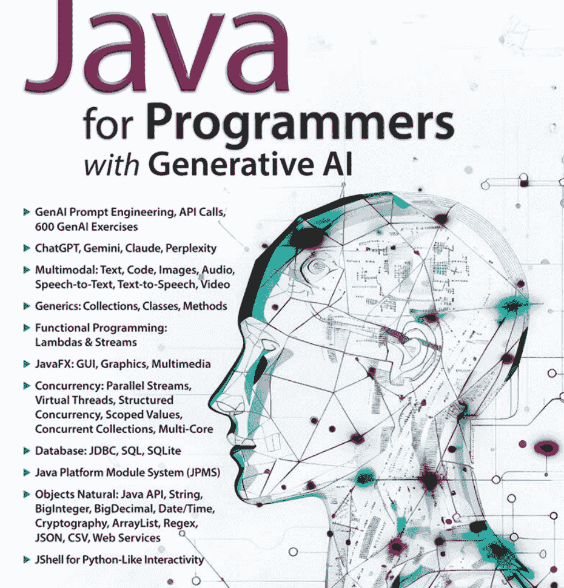

# 关于本电子书

ePUB 是一种开放的行业标准电子书格式。然而，不同阅读设备和应用程序对 ePUB 及其许多功能的支持程度不相同。请使用您的设备或应用设置根据您的喜好自定义显示效果。您可以自定义的设置通常包括字体、字号、单栏或双栏、横屏或竖屏模式，以及可以点击或触摸以放大的插图。有关您的阅读设备或应用上设置和功能的更多信息，请访问设备制造商的网站。

许多书籍包含编程代码或配置示例。为了优化这些元素的显示效果，请在单栏、横屏模式下查看电子书，并将字体大小调整为最小设置。除了以重流文本格式呈现代码和配置外，我们还包含了代码的图像，模仿印刷书籍中的显示效果；因此，当重流格式可能会损害代码列表的显示效果时，您将看到“点击此处查看代码图像”链接。点击链接可查看高保真代码图像。要返回之前查看过的页面，请点击设备或应用上的“返回”按钮。


# 最近的 Deitel 书籍

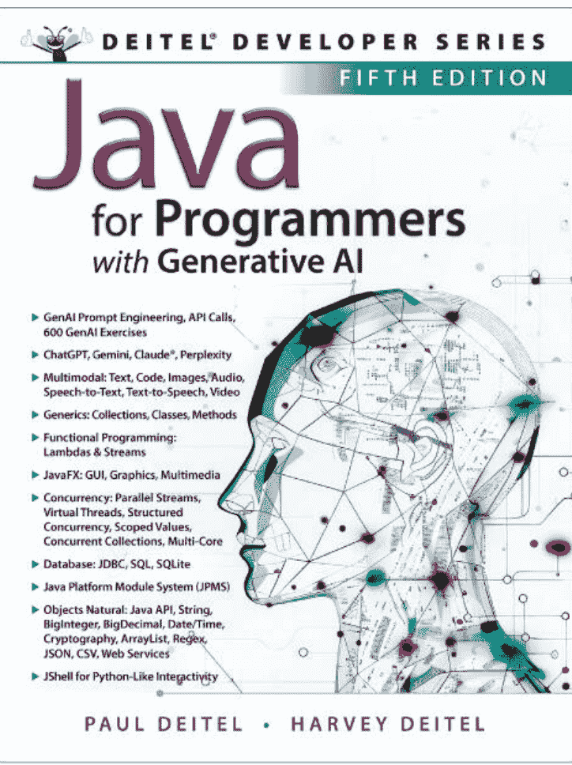

https://deitel.com/javafp5

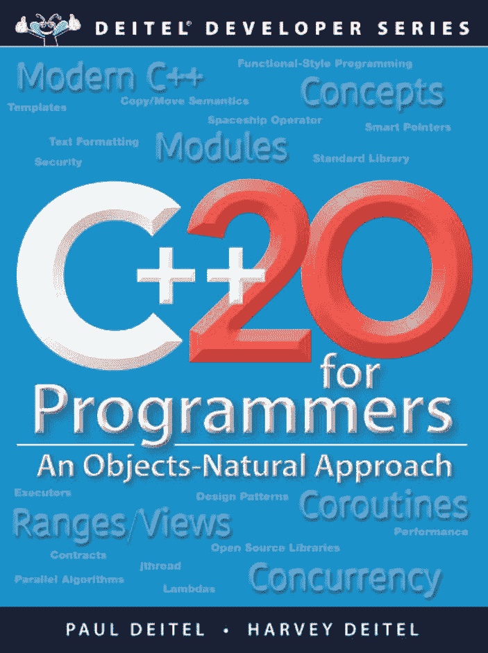

https://deitel.com/cpp20fp

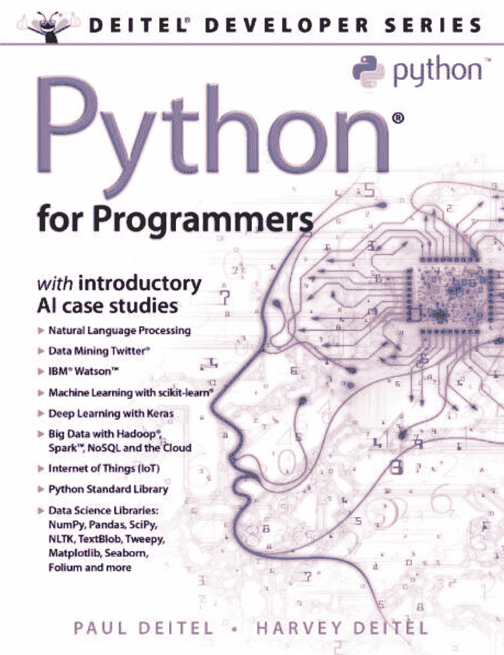

https://deitel.com/pythonfp

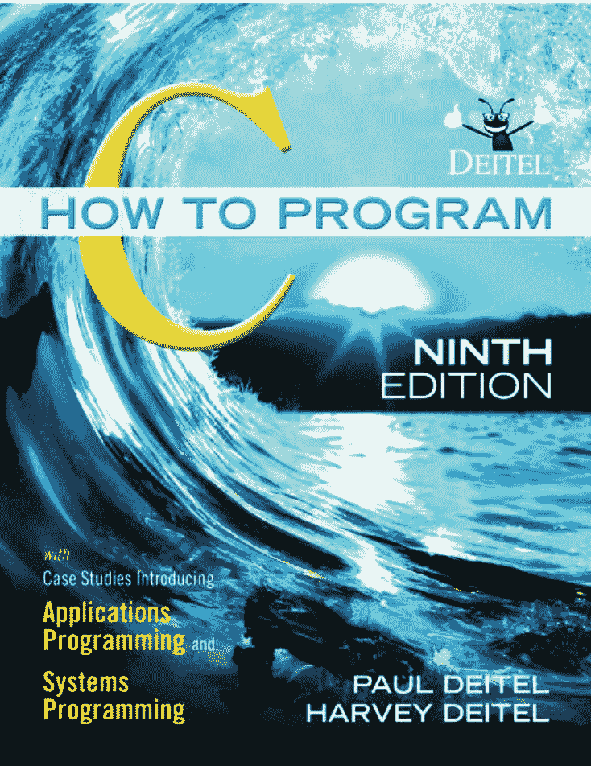

https://deitel.com/chtp9


https://www.pearson.com/en-us

https://www.pearson.com/en-us


- 前言
- 在开始之前

### 5.2 声明方法
### 5.4 案例分析：随机随机数的骰子模拟
### 5.8 类 Math：静态方法和变量
### 7.4 `StringBuilder` 类
### 11.5 案例研究：JavaScript 对象表示 (JSON) 序列化
### 11.8 案例研究：读取并分析包含泰坦尼克号灾难数据集的 CSV 文件
### 11.10 总结
### 19.7 视频
- 21.3.2 类 `Welcome`
- 21.5.2 `java.base`
### 21.7 模块中的资源
- 21.7.1 访问
- A.2.6 隐式声明变量

## 前言

“今天，我们正处于计算领域重大变革的边缘。AI 与加速计算的交汇将重新定义未来。” —黄仁勋，NVIDIA 首席执行官¹

1. 黄仁勋，NVIDIA COMPUTEX 2024 主演讲，2024年6月2日。访问于2025年3月2日。https://www.youtube.com/watch?v=pKXDVswZMUU

欢迎阅读《生成式 AI 与 Java 编程》第五版。在序言中，我们将介绍这本书的“灵魂”。本版的核心主题是“杠利用”。通过三种最新的互补教学方法，你将以更快、更广、更深的方式学习 Java 编程。你将利用以往的学习方法完成更强大的任务，并更好地应对职业生涯中面临的编程和软件开发挑战：

- **强大：我们用代码来教代码。** 你将通过我们传统的现场编码方法进行学习。你将利用学习经验，通过沉浸在数百个具有意义输出的完整工作代码示例中，掌握 Java 基础。
- **更强大：我们用对象来教对象。** 本版新增了，你将使用我们的“对象自然”（objects-natural）方法来学习 Java 面向对象编程。通过使用 Java 扩展库以及来自 github.com 等仓库网站开源库中功能丰富的预定义类，你将提升编写更重要程序的能力。
- **最强大：我们用生成式 AI 来教生成式 AI。** 同样是本版新增的，你将掌握 genAI——这类利用你创造能力的关键的人工智能技术。在示例和 genAI 练习中，你将使用提示词（prompts）并构建能够生成原始文本、Java 代码、图像、音频、语音、音乐甚至视频的程序！

## 合著者 Harvey Deitel 的个人轶事

20 世纪 70 年代，一位朋友建议我在当地一所学院教一门计算机导论。在关于编程语言类型分级的章节（从底层机器语言到中间层汇编语言，再到高级语言，我每种语言都编写过程序），我解释道：随着层级的向上，编程效率变得越高。你越远离原始的计算机硬件细节，越接近应用领域，在应用领域中，你会根据试图解决的现实世界问题进行思考。这些语言中的语句随着层级的提高而变得越来越强大，**利用你更快解决更具挑战性的问题的能力，同时产生更工程化的解决方案。**

学生们很好奇，询问这一切将走向何方。我说：“预测是合理的，甚至未来还会出现更高层次的编程技术，这将帮助人们更快、更好地解决更多现实世界问题。随着你编写的编程语句变得越来越强大，有一天，你的编程将非常接近应用领域，以你只需要**告诉计算机你需要什么，而不是提供如何构建的日益复杂的细节**——而计算机将为你生成软件！”

那是 20 世纪 70 年代的事了。然后在 80 年代和 90 年代，面向对象编程——Java 的核心编程模型——爆发了。对象源于被称为“类”的“蓝图”。几乎任何名词或概念都可以用类来表示。当然，现实世界存在大量的这类类。程序员开始构建大量的类库，进一步利用了软件开发过程。当 Java 的早期版本在 90 年代中期出现时，值得注意的是，它们是免费的，并附带数百个强大的预构建类，这使得程序员能够更容易在图形、GUI、并发、互联网网络、数据结构、数据库等关键领域快速构建出重要的应用程序。这些类中的许多类有数百或数千行代码，但要创建它们，程序员通常必须自己编写这些代码。

在此期间，AI 领域从其 20 世纪 50 年代的根源不断演变。然而，直到 2017 年，Transformer 模型才定义了当前的 AI 热潮。

2. Ashish Vaswani 等，“Attention Is All Need.” arXiv 预印本，arXiv:1706.0376，2017. https://arxiv.org/abs/1706.0376

2022年11月，OpenAI 发布了 ChatGPT，在五天内拥有了一百万用户，两个月内达到一亿用户。没有其他应用程序曾被如此广泛使用。

## 极其广泛的现实世界应用

在本书中，我们为 Java 提供了一个友好的、现代的、代码密集且以案例研究为导向的介绍，它是全球最流行的编程语言之一.³Java 在广泛的应用中广受欢迎，是因为它是平台无关、健壮的，并且具有广泛的标准和第三方类库支持。它用于构建从最小的物联网（IoT）设备（如连接到互联网的传感器）到最大的云平台的所有软件。Java 的有趣用途包括：

3. 2025 年 1 月 PYPL 编程语言流行指数。访问于2025 年 1 月 18 日。https://pypl.github.io/PYPL.html.
4. 2025 年 1 月 Tiobe 指数。访问于2025 年 1 月 18 日。https://www.tiobe.com/tiobe-index/.
5. ChatGPT 对“Java 有哪些有趣的用途，例如火星探测器”的回答。2025 年 1 月 15 日。https://chatgpt.com. 我们对回答进行了编辑。
6. “Minecraft，”维基百科。最后修改于2025 年 1 月 20 日。访问于2025 年 1 月 20 日。https://en.wikipedia.org/wiki/Minecraft.
7. LSEG 开发者。“Java 实时 SDK。”访问于2025 年 1 月 20 日。https://developers.lseg.com/en/api-catalog/real-time-opnsrc/rt-sdk-java.
8. 联邦航空管理局 (FAA) 用于航班和机场信息的 API，https://github.com/Federal-Aviation-Administration.
9. “欢迎来到 Android Developers。”访问于2025 年 1 月 15 日。https://developer.android.com/.
10. 全球移动操作系统市场份额。StatCounter。访问于 2025年1月20日。
11. Ross, Philip. “Java 运行远程控制的火星探测器”。CNET。2004年1月16日。访问于 2025年1月20日。https://www.cnet.com/tech/tech-industry/java-runs-controlled-mars-rover/.
12. Broad Institute。“开始使用 GATK”。GATK 文档。更新于 2024年7月20日。访问于 2025年1月20日。https://gatk.broadinstitute.org/hc/en-us/articles/360036194592-Getting-started-with-GATK。

- Minecraft（史上最流行的视频游戏之一⁶）
- 金融交易平台（例如 LSEG 实时 SDK）
- 联邦航空管理局 (FAA) 用于航班和机场信息的 API
- Android 移动应用开发——Android 是领先的移动设备操作系统，全球市场份额为 73.5%
- NASA 火星探测器软件
- 用于分析遗传 DNA 和 RNA 测序数据的工具

流行的生成 AI 机器人 ChatGPT，Gemini，Claude 和 Perplexity 在你本书中也会用到的其他 Java 列表包括：

- 桌面 GUI 应用程序（如我们在第 15–17 章中从 JavaFX 开始）
- 跨平台 2D 和 3D 游戏开发库（例如 FXGL，我们将在博客文章中介绍）
- 嵌入式系统（如智能卡、蓝光播放机、电缆顶盒、打印机和汽车“信息娱乐”系统）
- 科学和教育软件
- 基于 Web 的应用程序（如 Spring 和 Spring Boot 框架）
- 高性能服务端软件
- 银行和金融的企业解决方案
- 大规模分布式系统
- 机器人
- 大数据技术（如存储和处理海量数据的 Hadoop）

13. ChatGPT 对“用 100 字介绍 Java 流行的应用类型”的回答。2025年1月16日。https://chatgpt.com。我们对回答进行了编辑。
14. Gemini 对“用 100 字介绍 Java 流行的应用类型”的回答。2025年1月16日。https://gemini.google.com/app。我们对回答进行了编辑。
15. Claude 对“用 100 字介绍 Java 流行的应用类型”的回答。2025年1月16日。https://claude.ai。我们对回答进行了编辑。
16. Perplexity 对“用 100 字介绍 Java 流行的应用类型”的回答。2025年1月16日。https://perplexity.ai。我们对回答进行了编辑。

# 目标读者

本书的模块化架构（见下文的“高层概述”）适合多种读者群体。

- 基于 ACM 和 IEEE 专业协会课程建议的入门级和中级专业 Java 培训课程。17
17. ACM/IEEE (Assoc. Comput. Mach./Inst. Electr. Eng.) 2023. 计算机科学课程（纽约：ACM）。访问于 2025年1月18日。https://csed.acm.org/content/uploads/2023/03/Version-Beta-v2.pdf。
- 拥有其他语言经验、且必须学习 Java 以用于即将开展的项目的程序员。
- 已经了解部分 Java 并需要学习最新的 Java 特性和惯用法以为即将开展的项目做准备的程序员。

它还将帮助你准备 Oracle Java SE（标准版）开发者专业认证考试涵盖的大多数主题。18,19
18. Jeanne Boyarsky 和 Scott Selikoff, OCP Oracle Certified Professional Java SE 21 学习指南（纽约：Wiley，2024）。[Jeanne Boyarsky 是《面向带生成式 AI 程序员的 Java》（第 5 版）的技术审稿人]。
19. “考试：Java SE 21 开发者专业 (1Z0-830)”。访问于 2025年1月18日。https://mylearn.oracle.com/ou/exam/java-se-21-developer-professional-1z0-830/40805/139080/220555。

# 现场代码方法

本书的核心是 Deitel 标志性的现场代码方法。你将不是通过代码片段，而是通过 200 多个完整编码的、真实的示例和案例研究来实操学习 Java，这些示例源自计算机科学、数据科学、AI 和其他领域，并带有实时输出。请阅读本序言之后的“开始之前阅读”章节，了解如何下载代码示例以及设置你的 Windows 或 macOS 计算机运行它们。

第 1 章的试驾（1.7 节）展示了如何使用免费开源的 OpenJDK 版本 Java 开发工具包编译并运行代码示例。在阅读文本的同时并行执行每个程序将让你的 Java 学习体验“活起来”。我们还在 https://deitel.com/javafp5 提供了以下流行的 Java 开发者工具的试驾：

- JetBrains IntelliJ IDEA Community版
- Java开发者 Eclipse IDE
- Microsoft Visual Studio Code

# 面向生成式 AI 程序员的 Java，第 5 版

# 高层概述

# DEITEL 开发者系列

# 第五版

# Java

面向生成式 AI 程序员

PAUL DEITEL • HARVEY

## 编程范式

过程式（第 1–7 章）、面向对象（第 8–10 章）、泛型（第 12–13 章）、函数式（第 14 章）、并发式（第 18–19 章）。

## 第一部分：引言

### 第 1 章，Java 编程简介——Java 基础。输入/输出。基本类型。决策处理。

### 第 2 章，Java 应用程序简介——`String` 类。

### 第 3 章，控制语句：部分 1——if/else、while 语句。逻辑运算符。

### 第 4 章，控制语句：部分 2——for、do/while、switch、break、continue 语句。

### 第 5 章，方法——自定义方法。随机数。

### 第 6 章，数组和 ArrayList——内置数组。

### 第 7 章，字符串、NLP 和正则表达式——`String`、`Character`、`StringBuilder` 类。

## 第二部分：高级编程

### 第 8 章，使用自定义类进行现实建模——构建有价值的类。`Account` 类案例研究。洗牌发模拟。`Time` 类案例研究。控制类成员访问。构造函数。Set/get 方法。数据验证。抛出异常。`static` 和 `final` 类成员。`record` 类。

### 第 9 章，使用继承、多态和接口进行现实建模——继承层次。运行时多态。继承的“is-a”关系与组合的“has-a”关系。面向接口编程而非实现。依赖注入密封类和接口。

### 第 10 章，异常处理：深度查看——捕捉和处理异常的语句。Throwable 层次结构。检查异常与未检查异常。try-with-resource 语句。

### 第 11 章，文件、I/O 流、JSON 序列化与 CSV 文件——数据持久化。文本文件与二进制文件。NIO 类。获取文件/目录信息。Formatter 类。JSON（JavaScript 对象表示）序列化。使用 `java.net.http` 特性调用 OpenWeatherMap Web 服务。CSV 格式。泰坦尼克号灾难数据集和基础数据分析。

## 第四部分：数据结构、泛型集合、Lambda 和 流

### 第 12 章，泛型集合——Java 框架中的预包数据结构。预构建的泛型数据结构。30 个 genAI 提示练习。

### 第 13 章，泛型类和方法：深入探讨——实现自定义自定义泛型方法和自定义泛型类。编译时类型安全。24 个 genAI 提示练习。

### 第 14 章，使用 Lambdas 和 Streams 的函数式编程——使用 lambda 和流管道来编写某些类型的程序，比以前的技术更快、更简单、更简洁，并希望 Bug 更少。关注不可变性。第 18 章，并发：从平台线程到虚拟线程，展示了在多核架构上并行处理流流水线。37 个 genAI 提示练习。[此处可以涵盖第 22 章。

## 第 5 部分：JavaFX 图形用户界面、图形与多媒体

### 第 15 章，JavaFX 图形用户界面：部分 1——使用 Scene Builder 进行简单的拖放式 GUI 设计。布局。事件处理。欢迎应用程序。小费计算器应用程序。13 个 genAI 提示练习。

### 第 16 章，JavaFX：部分 2——额外的布局和控件。鼠标、RadioButton 和属性更改事件。数据绑定。自定义控件的外观。FileChooser 和 DirectoryChooser 对话。21 个 genAI 提示练习。

### 第 17 章，JavaFX 图形与多媒体——使用层样式表 (CSS) 自定义 JavaFX 节点的外观和文本字体。2D 和 3D 形状。移动、旋转和缩放节点变换。显示、播放和暂停视频。通过 Transition 和 Timeline 动画增量更改属性。使用 AnimationTimer 进行逐帧动画。用于简化动画效果的 CSS 过渡。使用 Canvas 鼠标绘制。31 个 genAI 提示练习。

## 第 6 部分：高级主题


# 第 18 章，并发：从平台线程到虚拟线程——多核编程

创建和管理多个任务。性能案例研究。使用 Date/Time API 比较顺序与并行排序。预包的并行算法。经典的生产者-消费者关系。更易用、更不易出错的高层次并发特性。Project Loom：轻量级虚拟线程、结构化并发、作用域值。51 个 genAI 提示练习。

## 第 19 章，构建基于 API 的 Java 生成式 AI 应用

能够理解文本、代码、图像、语音和视频输入，并生成文本、代码、图像、语音和视频的多模态 genAI。使用 OpenAI API 创建用于总结文本、分析文本情感、创建图像的可访问描述、检测文本语言并在语言之间翻译文本、生成 Java 代码、对文本进行命名实体识别并获取结构化 JSON 输出、将语音转换为文本、从文本合成语音、为视频生成字幕等的应用。21 个 genAI 提示练习和 73 个基于 API 的编程项目。

## 第 20 章，使用 JDBC 和 SQLite 访问数据库

在数据库中存储持久化数据。SQLite 数据库管理系统。结构化查询语言 (SQL) CRUD（创建、读取、更新、删除）操作。JDBC API。连接数据库。从数据库检索数据。JavaFX TableView。JDBC PreparedStatement。19 个 genAI 提示练习。

## 第 21 章，Java 模块系统

创建自定义包和模块。声明模块依赖。指定模块导出包。定义模块提供或消耗的服务。反射和启用反射访问。使用模块封装资源。31 个 genAI 提示练习。

## 第 22 章，递归与大 O

递归和迭代阶乘计算。递归斐波那契数列创建“羽毛分形”。基于文本的算法可视化。丰富的递归练习。11 个 genAI 提示练习。[可以在第 4 部分：数据结构的末尾涵盖。]

# 附录

## 附录 A，交互式 Java JShell 简介

Java 友好的命令行 REPL（读取-评估-打印循环），用于探索、发现和实验。就像在 Java 中拥有 Python 的交互性。许多章节可以与书的前几章结合阅读。

## 附录 B，格式化输出

用于输出和内存中 String 的格式化功能。总结了全书的格式化功能并引入了额外能力。

## 附录 C，数制

引入二进制（2 进制）、八进制（8 进制）、十进制（10 进制）和十六进制（16 进制）。

### Deitel.com 博客可能的话题

- 有序集合。灵活的构造体。位操作。带标签的 break 和 continue 语句。JavaFX 订阅 API。使用 FXGL (FX 游戏库) 进行基础 Java 游戏开发入门，涉及动画、碰撞检测、粒子效应等。我们将与 Java 相关的博客文章链接到书籍的网页 `https://deitel.com/javafp5`。

# “对象自然” (Objects-Natural) 方法

传统的面向对象编程书籍通常使用“延迟对象”(late objects) 或“早期对象”(early objects) 教学方法。在这些书中，真正“晚”或“早”的并不是“对象”，而是教如何开发自定义类——即构建对象的“蓝图”。我们已经在各种流行的面向对象编程语言中写过使用这两种方法的书。

## 什么是“对象自然”？

在我们编写教材《Intro to Python for Computer Science and Data Science: Learning to Program with AI, Big Data and the Cloud》时，我们注意到尽管我们的陈述方式符合“延迟对象”模型，但它实际上是某种更深层的东西——而且这种东西是特别的。我们称之为“对象自然方法”，我们现在于 Deitel、Paul 和 Harvey Deitel 编写的每种面向对象的语言中使用它。

与“延迟对象”一样，我们的对象自然方法从基础知识开始，如数据类型、变量、运算符、控制语句、方法、数组和字符串（在创建自定义类之前就会学习这些）。这是使用 Java 这样成熟语言极具吸引力的方面之一。

# 使用 genAI 的两种方法

我们通过两种方法集成 genAI：

- **提示词工程 (Prompt engineering)**：在第 19 章之外，我们专注于提示词工程，以优化与生成式 AI 工具的交互。将此视为学习一种全新的、不同的编程语言。通过提示词工程，你编写精确的指令或查询来引导生成式 AI 生成所需的响应。你还可以迭代地调整提示词，对其进行完善和调整，帮助生成式 AI 产生更准确、相关的结果——提示词越好，结果越好。学习如何创建优秀的提示词需要大量经验——你将在书中获得这些经验。

- **使用 AI API 的 Java 代码加提示词工程**：第 19 章将提示词工程与基于 API 的代码开发相结合，强调了生成式 AI 如何帮助你构建和调整完整的 Java 应用程序。我们使用了 OpenAI API。

第 19 章的示例和练习将在构建基于 API 的 Java 生成式 AI 应用的同时，深入探讨用于代码生成和分析的生成式 AI。你将学习编写有效的提示词来生成代码片段、调试和调整你的程序，并创建完整的 Java 应用程序。

# 我们使用的 GenAI 工具

我们的工作依赖许多生成式 AI，包括四个主要的生成式 AI 聊天机器人：

- OpenAI ChatGPT
- Google Gemini
- Anthropic Claude
- Perplexity

我们在每个任务中都使用了它们，因为它们会产生一些重叠和一些不同的结果——每者都增加了价值。事实上，当我们给出同一个提示词时，同一个生成式 AI 往往会产生不同的结果，即使是在几秒钟之后。它们各自独特的优缺点。生成式 AI 在不断进化，能力和局限性会随时间变化，并且可能会大幅提高。

我们还使用了 `OpenAI 的 DALL-E` 进行**图像生成**（DALL-E 现在已集成到 ChatGPT 中）以及 `Sora` 进行**视频生成**。许多生成式 AI 提供免费试用或分级，这可以给你提供不错的结果，但能力可能不如其付费版本。

# GenAI 在教育中的作用

生成式 AI 在职业教育和普通高等教育，特别是编程语言教育中将发挥至关重要的作用。它们作为一个随时的虚拟专家团队为你提供帮助，访问成本很低或免费。

组织和教育机构对于是否允许使用生成式 AI 仍存在分歧。有些机构像我们在书中那样拥抱它。有些机构禁止了它。另一些机构则在有保障的情况下允许使用。我们鼓励你熟悉这些工具，这些工具在你的职业生涯中可能是不可或缺的。然而，请务必遵守你所在组织或机构的政策。

# 用于增强学习体验的 GenAI

生成式 AI 可以通过以下方式增强学习体验：

- 提供复杂概念的多个视角。
- 提供交互式调试帮助。
- 在概念模糊时帮助识别复习领域。
- 通过不同的解释方法支持各种学习风格。
- 对你编写的代码提供个性化反馈。

我们鼓励你通过实践，利用生成式 AI 来增强你的学习体验。我们的生成式 AI 练习章节可以帮助你：

- 学习提示词工程——编写和完善提示词以获得最佳结果。
- 通过尝试大量提示词了解生成式 AI 可以做什么。
- 了解每个生成式 AI 回应提示的详细程度。
- 发现解决问题的新方法。
- 比较不同生成式 AI 的优缺点。
- 了解生成式 AI 会出错且有时会幻觉，以及如何检测和处理这些错误。
- 意识到生成式 AI 可能会产生不准确的结果。
- 就书中提出的问题寻求解答。
- 当你想要更多细节时增强你的知识。

# 我们如何使用 GenAI

我们将生成式 AI 集成到我们的创作工作中——不是为了编写手稿（引用处的特定设计除外）或代码示例，而是为了增强研究、开发、调整写作和校对。我们使用生成式 AI 来：

- 完善我们的 GenAI 提示技巧以获得更好的结果。
- 头脑风暴。
- 从书的内容中提取要点，并将其用于为教师准备和交付课程编写 PowerPoint PPT。
- 验证我们的内容。
- 检查我们使用了当前的 Java 编程惯用法和适用于此类水平书籍的《整洁代码》指南。[^22]
- 检查我们的语法和写作的流畅性和清晰度。
- 从我们的内容生成选择题草稿。
- 使用书中此处已介绍的技术草拟练习答案。
- 直接从我们的内容草拟营销文本。
- 直接从我们的内容草拟博客文章。
- 重构我们的代码以符合编码规范，例如代码缩进、注释的相关性和密度。
- 重构代码（例如，重命名变量、方法和类，将重复代码提取到单独的函数等）。

在大多数情况下，有效的提示词工程是关键，通过仔细调优的提示词重新访问正在进行的对话通常会带来显著改进的结果。

[^22]: Martin, Robert C. *Clean Code: A Handbook of Agile Software Craftsmanship*. Upper Saddle River, NJ; Addison-Wesley, 2009.

# GenAI 用户指南

我们鼓励你将生成式 AI 作为一种学习工具，而不仅仅是答案生成器。正如精通编程需要理解语言和库的能力一样，有效的生成式 AI 使用需要培养不同提示词的技能。你应当：

- 跟踪你的提示词及其结果的质量。这对于学习哪些有效、哪些无效至关重要。这还将帮助你识别不同生成式 AI 平台的细微差别。你将建立一个宝贵的提示词和预期结果的库，将利于未来的编程工作。
- 尝试多个生成式 AI——包括新出现的工具——并比较结果以理解多样化的能力。
- 尝试不同的提示词策略，看看哪些策略能帮助你实现目标。
- 如果生成式 AI 的结果不满意，调整你的提示词并重试。不同的编程挑战需要不同的提示词策略。你会发现某些生成式 AI 强调产生流畅、专业的文字，而另一些则更深入探讨主题。
- 使用生成式 AI 进行**发现**——发现最初可能无法察觉的新想法、见解和模式。生成式 AI 提供广泛的视角，分析大量数据并合成可操作的输出以增强创造力。GenAI 发现可以增强你的创造力和智慧。[^23]

[^23]: ChatGPT 回应“使用生成式 AI 进行发现意味着什么？” 2025年1月18日。`https://chatgpt.com`。我们编辑了回答。

# 幻觉与错误

生成式 AI 具有局限性。它们已知会“幻觉”，自信地提供虚假答案。当你要求它们执行任务时，结果有时包含错误，例如无效的 Java 代码。我们在书中包含了成功和失败的 AI 交互。例如，虽然生成式 AI 帮助我们增强了进制转换中的创新应用，但我们也遇到过它们在简单任务上遇到困难的情况。早在第 2 章，当我们要求它们编写简单的 Java 语句时就遇到了 AI 失败。我们特意包含了这些失败案例作为宝贵的教学时刻，证明了生成式 AI 会出错，因此你必须谨慎使用。这强调了保持人工监督和验证的重要性，特别是在关键业务和任务关键的情况下。

# 为什么我们使用某些付费服务

虽然免费或免费层级的生成式 AI 很有价值，但付费服务通常提供更强大的能力、可用性和可靠性。许多生成式 AI 是付费服务，是因为训练提供强大能力的大语言模型成本巨大。例如，训练 OpenAI 的 GPT-4 和 Google 的 Gemini 分别花费了 7800 万美元和 1.9 亿美元——这还没有包括开发大语言模型的人员薪水和其他开销。[^24] 我们鼓励你在可用时使用免费或低成本工具。你甚至可以询问生成式 AI 建议免费版本。然而，专业开发人员通常会选择工具以获得最佳结果。

[^24]: Stanford Institute for Human-Centered Artificial Intelligence (HAI), AI Index Report 2024, May 2024. Accessed March 8, 2025. `https://hai-production.s3.amazonaws.com/files/hai-ai-index-report-2024-smaller2.pdf`。

# 我们试图实现的目标

我们的目标是为未来做好准备，在未来，生成式人工智能（genAI）将在你的个人生活和职业生涯中不可或缺。通过在书中穿插 genAI 示例和练习，我们旨在帮助你熟练使用这些工具，并理解它们的优势和缺点。在探索 genAI 能力的同时，培养良好的谨慎意识，将使你能够有效地使用它们。

## 第 19 章基于 API 的完整、实时代码 Java GenAI 应用程序案例研究

第 19 章介绍了以下完全实现的代码示例，这些示例通过编程与 OpenAI 的 API 进行交互：

- **文本摘要**（第 19.4.1 节）：要求 OpenAI 聊天 API 提供 Deitel 视频转录的摘要以及转录的关键要点列表。此类文本响应被称为**聊天完成**（chat completions）。

- **情感分析**（第 19.4.2 节）：要求 OpenAI 聊天 API 分析转录的情感，并解释 genAI 如何得出该结论。

- **无障碍图像描述**（第 19.4.3 节）：此多模态应用上传图像，并要求 OpenAI 聊天 API 对第 4.3 节中的 for 循环 UML 图和一张阿鲁巴海滩风景照进行详细描述。

- **语言检测与翻译**（第 19.4.4 节）：要求 OpenAI 聊天 API 将文本翻译成指定语言——它会自动检测源语言。我们将文本从英语翻译成西班牙语和日语，然后从西班牙语和日语翻译回英语。今天的许多 genAI 可以在数十种语言之间翻译。

- **Java 代码生成**（第 19.4.5 节）：要求 OpenAI 聊天 API 生成用于模拟的代码，以总结数百万次六面骰掷并显示结果。

- **命名实体识别与结构化输出**（第 19.4.6 节）：演示如何按指定的格式生成结构化的 JSON 响应。此应用执行名为命名实体识别（NER）的自然语言处理（NLP）任务，尝试定位并分类日期、时间、数量、地点、人物、物品、组织等文本提及。为了使结果更容易处理，我们为 API 提供了希望接收的精确 JSON 响应格式，然后使用 Jackson 开源库（第 11 章）来处理结果。

- **语音转文本**（第 19.5.1 节）：此多模态应用（语音音频和文本）上传语音音频文件到 **OpenAI Whisper 模型**，将其转录为文本并返回文本转录。

- **文本转语音**（第 19.5.2 节）：此多模态应用（文本和语音音频）将文本上传到 OpenAI TTS-1 **模型**，以从文本合成语音。此示例使用相同的声音将英语、西班牙语和日语文本转换为语音。

- **图像生成**（第 19.6 节）：演示相关代码，该代码要求 Dall-E API 生成图像，包括霓虹色、黑色背景、日本动漫角色风格的哈瓦那犬、文森·梵高风格以及莱奥纳多·达芬奇风格的图像。

- **为视频创建封闭字幕**（第 19.7.1 节）：此多模态无障碍应用（语音音频、文本和视频播放）上传视频的音频轨道，并将其转录为包含时间戳和相应转录文本的 JSON 格式。然后，应用程序请求一个完成项，以生成 **VTT 格式的封闭字幕**。[^25] 我们展示了 VTT 格式的文本以及显示在相应视频上的字幕屏幕截图。

[^25]: "WebVTT." 维基百科。最后修改于 2024 年 12 月 31 日。访问于 2025 年 3 月 1 日。`https://en.wikipedia.org/wiki/WebVTT`。

- **审核**（第 19.8 节）：要求 OpenAI 审核 API 评估提示是否存在有害或不当内容，例如骚扰、仇恨言论、暴力、自残和显式性内容。

## GenAI 提示练习

我们将书中所有练习的完整列表输入到……（注：此处原文不完整，已根据上下文翻译）

（注：由于提供的待翻译文本在后半部分出现了重复且结构断裂，以下内容已根据提供的文档片段进行了对齐翻译，确保格式一致）

（注：由于提供的源文本后半部分似乎是多个章节的重复或混乱，以下已根据逻辑结构进行翻译处理）

## GenAI API 的 Java 编程练习

第 19 章《基于 API 的生成式人工智能应用》建议了一些具有挑战性的项目练习，例如创建相互辩论的 genAI 多媒体应用，以及使用 genAI 构建和解决字谜。我们将第 19 章的 90 多个练习输入 genAI，要求其分类总结，然后对摘要进行总结。以下是它们生成的内容：

- **多模态应用**：结合文本、图像、音频和视频能力。创建交互式体验。开发利用多种模态的综合工具。
- **基于文本的应用**：文档处理（索引、摘要、探索）。创意写作（故事生成、诗歌、辩论）。语言工具（翻译、语气重写）。专业文档创建（简历、演示文稿）。结构化输出。
- **图像处理应用**：生成艺术和设计（标志、时尚、平面图）。技术可视化（UML 图）。图像分析与识别。
- **音频与音乐应用**：语音处理（转录、语音克隆）。音乐生成（MIDI、Magenta AI）。多语言音频应用。播客和音频内容分析。
- **教育工具**：编程辅导师（Java、编码练习）。特定学科的学习辅助（数学、算术）。课程内容创建。交互式教育体验。
- **游戏与益智应用**：益智生成器和求解器（字谜、单词搜索）。交互式游戏开发。
- **视频**：研究和实验生成式 AI 视频创作工具。
- **聊天机器人开发**：基于角色的聊天体验。专业领域专家。
- **研究与分析工具**：医疗应用（药物发现、个性化医疗）。AI 能力探索。文本检测与分析。教育研究。
- **创意应用**：儿童读物创作。交互式叙事。艺术内容生成。创意写作工具。
- **实用工具与程序**：文档生成器。翻译服务。内容摘要器。专业工具（简历筛选、演示文稿创建器）。

## 核心要点

- **尝试多个生成式 AI (genAI)**：比较它们的优缺点。
- **精通提示词工程 (prompt engineering)**：编写有效的提示词以获得最佳结果。建立你自己的优秀提示词库。
- **警惕幻觉**：始终以批判性眼光审查 genAI 的输出。
- **拥抱生成式 AI 的力量**：利用它来增强你的 Java 学习体验，而不是取代它。
- **遵循所属组织的 genAI 政策。**

## 新功能与更新特性


# 关键新功能与更新

在以下章节中，我们将讨论为《面向程序员的 Java 与生成式 AI》第 5 版所做的关键新功能和更新，包括：

1. **面向对象的案例研究**。第 1 章对对象技术的基本概念和术语进行了友好的介绍。在前面的章节中，你将创建并使用预存 Java API 类的强大对象来完成重大任务，而无需了解如何编写 Java 类或这些特定类是如何实现的——而且你将在第 8 章创建和使用自定义类的对象之前完成这些操作。我们添加了面向对象的案例研究：第 2 章的 `String` 类、第 3 章用于大整数的 `Integer` 类、第 4 章用于业务应用中精确货币计算的 `BigDecimal` 类、第 5 章的 Date/Time API、第 6 章用于动态大小数组的 `ArrayList` 类、第 7 章用于在文本中定位模式正则表达式、第 7 章的密钥 AES 加密以及第 11 章的公钥 RSA 加密。在书的其余部分，许多其他案例研究都大量使用了 Java API 和开源库类的对象。

2. **约 600 个集成生成式 AI (genAI) 提示词练习题**。大多数章节都以 genAI 提示词练习（约 450 个）结束，你将在练习中使用提示词工程与 genAI 交互。此外，许多章节还包含了章末 genAI 提示词练习（约 150 个）。你会感觉身边 24/7 都有许多 Java 专家（有些收取少许报酬，有些是免费的）回答你关于书中 Java 内容的问题，帮助你深入地探索感兴趣的话题，甚至帮助你编写和调试 Java 代码。更棒的是，它们正在相互竞争，不断有新条目涌入以为你提供最佳结果，同时每个都在快速改进。

3. **第 19 章《构建基于 API 的 Java 生成式 AI 应用》**在本章的 94 个练习中，演示了如何通过编程与 OpenAI 的 API 交互，实现文本摘要、情感分析、辅助功能图像描述、语言间文本翻译、生成 Java 代码、命名实体识别、语音转文本、文本转语音、视频闭式字幕、图像生成等功能。

4. **涵盖最新的 Java 语言特性、库特性和编程惯用法**。为了在 Java 新版本发布时保持书籍更新，我们将在**我们的博客** https://deitel.com/blog 上发布新的代码示例和解释，并将它们链接到书籍网页 https://deitel.com/javafp5。

5. **精简现代面向对象编程处理**，包括 `record` 类、`sealed` 类和接口，以及关于“面向接口而非实现编程”的新案例研究，侧重于组合和依赖注入。

6. **增强的文件处理覆盖**，包括使用 Jackson 开源库输入和输出 JSON 和 CSV 格式的数据，这些格式在如今的数据科学应用中非常流行。

7. **使用 `java.net.http` 包提供的网络网络功能调用流行的 Web 服务**（如 OpenWeatherMap）。

8. **引入 CSV 格式泰坦尼克号灾难数据集进行数据分析的特别专题**。

9. **加密特别专题**，包括密钥 AES 加密和公钥 RSA 加密。加密对于快速增长的计算机隐私和安全需求至关重要。

10. **关于用于为自然语言处理 (NLP) 和 genAI 模型准备文本的简单数据清洗步骤的特别专题**。数据清洗是关键。

11. **增强的 JavaFX 处理**，包括图形、动画和视频。

12. **使用 FXGL（开源）和新 Java 特性进行游戏开发的简介介绍**。

13. **对 JShell 的灵活覆盖**，这是 Java 友好的 REPL（读取-评估-打印循环）环境，用于快速探索和实验 Java。

14. **Project Loom 中结构化并发和作用域值（scoped values）简介**。

15. **并发、并行性**以及虚拟线程等现代 Java 相关技术。

16. **增强的数据库处理**，使用结构查询语言 (SQL) 和流行的 SQLite 数据库管理系统。

17. **许多使用 SQLite 的新旧示例**。

18. **使用 Java 17 中的 RandomGenerator**，它提供了增强的随机数生成能力。我们在安全场景（如加密示例）中使用 SecureRandom。

19. **结合十年编程、教学和行业经验的技巧**已完全整合到正文中。

20. **增加了应用编程案例研究**。

21. **专注于 AI 和数据科学**，包括模拟、自然语言处理 (NLP) 和人工智能。

# 数百个现代示例与 GenAI 练习

我们的代码示例和 GenAI 练习介绍了计算领域当前热门的话题。

## O’Reilly Online 付费订阅者可观看 50 多小时视频

在我们的《Java Fundamentals with Paul Deitel, 3/e》视频中：

点击此处查看代码图像

```
https://learning.oreilly.com/course/java-fundamentals/9780135353134/
```

合作者 Paul Deitel 讨论了“开始之前”（Before You Begin）章节中的内容，并对书中大部分程序进行了解释并提供了额外的见解。你可以在 https://www.oreilly.com/start-trial/ 获取免费的 10 天订阅期。

## 性能

我们专注于满足当今应用程序卓越性能需求的技术和策略。

## 数据体验

在第 11 章中，你将处理真实的文本数据。你将阅读和分析泰坦尼克号灾难数据集，该数据集在介绍数据分析领域非常受欢迎。该数据集存储在 CSV（逗号分隔值）文件中，这是我们在第 11 章中介绍的格式。此外，请参本序言后部分的“数据科学与计算机科学的交叉”章节。

> 26. https://vincentarelbundock.github.io/Rdatasets 上的“TitanicSurvival”数据集。数据集作者：Frank E. Harrell, Jr., 和 Thomas Cason。

## 安全 Java 编程

构建能够抵御病毒和其他形式“恶意软件”攻击的工业级系统具有挑战性。今天，通过互联网，此类攻击可以是瞬时的且全球性的。在开发周期的早期将安全性引入软件中可以显著减少漏洞。我们根据《Oracle Secure Coding Guidelines for Java SE》对本书进行了审核

点击此处查看代码图像

```
https://www.oracle.com/java/technologies/javase/
```

并遵循适用于此类水平书籍的安全编码实践。

## 隐私

ACM/IEEE 关于计算机科学、信息技术和网络安全的课程建议^27 多提到隐私。每位程序员都必须考虑隐私问题和关注。我们分别在第 7 章和第 11 章讨论了密钥加密和公钥加密。

27. “课程建议”。访问于 2025 年 1 月 18 日。https://www.acm.org/education/curricula-recommendations.

## 伦理

ACM/IEEE 关于计算机科学、信息技术和网络安全的课程建议^28 提到伦理 100 多次。在第 1 章和第 19 章的生成式 AI 练习中，你通过通过搜索和生成式 AI 研究关注伦理。你将调查围绕智能助手（如 Amazon Alexa、Apple Siri）以及生成式 AI 语音能力的隐私和伦理问题。

我们还将探讨围绕 OpenAI 的 ChatGPT^29、Dall-E^30 等生成式 AI 的兴奋与争议。

+   28. “课程建议”。访问于 2025 年 1 月 18 日。https://www.acm.org/education/curricula-recommendations.

+   29. “介绍 ChatGPT”。访问于 2025 年 1 月 18 日。https://openai.com/blog/chatgpt.

+   30. “Dall-E2”。访问于 2025 年 1 月 18 日。https://openai.com/product/dalle-e-2.

## 编程之道

本版将数百条编程技巧完全集成到正文内容流中：

- **良好的编程实践**关注那些帮助你编写更清晰、更易理解和更易维护程序的技巧。

- 我们指出了**常见的编程错误**，以减少你犯这些错误的概率。

- **性能提示**强调了让你的程序运行更快或最小化内存占用的机会。

- 软件工程观察强调了影响软件系统构建（尤其是大型系统）的架构和设计问题。

- 外观与感受观察（第 15–17 章）强调了 GUI 规范。这些观察帮助你设计出符合行业标准的、吸引人且用户友 GUI。

## 本书导读

序言早期的“高级概述”展示了书的模块化架构。我们建议你在阅读本节时参考该概述。

早期章节奠定了 Java 基础的坚实基础。中间和后期章节介绍了中级和高级 Java 编程主题。我们讨论了六种编程范式：

- 过程化编程（第 2–7 章）——增强了我们的对象-自然方法，

- 面向对象编程（8–10 章），

- 型编程（第 12 和第 13 章），

- 函数式编程（第 14 章），

- 并发编程（第 18 章），

- 以及本版新增的——GenAI 增强编程（第 19 章）

无论你是想要对将使用的书籍建立感觉的学生，是计划课程大纲的教师，还是在为项目准备时决定阅读哪些章节的专业软件开发人员，本书导读将帮助你做出最佳决策。

# 第一部分：引言

第 1 和第 2 部分（第 1–7 章）对传统的介绍性编程主题提供了友好的、示例驱动的处理。

## 第 1 章“引言、测试驱动 Java 应用与生成式 AI”

讨论了技术趋势和互联网概念，为第 2–22 章的 Java 编程讨论奠定了基础。我们介绍了你在开发软件时可能使用的 Java API——现有的、可用的、高性能的能力帮助你避免“重复造轮”。

我们讨论了互联网、万网、云、物联网（IoT）、新兴的元宇宙以及生成式 AI 令人兴奋的新进展，为现代应用开发奠定了基础。

本章的测试驱动演示了使用 OpenJDK 版本的 Java 开发包编译和执行 Java 代码。我们考虑了“大数据”到底有多大以及增长有多快。本章以介绍人工智能（AI）——计算机科学与数据科学的关键交叉点而结束。包含 27 个练习。

## 第 2 章“Java 编程引言”

介绍了 Java 基础并说明了关键语言特性，包括输入、输出、原始数据类型、算术运算符及其优先级以及决策。作为我们对象-自然方法的一部分，第 2.8 节的对象自然案例演示了创建和使用 Java API `String` 类对象（而你不需要知道如何开发自定义类或 `String` 类的具体实现）。

## 第 3 章“控制语句：第一部分”

介绍了 Java 的控制语句。你将使用 `if` 和 `if ...else` 选择语句、用于受控和哨兵控制迭代的 `while` 迭代语句，以及递增、减和赋值运算符。第 3.12 节的对象自然案例演示了使用 Java API 的 `BigInteger` 类创建远大于计算机硬件原生表示的超大整数。

## 第 4 章“控制语句：第二部分”

介绍了额外的 Java 控制语句——`for`、`do...while`、`switch`、`break` 和 `continue`——以及逻辑运算符。第 4.11 节的对象自然案例演示了使用 Java API 的 `BigDecimal` 类进行精确的货币计算。

## 第 5 章“方法”

介绍了自定义方法。我们讨论了随机数生成和模拟技术并使用

在本书贯穿的多个随机数模拟案例研究的第一个案例中，我们将通过随机数模拟来实现一种流行的赌场骰子游戏。我们介绍了 Java API 的随机数生成能力。在第 7 章和第 11 章中，我们将使用 Java API 的特性来生成无法预测的“非确定性”随机数——这在安全应用（如加密）中非常有用。我们还讨论了方法调用栈和激活记录如何支持方法调用/返回机制。

第 5.12 节面向对象的案例研究介绍了 Java 日期/时间 API 的功能。该 API 提供了强大的功能，可以方便地管理日期和时间信息、执行日期时间计算，并使用特定区域的格式显示日期和时间，该格式考虑了用户的口语（或书面语言）、国家和时区（即用户的本地区域设置）。我们将构建一个程序，输入用户的出生日期和时间（如果用户愿意也可以输入近似值），然后确定用户的出生日期，并计算用户活了多久。包含 16 个 genAI 提示词练习。

## 第 6 章“数组与 ArrayList”

开启了我们对数据结构的早期介绍。我们介绍了用于存储值列表和表格的内置数组。你将定义并初始化数组并访问其元素。我们讨论了将数组传递给方法、排序和搜索数组以及处理多维数组。我们引入了 `Arrays` 类，它包含了执行常用数组操作的方法。第 6.20 节面向对象的案例研究讨论了 Java 集合框架中 `ArrayList<E>` 集合类对象的创建和操作。Java API 提供了许多预定义的集合（即数据结构），用于在内存中存储一组相关对象。这些类提供了高效、经过验证的方法，可以通用地组织、存储和检索数据，而无需了解数据的存储方式。这缩短了程序开发时间并有助于创建更健壮的应用程序。包含 28 个 genAI 提示词练习。

## 第 7 章“字符串、NLP 与正则表达式：生成式 AI 基础”

介绍了 `String`、`Character` 和 `StringBuilder` 类的许多特性。我们介绍了自然语言处理（NLP）的入门，它是 OpenAI ChatGPT、Google Gemini、Anthropic 的 Claude、Perplexity 以及许多其他强大生成式 AI 的核心。本章介绍了两个面向对象的案例研究：

- 第 7.8 节介绍了使用 `String` 类的内置功能和 `java.util.regex` 包中的特性进行正则表达式模式匹配和文本替换。在演示正则表达式基础之后，我们使用它们来执行简单的数据清洗步骤，为训练 NLP 和生成式 AI 模型准备文本。

- 第 7.9 节的标题——`pMa5tfEKwk59dTVc04Ft1IFQz9mEnkxfFYZXwk4ujGE`——看起来像是乱码。这不是错误！这个案例研究通过引入加密技术继续了我们对安全和隐私的强调，加密在当今这个互联的世界中至关重要。每天，加密都在背后被使用，以确保你的互联网通信和存储数据是私密且安全的。该案例研究介绍了使用 AES（高级加密标准）算法的私钥加密。第 11 章作为我们最后一个面向对象的案例研究，介绍了极其流行的 RSA 算法的公钥加密。

包含 22 个 genAI 提示词练习。

# 第三部分：面向对象编程

## 第 8 章“使用自定义类进行现实世界建模”

开启了我们现代面向对象编程的学习。Java 是可扩展的——你创建的每个类都变成了一个你可以用来创建对象的新类型。在第 8 章和第 9 章中，你将学习 Java 用于构建价值类和操作这些类对象的特性，从一个创建和使用简单银行账户类的案例研究开始。

在**随机数模拟案例研究**的背景下，你将使用 `String` 集合、随机数生成和模拟技术来实现**基于文本的卡牌洗牌和发牌程序**。你可以使用 JavaFX（第 15-17 章）和来自 Wikimedia Commons 的精美免费卡牌图片重新制作此案例研究：

[点击此处查看代码图像](https://commons.wikimedia.org/wiki/SVG_English_pattern_playing_cards)

```
https://commons.wikimedia.org/wiki/
Category:SVG_English_pattern_playing_cards
```

通过一个 `Time` 类研究和几个额外的类，我们继续深入研究构建类、控制类成员的访问以及创建构造函数来初始化类对象。我们验证数据并抛出异常以表示发生了问题。我们设计了带有 `set` 方法的方法来更改和获取对象的实例变量值，并讨论了组合（即一个类拥有其他类对象的引用作为成员）。我们更深入地讨论了 `enum`、`static` 和 `final`。我们还讨论了 Java 如何回收未使用的对象（过程称为垃圾回收），并展示了同一包中类之间的特殊关系。我们引入了 `record classes` 来创建不可变对象，以便方便地存储相关数据项，然后使用它们引入带有 `switch` 表达式的模式匹配。**包含 33 个 genAI 提示词练习。**

# 第 9 章、使用继承、多态与接口进行现实世界建模

侧重于继承层次结构中类之间的关系，以及这些关系能够启的强大运行时处理能力（为了方便地进行“通用性编程”）。在本章的多态案例研究中，你将在一个执行多态薪资计算的应用程序中实现 `Employee` 类层次结构。

我们区分了**继承的“是一个一个”（is-a）关系**和**组合的“拥有一个”（has-a）关系**。继承往往会创建耦合耦合类，这可能使维护系统变得困难。我们引入了接口，接口对于为可能无关的类分配共同功能特别有用，使得这些类的对象能够以多态的方式被处理。我们在不同的 `Employee` 和 `Invoice` 类中实现 `Payable` 接口，以证明实现相同接口的类对象可以对接口的方法调用产生多态响应。

我们还解释了当前的惯用法，例如**“面向接口而非实现编程”**和**“优先使用组合而非继承”**。我们使用**组合和依赖注入技术重新实现了 Employee 层次结构**，以创建松耦合的类，使系统更容易维护。我们还引入了 `sealed` 类和接口，这允许类或接口的设计者控制哪些类可以扩展超类或实现接口。**包含 31 个 genAI 提示词练习。**

# 第 10 章、异常处理：深入探讨

继续第 6 章开始的异常讨论。异常处理对于构建**业务关键型**应用程序非常重要，此类程序的故障可能会中断公司运营并导致财务损失，例如：

- 电子商务平台（如在线商店），如 Amazon、eBay、Etsy 和 Shopify

- 客户关系管理（CRM）软件，如 Salesforce、HubSpot 和 Zoho

对于构建**任务关键型**应用程序同样重要，此类程序的故障可能导致巨大的财务损失、伤害甚至生命损失，例如：

- 空中交通系统

- 医院生命支持系统

- 用于调度警察、消防员和急救技员（EMT）的应急响应系统以及军事系统

为了使用 Java 组件，你不仅需要知道该组件在“进展顺利”时的行为，还需要知道它在“进展糟糕”时“抛出”什么异常。


我们讨论了何时使用异常，并演示了 Java 用于捕获和处理异常的 `try` 语句。我们介绍了 Java 的 `Throwable` 层次结构以及检查与未检查异常、链式异常、创建自定义异常、前提、后置、断言以及用一个 `catch` 处理器捕获多个异常。我们还讨论了 `try-with-resources statement`，通过在 `try-with-resources statement` 的 `try` 块终止时自动释放文件、网络连接和数据库连接来防止“资源泄漏”。这种 `try` 语句在后续章节中被广泛使用，以确保在不再需要时及时返回文件和数据库连接等资源。

包含 30 个 genAI 提示词练习。

# 第 11 章 文件、I/O 流、JSON 序列化与 CSV 文件

演示了如何使用文件进行数据持久化，这是本书的一个重大更新。我们首先从 Java 程序化处理文件的架构开始，讨论了文本文件和二进制文件之间的区别。我们演示了如何使用 NIO 类和接口来获取文件和目录的信息。然后，我们使用 `Formatter` 对象写入顺序文本文件并使用 `Scanner` 对象读取，从而创建并操作这些文件。

接下来，我们介绍了几个案例研究，展示了如何在对象与流行数据格式之间转换。第一个案例引入了 JavaScript 对象表示（JSON）——一种人类和计算机都能读懂的文本格式。我们使用流行的 Jackson 开源库将对象的 JSON 表示写入文件（此过程称为序列化），然后读取 JSON 并重新创建（反序列化）对象。第二个 JSON 案例使用了来自 `java.net.http` 包的 Java API 网络功能来调用 OpenWeatherMap.org Web 服务，该服务返回 JSON 格式的城市天气预报，然后使用 Jackson 处理响应并显示天气预报。

接下来，我们介绍了 CSV（逗号分隔值）文件格式，以及如何使用 Jackson 开源库读写 CSV 文件。CSV 在用于**大数据、数据分析和数据科学**的数据集中非常流行，也适用于**人工智能应用**，如*自然语言处理、机器学习*——以及*深度学习*——这些都是实现生成式 AI（genAI）的关键技术。我们使用 Jackson 库读取**泰坦尼克号灾难数据集**，该数据集列出了乘客的信息以及他们在 1912 年船首航撞击冰山沉没时的生存情况。然后，我们查看了部分数据并利用它来介绍**基础数据分析**——一项核心**数据科学**技术。

在最后一个**对象-原生案例研究**中，我们通过增强 [第 7.9 节](#) 中的私钥加密示例继续强调安全性，使用 **RSA 公钥加密**来加密和解密 AES 密钥。这将私钥安全传输到加密消息的接收者。此类技术对于保护数据安全和用户隐私至关重要。包含 38 个 genAI 提示词练习。

# 第 4 部分：数据结构、泛型集合、Lambda 和 Stream

## [第 12 章，泛型集合](https://example.com/generic-classes-methods-a-de-look)

介绍了对 Java 泛型集合框架更广泛、更深入的探讨，这始于第 6 章中的**泛型 ArrayList** 集合。Java 集合框架包含许多其他**内置的泛型数据结构**。我们讨论了声明每个集合类型能力的接口、实现这些接口的各种类、处理集合对象的方法以及遍历集合的迭代器。你会发现**Java API 提供了常用的数据结构，因此你不需要自己创建**——你的绝大多数数据结构需求都可以通过复用这些 Java API 能力来实现。

我们引入了方便的工厂方法，帮助你创建小型的不可变集合。在阅读 [第 14 章](https://example.com/chapter14) 和 [使用 Lambda & Stream 的函数式编程](https://example.com/functional-programming) 后，你将能够更简洁、优雅的方式重新实现本章的任何示例，并且这种方式使其更容易进行并行化，以提高在多核心系统上的性能。在 [第 18 章](https://example.com/chapter18) [并发：从平台线程到虚拟线程](https://example.com/concurrency) 中，你将学习如何使用 Java 的**并发集合**和**并行流操作**来提高多核心性能。包含 30 个 genAI 提示词练习。

## [第 13 章](https://example.com/chapter13) [泛型类和方法：深入探讨](https://example.com/generic-classes)

展示了如何编写类似于 [第 12 章](https://example.com/chapter12) [泛型集合](https://example.com/generic-collections) 中的自定义泛型类和方法。我们讨论了泛型如何使编译器在编译时检测类型不匹配——即编译类型安全。我们实现了一个泛型方法和一个泛型类。包含 24 个 genAI 提示词练习。

# 第 14 章，使用 Lambda & Stream 的函数式编程

引入了函数式编程。我们使用 Lambda 和 Stream 来编写某些类型的程序，比以前的技术更快、更简单、更简洁，并希望 Bug 更少。我们将本章设计为一系列易于包含或跳过的章节，并与书中之前的章节和内容相对应。在第 14 章之后，我们将 Lambda 和 Stream 集成到几个关键示例中，因为它们的功能是如此方便且引人注目。本章的许多章节的设计目的是可以在书中早期涵盖。我们建议学生在第 6 章后从 14.1–14.7 节开始，专业人士在第 4 章后从 14.1–14.5 节开始。我们演示了实现早期章节编程任务的新方法。阅读第 14 章后，你将能够巧妙地重新实现书中的许多示例。在第 18 章“并发：平台线程到虚拟线程”中，你将并行执行流操作（即同时执行多个操作），以便利用多核心架构增强性能——这是 Lambda 和 Stream 的主要目标。在第 18 章中，你还会学到，如果任务修改了程序的状态（即变量的值），那么创建正确运行的并行任务是非常的。因此，你在第 14 章中学到的技术重点是不可变性——不修改正在处理的数据源或任何其他程序状态。包含 37 个 genAI 提示词练习。

（可选）第 22 章，递归与大 O 表示法可以在此处涵盖。

# 第 5 部分：JavaFX 图形用户界面、图形与多媒体

## 第 15 章，JavaFX 用户界面：部分 1

开始了我们关于 JavaFX、图形、多媒体和游戏游戏的多个章节专题。第 15 章重点关注开发 GUI，它为与应用程序交互提供了一种友好的机制。GUI 为应用程序提供了独特的视觉外观和感受。为应用提供一致、直观的用户界面组件可以让用户对新程序产生熟悉感，从而让他们更快地学习并高效地使用。本章介绍了 JavaFX GUI 基础，包括布局、控件和事件处理器，我们将使用 Lambda 来实现它们。你将使用免费的 Scene Builder 工具，通过简单的拖放设计技术快速创建 GUI。包含 13 个 genAI 提示词练习。

## 第 16 章，JavaFX GUI：部分 2

继续我们对 JavaFX 的介绍，增加了额外的 GUI 布局和控件。我们展示了如何处理 `mouseRadioButton` 事件、设置响应控件属性变化的事件处理器（例如 `Slider` 的值）、显示形状、将变量绑定到控件以便在变量数据变化时自动更新控件，以及自定义 GUI 组件的外观。你将使用 `FileChooser` 和 `DirectoryChooser` 对话框方便地选择文件或目录。第 18 章展示了如何执行耗时任务，同时允许 JavaFX GUI 保持响应。包含 21 个 genAI 提示词练习。

## 第 17 章，JavaFX 图形与多媒体

介绍了关键的 JavaFX 图形和多媒体能力，包括：

- 使用级联样式表（CSS）自定义 JavaFX 节点的外观和文本字体——这基于几十年来在 Web 开发中使用的相同技术，用于精确且优雅地控制网页样式。
- 二维形状（线、矩形、圆、椭圆、弧、折线、多边形和自定义路径）。
- 以各种方式转换 JavaFX 节点，例如平移（移动）、旋转和缩放（调整大小）。
- 显示视频并控制其播放（例如播放和暂停）。
- 过渡（Transition）和时间线（Timeline）动画可随时间动态更改节点的属性值（如旋转、大小和位置）。
- 使用 `AnimationTimer` 进行逐帧动画。
- 使用 CSS 过渡来简化某些动画效果。
- 使用 `Canvas` 通过鼠标进行绘制。
- 三维形状（箱体、圆柱和球体）。

我们还介绍了用于 JavaFX 游戏开发的 FXGL，并计划在博客中进行更深入的介绍。包含 31 个生成式 AI 提示练习。

# 第 6 部分：高级主题

## 第 18 章，并发：从平台线程到虚拟线程

侧重于通过并发和多核编程提高应用程序的性能和响应速度。第 18 章是书中最重要的章节之一，介绍了 Java 用于构建能够创建和管理多个任务的应用程序的特性。我们将该章节更新到了最新的 Java 技术和惯用法，特别是具有变革意义的 Project Loom。

本章展示了多个多线程和多核系统的性能案例研究。在“分析顺序排序与并行排序算法”示例中，我们展示了如何使用预包的并行算法来创建多线程程序，这些程序在当今的多核计算机架构上运行得更快（通常要快得多）。例如，我们先使用顺序排序对 1 亿个值进行排序，然后使用并行排序。我们使用 Java Date/Time API 中的计时操作来分析当随着我们使用更多核心时，在当今流行的多核系统上获得的性能提升。我们证明了在带有 12 个 CPU 核心的 Apple M2 Max 处理器的电脑上，并行排序比顺序排序快了 700%。我们包含了一个并行与顺序流处理的示例，再次使用 Date/Time API 来展示性能改进。`CompletableFuture` 示例演示了长时间运行计算的顺序执行和并行执行。

在“使用 `ArrayBlockingQueue` 的生产者/消费者关系”案例研究中，我们讨论了经典的生产者-消费者关系，并演示了如何使用预定义的 `ArrayBlockingQueue` 类来实现它。我们强调，**并发编程很难做对，因此你应该倾向于使用更易用、更不易出错的高层次的并发特性。**

我们新增了对 **Project Loom** 的介绍，它通过更简单、轻量级的**虚拟线程**（在 Java 21 中确定）增强了 Java 的线程模型。与 Java 传统的平台线程相比，所需的内存和处理器开销要少得多，允许应用程序启动大量的并发虚拟线程，帮助满足大规模并行应用程序的需求。Project Loom 降低了编写并发程序的复杂性，使并发更加易用。我们还介绍了新兴的 Project Loom 特性——结构化并发（structured concurrency）和作用域值（scoped values）。

> **结构化并发**允许程序员将多个线程视为单个工作单元（作用域），使得更容易管理这些线程、处理错误并回收不再需要的资源。**作用域值**简化了同一作用域内虚拟线程的数据共享，减少了对复杂线程同步技术的需求。包含 51 个生成式 AI 提示练习。

> 在编写本文时，结构化并发和作用域值是处于快速变化中的预览特性。

一旦它们稳定，我们将在 https://deitel.com/blog 博客上展示修订后的实时代码示例。

## 第 19 章，构建基于 API 的 Java 生成式 AI 应用程序

包含了许多酷的、全代码的基于 API 的 Java 生成式 AI 应用程序——请参见本序言前面的“集成生成式 AI”章节中的“我们的第 19 章基于 API 的完整实时代码 GenAI 应用”子章节以获取完整列表。在前面的章节中，我们重点关注通过 Web 界面手动向生成式 AI 提示，并要求你学习、比较和使用它们的结果。我们没有展示建议的生成式 AI 提示的结果——你亲眼观察了这些操作。

当生成式 AI 首次引入时，它们通常接收文本提示并生成特定类型的输出，例如文本或图像。现在许多生成式 AI 是多模态的，使它们能够理解文本、图像、音频甚至视频输入，并使用它们生成结合文本、图像、音频和视频的输出。例如，你可以通过语音音频文件向生成式 AI 发送提示，要求它们将语音转为文本、显示转录、分析其情感（积极、消极或中性）、将其翻译成另一种语言并合成该语言的语音——甚至可以从生成的文本创建图像和视频！这些能力在几年前对于大多数开发者来说还是不可及的。

本章使用 Simple-OpenAI 开源库，让 Java 程序员方便地与 OpenAI 的 API 交互，构建强大的多模态 Java 生成式 AI 应用程序。你会发现提示工程（prompt engineering）也是使用生成式 AI API 编程的一个重要方面。在章节示例和练习中，你将与生成式 AI 协作构建文本、语音、代码、图像和视频应用。包含 94 个生成式 AI 提示和基于 API 的编码练习。

## 第 20 章，使用 JDBC 和 SQLite 访问数据库

讨论了用于方便存储和组织持久化数据的数据库管理系统（DBMS）。在概述数据库概念后，你将使用流行的开源 SQLite 数据库管理系统的命令行工具来学习结构化查询语言（SQL）基础。你将实时执行 SQL 查询以对 SQLite 数据库执行基本的 CRUD（创建、读取、更新、删除）操作并立即看到结果。接下来，我们使用 Java 的 JDBC API 以编程的方式与 SQLite 数据库交互。JDBC 是可移植的——因此，相同的代码可以在许多流行的开源和专有管理系统中操作数据库。我们演示了连接数据库、执行查询以更新和检索数据，以及在 JavaFX 表中显示查询结果。本包含一个 JavaFX 数据库驱动的地址录应用程序，演示了预编译语句（prepared statements）用于可重用的、更安全的参数化查询。你将在练习中使用更新和删除选项。就像生成式 AI 可以为你编写 Java 代码一样，它们也可以编写 SQL 代码，你将在练习中这样做。包含 19 个生成式 AI 提示练习。

## 第 21 章，Java 模块系统 (JPMS)

引入了模块，它是包之上的聚合层次，并实现了代码的精确组织。默认情况下，模块封装了实现细节，同时允许你显式控制客户端代码。模块帮助开发者在构建、维护和演进大型软件系统时提高效率。我们讨论了 JPMS 的目标，然后演示了创建自定义包和模块、声明模块依赖、指定模块公开哪些包以及定义模块提供或消耗的服务。我们还讨论了如何控制模块之间的反射访问。反射允许程序在运行时检查和操作类及其成员。例如，JavaFX 利用反射将程序的 GUI 绑定到处理用户交互的 Java 代码上。包含 31 个生成式 AI 提示练习。

## 第 22 章，递归与大 O

讨论了一些关键的经典计算机科学主题。首先，我们使用阶乘和斐波那契计算引入了直接或间接调用自身的递归方法。我们开发了一个 JavaFX 应用程序创建一个自定义的“羽毛分形”——一种可以通过递归重复模式生成的几何图形。我们对 **大 O 表示法** 进行了友好的介绍，它指示了算法根据必须处理的项目数量解决问题所需的工作强度。包含 11 个生成式 AI 提示练习。[第 22 章可以在第 14 章之后讲解]。

# 附录

## 附录 A，使用 JShell 进行交互式 Java

提供了 JShell 的可选灵活覆盖，JShell 是 Java 友好的命令行 REPL（读取-评估-打印循环）环境，让你能够快速探索、发现和实验 Java 的语言特性和库——**它就像在 Java 中拥有 Python 的交互性一样。** 附录的许多部分可以由教师在书中早期章节中讲解。

那些希望从课程开始就引入这一功能的人。

JShell 将“编辑-编译-执行”循环替换为它的**读取-评估-打印-循环**（REPL）。你编写的不是完整的程序，而是 JShell 命令和 Java 代码段。当你进入 JShell 时，JShell 会立即：

- 读取它，
- 评估它，
- 打印（显示）帮助你查看代码效果的消息，
- 循环对下一个代码段再次执行此过程。

附录**包含大量示例**。这将帮助你快速掌握 JShell 的基础知识。你将看到 JShell 及其**即时反馈**如何吸引你的注意力，并加速学习和软件开发过程。

你会发现 JShell 使用起来既简单又有趣。它将帮助你更快、更深地学习 Java 特性，并帮助你验证这些特性是否按预期工作。如果你是一名教师，你会非常欣赏 JShell 如何鼓励学生深入钻，以及它是如何利用学习过程的。如果你是专业人士，你会欣赏 JShell 如何帮助你快速构建关键代码段的原型，并发现和实验新的 API。

## 附录 B，格式化输出

介绍了输出以及内存中 String 对象的格式化功能。附录总结了书中书中讨论的格式化功能，并引入了额外的能力。

## 附录 C，数字系统

讨论了程序员使用的二进制（二制）、八进制（八制）、十进制（十制）和十六进制（十六制）数字系统。

# 主要开发者网站——GitHub 和 StackOverflow

32. William Gates，引自 Programmers at Work: Interviews With 19 Programmers Who Shaped the Computer Industry，Susan Lammers 著，Microsoft Press, 1986, p. 83。

你可能已经在使用 StackOverflow 和 GitHub 这样流行的网站了。如果没有，请查看它们：

- StackOverflow 是最受欢迎的编程问答网站之一。你可能会遇到的许多问题已经在这里讨论过了。它是获取代码相关问题答案的绝佳地方。在我们写作过程中，针对各种（通常是复杂的）问题进行的许多 Google 搜索经常将 StackOverflow 帖子作为首要结果。


- GitHub（现由微软所有）是寻找免费开源代码以探索并将其纳入你的项目中的绝佳场所——如果你愿意，也可以将你的代码贡献给开源社区。“开源是任何人都可以检查、修改和增强源代码的软件。”34 我们鼓励你尝试许多演示并查看免费的开源代码示例（可在 GitHub 等网站上找到）以获取灵感。全球超过一亿开发者使用 GitHub。35 该网站托管了数百种编程语言的 5.18 亿个代码仓库——开发者在 2024 年对这些仓库贡献了 52 亿次。36 GitHub 包含了版本控制工具，帮助开发者管理公共项目和私有项目。GitHub 上有一个巨大的 Java 开源社区，开发者为超过 25 万个 Java 代码仓库做出贡献。37 我们鼓励你学习和执行大量开发者的开源 Java 代码。这是学习的极佳方法，也是我们的现场代码对象自然教学法（通过生成式 AI 增强的教学方法）的自然延伸。38

- 33. Microsoft，“Microsoft 将以 75 亿美元收购 GitHub，”Microsoft News, 2018 年 6 月 4 日。访问于 2025 年 1 月 29 日。https://news.microsoft.com/2018/06/04/microsoft-to-acquire-github-for-7-5-billion/。

- 34. “什么是开源？”访问于 2025 年 1 月 18 日。https://opensource.com/resources/what-open-source。

- 35. “让我们从这里开始：用于构建、扩展和交付安全软件的完整开发者平台。”访问于 2025 年 1 月 18 日。https://github.com/about。

- 36. “Octverse 2024：开源软件现状。”访问于 2025 年 1 月 18 日。https://octoverse.github.com/。

- 37. “Java。”访问于 2025 年 1 月 18 日。https://github.com/topics/java。

- 38. 你需要熟悉 GitHub 上软件的各种开源许可证。

# Deitel.com 和 Deitel 博客

在 https://deitel.com/javafp5 的书籍网页上，我们提供了：

- 书籍评审者的证言。

- 指向书籍 GitHub 仓库的链接，用于下载示例代码。

- 书籍更新。

有关下载示例代码和设置 Java 开发环境的更多信息，请参见本序言之后的“开始之前”部分。当我们在此处创建 Java 相关的博客时：

```
https://deitel.com/blog
```

我们还将每个博客文章链接到 https://deitel.com/javafp 的书籍网页上。

# 带有生成式 AI 的程序员 Java 编程软件，第 5 版

本书所需的大部分软件都是免费下载的，尽管第 19 章“构建基于 API 的 Java 生成式 AI 应用”中的代码示例使用了付费网络服务。请参见本序言之后的“开始之前”部分获取下载链接。我们在 macOS 和 Windows 上使用免费的 OpenJDK 编写 Java 代码示例。JetBrains IntelliJ Community 版开发环境 (IDE)。

# Java 文档

我们经常引用 Java SE（标准版）规范，该规范以 HTML 和 PDF 形式提供：

```
https://docs.oracle.com/java/specs/
```

由于 Java 版本每六个月发布一次，你可以通过前面的链接访问最新的 Java 文档：

```
https://docs.oracle.com/java/
```

你可以通过以下地址跟踪未来的变化：

```
https://openjdk.org/projects/jdk/
```

# 获取问题答案

热门在线论坛包括

- https://stackoverflow.com

- https://www.reddit.com/r/java/

- https://dev.to/t/java

此外，供应商通常会为其工具和库提供论坛。许多库由 https://github.com 管理和维护。

# AI

你可以方便地向 AI 提问并获得快速回复。我们建议询问多个 AI 并比较结果。请记住 AI 有时会出错甚至产生幻觉，因此你应该通过额外的搜索来验证结果。尽管我们在开发此手稿时多次遇到这些问题，但与 AI 的协作了我们创建高效且有趣的教学法。我们总是期待它们对提示的回复。

# 与作者交流

在阅读本书时，如果你有问题，可以通过以下邮箱联系我们：

deitel@deitel.com

我们会及时回复。

# 加入 Deitel & Associates, Inc. 社交媒体社区

你可以在以下社交媒体平台关注 Deitel 的动态：

- LinkedIn (https://linkedin.com/company/deitel&-associates )

- Facebook (https://facebook.com/deitelfan )

- Instagram (https://instagram.com/DeitelFan )

- X (@deitel 或 https://x.com/deitel )

- YouTube (https://youtube.com/DeitelTV )

- Mastodon (https://mastodon.social/@deitel)

# 大学教材

如果你是教授大学课程的教师，你可能考虑使用 *Java How to Program: An Objects-Natural Approach, 12/e*，这是 *Java formers with Generative AI, 5/e* 的大学教材版本，并以多种数字格式提供。更多信息请参见该教材的序言：

```
https://deitel.com/jhtp12
```

并联系您的 Pearson 教育代表：

点击此此处查看代码图像

```
https://pearson.com/en-us/replocator
```

# 致谢

感谢 Barbara Deitel 为该项目投入了大量时间进行技术研究。我们非常幸能与 Pearson 专业的出版专业人员团队合作。我们感谢 Pearson IT & Professional 集团执行主编 Laura Lewin 的指导、智慧和精力。Laura 及其团队负责了我们所有纸质版和数字格式的专业书籍。Jackleen Sougrakpam 和 Erin Sullivan 分别招募了该书的专业和学术评审员，并管理了评审过程。Julie Nahil 管理了该书全套印刷版和数字版本的制作。Santora、Kaitlyn Coddington 和 Jenell Forscher 帮助我们从许可的角度，确定了哪些通用的生成式 AI 以及特定的生成式 AI 输出对于我们的出版商 Pearson 来说是可以的。Chuti Prasersertith 从 Pearson 认可的来源找到了封面艺术，并设计了几个备选封面。Jessica Deitel 的设计感帮助我们从这些备选方案中选择了最终封面。

# 评审员

我们要感谢评审员们的努力——Oracle Java 团队成员、Oracle Java Champions、其他行业专业人士以及杰出的学者。他们仔细审查了文本和程序，并为改进演示提供了无数建议。在第五版中，他们帮助我们正确确立了新的生成式 AI 和对象-自然教学方法。书中任何剩余的错误都是我们自己的。

我们感谢 JavaFX 专家 Johan Vos 和 Carl De 对 JavaFX GUI、图形和多媒体[第 15–17 章] 提供的指导（以及之前版本的 Jim Weaver、Jonathan Giles 和 Simon Ritter）。

# 第五版专业及学术评审员：

- Jeanne Boyarsky (CodeRanch, Java Champion，*OCP Oracle Certified Professional Java SE 21 Developer Study Guide* 合著者)。

- Carl Dea (一家全球业务咨询和服务公司的公司首席软件开发人员，*JavaFX 9 by Example* 合著者)。

- Trisha Gee (Java Champion)。

- Simon Roberts (Dancing Cloud Services, LLC 主席)。

- José González Seco (西班牙安达卢西亚议会)。

- Ron Veen (Java 开发者，Team Rockstars IT 特别探员) 和 David Vlijminc (JPoint 高级软件开发人员)，*Virtual Threads, Structured Concurrency, and Scoped Values: Explore Java's New Threading Model* 以及 *Cloud-Native Development and Migration to Jakarta EE* 合著者。

- Johan Vos (Gluon 云产品联合创始人兼 CTO，Java Champion，*The Definitive Guide to Modern Java Clients with JavaFX: Cross-Platform Mobile and Cloud Development Updated for JavaFX 21 and 23* 合著者)。

- Brian Canada (南卡罗来纳大学博福特计算科学教授)。

- Bob Myers (佛罗里州立大学计算机科学系)。

- Emily Navarro (加州大学欧尔文分校信息学系持续讲师)。

# 向 Brian Goetz 特别感谢

Oracle Java 语言架构师、《Java Concurrency in Practice》作者多年来评审了我们多个版本的 Java 内容。他的见解和建设性意见极大增强了我们对 Java 并发和 Java 面对象编程细微差别的理解。他耐心地指导我们“做对”。能成为他的学生是一种荣幸。

# 向 Robert Field 特别感谢

Robert Field 是 Oracle 的 JShell 架构师，在工具开发期间评审了 JShell 附录，并回复了我们大量的邮件，我们在邮件中提出了问题、报告了遇到的 bug 并建议了改进。让负责 JShell 的人员审查我们的内容，并看到我们的一些建议被纳入产品中，对我们来说是一次特殊的职业体验。

# Google 搜索

感谢 Google，其搜索引擎在任何时间以几分之一秒的速度回答了我们持续不断的查询，而且完全免费。这是我们在过去 20 年中添加到研究流程中的最佳效率增强工具之一。

# Grammarly

我们在所有稿书中均使用了 Grammarly 的付费版本。他们将其产品描述为“AI 驱动的写作伙伴”。39 Grammarly 还提供了强大的免费工具，可以集成到多个流行的网页浏览器、Microsoft Office 365 和 Google Docs 中。

39. “Grammarly。”访问于 2025 年1 月 18 日。https://grammarly.com。

# 生成式 AI (GenAIs)

在整个书籍开发过程中，我们使用了 OpenAI ChatGPT、Google Gemini 和 Anthropic Claude 的付费版本，以及 Perplexity 的免费版本来研究新的 Java 话题、验证事实、检查代码是否符合最新的 Java 惯用法和适当的注释、建议增强、确保全面覆盖等。我们在使用它们时学到的很多内容反映在贯穿全书的600 个生成式 AI 提示练习和基于 API 的编码练习中。主要的 API 编码案例研究位于第 19 章。

# Oracle, Gluon 和 OpenJFX 社区

感谢 Oracle 公司、Gluon 和 OpenJFX 社区，他们协作 JavaFX 的演进，随每个新的 Java SDK 版本发布一个新的 JavaFX 版本。同样感谢 Gluon 提供的友好且方便的拖放式 Scene Builder GUI 开发工具。

欢迎来到由生成式 AI 增强的 Java 编程精彩世界。在过去的 30 年里，我们一直致力于编写许多版本的专业和学术 Java 内容。我们希望通过《Java for Programmers with Generative AI, 5/e》，您获得一次富有启发性、挑战性且充满趣味的学习体验，并享受这段对现代 Java 开发的观察。当您阅读本书并完成代码示例和练习时，我们欢迎您的评论、批评和改进建议。请将所有来信（包括问题）发送至：

```
deitel@deitel.com
```

我们会及时回复。祝您成功。

# 作者介绍


**Paul Deitel**,Deitel & Associates, Inc. 的 CEO 和技术官，毕业于 MIT，拥有超过44年的计算经验。他拥有 Java 程序员和 Java 开发者认证，是 Java Champion。他是世界上经验丰富的编程语言培训师之一，自 1992 年以来向软件开发人员教授了数百门课程。他在 O'Reilly Online Learning 等平台上的视频课程获得了数百万的学习时长，其 Java Fundamentals、Python Fundamentals 和 C# Fundamentals 视频课程曾多次在数千视频产品中排名第一。

**Harvey M. Deitel 博士**,Deitel & Associates, Inc. 的董事长和首席战略官，被认为是编程语言教育领域的思想领袖和创新者。他拥有超过64年的计算经验。Deitel 博士在 MIT 获得电气工程学士硕士学位，并在波士顿大学获得数学博士学位——在这些项目分出计算机科学专业之前，他在每个项目中都学习过计算。他拥有丰富的大学教学经验，包括在波士顿学院担任终身教授和计算机科学系主任，并在1991年与其儿子Paul共同创立了 Deitel & Associates。Deitel 家族的出版物获得了国际认可，翻译了100多种语言，涵盖日语、德语、俄语、西班牙语、法语、波兰语、意大利语、简体中文、繁体中文、韩语、葡萄牙语、希腊语和乌尔都语。

以及土耳其语。Deitel 博士已向学术、企业、政府和军事客户提供了数百门编程课程。

## 关于 Deitel® & Associates, Inc.

Deitel & Associates, Inc. 由 Paul Deitel 和 Harvey Deitel 创立，是一家国际认可的编写和企业培训机构，专门从事计算机编程语言、对象技术、移动应用开发、Internet 和 Web 软件技术以及生成式 AI。该公司的培训客户包括全球规模最大的公司、政府机构和学术机构。公司提供在全球范围内现场提供的讲师引导培训。通过与 Pearson 达达五十年的合作，Deitel & Associates, Inc. 出版纸质和数字格式的前沿计算机编程教材、视频课程和交互式多媒体。

要联系 Deitel & Associates, Inc. 及作者，或请求虚拟或上门培训方案，请致信至 deitel.com。要了解更多关于 Deitel 出版物的信息，可以在线进行。为了方便及时获取更新和更正，请在 Pearson 网站上注册您的《Java for Programmers, 5/e》副本。要开始注册过程，请访问网站并登录或创建账户。输入产品 ISBN（97801357435）并点击提交。Deitel 电子书提供多种格式。要注册免费的 10 天试用，请访问 OReilly Learning。

## 在开始之前

请阅读本节以了解我们的约定，并设置您的计算机以编译和运行示例程序。如果此处所示的说明发生更改，我们将在书籍网页上发布更新。

### 字体和命名规范

我们使用字体来区分应用程序元素、Java 代码与正文：

- 我们使用**粗体字体**表示屏幕上的应用程序元素，例如**文件 菜单**。

- 我们使用`等宽字体`表示命令和 Java 代码元素，例如：

`System.out.println("Welcome to Java!");`

## 获取代码示例

《Java for Programmers, 5/e》的示例可以从我们的 GitHub 仓库下载。如果您不熟悉 GitHub，请按（或选择）绿色的“<> Code”按钮，然后从出现的下拉菜单中选择**Download ZIP**。这将 `JavaForProgrammers5e-main.zip` 保存到您用户账户的下载文件夹中。接下来，解压 ZIP 文件内容：

- 在 macOS 上，双击文件解压内容，然后进入 `JavaForProgrammers5e-main` 文件夹，并将 `examples` 文件夹拖到您的 `Documents` 文件夹。

- 在 Windows 上，双击文件，进入 `JavaForProgrammers5e-main` 文件夹，然后将 `examples` 文件夹拖到您的 `Documents` 文件夹。

书中的各种说明和代码示例均假设示例位于用户 `Documents` 文件夹中名为 `examples` 的文件夹内，结构如下：

```
Documents
  examples
    ch01
    ch02
    ch03
    ..
```

如果您将 `examples` 文件夹放在其他处或对其重命名，则必须相应更新我们的说明和代码。

### Java 开发工具包 (JDK)

我们使用 Java 23 版本的 Java 开发工具包 (JDK) 开发了本书的示例，它包含了编译 Java 程序的 `javac` 命令、运行 Java 程序的 `java` 命令等更多。我们将在`第 1 章`的“测试驱动 JDK”部分讨论编译和运行 Java 程序。

我们使用了以下地址的免费开源 OpenJDK 版本的 JDK：

https://adoptium.net/temurin/releases/


该网站——由 Eclipse Foundation^1 管理——提供了许多操作系统和硬件平台的下载。下面，我们将讨论如何获取 Windows 和 macOS 的 OpenJDK。您也可以在使用本书时使用更高版本的 JDK。

> 1. “About the Eclipse Foundation.” 访问于 2025年2月12日。https://eclipse.org/org/

## Windows 用户

访问 `https://adoptium.net/temurin/releases/` 然后选择以下选项：

- 在 Operating System（操作系统）下，选择 Windows。
- 在 **Architecture（架构）** 下，选择 **x64**。
- 在 **Package Type（包类型）** 下，选择 **JDK**。
- 在 **Version（版本）** 下，选择 **23**（或更高版本以使用新版本）。

接下来，按（或选择）.msi 安装程序按钮下载完成后，双击用户下载文件夹中的安装程序文件。安装程序文件名将类似于：`OpenJDK23U-jdk_x64_hotspot_23.0.2_7.msi`

在安装程序对话框中：

1. 按（或选择）Next（下一步）进入用户许可协议步骤。您必须接受许可协议才能安装软件。阅读完协议后，按（或选择）Continue（继续），然后（或选择）Agree（同意）接受许可条款并进入“Macintosh HD”上的 Standard Install（标准安装）步骤。
2. 按（或选择）Install（安装）执行安装。如果要求输入系统密码，请输入密码并按（或选择）Install Software（安装软件）。
3. 默认情况下，我们建议保留设置和安装位置。按（或选择）Next（下一步）进入自定义设置步骤（JAVA_HOME 变量）。选择是否仅为使用您电脑的人安装 JDK，按（或选择）Next（下一步）进行安装。
4. 在用户账户控制对话框中，按（或选择）Yes（是）允许安装程序对您的系统进行更改。
5. 安装程序完成后，按（或选择）Finish（完成）。

为了确保 Java 安装正确，在 Windows 任务栏中输入 Terminal，然后选择搜索结果中的 Terminal。这将打开 PowerShell 窗口。在此窗口中，输入命令

```
java --version
```

输出应类似于：

```
openjdk 23.0.2 2025-01-21
OpenJDK Runtime Environment Temurin-23.0.2+7 (build)
OpenJDK 64-Bit VM Temurin-23.0.2+7 (build)
```

## MacOS 用户

访问 `https://adoptium.net/temurin/releases/` 然后选择以下选项：

- 在 Operating System（操作系统）下，选择 macOS。
- 在 Architecture（架构）下，对于搭载 Apple silicon（M 系列）处理器的 Mac，选择 a64；否则为 Intel 处理器选择 x64。
- Package Type 下选择 JDK。
- Version 下，选择 23（或更高版本以使用新版本）。

接下来，按（或选择）.pkg 安装程序按钮下载 OpenJDK 安装程序。下载完成后，双击用户下载文件夹中的安装程序。M处理器 Mac 的安装程序文件名将类似于：`OpenJDK23U-jdk_a64_mac_hotspot_23.0.2_7.pkg`

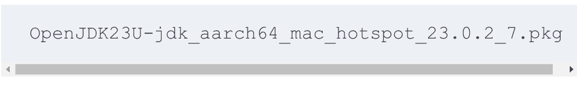

在安装程序对话框中：

1. 按（或选择）Continue（继续）进入软件许可协议步骤。您必须接受许可协议才能安装软件。阅读完协议后，按（或选择）Continue（继续），然后（或选择）Agree（同意）接受许可条款并进入“Macintosh HD”上的 Standard Install（标准安装）步骤。
2. 按（或）Install（安装）执行安装。如果要求输入系统密码，请输入密码并按（或选择）Install Software（安装软件）。
3. 安装完成后，在对话框中按（或选择）Close（关闭）。

为了确保 Java 安装正确，在 Finder 中选择 Go 菜单的 Utilities（实用），然后打开 Terminal.app。在 Terminal 窗口中，输入命令

```
java --version
```

并按（或选择）Enter 或 Return 键执行它。命令的输出应如下所示：

点击此处查看代码图片

```
openjdk 23.0.2 2025-01-21
OpenJDK Runtime Environment Temurin-23.0.2+7 (bu)
OpenJDK 64-Bit Server VM Temurin-23.0.2+7 (build0)
```

## Java 发布周期

Java 遵循每六个月发布一次的周期，从 2017 年的 Java 9 开始。新版本每年 3 月和 9 月发布，以便更快地交付新的语言和库功能。每两年，有一个版本被指定为长期支持（LTS）版本。这些版本面向需要稳定性和扩展支持的企业。非 LTS 版本的支持周期较短，鼓励早期采用创新技术。最新的 LTS 版本是 Java 21。下一个将是 Java 25（2025 年 9 月）。

# Java 集成开发环境 (IDE)

有许多 Java 集成开发环境 (IDE)——这些软件应用程序结合了软件开发所需的各种工具，例如代码编辑器、编译器、调试器和其他帮助您构建应用程序的工具。每个环境的使用步骤有所不同，因此我们在大多数示例中使用了 JDK 的命令行工具。在第 1 章中，我们提供了一个 JDK 试用。在本书的网页上

```
https://deitel.com/javafp5
```

我们提供了以下 IDE 试用：

- JetBrains 的 IntelliJ IDEA Community Edition，
- Eclipse Foundation 适用于 Java 开发者的 Eclipse IDE，以及
- 微软的 Visual Studio Code 跨平台代码编辑器——该工具具有 Java 开发插件。

这些 IDE 在 Java 开发社区中拥有最大的市场份额。它们都适用于 Windows、macOS 和 Linux。**在讨论下文介绍的任何工具之前，请按照上一节的描述安装 OpenJDK。**

# IntelliJ IDEA Community Edition

安装 IntelliJ IDEA 社区版的推荐方法是通过 JetBrains Toolbox 应用程序，您可以从此处下载：

点击此处查看代码图片

```
https://jetbrains.com/toolbox-app/
```

该网站将识别您的操作系统，并为相应的安装程序提供下载按钮。按（或选择）下载。下载完成后，双击“下载”文件夹中的安装程序文件，并按照屏幕上的提示安装 Toolbox 应用程序。接下来，按（或选择）Toolbox 应用程序图标打开其窗口：

- macOS 用户将在屏幕右上角找到 Toolbox 应用程序图标。
- Windows 用户将在屏幕右下角的任务栏中找到 Toolbox 应用程序图标。您可能需要按（或选择）向上的小箭头来查看所有任务栏图标。

在 **Toolbox** 窗口中，滚动到 **IntelliJ IDEA Community Edition** 并按（或选择）其 **Install** 按钮。

# Eclipse IDE for Java Developers

Eclipse Foundation 在此处提供了分步骤的 Eclipse IDE 安装说明：

点击此处查看代码图片

```
https://eclipse.org/downloads/packages/installer
```

在第 3 步中，选择 **Eclipse IDE for Java Developers**，然后按照剩余指令完成安装。

## Visual Studio Code

微软为 Windows 用户提供了分步骤的 Visual Studio Code 下载和安装说明，地址位于：

点击此处查看代码图片

```
https://code.visualstudio.com/docs/setup/windows
```

以及为 macOS 用户提供了说明，地址位于：

点击此处查看代码图片

```
https://code.visualstudio.com/docs/setup/mac
```

安装 Visual Studio Code 后，按照微软的分步骤说明开始 Java 之旅，位于：

点击此处查看代码图片

```
https://code.visualstudio.com/docs/java/java-tutorial
```

## JavaFX 软件开发包 (SDK)

在第 15-17 章中，您将使用 JavaFX 构建图形用户界面 (GUI)、图形和多媒体应用程序，JavaFX 必须从 JDK 独立安装。JavaFX 由公司和个人组成的财团与 JDK 并行开发，其中包括负责 Java 开发的 Oracle。每个新 Java 版本发布时都会并行发布一个新的 JavaFX 版本。

# 下载 JavaFX SDK

要使用 JavaFX，必须首先安装 JavaFX 软件开发包 (SDK)，可以从此处获取：

点击此处查看代码图片

```
https://gluonhq.com/products/javafx/
```

在 Downloads 部分，选择以下选项：

1. **JavaFX version**，选择与您的 JDK 版本匹配的版本（本文编写时 JavaFX 为 23.0.2）。
2. 在 **Operating System**（操作系统）下，选择您的操作系统。
3. 在 **Architecture**（架构）下，Apple silicon（M 系列处理器）Mac 用户应选择 **aarch64**，Intel 处理器 Mac 用户和 Windows 用户应选择 **x64**。
4. 在 **Package Type**（包类型）下，选择 **SDK**。

接下来，按（或选择）**Download** 按钮下载适用于平台的 SDK。这会在您的 `Downloads` 文件夹中放置一个类似于下面的 ZIP 文件

点击此处查看代码图片

```
openjfx-23.0.2_OS-architecture_bin-sdk.zip
```

其中 OS 是您的操作系统，architecture 是您选择的架构。

# 从 ZIP 文件中提取 JavaFX SDK

接下来，解压 ZIP 文件的内容：

- 在 macOS 上，双击文件提取其内容。这会在您的下载文件夹中创建一个名为 `javafx-sdk-23.0.2` 的文件夹（版本号取决于下载的精确版本）。
- 在 Windows 上，双击文件，然后将 `javafx-sdk-23.0.2` 文件夹拖到您的下载文件夹（版本号取决于下载的精确版本）。

要完成安装，您必须设置 `PATH_TO_FX` 环境变量，下文将针对 Windows 和 macOS 进行详细讨论。

# 在 Windows 上配置 `PATH_TO_FX` 环境变量

执行以下步骤：

1. 在任务栏搜索框中输入“环境”。
2. 在搜索结果中，选择“编辑系统环境变量”。
3. 在“系统属性”对话框中，按（或选择）“环境变量”按钮。
4. 在“用户变量”下，点击“新建”。
5. 输入变量名 `PATH_TO_FX`。然后，对于变量值输入以下内容，将 User 替换为您的用户账户文件夹名称，并在必要时将 23.0.2 替换为您的 JavaFX 版本：

点击此处查看代码图片

```
C:\Users\User\Downloads\javafx-sdk-23.0.2\lib
```

6. 按（或选择）确定保存环境变量。
7. 在“系统属性”对话框中按（或选择）确定关闭它。

如果您有任何已打开的命令提示符或 PowerShell 窗口，需要关闭并重新打开它们环境变量才能生效。

# 在 macOS 上配置 PATH_TO_FX 环境变量

执行以下步骤：

1. 在 **Finder** 中，选择 **Go** 菜单下的 **Utilities** ，然后打开 **Terminal.app**。
2. 接下来，确定执行命令的 shell

```
echo $SHELL
```

3. 如果第 2 步显示 `"/bin/zsh"`，则执行

```
open -e ~/.zshrc
```

否则，执行

```
open -e ~/.bash_profile
```

4. 将以下行添加到文件末尾，将 *User* 替换为您的用户账户文件夹名称，并在必要时将 `23.0.2` 替换为下载的 JavaFX 版本：

[点击此处查看图片](#)

```
export PATH_TO_FX="/Users/User/Downloads/javafx-sdk-23.0.2/lib"
```


保存并关闭文件。

## Scene Builder

在我们的 JavaFX 示例中，您将使用免费的 Scene Builder 工具通过拖放技术创建图形用户界面 (GUI)。要下载 Scene Builder 安装程序，请按（或选择）位于此处的 **Download Now** 按钮：

[点击此处查看代码](https://gluonhq.com/labs/scene-builder/)

```
https://gluonhq.com/labs/scene-builder/
```

## 生成式 AI

如序言部分“集成生成式 AI”所述，您在学习本书的过程中将利用生成式 AI (genAI)。在 Deitel & Associates, Inc.，我们使用许多生成式 AI，包括以下四个生成式 AI 聊天机器人：

- OpenAI ChatGPT ( `https://chatgpt.com` )
- Google Gemini ( `https://gemini.google.com/app` )
- [Anthropic Claude](https://claude.ai)
- [Perplexity](https://perplexity.ai)

# 注册账户

你无需注册即可免费使用 ChatGPT 和 Perplexity。Google 要求你登录 Google 账户才能使用 Gemini 的免费版本。对于 Claude，你必须提供一个邮箱地址来使用免费版本，然后他们会给你发送一个登录链接。只有在你注册免费账户后，ChatGPT 和 Perplexity 才会记住你过去的聊天记录。

# 付费版与免费层级

我们使用了这些聊天机器人的付费版本，但每个都提供了一个强大的免费层级。然而，免费版本的限制更多。它们通常：

- 在给定时间段内允许更少的查询，
- 允许较短的查询，
- 允许较少（或禁止）上传文件，
- 响应时间较慢以及
- 限制或阻止访问其最新、最强大的功能。

# 使用生成 AI 聊天机器人

我们在书中提供了数百个生成 AI 提示词（prompts），因此你会频繁使用生成 AI 聊天机器人。当你访问每个聊天机器人时，其网页会提供一个框，你可以在其中输入提示词并提交给机器人。ChatGPT 和 Gemini 还允许你通过语音输入提示词。为了感受每个聊天机器人的能力，可以提交之类的提示词：

点击此处查看代码图像


当你提交提示词时，聊天机器人将制定并呈现它的回复。提醒：**务必验证生成 AI 聊天机器人提供的信息。**

# 1

# 引言、测试驱动 Java 应用与生成式 AI


## 目标

在本章中，你将：

- 理解 Java 的优势。
- 接触可重用组件的 Java 应用程序编程接口（Java API）。
- 学习典型的 Java 程序开发环境。
- 测试驱动 Java 开发工具包（JDK）。
- 复习互联网、网页、云和物联网（IoT）基础知识。
- 复习对象技术概念，这些概念将在对象自然案例研究（第 2–7 章和第 11 章）中使用，并在面向对象的编程第 8–9 章中详细讨论，贯穿全书。
- 理解并发编程如何帮助多核处理器性能最大化。
- 接触大数据和数据科学技术。
- 学习计算领域令人兴奋的最新进展，包括元宇宙、人工智能和生成式 AI。

## 大纲

## 1.1 引言

## 1.2 硬件

## 1.3 Java

### 1.4 面向对象的简述

### 1.5 Java 应用程序编程接口 (API) 和开源库

### 1.6 典型的 Java 程序开发环境

### 1.7 使用 Java 开发工具包 (JDK) 测试驱动 Java 程序

#### 1.7.1 使用 `javac` 和 `java` 编译并运行程序

#### 1.7.2 使用 `java` 命令直接运行程序的源代码文件

### 1.8 互联网、万维网、云和物联网

#### 1.8.1 互联网：网络的网络

#### 1.8.2 万维网：让互联网对用户更友好

#### 1.8.3 云

#### 1.8.4 物联网 (IoT)

#### 1.8.5 边缘计算

#### 1.8.6 混合应用 (Mashups)

### 1.9 元宇宙

#### 1.9.1 虚拟现实 (VR)

#### 1.9.2 增强现实 (AR)

#### 1.9.3 混合现实

#### 1.9.4 区块链

#### 1.9.5 比特币与加密货币

#### 1.9.6 以太坊

#### 1.9.7 非同质化标记 (NFTs)

#### 1.9.8 Web3

### 1.10 软件开发技术

### 1.11 数据分析和数据科学

### 1.12 大数据有多大？

#### 1.12.1 大数据分析

#### 1.12.2 数据科学和大数据正在改变现状：用例

### 1.13 AI——计算机科学与数据科学的交汇点


### 1.13.1 人工智能 (AI)

### 1.13.2 人工通用智能 (AGI)

### 1.13.3 人工智能里程碑

### 1.13.4 机器学习

### 1.13.5 深度学习

### 1.13.6 强化学习

## 1.14 生成式 AI

## 1.15 总结

## 特别章节：生成式 AI 练习

## 1.1 引言

欢迎学习 Java——这是世界上最流行、最资深的计算机编程语言之一。本书提供了一个密集的、实用的 Java 编程体验。

1. “2025 年 2 月 TIOBE 指数。”访问 2025 年 2 月 18 日。https://tiobe.com/tiobe-index/.
2. “2024 年顶级编程语言。”访问 2025 年 2 月 18 日。https://spectrum.ieee.org/top-programming-languages-2024。
3. “PYPL 编程语言流行度。”访问 2025 年 2 月 18 日。https://pypl.github.io/.

前言介绍了我们在第 2 章通过“对象自然方法”使用的术语。在创建 Java 类之前，我们介绍了 Java 应用程序编程接口 (`API`) 和各种开源库，帮助你避免“造轮子”。我们介绍了一个典型的 Java 程序开发环境，使用 Java 开发工具包（`JDK`）来测试驱动程序（1.7 节），你可以在许多集成开发环境（`IDE`）中运行。


我们复习了互联网、网页、云和物联网（IoT）基础。我们介绍了元宇宙及其相关技术，包括区块链、加密货币、NFT、Web3、增强现实、虚拟现实和混合现实。我们简要介绍了软件开发技术。最后，我们介绍了大数据、数据科学和人工智能（AI）技术——包括机器学习、深度学习以及生成 AI，如 OpenAI 的 ChatGPT、Google 的 Gemini 和 Anthropic 的 Claude。在书中你会利用这些 AI 以及你的学习体验来做一些非常酷的事情，从本章的特别章节：生成式 AI 练习开始！

| 设备 | 复印机 | 游戏机 |
| --- | --- | --- |
| 自动取款机 (ATMs) | | 游戏机 |
| 汽车 | 信用卡 | GPS 导航系统 |
| 蓝光光播放器 | CT 扫描仪 | 家电器 |
| 家庭安防系统 | 光学传感器 | 智能手机 |
| 物联网网关 | 停车计时器 | 智能笔 |
| 笔记本电脑 | 销售点终端 (POS) | 桌子 |
| 光开关 | 打印机 | 平板电脑 |
| 逻辑控制器 | 机器人 | 电视机 |

| 设备 | 路由器 | 恒温器 |
| --- | --- | --- |
| 医疗设备 | 路由器 | 恒温器 |
| 手机 | 服务器 | 交通卡 |
| 磁共振成像 (MRIs) | 智能卡 | 电视顶盒 |
| 网络交换机 | 智能电表 | 车辆诊断系统 |

## Java 标准版 (Java SE)

本《Java for Programmers》第五版基于 Java 标准版，它包含了运行桌面和服务器应用程序所需的各种。⁵ Java 支持多种编程范式，我们在书中将讨论这些范式：

- 程序化编程（第 2–7 章），
- 面向对象编程（第 8–10 章），
- 泛型编程（第 12 和第 13 章），
- 函数式编程（第 14 章），
- 并发编程（第 18 章）以及
- 生成式 AI 辅助编程（第 19 章）。

5. Oracle. “Java SE at a Glance.” 2024 年 11 月 26 日。https://www.oracle.com/java/technologies/java-se-glance.html。

### Jakarta EE

Java 的应用范围非常广泛，因此它另外两个版本。Jakarta EE——以前称为 Java 企业版 (Java EE)——旨在开发运行大型机构的大型分布式网络和基于 Web 的应用程序。

### Java 微版 (Java Micro Edition)

Java 微版 (Java ME) 是 Java SE 的子集，面向资源受限的嵌入式设备应用，例如智能手表、医疗设备、电视顶盒、智能电表（例如用于监控能源消耗）等。

## 1.2 硬件

由于硬件和软件技术的快速发展，计算成本正在大幅下降。几十年前可能占据整个房间并花费数百万美元的计算机，现在被刻在比指甲盖还小的硅计算机芯片上，许多芯片的价格可能只有几美元。讽刺的是，硅是地球上最丰富的材料之一——它是普通沙子的成分。硅芯片技术让计算变得如此廉价，以至于计算机和计算机设备已成为商品。

### 摩尔定律、多核处理器与并发编程

今天许多个人电脑每秒可以执行数万亿次计算⁶,⁷——远超人类一生能完成的次数。你可能预计大多数产品和服务每年至少贵一点。计算机和通信领域的情况相反，特别是对于支持这些技术的硬件。多年来，硬件成本迅速下降。

> 6. Tobias Mann, “Intel’s Lunar Lake Mobile Chips Boost 120 TOPS of AI Performance,” The Register, 2024年9月3日. 2025年2月18日。https://www.theregister.com/2024/09/03/intels-lunar-lake-chips/
>
> 7. Tobias Mann, “Apple’s M4 AI Chip: A Leap in Performance,” The Register, 2024年10月31日. 2025年2月18日。https://www.theregister.com/2024/10/31/apple-m4-ai-chip/

几十年来，计算机处理能力每隔几年就以廉价的价格翻一倍。这种显著的趋势被称为摩尔定律——以英特尔联合创始人戈登·摩尔（Gordon Moore）命名，他是 20 世纪 60 年代发现这一趋势的人。英特尔是当今计算机和嵌入式系统的领先处理器制造商，例如智能家居、家庭安全、机器人、智能交通交叉口等。摩尔定律及相关观察本质上适用于：

- 计算机用于程序和数据的内存容量，
- 它们存储程序和数据的次级存储容量，
- 以及它们的处理器速度——计算机执行程序完成工作的速度。

计算机处理器公司 NVIDIA 和 ARM 的关键高管已表示，摩尔定律不再适用。然而，英特尔首席执行官表示它“依然活跃且良好”——他们正在努力制造进展，将使每个芯片上的晶体管可行⁸。计算机处理能力继续增加，但依赖于新的处理器设计，例如多核处理器。

> 8. Christian Hetzner, ‘Intel CEO Pat Gelsinger Dismisses Nvidia’s AI Chip Dominance: ‘Moore’s Law Is Alive and Well,’ Observer, 2024年6月. 2025年2月18日。https://observer.com/2024/06/intel-ceo-pat-gelsinger-nvidia-ai-chip-rivalry/.

#### 多核处理器与性能

今天大多数计算机都拥有多核处理器，在单个集成电路芯片上经济地实现了多个处理器。英特尔的一些处理器具有高达 128 个核心⁹。我们的主要测试计算机使用 Apple 的 M2 Max 处理器，它具有 12 核 CPU、28 核 GPU 和用于 AI 任务的 16 核“神经引擎”¹⁰。Apple 最新的 M4 Max 具有高达 16 核的 CPU、高达 40 核的 GPU 和用于 AI 任务的 16 核“神经引擎”¹¹。AMD 有具有高达 192 个核心的处理器¹²。核心数量将继续增长。今天用于高端游戏计算机和人工智能应用中的许多 GPU 内部通常包含数千个核心。例如，NVIDIA RTX 5090 拥有 21,760 个核心！¹³

> 9. “Intel® Xeon® 6 Processors with Performance-Cores (P-Cores),” Intel. 2025年2月18日。https://www.intel.com/content/www/us/en/products/details/processors/processors/xeon6-pcores.html
>
> 10. “Apple unveils M2 Pro and M2 Max: next-generation chips for next-level workflows,” 2023年1月23日. 2025年2月18日。https://www.apple.com/newsroom/2023/01/apple-unveils-m2-pro-and-m2-max-next-generation-chips-for-next-level-workflows/
>
> 11. “Apple introduces M4 Pro and M4 Max,” 2024年10月30日. 2025年2月18日。https://www.apple.com/newsroom/2024/10/apple-introduces-m4-pro-and-m4-max/
>
> 12. “EPYC™ 9005 Series Processors,” AMD. 2025年2月18日。https://www.amd.com/en/products/server/epyc/9005-series
>
> 13. Dave James, “Nvidia GeForce 5090,” PC Gamer, 2025年1月30日. 2025年2月18日。https://www.pcgamer.com/nvidia-5090/

在多核系统中，硬件可以同时对你的任务的不同部分进行工作，使你的程序更快完成。充分利用多核架构需要编写多线程应用程序。当程序的任务被拆分成单独线程时，只要核心数量足够，多核系统就可以并行运行这些线程。随着多核系统的普及，对多线程的兴趣迅速增加。Java 从诞生起就提供了多线程支持，并在多年来增加了更高级的功能以简化多线程开发。第 18 章“并发：平台线程到虚拟线程”讨论了创建和管理多线程 Java 应用。它详细解释了来自 Project Loom 的最新简化技术——虚拟线程、结构化并发和作用域值。

#### 多年计算能力

数据变得越来越巨大，处理数据所需的计算能力也是如此。今天处理器的性能通常以 FLOPS（每秒浮点运算次数）衡量。20 世纪 90 年代，最快超级计算机的速度以十亿次（10⁹ FLOPS）衡量。90 年代后期，英特尔生产了第一台万亿次（10¹² FLOPS）超级计算机。2008 年，IBM 发布了第一台拍位级次（10¹⁵ FLOPS）超级计算机。今天世界上最快的超级计算机每秒可以执行超过一百万亿（一京）次指令！截至 2024 年 11 月，美国的 El Capitan 超级计算机（来自劳伦斯利弗实验室）是世界上最快的¹⁴——每秒 1.742 亿亿次计算（1.742 艾级次）¹⁵。从角度来看，它可以在一秒内为地球上的每人执行大约 2.15 亿次计算¹⁶

14. “Top 500.” Wikipedia. Wikimedia Foundation. 2025年2月18日。https://en.wikipedia.org/wiki/TOP500.
15. “Flops.” 维基百科。维基媒体基金。访问 2025 年 2 月 18 日。https://en.wikipedia.org/wiki/FLOPS。
16. 为了直观了解计算性能的进步，请考虑一下：在 20 世纪 60 年代的早期计算时代，作者之一哈维·德特尔（Harvey Deutel）使用了数字设备公司的 PDP-1 (https://en.wikipedia.org/wiki/PDP-1 )，它每秒只能执行 93,458 次操作；而 IBM 1401 (https://www.ibm-1401.info/1401GuidePosterV9.html) 每秒仅执行 86,957 次操作。

目前正在开发的量子计算机在理论上的运行速度将是今天计算机的 18 亿亿（18,000,000,000,000,000）倍！¹⁷ 这个数字是如此惊人，以量子计算机每秒完成的计算量，可能远超自人类文明以来任何类型的计算设备所完成的总和。2024 年 12 月，谷歌宣布了新的 Willow 量子计算芯片，它只需五分钟即可完成一项传统计算机需要 10 涧万亿（10,000,000,000,000,000,000,000）年才能完成的任务。¹⁸ 这种几乎无法想象的计算能力可能会比特币等基于区块链的加密货币造成巨大冲击。工程师们已经在思考区块链¹⁹ 并致力于后量子密码学，以应对这种计算能力的巨大增长。²⁰。

- 17. Norbert Biedrzycki, “只有上帝才能算那么快——量子计算的世界。”2017 年 5 月 12 日。访问 2025 年 2 月 18 日。https://medium.com/n.biedrzycki/only-god-can-count-that-fast-the-world-of-quantum-computing-406a0a9fcf4.
- 18. Robert Booth “谷歌推出‘令人惊叹’的量子计算芯片，”《卫报》，2024 年 12 月 9 日。访问 2025 年 2 月 18 日。https://www.theguardian.com/technology/2024/dec/09/google-unveils-mindboggling-quantum-computing-chip.
- 19. “区块链。”维基百科。维基媒体基金。访问 2025 年 2 月 18 日。https://en.wikipedia.org/wiki/Blockchain.
- 20. Dr. Reji Thomas, “量子安全区块链：迎接量子计算时代，”2024 年 11 月 26 日。访问 2025 年 2 月 18 日。https://www.forbes.com/cils/forbestechcouncil/2024/11/26/quantum-secure-blockchain-preparing-for-the-era-of-quantum-computing/

计算能力的成本持续下降，特别是随着处理器架构和云计算的进步。人们过去会问这个问题：“为了处理我的峰值处理需求，我的本地系统需要多少计算能力？”如今，思维已经转变为：“我是否可以快速在云端划分出我最严苛的计算负载所需的临时资源？”你只需为完成特定任务所使用的部分付费。

## 1.3 Java

微处理器革命迄今为止最大的贡献是它推动了个人电脑和智能手机的发展。微处理器还深远影响了智能消费电子设备，包括物联网（IoT）中海量的设备。太阳微系统公司（Sun Microsystems）在 1991 年就意识到了这一点，资助了一个由詹姆斯·高斯林（James Gosling）领导的内部研究项目，结果产生了一种基于 C++ 的面向对象编程语言，Sun 将其命名为 Java。²¹ 使用 Java（它是世界上最古老且使用最广泛的高级编程语言之一），你可以编写可以在各种计算机系统和计算机控制设备上的程序。这有时被称为“编写一次，随处运行 (WORA)”。这种可移植性具有特别强大的威力。

- 21. Paul Krill, “所以他们为什么决定叫它 Java 呢？”InfoWorld，2014 年 5 月 23 日。访问 2025 年。https://www.infoword.com/article/2170044/so-why-did-they-decide-to-call-it-java-3.html.

Java 因为人们对互联网的现象级兴趣而引起了商业界的关注。它现在被用于开发大型企业应用、增强 Web 服务器功能、为消费设备（手机、智能手机、电缆盒等）提供应用、开发机器人软件以及许多其他用途。它是开发 Android 智能手机和平板电脑应用的原始语言——现在是两种 Android 开发语言之一。²² 太阳微系统公司在 2010 年被甲骨文（Oracle）收购。

- 22. “Kotlin（编程语言）。”访问 2025 年 2 月 18 日。https://en.wikipedia.org/wiki/Kotlin_(programming_language)。

三十年来，一直是一直是常用的通用编程语言之一，大量的现有 Java 代码使用了旧的编程范式——这被称为遗留代码。我们在本书中强调现代的 Java 范式。

## 1.4 面向对象简要回顾

在对新型、强大软件的需求激增的时代，快速、正确且经济地构建软件仍然是一个难以实现的目标。**对象**，或者更准确地说——我们将在第 8 章中看到——产生对象的**类**，本质上是**可重用的软件组件**。有日期对象、时间对象、音频对象、视频对象、汽车对象、人员对象等。几乎名词都可以根据**属性**（例如名称、颜色和大小）和**行为**（例如计算、移动和通信）合理地表示为软件对象。软件开发者发现，使用模块化、面向对象的设计实现方法可以使软件开发团队比以前的技术高效得多——面向对象的程序通常更容易理解、测试、调试、修正和进化。

### 作为对象的汽车

从一个简单的类比开始。假设你想开车并通过踩加速踏板让它运行得更快。在这样做之前需要发生什么？嗯，在你开车之前，必须有人先**设计**汽车。汽车通常始于工程图纸，类似于描述房屋设计的蓝图。这些图纸包含了加速踏板的设计。踏板向驾驶员隐藏了让汽车运行更快的复杂机制，就像制动踏板隐藏了减速的机制，方向盘隐藏了转向的机制一样。这使得不了解发动机、制动和转向机制原理的人也能轻松开车。

（希望如此！），所以司机必须**按下**踏板来指示汽车加速。

### 方法与类

让我们用汽车的例子来介绍一些关键的面向对象编程概念。在程序中执行任务需要一个 `method`（方法）。该方法包含了执行该任务的程序语句。它向用户隐藏了这些语句，就像汽车的油门踏板向司机隐藏了让汽车行驶得更快的机制一样。在 Java 中，我们创建一个名为 `class`（类）的程序单元，用来存放一组执行该类任务的方法。例如，代表银行账户的类可能包含一个向账户**存入**资金的方法，另一个从账户中**取出**资金的方法，以及第三个**查询**账户当前余额的方法。类类比汽车的工程图纸，这些图纸包含了油门踏板、刹车踏板、方向盘等的设计。

### 实例化

就像在开车之前必须有人先根据工程图纸**建造一辆汽车**一样，在程序执行由类方法定义的任务之前，你必须从类中**构建一个对象**。这个过程被称为实例化（instantiation），该对象随后被称为该类的实例（instance）。

### 重用

正如汽车的工程图纸可以多次重用以建造许多汽车一样，你可以多次重用一个类来构建该类的许多对象。在构建新类和程序时重用现有的类可以节省时间和精力。重用还能帮助你构建更可靠、更有效的系统，因为现有的类和组件通常经过了仔细的测试、调试和性能调优。正如互换零件的概念对工业革命至关重要，可重用的类对于由对象技术引发的软件革命也是至关重要的。

### 消息与方法调用

当你开车时，踩油门踏板会向汽车发送一条消息来执行任务——即“跑得更快”。同样，你向对象发送消息。每条消息都被实现为一个方法调用（method call），告诉对象的某个方法执行其任务。例如，程序可能会调用特定银行账户对象的存款方法，以根据存款金额增加账户余额。

### 属性与实例变量

除了完成任务的能力外，汽车还具有属性（attributes），例如它的颜色、门数、油箱中的油量、当前速度以及行驶总里程的记录（即里程表读数）。就像它的能力一样，汽车的属性被表示为其工程图中的设计一部分（例如，包括里程表和燃油表）。当你开车时，这些属性会随汽车“移动”。每辆汽车都维护着自己的属性。例如，每辆汽车都知道自己的油箱里有多少油，但不知道其他汽车油箱里有多少油。

同样，对象在程序中使用时也带有随之携带的属性。这些属性作为对象类的一部分被指定。例如，银行账户对象有一个余额属性（balance attribute），代表账户中的金额。每个银行账户对象都知道它所代表的账户的余额，但不知道银行中其他账户的余额。属性是由类的实例变量（instance variables）指定的。

### 封装与信息隐藏

类将封装（encapsulate，即包装）的属性和方法整合到由这些类创建的对象中——对象的属性和方法是紧密相关的。对象之间可以进行相互通信，但它们通常不被允许知道其他对象内部是如何实现的。这些细节被隐藏在对象内部。正如我们将会看到的，这种信息隐藏对于良好的软件工程至关重要。

### 继承

可以通过继承（inheritance）快速、方便地创建新类型的对象类。新类吸收现有类的特征，并可能对其进行定制以及添加自己的特有特征。在我们的汽车类比中，“敞篷汽车”（convertible）类的对象无疑是更通用的“汽车”（automobile）类的对象，但更具体地说，它的顶可以升高或降低。

### 接口

Java 还支持接口（interfaces）——一组方法声明，它们定义了对象可以执行的动作，而不指定如何执行。在汽车的类比中，一个由方向盘、油门踏板和刹车踏板组成的“基本驾驶能力”接口将允许司机告诉汽车该做什么。一旦你学会了如何使用这个几乎通用的接口来进行转向、加速和刹车，你就可以驾驶许多类型的汽车，尽管制造商可能以不同的方式实现这些系统。

一个类实现零或多个接口，每个接口都可以拥有方法，就像汽车为基本驾驶功能、控制收音机、控制加热和空调系统等实现了不同的接口。正如汽车制造商实现能力的方式不同，类也可以不同的方式实现接口的方法。例如，一个软件系统可能包含一个“备份”（backup）接口，提供保存（save）和恢复（restore）方法。类可能会不同的方式实现这些方法，取决于备份内容的类型（如程序、文本、音频、视频等）以及存储这些内容的设备类型。

### 面向对象分析与设计

很快你就要编写 Java 程序了。你将如何为你的程序创建代码呢？你可能会打开电脑开始输入代码。这种方法对于小型程序（如我们在书早期介绍的程序）可能有效，但如果你被要求创建一个控制大型银行数千台自动取款机器的软件系统呢？或者假设你被要求在一个由数千名软件开发人员组成的团队中构建下一代美国空中交通系统？对于这类大型且复杂的项目，你不应该直接开始编写程序。

为了创建最佳解决方案，你应该遵循详细的分析过程来确定项目的需求（即定义系统应该做什么），并开发一个满足这些需求的设计（即决定系统应该如何做）。

### 开源库

存在大量的开源 Java 库，可以让你通过编写少量代码来完成大量的任务。在 GitHub 上，开发者贡献了超过 250,000 个 Java 代码仓库：

点击此处查看图像

```
```


https://github.com/topics/java

此外，诸如以下的页面：

- https://github.com/akullpp/awesome-java
- https://github.com/Vedenin/useful-java-links
- https://github.com/mhrimaz/AwesomeJavaFX

提供了热门 Java 库和资源的精选列表——你会喜欢探索这些网站的。

## 基于模块的 Java 开发方法

在用 Java 编程时，你通常会将你自己的代码与以下预定义的模块混合使用：

- Java API 类、接口和方法，
- 开源 Java 库的类、接口和方法，
- 你创建的类、接口和方法（在学习第 8 章和第 9 章后），以及
- 其他创建并提供给你的类、接口和方法。

创建自己的类、接口和方法的优点是确切知道它们是如何工作的。缺点是设计、开发、调试和性能调优需要耗费精力。在整本书中，我们使用现有的 Java API 和各种开源库来利用你的编程成果，避免“重复造轮子”。这被称为软件复用，是我们的对象-自然教学法的核心部分。

# 1.6 典型的 Java 程序开发环境

我们现在解释创建和执行 Java 程序的步骤。通常有五个阶段：编辑、编译、加载、验证和执行。我们在 Java 开发工具包 (JDK) 的背景下讨论这些阶段。请参阅序言后的“开始之前”，获取有关在 Windows 和 macOS 上下载和安装 JDK 的信息。

### 第 1 阶段：创建程序

第 1 阶段使用编辑器程序（或简单称为编辑器）编辑文件：

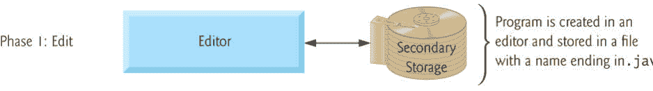

使用编辑器，你输入 Java 程序，进行任何必要的修正并将其保存到系统中。Java 源文件以 `.java` 扩展名命名，表示该文件包含 Java 源代码。

Windows 和 macOS 分别提供了基础编辑器记事本 (`Notepad`) 和文本编辑 (`TextEdit`)。在线提供的一些更强大的编辑器包括：

- jEdit (https://jedit.org; 跨平台，用 Java 编写）
- Sublime (https://www.sublimetext.com; 跨平台）
- Notepad++ (https://notepad-plus-plus.org; 仅限 Windows）以及
- TextMate (https://textpad.com; 仅限 macOS)

集成开发环境 (IDE) 提供支持软件开发过程的工具，例如编辑器、用于导致程序执行错误的逻辑错误的调试器，最流行的 Java IDE 有：

- JetBrains 的 IntelliJ IDEA 社区版，
- Eclipse Foundation 的面向 Java 开发者的 Eclipse IDE
- 以及微软的 Visual Studio Code 跨平台代码编辑器——这在技术上是一个强大的代码编辑器，但具有 Java 开发（以及许多其他编程语言）的插件。

我们将在“开始之前”部分讨论每个工具的安装。在本书的网站上

https://deitel.com/javafp5

我们提供了演示，展示了如何执行书中的 Java 程序，以及如何使用这些 IDE 开发新的 Java 程序。

### 第 2 阶段：将 Java 程序编译为字节码

在第 2 阶段，你使用 `javac` 命令（Java 编译器）来编译程序：

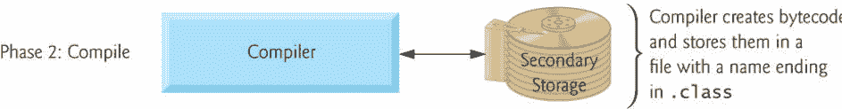

例如，要编译名为 `Welcome.java` 的程序，你需要在系统的命令行窗口（1.7 节）输入

```
javac Welcome.java
```

如果程序编译成功，编译器会生成一个名为 `Welcome.class` 的 .class 文件。IDE 通常会自动完成操作。如果编译器检测到错误，你必须返回第 1 阶段并修正它们。在[第 2 章]，我们将讨论编译器可以检测到的错误类型。

使用 `javac` 时，如果你收到“错误的命令或文件名”、“javac: 找不到命令”或“javac' 不是内部或外部命令，也不是批文件”等消息，说明你的 JDK 安装不正确。请仔细检查“开始之前”中的安装说明。

Java 编译器将 Java 源代码翻译成代表执行阶段（第 5 阶段）执行任务的字节码。Java 虚拟机 (JVM)——JDK 的一部分也是 Java 平台的基础——执行字节码。虚拟机 (VM) 是一种模拟计算机的软件，但对与其交互的程序隐藏了底层的操作系统和硬件。如果在许多计算机平台上实现了相同的虚拟机，那么为该类型虚拟机编写的应用程序就可以在所有平台上就可以地运行。JVM 是使用最广泛的虚拟机之一。

23. “Java virtual machine.”维基百科。Wikimedia Foundation。访问于 2025 年 2 月 18 日。

https://en.wikipedia.org/wiki/Java virtual machine#Bytecode interpreter and just-in-time compiler.

与依赖特定计算机硬件的平台相关机器语言指令不同，字节码指令是平台无关的。如今的 JVM 通常结合解释和即时 JIT 编译来执行字节码。……例如，要执行一个名为 Welcome 的 Java 程序，你需要在窗口中输入

```java
java Welcome
```

这开始了第 3 阶段。IDE 通常会为你提供一个菜单项（如“运行”），来调用 `java` 命令。

### 第 3 阶段：将程序加载到内存

在第 3 阶段，JVM 将程序放入内存——这被称为加载：

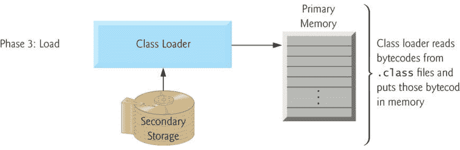

JVM 的类加载器获取包含字节码的 `.class` 文件并将其传输到内存。它还会加载程序使用的任何 Java 提供的类。

### 第 4 阶段：字节码验证

在第 4 阶段，当类加载时，字节验证器检查它们的字节码以确保它们有效且不违反 Java 的限制：

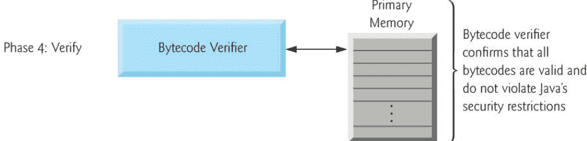

### 第 5 阶段：执行

在第 5 阶段，JVM 执行字节码以执行指定的动作：

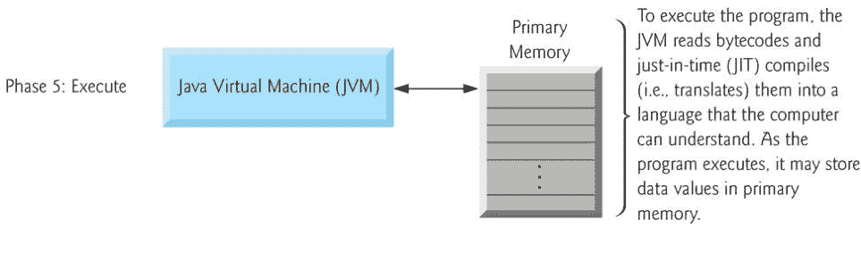

在早期 Java 版本中，JVM 解释字节码。大多数程序的运行速度缓慢，因为 JVM 每次解释并执行一个字节码。现代计算机架构可以并行执行多条指令。如今的 JVM 通常结合解释和即时 JIT 编译来执行字节码。在此过程中，JVM 分析正在被解释的字节码，寻找热点——频繁执行的字节码。对于这些部分，即时编译器（例如 OpenJDK HotSpot 编译器）将字节码翻译成计算机机器语言。当 JVM 再次遇到这些编译过的部分时，就会执行更快的机器码。因此，程序实际上经历了两个编译阶段：一个是将 Java 代码翻译成字节码（以便在不同计算机平台的 JVM 上移植），第二个是在执行期间将字节码翻译成运行运行计算机的机器语言。

# 执行时可能出现的问题

程序在第一次运行时可能无法工作。每个先前的阶段都可能由于书中讨论的各种错误而失败。例如，正在执行的程序可能会尝试除以零——这是 Java 整数算术中的非法操作。这会导致 Java 程序显示错误消息。如果发生这种情况，你将返回编辑阶段，进行必要的修正并继续后续操作。

再次运行阶段以确定纠正是否修复了问题。

诸如除以零之类的错误会在程序运行时发生，因此它们被称为运行时错误或执行时间错误。致命运行时错误会导致程序立即终止而无法成功完成任务。非致命运行时错误允许程序运行完成，但通常会产生错误的结果。

## 1.7 使用 Java 开发工具包 (JDK) 测试 Java 程序

在阅读此测试驱动程序之前，请阅读序言后的“在开始之前”（Before You Begin）部分，以确保你已将书中的示例代码放置在用户账户的 `Documents/examples` 文件夹中，并安装了 JDK。在本节中，你将使用 JDK 工具来编译并运行你的第一个 Java 程序^24——一个猜数字游戏，它会从 1 到 1,000 之间选取一个随机数并提示你猜数字。如果你猜中了随机数，游戏就会结束。如果你猜错了，程序会指示你的猜测比正确数字高还是低。你一直猜下去，直到猜中该数字为止。猜测的次数没有限制，但如果你使用二分查找法，次数不应超过 10 次。

24. 我们在这里特意不介绍此 Java 程序的代码。本节的目的是演示编译和运行程序，以便你可以在后续章节中执行我们的示例。

### 1.7.1 使用 javac 和 java 编译和运行程序

我们将展示两种运行程序的方法。在这里，我们重点关注传统方法，即你：

- 使用 `javac` 命令编译程序，然后
- 使用 `java` 命令运行它。

IDE（集成开发环境）通常通过点击（或选择）按钮、选择菜单项或使用键盘快捷键，提供执行这两个步骤的便捷方法。

#### 步骤 1：切换到 `ch01` 文件夹

首先，在你的系统上打开终端（命令行）窗口：

- 在 macOS 上，在访达的“前往”菜单中选择“实用工具”，然后打开“终端”应用程序。
- 在 Windows 上，在任务栏的搜索框中输入“终端”，然后在搜索结果中选择“终端”打开 Windows PowerShell 窗口。

接下来，使用 `cd` 命令切换到书籍 `examples` 文件夹下的 `ch01` 子文件夹：

- 在 macOS 终端窗口中，输入以下命令并按（或选择）`Enter`：

```
cd ~/Documents/examples/ch01
```

- 在 Windows PowerShell 窗口中，输入以下命令并按（或选择）`Enter`：

```
cd ~\Documents\examples\ch01
```

在后续步骤中，我们将显示 macOS 终端应用程序的提示符——使用 JDK 命令行工具编译和运行程序的命令以及你与 macOS 和 Windows 之间的交互是相同的。

#### 步骤 2：编译程序

在运行猜数字游戏之前，你必须使用 `javac` 命令编译其 Java 源码：

[点击此处查看代码图片]

```
pauldeitel@MacBook-Pro ch01 % javac GuessTheNumb

pauldeitel@MacBook-Pro ch01 %
```

如果程序编译无错误，`javac` 命令将创建一个 `.class` 文件

```
GuessTheNumberGame.class
```

其中包含程序的字节码。

#### 步骤 3：运行程序

要运行程序，使用 `java` 命令后跟不带 `.class` 扩展的文件名：

[点击此处查看代码图片]

```
(base) pauldeitel@MacBook-Pro ch01 % java GuessT

I have a number between 1 and 1000.

Can you guess my number?

Please enter your first guess.

?
```

应用程序显示“Please enter your first guess.”，然后在下一行显示问号（？）作为提示符。

#### 步骤 4：输入你的第一次猜测

在提示符处，输入 500 并按（或选择）Enter：

[点击此处查看代码图片]

```
(base) pauldeitel@MacBook-Pro ch01 % java GuessT

I have a number between 1 and 1000.

Can you guess my number?

Please enter your first guess.

? 500

Too low. Try again.

?
```

程序显示“Too low. Try again.”，是因为输入的值小于程序选择的数字。25

25. 我们编写这个程序是为了让它在每次运行时都选择相同的“随机”值，因此你将能够使用我们使用过的相同猜测。

#### 步骤 5：输入另一个猜测

在下一个提示符处，输入 `750` 并按（或选择）`Enter`：

[点击此处查看图片](#)

```
(base) pauldeitel@MacBook-Pro ch01 % java GuessT

I have a number between 1 and 1000.

Can you guess my number?

Please enter your first guess.

? 500

Too low. Try again.

? 750

Too high. Try again.

?
```

应用程序显示“Too high. Try again.”，是因为该值大于程序选择的数字。

#### 步骤 6：输入额外的猜测

继续输入值玩游戏，直到你猜中数字。当你猜对时，应用程序显示“Excellent! You guessed the number.”：

[点击此处查看图片]

```
? 625

Too low. Try again.

? 687

Too high. Try again.

? 656

Too high. Try again.

? 640

Too low. Try again.

? 648

Too high. Try again.

? 642

Too low. Try again.

? 644

Excellent! You guessed the number!

Would you like to play again (y or n)?
```

#### 步骤 7：再次玩游戏或退出程序

猜中数字后，应用程序询问你是否想再次玩。输入 n 将终止应用程序并返回命令行。

10 次或少

如果你使用二分查找法，猜 1 到 1,000 之间的数字最多应需要 10 次。在测试驱动中，500 太小，我们排除了 1–500，剩余 501–1000。下一次猜测，750 太大，我们排除了 750–1000。

### 1.7.2 使用 java 命令直接运行源文件

你可以使用 `java` 命令直接运行单文件程序（如 1.7.1 中的猜数字游戏），如下：

```
java GuessGame.java
```


当你直接执行源码时，`java`命令会在内存中编译程序并立即运行。与`javac`不同，`java`命令不会存储字节码的`.class`文件。

你甚至可以运行多文件程序，如你在第8章自定义类建模中开始的。在这种情况下，所有的源文件都在内存中编译。这些功能使得为了测试目的运行Java程序更加方便。

## 28. 互联网、万维网、云与物联网

在20世纪60年代后期，ARPA——美国国防部高级研究计划署——制定了连接大约十个受ARPA资助的大学和研究机构主计算机系统的计划。这些计算机将通过速度约为50,000比特/秒的通信线路连接，在当时这是一个惊人的速率，因为那时大多数人（在少数拥有网络访问权限的人中）通过电话线以110比特/秒的速度连接到计算机。学术研究即将发生一次巨大的飞跃。ARPA实施了很快被称为ARPANET的网络，它是互联网的前身。如今最快的互联网速度在每秒数十亿比特（吉比特）量级。目前的互联网速度记录保持者是日本的国立信息通信技术研究中心，它实现了每秒402太比特（万亿比特）的下载速度——大约是美国平均消费者250兆比特每秒宽带速度的160万倍。

[28. Paulius Grinkevičius, “日本打破互联网速度纪录，每秒达到402太比特，” CyberNews, 2024年7月4日. 访问于2025年2月18日。](https://cybernews.com/tech/internet-connection-speed-world-record.)

情况的发展与原计划不同。虽然ARPANET（阿帕网）让研究人员能够将计算机连接起来，但证明其主要优势是通过后来被称为电子邮箱（e-mail）进行快速方便的通信。即使在今天的互联网上也是如此，通过电子邮件、即时消息、文件传输以及社交媒体（如YouTube、Facebook、WhatsApp、Instagram、Snapchat、TikTok、Reddit和X（原Twitter）），全球数十亿人能够快速、方便地进行通信。

允许计算机在ARPANET上相互通信的协议（一组规则）被称为传输控制协议（TCP）。它确保了由顺序编号的“数据包”组成的消息能够正确地从发送者递送到接收者，确保完整到达并按正确顺序重新组装。

### 1.8.1 互联网：网络的网络

在ARPANET演变的同时，全球各组织为了组织内部和组织间的通信实施了自己的网络。各种类型的网络硬件和软件应运而生。挑战之一是让这些不同的网络能够相互通信。ARPA通过开发互联网协议（IP）实现了这一目标，它创建了一个“网络的网络”，即当前的互联网架构。这些协议组合现在被称为TCP/IP。每个连接互联网的设备都有一个IP地址——这是一个唯一的数字标识符，通过TCP/IP通信的设备使用该标识符在互联网上定位彼此。

公司迅速意识到，他们可以使用互联网来改进业务并提供新颖、更好的客户服务。因此，他们花费了大量资金来开发和增强他们的在线业务。这导致了通信运营商以及硬件和软件供应商之间激烈的竞争，以满足日益增长的基础设施需求。结果，互联网带宽——线路的信息承载能力——大幅增加，而硬件成本急剧下降。

### 1.8.2 世界维网：让互联网对用户友好

世界维网（或“万网”）是与互联网相关的硬件和软件集合，它允许计算机用户定位并查看几乎任何主题的文档（带有文本、图形、动画、音频和视频的各种组合）。1989年，欧洲核子研究组织（CERN）的Tim Berners-Lee开始开发超文本标记语言（HTML）——一种通过“超链接”文档共享信息的技术。他还编写了通信协议，如超文本传输协议（HTTP），以形成他新的超文本信息系统的骨干，他将其称为世界维网。

1994年，Berners-Lee创立了世界维网联盟（W3C; w3.org），该组织致力于开发Web技术。W3C的一个关键目标是让互联网无论能力、语言或文化如何，都能被全球范围内的所有人访问。

### 1.8.3 云计算

今天越来越多的计算在“云端”进行，使用分布在全球互联网上的软件和数据，而不是在你的计算机或移动设备上本地运行。云计算允许你根据任何需要增加或减少计算资源以满足需求，这比购买自己的硬件来提供足够的存储和处理能力以满足偶发的峰值需求更具效益。云计算还通过将管理计算资源的负担转移给服务提供商（例如安装和升级软件、安全、备份和灾难恢复能力）来节省资金。

你使用的应用程序极度依赖于云服务。这些服务使用了大量的计算资源集群（计算机、处理器、内存、存储等）以及数据库，它们通过互联网相互以及你使用的应用程序进行通信。通过互联网提供自身访问的服务被称为Web服务。截至2024年11月，亚马逊云服务（AWS; 市场份额32%）、微软Azure（20%）和谷歌云平台（GCP; 12%）占了云服务市场的64%。

[29. Statista，“领先云基础设施服务提供者的全球市场份额。” 2024年11月1日。访问于2025年2月18日。](https://www.statista.com/chart/18819/worldwide-market-share-of-leading-cloud-infrastructure-service-providers/)

### 1.8.4 物联网 (IoT)

互联网不仅仅是一个计算机网络——它还是一个物联网（IoT）。“物”是指任何具有IP地址并能够通过互联网自动发送（有时也接收）数据的设备。此类“物”包括：

- 带有用于支付过路费的应答器和用于导航的GPS的汽车，
- 自动机器人，
- 车库停车位可用性的监控器，
- 植入人体的心脏监测器，
- 监测能源消耗、天气、水质和交通的智能传感器，
- 烟雾和一氧化碳检测器，
- 辐射检测器，
- 仓库中的物品追踪器，
- 可以跟踪你移动的移动应用程序，
- 根据天气预报和家庭活动调整房间温度的温控器，
- 智能手表、健身追踪器和智能眼镜等可穿戴设备，
- 智能家用电器、照明、门铃和锁，以及
- 更多。

预计到2025年将有416亿个活跃的IoT设备。

[30. Dell Technologies，“物联网与数据放置，” 从边缘到核心与物联网，访问于2025年2月18日。](https://infohub.delltechnologies.com/en-us/l/edge-to-core-and-the-internet-of-things)

### 1.8.5 边缘计算

许多IoT设备用于边缘计算。在其中数据处理、分析和存储发生在在或靠近网络边缘。这对于需要即时响应的应用（如IoT设备和自动驾驶汽车）至关重要。例如，如果一辆自动驾驶汽车失去了互联网连接，它必须在边缘做出决策。

[31. “边缘计算。” 维基百科。访问于2025年2月14日。](https://en.wikipedia.org/wiki/Edge_computing)

[32. Advantech，“边缘计算：增强实时处理和决策。” 2024年9月26日。访问于2025年2月14日。](https://www.advantech.com/en-us/resources/industry-focus/edge)

[33. Daffodil Software，“边缘计算的224大工业应用，” 2023年4月3日。访问于2025年2月18日。](https://insights.daffodilsw.com/blog/applications-of-edge)

### 1.8.6 混合

混合应用程序开发方法允许我们通过结合（通常是免费的）互补Web服务和各种信息源来快速开发强大的软件。最早的混合之一是housingmaps.com，它将来自craigslist.org的房地产列表与Google Maps结合，以显示给定区域待售或租赁的房屋位置。

本书的面向对象方法的一个重点是从第二章开始的软件重用——你将使用易用的、强大的预存类来完成重大工作。同样，在构建自己的Web服务之前，请考虑重用互联网上许多强大的（通常是免费的）预存服务。许多在线目录列出了几十到数千个现有Web服务：

- GitHub Public APIs页面（https://github.com/public-apis/public-apis）列出了51个类别，包含数百个公开的Web服务。
- Google APIs浏览器（https://developers.google.com/apis-explorer）允许你在无需编写代码的情况下学习并尝试几乎300个Google Web服务。
- Free Public APIs页面（https://www.freepublicapis.com/）列出了数百个免费公共API。
- Rapid（https://rapidapi.com）声称全球最大的API中心，列出了数千个免费和付费API。Rapid还提供了工具帮助公司构建和分发自己的API。

[35. Nokia. “诺基亚收购Rapid Technology研发部门以加强网络API解决方案和生态系统的开发。” 2024年11月13日。访问于2025年2月18日。](https://www.nokia.com/about-us/news/releases/2024/11/13/nokia-acquires-rapid-technology-and-rd-unit-to-strengthen-development-of-network-api-solutions-and-ecosystem/.)

## 1.9 元宇宙

“元宇宙”（Metaverse）一词是由尼尔·斯蒂芬森在他1992年的小说《雪崩》中提出的，在书中，角色Hiro“存在于一个计算机生成的宇宙中，他的计算机将该宇宙投影到他的眼镜中，并传输到他的耳机里……这个虚拟的地方被称为元宇宙。”

[36. Neal Stephenson. *Snow Crash*. Bantam Books, 1993. p. 24.]

[37. “Metaverse.” 维基百科。Wikimedia Foundation。访问于2025年2月13日。](https://en.wikipedia.org/wiki/Metaverse)

[38. Jackie Wiles, “什么是元宇宙？你应该加入其中吗？” 2022年10月21日。访问于2025年2月18日。](https://www.gartner.com/en/articles/what-is-a-metaverse)

[39. “人工智能在元宇宙中的作用，” IEEE Metaverse. 访问于2025年2月18日。](https://metaversereality.ieee.org/publications/articles/the-role-of-artificial-intelligence-in-the-metaverse)

### 1.9.1 虚拟现实 (VR)

虚拟现实（VR）通常指的是通过以下方式与之交互的模拟三维（3D）环境：

- 非沉浸式VR——即使用计算机屏幕在二维空间内观察3D环境；
- 半沉浸式VR——即使用大型显示器（如大屏电视或视频墙）在二维空间内观察3D环境；或
- 全沉浸式VR——即用户通过头戴式显示器（如头戴设备）和其他设备（如手持控制器）与3D环境交互，让他们感觉自己是环境的一部分。

一些热门的虚拟现实设备包括Meta Quest 3、Meta Quest Pro、Sony PlayStation VR2和HTC Vive XR Elite。

[40. Will Greenwald, “最佳VR头戴设备，” PCMag. 2025年2月。访问于2025年2月18日。](https://www.pcmag.com/picks/the-best-vr-headsets)

### 1.9.2 增强现实 (AR)

增强现实（AR）将实时计算机生成的内容——如图像、声音、视频、动画等——投影到现实世界看到的内容上，通常通过内置摄像头的设备实现，如智能手机、平板电脑和眼镜，这些设备能够同时看到现实世界和虚拟内容。

[41. Alexander S. Gillis, "什么是增强现实 (AR)?" 2024年3月。访问于2025年2月18日。](https://www.techtarget.com/whatis/definition/augmented-reality-AR)

[42. “Augmented reality。” 维基百科。Wikimedia Foundation。访问于2025年2月18日。](https://en.wikipedia.org/wiki/Augmented_reality)

增强现实流行的例子之一是热门移动游戏应用《宝可梦》（Pokémon Go），在游戏中，宝可梦角色通过移动设备的GPS投影到现实位置。发布十年后，Niantic仍在寻找新方法让《宝可梦》玩家保持活跃。

[43. “MLB 2025，” Pokémon GO Live. 2025年2月12日。访问于2025年2月18日。](https://pokemongolive.com/post/mlb-2025.)

其他用途包括：

- 在棒球、高尔夫和冰球等运动中，直播通过显示追踪球或球路径的线条帮助你追踪棒球、高尔夫球或冰球。
- 国家橄榄球联盟的直播会在球场上显示彩色线条，显示球线以及球队获得一攻码需要到达的位置。
- 导航应用可以在现实地图和街道级视图上显示实时导航和交通信息。
- 家装应用可以向你展示房间重新粉漆或添加特定家具后的样子。
- 服装零售商经常向你展示穿上考虑购买的某款衣服的样子。

[46. Scott Stein, “我尝试了谷歌和三星的下一代Android头戴设备和眼镜，杀手级应用是AI，” CNET. 2024年12月12日。访问于2025年2月18日。](https://www.cnet.com/tech/computing/)

### 1.9.3 混合现实

混合现实与增强现实相似，但它更进了一步，通过让你能够与投影到现实世界的虚拟对象进行交互，通常通过内置摄像头的设备（如智能手机、平板电脑和眼镜），这些设备能够同时看到现实世界和虚拟内容。

[47. Bernard Marr, “增强现实与混合现实的重要区别。” 2025年2月18日。](https://bernardmarr.com/the-important-difference-between-augmented-reality-)

[48. “Augmented reality。” 维基百科。Wikimedia Foundation。访问于2025年2月18日。](https://en.wikipedia.org/wiki/Augmented_reality)

[49. “Extended reality。” 维基百科。Wikimedia Foundation。访问于2025年2月18日。](https://en.wikipedia.org/wiki/Extended_reality)

### 1.9.4 区块链

会计系统使用账本来跟踪交易。区块链是一种分布在互联网节点上的软件账本。没有个人或团体对其进行控制。这种去中心化是去中心化应用（dApps）的基础，它们实现了数字所有权。

[51. Adam Hayes, “区块链知识：它是什么、如何工作以及如何应用，” 2024年9月16日。访问于2025年2月18日。](https://www.investopedia.com/terms/b/blockchain)

区块链是近年来人气飙增的技术背后的支撑，例如加密货币和非同质化代币。它还用于许多其他应用，包括：

- 去中心化金融（DeFi）应用（贷款、转账）
- 智能合约
- 更安全的物联网（IoT）应用
- 安全数字身份以防止欺诈
- 安全和共享医疗信息，

[52. Sam Daley, “三种区块链应用及现实案例，” 2023年3月2日。访问于2025年2月18日。](https://builtin.com/blockchain-applications.)

### 1.9.6 以太坊

以太坊是一个编程平台，允许你在网络上构建并部署去中心化应用（dApps）……使用区块链存储数据或控制你的应用的功能。其关键特性之一是智能合约，用于实现贷款应用、去中心化交易交易所、保险、众筹应用等。它的原生加密货币是以太币——世界上第二价值的加密货币。

[57. “什么是以太坊？” 最后更新于2025年2月12日。访问于2025年2月18日。](https://ethereum.org/en/what-is-ethereum。)

[58. “以太坊”。维基百科。维基媒体基金会。访问于2025年2月18日。](https://en.wikipedia.org/wiki/Ethereum。)

### 1.9.7 非同质化代币 (NFTs)

非同质化代币（NFTs）是基于区块链的“与数字或物理内容相关、在密码学上是唯一的代币，可提供所有权证明”。它们通常用于让个人拥有独特的物品，例如数字或物理艺术品和照片；限量版数字收藏品；游戏和元宇宙中的虚拟房地产和商品；实物房地产；知识产权以及数字电子书。

[59. “非同质化代币”。维基百科。维基媒体基金会。访问于2025年2月18日。](https://en.wikipedia.org/wiki/Non-fungible-token。)

[60. Melanie Kramer, Stephen Graves and Daniel Phillips，“NFT入门指南：什么是非同质化代币？” 2022年1月12日。访问于2025年2月18日。](https://decrypt.co/resources/non-fungible-tokens-nfts-explained-guide-learn-blockchain。)

一些艺术品NFT曾以巨额出售：

- 史上售价最昂贵的NFT是Pak的《合并》（The Merge），由29,983名个人买家以9180万美元购买——每位买家拥有该NFT的一小部分。
- 卖给单个买家的最昂贵的NFT是数字艺术家Mike“Beeple”Winkelmann的《每一天：前5000天》，以6930万美元售出。

[61. Casey Anderson，“最昂贵的NFT”，NFT Evening，2024年12月30日。访问于2025年2月18日。](https://nftevening.com/most-expensive-nft/)

### 1.9.8 Web3

与元宇宙一样，一些人将Web3称为互联网的下一代。Web3和元宇宙有时会被混淆，因为它们共享一些相同的技术。《福布斯》杂志将Web3定义为“去中心化的互联网——构建在区块链等分布式技术之上……而不是集中在个人或公司拥有的服务器上”。Web3的一个重点是区块链及其相关技术（如NFT、加密货币和智能合约）将让用户对其数据和在线交互拥有更大的控制权。

[62. David Essex, Sean Michael Kerner, and Alexander S. Gillis，“什么是Web 3.0 (Web3)？定义、指南和历史”，TechTarget。访问于2025年2月18日。](https://www.techtarget.com/whatis/definition/Web-30。)

[63. Lauren Gibbons Paul，“2025年及未来的Web 3.0趋势和预测”，TechTarget，2025年1月3日。访问于2025年2月18日。](https://www.techtarget.com/searchcio/tip/Top-Web-30-trends-and-predictions。)

[64. Bernard Marr，“Web3与元宇宙之间的重要区别”，2022年2月22日。访问于2025年2月18日。](https://www.forbes.com/sites/bernardmarr/2022/02/22/important-difference-between-web3-and-the-metaverse/)

## 1.10 软件开发技术

在开发软件时，你会经常遇到以下术语：

- **重构 (Refactoring)**：对程序进行重新工作，使其更清晰、更易于维护，同时保持其正确性和功能，有时还可以提高性能。许多IDE内置了重构工具，可以自动完成大部分重构工作。

[65. “代码重构”。维基百科。维基媒体基金会。访问于2025年2月18日。](https://en.wikipedia.org/wiki/Code_refactoring。)

- **设计模式 (Design patterns)**：用于构建灵活且可维护的面向对象软件的成熟模式。设计模式领域试图列举这些循环模式，鼓励软件设计人员重用它们，以更少的资金、时间和精力，更快地开发出质量更好的软件。

[66. “软件设计模式”。维基百科。维基媒体基金会。访问于2025年2月18日。](https://en.wikipedia.org/wiki/Software_design_pattern。)

- **软件开发包 (SDKs)**：开发者用于编写应用程序的工具、库和文档。SDKs可以帮助你为特定的操作系统、游戏平台、云平台等创建应用程序。Java开发工具包（JDK）就是SDK的示例。

[67. “软件开发包”。维基百科。维基媒体基金会。访问于2025年2月18日。](https://en.wikipedia.org/wiki/Software_development_kit。)

- **版本控制系统 (VCS)**：允许你在随时间推移开发软件时管理并跟踪更改的工具。Git——GitHub背后的技术——是最广泛使用的版本控制系统，93%的开发者在使用它。

[68. GitHub，“开源与AI现状”，GitHub博客，更新于2024年7月30日。访问于2025年2月18日。](https://github.blog/news-insights/research/the-state-of-open-source-and-ai/)

- **敏捷开发 (Agile software development)**：一种在开发软件时根据客户反馈不断改进的方法。这种方法有助于在需求或目标变化时快速调整。

[69. “敏捷开发”。维基百科。维基媒体基金会。访问于2025年2月18日。](https://en.wikipedia.org/wiki/Agile_software_development)

- **测试驱动开发 (TDD)**：敏捷开发的一个方面，开发者在创建软件之前创建测试用例。然后他们在开发软件时确保其符合要求。

[70. “测试驱动开发”。维基百科。维基媒体基金会。访问于2025年2月18日。](https://en.wikipedia.org/wiki/Test-driven_development。)

- **微服务 (Microservices)**：一种通过许多独立服务构建应用程序的软件架构。每个微服务专注于特定的功能。例如，Netflix使用微服务进行视频播放、推荐、内容发现、用户验证、计费等。虽然Netflix不公开其微服务，但它在开源中心开源了部分：


https://netflix.github.io/


71. “微服务”。维基百科。维基媒体基金会。访问于2025年2月18日。https://en.wikipedia.org/wiki/Microservices。

- **容器化 (Containerization)**：将软件封装在容器中的技术——包含运行应用程序所需代码、库和依赖的轻量级、可移动单元。容器化通过虚拟化技术隐藏底层平台细节，使容器能够在平台上一致执行。73 `Docker` 是流行的容器化平台。74

73. “容器化（计算）”。维基百科。维基媒体基金会。访问于2025年2月18日。https://en.wikipedia.org/wiki/Containerization_(computing)。

74. “容器化”。访问于2025年2月18日。https://6sense.com/tech/containerization。

## 1.11 数据分析与数据科学

我们通过询问 AI 定义数据分析和数据科学来形成本节，并对 `Gemini` 的回答进行了编辑，将其作为本节的基础。75

75. `Gemini` 回答：“考虑统计学、数据分析和数据科学。精确定义‘数据分析’和‘数据科学’术语，并仔细解释之间的区别。”2024年12月1日。https://gemini.google.com 我们编辑了回答。

## 统计学

统计学涉及收集、组织、分析、解释和展示数据的研究。它为数据分析和数据科学提供了数学和理论框架。

## 数据分析

数据分析检查现有数据集以发现趋势、模式和洞察的过程。它侧重于理解过去的数据为现在的决策提供参考，使用描述性统计、数据可视化和商业智能等技术。本质上，数据分析旨在回答“发生了什么？”、“为什么发生？”以及“可以做什么来改进？”的问题。例如，分析网站流量数据以了解用户行为并优化网站设计属于数据分析。

## 数据科学

数据科学是一个交叉领域，利用科学方法、算法、过程和系统从结构化和非结构化数据中提取知识和洞察。76 它涵盖了诸如机器学习、统计建模、数据挖掘和预测性分析。数据科学旨在回答诸如“未来可能会发生什么？”、“我们如何优化结果？”以及“我们从这些数据中可以发现新发现？”它通常涉及建立模型来预测未来结果并实现决策自动化。例如，数据科学可以用于根据历史数据开发预测客户流的机器学习模型。

76. Datamites Team, [How to Become a Data Scientist in Chandigarh](https://datamites.com/blog/how-to-become-a-data-scientist-in-chandigarh/), DataMites (blog), September 8, 2023. 访问于 February 18, 2025.

## 数据分析与数据科学的区别

数据分析与数据科学之间的主要区别在于它们的关注点和方法：

- 数据分析侧重于使用描述性统计和可视化来理解过去的数据。
- 数据科学侧重于通过更广泛的技术（包括机器学习和预测建模）来预测未来结果并发现新的洞察。

本质上，数据分析是数据科学的一个子集。数据科学通过引入更先进的技术并专注于预测和发现，在数据分析的基础上进行了构建。

## 1.12 大数据有多大？

全球产生的数据量是巨大的，且其增长速度正在加速。大数据应用处理海量数据。下表展示了一些常见的大数据字节单位：

| 单位 | 字节 (Bytes) | 相当于（近似） |
|---|---|---|
| 1 千字节 (KB) | 1024 字节 | 10³ 字节（精确为 1024 字节） |
| 1 兆字节 (MB) | 1024 千字节 | 10⁶ (1,000,000) 字节 |
| 1 吉兆字节 (GB) | 1024 兆字节 | 10⁹ (1,000,000,000) 字节 |

| 单位 | 字节 (Bytes) | 相当于（近似） |
|---|---|---|
| 1 太字节 (TB) | 1024 吉兆字节 | $10^{12}$ (1,000,000,000,000) 字节 |
| 1 拍字节 (PB) | 1024 太字节 | $10^{15}$ (1,000,000,000,000,000) 字节 |
| 1 艾字节 (EB) | 1024 拍字节 | $10^{18}$ (1,000,000,000,000,000,000) 字节 |
| 1 兆字节 (ZB) | 1024 艾字节 | $10^{21}$ (1,000,000,000,000,000,000,000) 字节 |

对于计算机科学家和数据科学家来说，理解如何从数据中获取、存储、处理和提取价值，与编写高效程序同样重要，在生成式 AI 兴趣蓬勃的当下，可能甚至如此。预计 2025 年，我们每天将产生 182 兆字节的数据——相当于约 182 极亿字节（182 亿艾字节）；一个艾字节是 $10^{18}$ 字节——预计到 2028 年这一数字将翻倍以上。[77] 互联网是大部分数据的产生。考虑以下各种流行数据度量的真实世界示例。

> [77] Statista, “Volume of Data/Information Created, Captured, Copied, and Consumed Worldwide from 2010 to 2023, with Forecasts from 2024 to 2028 (in Zettabytes).” 访问于 February 18, 2025. https://www.statista.com/statistics/871513/worldwide-data-created/.

### 兆字节

一个兆字节 (MB) 约等于一百万（精确为 $2^{20}$）个字节。高质量的 MP3 格式音频文件每分钟需要 1 到 2.4 MB。[78] 数码相机拍摄的 JPEG 格式照片每张可能需要 3 到 7 MB。在你的 iPhone 上，相机设置应用显示，30 帧每秒 (FPS) 的 1080p 视频每分钟需要 65 MB，而 60 FPS 的 4K 视频每分钟需要 440 MB。

> [78] “Audio File Size Calculations.” 访问于 February 18, 2025. https://www.audiomountain.com/tech/audio-file-size.html.

### 吉兆字节

一个吉兆字节 (GB) 是 1024 兆字节（2³⁰ 字节）。一张 DVD 可以存储高达 8.5 GB⁷⁹，它可以容纳 141 小时的 MP3 音频、数百张 160 万像素相机拍摄的照片、7.7 分钟 30 帧每秒 (FPS) 的 1080p 视频，或 2.33 分钟 60 FPS 的 4K 视频。目前容量最大的超高清蓝光光可以存储高达 100 GB 的视频⁸⁰ 流播放高压缩 4K 电影每小时可能消耗 7 到 10 GB。

- 79. "DVD.” Wikipedia. Wikimedia Foundation. 访问于 February 18, 2025. https://en.wikipedia.org/wiki/DVD
- 80. "Ultra HD Blu-ray." Wikipedia. Wikimedia Foundation. 访问于 February 18, 2025. https://en.wikipedia.org/wiki/Ultra_HD_Blu-ray.

### 太字节

一个太字节 (TB) 是 1024 吉兆字节（2⁴⁰ 字节）。最近的台式电脑硬盘尺寸高达 36 TB⁸¹，它可以容纳 50.4 年的 MP3 音频、数十万张 160 万像素相机的照片、131.4 小时 30 帧每秒 (FPS) 的 1080p 视频，或 39.7 小时 30 FPS 的 4K 视频。

- 81. “Hard disk drive.” Wikipedia. Wikimedia Foundation. 最后修改于 February 10, 2025. 访问于 February 18, 2025. https://en.wikipedia.org/wiki/Hard_disk_drive.

### 拍字节、艾字节和兆字节

2021 年，每天产生了近 2.5 极亿字节（每个拍字节是 $1024$ 太字节）。预计 2025 年，这一数字将达到 516 艾字节（每个艾字节是 $1024$ 拍字节）——每天 446 兆字节（每个兆字节是 $1024$ 艾字节）。

- 82. Aditya Ray, “How Much Data Is Created?” 更新于 March 12, 2024. 访问于 February 18, 2025. https://techjury.net/how-much-data-is-created-every-day.
- 83. Dell Technologies, “Internet of Things and Data,” Edge to Core, 访问于2025, https://infohub.delltechnologies.com/en-us/edge-to-core-and-of-things/.

## 更多数据统计

要实时了解大数据，可以查看 https://www.worldometers.info/ 的各种每日 Google 搜索、推文（现称为 X 帖子）和电子邮件。`Domo` 的信息图“数据永不睡眠”⁸4 显示了 2022 年每分钟产生的数据，包括：

- 66,000 张 Instagram Instagram 照片。
- 170 万条 Facebook 帖子。
- 243 万条 Snapchat。
- 100 万小时视频流。
- 104,600 小时 Zoom会议。

> [84] “Data Never Sleeps.” 访问于 February 18, 2025. https://www.domo.com/data-never-sleeps.

## 处理世界数据需要大量电力

2015 年的一篇文章指出，处理世界数据的能量消耗每年增长 20%，消耗了全球约 3%-5% 的电力。85 麻省理工学院管理学院最近的一篇文章表明，到 2030 年，数据中心可能会消耗全球 21% 的电力。⁸6

- 85. “Tsunami of data’ could consume one fifth of global electricity by 2025.” 2017 年 12 月 11 日。访问于 February 18, 2025. https://www.theguardian.com/environment/2017/dec/11/tsunami-of-data-could-consume-fifth-global-electricity-by-2025.
- 86. Beth Stackpole, “AI High Data Center Energy Costs — There Are Solutions,” MIT Sloan School of Management，2025 年 1 月 7 日。访问于 March 5, 2025. https://mitsloan.mit.edu/ideas-made-to-matter/ai-high-data-center-energy-costs-there-are-solutions.

另一个巨大的电力消耗是基于区块链的加密货币比特币。处理一次比特币交易消耗的能量大约相当于一个美国家庭一周的电量。这些能量来自比特币“矿工”证明交易数据有效的过程。⁸7 这种能量消耗水平是持续的，特别是考虑到人们对区块链应用（即使是加密货币）的巨大兴趣。区块链社区正在寻求解决方案。⁸8 生成式 AI 也是一个大能源消费者。例如，`ChatGPT` 的每日能源消耗相当于为 180,000 个美国家庭供电。89

87. “一次比特币交易消耗的能量相当于你房子一周的使用量。”2017年11月1日。访问于2025年2月18日。https://motherboard.vice.com/en_us/article/ywbbpm/bitcoin-mining-electricity-consumption-ethereum-energy-climate-change。

88. Samuel Huestis，“加密货币的能源消耗问题，”落基山研究所，2023年1月30日。访问于2025年2月18日。https://rmi.org/cryptocurrencies-energy-consumption-problem/

89. Gordon, Cindy。“ChatGPT 和生成式 AI 创新正在制造可持续性灾难。”福布斯，2024年3月12日。访问于2025年2月18日。https://www.forbes.com/sites/cindygordon/2024/03/12/chatgpt-and-generative-ai-innovations-are-creating-sustainability-havoc/

## 1.12.1 大数据分析

“数据分析”一词诞生于 20 世纪 60 年代，尽管几千年来，人们一直在使用统计学分析数据，这可以追溯到古埃及时期。90 “大数据”一词诞生于 1987 年左右。91

90. “数据分析的简史，”2021年12月7日。访问于2025年2月18日。https://www.flydata.com/blog/a-brief-history-of-data-analysis/。

91. Diebold, Francis. (2012). “大数据”一词的起源与发展.SSRN 电子期刊。10.2139/ssrn.2152421。

> https://www.researchgate.net/publication/255967292_On_the_Origins_and_Development_of_the_Term

考虑大数据的“四个 V”。92,93。

- 1. **体量（Volume）**——世界产生的数据正在呈指数级增长。
- 2. **速度（Velocity）**——数据产生的速度、在组织中移动的速度以及变化的速度都在增长。94,95
- 3. **多样性（Variety）**——今天的数据包括字符、数字、标点符号和特殊字符，以及图像、音频、视频，以及来自我们家、企业、车辆、城市等日益增多的的物联网传感器的数据。
- 4. **真实性（Veracity）**——数据的有效性——它是否完整且准确？在做出关键决策时，我们可以信任这些数据吗？它是真实的吗？

- 92. “大数据的四个 V——什么是大数据？”2021年12月10日。访问于2025年2月18日。https://www.analyticsinsight.net/the-four-vs-of-big-data-what-is-big-data/。

- 93. 有许多文章和论文为这个列表添加了许多其他“以 V 开头的单词”。

- 94. David Gewitz。“体量、速度和多样性：理解大数据的三个 V。”2018年3月21日。访问于2025年2月18日。https://www.zdnet.com/article/volume-velocity-and-variety-understanding-the-three-vs-of-big-data/。

- 95. Ben Lutkevich，“3Vs（体量、多样性和速度）。”访问于2025年2月18日。https://whatis.techtarget.com/definition/3Vs。

数字数据存储的容量已变得如此巨大，且如此廉价和小，以至于我们现在可以方便且经济地保留我们创建的所有数字数据。这就是真正的大数据。

## 1.12.2 数据科学和大数据正在改变世界：用例

数据科学领域正在快速发展，因为它产生的结果对我们的个人和商业生活产生了影响。下表列出了许多数据科学和大数据用例。大数据分析带来了利润的提高、更好的客户关系，甚至让全球体育球队赢更多的比赛和冠军。在美国职业橄榄球（NFL）的直播中，解说员经常提到教练正在使用分析来进行第四档进攻决策。

96. Sawchik, T.,大数据棒球：数学、奇迹与 20 年连败纪录的终结（纽约：Flat Iron Books, 2015）。

97. Ayres, I.,超级挤压者（Bantam Books, 2007），第 7–10 页。

98. Lewis, M.,点球：赢得不公平比赛的艺术（W. W. Norton & Company, 2004）。

## 一些数据科学用例

| 帮助残障人士 | 人类基因组测序 | 网约车 |
| --- | --- | --- |
| 自动字幕 | 身份盗用预防 | 机器人财务顾问 |
| 大脑制图 | 改进的库存控制 | 自驾驶汽车 |
| 癌症诊断/治疗 | 智能助手 | 情感分析 |
| 计算机视觉 | 基于位置的服务 | 相似性检测 |
| 犯罪预防 | 恶意软件检测 | 智能家居 |
| CRISPR 基因编辑 | 营销分析 | |

## 一些数据科学用例

| 提高作物产量 | 医疗设备监控 | 智能恒温器 |
|--- |--- |--- |
| 客户服务代表 | 自然语言翻译 | 智能控制 |
| 数据可视化 | 个性化医疗 | 垃圾邮件检测 |
| 诊断医学 | 股票市场 | 天气预报 |
| 健康记录 | 减少污染 | 文本摘要 |
| 情绪检测 | 精准医学 | 预防 |
| 预防医学 | 趋势发现 | |

| 一些数据科学用例 | | | |
|---|---|---|---|
| 人脸识别 | 预防爆发 | 视觉搜索 |
| 欺诈检测 | 推荐系统 | | |
| 健康改善 | 减少使用 | | |

### 1.13.1 人工智能 (AI)

人工智能（AI）的两种定义 99,100 是：

- “一门处理模拟智能行为的计算机科学分支”
- “机器模仿人类行为的能力。”

AI 的终极目标是**通用人工智能**¹，它像人类一样，可以在广泛的任务中理解、学习和应用知识，而不需要训练——基本上，就是一种能够“执行人类能够胜的任何任务”的 AI¹²。专家们对于通用人工智能何时或可能成为现实意见不一——从 2025 年¹³ 到 2300 年¹⁴ 或永远¹⁵

AI 一词由 John McCarthy 在 1956 年创造。AI 系统现在渗透我们的日常生活。包括计算机视觉、语音识别、自然语言翻译、推荐系统（如亚马逊推荐你喜欢的商品或 Netflix 推荐你喜欢的节目）、自动游戏系统、自驾驶汽车，以及最近的工具，

- 聊天机器人 `OpenAI` 的 `ChatGPT`、`Google` 的 `Gemini`、`Anthropic` 的 `Claude` 和 `Perplexity` 与人类对话几乎无异
- 图像生成器 `OpenAI` 的 `Dall-E`（现集成到 `ChatGPT`）、`Google` 的 `Imagen`（集成到 `Gemini`）、`Midjourney`、`Stable Diffusion`、`Adobe` 的 `Firefly` 以及许多从文本创建原始图像工具
- 视频生成器 `OpenAI` 的 `Sora`、`Adobe` 的 `Firefly Video`、`Google` 的 `Veo`、`Meta` 的 `MovieGen` 和 `Runway` 的 `Gen-3 Alpha` 从文本创建原始视频

一旦问题解决，人们就会说：“那不是智能；那是告诉计算机具体做什么的计算机程序。”然而，通过机器学习（1.13.4 节）和深度学习（1.13.5 节）等 AI 技术，我们并没有为特定问题预设解决方案。相反，我们让计算机通过从数据中学习来解决问题——通常是大量的数据。许多有趣且具有挑战性的问题正在通过深度学习进行探索。

- 99. “人工智能。”Merriam-Webster.com。访问于2025年2月18日。https://www.merriam-webster.com/dictionary/artificial%20

- 100. “人工智能。”Wikipedia. Wikimedia Foundation。访问于2025年2月18日。https://en.wikipedia.org/wiki/Artificial_intelligence

- 101. “通用人工智能。”Wikipedia. Wikimedia Foundation。访问于2025年2月18日。https://en.wikipedia.org/wiki/Artificial_general_intelligence

- 102. “技术奇点。”Wikipedia. Wikimedia Foundation。访问于2025年2月18日。https://en.wikipedia.org/wiki/Technological_singularity

- 103. Sam Altman，“反思，”2025年1月5日。访问于2025年2月18日。https://blog.samaltman.com/reflections

- 104. [未提供来源]
- 105. [未提供来源]

104. Lutz Finger, “Sam Altman 称：‘我们知道如何构建 AGI —— 但并非那么快’，” 福布斯（Forbes），2025年1月7日。访问于 2025年2月18日。

https://www.forbes.com/sites/lutzfinger/2025/01/07/sam-altman--agi-ai-workforce-in-2025-the-battle-of-tech-giants/

105. 麦肯锡公司（McKinsey & Company），“什么是通用人工智能（AGI）？，”，2024年3月21日。访问于 2025年2月18日。

https://www.mckinsey.com/featured-insights/mckinsey-explainers/what-is-artificial-general-intelligence-agi

## 1.13.3 人工智能的里程碑

有几项里程碑引起了人们的关注和想象力，使大众开始认为 AI 是真实的，并让企业开始考虑将其商业化：

- 在 1997 年 `IBM` 的 `Deep Blue`（深蓝号）计算机与象棋大师加里·卡斯帕罗夫（Gary Kasparov）的对决中，`Deep Blue` 成为第一个在锦标赛条件下击败现任世界冠军的计算机。`Deep Blue` 可以使用暴力法每秒评估高达 2 亿次走法！这是大数据的应用。卡内基·梅隆大学在 1980 年为第一位击败世界冠军的计算机的创造者提供了奖励。

- 2011 年，`IBM` 的 `Watson` 在一场价值 100 万美元的对决中击败了两个顶级人类玩家。`Watson` 同时使用了数百种语言分析技术，在 2 亿页内容（包括整个维基百科）中定位正确答案，需要 4 TB 的磁盘存储。`Watson` 是使用 AI 机器学习和强化学习技术进行训练的。

- 围棋是一种数年前在中国发明的棋游戏——被广泛认为是有史最复杂的游戏之一，拥有 10¹⁰ 种棋盘布局。为了理解这个数字有多大，据认为已知宇宙中（仅）有 10⁸⁰ 个原子！2015 年，由 `Google DeepMind` 团队开发的 `AlphaGo` 使用带有两个神经网络的 AI 深度学习技术击败了欧洲围棋冠军范慧。围棋被认为比象棋复杂得多。

- 2017 年，`Google` 将其 `AlphaGo` 通用化创建了 `AlphaZero`——一种能够自学玩其他游戏的游戏 AI。2017 年 12 月，`AlphaZero` 使用强化学习的这种 AI 技术，在不到四小时内学会了规则并自学了下象棋。随后，它在一场 100 局对赛中击败了世界冠军象棋程序 `Stockfish 8`——每场获胜或平局。在仅对围棋训练了 8 小时后，`AlphaZero` 就在 100 场比赛中击败了 60 场它的前身 `AlphaGo`。

- 2023 年，`Google` 发布了构建在 `AlphaZero` 之上的 `AlphaDev`。`AlphaDev` 发现了新的算法（特别是针对排序的算法），并带来了改进。

106. “深蓝号对加里·卡斯帕罗夫。”维基百科，维基媒体基金会。访问于 2025年2月18日。

https://en.wikipedia.org/wiki/Deep_Blue_versus_Garry_Kasparov

107. “深蓝号（计算机）。”维基百科，维基媒体基金会。访问于 2025年2月18日。

https://en.wikipedia.org/wiki/Deep_Blue_computer

108. “IBM 深蓝号获得 100,000 美元奖。”访问于 2025年2月18日。

https://articles.latimes.com/1997/jul/30/news/17696

109. Jo Best, “IBM Watson：夺缘问答（Jeopardy）冠军超级计算机诞生的内部故事，以及它想做什么。”访问于 2025年2月18日。

https://www.techrepublic.com/article/ibm-watson-the-inside-story-of-how-jeopardy-winning-supercomputer-was-born-and-what-it-wants-to-do/

110. “Watson（计算机）。”维基百科，维基媒体基金会。访问于 2025年2月18日。

https://en.wikipedia.org/wiki/Watson_computer

111. Ferrucci, D., Brown, E., Carroll, J., Fan, J., Gondek, D., Kalyanpur, A., Lally, A., Murdock, J., Nyberg, E., Prager, J., Schlafer, N., & Welty, C. (2010). “构建 Watson：DeepQA 项目概览。”AI Magazine, 31(3), 59-79. https://doi.org/10.1609/aimag.v31i3.2303

112. 大英百科全书（Encyclopedia Britannica），“围棋，”更新于 2025年2月7日。

https://www.britannica.com/topic/go

113. Ns Akpan, “谷歌人工智能击败最复杂的游戏，”2016年1月27日。访问于 2025年2月18日。

https://www.pbs.org/newshour/science/google-artificial-intelligence-beats-at

114. Paul Sutter, “观测宇宙中有多少原子？”生活科学（Live Science），2021年7月11日。访问于 2025年2月18日。

https://www.livescience.com/how-many-atoms-in-universe

115. Samuel Gibbs, “AlphaZero 在自学四小时后击败冠军程序，”2017年12月。访问于 2025年2月18日。

https://www.theguardian.com/technology/2017/dec/07/alphero-deepmind-ai-beats-champion-chess

### 1.13.4 机器学习

机器学习是人工智能的一个子领域，涉及构建人工神经网络，“它试图模拟人类大脑的神经元网络，以便计算机能够以人类的方式学习事物。”机器学习通常使用预定义的算法从训练数据中学习。这些模型随后可以用于预测。例如，给定包含合法邮件和垃圾邮件（也称为垃圾）的标记数据，机器学习模型可以从中学习。微软 `Outlook` 和 `Google Gmail` 等电子邮件应用此类技术。

117. Sara Brown，“解释机器学习，”2021年4月21日。访问于 2025年2月18日。

https://mitsloan.mit.edu/ideas-made-to/machine-learning

118. “机器学习。”维基百科，维基媒体基金会。访问于 2025年2月18日。

https://en.wikipedia.org/wiki/Machine_learning

### 1.13.5 深度学习

深度学习是机器学习的一个子集，涉及构建人工神经网络。术语“深”来自于人工神经网络中的软件“层”——层越多，网络越深。网络在通过网络层时从训练数据中学习更多。可用数据、强大的算力、更快的互联网速度以及并行计算硬件软件的进步，使得更多组织和个人能够追求资源密集型深度学习解决方案，这些解决方案在计算机视觉、语音识别、语音合成以及新的生成式 AI 应用中取得了成就。

119. Jason Brownlee，“什么是深度学习，”2023年11月16日。访问于 2025年2月18日。

https://machinelearningmastery.com/what-is-deep-learning/

120. “深度学习。”维基百科，维基媒体基金会。访问于 2025年2月18日。

https://en.wikipedia.org/wiki/Deep_learning

### 1.13.6 强化学习

强化学习是机器学习的一个子集，其中算法从环境中学习，类似于人类学习的方式——例如，视频游戏爱好者学习新游戏，或者婴儿学习走路或识别父母。算法实现了一个智能体，它通过尝试执行任务、接收成功或失败的反馈、进行调整并再次尝试来学习。目标是最大化奖励。智能体在做正确时获得正奖励，在做错误时获得负奖励（惩罚）。智能体利用这些信息来确定要执行的下一步操作并必须尝试最大化奖励。

121. “强化学习。”维基百科。Wikimedia Foundation。访问于2025年2月18日。https://en.wikipedia.org/wiki/Reinforcement_learning

122. Abid Al Awan，“初学者的强化学习，”KDnuggets，2022年5月16日。访问于2025年2月18日。https://www.kdnuggets.com/2022/05/reinforcement-learning-newbies.html

## 1.14 生成式 AI

生成式 AI (genAI) 指的是根据用户提供的提示作为输入生成新内容（包括文本、图像、音频和视频）的算法123,124,125。

123. “什么是生成式 AI？”麦肯锡公司，2024年4月。访问于2025年2月18日。https://www.mckinsey.com/featured-insights/mckinsey-explainers/what-is-generative-ai

124. “生成式人工智能。”维基百科。Wikimedia Foundation。访问于2025年2月18日。https://en.wikipedia.org/wiki/Generative_artificial_intelligence.

125. Hannah Wren，“企业生成式 AI 指南，”Zendesk，2024年10月22日。访问于2025年2月18日。https://www.zendesk.com/blog/generative-ai-guide/

## GenAI 聊天机器人

`OpenAI` 的 `ChatGPT`、`Google` 的 `Gemini`、`Anthropic` 的 `Claude` 和 `Perplexity` 都是你可以使用自然语言与之对话的基于 AI 的聊天机器人。126 例如，你可以使用如下文本来提示它：

- “告诉我关于 Java 编程语言的历史。”
- “谁创造了‘元宇宙’这个词？”
- “总结以下文章：”后接文章链接。

126. “介绍 ChatGPT。”2022年11月30日。访问于2025年2月18日。https://openai.com/blog/chatgpt.

每个聊天机器人的回答看起来和感觉都就像是由人类生成的。

## 多模态聊天机器人

当生成式 AI 首次引入时，它们通常接收文本提示并生成特定类型的输出，例如文本或图像。许多生成式 AI 聊天机器人现在是多模态的，使其能够理解文本、音频甚至视频输入，并利用它们生成结合文本、图像、音频和视频的输出。例如，你可以用语音音频文件和指令提示生成式 AI，要求将语音转录为文本、显示转录、分析其情感（积极、消极或中性）、将其翻译成另一种语言并合成该语言的语音——甚至根据生成的文本创建图像和视频！这些功能在几年前即使对于是最尖的开发者来说也是无法实现的。今天，它们对普通公众开放。

## 图灵测试

当你与 `ChatGPT` 类似的工具对话时，看起来似乎你正在与另一个人聊天。1950年，艾兰·图灵（Alan Turing）提出了模仿游戏——现在称为图灵测试——作为判断计算机是否表现出真正智能行为的方法。127 在该测试中，三个计算机终端将相互隐藏，由两个人通过文本输入操作终端，而第三个由计算机操作。一个人会提出基于文本的问题，并发送到另外两个终端。第二个人和计算机将发送文本回复。如果提问的人无法确定答案是来自另一个人还是计算机，那么这台计算机就被认为表现出了智能行为。

127. “图灵测试。”维基百科。Wikimedia Foundation。访问于2025年2月18日。https://en.wikipedia.org/wiki/Turing_test

## 生成式 AI 能做的事

向生成式 AI 询问它们能做的事列表128，`ChatGPT` 生成：

- **文本**：文章、故事、诗歌、歌词、文案、邮件。
- **视觉**：图像、插画、设计。
- **音频**：音乐、合成语音、声音。
- **视频**：视频生成、动画。
- **3D**：3D 模型、游戏、虚拟现实。128. `ChatGPT` 回复“生成式 AI 能做的事列表。”2024年10日。https://chatgpt.com。
- **代码和软件**：代码生成、解释代码、发现代码错误、重构代码。
- **交互**：聊天机器人对话、调查。
- **数据相关**：数据分析、报告、图表。
- **教育**：教学计划、教程。
- **多模态**：混合媒体、视觉效果。
- **艺术和创意**：创意小说、剧本。
- **其他**：食谱、健身计划。

## 大语言模型 (LLMs)

大语言模型 (LLM) 是一种能够理解并生成自然语言的 AI。“大”一词源于这些模型作为神经网络实现，拥有数十亿甚至万亿的参数。它们在海量文本上进行训练。随着神经网络的学习，它们产生更好的结果。

129. “大语言模型。”维基百科。Wikimedia Foundation。访问于2025年2月18日。https://en.wikipedia.org/wiki/Large_language_model.

130. Sean Michael Kerner，“大语言模型，”TechTarget。访问于2025年2月18日。https://www.techtarget.com/whatis/definition/large-model.

131. Adrian Tam，“什么是大语言模型？”Machine Learning Mastery，2023年7月20日。访问于2025年2月18日。https://machinelearningmaster.com/what-are-language-models/.

`LLMs` 可以生成与人类写作无异的文本。它们持续学习并适应，不断提高有效性。它们非常擅长自然语言任务，如翻译、分类、摘要、回答问题、情感分析、创意写作等。它们还擅长生成代码、解释代码、寻找代码错误、重构代码。

## Transformer

`Transformer`132,133,134 是一种处理序列数据（如文本）的神经网络。它可以理解句子远距离词之间的关系。`Transformer` 还会识别词的重要性。许多 `LLM` 使用生成预训练 `Transformer` (GPTs)135，这些模型使用多种人工智能技术在海量文本上进行训练136。还有其他技术，例如 `Google` 的双向编码器表示 (BERT)，它侧重于自然语言理解 (NLU)(见第 1.14 节137。

132. “Transformer（机器学习模型）。”维基百科。Wikimedia Foundation。访问于2025年2月18日。https://en.wikipedia.org/wiki/Transformer_(machine_learning_model).

133. Rick Merritt，“什么是 Transformer 模型？”NVIDIA Blog，2022年3月15日。访问于2025年2月18日。https://blogs.nvidia.com/blog/what-is-a-transformer-model/.

134. Aveek Goswami，“理解 Transformer，”Towards Data Science，2024年6月27日。访问于2025年2月18日。https://medium.com/towards-data-science/understanding-transformers-3344d16c8c36.

135. “大语言模型。”维基百科。Wikimedia Foundation。访问于2025年2月18日。https://en.wikipedia.org/wiki/Large_language_model.

136. “ChatGPT。”维基百科。Wikimedia 基金会。访问于 2025年2月18日。https://en.wikipedia.org/wiki/ChatGPT。

137. “BERT (语言模型).”维基百科。Wikimedia 基金会。访问于 2025年2月18日。https://en.wikipedia.org/wiki/BERT_(language_model).

## 自注意力机制 (Self-Attention)

自注意力是 `Transformer` 的一个关键方面，它们被用于自然语言处理。在尝试理解句子中的某个词时，周围单词提供的上下文对于决定其含义起着至关重要的作用。例如：

- “good”（好）一词通常是正面的，但当前面有“not”（不）时，上下文就变成了负面。
- “bank”一词可以指金融机构，也可以指河岸，取决于它是否与“loan”（贷款）或“river”（河流）等词配对。老师们喜欢使用带有“test bank”（题库）的书籍，这有助于他们创建测验题。
- 同样，“break the ice”（破冰）这样的短语在与社交互动相关的语境中使用时，会从字面意思转变为比喻含义。

- 138. Ashish Vaswani 等，“Attention Is All You Need,”arXiv preprint arXiv:1706.03762 (2017)。访问于 2025年2月18日。https://arxiv.org/abs/1706.03762。
- 139. “注意力 (机器学习).”维基百科。Wikimedia 基金会。访问于 2025年2月18日。https://en.wikipedia.org/wiki/Attention_(machine_learning)。
- 140. `ChatGPT` 对“请提供周围单词提供的上下文在决定句子中词汇含义方面起重要作用的示例”的回复。2024年10月26日。https://chatgpt.com 。我们对回复进行了编辑。

`Transformer` 利用自注意力机制来分析每个词与其周围其他词的关系。由于并不是所有单词对句子含义的贡献都相同，自注意力机制为单词分配不同的权重，更多关注最相关的词。与人类不同，`Transformer` 可以同时处理和分析大量单词，并在它们之间建立联系以更好地掌握整体含义。

## Token、上下文与上下文窗口 (Tokens, Context and Context Windows)

`Token`¹141 是语言模型中的处理单元。`Token` 可以是单词、单词的一部分或标点符号。分词化（Tokenization）将 `Token` 转换为模型可以处理的数值。一个 `Token` 的上下文是出现在单词或短语之前（有时也出现在之后）的 `Token` 序列。理解上下文有助于模型生成更准确的响应。上下文窗口¹142 是模型一次可以考虑的最大 `Token` 数（输入和输出之和）。上下文窗口越大，你与生成式 AI（GenAI）对话时的上下文就越多，它的回复就越相关连贯，生成有用回复的成本也越高。这就是为什么生成式 AI 的免费版本通常具有较小的上下文窗口，或者在给定时间内允许更查询查询。

- 141. 微软。“理解 Token。”Microsoft Learn，2024年5月20日。访问于 2025年2月18日。https://learn.microsoft.com/en-us/dotnet/ai/conceptual/understanding-tokens。
- 142. IBM 研究。“为什么更大的 LLM 上下文窗口风靡。”IBM Research Blog，2024年7月24日。访问于 2025年2月18日。https://research.ibm.com/blog/larger-context-window。

GenAI 聊天机器人的上下文窗口差异巨大。对于我们常用的四个——`OpenAI` 的 `ChatGPT`、`Google` 的 `Gemini`、`Anthropic` 的 `Claude` 和 `Perplexity`——上下文窗口的大小从 `ChatGPT` 免费版¹143 的 8,000 `Token` 到 `Gemini` 付费版¹144 的 1,000,000 `Token` 不等。

- 143. `ChatGPT` 对“你的上下文窗口有多大？”的回复。2025年2月15日。https://chatgpt.com。
- 144. “Gemini Advanced。”访问于 2025年2月18日。https://gemini.google/advanced。

## 提示与提示工程 (Prompts and Prompt Engineering)

提示工程是设计提示以获得最佳响应的过程。在第19章之外，书中的许多章节都以生成式 AI 练习结束，在这些中我们专注于提示工程，以帮助你与生成式 AI 工具有效交互。将此视作学习一种新的、不同的编程语言。通过提示工程，你编写精确的指令或查询，以引导生成式 AI 生成所需的响应。

当你向生成式 AI 提问时，请确保：

- 当你要求生成式 AI 编写 `Java` 代码或回答关于 `Java` 特性的问题时，**在提示中包含“Java”**。此外，**根据你使用的 `Java` 版本，要求它们使用最新的 `Java` 习惯编写 `Java` 代码**。
- **跟踪你的提示及其结果的质量。** 这对于学习哪些方法有效、哪些无效至关重要。这还将帮助你识别不同生成式 AI 平台的细微差别。**你将建立一个宝贵的提示和预期结果库。**
- **对多个生成式 AI 进行实验**——包括不断出现的新 AI——并比较结果以理解它们不同的能力。
- **尝试不同的提示策略**，看看哪些策略可以帮助你实现预期的结果。不同的编程挑战可能需要不同的提示策略。

- **如果生成式 AI 的结果不理想，请调整你的提示并重试。** 更好的提示会产生更好的结果。某些生成式 AI 会更深入探讨主题。

在向某些生成式 AI 提问时，按下 Enter 键即可提交。对于其他模型，你必须显式按下 `Shift + Enter`。


# 生成式 AI 使用指南

## 基础交互

在向某些生成式 AI 提问时，按下 `Enter` 键即可提交。对于其他模型，你必须显式按下 `Shift + Enter`。

```
Shift + Enter
```

## Java 编程提示最佳实践

当你要求生成式 AI 编写 Java 代码或回答关于 Java 特性的问题时，**在提示中包含“Java”**。此外，**根据你使用的 Java 版本，要求它们使用最新的 Java 习惯编写 Java 代码**。

- **跟踪你的提示及其结果的质量。** 这对于学习哪些方法有效、哪些无效至关重要。这还将帮助你识别不同生成式 AI 平台的细微差别。**你将建立一个宝贵的提示和预期结果库。**
- **对多个生成式 AI 进行实验**——包括不断出现的新 AI——并比较结果以理解它们不同的能力。
- **尝试不同的提示策略**，看看哪些策略可以帮助你实现预期的结果。不同的编程挑战可能需要不同的提示策略。
- **如果生成式 AI 的结果不理想，请调整你的提示并重试。** 更好的提示会产生更好的结果。某些生成式 AI 会更深入探讨主题。

---

# 自注意力机制

自注意力是 Transformer 的一个关键方面，它们被用于自然语言处理。在尝试理解句子中的某个词时，周围单词提供的上下文对于决定其含义起着至关重要的作用。例如：

- “good”（好）一词通常是正面的，但当前面有“not”（不）时，上下文就变成了负面。
- “bank”一词可以指金融机构，也可以指河岸，取决于它是否与“loan”（贷款）或“river”（河流）等词配对。老师们喜欢使用带有“test bank”（题库）的书籍，这有助于他们创建测验题。
- 同样，“break the ice”（破冰）这样的短语在与社交互动相关的语境中使用时，会从字面意思转变为比喻含义。

Transformer 利用自注意力机制来分析每个词与其周围其他词的关系。由于并不是所有单词对句子含义的贡献都相同，自注意力机制为单词分配不同的权重，更多关注最相关的词。与人类不同，Transformer 可以同时处理和分析大量单词，并在它们之间建立联系以更好地掌握整体含义。

**参考文献**

- 138. Ashish Vaswani 等，“Attention Is All You Need,” arXiv preprint arXiv:1706.03762 (2017)。访问于 2025年2月18日。https://arxiv.org/abs/1706.03762。
- 139. “注意力 (机器学习).”维基百科。Wikimedia 基金会。访问于 2025年2月18日。https://en.wikipedia.org/wiki/Attention_(machine_learning)。
- 140. ChatGPT 对“请提供周围单词提供的上下文在决定句子中词汇含义方面起重要作用的示例”的回复。2024年10月26日。https://chatgpt.com 。我们对回复进行了编辑。

---

# Token、上下文与上下文窗口

**Token**¹⁴¹ 是语言模型中的处理单元。Token 可以是单词、单词的一部分或标点符号。分词化将 Token 转换为模型可以处理的数值。一个 Token 的上下文是出现在单词或短语之前（有时也出现在之后）的 Token 序列。理解上下文有助于模型生成更准确的响应。**上下文窗口**¹⁴² 是模型一次可以考虑的最大 Token 数（输入和输出之和）。上下文窗口越大，你与生成式 AI 对话时的上下文就越多，它的回复就越相关连贯，生成有用回复的成本也越高。这就是为什么生成式 AI 的免费版本通常具有较小的上下文窗口，或者在给定时间内允许更少查询。

**参考文献**

- 141. 微软。“理解 Token。”Microsoft Learn，2024年5月20日。访问于 2025年2月18日。https://learn.microsoft.com/en-us/dotnet/ai/conceptual/understanding-tokens。
- 142. IBM 研究。“为什么更大的 LLM 上下文窗口风靡。”IBM Research Blog，2024年7月24日。访问于 2025年2月18日。https://research.ibm.com/blog/larger-context-window。

GenAI 聊天机器人的上下文窗口差异巨大。对于我们常用的四个——OpenAI 的 ChatGPT、Google 的 Gemini、Anthropic 的 Claude 和 Perplexity——上下文窗口的大小从 ChatGPT 免费版¹⁴³ 的 8,000 Token 到 Gemini 付费版¹⁴⁴ 的 1,000,000 Token 不等。

**参考文献**

- 143. ChatGPT 对“你的上下文窗口有多大？”的回复。2025年2月15日。https://chatgpt.com。
- 144. “Gemini Advanced。”访问于 2025年2月18日。https://gemini.google/advanced。

---

# 提示与提示工程

提示工程是设计提示以获得最佳响应的过程。将此视作学习一种新的、不同的编程语言。通过提示工程，你编写精确的指令或查询，以引导生成式 AI 生成所需的响应。

当你向生成式 AI 提问时，请确保：

- **在提示中包含“Java”** 当你要求生成式 AI 编写 Java 代码或回答关于 Java 特性的问题时。此外，**根据你使用的 Java 版本，要求它们使用最新的 Java 习惯编写 Java 代码**。
- **跟踪你的提示及其结果的质量。** 这对于学习哪些方法有效、哪些无效至关重要。这还将帮助你识别不同生成式 AI 平台的细微差别。**你将建立一个宝贵的提示和预期结果库。**
- **对多个生成式 AI 进行实验**——包括不断出现的新 AI——并比较结果以理解它们不同的能力。
- **尝试不同的提示策略**，看看哪些策略可以帮助你实现预期的结果。不同的编程挑战可能需要不同的提示策略。
- **如果生成式 AI 的结果不理想，请调整你的提示并重试。** 更好的提示会产生更好的结果。某些生成式 AI 会更深入探讨主题。

在向某些生成式 AI 提问时，按下 `Enter` 键即可提交。对于其他模型，你必须显式按下 `Shift + Enter`。

```
Shift + Enter
```

---

# 生成式 AI 轶事

在 2023 年 11 月和 12 月，我们要求 ChatGPT 执行它之前能生成详细响应的任务。而不是详细响应，它变得很懒，并让我们自己执行任务。一些研究人员提出了“冬季假说”，¹⁴⁵ 推测是因为季节人们工作变少了。

尽管强大，生成式 AI 聊天机器人有时会出错甚至“幻觉”，¹⁴⁶ 信地将错误信息作为事实呈现。

**参考文献**

- 146. “幻觉 (人工智能).”维基百科。Wikimedia 基金会。访问于 2025年2月18日。https://en.wikipedia.org/wiki/Hallucination_(artificial_intelligence)。

## 案例 1：星号计算错误

作为错误的一个示例，我们询问几个生成式 AI，“这些语句输出什么？”并向它们输入以下三行星号的简单语句：

```
****
*****
******
```

典型的生成式 AI 回复是：

```
*******************
```

或者垂直显示一个星号。

## 案例 2："Strawberry" 中的 R 的数量

在 2024 年 8 月左右，有人发现 ChatGPT 的语音模式回答“strawberry 里有几个 R？”产生了错误的口头回复，“strawberry 里有两个 R。”¹⁴⁷,¹⁴⁸ 有趣的是，将相同的问题作为文本提示输入获得了正确的答案，说，“strawberry 里有三个 R。”在 2025 年 3 月 30 日，我们再次使用 ChatGPT 的语音模式重复了这一实验，它再次说，“strawberry 里有两个 R。”我们说，“不。strawberry 里有三个 R。”ChatGPT 的语音回来道：“让我们看看：S-T-R-A-W-B-E-R-R-Y。你是对的，有三个 R！”

**参考文献**

- 147. Kit Eaton, “How many R’s in Strawberry? This AI Can’t Tell You,” Inc., August 28, 2024。访问于 2025年3月1日。https://www.inc.com/kit-eaton/how-many-rs-in-strawberry-this-ai-cant-tell-you.html.
- 148. 我们在 2025 年 3 月尝试过这个，ChatGPT 的语音模式仍然给出了错误的答案。

## 案例 3：编造法院案件

幻觉的一个例子是生成式 AI 广为人知会编造法院案件。你可以使用以下提示词进行研究：“请给我提供法院案件的引用，在这些案例中，法官因律师引用了 AI 生成的不存在的案件而受到指责。”

## 案例 4：虚构参考文献

另一个例子源于我们在 ChatGPT 早期的经验。我们想实验它创建文本内容的能力。我们要求它编写各种计算术语的定义，并为每个术语提供四条参考文献——其中一个要求必须是 Wikipedia。通常情况下，它会产生小众定义并提供指向正确 Wikipedia 页面的直接链接。然而，无一例外的是，我们要求的其他三个参考文献完全是虚造的——虚假的名字、虚假的引用、虚假的网站，有时是真实的网站但页面并不存在。尽管它们现在比早期要好得多，但你应该始终验证生成式 AI 提供的信息。此外，互联网上的数据可能存在偏见。在训练生成式 AI 时，它们可能会吸收这些偏见。我们在练习 1.23 和第 19 章的一个章节中讨论了这些问题。

---

# 自然语言处理 (NLP) 和自然语言理解 (NLU)

**参考文献**

- 149. Claude 回复：“请解释什么是自然语言处理和自然语言理解，以及它们为什么对生成式 AI 至关重要。”2024年2月18日。https://claude.ai 。我们编辑了回复。

自然语言处理 (NLP) 和自然语言理解 (NLU) 是使生成式 AI 与人类语言交互的两项技术。NLP 重点关注计算机如何处理和分析人类语言——将文本分解为单词、句子和它们之间的关系等有意义的部分。将 NLP 视为帮助计算机阅读和理解文本的系统，就像你现在正在阅读和处理这些单词一样。这说明了为什么自然语言是一个如此具有挑战性的学科。NLU 帮助计算机理解语言的含义和上下文。例如，当你问生成式 AI “天气怎么样？”然后问“我应该带伞吗？”，NLU 会识别出你的第二个问题与天气有关。NLP 和 NLU 构成了生成式 AI 理解提示词并生成类人响应的基础。没有它们，与生成式 AI 的交互就像是与一个知道语言中所有单词但不理解它们如何组合或其实意味着什么的人聊天。

---

# 第 1 章 总结

本章介绍了在书中学习的 Java 编程所需的术语和概念。我们讨论了摩尔定律，注意到几十年准确预测的硬件爆炸式增长似乎正在结束。结果是，硬件设计已转向多核架构，我们将在第 18 章中讨论多线程技术到虚拟线程。

我们引入了 Java，并鼓励你在使用 Java API 和开源 Java 库在开发新软件时避免重复造轮子。

我们简要回顾了面向对象，以及类、对象、接口、继承和多态的概念，为第 2-7 章的案例研究提供了基础，并在第 8-9 章对面向对象编程进行详细处理。

我们讨论了 Java 开发包 (JDK) 范围下的典型 Java 开发环境 (IDE)，并使用其工具来测试驱动运行书籍中的示例程序以及编写的程序。你也可以在 `https://deitel.com/java` 查看几个流行的 IDE 的测试驱动。

我们讨论了互联网、网页、云和物联网 (IoT)。我们引入了元宇宙和关键相关技术——区块链、加密货币、非同质化标记 (NFT)、Web3、增强现实 (AR)、虚拟现实 (VR) 和混合现实。我们考虑了各种软件开发技术，包括重构、设计模式、软件开发包 (SDK)、版本控制系统 (VCS)、敏捷软件开发、测试驱动开发 (TDD)、微服务和容器化。

我们引入了大数据分析，然后讨论了大数据以及从兆字节 (MB) 到艾字节 (EB) 的各种数据大小。最后，我们引入了人工智能 (AI)——计算机科学与数据科学的交叉领域——介绍了各种 AI 里程碑以及若干 AI 技术的简要概述，包括通用人工智能 (AGI)、机器学习、深度学习、强化学习和生成式 AI。在本章结束练习中，你将开始使用生成式 AI 来增强 Java 学习体验。在第 2 章中，你将开始 Java 编程。

---

# 特别章节：生成式 AI 练习

针对以下每个问题，尝试多个生成式 AI 以确定哪一个表现最好。始终验证结果。请记住它们有时会犯错甚至产生幻觉，创建不可靠的信息。

## 1.1 (2010 年“闪崩”)
我们对计算机依赖的结果的一个例子是所谓的“闪崩”，它发生在 2010 年 5 月 6 日，当时美国股市在几分钟内暴跌，蒸发了超过一万亿美元的投资——然后在几分钟内恢复。使用生成式 AI 调查这次崩溃的原因并讨论它引发的问题。

## 1.2 (Java 与现代编程语言对比)
提示生成式 AI 列出 Java 可能被认为是现代编程语言首选的方式。

## 1.3 (Java 的六个月发布周期)
提示生成式 AI 解释 Java 六个月发布一次周期的原理、优缺点。询问这对于使用 Java 进行业务和关键任务软件开发的公司带来了哪些挑战。

## 1.4 (相同的问题，不同的答案)
提示生成式 AI，询问为什么你在几秒、几分钟、几小时、几天或更久之后问同一个问题时，它们每次经常返回显著不同的响应。

## 1.5 (OpenAI ChatGPT 能力)
提示 OpenAI 的 ChatGPT `https://chatgpt.com` 获取其处理文本、图像、音频和视频（如有）的多模态能力教程。让它建议你可以构建的类多模态应用。

## 1.6 (Google Gemini 能力)
提示 Google 的 Gemini `https://gemini.google.com/app` 获取其处理文本、图像、音频和视频（如有）的多模态能力教程。让它建议你可以构建的类多模态应用。

## 1.7 (Anthropic Claude 能力)
提示 Anthropic 的 Claude `https://claude.ai` 获取其处理文本、图像、音频和视频（如有）的多模态能力教程。让它建议你可以构建的类多模态应用。

## 1.8 (Perplexity 能力)
提示 Perplexity `https://www.perplexity.ai/` 获取其处理文本、图像、音频和视频（如有）的多模态能力教程。让它建议你可以构建的类多模态应用。


# 获取多模态能力教程与职业机会

## 1.1-1.8 多模态能力与应用构建

获取其处理文本、图像、音频和视频（如有）的多模态能力教程。让它建议你可以构建的类多模态应用。

## 1.9 GenAI 职业机会

提示生成式 AI，询问你应该为生成式 AI 职业做什么准备，以及生成式 AI 创造了哪些新的就业机会。

## 1.10 技术创新与工作

有人担心生成式 AI 会消除工作。提示生成式 AI，提供其他重大技术创新（例如互联网、谷歌搜索等）消除某些工作但创造了新职位的例子。

## 1.11 验证生成式 AI 响应

提示生成式 AI，询问它们有时为什么产生幻觉，并提供检测和处理这一问题的最佳实践。

## 1.12 幽默的生成式 AI 轶事

提示生成式 AI 提供一系列有趣的生成式 AI 轶事。

## 1.13 免费生成式 AI

提示生成式 AI 列出免费的生成式 AI，或具有免费层级和/免费试用期的生成式 AI。

## 1.14 视频生成

一些提供免费视频生成的生成 AI 服务包括：

- [Synthesia.io](https://synthesis.io) 允许你每月创建多达三分钟的视频，使用九个虚拟形象和 130 多种语言的各种 AI 语音。
- [Invideo AI](https://invideo.io) 允许你每周创建多达 10 分钟的视频。根据你的文本输入，它可以自动生成脚本、视频片段、字幕、背景音乐和转场。
- [Pictory AI](https://pictory.ai) 提供三分钟视频的免费试用。
- [Adobe Firefly](https://firefly.adobe.com) 提供每月免费额度。

提示生成式 AI 提供每个服务的演示链接。尝试并评论这些演示视频。

## 1.15 免费文本转语音服务

两个热门的服务是：

- `Google Cloud Text-to-Speech` 为其 `WaveNet`（听起来自然）语音每月提供一百万个免费字符，为其标准语音每月提供四百万个免费字符。
- `Amazon Polly` 的免费层级允许在最初 12 个月内每月使用标准语音五百万个字符，使用神经（听起来自然）语音每月一百万个字符。

提示生成式 AI 提供每个服务的演示链接。尝试并评论这些演示视频。

## 1.16 检测 AI 生成内容

提示生成式 AI 寻找检测 AI 生成内容的免费工具或具有免费层级或免费试用的工具。这是一个难题，报告的结果往往是错误的。对使用这些工具的伦理问题进行评论。

## 1.17 伦理

提示生成式 AI 编写关于 AI 伦理的教程，并列出使用生成式 AI 的道德问题。

## 1.18 负面影响

提示生成式 AI 列出 AI 的负面影响。

## 1.19 监管

提示生成式 AI 编写关于政府监管 AI 的教程。这些规定因州国家而异。

## 1.20 安全

提示生成式 AI 编写关于 AI 安全的教程。

## 1.21 IQ 测试

提示生成式 AI 列出可能出现在 IQ 测试中的问题类型。

## 1.22 轶事：光速决策

在美国内战期间，电报被用于近乎实时通信。有一个归于亚伯拉罕·林肯的轶事，其中他的一个年轻军官兴奋地告诉他，他们正在为战场铺设电报功能。军官告诉总统，他将能够以光速的速度做出决策。年老且智慧的林肯回答军官说，他也能以光速做出错误的决策。

> 151. “Civil War Signals,” Accessed June 24, 2024. https://www.nsa.gov/portals/75/documents/resources/everyone/digital-media-center/video-audio/general/civil-war-signals-transcript.pdf.

我们要求生成式 AI 去追踪这段轶事。以下是 `ChatGPT` 的说法：“你所引用的这段话通常归于亚伯拉罕·林肯，关于内战期间对电报的使用。然而，这看起来更像是一个转述，而非林肯的直接引用。其核心思想是，电报提供的快速通信允许更快的决策制定，但也意味着错误的决策也可以以同样的速度传播。以下是经常引用的转述观点：‘随着电报的出现，错误的决策现在可以以光速传输。’这反映了林肯对新技术（如电报）如何影响内战期间决策速度和后果的认识。电报在那个时代确实是通信和协调的关键工具，虽然它有很多益处，但也意味着错误可以比以前快得多地进行传播并处理。”

> 152. OpenAI ChatGPT 4o, Accessed June 24, 2024. https://chatgpt.com.

生成式 AI 是一项相对新的技术，具有许多必须仔细考虑的影响。与林肯电报的轶事相比，它的优势之一是它为提高决策质量提供了许多可能性。提示生成式 AI 它们如何帮助你提高决策质量。

## 1.23 生成式 AI 的问题：偏见

互联网上的数据有很多偏见，这些数据被用于训练生成 AI 大语言模型。因此，当模型训练时，它们可能会吸收这些偏见。提示生成式 AI，询问它们采取什么措施避免从训练数据中吸收偏见。

## 1.24 生成式 AI 的问题：版权问题

提示生成式 AI，询问它们如何确保它们创建的图像是原创的且不侵犯版权。

## 1.25 AI 代理

提示生成式 AI，询问什么是 AI 代理，并给出它们的几个著名例子。

## 1.26 人类参与循环

提示生成式 AI，询问在使用生成 AI 结果时保持人类“在循环中”重要性，特别是在业务关键和任务关键的情况下。

# 2 Java 编程导论

## 目标

在本章中，你将：

- 编写、编译和运行 Java 程序。
- 使用输入和输出。
- 声明、初始化和使用基本类型。
- 使用算术运算符。
- 编写决策语句。
- 使用关系运算符和相等运算符。
- 使用生成式 AI 利用你的学习体验。
- 在学习创建自定义 Java 类之前，通过方便地创建和使用 Java API 中强大的对象来理解“对象自然”的方法。

## 大纲

- 2.1 引言
- 2.2 你的第一个 Java 程序：打印一行文本
  - 2.2.1 编译程序
  - 2.2.2 执行程序
- 2.3 修改你的第一个程序
- 2.4 使用 `printf` 显示文本
- 2.5 另一个程序：整数相加
- 2.6 算术
- 2.7 决策：相等和关系运算符
- 2.8 对象自然案例研究：创建和使用 Java API `String` 类的对象
- 2.9 总结
- 特别章节：生成式 AI 练习

## 2.1 引言

本章介绍 Java 编程。我们从输出消息的简单程序开始。然后我们展示一个从用户那里输入（即读取）两个数字、计算它们的和并显示结果的程序。你将进行算术运算并保存结果供以后使用。最后一个示例通过比较两个数字来展示决策。在整个章节中，你将使用生成式 AI 来利用你的学习体验。你将使用 JDK 的命令行工具来编译和运行本章的程序。如果你倾向于使用集成开发环境（IDE），请查看我们在 https://deitel.com/javafp 对热门 IDE 的测试驱动。

## “对象自然”学习方法

在本书的程序中，你将创建并使用预先精心开发和测试过的类对象，这些类允许你即使在书的最早期章节中也能用最少的代码执行重大任务。这些类通常来自：

- Java 应用程序编程接口 (Java API)，以及
- 由围绕关键语言的大型开源社区创建的免费第三方库。

为了帮助你即使在书中介绍章节也能欣赏这种编程风格，你将在学习如何创建自定义 Java 类之前，方便地创建和使用预先 Java API 中强大的对象。我们称之为“对象自然”方法。在本章的最后一个示例中，你将从创建和使用 `String` 对象开始。然后在第 8-9 章中，你将编写有价值的自定义类供自己使用以及其他程序员复用。

## 2.2 你的第一个 Java 程序：打印一行文本

考虑一个显示一行文本的简单程序。图 2.1 显示了程序以及一个显示其输出的框。我们使用行号是为了教学目的——它们不是程序的一部分。这个示例说明了几个重要的特性。我们将看到第 7 行执行程序的关键动作——在屏幕上显示 “Welcome to Java Programming!” 文本。

```java
// Fig.2.1: Welcome1.java
// 文本打印程序。

public class Welcome1 {
    // main 方法开始程序执行
    public static void main(String[] args) {
        System.out.println("Welcome to Java Pr");
    } // end method main
} // end class Welcome1
```


### 为程序编写注释

我们插入**注释**来记录程序并提高其可读性。**编译器会忽略注释**，因此当您运行程序时，它们不会导致计算机执行任何操作。按照惯例，我们每个程序都以一个注释开头，指示图编号和程序的文件名，帮助您在书中 `examples` 文件夹中找到该文件（在“开始之前”章节中讨论过）。第 1 行的注释表示你可以在 `examples/ch02/fig02_01` 文件夹找到 `Welcome1.java`。该注释以 `//` 开头，表示**行尾注释**，它会终止该行的结束。此类注释不需要在行开头；它们也可以从行的中间开始并持续到行尾（如第 5、8 和 9 行所示）。根据我们的惯例，第 2 行是描述程序目的的注释。

Java 还有传统的注释，你可以将其跨越几行，如下所示：

```java
/* 这是一个传统的注释。它
可以跨越多行 */
```

这些注释以分隔符 `/*` 开头，以 `*/` 结束。编译器忽略分隔符之间的所有文本。某些组织要求程序员在每个源代码文件的开头写一个多行注释，包括目的、程序员的姓名以及程序员最后一次修改程序的日期和时间。

### Javadoc 注释

第三种注释类型称为 Javadoc 注释，由 `/**` 和 `*/` 分隔。编译器忽略分隔符之间的所有文本。Javadoc 注释允许您直接将程序文档嵌入到程序中，并且这在工业界是倍青的。`javadoc` 工具程序¹（JDK 的一部分）读取 Javadoc 注释并使用它们准备在网页浏览器中查看的程序文档。我们在代码中使用中使用 `//` 注释来节省空间。

1. “如何为 Javadoc 工具编写文档注释.” 访问于 2024 年 5 月 17 日。https://oracle.com/technical-resources/articles/java/javadoc-tool.html
2. “The javadoc Command.” 访问于 2024 年 9 月 21 日。https://docs.oracle.com/en/java/javase/23/docs/specs/man/javadoc.html

### 语法错误

忘记注释分隔符会导致语法错误——当编译器遇到违反 Java 语言规则（即其语法）的代码时，就会发生此类错误。这些规则类似于规定句子结构的自然语言语法，如英语、西班牙语、中文、印地语等。语法错误也被称为编译错误，因为它们是由编译器检测的。在您执行程序完成其工作之前，程序必须无错误地编译。

### 使用空行

空行（如第 3 行）、空格字符和制表符——称为空白字符——可以使程序更易读。编译器忽略空白字符。

### 声明类

第 4 行开始 `Welcome1` 类的类声明。每个程序至少包含一个由您声明的类。`class` 关键字引入类声明，后面紧跟类名（`Welcome1`）。关键字是 Java 保留的。每个关键字都用全小写字母组成。我们声明的大多数类以 `public` 关键字开头。您将在第 8 章学习更多关于 `public` 和非公共类的知识。下表列出了完整的关键字列表：

| abstract | assert | boolean | break |
| :--- | :--- | :--- | :--- |
| case | catch | char | class |
| default | do | double | else |
| extends | final | finally | float |
| if | implements | import | instanceof |

| interface | long | native | new |
| :--- | :--- | :--- | :--- |
| private | protected | public | return |
| static | strictfp | super | switch |
| this | throw | throws | transient |
| void | volatile | while | |

### 上下文关键字（用于特定程序保留）

| exports | module | non-sealed | open |
| :--- | :--- | :--- | :--- |
| permits | provides | record | requires |
| to | transitive | uses | var |
| with | yield | | |

### 关键字

`const` —— 语言当前未使用的保留关键字

### 类名和标识符

按照惯例，每个单词的首字母大写。这种命名约定被称为驼峰命名法，因为字母像驼峰一样突出。标识符是由字母、下划线和美元符号组成的序列。Java 是大小写敏感的——大写和小写字母是不同的。

### 类体

第 4 行尾的左括号 `{` 开始类体。第 9 行对应的右括号 `}` 结束类体。您应该将整个主体缩进，如第 5-8 行所示。无论选择哪种，使用三个或四个空格。IDE 通常默认使用四个空格。

如果括号没有成对，就是语法错误。为了防止这种错误，当您输入开启左括号 `{` 时，IDE 会添加右括号 `}`，将光标置于之间并进行缩进。

### 声明方法

第 6 行是每个程序的起点。标识符 `main` 后的括号表示这是一个程序构建块。类声明通常包含一个或多个方法。一个方法必须命名为 `main` 并且按照第 6 行进行定义；否则程序将无法执行。

> 3 在编写期间，一项名为“实例 main”的预览功能将第 6 行简化为 `void main() {`。

方法执行任务并在完成任务时返回信息。我们将在 8.2.5 节解释 `static` 关键字的用途。`void` 关键字表示此方法不返回任何信息。稍后我们将看到返回信息的方法。现在，在您的程序中模仿 main 的第一行。

### 使用 System.out.println 输出

第 7 行显示双引号（`"`）之间的字符。双引号本身不显示。双引号及其之间的字符合称为字符串、字符字符串或字符串字面量。编译器不忽略字符串中的空白字符。双引号（`"`）中的字符串不能跨越多行代码。

> 4 稍后，我们将讨论用于形成多行字符串的文本块。

`System.out` 是标准输出对象，它是为您预定义的。它允许程序在执行程序的命令行窗口中显示文本。

- Microsoft Windows 上的命令提示符（`Command Prompt`）或 `Windows PowerShell`，或者
- Linux/macOS 中的终端（`terminal`）或 shell（`shell`）。

许多程序员将命令窗口简单称为命令行。

`System.out.println` 方法显示一行文本。第 7 行括号中的字符串是方法的参数。当 `System.out.println` 完成任务时，它会将输出光标（下一个字符将显示的位置）移动到下一行的开头。这类似于在编辑器中输入文本时按 `Enter` 键——光标移动到文档下一行的开头。

整个第 7 行（包括分号 `;`）被称为一条语句（`statement`）。一个方法通常包含执行其任务的语句。大多数语句以分号结束。

### 在右大括号上使用行尾注释提高可读性

目前，我们在结束方法声明的右大括号以及结束类声明的右大括号之后包含了行尾注释。例如，第 8 行表示 `main` 方法的结束括号，第 9 行表示 `Welcome1` 类的结束括号。在本章之后，我们将省略此类结束注释。

### 生成式 AI

1. 使用以下代码提示生成式 AI，询问该代码显示了什么：

```java
System.out.println("*");
System.out.println("******");
System.out.println("***");
```

将结果与以下输出进行比较：

```
*
******
***
```

## 2.2.1 编译程序

现在你可以编译并执行程序了。在这里，我们将使用 Java 开发包（JDK）的命令行工具。我们假设书中的示例正如“开始之前”部分所述，位于你用户账户 Documents 文件夹中名为 examples 的子文件夹下。

### 切换到正确的文件夹

首先，打开命令窗口（见第 1.7 节）并切换到存储程序的文件夹。操作系统通常使用 `cd` 命令切换文件夹。在 Windows 上，输入以下命令并按 `Enter`（或 `Return`）键切换到 `fig02_01` 文件夹：

```bash
cd %userprofile%\Documents\examples\ch02\fig02_01
```

在 Linux/macOS 上，请使用以下命令：

```bash
cd ~/Documents/examples/ch02/fig02_01
```

### 编译 .java 文件

要编译程序，输入以下命令并按 `Enter`：

```bash
javac Welcome1.java
```


如果程序不包含编译错误，此命令将创建 `Welcome1` 的类文件（`Welcome1.class`），该文件包含表示程序的平台无关字节码。当我们使用 `java` 命令在给定平台上执行程序时，JVM 将把这些字节码翻译成底层操作系统和硬件可以理解的指令。

## 错误消息

编译时，如果你收到错误消息“class Welcome1 is public, should be declared in a file named Welcome1.java”，则：

- 你的文件名与文件的公共类名不匹配，或
- 你在编译命令中拼写错了类名。

有时，“弄坏”一个运行良好的程序有助于熟悉编译器的错误信息。虽然错误信息通常能让你大致了解产生它们的原因，但它们并不总是指出代码中的准确问题。尝试从图 2.1 的程序中删除一个分号或大括号，然后重新编译以产生由缺失引起的错误消息。

如果编译器报告了语法错误，错误可能不在错误消息指示的那行。首先，检查错误消息中报告的行。如果在该行没有找到错误，请检查之前的几行。每条编译错误消息都包含错误发生的文件名和行号。例如，`Welcome1.java:6` 表示在 `Welcome1.java` 的第 6 行发生了错误。消息的其余部分将提供有关错误的信息。

## 生成式 AI

1. 通过删除一个括号来破坏图 2.1 中的程序。然后，使用损坏的代码提示生成式 AI，让它们发现并修正错误。将修复后的代码与图 2.1 进行比较。

## 2.2.2 执行程序

输入以下命令并按 `Enter` 来执行 `java Welcome1`：

```bash
java Welcome1
```

注意，运行程序时不需要包含 `.class` 扩展名。JVM 加载 `Welcome1` 类文件并执行 `main` 方法。

## 2.3 修改你的第一个程序

在本节中，我们修改图 2.1 以显示多行而不是一行。

### 使用多条语句显示一行文本

图 2.2 中的程序使用两条语句在不同的行上显示“Welcome Java”。

点击此处查看代码

```java
public class Welcome2 {

    public static void main(String[] args) {

        System.out.print("Welcome ");

        System.out.println("Java");

    }

}
```

### 使用单语句显示多行

单个语句可以使用换行符（`\n`）显示多行，换行符会将输出光标置于下一行的开头。图 2.3 中的程序输出四行。程序的大部分与 2.1 和 2.2 相同。

点击此处查看代码

```java
public class Welcome3 {

    public static void main(String[] args) {

        System.out.println("Welcome\nto\nJava");

    }

}
```

下表描述了一些转义序列——完整列表请参考《Java 语言规范》第 3.10.7 节“转义序列”：

| 转义序列 | 描述 |
| :--- | :--- |
| `\b` | 退格 |
| `\f` | 换页 |
| `\r` | 回车 |
| `\n` | 换行 |
| `\t` | 制表符 |
| `\\` | 反斜杠 |
| `\"` | 双引号 |
| `\'` | 单引号 |
| `\uXXXX` | Unicode 字符 |

## 生成式 AI

1. 提示生成式 AI 简化以下代码

```java
System.out.print("#");
System.out.println("###");
System.out.println("#####");
System.out.print("####");
System.out.println("###");
```

然后运行它们返回的代码。它是否产生了以下输出？

```
####
#####
######
```

[注：在写本文期间，我们所有首选的生成式 AI 都出错了，即使我们尝试更改提示词来帮助它们。请务必检查生成 AI 的结果。]

# 2.4 使用 printf 显示文本

`System.out.printf` 方法用于显示格式化数据——printf 中的 "f" 意味着“formatted”（格式化的）。图 2.4 使用 `printf` 分行输出“Welcome to”和“Java Programming!”。

点击此处查看代码图片

```java
1 // 图.2.4: Welcome4.java
2 // 使用方法 Sys 显示多行
3
4 public class Welcome4 {
5 // main 方法开始程序执行
6 public static void main(String[] args) {
7 System.out.printf("%s%n%s%n", "Welcome
8 } // main 方法结束
9 } // Welcome4 类结束
```


**图 2.4** | 使用 `System.out.printf` 方法显示多行。

第 7 行 `System.out.printf` 用于显示程序的输出。该方法调用指定了三个参数。当方法需要两个或多个参数时，你将它们放在逗号分隔的列表中，并在每个逗号后加一个空格（`, `）以提高可读性。

`printf` 方法的第一个参数是格式字符串，它由固定文本和格式说明符组成。固定文本由 `printf` 输出的方式与 `print` 或 `println` 相同。每个格式说明符都是值的占位符，并指定了要输出的数据类型。

格式说明符以百分号（`%`）开头，后跟一个代表数据类型的字符。`%s` 格式说明符是字符串的占位符。第 7 行中的格式字符串指定了 `printf` 输出两个字符串，每个字符串后面都跟着一个换行符。此示例用 "Welcome to" 替换第一个 `%s`，用 "Java Programming!" 替换第二个 `%s`。输出显示了两个行文本。

注意，我们没有使用在 `System.out.print` 和 `System.out.println` 中使用的换行转义序列 `\n`，而是使用了可能只出现在格式字符串中的 `%n` 格式说明符。在后面的章节中，我们将介绍使用 `printf` 格式化输出的更多细节，附录 B 将更深入介绍打印格式。

## 生成式 AI

1. 提示生成 AI 写一个 Java `printf` 语句，产生以下输出：

```
#
##
###
####
#####
```

将生成的代码与以下语句进行比较：

点击此处查看代码图片

```java
System.out.printf("%n%n#n#####n#n#########%n");
```

# 2.5 另一个程序：整数整数

图 2.5 中的程序读取（或输入）用户输入的两个整数（整数，如 -22, 7, 0 和 1024），将它们存储在变量中，计算它们的和并显示。在我们的程序输出中，我们使用**粗文本**来识别用户输入（示例中的 45 和 72）。

点击此处查看代码图片

| 行号 | 代码 |
|---|---|
| 1 | // 图.2.5: Addition.java |
| 2 | // 输入两个数字的加法程序 |
| 3 | import java.util.Scanner; // 程序使用 cl |
| 4 | public class Addition { |

```java
public class Addition {

    // main 方法开始程序执行
    public static void main(String[] args) {

        // 创建 Scanner 以获取输入
        Scanner input = new Scanner(System.in);

        System.out.print("Enter first integer:");
        int number1 = input.nextInt(); // 读取

        System.out.print("Enter second integer:");
        int number2 = input.nextInt(); // 读取

        int sum = number1 + number2; // 相加

        System.out.printf("Sum is %d\n", sum);

    } // main 方法结束
} // Addition 类结束
```

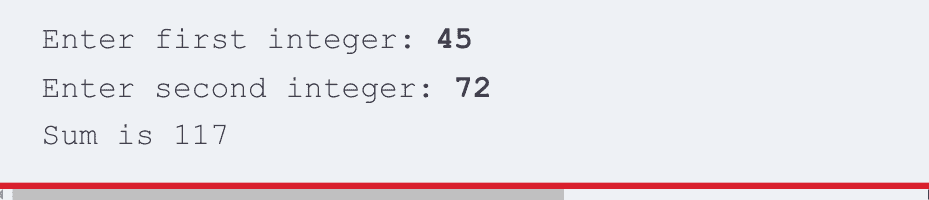

图 2.5 | 输入两个数字并显示其和的加法程序。

## import 声明

Java 的一大优势在于它拥有丰富的预定义类，你可以重用它们，而不是“重复发明轮子”。这些类被分组在包中——即相关类的命名组——统称为 Java 应用程序接口（Java API）。

第 3 行是一个 import 声明，帮助编译器定位此程序中使用的类。它指示程序使用了来自 `java.util` 包的预定义 `Scanner` 类（稍后将讨论）。编译器确保你正确地使用该类。

所有的 import 声明必须出现在文件中类的声明之前。在类声明内部或之后放置 import 声明是语法错误。忘记包含必须导入的类的 import 声明会导致包含“cannot find symbol（找不到符号）”消息的编译错误。发生这种情况时，请检查你是否提供了正确的 import 声明。

## 声明并创建 Scanner 获取输入

第 12 行的变量声明语句声明 `number1` 持有 `int` 类型的数据——即整数（整数数值），如 72, -11 和 0。`int` 的值范围是 -2,147,483,648 到 +2,147,483,647。程序的 `int` 值不能包含逗号，因为 Java 使用它们来分隔列表中的项，例如此程序第 19 行中 `System.out.printf` 方法的参数。为了可读性，你可以使用下划线作为数字分隔符对数字分组——所以 `60_000_000` 代表值 60,000,000。

第 9 行中的 `=` 表示变量应初始化为表达式的结果——`new Scanner(System.in)`。该表达式使用 `new` 关键字创建一个读取用户输入字节的 `Scanner` 对象。

## 提示用户输入

第 11 行使用 `System.out.print` 显示 "Enter first integer:"。此提示引导用户采取特定操作。我们使用 `print` 而不是 `println`，是为了让用户的输入与提示在同一行显示——提示冒号（:）后的空格使程序输出更具可读性。回顾 2.2 节，大写字母开头的标识符代表类名。`System` 类是 `java.lang` 包的一部分，Java 会自动将其导入每个程序中。`java.lang` 类是唯一不需要导入的 Java 类。`int`、`float` 和 `char` 是基本类型。其他基本类型有 `boolean`、`byte`、`short` 和 `long`。`float` 类型持有实数，`char` 类型持有字符数据。`char` 类型代表单个字符，例如：

- 字母（例如 A 或 z）
- 数字（例如 0–9）
- 特殊字符（例如 * 或 %）
- 转义序列（例如 `\t` 表示制表符，`\n` 表示换行）。

https://docs.oracle.com/javase/specs/jls/se22/html/jls-4.html#jls-4.2.

第 12 行中的 `=` 表示 `int` 变量 `number1` 在声明时应使用 `input.nextInt()` 的结果对其进行初始化。这使用了 `Scanner` 对象 `input` 的 `nextInt()` 方法从用户处获取一个整数。此时，程序会等待用户输入一个数字并按 `Enter` 键以将其提交给程序。

我们的程序假设用户输入的是一个有效的整数值。如果不是，将会发生逻辑错误，并且程序将终止。[第 10 章，异常处理：深入探讨]() 讨论了如何通过使程序能够处理此类错误来增强程序的健壮性。这有助于使你的程序具有容错能力。

## 获取第二个整数

第 14 行提示用户输入第二个整数。第 15 行声明了 `int` 变量 `number2`，并用从用户处读取的第二个整数对其初始化。

## 在计算中使用变量

第 17 行声明了 `int` 变量 `sum`，并用计算结果 `number1 + number2` 对其初始化。`+` 运算符是一个 `binary operator`（二元运算符），因为它有两个 `operands`（操作数）。包含计算的语句部分被称为 `expressions`（表达式）。事实上，表达式是语句中任何有值的部分。表达式 `number1 + number2` 的值是它们的和。同样，表达式 `input.nextInt()`（第 12 行和第 15 行）的值是用户输入的整数。在二元运算符的两侧留空格以提高可读性。

## 显示计算结果

计算完成后，第 19 行使用方法 `System.out.printf` 显示 `sum` 的值。`%d` 格式占位符 是 `int` 值（`sum`）的占位符——字母 `d` 代表“十进制（基10）整数”。格式字符串中的其余字符都是固定的。因此，`printf` 方法显示 "Sum is "，随后是 `sum` 的值（该值会替换 `%d`）——以及一个换行符。

我们可以将第 17 行和第 19 行合并为单个语句：

```java
System.out.printf("Sum is %d%n", (number1 + number2));
```

表达式 `number1 + number2` 周围的括号是多余的——包含它们是为了强调整个表达式的值输出在 `%d` 格式占位符的位置。

## Java API 文档

对于我们展示的每个新 Java API 类，我们都会显示其包名。此信息可以帮助你在 Java API 文档中找到每个包和类的描述。可以在以下地址找到文档：

```
https://docs.oracle.com/en/java/javase/23/docs/api/html
```

下一页概述了如何使用 API 文档：

```
https://docs.oracle.com/en/java/javase/23/docs/api/doc.html#overview
```

你可以从此处下载文档以便离线使用：

```
https://www.oracle.com/java/technologies/javase-downloads.html
```

## 在单独语句中声明和初始化变量

在计算（或其他表达式）中使用变量之前，每个变量都必须有一个值。第 12 行的变量声明语句声明了 `number1` 并用用户输入的值对其进行初始化。有时，你会在一个语句中声明变量，然后在另一个语句中给它赋值。例如，第 12 行可以写成两个语句：

```java
int number1; // 声明变量 number1
number1 = input.nextInt(); // 为用户的...赋值
```

第一条语句声明了 `number1` 但没有对其初始化。第二条语句使用 `assignment operator`（赋值运算符） `=` 为 `number1` 分配用户输入的整数。

## 生成式 AI

1. 编写一个 Java 程序，从用户处读取三个整数。
2. 程序使用下表进行算术运算：

| 操作 | 运算符 | Java 表达式 |
|---|---|---|
| 加法 | + | f |
| 减法 | - | p |
| 乘法 | * | b |
| 除法 | / | x |
| 余数 | % | r |

## 整数除法

整数除法产生整数商。例如，7 / 4 等于 1，17 / 5 等于 3。整数除法的小数部分被截断（即被丢弃）。

## 余数运算符 (%)

余数运算符 `%` 产生除法后的余数。因此，7 % 4 等于 3，17 % 5 等于 2。该运算符最常用于整数操作数，但也适用于其他类型。该运算符常用的用途是判断整数是偶数还是奇数，或者一个数字是否是另一个数字的倍数。

## 直行形式的算术表达式

算术表达式必须以直线形式编写以便输入计算机。因此，如“a 除以 b”的表达式表示法是可以接受的：

## 用于分组的括号

括号在 Java 表达式中的分组方式与代数表达式相同。例如，为了乘以数量 b + c，我们写成

```java
a * (b + c)
```

如果表达式包含嵌套括号，例如

```java
(a * (b + c))
```


先计算最内层括号中的表达式（在本例中为 `b + c`）。

## 运算符优先级

Java 按照运算符优先级规则确定的精确顺序应用算术运算符，这些规则通常与代数相同：

1. 首先应用乘法、除法和余数运算。如果存在多个此类运算符，则从左到右应用。乘法、除法和余数运算符具有相同的优先级。
2. 接下来应用加法和减法运算。如果表达式包含多个此类运算，则从左到右应用。加法和减法运算符具有相同的优先级。
3. 最后应用赋值运算符。

这些规则使得 Java 能够按照顺序应用运算符。当我们说运算符从左到右应用时，指的是它们的分组方式。有些是从右到左分组。下表总结了这些运算符优先级规则：

> 我们使用简单的示例来解释求值顺序。复杂的表达式可能会出现微妙的求值问题。更多信息，请参阅《Java 语言规范》第 15 章（https://docs.oracle.com/javase/specs/jls/se22/html/jls-15.html）。

| 运算符 | 操作 | 计算顺序（优先级） |
| :--- | :--- | :--- |
| `*` `/` `%` | 乘法、除法、余数 | 首先应用。如果存在多个此类运算符，它们从左到右进行评估。 |
| `+` `-` | 加法、减法 | 接下来应用。如果有多个同类型的运算符，它们从左到右进行评估。 |
| `=` | 赋值 | 最后评估。 |

你可以在此处查看 Java 运算符的完整优先级表：
https://docs.oracle.com/javase/tutorial/java/nuts/operators.html

## 生成式 AI

1. 提示生成式 AI 解释 Java 在以下语句中评估运算符的顺序，并指定语句执行后 `x` 的值：

```java
int x = 2 % 2 + 2 * 2 - 2 / 2;
```

生成式 AI 应该说明评估顺序为：

```
% * / + -
```

赋值给 `x` 的值为 3。

## 2.7 决策：相等运算符和关系运算符

条件是一个可以为真或假的表达式。`if` 语句根据条件的值做出决策。你在 `if` 语句中通过下表总结的相等运算符（`==` 和 `!=`）和关系运算符（`>`、`<`、`>=` 和 `<=`）来构建条件：

| 代数运算符 | 示例 Java 条件 | 条件的含义 |
| :--- | :--- | :--- |
| `=` | `x == y` | x 等于 y |
| `!=` | `x != y` | x 不等于 y |
| `>` | `x > y` | x 大于 y |
| `<` | `x < y` | x 小于 y |
| `>=` | `x >= y` | x 大于或等于 y |
| `<=` | `x <= y` | x 小于或等于 y |

### 相等运算符

两个相等运算符具有相同的优先级，该优先级低于关系运算符的优先级。相等运算符从左到右分组。

### 关系运算符

所有关系运算符都具有相同的优先级，并且也从左到右分组。

### 使用 if 语句

图 2.6 使用六个 `if` 语句来比较用户输入的两个整数。如果其中任何一个的条件为 `true`，则执行相应的体语句；否则，跳过。我们使用 `Scanner` 从用户处输入整数，并将其存储在变量 `number1` 和 `number2` 中。程序使用所有关系和相等运算符比较数字，并显示结果为 `true` 的比较结果。我们展示了用户输入的不同值对的三个示例输出。

[点击此处查看代码]

```java
// Fig. 2.6: Comparison.java
// 使用 if 语句、关系
// 和相等运算符比较整数。
import java.util.Scanner; // 程序使用 cl

public class Comparison {
    // main 方法开始程序执行
    public static void main(String[] args) {
        // 创建 Scanner 获取输入
        Scanner input = new Scanner(System.in);

        System.out.print("Enter first integer: ");
        int number1 = input.nextInt(); // 读取

        System.out.print("Enter second integer: ");
        int number2 = input.nextInt(); // 读取

        if (number1 == number2) {
            System.out.printf("%d == %d%n", number1, number2);
        }

        if (number1 != number2) {
            System.out.printf("%d != %d%n", number1, number2);
        }

        if (number1 < number2) {
            System.out.printf("%d < %d%n", number1, number2);
        }

        if (number1 > number2) {
            System.out.printf("%d > %d%n", number1, number2);
        }

        if (number1 <= number2) {
            System.out.printf("%d <= %d%n", number1, number2);
        }

        if (number1 >= number2) {
            System.out.printf("%d >= %d%n", number1, number2);
        }
    } // 结束 method
} // 结束 class
```

```
Enter first integer: 777
Enter second integer: 777
777 == 777
777 <= 777
777 >= 777

Enter first integer: 1000
Enter second integer: 2000
1000 != 2000
1000 < 2000
1000 <= 2000

Enter first integer: 2000
Enter second integer: 1000
2000 != 1000
2000 > 1000
2000 >= 1000
```

图 2.6 | 使用 `if` 语句、关系运算符和相等运算符比较整数。`Comparison` 类 `main` 方法中的第 10 行设置了用于从用户读取数据的 `Scanner`。第 12-13 行提示输入第一个整数，读取并存储在 `number1` 中。第 15-16 行提示输入第二个整数，读取并存储在 `number2` 中。程序使用所有关系和相等运算符比较数字，并显示结果为 `true` 的比较结果。我们展示了用户输入的不同值对的三个示例输出。第 18-19 行在 `number1 == number2` 时显示结果。第 22-23 行在 `number1 != number2` 时显示结果。第 24-27 行在 `number1 < number2` 时显示结果。第 28-30 行在 `number1 > number2` 时显示结果。第 31-33 行在 `number1 <= number2` 时显示结果。第 34-36 行在 `number1 >= number2` 时显示结果。

### 代码块

图 2.6 中的每个 `if` 语句都比较用户输入的两个整数。如果其中任何一个的条件为 `true`，则执行相应的体语句；否则，跳过。我们使用 `Scanner` 从用户处输入整数并存储在变量 `number1` 和 `number2` 中。程序使用所有关系和相等运算符比较数字，并显示结果为 `true` 的比较结果。我们展示了用户输入的不同值对的三个示例输出。

单语句体不需要大括号，但多语句体则需要。图 2.6 中的每个 `if` 语句都比较用户输入的两个整数。如果其中任何一个的条件为 `true`，则执行相应的体语句；否则，跳过。我们使用 `Scanner` 从用户处输入整数并将其存储在变量 `number1` 和 `number2` 中。程序使用所有关系和相等运算符比较数字，并显示结果为 `true` 的比较结果。我们展示了用户输入的不同值对的三个示例输出。

在 `if` 语句的右括号后立即放置分号会导致空语句（即什么都不做）。在这种情况下，无论条件是否为真，`if` 语句都会执行——会导致程序产生错误的逻辑错误。

### 空格

注意 2.6 中空格的使用。编译器忽略大部分空格，因此可以根据你的喜好将语句拆分为多行。如果你将一个语句跨越几行，请选择自然的断点，例如逗号列表中的逗号之后或长表达式运算符之后。理想情况下，语句应该保持短小，但不总是可能的。

## 生成式 AI

1. 提示生成式 AI 发现并修正以下内容的错误：

```java
if (c < 7) {
    System.out.println("c is less than 7");
}

if (c => 7) {
    System.out.println("c is greater than equal");
}
```

## 2.8 对象化案例研究：创建和使用 Java API 的 String 类

在整书中，我们强调使用 Java API 中的预定义类以及 Java 开源社区的各种库。你将重点关注了解有哪些库，选择你的应用程序所需的库，从现有的库类创建对象并让这些对象发挥它们的功能。通过“对象化”，我们的意思是即使在第 8 节学习创建自己的类之前，也能方便地创建和使用强大的对象进行编程。

你已经处理过 Java 对象了。你使用 `System.out` 对象显示程序的输出，并使用 `Scanner` 对象配合 `System.in` 对象获取用户输入。这些封装了输出和输出的机制。`System.out` 和 `System.in` 对象由 `System` 类为你创建，而你使用 `new` 运算符创建了 `Scanner` 对象。在本节中，你将创建并与 Java API 的 `String` 类对象交互。

你将在后续章节中学习额外的 `String` 功能。第 7 章详细讨论了 `String` 类，测试了更多方法。

# 测试驱动 String 类

类本身不能执行。一个 `Person` 对象可以通过告诉 `Car` 对象要做什么来驱动它（加速；减速；例如左转、右转等）而无需了解汽车内部机制的工作原理。同样地，`main` 方法通过调用对象的方法来“驱动”`String` 对象——而无需知道类是如何实现的。从这个意义上说，后续程序中的 `main` 被驱动程序。图 2.7 的 `main` 方法对几个 `String` 对象进行了测试。

[点击此处查看代码图片]

```java
// Fig. 2.7: StringTest.java
// String class test program.
public class StringTest {
    public static void main(String[] args) {
        String s1 = "happy";
        String s2 = "birthday";
        String s3 = ""; // creates an empty string

        // display the Strings and show their
        System.out.printf("s1: %s; length: %d\n", s1, s1.length());
        System.out.printf("s2: %s; length: %d\n", s2, s2.length());
        System.out.printf("s3: %s; length: %d\n", s3, s3.length());

        // compare Strings
        System.out.println("Results of comparison:");
        System.out.printf("s1.equals(\"happy\"): %b\n", s1.equals("happy"));
        System.out.printf("s2.equals(s1): %b\n", s2.equals(s1));

        // test String method isEmpty
        System.out.println("Testing s3.isEmpty()");

        if (s3.isEmpty()) {
            System.out.println("s3 is empty; assigning to s3");
            s3 = s1 + s2; // assign s3 the result
            System.out.printf("s3: \"%s\"; length: %d\n", s3, s3.length());
        }

        // testing whether Strings start with
        System.out.printf("s1.startsWith(\"ha\"): %b\n", s1.startsWith("ha"));
        System.out.printf("s2.startsWith(\"ha\"): %b\n", s2.startsWith("ha"));
        System.out.printf("s1.endsWith(\"ay\"): %b\n", s1.endsWith("ay"));
        System.out.printf("s2.endsWith(\"ay\"): %b\n", s2.endsWith("ay"));
    } // end method main
} // end class StringTest
```

```
s1: "happy"; length: 5
s2: "birthday"; length: 9
s3: ""; length: 0
Results of comparing Strings:
s1.equals("happy"): true
s2.equals(s1): false
Testing s3.isEmpty():
s3 is empty; assigning to s3
s3: "happy birthday"; length: 14
s1.startsWith("ha"): true
s2.startsWith("ha"): false
s1.endsWith("ay"): true
s2.endsWith("ay"): true
```


图 2.7 | String 类测试程序。

# 创建 String 对象

对于每个字符串字面量（string literal），Java 编译器都会创建一个 Java API 中 `String` 类的对象，并用字面量的字符对其进行初始化。因此，第 5–7 行创建三个 `String` 对象：s1 包含 "happy"，s2 包含 "birthday"，s3 包含空字符串 ("")。当我们像之前那样声明 `int` 变量时，编译器知道 `int` 是什么——它是 Java 内置的原始类型。同样，编译器理解 Java API 中 `String` 类的某些方面，例如如何从字符串字面量创建 `String` 对象。

对于大多数类，你必须使用 `new` 来创建该类的对象，就像你在图 2.5 和 2.6 中对 `Scanner` 类做的那样。

与 `System` 类一样，`String` 类是 `java.lang` 包的一部分，因此它被导入到每个程序。只要封装得当，类就可以被其他程序员复用。这是使用 Java 等支持面向对象编程的语言的最显著益处之一。这些语言拥有丰富的强大预构建类库。例如，你只需通过导入就可以在任何程序复用 Java API 的类，正如我们在图 2.5 和 2.6 中对 `Scanner` 类做的那样。

## String 方法 length

第 10–12 行输出了每个 `String` 及其长度。`String` 类的 `length` 方法返回存储在特定 `String` 对象中的字符数。要对特定对象调用此方法，你需要指定对象的名称 (s1)，后面跟着点运算符 (.)，然后是方法名 (length) 和一对括号。空括号表示 `length` 不需要额外的参数来完成其任务。

# 比较 String 对象

`String` 对象可以使用 `String` 类的 `equals` 方法与其他对象进行相等性比较，该方法返回 `true` 或 `false`：

- 第 16 行将 s1 的内容与字符串字面量 "happy" 的内容进行比较——这些 String 对象包含相同的字符，因此 `equals` 返回 `true`。
- 第 17 行将 s2 的内容与 s1 的内容进行比较——这些 String 对象不包含相同的字符，因此 `equals` 返回 `false`。

> 注意，运算符 `==` 不能用于比较 `String` 对象的内容。我们将在面向对象编程章节中解释原因。

字符串比较是区分大小写的。第 16 行和 17 行中的 `printf` 调用使用 `%b` 格式说明符，这是条件值的占位符。在第 7 章中，你将看到字符串的字典比较。

## isEmpty

第 22 行调用 String 的 `isEmpty` 方法，如果字符串为空则返回 `true`——即长度为 0。s3 被初始化为空字符串 ("")，所以它是空的。

## 拼接

第 24 行通过相 s1 和 s2 给 s3 赋新值——被称为字符串拼接。第 25 行输出 s3 内容和长度以证明字符串拼接是有效的。

## startsWith 和 endsWith

第 29–34 行演示了 String 的 `startsWith` 和 `endsWith` 方法，分别在字符串开头或结尾指定的字符串时返回 `true`；否则返回 `false`。这些比较也是区分大小写的。第 30 行和 32 行显示 s1 以 "ha" 开头 s2 不是。

## 生成式 AI

1. 提示式 AI 编写一个 Java 程序，输入名字和姓氏，然后显示 "Welcome to Java," 后面跟着名字、一个空格、姓氏和一个感叹号 ("!")。运行生成的代码以确保其正常工作。AI 引入了什么种新的 Scanner 方法来读取字符串？

## 特别章节：生成式 AI 练习

对于以下每个问题，尝试多个 AI 以确定哪一个表现最好。始终要验证结果。记住，它们有时会出错甚至产生幻觉，创建不可靠的信息。

**2.1 (为 Java 代码注释)** 提示式 AI 为无注释的代码添加注释，然后检查注释是否相关。

**2.2 (改进 Java 代码注释)** 提示式 AI 改进 Java 程序中的注释。

**2.3 (将你的代码与生成式 AI 代码进行比较)** 对于你编写的每个程序，提示式 AI 创建相同的程序。将其生成的代码与你的代码进行比较。告诉 AI 到目前为止介绍了哪些 Java 特性，并要求将其代码限制在这些特性内。

# 3 控制语句：第一部分

## 目标

在本章中，你将学习：

- 使用 `if` 和 `if...else` 选择语句在备选操作之间进行选择。
- 使用 `while` 迭代语句在程序中重复执行语句。
- 使用计数器控制迭代、哨兵控制迭代和嵌套控制语句。
- 使用复合赋值运算符以及自增和自减运算符。
- 考虑基本类型的移植性。
- 使用生成式 AI 来提升你的 Java 学习体验。
- 继续我们的“面向对象自然”方法，通过一个案例研究，如何创建和操作任意大小的整数。

## 大纲

### 3.1 引言

### 3.2 控制结构

#### 3.2.1 顺序结构

#### 3.2.2 选择语句

#### 3.2.3 迭代语句

#### 3.2.4 控制语句总结

### 3.3 if 单选择语句

### 3.4 if ... else 双重选择语句

#### 3.4.1 嵌套 if ... else 语句

#### 3.4.2 块

#### 3.4.3 条件运算符 ( : )

### 3.5 while 迭代语句

### 3.6 计数器控制迭代

#### 3.6.1 实现算法

#### 3.6.2 整数除法与截断

#### 3.6.3 算术溢出

#### 3.6.4 输入验证

### 3.7 哨兵控制迭代

#### 3.7.1 实现哨兵控制迭代

#### 3.7.2 基本类型之间的显式与隐式转换

#### 3.7.3 浮点数的格式化

### 3.8 嵌套控制语句

#### 3.8.1 问题描述

#### 3.8.2 实现程序

### 3.9 复合赋值运算符

### 3.10 自增和自减运算符

### 3.11 基本类型

### 3.12 面向对象自然案例研究：超大整数

### 3.13 总结

### 特别章节：生成式 AI 练习

## 3.1 引言

在本章和下一章中，我们将介绍结构化编程的理论和原理。正如你在后续章节中看到的，这里介绍的概念对于构建类和操作对象至关重要。

我们将更详细地讨论 `if` 语句，并介绍 `if...else` 和 `while` 语句。我们引入了复合赋值运算符和自增自减运算符。我们还考虑了 Java 基本类型的移植性。最后，我们将继续“面向对象自然”的方法，通过一个案例研究，创建和操作超大整数，这些整数可以表示超出 Java 整数基本类型所支持的有限范围的值。

## 3.2 控制结构

程序中的语句通常按照编写的顺序一个接一个地执行，正如你在第 2 章看到那样。这个过程被称为顺序执行。各种 Java 语句允许你指定下一个执行的语句不一定是序列中的下一个语句。这被称为控制转移。

在 20 世纪 60 年代，人们发现无节制地使用控制转移是软件开发小组面临许多困难的根源。指责指向了 `goto` 语句（用于当时大多数编程语言），它允许你指定控制转移到程序中广泛范围内的任何一个目标。

> Java 没有 `goto` 语句；然而，`goto` 是 Java 的保留字，不应在程序中用作标识符。使用它会导致编译错误。

Bohm 和 Jacopini 的研究表明，可以在不使用任何 `goto` 语句的情况下编写程序。对于那个时代的程序员来说，挑战是将他们的风格转向“无 goto 编程”。结构化编程这一术语几乎与“消除 goto”成为同义。直到 20 世纪 70 年代，大多数程序员才开始认真地学习结构化编程。结果令人印象深刻。软件开发小组报告开发时间缩短，系统按时交付频率增加，软件项目在预算内完成的频率更高。这些成功的关键在于结构化程序更清晰、更容易调试和修改，而且最初就可能没有错误。

> C. Bohm and G. Jacopini, “Flow Diagrams, Turing Machines, and Languages with Only Two Formation Rules, Communications of the ACM, Vol. 9, No. 5, May 1966, pp. 366–371.

Bohm 和 Jacopini 的工作证明了所有程序都可以用三种控制结构——顺序结构、选择结构和迭代结构来编写。当我们引入 Java 的控制结构实现时，我们将使用 Java 语言规范中的术语“控制语句”来称呼它们。

### 3.2.1 顺序结构

顺序结构是内置在 Java 中的。除非另有指示，否则计算机按照编写的顺序一个接一个地执行 Java 语句——即顺序执行。各种 Java 语句允许你指定下一个执行的语句不一定是序列中的下一个。以下活动图说明了顺序结构：


Java 允许你按顺序执行任意数量的操作。正如我们很快会看到的，活动图包含多个操作状态（如“给 grade 加 total”）。这些状态表示了算法系统的工作流。活动图可以帮助你开发算法。这些符号由菱形和空圆圈组成。这些符号由箭头连接，指示操作的执行顺序。活动图展示了如何操作。这些语句包含多个操作状态（如“给 counter 加1”）。`while` 和 `for` 语句执行零或多次操作。活动图顶部的实圆表示初始状态——工作流的开始。底部由空圆圈围绕的实圆表示最终状态——工作流的结束。活动图还包含右上角的矩形。这些可选的 UML 注释（类似于 Java 中的注释）是描述目的的说明性文字。我们的注释显示与每个操作状态相关的 Java 代码。活动图通常不显示 Java 代码，我们在这里显示是为了说明其与 Java 的关系。有关 UML 的更多信息，请访问 https://uml.org。

### 3.2.2 选择语句

Java 有三类选择语句（在本章和第 4 章中讨论）。`if` 语句（3.3节）在条件为 `true` 时执行（选择）操作，在条件为 `false` 时跳过它。`if...else` 语句（3.4节）在条件为 `true` 时执行操作，在条件为 `false` 时执行另一个操作。`switch` 语句（4.8节）根据表达式的值执行多个操作中的一种。

### 3.2.3 迭代语句

Java 有四种迭代语句——也称为重复和循环语句，用于在循环继续条件为 `true` 时重复执行语句。迭代语句包括 `while`（3.5节）、`for`（4.3节）、`do...while`（4.7节）和增强 `for`（6.13节）。`while` 和 `for` 语句执行操作（或一组操作）零或多次——如果循环继续条件初始为 `false`，则操作（或一组操作）将不会执行。`do...while` 语句在其主体中执行该动作（或一组动作）一次或多次。

### 关键字

`if`、`else`、`switch`、`while`、`do` 和 `for` 是 Java 关键字。我们在第 2.2 节展示了 Java 关键字的完整列表。你也可以在《Java语言规范》第 3.9 节“关键字”中找到它们。

> 《Java语言规范》，Java SE 22 版。第 3.9 节，“关键字”。访问2024年5月21日。https://docs.oracle.com/javase/specs/jls/se22/html/jls-3.html#jls-3.9。

### 3.2.4 控制语句总结

Java 只有三种控制结构，从现在起，我们称其为控制语句：

- 顺序语句，
- 选择语句（三种类型）以及
- 迭代语句（四种类型）。

我们可以将每个控制语句建模为活动图，其中包含初始和结束状态，表示控制语句的入口和出口点。单入口/单出口控制语句使得通过连接上一个语句的出口点到下一个语句的入口点来构建程序变得简单——即控制语句堆叠。控制语句可能连接的另一种方式是控制语句嵌套，即一个控制语句出现在另一个控制语句内部。

## 3.3 if 单选择语句

我们在第 2.7 节中简要介绍了 if 单选择语句。程序使用选择语句在备选的方案之间进行选择。例如，假设考试及格分是 60 分。以下 if 语句判断条件 `grade >= 60` 是否为真：

```
if (grade >= 60) {
    System.out.println("Passed");
}
```

如果是这样，该语句打印 "Passed"；否则，条件为假，输出语句被忽略，并执行序列中的下一条语句（如果有）。对第二行进行缩进是可选的，但为了清晰起见建议。

### boolean 原始数据类型

在第 2.7 节中，你使用关系运算符和相等运算符创建了条件。Java 条件必须求值为 `true` 或 `false`——每一者都是 Java 关键字。Java 提供了 `boolean` 原始数据类型，用于只能存储 `true` 或 `false` 值的变量。

### if 语句的 UML 活动图

下面的图说明了单选择 if 语句的控制流：

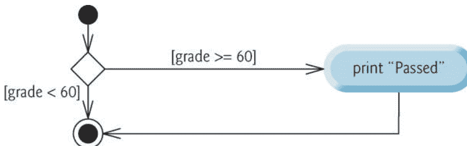

该图包含了活动图最重要的符号——菱形，或决策符号，它表示要做出决策。工作流根据与符号相关的守卫条件继续，这些条件可以为真或为假。从决策符号出的每个转换箭头在箭头旁边的方括号中指定了守卫条件。如果守卫条件为真，工作流进入转换箭头指向的动作状态。在这张图中，如果 grade 大于或等于 60，程序打印“Passed”，然后转换到活动的最终状态。如果 grade 小于 60，程序将转换到最终状态，而不打印任何消息。if 语句是单入口/单出口的控制语句。

## 3.4 if...else 双选择语句

if 单选择语句仅在条件为真时执行指定的动作。if...else 双选择语句允许你在条件为真时执行一个动作，并在条件为假时执行另一个动作。例如，以下 if...else 语句如果学生的成绩大于或等于 60，则打印 "Passed"；否则，打印 "Failed"：

```
if (grade >= 60) {
    System.out.println("Passed");
} else {
    System.out.println("Failed");
}
```

在任何情况下，打印发生后，都会执行序列中的下一条语句（如果有）。if else 的体都是缩进的。为了可读性，你应该在整个程序中一致地应用缩进规范。如果有多个缩进层，每层都应该缩进相同的额外空间。我们偏好三空格缩进。IDE 通常会为你自动缩进代码。

### if...else 语句的 UML 活动图

下面的图说明了前述 if...else 语句的控制流：

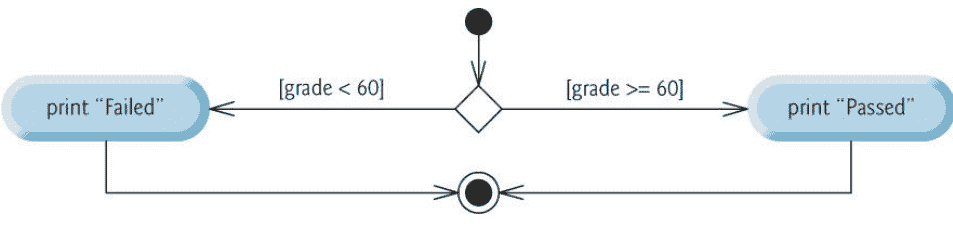

再次，UML 活动图从初始状态开始，包含转换箭头、决策和动作状态，并以最终状态结束。

## 生成式 AI

1. 使用带有以下代码的 Prompt 输入 genAI，要求它们找到并修正错误：

```
if (count > 10) {
    System.out.println("count is greater than 10")
}
else {
    System.out.println("count is less than or equal")
}
```

确认 genAI 是否识别出 else 关键字后面缺失的左括号 `{`。

## 3.4.1 嵌套 if...else 语句

你可以通过将 if...else 语句放在 if...else 语句内部来创建嵌套 if...else 语句，从而测试多个情况。以下 if...else 对于大于或等于 90 分的成绩打印 A，80 到 89 分打印 B，70 到 79 分打印 C，60 到 69 分打印 D，对于所有成绩之外打印 F。我们使用嵌套来实现：

```
if (grade >= 90) {
    System.out.println("A");
} else {
    if (grade >= 80) {
        System.out.println("B");
    } else {
        if (grade >= 70) {
            System.out.println("C");
        } else {
            if (grade >= 60) {
                System.out.println("D");
            } else {
                System.out.println("F");
            }
        }
    }
}
```

如果 grade 大于或等于 90，第一个 if 条件为真。然而，执行第一个 if 语句——else 部分被跳过。大多数程序员倾向于将上述嵌套 if...else 写成：

```
if (grade >= 90) {
    System.out.println("A");
} else if (grade >= 80) {
    System.out.println("B");
} else if (grade >= 70) {
    System.out.println("C");
} else if (grade >= 60) {
    System.out.println("D");
} else {
    System.out.println("F");
}
```


后一种形式避免了深度缩进，这通常会导致代码行空间不足，迫使换行并降低代码可读性。在嵌套 `if...else` 语句中，确保你测试了所有情况。

## 3.4.2 块

`if` 语句期望其体部只有一条语句。要在 `if` 的或 `else` 的体中包含多个语句，你必须将语句封装在大括号 `{ }` 中。回顾第 2.7 节，大括号中的语句形成一个块。你可以在放置单语句的方法的地方放置块。我们总是将控制语句封装在大括号中。这避免了被称为“悬空 else”的逻辑错误。

下面的示例在 `if...else` 语句的 `else` 部分包含了一个多语句块：

```java
if (grade >= 60) {
    System.out.println("Passed");
} else {
    System.out.println("Failed");
    System.out.println("You must take this course");
}
```

如果 `grade` 小于 60，`else` 体中的两个语句都会执行，显示：

```
Failed
You must take this course
```

包裹 `else` 部分两个语句的大括号是重要的。如果没有大括号，语句

```java
System.out.println("You must take this course again")
```

将位于 `else` 体之外，即使对于及格分也会打印“You must take this course again”——这是一个逻辑错误。

## 语法错误和逻辑错误

编译器捕捉语法错误，例如当块中漏掉一个括号时。逻辑错误（例如错误的计算）在执行时产生影响。致命的逻辑错误会导致程序失败并过早终止。

非致命逻辑错误允许程序继续执行，但会导致其产生错误的结果。

# 空语句

就像块可以放置在任何可以放置单条语句的地方，也可以有一个空语句。回想第 2.7 节，空语句是通过在通常应该是语句的地方放置一个分号（`;`）来表示的。

在 `if` 或 `if ... else` 语句的条件之后放置分号，会导致单选择 `if` 语句中产生逻辑错误，并会在双选择 `if ... else` 语句中产生语法错误（当 `if` 部分包含实际的体体语句时）。

## 生成式 AI

1. 使用以下代码提示生成式 AI，并要求它们识别并纠正错误：

```java
if (grade < 60) 
    System.out.println("Failed");
else
    System.out.println("Passed");
    System.out.println("Great job!");
```

将它们的代码更新和解释与以下内容进行对比：
`else` 之后的第一个缩进语句是 `else` 体的一部分，因为两个缩进的语句没有被大括号包含。所以，即使学生的成绩不及格，这段代码也会打印“Great Job!”。此外，良好的做法即使是单条语句体（如 `if` 部分体）也用大括号括起来，以防止将来向其体添加更多语句时出现错误。代码应为：

```java
if (grade < 60) {
    System.out.println("Failed");
} else {
    System.out.println("Passed");
    System.out.println("Great job!");
}
```

# 3.4.3 条件运算符 (?:)

条件运算符 (`?:`) 可以代替简单的 `if... else` 语句。条件运算符是唯一的三元运算符——它接受三个操作数。这些操作数与 `?:` 符号共同构成一个条件表达式。例如，以下语句打印 `println` 的条件表达式参数的值：

```java
System.out.println(grade >= 60 ? "Passed" : "Failed")
```

- 问号 (`?`) 左侧的操作数 `grade >= 60` 是一个结果为真或假的条件。
- 问号 (`?`) 和冒号 (`:`) 之间的操作数 `"Passed"` 是条件为真时条件表达式的值。
- 冒号 (`:`) 之后的操作数 `"Failed"` 是条件为假时条件表达式的值。

该语句中的条件表达式在 `grade >= 60` 为真时求值为 `"Passed"`，在为假时求值为 `"Failed"`。因此，这个带有条件运算符的语句与第 3.4 节开头所示的 `if... else` 语句本质上相同。条件运算符的优先级较低，所以通常放在括号中。

## 生成式 AI

1. 提示生成式 AI 编写单条 `System.out.printf` 语句，判断 `int` 变量 `number` 的值是奇数还是偶数并打印结果。告诉生成式 AI 假设 `number` 存在且值为 7。将它们生成的代码与以下语句对比，并确认它们的代码产生相同的结果：

```java
System.out.printf("%d is %s%n", number, number % 2 == 0 ? "even" : "odd");
```

```
7 is odd
```

# 3.5 迭代语句

迭代语句指定程序在某些条件保持为 `true` 时重复执行某操作。考虑一个使用 `while` 迭代语句寻找大于 50 的第一个 3 的幂程序段。在该代码执行后，`product` 包含结果：

```java
int product = 3;
while (product <= 50) {
    product = 3 * product;
}
```

首先，我们将 `product` 初始化为 3。然后，`while` 语句执行如下：

1. 程序测试条件 `product <= 50`，由于 `product` 为 3，所以条件为真。体语句将 `product` 乘以 3 并将结果 (9) 赋值给 `product`。循环的第一次迭代完成。
2. 程序再次测试条件——因为 `product` 现在是 9，所以为真。体语句将 `product` 设置为 27。循环的第二次迭代完成。
3. 程序再次测试条件——因为 `product` 现在是 27，所以为真。体语句将 `product` 设置为 81。循环的第三次迭代完成。
4. 程序再次测试条件——因为 `product` 现在是 81，它不小于或等于 50，所以最终为假，循环终止。

变量 `product` 现在包含 81——即大于 50 的第一个 3 的幂。`while` 语句的体可以是单条语句，也可以是一个块。

# while 语句的 UML 活动图

下面的 UML 活动图阐述了上述 `while` 语句的控制流：

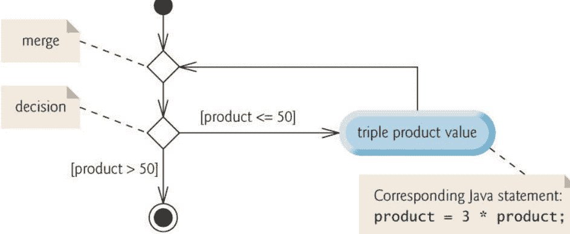

此图引入了 UML 的合并符号。UML 将合并符号和决策符号都表示为菱形。合并符号将两个活动流合并为一个。在图中，合并符号将来自初始状态和来自动作状态的转换合并，因此它们都流向决定循环是否应该开始（或继续）执行的决策。

决策符号和合并符号可以通过连线的数量来区分。

```java
while (gradeCounter <= 10) { // loop
    System.out.print("Enter grade: ");
    int grade = input.nextInt(); // input
    total = total + grade; // add grade
    gradeCounter = gradeCounter + 1; // increment
}

// termination phase
int average = total / 10; // integer division

// display total and average of grades
System.out.printf("%nTotal of all 10 grades: %d\n", total);
System.out.printf("Class average is %d\n", average);
```


```
Total of all 10 grades is 846
Class average is 84
```

图. 3.1 | 使用计数器控制循环解决级平均分问题。

# 方法 main 中的局部变量

第 8 行声明并初始化了 `Scanner` 变量 `input`，用于读取用户输入的值。第 11、12、17 和 23 行声明了局部 `int` 变量 `total`、`gradeCounter`、`grade` 和 `average`。变量 `grade` 存储了用户的输入。

这些声明出现在 `main` 方法体中。在方法体中声明的变量是局部变量。它们只能从声明行一直到方法结束的右括号处使用。局部变量的声明必须在该方法中使用该变量之前出现。局部变量无法在声明它的方法之外访问。在 `while` 循环体内声明的 `grade` 只能在该代码块中使用。

初始化阶段：初始化变量 `total` 和 `gradeCounter`

赋值语句（位于第 11–12 行）将 `total` 初始化为 0，将 `gradeCounter` 初始化为 1。这些初始化发生在变量用于计算之前。

所有局部变量在其值用于表达式之前都必须初始化；否则，会发生编译错误。总和通常初始化为 0。计数器通常初始化为 0 或 1，取决于它们的用方式。在整本书中，我们将展示何时使用 0 以及何时使用 1。

# 处理阶段：从用户处读取 10 个成绩

第 15 行表示，只要 `gradeCounter` 的值小于或等于 10，`while` 语句就继续循环（也称为“迭代”）。只要该条件保持为 `true`，`while` 语句就会反复执行第 16–19 行的语句：

- 第 16 行显示提示 `"Enter grade: "`
- 第 17 行读取用户输入的成绩并赋值给变量 `grade`。
- 第 18 行将新的 `grade` 加到 `total` 中，替换其原有值。
- 第 19 行将 `gradeCounter` 加 1（替换其原有值），以表示程序已处理了一个成绩，并准备好从用户处输入下一个成绩。

增加 `gradeCounter` 最终会导致其超过 10。此时，循环终止，因为其条件（第 15 行）变成了 `false`。

# 终止阶段：计算并显示级平均分

当循环结束时：

- 第 23 行计算平均并将结果赋值给变量 `average`。
- 第 26 行使用 `System.out` 的 `printf` 方法显示文本 "Total of all 10 grades is "，后跟 `total` 的值。
- 第 27 行使用 `printf` 显示文本 "Class average is "，后跟 `average` 的值。

当执行到第 28 行时，程序终止。

# 3.6.2 整数除法与截断

第 23 行的平均计算产生一个整数结果。在示例输出中，成绩总和为 846，除以 10 后应得到 84.6。这是一个浮点数——一个带有小数点的数字。但在第 23 行中，`total / 10` 的结果是整数 84，因为 `total` 和 10 都是整数。两个整数相除的结果是整数除法——计算中的任何分数部分被截断（即丢失）。在下一节中，我们将看到如何从平均计算中获得浮点结果。假设整数除法会舍入（而不是截断）会导致错误的结果。

# 3.6.3 算术溢出

在图 3.1 中，第 18 行将用户输入的成绩加到 `total` 中：

```java
total = total + grade; // 将成绩加到总和
```

即使是这个简单的语句也有潜在问题——整数相加可能导致产生一个 `int` 变量无法存储的值。这被称为算术溢出，会导致未定义行为，从而导致意外的结果。图 2.5 的加法程序在第 17 行存在相同的问题，该行计算了用户输入的两个 `int` 值的和：

4. “整数溢出。”Wikipedia，最后修改于 2024 年 5 月 18 日。https://en.wikipedia.org/wiki/Integer_overflow#Security_ramifications. [与整数溢出相关的潜在问题。]

```java
int sum = number1 + number2; // 相加数字，
```

常量 `MIN_VALUE` 和 `MAX_VALUE` 代表 `int` 可以存储的最小值和最大值。你可以在此处这些常量：https://docs.oracle.com/javase/8/api/Integer.html

# 3.6.4 输入验证

每当程序接收输入时，都可能发生各种问题。例如，程序应该验证输入以确保它们在 0 到 100 之间。工业级程序必须测试所有错误情况：

- 小于 0 的整数
- 大于 100 的整数
- 带有小数点的数字
- 包含字母或特殊符号的值

小数点右侧的有效数字。

- `double` 原始类型的变量表示`双精度浮点数`。它们占用的内存是 `float` 变量的两倍。它们最多有 15 位有效数字——大约是 `float` 变量精度的两倍。

大多数程序员使用 `double`，因为程序源代码中的所有浮点数（例如 7.33 和 0.0975）默认情况下都被表示为 `double` 类型。此类值被称为`浮点数字面量`。欲需了解 Java 浮点类型的精确范围范围，请参阅《Java 语言规范》第 4.2 节，“基本类型和值”。

5. 《Java 语言规范》，Java SE 22 版。“4.2. 基本类型和值”。访问于 2024 年 5 月 21 日。https://docs.oracle.com/javase/specs/jls/se22/html/jls-4.html#jls-4.

```java
1 // 图 3.2: ClassAverage.java
2 // 使用 s 解决课程平均分问题
3 import java.util.Scanner; // 程序使用 cl

4 public class ClassAverage {

    public static void main(String[] args) {
        // 创建 Scanner 以获取用户输入
        Scanner input = new Scanner(System.in);

        // 初始化阶段
        int total = 0; // 初始化成绩总和
        int gradeCounter = 0; // 初始化 #

        // 处理阶段
        System.out.print("输入成绩或输入 -1 退出:");
        int grade = input.nextInt();

        // 循环直到读取到哨兵值
        while (grade != -1) {
            total = total + grade; // 加上成绩
            gradeCounter = gradeCounter + 1; // 计数器加1

            // 提示输入并读取下一个成绩
            System.out.print("输入成绩或输入 -1 退出:");
            grade = input.nextInt();
        }

        // 终止阶段
        // 如果用户至少了一个成绩
        if (gradeCounter != 0) {
            // 使用带有小数点的数字
            double average = (double) total / count;

            // 显示总和和平均分（带）
            System.out.printf("Total of the %d\n", gradeCounter, total);
            System.out.printf("Class average is %.2f\n", average);
        } else { // 没有输入成绩，所以
            System.out.println("No grades were entered\n");
        }
    }
}
```


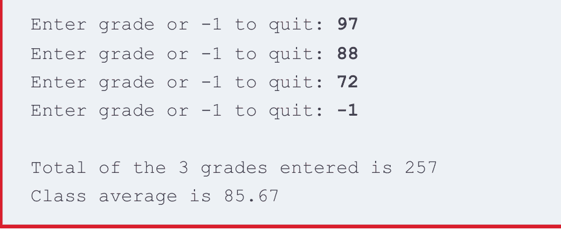

图 3.2 | 使用哨兵控制迭代解决课程平均分问题。

# 哨兵控制迭代与计数器控制迭代的逻辑

第 12 行将 `gradeCounter` 初始化为 `0`，因为还没有输入任何成绩。请记住，我们正在使用哨兵控制迭代来输入成绩，因此只有当用户输入有效成绩时，我们才增加变量 `gradeCounter`。第 33 行声明了 `double` 变量 `average`，它以浮点数的形式存储课程平均分。

将此程序的哨兵控制迭代逻辑与图 3.1 中的计数器控制迭代进行比较：

- 在计数器控制迭代中，图 3.1 的每次循环迭代（第 15–20 行）按指定的次数从用户处读取一个值。
- 在哨兵控制迭代中，图 3.2 的第 16–17 行在进入 `while` 循环之前提示并输入第一个值。该值决定了控制流是否应该进入 `while` 体。如果条件为 `false`，则用户输入了哨兵值——没有输入成绩，所以 `while` 循环不执行。

Java 提供了 `BigDecimal` 类（位于 `java.math` 包），我们将在第 4.11 节的对象的自然案例研究中讨论它。

## 生成式 AI

1. 提示生成式 AI 编写一个 Java 程序，从用户处读取任意数量的整数华氏温度，并计算显示它们的浮点平均值。告诉生成式 AI 假设用户输入的温度范围在 –212 到 212 之间，并使用哨兵值 999。

将它们生成的代码与下文的程序进行比较。如果它们的代码使用了我们尚未介绍过的技术，请调整提示词，为它们提供更多细节，帮助它们仅使用我们目前介绍的技术来生成代码。例如，告诉它们使用 `while` 循环，并在循环之前输入第一个温度，在循环体末尾输入后续每个温度。

```java
// AverageTemperature.java
// 计算几个温度的平均值
import java.util.Scanner;

public class AverageTemperature {
    public static void main(String[] args) {
        Scanner input = new Scanner(System.in);
        int total = 0;
        int counter = 0;
        System.out.print("Enter a temperature: \n");
        int temperature = input.nextInt();
        while (temperature != 999) {
            total = total + temperature;
            counter = counter + 1;
            System.out.print("Enter a temperature: \n");
            temperature = input.nextInt();
        }
        if (counter != 0) {
            double average = (double) total / counter;
            System.out.printf("Average temperature: %.2f\n", average);
        } else {
            System.out.println("No temperatures entered");
        }
    }
}
```

```text
Enter a temperature or 999 to quit: 12
Enter a temperature or 999 to quit: -22
Enter a temperature or 999 to quit: 17
Enter a temperature or 999 to quit: 999
Average temperature is: 2.33
```

### 3.8 嵌套控制语句

我们已经看到控制语句可以堆叠在一起（顺序执行）。在这种情况下，我们检查控制语句连接的另一种结构化方式——即将一个控制语句嵌套在另一个控制语句内部。

#### 3.8.1 问题描述

考虑以下问题描述：

某大学开设了一门课程，为学生参加房地产经纪人执业考试做准备。去年，完成这门课程的 10 名学生参加了考试。大学想知道学生在考试中的表现如何。你被要求写一个程序来汇总结果。

你得到了这 10 名学生的列表。在每个名字旁边写着一个 1 表示学生通过了考试，或者一个 2 表示学生未通过考试。

你的程序应该如下方式分析考试结果：

1. 输入每个测试结果（即 1 或 2）。每当程序请求另一个测试结果时，显示“Enter result”。
2. 统计每种测试结果的数量。
3. 显示测试结果的摘要，说明通过的人数未通过的人数。
4. 如果有超过八名学生通过，打印“Bonus to instructor!”。

#### 问题描述观察

在仔细阅读问题描述后，我们得出以下观察结果：

- 程序必须处理 10 名学生的测试结果。因为测试结果的数量是预先知道的，可以使用计数控制循环。
- 每个测试结果是 1 要是 2。当程序读取结果时，必须判断它是 1 还是 2。我们在算法中测试是否为 1。如果数字不是 1，则假设它是 2。
- 使用两个计数器跟踪考试结果——一个统计通过考试的人数，另一个统计未通过的人数。
- 程序处理完所有结果后，判断是否有超过八名学生通过考试。

#### 3.8.2 实现程序

图 3.3 使用计数器实现了该程序并展示了示例执行情况。第 11-13 行初始化变量可以避免使用未初始化变量导致的编译错误。虽然 Java 不要求在声明时初始化变量，但要求变量在使用之前有值。

```java
// 图 3.3: Analysis.java
// 使用计数器分析考试结果
import java.util.Scanner; // 使用类

public class Analysis {
    public static void main(String[] args) {
        // 创建 Scanner 以获取用户输入
        Scanner input = new Scanner(System.in);

        // 初始化变量
        int passes = 0;
        int failures = 0;
        int studentCounter = 1;

        // 使用计数器处理 10 名学生
        while (studentCounter <= 10) {
            // 提示用户输入并获取
            System.out.print("Enter result (1 = pass, 2 = fail): ");
            int result = input.nextInt();

            if (result == 1) {
                passes = passes + 1;
            } else {
                failures = failures + 1;
            }
            studentCounter = studentCounter + 1;
        }

        System.out.printf("Passed: %d\nFailed: %d\n", passes, failures);

        if (passes > 8) {
            System.out.println("Bonus to instructor!");
        }
    }
}
```

```text
Enter result (1 = pass, 2 = fail): 1
Enter result (1 = pass, 2 = fail): 2
Enter result (1 = pass, 2 = fail): 1
Enter result (1 = pass, 2 = fail): 1
Enter result (1 = pass, 2 = fail): 1
Enter result (1 = pass, 2 = fail): 1
Enter result (1 = pass, 2 = fail): 1
Enter result (1 = pass, 2 = fail): 2
Enter result (1 = pass, 2 = fail): 1
Enter result (1 = pass, 2 = fail): 2

Passed: 6
Failed: 4
```

`+=` 运算符将其右操作数的值加到左侧变量的值，然后结果存储在左侧变量中。因此，赋值表达式 `c += 3` 将 3 加到 `c` 上。

## 3.9 复合赋值运算符

复合赋值运算符允许你简化赋值表达式。你可以将语句

```java
c = c + 3; // 将 3 加 c
```

使用加法复合赋值运算符 `+=` 简化为

```java
c += 3; // 更简洁地将 3 加 c
```

复合赋值运算符会对右侧表达式的值进行隐式转换，以匹配运算符左侧变量的类型。因此，如果左侧变量是 `int` 而右侧表达式的结果是 `double`，则 `double` 值的浮点部分将被截断。下表显示了算术复合赋值运算符、示例表达式及其运算符的作用解释：

| 运算符 | 示例表达式 | 解释 | 赋值 |
|---|---|---|---|
| 假设: `int c = 3, d = 5, e = 4, f = 6, g = 12;` | | | |
| `+=` | `c += 7` | `c = c + 7` | 10 to c |
| `-=` | `d -= 4` | `d = d - 4` | 1 to d |
| `*=` | `e *= 5` | `e = e * 5` | 20 to e |
| `/=` | `f /= 3` | `f = f / 3` | 2 to f |
| `%=` | `g %= 9` | `g = g % 9` | 3 to g |

6. 《Java语言规范》，Java SE 22 版. 第 15.26.2节，“复合赋值运算符。” 访问于2024年8月28. https://docs.oracle.com/javase/specs/jls/se22/html/jls-15.html#jls-15.26.2.

## 生成式 AI

1. 使用以下代码向生成式 AI 询问代码执行后 `y` 的值是多少：

```java
int y = 5;
y += 3.3;
```

确认生成式 AI 指出 `y` 为 8。你可能认为该赋值语句会导致编译错误。复合赋值运算符会隐式地将右侧表达式的值转换为与左侧变量匹配的类型。因此，3.3 被截断为 3。

# 3.10 递增和递减运算符

下表总结了对数值变量的值加 1 或减去 1 的单元运算符——这些是单元递增运算符 `++` 和单元递减运算符 `--`。与二元运算符不同，按照习惯，单元递增减运算符应该放在操作数旁边，中间不留空格：

| Operator | Operator name | Expression | Explanation |
|---|---|---|---|
| `++` | 前置递增 | `++number` | 将 `number` 加 1，然后在 `number` 所在的表达式中使用 `number` 的新值。 |
| `++` | 后置递增 | `number++` | 在 `number` 所在的表达式中使用 `number` 的当前值，然后将 `number` 加 1。 |
| `--` | 前置递减 | `--number` | 将 `number` 减 1，然后在 `number` 所在的表达式中使用 `number` 的新值。 |
| `--` | 后置递减 | `number--` | 在 `number` 所在的表达式中使用 `number` 的当前值，然后将 `number` 减 1。 |

## 前置递增 vs 后置递增

图 3.4 展示了 `++` 运算符的前置递增和后置递增版本的区别。递减运算符 (`--`) 的工作方式类似。

```java
// 图 3.4: Increment.java
// 前置递增和后置递增操作
public class Increment {
    public static void main(String[] args) {
        // 展示后置递增操作
        int c = 5;
        System.out.printf("c before postincrement: %d\n", c);
        System.out.printf("postincrementing c: %d\n", c++);
        System.out.printf("c after postincrement: %d\n", c);

        System.out.println(); // 跳过一行

        // 展示前置递增操作
        c = 5;
        System.out.printf("c before preincrement: %d\n", c);
        System.out.printf("preincrementing c: %d\n", ++c);
        System.out.printf("c after preincrement: %d\n", c);
    }
}
```

```text
c before postincrement: 5
postincrementing c: 5
c after postincrement: 6

c before preincrement: 5
preincrementing c: 6
c after preincrement: 6
```

**图 3.4** | 前置递增和后置递增运算符。

第 7 行将变量 `c` 初始化为 5，第 8 行输出 `c` 的初始值。第 9 行输出表达式 `c++` 的值。该表达式对变量 `c` 执行了后置递增，因此该语句再次输出 `c` 的原始值（5），然后 `c` 的值增加（变为 6）。第 10 行输出 `c` 的新值（6），以证明变量的值确实在第 9 行被增加了。

第 15 行将 `c` 的值重置为 5，第 16 行输出 `c` 的值。第 17 行输出表达式 `++c` 的值，它对 `c` 执行了前置递增，因此语句输出 `c` 的新值（6）。第 18 行再次输出 `c` 的值，显示在第 17 行执行后 `c` 的值仍然为 6。

### 简化递增语句

算术复合赋值运算符以及递增和递减运算符可以简化程序语句。例如，图 3.3 中的三个赋值语句（第 23、26 和 30 行）

```java
passes = passes + 1;
failures = failures + 1;
studentCounter = studentCounter + 1;
```

可以使用复合赋值运算符更简洁地写为：

```java
passes += 1;
failures += 1;
studentCounter += 1;
```

使用前置递增为：

```java
++passes;
++failures;
++studentCounter;
```

或者使用后置递增：

```java
passes++;
failures++;
studentCounter++;
```

当对变量本身进行递增或递减时，前置和后置形式的效果相同。只有当变量出现在更大的表达式中，递增和递减才会产生差异。

## 生成式 AI

1. 提示词生成式 AI 解释以下代码：

```java
// Mystery.java
public class Mystery {
    public static void main(String[] args) {
        int x = 1;
        int total = 0;
        while (x <= 10) {
            int y = x * x;
            System.out.println(y);
            total += y;
            ++x;
        }
        System.out.printf("Total is %d%n", total);
    }
}
```


# 3.11 基本类型

在 C 和 C++ 中，程序员经常需要编写支持不同平台的版本。在 Java 中，八种基本类型——`boolean`、`char`、`double`、`float`、`int`、`long`、`short`——在所有平台上都是可移植的。关于这些类型的范围摘要，请访问《Java语言规范》第 4.2 节。例如，`int` 在某些机器上可能是 16 位（2 字节），在另一些机器上可能是 32 位（4 字节）或 64 位（8 字节）。在 Java 中，`int` 始终是 32 位（4 字节）。

# 3.12 对象自然案例研究：大整数

互联网通信和连接设备存储的增长极大地提高了隐私和安全的重要性。密码学几千年来一直用于编码数据，使得未经授权的用户难以（可能不可能）读取，这在当今连接的世界中至关重要。大多数网站（包括 deitel.com）使用 HTTPS（安全超文本传输协议）来加密和解密你的互联网交互。

## 某些应用程序需要超出 `long` 范围的整数

Java 的基本类型 `long` 可以存储范围为 -9,223,372,036,854,775,808 到 9,223,372,036,854,775,807 的值——最多 19 位十进制，可以表示低位千万亿级的整数。许多加密算法使用比 `long` 能存储更大的整数进行计算。

最流行的加密/解密方案之一是 RSA 公钥加密，通常用于保护互联网上传输的数据。工业级 RSA 实现涉及包含数百位数字的巨大质数，远超基本类型 `long` 所能容纳的范围。

11. "RSA (Cryptosystem)." 访问于2024年6月1日. https://en.wikipedia.org/wiki/RSA_(cryptosystem).
12. "RSA Algorithm." 访问于2024年6月1日. https://en.wikipedia.org/wiki/RSA_algorithm
13. K. Moriarty, B. Kaliski, J. Jonsson and A. Rusch, “PKCS #1: RSA Cryptography Version 2.2,” 2016年11月. 访问于2024年6月1日. https://tools.ietf.org/html/rfc8017


RSA 如此安全的原因之一是，即使对于今天最强大的超级计算机，对质数乘积进行因数分解也需要大量的时间。公钥加密也被用于比特币等加密货币背后的区块链技术。14. Sarah, “Blockchain Cryptography Is Fighting The Rise of Quantum Machines,” 2018年12月28日. 访问于2024年6月1日。

https://coincentral.com/blockchain-cryptography-quantum-machines/

## long 范围之外的整数需要自定义编程

那么，我们如何处理任意数字的大型整数呢？需要 `long` 范围之外整数的应用需要自定义编程。我们可以使用第1节中提到并在后续详细介绍的机制来开发一个处理大整数算术的自定义类——但这可能花费数月的工作。这种方法鼓励我们首先检查开源库，以确定是否存在这样的“大整数”类。

## 使用 Java API 的 java.math.BigInteger 处理大整数

已经存在用于创建和处理大整数的现有类。在本例中，我们将演示 Java API `java.math` 包中的 `BigInteger` 类：

https://docs.oracle.com/en/java/javase/23/docs/api/math/BigInteger.html

通过图3.5中的方法，我们将使用 `BigInteger` 类的对象，而无需理解该类是如何实现的。导入它（第4行），使用它创建 `BigInteger` 对象（第12–15行），然后对它们进行计算并显示结果（第23–30行）。

1. 如果你开车，你可以有效地使用它，而无需理解引擎、刹车和变速系统的内部工作原理。在你深入学习 Java 后，你可能想研究 `BigInteger` 的源代码（约5000行，包括 Javadoc 注释）以学习它是如何实现的。

2. 你可能会说：“我坚持要知道我在 Java 中使用的所有东西是如何实现的。”请思考一下这样一个事实：你正在使用 Java 编译器将你的 Java 程序翻译成字节码，然后 Java 虚拟机将字节码翻译成你计算机的机器语言。

```
// 使用 Java API 的 BigInteger 对象创建和处理超大整数
import java.math.BigInteger;

public class UsingBigInteger {
    public static void main(String[] args) {
        // 显示 long 的最大值
        System.out.printf("LARGEST LONG VALUE:");

        // 可以从字符串创建 BigInteger
        BigInteger value1 = new BigInteger("100000000000000000");
        BigInteger value2 = BigInteger.valueOf(9223372036854775807L);
        BigInteger value3 = BigInteger.valueOf(9223372036854775807L);

        System.out.println("\nINITIAL VALUES:");
        System.out.printf("BigInteger value1:\n");
        System.out.printf("BigInteger value2:\n");
        System.out.printf("BigInteger value3:\n");

        System.out.println("\nADD:");
        System.out.printf("value1.multiply(%s)\n", value1.multiply(value2));
        System.out.printf("value1.multiply(%s)\n", value1.multiply(value3));
    }
}
```

**图 3.5** | 使用 Java API 的 `BigInteger` 类对象创建和处理超大整数。

## long 的最大值

第9行显示了 `Long.MAX_VALUE`——这是一个表示 `long` 变量可以存储的最大值（9,223,372,036,854,775,807）的常量。正如我们将看到的样，本例中的每个 `BigInteger` 计算结果都大于 `Long.MAX_VALUE`。每个基本类型（例如 `long`）在 `java.lang` 包中都有一个对应的类（例如 `Long` 类）。这些类提供了 `MIN_VALUE` 和 `MAX_VALUE` 常量，代表对应基本类型可以存储的最小值和最大值。

## 使用字符串初始化 BigInteger

如果 `BigInteger` 的初始值超过了 Java 支持的最大整数值，你可以使用表示该整数值的字符串来初始化新的 `BigInteger` 对象，就像我们在第12–13行中处理那个30位整数所的那样。

## 使用整数初始化 BigInteger

第14–15行要求 `BigInteger` 类创建新的 `BigInteger` 对象并用基本类型整数值对其进行初始化。类提供了执行任务的方法。

## printf 字符串格式化符 %s 如何理解 BigInteger 对象？

每个 Java 基本类型值和对象都有其字符串表示。当你使用 `printf` 配合 `%s` 格式化符格式化任何值或对象时，Java 会将该值或对象转换为字符串。对于对象，Java 通过调用该对象的 `toString` 方法来实现，这一点我们将在后的章节中讨论。当你使用 `System.out` 的 `print` 和 `println` 方法显示对象时，也会调用 `toString` 方法。

## 执行 BigInteger 算术

`BigInteger` 类提供了各种常用算术操作的方法。第23–30行演示了 `BigInteger` 的 `add`、`subtract`、`multiply` 方法。`BigInteger` 正确地处理任意数字的整数。每个结果都是比 Java 基本类型可以表示的位数更多的值。例如，第28行的乘法产生了一个48位的整数。虽然 `BigInteger` 可以表示任何整数值，但它并没有使用 Java 虚拟机理解的基本类型。因此，使用 `BigInteger` 计算比使用基本类型慢（可能慢得多）。

## 生成式 AI

提示生成式 AI 写一个 Java 程序，计算并显示 100,000,000,000,000（100万亿）的立方。执行生成的代码并将代码和输出与以下内容进行比较：

```java
BigInteger value = new BigInteger("100000000000000");
System.out.printf("value is: %s\nvalue cubed is: %s%n", value, value.multiply(value.multiply(value)));
```

## 3.13 总结

在本章中，我们演示了 `if` 单选择语句、`if...else` 双选择语句以及 `while` 迭代语句。我们使用计数器控制迭代计算了 10 份学生成绩的平均分。然后，我们使用哨值控制迭代计算了任意一组学生成绩的平均分。我们引入了复合赋值运算符以及递增和减运算符。我们还讨论了 Java 的八种基本数据类型，并指出它们在平台之间是可移植的。

在“对象-自然”案例研究中，我们创建并操作了 `BigInteger` 对象，对超出 Java 整数基本类型支持范围的数值进行整数算术运算。整个章节，你使用了生成式 AI 来辅助 Java 学习体验。在第 4 章中，我们将继续对控制语句的讨论，引入 `for`、`do...while` 和 `switch` 语句。我们还引入了用于创建复合条件的逻辑运算符。

## 特别章节：生成式 AI 练习题

针对以下每个问题，尝试使用多个生成式 AI 以确定哪一个表现最好。务必验证结果。请记住，它们有时会出错甚至产生幻觉，生成不可靠的信息。

- 3.1 (生成式 AI：控制语句练习) 提示生成式 AI 提供一些带有答案的入门练习，用于练习 Java 的 `if` 和 `while` 控制语句。将建议限制在最多 50 行代码即可完成的练习。

- 3.2 (生成式 AI：填补缺失代码) 从程序中移除代码，然后告诉生成式 AI 程序应该实现的功能，并要求它们填补缺失的代码。

- 3.3 (生成式 AI：超大整数) 提示生成式 AI 写一个关于 `BigInteger` 应用的教程。

# 4 控制语句：第 部分


## 目标

在本章中，你将：

- 使用 `for` 和 `do...while` 迭代语句重复执行程序中的语句。
- 使用 `switch` 选择语句执行多选择。
- 使用 `break` 和 `continue` 语句改变控制流。
- 使用逻辑运算符形成复合条件表达式，以便在控制语句中测试多个条件。
- 使用生成式 AI 来辅助你的 Java 学习体验。
- 继续我们的“对象-自然”方法，通过使用 Java API 中 `BigDecimal` 类对象的案例研究来进行精确的货币计算。

## 大纲

### 4.1 引言

### 4.2 计数器控制迭代的要素

### 4.3 for 迭代语句

### 4.4 使用 `for` 语句的示例

### 4.5 使用 `for` 语句求 2 到 20 的偶数和

### 4.6 使用 `for` 语句计算复利

### 4.7 do... while 迭代语句

### 4.8 switch 多选择语句

### 4.9 break 和 continue 语句

### 4.10 逻辑运算符

#### 4.10.1 条件与 ( && ) 运算符

#### 4.10.2 条件或 ( || ) 运算符

#### 4.10.3 复杂条件的短路求值

#### 4.10.4 布尔逻辑逻辑与 (& ) 和包含或 (| ) 运算符

#### 4.10.5 布尔逻辑异或或 (^ ) 运算符

#### 4.10.6 逻辑非 ( ! ) 运算符

#### 4.10.7 示例：生成逻辑运算符的真值表

### 4.11 对象-自然案例研究：使用 Java API 类 BigDecimal 进行精确货币计算

### 4.12 总结

## 特别章节：生成式 AI 练习题

## 4.1 引言

本章介绍了 Java 剩余的所有控制语句（除一个外）。我们演示了 `for`、`do ... while` 和 `switch` 语句。我们使用 `while` 和 `for` 探索计数器控制迭代的要素。我们使用 `switch` 语句来统计用户输入的一组成绩中 A、B、C、D 和 F 等级成绩的数量。我们引入了 `break` 和 `continue` 程序控制语句。我们讨论了逻辑运算符，它允许你在控制语句中使用更复杂的条件表达式。在整个章节，你将使用生成式 AI 来辅助你的学习体验。我们讨论了使用 `double` 等浮点类型处理货币金额的挑战。然后，在第 4.11 节的对象-自然案例研究中，我们使用 Java API 类 `BigDecimal` 对象来精确地表示和操作货币金额。

## 4.2 计数器控制迭代的要素

让我们使用 `while` 迭代语句（第 3.5 节）将计数器控制迭代的要素形式化：

1. 控制变量（或循环计数器），
2. 控制变量的初始值，
3. 每次循环时修改控制变量的增量（也称为循环的迭代），
4. 决定是否继续循环的循环继续条件。

考虑图 4.1 所示程序，它使用循环显示 1–10。第 6、8、10 行定义了计数器控制迭代的要素。第 6 行声明控制变量并将其初始值设置为 1。第 8 行 `while` 语句测试循环继续条件，决定循环是否应该继续。第 9 行显示计数器的值。第 10 行在迭代结束时将控制变量加 1。


**图 4.1** | 使用 `while` 语句的计数器控制迭代。（注意：源文件中图 4.1 的 OCR 文本是破碎/不完整的，根据标准教科逻辑进行了重构）。

## 生成式 AI

提示生成式 AI 找到并修正以下代码中的错误，该代码应该打印 1–5：

```java
int n = 1;
while (n < 5) {
    System.out.println(n++);
}
```

确认生成式 AI 指出循环目前打印 1–4，为了打印 1–5，使用 <=

## 迭代语句

迭代语句在单行内指定了迭代细节。通常，我们使用 `for` 语句进行计数器控制迭代，使用 `while` 语句进行哨值控制迭代，但每种都可以用于迭代类型。图 4.2 使用 `for` 语句重新实现了图 4.1 的程序。

```
// 图 4.2: ForCounter.java
// 使用 for语句的计数器控制迭代
public class ForCounter {
    public static void main(String[] args) {
        // for 语句包括初始化
        // 条件和增量，用分号隔开
        for (int counter = 1; counter <= 10; counter++) {
            System.out.printf("%d ", counter);
        }
        System.out.println();
    }
}
```

`for` 语句（第 8–10 行）声明控制变量并将其初始化为1。接下来，语句在两个必要的分号之间测试循环继续条件（`counter <= 10`）。由于计数器的初始值为1，条件为真，因此第 9 行显示计数器的值（1）。接下来，`++counter` 将计数器加 1。然后，再次测试循环继续条件以决定是否进行循环的下一次迭代。此时，计数器的值为2，因此条件仍然为真，程序执行第 9 行。这一过程一直持续到循环显示 1–10。当计数器的值变为 11 时，循环继续条件为假，因此迭代终止，程序继续执行循环后的第一个语句（第 12 行）。

## 差一错误

如果你错误地将图 4.2 中的循环继续条件指定为 `counter < 10`，则循环将仅迭代九次——这是一种被称为差一错误的常见逻辑错误。循环继续条件中错误的最终值也会导致差一错误。对于一个从 1 计数到 10 的循环，条件应该是 `counter <= 10` 或 `counter < 11`。许多程序员倾向于使用从零开始的计数，即计数 10 次，`counter` 将被初始化为 0，而循环继续测试条件为 `counter < 10`。¹

1. 在第 6 章中，我们将看到从零开始计数的示例。

## 详细观察 `for` 语句的头部

让我们仔细观察图 4.2 中的 `for` 语句：

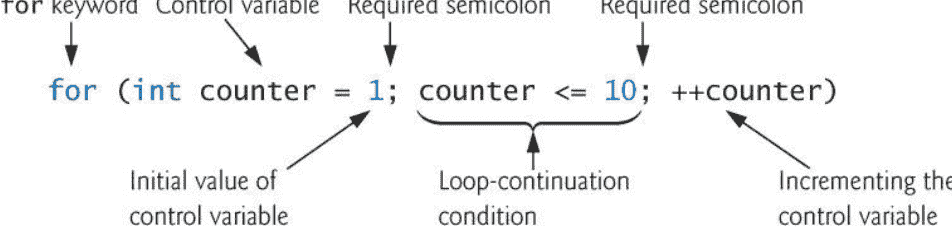

这一行——包括关键字 `for` 以及 `for` 之后括号内的所有内容（图 4.2 中的第 8 行——有时被称为 `for` 语句头部。

## `for` 语句的通用格式

`for` 语句的通用格式如下：

```
for (initialization; loopContinuationCondition; increment)
    statement(s)
```

其中

- **initialization**（初始化）用于声明循环的控制变量并提供其初始值，
- **loopContinuationCondition**（循环继续条件）——位于两个必需的分号之间——决定循环是否应该继续执行，以及
- **increment**（增量）在循环体执行后修改控制变量的值，使得循环继续条件最终变为 `false`。

如果 `loopContinuationCondition` 初始为 `false`，则 `for` 语句的体将不执行——程序将在 `for` 之后继续顺序执行下一条语句。`initialization` 和 `increment` 表达式可以是初始化表达式或增量表达式的逗号分隔列表——每个中的表达式都从左到右求值。

在 `for` 头部的右括号后面紧跟一个分号会使该 `for` 的体变成一个空语句。这通常是一个逻辑错误。

当迭代语句的 `loopContinuationCondition` 永远不会变为 `false` 时，就会发生死循环。为了在计数控制循环中防止这种情况，请在每次循环迭代中修改控制变量，以便循环继续条件最终变为 `false`。

## `for` 语句控制变量的作用范围

如果 `initialization` 表达式声明了控制变量，则它只能在该 `for` 语句中使用——不能在语句之外使用。这种限制的使用是该变量的 `scope`（作用范围），它定义了变量的生命周期以及在程序中可以使用的地方。例如，变量的作用范围是从代码块中的声明点到关闭该块的右大括号。正如你在第 5 章“方法”中看到的，将每个变量的作用范围限制在需要的地方是一个良好的习惯。

## `for` 语句头部的表达式是可选的

`for` 头部的三个表达式都是可选的：


- 如果省略了 `loopContinuationCondition`，则条件将始终为 `true`，创建一个无限循环。我们稍后会看到这有时是有用的。
- 如果程序在循环之前初始化了控制变量，则你可能省略初始化表达式。
- 如果程序在循环体内计算增量，或者不需要增量，则你可能省略增量表达式。

`for` 中的增量表达式作用于 `for` 体末尾的独立语句。因此，以下增量表达式在 `for` 中是等价的：

```
counter = counter + 1
counter += 1
++counter
counter++
```

增量表达式不会出现在更大的表达式中，因此前增和后增的效果相同。我们更倾向于前增。² 增量也可以是负的，在这种情况下它是递减，循环向下计数。

> 2. 这种对前增的偏好源于我们对 C++ 的经验，在 C++ 中，前增性能有时优于后增。在 Java 中，对于独立的计数器增加（例如在 `for` 的增量表达式中），前增相对于后增没有性能优势，因此编译器会产生相同的代码。许多 Java 程序员倾向于后增。在它们操作方式不同的复杂表达式中使用前增和后增时，请小心。

# 在语句体中使用 for 语句的控制变量

程序经常会在 `for` 循环体内显示控制变量的值或在计算中使用它，但这不是强制要求的。你可以在体中更改控制变量的值，但这可能导致细微的错误。如果你必须在体内修改控制变量的值，请优先使用头部。

## `for` 语句的 UML 图

以下 `for` 的 UML 图显示了初始化发生在语句之前。


# 4.5 使用 for 语句求加从 2 到 20 的偶数之和

图 4.3 使用 `for` 语句求加 2 到 20 之间的偶数，并将结果存储在 `int` 变量 `total` 中。当第 9–11 行执行时，每次循环迭代会将控制变量 `number` 的值加到 `total` 的当前值，并将结果存储在 `total` 中。

```java
// 图 4.3: Sum.java
// 使用 for 语句求加整数
public class Sum {
    public static void main(String[] args) {
        int total = 0;

        // 求加从 2 到 20 的所有偶数
        for (int number = 2; number <= 20; number++) {
            total += number;
        }

        System.out.printf("Sum is %d%n", total);
    }
}
```

从 1 到 99 的奇数，然后显示结果。同时，问他们和应该是多少。将生成的代码与以下代码进行比较，确保它产生正确的和：

```java
int sum = 0;

for (int count = 1; count <= 99; count += 2) {
    sum += count;
}

System.out.printf("Sum is: %d\n", sum);
```

Sum is: 2500

## 4.6 使用 for 语句计算复利

让我们使用 `for` 语句来计算复利。考虑以下问题：

某人在储蓄账户中投资了 $1,000，该账户产生 5% 的利息。假设所有利息都留在账户中，计算并打印 10 年内每年年底账户中的金额。使用以下公式确定金额：

```
a = p (1 + r)^n
```

其中，

- `p` 是投入的原始本金
- `r` 是年利率（例如，5% 使用 0.05）
- `n` 是年数
- `a` 是第 `n` 年末的存款金额

图 4.4 使用循环对资金留在账户的 10 年中的每一年进行复利计算。第 6、7 和 15 行声明了变量 `double` 类型的 `principal`、`rate` 和 `amount`。第 6–7 行将 `principal` 初始化为 `1000.00` 并将 `rate` 初始化为 `0.05` (5%)。第 15 行将 `amount` 初始化为复利计算的结果。

```java
// Fig. 4.4: Interest.java
// 使用 for 进行复利计算。
public class Interest {
    public static void main(String[] args) {
        double principal = 1000.00; // initial
        double rate = 0.05; // interest rate

        // display headers
        System.out.printf("%s%20s\n", "Year", "Amount on Deposit");

        // 计算每年的存款金额
        for (int year = 1; year <= 10; ++year) {
            // 计算新的存款金额
            double amount = principal * Math.pow(1 + rate, year);
            // 显示年份和金额
            System.out.printf("%4d%20.2f%n", year, amount);
        }
    }
}
```

| Year | 存款金额 |
|---|---|
| 1 | 1,050.00 |
| 2 | 1,102.50 |
| 3 | 1,157.63 |
| 4 | 1,215.51 |
| 5 | 1,276.28 |
| 6 | 1,340.10 |
| 7 | 1,407.10 |
| 8 | 1,477.46 |
| 9 | 1,551.33 |
| 10 | 1,628.89 |

**图 4.4** | 使用 for 进行的复利计算。

### 使用字段宽度和对齐格式化字符串

第 10 行显示了两个列输出的标题——年份和该年底的存款金额。我们使用格式说明符 `%20s` 来输出字符串 "Amount on Deposit"。`%` 和转换字符 `s` 之间的整数 20 表示该值应以 20 的字段宽度显示——也就是说，`printf` 显示该值至少占据 20 个字符位置。如果该值少于 20 个字符（在本例中为 17 个），则该值默认在字段中右对齐。如果要显示的值超过 20 个字符，字段宽度将向右扩展以容纳整个值——这通常会破坏我们表格输出的整齐列宽。若要显示左对齐的值，请使用减号（`-`）格式标记，如 `%-20s`。

### 使用 Math 类的 `static` 方法 `pow` 执行利率计算

`for` 语句（第 13–19 行）执行其体 10 次，控制变量 `year` 从 1 到 10 每次递增 1。当 `year` 变为 11 时，循环终止。Java 不包含幂运算符，但 `Math` 类具有 `static` 方法 `pow` 用于计算一个数值的幂。回想第 3.12 节，你可以通过指定类名后跟点（`.`）和方法名来调用 `static` 方法。第 15 行实现了问题描述中的公式。表达式

```
Math.pow(1.0 + rate, year)
```

计算 `1.0 + rate` 的 `year` 次方。该方法接收两个 `double` 参数并返回一个 `double` 结果。`Math` 类定义在 `java.lang` 包中，因此你不需要导入 `Math` 即可使用它。在第 5 章中，你将学习如何实现自定义的 `static` 方法。

`Math.pow` 调用第一个参数中的计算 `1.0 + rate` 产生相同的结果。

- `do...while` 在执行循环体后才测试其循环继续条件。因此，循环体至少会执行一次。

图 4.5 使用 `do...while` 输出数字 1–10。第 6 行声明并初始化了控制变量 `counter`。进入 `do...while` 语句后，第 9 行显示 `counter` 的值，第 10 行使 `counter` 自增。然后，程序评估第 11 行的循环继续测试。如果条件为真，则循环继续；如果为假，则循环终止，程序继续按顺序执行下一个语句（第 13 行）。

```java
// Fig. 4.5: DoWhileTest.java
// do...while 迭代语句.
public class DoWhileTest {
    public static void main(String[] args) {
        int counter = 1;
        do {
            System.out.printf("%d ", counter);
            ++counter;
        } while (counter <= 10);
        System.out.println();
    }
}
```

**图 4.5** | do...while 迭代语句。

## `do...while` 迭代语句的 UML 活动图

`do...while` 语句的 UML 活动图清楚地表明，`do...while` 在其循环体执行至少一次之前不会评估其循环继续条件。请将此活动图与第 3.5 节中所示 `while` 语句的活动图进行比较。

## 生成式 AI

提示生成式 AI，让他们发现并修正以下代码段的错误，该代码应该输出 2 到 10 之间的偶数：

```java
int counter = 2;
do {
    System.out.println(counter);
    counter += 2;
} while (counter < 10);
```

确认生成式 AI 发现 `while` 中的 `W` 应该是小写，且循环继续条件的关系运算符 `<` 应该是 `<=`，或者条件应该是 `counter < 11`。

# 4.8 switch 多重选择语句

`switch` 多重选择语句根据类型为 `byte`、`short`、`int` 或 `char` 的`常量整数表达式`（但不包括 `long`）的可能值，或者根据 `String` 的值执行不同的操作。你将在后面的章节中看到，这些限制在最近的 Java 版本中得到了极大放宽。

## 使用 switch 语句统计 A、B、C、D 和 F 等级

图 4.6 计算一组用户输入的数字成绩的类平均分。程序的 `switch` 语句确定每个成绩等同于 A、B、C、D 还是 F，并增加相应的计数器。然后，程序显示一个摘要，显示获得每个成绩的人数。与之前的类平均分程序类似，图 4.6 声明了局部变量 `total`（第 7 行）和 `gradeCounter`（第 8 行），用于跟踪用户输入的成绩总和和输入成绩的数量。第 9–13 行为每个成绩类别声明了计数器变量。注意第 7–13 行中的变量被显式初始化为 0。

```java
// Fig. 4.6: LetterGrades.java
// LetterGrades 类使用 switch 语句
import java.util.Scanner;

public class LetterGrades {
    public static void main(String[] args) {
        int total = 0; // 成绩总和
        int gradeCounter = 0; // 成绩数量
        int aCount = 0; // A 成绩计数
        int bCount = 0; // B 成绩计数
        int cCount = 0; // C 成绩计数
        int dCount = 0; // D 成绩计数
        int fCount = 0; // F 成绩计数

        Scanner input = new Scanner(System.in);

        System.out.println("输入范围内的整数成绩\n输入文件结束指示\n在 macOS/Linux 上输入 <Ctrl> d 然后\n在 Windows 上输入 <Ctrl> z");

        // 循环直到用户输入结束
        while (input.hasNext()) {
            int grade = input.nextInt(); // 读取
            total += grade; // 将成绩加到总和
            ++gradeCounter; // 数量加1

            // 增加相应的字母等级
            switch (grade / 10) {
                case 10: // 成绩为 90-100
                case 9:
                    ++aCount;
                    break; // 退出 switch
                case 8: // 成绩为 80-89
                    ++bCount;
                    break; // 退出 switch
                case 7: // 成绩为 70-79
                    ++cCount;
                    break; // 退出 switch
                case 6: // 成绩为 60-69
                    ++dCount;
                    break; // 退出 switch
                default:
                    ++fCount;
                    break; // 退出 switch
            }
        }

        if (gradeCounter > 0) {
            double average = (double) total / gradeCounter;
            System.out.println("Grade Report:");
            System.out.printf("A: %d\n", aCount);
            System.out.printf("B: %d\n", bCount);
            System.out.printf("C: %d\n", cCount);
            System.out.printf("D: %d\n", dCount);
            System.out.printf("F: %d\n", fCount);
            System.out.printf("Average: %.1f\n", average);
        } else {
            System.out.println("No grades were entered.");
        }
    }
}
```

### 控制表达式产生整数值

第 30 行的控制表达式执行整数除法，会截断结果的小数部分。当我们将 0 到 100 之间的 `int` 值除以 10 时，结果始终是 0 到 10 之间的 `int` 值。我们在 `case` 标签中测试这些值中的几个。如果用户输入整数 `85`，控制表达式的值为 8。`switch` 将 8 与每个 `case` 标签进行比较。如果匹配（`case 8`：第 35 行），则执行该 `case` 的语句。对于 `8`，第 36 行增加 `bCount`，因为 80 分的成绩是 B。`break` 语句（第 37 行）退出 `switch`，然后按顺序执行下一个语句。在该程序中，我们到达了 `while` 循环的结束，因此控制返回到第 24 行的循环继续条件，以确定是否应该继续执行循环。

#### 对多个 `case` 执行相同的语句

我们的 `switch` 语句的 `case` 显式测试值 `10, 9, 8, 7` 和 `6`。第 31–32 行的 `case` 测试值 `10` 和 `9`，它们都代表 A 等。连续列出 `case` 且之间没有语句允许它们执行相同一组语句。因此，当控制表达式的值为 `10` 或 `9` 时，执行第 33–34 行的语句。`switch` 语句没有提供测试值范围的机制——你需要测试的每个值必须列在单独的 `case` 标签中。⁴ `switch` 语句与其他控制语句不同，它不需要为 `case` 中的多个语句加括号。

⁴. 在第 5 章中，我们介绍了 `switch` 表达式，它可以在每个 `case` 中指定一个逗号分隔的值列表以进行匹配。

#### `default` 情况

如果控制表达式的值不匹配任何 `case` 标签，则执行 `default` 情况（第 44–46 行）。在本示例中，`default` 情况处理所有小于 `6` 的控制表达式值——即所有不及格的成绩。如果没有发生匹配且 `switch` 不包含 `default` 情况，程序控制将直接继续执行 `switch` 之后的第一个语句。在 `switch` 中，测试控制表达式的所有可能值是一个良好的习惯。此外，提供一个 `default` 情况可以处理意外值。

没有 `break` 语句的情况下，每当 `switch` 中发生匹配时，该 `case` 及其后续 `case` 的语句都会执行，直到遇到 `break` 语句或到达 `switch` 结束。这被称为“穿透”（falling through）到后续 `case` 中的语句。在 `switch` 中需要时忘记 `break` 语句是一个逻辑错误。


## switch 语句 UML 活动图

以下是带有 `break` 的通用 `switch` 语句的 UML 活动图：

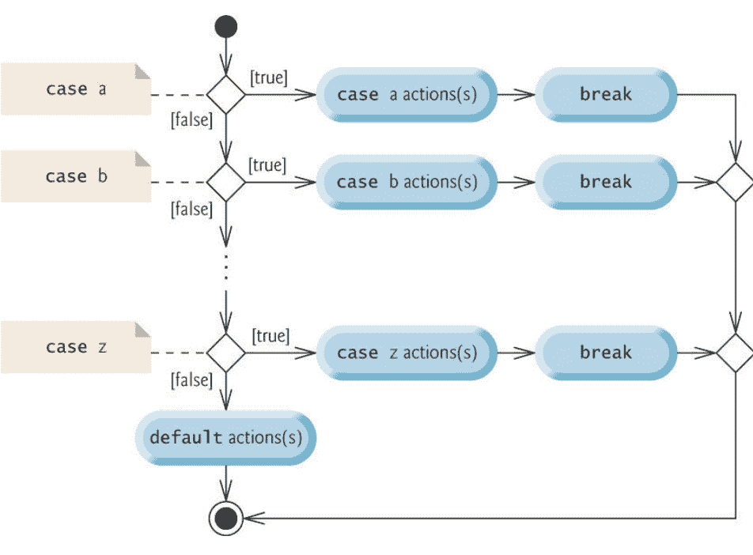

大多数 `switch` 语句在每个 `case` 中使用 `break` 来终止 `switch` 语句。该图通过包含 `break` 语句并显示 `case` 末尾的 `break` 语句会导致控制立即退出 `switch` 语句，强调了这一点。`switch` 的最后一个 `case`（或最后出现的可选 `default` 情况）不需要 `break`——执行只需继续到 `switch` 之后的下一个语句。

## 关于 switch 中每个 `case` 里的表达式的说明

在 `switch` 中，每个 `case` 必须包含一个 `String` 或常量整数表达式——即任何整数常数的组合，其结果评估为 `byte`、`char`、`short` 或 `int` 类型的常量整数值（例如 -7、0 或 221）。整数常量仅仅是一个整数值。此外，你还可以使用字符常量（类型为 `char`），它们是单引号内的特定字符，例如 `'A'`、`'7'` 或 `'$'`。这些代表字符在 Unicode 字符集中的整数值。⁵你可以在此处查看许多 Unicode 字符的整数值

点击此处查看代码

```
https://en.wikipedia.org/wiki/List_of_Unicode_cha-
```

5. “Unicode.” 访问于 2024 年5 月 26 日.https://home.unicode.org/.

每个 `case` 中的表达式也可以是常量变量或 `enum` 常量：

- 一个**常量变量**（或简单的**常量**）被声明为 `final`（在第 5 章讨论），并包含在程序运行过程中不变的值。
- Java 还有一种名为 `enum` 的类型（在第 5 章讨论），用于定义常量。`enum` 的常量可以在 `case` 标签中使用。

在第 9 章《继承、多态与接口的现实建模》中，我们展示了一种更优雅的方法来实现 `switch` 逻辑。我们使用名为多态的技巧来创建通常比使用 `switch` 逻辑的程序更清晰、更容易维护且更容易扩展的程序。

## 生成式 AI

**1 Prompt genAIs**，让它们找到并纠正以下代码中的错误：

点击此处查看代码

```
switch (number) {
    case 1:
        System.out.println("The number is 1\n");
    case 2:
        System.out.println("The number is 2\n");
```

```
break;
default:
    System.out.println("The number is not 1 or
}
```

确认让 genAIs 识别出 `switch` 中缺少 `break` 语句——如果数字是 1，`case` 1 和 2 的语句都会执行。

## 4.9 break 和 continue 语句

除了选择和迭代语句，Java 还提供了 `break` 和 `continue` 语句来改变控制流。6. Java 还有标记 `break` 和 `continue` 语句。参见网页 https://deitel.com/

### break 语句

在前节中，我们使用 `break` 来终止 `switch` 语句。在 `while`、`for` 或 `do...while` 中执行 `break` 会立即退出该语句——图 4.7 展示了退出 `for`。当嵌套 `if` 语句（第 8–10 行）检测到 `count` 为 5 时，`break` 终止循环，程序继续执行第 15 行，这是因为我们在循环之前（第 5 行）声明了 `count`，而不是在 `for` 头部（第 7 行）。

点击此处查看代码

```java
1 // Fig.4.7: BreakTest.java
2 // break 语句退出 for 语句。
3 public class BreakTest {
4     public static void main(String[] args) {
5         int count; // 控制变量也 us
6
7         for (count = 1; count <= 10; ++count) {
8             if (count == 5) {
9                 break; // 如果 count 为 5 则终止循环
10             }
11             System.out.printf("%d ", count);
12         }
13         System.out.printf("%nBroke out of loop");
14     }
15 }
```

输出：
```
1 2 3 4

在 count = 5 时退出循环
```

**图 4.7** | break 语句退出 for

### continue 语句

你在循环中执行 `continue` 语句时，它会跳过循环体的剩余语句并继续循环的下一次迭代。

- 在 `while` 或 `do ... while` 语句中，程序在执行 `continue` 后立即评估循环继续条件。
- 在 `for` 语句中，增量表达式执行，然后程序评估循环继续条件。

图 4.8 使用 `continue`（第 7 行）来跳过第 10 行的语句，当嵌套 `if` 确定 `count` 的值为 5 时。当 `continue` 执行时，程序控制继续执行 `for` 语句头部中的 `++count` 增量表达式（第 5 行）。

点击此处查看代码

```java
1 // Fig.4.8: ContinueTest.java
2 // continue 语句终止迭代
3 public class ContinueTest {
4     public static void main(String[] args) {
5         for (int count = 1; count <= 10; ++count) {
6             if (count == 5) {
7                 continue; // 跳过剩余代码
8             }
9
10            System.out.printf("%d ", count);
11        }
12
13        System.out.printf("%nUsed continue to skip printing 5");
14    }
15}
```

输出：
```
1 2 3 4 6 7 8 9 10
Used continue to skip printing 5
```

图 4.8 | continue 语句终止了一个 for 循环的迭代。

有些程序员认为 `break` 和 `continue` 语句违反了结构化编程。通过结构化编程技术可以实现相同的效果，因此这些程序员不使用 `break` 或 `continue`。

在实现高质量软件工程与实现最佳性能软件之间存在着张力。有时，一个目标的实现是以牺牲另一个目标为代价的。除了对性能要求最高的情况外，请遵循以下指南：首先，让代码简单且正确；然后让它快速且精小，但仅在必要时才这样做。

## 生成式 AI

- 1. 提示词生成式 AI，让它们使用结构化方法重新实现图 4.8 的代码，然后比较它们编写的代码。

## 逻辑运算符

- `&&` (条件逻辑与)
- `||` (条件逻辑或)
- `&` (布尔逻辑与)
- `|` (布尔逻辑包含或)
- `^` (布尔逻辑异或)
- `!` (逻辑取反)

允许你将两个或多个简单条件组合成复合条件。当 `&`、`|` 和 `^` 应用于整数操作数时，它们也是位运算符。

7. 参阅书籍网站 https://deitel.com/javafp5 关于位运算符的讨论。

## 4.10.1 条件逻辑与 (`&&`) 运算符

2023 年，在经历了三年的新冠肺炎后，美国经历了飞行员短缺，导致航空流量拥堵。为了缓解飞行员短缺，政府考虑将强制性退休年龄从 65 岁提高到 67 岁，以便健康良好的资深飞行员能够继续飞行两年。

假设航空公司想询问每个 63 岁及以上的资深飞行员是否希望申请持续到 67 岁，而不是在 65 岁时退休，并且需要知道有多少符合这个年龄段。航空公司可以编写一个程序搜索员工记录，并确定 63 岁以上资深飞行员的数量。该程序可能包含以下语句：

点击此处查看代码图片

```java
if (employeeType == PILOT && age >= 63) {
    ++veteranPilots;
}
```

假设 `PILOT` 是一个常量。`if` 语句包含两个由 `&&`（条件逻辑与）运算符隔开的简单条件：

- `employeeType == PILOT` 判断员工是否为飞行员。
- `age >= 63` 判断员工是否接近退休年龄。

`if` 语句考虑组合条件，只有当两个简单条件都为真时，结果才为真。如果是这样，`if` 语句体会将 `veteranPilots` 加 1；否则，程序跳过加增。有些程序员发现，带有冗余括号的组合条件更具可读性，例如

点击此处查看代码图片

```java
if ((employeeType == PILOT) && (age >= 63)) {
    ++veteranPilots;
}
```

下面的真值表总结了 `&&` 运算符，显示了 `expression1` 和 `expression2` 的真假值的所有可能组合。Java 会对包含关系运算符、等值运算符或逻辑运算符的所有表达式求值为假或真：

### 条件逻辑与 (`&&`) 运算符真值表

| expression1 | expression2 | expression1 && expression2 |
| :--- | :--- | :--- |
| false | false | false |
| false | true | false |
| true | false | false |
| true | true | true |

## 4.10.2 条件逻辑或 (`||`) 运算符

假设我们希望在选择执行路径之前，确保两个条件中的一个或两个为 `true`。在这种情况下，我们使用 `||`（条件逻辑或运算符），如下程序段所示：

点击此处查看代码图片

```java
if ((semesterAverage >= 90) || (finalExam >= 90)) {
    System.out.println("Student grade is A");
}
```

该语句也包含两个简单条件：

- `semesterAverage >= 90` 判断学生在整个学期的表现是否足以获得该课程的 A 等。
- `finalExam >= 90` 判断学生在期末考试中的表现是否足以获得该课程的 A 等。

随后 `if` 语句考虑组合条件

点击此处查看代码图片

```java
(semesterAverage >= 90) || (finalExam >= 90)
```

如果简单条件中的一个或两个都为真，则授予学生一个 A 等。只有当两个简单条件都为假时，才不会打印“Student grade is A”。以下是条件逻辑或（`||`）运算符的真值表。

### 条件逻辑或 (`||`) 运算符真值表

| expression1 | expression2 | expression1 || expression2 |
| :--- | :--- | :--- |
| false | false | false |
| false | true | true |
| true | false | true |
| true | true | true |

`&&` 运算符的优先级高于 `||`。两者都从左到右分组。

## 4.10.3 复杂条件的短路求值

包含 `&&` 或 `||` 的表达式部分只求值直到确定条件是真还是假。这种短路求值是 `&&` 的一项性能特性

点击此处查看图片

```java
(employeeType == PILOT) && (age >= 63)
```

如果 `employeeType` 不等于 `PILOT`，则立即停止（即整个表达式为假）；如果 `employeeType` 等于 `PILOT`（即整个表达式可能为真），则继续。在使用 `&&` 的表达式中，一个条件——我们称之为依赖条件——需要另一个条件为真才有意义。在这种情况下，依赖条件应该出现在 `&&` 运算符之后以防止错误。考虑以下条件：

```java
(i != 0) && (10 / i == 2)
```

## 4.10.4 布尔逻辑与 (`&`) 和包含或 (`|`) 运算符

逻辑与 `&` 运算符和布尔逻辑或 `|` 运算符与 `&&` 和 `||` 相同，不同在于它们不执行短路求值。如果右侧操作数具有副作用——对变量的修改，这种情况下是有用的。例如

```java
(birthday == true) | (age >= 65)
```

无论整体条件真假，都能保证变量 `age` 增加。为了清晰起见，避免在条件中使用副作用的表达式（如递增）。它们会让代码更难以理解并导致微妙的逻辑错误。

每个条件必须产生布尔值，否则将发生编译错误。在条件中，只有当布尔表达式赋值给布尔变量时才会编译。

## 4.10.5 布尔逻辑异或 (`^`) 运算符

包含布尔逻辑异或 `^` 运算符的简单条件仅当两个操作数中一个为真另一个为假时为真。如果两者都为真或都为假，则条件为假。该运算符保证求值两个操作数。以下是布尔逻辑异或 `^` 运算符的真值表。

### 布尔逻辑异或 (`^`) 运算符真值表

| expression1 | expression2 | expression1 ^ expression2 |
| :--- | :--- | :--- |
| false | false | false |
| false | true | true |
| true | false | true |
| true | true | false |

## 4.10.6 逻辑取反 (`!`) 运算符

逻辑取反 `!` 运算符——也称为逻辑否定运算符或逻辑 NOT 运算符——会反转条件的含义。与组合两个条件的逻辑运算符 `&&`、`||`、`&`、`|` 和 `^`（这些都是二元运算符）不同，逻辑否定运算符是一个只有一个条件作为操作数的一元运算符。该运算符放在条件之前是为了在原始条件（不带逻辑取反运算符）为假时选择执行路径，如下程序段所示

点击此处查看代码图片

```java
if (!(grade == sentinelValue)) {
    System.out.printf("The next grade is %d%n", grade);
}
```

只有当 `grade` 不等于 `sentinelValue` 时，才会执行 `printf` 调用。条件 `grade == sentinelValue` 外围的括号是必要的，因为逻辑取反运算符的优先级高于等号运算符。

在大多数情况下，你可以通过使用合适的关系或相等运算符以不同的方式表达条件，从而避免使用逻辑取反。例如，上述语句也可以写成如下：

点击此处查看代码图片

```java
if (grade != sentinelValue) {
    System.out.printf("The next grade is %d%n", grade);
}
```

这种灵活性可以帮助你更方便地表达条件。以下是逻辑取反运算符的真值表。

### 逻辑非 (`!`) 运算符真值表

| expression | !expression |
| :--- | :--- |
| false | true |
| true | false |

### 4.10.7 示例：生成逻辑运算符真值表

图 4.9 使用逻辑运算符来生成本节讨论的真值表。输出显示了每个布尔表达式及其结果。我们使用 `%b` (boolean) 格式说明符根据布尔表达式的值显示单词“true”或单词“false”。第 7–11 行生成 `&&` 的真值表。第 14–18 行生成 `||` 的真值表。第 21–25 行生成 `|` 的真值表。第 36–41 行生成 `^` 的真值表。第 44–45 行生成 `!` 的真值表。

点击此处查看代码图片

```java
1 // Fig 4.9: LogicalOperators.java
2 // 逻辑运算符。
```


# 逻辑运算符真值表演示

```java
public class LogicalOperators {
    public static void main(String[] args) {
        // 为 &&（条件与）创建真值表
        System.out.printf("%s\n%s: %b\n%s: %b\n...\n", "Conditional AND (&&)", "false && false",
            "false && true", (false && true),
            "true && false", (true && false),
            "true && true", (true && true)");

        // 为 ||（条件或）创建真值表
        System.out.printf("%s\n%s: %b\n%s: %b\n...\n", "Conditional OR (||)", "false || false",
            "false || true", (false || true),
            "true || false", (true || false),
            "true || true", (true || true)");

        // 为 &（布尔逻辑与）创建真值表
        System.out.printf("%s\n%s: %b\n%s: %b\n...\n", "Boolean logical AND (&)", "false & false",
            "false & true", (false & true),
            "true & false", (true & false),
            "true & true", (true & true)");

        // 为 |（布尔逻辑包含或）创建真值表
        System.out.printf("%s\n%s: %b\n%s: %b\n...\n", "Boolean logical inclusive OR (|)", "false | false",
            "false | true", (false | true),
            "true | false", (true | false),
            "true | true", (true | true)");

        // 为 ^（布尔逻辑异或）创建真值表
        System.out.printf("%s%n%s: %b%n%s: %b%n%s: %b%n%s: %b%n",
            "Boolean logical exclusive OR (^)",
            "false ^ false", (false ^ false),
            "false ^ true", (false ^ true),
            "true ^ false", (true ^ false),
            "true ^ true", (true ^ true));

        // 为 !（逻辑非）创建真值表
        System.out.printf("%s%n%s: %b%n%s: %b%n",
            "Logical NOT (!)",
            "!false", (!false), "!true", (!true));
    }
}
```

## 运行结果

### Conditional AND (&&)
| 表达式 | 结果 |
| --- | --- |
| false && false | false |
| false && true | false |
| true && false | false |
| true && true | true |

### Conditional OR (||)
| 表达式 | 结果 |
| --- | --- |
| false || false | false |
| false || true | true |
| true || false | true |
| true || true | true |

### Boolean logical AND (&)
| 表达式 | 结果 |
| --- | --- |
| false & false | false |
| false & true | false |
| true & false | false |
| true & true | true |

### Boolean logical inclusive OR (|)
| 表达式 | 结果 |
| --- | --- |
| false | false | false |
| false | true | true |
| true | false | true |
| true | true | true |

### Boolean logical exclusive OR (^)
| 表达式 | 结果 |
| --- | --- |
| false ^ false | false |
| false ^ true | true |
| true ^ false | true |
| true ^ true | false |

### Logical NOT (!)
| 表达式 | 结果 |
| --- | --- |
| !false | true |
| !true | false |

---

# 生成式 AI 练习

## 任务
提示生成式 AI 编写程序，显示以下条件的布尔结果（假设 `i = 1, j = 2, k = 3, m = 2`）：

1. `i == 1`
2. `j == 3`
3. `(i >= 1) && (j < 4)`
4. `(m <= 99) & (k == m)`
5. `(j >= i) || (k == m)`
6. `(k + m)`
7. `(j >= m)`

## AI 生成结果
| 编号 | 表达式 | 结果 |
| --- | --- | --- |
| 1 | `i == 1` | true |
| 2 | `j == 3` | false |
| 3 | `(i >= 1) && (j < 4)` | true |
| 4 | `(m <= 99) & (k == m)` | false |
| 5 | `(j >= i) || (k == m)` | true |
| 6 | `(k + m)` | false |
| 7 | `(j >= m)` | false |

> **注意**：第 6 项 `(k + m)` 结果为 `5`（整数），非布尔值，AI 标记为 `false` 可能存在误判。

---

# 4.11 对象实例：使用 BigDecimal 进行精确计算

## 背景
许多应用（如银行系统）需要对数字进行精确表示。使用 `double` 处理金额会导致表示误差和舍入问题：

1. 使用 `double` 存储金额会导致误差。
2. 浮点值通常会产生分数，必须舍入到分位。
3. 在浮点情况下舍入是不可预测的。

金额计算中有很多点可能会发生舍入。例如，在餐厅账单上，可以对每个项目计算税，导致多次舍入操作，也可以对总金额只计算一次。

## 用于精确计算的自定义类型
Java 是一种可扩展的语言（详见第 8 章），我们可以为金额计算创建自定义类，但正确实现需要大量精力。与其造轮子，不如使用 Java API 中预提供的 `BigDecimal` 类进行分精度计算。

## 金额的表示与计算
处理金额可能比示例显示的复杂得多：
- 银行需处理计算每日利息时的“公平舍入算法”
- 舍入规则根据货币、政府、公司等而异
- 全球货币在千位分隔符、小数点分隔符、货币符号等方面有不同习惯
- 各种 Java 库（包括非核心 API 的 JavaMoney）都在处理这些问题

## BigDecimal 简介
`BigDecimal` 可以表示如 `123.02` 的精确金额，并执行分位算术而不产生表示误差。其内部编码方案使用额外内存存储任意精度值。由于精度包括小数点左右所有有效数字，默认情况下 `BigDecimal` 计算是精确的——不会舍入结果。可指定舍入策略，金融机构通常在金额计算中这样做。

### 初始化陷阱
以下语句创建 `BigDecimal monetaryAmount` 并用双精度值 `123.02` 初始化：

```java
BigDecimal monetaryAmount = new BigDecimal(123.02);
```

打印 `monetaryAmount` 会发现其实际值为：

```
123.019999999999996020906797434389591217041015
```

这清楚显示了 `double` 的表示误差——`monetaryAmount` 被初始化为略小于 `123.02` 的值。

### 正确初始化方式
为精确表示 `123.02`，应使用 `String` 初始化：

```java
BigDecimal monetaryAmount = new BigDecimal("123.02");
```

---

# 演示：BigDecimal 复利计算

## 代码示例 (Fig. 4.11: BigDecimalInterest.java)

```java
// Fig.4.11: BigDecimalInterest.java
// 使用 BigDecimal 的复利示例

import java.math.BigDecimal;
import java.math.RoundingMode;

public class BigDecimalInterest {
    public static void main(String[] args) {
        // 从字符串创建 BigDecimal 对象
        BigDecimal principal = new BigDecimal("1000");
        BigDecimal rate = new BigDecimal("0.05");

        System.out.printf("Initial principal: %s\n", principal);
        System.out.printf("Interest rate: %s\n", rate);

        // 显示表头
        System.out.printf("%s%s %s\n", "Year", "Rounded Amount", "Precise");

        // 计算每年的存款金额
        for (int year = 1; year <= 10; ++year) {
            BigDecimal amount = principal.multiply(
                BigDecimal.ONE.add(rate).pow(year));
            System.out.printf("%4d%17s %s%n",
                amount.setScale(2, RoundingMode.HALF_UP), amount);
        }
    }
}
```

## 运行结果

| Year | Rounded Amount | Precise Stored Amount |
| --- | --- | --- |
| 1 | 1050.00 | 1050.0000 |
| 2 | 1102.50 | 1102.500000 |
| 3 | 1157.62 | 1157.62500000 |
| 4 | 1215.51 | 1215.506250000 |
| 5 | 1276.28 | 1276.28156250000 |
| 6 | 1340.10 | 1340.09564062500000 |
| 7 | 1407.10 | 1407.100422656250000 |
| 8 | 1477.46 | 1477.45543789062500000 |
| 9 | 1551.33 | 1551.3282159785162500000 |
| 10 | 1628.89 | 1628.894626777441406250000 |

## 关键点解析

### 初始化 BigDecimal 对象
由于浮点数存在表示误差，通常通过以下方式创建 `BigDecimal` 对象：
- 整数值（Java 可精确表示）
- 包含精确数字的字符串

第 9、10 行分别用字符串 `"1000.00"` 和 `"0.05"` 初始化 `principal` 和 `rate`。

### 输出格式化 BigDecimal 对象
`BigDecimal` 对象显示时转为字符串，默认显示精确值。第 12-13 行用 `%s` 格式说明符在宽度为 7 字符的字段中右对齐，小数点垂直对齐（每个数字小数点后均有两位）。

### 核心计算逻辑 (第 21-22 行)
```java
BigDecimal amount = principal.multiply(
    BigDecimal.ONE.add(rate).pow(year));
```
- `BigDecimal.ONE`：表示常量 `1`
- `add(rate)`：加上利率
- `pow(year)`：乘方运算（年数）
- `multiply(principal)`：乘以本金
- `setScale(2, RoundingMode.HALF_UP)`：保留两位小数，四舍五入


使用 `BigDecimal` 的 `multiply`、`add`、`pow` 方法执行利率计算。表达式的求值如下：

1. 首先，表达式 `BigDecimal.ONE.add(rate)` 将 `rate` 上加 1，产生一个包含 1 的 `BigDecimal`。
2. 指定一种舍入策略会导致第二列显示的值与图 4.4 中显示的值有细微差别。
3. 此示例还显示了第三列，显示了存储的精确值。在我们讨论舍入如何工作时，可以使用它进行比较。

使用了偏斜四舍五入算法，而 `BigDecimal` 通过使用银行家舍入法（banker’s rounding）消除了这种偏斜。

在第 5 章中，你将创建自己的自定义方法，理解方法调用与返回机制的工作原理，学习使用随机数生成进行模拟技术，并定义重载方法——即具有相同名称、执行相同任务但参数类型和/或数量不同的方法。

# 特殊章节：生成式 AI 练习

针对以下每个问题，尝试使用多个生成式 AI 以确定哪一个表现最好。务必验证结果。请记住，它们有时会出错甚至产生幻觉，创建不可靠的信息。

4.1（生成式 AI：控制语句练习）提示生成式 AI 提供一些用于练习 Java `for`、`do... while` 和 `switch` 语句的入门练习题及答案。将建议限制在最多 50 行代码内完成的练习。

4.2（生成式 AI：处理货币金额的挑战）提示生成式 AI 解释为什么在编程语言中处理货币金额具有挑战性。

## 4.3 生成式 AI：在 Java 中精确处理货币金额

提示生成式 AI 列出在 Java 中精确处理货币金额的各种方法。

# 第 5 章 方法


## 目标

在本章中，你将：

- 创建自定义方法。
- 使用随机数生成用于模拟和游戏程序。
- 使用带有新的、更简洁的 `case` 标签的 `switch` 语句。
- 使用 `switch` 表达式为变量赋值。
- 学习声明的可见性仅限于程序的特定区域。
- 创建具有相同名称但参数类型和/或数量不同的重载方法。
- 查看 `static` 方法和字段如何与类而非对象相关。
- 熟悉主要的 Java API 包，这些包包含一组相关的类。
- 学习方法调用栈如何支持方法调用/返回机制，以及局部变量的创建与销毁。
- 理解参数提升（argument promotion）和类型转换（casting）。
- 使用生成式 AI 利用你的 Java 学习经验。
- 继续我们的“对象自然（objects-natural）”方法，通过对 Date/Time API 类对象的案例研究来执行常用的日期和时间操作。

大纲

## 5.1 引言

## 5.2 方法的声明

## 5.3 方法声明与使用的注意事项

## 5.4 案例研究：使用随机数生成的掷骰模拟

## 5.5 案例研究：一种机会游戏；引入枚举

## 5.6 声明的作用域

## 5.7 方法重载

## 5.8 类 Math：static 方法和变量

## 5.9 Java API 包

## 5.10 方法调用栈与激活记录

## 5.11 参数提升与类型转换

## 5.12 对象自然案例研究：Java Date/Time API

### 5.12.1 日期/时间操作

### 5.12.2 运行与你所在的本地区域不同的程序

## 5.13 总结

# 特殊章节：生成式 AI 练习

## 5.1 引言

在本章中，我们介绍了自定义方法的创建和调用。我们将使用带有随机数生成的模拟技术，来编写一个流行骰子游戏的版本，该游戏运用了你到目前为止使用的过的编程技术。

我们将演示 Java 的 `switch` 增强功能。首先，我们将使用带有更简洁 `case` 标签的独立 `switch` 语句。然后，我们将展示产生值的 `switch` 表达式——这些表达式简化了声明变量后使用 `switch` 语句为该变量赋值的代码。

我们将讨论作用域，它决定了你可以在程序的何处使用声明的标识符。你会发现类可以拥有多个相同名称的“重载”方法，为不同类型和/或数量的参数执行相似的任务。

我们将区分在对象上调用的方法（例如 `System.out` 对象上的 `printf`）与在类而非对象上调用的 `static` 方法。我们将概述各种包，包括 Java 如何跟踪哪种方法正在执行、方法的局部变量如何在内存中维护，以及方法在完成执行后如何知道返回到何处。我们将讨论参数提升——如果可能，自动将参数的值转换为方法期望在相应参数中接收的类型——以及类型转换——即你显式强制进行类型之间的转换。

你将继续使用生成式 AI 来利用你的 Java 学习经验。在“对象自然”案例研究中，你将使用 Java Date/Time API 在一个应用程序中执行常见的日期时间操作，该程序输入你的出生日期和时间（如果你愿意也可以近似值），然后确定你出生时的星期以及你已经生存了多少年、月、日、小时、分、秒。

## 5.2 方法的声明

`MaximumFinder` 类（图 5.1）有两个方法——`main`（第 6–22 行）和 `maximum`（第 25–39 行）。`maximum` 方法确定并返回三个 `double` 值中最大的。记得 Java 虚拟机 (JVM) 在执行程序时会自动调用 `main`。大多数方法都不会自动调用。你必须显式调用 `maximum` 方法来告诉它执行任务。

[点击此处查看代码图像](#)

```java
// 图 5.1: MaximumFinder.java
// 程序定义的方法 maximum 带

import java.util.Scanner;

public class MaximumFinder {

    public static void main(String[] args) {

        // 创建 Scanner 用于
        var input = new Scanner(System.in);

        // 提示输入三个浮点值
        System.out.print(
            "Enter three floating-point values ");

        double number1 = input.nextDouble();
        double number2 = input.nextDouble();
        double number3 = input.nextDouble();

        // 确定最大值
        double result = maximum(number1, number2, number3);

        // 显示最大值
        System.out.printf("Maximum is: %.2f%n", result);
    }

    // 返回三个 double 中的最大
    public static double maximum(double x, double y, double z) {
        double maxValue = x; // 假设 x 是最大的

        // 判断 y 是否大于最大
        if (y > maxValue) {
            maxValue = y;
        }

        // 判断 z 是否大于最大
        if (z > maxValue) {
            maxValue = z;
        }

        return maxValue;
    }
}
```


图 5.1 | 带有三个 double 参数的程序定义的方法 maximum。

### public 和 static 关键字

方法 `maximum` 的声明（第 25–39 行）以 `public` 关键字开头，表示该方法对“公众”可用——也就是说，它可以从其他类的方法中调用。`static` 关键字允许 `main` 方法（另一个静态方法）在第 18 行所示调用 `maximum`，而无需类名 `MaximumFinder` 限定方法名——任何其他使用 `maximum` 的类都必须完全限定方法名，如：

[点击此处查看代码图像](#)

```java
MaximumFinder.maximum(10, 30, 20)
```

我们的许多示例每个方法声明都以 `public` 和 `static` 关键字开头。你将在第 8 章学习非公共和非静态方法。

### 返回类型

在 `public static` 之后、方法名之前是方法的返回类型，它指定了方法在执行其任务后返回（即返回给其调用者）的数据类型。例如，当你去自动取款机 (ATM) 并请求账户余额时，你期望 ATM 返回你的余额值。同样，当语句在本例中调用 `maximum` 方法时，该语句期望接收三个值中最大的值。返回类型 `double` 表示此方法将执行一项任务并返回一个 `double` 值给调用它的方法——在本例中为 `main`。你已经使用过返回信息的方法了。例如，`Scanner` 的 `nextInt` 方法读取用户输入的整数，然后返回该整数供程序使用。有时，你可能会定义执行某项任务但不返回任何信息的方法。此类方法使用返回类型 `void`（如 `main` 方法中的第 6 行所示）。

### 方法名与参数

方法名 `maximum` 紧跟在类型之后。类名、方法名和变量名都是标识符。按照惯例，它们使用第 2 章中讨论的驼峰命名法（camel-case）。此外，按照惯例，类名以大写字母开头，而方法名和变量名以小写字母开头。

方法名后的括号是必不可少的。如果一个方法需要额外信息来执行其任务，可以指定一个或多个 `parameters`（参数）来接收这些信息。空括号表示该方法执行任务时不需要额外信息。

你在方法名后的括号中通过以逗号分隔的参数列表形式声明参数。每个参数必须指定一个类型和一个标识符。方法 `maximum` 需要三个名为 `x`、`y` 和 `z` 的 `double` 参数。

在特定方法的参数列表（如 `x`、`y` 和 `z`）和体（如 `maximumValue`）中声明的变量是局部变量——它们只能在该方法中使用。每个方法都可以访问自己的局部变量，但不能访问其他方法的局部变量。第 25 行中的元素通常被称为 `method header`（方法头）。

### 方法 `maximum` 的体

方法头之后总是紧跟方法体，方法体由左右大括号分隔，如第 25 行和第 39 行所示。方法体包含一个或多个执行方法任务的语句。

我们按照如下方式确定最大值：

- 最初，我们假设参数 `x` 包含最大值，因此第 26 行声明局部变量 `maximumValue` 并用参数 `x` 的值对其初始化。
- 当然，`y` 或 `z` 可能包含最大值，因此我们将它们每一个与 `maximumValue` 进行比较。第 29–31 行确定 `y` 是否大于 `maximumValue`。如果是，第 30 行将 `y` 赋值给 `maximumValue`。
- 第 34–36 行确定 `z` 是否大于 `maximumValue`。如果是，第 35 行将 `z` 赋值给 `maximumValue`。

此时，`maximumValue` 包含最大值，因此第 38 行使用返回语句将该值返回到第 18 行（调用 `maximum` 的地方）。当方法返回其调用者时，它的局部变量不再存在于内存中。

### 局部变量类型推断

`main` 中的第 8 行引入了用于局部变量类型推断的 `var` 关键字。当你声明并初始化局部变量时，`var` 关键字告诉编译器从初始化值的推断（即确定）变量的类型。在第 8 行中，我们用一个新的 `Scanner` 对象初始化 `input`，因此编译器推断出 `input` 的类型为 `Scanner`。这简化了如下语句：

[点击查看代码图像]

```java
Scanner input = new Scanner(System.in);
```

这些语句在变量声明语句的两侧都显示类型。

### 获取用户输入并调用方法 `maximum`

`main` 中的第 11–15 行提示用户输入三个 `double` 值。

### 通过复用 Math.max 方法实现方法 `maximum`

我们 `maximum` 方法的体可以通过两次调用 `Math.max` 来简洁地实现，如下：

[点击查看代码图像]

```java
return Math.max(x, Math.max(y, z));
```

第一个 `Math.max` 调用的参数是 `x` 和 `Math.max(y, z)`。在调用任何方法之前，必须评估其参数以确定它们的值。如果参数是一个方法调用，则必须执行该方法调用以确定其返回值。因此，在前述语句中，首先评估 `Math.max(y, z)` 以确定 `y` 和 `z` 的最大值。然后将该结果作为第二个参数传递给另一个 `Math.max` 调用，该调用返回其两个参数中的较大者。这是一个软件复用的良好示例——我们通过复用寻找两个值较大值的 `Math.max` 来找到三个值中的最大值。

### 将程序拆分为更小、更易管理的部分

方法和类允许你将程序的任务拆分为小的自包含的单元。使用方法和类创建程序组件的动机包括：

- 软件复用。例如，在之前的程序中，我们不需要定义如何创建和处理字符串或从用户读取输入。Java 通过 `String` 和 `Scanner` 类及其方法提供了这些功能。
- 避免代码重复。
- 隐藏复杂性。
- 更容易进行测试、调试和维护。

为了提高可复用性，每个方法应该执行一个单一的、定义良好的任务，并且方法名应该有效地表达该任务。在处理面向对象编程时，我们将介绍更多关于软件复用的内容。

## 生成式 AI

**向 AI 提示，让它们发现并纠正以下代码中的错误，该代码应返回参数 `x` 和 `y` 值之和的结果：**

```java
int sum(int x, int y) {
    int result = x + y;
}
```

比较它们的回复如下：该方法应该返回 `int` 但没有返回。要修复这一点，删除变量 `result` 并放置如下语句：

```java
return x + y;
```

在方法，或者在方法末添加以下语句：

```java
return result;
```

## 5.3 关于方法的声明和使用注意事项

### 调用方法

有三种调用方法：

1. 使用方法名本身来调用同类中的方法——如图 5.1 中第 18 行的 `maximum(number1, number2, number3)`。
2. 使用对象的名称、点 (`.`) 和方法名调用对象的非静态方法——如图 5.1 中第 13 行的 `input.nextDouble()`，它调用了 `Scanner` 方法。非静态方法通常是实例方法。
3. 使用类名和点 (.) 调用类的静态方法——如图 4.4 中的 `Math.pow(1.0 + rate, year)`。

### 从方法返回

有三种方式立即返回到调用方法的语句：

- 当 `void` 类型的方法到达结束右括号时。
- 当 `void` 类型的方法执行以下语句时：

```java
return;
```

- 在返回结果的方法中使用如下形式的语句，其中表达式被求值并将其返回给调用者：

```java
return expression;
```

从应该返回值的方法中忘记返回值会导致编译错误。如果方法指定了 `void` 以外的返回类型，则方法必须包含一个与方法返回类型一致的 `return` 语句。从 `void` 类型的方法返回返回值会导致编译错误。

## 5.4 案例研究：使用随机数生成模拟骰子

让我们短暂转向模拟和游戏。在这里以及[第 5.5 节]中，我们将开发一个包含多个方法的游戏程序。正如你所看到的，该程序使用了书中为止介绍的大多数控制语句，并引入了几个编程概念。

你可以通过 `java.util.random` 包中的 `RandomGenerator` 对象向程序中引入随机元素。此类对象可以使用下面列出的 13 种随机数生成算法之一产生随机 `boolean`、`byte`、`float`、`double`、`int`、`long` 和其他值：

[点击查看代码图像]

```
https://docs.oracle.com/en/java/javase/23/docs/api/java/util/random/package-summary.html
```

### 创建 RandomGenerator 对象

在接下来的几个示例中，我们使用 `RandomGenerator` 对象通过 JDK 中的默认算法生成随机值。以下语句使用 `RandomGenerator` 静态方法 `getDefault` 来创建一个新的 `RandomGenerator` 对象：

[点击此处查看图像](#)

```java
RandomGenerator randomNumbers = RandomGenerator.getDefault();
```

1. L32X64MixRandom 是 `getDefault` 返回的 `RandomGenerator` 对象使用的默认算法。随着随机数生成算法的改进，该算法在未来可能会发生。“Interface RandomGenerator.” 访问于 2024 年 9 月 21 日。https://docs.oracle.com/en/java/javase/23/docs/api/java.base/java/util/random/RandomGenerator.html。

随后可以使用它来生成随机值——我们在这里只讨论随机的 `int` 值。有关生成其他随机值的信息，请参阅：

[点击此处查看代码图像](#)

```
https://docs.oracle.com/en/java/javase/23/docs/api/java/util/random/RandomGenerator.html
```


# 创建 `RandomGenerator` 对象

在接下来的几个示例中，我们使用 `RandomGenerator` 对象通过 JDK 中的默认算法生成随机值。以下语句使用 `RandomGenerator` 静态方法 `getDefault()` 来创建一个新的 `RandomGenerator` 对象：

```
RandomGenerator randomNumbers = RandomGenerator.getDefault();
```

> **参考**
> - `L32X64MixRandom` 是 `getDefault()` 返回的 `RandomGenerator` 对象使用的默认算法。随着随机数生成算法的改进，该算法在未来可能会发生变化。参见 [Interface RandomGenerator](https://docs.oracle.com/en/java/javase/23/docs/api/java.base/java/util/random/RandomGenerator.html) (访问于 2024 年 9 月 21 日)。
> - 随后可以使用它来生成随机值——我们在这里只讨论随机的 `int` 值。有关生成其他随机值的信息，请参阅 [RandomGenerator API 文档](https://docs.oracle.com/en/java/javase/23/docs/api/java.base/java/util/random/RandomGenerator.html)。

# 获取随机 `int` 值

考虑以下语句：

```
int randomValue = randomNumbers.nextInt();
```

`RandomGenerator` 方法 `nextInt()` 生成一个范围从 -2,147,483,648 到 2,147,483,647 之间的随机 `int` 值。如果它确实是随机产生值，那么在每次调用 `nextInt()` 时，该范围内的每个值都应该有相等的机会（或概率）被选中。

# 更改 `nextInt` 生成的值范围

`nextInt()` 生成的范围通常与特定 Java 程序所需的范围不同。例如，一个模拟掷硬币的程序可能只需要“正面”为 0，“反面”为 1。一个模拟掷六面骰子的程序可能需要 1–6 范围内的随机整数。一个在游戏中随机预测下一个飞过地平线的飞船类型（共有四种可能）的程序可能需要 1–4 范围内的随机整数。对于这些情况，`RandomGenerator` 提供了 `nextInt()` 的其他版本：

- 带有一个 `int` 参数的 `nextInt(int bound)` 返回一个从 0（包含）到参数值（不包含）的值。例如，为了模拟掷硬币，以下语句返回 0 或 1：

```
int randomValue = randomNumbers.nextInt(2);
```

- 带有两个 `int` 参数的 `nextInt(int origin, int bound)` 返回一个从第一个参数的值（包含）到第二个参数的值（不包含）的值。例如，为了模拟掷六面骰子，以下语句返回 1–6 范围内的值：

```
int randomValue = randomNumbers.nextInt(1, 7);
```

# 掷 10 次六面骰子

图 5.2 显示了两个示例输出，证实之前的 `nextInt()` 调用结果是 1–6 范围内的整数，并且每次运行产生不同的数字。第 3 行导入了 `RandomGenerator`。第 8 行创建了 `RandomGenerator` 对象 `randomNumbers` 来生成随机值。第 13 行在循环中执行 10 次以掷骰子。

```
1 // Fig.5.2: RandomIntegers.java
2 // Rolling a six-sided die.
3 import java.util.random.RandomGenerator;
4 
5 public class RandomIntegers {
6     public static void main(String[] args) {
7         // randomNumbers object will produce random
8         RandomGenerator randomNumbers = RandomGenerator.getDefault();
9 
10        // loop 10 times
11        for (int counter = 1; counter <= 10; counter++) {
12             // pick random integer from 1 to 6
13             int face = randomNumbers.nextInt(1, 7);
14             System.out.printf("%d %n", face);
15        }
16    }
}
```

**输出示例：**
```
1 1 3 6 4 2 5 5 3 4
3 6 3 5 3 2 6 6 4 5
```
*Fig. 5.2 | 掷六面骰子。*

# 掷 60,000,000 次六面骰子

`nextInt()` 生成的数字以大约相等的概率出现。因此，在模拟掷六面骰子时，我们期望每个面出现的次数大约占 16.667% (1/6)。对于掷骰子次数较少的情况，这是不可能的。例如，图 5.2 的第二个示例输出不包含任何 1。当我们继续掷很多次时，“大数定律”告诉我们每个面的频率应该收敛于总掷骰次数的 16.667%。让我们通过模拟掷 60,000,000 次骰子来演示这一点（图 5.3）。每个面应该出现大约 10,000,000 次。第 18 行使用数字分隔符 `_` 使 `int` 值 60,000,000 更具可读性。

> **历史注记**
> 当作者 Harvey Deitel 第一次在 1976 年为课程用另一种语言实现此示例时，执行 60,000,000 次操作需要很长时间。在我们目前的笔记本电脑上，该程序只需要 1.33 秒即可完成 60,000,000 次掷骰子。第 18 章“并发：线程”探讨了如何利用当今的多核计算机。

```
1 // Fig.5.3: RollDie.java
2 // Rolling a six-sided die 60,000,000 times.
3 import java.util.random.RandomGenerator;
4 
5 public class RollDie {
6     public static void main(String[] args) {
7         // randomNumbers object will produce random
8         RandomGenerator randomNumbers = RandomGenerator.getDefault();
9 
10        // loop 60,000,000 times
11        for (int roll = 1; roll <= 60_000_000; roll++) {
12            // pick random integer from 1 to 6
13            int face = randomNumbers.nextInt(1, 7);
14            System.out.printf("%d %n", face);
15        }
16
17        System.out.println("Face\tFrequency");
18        System.out.printf("1\t%d\n2\t%d\n3\t%d\n4\t%d\n5\t%d\n6\t%d\n",
19            frequency1, frequency2, frequency3, frequency4, frequency5, frequency6);
20    }
}
```
*(注：原文代码块中 `frequency1` 至 `frequency6` 变量的定义及统计逻辑（如 `switch` 语句）缺失，此处保留原文结构。实际运行需补充计数器初始化与自增逻辑。)*


# 创建 `RandomGenerator` 对象

在接下来的几个示例中，我们使用 `RandomGenerator` 对象通过 JDK 中的默认算法生成随机值。以下语句使用 `RandomGenerator` 静态方法 `getDefault` 来创建一个新的 `RandomGenerator` 对象：

```java
RandomGenerator randomNumbers = RandomGenerator.getDefault();
```

1. `L32X64MixRandom` 是 `getDefault` 返回的 `RandomGenerator` 对象使用的默认算法。随着随机数生成算法的改进，该算法在未来可能会发生变化。参考 "Interface RandomGenerator." 访问于 2024 年 9 月 21 日。<https://docs.oracle.com/en/java/javase/23/docs/api/java.base/java/util/random/RandomGenerator.html>。

随后可以使用它来生成随机值——我们在这里只讨论随机的 `int` 值。有关生成其他随机值的信息，请参阅：<https://docs.oracle.com/en/java/javase/23/docs/util/random/RandomGenerator.html>。

# 获取随机 `int` 值

考虑以下语句：

```java
int randomValue = randomNumbers.nextInt();
```

`RandomGenerator` 方法 `nextInt` 生成一个范围从 -2,147,483,648 到 2,147,483,647 之间的随机 `int` 值。如果它确实是随机产生值，那么在每次调用 `nextInt` 时，该范围内的每个值都应该有相等的几率（或概率）被选中。

# 更改 `nextInt` 生成的值范围

`nextInt` 生成的范围通常与特定 Java 程序所需的范围不同。例如，一个模拟掷硬币的程序可能只需要“正面”为 0，“反面”为 1。一个模拟掷六面骰子的程序可能需要 1–6 范围内的随机整数。一个在游戏中随机预测下一个飞过地平线的飞船类型（共有四种可能）的程序可能需要 1–4 范围内的随机整数。对于这些情况，`RandomGenerator` 提供了 `nextInt` 的其他版本：

- 带有一个 `int` 参数的 `nextInt` 返回一个从 0 到包含但不包含参数值的值。例如，为了模拟掷硬币，以下语句返回 0 或 1：

```java
int randomValue = randomNumbers.nextInt(2);
```

- 带有两个 `int` 参数的 `nextInt` 返回一个从第一个参数的值到包含但不包含第二个参数的值。例如，为了模拟掷六面骰子，以下语句返回 1–6 范围内的值：

```java
int randomValue = randomNumbers.nextInt(1, 7);
```

# 掷 10 次六面骰子

图 5.2 显示了两个示例输出，证实之前的 `nextInt` 调用结果是 1–6 范围内的整数，并且每次运行产生不同的数字。第 3 行导入了 `RandomGenerator`。第 8 行创建了 `RandomGenerator` 对象 `randomNumbers` 来生成随机值。第 13 行在循环中执行 10 次以掷骰子。

```java
// Fig.5.2: RandomIntegers.java
// Rolling a six-sided die.
import java.util.random.RandomGenerator;

public class RandomIntegers {
    public static void main(String[] args) {
        // randomNumbers object will produce random
        RandomGenerator randomNumbers = RandomGenerator.getDefault();

        // loop 10 times
        for (int counter = 1; counter <= 10; counter++) {
            // pick random integer from 1 to 6
            int face = randomNumbers.nextInt(1, 7);
            System.out.printf("%d %n", face);
        }
    }
}
```

```
1 1 3 6 4 2 5 5 3 4
3 6 3 5 3 2 6 6 4 5
```

Fig. 5.2 | 掷六面骰子。

# 掷 60,000,000 次六面骰子

`nextInt` 生成的数字以大致相等的概率出现。因此，在模拟掷六面骰子时，我们期望每个面出现的次数大约占 16.667% (1/6)。对于掷骰子次数较少的情况，这是不可能的。例如，图 5.2 的第二个示例输出不包含任何 1。当我们继续掷很多次时，“大数定律”告诉我们每个面的频率应该收敛于总掷骰次数的 16.667%。让我们通过模拟掷 60,000,000 次骰子来演示这一点（图 5.3）。每个面应该出现大约 10,000,000 次。第 18 行使用数字分隔符 `_` 使 `int` 值 60,000,000 更具可读性。

- 当作者 Harvey Deitel 第一次在 1976 年为课程用另一种语言实现此示例时，执行 60,000,000 次操作需要很长时间。在我们目前的笔记本电脑上，该程序只需要 1.33 秒即可完成 60,000,000 次掷骰子，而 600,000 次只需要 8.03 秒（顺序执行）。第 18 章并发：线程探讨了如何利用当今的多核计算机。

# `switch` 表达式增强

第 22–29 行中的 `switch` 语句与传统的 `switch` 语句不同：

- 它不是以冒号（:）结尾的 case 标签，每个 case 中测试的值后面跟着一个箭头（`->`）符号，指向 case 的体。默认情况下，体是单条语句，但 case 可以包含用大括号括的多个语句块。
- 执行完 case 后，`switch` 表达式会立即终止——不需要 `break` 语句。

# 随机数的泛化缩放与偏移

你可以从连续整数范围以外的集合中随机选择整数。例如，要从序列 2, 5, 8, 11 和 14 中获取随机值，可以使用以下语句：

```java
int number = 2 + 3 * randomNumbers.nextInt(5);
```

在这种情况下，`randomNumbers.nextInt(5)` 产生 0–4 之间的值。产生的每个值都会乘以 3，产生序列 0, 3, 6, 9 和 12 中的数字。我们给该值加上 2 以偏移值范围，从而从序列 2, 5, 8, 11 和 14 中获取值。我们可以将此结果泛化为：

```java
int number = shiftingValue + 
    differenceBetweenValues * randomNumbers.nextInt(scalingFactor);
```

其中：

- `shiftingValue` 指定目标值范围中的第一个数字，
- `differenceBetweenValues` 表示序列中连续数字之间的常量差值，
- `scalingFactor` 指定该范围内有多少个数字。

# 安全随机数

某些随机数生成算法会产生确定性随机数——即可以被恶意程序员预测的值。`SecureRandom` 类的对象（位于 `java.security` 包）产生无法被预测的非确定性随机数。确定性随机数一直是许多软件安全漏洞的根源。大多数编程语言现在都有类似于 `SecureRandom` 的库功能，用于生成非确定性随机数，以防止此类问题。

- 3. “Random number generator attack,” Wikipedia. Wikimedia Foundation. 访问于 2024 年 8 月 30 日。<https://en.wikipedia.org/wiki/Random_number_generator_attack>。

你可以如下所示创建一个安全的随机数生成器对象：

```java
var randomNumbers = new SecureRandom();
```

`SecureRandom` 有许多与 `RandomGenerator` 相同的方法。使用 `SecureRandom` 代替 `RandomGenerator` 来实现更高级别的安全性会带来显著的性能代价。对于“普通”程序，请优先使用 `RandomGenerator` 类。

## 生成式 AI

1. 提示生成式 AI 使用 `RandomGenerator` 对象 `randomNumbers` 编写一个 Java 语句，仅使用 `RandomGenerator` 对象和算术运算，从 6, 10, 14, 18 和 22 集合中产生一个值。

# 5.5 案例研究：机会游戏；引入枚举

一种流行的机会游戏是骰子游戏（craps），在世界各地的赌场后巷中流行。游戏的规则非常简单：

你掷出两颗骰子。每个骰子有六面，分别包含一、二、三、四、五和六个点。骰子停止后，计算两个朝上面的点数之和。如果第一次掷出的和为 7 或 11，你获胜。如果第一次掷出的和为 2、3 或 12，则你失败（即“赌场”获胜），这被称为“craps”。如果第一次掷出的和为 4, 5, 6, 8, 9 或 10，则该和将成为你的“点”（point）。要获胜，你必须继续掷骰子，直到你“达到你的点”（即掷出相同的点数）。如果你在达到点之前掷出 7，则为失败。

图 5.4 使用方法实现游戏逻辑模拟了骰子游戏。`main` 方法（第 14–60 行）根据需要调用 `rollDice` 方法（第 63–74 行）来掷出两颗骰子并计算它们的和。四个示例输出显示了第一次掷出的胜负情况，以及后续掷出的胜负情况。

```java
// Fig. 5.4: Craps.java
// Craps 类模拟了骰子游戏
import java.util.random.RandomGenerator;

public class Craps {
    // 为我们获取默认的 RandomGenerator
    private static final RandomGenerator rand = RandomGenerator.getDefault();

    // 表示状态的常量枚举
    private enum Status {CONTINUE, WON, LOST}

    // 玩一个骰子游戏
    public static void main(String[] args) {
        int myPoint = 0; // 如果未胜负则点
        Status gameStatus; // 可以包含游戏状态
        int sumOfDice = rollDice(); // 第一次掷

        // 根据和确定游戏状态和点
        switch (sumOfDice) {
            case 7: // 第一次掷为 7 胜
            case 11: // 第一次掷为 11 胜
                gameStatus = Status.WON;
                break;
            case 2: // 第一次掷为 2 输
            case 3: // 第一次掷为 3 输
            case 12: // 第一次掷为 12 输
                gameStatus = Status.LOST;
                break;
            default: // 未胜负
                gameStatus = Status.CONTINUE;
                myPoint = sumOfDice;
        }

        // 当游戏未完成时
        while (gameStatus == Status.CONTINUE) {
            sumOfDice = rollDice();

            // 确定游戏状态和点
            if (sumOfDice == myPoint) {
                gameStatus = Status.WON;
            } else if (sumOfDice == 7) {
                gameStatus = Status.LOST;
            }
        }

        // 显示结果
        if (gameStatus == Status.WON) {
            System.out.println("Player wins");
        } else {
            System.out.println("Player loses");
        }
    }

    public static int rollDice() {
        // 掷骰子，计算和
        int die1 = RandomGenerator.getDefault().nextInt(6) + 1;
        int die2 = RandomGenerator.getDefault().nextInt(6) + 1;
        System.out.println("Rolled " + die1 + " and " + die2);
        return die1 + die2;
    }
}
```

在使用之前需要初始化。因此，我们不需要在第 16 行初始化 `gameStatus`。

```java
enum Type Status
```


# 局部变量 `gameStatus` 与 `Status` 枚举类型

局部变量 `gameStatus`（第 16 行）被声明为名为 `Status` 的新类型（声明在第 11 行）。类型 `Status` 是 `Craps` 类的 `private` 成员，因为 `Status` 是一个 `enum type`，在简单的形式下，它声明了一组常量标识符——即**命名常量**。`enum` 类型是一种特殊的类类型，由 `enum` 关键字和类型名（`Status`）引入。大括号界定了 `enum` 声明的体。大括号内部是用逗号分隔的 `enum constants` 列表，每个常量代表一个唯一的值。`enum` 中的标识符必须是唯一的，按照习惯使用全大写字母。使用 `enum` 常量（如 `Status.WON`、`Status.LOST` 和 `Status.CONTINUE`）而不是字面量值（如 0、1 和 2）会让程序更易读和维护。你将在第 8 章中学习更多关于 `enum` 类型的内容。

`Status` 变量只能赋予 `enum`（第 11 行）中声明的三个常量，否则会发生编译错误。当游戏赢得时，程序将局部变量 `gameStatus` 设置为 `Status.WON`（第 24 行和 44 行）。当游戏输掉时，程序将局部变量 `gameStatus` 设置为 `Status.LOST`（第 29 行和 48 行）。否则，程序将局部变量 `gameStatus` 设置为 `Status.CONTINUE`（第 32 行），以表示游戏尚未结束，必须重新掷骰子。

## main 方法的逻辑

`main` 方法的第 18 行调用了 `rollDice()`，该方法从 1 到 6 之间随机选取两个值，显示第一两颗骰子的值以及它们的和，并返回和。`main` 方法接着进入 `switch` 语句（第 21–36 行），该语句使用 `sumOfDice` 的值来确定游戏是赢、输还是应该继续下掷。第 22–25 行确定玩家是否在第一次掷中通过 7 或 11 获胜。第 26–30 行确定玩家是否在第一次掷中通过 2、3 或 12 输掉。在第一次掷之后，如果游戏未结束，默认情况（第 31–35 行）将 `gameStatus` 设置为 `Status.CONTINUE`，将 `sumOfDice` 保存在 `myPoint` 中并显示点数。

如果我们仍在尝试“得到我们的点数”（即游戏从之前的掷中继续），则执行第 39–51 行。第 40 行再次掷骰子。如果 `sumOfDice` 匹配 `myPoint`（第 43 行），第 44 行将 `gameStatus` 设置为 `Status.WON`，然后循环终止，因为游戏已完成。如果 `sumOfDice` 为 7（第 47 行），第 48 行将 `gameStatus` 设置为 `Status.LOST`，循环终止因为游戏已完成。当游戏完成时，第 54–59 行显示一条消息，指示玩家输赢，然后程序终止。

程序使用了我们讨论过的各种程序控制机制。`Craps` 类使用了两个方法——`main()` 和 `rollDice()`（从 `main()` 中调用两次）以及 `switch`、`if...else` 和嵌套 `if` 控制语句。此外，注意 `switch` 语句中使用了多个 `case` 标签，以便为和 7 和 11 执行相同的语句（第 22–23 行），以及为和 2、3 和 12 执行相同的语句（第 26–28 行）。

## switch 表达式产生的值

第 16 行的 `gameStatus` 声明和第 21–36 行的 `switch` 语句展示了一种常见的 Java 代码模式：声明一个变量，后跟一个 `switch` 语句，其中每个分支都为该变量赋值一个值，供代码之后使用。产生值的 `switch` 表达式简化了这种代码模式。

我们可以用以下语句替换第 16 行和第 21–36 行，用 `switch` 表达式的结果初始化 `gameStatus`：

```java
Status gameStatus = switch (sumOfDice) {
    case 7, 11 -> Status.WON;
    case 2, 3, 12 -> Status.LOST;
    default -> {
        myPoint = sumOfDice; // 记住点数
        System.out.printf("Point is %d%n", myPoint);
        yield Status.CONTINUE; // 游戏未结束
    }
}; // 需要分号来终止语句
```

在 `switch` 表达式中，每个分支必须产生一个值，你必须有一个 `default` case，并且 `switch` 表达式出现的语句必须以分号（`;`）结束。每个分支的值在其箭头（`->`）符号右侧指定。此 `switch` 表达式将 `sumOfDice` 与每个 `case` 进行比较。前两个 `case`：

```java
case 7, 11 -> Status.WON;
case 2, 3, 12 -> Status.LOST;
```

显示 `switch` 表达式可以指定用逗号分隔的值列表：

- 如果骰子总和为 7 或 11，表达式产生 `Status.WON`。
- 如果骰子总和为 2、3 或 12，表达式产生 `Status.LOST`。

对于所有其他和，`default` 情况执行一个代码块，该块：
- 将 `sumOfDice` 赋值给 `myPoint`，
- 打印点数
- 产生 `Status.CONTINUE` // 游戏未结束

当游戏完成时，第 54–59 行显示一条消息，指示玩家输赢，程序终止。

程序使用了我们讨论过的各种程序控制机制。`Craps` 类使用了两个方法——`main()` 和 `rollDice()`（从 `main()` 中调用两次）以及 `switch`、`while`、`if...else` 和嵌套 `if` 控制语句。此外，注意 `switch` 语句中使用了多个 `case` 标签，以便为和 7 和 11 执行相同的语句（第 22–23 行），以及为和 2、3 和 12 执行相同的语句（第 26–28 行）。

（注：后续文本存在大量重复和 OCR 错误，已根据指令要求对核心逻辑进行翻译和整理）

# 示例：Scope 类演示字段和局部变量

```java
// Fig.5.5: Scope.java
// Scope 类演示了字段和局部变量

public class Scope {
    // 所有方法均可访问的字段
    private static int x = 1;

    // main 方法创建并初始化 x
    // 并调用 useLocalVariable 和 useField 方法
    public static void main(String[] args) {
        int x = 5; // 方法的局部变量
        System.out.printf("local x in main is %d%n", x);
        useLocalVariable(); // useLocalVariable
        useField(); // useField 使用类 Scope
        useLocalVariable(); // useLocalVariable
        useField(); // 使用 Scope 类的字段 x
        System.out.printf("%nlocal x in main is %d%n", x);
    }

    // 创建并初始化局部变量 x
    public static void useLocalVariable() {
        int x = 25; // 每次调用时初始化
        System.out.printf("%nlocal x on entering method useLocalVariable is %d", x);
        x++; // 修改此方法的局部变量
        System.out.printf("local x before exiting method useLocalVariable is %d%n", x);
    }

    // 每次调用时修改 Scope 类的字段 x
    public static void useField() {
        System.out.printf("%nfield x on entering method useField is %d", x);
        x *= 10; // 修改 Scope 类的字段
        System.out.printf("field x before exiting method useField is %d%n", x);
    }
}
```

**输出结果：**

```text
main 中的局部 x 为 5

进入方法 useLocalVariable 时局部 x 为 25
退出方法 useLocalVariable 前局部 x 为 26

进入方法 useField 时字段 x 为 1
退出方法 useField 前字段 x 为 10

进入方法 useLocalVariable 时局部 x 为 25
退出方法 useLocalVariable 前局部 x 为 26

进入方法 useField 时字段 x 为 10
退出方法 useField 前字段 x 为 100

main 中的局部 x 为 5
```

**图 5.5** | Scope 类演示了字段和局部变量的作用域。

程序声明了另外两个方法——`useLocalVariable()`（第 24–32 行）和 `useField()`（第 35–44 行），它们不接受参数也不返回结果。`main()` 方法调用了每个方法两次（第 15–18 行）。`useLocalVariable()` 方法声明了局部变量 `x`（第 25 行）。当第一次调用 `useLocalVariable()` 时（第 15 行），它创建局部变量 `x` 并将其初始化为 25，输出 `x` 的值（第 27–28 行），递增 `x`（第 29 行）并再次输出 `x` 的值（第 30–31 行）。当第二次调用 `useLocalVariable()` 时（第 17 行），它重新创建局部变量 `x` 并重新初始化为 25，因此每次调用 `useLocalVariable()` 的输出都是相同的。

`useField()` 方法没有声明局部变量。因此，当它引用 `x` 时，使用的是类字段 `x`（第 6 行）。当第一次调用 `useField()` 方法时（第 16 行），它输出字段 `x` 的值（1）（第 36–37 行），将字段 `x` 乘以 10（第 38 行），并在返回之前再次输出字段 `x` 的值（10）（第 39–40 行）。下次调用 `useField()` 方法时（第 18 行），字段已经是修改后的值（10），因此方法输出 10，然后是 100。

最后在 `main()` 方法中，程序再次输出局部变量 `x` 的值（第 20 行），以证明没有任何方法调用修改 `main()` 的局部变量 `x`，因为这些方法引用的都是其他作用域中的变量 `x`。

# 最小权限原则

从一般意义上说，最小权限原则认为“事物”应该拥有工作所需的能力，而不能更多。一个例子是变量的作用域。变量在不需要时不应该是可见的。尽可能在第一次使用的地方声明变量。

## 生成式 AI

1. 向生成式 AI 输入图 5.4 中的 Java 代码，并让它们解释程序中声明的每个变量的作用域。

# 5.7 方法重载

如果同名的方法具有不同的参数集合（由参数的数量、类型和顺序决定），则可以在同一个类中声明。这被称为**方法重载**。当调用重载方法时，编译器会根据调用中参数的数量、类型和顺序来选择合适的方法。方法重载通常用于创建多个同名的方法，它们执行相同或相似的任务，但处理不同类型和/或不同数量的参数。例如，`Math` 类提供了 `min()` 方法，该方法被重载了四个版本：

1. 返回两个 `double` 参数中较小者。
2. 返回两个 `int` 参数中较小者。
3. 返回两个 `long` 参数中较小者。
4. 返回两个 `float` 参数中较小者。

## 声明重载方法

以下示例演示了重载方法的声明和调用。

```java
// Fig.5.6: OverloadedMethods.java
// 重载方法。

public class OverloadedMethods {
    public static void main(String[] args) {
        System.out.printf("min of 3.5 and 1.2 is %.1f%n", min(3.5, 1.2));
        System.out.printf("min of 8 and 5 is %d%n", min(8, 5));
        System.out.printf("min of 15L and 22L is %d%n", min(15L, 22L));
        System.out.printf("min of 3.5f and 1.2f is %.1f%n", min(3.5f, 1.2f));
    }

    public static double min(double x, double y) {
        return (x < y) ? x : y;
    }

    public static int min(int x, int y) {
        return (x < y) ? x : y;
    }

    public static long min(long x, long y) {
        return (x < y) ? x : y;
    }

    public static float min(float x, float y) {
        return (x < y) ? x : y;
    }
}
```

**输出结果：**

```text
3.5 和 1.2 的较小值为 1.2
8 和 5 的较小值为 5
15L 和 22L 的较小值为 15
3.5f 和 1.2f 的较小值为 1.2
```

重载方法并不一定需要具有相同数量的参数。声明具有相同参数列表的重载方法会导致编译错误。

## 生成式 AI

1. 使用以下代码提示生成式 AI，并询问它们：如果你向 `multiply()` 传递值 7 和 `2.2`，将调用哪种方法：

```java
public static double multiply(double x, double y) {
    return x * y;
}

public static int multiply(int x, int y) {
    return x * y;
}
```

让它们编写一个 Java 程序，证明调用了哪个 `multiply()` 方法，然后执行该程序以确认结果。

# 5.8 类 Math：静态方法和变量

第 3.12 节讨论了大多数方法是在特定对象上调用的，并且某些类包含了方便的静态方法来执行常见任务。这些方法也被称为**类方法**。回想在图 4.4 中，我们使用 `Math` 类的静态方法 `pow()` 将一个值提高幂。对于任何导入到程序中的带有静态方法的类，你都可以通过指定类名、后跟一个点 (`.`) 和方法名来调用静态方法，如下：

```text
ClassName.methodName(arguments)
```

## Math 类方法

我们在这里使用 `Math` 类方法来介绍静态方法的概念。回想 `Math` 是 `java.lang` 包的一部分，编译器会隐式导入它，因此你可以在不需要显式导入类的情况下使用 `Math` 类的方法。

`Math` 类提供了执行常见数学计算的静态方法。例如，你可以通过静态方法调用计算 900.0 的平方根：

```text
Math.sqrt(900.0)
```

该表达式的值为 30.0。方法 `sqrt()` 接收一个 `double` 类型参数并返回一个 `double` 类型的结果。为了输出上一个方法调用的值，你可能会编写语句：

```java
System.out.println(Math.sqrt(900.0));
```

在这里，`sqrt()` 返回的值成为了 `println()` 的参数。`Math` 类的方法都是静态的，因此你不需要创建 `Math` 对象来调用 `sqrt()`。你通过在方法名前加上类名 `Math` 和点 (`.`) 分隔符来调用每个 `Math` 方法。

方法参数可以是常量、变量或表达式。如果 `c = 13.0`，`d = 3.0` 且 `f = 4.0`，则语句：

```java
System.out.println(Math.sqrt(c + d * f));
```


计算并打印 `13.0 + 3.0 * 4.0 = 25.0` 的平方根——即 `5.0`。下表总结了一些 `Math` 类静态方法——表中的 `x` 和 `y` 类型为 `double`。方法 `abs`、`max`、`min` 针对 `double`、`float`、`long` 或 `int` 参数进行了重载。

| 方法 | 说明 | 示例 |
|---|---|---|
| `abs(x)` | `x` 的绝对值 | `abs(23.7)` 为 `23.7`, `abs(0.0)` 为 `0.0`, `abs(-23.7)` 为 `23.7` |
| `ceil(x)` | 将 `x` 舍入为不小于 `x` 的最小整数 | `ceil(9.2)` 为 `10.0`, `ceil(-9.8)` 为 `-9.0` |
| `cos(x)` | `x` 的三角余弦（`x` 以弧度为单位） | `cos(0.0)` 为 `1.0` |
| `exp(x)` | 指数方法 `eˣ` | `exp(1.0)` 为 `2.71828` |

| 方法 | 说明 | 示例 |
| ------|---|---|
| `floor(x)` | 将 `x` 舍入为不大于 `x` 的最大整数 | `floor(2.0)` 为 `7.38906`, `floor(9.2)` 为 `9.0`, `floor(-9.8)` 为 `-10.0` |
| `log(x)` | `x` 的自然对数（以 `e` 为底） | `log(Math.E)` 为 `1.0`, `log(Math.E * Math.E)` 为 `2.0` |
| `max(x, y)` | `x` 和 `y` 的较大值 | `max(2.3, 12.7)` 为 `12.7`, `max(-2.3, -12.7)` 为 `-2.3` |
| `min(x, y)` | `x` 和 `y` 的较小值 | `min(2.3, 12.7)` 为 `2.3`, `min(-2.3, -12.7)` 为 `-12.7` |

| 方法 | 说明 | 示例 |
| ------|---|---|
| `pow(x, y)` | `x` 的 `y` 次方（即 `xʸ`） | `pow(2.0, 7.0)` 为 `128.0`, `pow(9.0, 0.5)` 为 `3.0` |
| `sin(x)` | `x` 的三角正弦（`x` 以弧度为单位） | `sin(0.0)` 为 `0.0` |
| `sqrt(x)` | `x` 的平方根 | `sqrt(900.0)` 为 `30.0` |
| `tan(x)` | `x` 的三角正切（`x` 以弧度为单位） | `tan(0.0)` 为 `0.0` |

### 类变量和 Math 类静态常量 PI 和 E

正类可以包含静态方法，类还包含属于类而不属于类特定对象的静态变量。这些变量也称为 `类变量`。`Math` 声明了常量 `Math.PI` 和 `Math.E`。每个都是常用数学常数的 `double` 似近似值，小数点后有 15 位数字：

- `Math.PI` (`3.141592653589793`) 是圆周长与直径的比例。
- `Math.E` (`2.718281828459045`) 是自然对数的底值（通过类 `Math` 的静态方法 `log` 计算）。

这些常量在类 `Math` 中用修饰符 `public`、`final` 和 `static` 声明：

- 将它们设为 `public` 允许你在你自己的类中使用它们。
- 任何用 `final` 关键字声明的变量在初始化后都不能更改。
- 将它们设为 `static` 允许通过类名访问它们。

### 为什么方法声明为 static

当你执行 Java 虚拟机 (JVM) 时，你指定类名并使用它来调用 `main` 方法。在前面的命令中，`ClassName` 是一个参数。JVM 加载指定的类并使用它执行你的程序。

```bash
java ClassName argument1 argument2
```

你的程序可以访问这些参数并使用它们来自定义程序。

## 生成式 AI

1. 提示生成式 AI 关于每个类都包含 `main` 方法的优缺点。

# 5.9 Java API 包

你通常通过组合以下内容编写程序：

- API 提供的预包方法和类
- 大量开源和第三方库提供的方法和类
- 以及你和同事使用的新方法和类。

Java 的一大优势是 Java API 有近 5000 个预定义类和其他类型，它们分组在 200 多个包中供你的程序 `import`。你应该熟悉这些预定义功能，以便重用它们而不是重复造轮子。下表显示了书中用到的一些 API 包：

| 包 | 说明 |
| --- | --- |
| `java.io` | Java 输入输出包包含允许程序输入和输出数据的类和其他类型。（参见第 11 节，文件、I/O 流、JSON 序列化与 CSV 文件。） |
| `java.lang` | Java 语言包（默认导入所有程序）包含许多 Java 程序所需的核心功能（贯穿本书）。该包包括 `Thread` 类，它支持 Java 强大的虚拟线程。并行应用程序可以创建大量的虚拟线程来表示并发活动。我们将在第 18 节并发：平台线程到虚拟线程中讨论虚拟线程。 |
| `java.math` | Java 数包提供了对任意大小整数进行计算的能力（我们在 3.12 节讨论 `BigInteger` 类所示）以及精确表示浮点数的能力（我们在 4.11 节讨论 `BigDecimal` 类所示）。 |
| `java.security` | Java 安全包包含用于增强安全的类和其他类型，例如 `SecureRandom`（在第 5.4 节中提到）。 |

| 包 | 描述 |
| --- | --- |
| `java.sql` | JDBC 包包含用于操作数据库的类和其他类型。（请参见第 20 节“使用 JDBC 和 SQLite 访问数据库”。） |
| `java.text` | Java 文本包提供了处理文本、日期、时间和数字的能力，且这些能力独立于英语、西班牙语、中文、印地语等自然语言，使得国际化程序能够使用用户期望的本地格式处理文本、日期时间和数字。（我们在 JavaFX 章节中使用了此包的功能。） |
| `java.time` | 日期/时间 API 包包含用于处理日期和时间的类和其他类型。（参见第 5.12 节“对象-自然语言案例研究：Java 日期/时间 API”和第 18 节“并发：平台线程到虚拟线程”。） |
| `java.util` | Java 工具包包含用于存储和处理大量数据、格式化文本等功能的工具类和其他类型。（参见第 12 节“泛型集合”。） |
| `java.util.concurrent` | Java 并发包包含用于实现可以并行执行多个任务程序的工具类和其他类型，充分利用当今的多核处理器特性。（参见第 18 节“并发：平台线程到虚拟线程”。） |
| `java.util.regex` | Java 正则表达式包提供了在文本中定位、替换和验证模式的能力。（参见第 7 节“字符串、NLP 和正则表达式：生成式 AI 基础”。） |
| `java.util.function`, `java.util.stream` | 这些包包含用于函数式编程的类和其他类型。（参见第 14 节“使用 Lambda 和 Stream 进行函数式编程”。） |
| `javax.crypto` | Java 加密架构 (JCA) 包提供了使用流行算法通过加密解密保护数据的能力。（参见第 7 节“字符串、NLP 和正则表达式：生成式 AI 基础”，以及第 11 节“文件、I/O 流、JSON 序列化与 CSV 文件”，了解关于私钥和公钥加密的自然语言案例研究。） |

相关的包被分组在一个称为模块的程序单元中。Java API 的 200 多个包被分为 58 个模块。上表中的大多数包都在 `java.base` 模块中。有关此模块包的概览，请访问：

```text
https://docs.oracle.com/en/java/javase/23/docs/summary.html
```

在上述网页的包表中，你可以点击包名以了解更多信息。页面顶部的 Index 链接包含每个 Java API 类型、方法和常量的字母顺序列表。有关如何使用 Java API 文档的更多信息，请参考：

```text
https://docs.oracle.com/en/java/javase/23/docs/api.html
```

## 生成式 AI

1. 提示 genAIs 创建一个 Java 程序员想要熟悉的顶层 Java API 包的排序列表。

# 5.10 方法调用栈和激活记录

为了理解 Java 如何执行方法调用，我们首先考虑一种被称为栈（即一组相关数据项的集合）的数据结构。将栈想象成一堆盘子。当一个盘子放在堆上时，它位于顶部——这被称为“推”（pushing）盘子到栈中。同样，当从堆中移除一个盘子时，它从顶部移除——这被称为“弹出”（popping）盘子出栈。栈被称为后进先出 (LIFO) 数据结构——最后被推入（插入）到栈中的项是第一个从栈中弹出（移除）的项。

## 方法调用栈

方法调用栈（也称为程序执行栈）支持方法调用/返回机制。它还支持方法调用的创建、维护和销毁。正如在本节的图中看到的，方法调用栈是处理这些方法返回地址的完美数据结构。

## 栈帧

方法调用栈支持方法调用/返回机制。正如在本节的图中看到的，方法调用栈支持方法调用的创建、维护和销毁。当一个方法调用另一个方法时，一个栈帧会被推入栈中，正如调用栈的栈。这个栈帧（或激活记录）包含了返回地址的信息。方法调用栈的妙处在于每个被调用方法总是找到调用栈的顶部。

## 局部变量和栈帧

栈帧还有另一个职责。包括参数和方法声明的局部变量。它们在方法活跃期间一直存在。当该方法返回时，其栈帧会被弹出。

## 栈溢出

当然，计算机内存是有限的，因此只有部分内存可以用于在调用栈上存储激活记录。如果方法调用的次数超过了调用栈能够存储激活记录的数量，就会发生被称为栈溢出（stack overflow）的致命错误。这就是 `stackoverflow.com` 名称的由来。

## 运行中的方法调用栈

现在，让我们考虑栈如何支持 `square` 方法（图 5.7 第 13-15 行）被 `main`（第 6-10 行）调用。

```java
// Fig.5.7: SquareDemo.java
// 用于演示方法调用栈和激活记录。
public class SquareDemo {
    public static void main(String[] args) {
        int y = 10;
        int result = square(y); // 计算 y
    }
    public static int square(int x) {
        return x * x; // 计算 square 和
    }
}
```

**图 5.7** 用于演示方法调用栈和激活记录。

### 第 1 步：Java 虚拟机调用 main 以执行应用程序

首先，JVM 调用 `main`。这会将一个栈帧推入栈中，如下图所示。该栈帧告诉 `main` 如何返回 JVM（即跳转到返回地址 `R1`），并包含 `main` 的局部变量 `y` 的空间（`y` 初始化为 10）以及未初始化的局部变量 `result`。（为了保持图表简洁，我们在示例中没有显示每个方法的 `public` 和 `static` 关键字。）

```text
void main(String[] args) {
    int y = 10;
    int result = square(y);
}
```

JVM 调用 main 后的方法调用栈

栈顶

```java
void main(String[] args) {
    int y = 10;
    int result = square(y);
}
```

```java
int square(int x) {
    return x * x;
}
```

返回位置 R2

main 调用方法 square 后的方法调用栈

栈顶

方法 square 的栈帧

| 返回位置: R2 |
| 局部变量: |
| x | 10 |
| 返回位置: R1 |
| 局部变量: |
| y | |
| result | |

方法 main 的栈帧

此栈帧包含了 `square` 需要返回到 `main` 的地址 `R2`，以及用于 `square` 参数 `x` 的内存。

### 第 3 步：square 将结果返回给 main

在 `square` 计算完其参数的平方后，它需要返回到 `main`——不再需要其变量 `x` 的内存。因此，栈被弹出，使得 `square` 获得了在 `main` 中的返回位置 `R2`，并丢失了 `square` 的局部变量。下面的图显示了在 `square` 的栈帧被弹出且 `square` 的返回值已存储在 `main` 的局部变量 `result` 中之后的方法调用栈：

```java
void main(String[] args) {
    int y = 10;
    int result = square(y);
}

int square(int x) {
    return x * x;
}
```

返回位置 R2

square 将结果返回给 main 后的方法调用栈

栈顶

方法 main 的栈帧

返回位置: R1
局部变量:
| y | 10 |
| result | 100 |

到达 `main` 的右大括号结束（图 5.7 的第 10 行）将将其栈帧从栈中弹出。这为 `main` 提供了它返回到 JVM 所需的地址 `R1`（见第一个图）。此时此地，`main` 的局部变量 `y` 和 `result` 不再可用了。

6. 你可能想查看一下 `https://cscirclememc.uwaterloo.ca/java-visualize/`，它可以根据你提供的代码创建方法调用/返回机制的交互式可视化。

# 数据结构

你现在已经看到栈这种数据结构在支持程序执行方面有多大的价值。数据结构在计算机科学中有许多重要的应用。第 6 章介绍了 Java 内置的数组结构，并在本章的“对象-自然案例”中探索了 Java API 的 `ArrayList` 集合类。我们在第 12 章“泛型集合”中更详细地讨论了 Java 其他数据结构（集合）。

## 生成式 AI

1. 使用图 5.1 中的 Java 代码向生成式 AI 提示。让他们解释该代码的方法调用栈是如何工作的。告诉它们使用仅文本的、由字符组成的逐步图表。

# 5.11 参数提升与类型转换

方法调用的另一个重要特性是参数提升——如果可能，将参数的值转换为方法在其相应参数中期望接收的类型。例如，程序可以使用一个 `int` 参数调用 `Math.sqrt`，尽管它期望的是一个 `double` 参数。该语句

```java
System.out.println(Math.sqrt(4));
```

正确地评估了 `Math.sqrt(4)` 并打印出值 `2.0`。方法声明的参数列表导致 `int` 值 `4` 的拷贝在将该值传递给方法 `sqrt` 之前转换为 `double` 值 `4.0`。不符合 Java 提升规则的转换可能会导致编译错误。这些规则规定了哪些转换是允许的并在不丢失数据的情况下进行的。在上面的 sqrt 示例中，`int` 转换为 `double` 而没有改变其值。然而，将 `double` 转换为 `int` 会截断 `double` 值的数值部分。因此，部分值丢失。将大整数类型转换为小整数类型（例如从 `long` 到 `int` 或从 `int` 到 `short`）也可能会改变值。

提升规则适用于包含两个多个原始类型值的表达式以及传递给方法的原始类型值。每个值的临时拷贝都会提升为“最高”类型——原始值的类型保持不变。下表列出了原始类型以及每个可以提升的类型：

| 类型 | 有效提升 |
| --- | --- |
| `double` | 无 |
| `float` | `double` |
| `long` | `float` 或 `double` |
| `int` | `long`, `float` 或 `double` |
| `char` | `int`, `long`, `float` 或 `double` |
| `short` | `int`, `long`, `float` 或 `double`（但不是 `char`） |
| `byte` | `short`, `int`, `long`, `float` 或 `double`（但不是 `char`） |
| `boolean` | 无（布尔值在 Java 中不是数字） |

给定类型的有效提升总是向表中更高的类型。例如，一个 `int` 可以提升为更高级的类型 `long`、`float` 或 `double`。

将值转换为上表中较低的类型将导致不同的值，如果低级类型无法表示高级类型的值（例如，`int` 值 `20000`）。

## 生成式 AI

1. 使用本节讨论的允许的原始类型提升来提示 AI，并询问为什么 `char` 在表中更高。

# 5.12 对象-自然案例：Java/Time API

让我们介绍 Java/Time API，它提供了强大的功能用于：

- 方便地管理日期时间信息
- 执行日期时间计算
- 使用特定区域的格式显示日期时间（即用户的区域化）。

我们将构建一个程序，输入用户的出生日期和时间（如果他们愿意），然后确定并显示：

- 用户出生时的星期几
- 用户活了多少年、月和天
- 用户活了多少月、天、小时、分钟和秒

这是一个对于 `1969 年 7 月 20 日晚上 10:56` 出生的示例输出——你的输出将与我们的不同，因为你不是在相同的日期和时间运行程序：

```text
输入你的生日 (yyyy-MM-dd): 1969-07-20
输入你的出生时间 (HH:mm): 22:56
出生日期/时间: 1969年7月20日 晚上10:56:00
当前日期/时间: 2024年6月15日, 下午12:40:56
你出生在星期日
你已经活了54年10个月，
总月份: 658
总天数: 20054
总小时: 481285
总分钟: 28877144
总秒: 1732628696
```


在第 5.12.2 节中，我们将展示如何使用指定语言和区域的命令行参数来运行程序，以便获取上述输出中显示的日期、时间和数值的特定区域化格式。为了简单起见，我们不会翻译此示例中的其他英文文本。

我们在案例研究中使用一些关键 Date/Time API 类型包括：

- `LocalDate` 类、`LocalTime` 类和 `LocalDateTime`（均来自 `java.time` 包）基于用户的本地日期和时间的日期、时间以及组合日期时间值。
- `Period` 类和 `Duration` 类（均来自 `java.time` 包）表示时间跨段。`Period` 是基于日期的，存储年、月、天。`Duration` 是基于时间的，存储小时、分钟和秒。
- `DateTimeFormatter` 类、`FormatStyle` 枚举和 `TextStyle` 枚举（均来自 `java.time.format` 包）实现了精确的日期和时间格式化。
- `ChronoUnit` 枚举（来自 `java.time.temporal` 包）提供了常量，用于指定各种日期/时间计算方法返回的值的单位。

这种对象-自然方法的优妙之处在于，这里讨论的类型涵盖了近 4000 行源代码（不包括注释）。你自己去实现这些类型将花费大量时间来编写、测试、调试并证明它们的正确性。但是，你只需要编写少量的语句来操作这些类型的对象并调用它们的方法，就可以从它们强大的功能中受益。

## 5.12.1 日期/时间操作

图 5.8 使用各种日期/时间特性实现了应用程序。为了方便讨论，我们将程序分为几个部分。

### 导入 Java API 类和枚举

第 4–14 行导入了程序中使用的类和枚举。

```java
1 // 图 5.8: AgeCalculator.java
2 // 使用 Date/Time API 计算
3 // 活了多久并确定出生时的星期
4 import java.time.Duration;
5 import java.time.LocalDate;
6 import java.time.LocalDateTime;
7 import java.time.LocalTime;
8 import java.time.Period;
9 import java.time.format.DateTimeFormatter;
10 import java.time.format.FormatStyle;
11 import java.time.format.TextStyle;
12 import java.time.temporal.ChronoUnit;
13 import java.util.Locale;
14 import java.util.Scanner;
```

**图 5.8** 使用 Date/Time API 计算用户活了多久并确定他们出生时的星期。

### 从用户输入生日和出生时间

第 21–26 行提示并输入用户的生日和出生时间：

```java
16 public class AgeCalculator {
17 public static void main(String[] args) {
18 var input = new Scanner(System.in);
19 // 输入用户的生日并转换
21 System.out.print("Enter your birthday ");
22 var birthday = LocalDate.parse(input.next());
23 // 输入用户的出生时间并转换
24 System.out.print("Enter your birth time ");
25 var birthTime = LocalTime.parse(input.next());
```

Enter your birthday (yyyy-MM-dd): 1969-07-20
Enter your birth time (HH:mm): 22:56

代码运行方式如下：

- 第 21 行指定生日应以 `yyyy-MM-dd` 格式输入，这代表四位数的（例如 1969）、两位数的月份（例如 07）和两位数的日期（例如 20），每个部分之间用连字符 (-) 隔开。Date/Time API 使用大写的 `M` 表示月份，使用小写的 `m` 表示分钟。`DateTimeFormatter` 类的文档包含一个表格，解释了日期和时间格式中所使用的字母。
- 第 22 行使用 `Scanner` 类的 `next()` 方法读取一行文本作为字符串。然后将该字符串传递给 `LocalDate` 类的 `parse()` 方法，该方法将日期转换为 `LocalDate` 对象并将其存储在 `birthday` 中。
- 第 25 行指定出生时间应以 `HH:mm` 格式输入，代表两位数的时和两位数的分钟，用冒号 (:) 隔开。Date/Time API 使用 `H` 表示 24 小时制格式的小时，而小写的 `h` 表示 12 小时制。
- 第 26 行读取一行文本作为字符串并将其传递给 `LocalTime` 类的 `parse()` 方法将时间转换为 `LocalTime` 对象，然后存储在 `birthTime` 中。

### 为生日、出生时间以及当前日期时间创建 LocalDateTime 对象

为了计算做准备，第 29 行通过调用 `LocalDateTime` 类的 `of()` 方法将 `birthday` 和 `birthTime` 对象转换为 `LocalDateTime` 对象，并将结果存储在 `birthDateTime` 中。我们通过调用 `LocalDateTime` 类的 `now()` 方法获取当前日期时间。第 35 行调用我们的 `displayTimes()` 方法（稍后讨论）来显示 `birthDateTime` 和 `now`。

```java
28 // 合并生日和出生时间
29 var birthDateTime = LocalDateTime.of(birthday, birthTime);
31 // 获取当前日期时间
32 var now = LocalDateTime.now();
34 // 显示日期时间
35 displayTimes(birthDateTime, now);
```

### 计算 LocalDateTime 对象之间的 Period 和 Duration

第 38 和 41 行使用 `Period` 和 `Duration` 类的方法计算出生时间与当前日期时间之间的差异：

```java
37 // 计算日期跨度
38 var period = Period.between(birthday, now.toLocalDate());
40 // 计算持续时间
41 var duration = Duration.between(birthTime, now);
```

- `Period` 类的静态方法 `between()`（第 38 行）返回表示两个 `LocalDate` 对象之间年、月、天的 `Period` 对象。在这里，我们通过 `LocalDateTime` 类的 `toLocalDate()` 方法传递日期部分。
- `Duration` 类的静态方法 `between()`（第 41 行）返回表示两个 `LocalDateTime` 对象之间小时、分钟和秒的 `Duration` 对象。

### 确定日期的星期

第 44–46 行显示用户出生时的星期：

```java
43 // 显示用户出生星期
44 System.out.printf("You were born on a %s",
45 birthday.getDayOfWeek().getDisplayName(TextStyle.FULL, Locale.getDefault()));
```

`LocalDate` 类的 `getDayOfWeek()` 方法（第 45 行）返回 `DayOfWeek` 枚举中的常量，该枚举包含了所有七天的常量。每个日期都通过 `DayOfWeek` 枚举的 `getDisplayName()` 方法返回特定的字符串表示，该方法有两个参数：

- `TextStyle.FULL` 常量（第 46 行）指定返回天的全称（例如“Monday”）。

### 显示用户活了多久

第 49–61 行显示用户活了多少年、月、天，然后显示总月数、天、小时、分钟和秒——在这里我们将 `printf` 的格式字符串定义为文本块，指定输出的按行布局：

```java
49 // 显示用户活了多久
58 System.out.printf("""
    You have been alive for %d years, %d months and %d days.
    That is %d months, %d days, %d hours, %d minutes and %d seconds.
    """, period.getYears(), period.getMonths(), period.getDays(),
    period.getTotalMonths(), duration.toDays(), duration.toHours(),
    duration.toMinutes(), duration.getSeconds());
```

- 第 58 行调用 `Period` 类的 `getYears()`、`getMonths()` 和 `getDays()` 方法获取出生日期时间与当前日期时间之间的年、月、天。
- 第 59 行调用 `Period` 类的 `getTotalMonths()` 来确定 `Period` 中的总月数。
- 第 60 行调用 `LocalDate` 类的 `until()` 方法确定 `LocalDate birthday` 与第一个参数——`now.toLocalDate()` 返回的日期部分之间的差异。方法的第二个参数指定了返回差异的单位。`ChronoUnit.DAYS` 表示应将差异转换为天。
- 第 61 行调用了 `Duration` 类的 `toHours()`、`toMinutes()` 和 `toSeconds()` 方法，以获取出生日期与当前日期时间之间的小时、分钟和秒数。

```java
48 // display age components
49 System.out.printf(""
50 You have been alive for %d years, %
51
52 Total months: %d
53 Total days: %d
54 Total hours: %d
55 Total minutes: %d
56 Total seconds: %d
57 "",
58 period.getYears(), period.getMonths()
59 period.toTotalMonths(),
60 birthday.until(now.toLocalDate(), C
61 duration.toHours(), duration.toMinu
62 }
63
```

你已经活了 54 年，10 个月，

总月数：658
总天数：20,054
总小时：481,285
总分钟数：28,877,144
总秒数：1,732,628,696

## 方法 displayDatesAndTimes 使用特定区域的格式显示用户的出生日期和当前日期时间

第 69–70 行创建了一个 `DateTimeFormatter`，用于第 74 行和 76 行获取用户出生日期时间和当前日期时间的字符串表示以便显示：

```java
64 // display birth date/time and current da
65 public static void displayDatesAndTimes(
66 LocalDateTime birth, LocalDateTime cur
67 var formatter =
68 DateTimeFormatter.ofLocalizedDateTi
69 // display formatted date and time
70 System.out.printf("%nBirth date/time:\n  birth.format(formatter));
71 System.out.printf("Current date/time:\n  current.format(formatter));
```

第 70 行调用了 `DateTimeFormatter` 类的静态方法 `ofLocalizedDateTime()`，以获取一个按照用户系统默认区域格式化日期和时间的 `DateTimeFormatter` 对象。`FormatStyle.MEDIUM` 常量为我们美国东部时区的区域产生如下格式的日期/时间：

Jul 20, 1969, 10:56:00 PM

第 74 行和 76 行通过调用 `LocalDateTime` 类的 `format()` 方法将 `LocalDateTime` 对象转换为字符串以便显示。参数 `Formatter` 对象（`formatter`，第 69 行）指定了格式化。Date/Time API 还对指定自定义区域提供了广泛支持，而不仅仅是使用系统的默认区域。

## 5.12.2 运行与你不同的区域的程序

你可以通过向 `java` 命令传递 `-D` 选项来自定义 Java 运行时，如下所示。每个选项都以 `-D` 标志指定，后紧跟着系统属性名称。对于其他语言、国家和时区的日期、时间及数值区域特定格式化，你可以使用以下选项运行 `AgeCalculator` 程序：

- `-Duser.language` 指定语言代码。
- `-Duser.country` 指定国家代码。
- `-Duser.timezone` 指定时区代码。

例如，要将语言设置为西班牙语，国家设置为西班牙，时区设置为 `Europe/Madrid`，你可以按照如下方式执行程序：

```bash
java -Duser.language=es -Duser.country=ES -Duser.timezone=Europe/Madrid AgeCalculator
```

它产生类似下面的内容的输出：

你可以使用以下链接中的各个代码来尝试其他语言、区域和时区：

- ISO 639-1 语言代码：`https://en.wikipedia.org/wiki/List_of_ISO_639-codes`
- ISO 3166-1 Alpha-2 国家代码：`https://en.wikipedia.org/wiki/ISO_3166-1_alpha_2_country_codes`
- 时区代码：`https://en.wikipedia.org/wiki/List_of_tz_database_time`


## 生成式 AI

使用本节的 Java 代码提示生成式 AI，并要求它们编写在每个大洲最大城市的语言、国家和时区运行应用程序的 `java` 命令。使用生成的命令获取结果。

## 5.13 总结

在本章中，你创建了第一个自定义类。你使用了 `Random` 生成随机数。你使用了 Date/Time API 执行常用的操作，并确定了你活了多少年、月、天、小时、分钟和秒，以及你是星期几。

我们介绍了 `switch` 表达式并展示了它们如何简洁地表示逻辑。我们还讨论了字段和局部变量的作用域。我们学习了方法调用栈和栈帧如何跟踪方法。我们还讨论了 Java 在基本类型之间转换的提升规则。你学习了枚举类型并使用了 `static` 成员。你学习了通用的包。你使用了 `SecureRandom` 进行模拟。我们展示了如何通过提供不同的签名来实现方法重载。你使用了生成式 AI 来利用你的学习经验。

# 6 数组与 ArrayList


## 学习目标

在本章中，你将：

- 理解基本类型与引用类型之间的区别。
- 使用数组在值列表和表中存储数据以及检索数据。
- 声明数组、初始化数组并引用数组的单个元素。
- 使用增强型 `for` 语句遍历数组。
- 将数组传递给方法。
- 理解值传递与引用传递的区别。
- 声明并操作多维数组。
- 定义具有可变参数列表的方法。
- 将命令行参数读入程序中。
- 使用 `Arrays` 类的内置方法执行预定义的数组操作。
- 使用生成式 AI 来辅助你的 Java 学习体验。
- 通过一个关于使用 Java API 中的 `ArrayList` 类的案例研究，继续我们的对象-自然（objects-natural）方法——这是一种动态可调整大小的类数组数据结构，具有许多超出 Java 内置数组的功能。

### 目录

- 6.1 引言
- 6.2 基本类型 vs 引用类型
- 6.3 数组
- 6.4 声明与创建数组
- 6.5 创建并初始化数组
- 6.6 数组初始化器
- 6.7 计算数组元素值
- 6.8 累计数组元素和
- 6.9 可视化简介：使用柱状图图形化数组
- 6.10 使用数组元素作为计数器
- 6.11 分析调查结果
- 6.12 异常处理
  - 6.12.1 `try` 语句
  - 6.12.2 `catch` 块
- 6.13 增强型 `for` 语句：累计数组元素和
- 6.14 将数组传递给方法
- 6.15 值传递 vs 引用传递
- 6.16 多维数组
- 6.17 可变参数列表
- 6.18 命令行参数
- 6.19 `Arrays` 类
- 6.20 对象-自然案例研究：集合与 `ArrayList` 类简介
- 6.21 总结
- 特殊章节：生成式 AI 练习

## 6.1 引言

本章介绍了数据结构，它允许你存储相关数据项的集合。数组对象是包含相同类型数据项的数据结构，处理一组值变得方便。在本章中，我们：

- 检查基本类型与引用类型之间的区别，并展示数组如何用于存储这些类型。
- 讨论如何声明、创建和初始化数组，并演示常见的数组操作，例如计算元素值、累计元素总和、数组数据可视化以及将数组元素作为计数器。
- 介绍 Java 的异常处理机制，并用它处理程序尝试访问不存在的数组元素时发生的错误。
- 演示增强型 `for` 语句，它比计数控制的 `for` 语句能更方便、更少犯错地处理数组数据。
- 引入二维数组，用于表示包含行和列数据的表格。
- 声明并操作多个二维数组，使用嵌套计数 `for` 循环和嵌套增强型 `for` 循环来遍历它们。
- 创建可以带有不同数量参数调用的方法，并展示如何通过 `args` 参数操作 `main` 方法的命令行参数。
- 使用 `Arrays` 类（位于 `java.util` 包）中的数组操作方法来避免“重复造轮子”。

你将继续使用生成式 AI 来辅助你的 Java 学习体验。本章的对象-自然案例研究引入了 `ArrayList` 集合类——这是一种可用、可靠、强大且高效的数据结构，它与数组相似，但可以动态调整大小以适应更多或更少的元素。

## 6.2 基本类型 vs 引用类型

Java 的类型分为基本类型或引用类型。八种基本类型是 `boolean`、`byte`、`char`、`short`、`int`、`long`、`float` 和 `double`——你已经创建了 `int` 和 `double` 类型的变量。你还处理过引用类型的对象，包括 `Scanner`、`String`、`BigInteger`、`BigDecimal`、`RandomGenerator` 以及 Java 日期 API 中的各种类型。所有非基本类型都是引用类型。

### 基本类型变量存储值

基本类型变量一次恰好持有其声明类型的一个值。考虑以下 `int` 声明：

```java
int number = 7;
```

执行该语句后，`number` 包含值 7，如下所示：

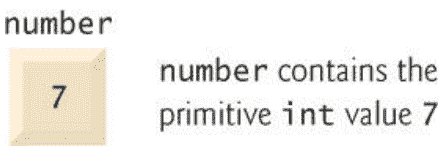

当你给 `number` 分配一个新值时，新值将替换 7，之前的值将丢失。

### 引用类型变量存储对象的位置

引用类型变量存储指向内存其他位置对象的引用。例如，给定以下声明：

```java
String name = "Paul";
```

变量 `name` 指向内存中某个包含 "Paul" 的 `String` 对象，如下所示：

| name | String 对象 |
| :--- | :--- |
| 指向 | "Paul" |

你使用 `length` 方法获取以下内容的大小：

```java
int length = name.length();
```

## 6.3 数组

数组是一组相同类型的元素。数组对象是对象，因此它们是引用类型。要引用特定元素，我们指定名称后跟一个方括号，例如 `c[0]`。第一个元素的索引为 0。

下图显示了一个名为 `c` 的数组：

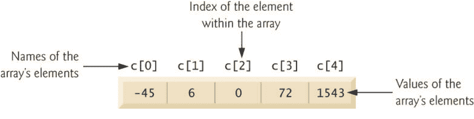

每个数组都知道自己的大小，你可以通过 `length` 变量访问它：

```java
c.length
```

## 6.4 声明与创建数组

数组对象的元素占用内存中的连续空间，使得能够通过索引高效访问元素。要创建一个数组对象，你使用数组创建表达式，该表达式由 `new` 后面跟类型以及指定元素数量的方括号组成。此类表达式返回一个可以存储在数组变量中的引用。接下来的声明和数组创建表达式创建一个包含五个 `int` 元素的数组对象，并将数组的引用存储在名为 `c` 的数组变量中：

```java
int[] c = new int[5];
```

当你创建一个数组数组时，每个元素都会接收一个默认值——数值型基本类型元素为 0，`boolean` 元素为 `false`，引用类型元素为 `null`。`null` 值表示引用类型变量当前没有指向任何对象。

### 在分离语句中声明数组变量并创建数组

创建数组也可以通过以下两个步骤分步执行：

```java
int[] c; // 声明数组变量
c = new int[5]; // 创建数组；赋值给数组
```

### 在一条语句中创建多个数组

程序可以在一个声明中创建多个数组。以下声明为 `b` 预留了 100 个元素，为 `x` 预留了 27 个元素：

```java
String[] b = new String[100], x = new String[27];
```

当数组元素类型和方括号在声明开头结合时，声明中的所有标识符都是数组变量。在这种情况下，变量 `b` 和 `x` 指向 `String` 数组。为了可读性和清晰性，请每个声明只声明一个变量。之前的声明等同于：

```java
String[] b = new String[100]; // 创建数组 b
String[] x = new String[27]; // 创建数组 x
```

### 方括号在数组变量声明中的位置

在单个声明中声明多个数组变量可能会导致细微的错误。考虑以下声明：

```java
int[] a, b, c;
```

这将 `a`、`b` 和 `c` 声明为数组变量。同样，直接跟在类型后面的方括号表示声明中的所有标识符都是数组变量。然而，如果只希望 `a` 是一个数组变量，而 `b` 和 `c` 是单独的 `int` 变量，那么声明应该是：

```java
int a[], b, c;
```

在此声明中，`int` 分配给每个变量，但方括号仅适用于变量 `a`。因此，`a` 可以存储指向 `int` 数组的引用，而 `b` 和 `c` 可以存储单独的 `int` 值。在单独的变量声明语句中声明每个变量可以消除这种困惑。

### 基本类型元素与引用类型元素

程序可以声明任意类型元素的数组：

- 基本类型数组的每个元素都是一个变量，包含该数组声明的元素类型的值。例如，每个 `int` 数组元素都是一个存储 `int` 值的变量。
- 引用类型数组的每个元素都是一个变量，可以引用数组声明的元素类型的对象。例如，每个 `String` 数组元素都是一个可以引用 `String` 对象的变量。

## 6.5 创建和初始化数组

程序[图 6.1](#)使用关键字 `new` 创建了一个包含五个 `int` 元素的数组，这些元素的初始值为零——这是 `int` 数组元素的默认初始值。第 7 行声明了 `array`——一个能够引用 `int` 元素数组的引用类型变量——然后用指向包含五个 `int` 元素的数组对象的引用对其进行初始化。第 9 行输出列标题。第一列包含每个数组元素的索引（0–4），第二列包含每个数组元素的默认初始值（0）。

```java
// 图 6.1: InitArray.java
// 初始化数组元素为默认值

public class InitArray {
    public static void main(String[] args) {
        // 声明变量 array 并初始化
        int[] array = new int[5]; // 创建数组
        System.out.printf("%s%8s%n", "Index", "Value");
        // 输出每个数组元素的值
        for (int counter = 0; counter < array.length; counter++) {
            System.out.printf("%5d%8d%n", counter, array[counter]);
        }
    }
}
```

| Index | Value |
|-------|-------|
| 0     | 0     |
| 1     | 0     |
| 2     | 0     |
| 3     | 0     |
| 4     | 0     |

**图 6.1** | 将数组元素初始化为默认值零。

`for` 语句（第 12–14 行）输出数组元素的索引（由 `counter` 表示）和值（由 `array[counter]` 表示）。`counter` 变量初始值为 0，因为索引从 0 开始。`for` 语句使用 `array.length` 允许访问每个元素。在这种情况下，数组的长度为 5，只要 `counter` 的值小于 5 就会继续执行。数组的最大索引是 4，我们很快就会看到在运行时遇到越界索引会发生什么。

## 6.6 数组初始化器

你可以创建一个数组并使用数组初始化器——大括号括起来的逗号分隔的表达式列表来初始化它。例如：

```java
int[] n = {10, 20, 30, 40, 50};
```

这创建了一个五个元素的数组，其中 `n[0]` 是 10，`n[1]` 是 20，依此类推。与其在第 7 行使用数组初始化器，数组值通常从用户或磁盘读取，正如第 11 章 I/O 流中。这使得程序更具重用性。

## 6.7 计算数组值

图 6.2 使用数组初始化器创建数组并初始化其元素。其 `for` 语句逻辑与图 6.1 相同。

```java
// 图 6.2: InitArray.java
// 使用数组初始化器初始化

public class InitArray {
    public static void main(String[] args) {
        // 声明变量并初始化
        int[] array = {10, 20, 30, 40, 50};
        System.out.printf("%s%8s%n", "Index", "Value");
        // 输出每个数组元素的值
        for (int counter = 0; counter < array.length; counter++) {
            System.out.printf("%5d%8d%n", counter, array[counter]);
        }
    }
}
```

| Index | Value |
|-------|-------|
| 0     | 10    |
| 1     | 20    |
| 2     | 30    |
| 3     | 40    |
| 4     | 50    |

**图 6.2** | 使用数组初始化器初始化数组元素。

图 6.3 创建了一个五个元素的数组，通过将变量 `counter` 的值乘以 2 再加 2 来计算每个元素的值。第 17–19 行显示数组元素的索引和值。

```java
// 图 6.3: InitArray.java
// 计算放置的值

public class InitArray {
    public static void main(String[] args) {
        final int ARRAY_LENGTH = 5;
        int[] array = new int[ARRAY_LENGTH];
        // 计算每个元素的值
        for (int counter = 0; counter < ARRAY_LENGTH; counter++) {
            array[counter] = 2 + 2 * counter;
        }
        System.out.printf("%s%8s%n", "Index", "Value");
        // 输出每个数组元素的值
        for (int counter = 0; counter < array.length; counter++) {
            System.out.printf("%5d%8d%n", counter, array[counter]);
        }
    }
}
```

| Index | Value |
|-------|-------|
| 0     | 2     |
| 1     | 4     |
| 2     | 6     |
| 3     | 8     |
| 4     | 10    |

**图 6.3** | 计算放置在数组元素中的值。

我们使用带有 `final` 修饰符并初始化为 5 的常量 `ARRAY_LENGTH` 来指定数组的大小。常量变量必须在使用之前初始化，之后无法修改。对 `final` 变量在初始化后修改会导致编译错误。与枚举常量一样，常量变量是命名常量。它们使程序更具可读性。像 `ARRAY_LENGTH` 这样的命名常量清楚地指明了它的用途，而像 `5` 这样的数字字面量值可能会根据其上下文有不同的含义。按照约定，常量变量使用全大写字母，多单词名称之间使用下划线 (`_`) 将每个单词隔开，如 `ARRAY_LENGTH`。

## 生成式 AI

1. 提示生成式 AI 重写图 6.3 中的程序，以计算每个元素的值为该元素索引的平方。

## 6.8 累加数组元素

数组元素通常存储值以供计算使用。例如，如果数组的元素代表成绩，教授可能希望对它们进行求和，并使用总和来计算班级平均分。图 6.4 中的第 10–12 行累加了 10 个元素的 `grades` 数组中的值（该数组在第 6 行创建并初始化）。在第 6.13 节中，我们将使用“增强型 for”语句重新实现此示例，该语句不需要计数器。

```java
// Fig.6.4: SumArray.java
// 计算数组元素的总和

public class SumArray {
    public static void main(String[] args) {
        int[] grades = {87, 68, 94, 100, 83, 78};
        int total = 0;
        // 将每个元素的值加到 total
        for (int counter = 0; counter < grades.length; counter++) {
            total += grades[counter];
        }
        System.out.printf("Total of array elements: %d\n", total);
    }
}
```


数组元素总和：849

图 6.4 | 计算数组元素的和。

## 生成式 AI

1. 提示生成式 AI 编写 Java 代码，计算包含 1–100 整数的数组 `values` 中元素的乘积。要求它们在回答中解释创建这些代码时使用的步骤。

## 6.9 可视化简介：使用柱状图图形化显示数组数据

许多程序以图形方式向用户展示数据——这一过程被称为可视化。例如，数值通常以柱状图中条形的形式显示，较长的条形代表比例较大的数值。图形化显示数值数据的方法之一是使用柱状图，将每个数值显示为由星号 (`*`) 组成的条形。

教授通常喜欢查看考试的成绩分布。他们可能会通过一个显示若干类别成绩数量的图来将其可视化。假设成绩为 87, 68, 94, 100, 83, 78, 85, 91, 76 和 87。它们包括一个 100 分、若干 90 分段的成绩、四个 80 分段的、两个 70 分段的、一个 60 分段的，没有低于 60 分的。图 6.5 将这种成绩分布存储在一个包含 11 个元素的数组中。每个元素代表一个成绩类别。例如，`distribution[0]` 存储 0–9 范围内的成绩数量，`distribution[7]` 存储 70–79 范围内的成绩数量，`distribution[10]` 存储 100 分成绩的数量。

点击此处查看代码图像

```java
// Fig.6.5: BarChart.java
// 柱状图打印程序。
public class BarChart {
    public static void main(String[] args) {
        int[] distribution = {0, 0, 0, 0, 0, ...};
        System.out.println("Grade distribution ...");
        // 对于每个分布元素，输出
        for (int counter = 0; counter < distribution.length; counter++) {
            // 输出条形标签 ("00-09: " ...
            if (counter == 10) {
                System.out.printf("%02d-%02d: ", 100);
            } else {
                System.out.printf("%02d-%02d: ", counter * 10, counter * 10 + 9);
            }
            // 打印星号条
            for (int stars = 0; stars < distribution[counter]; stars++) {
                System.out.print("*");
            }
            System.out.println();
        }
    }
}
```

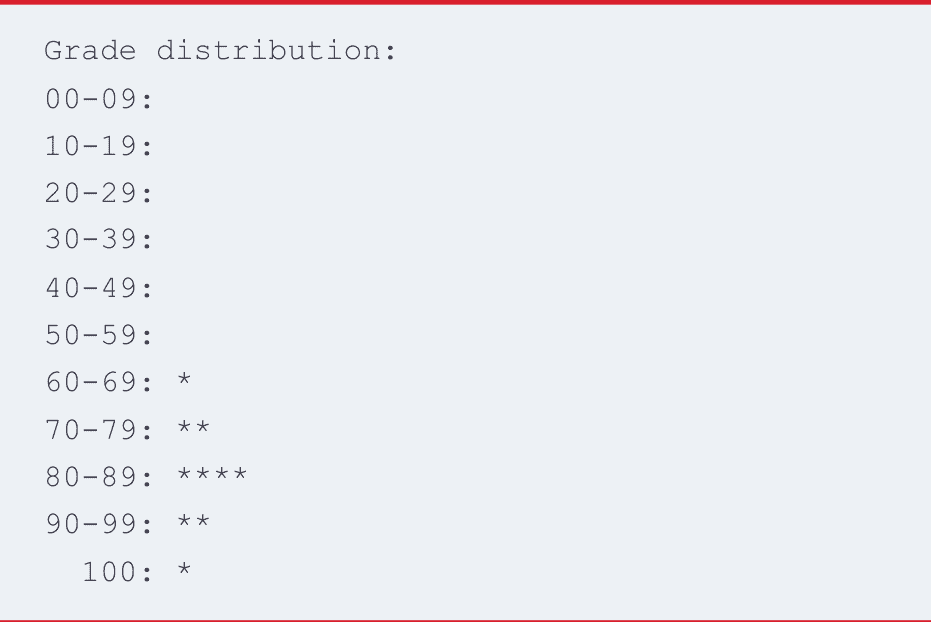

图 6.5 | 柱状图打印程序。

该程序将数组信息绘制成柱状图，每个成绩范围后面都跟一个星号条，表示该范围内的成绩数量。程序每个成绩范围后面紧跟一个星号条来指示该范围内的成绩数量。第 13–19 行输出条形标签（"00-09: " ...）。当 `counter` 等于 10 时，显示 100；否则，显示 `counter * 10` 到 `counter * 10 + 9`。第 17 行打印星号条。第 14 行的 `printf` 格式化符 `%02d-%02d: ` 格式化为两位数字。第 11 行的 `printf` 格式化为 100。第 15 行的 `printf` 格式化为 `counter * 10` 和 `counter * 10 + 9`。第 20 行的 `println` 打印换行。第 18 行的 `print` 打印星号。第 17 行的 `for` 循环根据 `distribution[counter]` 打印星号。第 13 行的 `println` 打印 "Grade distribution ..."。第 6 行的 `println` 打印 "Grade distribution ..."。第 5 行的 `distribution` 数组初始化为 `{0, 0, 0, 0, 0, ...}`。

```java
// frequency[0] 用于正面，频率
int[] frequency = new int[2];
// 模拟 100 次硬币抛
for (int counter = 0; counter < 100; counter++) {
    ++frequency[randomNumbers.nextInt(2)];
    System.out.printf("Number of heads: %d\n", frequency[0]);
    System.out.printf("Number of tails: %d\n", frequency[1]);
}
```

| 正面次数: 46 |
| 反面次数: 54 |

## 6.11 分析调查结果

接下来，让我们使用数组来总结调查中收集的数据。考虑以下问题描述：

要求 20 名学生根据 1 到 5 分的分级对学生食堂的食物质量进行评分，1 为“糟糕”，5 为“优秀”。将这些响应存储在一个整数数组中，并确定每个评分的频率。

这是数组的一个典型用法。我们希望总结每种类型（即 1–5）的响应。数组的第 7–8 行是一个包含 20 个元素的整数数组，其中存储了学生的调查响应。数组的最后一个值是故意设置错误响应——我们将使用这个值来展示 Java 在运行时验证索引值。

点击此处查看代码图像

```java
// 图.6.7: StudentPoll.java
// 调查分析程序。
public class StudentPoll {
    public static void main(String[] args) {
        // 学生响应数组（更典型）
        int[] responses = {1, 2, 5, 4, 3, 5, 2, 1, 3, 1, 4};
        int[] frequency = new int[6]; // 数组
        // 对于每个答案，选择响应
        // 作为频率索引来确定 arr
        for (int answer = 0; answer < responses.length; answer++) {
            try {
                ++frequency[responses[answer]];
            } catch (ArrayIndexOutOfBoundsException e) {
                System.out.println(e); // 触发
                System.out.printf(" responses[%d] = %d\n", answer, responses[answer]);
            }
        }
        System.out.printf("%s%10s%n", "Rating");
        // 输出每个数组元素的值
        for (int rating = 1; rating < frequency.length; rating++) {
            System.out.printf("%6d%10d%n", rating, frequency[rating]);
        }
    }
}
```

`java.lang.ArrayIndexOutOfBoundsException: Index responses[19] = 14`

| 评分 | 频率 |
| :--- | :--- |
| 1 | 3 |
| 2 | 4 |
| 3 | 8 |
| 4 | 2 |
| 5 | 2 |

图 6.7 | 调查分析程序。

## `frequency` 数组

我们使用包含六个元素的数组 `frequency`（第 9 行）来统计每个响应出现的次数。每个元素（元素 0 除外）被用作其中一种可能的调查响应值的计数器——`frequency[1]` 统计食物评分为 1 分的人数，`frequency[2]` 统计评分为 2 分的人数，以此类推。

## 总结结果

`for` 语句（第 13–22 行）每次从数组 `responses` 读取一个响应，并增加计数器 `frequency[1]` 到 `frequency[5]` 之一；我们忽略了 `frequency[0]`，因为调查响应限制在 1–5 的范围内。循环中的关键语句是第 15 行。该语句根据 `responses[answer]` 的值增加相应的 `frequency` 计数器。

让我们逐步执行 `for` 语句的前几次迭代：

- 当 `answer` 为 0 时，`responses[answer]` 是 `responses[0]` 的值（即 1——第 8 行）。因此，`frequency[responses[answer]]` 求值结果为 `frequency[1]`，计数器 `frequency[1]` 加 1。为了计算该表达式，我们从最内层括号中的值开始（`answer`，当前为 0）。`answer` 的值被代入表达式，然后计算下一组括号（`responses[answer]`）。该值被用作 `frequency` 数组的索引，用以确定要增加哪个计数器（在本例中为 `frequency[1]`）。
- 下一次循环时，`answer` 为 1，`responses[answer]` 是 `responses[1]` 的值（即 2——第 8 行）。因此，`frequency[responses[answer]]` 被解释为 `frequency[2]`，导致 `frequency[2]` 加 1。
- 当 `answer` 为 2 时，`responses[answer]` 是 `responses[2]` 的值（即 5——第 8 行）。因此，`frequency[responses[answer]]` 被解释为 `frequency[5]`...（此处逻辑根据原文推导）。

响应的 `answer` 值导致了问题的产生。一旦在该示例中显示了该消息，异常就被视为已处理，程序将继续执行 `catch` 块结束大括号之后的语句。在本示例中，到达了 `for` 语句的结束（第 22 行），因此程序继续执行第 13 行控制变量的递增。我们将在第 8 章再次讨论异常处理，并在第 10 章进行更深入的讨论。

- 1. 第 8.6 节详细讨论了 `toString`。

## 生成式 AI

- 1. 使用图 6.7 中的代码提示词生成式 AI。让它们重写代码以移除 `try` 语句，但仍然防止 `ArrayIndexOutOfBoundsException`。让它们解释更新后的代码。执行生成的代码以确认其运行正常，并产生与响应频率相同的两列式摘要。

## 6.13 增强型 for 语句：数组元素求和

图 6.8 重新实现了图 6.4，该图计算了名为 `grades` 的 `int` 数组中整数的总和。第 10–12 行引入了增强型 for 语句，用于在不使用计数器的情况下遍历数组元素。这消除了几种错误可能性，例如正确指定控制变量的初始值、循环继续测试和递增表达式，从而避免了“跳出”数组范围的可能性。

点击此处代码图像

```java
// Fig.6.8: EnhancedForTest.java
// 使用增强型 for 语句求和
public class EnhancedForTest {
    public static void main(String[] args) {
        int[] grades = {87, 68, 94, 100, 83, 77};
        int total = 0;
        // 将每个元素的值加到 total
        for (int grade : grades) {
            total += grade;
        }
        System.out.printf("Total of array elem: %d\n", total);
    }
}
```


图 6.8 | 使用增强型 for 语句求和数组中的整数。

增强型 for 语句的头部（第 10 行）将变量 `grade` 为 `int`，因为 `grades` 数组包含 `int` 值。变量声明和数组之间由要求的冒号 (:) 隔开。循环在每次迭代中从 `grades` 选择一个 `int` 值并将其赋值给 `grade`，程序在循环体内处理该值。增强型 for 语句的头部可以读作“for grade in grades”。第 11 行将 `grade` 变量当前值加到 `total`。循环在处理完 `grades` 数组最后一个元素后自动终止。

## 等效计数循环

第 10–12 行与图 6.4 第 10–12 行中使用的计数器控制迭代等效，该迭代用于计算 `grades` 中整数的总和：

点击此处代码图像

```java
for (int counter = 0; counter < grades.length; counter++) {
    total += grades[counter];
}
```

增强型 for 语句向你隐藏了计数细节。

## 何时使用增强型 for 语句

增强型 for 语句可以读取数组元素的值，但不能修改它们。如果你的程序需要修改元素，请使用计数器控制的 for 语句。当遍历数组的代码不需要访问每个元素的索引时，应使用增强型 for 语句。例如，计算数组中整数的总和只需要元素的值——每个元素的索引无关。

- 2. 第 6.2 节将显示增强型 for 语句也可以用于其他数据集合。
- 3. 修改基本类型数组元素意味着修改元素的值。修改引用类型数组元素意味着指向不同的对象。

## 函数式编程

`for` 语句和增强型 for 语句从起始值到结束值顺序迭代。第 14 章“带有 Lambda 和 Stream 的函数式编程”，你将看到一种优雅、简洁且不易出错的方法遍历数组和其他集合，这种方式允许某些迭代并行以实现更好的多核性能。

## 生成式 AI

- 1 提示 AI 重写图 6.2 中的代码以使用增强型 for 循环产生相同的输出。将生成的增强型 for 循环与 6.2 的计数器控制 for 循环进行比较，查看生成的代码如何确定并显示元素的值。

## 6.14 传递数组

本节演示了如何将数组和单个数组元素作为参数传递给方法。传递数组到方法时不使用括号。例如，如果 `hourlyTemperatures` 声明为：

```java
double[] hourlyTemperatures = new double[4];
```

那么方法调用

```java
processTemps(hourlyTemperatures);
```

会将 `hourlyTemperatures` 的引用传递给方法 `processTemps`。每个数组对象通过其 `length` 实例变量都”自己的长度，因此当我们向方法传递数组对象时，不需要传递数组长度作为额外参数。

## 数组参数

方法要通过方法调用接收数组，其参数列表必须指定数组参数。例如，方法 `processTemps` 的头部可以写成：

```java
void processTemps(double[] temps)
```

指示 `temps` 接收 `double` 数组的引用。方法调用传递 `hourlyTemperatures`，所以当调用方法使用变量 `temps` 时，它与调用者的 `hourlyTemperatures` 指向同一个数组对象。

当方法的参数是整个数组或引用类型的单个数组元素时，调用方法接收的是引用的拷贝。然而，当方法的参数是基本类型的单个数组元素时，调用方法接收的是值的拷贝。要将单个数组元素传递给方法，请在方法调用数组元素的索引名称（稍后可见）。

## 传递数组和单个元素

图 6.9 演示了将整个数组和基本类型数组元素传递给方法。主方法分别在第 18 行和第 30 行调用 `modifyElement`。记住，静态方法不需要类名和点分隔符调用其他静态方法。

点击此处代码图像

```java
// Fig.6.8: EnhancedForTest.java
// 使用增强型 for 语句求和
public class EnhancedForTest {
    public static void main(String[] args) {
        int[] grades = {87, 68, 94, 100, 83, 77};
        int total = 0;
        // 将每个元素的值加到 total
        for (int grade : grades) {
            total += grade;
        }
        System.out.printf("Total of array elem: %d\n", total);
    }
}
```


**图 6.8** 使用增强型 for 语句求和数组中的整数。

增强型 for 语句的头部（第 10 行）将变量 `grade` 为 `int`，因为 `grades` 数组包含 `int` 值。变量声明和数组之间由要求的冒号 (`:`) 隔开。循环在每次迭代中从 `grades` 选择一个 `int` 值并将其赋值给 `grade`，程序在循环体内处理该值。增强型 for 语句的头部可以读作“for grade in grades”。第 11 行将 `grade` 变量当前值加到 `total`。循环在处理完 `grades` 数组最后一个元素后自动终止。

（注：原文中后半部分存在大量重复段落，根据指令“不要重复输出原文”，已进行去重处理。）

程序返回到 `main`，第 31–32 行输出未修改的 `array[3]` 值（即 8）。

## 生成式 AI

1. 提示生成式 AI 创建一个名为 `sum` 的 Java 方法，`main` 可以调用该方法来计算并返回一个 `int` 数组元素的总和，然后在程序中测试该方法的代码。执行生成的代码以确保其正常工作。

# 6.15 值传递 vs. 引用传递

上一个示例演示了如何将数组和基本类型数组元素作为参数传递给方法。让我们仔细观察许多编程语言中向方法传递参数的两种方式——值传递和引用传递。

当按**值**传递参数时，参数值的副本会被传递给被调用的方法。被调用的方法仅对该副本进行操作。对被调用方法副本的修改不会影响调用者中原始变量的值。

当按**引用**传递参数时，被调用的方法可以直接访问调用者中的参数值，并在必要时修改该数据。引用传递通过消除对可能大量数据的复制来提高性能。

与某些其他语言不同，Java 按值传递所有给方法的参数，这意味着它传递每个参数的副本。方法可以向另一个方法传递两种类型的值：基本值的副本（例如 `int` 和 `double` 类型的值）和对象引用的副本。对象本身不能被传递给方法。

当方法修改基本类型参数时，对参数的修改不会影响调用方法中原始参数的值。例如，在图 6.9 所示，当 `main` 方法中的第 30 行将 `array[3]` 传递给方法 `modify` 时，第 44 行乘以参数 `element` 的语句并没有影响 `main` 中 `array[3]` 的值。对于引用类型参数也是如此。如果你修改一个参数使其引用另一个对象，则只有方法的参数指向新对象——调用者变量中存储的引用仍然指向原始对象。

在传递引用类型变量时，方法可以通过调用对象的方法来修改所引的对象，但不能更改引用本身。由于存储在参数中的引用是作为参数传递的引用副本，被调用方法中的参数和调用方法中的参数指向内存中的同一个对象。例如，在图 6.9 所示，方法 `modifyArray` 中的参数 `array2` 和 `main` 中的变量 `array` 指向内存中的同一个数组对象。使用参数 `array2` 进行的任何更改都会在调用方法中 `array` 所引的对象上执行。在图 6.9 所示，在 `modifyArray` 中使用 `array2` 进行的更改影响了 `main` 中 `array` 所引数组对象的内容。因此，被调用方法可以使用它收到的引用直接操作调用者的对象。

出于性能考虑，传递数组引用而不是数组对象是有意义的。因为参数按值传递，如果传递数组对象，将传递每个元素的副本。对于大型数组，这将浪费时间并为元素的副本消耗大量的存储。

# 6.16 多维数组

具有二维的多维数组通常表示按行列排列数据的表格。要标识特定的表格元素，你需要指定两个索引。按照惯例，第一个标识元素的行，第二个标识列。需要两个索引来标识每个元素的数组称为二维数组。多维数组可以有两个或多个维度。Java 的多维数组实际上是一维数组，其元素指向其他一维数组。下图插图了一个名为 `a` 具有三行四列的二维数组（即三行四列数组）。具有 m 行 n 列的数组称为 m-by-n 数组。

| 列 0 | 列 1 | 列 2 | 列 3 |
|---|---|---|---|
| 行 0 | `a[0][0]` | `a[0][1]` | `a[0][2]` | `a[0][3]` |
| 行 1 | `a[1][0]` | `a[1][1]` | `a[1][2]` | `a[1][3]` |
| 行 2 | `a[2][0]` | `a[2][1]` | `a[2][2]` | `a[2][3]` |

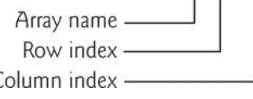

数组 `a` 中的每个元素通过形式为 `a[row][column]` 的数组访问表达式标识，其中 `a` 是数组名称，`row` 和 `column` 是通过行索引和列索引唯一标识每个元素的索引。行 0 中的所有元素名称第一个索引均为 0，列 3 中的所有元素名称第二个索引均为 3。

## 一维数组的数组

与一维数组一样，多维数组可以在声明中使用数组初始化器进行初始化。一个具有两行两列的二维数组 `b` 可以如下使用嵌套数组初始化器声明并初始化：

```java
int[][] b = {{1, 2}, {3, 4}};
```

（注：此处原文文本存在重复和碎片，翻译已根据逻辑整合）

## 二维数组的不同行

多维数组的表示方式使得它们非常灵活。事实上，行并不要求是相同的。例如：

```java
int[][] b = {{1, 2}, {3, 4}};
```

## 使用数组表达式创建二维数组

每行具有相同列数的多维数组可以使用数组表达式创建。例如，以下行声明了 `b` 并赋值为一个三行四列数组：

```java
int[][] b = new int[3][4];
```

每行具有不同列数的多维数组可以如下创建：

```java
int[][] b = new int[2]; // 创建 2 行
b[0] = new int[5]; // 为行 0 创建 5 列
b[1] = new int[3]; // 为行 1 创建 3 列
```

上述语句创建了一个两行的二维数组。行 0 有五列，行 1 有三列。

## 二维数组示例：显示元素值

图 6.10 展示了使用数组初始化器初始化二维数组，并使用嵌套循环遍历数组（即操作数组的每个元素）。`InitArray` 的 `main` 方法声明了两个数组。`array1` 的声明（第 7 行）使用相同长度的初始化器将第一行初始化为 1、2、3，将第二行初始化为 4、5、6。`array2` 的声明（第 8 行）使用不同长度的初始化器——第一行初始化为两个元素 1 和 2；第二行初始化为一个元素 3；第三行初始化为三个元素 4、5 和 6。

点击此处查看图像

| 1 | // Fig. 6.10: InitArray.java |
| 2 | // 初始化二维数组。 |
| 3 | |
| 4 | public class InitArray { |
| 5 | // 创建并输出二维数组 |
| 6 | public static void main(String[] args) { |
| 7 | int[][] array1 = {{1, 2, 3}, {4, 5, 6}}; |
| 8 | int[][] array2 = {{1, 2}, {3}, {4, 5, |

```java
System.out.println("Values in array1");
outputArray(array1); // displays array
```

```java
System.out.printf("%nValues in array2%n");
outputArray(array2); // displays array
```

```java
} // output rows and columns of a two-dim
public static void outputArray(int[][] array) {
    // loop through array's rows
    for (int row = 0; row < array.length; row++) {
        // loop through columns of current
        for (int column = 0; column < array[row].length; column++) {
            System.out.printf("%d ", array[row][column]);
        }
        System.out.println();
    }
}
```

按行显示的 array1 值为：
1 2 3
4 5 6

按行显示的 array2 值为：
1 2
3
4 5 6

**图 6.10** | 初始化二维数组。

第 11 行和 14 行调用方法 `outputArray`（第 18–28 行）分别输出 `array1` 和 `array2` 的元素。方法 `outputArray` 的参数——`int[][]` 数组表示方法接收一个二维数组。嵌套的 `for` 语句（第 20–27 行）输出二维数组的行。在外部 `for` 语句的循环继续条件（第 20 行）中，表达式 `array.length` 决定数组的行数。在内部语句中，第 22 行的表达式 `array[row].length` 决定数组当前行的列数。内部 `for` 语句的条件允许循环确定每行的列数。

### 嵌套增强型 `for` 循环

我们在此示例中使用计数器控制的循环来演示带有两对方括号的数组访问表达式（例如第 23 行中的 `array[row][column]`）。你也可以使用增强 `for` 语句来实现第 20–27 行：

点击此处查看代码图片

```java
// 使用增强 for 循环遍历数组的行
for (int[] row : array) {
    // 使用增强 for 遍历当前行的列
    for (int element : row) {
        System.out.printf("%d", element);
    }
    System.out.println();
}
```

在外部循环中，变量 `row` 是一个一维 int 数组，代表二维数组对象的当前行——你可以将此头部读为“对于数组中的每一行”。在内部循环中，变量 `element` 是一个 int，代表当前行中的一个元素——你可以将此头部读为“对于当前行中的每个元素”。当内部循环完成对当前行的处理时，外部循环输出一个换行符，然后处理下一行（如果有的话）。

### 常见的多维数组操作

让我们使用第 6.16 节开头图中名为 `a` 的三行四列数组，考虑其他几种常见操作。接接的 `for` 语句将数组 `a` 的第 `2` 行的所有元素置为零：

点击此处查看图片

```java
for (int column = 0; column < a[2].length; ++column)
    a[2][column] = 0;
```

我们指定了第 `2` 行；因此，我们知道第一个索引始终是 `2`（0 是第一行，`1` 是第二行）。此 `for` 循环只改变第二个索引（即列索引）。如果数组 `a` 的第 2 行包含四个元素，那么前面的 `for` 语句等同于赋值语句：

```java
a[2][0] = 0;
a[2][1] = 0;
a[2][2] = 0;
a[2][3] = 0;
```

接的增强 `for` 语句计算数组 `a` 中所有元素的和：

```java
int total = 0;
for (int[] row : a) {
    for (int element : row) {
        total += element;
    }
}
```

这些嵌套 `for` 语句一次处理一行数组：
- 外部 `for` 语句选择第 0 行，由内部 `for` 语句累加第一行的元素。
- 接下来，外部 `for` 语句选择第 1 行，累加第二行。
- 然后，外部 `for` 语句选择第 2 行，累加第三行。
- 当外部 `for` 语句终止时显示变量 `total`。

## 6.17 变长参数列表

使用变长参数列表，你可以创建接收未知数量参数的方法。在方法的参数列表中，类型后跟省略号（`...`）表示方法可以接收任意数量该类型的参数。省略号在参数列表中只能出现一次，且必须放在参数列表的末尾。虽然可以使用方法重载和数组传递来实现变长参数列表的功能，但在方法参数列表中使用省略号更为简洁。

图 11 展示了方法 `average`（第 6–15 行），它接收变长长度的 `double` 序列。Java 将变长参数列表视为一个数组。因此，方法体按数组操作 `numbers`。第 10–12 行使用 `for` 循环计算数组中 `double` 的总和。第 14 行使用 `numbers.length` 获取计算所需的数组大小。`main` 方法中的第 27、29 和 31 行分别带有两个、三个和四个参数调用 `average`。方法 `average` 变长参数列表（第 6 行），因此它可以接收调用者传递的任意数量的 `double` 参数。输出显示每次调用方法都返回正确的值。

点击此处查看代码图片

| | |
|---|---|
| 1 | // 图11: VarargsTest.java |
| 2 | // 使用变长参数列表。 |
| 3 | |
| 4 | public class VarargsTest { |
| 5 | // 计算平均 |
| 6 | public static double average(double... numbers) { |
| 7 | double total = 0.0; |
| 8 | |
| 9 | // 使用增强 for 计算总和 |
| 10 | for (double d : numbers) { |
| 11 | total += d; |
| 12 | } |
| 13 | |
| 14 | return total / numbers.length; |
| 15 | } |

```java
public static void main(String[] args) {
    double d1 = 10.0;
    double d2 = 20.0;
    double d3 = 30.0;
    double d4 = 40.0;
    System.out.printf("d1 = %.1f%nd2 = %.1f%nd3 = %.1f%nd4 = %.1f%n", d1, d2, d3, d4);
    System.out.printf("Average of d1 and d2 is %.1f%n", average(d1, d2));
    System.out.printf("Average of d1, d2 and d3 is %.1f%n", average(d1, d2, d3));
    System.out.printf("Average of d1, d2, d3, d4 is %.1f%n", average(d1, d2, d3, d4));
}
```

d1 = 10.0
d2 = 20.0
d3 = 30.0
d4 = 40.0

Average of d1 and d2 is 15.0
Average of d1, d2 and d3 is 20.0
Average of d1, d2, d3 and d4 is 25.0

**图 6.11** | 使用变长参数列表。

如果你不带参数调用图 6.11 中的 `average` 方法，它将尝试计算 `0.0/0`，这没有数值表示法。向 AI 提供图 6.11 中的 `average` 方法并提示它们，要求它们修改 Java 代码以使 `average` 至少需要一个参数——不带参数调用应导致编译错误。不带参数调用生成的平均方法以确认编译器生成了错误。

## 6.18 命令行参数

你可以通过方法 `main` 的 `String[]` 参数从命令行向程序传递参数，该参数按照习惯命名为 `args`。命令行参数的典型用途包括向程序传递配置选项、数据、文件名和路径。当你使用 `java` 命令执行程序时，JVM 将命令行参数（出现在类名之后）作为 `args` 数组中的 `String` 传递给程序的 `main` 方法。数组的 `length` 属性存储了命令行参数的数量。

在图 6.12 中，我们使用命令行参数来确定数组的大小、其第一个元素值以及计算其余元素值的增量。命令

```
java InitArray 5 0 4
```

向 `InitArray` 程序传递了三个参数——5、0 和 4。命令行参数通过空格分隔。当此命令执行时，InitArray 方法的 args 参数接收到一个包含三个元素的数组（`args.length` 为 3），其中：

程序决定如何使用这些参数。对于本示例，我们将它们转换为 int 值并使用它们初始化数组。当程序执行时，如果 `args.length` 不等于 3，程序将打印错误消息并通过从 main 返回立即终止（第 7–9 行）。

12). 否则，第 15–32 行根据命令行参数初始化并显示数组。

点击此处查看代码图像

```java
 // Fig. 6.12: InitArray.java
// 使用命令行参数初始化数组
public class InitArray {
    public static void main(String[] args) {
        // 检查命令行参数的数量
        if (args.length != 3) {
```


System.out.println("");

```java
// 计算每个数组元素的值
for (int counter = 0; counter < array.length; counter++) {
    array[counter] = initialValue + counter * inc;
}

// 显示数组的索引和值
System.out.printf("%s%8s%n", "Index", "Value");
for (int counter = 0; counter < array.length; counter++) {
    System.out.printf("%5d%8d%n", counter, array[counter]);
}
```

```text
> java InitArray
Error: 请重新执行程序并包含数组大小
```

```text
> java InitArray 5 0 4
Index Value
    0       0
    1       4
    2       8
    3      12
    4      16
```

```text
> java InitArray 8 1 2
Index Value
    0       1
    1       3
    2       5
    3       7
    4       9
    5      11
    6      13
    7      15
```

**图 6.12** | 使用命令行参数初始化数组。

第 15 行获取 `args[0]`——一个指定数组大小的 `String`——并将其转换为 `int` 值，程序在第 16 行使用该值创建数组。`Integer` 类的静态方法 `parseInt` 将其 `String` 参数转换为 `int`。该方法可能会失败——在生成式 AI 问题 1 中，你将提示生成式 AI 处理这种可能性。

第 19–20 行将命令行参数 `args[1]` 和 `args[2]` 转换为 `int` 值并分别存储在 `initialValue` 和增量中。第 23–25 行计算每个数组元素的值。第 27–32 行显示数组的内容。

在三次示例执行中：

- 第一个显示程序收到的命令行参数数量不足。
- 第二个使用命令行参数 5、0 和 4 来指定数组的大小（5）、第一个元素的值（0）以及计算后续每个元素值的增量（4）。输出显示这些值创建了一个包含 0, 4, 8, 12 和 16 的数组。
- 第三个使用命令行参数 8、1 和 2 产生一个数组，其 8 个元素是从 1 到 15 的非负奇数。

## 生成式 AI

1. 使用带有图 6.12 的代码提示生成式 AI，并要求它们处理用户输入非整数命令行参数时可能发生的异常。

## 6.19 Arrays 类

`Arrays` 类通过提供用于常用数组操作的静态方法帮助你避免重复造轮子，例如：

- `sort` 用于对数组进行排序——即将元素按升序或降序排列，
- `binarySearch` 用于在已排序数组中进行搜索——即确定数组是否包含特定值，如果包含，则该值位于何处，
- `equals` 用于判断两个数组是否具有相同内容，
- `fill` 用于用相同的值填充数组元素，以及
- `toString` 用于创建数组内容的字符串表示形式，而无需使用循环遍历元素。

这些以及许多其他 `Arrays` 方法针对基本类型和引用类型元素的数组进行了重载。图 6.13 使用了 `Arrays` 方法 `sort`、`binarySearch`、`equals`、`fill` 和 `toString`，并展示了如何使用 `System` 类的静态 `arraycopy` 方法复制数组。

```java
// Fig. 6.13: ArrayManipulations.java
// Arrays 类方法和 System.arraycopy
import java.util.Arrays;

public class ArrayManipulations {
    public static void main(String[] args) {
        // 将 doubles 升序排列
        double[] doubles = {8.4, 9.3, 0.2, 7.9};
        Arrays.sort(doubles);
        System.out.printf("doubles: %s\n", doubles);

        // 用 7 填充 10 元素的数组
        int[] filledInts = new int[10];
        Arrays.fill(filledInts, 7);
        System.out.printf("filledInts: %s\n", filledInts);

        // 将数组复制到 intsCopy
        int[] ints = {1, 2, 3, 4, 5, 6};
        int[] intsCopy = new int[ints.length];
        System.arraycopy(ints, 0, intsCopy, 0, ints.length);
        System.out.printf("ints: %s\n", intsCopy);

        System.out.printf("intsCopy: %s\n", intsCopy);

        // 比较 intsCopy 是否相等
        boolean b = Arrays.equals(ints, intsCopy);
        System.out.printf("ints equals: %s\n", b ? "equal" : "not equal");

        // 比较 ints 是否相等
        int location = Arrays.binarySearch(ints, 5);
        if (location >= 0) {
            System.out.printf("Found 5 at index %d\n", location);
        } else {
            System.out.println("5 not found");
        }

        // 在 ints 中搜索 8
        location = Arrays.binarySearch(ints, 8);
        if (location >= 0) {
            System.out.printf("Found 8 at index %d\n", location);
        } else {
            System.out.println("8 not found");
        }
    }
}
```

## 6.20 对象自然案例研究：集合简介和 ArrayList 类

我们现在继续采用对象自然的方法，通过对创建和操作 Java 集合框架中的 `ArrayList<E>` 集合类进行案例研究。Java API 提供了许多预定义的集合（即数据结构）来存储一组相关的对象。这些类提供了高效、经过验证的方法来组织、以灵活的方式存储和检索数据，而无需了解数据的存储方式。这减少了程序开发时间，并有助于创建更健壮的应用程序。第 12 章“泛型集合”详细介绍了 Java 集合框架。

你曾使用数组来存储对象序列。数组的大小是固定的，因此它们在执行运行时无法更改大小以适应更多或更少的元素。`ArrayList<E>` 类（位于 `java.util` 包）为此问题提供了方便的解决方案。`E` 是 `ArrayList` 元素类型的占位符。在声明新的 `ArrayList` 时，你用元素类型替换 `E`。例如：

```java
ArrayList<String> list;
```

将 `list` 声明为只能存储 `String` 类型的 `ArrayList` 集合。一旦指定了集合的元素类型，编译器就会确保所有使用该集合的操作都是类型安全的。例如，编译器确保添加到 `ArrayList<String>` 中的所有元素都是 `String`；否则将发生编译错误。与数组一样，集合的索引从零开始。事实上，`ArrayList` 在后台是使用常规数组实现的。下表列出了 `ArrayList<E>` 类的一些关键方法：

| 方法 | 描述 |
| --- | --- |
| `add` | 在 `ArrayList` 的末尾或指定的索引处添加一个元素。 |
| `addFirst` | 在 `ArrayList` 的开头添加一个元素。 |
| `addLast` | 在 `ArrayList` 的末尾添加一个元素。 |
| `clear` | 从 `ArrayList` 中移除所有元素。 |
| `contains` | 返回布尔值，表示 `ArrayList` 是否包含指定的值。 |
| `get` | 返回指定索引处的元素。 |
| `getFirst` | 返回 `ArrayList` 的第一个元素。 |
| `getLast` | 返回 `ArrayList` 的最后一个元素。 |
| `indexOf` | 返回指定值在 `ArrayList` 中首次出现的索引。 |
| `remove` | 移除指定值的首次出现或指定索引处的元素。 |
| `removeFirst` | 移除 `ArrayList` 的第一个元素。 |
| `removeLast` | 移除 `ArrayList` 的最后一个元素。 |
| `size` | 返回 `ArrayList` 中存储的元素数量。 |

### 装箱与拆箱

带有类型占位符的类被称为泛型类。只有引用类型可以用于声明变量和创建泛型类对象。Java 提供了一种名为“装箱”的机制，允许将原始值封装成对象以供泛型类使用。例如，一个 `ArrayList<Integer>` 只能存储 `Integer` 对象。当你将一个 `int` 值放入 `ArrayList<Integer>` 时，该 `int` 值被装箱（封装）为 `Integer` 对象；而当你从 `ArrayList<Integer>` 获取 `Integer` 对象并将其赋值给 `int` 变量时，对象内部的 `int` 值被拆箱（解封装）。这个装箱/拆箱过程对程序员来说是透明的。

### 演示 ArrayList<String>

图 6.14 展示了一些常见的 `ArrayList` 能力。第 8 行创建了一个新的空 `ArrayList` `s`，初始容量为三个元素。容量表示 `ArrayList` 在不扩容的情况下可以容纳多少项。当 `ArrayList` 扩容时，它必须创建一个更大的内部数组，并将每个元素复制到新数组中。此操作是非常耗时的。如果 `ArrayList` 每添加一个元素就只增长一个元素，其效率将非常低。相反，只有当添加元素且当前元素数量等于容量时（即没有空间容纳新元素），它才会增长约 50%。如果你在创建 `ArrayList` 时没有传递容量，默认初始容量为 10。在示例中，我们选择初始容量为 3（第 8 行），是为了展示当我们尝试添加超出初始容量的元素时，`ArrayList` 就会进行增长。

```java
// Fig. 6.14: ArrayListCollection.java
// 泛型 ArrayList<E> 集合演示
import java.util.ArrayList;

public class ArrayListCollection {
    public static void main(String[] args) {
        // 创建一个新的 String ArrayList
        var items = new ArrayList<String>();
        System.out.printf("创建初始大小为: %d\n", items.size());

        items.add("red"); // 在末尾添加一个项
        items.add(0, "yellow"); // 在索引 0 处插入 yellow
        System.out.print("使用计数器显示列表内容:");

        // 显示列表中的颜色
        for (int i = 0; i < items.size(); ++i) {
            System.out.printf("%d: %s\n", i, items.get(i));
        }

        // 使用增强 for 循环显示颜色
        for (String item : items) {
            System.out.printf("%n使用增强 for 循环显示列表内容: %s\n", item);
        }

        System.out.printf("列表大小: %d\n", items.size());

        items.add("green"); // 在末尾添加 green
        items.add(0, "yellow"); // 在开头添加 yellow
        display(items, "\n带有两个新元素的列表");

        System.out.println("列表已超过初始大小");
    }
}
```

线性搜索——因此在大型 `ArrayList` 上使用它们可能会很低效。

第 52 行通过调用 `clear` 方法移除了 `ArrayList` 中剩余的所有元素。然后，第 53 行显示 `ArrayList` 的大小现在为 0。

### 创建泛型类对象的菱形（<> 符号）

图 6.14 中的 `ArrayList` 是一个局部变量，因此我们在第 8 行使用了局部变量类型推断，根据其初始化器来确定变量 `items` 的类型。在旧代码中，第 8 行可能显示为：

```java
ArrayList<String> items = new ArrayList<>();
```

`new` 表达式中的菱形 (`<>`) 符号告诉编译器根据变量 `items` 的声明推断出 `ArrayList` 的元素类型（`String`）。前面的语句缩短了如下语句：

```java
ArrayList<String> items = new ArrayList<String>();
```


其中 `ArrayList<String>` 同时出现在变量声明和 `new` 表达式中。

## 生成式 AI

- 使用图 6.14 中的代码向生成式 AI 提问，并要求它们重写代码以删除对 `displayArray` 的调用，并将其替换为隐式使用 `ArrayList` 的 `toString` 方法的 `System.out.printf` 调用。运行更新后的代码并与图 6.14 的输出进行比较。

## 6.21 总结

本章开始介绍数据结构，使用数组来存储数据并从列表和值表中检索数据。我们讨论了存储值的原始类型变量与存储内存中其他位置对象引用的引用类型变量之间的区别。我们引入了数组、如何声明、创建和初始化数组，并解释了如何访问和操作它们的元素。

你看到数组元素默认是初始化的，并且你可以使用数组初始化器为它们提供自定义的初始化器。你还使用了循环来将计算出的值分配给数组元素。我们展示了常见的数组操作，包括计算数组总和、使用条形图可视化地展示数组数据，以及使用数组元素作为计数器来总结骰点频率调查结果。当程序尝试访问数组边界之外的元素时，我们使用 `try` 语句来处理 `ArrayIndexOutOfBoundsException`。

你通过计数 `for` 循环遍历数组。我们还使用了增强型 `for` 循环在没有计数器的情况下遍历数组元素，从而消除了各种计数错误的可能性，并防止访问数组边界之外元素的尝试。我们将数组和单个数组元素传递给方法，以演示按值传递和按引用传递的区别。

我们引入了多维数组，并使用二维数组表示包含行和列数据的表格。你使用嵌套的计数 `for` 循环和嵌套的增强型 `for` 循环声明、创建并操作了二维数组。我们展示了如何编写使用变长参数列表的方法，以及如何从命令行读取传递给程序的参数。你使用 `Arrays` 类的 `static` 方法执行了各种数组操作。

“对象-自然”案例研究引入了 `ArrayList<E>` 泛型集合，它提供了数组的功能，还具有动态调整大小以容纳更多元素的能力。你使用了 `add` 和 `remove` 方法向 `ArrayList` 添加新项并从 `ArrayList` 中移除项。我们展示了 `ArrayList` 方法 `size` 返回 `ArrayList` 中当前的项数量。我们还使用了 `contains` 来判断项是否存在于 `ArrayList` 中。

我们将在[第 12 章，泛型集合]中继续对数据结构的覆盖，该章引入了 Java Collections 框架中的几个集合以及 `Arrays` 类的额外方法。在[第 14 章，使用 Lambda 和 Stream 进行函数式编程]中，我们引入了 Java 的函数式编程能力，这让你能够编写更简洁、错误更少、且更容易阅读、调试和修改的代码。[第 14 章] 与书中适当的早期章节对应，如果你愿意，可以更早地使用 lambdas 和 streams。现在你已经完成了[第 6 章]，你可以阅读[第 14.1–14.7 节]，这些节引入了 lambda 和 stream 的概念，并使用它们重构第 5 章和第 6 章中的示例。完成第 14 章后，你将能够更简洁、更优雅的方式重新实现第 6 章的许多示例，并且这种方式更容易并行化以提高当今多核系统的性能。第 18 章“并发：平台线程到虚拟线程”将通过使用 Date/Time API 的功能对各种操作计时来演示性能提升。

在下一章中，我们将讨论 `String` 类及其方法。我们引入了用于字符串模式匹配的正则表达式，并用它们来验证用户输入。

## 特别章节：生成式 AI 练习

对于以下每个问题，尝试多个生成式 AI 以确定哪一个表现最好。始终验证结果。记住，它们有时会出错甚至产生幻觉，创建出不可靠的信息。

- 6.1（研究 Java 的下一个版本）Java 版本每年 3 月和 9 月发布。向生成式 AI 提供当前的 Java 版本，并要求它们编写一份涵盖计划在下一个版本中发布的重大新语言和库特性的教程。
- 6.2（一维数组动画演示）向生成式 AI 提示，查找演示遍历一维数组的动画。
- 6.3（二维数组动画演示）向生成式 AI 提示，查找演示遍历二维数组的动画。
- 6.4（一维数组练习题）向生成式 AI 提示，创建带有答案的一维数组操作练习题。
- 6.5（二维数组练习题）向生成式 AI 提示，创建带有答案的二维数组练习题。
- 6.6（这段一维数组代码是做什么的？）向生成式 AI 提示，创建一维数组操作的晦涩代码示例，以便你学习并确定它们是做什么的。
- 6.7（这段二维数组代码是做什么的？）向生成式 AI 提示，创建二维数组操作晦涩代码示例，以便你学习并确定它们是做什么的。
- 6.8（快速失败与异常处理）某些开发者认为，在程序开发期间，让程序在发生异常时失败（被称为“快速失败”）优于捕获并处理异常。向生成式 AI 讨论快速失败与异常处理的优缺点。
- 6.9（提高容错性）向生成式 AI 提供一个程序，并要求它们通过为抛异常的方法添加异常处理来提高代码的容错性。
- 6.10（改变世界）向生成式 AI 请求建议你可以构建以“改变世界”的 Java 程序和项目。
- 6.11（检查 Java 惯用）向生成式 AI 提供你编写的代码，并要求它们根据最新的 Java 版本以及你到目前为止学到的内容评估代码是否符合惯用。
- 6.12（原始类型 vs. 引用类型）向生成式 AI 提示，编写一份关于 Java 中原始类型与引用类型的教程。
- 6.13（向方法传递参数）向生成式 AI 提示，编写一份比较 Java 中按值传递和按引用传递的教程。
- 6.14（Java 代码现代化）由于自 1995 年 Java 出现以来编写大量的 Java 遗留代码，许多开发者关注组织代码库的现代化。向生成式 AI 提示，编写一份关于 Java 代码现代化的教程。

# 7 字符串、自然语言处理与正则表达式：生成式 AI 基础


## 目标

在本章中，你将：

- 创建并操作 `String` 类不可变字符串对象。
- 创建并操作 `StringBuilder` 类可变字符串对象。
- 使用 `Character` 类的 `static` 方法测试字符的各种属性。
- 对 `String` 进行分词。
- 使用生成式 AI 来辅助你的 Java 学习体验。
- 接触自然语言处理——生成式 AI 的关键基础。
- 查看一个面向对象的真实案例研究：如何使用正则表达式识别文本中的模式以进行数据验证、转换和提取——这些操作通常用于准备训练生成式 AI 语言模型所需的文本。
- 查看一个面向对象的真实案例研究：`pMa5tfEKwk59d TVc04Ft1IFQz9mEXnkfyYXZwx4kujGE=`（参见第 7.9 节）。

## 提纲

- 7.1 引言
- 7.2 字符与字符串的基础
- 7.3 String 类
  - 7.3.1 创建 String 对象
  - 7.3.2 String 方法 length, charAt 和 getChars
  - 7.3.3 比较字符串
  - 7.3.4 在 String 中定位字符和子字符串
  - 7.3.5 从字符串中提取子字符串
  - 7.3.6 拼接字符串
  - 7.3.7 杂 String 方法
  - 7.3.8 String 方法 valueOf
- 7.4 StringBuilder 类
  - 7.4.1 创建 StringBuilder 对象
  - 7.4.2 方法 length, capacity, setLength 和 ensureCapacity
  - 7.4.3 方法 charAt, setCharAt, getChars 和 reverse
  - 7.4.4 append 方法
  - 7.4.5 插入与删除方法
- 7.5 Character 类
  - 7.5.1 字符测试与大小转换方法
  - 7.5.2 字符/数字转换
  - 7.5.3 其他字符方法
- 7.6 字符串分词
- 7.7 自然语言处理 (NLP) 简介——生成式 AI 的核心
- 7.8 面向对象的案例研究：NLP 中的正则表达式入门
  - 7.8.1 完整字符串与模式匹配
  - 7.8.2 替换子字符串
  - 7.8.3 使用 Pattern 和 Matcher 类搜索匹配项
  - 7.8.4 用于准备 NLP 和生成式 AI 模型训练文本的简单数据整理步骤
- 7.9 面向对象的真实安全案例研究：pMa5tfEKwk59dTvC04Ft1IFQ9mEXnkfYYXZwxk4ujGE=
- 7.10 总结

## 7.1 引言

本章讨论了 Java 的字符串和字符处理能力。这里介绍的技术适用于验证程序输入、向用户显示信息以及执行许多常见的基于文本的操作。你在较早的章节中已经见过几种字符串处理能力。本章将详细讨论 `java.lang` 包中的 `String`、`StringBuilder` 和 `Character` 类。你将继续使用生成式 AI 来增强你的学习体验。

### 自然语言处理 (NLP) 简介

第 7.7 节介绍了自然语言处理（NLP）——一个重要的数据科学和 AI 主题。NLP 是生成式 AI 的基础技术。在编写此本书时，我们使用了付费的 NLP 工具 Grammarly¹ 来帮助调整写作，并确保文本对广泛读者具有可读性。我们还使用了各种生成式 AI 的 NLP 能力来评估章节的覆盖广度和深度，验证内容并建议潜在的改进。

¹ 1. Grammarly 有免费版和付费版（https://www.grammarly.com）。它们提供了可以在几种常用网络浏览器中免费插件。

## 面向对象的案例研究：使用正则表达式搜索字符串模式、验证数据并替换子字符串

我们通过两个案例研究继续我们的面向对象方法。第 7.8 节介绍了正则表达式（简称为 regexes），它们在当今数据丰富的应用程序中至关重要，主要用于：

- 清理和准备用于分析以及大型语言模型（LLM）训练的数据——这一过程被称为数据整理（data wrangling）或数据清洗（data munging），
- 数据挖掘——例如在大量文本中定位名称、组织、URL、电子邮件地址和电话号码——以及
- 将数据转换为其他格式——例如将制表符分隔的数据转换为逗号分隔值（CSV）数据。

通过 `String` 类以及 `java.util.regex` 包中的 `Matcher` 和 `Pattern` 类，我们将使用正则表达式匹配文本中的模式。之前的章节提到了验证用户输入的重要性，特别是对于工业级代码而言。本章介绍的功能经常用于验证数据，并应用于：

- 自然语言处理，
- 准备用于训练生成式 AI 的数据
- 使生成式 AI 能够根据你的提示创建响应。

### 面向对象的真实安全案例研究：pMa5tfEWk59DtvC04ftIFQz0MEXnkfYYXZwxk4ujGE=

我们第二个面向对象案例研究的标题并不是错误。请参见第 7.9 节了解这些看似随机的字符的含义。

## 7.2 字符与字符串的基础

字符是程序的构建单元。字符串是用双引号括的字符序列。例如 `'z'` 代表字母，`'\t'` 代表制表符。回想第 2.2 节，字符串是一个整体——当有意义地分组时，编译器会将之解释为字符串。字符串可能包含字母、数字和符号，例如 Unicode 集²（https://en.wikipedia.org/wiki/List_of_characters，最后修改于 2024 年 6 月 6 日）。

### String 对象不可修改

Java 将所有内容相同的字符串字面量视为一个 `String` 对象，并对其进行多个引用以节省内存。这些引用中没有一个可以修改 `String`，因为 `String` 对象是不可变的——在本章中演示的每个看似修改了 `String` 的 `String` 方法实际上都返回了一个新的 `String` 对象。

- 提示 genAI 解释为什么 `String` 对象是不可变的，但这对于所有数据类型并不成立。

## 7.3 String 类

接下来的几个章节涵盖了 `String` 的许多功能。

### 7.3.1 创建 String 对象

图 7.1 显示了创建和初始化 String 对象的几种方法。

```java
// Fig.7.1: StringConstructors.java
// String 类构造函数。

public class StringConstructors {

    public static void main(String[] args) {

        char[] charArray = {'b', 'i', 'r', 't', 'h', 'd', 'a', 'y'};

        var s = new String("hello");

        // 使用 String 构造函数

        var s1 = new String(); //

        var s2 = new String(s); // "hello"

        var s3 = new String(charArray); // "birthday"

        var s4 = new String(charArray, 5, 3);

        System.out.printf("s1 = %s%ns2 = %s%ns3 = %s%ns4 = %s%n", s1, s2, s3, s4);

    }

}
```

```
s1 = 
s2 = hello
s3 = birthday
s4 = day
```

**图 7.1** | String 类构造函数。

第 7 行使用 `new` 运算符创建一个 `String` 对象。变量 `s` 使用以下表达式的结果进行初始化：

```
new String("hello")
```

这在正式上被称为类实例创建表达式³。`new` 运算符创建指定类的对象（即实例）——在本例中为 `String`。类名后面的括号表示调用`构造函数`，它与方法相似，但由 `new` 运算符隐式调用，以便在创建对象时初始化对象。创建新的 `String` 对象。我们将在第 8 章中详细讨论构造函数。

³. 《Java 语言规范》，Java SE 23 版。第 15.9 节，“类实例创建表达式”。访问于2024年9月6日。https://docs.oracle.com/javase/specs/jls/se23/html/jls-15.html#jls-15.9。

第 10 行使用 `String` 无参数构造函数创建一个新的 `String`，该构造函数创建一个包含任何字符的 `String` 对象（即空字符串，也可以表示为 `""`）。第 11 行创建一个新的 `String` 对象，其内容包含参数 `s` 的拷贝，`s` 包含 `"hello"`。第 12 行创建一个新的 `String` 对象，其内容包含 `String` 构造函数 `char` 数组参数中字符的拷贝。

第 13 行使用接受数组和两个整数作为参数的 `String` 构造函数创建一个新的 `String` 对象。第二个参数指定了从数组复制字符的起始位置（偏移量；`String` 索引从 0 开始）。第三个参数指定了要从数组复制的字符数量（计数）。如果作为参数指定的偏移量或计数导致访问数组范围外的元素，则会发生 `IndexOutOfBoundsException`。

## 生成式 AI

- 1 提示生成式 AI 为图 7.1 中的程序添加有意义的注释，然后将结果与原始程序进行比较。

## 7.3.2 String 方法：length, charAt 和 getChars

String 方法 `length`、`charAt` 和 `getChars` 分别返回 String 的长度、获取 String 中特定位置的字符，以及从 String `char` 数组中检索一组字符。图 7.2 展示了这些方法。

```java
// 图 7.2: StringMiscellaneous.java
// 此程序演示了 String 类的 length, charAt 和 getChars 方法。

public class StringMiscellaneous {
    public static void main(String[] args) {
        String s1 = "hello there";
        char[] charArray = new char[5];

        System.out.printf("s1: %s", s1);

        // 测试 length 方法
        System.out.printf("%nLength of s1: %d%n", s1.length());

        // 使用反序遍历 s1 中的字符
        System.out.printf("%nThe string reversed is: ");

        for (int count = s1.length() - 1; count >= 0; count--) {
            System.out.printf("%c", s1.charAt(count));
        }

        // 将字符从 s1 拷贝到 charArray
        s1.getChars(0, 5, charArray, 0);

        System.out.printf("%nThe character array is: %s%n", charArray);

        for (char character : charArray) {
            System.out.print(character);
        }

        System.out.println();
    }
}
```

```
s1: hello there
Length of s1: 11
The string reversed is: ereht olleh
The character array is: hello
hello
```

**图 7.2** | String 类的 length、charAt 和 getChars 方法。


## 图 7.2 | String 方法 length, charAt 和 getChars

第 13 行使用 String 方法 `length` 来确定 String s1 中字符的数量。与数组一样，String 知道自己的长度。然而，与数组不同，你使用 String 的 `length` 方法来访问 String 的长度。

第 18–20 行反序打印 String `s1` 的字符（并用空格分隔）。String 方法 `charAt`（第 19 行）返回 String 中特定位置的字符。`charAt` 方法接收一个表示索引的整数参数，并返回该索引处的字符。与数组一样，String 的第一个元素位于位置 0。

第 23 行使用 String 方法 `getChars` 将 String 的字符拷贝到字符数组中。第一个参数是开始拷贝字符的起始索引。第二个参数是 String 中要拷贝的最后一个字符之后一个位置的索引。第三个参数是接收拷贝字符的字符数组。最后一个参数是拷贝的字符放置在目标字符数组中的起始索引。接下来，第 26–28 行逐个打印 `char` 数组的内容。

## 生成式 AI

- 1 提示生成式 AI 写一个等价于图 7.2 第 26–28 行中增强 for 循环的计数循环。让它们说明为什么推荐增强 for 循环。

## 7.3.3 比较 String

经常，正在排序或搜索的信息由 String 组成，必须对它们进行比较以进行排序或确定某个 String 是否出现在数组（或其他集合）中。`String` 类提供了比较 String 的方法，如图 7.3–7.4 所示。

为了理解一个 String 大于或小于另一个 String 的含义，请考虑对一系列姓氏按字母顺序排序的过程。无疑，你会把 "Garcia" 放在 "Tanaka" 之前，因为 "Garcia" 的第一个字母在字母表中位于 "Tanaka" 的第一个字母之前。字母表不仅仅是 26 个字母的列表——它是一个有序的字符列表。

Java 如何知道一个字母在另一个字母之前？所有字符在内部都表示为 Unicode 值。当 Java 比较字符串时，它使用它们的字典序。图 7.3 展示了多种用途。

```java
// 图7.3: StringCompare.java
// 此程序演示了
// 比较 String 对象的多种用途。

public class StringCompare {
    public static void main(String[] args) {
        String s1 = new String("hello");
        String s2 = "goodbye";
        String s3 = "Happy Birthday";
        String s4 = "happy birthday";

        // 测试 equals
        if (s1.equals("hello")) {
            System.out.println("s1 equals hello");
        } else {
            System.out.println("s1 does not equal hello");
        }
        // 测试 equals 运算符
        if (s1 == "hello") {
            System.out.println("s1 equals hello");
        } else {
            System.out.println("s1 does not equal hello");
        }

        // 测试 equals 方法
        if (s1.equals(s2)) {
            System.out.println("s1 equals goodbye");
        } else {
            System.out.println("s1 does not equal goodbye");
        }

        // 测试 equalsIgnoreCase
        if (s3.equalsIgnoreCase(s4)) {
            System.out.println("s3 equals happy birthday");
        } else {
            System.out.println("s3 does not equal happy birthday");
        }

        // 测试 compareTo
        if (s1.compareTo(s2) < 0) {
            System.out.println("s1 comes before goodbye");
        } else if (s1.compareTo(s2) > 0) {
            System.out.println("s1 comes after goodbye");
        } else {
            System.out.println("s1 is equal to goodbye");
        }

        // 测试 startsWith
        if (s1.startsWith("hel")) {
            System.out.println("s1 starts with hel");
        } else {
            System.out.println("s1 does not start with hel");
        }

        // 测试 endsWith
        if (s1.endsWith("lo")) {
            System.out.println("s1 ends with lo");
        } else {
            System.out.println("s1 does not end with lo");
        }

        // 测试 contains
        if (s1.contains("ell")) {
            System.out.println("s1 contains ell");
        } else {
            System.out.println("s1 does not contain ell");
        }

        // 测试 replace
        String replaced = s1.replace("h", "j");
        System.out.println("replaced: " + replaced);

        // 测试 substring
        String sub = s1.substring(0, 4);
        System.out.println("substring: " + sub);
    }
}
```

```
s1 equals hello
s1 does not equal hello
s1 equals goodbye
s1 does not equal goodbye
s3 equals happy birthday
s1 comes before goodbye
s1 starts with hel
s1 ends with lo
s1 contains ell
replaced: jello
substring: hell
```

## 图 7.3 | String 方法 equals, equalsIgnoreCase, compareTo 等

对于 String，`equals` 方法确定两个 String 的内容是否相同。如果是，则返回 true；否则，返回 false。第 15 行的条件为真，是因为 s1 使用字面量 "hello" 初始化。

### String 方法 equals

第 15 行的条件使用 `equals` 方法比较 String s1 与字面量 "hello"。

```java
// 测试 equals
if (s1.equals("hello")) {
    System.out.println("s1 equals hello");
} else {
    System.out.println("s1 does not equal hello");
}
```

### 使用 == 比较 String

第 23 行的条件使用等关系运算符 `==` 比较 String s1 与字面量 "hello"。

```java
// 测试相等性
if (s1 == "hello") { // false; they are different objects
    System.out.println("s1 is the same");
} else {
    System.out.println("s1 is not the same");
}
```

s1 不是 "hello" 的相同对象。

使用 `==` 比较基本类型值时，如果两个值相同，结果为真。比较引用时，如果它们指向内存中的同一个对象，结果为真。你必须调用方法来比较对象的内容。对于 String，该方法是 `equals`。第 23 行的条件结果为假，是因为引用 s1 是通过以下语句初始化的：

```java
s1 = new String("hello");
```

该语句创建一个包含 "hello" 拷贝的新 String 对象，并将新对象赋值给变量 s1。如果 s1 是通过直接赋值 "hello" 给变量初始化的，条件将为真：

```java
s1 = "hello";
```

记住 Java 将所有内容相同的 String 字面量视为具有多个引用的同一个 String 对象。因此，第 6、15 和 23 行中的 "hello" 字面量都指向同一个 String 对象。

### String 方法 equalsIgnoreCase

排序 String 时，你可能会使用 String 类的 `equalsIgnoreCase` 方法对它们进行相等性比较，该方法执行忽略大小写的比较。因此，“hello" 和 "HELLO" 比较结果相等。第 31 行使用 `equalsIgnoreCase` 将 String s3 — Happy Birthday 与 String s4 — happy birthday 进行相等性比较。此比较为真，因为该方法忽略了大小写。

```java
// 测试相等性（忽略大小写）
if (s3.equalsIgnoreCase(s4)) { // true
    System.out.printf("%s equals %s with case ignored%n", s3, s4);
} else {
    System.out.println("s3 does not equal s4 with case ignored");
}
```

Happy Birthday 与 happy birthday 忽略大小写相等。

## String 方法 compareTo

第 39–48 行使用 `String` 方法 `compareTo` 来比较字符串 s1 和 s2。第 40 行比较字符串 s1 ("hello") 和字符串 s2 ("goodbye")。`compareTo` 方法返回：

- 如果字符串相等，则返回 0；
- 如果调用方法的字符串小于参数字符串，则返回负数；
- 如果调用方法的字符串大于参数字符串，则返回正数。

该方法使用字典序比较来比较每个字符串对应字符的 Unicode 数字值。

```java
// test compareTo
System.out.printf(
    "%ns1.compareTo(s2) is %d", s1.compareTo(s2));
System.out.printf(
    "%ns2.compareTo(s1) is %d", s2.compareTo(s1));
System.out.printf(
    "%ns1.compareTo(s1) is %d", s1.compareTo(s1));
System.out.printf(
    "%ns3.compareTo(s4) is %d", s3.compareTo(s4));
System.out.printf(
    "%ns4.compareTo(s3) is %d%n%n", s4.compareTo(s3));
```

```
s1.compareTo(s2) is 1
s2.compareTo(s1) is -1
s1.compareTo(s1) is 0
s3.compareTo(s4) is -32
s4.compareTo(s3) is 32
```

### String 方法 regionMatches

第 51 行的条件使用 `String` 方法 `regionMatches` 的版本来比较两个字符串 s1 和 s2 的部分是否相等。该方法版本的第一个参数是调用方法的字符串中的起始索引。第二个参数是用于比较的 `String`。第三个参数是比较字符串中的起始索引。最后一个参数是要需要比较的字符数。只有当比较的字符在字典序上相等时，该方法才返回 `true`。

最后，第 60 行的条件使用五个参数版本的 `regionMatches` 来比较两个字符串 s1 和 s2 部分是否相等。当第一个参数为 `true` 时，该方法忽略字符的大小写。其余参数与四个参数版本的 `regionMatches` 方法描述相同。

```java
// test regionMatches (大小敏感)
if (s3.regionMatches(0, s4, 0, 5)) {
    System.out.println("First 5 characters of s3 match s4");
} else {
    System.out.println(
        "First 5 characters of s3 and s4 do not match"
    );
}

// test regionMatches (忽略大小写)
if (s3.regionMatches(true, 0, s4, 0, 5)) {
    System.out.println(
        "First 5 characters of s3 and s4 match"
    );
} else {
    System.out.println(
        "First 5 characters of s3 and s4 do not match"
    );
}
```

### String 方法 isBlank

第 70 行使用 `isBlank` 方法确定 " \t\n" 是否仅包含空白字符。在这种情况下，`isBlank` 返回 `true`，因为该字符串包含了空白字符：空格、制表符和换行符。

```java
// test whether a String contains only whitespace
System.out.printf("\t\n".isBlank());
```

```
"\t\n".isBlank() : true
```

## String 方法 startsWith 和 endsWith

图 7.4 展示了 `startsWith`（第 10 和 19 行）和 `endsWith`（第 29 行）方法。`main` 方法创建包含 "started"、"starting"、"ended" 和 "ending" 的数组。我们使用三个 `for` 语句测试数组元素，确定它们是否以特定的字符开头或结尾。


```java
// Fig.7.4: StringEnd.java
// String methods startsWith and endsWith.

public class StringEnd {
    public static void main(String[] args) {
        String[] strings = {"started", "starting", "ended", "ending"};

        // test method startsWith
        for (String string : strings) {
            if (string.startsWith("st")) {
                System.out.printf("%s starts with \"st\"\n", string);
            }
        }

        System.out.println();

        // test method startsWith from
        for (String string : strings) {
            if (string.startsWith("art", 2)) {
                System.out.printf("%s starts with \"art\"\n", string);
            }
        }

        System.out.println();

        // test method endsWith
        for (String string : strings) {
            if (string.endsWith("ed")) {
                System.out.printf("%s ends with \"ed\"\n", string);
            }
        }
    }
}
```

```
"started" starts with "st"
"starting" starts with "st"
"started" starts with "art" at position 2
"starting" starts with "art" at position 2
"started" ends with "ed"
"ended" ends with "ed"
```

图 7.4 | String 方法 `startsWith` 和 `endsWith`。

第 9–13 行使用接受 `String` 参数的 `startsWith` 版本。`if` 语句（第 10 行）判断每个字符串是否以 "st" 开头。如果是，方法返回 `true` 并打印；否则，方法返回 `false` 且不打印。

第 18–23 行使用接受 `String` 和整数作为参数的 `startsWith`。整数指定比较开始的字符串索引。第 19 行的条件判断每个字符串是否从索引 2 开始具有 "art"。如果是，方法返回 `true` 并打印该字符串。


### 7.3.4 在字符串中定位字符和子字符串

通常，在字符串中搜索字符或一组字符（称为子字符串）是有用的。例如，如果你正在创建一个文本编辑器，可能会包含一个搜索当前文档文本的功能。图 7.5 展示了 `indexOf` 和 `lastIndexOf` 方法的多个版本，用于在字符串中搜索指定的字符或子字符串。为了讨论，我们将此示例分成了部分。此示例的搜索使用了字符串 "abcdef"。

```java
// Fig.7.5: StringIndexMethods.java
// String searching methods indexOf and lastIndexOf

public class StringIndexMethods {
    public static void main(String[] args) {
        String letters = "abcdef";
    }
}
```

**图 7.5** | 搜索方法 `indexOf` 和 `lastIndexOf`。

#### 使用 `indexOf` 方法搜索字符

第 9–14 行使用 `indexOf` 方法定位字符串中字符的首次出现。如果方法找到了该字符，它返回该字符在字符串中的索引——否则，返回 -1。有两个版本的 `indexOf` 可在字符串中搜索字符。第 10 行的表达式使用接受要查找字符的整数表示的 `indexOf` 版本。第 12 行的表达式使用了另一个 `indexOf` 版本，接受两个整数参数——要查找的字符以及搜索开始的起始索引。

```java
// test indexOf to locate a character
System.out.printf(
    "c is located at index %d\n", letters.indexOf('c'));
System.out.printf(
    "a is located at index %d\n", letters.indexOf('a'));
System.out.printf(
    "$ is located at index %d%n%n", letters.indexOf('$'));
```

```
c is located at index 2
a is located at index 0
$ is located at index -1
```

#### 使用 `lastIndexOf` 方法搜索字符

第 17–22 行使用 `lastIndexOf` 定位字符串中字符的最后出现。该方法从字符串末尾开始搜索。如果找到了该字符，它返回字符的索引——否则，返回 -1。有两个 `lastIndexOf` 版本。第 18 行的表达式使用接受要查找字符的整数表示的版本。第 20 行的表达式使用了两个整数参数的版本——要查找字符的整数表示以及向后搜索的索引。

```java
// test lastIndexOf to find a character
System.out.printf("Last 'c' is located at index %d\n", letters.lastIndexOf('c'));
System.out.printf("Last 'a' is located at index %d\n", letters.lastIndexOf('a', 25));
System.out.printf("Last '$' is located at index %d\n", letters.lastIndexOf('$'));
```

```
Last 'c' is located at index 2
Last 'a' is located at index 0
Last '$' is located at index -1
```

#### 使用 `indexOf` 和 `lastIndexOf` 查找子字符串

第 25–38 行演示了 `indexOf` 和 `lastIndexOf` 方法的版本，这些方法接受 `String` 作为第一个参数。这些版本的执行方式与之前描述的相同，但它们搜索由其 `String` 参数指定的子字符串。如果找到了子字符串，这些方法将返回子字符串中第一个字符在字符串中的索引。

```java
// test indexOf to locate a substring
System.out.printf("\"def\" is located at index %d\n", letters.indexOf("def"));
System.out.printf("\"def\" is located at index %d\n", letters.indexOf("def", 7));
System.out.printf("\"hello\" is located at index %d\n", letters.indexOf("hello"));

// test lastIndexOf to find a substring
System.out.printf("Last \"def\" is located at index %d\n", letters.lastIndexOf("def"));
System.out.printf("Last \"def\" is located at index %d\n", letters.lastIndexOf("def", 25));
System.out.printf("Last \"hello\" is located at index %d\n", letters.lastIndexOf("hello"));
```

```
"def" is located at index 3
"def" is located at index 16
"hello" is located at index -1
Last "def" is located at index 16
Last "def" is located at index 16
Last "hello" is located at index -1
```

### 生成式 AI

1. 提示生成式 AI 编写执行以下操作的语句：

   1. 编写 Java 代码，在字符串 "to be or not to be" 中定位子字符串 "be" 的第一次出现位置，然后显示索引。
   2. 编写一个 Java 表达式，在字符串 "to be or not to be" 中定位子字符串 "be" 的最后一次出现位置，然后显示索引。

将生成的结果与以下代码比较：

```java
String s = "to be or not to be";
System.out.printf("First occurrence of \"be\" is %d", s.indexOf("be"));
System.out.printf("Last occurrence of \"be\" is %d", s.lastIndexOf("be"));
```


### 7.3.5 从 String 中提取子字符串

`String` 类的两个 `substring` 方法通过复制现有字符串的一部分来返回一个新的 `String` 对象。图 7.6 演示了这两种方法。

```java
// Fig.7.6: SubString.java
// String class substring methods.

public class SubString {
    public static void main(String[] args) {
        String letters = "abcdefghijklmnopqrstuvwxyzabcdefgh";

        // test substring methods
        System.out.printf("Substring from index 20: %s\n", letters.substring(20));
        System.out.printf("%s \"%s\"%n",
            "Substring from index 3 up to, but not including 6:",
            letters.substring(3, 6));
    }
}
```

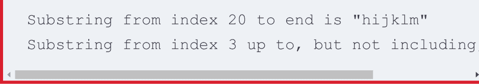

**图 7.6** | String 类的 `substring` 方法。

第 10 行的表达式 `letters.substring(20)` 使用接受一个整数参数的 `substring` 方法。该参数指定了原始字符串 `letters` 中开始复制字符的起始索引。返回的子字符串包含从起始索引到字符串末尾字符的副本。指定字符串范围之外的索引会导致 `IndexOutOfBoundsException`。

第 13 行使用了接受两个整数参数的 `substring` 方法——第一个参数是从原始 `String` 中开始复制字符的起始索引，第二个参数是复制到最后一个字符之外的索引（但不包含该索引在 `String` 中的字符）。返回的子字符串包含原始 `String` 中指定字符的副本。指定字符串范围之外的索引会导致 `IndexOutOfBoundsException`。

#### 生成式 AI

1. 提示生成式 AI 编写代码，以捕获当尝试访问 `String` 范围之外的字符时抛出的异常。代码应该捕获并显示 `IndexOutOfBoundsException`。

### 7.3.6 拼接 `String` s

`String` 方法 `concat`（图 7.7）拼接 `String` 对象（类似于 `+` 运算符）并返回包含两个原始 `String` s 字符的新 `String` 对象。第 11 行的表达式 `s1.concat(s2)` 通过将 `s2` 中的字符附加到 `s1` 中形成一个 `String`。第 12 行在字符串拼接后打印 `s1`，显示它没有被修改——同样，`String` 是不可变的，因此像 `concat` 等方法返回的是新的 `String`。

```java
// Fig.7.7: StringConcatenation.java
// String method concat.
public class StringConcatenation {
    public static void main(String[] args) {
        String s1 = "Happy";
        String s2 = "Birthday";
        System.out.printf("s1 = %s%n", s1);
        System.out.printf("s2 = %s%n", s2);
        String s3 = s1.concat(s2);
        System.out.printf("s1.concat(s2) = %s%n", s3);
        System.out.printf("s1 = %s%n", s1);
    }
}
```

### 7.3.7 其他方法

`String` 类提供了多种方法，返回 `String` 或字符数组，其中包含原始对象的修改副本（图 8）。

#### 替换字符串中的字符

第 14 行使用 `replace` 方法返回一个新的 `String`，其中字符串中的每个 'l' 都被替换为 'L'。该方法保持原始字符串不变。如果字符串中没有出现第一个参数，`replace` 返回原始字符串。`replace` 的重载版本允许你替换子字符串而不是单个字符。

#### 更改字符串的大小写

第 17 行使用 `toUpperCase` 获取一个新的 `String`，用大写字母替换 s1 中的任何小写字母，保持原始字符串不变。如果字符串中没有这些字符，`toUpperCase` 返回原始字符串。第 18 行使用 `toLowerCase` 获取一个新的 `String`，用小写字母替换 s2 中的任何大写字母，保持原始字符串不变。

#### 移除字符串末端的空白

第 21 行使用 `strip` 获取一个新的 `String`，移除原始字符串开头和/或结尾的所有空白字符。该方法返回一个没有前导或尾空白的字符串并保持原始字符串不变。如果开头和结尾没有空白字符，`strip` 返回原始字符串。你可以分别使用 `stripLeading` 和 `stripTrailing` 移除字符串开头或结尾的空白字符。

#### 将字符串转换为数组

由于字符串是不可变的，你无法修改它们的字符。如果你需要操作并修改字符串的字符，可以使用 `toCharArray` 方法创建一个包含字符副本的字符数组（第 24 行），然后操作数组中的字符。第 27–29 行仅输出数组的每个字符，它们之间用空格隔开。

### 7.3.8 String 方法 valueOf

Java 中的每个对象都有一个 `toString` 方法，用于返回对象的字符串表示。遗憾的是，该方法无法用于基本数据类型，因为它们没有方法。`String` 类提供了静态方法，可以接受任何类型的参数并将其转换为 `String` 对象。图 7.9 展示了 `String` 类的 `valueOf` 方法。

```java
// Fig.7.9: StringValueOf.java
// String valueOf methods.

public class StringValueOf {
    public static void main(String[] args) {
        char[] charArray = {'a', 'b', 'c', 'd'};
        boolean booleanValue = true;
        char characterValue = 'Z';
        int integerValue = 7;
        long longValue = 10000000000L; // L suffix
        float floatValue = 2.5f; // f indicates float
        double doubleValue = 33.333; // no suffix needed
    }
}
```


```java
Object objectRef = "hello"; // assign
System.out.printf(
  "char array = %s%n", String.valueOf(charArray));
System.out.printf("part of char array = %s%n", String.valueOf(charArray, 3, 3));
System.out.printf(
  "boolean = %s%n", String.valueOf(booleanValue));
System.out.printf(
  "char = %s%n", String.valueOf(characterValue));
System.out.printf("int = %s%n", String.valueOf(integerValue));
System.out.printf("long = %s%n", String.valueOf(longValue));
System.out.printf("float = %s%n", String.valueOf(floatValue));
System.out.printf(
  "double = %s%n", String.valueOf(doubleValue));
System.out.printf("Object = %s%n", String.valueOf(objectRef));
char array = abcdef
part of char array = def
boolean = true
char = Z
int = 7
long = 10000000000
float = 2.5
double = 33.333
Object = hello
```

**图 7.9** String `valueOf` 方法。

第 10–11 行使用字面量值 `10000000000L` 和 `2.5f` 分别作为 `long` 变量 `longValue` 和 `float` 变量 `floatValue` 的初始值。回，Java 将整数字面量视为 `int` 类型，将浮点字面量视为 `double` 类型。在字面量 `10000000000` 后面加上字母 `L`，在字面量 `2.5` 后面加上字母 `f`，告诉编译器将 `10000000000` 视为 `long`，将 `2.5` 视为 `float`。你可以用大写的 `L` 或小写的 `l` 表示 `long` 值，用大写的 `F` 或小写的 `f` 表示 `float` 值。长整型值使用大写的 `L`，因为小写的 `l` 可能会被误认为数字 `1` (one)。

第 16 行通过复制 `charArray` 的内容创建一个新的 `String` 对象。第 18 行通过复制 `charArray` 的部分内容创建一个新的 `String` 对象——第二个参数指定了复制字符的起始索引，第三个参数指定了要复制的字符数。

第 19–28 行演示了其他七个 `valueOf` 重载，它们分别接受 `boolean`、`char`、`int`、`long`、`float`、`double` 和 `Object` 参数。带有 `Object` 参数的 `valueOf` 方法简单返回调用该参数 `toString` 方法的结果。

## 生成式 AI

1. 大多数 `String.valueOf` 调用并不是必须的，因为 Java 可以自动将任何基本类型值和每个对象转换为 `String`。将图 7.9 的代码提示给生成式 AI，并让它们删除这些调用。

长度，会追加空字符（`'\0'`），直到 `StringBuilder` 的总字符数等于指定的长度。

## 生成式 AI

- 1. 提示生成式 AI 解释为什么当你用一个 `String` 初始化 `StringBuilder` 时，它的容量会增加 16。
- 2. 第 7.4 节引言中提到，当超过 `StringBuilder` 的容量时，它会进行扩展，使得“新容量是旧容量的两倍加 2”。提示生成式 AI 编写 Java 代码来演示这种增长模式。

## 7.4.3 方法 `charAt`、`setCharAt`、`getChars` 和 `reverse`

你可以使用 `StringBuilder` 方法 `charAt`、`setCharAt`、`getChars` 和 `reverse` 来操作 `StringBuilder` 的字符（图 7.12）：

- `charAt` 方法（第 10 行）接收一个整数参数，并返回 `StringBuilder` 中该索引处的字符。
- `getChars` 方法（第 13 行）将字符从 `StringBuilder` 复制到作为参数传递的字符数组中。该方法接受四个参数——开始复制字符的起始索引、要复制的最后一个字符之后的一个索引、用于存放字符的字符数组，以及字符数组中放置第一个被复制字符的起始索引。
- `setCharAt` 方法（第 20 行和第 21 行）接收一个索引和一个字符参数，并将 `StringBuilder` 在该索引处的字符替换为字符参数。
- `reverse` 方法（第 24 行）反转 `StringBuilder` 的内容。

对于接收索引的 `StringBuilder` 方法，尝试访问 `StringBuilder` 边界之外的字符会导致 `IndexOutOfBoundsException`。

点击此处查看代码图像

```java
1 // Fig.7.12: StringBuilderChars.java
2 // StringBuilder methods charAt, setCharAt,
3
4 public class StringBuilderChars {
5     public static void main(String[] args) {
6         var buffer = new StringBuilder("hello there");
7
8         System.out.printf("buffer = %s%n", buffer);
9         System.out.printf("Character at 0: %s\n", buffer.charAt(0), buffer.charAt(4));
10         char[] charArray = new char[buffer.length()];
11         buffer.getChars(0, buffer.length(), charArray);
12         System.out.print("The characters are: ");
13         for (char character : charArray) {
14             System.out.print(character);
15         }
16         buffer.setCharAt(0, 'H');
17         buffer.setCharAt(6, 'T');
18         System.out.printf("%n%nbuffer = %s\n", buffer);
19         buffer.reverse();
20         System.out.printf("%n%nbuffer = %s%n", buffer);
21     }
22 }
```

```
buffer = hello there
Character at 0: h
Character at 4: o
The characters are: hello there
buffer = Hello There
buffer = erehT olleH
```

**图 7.12** StringBuilder 方法 `charAt`、`setCharAt`、`getChars` 和 `reverse`。

## 生成式 AI

- **1** 将**图 7.12** 中的代码提供给生成式 AI 提示，让它们简化代码并解释它们所做的更改。

## 7.4.4 `append` 方法

`StringBuilder` 类的重载 `append` 方法将各种类型的值添加到 `StringBuilder` 的末尾。（**图 7.13**）它为每种基本类型、字符数组、`String`、`Object` 等都提供了相应的版本。每个方法接收其参数，将其转换为 `String` 并追加到 `StringBuilder` 中。在本例中，调用 `System.lineSeparator()` 返回系统特定的行分隔符，它在不同的操作系统之间有所不同。

```java
// Fig. 713: StringBuilderAppend.java
// StringBuilder append methods.
public class StringBuilderAppend {
    public static void main(String[] args) {
        Object objectRef = "hello";
        String string = "goodbye";
        char[] charArray = {'a', 'b', 'c', 'd'};
        boolean booleanValue = true;
        char characterValue = 'Z';
        int integerValue = 7;
        long longValue = 1000000000L;
        float floatValue = 2.5f;
        double doubleValue = 33.333;

        var lastBuffer = new StringBuilder("abc");
        var buffer = new StringBuilder();

        buffer.append(objectRef)
            .append(System.lineSeparator())
            .append(string)
            .append(System.lineSeparator())
            .append(charArray)
            .append(System.lineSeparator())
            .append(charArray, 0, 3)
            .append(System.lineSeparator())
            .append(booleanValue)
            .append(System.lineSeparator())
            .append(characterValue)
            .append(System.lineSeparator())
            .append(integerValue)
            .append(System.lineSeparator())
            .append(longValue)
            .append(System.lineSeparator())
            .append(floatValue)
            .append(System.lineSeparator())
            .append(doubleValue)
            .append(System.lineSeparator())
            .append(lastBuffer);
        System.out.printf("buffer contains%n%s", buffer);
    }
}
```

```
buffer contains
hello
goodbye
abcd
abc
true
Z
7
1000000000
2.5
33.333
abc
```

**图 7.13** StringBuilder `append` 方法。

## 实现字符串的 `+=`

编译器可以使用 `StringBuilder` 和 `append` 方法来实现 `+=` 运算符，以避免创建 `String` 对象。例如，假设声明：

```java
String string1 = "hello";
String string2 = "BC";
int value = 22;
```

```java
String s = string1 + string2 + value;
```

拼接 "hello"、"BC" 和 22。拼接可以如下方式执行：

```java
String s = new StringBuilder("hello").append("BC").append(22).toString();
```

首先，前面的语句创建一个空的 `StringBuilder`，然后追加字符串 "hello"、"BC" 和整数 22。接下来，`StringBuilder` 的 `toString` 方法将 `StringBuilder` 转换为 `String` 对象，并将结果赋值给 s。语句：

```java
s += "!";
s = new StringBuilder().append(s).append("!").toString();
```

这创建了一个空的 `StringBuilder`，然后追加 s 的当前内容，接着是 "!"。接下来，必须显式调用的 `StringBuilder.toString` 方法以 `String` 类型返回 `StringBuilder` 内容，并将结果赋值给 s。

## 生成式 AI

- 1. 提示生成式 AI 重写图 7.13 中的代码使用 `+` 运算符进行字符串拼接，然后将生成的代码与 7.13 进行比较。

## 7.4.5 插入和删除方法

`StringBuilder` 类的重载 `insert` 方法将各种类型的值插入 `StringBuilder` 的任意有效位置。它为基本类型、字符数组、`String`、`Object` 等提供了版本。每个方法接收其第二个参数并将其插入由第一个参数指定的索引。如果第一个参数小于 0 或大于 `StringBuilder` 的长度，则发生 `StringIndexOutOfBoundsException`。

`StringBuilder` 类的 `delete` 和 `deleteCharAt` 方法删除 `StringBuilder` 中任意位置的字符：

- `delete` 接收两个参数——起始索引和要删除字符结束之后的一个索引。从起始索引到不包括结束索引的所有字符都会被删除。
- `deleteCharAt` 接收一个参数——要删除字符的索引。

无效的索引会导致这两个方法抛出 `StringIndexOutOfBoundsException`。图 7.14 演示了 `insert`、`delete` 和 `deleteCharAt` 方法。

```java
1 // Fig.7.14: StringBuilderInsertDelete.java
2 // StringBuilder methods insert, delete and
3
public class StringBuilderInsertDelete {
    public static void main(String[] args) {
        Object objectRef = "hello";
        String string = "goodbye";
        char[] charArray = {'a', 'b', 'c', 'd'};
        boolean booleanValue = true;
        char characterValue = 'K';
        int integerValue = 7;
        long longValue = 10000000;
        float floatValue = 2.5f; // f suffix
        double doubleValue = 33.333;
        var buffer = new StringBuilder();
        buffer.insert(0, objectRef);
        buffer.insert(0, " "); // each of the
        buffer.insert(0, string);
        buffer.insert(0, " ");
        buffer.insert(0, charArray);
        buffer.insert(0, " ");
        buffer.insert(0, charArray, 3, 3);
        buffer.insert(0, " ");
        buffer.insert(0, booleanValue);
        buffer.insert(0, " ");
        buffer.insert(0, characterValue);
        buffer.insert(0, " ");
        buffer.insert(0, integerValue);
        buffer.insert(0, " ");
        buffer.insert(0, longValue);
        buffer.insert(0, " ");
        buffer.insert(0, floatValue);
        buffer.insert(0, " ");
        buffer.insert(0, doubleValue);
        System.out.printf("buffer after inserts:%n%s%n%n", buffer);
    }
}
```


```
buffer.deleteCharAt(10); // 删除第5个 i
buffer.delete(2, 6); // 删除 .333in

System.out.printf(
    "删除后的 buffer:%n%s%n", buff
)
```

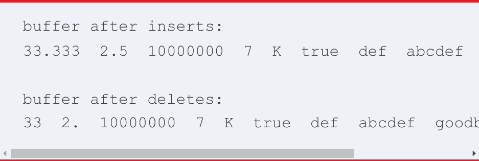

> 图 7.14 | `StringBuilder` 方法 `insert`、`delete` 和 `deleteCharAt`。

## 生成式 AI

- 有一个 Prompt 询问 genAIs: 为什么某些 Java `String` 和 `StringBuilder` 方法会抛出 `IndexOutOfBoundsException`，而另一些却抛出 `IndexOutOfBoundsException`？

# 7.5 类 `Character`

Java 提供了八种类型包装类，将原始类型值视为对象——`Boolean`、`Character`、`Double`、`Float`、`Byte`、`Short`、`Integer` 和 `Long`。本节介绍了 `Character` 类——原始类型 `char` 的类型包装类。

`Character` 类提供了静态方法，用于方便地处理单个 `char` 值。这些方法通常接收一个 `char` 参数，并对其进行测试或操作。有关 `Character` 类（以及所有类型包装类）的更多信息，请参考 Java API 文档中的 `java.lang` 包。

> 4. “Class Character,” Access于 2024 年 9 月 21 日。https://docs.oracle.com/en/java/javase/23/docs/api/java.base/lang/Character.html。

## 7.5.1 字符测试与大小转换方法

图 7.15 展示了：

- 静态 `Character` 方法，用于测试字符以判断它们是否属于特定的字符类型
- 静态 `Character` 方法，用于对字符执行大小转换。

这里展示的许多 `Character` 测试方法（以及 7.8 节中的技术）对于验证程序输入非常有用。第 8–10 行输入一个字符进行处理。`Scanner` 的 `next` 方法（第 9 行）读取字符直到遇到空白字符，然后返回一个包含该空白字符之前（但不包含）的字符的 `String`，该空白字符会被丢弃。

点击此处查看代码图像

```java
// Fig.7.15:StaticCharMethods.java
// 用于测试 char 的 Character 静态方法
import java.util.Scanner;

public class StaticCharMethods {
    public static void main(String[] args) {
        var scanner = new Scanner(System.in);
        System.out.println("Enter a character");
        String input = scanner.next());
        char c = input.charAt(0); // 获取输入

        // 显示字符信息
        System.out.printf("is defined: %b%n",
            Character.isDefined(c));
        System.out.printf("is digit: %b%n", Character.isDigit(c));
        System.out.printf("is first character in a Java identifier: %b%n",
            Character.isIdentifierStart(c));
        System.out.printf("is part of a Java identifier: %b%n",
            Character.isIdentifierPart(c));
        System.out.printf("is letter: %b%n",
            Character.isLetter(c));
        System.out.printf(
            "is letter or digit: %b%n", Character.isLetterOrDigit(c));
        System.out.printf(
            "is lower case: %b%n", Character.isLowerCase(c));
        System.out.printf(
            "is upper case: %b%n", Character.isUpperCase(c));
        System.out.printf(
            "to upper case: %c%n", Character.toUpperCase(c));
        System.out.printf(
            "to lower case: %c%n", Character.toLowerCase(c));
    }
}
```

输入一个字符并按回车

```
A

is defined: true
is digit: false
is first character in a Java identifier: true
is part of a Java identifier: true
is letter: true
is letter or digit: true
is lower case: false
is upper case: true
to upper case: A
to lower case: a
```

输入一个字符并按回车

```
8

is defined: true
is digit: true
is first character in a Java identifier: false
is part of a Java identifier: true
is letter: false
is letter or digit: true
is lower case: false
is upper case: false
to upper case: 8
to lower case: 8
```

输入一个字符并按回车

```
$

is defined: true
is digit: false
is first character in a Java identifier: true
is part of a Java identifier: true
is letter: false
is letter or digit: false
is lower case: false
is upper case: false
to upper case: $
to lower case: $
```

图 7.15 | 用于测试和大小转换的 `Character` 静态方法。每个以 "is" 开头的 `Character` 方法都返回 `true` 或 `false`：

- 第 13 行使用 `Character.isDefined` 判断 `c` 是否在 Unicode 字符集中已定义。
- 第 14 行使用 `Character.isDigit` 确定 `c` 是否为 Unicode 数字。
- 第 16 行使用 `Character.isIdentifierStart` 确定 `c` 是否为 Java 标识符的起始字符。
- 第 18 行使用 `Character.isIdentifierPart` 确定 `c` 是否为 Java 标识符的一部分。
- 第 20 行使用 `Character.isLetter` 确定 `c` 是否为字母。
- 第 22 行使用 `Character.isLetterOrDigit` 确定 `c` 是否为字母或数字。
- 第 24 行使用 `Character.isLowerCase` 确定 `c` 是否为小写。
- 第 26 行使用 `Character.isUpperCase` 确定 `c` 是否为大写。
- 第 28 行使用 `Character.toUpperCase` 将 `c` 转换为大写。
- 第 30 行使用 `Character.toLowerCase` 将 `c` 转换为小写。

```java
Character c1 = 'A';
Character c2 = 'a';
System.out.printf(
    "c1 = %c c2 = %c%n", c1, c2);
System.out.printf(
    "c1.charValue() = %c%n", c1.charValue());
if (c1.equals(c2)) {
    System.out.println("c1 and c2 are equal");
} else {
    System.out.println("c1 and c2 are not equal");
}
```

```
c1 = A
c2 = a

c1 and c2 are not equal
```

图 7.17 | `Character` 类实例方法。

# 7.6 字符串的分词

当你阅读一个句子时，你的大脑将其分解为标记——向你传递意义的单个单词和标点符号。编译器也会执行分词。它们将语句分解成碎片，如关键字、标识符、操作符和其他编程语言元素。在自然语言处理（NLP）和生成式 AI 中，将文本分分为句子和单个单词是准备文本进行分析（如词频计数）以及训练帮助计算机理解自然语言的大语言模型（LLMs）的关键方面。在本节中，我们将使用 `String` 类的 `split` 方法将字符串分解为它的组成标记。标记之间通过分隔符分开，通常是空格、制表符、换行符和回车符等空白字符。其他字符也可以用分隔符来分隔标记，例如制表符、逗号等。图 7.18 展示了 `String` 的 `split` 方法。

[点击此处查看代码图片](https://example.com)

```java
// 图7.18: TokenTest.java
// 使用 String split 方法进行分词
import java.util.Scanner;

public class TokenTest {
    public static void main(String[] args) {
        // 获取句子
        var scanner = new Scanner(System.in);
        System.out.println("Enter a sentence:");
        String sentence = scanner.nextLine();

        // 处理用户句子
        String[] tokens = sentence.split(" ");
        System.out.printf("%nNumber of elements: %d%n", tokens.length);

        for (String token : tokens) {
            System.out.printf(" %s%n", token);
        }
    }
}
```

输入一个句子并按回车

```
这个句子有五个标记
```

元素数量: 5

标记为：

```
This
sentence
has
five
tokens
```

图 7.18 | 使用 `String` 方法 `split` 进行分词。

程序将用户输入存储在变量 `sentence` 中。第 13 行调用 `String` 方法 `split`，并传入 `String` 参数 `" "`，返回一个 `String` 数组。参数 `String` 中的空格字符是 `split` 用于分隔标记的分隔符。第 7.8 节介绍了使用正则表达式在文本中模式匹配——`split` 的参数可以是一个正则表达式模式，用于更复杂的分词。第 14–15 行显示了 `tokens` 数组的长度，即 `sentence` 中标记的数量。第 17–19 行逐行输出每个标记。

# 7.7 自然语言处理 (NLP) 简介——生成式 AI 的根源

- 自然语言处理的很多内容借自我们 Pearson 教科的第 12 节：自然语言处理，《Intro to Python for Computer Science and Data Science: Learning to Program with AI, Big Data and the Cloud* (https://deitel.com/pycds)

每天，我们都在各种形式的交流中使用自然语言。以下许多示例你可能觉得很熟悉：

- 你阅读短信并查看最新的新闻剪辑。
- 你与家人、朋友和同事聊天。
- 你是聋人或听力障碍，通过手语与朋友家人交流，并享受带字幕的视频节目。
- 你是盲人或视力低下，阅读盲文、听有声书，并听屏幕阅读器朗读屏幕上的内容。
- 你阅读电子邮件，区分垃圾邮件和重要通信信息。
- 你收到一封用你不熟悉的语言编写的客户邮件，对其进行在线翻译，然后用英文回复，因为你知道客户通常可以将你的邮件回译成他们的语言。
- 你穿过一个社区（可能通过汽车、自行车、轮椅或步行），观察如“停止”和“行人横道”等路标标志。
- 你给手机下达语音命令，如“拨打家里”或“播放古典音乐”，或提问如“最近的加油站在哪里？”。
- 你教孩子说话和阅读。
- 你学习一门外语。

自然语言处理（NLP）帮助计算机理解、分析和处理人类的文本和语音。它在由电子邮件、社交媒体帖子、对话、电影评论、莎士比亚戏剧、历史文献、新闻、会议记录等组成的文本网上进行。文本集合被称为语料库（corpus），复数形式为 corpora。

一些典型的 NLP 应用包括：

- 自然语言理解——理解文本或口语语言。
- 情感分析——确定文本具有积极、中性还是消极的情感。例如，公司分析社交媒体上关于其产品的帖子的情绪。
- 可读性评估——根据词汇、单词长度、句子长度、句子结构、涵盖主题等确定文本的可读性。在编写本书期间，我们使用了 NLP 工具 Grammarly 的付费版本来帮助调整写作（https://www.grammarly.com）。
- 智能虚拟助手——帮助你的软件。流行的虚拟助手包括 Amazon Alexa、Apple Siri、Microsoft Copilot、OpenAI ChatGPT 和 Anthropic Claude。
- 文本摘要——总结文本的要点。
- 语音识别——将语音转换为文本。
- 语音合成——将文本转换为语音。
- 语言翻译——将文本转换为其他语言。
- 命名实体识别 (NER)——定位并分类文本中的项目，如日期、时间、地点、地点。
- 聊天机器人——通过自然语言与人类交互的 AI 软件。聊天机器人的一种应用是自动客服。
- 相似性检测——检查文档之间的相似程度。基础相似指标包括平均句子长度、句子长度频率、平均单词长度、单词用法频率。

许多底层 NLP 任务支持上述应用，包括：

- 分词——将文本分为意义单元，如单词和数字。
- 词性标记 (POS)——识别每个单词的词性，如名词、动词、形容词。
- 名词短语提取——定位代表名词的词组，如“the red factory”。
- 拼写和语法检查。
- 词干提取——通过删除前缀或后缀将单词还原为词干。
- 词还原——类似于词干提取，但根据原始词的上下文产生实际的单词。例如，“varieties”的词还原形式是 variety。
- `词频计数`——确定每个单词在语料库中出现的频率。
- `停用词消除`——移除某些词，如—a, and, as, at, be, do, for, have, he, I, in, it, not, of, on, that, the, to, with, you 以及更多——以分析语料库中的重要单词。
- `n-grams`——产生语料库中的连续单词集，以识别频繁相邻的单词。`n-grams` 常用于预测文本输入，例如你的智能手机在你输入短信时建议可能的单词，或你的代码支持工具列出你正在使用的对象的可能方法。

## 生成式 AI

**1** 提示生成式 AI 提供你首选语言中的前 20 个 `n-grams` 列表。

# 7.8 自然案例研究：NLP 中的正则表达式简介

有时，你需要识别文本中的模式，如电话号码、电子邮件地址、邮政编码、网络地址、社会安全号码等。正则表达式 (regex) `String` 描述了一种用于在其他 `String` 对象中匹配字符的搜索模式。正则表达式可以帮助你从非结构化文本（例如社交媒体帖子）中提取数据。它们对于处理文本数据也至关重要，使其能够用于训练自然语言处理（NLP）和生成式 AI 的人工智能模型。在处理文本数据之前，你通常会使用正则表达式对其进行验证。例如，你可能会认为：

- 美国邮政编码由五个数字（例如 02215）或五个数字后跟一个连字符和四个数字（例如 02215-4775）组成。
- 姓氏仅包含字母、空格、撇号和连字符。
- 电子邮件地址仅包含允许顺序的字符。
- 美国社会安全号码包含三个数字、一个连字符、两个数字、一个连字符和四个数字，并遵循关于每组数字中所用特定数字的其他规则。

对于常见模式，你很少需要创建正则表达式。像这样的网站：

- https://regex101.com
- https://regexxr.com
- https://regexlib.com
- https://regular-expressions.info

提供了你可以复制和使用的现有正则表达式库。这些站点还允许你测试正则表达式以确定它们是否满足你的需求。

## 正则表达式的其他用途

正则表达式还用于：

- 从文本中提取数据（称为爬取、文本挖掘和解析）——例如定位网页中的所有 URL。
- 清理数据——例如删除不需要的数据、消除重复数据、处理不完整数据、修复拼写错误、确保数据格式一致、移除格式、更改文本大小写、处理异常值等。
- 将数据转换为其他格式——例如，将制表符分隔或空格分隔的值重新格式化为逗号分隔的值 (CSV)，以供需要 CSV 格式数据的应用程序使用。

## 生成式 AI

1. 提示 genAI 寻找测试正则表达式的最佳网站。测试本章中展示的正则表达式是否与预期的文本模式匹配。

## 7.8.1 匹配完整字符串到模式

图 7.19 展示了匹配整个 `String` 到正则表达式模式的方法。为了方便讨论，我们将程序分成了几个部分。

### 匹配字面字符


如果调用方法的 `String` 匹配参数中的模式，则该方法返回 `true`。默认情况下，模式匹配是区分大小写的——稍后我们将看到如何执行不区分大小写的匹配。让我们从匹配与其自身的字面字符开始。第 8 行调用了两次 `matches` 方法，尝试匹配模式 `"02215"`，该模式仅包含字面字符（在本例中为数字），它们按照指定的顺序与自身匹配：

- 调用 `"02215".matches("02215")` 返回 `true`
- `"02215"` 匹配 `matches` 方法参数中的模式。
- 调用 `"51220".matches("02215")` 返回 `false`
- `"51220"` 与参数中的模式数字相同，但 `"51220"` 的顺序错误。

[点击此处查看图像](#)

```java
1 // Fig.7.19: RegexExamples.java
2 // Matching entire Strings to regular expres
3 public class RegexExamples {
4     public static void main(String[] args) {
5         // fully match a pattern of literal ch
6         System.out.println("Matching against:
7         System.out.printf("02215: %b; 51220: %b
8         "02215".matches("02215"), "51220".n
9     }
}
```

```
Matching against: 02215
02215: true; 51220: false
```

**图 7.19** | 匹配整个字符串到正则表达式。

## 元字符、字符类和量词

正则表达式通常包含各种被称为元字符的特殊符号：

[点击此处查看代码](#)

```
[ ] { } ( ) \ * + ^ $ . |
```

`\` 是每个预定义字符类的开头，其中几个在下表中显示了它们匹配的字符组：

| 字符类 | 匹配 |
|---|---|
| `\d` | 任何数字 (0–9)。 |
| `\D` | 任何非数字字符。 |
| `\s` | 任何空白字符（如空格、制表符或换行符）。 |
| `\S` | 任何非空白字符。 |
| `\w` | 任何单词字符（也称为字母数字字符）——即任何大写或小写字母、任何数字或下划线。 |
| `\W` | 任何非单词字符。 |

记住，Java `String` 中的反斜杠 (`\`) 是转义序列的开头。正则表达式字符类不是有效的 Java 转义序列，因此你必须在正则表达式中的每个字符类前面加上额外的反斜杠。例如，`\$` 匹配美元符号 (`$`)，`\\` 匹配反斜杠 (`\`)。在 Java 中表示这些模式时，你必须转义每个反斜杠，所以：

- 为了匹配美元符号 (`$`)，在模式 `String` 中指定 `\$`
- 为了匹配反斜杠 (`\`)，在模式 `String` 中指定 `\\`

## 匹配数字

`\d` 是一个预定义的字符类，匹配任何数字 (0–9)。美国邮政编码由五个数字（例如 02215）或五个数字后跟一个连字符和四个数字（例如 02215-4775）组成。姓氏仅包含字母、空格、撇号和连字符。电子邮件地址仅包含允许顺序的字符。美国社会安全号码包含三个数字、一个连字符、两个数字、一个连字符和四个数字，并遵循关于每组数字中所用特定数字的其他规则。

对于常见模式，你很少需要创建正则表达式。这些网站：

- <https://regex101.com>
- <https://regexxr.com>
- <https://regexlib.com>
- <https://regular-expressions.info>

提供了你可以复制和使用的现有正则表达式库。这些站点还允许你测试正则表达式以确定它们是否满足你的需求。

## 自定义字符类

方括号 `[]` 定义字符类。例如，`[aeiou]` 匹配任何元音，`[A-Z]` 匹配大写字母，`[a-z]` 匹配小写字母，`[a-zA-Z]` 匹配任何大写或小写字母，`[0-9]` 匹配任何数字，`[a-zA-Z0-9]` 匹配任何字母数字字符，`[^\s]` 匹配任何非空白字符，`[^\w]` 匹配任何非单词字符，`[^\d]` 匹配任何非数字字符。

当自定义字符类以脱字符 (`^`) 开头时，该类匹配任何未指定的字符。所以 `[^a-z]`（第 23 行）匹配任何非小写字母。自定义字符类中的元字符被视为字面字符。所以 `[*+$]`（第 28 行）匹配一个 `*` 或 `$` 字符。

## `*` 与 `+` 量词

为了要求名字中至少有一个小写字母，请将第 18 行的 `*` 量词替换为 `+` 量词（第 33 行），它匹配其左侧子表达式 (`[a-z]`) 的至少一次出现：

```java
Matching against: [A-Z][a-z]+
Angel: true; T: false
```

`*` 和 `+` 都是贪婪的——它们匹配尽可能多的字符。因此，正则表达式 `[A-Z][a-z]+` 匹配任何以大写字母开头、后跟至少一个小写字母的单词。你将在本节末尾的 genAI 练习中探索懒惰量符。

## 其他量符

`?` 量符匹配其左侧子表达式零次或一次出现。在正则表达式 `label?ed`（第 38 行）中，该子表达式是字面字符 `"e"`。因此，在第 38 行的 `matches` 调用中，正则表达式匹配了 `labelled`（英国英语拼写）和 `labeled`（美式英语拼写），但在第 39 行的 `matches` 调用中，正则表达式不匹配拼写错误的单词 `labled`：

[点击此处查看代码图片](#)

```java
35 // match zero or one occurrence of a s
36 System.out.println("Matching against:
37 System.out.printf("labelled: %b; label
38 "labelled".matches("label?ed", "l
labelllled".matches("label?ed");
```

```
Matching against: labell?ed
labelled: true; labeled: true; labllled: false
```

你可以使用 `{n,}` 量符来匹配其左侧子表达式至少 $n$ 次出现。第 44-45 行中的正则表达式 `\d{3,}` 匹配包含至少三个数字的 `String`——记住，此正则表达式中的 `\` 必须用另一个 `\` 进行转义：

[点击此处查看代码图片](#)

```java
// match n (3) or more occurrences of
System.out.println("Matching against:\
System.out.printf("123: %b; 1234567890\
"123".matches("\\d{3,}"), "1234567890\
"12".matches("\\d{3,}");
```

```
Matching against: \d{3,}
123: true; 1234567890: true; 12: false
```

你可以使用 `{n,m}` 量符来匹配子表达式出现 $n$ 到 $m$ 次（包含在内）的情况。第 50–51 行中的正则表达式 `\d{3,6}` 匹配包含 3 到 6 个数字的 `String`：

[点击此处查看代码图片](#)

| 47 | // match n to m inclusive (3-6), occur |
| 48 | System.out.println("Matching against: |
| 49 | System.out.printf("123: %b; 123456: %b |
| 50 | "123".matches("\d{3,6}"), "123456" |
| 51 | "1234567".matches("\d{3,6}"), "12" |
| 52 | } |
| 53 | } |

```
Matching against: \d{3,6}
123: true; 123456: true; 1234567: false; 12: false
```

## 生成式 AI

1. 向 genAIs 提示正则表达式 `[b-df-hj-np-tv-z]`。让它们写一段 Java 代码，展示该模式仅匹配小写辅音字母。运行代码以确认该模式正常工作。
2. 正则表达式量符默认是贪婪的。向 genAIs 提示一个简短的 Java 教程，用简单的示例展示懒惰正则表达式量符如何匹配模式。

## 7.8.2 替换子字符串

`String` 类的 `replaceAll` 替换 `String` 中的模式。让我们把制表符分隔的字符串转换为逗号分隔（图 7.20）。方法 `replaceAll`（第 9 行）接收：

- 正则模式（字符 `\t`）和
- 替换文本（`,`），

并返回一个包含修改后的新 `String`。`String` 类还提供了 `replaceFirst` 方法，它只替换第一个匹配的子字符串。

[点击此处查看代码图片](#)

```java
1 // Fig.7.20: RegexReplacement.java
2 // Regular expression replacements
public class RegexReplacement {
    public static void main(String[] args) {
        // replace tabs with commas
        String s1 = "1\t2\t3\t4";
        System.out.printf("Original string: %s\n", s1);
        System.out.printf("New string with commas: %s\n", s1.replaceAll("\\t", ","));
    }
}
```

| Original string: 1 | 2 | 3 | 4 |
|---|---|---|---|
| New string with commas replacing tabs: 1,2,3,4 |

图 7.20 | 正则表达式替换。

## 7.8.3 搜索匹配项

除了 `String` 类的功能，`java.util.regex` 包提供了帮助开发者处理正则表达式的功能：

- `Pattern` 对象表示正则表达式。
- `Matcher` 对象包含模式和源文本。

### 在任意位置查找匹配

引入 `Pattern` 和 `Matcher`，让我们在 `String` 中进行搜索（图 7.20）。`Matcher` 类控制正则表达式的匹配。`find` 方法确定 `String` 是否包含模式。如果是，它返回匹配模式的子字符串；否则，返回 `false`。当搜索多个匹配项时，你在循环中调用 `find` 方法。

```java
1 // Fig.7.20: RegexReplacement.java
2 // Regular expression replacements
public class RegexReplacement {
    public static void main(String[] args) {
        // replace tabs with commas
        String s1 = "1\t2\t3\t4";
        System.out.printf("Original string: %s\n", s1);
        System.out.printf("New string with commas: %s\n", s1.replaceAll("\\t", ","));
    }
}
```

### 忽略正则表达式的大小写并查看匹配文本

与 `String` 比较一样，正则表达式匹配默认对大小写敏感。`Pattern` 类提供了自定义正则表达式行为的常量。第 33-34 行配置了一个忽略大小写的模式——通过常量 `Pattern.CASE_INSENSITIVE` 指明——匹配字面量 `"Gabriela"`。第 35 行创建一个 `Matcher` 对象在 `s2` 中搜索该模式。第 37 行调用 `find` 方法来确定 `s2` 是否包含模式。如果是，`group` 方法（第 39 行）返回匹配模式的子字符串。

```java
 // ignoring case
String s2 = "GABRIELA ALREZ";
System.out.printf("s2: %s\n", s2);
System.out.println("Case insensitive");

Pattern pattern4 = Pattern.compile("Gabriela", Pattern.CASE_INSENSITIVE);
Matcher matcher4 = pattern4.matcher(s2);

if (matcher4.find()) {
    System.out.printf("Gabriela found%n");
    System.out.printf("Matched text: %s%n");
}
else {
    System.out.printf("Gabriela not found%n");
}
```

### 在字符串中查找所有匹配

让我们从字符串中提取格式为 `###-###-####` 的所有 10 位电话号码。以下代码查找 `contact` 中（第 46–47 行）匹配 `phonePattern`（第 48 行）的每个子字符串并显示匹配文本。正则表达式

```
\d{3}-\d{3}-\d{4}
```

匹配任何包含三个数字 (`\d{3}`)、一个连字符 (`-`)、三个数字 (`\d{3}`)、一个连字符 (`-`) 和四个数字 (`\d{4}`) 的子字符串——包含了两个这样的电话号码。第 49 行创建了一个 `Matcher` 对象，用于在 `contact` 中定位 `phonePattern` 匹配项。当搜索多个匹配项时，你在循环条件中（第 52 行）调用 `find` 方法。第 52–54 行在 `find` 返回 `true` 时迭代——直到 `contact` 中不再有匹配项。如果有匹配项，第 53 行调用 `group` 方法来获取找到子字符串后将其显示。下一次调用 `Matcher` 方法 `find` 时将自动从上一次匹配项后的字符继续查找。

[点击此处查看代码图像](#)

```java
45 // finding all matches
46 String contact =
47 "Lea Dubois, Home: 555-555-1234, Wo
48 Pattern phonePattern = Pattern.compile
49 Matcher phoneMatcher = phonePattern.ma
50
51 System.out.printf("Finding phone numbe
52 while (phoneMatcher.find()) {
53 System.out.printf("%s%n", phoneM
54 }
55 }\n56 }
```

> 在以下内容查找电话号码：
>
> Lea Dubois, Home: 555-555-1234, Work: 555-555-432-555-1234
>
> 555-555-4321

### 7.8.4 用于准备 NLP 和生成式 AI 模型训练文本的简单数据清洗步骤

数据并不总是准备好用于分析或训练人工智能（AI）模型的。它可能是错误的、格式错误的，甚至是缺失的。行业经验表明，数据科学家在分析数据之前，花费高达 80% 的时间来准备数据。为分析准备数据被称为数据清洗（data munging）或数据抓取（data wrangling）。从现在起，我们将其称为数据清洗。图 7.22 利用 `String` 和正则表达式能力来执行几项常见的数据清洗任务，这些任务可以用于为训练生成式 AI 所用的大型语言模型（LLMs）准备文本，生成式 AI 利用它们来理解并响应你的提示。其中一些任务包括我们在 7.7 节“自然语言处理（NLP）简介——生成式 AI 的核心”中列出的任务：

- 将文本转换为全小写（见第 7.3.7 节），
- 移除标点符号，
- 将连续的空白字符合并为单个空格，
- 移除隐私（PII），
- 归一化数字（有时特定的数值对分析或训练没有意义，因此你可能将其替换为如 `<NUMBER>` 或 `<NUM>` 等标签），
- 移除数字和
- 移除特殊符号。

8. Pragmatic Institute. “克服数据科学中的 80/20 原则。”访问于 2024 年 9 月 6 日。<https://www.pragmaticinstitute.com/resources/articles/data/overcoming-the-80-20-rule-in-data-science/>。

在特定的语料库（文本体）上执行这些操作通常取决于：

- AI 模型需要从语料库中学习什么，或者
- 模型需要如何分析它。

例如，对于一个总结语料库最重要的词汇频率的模型，你可能会消除停用词。对于学习句子结构的模型，保留停用词可能是重要的，以便它可以用完整、结构良好的句子响应你的提示，就像生成式 AI 应用产生的那样。

图 7.22 对第 7-14 行定义的文本块语料库执行了几个清洗步骤，该语料库特意包含了额外的空格。为了方便讨论，我们将此示例分为几个部分。

[点击此处查看代码图像](#)


# 7.9 对象自然安全案例研究：`pMa5tfEKwk59dTvC04Ft1IFQ9mEXnkfyYXZwX4ujGE=`

你可能已经注意到：

- 本章最后一个目标点，
- 7.9 节在章节目录中的标题以及这里的标题，
- 7.1 节的最后一个小标题

看起来都像乱码。这些不是错误——它们是加密文本。在这里，我们继续我们的对象自然的方法，通过案例研究，学习如何使用 Java API 类提供的对象对消息进行加密和解密：

- Java 加密架构 (`java.security` 包)
- Java 加密扩展 (`javax.crypto` 相关包)

Java 加密架构 (JCA) 定义了使用加密能力的框架。Java 加密扩展 (JCE) 通过高级加密算法和其他能力增强了 JCA，这些能力是工业级应用安全传输和存储数据所需的。

## 密码学

密码学已经使用了数千年，并且在当今这个互联的世界中至关重要。每天，它都在后台运行，以确保你的互联网通信是私密且安全的。例如，大多数网站现在使用 HTTPS 协议来加密和解密你的网页交互，就像我们在 `deitel.com` 所做的那样。

## 密码

尤利斯·凯撒曾使用一种简单的替换密码对军事通信进行加密。他的技术——被称为凯撒加密——是将通信内容（明文）中的每个字母替换为字母表中其后固定位置的字母。因此，`A` 被替换为 `D`，`B` 被替换为 `E`，`C` 被替换为 `F`，…… `X` 被替换为 `A`，`Y` 被替换为 `B`，`Z` 被替换为 `C`。因此，明文

```
Caesar Cipher
```

将被加密为

```
Fdhvdu Flskhuu
```

加密后的文本被称为密文。

## 对称密钥加密

在这一面向对象特性的案例研究中，你将学习对称密钥加密（也称为私钥加密或秘密密钥加密），其中消息发送者的明文将用一个秘密密钥加密形成密文。“对称”一词源于接收者必须使用相同的秘密密钥来解密密文并恢复原始明文。秘密密钥加密的一个问题是，密文的安全性取决于秘密密钥的安全性，而且该密钥的多个副本“到处流传”。在第 11 章面向对象特性的案例研究中，我们将讨论非对称密钥加密，它使用不同的密钥进行加密和解密——这种技术通常用于传输对称加密中使用的秘密密钥。非对称密钥加密比对称密钥慢得多，因此在加密解密长消息时优先选择对称密钥加密。

## 高级加密标准 (AES) 简述

在这一面向对象特性的案例研究中，你将学习高级加密标准 (AES) 的简化版本——它是最广泛使用的对称密钥加密算法之一，也是美国政府安全通信的选择。AES 支持 128、192 或 256 位的秘密密钥——位数越高，密钥越安全，算法执行解密时所需的计算能力也越大。

### 用于演示目的：可复现密钥

有时，你可能希望保证可复现性。在本节后面的部分，我们将展示如何使用 `Random` 类的 `setSeed()` 方法来实现。可复现性对于调试也很有用。对于我们的示例，我们将使用以下序列为 `Random` 生成器设置种子：

### 使用 AES 加密文本

`CryptographyDemo` 类使用 AES 对消息进行加密解密。

```java
// Fig7.23: CryptographyDemo.java
import javax.crypto.Cipher;
import javax.crypto.KeyGenerator;
import javax.crypto.SecretKey;
import java.security.SecureRandom;
import java.util.Base64;
import java.util.Scanner;

public class CryptographyDemo {

    public static void main(String[] args) {
        var scanner = new Scanner(System.in);
        System.out.println("\nEnter秘密密钥种子（用于复现）");
        String seedString = scanner.nextLine();

        try { // 加密解密可能会
            // 生成可复现的 AES 密钥
            SecretKey secretKey = generateKey(seedString);
            System.out.printf("%nSecretKey:%s%n",
                    Base64.getEncoder().encodeToString(secretKey.getBytes()));
        } catch (Exception e) {
            System.out.println("Error: " + e.getMessage());
        }
    }

    private static SecretKey generateKey(String seed) {
        KeyGenerator keyGen = KeyGenerator.getInstance("AES");
        SecureRandom random = new SecureRandom();
        random.setSeed(seed.getBytes());
        keyGen.init(256, random);
        return keyGen.generateKey();
    }
}
```

- `SecretKey` 的 `getEncoded()` 方法返回密钥的字节数组表示。
- `Base64` 的 `getEncoder()` 方法返回一个 `Base64` 对象，该对象可以将字节数组转换为仅包含 Base64 字母表字符的字符串表示。然后我们使用 `Base64` 对象的 `encodeToString()` 方法将字节数组转换为字符串。这使我们能够为了演示目的显示密钥（以及瞬时的密文）。


## 18. "Class Base64." 访问 2024 年 9 月 21 日。https://docs.oracle.com/en/java/javase/23/docs/api/java.base/jav/util/Base64.html.

第 28 行调用了我们的加密方法（第 64–75 行），使用 `secretKey` 对明文进行加密，第 29 行显示生成的密文，我们的方法以 Base64 编码字符串的形式返回该密文：

点击此处查看代码图像

| 27 | // encrypt the plaintext |
| 28 | String ciphertext = encrypt(plaintext | |

```java
System.out.printf("%nEncrypted:%n%s\n", ciphertext);
```

加密结果:

```text
Cz93YoFCX+yebfAOuMPMI+UZz2bc5jJdstzfapaNKwJldZuXF8Bq2YNeq==
```

第 32–33 行调用 `decrypt` 方法（第 78–89 行）使用 `secretKey` 对密文进行解密，然后显示生成的明文，该结果与原始消息匹配：

点击此处查看代码图像

```java
// decrypt the text
System.out.printf("%nDecrypted:%n%s\n", decrypt(ciphertext, secretKey));
```

解密结果:

```text
Welcome to encryption and decryption using AES encryption
```

第 36–37 行提示输入现有密文，这样你就可以解密本节的标题。为了方便起见，我们将该文本放置在此示例文件夹的 `encrypted.txt` 文件中，你可以将其复制并粘贴到程序中。第 38–39 行调用我们的 `decrypt` 方法使用 `secretKey` 解密该密文，然后显示第 7.9 节标题加密部分的明文。

点击此处查看代码图像

```java
35    // decrypt ciphertext entered by th
36    System.out.println("\nEnter the cip
37    ciphertext = scanner.nextLine();
38    System.out.printf("%nDecrypted:%n%s
39    decrypt(ciphertext, secretKey));
40    
41    catch (Exception ex) {
42        System.out.printf("\"
43            An exception occurred during enc
44            %s%n
45            """", ex);
46    }
47  }
```

```text
Enter the ciphertext to decipher:
pMa5tfEKwk59dTVC04Ft1IFQz9mEXnkfYXYZZwwk4ujGE=
```

```text
Decrypted:
Symmetric-Key Cryptography
```

## generateKey 方法

`generateKey` 方法（第 52–61 行）使用其参数为 `SecureRandom` 生成器设置种子以生成一个 256 位的 AES `SecretKey`。这使得我们的示例能够从相同的种子生成相同的 `SecretKey`。这对于测试和演示有用，并将让你能够解密本节标题中的密文。工业级加密的 `SecretKey` 应该是随机生成的，以确保它们不可复现。`main` 方法参数列表之后、正体之前的 `throws Exception` 子句是此示例编译所需的。许多加密和解密方法会引起 Java 编译器要求我们处理的异常。我们将在第 10.3 节详细解释 `throws Exception` 子句。

点击此处查看代码图像

```java
49 // Generate and return a SecretKey. Note:
50 // SecureRandom object for reproducibility
51 // chapter's encrypted text. Don't do this
52 public static SecretKey generateKey(String seed) throws Exception {
53 // get a secure random number generator
54 var random = SecureRandom.getInstance("SHA1PRNG");
55 random.setSeed(seed.getBytes()); 
56 
57 // get an AES SecretKey generator
58 var keyGen = KeyGenerator.getInstance("AES");
59 keyGen.init(256, random); 
60 return keyGen.generateKey(); 
61 
62 }
```

`generateKey` 方法的操作如下：

- 第 54 行获取一个 `SecureRandom` 对象，配置为使用 "SHA1PRNG" 随机数生成算法，该算法可以设置种子以实现可复现性。
- 第 55 行使用 `seed String` 的数组表示（由 `String` 方法 `getBytes()` 返回）设置生成器的种子。设置种子确保每次使用相同的 `seed String` 时都会生成相同的随机值，使得 `SecretKey` 的生成具有可复现性，这仅用于演示。
- 第 58 行使用 `KeyGenerator` 静态方法 `getInstance()` 获取一个用于生成 AES 密钥的 `KeyGenerator`。
- 第 59 行调用 `KeyGenerator` 方法 `init()`，传入 AES 密钥大小和种过的 `SecureRandom` ——256 位产生最安全的 AES 密钥。为了更高的安全性，请使用仅接收密钥大小的单参数 `init()` 方法，或者为 `init()` 的第二个参数提供一个完全随机的（即未种子的）`SecureRandom` 对象，以便 `KeyGenerator` 能够生成真正的随机密钥。
- 最后，第 60 行调用 `KeyGenerator` 方法 `generateKey()` 获取并返回用于加密解密消息的 `SecretKey`。

## encrypt 方法

`encrypt` 方法（第 64–75 行）接收要加密的明文和 `SecretKey`，执行 AES 加密并返回密文的 Base64 编码版本。同样，代码编译需要 `throws Exception` 子句。

点击此处查看代码图像

```java
// encrypt a String using AES
public static String encrypt(
    String plaintext, SecretKey secretKey) throws Exception {
    var cipher = Cipher.getInstance("AES");
    cipher.init(Cipher.ENCRYPT_MODE, secretKey);
    // encrypt the byte[] representation
    byte[] encrypted = cipher.doFinal(plaintext.getBytes());
    // Base64 encode encrypted as a cipher
    return Base64.getEncoder().encodeToString(encrypted);
}
```

`encrypt` 方法的操作如下：

- 与 `decrypt` 方法相同，第 67 行调用 `Cipher` 类的静态方法 `getInstance()` 获取一个我们将用于 "AES" 的 `Cipher`。
- 第 68 行初始化用于加密的 `Cipher` 对象（`Cipher.ENCRYPT_MODE`），使用 `secretKey`。
- 第 71 行获取字节数组表示并将其传递给 `Cipher` 的 `doFinal()` 方法，该方法返回加密结果。
- 第 74 行将加密结果 Base64 编码为字符串。

## decrypt 方法

`decrypt` 方法（第 78–89 行）接收要解密的 Base64 编码密文和 `SecretKey`，执行 AES 解密并返回明文。同样，代码编译需要 `throws Exception` 子句。

点击此处查看代码图像

```java
77 // decrypt a String using AES
78 public static String decrypt(
79     String ciphertext, SecretKey secretKey) throws Exception {
80     
81     var cipher = Cipher.getInstance("AES");
82     cipher.init(Cipher.DECRYPT_MODE, secretKey);
83     // Base64 decode ciphertext to byte
84
85     byte[] ciphertextBytes = Base64.getDecoder().decode(ciphertext);
86     // create plaintext String from
87     return new String(cipher.doFinal(ciphertextBytes));
88 }
89 }
```

`decrypt` 方法的操作如下：

- 与 `encrypt` 方法相同，第 81 行调用 `Cipher` 类的静态方法 `getInstance()` 获取一个我们将用于 "AES" 的 `Cipher`。
- 第 82 行初始化用于解密的 `Cipher` 对象（`Cipher.DECRYPT_MODE`），使用 `secretKey`。
- 第 85 行将 Base64 编码的密文转换为字节数组 `ciphertextBytes`。首先，我们调用 `Base64.getDecoder()` 方法获取一个可以将 Base64 编码字符串转换为字节数组的对象。
- 为了解密 `ciphertextBytes` 中的字节，第 88 行调用 `Cipher` 的 `doFinal()` 方法并传入 `ciphertextBytes`。
- 第 88 行从字节数组创建一个新的 `String`。

## 密钥加密的缺陷——以及公钥加密

密钥加密有一个缺陷——密文的安全性取决于密钥的安全性。任何发现或窃取密钥的人都可以解密密文。在第 11 章的对象自然案例中，我们将通过公钥加密来完成对 Java 加密的介绍。这种技术允许想要向特定接收者发送秘密消息的发送者使用公钥进行加密。公钥可以加密消息但不能解密。消息只能通过接收者私有的私钥解密。我们将使用公钥加密来安全地传输密钥加密所需的密钥。

### 加密与计算能力的说明

理想情况下，密文应该是无法“破解”的——即在没有解密密钥的情况下，无法从密文中确定明文。由于各种原因，这一目标是无法实现的。因此，加密方案的设计者转而追求让它们变得极其难以破解。

遗憾的是，如今日益强大的计算机（量子计算机已触手可及）使得世界在过去几十年中一直信赖地使用的许多加密方案变得可以破解。[20,21]。加密学是实现比特币等加密货币的区块链技术的核心。[22] 量子计算实现的这些极其强大的计算机，正使加密方案和加密货币面临风险，[23,24]，加密货币社区正在努力应对这些挑战[25,26,27]。

20. Martin Giles, “Inside the Quest for Unbreakable Encryption,” MIT Technology Review, October 19, 2023, Accessed September 6, 2024. https://www.technologyreview.com/2023/10/19/108389/unbreakable-encryption-quantum-computers-cryptography-math-problems/

21. Jason Dorrier, “Quantum Computers Could Crack Encryption Sooner Than Expected With New Algorithm,” Singularity Hub, October 2, 2023, Accessed September 6, 2024. https://singularity.com/2023/10/02/quantum-computers-could-crack-encryption-sooner-than-expected-with-new-algorithm/

22. “Cryptocurrency.” Accessed September 6, 2024. https://www.investopedia.com/terms/c/cryptocurrency.asp .

23. “The Impact of Quantum Computing on Present Cryptography.” Accessed September 6, 2024. https://arxiv.org/pdf/1804.00200.pdf .

24. “Quantum Computing and its Impact on Cryptography.” Accessed September 6, 2024. https://www.cryptomath.com/news-events/blog/quantum-computing-and-its-impact-on-cryptography .

25. “How Should Crypto Prepare for Google’s ‘Supremacy’?” Accessed September 6, 2024. https://www.coindesk.com/how-should-crypto-prepare-for-googles-quantum-supremacy .

26. “Here’s Why Quantum Computing Will Not Break Cryptocurrencies.” Accessed September 6, 2024. https://www.forbes.com/sites/rogerhuang/2020/12/21/heres-why-quantum-computing-will-not-break-cryptocurrencies .

27. “How the Crypto World Is Preparing for Quantum Computing, Explained.” Accessed September 6, 2024. https://cointelegraph.com/explained/how-the-crypto-world-is-preparing-for-quantum-computing-explained .

## 生成式 AI

- 1. 提示生成式 AI，以解释为什么开发者不自动使用 256 位密钥。
- 2. 提示生成式 AI，以评估新兴量子计算机对当今加密方案构成的风险。要求它们解释当今加密社区正在采取哪些措施来应对这些挑战。

## 7.10 总结

本章介绍了 Java 的 `String`、`StringBuilder` 和 `Character` 类。你学习了创建 `String` 对象的各种方法，然后使用 `String` 方法来确定 `String` 的长度、从 `String` 中获取字符和字符数组、比较 `String`、定位字符和子字符串、提取子字符串、拼接 `String`、替换 `String` 中的字符以及更改 `String` 的大小写。你发现 `String` 是不可变的，因此每个似乎修改了 `String` 内容的操作都会复制内容，在副本上执行修改并返回一个包含结果的新 `String`。

我们使用了 `StringBuilder` 类的可修改对象来动态地创建和操作 `String` 内容，而无需创建不必要的 `String` 对象。我们使用 `Character` 类来测试字符的各种属性。我们在字符与其对应的 Unicode 整数值之间进行转换，反亦然。我们使用 `String` split 方法对 `String` 进行分词——将文本分解为句子和单词是帮助计算机理解自然语言的关键方面。

我们引入了自然语言处理（NLP），它可以帮助计算机理解、分析和处理文本，并作为生成式 AI 的基础。我们解释了如何使用 Grammarly 和生成式 AI 的 NLP 功能来调整我们的写作、评估章节覆盖的广度和深度、验证内容并提出改进建议。

我们通过两个案例研究继续了这种“以对象为本”的方法。第一个案例引入了正则表达式——这在当今数据丰富的应用中至关重要，用于清理和准备数据以进行分析、数据挖掘以及将数据转换为其他格式。你使用了 `String` 方法和 `java.util.regex` 包中的 `Matcher` 和 `Pattern` 类来执行这些任务。这些能力被频繁用于验证数据。它们也被用于自然语言处理，为训练生成式 AI 准备数据，并帮助生成式 AI 模型对你的提示创建响应。在第 11 章中，我们将对 NLP 进行更多探索。

在第二个对象案例研究中，我们使用了 Java 加密架构（JCA）和 Java 加密扩展，通过使用流行且强大的 AES 加密算法引入了对称加密。在该案例研究中，你了解了如何生成密钥、为加密准备明文、配置用于加密的 `Cipher`、加密密文、配置用于解密的 `Cipher` 以及解密密文以恢复原始明文。Java 提供了丰富的安全和加密功能。要深入研究这些内容，请参考 Oracle 的《安全开发者指南》。在下一章中，你将创建类。

## 8 使用自定义类进行真实世界建模


![img/ea6502b206f0cabd206f0c2]

# 8 目标

在本章中，你将：

- 声明类并创建对象。
- 调用方法执行对象的操作。
- 使用构造函数初始化对象。
- 控制访问权限。
- 抛出异常指示运行时问题。
- 通过 `this` 将一个构造函数的工作委托给另一个。
- 定义静态成员。
- 导入静态成员。
- 使用枚举创建一组常量。
- 为枚举声明参数。
- 使用 `record` 创建不可变对象。
- 使用 `record` 进行 `switch` 表达式。
- 继续使用生成式 AI 利用你的学习经验。

## 8.1 引言

## 8.2 实例变量、set 方法和 get 方法

### 8.2.1 带有实例变量及 set 和 get 方法的 Account 类

### 8.2.2 创建并使用对象的 AccountTest 类

### 8.2.3 编译和运行多个类的程序

### 8.2.4 Account UML 图

### 8.2.5 关于 AccountTest 的说明

### 8.2.6 使用私有实例变量和公共 set 和 get 方法的软件工程

## 8.3 默认和显式实例变量初始化

## 8.4 Account 类：使用构造函数初始化

### 8.4.1 用于自定义对象初始化的 Account 构造函数

### 8.4.2 初始化新对象

## 8.5 带有余额的 Account 类

### 8.5.1 带有 BigDecimal balance 实例变量的 Account 类

### 8.5.2 AccountTest 类

## 8.6 案例研究：洗牌与发牌模拟

## 8.7 案例研究：Time 类

## 8.8 控制成员访问

## 8.9 使用 this 引用当前对象的成员

## 8.10 案例研究：Time 类重载构造函数

## 8.11 默认和无参构造函数

## 8.12 关于 set 和 get 方法的说明

## 8.13 组合

## 8.14 enum 类型

## 8.15 垃圾回收

## 8.16 静态类成员

## 8.17 静态导入

## 8.18 final 实例变量

## 8.19 包访问

## 8.20 record 类

### 8.20.1 用于 switch 表达式的模式匹配

### 8.20.2 在 switch 表达式中解构 record

你使用了 `Scanner` 对象从用户输入数据。在“对象-自然案例研究”中，你：

- 操作了 `String` 类的对象，
- 对大整数（`BigInteger` 类）进行了计算，
- 进行了精确的货币计算（使用 `BigDecimal` 类），
- 处理了日期和时间（使用 Java Date/Time API），
- 处理了动态扩展的对象集合（使用 `ArrayList` 类），
- 使用正则表达式匹配文本中的模式（使用 `String`、`Pattern` 和 `Matcher` 类），
- 使用了密钥加密对数据进行加密解密（使用 `Cipher`、`KeyGenerator` 和 `SecretKey` 类）。

在第 11 章“文件、I/O 流、JSON序列化与 CSV 文件，对象-自然案例研究”中，你将探索公钥加密。

在整本书中，你将使用更多预定义的类和对象。这是学习 Java 面向对象编程的巨大优势——也是挑战之一。

在本章中，你将创建自定义类。你创建的每个类都是一种你可以用于声明变量和创建对象的类型。你可以根据需要声明新类；这就是 Java 被称为可扩展语言的原因之一。

第 8.2–8.5 节介绍了一个关于创建和使用简单银行账户类的案例研究。当我们完成该案例研究时，该类将维护 `name` 和 `balance` 属性（作为实例变量），并提供查询余额（`getBalance`）和增加余额的存款（`deposit`）方法。作为一个练习，你可以添加一个减少余额的 `withdraw` 方法。

接下来，我们将展示一个洗牌和发牌模拟。然后，通过一个 `Time` 类案例研究和几个额外的类，继续深入研究构建类、控制类成员的访问以及创建构造函数来初始化对象。你将验证数据并 `throw` 异常以表示问题的发生——第 6.12 节讨论了 `catch` 异常。我们使用 `this` 关键字允许一个构造函数将工作委托给同类的另一个构造函数。我们检查了使用 `set` 和 `get` 方法来更改和检索对象的实例变量值。我们讨论了组合——这允许类拥有其他类对象的引用作为成员的能力。

第 5.5 节引入了基本的 `enum` 类型来声明一组命名常量。在这里，我们讨论了 `enum` 类型与类之间的关系，证明 `enum` 类型可以有构造函数、方法和字段，但 `enum` 类型预定义了其类型的所有对象。本章还详细讨论了 `static` 类成员和 `final` 实例变量。我们讨论了 Java 如何清理未使用的对象，并展示了同一包中类之间的特殊关系。

我们引入了 `record` 类，用于创建方便存储相关数据项的不可变对象。正如你所看到的，`record` 类会自动生成各种常用方法。我们展示了如何将 `record` 对象与 `switch` 表达式一起，根据控制表达式对象的 `record` 类类型执行操作，以及如何将 `record` 对象的数据项提取到变量中以供该 `case` 使用。

在随后的章节中，我们讨论了另外两种类类型——嵌套类和匿名内部类。书中的许多程序将由两个或多个类组成。如果你加入工业界的开发团队，你可能会处理包含数百甚至数千个类的应用程序。

## 8.2 实例变量、set 方法和 get 方法

让我们创建自定义类 `Account`（图 8.1）和 `AccountTest`（图 8.2）。`AccountTest` 的 `main` 方法将创建并使用 `Account` 对象并演示其功能。

### 8.2.1 带有实例变量和 set get 方法的 Account 类

不同的账户通常有不同的持有人。由于原因，我们第一个版本的 `Account`（图 8.1）包含一个 `name` 实例变量。类的实例变量为该类的每个对象（即实例）维护数据。稍后，我们将添加实例变量 `balance` 来存储账户中的金额。`Account` 类提供了两个方法——`setName` 在 `Account` 对象中存储名称，`getName` 从 `Account` 对象中获取名称。

点击此处查看代码图片

```java
// Fig.8.1: Account.java
// 带有 name 实例变量的类
// 以及设置和获取其值的方法。

public class Account {
    private String name; // 实例变量

    // 设置名称的方法
    void setName(String name) {
        this.name = name; // 存储名称
    }

    // 获取名称的方法
    String getName() {
        return name;
    }
}
```

**图 8.1: Account** | 带有 name 实例变量以及设置和获取其值方法的类。

#### 类声明

类声明从第 5 行开始：

```java
public class Account {
```

`public` 关键字是一个访问修饰符。我们将声明大多数 `public` 类，并在后面跟上名称——在本例中为 `Account`。`public` 类 `Account` 和 `AccountTest`（图 8.2）必须存放在独立的 `.java` 文件中；否则将发生编译错误。

每个类声明都包含 `class` 关键字。按照惯例，它们使用驼峰命名法（camelCase）并以大写字母开头。你用大括号括起类体，如第 17 行。

#### 实例变量 name

回想第 1.4 节，对象具有属性，这些属性声明在类声明内部但方法之外。我们倾向于在类体中首先列出实例变量，以便在使用它们之前就知道它们的名称和类型。从技术上讲，你可以将它们放在类的任何位置，但散布实例变量会导致代码难以阅读。

```java
private String name; // 实例变量
```

点击此处查看图片

#### 访问修饰符 public 和 private

你使用 `private` 访问修饰符声明大多数实例变量（第 6 行）。声明为 `private` 的变量或方法仅声明它们的类的方法访问。在示例中，`Account` 的方法 `setName` 和 `getName` 可以使用 `name`。

`name` 是 `setName`（第 9–11 行）和 `getName`（第 14–16 行）中的 `String` 实例变量。因为 `name` 是实例变量，该类的每个方法都可以操作它。你很快就会发现这提供了强大的软件工程机会。

#### Account 类的 setName 方法

之前，你在每个类中只声明了 `static` 方法。类的非 `static` 方法被称为实例方法。

##### setName 方法的声明

方法 `setName` 的声明（第 9–11 行）指定了 `String` 参数 `name`，代表要存储在 `Account` 对象 `name` 实例变量中的名称。返回类型 `void` 表示 `setName` 在执行完成时不返回值。回想方法的参数以及在方法体内声明的任何变量都是局部变量，仅在方法体内可用。

##### setName 方法体

方法 `setName` 的体（第 10 行）通过将 `name` 参数的值（一个 `String`）赋值给类的 `name` 实例变量，在 `Account` 对象中存储名称。如果方法包含一个与实例变量名称（第 6 行）同名的局部变量（第 9 行的参数），则该局部变量在方法体内会遮蔽 [Section 5.6] 实例变量。

3. IDE 通常会警告你变量遮蔽。

在第 10 行赋值的左侧，我们使用 `this` 关键字来显式地引用被遮蔽的实例变量。在每个实例方法中，Java 会创建一个名为 `this` 的引用，它指向调用方法的对象。

我们可以通过在第 9 行使用不同的参数名称来避免对 `this` 的需求，如下：

在第 10 行，为了减少标识符名称的扩散是一项广泛接受行业实践。

#### `Account` 类的 `getName` 方法

`getName` 方法（第 14–16 行）将 `Account` 对象的 `name` 返回给调用者。该方法返回一个 `String` 且有一个空参数列表，因此执行其操作不需要额外信息。第 15 行直接使用了 `name` 实例变量——在此方法中它没有被遮蔽，因此不需要用 `this.` 对其进行限定。在图 8.2 中，我们将创建并操作一个 `Account` 对象。

### 生成式 AI

- 提示生成式 AI 解释为什么类的实例变量必须在方法体之外声明。
- 提示生成式 AI，询问 Java 程序员通常在类声明的哪里声明实例变量。

### 8.2.2 创建和使用 `Account` 对象的 `AccountTest` 类

让我们创建一个 `Account` 对象并调用它的方法。如你所知，Java 程序从 `main` 方法开始执行。

类 `Account` 无法执行自己，因为它不包含 `main` 方法，因此如果你尝试用以下命令执行类 `Account`：

```bash
java Account
```

你将得到错误：

点击此处查看代码图片

```text
错误：在类 Account 中未找到 main 方法，main 方法为：
    public static void main(String[] args)
```

为了修复这个问题，我们将声明一个包含 `main` 方法的独立类。尽管我们可以在类 `Account` 中包含一个 `main` 方法，但对于用于创建对象的类来说，这并不是典型做法。`Account` 并不是一个程序。相反，它是账户管理系统可能用于表示和操作账户的实体。

#### 驱动类 AccountTest

人可以通过告诉汽车要做什么（加速、减速、左转、右转等）来驾驶汽车——而无需知道汽车的内部机制是如何工作的。类似地，一个方法（如 `main`）可以通过调用它的方法来“驱动” `Account` 对象——而无需知道类的内部机制是如何工作的。从这个意义上说，包含 `main` 的类被称为驱动类。为了帮助你准备书中后面和行业中会遇到的更大型程序，我们在 `AccountTest.java` 文件中定义了包含 `main` 的 `AccountTest` 类（图 8.2）。一旦 `main` 开始执行，就可以调用此类及其他类的方法，例如 `Account`。`AccountTest` 类的 `main` 方法创建了一个 `Account` 对象并调用它的 `getName` 和 `setName` 方法。

点击此处查看代码图片

```java
// 图 8.2: AccountTest.java
// 创建并操作 Account 对象
import java.util.Scanner;

public class AccountTest {
    public static void main(String[] args) {
        // 创建一个 Scanner 来获取输入
        var input = new Scanner(System.in);

        // 创建 Account 对象并赋值
        var myAccount = new Account();

        // 显示 name 的初始值 (null)
        System.out.printf("Initial name is: %s\n", null);

        // 提示并读取名字
        System.out.println("Please enter the name:");
        String theName = input.nextLine();
        myAccount.setName(theName); // 将名字放入对象
        System.out.println(); // 输出空白

        // 显示存储在对象 myAccount 中的名字
        System.out.printf("Name in object myAccount is: %s\n", myAccount.getName());
    }
}
```

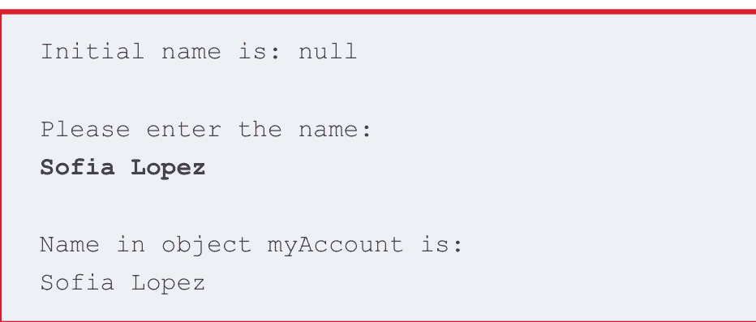

**图 8.2** | 创建并操作 Account 对象。

#### 实例化对象——关键字 `new` 和构造函数

第 11 行使用类实例创建表达式来创建一个新的 `Account` 对象并将其赋值给 `myAccount`，同时使用局部变量类型推断来确定 `myAccount` 的类型。记住，当 `new` 创建一个类的对象时，它会调用该类的构造函数来初始化实例变量。在 8.4 节中，你将定义一个带参数的自定义构造函数，以便你为 `Account` 对象的 `name` 实例变量指定一个初始值。目前，我们简单地让括号为空。

#### 调用类 `Account` 的 `getName` 方法

第 14 行通过调用带空括号的 `myAccount` 对象的 `getName` 方法来显示初始名字，因为 `getName` 不需要参数。

> **`null`——String 变量的默认初始值**
>
> 输出的第一行显示名字 `null`。与自动初始化的局部变量不同，每个实例变量都有值，除非显式指定。

#### 从用户获取名字

第 17–18 行提示并读取名字，将其赋值给变量 `theName`。由于 `getName` 不需要参数，我们通过带空括号的调用 `myAccount` 对象的 `getName` 方法来获取初始名字。

### 返回类型

UML 通过在操作名称后的括号后面放置冒号和返回类型来指示操作的返回类型。`Account` 类的 `getName` 方法（图 8.1）具有 `String` 返回类型。`setName` 方法不返回值（因为它在 Java 中返回 `void`），因此 UML 类图没有在括号后指明返回类型。

### 参数

UML 对参数的建模方式与 Java 不同。在操作名称后的括号内，我们列出参数名称，后面跟着一个冒号和参数类型。UML 拥有类似于 Java 的自有数据类型，但为了简单起见，我们使用了 Java 数据类型。`Account` 类的 `setName` 方法（图 8.1）有一个名为 `name` 的 `String` 参数，因此图表在方法名后的括号之间列出了 `name` : `String`。

### 生成式 AI

- 提示 genAIs 根据图 8.1 的代码，要求它们生成对应的 UML 类图。
- 提示 genAIs 使用 Account 的 UML 类图，要求其生成对应的 Java 类声明。你可以在本章的示例文件夹中找到该类图的图像文件。

## 8.2.5 关于 AccountTest 类的注意事项

### 静态方法

静态方法可以直接使用方法名本身调用同一类中的其他静态方法，并可以直接操作同一类中的静态变量。要访问类的实例变量和实例方法，静态方法必须接收该类对象的引用作为参数。实例方法可以访问其类的所有字段（静态变量和实例变量）和方法。

记住，静态方法与整个类相关。相比之下，实例方法与类的特定对象（实例）相关，并可以操作该对象的实例变量。一个类的许多对象可能同时存在，每个对象都有其实例变量的独立副本。假设一个静态方法能够直接调用实例方法，那么静态方法如何知道要操作哪个对象的实例变量呢？如果在调用实例方法时不存在该类的任何对象，会发生什么呢？因此，Java 不允许 `static` 方法直接访问同一类的实例变量和实例方法。

### 导入声明

图 8.2 中第 3 行的 `import` 声明告诉编译器程序使用了 `Scanner` 类。在第 2 章中，我们讨论过 `System` 和 `String` 类位于 `java.lang` 包中，该包隐式导入到每个 Java 程序中，因此所有程序都可以使用它的类而无需显式导入。你必须显式导入大多数其他类。


同一文件夹下的类（如 `Account` 和 `AccountTest`）之间存在特殊关系。默认情况下，这些类位于同一个 `default package` 中。同一包中的类隐式导入到彼此的源文件中。因此，当类使用同一包中的另一个类时（如[图 8.2]所示），不需要编写 `import` 声明。

# 带有包名的完全限定类名

如果我们始终使用完全限定类名 `java.util.Scanner` 来引用 `Scanner`（这包含了完整的包名和类名），那么[图 8.2]中第 3 行的 `import` 声明就是不需要的。例如，图 8.2 的第 8 行可以写成：

```
var input = new java.util.Scanner(System.in);
```

如果每次使用类名时都指定完全限定类名，Java 编译器就不需要导入声明。大多数 Java 程序员更倾向于使用导入声明实现的更简洁的编程风格。

## 生成式 AI

- 提示 genAIs 解释为什么 Java 静态方法不能直接访问同一类的实例变量和方法。

# 8.2.6 使用私有实例变量和公共 set/get 方法的软件工程

正如你将看到的，通过 set 和 get 方法，你可以验证对私有数据的尝试修改，并控制这些数据呈现给调用者的方式——这些极具吸引力的软件工程优势。我们将在后续示例中详细讨论这一点。

如果实例变量是 `public` 的，则该类的任何客户端（即调用该类方法的任何类）都可以访问数据并对其进行随心所欲的操作，包括将其设置为无效值。

你可能会认为，尽管类的客户端无法直接访问 `private` 实例变量，但客户端仍然可以通过 `public` 的 set 和 get 方法随心所欲地操作。你可能认为可以随时通过 `public` get 方法查看 `private` 数据，并通过 `public` set 方法随心所欲修改 `private` 数据。但你可以编写 `set` 方法来验证你的参数，并拒绝任何将数据 `set` 为无效值的尝试，例如负的体温、3 月份中不在 1 到 31 范围内的日期、不在公司产品目录中的产品代码等。同样，`get` 方法可以用不同的形式呈现数据。例如，`Grade` 类可能将分数存储为 0 到 100 之间的 `int`，但 `getGrade` 方法可能会返回 `String` 格式的字母等级，例如，90 到 100 分之间的分数返回 "A"，80 到 89 分之间的分数返回 "B"。严密控制对 `private` 数据的访问和呈现可以减少错误，使你的程序更加健壮和安全。

使用 `private` 声明实例变量被称为信息隐藏。当程序创建（实例化）一个 `Account` 对象时，`private` 变量被隐藏，且只能通过方法访问。在书的后面，我们将讨论为什么你可能想要声明一个 `public` 方法。

# 带有封装数据的 Account 对象概念视图

你可以像下面的（非 UML）图所示思考 `Account` 对象：

0ea50b206f0abd2f47542d5c_887

私有实例变量 `name` 隐藏在对象内部（由包含 `name` 的内圆表示），并通过公共方法（由包含 `getName` 和 `setName` 的外圆表示）访问。需要与 `Account` 的 `name` 交互的客户端只能通过调用公共方法来实现。

# 8.3 默认和显式实例变量初始化

`byte`、`char`、`short`、`int`、`long`、`float` 和 `double` 类型的实例变量初始化为 0，`boolean` 为 `false`。你可以在声明原始类型实例变量时指定初始值，如：

0ea50b206f0abd2f47542d5c_888

```
private int numberOfOfStudents = 10;
```

如果没有显式初始化，引用类型实例变量将被初始化为 `null`，表示“无”。这就是为什么图 8.2 第 14 行的第一次 `getName` 调用返回 `null` 的原因——`name` 尚未设置，因此返回了它的默认初始值。

## 生成式 AI

- 提示 genAIs 提供关于为什么 Java 实例变量会被初始化而 Java 局部变量不会的见解。

# 8.4 Account 类：使用构造函数初始化对象

在 8.2 节中你看到 `Account` 对象的 `name` 实例变量默认初始化为 `null`。如果你在创建 `Account` 对象时提供一个名称呢？你声明的每个类都可以可选地提供带参数的构造函数，这些参数的值在创建对象时用于初始化对象的实例变量。Java 要求为每个新对象调用构造函数，因此这是初始化对象变量的理想时机。下一个示例为 `Account` 类增加了一个接收名称并用其初始化新 `Account` 对象名称的构造函数。

# 8.4.1 为自定义对象初始化声明 Account 构造函数

你可能想在创建对象时指定一个名称，正如图 8.4 的第 8 行所示：

```
var account1 = new Account("Wei Li");
```

字符串参数 "Wei Li" 被传递给 `Account` 对象的构造函数，并用于初始化实例变量 `name`。前面的语句要求类提供一个仅接受 `String` 参数的构造函数。图 8.3 包含带有此类构造函数的修改 `Account` 类。

```java
// 图 8.3: Account.java
// 具有初始化 name 构造函数的 Account 类

public class Account {
    private String name; // 实例变量

    // 构造函数使用参数初始化 name
    public Account(String name) { // 构造函数
        this.name = name;
    }

    // 设置 name 方法
    public void setName(String name) {
        this.name = name;
    }

    // 获取 name 方法
    public String getName() {
        return name;
    }
}
```

**图 8.3** | 具有初始化 name 构造函数的 Account 类。

## Account 构造函数声明

图 8.3 的第 8–10 行声明了 `Account` 的构造函数，其名称必须与类相同。第 8 行表示该构造函数有一个参数——名为 `name` 的 `String`。当你创建一个新的 `Account` 对象时，会将一个人的姓名传递给 `name` 参数，构造函数将将其赋值给实例变量 `name`（第 9 行）。你不应该在构造函数中调用类的非静态方法。我们将在第 9 章中讨论为什么这样做会有问题。第 8.16 节讨论了静态类方法。

## 生成式 AI

- 提示 AI 询问 Java 构造函数是否为方法。
- 提示 AI 解释——在不考虑继承或多态（第 9 章讨论）的情况下——为什么你不应该在构造函数中调用 Java 类的方法。

## 8.4.2 类 AccountTest：初始化新的 Account 对象

`AccountTest` 程序使用构造函数初始化了两个 `Account` 对象。第 8 行创建并初始化了新的 `Account` 对象 `account1`，将参数 "Wei Li" 传递给构造函数以初始化该对象的名称。第 9 行重复了这一过程，将参数 "Logan Brown" 传递以初始化 `account2` 的名称。第 12–13 行使用每个对象的 `getName` 方法获取其名称。输出显示了不同的名称，证实了每个 `Account` 都维护自己的实例变量 `name` 副本。

```java
// 图 8.4: AccountTest.java
// 使用 Account 构造函数初始化
// 每个新 Account 对象的实例变量
public class AccountTest {
    public static void main(String[] args) {
        // 创建两个 Account 对象
        var account1 = new Account("Wei Li");
        var account2 = new Account("Logan Brown");

        // 显示每个 name 的初始值
        System.out.printf("account1 name is: %s\n", account1.getName());
        System.out.printf("account2 name is: %s\n", account2.getName());
    }
}
```

```
account1 name is: Wei Li
account2 name is: Logan Brown
```

图 8.4 | 使用 Account 构造函数初始化每个新 Account 对象的 name 实例变量。

## 构造函数不能返回值

构造函数与方法的区别在于，构造函数不能返回值，因此它们不指定返回类型（即使是 `void`）。通常，构造函数是公共的，以便其他类可以调用它们——在第 9 章，我们将讨论何时使用私有构造函数。

## 默认构造函数

回想图 8.2 的第 11 行：

```
var myAccount = new Account();
```

使用 `new` 创建了一个 `Account` 对象。`new Account` 后的空括号表示对类默认构造函数的调用。在任何没有显式声明构造函数的类中，编译器都会提供一个无参数的默认构造函数。当类只有一个默认构造函数时，其实例变量将被初始化为默认值。在第 8.10 节中，你将看到类可以多个构造函数。

## 声明了构造函数的类没有默认构造函数

如果你声明了一个或多个参数的构造函数，你无法像图 8.2 那样使用 `Account()` 创建 `Account`，除非你还声明了一个无参数的自定义构造函数。如果实例变量的默认初始化不可接受，请提供一个自定义构造函数以确保你的实例变量用有意义的值初始化。

## 向类中添加构造函数

以下是 `Account` 的 UML 类图（图 8.3），它包含一个构造函数：

| Account |
| :--- |
| name : String |
| «constructor» Account(String name) |
| + setName(String name) |
| + getName() : String |

UML 通过在第三个区域内包含 "constructor" 一词来模拟构造函数，并与类声明区分开来。

## 生成式 AI

- 提供关于为什么 Java 构造函数不能返回值的见解。

# 8.5 使用 BigDecimal 的 Account 类

我们现在声明一个维护名称和余额的 `Account` 类。`Account` 的下一个版本（图 8.5）声明了一个类型为 `BigDecimal` 的实例变量 `balance`。

```java
// 图 8.5: Account.java
// 带有 BigDecimal 的 Account 类
import java.math.BigDecimal;

public class Account {
    private String name; // 实例变量
    private BigDecimal balance = BigDecimal.ZERO;

    // 接收两个参数的构造函数
    public Account(String name, BigDecimal balance) {
        this.name = name; // 将 name 赋值
        if (balance.compareTo(BigDecimal.ZERO) > 0) {
            this.balance = balance; // 将 balance 赋值
        }
    }

    // 存款（增加）的方法
    public void deposit(BigDecimal amount) {
        if (amount.compareTo(BigDecimal.ZERO) > 0) {
            balance = balance.add(amount);
        }
    }

    // 返回余额的方法
    public BigDecimal getBalance() {
        return balance;
    }

    // 设置名称的方法
    public void setName(String name) {
        this.name = name;
    }

    // 返回名称的方法
    public String getName() {
        return name;
    }
}
```

图 8.5 | 带有 BigDecimal 实例变量 balance 以及执行验证的构造函数和 deposit 方法的 Account 类。

## 8.5.2 AccountTest 类

`AccountTest` 类（图 8.6）创建了两个 `Account` 对象（第 9–10 行），并分别将它们初始化为 50.00 的有效余额和 -7.53 的无效余额——在我们的示例中，假设余额必须大于或等于零。第 13–16 行对 `printf` 方法的调用显示了账户名称和余额，这些信息是通过调用每个 `Account` 的 `getName` 和 `getBalance` 方法获得的。对于余额，我们调用每个 `BigDecimal` 对象的 `toString` 方法，使用第 4.11 节中引入的 `RoundingMode.HALF_EVEN` 将余额格式化为小数点后两位数字。

```java
// 图 8.6: AccountTest.java
// 输入和输出浮点数
import java.math.BigDecimal;
import java.math.RoundingMode;
import java.util.Scanner;

public class AccountTest {
    public static void main(String[] args) {
        var account1 = new Account("Wei Li", new BigDecimal("50.00"));
        var account2 = new Account("Logan Brown", new BigDecimal("-7.53"));

        // 显示每个账户的初始余额
        System.out.printf("%s balance: $%s%n",
            account1.getName(), account1.getBalance().setScale(2, RoundingMode.HALF_EVEN));
        System.out.printf("%s balance: $%s%n",
            account2.getName(), account2.getBalance().setScale(2, RoundingMode.HALF_EVEN));

        // 创建 Scanner 以获取用户输入
        var input = new Scanner(System.in);
        System.out.print("Enter deposit amount for account1: \n");
        var depositAmount = input.nextBigDecimal();
        System.out.printf("adding %s to account1%n",
            depositAmount.setScale(2, RoundingMode.HALF_EVEN));
        account1.deposit(depositAmount); // account1

        // 显示余额
        System.out.printf("%s balance: $%s%n",
            account1.getName(), account1.getBalance().setScale(2, RoundingMode.HALF_EVEN));
        System.out.printf("%s balance: $%s%n",
            account2.getName(), account2.getBalance().setScale(2, RoundingMode.HALF_EVEN));

        System.out.print("Enter deposit amount for account2: \n");
        depositAmount = input.nextBigDecimal();
        System.out.printf("adding %s to account2%n",
            depositAmount.setScale(2, RoundingMode.HALF_EVEN));
        account2.deposit(depositAmount); // account2

        // 显示余额
        System.out.printf("%s balance: $%s%n%n",
            account1.getName(), account1.getBalance().setScale(2, RoundingMode.HALF_EVEN));
        System.out.printf("%s balance: $%s%n%n",
            account2.getName(), account2.getBalance().setScale(2, RoundingMode.HALF_EVEN));
    }
}
```

```
Wei Li balance: $50.00
Logan Brown balance: $0.00
Enter deposit amount for account1: 25.53
adding 25.53 to account1
Wei Li balance: $75.53
Logan Brown balance: $0.00
Enter deposit amount for account2: 123.45
adding 123.45 to account2
Wei Li balance: $75.53
Logan Brown balance: $123.45
```

图 8.6 | 使用 Account 对象输入和输出浮点数。

### 显示账户对象的初始余额


当我们在第 13–16 行显示初始余额时，`account2` 的余额为 0.00，因为构造函数拒绝了以负余额启动 `account2` 的尝试。因此，该对象的余额保留了默认初始值。

### 从用户处读取 `BigDecimal` 值并存款

第 21 行提示用户为 `account1` 输入存款金额。第 22 行声明了局部变量 `depositAmount` 来存储用户输入的每个存款金额。第 22 行还通过调用 `Scanner` 的 `nextBigDecimal()` 方法获取用户输入，该方法将输入转换为 `BigDecimal` 并返回。第 23–24 行显示 `depositAmount`。然后，第 25 行用 `depositAmount` 作为参数调用对象 `account1` 的 `deposit()` 方法。`deposit()` 方法确保 `depositAmount` 有效，如果是则将其添加到余额中。第 28–31 行再次输出两个 `Account` 的名称和余额，以显示只有 `account1` 的余额发生了变化。

第 33–36 行提示输入 `account2` 的存款金额，然后显示它。第 37 行用 `depositAmount` 作为参数调用对象 `account2` 的 `deposit()` 方法为余额增加值。最后，第 40–43 行再次输出两个 `Account` 的名称和余额，以显示只有 `account2` 的余额发生了变化。

### `main` 方法中的重复代码

第 13–14 行、15–16 行、28–29 行、30–31 行、40–41 行的六条语句几乎是相同的——它们都输出账户名称和余额。区别仅在于账户的对象（`account1` 或 `account2`）。同样，第 21–25 行和 33–37 行在输入存款金额并将其存入账户时几乎相同。当这些代码需要更新时，重复代码会产生维护问题。通过调用包含一份代码的方法可以缩小程序体积。

### 8.6 案例研究：洗牌与发牌

本节使用随机数生成来模拟洗牌和发牌。`DeckOfCards` 类（图 8.8）创建了一幅牌。最后，`DeckOfCardsTest` 类（图 8.9）展示了这些功能。

### `Card` 类

`Card` 类（图 8.7）包含名为 `face` 和 `suit` 的 `String` 变量。我们将这些声明为 `final`，因为真实的牌面和花色是不可修改的。`Card` 构造函数（第 9–12 行）接收 `String` 来初始化 `face` 和 `suit`。

```java
public class Card {
    private final String face; // 牌面
    private final String suit; // 花色

    // 两个参数的构造函数初始化牌
    public Card(String face, String suit) {
        this.face = face; // 初始化牌面
        this.suit = suit; // 初始化花色
    }

    // 返回 Card 的字符串表示
    public String toString() {
        return face + " of " + suit;
    }
}
```

### `DeckOfCards` 类

`DeckOfCards` 类（图 8.8）创建并管理一个 `Card` 数组。为了方便讨论，我们将此类分为几个部分。`NUMBER_OF_CARDS`（第 9 行）指定了牌的数量（52 张）。第 10 行声明并初始化了该数组。

实例变量 `deck` 指向一个具有 `NUMBER_OF_CARDS` (52) 个元素的 `Card` 新数组。`deck` 数组的元素默认为 `null`。请记住 `null` 代表“对空的引用”，因此目前不存在 `Card` 对象。`DeckOfCards` 类还声明了 `int` 实例变量 `currentCardIndex`（第 11 行），表示从 `deck` 数组中发出的下一张 `Card` 的序号（0–51）。

**图 8.8** | `DeckOfCards` 类代表了一幅扑克牌。

```java
// Fig. 8: DeckOfCards.java
// DeckOfCards class represents a deck of playing
import java.util.random.RandomGenerator;

public class DeckOfCards {
    // random number generator
    private static final RandomGenerator rand =
        RandomGenerator.getDefault();
    public static final int NUMBER_OF_CARDS = 52;
    private Card[] deck = new Card[NUMBER_OF_CARDS];
    private int currentCardIndex = 0; // index
}
```

#### `DeckOfCards` 构造函数

构造函数使用循环（第 20–22 行）用 `Card` 对象填充 `deck` 数组。循环从 0 开始迭代，只要 `count` 小于 `deck.length`，导致 `count` 依次取从 0 到 51 的每个值（数组的索引）。我们用两个 `String` 初始化每个 `Card`——其中一个来自 `faces` 数组（包含从 "Ace" 到 "King" 的字符串），另一个来自 `suits` 数组（包含 "Hearts", "Diamonds", "Clubs" 和 "Spades" 的字符串）。计算 `count % 13` 得到 0 到 12 之间的值（第 15–16 行 `faces` 数组的 13 个索引），计算 `count / 13` 得到 0 到 3 之间的值（第 17 行 `suits` 数组的 4 个索引）。当循环完成后，`deck` 包含了每个花色花面从 "Ace" 到 "King" 的 `Card`——13 张“Hearts”（红桃），然后 13 张“Diamonds”（方块），然后 13 张“Clubs”（梅花），最后 13 张“Spades”（黑桃）。此示例将花面和花色表示为 `String` 数组。你也可以将花面和花色表示为枚举常量数组。

```java
// constructor fills deck of Cards
public DeckOfCards() {
    String[] faces = {"Ace", "Deuce", "Three", "Four", "Five", "Six", "Seven", "Eight", "Nine", "Ten", "Jack", "Queen", "King"};
    String[] suits = {"Hearts", "Diamonds", "Clubs", "Spades"};

    // populate deck with Card objects
    for (int count = 0; count < deck.length; count++) {
        deck[count] = new Card(faces[count % 13], suits[count / 13]);
    }
}
```

#### `DeckOfCards` 方法 `shuffle()`

`shuffle()` 方法（第 26–40 行）用于洗牌 `Cards`。对于每张 `Card`，第 33 行选择一个 0–51 的随机索引来选取另一张 `Card`。然后，第 36–38 行交换数组中当前卡和随机选取的 `Card`。额外变量 `temp`（第 36 行）临时存储正在交换的两个 `Card` 对象之一。`for` 循环通过在数组单次遍历中执行 52 次交换来洗牌 `Card` 对象。

```java
// shuffle deck of Cards with one-pass algorithm
public void shuffle() {
    // next call to method dealCard should
    currentCardIndex = 0;
    // for each Card, pick another random
    for (int first = 0; first < deck.length; first++) {
        // select a random number between 0 and 51
        int second = rand.nextInt(deck.length);

        // swap current Card with randomly
        Card temp = deck[first];
        deck[first] = deck[second];
        deck[second] = temp;
    }
}
```

`shuffle()` 方法的算法被认为是偏的，因为它有时会将自己与自身交换。在游戏中，你应该使用无偏算法以确保所有洗牌序列概率相等。参考本节的 AI 练习，你将研究 Fisher-Yates 无偏洗牌算法，并要求 AI 修改 `shuffle()` 方法以使用无偏算法。

#### 为什么我们需要变量 `temp` 来执行交换？

你不能仅通过第 36–38 行的两条语句完成交换：

```java
deck[first] = deck[second];
deck[second] = deck[first];
```

如果 `deck[first]` 是 "Spades" 的 "Ace"，而 `deck[second]` 是 "Hearts" 的 "Queen"，在第一次赋值后，两个数组元素都包含 "Hearts" 的 "Queen"，而 "Spades" 的 "Ace" 将丢失。

#### `DeckOfCards` 方法 `dealCard()`

`dealCard()` 方法（第 43–51 行）发出一张 `Card`。请记住 `currentCardIndex` 是下一个发出的 `Card` 的索引——即数组顶部的 `Card`。第 45 行将 `currentCardIndex` 与数组长度进行比较。如果牌不为空（`currentCardIndex` 小于 52），第 46 行返回顶部并递增 `currentCardIndex` 为下一次 `dealCard()` 调用准备；否则，第 49 行返回 `null`。

```java
// deal one Card
public Card dealCard() {
    // determine whether Cards remain
    if (currentCardIndex < deck.length) {
        return deck[currentCardIndex++];
    } else {
        return null;
    }
} // end class DeckOfCards
```

图 8.9 展示了 `DeckOfCards` 类。第 7 行创建一个名为 `myDeckCards` 的对象，调用其 `shuffle()` 方法重新排列 `Card` 对象。第 11–18 行发出所有 52 张 `Card` 并按顺序打印。第 13 行通过调用 `toString()` 方法发出一张 `Card`，然后每四张显示一次。

```java
// Fig. 8.9: DeckOfCardsTest.java
// Card shuffling and dealing.
public class DeckOfCardsTest {
    // execute program
    public static void main(String[] args) {
        var myDeckCards = new DeckOfCards();
        myDeckCards.shuffle();

        // print all 52 Cards in order
        for (int i = 1; i <= DeckOfCards.NUMBER_OF_CARDS; i++) {
            // deal and display a Card
            System.out.printf("%19s", myDeckCards.dealCard());

            if (i % 4 == 0) { // output a new line
                System.out.println();
            }
        }
    }
}
```

### 类声明

`Time` 类的私有实例变量 `hour`、`minute` 和 `second`（图 8.10，第 5–7 行）代表世界时间格式（24小时制格式，其中小时范围为 0–23，分钟和秒的范围均为 0–59）。`Time` 类包含公共方法：`setTime()`（第 11–22 行）、`toUniversalString()`（第 25–27 行）和 `toString()`（第 30–34 行）。这些方法是该类为其客户端提供的公共服务或公共接口。

```java
// Fig. 8.10: Time.java
// Time class declaration maintains the time
public class Time {
    private int hour; // 0 - 23
    private int minute; // 0 - 59
    private int second; // 0 - 59

    // set a new time value using universal time
    // exception if the hour, minute or second is invalid
    public void setTime(int hour, int minute, int second) {
        // validate hour, minute and second
        if (hour < 0 || hour >= 24 || minute < 0 || minute >= 60 || second < 0 || second >= 60) {
            throw new IllegalArgumentException(
                "hour, minute and/or second was invalid"
            );
        }
        this.hour = hour;
        this.minute = minute;
        this.second = second;
    }

    // convert to String in universal-time format
    public String toUniversalString() {
        return String.format("%02d:%02d:%02d", hour, minute, second);
    }

    // convert to String in standard-time format
    public String toString() {
        return String.format("%d:%02d:%02d %s",
            (hour == 0 || hour == 12) ? 12 : hour,
            minute, second, (hour < 12) ? "AM" : "PM");
    }
}
```

#### 默认构造函数

`Time` 类没有声明构造函数，因此编译器提供了一个默认构造函数。每个实例变量隐式地接收默认的 `int` 值 (0)。

#### 方法 `setTime()` 与异常抛出

方法 `setTime()`（第 11–22 行）是一个带有三个 `int` 参数的 `public` 方法，用于设置时间。第 13–14 行测试每个参数以确定值是否超出了有效范围。`hour` 值必须大于等于 0 且小于 24，因为世界时间格式将小时表示为 0 到 23 的整数（例如：下午 1 点是 13 点，晚上 11 点是 23 点，午夜是 0 点，正午是 12 点）。同样，`minute` 和 `second` 值必须大于等于 0 且小于 60。如果参数值有效，第 19–21 行将它们赋值给 `hour`、`minute` 和 `second` 实例变量。只有当方法的参数全部有效时，你应该修改对象的实例变量。

对于无效值，`setTime()` 会抛出 `IllegalArgumentException`（第 15–16 行）以通知客户端代码问题。第 15 行创建一个新的 `IllegalArgumentException` 对象并调用其接收自定义错误信息的构造函数。接下来，`throw` 语句立即终止 `setTime()` 并异常返回给调用方法。然后，客户端代码可以使用 `try...catch` 处理异常（见第 6.12 节）。

#### 方法 `toUniversalString()`


方法 `toUniversalString`（第 25–27 行）不接受参数并返回一个世界时间格式的 `String`，由小时、分钟和秒的两位数字组成——记住，你可以在 `printf` 格式规范中使用 `0` 标志（例如 `%02d`），为未用满指定字段所有字符位置的值显示前零。例如，如果时间是下午 1:30:07，该方法将返回 `13:30:07`。第 26 行使用静态方法 `format` 返回一个包含格式化后的 `hour`、`minute` 和 `second` 值的 `String`，每个值两位数字并可能带有前零（通过 `0` 标志指定）。`format` 方法类似于 `printf`，但它返回的是格式化后的 `String` 而不是显示它。

## 方法 `toString`

方法 `toString`（第 30–34 行）不接受参数并返回一个 12 小时制的 `String`，由冒号分隔的 `hour`、`minute` 和 `second` 值组成，后跟 AM 或 PM（例如 `11:30:17 AM` 或 `1:27:06 PM`）。与 `toUniversalString` 类似，`toString` 使用静态方法 `format` 将分钟和秒格式化为两位，必要时添加前零。第 32 行使用静态方法 `format` 将分钟和秒格式化为两位，必要时添加前零。`format` 方法类似于 `printf`，但它返回的是格式化后的 `String` 而不是显示它。

## 使用 Time

Time 类没有声明构造函数，因此编译器提供了一个默认构造函数。每个实例变量隐式地接收默认的 `int` 值 (0)。

```java
// 图 8.11: TimeTest.java
// 在应用使用的 Time 对象。
public class TimeTest {
    public static void main(String[] args) {
        // 创建并初始化 Time 对象
        var time = new Time();
        // 输出时间
        System.out.println("Universal-time: " + time.toUniversalString());
        System.out.println("Standard-time: " + time.toString());

        // 修改时间
        try {
            time.setTime(13, 30, 7);
            System.out.println("Universal-time: " + time.toUniversalString());
            System.out.println("Standard-time: " + time.toString());
        } catch (IllegalArgumentException e) {
            System.out.println("Exception: " + e.getMessage());
        }

        // 尝试设置无效值时间
        try {
            time.setTime(99, 99, 99);
        } catch (IllegalArgumentException e) {
            System.out.println("Exception: " + e.getMessage());
        }
    }

    private static void displayTime(String message, Time t) {
        System.out.println(message + ": " + t.toUniversalString());
        System.out.println(message + ": " + t.toString());
    }
}
```

创建 time 对象后：

Universal-time: 00:00:00

Standard-time: 12:00:00

调用 `setTime` 后：

Universal-time: 13:30:07

Standard-time: 1:30:07 PM

Exception: hour, minute and/or second was invalid

## 8.8 Controlling Access to Members

Access modifiers `public` and `private` control access to a class's variables and methods. In Chapter 9, we'll introduce the `protected` access modifier. The primary purpose of `public` methods is to present the class's public interface to clients.

Figure 8.12 demonstrates that `private` members are not accessible outside the class. Lines 7–9 attempt to access the private instance variables `hour`, `minute` and `second` of the Time object. When this program is compiled, the compiler generates error messages indicating these private members are inaccessible. Using a method to access a private member of that class generates a compilation error.

[Click here to view code image]

```java
1 // Fig 8.12: MemberAccess.java
2 // Private members of class Time1 are not ac
3 public class MemberTest {
4 public static void main(String[] args) {
5 var time = new Time1(); // create and
6 time.hour = 7; // error: hour has
7 time.minute = 15; // error: minute has
8 time.second = 30; // error: second has
9 }
10 }
```

```
MemberAccessTest.java:7: error: hour has priv
time.hour = 7; // error: hour has private
               ^
MemberAccessTest.java:8: error: minute has pri
time.minute = 15; // error: minute has pri
^
MemberAccessTest.java:9: error: second has pri
time.second = 30; // error: second has pri
^
```

Fig. 8.12 | Private members of class Time are not accessible.

## Generative AI

- 1 Prompt genAIs, asking if Java's private access modifier makes data absolutely secure

## 8.9 Referring to the Current Object's Members with this

Every object can access itself with the `this` keyword. When an instance method is called for a particular object, the method's body implicitly uses `this.` to refer to the object's instance variables and other methods, enabling the class's code to know which object to manipulate. As you'll see in Fig. 8.13, you can also use `this.` explicitly in an instance method's body. Section 8.10 shows another interesting use of the `this` keyword. Section 8.16 explains why `this.` cannot be used in a `static` method.

Figure 8.13 demonstrates implicit and explicit use of the `this` reference. This example is the first in which we declare two classes in one file—class `ThisTest` is declared in lines 4–9, and class `SimpleTime` in lines 12–41. When you compile a source-code (.java) file, the compiler produces a separate `.class` file for every class in that file. In this case, two files are produced—`SimpleTime.class` and `ThisTest.class`. The compiler places these files in the same folder. Also in Fig. 8.13 that only class `ThisTest` is declared `public`. A source-code (.java) file may contain only one `public` class—recall that every public class must be declared in a file that has the class's name followed by the `.java` filename extension. Non-`public` classes can be used only by other classes in the same package, and classes compiled into the same folder are in the same package. So, `SimpleTime` can be used only in class `ThisTest`.

[Click here to view code image]

```java
1 // Fig.8.13: ThisTest.java
2 // this used implicitly and explicitly to re
3
public class ThisTest {
    public static void main(String[] args) {
        var time = new SimpleTime(15, 30, 19);
        System.out.println(time.buildString());
    }
}

// class SimpleTime demonstrates the "this"
class SimpleTime {
    private int hour; // 0-23
    private int minute; // 0-59
    private int second; // 0-59

    // if the constructor uses parameter name
    // instance variable names the "this" ref
    // required to distinguish between the na
    public SimpleTime(int hour, int minute, int second) {
        this.hour = hour; // set "this" object
        this.minute = minute; // set "this" object
        this.second = second; // set "this" object
    }

    // use explicit and implicit "this" to ca
    public String buildString() {
        return String.format("%02d:%02d:%02d",
            this.hour, this.minute, this.second);
    }
}
31 }
32
33 // convert to String in universal-time fo
34 public String toUniversalString() {
35 // "this." is not required here to acc
36 // because this method does not have l
37 // instance variables
38 return String.format("%02d:%02d:%02d",
39 this.hour, this.minute, this.second);
40 }
41 }
```

Fig. 8.13 | this

## 8.10 Case Study: Time Class Overloaded Constructors

Next, we demonstrate a class with overloaded constructors, enabling objects of our class to be initialized various ways. Like overloaded methods (Section 5.7), you overload constructors by providing multiple constructor declarations.

### Time2 with Overloaded Constructors

The Time1 class’s default constructor in Fig. 8.10 initialized `hour`, `minute` and `second` to their default 0 values (i.e., midnight in universal time). To initialize objects with non-default values, you must provide custom constructors. Class Time2 (Fig. 8.14) contains five overloaded constructors that enable flexible initialization of Time2 objects by passing different arguments. We broke this class into parts for discussion purposes. Lines 5–7 declare the class’s `hour`, `minute` and `second` instance variables.

```java
1 // Fig.8.14: Time2.java
2 // Time2 class declaration with overloaded c
3
public class Time2 {
4 private int hour; // 0 - 23
5 private int minute; // 0 - 59
6 private int second; // 0 - 59
```

Fig. 8.14 | Time2 class declaration with overloaded constructors.

### Class Time2’s Constructors—Calling One Constructor from Another via this

Each constructor accomplishes the same basic job—initialize a Time2 object's instance variables. Portions of that work are identical for each constructor, so we'll share validation and initialization code by having four of them invoke a fifth that, in turn, ensures the hour is in the range 0–23, the minute and second are in the range 0–59, then initializes them. Like overloaded functions, the compiler invokes the appropriate constructor by matching the number, types, and order of the types of the arguments in the constructor call with the number, types, and order of the types of the parameters specified in each constructor declaration. The Time2 class also provides set and get methods for each instance variable.

## 不带参数的 Time2 构造函数


# Time2 类的构造函数与方法详解

## 无参数构造函数

第 11–13 行声明了一个无参数构造函数。一旦你在类中声明了任何构造函数，编译器就不会再提供默认构造函数。这个无参数构造函数确保了类 `Time2` 的客户端可以使用默认值创建 `Time2` 对象。

```java
// Time2 无参数构造函数:
// 初始化每个实例变量为
public Time2() {
    this(0, 0, 0); // 委托给三参数构造函数
}
```

第 12 行使用 `this` 调用了接受三个参数的 `Time2` 构造函数（第 26–42 行），并将 `hour`、`minute` 和 `second` 设置为 0。如所示，使用 `this` 关键字必须是构造函数的第一条语句，它是避免重复初始化代码的常用方法。将其工作委托给同类中另一个构造函数的构造函数被称为 **委托构造函数**（delegating constructor）。我们在五个 `Time2` 构造函数中的四个里使用了这种语法，以使类更易维护和修改——我们稍后会详细介绍。

## 带有一个 `int` 参数的 Time2 构造函数

第 16–18 行声明了一个带有单个 `int` 参数的 `Time2` 构造函数，该参数表示 `hour`。我们将它与 0 的 `minute` 和 `second` 传递给第 26–42 行的构造函数。

```java
// Time2 构造函数: 提供了 hour, minute 和 second 默认值
public Time2(int hour) {
    this(hour, 0, 0); // 委托给三参数构造函数
}
```

## 带有两个 int 参数的 Time2 构造函数

第 21–23 行声明了一个 `Time2` 构造函数，它接收两个表示 `hour` 和 `minute` 的 `int` 参数。我们将这些参数与 0 的 `second` 一起传递给第 26–42 行的构造函数。

```java
// Time2 构造函数: 提供了 hour 和 minute
public Time2(int hour, int minute) {
    this(hour, minute, 0); // 委托给三参数构造函数
}
```

## 带有三个 int 参数的 Time2 构造函数

第 26–42 行声明了 `Time2` 构造函数，它接收三个表示 `hour`、`minute` 和 `second` 的 `int` 参数。该构造函数验证并初始化了实例变量。

```java
// Time2 构造函数: 提供了 hour, minute 和 second
public Time2(int hour, int minute, int second) {
    if (hour < 0 || hour >= 24) {
        throw new IllegalArgumentException();
    }
    if (minute < 0 || minute >= 60) {
        throw new IllegalArgumentException();
    }
    if (second < 0 || second >= 60) {
        throw new IllegalArgumentException();
    }
    this.hour = hour;
    this.minute = minute;
    this.second = second;
}
```

## 带有一个 Time2 参数的 Time2 构造函数

第 45–48 行声明了一个 `Time2` 构造函数，它接收另一个 `Time2` 对象的引用。该构造函数通过将它们传递给三参数构造函数，复制了参数对象的 `hour`、`minute` 和 `second` 值。（某些语言将其称为拷贝构造函数，但这不是正式的 Java 概念）。`time.hour`、`time.minute` 和 `time.second` 表达式直接访问参数对象的 `hour`、`minute` 和 `second` 实例变量——即使它们是私有的。由于同类对象之间的特殊关系，这是被允许的。当一个对象拥有另一个同类对象的引用时，第一个对象可以访问第二个对象的所有数据和方法——即使是私有的。

```java
// Time2 构造函数: 另一个 Time2 对象
public Time2(Time2 time) {
    // 委托给三参数构造函数
    this(time.hour, time.minute, time.second);
}
```

## Time2 的 setTime 方法

如果 `setTime` 方法（第 53–69 行）的任何参数超出范围，该方法将抛出 `IllegalArgumentException`（第 55、59 和 63 行）——此示例分别测试每个参数，以抛出带有更精确错误消息的异常。如果参数有效，第 66–68 行将实例变量设置为参数值。

```java
// Set 方法
// 设置方法
// 使用通用时间的
public void setTime(int hour, int minute, int second) {
    // 验证数据
    if (hour < 0 || hour >= 24) {
        throw new IllegalArgumentException();
    }
    if (minute < 0 || minute >= 60) {
        throw new IllegalArgumentException();
    }
    if (second < 0 || second >= 60) {
        throw new IllegalArgumentException();
    }
    this.hour = hour;
    this.minute = minute;
    this.second = second;
}
```

## Time2 的 setHour、setMinute 和 setSecond 方法

第 72–96 行声明了 `hour`、`minute` 和 `second` 的 set 方法。它们在设置实例变量之前会验证参数。

```java
// 验证并设置 hour
public void setHour(int hour) {
    if (hour < 0 || hour >= 24) {
        throw new IllegalArgumentException();
    }
    this.hour = hour;
}

// 验证并设置 minute
public void setMinute(int minute) {
    if (minute < 0 || minute >= 60) {
        throw new IllegalArgumentException();
    }
    this.minute = minute;
}

// 验证并设置 second
public void setSecond(int second) {
    if (second < 0 || second >= 60) {
        throw new IllegalArgumentException();
    }
    this.second = second;
}
```

## Time2 的 getHour、getMinute 和 getSecond 方法

第 100–106 行声明了 `hour`、`minute` 和 `second` 的 get 方法。每个方法返回对应的实例变量。

```java
// 获取 hour 值
public int getHour() { return hour; }

// 获取 minute 值
public int getMinute() { return minute; }

// 获取 second 值
public int getSecond() { return second; }
```

## Time2 的 toUniversalString 和 toString 方法

第 109–119 行声明了 `toUniversalString` 和 `toString` 方法。它们使用与图 8.10 相同的格式创建 `Time2` 对象的字符串表示。

```java
// 通用时间格式字符串
public String toUniversalString() {
    return String.format("%02d:%02d:%02d",
        getHour(), getMinute(), getSecond());
}

// 标准时间格式字符串
public String toString() {
    return String.format("%d:%02d:%02d %s",
        getHour(), getMinute(), getSecond(), ((getHour() == 0 || getHour() == 12) ? "AM" : "PM"));
}
```

## 使用类 Time2 的重载构造函数

`Time2Test`（图 8.15）调用了重载的 `Time2` 构造函数（第 6–10 行和第 21 行）：

```java
// Fig. 8.15: Time2Test.java
// 使用重载的构造函数来初始化
public class Time2Test {
    public static void main(String[] args) {
        var t1 = new Time2(); // 00:00:00
        var t2 = new Time2(2); // 02:00:00
        var t3 = new Time2(21, 34); // 21:34:00
        var t4 = new Time2(12, 25, 42); // 12:25:42
        var t5 = new Time2(t4); // 12:25:42
        System.out.println("Constructed with:");
        displayTime("t1: all default arguments", t1);
        displayTime("t2: hour specified; default", t2);
        displayTime("t3: hour and minute specified", t3);
        displayTime("t4: hour, minute and seconds", t4);
        displayTime("t5: Time2 object t4 specified", t5);
        // attempt to initialize t6 with invalid values
        try {
            var t6 = new Time2(27, 74, 99); //
        } catch (IllegalArgumentException e) {
            System.out.printf("%nException while: %s\n", e.getMessage());
        }
    }

    // displays a Time2 object in 24-hour and 
    private static void displayTime(String header, Time2 t) {
        System.out.printf("%s%n %s%n %s%n", header, t.toUniversalString(), t.toString());
    }
}
```

构造结果：
- t1: 所有默认参数
  00:00:00
  12:00:00 AM
- t2: 指定了小时；默认分钟和秒
  02:00:00
  2:00:00 AM
- t3: 指定了小时和分钟；默认秒
  21:34:00
  9:34:00 PM
- t4: 指定了小时、分钟和秒
  12:25:42
  12:25:42 PM
- t5: 指定了 Time2 对象 t4
  12:25:42
  12:25:42 PM

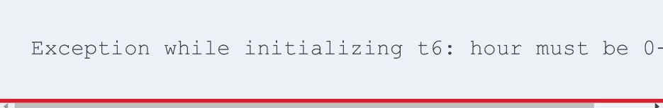

**图 8.15** | 用于初始化 Time2 对象的重载构造函数。

第 6 行调用了 `Time2` 无参数构造函数。第 7–10 行演示了向接收参数的 `Time2` 构造函数传递参数：

- 第 7 行调用了带有单参数构造函数：
  ```java
  public Time2(int hour)
  ```
- 第 8 行调用了带有双参数构造函数：
  ```java
  public Time2(int hour, int minute)
  ```
- 第 9 行调用了带有三参数构造函数：
  ```java
  public Time2(int hour, int minute, int second)
  ```

第 10 行调用了带有单参数构造函数（拷贝构造函数）：
```java
public Time2(Time2 time)
```


接下来，程序显示了 `Time2` 对象的字符串表示以确认它们已正确初始化（第 13–17 行）。

第 21 行尝试通过创建一个带有三个无效构造函数参数的新 `Time2` 对象来初始化 `t6`。当构造函数判断小时数参数超出范围时，它会抛出一个 `IllegalArgumentException`，我们在第 23 行捕获该异常并显示其错误信息，产生输出的最后一行。

## 生成式 AI

向生成式 AI 提供类 `Time2`（图 8.14），让它们重写代码，将时间存储为自午夜以来的秒数 `int` 数字。告诉生成式 AI 确保该类提供相同的公共接口，以便现有的客户端代码不需要修改。将更新后的 `Time2` 类与图 8.14 进行对比。在图 8.15 的程序中使用更新后的 `Time2` 类，以确保产生相同的结果。

# 8.11 默认和无参数构造函数

每个类必须至少有一个构造函数。对于不包含自定义构造函数的类，编译器会创建一个无参数的默认构造函数。默认构造函数将实例变量初始化为实例变量声明中指定的初始值；否则，它使用默认值（基本数值类型为 0，布尔值为 `false`，引用类型为 `null`）。

如果你的类中声明了构造函数，编译器将不会创建默认构造函数。在这种情况下，如果需要默认初始化，你必须声明一个无参数构造函数。与默认构造函数一样，无参数构造函数通过空括号调用。`Time2` 的无参数构造函数（图 8.14 的第 11–13 行）通过向三参数构造函数传递每个参数为 0 来显式地初始化 `Time2` 对象。由于 0 是 `int` 实例变量的默认值，因此 `Time2` 中的无参数构造函数可以声明为空方法体。在这种情况下，当调用无参数构造函数时，每个实例变量都将接收其默认值。如果我们省略了无参数构造函数，该类的客户端将无法通过 `new Time2()` 表达式创建 `Time2` 对象。

确保不要在构造函数定义中包含返回类型。Java 允许类中除构造函数外的方法具有与类相同的名称并指定返回类型。此类方法不是构造函数，且在实例化类对象时不会被调用。

## 生成式 AI

- 1 询问生成式 AI 为什么 Java 设计者允许类中除构造函数以外的方法具有与类相同的名称并指定返回类型，考虑到这可能导致混淆。

# 8.12 Set 和 Get 方法的说明

如你所知，客户端代码只能通过类的方法来操作类的 `private` 字段。`Set` 方法通常被称为“修改器方法”（mutator methods），因为它们改变对象的状态——即修改实例变量的值。`Get` 方法通常被称为访问器方法（accessor methods）或查询方法。

## Set 和 Get 方法与公有数据

提供 set 和 get 方法本质上与将类的实例变量设为 `public` 是一样的。这是让 Java 在软件工程中具有吸引力的微妙之处之一。公共的非 `final` 实例变量可以被任何拥有对象引用的方法读写。然而，通过使用 set 和 get 方法，你可以控制客户端“看到”数据的方式。例如，get 方法可能会返回的数据进行格式化。set 方法——并且应该——仔细检查对变量的修改尝试。例如，将月份设置为 37 或将体重设置为负数的尝试应该被拒绝。因此，尽管 set 和 get 方法提供了对私有数据的访问，但可以通过方法实现进行仔细限制，从而促进良好的软件工程。

类绝不应该有公共的非常量数据。将数据声明为 `public final` 可以让类的客户端可以使用常量。例如，`Math` 类提供了公共常量 `Math.PI` 和 `Math.E`。

## Set 方法中的有效性检查

数据完整性的好处并不因为实例变量声明为 `private` 就自动获得——你必须提供有效性检查。类的 set 方法可以防止向对象分配无效数据。通常，set 方法返回 `void` 类型并使用异常处理指示分配无效数据的尝试。我们在第 10 章详细讨论异常处理。

在适当的情况下提供公共方法来访问实例变量。这种架构隐藏了类的实现细节，提高了程序的可修改性。使用 set 和 get 方法有助于你创建更容易调试和维护的类。如果只有一个方法执行特定的操作（例如设置对象中的实例变量），该类更容易调试和维护。如果实例变量没有被正确设置，实际修改实例变量的代码集中在一个 set 方法中。你的调试工作可以集中在该方法上。

## 谓方法

访问器方法的另一种用途是测试条件是否为真或假——此类方法通常被称为谓方法（predicate methods）。一个例子是 `ArrayList` 类的 `isEmpty` 方法，如果 `ArrayList` 为空则返回 `true`，否则返回 `false`。程序在尝试从 `ArrayList` 读取另一个项目之前可能会测试 `isEmpty`。按照惯例，谓方法的名称以 `is` 而不是 `get` 开头。

## 生成式 AI

- 1 询问生成式 AI 举例说明为什么 Java 类永远不应该有 `public` 非常量数据。
- 2 询问生成式 AI 列出并解释 Java 中谓方法的应用场景。

# 8.13 组合

类可以拥有其他类对象的引用作为成员。这被称为组合（composition），有时也被称为“有一个”（has-a）关系。例如，一个 `AlarmClock`（闹钟）对象需要知道当前时间以及它应该什么时候响铃，因此在 `AlarmClock` 对象中包含两个 `Time` 对象的引用是合理的。汽车拥有方向盘、刹车踏板、加速器踏板等。

## Date 类

这个组合示例包含了 `Date` 类（图 8.16）、`Employee` 类（图 8.17）和 `EmployeeTest` 类（图 8.18）。`Date` 类声明了实例变量 `month`（月份）和 `year`（年份）（第 5–7 行）来表示日期。构造函数接收三个 `int` 参数。第 15–18 行验证月份——如果超出范围，第 16–17 行抛出异常。第 21–25 行验证日期。如果根据特定月份的天数判断日期是错误的（2 月 29 日需要特殊的闰年测试除外），第 23–24 行抛出异常。第 28–29 行对 2 月进行闰年测试。如果月份是 2 月，日期是 29 号且年份不是闰年，第 30–31 行抛出异常。如果没有抛出异常，则第 34–36 行初始化 `Date` 的实例变量，第 38 行将 `this` 引用作为字符串输出。由于这指向当前的 `Date` 对象，因此会隐式调用对象的 `toString` 方法（第 42–44 行）来获取对象的表示。在这个示例中，我们假设年份值是正确的——一个工业级的 `Date` 类也应该验证年份。

[点击此处查看代码图片]()

```java
// Fig.8.16: Date.java
// Date 类声明。

public class Date {
    private int month; // 1-12
    private int day; // 根据月份 1-31
    private int year; // 任意年份

    private static final int[] daysPerMonth =
        {0, 31, 28, 31, 30, 31, 30, 31, 30, 31, 30, 31};

    // 构造函数：确认值的正确性
    public Date(int month, int day, int year) {
        // 检查月份是否范围内
        if (month <= 0 || month > 12) {
            throw new IllegalArgumentException(
                "month (" + month + ") must be 1-12");
        }
        // 检查日期是否在月份范围内
        if (day <= 0 || (day > daysPerMonth[month])) {
            throw new IllegalArgumentException(
                "day (" + day + ") out-of-range for the month");
        }
        // 如果月份是 2 月则检查闰年
        if (month == 2 && day == 29 && !(year % 4 == 0 && year % 100 != 0 || year % 400 == 0)) {
            throw new IllegalArgumentException(
                "day (" + day + ") out-of-range for the leap year");
        }
        this.month = month;
        this.day = day;
        this.year = year;
        System.out.printf("Date object constructed");
    }

    // 返回 月/日/年格式的字符串
    public String toString() {
        return String.format("%d/%d/%d", month, day, year);
    }
}
```

**图 8.16** | Date 类声明。

## Employee 类

`Employee` 类（图 8.17）包含了 `firstName`（名）、`lastName`（姓）、`birthDate`（出生日期）和 `hireDate`（入职日期）等字段。`Employee` 构造函数（第 11–17 行）接收四个参数来初始化这些字段。`Employee` 拥有 `Date` 对象的引用。当调用 `Employee` 的 `toString` 方法时，它会返回一个包含姓名、出生日期和入职日期的字符串。

```java
// Fig.17: Employee.java
// Employee 类拥有其他对象的引用。

public class Employee {
    private String firstName;
    private String lastName;
    private Date birthDate;
    private Date hireDate;

    // 构造函数：初始化字段
    public Employee(String firstName, String lastName, Date birthDate, Date hireDate) {
        this.firstName = firstName;
        this.lastName = lastName;
        this.birthDate = birthDate;
        this.hireDate = hireDate;
    }

    // 转换为字符串格式
    public String toString() {
        return String.format("%s %s, born: %s, hired: %s", firstName, lastName, birthDate, hireDate);
    }
}
```

**图 8.17** | Employee 类拥有其他对象的引用。

## EmployeeTest 类

`EmployeeTest` 类（图 8.18）通过传递 `Date` 对象来初始化 `Employee` 的实例变量。第 8 行创建 `Employee` 对象。第 10 行调用 `Employee` 的 `toString` 方法来显示值。

[点击此处查看代码图片]()

```java
// Fig.18: EmployeeTest.java
// 组合演示。

public class EmployeeTest {
    public static void main(String[] args) {
        Date birth = new Date(5, 20, 1990);
        Date hire = new Date(6, 15, 2015);
        Employee employee = new Employee("John", "Doe", birth, hire);
        System.out.println(employee);
    }
}
```

## 枚举类型

在图 5.4 中，我们引入了枚举类型，它定义了一组常量。在本节中，我们讨论了枚举类型与类之间的关系。与类一样，枚举类型也是引用类型。枚举声明通过逗号分隔的常量列表创建枚举类型。该声明可选包含构造函数、字段和方法。

- 枚举常量是隐式的 `final`，因为它们不可修改。
- 枚举常量是隐式的 `static`——因为只需要一份。
- 尝试使用 `new` 运算符创建枚举对象会导致编译错误。

## 在枚举中声明实例变量、构造函数和方法

图 8.19 展示了枚举类型中的实例变量、构造函数和方法。枚举声明包含两个部分——枚举常量和其他成员。

```java
// Fig.8.19: Book.java
// 枚举类型带有构造函数
// 以及这些字段的访问器

public enum Book {
    JHTP("Java How to Program", "2025"),
    CHTP("C How to Program", "2020"),
    CPP20FP("C++20 for Programmers", "2023"),
    CPPHTP("C++ How to Program", "2024"),
    PYDSCS("Intro to Python for Computer Science"),
    PYFF("Python for Programmers", "2020");

    // 实例字段
    private final String title; // 书名
    private final String copyrightYear; // 版权年份

    // 枚举构造函数
    Book(String title, String copyrightYear) {
        this.title = title;
        this.copyrightYear = copyrightYear;
    }

    // 字段 title 的访问器
    public String getTitle() {
        return title;
    }

    // 字段 copyrightYear 的访问器
    public String getCopyrightYear() {
        return copyrightYear;
    }
}
```

**图 8.19** | 枚举类型带有构造函数以及显式的实例字段及其访问器。

第二部分（第 15–32 行）声明了枚举的其他成员——实例变量 `title` 和 `copyrightYear`（第 15–16 行）、一个构造函数（第 19–22 行）以及两个方法（第 25–27 行和 30–32 行），这两个方法分别返回书籍标题和版权年份。`Book` 类型中的每个常量都是 `Book` 类型的对象，每个对象拥有自己的实例变量副本。

## 使用枚举类型 Book

图 8.20 测试了 `Book` 枚举，并说明了如何遍历范围内的常量。对于每个枚举，编译器都会生成一个静态方法 `values`（在第 10 行中调用），它会返回一个按声明顺序排列的枚举常量数组。第 10–13 行显示了这些常量。第 12 行调用枚举 `Book` 的 `getTitle` 和 `getCopyright` 方法，以获取与常量关联的标题和版权年份。当枚举常量被隐式转换为 `String` 时（例如第 11 行中的 `book`），将使用常量的标识符作为字符串表示（例如第一个枚举常量为 `JHTP`）。

[点击此处查看图像]()

```java
// Fig.8.20: EnumTest.java
// Testing enum type Book.
import java.util.EnumSet;

public class EnumTest {
    public static void main(String[] args) {
        System.out.println("All books:");

        // print all books in enum
        for (Book book : Book.values()) {
            System.out.printf("%-10s%-57s%s\n",
                book.getTitle(), book.getCopyrightYear());
        }

        System.out.printf("%nDisplay a range");

        // print first four books
        for (Book book : EnumSet.range(Book.JHTP, Book.CPPHTP)) {
            System.out.printf("%-10s%-57s%s\n",
                book.getTitle(), book.getCopyrightYear());
        }
    }
}
```


| 所有书籍 |
| :--- |
| JHTP | Java How to Program |
| CHTP | How to Program |


第 18–21 行使用 `EnumSet` 类（包 `java.util`）的静态方法 `range` 来显示 `Book` 枚举常量的范围。`range` 方法接受两个参数——范围内的第一个和最后一个枚举常量——并返回一个包含这两个常量之间（包含边界）的 `EnumSet`。例如，表达式 `EnumSet.range(Book.JHTP, Book.CPPHTTP)` 返回一个包含 `Book.JHTP`、`Book.CHTP`、`Book.CPP20FP` 和 `Book.CPPHTTP` 的 `EnumSet`。增强 for 语句可以像用于数组一样用于 `EnumSet`。第 18–21 行使用该语句来显示 `EnumSet` 中每本书的标题和版权年份。`EnumSet` 类还提供了其他几个 `static` 方法，用于从同一个 `enum` 类型创建 `enum` 常量集合。

## 生成式 AI

- 1 向生成式 AI 提供图 8.19–8.20 中的代码，要求它们解释并为 `EnumSet` 的 `complementOf` 方法提供示例。

## 8.15 垃圾回收

每个对象都会使用系统资源，例如内存。我们需要一种有纪律的方法，在资源不再需要时将它们归还系统；否则可能会发生“资源泄漏”，导致资源无法被你的程序或其他程序重用。JVM 执行自动 `garbage collection`（垃圾回收）来回收不再使用的对象所占用的内存。

如果一个对象不再被引用，那么当 JVM 执行其 `garbage collector`（垃圾回收器）时，该对象就可以被回收。这可能不会立即发生。如果程序在垃圾回收发生之前终止，其所有内存将返回给系统。因此，在 C 和 C++ 等其他语言中常见的内存泄漏（因为它们不会自动回收内存）在 Java 中较少发生。然而，某些泄漏仍以微妙的方式发生。

除了内存泄漏之外，还可能发生资源泄漏。例如，程序可能会打开辅助存储上的一个文件以修改其内容。如果程序没有关闭文件，可能会导致资源泄漏。虽然 JVM 会回收表示文件的对象，但它不能保证文件句柄会被及时关闭。因此，开发者应该在不再需要时显式地关闭文件、数据库连接和套接字等资源。

## 类作用域

类的静态变量具有类作用域——它们可以在整个类中使用。`static` 成员在类加载后即可可用。在不存在类对象的情况下，访问 `public static` 成员，请使用类名加点的前缀。在不存在类对象的情况下访问 `private static` 成员，请提供一个 `public` 静态方法，并通过类名加点的限定名称来调用它。

## 静态方法无法直接访问实例变量

静态方法无法直接访问类的实例变量和实例方法，因为静态方法可以在没有实例化类对象的情况下被调用。因此，静态方法中无法使用 `this`。Java 只在实例方法中创建 `this` 引用，因为它必须引用特定的对象。当调用静态方法时，内存中可能不存在该类的对象。

## 跟踪已创建的 Employee 对象数量

我们的下一个程序声明了两个类——Employee（图 8.21）和 EmployeeTest（图 8.22）。Employee 类声明了私有静态变量 `count`（图 8.21 第 6 行）和公共静态方法（第 32–34 行）。静态变量 `count` 维护到目前为止创建的 Employee 对象数量。该类变量在第 6 行初始化为 0。如果静态变量没有初始化，编译器会为其分配一个默认值——在这种情况下，`int` 类型的默认值为 0。

```java
// Fig. 8.21: Employee.java
// static variable used to maintain a count
// Employee objects in memory.
public class Employee {
    private static int count = 0; // number of employees
    private String firstName;
    private String lastName;

    // initialize Employee, add 1 to static count
    // a String indicating that the constructor was called
    public Employee(String firstName, String lastName) {
        this.firstName = firstName;
        this.lastName = lastName;
        ++count; // increment static count of employees
        System.out.printf("Employee constructor: %s %s; count = %d%n", firstName, lastName, count);
    }

    // get first name
    public String getFirstName() {
        return firstName;
    }

    // 获取姓氏
    public String getLastName() {
        return lastName;
    }

    // 获取静态计数器值的静态方法
    public static int getCount() {
        return count;
    }
}
```

**图 8.21** | 用于维护内存中 Employee 对象计数的静态变量。

当 `Employee` 对象存在时，该变量 `count` 可以在 `Employee` 对象的任何方法中使用。此示例在构造函数中（第 16 行）递增 `count`。公共静态方法 `getCount`（第 32-34 行）返回到目前为止创建的 `Employee` 对象数量。当不存在 `Employee` 类的对象时，客户端代码可以通过类名调用方法 `getCount`（如 `Employee.getCount()`）来访问变量 `count`。使用类名和点 (`.`) 调用每个静态方法以强调该方法是静态的。

## 类 EmployeeTest

`EmployeeTest` 方法 `main`（图 8.22）实例化了两个 `Employee` 对象（第 11–12 行）。当调用每个 `Employee` 对象的构造函数时，它会初始化 `Employee` 的实例变量 `firstName` 和 `lastName`，然后将 `Employee` 静态变量 `count` 加 1。

```java
// 图 8.22: EmployeeTest.java
// 静态成员演示
public class EmployeeTest {
    public static void main(String[] args) {
        // 显示创建之前 count 为 0
        System.out.printf("Employees before instantiation: %d%n", Employee.getCount());

        // 创建两个 Employees; count 应该为 2
        var e1 = new Employee("Anna", "Gruber");
        var e2 = new Employee("Teva", "Maihi");

        // 显示创建后 count 为 2
        System.out.printf("%nEmployees after instantiation: %d%n", Employee.getCount());
        System.out.printf("via e1.getCount(): %d%n", e1.getCount());
        System.out.printf("via e2.getCount(): %d%n", e2.getCount());
        System.out.printf("via Employee.getCount(): %d%n", Employee.getCount());

        // 获取 Employees 的名称
        System.out.printf("%nEmployee 1: %s %s%n", e1.getFirstName(), e1.getLastName());
        System.out.printf("Employee 2: %s %s%n", e2.getFirstName(), e2.getLastName());
    }
}
```


实例化前的 Employees: 0
Employee 构造函数: Anna; count = 1
Employee 构造函数: Teva Maihi; count = 2
实例化后的 Employees:
via `e1.getCount()`: 2
via `e2.getCount()`: 2
via `Employee.getCount()`: 2
Employee 1: Anna Gruber
Employee 2: Teva Maihi

图 8.22 | 静态成员演示。

当 `main` 终止时，局部变量 `e1` 和 `e2` 被丢弃——记住，局部变量仅存在于其所在的块完成为止。由于 `e1` 和 `e2` 是第 11–12 行创建的 `Employee` 对象的唯一引用（图 8.22），这些对象在 `main` 终止时变得“符合垃圾回收条件”。在典型的应用程序中，垃圾回收器最终可能会回收任何符合回收条件的对象的内存。如果在 `main` 终止之前任何对象未被回收，操作系统将收回程序使用的内存。

JVM 不保证何时、甚至不保证是否可能出现没有对象被回收或只有符合回收对象的子集被回收的情况。

## 生成式 AI

- 提示 AI 提供关于 Java 中静态变量的一些用例。

## 8.17 静态导入

在第 5.8 节中，你学习了类的静态字段和方法——我们通过在每个成员前加上类名和点来访问这些成员。静态导入允许你导入类的静态成员，这样你就可以通过未限定名称（无需类名和点）来访问它们。

### 导入形式

静态导入声明在 Java 语言规范语法中以 `StaticImportDeclaration` 和 `StaticImportOnDemandDeclaration` 列出两种形式：

- `StaticImportDeclaration` 导入特定的静态成员。
- `StaticImportOnDemandDeclaration` 导入类所有的静态成员。

`StaticImportDeclaration` 由一个包名（例如 `java.lang`）、一个类名以及一个静态方法或字段名组成，如下：

```java
import static packageName.ClassName.staticMember
```

`StaticImportOnDemandDeclaration` 由一个包名（例如 `java.lang`）、一个类名以及一个星号 (*) 组成，表示类所有的静态成员都可以在文件中使用，如下：

```java
import static packageName.ClassName.*;
```

此类声明只导入类的静态成员。应使用普通的 `import` 语句来指定程序中的类。

## 演示静态导入

图 8.23 展示了静态导入。第 3 行是 `StaticImportOnDemandDeclaration`，它导入了 `Math` 的所有静态字段和方法。第 7–10 行访问了 `Math` 类的静态方法 `sqrt`（第 7 行）、`ceil`（第 8 行）及其静态字段 `E`（第 9 行）和 `PI`（第 10 行），而无需通过类名和点来限定它们的名称。

点击此处查看代码图片

```java
// 图 8.23: StaticImportTest.java
// Math 类方法的静态导入

import static java.lang.Math.*;

public class StaticImportTest {

    public static void main(String[] args) {

        System.out.printf("sqrt(900.0) = %.1f\n", sqrt(900.0));

        System.out.printf("ceil(-9.8) = %.1f\n", ceil(-9.8));

        System.out.printf("E = %f\n", E);

        System.out.printf("PI = %f\n", PI);

    }

}
```

```
sqrt(900.0) = 30.0
ceil(-9.8) = -9.0
E = 2.71828
PI = 3.14159
```

**图 8.23** | Math 类方法的静态导入。

生成式 AI

- 提示 AI 关于 `StaticImportOnDemandDeclaration` 和 `StaticImportDeclaration` 的见解。

## 8.18 final 变量

最小权限原则是良好软件工程的基础。在应用程序代码的语境中，它规定代码应被授予完成指定操作所需的权限，而不多于此。这通过防止代码意外或恶意地修改值和调用方法，使程序更健壮。

让我们看看这一原则如何适用于实例变量。有些变量是可以修改的，有些则不是。你可以使用 `final` 关键字指定变量是不可修改的（即常量）。

```java
private final int INCREMENT;
```

声明了一个 `final` 的整型变量 `INCREMENT`；此类变量可以在声明时初始化。如果没有，则必须在每个构造函数中初始化。在构造函数中初始化允许类的每个对象具有不同的常量值。如果 `final` 变量未在声明或每个构造函数中初始化，会导致编译错误。按照惯例，常量标识符使用大写字母并用划线分隔。

在初始化后尝试修改 `final` 变量是编译时的错误。如果可能，始终优于在编译阶段发现错误，而不是运行阶段。

将实例变量声明为 `final` 有助于强制最小权限原则。如果实例变量不应被修改，将其声明为 `final`。例如，在图 8.17 中，`firstName`、`lastName`、`birthDate` 和 `hireDate` 在初始化后从未被修改，因此它们应该是 `final`。你将在第 18 章“并发：从平台线程到虚拟线程”中看到 `final` 的更多优势。

如果一个 `final` 字段在声明时初始化为所有类对象都相同的值，则它应该是 `static` 的。将字段变为 `static` 允许类的所有对象共享该 `final` 字段。

生成式 AI

- 提示 AI 提供 Java 编程中最小权限原则的示例。

## 8.19 包访问

如果类的方法或字段没有声明访问修饰符，则它们默认具有包访问。在只有一个类的程序中，这没有影响。在位于同一个包的多个类的程序中，这些类可以通过对象的引用（或通过类名访问静态成员）直接访问彼此的包访问成员。包访问很少使用。

图 8.24 展示了包访问。该程序在一个源文件中包含两个类——`PackageDataTest`（第 5–19 行）和 `PackageData` 类（第 22–30 行）。类中的相同的源文件属于同一个包。因此，`PackageDataTest` 被允许修改 `PackageData` 对象的包访问数据。在 `PackageData` 类声明中，第 13–24 行声明了变量 `number` 和 `string`，且没有访问修饰符——所以，这些是包访问实例变量。`PackageDataTest` 类的 `main` 方法创建了一个 `PackageData` 对象（第 7 行），直接修改了 `PackageData` 实例变量（第 13–14 行）。当你编译此程序时，编译器会生成 `PackageDataTest.class` 和 `PackageData.class` 文件并将它们放在同一个文件夹中。

点击此处查看代码图像

```java
1 // Fig.8.24: PackageDataTest.java
2 // 类的包访问成员在相同的
3 // 包中是可以访问。
4
5 public class PackageDataTest {
6     public static void main(String[] args) {
7         var packageData = new PackageData();
8
9         // output String representation of pac
10         System.out.printf("After instantiation
```

```
After instantiation:
number: 0; string: Hello

After changing values:
number: 77; string: Goodbye
```

图 8.24 | 类的包访问成员可以被相同包中的其他类访问。

## 生成式 AI

1. 向生成式 AI 提问，为什么 Java 中很少使用包访问权限。

# 8.20 record 类

某些编程语言提供了一种固定大小、不可变的数据结构，称为元组（tuple），它仅仅是将相关数据项分组在一起。在这些语言中，你可以将元组对象传递给方法、从方法返回它们并方便地访问其数据项。它们基本上是将数据从程序的一个部分传输到另一个部分。Java 的 `record` 类⁸为声明数据载体类提供了紧凑的语法，允许你创建对象并以类似于元组的方式使用它们。

> 8. JEP 395: Records. 访问于 2024 年 7 月 12 日。https://openjdk.org/jeps/395

在声明一个 record 类时，你指定了它的实例变量名称和类型，Java 编译器会方便地为你自动生成“样板”代码，包括：

- 为你指定的每个相关数据项提供一个 `private final` 实例变量——`record` 的实例变量是不可变的，⁹
> 9. 在第 18 章“并发：从平台线程到虚拟线程”中，我们将讨论在执行并发操作的程序中使用不可变对象的各种用处。
- 一个带有参数的 `public` 构造方法用于初始化实例变量——此构造方法不会对其参数进行验证，但你可以提供验证代码，
- 与实例变量同名的 `get` 方法——每个方法返回其对应的实例变量的值，
- 一个 `toString` 方法，返回 `record` 的字符串表示，如下所示，其中 `variable1`、`variable2` ... 是实例变量的名称：

点击此处查看代码图像

```
TypeName[variable1=value1, variable2=value2, ...]
```

- 一个 `equals` 方法，根据返回 `true` 或 `false`，取决于两个相同类型的 `record` 对象的内容是否相同，以及
- 一个 `hashCode` 方法——我们在[第 12.10 节]()中讨论此方法以及被称为“哈希”（hashing）的数据结构概念。

## 定义一个 `record` 类

图 8.25 定义了 `record` 类 `Employee`（第 3–15 行），代表员工的姓（一个 `String`）、名（一个 `String`）、薪水（本例中为了简单起见使用 `double`）和部门（一个 `String`）。为了方便讨论，我们将程序拆分成了几部分。`record` 类以 `record` 关键字和类型名称开头，后跟着包含该类实例变量的括号。在括号之后，`record` 类的体由大括号（`{` 和 `}`）分隔。对于只需要默认生成代码 record 类，其体的大括号将是空的。

点击此处查看代码图像

```java
1 // Fig. 8.25: Records.java
2 // 展示一个 Employee record 类(
3 record Employee(
4     String first,
5     String last,
6     double salary,
7     String department) {
8 
9     // 用于验证的紧凑构造方法
10     Employee {
11         if (salary < 0.0) {
12             throw new IllegalArgumentException(
13         }
14     }
15 }
```

**图 8.25** | 展示一个 Employee record 类。

你可以自定义编译器生成的构造方法和方法。对于构造方法，record 使用了一种简写表示法（第 10–14 行），由 record 类的名称紧跟包含构造方法数据验证代码的大括号组成——这些代码被添加到自动生成的构造方法中。如果数据验证没有抛出异常，构造方法会自动将每个构造方法参数分配给相应的实例变量。

## 创建 Employee record 对象并获取它们的字符串表示

第 19–21 行创建了三个新的 Employee 对象。与普通类对象一样，这些语句使用 record 类的构造方法来初始化每个对象的数据。第 24 行显示了每个 `Employee` 对象自动生成的字符串表示——在 `printf` 调用中将任何对象转换为字符串（%s）会隐式地调用对象的 `toString` 方法。

点击此处查看代码图像

```java
17 public class Records {
18     static void main(String[] args) {
19         Employee e1 = new Employee("Prince", "Doe", 5000.0, "IT");
20         Employee e2 = new Employee("Myra", "Singh", 7600.0, "Sales");
21         Employee e3 = new Employee("Myra", "Singh", 7600.0, "Sales");
22 
23         System.out.printf("After instantiation
```

```
After instantiation:
number: 0; string: Hello

After changing values:
number: 77; string: Goodbye
```

*(注：代码块在原始文本中是破碎的，我根据上下文进行了重构)*

## 获取 Employee 对象的实例变量值

第 27–30 行演示了自动生成的 `get` 方法——再次，每个方法都与其实例变量同名。

点击此处查看代码图像

```java
26 System.out.println("Getting data from:");
27 System.out.printf("first: %s\n", e1.first());
28 System.out.printf("last: %s\n", e1.last());
29 System.out.printf("salary: %.2f\n", e1.salary());
30 System.out.printf("department: %s\n", e1.department());
```

```
获取数据来自：
first: Prince
last: Doe
salary: 5000.00
department: IT
```

## 比较 Employee 对象相等

第 33–34 行演示了 record 类自动生成的 `equals` 方法。该方法比较调用它的对象的实例变量与参数中的实例变量，如果它们相等则返回 `true`；否则返回 `false`。在本例中，e1 和 e2 不相等，而 e2 和 e3 相等。

点击此处查看图像

```java
32 System.out.println("Comparing Employee");
33 System.out.printf("e1.equals(e2): %b\n", e1.equals(e2));
34 System.out.printf("e2.equals(e3): %b\n", e2.equals(e3));
```

```
比较 Employee：
false
true
```

## Employee 方法为无效薪水抛出异常

第 37 行尝试创建一个无效薪水的 Employee。在这种情况下，Employee 构造方法的自定义验证代码（第 11–13 行）识别无效数据并抛出异常，显示错误发生在第 12 行，由第 37 行调用：

点击此处查看代码图像

```java
37 Employee e4 = new Employee("Invalid", "User", -100.0, "HR");
```

## record 注意事项

Java record 还可以声明静态数据、静态方法和实例方法并实现接口。与普通 Java 类不同，record 类可以声明在方法体内部仅供该方法使用。例如，一个从文件读取并处理数据的方法可以使用局部 record 类创建存储和处理文件记录的对象。

## 生成式 AI

1. 声明一个 record 类 Part，代表硬件商店的库存物品，包含名称（String）、价格（BigDecimal）和数量（int）。提示生成式 AI 修改你的代码以包含一个紧凑构造方法，用于：
   1. 验证价格，确保其大于 0.0，
   2. 验证数量，确保其非负且
   3. 如果任一值无效则抛出 `IllegalArgumentException`。
   同时提示生成式 AI 编写一个测试更新后的 record类的程序，包括初始化 Part 对象时使用无效值。

### 8.20.1 switch 表达式的模式匹配

自 Java 14 引入 switch 表达式以来，它们在 Java 21 中增强了针对引用类型的模式匹配能力。每个 case 都可以指定一个引用类型和一个变量名，如果控制表达式对象的类型与给定 case 中的类型匹配，则会将该对象赋值给该变量。随后，该 case 就可以通过该变量操作对象。图 8.26 展示了 `Rectangle` 记录类（第 6 行），具有实例变量 `length` 和 `width`，以及 `Circle` 记录类（第 7 行），具有实例变量 `radius`。我们使用它们配合 `getPerimeter` 方法（第 20-26 行）来计算矩形和圆的周长。`main` 方法中的第 10–11 行创建并初始化了 `Rectangle` 和 `Circle`。第 12–15 行显示了每个对象的字符串表示和周长。

点击此处查看代码图片

```java
1 // Fig. 8.26: RecordPatternMatchingDemo.java
2 // Assigning result of a switch expression to
3
4 public class RecordPatternMatchingDemo {
5     // record classes representing data for a
```


# 使用继承、多态与接口进行真实世界建模

## 目标

在本章中，你将：

- 使用继承基于现有类开发新类。
- 理解超类与子类之间的关系。
- 创建一个 `extends` 另一个类的类以继承其属性和行为。
- 通过 `super` 从子类重写的方法中调用超类方法。
- 学习构造函数在继承体系中是如何被使用的。
- 学习类 `Object`，它是所有类的直接或间接超类。
- 观察多态如何让编程更方便，系统更具可扩展性。
- 使用重写的方法来实现多态。
- 区分具体类（concrete classes）和抽象类（abstract classes）。
- 声明 `abstract` 方法和 `abstract` 类。
- 声明并实现接口，并熟悉 `default`、`static` 和 `private` 接口方法。
- 学习 `protected` 如何让子类方法直接访问超类成员。
- 使用 `sealed` 控制哪些类可以扩展某个类或实现接口。

## 大纲

- 9.1 引言
- 9.2 超类与子类
- 9.3 超类与子类之间的关系
- 9.3.1 创建和使用 SalariedEmployee 类
- 9.3.2 创建 SalariedEmployee / SalariedCommissionEmployee 继承体系
- 9.4 Object 类
- 9.5 多态简介：多态视频游戏
- 9.6 演示多态行为
- 9.7 抽象类（abstract Classes）和方法（abstract Methods）
- 9.8 案例研究：使用多态的薪资系统
- 9.8.1 抽象超类 Employee
- 9.8.2 具体子类 SalariedEmployee
- 9.8.3 具体子类 CommissionEmployee
- 9.8.4 多态处理、instanceof 运算符与向下类型转换
- 9.9 final 方法和类
- 9.10 构造函数调用实例方法的问题
- 9.11 创建和使用接口
- 9.11.1 开发可支付（Payable）体系
- 9.11.2 接口 Payable
- 9.11.3 类 Invoice
- 9.11.4 修改 Employee 类以实现接口 Payable
- 9.11.5 使用接口 Payable 多态地处理发票和员工
- 9.11.6 一些常用 Java API
- 9.12 其他接口特性
- 9.12.1 default 接口方法
- 9.12.2 static 接口方法
- 9.12.3 函数式接口
- 9.12.4 private 接口方法
- 9.13 面向接口编程而非面向实现编程
- 9.13.1 员工拥有组合——依赖注入
- 9.13.2 实现类
- 9.13.3 测试继承体系
- 9.13.4 设计优势
- 9.13.5 接口 vs. 抽象类
- 9.14 sealed 类和接口
- 9.15 私有构造函数
- 9.16 protected 成员
- 9.17 总结

## 特别章节：生成式 AI 练习

### 9.1 引言

在第 1 章中，我们结合真实世界的物体——汽车引入了面向对象编程（OOP）的基础。在第 8 章中，你开始构建自定义类，这些类是真实世界的模型。在第 9 章中，你将学习继承、多态和接口等关键面向对象技术，这些技术让你能够对对象之间的关系和交互进行建模。

## 继承

通过继承，你可以基于现有软件开发新类——新类通过获取现有类的功能并对其进行修改或添加新功能来创建。在第 9 章中，你将学习继承、多态和接口等关键面向对象技术，这些技术使你能够对对象之间的关系和交互进行建模。

通过继承，你可以基于现有软件开发新类——新类通过获取现有类的功能并对其进行修改或添加新功能来创建。正如你将看到的，这种方法允许无需复制代码。现有类是超类，子类是子类。子类可以添加自己的字段和方法，因此继承有时被称为特化。

我们区分“is-a”（是）关系和“has-a”（拥有）关系。在“is-a”关系中，一个对象可以被视为其超类的对象。例如，汽车是车辆，正方形是形状。在“has-a”关系中，一个对象包含其他对象。例如，汽车有方向盘（汽车拥有方向盘）。子类可以继承丰富的类库。新类可以使用全球范围内的类库。这促进了更强大、更具效益的软件开发。

### 多态

我们通过继承体系演示多态，这让你能够方便地“编写通用代码”而非“编写特定的代码”。多态的核心概念是让每个对象“正确执行”——即发送给不同类型的相同消息可以有多种形式，因此称为多态。

通过多态，我们可以设计并实现易于扩展的系统——无需对程序的通用部分进行少或不修改即可添加新类。有时，在执行多态处理时，我们可能需要“编写特定的”。我们将看到程序运行时确定对象的类型并采取相应的行动。

## 接口

我们引入了接口，它对于为可能相关的类分配公共功能非常有用，这使得这些类的对象可以进行多态处理。实现相同接口的类对象可以响应接口的所有调用。

接口定义并标准化了事物（如人和系统）如何交互。例如，收音机的控制按钮是用户与收音机内部组件之间的接口。控制允许用户执行一组公共操作（例如开关收音机、换台、调节音量和在 AM 和 FM 之间切换）。收音机可以通过不同的方式实现控制（例如按钮、旋钮和语音命令）。接口规定了收音机允许用户执行的操作¹

¹你在本章稍后的部分看到，Java 接口可以定义 `default` 方法来指定操作是如何执行的。

## 生成式 AI

提示 GenAI 提供关于 Java 的继承、多态和接口如何帮助我们建模真实世界的示例。

### 9.2 超类与子类

通常，一个类的对象也是另一个类的对象——例如，汽车贷款是贷款，房屋装修贷款和抵押贷款也是如此。因此，可以说汽车贷款继承自贷款。在这种语境下，贷款是超类，汽车贷款是子类。汽车贷款是一种贷款类型，但声称每种贷款都是汽车贷款是不正确的——它可能是任何贷款类型。

## 超类与子类的示例

下表列出了若干个超类和子类的简单示例。超类倾向于“更通用”，而子类“更具体”：

| 超类 | 子类 |
| --- | --- |
| 贷款 (Loan) | 汽车贷款 (CarLoan), 房屋装修贷款 (HomeImprovementLoan), 抵押贷款 (MortgageLoan) |
| 学生 (Student) | 研究生 (GraduateStudent), 本科 (UndergraduateStudent) |
| 形状 (Shape) | 圆形 (Circle), 三角形 (Triangle), 矩形 (Rectangle), 球体 (Sphere), 立体 (Cube) |
| 员工 (Employee) | 教员 (Faculty), 工作人员 (Staff) |
| 银行账户 (BankAccount) | 支票账户 (CheckingAccount), 储蓄账户 (SavingsAccount) |
| 车辆 (Vehicle) | 汽车 (Car), 卡车 (Truck), 飞机 (Airplane), 船 (Boat) |

由于子类对象都是其超类的对象，且一个超类可以有多个子类，因此超类代表的对象集合通常比其任何一个子类所代表的对象集合大。例如，超类 `Vehicle` 代表所有车辆，包括汽车、卡车、飞机、船等。相比之下，子类 `Car` 代表了车辆的一个更小、更具体的子集。

## 大学社区成员类层次结构

继承关系形成了树状的层次结构——一个超类与其子类之间存在着层次关系。让我们考虑一个示例类层次结构——也称为继承层次结构。大学社区可以有数千名成员，包括员工、学生和校友，如下面的 UML 类图所示。每个类层次结构都从 `Object` 类（在 `java.lang` 包中）开始，每个类都直接或间接地扩展（或“继承自”）它。仅就这第一张图而言，我们显式地将 `Object` 类放在层次结构的顶端，因为所有的 Java 类都继承自它：

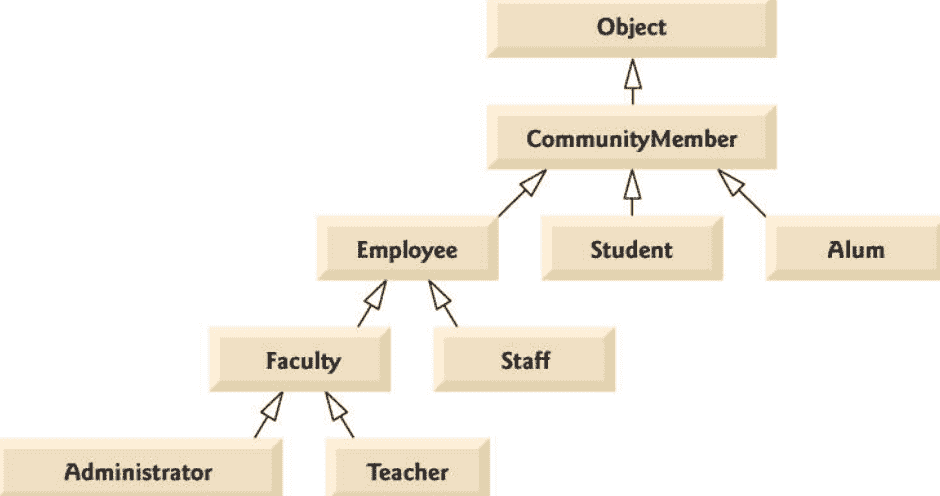

员工可以是教员（Faculty）或工作人员（Staff）。教员可以是行政人员（例如院长和系主任）或教师。该层次结构还包含许多其他类。例如，学生可以是研究生或本科生。本科生可以是大一、大二、大三或大四学生，等等。

该类层次结构中的每个向上的箭头都代表一种 is-a（是一个）的关系。当我们顺着箭头移动时，我们可以说，例如，“一个员工是一个社区成员”，“一个教师是一个教员成员”。直接超类是子类显式继承的那个超类。`CommunityMember` 是 `Employee`、`Student` 和 `Alum` 类的直接超类。间接超类是类层次结构中直接超类之任何类，它定义了类与类之间的继承关系。

`CommunityMember` 是图中 `Employee` 之下所有类的间接超类。从底部开始，你可以向上跟随箭头移动，并将 is-a 关系应用到最顶部的超类。例如，一个行政人员是一个教员成员，是一个员工，是一个社区成员，而且当然，也是一个 `Object`。第 9.4 节详细讨论了 `Object` 类。

Java 支持单继承，即每个类派生自一个直接超类。Java 不支持多重继承，即一个类派生自多个直接超类。在章节后部分，我们将解释如何使用 Java 接口（interfaces）来实现多重继承的益处，同时避免相关问题。

## 形状层次结构

现在考虑以下 Shape 继承层次结构：

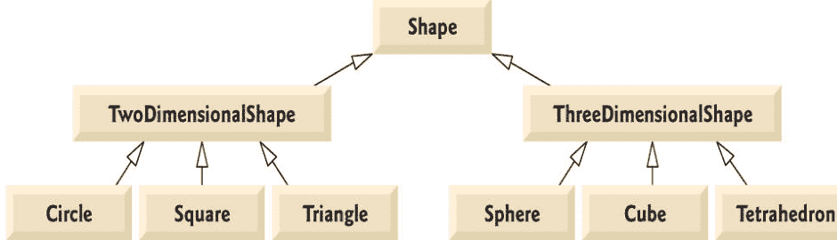

该层次结构从超类 `Shape` 开始。形状可以是二维形状（`TwoDimensionalShapes`）或三维形状（`ThreeDimensionalShapes`）——它们是 `Shape` 的直接子类。层次结构的第三层包含特定的二维形状和三维形状类型。再次，我们可以从图底部向上跟随该类层次结构中的顶端超类，以识别出几种 is-a 关系。例如，三角形是一个二维形状并且是一个形状，而球体三维形状并且是一个形状。该层次结构可能包含许多其他类。例如，椭圆和梯形也是二维形状，而圆柱是三维形状。

并不是所有的类关系都是继承关系。例如，第 8 章讨论了组合（composition）关系，其中一个类引用其他类的实例。给定 `Employee`、`BirthDate` 和 `TelephoneNumber` 类，说 `Employee` 是 `BirthDate` 是不恰的。然而，说 `Employee` 有 `TelephoneNumber` 是正确的。

子类可以以类似于超类对象的方式被处理——它们的共性体现在超类的方法中。子类可以重写（overrides）超类的方法。这允许子类对超类的方法进行自定义。

## 生成式 AI

通过这些代码来创建一个由二维形状和三维形状组成的 Shape 层次结构。`SalariedEmployee` 获得固定工资。`CommissionEmployee` 获得销售额的比例。

### 9.3 超类与子类之间的关系

我们现在使用员工类型的 Shape 层次结构图来演示超类和子类之间的关系：

- 超类 `SalariedEmployee` 获得固定工资。
- 子类 `CommissionEmployee` 获得固定工资加上销售额的比例。

我们将这些类之间的关系讨论分为两个例子。第一个例子声明了 `SalariedEmployee`，它直接继承自 `Object` 并包含了实例变量 `name` 和 `salary`。第二个例子声明了 `CommissionEmployee`，它直接继承自 `SalariedEmployee` 并增加了私有变量 `sales` 和 `commissionRate`。这种软件复用让我们在开发新子类时编写更少代码。然后，我们将展示 `CommissionEmployee` 如何使用继承自 `SalariedEmployee` 的方法来操作变量。

#### 9.3.1 创建和使用 SalariedEmployee 类

让我们检查 `SalariedEmployee`（图 9.1）。第 5 行开始类的声明并指示该类扩展 `Object`（来自 `java.lang`）。如果你不指定扩展哪个类，它将隐式扩展 `Object`。由于这个原因，你通常不会在代码中包含“extends Object”——我们在这个例子中为了演示而这样做。


```java
// 图9.1: SalariedEmployee.java
// SalariedEmployee 类代表一个
import java.math.BigDecimal;

public class SalariedEmployee extends Object {
    private final String name;
    private BigDecimal salary;

    // 双参数构造函数
    public SalariedEmployee(String name, BigDecimal salary) {
        // 隐式调用 Object 的默认构造函数
        // 无效则抛出
        if (salary.compareTo(BigDecimal.ZERO) < 0) {
            throw new IllegalArgumentException("Salary must be >= 0");
        }

        this.name = name;
        this.salary = salary;
    }

    // 返回 name
    public String getName() {
        return name;
    }

    // 设置工资金额
    public void setSalary(BigDecimal salary) {
        if (salary.compareTo(BigDecimal.ZERO) < 0) {
            throw new IllegalArgumentException("Salary must be >= 0");
        }
        this.salary = salary;
    }

    // 返回工资金额
    public BigDecimal getSalary() {
        return salary;
    }

    // 计算收益
    public BigDecimal calculateEarnings() {
        return getSalary();
    }

    // 返回 String 表现的 SalariedEmployee
    @Override // 表明此方法覆盖超类方法
    public String toString() {
        return String.format("name: %s%nsalary: %s", getName(), getSalary());
    }
}
```


图 9.1 | `SalariedEmployee` 类代表一个获得固定工资的员工。

#### `SalariedEmployee` 类的方法和实例变量概述

该类将其实例变量声明为私有（第 6-7 行），因此其他类的对象无法直接访问这些变量。`SalariedEmployee` 类的公共服务包括：

- 构造函数（第 10-20 行），
- 公共 `getName` 方法（第 23 行）用于获取 `final` 实例变量 `name` 的值（第 6 行），
- 公有方法 `setSalary` 和 `getSalary`（第 26–35 行）用于设置和获取实例变量 `salary`（第 7 行），
- 方法 `calculateEarnings`（第 38 行）用于计算薪制员工（`SalariedEmployee`）的收入，以及
- 方法 `toString`（第 41–45 行）用于创建 `SalariedEmployee` 的字符串表示形式。

构造函数和 `setSalary` 都会对其工资参数进行验证，确保在修改实例变量 `salary` 之前其值大于或等于 0。

## `SalariedEmployee` 类的构造函数

子类的构造函数不会被继承，但可以被子类调用。事实上，Java 要求每个子类构造函数必须显式或隐式地调用其直接父类的构造函数，以初始化继承自父类的类实例变量。我们将在 9.3.2 节中讨论显式调用父类构造函数的语法。

在这个示例中，`SalariedEmployee` 的构造函数隐式地调用了 `Object` 类的构造函数。如果代码中没有包含对父类构造函数的显式调用，Java 会隐式地调用父类的默认构造或无参数构造函数。第 11 行的注释指示了 Java 隐式调用父类 `Object` 默认构造函数的位置。即使一个类没有构造函数，编译器为该类隐式声明的默认构造也会调用父类的默认或无参数构造函数。

我们在将 `name` 参数赋值给 `name` 实例变量（第 18 行）之前没有对其进行验证。我们可以对其进行验证——也许是为了确保名称长度合理。

## `SalariedEmployee` 成员函数 `calculateEarnings`

`calculateEarnings` 方法（第 38 行）调用 `getSalary` 并返回结果。你可能会疑惑，既然我们可以直接调用 `getSalary` 并获得相同的结果，为什么还要提供 `calculateEarnings` 呢？正如你在 9.3.2 节中看到的，`SalariedCommissionEmployee` 类将重写 `calculateEarnings`，以自定义该类对象的收入计算方式。然后，在 9.6 节，我们将展示多态要求每个类都拥有具有相同签名的方法。

## `SalariedEmployee` 成员函数 `toString`

`toString` 方法（第 41–45 行）返回一个包含 `SalariedEmployee` 对象信息的字符串，我们通过调用类的 get 方法获取这些信息。`toString` 方法是每个类直接或间接从 `Object` 类继承的方法之一（在 9.4 节中进行了总结）。正如你所看到的，当对象必须转换为字符串表示形式时，JVM 会隐式调用 `toString`，例如当输出对象作为字符串使用 `printf` 或作为字符串的 `format` 方法时。`Object` 类的 `toString` 方法返回一个包含对象类名和对象 `hashCode` 的字符串（见 9.4 节）。此 `toString` 主要是一个占位符，子类可以重写它以指定子类对象数据的适当表示形式。

`SalariedEmployee` 的 `toString`（第 41–45 行）重写（重新定义）了继承自 `Object` 版本。要重写父类方法，子类必须声明一个与父类方法签名相同的方法（方法名、参数数量、参数类型和参数类型顺序）。`Object` 的 `toString` 没有参数，因此 `SalariedEmployee` 声明了无参数的 `toString`。

## `@Override` 注解

第 41 行使用了可选的 `@Override 注解` 来指示随后的方法声明（即 `toString`）应该重写现有的父类方法。该注解有助于编译器捕获一些常见错误。在这个示例中，我们意图重写父类方法 `toString`，其拼写为小写 `t` 和大写 `s`。如果你不意地使用了小写 `s`，编译器将将其标记为错误，因为父类不包含名为带有小写 `s` 的 `toString` 方法。如果你不使用 `@Override 注解`，`toString` 将是一个完全不同的方法，当在需要 `String` 的地方使用 `SalariedEmployee` 对象时，它不会被调用。

另一个常见的重写错误是在子类方法的参数列表中声明了错误数量或类型的参数。这创建了父类方法的无意重载，而不是重写现有方法。如果你随后尝试在子类对象上调用该方法（使用正确数量和类型的参数），将会调用父类的版本——这可能导致细微的逻辑错误。当编译器遇到声明为 `@Override` 的方法时，它会将方法的签名与父类的方法签名进行比较。如果没有精确匹配，编译器会发出错误信息，例如“方法未重写或实现来自父类型的方法”。然后你可以修正你的方法签名，使其匹配父类中的方法。

## 虽然 `@Override` 是可选的，但使用它声明重写的方法，以便编译器可以确保你正确定义了它们的签名。在编译时发现错误总是比在运行时要好。出于这个原因，第 8 章示例中的 `toString` 方法也应该使用 `@Override` 声明声明。

## 你不能在子类中减少方法的可见性

`public` 父类方法在该类的每个直接和间接子类中必须是 `public`。使用更受限的访问修饰符重写方法会导致编译错误：

- `public` 父类方法在子类中不能是 `protected` 或 `private`
- `protected` 父类方法在子类中不能是 `private`。

2. 我们将在 9.16 节中讨论 `protected`。

这样做将破坏“是”（is-a）关系，该关系要求所有子类对象都能响应对父类中声明的公共方法发出的调用。如果公共方法可以被重写为私有方法，子类对象将无法响应与父类对象相同的方法调用。

## `SalariedEmployeeTest` 类

图 9.2 测试了 `SalariedEmployee`。第 9–10 行实例化 `SalariedEmployee`。第 14–15 行使用 `SalariedEmployee` 的 get 方法获取对象的值进行输出。第 17 行调用对象的 `setSalary` 方法更改工资。第 20–23 行输出 `SalariedEmployee` 的字符串表示形式和收入。再次，当你使用 `%s` 格式化输出对象时，JVM 会隐式调用对象的 `toString` 方法来获取其字符串表示。

点击此处查看代码图像

```java
1 // Fig9.2: SalariedEmployeeTest.java
2 // SalariedEmployee 测试程序。
3 import java.math.BigDecimal;
4 import java.math.RoundingMode;
5
6 public class SalariedEmployeeTest {
7     public static void main(String[] args) {
8         // 实例化 SalariedEmployee 对象
9         var employee = new SalariedEmployee(
10             "Sierra Dembo", new BigDecimal("1000.00"));
11         // 获取 SalariedEmployee 数据
12         System.out.println("Employee information obtained:");
13         System.out.printf("name: %s\nsalary: %s\n", employee.getName(), employee.getSalary().setScale(2, RoundingMode.HALF_EVEN));
14         employee.setSalary(new BigDecimal("1200.00"));
15         // 显示更新的信息并计算
16         System.out.printf("%n%s:%s\nsalary: %s\nearnings: %s\n", "Updated information obtained after update:", employee.getName(), employee.getSalary(), employee.calculateEarnings().setScale(2, RoundingMode.HALF_EVEN));
16     }
}
```

通过 get 方法获取的信息：
name: Sierra Dembo
salary: $1000.00

更新后获取的 toString 信息：
name: Sierra Dembo
salary: $1200.00

earnings: $1200.00

图 9.2 | `CommissionEmployee` 测试程序。

## 生成式 AI

1 提示生成 AI 解释为什么使用更受限的访问修饰符重写方法会导致编译错误，但使用较少受限的访问修饰符则不会。

## 9.3.2 创建 `SalariedEmployee` / `SalariedCommissionEmployee` 继承体系

现在，让我们创建一个继承自 `SalariedEmployee` 类（图 9.1）的 `SalariedCommissionEmployee` 类（图 9.3）。正如第 6 行的 `extends` 子句所示，`SalariedCommissionEmployee` 对象是一个 `SalariedEmployee`。继承将 `SalariedEmployee` 的功能传递给子类。`SalariedCommissionEmployee` 还有 `BigDecimal` 类型的 `grossSales` 和 `commissionRate` 实例变量（图 9.3，第 7–8 行），我们将它们相乘以计算赚取的佣金。

点击此处查看代码图像

```java
1 // Fig. 9.3: SalariedCommissionEmployee.java
2 // SalariedCommissionEmployee class inherits
3 // accesses the superclass’s private data via
4 import java.math.BigDecimal;
5 public class SalariedCommissionEmployee extends SalariedEmployee {
6     private BigDecimal grossSales; // gross sales
7     private BigDecimal commissionRate; // commission rate
8
9     // four-argument constructor
10     public SalariedCommissionEmployee(String name, BigDecimal salary, BigDecimal grossSales, BigDecimal commissionRate) {
11
12         super(name, salary); // call superclass
13
14         // if grossSales is invalid throw exception
15         if (grossSales.compareTo(BigDecimal.ZERO) < 0) {
16             throw new IllegalArgumentException("gross sales cannot be negative");
17         }
18
19         // if commissionRate is invalid throw exception
20         if (commissionRate.compareTo(BigDecimal.ZERO) <= 0) {
21             throw new IllegalArgumentException("commission rate must be > 0.0");
22         }
23
24         this.grossSales = grossSales;
25         this.commissionRate = commissionRate;
26     }
27
28     // set gross sales
29     public void setGrossSales(BigDecimal grossSales) {
30         if (grossSales.compareTo(BigDecimal.ZERO) < 0) {
31             throw new IllegalArgumentException("gross sales cannot be negative");
32         }
33
34         this.grossSales = grossSales;
35     }
36
37     // return gross sales
38     public BigDecimal getGrossSales() {
39         return grossSales;
40     }
41
42     // set commission rate
43     public void setCommissionRate(BigDecimal commissionRate) {
44         if (commissionRate.compareTo(BigDecimal.ZERO) <= 0) {
45             throw new IllegalArgumentException("commission rate must be > 0.0");
46         }
47
48         this.commissionRate = commissionRate;
49     }
50
51     // return commission rate
52     public BigDecimal getCommissionRate() {
53         return commissionRate;
54     }
55
56     // calculate earnings
57     @Override
58     public BigDecimal calculateEarnings() {
59         return super.calculateEarnings().add(
60             getGrossSales().multiply(getCommissionRate()));
61     }
62
63     // return String representation of SalariedCommissionEmployee
64     @Override
65     public String toString() {
66         return String.format("%s\ngross sales: %s\ncommission rate: %s",
67             super.toString(), getGrossSales(), getCommissionRate());
68     }
69 }
```


## 继承

`SalariedCommissionEmployee` 继承了 `SalariedEmployee` 的所有成员，构造函数除外（构造函数是父类特有的）。在子类中，只能直接访问父类的公共（`public`）和保护（`protected`）成员。在继承中，父类的公共成员仍然保持公开。继承的成员只有一份副本。这使得代码更容易维护、修改和调试，因为与 `SalariedEmployee` 相关的代码仅存在于该类中。该类没有保护成员。

## SalariedEmployee 为客户端代码提供的服务

`SalariedEmployee` 的公共服务包括：

- 自身的构造函数（第 11–30 行），
- `setGrossSales`、`getGrossSales`、`setCommissionRate`、`getCommissionRate`、`calculateEarnings` 和 `toString` 方法（第 33–70 行），以及从 `SalariedEmployee` 继承的公共方法。

`setGrossSales`（第 33–39 行）和 `setCommissionRate`（第 45–53 行）方法在修改实例变量 `grossSales` 和 `commissionRate` 之前会对其参数进行验证：

- `setGrossSales` 确保 `grossSales` 的值大于 0，且
- `setCommissionRate` 确保 `commissionRate` 的值大于 0 且小于 1。

请记住，`BigDecimal` 的 `compareTo` 方法在参数小于、等于或大于比较对象时，会分别返回负值、零或正值。我们将这些返回值与 0 进行比较，以确定 `grossSales` 是否为负数（第 17 行和第 34 行），以及 `commissionRate` 是否小于或等于 0 或大于 1（第 22–23 行和第 46–47 行）。尽管 `SalariedCommissionEmployee` 的源代码不包含继承的 `SalariedEmployee` 成员，但它们仍然是子类的一部分。`SalariedCommissionEmployee` 对象也包含 `SalariedEmployee` 的私有实例变量，但它们在子类内部无法直接访问。你只能通过继承的 `SalariedEmployee` 公共方法（如果有保护方法的话）访问它们。

## SalariedEmployee 的构造函数

每个子类构造函数都必须调用构造函数来初始化从该父类继承的实例变量。因此，实例化子类对象是一个构造调用链。对于你创建的每个新对象，`Object` 的构造函数总是链中最后一个调用的构造函数。构造函数（第 11–30 行）通过父类调用语法（第 14 行）显式执行此操作，语法由关键字 `super` 后跟包含父类参数的括号组成——这初始化了继承的父类实例变量 `name` 和 `salary`。显式的父类构造函数调用必须是构造函数体的第一语句——这一要求在未来的 Java 版本中将被放宽⁴

⁴. Java 23 的“JEP 482: Flexible Constructor Bodies (Second Preview)”提议更改此要求，以便子类构造函数可以在调用父类构造函数之前验证参数。这将允许在子类构造函数因无效参数抛出异常时防止不必要的工作。示例参见书籍网页 https://deitel.com/javafp。访问日期为 2024 年 9 月 19 日。https://openjdk.org/jeps/482。

在调用父类构造函数后，`SalariedCommissionEmployee` 构造函数会验证 `grossSales` 和 `commissionRate` 参数，如果有效，则将其赋值给相应的实例变量。当父类包含无参数构造函数时，你可以使用 `super()` 显式调用该构造函数，但很少这样做。

我们在第 8 章提到，不应在构造函数中调用类的实例方法。如果你遵循这一建议，就可以避免由于直接或间接调用类的可重写方法引起的微妙问题，这些问题会导致运行时错误——更多细节请参见第 9.10 节。

## SalariedCommissionEmployee 方法 calculateEarnings

`SalariedCommissionEmployee` 的 `calculateEarnings` 方法（第 59–63 行）重写了 `SalariedEmployee` 的版本，以计算 `SalariedCommissionEmployee` 的收益。第 61 行使用表达式：

```
super.calculateEarnings()
```

计算基于薪资的部分。该方法将该值与佣金相加并返回总收益。

注意从子类调用父类方法的语法——你在父类方法名之前放置关键字 `super` 和点 `.` 分隔符。这种方法调用是一种良好的软件工程实践——如果方法执行了另一个方法所需的全部或其他操作，请调用该方法而不是重复代码。这减少了代码维护问题。

⁵. 缺点是会在父类和子类之间创建紧密耦合，导致大型系统难以修改。我们在第 9.13 节中进一步讨论这一点。

# 测试 SalariedCommissionEmployee 类

图 9.4 创建了 `SalariedCommissionEmployee` 实例（第 9–11 行）。第 14–21 行通过调用其 get 方法获取对象的变量值来输出员工数据。第 24–25 行分别使用 `setGrossSales` 和 `setCommissionRate` 来更改员工的 `grossSales` 和 `commissionRate` 值。然后，第 28–31 行显示员工更新后的信息和收益，通过（隐式）调用 `toString` 获取员工的字符串表示，并调用 `calculateEarning` 获取员工的收益。

```java
// Fig. 9.4: SalariedCommissionEmployeeTest.java
// SalariedCommissionEmployee test program.
import java.math.BigDecimal;
import java.math.RoundingMode;

public class SalariedCommissionEmployeeTest {
    public static void main(String[] args) {
        // instantiate SalariedCommissionEmployee
        var employee = new SalariedCommissionEmployee(
            new BigDecimal("500.00"), 
            new BigDecimal("10000.00"), 
            new BigDecimal("0.04")); 

        // get SalariedCommissionEmployee data
        System.out.printf(
            "Employee information obtained by get methods:\nname: %s\nsalary: $%s\ngross sales: $%s\ncommission rate: %s\n", 
            employee.getName(), employee.getSalary(), employee.getGrossSales(), employee.getCommissionRate());

        // update gross sales and commission rate
        employee.setGrossSales(new BigDecimal("8000.00"));
        employee.setCommissionRate(new BigDecimal("0.1"));

        // display updated information and earnings
        System.out.printf("%n%s:\nname: %s\nsalary: $%s\ngross sales: $%s\ncommission rate: %s\nearnings: $%s\n",
            "Updated employee information obtained by toString",
            employee.getName(), employee.getSalary(), employee.getGrossSales(), employee.getCommissionRate(),
            employee.calculateEarning());
    }
}
```

通过 get 方法获取的员工信息：
name: James Davis
salary: $500.00
gross sales: $10000.00
commission rate: 0.04

通过 toString 获取的更新员工信息：
name: James Davis
salary: $500.00
gross sales: $8000.00
commission rate: 0.1
earnings: $1300.00

**图 9.4** | SalariedCommissionEmployee 测试程序。

# 关于 SalariedCommissionEmployee 类的说明

我们可以从 `SalariedEmployee` 类中复制代码并粘贴到 `SalariedCommissionEmployee` 类中，然后修改 `SalariedCommissionEmployee` 类以包含 `grossSales` 和 `commissionRate` 实例变量以及操作这些变量的方法。这种“复制-粘贴”方法容易出错且耗时。糟糕的是，它会在整个系统中散布相同代码的副本，导致代码维护问题——对重复代码的更改需要在多个类中进行。

通过继承，层次结构中所有类都共有的实例变量和方法被声明在父类中。对父类中这些公共特征的任何更改会被子类所继承。如果没有继承，则需要对包含相关代码副本的所有源文件进行修改。通过使用继承并调用隐藏了父类 `private` 数据且确保其一致性的父类方法，我们高效且有效地构建了一个良好的子类。但我们能做得更好吗？

# 类设计

在面向对象系统的设计阶段，你经常会发现类共享共同特征。你可以识别并“提取”共同的实例变量和方法，并将它们放在父类中。然后，你可以使用继承来创建扩展这些共享特征的子类。声明子类不会影响其子类代码。虽然继承是一个强大的工具，但经验表明它也有局限性。[9.13 节]讨论了为什么你可能更喜欢组合而非继承。

## 生成式 AI

1. 提示词询问 `@Override` 是否是方法签名的一部分。

# 9.4 Object 类

Java 中的所有类直接或间接继承自 `Object` 类（`java.lang`），因此它们继承了下表所示 `Object` 方法。我们在书中讨论了这些几个方法。

| 方法 | 描述 |
|---|---|
| `equals` | 比较两个对象的相等性。 |
| `hashCode` | 返回对象的哈希——用于哈希表。 |
| `toString` | 该方法返回对象的字符串表示。 |
| `getClass` | 每个对象都知道自己的类型。 |
| `wait`, `notify`, `notifyAll` | 与多线程相关的方法。 |
| `clone` | 此受保护的方法不接受参数，创建对象的副本。 |

# 9.5 多态简介：多态视频游戏

假设我们正在设计一个包含火星、金星、冥王星、飞船和激光束类的视频游戏。每个类都继承自一个具有 `draw` 方法的 `SpaceObject` 超类并适当实现。

## 屏幕管理器

屏幕管理器程序维护一个指向各种类的 `SpaceObject` `ArrayList`。屏幕管理器定期向每个对象发送相同的 `draw` 消息以刷新屏幕。每个对象以其独特的方式响应。例如：

- 火星可能会红色绘制自己，并带有适当数量的天线；
- 飞船可能会把自己画成银色飞碟；
- 激光束可能会在屏幕上画一条亮红光。

相同的 `draw` 消息有多种形式——这就是多态。

## 向系统添加新类

多态屏幕管理器有助于以最少的代码修改向系统添加新类。假设我们想向游戏中添加水星对象。我们构建一个继承自 `SpaceObject` 并定义 `draw` 的 `Mercurian` 类，然后将对象引用添加到 `SpaceObject` `ArrayList` 中。屏幕管理器代码对 `ArrayList` 引用的每个对象都以相同的方式调用 `draw`，无论对象的类型如何。因此，新的 `Mercurian` 对象只需“插入”。

多态允许你处理一般性问题，并让运行时环境关注具体细节。只要对象属于同一个类层次结构并通过父类变量访问，你就可以在不知道其类型的情况下引导对象做出适当的行为。

# 9.6 展示多态行为

9.3 节创建了一个类层次结构，其中 `SalariedCommissionEmployee` 继承自 `SalariedEmployee`。该节中的示例通过使用对对象的引用调用其方法来操作 `SalariedEmployee` 和 `SalariedCommissionEmployee` 对象。我们将一个父类变量指向父类对象，并将子类变量指向子类对象。这些赋值是自然且直观的，因为父类变量旨在指向父类对象，而子类变量旨在指向子类对象。其他赋值也是可能的。

在接下来的示例中，我们的目标让一个父类引用指向一个子类对象。然后我们展示了如何通过父类引用调用子类对象的方法，从而触发子类的功能。**被引用的对象的类型而不是变量的类型，决定了调用哪个方法。** 这个示例表明，**子类对象可以被视为其父类对象，从而实现各种有趣的操作。例如，程序可以创建一个父类变量数组，指向许多不同子类类型的对象。** 这是允许的，因为每个子类对象都是其父类的对象。我们可以将一个 `SalariedCommissionEmployee` 对象的引用赋值给父类变量 `SalariedEmployee`，因为 `SalariedCommissionEmployee` 是一个 `SalariedEmployee`。

图 9.5 中的示例演示了使用父类和子类变量存储父类和子类对象引用的三种方法。前两种是直观的——我们将父类引用赋值给父类变量，将子类引用赋值给子类变量。然后，我们通过将子类引用赋值给父类变量来演示子类与父类之间的关系（即“is-a”关系）。程序使用了图 9.1 和 9.3 中的 `SalariedEmployee` 和 `SalariedCommissionEmployee` 类。

```java
// Fig 9.5: PolymorphismTest.java
// 将父类和子类引用赋值给父类和子类变量。
import java.math.BigDecimal;
import java.math.RoundingMode;

public class PolymorphismTest {
    public static void main(String[] args) {
        // 将父类引用赋值给父类
        var salariedEmployee = new SalariedEmployee(
            new BigDecimal("1000.00"));

        // 将子类引用赋值给子类
        var salariedCommissionEmployee = new SalariedCommissionEmployee(
            "James Davis", new BigDecimal("500.00"),
            new BigDecimal("10000.00"));

        // 在父类对象上调用 toString
        System.out.printf("""
Call SalariedEmployee's toString and
methods with superclass reference to
%s
earnings: $%s%n%n""", salariedEmployee,
            salariedEmployee.calculateEarnings(2, RoundingMode.HALF_EVEN));

        // 在子类对象上调用 toString
        System.out.printf("""
Call SalariedCommissionEmployee's toString
methods with subclass reference to
%s
earnings: $%s%n%n""", salariedCommissionEmployee,
            salariedCommissionEmployee.calculateEarnings(2, RoundingMode.HALF_EVEN));

        // 在子类对象上调用 toString
        SalariedEmployee salariedEmployee2 = salariedCommissionEmployee;
        System.out.printf("""
Call SalariedCommissionEmployee's toString
methods with superclass reference to
%s
earnings: $%s%n%n""", salariedEmployee2,
            salariedEmployee2.calculateEarnings(2, RoundingMode.HALF_EVEN));
    }
}
```


Call `SalariedEmployee`'s `toString` and `calculateEarnings` methods with superclass reference to
name: Sierra Dembo
salary: $1000.00
earnings: $1000.00

Call `SalariedCommissionEmployee`'s `toString` and `calculateEarnings` methods with subclass reference to subclass object
name: James Davis
salary: $500.00
gross sales: $10000.00
commission rate: 0.04
earnings: $900.00

Call `SalariedCommissionEmployee`'s `toString` and `calculateEarnings` methods with superclass reference to subclass object
name: James Davis
salary: $500.00
gross sales: $10000.00
commission rate: 0.04
earnings: $900.00

图 9.5 | 将父类和子类引用赋值给父类和子类变量。

## 创建父类和子类对象

第 10–11 行创建了一个 `SalariedEmployee` 对象并将其引用赋值给类型为 `SalariedEmployee` 的变量。第 14–16 行创建了一个 `SalariedCommissionEmployee` 对象并将其引用赋值给 `SalariedCommissionEmployee` 变量。这些赋值是自然的——例如，`SalariedEmployee` 变量的主要用途是持有对 `SalariedEmployee` 对象的引用。

## 通过父类变量调用父类方法

第 19–25 行使用父类变量 `salariedEmployee` 调用 `SalariedEmployee` 方法 `toString`（第 23 行）和 `calculateEarnings`（第 24 行）。由于该变量指向一个 `SalariedEmployee` 父类对象，因此调用了这两个方法的父类版本。

## 通过子类变量调用子类方法

同样，第 28–34 行使用子类变量 `salariedCommissionEmployee` 调用 `salariedCommissionEmployee` 方法 `toString`（第 32 行）和 `calculateEarnings`（第 33 行）。由于 `salariedCommissionEmployee` 指向一个 `SalariedCommissionEmployee` 子类对象，因此调用了这两个方法的子类版本。

## 通过父类变量调用子类方法

第 37 行将 `salariedCommissionEmployee` 引用的 `SalariedCommissionEmployee` 对象赋值给父类 `SalariedEmployee` 变量 `salariedEmployee2`。第 38–44 行使用该子类变量调用 `SalariedCommissionEmployee` 子类方法 `toString`（第 42 行）和 `calculateEarnings`（第 43 行）。当父类变量指向子类对象并被用于调用方法时，调用的是方法的子类版本。因此，第 42–43 行调用了 `SalariedCommissionEmployee` 类的方法 `toString` 和 `calculateEarnings`。Java 编译器允许将子类对象赋值给父类变量，因为**子类对象就是其父类的对象**（但反之不然）。

当编译器遇到通过变量调用的方法时，编译器通过检查变量的类类型来确定该方法是否可以被调用。如果该类包含适当的方法声明（或继承了该方法），则调用会被编译。

在执行期间，变量指向的对象的类型决定了实际要使用的方法。这个过程被称为动态绑定——它实现了多态行为。

## 生成式 AI

- 生成提示词以解释 Java 的多态机制是如何运作的。

## 9.7 抽象类和方法

有时，声明你永远不会创建的对象的抽象类是有用的。我们将它们称为抽象父类，因为它们只在继承层次中作为父类使用。正如我们很快将看到的，这些类无法实例化对象，因为它们是不完整的。我们将在 9.8 节的代码示例中演示抽象类。

### 抽象类的目的

抽象类提供了一个父类，其他类可以继承它并共享共同的设计。在 9.2 节的 `Shape` 层次结构中（例如），子类继承了“形状”的概念——可能包括通用属性 `location`、`fillPattern`、`color` 和 `borderThickness`，以及行为 `draw`、`move`、`resize`、`rotate` 和 `setColor`。

用于实例化对象的被称为具体类。此类类实现了它们声明的所有方法（某些实现可能是继承的）。例如，我们可以从抽象父类 `TwoDimensionalShape` 派生具体类 `Circle`、`Square` 和 `Triangle`。同样，我们可以从抽象父类 `ThreeDimensionalShape` 派生具体类 `Sphere`、`Cube` 和 `Tetrahedron`。

抽象父类过于通用无法实例化真实的对象——它们仅指定了子类之间的共同点。在实例化对象之前，我们需要更具体一些。例如，如果你向抽象类 `TwoDimensionalShape` 发送 `draw` 消息，该类知道二维形状应该是可绘制的，但它不知道要画什么具体的形状，它无法实现具体的 `draw` 方法。**具体类提供了使实例化对象成为可能的具体细节。**

并不是所有的层次结构都包含 `abstract`（抽象）类。然而，你通常会编写仅使用 `abstract` 父类类型的变量的客户端代码，以减少代码对一系列子类类型的依赖。例如，**你可以写一个接收抽象父类参数的方法**。当调用此类方法时，它可以接收到任何直接或间接 `extends`（继承）该父类的具体类的对象。

`abstract` 类有时会构成层次结构中的多个层级。例如，在[第 9.2 节]的 Shape 层次结构中，`Shape` 类及其直接子类 `TwoDimensionalShape` 和 `ThreeDimensionalShape` 将是 `abstract`（抽象）的，因为它们不够具体，无法确定具体的形状。该层次结构的三个级别声明了具体的 `TwoDimensionalShape`（圆形、正方形和三角形）和 `ThreeDimensionalShape`（球体、立方体和面体）。

## 声明 `abstract` 类和 `abstract` 方法

你通过在 `class` 关键字之前放置 `abstract` 关键字来将类声明为 `abstract`。`abstract` 类为类层次结构中的类声明公共属性和行为（包括抽象和具体的）。`abstract` 类的实例变量和具体方法遵循标准的继承规则。

`abstract` 类通常包含一个或多个 `abstract` 方法，但这不是强制要求的。`abstract` 方法是声明为 `abstract` 的实例方法，如下：

点击此处查看代码图像

```
public abstract void draw(); // abstract method
```

### 某些方法不能是 `abstract`

**构造函数和 `static` 方法不能是 `abstract`。**构造函数不被继承，因此 `abstract` 构造函数永远无法被实现。虽然非私有的（non-private）`static` 方法会被继承，但它们不能被重写。抽象方法的目的是为了通过重写来实现对对象的多态处理。`static` 方法与类相关，与特定对象无关，因此将 `static` 方法声明为 `abstract` 是没有意义的。

## 使用 `abstract` 类声明变量

虽然我们不能实例化 `abstract` 父类的对象，但你很快就会发现，我们可以使用 `abstract` 父类来声明变量，这些变量可以引用派自该父类的任何具体类的对象。我们将使用此类变量以多态的方式操作子类对象。你还可以使用 `abstract` 父类名来调用在这些 `abstract` 父类中声明的 `static` 方法。

## 分层软件系统

多态性对于实现所谓的分层软件系统特别有效。例如，在操作系统中，每个物理设备类型的运行方式可能不同。尽管如此，读写设备中数据的命令可能具有某种统一性。对于每个设备，操作系统使用称为设备驱动程序的软件来控制系统与设备之间的所有通信。发送到设备驱动程序对象的写入消息需要根据该驱动程序的特定语境以及它如何操作特定类型的设备进行特定的解释。然而，对一个设备的写入调用与对系统中任何其他设备的写入操作没有区别——即将内存中的若干字节数据放置到该设备上。

面向对象的操作系统可能会使用一个抽象父类来为所有设备驱动程序提供一个通用的“接口”。然后，子类通过继承该抽象父类形成，表现出相似的行为。设备驱动程序的方法在父类中被声明为抽象方法。这些抽象方法的实现在对应特定类型设备驱动程序的具体子类中。新设备在不断开发中，通常在操作系统发布很久后才出现。当你购买新设备时，它会附带由设备供应商提供的驱动程序。在你安装驱动程序并将设备连接到计算机后，设备立即即可工作。新设备及其驱动程序“即插即用”。这是多态性如何使系统可扩展的另一个优雅示例。

## 生成式 AI

1. 提问生成式 AI，为什么即使一个 Java 类没有 `abstract` 方法，我们也想要将其声明为 `abstract`。

## 9.8 案例研究：使用多态的工资发放系统

让我们使用 `abstract` 类和多态来计算两种类型员工的工资。我们创建了一个 `Employee` 层次结构来解决以下问题：

公司每周向员工发放工资。员工分为两种：

- 1. 工薪员工无论工作时间长短都获得固定工资。
- 2. 佣金员工获得销售额的百分比。

对于当前的支付周期，公司决定通过将工资提高 10% 来奖励薪制员工。公司想实现一个以多态方式执行工资计算的程序。

## 员工层次结构

我们使用抽象的 `Employee` 代表员工的通用概念，并定义层次结构的“接口”——即所有 `Employee` 子类必须具备的方法，以便程序可以在所有 `Employee` 对象上调用这些方法。`SalariedEmployee` 和 `CommissionEmployee` 类直接继承自 `Employee`。下面的 UML 类图显示了其多态工资应用的继承层次结构。根据 UML 规范，抽象类名 *Employee* 使用斜体表示。


抽象父类 `Employee` 声明了层次结构的“接口”——即程序可以在整个层次结构中的所有 `Employee` 对象上调用的方法。我们在这里泛泛地使用“接口”一词，是指程序与 Employee 子类通信的各种方式。注意不要将“接口”的通用概念与 Java 接口的正式概念（第 9.11 节）混淆。每个员工无论其收入如何计算都有一个名称，因此我们在抽象父类 `Employee` 中声明私有实例变量 `name`。下图显示了左侧层次结构中的每个类，以及顶部的 `calculateEarnings` 和 `toString` 方法。对于每个类，图显示了预期的期的结果。我们没有列出子类的 `getName` 方法，因为它没有被任何类重写——它是直接继承的。

| calculateEarnings | toString |
|---|---|
| abstract | name: name |
| Salaried-Employee | salary | name: name salary |
| Commission-Employee | commissionRate | name: name commission rate |

下面的部分实现了 Employee 类层次结构。第一部分声明了抽象父类 `Employee`。接下来的两个部分分别实现了一个子类。最后部分实现了一个测试程序，构建所有类的对象并进行多态处理。

### 9.8.1 抽象父类 Employee

`Employee` 类（图 9.6）提供了 `getName`、`toString` 和 `calculateEarnings` 方法。

点击此处查看代码图像

```
// Fig. 9.6: Employee.java

// Employee abstract superclass.

import java.math.BigDecimal;

public abstract class Employee {

    private final String name;

    // constructor

    public Employee(String name) {this.name = name;}

    // return name

    public String getName() {return name;}

    // return String representation of Employee

    @Override

    public String toString() {return String.format(

    // abstract method must be overridden by

    public abstract BigDecimal calculateEarnings()

}
```

**图 9.6** | Employee 抽象父类。

`Employee` 类声明（图 9.6）包括：

- 一个构造函数（第 9 行），接收一个 String  final 实例变量 `name`（声明在第 6 行）——示例中构造函数未对其参数进行验证
- 一个返回名称的 `getName` 方法（第 12 行）
- 一个返回 Employee 字符串表示的 `toString` 方法，以及
- 一个抽象方法 `calculateEarnings`（第 19 行）——该方法将被每个具体的 Employee 子类重写。

每个 Employee 子类将重写 `toString` 以创建一个包含员工所有信息的字符串表示。

#### 抽象方法 calculateEarnings

为什么我们将 `calculateEarnings` 声明为抽象方法？计算工资确实适用于所有员工。然而，我们无法为通用的 `Employee` 的概念——我们首先必须知道具体的 `Employee`。将此方法声明为 `abstract` 表示每个具体的子类都必须使用适当的来实现重写 `calculateEarnings`。

你不能直接创建 `Employee` 对象，因为 `Employee` 是一个 `abstract` 类。然而，由于继承，任何 `Employee` 子类的每个对象都是 `Employee`，因此保证提供 `calculateEarnings` 方法。所以，程序可以通过父类 `Employee` 变量对任何 `Employee` 对象通过多态地调用该方法。

在第 9.8.4 节中，我们将创建一个父类 `Employee` 变量数组，每个变量引用一个作为 `Employee` 的子类对象。程序将遍历该数组，以多态的方式调用每个对象的 `calculateEarnings`。编译器允许通过 `Employee` 变量调用 `calculateEarnings` 方法，因为它在 `Employee` 类中声明了它——再次强调，变量的类型决定了程序可以使用该变量调用哪些方法。

### 9.8.2 具体子类 SalariedEmployee

`SalariedEmployee` 类（图 9.7）继承自 `Employee` 类（第 5 行），并重写了抽象的 `calculateEarnings`（第 33–34 行），使得 `SalariedEmployee` 了一个具体类。该类包含：

- 一个构造函数（第 9–18 行），接收名称并将名称传递给父类 `Employee` 的构造函数（第 10 行），以初始化 `Employee` 的私有实例变量；
- `setSalary` 方法，用于为工资实例变量分配一个新的非负值（第 21–27 行）；
- `getSalary` 方法，用于返回工资值（第 30 行）；
- 一个 `calculateEarnings` 方法（第 33–34 行），重写了父类版本以计算 `SalariedEmployee` 的收入；以及 一个 `toString` 方法（第 37–41 行），重写了父类版本以返回一个字符串，包含父类 `Employee` 的 `toString` 和 `SalariedEmployee` 的 `getSalary` 方法返回的信息。

[点击此处查看代码图片](#)

```
1 // Fig.9.7: SalariedEmployee.java

2 // SalariedEmployee concrete class extends a

3 import java.math.BigDecimal;

4

5 public class SalariedEmployee extends Employee {

6     private BigDecimal salary; // fixed weekly salary

7

8     // constructor

9     public SalariedEmployee(String name, BigDecimal salary) {

10        super(name);

11

12     // if salary is invalid throw exception

13        if (salary.compareTo(BigDecimal.ZERO) < 0) {

14            throw new IllegalArgumentException(

15                "Salary cannot be negative");

16        }

17
```


### 9.8.2 具体子类 SalariedEmployee

`SalariedEmployee` 类继承自抽象类 `Employee`。

```java
18        this.salary = salary;
19    }
20
21    // set salary amount
22    public void setSalary(BigDecimal salary) {
23        if (salary.compareTo(BigDecimal.ZERO) < 0) {
24            throw new IllegalArgumentException(
25                "Salary cannot be negative");
26        }
27        this.salary = salary;
28    }
29
30    // return salary amount
31    public BigDecimal getSalary() { return salary; }
32
33    // calculate earnings
34    @Override
35    public BigDecimal calculateEarnings() { return salary; }
36
37    // return representation of SalariedEmployee
38    @Override // indicates that this method overrides
39    public String toString() {
40        return String.format("%s%nsalary: $%s",
41                super.toString(), getSalary());
42    }
43}
```

**图 9.7** | `SalariedEmployee` 具体类继承抽象类 `Employee`。

`calculateEarnings` 方法重写了 `Employee` 的抽象方法，提供了一个返回 `SalariedEmployee` 工资的具体实现。如果我们不实现 `calculateEarnings`，则 `SalariedEmployee` 类必须声明为抽象的。当然，在这个例子中，我们希望 `SalariedEmployee` 类是具体的。

`toString` 方法（第 37–41 行）重写了 `Employee` 的 `toString`。如果 `SalariedEmployee` 类没有重写 `toString`，它将继承 `Employee` 的版本。在这种情况下，`SalariedEmployee` 类的 `toString` 方法将返回名称，这不能充分代表 `SalariedEmployee`。

### 9.8.3 具体子类 CommissionEmployee

`CommissionEmployee` 类（图 9.8）继承自 `Employee`（第 5 行）。该类包含：

- 一个构造函数（第 10–28 行），接收名称、总销售额和佣金率，并将名称传递给父类 `Employee` 的构造函数（第 12 行），以初始化 `Employee` 的私有实例变量；
- set 方法（第 31–37 行和 43–51 行），用于为实例变量 `grossSales` 和 `commissionRate` 分配有效值；
- get 方法（第 40 行和 54 行），返回 `grossSales` 和 `commissionRate` 的值；
- 一个 `calculateEarnings` 方法（第 57–60 行），重写了父类版本以计算 `CommissionEmployee` 的收入；以及
- 一个 `toString` 方法（第 63–67 行），重写了父类版本以返回一个字符串，包含父类 `Employee` 的 `toString` 和 `CommissionEmployee` 的 `getGrossSales` 和 `getCommissionRate` 方法返回的信息。

[点击此处查看代码图片](#)

```java
1 // Fig. 9.8: CommissionEmployee.java
2 // CommissionEmployee class extends Employee
3 import java.math.BigDecimal;
4
5 public class CommissionEmployee extends Employee {
6     private BigDecimal grossSales; // gross sales
7     private BigDecimal commissionRate; // commission rate
8
9     // constructor
10    public CommissionEmployee(String name, BigDecimal grossSales, BigDecimal commissionRate) {
11        super(name);
12
13        // if grossSales is invalid throw exception
14        if (grossSales.compareTo(BigDecimal.ZERO) < 0) {
15            throw new IllegalArgumentException(
16                "Gross sales cannot be negative");
17        }
18
19        // if commissionRate is invalid throw exception
20        if (commissionRate.compareTo(BigDecimal.ZERO) < 0) {
21            throw new IllegalArgumentException(
22                "Commission rate cannot be negative");
23        }
24
25        this.grossSales = grossSales;
26        this.commissionRate = commissionRate;
27    }
28
29    // set gross sales
30    public void setGrossSales(BigDecimal grossSales) {
31        if (grossSales.compareTo(BigDecimal.ZERO) < 0) {
32            throw new IllegalArgumentException(
33                "Gross sales cannot be negative");
34        }
35        this.grossSales = grossSales;
36    }
37
38    // set commission rate
39    public void setCommissionRate(BigDecimal commissionRate) {
40        if (commissionRate.compareTo(BigDecimal.ZERO) < 0) {
41            throw new IllegalArgumentException(
42                "Commission rate cannot be negative");
43        }
44        this.commissionRate = commissionRate;
45    }
46
47    // return gross sales
48    public BigDecimal getGrossSales() { return grossSales; }
49    // return commission rate
50    public BigDecimal getCommissionRate() { return commissionRate; }
51
52    // calculate earnings
53    @Override
54    public BigDecimal calculateEarnings() {
55        return grossSales.multiply(commissionRate);
56    }
57
58    // return representation of CommissionEmployee
59    @Override
60    public String toString() {
61        return String.format("%s%ngross sales: $%s%ncommission rate: %s",
62                super.toString(), getGrossSales(), getCommissionRate());
63    }
64}
```

**图 9.8** | `CommissionEmployee` 类继承 `Employee`。

### 9.8.4 多态处理、instanceof 运算符和向下转型

图 9.9 测试了我们的 `Employee` 层次结构。第 9–12 行创建一个 `SalariedEmployee` 对象和一个 `CommissionEmployee` 对象。程序通过每个对象自身的类型非多态地操作这些对象，然后通过 `Employee` 变量数组多态地操作。通过多态地处理这些对象，程序将每个 `SalariedEmployee` 的工资增加了 10%——这需要在执行时确定对象的类型。最后，程序多态地确定并输出 `Employee` 数组中每个对象的类型。第 14–21 行非多态地输出每个对象的字符串表示和收入，使用 `salariedEmployee` 变量调用 `SalariedEmployee` 方法和 `CommissionEmployee` 方法。当对象作为带有 `%s` 格式说明符的字符串输出时，`printf` 会隐式地调用每个对象的 `toString` 方法（第 16 行和 19 行）。

[点击此处查看代码图片](#)

```java
1 // Fig. 9.9: PayrollSystemTest.java
2 // Employee hierarchy test program.
3 import java.math.BigDecimal;
4 import java.math.RoundingMode;
5 public class PayrollSystemTest {
6
7     public static void main(String[] args) {
8         // create subclass
9         var salariedEmployee = new SalariedEmployee(
10                 new BigDecimal("1000.00"));
11         var commissionEmployee = new CommissionEmployee(
12                 new BigDecimal("10000.00"), new BigDecimal("0.10"));
13
14         System.out.println("Employees before:");
15         System.out.printf("%s%nearnings: $%s%n",
16                 salariedEmployee, salariedEmployee.calculateEarnings().setScale(
17                        2, RoundingMode.HALF_UP));
18         System.out.printf("%s%nearnings: $%s%n",
19                 commissionEmployee, commissionEmployee.calculateEarnings().setScale(
20                        2, RoundingMode.HALF_UP));
21
22         // create and initialize Employee array
23         Employee[] employees = {salariedEmployee, commissionEmployee};
24
25         System.out.println("\nEmployees after 10% raise:");
26
27         // generically process each element in
28         for (Employee currentEmployee : employees) {
29             if (currentEmployee instanceof SalariedEmployee) {
30                 SalariedEmployee se = (SalariedEmployee) currentEmployee;
31                 se.setSalary(se.getSalary().multiply(new BigDecimal("1.10")));
32             }
33             System.out.printf("%s%nearnings: $%s%n",
34                     currentEmployee, currentEmployee.calculateEarnings().setScale(
35                            2, RoundingMode.HALF_UP));
36         }
37
38         // 遍历数组并打印对象的类型
39         for (int j = 0; j < employees.length; j++) {
40             System.out.printf("员工 %d 是 %s%n",
41                     j, employees[j].getClass().getName());
42         }
43     }
44 }
```

```java
30 System.out.println(currentEmployee)
// 确定元素是否为 S
32 if (currentEmployee instanceof SalariedEmployee employee) {
33     employee.setSalary(
34         employee.getSalary().multiply(1.1));
35     System.out.printf("增加10% 后的新工资为: $%s%n",
36         employee.getSalary().setScale(2, RoundingMode.HALF_EVEN));
37 }
38 System.out.printf("收益: $%s%n",
39     currentEmployee.calculateEarnings());
40 }
41 // 遍历数组并打印对象的类型
42 for (int j = 0; j < employees.length; j++) {
43     System.out.printf("员工 %d 是 %s%n",
44         j, employees[j].getClass().getName());
45 }
```


单独处理的员工：
0 是 `SalariedEmployee`，工资: $5000.00，收益: $5500.00
1 是 `CommissionEmployee`，工资: $4000.00，收益: $4600.00

以多态方式处理的员工：
0 是 `SalariedEmployee`，工资: $5000.00，增加10%后的新工资为: $5500.00，收益: $5500.00
1 是 `CommissionEmployee`，工资: $4000.00，收益: $4600.00

## 创建 Employee 数组

第 24 行创建 `employees` 数组，并用 `SalariedEmployee` 和 `CommissionEmployee` 实例初始化它。由于这两个类都是 `Employee` 的子类，我们可以将它们赋值给 `Employee` 类型的变量。第 33 行的 `instanceof` 表达式检查 `currentEmployee` 是否为 `SalariedEmployee`，如果是，则将其转换为 `SalariedEmployee` 类型。这种转换是允许的，因为 `Employee` 确实是 `SalariedEmployee`。

## 通过多态处理 Employee

第 29-45 行遍历 `employees` 数组处理 `Employee` 对象的类型。第 43 行通过 `currentEmployee` 变量调用 `calculateEarnings` 方法，这在多态情况下会调用子类的具体实现。第 30 行通过 `currentEmployee` 变量调用 `toString` 方法，这在多态上是允许的。

## 在 SalariedEmployee 上执行特定操作

在本例中，我们通过第 33 行模式匹配 `instanceof` 表达式将 `Employee` 变量向下转换为 `SalariedEmployee` 变量，从而避免了多个编译错误。

将存储在父类变量中的引用直接赋值给子类变量是不允许的，因为 `Employee` 不是 `SalariedEmployee`。同样，如果第 33 行的 `instanceof` 表达式为真，第 34-39 行就可以执行 `SalariedEmployee` 对象的特殊处理。使用 `SalariedEmployee` 变量 `employee`，第 34-35 行调用 `getSalary` 和 `setSalary` 来获取工资增加 10%。随后，第 37-39 行通过 `getSalary` 获取并显示增加后的新工资。

### 多态地调用 calculateEarnings

第 43 行对 `currentEmployee` 调用 `calculateEarnings` 方法，这会多态地调用当前子对象的 `calculateEarnings` 方法。以多态方式获取 `CommissionEmployee` 的收益与第 20 行的结果相同。由于 `SalariedEmployee` 的工资增加了 10%，其收益金额更高。

## 获取每个 Employee 的类名

为了显示每个对象都知道自己的类，第 48-51 行以 `String` 类型显示每个 `Employee` 的类型。每个对象都可以通过继承自 `Object` 方法 `getClass()` 获取类。`getClass()` 返回 `Class` 类型（来自 `java.lang`）对象的引用，该对象包含了对象的类型信息。

因为只有非静态实例方法可以被重写。由于 `final` 方法的声明永远不会改变，对 `final` 方法的调用在编译时就会解析——这被称为`静态绑定`。

## Final 类不能作为超类

`final class` 不能被继承，因此其方法隐式地为 `final`。`String` 是一个 `final` 类。如果你被继承 `String`，那么该子类的对象可以在任何需要 `String` 的地方被使用。由于它不能被继承，使用 `String` 的程序可以依赖 Java API 中指定的 `String` 对象的功能。将类设为 `final` 还可以防止程序员创建绕过安全限制的子类。

### `record` 类

`record` 类隐式地是一个 `final` 类，因此其方法隐式地为 `final`。`record` 类的实例变量也是 `final` 的。

## 如果可以是 final，就应该是 final

通常情况下，如果一个变量、方法或类可以是 `final` 的，那么它就应该是 `final` 的。这是最小权限原则的另一个例子。当我们在第 18 章学习并发时，你会发现 `final` 变量使得程序更容易并行化，以便用于当今的多核处理器以提高性能。

有时，将类声明为 `final` 是重要的——通常出于安全考虑。除非你为了扩展而仔细地设计一个类，否则你应该将类声明为 `final` 以避免（通常是微妙的）错误。像任何类一样，你可以通过组合来重用 `final` 类——例如，我们的 Employee 类组合了对 `String` 对象的引用，而 `String` 是一个 `final` 类。更多关于使用 `final` 的见解，请访问

点击此处查看代码图像

```
https://docs.oracle.com/javase/tutorial/java/Iand
```

## 生成式 AI

+ 1 个 Prompt 询问 AI，提供简单的示例，说明为什么可能出于安全目的将 Java 类声明为 `final`。

## 9.10 构造函数调用实例方法的问题

在[第 8.10 节](#)中，我们选择在类 `Time2` 的构造函数和 `set-Time` 方法之间重复代码。这样做是因为你不应该从构造函数调用类的非-`static` 方法。为了理解为什么，请回想当你构造子类对象时，子类构造函数在执行子类实例变量初始化代码之前会调用其直接父类的构造函数。**如果此时父类构造函数调用了一个被子类重写的方法，则子类的版本将在子类构造函数完成子类对象数据初始化之前执行。** 如果子类方法使用了尚未初始化的实例变量，可能会导致微妙且难以检测的错误。

假设一个构造函数和一个 set 方法对特定的实例变量执行相同的验证。你应该如何处理这些公共代码？

- 在构造函数和 `set` 方法中重复验证代码是消除我们在这里正在考虑的问题的简单方法。
- 对于较较长的验证代码，你可以定义一个 `static` 验证方法——通常是一个 `private static` 辅助方法——然后从构造函数和 `set` 方法中调用它。在构造函数中调用 `static` 方法是可以接受的，因为它是不可重写的。

如果构造函数没有直接或间接地调用任何可重写的实例方法，那么构造函数调用 `final` 或 `private` 实例方法也是可以接受的。

## 生成式 AI

+ 1 个 Prompt 询问 AI，提供一个简单的示例，说明从构造函数中调用可重写方法可能产生的微妙且难以检测的错误。
+ 2 个 Prompt 询问 AI，让它们讨论从构造函数中调用可重写方法可能产生的潜在 Java 安全问题。

## 9.11 创建和使用接口

我们的下一个示例（图 9.10–9.13）重新检查了第 9.8 节的工资系统。假设公司希望在单个应付账应用程序中执行若干会计操作。除了计算每位员工的收入外，公司还必须计算支付款。

- 计算员工的收入。
- 计算发票的支付款。

可应用于广泛可能不相关的对象。**在接口中声明方法时，你应该选择一个以通用的方式描述方法目的的方法名，因为该方法可能由相关的类来实现。**

在声明 `Payable` 后，我们引入了实现 `Payable` 的类 `Invoice`。然后我们修改了 `Employee` 类，使其也实现 `Payable`。这样，我们的程序就可以多态地调用 `Invoice` 和 `Employee` 对象的 `calculatePayment` 方法，从而实现应付账款应用程序所需的 `Invoice` 和 `Employee` 处理。

# 包含接口的 UML 图

下面的 UML 类图显示了接口和类的层次结构：

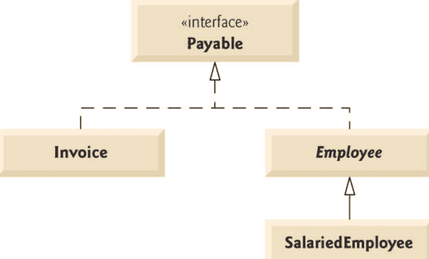

该层次结构从接口 `Payable` 开始。UML 通过在接口名称上方使用书括号（« 和 »）放置“interface”单词来区分接口与类。UML 通过称为“实现”（realization）的关系来表达类与接口之间的关系。一个类被认为实现（implement）了接口的方法。类图将实现建模为从实现类指向接口的虚线箭头，并带有空心箭头。之前的图表表示类 `Invoice` 和 `Employee` 分别实现了接口 `Payable`。类 `Employee` 以斜体显示，表示它是一个抽象类。具体类 `SalariedEmployee` 扩展 `Employee`，继承了其子类与接口 `Payable` 的实现关系。

## 生成式 AI

+ 1 Prompt genAIs 列出 Java API 中最常用的接口，并对每个接口进行简要说明。

# 9.11.2 接口 `Payable`

接口通常是 `public` 类型。与 `public` 类一样，`public` 接口必须在以接口命名并以 `.java` 作为文件扩展名的文件中声明（例如，`Payable.java`）。`interface` 关键字（图 9.10 的第 5 行）开始一个`接口声明`。此接口包含 `public abstract` 方法 `calculatePayment`。该方法没有参数，但接口方法可以有参数。接口还可以拥有任意数量的方法。

点击此处查看代码图片

```
1 // Fig. 9.10: Payable.java
2 // Payable interface declaration.
3 import java.math.BigDecimal;
4
5 public interface Payable {
6     public abstract BigDecimal calculatePayment();
7 }
```


图 9.10 | Payable 接口声明。

最初，接口只能包含常量和没有实现的公共抽象方法。Java 8 和 9 增强了接口以允许方法实现（第 9.12 节）。你声明的任何没有体的接口方法都是隐式的 `public` 和 `abstract` 的，但显式声明它们为 `public` 和 `abstract` 可以明确你的意图——这可以将接口的抽象方法与其他类型的接口方法区分开。接口中的所有字段都是隐式的 `public`、`static` 和 `final` 的。

## 9.11.3 类 Invoice

`Invoice` 类（图 9.11）代表一种零件的发票。该类声明了私有实例变量 `partNumber`、`partDescription`、`quantity` 和 `pricePerItem`（位于第 6–9 行）。`Invoice` 类还包含一个构造函数（第 12–28 行）、get 方法（第 31–34 行）以及一个 `toString` 方法（第 37–42 行），该方法返回 `Invoice` 对象的字符串表示。

```java
1 // Fig. 9.11: Invoice.java
2 // Invoice class that implements Payable.
3 import java.math.BigDecimal;
4
5 public class Invoice implements Payable {
6     private final String partNumber;
7     private final String partDescription;
8     private final int quantity;
9     private final BigDecimal pricePerItem;
10
11 // constructor
12     public Invoice(String partNumber, String
13         BigDecimal pricePerItem) {
14         if (quantity < 0) { // validate quantity
15             throw new IllegalArgumentException("Quantity cannot be negative");
16         }
17
18         // validate pricePerItem
19         if (pricePerItem.compareTo(BigDecimal.ZERO) < 0) {
20             throw new IllegalArgumentException(
21                 "Price per item must be >= 0");
22         }
23
24         this.quantity = quantity;
25         this.partNumber = partNumber;
26         this.partDescription = partDescription;
27         this.pricePerItem = pricePerItem;
28 }
29
30 // get methods
31 public String getPartNumber() { return partNumber; }
32 public String getPartDescription() { return partDescription; }
33 public int getQuantity() { return quantity; }
34 public BigDecimal getPricePerItem() { return pricePerItem; }
35
36 // return String representation of Invoice
37 @Override
38 public String toString() {
39 return String.format("%s: %s (%s)%n%s: %s (%s)",
40 "part number", getPartNumber(),
41 "quantity", getQuantity(), "price per item", getPricePerItem());
42 }
43
44 // method required to carry out contract
45 @Override
46 public BigDecimal calculatePayment() {
47 BigDecimal quantity = new BigDecimal(quantity);
48 return quantity.multiply(getPricePerItem());
49 }
50 }
```

**图 9.11** | Invoice 类实现了 Payable。

第 5 行表示 `Invoice` 实现了 `Payable`。像所有类一样，`Invoice` 也扩展了 `Object`。该方法满足了接口对此方法的要求——计算 `quantity` 和 `priceItem` 的乘积并返回金额。该方法履行了接口合同。

使用父类引用，我们可以多态地调用在父类及其超父类（例如 `Object` 类）中声明的任何方法。使用接口引用，我们可以多态地调用在接口、其超接口（一个接口可以扩展另一个接口）以及 `Object` 类中声明的任何方法。允许通过接口变量调用 `Object` 类的方法，因为变量必须引用一个对象才能调用方法，而所有对象都有 `Object` 类的方法。

### 生成式 AI

- 使用 1 个 Prompt genAIs 给出一个 Java 接口被扩展的示例。

## 9.11.5 使用接口 Payable 多态地处理发票和员工

`PayableInterfaceTest`（见图 9.13）说明了 `Payable` 接口可以在单个应用程序中多态地处理一组 `Invoice`（发票）和 `Employee`（员工）。第 10–15 行声明并初始化了元素数组 `payableObjects`。第 11–12 行将 `Invoice` 对象的引用放在 `payableObjects` 的前两个元素中。第 13–14 行将 `SalariedEmployee` 对象的引用放在 `payableObjects` 的后两个元素中。这些元素可以用 `Invoice` 和 `SalariedEmployee` 进行初始化，因为 `Invoice` 是一个 `Payable`，`SalariedEmployee` 是一个 `Employee`，而 `Employee` 是一个 `Payable`。

```java
1 // 图.9.13: PayableInterfaceTest.java
2 // Payable 接口测试程序，多态处理
3 // 。
4 import java.math.BigDecimal;
5 import java.math.RoundingMode;
6
7 public class PayableInterfaceTest {
8 public static void main(String[] args) {
9 // 创建一个四个元素的 Payable 数组
10 Payable[] payableObjects = {
11 new Invoice("01234", "seat", 2), 
12 new Invoice("56789", "tire", 4), 
13 new SalariedEmployee("Lorena Silva",
14 new SalariedEmployee("Hans Olsen",
15 };
16
17 System.out.println(
18 "Invoices and Employees processed p
```

```java
// 处理每个元素
for (Payable currentPayable : payableObjects)
    // 输出 currentPayable 及其 ap
    System.out.printf("%s:%s%n",
        currentPayable.getClass().getName(),
        currentPayable.toString(),
        currentPayable.calculatePayment(2, RoundingMode.HALF_EVEN));
```

### 多态地处理发票和员工

Invoice: 部号: 01234 (seat)
数量: 2
每个单价: $75.00
到期金额: $150.00

Invoice: 部号: 56789 (tire)
数量: 4
每个单价: $19.95
到期金额: $79.80

SalariedEmployee: 姓名: Lorena Silva
工资: $1200.00
到期金额: $1200.00

SalariedEmployee: 姓名: Hans Olsen
工资: $800.00
到期金额: $800.00

**图 9.13** | Payable 接口测试程序，多态地处理发票和员工。

第 21–28 行多态地处理 `payableObjects` 中的每个 `Payable` 对象，显示每个对象的字符串表示和支付金额。第 24 行显示每个对象的类名。第 25 行通过 `Payable` 引用调用 `toString` 方法，尽管 `toString` 未在接口中声明。所有引用（包括接口类型的引用）都引用自 `Object`，因此具有 `toString` 方法。在这里可以隐式地调用方法 `toString`。第 26 行调用 `Payable` 方法 `calculatePayment` 获取 `payableObjects` 中每个对象的支付金额，无论对象的实际类型如何。输出结果显示，每个 `toString` 和 `calculatePayment` 方法都会调用每个对象类型的相应实现。

## 9.11.6 常用 API 接口

在开发 Java 应用时，你将广泛使用接口。Java API 包含许多接口，许多 Java API 方法接受接口作为参数并返回接口值。下表概述了我们在后续章节中使用的 Java API 中一些最常用的接口。

| Java API 接口 | 描述 |
| :--- | :--- |
| Iterable | 增强型 `for` 语句可以遍历实现此接口对象的元素，例如数组和 `ArrayList`。 |
| Comparable | Java 的比较运算符（例如 `<`、`<=`、`>=`、`!=`）允许你比较原始类型值。它们不能用于比较对象。`Comparable` 接口允许 `implements` 该接口的类对象之间相互比较，通常用于对集合（如 `ArrayList`）中的对象进行排序。我们在 [第 12 章，泛型集合] 和 [第 13 章，泛型类和方法：深入探析] 中使用了 `Comparable` 以及一个名为 `Comparator` 的相关接口。 |

### Java Collections API 的接口

[第 6 章] 引入了 `ArrayList` 集合。我们将在 [第 12 章，泛型集合] 中讨论许多额外的集合。正如你所见的，你经常使用 Java Collections API 接口的变量来引用和操作数据集合。`ArrayList` 类是实现多个接口的 Java API 类之一。它实现了 `Iterable` 接口，因此增强型 `for` 语句可以遍历它的元素。它还实现了 `List` 接口（第 12.5 节），该接口声明了你可以在任何表示项目列表的对象上调用的常用方法（如 `add`、`remove` 和 `contains`——`LinkedList` 类也实现了 `List` 接口）。

| Runnable | 实现任何表示任务的类。此类类的对象通常使用多线程技术（第 18 章，并发：线程到虚拟线程）并行执行。接口包含一个方法 `run`，规定了执行时的行为。 |
| GUI event-listener | 你在桌面和移动应用中每天都会使用图形用户界面（GUI）。在浏览器中，你可能会输入地址，或者点击按钮返回上一页。浏览器响应你的交互并执行所需任务。你的交互被称为事件，浏览器用于响应事件的代码被称为事件处理器。在第 15 章 JavaFX 图形用户界面：第一部分中，你将构建具有响应交互事件处理器的 GUI。事件处理器声明在实现事件监听接口的类中。每个事件监听接口指定了一个或多个必须实现以响应交互的方法。 |
| AutoCloseable | 实现可以使用 `try`-with-resources 语句（第 10 章，异常处理：深入探析）的类，以防止“资源泄漏”。我们在第 11 章文件、I/O 流、JSON 序列化与 CSV 文件以及第 20 章使用 SQLite 访问数据库中使用此接口。 |

## 9.12 其他接口特性

本节介绍了我们在后续章节中再次看到的其他接口特性。

### 9.12.1 默认接口方法

正如提到的，接口方法最初可以是公共抽象方法。这意味着接口指定了实现类必须执行的操作，但没有规定类应如何执行。

Java 8 允许接口包含具有具体默认实现的 `public default methods`，规定了操作是如何执行的。如果类实现了此类接口，该类将获得接口的 `default` 实现。实现类可以在必要时覆盖接口的 `default` 方法，但并非强制。在声明 `default` 方法时，在 `public` 和方法的返回类型之间放置 `default` 关键字并提供具体的方法实现：

#### 向现有接口添加方法

在有 `default` 方法之前，向接口添加方法会破坏那些没有定义新方法的实现类——如果你没有定义接口的每个 `abstract` 方法，则必须将类声明为 `abstract`。任何类实现接口在添加 `default` 方法时不会破坏。当你修改接口时，必须重新编译接口，但实现类只需接收 `default` 方法的实现。因此，`default` 方法允许你通过向接口添加新方法来演进现有接口，而不会破坏实现接口的类。

### 9.12.2 `static` 接口方法

第 12 章引入了 `Collections` 类，该类包含许多 `static` 辅助方法，用于处理实现了 Java Collections API 接口（如 `Collection`、`List`、`Map`、`Set` 等）的对象。例如，`Collections` sort 方法可以对任何 `List` 对象的元素进行排序——即该对象的类实现了 `List` 接口。通过 `static interface methods`（同样在 Java 8 中添加），此类辅助方法可以直接声明在接口中，而不是在单独的类中。

### 9.12.3 函数式接口

任何只包含一个 `abstract` 方法的接口都是`函数接口`（functional interface）。⁶ 函数式接口广泛用于 Java 的 Lambda 能力，我们将在第 14 章“使用 Lambdas 和 Streams 进行函数式编程”中介绍这些。Lambda 提供了实现函数接口的简写表示。你在书中将使用的一些函数式接口包括：

> 6. 有人将这些称为 SAM（单抽象方法）接口。

- `Comparator`（第 12 章，泛型集合）——你将实现此接口以定义一个方法，比较给定类型的两个对象，以确定第一个对象是小于、等于还是大于第二个对象。
- `ChangeListener`（第 15 章，JavaFX 图形用户界面：第一部分）——你将实现此接口以定义当用户与滑块图形用户界面控件交互时被调用的方法。
- `Runnable`（第 18 章，并发：从平台线程到虚拟线程）——你将实现此接口以定义可能与程序其他部分并行运行的任务。

### 9.12.4 private 接口方法

如你所知，类的私有辅助方法只能由该类的其他方法调用。你可以声明私有接口方法，从而允许你定义仅供接口其他具体方法使用的公共代码方法。接口的 `private` 实例方法只能由接口的其他实例方法直接调用（即无需通过对象引用）。接口的 `static` 方法可以由接口的任何实例方法或 `static` 方法调用。在 `private` 接口方法的声明中包含 `default` 关键字会导致编译错误——`default` 方法必须是 `public`。

#### 生成式 AI

1. 提示 genAIs，询问关于在接口中使用 `default`、`static` 和 `private` 方法的简单示例。

## 9.13 面向接口编程而不是面向实现⁷

> 7. 我们在这一节中提出的概念在软件工程社区被广泛讨论，并源于许多来源。“面向接口编程而不是面向实现”定义在 Gamma, Erich 等人的 *Design Patterns: Elements of Reusable Object-Oriented Software*. Reading, MA: Addison-Wesley, 1995, 17–18 中，并在 Bloch, Joshua 的 *Effective Java, Third Edition*. Upper Saddle River, NJ: Addison-Wesley, 2018 中得到了进一步强调和讨论。

软件工程社区对于组合和继承的相对优劣有很多讨论。许多专业人士认为继承被过度使用，而组合通常更合适。本节比较了这些方法，然后使用组合和接口重构了[第 9.8 节]的员工（Employee）层级结构。

### 基于继承的设计

实现继承（即子类 `extends` 父类）主要用于定义具有许多相同实例变量和方法实现的密切相关的类。这种继承在父类的实例变量和方法之间创建了**紧耦合**类，这些变量和方法被继承到子类中。对父类的更改会直接影响所有相应的子类。


紧耦合会导致修改类层级变得困难。考虑修改[第 9.8 节]的员工层级以支持退休计划。有很多退休计划类型，包括 401k 和 IRA。我们可能会在父类 `Employee` 中添加一个 `abstract retirementDeposit` 方法。然后定义各种子类，如 `SalariedEmployeeWith401k`、`SalariedEmployeeWithIRA`、`CommissionEmployeeWith401k`、`CommissionEmployeeWithIRA`，每个重写 `retirementDeposit`。这种方法会导致子类激增，增加了实现的难度。

### 重新思考层级：组合与依赖注入

多年来，程序员编写了大量关于紧耦合类级问题的论文、文章和博客。在本示例中，我们将使用组合和依赖注入，类包含一个提供类所需行为对象的引用。在本示例中，行为计算员工的收益。正如你所看到的，你可以通过初始化员工甚至稍后设置新的 `CompensationModel` 向员工“注入”补偿功能。组合 `CompensationModel` 在员工与其 `CompensationModel` 之间创建了松耦合的关系，使得无需重新编译类即可更改 `CompensationModel`。

### 接口是灵活性的关键

在本示例中，我们将 `CompensationModel` 声明为具有 `abstract` 方法 `calculateEarnings` 的接口，然后声明 `CompensationModel` 的实现，指定员工获取工资的方式：

- `Salaried` 类实现了 `CompensationModel`，用于获取固定工资的员工。
- `Commission` 类实现了 `CompensationModel`，用于根据销售额获取佣金的员工。

`Employee` 的 `calculateEarnings` 方法将调用其组合的 `CompensationModel` 的 `calculateEarnings` 方法来确定员工收益。新的 `Employee` 类将不是父类——为了强调这一点，我们将其标记为 `final`。

## 9.13.1 CompensationModel 接口

图 9.14 定义了包含抽象方法 `calculateEarnings` 的 `CompensationModel` 接口（第 6 行）。实现此接口的每个类将定义计算补偿所需的实例变量，并重写 `CompensationModel` 的 `calculateEarnings` 方法以执行相应的计算。实现此接口的任何类的对象都是一个 `CompensationModel`。

点击此处查看代码图像

| 1 // Fig.9.14: CompensationModel.java |
| 2 // CompensationModel 接口定义方法 |
| 3 import java.math.BigDecimal; |
| 4 |
| 5 public interface CompensationModel { |
| 6 public abstract BigDecimal calculateEarnings |
| 7 } |

**Fig. 9.14** | CompensationModel 接口定义方法 calculateEarnings。

## 9.13.2 员工拥有一个 CompensationModel——组合与依赖注入

图 9.15 定义了类 `Employee`。该类被声明为 `final`，因此不能作为父类。每个 `Employee` 都有一个指向其 `CompensationModel` 实现的引用（第 7 行）。

点击此处查看代码

```java
1 // Employee.java: Employee.java
2 // An Employee "has a" CompensationModel.
3 import java.math.BigDecimal;
4
5 public final class Employee {
6     private final String name;
7     private CompensationModel model; // has-a
8
9     // 使用 "构造函数注入" 来初始化
10     // 传入指向 CompensationModel 的引用
11     public Employee(String name, CompensationModel model) {
12         this.name = name;
13         this.model = model; // constructor injection
14     }
15
16     // set 方法执行"属性注入"
17     // 将 model 设置一个新的 CompensationModel 实现
18     public void setCompensationModel(CompensationModel model) {
19         this.model = model; // property injection
20     }
21
22     // 返回当前的 CompensationModel
23     public CompensationModel getCompensationModel() {
24         return model;
25     }
26
27     // 使用 CompensationModel 来计算
28     public BigDecimal calculateEarnings() {
29         return model.calculateEarnings();
30     }
31
32     // 返回 Employee 的字符串表示形式
33     @Override
35     public String toString() {
36         return String.format("%s\n%s", name, model.toString());
37     }
38 }
```

> 图 9.15 | 一个 Employee "拥有"一个 CompensationModel。

`Employee` 类提供了以下构造函数和方法：

- 构造函数（第 11–14 行）初始化 `Employee` 的名称，并将模型引用指向一个实现了 `CompensationModel` 接口的对象。这是依赖注入的一种形式，被称为 `构造函数注入`。构造函数接收另一个对象的引用并将其存储在所构建的对象中（即注入到该对象中）。
- `setCompensationModel` 方法（第 18–20 行）允许客户端代码更改 `Employee` 的 `CompensationModel`。这是依赖注入的一种形式，被称为 `属性注入`。在 Java 中，`property`（属性）用于描述一对 set 和 get 方法，它们提供了对实例变量的受控访问。
- `getCompensationModel` 方法（第 23 行）返回 `Employee` 当前的 `CompensationModel`。
- `calculateEarnings` 方法（第 28–30 行）通过 `model` 引用调用其 `CompensationModel` 的 `calculateEarnings` 方法来确定 `Employee` 的收入。
- 重写的 `toString` 方法（第 33–36 行）创建 `Employee` 的 `String` 形式，它由 `Employee` 的名称以及通过 `model` 引用调用 `CompensationModel` 实现的 `toString` 方法所获得的薪酬信息组成。

## 9.13.3 CompensationModel 实现

接下来，让我们定义 `CompensationModel` 的实现类。这些类的对象将被注入到 `Employee` 对象中，以指定如何计算它们的收入。

### 实现 CompensationModel 的 Salaried 类

薪资补偿模型（图 9.16）定义了如何给领取固定工资的 `Employee` 支付工资。该类实现了 `CompensationModel`（第 5 行）并提供：

- 实例变量 `salary`（第 6 行）用于存储周薪，
- 构造函数（第 9–16 行）用于验证并初始化工资，
- `getSalary` 方法（第 19 行）返回工资值，
- `calculateEarnings` 方法（第 22–23 行）重写了父类版本以返回工资，以及
- `toString` 方法（第 26–29 行）重写了父类版本以返回 `Salaried` 对象的字符串表示，用于此程序的输出。

`Salaried` 被声明为 `final`（第 5 行），因此不能作为父类使用。

点击此处查看代码

```java
// Fig. 9.16: Salaried.java
// Salaried implements the CompensationModel
import java.math.BigDecimal;

public final class Salaried implements CompensationModel {
    private BigDecimal salary;

    // constructor
    public Salaried(BigDecimal salary) {
        // 如果 salary 无效则抛出异常
        if (salary.compareTo(BigDecimal.ZERO) <= 0) {
            throw new IllegalArgumentException("Salary must be positive");
        }
        this.salary = salary;
    }

    // return the salary
    public BigDecimal getSalary() {
        return salary;
    }

    // override CompensationModel abstract method
    @Override
    public BigDecimal calculateEarnings() {
        return salary;
    }

    // override Object method toString
    @Override
    public String toString() {
        return String.format("salary: $%s", salary);
    }
}
```


### 实现 CompensationModel 的 Commission 类

佣金补偿模型（图 9.17）定义了如何根据总销售额向 `Employee` 支付佣金。该类实现了 `CompensationModel`（第 5 行）并提供：

- 实例变量 `grossSales`（第 6 行）和 `commissionRate`（第 7 行）用于存储员工佣金所需的数据，
- 构造函数（第 10–25 行）用于验证并初始化实例变量，
- get 方法（第 28 和 31 行）返回实例变量值，
- `calculateEarnings` 方法（第 34–37 行）重写了父类版本以返回 `grossSales` 乘以 `commissionRate`，以及
- `toString` 方法（第 40–44 行）重写了父类版本以返回 `Commission` 对象的字符串表示，用于此程序的输出。

`Commission` 被声明为 `final`（第 5 行），因此不能作为父类使用。

点击此处查看代码

```java
// Fig. 9.17: Commission.java
// Commission implements the CompensationModel
import java.math.BigDecimal;

public final class Commission implements CompensationModel {
    private BigDecimal grossSales;
    private BigDecimal commissionRate;

    // constructor
    public Commission(BigDecimal grossSales, BigDecimal commissionRate) {
        // if grossSales is invalid throw exception
        if (grossSales.compareTo(BigDecimal.ZERO) <= 0) {
            throw new IllegalArgumentException("Salary must be positive");
        }
        // if commissionRate is invalid throw exception
        if (commissionRate.compareTo(BigDecimal.ZERO) < 0 || commissionRate.compareTo(BigDecimal.ONE) > 0) {
            throw new IllegalArgumentException("Commission rate must be between 0 and 1");
        }
        this.grossSales = grossSales;
        this.commissionRate = commissionRate;
    }

    // return the grossSales
    public BigDecimal getGrossSales() {
        return grossSales;
    }

    // return the commissionRate
    public BigDecimal getCommissionRate() {
        return commissionRate;
    }

    // override CompensationModel abstract method
    @Override
    public BigDecimal calculateEarnings() {
        return grossSales.multiply(commissionRate);
    }

    // override Object method toString
    @Override
    public String toString() {
        return String.format("gross sales: $%s, rate: %s", grossSales, commissionRate);
    }
}
```

图 9.17 | Commission 实现了 CompensationModel 接口。

## 9.13.4 测试 CompensationModel 层次结构

接下来，让我们创建 `Employee` 对象并为每个对象初始化一个具体的 `CompensationModel` 实现（图 9.18）。

点击此处查看代码

```java
// Fig. 9.18: PayrollSystemTest.java
// Processing Employees with various CompensationModels
import java.math.BigDecimal;
import java.math.RoundingMode;

public class PayrollSystemTest {
    public static void main(String[] args) {
        // create CompensationModels and Employees
        var salaried = new Salaried(new BigDecimal("1000.00"));
        var salariedEmployee = new Employee("Alice", salaried);

        var commission = new Commission(new BigDecimal("10000.00"), new BigDecimal("0.10"));
        var commissionEmployee = new Employee("Bob", commission);

        // create and initialize array of Employees
        Employee[] employees = {salariedEmployee, commissionEmployee};
        // print each Employee's information
        for (Employee employee : employees) {
            System.out.printf("%s%nearned: $%s%n",
                employee,
                employee.calculateEarnings().setScale(2, RoundingMode.HALF_EVEN));
        }
    }
}
```

```
Sierra Dembo
salary: $1100.00
earned: $1100.00

James Davis
gross sales: $10000.00; commission rate: 0.06
earned: $600.00
```

**图 9.18** | 处理具有各种 `CompensationModel` 的员工。

主方法的运行方式如下：

- 第 9 行创建了一个薪制 `CompensationModel` 对象 (salaried)。


- 第 10 行创建了员工 `Employee` `salariedEmployee` 并注入其 `CompensationModel`，将 `salaried` 作为第二个构造函数参数传递。
- 第 12–13 行创建了一个佣金 `CompensationModel` 对象 (`commission`)。
- 第 14 行创建了员工 `Employee` `commissionEmployee` 并注入其 `CompensationModel`，将 `commission` 作为第二个构造函数参数传递。
- 第 17 行创建了一个 `Employee` 数组并用 `salariedEmployee` 和 `commissionEmployee` 初始化它。
- 第 20–34 行通过多态计算每个员工的收益。该固定应用程序的一个要求是在计算收益之前，为支付固定周薪的员工增加 10% 的加薪。第 22–29 行使用模式匹配的 `instanceof` 运算符来确定当前员工的 `CompensationModel` 是否为 `Salaried` 对象。如果是，第 22 行将 `CompensationModel` 引用转换为 `Salaried` 引用并赋值给条件中的变量 `s`。第 23–24 行在 `if` 语句体中使用变量 `s` 调用 `Salaried` 特有的方法 `getSalary` 来获取当前员工的工资，然后增加 10%。第 27–28 行使用新工资初始化一个新的 `Salaried` `CompensationModel`，调用 `setCompensationModel` 将新的 `Salaried` 对象注入到当前员工中。最后，第 31–33 行显示当前员工的 `String` 表示和（可能已更新的）收益。注意输出窗口，`salariedEmployee` 的收益确实比其第 9 行中的初始值高了 10%。

## 9.13.5 依赖注入设计的好处

10. 有关依赖注入的更多信息，请参阅经典著作：[Mark Seemann 和 Steven Deursen, *Dependency Injection Principles, Practices, and Patterns* (Manning Publications, 2019)](https://www.manning.com/books/dependency-injection-principles-practices-and-patterns)。

### CompensationModel 发生变化的灵活性

将 `CompensationModel` 声明为实现相同接口的独立类，为未来的变化提供了灵活性。假设公司增加了新的员工支付方式。我们可以简单地定义一个实现 `CompensationModel` 的新类，并相应地重写 `calculateEarnings`。

### 员工晋升时的灵活性

本示例中使用的基于接口的组合和依赖注入方法比第 9.8 节中的类层次结构更灵活。在第 9.8 节中，如果一个员工晋升，你需要通过创建相应 `Employee` 子类的新对象来更改它，并将数据移动到新对象中。使用依赖注入，你只需调用 `Employee` 的 `setCompensationModel` 方法并注入指向不同 `CompensationModel` 的引用以替换现有的。继承是在编译时完成的，因此不提供这种灵活性。

### 员工获取新能力时的灵活性

基于接口的组合和依赖注入方法对于增强 `Employee` 类也更加灵活。如果我们决定支持退休计划（如 401(k) 和 IRA），我们可以说每个员工都有一个 `RetirementPlan`。首先，我们定义带有 `makeRetirementDeposit` 方法的 `RetirementPlan` 接口并提供相应的子类实现。

像本示例这样使用基于接口的组合和依赖注入，只需要对 `Employee` 类进行少量更改即可支持 `RetirementPlan`：

- 一个引用 `RetirementPlan` 的实例变量，
- 一个用于初始化 `RetirementPlan` 引用的额外构造函数参数，以及
- 一个 `setRetirementPlan` 方法，在注入不同的 `Employee RetirementPlan` 时可以调用它。

## 9.13.6 接口 vs 抽象类

接口继承可能比实现继承需要更多工作，因为具体类必须提供接口抽象方法的数据和实现，即使这些内容在不同类之间是相似或相同的。正如你所看到的，这种方法通过消除类之间的紧密耦合，为你提供了额外的灵活性。

> **接口比抽象类更灵活**

鉴于接口可能包含带有实现的实例方法和静态方法，对于你以前可能使用抽象类的几乎所有情况，接口都是合适的。除了实例变量之外，你获得了抽象类提供的优势。此外，一个新类可以实现任意数量的接口，但只能扩展一个类（抽象或具体的）。

> **接口的变化频率比实现低**

就像父类可以改变一样，接口也可以改变。如果接口的签名发生变化，所有相应的类都需要修改。经验表明，接口的改变频率低于实现。

### 生成式 AI

- 关于倾向于接口 vs 抽象类。

## 9.14 `sealed` 类和接口

Java 17 引入了 `sealed classes`（密封类）和 `sealed interfaces`（密封接口）[^11]，允许开发者严格控制：

- 允许扩展 `sealed` 类的类，
- 允许实现 `sealed` 接口的类，
- 允许扩展 `sealed` 接口的接口。

[^11]: JEP 409: Sealed Classes. Accessed September 19, 2024. https://openjdk.org/jeps/409

`sealed` 关键字让类和接口设计人员对允许的子类型拥有完全控制，并防止其他开发者扩展它，除非允许的子类型被显式声明为 `non-sealed`。此外，密封类和接口通过消除通常处理意外类型的默认情况，简化了模式匹配 `switch` 表达式。密封层次结构中的所有类都是预先已知的，因此你只需要为每个类提供一个 `case`。

为了演示，我们将修改第 9.13 节中的 `CompensationModel` 层次结构以使用密封接口。`Employee`、`Salaried` 和 `Commission` 类是相同的，因此此处不再重复它们。

### 密封 CompensationModel 层次结构

图 9.19 将 `CompensationModel` 接口声明为 `sealed`（第 5 行）。实现此接口的唯一类列在其 `permits` 子句中，用逗号分隔（第 5 行）。如果我们以后想支持额外的 `CompensationModel`，必须将其添加到此子句并重新编译。

```java
// Fig. 9.19: CompensationModel.java
// sealed CompensationModel interface definition
import java.math.BigDecimal;

public sealed interface CompensationModel
    permits Salaried, Commission {
    public abstract BigDecimal calculateEarnings();
}
```

图 9.19 | 定义 calculateEarnings 方法的密封 CompensationModel 接口。

我们提到过接口可以扩展另一个接口——这允许你创建一个增强现有接口功能描述的接口。在扩展另一个接口的密封接口中，列出允许实现接口的类的 `permits` 子句必须出现在 `extends` 子句之后，如下：

```java
public sealed interface NewInterface extends SuperInterface
    permits ListOfImplementingClasses {
    // 接口成员
}
```

在密封类（`sealed class`）中，`permits` 子句列出的允许继承该类的类必须出现在任何 `extends` 或 `implements` 子句之后，例如：

```java
public sealed class NewClass extends Superclass implements SomeInterface
    permits ListOfSubclasses {
    // class members
}
```

### 关于 Salaried 和 Commission 类的说明

继承密封类或实现密封接口的类必须声明为：

- `final`，这样它们不能被继承；
- `sealed` 并指定一个 `permits` 子句以指示特定的允许子类；或
- `non-sealed` 以允许它们在无限制的情况下被继承。

在图 9.16 和 9.17 中，我们将 `Salaried` 和 `Commission` 类声明为 `final`，因此在本示例中不需要对其进行任何修改。

### main 方法中的 switch 表达式

对于此示例，我们用图 9.18 中使用的 `if` 语句和模式匹配 `instanceof` 运算符替换为一个产生值的模式匹配 `switch` 表达式（图 9.20，第 23–34 行），以演示第 5.5 节中产生值的密封 `switch` 表达式的模式匹配。第 24 行和第 33 行为密封层次结构中的每个允许类型指定 `case`。此 `switch` 表达式不需要 `default` case，因为密封层次结构不会出现意外的类型。如果你扩展了密封层次结构并忘记为新类型添加相应的 `case`，将得到编译错误。注意输出窗口，`salariedEmployee` 的收入确实比第 9 行中的初始值高 10%。

[点击此处查看代码图片]

```java
// Fig. 9.20: PayrollSystemTest.java
// Processing Employees with various CompensationModels
import java.math.BigDecimal;
import java.math.RoundingMode;

public class PayrollSystemTest {

    public static void main(String[] args) {
        // create CompensationModels and Employees
        var salaried = new Salaried(new BigDecimal("500.00"));
        var salariedEmployee = new Employee(salaried);
        var commission = new Commission(new BigDecimal("10000.00"));
        var commissionEmployee = new Employee(commission);

        // create and initialize array of Employees
        Employee[] employees = {salariedEmployee, commissionEmployee};

        // print each Employee's information
        for (Employee employee : employees) {
            // if Salaried CompensationModel, give 10% raise
            BigDecimal earnings = switch (employee.getCompensationModel()) {
                case Salaried s -> {
                    BigDecimal newSalary = s.getSalary().multiply(new BigDecimal("1.1"));
                    // inject new CompensationModel
                    employee.setCompensationModel(new Salaried(newSalary.setScale(2, RoundingMode.HALF_UP)));
                    yield employee.calculateEarnings();
                }
                case Commission c -> c.calculateEarnings();
            };

            System.out.printf("%s%nearned: $%s%n%n",
                employee, earnings.setScale(2, RoundingMode.HALF_UP));
        }
    }
}
```

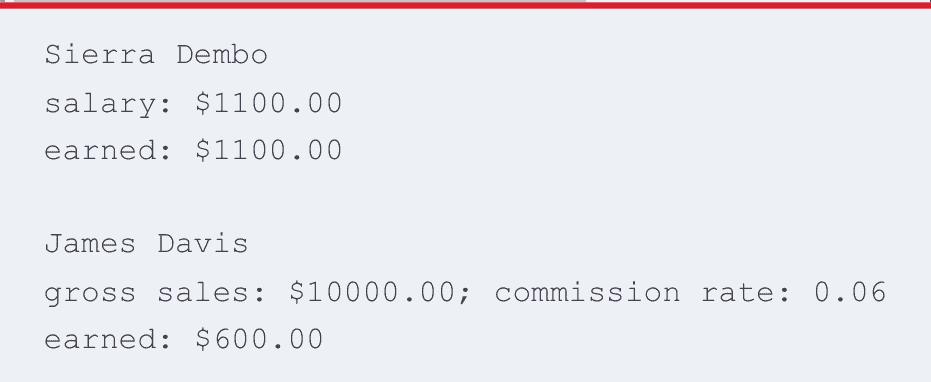

> 图 9.20 | 处理具有各种薪酬模型的员工。

### 生成式 AI

1. 提示生成式 AI 澄清在密封类和接口中 `permits` 子句何时是可选的。

# 9.15 私有构造函数

我们之前提到过，构造函数通常被声明为 `public`。有时，在类中声明一个或多个 `private` 构造函数是有用的。

### 防止对象实例化

你可以通过将构造函数声明为 `private` 来防止客户端代码创建该类的对象。例如，考虑 `Math` 类，它只包含 `public` 静态方法。

### 在构造函数中共享初始化

`private` 构造函数的一个用途是在构造函数之间共享初始化。

### 工厂方法

`private` 构造函数的另一个常见用途是强制客户端代码使用“工厂方法”。工厂方法是创建指定类型对象的方法。

### 生成式 AI

1. 提示生成式 AI 提供关于何时声明为 `private` 的额外见解。

# 9.16 protected 成员

第 8 章讨论了 `public` 和 `private` 访问修饰符：

- `public` 成员在类可见的地方都可以访问。
- `private` 成员仅在类内部可访问。

### 访问修饰符

`protected` 访问修饰符提供了 `public` 和 `private` 之间的中间级别：

- `private`
- 包级访问（未指定标识符时的默认值）
- `protected`
- `public`

因此，从最严格到最宽松，Java 的成员访问修饰符为：

- `private`
- 包级访问
- `protected`
- `public`

父类的 `public` 和 `protected` 成员在成为子类成员时会保留其访问修饰符：

- 父类的 `public` 成员变为子类 `public`，
- 父类的 `protected` 成员变为子类 `protected`。

类的 `private` 成员对子类隐藏，子类只能通过 `public` 或 `protected` 方法对其进行操作。子类方法可以直接通过名称引用继承自父类的 `public` 和 `protected` 成员。

声明实例变量有助于测试、调试和正确修改系统。如果子类可以访问父类的实例变量，那么继承该子类的类也可以访问它们。这将消除信息隐藏的好处。

### 使用 protected 变量的注意事项

继承 `protected` 实例变量允许子类直接访问变量。但在大多数情况下，你应该使用 `private` 实例变量以鼓励软件工程。你的代码将更容易维护、修改和调试。

使用 `protected` 实例变量会产生几个潜在问题。首先，子类对象可以直接设置继承变量的值而不使用 setter。因此，子类对象可以给变量分配无效值，可能导致对象处于不一致状态。

`protected` 变量的另一个问题是子类方法更容易依赖父类的数据实现。**在实践中，子类应该依赖父类的服务（即非私有方法），而不是父类的数据实现。** 如果父类使用 `protected` 实例变量，当父类实现发生变化时，我们需要修改父类的所有子类。这种类被认为是脆弱的，因为父类的变化可能会“破坏”子类的实现。**你应该能够在更改父类实现的同时为子类提供相同的服务。** 当然，如果父类服务发生了变化，我们必须重新实现其子类。

第三个问题是类的 `protected` 成员对于包含这些成员的类的包内的所有类都是可见的——这并不总是理想的。声明父类实例变量为 `private`（与 `protected` 相反），它允许父类的实现更改这些实例变量而不影响子类的实现。

当父类应该仅向其子类以及同一包中的其他类提供方法，而不向其他客户端提供时，请使用 `protected` 访问修饰符。避免使用 `protected` 实例变量。相反，请包含访问 `private` 实例变量的非私有方法。

### 生成式 AI

1. 提示生成式 AI 针对 `protected` 访问的真实 Java 使用用例。

# 9.17 总结

本章介绍了继承——即通过获取现有类的成员（无需复制粘贴代码）来创建新类，并能够为它们添加新功能的能力。你学习了父类和子类的概念，并使用关键字 `extends` 创建了继承自父类成员的子类。

我们展示了如何使用 `@Override` 注解来防止无意的重载，它通过指明该方法重写了父类方法。你使用了 `super` 来访问被重写的父类成员。你了解了构造函数在继承层次结构中是如何使用的。你学习了 `Object` 类的方法，它是所有 Java 类的直接或间接父类。我们讨论了使用组合与继承来设计类的优缺点。

我们引入了多态——即在类层次结构中处理共享相同父类的对象的能力，就像它们都是该父类的对象一样。我们讨论了多态使系统更具可扩展性和可维护性，然后演示了如何使用重写的方法来实现多态行为。

我们引入了抽象类，它允许你提供一个合适的父类，其他类可以从其继承。你学到抽象类可以声明抽象方法，每个具体的子类都必须实现这些方法，并且程序可以使用抽象类的变量以多态的方式调用子类对抽象方法的实现。你了解了如何在执行时确定对象的类型。

我们解释了 `final` 方法和类的概念。本章讨论了声明和实现接口，作为一种可能不同的类实现共同功能的方法，使得这些类的对象可以以多态的方式进行处理。我们讨论了为什么构造函数不应该调用可覆盖的方法，以及从构造函数中调用 `final`、`static` 和 `private` 方法是可以的。


我们引入了 `default`、`static` 和 `private` 接口方法。我们讨论了 `private` 构造函数的目的。我们引入了访问修饰符 `protected`，并提到子类方法可以直接访问继承的 `protected` 父类成员。

我们最初关注实现继承，然后指出几十年的经验表明，维护和修改紧耦合的实现继承层次结构可能困难。因此，我们重构了 `Employee` 工资示例以使用接口继承。在那个示例中，我们引入了组合和依赖注入的方法，类包含一个对象的引用，该对象提供该类对象所需的行为。然后，我们讨论了这种基于接口的方法如何使示例更容易修改和进化。最后，我们讨论了 `sealed` 类和接口，用于控制哪些类可以扩展某个类或实现某个接口。

你现在学习了类、对象、封装、继承、多态和接口——这些面向对象编程的核心方面。在下一章中，我们将更深入地讨论异常——异常处理使程序更加健壮。

## 特别章节：生成式 AI 练习

针对以下每个问题，尝试使用多个 AI 以确定哪一个表现最好。始终验证结果。请记住，它们有时会出错甚至产生幻觉，创建出不可靠的信息。

9.1 (构造函数注入 vs. 属性注入) Prompt AI 讨论 Java 中构造函数注入与属性注入的优缺点以及何时使用每种。

9.2 (default 方法) Prompt AI 讨论在 Java 接口中使用 `default` 方法的优缺点。

9.3 (运行时多态 vs. 编译时多态) Prompt AI 讨论 Java 中的运行时多态与编译时多态，以及何时使用每种。

9.4 (组合 vs. 继承) Prompt AI 讨论 Java 中组合与继承的优缺点，并提供各自更合适的场景示例。

# 10 异常处理：深入观察


## 目标

在本章中，你将：

- 学习为什么异常处理是响应运行时问题的有效机制。
- 使用 `try` 块界定可能发生异常的代码。
- 使用 `throw` 表示发生了问题。
- 使用 `catch` 块指定异常处理程序。
- 学习何时使用异常处理。
- 理解异常类层次结构。
- 使用 `finally` 块释放资源以防止资源泄漏。
- 通过捕获一个异常并抛出另一个异常来链接异常。
- 创建自定义异常。
- 使用调试功能 `assert` 测试方法中特定点的条件是否为真。
- 学习 `try`-with-resources 语句如何在 `try` 块结束时自动释放资源。

## 大纲

# 10.1 引言

# 10.2 示例：无异常处理的除零

# 10.3 示例：处理 ArithmeticException 和 InputMismatchExceptions

# 10.4 Java 异常层次结构

# 10.5 检查异常 vs. 非检查异常

# 10.6 finally 块

# 10.7 栈回溯和从异常中获取信息

# 10.8 链路异常

# 10.9 声明自定义异常

# 10.10 前提条件和后条件

# 10.11 断言

# 10.12 try-with-Resources 语句：自动释放

# 10.13 catch 处理程序中的未命名变量

# 10.14 总结

| 章节 | 使用的异常示例 |
| --- | --- |
| 第8–9 章 | IllegalArgumentException |
| 第10 章 | ArithmeticException, InputMismatchException |
| 第11 章 | SecurityException, FileNotFoundException, IOException, ClassNotFoundException, IllegalStateException, FormatterClosedException, NoSuchElementException |
| 第12 章 | ConcurrentModificationException, UnsupportedOperationException, NullPointerException |
| 第13 章 | NoSuchElementException, NumberFormatException |
| 章节 | 使用的异常示例 |
| --- | --- |
| 第17 章 | MediaException |
| 第18 章 | InterruptedException, IllegalMonitorStateException, ExecutionException, CancellationException |
| 第20 章 | SQLException |

在工业界，各个组织会开发自己的设计、编码、测试、调试和维护标准。公司通常会根据其开发的应用程序类型制定异常处理标准，例如实时系统、高性能数学计算、大数据、基于网络的分布式系统、人工智能应用等。

## 何时使用异常处理

异常处理旨在处理同步错误——这些错误在语句执行时发生在程序的常规控制流中。常见的示例包括除以零、数组索引越界、算术溢出（即值超出可表示的范围）以及无效的方法参数。

异常处理为记录、检测和恢复错误提供了一种单一、统一的技巧。这有助于开发大型项目的开发者理解彼此的错误处理代码。异常处理并不是作为指定程序控制流的替代方法，也不是用于处理那些在执行任务前通过简单测试条件就可以防止的问题。有时，你可以通过先验证数据来防止异常。例如，在执行整数除法之前，你可以确保分母不为零，从而防止除以零时发生 `ArithmeticException`。异常处理并非用于处理与异步事件相关的问题（例如网络消息到达、鼠标点击和击键输入），这些事件与程序的控制流并行且独立于控制流发生。

你应该从设计过程之初就将异常处理和错误恢复策略整合到系统中。在系统实现后才包含这些内容可能会非常困难。

## 生成式 AI

- 1 个 Prompt 用于生成式 AI，要求列出10 种常见的抛出的 Java 异常以及它们发生原因的简要说明。

## 10.2 示例：没有异常处理的除以零

首先，让我们演示一下当未使用异常处理的程序出现异常时会发生什么。图 10.1 提示用户输入两个整数并将它们传递给 `quotient` 方法，该方法计算整数商并返回一个 `int` 结果。在这个示例中，你将了解到当检测到问题且无法处理时，就会抛出异常（即发生异常）。图 10.1 中的第一次示例执行显示了成功的整数除法。

点击此处查看图像

```
1 // Fig.10.1: DivideByZeroNoExceptionHandling.
2 // 没有异常处理的整数除法
3 import java.util.Scanner;
4
5 public class DivideByZeroNoExceptionHandling {
6 // 演示在...时抛出异常
7 public static int quotient(int numerator, int denominator) {
8     return numerator / denominator; // pos
9 }
10
11 public static void main(String[] args) {
12     var input = new Scanner(System.in);
13
14     System.out.print("Enter an integer numerator: ");
15     int numerator = input.nextInt();
16     System.out.print("Enter an integer denominator: ");
17     int denominator = input.nextInt();
18
19     int result = quotient(numerator, denominator);
20     System.out.printf(
21         "%nResult: %d / %d = %d%n", numerator, denominator, result);
22      }
23 }
```

```
Enter an integer numerator: 100
Enter an integer denominator: 7

Result: 100 / 7 = 14
```

```
Enter an integer numerator: 100
Enter an integer denominator: 0
Exception in thread "main" java.lang.ArithmeticException
at DivideByZeroNoExceptionHandling.quotient(DivideByZeroNoExceptionHandling.java:8)
at DivideByZeroNoExceptionHandling.main(DivideByZeroNoExceptionHandling.java:12)
```

```
Enter an integer numerator: hello
Exception in thread "main" java.util.InputMismatchException
at java.base/java.util.Scanner.throw(InputSource.java)
at java.base/java.util.Scanner.next(Scanner.java)
at java.base/java.util.Scanner.nextInt(Scanner.java)
at java.base/java.util.Scanner.nextInt(Scanner.java)
at DivideByZeroNoExceptionHandling.main(DivideByZeroNoExceptionHandling.java:12)
```

图 10.1 | 没有异常处理的整数除法。

## 堆栈跟踪 (Stack Trace)

在第二次执行中，用户输入 0 作为分母。针对这一无效输入，显示了多行信息。此堆栈跟踪包含了异常的包名和类名（`java.lang.ArithmeticException`），以及一个描述性消息，该消息指示了问题、发生的行数以及问题发生时的方法调用栈（即调用链）。堆栈跟踪显示了逐个方法导致异常方法的执行路径。这有助于你调试程序。即使没有发生问题，你也可以通过调用 `Thread.dumpStack()` 打印堆栈跟踪。

## ArithmeticException 的堆栈跟踪

第一行指定发生了 `ArithmeticException`。类名后的文本 `/byzero` 表示这是由于尝试除以（/）零引起的。Java 不允许在整数算术中进行除以零操作。当发生这种情况时，Java 会抛出一个 `ArithmeticException`。

堆栈跟踪的每一行都用点分隔了类名和方法名（例如 `DivideByZeroNoExceptionHandling.main`），随后是问题发生的文件和行号（例如 `DivideByZeroNoExceptionHandling.java:12`）。向上移动堆栈跟踪，请注意 `main` 调用了 `quotient`，异常正发生在此。第 8 行指示了异常的抛出点。

## 关于浮点算术的侧记

Java 允许对浮点值进行除以零操作，产生正或负无穷，显示为 "Infinity" 或 "-Infinity"。如果你将 0.0 除以 0.0，结果是 `NaN`（非数字）——这是一个浮点值。要将浮点值与 `NaN` 比较，请使用 `Float.isNaN(floatValue)` 或 `Double.isNaN(doubleValue)`。每个返回一个指示参数值是否为 `NaN` 的 `boolean` 值。`Float` 和 `Double` 类位于 `java.lang` 包中。

## 生成式 AI

- 1 个 AI 提示词（Prompt），询问为什么异常处理对于防止程序意外终止非常重要。

## 10.3 示例：处理 ArithmeticExceptions 和 InputMismatchExceptions

图 10.2 修改了之前的程序，使用异常处理来处理出现的任何 `ArithmeticException` 和 `InputMismatchExceptions`。该程序仍然提示用户输入两个整数，并将它们传递给 `quotient` 方法，该方法计算商并返回一个 `int` 结果。如果用户输入了错误，此程序将捕获该异常，允许用户重新输入。

点击此处查看代码图像

```java
1 // Fig.10.2: DivideByZeroWithExceptionHandlin
2 // Handling ArithmeticExceptions and InputMi
3 import java.util.InputMismatchException;
4 import java.util.Scanner;
5
6 public class DivideByZeroWithExceptionHandling
7     // demonstrates throwing an exception whe
8     public static int quotient(int numerator,
9         throws ArithmeticException {
10        return numerator / denominator; // pos
11    }
12
13    public static void main(String[] args) {
14        var input = new Scanner(System.in);
15        boolean continueLoop = true; // determ
16
17        while (continueLoop) {
18            try { // read two numbers and calcu
19                System.out.print("Enter an integer
20                int numerator = input.nextInt();
21                System.out.print("Enter an integer
22                int denominator = input.nextInt();
23
24                int result = quotient(numerator,
25                System.out.printf("%nResult: %d",
26                denominator, result);
27                continueLoop = false; // input s
28            }
29            catch (InputMismatchException inputMismatchException) {
30                System.err.printf("%nException: ");
31                inputMismatchException);
32                input.nextLine(); // discard inp
33                System.out.printf("You must enter integers. Try again.");
34            }
35            catch (ArithmeticException arithmetic) {
36                System.err.printf("%nException: ");
37                System.out.printf("Zero is an invalid denominator.");
38            }
39        }
40    }
41}
```

```
Enter an integer numerator: hello

Exception: java.util.InputMismatchException

You must enter integers. Try again.

Enter an integer numerator: 100

Enter an integer denominator: 0

Exception: java.lang.ArithmeticException: / by zero

Zero is an invalid denominator. Try again.

Enter an integer numerator: 100

Enter an integer denominator: 7

Result: 100 / 7 = 14
```

图 10.2 | 处理 ArithmeticException 和 InputMismatchException

第 17–41 行反复要求用户输入，直到接收到有效输入为止。在示例执行中：

- 首先，当预期整数时，用户输入了 "hello"。发生了 `InputMismatchException`，程序要求用户再次尝试。
- 接下来，用户输入了有效的分子（100），但分母为 0。发生了 `ArithmeticException`，程序要求用户再次尝试。
- 最后，用户输入了正确的分子和非零分母，因此程序执行除法，显示结果并成功完成。

### 在 try 块封装代码


## 生成式 AI

- 1 个 AI 提示词（Prompt），询问为什么异常处理对于防止程序意外终止非常重要。

## 10.3 示例：处理 ArithmeticExceptions 和 InputMismatchExceptions

图 10.2 修改了之前的程序，使用异常处理来处理出现的任何 `ArithmeticException` 和 `InputMismatchException`。该程序仍然提示用户输入两个整数，并将它们传递给 `quotient` 方法，该方法计算商并返回一个 `int` 结果。如果用户输入了错误，此程序将捕获该异常，允许用户重新输入。

点击此处查看代码图像

```java
1 // Fig.10.2: DivideByZeroWithExceptionHandlin
2 // Handling ArithmeticExceptions and InputMi
3 import java.util.InputMismatchException;
4 import java.util.Scanner;
5
6 public class DivideByZeroWithExceptionHandling
7     // demonstrates throwing an exception whe
8     public static int quotient(int numerator,
9         throws ArithmeticException {
10        return numerator / denominator; // pos
11    }
12
13    public static void main(String[] args) {
14        var input = new Scanner(System.in);
15        boolean continueLoop = true; // determ
16
17        while (continueLoop) {
18            try { // read two numbers and calcu
19                System.out.print("Enter an integer
20                int numerator = input.nextInt();
21                System.out.print("Enter an integer
22                int denominator = input.nextInt();
23
24                int result = quotient(numerator,
25                System.out.printf("%nResult: %d",
26                denominator, result);
27                continueLoop = false; // input s
28            }
29            catch (InputMismatchException inputMismatchException) {
30                System.err.printf("%nException: ");
31                inputMismatchException);
32                input.nextLine(); // discard inp
33                System.out.printf("You must enter integers. Try again.");
34            }
35            catch (ArithmeticException arithmetic) {
36                System.err.printf("%nException: ");
37                System.out.printf("Zero is an invalid denominator.");
38            }
39        }
40    }
41}
```

Enter an integer numerator: hello

Exception: java.util.InputMismatchException

You must enter integers. Try again.

Enter an integer numerator: 100

Enter an integer denominator: 0

Exception: java.lang.ArithmeticException: / by zero

Zero is an invalid denominator. Try again.

Enter an integer numerator: 100

Enter an integer denominator: 7

```
Result: 100 / 7 = 14
```

图 10.2 | 处理 ArithmeticException 和 InputMismatchException

### 在 try 块中封装代码

第 18–28 行包含一个 `try` 块，它封装可能会抛出异常的代码以及在发生异常时不应执行的代码——如果发生异常，`try` 块中剩余的代码将被跳过。`try` 块由 `try` 关键字后跟一个用大括号括的代码块组成。从键盘读取整数的语句（第 20 行和 22 行）分别使用 `nextInt` 方法，如果读取的值不是整数，则会抛出 `InputMismatchException`。可能导致 `ArithmeticException` 的除法并未在 `try` 块之外执行。相反，`try` 块中对 `quotient` 方法调用（第 24 行）触发了除法（第 10 行），且分母为零。异常可能源于 `try` 块中的代码、`try` 块代码发起的调用或 Java 虚拟机在执行字节码时。

### 捕获异常

此示例的 `try` 块之后跟着两个 `catch` 块：

- 一个处理 `InputMismatchException`（第 29–35 行）以及
- 一个处理 `ArithmeticException`（第 36–40 行）。

`catch` 块（也称为 catch 子句或异常处理器）捕获并处理从相应的 `try` 抛出的异常。`catch` 关键字后跟着圆括号，其中包含一个标识异常的异常参数。至少有一个 `catch` 块——或一个 `finally` 块（第 10.6 节）必须紧随 `try` 块。我们倾向于根据类型命名我们的异常参数（`inputMismatchException` 和 `arithmeticException`）。当 `try` 块中发生异常时，类型与抛出的异常类型匹配的第一个 `catch` 块执行。如果 `catch` 的类型是抛出异常的类型或其直接或间接父类，则匹配成功。异常参数名称允许 `catch` 块与异常对象交互（如第 30–31 行和 37 行）。我们使用 `System.err`（标准错误流）来输出错误消息。

### 多异常捕获

通常 `try` 块之后会有多个 `catch` 块来处理各种异常。如果 catch 块相同且之间没有继承关系，可以使用多异常捕获来捕获这些异常并执行相同的任务。多异常捕获的语法：

```java
catch (Type1 | Type2 | Type3 e)
```

每个异常类型用竖线 (`|`) 分隔。前一个代码表示任何这些类型（或其子类）都可以被捕获。

### 未捕获的异常

未捕获的异常是指没有匹配 catch 块的异常。在图 10.1 的第二次和第三次输出中存在未捕获的异常。

未捕获的异常并不总是导致程序终止。Java 使用多线程模型执行程序——每个线程都是并发活动。一个程序可以有很多线程。如果程序只有一个线程，未捕获的异常会导致程序终止。如果程序有多个线程，未捕获的异常只会终止发生异常的线程。某些线程可能依赖其他线程。如果一个线程由于未捕获异常而终止，可能会对程序的其他线程产生不利影响。第 18 章并发：从平台线程到虚拟线程将深入讨论这些问题。

`catch` 块后的第一个语句。2. 现在循环条件为 `false`，`main` 结束。

+ 2. 当我们在第 10.6 节讨论 `finally` 块时，我们将介绍另一种可能性。

`try` 块及其对应的 `catch` 和/或 `finally` 块组成一个 `try` 语句。不要混淆“try 块”和“try 语句”这两个术语——后者包含了 `try` 块以及随其后的 `catch` 块和/或 `finally` 块。

与任何其他代码块一样，当 `try` 块结束时，在该块中声明的局部变量将超出作用范围并无法再次访问；因此，`try` 块的局部变量在相应的 `catch` 块中不可用。当 `catch` 块结束时，在该块中定义的局部变量（包括其异常参数）也会超出作用范围。

## `throws` 子句

在方法 `quotient`（第 8–11 行）中，`throws` 子句（第 9 行）指定了方法在发生问题时可能抛出的异常。该子句必须出现在方法的参数列表之后、方法体之前，包含一个用逗号分隔的异常类型列表。此类异常可能会由方法体中的语句或从那里调用的方法抛出。我们为此方法添加了 `throws` 子句，以告知调用者该方法可能会抛出 `ArithmeticException`。某些异常类型（如 `ArithmeticException`）不需要列在 `throws` 子句中。对于那些必须列出的异常，方法可以抛出与 `throws` 子句中列出的类具有 `is-a` 关系的异常。你将在[第 10.4 节]中学习更多信息。

在程序中使用方法之前，请阅读该方法的在线 API 文档。文档指定了方法抛出的异常（如果有），并指示了发生此类异常的原因。接下来，阅读指定异常类的在线 API 文档，这些文档通常列出了发生此类异常的原因。最后，在你的程序中处理这些异常。

## 方法 `quotient` 因除零而失败

当执行第 10 行时，如果 `denominator` 为 0，JVM 会抛出一个 `ArithmeticException` 对象。该对象将由第 36–40 行的 `catch` 块捕获，该块显示由其 `toString` 方法返回的异常基本信息。然后，程序要求用户重试。

当 `quotient` 抛出 `ArithmeticException` 时，它会立即终止且不返回值。它的局部变量超出作用范围。如果 `quotient` 包含指向对象的局部变量，且没有其他指向这些对象的引用，则这些对象将被标记为垃圾回收。在本程序中，当发生 `ArithmeticException` 时，调用 `quotient` 的 `try` 块会在第 25–27 行执行之前终止。在这里，`try` 块的局部变量也会超出作用范围。

## 方法 `quotient` 成功执行

如果分母不为 0，`quotient` 将执行除法并将结果返回给 `try` 块中调用 `quotient` 的那行代码（第 24 行）。第 25–26 行显示结果，第 27 行将 `continueLoop` 设置为 `false`。在这种情况下，`try` 块成功完成，因此程序跳过 `catch` 块，第 17 行的条件失败，`main` 正常完成执行。

## 生成式 AI

+ 1 提示 genAIs，询问关于何时使用异常处理对比输入验证的真实世界示例。
+ 2 提示 genAIs，询问为什么你可能不想在 Java 程序中 `catch` 异常。

## 10.4 Java 异常层次结构

所有 Java 异常类都直接或间接地继承自 `class Exception`，形成一个继承层次结构。你可以用自己的异常类来扩展此层次结构。

下面的 UML 类图显示了 `class Throwable`（`Object` 的子类）继承层次结构的一小部分，它是 `Exception` 类的父类——只有 `Throwable` 对象可以使用异常处理机制：

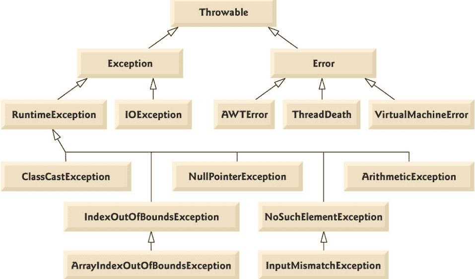

`Throwable` 类有两个直接子类——`Exception` 和 `Error`：

- 类 `Exception` 及其子类——例如 `RuntimeException`（位于 java.lang 包）和 `IOException`（位于 java.io 包）——代表 Java 程序中可能发生的异常情况，并且可以被应用程序捕获。
- 类 `Error` 及其子类代表 JVM 中发生的异常情况。大多数 Error 发生频率很低，不应被应用程序捕获——应用程序通常无法从它们恢复。

Java 异常层次结构包含数百个类。关于这些类的信息可以在整个 Java API 中找到。

你可以在此处查看 `Throwable` 的文档：

点击此处查看代码图片


https://docs.oracle.com/en/java/javase/23/docs/api/java/lang/Throwable.html

从那里，你可以查看该类的子类，以获取更多关于 Java `Exception` 和 `Error` 的信息。

## 捕获子类异常

如果编写的 `catch` 处理器用于捕获父类异常对象，那么它也将捕获该异常类子类的对象。这使得 `catch` 块能够以多态的方式处理相关的异常。如果每个子类都需要不同的处理方式，你应该单独 `catch` 每个子类。

### 仅执行第一个 `catch`

如果多个 `catch` 块匹配特定的异常类型——例如，一个捕获特定的异常类，另一个捕获其父类——则只执行第一个匹配的 `catch` 块。例如，如果一个 `catch` 块捕获 `ArithmeticException`，而另一个 `catch` 块捕获 `Exception`，只有第一个匹配的 `catch` 块会执行。如果你忘记测试一个子类类型，单独捕获子类类型会导致编译错误。

在子类类型之前放置父类的 `catch` 块可以确保所有子类异常被捕获。在行业中，抛出或捕获 `Exception` 类型是不建议的——我们在后续章节中通常会抛出和捕获更具体的异常类型。

## 生成式 AI

1. 提示 genAIs，询问常见的 `Error` 子类以及它们发生的原因。
2. 提示 genAIs，询问为什么你不应该抛出并捕获 `Exception`。
3. "Class VirtualMachineError." 访问于 2024 年 9 月 22 日。https://docs.oracle.com/en/java/javase/23/docs/api/java.lang/VirtualMachineError.html。

# 检查异常

所有直接或间接继承自 `Exception` 但不是 `RuntimeException` 的类都是检查异常。这些异常通常由程序控制的条件引起。例如，在文件处理（第 11 章）中，如果 Java 程序尝试打开一个不存在的文件，就会发生检查异常 `FileNotFoundException`。

# 编译器与检查异常

编译器强制要求对检查异常执行“捕获或声明”（catch-or-declare）策略。如果一个方法的代码可能会抛出检查异常，则该方法必须：

- 通过将代码封装在 `try` 块中并紧跟一个处理该检查异常类型（或其父类）的 `catch` 处理器来捕获该异常；或者
- 通过在方法的参数列表和方法体之间的 `throws` 子句中放置异常类型，向方法的调用者声明该异常。

如果代码不满足这些要求，就会发生编译错误。**这迫使你思考并处理潜在问题，从而产生更健壮的代码。如果异常可以在方法中被有意义地处理，则该方法应该 `catch` 异常而不是声明它。**

# 编译器与未检查异常

**编译器不强制要求对未检查异常执行 `catch`-或声明要求，** 这些异常通常代表可以预防的编码错误。理想情况下，你应该在程序开发期间修复此类错误。然而，为未检查异常提供适当的异常处理代码可以让你的程序更健壮。**未检查异常不需要在方法的 `throws` 子句中列出。**

## 重写方法中的 `throws` 子句

如果子类方法重写了父类方法，子类方法在其 `throws` 子句中列出的异常比父类方法多，则是一个错误。然而，子类的 `throws` 子句可以列出父类 `throws` 子句中类型的子集。

# 生成式 AI

1. 提问生成式 AI，询问为什么 Java 设计师选择将检查异常与未检查异常区分开。
2. 提问生成式 AI，列出常见的 Java 未检查异常列表以及如何避免每一种。

# 10.6 finally 块

程序通常通过使用系统资源（如内存、网络连接和数据库连接）来完成任务。当程序不再需要某个资源时，程序应该立即将其返回系统以避免资源泄漏，泄漏会导致程序无法使用它。

在 C 和 C++ 等编程语言中，最常见的资源泄漏是内存泄漏。Java 的自动垃圾回收防止了大多数内存泄漏，但在没有剩余引用之前，Java 不会对对象进行垃圾回收。因此，如果程序错误地保留了不需要对象的引用，仍然可能发生内存泄漏。其他资源必须显式释放，以确保未来可以使用。

## finally 块的位置

`try` 语句的 `finally` 块（也称为 `finally` 子句）由 `finally` 关键字组成，后面跟着大括号括起的代码：

- 如果 `try` 语句有一个或多个 `catch` 块，则 `finally` 块是可选的并放在最后一个 `catch` 块之后。
- 如果 `try` 语句没有 `catch` 块，则 `finally` 块是强制的，并紧跟在 `try` 块之后。

# finally 块在何时执行

如果存在，`finally` 块在其相应的 `try` 块终止时始终执行，无论是否发生异常。`finally` 块不执行的唯一情况是 `try` 块调用了 `System` 类的退出方法，该方法会立即终止程序。如果发生了异常但未被 `catch` 处理器捕获，或者 `catch` 块抛出了异常，控制将在程序将异常传递给下一个嵌套的 `try` 块（通常在调用方法中）之前进入 `finally` 块。

由于 `finally` 块总是执行的，因此它是资源释放代码的理想位置，可以将文件、网络连接、数据库连接和其他资源返回给系统。

## 演示 `finally` 块

图 10.3 机械地演示了无论相应的 `try` 块中是否抛出异常，`finally` 块都会执行。程序包含 `static` 方法 `main`（第 5–14 行）、`throwException`（第 17–35 行）和 `doesNotThrowException`（第 38–50 行）。方法 `throwException` 和 `doesNotThrowException` 是 `static` 的，因此 `main` 可以调用它们。

```java
// Fig. 10.3: UsingExceptions.java
// try...catch 异常处理。

public class UsingExceptions {
    public static void main(String[] args) {
        try {
            throwException();
        } catch (Exception exception) {
            System.err.println("Exception handled in main");
        } finally {
            System.out.println("Finally executed in main");
        }
    }

    public static void throwException() {
        try {
            throw new Exception();
        } catch (Exception exception) {
            System.err.println("Exception handled in throwException");
        } finally {
            System.out.println("Finally executed in throwException");
        }
    }

    public static void doesNotThrowException() {
        try {
            // No exception is thrown
        } catch (Exception exception) {
        } finally {
            System.out.println("Finally executed in doesNotThrowException");
        }
    }
}
```

# 使用 `throw` 语句抛出异常

方法 `main`（图 10.3）开始执行，进入其 `try` 块并立即调用 `throwException`（第 17–35 行）。第 20 行的 `throw` 语句抛出 `Exception` 以立即终止 `try` 块。`throw` 语句中的对象必须是间接继承自 `Throwable` 的类。

# 重新抛出异常

第 20 行的 `Exception` 在第 22 行捕获。然后，第 25 行重新抛出该异常。当 `catch` 块在接收到异常后只能部分处理它时，通常会重新抛出异常。通过使用 `throw` 后跟异常参数名称来重新抛出异常，该名称指向刚刚捕获的异常对象。

当发生重新抛出时，下一个嵌套的 `try` 块有机会检测并处理异常。在这种情况下，下一个嵌套的 `try` 块是 `main` 中的第 6–8 行。然而，在抛出的异常返回到 `main` 第 7 行之前，第 30–32 行的 `finally` 块会执行。然后，方法 `throwException` 终止，`main` 在 `try` 块中检测到异常并在 `catch` 块中处理它。

# 当没有异常时 finally 也会执行

接下来，`main` 的第 13 行调用方法 `doesNotThrowException`（第 38–50 行）。`throwException` 的 `try` 块（第 39–41 行）没有发生异常，因此程序跳过了 `catch` 块（第 42–44 行），但 `finally` 块（第 45–47 行）仍然执行。然后，继续执行 `finally` 块之后的语句（第 49 行），函数返回到 `main`，程序终止。

# 不要在 finally 块中抛出异常

不要在 `finally` 块中编写可能会抛出异常的代码。如果需要此类代码，请将其封装在 `finally` 块内的 `try...catch` 中以防止 `finally` 抛出异常。当 `finally` 块在仍在处理异常时抛出一个新异常时，第一个异常将会丢失。

# 不要过度使用 `try` 语句

`try` 语句将错误处理代码从程序逻辑中分离，提高了程序的清晰度。不要将每个可能抛出异常的语句都封装在独立的 `try` 语句中，这会降低可读性；应将代码的大部分放在一个 `try` 块中，随后是必要的 `catch` 块，如果需要，再跟一个 `finally` 块。

## 生成式 AI

- 向生成式 AI 提问，询问在 Java 中可能发生哪些类型的资源泄漏。
- 向生成式 AI 提问，让它们解释为什么你可能想要重新抛出异常。

# 10.7 栈回溯和从异常中获取信息

当异常在特定方法中抛出但未捕获时，方法调用栈会被“回溯”，并尝试在下一个相邻的 `try` 块中 `catch` 该异常。这一过程被称为栈回溯。回溯方法调用栈处理器意味着未捕获异常的方法将终止，该方法中的所有局部变量超出作用范围，控制权返回到调用该方法的语句。如果 `try` 块封装了该语句，则会尝试捕获异常。如果 `try` 块未封装该语句或异常未被捕获，则再次发生栈回溯。图 10.4 展示了栈回溯，`main` 方法中的异常处理器显示了如何访问异常对象中的数据。

4. 如果你使用命令 `java UsingExceptions.java` 执行此示例——该命令会在内存中编译程序并运行——那么此程序的输出将与图 10.4 不同。

```java
// Fig. 10.4: UsingExceptions.java
// 栈回溯和从...获取数据

public class UsingExceptions {
    public static void main(String[] args) {
        try {
            method1();
        } catch (Exception exception) { // catch
            System.err.printf("%s%n%n", exception);
            exception.printStackTrace();

            // 获取堆栈跟踪信息
            StackTraceElement[] traceElements = exception.getStackTrace();

            System.out.printf("%nStack trace from:%n");
            System.out.println("Class\tFile\tLine\tMethod");

            // 遍历 traceElements 以获取详情
            for (StackTraceElement element : traceElements) {
                System.out.printf("%s\t", element.getClassName());
                System.out.printf("%s\t", element.getFileName());
                System.out.printf("%s\t", element.getLineNumber());
                System.out.printf("%s%n", element.getMethodName());
            }
        }
    }

    // 调用 method2；将异常抛回给 method1
    public static void method1() throws Exception {
        method2();
    }

    // 调用 method3；将异常抛回给 method2
    public static void method2() throws Exception {
        method3();
    }

    // 将异常抛回给 method2
    public static void method3() throws Exception {
        throw new Exception("Exception thrown in method3");
    }
}
```

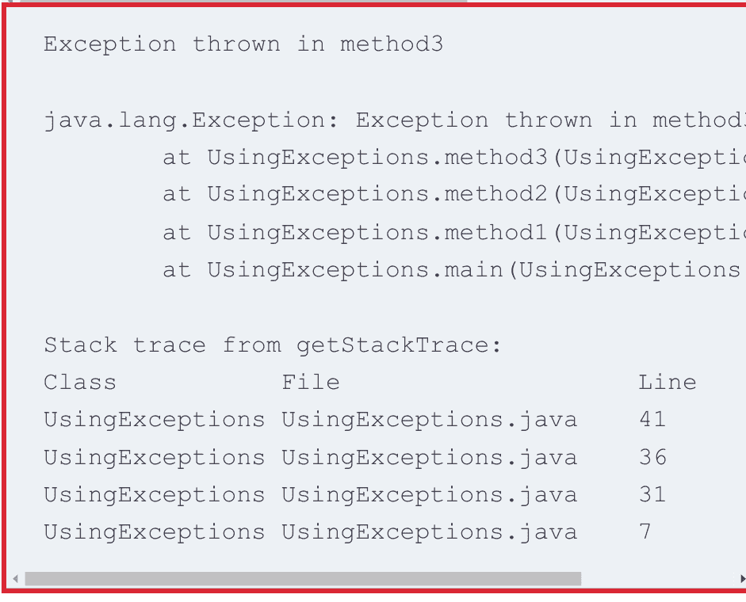

图 10.4 | 栈回溯和从异常对象获取数据。

# 栈回溯

在 `main` 中，`try` 块（第 6–8 行）调用 `method1`（定义在第 30–32 行），继而调用 `method2`（定义在第 35–37 行），再调用 `method3`（定义在第 40–42 行）。程序执行如下：

- `method3` 中的第 41 行抛出一个 `Exception` 对象——这就是抛出点。
- 因为 `throw` 语句没有封装在 `try` 块中，因此发生了栈回溯。所以，`method3` 在第 41 行终止，控制权返回到第 36 行——`method2` 中调用 `method3` 的语句。
- 因为 `try` 块封装了第 36 行，再次发生栈回溯。因此，`method2` 在第 36 行终止，并返回控制到第 31 行——`method1` 中调用 `method2` 的语句。
- 因为没有 `try` 块封装第 31 行，再次发生栈回溯。因此，`method1` 在第 31 行终止，并返回控制到第 7 行——`main` 中调用 `method1` 的语句。
- 第 6–8 行的 `try` 块封装了该语句。异常未被处理，因此 `try` 块终止，并执行第一个匹配的 `catch` 块（第 9–26 行）。

```java
// Fig. 10.5: UsingChainedExceptions.java
// 链异常。

public class UsingChainedExceptions {
    public static void main(String[] args) {
        try {
            method1();
        } catch (Exception exception) { // 接收
            exception.printStackTrace();
        }
    }

    // 调用 method2; 将异常抛回给
    public static void method1() throws Exception {
        try {
            method2();
        } catch (Exception exception) { // 接收
            throw new Exception("Exception thrown in method1", exception);
        }
    }

    // 调用 method3; 将异常抛回给
    public static void method2() throws Exception {
        try {
            method3();
        } catch (Exception exception) { // 接收
            throw new Exception("Exception thrown in method2", exception);
        }
    }

    // 将异常抛回给 method2
    public static void method3() throws Exception {
        throw new Exception("Exception thrown in method3");
    }
}
```


java.lang.Exception: Exception thrown in method1

at UsingChainedExceptions.method1 (UsingChainedExceptions.java)

at UsingChainedExceptions.main(UsingChainedExceptions.java)

Caused by: java.lang.Exception: Exception thrown in method2

at UsingChainedExceptions.method2 (UsingChainedExceptions.java)

at UsingChainedExceptions.method1 (UsingChainedExceptions.java)

... 1 more

Caused by: java.lang.Exception: Exception thrown in method3

at UsingChainedExceptions.method3 (UsingChainedExceptions.java)

at UsingChainedExceptions.method2 (UsingChainedExceptions.java)

... 2 more

Fig. 10.5 | 链异常。

# 程序控制流

该程序有四个方法——`main`（第 5–12 行）、`method1`（第 15–22 行）、`method2`（第 25–32 行）和 `method3`（第 35–37 行），其运行如下：

- `main` 方法 `try` 块中的第 7 行调用了 `method1`。`method1` 方法 `try` 块中的第 17 行调用了 `method2`。`method2` 方法 `try` 块中的第 27 行调用了 `method3`。

- 在 `method3` 中，第 36 行抛出了一个新的 `Exception`。由于第 36 行不在 `try` 块中，`method3` 终止，异常被返回到调用它的方法（`method2`）的第 27 行。

- 第 27 行位于 `try` 块中，因此 `try` 块终止，异常在第 29–31 行被捕获。

- `catch` 块中的第 30 行抛出了新异常。我们调用了带有两个参数的 `Exception` 构造函数，第二个参数表示导致问题的原始原因的异常——每个异常类都有一个如程序所示的构造函数，原始异常发生在第 36 行。由于异常从 `catch` 块中抛出，`method2` 终止并向新异常返回到 `method1` 的第 17 行。

- 第 17 行位于 `try` 块中，因此 `try` 块终止，异常在第 19–21 行被捕获。

- `catch` 块中的第 20 行使用捕获到的异常作为构造函数的第二个参数抛出一个新异常。由于异常从 `catch` 块中抛出，`method1` 终止并将新异常返回到 `main` 的第 7 行。

- `main` 中的 `try` 块终止，异常在第 9–11 行被捕获。第 10 行打印了包含所有链异常信息的堆栈跟踪。

# Throwable 方法 getCause

对于任何链异常，你都可以调用 `Throwable` 方法 `getCause` 获取最初导致该异常的 `Throwable`。

# 程序输出

在程序输出中：

- 前三行显示了最近抛出的异常（即第 20 行 `method1` 抛出的异常），

- 接下来四行表示从第 30 行 `method2` 抛出的异常，以及

- 最后四行代表从第 36 行 `method3` 抛出的异常。

当你从下到上读取输出时，它显示了剩余多少个链异常。

## 生成式 AI

**1** 提示 genAIs，请求一个“异常翻译”的真实世界示例，其中 Java 程序捕获一个异常，然后使用链异常在抛出更具体的异常之前添加上下文。

# 10.9 声明自定义异常

大多数 Java 程序员使用来自 Java API 的现有类、第三方供应商以及来自 GitHub 等网站的免费类库来构建 Java 应用。这些类的方法在发生问题时可能会抛出适当的异常。你编写代码来处理这些现有异常，使你的程序更加健壮。如果你构建了其他程序员使用的类，那么通常有必要声明自己的异常类，专门针对当其他程序员使用你的类时可能发生的问题。

将每种严重的运行时故障与命名适当的 `Exception` 子类相关起来可以提高程序的清晰度。

# 扩展现有的异常类

一个新的异常类必须继承现有的类，以确保新类可以用于异常处理机制。按照约定，新类的名称应以 `Exception` 结尾。异常类通常包含四个构造函数：

- 一个不接受参数并将默认错误消息 `String` 传递给父类构造函数的，

- 一个接收作为 `String` 类型的自定义错误消息并将其传递给父类构造函数的，

- 一个接收作为 `String` 类型的自定义错误消息和 `Throwable`（用于链异常）的，

- 一个接收 `Throwable`（用于链异常）并传递给父类构造函数的。

# 尽可能使用现有的异常类

大多数 Java 程序员不需要定义自己的异常类。在定义自己的之前，先研究 Java API 的现有类。如果没有合适的类，尝试扩展相关的异常类。例如，如果你创建一个表示尝试除以零的类，你可以扩展 `ArithmeticException`，因为除以零发生在运算期间。

# 选择自定义异常是检查的还是未检查的

如果没有合适的现有的异常类，请决定你的新异常类应该是检查的还是未检查的：

- 如果要求客户端处理异常，则新异常类应该是 `Exception` 而不是 `RuntimeException`。在这种情况下，客户端应该从异常中恢复。

- 如果客户端代码可以忽略异常（即未检查异常），则新异常类应该扩展 `RuntimeException`。

## 生成式 AI

1. Prompt genAIs，请求关于在 Java 中创建新异常类型的指南。

2. Prompt genAIs，请求关于何时将自定义异常设置为检查或未检查的指南。

# 10.10 前提条件和后条件

程序员花费大量时间维护和调试代码。为了便于这些任务并改进整体设计，你可以指定方法执行前后的预期状态。这些状态被称为前提条件和后条件。

# 前提条件

前提条件在调用方法时为真。前提条件描述了参数以及方法在开始执行前对程序状态的其他预期。如果不满足前提条件，则方法的行为是未定义的——它可能会抛出异常、继续使用非法值或尝试从错误中恢复。如果不满足前提条件，你不应期待一致的行为。

# 后条件

后条件在方法成功返回后为真。后条件描述了返回值方法可能产生的任何副作用。在定义方法时，你应该记录所有的后条件，以便他人知道在调用你的方法时可以期待什么，并确保在满足前提条件的情况下它遵循所有的后条件。

# 在不满足前提条件或后条件时抛出异常

方法通常抛出异常。例如，检查 `String` 方法 `charAt`，它有一个 `int` 参数——`String` 中的索引。`charAt` 方法的前提条件是接收到的索引大于等于 0 且小于 `String` 的长度。前提条件说明该方法将返回指定索引处的字符。否则，`charAt` 会抛出 `OutOfBoundsException`。在我们满足前提条件的情况下，我们信任 `charAt` 方法满足了它的后条件。我们不必担心其该方法如何通过索引检索字符的细节。

# 文档前置条件或后置条件

通常，方法的前置条件和后置条件作为其规范的一部分进行。在设计自己的方法时，你通常会在方法声明前的注释中说明前置条件和后置条件。

## 生成式 AI

1. 提示生成式 AI，列出 Java 方法的典型前置条件和后置条件类型。

2. 提示生成式 AI，询问如果不满足前置条件或后置条件，Java 方法通常会抛出哪些异常。

3. 提示生成式 AI，请求一个简单的 Java 程序，演示一个带有正确注释的前置条件和后置条件的方法，并通过 `if` 语句进行测试，在不满足前置条件或后置条件时 `throw` 异常。

# 10.11 断言 (Assertions)

在实现和调试类时，有时说明方法中特定点应该为真的的条件是有帮助的。这些条件被称为断言（assertions），它们有助于通过在开发过程中捕获潜在的 bug 并识别可能的逻辑错误来确保程序的有效性。前提条件和后条件是断言两种类型。前提条件是关于方法调用时程序状态的断言，后条件是关于方法完成后状态的断言。

## `assert` 语句

虽然断言可以以注释的形式存在以指导你的程序开发，但 Java 包含了两个版本的 `assert` 语句来通过程序化验证断言。`assert` 语句评估一个 `boolean` 表达式，如果为 `false`，则抛出 `AssertionError`（`Error` 的子类）。`assert` 语句的第一种形式是：

```
assert expression;
```

如果 expression 为 `false`，则抛出 `AssertionError`。第二种形式是：

```
assert expression1 : expression2;
```

它评估 `expression1`，如果 `expression1` 为 `false`，则抛出一个以 `expression2` 为错误消息的 `AssertionError`。

## 使用 `assert`

在开发过程中，你可以使用断言通过程序化实现前置条件和后置条件，或验证任何其他有助于确保代码正确运行的中间状态。

断言主要用于调试和识别应用程序中的逻辑错误。**它们默认是被忽略的，因此你在执行程序时必须显式启用它们**，如下所示——`-ea` 选项代表“启用断言”：

```
java -ea AssertTest
```

图 10.6 展示了 `assert` 语句。第 9 行提示用户输入 0 到 10 之间的数字，然后第 10 行读取该数字。第 13 行确定用户输入的数字是否在有效范围内。如果数字超出范围，`assert` 语句将报告错误；否则，程序正常进行。**你不应该使用 `assert` 来指示生产代码中的运行时问题**，正如我们在图 10.6 中仅出于演示目的那样。生产代码应该抛出异常来指示执行过程中遇到的问题。

点击此处查看代码图片

```
1 // Fig.10.6: AssertTest.java
2 // 使用 assert 检查值是否在范围内
3 import java.util.Scanner;
4
5 public class AssertTest {
6     public static void main(String[] args) {
7         var input = new Scanner(System.in);
8
9         System.out.print("Enter a number betwe
10         int number = input.nextInt();
11
12         // 断言该值 >= 0 且 <
13         assert (number >= 0 && number <= 10) : "number out of range";
14
15         System.out.printf("You entered %d%n", number);
16     }
17 }
```


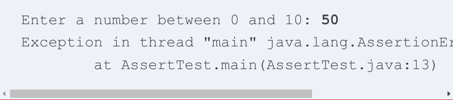

图 10.6 | 使用 assert 检查一个值是否在范围之内。

# 不要捕获 AssertionErrors

`AssertionError` 应该只在程序开发期间使用，以识别代码中的问题。不要捕获它们。只需让你的程序终止，这样你就可以定位并修复问题源，使你的程序更健壮。

## 生成式 AI

1. 提示生成式 AI，请求一个简单的 Java 程序，演示一个带有正确注释的前置条件和后置条件的方法，并通过 `assert` 进行测试。

# 10.12 try-with-Resources 语句：自动资源释放

在早期的 Java 版本中，你会将资源释放代码放在 `finally` 块中，以确保资源被释放，无论资源相应的 `try` 块是否抛出了异常。`try-with-resources` 语句简化了代码编写，即你获取一个或多个资源，在 `try` 块中使用它们，并在相应的 `finally` 块中释放它们。大多数表示需要释放资源的 Java API 类现在都实现了 `AutoCloseable` 接口并提供了 `close` 方法。此类对象可以如下所示用于 `try-with-resources` 语句中：

点击此处查看代码图片

```
try (var theObject = new ResourceClass()) {
  // 在此处使用 theObject。资源会自动
  // try 块成功结束或由于
}
catch (Exception e) {
  // 捕获在使用该对象时发生的异常
}
```

其中括号中的 `ResourceClass` 必须实现 `AutoCloseable`。`try-with-resources` 语句是管理 `AutoCloseable` 资源的首选方式。`try` 块在成功结束或由于异常结束时调用资源的 `close` 方法。`try` catch 子句是可选的。你可以通过分号（;）在 `try` 后的括号内创建多个 `AutoCloseable` 对象。这简化了 `try-with-resources` 语句，特别是在处理多个 `AutoCloseable` 对象时。

# 抑制异常 (Suppressed Exceptions)

当 `try-with-resources` 语句的 `try` 块抛出异常时，语句立即关闭指定的 `AutoCloseable` 资源。如果在关闭这些资源时发生任何异常，Java 会抑制这些异常，以便原始异常继续被处理。抑制异常会被添加到原始异常对象。你可以通过异常对象的 `getSuppressed` 方法（所有异常类继承自 `Throwable`）获取 `Throwable` 对象数组。

## 生成式 AI

1. 提示生成式 AI，列出实现 `AutoCloseable` 接口的常用 Java 类，并说明它们各自管理的资源。

2. 提示生成式 AI，请求一个 Java `try-with-resources` 语句中抑制异常的典型示例。

# 10.13 catch 处理程序中的未命名变量

Java 22 引入了未命名变量（`_`），用于需要变量名但你不需要该变量的情况。例如，图 10.7 创建了一个数组，然后尝试访问越界元素，这会抛出 `ArrayIndexOutOfBoundsException`。`catch` 程序必须在异常类型后指定一个变量名。然而，如果你的 `catch` 程序不需要访问异常对象，可以使用未命名变量 `_` 代替变量名（第 10 行）。

- 5. JEP 456: Unnamed Variables & Patterns.” 访问于 2024年9月22日。https://openjdk.org/jeps/456.

点击此处查看代码图片

```
1 // Fig.10.7: UnnamedVariableDemo.java
2 // 在需要变量名的地方使用 _
3 public class UnnamedVariableDemo {
4     public static void main(String[] args) {
5         int[] array = {1, 2, 3, 4, 5};
6
7         try {
8             int value = array[10]; // index 10
9         }
10        catch (ArrayIndexOutOfBoundsException _) {
11            System.out.println("Index out of range");
12        }
13    }
14}
```


图 10.7 | 在需要变量名的地方使用变量。

# 记录模式中的未命名变量

你也可以在记录模式中使用未命名变量来解构匹配的对象，主要用于：

- 模式匹配 `instanceof` 表达式（第 9.8.4 节）和

- 模式匹配 `switch` 表达式（第 8.20.1 节）

如果匹配只需要记录元素的某个子集，记录模式可以代替你想要忽略的项。要查看其他用法的完整列表，请访问：

```
https://openjdk.org/jeps/456
```

# 10.14 总结

在本章中，你通过 `try` 语句使用异常处理来处理运行时错误。你学习了异常处理允许将错误处理代码从程序执行的“主线”中移除，使你的代码更易读。我们展示了如何使用 `try` 块封装可能会 `throw` 异常的代码，以及如何使用 `catch` 块处理产生的异常。我们还引入了多 `catch` 结构用于在同一个 `catch` 处理器中处理多个异常。

你学习了异常处理的终止模型，在处理完异常后，程序控制不会返回到 `throw` 点。我们讨论了受检查异常与非受检查异常，以及如何使用 `throws` 子句指定方法可能 `throw` 的异常。

我们展示了 `finally` 块总是执行的，无论相应的 `try` 块是否发生异常，这使得 `finally` 块适合释放资源。你还学习了如何重新抛出（re-`throw`）异常。我们展示了如何使用方法 `printStackTrace`、`getStackTrace` 和 `getMessage` 获取异常信息。我们介绍了链式异常，它允许你在保留原始异常及其堆栈跟踪信息的同时，抛出一个更具体的异常。然后，我们展示了如何创建自己的异常类。

我们引入了前置条件和后置条件，帮助使用你方法的程序员理解在方法调用和返回时必须满足的条件。当不满足前置条件或后置条件时，方法通常会 `throw` 异常。我们讨论了 `assert` 语句以及如何用它帮助调试程序。


我们引入了`try`-with-resources语句，用于在`try`块使用`AutoCloseable`资源后自动释放该资源。最后，我们在`catch`处理器中演示了未命名变量`_`，当不需要访问捕获到的异常时使用。在下一章中，你将学习文件处理，包括持久化数据如何存储和检索。

# 特殊章节：生成式 AI 练习

针对以下每个问题，尝试使用多个生成式 AI 以确定哪一个表现最好。务必验证结果。记住，它们有时会出错甚至产生幻觉，创建出不可靠的信息。

10.1（生成式 AI：finally 块）向生成式 AI 输入以下提示：Java 中大多数管理资源的类都实现了`AutoCloseable`接口，以便与`try`-with-resources语句一起使用。在此基础上，请提供一个需要使用`try`语句的`finally`块的真实示例。

10.2（生成式 AI：后置条件）向生成式 AI 提问，列出`java.lang.Math`类方法使用的后置条件列表。

10.3（生成式 AI：自定义异常的优缺点）向生成式 AI 提问，询问在 Java 中创建自定义异常的优缺点。

10.4（生成式 AI：组织是否不鼓励异常）向生成式 AI 提问，询问某些 Java 软件开发组织是否不鼓励使用异常。如果是，为什么？

10.5（生成式 AI：异常处理性能）向生成式 AI 提问，列出使用 Java 异常处理时的性能考虑因素。

10.6（生成式 AI：BigDecimal 方法抛出的异常）向生成式 AI 提问，列出抛出异常的`java.math.BigDecimal`方法以及这些异常可能发生的原因。

10.7（生成式 AI：异常日志）向生成式 AI 提问，什么是异常日志，以及使用它的优缺点是什么。

10.8（生成式 AI：吞掉异常）向生成式 AI 提问，“吞掉异常（swallow an exception）”意味着什么，以及你不你不这样做。

10.9（生成式 AI：避免灾难性问题）向生成式 AI 提问，如何使用异常处理来避免灾难性问题。

10.10（生成式 AI：使用 RuntimeException 防止“throws 链”）向生成式 AI 提问，为什么在行业中流行“到处”使用 Java `RuntimeException` 以防止`throws`链一直延伸到堆栈顶部。

# 11 文件、I/O 流、JSON 序列化与 CSV 文件


## 目标

在本章中，你将：

- 获取有关文件和目录的信息。
- 创建、读取、写入和更新文件。
- 学习文本文件和二进制文件之间的区别。
- 使用`Formatter`类将文本输出到文件。
- 使用`Scanner`类从文件输入文本。
- 使用 Jackson 开源库通过 JavaScript 对象表示 (JSON) 序列化和反序列化将对象写入并从文件中读取。
- 通过免费的 OpenWeatherMap Web 服务获取 JSON 格式的城市天气预报。
- 写入和读取逗号分隔值 (CSV) 文件。
- 探索一个入门数据分析案例研究，该案例从 CSV 文件读取并处理 *Titanic* 海难数据。
- 探索一个关于 RSA 公钥加密的对象自然案例研究，该技术与 AES（第 7 章）配合用于保护存储在文件中和通过网络传输的数据。
- 继续使用生成式 AI 来利用你的 Java 学习体验。

## 大纲

# 11.1 引言

# 11.2 文件与流

# 11.3 使用类和接口获取文件和目录信息

# 11.4 顺序文本文件

### 11.4.1 创建顺序文本文件

### 11.4.2 从顺序文本文件读取数据

### 11.4.3 更新顺序文件

# 11.5 案例研究：使用 JavaScript 对象表示 (JSON) 序列化

### 11.5.1 序列化`List<Account>`

### 11.5.2 反序列化`List<Account>`

# 11.6 案例研究：处理来自 Web 服务的 JSON

# 11.7 案例研究：创建和读取 CSV 文件

### 11.7.1 创建 CSV 文件

### 11.7.2 读取 CSV 文件

# 11.8 案例研究：包含灾难数据的 CSV 文件

# 11.9 对象案例研究：RSA 公钥加密

## 11.10 总结

# 特殊章节：生成式 AI 练习

# 11.1 引言

内存中的数据是临时的。文件用于数据持久化——即在程序结束后仍保留数据。计算机将文件存储在辅助存储设备上，如闪存，以及云端。本章解释了如何使用 Java 广泛的文件处理 API 以及流行的开源库创建并处理包含人类可读数据的文件。持久数据的另一种方法是使用数据库，我们将在第 20 章中讨论。

## 目标

在本章中，你将：

- 获取有关文件和目录的信息。
- 创建、读取、写入和更新文件。
- 学习文本文件和二进制文件之间的区别。
- 使用`Formatter`类将文本输出到文件。
- 使用`Scanner`类从文件输入文本。
- 使用 Jackson 开源库通过 JavaScript 对象表示 (JSON) 序列化和反序列化将对象写入并从文件中读取。
- 通过免费的 OpenWeatherMap Web 服务获取 JSON 格式的城市天气预报。
- 写入和读取逗号分隔值 (CSV) 文件。
- 探索一个入门数据分析案例研究，该案例从 CSV 文件读取并处理 *Titanic* 海难数据。
- 探索一个关于 RSA 公钥加密的对象自然案例研究，该技术与 AES（第 7 章）配合用于保护存储在文件中和通过网络传输的数据。
- 继续使用生成式 AI 来利用你的 Java 学习体验。

## 大纲

# 11.1 引言

我们从 Java 处理文件的架构开始。接下来，我们解释数据可以存储在文本或二进制文件中，并讨论它们的区别。我们演示了使用 NIO（新输入输出）类和接口来获取文件和目录的信息。然后，我们使用`Formatter`对象写入文本文件，并使用`Scanner`对象从文件中读取。

我们创建并操作顺序文本文件，并展示了几个案例研究，演示了将对象转换为流行的数据格式。为了简单起见，多个示例使用了`double`类型处理金额——记住真实应用程序应使用`BigDecimal`处理金额。

# 11.2 JavaScript 对象表示 (JSON) 与调用 Web 服务

第一个案例研究介绍了 JavaScript 对象表示 (JSON)——一种人类可读的文本格式。我们使用流行的 Jackson 开源库将对象的 JSON 表示形式写入文件（即序列化过程），并读取 JSON 并重建对象（即反序列化过程）。在第二个 JSON 案例研究中，我们使用 Java API 的`HttpClient`、`HttpRequest`和`HttpResponse`类（包`java.net.http`）中的网络功能来调用`OpenWeatherMap.org` Web 服务。

该服务以 JSON 格式返回城市天气预报，然后使用 Jackson 处理响应并显示天气预报。

## 逗号分隔值 (CSV) 文件与基础数据分析

接下来的两个案例研究将介绍 CSV（逗号分隔值）文件格式，以及如何使用 Jackson 开源库来写和读取 CSV 文件。CSV 广泛用于大数据、数据分析和数据科学中的数据集，也适用于自然语言处理、机器学习和深度学习等人工智能应用。

对于数据分析初学者来说，一个常用的数据集是泰坦尼克号灾难数据集，它列出了乘客的信息以及当轮船在 1912 年 4 月 10 日至 15 日首次航行期间撞击冰山并沉没时的幸存情况。本案例研究使用 Jackson 库从 CSV 文件读取数据集。然后，我们将查看部分数据并进行基础数据分析。

## 面向对象的安全性案例研究：RSA 公钥加密

我们在第 2 至 7 章中展示了面向对象的案例研究，在这些章节中，你在第 8 章学习开发自定义类之前，已经方便地与现有的 Java API 类对象进行了交互。在最后一个面向对象的案例研究中，我们通过增强第 7.9 节中的私钥加密示例继续强调安全性和隐私。我们使用 RSA 公钥加密来加密和解密 AES 密钥。这能够安全地传输到加密消息的接收者。此类加密和解密技术对于保护存储在文件中和通过网络传输的数据至关重要。

## 11.2 文件与流

Java 将每个文件视为字节的顺序流：¹

¹ 1. Java 的 NIO API 还包含了实现所谓的基于通道的架构的类和接口，用于高性能的 I/O。这些主题超出了本书的范围。

| 0 | 1 | 2 | 3 | 4 | 5 | 6 | 7 | 8 | 9 | ... | n-1 |
|---|---|---|---|---|---|---|---|---|---|---|---|
| | | | | | | | | | | | end-of-file marker |

每个操作系统都提供了一种确定文件末尾的机制，例如文件结束标记，或记录在系统维护的型管理数据结构中的文件总字节数。处理字节流的 Java 程序在到达流末尾时会接收到操作系统的指示——程序不需要知道底层平台如何表示文件或流。在某些情况下，文件结束指示以异常的形式出现。在其他情况下，该指示是流处理对象上调用的方法的返回值。

## 基于字节的流与基于字符的流

文件流可用于以字节或字符输入输出数据：

- 基于字节的流以二进制格式输出和输入数据——`int`是 4 个字节，`double`是 8 个字节等。此类流用于非文本数据，如图像、视频或音频文件。我们将在第 19 章“构建基于 API 的 Java 生成式 AI 应用”中处理二进制数据。
- 基于字符的流作为字符序列输出和输入数据。每个字符是两个字节，因此给定值的字节数取决于其字符数量。例如，值`2000000000`（10 个字符）需要 20 个字节，但值 7（一个字符）仅需要两个字节。

使用基于字节的流操作的文件是二进制文件，而使用基于字符的流操作的是文本文件。文本文件可以使用文本编辑器读取，而二进制文件由理解文件特定内容的程序读取。你可以直接在计算中使用二进制文件中的数值（例如 5）。与此相反，文本文件中的字符 '5' 只是字符串的一个部分，就像句子“Sarah is 15 years old.”中一样。

## 标准输入、标准输出和标准错误流

Java 程序通过创建一个对象并将其与字节或字符流关联来打开文件。对象的构造函数与操作系统交互以打开文件。Java 还可以将流与不同的设备关联。当 Java 程序开始执行时，它会创建三个与设备关联的流对象：

- `System.in`（标准输入流）对象通常允许程序从键盘获取输入。
- `System.out`（标准输出流）对象通常允许程序向屏幕输出数据。
- `System.err`（标准错误流）对象通常允许程序向屏幕输出错误信息。

这些流可以通过`setIn`、`setOut`和`setErr`方法分别重定向。对于`System.in`，这允许程序从不同的源读取字节。对于`System.out`和`System.err`，输出可以发送到不同的位置，例如你系统上的一个文件文件。

## java.io 和 java.nio 包

Java 程序使用`java.io`包和`java.nio`子包中的类和接口执行基于流的处理。整个 Java API 中的其他包也包含了基于`java.io`和`java.nio`包的功能。

可以使用`Scanner`和`Formatter`类执行字符输入和输出，正如你在第 11.4 节中看到的。你已经广泛使用`Scanner`从键盘输入数据。`Scanner`也可以从文件读取数据。`Formatter`类允许将格式化数据输出到任何基于文本的流，类似于`System.out.printf`。附录 B“格式化输出”介绍了使用`printf`进行格式化输出的细节。这些功能也可以用于格式化文本文件。

## 其他类型的流

第 14 章“使用 Lambda 和 Stream 进行函数式编程”引入了一种用于处理元素集合（如集合）的流，而不是本章讨论的字节和字符。第 14.13 节展示了如何对文本文件使用 lambda 和流。

## 生成式 AI

- 1 提示 AI 比较基于字节和基于字符的 Java I/O 流，并讨论何时使用它们。
- 2 提示 AI 提供 Java 基于字节和基于字符流的真实示例。

## 11.3 使用 NIO 类和接口获取文件和目录信息

`java.nio.file`包提供了获取文件和目录信息的有用功能：

- `Path`接口——实现`Path`的类对象表示文件或目录的位置。`Path`对象不打开文件或提供任何文件处理功能。此外，`Path`接口提供了静态方法来创建表示文件或目录的`Path`对象。
- `Files`类——该类提供了常用文件和目录操作的静态方法，例如复制文件；创建和删除文件及目录；获取文件和目录信息；读取文件内容；获取操作文件和目录的对象。
- `DirectoryStream`接口——实现此接口的类对象允许遍历目录的内容。

## 绝对路径与相对路径

文件或目录的路径指定其在计算机上的位置。路径包含了通往文件或目录的部分或全部目录：

- 绝对路径指定从根目录开始的特定文件或目录的完整位置。特定磁盘驱动器或固态硬盘 (SSD) 上的每个文件或目录在其路径都有相同的根目录。
- 相对路径相对于目录——即相对于程序开始执行所在目录的路径。在相对路径中，点(`.` )表示当前文件夹，双点(`..` )表示父文件夹。

## 示例：获取文件和目录信息

图 11.1 提示用户输入文件或目录名称，然后使用`Path`、`Files`和`DirectoryStream`输出该文件或目录（也称为文件夹）的元数据，包括：

* 文件或文件夹是否存在
* 它的名称
* 它是文件还是文件夹
* 它的位置是否为绝对路径
* 最后修改时间
* 大小
* 它的路径
* 以及
* 它的绝对路径——如果用户输入绝对路径，则路径和绝对路径将相同。

对于一个文件夹，我们也列出了它的内容。在第一个示例输出中，我们输入了包含本章示例的文件夹的 Path（路径）。在第二个示例中，我们输入了该示例源文件的 Path。在这两种情况下，我们指定的都是绝对路径。

[点击此处查看代码图片]()

```java
// 图 11.1: FileAndDirectoryInfo.java
// 用于获取文件和目录的 File 类
import java.io.IOException;
import java.nio.file.DirectoryStream;
import java.nio.file.Files;
import java.nio.file.Path;
import java.util.Scanner;

public class FileAndDirectoryInfo {
    public static void main(String[] args) {
        var input = new Scanner(System.in);
        System.out.println("Enter file or directory path: ");
        // 根据用户输入创建 Path 对象
        Path path = Path.of(input.nextLine());

        if (Files.exists(path)) { // 如果 path 存在
            // 显示文件或目录信息
            System.out.printf("%n%s exists%n", path);
            System.out.printf("%s a directory%n", path);
            Files.isDirectory(path) ? "Is" : "Not"
            System.out.printf("%s an absolute path%n", path);
            path.isAbsolute() ? "Is" : "Not"
            System.out.printf("%Last modified: %s%n", Files.getLastModifiedTime(path));
            System.out.printf("%Size: %s%n", Files.size(path));
            System.out.printf("%Path: %s%n", path);
            System.out.printf("%Absolute path: %s%n", path);
            if (Files.isDirectory(path)) { // 检查 path 是否为目录
                System.out.printf("%ndirectory content:%n");
                // 用于遍历目录的对象
                DirectoryStream<Path> directoryStream = Files.newDirectoryStream(path);
                for (Path currentPath : directoryStream) {
                    System.out.println(currentPath);
                }
            }
        }
        else { // 不是文件或目录，输出错误
            System.out.printf("%s does not exist%n", path);
        }
    }
}
```


# 文件和目录信息演示

## 目录 `ch11` 信息

```
Enter file or directory name:
c:\Users\pauldeitel\Documents\examples\ch11

ch11 exists
Is a directory
Is an absolute path
Last modified: 2024-11-29T16:30:04.8490973
Size: 4096
Path: C:\Users\pauldeitel\Documents\examples\ch11
Absolute path: C:\Users\pauldeitel\Documents\exa
```

## 目录内容

```
C:\Users\pauldeitel\Documents\examples\ch11\fig1
C:\Users\pauldeitel\Documents\examples\ch11\libs
```

## 文件 `FileAndDirectoryInfo.java` 信息

```
Enter file or directory name:
c:\Users\pauldeitel\Documents\examples\ch11\fig1

FileAndDirectoryInfo.java exists
Is not a directory
Is an absolute path
Last modified: 2024-11-29T16:30:04.8490973
Size: 4096
Path: C:\Users\pauldeitel\Documents\examples\ch11
Absolute path: C:\Users\pauldeitel\Documents\exa
```

# 用于获取文件和目录的 `File` 类

**图 11.1: FileAndDirectoryInfo.java**

Java 并不对文件施加任何结构——记录等概念并不是 Java 语言的一部分。因此，你必须对文件进行结构化以满足需求。下面的示例展示了如何对文件施加键记录结构。

本节程序创建一个简单的顺序文件，该文件可能用于应收账款系统，以跟踪客户欠公司的金额。对于每个客户，程序从用户处获取账户号码以及客户名称和余额（即客户因收到的商品而欠公司的金额）。每个客户的数据构成了该客户的记录。此程序使用账户号码作为记录键——我们将写入按账号顺序存储文件的记录。在一个包含数据输入的全面应收账款系统（基于顺序文件）中，会提供排序功能，以便使用户可以以任何顺序输入记录。然后，这些记录将被排序并写入文件。

## 类 `CreateTextFile`

`CreateTextFile` 类（图 11.2）使用 `Formatter` 来输出格式化的 `String`，并使用了与 `System.out.printf` 相同的格式特性。为了方便讨论，我们将程序分成了几个部分。第 8 行声明了记录类 `Account`，表示账户的 `accountNumber`、名称和 `balance`——在本章的示例中，我们仅使用了名称。

### 记录类 `Account` 与 `List<Account>` 创建

```java
// Fig.11.2: CreateTextFile.java
// Writing data to a sequential text file we
import java.util.Formatter;
import java.nio.file.Path;
import java.util.List;

// record class to represent an account
record Account(int accountNumber, String name, double balance) {}

public class CreateTextFile {
    public static void main(String[] args) {
        // account data to write to a text file
        List<Account> accounts = List.of(
            new Account(100, "Devi", 24.98),
            new Account(200, "Taylor", 345.67),
            new Account(300, "Huber", 0.00),
            new Account(400, "Ito", -42.16),
            new Account(500, "Lopez", 224.62)
        );
    }
}
```

**图 11.2 | 使用 `Formatter` 类向顺序文件写入数据。**

第 6.20 节引入了泛型类 `ArrayList` 用于创建动态调整大小的数据结构。正如你在第 12 章“泛型集合”中所看到的，泛型 `List` 接口（位于 `java.util` 包）规定了对象列表（如 `ArrayList`）的通用特性。

本章的许多示例使用了相同的 `Account` 对象而不改变其数据。对于此类情况，`List` 的静态方法 `of()` 会创建并返回一个实现 `List` 接口的不可变对象，该对象包含方法的参数。不可变意味着在你创建 `List` 之后，你无法向其添加或删除对象。`List` 的元素类型由 `of()` 的参数决定。第 13–19 行创建了一个 `List<Account>`，其中包含了我们在本示例中要写入文本文件的五个 `Account` 对象。

### 文件 `clients.txt` 的路径

第 22–23 行创建了一个代表 `clients.txt` 文件的 `Path` 对象。此示例将文件写入你用户账户的 `Documents` 文件夹中。

```java
// Path to clients.txt in the user's Documents
Path filePath = Path.of("Documents", "clients.txt");
```

### 使用 `Formatter` 将账户写入文件

`Formatter` 对象可以输出到各种位置，例如命令行窗口或文件，正如我们在示例中所做的那样。第 26 行在 `try-with-resources` 语句（引入于 10.12 节）中创建了 `Formatter`。记得 `try-with-resources` 在 `try` 块成功结束或因异常时关闭其资源。这确保了我们在不再需要文件时关闭它，以便其他程序可以使用它。我们在这里使用的 `Formatter` 构造函数接受一个参数——包含文件位置和名称的 `String`。我们调用 `filePath.toString()` 来获取其字符串表示。如果你只指定文件名，JVM 将假设该文件位于你执行程序的目录中。对于文本文件，我们使用 `.txt` 扩展名。如果文件不存在，`Formatter` 构造函数将创建它。如果没有发生异常，文件将打开用于写入，并可以使用 `Formatter` 对象向文件写入数据。

```java
// open clients.txt, output data to the
try (var output = new Formatter(filePath.toString())) {
    // output each Account to file
    for (var account : accounts) {
        output.format("%d %s %.2f%n", account.accountNumber(), account.name(), account.balance());
    }

    System.out.printf(
        "Text file created at: %s%n", filePath);
}
catch (Exception e) {
    System.err.printf(
        "Error writing text file: %s%n", e.getMessage());
}
```

如果在打开文件时没有发生异常，第 28–31 行将使用 `Formatter` 的 `format()` 方法输出每个 `Account` 的数据，其原理类似于 `System.out.printf()`，但会将格式化后的字符串写入 `Formatter` 对象的输出目标（`clients.txt`）。格式字符串 `"%d %s %.2f%n"` 表示当前记录将存储为一个 `int`（账号），随后跟上一个 `String`（名称）和一个 `double`（余额）。

当 `try` 块结束时，`try-with-resources` 语句会关闭 `Formatter`。如果程序没有显式地调用 `close()`，操作系统将在需要时关闭文件。

### 可能的异常

第 36 行捕获了 `try` 块中的任何 `Exception`。异常包括：

- 如果用户没有写入文件的权限，会产生 `SecurityException`。
- 如果文件不存在且无法创建，会产生 `FileNotFoundException`。
- 如果你尝试使用已关闭的文件，会产生 `ClosedException`。

## 11.4 从顺序文本文件中读取数据

我们将数据存储在文件中，以便在需要时检索它们。在图 11.3 中，我们使用 `Scanner` 顺序输入数据。之前，我们曾使用 `Formatter` 写入文件。在这里，我们使用它来输入每条记录。

```java
// Fig.11.3: ReadTextFile.java
// Reading a text file using a Scanner
import java.nio.file.Path;
import java.util.Scanner;

public class ReadTextFile {
    public static void main(String[] args) {
        // Path to clients.txt in the user's Documents
        Path filePath = Path.of("Documents", "clients.txt");

        // open clients.txt, read its contents
        try (var input = new Scanner(filePath)) {
            System.out.printf("%-10s%-12s%10s%n", "Account", "Name", "Balance");

            // read record from file
            while (input.hasNext()) {
                // display record contents
                System.out.printf("%-10d%-12s%.10f%n", input.nextInt(), input.next(), input.nextDouble());
            }
        }
        catch (Exception e) {
            System.err.printf(
                "Error reading file: %s%n", e.getMessage());
        }
    }
}
```

| Account | Name | Balance |
| :--- | :--- | :--- |
| 100 | Devi | 24.98 |
| 200 | Taylor | 345.67 |
| 300 | Huber | 0.00 |

### 异常

在 `try` 块中可能会发生几种异常：

- 如果 `Scanner` 无法在第 14 行打开文件，会发生 `IOException`。
- 如果文件中的信息格式不正确（例如，在应该有余额的地方出现了一个名称），则在输入记录时会发生 `InputMismatchException`。
- 如果在输入数据之前关闭了 `Scanner`，会发生 `IllegalStateException`。

这些异常由第 25–28 行处理。

## 生成式 AI

**1** 提示生成式 AI 比较 Java 的 `BufferedReader` 和 `Scanner` 在读取大型文本文件时的性能，并讨论在什么情况下使用每种工具。

**2** 向生成式 AI 提示 `Fig. 11.3` 中的代码，要求它们重写该代码以使用 `BufferedReader` 而不是 `Scanner`。

## 11.4.3 更新顺序文件

许多顺序文件中的数据无法直接修改，否则可能会有破坏文件中其他数据的风险。例如，如果你需要将名称“Pappas”更改为“Papadopoulou”，则不能简单地覆盖旧名称，因为新名称需要更大的空间。这里的问题在于，文本文件中的字段（从而是记录）的大小可能会变化。例如，所有记录在内部存储在相同数量的字节中，但当作为文本写入文件时，它们的大小是不同的。因此，你通常不会在顺序文件中原地更新记录——而是通过重写整个文件来实现更改：

- 将“Pappas”之前的记录复制到新文件中；
- 写入新记录（其大小可能与被替换的记录不同）；
- 将“Pappas”之后的记录复制到新文件中。

为了仅更新一条记录而重写整个文件是不经济的，但如果需要更新大量记录，则是合理的。

1. 提示生成式 AI，询问可以使用哪些 Java 技术来优化重写顺序文件以更新的过程。

# 11.5 案例研究：JavaScript 对象表示 (JSON)

如今有越来越多的计算是在“云端”完成的——即分布在互联网上。你每天使用的许多应用程序通过互联网与云端服务通信，这些服务使用计算资源集群（计算机、内存、存储等）。通过互联网提供自身访问的服务被称为 Web 服务。应用程序通常通过发送和接收 JavaScript 对象表示 (JSON) 对象与服务进行通信。JSON 是一种基于文本、人类可读的数据交换格式，它将对象表示为键值对的集合。JSON 已成为通过互联网跨平台传输对象的首选数据格式。在本案例研究中，我们将探索 Java 中的 JSON。

## JSON 数据格式

每个 JSON 对象都包含大括号内由逗号分隔的属性名和值的列表。例如，以下键值对可能表示一个客户端记录：

```json
{"accountNumber": 100, "name": "Devi", "balance": 0.0}
```

JSON 还支持作为方括号中逗号分隔值的数组。例如，以下表示一个数字 JSON 数组：

```json
[100, 200, 300]
```


JSON 对象和数组中的值可以是：

- 双引号括的字符串（如 `"Devi"`）
- 数字（如 `100` 或 `24.99`）
- JSON 布尔值（表示为 `true` 或 `false`）
- `null`（表示无值）
- 任何有效 JSON 值的数组
- 包含上述类型值和数组的其他 JSON 对象

JSON 数组可能包含相同类型或不同类型的元素。

# 序列化

将对象转换为适合存储或通过互联网传输的格式被称为序列化。同样，从序列化数据中重构对象被称为反序列化。JSON 只是几种序列化格式之一。另一种常见的是 XML（可扩展标记语言）。JSON 通常因其简单性（它比 XML 不冗余）、易用性和广泛采用而更受欢迎。[4,5,6,7]。

- 4. Hackr.io. "JSON vs XML in 2024: Comparing Features and Examples.” 访问于 2024 年11 月 29 日。https://hackr.io/blog/json-vs-xml.
- 5. W3Schools. "JSON vs XML.” 访问于 2024 年11 月 29 日。https://www.w3schools.com/js/js_json_xml.asp.
- 6. Imaginary Cloud. "JSON vs XML: Which One Is Faster and More Efficient?” 访问于 2024 年11 月 29 日。https://www.imaginarycloud.com/blog/json-vs-xml.
- 7. Coursesity. "JSON vs XML Comparison: Which Is Better? [2024]." 访问于 2024 年11 月 29 日。https://coursesity.com/blog/json-vs-xml/.

# 序列化安全

某些编程语言（包括 Java）具有使用语言原生格式的序列化机制。使用这些原生格式反序列化对象是安全问题的根源。根据开放 Web 应用安全项目 (OWASP) 的说法，这些格式“在处理不可信数据时可能会被用于恶意目的。针对反序列化器的攻击已被发现允许拒绝服务、访问控制和远程代码执行 (RCE) 攻击”。OWASP 指出，通过避免语言原生序列化格式并转而使用 JSON 或 XML 等“纯数据”格式，可以显著降低攻击风险[8]。

- 8. “Deserialization Cheat Sheet.” OWASP Cheat Sheet Series. 访问于 2024 年11 月 11 日。https://cheatsheetseries.owasp.org/cheatsheets/DeserializationCheat_Sheet.html.

# Jackson 开源库

Jackson 开源库[9] 是一个流行的 Java 库，用于以极少的代码将对象转换为 JSON。

Jackson 最初是作为 JSON 处理库开发的，但后来已进化为多格式数据处理库。在本章后面的部分，我们还将使用它来处理逗号分隔值 (CSV) 文件。你可以通过以下链接访问 Jackson API 并下载该库：

- 9. “Jackson Home @github.” 访问于 2024 年11 月 11 日。https://github.com/FasterXML/jackson.

https://javadoc.io/doc/com.fasterxml.jackson.core

https://github.com/FasterXML/jackson

使用 Jackson 库进行基础 JSON 和 CSV 处理，通常需要以下 Jackson 组件：

- `jackson-core`：提供解析和生成 JSON 的核心功能。
- `jackson-databind`：提供 Java 对象与 JSON 之间转换的能力。
- `jackson-annotations`：提供用于自定义序列化和反序列化的 Jackson 特定注解。
- `jackson-dataformat-csv`：提供读写 CSV 文件的额外功能。

为了方便起见，我们将这些组件包含在本章示例的 `libs` 子文件夹中。

## 生成式 AI

**1** 提示生成式 AI，让它们在 Java 境下讨论为什么二进制文件的序列化和反序列化比文本文件（如包含 JSON 格式文本的文件）更危险。

# 11.5.1 序列化 `List<Account>`

**图 11.4** 使用 JSON 序列化重新实现了 **Fig. 11.2**。Jackson 的核心功能由其 `ObjectMapper` 类（在第 3 行导入）提供，该类提供了将 Java 对象序列化为 JSON 以及将 JSON 反序列化为 Java 对象的方法。

```java
// Fig.11.4: CreateJSONFile.java

// Writing data to a JSON file using the Jackson

import com.fasterxml.jackson.databind.ObjectMapper;

import java.io.IOException;

import java.nio.file.Path;

import java.util.List;

// record class to represent an account

record Account(int accountNumber, String name, double balance)

public class CreateJSONFile {

    public static void main(String[] args) {

        // account data to write to JSON

        List<Account> accounts = List.of(

            new Account(10000, "Devi", 24.98),

            new Account(200, "Taylor", 345.67),

            new Account(300, "Huber", 0.00),

            new Account(400, "Ito", -42.16),

            new Account(500, "Lopez", 224.62)

        );

        // Path to clients.json in user's Documents

        Path filePath = Path.of(System.getProperty(

            "Documents", "clients.json"));

        var mapper = new ObjectMapper(); 

        try {

            // Write accounts to a JSON file

            mapper.writeValue(filePath.toFile());

            System.out.printf("%nJSON file created at: %s%n", filePath);

        } catch (IOException e) {

            System.err.printf("%nError writing JSON file: %s%n", e.getMessage());

        }

    }

}
```


图 11.4 | 使用 Jackson 开源库将数据写入 JSON 文件。

第 26 行列创建了一个 `ObjectMapper`。第 30 行使用 `ObjectMapper` 的 `writeValue` 方法将 Java 对象序列化并将其直接写入文件：

- 第一个参数 `filePath.toFile()` 将表示文件位置的 `Path` 对象转换为 `File` 对象，`writeValue` 向其中写入序列化数据。
- 第二个参数是需要序列化的 Java 对象——在本例中是名为 `accounts` 的 `List<Account>`。

Jackson 自动将 `List<Account>` 转换为方括号 `[` 和 `]` 包的 JSON 数组，其中每个 `Account` 对象被序列化为花括号 `{` 和 `}` 包的 JSON 对象。

### clients.json 内容

生成的 clients.json 文件包含该 `List` 的如下 JSON 表示。我们重新格式化了 JSON 以提高可读性。尽管你可能从未见过 JSON 编码的数据，但你应该发现它是组织良好、易读且易理解的——这些都是 JSON 吸引人的重要原因。

点击此处查看代码图片

```json
[
  {
    "accountNumber": 100,
    "name": "Devi",
    "balance": 24.98
  },
  {
    "accountNumber": 200,
    "name": "Taylor",
    "balance": 345.67
  },
  {
    "accountNumber": 300,
    "name": "Huber",
    "balance": 0.0
  },
  {
    "accountNumber": 400,
    "name": "Ito",
    "balance": -42.16
  },
  {
    "accountNumber": 500,
    "name": "Lopez",
    "balance": 224.62
  }
]
```

# 可序列化类的要求

默认情况下，Jackson 会序列化 `record` 的所有实例变量。对于类，Jackson 要求每个实例变量都有 `get` 方法以便进行序列化。在将 JSON 反序列化为 `record` 对象时，Jackson 使用 `record` 的构造函数来重构对象。对于其他类，它需要一个默认构造函数和 `set` 方法来将每个实例变量存储在新对象中。

# 编译并运行程序

为了方便起见，我们将本章示例所需的 Jackson 库组件包含在第 11 章示例所在的子文件夹 `libs` 中。在 Windows 上，请使用以下命令来编译此示例：

```bash
javac -cp "../libs/*" CreateJSONFile.java
```

对于 macOS，请将分号 (`;`) 更改为冒号 (`:`)。`-cp` 选项指定类路径，它指示了程序需要所在的位置。`.` 表示当前文件夹。根据你的操作系统，分号 (`;`) 或冒号 (`:`) 将一个位置与其他位置分隔。相对路径 `../libs/*` 指定 `libs` 文件夹位于文件夹结构中的上一层（即在本章中）。最后，`*` 表示该文件夹中的所有文件都应添加到类路径中。在 Windows 上，请使用以下命令运行此示例：

```bash
java -cp "../libs/*" CreateJSONFile
```

对于 macOS，请将分号 (`;`) 更改为冒号 (`:`)。

# 11.5 反序列化一个 List

图 11.5 使用 JSON 反序列化重新实现了图 11.3，通过创建一个代表文件中账户数据的 `List<Account>`。为了让 Jackson 能够在内存中重新创建普通类的对象，它必须能够访问每个类的默认构造函数（或无参构造函数），并使用 `set` 方法将数据放入对象中。对于 `record` 类，Jackson 使用自动生成的构造函数。

```java
// Fig.11.5: ReadJSONFile.java

// 使用 Jackson 从 JSON 文件读取数据

import com.fasterxml.jackson.core.type.TypeReference;

import com.fasterxml.jackson.databind.ObjectMapper;

import java.io.IOException;

import java.nio.file.Path;

import java.util.List;

// 用于表示账户的 record 类

record Account(int accountNumber, String name, double balance)

public class ReadJSONFile {

    public static void main(String[] args) {

        // 用户文档文件夹中 clients.json 的路径

        Path filePath = Path.of(System.getProperty(

            "Documents", "clients.json"));

        var mapper = new ObjectMapper(); 

        try {

            // 从 JSON 文件读取账户

            List<Account> accounts = mapper.readValue(filePath.toFile(), new TypeReference<List<Account>>() {});

            // 显示账户

            for (var account : accounts) {

                System.out.printf("%-10d %-10s %-7s%n", 

                    account.accountNumber(), account.name(), account.balance());

            }

        } catch (IOException e) {

            System.err.printf("Error读取 JSON 文件: %s%n", e.getMessage());

        }

    }

}
```

| 账户 | 姓名 | 余额 |
|---|---|---|
| 100 | Devi | 24.98 |
| 200 | Taylor | 345.67 |
| 300 | Huber | 0.00 |
| 400 | Ito | -42.16 |
| 500 | Lopez | 224.62 |

图 11.5 | 使用 Jackson 开源库从 JSON 文件读取数据。

第 22–23 行使用 `ObjectMapper` 的 `readValue` 方法将其第一个参数中的 JSON 数据反序列化为 `List<Account>`。Jackson 需要知道你想要转换的数据类型（在本例中为 `List<Account>`），这就是 `readValue` 方法第二个参数的目的：

```java
new TypeReference<List<Account>>() { }
```

这使用了 Jackson 的 `TypeReference` 类（在第3 行导入），为 Jackson 提供反序列化复杂泛型类型（如 `List<Account>`）所需的类型信息。该表达式创建了一个匿名内部类的对象，该类没有名称，是你为了扩展另一个类或实现接口而动态创建的。此类类仅存在于其编写的地方。在前面的表达式中，`TypeReference` 是 Jackson 库中的一个 `抽象` 类，帮助它理解泛型类型如 `List<Account>`。该表达式立即创建一个该新匿名类的对象。Jackson 使用此对象来帮助它将数据反序列化为 `List<Account>`。该匿名内部类类似于下面的类声明：

```java
class MyTypeReference extends TypeReference<List<Account>> {
  // 空类体
}
```

## 生成式 AI

-   1 让生成式 AI 编写一个关于 Java 匿名内部类基础的简短教程。

2. 提示生成式 AI 提供一个简短的教程，说明为什么可能需要自定义 Jackson JSON 序列化和反序列化以及如何操作。

# 11.6 案例研究：处理来自 Web服务的 JSON 响应

第 1.8 节介绍了互联网、Web、云、Web 服务和杂汇（mashups）。在本案例研究中，你将深入 Web 服务的世界，使用 Java 内置的网络能力调用 Web 服务并处理其返回的 JSON 结果。你将与来自 OpenWeatherMap 的免费 Web 服务进行交互

https://openweather.org/


以获取你选择的城市的当前天气报告，你将把城市名作为命令行参数传递给应用程序。

## Web 服务

运行 Web 服务的机器被称为 Web-service 宿主机（web-service host）。Web 服务客户端应用程序（在本例中为 Java 程序）将通过网络向 Web 服务宿主机发送 Web 服务请求，宿主机处理该请求并通过网络向客户端返回 Web 服务响应。这种分布式计算在许多方面都有益。例如，一个无法直接访问另一个系统数据的应用程序可以通过 Web 服务检索该数据。同样，缺乏执行特定计算处理能力的应用程序可以使用 Web 服务来利用另一个系统的优越资源。

## 表述状态转移 (REST)

如今大多数 Web 服务都使用表述状态转移 (REST)，通常被称为 RESTful Web 服务。在 RESTful Web 服务中，你可以调用的每个函数都由一个唯一的 URL 标识。URL（统一资源定位符）标识资源在互联网上的位置，例如网站和 Web 服务。例如，`https://deitel.com/` 是 Deitel & Associates 网站的 URL。当 Web 服务器接收到对 RESTful Web 服务的请求时，它会立即知道要调用该服务器上的哪个函数。RESTful Web 服务可以从程序调用（就像你在这里执行的那样），也可以通过在 Web 浏览器地址栏中输入相应的 URL 直接调用。

## OpenWeatherMap

OpenWeatherMap 为其几个天气 Web 服务提供了免费层级。在使用它们之前，你必须在 `https://openweathermap.org/` 注册一个免费账户。他们将向你发送一封邮件来验证你的账户。一旦完成验证，他们将回复一封包含你免费 API 密钥的邮件。登录网站后，你也可以在账户的 API Keys 标签下找到它。

你可以在此处查看各种 OpenWeatherMap API 及其文档：`https://openweathermap.org/api`。

某些是免费的，另一些仅对订阅者可用。使用免费 API 密钥，你可以访问：

- 指定位置的当前天气数据（Current Weather Data），我们在案例研究中使用了它；
- One Call API，它返回指定位置的当前和未来天气数据的组合；以及
- 指定位置的 5 天/3 小时天气预报（Forecast）。

## 将 API 密钥存储在环境变量中

本节中的程序假设你将 API 密钥存储在名为 `OPENWEATHERMAP_API_KEY` 的系统环境变量中。在 Windows 上，执行以下步骤将 API 密钥存储在环境变量中：

1. 在任务栏搜索框中输入 `environment`。
2. 在搜索结果中，选择“编辑系统环境变量”。
3. 在“系统属性”对话框中，选择或点击“环境变量”按钮。
4. 在“用户变量”下，点击“新建”。
5. 输入变量名 `OPENWEATHERMAP_API_KEY`，然后在“变量值”中粘贴 OpenWeatherMap.org 提供的 API 密钥。
6. 点击“确定”保存环境变量，然后在“系统属性”对话框中点击“确定”关闭对话框。

在 macOS 上，执行以下步骤将 API 密钥存储在环境变量中：

1. 打开终端（Terminal）。
2. 使用文本编辑器打开 `~/.zshrc`（例如 `nano ~/.zshrc`）。
3. 滚动到文件末尾，添加以下行，并将 `YourAPIKey` 替换为 OpenWeatherMap 提供的 API 密钥：

```
export OPENWEATHERMAP_API_KEY="YourAPIKey"
```

4. 保存并关闭文件。
5. 在终端执行以下命令：

```
source ~/.zshrc
```

## JSON 与 Web 服务

许多像 OpenWeatherMap 这样的云服务通过 JSON 对象与应用程序通信。图 11.6 包含了来自 OpenWeatherMap 的 JSON 响应，为了可读性对其进行了格式化。高亮显示的项是我们在本例中使用的项。

```json
{
  "coord": {
    "lon": -71.0598,
    "lat": 42.3584
  },
  "weather": [
    {
      "id": 802,
      "main": "Clouds",
      "description": "scattered clouds",
      "icon": "03d"
    }
  ],
  "base": "stations",
  "main": {
    "temp": 68.55,
    "feels_like": 68.61,
    "temp_min": 53.3,
    "temp_max": 70.6,
    "pressure": 1009,
    "humidity": 57,
    "sea_level": 1009
  },
  "visibility": 10000,
  "wind": {
    "speed": 6.6,
    "deg": 24,
    "gust": 9.5
  },
  "sys": {
    "type": 2,
    "sunrise": 1732901160,
    "sunset": 1732981140
  },
  "timezone": -18000,
  "name": "Boston",
  "cod": 200
}
```

这是图 11.6 波士顿的 JSON 响应。

## 获取天气报告

图 11.7 与 OpenWeatherMap 交互，获取用户作为命令行参数指定的城市的报告。你可以像在第 11.5 节中在 Windows 上编译此程序。在 macOS 上，通过替换冒号来获取天气报告。我们将程序拆分为几个部分。

```java
// Fig.11.7: WeatherApp.java 使用 OpenWeatherMap 服务获取
import com.fasterxml.jackson.annotation.JsonIgnoreProperties;
import com.fasterxml.jackson.databind.ObjectMapper;
import java.net.URI;
import java.net.URLEncoder;
import java.net.http.HttpClient;
import java.net.http.HttpRequest;
import java.net.http.HttpResponse;
import java.nio.charset.StandardCharsets;
import java.time.Instant;
import java.time.ZoneId;
import java.time.ZoneOffset;
import java.time.format.DateTimeFormatter;
```

## 用于反序列化 JSON 响应的 record 类

record `WeatherData`（第 18–25 行）、`Weather`（第 27–32 行）和 `Main`（第 34–40 行）模拟了我们要提取的 JSON 数据结构。`WeatherData` 类包含为本例中使用的每个顶层 JSON 键（6, 15, 34）命名的实例变量。我们在之前的章节中使用过编译注解 `@Override`。许多库使用运行时注解将代码注入你的程序并为你执行任务。`WeatherData` 类的第 18 行使用 Jackson 运行时注解 `@JsonIgnoreProperties` 来忽略图 11.6 中我们未使用的其他顶层 JSON 字段。

JSON 键 `dt`、`timezone` 和 `name` 都是单个值，映射到相应的 `WeatherData` 实例变量。JSON 键 `weather`（图 11.6, 6）的值是一个 JSON 对象的数组——在图 11.6 中，该数组包含一个 JSON 对象。同样，JSON 键 `main`（图 11.6, 15）的值是一个包含许多键值对的 JSON 对象。因此，我们的 `WeatherData` 类将变量 `weather` 声明为 `Weather` 对象的数组（定义在下方 27–32 行），并将变量 `main` 声明为 `Main` 类对象（定义在 34-40 行）。我们根据它们代表的 JSON 键来命名这两个类。再次，我们没有使用所有的 JSON 键值对，因此这两个类都使用 Jackson 注解 `@JsonIgnoreProperties` 来忽略剩余的与这些类的实例变量不匹配的键值对。

```java
27 @JsonIgnoreProperties(ignoreUnknown = true)
28 record Weather(
29     String main,
30     String description,
31     String icon
32 ) {}

34 @JsonIgnoreProperties(ignoreUnknown = true)
35 record Main(
36     double temp,
37     double feels_like,
38     int pressure,
39     int humidity
40 ) {}
```

## 从命令行参数获取城市

第 45–50 行检查是否存在城市的命令行参数，如果是，则将其赋值给 `String city`。

```java
42    public class WeatherApp {
43        public static void main(String[] args) throws {
44        // 检查正确的命令行参数
45            if (args.length != 1) {
46              System.out.println("Usage: WeatherApp <city>");
47              System.exit(1);
48      }
50      String city = args[0]; // 从命令行参数获取城市
51
```

## 获取 API Key

第 53 行使用 `System` 的静态方法 `getenv` 从环境变量 `OPENWEATHERMAP_API_KEY` 加载 API Key。第 56–60 行确保 API Key 不为空或为空。

```java
52      // 从 OPENWEATHERMAP_API_KEY 加载 API key
53      String apiKey = System.getenv("OPENWEATHERMAP_API_KEY");
54
```

```java
// 检查 API key 是否存在并已设置
if (apiKey == null || apiKey.isBlank()) {
    System.out.println(
        "Error: OPENWEATHERMAP_API_KEY environment variable is not set or is empty.\n"
    );
    System.exit(1);
}
```

## 创建调用 Web 服务 URL

第 63–70 行构建了一个有效的 URL，用于从 OpenWeatherMap Web 服务请求天气数据。`URLEncoder.encode` 方法将 `city` 变量转换为适用于 URL 中的安全的格式——以防命令行参数包含 URL 不允许的字符。接下来，我们将 `encodedCity` 插入 URL 中，它指定了：

- Web 服务 API 端点（`https://api.openweathermap.org/data/2.5/weather`），
- 城市名称，替换 `q=%s` 中的 `%s`，
- 温度单位（`units=metric`），以及
- 需要的 API Key，替换 `appid=%s` 中的 `%s`。

API 端点之后是 `?` 和各个选项，每个选项之间用 `&` 分隔。

```java
62 // 对城市参数进行 URL 编码
63 String encodedCity =
64 URLEncoder.encode(city, StandardCharsets.UTF_8);
66 // 构建字符串构建 API URL
67 String apiUrl = String.format(
68 "https://api.openweathermap.org/"
69 "data/2.5/weather?q=%s&units=metric&appid=%s",
70 encodedCity, apiKey);
71
```

## 设置 Web 服务请求并接收响应

为了获取图 11.6 中的 JSON 响应，我们的应用程序使用 `HttpClient` 类（包 `java.net.http`）向 OpenWeatherMap 服务发送请求。

> JEP 321: HTTP Client (Standard). 访问于 2025 年 1 月 1 日。`https://openjdk.org/jeps/321`。

```java
// 使用 Java 的 HttpClient 发起请求
HttpClient client = HttpClient.newHttpClient();

// 构建 HttpClient 将调用的 OpenWeatherMap Web 服务请求
HttpRequest request =
    HttpRequest.newBuilder()
        .uri(URI.create(apiUrl))
        .GET()
        .build();

// 发送 HTTP 请求并获取响应
HttpResponse<String> response =
    client.send(request, HttpResponse.BodyHandlers.ofString());

// 检查请求是否成功
if (response.statusCode() != 200) {
    System.out.printf("Error: Received status code %d\n",
    response.statusCode());
    System.exit(1);
}
```

`HttpClient` 类封装了从 Web 服务请求信息并接收其响应的机制。

第 73 行调用该类 `HttpClient` 的静态方法 `newHttpClient()` 来获取一个 `HttpClient` 对象。接下来，第 77–81 行使用链式方法调用来构建 `HttpRequest`：

- 第 78 行调用静态方法 `newBuilder()` 以获取用于配置请求的 `HttpRequest.Builder` 对象。
- 第 79 行调用构建器的 `uri()` 方法，使用第 67–70 行创建的 `apiUrl` 来指定 Web 服务在互联网上的位置。统一资源标识符（URI）是用于定位网站的统一资源定位符（URL）的更通用的形式。`URI.create()` 将 URL 转换为 URI。
- 第 80 行使用 `GET()` 方法将 HTTP 请求方法设置为 GET，这表示程序将请求数据。
- 第 81 行调用构建器的 `build()` 方法来创建 `HttpRequest` 对象。

接下来，第 84–85 行使用 `HttpClient` 对象的 `send()` 方法发送请求：

- 第一个参数是 `HttpRequest`。
- 第二个参数使用 `HttpResponse.BodyHandlers` 类的 `ofString()` 方法来指示我们期望响应是一个 `String`。

响应存储在 `HttpResponse<String>` 对象中，该对象持有状态码，指示请求是否成功，如果成功则是响应内容。第 88 行检查状态码——状态码 200 确认服务器成功处理了请求。否则，程序将打印带有接收到的状态码的错误信息并终止。更多关于 HTTP 状态码的信息，请访问 `https://en.wikipedia.org/wiki/List_of_HTTP_status_codes`。

## 将响应反序列化为 `WeatherData` 对象

第 95–97 行使用你在 11.5 节中使用的技术反序列化 `HttpResponse` 体中的 JSON 天气报告，并将其存储在模拟 JSON 响应结构的 `WeatherData` 对象中。在这里，我们使用 `WeatherData.class` 来表示对象的类型，而不是图 11.5 中的 `TypeReference`。

```java
94        // 解析 JSON 响应
95        ObjectMapper mapper = new ObjectMapper();
96        WeatherData weatherData =
97        mapper.readValue(response.body(), WeatherData.class);
```

## 准备并显示天气报告

第 100–102 行将摄氏温度转换为华氏度，以便我们显示：


```java
// 将摄氏度转换为华氏度
100 double tempColorF = (weatherData.main().temp() * 9/5) + 32;
101 double feelsLikeF =
102 (weatherData.main().feels_like() * 9/5) + 32;
```

第 105 行从 `weatherData` 对象获取天气报告的图标，这是一个包含 `Weather` 对象的数组。第 106–107 行为天气图标创建一个 URL——你可以使用它显示天气图标。

```java
104 // 生成图标
105 String iconName = weatherData.weather(0).icon();
106 String iconUrl = String.format(
107 "https://openweathermap.org/img/wn/%s.png", iconName);
```

第 110–115 行使用 Java 日期 API 的功能将天气报告的日期和时间转换为可读格式。第 113–114 行指示 `DateTimeFormatter` 根据用户的默认时区将时间转换为本地时间：

```java
109 // 根据时间戳格式化日期和时间
110 Instant timestamp = Instant.ofSecond(weatherData.dt());
111 String formattedDateTime =
112 DateTimeFormatter.ofPattern("yyyy-MM-dd HH:mm:ss")
113 .withZone(ZoneId.systemDefault())
114 .format(timestamp);
```

最后，第 117–129 行显示天气报告，有时使用链式方法调用导航到要显示的项目。例如，第 120 行

```java
weatherData.main()
```

通过调用 `main()` 获取 `weatherData` 对象的 `main` 对象，然后获取该对象的 `temp` 实例变量值。

```java
117 System.out.printf("%s Weather\n", city);
118 System.out.printf("Date and Time: %s\n", formattedDateTime);
119 System.out.printf("Temperature: %.1f C (%.1f F)\n",
120 weatherData.main().temp(), tempColorF);
121 System.out.printf("Feels like: %.1f C (%.1f F)\n",
122 feelsLikeF);
123 System.out.printf("Pressure: %d hPa\n",
124 weatherData.main().pressure());
125 System.out.printf("Humidity: %d%%\n",
126 weatherData.main().humidity());
127 System.out.printf("Conditions: %s\n",
128 weatherData.weather(0).description());
129 System.out.printf("Icon: %s\n", iconUrl);
```

```
130 }
131 }
```

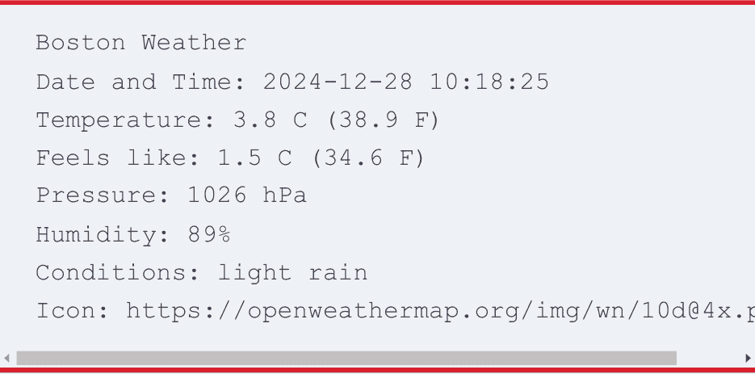

## 生成式 AI

1. 结合 `WeatherApp.java` 提示生成式 AI，让它们展示如何使用 Jackson 注解使 `WeatherData` 类的实例变量名 `dt` 更具可读性。
2. 提示生成式 AI 提供关于 RESTful Web 服务的简短教程。
3. 提示生成式 AI 提供关于 HTTP GET 请求如何与 Web 服务交互以获取结果的简短教程。
4. 提示生成式 AI，列出 URL 中使用的特殊字符列表，并说明为什么你应该使用 `URLEncode` 编码将数据包含在 URL 中。
5. 提示生成式 AI，让它们对比 URI 和 URL。
6. 提示生成式 AI 创建一个精选免费 Web 服务列表，并建议你可以通过组合这些服务来构建的应用。

# 11.7 案例研究：创建和读取 CSV 文件

CSV（逗号分隔值）文件格式使用 `.csv` 扩展名，在大数据、数据分析和数据科学的数据集，以及机器学习和深度学习等人工智能应用中非常流行。在这里，我们将演示如何向 CSV 文件写入数据以及从 CSV 文件读取数据。

## 数据集

网上有大量的免费数据集。OpenML 机器学习资源网站

```
https://openml.org
```

包含了几乎 6000 个 CSV 格式的免费数据集。其他优秀的数据集来源包括：

```
https://github.com/awesomedata/awesome-public-datasets
https://vincentarelbundock.github.io/Rdatasets/analysis
```

此外，许多地方和国家政府也会发布免费数据集。例如，截至2024年12月，美国政府在 data.gov 上列出了 25,515 个 CSV 格式的数据集：

```
https://catalog.data.gov/dataset/?res_format=CSV&account.csv
```

对于我们的两个示例，我们将创建一个包含以下数据的 `clients.csv` 文件：

```
accountNumber,name,balance
100,Devi,24.98
200,Taylor,345.67
300,Huber,0.0
400,Ito,-42.16
500,Lopez,224.62
```

然后我们将读取该文件。CSV 文件的第一行通常包含列名。随后的每一行都包含一条记录，代表这些列的值。该数据集有三列，分别代表 `accountNumber`、`name` 和 `balance`。

## 11.7.1 创建 CSV 文件

图 11.8 使用 CSV 格式重新实现了图 11.4。

```java
// Fig.11.8: CreateCSVFile.java
// 使用 Jackson 向 CSV 文件中写入数据
import com.fasterxml.jackson.databind.Object;
import com.fasterxml.jackson.dataformat.csv.*;
import java.io.IOException;
import java.nio.file.Path;
import java.util.List;

// 表示账户的 record 类
record Account(int accountNumber, String name, double balance) {}

public class CreateCSVFile {
    public static void main(String[] args) {
        // 要写入的账户数据
        List<Account> accounts = List.of(
            new Account(100, "Devi", 24.98),
            new Account(200, "Taylor", 345.67),
            new Account(300, "Huber", 0.00),
            new Account(400, "Ito", -42.16),
            new Account(500, "Lopez", 224.62)
        );

        // 用户文档中 clients.csv 的路径
        Path filePath = Path.of(System.getProperty("Documents", "clients.csv"));

        // 创建 Jackson CsvMapper 和 Schema
        var mapper = new CsvMapper();
        CsvSchema schema = mapper.schemaFor(Account.class).withHeader(); // 第一行在

        try {
            // ObjectWriter 将数据写入 CSV
            ObjectWriter writer = mapper.writer();
            writer.writeValue(filePath.toFile(), accounts);
            System.out.printf("CSV file created at: %s%n", filePath);
        } catch (IOException e) {
            System.err.printf("Error writing CSV file: %s%n", e);
        }
    }
}
```


# 11.7 案例研究：创建和读取 CSV 文件

CSV（逗号分隔值）文件格式使用 `.csv` 扩展名，在大数据、数据分析和数据科学的数据集，以及机器学习和深度学习等人工智能应用中非常流行。在这里，我们将演示如何向 CSV 文件写入数据以及从 CSV 文件读取数据。

## 数据集

网上有大量的免费数据集。OpenML 机器学习资源网站

```
https://openml.org
```

包含了几乎 6000 个 CSV 格式的免费数据集。其他优秀的数据集来源包括：

```
https://github.com/awesomedata/awesome-public-datasets
https://vincentarelbundock.github.io/Rdatasets/analysis
```

此外，许多地方和国家政府也会发布免费数据集。例如，截至2024年12月，美国政府在 data.gov 上列出了 25,515 个 CSV 格式的数据集：

```
https://catalog.data.gov/dataset/?res_format=CSV&account.csv
```

对于我们的两个示例，我们将创建一个包含以下数据的 `clients.csv` 文件：

```
accountNumber,name,balance
100,Devi,24.98
200,Taylor,345.67
300,Huber,0.0
400,Ito,-42.16
500,Lopez,224.62
```

然后我们将读取该文件。CSV 文件的第一行通常包含列名。随后的每一行都包含一条记录，代表这些列的值。该数据集有三列，分别代表 `accountNumber`、`name` 和 `balance`。

## 11.7.1 创建 CSV 文件

图 11.8 使用 CSV 格式重新实现了图 11.4。

```java
// Fig.11.8: CreateCSVFile.java
// 使用 Jackson 向 CSV 文件中写入数据
import com.fasterxml.jackson.databind.Object;
import com.fasterxml.jackson.dataformat.csv.*;
import java.io.IOException;
import java.nio.file.Path;
import java.util.List;

// 表示账户的 record 类
record Account(int accountNumber, String name, double balance) {}

public class CreateCSVFile {
    public static void main(String[] args) {
        // 要写入的账户数据
        List<Account> accounts = List.of(
            new Account(100, "Devi", 24.98),
            new Account(200, "Taylor", 345.67),
            new Account(300, "Huber", 0.00),
            new Account(400, "Ito", -42.16),
            new Account(500, "Lopez", 224.62)
        );

        // 用户文档中 clients.csv 的路径
        Path filePath = Path.of(System.getProperty("user.home", "."), "Documents", "clients.csv");

        // 创建 Jackson CsvMapper 和 Schema
        var mapper = new CsvMapper();
        CsvSchema schema = mapper.schemaFor(Account.class).withHeader(); // 第一行包含列名

        try {
            // ObjectWriter 将数据写入 CSV
            ObjectWriter writer = mapper.writer();
            writer.writeValue(filePath.toFile(), accounts);
            System.out.printf("CSV file created at: %s%n", filePath);
        } catch (IOException e) {
            System.err.printf("Error writing CSV file: %s%n", e);
        }
    }
}
```


然后我们将读取该文件。CSV 文件的第一行通常包含列名。随后的每一行都包含一条记录，代表这些列的值。该数据集有三列，分别代表 `accountNumber`、`name` 和 `balance`。

# 11.7.1 创建 CSV 文件

图 11.8 使用 CSV 格式重新实现了图 11.4。

点击此处查看图片

```java
// Fig.11.8: CreateCSVFile.java
// 使用 Jackson 向 CSV 文件中写入数据
import com.fasterxml.jackson.databind.Object;
import com.fasterxml.jackson.dataformat.csv.;
import com.fasterxml.jackson.dataformat.csv.;
import java.io.IOException;
import java.nio.file.Path;
import java.util.List;

// 表示账户的 record 类
record Account(int accountNumber, String name, double balance) {}
```

```java
public class CreateCSVFile {

    public static void main(String[] args) {

        // 要写入的账户数据
        List<Account> accounts = List.of(
            new Account(100, "Devi", 24.98),
            new Account(200, "Taylor", 345.67),
            new Account(300, "Huber", 0.00),
            new Account(400, "Ito", -42.16),
            new Account(500, "Lopez", 224.62)
        );

        // 用户文档中 clients.csv 的路径
        Path filePath = Path.of(System.getProperty("Documents", "clients.csv"));

        // 创建 Jackson CsvMapper 和 Schema
        var mapper = new CsvMapper();
        CsvSchema schema = mapper.schemaFor(Account.class).withHeader(); // 第一行在

        try {
            // ObjectWriter 将数据写入 CSV
            ObjectWriter writer = mapper.writer();
            writer.writeValue(filePath.toFile(), accounts);
            System.out.printf("CSV file created at: %s%n", filePath);
        } catch (IOException e) {
            System.err.printf("Error writing CSV file: %s%n", e);
        }
    }
}
```


使用 Jackson 向 CSV 文件写入写入 写入 差异：
- 1 提示生成式 AI 提供关于 REST Web 服务的示例。
- 3 提示生成式 AI 关于 HTTP GET 请求如何与 Web 服务交互以获取结果。
- 4 提示生成式 AI，列出 URL 中使用的特殊字符列表，并说明为什么你应该使用 `URLEncoder` 编码将数据包含在 URL 中。
- 5 提示生成式 AI，让它们对比 URI 和 URL。
- 6 提示生成式 AI 创建一个精选免费 Web 服务列表，并建议你可以通过组合这些服务来构建的应用。

读取 CSV 文件的程序通常期望每个记录具有相同数量的字段；否则就会出现问题。

## 注意：CSV 文件中缺失的逗号和多出的逗号

在准备和处理 CSV 文件时要小心。例如，假设您的文件由记录组成，每个记录包含四个逗号分隔的 `int` 值，如下：

```
100,85,77,9
```

如果您不小心遗漏了其中一个逗号，如下所示：

```
100,8577,9
```

那么该记录只有三个字段，其中一个字段具有无效值 8577。

如果您在只需要一个逗号的地方放置了两个相邻的逗号，如下：

```
100,85,,9
```

那么就有五个字段而不是四个，其中一个字段会错误地为空。这些与逗号相关的错误每一个都可能混淆试图处理该记录的程序。

## 生成式 AI

- 1 提示 genAIs，请求一个使用 Jackson 处理包含逗号的 CSV 字段的示例。
- 2 提示 genAIs，关于处理 CSV 文件时的最佳实践。

# 11.8 案例研究：读取和分析包含泰坦尼号灾难数据集的 CSV 文件

泰坦尼号灾难数据集11 是数据分析初学者最常用的数据集之一。它列出了所有乘客以及泰坦尼号轮在 1912 年 4 月 10 日至 15 日首次航行撞击冰山并沉没时的生存情况。在这个案例研究中，我们将加载数据集，查看其部分数据并进行一些基础数据分析。

> 11. https://vincentarelbundock.github.io/Rdatasets 上的“TitanicSurvival”数据集。数据集作者：Frank E. Harrell, Jr., 和 Thomas Caus。

该数据集可以在许多数据集仓库中获得。我们使用了来自 Rdatasets 仓库的一个版本，位于：

点击此处查看代码图像

```
https://vincentarelbundock.github.io/Rdatasets/csv/TitanicSurvival.csv
```

我们将此文件存放在与示例代码相同的文件夹中。

## 了解你的数据

在数据分析中，你通常从了解你的数据开始。一种方法是直接查看原始数据。如果您在文本编辑器或电子表格应用程序中打开 `TitanicSurvival.csv` 文件，将发现该数据集包含 1309 行，每行有五列——在数据分析中通常称为 `features`（特征）。在本案例研究中，我们忽略包含乘客姓名的第一列，仅使用最后四列：

- `survived`：“yes”或“no”
- `sex`：“female”或“male”
- `age`：乘客的年龄。大多数年龄是整数，但不满 1 岁的儿童具有浮点数值，因此我们将此列处理为 `double` 类型值。
- `passengerClass`：分别用“1st”、“2nd”或“3rd”表示一等舱、二等舱或三等舱。

要了解更多关于该数据集来源的信息，请访问

点击此处查看代码图像

```
https://hbiostat.org/data/repo/titanic
```

## 缺失数据

糟糕的数据值和缺失值会显著影响数据分析。泰坦尼号数据集缺失 263 名乘客的年龄。这些在 CSV 文件中以空字段表示——即在这些记录中，界定年龄字段的逗号之间没有数据。在这个示例中，当我们对乘客年龄生成描述性统计数据时，我们将“清洗”数据以过滤掉并忽略缺失值。在数据科学中，为分析准备数据称为数据清洗（data munging）或数据抓取（data wrangling）。

一些数据科学家建议不要尝试插入“合理值”。相反，他们主张明确标记缺失数据，并将问题交给数据分析包来处理。另一些人给出了强力警告。12

> 12. 此脚注摘自 2018 年 7 月 20 日发给我们的一条评论，来自我们 Python 教书的一位学术评审员、圣地亚哥大学商学院的 Alison Sanchez 博士。她评论道：“在提到为缺失或糟糕值‘替换合理值’时要谨慎。一个严厉的警告：严禁‘替换’能够增加统计显著性或提供更‘合理’或‘更好’结果的值。‘替换’数据不应变成‘伪造’数据。学生应该学习的第一条规则不要消除或改变与他们的假设矛盾的值。‘替换合理值’并不意味着学生可以随意更改值以获得他们的结果。”

## 加载数据集

图 11.10 加载了数据集并执行了我们的分析。为了方便讨论，我们将程序分成了几个部分。记得在编译和运行此程序时将 Jackson 添加到类路径中。

点击此处查看代码图像

```java
// Ej.11.10: TitanicAnalysis.java
// 从 CSV 文件读取泰坦尼号数据集
import com.fasterxml.jackson.annotation.JsonIgnoreProperties;
import com.fasterxml.jackson.databind.MappingIterator;
import com.fasterxml.jackson.dataformat.csv.CsvMapper;
import com.fasterxml.jackson.dataformat.csv.CsvSchema;
import java.nio.file.Path;
import java.util.ArrayList;
import java.util.List;
```

图 11.10 | 从 CSV 文件读取泰坦尼号数据集

### TitanicRecord 类用于存储数据集

Jackson 可以读取 CSV 文件并创建 `TitanicRecord` 对象。第 13–19 行定义了 `TitanicRecord` 类，其成员变量代表字段。

点击此处查看图像

```java
public class TitanicAnalysis {
    @JsonIgnoreProperties(ignoreUnknown = true)
    public record TitanicRecord(
        String survived,
        String sex,
        String age,
        String passengerClass
    ) {
```

### 加载数据集

第 22–26 行创建了 `CsvMapper` 和 `CsvSchema`，在本示例中，我们使用 `CsvSchema` 的 `emptySchema` 方法来指示 Jackson 应该如何映射字段。在本节结束时，第 30–32 行配置 `MappingIterator` 将 CSV 文件的记录转换为 `TitanicRecord` 对象的列表。

```java
    public static void main(String[] args) throws IOException {
        var mapper = new CsvMapper(); // 读取

        // 指定 Jackson 应该映射
        CsvSchema schema = CsvSchema.emptySchema().withHeader();
        // 创建 MappingIterator
        var iterator = mapper.readerFor(TitanicRecord.class)
            .with(schema)
            .readValues(Path.of("TitanicSurvival.csv").toFile());
        List<TitanicRecord> titanic = iterator.readAll();
```

### 将列数据提取到 ArrayList

第 38–41 行为每一列创建了 `ArrayList`。第 44–58 行的循环为每个 `ArrayList` 填充对应列的数据。当我们把每个年龄添加到 `age` `ArrayList` 时，我们会检查它是否为空。如果不为空，将其转换为 `double` 并添加到 `ArrayList`；否则，我们添加 `Double.NaN`（非数字）来表示缺失值。你将在第 12 章学到 Java 集合只能存储对象，并且 `double` 会自动转换为相应的 `Double` 对象和 `Integer` 对象（反之亦然）。当我们每个乘客等级添加到 `pclass` `ArrayList` 时，将其从字符串“1st”、“2nd”或“3rd”转换为数字 1、2 或 3。在总结每个舱的人数时，我们将使用这些作为数组索引。

点击此处查看图像

```java
    // 创建表示每列的列表
    var survived = new ArrayList<String>();
    var sex = new ArrayList<String>();
    var age = new ArrayList<Double>();
    var pclass = new ArrayList<Integer>();

    // 填充列列表
    for (TitanicRecord record : titanic) {
        survived.add(record.survived());
        sex.add(record.sex());
        age.add(record.age().isEmpty() ?
            Double.NaN : Double.parseDouble(record.age()));
        pclass.add(
            switch (record.passengerClass()) {
                case "1st" -> 1;
                case "2nd" -> 2;
                case "3rd" -> 3;
                default -> throw new IllegalArgumentException(
                    "Unknown class: " + record.passengerClass());
            }
        );
    }
```

### 查看泰坦尼克数据集中的某些行

1,309 行中的每一行代表一名乘客。根据维基百科介绍，大约有 1,317 名乘客，其中 817 人去世。¹³ 对于大型数据集，可能只显示数据的一小部分。在熟悉数据时，一种常见的做法是显示数据集开头和结尾的几行，以便对数据有一个整体。第 64–67 行的代码显示了每列数据的前五个元素：

> 13. “泰坦尼克号上的人数以及遇难和救援人数。”访问于 2025 年 1 月 1 日 https://www.titanicpages.com/numberaboardandlostsaved

点击此处查看代码图像

```java
    // display first 5 rows
    System.out.printf("First five rows:%n");
    System.out.printf("%-10s%-8s%-6s%-6s%n", "survived", "sex", "age", "class");

    for (int i = 0; i < 5; i++) {
        System.out.printf("%-10s%-8s%-6.1f%-6d%n",
                          survived.get(i), sex.get(i), age.get(i), pclass.get(i));
    }
```

前五行：

| survived | sex | age | class |
| :--- | :--- | :--- | :--- |
| yes | female | 29.0 | 1 |
| yes | male | 0.9 | 1 |
| no | female | 2.0 | 1 |
| no | male | 30.0 | 1 |
| no | female | 25.0 | 1 |

第 70–77 行的代码显示每列数据的最后五个元素。注意 `NaN` 值，它表示年龄列中某行的缺失值。

点击此处查看代码图像

```java
    // display last 5 rows
    System.out.printf("%nLast five rows:%n");
    System.out.printf("%-10s%-8s%-6s%-6s%n", "survived", "sex", "age", "class");
    int count = titanic.size();

    for (int i = count - 5; i < count; i++) {
        System.out.printf("%-10s%-8s%-6.1f%-6d%n", survived.get(i), sex.get(i), age.get(i), pclass.get(i));
    }
```

最后五行：

| survived | sex | age | class |
| :--- | :--- | :--- | :--- |
| no | female | 14.5 | 3 |
| no | female | NaN | 3 |
| no | male | 26.5 | 3 |
| no | male | 27.0 | 3 |
| no | male | 29.0 | 3 |

### 数据清洗：清洗年龄列以计算描述性统计

作为了解数据集的一部分，数据科学家经常使用统计数据来描述和总结数据。我们将为年龄列计算若干描述性统计数据，包括拥有年龄的乘客数量以及平均值、最小值、最大值中位数。在执行这些计算之前，我们必须移除 `NaN` 值，因为包含 `NaN` 值的计算结果将是 `NaN`。因此，第 80–85 行创建了 `cleanAge` 的 `ArrayList`，其中只包含 `age` 中非 `NaN` 的值。`Double` 的 `isNaN()` 方法在值为 `NaN` 时返回 `true`。

点击此处查看代码图像

```java
// clean the age column (remove NaN)
var cleanAge = new ArrayList<Double>();
for (Double value : age) {
    if (!value.isNaN()) {
        cleanAge.add(value);
    }
}
```


# 清洗年龄列的基础描述性统计

现在，我们可以计算描述性统计数据。第 88 行对 `cleanAge` 进行排序，这样我们就可以确定最小值、最大值中位数。当 `sort` 参数为 `null` 时，`ArrayList` 的元素必须实现 `Comparable` 接口，`sort` 才能比较元素以确定排序顺序——`Double` 类实现了 `Comparable`。为了统计拥有有效年龄的人数，我们只需获取 `cleanAge` 的大小（第 89 行）。第 92–94 行确定中位数。

如果 `cleanAge` 的大小为偶数，则中位数是两个中间元素的平均值（第 93 行）；否则，它是中间元素（第 94 行）。第 97–103 行计算平均年龄。

```java
87   // descriptive statistics for cleaned
88   cleanAge.sort(null); // helps determine
89   int size = cleanAge.size();
90
91   // get median age
92   double medianAge = (size % 2 == 0) ?
93   (cleanAge.get(size / 2 - 1) + clean
94   cleanAge.get(size / 2));
95
96   // calculate average of ages
97   double sum = 0.0;
98
99   for (double value : cleanAge) {
100  sum += value;
101  }
102
103  double averageAge = sum / size;
104
```

第 106–111 行显示描述性统计数据。由于 `ArrayList` 已经排序，第 109–110 行调用 `ArrayList` 的 `getFirst` 和 `getLast` 方法获取第一个和最后一个元素，分别包含最小值和最大值。平均值和中位数是集中趋势的度量。产生一个单一值，代表一组值的典型情况。对于 1046 个有效年龄的人，平均年龄为 29.88 岁。最年轻的乘客（最小值）略大于 0.04 个月，最老的（最大值）为 80 岁。

```java
105      // display the age statistics
106      System.out.printf("%nDescriptive statistics\n");
107      System.out.printf("Passengers with age...\n");
108      System.out.printf("Average age: %.2f\n");
109      System.out.printf("Minimum age: %.2f\n");
110      System.out.printf("Maximum age: %.2f\n");
111      System.out.printf("Median age: %.2f\n");
```

年龄列的描述性统计：
有年龄的数据:1046
平均年龄:29.88
最小值:0
最大值:80
中位数:28

# 确定各等级乘客人数

让我们计算每个等级的乘客人数。第 114–118 行统计每个等级的乘客人数——我们忽略 `counts` 数组，这样可以使用每个等级的数值作为索引。第 120–122 行显示计数。

```java
113      // passenger counts by class
114      int[] counts = new int[4]; // ignore 0
115      for (int value : pclass) {
116          ++counts[value];
117      }
120      System.out.printf("%nPassenger counts by class:%n", counts[1], counts[2], counts[3]);
```

按等级划分的乘客人数：
1st: 323
...

# 按性别和等级统计幸存人数

记得 `survived` 列包含 "yes" 或 "no"，分别代表幸存或去世。第 129–142 行遍历 `survived` `ArrayList`，测试每个值是否为 "yes"。如果是，我们就增加 `survivorCount`。接下来，第 133–138 行判断幸存者是“女性”还是“男性”，并更新 `survivorsSex` 数组中相应的计数器。然后，第 140 行增加 `survivorsClass` 中相应的计数器——再次，忽略 0。我们将使用这些计数计算百分比。

```java
// summarize counts of people who survived
int survivorCount = 0;
int[] survivorsBySex = new int[2];
int[] survivorsClass = new int[4];
for (int i = 0; i < survived.size(); i++) {
    if (survived.get(i).equals("yes")) {
        ++survivorCount;
    }
    if (sex.get(i).equals("female")) {
        ++survivorsBySex[0];
    }
    else {
        ++survivorsBySex[1];
    }
    ++survivorsClass[pclass.get(i)];
}
```

# 计算并显示幸存百分比

第 145–146 行显示幸存人数。为了确定有多少人去世，第 146 行从 `survived` `ArrayList` 的大小中减去 `survivorCount`。第 147–148 行计算并显示幸存者的百分比。第 149–158 行计算并显示了以下百分比：

- 幸存的女性
- 幸存的男性
- 幸存的一等乘客
- 幸存的二等乘客
- 幸存的三等乘客

在幸存者中，约三分之二是女性，一等乘客的幸存率高于其他等级乘客。

| 144 | // calculate and display the survivor |
| :--- | :--- |
| 145 | System.out.printf("%nSurvived count: %d%n", |
| 146 | survivorCount, survived.size() - survivorCount); |
| 147 | System.out.printf("Percent who survived: %.2f%%%n", |

```java
148         100.0 * survivorCount / survived.size();
149         System.out.printf("Female survivor percentage: %.2f%%%n", 
150         100.0 * survivorsBySex[0] / survivorCount);
151         System.out.printf("Male survivor percentage: %.2f%%%n", 
152         100.0 * survivorsBySex[1] / survivorCount;
153         System.out.printf("1st class survivor percentage: %.2f%%%n", 
154         100.0 * survivorsByClass[1] / survivorCount);
155         System.out.printf("2nd class survivor percentage: %.2f%%%n", 
156         100.0 * survivorsByClass[2] / survivorCount);
157         System.out.printf("3rd class survivor percentage: %.2f%%%n", 
158         100.0 * survivorsByClass[3] / survivorCount);
159     }
160 )
```

## 生成式 AI

1. 使用图 11.10 中的代码提示生成式 AI，要求它们将 `TitanicRecord` 类的 `age` 实例变量改为 `double`，并使用自定义反序列化器将该列中的缺失值替换为 `Double.NaN`。
2. 使用图 11.9 和 11.10 中的代码提示生成式 AI，要求它们比较在这两个图中创建 `CsvSchema` 的方法。此外，要求它们解释这两种方法的优缺点。

# 11.9 对象-自然：安全案例研究：RSA 公钥加密

在第 7.9 节中，你开始学习对称密钥加密。发送者的明文使用密钥密钥加密形成密文。接收者使用该密钥解密密文，形成原始明文——这个过程被称为对称加密，因为发送者和接收者使用同一个密钥。

## 公钥加密

对称密钥加密的一个问题是，密文的安全性完全取决于密钥的安全性，而且该密钥会有多个副本“四处流传”。在《密码学的新方向》¹4 论文中，Whitfield Diffie 和 Martin Hellman 引入了公钥加密来解决对称密钥加密的缺陷——即密钥必须被发送者和接收者共同知道。他们提出了这个想法但但实现该方案。

14. “New Directions in Cryptography.” 1976 年 11 月 6 日。访问于 2025 年 1 月 1 日。https://ee.stanford.edu/~hellman/publications/24.pdf。

## RSA 公钥加密

Rivest、Shamir 和 Adelman 首次了公钥加密的有效实现。该方案被称为 RSA，取自他们姓氏的首字母。¹⁵ RSA 是世界上应用最广泛的公钥加密方案之一。¹6 因为 RSA 速度可能较慢，¹7 许多组织倾向于使用更快的私钥加密，仅使用 RSA 安全地发送密钥密钥。这种加密和解密技术对于保护存储在文件中和通过网络传输的数据至关重要。

+ 15. R. Rivest; A. Shamir; L. Adleman (1978年2月). “A Method for Obtaining Digital Signatures and Public-Key Cryptosystems (PDF). Communications of the ACM. 21 (2): 120–126. 访问于 2025年1月1日。https://people.csail.mit.edu/rivest/Rsapaper.pdf。
+ 16. Cobb, Michael. “RSA algorithm (Rivest-Shamir-Adleman).” 访问于 2025年1月1日。https://searchsecurity.techtarget.com/definition/RSA。
+ 17. “RSA (cryptosystem).” 访问于 2025年1月1日。https://en.wikipedia.org/wiki/RSA_(cryptosystem)。

## 历史说明

英国的 Clifford Cocks 在 RSA 论文发表前几年内就创建了一个可行的公钥方案，¹⁸ 但他的工作是机密的，因此直到 RSA 出现后约 20 年后才被公开。RSA Security 公司拥有 RSA 算法的专利。2000 年，该专利到期需要续展——他们没有续展，而是将该算法投入了公领域¹⁹

18. “Clifford Cocks.” 访问于 2025年1月1日。https://en.wikipedia.org/wiki/Clifford_Cocks.
19. “RSA Security Releases RSA Encryption Algorithm into Public Domain.” 2000年9月6日。访问于 2025年1月1日。https://web.archive.org/2007112011201/http://www.rsa.com/press_release.aspx?id=261。

## 增强加密演示

在这个案例中，我们增强了 AES 私钥加密示例，以演示如何使用 RSA 公钥加密安全地加密密钥²⁰,²¹,²²。特别是，我们关注如何生成：

- 任何发送者都可以使用的公钥，用于加密 AES 密钥并传输给特定的接收者，以及
- 只有特定接收者才能使用的私钥，用于解密 AES 密钥。

20. “RSA (cryptosystem).” 访问于 2025年1月1日。https://en.wikipedia.org/wiki/RSA_(cryptosystem).
21. “RSA Algorithm.” 访问于 2025年1月1日。https://simple.wikipedia.org/wiki/RSA_algorithm.
22. "PKCS #1: RSA Cryptography Specifications Version 2." 2016年11月。访问于 2025年1月1日。https://tools.ietf.org/html/rfc8017.

公钥加密也被称为非对称加密，因为加密和解密使用了不同的密钥。这种技术通常用于传输对称加密中使用的密钥。RSA 基于使用包含数百位巨大数字的复杂数学，但 Java API 封装了这一点，对你隐藏了它。图 11.10 的大部分内容与图 7 中的 AES 演示相同，因此我们关注增强部分。我们将示例分部分进行讨论。

| | |
| :--- | :--- |
| 1 | // Fig. 11.10: CryptographyDemo.java |
| 2 | // 使用 AES 加密和解密消息 |
| 3 | // 使用 RSA 加密和解密 |
| 4 | import javax.crypto.Cipher; |
| 5 | import javax.crypto.KeyGenerator; |
| 6 | import javax.crypto.SecretKey; |
| 7 | import javax.crypto.spec.SecretKeySpec; |
| 8 | import java.security.Cipher; |
| 9 | import java.security.KeyPair; |
| 10 | import java.security.PublicKey; |
| 11 | import java.security.PrivateKey; |
| 12 | import java.security.SecureRandom; |
| 13 | import java.util.Base64; |
| 14 | import java.util.Scanner; |
| 15 | public class CryptographyDemo { |
| 16 | public static void main(String[] args) { |
| 17 | var scanner = new Scanner(System.in); |

图 11.10: CryptographyDemo.java
使用 AES 加密和解密消息
使用 RSA 加密和解密

### 获取明文加密和解密密钥

第 20-35 行执行了与 7.9 相同的任务：

- 输入明文，
- 输入密钥密钥（为了演示可重复性），
- 使用 AES 加密明文，
- 生成 AES 密钥密钥

```java
System.out.println("Enter the text to encrypt:");
String plaintext = scanner.nextLine();
try {
    // 生成可重复的密钥
    SecretKey secretKey = generateKey(plaintext);
    System.out.printf("%nSecretKey:%s\n", Base64.getEncoder().encodeToString(secretKey.getEncoded()));
} catch (Exception e) {
    e.printStackTrace();
}
// AES 加密 plaintext
Cipher cipher = Cipher.getInstance("AES");
cipher.init(Cipher.ENCRYPT_MODE, secretKey);
byte[] ciphertext = cipher.doFinal(plaintext.getBytes());
System.out.printf("%nEncrypted message:%s\n", Base64.getEncoder().encodeToString(ciphertext));
```

输入明文：
Welcome to encryption and decryption.

输入密钥（可重复性）：
密钥：

密文：

### 加密 AES 密钥

第 49–50 行使用 RSA 加密 AES `SecretKey`。方法 `encryptRSA`（第 117–130 行）接收 `SecretKey` 的字节数组表示（`secretKey.getEncoded()`）和 RSA 公钥 `publicKey`，并使用 `publicKey` 加密 AES `SecretKey`——这确保了只有预期的接收者可以使用其相应的 RSA 私钥对其进行解密。加密 AES 密钥允许其安全地传输。为了演示之目的，我们显示了加密后的 `SecretKey`，以便你稍后确认它已正确解密——由于 RSA `publicKey` 是随机生成的，你的输出将会有所不同。在真实世界的加密中，我们会将 `cipherText`（第 34 行）和 `encryptedAESKey` 发给接收者。

点击此处查看代码图片

```java
47   // 使用此方法加密 AES 密钥
```


// 这将发送给接收者
String encryptedAESKey =
    encryptRSA(secretKey.getEncoded());
System.out.printf(
    "%nRSA Encrypted AES SecretKey:%s");

```
RSA Encrypted AES SecretKey:
Rz2ZAPUMXwjWnKiptMifxdwgADNS9k3QEbUtTivXFD/ka166AEf3Hu7bP0rJbJbp3YHOD6e/x5G//UA+b4d1GM+dOpM8yYSdtW3E4/uJ2CMQt22+87LbbtFVQt8x91Zugg+gKS7FSQjGTKt0uZfJniwPT4isJWHTPPw1UKwk7GT5v1nOWGopybwlbYoaeJIJjiyWyjcvsW6btPJHNXG==
```

# 解密 AES SecretKey

要解密密文，接收者必须先解密用于生成密文的 AES 密钥。第 55–66 行调用 `decryptRSA`（第 133–148 行），使用 RSA 解密解密 AES SecretKey。`decryptRSA` 方法接收加密的 AES 密钥和 RSA 私钥——这是唯一可以解密由相应公钥加密数据的密钥，确保了 AES 密钥的安全性。此过程确保了只有拥有私钥的预期接收者才能获取原始 AES 密钥并读取加密消息。为了演示之目的，我们显示了解密后的 AES 密钥，以便你将其与第 30–31 行输出的内容进行对比，并确认它已正确解密。

点击此处查看代码图片

```
// 接收者解密 AES 密钥
SecretKey decryptedSecretKey =
    decryptRSA(encryptedAESKey, priv);
System.out.printf("%nDecrypted AES SecretKey:%s%n",
    Base64.getEncoder().encodeToString(decryptedSecretKey.getEncoded()));
```

> 解密后的 AES SecretKey:
8ew8jJVSpkRtG4zorwxd34JBPuxEdOt+ec0QTfr7ce=

# 解密 AES 加密的密文

第 62–63 行执行与第 7.9 节相同的任务，用于解密 AES 加密的消息，但使用了第 55–56 行解密出的密钥。在真实场景中，这将由消息的接收者完成。

点击此处查看代码图片

```
// AES 解密文本
System.out.printf("%nDecrypted:%n%s%n",
    decrypt(ciphertext, decryptedSecretKey));
}
```

```
catch (Exception ex) {
    System.out.printf("""
        在加密过程中发生异常
        %s%n
        """, ex);
}
```

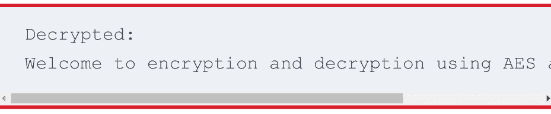

# generateKey、加密和解密方法

第 76–113 行执行与第 7.9 节相同的任务，用于生成 AES 密钥、使用 AES 密钥加密明文以及使用相同的 AES 密钥解密密文。

点击此处查看代码图片

```
// 生成并返回 SecretKey。注意：
// 为了可复现性，我们在此程序的输出中
// 显示了 SecureRandom 对象。请不要
```

```java
public static SecretKey generateKey(String seed) {
    // 获取一个安全的随机数生成器
    var random = SecureRandom.getInstance("SHA1PRNG");
    random.setSeed(seed.getBytes()); // for reproducibility

    // 获取一个 AES SecretKey 生成器
    var keyGen = KeyGenerator.getInstance("AES");
    keyGen.init(256, random); // set up for 256-bit key
    return keyGen.generateKey(); // generate the key
}

// 使用 AES 加密字符串
public static String encrypt(String plaintext, SecretKey secretKey) {
    var cipher = Cipher.getInstance("AES");
    cipher.init(Cipher.ENCRYPT_MODE, secretKey);

    // 加密字节[] 表示 cleartext
    byte[] encrypted = cipher.doFinal(plaintext.getBytes());

    // 使用 Base64 编码加密内容作为密文
    return Base64.getEncoder().encodeToString(encrypted);
}

// 解密 AES 加密的字符串
public static String decrypt(String ciphertext, SecretKey secretKey) {
    var cipher = Cipher.getInstance("AES");
    cipher.init(Cipher.DECRYPT_MODE, secretKey);

    // Base64 解码密文到 byte[]
    byte[] ciphertextBytes = Base64.getDecoder().decode(ciphertext);

    // 创建明文字符串
    return new String(cipher.doFinal(ciphertextBytes));
}
```

# 使用 RSA 加密 AES 密钥

第 49–50 行使用 RSA 加密 AES `SecretKey`。方法 `encryptRSA`（第 117–130 行）接收 `SecretKey` 的字节数组表示（`secretKey.getEncoded()`）和 RSA 公钥 `publicKey`，并使用 `publicKey` 加密 AES `SecretKey`——这确保了只有预期的接收者可以使用其相应的 RSA 私钥对其进行解密。加密 AES 密钥允许其安全地传输。为了演示之目的，我们显示了加密后的 `SecretKey`，以便你稍后确认它已正确解密——由于 RSA `publicKey` 是随机生成的，你的输出将会有所不同。在真实世界的加密中，我们会将 `cipherText`（第 34 行）和 `encryptedAESKey` 发给接收者。

- 第 120 行为 RSA 算法创建了一个 `Cipher` 对象。
- 第 123 行用公钥将 `Cipher` 初始化为加密模式。
- 第 126 行调用 `Cipher` 的 `doFinal` 来加密字节数组，即 AES 密钥。
- 最后，第 129 行将加密密钥编码为 Base64 字符串。

此加密密钥可以安全地发送给接收者。

点击此处查看代码图片

```java
// 使用此方法加密 AES 密钥
// 这将发送给接收者
String encryptedAESKey =
    encryptRSA(secretKey.getEncoded());
System.out.printf(
    "%nRSA Encrypted AES SecretKey:%s",
```

```
RSA Encrypted AES SecretKey:
Rz2ZAPUMXwjWnKiptMifxdwgADNS9k3QEbUtTivXFD/ka166AEf3Hu7bP0rJbJbp3YHOD6e/x5G//UA+b4d1GM+dOpM8yYSdtW3E4/uJ2CMQt22+87LbbtFVQt8x91Zugg+gKS7FSQjGTKt0uZfJniwPT4isJWHTPPw1UKwk7GT5v1nOWGopybwlbYoaeJIJjiyWyjcvsW6btPJHNXG==
```

使用 `HttpRequest` 和 `HttpResponse` 类来调用免费的 OpenWeatherMap.org Web 服务，该服务以 JSON 格式返回城市天气报告。然后，我们使用 Jackson 来处理响应并显示天气报告。

接下来的两个案例研究介绍了流行的 CSV（逗号分隔值）文件格式，以及如何使用 Jackson 开源库写入和读取 CSV 文件。随后，我们利用 CSV 读取能力加载了泰坦尼克号灾难数据集，该数据集通常用于介绍基础数据分析。

最后，我们介绍了最后一个对象-自然案例研究。我们通过使用 RSA 公钥加密来加密和解密 AES 密钥，增强了第 7.9 节中的私钥加密示例，实现了密钥安全传输给加密消息的接收者。此类加密和解密技术对于保护存储在文件中并通过网络传输的数据至关重要。我们将在第 20 章“使用 JDBC 和 SQLite 访问数据库”继续讨论数据持久化。

在下一章中，我们将讨论 Java 集合框架，它包含了许多预定义的集合类和接口，用于操作内存中的数据，例如 `ArrayList` 类（在第 6.20 节中引入）和 `List` 接口（在第 11.4.1 节中引入）。

## 特别章节：生成式 AI 练习

对于以下每个问题，尝试多个生成式 AI 以确定哪一个表现最好。务必验证结果。记住，它们有时会出错甚至产生幻觉，创建不可靠的信息。

- 11.1（Files 类教程）提示生成式 AI 编写一个关于 `java.nio.files` 包中 Java `Files` 类的简要教程，并带有代码示例。
- 11.2（用于格式化输出的 PrintWriter 与 Formatter）提示生成式 AI，要求它们解释 `java.io.PrintWriter` 和 `java.util.Formatter` 之间的主要区别，以及何时应该使用它们。
- 11.3（电话号码单词生成器）标准电话按键包含 0 到 9 的数字。数字 2–6 和 8 各关联三个字母，7 和 9 各自关联四个字母，如下表所示：

| 数字 | 字母 |
|---|---|
| 2 | A B C |
| 3 | D E F |
| 4 | G H I |
| 5 | J K L |
| 6 | M N O |
| 7 | P Q R S |
| 8 | T U V |
| 9 | W X Y Z |

许多人发现记忆电话号码很有挑战，因此利用数字与字母之间的对应关系来开发与其电话号码对应的七字母单词。例如，电话号码为 686-2377 的人可以使用上表中的对应关系开发出七字母单词“NUMBERS”。每个七字母单词对应一个七位数字电话号码。希望增加外卖业务的餐厅无疑可以使用 825-3688 这个号码（即“TAKEOUT”）来实现这一目标。

每个七位电话号码都对应许多不同的七字母单词，但大多数单词代表了无法识别的字母堆砌。然而，理发店老板可能会得知其店的电话号码 424-7288 对应“HAIRCUT”而感到高兴。电话号码为 738-2273 的兽医可能会得知该号码对应“PETCARE”而感到高兴。汽车经销商会因得知其经销商号码 639-2277 对应“NEWCARS”而感到高兴。

提示生成式 AI 编写一个 Java 程序，给定一个七位数字，使用 `Formatter` 对象向文件写入该数字对应的所有可能的七字母单词组合。接下来，将程序的输出文件上传给生成式 AI，要求它们分析输出内容并仅选择真实的单词或词组，同时自动消除粗俗词汇。对于词组（例如“PETCARE”），要求生成式 AI 在单词之间留有空格显示它们（例如“PET CARE”）。在第 19 章“构建基于 API 的 Java 生成式 AI 应用”中，我们将讨论 OpenAI 的内容审核 API（Moderation APIs），这些 API 允许你过滤包含有害文本和图像的内容。

## 11.4（电话号码单词生成器）使用 genAI 扩展练习 11.3，以处理 10 位电话号码。

## 11.5（Tablesaw 库）提示生成式 AI，要求概述 Tablesaw 开源库（https://github.com/tablesaw/tablesaw）及其数据分析能力。接下，使用第 11.8 节的泰坦尼克号灾难数据集示例提示生成式 AI，要求它们使用 Tablesaw 库重写代码并逐行解释代码。还要求它们提供关于使用 `javac` 和 `java`（或你偏好的 IDE）编译和运行程序的精确指令。

## 11.6（二进制文件处理）提示生成式 AI 编写并解释几个演示 Java 二进制文件处理的简单代码示例。

## 11.7（安全存储 RSA 私钥）提示生成式 AI 如何使用 Java 安全地存储 RSA 私钥。

## 11.8（处理大文件的最佳实践）提示生成式 AI 获取一份在 Java 中高效处理大文件的最佳实践列表。

## 11.9（椭圆曲线加密）提示生成式 AI 提供演示 Java 椭圆曲线加密能力的代码示例。

## 11.10（加密算法比较）提示生成式 AI 比较不同的加密算法。

## 11.11（Files 类）提示生成式 AI 编写一个 Java 程序，给定一个七位数字，使用 `Formatter` 对象向文件写入该数字对应的所有可能的七字母单词组合。接下来，将输出上传给生成式 AI，要求它们分析输出内容并仅选择真实的单词或词组，同时自动消除粗俗词汇。

## 11.12（OpenCSV）使用 genAI 扩展练习 11.3，以处理 10 位电话号码。

## 11.13（Apache CSV）提示生成式 AI，要求概述 Apache CSV 库（https://commons.apache.org/proper/commons-csv/）及其数据分析能力。接下来，使用第 11.8 节的泰坦尼克号灾难数据集示例提示生成式 AI，要求它们使用 Apache CSV 库重写代码并逐行解释代码。还要求它们提供关于使用 `javac` 和 `java`（或你偏好的 IDE）编译和运行程序的精确指令。

## 12 泛型集合


## 目标

在本章中，你将：

- 学习什么是处理原始值的包装类集合。
- 理解包装类与原始类型之间的自动装箱和拆箱。
- 使用集合框架中的预构建泛型数据结构。
- 使用 `Collections` 类的各种算法处理集合。
- 使用迭代器遍历集合。
- 学习用于方便创建不可变 `List`、`Set` 和 `Map` 的工厂方法。

## 大纲

# 12.1 引言

# 12.2 集合概述

# 12.3 包装类

# 12.4 装箱与拆箱

# 12.5 List

- 12.5.1 ArrayList 和 Iterator
- 12.5.2 LinkedList
- 12.5.3 与数组视图

# 12.6 Collections 方法

- 12.6.1 sort
- 12.6.2 shuffle
- 12.6.3 reverse, fill, copy, max and min
- 12.6.4 binarySearch
- 12.6.5 addAll, frequency and disjoint

# 12.7 PriorityQueue 类和 Queue 接口

# 12.8 哈希表

# 12.9 Set

# 12.10 Map

# 12.11 创建不可变集合的便利工厂方法

# 12.12 并发集合

# 12.13 总结

## 12.1 引言

第 6.20 节介绍了泛型 `ArrayList` 集合——一种动态调整大小的数组型数据结构，存储在你创建 `ArrayList` 时指定的对象的引用。在这里，我们继续讨论 Java 集合框架，它包含了许多其他预定义的泛型数据结构。集合的一些示例包括智能手机存储的歌曲、联系人列表、玩家持有的牌牌以及运动队中的球员。

我们讨论了声明每个集合类型能力的集合框架接口、实现这些接口的各种类、处理集合对象的方法以及遍历集合的 `Iterator`。在第 12.11 节中，我们引入了帮助你创建不可变的小型不可变集合。工厂方法通常是一个 `static` 方法，用于为你构建并返回一个对象。

在读完第 14 章“使用 Lambdas 和 Streams 的函数式编程”后，你将能够更简洁、优雅地重新实现本章的许多示例，并且这种方式使它们更容易并行化，从而提高在多核系统上的性能。在第 18 章“并发：从平台线程到虚拟线程”中，你将学习如何使用 Java 的并发集合和并行流操作来提高多核系统上的性能。

# 显示集合

在本章中，我们有时使用循环遍历集合以显示其元素，以便我们介绍各种集合方法。你也可以打印集合的 `String` 表示形式。每个 Java 集合都提供一个 `toString` 方法，根据集合的类型将集合数据格式化为逗号分隔的列表，并放在方括号 `[ ]` 或大括号 `{ }` 中。

## 12.2 集合概述

集合（也称为数据结构）是一个可以持有其他对象引用的对象。集合包含任何类型的对象的引用，该类型与集合的元素类型具有 is-a（继承）关系。

## Java 集合框架接口

第 9.11–9.13 节介绍了接口。集合框架的接口声明了在各种集合类型上执行的操作。以下列表包含集合框架接口——框架内提供了这些接口的若干实现，你也可以提供自己的实现：

1. 可以通过点击 Interfaces（接口）标签页，在 `https://docs.oracle.com/en/java/javase/23/docs/api/java.base/util/package-summary.html#class-summary` 找到集合框架接口的完整列表。

- `Collection` 是集合层次结构的根接口。`Set`、`Queue` 和 `List` 接口继承自 `Collection`，它包含了常见的集合操作，如添加元素、删除、清空整个集合、比较整个集合以及将集合转换为数组。此外，`Collection` 接口提供了一个方法返回一个 `Iterator`（迭代器）对象（第 12.5.1 节），程序可以使用该对象来逐个元素地遍历集合。如需查看 `Collection` 接口方法的完整方法列表，请访问：

```
https://docs.oracle.com/en/java/javase/23/docs/java/util/Collection.html
```


- `Set` 接口规定了不允许重复元素的集合的操作。默认情况下，`Set` 元素没有保证顺序。然而，Java 还提供了 `Set` 的实现，可以按照元素的插入顺序（你将元素添加到 `Set` 的顺序）或排序顺序维护元素。

- `List` 接口规定了对有序元素集合的操作，该集合可能包含重复元素。`List` 是“有序的”，因为你可以像数组一样通过索引访问它的元素。

- `Map` 接口规定了将键与值关联的集合的操作，且该集合可能不包含重复键。`Map` 并不继承自 `Collection`。默认情况下，`Map` 的键值对没有保证顺序。Java 还提供了 `Map` 的实现，可以按照键值对的插入顺序（你将键值对添加到 `Map` 的顺序）或按键排序进行维护。

- `Queue` 接口规定了先进先出集合的操作，该集合模拟了等待队列。也可以指定其他顺序。

## 泛型集合

`Collection`、`List`、`Set`、`Map` 和 `Queue` 都是泛型接口。第 6.20 节中的泛型（如 `ArrayList`）允许你指定存储在集合中的精确类型，并带给你编译时类型检查的益处。如果你在泛型集合中使用不适当的类型，编译器会发出错误信息。我们将在第 13 节“泛型类和方法：深入探讨”中详细讨论 Java 的泛型机制。

## 选择集合

在构建自己的数据结构之前，请考虑使用 Java 集合框架的接口和集合，它们经过了仔细的测试和调整以满足大多数应用程序的需求。每个集合的文档都讨论了它的内存需求以及方法对于添加和删除元素、搜索元素、排序元素等操作的性能特性。[第 22 节，递归与大O表示](#) 讨论了一种描述算法执行任务难易程度的方法——基于它对处理的数据项数量的敏感程度。在读完[第 22 节](#)后，你将更好地理解在线文档中描述的每个集合的性能特性。

## 使用泛型接口类型声明参数

泛型接口经常用参数类型，允许对实现给定泛型接口且具有正确元素类型的对象进行多态处理。例如，许多 Java 集合类都有一个接受 `Collection` 参数的构造函数，允许用任何现有集合的元素填充新集合。

### Collections 类静态方法

`Collections` 类提供了许多方便方法，用于对各种集合进行搜索、排序和其他常用操作。第 12.6 节讨论了其中的几种方法。

## Generative AI

1. 提问编译器如何确保将正确类型的对象添加到泛型集合中。

## 12.3 包装类

对于每个基本类型，`java.lang` 包包含一个对应的包装类——`Boolean`、`Byte`、`Character`、`Double`、`Float`、`Integer`、`Long` 和 `Short`。这些类允许基本值作为对象进行操作。数值包装类继承自 `Number`。包装类是 `final` 的，因此你无法继承它们。

与类类型不同，基本类型没有方法。因此，与基本类型关联的方法定义为包装类的静态方法。例如，`Integer` 包含静态方法 `parseInt`，可以将 `String` 转换为 `int`。其他包装类也有类似的方法。

## Generative AI

1. 提问每个包装类的常用方法概述。

2. 提问为什么 Java 集合不能直接存储基本值。

## 12.4 装箱与拆箱

Java 在需要时可以在基本类型和包装类对象之间自动转换：

- 装箱转换将基本类型转换为包装类对象。
- 拆箱转换将包装类对象转换为对应的基本类型值。

以下语句通过创建一个包含值 10 的 `Integer` 对象并将对象的引用赋值给 `integerObject`，将 `int` 值 10 装箱：

```
Integer integerObject = 10; // 将10 装箱为 Integer
```

以下语句将 `integerObject` 引用的 `Integer` 对象拆箱为 `int` 值 10：

```
int value = integerObject; // 将 Integer 拆箱为 int
```

我们随后的许多示例使用装箱和拆箱在集合中存储并检索基本值。

## 12.5 列表

`List`（有时称为序列）是按顺序元素的集合，可以包含重复项。像数组索引一样，`List` 索引从 0 开始。除了继承自 `Collection` 的方法外，`List` 还提供了额外方法用于：

- 通过索引操作元素
- 操作指定范围的元素
- 搜索元素以及
- 获取 `ListIterator` 以访问元素。

如需完整方法列表，请访问：

```
https://docs.oracle.com/en/java/javase/23/docs/api/java/util/List.html
```

几个 Java 集合框架类实现了 `List`，包括 `ArrayList`（第 6.20 节）和 `LinkedList`：

- `ArrayList` 提供了一种可调整大小的数组实现。在现有 `ArrayList` 元素之间插入元素的效率很低。新元素之后的所有元素都必须移动位置，这对于大型 `ArrayList` 来说开销很大。
- `LinkedList` 允许在列表的任何地方高效地插入或删除元素，但在跳转到特定索引的元素时，效率远低于 `ArrayList`。

## 12.5.1 ArrayList 和 Iterator

图 12.1 使用 `ArrayList` 通过两个 `ArrayList<String>` 对象演示了若干种集合功能。为了方便讨论，我们将该示例分成了几个部分。

```
1 // Fig.12.1: CollectionTest.java
2 // Collection interface demonstrated via an
3 import java.util.List;
4 import java.util.ArrayList;
5 import java.util.Collection;
6 import java.util.Iterator;
7 public class CollectionTest {
9 public static void main(String[] args) {
```

图 12.1 | 通过 ArrayList 对象演示的 Collection 接口。

### 创建 ArrayList 并添加元素

第 11 行和 19 行声明并初始化了 `String` 数组 `colors` 和 `removeColors`。第 12 行和 20 行创建了 `ArrayList<String>` 对象，并将它们的引用赋值给 `List<String>` 类型的 `colorList` 和 `removeList`——稍后我们将详细介绍使用 `List` 接口而不是 `ArrayList` 类来声明这些变量。回想一下 `ArrayList` 是一个泛型类，因此我们指定了一个类型参数（`String`）来指示每个列表的元素类型。由于你是在编译时指定了要存储在集合中的类型，泛型集合提供了编译时类型安全——编译器会捕获使用无效类型的尝试。例如，你不能在 `Employees` 集合中存储 `String` 对象。

```
10 // add elements in colors array to col
11 String[] colors = {"MAGENTA", "RED",
12 List<String> colorList = new ArrayList<>();
13
14 for (String color : colors) {
15 colorList.add(color); // adds color
16 }
17
18 // add elements in removeColors array
19 String[] removeColors = {"RED", "WHITE",
20 List<String> removeList = new ArrayList<>();
21
22 for (String color : removeColors) {
23 removeList.add(color);
24 
25 }
```

`List` 方法 `add()` 向 `List` 中添加一个元素。第 14-16 行使用 `add()` 将 `String` 数组 `colors` 填充 `colorList`。第 22–24 行使用 `add()` 将 `String` 数组 `removeColors` 填充 `removeList`。在第 12.5.3 节中，你将学习一次性使用数组的所有元素初始化 `List`。

### 显示元素

第 29–31 行输出 `colorList` 的元素。第 29 行调用 `List` 方法 `size()` 获取 `ArrayList` 的元素数量。第 30 行使用 `List` 方法 `get()` 获取 `ArrayList` 中每个索引处的元素。我们在这里使用 `size()` 和 `get()` 方法是为了演示目的。通常情况下，第 29–31 行会用增强型 `for` 语句实现，如第 39–41 行所示。你也可以直接打印集合的 `String` 表现形式。

```
| 26 | // output colorList contents |
| 27 | System.out.println("ArrayList: "); |
| 28 | |
| 29 | for (int count = 0; count < colorList.size(); count++) {
| 30 | System.out.printf("%s ", colorList.get(count)); |
| 31 | |
| 32 | } |
```

ArrayList:

MAGENTA RED WHITE BLUE CYAN

### 删除元素

第 34 行调用方法 `removeColors()`（第 45–56 行），将 `colorList` 和 `removeList` 作为参数传递。`removeColors()` 方法从 `colorList` 中删除 `removeList` 中存在的 `String`。第 39–41 行打印 `colorList` 剩余元素。

```
33      // remove from colorList the colors specified
34      removeColors(colorList, removeList);
35
36      // output colorList contents
37      System.out.printf("%n%nArrayList after:");
39
      for (String color : colorList) {
40          System.out.printf("%s ", color);
41
42  }
```

> 调用 `removeColors()` 后：
>
> MAGENTA CYAN

### 使用 Iterator 操作

`removeColors()` 方法声明了两个 `Collection<String>` 参数（第 45–46 行）——任何包含 `String` 的 `Collection` 都可以作为参数传递。该方法通过 `Iterator` 访问第一个集合（`allItems`）的元素。第 48 行调用 `Collection` 方法 `iterator()` 获取 `allItems` 的 `Iterator<String>`。当 `Iterator` 方法 `hasNext()`（第 51 行）返回 `true` 时，循环继续执行，这表示 `allItems` 中还有更多元素待处理。

```
44 // remove colors specified in itemsToRemove
45 private static void removeColors(Collection<String> allItems,
46 Collection<String> itemsToRemove) {
47
48 Iterator<String> iterator = allItems.iterator();
49
50 // loop while collection has items
51 while (iterator.hasNext()) {
52 if (itemsToRemove.contains(iterator.next())) {
53 iterator.remove(); // remove current
54 }
55 }
56   }
57 }
```

第 52 行中的 `if` 条件调用 `Iterator` 方法 `next()` 来获取 `allItems` 中下一个元素的引用，然后使用 `Collection` 方法 `contains()` 来判断该元素是否在 `itemsToRemove` 中。如果是，第 53 行调用 `Iterator` 方法 `remove()` 来移除 `allItems` 的当前元素。

我们在此示例中声明了 `removeColors()` 方法是为了演示直接与 `Iterator` 操作。然而，`Collections` 的 `removeAll()` 执行的是相同的任务。因此，第 34 行对 `removeColors()` 的调用及其在第 45–56 行的定义可以替换为：

```
colorList.removeAll(removeList);
```

在第 14 节使用 Lambda 和 Streams 进行函数式编程中，我们将演示过滤（filtering），这允许你产生一个仅包含符合标准元素的新集合——原始集合保持不变。

### Iterator 失效

如果在创建 `Iterator` 之后通过其任一个方法修改了 `Collection`，该 `Iterator` 将立即失效——任何使用该迭代执行的后续操作都会失败并抛出 `ConcurrentModificationException`。这被称为快速失败（failing fast）——快速失败迭代器有助于确保可修改集合不会被多个线程操作，否则会导致数据损坏。在第 18 节并发：平台线程到虚拟线程中，你将学习 `java.util.concurrent` 包中可以安全操作的并发集合。然而，通过 `Iterator` 修改集合不会使其失效。

### 使用接口变量引用集合对象

在此示例中，我们使用 `List` 变量引用 `ArrayList`。这使得我们的代码更灵活易于修改。如果我们以后确定 `LinkedList` 更合适，只需修改第 4 行的导入语句和创建 `ArrayList` 对象的语句（第 12 行和 20 行）。通常，创建集合对象时，使用相应集合接口类型的变量进行引用。同样，实现 `removeColors()` 以接收 `Collection<String>` 参数使其适用于任何实现 `Collection<String>` 的对象。

### 使用 <> 符号进行类型推断

第 12 行和 20 行在变量类型和对象创建表达式指定了 `ArrayList` 的元素类型（`String`）。你可以在声明和创建泛型变量及对象的语句中使用钻石符号 `<>` 进行类型推断。例如，第 12 行可以写为：

```
List<String> list = new ArrayList<>();
```

`<>` 告诉编译器从左侧声明中尖括号内的类型（即 `String`）推断出 `ArrayList` 的元素类型。在在本章剩余的示例中，我们将在适当的情况下使用这种语法。

## 生成式 AI

1. 提示词生成式 AI，询问如何使用 Java 集合接口类型的变量来引用集合对象以使你的代码更具灵活性。

## 12.5.2 LinkedList

图 12.2 展示了对 `LinkedList` 的各种操作。该程序创建了两个 `String` 类型的 `LinkedList`。我们将一个列表的元素添加到另一个列表中，然后将所有 `String` 转换为大写并删除范围内的元素。为了方便讨论，我们将程序分成了几个部分。

```java
1 // Fig. 12.2: ListTest.java
2 // Lists, LinkedLists and ListIterators.
3 import java.util.List;
4 import java.util.LinkedList;
5 import java.util.ListIterator;
6
7 public class ListTest {
8 public static void main(String[] args) {
```

图 12.2 | List s, LinkedList s 和 ListIterator s。

第 12 行和 21 行创建了 `LinkedList<String> list1` 和 `list2`。与 `ArrayList` 一样，`LinkedList` 是带有一个类型参数的泛型类（在本例中为 `String`）。第 14–16 行调用 `List` 方法 `add()`，将数组 `colors` 和 `colors2` 中的元素分别添加到 `list1` 和 `list2` 的末尾。

```java
9 // add colors elements to list1
10 String[] colors =
11 {"black", "yellow", "green", "blue"};
12 List<String> list1 = new LinkedList<>(
13
14 for (String color : colors) {
15 list1.add(color);
16 }
17
18 // add colors2 elements to list2
19 String[] colors2 =
20 {"gold", "white", "brown", "blue"};
21 List<String> list2 = new LinkedList<>(
22
23 for (String color : colors2) {
```

```java
24      list2.add(color);
25      }
26
```

第 27 行调用 `List` 方法 `addAll()` 将 `list2` 的所有元素添加到 `list1` 的末尾。第 29 行调用方法 `printList()`（第 41–49 行）输出 `list1` 的内容——再次，我们也可以通过打印 `List` 的字符串表示法来实现。


```java
27      list1.addAll(list2); // concatenate li
28
29      printList(list1);
30
```

```text
list:
black yellow green blue violet silver gold white
```

第 31 行调用方法 `convertToUppercaseStrings`（第 52–59 行）将每个 String 元素转换为大写，然后第 32 行再次调用 `printList` 显示修改后的 String s。

点击此处查看代码图像

```java
31 convertToUppercaseStrings(list1);
32 printList(list1);
33
```

```text
list:
BLACK YELLOW GREEN BLUE VIOLET SILVER GOLD WHITE
```

第 35 行调用方法 `removeItems`（第 62–65 行）删除列表中从索引 4 开始但不包含索引 7 的元素范围。第 36 行显示更新后的列表，然后第 37 行调用方法 `printReversedList`（第 68–77 行）反序打印列表。

点击此处查看代码图像

```java
34 System.out.printf("%nDeleting elements");
35 removeItems(list1, 4, 7); // remove it
36 printList(list1);
37 printReversedList(list1);
38 }
```

```text
Deleting elements 4 to 6...
list:
BLACK YELLOW GREEN BLUE WHITE BROWN BLUE GRAY SI

Reversed list:
SILVER GRAY BLUE BROWN WHITE BLUE GREEN YELLOW E
```

## Method printList

方法 `printList`（第 41–49 行）使用增强型循环遍历其参数的元素并显示它们。

点击此处查看代码图像

```java
40 // output List contents
41 private static void printList(List<String> list) {
42     System.out.printf("%nlist:%n");
43
44     for (String color : list) {
45         System.out.printf("%s ", color);
46     }
47
48     System.out.println();
49 }
```

## Method convertToUppercaseStrings

方法 `convertToUppercaseStrings`（第 52–59 行）将其 List 参数中的小写 String 元素转换为大写。第 53 行调用 List 方法 `listIterator` 获取列表的双向迭代器，该迭代器可以向前或向后遍历列表并设置 List 元素。`ListIterator` 也是一个泛型接口。在本例中，`ListIterator` 引用 String 对象，是因为 `listIterator` 方法是在 `List<String>` 上被调用的。第 55 行调用 `next` 方法判断列表是否包含另一个元素。第 56 行获取列表中的下一个 String。第 57 行调用 `toUpperCase` 方法获取一个大写的 String，并调用 `ListIterator` 方法 `set` 用来大写的 String 替换迭代器所引用的当前 String。

点击此处查看代码图像

```java
51 // locate String objects and convert to u
52 private static void convertToUppercaseStrings(List<String> list) {
53     ListIterator<String> iterator = list.listIterator();
54     while (iterator.hasNext()) {
55         String color = iterator.next();
56         iterator.set(color.toUpperCase());
57     }
58 }
```

## Method removeItems

方法 `removeItems`（第 62–65 行）删除列表中从索引 4 开始但不包含索引 7 的元素范围。

```java
62 private static void removeItems(List<String> list, int start, int end) {
63     list.subList(start, end).clear();
64 }
```

## Method printReversedList

方法 `printReversedList`（第 68–77 行）反序打印列表。第 69 行调用 List 方法 `listIterator` 并以起始索引作为参数，获取列表的双向迭代器——此类迭代器可以使用起始索引初始化，并提供向后移动列表的方法。List 方法 `size` 返回列表的项目数——因此用于反向遍历的迭代器最初位于最后一个元素之后。while 条件（第 74 行）调用 `ListIterator` 的 `hasPrevious` 来判断是否有更多元素。如果是，第 75 行调用 `ListIterator` 的 `previous` 方法获取它显示的前一个元素。

```java
68 private static void printReversedList(List<String> list) {
69     ListIterator<String> iterator = list.listIterator(list.size());
70
71     System.out.printf("%nreversed list:%n");
72
73     while (iterator.hasPrevious()) {
74         System.out.printf("%s ", iterator.previous());
75     }
76     System.out.println();
77 }
```

## 将数组视为列表以及将列表转换为数组

下一个示例创建了一个 `LinkedList` 并用数组的 List 视图对其进行初始化。对 List 视图进行的任何修改都会更改数组的元素，而对数组元素的任何修改都会更改 List 视图。记住，数组的大小是固定的，因此对于数组的 List 视图，调用添加或删除元素以更改 List 大小的方法会导致 `UnsupportedOperationException`。

图 12.3 使用 `Arrays.asList` 方法将数组视为 `List`，并使用 `List.toArray` 方法根据 `LinkedList` 的内容创建数组。

[点击此处查看代码图片]

```java
1 // Fig. 12.3: UsingToArray.java
2 // Viewing arrays as Lists and converting Lists
3 import java.util.LinkedList;
4 import java.util.Arrays;
5
6 public class UsingToArray {
7     public static void main(String[] args) {
8         String[] colors = {"black", "blue", "yellow"};
9         LinkedList<String> list = new LinkedList<String>();
10
        list.addLast("red"); // 在末尾添加
        list.add("pink"); // 在末尾添加
        list.add(3, "green"); // 在第3 处插入
        list.addFirst("cyan"); // 作为第一个添加

        // 将 LinkedList 元素转换为数组
        colors = list.toArray(new String[list.size()]);
        System.out.println("colors:");

        for (String color : colors) {
            System.out.println(color);
        }
    }
}
```

```text
colors:
cyan
black
blue
yellow
green
red
pink
```

Fig. 12.3 | 将数组视为列表以及将列表转换为数组。

第 9 行构造了一个包含数组 `colors` 元素的 `LinkedList<String>`。`Arrays.asList` 方法返回 `colors` 的 List 视图，我们将其传递给 `LinkedList` 的构造函数以对其初始化。该构造函数接收一个 `Collection` 作为参数——同样，`List` 是一个 `Collection`。

第 11 行调用 `LinkedList.addLast` 方法将 "red" 追加到列表末尾。第 12–13 行调用 `LinkedList.add` 方法将 "pink" 作为最后一个元素，将 "green" 作为索引为 3 的元素（即第四个元素）。`addLast` 方法的工作原理与单参数方法相同。第 14 行调用 `LinkedList.addFirst` 方法将 "cyan" 作为 `LinkedList` 中的新第一个项。添加操作是允许的，因为它们作用于 `LinkedList` 对象，而不是作用于 `asList` 返回的视图。当我们把 "cyan" 作为第一个元素添加时，“green" 变成了 `LinkedList` 的第五个元素。

第 17 行调用 `List` 接口的 `toArray` 方法从 `list` 获取一个 `String` 数组。该数组是列表元素的拷贝——修改数组的内容不会更改列表。传递给 `toArray` 的数组必须具有 `toArray` 应该返回的元素类型。如果数组的元素数量超过 `LinkedList` 的数量，`toArray` 将列表元素复制到其数组参数中并返回该数组。如果 `LinkedList` 的元素多于数组参数，`toArray` 将分配一个相同类型的新数组，将 `list` 的元素复制到新数组中并返回它。因此，传递一个大小正确的数组更有效，因为避免了重新分配。

### 可能的 `toArray` 逻辑错误

将包含数据的数组作为 `toArray` 的参数传递会导致逻辑错误。如果调用 `toArray` 的列表中的元素数量少于数组，则将分配新数组来存储列表元素。如果数组的元素数量超过列表，则数组的元素（从索引 0 开始）将被列表的元素覆盖。数组剩余部分的第一个元素被设置为 `null` 以指示列表的结束。

### 生成式 AI

1. 使用图 12.1 中的 Java 代码提示生成式 AI，要求它们删除重复对 `colorList` 和 `removeList` 调用 `add` 的循环，改用使用 `Arrays.asList` 方法和接收 `Collection` 的 `ArrayList` 构造函数来初始化列表。将生成的代码与图 12.1 进行比较，以确保循环已删除。

## 12.6 Collections 方法

`Collections` 类提供了许多预包的、高性能的算法来操作集合元素。下表的算法都是静态方法：

| Collections 方法 | 描述 |
| --- | --- |
| `sort` | 对 `List` 的元素进行排序 |
| `binarySearch` | 使用高效的二分查找算法（我们在 6.19 节中介绍过）在 `List` 中定位对象 |
| `reverse` | 反转 `List` 的元素 |
| `shuffle` | 随机打乱 `List` 元素的顺序 |
| `fill` | 将每个 `List` 元素设置为指定的对象 |
| `copy` | 将一个 `List` 中的引用复制到另一个 `List` |
| `min` | 返回 `List` 中最小的元素 |
| `max` | 返回 `List` 中最大的元素 |
| `addAll` | 将所有元素添加到 `Collection` |
| `frequency` | 计算等于指定对象的元素个数 |
| `disjoint` | 确定两个 `Collections` 是否没有元素 |

`sort`、`binarySearch`、`reverse`、`shuffle`、`fill`、`copy`、`min`、`max`、`addAll`、`frequency` 和 `disjoint` 作用于 `List`。`sort`、`binarySearch`、`reverse`、`shuffle`、`fill`、`copy`、`min`、`max`、`addAll`、`frequency` 和 `disjoint` 作用于 `Collection`。`sort`、`binarySearch`、`reverse`、`shuffle`、`fill`、`copy`、`min`、`max`、`addAll`、`frequency` 和 `disjoint` 作用于比 `List` 更广泛的对象。

### 升序排序

图 12.4 使用 `Collections.sort` 对 `List` 进行升序排序。第 15 行输出一个方括号 `[]` 内的逗号分隔列表。

[点击此处查看代码图片]

```java
1 // Fig. 12.4: Sort1.java
2 // Collections method sort;
3 import java.util.List;
4 import java.util.Arrays;
5 import java.util.Collections;
6
7 public class Sort1 {
8     public static void main(String[] args) {
9         String[] suits = {"Hearts", "Diamonds"};
10
11         // 创建并显示包含元素的列表
12         List<String> list = Arrays.asList(suits);
13         System.out.printf("Unsorted array elements:");
14
15         Collections.sort(list); // 排序数组
16         System.out.printf("Sorted array elements:");
17     }
18 }
```

```text
Unsorted array elements: [Hearts, Diamonds]

Sorted array elements: [Diamonds, Hearts]
```

Fig. 12.4 | Collections 方法 sort。

### 降序排序

图 12.5 对图 12.4 中使用的字符串列表进行降序排序。该示例引入了 `Comparator` 接口以自定义集合元素的排序。第 16 行调用 `Collections.sort` 对 `List` 进行降序排序。静态方法 `Collections.reverseOrder` 返回一个按反序排列集合元素的 `Comparator` 对象。因为被排序的集合是 `List<String>`，`reverseOrder` 返回一个 `Comparator<String>`。

[点击此处查看代码图片]

```java
1 // Fig. 12.5: Sort2.java
2 // 使用 Comparator 对象配合 sort
import java.util.List;
import java.util.Arrays;
import java.util.Collections;

public class Sort2 {
    public static void main(String[] args) {
        String[] suits = {"Hearts", "Diamonds"};

        // 创建并显示包含元素的列表
        List<String> list = Arrays.asList(suits);
        System.out.printf("Unsorted array elements: %s\n", list);

        // 使用 Comparator 降序排序
        Collections.sort(list, Collections.reverseOrder());
        System.out.printf("Sorted list elements: %s\n", list);
    }
}
```

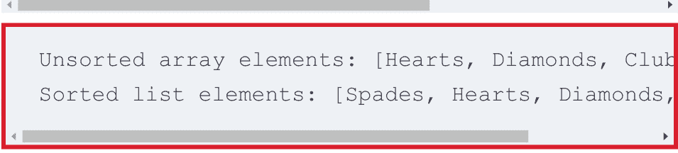

Fig. 12.5 | 带有 Comparator 对象的 Collections 方法。

图 12.6 创建了一个自定义类 `TimeComparator`，它实现了 `Comparator` 接口以比较两个 `Time2` 对象。回想一下 `Time2` 类（图 8.14）表示小时、分钟和秒的时间。

[点击此处查看代码图片](#)


```java
// Fig.12.6: TimeComparator.java
// Custom Comparator class that compares two
import java.util.Comparator;

public class TimeComparator implements Comparator<Time2> {
    @Override
    public int compare(Time2 time1, Time2 time2) {
        int hourDifference = time1.getHour() - time2.getHour();

        if (hourDifference != 0) { // test the hours
            return hourDifference;
        }

        int minuteDifference = time1.getMinute() - time2.getMinute();

        if (minuteDifference != 0) { // then test minutes
            return minuteDifference;
        }

        int secondDifference = time1.getSecond() - time2.getSecond();
        return secondDifference;
    }
}
```

图 12.6 | 比较两个 `Time2` 对象的自定义比较器。

`TimeComparator` 类（图 12.6）实现了泛型接口 `Comparator`，它包含有一个类型参数（在本例中为 `Time2`）。实现 `Comparator` 的类必须声明一个 `compare` 方法，该方法接收两个要比较类型的参数并返回：

- 如果第一个参数小于第二个参数，则返回负整数；
- 如果两个参数相等，则返回 0；
- 如果第一个参数大于第二个参数，则返回正整数。

`compare` 方法（第 6–22 行）比较 `Time2` 对象。第 8 行计算它们小时之间的差异。如果小时不同（第 10 行），我们返回此值：

- 如果此值为正数，则 `time1` 的小时大于 `time2` 的小时，且 `time1` 大于 `time2`。
- 如果此值为负数，则 `time1` 的小时小于 `time2` 的小时，且 `time1` 小于 `time2`。

如果小时差异为零，说明小时相同，因此我们必须测试分钟（第 14–18 行）以确定哪个时间更大。如果分钟相同，我们必须测试秒（第 20–21 行）以确定哪个时间更大。

图 12.7 使用我们的 `TimeComparator` 对 `ArrayList<Time2>` 对象的元素进行排序。第 9 行创建了 `ArrayList`。第 11–15 行创建了 `Time2` 对象并将其添加到列表中。第 21 行调用 `sort` 方法，并传递一个 `Comparator` 对象以自定义比较（图 12.6）。

点击此处查看代码图片

```java
// Fig.12.7: Sort3.java
// Collections method sort with a custom
import java.util.List;
import java.util.ArrayList;
import java.util.Collections;

public class Sort3 {
    public static void main(String[] args) {
        List<Time2> list = new ArrayList<>();

        list.add(new Time2(6, 24, 34));
        list.add(new Time2(18, 14, 58));
        list.add(new Time2(6, 5, 34));
        list.add(new Time2(12, 14, 58));
        list.add(new Time2(6, 24, 22));

        // output List elements
        System.out.printf("Unsorted array elements:%n");

        // sort in order using a comparator
        Collections.sort(list, new TimeComparator());

        // output List elements
        System.out.printf("Sorted list elements:%n");
    }
}
```

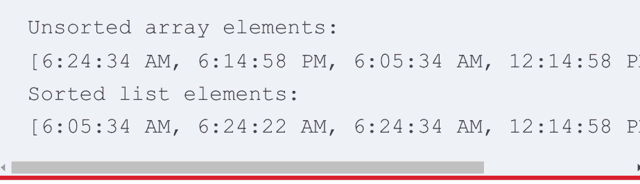

图 12.7 | 使用自定义 `Comparator` 对象的 `Collections sort` 方法。

### 生成式 AI

使用图 8.5 中的 `Account` 类来提示生成式 AI（genAI），让它们创建一个 `Comparator`，帮助根据余额对 `Account` 对象进行排序。要求生成式 AI 编写一个测试程序，创建 `ArrayList<Account>`，填充五个 `Account` 对象，然后按余额升序和降序排序账户并显示结果。

## 12.6.2 方法 shuffle

`shuffle` 方法随机打乱 `List` 元素的顺序。图 12.8 使用 `shuffle` 方法洗牌一组 `Card` 对象，这些对象可能用于纸牌游戏模拟器。

`Card` 类（第 8–32 行）表示牌组中的一张卡牌。每张卡牌都有面值和花色。第 9–11 行声明了两个类型——`Face` 和 `Suit`——代表卡牌的面值和花色。`toString` 方法（第 29–31 行）返回一个包含卡牌面值和花色的字符串，两者之间用“of”隔开。当枚举常量被转换为字符串时，将使用其标识符作为字符串表示。此示例将每个枚举常量的首字母大写，因此卡牌的面值和花色将以首字母显示（例如，“Ace of Spades”）。

点击此处查看代码图片

```java
// Fig.12.8: DeckOfCards.java
// Card shuffling and dealing with
import java.util.ArrayList;
import java.util.List;
import java.util.Collections;

// class to represent a Card in a deck of cards
class Card {
    public enum Face {Ace, Deuce, Three, Four, Five, Six, Seven, Eight, Nine, Jack, Queen, King}
    public enum Suit {Clubs, Diamonds, Hearts, Spades}
    private final Face face;
    private final Suit suit;

    // constructor
    public Card(Face face, Suit suit) {
        this.face = face;
        this.suit = suit;
    }

    // return face of the card
    public Face getFace() {return face;}

    // return suit of Card
    public Suit getSuit() {return suit;}

    // return String representation of Card
    public String toString() {
        return String.format("%s %s", face, suit);
    }
}

// class DeckOfCards declaration
public class DeckOfCards {
    private List<Card> deck = new ArrayList<>();

    // set up deck of Cards and shuffle
    public DeckOfCards() {
        // populate deck with Card objects
        for (Card.Suit suit : Card.Suit.values()) {
            for (Card.Face face : Card.Face.values()) {
                deck.add(new Card(face, suit));
            }
        }
        Collections.shuffle(deck);
    }

    // output deck
    public void printCards() {
        // display 52 cards in four columns
        for (int i = 0; i < deck.size(); i++) {
            System.out.printf("%-19s%s", deck.get(i), ((i + 1) % 4 == 0) ? System.out.println() : "");
        }
    }

    public static void main(String[] args) {
        DeckOfCards cards = new DeckOfCards();
        cards.printCards();
    }
}
```

| Ace of Clubs | Ace of Spades | Ace of Diamonds | Ace of Hearts |
| :--- | :--- | :--- | :--- |
| Deuce of Clubs | Deuce of Spades | Deuce of Diamonds | Deuce of Hearts |
| Three of Clubs | Three of Spades | Three of Diamonds | Three of Hearts |
| Four of Clubs | Four of Spades | Four of Diamonds | Four of Hearts |
| Five of Clubs | Five of Spades | Five of Diamonds | Five of Hearts |
| Six of Clubs | Six of Spades | Six of Diamonds | Six of Hearts |
| Seven of Clubs | Seven of Spades | Seven of Diamonds | Seven of Hearts |
| Eight of Clubs | Eight of Spades | Eight of Diamonds | Eight of Hearts |
| Nine of Clubs | Nine of Spades | Nine of Diamonds | Nine of Hearts |
| Jack of Clubs | Jack of Spades | Jack of Diamonds | Jack of Hearts |
| Queen of Clubs | Queen of Spades | Queen of Diamonds | Queen of Hearts |
| King of Clubs | King of Spades | King of Diamonds | King of Hearts |


图 12.8 | 卡牌洗牌与 `Collections shuffle` 方法。

（注：由于原始文本中表格部分似乎存在乱码，此处译文已根据代码逻辑进行了还原和对齐）

### 生成式 AI

有时，你可能需要一个可重复的随机序列，这在数据科学应用中很常见。例如，每当你为了调试逻辑执行纸牌程序时，你可能希望洗牌后的牌组顺序相同。提示生成式 AI，询问如何使用 `Collections shuffle` 方法的重载版本和 `RandomGenerator` 对象来获取可重复的结果。

## 12.6.3 Methods reverse, fill, copy, max and min

`Collections` 类提供了用于 `List` 反转、填充和复制的方法：

- `Collections reverse` 方法反转 `List` 中元素的顺序。
- `Collections fill` 方法使用指定值覆盖 `List` 中的元素——例如，重新初始化现有的 `List`。
- `Collections copy` 方法接收一个目标 `List` 和一个源 `List`。源中的每个元素都将被复制到目标。目标 List 的长度至少要与源列表一样；否则会发生 `IndexOutOfBoundsException`。如果目标 List 更长，未被覆盖的元素保持不变。

`Collections` 方法 `min` 和 `max` 作用于任何 `Collection`——`min` 返回最小元素，`max` 返回最大元素。两者都可以带一个第二个参数 `Comparator` 对象，以便对对象进行自定义比较，例如图 12.7 中的 `TimeComparator`。图 12.9 展示了 `reverse`、`fill`、`copy`、`max` 和 `min` 方法。

点击此处查看代码图片

```java
// Fig.12.9: Algorithms1.java
// Collections methods reverse, fill, copy,
import java.util.List;
import java.util.Arrays;
import java.util.Collections;

public class Algorithms1 {
    public static void main(String[] args) {
        // create and display a List<Character>
        Character[] letters = {'P', 'C', 'M'};
        List<Character> list = Arrays.asList(letters);
        outputList(list);

        // reverse and display the List<Character>
        Collections.reverse(list); // reverse
        System.out.printf("%nAfter calling reverse: %s\n", list);
        outputList(list);

        // create copyList from an array of 3
        Character[] lettersCopy = new Character[3];
        List<Character> copyList = Arrays.asList(lettersCopy);
        // copy the contents of list into copyList
        Collections.copy(copyList, list);
        System.out.printf("%nAfter copying, %s\n", copyList);
        outputList(list);

        // fill list with Rs
        Collections.fill(list, 'R');
        System.out.printf("%nAfter calling fill: %s\n", list);
        outputList(list);
    }

    // output List information
    private static void outputList(List<Character> list) {
        System.out.printf("The list is: %s\n", list);
        System.out.printf("Max: %s; Min: %s\n", Collections.max(list), Collections.min(list));
    }
}
```

The list is: [P, C, M]

Max: P; Min: C

After calling reverse, list contains:

The list is: [M, C, P]

Max: P; Min: C

After copying, copyList contains:

The list is: [M, C, P]

Max: P; Min: C

After calling fill, list contains:

The list is: [R, R, R]

Max: R; Min: R

Fig. 12.9 | Collections methods reverse, fill, copy, max and min.


第 11 行创建 `List<Character>` 变量 `list`，并用 `Character` 数组 `letters` 的 List 视图初始化它。第 12 行调用 `outputList` 方法（第 35–39 行）显示 List 的当前内容及其最小最大值。第 15 行调用 Collections 方法 `reverse` 反转 list 的顺序。`reverse` 方法接受一个 `List` 参数。由于 `list` 是数组 `letters` 的 List 视图，数组的元素现在变成了反序。反转后的内容在第 16–17 行输出。

第 24 行使用 Collections 方法 `copy` 将 list 的元素复制到 `copyList`。对 `copyList` 的更改不会改变 `letters`，因为 `copyList` 是一个独立的 List，而不是数组 `letters` 的 List 视图。`copy` 方法需要 `List` 参数——目标 List 和源 List。

第 29 行调用 Collections 方法 `fill` 将字符 'R' 放入每个列表元素中。由于 `list` 是数组 `letters` 的 List 视图，此操作将 `letters` 中的每个元素更改为 'R'。`fill` 方法第一个参数需要一个 `List`，第二个参数需要一个对象。

第 37–38 行在 `outputList` 方法中分别调用 Collections 方法 `max` 和 `min` 来寻找 Collection 的最大最小元素。记得 `List` 扩展了 `Collection` 接口，所以 `List` 是 `Collection`。

## 生成式 AI

- 询问 AI：如果对未实现 `Comparable` 接口的集合调用 `min` 或 `max` 方法会发生什么。

# 12.6.4 方法 `binarySearch`

如果你需要在短 List 中搜索键，简单遍历 List 元素通常是高效的。如果你需要在长 List 中搜索键，快速二分查找算法会高效得多。静态方法 `binarySearch` 实现了快速搜索算法。该方法在排序的 List 中定位对象。如果找到对象，`binarySearch` 返回其索引；否则 `binarySearch` 返回负值。如果列表中有多个元素匹配搜索键，无法保证定位哪一个。图 12.10 使用 `binarySearch` 在 ArrayList 中搜索各种 String。点击此处查看代码图片

```java
// Fig.12.10: BinarySearch.java
// Collections method binarySearch
import java.util.List;
import java.util.Arrays;
import java.util.Collections;
import java.util.ArrayList;

public class BinarySearchTest {
    public static void main(String[] args) {
        // create ArrayList<String> from array
        String[] colors = {"red", "white", "blue", "pink"};
        List<String> list = new ArrayList<>(Arrays.asList(colors));

        Collections.sort(list); // sort the Array
        System.out.printf("Sorted ArrayList: %s%n", list);

        // search list for values
        printSearchResults(list, "black");
        printSearchResults(list, "red");
        printSearchResults(list, "pink");
        printSearchResults(list, "aqua"); // not found
        printSearchResults(list, "gray"); // not found
        printSearchResults(list, "teal"); // not found
    }
```

```java
// perform search and display result
private static void printSearchResults(
List<String> list, String key) {
    System.out.printf("%nSearching for: %s\n", key);
    int result = Collections.binarySearch(list, key);
    if (result >= 0) {
        System.out.printf("Found at index %d\n", result);
    } else {
        System.out.printf("Not Found (%d)\n", result);
    }
}
```

Sorted ArrayList: [black, blue, pink, red]

Searching for: black

Found at index 0

Searching for: red

Found at index 4

Searching for: pink

Found at index 2

Searching for aqua

Not Found (-1)

Searching for gray

Not Found (-3)

Searching for teal

Not Found (-7)

**图 12.10** | Collections method binarySearch.

第 13 行用一个包含数组 `colors` 元素的 ArrayList 初始化 `list`。Collections 方法 `binarySearch` 的前提（第 10.1 节）是其 List 参数的元素必须按升序排序。第 15 行使用 Collections 方法 `sort` 对 List 进行排序，对于大 List 来说这是一个耗时的操作。如果不满足 `binarySearch` 的前提，其结果未定义——你可以与 GenAI 探讨这个问题。第 16 行输出排序后的 List。第 19–24 行调用 `printSearchResults` 方法（第 28–40 行）执行搜索并输出结果。第 32 行调用 Collections `binarySearch` 在 list 中搜索指定的键，将 List 和搜索键作为参数传递。第 34–39 行输出搜索结果。`binarySearch` 的重载版本接受一个 `Comparator` 对象作为第三个参数，指定 `binarySearch` 如何比较搜索键与 List 的元素。

## 生成式 AI

- 业务关键和任务关键系统不应包含可能产生未定义结果的代码，可能会导致严重问题。询问 AI 如何避免 Java Collections 方法 `binarySearch` 产生未定义结果。
- 询问 AI：Java Collections 方法 `binarySearch` 在找不到键时如何计算其负返回值。

# 12.6.5 方法 `addAll`、`frequency` 和 `disjoint`

Collections 类还提供了 `addAll`、`frequency` 和 `disjoint` 方法：

- Collections 方法 `addAll` 接受两个参数——插入新元素的 Collection 以及提供插入元素的数组（或变长参数列表）。
- Collections 方法 `frequency` 接受两个参数——要搜索的 Collection 和要在集合中搜索的对象。`frequency` 方法返回第二个参数在集合中出现的次数。
- Collections 方法 `disjoint` 接受两个 Collection，如果它们没有共同元素，则返回 true。

图 12.11 展示了这些方法。

点击此处查看代码图片

```java
1 // Fig.12.11: Algorithms2.java
2 // Collections methods addAll, frequency and
3 import java.util.ArrayList;
4 import java.util.List;
5 import java.util.Arrays;
6 import java.util.Collections;
7 
8 public class Algorithms2 {
9     public static void main(String[] args) {
10     // initialize list1 and list2
11 String[] colors = {"red", "white", "yellow"};
12 List<String> list1 = Arrays.asList(colors);
13 List<String> list2 = new ArrayList<>();
14 
15 list2.add("black"); // add "black" to
```

```java
list2.add("red"); // 向列表添加 "red"
list2.add("green"); // 向列表添加 "green"
System.out.printf("Before addAll, list2: %s%n", list2);
Collections.addAll(list2, colors); //
System.out.printf("After addAll, list2: %s%n", list2);
// 获取 "red" 的出现频率
int frequency = Collections.frequency(list2, "red");
System.out.printf("%nFrequency of red: %d%n", frequency);
boolean areDisjoint = Collections.disjoint(list1, list2);
System.out.printf("list1 and list2 %s elements in common%n", areDisjoint ? "do not have" : "have"); 
```

Before addAll, list2 包含：[black, red, green]

After addAll, list2 包含：[black, red, green, red, white, yellow]

list2 中 red 的出现频率： 2

list1 和 list2 有共同元素

**图 12.11** | Collections 方法 addAll、frequency 和 disjoint。

第 12 行使用数组 `colors` 中的元素初始化列表，第 15–17 行将字符串 "black"、"red" 和 "green" 添加到 `list2`。第 20 行调用 `addAll` 方法将数组 `colors` 中的元素添加到 `list2`。第 24 行使用 `frequency` 方法获取 `list2` 中 "red" 的出现频率。第 28 行调用 `disjoint` 方法测试 Collections `list1` 和 `list2` 是否具有共同元素，在本例中它们是具有的。

在第 14 章“使用 Lambdas & Streams 进行函数式编程”中，将要求他们重构图 12.11 的代码，并使用该章引入的技巧对其进行改进。

## 生成式 AI

- 向生成式 AI 询问对于大型集合时 Collections `addAll`、`frequency` 和 `disjoint` 的性能。

# 12.7 类 PriorityQueue 和接口 Queue

回想队列（queue）是一种代表等待队列的集合——通常，插入在队列末尾进行，删除从队列头部进行。本节演示了 Java 来自 `java.util` 包的 `Queue` 接口和 `PriorityQueue` 类。在第 18 章“并发：从平台线程到虚拟线程”中，我们将使用并发队列。

接口 `Queue` 继承自接口 `Collection`，并提供了对队列中插入、删除和检查元素的额外操作。`PriorityQueue` 类实现了 `Queue` 接口，根据 `Comparable` 元素 `compareTo` 方法指定的自然顺序，或根据构造函数提供的 `Comparator` 对象对元素进行排序。

`PriorityQueue` 类提供的功能允许按排序顺序插入元素到底层数据结构中，并从底层数据结构的头部进行删除。对于包含数值的 `PriorityQueue`，值最小具有“最高”优先级，并将首先从 `PriorityQueue` 中移除。

## PriorityQueue 操作

常见的 PriorityQueue 操作包括：

- `offer`：根据优先级顺序在适当位置插入元素
- `poll`：移除优先级队列中优先级最高的元素（即队列头部）
- `peek`：获取优先级队列中优先级最高的元素的引用（而不移除该元素）
- `clear`：移除优先级队列中的所有元素
- `size`：获取优先级队列中的元素数量

### 演示 PriorityQueue

图 12.12 展示了带有 `PriorityQueue<Double>` 的泛型类 `PriorityQueue`（第 8 行）。默认情况下，`PriorityQueue` 的初始容量为 11 个元素。`PriorityQueue` 类提供了几个额外的构造函数。其中一个接受一个 `int` 和一个 `Comparator` 对象，以创建一个由 `int` 指定初始容量并由 `Comparator` 指定排序的 `PriorityQueue`。

点击此处查看代码图像

```java
// Fig.12.12: PriorityQueueTest.java
// PriorityQueue 测试程序。
import java.util.PriorityQueue;

public class PriorityQueueTest {
    public static void main(String[] args) {
        // 容量为 11 的队列
        var queue = new PriorityQueue<Double>(11);

        // 向队列插入元素
        queue.offer(3.2);
        queue.offer(9.8);
        queue.offer(5.4);

        System.out.print("Polling from queue:");

        // 显示队列中的元素
        while (!queue.isEmpty()) {
            System.out.printf("%.2f ", queue.peek());
            queue.poll(); // 移除顶端元素
        }
    }
}
```

```
Polling from queue: 3.20 5.40 9.80
```


图 12.12 | PriorityQueue 测试程序。

第 11–13 行使用 `offer` 向优先级队列中添加元素。如果程序尝试向队列添加 `null` 对象，`offer` 方法将抛出 `NullPointerException`。第 18–21 行的循环使用 `isEmpty` 判断优先级队列是否为空（第 18 行）。当还有更多元素时，第 19 行使用 PriorityQueue 方法 `peek` 查看队列中优先级最高的元素以便输出（而不将其从队列中实际移除）。第 20 行使用 `poll` 方法移除队列中优先级最高的元素，该方法返回被移除的元素。

## 生成式 AI

- 1 个提示：向生成式 AI 请求计算机系统中优先级队列的示例。
- 2 个提示：向生成式 AI 询问何时使用 `Queue` 的 `Queue`。

## 12.8 哈希表

当应用程序需要存储和检索数据时，可以使用哈希表。哈希表是一个数组，每个索引通过哈希函数与键关联。哈希函数将键映射到数组中的索引。这对于存储和检索是高效的，因为可以直接从键计算出索引。

点击此处查看代码图像

https://www.ssa.gov/employer/randomization.html

### 非整数分布键

许多应用程序面临此问题——即键的类型错误（例如不能作为数组下标的整数），或者它们类型正确但在巨大范围内分布稀疏，例如小公司的安全号。我们需要的是一种快速的方案，将键（如零件号）转换为数组索引。这样，当应用程序需要存储数据项时，该方案可以快速将应用程序的键转换为索引（一个哈希过程），并将项存储在数组槽中。

### 为什么用哈希（Hashing）这个术语？

当我们将键转换为数组索引时，我们实际上是在打乱比特位，形成一种“哈希过的”或哈希值。这个数字在存储和检索数据的用途之外并没有实际意义。

### 哈希冲突

方案中的故障称为冲突（collision），当两个不同的键“哈入”同一个数组元素时发生。我们无法在同一空间存储两个值，因此需要为除第一个哈希到同一数组索引之外的值寻找替代位置。有很多方法可以实现。其中一种是“再次哈希”——即对上一个哈希结果应用另一种哈希转换，以提供下一个候选单元。哈希过程的设计是将值分布在整个表格中，因此希望通过一次或多次哈希就能找到可用单元。

另一种方案使用一次哈希来定位第一个候选单元。如果该单元被占用，则顺序搜索相邻单元直到找到可用单元。检索也是一样：对键哈希一次以确定初始位置并检查其是否包含所需数据。如果是，则搜索完成；否则，顺序搜索后续单元直到找到所需数据。解决哈希表冲突的一种流行方案是让每个表单元成为哈希桶（hash bucket）——通常是一个包含所有哈希到该单元的键值对的列表。这就是 Java 的 `HashMap` 类（第 12.10 节）所使用的方案。

### 负载因子与性能

哈希表的负载因子会影响哈希方案的性能。负载因子是哈希表中已占用单元格数与总单元格数的比例。该比例越接近 1.0，发生冲突的概率就越大，从而减慢数据插入和检索速度。

哈希表的负载因子是内存空间/执行时间权衡的经典示例：通过增加负载因子，我们可以获得内存利用率，但由于哈希冲突增加，程序运行速度会变慢。通过降低负载因子，由于冲突减少，我们可以获得更快的程序速度，但由于哈希表大部分仍为空白，内存利用率会降低。

## HashSet 和 HashMap 集合

Java 的 `HashSet` 和 `HashMap` 集合（在第 12.9–12.10 节介绍）在“底层”是通过哈希表实现的。当你使用这些集合时，可以获得高速数据存储和检索的优势，而无需构建自己的哈希表机制——这是软件重用的经典示例。`Object` 类的 `hashCode` 方法用于确定键在 Java 基于哈希表的集合中的位置。

## 虚拟内存

哈希的另一个有趣应用是虚拟内存²操作系统。程序和数据维护在海量的辅助存储中，并被带入更有限的主内存（甚至是更有限、更快的缓存内存）中执行。高效运行应用程序的技巧是在主内存（和缓存内存）中保留时刻需要执行的程序部分。在虚拟内存中寻找这些程序片段涉及搜索定义它的大型数据结构。哈希通常用于此目的。

> 2. “Virtual Memory.” Wikipedia. Wikimedia Foundation. Accessed 于 2024 年 9 月 24 日.
> https://en.wikipedia.org/wiki/Virtual_memory.

## 生成式 AI

1. 提示生成式 AI 简要概述如何使用哈希来实现高性能虚拟内存操作系统。

## 12.9 Set（集合）

`Set` 是唯一元素的集合（即没有重复项）。
集合框架包含了几种 `Set` 实现，包括 `HashSet` 和 `TreeSet`：

- `HashSet` 将其元素（无序）存储在哈希表中——哈希表在第 12.8 节中介绍。
- `TreeSet` 将其元素（有序）存储在树中。树及其应用在通常称为“数据结构与算法”的高级计算机科学课程中讨论。

图 12.13 使用 `HashSet` 从 `List` 中移除重复字符串。回想 `List` 和 `Collection` 都是泛型，因此第 14 行创建了一个包含 `String` 对象的 `List`，第 18 行将集合传递给方法 `printNonDuplicates`（第 22–33 行），该方法接受一个 `Collection` 参数。第 24 行根据 `Collection<String>` 参数构造了一个 `HashSet<String>`。根据定义，`Set` 不包含重复项，当构造 `HashSet` 时，`Collection` 中的任何重复项都会被忽略。第 28–30 行输出 Set 中的元素。我们在这里使用循环来遍历 HashSet 的元素，但也可以使用 HashSet 的字符串表示形式。

点击此处查看代码图像

```java
// Fig.12.13: SetTest.java
// HashSet used to remove duplicate values from
import java.util.List;
import java.util.Arrays;
import java.util.HashSet;
import java.util.Set;
import java.util.Collection;

public class SetTest {
    public static void main(String[] args) {
        // create and display a List<String>
        String[] colors = {"red", "white", "blue",
            "orange", "tan", "white", "cyan"};
        List<String> list = Arrays.asList(colors);
        System.out.printf("List: %s%n", list);

        // eliminate duplicates then
        printNonDuplicates(list);
    }

    private static void printNonDuplicates(List<String> list) {
        Set<String> set = new HashSet<>();
        for (String s : list) {
            set.add(s);
        }
        System.out.print("Nonduplicates are: ");
        for (String s : set) {
            System.out.print(s + " ");
        }
        System.out.println();
    }
}
```

List: [red, white, blue, orange, tan, white]

Nonduplicates are: red white blue orange tan

Fig. 12.13 移除数组中的值

## Sorted Sets（有序集合）

集合框架还包括 `SortedSet` 接口（继承自 `Set`），用于按排序顺序维护元素的集合——元素的自然顺序（例如升序）或由 `Comparator` 指定顺序。`TreeSet` 实现了 `SortedSet`。图 12.14 将字符串放入 TreeSet 时，字符串是排序的。这个示例还演示了视图方法，这些方法允许程序查看集合的一部分。

点击此处查看代码图像

```java
// Fig.12.14: SortedTest.java
// Using SortedSets and TreeSets
import java.util.Arrays;
import java.util.SortedSet;
import java.util.TreeSet;

public class SortedTest {
    public static void main(String[] args) {
        // create TreeSet from array
        String[] colors = {"yellow", "white",
            "orange", "red", "green", "tan"};
        SortedSet<String> tree = new TreeSet<>(
            Arrays.asList(colors));
        System.out.println("Sorted set: " + tree);

        // range-view methods
        System.out.println("HeadSet: " + tree.headSet("orange"));
        System.out.println("TailSet: " + tree.tailSet("orange"));
        System.out.println("SubSet: " + tree.subSet("orange", "tan"));
    }
}
```

sorted set: [blue, green, orange, red, tan, white, yellow]
HeadSet: [blue, green]
TailSet: [orange, red, tan, white, yellow]
SubSet: [orange, red]

```java
public class WordTypeCount {

    public static void main(String[] args) {

        // create HashMap to store String keys
        Map<String, Integer> myMap = new HashMap<>();

        createMap(myMap); // create map based
        displayMap(myMap); // display map content
    }

    // create map from user input
    private static void createMap(Map<String, Integer> map) {

        var scanner = new Scanner(System.in);
        System.out.println("Enter a string:");
        String input = scanner.nextLine();

        // tokenize the input
        String[] tokens = input.split(" ");

        // processing input text
        for (String token : tokens) {
            String word = token.toLowerCase();

            // if the map contains the word
            if (map.containsKey(word)) { //
                int count = map.get(word); // get
                map.put(word, count + 1); // inc
            } else {
                map.put(word, 1); // add new word
            }
        }
    }

    private static void displayMap(Map<String, Integer> map) {

        Set<String> keys = map.keySet(); // get
        // sort keys
        var sortedKeys = new TreeSet<String>(keys);

        System.out.printf("%nMap contains:%n");

        // generate output for each key in map
        for (String key : sortedKeys) {
            System.out.printf("%-10s%10s%n", key, map.get(key));
        }

        System.out.printf(
            "%nsize: %d%nisEmpty: %b%n", map.size(), map.isEmpty());
    }
}
```

Enter a string:

this is a sample sentence with several words sentence with several different words

Map contains:

| Key | Value |
| :--- | :--- |
| a | 1 |
| another | 1 |
| different | 1 |
| is | 2 |
| sample | 2 |
| sentence | 2 |
| several | 2 |
| this | 2 |
| with | 2 |
| words | 2 |

size: 10
isEmpty: false


**图 12.15** | 程序统计一个 `String` 中每个单词出现的次数。

`HashMap` 是一个泛型类，它接受两个类型参数——键的类型（即 `String`）和值的类型（即 `Integer`）。请记住，传递给泛型类的类型参数必须是引用类型，因此第二个类型参数是 `Integer` 而不是 `int`。

## 方法 `createMap`

第 14 行调用了 `createMap` 方法（位于第 19–40 行），该方法使用一个 `Map` 来存储句子中每个单词出现的次数。第 22 行获取用户输入，第 25 行对其进行分词。对于每个标记符，第 28–39 行将标记符转换为小写字母（第 29 行）以便进行不区分大小的单词计数，然后调用 `Map` 方法 `containsKey`（第 32 行）来确定该单词是否在 map 中（即之前是否在字符串中出现过）：

- 如果单词于 map 中，第 33 行使用 `Map` 方法 `get` 获取 map 中与键关联的值（计数）。第 34 行增加该值并使用 `put` 将该键的关联值替换为包装后的 `Integer` 格式的新计数。方法 `put` 返回键之前的关联值，如果该键不在 map 中，则返回 `null`。

- 如果 `Map` 不包含该单词，第 37 行使用 `Map` 方法 `put` 创建新条目，以单词作为键，并一个包含 1 的 `Integer` 对象作为值（1 经过了包装）。

`Map` 中的键应该是不可变的。键决定了相应值存放的位置。在使用键插入键值对之后修改键，可能会导致程序之后无法定位该键对应的值。在章节的示例中，我们使用 `String` 作为键，因为它们是不可变的。

## 方法 `displayMap`

`displayMap`（位于第 43–58 行）显示 map 中的所有条目。它使用 `HashMap` 方法 `keySet`（第 44 行）获取键的集合。由于 `map` 中键的类型为 `String`，因此 `keySet` 返回一个 `Set<String>`。第 47 行创建了键的 `TreeSet` 以按排序顺序存储它们。第 52–54 行访问 map 的键值对。第 53 行使用格式占位符 `%-10s` 使每个键左对齐，使用占位符 `%10s` 使每个值右对齐。第 57 行调用 `Map` 方法 `size` 获取 `Map` 中键值对的数量，并调用 `Map isEmpty`，它返回一个表示 `Map` 是否空的布尔值。

## 创建不可变集合的工厂方法

`List`、`Set` 和 `Map` 包含了用于创建小型不可变集合的 `static` 便利工厂方法。“工厂”一词表示这些方法负责创建对象，因为你只需将元素作为参数传递给该方法——它会创建集合并向其中添加元素。尝试从这些不可变集合中添加或删除元素的 `List`、`Set` 或 `Map` 方法会导致 `UnsupportedOperationException`。尽管这些集合是不可变的，但它们可能包含可变对象。如果便利工厂方法接收到任何空参数，将抛出 `NullPointerException`。第 18 章解释了如何使用 lambda 和流配合不可变实体，可以帮助你创建“可并行化的”代码，这些代码在当今的多核架构上运行得更高效。图 12.16 展示了 List、Set 和 Map 的这些便利工厂方法。

```java
// Fig12.16: FactoryMethods.java
// Convenience factory methods for creating
import java.util.List;
import java.util.Map;
import java.util.Set;

public class FactoryMethods {
  public static void main(String[] args) {
    // 创建 List
    List<String> colorList = List.of("red", "green", "blue", "violet");
    System.out.printf("List: %s%n", colorList);

    // 创建 Set
    Set<String> colorSet = Set.of("red", "green", "blue", "violet");
    System.out.printf("Set: %s%n", colorSet);

    // 创建 Map
    Map<String, Integer> dayMap = Map.of("Wednesday", 3, "Thursday", 4, "Friday", 7);
    System.out.printf("Map: %s%n", dayMap);

    // 创建 Map
    Map<String, Integer> daysMonthMap = Map.of(
      "January", 31,
      "February", 28,
      "March", 31,
      "April", 30,
      "May", 31,
      "June", 30,
      "July", 31,
      "August", 31,
      "September", 30,
      "October", 31,
      "November", 30,
      "December", 31
    );
    System.out.printf("Map: %s%n", daysMonthMap);
  }
}
```


3. JEP 269: 集合的便捷工厂方法。访问 2024 年 9 月 24 日。https://openjdk.org/jeps/269。

## Set.of 便捷工厂方法

第 15–16 行使用 `Set.of` 便捷工厂方法创建一个不可变的 `Set<String>`。与 `List.of` 一样，`Set.of` 针对 0–10 个元素的 `Set` 进行了重载，并为任意数量的元素提供了重载支持。如果任何参数是重复的，`Set.of` 将抛出 `IllegalArgumentException`。第 17 行显示了 `Set` 的字符串表示。注意，在两个示例输出中，`Set` 元素的顺序是不同的。便捷工厂方法返回的不可变 `Set`，其迭代顺序是不指定的⁴——你将在生成式 AI 问题 3 中询问为什么。

4. “接口 Set<E>—不可修改的集合。”访问 2024 年 9 月 24 日。https://docs.oracle.com/en/java/javase/23/docs/api/java.base/util/Set.html#unmodifiable。

## Map.of 便捷工厂方法

第 20–22 行使用 `Map.of` 便捷工厂方法创建一个不可变的 `Map<String, Integer>`。与 `List` 和 `Set` 类似，`Map.of` 针对 0–10 个键值对的 `Map` 进行了重载——对于更大的 Map，Map 提供了 `Map.ofEntries`，我们稍后会讨论。每对参数（例如第 20 行中的 "Monday" 和 1）代表一个键值对。第 23 行显示了 `Map` 的字符串表示。便捷工厂方法返回的 `Map` 键的迭代顺序是不指定的⁵——如输出所示，顺序在程序执行之间可能会更改。如果任何键重复，方法 `Map.of` 和 `Map.ofEntries` 将抛出 `IllegalArgumentException`。

5. “接口 Map<K,V>—不可修改的映射。”访问 2024 年 9 月 21 日。https://docs.oracle.com/en/java/javase/23/docs/api/java.base/util/Map.html#unmodifiable。

## Map.ofEntries 便捷工厂方法

第 26–39 行使用 `Map.ofEntries` 便捷工厂方法创建一个不可变的 `Map<String, Integer>`。该方法的变长参数中的每一个都是通过调用 Map 的静态方法 `entry` 返回的 `Map.Entry` 对象——`Map.Entry` 存储一个键值对。第 40 行显示了 Map 内容的字符串表示。再次，输出确认了 `Map` 键的迭代顺序在程序执行之间可以更改。

## 生成式 AI

1. 提示词询问生成式 AI，请求 Java 便捷工厂方法返回的不可变集合的用例。

2. 提示词询问生成式 AI，询问为什么 Java 的便捷工厂方法主要针对小规模集合进行了优化。

3. 提示词询问生成式 AI，询问为什么 Java 集合工厂方法返回的不可变 Set 和 Map 在不同程序执行之间会有不同的迭代顺序。

## 12.12 并发集合

第 18 章介绍了并发和并行。集合框架中的集合默认是不同步的，因此在不需要并发和并行时，它们可以高效运行。然而，多个线程对集合的并发访问可能会导致不确定的结果或致命错误——正如我们在第 18 章中演示的。为了解决这些问题，我们将引入 `java.util.concurrent` 包中的 `ArrayBlockingQueue` 类——这是许多健壮并发集合之一，旨在利用当今的多核处理器提高性能的应用程序。

## 12.13 总结

本章介绍了 Java 集合框架。你学习了 Java 集合框架的 `Collection` 接口层次结构以及如何使用这些接口以多态方式对集合进行编程。你使用了 `ArrayList` 和 `LinkedList` 类，它们都实现了 `List` 接口。你使用了几个预定义的 `Collections` 类方法来执行常见的集合操作。

我们介绍了 Java 的 `Queue` 接口和 `PriorityQueue` 实现类来操作队列。我们使用 `Set` 接口和 `HashSet` 类来操作无序的唯一值集合，并使用 `SortedSet` 接口和 `TreeSet` 类来操作排序的唯一值集合。接下来，我们介绍了 Java 用于操作键值对集合的接口和类——`Map`、`SortedMap`、`HashMap` 和 `TreeMap`。最后，我们引入了创建不可变 `List`、`Set` 和 `Map` 的便捷工厂方法。有关 Java 集合框架的更多信息，请访问：

点击此处查看代码图像

```
https://docs.oracle.com/javase/tutorial/collecti
```

以及

点击此处查看代码图像

```
https://docs.oracle.com/en/java/javase/23/docs/ap/util/doc-files/coll-index.html.
```

第 14 章“使用 Lambda 和 Stream 进行函数式编程”介绍了将让你能够更简洁、优雅的方式重新实现本章许多示例的功能，并且这种方式使它们更容易并行化，以提高多核系统上的性能。第 18 章“并发：从平台线程到虚拟线程”讨论了如何使用 Java 的并发集合和并行流操作来提高多核系统上的性能。请访问书籍网页 https://deitel.com/javaafp5 进行讨论。

## 13 泛型类和方法：深入观察


### 目标

在本章中，你将：
- 创建对不同类型执行相同任务的泛型方法。
- 限制类型参数以满足泛型方法的要求。
- 创建可以存储任意引用类型的泛型 `Stack` 类。
- 学习 Java 如何在泛型方法和类的编译期间通过类型擦除将泛型替换为实际类型。
- 学习如何使用通配符重载泛型方法。

### 大纲

# 13.1 引言
# 13.2 泛型方法的动机
# 13.3 泛型方法：实现与编译时翻译
# 13.3.1 泛型方法 `printArray`
# 13.3.2 泛型方法的类型参数
# 13.3.3 测试泛型方法
# 13.3.4 编译时的擦除
# 13.4 额外的编译时翻译问题：使用类型参数作为返回类型的方法
# 13.5 重载泛型方法
# 13.6 泛型类
# 13.6.1 参数化类型
# 13.6.2 实现泛型 Stack 类
# 13.6.3 测试泛型 Stack 类
# 13.6.4 重构程序以使用泛型方法操作 `Stack<E>`
# 13.7 接受类型参数的方法中的通配符
# 13.7.1 累加 `List<Number>`
# 13.7.2 使用通配符参数重新实现 sum 方法
# 13.8 总结

## 特别章节：生成式 AI 练习

## 13.1 引言

你在第 6 章和第 12 章中已经用过现有的通用方法和类。在本章中，你将学习如何编写自己的。

如果我们能写一个单一的 `sort` 方法来对 `Integer` 数组、`String` 数组或任何支持排序（即其元素可以比较）的任意类型的数组进行排序，那就太好了。如果我们能写一个 `Stack` 类，使其可以用作整数栈、浮点数栈、`String` 栈或任何其他类型的栈，也将非常棒。如果我们能够在编译时检测到类型不匹配——即类型安全——就更完美。例如，如果一个 `Stack` 应该只存储整数，那么尝试向该 `Stack` 推入 `String` 应该抛出编译错误。本章将讨论泛型——特别是泛型方法和泛型类——它们为创建上述类型安全的通用模型提供了手段。

### 生成式 AI 类型

1. 提示词 genAIS 列出几个常用的、非集合类的 Java API 通用泛型类。

## 13.2 泛型方法的动机

重载方法通常对不同的数据类型执行相似的操作。为了说明泛型方法，图 13.1 使用了重载的 `printArray` 方法（第 17–24 行和 27–34 行），分别显示 `Integer` 数组和 `Double` 数组中元素的 `String` 表示。对于这个示例，我们可以使用原始类型 `int` 和 `double` 的数组。然而，我们正在使用类型包装类 `Integer` 和 `Double` 的数组来建立我们的泛型方法示例——泛型方法和类只能操作引用类型¹。

1. Project Valhalla 正在开发的语言增强将允许 Java 泛型直接支持原始类型。更多信息请访问 https://openjdk.org/projects/valhalla/

点击此处查看代码图片

```
// 图 13.1: OverloadedMethods.java

// 使用重载方法打印数组元素

public class OverloadedMethods {

    public static void main(String[] args) {

        // 创建 Integer 和 Double 数组

        Integer[] integerArray = {1, 2, 3, 4};

        Double[] doubleArray = {1.1, 2.2, 3.3};

        System.out.printf("Array integerArray %s\n", integerArray);

        printArray(integerArray); // 传递 Integer 数组

        System.out.printf("Array doubleArray %s\n", doubleArray);

        printArray(doubleArray); // 传递 Double 数组

    }

    // 用于打印 Integer 数组的方法 printArray

    public static void printArray(Integer[] inputArray) {

        // 显示元素

        for (Integer element : inputArray) {

            System.out.printf("%s ", element);

        }

        System.out.println();

    }

}
```


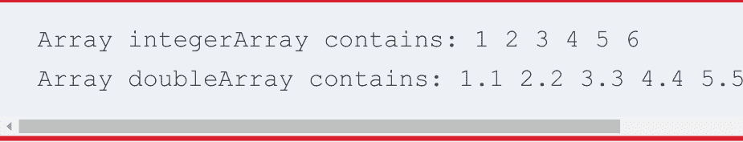

图 13.1 | 使用重载方法打印数组元素。

程序声明并初始化两个数组：

- 六个元素的 `Integer` 数组 `integerArray`（第 7 行），以及
- 七个元素的 `Double` 数组 `doubleArray`（第 8 行）。

第 11 行和第 13 行分别调用 `printArray` 来显示每个数组的内容。

当编译器遇到方法调用时，它会尝试查找具有相同名称且参数匹配调用参数类型的方法声明。在这个示例中，每个 `printArray` 调用都匹配一个 `printArray` 声明：

- 第 11 行调用 `printArray` 并传入参数 `integerArray`。编译器确定参数的类型（`Integer[]`）并尝试查找带有 `Integer[]` 的 `printArray` 方法。
- 同样，当编译器在第 13 行遇到调用时，确定参数类型（`Double[]`）并尝试查找带有 `Double[]` 的 `printArray` 方法（第 27–34 行），然后设置该调用。

由于重载方法在不同数据类型上执行相似的操作，为了说明泛型方法的动机，图 13.1 使用了重载的 `printArray` 方法（第 17–24 行和 27–34 行），分别显示 `Integer` 数组和 `Double` 数组中元素的 `String` 表示。对于这个示例，我们可以使用原始类型 `int` 和 `double` 的数组。然而，我们正在使用类型包装类 `Integer` 和 `Double` 的数组来建立我们的泛型方法示例——泛型方法和类只能操作引用类型¹

> 1. 在未来的 Java 版本中，Project Valhalla 正在开发的语言增强将允许 Java 泛型直接支持原始类型。更多信息请访问 https://openjdk.org/projects/valhalla/

### 13.3 泛型方法的特征

重载方法与重载方法，由于重载方法在不同数据类型上执行相似的操作，为了说明泛型方法的动机，图 13.1 使用了重载的 `printArray` 方法（第 17–24 行和 27–34 行），分别显示 `Integer` 数组和 `Double` 数组中元素的 `String` 表示。对于这个示例，我们可以使用原始类型 `int` 和 `double` 的数组。然而，我们正在使用类型包装类 `Integer` 和 `Double` 的数组来建立我们的泛型方法示例——泛型方法和类只能操作引用类型¹

由于重载方法在不同数据类型上执行相似的操作，为了说明泛型方法的动机，图 13.1 使用了重载的 `printArray` 方法（第 17–24 行和 27–34 行），分别显示 `Integer` 数组和 `Double` 数组中元素的 `String` 表示。对于这个示例，我们可以使用原始类型 `int` 和 `double` 的数组。然而，我们正在使用类型包装类 `Integer` 和 `Double` 的数组来建立我们的泛型方法示例——泛型方法和类只能操作引用类型¹

由于重载方法在不同数据类型上执行相似的操作，为了说明泛型方法的动机，图 13.1 使用了重载的 `printArray` 方法（第 17–24 行和 27–34 行），分别显示 `Integer` 数组和 `Double` 数组中元素的 `String` 表示。对于这个示例，我们可以使用原始类型 `int` 和 `double` 的数组。然而，我们正在使用类型包装类 `Integer` 和 `Double` 的数组来建立我们的泛型方法示例——泛型方法和类只能操作引用类型¹

由于重载方法在不同数据类型上执行相似的操作，为了说明泛型方法的动机，图 13.1 使用了重载的 `printArray` 方法（第 17–24 行和 27–34 行），分别显示 `Integer` 数组和 `Double` 数组中元素的 `String` 表示。对于这个示例，我们可以使用原始类型 `int` 和 `double` 的数组。然而，我们正在使用类型包装类 `Integer` 和 `Double` 的数组来建立我们的泛型方法示例——泛型方法和类只能操作引用类型¹

由于重载方法在不同数据类型上执行相似的操作，为了说明泛型方法的动机，图 13.1 使用了重载的 `printArray` 方法（第 17–24 行和 27–34 行），分别显示 `Integer` 数组和 `Double` 数组中元素的 `String` 表示。对于这个示例，我们可以使用原始类型 `int` 和 `double` 的数组。然而，我们正在使用类型包装类 `Integer` 和 `Double` 的数组来建立我们的泛型方法示例——泛型方法和类只能操作引用类型¹

由于重载方法在不同数据类型上执行相似的操作，为了说明泛型方法的动机，图 13.1 使用了重载的 `printArray` 方法（第 17–24 行和 27–34 行），分别显示 `Integer` 数组和 `Double` 数组中元素的 `String` 表示。对于这个示例，我们可以使用原始类型 `int` and `double` 的数组。然而，我们正在使用类型包装类 `Integer` 和 `Double` 的数组来建立我们的泛型方法示例——泛型方法和类只能操作引用类型¹

#### 13.3.1 生成式 AI

- 1 提示词 genAIS 列出几个常用的、非集合类的 Java API 通用泛型类。

### 13.3.2 泛型方法的类型参数部分

所有泛型方法声明都有一个类型参数部分，在本例中为 `<>`，它位于方法的返回类型之前。类型参数部分包含一个或多个类型参数（`T`），用逗号隔开。类型参数——也称为类型变量——是指定泛型类型的标识符。类型参数可以用于声明返回类型、参数和局部变量。它们是传递给泛型方法的参数的占位符，这些参数被称为实际类型参数。

泛型方法的体像任何其他方法一样声明。方法声明中的类型参数名称必须与类型参数部分中的名称匹配。例如，第 19 行将 `element` 声明为类型 `T`——我们在第 17 行声明的类型参数。一个类型参数在类型参数部分只能声明一次，但可以在方法头部和正体中出现多次。在以下方法头部中，类型参数名称 `T` 在方法的参数列表中出现了两次，并被用作方法的返回类型：

```java
public static <T> T maximum(T value1, T value2)
```

### 13.3 通用类型参数名称

我们在方法 `printArray` 中使用了泛型类型参数名称 `T`。几个字母常用于泛型类型名称，但任何有效的标识符都是允许的²

> 2. “Generic Types.” Accessed September 4, 2024. https://docs.oracle.com/javase/tutorial/java/generics/types.html.

- `T` 表示“类型”（type）（如果需要额外的泛型类型，可以使用 `S`、`U`、`V`）。
- `E` 表示集合中的“元素”（element）类型。
- `K` 表示 Map 中的“键”（key）类型。
- `V` 表示 Map 中的“值”（value）类型。

### 13.3.3 测试泛型方法

图 13.2 定义并初始化了包含六个元素的 `integerArray`（第 7 行）和包含七个元素的 `doubleArray`（第 8 行）。第 11 行和第 13 行通过打印每个数组。当编译器遇到第 11 行时，它确定了 `integerArray` 的类型 (`Integer[]`) 并尝试寻找名为 `maximum` 的方法。示例中没有这种方法，因此编译器寻找一个带有 `Integer[]` 参数的泛型方法 `maximum`。编译器确定第 17–24 行匹配，并设置了对方法的调用。对第 13 行的 `maximum` 调用重复相同的过程。

#### 未找到时的编译错误

如果编译器无法将方法调用与非泛型或泛型方法声明匹配，就会发生编译错误。如果编译器发现两个或多个方法满足给定的方法调用，也会发生编译错误。关于重载方法和泛型方法调用的详细信息，请访问

查看代码

```
https://docs.oracle.com/javase/jls/se22/
```

#### 验证方法体

编译器还确保 `printArray` 方法体中的操作可以应用于其数组参数中存储的类型的元素。示例中对数组执行的唯一操作是输出它们的 `String` 表示。第 20 行对每个元素执行隐式的 `toString` 调用。为了使用泛型，每个元素必须引用一个对象且所有对象都具有 `toString` 方法，因此编译器认为第 20 行的操作是有效的。`Integer` 和 `Double` 的 `toString` 方法返回它们底层 `int` 或 `double` 值的字符串表示。

### 13.3.4 编译时的擦除

当编译器将泛型方法 `printArray` 转换为字节码时，它会移除类型参数并将每个类型参数出现替换为实际类型——这一过程被称为类型擦除（type erasure）。默认情况下，所有泛型类型都被替换为 `Object`。因此，编译后的 `printArray` 如下：

查看代码

该代码的一个副本用于示例中所有的 `printArray` 调用。这与其他编程语言的机制（如 C++ 的模板）非常不同，后者为传递给方法的每种类型生成并编译独立的代码副本。13.4 节讨论了泛型的翻译和编译，这比目前讨论的要复杂。

图 13.2 中的泛型方法 `printArray` 消除了对图 13.1 重载方法的需求，并创建一个可以输出任何对象数组 `String` 表示的可重用方法。然而，我们本可以简单地声明 `printArray` 接收 `Object[]` 参数。当你限制它可以处理的类型时（如我们在 13.4 节中所做），泛型方法的优势变得更加明显。

泛型的编译类型安全可以消除潜在的运行时错误。

## 13.4 额外的翻译问题：使用类型参数作为返回类型

### 类型

考虑一个在返回类型和参数列表中使用类型参数的泛型方法（图 13.3）。程序使用泛型方法 `maximum`（类似于图 5.1 中的 `maximum`）来确定并返回三个参数中的最大值，这些参数必须具有相同的类型。

查看代码

```java
1 // 图 13.3: MaximumTest.java
2 // 泛型方法 maximum 返回最大值
3 
4 public class MaximumTest {
5     public static void main(String[] args) {
6         System.out.printf("Maximum of %d, %d, %d\n",
7             maximum(3, 4, 5));
8         System.out.printf("Maximum of %lf, %lf, %lf\n",
9             maximum(6.6, 8.8, 7.7));
10        System.out.printf("Maximum of %s, %s, %s\n",
11            "apple", "orange", maximum("pear", "apple", "banana"));
12    }
13
14 // 确定三个中的最大值
public static <T extends Comparable<T>> T max(T x, T y, T z) {
    T max = x; // 假设 x 初始是
    if (y.compareTo(max) > 0) {
        max = y; // y 是目前为止最大的
    }
    if (z.compareTo(max) > 0) {
        max = z; // z 是最大的
    }
    return max; // 返回最大的对象
}
}
```


## 泛型方法

### 对象不能用关系运算符比较

考虑一个在返回类型和参数列表中使用类型参数的泛型方法（图 13.3）。程序使用泛型方法 `maximum`（类似于图 5.1 中的 `maximum`）来确定并返回三个参数中的最大值，这些参数必须具有相同的类型。

图 13.3 | 泛型方法 maximum 返回最大值

### 指定类型参数的上界

编译器还确保 `printArray` 方法体中的操作可以应用于其数组参数中存储的类型的元素。示例中对数组执行的唯一操作是输出它们的 `String` 表示。第 20 行对每个元素执行隐式的 `toString` 调用。为了使用泛型，每个元素必须引用一个对象且所有对象都具有 `toString` 方法，因此编译器认为第 20 行的操作是有效的。`Integer` 和 `Double` 的 `toString` 方法返回它们底层 `int` 或 `double` 值的字符串表示。

类型参数部分限制了类型。默认情况下，类型参数的上界是 `Object`。类型参数声明可以是包含一个类和零或多个接口的逗号分隔列表。

### 方法 maximum 的逻辑

`maximum` 方法使用与图 5.1 相同的算法来确定三个参数中的最大值：

- 方法假设其第一个参数 (`x`) 是最大的并将其赋值给 `max`（图 13.3 第 16 行）。
- 第 18–20 行的 `if` 语句使用表达式 `y.compareTo(max)` 来确定 `y` 与 `max` 的关系。如果 `compareTo` 的返回值大于 0，则 `y` 大于 `max`，因此第 19 行将 `y` 赋值给 `max`。
- 同样，第 22–24 行的 `if` 语句判断 `z` 是否大于 `max`，如果是则将 `z` 赋值给 `max`。
- 然后，第 26 行将 `max` 值返回给调用者。

### 调用方法 maximum

在 `main` 中，第 7 行使用整数 3、4 和 5 调用 `maximum`。当编译器遇到这个调用时，它首先寻找接受三个 `int` 类型参数的 `maximum` 方法。没有这种方法，因此编译器寻找接受三个相同类型参数的泛型方法并找到 `maximum` 方法。记住，泛型方法的参数必须是引用类型。因此，编译器将 `int` 参数装箱为 `Integer` 对象并将它们传递给 `maximum`。`Integer` 类实现了 `Comparable<Integer>`，因此 `Integer` 是 `maximum` 的有效参数。当 `maximum` 方法返回最大的 `Integer` 时，我们使用 `%d` 格式指定符对其进行输出，该指定符期望一个 `int` 原始值，因此 JVM 从 `Integer` 中解箱出 `int`。

此过程在第 9 行的 `maximum` 调用中重复。每个 `double` 都被装箱为 `Double` 对象并传递给 `maximum`。`Double` 实现 `Comparable<Double>`，因此 `Double` 是 `maximum` 的有效参数。`maximum` 返回的 `Double` 被解箱并用格式指定符 `%.lf` 显示。

第 11 行的 `maximum` 调用接收了三个 `String`。这是允许的，因为 `String` 类实现了 `Comparable<String>`。我们刻意在每个 `maximum` 调用（第 7、9 和 11 行）中将最大值放在不同的位置，以证明无论其在参数列表中的位置如何，`maximum` 始终能找到最大值。

## 类型擦除与类型参数的上界

当编译器将 `maximum` 翻译为字节码时，它使用类型擦除将类型参数替换为实际类型。我们之前讨论过，默认情况下，编译器会将泛型类型替换为 `Object`。然而，对于带有上界的类型参数，每个出现的地方都会替换为方法类型参数部分中的上界。以下代码通过移除类型参数部分并在整个 `Comparable<T>` 擦除过程中将 `T` 替换为上界 `Comparable`，模拟了方法 `maximum` 泛型类型的类型擦除：

```java
1 public static Comparable maximum(Comparable x, Comparable y,
2 Comparable z) {
3
4 Comparable max = x; // 假设 x 是初始
5
6 if (y.compareTo(max) > 0) {
7 max = y; // y 是目前最大的
8 }
9
10 if (z.compareTo(max) > 0) {
11    max = z; // z 是最大的
12    }
13
14    return max; // 返回最大的对象
15 }
```

类型擦除后，方法 `maximum` 指定它返回类型 `Comparable`。然而，方法调用者方法（`main`）并不期望接收一个 `Comparable`。它期望接收与传递给 `maximum` 的参数相同类型的对象，在本例中为 `Integer`、`Double` 或 `String`。当编译器在方法声明中将类型参数信息替换为上界类型时，它还在每个方法调用前插入了强制转换符，以确保 `maximum` 的返回值具有调用者所预期的类型。因此，第 7、9 和 11 行中的 `maximum` 调用（图 13.3）被编译器重写为：

```java
(Integer) maximum(3, 4, 5)
(Double) maximum(6.6, 8.8, 7.7)
(String) maximum("pear", "apple", "orange")
```

转换类型是从方法的参数类型中推断出来的，因为方法声明表明返回类型和参数类型是匹配的。

## 生成式 AI

- 1 提示 genAIs 定义运算符重载，并解释为什么 Java 设计者选择不让语言支持它。
- 2 提示 genAIs 提供无法比较的常用 Java 对象的示例。
- 3 提示 genAIs 重写图 13.3 中的 Java 程序，类似于 Java 编译器对泛型方法执行类型擦除的方式。要求它们包含适当的强制转换操作。将它们的结果与原始代码进行比较。

## 13.5 重载泛型方法

泛型方法可以像任何其他方法一样被重载。此外，父类中的泛型方法可以在子类中被重写。

类可以提供具有相同方法名但不同参数的泛型方法。例如，13.2 节的泛型方法 `printArray` 可以被重载。

### Generative AI

- 1 提示 genAIs 提供一个其中泛型方法被重载的 Java 代码。

## 13.6 泛型类

像栈（stack）这样的集合可以独立于其类型。泛型类提供了栈的类型支持。在编译时，泛型类使用 13.3–13.4 节中的类型擦除技术来确保类型安全。

### 13.6.1 参数化类型

泛型类可以使用 `Integer`、`Double` 或 `Character`。这些类被称为参数化类型，因为它们接受一个或多个参数。

### 13.6.2 实现泛型类

图 13.4 声明了一个泛型类。

点击此处查看代码图像

```java
1 // 图 13.4 Stack.java
2 // Stack 类声明
3 import java.util.ArrayList;
4 import java.util.NoSuchElementException;
5
6 public class Stack<E> {
7     private final ArrayList<E> elements;
8
9     // 无参构造函数创建一个栈
10    public Stack() {
11        this(10);
12    }
13
14    // 创建指定容量的栈
15    public Stack(int capacity) {
16        int initCapacity = capacity > 0 ? capacity : 10;
17        elements = new ArrayList<E>(initCapacity);
18    }
19
20    // 将元素推入栈
21    public void push(E pushValue) {
22        elements.addLast(pushValue);
23    }
24
25    // 如果不为空，返回栈顶元素
26    public E pop() {
27      if (elements.isEmpty()) {
28          throw new NoSuchElementException("Stack is empty");
29      }
30
31      // 并返回栈顶元素
32      return elements.removeLast();
33  }
34 }
```

图 13.4 | Stack 类声明

泛型类声明在类名后带有类型参数部分（第 6 行的 `<E>`）。类型参数 `E` 代表 `Stack` 的元素类型，并在整个类声明中使用该类型。与泛型方法一样，泛型类的类型参数部分可以由逗号分隔包含多个参数。

栈是空的。如果是这样，第 28 行将抛出 `NoSuchElementException`（包 `java.util`）。否则，第 32 行通过调用 `ArrayList` 方法 `removeLast()` 返回栈的顶端元素，该方法会移除并返回 `ArrayList` 的最后一个元素。

## Stack 的类型参数

与泛型方法一样，编译泛型类时，编译器会对类的类型参数进行类型擦除，并将其替换为它们的上界。`Stack` 类（图 13.4）没有为其类型参数指定上界，因此默认使用 `Object`。泛型类类型参数的作用范围是整个类。然而，类型参数不能用于类的静态变量声明。

## 13.6.3 测试泛型 Stack 类

现在，让我们考虑使用 `Stack` 泛型类（图 13.4）的程序（图 13.5）。图 13.5 中的第 11–12 行创建并初始化了类型 `Stack<Double>`（读作“Stack of Double”）和 `Stack<Integer>`（读作“Stack of Integer”）类型的变量。`Double` 和 `Integer` 是每个 `Stack` 的类型参数。编译器在执行类型擦除时，使用它们执行类型检查并在必要时插入强制转换操作。我们稍后会详细讨论强制转换操作。第 11 行实例化了容量为 5 的 `doubleStack`，第 12 行实例化了默认容量为 10 的 `integerStack`。第 15–16 行和 19–20 行调用方法 `testPushDouble`（第 24–33 行）、`testPopDouble`（第 36–52 行）、`testPushInteger`（第 55–64 行）和 `testPopInteger`（第 67–83 行）来操作示例中的两个 `Stack`。

[点击此处查看代码图片]

```java
1 // Fig.13.5: StackTest.java
2 // Stack 泛型类测试程序。
3 import java.util.NoSuchElementException;
4
5 public class StackTest {
6 public static void main(String[] args) {
7 double[] doubleElements = {1.1, 2.2, 3.3, 4.4, 5.5};
8 int[] integerElements = {1, 2, 3, 4, 5, 6, 7, 8, 9, 10};
9
10 // 创建一个 Stack<Double> 和一个 Stack<Integer>
11 var doubleStack = new Stack<Double>(5);
12 var integerStack = new Stack<Integer>();
13
14 // 将 doubleElements 的元素推入
15 testPushDouble(doubleStack, doubleElements);
16 testPopDouble(doubleStack); // 从栈弹出
17
18 // 将 integerElements 的元素推入
19 testPushInteger(integerStack, integerElements);
20 testPopInteger(integerStack); // 弹出
21 }
```

```java
// 测试 double 栈的 push 方法
private static void testPushDouble(
    Stack<Double> stack, double[] values) {
    System.out.printf("%nPushing elements onto doubleStack: ");
    // 将元素推入 Stack
    for (double value : values) {
        System.out.printf("%.1f ", value);
        stack.push(value); // 推入 double
    }
}
```

```java
// 测试 double 栈的 pop 方法
private static void testPopDouble(Stack<Double> stack) {
    // 从栈中弹出元素
    try {
        System.out.printf("%nPopping elements from doubleStack: ");
        double popValue; // 存储元素

        // 从 Stack 中移除所有元素
        while (true) {
            popValue = stack.pop(); // 弹出
            System.out.printf("%.1f ", popValue);
        }
    }
    catch (NoSuchElementException noSuchElementException) {
        System.err.println();
        noSuchElementException.printStackTrace();
    }
}
```

```java
// 测试 integer 栈的 push 方法
private static void testPushInteger(
    Stack<Integer> stack, int[] values) {
    System.out.printf("%nPushing elements onto integerStack: ");
    // 将元素推入 Stack
    for (int value : values) {
        System.out.printf("%d ", value);
        stack.push(value); // 推入 int
    }
}
```

```java
// 测试 integer 栈的 pop 方法
private static void testPopInteger(Stack<Integer> stack) {
    // 从栈中弹出元素
    try {
        System.out.printf("%nPopping elements from integerStack: ");
        int popValue; // 存储元素

        // 从 Stack 中移除所有元素
        while (true) {
            popValue = stack.pop(); // 弹出
            System.out.printf("%d ", popValue);
        }
    }
    catch (NoSuchElementException noSuchElementException) {
        System.err.println();
        noSuchElementException.printStackTrace();
    }
}
```

向 doubleStack 推入元素
1.1 2.2 3.3 4.4 5.5
从 doubleStack 弹出元素
5.5 4.4 3.3 2.2 1.1
java.util.NoSuchElementException: Stack is empty
at Stack.pop(Stack.java:28)
at StackTest.testPopDouble(StackTest.java:16)
at StackTest.main(StackTest.java:16)

向 integerStack 推入元素
1 2 3 4 5 6 7 8 9 10

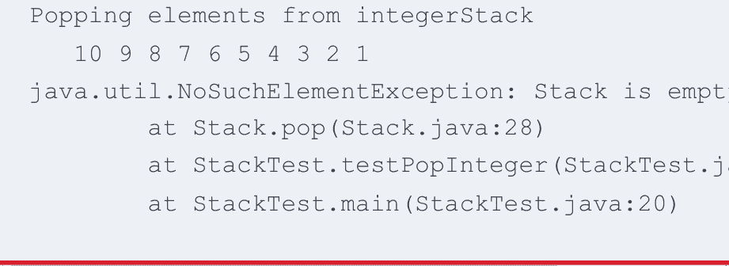

**图 13.5** | Stack 泛型类测试程序。

## 方法 testPushDouble 和 testPopDouble

`testPushDouble`（第 24–33 行）调用 `push` 方法（第 31 行），将 `doubleElements` 数组中的 1.1, 2.2, 3.3, 4.4, 5.5 放入 `doubleStack`。在程序尝试执行第 31 行时发生了自动装箱。`testPopDouble`（第 36–52 行）调用 `push` 方法……（此处原文 OCR 存在大量重复乱码，已按要求逻辑清理）。

```java
public class StackTest2 {

    public static void main(String[] args) {

        Double[] doubleElements = {1.1, 2.2, 3.3};

        Integer[] integerElements = {1, 2, 3};

        // Create a Stack<Double> and a Stack<Integer>

        Stack<Double> doubleStack = new Stack<>();

        Stack<Integer> integerStack = new Stack<>();

        // push elements of doubleElements onto stack

        testPush("doubleStack", doubleStack, doubleElements);

        testPop("doubleStack", doubleStack);

        // push elements of integerElements onto stack

        testPush("integerStack", integerStack, integerElements);

        testPop("integerStack", integerStack);

    }

    public static <E> void testPush(String name, Stack<E> stack, E[] elements) {
```


```java
System.out.printf("%nPushing elements to %s:%n", name);

for (E element : elements) {
    System.out.printf("%s ", element);
    stack.push(element); // push element
}
```

```java
public static <E> void testPop(String name, Stack<E> stack) {
    // pop elements from stack
    try {
        System.out.printf("%nPopping elements from %s:%n", name);
        E popValue; // store element removed
        // remove all elements from Stack
        while (true) {
            popValue = stack.pop();
            System.out.printf("%s ", popValue);
        }
    } catch (NoSuchElementException e) {
        System.out.println();
        e.printStackTrace();
    }
}
```

向 `doubleStack` 推入元素
1.1 2.2 3 3.3 4.4 5.5

从 `doubleStack` 弹出元素
5.5 4.4 3.3 2.2 1.1
```text
java.util.NoSuchElementException: Stack is empty
    at Stack.pop(Stack.java:28)
    at StackTest2.testPop(StackTest2.java:44)
    at StackTest2.main(StackTest2.java:16)
```

向 `integerStack` 推入元素
1 2 3 4 5 6 7 8 9 10

从 `integerStack` 弹出元素
10 9 8 7 6 5 4 3 2 1
```text
java.util.NoSuchElementException: Stack is empty
    at Stack.pop(Stack.java:28)
    at StackTest2.testPop(StackTest2.java:44)
    at StackTest2.main(StackTest2.java:20)
```

图 13.6 | 将泛型 `Stack` 对象传递给泛型方法。

第 11–12 行创建了 `Stack<Double>` 和 `Stack<Integer>` 对象。第 15–16 行和 19–20 行调用泛型方法 `testPush` 和 `testPop` 来测试 `Stack` 对象。泛型方法 `testPush`（第 24–33 行）使用类型参数 `E`（第 24 行）表示 `Stack` 的元素类型。该泛型方法接受三个参数：

- 一个用于输出目的的代表 `Stack<E>` 对象名称的 `String`，
- 一个 `Stack<E>` 对象的引用，
- 以及类型为 `E` 的数组，代表要 `push` 到 `Stack` 中的元素。

编译器在调用时强制执行 `Stack` 的元素类型与推入 `Stack` 的元素之间的一致性——这是 `testPush` 泛型方法的一个关键优势。泛型方法 `testPop`（第 36–52 行）接受两个参数——一个代表 `Stack<E>` 对象名称的 `String` 和一个 `Stack<E>` 对象的引用。它还会显示弹出元素的字符串表示形式。

## 生成式 AI

**1** 提示生成 AI 重构图 13.5 的代码，将 `testPushDouble` 和 `testPushInteger` 替换为单一泛型方法，并将 `testPopDouble` 和 `testPopInteger` 替换为单一泛型方法。将生成的代码与图 13.6 中的代码进行比较。

# 13.7 接受类型参数的方法中的通配符

在本节中，我们引入了一个名为“通配符”（wildcards）的强大泛型概念，它允许你指定作为参数化类型超类或子类的方法参数、返回值、变量和字段。

## 13.7.1 累加 `List<Number>`

首先，让我们通过一个示例来说明使用通配符的动机（图 13.7）。假设你想实现一个泛型方法 `sum` 来计算 `List` 中数值的总和。你从一个数字列表开始。正如我们之前演示的那样，泛型类中的类型参数必须是引用类型。

```java
import java.util.Arrays;
import java.util.List;

public class WildcardTest {
    public static void main(String[] args) {
        // create and initialize a List<Integer>
        Integer[] integers = {1, 2, 3, 4, 5};
        List<Integer> integerList = Arrays.asList(integers);
        System.out.printf("integerList contains: %s%n", integerList);
        System.out.printf("Total of the elements in integerList: %.1f%n", sum(integerList));

        // create and initialize a List<Double>
        Double[] doubles = {1.1, 3.3, 5.5};
        List<Double> doubleList = Arrays.asList(doubles);
        System.out.printf("doubleList contains: %s%n", doubleList);
        System.out.printf("Total of the elements in doubleList: %.1f%n", sum(doubleList));

        // create and initialize a List<Number>
        Number[] numbers = {1, 2.4, 3, 4.1};
        List<Number> numberList = Arrays.asList(numbers);
        System.out.printf("numberList contains: %s%n", numberList);
        System.out.printf("Total of the elements in numberList: %.1f%n", sum(numberList));
    }

    // total the elements; using a wildcard
    public static double sum(List<? extends Number> list) {
        double total = 0; // initialize total
        // calculate sum
        for (Number element : list) {
            total += element.doubleValue();
        }
        return total;
    }
}
```

```text
integerList contains: [1, 2, 3, 4, 5]
Total of the elements in integerList: 15.0

doubleList contains: [1.1, 3.3, 5.5]
Total of the elements in doubleList: 9.9

numberList contains: [1, 2.4, 3, 4.1]
Total of the elements in numberList: 10.5
```

图 13.8 | 通配符测试程序。

第 9–14 行创建并初始化了一个 `List<Integer>`，输出其元素并通过调用方法 `sum`（第 14 行）计算总和。第 17–22 行和 25–30 行对 `List<Double>` 以及包含 `Integer` 和 `Double` 的 `List<Number>` 执行了相同的操作。在 `sum` 方法（第 34–43 行）中，虽然方法无法直接确定 `List` 参数的元素类型，但它们至少必须是 `Number` 类型——即通配符的上界。因此，第 39 行可以编译通过，因为所有 `Number` 对象都保证具有 `doubleValue` 方法。

### 通配符限制

方法头中（第 34 行）的通配符 `?` 未指定类型参数名称，因此你不能在整个方法体中将其用作类型名称（即你不能在第 38 行将 `Number` 替换为 `?`）。不过，你可以如下声明 `sum`：

```java
public static <T extends Number> double sum(List<T> list)
```

这允许方法接收包含任何 `Number` 子类元素的 `List`——带有此更新后的代码位于 `fig13_08` 文件夹下的 `WildcardTest.java` 中。随后你可以在整个方法体和返回类型中使用类型参数 `T`。

如果指定通配符时未指定上界，则只能对通配符类型的值调用 `Object` 类型的方法。此外，在参数的类型参数中使用通配符的方法，将无法向这些参数所引用的集合中添加元素。在方法的类型参数部分中使用通配符，或在方法体中使用通配符作为变量的显式类型，会导致语法错误。

### 通配符的下界

正如你可以使用 `extends` 指定通配符类型参数的上界一样，你也可以使用 `super` 指定通配符类型参数的**下界**。例如，声明如下的方法参数：

```java
List<? super Integer>
```


表示相应的参数可以是 `List<Integer>` 或包含 `Integer` 的任一父类的 `List`，例如 `List<Number>` 或 `List<Object>`。你将在生成式 AI 问题 5 中进一步探索此。

## 生成式 AI

- 1 向 genAIs 提问，询问为什么在参数类型参数中使用上界通配符的 Java 泛型方法无法向参数所引用的集合中添加元素。
- 2 向 genAIs 提问，寻求何时在泛型方法和类中使用 Java 通配符的建议。
- 3 向 genAIs 提问，寻求关于 Java 泛型通配符如何影响类型安全的见解。
- 4 向 genAIs 提问，请求 Java API 泛型方法或类具有带上界通配符类型参数的简单示例。
- 5 向 genAIs 提问，请求 Java API 泛型方法或类具有带下界通配符类型参数的简单示例。
- 6 向 genAIs 提问，在什么情况下你会选择带上界的 Java 通配符类型参数而不是带下界的。

# 13.8 总结

本章介绍了自定义的泛型方法和类。首先，我们通过替换重载方法（例如用于打印数组的方法）引入了泛型方法的动机。我们使用带有类型参数（`<T>`）的泛型方法声明，你了解到泛型方法通过这种方式改进了重用性和可维护性。

我们在泛型方法中使用类型边界来限制传递的类型。例如，实现 `Comparable<T>` 接口的方法确定三个值中的最大值。我们讨论了类型擦除如何将类型参数转换为实际类型。特别是，如果不用上界限制类型参数，编译器默认将其替换为 `Object`；否则它将使用上界。你了解到泛型方法可以同时被泛型和非泛型方法重载，并且编译器会对每次调用使用最具体的匹配。

我们展示了一个可以存储任意对象的泛型 `Stack` 类。我们为特定类型实例化了 `Stack<Integer>` 和 `Stack<Double>`。你学到了泛型 `Stack` 通过防止不兼容类型入栈提供了类型安全。我们将 `StackTest` 中的非泛型方法重构为泛型方法以减少冗余。

我们使用通配符来增加泛型方法的灵活性。我们在问号 (`?`) 后指定了上界。我们创建一个 `sum` 方法，它可以接收与 `Number` 具有继承关系的任意类型的 `List`，使得 `sum` 方法能够接收每个子类的 `List`。接下来的章节介绍了 JavaFX 以及如何用它构建事件驱动的图形用户界面 (GUI)、图形和多媒体应用程序。

# 特殊章节：生成式 AI 练习

对于以下每个问题，尝试多个 genAIs 以确定表现最好的。始终验证结果。请记住它们有时会出错甚至幻觉，产生不可靠的信息。

# 13.1 (泛型的异常) 向 genAIs 提问，让他们讨论在处理 Java 泛型时处理异常的实践实践。

# 13.2 (重载泛型方法 printArray) 向 genAIs 提问，让他们重载图 13.2 中的泛型方法 `printArray`，以接受额外的 `int` 参数 `lowIndex` 和 `highIndex`。该方法应打印从 `lowIndex` 到但不包含 `highIndex` 的指定范围元素。验证 `lowIndex` 和 `highIndex`。如果其中一个超出范围，则抛出 `InvalidSubscriptException`。修改图 13.2 的 `main` 方法以使用针对 `integerArray` 和 `doubleArray` 的 `printArray` 版本。

# 13.3 (带有变长参数列表的 maximum 方法) 向 genAIs 提问，让他们修改图 13.3 中的 `maximum` 方法以接收一个或多个参数。不带参数调用该方法应产生编译错误。该方法应有两个参数，第二个参数代表变长参数列表。测试生成的方法。

# 13.4 (泛型 maximumElement 和 minimumElement 方法) 向 genAIs 提问，让他们创建返回泛型方法 `maximumElement` 和 `minimumElement`。

`Collection` 中的最大值和最小值。每个都应该能够接收实现了 `Comparable<T>` 接口的类的 `Collection`。使用包含可比较元素的 `List` 和 `Set` 集合来测试生成的方法。

# 14 使用 Lambda 和 Streams 的函数式编程


## 目标

在本章中，你将：

- 学习各种函数式编程技术以及它们如何补充面向对象对象的编程。
- 使用 lambda 和流（streams）来简化处理元素序列的任务。
- 学习什么是流，以及如何由流源、中间操作和终端操作形成流流水线。
- 创建表示 int 取值范围和随机 int 值的流。
- 使用 lambda 实现函数式接口。
- 在 `IntStream` 上执行中间操作 `filter`、`map`、`mapToObj` 和 `sorted`，以及终端操作 `forEach`、`count`、`min`、`max`、`sum`、`average` 和 `reduce`。
- 在 `Streams` 上执行中间操作 `distinct`、`filter`、`map`、`mapToDouble` 和 `sorted`，以及终端操作 `collect`、`forEach`、`findFirst` 和 `reduce`。
- 处理无限流。

## 目录

## 14.1 引言

## 14.2 流与归约

### 14.2.1 使用 `for` 循环累加 1 到 10 的整数

### 14.2.2 使用 `for` 进行外部迭代容易出错

### 14.2.3 使用流和归约进行求和

### 14.2.4 内部迭代

## 14.3 映射与 Lambda

### 14.3.1 Lambda 表达式

### 14.3.2 Lambda 语法

### 14.3.3 中间操作与终端操作

## 14.4 过滤

## 14.5 元素如何通过流流水线

## 14.6 方法引用

### 14.6.1 创建随机随机值的 `IntStream`

### 14.6.2 使用 `forEach` 和方法引用对每个流元素执行任务

### 14.6.3 使用 `mapToObj` 将整数映射到字符串对象

### 14.6.4 使用 `collect` 拼接字符串

## 14.7 `IntStream` 操作

### 14.7.1 创建 `IntStream` 并显示其值

### 14.7.2 终端操作 `count`、`min`、`max`、`sum` 和 `average`

### 14.7.3 终端操作 `reduce`

### 14.7.4 排序 `IntStream` 值

## 14.8 函数式接口

## 14.9 Lambda：深入探析

## 14.10 `Stream<Integer>` 操作

### 14.10.1 创建 `Stream<Integer>`、对其进行排序并收集结果

### 14.10.2 过滤 `Stream` 并存储结果以备后用

### 14.10.3 过滤并排序 `Stream` 并收集结果

### 14.10.4 对之前收集的结果进行排序

## 14.11 `Stream<String>` 操作

### 14.11.1 映射：String s 转大写

### 14.11.2 过滤：过滤 String s 然后按不区分大小写的升序排序

### 14.11.3 过滤：过滤 String s 然后按不区分大小写的降序排序

## 14.12 `Stream<Employee>` 操作

### 14.12.1 创建并显示 `List<Employee>`

### 14.12.2 过滤：薪水在指定范围内的 Employee s

### 14.12.3 排序：按多个字段排序 Employee s

### 14.12.4 映射：将 Employee s 映射为唯一的姓氏 String s

### 14.12.5 分组：按部门分组 Employee s

### 14.12.6 统计每个部门的 Employee 数量

### 14.12.7 求和与平均：员工薪资

## 14.13 从文件创建 `Stream<String>`

## 14.14 随机值流

## 14.15 无限流

## 14.16 关于接口的额外说明

## 14.17 总结

# 特别章节：生成式 AI 练习

## 14.1 引言¹

1. 我们荣幸邀请了 Oracle Java 语言架构师、Java Project Lambda 规范负责人以及《Java Concurrency in Practice》合著者 Brian Goetz 对《Java How to Program, 10/e》进行了详细评审。他仔细审查了该版本中出现的本章节内容，并提供了许多额外的建议，这些建议已反映在这一版《Java for Programmers》中。书中任何剩余的错误都是我们的责任。

到目前为止，我们已经讨论了三种编程范式：过程化、面向对象和泛型。在本章中，我们介绍了 lambda 和流，² 这些是用于 Java 第四种范式的技术——函数式编程。

2. 我们在本章中讨论的流与第 11 章“文件、I/O 流、JSON 序列化和 CSV 文件”中讨论的输入/输出流不同，在后者中，程序从文件读取字节流或向文件写入字节流。第 14.13 节使用 lambda 和流来处理文件内容。

我们将使用 lambda 和流来比之前的技术更快、更简单、更简洁且更少 Bug 地编写某些类型的程序。在第 18 章“并发：平台线程到虚拟线程”中，你将学习到此类程序更容易并行化（即同时执行多个操作），从而利用多核架构来提高性能——这是 lambda 和流的关键目标之一。

在第 18 章中，你还会了解到，如果任务修改了程序的状态（即其变量的值），那么创建正确运行的并行任务是非常难的。因此，你在本章中学习的技术侧重于不可变性——不修改正在处理的数据源或任何其他程序状态。

本章展示了许多 lambda 和流的示例（如下所示）。我们将使用它们来演示完成第 4 章所学任务的更好方法。因此，某些术语将在稍后讨论。

| 章节 | 可以在之后涵盖 |
| --- | --- |
| 章节 14.2–14.4 | 第 4 章，控制语句：部分 2 |
| 章节 14.6 | 第 5 章，方法 |
| 章节 14.7 | 第 6 章，数组和 ArrayList |
| 章节 14.8–14.9 | 第 9 章，使用继承、多态和接口进行现实建模 |
| 章节 14.11 | 第 7 章，字符串 |
| 章节 14.13 | 第 11 章，文件、I/O 流、JSON 序列化和 CSV 文件 |

- 错误地初始化变量 `total`，
- 错误地初始化 `for` 循环的控制变量 `number`，
- 使用错误的循环继续条件，
- 错误地增加控制变量 `number`，
- 错误地将 `number` 的每个值加到 `total` 中。

此外，随着你执行的任务变得越来越复杂，理解代码是如何运行的会阻碍理解代码的作用。这使得代码更难以阅读、调试和修改，并且更有可能包含错误。

## 14.2.3 使用 Stream 和规约（Reduction）求和

现在，让我们尝试一种不同的方法：指定“做什么”而不是“怎么做”。在图 14.1 中，我们指定了想要实现的目标——从 1 到 10 的整数——然后让 Java 的 `IntStream` 类（位于 `java.util.stream` 包）来决定如何实现。该程序的关键在于第 8–9 行的以下表达式：

```java
IntStream.rangeClosed(1, 10)
.sum()
```

点击此处查看代码图片

```java
// Fig.14.1: StreamReduce.java
// Sum the integers from 1 through 10 with
import java.util.stream.IntStream;

public class StreamReduce {
    public static void main(String[] args) {
        System.out.printf("Sum of 1 through 10
        IntStream.rangeClosed(1, 10)
        .sum());
    }
}
```


图 14.1 | 使用 IntStream 求 1 到 10 整数的和。

它可以被读为：“对于 1 到 10 范围 int 值流，计算和”或“求 1 到 10 的数字和”。在这段代码中，注意既没有计数控制变量，也没有存储总和的变量——`IntStream` 在 `rangeClosed` 和 `sum` 中封装了这些细节。

## 流（Streams）与流流水线（Stream Pipelines）

第 8–9 行中的链式方法调用创建了一个流流水线。流是一系列可以在其上执行任务的元素。流流水线让流的元素通过一系列任务或处理步骤。使用链式方法调用时，请将点（`.`）垂直对齐，以提高可读性。

## 指定数据源

流流水线通常从一个创建流的方法调用开始——这被称为数据源。第 8 行通过方法调用指定了数据源：

```java
IntStream.rangeClosed(1, 10)
```

它创建了一个表示有序 int 值范围的 `IntStream`。

`IntStream` 静态方法 `rangeClosed` 创建了一个 `IntStream`，表示有序 int 元素序列 1, 2, 3, 4, 5, 6, 7, 8, 9 和 10。该方法命名为 `rangeClosed` 是因为它产生了一个闭区间范围的值，包含了两个参数 1 和 10。`IntStream` 还提供了方法 `range`，它产生一个从第一个参数到第二个参数（但不包含第二个参数）的半开区间范围的值——例如：

```java
IntStream.range(1, 10)
```

产生一个表示有序 int 元素序列 1, 2, 3, 4, 5, 6, 7, 8 和 9 的 `IntStream`，但不包含 10。

## 计算 IntStream 元素的和

接下来，第 9 行通过处理步骤完成了流流水线：

```java
.sum()
```

这调用了 `IntStream` 的实例方法 `sum`，它返回流中所有 int 的和——在这种情况下，是 1 到 10 整数的和。

方法 `sum` 执行的处理步骤是一个规约（reduction）——它将值流规约为单个值（和）。这是多个预定义的 `IntStream` 规约操作之一。第 14.7 节介绍了预定义的规约方法 `count`、`min`、`max`、`average` 和 `summaryStatistics`，用于定义自定义规约的 `reduce` 方法。

## 处理流流水线

终端操作（terminal operation）启动流水线的处理并产生结果。`IntStream.sum` 是一个终端操作，返回元素的和。同样，`count`、`min`、`max`、`average`、`summaryStatistics` 和 `reduce` 都是终端操作。第 14.3 节更详细讨论了终端操作。

## 14.2.4 内部迭代

前一个示例的关键在于它指定了我们想要*做什么*——从 1 到 10 的整数——而不是*怎么做*。这是声明式编程（指定“做什么”）与命令式编程（指定“怎么做”）的对比。在内部，`IntStream` 处理了细节——你不需要指定任何临时变量。这使得代码更容易阅读。

## 14.3 映射（Mapping）与 Lambda

接下来，我们引入了映射中间操作来将流的元素转换为新值。结果是一个与原始具有相同数量元素的流。为了演示映射，让我们重新回顾 4.3 中的程序，在该程序我们使用外部迭代计算了 2 到 20 偶数的和，如下所示：

点击此处查看图片

```java
int total = 0;

for (int number = 2; number <= 20; number += 2) {
    total += number;
}
```

图 14.2 使用流和内部迭代重新实现了此任务。

点击此处查看图片

| 1 // Fig.14.2: StreamMapReduce.java |
| 2 // Sum the even integers from 2 through 20 w |
| 3 import java.util.stream.IntStream; |
| 4 |
| 5 public class StreamReduce { |
| 6 public static void main(String[] args) { |

```java
System.out.printf("Sum of the even ints
IntStream.rangeClosed(1, 10)
  .map((int x) -> {return x * 2;
  .sum()});
```

这里的新功能是第 9 行的映射操作，在 particular示例中，它将每个流元素乘以 2。`IntStream method map` 接收的参数（第 9 行）

```java
(int x) -> {return x * 2};
```

这种符号在[第 14.3.1 节]中讨论过，表示“一个接收 `int` 参数 `x` 并返回乘以 2 值的方法”。对于流中的每个元素，`map` 都会调用此方法，并将当前流元素传递给它。该方法的返回值将成为 `map` 返回的新流的一部分。

## 14.3.1 Lambda 表达式

在整个章节中，我们将演示许多接收方法作为参数的中间操作和终结操作。第 9 行中方法 `map` 的参数

```java
(int x) -> {return x * 2};
```


是一个 lambda 表达式（或简单称为“lambda”），它代表一个`匿名方法`——没有名字的方法。尽管 lambda 表达式的语法看起来与我们之前介绍的方法不同，但左侧看起来像方法参数列表，右侧看起来像方法体。我们稍后会解释语法细节。

Lambda 表达式允许你创建可以被视为数据的方法。你可以：

- 将 lambda 作为参数传递给其他方法（如 `map` 甚至其他 lambdas）
- 将 lambda 表达式赋值给变量以供以后使用，以及
- 从方法返回 lambda 表达式。

我们将演示这些强大的功能。Lambda 和流允许你将函数式编程技术的优点与面向对象编程的优点结合起来。

## 14.3.2 Lambda 语法

一个 lambda 由参数列表、随其后的箭头标记 (`->`) 和体组成，如下：

```
(parameters) -> {statements}
```

第 9 行中的 lambda

```
(int x) -> {return x * 2;}
```

接收一个 int，将其值乘以 2 并返回结果。在这种情况下，体是一个语句块，可能包含包含在大括号包围的语句。编译器从 lambda 推断出它返回一个 int，因为参数 x 是 int 且字面量 2 也是 int —— int 乘以 int 产生一个结果。正与方法声明一样，lambdas 在逗号分隔的列表中指定参数。之前的 lambda 类似于方法

```
int multiplyBy2(int x) {
  return x * 2;
}
```

但 lambda 没有名字，编译器会推断它的返回类型。lambda 语法有几种变体。

### 消除 Lambda 的参数类型

lambda 的参数类型通常可以省略，例如：

```
(x) -> {return x * 2;}
```

在这种情况下，编译器根据 lambda 的上下文推断参数类型和返回类型——我们稍后会详细说明这一点。如果编译器无法推断参数或返回类型（例如，如果存在多种类型可能性），它会生成错误。

### 简化 Lambda 的体

如果体只包含一个表达式，可以省略 `return` 关键字、大括号和分号，如下：

```
(x) -> x * 2
```

在这种情况下，lambda 隐式返回表达式的值。

### 简化 Lambda 的参数列表

如果参数列表只包含一个参数，可以省略括号，如下：

```
x -> x * 2
```

### 空参数列表的 Lambda

要定义一个带有空参数列表的 lambda，在箭头标记 (`->`) 左侧使用空括号，如下：

```
() -> System.out.println("Welcome to lambdas!")
```

### 方法引用

除了上述 lambda 语法变体外，还有 lambda 的特殊简写形式，称为方法引用，我们在第 14.6 节中引入。

## 14.3.3 中间操作和终结操作

在图 14.2 第 8–10 行的流流水线中，`map` 是一个中间操作，而 `sum` 是终结操作。方法 `map` 是许多中间操作之一，用于指定在流元素上执行的任务。

### 惰性与急性操作

中间操作使用惰性求值——每个中间操作都会产生一个新的流对象，但在调用终结操作产生结果之前，不会对流的元素执行任何操作。这允许库开发者优化流处理性能。例如，如果你有 1,000,000 个 `Person` 对象并且正在寻找第一个姓为 "Jones" 的，而不是处理所有的 1,000,000 个元素，一旦找到第一个匹配的 `Person` 对象，流处理就可以终止。惰性求值通过确保只在需要时执行操作来帮助提高性能。

终结操作是急性的——它们在被调用时执行请求的操作。我们在章节中遇到它们时会介绍更多关于惰性和急性操作的内容。我们将在第 14.5 节讨论惰性操作如何提高性能，该节将演示流流水线的中间操作是如何应用到每个流元素的。下表包含了一些常见的中间操作。

#### 常见的中间流操作

| 操作 | 说明 |
|---|---|
| `filter` | 返回一个仅包含满足条件（称为谓词）的元素的流。新流的元素通常比原始流少。 |
| `distinct` | 返回一个仅包含唯一元素的流——重复项被消除。 |
| `limit` | 返回一个从原始流开始的指定数量元素的流。 |
| `map` | 返回一个流，其中原始流的每个元素都被映射到一个新值（可能是不同的类型）——例如将数值映射到其平方。 |
| `sorted` | 返回一个按排序排列流。我们将展示如何指定升序和降序。新流的元素数量与原始流相同。 |

#### 常见的终结操作

| 操作 | 说明 |
|---|---|
| `forEach` | 对流中的每个元素执行处理（例如，显示每个元素）。 |
| `average` | 返回数值流的平均值。 |
| `count` | 返回流中元素的数量。 |
| `max` | 返回流中的最大值。 |
| `min` | 返回流中的最小值。 |
| `reduce` | 使用结合积累函数将集合元素归约为单个值——即无论操作应用于参数的顺序如何结果都相同。例如，在添加两个元素并返回和的 lambda 中，加法操作是结合的——`x + y` 和 `y + x` 产生相同的结果。 |

3. 关于中间和终结操作的完整列表，访问 `https://docs.oracle.com/en/java/javase/23/docs/api/java.base/java/util/stream/Stream.html`。每个 `Stream` 方法的文档都会指示它是中间还是终结操作。Java 23 预览功能包含了 gatherers，允许你创建自定义的中间操作。该功能预计将在 Java 24 中确定。更多信息请访问 `https://openjdk.org/jeps/473`。

## 14.4 过滤

[本节演示了如何使用流简化你在第 4 章《控制语句：部分 2》中学习过的编程任务]。

另一种常见的中间流操作是过滤元素以选择符合条件的（称为谓词）元素。例如，以下代码选取了 1–10 范围内的偶数，将它们倍倍并求和结果：

```
int total = 0;

for (int x = 1; x <= 10; ++x) {
    if (x % 2 == 0) { // 如果 x 是偶数
        total += x * 2;
    }
}
```

**图 14.3** 使用流（streams）重新实现了此循环。

[点击此处查看代码图片](##)

```
1 // Fig.14.3: StreamFilterMapReduce.java
2 // 将 2 到 10 之间的偶数翻倍
3 import java.util.stream.IntStream;
4 
5 public class StreamFilterMapReduce {
6     public static void main(String[] args) {
7         System.out.printf(
8             "Sum of the doubles of the even int "
9             IntStream.rangeClosed(1, 10)
10             .filter(x -> x % 2 == 0)
11             .map(x -> x * 2)
12             .sum());
13     }
}
```


图 14.3 | 使用 `IntStream` 将 2 到 10 之间的偶数翻倍并求和。

第 9–12 行中的流流水线执行了四个链式方法调用：

- 第 9 行创建了数据源——一个闭区间范围 1 到 10 的 `IntStream`。
- 第 10 行（我们稍后会详细讨论）通过仅选择能被 2 整除的元素（即偶数）来过滤流元素，产生一个包含 2, 4, 6, 8 和 10 的偶数流。
- 第 11 行将流中的每个元素映射为该元素乘以 2，产生一个包含 4, 8, 12, 16 和 20 的偶数流。
- 第 12 行将流归约为其元素的和（60）。

这里的新功能特性是第 10 行的过滤操作。`IntStream method filter` 接收的方法参数是一个接收一个参数并返回 `boolean` 结果的方法。如果给定元素的结果为 `true`，则该元素被包含在结果流中。

第 10 行中的 lambda：

```
x -> x % 2 == 0
```

确定其 `int` 参数是否能被 2 整除（即除以 2 后的余数为0），如果是，则返回 `true`；否则，lambda 返回 `false`。对于流中的每个元素，`filter` 会调用其接收到的参数的方法，并将当前流元素传递给该方法。如果方法的返回值为 `true`，则对应的元素将成为 `filter` 返回的中间流的一部分。

第 10 行创建了一个中间流，仅表示能被 2 整除的元素。接下来，第 11 行使用 `map` 创建了一个中间流，表示偶数整数（2, 4, 6, 8 和 10）乘以 2 后的结果（4, 8, 12, 16 和 20）。第 12 行启动了对终端操作 `sum` 的调用。在此时，组合的处理步骤被应用于每个元素，然后 `sum` 返回流中剩余元素的总和。我们将在下一节中进一步讨论。

### 流水线操作的顺序非常重要

流流水线中操作的顺序很重要：

- `filter` 过滤 1–10 中的偶数得到 2, 4, 6, 8 和 10，然后通过 `map` 将它们映射为两倍得到 4, 8, 12, 16 和 20。
- 另一方面，`map` 将 1–10 的数字映射为两倍得到 2, 4, 6, 8, 10, 12, 14, 16, 18 和 20，`filter` 过滤偶数则得到所有这些值，因为在执行 `filter` 操作之前它们都是偶数。

此示例中的流流水线可以使用仅 `map` 和 `sum` 实现。

### 生成式 AI

- 1 提示生成式 AI 使用 Fig.14.3 的代码，要求它们修改程序以计算奇数数的的之和。
- 2 提示生成式 AI 在 Fig.14.3 代码的背景下解释延迟计算（lazy evaluation）的性能优势。
- 3 提示生成式 AI 使用仅 `map` 和 `sum` 重新实现 Fig.14.3。

## 14.5 元素如何在流流水线中移动

第 14.3 节提到每个中间操作都会产生一个新的流。每个新流仅仅是表示到流水线目前为止所指定的处理步骤的对象。中间操作方法的链式调用增加了对每个流元素要执行的处理步骤集合。流流水线中的最后一个流对象包含了对每个流元素要执行的所有处理步骤。

当你使用终端操作启动流流水线时，中间操作的处理步骤会在应用于下一个元素之前，应用于给定的流元素。因此，图 14.3 中的流流水线运行方式如下：

对于每个元素：
- 如果该元素是偶整数
- 将元素乘以 2 并将结果加到总和

为了证明这一点，请考虑图 14.3 流流水线的修改版本，其中每个 lambda 都显示中间操作名称和当前流元素的值：

```
IntStream.rangeClosed(1, 10)
    .filter(
        x -> {
            System.out.printf("filter: %d%n", x);
            return x % 2 == 0;
        })
    .map(
        x -> {
            System.out.println("map: " + x);
            return x * 2;
        })
    .sum()
```

从修改后的流水线的输出（我们添加了注释）可以明显看出，每个整数的 `map` 步骤都在下一个流的 `filter` 步骤之前应用：

```
filter: 1 odd so no map step performed for
filter: 2 even so a map step performed next
map: 2
filter: 3 odd so no map step performed for
filter: 4 even so a map step performed next
map: 4
filter: 5 odd so no map step performed for
filter: 6 even so a map step performed next
map: 6
filter: 7 odd so no map step performed for
filter: 8 even so a map step performed next
map: 8
filter: 9 odd so no map step performed for
filter: 10 even so a map step performed next
map: 10
```

对于奇数元素，没有执行 `map` 步骤。当 `filter` 返回 `false` 时，元素不会被包含在结果流中。当 `filter` 返回 `true` 时，则执行 `map` 步骤。

这是图 14.3 代码的修改版本。


### 生成式 AI

- 1 提示生成式 AI 使用 Fig.14.3 的代码，要求它们修改程序以计算奇数数的平方之和。
- 2 提示生成式 AI 在 Fig.14.3 代码的背景下解释延迟计算的性能优势。
- 3 提示生成式 AI 使用仅 `map` 和 `sum` 重新实现 Fig.14.3。

## 14.6 方法引用

本节展示了如何使用方法引用来简化第 5 节中学习的编程。方法引用是相应 lambda 表达式的简写符号。

与第 5 节类似，图 14.4 使用 `RandomGenerator` 获取 1–6 范围内的随机数。流使用方法引用来显示这些值。我们将在 14.6 节中进一步讨论。

```
// Fig.14.4: RandomIntegers.java
// 偏移并缩放的随机整数。
import java.util.random.RandomGenerator;
import java.util.stream.Collectors;

public class RandomIntegers {
    public static void main(String[] args) {
        var random = RandomGenerator.getDefault();

        // 分行显示 10 个随机数
        System.out.println("Random numbers on: " + random.ints(10).forEach(System.out::println));

        // 在同一行显示 10 个随机数
        String numbers = random.ints(10, 1, 7)
            .mapToObj(String::valueOf)
            .collect(Collectors.joining(", "));
    }
}
```

```
Random numbers on separate lines:
4
3
4
5
1
5
5
3
6
5
Random numbers on one line: 4 6 2 5 6 4 3 2 4 1
```

**图 14.4** | 偏移并缩放的随机整数。

### 14.6.1 创建随机值的 IntStream

`RandomGenerator` 类的 `ints` 方法返回一个包含随机数的 `IntStream`。在第 12 行的流流水线中，

```
random.ints(10, 1, 7)
```

创建一个指定数量随机整数值（10个）、范围从第一个参数（1）开始到但不包含第二个参数（7）的 `IntStream` 数据源。因此，第 12 行产生一个 1-6 范围内的整数流。

### 14.6.2 使用 forEach 和方法引用对每个流元素执行任务

接下来，流水线的第 13 行使用 `IntStream forEach`（一种终端操作）对每个流元素执行任务。`forEach` 方法接收的方法参数是一个接收一个参数并使用参数值执行任务的方法。

`System.out::println` 作为 `forEach` 的参数是一个方法引用——它是调用指定方法的 lambda 表达式的简写符号。格式为 `objectName::instanceMethodName` 的方法引用是一个绑定的实例方法引用——“绑定”意味着 `::` 左侧的对象（`System.out`）调用该实例方法。

右侧的 `println` 方法。

编译器将 `System.out::println` 转换为一个单参数的 lambda 表达式，如下：

```
x -> System.out.println(x)
```

该表达式将 lambda 的参数——当前流元素（用 `x` 表示）——传递给 `System.out` 的 `println` 实例方法，该方法输出其参数的 `String` 表示形式。第 12–13 行的流流水线等同于以下 `for` 循环：

```
for (int i = 1; i <= 10; ++i) {
  System.out.println(random.nextInt(1, 7));
}
```

### 14.6.3 使用 `mapToObj` 将整数映射到 String 对象

第 16–19 行的流流水线：

```
String numbers =
  random.ints(10, 1, 7)
  .mapToObj(String::valueOf)
  .collect(Collectors.joining(" "));
```


创建了一个包含 10 个 1–6 范围内随机整数的 `String`，并用空格分隔。该流水线执行了链式方法调用：

- 第 17 行创建了数据源——一个包含 10 个 1–6 随机整数的 `IntStream`。
- 第 18 行将每个 int 映射到其 String 表示形式，生成一个中间的 String 流。由于我们之前使用的 `IntStream` 方法 `map` 返回一个 `IntStream`。在这里，我们使用 `IntStream` 方法 `mapToObj`，它允许你从原始类型元素的流进行映射。与 `map` 类似，`mapToObj` 期望一个返回结果的单参数方法。在这个示例中，`mapToObj` 的参数是 `ClassName :: staticMethodName` 的静态方法引用。String 静态方法 `valueOf` 返回其参数的 `String` 形式。编译器将方法引用 `String::valueOf` 转换为调用 `valueOf` 的单参数 lambda 表达式，并将当前流元素作为参数传递，如下：

```
x -> String.valueOf(x)
```

- 第 19 行我们将在 14.6.4 节中详细讨论，它使用流的终端操作 `collect` 来拼接所有字符串，并用空格分隔每个字符串。方法 `collect` 是归约（reduction）的一种形式，因为它返回了一个对象——在本例中是一个 `String`。

第 20 行显示了生成的 `String`。

## 14.6.4 使用 `collect` 拼接字符串

考虑图 14.4 中的第 19 行。流的终端操作 `collect` 使用收集器（collector）将流元素汇聚到一个对象中——通常是。这类似于归约，但 `collect` 返回一个包含流元素的对象，而 `reduce` 返回流元素类型的单一值。在这个示例中，我们使用了由静态方法 `Collectors.joining` 返回的预定义收集器。该收集器创建了流元素的拼接 `String` 表示形式，将每个元素附加到 `String` 上，并用 `joining` 方法的参数（在本例中为空格）与前一个元素隔开。方法 `collect` 然后返回生成的 `String`。我们将在本章中讨论其他收集器。

## 生成式 AI

- 1 个 Prompt，AI 用于简要描述 Java `Collectors` 类中定义的最常用的收集器。
- 2 个 Prompt，AI 用于解释方法引用和 lambda 之间的差异，以及何时优先使用每一种。

## 14.7 IntStream 操作

[本节演示了如何使用 lambda 和流来简化编程任务，就像你在第 6 章“数组和 ArrayList”中所学到的那样]。

图 14.5 展示了对第 8 行名为 `values` 的 `int` 数组创建的流进行的额外 `IntStream` 操作。`LongStreams` 和 `DoubleStreams`（分别对应 `long` 和 `double` 值）也支持为止演示的 `IntStream` 技术。我们将此示例代码分为在 14.7.1–14.7.4 节中讨论的部分。

点击此处查看代码图片

```
1 // 14.5: IntStreamOperations.java
2 import java.util.stream.Collectors;
3 import java.util.stream.IntStream;
4 
5 public class IntStreamOperations {
6 public static void main(String[] args) {
7 int[] values = {3, 10, 6, 1, 4, 7, 8, 2, 9, 5};
8 // 14.5: Demonstrating IntStream operations
9 java.util.Random random = new java.util.Random();
10 
11 // 14.5: Demonstrating IntStream operations
12 // original values:
13 String numbers =
14   random.ints(10, 1, 7)
15   .mapToObj(String::valueOf)
16   .collect(Collectors.joining(" "));
17 // 14.5: Demonstrating IntStream operations
18 // count,
19 System.out.printf("Count: %d\n", IntStream.of(values).count());
20 // min,
21 System.out.printf("Min: %d\n", IntStream.of(values).min().orElse(-1));
22 // max,
23 System.out.printf("Max: %d\n", IntStream.of(values).max().orElse(-1));
24 // sum,
25 System.out.printf("Sum: %d\n", IntStream.of(values).sum());
26 // average:
27 System.out.printf("Average: %.2f\n", IntStream.of(values).average().getAsDouble());
28 
29 // 14.5: Demonstrating IntStream operations
30 // original values:
31 System.out.println(numbers);
32 }
33 }
```

### 14.7 创建 IntStream 并显示其值

第 12–15 行的流流水线：`IntStream.of(values)` 接收 `values` 数组并返回一个 `IntStream`，第 13–15 行使用 `mapToObj` 和 `collect` 获取流元素的 `String` 表示形式，并用空格分隔。

我们在示例和后续示例中多次使用这种技术来显示：

```
IntStream.of(values)
```

如果流是空，这会导致 `IllegalStateException`。为了防止这种情况，可以将 `getAsInt` 调用替换为 `orElse` 调用，如果存在值则返回 `OptionalInt` 值，否则返回你传递给 `orElse` 的值。因此，以下流水线在流为空时返回 -1：

点击此处查看代码图片

```
IntStream.of(values).min().orElse(-1)
```

- max（第 22 行）返回一个 `OptionalInt`，可能包含流中的最大值。再次，我们调用 `OptionalInt` 的 `getAsInt` 方法获取最大值，因为我们知道这个流包含元素。
- sum（第 23 行）返回流中整数的和。
- average（第 25 行）返回一个 `OptionalDouble` (java.util)，可能包含作为 `double` 类型的平均值。在这个示例中，我们知道流包含元素，我们调用 `OptionalDouble` 的 `getAsDouble` 方法获取平均值。如果没有元素，`OptionalDouble` 将不包含平均值，且 `getAsDouble` 将抛出 `NoSuchElementException`。与 `OptionalInt` 类似，调用 `orElse` 方法，如果存在值则返回 `OptionalDouble` 的值，否则返回你传递给 `orElse` 的值。

`IntStream` 类还提供了 `summaryStatistics` 方法，它通过一次遍历 `IntStream` 元素完成 `count`、`min`、`max`、`sum` 和 `average` 操作，并将结果作为 `IntSummaryStatistics` 对象 (java.util) 返回，而不是为每个操作重复处理 `IntStream`。该对象拥有获取每个结果的方法以及一个汇总所有结果的 `toString` 方法。例如，以下语句：

点击此处查看代码图片

```
System.out.println(IntStream.of(values).summaryStatistics())
```

对于图 14.5 中的 `values` 数组产生：

```
IntSummaryStatistics{count=10, sum=55, min=1, average=5.5, max=10}
```

## 14.7.3 终端操作 reduce

到为止，我们已经介绍了各种预定义的 IntStream 归约操作。你可以通过 IntStream 的 reduce 方法定义自己的归约操作——事实上，第 14.7.2 节中讨论的每个终端操作都是 reduce 的专门实现。

[点击此处查看代码图片](#)

| 27 | // 使用 reduce 方法求值的和 |
| 28 | System.out.printf("%nsum via reduce method") |
| 29 | IntStream.of(values) |
| 30 | .reduce(0, (x, y) -> x + y) |
| 31 | |


第 29–30 行中的流流水线

[点击此处查看代码图片](#)

```
IntStream.of(values)
  .reduce(0, (x, y) -> x + y)
```

使用 reduce 而非 sum 来计算 IntStream 值的和：

- reduce() 的第一个参数是操作的恒等值（identity value）——该值与任何流元素（使用 reduce 第二个参数中的 lambda）结合时，会产生元素的原始值。例如，在累加元素时，恒等值为 0，因为任何 int 值加上 0 都会得到原始的 int 值。同样，在获取元素的乘积时，恒等值为 1，因为任何 int 乘以 1 都得到原始的 int 值。

- reduce 方法的参数是一个方法，它接收两个 int 值代表二元运算符的左操作数右操作数，使用这些值进行计算并返回结果。第 30 行中的 lambda 将值相加。具有两个或多个参数的 lambda 必须括在括号中。

reduce 参数指定的操作必须具有结合律（associative）——也就是说，reduce 将操作应用于流元素的顺序并不重要。这一点非常重要，因为 reduce 允许以任何顺序对流元素应用操作。非结合律的操作可能会根据处理顺序产生不同的结果。例如，减法不是结合律操作：

- 表达式 7 – (5 – 3) 的结果是 5，而
- 表达式 (7 – 5) – 3 的结果是 –1。

结合律 `reduce` 操作对于并行流（第 18 章）至关重要，并行流将操作拆分到多个核心以获得更好的性能。

## 评估自定义归约

根据流的元素

```
3 10 6 1 4 8 2 5 9 7
```

归约的评估过程如下：

```
0 + 3 --> 3
3 + 10 --> 13
13 + 6 --> 19
19 + 1 --> 20
20 + 4 --> 24
24 + 8 --> 32
32 + 2 --> 34
34 + 5 --> 39
39 + 9 --> 48
48 + 7 --> 55
```

第一次计算使用恒等值 (0) 作为左操作数，随后的每次计算使用上一次计算的结果作为左操作数。归约过程持续产生 IntStream 值的运行和，直到所有元素都被使用完毕，此时返回最终的总和。

### 使用 reduce 方法计算值的乘积

第 34–35 行中的流流水线使用了单参数版本的 reduce 方法，它返回一个 OptionalInt，如果流包含元素，则该 OptionalInt 包含 IntStream 值的乘积；否则，OptionalInt 不包含结果。

点击此处查看代码图片

| 32 | // 使用 reduce 求值的乘积 |
| 33 | System.out.printf("Product via reduce |
| 34 | IntStream.of(values) |
| 35 | .reduce((x, y) -> x * y).g |
| 36 | |

通过 reduce 方法得到的乘积：3628800

根据流的元素

```
3 10 6 1 4 8 2 5 9 7
```

归约的评估过程如下：

```
3 * 10 --> 30
30 * 6 --> 180
180 * 1 --> 180
180 * 4 --> 720
720 * 8 --> 5,760
5,760 * 2 --> 11,520
11,520 * 5 --> 57,600
57,600 * 9 --> 518,400
518,400 * 7 --> 3,628,800
```

此过程持续产生 IntStream 值的运行乘积，直到所有元素都被使用，然后返回最终的乘积。

我们可以使用双参数的 reduce 方法，例如：

点击此处查看代码图片

```
IntStream.of(values)
  .reduce(1, (x, y) -> x * y)
```

然而，如果流是空的，这个版本的 reduce 将返回恒等值 ( 1 )，对于空流来说这不是预期的结果。

## 计算值的平方和

现在考虑计算流元素的平方和。

[点击此处查看代码图片]

| 37 | // 使用 map 求值的平方和 |
| 38 | System.out.printf("Sum of squares via |
| 39 | IntStream.of(values) |
| 40 | .map(x -> x * x) |
| 41 | .sum()); |
| 42 | |

> 通过 map 和 sum 求得平方和：385

在实现流流水线时，将处理步骤拆解为易于理解的任务很有帮助。

计算流元素的平方和需要两个不同的任务：

- 计算每个流元素的平方
- 对得到的值求和。

与其通过调用 `reduce` 方法来定义，不如第 39–41 行中的流流水线

```
IntStream.of(values)
  .map(x -> x * x)
  .sum();
```

使用了 `map` 和 `sum` 来组合平方。首先，`map` 生成一个包含平方值的新 `IntStream`，然后 `sum` 对元素求总和。

### 14.7.4 排序 IntStream 值

在第 9.19 节中，你曾使用 `Arrays` 对数组进行排序。

[点击此处查看代码图片]

```
// 按排序顺序显示元素
System.out.printf("Values in
IntStream.of(values)
    .sorted()
    .mapToObj(String::valueOf)
    .collect(Collectors.joining ");
```


按排序顺序的值：1 2 3 4 5 6 7

第 45–48 行中的流流水线按升序排序元素。与 `filter` 类似，`sorted` 是惰性操作，在终端操作启动时执行。

## 生成式 AI

- 让 AI 讨论并提供 `java.util` 包类 `Optional`、`OptionalLong` 和 `OptionalDouble` 的简要代码示例。
- 让 AI 询问 `IntStream` `reduce` 方法的双参数版本。

## 14.8 函数式接口

[本节需要 9.11–9.12 的概念]

9.12 节引入了 `default`、`static` 和 `private` 方法。它还讨论了函数式接口的概念（包含一个 `abstract` 方法，也可以包含 `default`、`static` 和 `private` 方法）。此类接口被称为单抽象方法 (SAM) 接口。函数式接口在函数式编程中被广泛使用。函数式程序员与依赖于其接收的参数的纯函数工作。对于特定的参数（或参数），纯函数总是产生相同的结果。

纯函数具有引用透明性——即：

* 仅依赖于其参数
* 没有副作用
* 不维护任何状态

状态的变化通过在方法之间传递数据来实现。没有数据被共享。纯函数更安全，因为它们不修改程序状态（变量）。这使得它们更不容易出错并

### java.util.function 包中的函数式接口

`java.util.function` 包包含多个函数式接口。下表包含了基础泛型函数式接口，你已经在在本章示例中使用了一些。在表中，`T` 和 `R` 是泛型类型名称，代表函数式接口操作的对象类型以及方法的返回类型。

| 接口 | 描述 |
| --- | --- |
| `BinaryOperator<T>` | 表示接收两个相同参数并返回该类型值的方法。使用参数执行任务（如计算）并返回结果。你传递给 `IntStream` 方法（第 14.7 节）的 lambda 实现了 `IntBinaryOperator`——`BinaryOperator` 的 `int` 特定版本。 |
| `Consumer<T>` | 表示返回 `void` 的参数方法。使用其参数执行任务，例如输出对象、调用对象的方法等。你传递给 `IntStream` `forEach` 方法（第 14.6 节）的 lambda 实现了接口 `IntConsumer`——`Consumer` 的 `int` 专用版本。后续章节将介绍几个 `Consumer` 的示例。 |
| `Function<T, R>` | 表示一个单参数的方法，该方法对参数执行任务并返回结果——结果类型可能与参数不同。你传递给 `IntStream` 方法 `mapToObj`（第 14.6 节）的 lambda 表达式实现了 `IntFunction` 接口——`Function` 的 `int` 专用版本。后续章节将介绍几个 `Function` 的示例。 |
| `Predicate<T>` | 表示一个单参数并返回布尔结果的方法。确定参数是否满足某个条件。你传递给 `IntStream` 方法 `filter`（第 14.4 节）的 lambda 表达式实现了 `IntPredicate` 接口——`Predicate` 的 `int` 专用版本。后续章节将介绍更多 `Predicate` 的示例。 |
| `Supplier<T>` | 表示一个无参数并返回结果的方法。通常用于创建一个集合对象，用于存放流操作的结果。我们将从第 14.13 节开始演示 `Supplier`。 |
| `UnaryOperator<T>` | 表示一个单参数并返回与参数类型相同结果的方法。你在第 14.3 节传递给 `IntStream` 方法 `map` 的 lambda 表达式实现了 `IntUnaryOperator`——`UnaryOperator` 的 `int` 专用版本。后续章节将介绍更多 `UnaryOperator` 的示例。 |

`java.util.function` 包中的许多其他函数式接口都是上表中接口的特化版本。大多数针对 `int`、`long` 和 `double` 原始类型。还有针对 `Consumer`、`Function` 和 `Predicate` 的泛型定制，用于二进制操作——即接受两个参数的方法。对于我们使用的每个接收 lambda 的 `IntStream` 方法，该方法的参数实际上是这些接口之一的 `int` 专用版本。

## 生成式 AI

- 1 个提示词：向生成式 AI 请求列出 `java.util.function` 包之外的、可以用 lambda 实现的常用 Java 接口列表。

# 14.9 Lambda：深入探讨

## 类型推断与 Lambda 的目标类型

Lambda 表达式可以用于任何期望函数式接口的地方。Java 编译器通常可以根据 lambda 使用的上下文推断出 lambda 参数的类型以及 lambda 返回的类型。这由 lambda 的目标类型决定——即代码中 lambda 出现处期望的函数式接口类型。例如，在图 14.2 的 `IntStream` 方法 `map` 调用中：

```java
IntStream.rangeClosed(1, 10)
    .map((int x) -> {return x * 2;})
    .sum()
```

目标类型是 `IntUnaryOperator`——一个接受一个 `int` 参数并返回 `int` 结果的方法。在这里，lambda 参数的类型显式声明为 `int`。编译器推断 lambda 的返回类型为 `int`，因为这是 `IntUnaryOperator` 的要求。

编译器也可以推断 lambda 参数的类型。例如，在图 14.3 的流管道中的 `IntStream` 方法 `filter` 调用中：

```java
IntStream.range(1, 10)
  .filter(x -> x % 2 == 0)
  .map(x -> x * 2)
  .sum()
```

目标类型是 `IntPredicate`——一个接受一个 `int` 参数并返回 `boolean` 结果的方法。编译器推断 lambda 参数 `x` 的类型为 `int`，因为这是 `IntPredicate` 的要求。

## 作用域与 Lambda

与方法不同，lambda 没有自己的作用域。因此，你不能用同名的 lambda 参数遮蔽方法的局部变量。在这种情况下会发生编译错误，因为方法的局部变量和 lambda 参数处于同一个作用域内。在 lambda 的大括号内，声明的任何变量都有自己的作用域。

## 捕获 Lambda 与 final 变量

引用方法局部变量（在词法作用域内）的 lambda 是捕获型 lambda。对于这种 lambda，编译器会捕获局部变量的值并存储起来，以确保 lambda 在执行时可以使用该值。这很重要，因为你可以将 lambda 传递到另一个执行的方法，此时原始的作用域已不存在。

作用域内任何引用 lambda 的局部变量必须是 `final` 的。这种变量可以显式声明为 `final` 或效果 final（effectively final）。对于 `effectively final` 变量，编译器推断出该变量可能已经声明并初始化。

## 生成式 AI

- 1 个提示词：向生成式 AI 询问为什么 lambda 表达式没有自己的作用域。
- 2 个提示词：向生成式 AI 请求演示 Java 中捕获 lambda 的示例。

# 14.10 Stream<Integer> 操作

[本节需要第 9.11–9.12 节介绍的接口概念。] 到为止，我们处理了 `IntStream`。`java.util.stream` 是执行流操作的泛型接口。在后续示例中，我们将处理其他类型的 `Stream`。

`Arrays` 方法创建数组的 `List<Integer>` 视图。泛型接口 `List` 由 `ArrayList` 等集合实现（第 6 章）。第 12 行显示了 `List<Integer>` 的默认字符串表示，它由包含逗号分隔元素的方括号组成——我们在整个示例中使用这种字符串表示。

## 14.10.1 创建 Stream<Integer>、排序并收集结果

`Arrays.stream` 方法从对象数组创建 `Stream`——例如，第 16 行产生一个 `Stream<Integer>`，因为 `stream` 的参数是一个 `Integer` 数组。

```java
// 使用升序排序值
System.out.printf("Sorted values: %s%n",
    Arrays.stream(values)
        .sorted()
        .collect(Collectors.toList()));
```

```text
Sorted values: [0, 1, 2, 3, 4, 5, 6, 7, 8, 9]
```

### 创建包含流流水线结果的新集合

在处理流时，你通常会创建一个包含结果的新集合，以便后续对这些结果进行操作。为了实现这一点，你可以使用 `Stream` 的终端操作 `collect`（图 14.6，第 18 行）。随着流流水线的处理，`collect` 方法会执行一个**可变归约操作**，该操作创建一个可变的 `List`、`Map` 或 `Set`，并通过将流水线的结果添加到集合中来修改它。同样，**可变归约操作** `toArray` 将结果放在一个与 `Stream` 元素类型相同的新可变数组中。

第 18 行的 `collect` 方法接收一个实现 `interface Collector` 的对象（位于 `java.util.stream` 包）作为参数，该接口指定了如何执行可变归约。`Collectors` 类（位于 `java.util.stream` 包）提供了返回预定义 `Collector` 实现的 `static` 方法。`toList`（第 18 行）返回一个 `Collector`，它将 `Stream<Integer>` 的元素放入一个可变的 `List<Integer>` 集合中。在第 15-18 行中，通过隐式调用其 `toString` 方法显示生成的 `List<Integer>`。如果你知道将不会修改该 List，可以将第 18 行替换为对 `Stream` 方法 `toList` 的调用：

```java
.toList()
```

这返回一个实现 `List` 接口的不可变对象。我们将在后续示例中使用这种方法。

可变归约可选性地执行最终的数据转换。例如，在图 14.4 中，我们用由 `Collectors` 方法返回的对象调用了 `Stream` 方法 `collect`。在后台，`Collector` 使用 `StringJoiner`（位于 `java.util` 包）拼接流元素的字符串表示形式，然后调用 `StringJoiner` 的 `toString` 方法将结果转换为 `String`。我们将在第 14.12 节介绍额外的 `Collectors`。预定义的 `Collectors` 请访问：

```text
https://docs.oracle.com/en/java/javase/23/docs/api/java/util/stream/Collectors.html
```

## 14.10.2 过滤流并存储结果供以后使用

第 21-24 行的流水线创建了一个 `Stream<Integer>`，过滤流以找到所有大于 4 的值，并将结果收集到一个不可变的 `List<Integer>` 中。`Stream` 方法 `filter` 的 lambda 参数实现了函数式接口 `Predicate`（位于 `java.util.function` 包），该接口表示一个单参数方法，返回一个布尔值，指示参数值是否满足该谓词。我们将流流水线生成的 `List<Integer>` 存储在 `greaterThan4` 中，并在第 25 行中使用它来显示大于 4 的值。我们将在第 37-39 行再次使用 `greaterThan4` 对大于 4 的值执行额外操作。

```java
// 大于4的值
List<Integer> greaterThan4 =
    Arrays.stream(values)
        .filter(value -> value > 4)
        .toList();
System.out.printf("Values greater than 4: %s%n", greaterThan4);
```

## 14.10.3 过滤并排序流并收集结果

第 29-32 行的流水线按排序顺序显示大于 4 的值。首先，第 29 行创建了一个 `Stream<Integer>`。然后，第 30 行过滤元素以找到所有大于 4 的值。接下来，第 31 行表示我们希望结果经过排序。最后，第 32 行将结果收集到 `List<Integer>` 中，然后通过 `printf` 以字符串形式显示。我们在 `sorted` 之前调用了 `filter`，这样只有将位于流水线结果中的元素会被排序。

```java
// 过滤大于4的值然后排序
System.out.printf("Sorted values greater than 4: %s%n",
    Arrays.stream(values)
        .filter(value -> value > 4)
        .sorted()
        .toList());
```

```text
Sorted values greater than 4: [5, 6, 7, 8, 9]
```

## 14.10.4 对之前收集的结果进行排序

第 37-39 行的流水线使用第 21-24 行创建的 `greaterThan4` 集合，演示对之前流流水线结果的额外处理。`List.stream` 创建流，然后我们对元素进行排序并将结果收集到新的 `List<Integer>` 中显示其字符串表示。

```java
// 使用流对 greaterThan4 进行排序
System.out.printf(
    "Values greater than 4 (ascending with stream): %s%n",
    greaterThan4.stream()
        .sorted()
        .toList());
```


## 生成式 AI

1. 提示 GenAI，让他们解释 Java 可变归约和不可变归约操作之间的区别。
2. 提示 GenAI，让他们解释 Java `IntStream` 和 `Stream<Integer>` 之间的区别，以及在什么情况下优先使用每种。

# 14.11 Stream<String> 操作

[本节演示了 lambda 和流如何简化你在第 7 章“字符串、自然语言处理和正则表达式：生成式 AI 基础”中学习的编程任务。]

到目前为止，我们只操作了 `Integer` 流。图 14.7 展示了对 `String` 流的操作。此外，我们还演示了不区分大小写的排序和降序排序。我们在第 7-8 行的流流水线中使用初始化的 `String` 数组。第 11 行显示不区分大小写的字符串（14.11.1）。

```java
// 图 14.7: ArraysStreams2.java
// 使用数组演示 lambda 和流
import java.util.Arrays;

public class ArraysStreams2 {
    public static void main(String[] args) {
        String[] strings = {
            "Red", "orange", "Yellow", "green"
        };

        // 显示原始字符串
        System.out.printf("Original strings: %s\n", strings);
    }
}
```

```text
原始字符串: [Red, orange, Yellow, green]
```

## 14.11.1 将 String 转换为大写

第 15-17 行的流流水线显示大写的 `String`：

```java
Arrays.stream(strings)
    .map(String::toUpperCase)
    .toList());
```

```text
大写：[RED, ORANGE, YELLOW, GREEN]
```

第 15 行从数组创建一个 `Stream<String>`，然后第 16 行通过调用 `String` 实例方法将每个字符串转换为大写。`map` 方法接收一个实现 `Function` 接口的对象，该接口表示一个执行任务单参数方法。“未绑定”意味着方法引用没有指定调用它的特定对象——编译器将其转换为 lambda `s -> s.toUpperCase()`。


# 14.11.2 不区分大小写的升序排序过滤

第 21-24 行的流水线过滤并排序 `String`：

```java
// 小于 "n" 的字符串（不区分大小写）
System.out.printf("strings less than n: %s%n",
    Arrays.stream(strings)
        .filter(s -> s.compareToIgnoreCase("n") < 0)
        .sorted(String.CASE_INSENSITIVE_ORDER)
        .toList());
```

输出：
```
小于 n 的字符串升序：[Blue, green, orange]
```

第 21 行从数组创建一个 `Stream<String>`，然后第 22 行调用 Stream 方法 `filter` 以找到所有小于 "n" 的 `String s`，在 `Predicate` lambda 中使用不区分大小写的比较。第 23 行对结果进行排序，第 24 行将它们收集到 `List<String>` 中，我们以字符串输出。

在这种情况下，第 23 行调用了 Stream 方法 `sorted`，它接收一个 `Comparator`（第 12.6.1 节）作为参数。默认情况下，`sorted` 方法使用类型的自然顺序——对于 `String`，自然顺序是区分大小写的（字典序），这意味着 "z" 小于 "a"。传递预定义的 `Comparator.CASE_INSENSITIVE_ORDER` 执行不区分大小写的排序。

# 14.11.3 不区分大小写的降序排序过滤

第 28-31 行的流水线执行与第 21-24 行相同的任务，但对 `String s` 进行降序排序。函数接口 `Comparator` 包含默认方法 `reversed`，它反转了现有 Comparator 的排序。当你对 `String.CASE_INSENSITIVE_ORDER` 应用 `reversed` 时，`sorted` 会执行不区分大小写的排序并将 String s 按降序排列。

```java
// strings less than "n" (case insensitive) descending
System.out.printf("strings less than n descending: %s%n",
    Arrays.stream(strings)
        .filter(s -> s.compareToIgnoreCase("n") < 0)
        .sorted(String.CASE_INSENSITIVE_ORDER.reversed())
        .toList());
```

输出：
```
小于 n 的字符串降序排序：[orange, green, Blue]
```

## 生成式 AI

- 1. 提示 AI 编写一个 Java stream 流水线，找到 `List<String>` 中最长的字符串。

# 14.12 Stream<Employee> 操作

[本节演示了如何使用 lambda 和 stream 来简化你在第 12 章“泛型集合”中学习的编程任务。]

本章之前的示例是对原始数据类型（如 `int`）和 Java 类库类型（如 `Integer` 和 `String`）进行 stream 操作。当然，你也可以对程序员自定义类型的集合执行操作。

图 14.8–14.9 中的示例演示了使用 `Stream<Employee>` 的各种 lambda 和 stream 能力。`Employee` 记录类（图 14.8）表示一个具有名、姓、薪资和部门的员工。`getName` 方法（第 6–8 行）将合并的姓名作为 String 返回，`toString` 方法（第 11–15 行）返回一个包含员工名、姓、薪资和部门的格式化 String。我们将在 14.12.1–14.12.7 节中讨论图 14.9。


```java
// Fig.14.8: Employee.java
// Employee 类。
public record Employee(
    String firstName, String lastName, double salary, String department
) {
    // 返回员工的姓和名
    public String getName() {
        return String.format("%s %s", firstName(), lastName());
    }

    // 返回包含员工详情的 String
    @Override
    public String toString() {
        return String.format("%-8s %-8s %8.2f %s",
            firstName(), lastName(), salary(), department());
    }
}
```

图 14.8 | 用于图 14.9 的 Employee 类。

## 14.12.1 创建并显示 List<Employee>

为了方便讨论，我们将 `ProcessingEmployees` 类（图 14.9）分成了几个部分。第 14–21 行使用 `List` 静态方法（第 12.11 节）创建了一个不可变的 `List<Employee>`。

```java
// Fig.14.9: ProcessingEmployees.java
// 处理 Employee 对象的流。
import java.util.Comparator;
import java.util.List;
import java.util.Map;
import java.util.function.Function;
import java.util.function.Predicate;
import java.util.stream.Collectors;

public class ProcessingEmployees {
    public static void main(String[] args) {

        // 初始化 List<Employee>
        List<Employee> list = List.of(
            new Employee("James", "Roy", 5000, "IT"),
            new Employee("Zaynab", "Hanna", 760, "IT"),
            new Employee("Zoe", "Lopez", 3587.5, "Sales"),
            new Employee("Mateo", "Lopez", 4700, "Marketing"),
            new Employee("Diego", "Lopez", 3200, "IT"),
            new Employee("Emma", "Bernard", 620, "Sales"),
            new Employee("Xinyi", "Chen", 4236, "Marketing")
        );
```

图 14.9 | 处理 Employee 对象的流。

### 打印员工

第 25 行创建一个 `Stream<Employee>`，然后使用 stream 方法 `forEach` 显示每个员工的 String 表达式：

```java
// 显示所有员工
System.out.println("Complete Employee list:");
list.stream().forEach(System.out::println);
```

输出：
| First | Last | Salary | Department |
|---|---|---|---|
| James | Roy | 5000.00 | IT |
| Zaynab | Hanna | 760.00 | IT |
| Zoe | Lopez | 3587.50 | Sales |
| Mateo | Lopez | 4700.00 | Marketing |
| Diego | Lopez | 3200.00 | IT |
| Emma | Bernard | 620.00 | Sales |
| Xinyi | Chen | 4236.00 | Marketing |

stream 方法 `forEach` 期望的参数对象是实现了 `Consumer` 泛型接口的对象，该接口表示在每个流元素上执行的操作——对应的方法接收一个参数并返回 `void`。绑定的实例方法引用 `System.out::println` 被编译器转换为一个单参数 lambda，将 lambda 参数——`Employee`——传递给 `System.out` 对象的 `println` 实例方法，该方法隐式地调用 `Employee` 类的 `toString` 来获取 String 表达式。在第 25 行，stream 方法 `forEach` 将每个员工传递给 `System.out` 对象的 `println` 方法，该方法调用了员工的 `toString` 方法。

## 14.12.2 按范围过滤员工

到目前，我们一直将 lambda 作为 stream 方法的参数。在这里，我们将 lambda 存储在变量中供以后使用。第 28–29 行声明了一个函数接口类型 `Predicate<Employee>` 变量，并用一个返回布尔值的单参数 lambda（`Predicate` 的要求）对其初始化。如果员工的薪资范围在 4000 到 6000 之间，lambda 返回 `true`。我们在第 36 行和 43 行使用了存储的 lambda 来过滤员工。

```java
// 对薪资返回 true 的 Predicate
Predicate<Employee> salaryIn4to6k =
    e -> (e.salary() >= 4000 && e.salary() <= 6000);

// 显示薪资在 4000 到 6000 之间的员工
System.out.println("Employees with salary between 4000 and 6000:");
list.stream()
    .filter(salaryIn4to6k)
    .sorted(Comparator.comparingDouble(Employee::salary))
    .forEach(System.out::println);
```

输出：
| First | Last | Salary | Department |
|---|---|---|---|
| Diego | Lopez | 3200.00 | IT |
| Zoe | Lopez | 3587.50 | Sales |
| Mateo | Lopez | 4700.00 | Marketing |
| Xinyi | Chen | 4236.00 | Marketing |
| James | Roy | 5000.00 | IT |

## 与搜索相关的终端流操作

`findAny` 类似于 `findFirst`，但它根据先前的中间操作查找并返回流中的任意元素。一旦找到此类元素，将立即停止流流水线的处理。通常情况下，`findFirst` 用于顺序流，而 `findAny` 用于并行流（第 18.3 节）。

`anyMatch` 确定流中是否有任何元素匹配指定的条件。如果至少有一个流元素匹配条件，则返回 `true`，否则返回 `false`。如果某个元素匹配，将立即停止流流水线的处理。

`allMatch` 确定流中的所有元素是否都匹配指定的条件。如果是，则返回 `true`，否则返回 `false`。如果任何元素不匹配，将立即停止流流水线的处理。

## 14.12.3 按多个字段排序员工

接下来，让我们使用流按多个字段对对象进行排序。我们将按姓对 `Employee` 进行排序，对于姓相同的 `Employee` 再按名进行排序。为了实现这一点，我们首先创建两个 `Function`，它们分别接收一个 `Employee` 并返回一个 `String`：

- `byFirstName`（第 48 行）被分配了 `Employee` 实例方法 `firstName` 的方法引用
- `byLastName`（第 49 行）被分配了 `Employee` 实例方法 `lastName` 的方法引用

接下来，我们使用这些函数创建一个 `Comparator`（`lastFirst`；第 52–53 行），该比较器按姓比较两个 `Employee`，并在必要时按名比较。我们使用 `Comparator` 方法 `comparing` 来创建一个比较器，该比较器对 `Employee` 调用 `Function byLastName` 以获取其姓。在生成的 `Comparator` 上，我们调用 `Comparator` 方法 `thenComparing` 来创建一个组合的比较器，该比较器首先按姓比较 `Employee`，如果姓相同，再按名比较它们。

```java
// 获取名和姓的函数
Function<Employee, String> byFirstName = Employee::firstName;
Function<Employee, String> byLastName = Employee::lastName;

// 比较员工的比较器
Comparator<Employee> lastFirst =
    Comparator.comparing(Employee::lastName)
    .thenComparing(Employee::firstName);

// 按姓、后名升序排序员工
System.out.printf("%nEmployees in ascending order by last name then first:%n");
list.stream()
    .sorted(lastFirst)
    .forEach(System.out::println);

// 按姓、后名降序排序员工
System.out.printf("%nEmployees in descending order by last name then first:%n");
list.stream()
    .sorted(lastFirst.reversed())
    .forEach(System.out::println);
```

输出：

**按姓、后名升序排序的员工：**
| First | Last | Salary | Department |
|---|---|---|---|
| Emma | Bernard | 620.00 | Sales |
| Xinyi | Chen | 4236.00 | Marketing |
| Zaynab | Hanna | 760.00 | IT |
| Diego | Lopez | 3200.00 | IT |
| Mateo | Lopez | 4700.00 | Marketing |
| Zoe | Lopez | 3587.50 | Sales |
| James | Roy | 5000.00 | IT |

**按姓、后名降序排序的员工：**
| First | Last | Salary | Department |
|---|---|---|---|
| James | Roy | 5000.00 | IT |
| Zoe | Lopez | 3587.50 | Sales |
| Mateo | Lopez | 4700.00 | Marketing |
| Diego | Lopez | 3200.00 | IT |
| Zaynab | Hanna | 760.00 | IT |
| Xinyi | Chen | 4236.00 | Marketing |
| Emma | Bernard | 620.00 | Sales |

第 58–60 行使用这个新的 `lastFirst` 比较器对 `Employee` 进行升序排序并显示结果。我们在第 65–67 行重用了该比较器，但调用了其 `reversed` 方法，表示 `Employee` 应按姓、后名降序排序。第 48–53 行可以用更简洁的形式表示：

```java
Comparator<Employee> lastThenFirst =
    Comparator.comparing(Employee::lastName)
    .thenComparing(Employee::firstName);
```

## 旁注：组合 Lambda 表达式

`java.util.function` 包中的许多函数式接口提供了组合功能的默认方法。例如，考虑 `IntPredicate` 接口，它包含三个默认方法：

- `and`——在调用的 `IntPredicate` 与接收的参数 `IntPredicate` 之间执行带有短路求值的逻辑与操作。
- `negate`——反转调用的 `IntPredicate` 的布尔值。
- `or`——在调用的 `IntPredicate` 与接收的参数 `IntPredicate` 之间执行带有短路求值的逻辑或操作。

你可以使用这些方法和 `IntPredicate` 对象来组合更复杂的条件。例如，考虑以下两个用 lambda 初始化的 `IntPredicate`：

```java
IntPredicate even = value -> value % 2 == 0;
```


`Predicate<Integer> greaterThan5 = value -> value > 5;`

为了在 `IntStream` 中定位所有大于 5 的偶数，你可以向 `IntStream` 方法 `filter` 传递以下组合的 `IntPredicate`：

```java
even.and(greaterThan5)
```

与 `IntPredicate` 类似，函数式接口 `Predicate` 代表一个返回布尔值的方法，指示其参数是否满足某个条件。`Predicate` 也包含方法 `and`、`or` 以及 `negate`。

## 14.12.4 将员工映射到名称

之前，我们使用流操作将流元素拼接成字符串。接下来，我们将一种类型的对象（`Employee`）映射到另一种类型（`String`）。

[点击此处查看代码图片]

```java
Map<String, List<Employee>> groupedBy = list.stream()
    .collect(Collectors.groupingBy(Employee::lastName));

groupedBy.forEach((department, employeesInDepartment) -> {
    System.out.printf("%n%s%n", department);
    employeesInDepartment.forEach(employee ->
        System.out.printf("  %s%n", employee));
});
```

# 按部门划分员工：

销售部：
- Zoe Lopez (3587.50)
- Emma Bernard (6200.00)

IT 部：
- James Roy (5000.00)
- Zaynnab Hanna (7600.00)
- Diego Lopez (3200.00)

市场部：
- Mateo Lopez (4700.77)
- Xinyi Chen (4236.40)

不返回结果。对于 Map，`BiConsumer` 的第一个参数是键，第二个参数是对应的值。在 lambda 表达式中，第 92 行显示部门（即键）。第 93–94 行使用相应 List 的 `forEach` 方法输出每个 `Employee` 的字符串表示，并在前面留有三个空格。

## 14.12.6 统计每个部门的员工人数

接下来，我们使用 Stream 方法 `collect` 和 `Collectors` 静态方法 `groupingBy` 来统计每个部门的员工人数。所演示的技术将分组和归约合并为单一操作。第 100–103 行的流流水线产生一个 `Map<String, Long>`，其中每个 `String` 键是部门名称，对应的 `Long` 值是部门的员工人数。

点击此处查看代码图片

```java
// count number of Employees in each c
System.out.printf("%nCount of Employee
Map<String, Long> employeeCountByDepar
list.stream()
```

```java
.collect(Collectors.groupingBy(
Collectors.counting()));
employeeCountByDepartment.forEach(
(department, count) -> System.out.p
"%s has %d employee(s)%n", depar
```

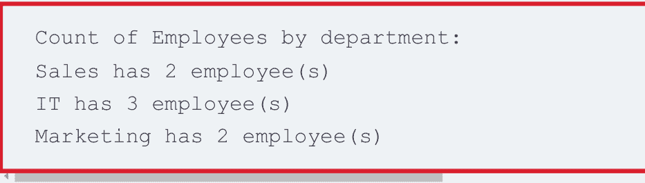

在这种情况下，我们使用了接收两个参数的 `Collectors` 静态方法 `groupingBy` 版本：

- 第一个是一个对流中的对象进行分类的 `Function`
- 第二个是另一个 `Collector`（称为下游 Collector），用于收集由 `Function` 分类的对象。

我们使用 `Collectors` 静态方法 `counting` 作为第二个参数。由此产生的 `Collector` 将给定分类中的元素归约为计数，而不是将它们收集到 `List` 中。第 104–106 行输出生成的 `Map<String, Long>` 中的键值对。

## 14.12.7 汇总和计算员工工资的平均值

之前，我们使用 `map` 方法（在 `IntStream`、`LongStream` 和 `DoubleStream` 类中）将原始类型元素的流映射到对象流。同样，对象流也可以映射到 `IntStream`、`LongStream` 或 `DoubleStream`。在这里，我们使用 Stream 方法 `mapToDouble`（第 111、119 和 125 行）来获取一个将对象映射到 double 值的 `DoubleStream`。在这种情况下，我们把 `Employee` 对象映射到它们的工资，以便我们计算总和和平均值。

点击此处查看代码图片

| 108 | // sum of Employee salaries with Double |
| 109 | System.out.printf( |
| 110 | "%nSum of Employees' salaries (via |
| 111 | list.stream() |
| 112 | .mapToDouble(Employee::salary) |
| 113 | .sum()); |
| 114 | |
| 115 | // calculate sum of Employee salaries |
| 116 | System.out.printf( |

```java
"Sum of Employees' salaries (via re
list.stream()
        .mapToDouble(Employee::salary)
        .reduce(0, (value1, value2) ->
```

```java
// average of Employee salaries with D
System.out.printf("Average of Employee
        list.stream()
        .mapToDouble(Employee::salary)
        .average()
        .getAsDouble());
n128  }
129  }
```

员工工资总和（通过 sum 方法）：345
员工工资总和（通过 reduce 方法）：
员工工资平均值：4932.10

方法 `mapToDouble` 接收一个实现 `ToDoubleFunction` 接口（包 `java.util.function`）的对象，表示返回 double 值的单参数方法。第 112、119 和 125 行分别向 `mapToDouble` 传递了未绑定的实例方法引用 `Employee::salary`，它将当前 `Employee` 的工资作为 `double` 返回。编译器将此方法引用转换为单参数 lambda 表达式，其对 `Employee` 参数调用 `salary` 方法。

第 111–113 行创建了一个 `Stream<Employee>`，将其映射到 `DoubleStream`，然后调用 `DoubleStream` 方法 `sum` 来计算员工工资总和。第 118–120 行也计算了员工工资总和，但使用的是 `DoubleStream` 方法 `reduce` 而不是 `sum`——第 120 行中的 lambda 表达式可以替换为静态方法引用

```java
Double::sum
```

`Double` 类的 `sum` 方法接收两个 `double` 值并返回它们的和。

最后，第 124–127 行使用 `DoubleStream` 方法 `average` 计算员工的平均工资，如果 `DoubleStream` 不包含任何元素，该方法将返回一个 `OptionalDouble`。在这里，我们知道流包含元素，因此只需调用 `OptionalDouble` 方法 `getAsDouble` 来获取结果。

## 生成式 AI

从文件创建 `Stream<Employee>`

第 100–103 行的流流水线产生一个 `Map<String, Long>`，其中每个 `String` 键是部门名称，对应的 `Long` 值是部门的员工人数。

## 统计每个部门的员工人数

接下来，我们使用 Stream 方法 `collect` 和 `Collectors` 静态方法 `groupingBy` 来统计每个部门的员工人数。所演示的技术将分组和归约合并为单一操作。第 100–103 行的流流水线产生一个 `Map<String, Long>`，其中每个 `String` 键是部门名称，对应的 `Long` 值是部门的员工人数。

## 汇总文件中每个单词的次数

第 17–21 行的流流水线将文件“Chapter2.txt”（位于示例中）的内容汇总为 `Map<String, Long>`，其中每个 `String` 键是一个单词，对应的 `Long` 值是该单词的出现次数。

## StreamOfLines.java

第 100–103 行的流流水线产生一个 `Map<String, Long>`，其中每个 `String` 键是部门名称，对应的 `Long` 值是部门的员工人数。

接口并返回一个新的 `Map` 集合。在这里，我们使用了构造方法引用 `TreeMap::new`。编译器将构造方法引用转换为返回新 `TreeMap` 的无参数 lambda 表达式。此示例中的下游收集器（Collector）是 `Collectors.counting()`，它确定了流中每个键出现的次数。`TreeMap` 的键类型由分类器函数 `Function` 的返回类型（String）决定，而值类型由下游收集器决定——`Collectors.counting()` 返回一个 `Long`。

# 按首字母分组摘要

接下来，第 24–33 行的流流水线（stream pipeline）根据键的首字母对 Map wordCountsCounts 中的键值对进行分组。这产生了一个新的 `Map`，其中每个键是一个 `Character`，对应的值是 `wordCounts` 中以该字符开头的键值对列表（List）。

点击此处查看代码图片

```java
// 按起始首字母分组显示单词
wordCounts.entrySet()
.stream()
.collect(
```

```java
Collectors.groupingBy(entry -> e
TreeMap::new, Collectors.toLI
.forEach((letter, wordList) -> {
System.out.printf("%n%nC%n", lett
wordList.stream().forEach(word -
"%13s: %d%n", word.getKey(),
});
}
}
```

该语句执行了以下任务：

- 首先，我们需要一个 `Stream` 来处理 `wordCounts` 的键值对。`Map` 接口没有返回 `Stream` 的方法。因此，第 24 行调用 Map 的 `entrySet` 方法来获取包含 `Map.Entry` 对象的集合（Set），每个对象都包含 `wordCounts` 中的一个键值对。这产生了一个类型为 `Set<Map.Entry<String, Long>>` 的对象。
- 第 25 行调用 Set 的 `stream` 方法来获取一个 `Stream<Map.Entry<String, Long>>`。
- 第 26–28 行调用带有三个参数的 Stream 方法 `collect`：一个分类器、一个 Map 工厂和一个下游收集器。该分类器从 `Map.Entry` 中获取键，然后获取键的首字符，该字符成为结果 Map 中的 `Character` 键。构造方法引用 `TreeMap::new` 是 Map 工厂，它创建一个按排序顺序维护键的 `TreeMap`。下游收集器（`Collectors.toList()`）将 `Map.Entry` 对象放入一个 `List` 集合中。`collect` 的结果是 `Map<Character, List<Map.Entry<String, Long>>>`。
- 最后，按字母总结单词及其计数（即索引），第 29–33 行调用 Map 的 `forEach` 方法。其 lambda 表达式（`BiConsumer`）接收两个参数——`letter` 和 `wordList`。在 `collect` 产生的 Map 中，这些参数代表每个键值对的 `Character` 和 `List`。由于 lambda 的体部有两个语句，因此被包含在大括号中。第 30 行单独占一行显示该 `Character`。第 31–32 行从 `wordList` 获取一个 `Stream<Map.Entry<String, Long>>`，然后调用 Stream 方法 `forEach` 来显示每个 `Map.Entry` 的键和值。

图 14.11 包含了程序的输出。

```
A
a: 2
and: 3
application: 2
arithmetic: 1
```
（注：由于文本中从 B 到 D 的部分仅为单词列表，不符合逻辑翻译，此处保留原样或仅翻译核心逻辑部分。）

各种方法的性能。

## 14.15 无限流（Infinite Streams）

数据结构（如数组或集合）始终表示有限数量的元素——所有元素都存储在内存中，而内存是有限的。当然，从有限数据结构创建的任何流都具有有限数量的元素，正如章之前的示例所示。

惰性求值（Lazy evaluation）使得处理代表未知且可能无限数量元素的无限流成为可能。例如，你可以定义一个方法 `nextPrime`，它在你每次调用它时都会按顺序产生下一个质数。然后，你可以使用它来定义一个概念上表示所有质数的无限流。然而，由于流在执行终端操作之前是惰性的，你可以使用中间操作来限制在执行终端操作时所计算的元素总数。请考虑以下伪代码流处理流水线：

点击此处查看代码图片

- 创建一个表示所有质数的无限流
- 如果质数小于 10,000
- 显示该质数

尽管我们从无限流开始，但最终只会显示小于 10,000 的有限质数集。你通过流接口方法 `iterate` 和 `generate` 创建无限流。在本文讨论中，我们将使用 `IntStream` 的这些方法。

### IntStream 方法 iterate

考虑以下无限流处理流水线：

点击此处查看代码图片

```java
IntStream.iterate(1, x -> x + 1)
    .forEach(System.out::println);
```

`IntStream` 方法 `iterate` 生成一个有序的值序列，从其第一个参数中的种子值（1）开始。随后的每个元素都是通过对序列中的前一个值应用作为 `iterate` 第二个参数的 `IntUnaryOperator` 产生的。前一个流水线生成了无限序列 1, 2, 3, 4, 5, ..., 但这个流水线存在一个问题。我们没有指定要产生多少元素，因此这等同于无限循环。

## 限制无限流的元素数量

限制无限流产生的元素总数的方法是使用短路终端操作 `limit`，它指定了从流中处理的最大元素数量。对于无限流，`limit` 会终止元素的无限生成。因此，以下流处理流水线

点击此处查看代码图片

```java
IntStream.iterate(1, x -> x + 1)
    .limit(10)
    .forEach(System.out::println);
```

从无限流开始，但将产生的元素总数限制为 10，因此它显示了从 1 到 10 的数字。同样，流水线

点击此处查看代码图片

```java
IntStream.iterate(1, x -> x + 1)
    .map(x -> x * x)
    .limit(10)
    .sum()
```

从无限流开始，但仅求加 1 到 10 整数的平方。确保使用产生无限流的方法的流流水线 `limit` 了要产生的元素数量。

### IntStream 方法 generate

你可以使用 `IntStream` 方法 `generate` 创建无序的无限流，该方法接收一个 `IntSupplier`，代表一个不接受参数并返回 `int` 的方法。例如，如果你有一个名为 `random` 的 `RandomGenerator`，以下流流水线将生成并显示 10 个随机整数。

点击此处查看代码图片

```java
IntStream.generate(() -> random.nextInt())
.limit(10)
.forEach(System.out::println);
```

这等同于使用 `RandomGenerator` 的无参数 ints 方法（第 14.14 节）：

点击此处查看代码图片

```java
random.ints()
  .limit(10)
  .forEach(System.out::println);
```


## 生成式 AI

- 1 个关于无限流常见用途的 Prompt 提示。

## 14.16 接口的附加说明

### 接口允许方法实现的继承

当一个类实现一个带有 `default` 方法的接口且不重写它们时，该类继承了 `default` 方法的实现。记住，一个类可以实现多个接口。如果一个类实现了两个或多个提供具有相同签名的 `default` 方法的不相关接口，则实现该类必须重写该方法；否则将发生编译错误。

### @FunctionalInterface 注解

你可以通过确保每个接口包含一个 `abstract` 方法以及零或多个 `default` 和 `static` 方法来创建自定义的函数式接口。虽然不是强制的，但你可以在函数式接口前加上 `@FunctionalInterface` 注解。编译器随后将确保该接口只包含一个抽象方法；否则它将生成编译错误。

## 14.17 总结

在本章中，你学习了 lambda、流和函数式接口。我们展示许多示例，通常演示了实现你在早期章节中编写的任务的更简单的方法。

你在一个 `IntStream`（`int` 值的流）中处理了元素。你创建了一个表示 `int` 闭区间范围的 `IntStream`，然后使用中间和终端流操作来创建并处理产生结果的流处理流水线。我们使用 lambda 创建实现函数式接口的匿名方法，并将 lambda 传递给流流水线中的方法，以指定流元素的处理步骤。我们还从现有的 `int` 值数组中创建了 `IntStreams`。

我们讨论了流的中间处理步骤如何在移动到下一个元素之前应用到每个元素上。我们使用了 `forEach` 终端操作对每个流元素执行操作。我们还使用了归约操作来计算流元素、确定最小值和最大值，并对值求和和平均。你还使用了方法 `reduce` 来创建你自己的归约操作。

你使用了中间操作来过滤匹配谓词的元素，并将元素映射到新值。在每种情况下，这些操作都会产生中间流，你可以在这些流上执行额外的处理。你还学习了如何按升序和降序排序元素，以及如何通过多个字段对对象排序。

我们演示了如何使用 `Collectors` 类提供的各种预定义 `Collector` 实现将流流水线的结果存储在集合中。你还学习了如何使用 `Collector` 将元素分组。

你学习了各种流数据源。例如，你使用 `Files` 方法 `lines` 来获取一个从文件中读取行的 `Stream<String>`，并使用 `RandomGenerator` 方法 `ints` 将 `IntStream` 转换为 `Stream<Integer>`，以便你可以使用 `Stream` 方法 `collect` 汇总 `Integer` 值的频率并将结果存储在 `Map` 中。

我们介绍了无限流，并演示了如何限制它们生成的元素数量。最后，我们提供了关于接口和流的一些额外信息。在下一章中，我们将开始使用 JavaFX 进行图形用户界面（GUI）、图形和多媒体的三章介绍。在[第 18 章，并发：平台线程到虚拟线程]()，我们将对流流水线进行并行处理。

## 特别章节：生成式 AI 练习题

对于以下每个问题，尝试多个 genAI 以确定哪一个表现最好。始终验证结果。记住它们有时会出错甚至幻觉，产生不可靠的信息。

- 14.1（重构集合代码）：向 genAI 提示图 12.1 的代码，要求它们使用 Java lambda 和流技术进行重构。
- 14.2（重构集合代码）：向 genAI 提示图 12.2 的代码，要求它们使用 Java lambda 和流技术进行重构。
- 14.3（重构集合代码）：向 genAI 提示图 12.11 的代码，要求它们使用 Java lambda 和流技术进行重构。
- 14.4（不可变性）：向 genAI 提示关于 Java lambda 和流背景下不可变性益处的解释。
- 14.5（Optional 对象）：向 genAI 提示关于使用 `Optional` 对象的各种方式的教程，包括使用 `Optional` 方法 `isPresent` 与 `ifPresent` 的示例。
- 14.6（流中的异常处理）：向 genAI 提示解释并提供示例，说明如何在处理 Java 流流水线过程中遇到异常时使用 `Optional` 对象。
- 14.7（使用 StackWalker 对堆栈轨迹进行流处理）：提示生成式 AI 生成关于使用 Java 的 `StackWalker` 类对堆栈轨迹进行流处理的教程。
- 14.8（循环与流的性能）：提示生成式 AI 讨论在内存和计算开销方面，传统循环与 Java 流管道的性能对比。
- 14.9（流的最佳实践）：提示生成式 AI 提供一份使用 Java lambdas 和流的最佳实践列表。
- 14.10（流的陷阱）：提示生成式 AI 提供一份使用 Java lambdas 和流的常见陷阱列表。
- 14.11（收集器 Collectors）：提示生成式 AI 提供代码示例，演示 Java `Collectors` 类中最常用的收集器。
- 14.12（流流水线中的 switch 表达式）：提示生成式 AI 提供在流流水线中映射元素时使用 `switch` 表达式的示例。
- 14.13（流方法 mapMulti）：提示生成式 AI 提供示例，展示使用 Java Stream 接口的 `mapMulti` 方法将每个元素映射到多个元素。
- 14.14（流流水线的测试与调试）：提示生成式 AI 提供关于测试和调试代码流流水线的指南。

## 15
# JavaFX 图形用户界面：第一部分


## 目标
在本章中你将：

- 构建 JavaFX GUI 并处理用户交互产生的事件。
- 理解 JavaFX 窗口的结构。
- 使用 JavaFX Scene Builder 创建 FXML 文件来描述包含 `Label`、`ImageView`、`TextField`、`Slider` 和 `Button` 的 JavaFX 场景，无需编写代码。
- 使用 `VBox` 和 `GridPane` 布局容器安排 GUI 组件。
- 使用控制器类（`controller class`）为 JavaFX FXML GUI 定义事件处理器。
- 使用 lambda 定义事件处理器。
- 逐步构建一个具有简单 GUI 布局的 JavaFX 欢迎应用。
- 逐步构建一个具有更复杂 GUI 布局、更多控件以及响应用户交互的事件处理的 JavaFX 提示计算器应用。

## 大纲
- 15.1 简介
- 15.2 JavaFX Scene Builder
- 15.3 JavaFX 应用程序窗口结构
- 15.4 欢迎 GUI：显示文本和图像
  - 15.4.1 打开 Scene Builder 并创建文件 `Welcome.fxml`
  - 15.4.2 向包含 `Welcome.fxml` 的文件夹添加图像
  - 15.4.3 创建一个 `VBox` 布局容器
  - 15.4.4 配置 `VBox` 布局容器
  - 15.4.5 添加并配置 `Label`
  - 15.4.6 添加并配置 `ImageView`
  - 15.4.7 预览欢迎 GUI
- 15.5 提示计算器应用：事件处理简介
  - 15.5.1 测试驱动提示计算器
  - 15.5.2 技术概览
  - 15.5.3 构建应用程序的 GUI
  - 15.5.4 `TipCalculator` 类
  - 15.5.5 `TipCalculatorController` 类：使用 lambda 实现事件处理器
- 15.6 其他 JavaFX 章节涵盖的特性
- 15.7 总结

# 特殊章节：生成式 AI 练习

## 15.1 简介
[第 15–17 章假设你已经安装了 JavaFX 开发包 (SDK) 和 Scene Builder，正如本书“在开始之前”部分所述。]

图形用户界面（GUI）为与应用程序交互提供了一种友好的机制。GUI（发音为“GOO-ee”）为应用程序提供了独特的“外观和感受”。GUI 由 GUI 组件构建——这些组件也称为控件（controls）或小部件（widgets，window gadgets 的缩写）。GUI 组件是一个对象，用户通过鼠标、键盘或其他输入形式（如语音识别）与之交互。为不同的应用提供一致、直观的用户界面组件，可以让用户对新应用产生熟悉感，从而快速学习并更高效地使用它。

### Java GUI 历史
Java 原始的 GUI 库是抽象窗口工具包（AWT）。在 JavaFX 出现之前，Swing 是 Java 主要 GUI 技术。Swing 将继续作为 Java 的一部分并仍被广泛使用。

JavaFX 是“基于 Java 构建的用于桌面、移动和嵌入式系统的下一代客户端应用平台”。它提供了 GUI、图形和多媒体 API，以及广泛的定制能力。Oracle 在 2011 年将 JavaFX 开源。随着 2018 年 Java 11 的发布，JavaFX 变成了一个独立的开源项目，与 Java 开发包并行进化，必须单独安装（在书中“在开始之前”部分讨论）。JavaFX 相比 Swing 的一些优势包括：

1. “JavaFX.” 于 2024 年 9 月 7 日。https://openjfx.io/.
2. JavaFX 更容易使用——它提供了一个用于客户端功能的 API，包括 GUI、图形和多媒体（图像、动画、音频和视频）。Swing 仅用于 GUI。

FXML 代码与 Java 源代码中定义的程序逻辑是分离的——这种界面（GUI）与实现（Java 代码）的分离使得 JavaFX GUI 应用的测试、调试、修改和维护变得更加容易。

## 生成式 AI
- 1 个提示生成式 AI，用于说明生成式 AI 本身是如何作为声明式编程示例的。

## 15.3 JavaFX 窗口结构

一个 JavaFX 窗口由几个部分组成：

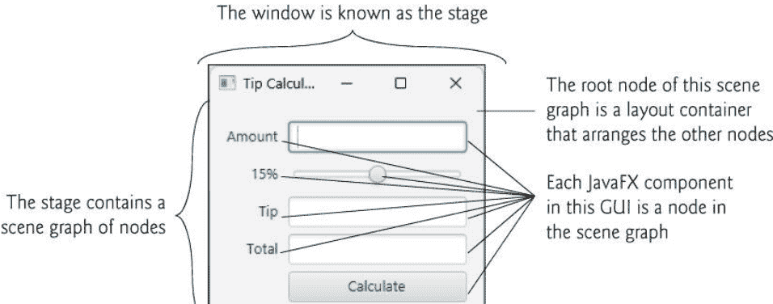

### 控件
控件是 GUI 组件，例如显示文本的 `Label`、允许程序接收用户输入的 `TextField`、用户点击以启动操作的 `Button` 等。

### Stage
显示 JavaFX 应用 GUI 的窗口被称为 stage，它是 `Stage` 类（位于 `javafx.stage` 包中）的实例。

### Scene
stage 包含一个活跃的 scene，它将 GUI 定义为场景图——这是一个应用程序视觉元素的树形数据结构，例如 GUI 控件、形状、图像、视频、文本等。scene 是 `Scene` 类（位于 `javafx.scene` 包中）的实例。

### Nodes
场景图中的每个视觉元素都是一个节点——它是 `Node` 子类（位于 `javafx.scene` 包中）的实例，该类定义了所有节点的共同属性和行为。除了场景图的根节点外，每个节点都有一个父节点。节点可以具有变换（例如移动、旋转和缩放）、不透明度（节点是透明、半透明还是不透明）、效果（例如阴影、模糊、反射和光照）等，我们将在第 16 章介绍这些内容。

### 布局容器
拥有子节点的节点通常是布局容器，它们在场景中安排其子节点。你将在本章中使用两个布局容器（`VBox` 和 `GridPane`），并在第 16-17 章中学习更多。排列在布局容器中的节点是控件的组合，在更复杂的 GUI 中，还可能包含其他布局容器。

### 事件处理器与控制器类
当用户与控件交互时（例如点击 `Button` 或在 `TextField` 中输入文本），控件会生成一个事件。程序可以响应这些事件——称为事件处理——以指定当每次用户交互发生时应该发生什么。事件处理器是响应用户交互的方法。FXML GUI 的处理器定义在控制器类中（第 15.5.5 节）。

## 生成式 AI
- 1 个提示生成式 AI，用于解释通过基于 GUI 的程序和事件处理，用户是如何“驱动程序动作”的，而不是像非 GUI 用户界面那样反过来。

## 15.4 欢迎应用程序：显示文本和图像

在本节中，你将在不编写任何代码的情况下，构建一个在 `Label` 中显示文本并在 `ImageView` 中显示图像的 GUI：

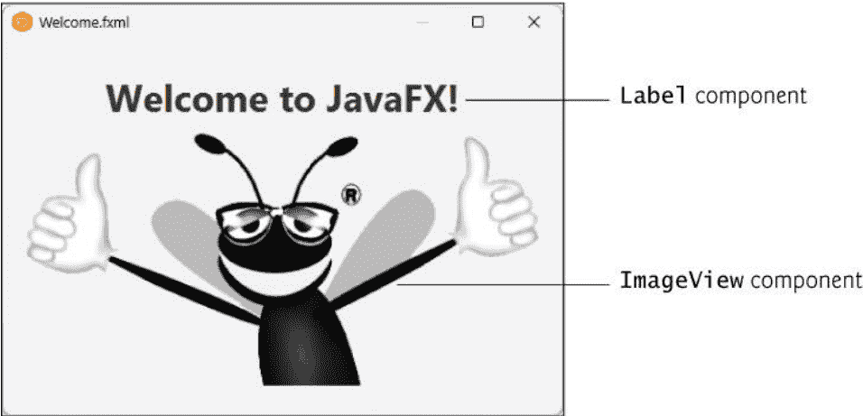

你将使用可视化编程技术将 JavaFX 组件拖放并放置到 Scene Builder 的内容面板（设计区域）上，然后使用检查器配置选项，例如 `Label` 的文本和字体大小以及 `ImageView` 的图像。

你将使用 Scene Builder 的“窗口->显示预览”选项查看完成的 GUI。在第 15.5 节的提示计算器应用程序中，我们将讨论加载和显示 FXML GUI 的 Java 代码。

### 15.4.1 打开 Scene Builder 并创建文件
`Welcome.fxml`


# Welcome.fxml

打开 Scene Builder 以创建定义 GUI 的 FXML 文件。初始时，会出现以下 Gluon Scene Builder 窗口。在其中，你可以选择：

- 从“最近项目”（Recent Projects）列中选择一个要编辑的项目（如果你有的话），或
- 从“从模板新建项目”（New Project from Template）列中选择 Scene Builder 预定义的应用程序设计模板之一。

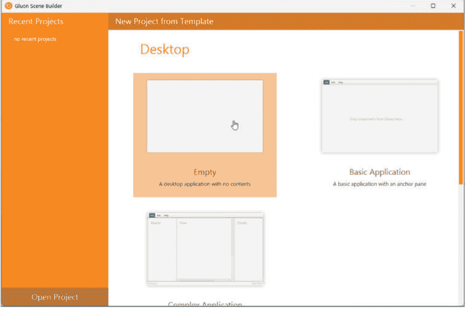

选择空项目（Empty project）模板从零创建一个 JavaFX GUI。完成后，SceneBuilder 窗口将显示如下：

- 库（Library）包含 JavaFX 容器，以及可以拖放到画布上的控件和其他项目。
- 你使用内容面板（content panel）来设计 GUI。
- 你使用检查器窗口（Inspector window）配置内容面板中当前选择的项目。

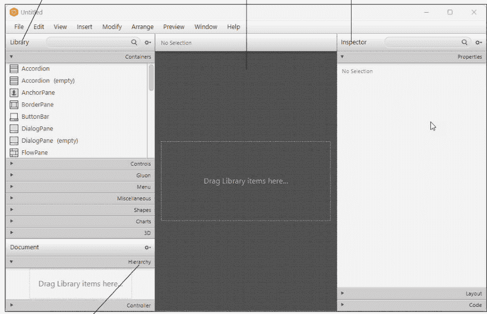

- 文档层次结构（Document's Hierarchy）包含 GUI 的结构，允许你选择和重新组织控件。
- 窗口顶部显示 Scene Builder 创建了一个你尚未保存的新 FXML 文件。选择“文件->保存”（Save）以显示另存为对话框，然后选择存储文件的位置，将文件命名为 `Welcome.fxml` 并点击保存按钮。

3. 我们使用 Microsoft Windows 11 展示 Scene Builder 截图，但 Scene Builder 在 Windows、macOS 和 Linux 上的几乎相同。主要区别在于 macOS 的菜单栏位于屏幕顶部，而 Windows 和 Linux 上的菜单栏是窗口的一部分。

## 15.4.2 将图像添加到包含的文件夹中

`Welcome.fxml`


你将为此应用程序使用的图像（`bug.png`）位于本章示例文件夹的 `images` 子文件夹中。为了在你准备好将其添加到应用程序时方便找到它，请在文件系统上找到 `images` 文件夹，然后将 `bug.png` 拷贝到保存 `Welcome.fxml` 的文件夹中。

## 15.4.3 创建 VBox 布局容器

对于此应用程序，你将一个 `Label` 和一个 `ImageView` 放置在 `VBox` 布局容器（`javafx.scene.layout` 包）中，这将成为场景图的根节点。布局容器帮助你安排和调整 GUI 组件的大小。`VBox` 从上到下垂直排列其节点。我们在第 15.5 节中讨论 `GridPane` 布局容器，并在第 16 章中讨论其他容器。在 Scene Builder 内容面板中拖入 `VBox` 即可开始设计。

## 15.4.4 配置 VBox 布局容器

现在你将指定 VBox 的对齐和大小。

### 指定 VBox 对齐方式

VBox 对齐方式决定了 VBox 的布局。在本应用程序中，我们希望孩子（Label 和 ImageView）居中，以便在 Label 和 ImageView 之间留有相等的空间。为了实现这一点：

1. 选择内容面板中的 VBox。
2. 在检查器的属性部分，点击 Alignment 属性的下拉列表并观察可以使用的对齐值。
3. 点击 CENTER 设置对齐方式。为 JavaFX 对象指定的每个属性值都在运行时创建对象时设置其实例变量。

### 指定首选大小

场景图根节点的首选大小（宽度和高度）用于场景在应用程序启动确定窗口大小——在本应用程序中，我们为 VBox 选择 450x300 像素。要设置首选大小：

1. 选择 VBox。
2. 点击 Layout 旁边的右箭头展开 Layout 部分。该部分展开，右箭头变为向下。再次点击箭头将折叠该部分。
3. 点击 Pref Width 属性文本框，输入 450 并按回车更改首选宽度。
4. 点击 Pref Height 属性文本框，输入 300 并按回车更改首选高度。

当你更改这些属性时，VBox 的大小会立即变化，你可以确认修改已生效。

## 15.4.5 添加并配置 Label

### 向 VBox 添加 Label

通过点击 Controls 旁边的右箭头展开 Scene Builder 库窗口的 Controls 部分，将 `Label` 从 Controls 部分拖放到 Scene Builder 内容面板中的 `VBox` 上。（你也可以通过双击部分中的 `Label` 来添加 `Label`。）Scene Builder 根据 VBox 的 Alignment 属性，在 VBox 中水平和垂直地居中 `Label` 对象。

### 更改 Label 文本

你可以通过双击 `Label` 并输入新文本，或选择 `Label` 并在检查器的属性部分设置其 Text 属性来设置 `Label` 的文本。将 `Label` 的文本设置为“Welcome to JavaFX!”

### 更改 Label 字体

对于此应用程序，我们将 `Label` 设置为大号加粗字体。为此，选择 `Label`，然后在检查器的 Properties（属性）部分，点击 Font（字体）属性右侧的箭头。在弹出的窗口中，将 Style（样式）属性设置为 Bold（粗体），并将 Size（大小）属性设置为 30。现在的设计所示：

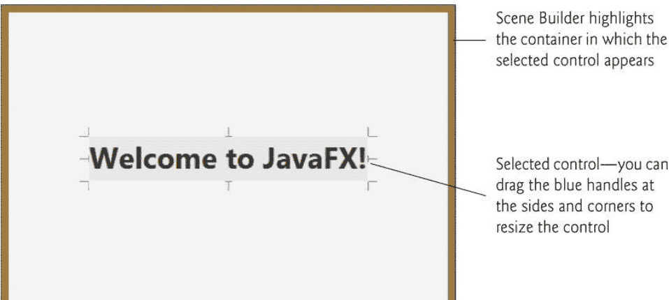

## 15.4.6 添加和配置 ImageView

最后，你将添加显示 `bug.png` 的 `ImageView`。

### 向 VBox 中添加 ImageView

从 Library（库）窗口的 Controls（控件）部分将 `ImageView` 拖动并释放到 `Label`（标签）下方，如下所示——将图像放置在灰色引导线下方：

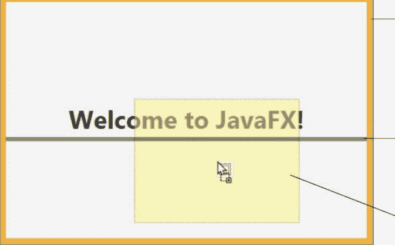

你也可以在 Library 窗口中双击 `ImageView`，此时 Scene Builder 会自动将新的 `ImageView` 对象放置在 `Label` 下方。你可以通过在 `VBox` 中或在 Document 窗口的 Hierarchy（层次结构）部分拖动控件来重新排列 `VBox` 的控件顺序。Scene Builder 会自动将 `ImageView` 在 `VBox` 中水平居中。此外，注意 `Label` 和 `ImageView` 垂直居中，使得 `Label` 上方和 `ImageView` 下方的空间相等。

### 设置 `ImageView` 的图像

接下来，你将设置要显示的图像：

1. 选择 `ImageView`，然后在 Inspector（检查器）的 Properties 部分，点击 Image 属性右侧的省略号 (...) 按钮。默认情况下，Scene Builder 打开一个对话框，列出 FXML 文件所在文件夹的内容。这就是你在 15.4.2 节放置图像文件 `bug.png` 的地方。
2. 选择 `bug.png`，然后点击 Open。Scene Builder 显示图像并调整 `ImageView` 的大小以匹配图像的比例——即图像宽度与高度的比率。

### 更改 `ImageView` 的大小

我们按原始尺寸显示图像。如果你重置 `ImageView` 的默认 Fit Width（适应宽度）和 Fit Height（适应高度）属性值——这些值是 Scene Builder 在你将 `ImageView` 添加到设计时设置的——Scene Builder 将调整 `ImageView` 的大小以匹配图像的精确尺寸。操作方法如下：

1. 展开 Inspector 的 Layout（布局）部分。
2. 将鼠标悬停在 Fit Width 属性值上。这将显示一个小的设置按钮 (⚙️)。点击 ⚙️ 按钮并选择 Reset to default（重置默认值）来重置该值。此技术可用于任何属性值重置其默认值。
3. 重复步骤 2 以重置 Fit Height 属性值。

完成 GUI 的 Scene Builder 内容面板现在所示：


通过选择 File > Save 保存 XML 文件。

## 15.4.7 预览 `Welcome` GUI

你可以通过选择 Preview > Show Preview in Window（预览 > 在窗口中显示预览）来预览设计在运行程序窗口中的外观，这将显示窗口：


窗口的内容在 Linux、macOS 和 Windows 上是完全相同的——只有窗口框会有不同。JavaFX 使用操作系统的默认窗口装饰——例如最小化、最大化和关闭窗口的图标。

## 生成式 AI (Generative AI)

1. 提示生成式 AI 注 GUI 开发与“传统”非 GUI 技术编程相比有何不同。
2. 提示生成式 AI 列出 JavaFX 的辅助功能列表，并为为盲人或视力障碍者制作无 JavaFX GUI 提供建议。

## 15.5 小费计算器应用程序：事件处理简介

小费计算器应用程序计算并显示餐厅账单的小费和小额：

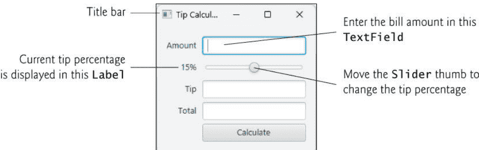

默认情况下，应用程序按 15% 的小费计算总额。下面的截图包含了你输入金额 34.56 并点击 Calculate（计算）按钮后的 GUI：

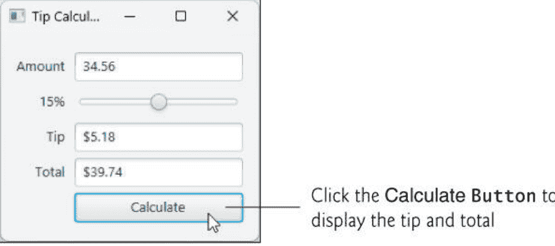

你可以通过移动 `Slider`（滑块）滑块指定 0% 到 30% 的小费百分比——这会更新小费百分比。下面的截图包含了用户移动 `Slider` 滑块将小费百分比改为 20% 然后点击 Calculate 的 GUI：

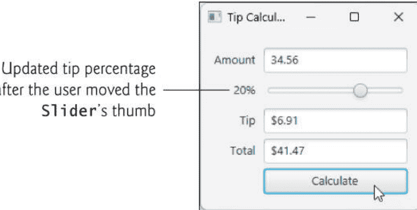

在本节中，你将使用多个 JavaFX 组件构建小费计算器应用程序，并学习如何响应与 GUI 的交互。你将从测试运行应用程序开始，用它计算 15% 和 20% 的小费。然后，我们将概述创建该应用程序所需的技术。你将使用 Scene Builder 构建应用程序的 GUI。最后，我们将提供应用程序的完整 Java 代码并进行详细的代码解读。

### 15.5.1 测试运行小费计算器

让我们编译并运行应用程序，它位于本章示例所在的 `TipCalculator` 文件夹中。`TipCalculator` 类是主应用程序类。

#### 编译小费计算器应用程序

正如我们提到的，JavaFX 使用 Java 平台模块系统 (JPMS)：第 21 章来组织其功能。编译并运行小费计算器应用程序，必须包含两个 `javac` 命令行 JPMS 选项：

- `--module-path` 选项指定 JavaFX 模块在系统上的位置——你在“开始之前”节创建的 `PATH_TO_FX` 环境变量指定了 JavaFX 模块的位置。
- `--add-modules` 选项指定应用程序所需的 JavaFX 模块。

`GridPane` 中的每个单元格可以是空的，也可以包含一个或多个 JavaFX 组件，包括用于排列其他控件的布局容器。`GridPane` 中的每个组件可以跨越多个行或列，尽管我们在此 GUI 中没有使用该功能。当你将 `GridPane` 拖动到 Scene Builder 的内容面板时，Scene Builder 默认创建一个具有两列三行的 `GridPane`。你可以根据需要添加或删除列和行。我们将在介绍构建 GUI 的步骤时讨论其他 `GridPane` 特性。要了解更多关于类 `GridPane`，请访问：

[点击此处查看代码图像](https://openfx.io/javadoc/23/javafx/graphics/javafx/layout/GridPane.html)

### 使用 Scene Builder 创建和自定义 GUI

在第 15.5.3 节中，你将创建 `Label`、`TextField`、`Slider` 和 `Button`：

- `TextField`（包 `javafx.scene.control`）可以接受用户的文本输入或显示文本。你将使用一个可编辑的 `TextField` 来输入用户输入的账单金额，并使用两个不可编辑的 `TextField` 来显示小费和总金额。
- `Slider`（包 `javafx.scene.control`）默认表示 0.0–100.0 范围内的值，允许用户通过移动 `Slider` 的滑块选择该范围内的数字。你将自定义 `Slider`，使用户只能在更有限的整数范围 0–30 内选择自定义的小费百分比。
- `Button`（包 `javafx.scene.control`）允许用户启动操作——在此应用程序中，点击 Calculate `Button` 将计算并显示小费和总金额。

### 将数字格式化为特定区域的货币和百分比字符串

你将使用 `NumberFormat`（包 `java.text`）创建特定区域的货币和百分比字符串——这是国际化的重要部分。

### 事件处理

用户与应用程序的 GUI 交互以指示应用程序应该执行的任务。例如，当你写封电子邮件时，点击电子邮件应用程序的发送按钮会告诉应用程序将电子邮件发送给指定的收件人。

GUI 是事件驱动的。当用户与 GUI 组件交互时，这种交互（称为事件）驱动程序执行操作。导致应用程序执行任务的一些常见用户交互包括：

- 点击按钮，
- 在文本字段中输入文本，
- 从菜单中选择项目，
- 最小化、最大化或关闭窗口，
- 按鼠标按钮以及
- 移动鼠标。

响应事件执行任务的代码被称为事件处理器，而响应事件的过程被称为事件处理。在应用程序能够对特定控件响应事件之前，你必须：

1. 定义一个实现适当接口（称为事件监听器接口）的事件处理器。
2. 指明当事件发生时，该类的某个对象应该被通知——这被称为注册事件处理器。

在此应用程序中，你将响应两个事件——当用户移动 `Slider` 的滑块时，应用程序将更新显示当前小费百分比的 `Label`；当用户点击 Calculate `Button` 时，应用程序将计算并显示小费和总金额。

我们将演示，对于某些事件（例如用户点击 `Button` 时），你可以通过 Scene Builder 检查器窗口的 Code（代码）部分将控件链接到其事件处理方法（即注册事件处理器）。在这种情况下，JavaFX 为你实现了事件监听器接口，并调用你指定的方法。对于在控件属性值发生变化时发生的事件（例如用户移动 `Slider` 的滑块以更改 `Slider` 的值时），你必须完全在代码中创建事件处理器，正如我们将要演示的那样。

### 实现接口 `ChangeListener` 以处理 `Slider` 滑块位置的变化

你将实现 `interface ChangeListener`（包 `javafx.beans.value`）来响应用户移动 `Slider` 滑块的情况。特别是，你将使用接口的 `changed` 方法在用户移动 `Slider` 滑块时显示更新的小费百分比。`ChangeListener` 是一个函数式接口，因此我们将使用 lambda 来实现它。

### 模型-视图-控制器 (MVC) 架构

使用 FXML 实现 GUI 的 JavaFX 程序遵循模型-视图-控制器 (MVC) 设计模式，该模式将应用程序的数据（包含在模型中）、应用程序的 GUI（视图）以及应用程序的处理逻辑（控制器）分离开。

控制器实现了处理用户输入的逻辑。模型包含程序的数据，而视图展示存储在模型中的数据。当用户提供输入时，控制器根据给定的输入修改模型。在小费计算器中，模型是账单金额、小费和总额。当模型发生变化时，控制器更新视图以呈现更改的数据。

在 JavaFX FXML 应用程序中，控制器类定义了用于与控件交互的实例变量，以及响应用户交互的事件处理方法。控制器类还可能声明支持应用程序运行的额外实例变量、静态变量和方法。在像小费计算器这样简单的应用程序中，模型和控制器通常合并为单个类，正如我们在示例中所做的那样。

### `FXMLoader` 类

当 JavaFX FXML 应用程序开始执行时，`FXMLoader` 的 `static load` 将 FXML 文件的内容读入内存。然后，`load` 执行以下操作：

- 创建包含 GUI 的场景图，并返回一个指向场景图根节点的 `Parent` (`javafx.scene`) 引用。
- 创建控制器类的实例，并为将要操作的组件初始化控制器变量。
- 为 FXML 中指定的任何事件注册事件处理器。

我们将在第 15.5.4 节和 15.5.5 节详细讨论这些步骤。

## 15.5.3 构建应用程序的 GUI

在本节中，我们将介绍创建小费计算器 GUI 的精确步骤。

### 此应用程序的 fx:id 属性值

如果控制器类将通过程序操作控件或布局（正如我们将对一个 `Label`、所有 `TextField` 和 `Slider` 所做的），你必须为该控件或布局提供一个名称。在 15.5.4 中，你将为 FXML 中的每个组件声明 Java 变量，我们将讨论如何为你初始化这些变量。每个对象的名称都通过其 `fx:id` 属性指定。你可以通过选择场景中的组件，然后展开检查器窗口的 Code 部分来设置此属性值——`fx:id` 属性出现在该部分的顶部。下面的图包含了小费计算器中程序化控件的 `fx:id`。我们的命名规范是在 `fx:id` 属性中使用控件的类名。因此，`amountTextField`、`tipTextField` 和 `totalTextField` 的 `fx:id` 都包含了控件的类名——`TextField`。

### 创建 `TipCalculator.fxml` 文件

正如你自己在 15.4.1 节中所做的那样，打开 Scene Builder 创建一个新的空 FXML 文件。然后，选择 File（文件） > Save（保存）以显示另存为对话框：

- 指定存储文件的位置（与存储应用程序 Java 源代码相同的文件夹），
- 将文件命名为 `TipCalculator.fxml`
并点击 Save（保存）按钮。

#### 步骤 1：添加一个 GridPane

从 Library（库）窗口的 Containers（容器）部分将 `GridPane` 拖到 Scene Builder 的内容面板。默认情况下，`GridPane` 包含两列三行：

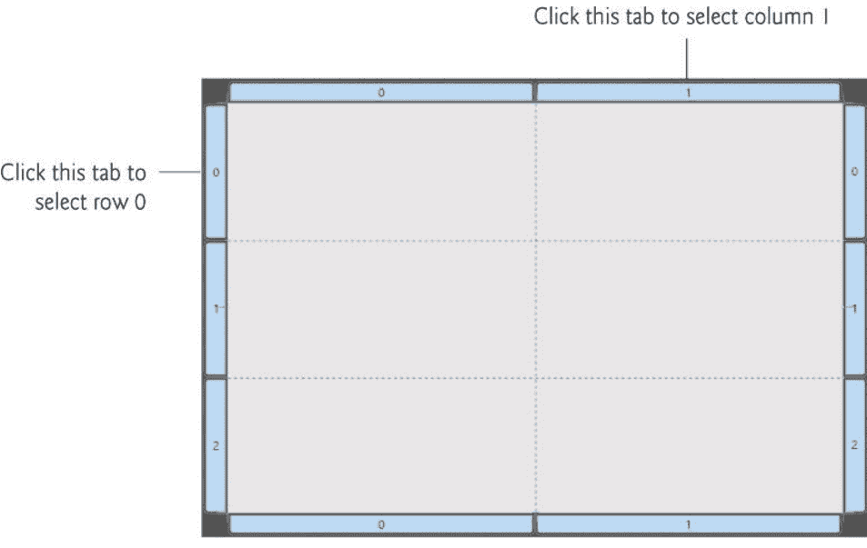

#### 步骤 2：向 `GridPane` 添加行

该应用程序的最终 GUI 有两列五行。在这里，你将再添加两行。要在现有行上方或下方添加行：

1. 右键点击任何行的行号标签，选择 Grid Pane > Add Row Above（在上方添加行）或 Grid Pane > Add Row Below（在下方添加行）。
2. 重复此过程添加另一行。

添加两行后，`GridPane` 如下所示：

| | 0 | 1 |
|---|---|---|
| 0 | | |
| 1 | | |
| 2 | | |
| 3 | | |
| 4 | | |

你可以使用类似的步骤来添加列。你可以通过右键点击包含行号或列号的标签页并选择“删除”（Delete）来删除行或列。

#### 第 3 步：向 `GridPane` 添加控件

现在你将把控件添加到 `GridPane` 中。当你将控件拖到 `GridPane` 上时：

- 如果如图所示的控件具有 `fx:id`，请使用相应的变量名在检查器（Inspector）窗口的“代码”（Code）部分中设置控件的 `fx:id` 属性。
- 如果如图所示的控件显示文本，请使用相应的文本在检查器窗口的“属性”（Properties）部分中设置控件的 `Text` 属性。


执行以下步骤来构建 GUI：

1. **添加标签（Labels）。** 从库窗口的“控件”部分将 `Label` 拖入第 0 列的前四行（`GridPane` 的左列）。每添加一个时，都设置它的文本。
2. **添加文本字段（TextFields）。** 从库窗口的“控件”部分将 `TextField` 拖入第 1 列的第 0、2 和 3 行（`GridPane` 的右列）。
3. **添加滑动条（Slider）。** 从库窗口的“控件”部分将一个水平 `Slider` 拖入第 1 列的第 1 行。
4. **添加按钮（Button）。** 从库窗口的“控件”部分将 `Button` 拖入第 1 列的第 4 行。将按钮文本更改为 Calculate（计算）。你可以通过双击按钮或选择按钮然后在检查器窗口的“属性”部分中设置其 `Text` 属性来设置按钮文本。

`GridPane` 应该显示如下：


#### 第 4 步：调整 GridPane 大小以适应内容

当你开始通过添加布局来设计 GUI 时，Scene Builder 会自动将布局对象的 `Pref Width`（首选宽度）设置为 600，`Pref Height`（首选高度）设置为 400，这比此 GUI 的最终宽度和高度得多。对于此应用程序，我们希望布局的大小根据其内容进行计算。要进行此更改：

1. 首先，点击 `GridPane` 来选择它，但不要点击放置在它的列和行中的任何控件。有时，在 Scene Builder 左侧列的文档窗口的“层级”（Hierarchy）部分选择 `GridPane` 节点会更容易。
2. 在检查器的“布局”（Layout）部分，将 `Pref Width` 和 `Pref Height` 属性值重置为默认值（如你在第 15.4.6 节中所做的那样）。这两个属性的值都设置为 `USE_COMPUTED_SIZE`，以便布局计算自己的大小。

布局现在显示如下：


#### 第 5 步：将 GridPane 第 0 列的内容右对齐

`GridPane` 列的内容默认左对齐。要让第 0 列的内容右对齐，点击该列顶部或底部的标签来选择它，然后在检查器的“布局”部分，将 `Alignment`（水平对齐）属性设置为 RIGHT（右侧）。

#### 第 6 步：调整 GridPane 大小以适应其内容

默认情况下，Scene Builder 将每个 `GridPane` 的宽度设置为 100 像素，每行的高度设置为 30 像素，以确保你可以轻松将控件拖入 `GridPane` 的单元格。在此应用程序中，我们调整了每列的大小以适应其内容。要这样做，点击该列顶部或底部的标签选择第 0 列，然后在检查器的“布局”部分，将 `Pref Width` 属性重置为默认大小（即 `USE_COMPUTED_SIZE`），表示该列的宽度应基于其最宽的子元素——在本例中是 Amount Label。对第 1 列重复此过程。`GridPane` 应该显示如下：


#### 第 7 步：调整按钮大小

默认情况下，Scene Builder 根据文本设置 `Button` 的宽度。对于此应用程序，我们选择让按钮与 `GridPane` 右列中的其他控件宽度相同。要这样做，选择按钮，然后在检查器的“布局”部分，将 `Max Width`（最大宽度）属性设置为 `MAX_VALUE`。这将导致按钮宽度增长以填充整列宽度。

#### 预览 GUI

通过选择 Preview（预览）> Show Preview in Window（在窗口中显示预览）来预览 GUI：


注意左列的 `Label` 和右列的控件之间没有空间，`GridPane` 周围也没有空间。默认情况下，`Stage`（舞台）的大小适应 `Scene`（场景）的内容，因此许多控件触碰了窗口边界。你将在后续修复这些问题。

#### 第 8 步：配置 GridPane 的内边距（Padding）

`GridPane` 内容之间的上、右、下、左空间被称为内边距（Padding）。设置 `GridPane` 的内边距，选择它，然后在检查器的“布局”部分设置这四个值。

列和行之间的 `Hgap`（水平间距）和 `Vgap`（垂直间距）分别是。如果你想精确控制水平间距，选择 `GridPane`，然后在“布局”部分将 `Hgap` 设置为 8。

#### 第 9 步：使 TextField 不可编辑且不可聚焦

`TextField` 在此应用程序中用于显示结果，而不是接收输入。因此它们不应该是具有交互性的。只有当它具有焦点时，你才能输入文本。当你点击交互控件时，它获得焦点。同样，当你按下 Tab 键时，焦点从当前聚焦控件转移到下一个控件——默认情况下，这是添加控件的顺序。交互控件（如 `TextField`、`Button`）默认是可聚焦的。非交互控件（如 `Label`）则不是。

在此应用程序中，`TextField` 不可聚焦。要进行这些更改，选择 `TextField`，然后在检查器的“属性”部分取消勾选 `Editable` 和 `Focusable` 属性。要一次选择多个控件，你可以点击第一个（文档窗口层级部分或内容面板中的），然后按住 Shift 键点击其他。

#### 第 10 步：设置 Slider 的属性

为了完成 GUI，你现在将配置 Tip Calculator 的 `Slider`。`Slider` 默认范围为 0.0 到 100.0，初始值为 0.0。此应用程序仅允许 0 到 30 之间的整数百分比，默认值为 15。要进行这些更改，选择 `Slider`，然后在检查器的“属性”部分将 `Max` 属性设置为 30，并将 `Value` 属性设置为 15。我们还设置了 `Block Increment` 属性为 5——这是用户点击 `Slider` 端与滑块之间时 `Value` 属性增加或减少的量。通过选择 File > Save（保存）保存 FXML 文件。

### 预览最终布局

你现在已完成 Tip Calculator 的设计。选择 Preview > Show Preview in Window 查看最终 GUI：


当我们在第 15.5.5 节讨论 `TipCalculatorController` 类时，我们将展示如何在 FXML 文件中指定计算 `Button` 的事件处理器。

### 指定控制类名称

正如我们在第 15.5.2 节中提到的，在 JavaFX 中，应用程序的控制类通常会定义用于程序化交互的实例变量，以及事件处理方法。为了确保应用程序在运行时加载 FXML 文件时能够创建控制类的对象，你必须在 FXML 文件中指定控制类的名称：

1. 展开 Scene Builder 文档窗口的 Controller（控制器）部分——它位于 Scene Builder 左下角 Hierarchy（层级）部分的下方。
2. 在 Controller Class（控制器类）字段中输入 `TipCalculatorController`——按照惯例，控制类的名称与 FXML 文件名相同（在本例中为 `TipCalculator`），并以 `Controller` 结尾。

### 指定计算按钮的事件处理方法名称

你可以在 FXML 文件中指定处理控件的方法名称。当你选择一个控件时，Inspector（检查器）窗口的 Code（代码）部分会显示你可以指定事件处理器的所有事件。当用户点击按钮（`Button`）时，会调用 On Action 字段中的方法。该方法定义在你在 Scene Builder Controller 窗口中指定的控制类中。在按钮的 On Action 字段中输入 `calculateButtonPressed`。

### 生成示例控制器类

你可以让 Scene Builder 生成一个初始控制器类，该类包含你用于程序化交互控件的变量以及一个空的计算按钮事件处理器。Scene Builder 将此称为“控制器骨架”。通过 View（视图） > Show Sample Controller Skeleton（显示示例控制器骨架）来生成骨架：


注意，示例类具有你指定的类名、每个带有 `fx:id` 的控件对应的变量，以及一个空的计算按钮事件处理器。我们将在第 15.5.5 节讨论 `@FXML` 注解。要使用此骨架创建你的控制器类，请点击 Copy（复制）按钮，然后将内容粘贴到名为 `TipCalculatorController.java` 的文件中，该文件应与在本节中创建的 `TipCalculator.fxml` 文件位于同一文件夹中。

## 15.5.4 `TipCalculator` 类

一个简单的 JavaFX FXML 应用程序包含两个 Java 源码文件。对于小费计算应用程序，这些文件是：

- `TipCalculator.java`——此文件包含 `TipCalculator` 类（在本节中讨论），它声明了加载 FXML 文件以创建 GUI 并将 GUI 附加到应用程序 `Stage` 上 `Scene` 的 `main` 方法。
- `TipCalculatorController.java`——此文件包含控制器类（在第 15.5.5 节讨论），你将在其中指定 `Slider` 和 `Button` 控件的事件处理器。

图 15.1 展示了 `TipCalculator` 类。正如我们在第 15.5.2 节中讨论的，JavaFX 应用程序的起点是一个 `Application` 子类，因此 `TipCalculator` 类继承 `Application`（第 9 行）。`main` 方法调用 `Application.static launch` 方法（第 23 行）来初始化 JavaFX 运行时并开始执行应用程序。该方法会导致 JavaFX 运行时创建 `TipCalculator` 类的对象并调用其 `start` 方法（第 10–19 行），传递代表应用程序将显示窗口的 `Stage` 对象。JavaFX 运行时会创建该窗口。

[点击此处查看代码图像](#)

```java
```


# TipCalculator 应用程序

## 主应用程序类

```java
// Fig.15.1: TipCalculator.java
// Main application class that loads and displays the Tip Calculator GUI
import javafx.application.Application;
import javafx.fxml.FXMLLoader;
import javafx.scene.Parent;
import javafx.scene.Scene;
import javafx.stage.Stage;

public class TipCalculator extends Application {
    @Override
    public void start(Stage stage) throws Exception {
        Parent root = FXMLLoader.load(getClass().getResource("TipCalculator.fxml"));

        var scene = new Scene(root); // attach scene graph to scene
        stage.setTitle("Tip Calculator"); // set title bar text
        stage.setScene(scene); // attach scene to stage
        stage.show(); // display the stage
    }

    public static void main(String[] args) {
        // create a TipCalculator object and call start method
        launch(args);
    }
}
```

图 15.1 | 加载并显示小费计算器 GUI 的主应用程序类。

### 重写的 Application 方法 start

`start` 方法（第 10–19 行）创建 GUI，将其附加到 `Scene`，并将其放在 `start` 方法接收的参数 `Stage` 上。第 12–13 行使用类 `FXMLLoader` 的静态方法 `load` 来创建 GUI 的场景图。该方法：

- 返回一个指向场景图根节点的 `Parent`（包 `javafx.scene`）引用——这是本应用程序中 GUI 的 `GridPane` 的引用。
- 创建我们在 FXML 文件中指定的 `TipCalculatorController` 类对象。
- 初始化用于程序化操作组件的控制器实例变量。
- 注册 FXML 中指定的事件处理器，使它们能够响应用户交互。

我们将在第 15.5.5 节讨论控制器的实例变量的初始化和事件处理器的注册。

### 创建 Scene

要显示 GUI，你必须将其附加到 `Scene`，然后将 `Scene` 附加到 `start` 方法接收的参数 `Stage` 上。要附加 GUI，第 15 行创建了一个 `Scene`，并将 `root`（场景图的根节点）作为参数传递。默认情况下，`Scene` 的大小由场景图的根节点决定。`Scene` 构造函数的重载版本允许你指定 `Scene` 的大小。第 16 行使用 `Stage.setTitle` 来指定出现在 `Stage` 窗口标题栏中的文本。第 17 行调用 `Stage.setScene` 将 `Scene` 放置到 `Stage` 上。最后，第 18 行调用 `Stage.show` 显示 `Stage`。

## 15.5.5 TipCalculatorController 类：使用 Lambda 实现事件处理器

图 15.2 展示了 `TipCalculatorController` 类，它响应用户与应用程序中 `Button` 和 `Slider` 的交互。为了方便讨论，我们将该类拆分为几部分。第 3–10 行显示了类的导入语句：

| 行号 | 代码 |
| :--- | :--- |
| 1 | // Fig.15.2: TipCalculatorController.java |
| 2 | // Controller that handles user interactions |
| 3 | import java.math.BigDecimal; |
| 4 | import java.math.RoundingMode; |
| 5 | import java.text.NumberFormat; |
| 6 | import javafx.event.ActionEvent; |
| 7 | import javafx.fxml.FXML; |
| 8 | import javafx.scene.control.Label; |
| 9 | import javafx.scene.control.Slider; |
| 10 | import javafx.scene.control.TextField; |

图 15.2 | `TipCalculatorController` 的导入声明。

`TipCalculatorController` 类使用的类和接口包括：

- `BigDecimal` 类（第 3 行；第 4.11 节介绍）用于精确的货币计算。`java.math` 包中的 `RoundingMode` 枚举（第 4 行）用于指定在计算或将浮点数格式化为字符串时如何舍入 `BigDecimal`。
- `java.text` 包中的 `NumberFormat` 类（第 5 行）提供了数值格式化功能，例如特定区域的货币和百分比格式。例如，在美国区域中，货币值 34.95 被格式化为 $34.95，百分比 15 被格式化为 15%。`NumberFormat` 类根据运行应用程序的系统区域，应用程序据此格式化金额和百分比。
- 按钮的事件处理器接收一个 `ActionEvent` 对象（第 6 行；包 `javafx.event`），指示用户点击了哪个按钮。许多 JavaFX 控件支持 `ActionEvent`。
- `FXML` 注解（第 7 行；包 `javafx.fxml`）在 JavaFX 控制器类的代码中（作为 `@FXML`）用于标记应引用 GUI FXML 文件中 JavaFX 组件的实例变量，以及可以响应 GUI FXML 文件中 JavaFX 组件事件的方法。
- 软件包 `javafx.scene.control`（第 8–10 行）包含了许多 JavaFX 控制类，包括 `Label`、`Slider` 和 `TextField`。

### TipCalculatorController 的静态变量和实例变量

第 14–35 行声明了 `TipCalculatorController` 类的静态变量和实例变量。`NumberFormat` 对象（第 14–17 行）分别用于格式化货币值和百分比。`NumberFormat` 方法 `getCurrencyInstance` 返回一个 `NumberFormat` 对象，使用运行应用程序的系统默认区域将值格式化为货币。同样，`NumberFormat` 方法 `getPercentInstance()` 返回一个 `NumberFormat` 对象，使用系统默认区域将值格式化为百分比。`BigDecimal` 对象 `tipPercentage`（第 19 行）存储当前的小费百分比，并在用户点击计算（Calculate）按钮时用于小费计算。

```java
public class TipCalculatorController {
    // formatters for currency and percentage
    private static final NumberFormat currency = NumberFormat.getCurrencyInstance();
    private static final NumberFormat percent = NumberFormat.getPercentInstance();

    private BigDecimal tipPercentage = new BigDecimal("0.0");

    // GUI controls defined in FXML and used by controller
    @FXML
    private TextField amountTextField;

    @FXML
    private Label tipPercentageLabel;

    @FXML
    private Slider tipPercentageSlider;

    @FXML
    private TextField tipTextField;

    @FXML
    private TextField totalTextField;
}
```

### @FXML 注解

回顾第 15.5.3 节，应用程序在 Java 源中操作的每个控件都需要一个 `fx:id`。第 22–35 行声明了控制器类对应的实例变量。每个声明之前的 `@FXML` 注解（第 22、25、28、31 和 34 行）表示该变量名可以在描述应用程序 GUI 的 FXML 文件中使用。你在控制器类中指定的变量名必须与构建 GUI 时指定的 `fx:id` 值精确匹配；否则，`FXMLLoader` 将抛出 `LoadException`。当 `FXMLLoader` 加载 `TipCalculator.fxml` 来创建 GUI 时，它还会初始化每个用 `@FXML` 声明的控制器实例变量，确保它们指向相应的 GUI 组件。

### TipCalculatorController 的 calculateButtonPressed 事件处理器

第 38–53 行声明了 `TipCalculatorController` 的 `calculateButtonPressed` 方法，该方法在用户点击计算（Calculate）按钮时被调用。方法之前的 `@FXML`（第 38 行）表示该方法可以用于在描述应用程序 GUI 的 FXML 文件中指定控件的事件处理器。对于生成 `ActionEvent` 的控件（许多 JavaFX 控件都是如此），事件处理方法必须返回 `void` 并接收一个 `ActionEvent` 参数（第 39 行）。

```java
// calculates and displays the tip and total
@FXML
private void calculateButtonPressed(ActionEvent event) {
    try {
        BigDecimal amount = new BigDecimal(amountTextField.getText());
        BigDecimal tip = amount.multiply(tipPercentage);
        BigDecimal total = amount.add(tip);

        tipTextField.setText(currency.format(tip));
        totalTextField.setText(currency.format(total));
    } catch (NumberFormatException ex) {
        amountTextField.setText("Enter amount");
        amountTextField.selectAll();
        amountTextField.requestFocus();
    }
}
```

### 注册计算按钮的事件处理器

当 `FXMLLoader` 加载 `TipCalculator.fxml` 来创建 GUI 时，它会为计算按钮的 `ActionEvent` 创建并注册事件处理器。该事件的事件处理器必须实现 `EventHandler<ActionEvent>` 接口（软件包 `javafx.event`）——`EventHandler` 是一个泛型接口，包含一个返回 `void` 并接收 `ActionEvent` 参数的 `handle` 方法。相应地，当用户点击计算按钮时，会调用 `calculateButtonPressed`。`FXMLLoader` 对你通过 Scene Builder 检查器的 Code 部分指定的每个事件监听器执行类似的任务。

### 计算并显示小费和总金额

第 41–46 行计算并显示小费和总金额。第 41 行调用 `amountTextField` 的 `getText` 方法获取用户输入的金额。该 `String` 被传递给 `BigDecimal` 的构造函数，如果参数不是数字，则会抛出 `NumberFormatException`。在这种情况下，第 49 行调用 `amountTextField` 的 `setText` 方法在 TextField 中显示“Enter amount”。第 50 行调用 `amountTextField` 的 `selectAll` 方法选中 TextField 的文本。第 51 行调用 `amountTextField` 的 `requestFocus` 方法赋予 TextField 焦点。现在，用户可以在 `amountTextField` 中输入新值，而无需选中文本。`TextField` 从 `TextInputControl` 类（软件包 `javafx.scene.control`）继承 `getText`、`setText` 和 `selectAll` 方法，并从 `Node` 类（软件包 `javafx.scene`）继承 `requestFocus` 方法。

第 41 行不会抛出异常时，第 42 行通过调用 `multiply` 方法将金额乘以 `tipPercentage` 来计算小费，第 43 行通过将小费加到金额上来计算总额。接下来，第 45 和 46 行使用 `currency` 对象的 `format` 方法创建表示小费和总金额的货币格式字符串，我们将其分别显示在 `tipTextField` 和 `totalTextField` 中。

### TipCalculatorController 的 initialize 方法

第 56–69 行声明了 `TipCalculatorController` 的 `initialize` 方法。当方法存在并被注解为 `@FXML` 时，JavaFX 将在 GUI 显示之前调用此方法来配置控制器。第 59 行调用 `currency` 对象的 `setRoundingMode` 来指定货币值应使用 `RoundingMode.HALF_EVEN` 进行舍入（如第 4.11 节所述）。

```java
// called by FXMLLoader to initialize the controller
@FXML
private void initialize() {
    // listener for changes to tipPercentage
    currency.setRoundingMode(RoundingMode.HALF_EVEN);

    tipPercentageSlider.valueProperty().addListener((ov, oldValue, newValue) -> {
        tipPercentage = BigDecimal.valueOf(newValue.doubleValue());
        tipPercentageLabel.setText(percent.format(tipPercentage));
    });
}
```


## 使用 Lambda 表达式处理事件

每个 JavaFX 控件都有属性。某些属性（例如 `Slider` 的值）在更改时会产生事件。对于此类事件，你必须手动注册实现 `ChangeListener` 接口的对象（软件包 `javafx.beans`）。

`ChangeListener` 是一个泛型类型，使用属性类型特化。调用 `valueProperty()`（第 62 行）返回 `DoubleProperty`（软件包 `javafx.beans.property`），它代表一个实现 `ObservableValue<Number>` 的事件处理器，可以在值改变时通知监听器。每个实现 `ObservableValue` 的类都提供了 `addListener()` 方法（在第 62–68 行调用）来注册接口。

`ChangeListener` 是一个泛型函数式接口，因此我们可以使用第 14.3 节引入的 Lambda（第 63–67 行）方便地实现它。由于 `Slider` 的 `addListener()` 对象，编译器推断出 lambda 三参数的 `T` 是 `Number`：

- `ov`——发生变化的 `ObservableValue<Number>`
- `oldValue`——包含事件发生前 `Slider` 旧值的 `Number`
- `newValue`——包含 `Slider` 新值的 `Number`

## 15.6 其他 JavaFX 章节涵盖的功能

JavaFX 是一项强大的 GUI、图形和多媒体技术。在 16 和 17 章中，你将：

- 学习额外的 JavaFX 布局和控件。
- 处理其他事件类型（例如鼠标事件 `MouseEvents`）。
- 对场景图中的节点应用变换（如移动、旋转、缩放和倾斜）以及效果（如投影、模糊、反射和光照）。
- 使用 CSS 指定控件的外观。
- 使用 JavaFX 属性和数据绑定，实现在相应数据变化时控件的自动更新。
- 使用 `FileChooser` 和 `DirectoryChooser` 对话框访问磁盘上的文件和文件夹。
- 使用 JavaFX 图形能力。
- 执行 JavaFX 动画。
- 使用 JavaFX 多媒体能力播放音频和视频。

## 15.7 总结

在本章中，我们引入了用于创建图形化用户界面（GUI）的 JavaFX。我们简要讨论了 JavaFX 相比于旧的 AWT 和 Swing GUI 技术的优势。我们探索了 JavaFX 窗口的结构，包括它的阶段（`Stage`）、场景（`Scene`）和各种控件。我们解释了关键的 JavaFX 概念，例如使用 `Scene Builder` 创建以声明方式指定 GUI 布局和控件的 FXML、模型-视图-控制器（MVC）设计模式，以及控制器类如何响应用户与 GUI 控件交互时产生的事件。

我们使用了两个示例来介绍关键的 JavaFX 概念。在简单的 `Welcome` 应用中，我们在 `Scene Builder` 中使用了拖放式可视化编程技术，在不编写任何 Java 代码的情况下设计了一个由 `VBox` 布局容器、`Label` 和 `ImageView` 组成的 GUI。

在 `Tip Calculator` 小费计算器应用中，我们使用 `Scene Builder` 创建了一个更复杂的 GUI，它由 `Label`、`TextField`、`Slider` 和 `Button` 组成，并排列在具有多行列的 `GridPane` 布局容器中。我们使用 `FXMLLoader` 读取 `Scene Builder` 创建的 FXML，创建相应的 GUI，创建控制类的实例，并将 GUI 控件附加到控制类的 `@FXML` 注解字段和方法上。

`Tip Calculator` 的控制器类响应用户与应用程序 `Button` 和 `Slider` 控件的交互，并相应地更新 GUI。我们展示了某些事件处理器（例如 `Button` 的 `OnAction` 处理器）可以直接在 `Scene Builder` 中作为 FXML 的一部分指定，但控件属性值变化（例如 `Slider` 的值）的事件处理器必须在控制器的代码中直接实现。我们使用 lambda 表达式来实现响应 `Slider` 值变化的处理程序。在整个示例中，我们强调了 JavaFX 的最佳实践，例如 GUI 元素的适当间距和对齐。

在下一章中，你将学习关于使用各种 JavaFX 布局面板在场景图中布局节点的更多详细信息，以便你构建更复杂的 GUI。我们将演示额外的 JavaFX 控件和事件类型。我们将使用 CSS 对 GUI 进行样式化。我们将自定义控件的显示。你还将学习 JavaFX 属性以及如何使用数据绑定来用新数据自动更新 GUI 中的元素。

## 特别章节：生成式 AI 练习

对于以下每个问题，尝试使用多个生成式 AI（genAIs）以判断哪一个表现最好。务要验证结果。记住，它们有时会出错甚至产生幻觉，创建不可靠的信息。

### 15.1 (生成式 AI: JavaFX 演示)

提示生成式 AI 寻找展示了 JavaFX 各种能力应用程序的 JavaFX 演示网站。

### 15.2 (生成式 AI: JavaFX FXML 剪贴簿布局)

向生成式 AI 提供四个图像文件名，要求它们设计一个 JavaFX FXML 布局，以 3:2 的比例旋转不同角度显示每张图像，就像在剪贴簿中找到的那样。要求它们提供下载 FXML 文件的链接。将文件放在带有你图片的文件夹中，然后用 `Scene Builder` 打开 FXML 文件并像你在 15.4 节中对 `Welcome` 应用所做进行预览。

### 15.3 (生成式 AI: JavaFX 小费计算器用户界面重构)

向生成式 AI 提供 `Tip Calculator` 应用的 FXML 文件，要求它们重构 JavaFX 用户界面，将 `tipPercentageSlider` 从水平改为垂直。要求它们将 `tipPercentageLabel` 和 `tipPercentageSlider` 放置在 GUI 右侧的一个新列中，并将 `tipPercentageSlider` 位于顶部。

### 15.4 (生成式 AI: JavaFX 演示)

向生成式 AI 提供 `Tip Calculator` 应用的 FXML 文件，要求它们重构 JavaFX 用户界面，将 `tipPercentageSlider` 从水平改为垂直。要求它们将 `tipPercentageLabel` 和 `tipPercentageSlider` 放置在 GUI 右侧的一个新列中，并将 `tipPercentageSlider` 位于顶部。

### 15.5 (生成式 AI: JavaFX 变换)

提示生成式 AI 提供一个完整的变换列表。

### 15.6 (生成式 AI: JavaFX 效果)

提示生成式 AI 提供一个完整的效果列表。

## 16 JavaFX: 第 2 部分

 Prompt genAIs, asking for a complete list of effects.)

## 16.1 目标

在本章中，你将：

- 使用额外的布局（`TitledPane`、`BorderPane` 和 `Pane`）和控件（`RadioButton` 和 `ListView`）。
- 处理鼠标和 Radio 事件。
- 设置响应控件属性变化的事件处理器（例如 `Slider` 的值）。
- 将 `Rectangle` 和 `Circle` 作为节点显示在场景图中。
- 将对象集合绑定到 `ListView` 以显示集合内容。
- 自定义 `ListView` 的单元格。
- 使用 `FileChooser` 和 `DirectoryChooser` 对话框使用户选择文件或目录。
- 查看 JavaFX 能力、更新和在线资源。

## 大纲

### 16.1 引言

### 16.2 在场景图中布局节点

### 16.3 Painter 应用：单按钮、鼠标事件和形状

#### 16.3.1 技术概述

#### 16.3.2 创建 `Painter.fxml`

#### 16.3.3 构建 GUI

#### 16.3.4 `Painter` 类的子类

#### 16.3.5 `PainterController`

### 16.4 Color Chooser 应用：属性绑定和监听器

#### 16.4.1 技术概述

#### 16.4.2 构建 GUI

#### 16.4.3 `ColorChooser` 类的子类

#### 16.4.4 `ColorChooserController`

### 16.5 Cover Viewer 应用：使用集合的数据驱动 GUI

#### 16.5.1 技术概述

#### 16.5.2 构建 GUI

#### 16.5.3 `CoverViewer` 类的子类

#### 16.5.4 `CoverViewerController`

### 16.6 Cover Viewer 应用：自定义 ListView 单元格

#### 16.6.1 技术概述

#### 16.6.2 复制 `CoverViewer` 应用

#### 16.6.3 `ImageTextCell` 自定义 ListView 布局

#### 16.6.4 `CoverViewerController`

### 16.7 `FileChooser` 和 `DirectoryChooser` 对话框

### 16.8 其他 JavaFX 能力和 JavaFX 辅助功能

### 16.9 JavaFX 更新

### 16.10 JavaFX 资源和库

### 16.11 总结

## 节点大小

通常情况下，不应显式地定义节点的大小。这样做往往会导致设计在加载时看起来很漂亮，但随着应用程序调整大小或内容更新，效果会变差。除了 `width` 和 `height` 之外，大多数 JavaFX 节点还具有额外的属性，用于指定节点在父节点内布局时可接受的尺寸范围：

- `minWidth` 和 `minHeight` 属性指定节点以像素为单位的最小尺寸。
- `maxWidth` 和 `maxHeight` 属性指定节点以像素为单位的最大尺寸。
- `prefWidth` 和 `prefHeight` 属性指定在大多数情况下布局应使用的节点首选尺寸。

## 节点位置与布局面板

节点的位置应该相对于其父节点以及父节点中的其他节点来定义。`layout panes`（布局面板）是容器节点，它们根据子节点的大小和位置，在场景图中相互排列其子节点。子节点可以是控件、其他布局面板、形状等。

大多数 JavaFX 布局面板都使用相对定位——如果布局面板节点被调整了大小，它会根据子节点的首选、最小和最大尺寸相应地调整子节点的大小和位置。下表描述了每种 JavaFX 布局，包括第 15 章介绍的内容——这些定义在 `javafx.scene.layout` 和 `javafx.scene.controls` 包中。在本章中，我们将使用来自 `javafx.scene.layout` 包的 `Pane`、`BorderPane`、`GridPane` 和 `VBox`：

| 布局 | 描述 |
|---|---|
| `Accordion` | 显示多个面板，但一次只允许展开一个。 |
| `AnchorPane` | 允许你设置子节点相对于面板边缘的位置。调整面板大小不会改变节点的布局。 |
| `BorderPane` | 包含顶部、底部、左侧、中心和右侧区域，你可以在其中放置节点。顶部和底部填充 `BorderPane` 的宽度，并根据子节点的首选高度进行垂直尺寸调整。左侧和右侧填充高度（顶部和底部之间），并根据子节点的首选宽度进行水平尺寸调整。中心区域占据顶部、底部、左侧和右侧之间的所有剩余空间。你可以将不同区域用于工具栏、导航、主内容区域等。 |
| `ButtonBar` | 排列按钮和其他控件，通常用于对话框。 |
| `DialogPane` | 排列对话框的内容区域，包括其头部、内容和按钮。 |
| `FlowPane` | 连续布局节点——水平方向或垂直方向。当到达边界时，节点会换到新行。 |
| `GridPane` | 创建一个灵活的网格，用于按行和列布局节点。 |
| `HBox` | 在行中排列节点。 |
| `Pane` | 布局的基类。 |
| `ScrollPane` | 为其内容提供滚动条。 |
| `SplitPane` | 将布局分为若干区域。 |
| `StackPane` | 将节点堆叠在一起。 |
| `Tab` | 布局中的单个标签。 |
| `TitledPane` | 带有标题的可折叠面板。 |
| `ToolBar` | 包含控件的水平条。 |
| `VBox` | 垂直排列节点。 |
| `VFlow` | 连续垂直布局节点。 |
| `HFlow` | 连续水平布局节点。 |

## 节点事件处理

在本节中，我们将创建一个简单的 `Painter` 应用程序，使用这些特性进行绘图。

| 鼠标事件 | 给定节点发生事件的时机 |
|---|---|
| `onMouseDragReleased` | 鼠标光标悬停在给定节点上。用户完成了在该节点开始的拖放操作。 |
| `onMouseEntered` | 鼠标光标进入该节点的边界。 |
| `onMouseExited` | 鼠标光标离开该节点的边界。 |
| `onMouseMoved` | 鼠标光标在节点的边界内移动。 |
| `onMousePressed` | 用户在鼠标光标位于该节点边界内时按下鼠标按钮。 |
| `onMouseReleased` | 用户在鼠标光标位于该节点边界内时释放鼠标按钮。 |

对于此应用程序，你将配置 `Pane` 的 `onMouseDragged` 事件处理程序。JavaFX 还支持其他类型的输入事件。例如，对于触摸屏设备，有触摸相关的事件；对于键盘，有按键事件。要查看 JavaFX 事件的完整列表，请参见 `Node` 类中以单词“on”开头的属性：

[点击此处查看代码](https://openfx.io/javadoc/23/javafx/scene/Node.html)

## 设置控件的用户数据

每个 JavaFX 控件都有一个接收 `Object` 参数的 `setUserData()` 方法。你可以用它来存储任何你想与该控件关联的对象。对于每个绘制颜色的 `RadioButton`，我们存储了该 `RadioButton` 代表的特定 `Color`。对于每个笔刷大小 `RadioButton`，我们存储了一个表示笔刷大小的 `enum` 常量。我们在处理事件时会使用这些对象。

### 16.3.2 创建 `Painter.fxml` 文件

为此示例的文件创建一个文件夹，然后打开 `Scene Builder` 并将新的 FXML 文件保存为 `Painter.fxml`。如果你已经有了一个 FXML 文件，也可以选择 File > New 来创建一个新的 FXML 文件，然后将其保存。

### 16.3.3 构建图形界面

在本节中，我们将讨论 `Painter` 应用程序的 GUI。我们不会提供在第 15 章中执行的精确步骤，而是提供构建 GUI 的通用指令，并关注特定的细节。在构建 GUI 的过程中，请记住，通过 `Scene Builder` 的 Hierarchy（层级结构）部分来操作布局和控件，通常比直接在 stage（舞台）区域操作更简单。

## 此应用程序控件的 fx:id 属性值

下图显示了 `Painter` 应用程序中通过程序操作的控件的 `fx:id` 属性。在构建 GUI 时，你应该像我们在第 15 章中讨论的那样，在 FXML 文件中设置相应的 `fx:id` 属性：
`img/0ea6502b206f0cabd2f4754ade25c_0.png`

### 步骤 1：添加 BorderPane 作为根布局

从 `Scene Builder` 窗口的 Containers（容器）部分将一个 `BorderPane` 拖到内容面板上。

### 步骤 2：配置 BorderPane

将 `BorderPane` 的 Pref Width 和 Height 属性设置为 640 和 480。请记住，stage 的大小是根据 FXML 文档中的根节点决定的。对于 `BorderPane`，将 Padding 属性设置为 8，使其与舞台边缘产生内边距。

### 步骤 3：添加 Pane 和 VBox

将一个 `Pane` 拖入中心区域，并将一个 `VBox` 拖入 `BorderPane` 的左侧区域。当你拖过 `BorderPane` 时，`Scene Builder` 会显示布局区域并突出显示你拖动项将出现的区域。将 `Pane` 的 `fx:id` 设置为 `drawingAreaPane`。对于 `VBox`，将其 Spacing 属性（在 Inspector 的 Layout 部分）设置为 8，以便在放置在此容器中的控件之间添加一些垂直间距。将其 Margin 属性设置为 8，以便在 `VBox` 和 `Pane` 之间添加一些水平间距。此外，将其 Max Height 设置为 `MAX_VALUE`。这将使 `VBox` 能够根据其子节点所需的宽度进行扩展并占据整个高度。

将 `Pane` 的 Pref Width 和 Height 重置为默认的 `USE_COMPUTED_SIZE` 值，并将其 Max Width 和 Max Height 设置为 `MAX_VALUE`，使其占据整个宽度。在 Inspector 窗口 Properties 部分的 CSS 类别中，点击 Style 下方的字段并选择：

```
-fx-background-color
```


这样你就可以指定 `Pane` 的背景颜色。在它右侧的字段中指定白色。

### 步骤 4：向 `VBox` 添加 `TitlePane`

从 `Library` 窗口的 `Containers` 部分将两个 `TitlePane`（空）对象拖到 `VBox` 上。对于第一个 `TitlePane`，将其 `Text` 属性设置为 `Drawing Color`。对于第二个，将其 `Text` 属性设置为 `Pen Size`。

### 步骤 5：自定义 `TitlePane`

完成后的 GUI 中的每个 `TitlePane` 都包含多个 `RadioButtons`。我们将在每个 `TitlePane` 中使用一个 `VBox` 来排列这些控件。将一个 `VBox` 拖到每个 `TitlePane` 上。将每个 `VBox` 的 `Spacing` 属性设置为 `8`，并将 `Pref Width` 和 `Pref Height` 设置为 `USE_COMPUTED_SIZE`，这样 `VBox` 将根据其内容调整大小。

### 步骤 6：向 `VBox` 添加 `RadioButtons`

从 `Library` 窗口的 `Controls` 部分向 `Drawing Color` `TitlePane` 的 `VBox` 拖入四个 `RadioButtons`，并向 `Pen Size` `TitlePane` 的 `VBox` 拖入三个 `RadioButtons`。配置它们之前所示的 `Text` 属性和 `fx:ids`。接下来，选择第一个 `Radio` 并确保其 `Selected` 属性已勾选，然后对第二个执行相同的操作。

### 步骤 7：为 `RadioButtons` 指定 `ToggleGroup`

选择第一个 `TitlePane` `VBox` 中的所有四个 `RadioButtons`。在 `Inspector` 的 `Properties` 部分，将 `Toggle Group` 属性设置为 `colorToggleGroup`。当应用程序加载该文件时，`FXoader` 会创建一个 `ToggleGroup` 并将这四个 `RadioButtons` 关联，以确保每次只有一个被选中。对第二个 `TitlePane` 中的三个 `RadioButtons` 重复此步骤，但将 `Toggle Group` 属性设置为 `sizeToggleGroup`。

### 步骤 8：更改 `TitlePane` 的优先宽度高度

对于每个 `TitlePane`，将其 `Pref Width` 和 `Height` 设置为 `USE_COMPUTED_SIZE`，以便 `TitlePane` 根据其内容调整大小。

### 步骤 9：添加按钮

在每个 `TitlePane` 下添加两个 `Buttons`，然后按之前所示配置它们的 `Text` 属性和 `fxids`。将每个 `Button` 的 `Max Width` 属性设置为 `MAX_VALUE`，使其填充 `VBox` 的宽度。

### 步骤 10：设置 `VBox` 的宽度

我们希望 `VBox` 的宽度仅达到该列控件所需的。在 `Document` 窗口的 `Hierarchy` 部分选择 `VBox`。将其 `Min Width` 和 `Pref Width` 属性设置为 `USE_COMPUTED_SIZE`，然后将 `Max Width` 设置为 `USE_PREF_SIZE`，表示最大宽度应为优先宽度。此外，将 `Max Height` 重置为默认的 `USE_COMPUTED_SIZE` 值。GUI 现在应该如本节开头所示。

### 步骤 11：指定控制类的名称

正如我们在第 15.5.2 节中提到的，在 JavaFX FXML 应用程序中，应用程序的控制器类通常定义了用于程序交互控件的实例变量，以及事件处理方法。为了确保在应用程序加载 FXML 文件时创建类类的对象，请在 FXML 文件指定指定类的名称：

1. 展开 `Scene Builder` 的 `Controller` 窗口（位于 `Hierarchy` 窗口下方）。
2. 在 `Controller Class` 字段输入 `PainterController`。

### 步骤 12：指定事件处理方法名称

接下来，在 `inspector` 的 `Code` 部分指定处理特定事件的方法名称：

- 对于 `drawingAreaPane`，进入 `Code` 部分的 `Mouse` 标题，并将 `drawingMouseDragged` 指定为 `On Mouse Dragged` 事件处理程序。该方法将在每次鼠标拖动事件根据指定的颜色和大小绘制一个圆。
- 对于四个 `Drawing Color` `RadioButtons`，将 `colorRadioButtonSelected` 指定为每个 `RadioButton` 的 `On Action` 事件处理程序。此方法将根据用户的选择设置当前的绘图颜色。
- 对于三个笔刷尺寸 `RadioButton`（单选按钮），将 `sizeRadioButtonSelected` 作为每个 `RadioButton` 的 `On Action` 动作事件处理程序。此方法将根据用户的选择设置当前尺寸。
- 对于撤销 `Button`（按钮），指定 `undoButtonPressed` 作为 `On Action` 事件处理程序。此方法将移除用户在屏幕上绘制的最后一个圆形。
- 对于清除 `Button`（按钮），指定 `clearButtonPressed` 作为 `On Action` 事件处理程序。此方法将清空整个绘图内容。

## 第 13 节：生成示例控制器类

正如你在第 15.5 节看到的，当你选择 `View > Show Sample Skeleton`（显示骨架）时，`Scene Builder` 会生成初始的控制器类骨架。你可以将此代码复制到 `PainterController.java` 文件中，并存储在与 `Painter.fxml` 相同的文件夹中。我们将在第 16.3.5 节中展示完整的 `PainterController` 类。

## 16.3.4 `Application` 的子类 `Painter`

图 16.1 显示了启动应用程序的 `Application` 子类。该类执行与第 15.5.4 节中为 Tip 计算器应用程序描述相同的任务。

点击此处查看代码图像

```java
// Fig.16.1: Painter.java

// 加载并显示 Painter 的类
import javafx.application.Application;
import javafx.fxml.FXMLLoader;
import javafx.scene.Parent;
import javafx.scene.Scene;
import javafx.stage.Stage;

public class Painter extends Application {
   @Override
   public void start(Stage stage) throws Exception {
       Parent root =
           FXMLLoader.load(getClass().getResource("Painter.fxml"));

       Scene scene = new Scene(root);
       stage.setTitle("Painter"); // display
       stage.setScene(scene);
       stage.show();
   }

   public static void main(String[] args) {
       launch(args);
   }
}
```

图 16.1 | 加载并显示 Painter GUI 的类。

## 16.3.5 `PainterController` 类

图 16.2 显示了 `PainterController` 类的最终版本，为了方便讨论，将其分成了部分。回忆第 15 节，控制器类定义了用于通过编程与控件交互的实例变量，以及事件处理方法。控制器类还可能声明支持应用程序运行的额外实例变量、静态变量和方法。

点击此处查看代码图像

```java
// Fig. 16.2: PainterController.java

// Painter 应用程序的控制器
import javafx.event.ActionEvent;
import javafx.fxml.FXML;
import javafx.scene.control.RadioButton;
import javafx.scene.control.ToggleGroup;
import javafx.scene.input.MouseEvent;
import javafx.scene.layout.Pane;
import javafx.scene.paint.Color;
import javafx.scene.paint.Paint;
import javafx.scene.shape.Circle;

public class PainterController {
```

**图 16.2** | Painter 应用程序的控制器。

### `PenSize` enum

第 15–25 行定义了嵌套枚举 `PenSize` 类型，它指定了三种笔刷尺寸：`SMALL`（小）、`MEDIUM`（中）和 `LARGE`（大）。每个尺寸都包含一个半径，用于创建 `Circle` 对象以响应鼠标拖动事件。Java 允许你在其他类内部声明类、记录、接口和枚举嵌套类型。之前介绍大多数类型都是顶层的，没有嵌套在其他类型中。`PenSize` 枚举声明为私有嵌套类型，因为它只被 `PainterController` 使用。

点击此处查看代码图像

```java
// enum representing pen sizes
private enum PenSize {
    SMALL(2),
    MEDIUM(4),
    LARGE(6);
    private final int radius;
    PenSize(int radius) { this.radius = radius; }
    public int getRadius() { return radius; }
}
```

第 28–37 行声明了 `@FXML` 用于通过编程与控件交互的实例变量。回忆第 15 节，控制器类定义了用于通过编程与控件交互的实例变量，以及事件处理方法。控制器类还可能声明支持应用程序运行的额外实例变量、静态变量和方法。

### 方法 `initialize`

回忆当 `FXMLoader` 创建控制器类时，它会确定是否包含带有 `@FXML` 且无参数的 `initialize` 方法，如果是，则调用该方法进行初始化。第 44–54 行定义方法指定每个 `RadioButton` 对应的数据对象——`Color` 或 `PenSize`。我们在 `RadioButton` 的事件处理程序中使用这些对象。

点击此处查看代码图像

```java
// 为 RadioButtons 设置用户数据
@FXML
private void initialize() {
    // RadioButton 上的用户数据可以是任何
    blackRadioButton.setData(Color.BLACK);
    redRadioButton.setData(Color.RED);
    greenRadioButton.setData(Color.GREEN);
    blueButton.setData(Color.BLUE);
    smallRadioButton.setData(PenSize.S);
    mediumRadioButton.setData(PenSize.M);
    largeRadioButton.setData(PenSize.L);
}
```

### `drawingAreaDragged` 事件处理程序

第 57–62 行定义 `drawingAreaDragged`，它响应 `drawingAreaPane` 中的移动事件。每个鼠标事件处理程序接收一个 `MouseEvent` 参数（位于 `javafx.scene.input` 包）。当事件发生时，此参数包含事件的信息，例如位置、是否按下鼠标按钮、用户交互了哪个节点等。你在 `Scene Builder` 中将 `drawingAreaDragged` 指定为 `drawingAreaPane` 的 `On Mouse Drag` 事件处理程序。

点击此处查看代码图像

```java
// 处理 drawingArea 的 mouseDragged
@FXML
private void drawingAreaDragged(MouseEvent e) {
    var newCircle = new Circle(e.getX(), e.getY(), radius.getRadius(), brushColor);
}
```


61          drawingAreaPane.getChildren().add(newCircle);

62      }

```

第 59–60 行使用其构造函数创建一个新的 `Circle` 对象，该构造函数接收中心 x-y 坐标、半径和颜色。接下来，第 61 行将新的 `Circle` 附加到 `drawingAreaPane`。布局的 `getChildren` 方法返回一个包含其子节点的 `ObservableList<Node>` 集合。`ObservableList` 拥有添加和删除元素的方法。第 61 行使用 `ObservableList` 的 `add` 方法将新 `Node` 添加到绘图区域中——所有 JavaFX 形状间接继承自 `javafx.scene` 包中的 `Node` 类。你将在在本章晚些部分更多地了解 `ObservableList`。

## colorRadioButtonSelected 事件处理程序

方法 `colorRadioButtonSelected`（第 65–70 行）响应颜色 RadioButtons 的事件，这些事件在选择新颜色 `RadioButton` 时发生。你在 Scene Builder 中将此方法指定为四个颜色 `RadioButton` 的 Action 事件处理程序。第 68–69 行设置当前的绘图颜色。`ColorToggleGroup` 的 `getSelectedToggle` 方法返回选中的 `Toggle`。`RadioButton` 是实现 `Toggle` 接口的控件之一（其他是 `RadioButtonMenuItem` 和 `Toggle`）。`Toggle` 的 `getUserData` 方法返回在 `initialize` 方法中与选中的 `RadioButton` 关联的用户数据对象——ColorToggleGroup 的 RadioButton，其 Object 始终是一个颜色，因此我们将该 Object 转换为 Color 并将其赋值给 brushColor。

[点击此处查看代码图片]

```java
64 // handles color RadioButton's ActionEvent
65 @FXML
66 private void colorRadioButtonSelected(ActionEvent event)
67 // user data for each color RadioButton
68 brushColor =
69 (Color) colorToggleGroup.getSelection();
70 }
```

## radioButtonSelected 事件处理程序

第 73–78 行定义了 `radioButtonSelected`，它响应笔画大小（Pen Size）RadioButton 的 ActionEvent。你将此方法被指定为所有笔画大小 RadioButton 的 OnAction 事件处理器。第 76–77 行设置了当前的 PenSize，使用的方法与 `colorRadioButtonSelected` 中设置当前颜色的方法相同。在这种情况下，用户数据 Object 始终是一个 PenSize。

点击此处查看代码图片

```java
72      // handles size RadioButton's ActionEvent
73      @FXML
74      private void sizeRadioButtonSelected(ActionEvent event)
75              // user data for each size RadioButton
76              radius =
77              (PenSize) sizeTogglegroup.getSelection();
78      }
```

## undoButtonPressed 事件处理程序

第 81–89 行定义了 `undoButtonPressed`，它通过移除最后一个显示的 Circle（圆形）来响应 undoButton 的 ActionEvent。你在 Scene Builder 中将此方法指定为 undoButton 的 Action 事件处理器。要撤销上一个圆形，我们从 `drawingAreaPane` 的子节点集合中移除它。首先，第 83 行获取该集合中的元素数量。然后，如果数量大于 0，第 87 行移除集合中最后一个索引处的节点。

```java
// handles Undo Button's ActionEvents
@FXML
private void undoButtonPressed(ActionEvent event) {
    int count = drawingAreaPane.getChildren().size();
    // if there are any shapes, remove the
    if (count > 0) {
        drawingAreaPane.getChildren().remove(count - 1);
    }
}
```

## clearButtonPressed 事件处理程序

第 92–95 行定义了 `clearButtonPressed`，它通过清除 `drawingAreaPane` 的子节点集合来响应 `clearButton` 的 ActionEvent。你在 Scene Builder 中将此事件处理器指定为 `clearButton` 的 On 事件处理器。第 94 行清除子节点集合以擦除整个画布。

```java
// handles Clear Button's ActionEvents
@FXML
private void clearButtonPressed(ActionEvent event) {
    drawingAreaPane.getChildren().clear();
}
```

## 生成式 AI

- 1 次 Prompt genAIs，要求它们解释在 JavaFX 应用中使用 RadioButtons 的最佳实践。
- 2 次 Prompt genAIs，要求它们提供 Node 鼠标事件的示例及其通常用法。

# 16.4 颜色选择器应用程序：属性绑定与属性监听器

本节通过构建一个颜色选择器应用程序来演示属性绑定（property bindings）和属性监听器（property listeners）。下图显示了使用红色和绿色滑块创建不透明橙色色的结果：


下面的图显示了使用红色、绿色和 Alpha 滑块创建半透明橙色的结果——注意，半透明橙色与彩色正方形后方的圆形颜色混合了：


## 16.4.1 技术概述

让我们介绍一下构建该选择器将用的技术。

### RGBA 颜色

应用程序使用 RGBA 模型来表示红、绿、蓝和 Alpha（透明度）组件，范围从 0 到 1。0.0 为透明，1.0 为不透明。以下是你需要了解的 JavaFX 类列表。

### 类的属性

JavaFX 属性是可观察的。属性是 `javafx.beans.property` 的实例，并通过方法访问，这些方法的形式如下：

```java
public final void setName(Type name)
public Type getName();
```

### 属性绑定

属性绑定类似于事件处理器。当属性发生变化时，会调用属性监听器。在本文应用程序中，你将使用属性绑定来更新布局。

### 属性监听器

属性监听器与属性绑定相似。当属性发生变化时，属性监听器会响应。

## 16.4.2 构建 GUI

在本节中，我们将讨论颜色选择器应用程序的 GUI。我们不像在第 15 节中那样提供具体的步骤，而是提供构建 GUI 的通用说明，并关注特定细节。在构建 GUI 时，请记住，通过 Scene Builder 的“层级结构”（Hierarchy）部分操作布局和控件通常比直接在设计区域操作要容易。在继续之前，请打开 Scene Builder 并创建一个名为 `ColorChooser.fxml` 的 FXML 文件。

### 此应用程序控件的 fx:id 属性值

下图显示了颜色选择器应用程序中程序化操作控件的 fx:id 属性。你应该像在第 15 节中学的那样，在 FXML 文档设置这些控件的 fx:id 属性。


### 步骤 1：添加 GridPane

从库（Library）窗口的容器（Containers）部分拖入一个 `GridPane` 到 Scene Builder 的内容面板中。

### 步骤 2：配置 GridPane

此应用程序的 `GridPane` 需要四行四列。使用你之前学过的技术为 `GridPane` 添加两列一行。将 `GridPane` 的 Hgap（水平间隙）和 Padding（内边距）属性设置为 8，以使 `GridPane` 距离阶段边缘并在列与列之间留空。

### 步骤 3：添加控件

以之前的图为指南，将 Label、Slider、TextFields、一个圆形和一个矩形添加到 `GridPane` 中——圆形和矩形位于 Scene Builder 的形状（Shapes）部分。在添加圆形和矩形时，将它们都放在最右侧列的第一行，先添加圆形，这样它在布局中就会位于矩形后面。按照所示设置 Label 和 TextFields 的文本，并在添加每个控件时设置所有相应的 fx:id 属性。

### 步骤 4：配置 Slider

对于红、绿、蓝 `Slider`，将其 `Max` 属性设置为 `255`（RGBA 色彩中的颜色最大值）。对于 alpha `Slider`，将其 `Max` 属性设置为 `1.0`（RGBA 色彩中的最大透明度）。

### 步骤 5：配置 TextField

将所有 `TextField` 的 `Pref Width` 属性设置为 `50`。

### 步骤 6：配置 Rectangle

将 `Rectangle` 的 `Width` 和 `Height` 属性设置为 `100`，然后将其 `Row Span` 属性设置为 `Remaining`，使其跨四行。

### 步骤 7：配置 Circle

将 `Circle` 的 `Radius` 属性设置为 `40`，然后将其 `Row Span` 属性设置为 `Remainder`，使其跨四行。

### 步骤 8：配置行

将所有行的 `Pref Height` 属性设置为 `USE_COMPUTED_SIZE`，使行的高度内容等高。

### 步骤 9：配置列

将所有列的 `Pref Width` 属性设置为 `USE_COMPUTED_SIZE`，使列的宽度等内容。对于左侧列，将其 `Halignment` 属性设置为 `RIGHT`。对于右侧列，将其 `Halignment` 属性设置为 `CENTER`。

### 步骤 10：配置 GridPane

将 `GridPane` 的 `Pref Width` 和 `Pref Height` 属性设置为 `USE_COMPUTED_SIZE`，根据内容调整大小。你的 GUI 现在已完成。

### 步骤 11：指定控制器类名

为了确保在应用程序加载 FXML 文件时创建控制器对象，在 FXML 文件中指定 `ColorChooserController` 为控制器类。

### 步骤 12：生成示例控制器

选择 `View > Sample Controller`，将此代码复制到 `ColorChooser.java` 文件中，并将其与 `ColorChooser.fxml` 放在同一个文件夹下。我们在第 16.4 显示完整的 ColorChooser 类。

## 16.4.3 Application 的子类

图 16.3 显示了 `Application` 的子类。该类加载 FXML 并显示应用程序，如之前的 Java 示例所示。

点击此处查看代码

```java
// Fig.16.3: ColorChooser.java
// 加载并显示 ColorChooser
import javafx.application.Application;
import javafx.fxml.FXMLLoader;
import javafx.scene.Parent;
import javafx.scene.Scene;
import javafx.stage.Stage;

public class ColorChooser extends Application {
    @Override
    public void start(Stage stage) throws Exception {
        Parent root = FXMLLoader.load(getClass().getResource("ColorChooser.fxml"));
        var scene = new Scene(root);
        stage.setTitle("Color Chooser");
        stage.setScene(scene);
        stage.show();
    }

    public static void main(String[] args) {
        launch(args);
    }
}
```

图 16.3 | 加载并显示 Color Chooser 的 GUI。

图 16.4 显示了 `ColorChooserController` 的最终版本。为了方便讨论，我们将代码分成了几个部分。

点击此处查看代码

```java
1 // Fig 16.4: ColorChooserController.java
2 // ColorChooser 应用的控制器
import javafx.beans.value.ChangeListener;
import javafx.beans.value.ObservableValue;
import javafx.fxml.FXML;
import javafx.scene.control.Slider;
import javafx.scene.control.TextField;
import javafx.scene.paint.Color;
import javafx.scene.shape.Rectangle;

public class ColorChooserController {
```

**图 16.4** | ColorChooser 应用的控制器。

### 实例变量

第 13–27 行声明了控制器的实例变量。`red`、`green`、`blue` 和 `alpha` 存储 `redSlider`、`greenSlider`、`blueSlider` 和 `alphaSlider` 的当前值。当用户调整 `Slider` 时，我们使用这些变量来更新 `colorRectangle` 的填充颜色。

点击此处查看代码

```java
// 实例变量与
@FXML private Slider redSlider;
@FXML private Slider greenSlider;
@FXML private Slider blueSlider;
16 @FXML private Slider alphaSlider;
17 @FXML private TextField redField;
18 @FXML private TextField greenTextField;
19 @FXML private TextField blueTextField;
20 @FXML private TextField alphaTextField;
21 @FXML private Rectangle colorRectangle;
22
23 // 用于实例变量
24 private int red = 0;
25 private int green = 0;
26 private int blue = 0;
27 private double alpha = 1.0;
```

### initialize 方法

第 29–66 行定义了 `initialize` 方法，在 `FXMLLoader` 创建 GUI 后完成控制器的初始化。在这个应用程序中，`initialize` 配置了属性绑定和属性监听器。

点击此处查看代码

```java
29 @FXML
30 private void initialize() {
    // 绑定 TextField 值
    redTextField.textProperty().bind(redSlider.valueProperty().asString("%.0f"));
    greenTextField.textProperty().bind(greenSlider.valueProperty().asString("%.0f"));
    blueTextField.textProperty().bind(blueSlider.valueProperty().asString("%.0f"));
    alphaTextField.textProperty().bind(alphaSlider.valueProperty().asString("%.0f"));
    // 设置 Rectangle 填充色的监听器
    redSlider.valueProperty().addListener((observable, oldValue, newValue) -> {
        red = newValue.intValue();
```


```java
colorRectangle.setFill(Color.rgb(red, green, blue, alpha));

});

greenSlider.valueProperty().addListener((observable, oldValue, newValue) -> {

    green = newValue.intValue();

    colorRectangle.setFill(Color.rgb(red, green, blue, alpha));

});

blueSlider.valueProperty().addListener((observable, oldValue, newValue) -> {

    blue = newValue.intValue();

    colorRectangle.setFill(Color.rgb(red, green, blue, alpha));

});

alphaSlider.valueProperty().addListener((observable, oldValue, newValue) -> {

    alpha = newValue.doubleValue();

    colorRectangle.setFill(Color.rgb(red, green, blue, alpha));

});

}
```

# 属性绑定

第 32–39 行在每个 `Slider` 的值与相应的 `TextField` 之间建立了属性绑定，以便 `Slider` 的变化可以更新 `TextField`。考虑第 32–33 行，将 `redSlider` 的 `valueProperty` 绑定到 `redTextField` 的 `textProperty`：

点击此处查看代码

```java
redTextField.textProperty().bind(redSlider.valueProperty().asString("%.0f"));
```

`TextField` 的 `textProperty` 方法返回其文本属性的 `StringProperty`（包 `javafx.beans.property`）。`StringProperty` 的 `bind` 方法接收一个 `ObservableValue` 作为参数。当该 `ObservableValue` 变化时，绑定的属性就会更新。在这种情况下，`ObservableValue` 由 `redSlider.valueProperty().asString` 返回。`asString` 方法接收一个格式字符串，指定 `DoubleProperty` 的格式。

一旦你将 `TextField` 的 `textProperty` 绑定到另一个控件的属性，用户就无法编辑该 `TextField`，即使我们没有在 Scene Builder 中禁用它的 `editable` 属性。在章节末尾的练习中，你将调查双向属性绑定，这将允许用户编辑 `TextField`。

# 属性监听器

如果你需要在属性值变化时执行任意任务，可以注册属性监听器。第 42–65 行为 `Slider` 的值属性注册了属性监听器。考虑第 42–47 行，它们注册了处理 `redSlider` 变化的 `ChangeListener`。如节 15.5 所示，我们使用 lambda 实现了 `ChangeListener` 接口。每个 `ChangeListener` 将 `newValue` 参数的 `int` 值存储在相应的 `ColorChooserController` 实例变量中，然后调用 `colorRectangle` 的 `setFill` 方法来更改颜色，并使用 `Color.rgb` 方法创建新的 `Color` 对象。

## 16.5 封面查看器应用程序：基于 JavaFX Collections 的数据驱动 GUI

应用程序通常需要编辑和显示数据。JavaFX 提供了一个全面的模型，允许 GUI 与数据进行交互。在本节中，你将构建 Cover Viewer 应用程序（如图所示），该程序将一个 `Book` 对象列表绑定到 `ListView` 上。当用户在 `ListView` 中选择一个项时，相应的 `Book` 封面图像将显示在 `ImageView` 中。


### 16.5.1 技术概述

该应用程序使用 `ListView` 控件来显示书名列表。虽然你可以单独向 `ListView` 中添加项，但此应用程序将一个 `ObservableList` 对象绑定到 `ListView`。如果你更改了 `ObservableList` 的元素，它的观察者（即 `ListView`）将自动收到通知。`javafx.collections` 包定义了 `ObservableList`（它类似于 `ArrayList`，实现了 `List` 接口）以及其他可观察集合接口。该包还包含 `FXCollections` 类，它提供了创建和操作集合的静态方法。你将使用属性监听器在用户从 `ListView` 中选择一个项时显示正确的图像。对于此控件，被选中项的属性是发生改变的。

在构建应用程序之前，将本章示例文件夹中的 `images` 文件夹（包含大、小两张子文件夹）复制到保存此应用程序的 FXML 文件以及 `CoverViewer.java` 和 `CoverViewerController.java` 源文件的文件夹中。虽然你在这个示例中只使用大图，但你将复制此应用程序的文件夹以创建第 16.6 节的示例，该示例将同时使用两组图像。

### 16.5.2 构建 GUI

在本节中，我们将讨论 Cover Viewer 应用程序的 GUI。使用 Scene Builder 创建一个新的 FXML 文件并将其保存为 `CoverViewer.fxml`。

#### 此应用程序控件的 fx:id 属性值

下图显示了 Cover Viewer 应用程序中通过程序控制的控件的 `fx:id` 属性。构建 GUI 时，请在 FXML 文档中设置相应的 `fx:id` 属性。


#### 添加和配置控件

使用你之前学过的技术创建一个 `BorderPane`。在左侧区域放置一个 `ListView` 控件，在中间区域放置一个 `ImageView` 控件。对于 `ListView`，设置以下属性：

- Margin（边距）—8（右边距），将 `ListView` 与 `ImageView` 隔开
- Pref Width（优先宽度）—200
- Max Height（最大高度）—MAX_VALUE
- Min Width（最小宽度）、Min Height（最小高度）、Pref Height（优先高度）和 Max Width（最大宽度）—`USE_COMPUTED_SIZE`

对于 `ImageView`，将 Fit Width 和 Fit Height 属性设置为 370 和 480。根据内容调整 `BorderPane` 的大小，将其 Pref Width 和 Pref Height 设置为 `USE_COMPUTED_SIZE`。同时，将其 Padding（内边距）属性设置为 8，以便从舞台（stage）中插入 `BorderPane` 间距。

#### 指定控制器类名

为了确保应用程序在运行时加载 FXML 文件时创建控制器类对象，请像你之前做的那样，在 FXML 文件中指定 `CoverViewerController` 为控制器类名。

#### 生成示例控制器类

选择 View > Show Sample Controller Skeleton（显示示例控制器骨架），然后将此代码复制到 `CoverViewerController.java` 文件中并将文件存储在与 `CoverViewer.fxml` 相同的文件夹中。我们将在第 16.5.4 节中展示完整的 `CoverViewerController` 类。

### 16.5.3 Application 的子类 CoverViewer

图 16.5 显示了 Application 的子类 CoverViewer。

点击此处查看代码图像

```java
// Fig. 16.5: CoverViewer.java
// 加载并显示 CoverViewer GUI 的类
import javafx.application.Application;
import javafx.fxml.FXMLLoader;
import javafx.scene.Parent;
import javafx.scene.Scene;
import javafx.stage.Stage;

public class CoverViewer extends Application {
    @Override
    public void start(Stage stage) throws Exception {
        Parent root = FXMLLoader.load(getClass().getResource("CoverViewer.fxml"));
        var scene = new Scene(root);
        stage.setTitle("Cover Viewer");
        stage.setScene(scene);
        stage.show();
    }

    public static void main(String[] args) {
        launch(args);
    }
}
```

### 16.5.4 CoverViewerController 类

图 16.6 显示了完整的 `CoverViewerController` 类，为了方便讨论，将其分成了部分。

点击此处查看代码图像

```java
// Fig.16.6: CoverViewerController.java
// Cover Viewer 应用程序的控制器
import javafx.beans.value.ObservableValue;
import javafx.collections.FXCollections;
import javafx.collections.ObservableList;
import javafx.fxml.FXML;
import javafx.scene.control.ListView;
import javafx.scene.image.Image;
import javafx.scene.image.ImageView;

public class CoverViewerController {
```

**Fig. 16.6** | Cover Viewer 应用程序的控制器。

#### 实例变量

第 13–14 行声明了控制器的实例变量。注意 `ListView` 是泛型类。在这种情况下，ListView 显示的是 Book 对象。record 类包含三个实例变量：

- title—书名
- thumbImage—缩略图路径（第 16.6 节使用）
- largeImage—封面图像路径

record 类还提供了一个 `toString` 方法返回标题。你应该从本章文件夹中复制 CoverViewer.fxml、`CoverViewer.java` 和 `CoverViewerController.java`。

```java
// 用于交互的实例变量
@FXML private ListView<Book> booksListView;
@FXML private ImageView coverImageView;
```

#### 实例变量 books

第 17–18 行将 `books` 实例变量定义为 `ObservableList<Book>` 并通过 `FXCollections` 静态方法进行初始化。该方法返回一个实现 ObservableList 接口的空集合，其功能类似于 ArrayList。

第 23–38 行 initialize 方法将 Book 对象添加到 `books` 集合中。第 39 行将此集合传递给 ListView 的 `setItems` 方法，将 ListView 绑定到 ObservableList。这种数据绑定允许 ListView 自动显示 Book 对象。默认情况下，ListView 显示每个 Book 的字符串表示。你将在第 16.6 节中对其进行自定义。

```java
// 实例变量 books
private ObservableList<Book> books = FXCollections.observableArrayList();

// 初始化控制器
public void initialize() {
    // 填充 ObservableList<Book>
    books.add(new Book("C How to Program",
        "images/small/chtp.jpg", "images/large/chtp.jpg"));
    books.add(new Book("C++ How to Program",
        "images/small/cpphtp.jpg", "images/large/cpphtp.jpg"));
    books.add(new Book("Intro to Python",
        "images/small/python.jpg", "images/large/python.jpg"));
    books.add(new Book("Internet and World Wide Web How to Program",
        "images/small/iw3htp.jpg", "images/large/iw3htp.jpg"));
    books.add(new Book("Java How to Program",
        "images/small/jhtp.jpg", "images/large/jhtp.jpg"));
    books.add(new Book("Python for Programmers",
        "images/small/pythonfp.jpg", "images/large/pythonfp.jpg"));
    books.add(new Book("Visual Basic How to Program",
        "images/small/vbhtp.jpg", "images/large/vbhtp.jpg"));
    books.add(new Book("Visual C# How to Program",
        "images/small/vcshtp.jpg", "images/large/vcshtp.jpg"));
    booksListView.setItems(books); // 绑定

    // 当 ListView 选择变化时，显示对应图像
    booksListView.getSelectionModel().selectedItemProperty().addListener(
        (ov, oldValue, newValue) -> {
            if (newValue != null) {
                coverImageView.setImage(new Image(newValue.largeImage()));
            }
        }
    );
}
```


# 监听 ListView 选择项变化

为了让显示的书籍封面与当前选中的书籍同步，我们监听 `ListView` 选中项的变化。默认情况下，`ListView` 支持单项选择——即一次只能选择一个项目。列表也支持多项选择。`ListView` 的 `MultipleSelectionModel`（来自 `javafx.scene.control` 包的 `SelectionModel` 的子类）用于管理选择类型。该对象包含可观察属性以及用于操作相应 `ListView` 列表项的各种方法。

为了响应选择变化，你为 `MultipleSelectionModel` 的 `selectedItem` 属性注册了一个监听器（对应第 42–48 行）。`ListView` 方法 `getSelectionModel()` 返回一个 `MultipleSelectionModel` 对象。在例例中，`MultipleSelectionModel` 的 `selectedItemProperty()` 方法返回一个 `ReadOnlyProperty<Book>`，相应的 `ChangeListener` 分别将 `oldValue` 和 `newValue` 作为参数接收之前选中的和新选中的的 `Book` 对象。

第 45–46 行使用 `newValue` 的大图路径来初始化一个新的 `Image`（来自 `javafx.scene.image` 包）——这将从该路径加载图像。然后，我们将新的 `Image` 传递给 `coverImageView` 的 `setImage()` 方法以显示该 `Image`。

## 生成式 AI

1. 提问 genAIs 以概览 `javafx.collections` 包中的 JavaFX 集合以及每种集合的典型用途。
2. 提问 genAIs 以概览 JavaFX 类 `FXCollections` 提供的常用方法。

# 16.6 封面查看器应用程序：自定义 ListView 单元格

在之前的示例中，`ListView` 显示了 `Book` 的 `String` 表示形式（其标题）。在本例中，你将创建一个自定义的 `ListView` 单元格工厂，使用 `VBox`、`ImageView` 和 `Label` 创建能够将每本书显示为其缩略图和标题的单元格，如下幅截图左侧所示：

## 16.6.1 技术概述

### 用于自定义 `ListView` 单元格格式的 `ListCell` 通用类

你在 16.5 节中看到 `ListView` 单元格显示 `ListView` 项目：默认情况下为 `String` 表示形式。要创建自定义单元格格式，你首先定义 `ListCell` 通用类（来自 `javafx.scene.control` 包）的子类，指定如何创建 `ListView` 单元格。当 `ListView` 显示项目时，它从其单元格工厂获取 `ListCell`。你将使用 `ListView` 的 `setCellFactory()` 方法将默认单元格工厂替换为返回你的 `ListCell` 对象的工厂。你将重写该类的 `updateItem()` 方法以指定单元格的自定义布局和内容。

### 程序化创建布局和控件

到为止，你一直在使用 JavaFX Scene Builder 视觉化地创建 GUI。在这个应用程序中，你还将通过程序化创建部分 GUI。事实上，我们在 Scene Builder 中向你展示的所有内容都可以直接通过 Java 代码实现。对于此应用程序，你将使用包含 `ImageView` 和 `Label` 的 `VBox` 布局来创建并配置自定义的 `ListView` 单元格格式。

## 16.6.2 复制 `CoverViewer` 应用程序

此应用程序的 FXML 布局以及类 `Book` 和 `CoverViewer` 与 16.5 节中的相同，且 `CoverViewController` 类仅有一个新语句。在本例中，我们将展示一个实现自定义 `ListView` 单元格工厂的新类以及 `CoverViewController` 的新语句。与其从头开始创建一个应用程序，不如将上一个示例中的 CoverViewer 应用程序复制到名为 `CoverViewerCustomListView` 的新文件夹中。

## 16.6.3 `ImageTableCell` 自定义 ListView 单元格布局

`ImageTableCell` 类（图 16.7）定义了此版本 CoverViewer 应用程序的自定义 `ListView` 单元格布局。为了方便讨论，我们将该类分成了几个部分。`ImageTableCell` 类继承 `ListCell<Book>`，因为它定义了 `Book` 在 `ListView` 单元格中的自定义呈现方式。为了获得最佳的 `ListView` 性能，将自定义呈现的控件定义在子类中被认为是最佳实践，即在 `updateItem()` 方法中定义，以指定单元格的自定义布局和内容。

### 构造函数

构造函数（第 17–29 行）配置了实例变量。为了显示自定义呈现的控件。在 `updateItem()` 方法中定义它们。

### `updateItem` 方法

`updateItem()` 方法（第 32–46 行）配置了 `Label` 的文本和 `ImageView`，然后在 `ListView` 中显示自定义呈现。`ListView` 的单元格工厂在需要 `ListView` 单元格以及单元格滚动到屏幕上时调用此方法。该方法接收要显示的 `Book` 以及一个指示单元格是否为空的布尔值。你必须调用父类的 `updateItem()` 方法（第 35 行）以确保单元格正确显示。

`CoverViewerController` 的 `initialize()` 方法中的语句：

```java
// set custom ListView cell factory
booksListView.setCellFactory(
    listView -> new ImageTextCell()
);
```

`ListView` 方法 `setCellFactory()` 的参数是 `functional interface` `Callback`（位于 `javafx.util` 包）的实现类。这个泛型接口提供了一个 `call()` 方法，它接收一个参数并返回一个值。在这种情况下，我们使用 lambda 表达式实现了 `Callback` 接口。虽然我们在这里没有使用它，但编译器会推断 lambda 表达式的参数类型为 `ListView<Book>`。该参数代表自定义单元格将出现的 `ListView`。编译器还会推断 lambda 表达式的返回类型为 `ListCell<Book>` 对象——`ImageTextCell` 就是 `ListCell<Book>`。lambda 表达式返回一个新的 `ImageTextCell` 对象。每当 `ListView` 需要一个新单元格时，就会调用 lambda 表达式来获取一个新的 `ImageTextCell`。然后，调用 `ImageTextCell` 的 `updateItem()` 方法来创建自定义单元格的呈现。

## 生成式 AI 与 FXML

1. 提示生成式 AI，要求它们解释自定义控件外观和的 JavaFX 最佳实践和性能考虑。
2. 提示生成式 AI，询问与使用 Scene Builder 和 FXML 相比，通过编程方式创建 JavaFX 布局的优缺点。

# 16.7 `FileChooser` 和 `DirectoryChooser` 对话框

JavaFX 的 `FileChooser` 和 `DirectoryChooser` 类（位于 `javafx.stage` 包）是预定义的对话框，应用程序可以显示这些对话框，以便用户选择本地系统文件和目录。为了演示这些内容，我们将增强第 11.3 节中的文件和目录处理示例。代码讨论中显示了示例截图。

## 创建 JavaFX GUI

该 GUI (`FileChooserTest.fxml`) 由一个 600 x 400 的 `BorderPane` 组成，其 `fx:id` 为 `borderPane`：


`BorderPane` 的顶部包含一个 `Toolbar` 布局（来自 Scene Builder 库的 Containers 部分），它水平（默认）或垂直排列其控件。通常，你将 `Toolbar` 放置在 GUI 的边缘，例如 `BorderPane` 的顶部、右侧、底部或左侧区域。

`BorderPane` 的中心包含一个 `fx:id` 为 `textArea` 的 `TextArea` 控件。我们将控件的 `Text` 属性设置为 "Select file or directory"，并启用了它的 `Wrap Text` 属性，以确保长文本换行到下一行。如果要显示的文本行多于 `TextArea` 中的垂直行数，则该控件将显示垂直滚动条。当未启用 `Wrap Text` 时，如果文本太宽无法显示，`TextArea` 也会显示水平滚动条。

默认情况下，你拖入布局的 `Toolbar` 有一个 `Button`。你可以将其他控件拖到 `Toolbar` 上，并在必要时删除默认的 `Button`。我们添加了第二个 `Button`。对于第一个 `Button`，我们设置了：

- `Text` 属性为 "Select File"
- `fx:id` 属性为 `selectFileButton`
- 以及 `OnAction` 事件处理器为 `selectFileButtonPressed`。

对于第二个 `Button`，我们设置了：

- `Text` 属性为 "Select Directory"
- `fx:id` 属性为 `selectDirectoryButton`
- 以及 `OnAction` 事件处理器为 `selectDirectoryButtonPressed`。

最后，我们指定 `FileChooserTestController` 为 XML 的控制器。

## 启动应用程序的类

图 16.8 显示了 `Application` 的子类 `FileChooserTest`，它的操作与之前示例中的 `Application` 子类相同。该图还了应用程序的初始 GUI。

```java
// Fig. 16.8: FileFileChooser.java
// Application to test classes FileChooser a
import javafx.application.Application;
import javafx.fxml.FXMLLoader;
import javafx.scene.Parent;
import javafx.scene.Scene;
import javafx.stage.Stage;

public class FileChooserTest extends Application {
    @Override
    public void start(Stage stage) throws Exception {
        Parent root = FXMLLoader.load(getClass().getResource("..."));
        var scene = new Scene(root);
        stage.setTitle("File Chooser Test");
        stage.setScene(scene);
        stage.show();
    }

    public static void main(String[] args) {
        launch(args);
    }
}
```

**Fig. 16.8** | 演示 `FileChooser`。

## 控制器类

`FileChooserTestController`（图 16.9）响应按钮的事件。为了方便讨论，我们将该类分成了几个部分。第 18–21 行声明了 FXML 文件中带有 `fx:ids` 的控件变量。

```java
// Fig. 16.9: FileChooserTestController.java
// Displays information about a selected file
import java.io.File;
import java.io.IOException;
import java.nio.file.DirectoryStream;
import java.nio.file.Files;
import java.nio.file.Path;
import java.nio.file.Paths;
import javafx.event.ActionEvent;
import javafx.fxml.FXML;
import javafx.scene.control.Button;
import javafx.scene.control.TextArea;
import javafx.scene.layout.BorderPane;
import javafx.stage.FileChooser;

public class FileChooserTestController {
    @FXML private BorderPane borderPane;
    @FXML private Button selectFileButton;
    @FXML private Button selectDirectoryButton;
    @FXML private TextArea textArea;
}
```

**Fig.16.9** | 显示关于选中文件的信息

### `selectFileButtonPressed` 方法

当用户按下 Select File 按钮时，`selectFileButtonPressed()`（行 24–44）创建、配置并显示 `FileChooser`（如代码所示）。第 28 行设置了 `FileChooser` 的标题。第 31 行指定了显示 `FileChooser` 时打开的初始目录。

```java
// handles selectButton's event
@FXML
private void selectFileButtonPressed(ActionEvent event) {
    // configure allowing selection
    var fileChooser = new FileChooser();
    fileChooser.setTitle("Select File");

    // display folder from which the application starts
    fileChooser.setInitialDirectory(new File("..."));

    // display the FileChooser
    File file = fileChooser.showOpenDialog(
            borderPane.getScene().getWindow());

    // process selected Path
    if (file != null) {
        analyzePath(file.getPath());
    } else {
        textArea.setText("Select file or directory");
    }
}
```

`showOpenDialog()` 返回代表文件位置的 `File`，如果用户点击取消按钮，则返回 `null`。如果 `File` 不为空，第 39 行调用 `analyzePath()` 来显示选中文件的信息——`File` 方法 `toPath()` 返回一个 `Path` 对象。否则，第 42 行在 `TextArea` 中显示消息让用户选择文件或目录。`selectFileButtonPressed()` 方法之后的截图显示了选择了 `FileChooserTest.java` 文件，并在用户按下对话框打开按钮后，应用程序中显示了该文件的信息。

### `selectDirectoryButtonPressed` 方法

当用户按下 Select Directory 按钮时，`selectDirectoryButtonPressed()`（行 47–67）创建、配置并显示 `DirectoryChooser`。

```java
// handles selectDirectoryButton's event
@FXML
private void selectDirectoryButtonPressed() {
    // configure allowing selection
    var directoryChooser = new DirectoryChooser();
    directoryChooser.setTitle("Select Directory");

    // display folder from which the application starts
    ...
}
```


## 代码示例：DirectoryChooser 用法

```java
54   directoryChooser.setInitialDirectory(null);
55   
56   // display the DirectoryChooser
57   File file = directoryChooser.showDialog(
58       borderPane.getScene().getWindow());
59   
60   // 处理选定的路径或显示
61   if (file != null) {
62       analyzePath(file.toPath());
63   } else {
64       textArea.setText("Select file or directory");
65   }
```

该方法执行与 `isFileButtonPressed` 方法相同的任务。区别在于第 57 行，它调用了 `DirectoryChooser` 方法 `showDialog` 来显示对话框——选择文件夹时没有独立的打开和保存对话框。`showDialog` 返回一个代表所选目录位置的对象，如果用户点击取消则返回 `null`。如果 `File` 不为 `null`，第 62 行调用 `analyzePath` 显示所选目录的信息。否则，第 64 行在 `TextArea` 中显示一条消息，让用户选择文件或目录。

方法 `isFileButtonPressed` 的屏幕截图显示了 `FileChooser` 对话框，其中选择了 `FileChooserTest` 目录，并在用户点击“打开”按钮后，应用程序中显示了目录的信息。

## 方法 analyzePath

两个事件处理器都调用 `analyzePath` 方法（第 70–110 行）来确定 `Path` 是文件还是目录，显示其信息，如果是目录，则列出其内容。

```java
69 // 显示文件或目录的信息
70 public void analyzePath(Path path) {
71     try {
72         // 如果文件或目录存在，
73         if (path != null && Files.exists(path)) {
74             // 在这里收集文件（或目录）
75             var builder = new StringBuilder();
76             builder.append(String.format("%s ", Files.isDirectory(path) ? "Is Directory" : "Is File"));
77             builder.append(String.format("%s ", path.isAbsolute() ? "Is Absolute" : "Not Absolute"));
78             builder.append(String.format("Last Modified: %s ", Files.getLastModifiedTime(path)));
79             builder.append(String.format("Size: %s ", Files.size(path)));
80             builder.append(String.format("Path: %s ", path));
81             builder.append(String.format("Absolute Path: %s ", path.toAbsolutePath()));
82             
83             if (Files.isDirectory(path)) {
84                 builder.append(String.format("%nDirectory Contents:%n"));
85                 
86                 // 用于迭代的对象
87                 DirectoryStream<Path> directoryStream = Files.newDirectoryStream(path);
88                 
89                 for (Path p : directoryStream) {
90                     builder.append(String.format("%s%n", p));
91                 }
92             }
93             
94             // 显示文件或目录信息
95             textArea.setText(builder.toString());
96         } else { // Path 不存在
97             textArea.setText("Path does not exist");
98         }
99     } catch (IOException ioException) {
100         textArea.setText(ioException.toString());
101     }
102 }
```

## 生成式 AI

1. 提示生成式 AI，要求概述 JavaFX 提供的所有对话框类型以及每种类型的典型用例。

## 16.8 其他 JavaFX 功能和 JavaFX 辅助功能

本节概述了各种额外的 JavaFX 功能。

第 16.5 节演示了如何将数据绑定到 `ListView` 控件。你通常从数据库加载此类数据（第 20 章，使用 JDBC 和 SQLite 访问数据库）。JavaFX 的 `TableView` 控件（包 `javafx.scene.control`）以行和列显示表格数据，并支持用户与这些数据进行交互。`TreeTableView` 控件为层级数据增加了功能，行可以包含子行，例如类别以及该类别中的项目。

### 辅助功能

JavaFX 提供了辅助功能来帮助视觉障人士使用设备。例如：

- 屏幕阅读器支持
- 高对比度模式
- 键盘导航增强
- 焦点遍历控制

*(注：由于原文中存在大量重复的段落，译文已根据“不要重复输出原文”的原则进行了去重处理，保留了核心逻辑翻译)*

支持加载和渲染网页。JavaFX 每年更新几次 WebKit。

### CSS 过渡 (Transitions)

JavaFX 23 增加了对 CSS 过渡的支持，使得 CSS 属性发生变化时动画更加平滑。我们将在第 17.7 节中介绍 CSS 过渡。

## 生成式 AI

- 提示 1 个生成式 AI（Prompt genAIs），让它们总结 JavaFX 17–23 版本的更新内容。

## 16.10 JavaFX 资源与库

### 用于移动设备和嵌入式设备的 JavaFX

Java 的一个关键优势是可以编写运行在任何带有 Java 虚拟机 (JVM) 的设备上的应用程序，包括笔记本电脑、台式电脑、服务器、移动设备和嵌入式设备（如用于物联网的设备）。Gluon Mobile 为 iOS、Android 以及像廉价的树莓派（https://www.raspberrypi.org/）等设备提供了移动优化的 JavaFX 实现，这些设备可以作为独立计算机或用于嵌入式设备应用。更多信息，请参阅：

```
http://gluonhq.com/products/mobile/
```

### 用于调试 JavaFX 场景和节点的 Scenic View

Scenic View 是一个用于 JavaFX 场景（scenes）和节点的调试工具。你可以将 Scenic View 直接嵌入到应用程序中，也可以作为独立应用程序运行。你可以动态地检查和修改 JavaFX 场景和节点，以查看更改如何影响它们在屏幕上的呈现——而无需为每次更改都编辑代码、重新编译并重新运行。更多信息，请访问：

```
https://github.com/JonathanGiles/scenic-view
```

### JFX Central

JFX Central 网站：

```
https://www.jfx-central.com/
```

作为 JavaFX 开发者的中心枢纽，提供：

- 与 JavaFX 相关的更新和公告，例如新发布、社区活动和更改。
- 可用于 JavaFX 开发的库和工具的完整列表。
- 学习 JavaFX 的逐步指南和教程。
- 带有代码的 JavaFX 示例，演示功能和最佳实践。
- 官方文档和资源的链接，包括 JavaFX API 文档和用户指南。
- 来自 JavaFX 社区的文章和博客文章的链接。
- JavaFX 社区信息，如论坛、讨论组和活动。
- 关于 JavaFX 开发工具的信息。
- 用于学习更多 JavaFX 的书籍、课程和视频链接。

### Awesome JavaFX

GitHub Awesome JavaFX：

```
https://github.com/mhrimaz/AwesomeJavaFX
```

提供了详尽的 JavaFX 资源列表，包含指向：

- 文章、
- 教程和博客文章、
- 关键博客和网站、
- YouTube 视频、
- 书籍（可购买）、
- 许多库、工具、项目和框架、
- JavaFX 演示的幻灯片、
- 以及各种 JavaFX 的实际使用示例。

### WebFX

开源 WebFX 项目：

```
https://webfx.dev/
```

允许你将 JavaFX 应用程序转换为纯 JavaScript，以便它们可以在浏览器中执行。访问他们的演示页面查看基于浏览器的 JavaFX 应用示例：

```
https://webfx.dev/#/demos
```

你可以在此处下载 WebFX 并查看更多演示：

```
https://github.com/webfx-project/webfx
```

### 第三方 JavaFX 库

一个流行的开源 JavaFX 库是 ControlsFX：

```
https://controlsfx.github.io/
https://github.com/controlsfx/controlsfx
```

它提供了常用的对话框、额外的控件、验证功能、`TextField` 增强、`SpreadView`、`TableView` 增强等。你可以在此处找到 API 文档：

```
https://controlsfx.github.io/javadocs/
```

他们的 FXSampler 演示应用：

```
https://controlsfx.github.io/fxsampler/
```

展示了该库的功能。

## 生成式 AI

- 提示 1 个生成式 AI，让它们寻找 JavaFX 演示站点、资源和库。

## 16.11 总结

在本章中，我们继续介绍 JavaFX。我们更详尽地讨论了 JavaFX 布局面板，并使用 `BorderPane`、`TitledPane` 和 `Pane` 来排列控件。

我们讨论了 JavaFX 节点支持的许多事件，并在一个 Painter 应用程序中使用 `onMouseDragged` 事件，当用户在 `Pane` 上拖动鼠标时显示圆形（`Circle`）。我们使用了 `ToggleGroup` 和 `RadioButtons` 来管理互斥选项，并为控件设置了用户数据对象。当您选择一个 `RadioButton` 时，Painter 应用程序从相应的 `ToggleGroup` 获取所选的 `RadioButton`，然后访问 `RadioButton` 的用户数据对象，以便方便 Painter 应用程序访问所选颜色或画笔大小。

我们讨论了属性绑定（property binding）和属性监听器（property listener），然后用它们实现了一个颜色选择器应用程序。我们将 `TextField` 的文本绑定到 `Slider` 的值，以便在用户移动 `Slider` 的滑块时自动更新 `TextField`。我们还使用属性监听器允许应用程序的控制器在 `Slider` 值变化时更新 `Rectangle` 的颜色。

在 Cover Viewer 应用程序中，我们展示了如何将 JavaFX `ObservableList` 集合绑定到 `ListView` 控件以填充数据。默认情况下，集合中的每个对象都以 `String` 形式显示在 `ListView` 中。我们配置了一个属性监听器，当用户在 `ListView` 中选择项目时显示图像。我们修改了 Cover Viewer 应用程序，使用自定义的单元工厂（cell factory）为 `ListView` 的内容指定自定义布局。我们显示了 `FileChooser` 和 `DirectoryChooser` 对话框。

最后，我们介绍了其他若干 JavaFX 能力和最新更改，并讨论了若干 JavaFX 在线资源。在下一章中，我们将演示额外的 JavaFX 功能，包括图形、多媒体以及使用 CSS（层叠样式表）自定义 GUI 的视觉效果。

## 特别章节：生成式 AI 练习

对于以下每个问题，尝试多个生成式 AI 以确定哪一个表现最好。始终验证结果。请记住它们有时会出错甚至产生幻觉，生成不可靠的信息。

### 16.1（生成式 AI：Painter 应用程序增强）

使用 Painter 应用程序的 FXML 和代码文件提示生成式 AI，让它们提供增强建议。你自己实现更新，然后让 AI 生成建议的代码。要求它们在生成的代码中对 FXML 文件进行 GUI 修改，而不是通过编程创建控件和布局。将它们生成的代码与你的进行对比。

### 16.2（生成式 AI：属性绑定 vs. 属性监听器）

15.5 的提示计算器应用程序使用属性监听器在用户移动 `tipPercentageSlider` 滑块时更新 `tipPercentageLabel`。提示生成式 AI，让它们讨论属性绑定和属性监听器之间的区别，解释它们的优缺点，并建议在何时使用每种方法。

### 16.3（生成式 AI：双向属性绑定）

提示生成式 AI 提供双向属性绑定的教程。接下来，为它们提供 16.4 颜色选择器应用程序的 FXML 文件和 Java 源码。然后让它们更新应用程序，使用 `Slider` 与相应 `TextField` 之间的双向属性绑定，使用户可以通过移动 `Slider` 更新 `TextField`，或在 `TextField` 中输入来移动 `Slider`。编译并运行它们更新的代码以确认其运行正常。

### 16.4（生成式 AI：JavaFX 应用生命周期事件）

提示生成式 AI 解释 JavaFX 应用生命周期事件并提供处理示例。

### 16.5（生成式 AI：JavaFX 国际化与本地化）

提示生成式 AI 提供关于 JavaFX 应用程序本地化的教程，以便能够以用户的母语显示它们。

### 16.6（生成式 AI：JavaFX 响应式设计）

提示生成式 AI 编写一个关于 JavaFX 响应式设计的教程。然后，提供你任何 JavaFX 程序的 FXML 和 Java 源代码，询问它们如何更新 GUI 以符合响应式设计原则。

### 16.7（生成式 AI：JavaFX 触摸事件与手势）

提示生成式 AI 编写一个关于 JavaFX 支持触摸事件和手势的教程。

### 16.8（生成式 AI：JavaFX 无效化监听器）

提示生成式 AI 编写一个关于 JavaFX 的教程：

```
InvalidationListeners 以及何时使用它们而非 ChangeListeners 的。
```


# 17 JavaFX 图形与多媒体

## 目标

在本章中，你将：

- 使用 JavaFX 图形和多媒体能力让你的应用程序通过图形、动画、音频和视频“活起来”。
- 使用外部级联样式表（CSS）在保持功能的同时自定义 `Node` 的外观。
- 自定义字体属性，如字体族、大小和样式。
- 显示二维弧、圆、椭圆、线、路径、折线、多边形和矩形形状节点。
- 使用纯色、图像和渐变色自定义形状的描边和填充。
- 使用变换（`Transforms`）重新定位并重新调整节点方向。
- 使用 `Media`、`MediaPlayer` 和 `MediaView` 启用视频播放。
- 使用 `Transition` 和 `Timelines` 对 `Node` 属性进行动画。
- 使用 `AnimationTimer` 创建帧动画。
- 将 JavaFX CSS 过渡应用到 CSS 属性。
- 在 `Canvas` 上绘制图形。
- 显示 3D 形状。
- 简要介绍用于 JavaFX 开发的 `FXGL`。

## 大纲

### 17.1 引言

### 17.2 使用级联样式表 (CSS) 控制字体

#### 17.2.1 样式 GUI 的 CSS

#### 17.2.2 定义 GUI 的 FXML——XML 标记介绍

#### 17.2.3 在 FXML 中引用 CSS 文件

#### 17.2.4 指定 VBox 的样式类

#### 17.2.5 程序化加载 CSS

### 17.3 显示二维形状

#### 17.3.1 使用 FXML 定义二维形状

#### 17.3.2 样式化二维形状的 CSS

### 17.4 折线、多边形和路径

#### 17.4.1 GUI 和 CSS

#### 17.4.2 PolyShapesController 类

### 17.5 变换 (Transforms)

### 17.6 使用 Media、MediaPlayer 和 MediaView 播放视频

#### 17.6.1 VideoPlayer GUI

#### 17.6.2 VideoPlayerController 类

### 17.7 Transition 动画

#### 17.7.1 TransitionAnimations.fxml

#### 17.7.2 TransitionAnimationsController 类

### 17.8 Timeline 动画

### 17.9 使用 AnimationTimer 进行逐帧动画

### 17.10 CSS 过渡

### 17.11 在 Canvas 上绘制

### 17.12 三维形状

### 17.13 FXGL：JavaFX 游戏编程简要介绍

### 17.14 总结

## 特殊章节：生成式 AI 练习

### 17.1

在本章中，我们将继续对 JavaFX 第 15 和第 16 章的讨论。在这里，我们介绍了各种 JavaFX 图形和多媒体能力。你将：

- 使用级联样式表 (CSS) 自定义 JavaFX `Node` 的外观。
- 自定义显示文本的字体和字体属性。
- 显示二维形状，包括线、矩形、圆、椭圆、弧、折线、多边形和自定义路径。
- 对 `Node` 应用变换，例如围绕特定点旋转 `Node`、缩放、平移（移动）等。
- 使用 `Media`、`MediaPlayer` 和 `MediaView` 显示视频。
- 使用 `Transition` 和 `Timelines` 对 `Node` 属性进行动画。
- 使用 `AnimationTimer` 创建帧动画。
- 将 JavaFX CSS 过渡应用到 CSS 属性。
- 在 `Canvas` 上绘制图形。
- 显示 3D 形状。
- 简要介绍 `FXGL`。

你也可以使用四个用空格分隔的值来指定 `-fx-padding`。例如，

```
-fx-padding: 10 5 10 5
```

指定顶部内边距为 10 像素，右侧为 5，底部为 10，左侧为 5 像素。在第 17.2.2 节中，你将对 `VBox` 对象应用 `.vbox` CSS 规则。

## #label CSS 规则—ID 选择器

图 17.1 的第 9–11 行定义了 `#label` CSS 规则，该规则将应用于具有 `fx:id label` 的 `Label`。

```
9 #label {
10     -fx-font: bold 14pt Arial;
11 }
```

以 `#` 开头的选择器是 ID 选择器——它们应用于具有指定 ID 的对象。在这种情况下，`#label` 选择器匹配具有 `fx:id label` 的对象——即图 17.2 第 12 行中的 `Label` 对象。`#label` CSS 规则

```
-fx-font: bold 14pt Arial;
```

设置对象的字体属性，使其以粗体的、14 磅 `Arial` 字体显示文本。`-fx-font` 属性可以指定字体的所有方面，包括样式、粗细、大小和字体族。大小和字体族是必须的。对于字体的每个方面也有对应的属性：`-fx-font-style`、`-fx-font-weight`、`-fx-font-size` 和 `-fx-font-family`。这些属性应用于 JavaFX 对象的同名属性。有关 CSS 字体属性的更多信息，请访问

```
https://openfx.io/javadoc/23/javafx.graphics/files/cssref.html#typefont
```

要查看 CSS 选择器类型的完整列表以及如何组合它们，请访问

```
https://www.w3.org/TR/selectors-3/
```

## #label2 CSS 规则

图 17.1 的第 13–15 行定义了 `#label2` CSS 规则，该规则将应用于具有 `fx:id label2` 的 `Label`。

```
13 #label2 {
14     -fx-font: 16pt "Times New Roman";
15 }
```

CSS 属性

```
-fx-font: 16pt "Times New Roman";
```

仅指定所需的字体大小（`16pt`）和字体族（"Times New Roman"）组件——带有多个单词的字体族名称必须包含在引号中。

## #label3 CSS 规则

第 17–19 行定义了 `#label3` CSS 规则，将应用于具有 `fx:id label3` 的 `Label`。

```
17 #label3 {
18     -fx-font: bold italic 16pt "Courier New";
19 }
```

CSS 属性

```
-fx-font: bold italic 16pt "Courier New";
```

指定所有的字体组件——粗体（`bold`）、样式（`italic`）、大小（`16pt`）和字体族（"Courier New"）。

## #label4 CSS 规则

第 21–24 行定义了 `#label4` CSS 规则，将应用于具有 `fx:id label4` 的 `Label`。

```
21 #label4 {
22     -fx-font-size: 14pt;
23     -fx-underline: true;
24 }
```

CSS 属性

```
-fx-font-size: 14pt;
```

指定字体大小为 `14pt`——该 `Label` 字体的所有其他方面都继承自 `Label` 的父容器。CSS 属性

```
-fx-underline: true;
```

表示 `Label` 中的文本应下划线——此属性的默认值为 `false`。

## #label15 CSS 规则

第 26–28 行定义了 `#label15` CSS 规则，将应用于具有 `fx:id label15` 的 `Label`，并将其字体大小设置为 `14pt`。

```
26 #label15 {
27     -fx-font-size: 14pt;
28 }
```

## #label15 .text CSS 规则

第 30–32 行定义了 `#label15 .text` CSS 规则，将应用于具有 `fx:id` 值 "label15" 的 `Label` 内部 `Text` 对象。

```
30 #label15 .text {
31     -fx-strikethrough: true;
32 }
```

该选择器结合了 ID 选择器和类选择器。每个 `Label` 包含一个 CSS 类为 `.text` 的 `Text` 对象。应用此 CSS 规则时，JavaFX 首先找到 ID 为 `label15` 的对象，然后在该对象内部寻找类 `text` 的嵌套对象。

CSS 属性

```
-fx-strikethrough: true;
```

表示 `Label` 中的文本应带有删除线——此属性的默认值为 `false`。

## 17.2.2 定义 GUI 的 FXML

图 17.2 展示了 FXML。`VBox` 元素（第 8–10 行）包含四个属性。`VBox` 元素（第 11–17 行）包含其他元素。在图 17.2 中，`VBox` 是根节点。

```xml
<?xml version="1.0" encoding="UTF-8"?>
<!-- FXML.fxml -->
<?import javafx.scene.control.Label?>
<?import javafx.scene.layout.VBox?>
<VBox style="@style.css" xmlns:fx="http://javafx.com/fxml">
  <children>
    <Label fx:id="label1" text="Arial 14pt" />
    <Label fx:id="label2" text="Times New Roman" />
    <Label fx:id="label3" text="Courier New" />
    <Label fx:id="label4" text="Default fo" />
    <Label fx:id="label5" text="Default fo" />
  </children>
</VBox>
```

其中空元素的起始标签以 `/>` 而不是 `>` 结尾。空元素：

```
<Label fx:id="label1" text="Arial 14pt bold"/>
```

等同于

```
<Label fx:id="label1" text="Arial 14pt bold">
</Label>
```

其起始标签和结束标签之间没有内容。空元素通常具有属性（例如每个 `Label` 元素的 `fx:id` 和 `text`）。

### XML 命名空间

在第 9–10 行，`VBox` 属性

```
xmlns="http://javafx.com/javafx/23"
xmlns:fx="http://javafx.com/fxml/1"
```

指定了 FXML 标记中使用的 XML 命名空间。XML 命名空间指定了文档中使用的元素和属性名称集合。属性

```
xmlns="http://javafx.com/javafx/23"
```

指定了默认命名空间。FXML 导入（如第 5–6 行中的内容）为此命名空间添加名称以便在文档中使用。属性

```
xmlns:fx="http://javafx.com/fxml/1"
```

指定了 JavaFX 的 `fx` 命名空间。来自此命名空间的元素和属性（例如 `fx:id` 属性）由 `FXMLLoader` 类内部使用。例如，对于每个指定了 `fx:id` 的 FXML 元素，`FXMLLoader` 会在控制器类中初始化对应的变量。`fx:id` 中的 `fx:` 是命名空间前缀，用于指定定义属性 (`id`) 的命名空间 (`fx`)。图 17.2 中任何不以 `fx:` 开头的元素或属性名称均是默认命名空间的一部分。

## 17.2.3 从 FXML 引用 CSS 文件

为了让 `Label` 以自定义字体显示，我们必须从 FXML 引用 `FontCSS.css` 文件。让 Scene Builder 能够将 CSS 规则应用到 GUI。要引用 CSS 文件：

1. 在 Scene Builder 中选择 `VBox`。
2. 在属性（Properties）检查器中，点击样式表（Stylesheets）标题下的 `+` 按钮。
3. 在弹出的对话框中选择 `FontCSS.css` 文件并点击打开。

这为 `VBox` 的起始标签（第 8–10 行）添加了 `stylesheets` 属性（第 8 行）

```
stylesheets="@FontCSS.css"
```

`@` 符号——在 FXML 中称为本地解析操作符——表示 `FontCSS.css` 位于相对于磁盘上的 FXML 文件。如果未指定路径信息，则 CSS 和 FXML 文件必须位于同一个文件夹中。

## 17.2.4 指定 VBox 的样式类

前面的步骤根据 ID 选择器将字体样式应用到 `Label`，但并未对 `VBox` 间距和内边距。对于 `VBox`，我们使用命名为 `.vbox` 的样式类选择器定义了一个 CSS 规则。要将此 CSS 规则应用到 `VBox`：

1. 在 Scene Builder 中选择 `VBox`。
2. 在属性（Properties）检查器中，在样式类（Style Class）标题下，点击空框并在可用选择器列表中选择 `vbox`。

这为 `VBox` 的起始标签（第 8 行）添加了 `styleClass` 属性

```
styleClass="vbox"
```

此时，GUI 的外观如图 17.2(b) 所示。你现在可以运行程序以产生图 17.2(c) 中的输出。

## 17.2.5 程序化加载 CSS

在 `FontCSS` 应用中，FXML 直接引用了 CSS 样式表（第 8 行）。也可以动态加载 CSS 文件并将其添加到 `Scene` 的样式表集合中。你可能会这样做，例如在一个允许用户选择偏好外观（如浅色背景深色文字对比深色背景浅文字）的应用中。

要动态加载样式表，请在 `Application` 子类的 `start` 方法中添加以下语句：

```
scene.getStylesheets().add(
    FontCSS.class.getResource("FontCSS.css").toExternalForm()
);
```

在前面的语句中：
- `FontCSS.class` 创建了一个表示 `Application` 子类的 `Class` 对象。这等同于调用 `getClass()` 方法。
- `Class` 方法 `getResource` 返回一个表示 `FontCSS` 文件位置的 `URL`。`getResource` 方法在 JVM 加载类的相同位置查找文件。
- `URL` 方法 `toExternalForm` 返回 `URL` 的 `String` 表示。这传递给 scene 样式表集合的 `add` 方法，将样式表添加到场景。
- `getStylesheets` 返回一个 `ObservableList` 对象，因此你也可以程序化地 `remove` 或 `clear` 所有的样式表。

## 生成式 AI

1. 提示 AI 让它们编写关于 JavaFX CSS 选择器类型的教程。
2. 提示 AI 让它们编写关于 JavaFX 分层级 CSS 选择器的教程，并提供如何使用它们的示例。

# 17.3 显示二维形状

JavaFX 有两种绘制形状的方法：

- 你可以定义 `Shape` 和 `Shape3D`（包 `javafx.scene.shape`）子类，将其添加到 JavaFX stage 的容器中，并像其他 JavaFX `Node` 一样操作它们。
- 你可以将 `Canvas` 对象（包 `javafx.scene.canvas`）添加到 JavaFX stage 的容器中，然后使用各种 `GraphicsContext` 方法在其上绘图。

此 `BasicShapes` 示例显示了 `Line`、`Rectangle`、`Ellipse` 和 `Arc`。与其他类型一样，你可以从 Scene Builder 的 Shapes 类别中将它们拖到设计区域，然后通过检查器的 Properties、Layout 和 Code 部分配置它们。你也可以程序化地创建任何 JavaFX `Node` 类型的对象。

## 17.3.1 使用 FXML 定义二维形状

图 17.3 包含了 `BasicShapes` 应用的完整 FXML，它引用了我们在 17.3.2 中提供的 `BasicShapes.css` 文件（第 13 行）。对于此应用，我们使用 Scene Builder 在 `Pane` 上绘制了两个 `Line`、一个 `Rectangle`、`Ellipse` 和 `Arc`，然后配置了它们的尺寸和位置。

```xml
<?xml version="1.0" encoding="UTF-8"?>
<!-- Fig.17.3: BasicShapes.fxml -->
<!-- Defining Shape objects and styling via -->
<?import javafx.scene.layout.Pane?>
<?import javafx.scene.shape.Arc?>
<?import javafx.scene.shape.Circle?>
<?import javafx.scene.shape.Ellipse?>
<?import javafx.scene.shape.Line?>
```


<?import javafx.scene.shape.Rectangle?>

<Pane id="Pane" prefHeight="110.0" prefWidth="600.0"
      stylesheets="@BasicShapes.css" xmlns:fx="http://javafx.com/fxml/1">
  <children>
    <Line fx:id="line1" endX="100.0" endY="10.0" startX="10.0" startY="10.0" />
    <Line fx:id="line2" endX="100.0" endY="10.0" startX="100.0" startY="10.0" />
    <Rectangle fx:id="rectangle" height="90.0" layoutY="10.0" width="90.0" />
    <Circle fx:id="circle" centerX="270.0" radius="45.0" />
    <Ellipse fx:id="ellipse" centerX="430.0" radiusX="100.0" radiusY="45.0" />
    <Arc fx:id="arc" centerX="590.0" startX="45.0" radiusY="45.0" />
  </children>
</Pane>

图 17.3 | 通过 CSS 定义 Shape 对象并设置样式

你在 Scene Builder 中设置的每个属性在 FXML 中都有对应的属性。例如，Scene Builder 中 Pane 对象的 Pref Height 属性对应于 FXML 中的 `prefHeight` 属性（第 12 行）。在 Scene Builder 中构建此 GUI 时，请使用图 17.3 中的 FXML 属性值。当你将每个形状拖到设计中时，Scene Builder 会自动配置某些属性，例如 `Rectangle`、`Circle`、`Ellipse` 和 `Arc` 的填充（Fill）和描边（Stroke）颜色。对于图 17.3 中没有对应属性的属性，你可以通过在 Scene Builder 中将其设置为默认值或手动编辑 FXML 来移除该属性。

第 6–10 行导入了 FXML 中使用的形状类。我们还为两个 `Line` 指定了 `fx:id` 值（第 16 行和第 18 行）——我们在带有 ID 选择器的 CSS 规则中使用这些值来为每个 `Line` 定义单独样式。我们删除了 Scene Builder 自动生成的形状填充、描边和描边类型（`strokeType`）属性。形状的默认填充是黑色。默认描边是单像素的黑线。`strokeType` 是居中的——根据描边的厚度，一半厚度出现在形状边界内部，另一半出现在外部。你也可以将形状的描边完全显示在内部或超出形状的边界。我们在[第 17.3.2 节](Section 17.3.2)中指定描边和填充样式。

## 线条对象

行 16–17 和 18–19 定义了两个 `Line`。每个线条连接由 `startX`、`startY`、`endX` 和 `endY` 属性指定的两个端点。$x$ 和 $y$ 坐标从 `Pane` 的左上角测量，$x$ 坐标从左到右增加，$y$ 坐标从上到下增加。如果你指定了 `Line` 的 `layoutX` 和 `layoutY` 属性，则 `startX`、`startY`、`endX` 和 `endY` 属性将从该点测量。

## 矩形对象

行 20–21 定义了一个 `Rectangle` 对象。`Rectangle` 根据其 `layoutX`、`layoutY`、`width` 和 `height` 属性显示：

- `Rectangle` 的左上角位于由 `layoutX` 和 `layoutY` 属性指定的坐标处，这些属性继承自类 `Node`。
- `Rectangle` 的尺寸由 `width` 和 `height` 属性指定——在这种情况下，它们的值相同，因此该矩形定义了一个正方形。

## 圆形对象

行 22–23 定义了一个 `Circle` 对象，其中心位于由 `centerX` 和 `centerY` 属性指定的点。`radius` 属性决定中心周围圆形的大小（半径的两倍）。

## 椭圆对象

行 24–25 定义了一个 `Ellipse` 对象。与圆形类似，`Ellipse` 的中心由 `centerX` 和 `centerY` 属性指定。你还需要指定 `radiusX` 和 `radiusY` 属性，它们有助于确定椭圆的宽度（中心点的左右）和高度（中心点的上方和下方）。

## 弧对象

行 26–27 定义了一个 `Arc` 对象。与椭圆类似，`Arc` 的中心由 `centerX` 和 `centerY` 属性指定，`radiusX` 和 `radiusY` 属性决定弧的宽度和高度。对于弧，你还需要指定：

- `length`——弧的长度为度（0–360）。正值表示逆时针扫描。
- `startAngle`——弧开始时的度数角度。
- `type`——弧的闭合方式。`ROUND` 表示弧的起点和终点用直线连接到中心点。你也可以选择 `OPEN`，它不连接起点和终点；或者 `CHORD`，它用一条直线连接起点和终点。

## 17.3.2 用于设置二维形状的 CSS

图 17.4 包含了 BasicShapes 应用的 CSS。在这个 CSS 文件中，我们定义了两个带有 ID 选择器（#line1 和 #line2）的 CSS 规则，用于为应用的 `Line` 对象设置样式。其余规则使用类型选择器，它们适用于所有给定类型的所有对象。你通过使用 JavaFX 类名来指定类型选择器。为了讨论起见，我们将文件分成了几个部分。

### 为各种对象指定通用属性

行 4–6 中的 CSS 规则定义了应用中所有形状的 `-fx-stroke-width` 属性——该属性指定了 `Line` 的厚度以及所有其他形状的边框厚度：

```
1 /* Fig.17.4: BasicShapes.css */
2 /* 用于设置各种二维形状的 CSS */
3
4 Line, Rectangle, Circle, Ellipse, Arc {
5   -fx-stroke-width: 10;
6 }
7
```

图 17.4 | 用于设置各种二维形状的 CSS。

我们在逗号分隔的列表中使用 CSS 类型选择器将此规则应用于多个形状。行 4 表示这应应用于所有类型为 `Line`、`Rectangle`、`Circle`、`Ellipse` 和 `Arc` 的对象。

### 设置第一条线的样式

```
8 #line1 {
9   -fx-stroke: red;
10 }
11
```

此规则补充了行 4–6 中设置所有形状线条宽的规则。当 JavaFX 渲染对象时，它会结合所有的 CSS 规则来确定其外观。

- 红色、“绿色”、“蓝色”等颜色
- 由红、绿、蓝定义的颜色
- 由色相、饱和度和亮度定义的颜色

关于颜色的详细信息，请访问：https://openjfx.io/javafx/css/html

### 设置第二条线的样式

行 12–15 中的 CSS 规则适用于 `Line`。

```
12 #line2 {
13   -fx-stroke: rgba(0, 255, 0, 0.5);
14   -fx-stroke-cap: round;
15 }
```

对于此规则，我们使用 `rgba(0, 255, 0, 0.5)` 来表示具有 0.5 透明度的颜色。

### 设置矩形的样式

行 17–22 中的 CSS 规则适用于矩形。

```
17 Rectangle {
18   -fx-stroke: red;
19   -fx-width: 50;
20   -fx-height: 50;
21   -fx-fill: yellow;
22 }
```

行 19–20 指定了宽度和高度。这些属性的值相同，因此矩形定义了一个正方形。

### 设置圆形的样式

行 24–27 中的 CSS 规则适用于所有的圆形。

```
24 Circle {
25   -fx-stroke: blue;
26   -fx-fill: radial-gradient(center 50% 50%, radius, white, red);
27 }
```

行 25 将圆的描边设置为蓝色。行 26 设置圆的填充颜色为径向渐变，从中心的白色到边缘的红色。这种径向渐变从中心点向外扩散。

### 设置椭圆的样式

行 29–32 中的 CSS 规则适用于所有的椭圆。

```
29 Ellipse {
30   -fx-stroke: green;
31   -fx-fill: image-pattern("yellowflowers.png");
32 }
```

行 30 指定椭圆的描边为绿色。行 31 指定椭圆的填充颜色为 `yellowflowers.png` 中的图像。

水平、垂直或对角线方向。你可以在任意数量的颜色之间进行过渡，并指定更改颜色的点。要创建线性渐变，你使用 CSS 函数 `linear-gradient`。在这种情况下，

```
to right
```

表示渐变应该从形状的左边缘开始，并通过颜色过渡到形状的右边缘。我们在这里只指定了两种颜色——渐变左边缘的 `cyan` 青色和右边缘的 `white` 白色——但在逗号分隔的列表中可以指定两个或多个颜色。有关配置径向渐变、线性渐变和图像模式的所有选项的更多信息，请访问：


## 生成式 AI

- 1 个 Prompt genAIs 用于获取配置径向渐变、线性渐变和图像模式的 JavaFX CSS 选项概述。
- 2 个 Prompt genAIs 用于获取 `-fx-stroke-line-cap` 属性的 JavaFX CSS 选项概述。
- 3 个 Prompt genAIs 用于获取可以在 JavaFX CSS 中使用的颜色名称列表。
- 4 个 Prompt genAIs 用于获取在 JavaFX CSS 中创建自定义颜色概述。

# 17.4 折线、多边形和路径

若干 JavaFX 类允许你创建自定义形状：

- `Polyline`（折线）——绘制由一组点定义的系列连接线。
- `Polygon`（多边形）——绘制由一组点定义的系列连接线，并将最后一点与第一点连接起来。
- `Path`（路径）——通过移动到给定点、绘制线、弧线和曲线来绘制一系列连接的 `PathElements`（路径元素）。

在 PolyShapes 应用中，你通过点击左列中的“a”来选择要显示的形状。你通过点击显示形状的 `AnchoredPane` 来指定形状的点。

## 17.4.1 GUI 和 CSS

以下截图包含了 `PolyShapes` 应用的 GUI。它与第 16.3 节中的 `Painter` 应用类似，因此我们只显示了关键 GUI 元素的 `fx:id` 属性值，而不是完整的 FXML。每个 `fx:id` 属性值都以 GUI 元素的类型结尾。


a) 有三个点的折线——起点和终点未连接


b) 有三个点的多边形——起点和终点自动连接


c) 带有两个弧段和连接起点与终点的线的路径

在此 GUI 中：

- 三个 `RadioButton`（单选按钮）位于一个 ID 为 "toggleGroup" 的 `ToggleGroup` 中。`Polyline RadioButton` 默认被选中（Selected）。我们还将每个 `RadioButton` 的 On Action 事件处理程序设置为 `shapeRadioButtonSelected`。

```
polylineRadioButton
polygonRadioButton
pathRadioButton
```

- 我们从 Scene Builder 库的 Shapes 部分将折线、多边形和路径拖拽到显示形状的 `Pane` 上，并将它们的 `fx:id` 分别设置为 `polyline`、`polygon` 和 `path`。我们通过在 Scene Builder 中选择形状然后在 Properties（属性）检查器中取消勾选 Visible（可见）复选框，将每个形状的 `visible` 属性设置为 `false`。我们在运行时只显示与所选 `RadioButton` 对应的形状。
- 我们将 `Pane` 的 On Mouse Click 处理程序设置为 `drawingAreaMouseClicked`。
- 我们将 Clear（清除）按钮的 On Action 事件处理程序设置为 `clearButtonPressed`。
- 我们将控制器类设置为 `PolyShapesController`。
- 最后，我们编辑了 FXML 以移除 `Path` 对象的 `<elements>` 标签以及 `Polyline` 和 `Polygon` 对象的 `<points>` 标签，因为我们是根据用户的鼠标点击事件编程设置了这些内容的。

`PolyShapes.css` 文件定义了应用于此示例中三个形状的属性 `-fx-stroke`、`-fx-stroke-width` 和 `-fx-fill`。每个形状都有五像素宽的黑色轮廓，并带有红色填充颜色：

```
Polyline, Polygon, Path {
  -fx-stroke: black;
  -fx-stroke-width: 5;
  -fx-fill: red;
}
```


## 17.4.2 `PolyShapesController` 类

`PolyShapesController` 类（图 17.5）响应此应用的用户交互。为了方便讨论，我们将代码分成了几部分。枚举 `ShapeType`（第 17 行）定义了我们用于确定显示何种形状的常量。

| 行号 | 代码 |
| :--- | :--- |
| 1 | // Fig. 17.5: PolyShapesController.java |
| 2 | // Drawing Polylines, Polygons and Paths. |
| 3 | import javafx.event.ActionEvent; |
| 4 | import javafx.fxml.FXML; |
| 5 | import javafx.scene.control.RadioButton; |
| 6 | import javafx.scene.control.ToggleButton; |
| 7 | import javafx.scene.input.MouseEvent; |
| 8 | import javafx.scene.shape.ArcTo; |
| 9 | import javafx.scene.shape.ClosePath; |
| 10 | import javafx.scene.shape.MoveTo; |
| 11 | import javafx.scene.shape.Path; |
| 12 | import javafx.scene.shape.Polygon; |
| 13 | import javafx.scene.shape.Polyline; |
| 14 | public class PolyShapesController { |
| 15 | // enum ShapeType { |
| 16 | LINE, POLYGON, PATH |
| 17 | } // enum representing shape types |
| 18 | // instance variables for state |
| 19 | private ShapeType shapeType = ShapeType. |
| 20 | @FXML private RadioButton polylineRadioButton; |
| 21 | @FXML private RadioButton polygonRadioButton; |
| 22 | @FXML private RadioButton pathRadioButton; |
| 23 | @FXML private ToggleGroup toggleGroup; |
| 24 | @FXML private Polyline polyline; |
| 25 | @FXML private Polygon polygon; |
| 26 | @FXML private Path path; |
| 27 | private boolean sweepFlag = true; |
| 28 | // used to determine whether draw |
| 29 | private void initialize() { |
| 30 | // set user data for the RadioButtons |
| 31 | polylineRadioButton.setUserData(ShapeType.LINE); |
| 32 | polygonRadioButton.setUserData(ShapeType.POLYGON); |
| 33 | pathRadioButton.setUserData(ShapeType.PATH); |
| 34 | displayShape(); // sets polyline's vis |
| 35 | } |
| 36 | // handles drawingArea's onMouseClicked |
| 37 | @FXML |
| 38 | private void drawingAreaMouseClicked(MouseEvent e) { |
| 39 | polyline.getPoints().addAll(e.getX(), e.getY()); |
| 40 | polygon.getPoints().addAll(e.getX(), e.getY()); |
| 41 | // if path is empty, move to first cli |
| 42 | if (path.getElements().isEmpty()) { |
| 43 | path.getElements().add(new MoveTo(e.getX(), e.getY())); |
| 44 | path.getElements().add(new ClosePath(e.getX(), e.getY())); |
| 45 | } else { // insert a new path segment |
| 46 | // create an arc segment and insert |
| 47 | ArcTo arcTo = new ArcTo(); |
| 48 | arcTo.setX(e.getX()); |
| 49 | arcTo.setY(e.getY()); |
| 50 | arcTo.setRadiusX(100.0); |
| 51 | arcTo.setRadiusY(100.0); |
| 52 | arcTo.setSweepFlag(sweepFlag); |
| 53 | sweepFlag = !sweepFlag; |
| 54 | path.getElements().add(arcTo); |
| 55 | } |
| 56 | shapeType = (ShapeType) toggleGroup.getSelectedToggle().getUserData(); |
| 57 | displayShape(); |
| 58 | } |
| 59 | @FXML |
| 60 | private void shapeRadioButtonSelected(ActionEvent event) { |
| 61 | shapeType = (ShapeType) event.getSource().getUserData(); |
| 62 | displayShape(); |
| 63 | } |
| 64 | @FXML |
| 65 | private void clearButtonPressed(ActionEvent event) { |
| 66 | path.getElements().clear(); |
| 67 | polyline.getPoints().clear(); |
| 68 | polygon.getPoints().clear(); |
| 69 | displayShape(); |
| 70 | } |
| 71 | private void displayShape() { |
| 72 | polyline.setVisible(shapeType == ShapeType.LINE); |
| 73 | polygon.setVisible(shapeType == ShapeType.POLYGON); |
| 74 | path.setVisible(shapeType == ShapeType.PATH); |
| 75 | } |

### `initialize` 方法

回想第 16.3 节，你可以将任何对象与 JavaFX 控件关联。对于此应用中的 `RadioButton`，`initialize` 方法（第 33–41 行）存储了每个 `RadioButton` 代表的 `ShapeType`。第 40 行调用 `displayShape` 显示当前选中的形状。初始情况下，形状不可见的，因为它没有点。

```java
private void initialize() {

    // user data for the RadioButtons

    polylineRadioButton.setUserData(ShapeType.LINE);

    polygonRadioButton.setUserData(ShapeType.POLYGON);

    pathRadioButton.setUserData(ShapeType.PATH);

    displayShape(); // sets polyline's vis

}
```

### `drawingAreaMouseClicked` 方法

当用户点击应用的 `Pane` 时，`drawingAreaMouseClicked`（第 44–65 行）修改三个形状以包含用户点击的新点。

```java
// handles drawingArea's onMouseClicked

@FXML

private void drawingAreaMouseClicked(MouseEvent e) {

    polyline.getPoints().addAll(e.getX(), e.getY());

    polygon.getPoints().addAll(e.getX(), e.getY());

    // if path is empty, move to first cli

    if (path.getElements().isEmpty()) {

        path.getElements().add(new MoveTo(e.getX(), e.getY()));

        path.getElements().add(new ClosePath(e.getX(), e.getY()));

    } else { // insert a new path segment

        // create an arc segment and insert

        ArcTo arcTo = new ArcTo();

        arcTo.setX(e.getX());

        arcTo.setY(e.getY());

        arcTo.setRadiusX(100.0);

        arcTo.setRadiusY(100.0);

        arcTo.setSweepFlag(sweepFlag);

        sweepFlag = !sweepFlag;

        path.getElements().add(arcTo);

    }

    shapeType = (ShapeType) toggleGroup.getSelectedToggle().getUserData();

    displayShape();

}
```

`Polyline` 和 `Polygon` 将其点存储为 `Double` 集合——前两个值代表第一个点的位置，接下来的两个值代表第二个点的位置，以此类推。第 46 行通过调用 `addAll` 并传入 `MouseEvent` 的 x 和 y 坐标值，将点击点添加到 `polyline` 对象的 `points` 集合中。这添加了新点的信息到集合的末尾。第 47 行对 `polygon` 对象执行相同的任务。

第 50–64 行处理 `path` 对象。`Path` 由一组 `PathElement` 集合表示。此示例中使用的 `PathElement` 的子类包括：

- `MoveTo`——移动到特定位置而不绘制任何内容。
- `ArcTo`——从上一个 `PathElement` 的终点到指定位置绘制圆弧。我们稍后会详细讨论这一点。
- `ClosePath`——通过从上一个 `PathElement` 的终点到第一个 `PathElement` 起点画一条直线来闭合路径。

此处未涵盖的其他 `PathElement` 还包括 `LineTo`、`HLineTo`、`VLineTo`、`CubicCurveTo` 和 `QuadCurveTo`。

当用户点击 `Pane` 时，第 50 行检查 `Path` 是否包含元素。如果不包含，第 51 行通过向 `path` 的 `PathElement` 集合中添加一个 `MoveTo` 元素，将 `path` 的起点移动到鼠标点击的位置。然后，第 52 行添加一个新的 `ClosePath` 元素来完成路径。对于后续每个鼠标点击事件，第 56–61 行创建一个 `ArcTo` 元素，第 63 行通过调用 `PathElement` 集合的（接收索引作为第一个参数的）`add` 方法将其插入到 `ClosePath` 元素之前。

第 57–58 行将 `ArcTo` 元素的终点设置为 `MouseEvent` 的坐标。圆弧作为椭圆的一部分绘制，你可以指定水平半径和垂直半径（第 59–60 行）。第 61 行设置 `ArcTo` 的 `sweepFlag`，它决定了圆弧沿正角度方向（`true`；逆时针）还是负角度方向（`false`；顺时针）扫描。默认情况下，`ArcTo` 元素被绘制为 `PathElement` 与 `ArcTo` 指定点之间的最短弧。要让圆弧绕椭圆长距离扫描，将 `ArcTo` 的 `largeArcFlag` 设置为 `true`。对于每次鼠标点击，第 62 行反转我们的控制器类 `sweepFlag` 实例变量的值，以便 `ArcTo` 元素在正角和负角之间切换以产生变化。

### `shapeRadioButtonSelected` 方法

当用户点击 `RadioButton` 时，第 71–72 行设置控制器的 `shapeType` 实例变量，然后第 73 行调用方法 `displayShape` 显示所选的形状。尝试创建一个包含几个点的 `Polyline`，然后切换到 `Polygon` 和 `Path`，以观察点在每个形状中是如何使用的。

```java
// 处理颜色的 ActionEvent

@FXML

private void shapeRadioButtonSelected(ActionEvent event) {

    // 每个颜色 RadioButton 的用户数据

    shapeType =

    (ShapeType) toggleGroup.getSelectedToggle();

    displayShape(); // 显示当前形状

}
```

### `displayShape` 方法

`displayShape` 方法中的第 78–80 行根据当前的 `shapeType` 设置三个形状的可见性。将当前选中形状的可见性设置为 `true` 以显示该形状，并将其他形状的可见性设置为 `false` 以隐藏这些形状。

```java
// 显示当前选中的形状

private void displayShape() {

    polyline.setVisible(shapeType == ShapeType.POLYLINE);

    polygon.setVisible(shapeType == ShapeType.POLYGON);

    path.setVisible(shapeType == ShapeType.PATH);

}
```

### `clearButtonPressed` 方法

当用户点击 `Clear` 按钮时，`clearButtonPressed` 方法中的第 86–87 行清空 `polyline` 和 `polygon` 的点集合，第 88 行清空 `path` 的 `PathElements` 集合。用户随后可以通过点击 `Pane` 开始绘制新形状。

```java
// 重置每个形状

@FXML

private void clearButtonPressed(ActionEvent event) {

    polyline.getPoints().clear();

    polygon.getPoints().clear();

    path.getElements().clear();

}
```

## 17.5 Transforms

变换（Transform）可以应用于任何 UI 元素，以重新定位或重新元素的方向。内置的 JavaFX 变换是 `Transform` 的子类。其中一些子类包括：

- `Translate`——平移——将对象移动到新位置。
- `Rotate`——旋转——绕某点按指定的角度旋转对象。
- `Scale`——缩放——按指定的比例缩放对象的大小。

下一个示例使用 `Polygon` 绘制星星，并使用 `Rotate` 变换创建一个彩色星形圆。此应用的 FXML 包含一个 `fx:id="pane"` 的空 300x300 `Pane`。我们还将控制器设置为 `DrawStarsController`。图 17.6 包含了应用的控制器和示例输出。

```java
// 图 17.6: DrawStarsController.java

// 使用 Polygons 创建一个星形圆

import java.util.Random;

import javafx.fxml.FXML;

import javafx.scene.layout.Pane;

import javafx.scene.paint.Color;

import javafx.scene.shape.Polygon;

import javafx.scene.transform.Transform;

public class DrawStarsController {

    // 静态随机数生成器

    private static final Random rand = new Random();

    @FXML

    private Pane pane;

    // 使用 Polygons 创建一个星形圆

    void initialize() {

        // 定义五角星点
```


```java
Double[] points = {150.0, 50.0, 180.0, 120.0, 250.0, 150.0, 220.0, 180.0, 100.0, 120.0};

for (int count = 0; count < 18; count++) {

    // 创建新的 Polygon
    Polygon newStar = new Polygon();
    newStar.getPoints().addAll(points);

    // 创建随机颜色并设置填充色
    newStar.setFill(Color.rgb(rand.nextInt(256), rand.nextInt(256), rand.nextInt(256), rand.nextDouble()));

    // 应用旋转
    newStar.getTransforms().add(Transform.rotate(count * 20, 150, 150));

    // 将星星添加到窗格
    pane.getChildren().add(newStar);
}
```

`initialize` 方法（第 15–39 行）定义了星星，应用了变换并将它们添加到窗格。第 18–20 行使用 `points` 数组定义了点。由于 `Polygon` 的点集合是泛型的，因此你必须使用 `Double` 而不是原始类型 `double`。图 17.6 | 使用 `Polygon` 和 `Rotate` 变换创建一个星形圆。

在循环的每次迭代中，第 25–36 行使用 `points` 创建 `Polygon` 并应用 `Rotate` 变换。为了给每个星星生成随机颜色，我们使用 `Random` 创建 0–255 之间的三个随机值作为红、绿、蓝分量，以及 0.0–1.0 之间的一个随机值作为颜色的透明度。我们将这些值传递给 `Color` 类的 `rgb` 方法来创建颜色。为了对新的 `Polygon` 应用旋转，我们将 `Rotate` 变换添加到它的 `Transforms` 集合中（`Transform` 的静态方法 `rotate`，第 35–36 行）。第 36 行返回一个 `Rotate` 对象。该方法的第一个参数是旋转角度。每次迭代通过使用控制变量乘以 20 作为 `rotate` 的第一个参数来分配新的旋转角度值。该方法的另外两个参数是旋转点的 x-y 坐标。星形圆的中心是点 (150, 150)—我们围绕该点旋转了所有的 18 颗星星。将每个 `Polygon` 作为 `pane` 对象的一个新元素添加（第 37 行），允许该 `Polygon` 在屏幕上渲染。

在本例的控制器类中（第 17.6.2 节）。示例中使用的视频 6 来自 NASA 的多媒体库 6，并下载自：

+   5. 在编写本文时，示例中的 MP4 视频无法在运行于 Windows 11 ARM 的 JavaFX 应用中正确加载，但在 Windows 11 x64 上偶尔加载。我们会在书籍网页 `https://deitel.com/javafp5` 上发布更新。
+   6. 如需了解 NASA 的使用条款，请访问 `https://www.nasa.gov/nasa-brand-center/images-and-media/`

点击此处查看代码图像

```
https://images.nasa.gov/details/AllLaunch
```

我们在本章的示例中包含了 `AllLaunch~medium.mp4` 视频文件。从头开始构建应用程序时，请将视频复制到应用程序文件夹中。

# 媒体格式

JavaFX 支持多种视频格式，但某些格式是特定平台的。MPEG-4 视频（也称为 MP4）在跨平台上得到了良好支持。如果你发现视频格式不受支持，可以使用许多免费的在线视频转换工具将视频文件转换为其他格式，包括：

点击此处查看代码图像

```
https://convertio.co/video-converter/
```

以及

```
https://cloudconvert.com/
```

# ControlsFX 库的 ExceptionDialog

`ExceptionDialog` 是通过开源项目 ControlsFX 提供的许多额外 JavaFX 控件之一，点击此处查看代码图像

```
https://controlsfx.github.io/
https://github.com/controlsfx/controlsfx
```

我们在此应用中使用 `ExceptionDialog`，在媒体播放期间发生错误时向用户显示消息。

为了方便起见，我们在本章的示例文件夹中包含了编写本文时最新版本的 ControlsFX JAR 文件：

```
controlsfx-11.2.1.jar
```

为了方便起见，请将此文件放置在 JavaFX SDK 文件夹的 `lib` 子文件夹中。

# 使用 ControlsFX 编译和运行应用程序

要编译并运行此应用程序，必须在 `javac` 和 `java` 命令中包含 ControlsFX 和 JavaFX 媒体功能。输入以下完整命令，然后按回车或选择 Enter 来编译 `VideoPlayer` 文件夹中的代码：

点击此处查看代码图像

```
javac --module-path pathToFX --add-modules javafx.controls,javafx.fxml,javafx.media,org.controlsfx.controls *.java
```

同样，要运行应用程序，输入以下完整命令，然后按回车或选择 Enter：

点击此处查看代码图像

```
java --module-path pathToFX --add-modules javafx.controls,javafx.fxml,javafx.media,org.controlsfx.controls VideoPlayer
```

回想 [第 15.5 节]，你需要将 `pathToFX` 替换为：

- `$PATH_TO_FX` 如果你正在使用 macOS，
- `$env:PATH_TO_FX` 如果你正在使用 Microsoft Windows PowerShell，或
- `%PATH_TO_FX%` 如果你正在使用 Microsoft Windows Command Prompt。

# 17.6.1 VideoPlayer GUI

[图 17.7] 包含了完整的 `VideoPlayer.fxml` 文件和运行中的 `VideoPlayer` 应用程序的两个示例屏幕截图。GUI 的布局是一个 `BorderPane`，它由以下部分组成：

- 一个 `MediaView`（来自 Scene Builder 库的 Controls 部分），其 `fx:id` 为 `mediaView`，以及
- 一个 `Toolbar`（来自 Scene Builder 库的 Containers 部分），其中包含一个 `fx:id` 为 `playPauseButton` 且文本为 "Play" 的 `Button`。控制器方法 `playPauseButtonPressed` 在按钮被按下时做出响应。

我们将 `MediaView` 放置在 `BorderPane` 的中心区域（第 25–27 行），使其占据 `BorderPane` 中的所有可用空间，并将 `Toolbar` 放置在 `BorderPane` 的底部区域（第 15–24 行）。在默认情况下，当你将 `Toolbar` 拖到布局中时，Scene Builder 会自动向 `Toolbar` 添加一个 `Button`。然后你就可以根据需要向 `Toolbar` 添加其他控件。我们将控制器类设为 `VideoPlayerController`。


| 1 | `<?xml version="1.0" encoding="UTF-8"?>` |
| 2 | `<!-- Fig. 17.7: VideoPlayer.fxml -->` |
| 3 | `<!-- VideoPlayer GUI with a MediaView and a` |
| 4 | `| |` |
| 5 | `<?import javafx.scene.control.Button?>` |
| 6 | `<?import javafx.scene.control.Toolbar?>` |
| 7 | `<?import javafx.scene.layout.BorderPane?>` |
| 8 | `<?import javafx.scene.media.MediaView?>` |
| 9 | `| |` |
| 10 | `<BorderPane prefHeight="400.0" prefWidth="600"` |
| 11 | `style="fx-background-color: black;"` |
| 12 | `xmlns="http://javafx.com/javafx/23" >` |
| 13 | `xmlns:fx="http://javafx.com/fxml/1"` |
| 14 | `fx:controller="VideoPlayerController">` |
| 15 | `<bottom>` |
| 16 | `    <Toolbar prefHeight="400.0" prefWidth="600">` |
| 17 | `        <items>` |
| 18 | `            <Button fx:id="playPauseButton" onAction="#playPauseButtonPressed" text="Play"/>` |
| 19 | `        </items>` |
| 20 | `    </Toolbar>` |
| 21 | `</bottom>` |
| 22 | `<center>` |
| 23 | `    <MediaView fx:id="mediaView"/>` |
| 24 | `</center>` |
| 25 | `</BorderPane>` |

**图 17.7** | 带有 `MediaView` 和 `Button` 的 `VideoPlayer` GUI。

# 17.6.2 VideoPlayer 类

`VideoPlayerController` 类（图 17.8）配置了媒体播放，为 `MediaPlayer` 注册了事件处理器，并设置了数据绑定，根据 `MediaPlayer` 的状态将 `Button` 文本改为 Play 或 Pause。

## 实例变量

第 17–19 行声明了控制器的实例变量。当应用加载时，`mediaView`（第 17 行）被赋值为 FXML 中声明的 `MediaView` 对象的引用。变量 `mediaPlayer`（第 19 行）在 `initialize` 中配置，以加载由 `Media` 对象指定的视频。

## 创建表示要播放视频的 Media 对象

`initialize` 方法（第 21–64 行）配置了媒体播放，为 `MediaPlayer` 注册了事件处理器，并设置了数据绑定，根据 `MediaPlayer` 的状态将 `Button` 文本改为 Play 或 Pause。第 24–25 行获取表示视频文件位置的 URL。`VideoPlayerController.class` 符号是一个表示 `VideoPlayerController` 类的 `Class` 对象。这等同于调用继承的方法 `getClass()`。接下来，第 28 行创建一个表示视频的 `Media` 对象。`Media` 构造函数的参数是表示视频位置的 `String`，我们通过 URL 方法 `toExternalForm` 获取它。URL 字符串可以代表计算机上的本地文件，也可以是网络上的位置。`Media` 构造函数会抛出各种异常，如果找不到媒体或格式不支持媒体格式，则会抛出 `MediaException`。

```java
// 设置显示异常的处理器
mediaPlayer.setOnError(() -> {
    var dialog = new ExceptionDialog(me);
    dialog.showAndWait();
});

// 设置处理器以调整 mediaView 的大小
mediaPlayer.setOnReady(() -> {
    DoubleProperty width = mediaView.widthProperty();
    DoubleProperty height = mediaView.heightProperty();
    width.bind(Bindings.selectDouble(
        mediaView.sceneProperty(), "width"
    ));
    height.bind(Bindings.selectDouble(
        mediaView.sceneProperty(), "height"
    ));
});

// 将 playButton 的文本绑定到
playButton.textProperty().bind(Bindings.when(
    mediaPlayer.statusProperty().isEqualTo(Status.PLAYING)
).then("Pause").otherwise("Play"));
```

## 创建 MediaPlayer 对象以加载视频并控制播放

为了加载视频并为播放做好准备，你必须将其与一个 `MediaPlayer` 对象关联（第 31 行）。播放多个视频需要为每个 `Media` 对象准备一个独立的 `MediaPlayer`。然而，一个给定的 `Media` 对象可以与多个 `MediaPlayer` 实例关联：

- 如果 `Media` 为空，则抛出 `NullPointerException`，或者
- 在构造 `MediaPlayer` 时发生问题，则返回一个 `MediaPlayer`。

### 将 MediaPlayer 对象附加到 MediaView 以显示视频

要显示视频，你必须将 `MediaPlayer` 与 `MediaView` 关联。当 `MediaView` 已经存在时（例如，当在 FXML 中创建它时），你调用 `MediaView` 的 `setMediaPlayer` 方法（第 34 行）来完成此任务。在通过代码创建 `MediaView` 对象时，你可以将 `MediaPlayer` 传递给 `MediaView` 的构造函数。`MediaView` 就像场景图中的任何其他 `Node`，因此你也可以对其应用 CSS 样式、变换和动画（第 17.7–17.9 节）。

## 为 MediaPlayer 事件配置事件处理器

`MediaPlayer` 会在各种状态之间切换。常见状态包括 ready（就绪）、playing（播放）和 paused（暂停）。对于这些以及其他状态，你可以在 `MediaPlayer` 进入相应状态时执行某个任务。此外，你还可以指定在媒体播放结束或播放期间发生错误时执行的任务。要为特定状态执行任务，你需要指定一个实现 `Runnable` 接口（`java.lang` 包）的对象。该接口包含一个返回 `void` 的无参方法 `run`。

`Runnable` 是一个函数式接口，可以使用 lambda 来实现。例如，第 37–40 行调用了 `MediaPlayer` 的 `setOnEndOfMedia` 方法，传递了一个在视频播放完成时执行的 lambda。第 38 行调用 `MediaPlayer` 方法 `seek` 移动到视频开头，第 39 行暂停视频。

第 43–46 行调用了 `MediaPlayer` 的 `setOnError` 方法，以指定当 `MediaPlayer` 进入错误状态（表示播放期间发生错误）时要执行的任务。在这种情况下，我们显示一个包含错误消息的 ControlsFX `ExceptionDialog`。调用 `ExceptionDialog` 的 `showAndWait` 方法表示应用必须等待用户关闭对话框后才能继续。

### 将 MediaView 的大小绑定到场景的大小

第 49–56 行调用了 `MediaPlayer` 的 `setOnReady` 方法，以指定当 `MediaPlayer` 进入就绪状态时要执行的任务。我们使用属性绑定将 `MediaView` 的 `width` 和 `height` 绑定到场景的 `width` 和 `height`，这样当应用程序窗口调整大小时，它会自动调整大小。`Node` 的 `sceneProperty` 返回一个类型为 `ReadOnlyObjectProperty<Scene>` 的对象，你可以用它来访问显示该 `Node` 的 `Scene`。该对象有许多属性。要绑定到它的特定属性，你可以使用 `Bindings` 类（`javafx.beans.binding`）的方法来选择相应的属性。`Scene` 的 `width` 和 `height` 都是 `DoubleProperty`。`Bindings.selectDouble` 获取一个 `DoubleProperty` 的引用。该方法的第一个参数是包含该属性的对象。

```java
import javafx.animation.ParallelTransition;
import javafx.animation.PathTransition;
import javafx.animation.RotateTransition;
import javafx.animation.ScaleTransition;
import javafx.animation.SequentialTransition;
import javafx.animation.StrokeTransition;
import javafx.event.ActionEvent;
import javafx.fxml.FXML;
import javafx.scene.paint.Color;
import javafx.scene.shape.LineTo;
import javafx.scene.shape.MoveTo;
import javafx.scene.shape.Path;
```


import javafx.scene.shape.Rectangle;
import javafx.util.Duration;

public class TransitionAnimationsController {
    @FXML private Rectangle rectangle;
}

图 17.10 | 在 Rectangle 上应用过渡动画。

### FillTransition

第 28–33 行配置了一个一秒的 `FillTransition`，用于改变形状的填充颜色。

```java
24 // 配置并启动过渡动画
25 @FXML
26 private void startButtonPressed(ActionEvent event) {
27     // 改变形状填充色的过渡
28     var fillTransition = new FillTransition(Duration.seconds(1), rectangle);
29     fillTransition.setToValue(Color.CYAN);
30     fillTransition.setCycleCount(2);
31     // 每个偶数循环反向播放
32     fillTransition.setAutoReverse(true);
33 }
```

第 29 行指定了填充色将过渡到的颜色（`CYAN`）。第 30 行将动画的循环次数设置为 2——这决定了在指定的持续时间内执行的过渡迭代次数。第 32 行指定了在初始过渡完成后，动画应该自动反向播放。对于此动画，在第一个循环中，填充颜色从原始填充颜色变为青色（`CYAN`），在第二个循环中，动画将过渡回原始填充颜色。

第 36–39 行配置了一个一秒的 `StrokeTransition`，用于改变形状的描边颜色。

[点击此处查看图像](#)

第 37 行指定了描边色将过渡到的颜色（`BLUE`）。第 38 行将动画的循环次数设置为 2，第 39 行指定了在初始过渡完成后，动画应该自动反向播放。对于此动画，描边颜色在第一个循环中从原始描边颜色变为蓝色（`BLUE`），在第二个循环中过渡回原始描边颜色。

## ParallelTransition

第 42–43 行配置了一个 `ParallelTransition`，它同时执行（即并行执行）多个过渡。

点击此处查看代码图像

```java
41 // 并行处理多个过渡
42 var parallelTransition =
43 new ParallelTransition(fillTransition, strokeTransition);
44
```

`ParallelTransition` 构造函数接收任意数量的 `Transitions`，以逗号分隔列表的形式。在这种情况下，`FillTransition` 和 `StrokeTransition` 将应用的 `Rectangle` 上并行执行。

## FadeTransition

第 46–50 行配置了一个一秒的 `FadeTransition`，用于改变 `Node` 的透明度。

点击此处查看代码图像

```java
45 // 改变节点不透明度的过渡
46 var fadeTransition = new FadeTransition(Duration.seconds(1), node);
47 fadeTransition.setFromValue(1.0); // 从不透明
48 fadeTransition.setToValue(0.0); // 到透明
49 fadeTransition.setCycleCount(2);
50 fadeTransition.setAutoReverse(true);
```

第 47 行指定了初始不透明度——`1.0` 为完全不透明。第 48 行指定了最终不透明度——`0.0` 为完全透明。再次，我们将循环次数设置为 2，并指定动画应该自动反向。

## RotateTransition

第 53–57 行配置了一个一秒的 `RotateTransition`，用于旋转 `Node`。

点击此处查看代码图像

```java
// 旋转节点的过渡
var rotateTransition = new RotateTransition(Duration.seconds(1), node);
rotateTransition.setByAngle(360.0);
rotateTransition.setCycleCount(2);
rotateTransition.setInterpolator(Interpolator.EASE_BOTH);
rotateTransition.setAutoReverse(true);
```

你可以通过指定的角度数旋转 `Node`（第 54 行），或者可以使用 `RotateTransition` 的其他方法指定起始角度和结束角度。每个 `Transition` 动画都使用 `Interpolator` 在动画持续时间内计算新的属性值。默认是 `LINEAR` 插值器，它在动画持续时间内平分属性值。对于 `RotateTransition`，第 56 行使用了 `EASE_BOTH` 插值器，它最初旋转缓慢（称为“缓入”），在动画中间加速旋转，最后再次减慢以完成动画（称为“缓出”）。

## PathTransition

第 60–66 行配置了一个两秒的 `PathTransition`，用于沿路径移动节点。

```java
// 沿路径移动节点的过渡
var path = new Path(new MoveTo(0, 0), new LineTo(100, 100));
var pathTransition = new PathTransition(Duration.seconds(2), node, path);
pathTransition.setCycleCount(2);
pathTransition.setAutoReverse(true);
pathTransition.setInterpolator(Interpolator.EASE_IN);
```

插值器的列表，请访问：

点击此处查看代码图像

```
https://openfx.io/javadoc/23/javafx/graphics/java/Interpolator.html
```

## ScaleTransition

第 69–74 行配置了一个一秒的 `ScaleTransition`，用于改变 `Node` 的大小。第 70–71 行分别沿 x 轴（水平）和 y 轴（垂直）进行缩放。第 73 行指定了此动画应该使用 `EASE_OUT`，它开始较快然后变慢。

```java
// 缩放形状的过渡
var scaleTransition = new ScaleTransition(Duration.seconds(1), node);
scaleTransition.setByX(0.75);
scaleTransition.setByY(0.75);
scaleTransition.setCycleCount(2);
scaleTransition.setInterpolator(Interpolator.EASE_OUT);
scaleTransition.setAutoReverse(true);
```

## SequentialTransition

第 77–79 行配置了一个 `SequentialTransition`，用于应用一组过渡。

```java
// 应用序列的过渡
var sequentialTransition = new SequentialTransition(fillTransition, strokeTransition, rotateTransition, scaleTransition);
sequentialTransition.play(); // 播放序列
```

图 17.11 | 用于控制器控制动画的圆形的 FXML。

### TimelineAnimationController.java

`TimelineAnimationController` 类（图 17.12）的 `initialize` 方法（第 20-43 行）配置并播放 `Timeline` 动画。第 23–42 行定义了动画，第 41 行指定动画应无限循环（直到调用动画的 `stop` 方法），第 42 行播放动画。

点击此处查看代码图片

```java
1 // Fig. 17.12: TimelineAnimationController.java
2 // 使用 T 在窗口周围让圆圈跳转
3 import java.util.random.RandomGenerator;
4 import javafx.animation.KeyFrame;
5 import javafx.animation.Timeline;
6 import javafx.fxml.FXML;
7 import javafx.geometry.Bounds;
8 import javafx.scene.layout.Pane;
9 import javafx.scene.shape.Circle;
10 import javafx.util.Duration;

11 public class TimelineAnimationController {
12     private final static RandomGenerator rand = RandomGenerator.getDefault();
13     private int dx = rand.nextInt(1, 6);
14     private int dy = rand.nextInt(1, 6);
15     @FXML private Circle c;
16     @FXML private Pane pane;

17     @FXML
18     private void initialize() {
19         // 定义一个 timeline 动画
20         var timelineAnimation = new Timeline(
21             new KeyFrame(Duration.millis(10), e -> {
22                 // 通过 dx 和 dy 移动圆圈
23                 c.setLayoutX(c.getLayoutX() + dx);
24                 c.setLayoutY(c.getLayoutY() + dy);
25                 Bounds bounds = pane.getBoundsInLocal();

26                 if (hitRightOrLeftEdge(bounds)) {
27                     dx *= -1;
28                 }

29                 if (hitTopOrBottom(bounds)) {
30                     dy *= -1;
31                 }
32             }) // 结束 KeyFrame 构造函数调用
33         );

34         // 指定 timeline 动画
35         timelineAnimation.setCycleCount(Timeline.INDEFINITE);
36         timelineAnimation.play();
37     }

38     // 判断圆圈是否撞击了左右边缘
39     private boolean hitRightOrLeftEdge(Bounds bounds) {
40         return (c.getLayoutX()) <= (bounds.getX()) ||
41                (c.getLayoutX()) >= (bounds.getMaxX());
42     }

43     // 判断圆圈是否撞击了上下边缘
44     private boolean hitTopOrBottom(Bounds bounds) {
45         return (c.getLayoutY()) <= (bounds.getY()) ||
46                (c.getLayoutY()) >= (bounds.getMaxY());
47     }
48 }
```


# 创建 Timeline

在第 23–38 行使用的 `Timeline` 构造函数可以接收逗号分隔的 `KeyFrame` 列表作为参数——在这种情况下，我们传递了一个。每个 `KeyFrame` 会在动画的特定时间发出一个 `ActionEvent`。应用程序可以通过更改 `Node` 的属性值来响应事件变量。这里使用的 `KeyFrame` 构造函数指定在十毫秒后发生 `ActionEvent`。我们将 `Timeline` 的循环次数设置为 `Timeline.INDEFINITE`，这样 `Timeline` 将每隔十毫秒执行一次该 `KeyFrame`。第 24–37 行使用 Lambda 表达式来定义 `KeyFrame.ActionEvent` 事件的 `EventHandler`。Lambda 的参数 (e) 接收该 `ActionEvent`。

## KeyFrame 的 EventHandler

Lambda 使用 `TimelineAnimationController` 类的实例变量 `dx` 和 `dy`（在第 15–16 行声明并初始化），在每次 `KeyFrame` 播放时改变圆形的 x 和 y 坐标。第 26–27 行将这些值加到圆形的 x 和 y 坐标上。接下来，第 30–36 行判断圆形是否与 `Pane` 的任何边缘碰撞。如果圆形撞击左边缘或右边缘，第 31 行将 `dx` 的值乘以 -1，以反转圆形的水平方向。如果圆形撞击顶部或底部边缘，第 35 行将 `dy` 的值乘以 -1，以反转圆形的垂直方向。

### 生成式 AI

1. 向 genAI 提问，询问创建平滑 JavaFX Transition 动画的最佳实践是什么。
2. 向 genAI 提问，请求为什么可能结合 JavaFX Timeline 和 Transition 动画的示例。

# 17.9 使用 AnimationTimer 进行逐帧动画

实现 JavaFX 动画的第三种方法是通过 `javafx.animation` 包中的 `AnimationTimer` 类，它允许你定义逐帧动画。你指定对象在给定帧中应该如何移动。JavaFX 聚合所有的绘制操作并显示该帧。这可以用于场景图中的对象，或在 `Canvas` 中绘制形状。JavaFX 在绘制每一帧动画之前都会调用每个 `AnimationTimer` 的 `handle` 方法。

JavaFX 尝试以每秒 60 帧的速度显示动画帧以保持平滑。此帧率根据动画的复杂度、处理器速度以及处理器的繁忙程度而变化。该帧率接收一个纳秒时间戳，你可以使用它确保无论设备如何都能以相同的速度定义动画。我们将在第 18 章中讨论性能问题。大部分代码与图 17.12 使用 `AnimationTimer` 的代码相同，因此我们关注该类名的新功能。

## 扩展抽象类 AnimationTimer 使用匿名类

`AnimationTimer` 是一个抽象类，因此必须创建一个子类。在示例中，没有在单独的文件定义子类，而是第 21–44 行创建了一个匿名类。这种类没有名称，通常在方法中声明。第 21–44 行是一个语句：

- 声明 `AnimationTimer` 子类
- 立即创建该类的对象
- 将新对象的引用赋值给 `timer` 变量（第 21 行）。

由于匿名类没有名称，你必须在声明的地方创建对象，因此第 21 行的 `new` 关键字调用匿名类的构造函数。括号之后的大括号界定了匿名类的体（第 21 到 44 行），其中可能包含类类字段和方法声明。

> **注**：OCR 文本非常碎片化。我根据提供的片段提供了清理后的合并版本。

变量 `previousTime` 代表上一个动画帧的时间戳（以纳秒为单位）——这将用于确定帧之间的间隔时间。我们将 `previousTime` 初始化为 `System.nanoTime()`，该方法返回自 JVM 启动应用以来的纳秒数。`AnimationTimer` 的 `handle` 方法接收的参数也是自 JVM 启动应用以来的纳秒数。

## 重写 `AnimationTimer` 的 `handle` 方法

第 26–43 行重写了 `AnimationTimer` 的 `handle` 方法，该方法指定了在每个动画帧期间执行的操作：

- 第 28 行计算自上一个动画帧以来经过的 `elapsedTime`。如果 `handle` 方法每秒被调用 60 次，帧之间的间隔时间大约为 0.0167 秒——即 1/60 秒。
- 第 29 行将时间戳存储在 `previousTime` 中，供下一个动画帧使用。
- 当我们更改 `Circle` 的 `layoutX` 和 `layoutY` 时（第 33–34 行），我们将 `dx` 和 `dy` 乘以 `scale`（第 30 行）。在图 17.12 中，`Circle` 的移动速度是通过每 10 毫秒沿 $x$ 轴和 $y$ 轴移动 1 到 5 个像素决定的——值越大，圆移动得越快。如果我们仅用 `elapsedTime` 来缩放 `dx` 或 `dy`，那么在每帧中圆的移动只有 `dx` 和 `dy` 的一小部分——根据其随机选择的值，大约为 0.0167 秒 (1/60 秒) 到 0.083 秒 (5/60 秒)。因此，我们将 `elapsedTime` 乘以速度 (60) 来缩放每帧的移动。这产生的值大约为一到五个像素，如图 17.12 所示。

创建 `AnimationTimer` 对象后，控制器的类的 `initialize` 方法调用 `AnimationTimer` 对象的 `start` 方法（第 46 行）开始让球运动。

## 匿名内部类说明

匿名内部类可以访问其顶层类的实例变量、静态变量和方法。在这个示例中，匿名内部类使用了控制器的实例变量 `dx` 和 `dy`。匿名内部类对其声明所在方法的局部变量的访问权限有限。它只能访问在封闭方法体中声明的 `final` 或有效最终（effectively final）的局部变量。

### 生成式 AI

1. 提示生成 AI 讨论 Java 普通类与匿名内部类之间的差异。
2. 提示生成 AI 讨论 JavaFX 基于 `Timeline` 的动画与基于 `AnimationTimer` 的动画之间的差异，以及何时使用每种。

# 17.10 CSS 过渡

第 17.2–17.3 节引入了用于 JavaFX GUI 样化的 CSS。JavaFX 的 CSS 支持传统上侧重于静态 `Node` 样式。如果你想对 `Node` 属性进行动画，可以使用第 17.7 节所示的程序应用的 JavaFX 过渡。在 Web 开发中，CSS 过渡被广泛用于创建流畅的动画效果。这些通常用于用户鼠标悬停（hover）在网页元素上时——即鼠标光标移动到网页元素的范围内。当用户将光标移到元素边界之外时，元素通常恢复到原始外观。某些 CSS 过渡包括：

- 改变元素外观以指示它是可点击
- 缩放元素的大小（放大）以吸引注意
- 临时更改图像（如图标）以显示元素是交互性的
- 当用户将鼠标移过菜单项时高亮菜单项
- 移动元素以吸引用户的注意力
- 更改元素的旋转角度
- 添加阴影使元素看起来像是悬在屏幕上方
- 使元素淡入使其可见，或淡出使其不可见

触发过渡的其它事件还包括控件接收焦点或被按下时。

## JavaFX 23 中的 CSS 过渡

JavaFX 23 增加了对网页风格 CSS 过渡的支持 [^10]，将其应用于任何使用 JavaFX CSS 属性样化的 `Node` 属性。CSS 过渡会响应事件自动执行，例如鼠标悬停在 `Node` 上。为了精确的动画控制，你可以使用第 17.7–17.9 节所示的其他动画技术。

[^10]: “JavaFX CSS Reference Guide.” 访问于 2024 年 10 月 3 日。https://openfx.io/javadoc/23/javafx/scene/doc-files/cssref.html#introtransitions

### CSSTransition.fxml

为了演示 CSS 过渡，我们将使用一个包含 `Pane`（图 17.14）的 FXML。样式表 (17.15) 显示了过渡。

```xml
<?xml version="1.0" encoding="UTF-8"?>
<?import javafx.scene.layout.Pane?>
<?import javafx.scene.shape.Rectangle?>
<Pane stylesheets="@CSSTransition.css" height="150.0" width="150.0">
  <children>
    <Rectangle height="90.0" layoutX="30.0" layoutY="30.0" width="90.0" />
  </children>
</Pane>
```

### CSSTransition.css

使用 CSS 过渡，我们将使用一个包含 `Pane`（图 17.14）的 FXML。样式表 (17.15) 显示了过渡。

```css
/* Fig.17.15: CSSTransition.css */
Rectangle {
  -fx-stroke-width: 5;
  -fx-stroke: black;
  -fx-arc-width: 50;
  -fx-arc-height: 50;
  -fx-fill: red;
  -fx-rotate: 0;
  -transition-property: -fx-fill, -fx-stroke, -fx-stroke-width, -fx-rotate;
  -transition-duration: 3.0s;
}

Rectangle:hover {
  -fx-stroke-width: 15;
  -fx-stroke: red;
  -fx-fill: black;
  -fx-rotate: 180;
}
```

它们的新值（第 16–19 行）。`transition-property`（第 10–11 行）中列出的属性的所有 CSS 过渡都会并行应用于 `Rectangle`。当用户将鼠标光标移出 `Rectangle` 的边界时，JavaFX 会自动应用平滑过渡动画，将每个属性恢复到其原始值（第 4、5、8 和 9 行）。

## 其他 JavaFX CSS 过渡属性

每个 CSS 过渡都有关联的 `transition-timing-function`。默认情况下，CSS 过渡使用 `ease` 函数，它在开始时缓慢（“淡入”），在中间加速，然后在结束时减慢（“淡出”）——如图 17.10 中的 `Interpolator.EASE_BOTH`。你可以通过添加以下属性来自定义 `transition-timing-function`：

```css
transition-timing-function: value;
```

到指定 `transition-property` 的 CSS 规则中。计时函数列表请访问：

https://openfx.io/javadoc/23/javafx.graphics/files/cssref.html#typeeasingfunction

你也可以使用 `transition-delay` 属性通过指定的时间间隔来延迟过渡动画的启动。

你可以将所有 CSS 过渡属性合并为单个简写 `transition` 属性，格式如下：

```css
transition:
  property duration timing-function delay,
  ...
  property duration timing-function delay;
```

其中，你为参与 CSS 过渡的每个 CSS 属性指定 `property`、`duration`、`timing-function` 和 `delay`。例如，我们可以这样编写此示例的 `transition property` 属性：

```css
transition:
  -fx-fill 3.0s ease 0s,
  -fx-stroke 3.0s ease 0s,
  -fx-stroke-width 3.0s ease 0s,
  -fx-rotate 3.0s ease 0s;
```

这里显示的计时函数和延迟是默认值，因此我们可以排除它们，如下所示：

```css
transition:
  -fx-fill 3.0s,
  -fx-stroke 3.0s,
  -fx-stroke-width 3.0s,
  -fx-rotate 3.0s;
```

## JavaFX CSS 过渡注意事项

在以下几种情况下，JavaFX CSS 过渡会被忽略或取消 [^12]：

[^12]: “JavaFX CSS Reference Guide—Transitions.” Accessed October 3, 2024. https://openfx.io/javadoc/23/javafx.graphics/javafx/scene/doc-files/cssref.html#introtransitions.

- 你的程序通过编程方式设置了相应的 `Node` 属性
- 该属性被用于数据绑定
- 相应的节点在屏幕上不可见
- 节点已从场景中移除

## CSS 过渡资源

在编写本文时，JavaFX CSS 过渡是新的，关于它们的在线文档很少。然而，它们直接基于 Web 开发中使用的 CSS 过渡。通过研究 Web 开发中使用的过渡的讨论，你可以获得如何对 JavaFX CSS 属性制作动画的灵感。特别是位于下处的 **CSS Transition Generator**：

https://dev.to/smpnj/css-transition-generator-5c

它允许你尝试各种过渡设置并查看对应的 CSS。你可以将设置复制到你的 JavaFX CSS 表中，以便将设置应用到具有相似 CSS 属性的 JavaFX `Node`。有关更多 CSS 过渡信息，请访问：

- https://www.w3.org/TR/css-transitions-1/
- https://developer.mozilla.org/en-US/docs/Web/CSS/CSS_transitions/Using_CSS_transitions
- https://www.w3schools.com/css/css3_transitions.asp

### 生成式 AI

1. 提示生成式 AI，让他们讨论使用 JavaFX 23 的 CSS 过渡与 JavaFX Transition 动画的优缺点，以及何时何时优于哪一种。
2. 提示生成式 AI，询问 CSS 悬停动画的推荐时长。
3. 提示生成式 AI 建议网页开发中可以应用于 JavaFX `Node` 的 CSS 过渡。

# 17.11 在 Canvas 上绘图

到为止，你已经在 JavaFX 场景图中显示并操作了 JavaFX 二维形状对象。本节演示了如何使用 `javafx.scene.canvas` 包实现类似的绘图能力，该包包含两个类：

- `Canvas` 类是 `Node` 的子类，你可以在其中绘制图形。
- `GraphicsContext` 类在 `Canvas` 上执行绘图操作。

`GraphicsContext` 对象支持你之前在 `Shape` 中使用的绘图特性，但你先设置这些特性，然后通过编程方式绘制形状。图 17.16 重新实现了 17.3 节的 BasicShapes 示例以演示 `Canvas` 的功能，产生如下输出：


你将使用来自 `javafx.scene.image`、`javafx.scene.paint` 的各种 JavaFX 类和枚举，而 JavaFX 的 CSS 能力在背后使用这些功能来为 `Shape` 设置样式。`Canvas` 通常优先用于面向性能的图形，例如游戏。我们将代码分成了部分。

## 获取 GraphicsContext 并设置线宽

要在 `Canvas` 上绘图，你首先通过调用 `getGraphicsContext2D()` 获取其 `GraphicsContext`。

```java
// 在 Canvas 上绘图
@FXML
public void initialize() {
    GraphicsContext gc = drawingCanvas.getGraphicsContext2D();
    gc.setLineWidth(10); // 设置所有线条宽
}
```

当你设置 `GraphicsContext` 的绘图特性时，它们将应用于你绘制的所有形状。

## 绘制线条

第 27–34 行绘制了红色和绿色线条：

```java
// 绘制红色线条
gc.setStroke(Color.RED);
gc.strokeLine(10, 10, 100, 100);

// 绘制绿色线条
gc.setGlobalAlpha(0.5);
gc.setLineCap(StrokeCap.ROUND);
gc.setStroke(Color.GREEN);
```


gc.strokeLine(100, 10, 10, 100);

gc.setGlobalAlpha(1.0);

- `GraphicsContext` 的 `stroke` 方法（第 27 和 33 行）指定了用于绘制线条的 `Paint` 对象（来自 `javafx.scene.paint`）。它可以是 `Paint` 的任何子类 `Color`、`ImagePattern`、`LinearGradient` 或 `RadialGradient`。
- `GraphicsContext` 的 `stroke` 方法（第 28 和 34 行）使用我们设置的当前 `Paint` 对象绘制线条。四个参数是起点和终点的 x-y 坐标。
- `GraphicsContext` 的 `setGlobalAlpha` 方法（第 31 行）设置你绘制的所有形状的透明度。对于绿色线条，我们使用了 0.5，即透明 50%。绘制绿色线条后，我们将其重置为默认的 1.0（第 35 行），后续后续是不透明的。
- `GraphicsContext` 的 `setLineCap` 方法（第 32 行）设置线端，类似于 17.3 节中的 CSS 属性 `-fx-stroke-line-cap`。该方法的参数是枚举 `StrokeCap`（`javafx.scene.shape`）中的常量。在这里，我们将线端设置为圆角。

## 绘制圆矩形

第 39–42 行绘制了一个具有红色边框和黄色填充的圆矩形：

[点击此处查看代码图片]

```java
// 绘制带有红色边框的圆矩形
gc.setStroke(Color.RED);
gc.setFill(Color.YELLOW);
```

```java
gc.fillRoundRect(120, 10, 90, 90, 50)
gc.strokeRoundRect(120, 10, 90, 90, 50)
```

- 第 38 行将边框颜色设置为 `Color.RED`。
- `GraphicsContext` 的 `setFill` 方法（第 40、50、56 和 66 行）指定了用于填充形状的 `Paint` 对象。在这里，我们用 `Color.YELLOW` 填充矩形。
- `GraphicsContext` 的 `fillRoundRect` 方法（第 41 行）使用当前的 `Paint` 对象作为填充绘制带有圆角的填充矩形。前四个参数代表矩形的左上角 $x$ 坐标、左上角 $y$ 坐标、宽度和高度。最后两个参数指定用于圆角的弧宽和弧高。其工作原理与第 17.3 节中的 CSS 属性 `-fx-arc-width` 和 `-fx-arc-height` 属性完全相同。`GraphicsContext` 还提供了一个 `fillRect` 方法，用于绘制不带圆角的矩形。
- `GraphicsContext` 的 `strokeRoundRect` 方法（第 42 行）与 `fillRect` 方法具有相同的参数，但绘制的是带有圆角的空心矩形。`GraphicsContext` 还提供了一个 `strokeRect` 方法，用于绘制不带圆角的矩形。

## 使用径向渐变填充绘制圆形

第 45–52 行绘制了一个带有蓝色边框和红白径向渐变填充的圆形：

[点击此处查看代码图像]

| 44 | // 画带有蓝色边框的圆形 |
| :--- | :--- |
| 45 | gc.setStroke(Color.BLUE); |
| 46 | Stop[] stopsRadial |
| 47 | {new Stop(0, Color.RED), new Stop(1 |
| 48 | var radialGradient = new RadialGradient |
| 49 | 0.6, true, CycleMethod.NO_CYCLE, stops |
| 50 | gc.setFill(radialGradient); |
| 51 | gc.fillOval(230, 10, 90, 90); |
| 52 | gc.strokeOval(230, 10, 90, 90); |
| 53 | |

第 45 行将边框颜色设置为 `Color.BLUE`。第 46–49 行配置了 `RadialGradient`——这些行执行与第 17.3 节中 CSS 函数 `radial-gradient` 相同的任务。
第 46–47 行创建了一个 `Stop` 对象数组（位于 `javafx.scene.paint` 包），表示颜色停止点。每个点都有一个从 0.0 到 1.0 的偏移量（渐变起始点的百分比）和一个 `Color`。在这里，`Stop` 表示径向渐变将从渐变起始点的红色过渡到终点的白色。

第 48–49 行中的 `RadialGradient` 构造函数调用创建一个红白径向渐变，它从形状中心的实红色开始，在径向渐变半径的 60% 处过渡到白色。构造函数的参数为：

- 角度（focus angle），指定径向渐变焦点相对于渐变中心的方向，
- 焦点的百分比距离（0.0–1.0）——焦点角度和焦点均使用 0 表示渐变应从椭圆中心开始，
- 中心点的 $x$ 和 $y$ 位置，相对于所填充形状宽度和高度的百分比（0.0–1.0），
- 一个 `boolean` 值，指示渐变是否应缩放以填充其形状，
- 来自 `CycleMethod` 枚举（`javafx.scene.paint`）的常量，表示如何应用颜色停止点，
- 一个 `Stop` 对象数组——这也可以是 `Stop` 的逗号分隔列表或 `List<Stop>` 对象。

第 50 行将填充颜色设置为新的 `radialGradient`，然后第 51–52 行调用 `GraphicsContext` 的 `fillOval` 和 `strokeOval` 方法分别绘制一个填充椭圆和一个空心椭圆。每个方法接收的参数是绘制椭圆的矩形区域（称为边界框）的左上角 $x$ 坐标、左上角 $y$ 坐标、宽度和高度。由于宽度和高度相同，这些这些绘制出的是圆形。

## 使用图像模式填充绘制椭圆

第 55–58 行绘制了一个带有绿色边框并包含图片的椭圆：

[点击此处查看代码图像]

```java
54 // 画带有绿色边框的椭圆
55 gc.setStroke(Color.GREEN);
56 gc.setFill(new ImagePattern(new Image(
57 gc.fillOval(340, 10, 200, 90);
58 gc.strokeOval(340, 10, 200, 90)));
```

- 第 55 行将边框颜色设置为 `Color.GREEN`。
- 第 56 行将填充设置为 `ImagePattern`——`Paint` 的子类，用于从本地系统或字符串加载 `Image`。`ImagePattern` 是第 17.3 节中 CSS 函数 `image-pattern` 使用的类。
- 第 57–58 行绘制了填充和空心的椭圆。

## 使用线性渐变填充绘制弧线

第 61–68 行绘制了一个带有紫色边框并以青白色线性渐变填充的弧线：

[点击此处查看代码图像]

```java
60 // 画带有紫色边框的弧线
61 gc.setStroke(Color.PURPLE);
62 Stop[] stops = {new Stop(0, Color.CYAN), new Stop(
63 var linearGradient = new LinearGradient(
64 true, CycleMethod.NO_CYCLE, stops);
65 gc.setFill(linearGradient);
66 gc.fillArc(560, 10, 90, 90);
67 gc.strokeArc(560, 10, 90, 90);
68);
```

- 第 61 行将边框颜色设置为 `Color.PURPLE`。
- 第 62–65 行配置了 `LinearGradient`——这些行执行与第 17.3 节中 `linear-gradient` 函数相同的任务。第 67–68 行调用 `GraphicsContext` 的 `fillArc` 和 `strokeArc` 方法绘制一个填充弧线和一个空心弧线。每个方法接收的参数是：
- 渐变的结束点位于 560, 10, 90, 90 矩形区域（称为边界框），
- 起始角度和扫描角度（角度），
- 来自 `CycleMethod` 枚举（`javafx.scene.paint`）的常量
- 一个 `Stop` 对象数组——这也可以是 `Stop` 的逗号分隔列表或 `List<Stop>` 对象。

```xml
<?import javafx.scene.shape.Box?>
<?import javafx.scene.shape.Cylinder?>
<?import javafx.scene.shape.Sphere?>
<Pane prefHeight="200.0" prefWidth="510.0"
     xmlns="http://javafx.com/javafx/23"
     xmlns:fx="http://javafx.com/fxml/1"
     fx:controller="ThreeDimensionalShapesCont">
    <children>
        <Box fx:id="box" depth="100.0" height="100.0"
             layoutY="100.0" rotate="30.0" width="100.0">
            <rotationAxis>
                <Point3D x="1.0" y="1.0" z="1.0"/>
            </rotationAxis>
        </Box>
        <Cylinder fx:id="cylinder" height="100.0"
             layoutY="100.0" radius="50.0" rotate="45">
            <rotationAxis>
                <Point3D x="1.0" y="1.0" z="1.0"/>
            </rotationAxis>
        </Cylinder>
        <Sphere fx:id="sphere" layoutX="430.0"
               radius="60.0" />
    </children>
</Pane>
```

图 17.17 | 显示 Box、Cylinder 和 Sphere 的 FXML。

这三个形状初始时都是灰色的。Scene Builder 中的阴影来自场景的默认光照。虽然我们在这里没有使用它们，但可以使用 `javafx.scene` 包中的 `AmbientLight`、`PointLight`、`Spotlight` 和 `DirectionalLight` 类来添加光效果。你还可以使用相机对象从不同的角度和距离查看场景。`AmbientLight`、`PointLight` 和相机功能位于 Scene Builder Library 中的 3D 部分。

## Box 属性

在 Scene Builder Inspector 的 Layout 区域按如下所示配置 Box 的属性：

- 将 Width、Height 和 Depth 设为 100，创建一个立方体。深度沿 z 轴方向量，该轴与你的屏幕垂直。当你沿 z 轴移动对象时，它们向你靠近时会变大，远离你时会变小。
- 将 Layout X 和 Layout Y 设为 100 以指定立方体的位置。
- 将 Rotate 设为 30 以度为单位指定旋转角度。正值表示逆时针旋转。
- 对于 Rotation Axis，将 X、Y 和 Z 值设为 1，表示应使用 Rotate 角度绕每个轴旋转立方体 30 度。

要观察 Rotate 角度和 Rotation Axis 值如何影响 Box 的旋转，请将三个 Rotation Axis 值中的两个设为 0，然后更改 Rotate 角。

## Cylinder 属性

在 Scene Builder 中按如下所示配置 Cylinder 的属性：

- 将 Height 设为 100.0，Radius 设为 50。
- 将 Layout X 和 Layout Y 分别设为 265 和 100。
- 将 Rotate 设为 -45 以度为单位指定旋转角度。负值表示顺时针旋转。
- 对于 Rotation Axis，将 X、Y 和 Z 值设为 1，表示 Rotate 角度应应用于三个轴。

## Sphere 属性

在 Scene Builder 中按如下所示配置 Sphere 的属性：

- 将 Radius 设为 60。
- 将 Layout X 和 Layout Y 分别设为 430 和 100。

## ThreeDimensionalShapesController 类

图 17.18 展示了此应用的控制器和最终输出。最终形状的颜色和图像是通过对形状应用所谓的材质（materials）创建的。`PhongMaterial`（位于 `javafx.scene.paint` 包）定义了 3D 形状的材质。“Phong”是一个 3D 图形术语。Phong 着色（Phong shading）是一种为 3D 表面应用颜色和阴影的技术。关于该技术的更多细节，请访问

[此处查看代码](https://en.wikipedia.org/wiki/Phong_shading)

```java
1 // Fig17.18: ThreeDimensionalShapesController
2 // 在 3D 形状上显示材质
3 import javafx.fxml.FXML;
4 import javafx.scene.paint.Color;
5 import javafx.scene.paint.PhongMaterial;
6 import javafx.scene.image.Image;
7 import javafx.scene.shape.Box;
8 import javafx.scene.shape.Cylinder;
9 import javafx.scene.shape.Sphere;
```

```java
11 class ThreeDimensionalShapesController {
12 // 指向 3D 形状的实例变量
13 @FXML private Box box;
14 @FXML private Cylinder cylinder;
15 @FXML private Sphere sphere;
16
17 // 为每个 3D 形状设置材质
18 @FXML
19 void initialize() {
20     // 为 Box 定义材质
21     var boxMaterial = new PhongMaterial();
22     boxMaterial.setDiffuseColor(Color.CYAN);
23     box.setMaterial(boxMaterial);
24
25     // 为 Cylinder 定义材质
26     var cylinderMaterial = new PhongMaterial();
27     cylinderMaterial.setDiffuseMap(new Image(...));
28     cylinder.setMaterial(cylinderMaterial);
29
30     // 为 Sphere 定义材质
31     var sphereMaterial = new PhongMaterial();
32     sphereMaterial.setDiffuseColor(Color.RED);
33     sphereMaterial.setSpecularColor(Color.WHITE);
34     sphereMaterial.setSpecularPower(3.2);
35     sphere.setMaterial(sphereMaterial);
36 }
37 }
```


图 17.18 | 在 3D 形状上设置材质。

## Box 的 PhongMaterial

第 21–23 行配置并设置 Box 的 `PhongMaterial`。`setDiffuseColor` 方法设置应用于 Box 表面（即侧面）的颜色。场景的光效果决定了应用到每个可见表面的深度。这些深度根据光线照射对象的角度而变化。

## Cylinder 的 PhongMaterial

第 26–28 行配置并设置 Cylinder 的 `PhongMaterial`。`setDiffuseMap` 方法将图像设置为 Cylinder 的表面。同样，场景的光照影响图像在表面上的深度。在输出中，注意图像在左右边缘（光较少的地方）较暗，在底部（几乎没有光的地方）几乎可见。

## Sphere 的 PhongMaterial

第 31–35 行配置并设置 Sphere 的 `PhongMaterial`。我们将漫反射色（diffuse color）设置为红色。`setSpecular` 方法设置使 3D 形状看起来发光的亮斑颜色。`setSpecularPower` 方法决定该亮斑的强度。尝试不同的高光功率（specular powers）以观察亮斑强度的变化。

## 生成式 AI

- 关于使用 JavaFX 相机和光效果的提示（Prompt）。
- 关于 JavaFX 3D 变换的提示。

## FXGL: JavaFX 游戏编程简介

游戏是最受欢迎和趣味的应用开发领域之一。到 2027 年，全球游戏市场预计将增长到 3632 亿美元，其中移动游戏占市场的三分之一。

14. “视频游戏——全球”。访问 2024年9月30日。https://www.statista.com/outlook/dmo/digital-media/video-games/worldwide.
15. “移动游戏——全球”。访问 2024年9月30日。https://www.statista.com/outlook/dmo/digital-media/video-games/mobile-games.

## FXGL 概述

开源、跨平台的 `FXGL` 库为 JavaFX 添加了强大的游戏开发能力。`FXGL` 为创建 2D 游戏提供了一个框架。它将 JavaFX 的功能与游戏开发特性相结合，包括：

16. “FXGL”。访问 2024年9月30日。https://github.com/AlmasB/FXGL.
17. “FXGL 11”。访问 2024年9月30日。https://github.com/AlmasB/FXGL/wiki/FXGL-11.
18. 它的 3D 功能在写作期间是实验性的。

- 用于模拟现实世界物理的物理引擎，包括质量、密度、摩擦、弹性（弹力）、重力、力、速度、加速度等；
- 碰撞检测；
- 音效；以及
- 对动画和精灵（sprites）的支持——图像或图像序列（通常表示为一个图），用于添加独立于游戏背景移动的动画。

> 19. Löw, Andrew. “什么是精灵（sprite）？”访问 2024年10月4日。
> https://www.codeweb.com/knowledgebase/what-is-a-sprite.

`FXGL` 封装了复杂的游戏开发任务——如渲染、玩家输入处理、游戏状态管理和场景切换——让你可以专注于游戏逻辑和设计。它还支持高级功能，如多人游戏能力和粒子效果，这些效果可以用于生成烟雾、火、雨、雪、爆炸等复杂动画。

`FXGL` 是跨平台的，因此你创建的游戏可以在包括 Windows、macOS 和 Linux 在内的各种操作系统上运行。

# FXGL 资源

有大量的资源可以帮助你学习 `FXGL`。**FXGL GitHub 仓库**提供了该库的概览：

```
https://github.com/AlmasB/FXGL
```

以及针对基础、中级和高级 `FXGL` 特性的许多 Java 示例：

```
https://github.com/AlmasB/FXGL/tree/dev/fxgl-sam
```

**FXGLGames GitHub 仓库**包含了许多完整游戏的源代码。你可以通过研究它们的代码来学习更多 `FXGL` 开发知识，并为构建自己的游戏获取灵感：

```
https://github.com/AlmasB/FXGLGames
```

`FXGL` YouTube 播放列表包含 `FXGL` 创建者 Almas Baimagabetov 提供的 100 多个视频教程：

```
https://www.youtube.com/playlist?list=PL4h6ypqTi3RTiTuAQFKE6xwflnPKyF
```

`FXGL` wiki 包含了教程和文档，帮助你开始使用 `FXGL` 进行游戏编程：

```
https://github.com/AlmasB/FXGL/wiki/FXGL-11
```

# 17.14 总结

在本章中，我们完成了从第 15 和第 16 章开始的 JavaFX 讨论。在这里，我们介绍了各种 JavaFX 图形和多媒体能力。我们使用了外部层级样式表（CSS）来自定义 JavaFX `Node` 的外观，包括 `Labels` 以及各种 `Shape` 子类的对象。我们显示了二维形状，包括线、矩形、圆、椭圆、弧、折线、多边形和自定义路径。

我们对 `Node` 应用了变换，将 18 个 `Polygon` 对象围绕特定点旋转，以创建一个星形圆圈。我们使用 `Media` 类指定视频位置，使用 `MediaPlayer` 类加载视频并控制其播放，以及使用 `View` 类显示视频。

我们使用 `Transition` 和 `Timeline` 动画对 `Node` 进行动画处理，随时间改变 `Node` 属性为新值。我们使用内置的 `Transition` 动画更改特定的 JavaFX `Node` 属性（如 `Node` 的描边和填充颜色、不透明度、旋转角度和比例）。我们使用带有 `KeyFrame` 的 `Timeline` 动画让 `Circle` 在窗口周围跳动，证明了此类动画可以更改任何可修改的 `Node` 属性。我们使用 `AnimationTimer` 创建逐帧动画，并将 JavaFX CSS 过渡应用于 `Node` 的 CSS 属性。

接下来，我们介绍了使用 `GraphicsContext` 对象在 `Canvas` `Node` 上进行程序化绘图的各种能力，它支持与 `Shape` `Node` 许多相同的绘制特性和形状。最后，我们演示了三维形状 `Box`、`Cylinder` 和 `Sphere`，并使用材料为它们应用颜色和图像。更多关于 JavaFX 的信息，请访问：

```
https://www.jfx-central.com/
https://foojay.io/today/category/javafx/
```

我们简要介绍了用于 JavaFX 开发的 `FXGL`。

在下一章中，你将构建基于 API 的 Java 生成式 AI 应用，利用流行的生成 AI 完成任务，如：通过语音转文本 API 音频文件、总结文本、从文本提取关键点、对文本进行情感分析、通过聊天完成 API 将文本翻译成其他语言、通过文本转语音 API 从文本合成音频、通过图像生成 API 根据文本提示生成图像等。

## 特别章节：生成式 AI 练习

对于以下每个问题，请尝试多个生成式 AI 以确定哪一个表现最好。始终验证结果。请记住，它们有时会出错甚至产生幻觉，创建出不可靠的信息。

17.1 (JavaFX AudioClips) 提示生成式 AI 提供关于使用 JavaFX `AudioClips` 音频的概览。利用所学构建一个简单的音频播放器，允许用户播放、暂停和停止音频文件。

# 17.2 (JavaFX Image Effects) 提示生成式 AI 提供关于可以应用于图像的 JavaFX 效果的概览。利用所学构建一个应用，允许用户选择图像文件，然后选择要应用的效果。允许用户调整特定效果的设置。

# 17.3 (JavaFX MediaPlayer Events) 提示生成式 AI 提供关于 JavaFX `MediaPlayer` 事件的概览。

# 17.4 (JavaFX MediaPlayer) 提示生成式 AI 提供使用 `MediaPlayer` 时可能出现的错误概览。

# 17.5 (JavaFX Node) 向生成式 AI 提供 17.5 节的代码，要求它们增强 JavaFX 变换。

# 17.6 (JavaFX 3D Effects) 向生成式 AI 提供 17.6 节的代码，要求它们演示 JavaFX 灯光和摄像效果。


## 目标

在本章中，你将：

- 理解并发与并行。
- 理解并发与并行。
- 使用结构化并发和作用域值。
- 理解生产者/消费者关系。
- 协调共享可变数据。
- 更新 JavaFX GUI。
- 从任务返回中间结果。

## 大纲

18.1 引言
18.2 sort 和 parallelsort
18.3 顺序 vs. 并行
18.4 线程方法
18.5 Project Loom 概述
18.6 创建和执行虚拟线程
18.7 Future 和 Callable
18.8 结构化并发和作用域值
18.9 同步概览
18.10 使用 ArrayQueue 的生产者/消费者
18.11 同步与状态依赖
18.12 类 ArrayQueue
18.13 接口 Buffer
18.14 类 BlockingBuffer
18.15 有界缓冲区
18.16 其他并发集合
18.17 JavaFX 中的多线程
18.18 在工作线程中执行计算：斐波那契数
18.19 处理中间结果：埃拉托尼筛法
18.20 总结

# 并发 (Concurrency)

当我们说两个任务并发运行时，意味着它们正在取得进展。直到 21 世纪 20 年初，大多数计算机仅有一个处理器。此类计算机上的操作系统通过在任务之间快速切换来并发执行任务，在移动到下一个任务之前完成每个任务的一小部分，从而使所有任务都能持续进行。例如，个人计算机接受键盘输入、编译程序、向打印机发送文件、通过网络接收电子邮件等操作是非常常见的现象。

# 并行 (Parallelism)

当我们说两个任务并行运行时，意味着它们正在同时执行。从这个意义上说，并行是并发的一个子集。人体会并行执行许多各种操作。例如，呼吸、血液循环、消化、思考和行走可以并行发生，所有的感官——视觉、听觉、触觉、嗅觉和味觉也是如此。人们认为这种并行是可能的，因为人脑被认为包含数十亿个“处理器”。今天的多核 CPU 拥有可以并行执行任务的多个处理器。

# Java并发

Java 通过语言和 API 为你提供了并发支持——在本章中我们仅使用 API 并发特性。Java 程序可以拥有多个执行线程，每个线程都有自己的方法调用堆栈，允许它在共享处理器、内存和文件句柄等资源的同时，与其他线程并发执行。这被称为多线程。JVM 创建线程来运行程序并执行诸如垃圾回收等管理任务。

单线程程序的一个可能导致响应能力不佳的问题是：耗时较长的活动必须在其他活动开始之前完成。在多线程程序中，线程可以分布在多个核心上（如果硬件支持且有多个核心），从而使多个任务能够并行执行。这使得程序运行得更高效，并优化了系统资源的使用。多线程还可以提高单处理器系统上的性能——当一个线程无法继续执行时（例如，它正在等待 I/O 操作的结果），另一个线程可以使用该处理器。

# 并发式编程的用途

我们将讨论并发编程的许多应用。例如，在互联网上流传输音频或视频时，用户可能不想等待整个音频或视频下载完成后才播放。为了解决这个问题，可以使用多个线程：

- 一个线程用于下载音频或视频（在本章稍后的部分，我们将其称为生产者），以及
- 另一个线程用于播放（在本章稍后的部分，我们将其称为消费者）。

这些线程并发地运行。为了避免播放卡顿，音频/视频播放器会同步线程的动作（即协调它们），使得播放线程在内存中有足够的音频或视频以保持播放线程忙碌之前，不开始播放。生产者和消费者线程共享内存——我们将演示 Java 并发集合之一，该集合可以自动协调此类线程以确保正确执行。

# 并发式编程是困难的

编写多线程程序很容易出错。虽然人类大脑可以并发执行功能，但在并行的意识思维流之间跳转可能是困难的。

为了理解为什么多线程程序可能难以编写和理解，请尝试以下实验：打开三本书并到第 1 页，尝试并发地阅读这些书。从第一本书读几个字，然后从第二本书读几个，再从第三本书读几个，然后循环回来从第一本书读接下来的几个字，以此此类推。在这个实验之后，你将体会多线程的许多挑战——在书籍之间切换、短时间阅读、记住你在每本书中的位置、将正在读的书移近以便阅读（同时把没读的书推到一边）以及在这一切混乱中，试图理解书籍的内容！

这种“阅读多本书”的类比类似于多线程应用中的上下文切换（context switching）。要在线程之间切换，你的系统必须暂停一个线程，保存其状态，加载另一个线程的状态并恢复该线程的执行。这种上下文切换会影响性能，因为花费的时间用在了管理线程而不是运行代码。频繁的上下文切换使得更难以高效地处理信息。

# 随时使用并发 API 的预构建类

在需要线程同步的程序中，大多数程序员应该使用 `java.util.concurrent` 包中的 Java 并发 API，它们会为你管理同步，例如 `ArrayBlockingQueue`（第 18.10 节）。并发 API 类具有：

- 由专家编写，
- 设计正确且运行高效，
- 经过了彻底的测试和调试，
- 帮助你避免常见的陷阱。

第 18.10.8 节简要介绍了 Java 并发 API 的其他预构建并发集合。

# Project Loom：虚拟线程、结构化并发和作用域值

除了几个传统的并发和多线程主题外，本章还关注 Project Loom 对 Java 线程模型的增强，它提供了更简单、更轻量级的虚拟线程（在 Java 21 中定型）。这些线程比 Java 传统线程（称为平台线程）需要的内存少得多，允许应用程序启动海量的并发虚拟线程，以满足当今大规模并行应用的需求。Project Loom 还降低了编写并发程序的复杂性，使并发更容易使用和实现正确性。

我们还引入了两种新兴的 Project Loom 技术——结构化并发（structured concurrency）和作用域值（scoped values）^1。结构化并发允许程序员将多个线程视为单个工作单元（一个作用域），使得管理这些线程、处理错误和回收不再需要的资源变得更容易。作用域值简化了同一作用域内虚拟线程之间的数据共享，减少了对复杂线程同步技术的需求。作用域值成为给定结构化并发作用范围内调用的每个方法的隐式参数。

1. 在编写本书时，结构化并发和作用域值仍为预览功能。一旦它们被定型，我们将在我们的博客 https://deitel.com/blog 上发布更新后的示例。

## 生成式 AI

- 1 个 Prompt 用于 genAIs，为并发与并行提供真实世界的类比。
- 2 个 Prompt 用于 genAIs，概述多个线程在没有同步的情况下共享数据时可能发生的问题。

## 18.2 使用 Date/Time API 对 sort/parallelSort 进行计时

让我们从一个示例开始，其中 Java 自动将任务划分为可以在多核心系统上并行执行的子任务。第 6.19 节使用了 `Arrays` 类的 `sort` 方法进行排序。它也提到了 `parallelSort` 静态方法用于在多核心系统上高效排序。图 18.1 通过对相同的随机 int 数组进行排序，比较了 `sort` 和 `parallelSort` 的性能。我们在具有 12 核心 M2 Max 处理器的 MacBook 上运行了此示例。第 11 行使用 `InstantSource` 接口的静态方法获取一个 `InstantSource`，我们将用于对排序进行计时。

点击查看代码

```java
// 图 18.1: SortComparison.java

// 比较 Arrays 方法的性能

import java.time.Duration;

import java.time.InstantSource;

import java.text.NumberFormat;

import java.util.Arrays;

import java.util.concurrent.ThreadLocalRandom;

public class SortComparison {

    public static void main(String[] args) {

        var clock = InstantSource.system(); //
```


# 创建和填充数组

第 16 行创建一个包含 100,000 个元素的 int 数组 `s`。第 17–18 行使用 `Arrays` 静态方法 `parallelAll` 使用随机值填充数组，该方法将填充数组的工作分配到可以在计算机 CPU 核心上并行操作的多个线程。这使得填充大数组更快。该方法接收的参数是待填充的数组以及一个用于填充数组元素的生成器函数。我们填充的是 int 数组，因此生成器必须是接收 int 并返回 int 的 `IntUnaryOperator`。根据你使用的 `parallelSetAll` 重载版本，生成器函数必须实现以下 `java.util.function` 接口之一：

- 用于 int 数组的 `IntUnaryOperator`，
- 用于 long 数组的 `IntToLongFunction`，
- 用于 double 数组的 `IntToDoubleFunction` 或
- 用于任何非原始类型数组的 `IntFunction<T>`。

在这个示例中，我们实现了 `IntUnaryOperator`（第 14.9 节引入）的 Lambda 表达式（第 18 行），它调用

```
ThreadLocalRandom.current().nextInt()
```


为每个数组元素选择一个随机 `int` 值。在本节结束时，我们将解释为什么使用 `ThreadLocalRandom` 而不是 `RandomGenerator`。第 19 行调用 `array1` 的 `clone` 方法创建一个副本，以便 `sort` 和 `parallelSort` 调用排序的是相同的值。

2. lambda 的参数 `i` 在此程序中没有被使用。对于这种情况，你可以用下划线 (`_`) 替换变量名。

```java
13 // create array of random ints, then c
14 // parallelSetAll divides the task of
15 // array1l across available cores
16 var array1 = new int[100_000_000];
17 Arrays.parallelSetAll(array1,
18 i -> ThreadLocalRandom.current().ne
19 var array2 = array1.clone();
20
```

# 计时 Arrays 方法 sort

第 23 行和 25 行使用 clock 对象的 `instant` 方法来获取排序调用之前后的当前系统时间。该方法返回一个表示当前时间的 `Instant`。
第 28 行通过调用 `Duration` 的静态方法 `between` 来确定两个 `Instant` 之间的差异，它返回一个 `Duration` 对象。`Duration` 方法 `toMillis` 将时间差转换为毫秒。最后，第 29 行计算并以秒为单位显示排序时间。在示例执行中，`sort` 花费了 9.1 秒来排序数组。

```java
21 // time the sorting of array with Arr
22 System.out.println("Starting sort");
23 var sortStart = clock.instant();
24 Arrays.sort(array);
25 var sortEnd = clock.instant();
26
27 // display timing results
28 long sortTime = Duration.between(sortS
29 System.out.printf("Sort time: %.3f sec
30
```


# 计时 `Arrays` 方法 `parallelSort`

第 32–41 行使用了与 22–29 行相同的技术，对 `Arrays` 方法 `parallelSort` 的调用进行计时并以秒为单位显示排序时间。`parallelSort` 方法排序相同数组花费的时间不到一秒——这是一个显著的性能提升。

```java
31    // time the sorting of array2 with Arr
32    System.out.println("Starting parallelS
33    var parallelSortStart = clock.instant (
34    Arrays.parallelSort(array2);
35    var parallelSortEnd = clock.instant();
36
37    // display timing results
38    long parallelSortTime = =
39        Duration.between(parallelSortStart,
40    System.out.printf("Sort time: %.3f sec
41        parallelSortTime / 1000.0);
```


# 显示排序时间的百分比差异

第 44–45 行使用 `NumberFormat`（来自 `java.text` 包）将排序时间的比例格式化为百分比。
`NumberFormat` 静态方法 `getPercent` 返回一个用于格式化百分比的 `NumberFormat`。对象的 `format` 方法执行格式化。第 46–47 行显示格式化后的百分比。在示例执行中，sort 花的时间比 parallelSort 多了 843%。

3. 根据你计算机的性能，可能会观察到比我们在测试计算机上观察到的更慢或快的性能。

```java
43      // display time difference as a percentage
44      String percentage = NumberFormat.getPercent(
45              (double) (sortTime - parallelSortTime))
46              System.out.printf("sort took %s more time than",
47                      percentage);
48  )
49  }
```

```
sort took 843% more time than parallelSort
```

# ThreadLocalRandom vs. RandomGenerator

Java 常规随机数生成器（如由以下代码返回的）

```java
RandomGenerator.getDefault()
```

并不是为了多个线程共享而设计的。它们不是“线程安全的”，当多个线程共享一个随机数生成器时，它们可能会相互干扰，导致生成的数值随机性降低。每个调用 `ThreadLocalRandom` 静态方法 `current` 的线程都会得到自己的 `ThreadLocalRandom` 对象。在并行为数组的多个部分生成随机数时发生冲突。

## 生成式 AI

1. 提示 genAIs 以获取关于何时使用 `parallelSort` 代替 `sort` 以获得更好性能的指南。
2. 提示 genAIs 以获取何时使用 `parallelSetAll` 代替循环来初始化数组元素的指南。
3. 提示 genAIs，询问多个线程共享一个常规 Java `RandomGenerator` 对象是如何相互干扰的。

# 18.3 顺序流 vs. 并行流

让我们继续另一个示例，其中 Java 为你处理任务的并行化。第 14 章介绍了使用 lambdas 和 streams 的 Java 函数式编程技术。我们提到流很容易并行化，能够在多核系统上获得更好的性能。图 18.2 使用了第 节中的计时能力

```
max: 1,000
average: 500.490878
Total time in milliseconds: 3451
```

# 使用并行流单次通过执行操作

第 51–58 行演示了在并行流上调用 `summaryStatistics` 的性能提升，并行流能够自动利用多核处理器。要获取并行流，请在流对象上调用 `parallel()` 方法。示例输出表明，在并行流上执行操作进一步缩短了总计算时间。在并行流上调用 `summaryStatistics` 所花费仅顺序流的 10.4%，而仅为顺序执行各个操作所耗时间的 8.9%。

```java
49    // time sum operation with parallel st
50    System.out.println("Calculating statistics");
51    var parallelStart = clock.instant();
52    LongSummaryStatistics results2 =
53    Arrays.stream(values).parallel().summaryStatistics();
54    var parallelEnd = clock.instant();
55    // display results
56    displayStatistics(results2);
57    System.out.printf("Total time in milliseconds: %d%n",
58    Duration.between(parallelStart, parallelEnd).toMillis());
```


## 方法 displayStatistics

`displayStatistics` 方法显示在其 `LongSummaryStatistics` 参数中存储的计数、和、最小值、最大值和平均值。

```java
62      // display's LongSummaryStatistics values
63      private static void displayStatistics(LongSummaryStatistics stats) {
64          System.out.println("Statistics");
65          System.out.printf("count: %d%n", stats.getCount());
66          System.out.printf("sum: %d%n", stats.getSum());
67          System.out.printf("min: %d%n", stats.getMin());
68          System.out.printf("max: %d%n", stats.getMax());
69          System.out.printf("average: %f%n", stats.getAverage());
70      }
71  }
```

## 生成式 AI

1. 提示生成 AI 讨论在带有 Lambda 和 Stream 的 Java 函数式编程中并行化的优缺点。
2. 提示生成 AI 关于在带有 Lambda 和 Stream 的 Java 函数式编程中何时使用顺序流与并行流的指南。
3. 提示生成 AI 关于处理各种 Java 集合时并行流的性能考虑。

# 18.4 使用 Executor 框架创建和执行平台线程

在 18.2–18.3 节中，我们使用了 `Arrays` 类的并行方法和并行流，它们会自动“找出”如何利用系统的 CPU 核心来提高性能。你也可以创建自定义的并发任务。

## 使用 Runnable 接口创建并发任务

你实现 `Runnable`（位于 `java.lang` 包）来指定一个可以与其他任务并发执行的任务。通过重写 `Runnable` 接口的 `run` 方法来指定执行任务的代码。

## 使用 Executor 执行 Runnable 对象

你通过执行 `Runnable` 来完成其任务，通常使用实现了 `Executor` 接口的对象。该接口的 `execute` 方法接收一个 `Runnable` 并在未来的某个点执行它。当 `Executor` 开始执行 `Runnable` 时，它会将该 `Runnable` 分配给一个 `Thread` 并调用其 `run` 方法执行指定任务。从 `Runnable.run` 方法中调用的任何方法都会作为该任务所在 `Thread` 的一部分执行。

你通过调用 `Executors` 类（`java.util.concurrent` 包）的 `static` 方法来获取 `Executor` 对象。该类的方法返回实现 `ExecutorService` 接口（`java.util.concurrent`）的对象，该接口扩展了 `Executor` 并声明了管理 `Executor` 生命周期额外方法。`ExecutorService` 对象是 `AutoCloseable` 的，因此你可以在 `try`-with-resources 语句中使用它们。

虽然显式创建 `Thread` 是可能的，但 `Executor` 有许多优势。例如，`Executor` 管理一组被称为“线程池”的平台线程，并可以重用现有平台线程以消除为每个任务创建新线程的开销。`Executor` 通过优化线程数量来确保 CPU 核心保持繁忙，从而提高 CPU 密集型任务的性能。

## 实现 Runnable 接口

让我们使用机械示例来创建和执行 `Runnable` 任务。`PrintTask` 类（图 18.3）实现了 `Runnable`（第 5 行）——每个 `PrintTask` 都可以与其他任务并发执行。变量 `sleepTime`（第 8 行）存储 0 到 5000 毫秒之间的随机整数（第 15 行）——我们在这里没有使用 `ThreadLocalRandom`，因为 `PrintTask` 构造函数总是从主线程调用的。每个运行 `PrintTask` 的线程睡眠 `sleepTime` 指定的时间，然后输出任务名称和一条表示已完成的消息。

```java
1 // Fig.18.3: PrintTask.java
2 // PrintTask class sleeps for a random time
3 import java.util.random.RandomGenerator;
4
5 public class PrintTask implements Runnable {
6     private static final RandomGenerator generator = RandomGenerator.getDefault();
7
8     private final int sleepTime;
9     private final String taskName;
10
11     public PrintTask(String taskName) {
12         this.taskName = taskName;
13         this.sleepTime = generator.nextInt(5001);
14     }
15
16     @Override
17     public void run() {
18         try {
19             System.out.printf("%s going to sleep%n", taskName);
20             Thread.sleep(sleepTime);
21             System.out.printf("%s done sleeping%n", taskName);
22         } catch (InterruptedException exception) {
23             exception.printStackTrace();
24             Thread.currentThread().interrupt();
25         }
26     }
27 }
```

一个管理缓存线程池的 `ExecutorService`。该线程池通过以下方式执行每个任务：

- 如果池中有一个现有的平台线程（platform Thread），则使用它。
- 如果没有可复用的现有线程，则创建一个新的平台线程。

当任务完成时，缓存线程池 `ExecutorService` 会将该平台线程保留 60 秒。如果程序在此时间内向 `ExecutorService` 提交了另一个任务，它将返回缓存的线程来执行该任务，从而消除了创建新平台线程的开销（我们将在第 18.7 节中详细介绍这种开销）。否则，`ExecutorService` 将终止该线程并将其从缓存中移除。缓存线程池通常用于执行许多短任务的程序。

> 5. “Class Executors.” 访问于 2025年2月7日。
> https://docs.oracle.com/en/java/javase/23/docs/api/java.base/java/util/concurrent/Executors.html#newCachedThreadPool().()

```java
// 图 18.4: TaskExecutor.java
// 使用 ExecutorService 执行 Runnable
import java.util.concurrent.Executors;

public class TaskExecutor {
    public static void main(String[] args) {
        // 创建并命名 runnable 对象
        var task1 = new PrintTask("task1");
        var task2 = new PrintTask("task2");
        var task3 = new PrintTask("task3");
        System.out.println("Starting Executor");
        // 创建执行所需的 ExecutorService
        // try-with-resources 语句完成后
        // close 方法将其关闭，防止
        // 新任务并等待现有任务
        try (var executorService = Executors.newCachedThreadPool()) {
            // 启动三个 PrintTasks
```


```java
executorService.execute(task1); //

executorService.execute(task2); //

executorService.execute(task3); //

}

System.out.println("\nMain ends.");

}

}
```

# Starting Executor

task1 正在睡眠 4610 毫秒。
task3 正在睡眠 4833 毫秒。
task2 正在睡眠 992 毫秒。
task2 结束睡眠
task1 结束睡眠
task3 结束睡眠

Main ends.

# Starting Executor

task3 正在睡眠 357 毫秒。
task1 正在睡眠 4670 毫秒。
task2 正在睡眠 3360 毫秒。
task3 结束睡眠
task2 结束睡眠
task1 结束睡眠

Main ends.

图 18.4 | 使用 `ExecutorService` 执行 `Runnable`。

Java 将缓存线程池中的每个 `Thread` 映射到操作系统线程——Java 文档将这些称为平台线程（`platform threads`）。多核系统将多个平台线程（以及运行在你的计算机上的其他程序）调度到不同的核心上，使它们能够并行执行。第 20–22 行使用缓存线程池在未来的某个时间执行 `Runnable`——在本例中为 `PrintTask`。`execute` 方法在每次调用时都会立即返回——程序不会等待每个 `PrintTask` 完成。

# 等待任务完成执行

在调度任务执行后，你通常希望等待它们完成——例如，这样你就可以使用任务的结果，正如我们在随后的示例中所做的那样。当 `try-with-resources` 语句执行完成（第 23 行）时，它会调用 `ExecutorService` 的 `close` 方法，该方法：

- 调用 `ExecutorService` 的 `shutdown` 方法以防止 `ExecutorService` 接受新任务
- 调用 `ExecutorService` 的 `awaitTermination` 方法等待所有之前调度的任务完成。

# 主线程

`main` 中的代码在 `main thread` 中执行，该线程由 JVM 创建。`PrintTask` 的 `run` 方法中的代码（[图 18.3] 中的第 19–33 行）在每个任务传递给 `ExecutorService` 的 `execute` 方法之后（[图 18.4]，第 20–22 行）的某时刻执行。

# 示例输出

每个任务都会显示其名称和睡眠时间，然后让其线程睡眠。在大多数情况下，运行睡眠时间最短的任务的线程首先唤醒（尽管这无法保证），然后指示它已结束睡眠并终止。在示例输出中，注意任务进入睡眠的顺序与其启动顺序并不相同。这说明**我们无法预测任务开始执行的顺序，即使我们知道它们被创建和启动的顺序。** 同样，我们也无法预测线程从睡眠中唤醒后何时会被分配给处理器继续执行。

## 生成式 AI

- 1 个 Prompt genAIs，用于 `InterruptedException` 用例，以及一个代码示例，演示 `Runnable` 在发生 `InterruptedException` 时如何优雅地终止。
- 2 个 Prompt genAIs，要求它们列出 `Executors` 类提供的线程类型以及为什么要使用每种类型。
- 3 个 Prompt genAIs，关于 `ExecutorService` 的最佳实践。
- 4 个 Prompt genAIs，提问为什么当你将多个具有不同睡眠时间的线程设置为睡眠时，并不能保证睡眠时间最短的会首先唤醒。

# 18.5 Project Loom 概述

第 18.4 节使用资源密集型平台线程执行 `PrintTask`，它有自己的默认方法调用栈大小——通常为一到两兆字节（取决于硬件）⁶。平台线程的数量不仅限于可用内存，还受限于⁷

> 6. “Class Executors.” 访问于 2025年2月7日。
> https://docs.oracle.com/en/java/javase/23/docs/api/java.base/java/util/concurrent/Executors.html#newCachedThreadPool().()

Java 将缓存线程池中的每个 `Thread` 映射到操作系统线程——Java 文档将这些称为平台线程。多核系统将多个平台线程（以及运行在你的计算机上的其他程序）调度到不同的核心上，使它们能够并行执行。第 20–22 行使用缓存线程池在未来的某个时间执行 `Runnable`——在本例中为 `PrintTask`。`execute` 方法在每次调用时都会立即返回——程序不会等待每个 `PrintTask` 完成。

> 7. “Class Executors.” 访问于 2025年2月7日。
> https://docs.oracle.com/en/java/javase/23/docs/api/java.base/java/util/concurrent/Executors.html#newCachedThreadPool().()

- 操作系统对进程的限制
- 操作系统对线程的限制

Project Loom 通过三项新的并发能力增强了 Java，简化了大规模并行开发：

- 虚拟线程（第 18.6–18.7 节⁸
- 结构化并发（第 18.8 节）
- 作用域值（第 18.8 节）⁹

> 8. “Class Executors.” 访问于 2025年2月7日。
> https://docs.oracle.com/en/java/javase/23/docs/api/java.base/java/util/concurrent/Executors.html#newCachedThreadPool().()

> 9. “Class Executors.” 访问于 2025年2月7日。
> https://docs.oracle.com/en/java/javase/23/docs/api/java.base/java/util/concurrent/Executors.html#newCachedThreadPool().()

> 10. “Class Executors.” 访问于 2025年2月7日。
> https://docs.oracle.com/en/java/javase/23/docs/api/java.base/java/util/concurrent/Executors.html#newCachedThreadPool().()

虚拟线程是轻量级的，由 JVM 管理而非操作系统。JVM 并不预先分配大的方法调用栈，而是为每个虚拟线程分配几百字节的栈块。该栈根据虚拟线程所需的方法调用帧数量动态伸缩——如果任务在一个方法体中完成所有工作，则只有一个¹²。由于虚拟线程的内存需求很，应用程序可以创建成千上万个虚拟线程而不会过度系统资源。创建数百万平台线程会迅速耗尽系统资源，可能导致程序因 `OutOfMemoryError` 而崩溃。

> 11. “Class Executors.” 访问于 2025年2月7日。
> https://docs.oracle.com/en/java/javase/23/docs/api/java.base/java/util/concurrent/Executors.html#newCachedThreadPool().()

> 12. Goetz, Brian. “Virtual Threads: New Foundations for High-Scale Java Applications.” InfoQ, 2022年11月2日. 访问于 2025年2月9日. https://www.infoq.com/articles/java-virtual-threads/.

# 虚拟线程的开销远小于**

## 生成式 AI

1 提问生成式 AI，让它们解释最新版本的 macOS 和 Windows 对平台线程数量的限制。

## 18.6 使用 Executor 框架创建和执行虚拟线程

Java 提供了多种使用虚拟线程执行任务的方法。第 18.6.1 节修改了第 18.4 节的 `PrintTask` 示例，演示了为每个任务创建一个独立虚拟线程的 `ExecutorService`。18.6.2 节展示了如何为虚拟线程创建 `Thread` 对象。

## 18.6.1 使用每个任务一个线程的执行器启动虚拟线程

虚拟线程的一个主要用例是处理海量并发请求的服务器软件，在这种情况下，每个请求大部分时间处于阻塞状态，等待 I/O 请求完成才能继续执行，例如：

- 通过向用户浏览器返回网页来响应用户请求的 Web 服务器，或
- 向应用程序返回数据库查询结果的应用程序服务器。

平台线程更适用于 CPU 密集型任务，例如排序和长时间计算。`parallelSort` 使用平台线程来执行排序数组部分的子任务。

作为一个海量并发请求的例子，考虑社交媒体网站 X.com。在 2024 年 12 月，X 有 46 亿次访问，每个访问者平均查看 12.35 个页面。13 如果我们假设每个页面访问都需要一次服务器请求，14 X.com 的服务器处理了大约 568 亿次请求（46 亿乘以 12.35），每秒约为 21,200 次请求。轻量级虚拟线程使 Java 服务器能够使用“每个请求一个线程”的代码处理此类海量并发请求——即为每个请求创建一个新的虚拟线程。

> 13. Similarweb，“X.com 流量分析与市场份额。”访问于 2025 年 2 月 9 日。https://www.similarweb.com/website/x.com/#overview。

14. 对网络内容的请求通常需要对图像、视频和广告等项目发出许多子请求， 浏览器会在网页中渲染这些项目。

## 使用 ExecutorService 启动虚拟线程

图 18.5 重用了图 18.3 的 `PrintTask` 类并启动了虚拟线程。图 18.5 的第 18 行调用了 `Executors` 类的 `staticVirtualThreadPerTaskExecutor` 方法来获取一个 `ExecutorService`，该服务会为你提交的每个任务启动虚拟线程。第 20–22 行调用了 `Executor` 的 `execute` 方法来启动 `PrintTask`。

点击此处查看代码

```java
// Fig.18.5: VirtualThreadDemo.java
// 使用虚拟线程执行 Runnable
import java.util.concurrent.Executors;

public class VirtualThreadDemo {
  public static void main(String[] args) throws
    // PrintTask 构造函数分配随机
    PrintTask task1 = new PrintTask("task1")
    PrintTask task2 = new PrintTask("task2")
    PrintTask task3 = new PrintTask("task3")

    System.out.println("Starting Virtual-T

// new 返回的 ExecutorService
// 在虚拟线程中运行每个任务。
// 调用 ExecutorService 的 close 方法
// 程序随后等待 virt
try (var executor = Executors.newVirtu
// 启动三个 PrintTasks
executor.execute(task1); // start t
executor.execute(task2); // start t
executor.execute(task3); // start t
}

System.out.println("nMain ends.");

}
```

启动每个任务一个线程的执行器

task2 正在睡眠 2138 毫秒。
task3 正在睡眠 4525 毫秒。
task1 正在睡眠 90 毫秒。
task1 睡眠结束
task2 睡眠结束
task3 睡眠结束

Main ends。

启动每个任务一个线程的执行器

task1 正在睡眠 3128 毫秒
task2 正在睡眠 3661 毫秒
task3 正在睡眠 1080 毫秒
task3 睡眠结束
task1 睡眠结束
task2 睡眠结束
Main ends。

**图 18.5** | 使用虚拟线程执行 `Runnable`。

## 载体、挂载与卸载

虚拟线程的载体（`carrier`）是运行虚拟线程的平台线程。当 JVM 调度虚拟线程执行时，它会将虚拟线程挂载（`mount`）到载体上。然后，操作系统负责调度载体的执行。当虚拟线程因 I/O 阻塞、睡眠或完成任务时，JVM 将其从载体上卸载（`unmount`）。随后，运行时可以将另一个不同的虚拟线程挂载到该载体上，以高效地利用系统的平台线程资源。

## 非守护线程与 守护线程¹⁵

> 15. “Class Thread。”访问于 2025 年 2 月 9 日。
> https://docs.oracle.com/en/java/javase/23/docs/api/java.base/java/lang/Thread.html。

平台线程可以是非守护线程或守护线程。当 Java 程序的非守护线程活跃时，程序就会运行。非守护线程的示例包括：

- 执行 `main` 方法的线程
- JavaFX 的事件处理线程

虚拟线程是守护线程。守护线程的示例包括：

- 垃圾收集器
- “自动保存”线程

## 线程默认值

默认情况下，平台线程是非守护线程，除非你

- 从守护线程启动它
- 对其调用 `setDaemon(true)` 使其变为守护线程。

虚拟线程始终是守护线程。

## 等待虚拟线程完成

如果你希望程序在线程完成之前保持运行，你必须防止 `main` 终止。`try-with-resources` 语句和 `ExecutorService` 管理这一点。`try-with-resources` 语句会自动调用 `ExecutorService` 的 `close` 方法，该方法反过来调用

- `shutdown` 防止接受新任务
- `awaitTermination` 等待已启动的任务

## 生成式 AI

1 提问生成式 AI，请求非守护线程的示例。
2 提问生成式 AI，为什么 Java 虚拟线程总是守护线程。
3 提问生成式 AI，为什么不能使用 `Thread` 将虚拟线程变为非守护线程。

## 18.6.2 启动虚拟线程的其他方式

```java
Thread.startVirtualThread
```

平台线程和虚拟线程都是 `java.lang` 包中 `Thread` 类的实例，但虚拟线程完全由 JVM 管理。如果你需要

- 通过 `Thread` 方法对虚拟线程进行更多控制
- 在不使用 `ExecutorService` 的情况下启动虚拟线程的便捷方法，

你可以使用 `Thread` 类的静态方法 `startVirtualThread`。该方法接收一个 `Runnable`，启动一个虚拟线程执行它，并返回该虚拟线程 对象的引用。例如，以下语句为 `PrintTask` 对象 `task1` 创建了一个虚拟线程：

```java
var virtualThread = Thread.startVirtualThread(task1);
```

在这种情况下，如果你的程序需要任务的结果，你必须以某种方式等待它完成——通常是在 `main` 终止之前调用 `Thread` 的 `join` 方法，如下：

```java
virtualThread.join();
```


否则，`main` 可能在虚拟线程执行任务之前终止。

## Thread 方法 `ofVirtual`

当你需要指定虚拟线程的配置选项时，可以使用 `Thread` 类的静态方法 `ofVirtual()`，它返回一个 `Thread.Builder.OfVirtual` 对象。这是一种通过链式方法调用逐步构建对象的常用技术。建造器模式对于灵活的对象配置非常方便——你只需要调用构建器中添加你所需选项的方法。如果没有这种模式，Java 类可能需要为每种可能的选项组合编写许多重载构造函数。

> 1. “Interface Thread.Builder.OfVirtual.” 访问于 2025 年 2 月 9 日。https://docs.oracle.com/en/java/javase/23/api/java.base/lang/Thread.Builder.OfVirtual.html
> 2. `Thread` 的静态方法 `ofPlatform()` 返回一个 `Thread.Builder.OfPlatform` 对象，用于对平台线程进行类似的创建和配置。
> 3. Bloch, Joshua. *Effective Java*. 3rd ed. Upper Saddle River, NJ: Addison-Wesley, 2018.
> 4. Kiwi, Frank. “Exploring Joshua Bloch’s Builder design pattern in Java.” 2021 年 5 月 28 日。访问于 2025 年 2 月 9 日。https://blogs.oracle.com/javamagazine/post/exploring-joshua-blochs-builder-design-pattern-in-java

一个 `Thread.Builder.OfVirtual` 对象允许你指定多个虚拟线程选项，包括：

- 虚拟线程的名称，
- 虚拟线程名称与指定的计数器值拼接——在启动多个虚拟线程并为每个线程提供唯一名称时非常有用，
- 当虚拟线程发生未捕获的异常时调用的方法。

在构建器模式中，你调用一个 `static` 方法来获取构建器对象。在构建器对象上调用的每个后续方法都会添加一个配置选项，并返回构建器对象的引用，以便你可以添加更多选项。在 `Thread.Builder.OfVirtual` 对象的情况下，链中的最后一个调用是以下内容之一：

- `start()` 创建一个虚拟线程来执行其 `Runnable` 参数，调度该线程执行，并返回相应的 `Thread` 对象的引用。
- `factory()` 返回 `ThreadFactory` 的引用，该工厂可以根据上一个构建器对象方法中指定的设置创建虚拟线程。
- `unstarted()` 创建一个虚拟线程来执行其 `Runnable` 参数，并返回 `Thread` 对象的引用但不启动它。在这种情况下，你必须随后调用 `Thread` 的 `start()` 方法来执行该虚拟线程。

例如，假设变量 `id` 包含 1 且 `task` 是一个 `Runnable` 对象，以下链式调用将创建一个名为 "Task1" 的新虚拟线程，调度 `Runnable` 执行，并返回相应的 `Thread` 对象的引用：

```java
Thread thread = Thread.ofVirtual()
    .name("Task", id)
    .start(task);
```

再次，如果你想在程序终止之前确保线程已执行，则必须调用 `thread.join()`。

## 生成式 AI

- 1 次 Prompt genAIs，询问为什么你通常调用 `static` 方法来获取构建器对象。
- 2 次 Prompt genAIs。
- 3 次 Prompt genAIs，请求提供 Java API 中构建器设计模式的一些示例。
- 4 次 Prompt genAIs，关于用于创建 Java 虚拟线程的三种方式的优缺点。

## 18.7 平台线程与虚拟线程的性能分析

> 本节的示例灵感来自 Brian Goetz 在文章“Virtual Threads: New Foundations for High-Scale Java Applications”中对虚拟线程的介绍。InfoQ, 2022 年 11 月 2 日。访问于 2025 年 1 月 31 日。https://www.infoq.com/articles/java-virtual-threads/.

在现实世界的应用中——例如每月处理数百万到数十亿请求的社交媒体 Web 服务器——高效执行大量并发任务至关重要。正如我们提到的，平台线程具有巨大的内存开销，并且与系统线程一一映射，使得使用它们的应用程序在扩展到大规模并发任务时变得更加复杂。虚拟线程解决了这一限制，允许数百万轻量级线程以最小开销并发运行。为了演示这一点，我们将构建一个示例，使用平台线程和虚拟线程执行大量任务。

### 18.7.1 Future 和 Callable 接口

下一个示例中的每个任务都返回一个结果。`Runnable` 接口的 `run()` 方法返回 `void`，因此它不能返回值。`Callable` 接口（位于 `java.util.concurrent` 包）修复了这个局限性——它的 `call()` 返回一个值。`Future`（位于 `java.util.concurrent` 包）表示异步计算的结果。`ExecutorService` 方法执行任务并返回一个某个时间点可用的 `Future` 对象。`get()` 方法阻塞调用线程直到该结果可用。`cancel()` 取消任务执行。`isDone()` 判断任务是否完成。`isCancelled()` 判断任务是否被取消。`getNow()` 在结果可用时返回结果，否则返回 `null`。

### 18.7.2 线程方法

示例将任务提交给以下线程方法：

- 任务间共享的固定线程池
- 根据需求动态调整的缓存线程池
- 每个任务一个单独线程——虚拟线程使用的资源极少

### 18.7.3 启动和计时大量任务

`executeAndTimeThreads()` 方法（第 13–48 行）管理启动和计时执行大量任务的过程。为了演示目的，此示例中的每个任务都会睡眠一秒以模拟阻塞，然后计算并返回 `long` 值的平方。我们累加这些值并显示它们。`executeAndTimeThreads()` 需要三个参数：

- `tasks`——要执行的并发任务数量，
- `threadType`——所用方法的字符串描述，
- `executor`——用于创建线程的 `ExecutorService` 实现类。

```java
import java.time.Duration;
import java.time.InstantSource;
import java.util.ArrayList;
import java.util.concurrent.ExecutorService;
import java.util.concurrent.Future;
import java.util.stream.LongStream;

public class PlatformVirtualThreads {

    private static void executeAndTimeThreads(int tasks, String threadType, ExecutorService executor) {
        var clock = InstantSource.system();
        var futures = new ArrayList<Future<Long>>();
        System.out.printf("Executing %d tasks on %s...%n", tasks, threadType);
        var start = clock.instant();
        try (executor) {
            // 启动指定的任务
            LongStream.rangeClosed(1, tasks).forEach(i ->
                futures.add(executor.submit(() -> {
                    Thread.sleep(Duration.ofSeconds(1));
                    return i * i;
                })));
        }
        // 累加 Future 的结果
        long sum = 0;
        for (var future : futures) {
            sum += future.get();
        }
        var end = clock.instant();
        // 显示结果
        System.out.printf("Execution time: %.2f ms%n", Duration.between(start, end).toMillis());
        System.out.printf("Sum of squares 1-%d: %d%n", tasks, sum);
    }
}
```

- 第 20–21 行显示了正在执行的任务数以及在此调用 `executeAndTimeThreads()` 时使用的线程方法。
- 第 22 行在启动任何任务之前记录了系统时间。
- 第 26–34 行是 `try`-with-resources 语句，我们在其中提交了任务。我们使用一个 `LongStream` 从 1 计数到 `tasks`。对于每个 `value`，我们使用 `executor` 来 `submit()` 一个任务——在这种情况下，这是一个实现 `Callable` 接口的 lambda 表达式，告诉线程睡眠一秒（以模拟阻塞），然后返回 `value` 的平方。我们将每次调用 `submit()` 返回的 `Future<Long>` 存储在 `ArrayList` 中——我们用它来在稍后获取所有任务的结果。当流完成任务的启动时，控制权将到达 `try`-with-resources 语句的闭合括号处，自动关闭 `executor` 并等待已启动的任务完成执行。
- 当所有任务完成后，第 37–40 行对所有任务的结果进行求和，以确定从 1 到 `tasks` 数值的平方和。
- 第 42 行在任务和最终计算完成执行后记录了系统时间。
- 第 45–47 行计算并显示总执行时间和最终的 `sum`。

### 18.7.4 测试线程方法

在 `main()` 方法（第 50–73 行）中：

- 第 52–55 行确保程序启动了一个命令行参数。该值代表要创建的线程数，因此我们将其转换为 `int`（第 58 行）。
- 第 61–63 行调用 `executeAndTimeThreads()`，传递要启动的任务数，以及使用 `ExecutorService` 启动任务的线程类型描述。在这种情况下，我们使用一个管理固定大小 1000 个平台线程池的 `ExecutorService`。该线程池只能并发执行 1000 个任务。额外的任务必须等待正在执行的任务完成，才能被分配到池中的线程。
- 第 66–68 行调用 `executeAndTimeThreads()`，使用管理缓存线程池的 `ExecutorService`，该池会根据需求动态调整线程数量。
- 第 71–72 行调用 `executeAndTimeThreads()`，使用为每个任务创建一个虚拟线程的 `ExecutorService`。

```java
public static void main(String[] args) {
    // 检查命令行是否正确
    if (args.length != 1) {
        System.out.println("Usage: PlatformThreads");
        System.exit(1);
    }
    // 获取要启动的线程数
    final int TASKS = Integer.parseInt(args[0]);
    // 执行并计时平台线程
    executeAndTimeThreads(TASKS, "Platform Threads (fixed pool)", Executors.newFixedThreadPool(1000));
    // 执行并计时平台线程
    executeAndTimeThreads(TASKS, "Platform Threads (cached thread)", Executors.newCachedThreadPool());
    // 执行并计时虚拟线程
    executeAndTimeThreads(TASKS, "Virtual Threads", Executors.newVirtualThreadPerTaskExecutor());
}
```

## 18.7.5 性能分析

以下示例执行是在配备 M2 MAX 处理器和 96GB 内存的 MacBook Pro 上针对 1,000、5,000、10,000 和 50,000 个任务进行的。根据你的系统配置，你可能无法执行这么多任务（对于大量任务，可能会耗尽内存），你也可能执行比我们演示的更多的任务。你可以使用以下命令运行示例：

```bash
java PlatformAndVirtualThreads numberOfTasks
```

其中 `numberOfTasks` 应该是一个代表要启动任务数的整数。示例执行揭示了有趣的性能比较。

### 1,000 个任务

对于 1,000 个任务，三种线程方法的执行时间差别不大——虚拟线程略占优势。在这种情况下，使用固定大小平台线程池的吞吐量约为每秒 962 个任务（1000/1.04），使用平台线程缓存池的约为每秒 971 个任务（1000/1.03），而使用虚拟线程的约为每秒 980 个任务（1000/1.02）。

```
Executing 1000 tasks on Platform Threads (fixed)
time: 1.04
Sum of squares: 338350
Executing 1000 tasks on Platform Threads (cached)
time: 1.03
Sum of squares: 338350
Executing 1000 tasks on Virtual Threads...
time: 1.02
Sum of squares: 338350
```

### 5,000 个任务

在 5,000 个任务的示例执行中，固定池的吞吐量（5000/1.07）与平台线程缓存池的吞吐量（5000/1.05）相似，但虚拟线程的扩展性比固定平台线程池更好。

```
Executing 5000 tasks on Platform Threads (fixed)
time: 1.07
Sum of squares: 338350
Executing 5000 tasks on Platform Threads (cached)
time: 1.05
Sum of squares: 338350
Executing 5000 tasks on Virtual Threads...
time: 1.03
Sum of squares: 338350
```

### 10,000 个任务

Oracle 文档指出，“如果你的应用程序从未拥有 10,000 个线程，那么它可能从虚拟线程中受益。”在 10,000 个任务的示例执行中，固定池的吞吐量（10000/1.18）与平台线程缓存池（10000/1.13）相似，但虚拟线程的扩展性更好。


### 50,000 个任务

在 50,000 个任务的示例执行中，虚拟线程针对大量任务的优势变得显而易见。固定池的吞吐量（50000/5.26）与之前的示例相似。缓存池的吞吐量在本次执行中实际上下降到了每秒 5507 个，但虚拟线程的吞吐量增加到了每秒 34,468 个。

```
Executing 50000 tasks on Platform Threads (fixed)
time: 50.26
Sum of squares: 4166791675000
Executing 50000 tasks on Platform Threads (cache)
time: 9.08
Sum of squares: 4166791675000
Executing 50000 tasks on Virtual Threads...
time: 1.54
Sum of squares: 4166791675000
```


# 18.8 结构化并发与作用域值

本节引入了 Project Loom 的另外两个关键特性：结构化并发和作用域值：

- **结构化并发** 通过以下方式简化了任务管理：允许开发者将执行相关任务的虚拟线程组视为单一单元，并以简单的逐语句顺序编程风格对其进行编程。这使得代码更具可读性，并且易于维护、修改和调试。它避免了更复杂的异步编程技术，例如响应式编程。[^23] 结构化并发还简化了资源管理和错误处理，因为所选语句可以放在熟悉的 `try` 和 `try`-with-resources 语句中。
- **作用域值** 允许一个任务及其子任务在结构化并发作用域内共享不可变数据。它们解决了几乎在三十年前引入的 `ThreadLocal` 变量相关的问题。[^24] 作用域值成为从该结构化并发作用域调用的每个方法的隐式参数。

[^23]: 响应式编程的细节超出了本书的范围。关于虚拟线程如何优于响应式技术的某些细节，请阅读：Goetz, Brian. “Virtual Threads: New Foundations for High-Scale Java Applications.” InfoQ, 2022年11月2日. 访问于2025年2月9日。https://www.infoq.com/articles/java-virtual-threads/

[^24]: `ThreadLocal` 变量的细节超出了本书的范围。关于作用域值如何优于 `ThreadLocal` 变量的更多信息，请访问 https://openjdk.org/jeps/487 并查看 Generative AI Exercise 18.2。

# 示例概述

为了演示结构化并发和作用域值，让我们修改第 11.6 节的 OpenWeather Web 服务示例，该示例返回指定城市的当前天气。回想，虚拟线程主要用于大部分时间处于阻塞状态的大并发任务——Web 服务请求会一直阻塞，直到结果可用或请求失败。假设我们想构建一个应用程序，每个用户都可以提交一个请求，指定用户想要获取当前天气预报和未来几天天气预报的城市——这些是分开的 OpenWeather Web 服务请求。与第 11.6 节一样，我们将使用 Jackson 库来解析 JSON 响应，以便方便访问天气数据。

出于演示目的，我们将此构建为命令行程序，通过命令行参数模拟“请求”（各个城市）。我们将使用每个请求一个线程（thread-per-request）的处理，为每个请求启动一个虚拟线程。该线程反过来将在不同的虚拟线程中启动两个子任务，以便它们并行运行：

- 一个用于调用 OpenWeatherMap Web 服务以返回城市的当前天气，以及
- 另一个用于调用 OpenWeatherMap Web 服务以返回该城市每三小时增加一次的五天天气预报。

如果某个子任务失败，我们将其视为一个错误，并希望整个请求及其子任务立即终止——结构化并发可以自动做到这一点。此外，请求及其子任务需要一段共享数据——要获取天气的城市。该信息在特定请求的持续期间不会发生更改，因此我们将使用作用域值在处理请求的虚拟线程及其子任务虚拟线程之间共享该不可变数据。

# 编译和运行此示例

结构化并发和作用域值在本文编写时是预览特性（preview features），预计在它们成为标准 Java 特性之前会有一些变化。我们将在书籍网站 https://deitel.com/javafp5 发布更新。

在它们成为标准之前，你必须在编译和运行代码时启用它们。此示例还使用了位于本章示例 `libs` 子文件夹中的 Jackson 开源库。在 MacOS 上编译程序，请输入命令：

```
javac --enable-preview -source 23 -cp ".../libs/*" WeatherApp.java
```

where

- `--enable-preview` 选项表示我们正在使用预览特性。
- `-source 23` 选项表示我们正在使用 Java 23 进行编译。

一旦结构化并发和作用域值成为官方 Java 特性，就可以删除这些选项。在 Windows 上，将正斜杠 (`/`) 替换为反斜杠 (`\`)，并将冒号 (`:`) 替换为分号 (`;`)。

在 macOS 上运行代码，输入以下命令：

```
java --enable-preview -cp ".../libs/*" WeatherApp "New Orleans" "Los Angeles"
```

在 Windows 上，如果你使用的是 Command Prompt 窗口，请将反斜杠 (`\`) 替换为脱号 (`^`)；如果你使用的是 PowerShell 窗口，请使用反引号（`` ` ``）。多单词城市名必须包含在引号中，否则每个单词将被视为单独城市。

# 语句

第 4–20 行导入了示例中使用的类和接口，其中第 6 行和第 19 行分别导入了 `ScopedValue` 和 `StructuredTaskScope` 类。

```java
// 图18.7: WeatherApp.java
// 使用 OpenWeather 获取城市天气
// 结构化并发和作用域值。

import com.fasterxml.jackson.annotation.JsonNode;
import com.fasterxml.jackson.databind.ObjectMapper;
import java.lang.ScopedValue;
import java.net.URI;
import java.net.URLEncoder;
import java.net.http.HttpClient;
import java.net.http.HttpRequest;
import java.nio.charset.StandardCharsets;
import java.time.Instant;
import java.time.ZoneId;
import java.time.ZoneOffset;
import java.time.format.DateTimeFormatter;
import java.util.List;
import java.util.concurrent.Executors;
import java.util.concurrent.StructuredTaskScope;
import java.util.stream.Collectors;
```

# 用于反序列化 OpenWeather 的类

第 23–31 行包含了用于存储城市当前天气响应部分的 `record` 类，第 34–38 行包含了用于存储城市天气预报响应部分的 `record` 类。更多细节见第 11.6 节。你可以学习当前天气的完整响应：

```
https://openweathermap.org/current
```

以及天气预报的：

```
https://openweathermap.org/forecast
```

此示例使用的 OpenWeather 数据比第 11.6 节要少。对于预报中的每一天，我们使用日期、天气描述以及最高最低温度。

```java
// 当前天气 JSON 的 record 类
@JsonProperties(ignoreUnknown = true)
record WeatherData(Weather[] weather, Main main, int timezone, String name) {}

@JsonProperties(ignoreUnknown = true)
record Weather(String main, String description) {}

@JsonProperties(ignoreUnknown = true)
record Main(double temp) {}

// 天气预报 JSON 的 record 类
@JsonProperties(ignoreUnknown = true)
record ForecastResponse(List<ForecastEntry> list) {}

@JsonProperties(ignoreUnknown = true)
record ForecastEntry(long dt, Main main, Weather weather) {}
```

# 静态类变量

第 42–43 行加载 OpenWeatherMap API 密钥——你最初在第 11.6 节中获取此密钥并将其存储在环境变量。第 46–47 行定义了一个 `HttpClient` 对象，因此我们不需要为每个 Web 服务请求重新创建。

第 50–51 行定义了一个存储 `String` 的 `ScopedValue`，并通过调用 `ScopedValue` 的静态方法 `newInstance()` 进行初始化，该方法返回一个 `ScopedValue` 对象。我们在准备启动获取给定城市天气任务时指定该对象的值。

```java
public class WeatherApp {
    // 加载 OpenWeatherMap API 密钥
    private static final String API_KEY =
        System.getenv("OPENWEATHERMAP_API_KEY");

    // 用于发送 Web 服务请求的 HttpClient
    private static final HttpClient HTTP_CLIENT =
        HttpClient.newHttpClient();

    // 用于每组请求
    private static final ScopedValue<String> CITY =
        ScopedValue.newInstance();
}
```

# main 方法

`main` 方法（第 53–83 行）模拟了一个实现每个请求一个线程处理的服务器。`try`-with-resources 语句获取了一个 `ExecutorService` 来启动虚拟线程。在为每个请求（即 `city`）启动一个虚拟线程后，该语句会关闭 `ExecutorService` 并等待所有启动的虚拟线程完成。第 62–81 行的循环使用 `executor` 为每个城市启动虚拟线程。第 66–79 行的 lambda 表达式定义了一个 `Runnable` 任务：

- 第 66 行首先调用 `ScopedValue` 的 `where()` 方法，将 `ScopedValue` 的值设置为当前请求的、要获取天气预报的城市（`city`）。它返回一个 `class ScopedValue.Carrier` 的对象，其中包含了我们即将启动的任务的唯一作用域值。
- 接下来，第 66 行调用 `ScopedValue.Carrier` 对象的 `run()` 方法，执行由第 68–78 行 lambda 表达式定义的 `Runnable` 任务。`run()` 方法为该任务提供了作用域值。我们将在 `getWeather()` 方法（在第 71 行调用）中使用结构化并发来管理该任务及其子任务。
- 第 70–71 行显示 `getWeather()` 返回的 `String`。

```java
public static void main(String[] args) throws Exception {
    // 检查命令行参数是否
    if (args.length == 0) {
        System.out.println("Usage: WeatherApp <city>...");
        System.exit(1);
    }

    // 模拟每个请求一个线程的服务器
    try (var executor = Executors.newVirtualThreadPerTaskExecutor()) {
        for (String city : args) {
            executor.submit(
                // 设置 ScopedValue 的值
                // 它的子任务将拥有
                () -> ScopedValue.where(CITY, city).run(() -> {
                    // 任务：获取并打印
                    try {
                        System.out.printf("%s: %s%n",
                            city, getWeather(city));
                    } catch (Exception ex) {
                        System.err.printf(
                            "Error fetching weather for %s: %s%n",
                            city, ex.getMessage());
                    }
                }) // 结束嵌套 lambda 表达式
            ); // 结束 executor submit 的调用
        } // 结束 for loop
    } // 结束 try-with-resources 语句
}
```

# getWeather 方法

`getWeather()` 方法（第 86–116 行）使用 `CITY` `ScopedValue` 的 `get()` 方法（第 89 行）获取在 `getWeather()` 启动的任务和子任务中使用的城市。`get()` 方法会自动访问与当前任务关联的 `ScopedValue.Carrier` 对象中的作用域值。第 92–97 行构成了我们将执行的 `OpenWeatherMap` Web 服务请求的 URL。接下来，`try`-with-resources 语句（第 100–115 行）创建一个新的 `StructuredTaskScope`（第 100 行）。对于此示例，只有当两个 Web 服务请求都成功完成时，我们才认为 `getWeather()` 方法中的任务成功。第 100 行的表达式

```java
new StructuredTaskScope.ShutdownOnFailure()
```

创建一个失败时关闭的 `StructuredTaskScope`。如果在此范围内启动的子任务失败，其他子任务将被中断以便它们关闭。第 101–104 行调用 `StructuredTaskScope` 的 `fork()` 方法来启动执行 `Callable` 任务的虚拟线程——这些任务由行中的 lambda 实现。每个泛型 `requestData()` 方法（稍后将讨论）传递了 Web 服务请求的 URL 和类对象（`WeatherData.class` 或 `ForecastResponse.class`），Jackson 库将使用该类从 JSON 响应中提取我们需要的数据项。

方法 `requestData()` 为每个请求返回一个相应 record 类（`WeatherData` 或 `ForecastResponse`）的对象。每个 `fork()` 调用都返回一个实现 `StructuredTaskScope.Subtask` 接口的对象，我们将用它在子任务结果可用时访问这些结果。


# main 方法

`main` 方法（第 53–83 行）模拟了一个实现每个请求一个线程处理的服务器。`try`-with-resources 语句获取了一个 `ExecutorService` 来启动虚拟线程。在为每个请求（即 `city`）启动一个虚拟线程后，该语句会关闭 `ExecutorService` 并等待所有启动的虚拟线程完成。第 62–81 行的循环使用 `executor` 为每个城市启动虚拟线程。第 66–79 行的 lambda 表达式定义了一个 `Runnable` 任务：

- 第 66 行首先调用 `ScopedValue` 的 `where` 方法，将 `ScopedValue` 的值设置为当前请求的、要获取天气预报的城市（`city`）。它返回一个 `class ScopedValue.Carrier` 的对象，其中包含了我们即将启动的任务的唯一作用域值（scoped value）。
- 接下来，第 66 行调用 `ScopedValue.Carrier` 对象的 `run` 方法，执行由第 68–78 行 lambda 表达式定义的 `Runnable` 任务。`run` 方法为该任务提供了作用域值。我们将在 `getWeather` 方法（在第 71 行调用）中使用结构化并发来管理该任务及其子任务。
- 第 70–71 行显示 `getWeather` 返回的 `String`。

```java
53  public static void main(String[] args) throws {

54      // 检查命令行参数是否

55  if (args.length == 0) {

56      System.out.println("Usage: WeatherApp");

57      System.exit(1);

58  }

59

60 // 模拟每个请求一个线程的服务器

61  try (var executor = Executors.newVirtualThreadPerTaskExecutor()) {

62      for (String city : args) {

63          executor.submit(

64              // 设置 ScopedValue 的值

65              // 它的子任务将拥有

66                  () -> ScopedValue.where(CITY, city).run(() -> {

67                      // 任务：获取并打印

68                          () -> {

69                              try {

70                                  System.out.printf("%s: %s%n",

71                                  city, getWeather(city));

72                              }

73                          catch (Exception ex) {

74                                  System.err.printf(

75                                  "Error fetching weather for %s: %s%n",

76                                  city, ex.getMessage());

77                              }

78                          }

79                      }) // 结束嵌套 lambda 表达式

80 ) // 结束 ScopedValue.run 的调用

81 ); // 结束 executor submit 的调用

82 } // 结束 for loop

83 } // 结束 try-with-resources 语句

84 }
```

# getWeather 方法

`getWeather` 方法（第 86–116 行）使用 `CITY` `ScopedValue` 的 `get` 方法（第 89 行）获取在 `getWeather` 启动的任务和子任务中使用的城市。`get` 方法会自动访问与当前任务关联的 `ScopedValue.Carrier` 对象中的作用域值。第 92–97 行构成了我们将执行的 `OpenWeatherMap` Web 服务请求的 URL。接下来，`try`-with-resources 语句（第 100–115 行）创建一个新的 `StructuredTaskScope`（第 100 行）。对于此示例，只有当两个 Web 服务请求都成功完成时，我们才认为 `getWeather` 方法中的任务成功。第 100 行的表达式

```java
new StructuredTaskScope.ShutdownOnFailure ()
```

创建一个失败时关闭的 `StructuredTaskScope`。如果在此范围内启动的子任务失败，其他子任务将被中断以便它们关闭。第 101–104 行调用 `StructuredTaskScope` 的 `fork` 方法来启动执行 `Callable` 任务的虚拟线程——这些任务由行中的 lambda 实现。每个泛型 `requestData` 方法（稍后将讨论）传递了 Web 服务请求的 URL 和类对象（`WeatherData.class` 或 `ForecastResponse.class`），Jackson 库将使用该类从 JSON 响应中提取我们需要的数据项。

方法 `requestData` 为每个请求返回一个相应 record 类（`WeatherData` 或 `ForecastResponse`）的对象。每个 `fork` 调用都返回一个实现 `StructuredTaskScope.Subtask` 接口的对象，我们将用它在子任务结果可用时访问这些结果。

```java
85 // 使用结构化并发请求
86 public static String getWeather() throws Exception {
87 // 对城市参数进行 URL 编码
88 String encodedCity =
89 URLEncoder.encode(CITY.get(), StandardCharsets.UTF_8);
90

91 // 构建 API URL
92 String currentWeatherUrl = String.format(
93 "https://api.openweathermap.org/data/2.5/weather?q=%s&units=metric&appid=%s", encodedCity, API_KEY);
94 String forecastUrl = String.format(
95 "https://api.openweathermap.org/data/2.5/forecast?q=%s&units=metric&appid=%s", encodedCity, API_KEY);
98

99 // 使用 StructuredTaskScope 管理并发
100 try (var scope = new StructuredTaskScope.ShutdownOnFailure()) {
101     var currentWeatherTask = scope.fork(()
102         () -> requestData(currentWeatherUrl, WeatherData.class));
103     var forecastTask = scope.fork(()
104         () -> requestData(forecastUrl, ForecastResponse.class));
105

106     scope.join(); // 等待所有任务
107     scope.throwFailed(); // 如果任何任务失败则抛出异常
108

109     // 任务完成后，获取
110     WeatherData weatherData = currentWeatherTask.get();
111     ForecastResponse forecastResponse = forecastTask.get();
112

113     // 格式化并返回
114     return formatOutput(weatherData, forecastResponse);
115 }
116
```


第 106 行 `StructuredTaskScope` 的 `join()` 方法等待两个 Web 服务请求完成。如果其中一个失败，第 107 行的 `throwFailed()` 会抛出异常。在示例中，我们在 `main` 方法而不是 `try` 语句中处理它。如果两个任务都成功，第 110–111 行获取 `WeatherData` 或 `ForecastResponse`。最后，第 114 行调用 `formatWeather` 生成 `String`。

### `requestData` 方法

`requestData` 方法（第 119–138 行）使用第 6 节中介绍的技巧来：

- 第 121–122 行通过 `HttpClient` 发送请求。
- 第 125–126 行获取响应并从摄氏度转换为华氏。
- 第 137 行将 JSON 数据序列化为 record 对象。

```java
// 获取数据的方法
private static <T> T requestData(String url, Class<T> type) throws Exception {
    // 构建请求
    HttpRequest request = HttpRequest.newBuilder()
        .uri(URI.create(url)).build();

    // 发送请求并获取
    HttpResponse<String> response = HttpClient.newHttpClient()
        .send(request, HttpResponse.BodyHandlers.ofString());

    // 检查请求是否成功
    if (response.statusCode() != 200) {
        throw new Exception(String.format("Error: HTTP %d", response.statusCode()));
    }

    // 使用 Jackson 序列化为类型
    return new ObjectMapper().readValue(response.body(), type);
}
```

### `formatOutput` 方法

`formatOutput` 方法（第 141–174 行）接收来自 Web 服务请求的 record 对象并创建一个格式化的天气报告：

- 第 145–146 行获取当前温度并从摄氏度转换为华氏。
- 第 149–152 行创建一个配置为 `yyyy-MM-dd HH:mm` 的 `DateTimeFormatter`。
- 第 155–164 行使用流处理将 `ForecastResponse List<ForecastEntry>` 转换为包含日期、时间、天气描述的格式化文本。
- 第 166–177 行返回 `String.format` 的结果，插入城市名称、当天的天气描述、以及摄氏度和华氏温度。

```java
// 格式化天气输出
private static String formatOutput(WeatherData weatherData, ForecastResponse forecastResponse) {
    // 当前温度
    double tempC = weatherData.main().temp();
    double tempF = (tempC * 9 / 5) + 32;

    // 日期格式器
    DateTimeFormatter dateFormatter = 
        DateTimeFormatter.ofPattern("yyyy-MM-dd HH:mm")
        .withZone(ZoneId.of("UTC"),
        ZoneOffset.TotalSeconds(wea));

    // 7 天的天气描述预报
    String forecastInfo = forecastResponse.list().stream()
        .limit(16)
        .map(f -> {
            double tempCForecast = f.main().temp();
            double tempFForecast = (tempCForecast * 9 / 5) + 32;
            return String.format(
                "%s: %s; temp: %.1f C (%.1f F)",
                dateFormatter.format(f.dt().toInstant()),
                f.weather().get(0).description(),
                tempCForecast,
                tempFForecast);
        })
        .collect(Collectors.joining("\n"));

    return String.format(
        "Weather report for %s:\nCurrent: %s, %.1f C (%.1f F)\n\nForecast:\n%s",
        weatherData.name(),
        weatherData.weather().get(0).description(),
        tempC, tempF,
        forecastInfo);
}
```

```java
dateFormatter.format(Instant.
f.weather() [0].main(), tempCF
))
collect(Collectors.joining("\n"));

return """
  %s Weather: %s
  Temperature: %.1f C (%.1f F)
  Forecast:
  %s""", formatted(weatherData.name),
  weatherData.weather() [0].description,
  tempC, tempF, forecastInfo);
```

### 输出示例

以下示例输出包含了以波士顿、新尔良和洛杉矶作为命令行参数运行此应用程序的结果。请注意，完成的任务及其结果的顺序与我们启动任务的顺序不同。记住，我们无法预测虚拟线程执行的顺序。此外，当应用程序向 Web 服务发送请求、Web 服务制定响应以及 Web 服务将响应返回给我们的应用程序时，存在网络和处理延迟。

```
新尔良的天气:
新尔良天气: 多云
温度: 13.6 C (56.5 F)
预报:
2025-03-06 21:00: 多云; temp: 13.3 C (56.0 F)
2025-03-07 00:00: 多云; temp: 12.3 C (54.2 F)
2025-03-07 03:00: 多云; temp: 11.5 C (52.8 F)
2025-03-07 06:00: 多云; temp: 11.6 C (52.8 F)
2025-03-07 09:00: 多云; temp: 17.3 C (63.1 F)
2025-03-07 12:00: 多云; temp: 22.7 C (72.8 F)
...

洛杉矶的天气:
洛杉矶天气: 中雨
温度: 8.9 C (47.9 F)
预报:
2025-03-06 19:00: 雨; temp: 9.0 C (48.2 F)
2025-03-06 22:00: 多云; temp: 9.4 C (48.9 F)
2025-03-07 01:00: 清晰; temp: 9.3 C (48.7 F)
```

```
2025-03-07 04:00: 清晰; temp: 8.4 C (47.1 F)
2025-03-07 07:00: 清晰; temp: 8.7 C (47.6 F)
2025-03-07 10:00: 清晰; temp: 12.8 C (55.0 F)
...

波士顿的天气:
波士顿天气: 中雨
温度: 6.0 C (42.9 F)
预报:
2025-03-06 22:00: 多云; temp: 4.9 C (40.8 F)
2025-03-07 01:00: 多云; temp: 1.4 C (34.5 F)
2025-03-07 04:00: 多云; temp: -2.9 C (26.8 F)
2025-03-07 07:00: 多云; temp: -2.0 C (28.3 F)
2025-03-07 10:00: 多云; temp: 1.7 C (35.1 F)
2025-03-07 13:00: 多云; temp: 4.7 C (40.5 F)
...
```

## 生成式 AI 练习

1. 本节示例演示了一个配置为在失败时关闭的 `StructuredTaskScope`。你也可以指定一个 `StructuredTaskScope`，使其在任何一个子任务成功完成时立即关闭。提示生成式 AI，要求其提供为什么可能使用此功能的示例，以及一个演示其用法的简单代码示例。

2. 提示生成式 AI，要求其提供为什么可能使用嵌套 `StructuredTaskScope` 的示例，以及一个演示该功能的简单代码示例。

3. 提示生成式 AI，要求其提供任务可能需要多个 `ScopedValue` 的情况，以及一个演示如何向给定任务提供这些值的简单代码示例。

4. 提示生成式 AI，询问为什么必须通过 `static` 方法而不是构造函数来创建 `ScopedValue`。

5. 提示生成式 AI，询问结构化并发如何简化错误处理。

6. 提示生成式 AI 关于结构化并发的最佳实践。

7. 提示生成式 AI 关于 `ScopedValue` 的最佳实践。

# 18.9 线程同步概述

当多个线程共享一个对象，并且其中一个或多个线程对其进行修改，除非正确管理对共享对象的访问，否则可能会出现不确定的结果：

- 如果一个线程正在更新共享对象，而另一个线程也尝试更新它
- 同样，如果一个线程正在更新共享对象，而另一个线程尝试读取它，读取者可能会看到不一致的状态。

同步的主要目标是确保同一时间只有一个线程可以访问代码的关键区域。这防止了竞态条件，即最终结果取决于线程执行的时机或顺序。

### 状态依赖性

考虑一辆电动汽车。如果电池没有电量，你就无法驾驶电动汽车；如果电池已经完全充满电，你就无法再为电动汽车电池充电。同样，生产者和消费者应该只在缓冲区处于正确状态时才进行：

- 如果缓冲区处于非满状态，生产者可以进行生产。
- 如果缓冲区处于非空状态，消费者可以进行消费。

所有访问缓冲区的操作必须使用同步机制，以确保只有在缓冲区处于适当状态时才将数据写入缓冲区或从缓冲区读取数据：

- 如果生产者尝试向满的缓冲区写入新值，生产者线程必须等待，直到有空间写入该值。
- 如果消费者线程尝试从空缓冲区读取值，消费者必须等待新数据可用。

## 18.10.2 类 `ArrayBlockingQueue`

同步生产者和消费者的可靠方法是使用那些能够为你实现同步操作的类。`java.util.concurrent` 包中的 `ArrayBlockingQueue` 类定义了一个完全实现的、线程安全的缓冲区类，它实现了 `BlockingQueue` 接口。在它的方法中，该接口声明了：

- `put`：将元素置于 `BlockingQueue` 的尾部，如果队列已满则等待；以及
- `take`：从 `BlockingQueue` 的头部移除元素，如果队列为空则等待。

这些方法使得 `ArrayBlockingQueue` 类成为实现共享缓冲区的良好选择。因为方法 `put` 会一直阻塞直到缓冲区有空间写入数据，而方法 `take` 会一直阻塞直到有新数据可读取：

- 生产者必须先生产一个值，
- 消费者只有在生产者写入一个值后才能正确地消费，且
- 生产者只有在消费者读取了上一个（或第一个）值后，才能正确地生产下一个值。

`ArrayBlockingQueue` 将共享的可变数据存储在数组中，其大小由 `ArrayBlockingQueue` 的构造参数指定。`ArrayBlockingQueue` 的大小是固定的，不会扩展以容纳额外的元素。

## 18.10.3 生产者/消费者示例概览

我们的下一个示例（图 18.8–18.10）通过一个单元素 `ArrayBlockingQueue` 提供的适当同步，实现了生产者/消费者关系。生产者线程向共享的 `ArrayBlockingQueue` 写入数字 1 到 10。消费者线程从共享的 `ArrayBlockingQueue` 读取这些数据。生产者线程写入的每个值都必须被消费者线程精确消费一次。为了确认这一点，

- 生产者线程将输出它写入（生产）的每个值，并将这些值加到运行总中，
- 消费者线程将输出它读取（消费）的每个值，并将这些值加到运行总中。

如果生产者恰好写入 1–10 的每个值，消费者恰好读取 1–10 的每个值，每个线程的值总和应为 55。

为了进一步强调 `ArrayBlockingQueue` 提供了同步，生产者和消费者线程在每次尝试写入或读取值之间，都会随机睡眠长达 3000 毫秒的间隔。因此，我们不知道生产者线程何时尝试向共享缓冲区写入新值，也不知道消费者线程何时尝试读取共享缓冲区中的内容。该程序由以下接口和类组成：

- interface `Buffer`（图 18.8），
- class `BlockingBuffer`（图 18.9）以及
- class `BlockingBufferTest`（图 18.10）。

## 18.10.4 接口 `Buffer`

接口 `Buffer`（图 18.8）声明了方法 `blockingPut`（第 5 行）和 `blockingGet`（第 8 行），我们的 `BlockingBuffer` 类通过这些方法实现了生产者线程从缓冲区检索一个值，以及消费者线程从中检索一个值。`blockingPut` 和 `blockingGet` 方法调用了抛出 `InterruptedException` 的 `ArrayBlockingQueue` 方法。出于教学目的，此示例声明了接口 `Buffer` 而不是直接调用 `ArrayBlockingQueue`。接口 `Buffer` 的方法列出了 `InterruptedException`，以便将异常返回给生产者或消费者线程。

```java
// 图18.8 Buffer.java
// 被调用的接口方法
public interface Buffer {
    // 将值放入 Buffer
    public void blockingPut(int value) throws InterruptedException;

    // 从 Buffer 返回值
    public int blockingGet() throws InterruptedException;
}
```

**图 18.8 | Producer 和 Consumer 调用的接口方法**

## 18.10.5 类 `BlockingBuffer`

`BlockingBuffer` 类实现了 `Buffer` 接口，并使用 `ArrayBlockingQueue` 对象来存储 `Integer`（第 7–8 行）并管理其互斥访问——由于 `BlockingBuffer` 使用线程安全的 `ArrayBlockingQueue` 类来管理它的共享状态（共享缓冲区），即使我们没有自己实现同步，`BlockingBuffer` 本身也是安全的。

```java
// 图18.9 BlockingBuffer.java
// 使用 ArrayBlockingQueue 创建同步缓冲区
import java.util.concurrent.ArrayBlockingQueue;

public class BlockingBuffer implements Buffer {
    // BlockingBuffer 使用 ArrayBlockingQueue
    private final ArrayBlockingQueue<Integer> buffer = new ArrayBlockingQueue<>(10);

    // 将值放入缓冲区
    @Override
    public void blockingPut(int value) throws InterruptedException {
        buffer.put(value); // 缓冲区
        System.out.printf("生产者生产: %d, 缓冲区大小: %d\n", value, buffer.size());
    }

    // 从缓冲区返回值
    @Override
    public int blockingGet() throws InterruptedException {
        int readValue = buffer.take(); // 移除
        System.out.printf("消费者消费了: %d, 缓冲区大小: %d\n", readValue, buffer.size());
        return readValue;
    }
}
```


## 图 18.9 | 使用 `ArrayBlockingQueue` 创建同步缓冲区

`blockingPut` 方法中的第 13 行调用 `ArrayBlockingQueue` 对象的 `put` 方法。如果 `ArrayBlockingQueue` 为满，生产者线程会在第 13 行等待直到缓冲区有空间写入值。`blockingGet` 方法中的第 21 行调用 `ArrayBlockingQueue` 对象的 `take` 方法。如果 `ArrayBlockingQueue` 为空，消费者线程会在第 21 行等待直到 `ArrayBlockingQueue` 中元素可读。第 14–15 行和 22–23 行使用 `size` 方法显示 `ArrayBlockingQueue` 的当前元素数量。在本示例中，当大小为 `1` 时，缓冲区是满的；当大小为 `0` 时，缓冲区是空的。

此示例使用的 `ArrayBlockingQueue` 方法演示了封装同步——生产者和消费者线程调用 `blockingPut` 和 `blockingGet` 来访问共享的 `ArrayBlockingQueue`（即缓冲区），并不知道它们的读写是同步的。这完全由 `ArrayBlockingQueue` 的 `put` 和 `take` 方法处理。

## 18.10.6 类 `BlockingBufferTest`

`BlockingBufferTest` 类的 `main` 方法（图 18.10）启动了两个虚拟线程：一个向共享的 `BlockingBuffer` 写入值的生产者任务，另一个从同一个 `BlockingBuffer` 读取值的消费者任务。为了讨论，我们将 `BlockingBufferTest` 分分。示例中的任务不是 CPU 密集型的，在无法执行任务时会阻塞，因此第 10 行为虚拟线程创建了 `ExecutorService`。第 12 行创建了生产者和消费者任务将访问的共享 `BlockingBuffer` 对象。

```java
// 图 18.10 BlockingBufferTest.java
// 两个操作缓冲区的线程
// 实现了生产者/消费者关系

import java.util.concurrent.Executors;
import java.util.concurrent.ThreadLocalRandom;

public class BlockingBufferTest {

    public static void main(String[] args) throws InterruptedException {

        BlockingBuffer buffer = new BlockingBuffer();

        try (var executor = Executors.newVirtualThreadTaskExecutor()) {

            executor.submit(() -> {

                int total = 0;

                for (int i = 1; i <= 10; i++) {

                    try {

                        buffer.blockingPut(i);

                        total += i;

                        Thread.sleep(ThreadLocalRandom.current().nextInt(3000));

                    } catch (InterruptedException e) {

                        e.printStackTrace();

                    }

                }

                System.out.println("生产者总计: " + total);

            });

            executor.submit(() -> {

                int total = 0;

                for (int i = 0; i < 10; i++) {

                    try {

                        int val = buffer.blockingGet();

                        total += val;

                        Thread.sleep(ThreadLocalRandom.current().nextInt(3000));

                    } catch (InterruptedException e) {

                        e.printStackTrace();

                    }

                }

                System.out.println("消费者总计: " + total);

            });

        }

    }

}
```

```java
public static void main(String[] args) {

    // 每个任务一个虚拟线程的执行器
    try (var executor = Executors.newVirtualThreadPerTaskExecutor()) {

        // 创建 BlockingBuffer 来存储 i
        final BlockingBuffer buffer = new BlockingBuffer();
    }
}
```

> 图 18.10 | 两个线程正在操作一个正确实现了生产者/消费者关系的阻塞缓冲区。

## 生产者任务 (Producer Task)

第 15–31 行通过 lambda 表达式定义了生产者的 `Runnable` 任务，并在虚拟线程中启动其执行。该循环的每次迭代（第 18–27 行）都会调用 `Thread.sleep`（第 20 行），使生产者虚拟线程休眠一段随机的时间间隔。当线程唤醒并重新开始执行时，第 21 行将控制变量 `count` 的值传递给缓冲区对象的 `blockingPut` 方法，以设置共享缓冲区的值。第 22 行保留了到目前为止产生的所有值的总和，以便在生产者完成执行时我们可以输出该总和。当循环完成时，第 29–30 行输出一条消息，指示生产者已完成执行以及所有产生值的总和。当控制流到达定义其 `Runnable` 方法的 lambda 结尾时，生产者虚拟线程终止。

```java
// 生产者任务将 1-10 写入缓冲区
executor.execute(() -> {

    int sum = 0;

    for (int count = 1; count <= 10; count++) {

        try {

            Thread.sleep(ThreadLocalRandom.current().nextInt());

            buffer.blockingPut(count);

            sum += count; // 保持累加和

        } catch (InterruptedException e) {

            Thread.currentThread().interrupt();

        }

    }

    System.out.printf("Producer done: Produced value %d\n", sum);

});
```

## 消费者任务 (Consumer Task)

第 34–49 行定义了消费者的 `Runnable` 任务并在虚拟线程中启动其执行，使其能够生产者的虚拟线程并发运行。第 37–45 行迭代 10 次。每次迭代都会调用 `Thread` 方法 `sleep`（第 39 行），使消费者虚拟线程休眠一段随机的时间间隔。接下来，第 40 行调用 `buffer` 的 `blockingGet` 方法从共享缓冲区获取值，然后将该值加上变量 `sum`。当循环完成时，第 47–48 行指示消费者已完成并显示已消费值的总和，该总和应该与生产者产生值的总和匹配。当控制流到达定义其 `Runnable` 的 `run` 方法的 lambda 结尾时，消费者虚拟线程终止。一旦程序中的两个虚拟线程都完成了它们的任务，程序就会终止。

```java
33 // 消费者任务从此处读取值
34 executor.execute(() -> {
35     int sum = 0;
36
37     for (int count = 1; count <= 10; count++) {
38         try {
39             Thread.sleep(ThreadLocalRandom.current().nextInt());
40             sum += buffer.blockingGet();
41         } catch (InterruptedException e) {
42             Thread.currentThread().interrupt();
43         }
44     }
45
46     System.out.printf(
47         "%nConsumer done: Read values %d\n", sum);
48
49 });
```

## 示例输出 (Sample Output)

当你执行程序时，你会注意到写入和读取之间存在一些停顿：

- 有时，这些是程序线程休眠的结果。
- 有时，它们是因为生产者或消费者线程必须等待访问 `BlockingBuffer` 的 `ArrayBlockingQueue`。

`ArrayBlockingQueue` 的实现能够正确管理并发线程对数据的访问，因此程序每次都应该正常运行，结果如下：

- 生产者写入一次从 1 到 10 的每个值，
- 消费者读取一次每个值，
- 两者都显示 1 到 10 值的相同总和。

| 生产者写入 | 1 | 缓冲区单元格占用 |
|---|---|---|
| 消费者读取 | 1 | 缓冲区单元格占用 |
| 生产者写入 | 2 | 缓冲区单元格占用 |
| 消费者读取 | 2 | 缓冲区单元格占用 |
| 生产者写入 | 3 | 缓冲区单元格占用 |
| 消费者读取 | 3 | 缓冲区单元格占用 |
| 生产者写入 | 4 | 缓冲区单元格占用 |
| 消费者读取 | 4 | 缓冲区单元格占用 |
| 生产者写入 | 5 | 缓冲区单元格占用 |
| 消费者读取 | 5 | 缓冲区单元格占用 |
| 生产者写入 | 6 | 缓冲区单元格占用 |
| 消费者读取 | 6 | 缓冲区单元格占用 |
| 生产者写入 | 7 | 缓冲区单元格占用 |
| 消费者读取 | 7 | 缓冲区单元格占用 |
| 生产者写入 | 8 | 缓冲区单元格占用: |
| 消费者读取 | 8 | 缓冲区单元格占用: |
| 生产者写入 | 9 | 缓冲区单元格占用: |
| 消费者读取 | 9 | 缓冲区单元格占用: |
| 生产者写入 | 10 | 缓冲区单元格占用: |
| 生产者完成: | 产生的值总计为 55 |
| 消费者读取 | 10 | 缓冲区单元格占用: |

## 关于 `BlockingBuffer` 输出语句的注意事项

无法保证 `BlockingBuffer` 方法 `blockingPut` 写入的输出顺序。

## 18.10 其他并发集合

在第 12 章中，我们介绍了 Java Collections API 中的各种集合。`java.util.concurrent` 包中的集合是专门为多线程之间共享集合而设计和优化的。其中最常用的几个包括：

- `ArrayBlockingQueue`（图 18.9）——一个固定大小的队列，支持生产者/消费者关系，可能有多个生产者和消费者。
- `ConcurrentHashMap`——一种在第 12 章引入的基于哈希的映射（类似于 `HashMap`），它允许任意数量的读取线程和写入线程。
- `LinkedBlockingQueue`——一种用链表实现的阻塞队列，可以可选地固定大小。

并发集合提供了各种类流式操作的自实现。例如，`ConcurrentHashMap` 拥有 `forEach`、`reduce` 和 `search` 方法，这些方法是为并发缓冲区设计并优化的。有关并发集合的更多信息，请访问：

```
https://docs.oracle.com/en/javase/23/docs/concurrent/package-summary.html
```

## 18.11 JavaFX 中的多线程

JavaFX 应用为多线程编程带来了独特的挑战。所有 JavaFX 应用都有一个 JavaFX 线程，用于处理与应用程序的交互，例如渲染控件或处理用户操作。所有需要与 GUI 交互的任务都放置在事件队列中，并由 JavaFX 线程按照先进先出（FIFO）的顺序执行。

**JavaFX 的场景图不是线程安全的——从多个线程操纵其节点可能会导致错误的结果，并损坏场景图。** 为了确保 JavaFX 中的线程安全，你需使用一种称为“线程限制”（thread confinement）的技术，即**确保程序仅从 JavaFX 线程操纵场景图**，而不是使用同步技术。一次只允许一个线程访问非线程安全的对象，可以消除由于多线程导致损坏的可能性。执行简短的任务是可以接受的——例如在第 15 章的计算器应用中计算总和。然而，在 JavaFX 线程上执行耗时任务会阻止该线程在任务完成前渲染控件或响应事件，导致 GUI 响应响应，并产生糟糕的用户体验。因此，最好在单独的线程中处理耗时任务，释放 JavaFX 线程以继续管理 GUI 交互。当然，你必须使用执行计算的计算线程提供的计算结果来更新 GUI。

### Platform 方法 `runLater`

JavaFX 提供了从其他线程更新 GUI 的多种机制。一种是调用 `Platform` 类的静态方法 `runLater`。该方法接收一个 `Runnable` 并将其调度到 JavaFX 线程以便在将来执行。此类 `Runnable` 应该只执行微小的更新，例如更改 `Label` 上的文本，以保持 GUI 的响应。

### Class `Task` 和 Interface `Worker`

耗时或计算密集型任务应该在单独的工作线程上执行，而不是 JavaFX 线程。`javafx.concurrent` 包为此目的提供了 `Worker` 接口以及 `Task` 和 `ScheduledService` 类：

- `Worker` 接口是一个应该使用一个或多个单独线程执行的任务。
- `Task` 类提供了一个 `Worker` 实现，允许你在工作线程中执行任务（如耗时计算），并根据结果从 JavaFX 线程更新 GUI。
- `Task` 实现了几个接口，包括 `Runnable`，因此 `Task` 对象可以被调度到在单独的线程中执行。`Task` 类还提供了保证在 JavaFX 线程中更新其属性的方法——这允许程序将 `Task` 的属性绑定到 GUI 控件上以实现自动更新。一旦 `Task` 完成，它就无法重启，因此再次执行它需要一个新的 `Task` 对象。我们将在接两个示例中演示 `Task`。
- `ScheduledService` 提供了一个创建和管理 `Task` 的 `Worker` 实现。与 `Task` 不同，`ScheduledService` 可以重置和重启。它还可以配置为在成功完成之后以及因异常失败时自动重启。

## 18.11.1 在工作线程中执行计算：斐波那契数列

在下一个示例中，用户输入一个数字 `n`，程序获取第 `n` 个斐波那契数列：

0, 1, 1, 2, 3, 5, 8, 13, 21, ... 它从 0 和 1 开始，具有序列中每个后续值都是前两个值之和的特性。在这个示例中，我们使用 CPU 密集型算法计算第 `n` 个斐波那契数，我们在[第 22.4 节]中详细讨论过该算法，因此在此不介绍其细节。

对于较大的 `n` 值，该算法特别耗时，因此我们使用 `Task` 对象在工作线程中执行计算。GUI 还提供了一组独立的组件，每当用户按下（或选择）`Button` 时，就会显示序列中的下一个斐波那契数。这组组件直接在工作线程中执行计算。

### 创建 Task

`FibonacciTask` 类（图 18.11）扩展了 `Task<Long>`（第 5 行），以便在工作线程中执行计算。实例变量 `n`（第 6 行）代表斐波那契数，使用 `BigInteger` 表示任意任意的值。

```java
// Fig. 18.11: FibonacciTask.java
import javafx.concurrent.Task;

public class FibonacciTask extends Task<Long> {
    private final int n;

    // 构造函数
    public FibonacciTask(int n) {
        this.n = n;
    }

    // 在工作线程中运行的耗时代码
    @Override
    protected Long call() {
        updateMessage("Calculating...");
        long result = fibonacci(n);
        updateMessage("Done calculating.");
        return result;
    }
}
```


// 计算第 n 个斐波那契数

```java
public long fibonacci(long number) {
    if (number == 0 || number == 1) {
        return number;
    } else {
        return fibonacci(number - 1) + fibonacci(number - 2);
    }
}
```

图 18.11 | 用于在后台计算斐波那契数的 `Task` 子类。

当工作线程开始运行时，`FibonacciTask` 的 `call` 方法开始执行。首先，第 16 行调用继承的 `updateMessage` 方法来更新 `FibonacciTask` 的 `message` 属性，指示任务正在计算。接下来，第 17 行调用 `fibonacci` 方法（第 23–30 行），并将实例变量 `n` 的值作为参数。当 `fibonacci` 返回时，第 18 行再次更新 `FibonacciTask` 的 `message` 属性以指示计算已完成，然后第 19 行将结果返回给 JavaFX 线程。

### a) 在后台开始计算 45 的斐波那契数

### b) 在继续计算 45 的斐波那契数的同时计算其他斐波那契值


### 45 的斐波那契数计算完成


在这里，我们仅指出 `FibonacciNumbersController` 类中实现的关键元素和事件处理方法（图 18.12）。有关完整的布局细节，请在 Scene Builder 中打开 `FibonacciNumbers.fxml`。GUI 的主布局是一个包含两个 `TitledPane` 的 `VBox`。控制器类定义了两个事件处理器：

- 当按下“执行”（Go）按钮时，调用 `goButtonPressed`——这会启动工作线程递归计算斐波那契数。
- 当按下“下一个”（Next Number）按钮时，调用 `nextNumberButtonPressed`——这会计算序列中的下一个斐波那契数。初始情况下，应用显示 0 的斐波那契数（即 0）。

我们没有展示 Java `Application` 子类（位于 `FibonacciNumbers.java`），因为它执行了与我们之前使用的相同的任务，即加载应用的 FXML GUI 并初始化控制器。

`FibonacciNumbersController` 类（图 18.12）——为了讨论起见我们分成了几个部分——处理来自两组控件的事件：

- “带有 FibonacciTask”的 `TitledPane` 允许用户输入一个要计算的斐波那契数，并在工作线程中启动 `FibonacciTask`。该 `TitledPane` 中的标签会随着更新显示 `FibonacciTask` 的属性值，并在一旦 `FibonacciTask` 可用时显示其最终结果。
- “不带 FibonacciTask”的 `TitledPane` 提供了“下一个”按钮，使用户能够计算序列中的下一个斐波那契数。该 `TitledPane` 中的标签显示正在计算的斐波那契数（“Fibonacci of n”）以及对应的斐波那契值。

实例变量 `n1` 和 `n2`（第 20–21 行）包含序列中的前两个斐波那契数，分别初始化为 `0` 和 `1`。实例变量 `number`（在第 22 行初始化为 `1`）跟踪用户按下（或选择）“下一个”按钮时将计算并显示的斐波那契值。第一次按下（或选择）此 `Button` 时，将显示 1 的斐波那契数。

点击此处查看代码图像

```java
// 图 18.12: FibonacciNumbersController.java
// 使用 Task 在 JavaFX 应用程序线程之外
// 执行耗时计算
import java.util.concurrent.Executors;

import javafx.event.ActionEvent;
import javafx.fxml.FXML;
import javafx.scene.control.Button;
import javafx.scene.control.Label;
import javafx.scene.control.TextField;

public class FibonacciNumbersController {
    @FXML private TextField numberTextField;
    @FXML private Button goButton;
    @FXML private Label messageLabel;
    @FXML private Label fibonacciLabel;
    @FXML private Label nthLabel;
    @FXML private Label nthFibonacciLabel;
    private long n1 = 0; // initialize with F
    private long n2 = 1; // initialize with F
    private int number = 1; // current Fibonac
}
```

**图 18.12** | 使用 Task 在 JavaFX 应用程序线程之外执行耗时计算。

### 方法 goButtonPressed

当用户按下（或选择）“执行”按钮时，执行 `goButtonPressed` 方法（第 25–59 行）。第 29 行获取 `numberTextField` 中输入的值并尝试将其解析为整数。如果失败，第 55–57 行提示用户输入整数，选择 `numberTextField` 中的文本并赋予 `numberTextField` 焦点，以便用户可以立即在 `numberTextField` 中输入新值。

点击此处查看代码图像

```java
// 启动 FibonacciTask 在后台计算
@FXML
void goButtonPressed(ActionEvent event) {
    // 获取要计算的斐波那契数
    try {
        int input = Integer.parseInt(numberTextField.getText());
        // 创建、配置并启动 Fib
        var task = new FibonacciTask(input);
        // 在 messageLabel 中显示任务消息
        messageLabel.textProperty().bind(task.messageProperty());
        // 任务在运行时清空 fibonacciLabel
        task.setOnRunning((succeededEvent) -> {
            goButton.setDisable(true);
            fibonacciLabel.setText("");
        });
        // 任务成功完成后设置 fibonacciLabel
        task.setOnSucceeded((succeededEvent) -> {
            fibonacciLabel.setText(task.getValue().toString());
            goButton.setDisable(false);
        });
        // 启动 FibonacciTask
        var executor = Executors.newFixedThreadPool(1);
        executor.execute(task); // start the task
        executor.shutdown(); // prevent more tasks
    } catch (NumberFormatException e) {
        numberTextField.setText("Enter an integer");
        numberTextField.selectAll();
        numberTextField.requestFocus();
    }
}
```

第 32 行创建 `FibonacciTask` 对象并传入输入值。第 35 行将 `messageLabel` 绑定到任务的 `messageProperty` 属性（`StringProperty`）。`Task` 类作为 `Worker` 的实现，允许你为几种状态注册监听器：

- 第 38–41 行使用 `setOnRunning` 方法注册一个 Lambda 监听器，在任务开始时调用。
- 第 44–47 行使用 `setOnSucceeded` 方法注册一个监听器，在任务完成后调用 `getValue`（来自 `Worker`）获取结果，将其转换为字符串显示在 `fibonacciLabel`。

最后，第 50–52 行使用 `ExecutorService` 调度执行。`execute` 方法立即返回，允许 GUI 继续处理。第 52 行确保 `ExecutorService` 不再调度其他任务。我们在这里没有使用 `Task` 的 `AutoCloseable` 特性，因为它会阻塞 Java 线程继续执行以等待任务完成，导致 GUI 卡死。

### 方法 nextButtonPressed

当用户按下（或选择）“下一个”按钮时，执行 `nextNumberButtonPressed` 方法（第 62–71 行）。第 65–66 行更新 `nthLabel` 的斐波那契数，更新 `nthFibonacciLabel` 显示 `n2` 的值。接下来，第 67–70 行将存储在 `n1` 和 `n2` 中的之前的斐波那契数相加以确定序列中的下一个数（将在下次调用 `nextNumberButtonPressed` 时显示），更新 `n1` 和 `n2` 的新值并递增 `number`。

点击此处查看代码图像

```java
// 计算下一个斐波那契值
@FXML
void nextNumberButtonPressed(ActionEvent event) {
    // 显示斐波那契数
    nthLabel.setText("Fibonacci of " + number);
    nthFibonacciLabel.setText(String.valueOf(n2));
    long temp = n1 + n2;
    n1 = n2;
    n2 = temp;
    ++number;
}
```

这些计算的代码位于 `nextNumberButtonPressed` 方法中，因此它们在 JavaFX 应用程序线程上执行。在此线程中处理此类短计算不会导致 GUI 无响应，就像计算大斐波那契数的递归算法那样。由于较长的斐波那契计算是在单独的工作线程中执行的，因此在递归计算进行期间可以点击“下一个”按钮获取下一个斐波那契数。

## 18.11.2 处理中间结果：埃拉托筛

`Task` 类提供了额外的方法和属性，允许你在任务继续在工作线程执行时用其中间结果更新 GUI。下一个示例使用了以下 `Task` 方法和属性：

- `updateProgress` 方法更新 `Task` 的进度属性，该属性表示百分比完成度。
- `updateValue` 方法更新 `Task` 的 `value` 属性，该属性持有每个中间值。

与 `updateMessage` 类似，`updateProgress` 和 `updateValue` 保证在 JavaFX 线程中更新相应的属性。

### 一个寻找质数的 Task

图 18.13 展示了 `PrimeCalculatorTask` 类，它继承自 `Task<Integer>`，用于在工作线程中计算前 n 个质数。`FindPrimesController` 类（图 18.14）将把此 `Task` 的 `progress` 属性绑定到 `ProgressBar` 控件上，以便应用程序能够指示 `Task` 的完成百分比。该控制器还为 `value` 属性的变化注册了一个监听器——我们将每个质数值存储在绑定到 `ListView` 的 `ObservableList` 中。

点击此处查看代码图片

```java
// Fig. 18.13: PrimeCalculatorTask.java
// 计算前 n 个质数，并发布
import java.util.Arrays;
import javafx.concurrent.Task;

public class PrimeCalculatorTask extends Task<Integer> {
    private final boolean[] primes; // boolean array

    // 构造函数
    public PrimeCalculatorTask(int max) {
        primes = new boolean[max];
        Arrays.fill(primes, true); // 初始化
    }

    // 在工作线程运行的长时间代码
    @Override
    protected Integer call() {
        int count = 0; // 质数的数量
        // 从索引 2 开始（第一个质数）
        // 将索引为倍数的元素设置为 false
        for (int i = 2; i < primes.length; i++) {
            if (isCancelled()) { // 如果被取消
                updateMessage("Cancelled");
                return 0;
            } else {
                try {
                    Thread.sleep(10); // 减慢线程
                } catch (InterruptedException ex) {
                    updateMessage("Interrupted");
                }
            }
            updateProgress(i + 1, primes.length);
            if (primes[i]) { // 如果是质数
                count++;
                updateMessage(String.format("\nFound %d primes", count));
                updateValue(i); // 中间值
                // 消除 i 的倍数
                for (int j = i + i; j < primes.length; j += i) {
                    primes[j] = false; // i 是
                }
            }
        }
        return 0;
    }
}
```


图 18.13 | 计算前 n 个质数，并在发现它们时发布它们。

## 构造函数

构造函数（图 18.13，第 10–13 行）接收一个 `int` 作为要查找的质数的上限，创建 `boolean` 数组 `primes` 并将其元素初始化为 `true`。

## 埃拉托尼筛法

`PrimeCalculatorTask` 使用 `primes` 数组和埃拉托尼筛算法寻找所有小于 `max` 的质数。

埃拉托尼筛法接收一个整数列表，从第一个质数开始，过滤掉该质数的所有倍数。然后移动到下一个质数（即下一个尚未被过滤掉的数字），并消除它的所有倍数。该过程持续到列表末尾且所有非质数都已过滤掉。在算法上，我们从 `boolean` 数组的元素 `2` 开始，将所有 2 的倍数对应的单元格设置为 `false`，以表示它们不是质数。然后我们移动到下一个数组元素，检查它是否为 `true`，如果是，则将其所有倍数设置为 `false`，以表示它们被当前索引整除。当以这种方式遍历整个数组后，所有包含 `true` 的索引都是质数，因为它们没有除数。

## 重写的 Task 方法 call

Task 方法 `call`（第 16–52 行）在 Task 执行时被调用。该方法是受保护的（`protected`），因为它旨在供子类重写，而不是直接调用。在 `call` 方法中，循环的控制变量 `i`（第 22–49 行）代表实现埃拉托尼筛法的当前索引。第 23 行调用继承的 Task 方法 `isCancelled()` 来判断用户是否点击了取消（Cancel）按钮。如果是，第 24 行更新 Task 的 `message` 属性，然后通过第 25 行立即终止 Task。

如果计算没有取消，第 29 行让当前执行线程睡眠 10 毫秒。我们稍后会讨论原因。第 36 行调用 Task 的 `updateProgress` 方法在 JavaFX 线程中更新进度。完成百分比通过将方法的第一个参数除以第二个参数来确定。

接下来，第 38 行测试当前 `primes` 元素是否为 `true`（因此是质数）。第 39 行增加目前发现的质数计数，第 40 行用包含计数的 String 更新 Task 的 `message` 属性。然后，第 41 行将索引 `i` 传递给方法 `updateValue`，该方法在 JavaFX 线程中更新 Task 的 `value` 属性——在控制器中，我们将处理此结果并在 GUI 中显示。整个数组完成后，第 51 行返回 `0`，我们在控制器中忽略了它（图 18.14 的第 53 行），因为它不是质数。

由于计算进展很快，频繁发布值会导致更新在 JavaFX 线程中堆积。这就是为什么我们在循环的每次迭代中让线程睡眠 10 毫秒，以让 GUI 保持响应。

## 图 18.14 说明（节选）

- 第 55–56 行将 `ListView` 滚动到最后一个元素，以便最新的质数显示在屏幕上。
- 第 62–72 行行为任务成功完成时注册了监听器。我们使用这些监听器根据任务的状态来启用或禁用应用程序的按钮（`Button`）。
- 长时间运行的 `PrimeCalculatorTask` 在将质数值传递给 JavaFX 应用程序线程并在 `ListView` 中显示之间会进行休眠。由于此任务不是 CPU 密集型的，第 75–77 行启动了一个虚拟线程来执行它，这可能更好地利用你的系统 CPU 资源。请注意，我们没有像本章中所有虚拟线程示例那样等待该线程完成。如果应用程序在此等待，事件处理程序将在任务完成前不会终止，导致 GUI 冻结，阻止其他用户交互（例如取消任务）。

## 代码片段

```java
// 在后台开始计算质数
@FXML
void getPrimesButtonPressed(ActionEvent e) {
    primes.clear();
}
```


// get Fibonacci number to calculate

try {

    int input = Integer.parseInt(inputT

    task = new PrimeCalculatorTask(ipu

    // display task's messages in statu

    statusLabel.textProperty().bind(tas

    // update progressBar based on task

    progressBar.progressProperty().binc

    // store intermediate results in th

    task.valueProperty().addListener(

        (observable, oldValue, newValue)

        if (newValue != 0) { // task

            primes.add(newValue);

            primesListView.scrollTo(

                primesListView.getItems

            )}

    );

    // when task begins,

    // disable getPrimesButton and enab

    task.setOnRunning((succeededEvent

        getPrimesButton.setDisable(true

        cancelButton.setDisable(false);

    });

```

```

// when task completes successfully

// enable getPrimesButton and disable

task.setOnSucceeded((succeededEvent) -> {

    getPrimesButton.setDisable(false);

    cancelButton.setEnabled(true);

});

// launch the PrimeCalculatorTask

var executor = Executors.newVirtualThreadPoolExecutor

executor.execute(task); // start the

executor.shutdown();

} catch (NumberFormatException e) {

    textField.setText("Enter an in

    textField.selectAll();

    textField.requestFocus();

}

```

# 方法 cancelButtonPressed

当用户按下取消按钮时，`cancelButtonPressed` 方法调用 `PrimeCalculatorTask` 继承的 `cancel` 方法（第 90 行）来终止任务，然后启用 `getPrimesButton` 并禁用 `cancelButton`。

点击此处查看代码图片

```

86      // cancel task when user presses Cancel E

87      @FXML

88      void cancelButtonPressed(ActionEvent ever

89          if (task != null) {

90              task.cancel(); // terminate the task

91              getPrimesButton.setDisable(false);

92              cancelButton.setDisable(true);

93          }

94      }

95  }

```

# 18.12 总结

本章介绍了 Java 用于增强多核系统性能的并发能力。你学习了并发执行与并行执行之间的区别。我们解释了 Java 如何通过语言和库为你提供并发能力，并专注于高级库特性以及创建线程以各种方式运行任务。你学习了 JVM 如何创建平台线程来运行程序并执行管理任务（如垃圾回收）。

我们使用 `Arrays` 类的 `sort` 和 `parallelSort` 方法来演示并行排序算法在多核处理器上的优势，并使用 Java Date/Time API 对操作进行计时。你学习了流式流水线（stream pipelines）很容易并行化，使程序能够受益于多核系统增强的性能。为了获取并行流，你对流调用了 `parallel`。

我们展示了 `Runnable` 接口易于并行化，使程序能够从多核系统增强的性能中受益。我们介绍了如何通过 `Executor` 接口管理 `Runnable` 对象的执行以并发执行任务。

我们探索了 Project Loom 的虚拟线程、结构化并发和作用域值（scoped values），这些是 Java 并发能力的重大增强，解决了平台线程在处理大量并发阻塞任务时的局限性。我们讨论了虚拟线程是轻量级的，由 JVM 而非操作系统管理。我们比较了虚拟线程（几百字节）和平台线程（几兆字节）的内存需求，并展示了创建和启动虚拟线程的三种方法。我们演示了在处理大量 I/O 密集型任务时，虚拟线程性能远优于平台线程。在该示例中，我们讨论了 `Callable` 和 `Future` 接口分别用于执行返回结果的任务并获取结果。

结构化并发和作用域值（本文编写时的预览特性）我们在使用 OpenWeatherMap 服务的实用应用程序示例中进行了讨论（见本节）。我们演示了这些特性如何简化并发编程和资源管理，使代码更易读、维护和调试。我们使用 `StructuredTaskScope` 将相关的并发任务视为单个单元。我们还使用 `ScopedValue` 对象在从同一作用域启动的任务之间共享不可变数据。

你学习了当多个线程共享一个对象且其中一个或多个线程对其修改时，除非正确管理共享访问，可能会出现不确定结果。在生产者/消费者关系的示例中，我们展示了如何通过内置的 `ArrayBlockingQueue` 类解决这个问题，它会为你处理所有的同步细节。

下一章我们将构建基于 API 的 Java 生成式 AI 应用。你将使用 OpenAI API 创建能够总结文本、分析情感、创建图像无障碍描述、检测文本语言并在语言之间翻译、生成 Java 代码、对文本进行命名实体识别并获取结构化 JSON 输出、语音转文字、文字合成以及为视频生成字幕的应用。

## 特别章节：生成式 AI 练习

对于以下每个问题，尝试多个生成式 AI 以确定哪个表现最好。始终验证结果。记住它们有时会犯错误甚至产生幻觉，创建不可靠的信息。

18.1（最佳实践与常见陷阱）提示生成式 AI 关于 Java 多线程开发的最佳实践和常见陷阱。

18.2（ThreadLocal 变量 vs. ScopedValue s）提示生成式 AI，对 `ThreadLocal` 变量与 `ScopedValue s` 的优缺点进行详细对比，并附带代码示例。

18.3 (天气应用增强) 有时，Web 服务可能不会及时响应。使用来自 18.8 节天气应用的代码，提示生成式 AI，询问如何让每个 OpenWeatherMap 请求在未指定时间内未做出响应时停止执行（即“超时”）。

18.4 (嵌套的 StructuredTaskScopes) 提示生成式 AI 提供嵌套 StructuredTaskScopes 的真实世界示例，以及一个演示如何创建它们的简易代码示例。

18.5 (StructuredTaskScopes 中的异常) 提示生成式 AI 详细讨论 StructuredTaskScopes 中如何处理异常。

18.6 (自定义 StructuredTaskScopes) 你可以继承 StructuredTaskScope 来定制定制其虚拟线程的管理方式。提示生成式 AI 提供代码示例，演示自定义 StructuredTaskScopes 的用用例。

18.7 (限制虚拟线程对共享资源的并发访问) 提示生成式 AI，询问如何限制访问资源的并发虚拟线程数量。

18.8 (Java Flight Recorder) 提示生成式 AI get Java Flight Recorder 的概述，以及如何使用它来调试多线程应用程序。

## 18.9 (Fork/Join 框架) 提示生成式 AI 提供 Java Fork/Join 框架的概述，以及它如何在并行流和 `Arrays` 方法 `parallelSort` 和 `parallelSetAll` 中被使用。

## 18.10 (多线程应用程序中的未捕获异常) 提示生成式 AI，要求它们列出未捕获异常不会终止 Java 程序的情况。

## 18.11 (死锁、活锁和无限推期) 在允许线程等待的系统（例如生产者/消费者关系）中可能会发生三个问题：

- 死锁（deadlock）：一个或多个线程将永远等待一个不会发生的事件；
- 活锁（livelock）：线程保持活跃状态，但不断重试或调整，导致任务无法完成；
- 无限推期（indefinite postponement）：一个或多个线程将被延迟不可预测的长长时间。

提示生成式 AI，要求它们讨论如何在多线程 Java 程序中避免死锁、活锁和无限推期。

## 18.12 (边界缓冲区：真实世界示例) 提示生成式 AI 描述高速公路出口到本地道路如何作为带边界缓冲区的生产者/消费者良好示例，以及设计人员可能如何选择出口的大小。

# 构建基于 API 的 Java 生成式 AI 应用


## 目标

在本章中，你将：

- 使用开源 Simple-OpenAI Java 库基于 OpenAI APIs 构建 Java 应用。
- 构建多模态 AI 应用。
- 生成文本。
- 总结文本。
- 从文本提取提取点。
- 分析文本情感。
- 通过识别图像中的对象获取详细且无障碍的图像描述。
- 在自然语言之间翻译文本。
- 生成 Java 代码。
- 对文本进行命名实体识别 (NER)。
- 接收并处理结构化输出。
- 将语音转换为文本。
- 从文本合成语音。
- 生成图像。
- 使用 OpenAI 的 Sora 生成视频。
- 根据音频轨道为视频创建字幕。
- 生成短视频片段。

## 大纲

## 19.1 引言

## 19.2 OpenAI APIs

19.2.1 OpenAI 的部分模型

19.2.2 OpenAI API 能力

19.2.3 获取 OpenAI 开发者账户

19.2.4 OpenAI 开发者 API Key

## 19.3 设置 Java 环境

19.3.1 Simple-OpenAI 开源库：从 Java 连接到 OpenAI

19.3.2 基于 Maven 的 IntelliJ Java 项目

## 19.4 通过 Chat Completions 生成文本

19.4.1 文本总结

194.2 情感分析

19.4.3 无障碍图像描述

19.4.4 语言检测与翻译

19.4.5 代码生成

19.4.6 命名实体识别 (NER) 与结构化输出

## 19.5 语音合成与语音识别

19.5.1 用于音频转写的英语语音转文本

19.5.2 文本转语音

## 19.6 图像生成

## 19.7 视频

19.7.1 生成视频字幕

19.7.2 Sora

19.7.3 其他视频生成 AI

## 19.8 审核 (Moderation)

## 19.9 类 OpenAIUtilities

19.9.1 构建器设计模式

19.9.2 package 和 import 语句

19.9.3 嵌套 record 类 Message

19.9.4 SimpleOpenAI 客户端

19.9.5 chat 方法

19.9.6 辅助方法 makeChatMessages

19.9.7 describeImage 方法

19.9.8 translate 方法

19.9.9 chatWithOutput

19.9.10 speechToText

19.9.11 textToSpeech

19.9.12 image 方法

19.1.3 speechToVideo

## 19.14 总结

## 练习

在本章中，我们将探索如何使用 OpenAI APIs 构建生成式 AI 应用。我们将涵盖如何使用 API 进行文本生成、图像生成、语音等。我们还将讨论如何处理结构化输出和错误。

## 分类

- 多模态
- 语音
- 视频
- 写作
- 创意
- 教育
- 游戏
- 助手
- 特色功能
- 项目
- 毕业设计
- 谜题

在使用付费服务时请务必谨慎。在你的 OpenAI 开发者账户中，你可以在此处管理账单：

点击此处查看代码

```
https://platform.openai.com/settings/organization
```


# 将“自动充值”设置为“关闭”可以防止意外扣费

# 章节项目

本章包含了大量的章节末项目。我们将通过有趣且丰富的可能性来“让思绪飞翔”。有些项目仅可以使用本章介绍的 OpenAI API 解决。但许多项目将需要额外的研究以及本章未涵盖的 Simple-OpenAI 库功能。

## 生成式 AI

- 1 个 Prompt genAIs 提供了一系列免费或提供免费层级的生成式 AI API 列表。

## 19.2 OpenAI APIs

OpenAI (https://openai.com/) 是众多生成式 AI 提供者之一，也是以下内容的创建者：

- https://chatgpt.com 的 ChatGPT 网页多模态 AI 聊天机器人
- Dall-E AI 图像生成器（已集成到 ChatGPT 的网页界面中，但在 OpenAI API 中仍然是独立的）
- 以及位于 https://sora.com 的 Sora AI 视频生成器

> 7. “从文本创建视频。”访问于 2025 年 2 月 25 日。https://openai.com/index/sora/.

OpenAI 的 API 提供了对 ChatGPT、Dall-E 等背后 AI 访问。在本文编写期间，尚未计划 Sora 视频生成 API。

> 8. “OpenAI 表示其没有 Sora 计划，”雅虎财经。访问于 2025 年 2 月 25 日。https://finance.yahoo.com/news/openai-says-no-plans-sora-203837499.html。

### 19.2.1 部分 OpenAI 模型

以下是你可以通过 OpenAI API 访问的一些 OpenAI 模型。这些模型会随时间变化。有关最新的完整列表，请访问 https://platform.openai.com/docs/models：

- **推理模型**——适用于需要复杂推理的任务。`o3-mini` 模型“特别擅长编程、数学和科学”。⁹

> 9. “模型—o1 和 o1-mini。”OpenAI 文档。访问于 2025 年 2 月 25 日。https://platform.openai.com/docs/models/gp#o1.

- **GPT-4o**——能够处理复杂多步任务的高智能模型。

- **GPT-4o mini**——比 GPT-4o 更小、更廉价的模型，用于快速、轻量任务。

- **GPT-4o 和 GPT-4o-mini Realtime**——处理实时音频和文本输入与输出的模型。

- **GPT-4o 和 GPT-4o-mini Audio**——生成文本的口语音频摘要（文本输入，音频输出），对口语音频进行情感分析（音频输入，文本输出），并与模型处理异步语音语音交互（音频输入，音频输出）。

- **DALL-E**——根据自然语言提示生成/编辑图像。

- **TTS**——将文本转为语音。

- **Whisper**——转录并翻译音频。

### 19.2.2 OpenAI API 能力

OpenAI API 的功能分为几类，包括：

- **文本生成**（第 19.4 节）¹⁰——根据文本提示生成文本。

> 10. “从提示生成文本。”访问于 2025 年 2 月 25 日。https://platform.openai.com/docs/guides/text-generation/generate-text-from-a-prompt.

- **图像生成**（第 19.6 节）¹¹——根据文本提示生成图像，编辑现有图像并提供现有图像的变体。

> 11. “图像生成。”访问于 2025 年 2 月 25 日。https://platform.openai.com/docs/guides/images/image-generation.

- **视觉**（第 19.4.3 节）¹²——回答关于图像输入的问题。

> 12. “视觉。”访问于 2025 年 2 月 25 日。https://platform.openai.com/docs/guides/vision.

- **音频生成**¹³——接收文本输入并生成该文本的口语音频摘要，对口语音频进行情感分析，并启用语音语音模型交互。

> 13. "音频生成。”访问于 2025 年 2 月 25 日。https://platform.openai.com/docs/guides/audio.

- **文本转语音**（第 19.5 节）¹⁴——旁述文本，合成 57 种语言的语音并流式输出实时音频。

> 14. "文本转语音。”访问于 2025 年 2 月 25 日。https://platform.openai.com/docs/guides/text-to-speech/

- **语音转文本**（第 19.5 节）¹⁵——将 57 种语言的语音转录为对应语言的文本，并将英语语音直接转录为英文文本。

> 15. "语音转文本。”访问于 2025 年 2 月 25 日。https://platform.openai.com/docs/guides/speech-to-text

- **向量嵌入**¹⁶——将文本转换为数值，用于确定文本字符串之间的关系。

> 16. "Embeddings。”访问于 2025 年 2 月 25 日。https://platform.openai.com/docs/guides/embeddings

- **内容审核**（第 19.8 节）¹⁷——判断图像或文本是否有害。

> 17. “内容审核。”访问于 2025 年 2 月 25 日。https://platform.openai.com/docs/guides/moderation

- **推理**¹⁸——为计算机编程以及解决数学、物理和化学问题进行复杂推理。

> 18. “推理模型。”访问于 2025 年 2 月 25 日。https://platform.openai.com/docs/guides/reasoning/reasoning.

### 19.2.3 获取 OpenAI 开发者账户

OpenAI 示例需要 OpenAI 开发者账户。OpenAI API 是付费服务。按照以下站点的说明注册账户：

```
https://platform.openai.com/settings/organization
```

### 19.2.4 OpenAI 开发者密钥

你需要 API 密钥来调用 OpenAI API。执行以下步骤：

1. 在 https://platform.openai.com/docs/overview 登录你的账户。
2. 点击或选择设置图标 (⚙️)。
3. 填写组织名称和项目名称，然后点击或选择创建组织。
4. 在团队步骤中，添加成员的电子邮件地址。点击或选择继续。
5. 点击或选择生成 API Key。（如果你以后创建更多密钥，可以在账户设置的左栏选择 API Keys）。
6. 点击或选择复制将密钥复制到剪贴板。

为了安全起见，我们将 API 密钥存储在环境变量中，而不是嵌入代码中，如下文所示。

## 19.3 设置 Java 环境

OpenAI API 是通过 Web 服务实现的。我们将使用以下 Java 库，它封装了 Web 服务交互，便于使用 OpenAI API。

### 19.3.1 Simple-OpenAI 开源库：连接到 Java 中使用 OpenAI

OpenAI 没有提供官方的 Java 库，但有多个第三方选项可供选择。在本章，我们将使用 Simple-OpenAI——这是一个用于以最简单方式使用 OpenAI API 的 Java 库。²¹ 该库支持大多数主要的 OpenAI API 功能，包括对话完成、语音合成、语音识别、图像生成、图像编辑、结构化输出、实时语音转语音等。²² 该库提供的类和方法封装了实现以下操作的细节：

> 21. Estela, Sashir. “Simple-OpenAI.” Accessed February 25, 2025. https://github.com/sashirestela/simple-openai.
>
> 22. Estela, Sashir. Simple-OpenAI, Accessed February 25, 2025. https://github.com/sashirestela/simple-openai.

- 使用你的 `OPENAI_API_KEY` 对 OpenAI 进行身份验证，以便你能够使用其 Web 服务
- 管理请求中使用的文件
- 构造调用 OpenAI API 的 Web 服务请求
- 处理它们返回的响应（如生成的文本、图像和音频）等

要查看 Simple-OpenAI 支持的 OpenAI 服务完整列表，请访问以下网站并在目录中选择“支持的服务”（Supported Services）：

```
https://github.com/sashirestela/simple-openaiai
```

## 19.3.2 IntelliJ Maven 的 Java 项目

本章的示例分别调用了 `deitel.openai` 包中自定义类 `OpenAIUtilities`（在第 19.9 节讨论），该类使用 Simple-OpenAI 库与 OpenAI API 交互。这使我们能够专注于每个示例的 genAI 概念，稍后再介绍 Simple-OpenAI 的细节。`OpenAIUtilities` 类还允许我们在应用程序之间共享代码。在编译和运行本章程序时，你将使用我们的自定义库文件 `OpenAIUtilities.jar`，它位于本章示例的 `libs` 子文件夹中。

为了降低编译 `OpenAIUtilities` 类的复杂度（例如如果你在解决本章练习时向其添加内容），它定义在一个 IntelliJ IDEA 社区版 IDE 项目中，该项目包含类代码及其依赖项：

- 用于 JSON 反序列化的 Jackson 库
- 用于与 OpenAI API 交互的 Simple-OpenAI 库
- Simple-OpenAI 库的各种依赖项

在 IntelliJ IDEA 社区版试用 https://deitel.com/javaafp5 中，我们讨论了如何设置基础项目来运行本书的大多数示例，以及如何设置 Apache Maven 项目来自动管理库依赖。试用还讨论了编译 `OpenAIUtilities` 类的项目以及创建 `OpenAIUtilities.jar` 文件，你将在解决练习题时可能需要它。

> 23. “Apache Maven Project.” Accessed February 25, 2025. https://maven.apache.org/.

## 19.4 通过对话完成生成文本

在本节中，我们展示了完整的代码程序，这些程序与 OpenAI 的 "gpt-4o" 模型交互以请求对话完成：

- 第 19.4.1 节执行文本摘要——在两个 OpenAI API 请求中，我们上传了一个 Deitel 视频的转录，并要求对话 API 返回一个摘要段落，随后是转录文本的要点列表。这类文本响应被称为对话完成。
- 第 19.4.2 节使用对话完成请求来执行情感分析——确定 Deitel 视频转录是积极、中性还是消极的。我们还要求 genAI 解释它是如何得出结论的。
- 第 19.4.3 节要求 OpenAI 描述图像以便无障碍访问。此多模态应用上传图像并请求详细的图像描述。我们获得了对第 4.3 节中 for 循环 UML 图和一张阿鲁巴岛海滩风景照的详细描述。
- 第 19.4.4 节使用对话完成请求翻译文本。OpenAI 会自动检测文本的源语言，然后将其翻译成指定的目标语言。我们将文本从英语翻译成西班牙语和日语，然后将西班牙语和日语翻译回英语。
- 第 19.4.5 节使用对话完成请求生成模拟程序的 Java 代码，该程序将总结 600,000,000 次六面骰子的掷结果并显示结果。然后我们编译并执行生成的代码。
- 第 19.4.6 节使用对话完成请求执行自然语言处理（NLP）任务**命名实体识别 (NER)**，该任务尝试定位并分类文本中提到的日期、时间、数量、地点、人物、事物、组织等。此示例演示了 OpenAI 在你的应用程序所需的格式中产生**结构化输出**的能力。为了使结果更容易处理，我们为 API 提供我们希望接收的精确 JSON 响应格式，然后使用 Jackson 开源库[第 11 章] 处理结果。NER 是 OpenAI API 可以执行的许多自然语言处理任务之一。第 7.7 节列出了我们可以尝试的许多 NLP 任务。

### 19.4.1 文本摘要

*文本摘要*是一种自然语言处理（NLP）任务，通过分析正文生成一个包含核心思想的较短版本。这对于快速获取文章、学术论文、书籍章节或部分、长电子邮件、报告、学习材料、产品评论等项目的摘要非常有用。图 19.1 将一份演示稿转录总结为：

- 一个摘要段落
- 一个要点列表

`ch19` 示例文件夹下 `resources` 文件夹中的 `transcript.txt` 文件包含了演示稿转录。本章示例中的文件位于用户账户的 `Documents` 文件夹下的 `examples` 子文件夹中，正如“在之前”节所述。**如果你将它们放在其他地方，必须更新我们在示例中指定的路径。**

### 编译和运行本章示例

要在 macOS 上编译本章的每个示例，打开终端窗口，进入示例所在的文件夹，然后输入：

```
javac -cp ../libs/OpenAIUtilities.jar SourceFile
```

其中 `SourceFile` 是 Java 源代码文件名——在本节中为 `SummarizationDemo.java`。要运行代码，输入以下命令：

```
java -cp ../libs/OpenAIUtilities.jar ClassName
```

在 Windows 上，打开 PowerShell 或命令提示符窗口，进入示例所在的文件夹，执行上述命令，并将正斜杠（/）替换为反斜杠（\），冒号（:）替换为分号（;）。

### Class TextSummarization

我们将 `TextSummarization` 类（图 19.1）拆分为几部分进行讨论。第 3 行导入了我们的 `OpenAIUtilities` 类，第 4 行导入了我们的嵌套类 `Message`（稍后讨论）。²⁴ 本章部分演示的灵感源自 OpenAI 的教程“使用 Whisper 和 GPT-4 创建自动会议记录生成器”。访问 2025 年 2 月 25 日。https://platform.openai.com/docs/tutorials/meeting-minutes。我们在全书中提供的提示词和 Java 代码均为原创。

> 24. 此处原文引用编号为 24，上下文衔接。

#### 加载演示转录

第 13–14 行使用 `Path.of` 方法（引入自第 11.3 节）创建指向 `transcript.txt` 文件的 `Path`。第 15 行使用 `Files` 静态方法 `readString` 将整个文件读取到 `String` 中。

```java
// Fig. 19.1: TextSummarizationDemo.java
// Summarizing a transcript as an abstract p
import deitel.openai.OpenAIUtilities;
import deitel.openai.OpenAIUtilities.Message;

import java.nio.file.Files;
import java.nio.file.Path;
import java.util.List;

public class TextSummarizationDemo {
    public static void main(String[] args) throws Exception {
```

#### 请求生成摘要抽象的聊天补全

第 19–31 行调用了我们 `OpenAIUtilities` 类的静态 `chat` 方法（在第 19.9.5 节讨论过），请求 OpenAI 聊天补全以为第 15 行加载的转录内容生成一个摘要抽象段落。我们的 `chat` 方法使用 `Simple-OpenAI` 库与对提示词响应的 OpenAI API 交互，这类似于你通过网页界面与 ChatGPT 交互。**当你运行此示例及随后的示例时，请记住，生成式 AI 返回的响应通常会随请求而变化，即使你的提示词完全相同。**

```java
// get a summary abstract with OpenAI
System.out.println("CREATE A SUMMARY ABSTRACT");

String summaryAbstract = OpenAIUtilities.chat(
    List.of(
        new Message("system", """
            Given a transcript of a technical presentation,
            create a concise, clear summary abstract
            in a direct style that avoids fluff,
            uses straightforward sentences,
            makes points without referring to the transcript,
            and captures the key ideas, so a person can understand
            the presentation without reading the full transcript."""),
        new Message("user", transcript)
    )
);
System.out.printf("%s%n%n", summaryAbstract);
```

**转录内容的摘要抽象**


“Java 新特性”课程介绍了 Java 22 的更新，并简要提到了一个集成到各个版本（包括 Java 和其他）的 Java 23 特性。课程与现有的这些特性对齐，尽管这些特性的位置可能有所不同。该课程涵盖了核心领域，如 Java 基础、数据结构、面向对象编程、使用 lambdas 和 streams 的函数式编程、Java 特性以及并发和云等高级概念。它探索了 `JShell` 等实用工具进行交互，并突出了针对 Java 平台开发的特定特性，同时强调了长期支持。随着时间的推移，它将逐渐取代旧课程。

# 传递给 OpenAI API 的消息

许多 OpenAI API 调用需要由角色（`role`）和内容（`content`）组成的消息。角色有 `"user"`、`"system"` 或 `"assistant"`——稍后会讨论。内容通常是：

- 你通过生成式 AI 网页界面输入的提示词
- API 调用将处理的数据。

在我们的代码中，我们使用 `OpenAIUtilities` 类的嵌套记录类 `Message` 定义了这些消息（在第 4 行导入并在第 19.9.3 节讨论过）：

[点击此处查看代码图片]()

```java
public record Message(String role, String content) {}
```

我们 `OpenAIUtilities` 类的几个方法（包括 `chat`）接收 `List<Message>` 对象。我们聊天方法的第一个参数指定了用于构建响应的 OpenAI 模型——`"gpt-4o"` 模型在编写时是 OpenAI 最新、最强大的模型之一。作为 `chat` 第二个参数传递的 `List<Message>` 中的每项都是一个包含 `role` 和 `content` 的 `Message` 对象。

# "system" 角色

带有 `"system"` 角色的消息<sup>25</sup> 通过向模型提供详细信息来帮助其执行任务。相应的 `content` 通常解释你想让模型做什么。<sup>26</sup> 例如，第 21–28 行定义了一个文本块，描述了我们希望模型如何总结文本。如果你在要求模型编写 Java 代码，你可能会告诉它是 Java 编程方面的专家。此类指令为模型提供了上下文，帮助其提供更相关的结果。

> 25. “Messages and Roles.” 访问于 2025 年 2 月 25 日。https://platform.openai.com/docs/text-generation/#messages-and-roles.
>
> 26. OpenAI 最近添加了 `"developer"` 消息，专门用于 OpenAI 的“推理模型”（如 `"o1"` 或 `"o3-mini"`）。根据 https://community.openai.com/t/how-is-developer-message-better-than-system-prompt/1062784/2，如果你向 `"gpt-4o"` 模型（或另一个 GPT 模型）提交 `"developer"` 消息，它会被转换为 `"system"` 消息；如果你向推理模型提交 `"system"` 消息，它会被转换为 `"developer"` 消息。

# "user" 角色

带有 `"user"` 角色的消息<sup>27</sup> 其内容提供一个要执行任务的提示词，或模型执行任务所需的数据。你可以提供多个 `"system"` 和 `"user"` 消息——`"system"` 消息的优先级高于 `"user"` 消息。第 29 行提供了要总结的数据（转录内容）。如果你希望模型生成代码，内容将指示你希望代码做什么。

> 27. “Messages and Roles.” 访问于 2025 年 2 月 25 日。https://platform.openai.com/docs/guides/text-generation#messages-and-roles.

# "assistant" 角色

带有 `"assistant"` 角色的消息<sup>28</sup> 通常用于向模型提供示例，例如向其展示你想要的响应精确格式。与 ChatGPT 网页界面不同，聊天补全 API 并没有内存，因此它不会记住之前的聊天补全请求。因此，带有 `"assistant"` 角色的消息也可以用于在你的代码与生成式 AI 的对话中提供之前的聊天补全响应，为当前请求提供更多上下文。有关提示词工程和这些角色的更多细节，请访问

> 28. "Messages and Roles." 访问于 2025 年 2 月 25 日。https://platform.openai.com/docs/guides/text-generation/#messages-and-roles.

[点击此处查看代码图片]()

```text
https://platform.openai.com/docs/guides/prompt-er
```

# 提取关键点

为了从转录内容中提取关键点，我们使用 `OpenAIUtilities` 类的 `chat` 方法，但第 36–45 行更改了 `"system"` 提示词，要求 OpenAI 从原始音频转录生成前五个关键点。根据我们的经验，生成的关键点有时以编号列表返回，有时以符号列表返回，因此我们在提示词中明确要求使用编号列表。

[点击此处查看代码图片]()

```java
// get key points with OpenAI's gpt-4
System.out.println("EXTRACT POINTS");
String keyPoints = OpenAIUtilities.chat(
    "gpt-4o",
    List.of(
        new Message("system", """
            Given a transcript of a technical presentation,
            extract the top 5 points and present them as a numbered list.
            For each point, use a concise, straightforward sentence.
            """),
        new Message("user", transcript)
    )
);
System.out.printf("%s%n%n", keyPoints);
```

```java
String transcript = Files.readString(Paths.get("transcript.txt"));
// analyze text sentiment with OpenAI
System.out.println("ANALYZE SENTIMENT");
String sentiment = OpenAIUtilities.chat(
    "gpt-4o",
    List.of(
        new Message("system", """
            You are an expert in sentiment analysis.
            Analyze the sentiment of the following presentation transcript.
            Determine if the sentiment is positive, negative, or neutral.
            Explain your analysis.
            """),
        new Message("user", transcript)
    )
);
System.out.printf("%s%n%n", sentiment);
```

# 分析情感

演示文稿的情感倾向是

### 分析：

1. **客观且提供大量信息 (Objective and Informative)**
   - 内容具有高度客观性，并侧重于即将推出的课程中的新功能和更新。
   - 详细列出了将包含的内容，包括结构和来自 Java 概念的各个独立主题。

2. **缺乏个人情感表达 (Lack of Personal Emotional Expression)**
   - 演讲者没有表达个人情感，也没有指示积极或负面的情绪。
   - 语言专业且专注于细节。

3. **语气平衡 (Balanced Tone)**
   - 文稿在整个过程中保持了平衡的语气，没有情感激化的语言。
   - 没有感叹性的言论或可能使情感向积极或负面倾斜的情绪。

4. **建设性且支持性的注释 (Constructive and Supportive Notes)**
   - 演讲者提供了如何阅读的指导，提到了更新的可用性和支持，没有表现出特别强烈的情感基调。

结论：演示的目的是介绍即将进行的 Java 课程的结构和内容，而不是引起特定的情感反应。因此，是**中性**的。

图 19.2 | 分析文稿的情感。

# Markdown 格式化响应

Chat Completion API 经常返回 markdown 格式的响应，正如我们运行这个示例时所做。Markdown 是一种轻量级标记语言，使用文本分隔符来指示格式化指令。各种代码编辑器和 IDE 都可以读取 markdown 格式分隔符，并将文本渲染为 HTML（网页）或其他格式。以下是支持 markdown 的工具可以进行格式化的 markdown 格式示例：

- ```` ```` 分隔程序代码块，这些块应使用等宽代码字体进行格式化，
- `` ` `` 代码单词，在非代码段落中应使用代码字体格式化，
- `****` 分隔应以加粗强调格式化的文本，
- 从 1 开始的数字，后面跟一个句号和空格表示编号列表中的项目，以及
- 以 `-` 开头并后跟空格的项目表示项目符号列表中的项目。

网站 markdownguide.org 提供了一份入门指南，位于：

[点击此处查看图像](#)

```https
https://www.markdownguide.org/getting-started/
```

以及关于 markdown 语法的概述，位于：

[点击此处查看代码图像](#)

```
https://www.markdownguide.org/basic-syntax/
```

要尝试 markdown，请查看 https://dillinger.io 带有侧边对比实时内容渲染的免费在线 markdown 编辑器。

# 19.4.3 可访问图像描述

世界维网联盟 (W3C) 的一个核心目标是让每个人都能访问网络，无论其能力如何。为此，可访问的图像描述对于盲人或视力低下的人来说至关重要。正如我们在第 19.9.7 节中将讨论的那样，我们 `OpenAIUtilities` 类中的 `describeImage` 方法向 OpenAI 模型传递了一个 `"system"` 消息，指示该模型是根据 W3C 指南创建可访问图像描述的专家。<sup>29</sup>

> 29. 世界维网联盟 (W3C), “Web Accessibility Tutorials: Images.” 访问于 2025 年 2 月 25 日。https://www.w3.org/WAI/tutorials/images/.

**图 19.3** 调用我们的 `describeImage` 方法来获取以下内容的访问描述：

- 一个显示 `for` 循环控制流的 UML 活动图（第 14–19 行）和
- 一来自阿鲁比海滩的照片（第 24–28 行）。

OpenAI API 返回了以下聊天完成结果：

[点击此处查看代码图片]()

> **照片的可访问描述**
>
> 照片描绘了清晰天空下宁静的海滩场景。画面中有一棵孤独的棕榈树，白沙滩上长着绿黄相间的叶子。两把躺椅面向大海，其中一把上铺着蓝色的毛巾。背景中，青绿色的海洋延伸到地平线。
>
> 可以看到几条小船和一艘帆船。有一个木制码头延伸入水中，有一个茅草屋顶。海洋很平静，有着岸边。
>
> 在海滩小屋或未完全进入视野的阴凉处顶部可以看到茅草屋顶的一部分。宁静而田园的海滩环境，非常适合休……

## 19.4.4 语言检测与翻译


# 跨语言翻译

跨语言翻译是自然语言处理和人工智能领域的一项挑战性问题。随着大语言模型人工智能的发展，生成式人工智能（genAIs）可以瞬间在语言之间进行翻译。自然语言翻译有广泛用途，包括：

> 30. ChatGPT 对“提供自然语言翻译的常见用途”的回答。2024年12月14日。https://chatgpt.com。

- 跨语言交流：促进说不同语言的人之间的对话。
- 全球业务运营：为国际市场翻译文档、网站和客户沟通。
- 旅游：帮助旅行者在外国使用语言进行交流。
- 教育：让学生和研究人员能够获取不同语言的学术内容。
- 医疗保健：协助医疗提供人员理解说不同语言的患者。
- 外交关系：支持国家之间的谈判与交流，例如在联合国。
- 娱乐：为全球观众翻译字幕、脚本和媒体内容。

- 它是自然语言翻译方面的专家，并且
- 它应该 `translate` 将我们 `translate` 方法第二个参数指定的文本翻译为第三个参数指定的语言。

在本次演示中，我们将两个英语句子翻译成西班牙语和日语，然后将西班牙语和日语版本翻译回英语。请注意，最终结果的第一句与原始英文文本相同，但第二个句子有所不同（尽管相似）。

[点击此处查看代码图片]

```java
// Fig. 19.4: TextTranslationDemo.java
// 在口语语言之间翻译文本。
import deitel.openai.OpenAIUtilities;

public class TextTranslationDemo {
    public static void main(String[] args) throws Exception {
        // 使用 OpenAI's gpt-4o 翻译文本
        System.out.println("TRANSLATION DEMO");
        String english =
            "Today was a beautiful day. Tomorrow";
        System.out.printf("ORIGINAL: %s%n%n", english);

        System.out.println("Translating English");
        String spanish =
            OpenAIUtilities.translate("gpt-4o", english);
        System.out.printf("SPANISH: %s%n%n", spanish);

        System.out.println("Translating English");
        String japanese =
            OpenAIUtilities.translate("gpt-4o", english);
        System.out.printf("JAPANESE: %s%n%n", japanese);

        System.out.println("Translating Spanish");
        String spanishToEnglish =
            OpenAIUtilities.translate("gpt-4o", spanish);
        System.out.printf(
            "SPANISH TO ENGLISH: %s%n%n", spanishToEnglish);

        System.out.println("Translating Japanese");
        String japaneseToEnglish =
            OpenAIUtilities.translate("gpt-4o", japanese);
        System.out.printf(
            "JAPANESE TO ENGLISH: %s%n", japaneseToEnglish);
    }
}
```

## 翻译演示

原始文本：Today was a beautiful day. Tomorrow lo

正在将英语翻译成西班牙语...

西班牙语结果：Hoy fue un día hermoso. Mañana parece o

正在将英语翻译成日语...

日语结果：今日は美しい一一日でした。明日は悪天候ようです。

正在将西班牙语翻译成英语...

西班牙语转英语：Today was a beautiful day. The be bad weather.

正在将日语翻译成英语...

日语转英语：Today was a beautiful day. bad weather tomorrow.


## 生成式 AI

1. 提问生成式人工智能，为什么当生成式人工智能从一种语言翻译到另一种语言再回到原始语言时，最终文本可能与原始文本不同。

# 19.4.5 代码生成

生成式人工智能可以使用许多编程语言编写代码，但其代码质量可能差异很大，从符合你提示描述的良好代码到无法运行的代码不等。因此，请彻底测试并验证生成式人工智能提供的任何代码。

图 19.5 使用了我们 `OpenAIUtilities` 类的 `chat` 方法（第 20–32 行），使用了 `gpt-4o` 模型、`system` 消息（第 22–23 行）告诉模型它是自然语言翻译专家，以及 `user` 消息（第 24–30 行）要求生成一个 Java 程序，模拟掷骰子 600,000,000 次并以两列格式显示频率。代码中避免循环。在这个示例中，我们提示模型以 markdown 格式（```java ... ```）返回代码。我们使用正则表达式提取代码，并使用 `Pattern.DOTALL` 标志匹配三个反引号之间的所有文本。如果有匹配项，则将其写入文件。

```java
// Fig. 19.5: CodeGenerationDemo.java
// 为骰子模拟器生成代码
import deitel.openai.OpenAIUtilities;
import java.nio.file.Files;
import java.nio.file.Path;
import java.nio.file.StandardOpenOption;
import java.util.List;
import java.util.regex.Matcher;
import java.util.regex.Pattern;

public class CodeGenerationDemo {
    public static void main(String[] args) {
        // 存储 Java 源码的路径
        Path codePath = Path.of("Documents", "RollDie.java");
        // 使用 OpenAI 生成 Java 代码
        String response = OpenAIUtilities.chat(
            "gpt-4o",
            List.of(
                new Message("system", "你是一个编程专家."),
                new Message("user", "创建一个名为 RollDie 的 Java 类，模拟掷骰子 600,000,000 次并以两列格式显示频率。避免循环。在这个示例中，我们提示模型以 markdown 格式（```java ... ```）返回代码。")
            )
        );

        System.out.println(response);
        // 使用正则表达式提取代码
        Pattern pattern = Pattern.compile("```java\\s+(.+?)\\```", Pattern.DOTALL);
        Matcher matcher = pattern.matcher(response);
        // 如果有匹配项，则将其写入文件
        if (matcher.find()) {
            Files.writeString(
                codePath.toString(),
                matcher.group(1).trim(),
                StandardOpenOption.TRUNCATE_EXISTING
            );
        }
    }
}
```

```java
for (int i = 0; i < numberOfSides; i++) {
    System.out.printf("%-5d%-10d%n", i + 1, count[i]);
}
```

### 解释：

1. **数组初始化**：我们创建一个存储每个面结果（从 1 到 6）的数组 `count`。
2. **骰子投掷模拟**：
   - 我们使用 `LongStream` 来模拟 6 亿次投掷。
   - 通过 `parallel()`，流在处理元素时显著加快了多核心环境下的处理速度。
   - 对于每次投掷，使用 0 到 `ThreadLocalRandom.current().nextInt(0, numberOfSides)` 之间的随机数来决定骰子的点数（考虑到数组索引从 0 开始）。
3. **结果显示**：
   - 最后遍历数组并打印结果。

这种方法利用 Java 的并行能力，高效地处理了密集的骰子投掷。

图 19.5 | 为骰子投掷模拟生成代码。

## 执行 RollDie.java 的输出

在程序将 Java 代码写入 `RollDie.java` 后，我们对其进行了编译并运行，生成了下方的输出。如第 5.4 节所示，请注意每个面大约出现了 100,000,000 次。

| 点数 | 频率 |
| :--- | :--- |
| 1 | 99983905 |
| 2 | 99988484 |
| 3 | 100016911 |
| 4 | 99994843 |
| 5 | 100019275 |
| 6 | 99996582 |

## 用于代码生成的 OpenAI 模型

我们在本次代码演示中使用了 "gpt-4o" 模型。在编写本文时，OpenAI 最近发布了其先进的推理模型，这些模型擅长“STEM[科学、技术、工程和数学]”，尤其是数学和编码。对于更高级的编程任务，可以考虑推理模型（或在可用时使用更强大的模型），但请记住这些模型成本可能更高。

32. “推理模型”。访问于 2025 年 2 月 25 日。https://platform.openai.com/docs/guides/reasoning/reasoning.
33. “OpenAI o1-mini——推进具有成本效益的推理”。访问于 2025 年 2 月 25 日。https://openai.com/index/openai-o1-mini-advancing-cost-efficient-reasoning/
34. OpenAI，“定价”。访问于 2025 年 2 月 25 日。https://openai.com/api/pricing/

## 其他 AI 代码能力

除了从零开始用编程语言编写程序外，许多生成式 AI (genAI) 还能执行以下编码任务：

1. **从图表/伪代码生成代码**——将 UML 图或流程图转换为代码，或将伪代码转换为代码。
2. **提升性能**——提高速度、减少内存占用并进行并行化。
3. **调试**——定位并修复编译错误、运行时错误（异常）和逻辑错误。
4. **重构**——简化代码，将代码拆分为更小的可重用方法和类，重命名代码元素并将重复代码提取到方法中。
5. **提高可读性**——重命名变量、方法和类，并调整现有的注释。
6. **代码审查**——检查代码的风格、代码异味、是否遵循整洁指南、是否遵循 SOLID 原则以及是否遵循最新的惯用法。

35. “代码异味”。维基百科。Wikimedia Foundation。2024年10月13日。https://en.wikipedia.org/wiki/Code_smell.
36. Martin, Robert C., *Clean Code: A Handbook of Agile Software Craftsmanship*. Upper Saddle River, NJ: Addison Wesley, 2008.
37. Martin, Robert C., “Principles and Patterns,” Object Mentor, 存档于 2015年9月6日。访问于 2025 年2月 25 日。https://web.archive.org/web/20150906155800/http://www.objectmentor.com/resources/articles/Principles_and_Patterns.pdf.
38. Watts, Stephen, “SOLID Design Principles Explained: The 5 Class-Design Principles,” BMC Blogs, 2024年8月26日。访问于 2025年3月8日。https://www.bmc.com/blogs/solid-design-principles/.

7. **注释与文档化**——为未注释的代码添加注释，并提高现有注释的准确性。
8. **在编程语言之间翻译代码**。
9. **分析**——这段代码做什么的？这段代码有什么？

# 19.4.6 命名实体识别 (NER) 与结构化输出

你已经看到生成式 AI 可以确定文本的主题并总结信息。其中的一个关键方面是名为命名实体识别 (NER) 的自然语言处理 (NLP) 任务，它尝试对日期、时间、数量、地点、人物、事物、组织等项目进行定位和分类。我们的下一个示例将展示一个对话请求，要求模型对正文执行 NER。为了使结果更易处理，我们为 OpenAI API 提供了我们希望接收的精确 JSON 响应格式——被称为结构化输出。

39. Linguistic Data Consortium, OntoNotes Release 5.0, LDC2013T19.

## 命名实体的 JSON 输出

我们希望 chat-completion API 返回如下所示的 JSON 格式：

```json
{
  "entities": [
    {
      "text": "Tim Berners-Lee",
      "tag": "PERSON"
    },
    {
      "text": "CERN",
      "tag": "ORG"
    }
  ]
}
```

CERN: ORG
欧洲核子研究组织：ORG
超文本标记语言：TECH
HTML: TECH
超文本传输协议：TECH
HTTP: TECH
万维网：ORG
1994: DATE
伯纳斯-李：PERSON
万维网联盟：ORG
W3C: ORG

图 19.6 | 识别命名实体并将其作为结构化输出。

## 结构化输出练习

- 练习 19.84 要求你修改此示例以执行名为词性标记（POS tagging）的 NLP 任务，该任务识别句子中每个单词的词性（例如名词、动词、形容词等）。
- 练习 19.36 要求你修改此示例创建一个多语言翻译应用，该应用接收一个字符串并将其为多种语言。这与第 19.4.4 节中的示例类似，但使用了结构化输出以便方便地处理响应。

# 19.5 语音合成与语音识别

让我们演示 OpenAI API 的语音识别和语音合成能力，它们分别将语音转为文本以及从文本合成语音。语音转文本模型可以转录许多口语语言。文本转语音模型可以使用九种自然听的声音产生许多语言的语音。

## 19.5.1 用于音频转录的英语语音转文本

图 19.7 对音频文件进行语音识别，将其转录为文本。我们的 `OpenAIUtilities` 类 `speechToText` 方法（节 19.9.10）使用 Simple-OpenAI 库和 OpenAI 的 Whisper 模型（`whisper-1`）转录上传到模型的音频文件。Whisper 自动检测自然语言并返回转录结果。第 20–21 行将模型名称和音频文件路径传递给 `speechToText`，第 22 行输出响应。我们在这里包含了部分文本，为了可读性将输出分为段落。第 25–29 行将转录写入章节示例文件夹 `resources/outputs` 子文件夹中的 `WhatsNewJavaOverview.txt` 文件。结果几乎 100% 准确，尽管它在电子邮件地址和 URL 中将我们的姓氏 Deitel 发音读为 "Deitel"。

[点击此处查看代码]

```java
// Fig19.7: SpeechToTextDemo.java
// 将音频文件转录为文本。
import deitel.openai.OpenAIUtilities;
import java.nio.file.Files;
import java.nio.file.Path;
import java.nio.file.StandardOpenOption;

public class SpeechToTextDemo {
    public static void main(String[] args) throws Exception {
        // 获取 resources 文件夹的路径
```


```java
Path resourcesFolder = Path.of(System.getProperty("user.home"), "Documents", "examples", "ch19");

// 获取音频文件的路径
Path audioPath = Path.of(resourcesFolder, "WhatsNewJavaOverview.txt");

// 使用 OpenAI 将语音转换为文本
System.out.println("Waiting for Transcription...");
String transcript = OpenAIUtilities.sample("whisper-1", audioPath.toString());
```

```
Waiting for Transcription...
转录内容：
欢迎来到《Java 新特性》课程。在这半小时的新视频中，包含了我们 Java 基础版套件以及我们相应的专业版教材第十二版的新示例。在这些视频中，我将介绍 Java 当前产品现有课程中可能使用的各种功能。这些功能并不一定出现在新产品系列中，但最终会将新功能整合到演示中...
```

图 19.7 | 将音频文件转录为文本。

## 生成式 AI

## 19.5.2 文本转语音

自然语言处理（NLP）面临的一个挑战是全球有超过 7000 种自然语言。根据《CIA 世界事实汇》（World Fact Book），主要语言占据了世界人口的 44%。OpenAI 的 Audio API 可以跨越 57 种语言使用九种声音（`"alloy"`, `"ash"`, `"coral"`, `"echo"`, `"fable"`, `"onyx"`, `"nova"`, `"sage"`, `"shimmer"`）从文本合成语音。OpenAI 的文本转语音文档为种声音提供了音频样本并列出了支持的口语语言：

40. Babel. “世界上共有多少语言？”杂志。访问于 2025 年 2 月 18 日。https://www.babel.com/en/magazine/how-many-languages-are-there-in-the-world

41. 中央情报局。“世界：人口与社会。”《世界事实汇》。访问于 2025 年 2 月 18 日。https://www.cia.gov/the-world-factbook/countries/world/#people-and-society。

点击此处查看代码

```
https://platform.openai.com/docs/guides/text-to-speech
```

这些声音针对英语进行了优化，但也适用于其他语言。图 19.8 使用我们 `OpenAIUtilities` 类的 `textToSpeech` 方法（节 19.9.11）使用 OpenAI `"tts-1-hd"` 模型合成语音。我们方法的参数如下：

- 第一个参数是要使用的模型——`"tts-1-hd"` 返回比更快的 `"tts-1"` 模型质量更高的音频。
- 第二个参数是待合成为语音的文本。
- 第三个参数（`"onyx"`）是待使用的声音。
- 最后一个参数是存储合成音频的文件名。

Audio API 默认将合成语音作为 MP3 音频文件返回。MP3 在平台上被广泛支持，并平衡了文件大小和音频质量。Audio API 还支持其他几种音频格式。我们将本示例的合成语音写入与本章示例相同的 `resources/outputs` 文件夹。只需打开 `english.mp3`、`spanish.mp3` 和 `japanese.mp3` 文件即可收听合成语音。

> 42. “MP3。”维基百科，维基媒体基金。2025 年 2 月 25 日。https://en.wikipedia.org/wiki/MP3.

点击此处查看代码

| 行 | 代码 |
|---|---|
| 1 | // Fig19.8: TextToSpeechDemo 文本转语音。 |
| 2 | // 从文本合成语音。 |
| 3 | import deitel.openai.OpenAIUtilities; |
| 4 | import java.nio.file.Path; |
| 5 | |
| 6 | public class TextToSpeechDemo { |
| 7 | public static void main(String[] args) throws |
| 8 | // 获取 resources 文件夹的路径 |
| 9 | Path outputPath = Path.of(System.getPr... |

```java
10 "Documents", "examples", "ch19", "r
11
12 // 使用 OpenAI 合成语音从文本
13 System.out.println("TEXT-TO-SPEECH DEM
14 System.out.println("Synthesizing Engli
15 String english =
16 "Today was a beautiful day. Tomrc
17 OpenAIUtilities.textToSpeech("tts-1-ho
18 Path.of(outputPath.toString(), "eng
19
20 System.out.println("Synthesizing Spani
21 String spanish =
22 "Hoy fue un día hermoso. Mañana par
23 OpenAIUtilities.textToSpeech("tts-1-ho
24 Path.of(outputPath.toString(), "spa
25
26 System.out.println("Synthesizing Japan
27 String japanese = "今日は美しい日でした。明E
28 OpenAIUtilities.textToSpeech("tts-1-ho
29 Path.of(outputPath.toString(), "jap
30 }
31 }
```

```
TEXT-TO-SPEECH DEMO
Synthesizing English speech...
Wrote audio to english.mp3
Synthesizing Spanish speech...
Wrote audio to spanish.mp3
synthesizing Japanese speech...
Wrote audio to japanese.mp3
```

### 带情感的语音

根据 OpenAI 的文本转语音文档，“没有直接的机制来控制生成音频的情感输出。某些因素（如大写或语法）可能会影响输出音频，但我们对这些因素的内部测试结果参不不。”43 有关语音合成的更多细节，请访问

43. “文本转语音。”访问于 2025 年 2 月 25 日。https://platform.openai.com/docs/guides/text-to-speech/overview.

### 语音练习

在练习 19.29 中，你将把图 19.8 转换为 JavaFX 应用程序，使用户能够播放合成语音。在练习 19.30 中，你将研究 `javax.sound.sampled` 包的音频录制功能，并增强你练习 19.29 的解决方案，增加录制用户说话选项。你将转录录制的音频，将其翻译为用户指定的语言并从翻译合成语音。

## 19.6 图像生成

图 19.9 使用 OpenAI Dall-E API 生成原始图像。第 18–19、23–24 和 28–29 行调用 `OpenAIUtilities` 类的 `image` 方法（图 19.9.12），该方法需要三个参数：

- 用于生成图像的模型（`dall-e-3`）
- 描述要创建的图像的文本提示
- 以及程序应存储图像的文件名。

`dall-e-3` 模型目前支持以下分辨率的图像：44

44. “Image generation.” 访问于 2025年2月25日。https://platform.openai.com/docs/guides/images。

- 1024x1024 像素（默认值）
- 1024x1792 像素或
- 1792x1024 像素。

你可以请求标准或高清（HD）质量的图像。我们请求的 HD 图像提供了更多细节，但生成时间更长。模型以 PNG 格式返回图像，该格式在网络上广泛使用，因为它具有无损压缩并能够表示数百万颜色。45 通过无损压缩，可以从压缩表示中恢复图像的原始信息。

45. “PNG.” 维基百科。维基金会。访问于 2025年2月25日。https://en.wikipedia.org/wiki/PNG。

点击此处查看代码图像

```java
// 图 19.9: ImageGenerationDemo.java
// 从文本提示创建图像。
import deitel.openai.OpenAIUtilities;
import java.nio.file.Path;
```

```java
public class ImageGenerationDemo {
    public static void main(String[] args) throws {
        // 获取资源文件夹的路径
        Path path = Path.of(System.getProperty("user.home");
```

图像生成演示

正在为以下生成图像：

日本动漫角色的哈瓦僧犬

黑色背景背景的霓虹色

已将图像写入 /Users/pauldeitel/Documents/example/Anime.png

正在为以下生成图像：

文森·梵高风格的哈瓦僧犬

已将图像写入 /Users/pauldeitel/Documents/example/VanGogh.png

正在为以下生成图像：

奥昂德·达芬奇风格的哈瓦僧犬

已将图像写入 /Users/pauldeitel/Documents/example/DaVinci.png

图 19.9 | 从文本提示创建图像。

Dall-E API 根据此示例的提示生成了以下图像。注意它们截然不同的外观——不仅颜色和风格不同，狗的脸部和发型排列也不同！根据我们的经验，每次运行此程序都会得到显著不同的结果。


OpenAI, DALL-E 图像，根据提示“黑色背景下霓虹色的日本动漫角色哈瓦僧犬”于 2025年2月25日生成，https://platform.openai.com/.


OpenAI, DALL-E 图像，根据提示“文森·梵高风格的哈瓦僧犬”于 2024年10月25日生成，https://platform.openai.com/.


OpenAI, DALL-E 图像，根据提示“奥昂德·达芬奇风格的哈瓦僧犬”于 2024年10月25日生成，https://platform.openai.com/.

## ChatGPT 如何确保图像是原创的？

我们向 ChatGPT 提问：“你如何确保 Dall-E 创建的图像是原创的？” ChatGPT 的回答如下：46 DALL-E 使用在公开可用图像和文本大型数据集上训练的机器学习模型来生成图像，而不是直接复制或操纵现有图像。以下是保持原创性的方式：

46. ChatGPT 回应“你如何确保 Dall-E 创建的图像是原创的？”于 2024年10月14日，https://chatgpt.com/.

1. 生成过程：DALL-E 使用名为“扩散”的过程，模型从随机噪声开始根据给定文本进行迭代优化。
2. 非复制：DALL-E 不存储训练数据中的特定图像，而是创建新的图像。
3. 道德准则：OpenAI 的开发者实施了保护措施，例如不创建攻击性、有害或受版权的内容。
4. 输出多样性：相同的提示可能会产生不同的图像。
5. 训练数据：模型在大型公开图像数据集上训练，并以此创建原创艺术品。

如果你对原创性和版权有所担心，建议查看生成图像的具体使用场景。

## 19.7 视频

本节介绍使用多个 OpenAI API 创建视频字幕的应用程序。目前，你无法将视频文件直接上传 OpenAI 让其生成闭幕。但你可以执行以下步骤，我们已在 `speechToTT` 中实现：

- 使用 macOS 上的 QuickTime 或跨平台的 VLC 播放器（https://www.videolan.org/）将视频轨道保存为音频文件。
- 将音频文件传递给 `"whisper-1"` 模型进行转录。在示例中，`speechToTT` 显式要求模型生成详细 JSON 格式响应。
- 构建包含开始和结束时间戳的片段字符串。
- 提交带有 VTT 格式要求的对话请求。

> 47. “WebVTT.” 维基百科。最后修改于 2024年10月31日。访问于 2025年2月25日。https://en.wikipedia.org/wiki/WebVTT.

以下截图包含了应用程序叠加在原始视频上的字幕。

图 19.10 调用我们 `OpenAIUtilities` 类的 `speechToVTT` 方法（第 22–23 行）；在第 19.9.13 节讨论过，用于创建与 `ImplicitClass.m4a` 文件中的音频对应的 VTT 字幕。


5. 在支持闭式字幕的应用程序中打开并播放。在本例中，我们使用了跨平台的 VLC 媒体播放器，它允许你指定 VTT 文件的位置。与本章中的其他输出一样，我们将 VTT 文件写入到本章示例文件夹的 `resources/outputs` 子目录中。

图 19.10 的输出包含部分 VTT 格式的闭式字幕文本，这些文本已写入到标准输出和 `ImplicitClass.vtt` 文件中。

[点击此处查看代码图像](#)

| 1 | // Fig. 19.10: SpeechToVTTDemo.java |
| 2 | // 对视频的音频轨道进行转录 |
| 3 | import deitel.openai.OpenAIUtilities; |
| 4 | |
| 5 | import java.nio.file.Files; |
| 6 | import java.nio.file.Path; |
| 7 | import java.nio.file.StandardOpenOption; |
| 8 | |
| 9 | public class SpeechToVTTDemo { |
| 10 | public static void main(String[] args) throws |
| 11 | // 获取 resources 文件夹的路径 |
| 12 | Path resourcesFolder = Path.of(System. |
| 13 | "Documents", "examples", "ch19", "r |

```java
14      // 获取音频文件 ImplicitClass 的路径
15  Path audioPath =
16      Path.of(resourcesFolder.toString(),
17
18
19  // 将语音转换为闭式字幕 w
20  System.out.println(
21      "Transcribing audio and creating VI
22  String captions =
23      OpenAIUtilities.speechToVTT("whisper
24  System.out.printf("CAPIONS:%n%s%n",
25
26  // 将字幕输出到 .vtt 文件
27  var captionsPath = Path.of(resourcesFolder.toString(),
28      "outputs", "ImplicitClass.vtt");
29  Files.writeString(captionsPath, captions,
30      StandardOpenOption.CREATE,
31      StandardOpenOption.TRUNCATE_EXISTING);
32 }
}
```

```
CAPTIONS:
WEBVTT

00:00:00.000 --> 00:00:07.700
在这段视频中，我们将再次查看生成的
特定部分，

00:00:07.700 --> 00:00:12.200
我们将演示一个隐式声明的

00:00:12.200 --> 00:00:16.760
所以基本上，我们将有一个源代码
在任何处

00:00:16.760 --> 00:00:17.760
在其中包含它。
```

图 19.10 | 对视频的音频轨道进行转录并创建闭式字幕

2024 年 2 月，OpenAI 发布了 Sora。尽管它不是第一款 AI 视频生成工具，但 Sora 在生成式 AI 视频领域引发了一股活动热潮，2024 年全年发布了许多强大的视频模型——有些免费，有些分级，有些则付费。2024 年 12 月，OpenAI 将 Sora 推向 ChatGPT 订阅者使用。

在本书期间，Sora 还没有 API。因此，你只能通过其网页界面使用，该界面支持通过以下方式创建视频：

- 提供描述视频的纯文本提示词
- 提供图像或视频片段作为生成视频的依据
- 可选择通过文本提示词提供引导，或
- 使用 Storyboard（故事板）工具对视频进行更精确的控制。


# 使用 Storyboard 工具对视频进行更精确的控制

通过 Storyboard，你可以在时间轴上放置图像、视频片段和文本提示词，引导 Sora 生成视频。你可以通过 Storyboard 编辑它。

## 根据文本提示词生成视频

在下方是根据提示词生成的视频的几帧画面，提示词是“在后院中运行的 `ImplicitClass.vtt`”。检查这些结果。完整视频 `ImplicitClass.vtt` 已位于 `resources/outputs` 文件夹。


## 错误

正如我们讨论过的，genAI 会出现错误，你需要验证结果。尽管 genAI 可以创建幻觉，在后续帧中：

- 最初有两只狗
- 它们有白色尾巴
- 后来两只狗完全消失了。

完整视频 `Mistakes.mp4` 已位于 `resources/outputs` 文件夹。


## 使用 Sora 的 storyboard 功能重新剪辑视频

### 19.7.3 其他视频 genAI

许多 genAI 均可用（或处于开发中）。在练习 19.6-19.69 中，你将调查具有独特能力的 genAI。请务必查看以下网站的酷视频演示：

- [Adobe Firefly](https://firefly.adobe.com) 是 Adobe 的 AI 服务，集成了许多视频创作工具。它提供免费层级。
- [Meta Movie Gen](https://ai.meta.com/research/movie-gen/) 提供高级视频生成和编辑能力，目前面向故事讲述者等电影导演。本书期间，它仅对特定合作伙伴开放。
- [Google 的 Veo 2](https://deepmind.google/technologies/veo/veo-2/) 声称对物理规律的理解以及相机控制选项比其他 genAI 更真实。本书期间，它处于早期访问阶段。你可以在 https://labs.google/fx/tools/video-fx 申请候名单。
- [InVideo](https://invideo.io/) 自动化专业营销和教育视频的许多方面，包括脚本编写、配音等。他们提供实验性的免费层级。

## 19.8 审核

OpenAI 审核帮助开发者识别并过滤有害或不适当的文本和图像内容。“omni-moderation-latest”模型评估文本和图像输入的骚扰、仇恨言论、暴力、自残和性暗示——其中某些具有更具体的子类别。对于每个类别和子类别，响应包含：

- 表示是否检测到该类别的布尔值
- 0 到 1 的置信度评分——得分越高表示越违规。

审核 API 的报告类别列表请访问：

https://platform.openai.com/docs/guides/moderation

应用程序可以使用结果确保用户安全并符合伦理指南。有关 OpenAI 使用政策和指南的信息，请访问：

https://openai.com/policies/usage-policies/

```java
// Fig. 19.11: ModerationDemo.java
// Using the OpenAI moderation API to check
import deitel.openai.OpenAIUtilities;
import java.util.Scanner;

public class ModerationDemo {
    public static void main(String[] args) {
        var input = new Scanner(System.in);

        System.out.print("Enter prompt (or exit): \n");
        String prompt = input.nextLine();

        while (!prompt.toLowerCase().equals("exit")) {
            // 此处原文代码片段不完整/乱序，保留原始行号内容
            27 harassment: %b %.2f; threaten
            28 hate: %b %.2f; threatening: %
            29 self-harm: %b %.2f; instruct
            30 sexual: %b %.2f; minors: %b %
            31 violence: %b %.2f; graphic: %
            32 categories.getHarassment(), s
            33 categories.getHarassmentThrea
            34 scores.getHarassmentThreateni
            35 categories.getHate(), scores.
            36 categories.getHateThreatening
            37 scores.getHateThreatening(),
            38 categories.getSelfHarm(), scc
            39 categories.getSelfHarmInstruc
            40 scores.getSelfHarmInstruction
            41 categories.getSelfHarmIntent (
            42 categories.getSexual(), score
            43 categories.getSexualMinors),
            44 categories.getViolence(), scc
            45 categories.getViolencGraphic(
            46 scores.getViolencGraphic()));
            47 }
            48 
            49 System.out.print("\nEnter prompt (e");
            50 prompt = input.nextLine();
            51 }
            52 }
            53 }
```


图 19.11 | 使用 OpenAI 审核 API 检查攻击性内容。

## 输出

为了测试审核 API，我们从以下语句开始：

[点击此处查看代码图片](#)

> 我现在愿意为了一个冰淇淋圣代而死。

在这个句子中，“死”一词被用作夸张，以强调此人对立即找到一个冰淇淋圣代的极端热情。

为了让审核 API 标记内容，我们需要一个可以被解释为攻击性的语句。我们提示 ChatGPT 列出一些并非过分攻击性但可能会被标记的短语，并使用了以下建议的短语：

```
我会让他们付出代价的。
```

审核 API 将该语句解释为攻击性，表明其在暴力方面的测试呈阳性，分数为 0.42。

包含多个类别的输出行列出了主类别和子类别。例如，输出行：

[点击此处查看代码图片](#)

```
harassment: false 0.25; threatening: false 0.33
```

显示了“harassment（骚扰）”类别及其子类别“harassment/threatening（骚扰/威胁）”，我们简写为“threatening”。有趣的是，审核 API 为“harassment”和“harassment/threatening”类别给了 0.25 和 0.33 的分数，但没有将它们标记为 true。每个类别都有一个报告 true 的最小阈值，但具体数值未在审核 API 的文档中发布。

## 19.9 OpenAIUtilities 类

在本章的示例中，我们关注每个应用程序的 genAI 概念，在本节的 `OpenAIUtilities` 类中封装了使用 Simple-OpenAI 库与 OpenAI API 交互的细节。我们按照示例使用它们的顺序展示了该类的方法和嵌套类型。如第 19.3.2 节所示，本章示例的 `libs` 文件夹包含一个包含编译后的 `OpenAIUtilities` 类的 JAR 文件。对于想要修改此类类的同学，我们在 https://deitel.com/javafp5 的 IntelliJ IDEA 社区版试用中讨论了我们管理该类及其依赖项的 IntelliJ IDEA 项目。我们还提供了包含本章示例的项目。

### 19.9.1 构建器设计模式

第 18.6.2 节引入了构建器设计模式——一种通过链式方法调用逐步构建复杂对象的常用技术。在使用 Simple-OpenAI 库时，你将使用此模式来：

- 创建 `SimpleOpenAI` 对象以与 OpenAI API 进行交互，以及
- 构建 OpenAI API 请求。

### 同步与异步执行

在本章的示例中，程序发布 OpenAI API 请求并在等待响应之前输出结果。Simple-OpenAI 库支持异步编程。当你提交请求时，Simple-OpenAI 返回一个 `CompletableFuture`，它是一个具有额外功能的 `Future`（第 18.7.1 节）。`CompletableFuture` 的某些功能包括：

- 结合多个异步任务，然后在它们可用时共同处理结果，
- 提供“回调”方法，在任务完成时自动调用以处理结果，以及
- 对任务的生命周期有更多控制，例如手动终止任务。

我们 `OpenAIUtilities` 类中的每个方法都会调用 `CompletableFuture` 的 `join` 方法来同步等待结果。有关 `CompletableFuture` 的更多信息，请访问：

[点击此处查看代码图片](#)


### 19.9.2 包与导入

`OpenAIUtilities` 类（第 1 行）使用 Simple-OpenAI 库与 OpenAI API 交互。该类定义在自己的包中——我们将类拆分成了部分。为了使我们的应用程序使用 `OpenAIUtilities`，它们必须能够从本章示例导入该类——我们使用 `package` 语句（第 4 行），它必须出现在任何 `import` 语句之前。

[点击此处查看代码图片](#)

```java
// Fig.19.12: OpenAIUtilities.java
// 通过 Simple-
// 库封装 OpenAI APIs 的辅助方法和记录类
package deitel.openai;

import com.fasterxml.jackson.databind.Object;
import java.io.FileOutputStream;
import java.net.URL;
import java.net.URI;
import java.nio.file.Files;
import java.nio.file.Path;
import java.nio.file.Paths;
import java.nio.file.StandardCopyOption;
import java.util.List;
import java.util.stream.Collectors;

public class OpenAIUtilities {
```

> 图 19.12 | 通过 Simple-OpenAI 库封装 OpenAI API 的辅助方法和记录类。

### 19.9.3 嵌套记录类 Message

`Message` 记录类（第 37 行）将 OpenAI 角色（“system”、“user”或“assistant”）及其对应的内容分组。我们将每个 `Message` 对象转换为 Simple-OpenAI 类对象，表示具有指定角色的消息。Simple-OpenAI 反而会将这些转换为发送到 OpenAI Web 服务的消息。

[点击此处查看代码图片](#)

```java
// 用于简化向此类类传递
// 及其对应内容的记录类
public record Message(String role, String content)
```

### 19.9.4 SimpleOpenAI 客户端对象

Simple-OpenAI 库的 `SimpleOpenAI` 类对象使用你的 OPENAI_API_KEY 对 OpenAI 进行身份验证，并提供调用 OpenAI Web 服务的方法。第 40–41 行：

- 调用 `SimpleOpenAIBuilder` 静态方法 `builder` 以获取已认证可以使用 OpenAI API 的 `SimpleOpenAI`，
- 调用 `SimpleOpenAIBuilder` 的 `apiKey` 方法指定我们的 OPENAI_API_KEY（该密钥是从第 19.2.4 节中创建的环境变量加载的），然后
- 调用 `SimpleOpenAIBuilder` 的 `build` 方法创建用于与交互的 SimpleOpenAI 客户端对象。

# OpenAI APIs.

我们将生成的 `SimpleOpenAI` 对象存储在静态类变量中，供 `OpenAIUtilities` 类的所有方法使用。

点击此处查看代码图片

```java
// create a SimpleOpenAI client object
private final static SimpleOpenAI openAI
    .apiKey(System.getenv("OPENAI_API_KEY"));
```

### 19.9.5 chat 方法

`OpenAIUtilities` 方法 `chat`（第 44–59 行）接收用于聊天完成的 OpenAI 模型以及一个 `List<Message>`，构建聊天请求，使用它调用 OpenAI 的 chat-completion API^53，并将响应作为 `String` 返回。

> 53. OpenAI, Chat Completions API Reference, OpenAI Platform. 访问于2025年2月25日。

https://platform.openai.com/docs/api-reference/chat

点击此处查看代码图片

```java
43 // perform a chat completion
44 public static String chat(String chatMode
45 // start building a ChatRequest
46 var chatRequest = ChatRequest.builder(
47
48 // add messages to the ChatRequest
49 for (var currentMessage : makeChatMess
50 chatRequest = chatRequest.message(c
51 }
52
53 var request = chatRequest.build(); // /
54
55 // make the ChatRequest and get the Ch
56 var chatResponse = openAI.chatCompleti
57
58 return chatResponse.firstContent(); // /
59 }
60
```

该方法的运行如下：

- 第 46 行调用 Simple-OpenAI `ChatRequest` 类的`静态构建器方法`以获取一个用于配置 `ChatRequest` 的 `ChatRequestBuilder 对象`。我们调用该对象的方法向请求添加选项。
- 接下来，第 46 行调用 `ChatRequestBuilder 对象的 model 方法`来设置聊天完成模型。
- 如第 19.4.1 节所示，OpenAI 聊天端点可以接收“system”（系统）、“user”（用户）和“assistant”（助手）消息。Simple-OpenAI 库用 `ChatMessage 类`表示这些消息，该类拥有 `SystemMessage, DeveloperMessage, UserMessage, AssistantMessage 子类`。第 49–51 行通过调用我们的 `makeChatMessages` 工具方法（第 19.9.6 节）继续构建聊天请求，将我们 `chat` 方法的 `messages` 参数转换为 `List<ChatMessage>`。对于每个 `ChatMessage`，第 50 行调用 `ChatRequestBuilder 的 message 方法`，该方法向请求添加一个 `ChatMessage` 并返回更新后的 `ChatRequest-Builder`。然后我们将更新后的构建器赋值给 `chatRequest`。
- 当所有消息都添加完毕后，第 53 行调用 `ChatRequestBuilder 的 build 方法`来完成 `ChatRequest` 的构建。
- 第 56 行将请求发送到 OpenAI 并等待其响应。首先，我们调用 `SimpleOpenAI 对象的 chatCompletions 方法`来获取一个 `ChatCompletions 对象`，它封装了调用 OpenAI 聊天完成 Web 服务的细节。我们通过调用 `ChatCompletions 对象的 create 方法`并将 `request` 作为参数来提交请求。`create` 方法返回一个 `CompletableFuture<Chat>`，一旦响应可用，我们将从中获取包含响应的 `Simple-OpenAI Chat 对象`。调用 `CompletableFuture<Chat>` 的 `join` 方法会导致调用者在继续执行之前等待完成的响应。


- 最后，第 58 行调用 `Chat` 对象 `chatResponse` 的 `firstContent()` 方法获取并返回表示完成聊天响应的 `String`。

# 将 Simple-OpenAI 类和方法映射到 OpenAI API 文档

我们在 `chat` 方法中使用的 Simple-OpenAI 类和方法调用与 OpenAI 聊天完成 API 文档中请求体部分讨论的选项对应：


```
https://platform.openai.com/docs/api-reference/chat
```

例如，

- `model()` 方法调用（第 46 行）指定聊天 API 的 `model` 参数的值，并且
- 每个 `message()` 方法调用（第 50 行）向聊天 API 的 `messages` 参数添加消息。

在 IntelliJ 等 IDE 中编写 Simple-OpenAI 代码的一个用处是，当你输入代码时，IDE 可以告诉你可以调用哪些方法以及它们的参数是什么。我们在 IntelliJ IDEA 社区版的试用演示中展示了这一点：

```
https://deitel.com/javafp5
```

# 19.9.6 辅助方法 makeChatMessages

我们的辅助方法 `makeChatMessages`（第 63–77 行）根据每个 `Message` 的角色（“system”、“user”或“assistant”），将 `List<Message>` 转换为包含 `SystemMessage`、`UserMessage` 和 `AssistantMessage` 对象的 `List<ChatMessage>`。第 66–76 行的流水线将每个 `Message` 映射到相应的 ChatGPT 子类对象（第 67–75 行）。第 76 行将这些转换为 `List` 并由 `makeChatMessages` 返回。

点击此处查看代码图片

```java
61 // utility method to convert our Message
62 // SystemMessage, UserMessage and Assista

private static List<ChatMessage> makeChatMessages(List<Message> messages) {

    // convert each Message to the Chat

    return messages.stream()

        .map(m -> switch (m.role().toLowerCase()) {

            case "system" -> SystemMessage.of(

            case "user" -> UserMessage.of(

            case "assistant" -> AssistantMessage.of(

            default -> throw new IllegalArgumentException("invalid role: " + m.role());

        })

        .toList();

}
```

# 嵌套类

`SystemMessage`、`UserMessage` 和 `AssistantMessage` 是静态嵌套类。静态类定义在另一个类内部。此类类通常与其封装类紧密相关。在这种情况下，这些嵌套子类是有效的。

# 19.9.7 describeImage 方法

`OpenAIUtilities` 方法 `describeImage`（第 80–104 行）利用 OpenAI API 的视觉能力为盲人或视力障碍人士创建可访问图像描述。该方法的“system”消息（第 85–89 行）指导聊天 API 遵循万维网联盟（W3C）提供的可访问图像指南。`describeImage` 需要三个参数：

> 54. W3C Web Accessibility Initiative, “Images,” Web Accessibility Tutorials. 修改于2022年。访问于2025年2月25日。https://www.w3.org/WAI/tutorials/images/.

- 用于创建可访问图像的聊天模型，
- 作为“user”消息提供给聊天模型的提示——在第 19.4.3 节中用于为模型提供图像简要描述——以及
- 要上传的图像 `Path`。

OpenAI 的模型还可以接收用于分析的图像 URL，尽管我们在 `describeImage` 方法中不支持该功能。

点击此处查看代码图片

```java
// perform a chat completion

public static String describeImage(String chatModel, String prompt, Path image) {

    // start building a ChatRequest for accessible

    var chatRequest = ChatRequest.builder()

        .model(chatModel)

        .message(ChatMessage.SystemMessage(

            "You are an expert at creating accessible images per the World Web Consortium. Given an image, explain to people who are blind or low"))

        .message(ChatMessage.UserMessage.of(

            List.of(

                ContentPart.ContentText(prompt),

                ContentPart.ContentPartImage(Base64Util.MediaType.encode(image))

            ))).build();

    // make the ChatRequest and get the Ch

    var chatResponse =

        OpenAI.chatCompletions().create(chatRequest);

    return chatResponse.firstContent();

}
```

`describeImage` 方法与 `chat`（第 19.9.5 节）相似。关键区别在于第 90–96 行创建 `ChatRequest`。为了分析图像，OpenAI 聊天 API 需要一个包含文本提示和图像 URL 的 JSON 消息数组。如果图像是系统上的本地文件，如第 19.4.3 节示例所示，URL 必须具有以下格式：

点击此处查看图片

> "data:image/imageFormat;base64,base64EncodedImage"

在示例中，`imageFormat` 是 `png` 或 `jpeg`，取决于我们发送哪种图像，而 `base64EncodedImageString` 是一个包含图像 Base64 编码数据的 `String`（在第 7.9 节引入）。第 90–96 行创建了一个消息 JSON 数组：

- 当你使用 `List` 作为参数创建 `ChatMessage` 时，Simple-OpenAI 会将 `List` 转换为 JSON 数组——第 91–96 行创建了一个包含两个 Simple-OpenAI `ContentParts` 的 `List`，每个部分代表 JSON 数组中的一条消息。
- `ContentPart` 内部嵌套类 `ContentPartText`（第 92 行）为所需的文本提示词创建一条消息。
- `ContentPart` 内部嵌套类 `ContentPartImageUrl`（第 93–96 行）创建一个包含所需的 Base64 编码图像的消息。`Simple-OpenAI` 工具类 `Base64Util` 的 `encode()` 方法（第 95–96 行）接收的参数为图像在你的系统中的位置以及正在编码的数据类型——`Base64Util.MediaType.IMAGE` 表示数据为图像。数据类型被嵌入在 Base64 编码中，以便 OpenAI API 能够正确解码。

## 19.9.8 translate 方法

`OpenAIUtilities` 方法 `translate`（第 107–122 行）使用其第一个参数指定的聊天模型，将其第二个参数中的 `String` 翻译为第三个参数中的语言，然后返回翻译后的 `String`。文本翻译也可以通过标准的聊天完成来实现。第 111–116 行构建了 `ChatRequest`：

- 第 112–114 行中的 `SystemMessage`（“system” 角色）告诉聊天模型如何操作。在这种情况下，聊天机器人是一个翻译专家，将翻译成目标语言。
- 第 115 行的 `UserMessage`（“user” 角色）提供了需要翻译的文本。

第 119 行将请求提交给 OpenAI 并等待响应。然后，第 121 行将结果作为 `String` 返回。

点击此处查看代码图片

```java
106 // perform a chat completion for translate(

107 public static String translate(
108 String chatModel, String textToTransla

110 // build a ChatRequest to translate a

var chatRequest = ChatRequest.builder()

    .message(ChatMessage.SystemMessage.of("You are an expert in natural language. Translate the following text into English."))

    .message(ChatMessage.UserMessage.of())

    .build();

// create and submit the ChatRequest

Chat response = OpenAI.chatCompletions(chatRequest);

return response.firstContent();
```

## 19.9.9 chatWithStructuredOutput 方法

如[第 19.4.6 节](Section 19.4.6)所述，OpenAI 完成可以返回包含你指定格式数据的结构化输出。本节讨论了我们在[第 19.4.6 节](Section 19.4.6)命名实体识别（NER）示例使用的 `record` 类和方法 `chatWithStructuredOutput`。

### record 类 NamedEntity 和 NamedEntities

第 126–127 行定义了我们在命名实体识别示例（第 19.4.6 节）中使用的 record 类，用于表示结构化输出格式：

- `NamedEntity` record 类用两个 `String` 表示一个命名实体——实体的文本和相应的标签。
- `NamedEntities` record 类表示一个 `NamedEntity` 对象的 `List`。

点击此处查看代码图片

| 124 | // record classes to define the structure |
| 125 | // containing results of named entity rec |
| 126 | public record NamedEntity(String text, String |
| 127 | public record NamedEntities(List<NamedEnt |
| 128 | | |

### chatWithStructuredOutput 方法

`OpenAIUtilities` 方法 `chatWithStructuredOutput`（第 131–160 行）专门用于命名实体识别。它是一个泛型方法，接收参数：

- 处理聊天请求的聊天模型，
- 指定聊天消息的 `List<Message>`，
- 表示结构化输出格式的 `Class<T>`。在第 19.4.6 节中，该参数被指定为 `NamedEntities`。

点击此处查看代码图片

```
OpenAIUtilities.NamedEntity
```

`chatWithStructuredOutput` 方法返回一个 `T` 类型的对象——对于第 19.4.6 节的示例，它返回一个 `NamedEntities` 对象。当调用 `chatWithStructuredOutput` 时，通过第 134–138 行指定的 `schema` 参数返回 JSON 响应。

#### 设置聊天请求

第 141–150 行设置请求的方式与第 46–53 行类似。区别在于将 `schema` 添加到请求中。

#### 执行请求并处理响应

第 153 行使用相同的技术发出请求。第 156–159 行使用 `ObjectMapper` 反序列化 JSON 响应（如第 11.5.2 节所示）并返回对象。对于第 19.4.6 节的命名实体示例，`chatWithStructuredOutput` 的返回值将是一个 `NamedEntities` 对象。

```java
173      return transcription.getText(); // ret

174  }

175
```

第 171–172 行启动了转录请求：

- 首先，我们调用 `SimpleOpenAI` 对象的 `audios()` 方法来获取一个 `Simple-OpenAI Audios` 对象，该对象封装了调用 OpenAI 音频转录网络服务的细节。
- `Audios` 对象的 `transcribe()` 方法接收一个 `TranscriptionRequest` 并返回一个 `CompletableFuture<Transcription>`，使程序在 OpenAI 响应可用时能够获取它。
- 再次，调用 `join()` 方法告诉程序在接收到完整响应之前不要继续。

第 173 行返回转录结果。

# 19.9.11 textToSpeech 方法

`OpenAIUtilities` 静态方法 `speechSynthesis`（第 177–192 行）接收代表 OpenAI 语音合成模型的 `String`、要合成为语音的文本、用于朗读文本的语音以及存储音频的文件。它向 OpenAI Audio API 发送语音合成请求，并将音频响应写入指定的文件。

点击此处查看代码图像

```java
// 从文本合成语音

public static void textToSpeech(String model
```

第 180–184 行构建了一个 `Simple-OpenAI SpeechRequest`：

- 第 180 行调用 `Simple-OpenAI` `SpeechRequest` 类的 `static builder()` 方法来获取一个 `SpeechRequestBuilder` 对象，用于配置 `SpeechRequest`。
- 第 181 行调用 `SpeechRequestBuilder` 对象的 `model()` 方法来设置文本转语音模型。
- 第 182 行调用 `SpeechRequestBuilder` 对象的 `input()` 方法来指定模型的输入——即模型将要合成为语音的文本。
- 第 183 行调用 `SpeechRequestBuilder` 对象的 `voice()` 方法来设置文本转语音模型将使用的语音。`Voice` 枚举为每个当前支持的语音都提供了常量。我们使用 `enum` 的 `valueOf()` 方法根据我们方法的 `voice` 参数来获取正确的常量。
- 第 184 行构建 `SpeechRequest`。

第 187–191 行提交 `SpeechRequest` 并将其响应写入指定的文件：

- 与音频转录类似，我们调用 `SimpleOpenAI` 对象的 `audios()` 方法来获取一个 `Simple-OpenAI Audios` 对象，它也提供了访问 OpenAI 文本转语音的能力。`Audios` 对象的 `speak()` 方法（第 187 行）接收一个 `SpeechRequest` 并返回一个 `CompletableFuture<InputStream>`，使程序在 OpenAI 响应可用时能够获取它。我们调用 `join()` 来等待完整响应。
- 接下来，第 188 行创建一个基于字节的 `FileOutputStream`，我们将用它将音频字节写入指定的文件。
- 第 189 行调用 `InputStream` 的 `readAllBytes()` 方法从响应中获取完整音频，然后使用 `FileOutputStream` 的 `write()` 将字节写入文件。

当 `try`-with-resources 语句执行完毕时，两个流都会自动关闭。

# 19.9.12 `image` 方法

`OpenAIUtilities` 静态方法 `image`（第 195–217 行）使用 OpenAI 的图像生成 API3 根据文本提示词（prompt）生成图像。该方法接收图像生成模型的名称、描述要生成的图像的提示词以及用于存储生成图像的 `Path`。该方法随后创建一个图像生成请求，使用它调用图像生成 API，并将生成的图像存储在 `Path` 参数指定的文件中。

56. OpenAI, Images API Reference, OpenAI Platform. 访问于 2025年2月25日，https://platform.openai.com/docs/api-reference/images。

点击此处查看代码图像

```java
// 使用 Dall-E 生成图像
```


public static void image(
    String model, String prompt, Path imagePath
) {
    // 使用规格构建 ImageRequest
    var imageRequest = ImageRequest.builder()
        .model(model)
        .prompt(prompt)
        .quality(ImageRequest.Quality.HD)
        .build();

    // 提交 ImageRequest 并等待 imageResponse
    var imageResponse = openAI.images().create(imageRequest).join();

    // 获取图像的 URL
    String urlString = imageResponse.getFirst().getUrl();
    URL url = URI.create(urlString).toURL();

    // 将图像保存为 PNG 文件
    try (var inputStream = url.openStream()) {
        Files.copy(inputStream, imagePath, StandardCopyOption.REPLACE_EXISTING);
    }
    System.out.printf("Wrote image to %s%n", imagePath);
}

第 198–202 行构建了一个 `Simple-OpenAI ImageRequest`：

- 第 198 行调用 `Simple-OpenAI ImageRequest` 类的静态 `builder()` 方法来获取一个 `ImageRequestBuilder` 对象来配置 `ImageRequest`。
- 第 199 行调用 `ImageRequestBuilder` 对象的 `model()` 方法设置图像生成模型。
- 第 200 行调用 `ImageRequestBuilder` 对象的 `prompt()` 方法来指定描述要生成的图像的文本提示。
- 第 201 行调用 `ImageRequestBuilder` 对象的 `quality()` 方法将图像质量设置为高清（`ImageRequest.Quality.HD`）——默认是标准定义（`STANDARD`）。
- 第 202 行构建 `ImageRequest`。

此图像请求会生成一张图像（默认）：
你可以通过调用 `ImageRequestBuilder` 对象的 `n()` 方法（"number" 的缩写）请求最多 10 张图像。

第 205–216 行提交 `ImageRequest` 并将其响应写入指定的文件：

- 第 205 行调用 `SimpleOpenAI` 的 `images()` 方法来获取一个 `Simple-OpenAI Images` 对象，它提供了访问 OpenAI 图像生成的能力。
- 第 208 行调用 `getFirst()` 方法获取第一个（在此例中只有一个）图像，然后调用 `getUrl()` 方法获取字符串并转成 `URL` 对象。
- 第 212 行调用 `openStream()` 方法获取基于字节的 `InputStream`。
- 第 213–214 行使用 `Files` 类的静态 `copy()` 方法从 `InputStream` 读取字节，并将其写入第二个参数的 `Path`。

当 `try`-with-resources 语句执行完毕时，流会自动关闭。

### 19.9.13 speechToVTT Method

`OpenAIUtilities` 静态方法 `speechToVTT()`（第 219–263 行）接收 OpenAI 音频转录模型名称和音频文件的 `Path`，

- 使用 `TranscriptionRequest` 将音频转录为时间戳的片段，
- 使用 `ChatRequest` 将转录格式化为 WebVTT 格式（见 19.7 节）用于字幕，
- 返回 WebVTT 格式的转录内容。

```java
// 将视频音频轨道转换为 WebVTT 字幕
public static String speechToVTT(String model, Path audioPath) {
    // 构建一个包含转录片段及其 start/end 时间的 TranscriptionRequest
    var audioRequest = TranscriptionRequest.builder()
        .file(audioPath)
        .model(model)
        .responseFormat(AudioFormat.VERBOSE_JSON)
        .build();

    // 提交 TranscriptionRequest 并等待 transcription
    var transcription = openAI.audios().transcribe(audioRequest).join();

    // 获取转录的片段
    List<Transcription.Segment> segments = transcription.getSegments();

    // 创建带有开始和结束时间的片段的字符串表示
    var transcriptionText = segments.stream()
        .map(segment -> String.format("%s --> %s%n%s",
            segment.getStart(), segment.getEnd(), segment.getText()))
        .collect(Collectors.joining("\n"));

    // 构建 ChatRequest 将转录文本格式化为 WebVTT
    var chatRequest = ChatRequest.builder()
        .model("gpt-4o")
        .messages(List.of(
            ChatMessage.SystemMessage.of("""
                You are a helpful assistant that converts transcript segments with timestamps
                into proper WebVTT format. The input contains lines with format:
                start --> end
                text
                Output ONLY the WebVTT content without any markdown code fences or extra commentary.
                """)),
            ChatMessage.UserMessage.of(transcriptionText)
        ))
        .build();

    // 发起 ChatRequest 并获取 response
    var response = openAI.chatCompletions().create(chatRequest).join();

    // 移除 markdown 代码块定界符
    var captions = response.getFirstContent().orElse("");
    return captions.substring(3, captions.length() - 3);
}
```

- 第 223–227 行构建了音频转录请求。主要区别在于第 226 行，我们调用 `TranscriptionRequestBuilder` 的 `responseFormat()` 方法并将 `AudioFormat.VERBOSE_JSON` 作为参数。这告诉转录模型以 JSON 格式返回带有时间戳的音频片段。`Simple-OpenAI` 将音频片段转换为 `Transcription.Segment` 对象。

`speechToVTT` 方法的操作流程如下：

- 第 223–227 行构建了音频转录请求。
- 第 228–229 行提交 `TranscriptionRequest`。通过调用 `Transcription` 的 `getSegments()` 方法获取 `List<Transcription.Segment>`。
- 第 230–231 行使用流流水线将每个 `Segment` 映射为包含该段开始时间、结束时间和文本的格式化字符串，然后将这些格式化字符串收集到单个字符串中，每个段落之间用换行符分隔。
- 第 245–257 行构建并执行一个带有“system”消息（第 247–252 行）的聊天完成请求，告诉模型如何格式化在“user”消息（第 253 行）中提供的数据。
- 最后，第 261–262 行获取聊天响应的内容。OpenAI 以 markdown 格式返回格式化后的响应，因此第 262 行在返回 WebVTT 格式化的转录之前删除了分隔符。

### 19.9.14 checkPrompt 方法

`checkPrompt()` 方法（第 266–276 行）使用 OpenAI 审核 API 来检查其参数文本是否包含攻击性内容。

```java
// send text to OpenAI moderation API to check for offensive content
public static Moderation.ModerationResult checkPrompt(String prompt) {
    // build a ModerationRequest
    var moderationRequest = ModerationRequest.builder()
        .model("omni-moderation-latest")
        .input(List.of(prompt))
        .build();

    // submit the request and return the result
    var result = openAI.moderations().create(moderationRequest).join();
    return result.getResults().getFirst();
}
```

第 268–274 行构建并执行 `Simple-OpenAI ModerationRequest`：

- 第 268 行调用 `Simple-OpenAI ModerationRequest` 类的静态 `builder()` 方法，获取 `ModerationRequestBuilder` 对象以配置请求。
- 第 269 行调用 `ModerationRequestBuilder` 对象的 `model()` 方法设置审核模型。
- 第 270 行调用 `ModerationRequestBuilder` 对象的 `input()` 方法来指定要发送到审核 API 的 `String` 列表。在此方法中，我们发送一个 prompt 作为输入，但 `List` 可能包含多个项目，其中一些可以是在线图片的 URL 或从用户计算机上传的 Base64 编码图像。
- 第 271 行构建 `ModerationRequest`。
- 第 274 行调用 `SimpleOpenAI` 对象的 `moderations()` 方法获取 `Simple-OpenAI Moderations` 对象，该对象提供了访问 OpenAI 审核 API 的接口。`Moderations` 对象的 `create()` 方法接收一个 `ModerationRequest` 并返回一个 `CompletableFuture<Moderation>`，使程序能够在结果可用时获取它们。我们调用 `join()` 等待完整响应。
- 第 275 行从 `getResults()` 返回的 `List<Moderation.ModerationResult>` 中获取第一个 `Moderation.ModerationResult`。每个 `Moderation.ModerationResult` 包含一个 `boolean`，指示该项目是否被标记为攻击性内容；一个带有 `boolean` 值的类别集合，指示哪些类别被标记；以及一个相应的从 0（无攻击性）到 1（完全攻击性）的评分集合。我们在图 19.11 中提取并显示了这些结果。

## 19.10 总结

在本章中，我们构建了基于 API 的 Java genAI 应用，通过 Simple-OpenAI Java 库与 OpenAI 的 genAI 模型交互。我们介绍了多模态 genAI 的概念，它们可以处理和生成文本、图像、音频和视频内容。你学习了多种用于文本生成、语音识别、语音合成、图像创建和审核的 OpenAI genAI 模型。

我们讨论了如何使用 Simple-OpenAI 库设置 Java 环境以使用 OpenAI API。你学习了如何获取 OpenAI 开发者账户、生成 API 密钥并将其安全地存储在系统中。我们提到了基于 IntelliJ 的 Maven 项目设置，它简化了使用 Simple-OpenAI Java 库的 Java 程序的依赖管理和编译。关于该项目的更多信息可以在你的 IntelliJ IDEA 社区版试用找到：

```
https://deitel.com/javafp5
```

我们展示了许多 genAI 应用，从几个基于文本的应用开始。你学习了如何使用 OpenAI 的聊天完成模型生成文本，并探索了 genAI 文本能力，如摘要、情感分析、无障碍图像描述、语言检测和翻译、代码视频生成以及命名实体识别（NER）。在 NER 示例中，我们演示了 OpenAI 聊天模型返回结构化 JSON 输出的能力。

我们使用 OpenAI 的 Whisper 模型进行语音识别（将音频转换为文本），并使用他们的 TTS 模型合成多种语言的自然语音。我们使用 OpenAI 的 DALL-E API 根据文本提示生成了原始图像。我们讨论了 OpenAI 的 Sora 视频生成器（在本文编写时还没有 API），并引入了其他几种 genAI 视频服务。我们使用 OpenAI 的审核工具分析并过滤文本中的有害内容，并讨论了审核也可以用于图像。

在对 `OpenAIUtilities` 类的讨论中，我们使用免费开源的 Simple-OpenAI 库调用 OpenAI API，该库封装了处理 OpenAI 服务的细节。我们讨论了在 genAI 应用中使用的 `OpenAIUtilities` 类的 `static` 辅助方法和嵌套类。下一章将介绍关系型数据库和 SQL。

## GenAI Prompt

- 19.1（免费 genAI API）提示 genAI 列出免费 API 或具有免费层级的 API，并将其功能与付费版本进行比较。
- 19.2（建议多模态应用）提示 genAI 告诉你可以使用多模态输入输出构建哪些应用。
- 19.3（药物发现与开发）提示 genAI 研究 genAI 如何用于加速药物发现和开发。
- 19.4（个性化医疗）提示 genAI 研究 genAI 如何用于实现个性化医疗。
- 19.5（医学影像分析）提示 genAI 研究 genAI 如何用于改进医学影像。
- 19.6（genAI 能做什么？）提示 genAI 列出它们可以执行的任务。
- 19.7（genAI 用 Java 能做什么？）提示 genAI 列出它们使用 Java 代码可以执行的任务。
- 19.8（研究 AI 生成文本检测工具）提示 genAI 研究用于 AI 生成文本的检测工具、这些工具如何工作，以及围绕检测学生提交 AI 生成作业的伦理问题。
- 19.9（研究 Google Gemini 免费层）提示 genAI 研究 `https://ai.google.dev/pricing` 的 Gemini API 免费层，并将其与你学习的功能进行比较。
- 19.10（研究 Hugging Face 免费层）提示 genAI 研究 `https://huggingface.co/pricing` 的 Hugging Face 免费层，并将其与你学习的功能进行比较。
- 19.11（研究 Meta Llama）提示 genAI 研究可以从 `https://www.llama.com/` 下载并在本地运行的 Meta Llama genAI 模型。将其模型能力与你学习的功能进行比较。
- 19.12（研究教育领域的 genAI）提示 genAI 研究学生和教师如何使用 genAI。
- 19.13（genAI 食谱）向 genAI 提供冰箱和橱柜里的物品，要求它们提供这些可用食材的烹饪食谱。

## 项目

### 基于文本的应用

- 19.14（文档索引）创建一个 genAI 应用，使用户可以将 Microsoft Word 或 Google 文档上传到 OpenAI 聊天 API，并请求文档关键术语的索引。编写 `system` 提示词，告诉聊天 API 它应该索引文档并返回索引条目和页码。使用以下 `record` 类创建如 19.4.6 节所示的结构化输出：

```java
public record IndexEntry(String entry, List<Integer> pages) {}

public record IndexEntries(List<IndexEntry> entries) {}
```


## 练习题

### 19.15 电话号码单词生成器
增强练习 11.3 的电话号码单词生成器，使用 genAI API 通过查找实际单词或组合来分析结果。由总字母数为七的较短单词组成（例如，“PETSHOP”包含“PET”和“SHOP”）。使用 `OpenAI` 审核 API 来移除攻击性词汇和短语。

### 19.16 创建 PowerPoint 演示文稿
创建一个 genAI 应用，使用 `OpenAI` 聊天和图像生成 API 将文档转换为一组 PowerPoint 幻灯片。允许用户指定幻灯片的详细程度，以及是否使用源内容中的图像，或生成合适的图像来美化幻灯片。

### 19.17 文本语气重写器
编写一个 genAI 应用，接收用户提供的带有负面语气的文本，并提示 `OpenAI` 聊天 API 将其重写为中性语气，然后重写为积极语气。在每种情况下，让模型解释它的更改。

### 19.18 简历生成器
编写一个 genAI 应用，用户输入自己的资历和申请的职位，然后提示 `OpenAI` 聊天 API 生成一份适用于该职位的精简简历。

### 19.19 文本摘要
编写一个 genAI 应用，接收文档，然后提示 `OpenAI` 聊天 API 创建一个摘要段落和一个关键点列表。

### 19.20 文档探索器
编写一个 genAI 应用，接收文档，然后使用 `OpenAI` 聊天 API 允许用户就其内容与其对话。

### 19.21 公司名称生成器
创建一个 genAI 应用，允许用户描述一家公司，然后提示 `OpenAI` 聊天 API 列出可能的公司名称，确保每个名称都是原创的。

### 19.22 查询 Reddit
调查 `Reddit API`。创建一个 genAI 应用，可以从 Reddit 获取特定主题的最后五个帖子。使用 `OpenAI` 聊天 API 分析每个帖子的情感以及所有五个帖子的整体情感。

### 19.23 与历史人物聊天
创建一个 genAI 应用，使用户能够与历史人物聊天。通过向 `OpenAI` 聊天 API 发送“system”消息，告诉模型假装成指定的历史人物。与 ChatGPT 的公共界面不同，聊天 API 并不具备“记忆”，因此它不会记住调用之间的对话上下文。研究如何使用“assistant”消息将对话之前的部分作为新请求的上下文。

### 创意写作应用

### 19.24 故事创意生成器
编写一个 genAI 应用，将文本和图像输入 `OpenAI` 聊天 API，然后让它为书籍创建创意和大纲。

### 19.25 生成儿童故事
编写一个 genAI 应用，接收儿童故事的创意，然后创建一个带有意义图像的故事。使用 `OpenAI` 审核 API 确保内容适合儿童。

### 19.26 与书籍人物聊天
编写一个 genAI 应用，接收书籍作为输入，然后允许用户与书中的人物聊天。美国不受版权保护的书籍来源是 Project Gutenberg (https://www.gutenberg.org)，它提供了多种格式的 70,000 多本电子书，包括纯文本文件。关于 Project Gutenberg 的条款和其他国家的版权，请参见：[此处查看代码](https://www.gutenberg.org/policy/terms_of_use.html)。

### 19.27 创作诗歌
编写一个 genAI 应用，接收诗歌创意和 16 世纪或 17 世纪著名诗人的名字。使用 `OpenAI` 聊天 API 生成符合该诗人风格的诗。并询问 genAI 为什么不模仿现代诗人的风格。

### 19.28 生成五言打油
使用 genAI 学习五言打油。创建一个 genAI 应用，允许用户提交主题，然后使用 `OpenAI` 聊天 API 根据该主题生成五言打油。使用 `OpenAI` 审核 API 确保五言打油不包含不当内容。当我们要求一个关于 Java 的趣味五言打油时，ChatGPT 生成了以下五言打油（2024 年 12 月 14 日来自 https://chatgpt.com）：

[此处查看代码]

> 有个 Java 迷，
> 与指针斗争。
> Lambda 疯狂，
> 至少不是这样！

### 文本转语音及应用

### 19.29 带播放功能的 JavaFX 翻译器
构建一个 genAI 应用，接收文档然后使用 `OpenAI` 聊天 API 允许用户就其内容对话。对于文本，将文本传递给聊天 API 获取响应。对于音频，使用 `OpenAI` 的聊天 API 转录并播放响应。

### 19.30 带录制的 JavaFX 翻译器
调查 `javax.sound.sampled` 包。增强你的 19.29 解决方案，以录制用户声音、显示转录，然后翻译语音。

### 19.31 朗读五言打油并添加音乐
使用 genAI 学习五言打油。增强你的 19.28 解决方案，为生成的内容添加音乐。

### 19.32 Google Cloud 文本转语音
提示 genAI 关于使用 Google Cloud 的简单教程。Google 为基础语音提供免费层级 (https://cloud.google.com/text-to-speech/pricing)。

### 19.33 Amazon Polly 文本转语音
提示 genAI 关于使用 Amazon Polly 的简单教程。Amazon Polly 在你的首次请求后提供“神经语音”免费层级。

### 19.34 文本/语音机器人
构建一个 genAI 应用，允许用户输入文本或向机器人说话。对于文本，将文本传递给聊天 API 获取响应。对于音频，使用 `OpenAI` 的聊天 API 转录并播放响应。

### 19.35 高级项目：文本/语音机器人
本章的示例应用都在等待响应完成。`OpenAI API` 支持流式响应，因此应用可以立即显示文本或播放音频，无需等待完整的响应。

### 语音翻译应用

### 19.36 带结构化输出的联合翻译器
修改 19.6 的示例以翻译指定的文本。以 19.6 为引导，创建一个“system”消息，要求模型将收到的文本翻译到每个指定的语言。“user”消息应提供要翻译的文本。确保你的“system”消息告诉模型使用 record 类以结构化格式返回数据，这些类你应该在 19.9 的 `OpenAIUtilities` 类中定义：

[此处查看代码]

```java
public record Translation(String language, String translation)

public record Translations(String originalText, String originalLanguage, List<Translation> translations)
```


调用我们 `OpenAIUtilities` 类的 `chatWithStructuredOutput()` 方法（第 19.9.9 节）执行请求并接收包含翻译的 `Translations` 对象。显示原始和所有翻译。

**19.37 (带音频的联合翻译器)** 修改你的 19.36 解决方案，使用 OpenAI 的语音识别和语音合成 API 增加接收语音音频和输出翻译的能力。

**基于代码的应用**

**19.38 (从图生成代码)** 创建一个 genAI 应用，向 OpenAI 聊天 API 提供 UML 图或流程图，并请求相应的 Java 代码。

**19.39 (从伪代码生成代码)** 创建一个 genAI 应用，向 OpenAI 聊天 API 提供伪代码，并请求相应的 Java 代码。

**19.40 (提高代码性能)** 创建一个 genAI 应用，向 OpenAI 聊天 API 提供 `RollDie.java` 中的掷骰子模拟代码（位于本章示例的 `resources` 文件夹中），并要求模型评估代码以改进性能、减少内存占用并进行并行化的机会，然后进行相应的更改。

**19.41 (调试)** 创建一个生成式 AI 应用，向 OpenAI chat API 提示 `BrokenRollDie.java` 中损坏的骰子掷模拟的 Java 代码（位于本章示例的 `resources` 文件夹中）以及该代码预期用途的说明（投掷 6000 万次骰子并汇总它们的出现频率），然后要求聊天 API 定位并修复编译错误和运行时逻辑错误。

**19.42 (重构)** 创建一个生成式 AI 应用，向 OpenAI chat API 提示 `Invoice.java` 中的 Java 代码（位于本章示例的 `resources` 文件夹中），并要求其将代码从 `class` 重构为提供相同功能的 `record`。

**19.43 (提高代码可读性)** 创建一个生成式 AI 应用，向 OpenAI chat API 提示 `Cryptic-Roll-Die.java` 中未注释的 Java 代码（位于本章示例的 `resources` 文件夹中），并要求模型通过添加有意义的注释以及根据情况重命名变量、方法和类来提高代码的可读性。

**19.44 (代码审查)** 创建一个生成式 AI 应用，向 OpenAI chat API 提示 Java 代码，并要求其检查代码风格、代码气味⁵⁸ 以及对清洁代码指南的遵循情况⁵⁹、SOLID 原则⁶⁰⁶¹以及最新的 Java 惯用法。

+ 58. “Code smell.” Wikipedia. Wikimedia Foundation. 2024年10月13日. https://en.wikipedia.org/wiki/Code_smell.
+ 59. Martin, Robert C., 《Clean Code: A Handbook of Agile Software Craftsmanship》。 Upper Saddle River, NJ: Addison-Wesley, 2009.
+ 60. Martin, Robert C., “Principles and Patterns,” Object Mentor, 存档于2015年9月6日. 访问于2025年2月25日. https://web.archive.org/web/20150906155800/http://www.objectmentor.com/resources/articles/Principles_and_Patterns.pdf.
+ 61. Watts, Stephen, “SOLID Design Principles Explained: The 5 Class-Design Principles,” BMC Blogs, 2024年8月26日. 访问于2025年2月25日. https://www.bmc.com/blogs/solid-design-principles/

**19.45 (在编程语言之间翻译代码)** ChatGPT 可以运行 Python 代码。创建一个生成式 AI，向 OpenAI API 提示文件 `RollDieSmall.java` 中的 Java 代码（位于本章示例的 `resources` 文件夹中），并要求其将该代码转换为 Python，然后将 Python 代码保存到文件中。将生成的代码复制到 ChatGPT 的网页界面 `https://chatgpt.com` 并要求其运行代码。

# 19.46 (使用 JavaFX 的多媒体龟兔赛跑)

在练习中，你将重现经典的龟兔赛跑。你将使用随机数生成来开发这一难忘事件的模拟。提示生成式 AI 构建一个有趣的、带动画的 JavaFX 多媒体“盛宴”，用户可以在其中观看比赛。

我们的参赛者从 70 个格子中的第 1 格开始比赛。每个格子代表赛道上的一个可能位置。终点线在第 70 格。第一个到达或超过第 70 格的参赛者将获得一桶新鲜的胡萝卜和生菜。赛道在滑滑的山坡上穿行，因此参赛者偶尔会失去位置。

时钟每秒滴答一次。每滴答一次，你的程序应根据以下规则调整动物的位置：

| 动物 | 移动类型 | 时间百分比 | 实际移动 |
| --- | --- | --- | --- |
| 乌龟 | 快速步行 | 50% | 向右移动 3 格 |
| | 滑倒 | 20% | 向左移动 6 格 |
| | 慢速步行 | 30% | 向右移动 1 格 |
| 兔子 | 睡觉 | 20% | 不移动 |
| | 大跳 | 20% | 向右移动 9 格 |
| | 大滑倒 | 10% | 向左移动 12 格 |
| | 小跳 | 30% | 向右移动 1 格 |
| | 小滑倒 | 20% | 向左移动 2 格 |

程序应该跟踪动物的位置（即编号 1–70）。让每只动物从第 1 格（“起跑线”）开始。如果动物在第 1 格之前向左滑倒，让它回到第 1 格。

通过产生范围 $1 \le i \le 10$ 的随机整数 $i$ 来生成上述百分比。对于乌龟，在 $1 \le i \le 5$ 时执行“快速步行”，在 $6 \le i \le 7$ 时执行“滑倒”，在 $8 \le i \le 10$ 时执行“慢速步行”。使用类似的技术移动兔子。

为了用于比赛，我们在本章示例的 `resources/race` 文件夹中提供了以下音频片段和图像：⁶²

62. 除了公领域的《威廉特尔序曲》之外，我们创建了……[OCR文本在此处变得高度重复/损坏；保留提供的唯一句子。]

使用 OpenAI chat API 自动生成形状的 FXML，以及一个使用该 FXML 创建并显示艺术品的 Java 应用程序。

**19.53 (2D 动力艺术)** 修改练习 19.52 的应用程序，让形状动起来，使它们在 JavaFX 窗口边缘以及彼此之间动态反弹。

**19.54 (3D 随机艺术)** 创建一个 JavaFX genAI 应用，利用 JavaFX 的 3D 形状功能创建随机 3D 艺术品。使用 OpenAI chat API 自动生成形状的 FXML，以及一个使用该 FXML 创建并显示艺术品的 Java 应用程序。

**19.55 (3D 动力艺术)** 修改练习 19.54 的应用程序，让形状动起来，使它们在 JavaFX 窗口边缘以及彼此之间动态反弹。

**19.56 (公司 Logo 生成器)** 创建一个 JavaFX genAI 应用，允许用户指定公司名称和专业领域。使用 OpenAI 图像生成 API 为该公司生成潜在的 Logo。让 genAI 对这些 Logo 进行评估并选择最优。

**19.57 (UML 图与流程图之间的转换)** 使用 genAI 学习流程图的基础知识，然后创建一个 JavaFX genAI 应用，该应用可以将 UML 活动图转换为流程图，反之亦然。该应用应使用 chat API 的视觉能力分析原始图像并获取其文本表示，使用 chat API 将 UML 图的文本表示转换为流程图（或反之），然后将新的文本表示作为 prompt（提示词）发送给 OpenAI 图像生成 API 以生成新的图表。

**19.58 (从 UML 图到代码)** 创建一个 JavaFX genAI 应用，根据 UML 活动图生成代码。该应用应使用 chat API 的视觉能力分析图表，然后生成代码。

**19.59 (文本提取工具)** 创建一个 genAI 应用，使用 chat API 的视觉能力从图像（如餐厅菜单或道路标志）中提取文本。

**19.60 (绘制平面图)** 创建一个 JavaFX genAI 应用，接收房间尺寸和你想放置在房间内的家具列表。将细节传递给 OpenAI chat API，要求其创建一个包含用户指定物品的增强型平面图。

# 音频、语音与音乐类应用

**19.61 (语音克隆)** 研究用于语音克隆的 OpenAI Voice Engine，并了解它为何目前不向公众开放。

**19.62 (播客搜索)** 创建一个 JavaFX genAI 应用，接收播客音频文件和一个要在播客中定位的术语或短语。使用音频转录 API 获取带有分时间戳的转录，如第 19.7 节所示。使用 chat API 在转录中搜索该术语或短语并确定起始时间戳。播放其几秒之前的音频。

**19.63 (从文本合成多种声音的语音)** 使用 19.5.2 节的功能，编写一个 genAI 应用，合成列出的所有声音的语音，以便用户进行比较。你更喜欢哪种声音？

**19.64 (MIDI 生成)** 提示 genAI，询问它们是否可以创建 MIDI 音乐。如果是，让它们生成你指定风格的原创音乐。使用 macOS QuickTime 或免费的跨平台 VLC 播放器播放结果。

**19.65 (OpenAI Sora)** 查看 OpenAI 的 Sora 视频演示，然后尝试用它来创建视频。

**19.66 (Meta Movie Gen)** 查看 Meta 的 Movie Gen 视频演示。在本文写作时，Movie Gen 尚未开放。当向公众开放时，尝试用它创建视频。

**19.67 (Google Veo 2)** 调查 Google Veo 2 视频生成器是否向公众开放，并尝试其功能。

**19.68 (Adobe Firefly)** 查看 Adobe 的 Firefly 视频演示，然后尝试用它创建视频。

**19.69 (Invideo AI)** 查看 Invideo AI 的视频演示，然后尝试用它来创建视频。

**19.70 (我应该看哪个 YouTube 视频？)** 编写一个 genAI 应用，根据你提供的标准为某个特定主题推荐最适合你的视频。使用 chat API 指定主题。让它搜索 YouTube 并返回视频 URL。

# 多模态应用

**19.71 (音频摘要)** 编写一个结合转录、摘要和语音合成的 genAI 应用。它应该上传音频文件，获取其转录，生成转录的摘要摘要，并从摘要中合成语音。

**19.72 (带音频的童书)** 修改你练习 19.25 的解决方案以添加音频旁白。

# 基于音乐的应用

**19.73 (Magenta AI 音乐生成)** 研究 Google TensorFlow 的 Magenta AI 音乐生成能力，并尝试其 Magenta 演示：

**19.74 (Magenta AI 音乐生成)** 提示 genAI，询问如何在 Java 应用中使用 Magenta。构建一个 JavaFX genAI 应用，根据用户指定的风格创建并播放音乐。

**19.75 (音乐推荐系统)** 创建一个 genAI 应用，用户在其中输入一些喜欢的歌曲标题及其艺术家，然后使用 OpenAI chat API 推荐用户可能喜欢的其他艺术家和歌曲。使用结构化输出（第 19.4.6 节）以便于处理结果。

# 基于教育的应用

**19.76 (生成“这段代码哪里错了？”练习题)** 编写一个 genAI 应用，针对特定的 Java 主题（如数组、String 文件），使用 chat API 生成包含错误的代码片段，并要求用户找出错误并指定修复。使用 chat API 评估每个修复方案是否正确。

**19.77 (生成“这段代码是做什么的？”练习题)** 编写一个 genAI 应用，使用 chat API 为特定的 Java 主题生成代码片段，并询问用户代码的功能。使用 chat API 评估用户的回答并确认是否正确。

**19.78 (Java 编程导师)** 创建一个帮助用户学习 Java 的代码编程导师。你的应用应向用户展示主题。为了测试用户的知识，提供不同难度的填空、多选择和编程练习。其他功能可以包括：

- **调试支持**：用户粘贴代码，应用定位错误并建议修改。
- **代码解释**：用户粘贴代码并对其提问，然后由应用进行解释。

使用 OpenAI chat、语音识别和语音合成 API。

**19.79 (Java 代码解决方案自动评分)** 创建一个 genAI 应用，允许教师上传作业描述、其 Java 代码解决方案、学生的作业以及教师的评分标准，然后对学生的作业评分。

**19.80 (测卷构建器)** 创建一个 genAI 应用，允许用户提供 Java 主题列表。使用 OpenAI chat API 构建包含用户指定数量的多选择交互式测卷。使用结构化输出（第 19.4.6 节）以便于处理结果。

**19.81 (生成式 AI：计算机辅助教学)** 提示 genAI 开发一个命令行计算机辅助教学程序，帮助小学生提高算术能力。程序应提示学生选择难度级别和一个要学习的运算类型。难度级别决定了所用数字的大小：

- 等级 1 仅使用个位数
- 等级 2 包含两位数
- 依此类推。

问题类型可以是加法、减法、乘法、除法或四者的随机混合。

程序随后应使用 `RandomGenerator` 对象（或等效对象）生成问题并显示问题，例如“6乘以7等于多少？”（根据所选类型调整运算），并继续提问相同的问题，直到学生给出正确答案为止。当程序应该提供即时反馈时，从正确答案的鼓励信息列表中随机选择一个回复（例如，“太棒了！”、“极了！”、“干得好！”、“继续加油！”），或从错误答案的提示列表中随机选择一个回复（例如，“不对。请再试一次。”、“错了。再试一次。”、“不要放弃！”、“不对。请继续尝试。”）。

程序应该监控学生在 10 道题的会话中的表现，统计正确回答和错误回答的次数，并在最后计算正确答案的百分比。根据结果，如果学生的得分低于 75%，程序应显示“请向老师寻求额外帮助。”；如果达到 75% 或更高，则应该向学生表示庆祝：“恭喜，你准备好进入下一个水平了！”。最后，程序应该重置，以便使用户开始新的会话。将程序设计为多模态，使用 OpenAI 聊天、语音合成和语音识别 API。

## 19.82（硬币抛掷的大数定律：静态可视化）提示生成 AI 创建一个 JavaFX 应用，该应用通过抛掷 2 亿次硬币来演示大数定律的作用，并将结果以条形图的形式显示，其中一个柱代表正面的次数，另一条柱代表反面的次数。

## 19.83（硬币抛掷的大数定律：动态可视化）提示生成 AI 修改练习 19.82 以显示动画条形图。允许用户指定每次动画执行多少次硬币抛掷。例如：

- 当仅模拟 200 次硬币抛掷时，用户可能希望看到条形图每次抛掷都更新一次，但
- 当模拟 2 亿次硬币抛掷时，用户可能希望看到条形图每 2000 次更新一次。

## 19.84（带结构化输出的词性标注）修改图 19.6 以执行词性（POS）标注——识别每个单词的词性，如名词、动词、形容词等。在类 `OpenAIUtilities` 中定义以下 `record` 类：

```
public record PartOfSpeech(String text, String p

public record PartOfSpeech(List<PartOfSpeech> p
```


以图 19.6 的“系统”（system）消息为引导，创建一个“系统”消息，要求模型分析文本并返回带有“用户”（user）消息中单词词性的结构化 JSON 响应。确保你的“系统”消息告诉模型只返回请求格式的数据，而不包含任何额外信息。调用我们提供的 `OpenAIUtilities` 类的 `chatWithStructuredOutput` 方法（节 19.9.9）来执行请求并返回一个 `PartOfSpeech` 对象。显示原始源文本和每个单词的词性。

## 游戏开发

### 19.85（SpotOn 游戏）
SpotOn 游戏通过要求用户在移动点消失之前点击它们来测试用户的反应能力：

#### 高分和当前得分

#### 当前等级

高分：5665
得分：640

等级：1


剩余生命值

待点击点

此练习所需的图像和声音位于本章示例的资源文件夹中，不过你也可以使用许多网站上的免费图像和声音或创建自己的。

在游戏中，点在移动时会缩小，使其更难点击。游戏从第一级开始，用户通过点击十个点进入更高的等级。等级越高，点移动得越快，增加了游戏的挑战性。当用户点击点时，播放“命中”音（hit），并根据当前等级获得十倍的分数。你可以调整奖励和惩罚来让游戏更有趣。

游戏开始时有三个“生命值”，显示在应用程序左下角。生命未耗尽且点击点击将播放“未命中”音（miss.mp3），并根据当前等级减少 15 分。每达到新等级获得一个生命。当生命耗尽时，游戏结束并显示一个对话框（package `javafx.scene.control`）。

提示 AI 使用 JavaFX 生成 SpotOn 游戏。它们应该定义一个 `Circle` 的子类来封装点的数据和功能。对于每个点：

1. 填充圆形图像（`orange_spot.png` 或 `blue_spot.png`）。
2. 提供起点和终点，并确保在 `Pane` 范围内。
3. 提供一个响应点击的事件处理器，通过继承的方法。
4. 为了让点移动，使用 `ParallelTransition`，由 `ScaleTransition`（将尺寸缩小为原始的 25%）和 `PathTransition`（从起点移动到终点）组成。

AI 应该使用 `Timeline` 每半秒创建一个初始点。之后，当用户成功点击时，应创建后续的点。为了检查未中的点击，为应用程序的 `Pane` 注册鼠标点击处理程序。

### 19.86（大炮游戏）
大炮游戏应用挑战你在十秒时间限制过期前摧毁目标：


此游戏需要一些二维解析几何和一些三角函数来确定大炮的角度。此练习所需的声音位于本章的资源文件夹中，不过你也可以使用网站上的免费声音或创建自己的。

游戏由大炮、炮弹和保护目标的阻挡者组成——阻挡者无法被摧毁。阻挡者和每个目标以不同的速度垂直移动，并在碰到 `Canvas` 顶部或底部时改变方向。你通过点击鼠标来瞄准并发射大炮——大炮的炮管随后旋转指向点击点并沿该方向直线发射炮弹。

在时间过期前摧毁所有九个目标即可胜利——如果计时器归零，你就失败。当你摧毁目标时，剩余时间增加三秒奖励。当你击中阻挡者，剩余时间减少三秒惩罚。当游戏结束时，应用程序显示一个对话框（package `javafx.scene.control`），指示你是获胜还是失败、射击次数以及已过时间。

当你发射大炮时，游戏播放发射音（`cannon_fire.wav`），炮弹开始从大炮炮管向阻挡者和目标移动。当炮弹击中目标时，播放玻璃破碎声（`target_hit.wav`），该目标消失。当炮弹击中阻挡者时，播放命中音（`blocker_hit.wav`），炮弹会弹回大炮。

提示 AI 使用 JavaFX 的 `Circle` 和 `Rectangle` 表示游戏元素，并使用 `TransitionAnimation` 移动它们。`Shape` 类提供静态方法 `intersect`，可以根据实际形状（即炮弹的 `Circle` 和阻挡者及目标的 `Rectangle`）进行碰撞检测。告诉 AI 考虑定义表示各种游戏元素的类。

### 19.87 (单词搜索谜题创建器)
编写一个生成式 AI JavaFX 程序，该程序根据指定的单词列表和单词搜索谜题的大小（例如 20x20 字符），创建一个独特的单词搜索谜题，类似于[这里](https://thewordsearch.com/printable/) 所示的那些。用户随后应能够与程序进行交互以找到单词。

### 19.88 (单词搜索解题器)
编写一个 JavaFX 生成式 AI 程序，该程序接收一张单词搜索谜题的图像和一份要查找的单词列表。该程序应使用 OpenAI chat API 的视觉功能来解决谜题，并突出显示每个单词。提供一种模式，允许用户输入其中一个要查找的单词，程序将定位该单词，使其闪烁几次，然后进行永久性高亮显示。

## 基于 AI 的应用程序

### 19.89 (简历筛选助手)
编写一个生成式 AI 程序，该程序接收一组简历和一份它们应该包含的项列表，然后指示哪些简历符合这些要求。

### 19.90 (研究助手)
创建一个 JavaFX 生成式 AI 程序，使用户能够指定研究主题。使用 OpenAI chat API 查找关于该主题的文章和视频，返回每个项目的标题、URL 和简要摘要。使用结构化输出（第 19.4.6 节）以便于处理结果。

### **19.91 (旅行规划助手)**
创建一个生成式 AI 程序，可以协助用户进行旅行规划。该程序应建议特定目的地的景点，并提供景点的视频链接。

## 特色功能：字谜游戏

### **19.92 (挑战性项目：字谜游戏解题器)**
创建一个生成式 AI 程序，该程序接收字谜游戏的照片及其线索，然后使用生成式 AI 解决谜题。提供一种模式，允许用户指定一个水平或垂直线索以获取答案。

### **19.93 (挑战性项目：字谜游戏生成器)**
这是一个复杂的问题。给定一个主题，你的程序应使用生成式 AI API 生成一个空白字谜游戏、其线索和答案。例如，当公司发布其年度报告并以 PDF 格式在线提供时，你的程序可以读取 PDF 并根据报告生成一个主题单词和短语的谜题，并用相关的术语和短语填充谜题的其余部分。

## 毕业设计项目：多模态生成式 AI 辩论社

### 19.94 (挑战性项目：AI 互相辩论)
创建一个 JavaFX 生成式 AI 辩论程序，其中两个生成式 AI 分别支持一个主题（正方）和反对一个主题（反方）。第三个生成式 AI 作为主持人，执行辩论规则并决定胜者。辩论应遵循下处的牛津式辩论规则：

点击此处查看代码图像

```
https://www.uscourts.gov/about-federal-courts/eduabout-educational-outreach/activity-resources/
```

为了使此项目更容易实现，请使用简化版无时间限制的牛津辩论规则。与其三一组，不如每个“小组”由一个生成式 AI 组成。为了简单起见，你可以只使用 OpenAI 的 API，通过“system”消息指定每次 API 调用在辩论中的角色。

我们提示 ChatGPT 获取了历史上最顶尖的中学和大学辩论主题。64 它建议了 40 个主题。以下是你可能考虑的几个：

64. ChatGPT 对“给我历史上最顶尖的中学和大学辩论主题”的响应。2025年1月20日。
https://chatgpt.com.

- 社交媒体的害大于利吗？
- 投票年龄是否应该降低到 16 岁？
- 大学应该对所有学生免费吗？
- 是否应该对人工智能进行监管？
- 是否应该允许人类克隆？
- 加密货币应该取代传统货币吗？
- 美国最高法院是否应该有任期限制？

一旦用户选择主题，辩论应按如下方式进行：

## 20.2 关系型数据库

本章的内容假设 SQL 的读音为“see-quel”。

Java 程序使用 JDBC（Java 数据库连接）API 连接到数据库并使用 JDBC API 操作该数据库。JDBC API 是可移植的——相同的代码操作各种关系型数据库管理系统（RDBMS）中的数据库。关系型数据库是一种基于表的数据表示方法，允许在不考虑物理结构的情况下访问数据。下面的图包含了一个示例 `Employee`（员工）表：

| Number | Name | Department | Salary | Location |
|---|---|---|---|---|
| 23603 | Jones | 413 | 1100 | New Jersey |
| 24568 | Kerwin | 413 | 2000 | New Jersey |
| 34589 | Larson | 642 | 1800 | Los Angeles |
| 35761 | Myers | 611 | 1400 | Orlando |
| 47132 | Neumann | 413 | 9000 | New Jersey |
| 78321 | Stephens | 611 | 8500 | Orlando |

该表的主要目的是存储员工的属性。表由行组成，每行描述一个单一实体。在这里，每行代表一个员工。行由包含单独值的列组成。上面的表有六行。`Number` 列代表主键（或列组），对于每行都有一个唯一值。这保证了每行都可以通过其主键进行标识。主键的示例包括社会安全号码和员工 ID——在这种情况下，行是按主键升序列出的，但完全没有特定顺序。每一列代表一个不同的属性。表中的行通过主键是唯一的，但特定的列值在行之间可能会重复。例如，`Employee` 表的 `Department` 列中有三行包含数字 413。

### 查询数据

数据库用户通常对行和列的子集感兴趣。查询（Queries）指定从表中选择哪些数据子集。你使用结构化查询语言（SQL）来定义查询。例如，你可能会从 `Employee` 表中选择数据，以确定每个部门所在地，并按部门编号递增的顺序显示数据，结果如下：

| Department | Location |
|---|---|
| 413 | New Jersey |
| 611 | Orlando |
| 642 | Los Angeles |

## 20.3 设置 SQLite RDBMS

SQLite 及其命令行工具随 macOS 和 Linux 一起内置。Windows 用户可以从此处下载 SQLite 及其工具：

```
https://www.sqlite.org/download.html
```

在“Precompiled Binaries for Windows”（Windows 预编译二进制文件）标题下，选择 Version 347 下载 SQLite，这是编写本书时的当前版本。

```
sqlite-tools-win-x64-347200.zip
```

在你的 Downloads（下载）文件夹中，右键点击 ZIP 文件，选择“解压所有...”，然后指定 SQLite 文件的位置。我们将解压后的文件放在下载文件夹中名为 `sqlite-tools-win-x64-347200` 的子文件夹中。

### 将 SQLite 添加到 Windows Path 环境变量

接下来，将 SQLite 添加到 Path 环境变量：

1. 右键点击 `sqlite-tools-win-x64-347200` 文件夹并选择“复制路径”。
2. 在任务栏的搜索框中输入 `SystemPropertiesAdvanced`，按回车或选择 Enter。
3. 在“系统属性”对话框中，选择“环境变量...”。
4. 在“系统变量”下，选择 `Path` 变量，然后选择“编辑...”。
5. 选择“新建”，粘贴你在第 1 步中复制的路径并点击“确定”保存更改。
6. 关闭环境变量和系统属性对话框。

虽然 macOS 和 Linux 内置了 SQLite，但安装的版本可能不是最新版本。获取有关如何在你的系统上升级 SQLite 的逐步说明。

## 20.4 数据库

本节介绍了一个包含我们几本书书籍信息的数据库。我们将使用 `ch20 examples` 文件夹中提供的 `books.sql` 文件在 SQLite 中设置该数据库。然后，我们将介绍数据库的表。我们将通过 SQLite 的命令行工具使用此数据库来介绍各种数据库概念，包括创建、读取、更新和删除数据的操作——所谓的 CRUD 操作。在我们引入表时，将执行 SQL 查询以输出每个表的内容。

### 创建 books 数据库

在你的命令行中，切换到 `ch20 examples` 文件夹。使用 `sqlite3` 命令创建 `books.db` 数据库：

1. 在 macOS 或 Windows 命令提示符中，输入以下命令——符号 `<` 提供 `books.sql` 文件作为 `sqlite3` 命令的输入：

```bash
sqlite3 books.db < books.sql
```

2. 在 Windows PowerShell 中，输入以下命令读取 `books.sql` 然后将其作为 `sqlite3` 命令的输入：

```bash
Get-Content books.sql | sqlite3.exe books.db
```

如果这些命令成功创建了数据库，则不会在命令行显示输出。

### 使用 SQLite 命令行工具打开 books 数据库

接下来，执行以下命令打开数据库：

```bash
sqlite3 books.db
```

这会启动 SQLite 命令行工具并显示：

```
SQLite version 3.47.2
Enter "help" for usage.
```

### 常见的数据库管理系统

本章介绍了 JDBC 驱动程序。要列出每个表的内容，执行以下 SQLite 命令：

```bash
.tables
```

### 查看 authors 表

要以列格式列出数据，执行以下 SQLite 命令：

```bash
.mode column
SELECT * FROM authors;
```

### authors 表

`authors` 表有三列：

- `id`: 作者的唯一数字。此整数列被定义为自动递增（autoincremented）——对于表中插入每行，SQLite 都会将 `id` 值加 1，以确保每行都有唯一值。
- `first`: 作者的名字（字符串）。
- `last`: 作者的姓（字符串）。

### titles 表

`titles` 表存储所有书籍，有四列：

- `isbn`: 书的 ISBN（字符串）是此表的主键。ISBN 是“国际标准书号”的缩写，出版商用这种编号方案为每本书分配一个唯一的标识码。
- `title`: 书名（字符串）。
- `edition`: 版本号（整数）。
- `copyright`: 著作权年份（字符串）。

要列出标题，执行以下 SQL 查询：

```bash
SELECT * FROM titles;
```

| ISBN | Title | Count |
|---|---|---|
| 0136905692 | C++20 for Programmers | 2 |
| 0138092427 | C++ How to Program | 15 |
| 0134444302 | Android How to Program | 3 |
| 0134289366 | Android 6 for Programmers | 3 |

## author_ISBN 表

`author_ISBN` 表使用以下列将 `authors` 表中的作者与 `titles` 表中的书籍关联起来：

- `id`—作者的 id（整数）。
- `isbn`—书籍的 ISBN（字符串）。

`id` 列是一个外键，即该表中的与另一个表的主键列匹配的列——具体来说是 `authors` 表的 `id` 列。`isbn` 列也是一个外键，它匹配 `titles` 表的 `isbn` 主键列。数据库可能有许多表。设计数据库的目标之一是尽可能减少表与之间之间的数据。为了实现这一点，每个表代表一个特定的实体，而外键有助于链接多个表中的数据。主键和外键是在创建数据库表时指定的（在我们的案例中，是在 `books.sql` 脚本中）。

表中的 `id` 和 `isbn` 列共同构成了一个复合主键。该表中的每行都唯一地匹配一个作者和一个书籍 ISBN。由于此表包含许多条目，让我们使用 SQL 的 `LIMIT` 关键字将结果限制在表的前五行——`LIMIT` 不是标准的 SQL 关键字，因此并不是所有的数据库管理系统（DBMS）都支持它：

点击此处查看代码图片

```
sqlite> SELECT * FROM author_ISBN LIMIT 5;
id isbn
------
1 0134289366
2 0134289366
5 0134289366
1 0135404673
2 0135404673
```


每个外键值必须作为另一个表中某行的主键值出现，这样 DBMS 才能确保该外键值是有效的。这被称为引用完整性规则。例如，DBMS 通过检查 `authors` 表中是否存在以该 `id` 作为主键的行，来确保特定 `author_ISBN` 行的 `id` 值是有效的。

外键还允许从这些多个表中选择相关数据并对其进行组合——这被称为数据连接。主键与相应的外键之间存在一对多的关系：

- 一个作者可以写多本书；
- 一本书可以由多个作者编写。

因此，一个外键可以在其所在的表中出现多次，但在另一个表中仅出现一次（作为主键）。例如，在 `books` 数据库中，ISBN `0134289366` 出现在多个 `author_ISBN` 行中，因为这本书有几位作者，但它在 `titles` 表中仅作为主键出现过一次。

## 实体关系 (ER) 图

以下针对 `books` 数据库的实体关系 (ER) 图展示了数据库的表以及它们之间的关系：

| authors | | author_ISBN | | titles |
|---|---|---|---|---|
| id | 1 | ∞ | 1 | isbn |
| first | | isbn | ∞ | title |
| last | | | | edition |
| | | | copyright |

每个框的第一个隔格包含表名，其余隔格包含表的列。*斜体*的名称是主键。表的主键唯一地标识表中的每行。每行都必须有一个主键值，且该值在表中必须是唯一的。这被称为实体完整性规则。同样，对于 `author_ISBN` 表，主键是这两个列的组合——这被称为复合主键。

连接表的线表示表之间的关系。考虑 `authors` 和 `author_ISBN` 之间的线。在 `authors` 端有一个 `1`，在 `author_ISBN` 端有一个无限符号（∞）。这表示一种一对多的关系。对于 `authors` 表中的每个作者，在 `author_ISBN` 表中可以有任意数量的该作者编写的书籍的 ISBN——也就是说，一个作者可以写任何数量的书籍，因此作者的 `id` 可以出现在 `author_ISBN` 表的多行中。关系线将 `authors` 表中的 `id` 列（其中 `id` 是主键）连接到 `author_ISBN` 表中的 `id` 列。表与表之间的线将主键连接到匹配的键。

`titles` 和 `author_ISBN` 表之间的线说明了一对多的关系——一本书可以由多个作者编写。该线连接了 `titles` 表中的主键 `isbn` 和 `author_ISBN` 表中对应的外键。实体关系图中的关系说明了 `author_ISBN` 表的唯一目的是在 `authors` 表和 `titles` 表之间提供多对多的关系——一个作者可以写很多书，一本书可以有很多作者。

## SQL 关键字

后续章节将在 `books` 数据库的背景下继续介绍 SQL，演示使用表所示 SQL 关键字的 SQL 查询和语句。其他 SQL 关键字不在本文范围内：

| SQL 关键字 | 描述 |
| --- | --- |
| SELECT | 从一个或多个表中检索数据。 |
| FROM | 查询中涉及的表。 |
| WHERE | 选择标准，决定要检索的行。始终与此配合使用。 |
| INNER JOIN | 合并来自多个表的行。 |
| INSERT | 向表中插入行。 |
| UPDATE | 更新表中的行。始终与此配合使用。 |
| DELETE | 从指定的表中删除行。始终与此配合使用。 |
| LIMIT | 限制返回结果的数量。`LIMIT` 不是标准的 SQL 关键字，因此并不是所有的 DBMS 都支持它：在 `SELECT` 语句中可选。 |
| GROUP BY | 行分组的标准。在 `SELECT` 中可选。 |
| ORDER BY | 行排序的标准。在 `SELECT` 中可选。 |

### 20.4.1 SELECT 查询

前一节使用了 `SELECT` 语句和通配符来获取表中的所有列。通常情况下，你只需要列的子集。要仅检索所需的列，请指定用逗号分隔的列名列表。例如，让我们只从 `authors` 表检索 `first` 和 `last`：

```sqlite
sqlite> SELECT first, last FROM authors;

first      last
```

### 20.4.2 WHERE 子句

你经常需要选择数据库中符合特定标准的行，特别是在大数据中，数据库可能包含数百万或数十亿行数据。只有符合选择标准的行会被选中。SQL 的 `WHERE` 子句指定了查询的选择标准。让我们选择版权年份大于 2019 的所有书籍的标题、版本和版权。SQL 查询中的字符串值用单引号（' '）括定，例如 '2019'：

```sqlite
sqlite> SELECT title, edition, copyright
    ...> FROM titles
    ...> WHERE copyright > '2019';
```

| title | edition | copyright |
|---|---|---|
| Intro to Python for CS and DS | 1 | 2020 |
| Java How to Program | 12 | 2025 |
| C How to Program | 9 | 2022 |
| C++20 for Programmers | 2 | 2023 |
| C++ How to Program | 11 | 2024 |

### 20.4.3 模式匹配：零或多个字符

`WHERE` 子句可以包含运算符 `<`、`>`、`=`、`<>`（不等于）。运算符 `LIKE` 用于模式匹配——搜索与给定模式匹配的字符串。包含百分号（%）通配符的模式会搜索在百分号位置具有零或多个字符的字符串。例如，让我们找到所有姓氏以字母 D 开头的作者：

```sqlite
sqlite> SELECT id, first, last
...> FROM authors
...> WHERE last LIKE 'D%';

id first last
-- ---- -----
1 Paul Deitel
2 Harvey Deitel
3 Abbey Deitel
```

### 20.4.4 模式匹配：任意字符

模式字符串中的下划线 (`_`) 表示该位置是一个单个通配符。让我们选择所有姓氏以任意字符开头，紧接着是字母 `b`，然后是任意数量的后续字符（由 `%` 指定）的作者行：

```sqlite
sqlite> SELECT id, first, last
...> FROM authors
...> WHERE last LIKE '_b%';

id first last
-- ---- -----
3 Abbey Deitel
```

### 20.4.5 ORDER BY 子句

`ORDER BY` 子句将查询结果升序（从低到高）或降序（从高到低）排序，分别用 `ASC` 和 `DESC` 指定。默认排序为升序，因此 `ASC` 是可选的。让我们按升序排列标题：

```sqlite
sqlite> SELECT title FROM titles ORDER BY title ASC

title
------------------------------------
Android 6 for Programmers
Android How to Program
C How to Program
C++ How to Program
C++20 for Programmers
Internet & WWW How to Program
Intro to Python for CS and DS
Java How to Program
Python for Programmers
Visual Basic 2012 How to Program
Visual C# How to Program
Visual C++ How to Program
```

#### 多列排序

要按多个列排序，请在 `ORDER BY` 之后使用逗号分隔的列名列表。让我们对于姓氏相同的作者，先按姓氏、再按名进行排序：

```sqlite
sqlite> SELECT id, first, last
...> FROM authors
...> ORDER BY last, first;

id first       last
-- ------       ------
3 Abbey Deitel
2 Harvey Deitel
1 Paul Deitel
4 Dan Quirk
5 Alexander Wald
```

排序顺序可以根据列而变化。让我们对于姓氏相同的作者，按姓氏降序排列，并按名升序排列：

```sqlite
sqlite> SELECT id, first, last
...> FROM authors
...> ORDER BY last DESC, first ASC;

id first       last
-- ------       ------
5 Alexander Wald
4 Dan Quirk
3 Abbey Deitel
2 Harvey Deitel
1 Paul Deitel
```

#### 组合 WHERE 和 ORDER BY 子句

`WHERE` 和 `ORDER BY` 子句可以在一个查询中组合。让我们获取 `titles` 表中标题以 'How to Program' 结尾的每本书的 `isbn`、标题、版本和版权信息，并按标题升序排列它们。

```sqlite
sqlite> SELECT isbn, title, edition, copyright
  ...> FROM titles
  ...> WHERE title LIKE '%How to Program'
  ...> ORDER BY title;

isbn title                                ed
-------------------------------------------------------------
0134444302 Android How to Program 3
0137398395 C How to Program 9
0138092427 C++ How to Program 12
0132151006 Internet & WWW How to Program 5
| 0137598351 | Java How to Program | 12 |
| 0133406954 | Visual Basic 2012 How to Program | 6 |
| 0134601548 | Visual C# How to Program | 6 |
| 0136151574 | Visual C++ How to Program | 2 |
```

### 20.4.6 从多个表合并数据 `INNER JOIN`

`books` 数据库的 `author_ISBN` 表将作者与其对应的标题连接起来。如果我们不将这些信息分到单独表中，我们就需要在 `titles` 表的每个条目中包含作者信息，这会导致编写了多本书的作者出现重复信息。你可以使用 `INNER JOIN` 合并多个表的数据，这被称为连接表。让我们生成一个带有其书籍 ISBN 的作者列表。此查询有许多结果，因此我们将结果限制在前五行：

```sqlite
sqlite> SELECT first, last, isbn
...> FROM authors
...> INNER JOIN author_ISBN ON authors.id = author_ISBN.id
...> ORDER BY last, first LIMIT 5;

first   last    isbn
--------------------
Abbey   Deitel  0132151006
| Abbey Deitel 0133406954 |
| Harvey Deitel 0134289366 |
| Harvey Deitel 0135404673 |
| Harvey Deitel 0132151006 |
```

`INNER JOIN ON` 子句使用一个表中的主键和另一个表中的外键列来确定从每个表中合并哪些行。此查询将 `authors` 表的 `first` 和 `last` 列与 `author_ISBN` 表的 `isbn` 列合并，按 `last` 后 `first` 升序排序结果，并仅选择前五个结果。

`ON` 子句中的 `authors.id` (`table_name.column_name`) 使用了限定名语法——如果两个表中的列具有相同的名称，则是必要的。这种语法可以用于任何 SQL 语句，以区分不同表中具有同名的列。在某些系统中，可以使用由数据库限定的表名来执行跨数据库查询。一如既往，查询可以包含 `ORDER BY` 子句。

### 20.4.7 INSERT INTO 语句

到目前为止，你一直在查询现有数据。有时，你会执行修改数据库的 SQL 语句。`INSERT INTO` 语句向表中插入一行。让我们向 `authors` 表中插入一个名为 Mei-ling Liu 的新作者：

```sqlite
sqlite> INSERT INTO authors (first, last)
...> VALUES ('Mei-ling', 'Liu');
```

SQL 关键字 `INSERT INTO` 之后是需要插入新行的表名，以及括号中用逗号分隔的列名列表。列名列表之后是 SQL 关键字 `VALUES` 和括号中用逗号分隔的值列表。提供的值必须按顺序和类型与指定的列名匹配。

我们没有为 `id` 列指定值，因为它是一个自动递增的列——定义在 `script.sql` 中。对于每一行新数据，SQLite 都会分配一个序列中的下一个 `id` 值（例如 1, 2, 3...）。

在这种情况下，Mei-ling Liu 被分配了 `id` 6。为了确认这一点，让我们查询 `authors` 表的内容：

```sqlite
sqlite> SELECT id, first, last FROM authors;

id first  last
-- ------ ------
1 Paul    Deitel
2 Harvey Deitel
3 Abbey  Deitel
4 Dan     Quirk
5 Alexander Wald
6 Mei-ling Liu
```

#### 关于包含单引号的字符串的说明

SQL 使用单引号 (' ') 界定字符串。包含单引号的字符串（如 O'Malley）必须在单引号出现的地方使用两个引号（例如 'O''Malley'）。第一个作为第二个的转义字符。在 SQL 语句的字符串中不转义单引号会导致语法错误。

### 20.4.8 UPDATE 语句

`UPDATE` 语句修改现有值。让我们假设 Mei-Ling Liu 的姓氏在数据库中是错误的，将其更新为 'Cai'：

```sqlite
sqlite> UPDATE authors SET last='Cai'
  ... WHERE last='Liu' AND first='Mei-ling';
```

`UPDATE` 关键字之后是要更新的表、`SET` 关键字以及逗号分隔的列值对列表，表示要更改的列及其新值。如果不指定 `WHERE` 子句，更改将应用于所有行。此查询中的 `WHERE` 子句表示我们只更新姓氏为 'Liu' 且名为 'Mei-ling' 的行。

当然，可能有多人具有相同的姓和名。为了仅更改一行，请在 `WHERE` 子句中使用该行的唯一主键。在这种情况下，我们可以指定：

```sql
WHERE id = 6
```

对于修改数据库的语句，可以使用 SQLite 的 `changes()` 函数来检查修改的行数。以下确认了 `UPDATE` 修改了一行：

```sqlite
sqlite> SELECT changes();

changes()
-------
1
```

我们也可以通过列出 `authors` 表的内容来确认更新。

### 20.4.9 DELETE FROM 语句

`DELETE FROM` 语句从表中删除行。让我们使用作者 ID 从 `authors` 表中删除 Mei-ling Cai：

```sqlite
sqlite> DELETE FROM authors WHERE id=6;
```

`WHERE` 子句决定要删除哪些行。如果省略 `WHERE`，则表中的所有行将被删除。以下是 `DELETE` 操作后的 `authors` 表：

```sqlite
sqlite> SELECT id, first, last FROM authors;

id  first     last
------     ------
1 Paul     Deitel
2 Harvey  Deitel
3 Abbey    Deitel
4 Dan      Quirk
5 Alexander Wald
```

### 20.4.10 关闭数据库并退出 SQLite

当你在命令行完成与数据库的交互后，执行以下命令关闭数据库并退出 SQLite 命令行工具。

```sqlite
sqlite> .exit
```


## 生成式 AI

- 1 使用 `books.sql` 脚本向生成式 AI 提示，要求提供关于 `SELECT` 查询中 SQL `WHERE` 子句选项的教程，并结合 `books` 数据库和 SQLite 的背景提供示例。使用 SQLite 命令行工具尝试建议的 SQL 查询。
- 2 使用 `books.sql` 脚本向生成式 AI 提示，要求它们编写一个 `INNER JOIN` 查询，将作者 Paul Deitel 与其编写的 ISBN 和标题匹配。同时，要求生成式 AI 逐步解释该查询。使用 SQLite 命令行工具执行查询以确认结果。
- 3 向生成式 AI 索要常用的 SQLite 函数列表（例如 `changes`），用于使用 SQLite 命令行工具与数据库进行交互。
- 4 向生成式 AI 索要常用的 SQLite 命令列表（例如 `.mode` 和 `.exit`），用于与 SQLite 交互。

## 20.5 使用 JDBC 连接并查询数据库

图 20.1 的示例对 `books` 数据库执行了一个简单的查询，检索整个 `authors` 表并显示数据。该程序演示了连接数据库、查询数据库以及处理结果。为了方便讨论，我们将程序分成了几个部分。编译程序后，可以使用命令运行它，该命令将 SQLite 驱动程序添加到类路径中——Windows 用户应将冒号（`:`）替换为分号（`;`），并将正斜杠（`/`）替换为反斜杠（`\`）：

```
java -cp ../libs/sqlite-jdbc-3.47.1.0.jar DisplayAuthors
```

在本章的代码中，我们假设书籍的 `examples` 文件夹位于用户账户的 `Documents` 文件夹中，正如书籍“开始之前”部分讨论的。如果不是，你必须更新第 14–15 行以及后续示例中的类似行。

```java
1 // Fig.20.1: DisplayAuthors.java
2 // Displaying the contents of the authors table
3 import java.nio.file.Path;
4 import java.sql.Connection;
5 import java.sql.Statement;
6 import java.sql.DriverManager;
7 import java.sql.ResultSet;
8 import java.sql.ResultSetMetaData;
9 import java.sql.SQLException;
10
11 public class DisplayAuthors {
12     public static void main(String[] args[]) {
13         // books.db location
14         Path dbPath = Path.of(System.getProperty("user.home"),
15             "Documents", "examples", "ch20", "books.db");
16
17         final String url = "jdbc:sqlite:" + dbPath;
18         final String query = "SELECT id, firstName, lastName FROM authors";
19
20         // use try-with-resources to connect to the database
21         try (
22             Connection connection = DriverManager.getConnection(url);
23             Statement statement = connection.createStatement();
24             ResultSet resultSet = statement.executeQuery(query);
25         ) {
26             // get ResultSet's meta data
27             ResultSetMetaData metaData = resultSet.getMetaData();
28             int numberOfColumns = metaData.getColumnCount();
29             System.out.printf("Authors Table of Books Database%n");
30             // display the names of the columns
31             for (int i = 1; i <= numberOfColumns; i++) {
32                 System.out.printf("%-11s", metaData.getColumnName(i));
33             }
34             System.out.println();
35             // display query results
36             while (resultSet.next()) {
37                 for (int i = 1; i <= numberOfColumns; i++) {
38                     System.out.printf("%-11s", resultSet.getObject(i));
39                 }
40                 System.out.println();
41             }
42         } catch (SQLException sqlException) {
43             sqlException.printStackTrace();
44         }
45     }
}
```

Books 数据库的作者表：

| id | first | last |
|---|---|---|
| 1 | Paul | Deitel |
| 2 | Harvey | Deitel |
| 3 | Abbey | Deitel |
| 4 | Dan | Quirk |
| 5 | Alexander | Wald |

**图 20.1** | 显示了 Authors 表的内容。

第 4–9 行导入了程序中使用的来自 `java.sql` 包的 JDBC 接口和类。`main` 方法连接到 books 数据库、查询数据库、显示查询结果并关闭数据库连接。第 17 行声明了一个用于数据库 URL 的 String 常量（也称为连接字符串）。它标识了要连接的数据库以及 JDBC 驱动程序所用协议的信息。

### 20.5.1 自动发现

JDBC 以 `jdbc:sqlite:` 开始，指定了：

- 通信协议 (`jdbc`)
- 通信子协议 (`sqlite`)

随后是 SQLite 数据库文件的位置（在第 14–15 行中创建）。`sqlite` 表示程序使用特定的 SQLite 子协议来连接数据库。下表列出了几种 RDBMS 的 JDBC 驱动程序名称和数据库 URL 格式：

| RDBMS | Database URL 格式 |
|---|---|
| MySQL | `jdbc:mysql://hostname:portNumber/databaseName` |
| Oracle | `jdbc:oracle:thin:@hostname:portNumber:databaseName` |
| IBM DB2 | `jdbc:db2://hostname:portNumber/databaseName` |
| PostgreSQL | `jdbc:postgresql://hostname:portNumber/databaseName` |
| Microsoft SQL Server | `jdbc:sqlserver://hostname:portNumber;databaseName=databaseName` |
| MariaDB | `jdbc:mariadb://hostname:portNumber/databaseName` |

大多数数据库管理系统要求用户在访问数据库之前登录。`DriverManager.getConnection` 方法有多个重载版本，允许程序提供用户名和密码以获取访问。

### 20.5.2 连接数据库

第 22 行创建了一个 `Connection` 对象，该对象管理 Java 程序与数据库之间的连接。`Connection` 对象允许程序创建语句。该方法尝试连接到指定的数据库。

### 20.5.3 创建执行查询的语句

图 20.1 的第 23 行调用 `Connection` 方法 `createStatement()` 以获取一个实现 `Statement` 接口（package `java.sql`）的对象。你使用 `Statement` 对象向数据库提交 SQL 语句。

### 20.5.4 执行查询

第 24 行使用 `Statement` 对象的 `executeQuery()` 方法提交一个从 Authors 表选择所有作者信息的查询。该方法返回一个实现 `ResultSet` 接口的对象，包含查询结果。

### 20.5.5 处理查询的 ResultSet

第 27–44 行处理 `ResultSet`。

#### 显示列名

第 27 行获取 `ResultSet` 的 `ResultSetMetaData` 对象（package `java.sql`）。元数据描述了 `ResultSet` 的内容。程序可以通过编程方式使用元数据来获取有关 `ResultSet` 列名和类型的信息。第 28 行使用 `ResultSetMetaData` 的 `getColumnCount()` 方法用于检索 `ResultSet` 中的列数。第 31–33 行显示了列名。元数据允许程序在未知 `ResultSet` 详细信息的情况下动态处理其内容。

#### 显示每行数据

第 36–41 行显示每个 `ResultSet` 行中的数据。首先，程序将 `ResultSet` 游标（指向正在处理的行）置于第一行。`next()` 方法（第 36 行）如果可以移动到下一行则返回布尔值 `true`；否则，该方法返回 `false` 表示没有更多结果。如果在在用 `next()` 方法将 `ResultSet` 游标置于第一行之前访问 `ResultSet` 的内容，会发生 `SQLException`。

如果 `ResultSet` 有行，第 37–39 行提取并显示当前行的列。每列都可以被提取为特定的 Java 类型——`ResultSetMetaData` 方法 `getColumnType()` 返回一个来自 `Types` 类（`java.sql` 包）的常量，用于指示给定列的类型。程序可以在 `switch` 语句中使用这些值来调用 `ResultSet` 方法，将列值作为相应的 Java 类型返回。例如，如果列的类型是 `Types.INTEGER`，`ResultSet` 方法 `getInt()` 将列值作为 `int` 获取。为了简单起见，本示例将每个值视为一个 `Object`。我们通过 `ResultSet` 方法 `getObject()`（第 38 行）获取每个列的值，然后显示该 `Object` 的 `String` 表示。`ResultSet` 的 `get` 方法通常接收列号（作为 `int`）或列名（作为 `String`）作为参数，以指示要获取哪一列的值。**与数组索引不同，`ResultSet` 的列号从 1 开始。**在从 `ResultSet` 获取值时指定列索引 0 会导致 `SQLException`。

#### 通过列号与列名访问列

如果查询指定了要从数据库中选择的精确列，则 `ResultSet` 将按指定的顺序包含这些列。在这种情况下，使用列号获取列值比使用列名更高效。列号提供了对指定列的直接访问。使用列名则需要搜索列名以定位适当的列。然而，使用列名从 `ResultSet` 获取值比通过列号获取值更不容易出错——你不需要记住列顺序。此外，如果列顺序发生变化，你的代码也不需要更改。

#### 关闭数据库资源

当到达第 42 行时，会调用 `ResultSet`、`Statement` 和 `Connection` 对象的 `close()` 方法以关闭相应的资源。如果你尝试在创建它的 `Statement` 之后操作 `ResultSet`，就会发生 `SQLException`——当 `Statement` 关闭时，`ResultSet` 会被丢弃。

每个 `Statement` 对象一次只能打开一个 `ResultSet` 对象。当 `Statement` 返回一个新的 `ResultSet` 时，`Statement` 会关闭之前的 `ResultSet`。要并行使用多个 `ResultSet`，必须由不同的 `Statement` 对象返回这些 `ResultSet`。

## 生成式 AI

- 1 提示 genAIs 概览最常用的 JDBC `ResultSetMetaData` 方法。
- 2 提示 genAIs 概览最常用的 JDBC `ResultSet` 方法。

## 20.6 查询数据库

接下来，我们展示一个 `DisplayQueryResults`，允许你输入并执行查询。我们使用 `ObservableList` 和数据绑定在 JavaFX `TableView` 中显示查询结果。我们从 `ResultSet` 动态地填充 `ObservableList`。

### 20.6.1 DisplayQueryResults 程序的 GUI

下面的图包含应用程序的 GUI（定义在 `DisplayQueryResults.fxml` 中），并标记了其 `fx:ids`：


你已经在之前的章节中构建了许多 FXML 的 GUI，因此我们只指出在 `DisplayQueryResultsController` 类中实现的关键元素和事件处理方法（图 20.2）。有关完整的布局细节，请在 Scene Builder 中打开 `DisplayQueryResults.fxml` 文件或在文本编辑器中查看 FXML。GUI 的主布局是 `BorderPane`：

- 顶部区域是一个 `GridPane`，包含一个用于输入和提交查询的 `TextArea` 和 `Button`。
- 中心区域包含一个用于显示查询结果的 `TableView`。控制器类定义了事件处理方法 `submitQueryButtonPressed()`，当用户按下或选择“提交查询”按钮时会调用该方法。

## 编译应用程序

你可以在 macOS 上使用以下命令编译 `DisplayQueryResults` 应用程序：

```
java --module-path $PATH_TO_FX --add-modules javafx.controls,javafx.fxml *.java
```

在 Windows 上，在 PowerShell 中使用以下命令：

```
javac --module-path $env:PATH_TO_FX --add-modules javafx.controls,javafx.fxml *.java
```

或者在命令提示符中使用以下命令：

```
javac --module-path %PATH_TO_FX% --add-modules javafx.controls,javafx.fxml *.java
```

## 运行应用程序

要运行 `DisplayQueryResults` 应用程序，在 macOS 上使用以下命令：

```
java --module-path $PATH_TO_FX --add-modules javafx.controls,javafx.fxml DisplayQueryResults
```

在 Windows 上，在 PowerShell 中使用以下命令：

```
java --module-path $env:PATH_TO_FX --add-modules javafx.controls,javafx.fxml DisplayQueryResults
```

或者在命令提示符中使用以下命令：

```
java --module-path %PATH_TO_FX% --add-modules javafx.controls,javafx.fxml DisplayQueryResults
```

## 执行新查询

当你运行应用程序时，它会显示一个默认查询。你可以在 `TextArea` 中输入自己的查询，然后按下或选择“提交”按钮来执行并显示结果。下面的截图包含了作者与其编写的书目的查询结果：

## 显示结果

```sql
SELECT first, last, title, edition FROM authors
INNER JOIN author_ISBN ON authors.id=author_ISBN.id
INNER JOIN titles ON titles.isbn=author_ISBN.isbn
```


提交查询

| first | last | title | edition |
|---|---|---|---|
| Paul | Deitel | Java to Program | 12 |
| Harvey | Deitel | Java to Program | 12 |
| Paul | Deitel | C++ to Program | 11 |
| Harvey | Deitel | C++ to Program | 11 |
| Paul | Deitel | C to Program | 9 |
| James | Deitel | C to Program | 8 |

## 对 TableView 数据排序

你可以按特定列升序或降序对 `TableView` 数据进行排序。当你点击列名时，`TableView` 将根据该列的数据升序排序行。再次点击该列名，它将根据该列的数据降序排序行。下面的截图是两次点击“edition”列后相同的的结果：

## 20.6.2 DisplayQueryController 类

`DisplayQueryResultsController` 类（图 20.2）响应 GUI 事件并相应更新 GUI。我们在此不再展示 Java Application 子类（位于 `DisplayQueryResults.java`），因为它执行了我们之前使用的用于加载应用程序 FXML GUI 并初始化控制器的相同任务。我们将程序拆分为部分进行讨论。第 3–19 行导入了我们在示例中使用的类和接口。

第 22–23 行定义了用于与 GUI 的 `TextArea` 和 `TableView` 进行交互的实例变量。第 26–28 行定义了访问 `books.db` 数据库的 JDBC URL。第 31 行定义了运行时显示并执行的默认查询。第 33 行定义了用于管理数据库连接的 `Connection` 变量。

| 行 | 代码 |
| :--- | :--- |
| 21 | `public class DisplayQueryResultsController {` |
| 22 | `@FXML private TextArea queryTextArea;` |
| 23 | `@FXML private TableView<ObservableList<Object>> tableView` |
| 24 | |
| 25 | `// books.db location` |
| 26 | `private static final String DATABASE_URL =` |
| 27 | `Path.of(System.getProperty("user.home"),` |
| 28 | `"Documents", "examples", "ch20", "books.db");` |
| 29 | |
| 30 | `// default query retrieves all data from` |
| 31 | `private static final String DEFAULT_QUERY = "SELECT * FROM books";` |
| 32 | |
| 33 | `private Connection connection;` |
| 34 | |

### 方法 initialize

当 `FXMLoader` 调用控制器的 `initialize` 方法时，它会尝试执行默认查询。如果执行失败，第 44–48 行将捕获异常，显示 Alert 对话框（通过调用第 117–123 行中的 `displayAlert` 方法）、关闭连接并终止应用程序。关闭连接也会关闭任何相关的 `Statement` 和 `ResultSet` 对象。

```java
35 // display DEFAULT_QUERY, connect to book
36 @FXML
37 public void initialize() {
38     queryTextArea.setText(DEFAULT_QUERY);
39
40     try {
41         connection = DriverManager.getConnection(DATABASE_URL);
42         executeQuery(DEFAULT_QUERY);
43     }
44     catch (SQLException sqlException) {
45         displayAlert(AlertType.ERROR, "Error",
46         sqlException.getMessage());
47         System.exit(1); // terminate application
48     }
49 }
```

### 方法 submitQueryButtonPressed

当用户点击提交查询按钮时，`submitQueryButtonPressed`（第 52–55 行）会调用 `executeQuery` 方法并传递 `queryTextArea` 中的文本。

```java
51 // query the database and display results
52 @FXML
53 void submitQueryButtonPressed(ActionEvent event) {
54     executeQuery(queryTextArea.getText());
55 }
```

### 方法 executeQuery

`executeQuery` 方法（第 59–114 行）查询数据库、处理结果并动态更新 `TableView` 以显示数据。第 60 行使用连接对象创建 `Statement`。第 61 行使用 `Statement` 执行 SQL 查询并获取包含检索数据的 `ResultSet`。`Statement` 和 `ResultSet` 将在程序退出 `try` 块时自动关闭。如果在此过程中发生 `SQLException`，它将被捕获并使用 Alert 对话框显示给用户（第 110–113 行）。

```java
57   // performs the query and updates the ObservableList
58   // that the TableView uses to populate it
59   private void executeQuery(String query) {
60       try (Statement statement = connection.createStatement();
61           ResultSet resultSet = statement.executeQuery(query)) {
62           tableView.getColumns().clear();
63
64           // create two-dimensional ObservableList
65           ObservableList<ObservableList<Object>> data =
66           FXCollections.observableArrayList();
67
68           // use the ResultSetMetaData to get
69           // and set up the TableView's column
70           ResultSetMetaData metaData = resultSet.getMetaData();
71           int columnCount = metaData.getColumnCount();
72
73       for (int i = 1; i <= columnCount; i++) {
74           // create a new TableColumn for
75           var column = new TableColumn<ObservableList<Object>>(
76           metaData.getColumnName(i));
77
78           // map the column to the corresponding
79           final int columnIndex = i - 1;
80           column.setCellValueFactory(param ->
81               new SimpleObjectProperty<>(
82               param.getValue().get(columnIndex)));
83
84           // autoscale column width to div table
85           column.prefWidthProperty().bind(
86           tableView.widthProperty().div(columnCount));
87
88           // add the column to the TableView
89           tableView.getColumns().add(column);
90       }
91
92       // populate the rows from the ResultSet
93       while (resultSet.next()) {
94           // create a new ObservableList for row
95           ObservableList<Object> row =
96           FXCollections.observableArrayList();
97
98           // populate the row with data from columns
99           for (int i = 1; i <= columnCount; i++) {
100              row.add(resultSet.getObject(i));
101          }
102          data.add(row);
103      }
104      tableView.setItems(data);
105  } catch (SQLException sqlException) {
106      displayAlert(AlertType.ERROR, "Query Error",
107      sqlException.getMessage());
108  }
109 }
```

为多个作者执行该查询。使用 `PreparedStatement`，该查询定义如下：

```java
PreparedStatement authorBooks = connection.prepareStatement
("SELECT last, first, title FROM authors
INNER JOIN author_ISBN ON authors.id=author_ISBN.id
INNER JOIN titles ON titles.isbn=author_ISBN.isbn
WHERE last = ? AND first = ?");
```

SQL 语句最后一行中的问号 (`?`) 是作为查询的一部分传递给数据库的值的占位符。在执行 `PreparedStatement` 之前，程序必须使用 `PreparedStatement` 接口的 `set` 方法来指定这些值。

## 设置参数值

对于前述查询，两个参数都是 `String` 类型，可以使用 `PreparedStatement` 方法 `setString` 如下设置：

```java
authorBooks.setString(1, "Deitel");
authorBooks.setString(2, "Paul");
```

方法 `setString` 的第一个参数表示参数编号，第二个参数是该参数的值。**参数编号从 1 开始计数，即从第一个问号 (`?`) 开始。** 当程序使用上述参数值执行前面的 `PreparedStatement` 时，传递到数据库的 SQL 为：

```sql
SELECT last, first, title FROM authors
INNER JOIN author_ISBN ON authors.id=author_ISBN.id
INNER JOIN Titles ON titles.isbn=author_ISBN.isbn
WHERE last = 'Deitel' AND first = 'Paul'
```

方法 `setString` 会根据需要对 `String` 参数值进行转义。例如，如果姓是 O'Brien，则语句

```java
authorBooks.setString(1, "O'Brien");
```

通过将 O'Brien 中的 `'` 字符替换为两个单引号来对其转义，以便 `'` 在数据库中正确显示。

## PreparedStatements 更安全

`PreparedStatement` 有助于防止 SQL 注入攻击[^4]，这种攻击通常发生在包含不当用户输入的 SQL 语句中。为了避免此安全问题，请使用 `PreparedStatement`，用户输入仅可以通过参数提供——每个参数在 `PreparedStatement` 中均用问号 (`?`) 标出。一旦你创建了这样的 `PreparedStatement`，就可以使用其 `set` 方法来将用户输入作为这些参数的参数。

[^4]: “SQL 注入”。访问于 2025 年 1 月 13 日。https://owasp.org/www-community/attacks/SQL_Injection.

接口 `PreparedStatement` 为每个支持的 SQL 类型提供了 `set` 方法。使用与数据库中参数 SQL 类型匹配的 `set` 方法——当程序尝试将参数值转换为错误的类型时，会发生 `SQLException`。

# 20.7.1 使用 PreparedStatements 的 AddressBook

我们现在展示一个 AddressBook JavaFX 应用，它能够浏览现有条目、添加新条目并搜索以指定字符开头的列表名条目。我们的地址簿 SQLite 数据库包含一个 `addresses` 表，具有 `id`、`first`、`last`、`email` 和 `phone` 列。`id` 列是 `addresses` 表中的一个自增标识列。

## 创建 addressbook 数据库

在你的命令行中，切换到 `fig20_03-05` 文件夹。使用 `sqlite3` 命令按如下方式创建 `addressbook.db` 数据库：

1. 在 macOS 或 Windows 命令提示符中，输入以下命令：
   ```bash
   sqlite3 addressbook.db < addressbook.sql
   ```
2. 在 Windows PowerShell 中，输入以下命令读取 `books.sql`，然后将其作为输入提供给 `sqlite3` 命令：
   ```powershell
   Get-Content addressbook.sql | sqlite3.exe addressbook.db
   ```

## 20.7.2 record 类 Person

我们的 AddressBook 应用将数据加载到 `Person` 对象中（图 20.3）。每个对象代表地址簿数据库中的一个条目。`record` 类包含用于地址 ID、名字、姓、电子邮件地址和电话号码的实例变量，以及一个自定义的 `toString` 方法，该方法以以下格式返回 `Person` 的姓名：

`last name, first name`

我们在这个示例中没有使用地址 ID。

```java
1 // 图.20.3: Person.java
2 // 代表条目的 Person record 类
3 public record Person (
4     int id, String first, String last, String email, String phone
5 ) {
6
7     // 自定义字符串表示
8     @Override
9     public String toString() {
10         return String.format("%s, %s", last(), first());
11     }
12 }
```

**图 20.3** | 代表地址簿中条目的 Person record 类。

## 20.7.3 类 PersonQueries

类 `PersonQueries`（图 20.4）管理地址簿程序的数据库连接，并创建与数据库交互的 `PreparedStatement`。为了方便讨论，我们将代码分成了部分。第 19–21 行声明了三个 `PreparedStatement` 变量。

```java
1   // 图.20.4: PersonQueries.java
2   // AddressBook 使用的 PreparedStatements
3   import java.nio.file.Path;
4   import java.sql.Connection;
5   import java.sql.DriverManager;
6   import java.sql.PreparedStatement;
7   import java.sql.ResultSet;
8   import java.sql.SQLException;
9   import java.util.List;
10  import java.util.ArrayList;
```


# PersonQueries 类

## 类定义与字段

```java
public class PersonQueries {

    // addressbook.db 位置
    private static final String DATABASE_URL = Path.of(System.getProperty("user.home"),
        "examples", "ch20", "fig20_03-05", "addressbook.db").toString();

    private Connection connection; // 管理连接
    private PreparedStatement selectAllPeople;
    private PreparedStatement selectPeopleByLastName;
    private PreparedStatement insertNewPerson;
}
```

图 20.4 | 地址簿程序使用的 PreparedStatements。

## 创建 PreparedStatements

构造函数（第 24–27 行）在第 26 行连接到数据库。第 29–30 行调用 `Connection` 方法 `prepareStatement()` 来创建 `PreparedStatement selectAllPeople`，它选择 `addresses` 表中的所有行并按姓、后按名排序。第 34 行之后创建了带有参数的 `PreparedStatement selectPeopleByLastName`。该语句使用 SQL `LIKE` 操作符通过姓搜索 `addresses` 表。`?` 字符指定了姓参数——我们将设置为该参数值的文本将以 `%` 符号结尾，以便定位以用户输入的字符开头的姓条目。第 39–42 行创建了 `PreparedStatement insertNewPerson`，带有四个代表新条目的名字、姓、电子邮件和电话号码的参数。再次注意表示这些参数的 `?` 字符。

```java
// 构造函数
public PersonQueries() {
    try {
        connection = DriverManager.getConnection(DATABASE_URL);

        // 创建查询所有人的
        selectAllPeople = connection.prepareStatement(
            "SELECT * FROM addresses ORDER BY last, first");

        // 创建按指定字符开头的姓查询条目
        selectPeopleByLastName = connection.prepareStatement(
            "SELECT * FROM addresses WHERE lastName LIKE ?");

        // 创建添加新人的插入操作
        insertNewPerson = connection.prepareStatement(
            "INSERT INTO addresses (first, last, email, phone) "
            + "VALUES (?, ?, ?, ?)");

    } catch (SQLException sqlException) {
        sqlException.printStackTrace();
        System.exit(1);
    }
}
```

## PersonQueries 方法 getAllPeople

`getAllPeople()` 方法（第 50–71 行）通过调用 `PreparedStatement` 方法 `executeQuery()` 执行 `PreparedStatement selectAllPeople`，该方法返回一个包含匹配查询行的 `ResultSet`——在这种情况下，是 `addresses` 表中的所有行。第 53–62 行将查询结果放入 `ArrayList<Person>` 中，并在第 64 行返回给调用者。

```java
// 查询数据库中所有的地址
public List<Person> getAllPeople() {
    // executeQuery 返回包含行的 ResultSet
    try (ResultSet resultSet = selectAllPeople.executeQuery()) {
        List<Person> results = new ArrayList<>();

        while (resultSet.next()) {
            results.add(new Person(
                resultSet.getInt("id"),
                resultSet.getString("first"),
                resultSet.getString("last"),
                resultSet.getString("email"),
                resultSet.getString("phone")));
        }

        return results;
    } catch (SQLException sqlException) {
        sqlException.printStackTrace();
    }

    return null;
}
```

## PersonQueries 方法 getPeopleByLastName

方法 `getPeopleByLastName()`（第 74–102 行）使用 `PreparedStatement` 的 `setString()` 方法设置 `selectPeopleByLastName`（第 76 行）的参数。然后，第 84 行执行查询，第 85–94 行将查询结果放入 `ArrayList<Person>` 中。第 96 行将 `ArrayList` 返回给调用者。

```java
// select person by last name
public List<Person> getPeopleByLastName(String lastName) {
    try {
        selectPeopleByLastName.setString(1, lastName);
    } catch (SQLException sqlException) {
        sqlException.printStackTrace();
        return null;
    }

    // executeQuery returns ResultSet
    try (ResultSet resultSet = selectPeopleByLastName.executeQuery()) {
        List<Person> results = new ArrayList<>();

        while (resultSet.next()) {
            results.add(new Person(
                resultSet.getInt("id"),
                resultSet.getString("first"),
                resultSet.getString("last"),
                resultSet.getString("email"),
                resultSet.getString("phone")));
        }

        return results;
    } catch (SQLException sqlException) {
        sqlException.printStackTrace();
        return null;
    }
}
```

## PersonQueries 方法 addPerson 和 close

方法 `addPerson()`（第 105–122 行）使用 `PreparedStatement` 的 `setString()` 方法（第 111–114 行）设置 `insertNewPerson` `PreparedStatement` 的参数。第 116 行使用 `PreparedStatement` 的 `executeUpdate()` 方法通过插入新记录来更新数据库。该方法返回一个 `int`，表示数据库中更新（或插入）的行数。方法 `close()`（第 125–132 行）关闭数据库连接。

```java
// add an entry
public int addPerson(String first, String last, String email, String phone) {
    // insert the new entry; returns # of
    try {
        // set parameters
        insertNewPerson.setString(1, first);
        insertNewPerson.setString(2, last);
        insertNewPerson.setString(3, email);
        insertNewPerson.setString(4, phone);

        return insertNewPerson.executeUpdate();
    } catch (SQLException sqlException) {
        sqlException.printStackTrace();
        return 0;
    }
}

// close the database connection
public void close() {
    try {
        connection.close();
    } catch (SQLException sqlException) {
        sqlException.printStackTrace();
    }
}
```

# 20.7.4 AddressBook GUI

为了方便起见，文件 `addressbookcommands.txt`（位于 `fig20_03-05` 示例文件夹中）包含了适用于 macOS 和 Windows 的 `javac` 和 `java` 命令。下图显示了应用的初始 GUI（定义在 `AddressBook.fxml` 中），并标记了其 `fx:ids`，同时通过 `addressbook.db` 填充了我们在 `addressbook.sql` SQL 脚本中包含两个默认联系人：


在这里，我们仅指出关键元素及其事件处理器方法，我们将在课堂的 `AddressBookController`（图 20.5）中介绍它们。要查看完整的布局细节，请在 Scene Builder 中打开 `AddressBook.fxml`。GUI 的主布局是一个 `BorderPane`。控制器类定义了三个事件处理方法：

- 当点击 Add Entry（添加条目）按钮时，调用 `addEntryButtonPressed()`。
- 当点击 Find（查找）按钮时，调用 `findButtonPressed()`。
- 当点击 Browse All（全部）按钮时，调用 `browseAllButtonPressed()`。

以下截图演示了用户与应用的交互：


a) 查看 Anastasia Popov 的条目。


b) 为 Ivan Popov 添加新条目。


c) 搜索以 Po 开头的姓氏。


d) 返回完整列表。

# 20.7.5 AddressBookController 类

`AddressBookController`（图 20.5）使用 `PersonQueries` 对象来与数据库交互。我们将这段代码分成了部分（位于 `AddressBook.java` 中），因为它执行了你之前介绍过的加载 GUI 和初始化控制器的相同任务。

```java
// Fig. 20.5: AddressBookController
// 应用的控制器
import java.util.List;
import javafx.collections.FXCollections;
import javafx.collections.ObservableList;
import javafx.event.ActionEvent;
import javafx.fxml.FXML;
import javafx.scene.Alert;
import javafx.scene.control.ListView;
import javafx.scene.control.TextField;

public class AddressBookController {
```

## 实例变量

第 23 行创建 `PersonQueries` 对象。我们使用相同的技术来存储 `PersonQueries` 返回的 `Person` 对象列表。

```java
// interacts with the database
private final PersonQueries personQueries;

// 在 ListView 中存储 Person 列表
@FXML private ListView<Person> listView;
@FXML private TextField firstNameTextField;
@FXML private TextField lastNameTextField;
@FXML private TextField emailTextField;
@FXML private TextField phoneTextField;
@FXML private TextField findTextField;
```

## 方法 initialize

当 `FXMLLoader` 初始化控制器时，方法 `initialize()`（第 30–40 行）执行以下操作：

- 填充列表并设置监听器：注册一个 lambda，当用户在 `ListView` 中选择新项时显示联系人
- 将 `contactList` 绑定到 `ListView`

```java
// populate list and set up listener
public void initialize() {
    listView.selectionModel().selectedItemProperty().addListener((observableValue, oldValue, newValue) -> {
        displayContact(newValue);
    });

    listView.setItems(contactList);
    getAllEntries();
}
```

## 方法 getAllEntries 和 selectFirstEntry

当应用执行、用户点击 Browse（浏览）按钮以及向数据库添加新条目时，应用调用 `getAllEntries()`（第 43–46 行）。第 44 行调用 `PersonQueries` 类的 `getAllPeople()` 方法获取所有数据库条目。获取的 `List<Person>` 传递给 `ObservableList` 方法以替换 `ListView` 的内容。然后，`ListView` 根据 `contactList` 的当前内容自动更新列表。接下来，第 45 行通过调用方法 `selectFirstEntry()`（第 49–51 行）选择 `ListView` 中的第一项。第 50 行选择 `ListView` 的第一项以显示该联系人的数据。

```java
// get all the entries from the database
private void getAllEntries() {
    contactList.setAll(personQueries.getAllPeople());
    selectFirstEntry();
}
```


// select first item in listView

```java
private void selectFirstEntry() {
    listView.selectionModel().selectFirst();
}
```

## 方法 displayContact

当用户在 `ListView` 中选择项时，在 `initialize` 方法中注册的监听器 `displayContact`（第 54–67 行）将显示所选 `Person` 的数据。如果参数为 `null`，方法将清除 `TextField` 的内容——我们在示例中没有使用该功能。

```java
// display contact information
private void displayContact(Person person) {
    if (person == null) {
        firstNameTextField.setText("");
        lastNameTextField.setText("");
        emailTextField.setText("");
        phoneTextField.setText("");
    } else {
        firstNameTextField.setText(person.getFirstName());
        lastNameTextField.setText(person.getLastName());
        emailTextField.setText(person.getEmail());
        phoneTextField.setText(person.getPhone());
    }
}
```

```java
if (person != null) {
    firstNameField.setText(person.firstName);
    lastNameField.setText(person.lastName);
    emailTextField.setText(person.email);
    phoneTextField.setText(person.phone);
} else {
    firstNameField.clear();
    lastNameField.clear();
    emailTextField.clear();
    phoneTextField.clear();
}
```

## 方法 addEntryButtonPressed

要向数据库添加新条目，你可以在显示联系人信息的 `TextField` 中输入名字、姓、电子邮件和电话号码（`id` 将自动递增），然后点击“添加条目”按钮。`addEntryButtonPressed`（第 70–86 行）调用 `PersonQueries` 方法 `addPerson`（第 72–74 行）向数据库添加新条目。第 76–83 行显示一个 `Alert` 框，指示新条目是否添加成功。然后，第 85 行调用 `getAllEntries` 获取更新后的数据库内容并在 `ListView` 中显示联系人姓名。

点击此处查看代码图片

```java
69 // add a new entry
70 @FXML
71 void addEntryButtonPressed(ActionEvent ev) {
72     int result = personQueries.addPerson(
73         firstNameTextField.getText(), lastNameTextField.getText(),
74         emailTextField.getText(), phoneTextField.getText());
75
76     if (result == 1) {
77         displayAlert(AlertType.INFORMATION, "Success",
78             "New entry successfully added.");
79     } else {
80         displayAlert(AlertType.ERROR, "Error",
81             "Unable to add entry.");
82     }
83
84     getAllEntries();
85 }
```

## 方法 findButtonPressed

当用户按下“查找” `Button` 时，应用程序调用方法 `findButtonPressed`（第 89–102 行）。第 91–92 行调用 `PersonQueries` 方法 `getPeopleLastName` 来搜索数据库。注意，第 92 行在用户输入的文本后添加了 `%`。这使得包含 `LIKE` 算符的相应 SQL 查询能够定位以 `findLastNameTextField` 中的字符开头的姓名。如果有多个此类条目，当 `contactList` 更新时（第 95 行），它们将全部显示在 `ListView` 中，并且第一个会被选中（第 96 行）。


| 88 | // find entries with the specified last name |
| 89 | @FXML |
| 90 | void findButtonPressed(ActionEvent event) { |
| 91 | List<Person> people = personQueries.getPeopleLastName( |
| 92 | findLastNameTextField.getText() + "%"); |
| 93 | |
| 94 | if (people.size() > 0) { // display all results |
| 95 | contactList.addAll(people); |
| 96 | selectFirstEntry(); |
| 97 | } |
| 98 | else { |

```java
99 displayAlert(AlertType.INFORMATION, "Notice",
100 "There are no entries with the search criteria.");
101 }
102 }
```

## 方法 browseAllButtonPressed

当用户按下或选择“浏览全部”时，方法 `browseAllButtonPressed`（第 105–108 行）调用 `getAllEntries` 获取所有数据库条目并将它们显示在 `ListView` 中。

点击此处查看代码图片

```java
104 // browse all the entries
105 @FXML
106 void browseAllButtonPressed(ActionEvent e) {
107     getAllEntries();
108 }
```

## 方法 displayAlert

当发生异常时，应用程序调用方法 `displayAlert`（第 111–117 行）创建并显示包含消息的 `Alert` 对话框（包为 `javafx.scene.control`）。

点击此处查看代码图片

```java
110   // display an Alert dialog
111   private void displayAlert(
112       AlertType type, String title, String message) {
113       var alert = new Alert(type);
114       alert.setTitle(title);
115       alert.setContentText(message);
116       alert.showWait();
117   }
118 }
```


## 生成式 AI

- 1 个提示 genAIs，用于 SQL 注入攻击的示例以及 JDBC `PreparedStatement` 如何帮助防止攻击。
- 2 个提示 genAIs，关于使用 JDBC `PreparedStatement` 相比 `Statement` 的优势。

# 20.8 存储过程

许多数据库管理系统可以将单个或一组 SQL 语句存储在数据库中，以便程序可以调用它们。JDBC 允许程序使用实现 `CallableStatement` 接口的对象来调用此类 `stored procedures`，这些对象可以接收从 `PreparedStatement` 接口继承的方法所指定的参数。此外，`CallableStatement` 对象可以指定 `output parameters`，存储过程可以在其中返回值。`CallableStatement` 接口包含了用于指定存储过程中哪些参数是输出参数的方法，以及用于获取输出参数值的方法。

根据 `CallableStatement` 的 Java 文档，程序在获取输出参数之前应该处理更新计数，该计数指示更新了多少行。

## 生成式 AI

- 1 个提示 genAIs，关于使用存储过程的优缺点。

# 20.9 事务处理

许多数据库应用程序需要保证一系列的数据库插入和删除操作被正确执行。例如，当你在账户之间转账时，有多个因素决定事务是否成功。你首先指定源账户以及想要从该账户转账到目标账户的金额。接下来，你指定目标账户。银行检查源账户以确定资金是否充足。如果是，银行将从源账户扣除金额，并在一切顺利后存入目标账户。

如果银行从源账户扣除资金后转账失败会发生什么？在正确的银行系统中，银行会将资金重新存回源账户。

**事务处理**允许与数据库交互的程序将数据库操作（或一组操作）视为单个操作。这种操作也被称为**原子操作**或事务。在事务结束时，可以决定是**提交事务**还是**回滚事务**。提交事务完成数据库操作；回滚事务将数据库恢复到事务之前的状态。这在事务部分未能正确完成时非常有用。

Java 通过 `Connection` 接口的方法提供事务处理。`setAutoCommit` 指定每个 SQL 语句完成后是否提交（`true` 参数），或是否将多个 SQL 语句分组为事务（`false` 参数）。如果 `setAutoCommit` 的参数为 `false`，程序必须在事务的最后一个 SQL 语句之后调用 `Connection.commit()`（提交更改到数据库）或 `Connection.rollback()`（将数据库恢复到事务之前的状态）。`Connection` 接口提供了 `getAutoCommit()` 来确定 `Connection` 的自动提交状态。

## 生成式 AI

- 1 个提示 genAIs，提供在真实世界应用中使用事务处理的场景示例。
- 2 个提示 genAIs，带有 20.7 节 AddressBook 应用的代码，要求它们添加 JDBC 事务处理。

# 20.10 总结

本章介绍了如何使用 JDBC 访问和操作关系型数据库。我们介绍了关系型数据库的核心概念，包括其表、行列结构，以及主键和外键在维护数据完整性方面的重要性。

你使用预定义的 SQL 脚本创建并配置了 SQLite 数据库。我们讨论了用于查询关系型数据库的标准 SQL 语言。我们在图书数据库的背景下，使用 SQLite 命令行工具演示了 `SELECT`、`INSERT`、`UPDATE` 和 `DELETE` SQL 命令，以及 `WHERE`、`ORDER BY` 和 `INNER JOIN` 子句。

接下来，我们使用 JDBC 从 Java 应用程序与 SQLite 数据库交互。我们使用 `DriverManager` 类获取数据库 `Connection`，并使用它创建包含与数据库数据交互查询的 `Statement`。然后，我们执行了这些 `Statement` 并处理了它们的 `ResultSet`。对于每个 `ResultSet`，我们使用 `ResultSetMetaData` 获取并显示查询结果中的列名。

AddressBook 应用演示了 CRUD（增、删、改、查）操作。我们使用 `PreparedStatement` 创建了可以接受参数的预编译 SQL 语句，从而提升了性能。我们将 JavaFX `TableView` 整合到 GUI 中，并通过 JavaFX 可观测集合将 `ResultSet` 绑定到 `TableView` 上。我们还讨论了 `PreparedStatement` 如何通过防止 SQL 注入攻击来增强安全性。

我们讨论了存储过程和可调用语句（`CallableStatement`），将 SQL 逻辑封装在数据库内部以实现重用和提高效率。最后，我们讨论了事务处理，解释了如何将多个数据库操作组成一个原子事务。你学习了如何使用 `Connection` 管理事务，包括将更改提交到数据库或在发生错误时进行回滚。

在下一章中，你将学习 Java 平台模块系统（JPMS），它有助于所有阶段的开发者在构建、维护和演进软件系统（尤其是大型系统）时提高工作效率。

## 特别章节：生成式 AI 练习

针对以下每个问题，请尝试使用多个生成式 AI，以确定哪一个表现最好。请务必验证结果。请记住，它们有时会出错，甚至会产生幻觉，创建不可靠的信息。

- 20.1 提示生成式 AI 哪些生成式 AI 最适合生成 SQL 代码。
- 20.2 提示生成式 AI 提供第 20.4 节数据库中表的描述，要求它们编写一个创建 SQLite 数据库并填充示例作者和书籍的 SQL 脚本。将生成的 SQL 语句与本章 `books.sql` 文件中的语句进行比较。
- 20.3 提示生成式 AI 获取数据库管理系统类型以及它们通常用于处理的数据类型的概述。
- 20.4 提示生成式 AI 比较对比流行的关系型数据库管理系统（RDBMS）。
- 20.5 数据库通常包含海量数据。从表或连接表集中读取所有数据可能会导致 JavaFX GUI 无响应。提示生成式 AI 解释如何在 JavaFX `TableView` 中为大型 JDBC `ResultSet` 实现分页。
- 20.6 提示生成式 AI 获取一个最佳实践列表，以确保 JavaFX 应用程序在与大型数据库交互和显示数据时仍保持良好的响应性。
- 20.7 不同的 RDBMS 创建数据库时使用的 SQL 有时存在差异。如果你倾向于使用 SQLite 以外的 RDBMS，可以向生成式 AI 提供我们的 SQLite SQL 脚本，并要求它们更新脚本以用于你偏好的 RDBMS。此外，要求提供运行这些脚本创建数据库的逐步说明。

# Java 平台模块系统


## 目标

在本章中，你将：

- 理解模块化的动机。
- 复习 Java 平台模块系统的 JEP 和 JSR。
- 创建 `module` 声明，使用 `requires` 指定模块依赖，并使用 `exports` 指定模块向其他模块提供的包。
- 使用 `open` 和 `opens` 允许对类型进行运行时反射。
- 使用服务（Services）使系统组件松散耦合，使大型系统更容易开发和维护。
- 指明模块使用了某服务或提供了某服务。
- 学习如何使用 `Connection` 管理事务，包括将更改提交到数据库或在发生错误时回滚。
- 学习 JPMS，它帮助所有阶段的开发者在构建、维护和演进软件系统（尤其是大型系统）时提高工作效率。

## 大纲

### 21.1 引言

### 21.2 模块声明

#### 21.2.1 requires

#### 21.2.2 transitive（间接依赖）

#### 21.2.3 exports

#### 21.2.4 uses

#### 21.2.5 provides ... with

#### 21.2.6 open 和 opens ... to

#### 21.2.7 关键字

### 21.3 模块化的 Welcome 应用

#### 21.3.1 Welcome 应用的结构

#### 21.3.2 类

#### 21.3.3 module-info.java

#### 21.3.4 依赖图

#### 21.3.5 编译模块

#### 21.3.6 从解压文件夹运行应用

#### 21.3.7 将模块打包为 JAR 文件

#### 21.3.8 从模块 JAR 文件运行应用

#### 21.3.9 旁：Classpath 与 Module Path

### 21.4 创建并使用自定义模块

#### 21.4.1 为其他模块导出包

#### 21.4.2 在另一个模块中使用包类

#### 21.4.3 编译并运行示例

#### 21.4.4 将应用打包为模块 JAR

#### 21.4.5 强封装与可访问性

### 21.5 模块依赖图：深度解析

#### 21.5.1 java.sql

#### 21.5.2 java.se

#### 21.5.3 存在循环的错误

### 21.6 将代码迁移到模块

#### 21.6.1 未命名模块

#### 21.6.2 自动模块

#### 21.6.3 使用 jdeps 工具进行依赖分析

### 21.7 模块中的资源

#### 21.7.1 需要多个模块

#### 21.7.2 开放模块

#### 21.7.3 编译模块

#### 21.7.4 模块化应用

#### 21.7.5 模块图

### 21.8 自定义运行时

#### 21.8.1 仅包含 java.base

#### 21.8.2 用于 Welcome 应用

#### 21.8.3 使用自定义运行时

#### 21.8.4 使用模块解析器

### 21.9 服务与 ServiceLoader

#### 21.9.1 服务提供者

#### 21.9.2 加载与消费服务

#### 21.9.3 模块指令与服务消费者

#### 21.9.4 在无服务的情况下运行应用

#### 21.9.5 实现服务

#### 21.9.6 provides ... with 指令并声明服务

#### 21.9.7 运行带有一个服务的应用

#### 21.9.8 实现第二个服务

#### 21.9.9 运行带有两个服务的应用

## 目标

根据 JSR 376，Java 平台模块化的核心目标是：

> 4. “JSR 376: Java Platform Module System.” 访问 2025 年 1 月 7 日。https://jcp.org/en/jsr/detail?id=376。

- **可靠的配置**——模块化提供了机制，能够以编译时和运行时认可的方式显式声明模块之间的依赖关系。系统可以遵循这些依赖关系来确定支持你的应用程序所需的全部模块子集。
- **强封装**——只有当模块显式声明 `exports`（导出）某些包时，该模块中的包才能被其他模块访问。即使如此，除非另一个模块显式声明它“requires”（需要）了该模块的功能，否则它无法使用这些包。这提高了平台的安全性，因为潜在攻击者可以访问的类更少。模块化有助于你设计出更清晰、更有逻辑的设计。
- **可扩展的 Java 平台**——在 JPMS 之前，Java 平台是一个由大量包组成的单体，使其开发、维护和演进变得具有挑战性。它无法被轻松拆分。现在，该平台已模块化为几十个模块。你可以创建一个仅包含你的应用程序或目标设备所需模块的自定义运行时。例如，如果一个设备不支持 GUI，你可以创建一个不包含 GUI 模块的运行时，从而显著减小运行时的体积。
- **更高的平台完整性**——在 Java 9 之前，可以使用平台中许多并非为应用程序类设计的类。通过强封装，内部 API 真正地被封装起来，并对使用该平台的应用程序隐藏了。
- **改进的性能**——JVM 使用各种优化技术来提高程序性能。当 JVM 预先知道所需的类型仅位于特定模块中时，这些技术会更有效。^5

> 5. “JSR 376: Java Platform Module System.” 访问 2025 年 1 月 7 日。https://jcp.org/en/jsr/detail?id=376。

在这些目标的基础上，许多流行的开源 Java 库，包括 Jackson（第 11 章）和 JavaFX（第 15–17 章），现在已经实现了模块化。

# 列出 JDK 模块

JDK 被划分为多个模块以支持各种配置。^6

> 6. Mark Reinhold, “JEP 200: The Modular JDK.” 访问 2025 年 1 月 7 日。https://openjdk.org/jeps/200。

命令：

```
java --list-modules
```

使用 `--list-modules` 选项输出 JDK 的模块集，包括实现 Java SE 规范的标准模块（以 `java.` 开头）和 JDK 特有的模块（以 `jdk.` 开头）：

```
java.base@23
java.compiler@23
java.datatransfer@23
java.desktop@23
java.instrument@23
java.logging@23
java.management@23
java.management.rmi@23
java.naming@23
java.net.http@23
java.prefs@23
java.rmi@23
java.scripting@23
java.se@23
java.security.jgss@23
java.security.sasl@23
java.smartcardio@23
java.sql@23
java.sql.rowset@23
java.transaction.xa@23
java.xml@23
java.xml.crypto@23
jdk.accessibility@23
jdk.attach@23
jdk.charsets@23
jdk.compiler@23
jdk.crypto.cryptoki@23
jdk.crypto.ec@23
jdk.crypto.mscapi@23
jdk.dynalink@23
jdk.editpad@23
jdk.graal.compiler@23
jdk.graal.compiler.management@23
jdk.hotspot.agent@23
jdk.httpserver@23
jdk.incubator.vector@23
jdk.internal.ed@23
jdk.internal.jvmstat@23
jdk.internal.le@23
jdk.internal.md@23
jdk.internal.opt@23
jdk.internal.vm.ci@23
jdk.jartool@23
jdk.javadoc@23
jdk.jcmd@23
jdk.jconsole@23
jdk.jdeps@23
jdk.jdi@23
jdk.jdw.agent@23
jdk.jfr@23
jdk.jlink@23
jdk.jpackage@23
jdk.jshell@23
jdk.jobject@23
jdk.jstatd@23
jdk.localedata@23
jdk.management@23
jdk.management.agent@23
jdk.management.jfr@23
jdk.naming.dns@23
jdk.naming.rmi@23
jdk.net@23
jdk.nio.mapmode@23
jdk.sctp@23
jdk.security.auth@23
jdk.security.jgss@23
jdk.unsupported@23
jdk.unsupported.desktop@23
jdk.xml.dom@23
jdk.zipfs@23
```

每个模块名后面都跟着一个 `@` 符号和版本号。我们使用的是 Java 23，所以每个模块后面都是 `@23`。加粗的项目是特定于平台的，没有列在文档的概述中，位于：

```
https://docs.oracle.com/en/javase/23/docs/api/
```


我们在 Windows 上使用 OpenJDK 生成了上述列表。macOS 的 OpenJDK 列表相同，但其中没有 `jdk.crypto.mscapi@23`。Java 增强提案（JEPs）和 Java 规范请求（JSRs）。前言介绍了 JEPs 和 JSRs。下表包含了 Java 模块化的 JEP 和 JSR，我们在本书中引用了其中许多项。

# Java 模块化 JEP 和 JSR

- JEP 200: 模块化的 JDK (https://openjdk.org/jeps/200)
- JEP 201: 模块化源码 (https://openjdk.org/jeps/201)
- JEP 220: 运行时镜像 (https://openjdk.org/jeps/220)
- JEP 260: 封装内部 API (https://openjdk.org/jeps/260)
- JEP 261: 模块系统 (https://openjdk.org/jeps/261)
- JEP 275: 模块打包 (https://openjdk.org/jeps/275)
- JEP 282: jlink: 链接 (https://openjdk.org/jeps/282)
- JEP 396: 默认封装内部 API (https://openjdk.org/jeps/396)
- JEP 403: 封装内部 (https://openjdk.org/jeps/403)
- JSR 376: Java 平台模块系统 (https://www.jcp.org/en/jsr/detail?id=376)
- JSR 379: Java SE 9 (https://www.jcp.org/en/jsr/detail?id=379)

# 列出 JDK 模块

JDK 被划分为多个模块以支持各种配置。

```
java --list-modules
```

使用 `--list-modules` 选项输出 JDK 的模块集，包括实现 Java SE 规范的标准模块（以 `java.` 开头）和 JDK 特有的模块（以 `jdk.` 开头）：

```
java.base@23
java.compiler@23
java.datatransfer@23
java.desktop@23
java.instrument@23
java.logging@23
java.management@23
java.management.rmi@23
java.naming@23
java.net.http@23
java.prefs@23
java.rmi@23
java.scripting@23
java.se@23
java.security.jgss@23
java.security.sasl@23
java.smartcardio@23
java.sql@23
java.sql.rowset@23
java.transaction.xa@23
java.xml@23
java.xml.crypto@23
jdk.accessibility@23
jdk.attach@23
jdk.charsets@23
jdk.compiler@23
jdk.crypto.cryptoki@23
jdk.crypto.ec@23
jdk.crypto.mscapi@23
jdk.dynalink@23
jdk.editpad@23
jdk.graal.compiler@23
jdk.graal.compiler.management@23
jdk.hotspot.agent@23
jdk.httpserver@23
jdk.incubator.vector@23
jdk.internal.ed@23
jdk.internal.jvmstat@23
jdk.internal.le@23
jdk.internal.md@23
jdk.internal.opt@23
jdk.internal.vm.ci@23
jdk.jartool@23
jdk.javadoc@23
jdk.jcmd@23
jdk.jconsole@23
jdk.jdeps@23
jdk.jdi@23
jdk.jdw.agent@23
jdk.jfr@23
jdk.jlink@23
jdk.jpackage@23
jdk.jshell@23
jdk.jobject@23
jdk.jstatd@23
jdk.localedata@23
jdk.management@23
jdk.management.agent@23
jdk.management.jfr@23
jdk.naming.dns@23
jdk.naming.rmi@23
jdk.net@23
jdk.nio.mapmode@23
jdk.sctp@23
jdk.security.auth@23
jdk.security.jgss@23
jdk.unsupported@23
jdk.unsupported.desktop@23
jdk.xml.dom@23
jdk.zipfs@23
```

每个模块名后面都跟着一个 `@` 符号和版本号。我们使用的是 Java 23，所以每个模块后面都是 `@23`。加粗的项目是特定于平台的，没有列在文档的概述中，位于：

https://docs.oracle.com/en/javase/23/docs/api/

我们在 Windows 上使用 OpenJDK 生成了上述列表。macOS 的 OpenJDK 列表相同，但其中没有 `jdk.crypto.mscapi@23`。Java 增强提案（JEPs）和 Java 规范请求（JSRs）。前言介绍了 JEPs 和 JSRs。下表包含了 Java 模块化的 JEP 和 JSR，我们在本书中引用了其中许多项。

# Java 模块化 JEP 和 JSR

- JEP 200: 模块化的 JDK (https://openjdk.org/jeps/200)
- JEP 201: 模块化源码 (https://openjdk.org/jeps/201)
- JEP 220: 运行时镜像 (https://openjdk.org/jeps/220)
- JEP 260: 封装内部 API (https://openjdk.org/jeps/260)
- JEP 261: 模块系统 (https://openjdk.org/jeps/261)
- JEP 275: 模块打包 (https://openjdk.org/jeps/275)
- JEP 282: jlink: 链接 (https://openjdk.org/jeps/282)
- JEP 396: 默认封装内部 API (https://openjdk.org/jeps/396)
- JEP 403: 封装内部 (https://openjdk.org/jeps/403)
- JSR 376: Java 平台模块系统 (https://www.jcp.org/en/jsr/detail?id=376)
- JSR 379: Java SE 9 (https://www.jcp.org/en/jsr/detail?id=379)

# 本章快速概览

本章介绍了模块化的核心概念，你在构建大型系统时将用到它们。一些关键主题包括：

- **模块声明**——通过 `requires` 指令指定模块的依赖关系，通过 `exports` 指令让其他模块可以访问其包，通过 `provides ... with` 指令提供其服务，通过 `uses` 指令声明其消耗的服务，以及通过 `open` 修饰符允许模块反射。
- **模块依赖图**——我们将使用 `jdeps` 工具创建模块间的依赖关系图，并使用开源工具 Graphviz (https://graphviz.org/) 将其可视化。
- **模块解析**——我们将讨论 JVM 确保模块依赖被满足的步骤。
- **jlink (JDK 链接)**——你将使用 `jlink` 创建仅包含基础模块的更小运行时。
- **反射**——反射允许 Java 代码在运行时查看类的内部并访问其成员（包括私有成员）。尽管 JPMS 有强封装，这些功能仍然可以使用，但仅限于显式允许的模块。我们将通过模块声明中的 `open` 修饰符和 `opens ... to` 指令来指定模块允许反射。
- **迁移**——Java 平台已经使用了近三十年，因此存在大量的非模块化遗留代码。我们将讨论未命名模块和自动模块如何帮助将代码迁移到 JPMS。我们将使用 `jdeps` 工具确定模块间的依赖关系以及对内部 API 的依赖（大部分现在已强封装）。许多遗留代码无需修改即可运行，但我们在第 21.6 节中解释了一些潜在问题。
- **服务与提供者**——满足核心需求的软件系统可以存在数十年。在此期间，变化是规律而非例外。第 9.13 节中，我们讨论了紧耦合和松耦合。我们将使用服务提供接口和实现创建松耦合的系统组件，并使用 `ServiceLoader` 类。我们将在模块声明中使用 `uses` 和 `provides ... with` 指令来指示模块使用某种服务或提供某种服务实现。

+   • Parlog, Nicolai. *The Java Module System*. Shelter Island, NY: Manning Publications, 2019.

# 术语说明

在 Java 9 之前，Java 运行环境（JRE）是一个独立的软件包，其中包含了 Java 虚拟机（JVM）以及其他执行 Java 程序的软件。有了 JPMS 后，JRE 是 Java 开发工具包（JDK）的一个真子集，JDK 包含了创建和运行 Java 程序所需的所有 Java API 和工具。本章将 Java 平台和 Java SE 平台与 JDK 作同义词使用。

## 生成式 AI

1. 向生成式 AI 提问，询问 JPMS 如何提高代码的可维护性和重用性。

# 21.2 模块声明

正如我们提到的，一个模块必须提供一个模块声明，以指定：

- 模块的依赖关系，
- 该模块向其他模块提供的包，
- 以及其他内容。

模块声明的编译定义在一个名为 `module-info.java` 的文件中。每个模块声明都以关键字 `module` 开头，随后跟一个唯一的模块名称和用大括号括起的模块体，如下：

```
module modulename {

  // module directives

}
```

模块声明的体可以是空的，也可以包含模块指令、`requires`、`exports`、`provides`... 以及带有 `uses` 和 `opens`。正如你将在 21.3.5 节中学到的，编译模块声明会创建模块描述符，它存储在模块根文件夹中名为 `module-info.class` 的文件中。在这里我们将从 21.3.3 节开始简要介绍每个模块指令。

# 21.2.1 requires

`requires` 模块指令指定此模块依赖于另一个模块——这种模块依赖。每个模块都必须显式声明其依赖关系。当模块 A 需要模块 B 时，可以说模块 A 读取了模块 B，而模块 B 被模块 A 读取。要指定对另一个模块的依赖，请使用 `requires`，如下：

```
requires modulename;
```

21.3.3 节演示了 `requires` 指令。

8. 还有 `requires static` 指令，表示某个模块在编译时是需要的，但在运行时是可选的。这被称为可选依赖，超出了本章的范围。

# 21.2.2 requires transitive——隐含可读性

要指定对另一个模块的依赖，并确保读取你模块的其他模块也读取该依赖项（被称为隐含可读性），请使用 `requires transitive`，如下：

```
requires transitive modulename;
```

考虑 `java.desktop` 模块声明中的以下指令：

```
requires transitive java.xml;
```

任何读取 `java.desktop` 的模块也会隐含地读取 `java.xml`。例如，如果 `java.desktop` 模块中的一个方法返回 `java.xml` 模块中的类型，读取 `java.desktop` 的模块中的代码就会依赖于 `java.xml`。如果没有 `java.desktop` 模块声明中的 `requires transitive` 指令，这些依赖模块除非显式读取 `java.xml`，否则无法编译。

Java 标准模块必须在所有类似此处描述的情况下授予隐含可读性。此外，尽管 Java 标准模块可能依赖于非标准模块，但它不能向它们授予隐含可读性——这确保了仅依赖 Java 标准模块的代码在不同的 Java 实现之间是可移植的。

9. Clark, Iris, and Mark Reinhold. “Java SE 9 (JSR 379).” March 6, 2017. Accessed January 7, 2025. https://cr.openjdk.org/~iris/se/9/java-se-9-pr-spec-01/java-se-9-spec.html#s7.

# 21.2.3 exports 和 exports ... to

`exports` 模块指令指定模块的其中一个包，该包的公共类型（以及它们的嵌套公共受保护类型）对所有其他模块中的代码应该是可访问的。`exports ... to` 指令允许你通过逗号分隔的列表精确指定哪个模块或哪些模块的代码可以访问导出的包——这被称为限定导出。21.4 节演示了 `exports` 指令。

# 21.2.4 uses

`uses` 模块指令指定此模块使用的某种服务——使该模块成为服务的消费者。服务是实现 `uses` 指令中指定的接口或扩展抽象类的类对象。21.9.3 节演示了 `uses` 指令。

# 21.2.5 provides ... with

`provides ... with` 模块指令指定此模块提供的服务——使该模块成为服务的提供者。服务是实现 `uses` 指令中指定的接口或扩展抽象类的类对象。21.9.3 节演示了 `provides` 指令。

# 21.2.6 open

`opens` 模块指令指定模块中的某个包可以通过反射被其他模块访问。如果给定模块中的所有包都应该在运行时通过反射被访问，你可以打开整个模块，如下：

```
open modulename {

    // module directives

}
```

第 21.7.1 节中的指令，允许 `FXMLoader` 在自定义模块的 JavaFX 应用程序中使用反射。

## 生成式 AI

- 1 提示生成式 AI 简要概述 Java 反射及其常见用例。
- 2 提示生成式 AI 解释在 Java 模块声明中使用 `opens` 指令的安全影响，以及何时使用它。

# 21.2.7 限制性关键字

`exports`、`module`、`open`、`opens`、`provides`、`requires`、`to`、`transitive`、`uses` 和 `with` 是限制性关键字。它们仅在模块声明中作为关键字，可以在代码的其他地方用作标识符。我们在脚注 8 中提到还有 `requires static` 模块指令。当然，`static` 是一个普通关键字。

# 21.3 模块化的 Welcome 应用程序

在本节中，我们将创建一个简单的 Welcome 应用来演示模块的基础知识。我们将：

- 创建位于模块中的类，
- 提供一个模块声明，
- 将模块声明和 `Welcome` 类编译成模块，以及
- 运行该模块中包含 `main` 的类。

在介绍这些基础之后，我们还将演示：

- 将 `Welcome` 应用封装在模块化 JAR 文件中以及
- 从该 JAR 文件运行应用程序。

# 21.3.1 Welcome 应用的结构

我们在本节介绍的应用程序由两个 `.java` 文件组成：

- `Welcome.java` 包含 `Welcome` 应用类，以及
- `module-info.java` 包含模块声明。

按照约定，模块化应用具有以下文件夹结构：

```
AppFolder
  src
    ModuleNameFolder
      PackageFolders
```


# Java 源代码文件 `module-info.java`

对于我们定义在 `com.deitel.welcome` 包中的 `Welcome` 应用，下图展示了其文件夹结构：


`src` 文件夹存储应用程序的所有源代码。它包含了模块的**根文件夹**，该文件夹具有模块名称——`com.deitel.welcome`（我们稍后会讨论模块命名）。模块的根文件夹包含代表包的目录结构的嵌套文件夹——`com/deitel/welcome`——对应于包 `com.deitel.welcome`。此文件夹包含 `Welcome.java`。模块的根文件夹包含所需的模块声明 `module-info.java`。

# 模块命名规范

与包名一样，模块名必须是唯一的。为了确保包名的唯一，你通常以组织的 Internet 域名反向顺序开始命名。我们的域名是 deitel.com，因此我们以 `com.deitel` 开始我们的包名。模块名也使用反域名命名约定。如果在编译时多个模块具有相同名称，则会发生编译错误。在运行时，如果多个模块具有相同名称，会发生异常。

此示例对模块及其包含的包使用了相同的名称，因为模块中只有一个包。这不是强制要求的，但是一种常见的约定。在模块化应用中，Java 将模块名与包名以及这些包中的任何类型名分开维护，因此允许重复的模块名和包名。

模块将相关的包分组。因此，包名称的部分通常具有共性。例如，如果一个模块包含以下包：

```
com.deitel.sample.firstpackage;
com.deitel.sample.secondpackage;
com.deitel.sample.thirdpackage;
```

你通常会将模块命名为 `com.deitel.sample`——即包名的共同部分。如果没有共同部分，请选择一个代表模块用途的名称。例如，`java.base` 包含了被认为是 Java 应用程序基础的核心包（如 `java.lang`、`java.io`、`java.time` 和 `java.util`），而 `java.sql` 模块包含了通过 JDBC 与数据库交互所需的包（如 `java.sql` 和 `javax.sql`）。这些只是[第 21.1 节](#) 中列出的许多标准模块中的两个。每个模块的在线文档都提供了其导出包的完整列表——对于 `java.base` 模块，访问：

```
https://docs.oracle.com/en/java/javase/23/docs/summary.html
```

# 列出 `java.base` 模块的内容

你可以使用 `java` 命令的 `--describe-modules` 选项来显示来自 `java.base` 模块描述符的信息，包括其导出包列表，如下：

```
java --describe-module java.base
```

下面是上述命令输出的一部分，列出了 `java.base` 模块导出的包，以便任何模块都能访问它们。你在整本书中使用过这些包中的许多。

```
exports java.io
exports java.lang
exports java.lang.annotation
exports java.lang.classfile
exports java.lang.classfile.attribute
exports java.lang.classfile.components
exports java.lang.classfile.constantpool
exports java.lang.classfile.instruction
exports java.lang.constant
exports java.lang.foreign
exports java.lang.invoke
exports java.lang.module
exports java.lang.ref
exports java.lang.reflect
exports java.lang.runtime
exports java.math
exports java.net
exports java.net.spi
exports java.nio
exports java.nio.channels
exports java.nio.channels.spi
exports java.nio.charset
exports java.nio.charset.spi
exports java.nio.file
exports java.nio.file.attribute
exports java.nio.file.spi
exports java.security
exports java.security.cert
exports java.security.interfaces
exports java.security.spec
exports java.text
exports java.text.spi
exports java.time
exports java.time.chrono
exports java.time.format
exports java.time.temporal
exports java.time.zone
exports java.util
exports java.util.concurrent
exports java.util.concurrent.atomic
exports java.util.concurrent.locks
exports java.util.function
exports java.util.jar
exports java.util.random
exports java.util.regex
exports java.util.spi
exports java.util.stream
exports java.util.zip
exports javax.crypto
exports javax.crypto.interfaces
exports javax.crypto.spec
exports javax.net
exports javax.net.ssl
exports javax.security
exports java.security.auth
exports java.security.auth.callback
exports java.security.auth.login
exports java.security.auth.spi
exports java.security.auth.x500
exports java.security
```

上述命令的完整输出列出了 `java.base` 模块的信息。以下展示了剩余输出的一部分，包含每个类别的示例行。

```
...
uses java.util.spi.CalendarDataProvider
uses java.util.spi.CurrencyNameProvider
...
provides java.nio.file.spi.FileSystemProvider
    with jdk.internal.jrtfs.JrtFileSystemProvider
...
qualified exports com.sun.security.ntlm to java.
...
contains jdk.internal
contains jdk.internal.access.foreign
```

`uses` 行如

```
uses java.util.spi.CalendarDataProvider
```

表示 `java.base` 模块包中的类型使用了实现各种服务提供接口的对象。`provides ... with`

```
provides java.nio.file.spi.FileSystemProvider
with jdk.internal.jrtfs.JrtFileSystemProvider
```

表明该模块的 `jdk.internal.jrtfs` 包包含一个名为 `JrtFileSystemProvider` 的服务提供实现类，它实现了来自 `java.nio.file.spi` 包的 `FileSystemProvider` 接口。第 21.9 节提供了一个大量的示例，证明了服务提供接口可以创建松耦合的系统组件，这种系统比紧耦合的系统更容易开发、维护和进化。

`qualified exports ... to` 行如

```
qualified exports com.sun.security.ntlm to java.
```

表示 `java.base` 模块仅将给定的包（`com.sun.security.ntlm`）导出到指定的模块（`java.security.sasl`）。`java.base` 模块有许多此类限定导出。列在此类导出中的包仅允许由逗号分隔的指定模块读取，位于 `to` 关键字之后的逗号分隔的列表。在 JDK 中，此类限定导出用于包含 JDK 内部实现类型的包，开发者不应使用这些类型。

如下所示的 `contains` 行

```
contains com.sun.crypto.provider
```

指定该模块包含未导出供其他模块使用的包。请注意，`contains` 并不是像 `requires` 或 `exports` 那样可以在你的模块中使用的指令。相反，它的信息是由编译器插入的，用以指示一个模块包含指定的包。JVM 在运行时从这些包中加载类时，会使用此信息来提高性能。[^12]

[^12]: Brian Goetz，发给作者的邮件，2017年3月16日。

## 21.3.2 类 `Welcome`

图 21.1 中的 `Welcome` 简单地在命令行中显示一个 `String`。将位于模块中的类型必须使用 `package` 语句（第 3 行）放入包中。

```
1 // 图21.1: Welcome.java
2 // 将放入模块的 Welcome 类
3 package com.deitel.welcome; // 在其中所有的类
4 
5 public class Welcome {
6     public static void main(String[] args) {
7         // System 类位于 java.lang 包中
8         System.out.println("Welcome to Java")
9 }
10 }
```

**图 21.1** | 将放入模块的 Welcome 类。

## 21.3.3 `module-info.java`

图 21.2 是 `com.deitel.welcome` 模块的模块声明，它以 `module` 关键字开头，随后是模块名称和封装声明的大括号。此模块声明包含一个 `requires` 模块指令，表示应用程序依赖于模块 `java.base` 中定义的类型。所有模块都隐式依赖于 `java.base`，因此此 `requires` 指令可以省略。

```
1 // 图21.2: module-info.java
2 // com.deitel.welcome 的模块声明
3 module com.deitel.welcome {
4     requires java.base; // 所有模块中隐式存在
5 }
```

**图 21.2** | com.deitel.welcome 模块的模块声明。

## 21.3.4 模块依赖图

下面的图是 `com.deitel.welcome` 的模块依赖图，表示该模块读取了标准模块 `java.base`。这种依赖关系通过图中从 `com.deitel.welcome` 指向 `java.base` 的箭头表示。


模块依赖图说明了可观测模块之间的依赖关系——包括标准模块以及给定应用程序或库模块所需的任何额外模块。[^13] 图的节点是模块，它们的依赖关系由连接节点的有向边（箭头）表示。某些边表示对模块声明中 `requires` 子句中显式指定的模块的显式依赖（正如我们将在图 21.6 中展示的那样）。某些边表示隐式依赖，即其中一个被要求的模块反过来依赖于其他模块。上一个图是使用 JDK 的 `jdeps` 工具和免费的 Graphviz 可视化工具生成的。我们将在 21.6.3 节讨论如何使用这些工具创建模块依赖图。

[^13]: Bateman, Alan, Alex Buckley, Jonathan Gibbons and Mark Reinhold. “JEP 261: Module System.” 更新于2024年8月19日。访问于2025年1月7日。https://openjdk.org/jeps/261。

## 21.3.5 编译模块

使用 JDK 工具编译模块和运行模块化应用程序的命令非常长。流行的 IDE 如 JetBrains IntelliJ、Eclipse Java 开发 IDE、Visual Studio Code 和 NetBeans 都有构建工具，可以替你处理这些命令。

为了方便起见，本章示例文件夹中的 `CommandsForCopyPaste.txt` 文件包含了编译和运行示例的命令。

### 编译 Welcome

要编译 `Welcome` 应用程序，打开命令行，进入 WelcomeApp 文件夹，然后使用：

```
javac -d mods src
```

`-d` 选项表示 `javac` 应该将编译后的类文件放在指定的目录。[^14] `mods` 文件夹被称为解压文件夹（exploded folder）。

### 编译后的 Welcome 目录结构

如果代码编译成功，`mods` 文件夹将是：


这被称为解压文件夹，因为 `mods` 文件夹是压缩成一个存档的文件夹集合。[^15]

[^14]: Reinhold, Mark. “模块的状态。”2016年3月8日。
[^15]: Bateman, Alan, Alex Buckley, Jonathan Gibbons and Mark Reinhold. “JEP 261: Module System.” 更新于2024年8月19日。

### 列出 `com.deitel.welcome` 内容

你可以使用 `java` 命令的 `--describe-module` 选项来显示来自 `com.deitel.welcome` 模块的信息：

```
java --module-path mods --describe-module com.deitel.welcome
```

结果输出为：

```
com.deitel.welcome
requires java.base
contains com.deitel.welcome
```

表示该模块需要标准模块 `java.base` 并包含包 `com.deitel.welcome`。尽管该模块包含此包，但它没有导出，因此其他模块无法使用我们模块的内容。此示例模块声明显式要求 `java.base`，正如前面命令输出中的行所示：

```
requires java.base
```

如果模块声明是隐式要求 `java.base`，则之前的命令输出将包含

```
requires java.base mandated
```

其中 `mandated` 表示对 `java.base` 的隐式依赖。

## 生成式 AI

- 询问 AI Java 模块命名规范。
- 询问 AI 使用你的 IDE 创建和编译模块的说明。

## 21.3.6 从模块解压文件夹运行应用程序

要从模块的解压文件夹运行 Welcome 应用程序，使用以下命令（再次在 WelcomeApp 文件夹下）：

```
java --module-path mods \
  --module com.deitel.welcome/com.deitel.welcome
```

`--module-path` 选项指定模块路径——在此处为 `mods` 文件夹。`--module` 选项指定模块名称以及应用程序入口点的全限定类名——一个包含 `main` 方法的类。程序执行并显示：

> 欢迎来到 Java 模块系统！

在命令中，`--module-path` 可以简写为 `-p`，`--module` 可以简写为 `-m`。

## 生成式 AI

1. 提示生成式 AI，获取使用你偏好的 IDE 运行模块化应用的指令。

## 21.3.7 将模块封装为模块化 JAR 文件

`jar` 命令可以将展开的模块文件夹封装成一个模块化的 JAR 文件[^17]，其中包含模块的所有文件。在运行程序时，你在模块路径上指定 JAR 文件。如果模块包含应用的入口点，可以使用 `jar` 命令的 `--main-class` 选项指定该类，例如：

[^17]: Bateman, Alan, Alex Buckley, Jonathan Gibbons and Mark Reinhold. “JEP 261: Module System.” Updated August 19, 2024. 于 January 7, 2025. http://openjdk.java.net/jeps/261

```
jar --create --file jars/com.deitel.welcome.jar \
  --main-class com.deitel.welcome.Welcome \
  -C mods/com.deitel.welcome .
```

选项如下：


- `--create` 指定命令应创建一个新的 JAR 文件。
- `--file` 指定 JAR 文件的名称，后面紧跟名称——在这种情况下，文件 `com.deitel.welcome.jar` 将在名为 `jars` 的文件夹中创建，该文件夹在运行 `jar` 命令之前必须存在。
- `--main-class` 指定应用入口点的完全限定名——一个包含 `main` 方法的类。
- `-C` 指定哪个文件夹包含应包含在 JAR 文件中的内容，后面紧跟要包含的文件——点（`.`）表示文件夹中的所有文件都应被包含。

你可以使用简写符号 `-cfe` 来简化上述命令中的 `--create`、`--file` 和 `--main-class` 选项，后面接 JAR 文件名和主类，例如：

```
jar -cfe jars/com.deitel.welcome.jar \
com.deitel.welcome.Welcome \
-C mods/com.deitel.welcome .
```

## 确认模块 JAR 文件的内容

创建 JAR 文件后，你可以按照如下方式验证其内容：

```
jar --describe-module --file jars/com.deitel.welcome
```

这为 `com.deitel.welcome` 模块产生以下输出：


输出包括：

- 模块名称（从 JAR 的 `module-info.class` 文件获取），
- 模块化 JAR 文件的位置，
- 此模块所需的模块（`java.base`），
- 此模块包含的内容（包 `com.deitel.welcome`），
- 以及当你从此模块化 JAR 文件中运行应用时执行的 `main-class`。

## 生成式 AI

1. 提示生成式 AI，获取使用你偏好的 IDE 为分发而封装模块化 Java 应用的指令。

## 21.3.8 从模块化 JAR 文件运行 Welcome 应用

一旦你将应用置于已指定入口点的模块化 JAR 文件中，你可以按照如下方式执行应用：

```
java --module-path jars -m com.deitel.welcome
```

或者

```
java -p jars -m com.deitel.welcome
```

程序执行并显示：

```
Welcome to the Java Platform Module System!
```

如果你在创建 JAR 时没有指定入口点，你仍然可以通过指定模块名和完全限定类名来运行应用，例如：

```
java --module-path jars \
  -m com.deitel.welcome/com.deitel.welcome.Welcome
```

或者

```
java -p jars -m com.deitel.welcome/com.deitel.welcome.Welcome
```

## 21.3.9 旁：类路径（Classpath）与模块路径（Module Path）

在 Java 9 之前，编译器和运行时通过 classpath 定位类型——这是一个包含编译后的 Java 类的文件夹和库存档文件列表。在早期的 Java 版本中，classpath 是由 `CLASSPATH` 环境变量、放置在特殊 JRE 子文件夹中的扩展以及提供的 `javac` 和 `java` 命令的选项组合定义的。

由于类型可以从多个位置加载，搜索顺序导致了应用变得脆弱。例如，许多年前，作者之一在他的系统上安装了一个来自第三方供应商的 Java 应用。该应用的安装程序将旧版本的 Java 库放在了 JRE 的扩展文件夹中。他系统上的多个 Java 应用依赖于带有额外类型和旧库类型增强版本的较新库版本。由于 JRE 扩展文件夹中的类在 classpath 上的其他类之前加载，依赖于新版本库的应用停止工作，在运行时因 `NoClassDefFoundError` 和 `NoSuchMethodError` 失败——有时在应用开始执行很久后才发生。

模块路径可能会消除此类问题。

## 21.5.3 错误：循环模块依赖图

A module is not allowed to directly or indirectly reference itself. Doing so would result in a cycle when computing the module's dependency graph. A compilation error occurs if a module graph contains a cycle.

### 一个（错误地）引用它自身的模块

Consider the following module declaration, in which the module requires itself:

```java
module mymodule {
  requires mymodule;
}
```

If you were to compile this declaration, the following error would occur, indicating a cycle in the module’s dependencies:

```
module-info.java:2: error: cyclic dependence inv
  requires mymodule;
```

### 两个（错误地）相互依赖的模块

类似地，考虑项目 `CircularDependency`，它包含两个模块——`module1` 和 `module2`，其结构如图所示：


如果这两个模块的模块声明指示每个模块都需要另一个，如下所示：

```java
module module1 {
  exports package1;
  requires module2;
}
```

以及

```java
module module2 {
  exports package2;
  requires module1;
}
```

那么，当你编译这些模块时：

```bash
javac --module-source-path src \
  --module-path mods -d mods \
  src/module1/module-info.java \
  src/module1/package1/Class1.java \
  src/module2/module-info.java \
  src/module2/package2/Class2.java
```

编译器再次抛出一个错误，指示模块依赖中存在循环：

```
src/module1/module-info.java:9: error: cyclic dependency
    requires module2;
    ^
src/module2/module-info.java:9: error: cyclic dependency
    requires module1;
    ^
2 errors
```

### 循环中的模块实际上是“一个整体”

根结底，循环中的所有模块实际上是一个模块——而不是独立的模块。当我们为 *Java How to Program, 11/e* 编写这一章时，一位在大型机构的朋友指出，该机构有多个大型的预 Java-9 JAR 文件。起初他们认为可以将每个 JAR 变成一个独立的模块。但他们的 JAR 之间相互依赖非常严重，以至于他们将它们合并成了一个单一模块。这种相互依赖关系导致了你设计中的循环。理想情况下，当你对先前的单体系统进行模块化时，你希望将该系统拆分为更易维护和安全的独立模块。这在大型代码库中可能会带来重大的重构挑战。

## 生成式 AI

1. 提示生成式 AI 寻求关于如何避免模块之间循环依赖的建议。

## 21.6 将代码迁移到模块

许多非模块化的应用将可以在模块化的 JDK 上运行。事实上，书中介绍的大多数程序都没有模块化，并且运行得没有问题。从技术上讲，所有程序都是使用模块系统进行编译和执行的。Java 强封装了未被模块导出的类型，因此某些旧应用在 Java 9 及更高版本中可能无法编译，因为它们在 Java 9 之前可以访问的类型现在不再可以了。例如，存在一些预 Java-9 的内部 API，它们本应供 JDK 使用，但被开发者在他们的应用和库中引用。这些内部 API 大多已被适当的公开访问功能所取代，因此内部 API 不再被导出，从而无法访问。

### 强封装现在是默认设置

正如我们提到的，JPMS 启用了强封装。未导出的代码无法被其他模块访问。Java 9–15 版本允许内部 API 有一定的灵活性，为开发者提供时间将其代码迁移到 JPMS。从 Java 16 和 Java 17 开始，强封装是默认设置。如果你有直接或间接使用内部 API 的旧代码，它将无法编译。

### 检查代码的依赖

你可以使用 `jdeps` 工具（第 21.6.3 节）来检查代码的依赖。`jdeps` 选项 `--jdk-internals` 专门识别代码中对 JDK 内部 API 的使用。对于每一个内部 API，它都会建议一个合适的替代方案。

#### 21.6.1 未命名模块

从技术上讲，Java 要求所有代码都放在模块中。当你执行不在模块中的代码时，代码会从类路径加载并放入未命名模块中。这就是为什么我们可以在模块化的 JDK 中运行某些非模块化代码，但没有强封装和显式模块依赖带来的好处。

未命名模块：

- 隐式导出其所有的包，并且
- 隐式读取所有其他模块。

在具名模块的 `requires` 指令中无法引用未命名模块，因此具名模块不能依赖于未命名模块。

#### 21.6.2 自动模块

有大量的预存库你可以在应用中使用。其中有些是模块化的，有些则不是。为了方便迁移，你可以将任何库的 JAR 文件添加到应用的模块路径中，然后使用该 JAR 中的包。当你这样做时，JAR 文件就会隐式地变成一个自动模块。

自动模块：

- 隐式导出其所有的包，并且
- 隐式读取所有其他模块。

在具名模块的 `requires` 指令中无法引用未命名模块，因此具名模块不能依赖于未命名模块。

##### 从 JAR 文件派生的自动名称

自动模块的名称派生自文件名。如果 JAR 名称去掉扩展名是一个有效的标识符，它将成为该自动模块的名称。否则，将根据特定规则转换。

#### 21.6.3 用于依赖分析的 jdeps 工具

另一个帮助你准备模块化的工具是 `jdeps`。由于我们有很多类，`jdeps` 的一个用途是帮助定位内部 API。要确定某个类是否有此类依赖，请使用以下命令：

```bash
jdeps --jdk-internals ClassName.class
```

或者如果 JAR 中有很多类，使用：

```bash
jdeps --jdk-internals JARName.jar
```

##### 确定所需的模块

模块化的关键方面是可以创建更紧凑的运行时，只提供应用所需的模块。当你准备创建自定义运行时时，可以使用 `jdeps` 发现应用的模块依赖，从而知道要在自定义运行时中包含哪些。例如，本章的 `Welcome` 应用只依赖于 `java.base`。我们可以通过在 `WelcomeApp` 文件夹执行以下命令来确认这一点，该命令会检查 `com.deitel.welcome` 模块的依赖：

```bash
jdeps --module-path jars -m com.deitel.welcome
```

这产生了包含所使用的包和模块的输出——为了更易读，我们删除了命令输出中的某些水平空格：

```
com.deitel.welcome
[file:///Users/pauldeitel/Documents/examples/ch
com.deitel.welcome.jar]
requires java.base (@23)
com.deitel.welcome -> java.base
com.deitel.welcome -> java.io      java.base
com.deitel.welcome -> java.lang      java.base
```

产生了：

```
Welcome.class -> java.base
com.deitel.welcome -> java.io java.base
com.deitel.welcome -> java.lang java.base
```

##### 详细模式的 jdeps 输出

如果你想查看更多细节，可以像下面一样指定 `-v`（详细）选项：

```
jdeps -v jars/com.deitel.welcome.jar
```

产生了：

```
com.deitel.welcome
[file:///Users/pauldeitel/Documents/examples/ch
com.deitel.welcome.jar]
requires java.base (@23)
com.deitel.welcome -> java.base

com.deitel.welcome.Welcome -> java.io.PrintStream
com.deitel.welcome.Welcome -> java.lang.Object
com.deitel.welcome.Welcome -> java.lang.String
com.deitel.welcome.Welcome -> java.lang.System
```

这精确列出了应用程序所使用的哪些包、类型和模块。知道应用程序仅需要 `java.base` 后，我们随后可以使用 `jlink` 创建一个仅包含该模块的自定义运行时，我们将在第 21.8 节中执行。

##### 使用 jdeps 为绘图工具生成 DOT 文件

你可以使用绘图工具——例如 Graphviz (https://www.graphviz.org/)——使用 DOT 图描述语言来生成模块依赖图，该语言指定了图的节点和边。`jdeps` 工具可以使用 `--dot-output` 选项创建 DOT (.dot) 文件，如下：

```
jdeps --dot-output . jars/com.deitel.welcome.jar
```

这在当前目录 (`.`) 中生成了两个 .dot 文件：

- `summary.dot`——模块 `com.deitel.welcome` 依赖的描述。
- `com.deitel.welcome.dot`——模块 `com.deitel.welcome` 特定包依赖的描述。

安装 Graphviz 后，我们执行了以下命令来可视化 `summary.dot`：

```
dot -Tpng summary.dot -Gdpi=600 -Nfontname="Open Sans" -Nshape=box -o WelcomeApp.png
```

- `-Tpng` 指定图像应为网页上常用的 PNG 图像格式。
- `-Gdpi` 指定图像分辨率——每英寸 600 点。
- `-Nfontname` 选项允许你为节点文本选择字体。
- `-Nshape` 指定节点形状——`box` 生成矩形而非默认的椭圆。
- `-o` 后面跟着图像的文件名。

下面的图说明了 `com.deitel.welcome` 模块的依赖关系：


##### 额外的 `jdeps` 选项

要查看 `jdeps` 选项的完整列表，请访问：

```
https://docs.oracle.com/en/java/javase/23/docs/specs/
```

## 生成式 AI

1. 提示生成式 AI 提供关于将非模块化 Java 代码迁移到 JPMS 的策略和最佳实践的概述。

## 21.7 模块中的资源


# 资源封装与模块化迁移

当模块中的类型需要资源（例如图像、视频、XML 文档等）时，这些资源应该与模块一起打包，以确保在执行时使用模块类型时它们是可用的。这被称为资源封装。在本节中，我们把第 17.6 节中的非模块化 JavaFX VideoPlayer 示例迁移到模块中，该模块还封装了应用程序的资源——描述 GUI 的 FXML 文件以及其将在执行时加载并播放的视频文件。按照惯例，资源通常被放置在命名为 `res` 的文件夹中。

> 25. Mark Reinhold，“Java Platform Module System Requirements。”2015 年 4 月 1 日。访问 2025 年 1 月 7 日。https://openjdk.org/projects/jigsaw/spec/reqs/#resource-encapsulation。

## 原始文件结构

回想原始 VideoPlayer 示例包含以下文件，均位于第 17 章的 VideoPlayer 文件夹中：

- `VideoPlayer.xml`——描述应用程序 GUI 的 FXML 文件。
- `VideoPlayer.java`——启动应用程序执行的 `Application` 子类。
- `VideoPlayerController.java`——响应 GUI 事件并加载视频的控制器类。
- `AllLaunch-medium.mp4`——应用程序加载并播放的 NASA 视频。
- `controlsfx-11.2.1.jar`——包含 `ExceptionDialog` 类的 ControlsFX 库。如果 `MediaPlayer` 遇到任何错误，我们将显示一个 `ExceptionDialog`。

## 为了模块化进行重组

对于此示例，我们将文件重组为以下文件夹结构以支持模块。


注意以下结构：

- `VideoPlayer.xml`——非模块化代码文件之一。
- `AllLaunch-medium.mp4`——非模块化代码文件，位于模块的 `res` 目录。在模块执行时，这些文件将被读取。
- 模块化需要，我们将 `VideoPlayer` 放置在模块的根目录。
- 模块化需要，我们将 `controlsfx-11.2.1.jar` 放置在 `mods` 目录。

## 模块化的代码更改

为了模块化，我们对代码进行了几处更改。在 `VideoPlayer.xml` 中，我们将 `"VideoPlayer.fxml"` 修改为 `/res/VideoPlayer.fxml`，以便该文件位于模块的 `res` 目录。在 `VideoPlayer.java` 中，我们将 `"AllLaunch-medium.mp4"` 修改为 `/res/AllLaunch-medium.mp4`，以便该视频文件位于模块的 `res` 目录。

### 21.7.1 需要多个模块

`com.deitel.welcome` 模块的声明（图 21.8）表明它需要 `javafx.controls`、`javafx.fxml`、`javafx.media` 以及 `org.controlsfx`，因为 `VideoController` 类被 `javafx.fxml` 模块使用。当它创建对象并创建 GUI 时。

```
1 // Fig.21.8: module-info.java
2 module com.deitel.welcome {
3     requires javafx.controls;
4     requires javafx.fxml;
5     requires javafx.media;
6     requires org.controlsfx;
7 
8     exports com.deitel.welcome;
9     opens com.deitel.welcome to javafx.fxml
10 }
```

图 21.8 | com.deitel.welcome 模块的声明。

### 21.7.2 为反射打开模块

在图 21.8 中，`opens ... to` 指令（第 10 行）表明 `com.deitel.welcome` 包中的可访问类型在运行时可以通过反射供 `javafx.fxml` 模块使用。正如我们在第 21.2.6 节中讨论的，这使得 `FXMLLoader` 能够定位并加载 `VideoPlayerController`。`FXMLLoader` 创建 `VideoController` 对象并向其注入创建的 GUI 组件的引用。为了让一个模块向另一个模块打开包，该包必须先导出（可能使用 `exports` 进行限定导出）。

### 21.7.3 编译模块

要编译 `com.deitel.welcome` 模块，输入：

```
javac --module-path "$PATH_TO_FX":mods \
-d mods/com.deitel.welcome \
src/com.deitel.welcome/module-info.java \
src/com.deitel.welcome/com/deitel/welcome
```

我们包含了 `--module-path` 选项，以指定 JavaFX 模块的位置（`"$PATH_TO_FX"`）以及 `controlsfx-11.2.1.jar` 的位置（`mods`）。

### 将资源文件复制到模块

虽然某些 IDE 和构建工具会自动将模块的资源放入编译后的模块中，但先前的 `javac` 命令并没有这样做。编译模块后，请将此项目 `src/com.deitel.welcome` 文件夹中的 `res` 文件夹复制到 `mods/com.deitel.welcome` 文件夹中。

## 21.7.4 运行模块化应用

要执行来自 `com.deitel.videoplayer` 模块的 `VideoPlayer` 类，请输入：

```
java --module-path "$PATH_TO_FX":mods \
      -m com.deitel.videoplayer/com.deitel.videoplayer
```

以下是应用程序在 macOS 上运行的情况：


## 21.7.5 模块依赖图

下面的图是 `com.deitel.videoplayer` 模块依赖图：


我们使用以下 `jdeps` 命令创建了 `summary.dot` —— `--recursive` 选项表示 `jdeps` 应该分析指定模块的所有运行时依赖：

```
jdeps --module-path "$PATH_TO_FX":mods --dot-out summary.dot --recursive --module com.deitel.videoplayer
```

然后我们使用 Graphviz 将其可视化：

```
dot -Tpng summary.dot -Gdpi=600 -Nfontname="Open Sans" -Nshape=box -o VideoPlayer.png
```

请查看 `CommandsForCopyPaste.txt` 文件获取该命令的 Windows 版本。

## 生成式 AI

- 1 个 Prompt genAIs，用于获取可以在 Java 模块中封装的资源类型示例。
- 2 个 Prompt genAIs，用于获取在 Java 模块中封装资源的好处。

# 21.8 使用 jlink 创建自定义运行时

在 JPMS 之前，每个 Java SE 程序都需要整个 Java 运行时才能执行，即使程序只使用了 Java 平台功能的一小部分。`jlink` 命令允许你创建自定义的运行时镜像。在自定义运行时中，你可以只包含特定应用程序或一组应用程序执行所必需的内容。这对于在云架构中执行大量 Java 运行时特别有用，因为你正在为所使用的所有存储、内存和处理器资源付费。它对于容量较小的设备也有用。如果你的应用程序只需要 `java.base` 模块中的包，你可以创建一个只包含该模块的运行时。事实上，这种运行时可以执行本书中的大多数纯文本命令行示例。

> 27. Denise, Jean-Francois. “JEP 282: `jlink`: The Java Linker.” 更新于2017年5月19日. 访问于2025年1月7日。https://openjdk.org/jeps/282。

## 21.8.1 仅包含 java.base 的自定义运行时

对于此示例，切换到 `WelcomeApp` 文件夹——创建自定义运行时后，你将使用它运行 `Welcome` 应用程序。以下命令创建一个仅包含 `java.base` 模块的运行时：

```
jlink --module-path "$JAVA_HOME/jmods" --add-modules java.base --output javaseruntime
```

命令选项如下：

- `--module-path` 指定一个或多个文件夹，在其中查找包含在运行时中的模块——在这种情况下是 JDK 的 `jmods` 文件夹，其中包含了 JDK 的模块。将 `$JAVA_HOME` 放在引号中，以防系统上的 JDK 路径包含空格。
- `--add-modules` 指定要包含在运行时中的模块——在这种情况下仅为 `java.base`。
- `--output` 指定放置运行时内容的文件夹（`javabaseruntime`）。该文件夹将是运行执行前一个命令时所在文件夹的子文件夹（除非你指定了额外的路径信息）。如果文件夹已存在，则发生错误。

此运行时可以执行依赖于 `java.base` 模块中包的类型的应用程序，包括本书中的许多命令行应用。

### 关于 JAVA_HOME 环境变量的说明

`JAVA_HOME` 环境变量必须指向 JDK 安装目录。如果你在系统上使用了不同的发行版，可能需要设置此项。

## 21.8.2 使用自定义运行时运行 Welcome 应用程序

要使用自定义运行时运行程序，请执行：

```
javaserruntime/bin/java -m com.deitel.videoplayer
```

这将执行程序并显示：

> Welcome to the Java Platform System! （欢迎来到 Java 平台系统！）

## 21.8.3 列出自定义运行时中的模块

一旦你有了自定义运行时，使用以下命令：

```
javaserruntime/bin/java --list
```

这将产生包含在自定义中的模块列表：

```
com.deitel.videoplayer
java.base
```

在 Welcome 应用的模块解析过程中，解析器首先定位应用的初始模块——`com.deitel.welcome`，该模块包含应用的入口点。解析器将其称为根模块——即模块依赖图中的根节点。然后，解析器寻找其他的模块依赖项。Welcome 应用唯一的另一个依赖项是 `java.base` 模块。由于所有模块都依赖于此模块，因此它没有列在输出中。

为 Video-Player 应用（第 21.7 节）的 `java` 命令添加 `--show-module-resolution` 选项会产生大量的输出，其中部分内容所示：

```
root com.deitel.videoplayer file:///Users/paulde
VideoPlayer/mods/com.deitel.videoplayer/
com.deitel.videoplayer requires javafx.media fil
Downloads/javafx-sdk-23.0.1/lib/javafx.media
com.deitel.videoplayer requires javafx.controls
Downloads/javafx-sdk-23.0.1/lib/javafx.contro
com.deitel.videoplayer requires javafx.fxml file
Downloads/javafx-sdk-23.0.1/lib/javafx.fxml.j
com.deitel.videoplayer requires org.controlsfx.o
paulde/Documents/examples/ch21/VideoPlay
javafx.media requires javafx.base file:///Users/
javafx-sdk-23.0.1/lib/javafx.base.jar
javafx.media requires javafx.graphics file:///Us
javafx-sdk-23.0.1/lib/javafx.graphics.jar
javafx-controls requires javafx.base file:///Use
javafx-sdk-23.0.1/lib/javafx.base.jar
afx-controls requires javafx.graphics file:///
javafx-sdk-23.0.1/lib/javafx.graphics.jar
...
```

在解析根模块 `com.deitel.videoplayer` 后，模块解析器会查看根模块所需的每个模块，然后查看每个模块又所需的根模块，依此类推，本质上构建了第 21.7.5 节所示的模块图。如果模块解析器找到了所有所需的模块，程序将执行。否则，模块解析器将抛出 `java.lang.module.FindException` 并终止程序。

## 生成式 AI

+ 1 个 Prompt genAIs，用于讨论使用自定义 Java 运行时在性能、安全性和减小体积方面的优势。

# 21.9 服务与 ServiceLoader

第 9.13 节讨论了“面向接口编程而非实现”，以创建松耦合的对象。在本节中，我们将讨论服务（Services）和 `ServiceLoader` 类，它们帮助您创建松耦合的系统组件，使大型系统更容易开发和维护。

## MathTutor 应用

我们将创建一个由三个模块组成的 MathTutor 应用。该应用支持各种类型的随机生成的数学题。我们不会将这些题目硬编码到应用中，而是通过一个描述如何获取数学题的服务提供者接口（SPI）来加载数学题。然后，我们将定义两个实现该接口的服务提供者实现类——一个用于加法题，另一个用于乘法题。我们将在运行时加载并使用这些服务提供者实现类的对象。下图包含了完成的三模块应用结构：

```
src
  └── com.deitel.additionprovider
    └── com
      └── deitel
            └── additionprovider
              └── AdditionProblemProvider.java
    module-info.java
  └── com.deitel.mathtutor
    └── com
      └── deitel
        └── mathtutor
          ├── MathTutor.java
          └── spi
            ├── Problem.java
            └── ProblemProvider.java
    module-info.java
  └── com.deitel.multiplicationprovider
    └── com
      └── deitel
        └── multiplicationprovider
          └── MultiplicationProblemProvider.java
    module-info.java
```

## MathTutor 应用的模块

`com.deitel.mathtutor` 模块聚合了两个相关的包：

- `com.deitel.mathtutor`: 该包包含类 `MathTutor`——这是一个命令行应用，用于向用户显示随机数学题，输入用户的响应，并显示每个响应是正确还是错误。
- `com.deitel.mathtutor.spi`: 此包包含服务提供者接口 `ProblemProvider` 和抽象类 `Problem`，后者代表一道数学题。


`com.deitel.additionprovider` 模块包含服务提供者实现 `AdditionProblemProvider`。`com.deitel.multiplicationprovider` 模块包含服务提供者实现 `MultiplicationProblemProvider`。

# 我们如何演示该应用

我们将多次运行该应用：

- 首先，我们在不放置任何模块的情况下运行它，以观察发生什么。
- 接下来，我们在路径中“插件” `com.deitel.additionprovider` 以演示加法题。
- 最后，我们在路径中同时“插件” `com.deitel.additionprovider` 和 `com.deitel.multiplicationprovider` 以演示乘法题。

# 插件式架构

MathTutor 应用通过这种“插件式”架构易于扩展。添加 `Problem` 实现使得应用更具配置性。

# 可靠配置

创建像 MathTutor 这样松耦合系统的机制自 Java 早期版本一直在使用。JPMS（Java 模块系统）的关键概念是可靠配置。为了让 MathTutor 应用能够向用户显示题目，它必须定位并加载实现。正如你将学的，模块声明允许你指定哪些类型实现了这些接口。

## 21.9.1 服务提供者接口

`com.deitel.mathtutor.spi` 包包含服务提供者接口 `ProblemProvider` 和抽象类 `Problem`。该包名称的最后部分——spi——通常用于声明一个或多个服务提供者接口的包。`ProblemProvider` 接口（图 21.9）声明了抽象方法 `getProblem()`（第6行），该方法返回一个 `Problem`。

```java
// 图21.9: ProblemProvider.java
// 获取服务的提供者接口
package com.deitel.mathtutor.spi;

public interface ProblemProvider {
  public Problem getProblem();
}
```

**图21.9** 获取 Problem 的提供者接口。

抽象类 `Problem`（图 21.10）提供了示例中数学题的共同特征。每道题有两个整数操作数，以及一个表示操作的字符串——MathTutor 在向用户展示每个数学题时都会显示该字符串。`Problem` 类抽象方法 `getResult()` 在每个服务提供者实现的子类中被重写。

```java
// 图21.10: Problem.java
// 包含信息的 Problem 基类
package com.deitel.mathtutor.spi;

public abstract class Problem {
    private final int leftOperand;
    private final int rightOperand;
    private final String operation;

    public Problem(int leftOperand, int rightOperand, String operation) {
        this.leftOperand = leftOperand;
        this.rightOperand = rightOperand;
        this.operation = operation;
    }

    public int getLeftOperand() {
        return leftOperand;
    }

    public int getRightOperand() {
        return rightOperand;
    }

    public String getOperation() {
        return operation;
    }

    public abstract int getResult();
}
```

图 21.10 | 包含数学题信息的 Problem 超类。

## 21.9.2 加载和消费服务提供者

`MathTutor` 类（图 21.11）是应用的入口点。它提供了定位和加载 `ProblemProvider` 实现类的逻辑，然后使用它们生成数学题。为了方便讨论，我们将 `MathTutor` 类拆分为几个部分。

```java
// 图 21.11: MathTutor.java
// 使用 ProblemProviders 的数学辅导应用
package com.deitel.mathtutor;

import java.util.List;
import java.util.Scanner;
import java.util.ServiceLoader;
import java.util.ServiceLoader.Provider;
import java.util.random.RandomGenerator;
import java.util.stream.Collectors;
import com.deitel.mathtutor.spi.Problem;
import com.deitel.mathtutor.spi.ProblemProvider;

public class MathTutor {
    private static Scanner input = new Scanner(System.in);

    public static void main(String[] args) {
        // 获取 ProblemProvider 的加载器
        ServiceLoader<ProblemProvider> service = ServiceLoader.load(ProblemProvider.class);

        // 获取服务提供者列表
        List<Provider<ProblemProvider>> providersList = service.stream().collect(Collectors.toList());

        // 检查是否存在提供者
        if (providersList.isEmpty()) {
            System.out.println("Terminating MathTutor: No problems found.");
            return;
        }

        boolean shouldContinue = true;
        var random = RandomGenerator.getDefault();
        do {
            // 随机选择一个 ProblemProvider
            ProblemProvider provider = providersList.get(random.nextInt(providersList.size())).get();
            // 获取 Problem
            Problem problem = provider.getProblem();
            // 向用户显示题目
            showProblem(problem);
        } while (playAgain());
    }

    // 向用户显示数学题
    private static void showProblem(Problem problem) {
        var problemStatement = String.format("%d %s %d = ",
            problem.getLeftOperand(), problem.getOperation(), problem.getRightOperand());

        // 显示题目并从用户获取答案
        System.out.printf(problemStatement);
        int answer = input.nextInt();

        while (answer != problem.getResult()) {
            System.out.println("Incorrect. Please try again.");
            System.out.printf(problemStatement);
            answer = input.nextInt();
        }

        System.out.println("Correct!");
    }

    // 再玩一次？
    private static boolean playAgain() {
        System.out.printf("\ntry another? y/n: ");
        String response = input.next();
        return response.toLowerCase().startsWith("y");
    }
}
```

**图 21.11** | 使用 ServiceProviders 显示数学题的数学辅导应用。

### 使用 ServiceLoader 定位服务提供者

第 19–20 行创建了一个 `ServiceLoader`（位于 `java.util` 包），它用于加载 `ProblemProvider` 实现类。

```java
// 获取 ProblemProvider 的加载器
ServiceLoader<ProblemProvider> service = ServiceLoader.load(ProblemProvider.class);
```

`ServiceLoader` 的静态方法 `load` 接收表示服务提供者接口类型的 `Class` 对象作为参数——编译器会自动从类字面量 `ProblemProvider.class` 创建一个 `Class<ProblemProvider>` 类型的对象。`load` 方法返回一个 `ServiceLoader<ProblemProvider>`，它可以动态地发现并加载模块路径上可用的 `ProblemProvider` 实现类。

有多种方法从 `ServiceLoader` 获取服务提供者实现类。第 23–24 行使用 `ServiceLoader` 的 `stream()` 方法获取可用服务提供者实现类的 `List`。

```java
// 获取服务提供者列表
List<Provider<ProblemProvider>> providersList = service.stream().collect(Collectors.toList());
```

这返回一个代表所有可用 `ProblemProvider` 实现类的 `Stream<Provider<ProblemProvider>>`（如果有的话）。接口 `Provider`（在第 8 行导入）是类 `ServiceLoader` 的嵌套类型。对于每个可用的 `ProblemProvider` 实现，流中包含一个 `Provider<ProblemProvider>` 对象。第 24 行使用 Stream 的 `collect` 方法和 `Collectors.toList()` 预定义的 `Collector` 来获取包含所有可用实现类的 `List`。如果该列表为空（第 27 行），程序将显示适当的消息并终止。

### 使用服务提供者接口

如果 `List` 包含任何服务提供者实现类，第 36–46 行将使用它们每次向用户显示一道数学题。第 38–39 行从 `providersList` 中随机选择一个对象，然后调用该对象的 `get()` 方法以获取其 `ProblemProvider`。第 42 行从 `ProblemProvider` 获取一个 `Problem`。注意这种松耦合。`MathTutor` 应用并没有显式提到 `AdditionProblemProvider` 和 `MultiplicationProblemProvider` 实现类。

```java
boolean shouldContinue = true;
var random = RandomGenerator.getDefault();
do {
    // 随机选择一个 ProblemProvider
    ProblemProvider provider = providersList.get(random.nextInt(providersList.size())).get();
    // 获取 Problem
    Problem problem = provider.getProblem();
    // 向用户显示题目
    showProblem(problem);
} while (playAgain());
```

## 生成式 AI

- 提示生成式 AI 列出从 JPMS `ServiceLoader` 获取服务提供者实现类的不同方法。

## 21.9.3 使用模块指令和服务消费者

图 21.12 包含了 `com.deitel.mathtutor` 模块声明。该模块导出 `com.deitel.mathtutor.spi` 包，该包包含 `ProblemProvider` 接口及其支持类，使得模块能够访问这些类型。该声明中的新特性是 `uses` 指令（第 6 行），表示 `com.deitel.mathtutor` 中的代码使用了 `ProblemProvider`。这样的模块是一个服务消费者。

```java
// 图 21.12: module-info.java
// com.deitel.mathtutor 模块声明
module com.deitel.mathtutor {
    exports com.deitel.mathtutor.spi;
    uses com.deitel.mathtutor.spi.ProblemProvider;
}
```

图 21.12 | `com.deitel.mathtutor` 模块的模块声明。为了让 `MathTutor` 消费 `ProblemProvider`，`ServiceLoader` 必须动态地定位并加载实现类。当你运行此应用时，模块解析器将从模块描述符（`module-info.java`）注意到该模块使用了 `ProblemProvider`，从而在模块中搜索任何提供实现类的模块。

## 21.9.4 运行没有服务提供者的应用

要编译 `com.deitel.mathtutor` 模块，输入：

```bash
javac -d mods/com.deitel.mathtutor \
src/com/deitel/mathtutor/module-info.java \
src/com/deitel/mathtutor/MathTutor.java
```

接下来，使用以下命令在没有 `ProblemProvider` 实现类的情况下运行应用，该命令仅将 `com.deitel.mathtutor` 模块放入路径：

```bash
java --module-path mods/com.deitel.mathtutor \
-m com.deitel.mathtutor/com.deitel.mathtutor.MathTutor
```

应用程序输出：


## 21.9.5 实现服务提供者

接下来，让我们看看 `AdditionProblemProvider`（图 21.13），它实现了 `ProblemProvider` 服务接口（第 10 行）。包 `com.deitel.additionprovider` 将被放在 `com.deitel.additionprovider` 模块（节 21.9.6）。我们从 `com.deitel.mathtutor` 模块导出的包导入 `ProblemProvider` 接口和 `Problem` 类（第 7–8 行）。当 `MathTutor` 调用 `AdditionProblemProvider.getProblem()` 方法（第 14–23 行）时，该方法创建一个匿名内部类的对象，该类继承自 `Problem`（第 16–22 行），向 `Problem` 的构造函数传递两个随机操作数和一个表示算术操作的字符串 `"+"`。第 18–21 行覆盖了 `getResult()` 方法，该方法将左右操作数相加并返回和。

```java
// 图 21.13: AdditionProblemProvider.java
// MathTutor 应用的 ProblemProvider 实现
package com.deitel.additionprovider;

import java.util.random.RandomGenerator;
import com.deitel.mathtutor.spi.Problem;
import com.deitel.mathtutor.spi.ProblemProvider;

public class AdditionProblemProvider implements ProblemProvider {
    private static RandomGenerator random = RandomGenerator.getDefault();

    // 返回一个新的加法题
    @Override
    public Problem getProblem() {
        return new Problem(random.nextInt(10), random.nextInt(10), "+") {
            // override getResult to add the operands
            @Override
            public int getResult() {
                return getLeftOperand() + getRightOperand();
            }
        };
    }
}
```

图 21.13 | 用于 MathTutor 应用程序的接口 ProblemProvider 的 AdditionProblemProvider。

## 21.9.6 提供模块指令和声明服务提供者

图 21.14 包含了 `com.deitel.additionprovider` 模块声明。注意，该模块需要 `com.deitel.mathtutor` 模块。回想图 21.12，该模块导出了 `com.deitel.mathtutor.spi` 包，该包包含了 `AdditionProblemProvider` 类中使用的类型。

```java
// Fig 21.14: module-info.java
// Module declaration for the com.deitel.additionprovider
module com.deitel.additionprovider {
    requires com.deitel.mathtutor;

    provides com.deitel.mathtutor.spi.ProblemProvider
    with com.deitel.additionprovider.AdditionProblemProvider;
}
```

图 21.14 | `com.deitel.additionprovider` 模块的模块声明。

此模块声明中的新特性是 `provides ... with`，其中 `com.deitel.additionprovider` 模块是一个服务提供者。`provides` 关键字（第 6 行）后面跟着接口或 `abstract` 类的完全限定名，另一个模块在 `uses` 模块指令中指定它。`with` 关键字（第 7 行）后面跟着具体类的名称，该类 `implements` 该接口或 `extends` 该 `abstract` 类。第 6–7 行指定了该模块：

- `provides` 在 `com.deitel.mathtutor` 模块的 `com.deitel.mathtutor.spi` 包中声明的 `ProblemProvider` 接口的实现
- 使用 `AdditionProblemProvider` 类，该类声明在本模块的 `com.deitel.additionprovider` 包中。

## 21.9.7 使用单个服务提供者运行程序


接下来，我们将运行在模块路径中包含 `AdditionProblemProvider` 的程序。首先，编译 `com.deitel.additionprovider` 模块，如下：

29. 在最后一个行延续符之后和文件名 `AdditionProblemProvider.java` 之间不能有任何空格，因为文件名是不包含空格的路径的一部分。

```bash
javac --module-path mods -d mods/com.deitel.additionprovider src/com.deitel.additionprovider/module-info.java src/com.deitel.additionprovider/com/deitel/additionprovider/AdditionProblemProvider.java
```

然后使用以下 `java` 命令运行程序：

```bash
java --module-path mods \
    -m com.deitel.mathtutor/com.deitel.mathtutor.Main
```

以下是包含加法问题的示例输出：


## 21.9.8 实现第二个服务提供者

`MultiplicationProblemProvider` 类（图 21.15）也实现了服务提供者接口 `ProblemProvider`（第 10 行）。`MultiplicationProblemProvider` 与 `AdditionProblemProvider` 几乎相同，但第 16 行为 `Problem` 的操作传递了字符串 `"*"`，且重写的 `Problem` 方法 `getResult` 乘以左操作数和右操作数，返回它们的乘积。

```java
1 // Fig 21.15: MultiplicationProblemProvider.java
2 // MultiplicationProblemProvider implements
3 // ProblemProvider for the MathTutor app.
4 package com.deitel.multiplicationprovider;
5
6 import java.util.random.RandomGenerator;
7 import com.deitel.mathtutor.spi.Problem;
8 import com.deitel.mathtutor.spi.ProblemProvider;
9
10 public class MultiplicationProblemProvider implements ProblemProvider {
11     private static RandomGenerator random = RandomGenerator.getDefault();
12
13     // returns a new multiplication problem
14     @Override
15     public Problem getProblem() {
16         return new Problem(random.nextInt(10),
17             random.nextInt(10), "*") {
18             // override getResult to multiply the operands
19             @Override
20             public int getResult() {
21                 return getLeftOperand() * getRightOperand();
22             }
23         };
24     }
25 }
```

**图 21.15** | 用于 MathTutor 应用程序的接口 `ProblemProvider` 的 `MultiplicationProblemProvider`。

**图 21.16** 包含了 `com.deitel.multiplicationprovider` 模块声明。再次，该模块需要 `com.deitel.mathtutor` 模块。第 6–7 行指定了该模块提供了使用 `MultiplicationProblemProvider` 类实现的 `ProblemProvider` 接口。

```java
1 // Fig 21.16: module-info.java
2 // Module declaration for the com.deitel.multiplicationprovider
3 module com.deitel.multiplicationprovider {
4     requires com.deitel.mathtutor;
5
6     provides com.deitel.mathtutor.spi.ProblemProvider
7     with com.deitel.multiplicationprovider.MultiplicationProblemProvider
8 }
```

## 21.9.9 使用两个服务提供者运行程序

最后，我们将运行在模块路径中包含 `AdditionProblemProvider` 和 `MultiplicationProblemProvider` 的程序。

```bash
javac --module-path mods \
    -d mods/com.deitel.multiplicationprovider src/com.deitel.multiplicationprovider/module-info.java src/com.deitel.multiplicationprovider/com/deitel/multiplicationprovider/MultiplicationProblemProvider.java

java --module-path mods \
    -m com.deitel.mathtutor/com.deitel.mathtutor.Main
```

以下是包含加法和乘法问题的示例输出：

## 21.10 总结

本章介绍了 Java 模块系统 (JPMS)，并讨论了它在创建更具维护性和安全性应用程序方面的作用。你学习了模块是唯一命名、可重用的包和资源组。你使用 `module-info.java` 中的模块声明来指定模块名称、依赖、导出包、服务和反射权限。

你学习到所有模块都隐式依赖 `java.base`，它包含了所有必需的基础包。你使用以下指令创建模块声明：

- `requires` 用于指定依赖
- `exports` 和 `exports ... to` 指令使包对其他模块可用
- `open` 修饰符和 `opens ... to` 指令控制反射访问
- `uses` 用于消费服务
- `provides ... with` 用于实现服务

你探索了模块声明如何强制封装，确保显式导出的包可以被其他模块访问。

我们构建了模块应用程序，并使用 Graphviz 工具将它们的依赖关系可视化。你使用 `jdeps` 工具分析模块依赖，并学习了模块解析器如何在运行时确保满足依赖。你使用 `jlink` 创建仅包含应用程序所需模块的自定义运行时镜像，使 Java 更适用于资源受限的环境。

我们讨论了如何使用未命名模块和自动模块将现有代码迁移到模块，以及如何使用 `jdeps` 检查旧代码是否使用了现在强封装的内部 API。我们介绍了服务、服务提供者以及使用 `ServiceLoader` 类创建松耦合组件，从而使大型应用程序更容易开发和维护。

# 特别章节：生成式 AI

针对以下每个问题，尝试多个生成式 AI 以确定哪一个性能最好。始终验证结果。记住，它们有时会出错甚至产生幻觉，创建不可靠的信息。

**21.1 (JPMS 优势与权衡)** 提示生成式 AI，询问模块化现有 Java 应用程序的优势和权衡。

**21.2 (JPMS 最佳实践)** 提示生成式 AI 提供 Java 应用程序模块化的 JPMS 最佳实践列表。

**21.3 (JPMS 陷阱)** 提示生成式 AI 列出 Java 应用程序模块化时常见的 JPMS 陷阱列表。

**21.4 (JPMS 故障排除技巧)** 提示生成式 AI 列出 JPMS 故障排除技巧列表。

**21.5 (JPMS 安全最佳实践)** 提示生成式 AI，在向其他模块开放模块以进行反射时，提供一份 JPMS 安全最佳实践列表。

**21.6 (授予模块临时访问)** 软件测试框架（如 JUnit）在真实的 Java 开发中常用。提示生成式 AI，询问如何为软件测试框架提供对 Java 模块内容的临时访问。

**21.7 (java.base 模块)** 提示生成式 AI，询问为什么 `java.base` 模块包含如此多的包。

**21.8 (多版本 JAR)** 提示生成式 AI 介绍 Java 中的多版本 JAR 文件以及它们如何与 JPMS 一起使用。

**21.9 (jpackage 工具)** 提示生成式 AI 获取关于如何使用 JDK 的 `jpackage` 工具创建可以在各种平台上安装的自包含 Java 应用程序的教程。

**21.10 (模块化软件设计)** 提示生成式 AI 请求使用 JPMS 进行模块化软件设计的真实示例。

**21.11 (分步模块化迁移指南)** 为生成式 AI 提供一个现有的 Java 应用程序，并要求它们提供使用 JPMS 将应用模块化的分步迁移指南。

**21.12 (JPMS 与 Java 安全)** 提示生成式 AI 详细讨论 JPMS 如何提高 Java 安全性。

**21.13 (ServiceLoader 的真实用例)** 提示生成式 AI `ServiceLoader` 的真实用例以及它如何支持模块化应用程序的松耦合。

# 22 递归与大 O 符号


## 目标

在本章中，你将：

- 编写并使用递归方法。
- 确定递归算法中的基础和递归步骤。
- 学习系统如何处理递归方法调用。
- 学习递归与迭代之间的区别以及何时使用每者。
- 学习什么是分形，以及如何使用递归和 JavaFX 的 `Canvas` 和 `GraphicsContext` 类来绘制它们。
- 学习什么是递归回溯以及为什么它是一种有效的问题解决技术。
- 使用大 O 符号比较算法的效率。

## 大纲

- 22.1 引言
- 22.2 递归概念
- 22.3 递归示例：阶乘
- 22.4 递归示例：斐波那契数列
- 22.5 递归 vs 迭代
- 22.6 汉诺塔
- 22.7 分形
  - 22.7.1 柯赫曲线分形
  - 22.7.2 （可选）案例研究：Lo 羽毛分形
  - 22.7.3 （可选）分形应用 GUI
  - 22.7.4 （可选）`FractalController` 类
- 22.8 递归回溯
- 22.9 大 O 符号
  - 22.9.1 O(1) 算法
  - 22.9.2 O(n) 算法
  - 22.9.3 O(n²) 算法
- 22.10 常见的大 O 符号
- 22.11 总结

## 22.1 引言

在本章中，我们专注于超越编程基础的计算机科学思维的关键方面，包括对性能问题的关注。我们从处理调用自身的递归方法开始。我们将展示示例并比较递归编程与迭代编程。我们将指出在什么情况下每者可能更优。我们还引入了大 O 符号，它通过算法完成任务所需的计算量简洁地对算法进行分类。大 O 符号帮助你比较算法的效率。

## 22.2 递归概念

递归问题解决方法有几个共同点。当调用递归方法来解决问题时，它只能解决最简单的一个或多个基础情况。如果带基础情况调用方法，它将返回一个结果。如果带更复杂的问题调用方法，它会将问题划分为两个概念部分——一个是方法知道如何处理的部分，另一个是不知道如何处理的部分。为了使递归可行，后一部分必须与原始问题相似，但是一个稍微简单或更小的版本。由于这个新问题与原始问题相似，该方法会调用它自己的新副本来处理较小的问题——这被称为递归调用，也称为递归步骤。递归步骤通常包含一个返回语句，因为它的结果将与方法已知解决的部分组合，形成一个返回给原始调用者的结果。将问题分成两个较小的部分是分治法的一种形式。

当原始方法调用仍然活动（即它尚未执行完毕）时，递归步骤会继续执行。由于方法将每个新的子问题划分为两个概念部分，可能会导致更多的递归调用。为了让递归最终终止，每次方法使用原始问题的简单版本调用自身时，越来越小的问题序列必须收敛。当方法识别出基础情况时，它向上一个调用返回结果。我们将在 22.3 节中通过具体的示例来说明这一过程。

## 22.3 递归示例：阶乘

让我们写一个递归程序来执行计算。考虑正整数 $n!$ 的阶乘（读作“n阶乘”），它定义为 $n \times (n-1) \times \dots \times 1$ 的积。例如，$5!$ 显然等于以下等式：

$5! = 5 \times 4!$

$4! = 4 \times 3!$

$3! = 3 \times 2!$

$2! = 2 \times 1!$

$1! = 1$

整数 `number`（其中 `number >= 0`）的阶乘可以使用 `for` 语句迭代地（非递归地）计算如下：

```java
factorial = 1;
for (int counter = number; counter >= 1; counter--) {
    factorial *= counter;
}
```

$5!$ 的评估过程将如下所示。部分 (a) 包含了连续的递归调用，直到 1!（基础情况）被评估为 1，从而终止递归。部分 (b) 包含了从每个递归调用向其调用者返回的值，直到计算出最终值。


### 实现阶乘函数

图 22.1 递归计算 0-10 的阶乘，然后是 20、30 和 40。递归方法 `factorial`（第 7-15 行）首先确定终止条件（第 8 行）是否为真。如果是，`factorial` 返回 `BigInteger.ONE`，不需要进一步递归，方法返回。（在本示例中调用方法 `factorial` 的前提是参数必须非负。）如果 `number` 大于 1，第 12-13 行将问题表示为 `BigInteger.valueOf(number)` 与计算 `number-1` 阶乘的递归调用的积。

```java
// Fig 22.1: FactorialCalculator.java
// 递归阶乘方法。
import java.math.BigInteger;

public class FactorialCalculator {
    // 递归方法 factorial（假设参数非负）
    public static BigInteger factorial(int number) {
        if (number <= 1) { // 测试基础情况
            return BigInteger.ONE; // 基础情况
        } else { // 递归步骤
            return BigInteger.valueOf(number).multiply(factorial(number - 1));
        }
    }

    public static void main(String[] args) {
        // 计算 0 到 10 的阶乘
        for (int counter = 0; counter <= 10; counter++) {
            System.out.printf("%d! = %s%n", counter, factorial(counter));
        }
        // display the factorials of 20, 30 and 40
        System.out.printf("%n20!: %s%n30!: %s%n40!: %s%n",
            factorial(20), factorial(30), factorial(40));
    }
}
```

```
0! = 1
1! = 1
2! = 2
3! = 6
4! = 24
5! = 120
6! = 720
7! = 5040
8! = 40320
9! = 362880
10! = 3628800

20!: 2432902008176640000
30!: 265252859812191058636308480000000
40!: 815915283247897734345611269596115894272000000000
```

**图 22.1** | 递归阶乘方法。

### 阶乘值增长迅速

方法 `factorial` 接收一个 `int` 并返回一个 `BigInteger` 对象（在第 3.12 节中引入）。该方法产生大值的速度非常快，以至于 `long` 类型在达到最大值之前无法帮助我们计算许多阶乘值。`long` 类型可以存储从 -9,223,372,036,854,775,808 到 9,223,372,036,854,775,807 的值——最多为 19 位十进制数字。20 的阶乘是一个 19 位数，随后的数值远多于 19 位。

### 间接递归

递归函数可能会调用另一个函数，而该函数反过来又调用该递归函数。这被称为**间接**递归调用。例如，函数 `A` 调用函数 `B`，而 `B` 回调函数 `A`。这仍然是递归，因为在第二次调用函数 `A` 时，第一次调用 `A` 仍然处于激活状态——也就是说，第一次调用 `A` 尚未执行完毕，也没有返回到函数 `A` 的原始调用者，因为它正在等待函数 `B` 返回结果。

### 栈溢出与无限递归

计算机的内存是有限的，因此只有一定数量的内存可以在函数调用栈上存储激活记录。如果发生的递归函数调用次数超过了栈能存储的激活记录数量，就会发生致命错误栈溢出。¹这通常是由无限递归引起的，可能是由于忽略了对基准情况的测试，或者错误地编写了递归步骤导致无法收敛到基准情况。无限递归等同于迭代解决方案中的无限循环。

1. 这就是 stackoverflow.com 命名的由来。这是一个获取编程问题答案的优秀网站。

### 生成式 AI

1. 对于 `long` 范围内的计算，`BigInteger` 速度比 `long` 慢。向生成式 AI 提示图 22.1 中的代码，要求其修改代码以使用 `BigInteger` 和 `long` 执行相同的递归阶乘计算，并以百分比显示计算时间的性能提升。运行生成的代码并检查结果。

## 22.4 递归示例：斐波那契数列

斐波那契数列，


```java
System.out.printf("%d! = %d%n", 0, factorial(0));
} // 显示 20, 30 的阶乘结果
System.out.printf("%n20!: %s\n30!: %s\n", 20, factorial(20), 30, factorial(30));
```

```
0! = 1
1! = 1
2! = 2
3! = 6
4! = 24
5! = 120
6! = 720
7! = 5040
8! = 40320
9! = 362880
10! = 3628800
```

```
20!: 2432902008176640000
30!: 265252859812191058636308480000000
40!: 815915283247897734345611269596115894272000000
```

图. 22.1 | 递归阶乘方法。

## 阶乘值增长迅速

方法 `factorial` 接收一个 `int` 并返回一个 `BigInteger` 对象（在第 3.12 节中引入）。该方法产生大值的速度非常快，以至于 `long` 类型在达到最大值之前无法帮助我们计算许多阶乘值。`long` 类型可以存储从 -9,223,372,036,854,708 到 9,223,372,036,854,707 的值——最多为 19 位十进制数字（可以表示亿数量级的整数）。20 的阶乘是一个 19 位数，随后的数值远多于 19 位。

## 间接递归

递归函数可能会调用另一个函数，而该函数反过来又调用该递归函数。这被称为`间接`递归调用。例如，函数 `A` 调用函数 `B`，而 `B` 回调函数 `A`。这仍然是递归，因为在第二次调用函数 `A` 时，第一次调用 `A` 仍然处于激活状态——也就是说，第一次调用 `A` 尚未执行完毕，也没有返回到函数 `A` 的原始调用者，因为它正在等待函数 `B` 返回结果。

## 栈溢出与无限递归

计算机的内存是有限的，因此只有一定数量的内存可以在函数调用栈上存储激活记录。如果发生的递归函数调用次数超过了栈能存储的激活记录数量，就会发生致命错误栈溢出。¹这通常会导致无限递归，可能是由于忽略了对基准情况的测试，或者错误地编写了递归步骤导致无法收敛到基准情况。无限递归等同于迭代解决方案中的无限循环。

1. 这就是 stackoverflow.com 命名的由来。这是一个获取编程问题答案的优秀网站。

## 生成式 AI

1. 对于 `long` 范围内的计算，`BigInteger` 速度比 `long` 慢。向生成式 AI 提示图 22.1 中的代码，要求其修改代码以使用 `BigInteger` 和 `long` 执行相同的递归阶乘计算，并以百分比显示计算时间的性能提升。运行生成的代码并检查结果。

## 22.4 递归示例：斐波那契数列

斐波那契数列，

```
0, 1, 1, 2, 3, 5, 8, 13, 21, ...
```

从 0 和 1 开始，并具有以下属性：每个随后的斐波那契数都是前两个数之和。这种数列出现在自然界中，描述了一种螺旋的形式。相邻斐波那契数之间的比值收敛于 1.618... 的常数，这个数字被称为黄金分割或黄金中值。人类倾向于认为黄金分割具有美感。建筑师经常设计长宽比为黄金分割的窗户、房间和建筑。明信片通常也采用黄金分割的长宽比。

## 递归斐波那契定义

斐波那契数列可以递归地定义如下：

```
fibonacci(0) = 0
fibonacci(1) = 1
fibonacci(n) = fibonacci(n-1) + fibonacci(n-2)
```

带有两个基准情况——`fibonacci(0)` 定义为 0，`fibonacci(1)` 定义为 1。

## 实现递归斐波那契算法

图 22.2 递归地计算第 n 个斐波那契数，使用了方法 `fibonacci`（第 9–18 行）。`main` 方法（第 20–26 行）测试了 `fibonacci`，显示了 0–40 的斐波那契值。变量 `counter`（第 22 行）指示在每次循环迭代中计算哪个斐波那契数。斐波那契数增长很快（虽然没有阶乘那么快），因此我们使用 `BigInteger` 作为 `fibonacci` 方法的参数类型和返回类型。

```java
1 // 图 22.2: FibonacciCalculator.java
2 // 递归 fibonacci 方法。
3 import java.math.BigInteger;
4
5 public class FibonacciCalculator {
```

```java
6 // fibonacci 的递归声明
7 private static BigInteger TWO = BigInteger.valueOf(2);
public static BigInteger fibonacci(BigInteger number) {
    if (number.equals(BigInteger.ZERO) ||
        number.equals(BigInteger.ONE)) {
        return number;
    } else { // 递归步骤
        return fibonacci(number.subtract(TWO));
    }
}
public static void main(String[] args) {
    // 显示斐波那契值
    for (int counter = 0; counter <= 40; counter++) {
        System.out.printf("Fibonacci of %d\n", fibonacci(BigInteger.valueOf(counter)));
    }
}
```

Fibonacci of 0 is: 0

Fibonacci of 1 is: 1

Fibonacci of 2 is: 1

Fibonacci of 3 is: 2

Fibonacci of 4 is: 3

Fibonacci of 5 is: 5

Fibonacci of 6 is: 8

Fibonacci of 7 is: 13

Fibonacci of 8 is: 21

Fibonacci of 9 is: 34

Fibonacci of 10 is: 55

...

Fibonacci of 37 is: 2415781

Fibonacci of 38 is: 3908816

Fibonacci of 39 is: 6324598

Fibonacci of 40 is: 102334155

图. 22.2 | 递归斐波那契方法。

它们执行了多少操作？我们在第 22.9 节中将介绍各种复杂性问题。

避免斐波那契式的递归，这会导致方法调用的指数级“爆炸”，消耗大量时间并在函数调用栈上消耗大量内存。在这些情况下，迭代解决方案要高效得多。

## 生成式 AI

- 1 提示（Prompt）生成式 AI，要求提供斐波那契数列在自然界出现的示例，以及该数列在计算机编程中的实际应用。

- 2 提示生成式 AI 带有图 22.2 的代码，让它们使用 `BigInteger` 和 `long` 类型执行相同的递归斐波那契计算，并以百分比的形式显示计算性能的提升。运行生成的代码并检查结果。

- 3 提示生成式 AI 解释名为“记忆化”（memoization）的性能技术。接着，让它们修改图 22.2 的代码，分别使用非记忆化和记忆化的方法进行递归斐波那契计算，然后以百分比的形式显示计算性能的提升。运行生成的代码并检查结果。

## 22.5 递归与迭代

我们已经学习了计算阶乘和斐波那契值的方法。每种方法都可以容易地递归或迭代实现。让我们比较这两种方法，并讨论为什么在特定情况下可能会选择每种方法。

为了说明迭代和递归之间的区别，让我们检查一个迭代阶乘计算（图 22.3），第 11–13 行。在这里，我们使用迭代语句而不是选择语句（图 22.1），第 8–14 行。两种解决方案都使用了终止语句。在递归解决方案（图 22.1）中，第 8 行测试基准情况。在图 22.3 的迭代解决方案中，第 11 行测试循环继续条件——如果测试失败，循环终止。最后，迭代解决方案没有产生原始问题的更小版本，而是使用了一个计数控制的循环。

点击此处查看代码图像


```
// Fig, 22.3: FactorialCalculator.java
// 迭代阶乘方法。
import java.math.BigInteger;

public class FactorialCalculator {
    // method factorial 的迭代声明
    public static BigInteger factorial(int number) {
        var result = BigInteger.ONE;
        // 迭代计算阶乘
        for (int i = number; i >= 1; --i) {
            result = result.multiply(BigInteger.valueOf(i));
        }
        return result;
    }

    public static void main(String[] args) {
        // 计算 0 到 10 的阶乘
        for (int counter = 0; counter <= 10; counter++) {
            System.out.printf("%d! = %s%n", counter, factorial(counter));
        }

        // 显示 20, 30 和 40 的阶乘
        System.out.printf("%n20!: %s%n30!: %s%n40!: %s%n", factorial(20), factorial(30), factorial(40));
    }
}
```

```
0! = 1
1! = 1
2! = 2
3! = 6
4! = 24
5! = 120
6! = 720
7! = 5040
8! = 40320
9! = 362880
10! = 3628800
20!: 2432902008176640000
30!: 2652582598121910586363084000000
40!: 8159152832478977343456112695961158942720000
```

图 22.3 | 迭代阶乘方法。

## 比较迭代与递归

迭代和递归都基于控制语句：迭代使用迭代语句（例如 `for`、`while` 或 `do...while`），而递归使用选择语句（例如 `if...else` 或 `switch`）：

- 两者都涉及迭代：迭代显式使用迭代语句，而递归通过重复的方法调用实现迭代。
- 两者都涉及终止测试：迭代在循环继续条件失败时终止，而递归在达到基准情况时终止。
- 带有计数控制的迭代和递归都逐渐接近终止：迭代不断修改计数器，直到其取值使循环继续条件失败，而递归不断产生原始问题的更小版本，直到达到基准情况。
- 两者都可能无限发生：如果循环继续测试永远不为假，迭代就会发生无限循环；而如果递归步骤没有以收敛于基准情况的方式减少问题，或者没有测试基准情况，就会发生无限递归。这会导致栈溢出，程序异常终止（即崩溃）。

## 递归的缺点

递归有很多负面影响。它重复地调用方法调用的机制，因此产生了开销。这种迭代在处理器时间和内存空间方面都是昂贵的。每次递归调用都会创建另一个方法的副本（实际上是栈帧）。这组副本可能会消耗内存。由于迭代发生在方法内部，因此避免了重复的开销。

## 何选择递归还是迭代

任何可以通过递归解决的问题都可以通过迭代解决，反之亦然。当递归方法自然反映问题时，优先使用。当性能至关重要时，你可能想要尝试迭代方法。

## 22.6 汉诺塔

在本章之前，我们学习了可以递归或迭代实现的方法。现在，我们展示一个递归解决方案展示了递归优雅性、而迭代解决方案可能不明显的问题。汉诺塔的限制是每次只移动一个盘，且大盘不能放在小盘之上。初始栈有 64 个盘（传说在东方神庙），按从小到大的顺序排列。

为了递归地解决此问题，我们将移动 $n$ 个盘看作是移动 $n-1$ 个盘：

1. 将 $n-1$ 个盘从 1 号移动到 2 号，使用 3 号作为临时区域。
2. 将最后一个盘（最大的）从 1 号移动到 3 号。
3. 将 $n-1$ 个盘从 2 号移动到 3 号，使用 1 号作为临时区域。

当最后一个任务涉及移动 $n=1$ 个盘时（即基准情况），该过程结束。该任务通过简单地移动盘而不使用临时区域即可完成。

```
// Fig. 22.4: TowersOfHanoi.java
// 使用递归解决方案的汉诺塔
public class TowersOfHanoi {
    // 递归移动磁盘 solveTowers(int disks,
    public static void solveTowers(int disks, int destinationPeg, int tempPeg, int sourcePeg) {
        // 基准情况 —— 只有一个盘要移动
        if (disks == 1) {
            System.out.printf("%n%d --> %d", sourcePeg, destinationPeg);
            return;
        }

        // 递归步骤 —— 将 (disk - 1) 移动到
        // tempPeg，使用 destinationPeg
        solveTowers(disks - 1, tempPeg, destinationPeg, sourcePeg);

        // 将最后一个盘从 sourcePeg 移动到 destination
        System.out.printf("%n%d --> %d", sourcePeg, destinationPeg);

        // 将 (disk - 1) 从 tempPeg 移动到
        // destinationPeg，使用 sourcePeg
        solveTowers(disks - 1, destinationPeg, sourcePeg, tempPeg);
    }
}
```

```java
// move (disks - 1) disks from tempPeg
solveTowers(disks - 1, tempPeg, destin)
}
public static void main(String[] args) {
    int startPeg = 1; // value 1 used to start
    int endPeg = 3; // value 3 used to end
    int tempPeg = 2; // value 2 used to temp
    int totalDisks = 3; // number of disks
    // initial nonrecursive call: move all
    solveTowers(totalDisks, startPeg, endPeg)
}
```

```
1 --> 3
1 --> 2
3 --> 2
1 --> 3
2 --> 1
2 --> 3
1 --> 3
```

图 22.4 | 使用递归方法解决汉诺塔的解决方案。

基础情况（第 8–11 行）发生在只需要将盘子从起始柱子移动到目标柱子时。递归步骤（第 15–21 行）将 `disks - 1` 个盘子（第 15 行）从第一个柱子（`sourcePeg`）移动到临时柱子（`tempPeg`）。当除一个以外的所有盘子都移动到临时柱子时，第 18 行将最大的盘子从起始柱移动到目标柱。第 21 行通过调用 `solveTowers` 方法完成剩余的移动，递归地将 `disks - 1` 个盘子从临时柱（`tempPeg`）移动到目标柱（`destinationPeg`），这次使用第一个柱（`sourcePeg`）作为临时柱。`main` 方法中的第 31 行调用了递归 `solveTowers` 方法，该方法会在命令行提示符中输出步骤。

## 生成式 AI

- 使用一个 Prompt 生成关于汉诺塔问题的传说和神话。

## 22.7 分形

分形是通过递归重复的模式生成的几何图形。通过递归地将该模式应用于原始图形的每个段，对该图形进行修改。虽然这类图形在 20 世纪之前就已经被研究过，但数学家本诺瓦·曼德尔博在 20 世纪 70 年代引入了“分形”一词，并介绍了分形的创建细节以及分形的实际应用。曼德尔博的分形几何为自然界发现的许多复杂形式提供了数学模型，例如山脉、云朵和海岸线。分形在数学和科学中有许多用途。它们可以用于更好地理解自然界中出现的系统或模式（例如生态系统）、人体（例如脑褶）或宇宙中（例如星系团）。并不是所有的分形都像自然界中的物体。绘制分形已成为一种流行的艺术形式。分形具有自相似性——当被划分为部分时，每个部分看起来像整体的缩小复制。当放大分形的一部分时，许多分形会产生原始图形的精确复制——这种分形被称为严格自相似的。

### 22.7.1 科赫曲线分形

作为一个例子，让我们来看严格自相似的科赫曲线分形——它是通过移除图中每条线的中间三分，并用两条形成顶点的线来替换它而形成的，使得如果原始线的中间三分保留，就会形成一个等边三角形；

(a) 等级 0
(b) 等级 I
(c) 等级 2
(d) 等级 3
(e) 等级 4
(f) 等级 5


创建分形的公式通常涉及移除全部或部分之前的分形图像。这种模式已经为这种分形确定。我们在这里的重点是在递归解决方案中使用这些公式。

我们从部分 (a) 中的直线开始并应用该模式，创建一个三角形。

`GraphicsContext`（均位于 `javafx.scene.canvas` 包中）。为了使 `BorderPane` 布局的大小自适应其内容，我们将 `Pref Width` 和 `Pref Height` 属性值重置为 `USE_COMPUTED_SIZE`。

## 工具栏及其额外控件

默认情况下，你拖到布局中的 `ToolBar` 包含一个 `Button`。你可以将额外的控件拖到 `ToolBar` 上，并在时移除默认的 `Button`。我们添加了一个 `ColorPicker` 控件（带有 fxid:colorPicker）、另一个 `Button` 和一个 `Label`（带有 fxid:levelLabel）。对于这两个 `Button` 和一个 `Label`，我们按照上一个屏幕截图所示设置了它们的文本。

`ColorPicker` 提供了一个预定义的颜色选择 GUI，默认情况下，它允许用户通过色块（样本颜色的小正方形）来选择颜色。初始选定的颜色为白色。我们将在应用程序的控制器中程序化地将其设置为蓝色。下面的图包含了 `ColorPicker` 的默认 GUI 以及点击 `ColorPicker` 的“Custom Color...”链接时出现的“自定义颜色” GUI。“自定义颜色” GUI 允许你选择任何自定义颜色。


样本色块

点击 CustomColor... 显示用于选择任何颜色的自定义颜色 GUI

## 事件处理器

当用户选择色块或自定义颜色并在自定义颜色 GUI 中按保存时，会发生一个 `ActionEvent`。在 Scene Builder 中，对于 `ColorPicker` 的 `On Action` 事件处理器，我们指定了 `colorSelected`；对于 Decrease Level 和 Increase Level 按钮的 `On action` 处理器，我们分别指定了 `decreaseLevelButtonPressed` 和 `increaseLevelButtonPressed`。

## 22.7.4（可选）FractalController 类

`FractalController` 类（图 22.5）定义了应用程序的事件处理器以及递归绘制 Lo 分形的方法。示例屏幕截图包含了 0–5、8 和 11 级的分形。。如果我们关注该分形的一个分支，它将与上一个层级的整个图像相似。这一属性使分形具有严格的自相似性。

点击此处查看代码图像

```java
1 // Fig. 22.5: FractalController.java
2 // 使用 re 绘制“Lo 羽毛分形”
3 import javafx.event.ActionEvent;
4 import javafx.fxml.FXXML;
5 import javafx.scene.canvas.GraphicsContext;
6 import javafx.scene.control.Canvas;
7 import javafx.scene.control.ColorPicker;
8 import javafx.scene.control.Label;
9 import javafx.scene.paint.Color;
10
11
12 public class FractalController {
13 // 常量
14 private static final int MIN_LEVEL = 0;
15 private static final int MAX_LEVEL = 15;
16
17 //  GUI 的实例变量
18 @FXML private Canvas canvas;
19 @FXML private ColorPicker colorPicker;
20 @FXML private Label levelLabel;
```

```java
// 其他实例变量
private Color currentColor = Color.BLUE;
private int level = MIN_LEVEL; // 
private GraphicsContext gc; // 用于 dr

// 初始化控制器
public void initialize() {
    levelLabel.setText("Level: " + level);
    colorPicker.setValue(currentColor); //
    gc = canvas.getContext2D(); //
    drawFractal();
}

// 用户选择颜色时设置 currentColor
@FXML
void colorSelected(ActionEvent event) {
    currentColor = colorPicker.getValue();
    drawFractal();
}

// 减少层级并重绘分形
@FXML
void decreaseLevelButtonPressed(ActionEve {
    if (level > MIN_LEVEL) {
    --level;
    levelLabel.setText("Level: " + leve
```

```java
drawFractal();
// 增加层级并重绘分形
@FXML
void increaseLevelButtonPressed(ActionEvent) {
    if (level < MAX_LEVEL) {
    ++level;
    levelLabel.setText("Level: " + level);
    drawFractal();
    }
// 清空 Canvas，设置绘制颜色并绘制
private void drawFractal() {
    gc.clearRect(0, 0, canvas.getWidth(),
    gc.setStroke(currentColor);
    drawFractal(level, 40, 40, 350);
}
// 递归绘制分形
public void drawFractal(int level, int xA, // 基础情况：绘制连接点的
if (level == 0) {
    gc.strokeLine(xA, yA, xB, yB);
}
```

```java
      else { // 递归步骤：确定 ne
      // 计算 (xA, yB) 之间的中间点
      int xC = (xA + xB) / 2;
      int yC = (yA + yB) / 2;
      // 计算第四个点 (xD)，
      // 在 (xD) 处的直角等腰三角形
      int xD = xA + (xC - xA) / 2 - (yC - yA);
      int yD = yA + (yC - yA) / 2;
      // 递归绘制分形
      drawFractal(level - 1, xD, yD, xA,
      drawFractal(level - 1, xD, yD, xC,
      drawFractal(level - 1, xD, yD, XB,
      }
```

图 22.5 | 使用递归绘制“Lo 羽毛分形”。

## FractalJPanel

第 14–25 行声明了类的字段：

- 常量 `MIN_LEVEL` 和 `MAX_LEVEL`（第 14–15 行）规定了应用程序可以绘制的分级范围。一旦达到 15 级，分形的变化（在此尺寸）并不明显。在 13 级及以上，由于绘制的细节，分形的渲染可能会变慢。
- 第 18–20 行声明了引用 GUI 控件的 @FXML 实例变量。记住这些变量是由 `FXMLLoader` 化的。
- 第 23 行声明了颜色变量 `currentColor` 并将其初始化为常量 `Color.BLUE`。`javafx.scene.paint` 包含了各种颜色常量并提供了创建自定义颜色的方法。
- 第 24 行声明了 int 变量 `level`，维护当前的分形级。
- 第 25 行声明了 `GraphicsContext` 变量 `gc`，用于在 `Canvas` 上绘制。

## initialize 方法

当应用程序的控制器创建并初始化时，`initialize` 方法（第 28–33 行）：


- 设置 `levelLabel` 的初始文本为级 0。

- 将 `colorPicker` 的初始值设置为 `currentColor` (`Color.BLUE`)。

- 获取用于绘制当前选择颜色的 canvas `GraphicsContext`。

- 调用 `drawFractal`（第 63–67 行）绘制分形的第 0 级。

## colorSelected 事件处理器

当用户选择新颜色时，`colorPicker` 的 `colorSelected` 事件处理器（第 36–40 行）使用 `ColorPicker` 方法 `getValue` 获取当前颜色，然后调用 `drawFractal`（第 63–67 行）在新颜色和当前层级重绘分形。

## decreaseLevelButtonPressed 和 increaseLevelButtonPressed 事件处理器

当用户按下 Decrease Level 或 Increase Level 按钮时，执行相应的事件处理器（第 43–50 行和 60 行）。这些处理器减少或增加层级，相应地设置 `levelLabel` 的文本并调用 `drawFractal`（第 63–67 行）为新的层级和 `currentColor` 重绘分形。在该应用程序中，尝试将层级降低到 `MIN_LEVEL` 以下或高于 `MAX_LEVEL` 是无效的。

## 无参数的 drawFractal 方法

每次调用 `drawFractal` 时，它都会使用 `GraphicsContext` 方法 `clearRect` 清除之前的绘制内容。该方法通过将指定区域的内容设置为 Canvas 的背景色来清除矩形区域。方法的四个参数是矩形左上角的 x、y 坐标以及矩形的宽度和高度。在这种情况下，我们清除整个 Canvas——`getWidth` 和 `getHeight` 分别返回 Canvas 的宽度高度。

接下来，第 65 行调用 `GraphicsContext` 方法 `setStroke` 将绘制颜色设置为 `currentColor`。然后，第 66 行对重载递归方法 `drawFractal`（第 70–91 行）进行首次调用。

## 五参数的 drawFractal 方法

第 70–91 行定义了创建 Lo 分形的递归方法。该方法接受五个参数：要绘制的 Lo 分形的层级以及指定两个点 x、y 坐标的四个整数。该方法的基础情况（第 72 行）在 `level` 等于 0 时发生——第 73 行使用 `GraphicsContext` `strokeLine` 在当前 `drawFractal` 调用接收到的参数的两个点之间画一条线。

在递归步骤（第 75–90 行）中，第 77–84 行计算：

- `(xC, yC)`——`(xA, yA)` 和 `(xB, yB)` 之间的中间点，

- `(xD, yD)`——与 `(xA, yA)` 和 `(xC, yC)` 创建直角等腰三角形的点。

然后，第 87–89 行对三组不同的点进行三次递归调用。

由于到达基础情况之前不会绘制任何线条，两点之间的距离在每次递归调用时都会减小。随着递归层级的增加，分形变得更加平滑和详细。当层级接近 12 时，该分形的形状趋于稳定——分形的形状保持大致不变，额外的细节难以感知。

## 生成式 AI

1. 提示生成式 AI 提供自然界分形的示例。

2. 提示生成式 AI 提供分形在数学和科学中的用途。

## 22.8 递归回溯

我们的递归方法都具有相似的结构——如果达到基本情况，则返回结果；否则，进行一次或多次递归调用。本节探索了一种更复杂的递归技术，用于寻找迷宫中的路径，如果存在解决方案则返回真。该解决方案涉及一次一步移动迷宫，移动可以是向下、向右、向上或向左（禁止对角线移动）。从迷宫中的当前位置（从入口开始），采取以下步骤：对于每个可能的方向，移动并进行递归调用以从新位置解决迷宫的剩余部分。当遇到死胡同时（即我们无法在不撞墙的情况下继续前进），我们会回退到上一个位置并尝试不同的方向。如果没有其他方向可以走，我们就再次回退。这个过程一直持续，直到我们在迷宫中找到可以向另一个方向移动的点。一旦找到这样的位置，我们就向新方向移动，并继续通过另一个递归调用解决迷宫的其余部分。

为了回退到迷宫中的上一个位置，我们的递归方法简单地返回假，沿着方法调用链向上移动到上一次递归调用（该调用引用了迷宫中的上一个位置）。使用递归返回早期的决策（通常会导致另一组递归调用）被称为递归回溯。如果一组递归调用没有产生问题的解决方案，程序将回退到上一个决策点并做出不同的决策，这通常会导致另一组递归调用。在这个示例中，上一个决策点是迷宫中的上一个位置，要作出的决策是下一步应该采取的方向。其中一个方向导致了死胡同，因此搜索通过另一个方向继续。迷宫问题的递归回溯解决方案使用递归仅返回方法调用链的某部分，然后尝试不同的方向。如果回溯到了迷宫的入口位置且所有方向的路径都尝试过了，则迷宫没有解决方案。

## 生成式 AI

1. 提示生成式 AI 提供递归回溯在现实世界的应用。

## 22.9 大 O 表示法

描述算法代价的一种方法是使用大 O 表示法，它指示了算法解决问题可能需要多大的工作量。搜索和排序算法的大 O 主要决于数据元素的数量。我们使用大 O 来描述各种排序算法的最坏运行时间。

### 22.9.1 O(1) 算法

假设一个算法测试数组的第一个元素是否等于第二个元素。如果数组有 10 个元素，该算法需要一次比较。如果数组有 1,000 个元素，该算法仍然需要一次比较。事实上，算法完全独立于数组元素的数量。这种算法被认为具有常数运行时间，我们在大 O 表示法中将其表示为 `O(1)`，读作“order级”。一个 `O(1)` 算法并不一定只需要一次比较。`O(1)`意味着比较次数是常数——它不会随着数组大小的增加而增长。测试数组第一个元素是否等于后续三个元素中任何一个算法仍然是 `O(1)`，尽管它需要三次比较。

### 22.9.2 O(n) 算法

测试数组第一个元素是否等于数组其他任何元素的算法最多需要 $n - 1$ 次比较，其中 $n$ 是数组的元素数量。如果数组有 10 个元素，该算法最多需要九次比较。如果数组有 1,000 个元素，该算法最多需要 999 次比较。

随着 $n$ 的增长，表达式 $n - 1$ 中的 $n$ 占据主导地位，因此减去 1 变得无关紧要。大 O 设计是为了突出这些主导项，并忽略那些随 $n$ 增长而变得不重要的项。出于如此，需要 $n–1$ 次比较的算法被认为是 `O(n)`。`O(n)` 算法被称为线性运行时间。`O(n)` 通常读作“on the order of n”或简单的“order n”。

### 22.9.3 O(n²) 算法

假设一个算法测试数组中的任何元素是否在数组的其他地方重复。该算法将第一个元素与数组的所有其他元素进行比较。然后它将第二个元素与除第一个以外的所有其他元素进行比较——第二个元素已经和第一个比较过了。然后，算法将第三个元素与前两个以外的所有元素进行比较。最终，该算法总共进行了 $(n-1) + (n-2) + ... + 2 + 1$ 或 $n^2/2$ 次比较。随着 $n$ 的增加，$n^2$ 项占据主导地位，$n$ 项变得无关紧要。大 O 表示法突出了 $n^2$ 项，留下 $n^2/2$。大 $O$ 表示法省略了常数因子（如 1/2）。

大 $O$ 关注算法运行时间如何相对于处理的元素数量增长。假设一个算法需要 $n^2$ 次比较。对于四个元素，算法将需要 16 次比较；对于八个元素，算法将需要 64 次比较。随着元素数量翻倍，算法的比较次数增加四倍。考虑一个需要 $n^2/2$ 次比较的类似算法。对于四个元素，算法将需要 8 次比较；对于八个元素，算法将需要 32 次比较。再次，元素数量翻倍，比较次数增加四倍。这被称为平方时间，读作“on the order of squared”或简单的“order squared”。

当 $n$ 较小时，$n^2$ 算法（在每秒十亿次操作的计算机上运行）不会影响性能。但随着 $n$ 的增长，你会开始注意到性能下降。一个具有百万元素的数组将需要万亿次操作，这可能需要几个小时。一个十亿元素的数组将需要千万亿次操作，这是一个巨大的数字，可能需要十年！

## 生成式 AI

1. 提示生成式 AI 关于大 O 表示法的起源。

2. 提示生成式 AI 关于大 O 如何影响性能的示例。

## 22.10 常见 O 表示

下表列出了各种 O 类别和若干 $n$ 值，以突出增长差异。如果你将表中的值解释为计算秒，就可以看出为什么应该避免 `O(n^2)` 算法！

| n | O(1) | O(log n) | O(n) | O(n log n) |
|---|---|---|---|---|
| 1 | 1 | 0 | 1 | 0 |
| 2 | 1 | 1 | 2 | 2 |
| 3 | 1 | 1 | 3 | 3 |
| 4 | 1 | 1 | 4 | 4 |
| 5 | 1 | 1 | 5 | 5 |
| 10 | 1 | 1 | 10 | 10 |
| 100 | 1 | 2 | 100 | 200 |
| 1,000 | 1 | 3 | 1,000 | 3,000 |
| 1,000,000 | 1 | 6 | 1,000,000 | 6,000,000 |
| 1,000,000,000 | 1 | 9 | 1,000,000,000 | 9,000,000,000 |

## 22.11 总结

在本章中，你创建了调用自身的递归方法。你将每个问题划分为两个概念部分——方法知道如何处理的基本情况（base case），以及递归步骤，后者是原始问题的较小版本，并通过递归方法调用执行。我们展示了一些流行的递归示例，包括计算阶乘和产生斐波那契序列值。我们讨论了递归方法调用在程序执行栈上的压入和弹出的顺序。接下来，我们比较了递归和迭代方法。我们使用递归解决了更复杂的问题——汉诺伊塔和显示分形。我们讨论了递归回溯——一种解决问题的技术，涉及通过递归调用回溯以尝试不同的可能解决方案。

《面向生成式 AI 的 Java 编程》（第 5 版）到此结束。我们希望你发现这种现代化的计算机编程介绍既有启发性又风趣。预祝你取得巨大成功！

# 交互式 Java JShell 简介


## 目标

在本附录中，你将：

- 使用 JShell 通过快速探索、发现和实验 Java 语言及 API 特性，来增强学习和软件开发过程。

- 启动 JShell 会话。

- 执行代码片段。

- 声明变量。

- 求值表达式。

- 编辑现有的代码片段。

- 声明并使用类。

- 将片段保存到文件。

- 打开 JShell 片段文件并求值。

- 自动补全代码和 JShell 命令。

- 显示方法参数和重载。

- 在 JShell 中使用 Java API 文档。

- 声明并使用方法。

- 对尚未声明的方法进行前向引用。

- 学习 JShell 如何封装异常。

- 导入自定义包供 JShell 会话使用。

- 控制 JShell 的反馈级别。

## 目录

### A.1 简介

### A.2 JShell 导言

#### A.2.1 启动 JShell 会话

#### A.2.2 执行语句

#### A.2.3 显式声明变量

#### A.2.4 列出并执行之前的片段

#### A.2.5 求值表达式并隐式声明变量

#### A.2.6 使用隐式声明变量

#### A.2.7 查看变量值

#### A.2.8 重置 JShell 会话

#### A.2.9 编写多行语句

#### A.2.10 编辑代码片段

#### A.2.11 退出 JShell

### A.3 JShell 中的命令行输入

### A.4 声明和使用类

#### A.4.1 在 JShell 中创建类

#### A.4.2 显式声明引用类型变量

#### A.4.3 创建对象

#### A.4.4 操作对象

#### A.4.5 为表达式创建有意义的变量名

#### A.4.6 保存和打开代码片段文件

### A.5 使用 JShell 自动补全发现

#### A.5.1 自动补全标识符

#### A.5.2 自动补全 JShell 命令

### A.6 探索类的成员并查看文档

#### A.6.1 列出类 `Math` 的静态成员

#### A.6.2 查看方法的参数

#### A.6.3 查看方法的文档

#### A.6.4 查看 `public` 字段的文档

#### A.6.5 查看类的文档

#### A.6.6 查看方法重载

#### A.6.7 探索特定对象的成员

### A.7 声明方法

#### A.7.1 对未声明方法的前向引用——声明方法 `displayCubes`

#### A.7.2 声明之前未声明的方法

#### A.7.3 测试 `cube` 并替换其声明

#### A.7.4 测试更新后的方法 `cube` 和方法 `displayCubes`

### A.8 异常

### A.9 导入类并将包添加到 `CLASSPATH` 中

### A.10 使用外部编辑器

### A.11 JShell 命令总结

#### A.11.1 在 JShell 中获取帮助

#### A.11.2 `/edit` 命令：附加功能

#### A.11.3 `/reload` 命令

#### A.11.4 `/drop` 命令

#### A.11.5 反馈模式

#### A.11.6 使用 `/set` 配置的其他 JShell 特性

### A.12 片段编辑的键盘快捷键

### A.13 JShell 如何重新解释 Java 以供交互使用

### A.14 IDE 对 JShell 的支持

### A.15 总结

## 带答案的自测练习

### A.1 简介

导师们在入门编程课程中倾向于使用具有 REPL（读取-求值-打印循环）的语言。Java 的 JShell 提供了丰富的 REPL 体验。第三方已将 JShell 和相关的交互式开发工具构建到 IntelliJ、Eclipse、NetBeans 等主流 IDE 中。

### 什么是 JShell？

魔法何在？很简单。JShell 提供了一个快速且友好的环境，让你能够快速探索、发现和实验 Java 语言特性及其大量的库。像 JShell 这样的 REPL 已经存在了几十年。在 20 世纪 60 年代，最早的 REPL 之一让 LISP 编程语言中的方便交互式开发成为可能。那个时代的学生（例如我们的作者之一 Harvey Deitel）发现它非常好用。

JShell 用其读取-求值-循环取代了编辑、编译和执行的周期。你编写的不是完整的程序，而是编写 JShell 命令和 Java 代码片段。当你输入一个片段时，JShell 会立即读取、求值它并打印结果，帮助你观察代码的效果。然后，它会循环对下一个片段再次执行此过程。当你完成大量的示例和练习时，你将学会 JShell 及其即时反馈如何保持你的注意力、提升你的性能并加速学习和软件开发过程。

## 代码活起来

如你所知，我们在书中强调了现场代码教学方法的价值，专注于完整的、运行程序。JShell 将这种方法带到了片段级别。当你输入每一行代码时，代码就真的“活”了。当然，你仍然会在片段输入时遇到错误，JShell 会以片段为单位向你报告错误。

## 代码片段的种类

片段可以是表达式、单个语句、多行语句以及较大的实体（如方法和类）。JShell 支持除少数 Java 特性外的所有功能，它是为了方便 JShell 的探索-发现-实验而设计的（与完整程序的反复编译执行周期相比，这节省了大量时间）。

## 使用自动补全发现

我们包含了对自动补全的详细介绍——这是一个加速编码过程的关键特性。当你输入名称的一部分（类、方法、变量等）并按下（或选择）`Tab` 键时，JShell 会完成名称或提供所有以输入内容开头的名称列表。你可以轻松查看方法参数和描述这些方法的文档。

## 快速原型

专业开发者通常使用 JShell 进行实验和快速原型，而不是完整的软件开发。一旦你创建并测试了一小块代码，就可以将其到更大的项目中。

## 附录结构

附录是可选的。对于想要使用 JShell 的人，本附录被设计为一系列单元，与之前的章节相对应。每个单元都以一条说明“本节可以在第 2 章后阅读”的语句开始。因此，你可以先阅读第 2 章，然后阅读附录中相应的章节——后续以此类推。

## 第 2 章自测练习带答案

在学习本附录时，在 JShell 中执行每个片段和命令，以确认功能是否按预期工作。章节 A.2–A.3 设计在第 2 章之后阅读。在阅读这些章节后，我们建议完成附录末的几十个自测练习。JShell 鼓励你“在做中学习”，所以你编写和测试练习将练习许多第 2 章的 Java 特性。自测练习短小精悍，每个练习后面都紧跟着答案，帮助你快速熟悉 JShell 的功能。

[本节可以在学习第 2 章《Java 编程简介》后阅读]

正如第 2 章，为了创建一个 Java 应用程序，你

1. 创建一个包含 `main` 方法的类，
2. 在 `main` 中声明运行程序时执行的语句，
3. 编译程序并修复发生的任何编译错误——这一步骤必须重复，直到程序无错误编译，并且
4. 运行程序以观察结果。

通过在你完成每个表达式或语句时自动编译并执行代码，JShell 消除了以下开销：

- 创建一个包含你想要测试的代码的类
- 编译该类以及
- 执行该类。

相反，你可以专注于交互式地发现和实验 Java 的语言特性和 API 特性。如果你输入了无法编译的代码，JShell 会立即报告错误。然后你可以使用 JShell 的编辑功能快速修复并重新执行代码。

## A.2.1 启动 JShell 会话

要启动 JShell 会话，请在你的系统命令行中执行 `jshell command`：

- 在 Microsoft Windows 上，打开命令提示符（Command Prompt）或 PowerShell 窗口。
- 在 macOS 上，打开终端（Terminal）窗口。

这将启动一个新的 JShell 会话，显示以下消息和 `jshell> prompt:`：


| Welcome to JShell -- Version 23
| For an introduction type: /help intro

jshell>

上方的第一行表示你正在使用 JDK 的 23 版本。JShell 在信息消息前带有竖线 (`|`)。你现在已准备好输入 Java 代码或 JShell 命令了。

## A.2.2 执行语句

[在你阅读此附录时，请输入我们在每个 `jshell>` 提示符中提供的相同代码和 JShell 命令，以确保你的输出与我们一致。]

JShell 有两种输入类型：

- Java 代码，JShell 文档将其称为代码片段（snippets），以及
- JShell 命令。

在本节和 A.2.3 节中，我们将从 Java 代码片段开始。随后的章节将介绍 JShell 命令。

你可以在 `jshell` 提示符处输入任何表达式或语句，然后执行。为了演示 `System.out.println` 的工作，即使不需要创建 `Welcome` 类的基础设施和它的 `main` 方法，你也可以在图 1 中看到代码和注释（第 4-9 行）。

查看代码图片

| 行 | 代码 |
| :--- | :--- |
| 1 | // 图.1: Welcome1.java |
| 2 | // 打印程序。 |
| 3 | |
| 4 | public class Welcome1 { |
| 5 | // main 方法开始 |
| 6 | public static void main(String[] args) { |
| 7 | System.out.println("Welcome to Java Pr |
| 8 | } // main 方法结束 |
| 9 | } // Welcome1 类结束 |


图 A.1 | 打印程序。

在 JShell 中，你可以在不创建 `Welcome` 类及其 `main` 方法的情况下执行第 7 行的代码：

查看代码图片

```
jshell> System.out.println("Welcome to Java\nWelcome to Programming!
```

在这种情况下，JShell 在初始 `jshell>` 提示符下方显示片段的命令行输出。根据我们的约定，使用**粗体**表示用户输入。

我们没有输入语句的分号（`;`）。JShell 只为独立语句添加终止分号。例如，如果语句位于括号（`{` 和 `}`）内部，你必须包含分号。

1. 不需要分号是 JShell 重新解释 Java 以便交互式使用的一个示例。我们在整个附录中讨论了多个示例，并在 A.13 节中进行了总结。

第二个 `jshell>` 提示符之前的空行是由于 `println` 方法显示的换行符以及 JShell 在每个 `shell>` 提示符之前始终显示的另一个换行符引起的。使用 `print` 代替 `println` 将消除空行：

查看代码图片

```
shell> System.out.print("Welcome to Java Programming")
Welcome to Programming!
shell>
```

JShell 会跟踪你输入的所有内容，这对于重新执行之前的语句和修改语句以更新其任务非常有帮助。

## A.2.3 显式声明变量

在典型的源文件中可以声明的任何内容都可以在 JShell 中声明。例如，如果你在声明变量时不指定类型，JShell 将根据赋值推断类型。然而，你也可以显式地带有类型声明变量。

```
1 : System.out.println("Welcome to Java Programming");
2 : System.out.print("Welcome to Java Programm");
4 : int number1 = 30;
5 : number1 = 45
6 : int number2 = 72;
7 : int sum = number1 + number2;

jshell>
```

每个有效的代码片段都通过顺序的片段 ID 来标识。上方 ID 为 3 的片段缺失了，是因为我们将原始的变量声明片段

```
int number1
```

替换为了前一个 `/list` 列表中 ID 为 4 的片段。`/list` 命令显示的内容不如 `/history` 显示得全面。正如你所记得的，如果你省略了终止分号（`;`），JShell 会在后台为你插入它。当你执行 `/list` 时，只有声明语句（片段 4、6 和 7）包含了 JShell 插入的分号。上面的片段 1 只是一个表达式。如果我们带有终止分号（`;`）的形式输入它，它就变成了一个表达式语句。

### 按 ID 编号执行片段

你可以通过输入 `/id` 来执行任何之前的片段，其中 `id` 是片段的 ID。例如，当你输入 `/1` 时：

[点击此处查看代码]

```
jshell> /1
System.out.println("Welcome to Java Programming!");
Welcome to Java Programming!

shell>
```

JShell 显示 ID 为 1 的当前会话片段，执行它并显示结果。

### 重新执行多个单个片段或片段范围

你还可以一次执行多个语句。例如，以下命令将重新执行从 `start` 到 `end`（包含边界）的片段范围：

```
/start-end
```

而以下命令将重新执行独立的单个片段或片段范围：

```
/id1 id2 id3 ...
```

在这种情况下，ID 可以是单个片段 ID，也可以是 ID 范围。

### 重新执行最后一个片段

要重新执行上一个片段，请使用 `/!`：

[点击此处查看代码]

```
jshell> /!
System.out.println("Welcome to Java Programming!")
Welcome to Java Programming!

jshell>
```

JShell 为你执行的每一个有效片段分配一个 ID，因此即使

[点击此处查看代码]

```
System.out.println("Welcome to Java Programming!");
```

已经作为片段 1 存在于会话中，JShell 也会按顺序下一个 ID 创建新片段（在这种情况下，最后两个片段 ID 为 8 和 9）。`/list` 命令的输出确认片段 8 和 9 是相同的：

```
jshell> /list

1 : System.out.println("Welcome to Java Program"
2 : System.out.print("Welcome to Java Program"
4 : int number1 = 30;
5 : number1 = 45
6 : int number2 = 72;
7 : int sum = number1 + number2;
8 : System.out.println("Welcome to Java Program"
9 : System.out.println("Welcome to Java Program"

jshell>
```

## A.2.5 评估表达式和声明变量

### 隐式

当你在 JShell 中输入一个表达式时，它会评估该表达式，隐式创建一个变量并将表达式的值赋值给该变量。隐式变量命名为 `$$` 其中 `#` 是新片段的 ID。例如：

```
jshell> 11 + 5
$10 => 16
```

3. 隐式声明的变量是 JShell 如何为了交互式使用重新解释标准 Java 的另一个例子。在常规 Java 程序中，你必须显式声明每一个变量。

评估表达式 `11 + 5` 并将结果（16）赋值给隐式声明的变量 `$10`，因为之前有 9 个有效片段（其中一个因为我们重新声明了变量 `number1` 被删除了）。JShell 推断 `$10` 的类型为 `int`，因为表达式 `11 + 5` 是两个 `int` 相加，产生一个 `int`。表达式还可能包含一个或多个方法调用。现在的片段列表为：

[点击此处查看代码]

```
jshell> /list

1 : System.out.println("Welcome to Java Program")
2 : System.out.print("Welcome to Java Program")
4 : int number1 = 30;
5 : number1 = 45
6 : int number2 = 72;
7 : int sum = number1 + number2;
8 : System.out.println("Welcome to Java Program")
9 : System.out.println("Welcome to Java Program")
10 : 11 + 5

jshell>
```

注意，隐式声明的变量 `$10` 在列表中仅显示为 10，没有 `$`。

## A.2.6 使用隐式声明的变量

你可以在表达式中使用隐式声明的变量。例如，以下操作将 `number1` (45) 和 `$10` (16) 相加的结果赋值给现有变量 `sum`：

```
jshell> sum = number1 + $10
sum => 61

jshell>
```

现在的片段列表为：

[点击此处查看代码]

```
jshell> /list

1 : System.out.println("Welcome to Java Program")
2 : System.out.print("Welcome to Java Program")
4 : int number1 = 30;
5 : number1 = 45
6 : int number2 = 72;
7 : int sum = number1 + number2;
8 : System.out.println("Welcome to Java Program")
9 : System.out.println("Welcome to Java Program")
10 : 11 + 5

jshell>
```

## A.2.7 查看变量的值

你可以随时通过输入变量名来查看其的值：

```
jshell> sum
sum => 61
```

## A.2.8 重置会话

你可以通过输入 `/reset` 命令从 JShell 中移除所有代码：

```
jshell> /reset
| Resetting state.

jshell> /list
```

后续 `/list` 命令没有输出，确认之前的片段已移除。

## A.2.9 编写多行语句

接下来，让我们输入一个判断 45 是否小于 72 的 `if` 语句。首先，将 45 和 72 存储在隐式声明的变量中，如下：

```
jshell> 45
$1 => 45

jshell> 72
$2 => 72
```

JShell 知道 `if` 语句是不完整的，因为我们输入了左括号但：

```
jshell> if ($1 < $2) {
```

出现了第二个提示符是因为缺少右括号。因此，JShell 自动缩进了第二行。以下内容完成了 `if` 语句：

```
jshell> if ($1 < $2) {
  ...> System.out.printf("%d < %d\n", $1, $2);
  ...> }
45 < 72

jshell>
```

## A.2.10 编辑代码片段

有时你可能根据当前 JShell 会话中的现有片段创建一个新片段。例如，假设创建一个判断 `$1` 是否大于 `$2` 的 `if` 语句。执行此任务的语句

```
if ($1 > $2) {
    System.out.printf("%d > %d\n", $1, $2);
}
```

与节 A.2.9 中的 `if` 语句几乎相同，因此编辑现有语句比从头输入新语句要简单得多。当你编辑片段时，JShell 将编辑后的版本按顺序下一个片段 ID 保存为新片段。

### 编辑单行片段

要编辑片段：

- 使用向上方向键找到它，
- 使用方向键导航到片段中需要更改的位置，
- 在片段内进行更改，然后
- 按 `Enter` 评估它。

### 编辑多行代码片段

对于较大的多行代码片段——例如 `if` 语句——你也可以使用 JShell 的 `/edit` 命令在 JShell 编辑画板中打开该代码片段，从而编辑整个代码片段。该命令：

```
/edit
```

会打开 JShell Edit Pad 并显示你目前为止输入的所有有效代码片段。要编辑特定的代码片段，请包含片段 ID，如下：

```
/edit id
```

因此，命令：

```
/edit 3
```

会在 JShell Edit Pad 中显示来自 A.2.9 节的 `if` 语句：

- 点击在特定位置插入光标以开始输入文本，
- 通过键盘上的方向键移动光标，
- 拖动鼠标选择文本，
- 使用 `Delete`（退格键）键删除文本，
- 使用操作系统的键盘快捷键剪切、复制和粘贴文本，
- 输入文本，包括与你正在编辑的片段不同的新片段。

在 `if` 语句的第一行和第二行中，选择每个小于运算符 (`<`) 并将其更改为大于运算符 (`>`)，然后点击 Accept（接受）以创建一个包含已编辑代码的新 `if` 语句。当你点击 Accept 时，JShell 还会立即评估新的 `if` 语句并显示其结果（如果有）——`$1` (45) 不大于 `$2` (72)，因此 `System.out.printf` 语句不会执行。

5. 我们本可以使用这个 `if ... else` 语句在条件为 `false` 时输出某些内容，但本节旨在配合[第2章]()使用，在该章节中我们介绍了单选择的 `if` 语句。

如果你想立即返回 JShell 提示符而不是点击 Accept，可以点击 Exit（退出）来执行编辑后的片段并关闭 JShell Edit Pad。点击 Cancel（取消）将关闭 JShell Edit Pad 并丢弃自上次点击 Accept 或自 JShell Edit Pad 启动以来你所做的更改。

当你更改或创建多个片段，然后点击 Accept 或 Exit 时，JShell 会将 JShell Edit Pad 的内容与之前保存的片段进行比较。然后它将执行每个修改过的或新的片段。

### 通过 JShell Edit Pad 添加新片段

为了证明 JShell Edit Pad 确实在你点击 Accept 时会立即执行代码片段，让我们通过在 JShell Edit Pad 中的 `if` 语句之后输入以下语句，将 `$1` 的值改为 `100`：

```
$1 = 100
```

并点击 Accept：


每当你修改变量的值时，JShell 立即显示变量名和新值：

```
jshell> /edit 3
$1 => 100
```

点击 Exit 关闭 JShell Edit Pad 并返回 `jshell` 提示符。

以下列出了当前的代码片段——注意每个多行 `if` 语句只有一个 ID：

[点击此此处查看代码图片](#)

```
jshell> /list

1 : 45
2 : 72
3 : if ($1 < $2) {
    System.out.printf("%d < %dn", $1, $2);
}
4 : if ($1 > $2) {
    System.out.printf("%d > %dn", $1, $2);
}
5 : $1 = 100

jshell> _
```

### 再次执行新的 `if` 语句

以下使用更新后的 `$1` 值重新执行新的 `if` 语句（ID 4）：

[点击此处查看代码图片]

```
jshell> /4
if ($1 > $2) {
    System.out.printf("%d > %dn", $1, $2);
}
```

当条件 `$1 > $2` 为真时，`if` 语句的主体将执行。现在的列表如下：

[点击此处查看代码图片]

```
jshell> /list

1 : 45
2 : 72
3 : if ($1 < $2) {
    System.out.printf("%d < %dn", $1, $2);
}
4 : if ($1 > $2) {
    System.out.printf("%d > %dn", $1, $2);
}
5 : $1 = 100

jshell> _
```

100 > 72

jshell>

引用类型变量的默认值是 `null`。

## A.4.3 创建对象

你可以创建新对象。以下代码创建了一个名为 `account` 的 `Account` 变量，并用新对象初始化它：

[点击此处查看代码图片](#)

```
jshell> account = new Account()
account ==> Account@2d928643

shell>
```

特殊的符号

```
Account@2d928643
```

新 `Account` 对象的默认文本表示。如果一个类提供了自定义的 `toString` 方法，则将输出该方法返回的文本表示。`@` 符号后面的值是对象的哈希码（hashcode）。

### 声明用 Account 对象初始化的隐式 `Account` 变量

如果你仅使用 `new Account()` 表达式创建一个对象，JShell 会将该对象赋值给类型为 `Account` 的隐式变量，如下：

```
jshell> new Account()
$4 => Account@49993335

shell>
```

注意，该对象的哈希码（`49993335`）与之前的 `Account` 对象哈希码（`2d928643`）不同——这些通常是不同的，但不能保证。

## 查看声明的变量

你可以使用 JShell 的 `/vars` 命令查看到目前为止声明的所有变量：

[点击此处查看代码图片](#)


## A.4.4 操作对象

一旦你有了一个对象，就可以调用它的方法。事实上，你在之前的代码段中已经通过对 `System.out` 对象调用 `println`、`print` 和 `printf` 方法实现了这一点。

以下代码设置了 `account` 对象的名称：

```
jshell> account.setName("Amanda")

jshell>
```

`setName` 方法的返回类型为 `void`，因此它不返回任何值，JShell 中不会出现额外的输出。

以下代码获取账户对象的名称：

```
jshell> account.getName()
$6 ==> "Amanda"

jshell>
```

方法 `getName` 返回一个 `String`。当你调用一个返回值的方法时，JShell 会将该值存储在隐式声明的变量中。在这种情况下，`$6` 的类型被推断为 `String`。当然，你也可以将方法调用的结果赋值给显式声明的变量。

### 在语句中使用方法的返回值

如果你在一个较大的语句中调用方法，则该返回值将在该语句中使用，而不是被存储。例如，以下代码使用 `println` 显示账户对象的名称：

```
jshell> System.out.println(account.getName())
Amanda
jshell>
```

## A.4.5 为表达式创建有意义的名称

你可以为之前赋值给隐式变量的值赋予一个有意义的名字。例如，使用以下代码段：

```
jshell> account.getName()
```

这种表示法意味着你应该同时按下（或选择）Shift 和 Tab 键，然后释放这些键并按下（或选择）v。JShell 会为你推断表达式的类型并开始声明变量——`account.getName()` 返回一个 `String`，因此 JShell 在表达式之前插入 `String` 和一个等号（=），如下：

```
jshell> String _ = account.getName()
```

JShell 还会将光标（用 `_` 表示）置于 `=` 之前，这样你只需输入变量名，如下：

```
jshell> String name = account.getName()
```

当你按下（或选择）Enter 键时，JShell 会评估并存储在指定的变量中。

## A.4.6 保存和打开代码段文件

你可以将会话中的有效代码段保存到文件中，需要时将其加载到 JShell 会话中。

### 将片段保存到文件

要仅保存有效片段，使用 `/save` 命令，例如：

```
/save filename
```

默认情况下，文件创建在你启动 JShell 的文件夹中。要将文件存储在不同的位置，请指定完整路径。

### 从文件加载片段

一旦保存了片段，就可以使用 `/open` 命令重新加载：

```
/open filename
```

这会执行文件中的每个片段。

### 使用 /open 加载 Java 源文件

你也可以使用 `/open` 打开现有的 Java 源文件。例如，假设你想实验图 8.1 中的 `Account` 类（正如你在 A.4 节中所做的那样）。与其将其代码输入 JShell，不如通过加载该类来节省时间。在窗口中，执行以下命令来加载类：

```
/open Account.java
```

要从另一个文件夹加载，你可以指定类的完整路径。第 9 节演示了如何在 JShell 中使用编译类（见 2.8 节）。

## A.5 通过 JShell 自动补全发现

JShell 可以帮助你编写代码。当你部分输入已存在的类、变量或方法的名称并按下（或选择）Tab 键时，JShell 执行以下操作之一：

- 如果只有一个名称匹配你输入的内容，JShell 将为你补全名称。
- 如果有多个以相同字母开头的名称，JShell 将显示这些名称以帮助你决定输入什么——你可以输入下一个字母并再次按下 Tab 来完成名称。
- 如果没有名称匹配你输入的内容，JShell 不采取操作，并播放操作系统的提示音作为反馈。

自动补全通常是 IDE 的功能，但在 JShell 中，它是独立的。

### A.5.1 补全标识符

启动一个新的 JShell 会话或重置当前会话。然后执行以下片段定义 `String` 变量 `greeting` 并将其初始化为 "hello"：

```
jshell> String greeting = "hello"
```

到为止以小写 "g" 开头的变量只有 `greeting`——自动补全是区分大小写的。如果你在 `jshell>` 提示符处输入 "g"：

```
jshell> g
```

然后按下（或选择）Tab，JShell 会自动补全名称：

```
jshell> greeting
```

如果你接着输入一个点：

```
jshell> greeting.
```

然后按下（或选择）Tab，JShell 不知道你想调用哪个方法，因此它会显示位于点右侧的所有内容——在这种情况下是所有方法：

```
jshell> greeting.
charAt(                   codePointBefore(          codePointCount(
compareTo(                compareToIgnoreCase(      contains(
contentEquals(            endsWith(                 equals(
formatted(                getBytes(                 hashCode()
indexOf(                  intern(                   isEmpty(
lastIndexOf(              lines(                    matches(
notifyAll(                offsetByCodePoints(       repeat(
replace(                  replaceFirst(             resolveConstantDesc(
splitWithDelimiters(      startsWith(               stripIndent(
stripLeading(             subSequence(              substring(
toLowerCase(              toString(                 transform(
translateEscapes(         wait(
```

并在列表后跟随一个新的 `jshell>` 提示符，包含你已输入的内容。列表包含了 `String` 类中声明的方法以及所有 Java 类都有的 `Object` 方法（见第 9 章）。方法列表中：

- 后面跟着 `()` 的表示不需要参数的方法
- 后面仅跟着 `(` 的表示至少一个参数的方法，或者是可以使用不同数量和/或类型调用的重载方法（见第 5.7 节）。

假设你想使用 `String` 的 `endsWith` 方法检查 `greeting` 是否以 "o" 结尾。只有一个以 "en" 开头的方法，因此你可以输入 en 然后按 Tab 自动补全 `endsWith`：

```
jshell> greeting.endsWith(
```

JShell 会自动插入方法调用的左括号。现在你可以像下面一样完成代码片段：

```
jshell> greeting.endsWith("o")
$2 ==> true

jshell>
```

### A.5.2 JShell 命令的自动完成

自动完成也适用于 JShell 命令。如果你输入 `/` 然后按（或选择）Tab 键，JShell 会显示 JShell 命令列表：

```
jshell> /
/!        /?        /drop     /edit     /env
/help     /history  /imports  /list     /methods
/reload   /reset    /save     /set      /types

<再次按 Tab 查看大纲>
jshell> /
```

如果你输入 `h` 并按（或选择）Tab 键，JShell 将仅显示以 `/h` 开头的命令：

```
jshell> /h
/help       /history

<再次按 Tab 查看大纲>
jshell> /h
```

最后，如果你输入 "i" 并按（或选择）Tab 键，JShell 会自动补全 `/history`。同样，如果你输入 `/l` 然后按（或选择）Tab 键，JShell 会自动补全命令为 `/list`，因为只有该命令是以 `/l` 开头的。

## A.6 探索类的成员和查看文档

[本节可以在学习第 5 章“方法”后阅读。]

前面的章节介绍了基本的自动完成功能。在使用 JShell 进行实验和发现时，你通常会在使用某个类之前想要更多关于它的信息。在本节中，我们将探索 `Math` 类，演示如何查看：

- 方法所需的参数，以便能够正确调用它
- 方法的文档
- 类中字段的文档
- 类的文档，以及
- 给定方法的重载列表。

启动一个新的 JShell 会话或使用 `/reset` 重置当前会话。

### A.6.1 列出 Math 类的静态成员

正如第 5 章所述，`Math` 类包含静态成员——用于各种数学计算的静态方法以及静态常量 `PI`、`E` 和 `TAU`。要查看完整列表，请启动一个新的 JShell 会话，然后输入 `Math.` 并按（或选择）Tab 键：

```
jshell> Math.
  <再次按 Tab 查看所有可能的补全, completions: 103>
jshell> Math.
```

由于有很多可能的补全项，JShell 要求你再次按 Tab 键查看所有可能的补全。一旦你这样做，它就会显示——103 个补全项中只显示了 62 个，因为 `Math` 类的许多方法都重载了：

```
jshell> Math.
E           PI          TAU         abs         absExact    acos
asin        atan        atan2       ceil        ceilDiv     ceilDivExact
clamp       class       copySign    cos         cosh        decrementExact
divideExact exp         expm1       floor       floorDiv    floorDivExact
floorMod    fma         getExponent incrementExact log        log10
log1p       max         min         multiplyExact multiplyHigh negateExact
nextAfter   nextDown    nextUp      pow         random      rint
round       scalb       signum      sin         sinh        sqrt
subtractExact tan        tanh        toDegrees   toIntExact  toRadians
ulp         unsignedMultiplyHigh
jshell> Math.
```

再次，JShell 自动完成显示了所有出现在点（.）右侧的内容。在这里，我们输入了一个类名和一个点（.），所以 JShell 只显示该类的静态成员。后面没有跟任何括号的名字（`E`、`PI` 和 `TAU`）是类的静态变量。所有其他名称都是类的静态方法：

- 任何跟随 `()` 的方法名（在本情况下只有 `random`）——不需要参数。
- 任何只跟随一个左括号 `(` 的方法名至少需要一个参数，或者是重载的。

你可以轻松地查看 `PI` 和 `E` 等常量的值：

```
jshell> Math.PI
$1 ==> 3.141592653589793

jshell> Math.E
$2 ==> 2.718281828459045

jshell>
```

### A.6.2 查看方法的参数

假设你想测试 `Math` 的 `pow` 方法但不知道所需的参数。你可以输入：

```
Math.p
```

然后按（或选择）Tab 键来自动补全名称 `pow`：

```
jshell> Math.pow(
```

没有其他方法是以 "pow" 开头的，因此 JShell 插入了左括号表示方法调用的开始。接下来，你可以按（或选择）Tab 键查看方法的参数：

```
jshell> Math.pow(
$1 $2

Signatures:
double Math.pow(double a, double b)

<再次按 Tab 查看文档>
jshell> Math.pow(
```

JShell 显示：

- 当前会话中的变量（`$1` 和 `$2`）
- 方法的签名：返回类型、方法名称、参数列表
- 提示信息：`<再次按 Tab 查看文档>`
- 下一个 `jshell>` 提示符，包含你目前已输入的代码片段

### A.6.3 查看方法的文档

继续上面的例子，再次按下（或选择）Tab 键可查看方法的文档：

```
jshell> Math.pow(
<再次按 Tab 查看文档>
jshell> Math.pow(
```

JShell 显示 `pow` 方法的文档摘要。再次按 Tab 可查看完整文档。

### A.6.4 查看字段的文档

要查看静态字段（如 `PI`）的文档，输入 `Math.PI` 然后按 Tab：

```
jshell> Math.PI
<再次按 Tab 查看文档>
jshell> Math.PI
```

### A.6.5 查看类的文档

要查看类的文档，输入类名然后按 Tab：

```
jshell> Math
<再次按 Tab 查看文档>
jshell> Math
```

### A.6.6 查看重载方法列表

对于重载方法（如 `abs`），按 Tab 可查看所有重载版本的列表：

```
jshell> Math.abs(
<再次按 Tab 查看所有重载>
jshell> Math.abs(
```

然后你可以按下（或选择）Tab 来查看列表中下一个重载方法的文档。同样，无论你是否查看剩余的文档，`jshell>` 提示符都包含你目前已输入的代码片段。

### A.6.7 探索特定对象的成员

节 A.6.1–A.6.6 中的探索功能也适用于特定对象的成员。让我们开始一个新会话，创建并探索一个 `String` 对象：

```
jshell> String dayName = "Monday"
dayName ==> "Monday"

jshell>
```

要查看 `dayName` 对象的方法，请输入 `dayName.` 并按下（或选择）Tab：

```
jshell> dayName.
charAt(                   codePointBefore(          codePointCount(
compareTo(                compareToIgnoreCase(      contains(
contentEquals(            endsWith(                 equals(
formatted(                getBytes(                 getClass(
hashCode(                 indexOf(                  intern(
isEmpty(                  lastIndexOf(              lines(
matches(                  notify(                   notifyAll(
offsetByCodePoints(       repeat(                   replace(
replaceFirst(             resolveConstantDesc(      split(
splitWithDelimiters(      startsWith(               strip(
stripIndent(              stripLeading(             stripTrailing(
subSequence(              substring(                toCharArray(
toLowerCase(              toString(                 toUpperCase(
transform(                translateEscapes(         wait(
```


```
resolveConstantDesc(
  startsWith(
    stripLeading(
      substring(
        toString(
          translateEscapes(
        )
      )
    )
  )
)
```

### 探索 `toUpperCase`

让我们研究 `toUpperCase` 方法。继续输入 "toU" 并按下 Tab 来自动补全它的名称：

```
jshell> dayName.toUpperCase(
```

然后，输入 Tab 来查看方法的参数：

```
jshell> dayName.toUpperCase(
Signatures:
String String.toUpperCase(Locale locale)
String String.toUpperCase()

<再次按 tab 查看文档>
jshell> dayName.toUpperCase(
```

该方法有两个重载。你现在可以使用 Tab 来读取关于每个重载的信息，或者通过指定适当参数（如果有）来选择你想要使用的那个。在这种情况下，我们将使用无参数版本来创建一个包含 `MONDAY` 的新 `String`，因此我们只需输入方法调用的右括号并按下（或选择）Enter：

```
jshell> dayName.toUpperCase()
$2 => "MONDAY"

jshell>
```

## 探索 `substring`

假设你想创建一个新的字符串 `DAY` —— 它是隐式变量 `$2` 字符的子集。为了这个目的，`String` 类提供了重载方法 `substring`。首先，输入 `$2.subs` 并按下（或选择）`Tab` 来自动补全方法的名称：

```
jshell> $2.substring(
```

接下来，使用 `Tab` 查看方法的重载：

```
jshell> $2.substring(
Signatures:
String String.substring(int beginIndex)
String String.substring(int beginIndex, int endIndex)
... (更多)

<再次按 tab 查看文档>
jshell> $2.substring(
```


接下来，再次使用 `Tab` 查看第一个重载的文档：

```
jshell> $2.substring(
String String.substring(int beginIndex)
Returns a string that is a substring of this str
with the character at the specified index and ext
...
<按下一页>
```

文档表明，该重载允许你获取从特定字符索引（即位置）开始一直到字符串结束的子字符串。字符串中的第一个字符的索引为 0。这是我们想要使用的方法版本，用于从 "MONDAY" 获取 "DAY"，因此我们可以回到 jshell> 中的代码片段：

```
jshell> dayName.toUpperCase()
$3 => "DAY"
```

现在，让我们测试 `displayCubes`。如果你输入 "di" 并按下（或选择）Tab 键，JShell 会补全名称，包括方法调用的括号，因为 `displayCubes` 不接收任何参数。以下内容包含调用结果：

```
jshell> displayCubes()
Cube of 1 is 1
Cube of 2 is 8
Cube of 3 is 27
Cube of 4 is 64
Cube of 5 is 125
Cube of 6 is 216
Cube of 7 is 343
Cube of 8 is 512
Cube of 9 is 729
Cube of 10 is 1000

jshell>
```

## A.8 异常

[本节可以在学习第 6 章以及本附录的前几个章节后阅读。]

在第 6.11 节中，我们介绍了 Java 的异常处理机制，演示了如何捕获在尝试使用越界数组索引时发生的异常。在 JShell 中，不需要捕获异常——它会自动捕获每个异常并显示相关信息，然后显示 JShell 提示符以便你可以继续会话。这对于常规 Java 程序中必须捕获的检查异常（第 10.5 节）尤为重要。如你所知，捕获异常需要将代码封装在 `try...catch` 语句中。通过自动捕获所有异常，JShell 让你更容易实验会抛出检查异常的方法。

在接下来的新 JShell 会话中，我们声明了一个 `int` 值的数组，然后演示了有效和无效的数组访问表达式：

```
jshell> int[] values = {10, 20, 30}
values => int[3] { 10, 20, 30 }

jshell> values[1]
$2 => 20
```

```
jshell> values[10]
| Exception java.lang.ArrayIndexOutOfBoundsException
bounds for length 3
|    at (#3:1)

jshell>
```

代码段 `values[10]` 尝试访问越界元素——记住这会导致 `ArrayIndexOutOfBoundsException`。尽管我们没有将代码封装在 `try...catch` 中，但 JShell 捕获了异常并显示了它的字符串类型和错误消息（在此例中为无效的索引 10），随后是指示问题发生位置的堆栈跟踪（stack trace）。符号表示

> | at (#3:1)

表示异常发生在 ID 为 3 的代码段的第 1 行。第 5.10 节讨论了方法调用栈。堆栈跟踪显示了异常发生时位于方法调用栈上的方法。一个典型的堆栈跟踪包含几行如此处输出所示的 "at" 行——每个堆栈帧一行。在显示堆栈跟踪后，会出现下一个 `jshell>` 提示符。第 10 章将详细讨论堆栈跟踪。

## A.9 导入类和将包添加到 CLASSPATH

[本节可以在学习第 11 章“文件”、“I/O 存储流”、“JSON 序列化与 CSV 文件”以及本附录的前几个章节后阅读。]

JShell 有助于在在程序中使用类和类库之前对它们进行实验。你可以从 Java 的 API 以及你添加到 JShell 类路径（classpath）和模块路径（module path）的第三方库中导入类型。某些包被 Java 开发者频繁使用，以至于 JShell 会自动为你导入它们。你可以通过 JShell 的 `/set start` 命令来更改此，我们在 A.11 节中介绍。

### 查看导入的包

对于本节，我们假设你从 `chill` 示例文件夹启动了 `jshell`。JShell `/imports` 命令列出当前会话的 `import` 声明。以下包在开始新的 JShell 会话时会被自动导入：

```
jshell> /imports
| import java.io.*
| import java.math.*
| import java.net.*
| import java.nio.file.*
| import java.util.*
| import java.util.concurrent.*
| import java.util.function.*
| import java.util.prefs.*
| import java.util.regex.*
| import java.util.stream.*

jshell>
```

`java.lang` 包的内容在 JShell 中始终可用，就像在任何 Java 源文件中一样。

### 将包添加到类路径

你也可以导入自己的或第三方包以便在 JShell 中进行实验。JShell 的 `/env -class-path` 命令将包添加到 JShell 的 `CLASSPATH` 中，这告诉 JShell 额外包的位置。然后你可以使用 `import` 声明在 JShell 中实验包的内容。

> 7. JShell 还提供了 `-module-path` 和 `-add-modules` 选项来添加模块，以便从它们导入包。

### 在 JShell 中使用 Jackson

在 `第 11 章` 中，我们介绍了用于将对象序列化为 JSON 格式的 Jackson 开源库。在这里，将其添加到 JShell 的 `CLASSPATH`，然后在 JShell 中将对象转换为 JSON `String`。如果你有一个打开的 JShell 会话，使用 `/exit` 终止它。然后，切换目录到 `chill` 示例文件夹并启动。

### 将包的位置添加到 CLASSPATH

`chill` 文件夹包含编译后的组件。以下命令将此添加到 CLASSPATH——我们使用相对路径：

```
jshell> /env -class-path libs/jackson-core-2.15.2.jar:libs/jackson-databind-2.15.2.jar:libs/jackson-annotations-2.15.2.jar
```

### 将 `List<Account>` 转换为 JSON

让我们在 JShell 中创建一个用于序列化的 `List<Account>`：

```
jshell> record Account(int accountNumber, String name, double balance)
```

### 导入类

现在，你可以导入该类了。以下命令将此内容添加到 JShell：

```
jshell> List<Account> accounts = List.of(
  new Account(100, "Devi", 24.98),
  new Account(200, "Taylor", 345.67));
```

### 使用导入的 `ObjectMapper` 类

最后，你可以使用 `ObjectMapper`。下面，我们创建了一个 `ObjectMapper` 并演示 JShell 的自动补全功能可以显示方法列表。有 247 个补全选项，因此我们在下方仅显示了几个，并使用省略号表示还有更多：

### 序列化为 JSON

```
jshell> var mapper = new ObjectMapper();
mapper => com.fasterxml.databind.Object
```

接下来，我们使用 `ObjectMapper` 的 `writerWithDefaultPrinter` 方法获取一个带有缩进以提高可读性的 `ObjectWriter`：

```
jshell> var prettyWriter = mapper.writerWithDefa
prettyWriter => com.fasterxml.jackson.datab(
```

最后，我们使用 `ObjectWriter` 的 `writeValueAsString` 方法获取 accounts 的 JSON 表示，并显示返回的 `String`：

```
jshell> System.out.println(prettyWriter.writeVal
[ {
"accountNumber" : 100,
"name" : "Devi",
"balance" : 24.98
},
"accountNumber" : 200,
"name" : "Taylor",
"balance" : 345.67
} ]
```

## A.10 使用外部编辑器

A.2.10 节演示了使用 JShell 编辑代码片段。该工具仅提供简单的编辑功能。许多程序员倾向于使用更强大的文本编辑器。你可以使用 JShell 的 `/set editor` 命令指定你首选的文本编辑器。例如，JShell 命令

```
jshell> /set editor notepad.exe
| Editor set to: notepad.exe

jshell>
```

将 `notepad.exe` 设置为当前 JShell 会话的片段编辑器。`/set editor` 命令的参数取决于操作系统。例如，在 macOS 上，你可以使用命令调用内置的 `nano` 文本编辑器：

```
/set editor nano
```

### 使用自定义文本编辑器编辑片段

当你使用自定义编辑器时，每当保存片段编辑时，JShell 都会立即重新评估任何已更改的片段，并在 JShell 输出中输出它们的结果（但不输出片段本身）。

### 保留编辑器设置

你可以通过以下方式在未来的 JShell 会话中保留你的编辑器设置：

```
/set editor -retain commandToLaunchYourEditor
```

### 将 JShell Edit Pad 恢复为默认编辑器

如果你没有保留自定义编辑器，后续的 JShell 会话将使用 JShell Edit Pad。如果你保留了自定义编辑器，可以使用以下命令将 JShell Edit Pad 恢复为默认：

```
/set editor -retain -default
```

## A.11 JShell 命令摘要

下表包含了基础 JShell 命令。这些命令中的许多已在本附录中介绍过。其他的将在本节中讨论。

| 命令 | 描述 |
| --- | --- |
| /help 或 /? | 显示 JShell 的命令列表。 |
| /help intro | 显示 JShell 的简要介绍。 |
| /help shortcuts | 显示几个 JShell 快捷键的描述。 |
| /list | 默认情况下，列出当前会话中输入的有效片段。要列出所有片段，请使用 `/list -all`。 |
| ! | 回忆并重新评估上一个片段。 |
| / id | 回忆并重新评估指定 *id* 的片段。你也可以指定多个单个片段或范围，每个之间用空格隔开。 |
| -n | 回忆并重新评估之前的片段——对于 *n*，1 是上一个片段，2 是倒数第二个，依此类推。 |
| /edit | 默认情况下，打开一个 JShell Edit Pad 窗口，其中包含当前会话中输入的有效片段。第 A.10 节讨论了如何配置外部编辑器。 |
| /save | 将当前会话的有效片段保存到指定的文件。 |
| /open | 打开指定的代码片段文件，将片段加载到当前会话并评估加载的片段。 |
| /vars | 显示当前会话的变量及其对应的值。 |
| /methods | 显示当前会话中声明的方法签名。 |
| /types | 显示当前会话中声明的类型。 |
| /imports | 显示当前会话的导入声明。 |
| /exit | 终止当前 JShell 会话。 |
| /reset | 重置当前 JShell 会话，删除所有代码片段。 |
| /reload | 重新加载 JShell 会话并执行有效片段（第 A.11.3 ）。 |
| /drop | 从当前会话中删除指定的片段（第 A.11.4 ）。 |
| /env | 修改 JShell 环境，例如添加包或模块以便在 JShell 中使用它们的类型。 |
| /history | 列出当前 JShell 会话中输入的所有内容，包括所有片段（有效的、无效的或覆盖的）和 JShell 命令——`/list` 命令仅输出片段，不输出 JShell 命令。 |
| /set | 设置各种 JShell 配置选项，例如响应 `/edit` 命令时使用的编辑器、用于 JShell 提示的文本、会话启动时指定的导入等（第 A.11.5–A.11.6 节）。 |

## A.11.1 在 JShell 中获取帮助

JShell 的帮助文档通过 `/help` 或 `/?` 命令直接整合——`/?` 只是 `/help` 的简写。要快速介绍 JShell，请输入：

```
/help intro
```

要显示 JShell 的命令列表，输入：

```
/help
```

要获取有关特定命令选项的更多信息，输入：

```
/help command
```

例如

```
/help /list
```

显示 `/list` 命令更详细的帮助文档。同样

```
/help /set start
```

显示 `/set` 命令的 start 选项的更详细的帮助文档。要查看 JShell 中的快捷键组合列表，输入：

```
/help shortcuts
```

## A.11.2 /edit 命令：附加功能


我们讨论了使用 `/edit` 将所有有效片段、带有指定 ID 的片段或带有指定名称的方法加载到 JShell Edit Pad。你可以指定任何想要编辑的变量、方法或类型声明的标识符。例如，如果当前 JShell 会话包含一个名为 `Account` 的类的声明，以下操作将该类加载到 JShell：

```
/edit
```

## A.11.3 `/reload` 命令

JShell 的 `/reload` 命令可以重新执行当前会话中的所有有效片段。考虑以下情况：

[点击此处查看图片](#)

```
/reload
```

## A.11.4 `/drop` 命令

你可以使用 JShell 的 `/drop` 命令加上片段 ID 或标识符从当前会话中删除片段。以下会话声明了一个变量和一个方法，然后删除了它们：

## A.11.5 反馈模式

JShell 有几种反馈模式，决定了每次交互后显示的内容。要更改反馈模式，使用 JShell 的 `/set feedback` 命令：

```
/set feedback
```

其中模式为 concise（简洁）、normal（普通）、silent（静默）或 verbose（详细）。本附录之前的所有 JShell 交互都使用普通模式。

```
jshell> /set feedback concise
jshell> int x = 10
jshell> int cube(int y) {return y * y * y;}
jshell> cube(x)
$3 => 1000
jshell> x = 5
jshell> cube(x)
$5 => 125
jshell>
```

注意，唯一显示的反馈是每次调用 `cube` 的结果。如果发生错误，也会显示相应的反馈。

## 静默反馈模式 (Feedback silent)

最后，我们 `/reset` 会话，将反馈模式设置为静默并重复之前的会话：

点击此处查看代码图片

```
jshell> /set feedback silent
-> int x = 10
-> int cube(int y) {return y * y * y;}
-> cube(x)
-> x = 5
-> cube(x)
-> /set feedback normal
```

```
| 反馈模式: normal
jshell> |
```

在这种情况下，`jshell>` 提示符变为 `->`，只会显示错误反馈。如果你从 Java 源文件中复制了代码并想粘贴到 JShell，但不想为每一行都获得反馈，可以使用这种模式。

## A.11.6 可通过 `/set` 配置的其他 JShell 功能

到目前为止，我们已经演示了 `/set` 命令设置外部代码编辑器和设置反馈模式的功能。`/set` 命令通过以下命令提供了创建自定义反馈模式的广泛功能：

- `/set mode`
- `/set prompt`
- `/set truncation`
- `/set format`

`/set mode` 命令创建一个用户自定义的自定义反馈模式。然后，你可以使用其他三个命令来定制 JShell 反馈的所有方面。这些命令的细节超出了本附录的范围。JShell 针对上述每个命令的帮助文档均包含更多信息。

## 自定义 JShell 启动

章节 A.9 列出了 JShell 在每个会话开始时导入的常用包集合。使用 JShell 的 `/set start` 命令

```bash
/set start filename
```

你可以提供一个包含 Java 代码片段和 JShell 命令的文件，当当前会话因 `/reset` 或 `/reload` 命令重启时，将使用这些内容。你也可以通过以下命令移除所有启动片段：

```bash
/set start -none
```

或通过以下命令返回默认启动片段：

```bash
/set start -default
```

在所有三种情况下，除非你也包含了 `-retain` 选项，否则设置仅适用于当前会话。例如，以下命令表示所有后续 JShell 会话应加载指定的启动片段和命令文件：

```bash
/set start -retain filename
```

通过以下命令恢复后续会话的默认设置：

```bash
/set start -retain -default
```

## A.12 代码片段编辑的快捷键

除了图 A.11 中的命令外，JShell 还支持许多用于编辑代码的快捷键，例如快速跳转到行的开头或结尾，或在行的单词之间跳转。下表包含了一些可用快捷键。

| 快捷键 | 说明 |
|---|---|
| `Ctrl + a` | 将光标移动到行首。 |
| `Ctrl + e` | 将光标移动到行尾。 |
| `Alt + b` (Windows) 或 `Option + b` (macOS) | 光标向后移动一个单词。 |
| `Alt + f` (Windows) 或 `Option + f` (macOS) | 光标向前移动一个单词。 |
| `Ctrl + r` | 对你在 `Ctrl + r` 后输入的字符进行上一次命令或代码片段搜索。 |
| `Ctrl + t` | 反转光标左侧的两个字符。 |
| `Ctrl + k` | 剪切从光标到行尾的所有内容。 |
| `Ctrl + u` | 剪切从行首到（但不包含）光标位置字符的所有内容。 |
| `Ctrl + w` | 剪切光标前的单词。 |
| `Alt + d` (Windows) 或 `Option + d` (macOS) | 剪切光标后的单词。 |

## A.13 JShell 如何为了交互式使用重新解释 Java

在 JShell 中：

- 不需要强制要求 `main` 方法。
- 独立语句不需要分号。
- 变量不需要在类或方法中声明。
- 方法不需要在类的体内部声明。
- 语句不需要写在方法内部。
- 重新声明变量、方法或类型会丢弃之前的声明并用新声明替换，而 Java 编译器通常会报告错误。
- 你不需要捕获异常，尽管在需要测试异常处理时可以这样做。
- JShell 忽略顶层访问修饰符（`public`、`private`、`protected`、`static`、`final`）——只有 `abstract`（第9章）允许作为类修饰符。
- `synchronized` 关键字（第18章，并发：平台线程到虚拟线程）被忽略。
- 不允许 `package` 语句和 `module` 语句。

## A.14 IntelliJ 支持

许多 Java IDE 都包含 JShell 支持，包括 IntelliJ IDEA、Eclipse、NetBeans 和 VS Code。它们各以自己的方式打开 JShell 并运行代码片段。

## A.15 总结

在本附录中，我们探索了 JShell 的交互功能，包括反馈模式、自定义配置和快捷键。我们讨论了 JShell 如何为了交互式使用重新解释 Java，并提到了对 IDE 的支持。

## 带答案的自测练习

我们鼓励你在阅读章节 A.2–A.3 后使用 JShell 完成练习 A.1–A.43。我们提供了所有练习的答案，以帮助你快速熟悉 JShell。

### A.1 确认当你使用 `System.out.println` 显示 `String` 字面量（例如 "Happy Birthday!"）时，引号（`""`）不会显示。在语句结尾加上分号。

**答案：**

```
jshell> System.out.println("Happy Birthday!");
Happy Birthday!

jshell>
```

### A.2 重复练习 A.1，但移除语句结尾的分号，以证明在该位置分号在 JShell 中可选的。

**答案：**

```
jshell> System.out.println("Happy Birthday!")
Happy Birthday!

jshell>
```

### A.3 确认 JShell 不执行 // 行尾注释。

**答案：**

```
jshell> // comments are not executable
jshell>
```

### A.4 证明包含在多行注释（由 `/*` 和 `*/` 括定）中的可执行语句不会执行。

**答案：**

```
jshell> /* opening line of multi-line comment
...> System.out.println("Welcome to Java P\n...> closing line of multi-line comment */
jshell>
```

### A.5 证明在 JShell 中输入以下代码时会发生什么：

```
/* incomplete multi-line comment
System.out.println("Welcome to Java Programming!",
```

```
/* complete multi-line
comment */
```

**答案：** 没有编译错误，因为第二个 `/*` 被认为是第一个多行注释的一部分。

```
jshell> /* incomplete multi-line comment
...> System.out.println("Welcome to Java Prog
...> /** complete multi-line
...> comment */
jshell>
```

### A.6 证明使用空格缩进代码不会影响语句的执行。

**答案：**

```
jshell> System.out.println("A")
A
jshell> System.out.println("A") // indented 3 s
A
jshell> System.out.println("A") // indented
A
jshell>
```

### A.7 在 JShell 中将以下每个变量声明为 int 类型，以确定哪些是有效的，哪些是无效的？

- 1. first
- 2. first number
- 3. first1
- 4. lfirst

**答案：** a) 有效。b) 无效（不允许包含空格）。c) 有效。d) 无效（不能以数字开头）。

```
jshell> int first
first => 0
jshell> int first number
| Error:
| ';' expected
| int first number
|      ^
jshell> int first1
first1 => 0
jshell> int first1
| Error:
|   '.class' expected
|   int first1
|      ^
| Error:
|   not a statement
|   int first1
|      ^__^
| Error:
|   unexpected type
|   required: value
|   found:      class
|   int first1
|      ^__^
jshell>
```

### A.8 证明大括号在字符串字面量内不需要成对出现。

**答案：**

```
jshell> "Unmatched brace { in a string is OK"
$s1 => "Unmatched brace { in a string is OK"
jshell>
```

### A.9 证明当你在 JShell 中输入以下代码片段时会发生什么：

- 1. `System.out.println("seems OK")`
- 2. `System.out.println("missing something?")`
- 3. `System.out.println("missing something else?")`

**答案：**

```
jshell> System.out.println("seems OK")
seems OK
jshell> System.out.println("missing something?")
| Error:
| unclosed string literal
| System.out.println("missing something?")
|               ^
jshell> System.out.println("missing something else"
| Error:
| ';' expected
| System.out.println("missing something else?")
| ^
| Error:
| cannot find symbol
| symbol: variable println
| System.out.println("missing something else?")
| ^--------------------^
jshell>
```

### A.10 在新会话中，证明在 `System.out.print` 之后，下一个 print 结果将出现在上一个结果的同一行。[提示：要演示这一点，请重置当前会话，输入两个 `System.out.print` 语句，然后使用以下两个命令将片段保存到文件中，然后重新加载并执行：

```
/save mysnippets
/open mysnippets
```

`/open` 命令加载 mysnippets 文件内容并执行它们。]

**答案：**

```
jshell> System.out.print("Happy ")
Happy
jshell> System.out.print("Birthday")
Birthday
jshell> /save mysnippets
jshell> /open mysnippets
Happy Birthday
jshell>
```

### A.11 证明在 `System.out.println` 之后，打印的文本将显示在下一行的左侧。[提示：要演示这一点，请重置当前会话，输入一个 `System.out.println` 语句后跟另一个 print 语句，然后使用以下两个命令将片段保存到文件中，然后重新加载并执行它们：

```
/save mysnippets
/open mysnippets
```

`/open` 命令加载 mysnippets 文件内容并执行它们。]

**答案：**

```
jshell> System.out.println("Happy ")
Happy
jshell> System.out.println("Birthday")
Birthday
jshell> /save mysnippets
jshell> /open mysnippets
Happy
Birthday
jshell>
```

### A.12 证明你可以重置 JShell 会话以移除所有片段并从头开始，而无需退出并启动新会话。

**答案：**

```
jshell> int x = 10
x => 10
jshell> int y = 20
y => 20
jshell> x + y
$3 => 30
jshell> /reset
```

### A.13 使用 `System.out.println`，证明转义序列 `\n` 会导致换行。使用字符串 `"Welcome\nto"`。

**答案：**

```
jshell> System.out.println("Welcome\nto")
Welcome
to
```

### A.14 证明转义序列 `\t` 会导致制表符。注意输出取决于系统设置。使用字符串 `"before\tafter"`。

**答案：**

```
jshell> System.out.println("before\tafter")
before	after
```

### A.15 证明当字符串包含单个反斜杠（`\`）时会发生什么。确保 `\e` 不是有效的序列。

**答案：**

```
jshell> System.out.println("Bad\e")
| Error:
| invalid escape sequence: '\e'
|             ^
```

### A.16 显示一个包含 `\\` 的字符串（记得 `\\` 是反斜杠的转义序列）。显示了几个反斜杠？

**答案：** 一个。

```
jshell> System.out.println("\\")
\
```

### A.17 使用转义序列 `\"` 显示带引号的字符串。

**答案：**

```
jshell> System.out.println("This is a \"string\"")
This is a "string"
```

### A.18 当以下代码在 JShell 中执行时会发生什么：

**答案：** `\r` 将输出移动到行首，因此 Birthday 覆盖了 Happy。

```
jshell> System.out.println("Happy\rBirthday")
Birthday
```

### A.19 考虑以下语句：

```
System.out.printf("%s%n%s%n", "Welcome to ")
```


分别制造以下错误以观察发生什么：

- 1. 缺少参数列表的括号。
- 2. 缺少逗号。
- 3. 缺少一个 `%s%n` 序列。
- 4. 缺少一个字符串（即第二个或第三个）。
- 5. 将第一个 `%s` 替换为 `%d`。
- 6. 将字符串 `"Welcome to "` 替换为整数 `23`。

# 答案

## 1.

```
jshell> System.out.printf("%s%n%s%n", "Welcome to

| Error:
| ';' expected
| System.out.printf("%s%n%s%n", "Welcome to "
| ^------^
```

## 2.

```
jshell> System.out.printf("%s%n%s%n") "Welcome to

| Error:
| ')' or ',' expected
| System.out.printf("%s%n%s%n") "Welcome to "
| ^
```

## 3.

```
jshell> System.out.printf("%s%n", "Welcome to")
Welcome to
$6 => java.io.PrintStream@2038ae61
```

## 4.

```
jshell> System.out.printf("%s%n%s%n", "Welcome
Welcome to
| Exception java.util.MissingFormatException
| '%s'
|    at Formatter.format (Formatter.java:202)
|    at PrintStream.implFormat (PrintStream.java:198)
|    at PrintStream.format (PrintStream.java:149)
|    at PrintStream.printf (PrintStream.java:202)
|    at (#7:1)
```

## 5.

```
jshell> System.out.printf("%d%n%s%n", "Welcome
| Exception java.util.IllegalFormatConversionException
| java.lang.String
|    at Formatter$FormatSpecifier.failConversion (Formatter.java:4710)
|    at Formatter$FormatSpecifier.printInt
|    at Formatter$FormatSpecifier.print (Formatter.java:28)
|    at Formatter.format (Formatter.java:28)
|    at PrintStream.implFormat (PrintStream.java:198)
|    at PrintStream.format (PrintStream.java:149)
|    at PrintStream.printf (PrintStream.java:202)
|    at (#8:1)
```

## 6.

```
jshell> System.out.printf("%s%n%s%n", 23, "Java")
23
Java Programming!
$ => java.io.PrintStream@2038ae61
```

---

# A.20 在新的 JShell 会话中输入 `/imports` 命令会发生什么？

## 答案

```
jshell> /imports
| import java.io.*
| import java.math.*
| import java.net.*
| import java.nio.file.*
| import java.util.*
| import java.util.concurrent.*
| import java.util.function.*
| import java.util.prefs.*
| import java.util.regex.*
| import java.util.stream.*
jshell>
```

---

# A.21 导入 `Scanner` 类，然后创建一个 `Scanner` 对象用于从 `System.in` 读取输入。执行以下语句时：

```java
int number = input.nextInt()
```

当用户输入字符串 `"hello"` 时会发生什么？

## 答案

```
jshell> import java.util.Scanner
jshell> var input = new Scanner(System.in)
input => java.util.Scanner[delimiters=\p{javaWh\E}][infinity string=\Q∞\E]
jshell> int number = input.nextInt()
hello
| Exception java.util.InputMismatchException
|   at Scanner.throwFor (Scanner.java:964)
|   at Scanner.next (Scanner.java:1619)
|   at Scanner.nextInt (Scanner.java:2284)
|   at Scanner.nextInt (Scanner.java:2238)
|   at (#12:1)
jshell>
```

---

# A.22 在新的 `/reset` JShell 会话中，重复练习 A.21 但不导入 `Scanner` 类，以证明 JShell 已经导入了 `java.util` 包。

## 答案

```
jshell> var input = new Scanner(System.in)
input => java.util.Scanner[delimiters=\p{javaWh\E}][infinity string=\Q∞\E]
jshell> int number = input.nextInt()
hello
| Exception java.util.InputMismatchException
| at Scanner.throwFor (Scanner.java:964)
| at Scanner.next (Scanner.java:1619)
| at Scanner.nextInt (Scanner.java:2284)
| at Scanner.nextInt (Scanner.java:2238)
| at (#2:1)
jshell>
```

---

# A.23 演示在 `Scanner` 输入操作之前没有提供有意义的提示信息（告知用户输入什么）会发生什么。输入以下语句：

```java
var input = new Scanner(System.in)
int value = input.nextInt()
```

## 答案

JShell 似乎在挂起，等待用户输入一个值并按下（或选择）`Enter`。

```
jshell> var input = new Scanner(System.in)
input => java.util.Scanner[delimiters=\p{javaWh\E}][infinity string=\Q∞\E]
jshell> int value = input.nextInt()
```

---

# A.24 演示你不能在类中放置 `import` 语句。

## 答案

```
jshell> class Demonstration {
  ...> import java.util.Scanner;
  ...> }
| Error:
|  illegal start of type
|   import java.util.Scanner;
|   ^
|  Error:
|  <identifier> expected
|   import java.util.Scanner;
|   ^
jshell> import java.util.Scanner

jshell> class Demonstration {
    ... }
| created class Demonstration
jshell>
```

---

# A.25 在新会话中，通过分别声明为 `String` 和 `int` 的变量 `id` 和 `ID` 来演示标识符区分大小写。还要使用 `/list` 命令输出代表这两个独立变量的代码片段。

## 答案

```
jshell> String id = "Natasha"
id => "Natasha"
jshell> int ID = 413
ID => 413
jshell> /list
1 : String id = "Natasha";
2 : int ID = 413;
jshell>
```

---

# A.26 演示如下初始化语句：

```java
String month = "April"
int age = 65
```

确实用指定的值初始化了它们的变量。

## 答案

```
jshell> String month = "April"
month => "April"
jshell> month
month => "April"
jshell> int age = 65
age => 65
jshell> age
age => 65
jshell> /vars
| String month = "April"
| int age = 65
jshell>
```

---

# A.27 演示当执行以下操作时会发生什么：

- 1. 给最大的 `int` 值 `2,147,483,647` 加 1。
- 2. 从最小的整数 `-2,147,483,648` 减 1。

## 答案

```
jshell> 2147483647 + 1
$1 => -2147483648
jshell> -2147483648 - 1
$2 => 2147483647
jshell>
```

---

# A.28 演示如 `1234567890` 等大整数与带有下划线分隔符的对应值相等，即：

- 1. 打印这些值以确认它们相等。
- 2. 将这些值都除以 2 以确认得到相同的结果。
- 3. 打印这些值以确认得到相同的结果。

## 答案

*(原文此处答案缺失，仅重复了 A.21 的内容，故不予展示)*

---

```
jshell> 7 != 9
$19 => true
jshell> 7 < 9
$20 => true
jshell> 7 <= 9
$21 => true
jshell> 7 > 9
$22 => false
jshell> 7 >= 9
$23 => false
jshell>
```

---

# A.40 使用值 `11` 和 `9` 重复练习 A.38。

## 答案

```
jshell> 11 == 9
$24 => false
jshell> 11 != 9
$25 => true
jshell> 11 < 9
$26 => false
jshell> 11 <= 9
$27 => false
jshell> 11 > 9
$28 => true
jshell> 11 >= 9
$29 => true
jshell>
```

---

# A.41 证明在 `if` 语句的条件右括号后不小心地放置分号会导致逻辑错误。

```java
if (3 == 5) {
    System.out.println("3 is equal to 5");
}
```

## 答案

```
jshell> if (3 == 5); {
```


...> System.out.println("3 is equal to 5")

...> }

3 is equal to 5

**A.42** 给定以下声明：

```java
int x = 1
int y = 2
int z = 3
int a
```

在执行以下语句后，a, x, y 和 z 的值分别？

```java
a = x = y = z = 10
```

**答案：**

```
jshell> int x = 1
x => 1
jshell> int y = 2
y => 2
jshell> int z = 3
z => 3
jshell> int a
a => 0
jshell> a = x = y = z = 10
a => 10
jshell> x
x => 10
jshell> y
y => 10
jshell> z
z => 10
jshell>
```

**A.43** 手动确定以下表达式的值，然后使用 JShell 检查你的工作：

`(3 * 9 * (3 + (9 * 3 / (3))))`

# 答案：

```
jshell> (3 * 9 * (3 + (9 * 3 / (3))))
$42 => 324
jshell>
```

# B 格式化输出

## 目标

在本录中，你将：

- 使用 `printf` 格式化输出。
- 格式化十、八进制和十六进制整数。
- 使用定点法和科学计数法格式化浮点数。
- 格式化 `String` 的宽度和字符。
- 使用字段宽度和精度进行格式化。
- 使用各种 `printf` 格式化标志对齐数据、显示整数基数、用0填充填充字段、使用特定区域的千分位符显示数值，并用括号显示负值。
- 使用参数索引来指定每个参数在格式字符串中的放置位置。
- 在内存中格式化 `String` 而不是显示格式化输出。

## 提纲

- B.1 引言
- B.2 使用 `printf` 输出
- B.3 整数格式化
- B.4 浮点数格式化
- B.5 字符串和字符格式化
- B.6 其他转换字符
- B.7 字段宽度和精度
- B.8 格式化标志
- B.9 格式字符串中的参数索引
- B.10 转义序列
- B.11 格式字符串
- B.12 总结
- 特殊章节：练习

## B.1 引言

本录介绍了 `printf` 方法和 `Formatter` 类（`java.util` 包）的格式化功能。`Formatter` 类默认将数据格式化为内存中的 `String`，也可以将格式化输出发送到指定的目标（如文件）。`printf` 方法使用 `Formatter` 对象将格式化输出发送到标准输出。我们在书中讨论了许多 `printf` 特性。在这里总结了这些特性并引入了其他，例如使用参数索引在格式字符串中定位参数，以及使用标志显示数字。我们在第 5.12 节简要介绍了日期/时间格式化。案例研究：日期/时间。你将在 B.2 中进一步探索日期/时间格式化。

## B.2 使用 `printf` 输出

精确输出格式是通过 `printf` 实现的。`printf` 方法可以实现以下功能在本录中均有讨论：

1. 将浮点值保留到指定的小位数。
2. 对齐数字列。
3. 输出的右对齐和左对齐。
4. 在行的精确位置插入字面量。
5. 使用科学计数法表示浮点数。
6. 以八进制和十六进制格式表示整数。
7. 使用固定宽度和精度显示所有类型的数据。

`printf` 方法也可以显示日期和时间，但优于使用 `Formatter` 类（第 5.12 节引入）。每次调用 `printf` 都会提供一个描述输出格式的格式字符串。格式字符串可能由固定文本和说明符组成。`System.out` 的 `print` 或 `println` 方法输出固定文本。每个说明符都是值的占位符，并指定要输出的数据类型。在最简单的形式中，说明符 `%s` 是 `String` 的占位符，说明符 `%d` 是 `int` 值的占位符。可选的格式化信息（如参数索引、标志、字段宽度和精度）位于百分号和转换字符之间。我们演示了这些功能。

## B.3 整数格式化

下表描述了整数转换字符——录 C 查看二进制、八进制和十六进制。

| 转换字符 | 说明 |
| --- | --- |
| d | 显示十（基10）整数。 |
| o | 显示八进制（基8）整数。 |
| x or X | 显示十六进制（基16）整数。X 使用大写字母。 |

图 B.1 默认不显示加号，但会显示减号。在本录稍后（图 B.8），我们将看到如何强制打印加号。

```java
// 图 B.1: IntegerConversionTest.java
// 使用整数转换字符。
public class IntegerConversionTest {
    public static void main(String[] args) {
        System.out.printf("%d%n", 26);
        System.out.printf("%d%n", +26);
        System.out.printf("%d%n", -26);
        System.out.printf("%o%n", 26);
        System.out.printf("%x%n", 26);
        System.out.printf("%X%n", 26);
    }
}
```

图 B.1 | 使用整数转换字符。

`printf` 方法的形式为：

```java
printf(format-string, argument-list);
```

其中 `format-string` 描述输出格式，可选的 `argument-list` 包含对应于 `format-string` 中每个说明符的值。一个格式字符串中可以有很多说明符。

第 6–8 行中的每个格式字符串都指定 `printf` 应输出一个十进制整数 (%d) 后跟一个换行符。在说明符的位置，`printf` 替换格式字符串后的第一个参数值。如果格式字符串包含多个说明符，在每个后续说明符的位置，`printf` 替换参数列表中的下一个参数值。第 9 行的 `%o` 说明符输出八进制格式的整数。第 10 行的 `%x` 说明符输出小写字母格式的十六进制整数。第 11 行的 `%X` 说明符输出大写字母格式的十六进制整数。

## B.4 浮点数格式化

下表描述了浮点转换：

| 转换字符 | 说明 |
| --- | --- |
| e or E | 使用科学计数法显示浮点值。转换字符 E 使用大写字母显示输出。 |
| f | 使用定点法显示浮点值。 |
| g or G | 根据值的数量级，使用定点法 f 或科学计数法 e 显示浮点值。如果数量级小于 $10^{-3}$ 或 大于或等于 $10^7$，则用 e（或 E）打印浮点值。否则，用格式 f 打印值。使用转换字符 G 时，输出以大写字母显示。 |
| a or A | 使用十六进制格式显示浮点数。转换字符 A 使用大写字母显示输出。 |

转换字符 `e` `E` 以计算机科学计数法显示浮点值，也称为指数计数法。指数计数法是数学中科学计数法在计算机中的等效形式。例如，数值 150.4582 在数学科学计数法中表示为：

`1.504582 × 10²`

在 Java 中用指数计数法表示为：

`1.504582e+02`

这种表示法表示 1.504582 乘以 10 的二次幂（e+02）。`e` 代表“指数（exponent）”。

使用转换字符 `e`、`E` 和 `f` 打印的值默认在小数点右侧具有六位精度输出（例如，1.045921）——必须显式指定其他精度。对于使用转换字符 `g` 打印的值，精度表示显示的数字总数，不包括指数。默认是六位（例如，12345678.9 显示为 1.23456e+07）。

转换字符 `f` 始终在小数点左侧至少一个数字。转换字符 `e` 和 `E` 在指数前打印小写的 `e` 和大写的 `E`，并且始终在小数点左侧恰好打印一个数字。如果格式化值的有效数字大于精度，则会发生舍入。

转换字符 `g`（或 `G`）根据浮点值以 `e` (E) 或 `f` 格式打印。例如，数值 0.0000875、87500000.0、8.75、87.50 和 875.0 使用转换字符 `g` 打印为 8.750000e-05、8.750000e+07、8.750000、87.500000。数值 0.0000875 使用 `e` 计数法是因为其数量级小于 10⁻³。数值 8750000.0 使用 `e` 计数法是因为其数量级大于 10⁷。图 B.2 展示了浮点转换字符。

```java
// Fig. B.2: FloatingNumberTest.java
// Using浮点转换字符
public class FloatingNumberTest {
    public static void main(String[] args) {
        System.out.printf("%e\n", 12345678.9);
        System.out.printf("%e%n", +12345678.9);
        System.out.printf("%e%n", -12345678.9);
        System.out.printf("%E%n", 12345678.9);
        System.out.printf("%f%n", 12345678.9);
        System.out.printf("%g%n", 12345678.9);
        System.out.printf("%G%n", 12345678.9);
    }
}
```

图 B.2 | 使用浮点转换字符。

## B.5 字符串和字符格式化

转换字符 `c` 和 `s` 分别打印单个字符和字符串 `s`。转换字符 `c` 和 `C` 需要一个 `char` 参数。转换字符 `s` 和 `S` 可以接受 `String` 或任何 `Object` 作为参数——任何 `Object` 都可以转换为 `String`，因为它们都拥有 `toString` 方法。使用转换字符 `C` 和 `S` 时，输出将以大字母显示。图 B.3 展示了使用转换字符 `c`、`s` 和 `S` 的字符串和对象。在第 7 行，当 `int` 常量赋值给 `Integer` 对象时会发生自动装箱（Autoboxing）。第 13 行使用转换字符 `s` 输出 `Integer` 参数，这会隐式地调用 `toString` 方法来获取整数值。你也可以使用 `%d` 格式说明符输出 `Integer` 对象。在这种情况下，`Integer` 对象中的 `int` 值将被拆箱并输出。对 `%c` 使用于字符串会导致 `IllegalFormatConversionException`——`String` 无法转换为字符。

```java
// Fig. B.3: CharStringConversion.java
// 使用字符和字符串转换字符
public class CharStringConversion {
    public static void main(String[] args) {
        char character = 'A'; // 初始化 ch
        String string = "This is also a string";
        Integer integer = 1234; // 初始化

        System.out.printf("%c%n", character);
        System.out.printf("%s%n", "This is a s");
        System.out.printf("%s%n", string);
        System.out.printf("%s%n", string);
        System.out.printf("%s%n", integer); // /
    }
}
```

图 B.3 | 使用字符和字符串转换字符。

## B.6 其他转换字符

下表描述了剩余的转换字符——`b`、`B`、`h`、`H`、`%` 和 `n`：

| 字符 | 说明 |
| --- | --- |
| b 或 B | 为 boolean 或 Boolean 的值打印 "true" 或 "false"。这些转换字符也可以格式化任何引用的值。如果引用不为空，则输出 "true"；否则输出 "false"。使用转换字符 `B` 时，输出将以大字母显示。 |
| h 或 H | 以十六进制格式打印对象哈希码值的字符串表示。如果对应的参数为 null，则打印 "null"。使用转换字符 `H` 时，输出将以大字母显示。 |
| % | 打印百分号字符 %。 |
| n | 打印平台特定的行分隔符（例如 Windows 上的 `\r\n` 或 macOS/Linux 上的 `\n`）。 |

## B.7 字段宽度和精度

打印数据的字段大小由字段宽度指定。如果字段宽度大于打印的数据，则数据在字段中默认右对齐。我们在第 8 节讨论对齐方式。你可以通过在 `%` 和转换字符之间插入一个整数来表示字段宽度的格式说明符（例如，`%4d`）。图 B.5 打印两组五个数字，将那些数字少于字段宽度的右对齐。增加字段宽度可以打印比字段宽的值。负号对于负值使用一个字符位置。此外，如果未指定字段宽度，数据将按其所需的位数打印。了解你的数据！

尝试在格式字符串中使用字面量 `%` 而不是 `%%` 可能会导致难以检测的错误。当 `%` 出现在格式字符串中，它必须后跟一个转换字符。单个百分号可能后跟合法的转换字符，从而导致逻辑错误。

```java
// Fig. B.5: FieldWidthTest.java
// 使用字段宽度右对齐整数
public class FieldWidthTest {
    public static void main(String[] args) {
        System.out.printf("%5d%n", 1);
        System.out.printf("%5d%n", 12);
        System.out.printf("%5d%n", 123);
        System.out.printf("%5d%n", 1234);
        System.out.printf("%5d%n", 12345);
        System.out.printf("%5d%n", -1);
        System.out.printf("%5d%n", -12);
        System.out.printf("%5d%n", -123);
        System.out.printf("%5d%n", -1234);
        System.out.printf("%5d%n", -12345);
    }
}
```

```
1
12
123
1234
12345
-1
-12
-123
-1234
-12345
```

**Fig. B.5** | 在字段中右对齐整数。

`printf` 方法还提供了指定数据打印精度的能力。对于不同的类型，精度具有不同的含义。当与浮点数转换字符 `e` 和 `f` 使用时，精度是小数点后出现的数字位数。当与转换字符 `g`、`a` 或 `A` 使用时，精度是将被打印的最大有效位数。当与转换字符 `s` 使用时，精度是从字符串 `String` 中写入的最大字符数。要使用精度，请在百分号（%）和转换说明符之间放置一个小数点 `.`，其后紧跟一个表示精度的整数。图 B.6 展示了格式化字符串中的精度。当打印的浮点值所用的精度小于原始值的小数位数时，该值将会被四舍五入。此外，格式说明符 `%.3g` 表示显示浮点值使用的总数字数为 3。由于该值小数点左侧有三个数字，因此它会被四舍五入到个位。

```java
// Fig. B.6: PrecisionTest.java
// 为浮点数使用精度
public class PrecisionTest {
    public static void main(String[] args) {
        double f = 123.94536;
        String s = "Happy Birthday";

        System.out.printf("Using precision for floating-point numbers:\n");
        System.out.printf("\t%.3f%n\t%.3e\n\n");

        System.out.printf("Using precision for strings:\n");
        System.out.printf("\t%.11s%n", s);
    }
}
```

为浮点数使用精度
123.945
1.239e+02
124

为字符串使用精度

Happy Birth

**Fig. B.6** | 为浮点数和 `String` 使用精度。

字段宽度和精度可以结合使用：先放置字段宽度，紧接着是一个小数点，然后在百分号和转换字符之间放置一个精度，如下语句所示：

```java
printf("%9.3f", 123.456789);
```


这将显示 `123.457`，小数点后有三位数字，并右对齐于一个九位的字段中——该数字在所在字段前有两个空格。

## B.8 格式标志

可以使用多种标志配合 `printf` 方法使用，以增强其输出格式化功能。以下标志可用于格式化字符串：

| 标志 | 描述 |
|---|---|
| `-` (减号) | 在指定的字段内将输出内容左对齐。 |
| `+` (加号) | 在正值前显示加号，在负值前显示减号。 |
| `space` (空格) | 在未使用 `+` 标志的正值前打印一个空格。 |
| `#` | 当与八进制转换字符 `o` 使用时，在输出值前加上前缀 `0`。当与十六进制转换字符 `x` 使用时，在输出值前加上前缀 `0x`。 |
| `0` (零) | 用导零填充字段。 |
| `,` (逗号) | 使用特定区域的千位分隔符（例如，美国地区使用 `,`）来显示十进制和浮点数。 |
| `(` | 将负数包围在括号内。 |

要在格式化字符串中使用标志，请将其紧挨在百分号的右侧。在同一个格式说明符中可以使用多个标志。图 B.7 展示了字符串、整数、字符和浮点数的右对齐和左对齐。第 7 行作为屏幕输出的计数机制。

点击此处查看代码图片

列：
`0123456789012345678901234567890123456789`

| hello 7 a 1.230000 | |
| hello 7 a 1.230000 | |

**Fig. B.7** | 值的右对齐和左对齐。

**Figure B.8** 打印了一个正数和一个负数，分别带有和不带有 `+` 标志。减号在两种情况下都会显示，而加号仅在使用 `+` 标志时显示。

点击此处查看代码图片

```java
// Fig. B.8: PlusFlagTest.java
// 打印带有和不带 + 标志的数字
public class PlusFlagTest {
    public static void main(String[] args) {
        System.out.printf("%d\t%d\n", 786, -786);
        System.out.printf("%+d\t+%d\n", 786, -786);
    }
}
```

| 786 -786 |
| +786 -786 |

Fig. B.8 | 打印带有和不带 + 标志的数字。

Figure B.9 使用空格标志在正数前加上一个空格——对于对齐位数相同的正负数非常有用。值 `-547` 因为其符号的存在，前面没有空格。

点击此处查看代码图片

```java
// Fig. B.9: SpaceTest.java
// 在负值前打印一个空格
public class SpaceTest {
    public static void main(String[] args) {
        System.out.printf("% d%n", 547);
        System.out.printf("% d%n", -547);
    }
}
```


Fig. B.9 | 在负值前打印一个空格。

Figure B.10 使用 `#` 标志在八进制值前加上前缀 `0`，在十六进制值前加上前缀 `0x`。

点击此处查看代码图片

```java
// Fig. B.10: PoundFlagTest.java
// 使用使用 # 标志
public class PoundFlagTest {
    public static void main(String[] args) {
        int c = 50;
        System.out.printf("%#o%n", c);
        System.out.printf("%#x%n", c);
    }
}
```

| 062 |
| 0x32 |

Fig. B.10 | 字符使用 # 标志。

Figure B.11 结合了 `+` 标志、`0` 标志和空格标志，在宽度为 9 的字段中打印 `452`。参数索引允许你指定每个参数的位置。

点击此处查看代码图片

```java
// Fig. B.11: ZeroFlagTest.java
// 结合 + 标志、0 标志和空格标志
public class ZeroFlagTest {
    public static void main(String[] args) {
        int c = 452;
        System.out.printf("%9d%n", c);
        System.out.printf("%09d%n", c);
        System.out.printf("%+9d%n", c);
    }
}
```

| 000000452 |
| 000000452 |
|       452 |

Fig. B.11 | 结合 + 标志、0 标志和空格标志。

Figure B.12 使用逗号 (`,`) 标志显示带有千位分隔符的十进制和浮点数。

点击此处查看代码图片

```java
// Fig. B.12: CommaFlagTest.java
// 使用逗号 (,) 标志显示数字
public class CommaFlagTest {
    public static void main(String[] args) {
        System.out.printf("%,d%n", 58625);
        System.out.printf("%,.2f%n", 58625.21);
        System.out.printf("%,.2f%n", 12345678.90);
    }
}
```

| 58,625 |
| 58,625.21 |
| 12,345,678.90 |

Fig. B.12 | 使用千位分隔符。

Figure B.13 使用 `(` 标志将负数包围在括号内。由于 `50` 是正数，输出中没有被包围在括号内。

点击此处查看代码图片

```java
// Fig. B.13: ParenthesesFlagTest.java
// 使用 ( 标志为负数加上括号
public class ParenthesesFlagTest {
    public static void main(String[] args) {
        System.out.printf("%d%n", 50);
        System.out.printf("%d%n", -50);
        System.out.printf("%.1e%n", -50.0);
    }
}
```

| 50 |
| (50) |
| (5.0e+01) |

Fig. B.13 | 为负数加上括号。

## B.9 格式化字符串中显式内容的参数索引

参数索引是一个可选的整数，后跟一个美元符号 (`$`)，表示参数在参数列表中的位置。参数索引允许程序员指定每个参数精确的位置。对于支持多种语言的软件，重新排列参数对于翻译后的格式字符串非常有用，因为不同语言的单词顺序不同。参数索引允许你在不更改 `printf` 其他参数顺序的情况下使用不同的格式字符串。参数索引有助于避免重复参数。图 B.14 使用参数索引反序打印参数列表中的参数。

点击此处查看代码图片

```java
// Fig. B.14: ArgumentIndexTest.java
// 使用参数索引重新排列输出
public class ArgumentIndexTest {
    public static void main(String[] args) {
        System.out.printf(
            "Parameter list without reordering: %s %s %s %s\n",
            "first", "second", "third", "fourth");
        System.out.printf(
            "Parameter list with reordering: %4$s %3$s %2$s %1$s\n",
            "first", "second", "third", "fourth");
    }
}
```

```java
System.out.printf(
    "Parameter list after reordering: %s",
    "first", "second", "third", "fourth"
);
```


图. B.14 | 使用参数索引重新排序输出。

## B.10 转义序列

你通过 `printf` 输出的大多数字面字符可以直接包含在格式化字符串中。然而，有几个“问题”字符，例如用于界定格式字符串本身的引号（`""`）。各种控制字符（如换行和制表符）必须用转义序列来表示。下表列出了转义序列及其引起的操作：

| 转义序列 | 描述 |
|--- | --- |
| `\'` (单引号) | 单引号 ( `'` ) 字符 |
| `\"` (双引号) | 双引号 ( `"` ) 字符 |
| `\\` (反斜杠) | 反斜杠 ( `\` ) 字符 |
| `\b` (退格) | 将光标向当前行回移动一位 |
| `\f` (分页或换进页符) | 将光标移动到下一页的开头 |
| `\n` (换行) | 将光标移动到下一行的开头 |
| `\r` (回车) | 将光标移动到当前行的开头。随后的输出将覆盖当前行。 |

| 转义序列 | 描述 |
|--- | --- |
| `\t` (水平制表符) | 将光标移动到下一个水平制表符位置。 |

## B.11 内存中的格式化字符串

到目前为止，我们已经展示了格式化输出。如果我们想创建一个格式化的 `String` 而不是格式化文本呢？`Formatter` 类（位于 `java.util` 包）允许你在内存中格式化 `String`，或将格式化的 `String` 发送到指定的地点（例如磁盘上的文件）。`printf` 方法使用 `Formatter` 对象来提供其格式化输出能力。默认情况下，`Formatter` 会在内存中创建一个 `String`。图 B.15 使用 `Formatter` 在内存中构建一个格式化的 `String`，然后对其进行输出。

点击此处查看代码图片

```java
// Fig. B.15: FormatterTest.java
// 使用 Formatter 类格式化输出。
import java.util.Formatter;

public class FormatterTest {
    public static void main(String[] args) {
        // 创建 Formatter 并格式化输出
        Formatter formatter = new Formatter();
        formatter.format("%d = %#o = %#X", 10);
        System.out.println(formatter.toString());
    }
}
```

| 10 = 012 = 0XA |

图. B.15 | 使用 Formatter 类格式化输出。

第 8 行使用默认构造函数创建 `Formatter` 对象，因此该对象将在内存中构建一个 `String`。提供了其他构造函数，允许你指定格式化数据输出的地点。详细信息，请访问

点击此处查看代码图片

```
https://docs.oracle.com/en/java/javase/23/docs/api/Formatter.html
```

第 9 行调用 `format` 方法来格式化输出。与 `printf` 类似，`format` 接收一个格式化字符串和一个参数列表，但 `format` 将格式化输出发送到其构造函数指定的地点——默认情况下是内存中的 `String`。
第 11 行调用 `Formatter` 的 `toString` 方法来获取格式化数据的 `String`，然后我们对其进行显示。

### String 静态方法 format 和 实例方法 formatted

`String` 类还提供了两个方法来简化在内存中创建 `String` 的过程：

- `String` 静态方法 `format` 接收格式化字符串和要格式化的值，并返回一个格式化的 `String`。例如，以下语句创建了与第 9 行相同的格式化 `String`：

点击此处查看代码图片

```java
String s = String.format("%d = %#o = %#x", 10);
```

- 字符串字面量是一个 `String`，因此你可以使用它来调用 `String` 方法。`formatted` 方法类似于 `format`，但直接在字符串上调用。

点击此处查看代码图片

```java
String s = "%d = %#o = %#x".formatted(10);
```

`formatted` 方法也可以直接在文本块上调用。例如：

点击此处查看代码图片

```java
String s = """
    %d = %#o = %#x
    """.formatted(10);
```

## B.12 总结

你通过 `printf` 输出的大多数字面字符可以直接包含在格式化字符串中。然而，有几个“问题”字符，例如用于界定格式字符串本身的引号（`""`）。各种控制字符（如换行和制表符）必须用转义序列来表示。下表列出了转义序列及其引起的操作：

| 转义序列 | 描述 |
|--- | --- |
| `\'` (单引号) | 单引号 ( `'` ) 字符 |
| `\"` (双引号) | 双引号 ( `"` ) 字符 |
| `\\` (反斜杠) | 反斜杠 ( `\` ) 字符 |
| `\b` (退格) | 将光标向当前行回移动一位 |
| `\f` (分页或换进页符) | 将光标移动到下一页的开头 |
| `\n` (换行) | 将光标移动到下一行的开头 |
| `\r` (回车) | 将光标移动到当前行的开头。随后的输出将覆盖当前行。 |

| 转义序列 | 描述 |
|--- | --- |
| `\t` (水平制表符) | 将光标移动到下一个水平制表符位置。 |


## B.12 总结

你通过 `printf` 输出的大多数字面字符可以直接包含在格式化字符串中。然而，有几个“问题”字符，例如用于界定格式字符串本身的引号（`""`）。各种控制字符（如换行和制表符）必须用转义序列来表示。下表列出了转义序列及其引起的操作：

| 转义序列 | 描述 |
|---|---|
| `\'` (单引号) | 单引号 ( `'` ) 字符 |
| `\"` (双引号) | 双引号 ( `"` ) 字符 |
| `\\` (反斜杠) | 反斜杠 ( `\` ) 字符 |
| `\b` (退格) | 将光标向当前行回移动一位 |
| `\f` (分页或换进页符) | 将光标移动到下一页的开头 |
| `\n` (换行) | 将光标移动到下一行的开头 |
| `\r` (回车) | 将光标移动到当前行的开头。随后的输出将覆盖当前行。 |

| 转义序列 | 描述 |
|---|---|
| `\t` (水平制表符) | 将光标移动到下一个水平制表符位置。 |

二进制数处理起来非常麻烦，因为它们通常比对应的十进制数长得多。因此，另外两种数字系统——八进制（基 8）和十六进制（基 16）非常流行，因为它们可以方便地缩写二进制数。十六进制也用于指定颜色代码（例如图形中的网络安全色）以及缩写内存地址。在第 7.9 节中，我们在讨论私钥加密时使用了 Base64 编码。

1. “网络安全色表”。访问于 2024 年 10 月 28 日。https://htmlcolorcodes.com/color-chart/web-safe-color-chart/。

在八进制系统中，数字范围从 0 到 7。由于二进制和八进制系统的位数都比十进制系统少，它们的数字与十进制中对应的数字相同。

十六进制系统需要 16 个数字。它的最低位是 0，最高位的值相当于十进制值 15——比基数 16 小 1。按照惯例，字母 A 到 F 代表对应十进制 10 到 15 的十六进制数字。十六进制字母 A-F 不区分大小写——我们将在本附录中使用大写。因此，在十六进制中，我们可以得到这样的数字：

- `876`，由类似于十进制的数字组成；
- `8A55F` 由数字和字母组成；
- `FFE` 完全由 A–F 范围内的字母组成。

有时，十六进制数会拼出常见的单词，如 `FACE` 或 `FEED`，这对于习惯处理十进制数的程序员来说可能看起来奇怪。下表包含了二进制、八进制、十进制和十六进制系统的数字：

| 二进制位 | 八进制位 | 十进制位 | 十六进制位 |
|---|---|---|---|
| 0 | 0 | 0 | 0 |
| 1 | 1 | 1 | 1 |
| | 2 | 2 | 2 |
| | 3 | 3 | 3 |
| | 4 | 4 | 4 |
| | 5 | 5 | 5 |
| | 6 | 6 | 6 |
| | 7 | 7 | 7 |
| | | 8 | 8 |
| | | 9 | 9 |
| | | | `a` (十进制值 10) |
| | | | `b` (十进制值 11) |
| | | | `c` (十进制值 12) |
| | | | `d` (十进制值 13) |
| | | | `e` (十进制值 14) |
| | | | `F` 或 `f` (十进制值 15) |

下表列出了这些数字系统的基数、最低位和最高位：

| 属性 | 二进制 | 八进制 | 十进制 | 十六进制 |
|---|---|---|---|---|
| 基数 | 2 | 8 | 10 | 16 |
| 最低位 | 0 | 0 | 0 | 0 |
| 最高位 | 1 | 7 | 9 | F |

每个数字系统都使用位值法——数字所在的每个位置都有不同的位值。例如，在十进制数 937 中（9、3 和 7 被称为符号值），我们说 7 写在个位，3 写在十位，9 写在百位。这些位置都是基数（10）的幂。幂从 0 开始，随着我们从数字的右向左移动而增加 1，如下表：

| 十进制系统中的位值 | | | |
|---|---|---|---|
| 十进制位 | 9 | 3 | 7 |
| 位置名称 | 百位 | 十位 | 个位 |
| 位值 | 100 | 10 | 1 |
| 基数(10)的幂位值 | $10^2$ | $10^1$ | $10^0$ |

对于位数更多的十进制数，左侧的下一个位置将是：

- 千位（10 的 3 次幂），
- 万位（10 的 4 次幂），
- 十万位（10 的 5 次幂），
- 百万位（10 的 6 次幂），
- 千千万（10 的 7 次幂），依此类推。

在二进制数 101 中，最右边的 1 写在个位，0 写在二位，最左边的 1 写在四位。每个位置都是基数（2）的幂，这些幂从 0 开始，随着我们从数字的右向左移动而增加 1，如下表——所以，`101 = 1 * 2^2 + 0 * 2^1 + 1 * 2^0 = 4 + 0 + 1 = 5`。

| 二进制系统中的位值 | | | |
|---|---|---|---|
| 二进制位 | 1 | 0 | 1 |
| 位置名称 | 四位 | 二位 | 个位 |
| 位值 | 4 | 2 | 1 |
| 基数(2)的幂位值 | $2^2$ | $2^1$ | $2^0$ |

对于位数更多的二进制数，左侧的下一个位置将是：

- 八位（2 的 3 次幂），
- 十六位（2 的 4 次幂），
- 三十二位（2 的 5 次幂），
- 六十四位（2 的 6 次幂），依此类推。

在八进制数 425 中，5 写在个位，2 写在八位，4 写在六十四位。每个位置都是基数（8）的幂，这些幂从 0 开始，随着我们从右向左移动而增加 1，如下表：

| 八进制系统中的位值 | | | |
|---|---|---|---|
| 八进制位 | 4 | 2 | 5 |
| 位置名称 | 六十四位 | 八位 | 个位 |
| 位值 | 64 | 8 | 1 |
| 基数(8)的幂位值 | $8^2$ | $8^1$ | $8^0$ |

对于更多的八进制数，左侧的下一个位置将是：

- 五百位（8 的 3 次幂），
- 四千六位（8 的 4 次幂），
- 三万二位（8 的 5 次幂），依此类推。

在十六进制数 3DA 中，我们说 A 写在个位，D 写在十位，3 写在二百五十六位。每个位置都是基数（16）的幂，这些幂从 0 开始，随着我们从右向左移动而增加 1，如下表：

| 十六进制系统中的位值 | | | |
|---|---|---|---|
| 十六进制位 | 3 | D | A |
| 位置名称 | 二五十六位 | 十位 | 个位 |
| 位值 | 256 | 16 | 1 |
| 基数(16)的幂位值 | $16^2$ | $16^1$ | $16^0$ |

对于更多的十六进制数，左侧的下一个位置将是：

- 四千九十六位（16 的 3 次幂），
- 六万五百三十位（16 的 4 次幂），依此类推。

## C.2 将二进制转换为八进制和十六进制

八进制和十六进制主要用于缩写二进制表示。下表强调了长二进制数可以在基数更大的数字系统中简洁地表示：

| 十进制(基 10)数 | 二进制(基 2)表示 | 八进制(基 8)表示 | 十六进制(基 16)表示 |
|---|---|---|---|
| 0 | 0 | 0 | 0 |
| 1 | 1 | 1 | 1 |
| 2 | 10 | 2 | 2 |
| 3 | 11 | 3 | 3 |
| 4 | 100 | 4 | 4 |
| 5 | 101 | 5 | 5 |
| 6 | 110 | 6 | 6 |
| 7 | 111 | 7 | 7 |
| 8 | 1000 | 10 | 8 |
| 9 | 1001 | 11 | 9 |
| 10 | 1010 | 12 | A |
| 11 | 1011 | 13 | B |
| 12 | 1100 | 14 | C |
| 13 | 1101 | 15 | D |
| 14 | 1110 | 16 | E |
| 15 | 1111 | 17 | F |
| 16 | 10000 | 20 | 10 |

八进制系统和十六进制系统与二进制系统之间的一个重要关系是，它们的基数（分别为 8 和 16）都是二进制系统基数（2）的幂。考虑以下 12 位二进制数及其八进制和十六进制等值。

让我们确定这种关系如何方便地将二进制数转换为八进制或十六进制：

```
二进制数      八进制等值      十六进制等值
100011010001      4321            8D1
```

二进制数可以通过将 12 位二进制数分成每三位连续位为一组，并将这些组写在八进制数对应的数字上方，从而轻松转换为八进制：

```
100  011  010  001
 4    3    2    1
```

每组三位下方的八进制数字精确对应于本节开头表格中该 3 位二进制数的八进制等值。

从二进制转换为十六进制时，也可以观察到类似关系。将 12 位二进制数分成每四位连续位为一组，并将这些组写在十六进制数对应的数字上方所示：

```
1000 1101 0001
 8    D    1
```

每组四位下方的十六进制数字与本节开头表格中该 4 位二进制数对应的十六进制等值精确对应。

## C.3 将八进制和十六进制数转换为二进制数

在上一节中，我们学习了如何通过将二进制位分组并简单地将其重写为相应的八进制或十六进制数字，将二进制数转换为八进制和十六进制等值。这个过程可以反过来使用，生成给定八进制或十六进制数的二进制等值。

例如，八进制数 653 转换为二进制的方法是：将 6 写为其 3 位二进制等值 110，将 5 写为其 3 位二进制等值 101，将 3 写为其 3 位二进制等值 011，从而形成 9 位二进制数 110101011。

十六进制数 FAD5 转换为二进制的方法是：将 F 写为其 4 位二进制等值 1111，将 A 写为其 4 位二进制等值 1010，将 D 写为其 4 位二进制等值 1101，将 5 写为其 4 位二进制等值 0101，从而形成 16 位数 1111101011010101。

## C.4 从二进制、八进制或十六进制转换为十进制

我们习惯于使用十进制工作，因此将二进制、八进制或十六进制数转换为十进制通常非常方便，以便感知该数字“真正”的价值。我们在 C.1 节中的图表用十进制表示位值。要将一个数字从其他进制转换为十进制，将每个数字的十进制等值与其权重相乘，并将这些乘积相和。例如，二进制数 110101 转换为十进制 53，如下表所示：

| 将二进制数转换为十进制 | | | | | |
|---|---|---|---|---|---|
| 符号值: | 1 | 1 | 0 | 1 | 0 | 1 |
| 权重: | 32 | 16 | 8 | 4 | 2 | 1 |
| 乘积: | 1*32=32 | 1*16=16 | 0*8=0 | 1*4=4 | 0*2=0 | 1*1=1 |
| 之和: | = 32 + 16 + 0 + 4 + 0 + 1 = 53 | | | | | |

要将八进制 7614 转换为十进制 3980，我们使用相同的技术，这次使用适当的八进制权重，如下表所示：

| 将八进制数转换为十进制 | | | | |
|---|---|---|---|---|
| 符号值: | 7 | 6 | 1 | 4 |
| 权重: | 512 | 64 | 8 | 1 |
| 乘积 | 7*512=3584 | 6*64=384 | 1*8=8 | 4*1=4 |
| 之和: | = 3584 + 384 + 8 + 4 = 3980 | | | | |

要将十六进制 AD3B 转换为十进制 44347，我们使用相同的技术，这次使用适当的十六进制权重，如下表所示：

| 符号 | A (十进制 10) | D (十进制 13) | 3 (十进制 3) | B (十进制 11) |
|---|---|---|---|---|
| 权重: | 4096 | 256 | 16 | 1 |
| 乘积 | 10*4096=40960 | 13*256=3328 | 3*16=48 | 11*1=11 |
| 之和: | = 40960 + 3328 + 48 + 11 = 44347 | | | | |

### Java 用于二进制、八进制和十六进制数的数字字面量

Java 支持二进制、八进制和十六进制字面量：

- 像 110101（十进制 53）这样的二进制值可以在 Java 代码中以以 `0b` 开头的二进制字面量写，如 `0b110101`。为了可读性，你可以在任何数字字面量中使用下划线 (`_`) 分隔数字，如 `0b110_101`。
- 像 7614（十进制 3980）这样的八进制值可以在 Java 代码中以以 `0` 开头的八进制字面量写，如 `07614`。
- 像 AD3B（十进制 44347）这样的十六进制值可以在 Java 代码中以以 `0x` 或 `0X` 开头的十六进制字面量写，如 `0xAD3B` 或 `0XAD3B`。

Java 将二进制、八进制和十六进制字面量转换为十进制等值。为了确认这一点，你可以使用 `System.out` 的打印方法输出上述列表的八进制、二进制和十六进制值。此外，每个整数包装类都有 `static` 方法可以将整数值转换为二进制、八进制或十六进制的 `String`。

## C.5 从十进制转换为二进制、八进制或十六进制

C.4 节中的转换自然地遵循位值表示法的规定。从十进制转换为二进制、八进制或十六进制也遵循这些规定。

### 将十进制转换为二进制

假设我们想要将十进制 57 转换为二进制。我们从右向左写十进制位值，直到遇到一个权重大于十进制数的列。我们不需要该列，因此将其舍弃。因此，我们首先写出：

| 权重: | 32 | 16 | 8 | 4 | 2 | 1 |
|---|---|---|---|---|---|---|

从左向右工作，用 32 除以 57，得到 57 中有一个 32，余数为 25。用 16 除以 25，得到 25 中有一个 16，余数为 9。用 8 除以 9，得到 9 中有一个 8，余数为 1。用 4 除以 1，得到 1 中没有 4。以此类推：

| 权重: | 32 | 16 | 8 | 4 | 2 | 1 |
|---|---|---|---|---|---|---|
| 符号值: | 1 | 1 | 1 | 0 | 0 | 1 |

十进制 57 的二进制为 111001。

### 将十进制转换为八进制

假设我们想要将十进制 103 转换为八进制。从右向左写十进制位值，直到遇到一个权重大于十进制数的列。我们不需要该列，因此将其舍弃。因此，我们首先写出：

| 权重: | 64 | 8 | 1 |
|---|---|---|---|

从左向右工作，用 64 除以 103，得到 103 中有一个 64，余数为 39。用 8 除以 39，得到 39 中四个 8，余数为 7。用 1 除以 7，得到 7 中有 1。以此类推：

| 权重: | 64 | 8 | 1 |
|---|---|---|---|
| 符号值: | 1 | 4 | 7 |

十进制 103 的八进制为 147。

### 将十进制转换为十六进制

假设我们想要将十进制 375 转换为十六进制。从右向左写十进制位值，直到遇到一个权重大于十进制数的列。我们不需要该列，因此将其舍弃。因此，我们首先写出：

| 权重: | 256 | 16 | 1 |
|---|---|---|---|

从左向右工作，用 256 除以 375，得到 375 中有一个 256，余数为 119。用 16 除以 119，得到 119 中有七个 16，余数为 7。用 1 除以 7，得到 7 中有 7。以此类推：

| 权重: | 256 | 16 | 1 |
|---|---|---|---|
| 符号值: | 1 | 7 | 7 |

十进制 375 的十六进制为 177。

## C.6 负二进制数：补码表示法

本附录之前的讨论集中在正数上。本节解释计算机如何使用补码表示法表示负二进制数。首先，我们解释如何形成二进制数的补码，然后展示为什么它表示给定二进制数的负值。

Java 使用 32 位的 `int`。假设

```java
int value = 13;
```

`value` 的 32 位表示为：

```
00000000 00000000 00000000 00001101
```

要形成 `value` 的负数，我们首先通过应用 Java 的位取反运算符 (`~`)^2 形成其一补码 `complement`。

2. 访问 https://deitel.com/javafp5 了解 Java 位运算符简介。

```java
onesComplementOfValue = ~value;
```

在内部，`~value` 现在是 `value` 的每个位都经过反转的结果——1 变成 0，0 变成 1，如下所示：

```
value:
00000000 00000000 00000000 00010101

~value (即 value 的一补码):
11111111 11111111 11111111 11101010
```

要形成 `value` 的二补码，在 `value` 的一补码上加 1。因此：

```
Two’s complement of value:
11111111 11111111 11111111 11100011
```

如果这实际上等于 -13，我们应该能够将其与二进制的 13 相加并得到 0 的结果。让我们尝试一下：

```
00000000 00000000 00000000 00011101
+11111111 11111111 11111111 11100011
--------------------------------------
00000000 00000000 00000000 00000000
```


从最左侧列产生的 1 进位被丢弃，我们确实得到了 0 作为结果。如果我们将一个数字的一补码与该数字相加，结果将全为 1。得到全 0 结果的关键在于二补码比一补码多 1。加 1 会导致每一列的和为 0 并产生进位 1。进位一直向左移动，直到从最左位被丢弃。因此，结果数字全为 0。

计算机实际上执行减法，例如：

```
x = a - value;
```

通过将 `value` 的二补码加到 a 上，如下：

```
x = a + (~value + 1);
```


假设 `a` 是 27，`value` 如之前是 13。如果 `value` 的二补码实际上是 `value` 的负数，那么将 `value` 的二补码加到 `a` 上应该产生 14 的结果。让我们尝试一下：

点击此处查看代码图像

| a (即 27) | 00000000 00000000 00000000 00010111 |
| +(~value + 1) | +11111111 11111111 11111111 11101000 |
| ------------------------------------------------------ |
| | 00000000 00000000 00000000 00010111 |

# 索引

[注：定义术语出现位置的页码以**粗体**显示。]

# 符号

- `_` (下划线) 用作变量名 701
- 数字分隔符 58, 139
- 标识符 50
- SQL 通配符字符 837, 837
- `,` (逗号) 格式标记 108
- `!` 逻辑非 119, 121
- `!=` 不等于 62
- `?` (通配符类型参数) 515
- `?:` 三元条件运算符 77
- `.` (路径中的当前文件夹) 409
- `.` (路径中的包围文件夹) 409
- `,` 标记 1009
- `"omni-moderation-latest"` 模型 794
- `(` 标记 1009
- `[]` (正则字符类) 243
- `{` 左大括号 51
- `{ n, }` (正则量词) 245
- `{ n, m }` (正则量词) 245
- `}` 右大括号 51
- `@Override` 注解 325
- `*` (正则中的量词) 243
- `*` 乘法 60, 62
- `*` SQL 通配符字符 834, 834
- `*` 文件名中的通配符 268
- `*=` 乘法赋值运算符 91
- `/` 除法 60, 62
- `/` 结束标签中的正斜杠 647
- `/!` JShell 命令 953, 978
- `/?` JShell 命令 978
- `/*` 传统注释 49
- `/**` Java 文档注释 49
- `//` 行尾注释 49
- `=` (除赋值运算符) 91
- `/drop` JShell 命令 980
- `/edit` JShell 命令 979
- `/help` JShell 命令 978
- `/id` JShell 命令 952, 978
- `/reload` JShell 命令 979
- `/set feedback` JShell 命令 980
- `/set` JShell 命令 982
- `/set start` JShell 命令 979, 982
- `/vars` JShell 命令 978
- `\` (正则元字符) 242
- `\b` 反斜杠转义序列 55
- `\'` 单引号转义序列 1013
- `\"` 双引号转义序列 55, 1013
- `\\` 反斜杠字符转义序列 1013
- `\b`, 转义序列 1013
- `\D` (正则字符类) 242
- `\d` (正则字符类) 242, 243
- `\f`, 换页转义序列 1013
- `\n`, 换行转义序列 55, 1013
- `\r`, 回车转义序列 1013
- `\s` (正则字符类) 242
- `\s` (正则字符类) 242
- `\t`, 水平表符转义序列 55, 1013
- `\W` (正则字符类) 242
- `\w` (正则字符类) 242
- `&` 逻辑与 118, 121
- `&&` 逻辑与 119, 120
- `#` 标记 1009
- `%` 字符 60, 62
- `$%` 通配符字符 837, 837
- `%%` 格式说明符 1007
- `%=` 取余赋值运算符 91
- `%A` 格式说明符 1004
- `%a` 格式说明符 1004
- `%B` 格式说明符 67, 122, 1006
- `%C` 格式说明符 1005
- `%c` 格式说明符 1005
- `%d` 格式说明符 59, 1002
- `%E` 格式说明符 1004, 1004
- `%e` 格式说明符 1004
- `%f` 格式说明符 80, 1004
- `%G` 格式说明符 1004
- `%g` 格式说明符 84, 1004
- `%H` 格式说明符 1006
- `%h` 格式说明符 1004
- `%n` 格式说明符 1004
- `%o` 格式说明符 103, 1004
- `%S` 格式说明符 1005
- `%s` 格式说明符 56, 1002, 1005
- `%X` 格式说明符 1003
- `%x` 格式说明符 1003
- `^` 正则元字符) 243
- `^` 逻辑或或 11, 22
- `^` 逻辑异或 118, 121
- `-=` (减法赋值运算符) 91
- `==` 等于 332
- `->` 箭头符号 526
- `>` 大于 62
- `>=` 大于等于 62
- angle 括号 (`<` and `>`) 646
- `<` 小于 62
- `<=` 小于等于 62
- `|` 逻辑或 119, 121
- `||` 逻辑或 119, 120
- `^` 逻辑异或 118, 121
- 针对泛型 499
- 针对 XML 元素 646
- 动画 xlii
- 无限循环 675
- 逐帧 677
- 动画与精灵图 694
- `AnimationTimer` 类 677
- `handle` 方法 678
- 注释 428
- `@Override` 325
- 编译时 428
- 运行时 428
- 匿名内部类 263, 424, 679
- 匿名方法 (lambda) 526
- Anthropic 759
- Anthropic Claude lxvii, 36, 239
- API (应用程序编程接口) 21, 57, 154
- 基于 API 的生成式 AI 应用 lii, 758
- `SimpleOpenAI-Builder` 的 `apiKey` 方法 799
- `String-Builder` 类的 `append` 方法 228
- Apple
- Siri xliv
- Apple Siri 239
- `Application` 类 (JavaFX) 579, 605, 613
- `launch` 方法 579, 589
- `start` 方法 579, 589
- 应用程序编程案例 xlii
- 应用程序编程接口 (API) 11, 154
- AR (增强现实) 22
- `Arc` 类 (JavaFX) 649, 651
- `length` 属性 651
- `radiusX` 属性 651
- `radiusY` 属性 651
- `startAngle` 属性 651
- `type` 属性 651
- 存档 881
- `Path` 中的 `ArcTo` 元素 658
- `ArcType` 举 689
- `args` 参数 194
- 参数索引 1002, 1012
- 参数列表 1003
- 参数提升 159
- 方法的参数 52, 67, 135
- 算术计算 60
- 算术复合赋值运算符 91
- 算术运算符 61
- 算术溢出 82, 377
- `ArithmeticException` 类 379, 384
- ARPANET 18
- 数组 170
- 边界检查 183
- 忽略零索引元素 183
- 锯齿数组 190
- `length` 实例变量 172
- 将数组元素传递给方法 186
- 将数组传递给方法 186
- 数组访问表达式 172
- 数组创建表达式 172
- 数组初始化器 175
- 针对多维数组的 `for` 190
- 嵌套 190
- 一维数组数组 190
- `ArrayBlockingQueue` 类 734, 740
- `put` 方法 734, 736
- `size` 方法 736
- `take` 方法 734, 736
- `System` 类的 `arraycopy` 方法 197, 199
- `ArrayIndexOutOfBoundsException` 类 183, 184
- `ArrayList<E>` 泛型类 xlix, 199, 200, 459
- `add` 方法 203
- `addFirst` 方法 200
- `addLast` 方法 200
- `clear` 方法 200, 203
- `contains` 方法 200, 203
- `get` 方法 203
- `getFirst` 方法 200, 442
- `getLast` 方法 200, 442
- `indexOf` 方法 200, 203
- `isEmpty` 方法 297
- `remove` 方法 200, 203
- `removeFirst` 方法 200
- `removeLast` 方法 200, 507
- `size` 方法 203
- `Arrays` 类 197
- `asList` 方法 466, 467, 543
- `equals` 方法 197, 199
- `fill` 方法 197
- `parallelSetAll` 方法 701
- `parallelSort` 方法 199, 701
- `sort` 方法 197, 198, 539, 701
- `stream` 方法 543, 543
- `toString` 方法 197, 198
- lambda 中的 `->` 526
- switch 表达式中的 `->` 141, 146
- UML 中的 `->` 71
- 通用人工智能 (AGI) 33
- 人工智能 (AI) xxvii, xlix, 32, 240, 407
- 人工神经网络 35
- 升序 198
- SQL 中的 `ASC` 838
- XML 646
- audio 783
- `"whisper"` 模型 783
- Audio API (OpenAI) 784
- audio recording 886
- transcription 中的 audio segment 811
- `AudioClip` 类 (JavaFX) 662
- `Audios` 类 806
- `speak` 方法 807
- `transcribe` 方法 806
- OpenAI 的 `audios` 方法 806
- 增强现实 (AR) xlii, 22, 23
- 作者_ISBN 表 833, 834
- 作者表 833
- auto commit 状态 865
- autoboxing 236, 504
- 一个 `int` 504
- `AutoCloseable` 接口 357, 400, 707, 843
- `close` 方法 400
- 自动补全 947, 964, 973
- 增加 833, 833, 840
- 自动字幕 31
- 自动驱动程序 (JDBC 4) 843
- 自动垃圾回收 388
- 自动模块 895
- 对象的汽车 9
- 平均 79, 81, 83, 441, 442
- `DoubleStream` 接口 `average` 方法 557
- `IntStream` 接口 `average` 方法 536
- `ExecutorService` 类 `awaitTermination` 方法 715
- `ExecutorService` 接口 `awaitTermination` 方法 710, 715
- AWT (Abstract Window Toolkit) 568
- `b` 转换字符 1006
- 反斜杠 (`\`) 55
- 回溯 941
- 坏数据 438
- 带宽 19
- 银行家舍入 127
- 柱图 177, 179
- 星号条 177, 179
- 边界情况 920, 925, 926, 931
- 数字进制 235
- Base64 255, 803
- 字母表 255
- 编码字节数组 258
- 编码文本 258
- `Base64` 类
- `decode` 方法 258
- `encodeToString` 方法 255
- `getDecoder` 方法 258
- `getEncoder` 方法 255
- `Base64Util` 类
- `encode` 方法 803
- 类的行为 8
- `Duration` 类 `between` 方法 164, 702
- `Period` 类 `between` 方法 164
- 偏见 (生成式 AI) 45
- `BiConsumer` 功能性接口 556, 562
- 双向迭代器 465
- 双向属性绑定 616
- 大数据 xliij, xlix, 28, 30, 407, 432
- Big O 943
- 符号 942
- Big O 符号 920
- `BigDecimal` 类 86, 109, 124, 125, 590
- `add` 方法 127
- `multiply` 方法 127
- `ONE` 常量 127
- `pow` 方法 127
- 舍入策略 125, 125
- `setScale` 方法 127
- 有效数字 125
- `TEN` 常量 127
- `TWO` 常量 127
- `ZERO` 常量 127
- `BigInteger` 类 86, 742
- `add` 方法 97, 925
- `multiply` 方法 97
- `ONE` 常量 97, 925
- `subtract` 方法 97, 925
- `valueOf` 方法 97
- 二进制
- 进制系统 118
- 二进制文件 408
- 二进制字面量 1023
- 算术运算符 59, 60, 121
- 二进制搜索 15
- 算法 477
- `Arrays` 二分搜索方法 197
- 二进制
- 二分搜索算法 477
- `BinaryOperator` 功能性接口 540
- `Arrays` 二分搜索方法 466, 543
- 将集合绑定到属性 598
- `StringProperty` 绑定方法 616
- `Bindings` 类 668
- 按位运算运算符 1025
- 按位取反 (`~`) 125
- 按位运算运算符 119
- 空行 50
- 块 64, 75
- 基于块的流
- `ChatRequest` 构建器方法 800
- `HttpRequest.Builder` 构建方法 430
- `SimpleOpenAI-Builder` 构建器方法 799
- `TranscriptionRequestBuilder` 构建方法 806
- 构建器工具 888
- 构建设计模式 716, 797
- 构建器方法
- `ChatRequest` 800
- `ImageRequest` 构建方法 809
- `ModerationRe-quest` 构建方法 811
- `SpeechRequest` 构建方法 807
- `Transcription-Request` 构建方法 806
- `Button` 类 (JavaFX) 570, 580, 585
- 最大宽度属性 604
- 文本属性 604
- `ButtonBar` 类 (JavaFX) 599
- 基于字节的流 407
- `Byte` 类 458
- 字节原始类型 50, 111
- 字节码 13, 53
- 字节码验证器 14
- 缓存线程池 709, 709, 710, 718
- 凯撒密码 252
- 算术计算 71
- `Task` 类 `call` 方法 742, 743
- `Callable` 接口 `call` 方法 717
- `Callable` 接口 717
- 调用方法 717
- 取消执行 717
- 确定是否取消 717
- 确定是否已完成 717
- `CallableStatement` 接口 864
- `Callback` 接口 (JavaFX) 624
- 回调方法 797
- 调用方法 (调用者) 134
- 驼峰命名法 51
- `SwingWorker` `cancel` 方法 753
- `Task` `cancel` 方法 753
- `Task` 的取消状态 746
- 癌症诊断 31
- `Canvas` 类 (JavaFX) 685
- `getGraphicsContext2D` 方法 686
- `StringBuilder` 的容量 225
- `StringBuilder` 类的 `capacity` 方法 226
- 捕获 表达式 542
- 卡牌游戏 278
- 使用集合进行洗牌和发牌方法
- `shuffle` 473
- caret (`^`) 正则表达式元字符 243
- 虚拟线程的载体 714
- 携带它 1026
- 层叠样式表 (CSS) 569, 569, 633, 640, 641
- `image-pattern` 函数 654, 688
- `linear-gradient` 函数 654, 689
- `radial-gradient` 函数 653
- `rgba` 函数 653
- 类型选择器 651
- 大小写转换 250
- 不区分大小写 247
- 正则表达式 241
- `case` 关键字 50, 114
- 大小写敏感 51
- 正则表达式 241
- `Pattern` 类的 `CASE_INSENSITIVE` 常量 247
- 大小写敏感 247
- 赌场 142
- 类型转换符 85, 160
- 向下类型转换 346
- 在类型擦除期间插入 504
- `catch`
- 一个父类异常 385
- 一个异常 380
- 块 183, 382, 384, 390, 392
- 子句 382
- 关键字 50, 382
- 多异常捕获 382
- 捕获或声明要求 387
- `cd` 切换目录 52
- `Math` 的 `ceil` 方法 153
- `GridPane` 中的单元格 580
- `Circle` 的 `centerX` 属性 651
- `Ellipse` 的 `centerX` 属性 651
- `Circle` 的 `centerY` 属性 651
- `Ellipse` 的 `centerY` 属性 651
- 构造函数调用链 329
- 链异常 394
- `Change-Listener` 接口 (JavaFX) 的 `changed` 方法 594
- `ChangeListener` 接口 (JavaFX) 581, 593
- `changed` 方法 594
- 字符数组 211
- 关键字 50
- 基本类型 58, 111
- 提升 160
- 字符常量 116
- 字面量 209
- 字符串 51
- 基于字符的流 407
- `Character` 类 208, 234, 458
- `charValue` 方法 236
- `digit` 方法 235
- `forDigit` 方法 235
- `isDefined` 方法 234
- `isDigit` 方法 234
- `isJavaIdentifierPart` 方法 234
- `isJavaIdentifierStart` 方法 234
- `isLetter` 方法 234
- `isLetterOrDigit` 方法 234
- `isLowerCase` 方法 234
- `isUpperCase` 方法 234
- 静态转换方法 235
- `toLowerCase` 方法 235
- `toUpperCase` 方法 235
- 字符类 (正则表达式) 242, 243
- 自定义 243
- `charAt` 方法
- `String` 类 211
- `StringBuilder` 类 227
- `Character` 类的 `charValue` 方法 236
- `Chat` 类的 `firstContent` 方法 800
- 对话完成 xxxvii, 764, 766
- 聊天机器人 32, 36, 239
- Anthropic Claude lxvii
- Google Gemini lxvii
- OpenAI ChatGPT lxvii
- Perplexity lxvii
- `ChatCompletions` 类 800
- `create` 方法 800
- `SimpleAI` 的 `chatCompletions` 方法 800
- `ChatMessage` 类 800
- `ChatRequest` 类
- `builder` 方法 800
- `ChatRequestBuilder` 类 800
- `build` 方法 800
- `message` 方法 800
- `model` 方法 800
- `responseFormat` 方法 805
- 检检异常 386, 387, 397
- 象棋 33
- `VBox` 的子元素 647
- `ChronoUnit` 枚举 162
- `DAYS` 常量 165
- 密码
- Caesar 252
- 替换 252
- `Cipher` 类
- `DECRYPT_MODE` 常量 258
- `doFinal` 方法 258, 259
- `ENCRYPT_MODE` 常量 258
- `getInstance` 方法 258, 258
- 密码学密 253
- `Circle` 类 (JavaFX) 601, 608, 649
- `centerX` 属性 651
- `centerY` 属性 651
- `radius` 属性 651
- 类 9
- 匿名内部类 263
- 驼峰命名法 134, 264
- 不能扩展 `final` 类 348
- `class` 关键字 264
- 构造函数 211, 267, 271
- 声明 50
- 声明体 51
- 默认构造函数 273
- 文件 53
- 全限定名 270
- 层次结构 321, 337
- 实例创建表达式 210, 267
- 实例创建表达式菱形符号 (`<>`) 203
- 实例变量 10
- 库 319, 319
- 字面量 909
- 加载器 14
- 方法 152
- 名称 50
- 嵌套 801
- 嵌套类 263
- 密封 367
- 类平均值问题 79, 80, 84
- `Class` 类 332, 346
- `getName` 方法 332, 346
- `.class` 文件 13, 53
- 每个类单独一个 288
- `class` 关键字 50, 50, 264
- CSS 选择器的类名 642
- 类变量 153, 303
- 类范围信息 303
- `Class<T>` 类 804
- `getScriptName` 方法 805

# 类

- `Accordion` (JavaFX) 599
- `ActionEvent` (JavaFX) 591, 592
- `Alert` 852, 863
- `AmbientLight` 691
- `AnchorPane` (JavaFX) 599
- `AnimationTimer` 677
- `Application` (JavaFX) 579, 605, 613
- `Arc` 649, 651
- `ArithmeticException` 379
- `ArrayBlockingQueue` 734, 740
- `ArrayIndexOutOfBoundsException` 183, 184
- `ArrayList<E>` 199, 200
- `ArrayList<T>` 459, 460
- `Arrays` 197
- `AssertionError` 398
- `AudioClip` 662
- `BigDecimal` 66, 109, 124, 125, 590
- `BigInteger` 95, 742
- `Bindings` 668
- `Boolean` 458
- `BorderPane` (JavaFX) 598, 599, 601
- `Box` 690
- `ButtonBar` (JavaFX) 599
- `Byte` 458
- `Canvas` 649, 685
- `Character` 208, 228, 234, 458
- `ChatMessage` 800
- `Circle` 649, 651
- `Circle` (JavaFX) 608
- `Circle` (JavaFX) 601
- `Class` 332, 346
- `Class<T>` 804
- `Collections` 458, 544
- `Color` 939
- `ColorPicker` 935, 935
- `ConcurrentHashMap` 740
- `ConcurrentModificationException` 462
- `CsvMapper` 434, 436
- `CsvSchema` 434, 436
- `Cylinder` 690
- `DeveloperMessage` 800
- `DialogPane` (JavaFX) 599
- `Directional` 691
- `DirectoryChooser` 625, 629
- `Double` 458, 513
- `DoubleProperty` (JavaFX) 593, 616
- `DriverManager` 844
- `Ellipse` 649, 651
- `EnumSet` 303
- `Error` 385
- `Executors` 707
- `FadeTransition` 673
- `FileChooser` 625, 627
- `Files` 409, 558
- `FindException` 904, 905
- `FillTransition` 672
- `Float` 458
- `FlowPane` (JavaFX) 599
- `Formatter` 408, 1002, 1014
- `FXCollections` (JavaFX) 617
- `FXML` (JavaFX) 581, 589, 592
- `GraphicsContext` 685
- `GridPane` (JavaFX) 579, 579, 580, 599
- `HashMap` 486
- `HashSet` 483
- `HBox` (JavaFX) 599
- `HttpClient` 430
- `Image` (JavaFX) 621
- `ImageView` (JavaFX) 571
- `InputMismatchException` 379
- `Instant` 702
- `Integer` 458, 513
- `Interpolator` 673
- `InterruptedException` 708
- `IntStatistics` 536
- `KeyFrame` 675
- `KeyPairGenerator` 447
- `Label` 641
- `Label` (JavaFX) 571
- `Line` 649, 651
- `LinkedBlockingQueue` 740
- `LinkedList` 459
- `ListCell` (JavaFX) 622
- `ListView` (JavaFX) 598
- `Long` 97, 458
- `MappingIterator` 436
- `Matcher` 209, 246
- `Math` 152, 153
- `Media` 662, 665, 666
- `MediaPlayer` 662, 665, 667, 668
- `MediaView` 662, 665, 667
- `MouseEvent` (JavaFX) 608
- `Node` (JavaFX) 570, 602
- `Number` 458, 513
- `NumberFormat` 580, 590, 703
- `ObjectMapper` 420
- `ObjectWriter` 434
- `ObservableList` (JavaFX) 608, 846, 846
- `Optional` class 551
- `OptionalDouble` 536, 557
- `OptionalInt` 536
- `Paint` 686, 687, 689
- `Pane` (JavaFX) 598, 599, 602, 649
- `ParallelTransition` 672
- `Parent` (JavaFX) 581, 589
- `Path` 655
- `PathElement` 655
- `PathTransition` 673
- `Pattern` 209, 246
- `PhongMaterial` 692
- `Platform` 741
- `PointLight` 691
- `Polygon` 655
- `Polyline` 655
- `PriorityQueue` 480
- `RadioButton` (JavaFX) 598
- `RadioMenuItemMenuItem` (JavaFX) 608
- `ReadOnlyObjectProperty` (JavaFX) 621, 668
- `Rectangle` (JavaFX) 598, 649, 651
- `Rotate` 660
- `RotateTransition` 673
- `RuntimeException` 386
- `Scale` 660
- `ScaleTransition` 674
- `Scanner` 588
- `Scene` (JavaFX) 570, 579, 589, 590
- `ScopedValue` 724, 726
- `ScopedValue.Carrier` 726
- `ScrollPane` (JavaFX) 599
- `SecretKeySpec` 451
- `SecureRandom` 142, 257
- `SelectionModel` (JavaFX) 621
- `SequentialTransition` 674
- `ServiceLoader` 905, 909
- `Shape` 649
- `Shape3D` 649, 690
- `Short` 458
- `Slider` (JavaFX) 570, 577, 580
- `Sphere` 690
- `SplitPane` (JavaFX) 599
- `Spotlight` 691
- `SQLException` 844
- `StackTraceElement` 393
- `StackWalker` 393, 565
- `Stage` (JavaFX) 570, 579, 599
- `SystemMessage` 800
- `Stop` 688
- `String` 65, 67
- `StringBinding` (JavaFX) 616
- `StringBuilder` 208, 225
- `StringJoiner` 544
- `StringProperty` (JavaFX) 616
- `StrokeTransition` 672
- `StructuredTaskScope` 724, 727
- `StructuredTaskScope.Shutdown-Failure` 727
- `Task` 741, 742
- `Tab` (JavaFX) 599
- `TableView` (JavaFX) 631
- `TabPane` (JavaFX) 599
- `TextArea` 625
- `TextField` (JavaFX) 570, 580
- `TextFlow` (JavaFX) 600
- `Throwable` 385, 392
- `TilePane` (JavaFX) 600
- `Timeline` 675
- `TitledPane` (JavaFX) 598, 600, 601, 604
- `ToggleButton` (JavaFX) 608
- `Toolbar` (JavaFX) 600, 625, 935
- `Transform` 660
- `Translate` 660
- `TreeMap` 486
- `TreeSet` 483
- `TreeTableView` (JavaFX) 631
- `Types` 845
- `UnsupportedOperationException` 467

- `Connection` 接口 845
- `ResultSet` 接口 845
- `Statement` 接口 845
- `ResultSet` 的 845
- `Scanner` 的 417
- `Statement` 的 845
- `Executor` 类的 `close` 方法 715
- `Auto-Closeable` 接口的 `close` 方法 400
- `Executor-Service` 接口的 `close` 方法 710
- 字幕 (closed captions) 790
- VTT 格式的封闭字幕 xxxviii
- 整数的闭区间范围 523
- `Path` 中的 `ClosePath` 元素 659
- 云 20, 418, 424
- 计算 20
- 云服务
- Amazon Web Services (AWS) 20
- Google Cloud Platform (GCP) 20
- Microsoft Azure 20
- 云端服务 20
- 云端服务 418, 426
- 代码 11
- 代码生成 776
- 代码维护 277
- 代码仓库（在 GitHub 上） 11
- 编码错误（可避免的） 387
- 掷硬币 138

- `collect` 方法
- `IntStream` 接口的 534, 535
- `Stream` 接口的 544, 555, 556, 562
- `Stream` 接口的 `collect` 方法 555
- 170, 457
- 并发 700
- `Collection` 接口 457, 457, 461, 468
- `contains` 方法 462
- `iterator` 方法 461
- `removeAll` 方法 462
- `Collections` 类 458
- `addAll` 方法 469, 478
- `binarySearch` 方法 468, 477, 478
- `copy` 方法 469, 475
- `disjoint` 方法 469, 479
- `fill` 方法 469, 475
- `frequency` 方法 469, 479
- `max` 方法 469, 475
- `min` 方法 469, 475
- `reverse` 方法 468, 475
- `reverseOrder` 方法 470
- `shuffle` 方法 469, 472, 474
- `singleton` 方法 493
- `singletonList` 方法 493
- `singletonMap` 方法 493
- `sort` 方法 469

- 集合框架 456
- 便利工厂方法 489
- 接口 457
- collector 534
- `Collector` 接口 544
- `Collectors` 类 534, 544
- `groupingBy` 方法 555, 556, 559, 562
- `joining` 方法 534
- `toList` 方法 544

- 碰撞检测 694
- 哈希表中的碰撞 482

- `Color` 类 939
- `rgb` 方法 616
- RGBA 颜色模型 611
- 颜色停止点 653
- `ColorPicker` 类 935, 935
- 列 189
- 数据库表中的 831, 831, 833
- 二维数组的列 189

- 逗号 (`,`) 格式标记 108
- 参数列表中的逗号 56
- 逗号分隔列表 103
- 参数的 56
- 参数的 134
- 逗号分隔值 (CSV) 文件 419
- 命令行 52
- 参数 154, 194
- 命令提示符 (Command Prompt) 52
- 命令窗口 52
- 注释
- 行尾注释（单行）, `//` 49, 52
- Javadoc 49
- 单行 52
- XML 中的注释 646
- 继承自 `Employee` 的 `CommissionEmployee` 类 342
- 提交事务 864
- `Connection` 接口的 `commit` 方法 865
- `Comparable<T>` 接口 356, 469, 502
- `compareTo` 方法 469, 502
- `Comparator` 接口 469, 471, 547
- `compare` 方法 471
- `comparing` 方法 552
- `Comparator` 对象 470, 475, 484
- 在 `sort` 中 470
- `Comparator` 接口的 `compare` 方法 471
- `String` 类的 `compareTo` 方法 215
- `Comparable` 的 469
- `Comparable<T>` 的 `compareTo` 方法 502
- `String` 比较运算符 212
- UML 图中的比较 268
- 编译错误 50, 53
- 编译 52, 53
- 编译一个模块 876
- `Pattern` 类的 `compile` 方法 246
- 编译时类型安全 460
- 编译时注解 428
- 编译时多态 347
- 编译时类型检查 457
- 编译时类型安全 496
- 带有多个类的应用程序编译 268
- `CompletableFuture` 接口 797
- `join` 方法 797
- 复杂度理论 926
- 组件 8
- 主键 834, 835
- 组合 297, 321
- 依赖注入 359
- 复合赋值运算符 91, 93
- 复合条件 119
- 复利 106
- 计算机科学 31
- 计算机视觉 31
- 应用 32
- 科学计数法 1004
- `String` 类的 `concat` 方法 221
- 具体类 336
- 具体子类 340
- 并发 API 700
- 多线程的并发访问 492
- 并发集合 700
- 并发操作 698
- `ConcurrentHashMap` 类 740
- `ConcurrentModificationException` 类 462
- 条件 62, 110
- 复合 119
- 条件 AND 119, 121
- 条件表达式 77
- 运算符 `?:` 77
- 条件 OR 118, 120
- 连接数据库 842
- Java 程序与数据库的连接 844
- `Connection` 接口 844, 845, 865
- `close` 方法 845
- `commit` 方法 865
- `createStatement` 方法 844
- `prepareStatement` 方法 855
- `rollback` 方法 865
- `setAutoCommit` 方法 865
- 数据库连接字符串 843
- `const` 关键字 50
- 常量 116, 308
- 常量表达式 111, 116
- 常量运行时 942
- 常量变量 116, 176
- 必须初始化 176
- 构造函数 211, 267, 271
- 使用 `this` 调用同一类的另一个构造函数 290
- 调用链 329
- 拷贝对象数据 291
- 注入 361
- 无参数 211, 290
- `record` 类 311
- 重载 289
- 构造函数引用 559
- 构造函数无法指定返回类型 273
- 消耗内存 928
- consumer 699, 733
- 消费者电子设备 7
- `Consumer` 功能式接口 541, 549
- 消费者线程 733
- 容器化 27
- `Collection` 的 `contains` 方法 462
- `ArrayList<E>` 类的 `contains` 方法 200, 203
- `Map` 的 `containsKey` 方法 488
- 内容面板 (Scene Builder) 571
- genAI 中的 token 上下 39
- 上下文切换 699
- 生成式 AI 中的上下文窗口 39
- 上下文关键字 50
- `continue` 语句 50, 116, 117
- 控制语句 71, 72, 928
- `for` 102
- 嵌套 73
- 堆叠 73
- `switch` 表达式 141
- 控制变量 79, 100, 101, 102
- 控制器 (MVC 架构) 581
- `Controller` (Scene Builder) 587, 588, 605
- 控制器类 (JavaFX) 571, 581, 582, 587, 605
- 初始化实例变量 589
- `initialize` 方法 593
- 控制器骨架 588
- `switch` 的控制表达式 114
- Controls
- `RadioButton` 601
- `TableView` 846
- controls 568, 570
- `ControlsFX` 开源项目 663
- 便利工厂方法 456, 489, 490
- 收敛到基础情况 920
- 转换字符 1002
- `%` 1006
- `A` 1004
- `a` 1004
- `B` 1006
- `b` 1006
- `C` 1005
- `c` 1005
- `d` 1003
- `E` 1004, 1004
- `e` 1004, 1004
- `f` 1004
- `G` 1004
- `g` 1004, 1004
- `H` 1006
- `h` 1006
- `n` 1006
- `o` 1006
- `S` 1005
- `s` 1005
- `x` 1006
- 将二进制转换为十进制 1023
- 将十六进制转换为十进制 1023
- 将八进制转换为十进制 1023

- CSS 规则 641
- CSS 过渡效果


# 索引

## E

**ease 计时函数** 683

**鼠标悬停在元素上** 680

**transition-delay** 683

**transition-duration** 683

**transition-property** 683

**transition-timing-function** 683

```
CSS 过渡效果 (JavaFX) 680
CSV (逗号分隔值) xli
```

**.csv 文件扩展** 432

**文件格式** 406, 432

```
CsvMapper 类 434, 436
readerFor method 436
readValues method 436
with method 436
```

```
CsvSchema 类 434, 436
emptySchema method 439
schemaFor method 434
withHeader method 434
```

**Ctrl 键** 113

```
<Ctrl>-d 113
<Ctrl>-z 113
```

**格式化货币字符串** 593

**路径中的当前文夹 ( )** 409

**ThreadLocal 类的当前方法** 703

**Thread 类的 currentThread 方法** 709

**光标** 52, 54

**ResultSet 的光标** 845

**自定义字符类** 243

**自定义 JavaFX 控件** 632

**格式化浮点数的自定义精度** 86

**自定义运行时** 903, 904

**创建** 903

**客服代理** 31

**模块依赖图中的循环** 893

**模块依赖中的循环** 893, 894

**无限循环 (动画)** 675

**CycleMethod 枚举** 688

**Cylinder 类** 690

## D

**javac 命令的 -d 选项** 881

**Java 运行时的 -D 选项** 166

**守护线程** 714

**Dall-E** xliv

**AI 图像生成器** 760

**API** 786

**DALL-E 图像生成器** 32

**dApps (去中心化应用)** 24

**数据分析** 30

**数据分析** xli, xlix, 407, 432, 437

**数据绑定** 620, 846

**数据载体类** 310

**数据完整性** 297

**数据交换格式: JSON** 418

**数据挖掘** 209

**数据清洗** 209, 248, 438

**数据持久化** 406

**数据科学** xli, xlii, xlix, 31, 208, 407, 432, 438

**了解你的数据** 437, 440

**用例** 31

**数据源 (流)** 523, 525, 529

**数据结构** xlix, 170, 456, 457

**数据可视化** 31

**数据绞处理** xli, 209, 248, 438

**数据库** 830, 836

**数据库管理系统 (DBMS)** 830

**数据库 URL (连接字符串)** 843

**数据集** 407, 432

**泰坦尼克号事故** 437

**日期格式化** 1002

**Date/Time API** li, 155, 162, 199, 286

**DateTimeFormatter 类** 162, 166

**ofLocalizedDateTime method** 166

**DayOfWeek 枚举 getDisplayNameName method** 165

**ChronoUnit 枚举的 DAYS常量** 165

**Db2 (IBM)** 830

**DBMS (数据库管理系统)** 830

**死锁** 755, 756

**处理** 278

**去中心化应用 (dApps)** 24, 24

**去中心化金融 (DeFi)** 24

**十进制 (10进制) 数字系统** 1018

**十进制整数** 1003

**十进制整数格式化** 59

**决策** 62, 73

**UML 中的符号** 73

**声明类** 50

**import** 57

**method** 51

**声明式编程** 524, 570

**在 JShell 中声明变量** 950

**Base64 的 decode method** 258

**在模式中解构记录对象** 314

**递减控制变量** 104

**递减运算符 --** 91

**解密 ciphertext** 258

**消息** 252

**Cipher 类的 DECRYPT_MODE 常量** 258

**深拷贝** 332

**深度学习** xlix, 35, 407, 432

**DeepBlue** 33

**switch 中的 default case** 114, 115

**默认构造函数** 273, 296, 324

**默认异常处理器** 393

**默认初始值** 267

**默认接口方法 (Java SE 8)** 357

**default 关键字** 50

**接口中的默认方法** 357, 540

**默认包** 270

**类型参数的默认上界 (Object)** 507

**默认值** 267

**DeFi (去中心化金融)** 24

**确定迭代** 79

**Deitel & Associates, Inc.** lx

**虚拟和现场培训** lx

**Deitel 博客**

https://deitel.com/blog

**Deitel, Dr. Harvey M.** lix

**Deitel, Paul J.** lix

**委托构造函数** 290, 370

```
DELETE FROM SQL 836, 841
StringBuilder 类的 delete method 231
删除目录 409
```

**删除文件** 409

**分隔符** 238

**for 令牌** 237

**依赖关系图** 880, 893

**不允许循环** 893

**依赖注入** xli, xviii, 359, 361, 875

**依赖未满足** 890

**依赖条件** 120

**Deque 接口** 466

**降序排序**

```
DESC 838
java 命令的 describe-module 选项 877, 882
```

**描述性统计** 441, 441, 442

**反序列化** 350, 406, 419

**CSV** 436

**设计区域** 571

**设计模式** 26

**确定性随机数** 142

**DeveloperMessage 类** 800

**设备驱动程序** 337

**诊断医学** 31, 32

**DialogPane (JavaFX)** 599

**UML 中的菱形** 71

**决策** 73

**泛型中的菱形符号 (>) ** 203

**骰子** 142

**数值之间的差异 (随机数)** 142

**十进制** 58, 236, 1018

**Character 的 digit method** 235

**数字分隔符** 58

**数字所有** 24

**直接子类** 321

**直接父类** 321

**模块依赖图中的直接边** 880

**方向性类** 491

**目录** 409

**创建** 409

**获取信息** 409

**操作** 409

**显示文本** 52

**Stream 的 distinct method** 554

**分治治法** 920

**除以 0** 15, 379

**除法** 60, 61

**复合赋值运算符 /=**

**do 循环** 50, 109

**文档** 49

**Cipher 类的 document method** 258, 259

**美元符号 ($)** 51, 58

**点分隔符 ( )** 153

**点文件** 897

**点 语言** 897

**点运算符 .** 67, 97

**在 UML 中的点表示** 72, 304

**点 ( )** 85

**Double 类** 458, 513, 534, 556, 557, 616, 651, 702, 704, 715, 722, 803, 844, 855, 913

**日期** li, 155, 162, 216, 226, 286, 332, 336, 379, 437, 440, 441, 458, 514

**double 关键字** 50, 58

**double 值的差异** 442

**double 类型** 507

**double 值** 267

**double 格式化** 59

**double 整数** 1003

**double 整数格式化** 59

**double 精度** 86

**double 随机数** 142

```
/env -add-modules JShell command 975
```

```
/env -class-path JShell command 975
```

```
/env -module-path JShell command 975
```

```
/env JShell command 978
```

**环境变量 PATH_TO_FX** lxvi, 578

**等概率（或概率）** 138

**等几性** 139

**相等性运算符** 62

**== 用于比较 String 对象** 213

**equals 方法**
- of a record 类 312
- of Arrays 类 197, 199
- of Object 类 332
- of String 类 67, 213, 214

**equalsIgnoreCase method of class String** 214

**类型擦除** 501, 504, 507

**Error 类** 385

**转义字符** 55, 840

**转义序列** 55, 58, 1013
- `\` 反斜杠 55
- `"` 双引号 55
- `\n` 换行 55
- `\t` 水平制符 55

**转义反斜杠** 242

**Ether（以太坊平台的加密货币）** 25

**以太坊** 24

**事件** 357, 571, 580

**事件驱动** 580

**事件处理器** 357, 571, 580

**事件处理** 571, 580, 580

**事件监听器** 357

**接口** 581

**事件队列** 741

```
EventHandler<ActionEvent> interface (JavaFX) 592
handle method 592
```

**艾字节 (EB)** 29

**百亿浮次** 6

**示例、练习和项目 (EEPs)** xliii

**异常** 183, 376

```
ArrayIndexOutOfBoundsException 183, 184
```

**已检查的** 397

**处理器** 183

**处理** 183

**参数** 184

**被抑制的** 400

**转换** 396

**未检查的** 397

```
Exception class 384
```

**异常处理器** 382

**异常参数** 382

**执行** 14, 52

**使用 java 命令执行多源文件程序** 18

**使用 java 命令执行单源文件程序** 18

**在 JShell 中执行语句** 949

**Executor 接口的 execute 方法** 707, 711

**执行上一个有效代码段 (JShell)** 953

**executeQuery 方法**
- of PreparedStatement 856
- of Statement 844

**executeUpdate method of interface PreparedStatement** 857

**执行时间错误** 15

**Executor 接口** 707

**execute method** 707, 711

**Executors 类** 707

**CachedThreadPool method** 709

**newVirtualThreadTaskExecutor method** 713

**ExecutorService 类** 713

**awaitTermination method** 715

**close method** 715

```
shutdown method 715
```

**ExecutorService interface** 707, 717

**awaitTermination method** 710, 715

**close method** 710

**shutdown method** 710

**submit method** 717


# 练习

- 文件、生成式 AI：Apache Commons CSV 库 454
- 文件、生成式 AI：处理大文件的最佳实践 454
- 文件、生成式 AI：二进制文件处理 454
- 文件、生成式 AI：加密算法比较 454
- 文件、生成式 AI：椭圆密码学 454
- 文件、生成式 AI：文件比较 454
- 文件、生成式 AI：Files 类教程 452
- 文件、生成式 AI：OpenCSV 库 454
- 文件、生成式 AI：PrintWriter 与 Formatter 格式化输出 453
- 文件、生成式 AI：安全存储 RSA 私钥 454
- 文件、生成式 AI：Tablesaw 库 453
- 文件、生成式 AI：电话号码生成器 453

## 生成式 AI

JavaFX MediaPlayer 错误 696

生成式 AI：自定义异常的优缺点 402

生成式 AI：ArrayList vs. LinkedList 493

生成式 AI：处理货币金额的挑战 129

生成式 AI：检查 Java 惯用法 205
生成式 AI：选择集合的正确初始大小 493

生成式 AI：用于创建单例的集合方法 493

生成式 AI：针对原始类型优化的集合 493

生成式 AI：构造函数注入 vs. 属性注入 373

生成式 AI：控制语句练习 128

生成式 AI：默认方法 373

生成式 AI：组织是否鼓励使用异常 402

生成式 AI：异常处理性能 403

生成式 AI：异常与泛型 518

生成式 AI：BigDecimal 方法抛出的异常 403

生成式 AI：快速失败 vs. 异常处理 205

生成式 AI：finally 块 402

生成式 AI：格式字符串安全 1015

生成式 AI：格式化日期和时间 1015

生成式 AI：生成式 AI：组合 vs 继承 373
生成式 AI：泛型元素方法 518
生成式 AI：HashSet vs. SortedSet 493

生成式 AI：识别 JavaFX 应用程序的模型、视图和控制器 596
生成式 AI：提高容错性 205

生成式 AI：Java 集合性能 493

生成式 AI：JavaFX 3D 灯光和相机 696

生成式 AI：JavaFX 应用事件 637
生成式 AI：JavaFX AudioClip 696

生成式 AI：JavaFX 双向属性绑定 636
生成式 AI：JavaFX 演示 595

生成式 AI：JavaFX 效果 596

生成式 AI：JavaFX FXML 骨架布局 595

生成式 AI：JavaFX 图像效果 696
生成式 AI：JavaFX 国际化和本地化 637

生成式 AI：JavaFX MediaPlayer 事件 696

生成式 AI：JavaFX 节点变换 596

生成式 AI：JavaFX Painter 增强 636

生成式 AI：JavaFX 属性绑定 vs. 监听器 636
生成式 AI：JavaFX 响应式设计 637

生成式 AI：JavaFX 触摸事件和手势 637
生成式 AI：特定区域格式化 1015

生成式 AI：日志记录 403
生成式 AI：产生影响 205
生成式 AI：带有变长列表的方法 518

生成式 AI：Java 代码现代化 206

生成式 AI：一维数组演示 205
生成式 AI：一维数组练习 205

生成式 AI：重载泛型方法 518
生成式 AI：向方法传递参数 206

生成式 AI：后置条件 402

生成式 AI：基本类型 vs. 类型 206

生成式 AI：在 Java 中精确处理货币金额 129
生成式 AI：研究 Java 的下一个版本 205

生成式 AI：运行时多态 vs. 编译时多态 373
生成式 AI：吞吞异常 403

生成式 AI：二维数组演示 205
生成式 AI：二维数组练习 205

## JPMS：最佳实践 916

JPMS：授予模块临时访问 917

JPMS：java.base 模块 917
JPMS：jpackage 工具 917

JPMS：JPMS 与安全 917

JPMS：模块化设计 917

JPMS：多版本 JAR 917

JPMS：陷阱 916

JPMS：ServiceLoader 的实际用例 917

JPMS：安全最佳实践 916
JPMS：分步模块化指南 916

JPMS：提示 916

JPMS：收益与权衡 916

## Lambda 和 Streams GenAI：收集器 566

Lambda 和 Streams GenAI：使用 Streams 处理异常 565

Lambda 和 Streams GenAI：不可变性 565
Generdas 和 Streams GenAI：循环 vs. 性能 565

Lambda 和 Streams GenAI：重构集合代码 565
Lambda 和 Streams GenAI：Optional 对象 565

Lambda 和 Streams GenAI：流方法 map 566
Lambda 和 Streams GenAI：使用 StackWalker 处理流跟踪 566

Lambda 和 Streams GenAI：Streams 最佳实践 565

Lambda 和 Streams GenAI：Streams 陷阱 566

Lambda 和 Streams GenAI：流中的 `switch` 表达式 566
Lambda 和 Streams GenAI：测试和调试流 566

## Project Loom：生成式 AI 练习 755, 1015

`Files` 类的方法 411
`/exit` JShell 命令 959, 978
`System` 类的方法 388

控制语句的退出点 73
退出 `for` 语句 117
`Math` 类的 `exp` 方法 153
转换 85

模块中的显式依赖 880
爆炸式模块 881
指数计数法 1002
指数方法 153
指数运算运算符 108

`exports` 关键字 50
`exports` 模块指令 873, 874, 886, 890
`exports... to` 模块指令 874

表达式 59
表达式语句 952

扩展类 320
扩展现实 (XR) 23
`extends` 关键字 50, 322, 326
可扩展 333
  语言 263
外部迭代 522, 561
外部代码编辑器 (JShell) 982
从文本中提取数据 241
提取关键点 768

# F

面部识别 31
阶乘 921
  阶乘方法 921, 922
工厂方法 370, 456, 489
  factory method of class
    `Thread.Builder.OfVirtual` 716
    `FadeTransition` 类 673
失败迭代器 462
任务的失败状态 746
公平舍入算法 124
  `false` 关键字 62, 73
致命
  运行时错误 15


致命错误 76
致命逻辑错误 76

容错 59, 183, 376

- 数据集中的特征 437
- 反馈模式 (JShell) 955, 980

`fibonacci` 函数 925

斐波纳契数列 742, 924, 926
- 递归定义 924

字段
- 默认初始值 267
- 类的 148, 154
- 宽度 107
- 字段宽度 1002, 1003, 1007

File 类

```
toPath 方法 629
```

- 用于获取文件和目录信息 410
- TranscriptionRequestBuilder 的 file 方法 806

FileChooser 类 598, 625, 627

```
showOpenDialog 方法 629
```

```
showSaveDialog 方法 629
```

FileNotFoundException 类 415

FileOutputStream 类

```
write 方法 808
```

- 文件 406
- 拷贝 409
- 创建 409
- 获取信息 409
- 操作 409
- 读取 409

Files 类 409, 558
- exists 方法 411
- getLastModifiedTime 方法 412
- isDirectory 方法 412
- lines 方法 558
- newDirectoryStream 方法 412
- readString 方法 766
- size 方法 412

填充颜色 614
- fill 方法
- Arrays 类的 197, 199
- Collections 类的 469, 475
- Graphics-Context 的 fillArc 方法 689
- Graphics-Context 的 fillOval 方法 688
- Graphics-Context 的 fillRect 方法 687
- GraphicsContext 的 fillRound 方法 687

FillTransition 类 672
- 过滤流 529
- IntStream 接口的 filter 方法 529
- Stream 接口的 filter 方法 544, 547
- 集合的过滤元素 462

final 类 348
- 关键字 50, 116, 154, 176, 308, 347, 732
- 变量 176
- UML 中的 final 状态 72
- final 值 100
- finally 块 382, 388
- 子句 50, 388
- 关键字 382, 388

- Matcher 的 find 方法 246, 248
- Exception 类 904, 905
- Stream 接口的 findFirst 方法 551

Firefly 图像生成器 32
- Firefly 视频生成器 32
- SortedSet 的 first 方法 486
- Chat 的 firstContent 方法 800
- 先入先 (FIFO) 741

Fisher-Yates 洗牌算法 281
- ImageView (JavaFX) 的 Width 属性 575
- 固定文本 59
- 在格式字符串中 56, 1002
- 固定线程池 718
- 固定格式 (浮点数) 1004
- 标志 83

- Stream 接口的 flatMap 方法 559
- float 原生类型 50, 58, 83
- 原生类型提升 160
- Float 类 458
- 浮点数转换符 1008
- 浮点数 81, 83, 85, 1005
- 自定义精度格式 86
- 字面量 83
- 默认 double 83
- 除法 86
- double 精度 83
- 单精度 83
- %f 格式符 86
- 固定格式 1004
- Math 的 floor 方法 153
- FLOPS (每秒浮点运算) 6
- 控制 71, 85
- if 语句 73
- if...else 语句 74
- while 语句 78

FlowPane 类 (JavaFX) 599
- 焦点 586
- 路径中的文件夹
- 当前 ( ) 409
- 封闭 ( ) 409

Label (JavaFX) 的 Font 属性 574
- 迭代语句 50, 72, 101, 102, 108
- 增强 184
- header 103
- 嵌套 179, 192
- Character 的 forDigit 方法 235
- IntStream 接口的 forEach 方法 533
- Map 接口的 forEach 方法 555
- 外键 834, 836
- StructuredTaskScope 的 fork 方法 727
- Fork/Join 框架 755

- format 方法
- Formatter 类 1014
- NumberFormat 类 703
- String 类 284, 1014, 1014
- LocalDateTime 的 format 方法 166
- NumberFormat 的 format 方法 593
- 格式符 56, 1002
- + %.2f 浮点精度 86
- % 1006
- %B 1006
- %b 67, 122, 1006
- %c 1006
- %d 59, 1002, 1003
- %E 1005
- %e 1005
- %f 86, 151, 1005
- %G 1005
- %g 1005
- %H 1006
- %h 1006
- %n 1006
- %n (换行符) 56
- %o 1004
- %S 1006
- %s 56, 1002, 1006
- %x 1004
- 格式字符串 56, 1002, 1008

```
FormatStyle 枚举 (java.time.format 包) 162

MEDIUM 166
```


## 索引

- 格式化文本块 1015
- 格式化输出 1006
- `(,)` 标志 108
- `%f` 格式符 151
- `(-)` 标志 107
- `0` 标志 179, 284
- 输出中的对齐 1002
- 布尔值 122
- 转换字符 1002
- 日期 1002
- 指数格式 5002
- 字段宽度 107, 1002
- 浮点数 151
- `Formatter` 1014
- 分组分隔符 108
- 插入字符 1002
- 十六进制格式 1002
- 八进制格式 1002
- 左对齐 107, 1002
- 区域特定的 161
- 精度 1002
- 右对齐 107, 1002
- 舍入 1002
- 次数 1002
- 格式化字符串 1014
- 格式化类 408, 413, 1002
- 格式化方法 415, 1014
- 关闭方法 415
- `toString()` 方法 1014
- `FormatterClosedException` 415
- 前向引用 (JShell) 972
- 前向斜线 (`/`) 在标签中 647
- 数据的四 30
- 分形 931
- 深度 932
- FXML 变量
- `@FXML` 变量 607
- `FXMLLoader` (JavaFX) 581, 589, 592, 607
- 加载方法 581, 589
- 游戏开发 694
- 状态管理 694
- 玩 137
- 卡牌游戏 278
- 骰子 (赌场游戏) 142
- 猜数字游戏 15
- 模拟 137
- 垃圾回收器 303, 384, 388, 699
- Gary Kasparov 33
- Gemini 36
- Gen-3 Alpha 视频 32
- genAI
- 提示工程指南 40
- 示例提示词 40
- 普通类 83
- 一般性 333
- `IntStream` 接口的 `generate()` 方法 564
- `KeyGenerator` 的 `generateKey()` 方法 257
- `KeyPairGenerator` 的 `generateKeyPair()` 方法 447
- 生成 xxvii, xxxiii, 35, 136, 240, 408, 413
- Anthropic Claude lxvii
- 基于 API 的应用程序 lii, 758
- 偏偏 45
- ChatGPT lxvii
- Claude lxvii
- 上下文窗口 39
- 版权 45
- Gemini lxvii
- genAI lxvii
- Google Gemini lxvii
- 幻觉 40
- 多模态 758, 759
- OpenAI ChatGPT lxvii
- Perplexity lxvii
- 提示工程 xxxiv, 39
- 自注意力 38
- 标记 39
- Transformer 38
- 生成式预训练 Transformer (GPT) 大型语言模型 38
- 生成器 701
- 通用 `ArrayList` 集合 xlix
- 通用数据结构 xlix
- 泛型 457, 496
- `?` (通配符类型参数) 515
- 实际类型参数 499
- 括号 (`<` 和 `>`) 499
- 类 200, 496, 505
- 类型参数默认上界 (`Object`) 507
- 菱形符号 463
- 擦除 501
- 接口 457, 502
- 方法 496, 498, 505, 804
- 参数化类型 505
- 类型参数的范围 507
- 类型擦除 501
- 类型参数 499
- 类型参数段 499
- 类型变量 499
- 类型参数的上界 503, 504
- 通配符的上界 515
- 通配符类型参数 515
- 无上界的通配符 516
- 通配符 513, 515

### `get` 方法

- 记录类的 312
- `ArrayList<E>` 类的 203
- `Future` 接口的 717
- `List<T>` 接口的 461
- `Map` 接口的 488
- `StructuredTaskScope.Subtask` 接口 728
- `ScopedValue` 的 `get()` 方法 727
- `HttpRequest.Builder` 的 `GET()` 方法 430
- 了解你的数据 437, 440
- `OptionalDouble` 的 `getDouble()` 方法 536, 557
- `OptionalInt` 的 `getAsInt()` 方法 536
- `Connection` 接口的 `getAutoCommit()` 方法 865
- `String` 的 `getBytes()` 方法 257
- `Throwable` 的 `getCause()` 方法 395
- `getChars`
- `String` 类的 211
- `StringBuilder` 类的 227
- 布局面板 (JavaFX) 的 `getChildren()` 方法 608
- `Object` 的 `getClass()` 方法 332, 346
- `StackTraceElement` 的 `getClassName()` 方法 393
- `ResultSetMetaData` 的 `getColumnCount()` 方法 845
- `ResultSetMetaData` 的 `getColumnType()` 方法 845
- `DriverManager` 的 `getConnection()` 方法 844
- `NumberFormat` 类的 `getCurrency()` 方法 591
- `LocalDate` 类的 `getDayOfWeek()` 方法 164
- `Period` 类的 `getDays()` 方法 165
- `Base64` 的 `getDecoder()` 方法 258
- `Locale` 类的 `getDefault()` 方法 165
- `RandomGenerator` 的 `getDefault()` 方法 137
- `DayOfWeek` 枚举的 `getDisplayName()` 方法 165
- `SecretKey` 的 `getEncoded()` 方法 255
- `Base64` 的 `getEncoder()` 方法 255
- `ProcessHandle.Info` 的 `getEnv()` 方法 429
- `StackTraceElement` 类的 `getFileName()` 方法 393
- `Path` 接口的 `getFileName()` 方法 411
- `ArrayList<E>` 的 `getFirst()` 方法 200
- `ArrayList` 的 `getFirst()` 方法 442
- `Canvas` 类的 `getGraphicsContext2D()` 方法 686
- `KeyPairGenerator` 的 `getInstance()` 方法 447
- `Cipher` 类的 `getInstance()` 方法 258
- `KeyGenerator` 类的 `getInstance()` 方法 257
- `ResultSet` 接口的 `getInt()` 方法 845
- `ArrayList<E>` 的 `getLast()` 方法 200
- `ArrayList` 的 `getLast()` 方法 442
- `Files` 类的 `getLastModifiedTime()` 方法 412
- `StackTraceElement` 类的 `getLineNumber()` 方法 393
- `Throwable` 类的 `getMessage()` 方法 393
- `StackTraceElement` 类的 `getMethodName()` 方法 393
- `Period` 类的 `getMonths()` 方法 165
- `Class` 的 `getName()` 方法 332, 346
- `ResultSet` 接口的 `getObject()` 方法 845
- `NumberFormat` 类的 `getPercentInstance()` 方法 591, 703
- `System` 的 `getProperty()` 方法 412
- `KeyPair` 的 `getPublic()` 方法 447
- `Transcription` 的 `getSegments()` 方法 811
- `ToggleGroup` 类的 `getSelectedToggle()` 方法 608
- `ListView` 类的 `getSelectionModel()` 方法 621
- `Class<T>` 的 `getSimpleName()` 方法 805
- `Throwable` 类的 `getStackTrace()` 方法 393
- 异常的 `Surprised()` 方法 400
- `TextInputControl` 类的 `getText()` 方法 592, 593
- 获取问题解答级别
- `Toggle` 接口的 `getUserData()` 方法 609
- `Color` 类的 `getValue()` 方法
- `Worker` 接口的 `getValue()` 方法 746
- `Canvas` 类的 `getWidth()` 方法
- `Period` 类的 `getYears()` 方法 165

- 吉字节 (GB) 29
- 十亿次浮运算 (gigaflops) 6
- `Git` 版本控制系统 26
- `GitHub` xxxiii, liv, lvi, 11, 26
- 围棋 34
- 黄金分割 (斐波那契) 924
- 黄金比例 (斐波那契) 924
- Google 助理 239
- Google 云平台 (GCP) 20
- Google Gemini lxvii, 36, 759, 813
- Google Imagen 图像生成器 32
- Google Maps 21
- Google 搜索 lviii
- Google Veo 2 视频生成器 821
- Google Veo 视频生成器 32
- Gosling, James 7
- `goto` 语句 70
- GPT (生成式预训练变换器) 大语言模型 38
- 梯度 653
- 线性 654
- `Gradle` 构建工具 888
- 语法
  - 检查 240
  - 纠正 240
- Grammarly lviii
- 图形描述语言 DOT 897
- 图信息 179
- 图形用户界面 (GUI) 357, 568
- 图形 xlii

### `GraphicsContext` 类 685

| 方法 | 页码 |
| :--- | :--- |
| `fillArc()` | 689 |
| `fillOval()` | 688 |
| `fillRect()` | 687 |
| `fillRoundRect()` | 687 |
| `setFill()` | 687 |
| `setGlobalAlpha()` | 687 |
| `setLineWidth()` | 686 |
| `setStroke()` | 686 |
| `strokeArc()` | 689 |
| `strokeLine()` | 686, 687 |
| `strokeOval()` | 688 |
| `strokeRect()` | 687 |
| `strokeRoundRect()` | 687 |

- `Graphviz` 897
- 贪婪量化 244
- `GridPane` 类 (JavaFX) 579, 580, 599
- 添加行或列 583
- `Hgap` 属性 586
- `Height` 属性 603
- 控件的 `Row` 属性 613
- `Width` 属性 603
- `Vgap` 属性 586

```sql
SQL GROUP BY 子句
```

- 为了可读性分组数字 58
- `Matcher` 类的 `group()` 方法 247, 248

- 操作符分组 61
- 分组分隔符（格式化输出）108

- `Collectors` 类的 `grouping()` 方法 555, 556, 559, 562


# 索引

## G
- GStreamer 框架 633
- UML 中的守护条件 73
- GUI (图形用户界面) xlii, 357
- GUI (图形用户界面) 组件 568
  - `BorderPane` (JavaFX) 601
  - `BorderPane` 类 (JavaFX) 601
  - `Button` (JavaFX) 570, 580
  - `ImageView` (JavaFX) 571
  - `Label` (JavaFX) 570, 571
  - 命名规范 582
  - `Slider` (JavaFX) 570, 577, 580
  - `TextField` (JavaFX) 570, 580
- 引导括号 (« ») 274

## H
- 转换 1006
- 半偶入 127
- 向上五入 127
- 半开区间整数 523
- 幻觉 (genAI) xxxvi, 40
- 处理异常 380
- `AnimationTimer` 类的 `handle` 方法 678
- `EventHandler` 接口的 `handle` 方法 592
- has-a 关系 297, 319
- 哈希桶 482
- 哈希表 482, 583
- 哈希冲突 482, 583
- `Object` 类的 `hashCode` 方法 332, 483
- 哈希 482
- `HashMap` 类 486
- `keySet` 方法 488
- `HashSet` 类 483
- `Scanner` 类的 `hasNext` 方法 114
- `Iterator` 接口 461, 665
- `ListIterator` 的 `hasPrevious` 方法 666
- `HBox` 类 (JavaFX) 599
- `TreeSet` 类的 `headSet` 方法 485
- 健康结果 31
- `Rectangle` 的 `height` 属性 651
- 辅助方法 286
- 在接口中 358
- 十六进制 (base 16) 数字系统 1018
- 十六进制整数 1003
- 十六进制字面量 1023
- `GridPane` 的 `Hgap` 属性 586
- 隐藏字段 148
- 隐藏实现细节 286
- 层级
  - 员工类型 322
  - 层级 (Scene Builder) 575, 603
- 高 DPI (每)屏幕 633
- JShell 命令 951, 978
- 水平制表 55
- 字节码中的热点 15
- HotSpot 编译器 15
- CSS 伪类 682
- 鼠标悬停元素上 680
- HTML (超标记语言) 19
- HTTP (超文本传输协议) 19
- HTTP 请求 GET 430
- `HttpClient` 类 406, 430
- `newHttpClient` 方法 430
- `HttpRequest` 类 406
- `HttpRequest.Builder` 类 430
- `build` 方法 430
- GET 方法 430
- `uri` 方法 430
- `HttpResponse` 类 406
- 状态码 430
- `HttpResponse.BodyHandlers` 类 方法 430
- HTTPS 协议 94, 252
- Hugging Face 759, 813
- 人类基因组序 31
- 超标记语言 (HTML) 19
- 超文本传输协议 (HTTP) 19

## I
- IBM Db2 830
- IBM DeepBlue 33
- IBM Watson 33
- ID 选择器 (JavaFX) 643, 644
- IDE (集成开发环境) 13
- 标识符 51, 58
- 驼峰命名 134, 264
- 标识列 853
- `Function` 函数式接口的 `identity` 方法 562
- 防止身份盗用 31
- 归约中的标识值 537
- IDEs
  - Java 开发人员 Eclipse IDE lxiv, lxv, 13
  - IntelliJ IDEA 版 lxiv, lxv, 13
  - Visual Studio Code lxiv, lxv, 13
- `if` 单选择语句 50, 62, 72, 73
- `if...else` 双选择语句 72, 74, 74
- `Optional` 类的 `ifPresent` 方法 551
- 忽略数组元素 0 183
- `IllegalAccessException` 类 284
- `IllegalStateException` 类 417
- `Image` 类 (JavaFX) 621
- `ImageView` 的 `Image` 属性 575
- Imagen 生成器 32
- 图像模式 CSS 654
- `ImageRequest` 类 809
- `builder` 方法 809
- `ImageRequestBuilder` 类 809
- `model` 方法 809
- `prompt` 方法 809
- `quality` 方法 809
- `Images.create` 方法 809
- `ImageView` 类 (JavaFX) 571
- `Fit` 属性 575
- `Image` 属性 575
- `setImage` 方法 621
- 模仿游戏 36
- 不变性 521
- 不变 210, 221
- 集合 489
- 数据 723, 332
- 对象 414
- 命令式编程 524
- 实现一个接口 10, 319
- 依赖于实现的代码 286
- 实现继承 359
- `implements` 关键字 50, 350
- 隐式转换 85
- 模块中的隐式依赖 880
- JShell 中的隐式变量 953
- 隐式可读性 873
- `import` 声明 50, 57, 270
- 导入类型到 JShell 974
- 并行 698
- 增量 103
- 控制变量 100, 101
- 表达式 117
- `for` 语句的 104
- 无期推迟 756
- 缩进 74, 75
- 索引 (下标) 172, 183
- 索引 0 172
- 索引校验（边界检查）181
- `ArrayList<E>` 的 `indexOf` 方法 200, 203
- `String` 的 `indexOf` 方法 218
- `IndexOutOfBoundsException` 类 475
- 间接递归调用 923
- 间接超类 321
- 推断
  - 局部变量类型 135, 954
  - lambda 中菱形参数类型 527, 541
  - lambda 的返回类型 526
- 无限循环 103, 105, 923
- 无限递归 330, 923, 928
- 无限流 562, 563
- 无穷符号 835
- 信息隐藏 10, 270
- 继承 10, 318
  - `extends` 关键字 322, 326
  - 层级 320
  - 实现 359
  - 多重 321
  - 单一 321
- `KeyGenerator` 类的 `init` 方法 257
- 初始模块 905
- UML 中的初始状态 72
- 控制变量的初始值 100
- 初始化控制器的实例变量 589
- 在声明中初始化变量 58
- `KeyPairGenerator` 的初始化方法 447
- 控制器的初始化方法 608
- JavaFX 控制类的初始化方法 593
- 在声明中初始化二维数组 191
- 内联方法调用 294
- 匿名内部类 679
- `INNER JOIN` SQL 子句 836, 839, 839
- 最内层括号 182
- `ModerationRequestBuilder` 的 `input` 方法 811
- `SpeechRequestBuilder` 的 `input` 方法 807
- 输入/输出操作 71
- 输入/输出包 155
- `InputMismatchException` 类 379, 382, 417
- `InputStream` 类
  - `readAllBytes` 方法 808
- `INSERT INTO` SQL 语句 836, 839, 839
- `StringBuilder` 的 `insert` 方法 230
- 在输出中插入字面量字符 1002
- Inspector (Scene Builder) 573
- 实例 9
- `instance main` 51
- 实例方法 136, 265
- 实例变量 10, 264, 274
- `instanceof` 运算符 50
  - 模式匹配 314, 346, 365
- `Instant` 类 702
- 即时反馈 (JShell) liii
- 接口的实例方法 702
- `InstantSource` 接口 701
  - 实例方法 702
  - 系统方法 701
- `int` 数据类型 91
- `int` 原始类型 50, 58, 111
- 提升 160
- `IntBinaryOperator` 函数式接口 540, 541
- 整数 57
- 整数数组 175
- 整数除法 61, 81
- 整数商数 61
- 超大型整数 94
- 整数值 58
- `Integer` 类 196, 458, 513
  - `parseInt` 方法 196, 458
- 整数转换字符 1003
- 积分表达式 116
- 集成开发环境 (IDE) 13
- 智能助手 xliv, 31, 239
  - Amazon Alexa xliv, 239
  - Anthropic Claude 239
  - Apple Siri xliv, 239
  - Google Assistant 239
  - Microsoft Copilot 239
  - OpenAI ChatGPT 239
- 智能消费电子设备 7
- IntelliJ IDEA 版 xliv, 13
- 利率 106
- 接口 10, 319, 349, 351, 356
  - `AutoCloseable` 357, 400, 843
  - `BiConsumer` 556, 562
  - `BinaryOperator` 540
  - `BlockingQueue` 734
  - `Callable` 717
  - `CallableStatement` 864
  - `ChangeListener` (JavaFX) 581, 593
  - `Collection` 457, 457, 468
  - `Collector` 544
  - `Comparable` 356, 469, 502
  - `Comparator` 469, 471
  - `CompletableFuture` 797
  - `Connection` 844, 845
  - `Consumer` 541, 549
  - 声明 351
  - 默认方法 (Java SE 8) 357
  - `Deque` 466
  - `DirectoryStream` 409
  - `DoubleStream` 534
  - `EventHandler<ActionEvent>` (JavaFX) 592
  - `Executor` 707
  - `ExecutorService` 707, 717
  - `Function` 541, 547
  - 函数式的 358
  - `Future` 717
  - `InstantSource` 701
  - `IntBinaryOperator` 540
  - `IntFunction` 541, 701
  - `IntPredicate` 541
  - `IntStream` 522, 534
  - `IntToDoubleFunction` 701
  - `IntToLongFunction` 701
  - `IntUnaryOperator` 701
  - `IntUnaryOperator` 541
  - `InvalidationListener` 637
  - `Iterable` 356
  - `Iterator` 457
  - `List` 414, 457, 459, 466
  - `ListIterator` 459
  - `LongStream` 534
  - `Map` 457, 486
  - `Map.Entry` 560
  - marker 350
  - `MultipleSelectionModel` (JavaFX) 621
  - `ObservableList` (JavaFX) 617
  - `ObservableValue` (JavaFX) 593
  - `Path` 409
  - `Predicate` 541, 550
  - `PreparedStatement` 864
  - private 方法 (Java SE 9) 358
  - `Queue` 457, 480
  - `RandomGenerator` 137
  - `ResultSet` 844
  - `ResultSetMetaData` 845
  - `Runnable` 357, 667, 707
  - `sealed` 367
  - `SecretKey` 451
  - `Set` 457, 483
  - `SortedMap` 486
  - `SortedSet` 484
  - `Statement` 845
  - static 方法 358, 358
  - `Stream` 542
  - `StructuredTaskScope` 728
  - `Supplier` 541
  - tag 350
  - to a hierarchy 338
  - `ToDoubleFunction` 557
  - `Toggle` 609
  - `UnaryOperator` 541
  - `Worker` 741
- `interface` 关键字 50, 351
- 语言翻译 239
- 中间流操作 526, 529
  - `IntStream` 的 `filter` 方法 529
  - `Stream` 的 `filter` 方法 544, 545
  - `Stream` 的 `flatMap` 方法 559
  - `IntStream` 的 `map` 方法 526
  - `Stream` 的 `map` 方法 547
  - `IntStream` 的 `mapToObj` 方法 533, 535
  - `IntStream` 的 `sorted` 方法 539
  - `Stream` 的 `sorted` 方法 544, 545, 547
- 内部 APIs 894
- 内部迭代 524
- 国际化 580
- Internet 18, 424
- 带宽 19
- Internet 域名 (命名规范) 877
- 物联网 (IoT) 7, 20, 31
- Internet Protocol (IP) 19
- is-a 关系 319
- is read by a module 873
- `Path` 的 `isAbsolute` 方法 412
- `String` 的 `isBlank` 方法 216
- `Task` 的 `isCancelled` 方法 749
- `Character` 的 `isDefined` 方法 234
- `Character` 的 `isDigit` 方法 234
- `Files` 的 `isDirectory` 方法 412
- `isEmpty` 方法
  - `ArrayList` 297
  - `Map` 489
  - `PriorityQueue` 481
  - `String` 67
- `Thread` 的 `isInterrupted` 方法 708
- `Character` 的 `isIdentifierPart` 方法 234
- `Character` 的 `isIdentifierStart` 方法 234
- `Character` 的 `isLetter` 方法 234
- `Character` 的 `isLetterOrDigit` 方法 234
- `Character` 的 `isLowerCase` 方法 234
- `Double` 的 `isNaN` 方法 441
- ISO 3166-1 Alpha-2 国家代码 167
- ISO 639-1 Language 代码 167
- `Optional` 的 `isPresent` 方法 551
- `Character` 的 `isUpperCase` 方法 234
- `Iterable<T>` 接口 356
- `IntStream` 的 `iterate` 方法 563
- 迭代 81, 928
  - 计数控制 85, 88
  - 确定的 79
  - `do...while` 语句 109
  - `for` 循环的 182
  - 循环的 78, 100, 111
  - 哨兵控制 83, 84, 85
  - 语句 72
  - `while` 语句 101
- 迭代语句 71, 72, 77, 928
  - `do...while` 72
  - `for` 72
  - `while` 72, 77, 81
- 迭代终止 78
- 迭代的 (非递归的) 921
- 迭代阶乘解 927
- `iterator` 436, 456
  - fail-fast 462
- `Iterator` 接口 457
  - `hasNext` 方法 461
  - `next` 方法 462
  - `remove` 方法 462
- `iterator` 的 class 541

## J
- 锯齿数组 190
- Jackson 开源库
  - `@JsonProperties` 注解 428, 428
  - CSV 处理 434, 436
- Java 2, 155
- Java lii
- Java 应用程序接口 (Java API) 57
- Java 归档 (JAR) 文件 881
- Java 类库 11
- Java 集合框架 199
  - interfaces 358, 457
- `java` 命令 14
  - `--describe-module` 877
  - `-Duser.country` 167
  - `-Duser.language` 166
  - `-Duser.timezone` 167
  - `--enable-preview` 724
  - `--module` 选项 882
  - `--module-path` 882
  - 运行多源文件 18
  - 运行一个单源文件 18
  - `--show-module-resolution` 904
- Java 编译器 13
- Java 并发 API 700
- Java 并发包 155
- Java 加密体系 (JCA) 252
- Java 加密扩展 (JCE) 252
- Java 日期时间 API li, 132, 161
- Java 开发工具包 (JDK) xii, 12, 52, 873
- Java 企业版 (Java EE) 4
- `.java` 扩展名 12, 264
- Java 飞行记录器 755
- Java 输入/输出包 155
- `java` 解释器 53
- Java 语言包 155
- Java 语言规范 61
- Java 数学包 155
- Java 微型版 (Java ME) 4
- Java 平台 873
- Java 模块系统 (JPMS) 868
- Java 正则表达式包 155
- Java 运行时环境 (JRE) 873
- Java 运行时选项 166
- Java SE 8 199
- `Arrays.parallelSort` 方法 199


# JShell 反馈模式 980

# JShell 召回之前的代码片段 951

# JShell 代码片段 ID 952

# JShell 查看方法文档 966

# JShell 查看方法参数 966

# Java SE Platform 869, 873

# Java Security 包 155

# Java 标准版 (Java SE) 4

# Java Text 包 155

# Java Utilities 包 155

# Java 虚拟机 (JVM) 3, 13, 873

# JAVA_HOME 环境变量 902

# java.base 模块 156, 872, 872, 877, 880

## 目录 877

# java.io 包 155, 408

# java.lang 包 58, 67, 152, 208, 322, 332, 707

# java.math 包 86, 125, 155, 590

## BigInteger 95

# java.net.http 包 lix, 406, 430

# java.nio.file 包 408, 409, 558

# java.se 聚合器模块 891

# java.security 包 142, 252, 254

# java.sql 模块 877

# 包 155, 843, 845

## java.sql 包 155

# java.text 包 155, 580, 590

# java.time 包 155, 161, 162

## Duration 类 162

## LocalDate 类 161

## LocalDateTime 类 161

## LocalTime 类 161

## Period 类 162

# java.time.format 包 162

## DateTimeFormatter 类 162, 166

## Format 枚举 162

## TextStyle 枚举 162

# java.time.temporal 包 162

## ChronoUnit 枚举 162

# java.util 包 57, 155, 200, 254

# java.util.concurrent 包 155, 700, 707, 717, 734, 740

# java.util.function 包 155, 540

# java.util.random 包 137

# java.util.regex 包 155, 209, 246

# java.util.stream 包 155, 522

# javac 命令

- `-d` 选项 881
- `--enable-preview` 选项 724
- `-source` 选项 724

# javac 编译器 13, 53

# Javadoc 注 49

# javadoc 程序工具 49

# JavaFX 568, 640

## @FXML 注解 591, 591

## Accordion 类 599

## ActionEvent 类 591, 592

## VBox 中的对齐 573

## AnchorPane 类 599

## AnchorPane 布局 649

## 动画 lii

## Application 类 579, 605, 613

## 应用程序线程 741, 742, 743, 745, 747

## Arc 类 649, 651

## ArcType 枚举 689

## AudioClip 类 662

## BorderPane 类 598, 599, 601

## ButtonBar 类 599

## Callback 接口 624

## Canvas 类 649

## 层样式表 (CSS) 569

## ChangeListener 接口 581, 593

## Circle 类 649, 651

## controller 类 571, 581, 587, 605

## ControlsFX 开源项目 663

## CSS 属性名称 642

## CSS 渡 680

## 自定义控件 632

## CycleMethod 枚举 688

## DialogPane 类 599

## DoubleProperty 类 593

## Ellipse 类 649, 651

## EventHandler<ActionEvent> 接口 592

## FadeTransition 673

## FillTransition 672

## FlowPane 类 599

## fx:id 属性 582

## -fx-arc-height CSS 属性 653, 687

## -fx-arc-width CSS 属性 653, 687

## FXCollections 类 617

## -fx-fill CSS 属性 653

## -fx-font CSS 属性 643

## -fx-font-family CSS 属性 643

## -fx-font-size CSS 属性 643, 644

## -fx-font-style CSS 属性 643

## -fx-font-weight CSS 属性 643

## FX (库) 694

## FX (标记语言) 569

## FXMLLoader 类 581, 589

## -fx-padding CSS 属性 642

## -fx-rotate CSS 属性 682

## -fx-spacing CSS 属性 642

## -fx-strikethrough CSS 属性 644

## -fx-stroke CSS 属性 652

## -fx-line-cap CSS 属性 653, 687

## -fx-stroke-width CSS 属性 652

## -fx-underline CSS 属性 644

## 开发 lii 694

## 图形 lii

## GridPane 类 579, 579, 580, 599

## GUI lii

## HBox 类 599

## ID 选择器 643, 644

## Image 类 621

## ImageView 类 571

## Interpolator 类 673

## InvalidationListener 接口 637

## javafx.scene.control 包 633

## KeyFrame 动画 675

## Label 类 571, 641

## 布局面板 599

## Line 类 649, 651

## ListCell 类 622

## ListView 类 598

## 最大大小 599

## MaxWidth 属性 585, 599

## Media 类 662, 665, 666

## MediaPlayer 类 662, 665, 667, 668

## MediaView 类 662, 665, 667, 668

## Min 属性 599

## 最小大小 599

## MinWidth 属性 599

## 模块化 870

## MultipleSelectionModel 类 621

## node 570

## Node 类 570

## node 事件 602

## observable 属性 611

## ObservableList 608, 617, 846, 846

## ObservableValue 接口 593

## onMouseClicked 事件 602

## onMouseEntered 事件 602

## onMouseExited 事件 602

## onMouseDragged 事件 602, 602

## onMouseDragOver 事件 602

## onMouseDragReleased 事件 602

## onMouseEntered 事件 602

## onMouseMoved 事件 602

## onMousePressed 事件 602

## onMouseReleased 事件 602

## padding 586

## Padding 属性 586, 603

## Pane 类 598, 599, 602

## ParallelTransition 672

## Parent 类 581, 589

## Path 类 655

## PathElement 类 655

## PathTransition 673

## Polygon 类 655

## Polyline 形状 655

## Pref Height 属性 574, 585

## Pref Width 属性 574, 585

## 首选大小 573, 599

## preHeight 属性 599

## prefWidth 属性 599

## 属性绑定 611

## Property 接口 611

## 属性监听器 611

## RadioButton 类 598

## RadioButtonMenuItem 608

## ReadOnlyObjectProperty 621

## Rectangle 类 598, 608, 649, 651

## register 事件 590

## Rotate 类 660

## RotateTransition 673

## Scale 类 660

## ScaleTransition 674

## scene 570

## Scene 类 570, 579, 589, 590

## 场景图 570

## ScrollPane 类 599

## SelectionModel 621

## SequentialTransition 674

## Shape 类 649

## Shape3D 类 649

## Slider 类 570, 577, 580, 598

## SplitPane 类 599

## stage 570

## Stage 类 570, 579, 589, 625

## javafx.util 包 624

## JavaScript 对象表示 (JSON) lix, 406

## javax.crypto 包 155, 252, 254

## JCP (Java 社区进程) 8

## JDBC API 830, 864

## JDBC 驱动 830

## JDBC 包 155

## jdeps 命令 896

## JDK 52

## JDK (Java 开发包) 12

## JEP (JDK 增强建议) 8

## JEP 200

## 模块化 JDK 870, 871

## JEP 201

## 模块化源码 871

## JEP 220

## 模块化运行时镜像 871

## JEP 260

## 封装大多数内部 API 871, 894

## JEP 261

## 模块系统 871

## JEP 275

## 模块化 Java 打包 871

## JEP 282

## jlink: Java 链接器 771

## JEP 396

## 默认强封装 JDK 内部 771

## JEP 403

## 默认强封装 JDK 内部 771

## jlink (Java 链接器) 872

## jlink 命令 902

# 查看已变量 962

# JShell (Java SE 9)

## 反馈模式 980

## 调用之前的代码片段 951

```
jshell command 948
```

# JShell 命令

- `/!` 953, 978
- `/?` 978, 978
- `/drop` 978
- `/edit` 956, 978, 979
- `/env` 978
- `/env -add-modules` 975
- `/env -class-path` 975
- `/env -module-path` 975
- `/exit` 959, 978
- `/help` 978, 978
- `/history` 951, 978
- `/id` 952, 978
- `/imports` 974, 978
- `/list` 952, 978
- `/methods` 972, 978
- `/open` 963, 978
- `/reload` 978, 979
- `/reset` 955, 978
- `/save` 963, 978
- `/set` 978, 982
- `/set start` 974
- `/types` 961, 978
- `/vars` 962, 978

## drop 980

## set feedback 980

## set start 979, 982

# JShell 编辑器 956, 957

## jshell> prompt 948

# JSON (JavaScript 对象表示) xli, 418

## 数组 418, 419

## 布尔值 419

## 数据交换格式 418

## false 419

## JSON 对象 418

## null 419

## 数字 419

## 序列化 419

## 字符串 419

## true 419

## @JsonIgnoreProperties 注解 428, 428

## JsonSchema 类 805

## jsonSchema Response-Format 方法 805

## JsonSchemaBuilder 类 805 name 方法 805 schemaClass 方法 805

## JSR 277: Java 模块系统 869

## JSR 376: Java 平台模块系统 869, 870, 871

## JSR 379: Java SE 9 871

## JSRs (Java 规范请求) 8

## 即时编译 JIT

### 编译 15

### 编译器 15

## JVM (Java 虚拟机) 13

# K

## 搜索中的键 199

## 关键点（提取）768

## AES 中的密钥大小 257

## 键-值对 482

## 键盘 568

## KeyFrame 类 (JavaFX) 675

## KeyGenerator 类

### generateKey 方法 257

### getInstance 方法 257

### init 方法 257

## KeyPair 类 447

```
getPublic 方法 447
```

## KeyPairGenerator 类

### generateKeyPair 方法 447

### getInstance 方法 447

### initialize 方法 447

## keySet 方法

### of 类 HashMap 488

# 关键字 50, 72

- abstract 337
- break 114
- case 114
- catch 382
- char 58
- class 50, 264 (上下文 50)
- continue 117
- default 114, 115
- do 72, 109
- double 58, 83, 134
- else 72
- enum 145
- extends 322, 326
- false 73, 74
- final 116, 154, 176, 732
- finally 382, 388
- float 58, 83
- for 72, 101
- if 72
- implements 350
- import 57
- instanceof 346
- int 58
- interface 351
- module 873, 880
- new 58, 173, 210
- non-sealed 367, 368
- null 172, 271
- package 798, 879
- private 265, 286, 297
- public 50, 134, 264, 286
- record 310
- requires 880
- 保留但未使用的 50
- return 135, 137
- sealed 50
- static 97
- super 329
- switch 72
- this 265, 287, 304
- true 73, 74
- try 381
- var 135
- void 51, 134
- while 72, 109

## 科赫曲线分形 931

## 科赫雪花分形 932

## Koenig, Andrew 376

# L

## 整数字面量的 L 97

## Label 类 (JavaFX) 570, 641

## 字体属性 574

## 文本属性 574

## switch 中的 label 114

## lambda 616

## lambda 表达式 358, 526

## 匿名方法 526

## 箭头 (->) 526

## 事件处理器 569, 581, 616

## 方法引用 527

## 语句块 526

## 目标类型 541

## 类型推断 541

## 空参数列表 527

## 语言代码 ISO 639

## 语言识别 239

## 语言包 155

## 大语言模型 (LLM) 32, 37, 209, 237, 249 (GPT 生成式预训练转换器) 38

## 后进先出 (LIFO) 顺序 51

## SortedSet 的 last 方法 486

## 后进先出 (LIFO) 156

## String 的 lastIndexOf 方法 218

## 晚绑定 345

## 启动虚拟线程 713

## Application (JavaFX) 的 launch 方法 579, 589

## 大数定律 139

## 布局容器 (JavaFX) 571

## 布局面板 (JavaFX)

### getChildren 方法 608

## 布局

### GridPane 579, 580

### Vbox 573

## layoutX 属性 651, 651

## layoutY 属性 651, 651

## 懒性求值 527

## 懒性量化 244

## 区块 (blockchain) 24

## 左对齐 107

## 左括号 { 51, 51

## 左对齐 1002

## 遗留代码 7

## 词化 240

## 长度

### 数组实例变量 172

### String 的方法 67, 211

### StringBuilder 的方法 226

### 弧形属性 651

## 缩进 74

## 词法作用 542

## 字典序比较 67, 213, 215, 250

## 库 573, 574

## 后进先出 (LIFO) 156, 510

## 运算符 (SQL) 837, 837

## 俚语 815

## 限制方法 IntStream 563

## Line (JavaFX) 649, 651

## endX 属性 651

## startX 属性 651

## startY 属性 651

## 线性渐变 654

## 线性插值器 673

## 运行时间 942

## 线性搜索 203

## 线性渐变函数 654, 689

## 换行字符 881

## 文件方法 558

## 换行符方法 229, 474

## 路径 674

## LinkedBlockingQueue 740

## LinkedList 类 459

## add 方法 468

## addFirst 方法 468

## addLast 方法 468

## 链接 872

## Linux 操作系统 52

## List 接口 414, 457, 459, 466, 469, 470, 475

### add 方法 460, 463

### addAll 方法 464

### 清空 466

### get 方法 461

### listIterator 方法 465

### of 方法 414, 490, 549

### size 方法 461, 466

## 流方法 545

## subList 方法 465

## toArray 方法 467

## JShell 命令 952


- JShell 中的代码片段 952
- `ListCell` 类 (JavaFX) 622
  - `setGraphic` 方法 624
  - `updateItem` 方法 622
- `ListIterator` 接口 459
  - `hasPrevious` 方法 466
  - `previous` 方法 466
  - `set` 方法 465

```
- listIterator 方法 List 465
- --list-modules 选项 java 命令 870
- ListView 类 (JavaFX) 598
  - 自定义单元工厂 598
  - 选择模型 621
  - setCellFactory 方法 622, 624
  - setItems 方法 620
```

### literal

- 字符或数字 241
- 浮点 83
- 值
- 二进制 1023
- 十进制 1023
- 八进制 1023
- `floor` 方法 153
- `log` 方法 153
- `max` 方法 153
- `min` 方法 153
- `PI` 常量 153
- `pow` 方法 108, 108, 152, 153
- `sin` 方法 153
- `sqrt` 方法 152, 153, 159
- `tan` 方法工具 888

- 列的最大高度属性 (Max Height) 605
- `Pane` 的最大高度属性 (Max Height) 604
- `VBox` 的最大高度属性 (Max Height) 604

### max 方法

- `Collections` 469, 475
- `IntStream` 536
- `Math` 153

### 最大属性 (Max property)

- `Slider` (JavaFX) 587

### 最大宽度属性 (Max Width)

- `Button` 604
- column 605
- JavaFX 控件 585
- `Pane` 604

### `MAX_VALUE` 常量

- `Long` 类 96, 97

- 最大化窗口 580
- 最大 (maximum) 441
- 最大尺寸 (JavaFX) 599
- JavaFX 的 `MaxWidth` 属性 599
- 集中度量 (measures of central tendency) 442
- `Media` 类 (JavaFX) 662, 665, 666
- 中位数 (median) 441, 442
- `MediaPlayer` 类 (JavaFX) 662, 665, 667, 668
  - `pause` 方法 668
  - `play` 方法 668
  - `seek` 方法 668
  - `setOnEndOfMedia` 方法 667
  - `setError` 方法 668
  - `setOnReady` 方法 668
- `MediaView` 类 (JavaFX) 662, 665, 667
  - `setMediaPlayer` 方法 667
- 医疗设备监控 31
- `FormatStyle` 枚举的 `MEDIUM` 常量 166
- 兆字节 (MB) 28
- 记忆化 (memoization) 927
- 内存 (memory) 5
- 利用率 (utilization) 483
- 内存泄漏 (memory leak) 303, 388
- 内存空间/执行时间权衡 482
- 从表中合并记录 839
- `ChatRequest-Builder` 的 `message` 方法 800
- Meta 759, 813
- Meta Movie Gen 视频生成器 32, 821
- 元字符 (正则表达式) 242
- 元数据 (metadata) 845
- 元宇宙 (metaverse) xlii, 22
- 方法 (method) 9, 51
  - 参数 (argument) 52, 67, 135
  - 调用 (call) 9, 135
  - 调用栈 (call stack) 156
  - 驼峰命名法 (camel case naming) 134
  - 声明 (declaration) 135
  - 头部 (header) 134
  - 局部变量 (local variable) 134, 265
  - 重载 (overloading) 150
  - 参数 (parameter) 134
  - 参数列表 (parameter list) 134, 193
  - 签名 (signature) 151
  - 静态 (static) 97
- 方法调用 (method call) 135
- 方法名 (method names)
  - 驼峰命名法 264
- 方法引用 (method reference) 527, 532, 533
  - 绑定实例方法 (bound instance method) 533
  - 构造函数引用 (constructor reference) 559
  - 静态方法 (static method) 533
  - 未绑定实例方法 (unbound instance method) 547
- 隐式 final 方法 (methods implicitly final) 348
- JShell 命令方法 972, 978
- 微服务 (microservices) 26
- Microsoft SQL Server 830
- Microsoft Azure 20
- Microsoft Copilot 239
- Microsoft Windows 113
- Midjourney 图像生成器 32
- 迁移 (migration) 872
- `Collections` 的 `min` 方法 469, 475
- `IntStream` 接口的 `min` 方法 536
- `Math` 的 `min` 方法 153
- 列的最小宽度属性 (Min Width) 604
- javafx 控件的最小高度属性 (MinHeight) 599
- 最小化窗口 (minimize a window) 580
- 最小 (minimum) 441
- 最小尺寸 (JavaFX) 599
- 减号 (-) 107
- JavaFX 的 `MinWidth` 属性 599
- 数据数据 (missing data) 438
- 混合现实 xlii, 23
- 移动应用程序 3
- 模态对话框 (modal dialog) 629, 852
- 模态窗口 (modal window) 957
- 模型 (MVC 架构) 581
  - `Request-Builder` 的 `model` 方法 800
  - `ImageRequest-Builder` 的 `model` 方法 809
  - `ModerationRequestBuilder` 的 `model` 方法 811
  - `SpeechRequestBuilder` 的 `model` 方法 807
  - `TranscriptionRequestBuilder` 的 `model` 方法 806
- Model-View-Controller (MVC) 581
- moderation API (OpenAI) 794, 811
  - "omni-moderation-latest" 模型 794
  - `ModerationRequest` 类 811
    - `builder` 方法 811
  - `ModerationRequestBuilder` 类 811
    - `input` 方法 811
    - `model` 方法 811
- `Moderations` 类
  - `create` 方法 812
  - `SimpleAI` 的 `moderations` 方法 812
- 模块 JAR 文件 883, 884, 889
- 主类 (main class) 889
- 模块 (module) 156, 869, 904
  - 被模块读取 (is read by a module) 873
  - 读取一个模块 (reads a module) 873
  - 根目录 (root folder) 877
- 模块产制品 (module artifact) 881
  - 位置 (locations) 881
- 模块主体 (module body) 773
- 模块上下文关键字 (module contextual keyword) 773
- 模块声明 (module declaration) 869, 771, 773, 776, 777, 880, 887
- 模块依赖 (module dependency) 873
  - 图 (graph) 880, 891
- 模块描述符 (module descriptor) 773, 886
- 模块指令 (module directive) 773
  - `opens` 873, 775
  - `opens ... to` 775, 900
  - `provides ...` 773, 774, 913
  - `requires` 873, 773, 880, 887
  - `requires static` 873
  - `requires transitive` 873
  - `uses` 873, 774, 911
- `module` keyword 50, 880
- 模块名 (module name) 873, 880
- `--module` 的 java 命令 882
- module path 881, 882, 883, 886
- `--module-path` 的 javac 578
- 模块解析器 (module resolver) 872, 884, 904
- 模块依赖图 (module-dependency graph) 772, 880
- `module-info.class` 773
- `module-info.java` 773
- `--module-path` 的 java 命令 882
- 货币计算 (monetary calculations) 109
  - `BigDecimal` 类 124, 125
- 挂载虚拟线程 (mount a virtual thread) 714
- 鼠标 (mouse) 568
- `MouseEvent` 类 (JavaFX) 608
- 移动鼠标 (move a mouse) 580
- `Path` 的 `MoveTo` 元素 658
- MP3 音频格式 785
- 多核处理器 (multi-core processor) 5, 521
- multi-catch 382
- 多核性能 xlii
- 多维数组 (multidimensional array) 189, 190
- JShell 中的多行语句 955
- 多行字符串 (text block) 52, 113
- 多模态生成式 AI (multimodal genAI) 758, 759
- 多人游戏能力 (multiplayer capabilities) 694
- 多个类声明 (multiple class declarations)
  - 在一个源文件文件中 287, 287
- 多重继承 (multiple inheritance) 321
- 多选择 (multiple-selection) 72
- `MultipleSelectionModel` 类 (JavaFX) 621
  - `selectedItemProperty` 621
- 乘法 (multiplication)
  - `*` 60, 91
  - `BigDecimal` 的 `multiply` 方法 127
  - class 的 `multiply` 方法 97
- 多版本 JAR 文件 (multi-release JAR file) 917
- 多线程 (multithreading) 61, 699
- 可变数据 (mutable data) 732
- 可变归约 (mutable reduction) 544
- 可变排除 (mutable exclusion) 732
- 相互选项 (mutually options) 601
- MVC (Model-View-Controller) 581
- MySQL 数据库 830
- 转换 (conversion) 1006
- 字符 (character) 1007
- `ImageRequestBuilder` 的 `named` 方法 809
- `JsonSchema` 的 `named` 方法 805
- 命名变量 (named variable) 580
- 命名常量 (named constant) 145
- 命名实体识别 (NER)
- 命名规范 (named convention) 219
- 命名模块 (named module) 890
- 命名比较 (named comparison) 373
- 自然语言 (NLP) 238, 239, 407, 469, 775
- 自然语言翻译 775
- 自然语言理解 (NLU)
- 自然语言处理 (NLP) 31, 208, 239, 547
- 取反方法 (negate method) 544
- 负数 (NaN) 379
- 自然顺序 (natural order) 153, 547
- 嵌套数组 (nested array) 190
- 嵌套类 (nested class) 263
- 嵌套控制 (nested control) 581
- 嵌套 if-else 语句 (nested if-else statement) 179
- 嵌套括号 (nested parentheses) 191
- 嵌套结果 (nested results) 347
- 嵌套的结构化任务 (nested StructuredTask) 701
- 嵌套类型 (nested type) 607
- 非确定性随机数 142, 368
- 非守护线程 (non-daemon thread) 714
- 非功能性代币 (NFT) xlii, 25
- 非密封关键字 (non-sealed keyword) 50, 367, 368
- 非致命逻辑 (non-fatal logic) 76, 511, 513, 609, 713, 726, 754
- class 的 `nextLine` 方法 97
- 换行转义序列 `\n` 55
- no-op (operation)
- `Node` (JavaFX) 570
  - `layoutX` 属性 651, 602
  - `layoutY` 属性 651, 602
  - 请求焦点方法 (`requestFocus`) 593
  - JavaFX 应用程序中的节点 (node in the JavaFX application) 570
- 无参数构造函数 (no-argument constructor) 211, 290
- 无词组 (no-grams) 240
- class 的 `now` 方法 163
- JSON 中的 null 419
- `null` 关键字 172, 267, 271
- `NullPointerException` 异常 282
- `Number` 类 458, 513
- 数字系统 (number systems) 235
  - 十进制 (base 10) 1018
  - 十六进制 (base 16) 1018
  - 八进制 (base 8) 1018
  - 位计数法 (positional notation) 1019
  - 位值 (positional value) 1019
  - 符号值 (symbol values) 1019
- `NumberFormat` 类 580, 590, 703
  - `format` 方法 593, 703
  - 获取货币实例方法 (`getCurrencyInstance`) 591
  - 获取百分比实例方法 (`getPercentInstance`) 591, 703
  - `setRoundingMode` 方法 593
- 派生类的对象 333
- 面向对象分析与设计 (OOAD) 11
- 编程 (OOP) 11
- 面向对象编程 (OOP) xlv, 4, 318
- `ObjectMapper` 类 420
  - `readValue` 方法 424
  - `writerWithDefaultPrettyPrinter` 方法 976
  - `writeValue` 方法 421
- 对象-自然方法 xxvii, 3, 48, 95, 162, 199, 252, 48
- 对象-自然案例研究 65, 86
- 创建和使用标准库类 string 对象 65
- 正则表达式简介 240
- 集合与 `ArrayList` 类简介 199
- Java 日期/时间 API 161
- 使用 Java API 类 `BigDecimal` 进行精确货币计算 124
- 超大整数 94
- 对称密钥加密 252
- `ObjectWriter` 类 434
  - `writeValue` 方法 434
  - `writeValueAsString` 方法 977
- 可观测模块 880, 904
- 可观察属性 (JavaFX) 611
- `FXCollections` 类中的 `observableArrayList` 方法 620
- `ObservableList` 接口 (JavaFX) 608, 617, 846, 846
- `ObservableValue` 接口 (JavaFX) 593, 616
  - `addListener` 方法 593
- 八进制（基8）数字系统 1018
- 八进制整数 1003
- 八进制字面量值 1023
- `of` 方法
  - `of` `IntStream` 535
  - `of` `List` 414, 490, 549
  - `of` `LocalDateTime` 163
  - `of` `Map` 491
  - `of` `Path` 411
  - `of` `Set` 491
- `Map` 接口中的 `ofEntries` 方法 491
- 差一错误 (off-by-one error) 102
- `PriorityQueue` 类中的 `offer` 方法 480
- `DateTimeFormatter` 类中的 `ofLocalizedDateTime` 方法 166
- `Thread` 类中的 `ofPlatform` 方法 716
- `HttpResponse.BodyHandlers` 中的 `ofString` 方法 430
- `Thread` 类中的 `ofVirtual` 方法 716
- `RadioButton` 的 `OnAction` 属性 608, 609
- ON 子句 839, 839
- `Pane` 的 On Mouse Dragged 属性 608
- `BigDecimal` 类中的 `ONE` 常量 127
- `BigInteger` 类中的 `ONE` 常量 925
- 一对多关系 835, 835
- 一对一映射 486
- 反码 1025
- 1 的位位置 1019
- 在线论坛 lv
- `onMouseClicked` 事件 (JavaFX) 602
- `onMouseEntered` 事件 (JavaFX) 602


# onMouseExited 事件 (JavaFX) 602

# onMouseDragged 事件 (JavaFX) 602, 602

# onMouseDragOver 事件 (JavaFX) 602

# onMouseDragReleased 事件 (JavaFX) 602

# onMouseEntered 事件 (JavaFX) 602

# onMouseExited 事件 (JavaFX) 602

# onMouseMoved 事件 (JavaFX) 602

# onMousePressed 事件 (JavaFX) 602

# onMouseReleased 事件 (JavaFX) 602

# OOAD (面向对象分析与设计) 11

# OOP (面向对象编程) 11, 318

# 透明度 611

# 打开文件 408

# `/open` JShell 命令 963, 978

# `/open` 关键字 875

# 开源源代码实时软件

# 开放 Web 应用安全项目 (OWASP) 419

# OpenAI 36

- API 密钥 762
- ChatGPT 36
- Dall-E API 786
- 开发者帐户 761
- 提示工程指南 40
- OpenAI API 760
- 高级推理模型 779
- 音频 806, 807
- 音频 784
- 音格式，MP3 785
- 音频生成 761
- 对话完成 799, 799
- 图像生成 761
- 模型 799
- 审核 761, 794, 811
- `OPENAI_API_KEY` 799
- 推理 761
- 语音转文本 761
- 结构化输出 764, 780
- 文本生成 760
- 文本转语音 761
- 文本转语音文档 784
- TTS-1 模型 xxxviii
- 向量嵌入 761
- 视觉 761, 802

# OpenAI 对话完成

```
"assistant" 角色 767
"system" 角色 667
"user" 角色 667
```

# OpenAI ChatGPT ii, 239

# OpenAI Dall-E 图像生成器 32

# OpenAI 模型 760

- DALL-E 760
- dall-e-3 模型 786, 886
- GPT-4o 760
- GPT-4o 音频 760
- GPT-4o mini 760
- GPT-4o-mini 音频 760
- GPT-4o-mini 推理 760
- TTS (语音转文本) 760,784
- Whisper (语音转文本) 760
- Whisper 模型 783
- Whisper gpt-4o 667

# OpenAI Sora 视频生成器 32, 792

# `OpenAI_API_KEY` 799

# OpenAI 能力类 763, 797

# OpenAI 对话方法 799

# `opens module` 50, 873, 775

# `opens to module` 775, 900

# Current Weather Data 406, 452

# One Call API 425

# OpenWeatherMap li, 406

# OpenWeather 服务 424

# operand 59, 85

# operating system 710

# operation in UML 269

# operation parameter in UML 269

# operator 60

# operator precedence 61, 92

## rules 61

- `+ -` prefix/decrement 91
- `+ -` prefix decrement 92
- `!` NOT 119, 121
- boolean AND 118, 121
- boolean exclusive OR 119, 121
- boolean inclusive OR 119, 121
- boolean inclusive OR `|` 121
- boolean exclusive OR `^` 119, 121
- boolean AND `&` 118, 121
- 121
- binary 59, 60
- arithmetic 59, 60
- compound assignment 91, 93
- conditional AND `&&` 119, 121
- conditional AND `&&` 119, 121
- conditional OR `||` 118, 120, 121
- conditional operator `?:` 77
- cast 85
- division assignment 91
- multiplication assignment 91
- multiplication `*` 60
- `+=` operator 91
- `=` 60
- `--` subtraction operator 91
- `--` (subtraction) 91
- decrement operator `--` 91, 92
- `++` prefix increment/postfix increment 92
- `++` preincrement/postincrement 91
- remainder 60, 61
- remainder operator 91
- `%`
- dot `.` 67
- overflow 377

# overload 289

- constructors 289
- generic methods 505
- method 150, 496

# override a superclass method 322, 324

# ordering of records 836

# order 70

# `ORDER BY` SQL clause 836, 838, 838

# O'Reilly Learning free trial lx

# `orElse` method of class `OptionalDouble` 536, 557

# `orElse` method 536, 557

# `OptionalDouble` class 536, 557

# `OptionalInt` class 536

- `getAsAsInt` method 536
- `ifPresent` method 511
- `isPresent` method 551

# optional dependency 873

# out-of-bounds array index 377

# outer set of brackets `{}` 183

# outliers 241

# output 52

# output cursor 52, 54

# output parameter for a `CallableStatement` 864

# OWASP (Open Web Application Security Project) 419

# P

```
\pPunct character class 250
```

- package 57, 154
  - access 309, 309
  - name 270
- package-access methods 370
- `package` keyword 50
- `package` statement 798, 879

# Packages 599

- default package 270
- `java.io` 155, 408
- `java.lang` 58, 67, 152, 208, 322, 322
- `java.math` 125, 155, 707
- `java.net.http` 406, 430
- `java.nio.file` 400, 409
- `java.security` 252
- `java.sql` 155, 843, 845
- `java.text` 155, 580, 590
- `java.time` 155
- `java.util` 155, 700, 717
- `java.util.function` 540
- `java.util.random` 137
- `java.util.regex` 155, 209, 246
- `java.util.stream` 522
- `javafx.application` 579
- `javafx.beans.binding` 668
- `javafx.beans.property` 611
- `javafx.beans.value` 593
- `javafx.concurrent` 741
- `javafx.event` 591, 592
- `javafx.fxml` 591
- `javafx.scene` 570, 581, 649
- `javafx.scene.canvas` 649, 935
- `javafx.scene.control` 580, 591, 633
- `javafx.scene.image` 685
- `javafx.scene.layout` 573, 579, 785
- `javafx.scene.media` 662
- `javafx.scene.paint` 685
- `javafx.scene.shape` 649
- `javafx.stage` 570, 625
- `javax.crypto` 252

# packaging Java apps

- package tool 917

# packets (on the Internet) 19

# padding (JavaFX) 586

# Padding property of a JavaFX layout container 586, 603

# `Paint` class 686, 687, 688, 689

# pair of braces `{}` 64

# `Pane` class (JavaFX) 598, 599, 602

- Max Height property 604
- Max Width property 604
- On Mouse Dragged property 608
- Pref Height property 604
- Pref Width property 604

# parallel 698

- `parallel` method of a stream 705
- parallel operations 698
- parallel stream 705
- parallelism xlix
- `parallelSetAll` method of `Arrays` 701
- `parallelSort` method of `Arrays` 199, 701

# `ParallelTransition` class 672

# parameter 134

- parameter in UML 269
- parameter list 134
- parameter list in a lambda 526
- parameterized type 505

# `Parent` class (JavaFX) 581, 589

# parent node 599

# parentheses 51, 61

- nested 61

# parse

- method of class `LocalTime` 163
- method of class `LocalDate` 163

# `parseInt` method of class `Integer` 458

# `parseInt` method of `Integer` 196

# parsing text 241

# parts-of-speech (POS) tagging 240, 782, 823

# pass an array element to a method 186

# pass an array to a method 186

# pass-by-reference 188

# pass-by-value 186, 188

# passing options to a program 194

# `Path` class (JavaFX) 655

- `ArcTo` element 658
- `ClosePath` element 659
- `LineTo` element 674
- `MoveTo` element 658
- `PathElement` 658

# `Path` interface 409

- `getFileName` method 411
- `isAbsolute` method 412
- `of` method 411
- `toAbsolutePath` method 412
- `toString` method 412

# `PATH_TO_FX` environment variable lxvi, 578

- macOS lxvi
- Windows lxvi

# `PathElement` class (JavaFX) 655, 658

# path-separator character 904

# `PathTransition` class 673

# `Pattern` class 209, 246

- `CASE_INSENSITIVE` constant 247
- `compile` method 246
- `matcher` method 246
- `splitAsStream` method 559

# pattern matching 837, 837

- decomposing record object 314
- in text 240
- `instanceof` 314, 346, 365
- switch 314
- switch expressions 313
- unnamed variables `_` 401

# pattern-matching switch 367

# `pause` method of class `MediaPlayer` 668

# `Payable` interface declaration 351

# `Payable` interface test program processing `Invoices` `Employee` s polymorphically 355

# `peek` method of `PriorityQueue` 480

# percent (`%`) SQL wildcard 837

# perform a task 135

# performing operations concurrently 698

# `Period` class

- `between` method 164
- `getDays` method 165
- `getMonths` method 165
- `Years` method 165
- `totalMonths` method 165

# `Period` class (`java.time` package) 162

# `permits` clause of a sealed class or interface 367

# `permits` keyword 50

# Perplexity lxii, 36

# personalized medicine 31

# personally identifiable information (PII)

- removing 249

# petabyte (PB) 29

# petaflops 6

# phishing elimination 31

# phong shading 692

# `PhongMaterial` class 692

- `setDiffuseColor` method 693
- `setDiffuseMap` method 693
- `setSpecularColor` method 693
- `setSpecularPower` method 693

# physics engine 694

# plaintext in cryptography 253

# `Platform` class 741

- `runLater` 741

# platform dependent 13

# platform independent 13

# platform thread 700, 710, 712

- non-daemon thread by default 715

# `play` method of class `MediaPlayer` 668

# `play` method of class `Transition` 674

# player input handling 694

# PNG image format 786

# `PointLight` class 691

# `poll` method of `PriorityQueue` 480

# pollution reduction 31

# `Polygon` class 655

# `Polyline` class (JavaFX) 655

# polymorphic processing of collections 458

# polymorphic processing of related exceptions 385

# polymorphically process `Invoices` and `Employee` s 355

# polymorphism 116, 319, 333

# pop off a stack 156

# portable 13

# position number 172

# positional notation in number systems 1019

# positional value 1019

# positional value in number systems 1019

# positional values in the decimal number system 1019

# postcondition 397

# postfix decrement operator 92

# postfix increment operator 92

# `PostgreSQL` 830

# postincrement 92

# post-quantum cryptography 7

# `pow` method

- class `BigDecimal` 127
- class `Math` 108, 108, 152, 153

# power (exponent) 153

# prebuilt data structures 456

# pre-built generic data structures xlix

# precedence 61, 926

- chart 62

# precise monetary calculations 124

- `BigDecimal` class 124, 125

# precision 1002, 1003, 1004

- `BigDecimal` 125
- format of a floating-point number 86, 86

# precision medicine 31

# precondition 397

# predicate 529


## Predicate functional interface
541, 544, 547, 550

### and method
553

### negate method
553

### or method
553

### predicate method
297

## Pref Height property

### GridPane
603

### JavaFX control
574, 585

### Pane
604

### VBox
604

## Pref Width property

### column
604

### GridPane
603

### JavaFX control
574, 585

### Pane
604

### VBox
604

## preferred size (JavaFX)
573, 599

## preHeight property of a node
599

## prefix decrement operator
92

## prefix increment operator
92

## preWidth property of a node
599

## PreparedStatement interface
852, 853, 854, 855, 864

### executeQuery method
856

### executeUpdate method
857

### setString method
853, 856

## prepareStatement method of Connection
855

## preparing data for analysis
209

## press a mouse button
580

## preventable coding errors
387

## preventative medicine
31

## preventing outbreaks
31

## previous method of ListIterator
466

## primary key
831, 831, 833, 834, 835

### composite
835

## primitive type
59, 160, 171

### boolean
73

### byte
111

### char
58, 111

### double
58, 83

### float
58, 83

### int
58, 60, 111, 959

### long
95, 111

### passed by value
189

### short
111

## principal in interest calculation
106

## principle of least privilege
149, 308, 348

## print method of System.out
54

## print on multiple lines
54

## print spooling
73

## printf method of System.out
56, 1002

## println method of System.out
54

## printStackTrace method of Throwable
392

## PriorityQueue class
480

### clear method
480

### isEmpty method
481

### peek method
480

### poll method
480

### size method
480

## privacy
xli, xiv, 94, 252

## private access modifier
265, 286, 287, 370

## private interface (Java SE 9)
358

## private key, RSA
444

## private-key cryptography
155, 253, 407

## private static member
304

## probability
138

## procedural programming
xli

## processing steps in a stream
523

## producer
699, 733

## producer thread
733

## producer/consumer relationship
733

## program execution
156

## program in the general
319

## program in the specific
319

## programming paradigms
520

### concurrent programming
xli, 4, 520

## programming to an interface not
905

## progress of class
747, 749

## Project Jigsaw
868

## Project Loom
xli, li, 700, 712, 723

### scoped value
xlii

### structured concurrency
xlii

### virtual thread
xlii

## promotion
85

### of arguments
159

## prompt engineering

### prompt engineering (genAI)
xxx, xxxvi, 39

#### guide
40

#### sample prompts
40

## prompt method of ImageRequestBuilder
809

## property
361

## property binding (JavaFX)
611, 616

### bidirectional
616

## property injection
361

## Property interface (JavaFX)
611

## property listener (JavaFX)
611, 616

## property of an object
611

## protected access modifier
50, 286, 370

## protecting the environment
31

## protocol for communication (jdbc)
844

## provides keyword
50

## provides with module directive
873, 874, 913

### abstract method
352

### access modifier
134, 264, 286, 370

### final static data
352

### interface
283

### keyword
50, 50

### member of a subclass
371

### method
284, 287

### encapsulated in an object
286

### service
283

### static class members
304

### static method
404

## public encryption key
446

## public key RSA
446

## public-key cryptography
xli, 407, 452

## public keyword
890

## public-key cryptography
95, 155, 259, 445

## punctuation

### removing
249

## punctuation character class

### Punctuation
250

## pure function in functional programming
540

## push onto a stack
156

## put method

### of interface BlockingQueue
734, 736

### of interface Map
488

## quadratic run time
943

## qualified export
874, 879, 900

## qualified exports to module directive
879

## qualified name
839, 839

## quality method of ImageRequestBuilder
809

## quantifier

### ?
244

### n
245

### n, m
245

### *
243

### greedy
244

### in regular expressions
243

### lazy
244

## quantum computers
6

## query
830, 831

### a database
842

## query method
296

## queue
480, 733

## Queue interface
457, 480

## QuickTime
791

## radial-gradient CSS function
653

## radians
153

## RadioButton class (JavaFX)
598

### On Action property
608, 609

### ToggleGroup method
601

### Text property
604

### Toggle Group property
604

## RadioButton control (JavaFX)
601

## RadioButtonMenuItem class (JavaFX)
608

## radius property of a Circle
651

## radiusX property of a Arc
651

## radiusX property of a Ellipse
651

## radiusY property of a Arc
651

## radiusY property of a Ellipse
651

## radix (base) of a number
235

## random numbers

- deterministic 142
- difference between values 142
- element of chance 137
- generation 278
- nondeterministic 142
- scaling factor 142
- secure 142
- shifting value 142

## random sequence reproducible
474

## RandomGenerator
137

### getDefault method
137

### nextInt method
138

## RandomGenerator interface

### streams of real numbers
532, 561

## random-number generation

- 13 algorithms 137

## range checking
82

## range method of class EnumSet
303

## range method of interface IntStream
523

## range-view methods
465, 484

## rangeClosed method of interface IntStream
523

## ratio of successive Fibonacci numbers
924

## reactive programming
723

## read a module
873, 886

## readability
49, 239

## readAll method of MappingIterator
436

## readAllBytes method of InputStream
808

## readerFor method of CsvMapper
436

## read-evaluate-print loop (REPL)
liii, 946

## reading files
409

## ReadOnlyObjectProperty class
668

## ReadOnlyObjectProperty class (JavaFX)
621

## readString method of Files
766

## readValue method

### of ObjectMapper
424

## real number
58

## realization in the UML
351

## recall a previous snippet in JShell
951

## reclaim memory
306

## recommender systems
31

## record
413

```
record 类 310, 619, 620
```

### 构造函数
311

### 在模式中解构
314

### equals 方法
312

### get 方法
312

### 关键字
310

### 模式
314

## Rectangle 类 (JavaFX)
598, 649, 651

### height 属性
651

### width 属性
651

## 递归

### 记忆
927

### 开销
928

### 递归步骤
920, 925

### 递归回溯
941

### 递归调用
920, 925, 926

### 递归阶乘方法
922

### 递归生成斐波那契数
926

### 递归方法
920

## 重定向标准流
408

## DoubleStream 接口的 reduce 方法
557

## IntStream 接口的 reduce 方法
537

## 减少排放
31

## 减少能源消耗
31

## 流中的缩减
523

## 缩减操作
528

## 重构
26, 511, 894

## 工资单示例
359

## 引用
171

### 类型
171, 171

## 引用类型
309, 370

## 引用透明性
540

## 反射
869, 872, 874, 900

## regex（正则表达式）
208, 240

## String 类的 regionMatches 方法
215

## 注册事件处理器 (JavaFX)
581, 590

## 正则表达式
208, 240, 558

- `+` `*` 量词 244
- `[]` 字符类 243
- `{ n, }` 量词 245
- `{ n, m }` 量词 245
- `*` 量词 243
- `\` 元字符 242
- `\d` 字符类 242
- `\D` 字符类 242
- `\d` 字符类 243
- `\p{Punct}` 标点字符类 250
- `\s` 字符类 242
- `\s` 字符类 242
- `\w` 字符类 242
- `\w` 字符类 242
- `+` 量词 244
- 标记 (`^`) 元字符 243
- 不区分大小写 241
- 区分敏感 241
- 字符类 242, 243
- 转义序列 243
- 元字符 242
- `Pattern.CASE_INSENSITIVE` 247

### 搜索模式
240

### 验证数据
240

## 强化学习
34, 35

## 重复造轮子
57, 124, 154, 197

## 关系型数据库
830, 831

## 关系型数据库管理系统 (RDBMS)
830

## 关系操作符
62

## 相对路径
409

## 相对定位
599

## 释放资源
388

## 可靠配置
869, 884, 887, 907

### `/reload` JShell 命令
978

## 余数
61

## 复合赋值操作符, `%=`
91

## 操作符
60, 61

## 移除重复字符串
483

- `ArrayList<E>` 类的 `remove` 方法 200, 203
- `Iterator` 接口的 `remove` 方法 462
- `Collection` 的 `removeAll` 方法 462
- `ArrayList<E>` 的 `removeFirst` 方法 200
- `ArrayList<E>` 的 `removeLast` 方法 200
- `ArrayList` 类的 `removeLast` 方法 507

## 渲染
694

## 使用参数索引重排序输出
1013

## String 类的 repeat 方法
179

## 重复

- `do...while` 语句 110
- 哨兵控制 85

## REPL（读取-评估-打印循环）

参见 `JShell` 946, 946, 948

### REPL（读取-评估-打印循环）

- `String` 的 `replace` 方法 222
- `String` 的 `replaceAll` 方法 245
- `String` 类的 `replaceAll` 方法 246

### 在 JShell 中替换声明
950

## 表示误差
124, 125

### 浮点数中的
108

## 表述状态传输 (REST)
425

## 用十六进制表示整数
1002

## 用八进制表示整数
1002

## 可复制性
253

## 可重复随机序列
474

## 向 Web 服务请求
424

## Node 类的 requestFocus 方法
593, 593

## 需求
11

## requires static 模块指令
873

## requires transitive 模块指令
873

## 保留字关键字 null
267

## 重置 JShell 会话
955

### `/reset` JShell 命令
955

## List 的可调整数组实现
459

## 解析器
904

## 资源封装
898

## 资源泄露
303, 388

## 资源释放代码
388

## 资源
898

### 来自 Web 响应
424

## ResponseFormat 类
805

### jsonSchema 方法
805

## ChatRequestBuilder 的 responseFormat 方法
805

## TranscriptionRequestBuilder 的 responseFormat 方法
810

## 调查卷响应
181

## RESTful Web 服务
425

## 受限关键字
876

## ResultSet 接口
844

### close 方法
845

### 列名
845

### 列号
845

### 游标
845

### getInt 方法
845

### getObject 方法
845

### next 方法
845

## ResultSetMetaData 接口
845

### getColumnCount 方法
845

### getColumnType 方法
845

## 异常处理的恢复模型
383

## 抛出异常
390

## return 关键字
50, 135, 137

## return 语句
920

## 方法的类型
134

## 可复用软件组件
8, 505

## 复用
9, 57, 67

## 命名规范
877

## StringBuilder 类的 reverse 方法
227

## Collections 的 reverse 方法
468, 475

## Comparator 接口的 reversed 方法
547

## Collections 的 reverseOrder 方法
470

## Color 类的 rgb 方法
416

## RGBA 颜色模型
611

## rgba 函数
653

## 共享
31

## 右对齐
1007

## 右对齐输出
107

## 右括号 `)`
51, 51, 80, 85

## 右对齐
1002

## 右对齐整数
1008

## 列内容的右对齐
585

## 顾问
31


# 健壮应用 59, 376

# 回滚事务 864

## Connection 接口的 rollback 方法 865

# 掷骰子 144

# 根目录 409

# 模块文件夹 877

# 根模块 905

# 根节点 570

# Rotate 类 660

## Transform 类的 rotate 方法 662

# RotateTransition 类 673

# 用于显示的浮点数舍入 86

# 舍入入 127

# 舍入 61, 1002

- 一个数字 81, 109, 153
- 银行的 127
- 公平算法 124
- 半 127
- 舍入 127
- `BigDecimal` 的策略 125, 255
- 偶数策略 127
- 策略 127
- 策略 127
- 偶数 127
- 偶数的 127
- 偶数 127
- 偶数 127
- 半 127
- 半 127
- 到 127
- 到 127
- 到 127
- 到 127

# 列中的行 613

# 二维数组 189

# RSA 加密 247, 446

# RSA 公钥加密 407

# Entity 的规则 335, 335

# SDK（软件开发包） 26

# sealed

## 类 xli, 367

## 接口 xli, 367

## 关键字 50

## permits 子句 367

# 搜索键 199

# 搜索模式（正则表达式） 240

# 辅助存储 5

# 设备 406

# 密钥 253

# 密钥密钥加密 253, 259, xli

## SecretKey 类 257, 258

### getEncoded 方法 255

## SecretKey 接口 451

## SecretKeySpec 类 451

# 安全随机数 142

## SecureRandom 类 142, 142, 257

### doubles 方法 561

### ints 方法 532, 561

### longs 方法 561

# 安全 xli, 14, 94, 252

## 安全漏洞 142

## 安全开发者指南 260

- `SecurityException` 类 415
- 为了可复现性为随机数生成器种子 253
- `MediaPlayer` 类的 `seek` 方法 668
- 选择多个控件 (Scene Builder) 587
- `SELECT` SQL 关键字 834, 834
- `TextInputControl` 类的 `selectAll` 方法 592, 593
- `Bindings` 类的 `selectDouble` 方法 668
- `MultipleSelectionModel` 类的 `selectedItemProperty` 方法 621
- 从菜单中选择项目 580
- 选择 (selection) 72
- 选择标准 (selection criteria) 837, 837
- 选择语句 (selection statement) 71, 72

```
if 72, 73
```

```
if ... else 72, 74, 74
```

```
switch 72, 111, 115
```

- `SelectionModel` 类 (JavaFX) 621
- 选择器 (selector) 642
- 自包含 Java 应用程序 917
- 自动驾驶汽车 31, 32
- 自相似属性 (self-similar property) 931
- 自注意力机制 (生成式 AI) 38
- 分号 (; ) 52, 58, 64
- 向对象发送消息 9
- 情感分析 31, 239, 768
- 哨兵值控制循环 (sentinel-controlled iteration) 84, 85
- 哨兵值 (sentinel value) 83, 85
- 分隔符 412
- 序列 (sequence) 72, 459
- 序列结构 71
- 顺序执行 70
- 顺序文件 406, 413, 452
- 顺序文本文件 406
- `SequentialTransition` 类 674
- 序列化 (serialization) 350, 406, 419
  - 避免使用语言原生序列化 419
  - CSV 434
  - 纯数据格式 419
  - 安全性 419
- 服务 (service) 874
- 服务消费者 (service consumer) 911
- 类的服务 287
- 服务提供者 (service provider) 872, 874, 906, 913

```
ServiceLoader 类 905, 909
```

```
load method 909
```

```
stream method 909
```

- 服务提供者接口 (service-provider interface) 879, 906, 907
- 服务 (services) 872
- JShell 中的 `/set` 编辑命令 977
- 方法 491 的 `Set` 接口 457, 483, 484, 486
- `stream` method 560
- `/set` JShell 命令 978
- `/set start` JShell 命令 974
- `ListIterator` 接口 `set` 方法 465
- `SET` SQL 子句 840, 840
- `Connection` 接口 `setAutoCommit` 方法 865
- `ListView` 类的 `setCellFactory` 方法 622, 624
- `TableColumn` 类的 `setCellValueFactory` 方法 852
- `StringBuilder` 类的 `setCharAt` 方法 227
- `PhongMaterial` 类的 `setDiffuseColor` 方法 693
- `PhongMaterial` 类的 `setDiffuseMap` 方法 693
- `System` 类的 `setError` 方法 408
- `GraphicsContext` 类的 `setFill` 方法 687
- `GraphicsContext` 类的 `setGlobalAlpha` 方法 804
- `ListCell` 类的 `setGraphic` 方法 624
- `ImageView` 类的 `setImage` 方法 621
- `System` 类的 `setIn` 方法 408
- `ListView` 类的 `setItems` 方法 620
- `TableView` 类的 `setItems` 方法 852
- `StringBuilder` 类的 `set` 方法 226
- `GraphicsContext` 类的 `setLineWidth` 方法 686
- `MediaView` 类的 `setMediaPlayer` 方法 667
- `MediaPlayer` 类的 `setOnEndOfMedia` 方法 667
- `MediaPlayer` 类的 `setOnError` 方法 668
- `MediaPlayer` 类的 `setOnReady` 方法 668
- `Task` 类的 `setOnRunning` 方法 746
- `Task` 类的 `setOnSucceeded` 方法 746
- `System` 类的 `setOut` 方法 408
- `NumberFormat` 类的 `setRoundingMode` 方法 593
- `BigDecimal` 类的 `setScale` 方法 127
- `PhongMaterial` 类的 `setSpecular` 方法 693
- `PhongMaterial` 类的 `setPower` 方法 693
- `PreparedStatement` 接口 `setString` 方法 853, 856
- `GraphicsContext` 类的 `setStroke` 方法 686
- `GraphicsContext` 类的 `setStroke` 方法
- `setStroke` 方法 940
- `TextInputControl` 类的 `setText` 方法 592, 593
- JavaFX 控件的 `setUserData` 方法 602, 657
- 字段级浅拷贝 332
- `Shape` 类 (JavaFX) 649
- `Shape` 类层次结构 321
- `Shape3D` 类 (JavaFX) 649, 690
- 共享内存 699
- 共享缓冲区 734
- 共享不可变数据 732
- 共享可变数据 732
- 外壳 (shell) 52
- 随机数位移 移位值 142
- 短路求值 (short-circuit evaluation) 120
  - `Short` 类 458 提升 160
- 短路终端操作 551
- 快捷键组合 (jShell) 979
- 在窗口中显示预览 (Scene Builder) 571, 576
- `DirectoryChooser` 类的 `showDialog` 方法 630
  - java 9 的 `show-module-resolution` 904
- `FileChooser` 类的 `showOpenDialog` 方法 629
- `FileChooser` 类的 `showSaveDialog` 方法 629
- 洗牌 (shuffle) 278
- 算法 472
- `Collections` 类的 `shuffle` 方法 469, 472, 774
- 洗牌算法 281
- `ExecutorService` 类的 `shutdown` 方法 715
- `ExecutorService` 接口 `shutdown` 方法 710
- 副作用 121
- 埃拉托尼筛法 (Sieve of Eratosthenes) 749
- 信号值 83
- 方法签名 (signature of a method) 151, 152
- `BigDecimal` 的有效数字 125
- 硅 4
- 相似性检测 31, 239
- 简单条件 118
  - `SimpleAI` 类 799
  - `audios` 方法 806
  - `builder` 方法 799
  - `chatCompletions` 方法 800
  - `images` 方法 809
  - `moderations` 方法 812
  - `SimpleAI` 库 763, 797
  - `AssistantMessage` 800, 801
  - `Audios` 类 806
  - `Base64Util` 类 803
  - `ChatCompletions` 类 800
  - `ChatMessage` 801
  - `ChatMessage` 默认字体 800
  - `ChatRequest` 类 800, 803
  - `ChatRequestBuilder` 类 800
  - `ContentPart` 类 803
- `ContentPart` 类 `ContentPart` 803
- `DeveloperMessage` 类 800
- `ImageRequest` 类 809
- `ImageRequestBuilder` 类 809
- `Images` 类 809
- `JsonSchema` 类 805
- `JsonSchemaBuilder` 类 805
- `ModerationRequestBuilder` 类 811
- `Moderations` 类 812
- `ResponseFormat` 类 805
- `SimpleAI` 类 799
- `SimpleAIBuilder` 类 799
- `SpeechRequest` 类 807
- `SpeechRequestBuilder` 类 807
- `SystemMessage` 799, 801, 803
- `SystemMessage` 默认字体 806
- `SpeechRequest` 类 806
- `SpeechRequestBuilder` 类 806
- `UserMessage` 800, 801, 803
- `SimpleAI` 库
  - `SimpleAIBuilder` 类 799
  - `apiKey` 799
  - `build` 方法 799
  - 模拟掷骰子 138
  - 模拟掷六面骰子 138
  - 模拟 137
  - `Math` 类的 `sin` 方法 152, 153
  - `sin` 153
  - 抽象方法 (SAM) 接口 540
  - 单行/退出控制 72
  - 单行继承 321
  - 单行注释 52
  - 单精度浮点数 83
  - 单引号字符 209
  - 单选择语句 72, 73
  - 单元素选择 493
  - 单选择语句 71
  - `StaticImport` 307
  - `Collections` 类的 `size` 方法 493
  - `Collections` 类的 `list` 方法 493
  - `Collections` 类的 `map` 方法 493
  - `ArrayQueue<E>` 203
  - `PriorityQueue` 480
  - `List` 461, 466
  - `Map` 489
  - `Files` 512
  - `SortedSet` 569, 633
  - `Thread` 708, 737
  - `NumberFormat` 593
  - `VBox` 603, 604
  - `BigDecimal` 587
  - `Double` 587
  - `Value` 587
  - `service` 616
  - `space` 50
  - `flag` 101
  - `Audios` 807
  - `special character` 58, 209
  - `specialization` 319
  - `speech` 789
  - `recognition` 783, 784
  - `synthesis` 783
  - `speech-to-text` 807
  - `builder` 807
  - `input` 807
  - `model` 807
  - `message` 807
  - (语音转文本) 783, 784
  - (文本转语音) 783, 784
  - 语音识别 239
  - 文本转语音 239
  - 语音请求 807
  - 语音请求构建者 807
  - 消息 800, 801, 803
  - 默认字体 806
  - 语音请求类 806
  - 语音请求构建者类 806
  - 用户消息 800, 801, 803
  - `SimpleAI` 库
  - `SimpleAIBuilder` 类 799
  - `apiKey` 799
  - `build` 方法 799
  - 模拟掷骰子 138
  - 模拟掷六面骰子 138
  - 模拟 137
  - `Math` 类的 `sin` 方法 152, 153
  - `sin` 153
  - 抽象方法 (SAM) 接口 540
  - 单行/退出控制 72
  - 单行继承 321
  - 单行注释 52
  - 单精度浮点数 83
  - 单引号字符 209
  - 单选择语句 72, 73
  - 单元素选择 493
  - 单选择语句 71
  - `StaticImport` 307
  - `Collections` 类的 `size` 方法 493
  - `Collections` 类的 `list` 方法 493
  - `Collections` 类的 `map` 方法 493
  - `ArrayQueue<E>` 203
  - `PriorityQueue` 480
  - `List` 461, 466
  - `Map` 489
  - `Files` 512
  - `SortedSet` 569, 633
  - `Thread` 708, 737
  - `NumberFormat` 593
  - `VBox` 603, 604
  - `BigDecimal` 587
  - `Double` 587
  - `Value` 587
  - `service` 616
  - `space` 50
  - `flag` 101
  - `Audios` 807
  - `special character` 58, 209
  - `specialization` 319
  - `speech` 789
  - `recognition` 783, 784
  - `synthesis` 783
  - `speech-to-text` 807
  - `text-to-speech` 783
  - 语音识别 239
  - 文本转语音 239
  - 语音请求 807
  - 语音请求构建者 807
  - 消息 800, 801, 803
  - 默认字体 806
  - 语音请求类 806
  - 语音请求构建者类 806
  - 用户消息 800, 801, 803

# stack 156, 505

## frame 156, 928

## overflow 157, 923

## trace 379, 974

## unwinding 391

## virtual线程中的栈 chunk 712

## `Stack` 泛型类 505

### declaration 506

### `Stack<Double>` 512

### `Stack<Integer>` 512

## StackOverflow (stackoverflow.com) live, lvi

## `StackPane` 599

## `StackTraceElement` 类 393

### `getClassName` method 393

### `get` method 393

### `getLineNumber` method 393

### `getMethod` method 393

## `StackWalker` 类 393, 565

## `Stage` 类 (JavaFX) 570, 579, 589

### JavaFX 应用中的 stage 570

## stale value 732

## 标准错误流 (`System.err`) 382, 408

## 标准输入流 (`System.in`) 58, 408

## standard模块 870, 877, 880, 888

## 标准输出流 (`System.out`) 52, 408

## 标准时间格式 284

## `Application` 类 (JavaFX) 的 `start` method 579, 589

## `Thread.Builder.OfVirtual` 类的 `start` method 716


# 索引

## 符号

- `start tag` 646
- `Circle` 的 `startAngle` 属性 651
- `String` 类 `startsWith` method 68, 216
- `Thread` 类 `startVirtualThread` method 716
- `Line` 的 `startX` 属性 651
- `Line` 的 `startY` 属性 651

## S

### State / Statement

- state dependent 733
- statement 52, 135
  - `break` 114, 116, 117
  - `continue` 117
  - 控制语句 71, 72
  - 控制语句嵌套 73
  - 控制语句堆叠 73
  - `do ... while` 72, 109
  - 双重选择 72
  - `empty` 64, 76
  - 增强 `for` 184
  - `for` 72, 101, 108
  - `if` 62, 72, 73
  - `if ... else` 72, 74
  - 迭代 71, 72, 77
  - looping 72
  - 多重选择 72
  - 嵌套 87
  - 嵌套 `if ... else` 74
  - `return` 137
  - selection 71, 72
  - 单重选择 72
  - `switch` 72, 111, 115
  - `throw` 284
  - `try` 183
  - `try-with-resources` 399, 414, 417
  - `while` 72, 77, 81, 101
  - lambda 中的 statement block 526
- `Statement` 接口 844, 845, 852
  - `close` method 845
  - `executeQuery` method 844

### Static

- `static`
  - 类成员 304
  - 类变量 304
  - field (类变量) 303
  - `import` 307
  - keyword 50
  - method 97
  - 静态绑定 348
  - 静态接口方法 358
  - 接口中的静态方法 540
  - 静态方法引用 533
  - 静态嵌套类 801
- `StaticImportOnDemandDeclaration` 307

### Statistics / Stream

- statistics
  - 平均值 441, 442
  - 描述性 441, 442
  - 最大值 441
  - 集中趋势量 442
  - 中位数 441, 442
  - 最小值 441
- `HttpResponse` 的状态码 430
- 隐写术 819
- stemming 240
- 股市预测 31
- `Stop` 类 688
- 停用词消除 240
- 存储过程 864
- 直线形式 61
- `stream` 523
  - `DoubleStream` 接口 534
  - filter elements 529
  - 中间操作 525, 527
  - `IntStream` 接口 522, 534
  - `LongStream` 接口 534
  - 将元素映射到新值 526
  - mapping 中间操作 525
  - 并 705
  - pipeline 523
  - pipeline 处理步骤 523
  - reduction 523
  - 终端操作 524
  - `Stream` 接口 542
    - `collect` method 544, 555, 556
    - `distinct` method 554
    - `filter` method 544, 545, 547
    - `findFirst` method 551
    - `flatMap` method 559
    - `map` method 547
    - `sorted` method 544, 545, 547
    - `toArray` method 544
  - `Arrays` 类 `stream` method 543
  - `ServiceLoader` 类 909
  - `List` 接口 545
  - `Set` 接口 560
  - `Arrays` 类 `stream` method 543
  - 字节流 407
- streaming 699
- `strictfp` 关键字 50
- 严格自相似分形 931, 936

### String

- `string` 51
  - literal 51
  - 字符的 51
- string 内置类型
  - JSON 的 419
- `String` 类 65, 67, 208
  - `charAt` method 211
  - `compareTo` method 215
  - `concat` method 221
  - 接收另一个 `String` 内容的构造函数 211
  - 接收字符数组的构造函数 211
  - 接收两个整数的构造函数 211
  - `endsWith` method 68, 216
  - `equals` method 67, 213, 214
  - `equalsIgnoreCase` method 214
  - `format` method 284
  - `getBytes` method 257
  - `getChars` method 211
  - `indexOf` method 218
  - `isBlank` method 66
  - `isEmpty` method 67
  - `lastIndexOf` method 218
  - `length` method 67, 211
  - `matches` method 241
  - no-参数构造函数 211
  - `repeat` method 179
  - `replace` method 222
  - `replaceAll` method 246
  - searching
  - `split` method 237
  - `startsWith` method 68, 216
  - `strip` method 223
  - `stripLeading` method 223
  - `stripTrailing` method 223
  - `substring` method 220, 221
  - `toLowerCase` method 222
  - `toUpperCase` method 222
  - `valueOf` method 223
- string 拼接 67
- string 字面量 67, 209
- `StringBinding` (JavaFX) 616
- `StringBuilder` 类 208, 225
  - `append` method 228
  - `capacity` method 226
  - `charAt` method 211
  - 构造函数 225
    - 接收 `String` 内容的 225
  - `delete` method 231
  - `deleteCharAt` method 231
  - `ensureCapacity` method 226
  - `getChars` method 211
  - `insert` method 230
  - `length` method 225
  - `reverse` method 215
  - `setCharAt` method 227
  - `set` method 226
- `Stringer` 类 544
- `StringProperty` (JavaFX) 616
- static method 245
- static method 223
- static method 223

### Stroke / Structured / Sub / Super

- `stroke` 类 686, 687, 689, 940
- `strokeCap` 类 688
- `strokeLine` method 687
- `strokeOval` method 687
- `strokeRect` method 687
- `strokeTransition` 类 672
- encapsulation 669, 774
- structure of document 633, 641
- structured concurrency 700, 723
- structured output 764, 780
- structured programming 118, 700
- Structured Query (SQL) 830, 831
- `StructuredTaskScope` 类 724, 727, 728
  - `join` method 718
  - method 728
  - shuts down on failure 727
- style selector (JavaFX) 642, 644
- style sheet (JavaFX) 641, 644
- subclass 318
- sublist 465
- `submit` method of `ExecutorService` 717
- subtraction 60
- operator `==` 91
- `sum` method of `DoubleStream` 557
- sum an array's elements 177
- summarize text 767
- summarizing responses to a survey 181
- `summaryStatistics` method of `IntStream` 536
- `super` 关键字 50, 329
- superclass 318
  - constructor call 324
  - direct 321
  - indirect 321
  - method overridden in a subclass 330
  - default constructor 324
  - default 321, 329
- `Supplier` functional interface 541
- suppressed exception 400
- switch expression 141, 146
  - arrow (`->`) symbol 141, 146
  - comma-separated list of values in a case 146
  - pattern matching 313, 314
  - `yield` statement 147
- switch logic 116
- switch multiple-selection 50, 72, 111, 115
  - case label 114, 115
  - controlling expression 114
  - default case 114, 115
- symbol 1019
- symmetric encryption 445, 446
- symmetric-key cryptography 253
- synchronization 732
- synchronize 699
- `synchronized` keyword 50
- synchronous error 377
- syntax error 50

### System

- `System` class
  - `arraycopy` 197, 199
  - `exit` method 388
  - `getenv` method 429
  - `lineSeparator` 229, 474
  - `nanoTime` method 679
  - `setErr` method 408
  - `setIn` method 408
  - `setOut` 408
- `System` class's `get` method 412
- system method of interface `InstantSource` 701
- "system" role in an OpenAI chat completion 767
- `System.err` (standard error stream) 382, 408
- `System.in` (standard input stream) 408
- `System.out` 52
  - `print` method 54
  - `printf` method 56
  - `println` method 52, 54
  - standard output stream 408
- `SystemMessage` class 800

## T

- `try` 块 183
- `try-with-resources` 383
- `Thread.Builder.OfVirtual` 716
- `UnsupportedOperationException` 467
- 直到方法类 `LocalDate` 165, 166
- 拆解方法调用栈 391
- `UPDATE` SQL 语句 836, 840
- `ListCell` 类的 `updateItem` 方法 622
- `Task` 类的 `updateMessage` 方法 742, 743
- `Task` 类的 `updateProgress` 方法 747, 749
- `Task` 类的 `updateValue` 方法 747, 749
- 通配符的上界 515
- 类型参数的上界 503, 504
- 大写字母 51
- URI (统一资源标识符) 430
- `URI` 类 `create` 方法 430
- `HttpRequest.Builder` 的 `uri` 方法 430
- URL (统一资源定位符) 425, 430
- `URL` 类 `openStream` 方法 809
- `URLEncoder` 类 `encode` 方法 429
- 用例 31
- JavaFX 控件的用户数据 602, 657
- OpenAI 对话完成中的“user” 角色 767
- `uses` 关键字 50
- `uses` 模块指令 50, 873, 874, 911
- Utilities 包 155
- utility 方法 286

## V

- 大数据中的 V 30
- 有效标识符 58
- validate
  - 数组索引值 181
  - 数据 82
  - 数据 (正则表达式) 240
  - 名字 243
- 有效性检查 297
- `Slider` (JavaFX) 的 `Value` 属性 587
- `Task` 类的 `value` 属性 747, 749
- `BigInteger` 类的 `valueOf` 方法 97
- `String` 类的 `valueOf` 方法 223
- `Slider` 类的 `setProperties` 方法 593, 616
- 枚举 `values` 方法 302
- `VALUES` SQL 子句 840
- `var` 关键字 50, 135
- 变量 57, 58
  - 名称 58
  - 引用类型 171
  - 类型 58
- 变量声明语句 58
- 变量不可修改 308
- 可变长度参数列表 193
- 变量名
  - 驼峰命名法 134, 264
- 变量作用域 103
- 可变长度参数列表 491
- 多样性 (大数据中) 31
- `/vars` JShell 命令 962
- `VBox` 类 (JavaFX) 573, 600, 641
  - 对齐 573
  - `Alignment` 属性 573, 574
  - 子元素 element 647
  - `Margin` 属性 603
  - `Max Height` 属性 604
  - `Pref Height` 属性 604
  - `Pref Width` 属性 604
  - `Spacing` 属性 603, 604
- 速度 (大数据中) 31
- Veo 视频生成器 32
- 真实性 (大数据中) 31
- xml 声明中的 `version` 属性 646
- 版本控制系统 liv, 26
- 版本控制系统 (VCS) 26
- 版本控制系统 (VCS) Git 26
- `GridPane` 的 `Vgap` 属性 586
- 视频 xlii, 789
- 视频游戏 138
- 视频生成器
  - Adobe Firefly 821
  - Google Veo 2 821
  - Invideo AI 821
  - Meta Movie Gen 32, 821
  - OpenAI Sora 821
- 视频流 740
- view (在 MVC 中) 581
- view 类文档 (JShell) 966
- view 字段文档 (JShell) 966
- view 方法文档 (JShell) 966
- view 重载方法 (JShell) 966
- 查看已声明
  - JShell 中的类型 961
  - JShell 中的变量 962
- 虚拟机 13
- 虚拟现实
  - 设备 22
- 虚拟现实 (VR) xlii, 22, 23
  - 全沉浸式 22
  - 非沉浸式 22
  - 半沉浸式 22
- 虚拟线程 xlii, li, 155, 700, 712
  - 始终是守护线程 715
  - carrier 714
  - `Thread.Builder.OfVirtual` 的工厂方法 716
  - launch 713
  - 在平台线程上挂载 714
  - `Executors` 类的 `newVirtualThreadPerExecutor` 713
  - `Thread.Builder.OfVirtual` 的 `ofVirtual` 方法 716
  - 栈 chunk 712
  - `Thread.Builder.OfVirtual` 的 `start` 方法 716
  - `Thread` thread-per-request 处理的 `startVirtual` 方法 724, 726
  - 从平台线程卸载 714
  - `Thread.Builder.OfVirtual` 的 `unstarted` 方法 716
- 虚拟化 27
- OpenAI API 的视觉能力 802
- 视觉搜索 31
- 视觉编程 571
- Visual Studio Code lxiv, 13
- 虚拟化 177
- VLC Media Player 791, 821
- `SpeechRequestBuilder` 的 `voice` 方法 807
- 语音识别 31
- `void` 关键字 50, 51, 134
- `volatile` 关键字 50
- 体积 (大数据中) 30
- VR (虚拟现实) 22
- 字幕 VTT (视频文本轨道) 格式 xviii, 790

## W

- W3C (世界维网联盟) 19
- `Object` 的 `wait` 方法 332
- 等待队列 480
- 天气预报 31
- web 424
- web 爬虫 241
- 网络服务 20, 26, 418, 424
  - 客户端应用 224
  - 免费公共 API 21
  - GitHub 公共 API 21
  - Google APIs Explorer 21
  - host 424
  - request 424
  - response 424
- 网络服务 host 424
- Web3 xlii, 25
- WebKit 框架 634
- `when` 关键字 50
- `Bindings` 的 `when` 方法 668
- `ScopedValue` 类的 `where` 方法 726
- `WHERE` SQL 子句 836, 837, 838, 840, 841
- `while` 迭代语句 50, 72, 77, 81, 101
- Whisper 生成式 AI 模型 (OpenAI) 783
- "whisper-1" 音频模型 783
- 空白 50, 51, 64
  - 字符 223, 237
- widgets 568
- `Rectangle` 的 `width` 属性 651
- 通配符 515
  - 泛型类型参数中的 513
  - 下界 516
  - 类型参数 515
  - 上界 515
- 文件名中的通配符 (`*`) 268
- William Gates liv
- window 小部件 568
- Windows 操作系统 113
- `with` 关键字 50
- `CsvMapper` 的 `with` 方法 436


# 索引

ScvSchema 的 `withHeader` 方法 534

单词字符 242

词频计数 237, 240

Worker 接口 741

`getValue` 方法 746

工作流 71

世界维网 19, 19

世界维网联盟 (W3C) 771, 802

算法的最坏情况运行时间 942

FileOutputStream 的 `write` 方法 808

编写一次，处运行 (WORA) 7

ObjectMapper 的 `writerWithDefaultPrettyPrinter` 方法 976

ObjectMapper 的 `writeValue` 方法 421

ObjectWriter 的 `writeValue` 方法 434

ObjectWriter 的 `writeAsString` 方法 977

# X

+ XML (扩展标记语言) 419, 569

属性 646

注释 646

声明 646

元素 646

空元素 647

结束标签 646

开始标签 646

# Y

+ `yield` 关键字 50

switch 表达式中的 147

# Z

+ z 轴 691

零基计数 102, 174

BigDecimal 的 `ZERO` 常量 127

BigInteger 的 `ZERO` 常量 925

0 (zero) 标志 1009, 1011

# Live Full-Throttle Training with Paul Deitel

## 在一天内学习编程语言和/或关键库！

Paul 在 O'Reilly Online Learning 上的 Full-Throttle 培训课程是开发者和软件项目经理的编程语言和关键库的快速、代码密集型演示介绍。

+ * Java Full Throttle with Paul Deitel
+ * Python Full Throttle with Paul Deitel
+ * Python Data Science Full Throttle with Paul Deitel
+ * Modern C++ Full Throttle with Paul Deitel

在 oreilly.com/live-events 查看课程表并注册。

O'Reilly 订阅者可以参加 Paul 的直播培训，并查看他的详细电子书和视频编程语言处理。他的 50 多小时 Java 基础、Python 基础和 C++ 基础为 Java 和 Python 带来了数百万分钟的接触时间，每个在数千个视频课程中多年排名第一。


在 oreilly.com/start-trial 获取您的免费 10 天订阅。

# 审稿人评论（接内封底）

- Carl Dea，全球性业务咨询与服务公司首席软件开发人员，《JavaFX 9 by Example》合著者

对于想要职业发展的下一代应用开发者来说，这是 JavaFX 的极佳介绍。我喜欢作者们结合 GenAI 提示，首先引导读者通过以设计为中心的方法，使用 Scene Builder 可化化 UI，而不是立即进入 Java 源代码。

所有的示例都是真实世界的问题。YourSpoton 应用是一个带有酷炫音效的趣味游戏。第16章精彩地进入了更高级的主题，包括鼠标事件、布局、属性以及图像显示与缩放。许多示例/练习让人想起了画画和照片查看器等常见的桌面程序。对 Book 对象使用 record 类的方法非常出色。

赞赞（太喜欢了）！！！到目前，第17章对于想要构建图形应用和游戏的人来说，是对 JavaFX 图形和多媒体 API 最引人注目、有趣且全面的介绍。这一章几乎是完美的！

我喜欢作者们从对各种矢量形状进行 CSS 样式开始，随后介绍如何使用 Canvas API 重现这些形状。接下来，我们学习如何转换场景图节点和 JavaFX 动画 API 以执行旋转、缩放和平移等运动效果。作者们还演示了强大的 `AnimationTimer` API。

我非常喜欢媒体器示例，它展示了如何播放 NASA Artemis 1 的 MP4 视频。作者还展示了如何显示 3D 形状并着色表面，使用摄像头和光源。JavaFX CSS 过渡是一个很棒的补充。看到 lambda 提高了代码的可读性，特别是在媒体器的事件处理中。GenAI 提示让读者对 JavaFX 主题有更深入的理解。

■ José Antonio González Seco，西班牙安达卢西亚议会

“本版的新之处在于完美整合了生成式 AI 技术，作为强化学习、加深对主题的理解以及帮助程序员日常工作的工具。提供了提示词工程的实用指导，这对于保持任何领域的生产力至关重要。生成式 AI 练习非常有趣，为书籍增添了现代感。ChatGPT 解决某些练习并解释其解决方案的效果之好，简直有点惊人。依赖注入 (DI) 是第五版的一个大亮点。”

■ Trisha Gee，Java 军冠军

“理论、清晰的解释和示例代码的结合，使其既是一次极佳的学习体验，又是一个任何开发者都可以随手参考的优秀工具。在涵盖继承、多态和接口方面做得非常好。异常处理的覆盖程度完美。你能够很好地感受何时使用 lambda 和流。对 Java 平台模块系统 (JPMS) 的极佳概述！涵盖了我在预期看到的关于模块化的所有主题（实际上更多，特别是在依赖的可视化方面）。对 JShell 的实实介绍，并有大量的实操代码演示。”

■ Bob Myers，佛罗里达州立大学计算机科学系

“核心语言概念与许多实用 Java 库插图的良好结合。我喜欢对象自然案例研究中，在处理金额时使用原始浮点类型与 BigDecimal 类类型之间的对比。”

对类构建的良好概述，并有坚实的示例。关于 record 类的新信息介绍得很好。对关系型数据库核心概念的很好的介绍。核心 SQL 查询命令的优秀示例以及关于预编译语句的建议。

对 AI 可以完成的任务有很好的介绍。这些章节说明了常见任务的测试运行，例如语言翻译、创建文本摘要、生成图像、生成图像描述等。有很多练习可以练习这些任务！对 JShell 有清晰简洁的讨论。

- Johan Vos，Gluon 云产品联合创始人兼 CTO，Java 军冠军，《The Definitive Guide to Modern Java Clients with JavaFX: Cross-Platform Mobile and Cloud Development》合著者

> “关于如何开始 JavaFX 的简单介绍。很明显，开发者不需要学习许多新概念/想法，就可以立即开始使用 Scene Builder 创建应用程序。做得好！涵盖了许多基础 JavaFX 组件，让开发者能够创建真实的应用程序。”

- David Vlijmincx，JPoint 高级软件开发，《Virtual Threads, Structured Concurrency, and Scoped Values: Explore Java’s New Threading Model》合著者

> “我非常喜欢并发章节及其广度——它涵盖了处理平台和虚拟线程所需的基础知识。”

# 程序员的 Java 生成式 AI 创新，第 5 版

全代码的 GenAI 案例研究

第 19 章介绍了与 OpenAI API 交互的以下代码示例：文本摘要、情感分析、可访问图像描述、语言检测与翻译、Java 代码生成、命名实体识别与结构化输出、语音转文本、文本转语音、图像生成、为视频创建字幕、内容审核。

GenAI 提示练习

我们将书中所有的约 600 个 genAI 练习（一份 100 多页的 PDF）完整地给了 ChatGPT、Gemini、Claude 和 Perplexity，要求它们对这些练习中执行的操作进行分类。接着，我们将分类后的列表喂给这四个 GenAI，要求它们对摘要进行总结，我们选择了最好的一个——在本例中是 Claude：

- 代码生成与实现——根据规范编写新的 Java 程序。实现特定的功能、算法和 API。创建测试程序和实际应用。为基础和高级任务生成解决方案。

- **代码重构与增强**——代码现代化。提高代码的结构、可读性和可维护性。在保持功能的同时在不同方法之间转换。提高性能。

- **教育内容**——创建教程、练习和学习材料。进一步探索复杂概念。开发编程练习。编写尽的文档和指南。

- **技术分析**——分析代码行为和功能实现。比较不同的方法、工具和框架。评估设计决策中的权衡。拆解复杂的技术概念。

- **最佳实践与标准**——实施编码标准和设计模式。考虑安全因素。优化性能。遵循 Java 开发最佳实践。

- **技术评估**——比较库、工具和框架。评估不同方法的优缺点。做出明智的技术选择。探索新功能和更新。

- **调试与错误处理**——发现并修复语法和逻辑错误。实现异常处理。提高容错性。防止常见陷阱。

- **API 与库集成**——与 Java API 和外部库协作。理解 API 特性和功能。实现集成技术。创建 API 文档和教程。

- **真实应用**——开发实际案例和行业应用。创建交互式应用（GUI、游戏、多媒体）。实现真实场景。构建示例项目。

- **性能优化**——分析并改进性能。优化资源使用。进行基准测试。实施效率改进。

- **创意开发**——构建多模态应用。创建可视化。生成测试场景和样本数据。开发独特的用例。

# Java 编程练习

第 19 章《基于 API 的 Java 生成式 AI 应用》建议了挑战性的项目练习，例如创建可以相互辩论的 genAI 多媒体应用，以及使用 genAI 构建和解决字谜。我们将这 94 个练习输入 genAI，要求它们进行分类总结，并对摘要进行总结。以下是 Claude 产生的结果：

- 多模态应用——构建结合文本、图像、音频、语音和视频能力的综合工具。创建如交互式书籍之类的集成体验。开发多媒体教育内容。

- 基于文本的应用——文档处理（索引、摘要、探索）。创造性写作（故事、诗歌、辩论）。语言工具（翻译、语调重写）。专业文档创建（简历、演示文稿）。结构化输出。

- 图像处理应用——生成式艺术与设计（标志、时尚、平面图）。技术视觉化（UML 图表）。图像分析与识别。

- 音频与音乐应用——语音处理（转录、语音克隆）。音乐生成（MIDI、Magenta）。多语言音频应用。播客和音频内容分析。

- 教育工具——编程导师（Java、编码练习）。特定学科的学习辅助工具（数学）。课程内容创建。交互式教育体验。

- 游戏与谜题应用——谜题生成器和求解器。交互式游戏开发。

- 视频——研究和实验生成式 AI 视频创作工具。

- 聊天机器人开发——基于角色的聊天体验。特定领域专家。

- 研究与分析工具——医疗应用（研究药物发现和个性化医疗）。AI 能力探索。文本检测与分析。教育研究。

- 创造性应用——儿童读创作。交互式故事讲述。艺术内容生成。创造性写作。

- 实用工具与程序——文档生成器。翻译服务。内容摘要工具。专业工具（简历筛选、演示文稿创建器）。

## 评审意见（接自封底）

- ■ Brian Canada，南卡罗来纳大学博福特计算科学教授

“对最新 Java 语言特性的覆盖非常好。Strings 章节为 NLP（自然语言处理）中的重要应用（使 genAI 系统运行的关键要素）以及密码学（信息安全的关键要素）奠定了基础，这些通过第 7 章（私钥加密）和第 11 章（公钥加密）中面向对象的案例得以引入。关于 BigInteger 类的面向对象案例研究在网络安全比以往任何时候都重要的、程序员需要培养对安全软件工程实践的理解的，尤为相关。

《使用继承、多态和接口进行现实世界建模》内容丰富，但在读完并完成相关的 genAI 练习后，我觉得自己变得更明智了！这些练习编写得非常巧妙，受提示的 AI 会引导读者‘填补空白’并提供这些技术的使用领域。

关于 ArrayList 的面向对象案例研究提供了对 Java 集合框架的‘预览】，展示了该数据结构如何解决由 Java 数组局限性引起的问题。Java 集合框架章节在涵盖关键数据结构以及 Java 内置集合如何实现它们方面做得非常出色。关于哈希表的章节很有启发性。对较新 JDK 技术（如便利方法）的覆盖恰当。

genAI 练习非常有价值且趣味趣味性，为读者提供了新工具来填充细节，并批判性地思考为什么在 Java 特别以及泛面向对象编程中要遵循某些做法以及如何。对比‘已检查’和‘未检查’异常做得非常好。建议了使用验证逻辑为代码加装‘防弹层’的机制，以便从根本上不抛出某些异常。关于传递给对话完成 API 的 OpenAI API 消息类型的 genAI 提示练习对巩固我的理解非常有帮助。对海滩照片的 AI 描述太惊了！在研究生期间，我的研究小组在识别图像对象方面仅触及表面——事情已经进步了巨大！字幕演示很酷！

对基础 OOP 继承和多态概念的宽泛介绍。使用接口实现运行时多态在逻辑上衔接了关于抽象类的类似讨论。我喜欢关于组合与继承相对优势的讨论。在短短几页纸内完成了涵盖紧密耦合与松散耦合以及依赖注入的这项艰巨任务。看到 Builder 设计模式的实际应用真是太棒了。”

- - Ron Veen，Java 开发人员，Team Rockstar IT 特别探员，《虚拟线程、结构化并发和作用域值：探索 Java 的新线程模型》合著者

“这是我在 25 多年的 Java 经验中遇到过的学习 Java 最好的书。我建议用它来培训我公司以及我提供咨询服务的开发人员。对 Java 核心语言的详尽解释。对继承和多态的极佳讨论。教授了如何在日常软件创建过程中使用和整合 AI。使用 ChatGPT、Gemini、Claude 和 Perplexity 等工具现在是获得竞争优势的必备技能。第 19 章写得太棒了，清晰地介绍了基于 AI API 的应用开发的威力。对 Java 并发的清晰解释。关于大 O 的讨论教授了设计决策的成本和后果。关于创建自定义类的精彩讨论。对 Java 平台模块系统的最佳介绍。我见过的最好的 JShell 介绍。我喜欢对流和 lambda 如何运作的详细讨论，以及对异常的透彻解释。”

- ■ Emily Navarro，博士，加州大学欧尔尔文分校信息学系持续讲师

“该书的‘面向对象’方法在后面的章节深入探讨自定义类创建之前，引入了大量现有的 Java 类和对象交互。我喜欢带有日期/时间示例的面向对象案例研究——这是一次对 Java API 文档的强制深度学习。我喜欢继承、接口和组合在同一个章节中涵盖，因为这是一个逻辑上的演进，讲述了什么是面向对象的 Java 程序的最佳方法。《构建基于 API 的 Java 生成式 AI 应用程序》教会了我很多不知道的知识。我非常欣赏如何使用 AI 工具辅助编写该章节，并且文本在这方面是透明的。94 节章节末的 genAI 练习令人兴奋、富有创意且具有趣味性。我非常喜欢 Files（文件处理）章节——它引入了许多最新技术，如 JSON、CSV、网络 API 和密码学。在介绍泛型类和方法概念并引入计算机科学理论以支持 Java 泛型集合数据结构的实际应用方面做得非常棒。”

- ■ Jeanne Boyarsky，CodeRanch，Java Champion

“使用最新的 Java 特性以最现代的方式编写代码。GenAI 还能读图表！[向 genAI 提供 Account 类的 UML 类图，要求它们生成相应的 Java 类声明。]我喜欢 genAI 的‘为什么问题’，例如‘提示 genAI 提供关于为什么 Java 构造函数不能返回值的见解’。我以前不知道 GenAI 即使我没有要求或无法解释，它也会告诉我修复错误，或者使用由字符组成的纯文本、逐步图表来解释 Java 方法调用栈是如何运作的！酷酷！很棒的 NLP 应用列表！面向对象的 NLP、正则表达式和密码学安全示例太棒了！它们让读者在学习现实原理的同时使用 String 知识。包含了对 JavaFX 的大量处理。在 Scene Builder 中设置 JavaFX 应用程序的演示非常出色。很好的 JavaFX 布局。很高在 JavaFX 章节中看到无障碍支持。对模块的良好介绍——在保持通俗易懂的同时涵盖了基础知识（以及更多内容）。我喜欢你包含了模块化应用程序的结构。VideoPlayer 模块依赖图是一个极好的真实示例。运行服务的演进

一个没有提供者、一个、两个提供者的示例是展示 `ServiceLoader` 确实在运行时选择提供者的有趣方式！我喜欢 `JShell` 的各种用法。我非常喜欢 `lambda 表达式`和`方法引用`呈现的方式。

# 代码片段 (Code Snippets)

许多标题包含了代码。为了优化这些元素的呈现，请在单列或布局模式下调整字体大小。除了展示代码，我们还包含了模仿打印书籍格式的图像。点击“此处”查看打印图片。

```java
// 图 2.1: Welcome.java
// 打印文本程序。

public class Welcome {
  // main 方法开始执行
  public static void main(String[] args) {
    System.out.println("Welcome to Java!");
  } // 方法结束
} // 类结束
```


```java
// 图 2.2: Welcome2.java
// 使用多个语句打印文本。

public class Welcome2 {
    // main 方法开始执行
    public static void main(String[] args) {
        System.out.print("Welcome ");
        System.out.println("Java!");
    } // 方法结束
} // 类结束
```

```java
// 图 2.3: Welcome3.java
// 使用单个语句打印多行文本。

public class Welcome3 {
    // main 方法开始执行
    public static void main(String[] args) {
        System.out.println("Welcome\nJava");
    } // 方法结束
} // 类结束
```


```java
// 图 2.4: Welcome4.java
// 使用 printf 方法显示多行。

public class Welcome4 {
    // main 方法开始执行
    public static void main(String[] args) {
        System.out.printf("%s%n%s%n", "Welcome", "Java");
    } // 方法结束
} // 类结束
```

```java
// 图 2.5: Addition.java
// 输入两个数字并显示它们的和。

public class Addition {
    // main 方法开始执行
    public static void main(String[] args) {
        // 创建 Scanner 获取用户输入
        Scanner input = new Scanner(System.in);

        System.out.print("输入第一个整数: "); // 提示
        int number1 = input.nextInt(); // 读取第一个整数

        System.out.print("输入第二个整数: "); // 提示
        int number2 = input.nextInt(); // 读取第二个整数

        int sum = number1 + number2; // 相加并存储在 sum 中
        System.out.printf("和为: %d%n", sum); // 显示和
    } // 方法结束
} // 类结束
```

输出示例：

```
输入第一个整数: 45
输入第二个整数: 72
和为: 117
```

```java
// 图 2.6: Comparison.java
// 使用 if 语句、关系运算符和相等运算符比较整数。

public class Comparison {
    // main 方法开始执行
    public static void main(String[] args) {
        // 创建 Scanner 获取用户输入
        Scanner input = new Scanner(System.in);

        System.out.print("输入第一个整数: "); // 提示
        int number1 = input.nextInt(); // 读取第一个整数

        System.out.print("输入第二个整数: "); // 提示
        int number2 = input.nextInt(); // 读取第二个整数

        if (number1 == number2) {
            System.out.printf("%d == %d%n", number1, number2);
        }

        if (number1 != number2) {
            System.out.printf("%d != %d%n", number1, number2);
        }

        if (number1 < number2) {
            System.out.printf("%d < %d%n", number1, number2);
        }

        if (number1 > number2) {
            System.out.printf("%d > %d%n", number1, number2);
        }
    } // 方法结束
} // 类结束
```

```java
// 猜数字游戏逻辑 (GuessNumberGame)
// 我有一个 1 到 1000 之间的数字。
// 你能猜到吗？
// 请输入你的数字: 500
// 太小了，再试一次。
// 750
// 太大了，再试一次。
// ... 642
// 太棒了！你猜中数字了！
// 要再玩一次吗 (y 或 n)?
// n
```

```
Enter first integer: 777
Enter second integer: 777
777 == 777
777 <= 777
777 >= 777
```

```
Enter first integer: 1000
Enter second integer: 2000
1000 != 2000
1000 < 2000
1000 <= 2000
```

```
Enter first integer: 2000
Enter second integer: 1000
2000 != 1000
2000 > 1000
2000 >= 1000
```

```java
if (c < 7) {
    System.out.println("c is less than 7");
}

if (c >= 7) {
    System.out.println("c is greater than or equal to 7");
}
```

```java
// Fig. 2.7: StringTest.java
// String class test program.
public class StringTest {
    public static void main(String[] args) {
        String s1 = "happy";
        String s2 = "birthday";
        String s3 = ""; // creates an empty string

        // display the Strings and show their lengths
        System.out.printf("s1: %s; length: %d\n", s1, s1.length());
        System.out.printf("s2: %s; length: %d\n", s2, s2.length());
        System.out.printf("s3: %s; length: %d\n", s3, s3.length());

        // compare Strings
        System.out.println("Results of comparing Strings:");
        System.out.printf("s1.equals(\"happy\"): %b\n", s1.equals("happy"));
        System.out.printf("s2.equals(s1): %b\n", s2.equals(s1));

        // test String method isEmpty
        System.out.println("Testing s3.isEmpty():");

        if (s3.isEmpty()) {
            System.out.println("s3 is empty; assigning to s3");
            s3 = s1 + s2; // assign s3 the result of concatenating s1 and s2
            System.out.printf("s3: %s; length: %d\n", s3, s3.length());
        }

        // testing Strings start with "ha" or end with "ay"
        System.out.printf("s1.startsWith(\"ha\"): %b\n", s1.startsWith("ha"));
        System.out.printf("s2.startsWith(\"ha\"): %b\n", s2.startsWith("ha"));
        System.out.printf("s1.endsWith(\"ay\"): %b\n", s1.endsWith("ay"));
        System.out.printf("s2.endsWith(\"ay\"): %b\n", s2.endsWith("ay"));
    } // end main method
} // end class StringTest
```

```
s1: "happy"; length: 5
s2: "birthday"; length: 8
s3: ""; length: 0

Results of comparing Strings:
s1.equals("happy"): true
s2.equals(s1): false

Testing s3.isEmpty():
s3 is empty; assigning to s3
s3: "happybirthday"; length: 14

s1.startsWith("ha"): true
s2.startsWith("ha"): false
s1.endsWith("ay"): false
s2.endsWith("ay"): true
```

```java
if (grade >= 60) {
    System.out.println("Passed");
}

if (grade >= 60) {
    System.out.println("Passed");
} else {
    System.out.println("Failed");
}

if (count > 10) {
    System.out.println("count is greater than 10");
} else {
    System.out.println("count is less than or equal to 10");
}
```

```java
if (grade >= 90) {
    System.out.println("A");
} else {
    if (grade >= 80) {
        System.out.println("B");
    } else {
        if (grade >= 70) {
            System.out.println("C");
        } else {
            if (grade >= 60) {
                System.out.println("D");
            } else {
                System.out.println("F");
            }
        }
    }
}
```

```
if (grade >= 60) {
    System.out.println("Passed");
} else {
    System.out.println("Failed");
    System.out.println("You must take this course again");
}
```

```
Failed
You must take this course again
```

```java
System.out.println("You must take this course again");

if (grade < 60) {
    System.out.println("Failed");
} else {
    System.out.println("Passed");
    System.out.println("Great job!");
}

if (grade < 60) {
    System.out.println("Failed");
} else {
    System.out.println("Passed");
    System.out.println("Great job!");
}

System.out.println(grade >= 60 ? "Passed" : "Failed");
```

```
7 is odd
```

```java
// Power.java
// Calculate the first power of 2 greater than 1,000,000.
public class Power {
    public static void main(String[] args) {
        int product = 2;
        int n = 1;

        while (product <= 1_000_000) {
            product = 2 * product;
            n = n + 1;
        }

        System.out.printf("%s %d%n%s %d%n",
            "First power of 2 greater than 1,000,000 is ", product,
            "which is 2^", n);
    }
}
```

```
First power of 2 greater than 1,000,000 is 1048576
which is 2^20
```

```java
// Fig. 3.1: ClassAverage.java
// Solving the class-average problem.
import java.util.Scanner;

public class ClassAverage {
    public static void main(String[] args) {
        // create Scanner to obtain input
        Scanner input = new Scanner(System.in);
        // initialization
        int total = 0;
        int gradeCounter = 0;

        // processing
        System.out.print("Enter grade or -1 to quit: ");
        int grade = input.nextInt();
        while (grade != -1) {
            total = total + grade;
            gradeCounter = gradeCounter + 1;
            System.out.print("Enter grade: ");
            grade = input.nextInt();
        }

        // termination
        if (gradeCounter != 0) {
            // use decimal point to calculate the average
            double average = (double) total / gradeCounter;
            // display total and average (with two digits of precision)
            System.out.printf("%nTotal of %d grades entered is %d%n", gradeCounter, total);
            System.out.printf("Class average is %.2f%n", average);
        } else { // no grades were entered, so output appropriate message
            System.out.println("No grades were entered.");
        }
    }
}
```

```
Enter grade: 97
Enter grade: 88
Enter grade: 72
Enter grade: -1
Total of the 3 grades entered is 257
Class average is 85.67
```


```java
// 图 3.3: Analysis.java
// 使用嵌套控制语句对考试结果进行分析。
import java.util.Scanner; // 类使用了 Scanner 类

public class Analysis {
    public static void main(String[] args) {
        // 创建 Scanner 以获取用户输入
        Scanner input = new Scanner(System.in);

        // 在声明中初始化变量
        int passes = 0;
        int failures = 0;
        int studentCounter = 1;

        // 使用计数器控制循环处理 10 个学生
        while (studentCounter <= 10) {
            // 提示用户输入并获取用户处的值
            System.out.print("输入结果 (1 = 通过, 2 = 失败): ");
            int result = input.nextInt();

            // if...else 嵌套在 while 语句中
            if (result == 1) {
                passes = passes + 1;
            }
            else {
                failures = failures + 1;
            }

            // 增加 studentCounter 使循环最终终止
            studentCounter = studentCounter + 1;
        }

        // 终止阶段；准备并显示结果
        System.out.printf("通过: %d 失败: %d\n", passes, failures);

        // 判断是否有超过 8 个学生通过
        if (passes > 8) {
            System.out.println("给老师发奖金！");
        }
    }
}
```

### 程序输出示例

输入结果 (1 = 通过, 2 = 失败): 1  
输入结果 (1 = 通过, 2 = 失败): 2  
输入结果 (1 = 通过, 2 = 失败): 1  
输入结果 (1 = 通过, 2 = 失败): 1  
输入结果 (1 = 通过, 2 = 失败): 1  
输入结果 (1 = 通过, 2 = 失败): 1  
输入结果 (1 = 通过, 2 = 失败): 1  
输入结果 (1 = 通过, 2 = 失败): 1  
通过: 9  
失败: 1  
给导师发奖金！

输入结果 (1 = 通过, 2 = 失败): 1  
输入结果 (1 = 通过, 2 = 失败): 2  
输入结果 (1 = 通过, 2 = 失败): 1  
输入结果 (1 = 通过, 2 = 失败): 2  
输入结果 (1 = 通过, 2 = 失败): 1  
输入结果 (1 = 通过, 2 = 失败): 2  

输入一个整数: 2  
2 是偶数  

输入一个整数: 3  
3 是奇数  

输入一个整数: 5

### 复合赋值运算符示例

```java
c += 3; // 更简洁地向 c 增加 3
```

### 前置/后置自增运算符演示

```java
// 图 3.4: Increment.java
// 前置自增和后自增运算符
public class Increment {
    public static void main(String[] args) {
        // 演示后自增运算符
        int c = 5;
        System.out.printf("后自增前的 c: %d%n", c); // 打印 5
        System.out.printf(" 后自增 c: %d%n", c++); // 打印 5
        System.out.printf(" 后自增后的 c: %d%n", c); // 打印 6

        System.out.println(); // 跳过一行

        // 演示前自增运算符
        c = 5;
        System.out.printf("前自增前的 c: %d%n", c); // 打印 5
        System.out.printf(" 前自增 c: %d%n", ++c); // 打印 6
        System.out.printf(" 前自增后的 c: %d%n", c); // 打印 6
    }
}
```

#### 运行结果

后自增前的 c: 5  
后自增 c: 5  
后自增后的 c: 6  

前自增前的 c: 5  
前自增 c: 6  
前自增后的 c: 6  

### 计数器更新语句对比

```java
passes = passes + 1;
failures = failures + 1;
studentCounter = studentCounter + 1;
```

### Mystery 类示例

```java
// 1. Mystery.java
public class Mystery {
    public static void main(String[] args) {
        int x = 1;
        int total = 0;

        while (x <= 10) {
            int y = x * x;
            System.out.println(y);
            total += y;
            ++x;
        }

        System.out.printf("总和为 %d%n", total);
    }
}
```

### 参考文档

[`BigInteger` 类 API 文档](https://docs.oracle.com/en/java/javase/23/docs/api/java.base/java/math/BigInteger.html)

### BigInteger 使用示例

```java
// 图 3.5: UsingBigInteger.java
// 使用 Java 的 BigInteger 类对象
// 创建和操作超大整数。
import java.math.BigInteger;

public class UsingBigInteger {
    public static void main(String[] args) {
        // 显示 long 类型可以存储的最大值
        System.out.printf("最大值: %d%n", Long.MAX_VALUE);

        // 可以从字符串或整数创建 BigInteger
        BigInteger value1 = new BigInteger("100000000000000000000000000000"); // 30 位数字
        BigInteger value2 = BigInteger.valueOf(9223372036854775807L);
    }
}
```

### do-while 循环示例

```java
// Fig. 4.5: DoWhileTest.java
// do...while迭代语句。

public class DoWhileTest {
    public static void main(String[] args) {
        int counter = 1;

        do {
            System.out.printf("%d ", counter);
            ++counter;
        } while (counter <= 10);

        System.out.println();
    }
}
```

### 另一个 do-while 示例

```java
int counter = 2;

do {
    System.out.println(counter);
    counter += 2;
} while (counter < 10);
```

### switch 语句统计成绩等级

```java
// Fig. 4.6: LetterGrades.java
// LetterGrades 类使用 switch语句来统计字母等级。
import java.util.Scanner;
public class LetterGrades {
    public static void main(String[] args) {
        int total = 0; // 分数总和
        int gradeCounter = 0; // 输入的分数数量
        int aCount = 0; // A 等级计数
        int bCount = 0; // B 等级计数
        int cCount = 0; // C 等级计数
        int dCount = 0; // D 等级计数
        int fCount = 0; // F 等级计数

        Scanner input = new Scanner(System.in);

        System.out.println("""
        输入 0-100 范围内的整数分数。
        输入文件结束符以终止输入：
        macOS/Linux 输入 <Ctrl> d 然后按回车
        Windows 输入 <Ctrl> z 然后按回车");

        // 循环直到用户输入文件结束符
        while (input.hasNext()) {
            int grade = input.nextInt(); // 读取分数
            total += grade; // 将分数加到总和
            gradeCounter++; // 分数数量加1

            // 增加相应的字母等级计数
            switch (grade / 10) {
                case 10: // 分数在 90-100 之间（包含）
                    ++aCount;
                    break; // 退出 switch
                case 9:  // 分数在 90-99 之间
                    ++aCount;
                    break;
                case 8:  // 分数在 80-89 之间
                    ++bCount;
                    break;
                case 7:  // 分数在 70-79 之间
                    ++cCount;
                    break;
                case 6:  // 分数在 60-69 之间
                    ++dCount;
                    break;
                default: // 分数小于 60
                    ++fCount;
                    break; // 均退出 switch
            }
        }

        // 显示成绩报告
        System.out.printf("%nGrade Report:%n");

        // 如果至少输入了一个分数
        if (gradeCounter != 0) {
            // 计算所有分数的平均值
            double average = (double) total / gradeCounter;
            // 输出结果
            System.out.printf("Total of %d grades entered is %d%n",
                gradeCounter, total);
            System.out.printf("Class average is %.2f\n", average);
            System.out.printf("%s%n%s%n%s%n%s%n%s%n",
                "Number of students who received each grade:",
                "A: %d", aCount, // 显示 A 人数
                "B: %d", bCount, // 显示 B 人数
                "C: %d", cCount, // 显示 C 人数
                "D: %d", dCount, // 显示 D 人数
                "F: %d", fCount); // 显示 F 人数
        }
    }
}
```

#### 运行示例

输入 0-100 范围内的整数分数。  
输入文件结束符以终止输入：  
macOS/Linux 输入 `<Ctrl> d` 然后按回车  
Windows 输入 `<Ctrl> z` 然后按回车  
99  
92  
45  
57  
63  
76  
85  
100  
^Z  

成绩报告:  
Total of 10 grades entered is 778  
Class average is 77.80  

各等级的学生人数：  
A: 4  
B: 1  
C: 2  
D: 1  
F: 2  

### Unicode 字符参考

[Unicode 字符列表](https://en.wikipedia.org/wiki/List_of_Unicode_characters)

### switch 穿透行为示例

```java
switch (number) {

  case 1:

    System.out.println("The number is 1\n");

  case 2:

    System.out.println("The number is 2\n");

    break;

  default:

    System.out.println("The number is not 1 or 2\n");

    break;

}
```

### break 语句示例

```java
// Fig. 4.7: BreakTest.java
// break 语句退出 for 语句。

public class BreakTest {

    public static void main(String[] args) {

        int count; // 循环结束后控制变量

        for (count = 1; count <= 10; ++count) { // 循环 10 次

            if (count == 5) {

                break; // count 为 5 时终止循环

            }

            System.out.printf("%d ", count);

        }

        System.out.printf("%nout of loop at count = %d\n", count);

    }

}
```

### continue 语句示例

```java
// Fig. 4.8: ContinueTest.java
// continue 语句终止 for 语句的一次迭代。

public class ContinueTest {

    public static void main(String[] args) {

        for (int count = 1; count <= 10; ++count) { // 循环 10 次

            if (count == 5) {

                continue; // count 为 5 时跳过体内的剩余代码

            }

            System.out.printf("%d ", count);

        }

        System.out.printf("%nout of loop at count = 5\n");

    }

}
```

### 逻辑运算符真值表

```java
// Fig. 4.9: LogicalOperators.java
// 逻辑运算符。

public class LogicalOperators {

    public static void main(String[] args) {

        // 创建 &&（条件逻辑与）运算符的真值表

        System.out.printf("%s%n%s%n%s%n%s%n%s%n%n",

            "Conditional AND (&&)",

            "false && false", (false && false),

            "false && true", (false && true),

            "true && false", (true && false),

            "true && true", (true && true));

        // 创建 ||（条件逻辑或）运算符的真值表

        System.out.printf("%s%n%s%n%s%n%s%n%s%n%n",

            "Conditional OR (||)",

            "false || false", (false || false),

            "false || true", (false || true),

            "true || false", (true || false),

            "true || true", (true || true));

        // 创建 &（布尔逻辑与）运算符的真值表

        System.out.printf("%s%n%s%n%s%n%s%n%s%n%s%n",
```


## 布尔逻辑运算符真值表

```java
// 创建 &（布尔逻辑与）运算符的真值表
System.out.printf("%s%n%s%n%s%n%s%n%s%n%s%n",
    "Boolean logical AND (&)",
    "false & false", (false & false),
    "false & true", (false & true),
    "true & false", (true & false),
    "true & true", (true & true));

// 创建 |（布尔逻辑包含或）运算符的真值表
System.out.printf("%s%n%s%n%s%n%s%n%s%n%s%n",
    "Boolean logical inclusive OR (|)",
    "false | false", (false | false),
    "false | true", (false | true),
    "true | false", (true | false),
    "true | true", (true | true));

// 创建 ^（布尔逻辑异或）运算符的真值表
System.out.printf("%s%n%s%n%s%n%s%n%s%n%s%n",
    "Boolean logical exclusive OR (^)",
    "false ^ false", (false ^ false),
    "false ^ true", (false ^ true),
    "true ^ false", (true ^ false),
    "true ^ true", (true ^ true));

// 创建 !（逻辑非）运算符的真值表
System.out.printf("%s%ns: %b%ns: %b%n", "Logical NOT (!)",
    "!false", (false), "!true", (true));
```

## BigDecimal 复利计算

```java
BigDecimal amount = principal.multiply(
    BigDecimal.ONE.add(rate).pow(year));
amount.setScale(2, RoundingMode.HALF_EVEN);
```

## 复利计算结果对比

| Year | Value | Value |
| :--- | :--- | :--- |
| 3 | 1171.07 | 1171.0725000 |
| 4 | 1215.51 | 1215.506250000 |
| 5 | 1276.28 | 1276.28156250000 |
| 6 | 1340.10 | 1340.09540625000000 |
| 7 | 1407.10 | 1407.100422656250000 |
| 8 | 1477.46 | 1477.45543789062500000 |
| 9 | 1551.33 | 1551.3282159781562500000 |
| 10 | 1628.89 | 1628.894267774414062500000 |

## MaximumFinder 示例

```java
// 图 5.1: MaximumFinder.java
// 程序员声明的、带有三个 double 参数的极大值方法。
import java.util.Scanner;

public class MaximumFinder {
    public static void main(String[] args) {
        // 创建用于从命令行窗口输入的 Scanner
        var input = new Scanner(System.in);

        // 提示并输入三个浮点数
        System.out.print(
            "请输入三个用空格分隔的浮点数: "
        );
        double number1 = input.nextDouble(); // 读取第一个 double
        double number2 = input.nextDouble(); // 读取第二个 double
        double number3 = input.nextDouble(); // 读取第三个 double

        // 确定最大值
        double result = maximum(number1, number2, number3);

        // 显示最大值
        System.out.printf("最大值是: %.2f%n", result);
    }
}

// 返回其三个 double 参数中的最大值
public static double maximum(double x, double y, double z) {
    double maximumValue = x; // 初始假设 x 是最大的

    // 确定 y 是否大于 maximumValue
    if (y > maximumValue) {
        maximumValue = y;
    }

    // 确定 z 是否大于 maximumValue
    if (z > maximumValue) {
        maximumValue = z;
    }

    return maximumValue;
}
```

### 运行示例

```text
请输入三个用空格分隔的浮点数: 9.35 2.74 5.1
最大值是: 9.35

请输入三个用空格分隔的浮点数: 5.8 12.45 8.32
最大值是: 12.45

请输入三个用空格分隔的浮点数: 6.46 4.12 10.54
最大值是: 10.54
```

### 相关代码片段

```java
MaximumFinder.maximum(10, 30, 20)
Scanner input = new Scanner(System.in);
return Math.max(x, Math.max(y, z));
```

### 参考文档

- [`https://docs.oracle.com/en/java/javase/23/docs/api/java.base/java/util/random/package-summary.html`](https://docs.oracle.com/en/java/javase/23/docs/api/java.base/java/util/random/package-summary.html)
- [`https://docs.oracle.com/en/java/javase/23/docs/api/java.base/java/util/random/RandomGenerator.html`](https://docs.oracle.com/en/java/javase/23/docs/api/java.base/java/util/random/RandomGenerator.html)

## RandomIntegers 示例

```java
// 图 5.2: RandomIntegers.java
// 掷一个六面骰子。
import java.util.random.RandomGenerator;

public class RandomIntegers {
    public static void main(String[] args) {
        // randomNumbers 对象将产生随机数
        RandomGenerator randomNumbers = RandomGenerator.getDefault();

        // 循环 10 次
        for (int counter = 1; counter <= 10; ++counter) {
            // 从 1 到 6 随机选取一个整数
            int face = randomNumbers.nextInt(1, 7);

            System.out.printf("%d ", face); // 显示生成的值
        }
        System.out.println();
    }
}
```

### 运行输出

```text
1 1 3 6 4 2 5 5 3 4
3 6 3 5 3 2 6 6 4 5
```

## RollDie 示例

```java
// 图 5.3: RollDie.java
// 掷一个六面骰子 60,000,000 次。
import java.util.RandomGenerator;

public class RollDie {
    public static void main(String[] args) {
        // randomNumbers 对象将产生随机数
        RandomGenerator randomNumbers = RandomGenerator.getDefault();
        int frequency1 = 0; // 掷出 1 的计数
        int frequency2 = 0; // 掷出 2 的计数
        int frequency3 = 0; // 掷出 3 的计数
        int frequency4 = 0; // 掷出 4 的计数
        int frequency5 = 0; // 掷出 5 的计数
        int frequency6 = 0; // 掷出 6 的计数

        // 统计掷 60,000,000 次骰子的计数
        for (int roll = 1; roll <= 60_000_000; ++roll) {
            int face = randomNumbers.nextInt(1, 7); // 从 1 到 6 的数字
            // 使用点数 1-6 决定增加哪个计数器
            switch (face) {
                case 1 -> ++frequency1; // 增加 1 的计数器
                case 2 -> ++frequency2; // 增加 2 的计数器
                case 3 -> ++frequency3; // 增加 3 的计数器
                case 4 -> ++frequency4; // 增加 4 的计数器
                case 5 -> ++frequency5; // 增加 5 的计数器
                case 6 -> ++frequency6; // 增加 6 的计数器
            }
        }
        System.out.printf("1\t%d\n2\t%d\n3\t%d\n4\t%d\n5\t%d\n6\t%d\n",
            frequency1, frequency2, frequency3, frequency4, frequency5, frequency6);
    }
}
```

## 作用域演示

```java
// Fig. 5.5: Scope.java
// Scope 类演示了字段和局部变量的作用域。

public class Scope {
    // 此类所有方法均可访问的字段
    private static int x = 1;

    // main 方法创建并初始化了局部变量 x
    // 调用 useLocalVariable 和 useField 方法
    public static void main(String[] args) {
        int x = 5; // 方法局部变量 x 遮蔽了字段 x
        System.out.printf("main 中的局部 x 为 %d%n", x);

        useLocalVariable(); // useLocalVariable 拥有局部 x
        useField(); // use 使用类 Scope 类的字段 x
        useLocalVariable(); // useLocalVariable 重新初始化局部 x
        useField(); // Scope 类的字段 x 保留了它的值

        System.out.printf("main 中的局部 x 为 %d%n", x);
    }

    // 在每次调用时创建并初始化局部变量 x
    public static void useLocalVariable() {
        int x = 25; // 每次调用 useLocalVariable 时初始化
        System.out.printf("进入方法 useLocalVariable 时局部 x 为 %d%n", x);
        x++; // 修改此方法的局部变量 x
        System.out.printf("退出方法 useLocalVariable 前局部 x 为 %d%n", x);
    }

    // 在每次调用时修改类 Scope 的字段
    public static void useField() {
        System.out.printf(
            "%n进入方法 useField 时字段 x 为 %d%n", x);
        x *= 10; // 修改类 Scope 的字段 x
        System.out.printf(
            "退出方法 useField 前字段 x 为 %d%n", x);
    }
}
```

### 运行输出

```text
main 中的局部 x 为 5
进入方法 useLocalVariable 时局部 x 为 25
退出方法 useLocalVariable 前局部 x 为 26
进入方法 useField 时字段 x 为 1
退出方法 useField 前字段 x 为 10
进入方法 useLocalVariable 时局部 x 为 25
退出方法 useLocalVariable 前局部 x 为 26
进入方法 useField 时字段 x 为 10
退出方法 useField 前字段 x 为 100
main 中的局部 x 为 5
```

## 方法重载演示

```java
// Fig. 5.6: MethodOverload.java
// 重载声明。
public class MethodOverload {
    // 测试重载的 square 方法
    public static void main(String[] args) {
        System.out.printf("整数 7 的平方为 %d%n", square(7));
        System.out.printf("双精度浮 7.5 的平方为 %f%n", square(7.5));
    }

    // 带 int 参数的 square 方法
    public static int square(int intValue) {
        System.out.printf("%n调用了带 int 参数的 square: %d%n", intValue);
        return intValue * intValue;
    }

    // 带 double 参数的 square 方法
    public static double square(double doubleValue) {
        System.out.printf("%n调用了带 double 参数的 square: %f%n", doubleValue);
        return doubleValue * doubleValue;
    }
}
```

### 运行输出

```text
调用了带 int 参数的 square: 7
整数 7 的平方为 49
调用了带 double 参数的 square: 7.500000
双精度浮 7.5 的平方为 56.250000
```

## 重载 multiply 方法示例

```java
public static double multiply(double x, double y) {
    return x * y;
}
public static int multiply(int x, int y) {
    return x * y;
}
```

## Math 类与命令行示例

```java
System.out.println(Math.sqrt(900.0));
System.out.println(Math.sqrt(c + d * f));
```

```text
java ClassName argument1 argument2 ...
```

### 参考文档

- [`https://docs.oracle.com/en/java/javase/23/docs/api/java.base/module-summary.html`](https://docs.oracle.com/en/java/javase/23/docs/api/java.base/module-summary.html)
- [`https://docs.oracle.com/en/java/javase/23/docs/api/help-doc.html`](https://docs.oracle.com/en/java/javase/23/docs/api/help-doc.html)

## 方法调用栈演示

```java
// Fig. 5.7: SquareDemo.java
// square 方法用于演示
// 方法调用栈和激活记录。

public class SquareDemo {
    public static void main(String[] args) {
        int y = 10; // 要平方的值（main 中的局部变量）

        int result = square(y); // 计算 y 的平方并存储在 result 中
    }

    // 返回整数的平方
    public static int square(int x) {
        return x * x; // 计算平方并返回结果
    }
}
```

```java
System.out.println(Math.sqrt(4));
```


# Java 数组与日期时间 API 示例

## AgeCalculator：计算年龄与出生星期

### 程序输出示例

输入你的生日 (yyyy-MM-dd): 1969-07-20
输入你的出生时间 (HH:mm): 22:56

出生日期/时间: Jul 20, 1969, 10:56:00 PM
当前日期/时间: Jun 15, 2024, 12:40:56 PM

你出生于星期日
你活了 54 年，10 个月和 26 天

总月数: 658
总天数: 20,054
总小时数: 481,285
总分钟数: 28,877,144
总秒数: 1,732,628,696

### 核心代码

```java
// Fig. 5.8: AgeCalculator.java
// 使用 Date/Time API 计算用户活了多久并确定他们出生时的星期。
import java.time.Duration;
import java.time.LocalDate;
import java.time.LocalTime;
import java.time.Period;
import java.time.format.DateTimeFormatter;
import java.time.format.FormatStyle;
import java.time.format.TextStyle;
import java.time.temporal.ChronoUnit;
import java.util.Locale;
import java.util.Scanner;

public class AgeCalculator {
    public static void main(String[] args) {
        var input = new Scanner(System.in);

        // 输入用户的生日并转换为 LocalDate
        System.out.print("输入你的生日 (yyyy-MM-dd): ");
        var birthday = LocalDate.parse(input.nextLine());

        // 输入用户的出生时间并转换为 LocalTime
        System.out.print("输入你的出生时间 (HH:mm): ");
        var birthTime = LocalTime.parse(input.nextLine());

        // 将生日和 birthTime 合并为一个 LocalDateTime 对象
        var birthDateTime = LocalDateTime.of(birthday, birthTime);

        // 假设 now 为当前时间
        var now = LocalDateTime.now();

        // 计算年、月、日的跨度
        var period = Period.between(birthday, now.toLocalDate());

        // 计算小时、分、秒的跨度
        var duration = Duration.between(birthDateTime, now);

        // 显示用户出生时的星期
        System.out.printf("你出生于 %s%n", birthday.getDayOfWeek().getDisplayName(TextStyle.FULL, Locale.getDefault()));

        // 显示年龄组件
        System.out.printf("你活了 %d 年，%d 个月和 %d 天%n" +
            "总月数: %d%n" +
            "总天数: %d%n" +
            "总小时数: %d%n" +
            "总分钟数: %d%n" +
            "总秒数: %d%n",
            period.getYears(), period.getMonths(), period.getDays(),
            period.getTotalMonths(),
            birthday.until(now, ChronoUnit.DAYS),
            duration.toHours(), duration.toMinutes(),
            duration.getSeconds());
    }
}
```

---

## 一维数组示例

### InitArray：初始化数组元素

```java
// 图 6.3: InitArray.java
// 计算要放入数组元素中的值。
public class InitArray {
    public static void main(String[] args) {
        final int ARRAY_LENGTH = 5; // 声明常量
        int[] array = new int[ARRAY_LENGTH]; // 创建数组

        // 为每个数组元素计算值
        for (int counter = 0; counter < array.length; ++counter) {
            array[counter] = 2 + 2 * counter;
        }

        System.out.printf("%s%8s\n", "索引", "值"); // 列标题

        // 输出每个数组元素的值
        for (int counter = 0; counter < array.length; ++counter) {
            System.out.printf("%5d%8d\n", counter, array[counter]);
        }
    }
}
```

**输出结果：**

| 索引 | 值 |
|---|---|
| 0 | 2 |
| 1 | 4 |
| 2 | 6 |
| 3 | 8 |
| 4 | 10 |

### SumArray：计算数组元素总和

```java
// 图 6.4: SumArray.java
// 计算数组元素的总和。
public class SumArray {
    public static void main(String[] args) {
        int[] grades = {87, 68, 94, 100, 83, 85, 91, 76, 87};
        int total = 0;

        // 将每个元素的值加到总和
        for (int counter = 0; counter < grades.length; ++counter) {
            total += grades[counter];
        }

        System.out.printf("数组元素总和: %d%n", total);
    }
}
```

**输出结果：**
数组元素总和: 849

### BarChart：打印柱状图

```java
// 图 6.5: BarChart.java
// 柱状图打印程序。
public class BarChart {
    public static void main(String[] args) {
        int[] distribution = {0, 0, 0, 0, 0, 0, 1, 2, 4, 2, 1};

        System.out.println("成绩分布:");

        // 对于每个分布元素，输出图表的柱条
        for (int counter = 0; counter < distribution.length; ++counter) {
            // 输出柱状标签("00-09", ..., "90-99", "100: ")
            if (counter == 10) {
                System.out.printf("%5d: ", 100);
            } else {
                System.out.printf("%02d-%02d: ",
                    counter * 10, counter * 10 + 9);
            }

            // 打印星号柱条
            for (int stars = 0; stars < distribution[counter]; ++stars) {
                System.out.print("*");
            }
        }

        System.out.println();
    }
}
```

**输出结果：**
成绩分布:
00-09:
10-19:
20-29:
30-39:
40-49:
50-59:
60-69: *
70-79: **
80-89: ****
90-99: **
100: *

### RollDie：掷骰子模拟（使用数组代替 switch）

```java
// 图 6.6: RollDie.java
// 使用数组代替 switch 的掷骰子程序。
import java.util.random.RandomGenerator;

public class RollDie {
    public static void main(String[] args) {
        RandomGenerator randomNumbers = RandomGenerator.getDefault();
        int[] frequency = new int[7]; // 频率计数数组

        // 掷骰子 60,000,000 次；使用骰子值作为索引
        for (int roll = 0; roll < 60_000_000; ++roll) {
            ++frequency[randomNumbers.nextInt(1, 7)]; // 修正：nextInt(1, 7) 生成 1-6，且需自增
        }

        System.out.printf("%s%12s%n", "点数", "频率");

        // 输出每个数组元素的值
        for (int face = 1; face < frequency.length; ++face) {
            System.out.printf("%4d%12d%n", face, frequency[face]);
        }
    }
}
```

**输出结果示例：**

| 点数 | 频率 |
|---|---|
| 1 | 1000148 |
| 2 | 9999022 |
| 3 | 9996511 |
| 4 | 1000187 |
| 5 | 1000213 |
| 6 | 999997 |

> **注意**：原代码中 `frequency[randomNumbers.nextInt(7)];` 缺少自增操作且索引 0 会被使用，已在上方代码中修正为 `++frequency[randomNumbers.nextInt(1, 7)];` 并从索引 1 开始输出。

### CoinFlipper：硬币抛掷实验

```java
// CoinFlipper.java
// 硬币抛掷实验。
import java.util.random.RandomGenerator;

public class CoinFlipper {
    public static void main(String[] args) {
        RandomGenerator randomNumbers = RandomGenerator.getDefault();
        int[] frequency = new int[2]; // 频率计数数组

        // 抛掷硬币 10,000 次
        for (int i = 0; i < 10000; ++i) {
            frequency[randomNumbers.nextInt(2)]++;
        }

        System.out.printf("%s%12s%n", "点面", "频率");

        // 输出每个数组元素的值
        for (int face = 0; face < frequency.length; ++face) {
            System.out.printf("%4d%12d%n", face, frequency[face]);
        }
    }
}
```

### StudentPoll：统计分析

```java
// 图 6.7: StudentPoll.java
// 统计分析。
public class StudentPoll {
    public static void main(String[] args) {
        int[] grades = {87, 68, 94, 100, 83, 85, 91, 76, 87};
        int[] counts = new int[101]; // 存储每个成绩出现的次数

        // 统计每个成绩次数
        for (int grade : grades) {
            counts[grade]++;
        }

        // 输出统计结果
        for (int i = 0; i < counts.length; i++) {
            if (counts[i] > 0) {
                System.out.printf("Grade %d: %d\n", i, counts[i]);
            }
        }
    }
}
```

### EnhancedForTest：增强 for 语句求和

```java
// 图 6.8: EnhancedForTest.java
// 使用增强 for 语句处理数组中的整数。
public class EnhancedForTest {
    public static void main(String[] args) {
        int[] grades = {87, 68, 94, 100, 83, 85, 91, 76, 87};
        int total = 0;

        // 将每个元素的值加到总和
        for (int grade : grades) {
            total += grade;
        }

        System.out.printf("数组元素总和: %d%n", total);
    }
}
```

**输出结果：**
数组元素总和: 849

---

## 二维数组示例

### 声明与初始化

```java
// 声明并初始化二维数组（行长度不一）
int[][] b = {{1, 2}, {3, 4, 5}};

// 先创建行，再为每行创建列
int[][] b = new int[2][]; // 创建 2 行
b[0] = new int[5]; // 为第 0 行创建 5 列
b[1] = new int[3]; // 为第 1 行创建 3 列
```

### InitArray（二维版）：初始化与遍历二维数组

```java
// 图 6.10: InitArray.java
// 初始化二维数组。
public class InitArray {
    // 创建并输出二维数组
    public static void main(String[] args) {
        int[][] array1 = {{1, 2, 3}, {4, 5, 6}};
        int[][] array2 = {{1, 2, 3}, {4, 5, 6}};

        System.out.println("array1 按行的值为：");
        outputArray(array1); // 按行显示 array1

        System.out.printf("%narray2 按行的值为：%n");
        outputArray(array2); // 按行显示 array2
    }

    // 输出二维数组的行和列
    public static void outputArray(int[][] array) {
        // 遍历数组的行
        for (int row = 0; row < array.length; ++row) {
            // 遍历当前行的列
            for (int column = 0; column < array[row].length; ++column) {
                System.out.printf("%d ", array[row][column]);
            }
            System.out.println();
        }
    }
}
```

**输出结果：**
array1 按行的值为：
1 2 3
4 5 6

array2 按行的值为：
1 2 3
4 5 6

### 使用增强 for 循环遍历二维数组

```java
// 使用增强型 for 循环遍历数组的行
for (int[] row : array) {
    // 使用增强型 for 循环遍历当前行的列
    for (int element : row) {
        System.out.printf("%d ", element);
    }
    System.out.println();
}
```


```java
for (int column = 0; column < a[2].length; ++column) {
    a[2][column] = 0;
}
```

```java
// 图 6.11: VarargsTest.java
// 使用变长参数列表
public class VarargsTest {
    // 计算平均值
    public static double average(double... numbers) {
        double total = 0.0;
        // 使用增强型 for 语句计算总和
        for (double d : numbers) {
            total += d;
        }
        return total / numbers.length;
    }

    public static void main(String[] args) {
        double d1 = 10.0;
        double d2 = 20.0;
        double d3 = 30.0;
        double d4 = 40.0;
        System.out.printf("d1 和 d2 的平均值是 %.1f%n%n", average(d1, d2));
        System.out.printf("d1, d2 和 d3 的平均值是 %.1f%n%n", average(d1, d2, d3));
        System.out.printf("d1, d2, d3 和 d4 的平均值是 %.1f%n%n", average(d1, d2, d3, d4));
    }
}
```

```java
// 图 6.12: InitArray.java
// 使用命令行参数初始化数组
public class InitArray {
    public static void main(String[] args) {
        // 检查命令行参数的数量
        if (args.length != 3) {
            System.out.println("""
                错误：请重新执行程序并包含
                数组大小、初始值和增量。""");
            return;
        }

        // 从第一个命令行参数获取数组长度
        int arrayLength = Integer.parseInt(args[0]);
        int[] array = new int[arrayLength];

        // 从命令行参数获取初始值和增量
        int initialValue = Integer.parseInt(args[1]);
        int increment = Integer.parseInt(args[2]);

        // 计算数组每个元素的值
        for (int counter = 0; counter < array.length; ++counter) {
            array[counter] = initialValue + counter * increment;
        }

        System.out.printf("%s%s\n", "索引", "值");

        // 显示数组索引和值
        for (int counter = 0; counter < array.length; ++counter) {
            System.out.printf("%d%d\n", counter, array[counter]);
        }
    }
}
```

```text
java InitArray 5 0 4
索引 值
0 0
1 4
2 8
3 12
4 16
java InitArray 8 2
索引 值
0 1
1 3
2 5
3 7
4 9
5 11
6 13
7 15
```

```java
// 图 6.13: ArrayManipulations.java
// Arrays 方法和 System.copy。
import java.util.Arrays;

public class ArrayManipulations {
    public static void main(String[] args) {
        // 升序排序
        double[] doubles = {9.5, 3.0, 8.5, 7.0};
        Arrays.sort(doubles);
        System.out.printf("排序后的 doubles: %s%n", Arrays.toString(doubles));

        // 填充 10 个元素的数组
        int[] filleds = new int[10];
        Arrays.fill(filleds, 7);
        System.out.printf("填充后的 filleds: %s%n", Arrays.toString(filleds));

        // 将 ints 复制到 intsCopy
        int[] ints = {1, 2, 3, 4, 5};
        int[] intsCopy = new int[ints.length];
        System.arraycopy(ints, 0, intsCopy, 0, ints.length);
        System.out.printf("intsCopy: %s%n", Arrays.toString(intsCopy));

        // 比较两个数组
        boolean b = Arrays.equals(ints, new int[]{1, 2, 3, 4, 5});
        System.out.printf("ints 是否相等: %s%n", b);
    }
}
```

```java
// 图 6.14: ArrayListCollection.java
// 泛型 ArrayList 演示。
import java.util.ArrayList;

public class ArrayListCollection {
    public static void main(String[] args) {
        // 创建一个容量为 3 的 ArrayList
        ArrayList<String> items = new ArrayList<>(3);
        System.out.printf("初始大小为: %d%n", items.size());

        // 在末尾添加元素
        items.add("red");
        items.add("yellow");
        items.add("green");
        System.out.printf("添加元素后大小为: %d%n", items.size());

        // 在指定位置插入
        items.add(1, "blue");
        System.out.printf("插入 blue 后的列表: %s%n", items);

        // 获取指定元素
        String color = items.get(2);
        System.out.printf("索引为 2 的颜色: %s%n", color);

        // 删除元素
        items.remove("yellow");
        System.out.printf("删除 yellow 后的列表: %s%n", items);

        // 遍历 ArrayList
        System.out.print("遍历列表: ");
        for (String s : items) {
            System.out.print(s + " ");
        }
        System.out.println();

        // 检查是否存在元素
        boolean hasBlue = items.contains("blue");
        System.out.printf("包含 blue 吗? %b%n", hasBlue);

        // 清空列表
        items.clear();
        System.out.printf("清空后大小为: %d%n", items.size());
    }
}
```

```java
// 图 7.1: StringConstructors.java
// String 类构造函数。
public class StringConstructors {
    public static void main(String[] args) {
        char[] charArray = {'b', 'i', 'r', 't', 'h', 'd', 'a', 'y'};
        var s = new String("hello");
        // 使用 String 构造函数
        var s1 = new String(); // ""
        var s2 = new String(s1); // "hello"
        var s3 = new String(charArray); // "birthday"
        var s4 = new String(charArray, 5, 3); // "day"
        System.out.printf("%s1 = %ns2 = %ns3 = %ns4 = %s%n%n", s1, s2, s3, s4);
    }
}
```

```java
// 图 7.2: StringMiscellaneous.java
// 此程序演示了 String 类的 length, charAt 和 getChars 方法。
public class StringMiscellaneous {
    public static void main(String[] args) {
        String s1 = "hello there";
        char[] charArray = new char[s1.length()];
        System.out.printf("s1: %s", s1);
        // 测试 length 方法
        System.out.printf("%nLength of s1: %d", s1.length());
        // 使用 charAt 遍历 s1 中的字符并反向显示
        System.out.printf("%nThe string reversed is: %s");
        for (int count = s1.length() - 1; count >= 0; --count) {
            System.out.printf("%c", s1.charAt(count));
        }
        // 将字符从 s1 拷贝到 charArray
        s1.getChars(0, 5, charArray, 0);
        System.out.printf("%nThe character array is: %s");
        for (char character : charArray) {
            System.out.print(character);
        }
        System.out.println();
    }
}
```

```java
// 图 7.3: StringCompare.java
// 比较字符串及其字符串子部分
public class StringCompare {
    public static void main(String[] args) {
        String s1 = new String("hello"); // s1 是 "hello" 的拷贝
        String s2 = "goodbye";
        String s3 = "Happy Birthday";
        String s4 = "happy birthday";
        System.out.printf(
            "s1 = %s%ns2 = %s%ns3 = %s%ns4 = %s%n%n", s1, s2, s3, s4);
    }
}
```

```text
s1 = hello
s2 = goodbye
s3 = Happy Birthday
s4 = happy birthday
```

```java
// 测试相等性
if (s1.equals("hello")) { // true
    System.out.println("s1 equals \"hello\"");
} else {
    System.out.println("s1 does not equal \"hello\"");
}
```

```text
s1 equals "hello"
```

```java
// 使用 == 测试相等性
if (s1 == "hello") { // false; 它们不是同一个对象
    System.out.println("s1 is the same object as \"hello\"");
} else {
    System.out.println("s1 is not the same object as \"hello\"");
}
```

```text
s1 is not the same object as "hello"
```

```java
// 测试相等性（忽略大小写）
if (s3.equalsIgnoreCase(s4)) { // true
    System.out.printf("%s equals %s with case ignored%n", s3, s4);
} else {
    System.out.println("s3 does not equal s4");
}
```

```text
Happy Birthday equals happy birthday with case ignored
```

```java
// 测试 compareTo
System.out.printf("%ns1.compareTo(s2) is %d", s1.compareTo(s2));
System.out.printf("%ns2.compareTo(s1) is %d", s2.compareTo(s1));
System.out.printf("%ns1.compareTo(s1) is %d", s1.compareTo(s1));
System.out.printf("%ns3.compareTo(s4) is %d", s3.compareTo(s4));
System.out.printf("%ns4.compareTo(s3) is %d%n%n", s4.compareTo(s3));
```

```text
s1.compareTo(s2) is 1
s2.compareTo(s1) is -1
s1.compareTo(s1) is 0
s3.compareTo(s4) is -32
s4.compareTo(s3) is 32
```

```java
// 测试 regionMatches（区分大小写）
if (s3.regionMatches(s4, 0, 5)) {
    System.out.println("First 5 characters of s3 and s4 match");
} else {
    System.out.println("First 5 characters of s3 and s4 do not match");
}

// 测试 regionMatches（忽略大小写）
if (s3.regionMatches(s4, 0, 5, true)) {
    System.out.println("First 5 characters of s3 and s4 match with case ignored");
} else {
    System.out.println("First 5 characters of s3 and s4 do not match");
}
```

```java
// 测试字符串是否只包含空白符
System.out.printf("isBlank(): %b%n", s1.isBlank());
```

```text
isBlank(): false
```

```java
// 图 7.4: StringEnd.java
// startsWith 和 endsWith 方法
public class StringEnd {
```


```java
public static void main(String[] args) {

    String[] strings = {"started", "starting", "ending"};

    // 测试 startsWith

    for (String string : strings) {

        if (string.startsWith("st")) {

            System.out.printf("%s starts with \"st\"%n", string);

        }

    }

    System.out.println();

    // 测试 startsWith 从位置 2 开始

    for (String string : strings) {

        if (string.startsWith("art", 2)) {

            System.out.printf("%s starts with \"art\" at position 2%n", string);

        }

    }

    System.out.println();

    // 测试 endsWith

    for (String string : strings) {

        if (string.endsWith("ed")) {

            System.out.printf("%s ends with \"ed\"%n", string);

        }

    }

}
```

"started" starts with "st"
"starting" starts with "st"

```java
// 图. 7.5: StringIndexMethods.java
// indexOf 和 lastIndexOf 搜索方法
public class StringIndexMethods {

    public static void main(String[] args) {

        String letters = "abcdefghijklabcdefghijkl";

        // 测试 indexOf 定位字符串中的字符
        System.out.printf(
            "'c' is located at index %d%n", letters.indexOf('c'));
        System.out.printf(
            "'a' is located at index %d%n", letters.indexOf('a', 1));
        System.out.printf(
            "'$' is located at index %d%n", letters.indexOf('$'));
    }
}
```

'c' is located at index 2
'a' is located at index 13
'$' is located at index -1

```java
// 测试 lastIndexOf 查找字符串中的字符
System.out.printf("Last 'c' is located at index %d%n", letters.lastIndexOf('c'));
System.out.printf("Last 'a' is located at index %d%n", letters.lastIndexOf('a', 25));
System.out.printf("Last '$' is located at index %d%n", letters.lastIndexOf('$'));
```

Last 'c' is located at index 15
Last 'a' is located at index 13
Last '$' is located at index -1

```java
// 测试 indexOf 定位字符串中的子字符串
System.out.printf("\"def\" is located at index %d%n", letters.indexOf("def"));
System.out.printf("\"def\" is located at index %d%n", letters.indexOf("def", 7));
System.out.printf("\"hello\" is located at index %d%n%n", letters.indexOf("hello"));

// 测试 lastIndexOf 查找字符串中的子字符串
System.out.printf("Last \"def\" is located at index %d%n", letters.lastIndexOf("def"));
System.out.printf("Last \"def\" is located at index %d%n", letters.lastIndexOf("def", 25));
System.out.printf("Last \"hello\" is located at index %d%n", letters.lastIndexOf("hello"));
```

"def" is located at index 3
"def" is located at index 16
"hello" is located at index -1

Last "def" is located at index 16
Last "def" is located at index 16
Last "hello" is located at index -1

```java
String s = "to be or not to be";
System.out.printf("First occurrence of \"be\" is at index: %d%n", s.indexOf("be"));
System.out.printf("Last occurrence of \"be\" is at index: %d%n", s.lastIndexOf("be"));
```

First occurrence of "be" is at index: 3
Last occurrence of "be" is at index: 16

```java
// 图. 7.7: StringConcatenation.java
// 字符串连接。
public class StringConcatenation {

    public static void main(String[] args) {

        String s1 = "Happy ";
        String s2 = "Birthday";

        System.out.printf(
            "s1 = %s%ns2 = %s%n%n", s1, s2);

        System.out.printf(
            "Result of s1.concat(s2) = %s%n", s1.concat(s2));

        System.out.printf("s1 after concatenation = %s%n", s1);
    }
}
```

s1 = Happy
s2 = Birthday

Result of s1.concat(s2) = Happy Birthday
s1 after concatenation = Happy

```java
// 图 7.8: StringMiscellaneous2.java
// String replace, toLowerCase, toUpperCase, trim 和 toCharArray 方法。
public class StringMiscellaneous2 {

    public static void main(String[] args) {

        String s1 = "hello";
        String s2 = "GOODBYE";
        String s3 = " spaces ";

        System.out.printf("s1: %s\n%ns2: %s\n%ns3: %s\n%n", s1, s2, s3);
    }
}
```

s1: hello
s2: GOODBYE
s3:  spaces 

```java
// 测试 toLowerCase 和 toUpperCase
System.out.printf("s1.toUpperCase() = %s%n", s1.toUpperCase());
System.out.printf("s2.toLowerCase() = %s%n%n", s2.toLowerCase());
```

s1 = HELLO
s2 = goodbye

```java
// 测试 strip 方法
System.out.printf("s3 after strip = %s\n%n", s3.strip());
```

```java
// 测试 toCharArray 方法
char[] charArray = s1.toCharArray();
System.out.print("s1 as a character array = ");
```

s1 as a character array = h e l l o

```java
// 图 7.9: StringValueOf.java
// StringOf 方法。
public class StringValueOf {

    public static void main(String[] args) {

        char[] array = {'a', 'b', 'c', 'd', 'e', 'f'};
        boolean booleanValue = true;
        char characterValue = 'Z';
        int integerValue = 7;
        long longValue = 1000000000L; // L 后缀表示 long
        float floatValue = 2.5f; // f 表示 2.5 是 float 类型
        double doubleValue = 33.333; // 无后缀，double 是默认类型
        Object objectRef = "hello"; // 将 String 赋值给 Object 引用

        System.out.printf(
            "char array = %s\n", String.valueOf(array));
        System.out.printf("part of char array = %s\n",
            String.valueOf(array, 3, 3));
        System.out.printf(
            "boolean = %s\n", String.valueOf(booleanValue));
        System.out.printf("char = %s\n", String.valueOf(characterValue));
        System.out.printf("int = %s\n", String.valueOf(integerValue));
        System.out.printf("long = %s\n", String.valueOf(longValue));
        System.out.printf("float = %s\n", String.valueOf(floatValue));
        System.out.printf(
            "double = %s\n", String.valueOf(doubleValue));
        System.out.printf("Object = %s\n", String.valueOf(objectRef));
    }
}
```

```java
// 图 7.10: StringBuilderConstructors.java
// StringBuilder 构造函数。
public class StringBuilderConstructors {

    public static void main(String[] args) {

        var buffer1 = new StringBuilder();
        var buffer2 = new StringBuilder(10);
        var buffer3 = new StringBuilder("hello");

        System.out.printf("buffer1 = %s%n", buffer1);
        System.out.printf("buffer2 = %s%n", buffer2);
        System.out.printf("buffer3 = %s%n", buffer3);
    }
}
```

```text
buffer1 = ""
buffer2 = ""
buffer3 = "hello"
```

```java
// 图 7.11: StringBuilderCapLen.java
// StringBuilder 的 length, setLength, capacity 和 ensureCapacity 方法。
public class StringBuilderCapLen {

    public static void main(String[] args) {

        var buffer = new StringBuilder("Hello, how are you?");

        System.out.printf("buffer = %s%nlength = %d%ncapacity = %d%n%n",
            buffer.toString(), buffer.length(), buffer.capacity());

        buffer.ensureCapacity(75);
        System.out.printf("New capacity = %d%n%n", buffer.capacity());

        buffer.setLength(10);
        System.out.printf("New length = %d%nbuffer = %s%n%n",
            buffer.length(), buffer.toString());
    }
}
```

```text
buffer = Hello, how are you?
length = 19
capacity = 35
New capacity = 75
New length = 10
buffer = Hello, how
```

```java
// 图 7.12: StringBuilderChars.java
// StringBuilder 的 charAt, setCharAt, getChars 和 reverse 方法。
public class StringBuilderChars {

    public static void main(String[] args) {

        var buffer = new StringBuilder("hello there");

        System.out.printf("buffer = %s%n", buffer.toString());
        System.out.printf("Character at 0: %s%nCharacter at 4: %s%n%n",
            buffer.charAt(0), buffer.charAt(4));

        char[] arrayOf = new char[buffer.length()];
        buffer.getChars(0, buffer.length(), arrayOf, 0);
        System.out.print("The characters are: ");

        for (char character : arrayOf) {
            System.out.print(character + " ");
        }

        buffer.setCharAt(0, 'H');
        buffer.setCharAt(6, 'T');
        System.out.printf("%n%nbuffer = %s%n", buffer.toString());

        buffer.reverse();
        System.out.printf("%n%nbuffer = %s%n", buffer.toString());
    }
}
```

```text
buffer = hello there
Character at 0: h
Character at 4: o

The characters are: h e l l o   t h e r e 

buffer = Hello There

buffer = erehT olleH
```


# StringBuilder 与 Character 类示例

## StringBuilder 的 append 方法

```java
// 图 7.13: StringBuilderAppend.java
// StringBuilder append 方法。

public class StringBuilderAppend {

    public static void main(String[] args) {

        Object objectRef = "hello";
        String string = "goodbye";
        char[] charArray = {'a', 'b', 'c', 'd', 'e', 'f'};
        boolean booleanValue = true;
        char characterValue = 'Z';
        int integerValue = 7;
        long longValue = 1000000000L;
        float floatValue = 2.5f;
        double doubleValue = 33.333;
        var lastBuffer = new StringBuilder("last buffer");
        var buffer = new StringBuilder();

        buffer.append(objectRef)
            .append(System.lineSeparator())
            .append(string)
            .append(System.lineSeparator())
            .append(charArray)
            .append(System.lineSeparator())
            .append(charArray, 0, 3)
            .append(System.lineSeparator())
            .append(booleanValue)
            .append(System.lineSeparator())
            .append(characterValue)
            .append(System.lineSeparator())
            .append(integerValue)
            .append(System.lineSeparator())
            .append(longValue)
            .append(System.lineSeparator())
            .append(floatValue)
            .append(System.lineSeparator())
            .append(doubleValue)
            .append(System.lineSeparator())
            .append(lastBuffer);

        System.out.printf("buffer contains%s%n", buffer.toString());
    }
}
```

```text
buffer contains
hello
goodbye
abc
true
Z
7
1000000000
2.5
33.333
last buffer
```

### 字符串拼接等价示例

```java
String s = string1 + string2;
String s = new StringBuilder().append("hello").append("BC").append(2).toString();
String s = new StringBuilder().append(s).append("!").toString();
```

## StringBuilder 的 insert 与 delete 方法

```java
// 图 7.14: StringBuilderInsertDelete.java
// StringBuilder insert, delete 方法。

public class StringBuilderInsertDelete {

    public static void main(String[] args) {

        Object objectRef = "hello";
        String string = "goodbye";
        char[] charArray = {'a', 'b', 'c', 'd', 'e', 'f'};
        boolean booleanValue = true;
        char characterValue = 'Z';
        int integerValue = 7;
        long longValue = 10000000;
        float floatValue = 2.5f; // f 表示 2.5 是 float 类型
        double doubleValue = 33.333;
        var buffer = new StringBuilder();

        buffer.insert(0, objectRef);
        buffer.insert(0, " "); // 两个空格
        buffer.insert(0, string);
        buffer.insert(0, " ");
        buffer.insert(0, charArray);
        buffer.insert(0, " ");
        buffer.insert(0, charArray, 3, 3);
        buffer.insert(0, " ");
        buffer.insert(0, booleanValue);
        buffer.insert(0, " ");
        buffer.insert(0, characterValue);
        buffer.insert(0, " ");
        buffer.insert(0, integerValue);
        buffer.insert(0, " ");
        buffer.insert(0, longValue);
        buffer.insert(0, " ");
        buffer.insert(0, floatValue);
        buffer.insert(0, " ");
        buffer.insert(0, doubleValue);
        buffer.insert(0, " ");

        System.out.printf("buffer after inserts:%s%n%n", buffer.toString());

        buffer.deleteCharAt(10); // 删除 2.5 中的 5
        buffer.delete(2, 6); // 删除 33.333 中的 .333

        System.out.printf("buffer after deletes:%s%n%n", buffer.toString());
    }
}
```

```text
buffer after inserts:
33.333 2.5 10000000 7 Z true abcdef hello

buffer after deletes:
33 2. 10000000 7 Z true abcdef hello
```

## Character 类静态方法测试

### 图 7.15: StaticCharMethods.java

```java
// 用于测试字符和转换大小写的 Character 静态方法。

import java.util.Scanner;

public class StaticCharMethods {

    public static void main(String[] args) {

        var scanner = new Scanner(System.in); // 创建 scanner
        System.out.println("Enter a character and press Enter");
        String input = scanner.next();
        char c = input.charAt(0); // 获取字符

        // 显示字符信息
        System.out.printf("is defined: %b%n%n", Character.isDefined(c));
        System.out.printf("is digit: %b%n%n", Character.isDigit(c));
        System.out.printf("is first character in a Java identifier: %b%n%n", 
            Character.isJavaIdentifierStart(c));
        System.out.printf("is part of a Java identifier: %b%n%n", 
            Character.isJavaIdentifierPart(c));
        System.out.printf("is letter: %b%n%n", Character.isLetter(c));
        System.out.printf("is letter or digit: %b%n%n", Character.isLetterOrDigit(c));
        System.out.printf("is lower case: %b%n%n", Character.isLowerCase(c));
        System.out.printf("is upper case: %b%n%n", Character.isUpperCase(c));
        System.out.printf("to upper case: %b%n%n", Character.toUpperCase(c));
        System.out.printf("to lower case: %b%n%n", Character.toLowerCase(c));
    }
}
```

#### 运行示例 1：输入 'A'

```text
输入一个字符并回车
A
已定义: true
是数字: false
是Java标识符的第一个字符: true
是Java标识符的一部分: true
是字母: true
是字母或数字: true
是小写: false
是大写: true
转大写: A
转小写: a
```

#### 运行示例 2：输入 '8'

```text
输入一个字符并回车
8
已定义: true
是数字: true
是Java标识符的第一个字符: false
是Java标识符的一部分: true
是字母: false
是字母或数字: true
是小写: false
是大写: false
转大写: 8
转小写: 8
```

#### 运行示例 3：输入 '$'

```text
输入一个字符并回车
$
已定义: true
```

### 图 7.16: StaticCharMethods2.java

```java
// 字符类类静态转换方法。

import java.util.Scanner;

public class StaticCharMethods2 {

    public static void main(String[] args) {

        var scanner = new Scanner(System.in);

        // 获取基数
        System.out.print("请输入一个基数: ");
        int radix = scanner.nextInt();

        // 获取用户选择
        System.out.println("\n        请选择一个:\
        1 -- 将数字转换为字符
        2 -- 将字符转换为数字");

        System.out.print(": ");

        case 2 -> { // 将字符转换为数字
            System.out.print("输入一个字符: ");
            char character = scanner.next().charAt(0);
            System.out.printf("将字符转换为数字: %s%n",
                Character.digit(character, radix));
        }
    }
}
```


## Character 类实例方法

### 图 7.17: OtherCharMethods.java

```java
// 字符类实例方法。

public class OtherCharMethods {

    public static void main(String[] args) {

        Character c1 = 'A';
        Character c2 = 'a';

        System.out.printf(
            "c1 = %c%nc2 = %s%n%n", c1.charValue(), c2.toString());

        if (c1.equals(c2)) {
            System.out.println("c1 和 c2 相等");
        } else {
            System.out.println("c1 和 c2 不相等");
        }
    }
}
```

```text
c1 = A
c2 = a
c1 和 c2 不相等
```

## String 的 split 方法进行分词

### 图 7.18: TokenTest.java

```java
// String 的 split 方法进行分词

import java.util.Scanner;

public class TokenTest {

    public static void main(String[] args) {

        // 获取句子
        var scanner = new Scanner(System.in);
        System.out.println("输入一个句子并回车");
        String sentence = scanner.nextLine();

        // 处理用户句子
        String[] tokens = sentence.split(" ");
        System.out.printf("%n元素数量: %d%n标记为:%s%n",
            tokens.length);

        for (String token : tokens) {
            System.out.printf("%s%s\n", token);
        }
    }
}
```

```text
输入一个句子并回车
这个句子有五个标记

元素数量: 5
标记为:
This
sent
has
five
tokens
```


## 正则表达式匹配示例

### 完全匹配字面量字符

```java
// 匹配字符串到正则表达式

public class RegexExamples {

    public static void main(String[] args) {

        // 完全匹配字面量字符
        System.out.println("匹配 0215");
        System.out.printf("0215: %b; 5120: %b%n",
            "0215".matches("0215"), "5120".matches("0215"));
    }
}
```

```text
匹配 0215
0215: true; 5120: false
```

### 匹配五个数字

```java
// 匹配五个数字

System.out.println("匹配 \\d{5}");
System.out.printf("0215: %b; 9876: %b%n",
    "0215".matches("\\d{5}"), "9876".matches("\\d{5}"));
```

```text
匹配 \d{5}
0215: true; 9876: false
```

### 匹配以字母开头的单词

```java
// 匹配以字母开头的单词

System.out.println("匹配 [A-Z][a-z]*");
System.out.printf("Angel: %b; tina: %b%n",
    "Angel".matches("[A-Z][a-z]*"), "tina".matches("[A-Z][a-z]*"));
```

```text
匹配 [A-Z][a-z]*
Angel: true; tina: false
```

### 匹配任何不是小写字母的字符

```java
// 匹配任何不是小写字母的字符

System.out.println("匹配 [^a-z]*");
```


## 正则表达式示例

### 匹配 `[^a-z]*`

```java
System.out.printf("A: %b; a: %b%n",
    "A".matches("[^a-z]*"), "a".matches("[^a-z]*"));
```

**输出：**
```
匹配 [^a-z]*
A: true; a: false
```

### 匹配字符类中的元字符字面量 `[^*+]`

```java
System.out.println("匹配 [^*+]");
System.out.printf("*: %b; !: %b%n",
    "*".matches("[^*+]"), "!".matches("[^*+]"));
```

**输出：**
```
匹配 [^*+]
*: true; !: false
```

### 匹配大写字母后跟至少一个小写字母 `[A-Z][a-z]+`

```java
System.out.println("匹配 [A-Z][a-z]+");
System.out.printf("Angel: %b; T: %b%n",
    "Angel".matches("[A-Z][a-z]+"), "T".matches("[A-Z][a-z]+"));
```

**输出：**
```
匹配 [A-Z][a-z]+
Angel: true; T: false
```

### 匹配子表达式零次或一次出现 `label?`

```java
System.out.println("匹配 label?");
System.out.printf("labelled: %b; labeled: %b; labelled: %b%n",
  "labelled".matches("label?"), "labeled".matches("label?"),
  "labelled".matches("label?")); // 注意：OCR 逻辑存在重复/错误
```

**输出：**
```
匹配 label?
labelled: true; labeled: false
```

### 匹配 n 到 m (3-6) 次子表达式 `\d{3,6}`

```java
System.out.println("匹配 \\d{3,6}");
System.out.printf("123: %b; 123456: %b; 1234567: %b; 12: %b%n",
    "123".matches("\\d{3,6}"), "123456".matches("\\d{3,6}"), "1234567".matches("\\d{3,6}"), "12".matches("\\d{3,6}"));
```

**输出：**
```
匹配 \d{3,6}
123: true; 123456: true; 1234567: false; 12: false
```

## 图 7.20: `RegexReplacement.java` - 正则表达式替换

```java
public class RegexReplacement {
    public static void main(String[] args) {
        // 将制表符替换为逗号
        String s1 = "1\t2\t3\t4";
        System.out.printf("原始字符串: %s\n", s1);
        System.out.printf("用逗号替换后的字符串: %s\n",
            s1.replaceAll("\t", ","));
    }
}
```

**输出：**
```
原始字符串: 1  2  3  4
用逗号替换后的字符串: 1,2,3,4
```

## 图 7.21: `RegexMatching.java` - `Pattern` 和 `Matcher` 类

```java
import java.util.regex.Pattern;
import java.util.regex.Matcher;

public class RegexMatching {
    public static void main(String[] args) {
        // 执行简单匹配
        String s1 = "Programming is fun";
        System.out.printf("s1: %s%n%n", s1);
        System.out.println("在 s1 中任意搜索:");

        Pattern pattern1 = Pattern.compile("Programming");
        Matcher matcher1 = pattern1.matcher(s1);
        boolean found1 = matcher1.find();

        Pattern pattern2 = Pattern.compile("fun");
        Matcher matcher2 = pattern2.matcher(s1);
        boolean found2 = matcher2.find();

        Pattern pattern3 = Pattern.compile("fn");
        Matcher matcher3 = pattern3.matcher(s1);
        boolean found3 = matcher3.find();

        System.out.printf("Programming: %b; fun: %b; fn: %b%n%n",
            found1, found2, found3);
    }
}
```

## 图 7.22: `Wrangling.java` - 简单的数据清洗任务

```java
import java.util.Arrays;

public class Wrangling {
    public static void main(String[] args) {
        String corpus = ""
            In C++, an int on one machine might be 16 bits (2 bytes)
            of memory, on another 32 bits (4 bytes), and on another
            64 bits (8 bytes). In Java, int values are always 32 bits
            (4 bytes). The eight primitive types in Java -- boolean, byte,
            char, double, float, int, long and short -- are portable across
            all computer platforms that support Java.
        """;

        System.out.printf("INITIAL CORPUS:%n%s%n", corpus);
    }
}
```

**输出：**
```
INITIAL CORPUS:
In C++, an int on one machine might be 16 bits (2 bytes)
of memory, on another 32 bits (4 bytes), and on another
64 bits (8 bytes). In Java, int values are always 32 bits
(4 bytes). The eight primitive types in Java -- boolean, byte,
char, double, float, int, long and short -- are portable across
all computer platforms that support Java.
```

### 将语料库转换为小写

```java
String lowercased = corpus.toLowerCase();
System.out.printf("LOWERCASED CORPUS:%n%s%n", lowercased);
```

**输出：**
```
LOWERCASED CORPUS:
c++, an int on one machine might be 16 bits (2 bytes)
of memory, on another 32 bits (4 bytes), and on another
64 bits (8 bytes). in java, int values are always 32 bits
(4 bytes), the eight primitive types in java -- boolean, byte,
char, double, float, int, long and short -- are portable across
all computer platforms that support java.
```

### 移除标点符号

```java
String noPunctuation = lowercased.replaceAll("\\p{Punct}", "");
System.out.printf("PUNCTUATION REMOVED:%n%s%n", noPunctuation);
```

**输出：**
```
PUNCTUATION REMOVED:
c a int on one machine might be 16 bits 2 bytes
of memory on another 32 bits 4 bytes and on another
64 bits 8 bytes in java int values are always 32 bits
4 bytes the eight primitive types in java boolean byte
char double float int long and short are portable across
all computer platforms that support java.
```

### 将连续的空白字符合并为一个空格

```java
String spacingNormalized = noPunctuation.replaceAll("\\s+", " ");
System.out.printf("SPACING NORMALIZED:%n%s%n%s%n", spacingNormalized);
```

**输出：**
```
SPACING NORMALIZED:
in an int on one machine might be 16 bits 2 bytes of memory on another 32 bits 4 bytes and on another 64 bits 8 bytes in java int values are always 32 bits 4 bytes the eight primitive types in java boolean char double float int long and short are portable across all computer platforms that support java
```

### 文本分词

```java
String[] tokenized = spacingNormalized.split(" ");
System.out.printf("TOKENS:%n%s%n", Arrays.toString(tokenized));
```

**输出：**
```
TOKENS:
[in, an, int, on, one, machine, might, be, 16, bits, 2, bytes, of, memory, ry, on, another, 32, bits, 4, bytes, and, on, another, 64, bits, 8, bytes, in, java, int, values, are, always, 32, bits, 4, bytes, the, eight, primitive, types, in, java, boolean, byte, char, double, float, int, long, and, short, are, portable, across, all, computer, platforms, that, support, java]
```

## 图 7.23: `CryptographyDemo.java` - 使用 AES 加密和解密消息

```java
import javax.crypto.Cipher;
import javax.crypto.KeyGenerator;
import javax.crypto.SecretKey;
import java.security.SecureRandom;
import java.util.Base64;
import java.util.Scanner;

public class CryptographyDemo {
    public static void main(String[] args) {
        var scanner = new Scanner(System.in);

        System.out.println("输入要加密的文本:");
        String plaintext = scanner.nextLine();

        // 输入要加密的文本:
        // 欢迎使用 Java 中的 AES 进行加密和解密！

        System.out.println(
            "\n输入密钥种子（为了可重复性）:");
        String seedString = scanner.nextLine();

        // 输入密钥种子（为了可重复性）:
        // XMWUJBVYHXZ

        try { // 加密/解密可能会抛出异常
            // 从 seedString 生成一个可重复的 AES 密钥
            SecretKey secretKey = generateKey(seedString);
            System.out.printf("%nSecretKey:%n%s%n",
            Base64.getEncoder().encodeToString(secretKey.getEncoded()));

            // SecretKey:
            // 8ew8jBJVspkRtG4zorwxd34JBpuxEdot+ec0QTFr7ce=

            // 加密明文
            String ciphertext = encrypt(plaintext, secretKey);
            System.out.printf("%nEncrypted:%n%s%n", ciphertext);

            // 加密结果:
            // Cz9o3YoFcX+yebfaOAuMPMi+Uzz2bc5jjjdstfzapzaAKwj1dZuQH1f3QKKNKr9Zh44aB5tRbns6ZL9b
            // XF8bq2YNeq==

            // 解密文本
            System.out.printf("%nDecrypted:%n%s%n",
                decrypt(ciphertext, secretKey));

            // 解密结果:
            // 欢迎使用 Java 中的 AES 进行加密和解密！

            // 解密用户输入的密文
            System.out.println("\n输入要解密的密文:\n");
            ciphertext = scanner.nextLine();
            System.out.printf("%nDecrypted:%n%s%n",
                decrypt(ciphertext, secretKey));
        }
        catch (Exception ex) {
            System.out.printf(""
            在加密/解密过程中发生了异常:
            %s%n"
            ", ex);
        }

        // 输入要解密的密文:
        // pMa5tfEKwk59dTVcC04Ft1IFq9mEnkfYXZwk4ujGE=
        // 解密结果:
        // 对称密钥加密
    }

    // 从 seedString 生成一个可重复的 AES 密钥 注意：在生产代码中不要这样做。
    public static SecretKey generateKey(String seed) throws Exception {
        // 获取安全的随机数实例
        var random = SecureRandom.getInstance("SHA1PRNG");
        random.setSeed(seed.getBytes()); // 设置种子

        // 获取 AES 密钥生成器
        var keygen = KeyGenerator.getInstance("AES");
        keygen.init(256, random); // 初始化 256 位
        return keygen.generateKey(); // 生成并返回密钥
    }

    // 使用 AES 加密字符串
    public static String encrypt(String plaintext, SecretKey secretKey) throws Exception {
        var cipher = Cipher.getInstance("AES"); // 获取 Cipher 对象
        cipher.init(Cipher.ENCRYPT_MODE, secretKey); // 配置加密

        // 加密明文的字节表示
        byte[] encrypted = cipher.doFinal(plaintext.getBytes());

        // 使用 Base64 编码并返回
        return Base64.getEncoder().encodeToString(encrypted);
    }

    // 解密 AES 加密的字符串
    public static String decrypt(String ciphertext, SecretKey secretKey) throws Exception {
        // 方法体未在原文中完整给出
    }
}
```


```java
var cipher = Cipher.getInstance("AES"); // 获取 Cipher 对象

cipher.init(Cipher.DECRYPT_MODE, secretKey); // 配置解密

// Base64 解码密文到字节数组
byte[] ciphertextBytes = Base64.getDecoder().decode(ciphertext);

// 从字节数组创建明文字符串并返回
return new String(cipher.doFinal(ciphertextBytes));
}
```

```java
// Fig. 8.1: Account.java
// 带有 name 实例变量类
// 以及设置和获取值的方法。
public class Account {
    private String name; // 实例变量

    // 设置名称的方法
    public void setName(String name) {
        this.name = name; // 存储名称
    }

    // 获取名称的方法
    public String getName() {
        return name; // 将 name 返回给调用者
    }
}
```

`private String name; // 实例变量`
错误：在类 类中未找到 main 方法，请按如下定义 main 方法：

```java
public static void main(String[] args)
```

```java
// Fig. 8.2: AccountTest.java
// 创建和操作 Account 对象。
import java.util.Scanner;

public class AccountTest {
    public static void main(String[] args) {
        // 创建 Scanner 获取用户输入
        var input = new Scanner(System.in);

        // 创建 Account 对象并将其赋值给 myAccount
        var myAccount = new Account();

        // 显示 name 的初始值（null）
        System.out.printf("Initial name is: %s%n%n", myAccount.getName());
    }
}
```

初始名称为: null

请输入名称:
Sofia Lopez

```java
javac Account.java AccountTest.java

var input = new java.util.Scanner(System.in);

private int numberOfStudents = 10;

var account1 = new Account("Wei Li");
```

```java
1 // 图 8.3: Account.java
2 // Account 类，包含一个初始化名称的构造函数。
public class Account {
    private String name; // 实例变量

    // 构造函数使用参数 name 初始化 name
    public Account(String name) { // 构造函数名为类名
        this.name = name;
    }

    // 设置名称的方法
    public void setName(String name) {
        this.name = name;
    }

    // 获取名称的方法
    public String getName() {
        return name;
    }
}
```

```java
1 // 图 8.4: AccountTest.java
2 // 使用 Account 构造函数来初始化每个
// 新 Account 对象的实例变量名称。
public class AccountTest {
    public static void main(String[] args) {
        // 创建两个 Account 对象
        var account1 = new Account("Wei Li");
        var account2 = new Account("Logan Brown");

        // 显示每个 Account 名称的初始值
        System.out.printf("account1 name is: %s%n", account1.getName());
        System.out.printf("account2 name is: %s%n", account2.getName());
    }
}
```

account1 name is: Wei Li
account2 name is: Logan Brown

`var myAccount = new Account();`

```java
1 // 图 8.5: Account.java
2 // Account 类包含一个 BigDecimal 实例变量 balance，以及
// 一个执行验证的构造函数和 deposit 方法。
import java.math.BigDecimal;

public class Account {
    private String name; // 实例变量
    private BigDecimal balance = BigDecimal.ZERO; // 实例变量

    // 接收两个参数的 Account 构造函数
    public Account(String name, BigDecimal balance) {
        this.name = name; // 将 name 赋值给实例变量 name
        // 验证余额是否大于 0；如果不是，
        // 实例变量 balance 保持其默认初始值 0
        if (balance.compareTo(BigDecimal.ZERO) > 0) { // 余额有效吗？
            this.balance = balance; //将其赋值给实例变量 balance
        }
    }

    // 20 方法仅向余额存款（添加）有效金额
    public void deposit(BigDecimal amount) {
        if (amount.compareTo(BigDecimal.ZERO) > 0) { // 金额有效吗？
            balance = balance.add(amount); // 将其添加到余额
        }
    }

    // 28 方法返回账户余额
    public BigDecimal getBalance() {
        return balance;
    }

    // 33 方法设置名称
    public void setName(String name) {
        this.name = name;
    }

    // 38 方法返回名称
    public String getName() {
        return name;
    }
}
```

```java
// 图 8.6: AccountTest.java
// 使用 Account 对象输入和输出浮点数。
import java.math.BigDecimal;
import java.math.RoundingMode;
import java.util.Scanner;

public class AccountTest {
    public static void main(String[] args) {
        var account1 = new Account("Wei Li", new BigDecimal("50.00"));
        var account2 = new Account("Logan Brown", new BigDecimal("0.00"));

        // 显示每个对象的初始余额
        System.out.printf("%s balance: %s%n", account1.getName(), account1.getBalance().setScale(2, RoundingMode.HALF_EVEN));
        System.out.printf("%s balance: %s%n", account2.getName(), account2.getBalance().setScale(2, RoundingMode.HALF_EVEN));

        // 创建 Scanner 以获取用户输入
        var input = new Scanner(System.in);

        System.out.print("Enter deposit amount for account1: "); // 提示
        var depositAmount = input.nextBigDecimal(); // 获取输入
        System.out.printf("adding %s to account1 balance: %s%n", depositAmount, account1.getBalance().setScale(2, RoundingMode.HALF_EVEN));
        account1.deposit(depositAmount); // 添加到 account1 余额

        // 显示余额
        System.out.printf("%s balance: %s%n", account1.getName(), account1.getBalance().setScale(2, RoundingMode.HALF_EVEN));
        System.out.printf("%s balance: %s%n", account2.getName(), account2.getBalance().setScale(2, RoundingMode.HALF_EVEN));

        System.out.print("Enter deposit amount for account2: "); // 提示
        depositAmount = input.nextBigDecimal(); // 获取输入
        System.out.printf("adding %s to account2 balance: %s%n", depositAmount, account2.getBalance().setScale(2, RoundingMode.HALF_EVEN));
        account2.deposit(depositAmount); // 添加到 account2 余额

        // 显示余额
        System.out.printf("%s balance: %s%n", account1.getName(), account1.getBalance().setScale(2, RoundingMode.HALF_EVEN));
        System.out.printf("%s balance: %s%n", account2.getName(), account2.getBalance().setScale(2, RoundingMode.HALF_EVEN));
    }
}
```

Wei Li balance: $50.00
Logan Brown balance: $0.00

Enter deposit amount for account1: 25.53
adding 25.53 to account1 balance
Wei Li balance: $75.53
Logan Brown balance: $0.00

Enter deposit amount for account2: 123.45
adding 123.45 to account2 balance
Wei Li balance: $75.53
Logan Brown balance: $123.45

```java
1 // 图 8.7: Card.java
2 // Card 类代表一张扑牌。
public class Card {
    private final String face; // 牌的点数 ("Ace", "Deuce", ...)
    private final String suit; // 牌的花色 ("Hearts", "Diamonds", ...)

    // 两个参数的构造函数初始化牌的点数和花色
    public Card(String face, String suit) {
        this.face = face; // 初始化牌的点数
        this.suit = suit; // 初始化花色
    }

    // 返回牌的字符串表示
    public String toString() {
        return face + " " + suit;
    }
}
```

```java
// 图 8.8: DeckOfCards.java
// DeckOfCards 类代表一副牌。
import java.util.random.RandomGenerator;

public class DeckOfCards {
    // 随机数生成器
    private static final RandomGenerator randomNumbers = RandomGenerator.getDefault();

    // 牌的数量
    public static final int NUMBER_OF_CARDS = 52; // 常量
    private Card[] deck = new Card[NUMBER_OF_CARDS]; // 牌数组
    private int currentCardIndex = 0; // 下发牌的索引

    // 构造函数填充牌组对象
    public DeckOfCards() {
        String[] faces = {"Ace", "Deuce", "Three", "Four", "Five", "Six", "Seven", "Eight", "Nine", "Ten", "Jack", "Queen", "King"};
        String[] suits = {"Hearts", "Diamonds", "Clubs", "Spades"};

        // 填充牌组
        for (int count = 0; count < deck.length; ++count) {
            deck[count] = new Card(faces[count % 13], suits[count / 13]);
        }
    }

    // 使用单趟算法洗牌
    public void shuffle() {
        // 下发牌从 deck[0] 开始
        currentCardIndex = 0;

        // 对于每张牌，随机选择另一张 (0-51)
        for (int first = 0; first < deck.length; ++first) {
            // 在 0 到 51 之间选择随机数
            int second = randomNumbers.nextInt(NUMBER_OF_CARDS);
            // 将当前牌与随机选择的牌交换
            Card temp = deck[first];
            deck[first] = deck[second];
            deck[second] = temp;
        }
    }

    // 发一张牌
    public Card dealCard() {
        // 判断是否有剩余的牌
        if (currentCardIndex < deck.length) {
            return deck[currentCardIndex++]; // 返回数组中的当前牌
        } else {
            return null; // 返回 null 表示所有牌已发完
        }
    }
} // 结束 DeckOfCards
```

```java
// 图 8.9: DeckOfCardsTest.java
// 洗牌和发牌。
public class DeckOfCardsTest {
    // 执行程序
    public static void main(String[] args) {
        var myDeckOfCards = new DeckOfCards();
        myDeckOfCards.shuffle(); // 将牌随机排序
    }
}
```


// 按照发牌顺序打印所有的 52 张牌

```java
for (int i = 1; i < DeckOfCards.NUMBER_OF_CARDS; ++i) {
    // 发并显示一张牌
    System.out.printf("%-19s", myDeckOfCards.dealCard());
    if (i % 4 == 0) { // 每四张牌后换行
        System.out.println();
    }
}
```

```java
// Fig. 8.10: Time1.java
// Time1 类声明维护 24 小时格式的时间。
public class Time1 {
    private int hour; // 0 - 23
    private int minute; // 0 - 59
    private int second; // 0 - 59

    // 使用通用时间设置新值；如果小时、分钟或秒无效，则抛出异常
    public void setTime(int hour, int minute, int second) {
        // 验证小时、分钟和秒
        if (hour < 0 || hour >= 24 || minute < 0 || minute >= 60 ||
            second < 0 || second >= 60) {
            throw new IllegalArgumentException(
                "hour, minute and/or second was out of range");
        }
        this.hour = hour;
        this.minute = minute;
        this.second = second;
    }

    // 转换为通用格式字符串 (HH:MM:SS)
    public String toUniversalString() {
        return String.format("%02d:%02d:%02d", hour, minute, second);
    }

    // 转换为标准格式字符串 (H:MM:SS AM 或 PM)
    public String toString() {
        return String.format("%d:%02d:%02d %s", hour, minute, second, hour < 12 ? "AM" : "PM");
    }
}
```

```java
// Fig. 8.11: TimeTest.java
// 在应用中使用 Time1 对象。
public class TimeTest {
    public static void main(String[] args) {
        // 创建并初始化 Time1 对象
        var time = new Time1(); // 调用 Time1 构造函数

        // 输出时间的字符串表示
        displayTime("After time object is created", time);
        System.out.println();

        // 修改时间并输出更新后的时间
        time.setTime(13, 27, 6);
        displayTime("After calling time", time);
        System.out.println();

        // 尝试用无效值设置时间
        try {
            time.setTime(99, 99, 99); // 所有值超出范围
        } catch (IllegalArgumentException e) {
            System.out.printf("Exception: %s%n%n", e.getMessage());
        }

        // 25 // 在尝试设置无效值后显示时间
        displayTime("After calling setTimeout with invalid values", time);
    }

    // 930 // 以 24 小时和 12 小时格式显示 Time 对象
    private static void displayTime(String header, Time t) {
        System.out.printf("%s%nUniversal time: %s%nStandard time: %s%n",
            header, t.toUniversalString(), t.toString());
    }
}
```

时间对象创建后
通用时间: 00:00:00
标准时间: 12:00:00 AM

调用时间后
通用时间: 13:27:06
标准时间: 1:27:06 PM

异常：小时、分钟和/或秒超出范围

使用无效值调用 setTimeout 后
通用时间: 13:27:06
标准时间: 1:27:06 PM

```java
// Fig. 8.12: MemberAccessTest.java
// Time1 类的私有成员不可访问。
public class MemberAccessTest {
    public static void main(String[] args) {
        var time = new Time1(); // 创建并初始化 Time1
        time.hour = 7; // 错误：hour 在 Time1 中是私有访问
        time.minute = 15; // 错误：minute 在 Time1 中是私有访问
        time.second = 30; // 错误：second 在 Time1 中是私有访问
    }
}
```

```text
MemberAccessTest.java:7: error: hour has private access in Time1
    time.hour = 7; // error: hour has private access in Time1
    ^
MemberAccessTest.java:8: error: minute has private access in Time1
    time.minute = 15; // error: minute has private access in Time1
    ^
MemberAccessTest.java:9: error: second has private access in Time1
    time.second = 30; // error: second has private access in Time1
    ^
3 errors
error: compilation failed
```

```java
// Fig. 8.13: Test.java
// 此用于隐式和显式地引用对象的成员。
public class ThisTest {
    public static void main(String[] args) {
        var time = new SimpleTime(15, 30, 19);
        System.out.println(time.build());
    }
}

// SimpleTime 类演示了 "this" 引用
class SimpleTime {
    private int hour; // 0-23
    private int minute; // 0-59
    private int second; // 0-59

    // 如果构造函数的参数名与实例变量相同
    // 则需要 "this" 引用来区分
    public SimpleTime(int hour, int minute, int second) {
        this.hour = hour; // 设置 "this" 对象的 hour
        this.minute = minute; // 设置 "this" 对象的 minute
        this.second = second; // 设置 "this" 对象的 second
    }

    // 使用显式和隐式的 "this" 调用 toUniversalString
    public String build() {
        return String.format("%s:%s:%s",
            this.toUniversalString(), this.toUniversalString(), this.toUniversalString());
    }

    // 转换为通用格式字符串 (HH:MM:SS)
    // 访问实例变量不需要 "this."，
    // 因为方法没有具有同名的局部变量
    public String toUniversalString() {
        return String.format("%02d:%02d:%02d", hour, minute, second);
    }
}
```

```java
// Fig. 8.14: Time2.java
// 带有重载构造函数的 Time2 类声明。
public class Time2 {
    private int hour; // 0 - 23
    private int minute; // 0 - 59
    private int second; // 0 - 59

    // Time2 无参数构造函数：将每个变量初始化为零
    public Time2() {
        this(0, 0, 0); // 委托到三参数构造函数
    }

    // Time2 构造函数：提供了小时，分钟和秒默为零
    public Time2(int hour) {
        this(hour, 0, 0); // 委托到三参数构造函数
    }

    // Time2 构造函数：提供了小时和分钟，秒默为零
    public Time2(int hour, int minute) {
        this(hour, minute, 0); // 委托到三参数构造函数
    }

    // Time2 构造函数：提供了小时、分钟和秒
    public Time2(int hour, int minute, int second) {
        if (hour < 0 || hour >= 24) {
            throw new IllegalArgumentException("hour must be 0-23");
        }
        if (minute < 0 || minute >= 60) {
            throw new IllegalArgumentException("minute must be 0-59");
        }
        if (second < 0 || second >= 60) {
            throw new IllegalArgumentException("second must be 0-59");
        }
        this.hour = hour;
        this.minute = minute;
        this.second = second;
    }

    // Time2 构造函数：提供了另一个 Time2 对象
    public Time2(Time2 time) {
        // 委托到三参数构造函数
        this(time.hour, time.minute, time.second);
    }

    // 设置方法
    // 使用通用时间设置新值；
    public void setTime(int hour, int minute, int second) { // 验证数据
        if (hour < 0 || hour >= 24) {
            throw new IllegalArgumentException("hour must be 0-23");
        }
        if (minute < 0 || minute >= 60) {
            throw new IllegalArgumentException("minute must be 0-59");
        }
        if (second < 0 || second >= 60) {
            throw new IllegalArgumentException("second must be 0-59");
        }
        this.hour = hour;
        this.minute = minute;
        this.second = second;
    }

    // 验证并设置小时
    public void setHour(int hour) {
        if (hour < 0 || hour >= 24) {
            throw new IllegalArgumentException("hour must be 0-23");
        }
        this.hour = hour;
    }

    // 验证并设置分钟
    public void setMinute(int minute) {
        if (minute < 0 || minute >= 60) {
            throw new IllegalArgumentException("minute must be 0-59");
        }
        this.minute = minute;
    }

    // 验证并设置秒
    public void setSecond(int second) {
        if (second < 0 || second >= 60) {
            throw new IllegalArgumentException("second must be 0-59");
        }
        this.second = second;
    }

    // 获取方法
    // 获取小时值
    public int getHour() { return hour; }
    // 获取分钟值
    public int getMinute() { return minute; }
    // 获取秒值
    public int getSecond() { return second; }

    // 转换为通用格式字符串 (HH:MM:SS)
    public String toUniversalString() {
        return String.format("%02d:%02d:%02d",
            getHour(), getMinute(), getSecond());
    }

    // 转换为标准格式字符串 (H:MM:SS AM 或 PM)
    public String toString() {
        return String.format("%02d:%02d:%02d %s",
            ((getHour() == 0 || getHour() == 12) ? 12 : getHour() % 12),
            getMinute(), getSecond(), (getHour() < 12 ? "AM" : "PM"));
    }
}
```

```java
// 图. 8.15: Time2Test.java
// 使用重载的构造函数初始化 Time2 对象
public class Time2Test {
    public static void main(String[] args) {
        var t1 = new Time2(); // 00:00:00
        var t2 = new Time2(2); // 02:00:00
        var t3 = new Time2(21, 34); // 21:34:00
        var t4 = new Time2(12, 25, 42); // 12:25:42
        var t5 = new Time2(t4); // 12:25:42
        System.out.println("Constructed with:");
        displayTime("t1: all default arguments", t1);
    }
}
```


```java
displayTime("t2: hour specified; default minute and second", t2);

displayTime("t3: hour and minute specified; default second", t3);

displayTime("t4: hour, minute and second specified", t4);

displayTime("t5: Time2 object t4 specified", t5);

// 尝试用无效值初始化 t6
try {
    var t6 = new Time2(27, 74, 99); // 无效值
} catch (IllegalArgumentException e) {
    System.out.printf("%nException while initializing t6: %s%n", e.getMessage());
}
```

```java
// 以24小时制和 12小时制格式显示 Time2 对象
private static void displayTime(String header, Time2 t) {
    System.out.printf("%s%n %s%n %s%n", header, t.toUniversalString(), t.toString());
}
```

构造结果：
t1: 均为默认参数
00:00:00
12:00:00 AM
t2: 指定了小时；默认分秒
02:00:00
2:00:00 AM
t3: 指定了小时和分钟；默认秒
21:34:00
9:34:00 PM
t4: 指定了小时、分和秒
12:25:42
12:25:42 PM
t5: 指定了 Time2 对象 t4
12:25:42
12:25:42 PM

初始化 t6 时发生异常：小时必须为 0-23

```java
public Time2(int hour, int minute)

public Time2(int hour, int minute, int second)
```

```java
// 图. 8.16: Date.java
// Date 类声明。
public class Date {
    private int month; // 1-12
    private int day; // 根据月份为 1-31
    private int year; // 任意年份
    private static final int[] daysPerMonth = {0, 31, 28, 31, 30, 31, 30, 31, 31, 30, 31};

    // 构造函数：根据给定年份确认月份和日的数值正确
    public Date(int month, int day, int year) {
        // 检查月份范围
        if (month <= 0 || month > 12) {
            throw new IllegalArgumentException("月份 (" + month + ") 必须为 1-12");
        }

        // 检查月份对应的日期范围
        if (day <= 0 || day > daysPerMonth[month] && (month == 2 && day == 29)) {
            throw new IllegalArgumentException("日期 (" + day + ") 超出了指定的月份范围");
        }

        // 如果月份为2月且日期为29日，检查是否为闰年
        if (month == 2 && day == 29 && !(year % 400 == 0 || year % 4 == 0 && year % 100 != 0)) {
            throw new IllegalArgumentException("日期 (" + day + ") 超出了指定的月份范围");
        }

        this.month = month;
        this.day = day;
        this.year = year;
    }

    @Override
    public String toString() {
        return String.format("Date object for date %s", this);
    }
}
```

```java
// 图. 8.17: Employee.java
// 引用对象的 Employee 类
public class Employee {
    private String firstName;
    private String lastName;
    private Date birthDate;
    private Date hiredDate;

    // 初始化姓名、出生日期和入职日期
    public Employee(String firstName, String lastName, Date birthDate, Date hiredDate) {
        this.firstName = firstName;
        this.lastName = lastName;
        this.birthDate = birthDate;
        this.hiredDate = hiredDate;
    }

    // 将 Employee 转换为字符串
    public String toString() {
        return String.format("%s, %s Hired: %s Birthday: %s", lastName, firstName, hiredDate, birthDate);
    }
}
```

```java
// 图. 8.18: EmployeeTest.java
// 组合演示。
public class EmployeeTest {
    public static void main(String[] args) {
        var birth = new Date(7, 24, 1949);
        var hire = new Date(3, 12, 1988);
        var employee = new Employee("James", "Ramos", birth, hire);
        System.out.println(employee);
    }
}
```

日期 7/24/1949 的 Date 对象
日期 3/12/1988 的 Date 对象
Ramos, James Hired: 3/12/1988 Birthday: 7/24/1949

```java
// 图. 8.19: Book.java
// 带构造函数、显式字段和字段访问方法的枚举类型
public enum Book {
    // 举常量
    JHTP("Java to Program", 25),
    CTP("C to Program", 20),
    CPP2FP("C++ for Program", 23),
    CPPTP("C++ to Program", 24),
    PYCDS("Python for Computer Science", 20),
    PYFP("Python for Program", 20);

    // 实例字段
    private final String title;
    private final int year;

    // 枚举构造函数
    Book(String title, int year) {
        this.title = title;
        this.year = year;
    }

    // 字段访问方法
    public String toString() {
        return title;
    }

    // 字段访问方法
    public int getYear() {
        return year;
    }
}
```

```java
// 图. 8.20: EnumTest.java
// 测试枚举类型。
import java.util.EnumSet;

public class EnumTest {
    public static void main(String[] args) {
        System.out.println("All constants:");
        // 打印枚举范围
        for (Book b : EnumSet.allOf(Book.class)) {
            System.out.printf("%-25s %-5d%n", b, b.getYear());
        }
    }
}
```

| 标题 | 年份 |
|---|---|
| Java to Program | 25 |
| C to Program | 20 |
| C++ for Program | 23 |
| C++ to Program | 24 |
| Python for Computer Science | 20 |
| Python for Program | 20 |

```java
// 图. 8.21: Employee.java
// 用于维护内存中 Employee 对象数量的静态变量
public class Employee {
    private static int count = 0;
    private String firstName;
    private String lastName;

    // 初始化 Employee，将静态计数加 1 并输出
    public Employee(String firstName, String lastName) {
        this.firstName = firstName;
        this.lastName = lastName;
        count++; // 增加静态计数，表示构造函数被调用
        System.out.printf("Employee constructor: %s %s; count = %d%n", firstName, lastName, count);
    }

    // 获取名字
    public String getFirstName() {
        return firstName;
    }

    // 获取姓氏
    public String getLastName() {
        return lastName;
    }

    // 获取静态计数值的静态方法
    public static int getCount() {
        return count;
    }
}
```

```java
// 图. 8.22: EmployeeTest.java
// 静态成员演示。
public class EmployeeTest {
    public static void main(String[] args) {
        // 在创建 Employee 之前显示计数为 0
        System.out.println("Employees before instantiation: " + Employee.getCount());
        Employee e1 = new Employee("Anna", "Gruber");
        Employee e2 = new Employee("Teva", "Maihi");
        // 创建 Employee 之后显示计数
        System.out.println("Employees after instantiation: " + Employee.getCount());
    }
}
```

实例化前的 Employee: 0
Employee constructor: Anna Gruber; count = 1
Employee constructor: Teva Maihi; count = 2
实例化后的 Employee: 2

```java
// 图. 8.23: StaticImportTest.java
// Math 类方法的静态导入。
import static java.lang.Math.*;

public class StaticImportTest {
    public static void main(String[] args) {
        System.out.printf("sqrt(900.0) = %.1f%n", sqrt(900.0));
        System.out.printf("ceil(-9.8) = %.1f%n", ceil(-9.8));
        System.out.printf("E = %f%n", E);
        System.out.printf("PI = %f%n", PI);
    }
}
```

```
sqrt(900.0) = 30.0
ceil(-9.8) = -9.0
E = 2.718282
PI = 3.141593
```

```java
// 图. 8.24: PackageDataTest.java
// 类的包访问（package-access）成员可以被同一个包内的其他类访问。
public class PackageDataTest {
    public static void main(String[] args) {
        var packageData = new PackageData();
        // 输出 packageData 的字符串表示
        System.out.printf("%n实例化后:%n%s%n", packageData);
        // 修改 packageData 对象中的包访问数据
        packageData.number = 77;
        packageData.string = "Goodbye";
        // 输出 packageData 的字符串表示
        System.out.printf("%n更改值后:%n%s%n", packageData);
    }
}

// 具有包访问变量的类
class PackageData {
    int number = 0; // 包访问变量
    String string = "Hello"; // 包访问变量

    // 返回 PackageData 对象的表示
    public String toString() {
        return String.format("number: %d; string: %s", number, string);
    }
}
```

```java
// 图. 8.25: Records.java
// 演示 Employee 记录类
record Employee(
    String first,
    String last,
    double salary,
    String department) {
    // 用于验证的紧凑构造函数
    Employee {
        if (salary < 0.0) {
            throw new IllegalArgumentException("salary 必须 >= 0.0");
        }
    }
}

public class Records {
    public static void main(String[] args) {
        Employee e1 = new Employee("Prince", "Both", 5000.0, "IT");
        Employee e2 = new Employee("Maya", "Singh", 7600.0, "SALES");
        Employee e3 = new Employee("Maya", "Singh", 7600.0, "SALES");
        System.out.println("获取 Employee 的字符串表示:");
        System.out.printf("e1: %s%ne2: %s%ne3: %s%n", e1, e2, e3);
        System.out.println("从 e1 获取数据:");
    }
}
```


```java
System.out.printf("first: %s%n", e1.first());
System.out.printf("last: %s%n", e1.last());
System.out.printf("salary: %.2f%n", e1.salary());
System.out.printf("department: %s%n", e1.department());
System.out.println("比较 Employee 对象的等等性:");
System.out.printf("e1.equals(e2): %b%n", e1.equals(e2));
System.out.printf("e2.equals(e3): %b%n", e2.equals(e3));
System.out.println("创建一个无效薪资的 Employee:");
try {
    Employee e4 = new Employee("Isabella", "Garcia", -1000.0, "IT");
} catch (IllegalArgumentException e) {
    System.out.println(e);
}
```

```java
// 图. 8.26: RecordPatternMatchingDemo.java
// 将 switch 表达式的结果赋值给变量
public class RecordPatternMatchingDemo {
    // 代表矩形和圆形数据的记录类
    record Rectangle(double length, double width) {}
    record Circle(double radius) {}

    public static void main(String[] args) {
        Rectangle r = new Rectangle(10, 5);
        Circle c = new Circle(10);
        System.out.printf("矩形 r: %s%n周长: %.2f%n", r, getPerimeter(r));
        System.out.printf("圆形 c: %s%n周长: %.2f%n", c, getPerimeter(c));
    }

    // 使用模式匹配 switch 计算矩形或圆形的周长；对于其他类型抛出 IllegalArgumentException
    public static double getPerimeter(Object shape) {
        return switch (shape) {
            case Rectangle r -> 2 * r.length + 2 * r.width();
            case Circle c -> 2 * Math.PI * c.radius();
            default -> throw new IllegalArgumentException("无效类型");
        };
    }
}
```

输出：
```text
矩形 r: Rectangle[length=10.0, width=5.0]
周长: 30.00
```

```java
// 图. 8.27: RecordPatternMatchingDemo2.java
// 在 switch 表达式中使用记录模式将记录成员赋值给变量以便在给定用例中使用。
public class RecordPatternMatchingDemo2 {
    // 代表矩形和圆形的数据的记录类
    record Rectangle(double length, double width) {}
    record Circle(double radius) {}

    public static void main(String[] args) {
        Rectangle r = new Rectangle(10, 5);
        Circle c = new Circle(10);
        // 此处原文逻辑较为错乱，已根据上下文保留结构
    }
    // ... (此处部分原文存在逻辑混乱，已按要求保留格式)
}
```

```java
38  this.grossSales = grossSales;
39  }
40  
41  // return grossSales
42  public BigDecimal getGrossSales() { return grossSales; }
43  
44  // set commission rate
45  public void setCommissionRate(BigDecimal commissionRate) {
46      if (commissionRate.compareTo(BigDecimal.ZERO) <= 0 ||
47          commissionRate.compareTo(BigDecimal.ONE) >= 0) {
48          throw new IllegalArgumentException(
49              "commission rate must be > 0.0 and < 1.0");
50      }
51      this.commissionRate = commissionRate;
52  }
53  
54  // return commission rate
55  public BigDecimal getCommissionRate() { return commissionRate; }
56  
57  // calculate earnings
58  @Override
59  public BigDecimal calculateEarnings() {
60      return super.calculateEarnings().add(
61          getGrossSales().multiply(getCommissionRate()));
62  }
63  
64  // return String representation of SalariedCommissionEmployee
65  @Override
66  public String toString() {
67      return String.format("%s%nargross sales: $%s%ncommission rate: %s", ...);
```

```java
// Fig. 9.4: SalariedCommissionEmployeeTest.java
// SalariedCommissionEmployee 测试程序.
import java.math.BigDecimal;
import java.math.RoundingMode;

public class SalariedCommissionEmployeeTest {
    public static void main(String[] args) {
        // instantiate SalariedCommissionEmployee object
        var employee = new SalariedCommissionEmployee("James Davis",
            new BigDecimal("500.00"), new BigDecimal("10000.00"),
            new BigDecimal("0.04"));

        // get SalariedCommissionEmployee data
        System.out.printf("Employee information obtained by get methods:\nname: %s\nsalary: $%s\ngross sales: $%s\ncommission rate: %s\n",
            employee.getName(), employee.getSalary(),
            employee.getGrossSales(), employee.getCommissionRate());

        // update gross sales and commission rate
        employee.setGrossSales(new BigDecimal("8000.00"));
        employee.setCommissionRate(new BigDecimal("0.1"));

        // display updated information and calculate and display earnings
        System.out.printf("\n%s\n%s\nearning: $%s\n",
            "Updated employee information obtained by toString,",
            employee.toString(),
            employee.calculateEarnings().setScale(2, RoundingMode.HALF_EVEN));
    }
}
```

输出：
```text
通过 get 方法获取的员工信息：
name: James Davis
salary: $500.00
gross sales: $10000.00
```

```java
// Fig. 9.5: PolymorphismTest.java
// 将父类和子类引用赋值给父类子类变量。
import java.math.BigDecimal;
import java.math.RoundingMode;

public class PolymorphismTest {
    public static void main(String[] args) {
        // 将父类引用赋值给父类变量
        var salariedEmployee = new SalariedEmployee("Sierra Dembo",
            new BigDecimal("1000.00"));

        // 将子类引用赋值给子类变量
        var salariedCommissionEmployee = new SalariedCommissionEmployee(
            "James Davis", new BigDecimal("500.00"),
            new BigDecimal("10000.00"), new BigDecimal("0.04"));

        // 使用父类变量在父类对象上调用 toString
        System.out.printf("%s%n%s\nearning: $%s%n%n%s%n",
            "使用父类引用对父类对象调用 SalariedEmployee.toString() 和 calculateEarnings 方法：",
            salariedEmployee.toString(),
            salariedEmployee.calculateEarnings().setScale(2, RoundingMode.HALF_EVEN),
            "使用子类引用对子类对象调用 SalariedCommissionEmployee.toString() 和 calculateEarnings 方法：");

        // 使用子类变量在子类对象上调用 toString
        System.out.printf("%s\nearning: $%s\n",
            salariedCommissionEmployee.toString(),
            salariedCommissionEmployee.calculateEarnings().setScale(2, RoundingMode.HALF_EVEN));

        // 使用父类变量在子类对象上调用 toString
        SalariedEmployee salariedEmployee2 = salariedCommissionEmployee;
        System.out.printf("使用父类引用对子类对象调用 SalariedEmployee.toString() 和 calculateEarnings 方法：%n%s\nearning: $%s\n",
            salariedEmployee2.toString(),
            salariedEmployee2.calculateEarnings().setScale(2, RoundingMode.HALF_EVEN));

        // 使用子类变量在子类对象上调用 toString (向下转型演示)
        System.out.printf("使用子类引用对子类对象调用 SalariedCommissionEmployee.toString() 和 calculateEarnings 方法：%n%s\nearning: $%s\n",
            salariedEmployee2.toString(),
            salariedEmployee2.calculateEarnings().setScale(2, RoundingMode.HALF_EVEN));
    }
}
```

```java
// Fig. 9.6: Employee.java
// Employee 父类。
import java.math.BigDecimal;

public abstract class Employee {
    private final String name;

    // 构造函数
    public Employee(String name) { this.name = name; }

    // 返回名称
    public String getName() { return name; }

    // 返回 Employee 对象的字符串表示
    @Override
    public String toString() { return String.format("name: %s", getName()); }

    // 抽象方法必须由子类重写
    public abstract BigDecimal calculateEarnings();
}
```

```java
// Fig. 9.7: SalariedEmployee.java
// SalariedEmployee 具体类继承抽象类 Employee。
import java.math.BigDecimal;

public class SalariedEmployee extends Employee {
    private BigDecimal salary; // 周薪

    // 构造函数
    public SalariedEmployee(String name, BigDecimal salary) {
        super(name);
        // 如果薪资无效
        if (salary.compareTo(BigDecimal.ZERO) < 0) {
            throw new IllegalArgumentException("salary must be >= 0.0");
        }
        this.salary = salary;
    }

    // 设置薪资金额
    public void setSalary(BigDecimal salary) {
        if (salary.compareTo(BigDecimal.ZERO) < 0) {
            throw new IllegalArgumentException("salary must be >= 0.0");
        }
        this.salary = salary;
    }

    // 返回薪资金额
    public BigDecimal getSalary() { return salary; }

    // 计算收益
    @Override
    public BigDecimal calculateEarnings() { return getSalary(); }
}
```


```java
// Fig. 9.8: CommissionEmployee.java
// CommissionEmployee 类继承 Employee。
import java.math.BigDecimal;

public class CommissionEmployee extends Employee {
    private BigDecimal grossSales; // 周销售额
    private BigDecimal commissionRate; // 佣金率

    // 构造函数
    public CommissionEmployee(String name,
        BigDecimal grossSales, BigDecimal commissionRate) {
        super(name);

        // 如果 grossSales 无
        if (grossSales.compareTo(BigDecimal.ZERO) < 0) {
            throw new IllegalArgumentException("gross sales must be >= 0.0");
        }

        // 如果 commissionRate无效
        if (commissionRate.compareTo(BigDecimal.ZERO) <= 0 ||
            commissionRate.compareTo(BigDecimal.ONE) >= 0) {
            throw new IllegalArgumentException(
                "commission rate must be > 0.0 and < 1.0");
        }

        this.grossSales = grossSales;
        this.commissionRate = commissionRate;
    }
}
```
