# 程序员的 Java：生成式 AI

## B.12 总结

# C 数字系统

## C.1 引言

## C.2 将二进制数简写为八进制和十六进制

## C.3 将八进制和十六进制转换为二进制数

## C.4 从二进制、八进制或十六进制转换为十进制

## C.5 从十进制转换为二进制、八进制或十六进制

## C.6 负二进制数：补码表示法

# 索引

## 前言

“今天，我们正处于计算领域重大变革的边缘。AI 与加速计算的交汇将重新定义未来。” —黄仁勋，NVIDIA CEO[^1]

[^1]: 黄仁勋，NVIDIA COMPUTEX 2024 主题演讲，2024 年 6 月 2 日。访问 2025 年 3 月 2 日 [`https://www.youtube.com/watch?v=pKXDVsWZmUU`](https://www.youtube.com/watch?v=pKXDVsWZmUU)。

欢迎阅读 ***Java for Programmers with Generative AI, Fifth Edition***。在前言中，我们向大家介绍本书的“灵魂”。本版的核心主题是**利用**。通过三种最新的互补教学方法，你将以更快、更广、更深的方式学习 Java 编程。你将完成比以往学习方法更强大的任务，并能更好地准备好应对职业生涯中面临的编程和软件开发挑战：

* **强大：我们使用代码来教学。**
* **更强大：我们使用对象来教学。**
* **最强大：我们使用生成式 AI 来教学。**

### 来自 Deitel 的个人轶事

20 世纪 70 年代，一位朋友建议我在当地一大学教一门计算机导论课程。学生们好奇这一切将向何处发展。我说：“预测更高级别的编程将会出现是合理的，这将帮助人们解决日益具有挑战性的问题。随着你编写的程序变得越来越强大，有一天你编写程序将非常接近领域，以至于你只需要告诉计算机你需要*什么*，而不是提供*如何*构建的日益复杂的细节。”

那是 70 年代的事了。随后，在 80 年代和 90 年代，面向对象的编程——Java 的核心模型——爆发性地出现了。对象源于被称为“类”的“蓝图”。几乎任何名词或概念都可以用类来表示。当然，现实世界中存在大量的这类类。当 Java 的早期版本在 90 年代中期出现时，值得注意的是，它们是免费的，并附带数百个预构建的类，这让程序员能够更容易在图形、GUI、并发、Internet 网络、数据结构、数据库等关键领域快速构建应用程序。这些类中的许多类有数百或数千行代码，但要创建一个该类的对象，程序员通常只需要写一行直观的代码，然后使用几条简短的语句就能让该对象“大显身手”。

在此期间，AI 领域自 20 世纪 50 年代的根源以来迅速演变。然而，直到 Google 在 2017 年发表的研究论文“Attention is All You Need”[^2]定义了 Transformer 模型，当前的 AI 热潮才爆发。这是今天大语言模型的根，这些模型驱动了你在整本书中使用的生成 AI 聊天机器人和工具。

[^2]: Ashish Vaswani 等，“Attention Is All You Need.” arXiv preprint, arXiv:1706.03762, 2017。访问 2025 年 1 月 31 日。

2022 年 11 月，OpenAI 发布了 `ChatGPT`，在五天内达到了百万用户，两个月内达到了 1 亿用户。**没有任何其他应用程序曾这样迅速地被广泛使用，同时深刻地增强了用户的生产力，并利用了他们让计算机执行真正有趣且强大的事情的能力。**

我们在本书中集成了生成式 AI。对于 Java 开发者来说，最重要的是，生成式 AI 能够编写、记录、解释、调试、纠错、评审、调优和增强 Java 代码的性能。生成式 AI 并非完美——它们会出错，有时还会产生“幻觉”——因此你必须仔细监控它们。我们将在全书约 600 个生成式 AI 提示词练习和示例中演示这些编码能力。生成式 AI 创造了一种`超高级编程能力`，这将`进一步利用你的 Java 学习经验，并能够快速、方便且经济地生成稳健、高质量的 Java 软件`。

## 极其丰富的真实世界 Java 应用

在书中，我们提供了一个友好、现代、代码密集且以案例研究为导向的 Java 介绍，Java 是世界上最流行的编程语言之一。Java 之所以广受欢迎，是因为它与平台无关、健壮性，并且拥有丰富的标准库和第三方类库支持。它被用于构建从最小的物联网（IoT）设备（如连接到全球互联网的传感器）到最大的云端企业计算平台的软件。Java 的一些有趣用途包括：

*   Minecraft（史上最受欢迎的视频游戏之一），
*   金融交易平台（例如 `LSEG Real-Time SDK`），
*   美国联邦航空管理局（FAA）用于飞行和机场信息的 API，
*   Android 移动应用开发——Android 是领先的移动设备操作系统，全球市场份额占 73.5%，
*   NASA 火星探测器软件，以及
*   分析遗传 DNA 和 RNA 测序数据的工具。

你在书中将使用的流行生成式 AI 聊天机器人 `ChatGPT`、`Gemini`、`Claude` 和 `Perplexity` 列出的其他 Java 用途包括：

*   桌面 GUI 应用（如我们在第 15 章中的 `JavaFX`），
*   跨平台 2D 和 3D 游戏开发库（例如 `GL`，我们将在博客文章介绍），
*   嵌入式系统（如智能卡、蓝光播放机、有线机顶盒、打印机和车载信息娱乐），
*   科学和教育软件，
*   基于 Web 的应用程序（如 `Spring` 和 `Spring Boot` 框架），
*   高性能服务器端，
*   银行金融领域级解决方案，
*   大规模分布式系统，
*   机器人技术，以及
*   大数据技术（如存储和处理海量数据的 `Hadoop`）。

## 目标读者群体

本书的模块化架构（见下文 `High-Level Overview`）使其适用于多种读者群体：

*   基于 `ACM` 和 `IEEE` 专业协会课程的入门级和中级专业 Java 培训课程。
*   拥有其他语言经验、必须为了即将开展的项目而学习 Java 的程序员。
*   了解一些 Java 并需要学习最新的 Java 特性和惯用法以准备即将开展的项目的程序员。

它还将帮助你准备 `Oracle Java SE (标准版) 开发者专业认证考试` 中涵盖的大多数主题。

本书的核心是 Deitel 标志性的“现场代码教学法”（live-code approach）。你将不是通过代码片段，而是通过 200 多个完整编写的真实世界示例和案例研究来实践学习 Java，这些示例带有计算机科学、数据科学、AI 及其他领域的实时输出。请阅读本序言后的“开始之前”章节，了解如何下载代码示例以及设置你的 Windows 或 macOS 计算机运行这些示例。

### 第 1 章测试 (第 1.7 节) 展示了如何使用免费开源的 OpenJDK 版本 Java 开发工具包（JDK）编译并运行代码示例。**在阅读文本的同时并行执行每个程序将让你的 Java 学习体验“活起来”。** 我们还通过 [`https://deitel.com/javafp5`](https://deitel.com/javafp5) 提供了以下流行的 Java 开发者工具的测试：

*   JetBrains `IntelliJ IDEA` 社区版
*   Java 开发者 `Eclipse IDE`
*   Microsoft `Visual Studio Code`

# 面向程序员的生成式 AI Java，第 5 版

## 高级概览

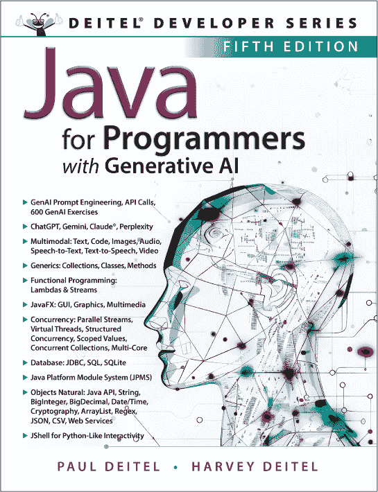

## 编程范式

**过程化** (第 2 章–第 7 章)，**面向对象** (第 8 章–第 10 章)，**泛型** (第 12 章 和 第 13 章)，**函数式** (第 14 章)，**并发** (第 18 章) 以及 **生成式 AI 增强** (第 19 章)。

# 第一部分：引言

**第 1 章, 引言、测试 Java 应用与生成式 AI**——互联网与 Web。“云”。物联网 (IoT)。元宇宙。AI/genAI 简介。测试 Java 开发工具包 (JDK)。**27 题 genAI 提示词练习。**

**第 2 章, Java 编程简介**——Java 基础。输入/输出。基本类型。算术运算。决策判断。**对象自然 (ON) 案例：** `String` 类。**12 题 genAI 提示词练习。**

# 第二部分：其他编程基础

**第 3 章, 控制语句：部分 1**——`if`、`if`/`else`、`while` 语句。计数控制/哨兵控制循环。嵌套控制语句。**ON 案例：** 用于超大整数的 `BigInteger`。**16 题 genAI 提示词练习。**

**第 4 章, 控制语句：部分 2**——`for`、`do`/`while`、`switch`、`break`、`continue` 语句。逻辑运算符。**ON 案例：** 用于精确货币计算的 `BigDecimal`。**13 题 genAI 提示词。**

**第 5 章, 方法**——自定义方法。随机数。模拟。**ON 案例：日期/时间 API。****16 题 genAI 提示词练习。**

**第 6 章, 数组和 ArrayList**——数据结构。内置数组。**ON 案例：** 用于动态调整大小数组的 `ArrayList`。**28 题 genAI 提示词练习。**

**第 7 章, 字符串、NLP 与正则表达式：生成式 AI 基础**——`String`、`Character`、`StringBuilder` 类。。自然语言处理 (NLP) 简介。**ON 案例：1. 用于文本模式匹配的正则表达式，2. 使用 AES 私钥加密保护数据安全。****22 题 genAI 提示词练习。**

# 第三部分：面向对象编程

**第 8 章, 使用自定义类进行真实世界建模**——构建有价值的类。`Account` 类案例研究。洗牌与发牌模拟。`Time` 类案例研究。控制类成员访问。构造函数。`set`/`get` 方法。数据验证。抛出异常。`static` 和 `final` 类成员。`record` 类。**33 题 genAI 提示词练习。**

**第 9 章, 使用继承、多态与接口进行真实世界建模**——继承层次结构。运行时多态。继承的“是一个是”(is-a) 关系与组合的“有一个”(has-a) 关系。接口。面向接口编程而非实现。依赖注入。`sealed` 类和接口。**31 题 genAI 提示词练习。**

**第 10 章, 异常处理：深度观察**——使用 `try` 语句捕获并处理异常。`Throwable` 层次结构。检查异常与未检查异常。`try`-with-resources 语句。**30 题 genAI 提示词练习。**

**第 11 章, 文件、I/O 流、JSON 序列化与 CSV**——数据持久化。文本与二进制文件。NIO 类。`Formatter` 类。JSON 序列化。调用 OpenWeatherMap Web 服务。CSV（逗号分隔值）格式。Titanic 数据集及基础数据分析。**ON 案例：使用 RSA 公钥加密保护数据隐私。**38 题练习。**

# 第四部分：数据结构、泛型集合、Lambda 与流

**第 12 章, 泛型集合**——Java 集合框架中的预构建数据结构。**30 题 genAI 提示词练习。**

**第 13 章, 泛型类与方法：深度观察**——实现泛型方法和泛型类。编译时类型安全。**24 题 genAI 提示词练习。**

**第 14 章, 使用 Lambda 和流进行函数式编程**——使用 Lambda 和流管道编写更快、更快且 Bug 更少的程序。关注不可变性。**第 18 章](#ch18.xhtml_ch18), 并发：从线程到虚拟线程](#ch18.xhtml_ch18)，通过并行化流管道来增强多核架构的性能。**37 题 genAI 提示词练习。此处涵盖第 22 章]**

# 第五部分：JavaFX 图形用户界面、图形与多媒体

**第 15 章, JavaFX 图形界面：部分 1**——使用 Scene Builder 进行简单的拖放式 GUI 设计。布局。控件。事件处理。欢迎应用。小费计算应用。**13 题 genAI 提示词练习。**

**第 16 章, JavaFX GUI：部分 2**——额外的布局和控件。鼠标、`RadioButton` 和属性更改事件。数据绑定。自定义控件外观。`FileChooser` 和 `DirectoryChooser` 对话框。**21 题 genAI 提示词练习。**

**第 17 章, JavaFX 图形与多媒体**——使用层级样式表 (CSS) 自定义 JavaFX 节点的外观和文本字体。2D 和 3D 形状。移动、旋转和缩放节点变换。显示、播放和暂停视频。通过 `Transition` 和 `Timeline` 动画渐进地更改属性。使用 `AnimationTimer` 进行逐帧动画。用于简化动画效果的 CSS 过渡。使用 `Canvas` 配合鼠标绘图。**31 题练习。****

# 第六部分：高级主题

**第 18 章, 并发：从线程到虚拟线程](#ch18.xhtml_ch18)**——多核编程。创建和管理多个任务。性能案例研究。使用 Date/Time API 分析顺序与并行排序。预构建并行算法。经典的生产者-消费者关系。更易用、不易出错、高级并发特性。Project Loom：轻量级虚拟线程、结构化并发、作用域值。**51 题 genAI 提示词练习。**

## 第 19 章 (#ch19.xhtml_ch19), 基于 API 的 Java 生成式 AI 应用开发 (#ch19.xhtml_ch19)

多模态 genAI 可以理解文本、代码、图像、语音和视频输入，并生成文本、代码、图像、语音和视频。通过 OpenAI API 创建用于文本摘要、情感分析、创建图像无障碍描述、检测文本语言并在语言间翻译、生成 Java 代码、对文本进行命名实体识别并获取结构化 JSON 输出、语音转文本、从文本合成语音、为视频生成闭字幕等应用。**21 个 genAI 提示词练习和 73 个基于 API 的编程项目。**

## 第 20 章 (#ch20.xhtml_ch20), 使用 JDBC 和 SQLite 访问数据库 (#ch20.xhtml_ch20)

在数据库中存储持久数据。SQLite 数据库管理系统。结构化查询语言 (SQL) CRUD（创建、读取、更新、删除）操作。JDBC API。连接数据库。从数据库检索数据。JavaFX `TableView`。JDBC `PreparedStatement`。**19 个 genAI 提示词练习**。

## 第 21 章 (#ch21.xhtml_ch21), Java 模块系统 (#ch21.xhtml_ch21)

创建自定义包和模块。声明模块依赖。指定模块导出的包。定义模块提供或消耗的服务。反射和启用反射式访问。使用模块封装资源。**31 个 genAI 提示词练习**。

## 第 22 章 (#ch22.xhtml_ch22), 递归与大 O 表示法 (#ch22.xhtml_ch22)

递归和迭代阶乘计算。递归斐波那契计算。递归创建“羽毛分形”的 JavaFX 应用。基于文本的算法可视化。丰富的递归练习题。**11 个 genAI 提示词练习。** [可以在第 4 部分：数据结构的末尾涵盖。]

# 附录

## 附录 A (#appa.xhtml_appa), 交互式 JShell 简介 (#appa.xhtml_appa)

Java 友好的命令行 REPL（读取-评估-打印-循环），用于探索、发现和实验。就像在 Java 中拥有 Python 的交互性一样。许多章节可以结合书的前几章节一起阅读。

## 附录 B (#appb.xhtml_appb), 格式化输出 (#appb.xhtml_appb)

针对输出和内存中 `String` 的格式化功能。总结了我们在全书中讨论的格式化功能，并引入了额外的能力。

## 附录 C (#appc.xhtml_appc), 数制

介绍了二进制（2 ）、八进制（8 ）、十进制（10 ）和十六进制（16 ）体制。

## Deitel.com (http://Deitel.com) 的可能主题

序列集合。灵活的构造函数体。位操作。带标签的 `break` 和 `continue` 语句。JavaFX `Subscription` API。使用 FXGL（FX 游戏库）进行基础 JavaFX 游戏开发介绍、动画、碰撞检测、粒子效果等。我们将 Java 相关的博客文章链接到书的网页 [`https://deitel.com/javafp5`](https://deitel.com/javafp5)

### “对象自然型”方法

面向对象编程的书籍传统上使用“后期对象”或“早期对象”教学法。在这些书中，真正“后期”或“早期”的并不是“对象”，而是教授如何开发自定义类——即构建对象的“蓝图”。我们在流行的面向对象编程语言中编写过使用这两种方法的书籍。

### 什么是“对象自然型”？

在我们编写教材《计算机科学与数据科学 Python 入门：使用 AI、大数据和云进行学习编程》时，[^20] 我们注意到，尽管我们的陈述方式符合“后期对象”模型，但它实际上是比此更多的东西——而且这种东西很特别。我们将其称为“对象自然型方法”，现在我们编写的每本面向对象编程教材和专业书籍都在使用这种方法。

[^20]: Deitel, Paul, and Harvey Deitel. *Intro to Python for Computer Science and Data Science: Learning to Program with AI, Big Data and the Cloud*. Upper Saddle River, NJ: Pearson, 2020.


与“后期对象”一样，我们的对象自然型方法在早期章节从编程基础开始，如数据类型、变量、运算符、控制语句、方法、数组和字符串——这一切都在你开发自己的*自定义*类之前。然而，通过对象自然型方法，你将大量练习使用强大的*现有*类，这些类可以执行重大功能，让你快速创建这些类的对象（通常只需一行代码），并用极少数简单的 Java 语句让它们“大显身手”。这是使用像 Java 这样成熟的面向对象语言的最具吸引力的方面之一。你将在`第 8 章`创建并使用自定义 Java 类，以及在`第 9 章`使用继承、多态和接口之前，就开始进行这些操作。

## 丰富的免费类

我们强调使用 Java 生态系统中大量价值巨大的免费类。这些类通常来自：

*   Java 应用程序编程接口 (API)——Java 的标准库以及
*   免费的第三方库，通常由开源社区创建。

我们鼓励你在 `GitHub` 等网站上查看大量的 Java 代码。阅读其他代码是学习的一种极佳方法。

## 生成式 (GenAI) 方法^(21)

21. *ChatGPT* (`https://chatgpt.com`)、*Gemini* (`https://gemini.google.com`)、*Claude* (`https://claude.ai`) 和 *Perplexity* (`https://perplexity.ai`) 对以下提示词的响应：“以下是我们在编写新教材时使用 genAI 以及读者如何使用 genAI 的杂记笔记。将这些笔记转换为有用的文本，根据需要重新组织并删除冗余。”2025 年 1 月 1 日。为了演示 genAI 的威力，我们在之前的提示词后跟随了长长的（有时是重复的）作者笔记，要求 genAI 将其组织成流畅段落。然后我们对最终呈现的内容进行了编辑。

利用 genAI 是开发《生成式 AI Java 编程》5 版不可或缺的一部分。它也将成为你与内容交互的关键。在这里，我们概述了我们在全书中集成 genAI 的方法、它对 Java 教育的巨大潜力，以及**在保持谨慎和批判性思维的同时如何有效利用这些工具**。

## 使用 GenAI 的两种方法

我们通过两种方法集成 genAI：

*   **提示词工程：** 在`第 19 章`之外，我们专注于通过提示词工程优化与 genAI 的交互。将其想象为学习一种全新的、不同的编程语言。通过提示词工程，你编写精确的指令或查询来引导 genAI 生成所需的响应。你还可以迭代地调整提示词，进行精炼和调整，以帮助 genAI 产生更准确、更相关的结果——**提示词越好，结果越好**。创建出色的提示词需要大量经验——你将在书中获得这些经验。
*   **使用 AI API 和提示词工程的 Java 代码：** `第 19 章`结合了提示词工程和基于 API 的代码开发，强调了生成式 AI 如何帮助你构建和调整完整的 Java 应用程序。我们使用了 `OpenAI APIs`。

`第 19 章`中的示例和练习深入探讨了如何使用`genAI 进行代码生成和分析`，并在此过程中构建基于 API 的 Java 生成式 AI 应用。你将学习编写有效的提示词来生成代码片段、调试和调整你的程序，并创建完整的 Java 应用程序。

## 我们使用的生成式 AI 工具

我们的工作依赖许多生成式 AI，包括四个主要的生成式 AI 聊天机器人：

*   `OpenAI ChatGPT`
*   `Google Gemini`
*   `Anthropic Claude`
*   `Perplexity`

我们在每项任务中都使用了它们，因为它们产生的结果既有重叠也有不同——每者都具有价值。事实上，当我们给出相同的提示词时，同一个生成式 AI 往往会产生不同的结果，即使仅仅在片刻之后。它们都有各自独特的优缺点。生成式 AI 在不断进化，因此能力和局限性会随时间推移而变化，可能会大幅提高。

我们还使用了 `OpenAI 的 Dall-E` 进行`图像生成`（Dall-E 现在已集成到 `ChatGPT` 中），以及使用 `Sora` 进行视频生成。许多生成式 AI 提供免费试用或分级，这可以给你带来良好的结果，但可能不如其付费版本。

## 生成式 AI 在教育中的作用

生成式 AI 在职业教育、高等教育尤其是编程语言教育中将发挥至关重要的作用。它们作为一个随时的虚拟专家团队为你提供帮助，几乎免费或完全免费。

**组织和教育机构对于是否允许使用生成式 AI 仍存在分歧。有些像我们在书中一样拥抱它。有些则禁止它。有些在有安全措施的情况下允许。我们鼓励你熟悉这些工具，它们在你整个职业生涯中可能不可或缺。但是，请务必遵守你所在组织或机构的政策。**

## 用于增强学习体验的式 AI

生成式 AI 通过以下方式增强学习体验：

*   为复杂概念提供多个视角。
*   提供交互式调试帮助。
*   当概念不清晰时帮助识别需要复习的领域。
*   通过不同的解释方法支持各种学习风格。
*   对你编写的代码提供个性化反馈。

我们鼓励你通过实践，使用生成式 AI 来增强你的学习体验。我们的生成式 AI 练习章节可以帮助你：

*   学习`prompt engineering`（提示词工程）。
*   通过尝试大量的提示词来了解生成式 AI 可以做什么。
*   学习每个生成式 AI 响应提示词的详尽程度。
*   发现解决问题的新方法。
*   比较不同生成式 AI 的优缺点。
*   理解生成式 AI 会出错且有时会产生幻觉，并学会如何检测和处理这些错误。
*   意识到生成式 AI 可能会产生不准确的结果。
*   对书中提出的问题寻求解答。
*   当你想要更多细节时增强你的知识。

## 我们是如何使用生成式 AI 的

我们将生成式 AI 整合到我们的创作工作中——并不是为了编写手稿（引用处的设计如此，除外）或代码示例，而是为了增强研究、开发、调整写作和校对。我们使用生成式 AI 来：

*   完善我们的生成式 AI 提示词技巧以获得更好的结果。
*   进行头脑风暴。
*   从本书的内容中提取要点，并将其用于编写 PowerPoint 幻灯片供教师准备和交付课程。
*   验证我们的内容。
*   检查我们是否使用了当前的 `Java` 编程惯用法和适用于此水平书籍的整洁代码^(22)指南。

    > 22. Martin, Robert C. *Clean Code: A Handbook of Agile Software Craftsmanship*. Upper Saddle River, NJ: Addison-Wesley, 2009.

*   检查我们的语法和写作的流畅度和清晰度。
*   从我们的内容生成多选题答案。
*   使用使用书中介绍的技术草拟练习答案。
*   直接从我们的内容草拟营销文本。
*   直接从我们的内容草拟博客文章。
*   重构我们的代码以符合我们的编码规范，例如代码缩进以及注释的相关性和密度。
*   重构代码（例如重命名变量、方法和类，将重复代码提取到单独的函数中）。

在大多数情况下，有效的`prompt engineering`是关键，通过经过仔细调整的提示词重新审视当前的对话通常会带来显著改进的结果。

## 生成式 AI 用户指南

我们鼓励你将生成式 AI 作为学习工具，而不仅仅是答案生成器。正如精通编程需要理解语言和库的能力一样，有效的生成式 AI 使用需要掌握不同提示词的技巧。你应该：

*   跟踪你的提示词及其结果质量。这对于学习哪些有效、哪些无效至关重要。这将帮助你识别不同生成式 AI 平台的细微差别。你将建立一个价值的提示词和预期结果库，用于未来的编程工作。
*   尝试多个生成式 AI——包括新出现的 AI——并比较结果以理解它们多样化的能力。
*   尝试不同的提示策略，看看哪些策略能帮助你实现预期目标。不同的编程挑战可能需要不同的提示策略。
*   **如果生成式 AI 的结果不满意，请调整你的提示词并重试**。例如，你会发现某些生成式 AI 强调产生流畅、专业的写作，而另一些则会深入研究主题。
*   使用生成式 AI 进行`discovery`（发现）——寻找最初可能并不明显的新想法、见解和模式。生成式 AI 提供广泛的视角，分析大量数据并将信息综合为可操作的输出，从而增强创意或辅助决策。生成式 AI 发现可以增强你的创意，并发现你知识之外的可能性，帮助你增长知识和智慧^(23)

    > 23. *ChatGPT* 对“使用生成式 AI 进行发现意味着什么？”的回答。2025 年 1 月 18 日 [`https://chatgpt.com`](https://chatgpt.com)。我们编辑了该回答。

## 幻觉与错误

免费或免费层级的生成式 AI（genAI）非常有价值，但付费服务通常提供更强大的功能、可用性和可靠性。许多生成式 AI 是付费服务，是因为训练提供这些强大能力的大语言模型成本极高。例如，训练 OpenAI 的 `GPT-4` 和 Google 的 `Gemini` 分别花费了 7800 万美元和 1.9 亿美元——这还不包括开发大语言模型的人员工资和其他间销成本.^(24) 我们鼓励你在可用时使用免费或低成本工具。你甚至可以询问生成式 AI 最佳免费版本。然而，专业开发者通常会选择付费工具来获得最佳结果。

24. 斯坦福大学人类中心人工智能研究所 (HAI), AI 指数报告 2024，2024 年 5 月. 访问于 2025 年 3 月 8 日. [`https://hai-production.s3.amazonaws.com/files/hai_ai-index-report-2024-smaller2.pdf`](https://hai-production.s3.amazonaws.com/files/hai_ai-index-report-2024-smaller2.pdf)。

## 我们正尝试实现的

我们的目标是为未来做好准备，在未来生成式 AI 将你的个人生活和职业生涯中是不可或缺的。通过在书中穿插生成式 AI 的示例和练习，我们旨在帮助你熟悉这些工具，并理解它们的优点和缺点。在探索生成式 AI 能力的同时培养良好的警惕意识将使你能够有效地使用它们。

## 第 19 章基于 API 的完整、实时代码 Java GenAI 应用案例研究

`第 19 章` 展示了以下完全实现的代码示例，这些示例通过程序方式与 OpenAI 的 API 进行交互：

*   **文本摘要 (`第 19.4.1 节`)**：请求聊天 API 获取 Deitel 视频转录的摘要段落和转录要点列表。此类文本响应被称为 `chat completions`（聊天完成）。
*   **情感分析 (`第 19.4.2 节`)**：请求聊天 API 分析转录的情感，并解释生成式 AI 如何得出该结论。
*   **无障碍图像描述 (`第 19.4.3 节`)**：此多模态应用上传图像，并请求聊天 API 对`第 4.3 节` 中的 `for`-循环 UML 图以及一张阿鲁巴海滩风景照进行详细描述。
*   **语言检测与翻译 (`第 19.4.4 节`)**：请求聊天 API 将文本翻译为指定的语言——它`自动检测源语言`。我们将文本从英语翻译为西班牙语和日语，然后从西班牙语和日语翻译回英语。今天的许多生成式 AI 可以在数十种语言之间翻译。
*   **Java 代码生成 (`第 19.4.5 节`)**：请求聊天 API 生成 Java 代码，用于模拟数百万次六面骰子的投掷并显示结果。
*   **命名实体识别与结构化输出 (`第 19.4.6 节`)**：演示按你指定的格式生成结构化的 JSON 响应。此应用执行一项名为命名实体识别（NER）的自然语言处理（NLP）任务，尝试定位并分类日期、时间、数量、地点、人物、事物、组织等文本提及。为了使结果更易处理，我们为 API 提供希望接收的精确 JSON 响应格式，然后使用 `Jackson 开源库` (`第 11 章`) 来处理结果。
*   **语音转文本 (`第 19.5.1 节`)**：此多模态应用（语音音频和文本）将语音音频文件上传到 `OpenAI Whisper 模型`，模型将其转录为文本并返回转录文本。
*   **文本转语音 (`第 19.5.2 节`)**：此多模态应用（文本和语音音频）将文本上传到 `OpenAI TTS-1 模型` 以从文本合成语音。此示例使用相同的声音将英语、西班牙语和日语文本样本转换为语音。
*   **图像生成 (`第 19.6 章`)**：演示请求 `Dall-E APIs` 生成图像的代码，风格包括：黑色背景下霓虹色的日本动漫角色风格哈瓦那犬、文森·梵高风格以及列奥纳多·达芬奇风格。
*   **为视频创建字幕 (`第 19.7.1 节`)**：此多模态无障碍应用（语音音频、文本和视频播放）从视频上传音频轨道并将其转录为包含时间戳和相应转录文本的 JSON 格式。然后应用请求聊天完成以生成 `VTT 格式的闭合字幕`^(25)。我们显示 VTT 格式的字幕。

    25. “WebVTT.”维基百科。最后修改于 2024 年 12 月 31 日. 访问于 2025 年 3 月 1 日. [`https://en.wikipedia.org/wiki/WebVTT`](https://en.wikipedia.org/wiki/WebVTT)。

*   **审核 (`第 19.8 节`)**：请求 `OpenAI 审核 API` 评估文本提示是否存在骚扰、仇恨言论、暴力、自残或性暗示内容。

## 生成式 AI 提示词练习

我们将书中所有的 600 个生成式 AI 练习完整列表（一份 100 多页 PDF）提供给 `ChatGPT`、`Gemini`、`Claude` 和 `Perplexity`，让它们对我们做的事情进行分类。接下来，我们将分类后的列表提供这四种生成式 AI，让它们进行总结，并我们选择了最好的——在这种情况下是 `Claude`：

*   **代码生成与实现**：根据规范编写新的 Java 程序。实现特定功能、算法和 API。创建测试程序和应用程序。为基础和高级编程生成解决方案。
*   **代码重构与增强**：使用现代 Java 特性（流、增强循环）使代码现代化。提高代码结构、可读性和维护性。在保持功能的同时转换不同的方法。提高性能。
*   **教育内容**：创建教程、练习和学习材料。解释复杂概念（多态、不可变性等）。开发开发者友好的编程练习。编写完整的文档和指南。
*   **技术分析**：分析代码行为和功能实现。比较不同的方法、工具和框架。评估设计中的权衡。分解复杂的技术概念。
*   **最佳实践与标准**：实施编码标准和设计模式。考虑安全性。优化性能。遵循 Java 开发最佳实践。
*   **技术评估**：比较库、工具和框架。评估不同方法的优缺点。做出明智的技术选择。探索新功能和更新。
*   **调试与错误处理**：发现并修复语法和逻辑错误。实现异常处理。提高容错性。防止常见陷阱。
*   **API 与库集成**：与 Java API 和外部库协作。理解 API 功能和能力。实现集成技术。创建 API 文档和教程。
*   **真实应用**：开发实际案例和行业应用。创建交互式应用程序（GUI、游戏、多媒体）。实现真实场景。构建示例项目。
*   **性能优化**：分析并改进性能。优化资源使用。进行基准测试。实现效率改进。
*   **创意开发**：构建多模态应用。创建可视化效果。生成测试场景和示例数据。开发独特的用例。

## 基于 genAI API 的 Java 编程练习

`第 19 章` **基于 API 的 Java 生成式 AI 应用** 建议了一些具有挑战性的项目练习，例如创建可以相互辩论的生成式 AI 多媒体应用，以及使用 genAI 构建和解决填字谜游戏。我们将 `第 19 章` 中的 90 多项练习输入到 genAI 中，要求它们进行分类总结，然后对这些总结再次进行汇总。以下是它们产生的内容：

*   **多模态应用**：结合文本、图像、音频和视频能力。创建如交互式书籍等集成体验。开发多媒体教育内容。构建利用多种 AI 模态的综合工具。
*   **基于文本的应用**：文档处理（索引、摘要、探索）。创意写作（故事生成、诗歌、辩论）。语言工具（翻译、语调重写）。专业文档创建（简历、演示稿）。结构化输出。
*   **图像处理应用**：生成式艺术和设计（Logo、时尚、平面图）。技术可视化（UML 图）。图像分析与识别。
*   **音频和音乐应用**：语音处理（转录、语音克隆）。音乐生成（MIDI、Magenta AI）。多语言音频应用。播客和音频内容分析。
*   **教育工具**：编程导师（Java、编码练习）。特定学科学习辅助（数学、算术）。课程内容创建。交互式教育体验。
*   **游戏和谜题应用**：谜题生成器和求解（填字、单词搜索）。交互式游戏开发。
*   **视频**：研究和实验生成式 AI 视频创建工具。
*   **机器人开发**：基于角色的聊天体验。特定领域专家。
*   **研究与分析工具**：医疗应用（药物发现、个性化医疗）。AI 能力探索。文本检测与分析。教育研究。
*   **创意应用**：儿童书创作。交互式叙事。艺术内容生成。创意写作工具。
*   **实用工具和程序**：文档生成器。翻译服务。内容摘要器。专业工具（简历筛选、演示稿创建器）。

## 核心要点

*   **尝试多个 genAI**：比较它们的优缺点。
*   **精通提示工程（Prompt Engineering）**：编写有效的提示词以获得最佳结果。建立你的最佳提示词库。
*   **警惕幻觉**：始终以批判性眼审查 genAI 的输出。
*   **拥抱 genAI 的力量**：用它来增强你的 Java 学习体验，而不是取代它。
*   **遵循你组织的 genAI 政策**。

## 新功能与更新

在接下来的章节中，我们将讨论为 *Generative AI 时代的 Java for Programmers, 第 5 版* 所做的关键新功能和更新，包括：


## 1. 面向对象的自然案例研究

第 1 章对对象技术的基本概念和术语进行了亲切的介绍。在前面的章节中，你将创建并使用预存的 Java API 类的强大对象来完成重要任务，而无需了解如何编写 Java 类或这些特定类的具体实现——你将在第 8 章创建并使用自定义类的对象之前很早完成这些。

我们添加了面向对象的自然案例研究，涉及：
- `String` 类（第 2 章）
- 用于超大整数的 `BigInteger` 类（第 3 章）
- 用于业务应用中精确货币计算的 `BigDecimal` 类（第 4 章）
- 日期/时间 API（第 5 章）
- 用于动态调整数组的 `ArrayList` 类（第 6 章）
- 用于在文本中定位模式的正则表达式（第 7 章）
- 对称密钥 AES 加密（第 7 章）
- 公钥 RSA 加密（第 11 章）

在书的其余部分，许多其他案例研究大量使用了 Java API 对象和开源库类。

## 2. 约 600 个集成生成式 AI (genAI) 提示练习

大多数章节末尾都有 genAI 提示练习（约 450 个），你将在通过提示工程与 genAI 交互。此外，许多章节还包含了章末 genAI 提示练习（约 150 个）。你会感觉身边 24 小时都有许多 Java 专家（有些收取少廉报酬，有些免费）来回答你关于书中 Java 内容的问题，帮助你深入探索感兴趣的话题，甚至帮助你编写和调试 Java 代码。更好的是，它们之间正在相互竞争，不断产生新条目为你提供最佳结果，同时都在快速进步。

## 3. 第 19 章：构建基于 API 的 Java 生成式 AI 应用

展示了如何通过编程与 OpenAI 的 API 交互，涵盖文本摘要、情感分析、用于无障碍的图像描述、语言间翻译、生成 Java 代码、命名实体识别、语音转文本、文本转语音、为视频创建闭合字幕、图像生成等，本章共有 94 个练习。

## 4. 涵盖最新的 Java 语言特性、库特性和编程惯用法

为了在 Java 新版本发布时保持书籍更新，我们将新的代码示例和说明放在博客 [`deitel.com/blog`](https://deitel.com/blog) 上，并链接到书籍网页 [`deitel.com/javafp5`](https://deitel.com/javafp5)。

## 5. 精简现代面向对象处理

包括 `record` 类、`sealed` 类和接口，以及一个面向接口而非实现的新案例研究，重点关注组合和依赖注入。

## 6. 增强的文件处理

包括使用 **Jackson** 开源库输入和输出 `JSON` 和 `CSV` 格式的数据，这些格式在如今的数据科学应用中非常流行。

## 7. 利用 `java.net.http` 包提供的网络功能调用流行的 Web 服务

如 OpenWeatherMap。

## 8. 使用 CSV 格式泰坦尼克号数据集进行数据分析的专题介绍

## 9. 加密专题

包括对称密钥 AES 加密和公钥 RSA 加密。加密对于日益增长的计算机隐私和安全关注至关重要。

## 10. 简单数据清洗步骤的专题介绍

用于为训练自然语言处理 (NLP) 和 genAI 模型准备文本。数据清洗是一项关键的数据科学技术。

## 11. 第 1 章新章节

简要讨论了元宇宙及其相关技术——虚拟现实 (VR)、增强现实 (AR)、混合现实、区块链、加密货币、非同质化标记 (NFT) 和 Web3——以及软件开发技术、大数据以及人工智能与计算机科学和数据科学的交叉。

## 12. 增强的 JavaFX GUI、图形、动画和视频处理

这些技术将是新兴元宇宙的核心。演示介绍了 JavaFX 新的 CSS 过渡，以简化动画效果。

## 13. 在第 17 章中使用开源库 **FXGL (FX Game Library)** 进行 JavaFX 游戏开发的简要介绍

## 14. `JShell` 的灵活覆盖

它是 Java 友好的命令行 REPL（读取-评估-打印循环）环境，用于快速探索、发现和实验 Java 语言特性和类库——**这就像在 Java 中拥有了 Python 的交互性**。

## 15. 针对关键 `Project Loom` 技术的`并发`、`并行`和`多核性能`更新

如 `virtual threads` 以及新兴的 `structured concurrency` 和 `scoped values`。

## 16. 增强的数据库处理

通过流行的 `SQLite 数据库管理系统命令行工具` 交互式引入 `结构化查询语言 (SQL)`。示例现在使用 `SQLite 数据库`。我们将旧的 Swing `JTable` 替换为 `JavaFX` 的 `TableView`，它比 `JTable` 提供了更好的视觉效果、更高的性能和更多的可定制性。

## 17. 许多新的和更新的`当代示例`

## 18. 我们现在使用 `RandomGenerator`（来自 Java 17）

它提供了增强的随机数生成能力，更适用于仿真。在安全场景中（如我们的加密示例），我们使用 `SecureRandom`。

## 19. 我们从十十年编程、教学和行业经验中汲取的`数百条编程技巧`

已完全整合到本版的正文内容流中。

## 20. 我们添加了各种应用程序编程案例研究

## 21. 我们增强了现有的案例研究，并添加了专注于 AI 和数据科学的新案例

包括通过随机数生成的仿真、自然语言处理（NLP）以及通过生成式 AI 和启发式编程的人工智能。

---

## 教学特性

### 语法着色与语法高亮

在我们的电子书中，我们对 Java 代码进行语法着色，类似于大多数 Java 集成开发环境（IDE）和代码编辑器处理代码的方式。对于本书的印刷版，我们使用以下语法高亮：

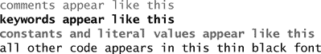

### 使用字体强调

我们用**粗体**强调屏幕上的组件（例如**文件**菜单），并用`等宽`字体表示 Java 程序文本（例如 `int x = 5;`）。

### 目标

章节的“目标”部分列出了该章节的任务。

### 插图/图表

包含了丰富的表格、线图、UML 图、程序和程序输出。

### 按照预期方式使用 Java

我们优先使用最新 Java 规范文档（`https://docs.oracle.com/javase/specs/`）中的术语，而不是通用编程术语。我们通过丰富的应用程序编程案例研究展示了如何按预期使用 Java，专注于计算机科学、人工智能、数据科学和许多其他领域。

### 紧跟时沿

为了“掌握”现代 Java 的脉搏，我们阅读、浏览或观看了数千篇当前的文章、研究论文、白皮书、书籍、文档片段、博客文章、论坛帖子、网络研讨会和视频。我们针对数百个重要的 Java 相关、通用计算、AI 和数据科学主题设置了 Google Alerts。

### 数百个当代示例和 GenAI 练习

我们的代码示例和 GenAI 练习展示了计算领域当前备感兴趣的话题。

### O’Reilly Online 付费订阅者可观看 50 多小时视频

在我们的 *Java Fundamentals with Paul Deitel, 3/e* 视频中：


合作者 Paul Deitel 讨论了“开始之前”部分中的内容，并对书中大部分程序进行了解释并提供了额外的见解。你可以在 `https://www.oreilly.com/start-trial/` 获取免费的 10 天订阅。

### 性能

我们专注于满足当今应用卓越性能需求的技术和策略。

### 数据体验

在第 11 章中，你将处理真实的文本数据。你将读取并分析泰坦尼克号灾难数据集^(26)，这在`数据分析`领域非常受欢迎。该数据集存储在`CSV（逗号分隔值）文件`中，这是我们在第 11 章中介绍的格式。此外，请参见本序言后面的“数据科学与计算机科学的交叉”章节。

> 26. [`https://vincentarelbundock.github.io/Rdatasets`](https://vincentarelbundock.github.io/Rdatasets) 上的“TitanicSurvival”数据集。数据集作者：Frank E. Harrell, Jr., 和 Thomas Cason。

### 安全的 Java 编程

构建能够抵御病毒和其他形式“恶意软件”攻击的工业级系统是具有挑战性的。今天，通过互联网，此类攻击可以是瞬时且全球范围的。从开发周期的开始就将安全性构建到软件中可以显著减少漏洞。我们根据《 Java SE 安全编码指南》对我们的书籍进行了审计：


并遵循适用于此类水平书籍的安全编码实践。

### 隐私

ACM/IEEE 针对计算机科学、信息技术和网络安全的课程建议^(27)中提到了数百次隐私问题。每位程序员都必须考虑隐私问题和关注。我们分别在第 7 章和第 11 章中讨论了对称密钥和公钥加密。

> 27. “课程建议”。访问于 2025 年 1 月 18 日。[`https://www.acm.org/education/curricula-recommendations`](https://www.acm.org/education/curricula-recommendations)。

### 伦理

ACM/IEEE 针对计算机科学、信息技术和网络安全的课程建议^(28)中提到伦理问题超过 100 次。在几个第 1 章和第 19 章生成式 AI 练习中，你将通过互联网搜索和生成式 AI 研究关注伦理问题。你将调查围绕智能助手（如 Amazon Alexa、Apple Siri）以及生成式 AI 语音能力的隐私和伦理问题。我们还将检查围绕生成式 AI（如 OpenAI 的 ChatGPT^(29)、Dall-E^(30) 等更多）的兴奋与争议。

> 28. “课程建议”。访问于 2025 年 1 月 18 日。[`https://www.acm.org/education/curricula-recommendations`](https://www.acm.org/education/curricula-recommendations)。
>
> 29. “介绍 ChatGPT”。访问于 2025 年 1 月 18 日。[`https://openai.com/blog/chatgpt`](https://openai.com/blog/chatgpt)。
>
> 30. “Dall-E 2”。访问于 2025 年 1 月 18 日。[`https://openai.com/product/dall-e-2`](https://openai.com/product/dall-e-2)。

### 编程智慧

编程技巧已完全整合到本版的正文内容流中：

*   **良好的编程实践**引起对产生更清晰、易理解且易维护程序的技术的关注。
*   我们指出了**常见的编程错误**，以减少犯错误的概率。
*   **性能提示**强调让你的程序运行更快或最小化内存使用的机会。
*   **软件工程观察**强调影响软件系统构建（特别是大型系统）的架构和设计问题。
*   **视觉效果观察**（第 15 章–17 章）强调了 GUI 规范。这些观察帮助你设计吸引人、用户友好且符合行业标准的 GUI。

---

## 本籍指南

序言早期的“高层概述”展示了本书的模块化架构。我们建议你在阅读本节时参考该概述。

早期章节为 Java 基础奠定了坚实的基础。中间和后期章节介绍了中级和高级 Java 编程主题。我们讨论了六种编程范式：

*   过程化编程（第 2 章–第 7 章）——通过我们的对象自然（objects-natural）方法增强，
*   面向对象编程（第 8 章–第 10 章），
*   泛型编程（第 12 章 和 第 13 章），
*   函数式编程（第 14 章），
*   并发编程（第 18 章），
*   以及本版新增的——genAI 增强编程（第 19 章）

无论你是正在了解本书内容的学生、正在规划课程大纲的教师，还是在准备项目时决定阅读哪些章节的专业软件开发人员，“本书之旅”都将帮助你做出最佳决策。

---

## 第一部分：引言

第 1 部分和第 2 部分（第 1 章–第 7 章）以友好的、示例驱动的方式处理了传统的介绍性编程主题。

### 第 1 章：引言、测试 Java 应用与生成式 AI

讨论了技术趋势和互联网概念。它为第 2 章–第 22 章中的 Java 编程讨论，以及许多案例研究示例和练习奠定了基础。

我们讨论了你在开发软件时可能会用到的技术。我们介绍了 Java API——这些现有的、可重用的、高质量、高性能的能力可以帮助你避免“重复造轮子”。

我们讨论了互联网、网页、云、物联网 (IoT)、新兴的元宇宙以及生成式 AI 令人兴奋的新进展。我们简要提到了许多其他当前关注的话题，包括开源软件、虚拟化、模拟、Web 服务、多核硬件架构、多线程、自然语言处理、数据科学、健壮的安全编程、密码学、GitHub、StackOverflow、论坛、区块链、NFT（非同质化代币）、加密货币（如比特币和以太坊）、通用人工智能 (AGI) 等，为现代 Java 应用开发奠定了基础。

本章的测试演示了如何使用 OpenJDK JDK 编译和执行 Java 代码。我们思考了“大数据”到底有多大以及它变得有多快。章节最后介绍了人工智能 (AI)——这是计算机科学与数据科学的关键交叉领域。包含 27 个 genAI 提示练习。

### 第 2 章：Java 编程简介

介绍了 Java 基础并说明了关键语言特性，包括输入、输出、原始数据类型、算术运算符及其优先级以及决策机制。作为我们对象自然方法的一部分，第 2.8 节的对象自然案例研究演示了如何创建和使用 Java API 类 `String` 的对象（而你不需要知道如何通用地开发自定义类，或者 `String` 类是如何实现的）。包含 12 个 genAI 提示练习。

---

## 第二部分：其他编程基础

### 第 3 章：控制语句：第 1 部分

介绍了 Java 的控制语句。你将使用 `if` 和 `if`…`else` 选择语句、用于计数器控制和哨兵控制迭代的 `while` 迭代语句，以及递增、递减赋值运算符。第 3.12 节的对象自然案例研究演示了如何使用 Java API 的 `BigInteger` 类创建远大于计算机硬件原生表示的超整数。包含 15 个 genAI 提示练习。

### 第 4 章：控制语句：第 2 部分

介绍了额外的 Java 控制语句——`for`、`do`…`while`、`switch`、`break` 和 `continue`以及逻辑运算符。第 4.11 节的对象自然案例研究演示了使用 Java API 的 `BigDecimal` 类进行精确的货币计算。包含 13 个 genAI 提示练习。

### 第 5 章：方法

介绍了自定义方法。我们讨论了随机数生成和模拟技术，并在本书中的多个随机数模拟案例研究的首个使用了它们，来实现一种流行的赌场骰子游戏。我们介绍了 Java API 的随机数生成能力。在 第 7 章 和 第 11 章 中，我们使用 Java API 的特性来产生无法预测的“非确定性”随机数——这在安全应用（如密码学）中是非常理想的。我们还讨论了方法调用栈和激活记录如何支持方法调用/返回机制。

第 5.12 节的对象自然案例研究介绍了 Java 日期时间 API 的特性，该 API 提供了方便管理日期时间信息、执行日期时间计算以及使用特定区域格式（考虑用户的语言、国家和时区）显示日期时间的能力。我们将构建一个程序，输入用户的出生日期时间（如果他们愿意），然后确定用户出生时的星期，并计算用户活了多久。包含 16 个 genAI 提示练习。

### 第 6 章：数组和 ArrayList ——开始我们对数据结构的早期覆盖

我们介绍了存储值列表和表格的数组。你将定义并初始化数组并访问其元素。我们讨论了将数组传递给方法、排序和搜索数组以及处理多维数组。我们介绍了 `Arrays` 类，它包含了常用数组操作的方法。第 6.20 节的对象自然案例研究讨论了创建和操作 Java 集合框架的 `ArrayList<E>` 类。Java API 提供了许多预定义的集合（即数据结构），在内存中存储一组相关对象。这些类提供了高效、经过验证的方法，可以组织、存储和检索数据，而无需了解数据是如何存储的。这缩短了程序开发时间并有助于创建更健壮的应用程序。包含 28 个 genAI 提示练习。

### 第 7 章：字符串、NLP 与正则表达式：生成式 AI 基础

介绍了 `String`、`Character` 和 `StringBuilder` 类的许多特性。我们介绍了自然语言处理 (NLP)，它是 OpenAI 的 ChatGPT、Google 的 Gemini、Anthropic 的 Claude、Perplexity 以及许多其他强大生成式 AI 的根源。本章介绍了两个对象自然案例研究：

*   第 7.8 节介绍了使用 `String` 类内置功能以及 `java.util.regex` 包中的特性进行正则表达式模式匹配和文本替换。在演示了正则表达式基础之后，我们使用它们执行简单的数据清洗步骤，为训练 NLP 和生成式 AI 模型准备文本。

#### 第 7.9 节

7.9 节的标题——`pMa5tfEKwk59dTvC04Ft1IFQz9mEXnkfYXZwxk4ujGE=`——看起来像是一堆乱码。这不是错误！本案例研究通过引入`cryptography`（加密学）继续强调我们对安全和隐私的重视，这在当今互联的世界中至关重要。每天，加密学都在后台运行，以确保你的互联网通信和存储数据是私密安全的。本案例研究引入了使用 `AES`（高级加密标准）算法的`私钥加密`。在第 11 章中，我们最后一个关于自然对象的案例研究将介绍使用极流行的 `RSA` 算法的`公钥加密`。

**包含 22 个 genAI 提示词练习。**

---

## 第三部分：面向对象编程

### 第 8 章：使用自定义类进行真实世界建模

开启了我们的当代面向对象编程之旅。Java 是可扩展的——你创建的每个类都变成你可以用于创建对象的新类型。在第 8 章和第 9 章中，你将学习 Java 用于构建有价值类和操作这些类对象的特性，从一个创建和使用简单银行账户类的案例研究开始。在`随机数模拟案例研究`的背景下，你将使用 `String` 集合、随机数生成和模拟技术来实现一个`基于文本的卡牌洗牌与发牌程序`。你可以使用 JavaFX（第 15 章–第 17 章）


通过一个 `Time` 类案例研究和若干额外的类，我们继续深入研究构建类、控制类成员的访问权限以及创建构造函数来初始化类对象。我们验证数据并抛出异常来表示发生了问题。我们设计带有 `set` 和 `get` 方法的类来更改和检索对象的实例变量值，并讨论了 `composition`（组合），即类引用其他类的对象作为成员。我们更深入地讨论了 `enum`、`static` 和 `final`。我们还讨论了 Java 如何收回未使用的对象（称为垃圾回收过程），并展示了同一包中类之间的特殊关系。我们引入了 `record` 类来创建方便存储相关数据项不可变对象，然后使用它们来引入带有 `switch` 表达式模式匹配。**包含 33 个 genAI 提示词练习。**

## 第 9 章：使用继承、多态和接口进行真实世界建模

侧重于继承层次结构中类之间的关系，以及这些关系所实现的（为了方便“进行泛化编程”）强大的运行时多态处理能力。在本章的多态案例研究中，你将在一个执行多态薪资计算的应用程序中实现 `Employee` 类层次结构。

我们区分了 `继承“是一个”关系（is-a relationship）` 和 `组合“有一个”关系（has-a relationship）`。继承倾向于创建紧耦合的类，这可能使系统难以维护。我们引入了接口，接口对于为可能无关的类分配共同功能特别有用，使得这些类的对象可以以多态方式进行处理。我们使用一个在不同的 `Employee` 和 `Invoice` 类中实现的 `Payable` 接口证明实现相同接口的类对象可以对接口的方法调用做出多态响应。

我们还解释了当前的惯用法，例如“面向接口编程而非实现编程”以及“优先使用组合而非继承”。我们使用 `组合和依赖注入技术` 重新实现 `Employee` 层次结构，以创建松耦合的类，从而使系统更容易维护。我们还引入了 `sealed`（密封）类和接口，这允许类或接口的设计者控制哪些类可以扩展父类或实现接口。**包含 31 个 genAI 提示词练习。**

## 第 10 章：异常处理：深入观察

继续了我们在第 6 章中开始的 `异常处理讨论`。异常处理对于构建 `业务关键型` 应用至关重要，这类应用的故障可能会中断公司运营并导致财务损失，例如：

*   电子商务平台（例如在线商店），如 Amazon、eBay、Etsy 和 Shopify
*   客户关系管理 (CRM) 软件，如 SalesForce、HubSpot 和 Zoho

以及用于构建 `任务关键型` 应用，这类应用一旦故障可能导致重大的财务损失、伤害甚至生命损失，例如：

*   空中交通控制系统
*   医院生命支持系统
*   用于调度警察、消防员和急救医疗技术 (EMT) 的应急响应系统
*   军事系统

要使用 Java 组件，你不仅需要知道该组件在“一切顺利”时如何表现，还需要知道该组件在“情况糟糕”时会“抛出”哪些异常。

我们讨论了何时使用异常，并演示了 Java 的 `try` 语句来捕获和处理异常。我们引入了 Java 的 `Throwable` 层次结构以及检查异常与未检查异常、链式异常、创建自定义异常、前提条件、后置条件、断言以及使用一个 `catch` 处理器捕获多个异常。我们还讨论了 `try-with-resources statement`，通过在 `try-with-resources statement` 的 `try` 块终止时自动释放文件和数据库连接等资源来防止“资源泄漏”。这种版本的 `try` 语句在后续章节中广泛使用，以确保在不再需要时及时返回资源。**包含 30 个 genAI 提示词练习。**

## 第 11 章：文件、I/O 流、JSON 序列化与 CSV 文件

展示了如何使用文件进行数据持久化，这是本版的重大更新。我们从 Java 处理文件的架构开始，讨论了文本文件和二进制文件的区别。我们演示了如何使用 NIO 类和接口检索文件和目录的信息。然后，我们使用 `Formatter` 对象写入和 `Scanner` 对象读取来创建和操作顺序文本文件。

接下来，我们展示了几个对象与流行数据格式之间转换的案例研究。第一个介绍了 `JavaScript 对象表示 (JSON)`——一种人类和机器可读的文本格式。我们使用流行的 `Jackson 开源库` 将对象的 JSON 表示写入文件（这一过程被称为序列化），然后读取 JSON 并重建（反序列化）对象。第二个 JSON 案例研究使用来自 `java.net.http` `package` 的 Java API 网络功能调用 `OpenWeatherMap.org` Web 服务，该服务以 JSON 格式返回城市的天气报告，然后使用 Jackson 处理响应并显示天气报告。

接下来，我们将介绍 `CSV（逗号分隔值）文件格式` 以及如何使用 Jackson 开源库读写 CSV 文件。CSV 广泛应用于 `大数据`、`数据分析` 和 `数据科学` 中的数据集，也用于 `自然语言处理`、`机器学习` 和 `深度学习` 等 `人工智能应用` 中——这些都是实现生成式 AI（genAI）的关键技术。我们将使用 Jackson 库来读取 `泰坦尼克号灾难数据集`，该数据集列出了乘客的信息以及他们在 1912 年船首次航行撞击冰山并沉没时是否幸存。然后，我们将查看部分数据并以此引入 `基础数据分析`——这是一项核心的 `数据科学` 技术。

在我们最后的 `对象-自然案例研究` 中，我们将通过增强第 7.9 节中的私钥加密示例来继续强调安全性，使用 `RSA 公钥加密` 来加密和解密 `AES` 密钥密钥。这可以将私钥安全地传输给加密消息的接收者。此类技术对于数据安全和保护用户隐私至关重要。**包含 38 个 genAI 提示练习。**

## 第 4 部分：数据结构、泛型集合、Lambda 和 Stream

### 第 12 章：泛型集合

介绍了对 Java 泛型集合框架更广泛、更深入的探讨，这始于第 6 章中的 `泛型 ArrayList 集合`。Java 集合框架包含了许多其他 `内置的泛型数据结构`。我们讨论了声明每个集合类型能力的接口、实现这些接口的各种类、处理集合对象的方法以及遍历集合的迭代器。你会发现，`Java API 提供了常用的数据结构，因此你不需要自己创建`——你绝大多数数据结构需求都可以通过用这些 Java API 能力来满足。

我们引入了方便的工厂方法，帮助你创建小型的不可变集合。在读完 **第 14 章：使用 Lambda 和 Stream 进行函数式编程** 后，你将能够更简洁、优雅地重新实现本章的许多示例，并以一种易于并行化的方式来提高在多核系统上的性能。在第 18 章：并发：从平台线程到虚拟线程 中，你将学习如何使用 Java 的 `并发集合` 和 `并行流操作` 来提高多核性能。**包含 30 个 genAI 提示练习。**

### 第 13 章：泛型类和方法：深层视角

展示了如何编写自定义泛型类和方法，这些类似于 **第 12 章：泛型集合** 中介绍的内容。我们讨论了泛型如何允许编译器在编译时检测类型不匹配——即 `编译时类型安全`。我们实现了一个泛型方法和一个泛型类。**包含 24 个 genAI 提示练习。**

### 第 14 章：使用 Lambda 和 Stream 进行函数式编程

引入了函数式编程。我们使用 Lambda 和 Stream 来编写某些类型的程序，比以前的技术更快、更简单、更简洁，并且 Bug 更少。我们将本章设计为一系列易于包含或跳过的章节，这些章节与书中前面的章节和章节对应。我们在 第 14 章 之后将 Lambda 和 Stream 集成到几个关键示例中，因为它们的功能是如此方便且迷人。本章的许多章节的编写是为了可以在书中更早介绍。我们建议学生在 第 6 章 之后从 第 14.1 节–14.7 节 开始学习，专业人士在 第 4 章 之后从 第 14.1 节–14.5 节 开始。我们演示了实现你在前面章节中编写的任务改进方法。读完 第 14 章 后，你将巧妙地重新实现书中的许多示例。在 **第 18 章：并发：从平台线程到虚拟线程** 中，你将并行化流操作（即同时执行多个操作），使其利用多核架构来增强性能——这是 Lambda 和 Stream 的主要目标。在第 18 章 中，你还会学到，如果任务修改了程序的状态（即变量的值），那么创建正确运行的并行任务是非常困难的。因此，你在 第 14 章 中学的技术专注于不可变性——不修改正在处理的数据源或任何程序状态。**包含 37 个 genAI 提示练习。**

> （可选）**第 22 章：递归与大 O** 可以在此处介绍。

## 第 5 部分：JavaFX 图形用户界面、图形和多媒体

### 第 15 章：JavaFX 图形用户界面：部分 I

开始我们对 JavaFX 图形用户界面（GUI）、图形和多媒体的多章节介绍。第 15 章 专注于开发 GUI，它为应用程序提供了熟悉的交互机制，让用户能更快学习、更有效地使用。本章介绍了 JavaFX GUI 基础，包括布局、控件和事件处理器，我们将使用 Lambda 实现它们。你将使用 Scene Builder 工具通过拖拽设计来快速创建 GUI。**包含 13 个 genAI 提示练习。**

### 第 16 章：JavaFX GUI：部分 II

继续我们对 JavaFX 的介绍，涵盖额外的 GUI 布局和控件。我们展示了如何处理鼠标和 `RadioButton` 事件、设置响应属性变化的事件处理器（例如 `Slider` 的值）、显示形状、将变量绑定到控件以便变量数据变化时控件自动更新，并自定义 GUI 组件的外观。你还将使用 `FileChooser` 和 `DirectoryChooser` 对话框方便地选择文件或目录。第 18 章 展示了如何执行耗时任务，使 JavaFX GUI 保持响应。**包含 21 个 genAI 提示练习。**

我们还引入了 `FXGL for JavaFX game development`，并计划在博客中进行更深入的介绍。包含 31 个 genAI prompt 练习。

## 第 6 部分：高级主题

### 第 18 章：并发：从平台线程到虚拟线程

侧重于通过并发和多核编程提高应用程序的性能和响应速度。第 18 章 是书中最重要的章节之一，介绍了 Java 用于构建创建和管理多个任务的应用程序的特性。我们已将该章节更新到最新的 Java 技术和惯用法，特别是具有游戏规则改变意义的 `Project Loom`。

本章展示了几个多线程和多核系统的性能案例研究。在 `Profiling Sequential and Parallel Sorting Algorithms example` 示例中，我们展示了如何使用预包的并行算法创建多线程程序，这些程序在当今的多核计算机架构上运行得更快（通常要快得多）。例如，我们先使用顺序排序，然后使用并行排序对 1 亿个数值进行排序。我们使用 Java 的 `Date/Time API` 中的计时操作来分析在雇用更多核心时，在当今流行的多核系统上获得的性能提升。我们证明了在配备 12 CPU 核心的 Apple M2 Max 处理器的计算机上，并行排序运行速度比顺序排序快 700%。我们包含了一个 `parallel vs. sequential stream processing` 示例，再次使用 `Date/Time API` 来展示性能改进。`CompletableFuture` 示例演示了长运行计算的顺序和并行执行。

在 `Producer/Consumer Relationship with ArrayBlockingQueue case study` 案例中，我们讨论了经典的生产者-消费者关系，并演示了如何使用预定义的 `ArrayBlockingQueue` 类来实现它。我们强调并发编程很难做对，因此你应该倾向于使用更易用、更不易出错且更高层次的并发特性。

我们增加了对 `Project Loom` 的涵盖，它通过更简单、轻量级的 `virtual threads`（在 Java 21 中定型）增强了 Java 的线程模型。与 Java 传统的平台线程相比，这些线程需要的内存和处理器开销要少，使应用程序能够启动大量的并发虚拟线程，帮助满足当今大规模并行应用程序的需求。`Project Loom` 降低了编写并发程序的复杂性，使并发更容易使用。我们还引入了新兴的 `Project Loom` 特性——结构化并发和作用域值 `Structured concurrency` 允许程序员将多个线程视为单一的工作单元（作用域），从而更容易管理这些线程、处理错误并回收不再需要的资源。`Scoped values` 简化了同一作用范围内虚拟线程之间的数据共享，减少了对复杂线程同步技术的需求。包含 51 个 genAI prompt 练习。

> 31. 在编写时，结构化并发和作用域值是处于快速变化中的预览功能。一旦它们稳定，我们将在 `https://deitel.com/blog` 博客上展示修订后的实时代码示例。

### 第 19 章：构建基于 API 的 Java 生成式 AI 应用

包含了许多酷的、全代码基于 API 的 Java 生成式 AI 应用程序——请参见本引言前面的“集成 generative AI”章节中的“Our Chapter 19 API-Based Complete, Live-Code Java GenAI Apps”子章节获取完整列表。在前面的章节中，我们关注如何通过 Web 界面手动向 genAI 提示，并要求你学习、比较和使用它们的结果。我们没有展示建议的 genAI prompt 的结果——是你亲眼观察了它们的运行。

当 genAI 最初被引入时，它们通常接收文本提示并生成特定类型的输出，如文本或图像。许多 genAI 现在是多态的，使它们能够理解文本、图像、音频甚至视频输入，并使用它们生成结合文本、图像、音频和视频的输出。例如，你可以通过语音音频文件向 genAI 提示，要求它们将语音转录为文本、显示转录、分析其情感（正面、消极或中性）、翻译成另一种口语语言并合成该语言的语音——甚至从生成的文本创建图像和视频！这些能力在几年前对于大多数开发者来说是遥不可及的。

本章使用 `Simple-OpenAI open-source library` 让 Java 程序员能够方便地与 `OpenAI’s APIs` 交互，以构建强大的多态 Java 生成式 AI 应用。你会发现，提示工程（prompt engineering）也是使用 genAI API 编程的一个重要方面。在章节示例和练习中，你将与 genAI 协作构建文本、语音、代码、图像和视频应用。包含 94 个 genAI prompt 和基于 API 的编码练习。

### 第 20 章：使用 JDBC 和 SQLite 访问数据库

讨论了数据库管理系统（DBMS），用于方便地存储和组织持久数据。在概述数据库概念后，你将使用流行的开源 `SQLite` 数据库管理系统的命令行工具学习 `结构查询语言 (SQL)` 基础。你将实时执行 SQL 查询，以对 `SQLite` 数据库执行基本的 CRUD（创建、读取、更新、删除）操作，并立即看到结果。接下来，我们使用 `Java’s JDBC APIs` 以编程方式与 `SQLite` 数据库交互。`JDBC` 是可移植的——所以我们展示的代码可以操作许多流行的开源和专用数据库管理系统中的数据库。我们演示了如何连接数据库、执行查询以更新数据库并从中检索数据，以及在 JavaFX `TableView` 中显示查询结果。该章节包含一个 JavaFX 驱动的通讯录应用，演示了使用 `prepared statements` 进行重用的、更安全的参数查询。你将在练习中为应用添加更新和删除选项。就像 genAI 可以为你编写 Java 代码一样，它们也可以编写 SQL 代码，正如你在本章的 genAI prompt 练习中所做的那样。包含 19 个 genAI prompt 练习。

### 第 21 章：Java 模块系统 (JPMS)

介绍了模块，它提供了比包更高的聚合层次，并对代码进行精确组织。默认情况下，模块封装了实现细节，同时允许你显式控制暴露给客户端的代码。模块有助于开发者在构建、维护和演进大型软件系统提高效率。我们讨论了 JPMS 的目标，然后演示了创建自定义包和模块、声明模块依赖、指定模块显式提供的哪些包，以及定义模块提供或消耗的服务。我们还讨论了如何控制模块之间的反射访问。反射允许程序在运行时检查并操作类及其成员。例如，JavaFX 利用反射将程序的 GUI 控件绑定到处理用户与控件交互的 Java 代码。包含 31 个 genAI prompt 练习。

### 第 22 章：递归与大 O 表示法

讨论了某些关键的经典计算机科学主题。首先，我们通过阶乘和斐波那契数列计算引入了直接或间接调用自身的递归方法。我们开发了一个 JavaFX 应用程序，创建一个自定义的“羽毛分形”——一种可以通过递归重复的模式生成的几何图形。我们对 `Big O 表示法` 进行了通俗的介绍，它表示根据算法必须处理的项目数量，解决问题可能需要付出的工作量。包含 11 个生成式 AI 提示词练习。第 22 章可以在第 14 章之后讲解。

## 附录

### 附录 A：交互式 Java JShell 简介

这提供了对 `JShell` 的可选灵活介绍。`JShell` 是 Java 友好的命令行 REPL（读取-评估-打印循环）环境，它让你能够快速探索、发现并实验 Java 的语言特性和库——它就像在 Java 中拥有 Python 的交互性。附录的许多章节可以在书的早期章节中涵盖，适用于希望从一开始就开始在课程中引入此功能的教师。

`JShell` 用读取-评估-打印循环 (REPL) 替换了“编辑-编译-执行”循环。你编写的不是程序，而是 `JShell` 命令和 Java 代码段。当你输入一个片段时，`JShell` 会立即：

*   **读取**它，
*   **评估**它，
*   **打印**（显示）帮助你看到代码效果的消息，并
*   **循环**以对下一个片段执行此过程。

该附录包含大量的示例。这将帮助你快速掌握 `JShell` 的基础知识。你将看到 `JShell` 及其即时反馈如何保持你的注意力并加速学习和软件开发过程。


你会发现 `JShell` 用起来既简单又有趣。它将帮助你更快、更深入地学习 Java 特性，并帮助你验证这些特性是否按预期工作。如果你是老师，你会欣赏 `JShell` 如何鼓励学生深入钻研以及它是如何利用学习过程的。如果你是专业人士，你会欣赏 `JShell` 如何帮助你快速构建关键代码段，并发现和实验新的 API。

## 附录 B, 格式化输出

介绍了输出以及内存中 `String` 的格式化功能。附录总结了书中讨论的格式化功能，并引入了额外的功能。

## 附录 C, 数制

讨论了程序员使用的二进制（2 进制）、八进制（8 进制）、十进制（10 进制）和十六进制（16 进制）系统。

## 关键开发者网站——GitHub 和 StackOverflow

“准备[成为程序员]最好的方法是编写程序，并学习别人写的优秀程序。在我的情况下，我去了计算机科学中心的垃圾桶，捞出了他们操作系统的列表。”*^(32)——威廉·盖茨（微软创始人）

32. 威廉·盖茨，引用自 Susan Lammers 著的 *Programmers at Work: Interviews With 19 Programmers Who Shaped the Computer Industry*。Microsoft Press, 1986, 第 83 页。

你可能已经在使用像 StackOverflow 和 GitHub 这样流行的网站了。如果没有，请去看看它们：

* **StackOverflow** 是最受欢迎的编程问答网站之一。你可能会遇到的很多问题已经在这里被讨论过了。它是获取与代码相关问题答案的绝佳场所。在我们写作过程中，针对各种（通常是复杂的）问题进行的多次 Google 搜索中，有很多返回了 StackOverflow 帖子作为首要结果。

* **GitHub**（现归微软所有^(33)）是寻找免费开源代码以探索并整合到你的项目中的绝佳场所——而且如果你愿意，也可以将你的代码贡献给开源社区。“开源是指任何人都可以检查、修改和增强的带有源代码的软件。”^(34) 我们鼓励你尝试许多演示，并查看免费的开源代码示例（在 GitHub 等网站上可用）以获取灵感。全球范围内超过一亿开发者使用 GitHub。^^(35) 该网站在数百种编程语言中托管了超过 5.18 亿个代码仓库——开发者在 2024 年对这些仓库贡献了 52 亿次。^^(36) GitHub 包含版本控制工具，帮助开发者管理公共开源和私有项目。GitHub 上有一个庞大的 Java 开源社区，开发者为超过 25 万个 Java 代码仓库贡献了代码.^(37) 我们鼓励你学习并执行许多开发者的开源 Java 代码。这是一个极好的学习方法，也是我们通过生成式 AI 增强的现场代码和对象自然教学法的自然延伸。**^(38)

33. 微软，“微软以 75 亿美元收购 GitHub”，微软新闻，2018 年 6 月 4 日。访问于 2025 年 1 月 29 日。[`news.microsoft.com/2018/06/04/microsoft-to-acquire-github-for-7-billion/`](https://news.microsoft.com/2018/06/04/microsoft-to-acquire-github-for-7-billion/)

34. “什么是开源？”访问于 2025 年 1 月 18 日。[`opensource.com/resources/open-source`](https://opensource.com/resources/open-source)

35. “从这里开始：构建、扩展和交付软件的完整平台。”访问于 2025 年 1 月 18 日。[`github.com/about`](https://github.com/about)

36. “Octoverse 2024：开源现状。”访问于 2025 年 1 月 18 日。[`octoverse.github.com/`](https://octoverse.github.com/)

37. “Java。”访问于 2025 年 1 月 18 日。[`github.com/topics/java`](https://github.com/topics/java)

38. 你需要熟悉各种开源许可证。

## Deitel.com 和 Deitel 博客

在书籍网页 [`https://deitel.com/javafp5`](https://deitel.com/javafp5) 上，我们提供了：

* 读者的评价。

* 指向书籍 GitHub 仓库的链接。

* 书籍更新。

有关下载示例代码和设置 Java 开发环境的更多信息，请参阅序言之后的“开始之前”章节。

## *Java for Programmers with Generative AI, 5/e* 中使用的软件

本书所需的大部分软件都可以免费下载，但第 19 章, 构建基于 API 的 Java 生成式 AI 应用中的代码示例使用了付费网络服务。请参阅序言之后的开始之前章节获取下载链接。我们在 macOS 和 Windows 上使用免费的 OpenJDK 编写了 Java 代码示例。我们在免费的 IntelliJ IntelliJ IDEA 社区版集成开发环境 (IDE) 中开发了第 19 章](#ch19.xhtml_ch19)示例使用的工具类。

## Java 文档链接

书中包含了大量我们在编写手稿时研究过的研究论文、文章、白皮书、视频、博客文章、在线文档等。您可能希望访问这些资源以获取更多信息和见解。最新 Java 版本的文档可见：


我们经常引用 API 文档，以便您可以获取更多关于我们使用的 Java API 功能的细节：


由于新的 Java 版本每半年发布一次，您可以通过将上述链接中的 `23` 替换为新版本号（`24`、`25` 等）来访问其 API 文档。

我们经常引用最新的 Java SE（标准版）规范，该规范以 HTML 和 PDF 两种形式提供：


您可以在此处跟踪未来的变化：


## 解答您的疑问

热门的 Java 和通用编程在线论坛包括

* [`https://stackoverflow.com`](https://stackoverflow.com)

* [`https://www.reddit.com/r/java/`](https://www.reddit.com/r/java/)

* [`https://dev.to/t/java`](https://dev.to/t/java)

此外，供应商通常会为其工具和库提供论坛。许多库在 [`https://github.com`](https://github.com) 进行管理和维护。某些库的维护者通过特定库 GitHub 页面上的 `Issues` 选项页提供支持。

## 生成式 AI (GenAIs)

您可以方便地询问生成式 AI 关于 Java 的问题并获得即时响应。我们建议您询问多个生成式 AI 并比较结果。请记住，生成式 AI 有时会出错，甚至产生幻觉，因此您应该通过额外的在线搜索来验证结果。尽管我们在开发此手稿期间曾多次遇到这些问题，但与生成式 AI 的合作利用了我们创建高效且吸引人的教学方法。我们总是期待它们对我们提示词的响应。

## 与作者交流

在阅读本书时，如果您有任何问题，可以通过以下方式联系我们：


我们将尽快回复。

## 加入 Deitel & Associates, Inc. 社交媒体社区

您可以在以下社交媒体平台关注 Deitel 的动态：

* `LinkedIn` ([`linkedin.com/company/deitel-&-associates`](https://linkedin.com/company/deitel-&-associates))

* `Facebook` ([`facebook.com/deitelfan`](https://facebook.com/deitelfan))

* `Instagram` ([`instagram.com/DeitelFan`](https://instagram.com/DeitelFan))

* `X` (@@deitel 或 [`https://x.com/deitel`](https://x.com/deitel))

* `YouTube` ([`youtube.com/DeitelTV`](https://youtube.com/DeitelTV))

* `Mastodon` ([`mastodon.social/@deitel`](https://mastodon.social/@deitel))

## 大学教科书

如果您是教授大学课程的讲师，您可能希望考虑使用 *Java How to Program: An Objects-Natural Approach, 12/e*，这是 *Java for Programmers with Generative AI, 5/e* 的大学教材版本，并提供多种数字格式。

更多信息，请参阅教材的序言：


并联系您的 Pearson 教育代表：


## 致谢

感谢 Barbara Deitel 为本项目的技术研究投入了大量时间。我们荣幸能与 Pearson 专业的出版专业人士团队合作。我们感谢 Pearson IT & Professional 组执行编辑 Laura Lewin 的指导、智慧和精力。Laura 和她的团队负责处理我们所有印刷版和数字格式的专业书籍。Jackleen Sougrakpam 和 Erin Sullivan 分别招募了书的专业人士和学术评审员，并管理了评审过程。Julie Nahil 管理了书中系列印刷版和数字版本的制作。Ashley Santora、Kaitlyn Coddington 和 Jenell Forschler 帮助我们从权限角度确定了哪些生成式 AI 以及哪些特定的生成式 AI 输出是我们的出版社 Pearson 所接受的。Chuti Prasertsith 从 Pearson 批准的来源寻找了封面艺术，并设计了几个替代封面。Jessica Deitel 的设计感帮助我们从这些替代方案中选出了最终封面。

## 评审员

我们想对我们的评审员的努力表示感谢——Oracle Java 团队成员、Oracle Java Champions、其他行业专业人士以及杰出的学者。他们仔细审查了文本和程序，并为改进演示提供了无数建议。在这一第五版中，他们帮助我们实现了新的生成式 AI 和面向对象的自然教学方法。书中任何剩余错误均为我们所有。

我们感谢 JavaFX 专家 Johan Vos 和 Carl Dea（以及之前版本的 Jim Weaver、Jonathan Giles 和 Simon Ritter）在 JavaFX GUI、图形和多媒体（第 15 章–第 17 章）方面的指导。

**第五版专业学术评审员：**

* Jeanne Boyarsky（CodeRanch，Java Champion，*OCP Oracle Certified Professional Java SE 21 Developer Study Guide* 合著者）。

* Carl Dea（全球性开发公司首席软件开发人员，*JavaFX 9 by Example* 合著者）。

* Trisha Gee（Java Champion）。

* Simon Roberts（Dancing Cloud 总裁）。

* José Antonio González Seco（安达卢西亚议会成员）。

* Ron Veen（Team Rock 高级软件开发人员）。

* Johan Vos（Gluon 云产品联合创始人兼 CTO，*The Definitive Guide to Modern Java Clients: Cross-Platform Mobile and Cloud Development Updated for JavaFX 21 and 23* 合著者）。

* Brian Canada（南卡罗来纳大学计算科学教授）。

* Bob Myers（佛罗里达州立大学计算机系）。

* Emily Navarro（加州大学欧湾分校信息系持续讲师）。

* Brian Goetz（Oracle 语言架构师，*Java Concurrency in Practice* 合著者）。

* Robert Field（Oracle JShell 架构师）。

在整个书籍开发过程中，我们使用了 `OpenAI’s ChatGPT`、`Google’s Gemini` 和 `Anthropic’s Claude` 的付费版本，以及 `Perplexity` 的免费版本来研究新的 Java 主题、验证事实、检查代码是否符合最新的 Java 习惯和适当注释、提供改进建议、确保全面覆盖等。我们在使用这些工具时学到的许多知识反映在贯穿全书的约 600 个生成式 AI 提示练习和基于 API 的编码练习中。主要的基于 API 的编码案例位于第 19 章。

## Oracle、Gluon 和 OpenJFX 社区

感谢 Oracle 公司、Gluon 和 OpenJFX 社区，他们合作推动 JavaFX 的演进，并在每个新 Java SDK 版本发布发布新的 JavaFX 版本。同时，感谢 Gluon 提供了友好且方便的拖放式 Scene Builder GUI 开发工具。

欢迎来到由生成式 AI 增强的 Java 编程精彩世界。在过去的 30 年里，我们非常享受编写许多版本的专业和学术类 Java 内容。我们希望您使用《生成式 AI 与 Java 编程：第 5 版》（*Java for Programmers with Generative AI, 5/e*）能获得启发性、挑战性且有趣的学习体验，并享受对现代 Java 软件开发的展望。

在阅读本书并完成代码示例和生成式 AI 练习时，欢迎您的评论、批评、纠正和改进建议。请将包括问题在内的所有邮件发送至


我们将及时回复。祝愿您成功，

Paul Deitel

Harvey Deitel

## 作者简介


**Paul J. Deitel** 是 Deitel & Associates, Inc. 的首席执行官兼首席技术官，毕业于麻理工学院（MIT），拥有超过 44 年的计算经验。他拥有 Java 认证程序员和 Java 认证开发者证书，是 Oracle Java 冠军。他是世界上最丰富的编程语言培训师之一，自 1992 年以来已为软件开发人员授了数百门专业课程。他在 O’Reilly Online Learning 等平台上的视频和实地培训课程已获得数百万接触分钟，他的 `Java Fundamentals`、`Python Fundamentals` 和 `C# Fundamentals` 视频课程在数千视频产品中曾多次排名第一。他曾为 Deitel & Associates, Inc. 的全球学术、工业、政府和军事客户提供过编程课程，包括 UCLA、SLB（原斯伦贝谢）、IBM、西门子、Sun Microsystems（现 Oracle）、Dell、Fidelity、肯尼迪航天中心的 NASA、国家强风暴实验室、白沙导弹发射场、Rogue Wave Software、波音、思科、Puma、iRobot 等。他与合著者 Harvey M. Deitel 博士是世界上畅销的编程语言教材/专业书籍/视频/交互多媒体作者。

**Harvey M. Deitel 博士**是 Deitel & Associates, Inc. 的主席兼首席战略官，被认为是编程语言教育领域的思想领袖和创新者。他拥有超过 64 年的计算经验。Deitel 博士在 MIT 获得电子工程学士和硕士学位，在波士顿大学获得数学博士学位——在这些专业设立计算机科学专业之前，他在每个项目中都学习过计算。他拥有丰富的大学教学经验，在 1991 年与儿子 Paul 一起创立 Deitel & Associates 之前，曾获得终身教授职位并担任波士顿学院计算机科学系主任。Deitel 家族的出版物获得了国际认可，超过 100 种语言的翻译，涵盖日语、德语、俄语、西班牙语、法语、波兰语、意大利语、简体中文、繁体中文、韩语、葡萄牙语、希腊语、乌尔德语和土耳其语。Deitel 博士曾为学术、企业、政府和军事客户提供过数百门编程课程。

## 关于 Deitel® & Associates, Inc.

Deitel & Associates 是一家国际认可的编写和企业培训机构，专注于计算机编程语言、对象技术、移动应用开发、互联网和网络软件技术以及生成式 AI。公司的培训客户包括全球一些最大的公司、政府机构、军分支和学术机构。公司为全球范围内的客户以及 Pearson 提供现场和虚拟的讲师主导培训课程。

通过与 Pearson 长达五十年的出版合作关系，Deitel & Associates, Inc. 出版印刷和数字格式的领先计算机编程大学教材和专业书籍、视频课程、O’Reilly Online Learning 现场培训课程以及 Pearson+ eText 和 Revel 交互多媒体大学课程。

如需联系 Deitel & Associates, Inc. 及作者或请求全球范围内的虚拟或现场讲师主导培训方案，请致信：


欲了解更多关于 Deitel 企业培训，请访问


希望在线购买 Deitel 印刷和数字出版物的个人可以在此处购买：


为了方便及时获取更新和更正信息，请在 Pearson 的 InformIT 网站上注册您的《生成式 AI 与 Java 编程：第 5 版》副本。要开始注册流程，请访问


并登录或创建账户。输入产品 ISBN `9780137574735` 并点击提交。

Deitel 电子书提供多种格式，可在：

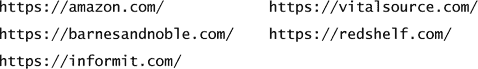

如需注册 O’Reilly Online Learning 的 10 天免费试用，请访问


### 开始之前

请阅读本节以了解我们的约定并设置您的计算机以编译和运行示例程序。如果此处介绍的内容有变，我们将在网页上更新：


### 字体和命名约定

我们使用字体来区分应用程序元素、代码元素与普通文本：

*   我们使用**粗体**表示屏幕上的应用程序元素，例如**文件**菜单。
*   我们使用`等宽字体`表示命令和 Java 代码元素，如：

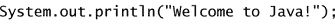

### Java 开发工具包 (JDK)

我们使用 Java 23 版本的 Java 开发工具包（JDK）编写了书中的示例，它包含了用于编译 Java 程序的 `javac` 命令、用于运行 Java 程序的 `java` 命令等。我们将在第 1 章的“测试 JDK”部分中讨论 Java 程序的编译和运行。

我们从以下地址获取了免费开源的 OpenJDK 版本的 JDK：


该网站由 Eclipse 基金会^1 管理——为许多操作系统和硬件平台提供了下载。下面，我们将讨论如何获取 Windows 和 macOS 版的 OpenJDK。你也可以在阅读本书时使用较新版本的 JDK。

1. “关于 Eclipse 基金会”。访问日期为 2025 年 2 月 12 日。[`https://eclipse.org/org/`](https://eclipse.org/org/)。

### Windows 用户

前往


然后选择以下选项：

*   在 `Operating System`（操作系统）下，选择 `Windows`。
*   在 `Architecture`（架构）下，选择 `x64`。
*   在 `Package Type`（包类型）下，选择 `JDK`。
*   在 `Version`（版本）下，选择 `23`（或更高版本以使用新版本）。

接下来，按下（或选择）`.msi` 安装程序按钮下载 OpenJDK 安装程序。下载完成后，双击用户账户 `Downloads` 文件夹中的安装程序文件。安装程序的文件名将类似于：


在安装对话框中：

1.  按下（或选择）`Next`（下一步）进入 `End-User License Agreement`（用户许可协议）步骤。你必须接受许可协议才能安装软件。阅读完协议后，选择“I accept the terms in the License Agreement”（我接受许可协议中的条款），然后按（或选择）`Next` 进入 `Installation Scope`（安装范围）步骤。
2.  选择仅为你个人安装 JDK 还是为使用此台电脑的任何人安装，然后按（或选择）`Next` 进入 `Custom Setup`（自定义设置）步骤。
3.  默认情况下，安装程序选择了前三个选项（`Modify PATH variable`、`Associate .jar` 和 `Set or override JAVA_HOME variable`）。我们建议保留默认设置和安装位置。按（或选择）`Next`，然后点击 `Install`（安装）。
4.  在 `User Account Control`（用户账户控制）对话框中，按（或选择）`Yes` 以允许安装程序更改你的系统并安装 JDK。
5.  当安装程序完成后，按（或选择）`Finish`（完成）。

为了确保 Java 安装正确，在 Windows 任务栏的 `Search`（搜索）字段中输入 `Terminal`，然后在搜索结果中选择 `Terminal`。这将打开 `Windows PowerShell` 窗口。在此窗口中，输入命令

```

```

并按（或选择）`Enter` 或 `Return` 执行。命令的输出应如下所示：

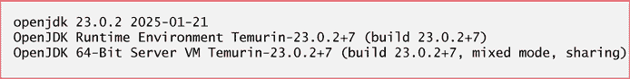

### MacOS 用户

前往


然后选择以下选项：

*   在 `Operating System`（操作系统）下，选择 `macOS`。
*   在 `Architecture`（架构）下，对于搭载 Apple Silicon（M 系列处理器）的 Mac，选择 `aarch64`；对于 Intel 处理器的 Mac，选择 `x64`。
*   在 `Package Type`（包类型）下，选择 `JDK`。
*   在 `Version`（版本）下，选择 `23`（或更高版本以使用新版本）。

接下来，按下（或选择）`.pkg` 安装程序按钮下载 OpenJDK 安装程序。下载完成后，双击用户账户 `Downloads` 文件夹中的安装程序文件。M 处理器 Mac 的安装程序文件名类似于：


Intel 处理器 Mac 的文件名名类似于：


在安装程序对话框中：

1.  按下（或选择）`Continue`（继续）进入 `Software License Agreement`（软件许可协议）步骤。你必须接受许可协议才能安装软件。阅读协议后，按（或选择）`Continue`，然后按（或选择）`Agree`（同意）接受许可条款并进入 `Standard Install on "Macintosh HD"`（在“Macintosh HD”上标准安装）步骤。
2.  按下（或选择）`Install`（安装）执行安装。如果提示输入系统密码，请输入密码并按（或选择）`Install Software`安装软件）。
3.  安装完成后，在对话框中按（或选择）`Close`（关闭）。

为了确保 Java 安装正确，在 `Finder` 中选择 `Go` 菜单下的 `Utilities`（工具），然后打开 `Terminal.app`。在 `Terminal` 窗口中，输入命令

```

```

并按（或选择）`Enter` 或 `Return` 执行。命令的输出应如下所示：

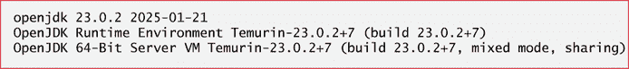

#### Java 发布周期

Java 遵循每六个月发布一次的节奏，这从 Java 9 开始。新版本每 3 月和 9 月发布一次，以便快速交付新特性。每两年，一个版本被标记为长期支持（LTS）版本，面向需要稳定性和扩展支持的企业。最新的 LTS 版本是 Java 21。

### Java 集成开发环境 (IDEs)

有很多 Java 集成开发环境（IDE）——它们集成了必要的工具，如代码编辑器、调试器和其他帮助你构建程序的工具。每个 IDE 的方法有所不同，我们在第 1 章中使用了命令行工具。

这些 IDE 在 Java 社区中拥有最大的市场份额。在书中的网页上


我们提供了：

*   JetBrains 的 IntelliJ IDEA Community Edition
*   Eclipse 基金会的 Eclipse IDE for Developers
*   微软的跨平台编辑器 Visual Studio Code——该工具具有 Java 开发插件。

这些 IDE 适用于 Windows、macOS 和 Linux。**在安装下文任何工具之前，请按照前面的部分安装 OpenJDK。**

### IntelliJ IDEA Community Edition

安装 IntelliJ Edition IDE 的推荐方法是通过 JetBrains **Toolbox** 应用，你可以从此处获取它：


该网站将识别你的操作系统并提供相应安装程序的 **Download** 按钮。按（或选择）`Download`。下载完成后，双击 `Downloads` 文件夹中的安装程序，并按照屏幕提示安装 **Toolbox** 应用。接下来，按（或选择）**Toolbox** 图标打开其窗口：

*   macOS 用户将在右上角找到 **Toolbox** 图标。
*   Windows 用户将在右下角托栏中找到 **Toolbox** 图标。你可能需要按（或选择）向上的小箭头查看所有任务栏图标。

在 **Toolbox** 窗口中，滚动到 **IntelliJ IDEA Community Edition** 并按（或选择）其 **Install** 按钮。

### Eclipse IDE for Java Developers

Eclipse 基金会提供了 Eclipse IDE 的逐步安装说明：


在第 3 步，选择 **Eclipse IDE for Java Developers**，然后按照剩余指令完成安装。

### Visual Studio Code

微软为 Windows 用户提供了 Visual Studio Code 的逐步下载和安装说明：


以及为 macOS 用户提供的说明：


安装 Visual Studio Code 后，按照微软的逐步说明开始 Java 开发。

在第 15 章–17 章中，你将使用 JavaFX 构建图形用户界面 (GUI)、图形和多媒体应用程序，JavaFX 必须与 JDK 独立安装。JavaFX 由一个公司和个人组成的联盟与 JDK 同时开发，其中 Oracle 负责 Java 的开发。每个新 Java 版本发布时，都会发布相应的 JavaFX 版本。

### 下载 JavaFX SDK

要使用 JavaFX，你必须首先安装 JavaFX 软件开发包 (SDK)，可以从此处获取：


在 `Downloads` 部分中，选择以下选项：

1. 在 `JavaFX version` 下，选择与你的 JDK 版本匹配的版本（本文编写时 JavaFX 为 `23.0.2`）。
2. 在 `Operating System` 下，选择你的操作系统。
3. 在 `Architecture` 下，Apple 芯片（M 系列处理器）Mac 用户应选择 `aarch64`，英特尔处理器的 Mac 用户和 Windows 用户应选择 `x64`。
4. 在 `Package Type` 下，选择 `SDK`。

接下来，按（或选择）`Download` 按钮下载适用于你平台的 SDK。这会在你的 `Downloads` 文件夹中生成一个类似于下面的 ZIP 文件


其中 `OS` 是你的操作系统，`architecture` 是你选择的架构。

### 从 ZIP 文件中解压 JavaFX SDK

接下来，解压 ZIP 文件的内容：

* 在 macOS 上，双击文件以解压内容。这会在你的 `Downloads` 文件夹中创建一个名为 `javafx-sdk-23.0.2` 的文件夹（版本号取决于你下载的精确版本）。
* 在 Windows 上，双击文件，然后将 `javafx-sdk-23.0.2` 文件夹拖到你的 `Downloads` 文件夹（版本号取决于你下载的精确版本）。

要完成安装，你必须按照下文针对 Windows 和 macOS 的说明，设置 `PATH_TO_FX` 环境变量。

### 在 Windows 上配置 `PATH_TO_FX` 环境变量

执行以下步骤：

1. 在任务栏的 `Search` 字段中输入 `environment`。
2. 在搜索结果中，选择 `Edit the system environment variables`。
3. 在 `System Properties` 对话中，按（或选择）`Environment Variables` 按钮。
4. 在 `User variables` 下，点击 `New…`。
5. 输入变量名 `Variable name` `PATH_TO_FX`。对于 `Variable value`，输入以下内容，将 `User` 替换为你的用户账户文件夹，必要时将 `23.0.2` 替换为你的 JavaFX 版本：

   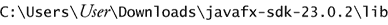

6. 按（或选择）`OK` 保存环境变量。
7. 在 `System Properties` 对话中按（或选择）`OK` 关闭。

如果你打开了任何命令提示符或 PowerShell 窗口，需要关闭并重新打开环境变量才能生效。

### 在 macOS 上配置 `PATH_TO_FX` 环境变量

执行以下步骤：

1. 在 `Finder` 中，选择 `Go` 菜单下的 `Utilities`，然后打开 `Terminal.app`。
2. 接下来确定执行命令的 shell

   

3. 如果步骤 2 显示 `"/bin/zsh"`，执行

   

   否则，执行

   

4. 将以下行添加到文件末尾，将 `User` 替换为你的用户账户文件夹，必要时将 `23.0.2` 替换为你下载的 JavaFX 版本：

   

   然后保存并关闭文件。

### Scene Builder

在在我们的 JavaFX 示例中，你将使用免费的 Scene Builder 工具通过拖放技术创建图形用户界面 (GUI)。要下载 Scene Builder 安装程序，按（或选择）此处的 `Download Now` 按钮：


接下来，按（或选择）适用于你平台的 `Download` 按钮。下载完成后，双击安装程序，然后按照屏幕提示安装 Scene Builder。

## 生成式 AI

正如序言部分“集成生成式 AI”所述，你在学习本书的过程中将利用生成式 AI (genAI)。在 Deitel & Associates, Inc. 公司，我们使用许多 genAI，包括以下四个 genAI 聊天机器人：

* OpenAI ChatGPT (`https://chatgpt.com`)
* Google Gemini (`https://gemini.google.com/app`)
* Anthropic Claude (`https://claude.ai`)
* Perplexity (`https://perplexity.ai`)

### 注册账户

你可以免费使用 ChatGPT 和 Perplexity。Google 要求你登录 Google 账户才能使用 Gemini 的免费版。对于 Claude，你必须提供电子邮件地址才能使用免费版，然后他们会给你发送链接。

### 付费版与免费版

我们使用这些聊天机器人的付费版，但免费版有限。它们通常：

* 在给定时间内允许的查询较少，
* 允许较短的查询，
* 不允许上传文件，
* 响应时间较慢，
* 限制对其最新最强大功能的访问。

### 使用 GenAI 聊天机器人

我们在书中将建议数百个 genAI 提示词，因此你会频繁使用 genAI。当你访问每个聊天机器人时，其网页会提供一个供你输入提示词的框。

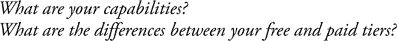

当你提交提示词时，聊天机器人将构建其响应。提醒一下：**务必验证 genAI 提供的信息。**

本章介绍了术语和概念，为后续将学习的 Java 编程能力奠定基础，这些内容从第 2 章开始。我们对面向对象的介绍介绍了我们在本书书中介绍 Java 面向对象编程时将用到的术语。我们介绍了 Java，并讨论了 Java 应用程序接口（`Java API`）以及各种帮助你避免“重复轮子”的 Java“开源”库。我们从 Java 开发工具包（`JDK`）的背景下介绍了一个典型的 Java 程序开发环境，并使用它来测试一个 Java 程序（第 1.7 节），以便为你运行书中的示例做好准备。你也可以使用许多 Java 集成开发环境（`IDEs`）之一来运行我们的程序。我们为几个流行的 IDE 提供了测试：


我们回顾了互联网、网络 Web、云和物联网（`IoT`）的基础知识。我们介绍了元宇宙及其相关技术，包括区块链、加密货币、NFT、Web3、增强现实、虚拟现实和混合现实。我们简要介绍了几种当代软件开发技术。最后，我们介绍了大数据、数据科学和人工智能（`AI`）技术——机器学习、深度学习以及令人兴奋的生成式 AI，如 OpenAI 的 ChatGPT、Google 的 Gemini 和 Anthropic 的 Claude。你将在本书中使用这些或其他生成式 AI 来利用你的 Java 学习经验并一些非常酷的事，从本章的特别章节：生成式 AI 练习开始！

### 本书的架构

在“深入学习”之前，我们建议对本书的架构有一个“万英尺”的视角，以便在准备学习和使用强大的 Java 编程语言时了解你的去向。为此请查看以下内容：


在序言中，`High-Level Overview`（概要概述）以方便的简要格式介绍了书籍的模块化架构。序言还包含`书籍关键特性列表`。

在[`https://deitel.com/javafp5`](https://deitel.com/javafp5)，我们提供了来自审阅预出版手稿的 Java 领域专家和大学教授的`评价评论`。

序言介绍了本书的“灵魂”以及我们教授现代 Java 编程的方法。我们介绍了早期章节的“对象自然法”，在该方法中，你将使用少量的简单 Java 语句让强大的预定义类对象执行重大任务——这远在你在第 8 章中创建自己的自定义 Java 类之前。请务必阅读序言中的“书籍导览”（Tour of the Book），它指出了每个章节的关键特征，并列出了书中更重要的案例研究和生成式 AI 练习。在阅读导览时，你可能也想参考序言中的概要概述。

## Java 被广泛使用

世界上有数十亿台个人电脑在使用，以及更多以计算机为核心的移动设备。各种估计表明，全球有 700 万到 900 万 Java 开发者正在编写运行在 600 亿已安装的 Java 虚拟机（`JVMs`）上的 Java 代码。^[4] 此外，移动设备的爆炸式增长为为移动应用程序创造了巨大的机会。下表了 Java 运行的一些设备类型：

[4] Oracle. “Java.” Accessed 2024 年 11 月 26 日. [`https://www.oracle.com/java/`](https://www.oracle.com/java/).

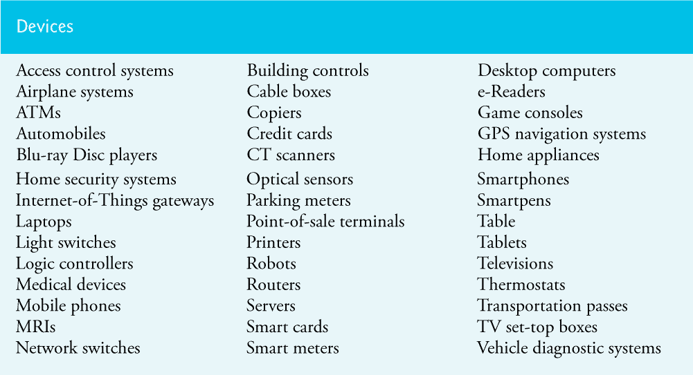

## Java 标准版 (Java SE)

《面向程序员的 Java》这第五版基于`Java Standard Edition`（Java 标准版），它包含了运行桌面和服务器应用程序所需的各种。^[5] Java 支持我们在本书中讨论的几种编程范式：

*   过程化编程（第 2 章–第 7 章）
*   面向对象编程（第 8 章–第 10 章）
*   泛型编程（第 12 章 和 第 13 章）
*   函数式编程（第 14 章）
*   并发编程（第 18 章）
*   生成式 AI 辅助编程（第 19 章）

[5] Oracle. “Java SE at a Glance.” 2024 年 11 月 26 日. [`https://www.oracle.com/java/technologies/java-se-glance.html`](https://www.oracle.com/java/technologies/java-se-glance.html).

## Jakarta EE

Java 的应用范围之广，以至于它还有两个版本。`Jakarta EE`——以前称为 `Java Enterprise Edition (Java EE)`——旨在开发运行大型机构的大型、分布式网络和基于 Web 的应用程序。

## Java 微版

`Java Micro Edition (Java ME)`（Java 微版）是 Java SE 的子集——面向资源受限的嵌入式设备应用，如智能手表、医疗设备、电视顶盒、智能电表（例如用于能源量测量）等。

## 1.2 硬件

由于硬件软件的快速发展，计算成本正在下降。几十年前可能占据整个房间并花费数百万美元的计算机现在刻在比指甲小的硅芯片上，许多只需几美元。讽刺的是，硅是地球上丰富的材料之一——它是普通沙子的成分。硅芯片技术让计算机和电子化设备变成了大商品。

### 摩尔定律、多核处理器与并发编程

今天许多个人电脑每秒可以进行万亿次计算^[6,7]——远超人类一生能完成的数量。你可能预计大多数和服务每年至少付一点钱。在计算机和通信领域，情况相反，特别是在硬件方面。多年来，硬件成本迅速下降。

[6] Tobias Mann, “Intel’s Lunar Lake Mobile Chips Boast 120 TOPS of AI Performance,” The Register, 2024 年 9 月 3 日. Accessed 2025 年 2 月 18 日. `https://www.theregister.com/2024/09/03/intels_lunar_lake_mobile_chips/`.

[7] Tobias Mann, “Apple’s M4 AI Chip: A Leap in Performance,” The Register, 2024 年 10 月 31 日. Accessed 2025 年 2 月 18 日. [`https://www.theregister.com/2024/10/31/apple_m4_ai_chip/`](https://www.theregister.com/2024/10/31/apple_m4_ai_chip/).

计算机处理器公司 `NVIDIA` 和 `ARM` 的关键高管已表示，摩尔定律不再适用。然而，英特尔（Intel）的首席执行官表示它“依然运行良好”——他们正在致力于制造领域的突破，以便在每个芯片上容纳更多晶体。计算机处理能力继续增长，但依赖于新的处理器设计，例如多核处理器。

[8] Christian Hetzner, “Intel CEO Pat Gelsinger Dismisses Nvidia’s AI Chip Dominance: ‘Moore’s Law Is Alive and Well,’” Observer, 2024 年 6 月. 访问于 2025 年 2 月 18 日. [`https://observer.com/2024/06/intel-ceo-pat-gelsinger-nvidia-ai-chip-rivalry/`](https://observer.com/2024/06/intel-ceo-pat-gelsinger-nvidia-ai-chip-rivalry/).

### 多核处理器与性能

如今大多数计算机都拥有多核处理器，可以在单个集成电路芯片上以经济的方式实现多个处理器。英特尔的一些处理器拥有高达 128 个核心。[9] 我们的主要测试计算机使用苹果的 M2 Max 处理器，它拥有 12 核 CPU、28 核 GPU 以及一个用于 AI 任务的 16 核“神经引擎”。[10] 苹果最近的 M4 Max 具有高达 16 核的 CPU、高达 40 核的 GPU 以及一个用于 AI 任务的 16 核“神经引擎”。[11] AMD 有拥有 192 个核心的处理器。[12] 核心数量将继续增长。今天用于高端游戏计算机和人工智能应用的最强 GPU 在其内部通常拥有数千个核心。例如，`NVIDIA RTX 5090` 拥有 21,760 个核心![13]

[9] “Intel^® Xeon^® 6 Processors with Performance-Cores (P-Cores),” Intel. 访问于 2025 年 2 月 18 日. [`https://www.intel.com/content/www/us/en/products/details/processors/xeon/xeon6-pcores.html`](https://www.intel.com/content/www/us/en/products/details/processors/xeon/xeon6-pcores.html).

[10] “Apple unveils M2 Pro and M2 Max: next-generation chips for next-level workflows,” 2023 年 1 月 23 日. 访问于 2025 年 2 月 18 日. [`https://www.apple.com/newsroom/2023/01/apple-unveils-m2-pro-and-m2-max-next-generation-chips-for-next-level-workflows/`](https://www.apple.com/newsroom/2023/01/apple-unveils-m2-pro-and-m2-max-next-generation-chips-for-next-level-workflows/).

[11] “Apple introduces M4 Pro and M4 Max,” 2024 年 10 月 30 日. 访问于 2025 年 2 月 18 日. [`https://www.apple.com/newsroom/2024/10/apple-introduces-m4-pro-and-m4-max/`](https://www.apple.com/newsroom/2024/10/apple-introduces-m4-pro-and-m4-max/).

[12] “EPYC™ 9005 Series Processors,” AMD. 访问于 2025 年 2 月 18 日. [`https://www.amd.com/en/products/processors/server/epyc/9005-series.html`](https://www.amd.com/en/products/processors/server/epyc/9005-series.html).

[13] Dave James, “Nvidia GeForce RTX 5090,” PC Gamer, 2025 年 1 月 30 日. 访问于 2025 年 2 月 18 日. [`https://www.pcgamer.com/nvidia-geforce-rtx-5090/`](https://www.pcgamer.com/nvidia-geforce-rtx-5090/).

在多核系统中，硬件可以让多个处理器真正同时对任务的不同部分进行工作，从而使你的程序完成得更快。充分利用多核架构需要编写多线程应用程序（第 18 章）。当程序的任务被拆分为单独的线程时，只要有足够的核心，多核系统就可以并行运行这些线程。

随着多核系统的普及，对多线程的兴趣正在迅速增长。Java 从诞生之初就提供了多线程支持，并在多年以后增加了更高级的功能以简化多线程应用程序。第 18 章，并发：从平台线程到虚拟线程 讨论了这些内容的创建和管理。它包含了通过大量代码示例详细解释了 Project Loom 涌出的最新技术——虚拟线程、结构化并发。

### 多年来的计算能力

数据变得越来越庞大，处理数据所需的计算能力也是如此。今天处理器的性能通常用 `FLOPS`（每秒浮点运算次数）来衡量。在 20 世纪 90 年代，快的超级计算机以亿（gigaflops，10⁹）衡量。90 年代后期，英特尔生产了第一台太亿（teraflop，10¹²）级计算机。2008 年，IBM 发布了第一台每秒千万亿（petaflop，10¹⁵）级超级计算机。今天最强大的超级计算机每秒可以进行数万亿次。2024 年 11 月，美国的 `Elitan` 超级计算机是世界上最快的——每秒可进行 1.74 万亿亿（exflops）次运算！

[14] “Top 500.” Wikipedia. Wikimedia Foundation. 访问于 2025 年 2 月 18 日. [`https://en.wikipedia.org/wiki/TOP500`](https://en.wikipedia.org/wiki/TOP500).

[15] “Flops.” Wikipedia. Wikimedia Foundation. 访问于 2025 年 2 月 18 日. [`https://en.wikipedia.org/wiki/FLOPS`](https://en.wikipedia.org/wiki/FLOPS).

[16] 为了直观感受进步有多大，请考虑：在 20 世纪 60 年代，早期计算机之一的 Digital `PDP-1`（https://en.wikipedia.org/wiki/PDP-1）每秒只能进行 93,458 次运算，而 IBM `1401`（https://www.ibm.info/1401）每秒仅进行 86,957 次运算。

正在开发中的量子计算机运行速度可能是今天计算机的 18 万万亿（18,000,000,000,000）倍。这个数字如此惊人，以量子计算机在这一秒内完成的操作比自人类开始以来所有计算设备的总和还要多。2024 年 12 月，谷歌宣布了新的 `Willow` 量子芯片，它完成一项传统计算机需要 10 垓（10,000,000,000,000,000,000,000）年才能完成的任务。^[18] 这种几乎无法想象的计算能力可能会对 `Bitcoin` 等区块链加密货币造成破坏。工程师们已经在重新思考区块链^[19]，并研究后量子加密以应对这种计算能力的巨大增长。^[20]

[17] Norbert Biedrzycki, “Only God can count that fast — the world of quantum computing.” 2017 年 5 月 12 日. 访问于 2025 年 2 月 18 日. [`https://media.com/@n.biesrzycki/only-god-can-count-that-fast-the-world-of-quantum-computing-406a0a91fcf4`](https://media.com/@n.biesrzycki/only-god-can-count-that-fast-the-world-of-quantum-computing-406a0a91fcf4).

[18] Robert Booth “Google Unveils ‘Mindboggling’ Quantum Computing Chip,” The Guardian, 2024 年 12 月 9 日. 访问于 2025 年 2 月 18 日. [`https://www.theguardian.com/technology/2024/12/09/google-unveils-mindboggling-quantum-computing-chip`](https://www.theguardian.com/technology/2024/12/09/google-unveils-mindboggling-quantum-computing-chip).

[19] “Blockchain.” Wikipedia. Wikimedia Foundation. 访问于 2025 年 2 月 18 日. [`https://en.wikipedia.org/wiki/Blockchain`](https://en.wikipedia.org/wiki/Blockchain).

[20] Reji Thomas 博士，“量子安全区块链：迎接量子计算时代，” 2024 年 11 月 26 日. 访问于 2025 年 2 月 18 日. [`https://www.forbes.com/councils/forbestechcouncil/2024/11/26/quantum-secure-blockchain-preparing-for-the-era-of-quantum-computing/`](https://www.forbes.com/councils/forbestechcouncil/2024/11/26/quantum-secure-blockchain-preparing-for-the-era-of-quantum-computing/).

计算成本正在持续下降，特别是随着处理器架构和云计算的进步。人们过去会问：“我的本地系统需要多少计算力来处理我的峰值处理需求？”如今，这种思维已经转变为：“我能否快速在云端为我最要求的计算工作负载临时划出所需的资源？”你只需为完成特定任务所使用的资源付费。

## 1.3 Java

微处理器革命到今为止最大的贡献是它推动了个人电脑和智能手机的发展。微处理器还对智能消费电子设备产生了深远影响，包括物联网（IoT）中的海量设备。Sun Microsystems 在 1991 年就意识到了这一点，资助了一项由 James Gosling 领导的内部公司研究项目，产生了一种基于 C++ 的面向对象的编程语言，Sun 将其称为 Java.^[21] 使用 `Java`（它是世界上最老且使用最广泛的高级编程语言之一），你可以编写在各种计算机系统和计算机控制设备上的程序。这有时被称为“编写一次，随处运行 (WORA)”。这种可移植性是特别强大的。

[21] Paul Krill，“所以他们为什么决定命名为 Java？” InfoWorld, 2014 年 5 月 23 日. 访问于 2025 年 2 月 18 日. [`https://www.infoworld.com/article/2170044/so-why-did-they-decide-to-call-it-java-3.html`](https://www.infoworld.com/article/2170044/so-why-did-they-decide-to-call-it-java-3.html).

`Java` 因为人们对互联网的极大兴趣而引起了商业界的关注。它现在被用于开发大型企业应用、增强 Web 服务器功能、为消费设备（手机、智能手机、有线电视盒等）提供应用、开发机器人软件以及许多其他用途。它是开发 Android 智能手机和平板电脑应用的原始语言——它现在是两种 Android 开发语言之一.^[22] Sun Microsystems 在 2010 年被 Oracle 收购。

[22] “Kotlin (编程语言).” 访问于 2025 年 2 月 18 日. [`https://en.wikipedia.org/wiki/Kotlin_(programming_language)`](https://en.wikipedia.org/wiki/Kotlin_(programming_language)).

三十年来，`Java` 一直是最广泛使用的通用编程语言之一，因此存在大量大量使用旧编程范式的现有 Java 代码——这被称为遗留代码。我们在本书中强调现代的 Java 范式。

你可能想查看精选的顶级 Java 应用列表：

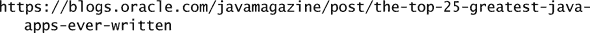


此外，我们在全书中穿插了生成式 AI（genAI）练习，从本章末尾的特别章节：生成式 AI 练习开始。练习 1.2 要求你提示生成式 AI 列出 Java 可能被视为现代编程语言首选的方式。

### Java 发布周期

`Java` 遵循每六个月一次发布周期，该周期从 2017 年的 `Java 9` 开始。每年 3 月和 9 月都会发布新版本，以便更快地交付新的语言和库功能。每两年会将一个版本指定为长期支持（LTS）版本。这些版本面向需要稳定性和扩展支持的企业。非 LTS 版本鼓励对不断演进的创新新功能进行实验，但其支持周期较短。

### JEPs、JSRs 和 JCP

在整书中，我们鼓励你在线上研究 Java 的各个方面。你可能会看到的某些缩写有 `JEP`、`JSR` 和 `JCP`。

Oracle 使用 `JEPs`（JDK 增强提案）收集 Java 社区对 Java 语言、API 和工具修改的建议，帮助创建未来 Java 标准版 (`Java SE`)、Java 企业版 (`Java EE`) 和 Java 微型版 (`Java ME`) 版本的路线图，以及定义它们的 `JSRs`（Java 规范请求）。可以在此处找到完整的 JEP 列表：


`JSRs`（Java 规范请求）是 Java 功能技术规范的正式描述。每个新功能都有一个 `JSR`，在被添加到 Java 之前要经过评审和审批过程。可以在此处找到完整的 JSR 列表：


`JCP`（Java 社区进程）负责开发 `JSRs`。`JCP` 专家组创建 `JSRs` 并将其公开供评审和反馈。你可以在此处了解更多关于 JCP 的信息：


### 1.4 面向对象简要回顾

在对新颖且强大的软件需求激增的时代，快速、正确且经济地构建软件仍然是一个难以实现的目标。对象，或者更准确地说——正如我们在第 8 章中看到的——对象的类，本质上是可重用的软件组件。有日期对象、时间对象、音频对象、视频对象、汽车对象、人员对象等。几乎任何名词都可以从属性（例如名称、颜色和大小）和行为（例如计算、移动和通信）的角度合理地表示为软件对象。软件开发人员发现，使用模块化的面向对象设计和实现方法可以使软件开发的效率比以前的技术高得多——面向对象的程序通常更容易理解、测试、调试、纠正和演进。

#### 作为对象的汽车

让我们从一个简单的类比开始。假设你想驾驶汽车并通过踩油门板让它变快。在你这样做之前需要发生什么？嗯，在你驾驶它之前，必须有人设计这辆汽车。汽车通常以工程图开始，类似于描述房屋设计的蓝图。这些图纸包含了油门板的设计。油门板为驾驶员隐藏了让汽车变快的复杂机制，就像刹车板隐藏了让汽车减速的机制，方向盘隐藏了让汽车转向的机制一样。这让几乎了解发动机、刹车和转向机制原理的人也能轻松驾驶汽车。

#### 方法和类

让我们用汽车的例子来介绍一些关键的面向对象编程概念。在程序中执行任务需要一个 `method`（方法）。该方法包含了执行该任务的程序语句。它向用户隐藏了这些语句，就像汽车的油门踏向驾驶员隐藏了让汽车行驶得更快的机制一样。在 Java 中，我们创建一个名为 `class`（类）的程序单元，用来存放执行该类任务的方法集。例如，代表银行账户的类可能包含一个向账户 `deposit`（存款）资金的方法，另一个从账户 `withdraw`（取款）资金的方法，以及第三个 `query`（查询）账户当前余额的方法。类类似于汽车的工程图纸，它包含了油门踏、刹车踏、方向盘等的设计。

#### 实例化

就像在驾驶汽车之前必须根据工程图纸 `build a car`（制造汽车）一样，在程序执行类方法定义的任务之前，你必须从类 `build an object`（构建对象）。这个过程被称为 `instantiation`（实例化），该对象随后被称为该类的 `instance`（实例）。

#### 重用

就像汽车的工程图纸可以被 `reused`（重用）多次来制造许多汽车一样，你可以多次 `reuse`（重用）一个类来构建该类的许多对象。在构建新类和程序时重用现有类可以节省精力。重用还能帮助你构建更可靠、更有效的系统，因为现有的类和组件通常经过了仔细的 `tested`（测试）、`debugged`（调试）和性能优化。正如 `interchangeable parts`（通用零件）对于工业革命至关重要，可重用的类对于对象技术引发的软件革命也至关重要。

#### 消息与方法调用

当你开车时，踩油门会向汽车发送一条 `message`（消息）来执行任务——即“加速”。同样，你 `send messages to an object`（向对象发送消息）。每条消息都实现为一个 `method call`（方法调用），告诉对象的某个方法执行其任务。例如，程序可能会调用特定银行账户对象的 `deposit` 方法根据存款金额增加账户余额。

#### 属性与实例变量

除了具有完成任务的能力外，汽车还有 `attributes`（属性），例如颜色、门数、油箱中的油量、当前速度以及总行驶里程记录（即里程表读数）。就像它的能力一样，汽车的属性被表示为其工程图中的设计部分（例如，图中包含里程表和油表）。当你开车时，这些属性会随汽车“携带”。每辆汽车都维护着自己的属性。例如，每辆汽车都知道自己的油箱里有多少油，但不知道其他汽车油箱里有多少油。

同样，对象也有它在程序中使用时随身携带的属性。这些属性被指定为对象类的一部分。例如，银行账户对象知道它所代表的账户的余额，但不知道该银行中其他账户的余额。属性是由类的 `instance variables`（实例变量）来指定的。

#### 封装与信息隐藏

类将属性和方法 `encapsulate`（封装，即包装）到从这些类创建的对象中——对象的属性和方法之间是紧密相关的。对象与对象之间可以相互通信，但它们通常不被允许知道其他对象的内部实现。这些细节被隐藏在对象内部。正如我们将看到的，这种 `information hiding`（信息隐藏）对于良好的软件工程至关重要。

#### 继承

通过 `inheritance`（继承），可以快速方便地创建新的对象类。新类吸收现有类的特征，并可能对其进行定制以及添加自己的独特特征。在我们的汽车类比中，“convertible”（敞篷车）类的对象无疑 `is an`（是一个）更 `general`（通用）类“automobile”（汽车）的对象，但更 `specifically`（具体来说），车顶可以升起或降低。

#### 接口

Java 还支持 `interfaces`（接口）——一组方法声明，定义了对象可以执行*什么*动作，而不规定*如何*执行这些动作。在汽车的类比中，一个由方向盘、油门踏和刹车踏组成的“basic-driving-capabilities”接口将允许驾驶员告诉汽车*该*做什么。一旦你学会了如何使用这个几乎通用的转向、加速和刹车接口，你就可以驾驶许多许多汽车，尽管制造商可能以不同的方式实现这些系统。

一个类 `implements`（实现）零或多个接口，每个接口都可以有方法，就像汽车为基本驾驶功能、控制音机、控制加热空调系统等实现了不同的接口一样。正如汽车制造商以不同方式实现功能一样，类也可以以不同的方式实现接口的方法。例如，软件系统可能包含一个“备份”接口，提供 `save`（保存）和 `restore`（恢复）方法。类可以根据备份内容的类型（如程序、文本、音频、视频等）以及存储这些项目的设备类型不同不同的实现这些方法。

#### 面向对象分析与设计

很快，你就将编写 Java 程序。你将如何为你的程序创建代码？也许你会打开电脑并开始输入代码。这种方法对于小型程序（如书中早期章节介绍的程序）可能有效，但如果你被要求创建一个控制大型银行数千台自动取款机的软件系统又会怎样？或者假设你被要求加入一个由数千名软件开发人员组成的团队，构建下一代美国空中交通系统？对于这类大型且复杂的项目，你不应该简单地开始输入程序。

为了创建出解决方案，你应该遵循详细的分析过程，以确定项目的 `requirements`（需求，即系统应该做什么）并开发出满足这些要求的 `design`（设计，即决定系统如何做）。理想情况下，在编写任何代码之前，你应该经历这一过程并仔细审查设计（让他人评审）。如果这一过程涉及从面向对象的角度分析和设计你的系统，它被称为 `面向对象分析与设计 (OOAD) 过程`。Java 具有 `面向对象编程 (OOP)` 能力，能够将面向对象的设计实现为安全、高性能、健壮的系统。

使用 Java API 类和方法而不是编写你自己的版本，可以提高程序的可靠性和性能，因为它们经过了精心编写，能够正确运行并高效地执行。这还能缩短程序的开发时间。

### 开源库

大量的开源 Java 库可以帮助你通过编写少量的代码来完成重大任务。在 `GitHub` 上，开发者们贡献了超过 250,000 个 Java 代码存储库：


此外，诸如下页面：

*   [`https://github.com/akullpp/awesome-java`](https://github.com/akullpp/awesome-java)
*   [`https://github.com/Vedenin/useful-java-links`](https://github.com/Vedenin/useful-java-links)
*   [`https://github.com/mhrimaz/AwesomeJavaFX`](https://github.com/mhrimaz/AwesomeJavaFX)

提供了热门 Java 库和资源的精选列表——你会喜欢探索这些网站。

### Java 开发的模块化方法

在编写 Java 程序时，你通常会将你自己的代码与以下预定义的模块混合使用：

*   Java API 类、接口和方法
*   开源 Java 库的类、接口和方法
*   你创建的类、接口和方法（在学习第 8 章和第 9 章后）
*   他人创建并提供你的类、接口和方法

创建自己的类、接口和方法的优点是确切知道它们是如何工作的。缺点是设计、开发、调试和性能调优它们需要花费大量时间。在书中，我们使用现有的 Java API 和各种开源库来利用编程工作，避免“重复造轮子”。这被称为 `软件复用`，是我们的面向对象教学法的核心部分。

### 1.6 典型的 Java 程序开发环境

我们现在解释创建和执行 Java 程序的步骤。通常有五个阶段——`edit`（编辑）、`compile`（编译）、`load`（加载）、`verify`（验证）和 `execute`（执行）。我们在 Java 开发工具包 (`JDK`) 的上下文中讨论这些阶段。请参见序言之后的“在开始之前”部分，获取在 Windows 和 macOS 上下载和安装 JDK 的信息。

#### 第一阶段：创建程序

第一阶段包括使用编辑器程序（或简单来说，编辑器）编辑文件：

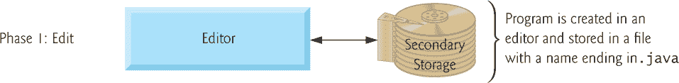

使用编辑器，你输入 Java 程序的源代码，进行任何必要的修正并将其保存到系统中。Java 源代码文件以 `.java` `extension` 命名，表示该文件包含 Java 源代码。

Windows 和 macOS 分别提供了基础编辑器 `Notepad`（记事本）和 `TextEdit`（文本编辑）。在线可用的一些强大的编辑器包括：

*   `jEdit` ([`jedit.org`](https://jedit.org)；跨平台，用 Java 编写)
*   `Sublime` ([`www.sublimetext.com`](https://www.sublimetext.com)；跨平台)
*   `Notepad++` ([`https://notepad-plus-plus.org`](https://notepad-plus-plus.org)；仅限 Windows)
*   `TextMate` ([`textpad.com`](https://textpad.com)；仅限 macOS)

**集成开发环境 (IDEs)** 提供支持软件开发过程的工具，例如编辑器、用于定位导致程序执行不正确的 `logic errors` 的调试器等。最流行的 Java IDE 有：

*   JetBrains 的 `IntelliJ IDEA Community Edition`
*   Eclipse 基金会的 `Eclipse IDE for Java Developers`
*   以及微软的 `Visual Studio Code` 跨平台代码编辑器——这在技术上是一个强大的代码编辑器，但提供了用于 Java 开发（以及许多其他编程语言）的插件。

我们将在“在开始之前”部分讨论每个工具的安装。在书籍的网站上：


我们提供了试运行演示，展示如何执行本书中的 Java 程序，以及如何使用这些 IDE 开发新的 Java 程序。

#### 第二阶段：将 Java 程序编译为字节码

在第二阶段，你使用 `javac` `command`（`Java 编译器`）来 `compile` 编译程序：

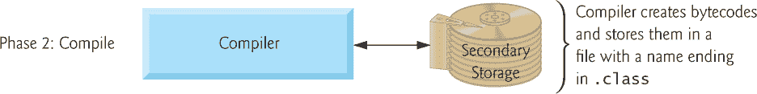

例如，要编译一个名为 `Welcome.java` 的程序，你需要在系统的命令行窗口中输入：


(Section 1.7）。如果程序编译成功，编译器会生成一个名为 `Welcome.class` 的 `.class` `file`。IDE 通常会自动完成此操作。如果编译器检测到错误，必须返回第一阶段并修正它们。在第 2 章中，我们将讨论编译器可以检测的错误类型。

在使用 `javac` 时，如果收到如“bad command or filename”、“javac: command not found”或“javac' 不是内部或外部命令、可运行程序或批文件”的消息，说明你的 JDK 未安装正确。请仔细检查“在开始之前”中的安装说明。

Java 编译器将 Java 源代码翻译成代表执行阶段（第五阶段）任务的 `bytecodes`。Java 虚拟机 (`JVM`)。

#### 第三阶段：将程序加载到内存

在第三阶段，JVM 将程序放入内存以执行它——这被称为 `loading`：

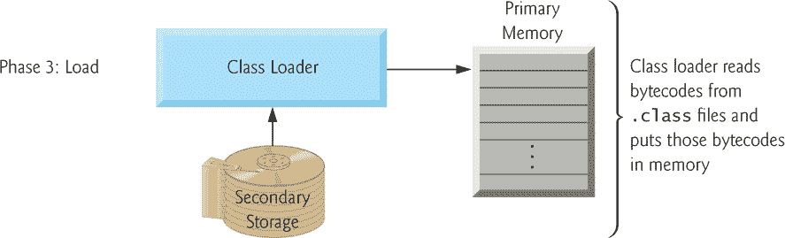

JVM 的 `class loader` 获取包含程序字节码的 `.class` 文件并将其传输到主内存。它还会加载程序使用的任何 Java `.class` 文件。

#### 第四阶段：字节码验证

在第四阶段，当类加载时，`bytecode verifier` 检查它们的字节码以确保它们有效且不违反 Java 的安全限制：

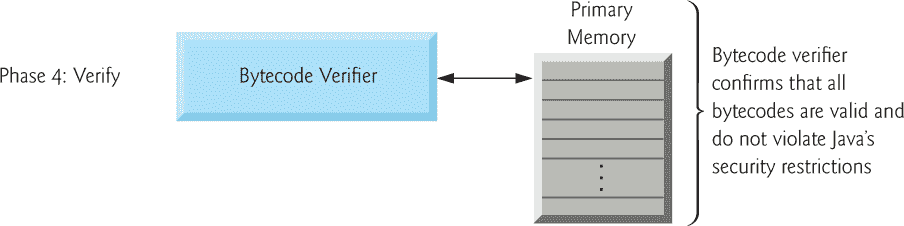

#### 第五阶段：执行

在第五阶段，JVM `executes` 执行字节码以执行程序指定的动作：

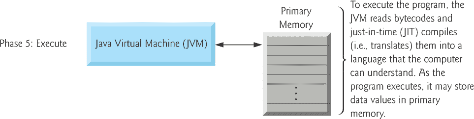

在早期的 Java 版本中，JVM 解释字节码。大多数程序的执行速度很慢，因为 JVM 一次解释并执行一个字节码。某些现代计算机架构可以并行执行多条指令。今天的 JVM 通常结合解释和 `即时编译（just-in-time (JIT) compilation）` 来执行字节码。在这个过程中，JVM 在解释字节码的同时对其进行分析，寻找“热点”——即频繁执行的字节码。对于这些部分，`即时`（`JIT`）`编译器`（例如 OpenJDK 的 `HotSpot compiler`）会将字节码翻译成计算机的机器语言。当 JVM 再次遇到这些已编译的部分时，就会执行速度更快的机器语言代码。因此，程序实际上经历了两个编译阶段：第一个阶段将 Java 代码翻译成字节码（以便在不同计算机平台上的 JVM 之间具有可移植性）；第二个阶段是在执行期间，将字节码翻译成运行该程序的计算机所需的机器语言。

#### 执行时可能出现的问题

程序在第一次尝试时可能无法工作。之前的每个阶段都可能因为书中讨论的各种错误而失败。例如，正在运行的程序可能会尝试除以零——这在 Java 的整数算术中是非法操作。这会导致 Java 程序显示错误信息。如果发生这种情况，你必须返回编辑阶段，进行必要的修正，并重新通过剩余阶段，以确定修正是否修复了问题。

诸如除以零之类的错误会在程序运行时发生，因此它们被称为 `运行时错误（runtime errors）` 或 `执行时错误（execution-time errors）`。`致命运行时错误（Fatal runtime errors）` 会导致程序立即终止而无法完成任务。`非致命运行时错误（Nonfatal runtime errors）` 允许程序运行完成，但通常会产生错误的结果。

### 1.7 使用 Java 开发工具包 (JDK) 测试驱动 Java 程序

在阅读此测试驱动之前，请阅读序言后的“开始之前（Before You Begin）”，以确保你已将书籍示例存于用户账户的 `Documents/examples` 文件夹中并安装了 JDK。在本节中，你将使用 JDK 的工具来编译并运行你的第一个 Java 程序——一个猜数字游戏，它会从 1 到 1,000 之间选取一个随机数并提示你进行猜测。如果你猜中了随机选出的数字，游戏就会结束。如果你猜错了，程序会指示你的猜测比正确数字大还是小。你需要一直猜下去，直到猜中数字为止。猜测的次数没有限制，但如果你使用二分查找法，不应超过 10 次。

[24]。我们在这里刻意不介绍这个 Java 程序的代码。本节的目的是演示如何编译和运行程序，以便你可以在后续章节中执行我们的示例。

### 1.7.1 使用 `javac` 和 `java` 编译并运行程序


我们将展示两种运行程序的方法。在这里，我们关注传统方法，即你：

* 使用 `javac` 命令编译程序，然后
* 使用 `java` 命令运行它。

IDE 通常通过点击（或选择）按钮、选择菜单项或使用键盘快捷键，为你提供一种完成这两个步骤的便捷方法。

### 步骤 1：切换到 `ch01` 文件夹

首先，在你的系统上打开一个终端（命令行）窗口：

* 在 macOS 上，在访达的“前往”菜单中选择“实用工具”，然后打开“终端”应用程序。
* 在 Windows 上，在 Windows 任务栏的搜索框中输入 `Terminal`，然后在搜索结果中选择 Terminal 以打开 Windows PowerShell 窗口。

接下来，使用 `cd` 命令切换到书籍 `examples` 文件夹下的 `ch01` 子文件夹：

* 在 macOS 终端窗口中，输入以下命令并按（或选择）`Enter`：
  
* 在 Windows PowerShell 窗口中，输入以下命令并按（或选择）`Enter`：
  

在后续步骤中，我们将显示 macOS 终端应用程序的提示符——使用 JDK 命令行工具编译和运行程序的命令，以及你与程序的交互在 macOS 和 Windows 之间是相同的。

### 步骤 2：编译程序

在运行猜数字游戏之前，你必须使用 `javac` 命令编译其 Java 源代码：


如果程序编译无错误，`javac` 命令将创建一个 `.class` 文件


该文件包含程序的字节码。

### 步骤 3：运行程序

要运行程序，使用 `java` 命令后跟不带 `.class` 扩展名的类文件名：


应用程序显示 `"Please enter your first guess."`，然后在下一行显示问号（`?`）作为提示。

### 步骤 4：输入你的第一次猜测

在提示符处，输入 `500` 并按（或选择）`Enter`：


程序显示 `"Too low. Try again."`，因为输入的值小于程序选定的数字。

[25]。我们编写这个程序是为了让它每次运行时都选择相同的“随机”值。

### 步骤 5：输入另一个猜测

在提示符处，输入 `750` 并按（或选择）`Enter`：


应用程序显示 `"Too high. Try again."`，因为该值大于程序的选定数字。

### 步骤 6：输入更多猜测

继续输入值玩游戏直到猜中正确数字。当你猜中时，应用程序显示 `"Excellent! You guessed the number."`：


### 步骤 7：再次游戏或退出

在猜中数字后，应用程序询问你是否想再次玩。输入 `y` 将程序选取一个新的数字并开始新游戏。输入 `n` 将终止应用程序并返回命令行提示符。

### 10 次或少的猜测

猜 1 到 1000 之间的数字最多需要 10 次尝试。当你从 500 开始猜时（假设它不是正确答案），你可以根据猜测是大还是小立即排除一半数字。在测试驱动中，500 太小了，所以我们排除了 1–500，一次猜测后剩余 500 个值（501–1000）。每次猜测都应该是剩余范围的中点。下一次猜测时，750 太大了，所以我们排除了 750–1000，将潜在范围缩小到 501–749，这大约是之前剩余 500 个值的一半。如果你反复选择剩余范围的中点，十次猜测将范围缩小到一个数值，该数值即为正确答案。

### 1.7.2 直接使用 `java` 命令运行程序的源文件

你可以使用 `java` 命令直接运行单文件程序——例如第 1.7.1 节中的猜数字游戏——如下：


[26]. “JEP 330: Launch Single-File Source-Code Programs.” 访问于 2025 年 2 月 18 日 [`https://openjdk.org/jeps/330`](https://openjdk.org/jeps/330)。

当你直接执行源代码时，`java` 命令会在内存中编译程序并立即运行。与 `javac` 不同，`java` 命令不会在你的系统上存储程序字节码的 `.class` 文件。

你甚至可以运行多源文件程序，比如你在第 8 章，使用自定义类进行现实建模](#ch08.xhtml_ch08)中开始构建的程序。在这种情况下，程序的所有源文件都在内存中编译，然后执行程序。这些特性使得为了快速测试而运行 Java 程序更加方便。

27. “JEP 458: 启动多文件源代码程序。” 访问于 2025 年 2 月 18 日. [`https://openjdk.org/jeps/458`](https://openjdk.org/jeps/458)。

## 1.8 互联网、万维网、云与物联网

在 20 世纪 60 年代年代后期，ARPA——美国国防部高级研究计划署——实施了一项计划，将大约十个由 ARPA 资助的大学和研究机构的主计算机系统连接起来。这些计算机将通过通信线路连接，速度在每秒 50,000 位左右；在那个时代，大多数（在少数拥有网络访问权限的人中）通过电话线连接计算机的仅仅为每秒 110 位，这在当时是非常惊人的。学术研究即将发生巨大的飞跃。ARPA 实施了很快被称为 ARPANET 的网络，它是互联网的前身。如今最快的消费级互联网速度处于每秒数十亿位（千比特）级。目前的互联网速度记录保持者是日本信息通信技术枢纽，它实现了每秒 402 太比特（万亿比特）的下载速度——大约是美国消费者平均每秒 250 兆比特宽带速度的 160 万倍。^(28)

28. Paulius Grinkevičius, “日本打破互联网速度记录，达到每秒 402 太比特,” CyberNews, 2024 年 7 月 4 日. 访问于 2025 年 2 月 18 日. [`https://cybernews.com/tech/internet-connection-speed-world-record`](https://cybernews.com/tech/internet-connection-speed-world-record)。

事情的发展与原计划不同。虽然 ARPANET 让研究人员能够将他们的计算机联网，但其主要优势被证明是通过后来被称为电子邮箱（e-mail）的方式进行快速方便通信的能力。即使在今天的互联网上也是如此，通过电子邮件、即时消息、文件传输和社交媒体（如 YouTube、Facebook、WhatsApp、Instagram、Snapchat、TikTok、Reddit 和 X（原 Twitter）），全球数十亿人能够快速方便地进行通信。

允许计算机在 ARPANET 上相互通信的协议（一组规则）被称为传输控制协议（TCP）。它确保了由顺序编号的片段（称为数据包）组成的消息能够从发送者正确地递送到接收者，完整地到达并按正确的顺序重组。

### 1.8.1 互联网：网络的网络的网络

在 ARPANET 演化的同时，全球各机构实施了自己的网络，用于组织内部和组织间的通信。出现了各种类型的网络硬件和软件。其中一个挑战是让这些不同的网络能够相互通信。ARPA 通过开发互联网协议（IP）实现了这一点，它创建了一个“网络的网络的网络”，即互联网目前的架构。这套组合协议现在被称为 TCP/IP。每个连接到互联网的设备都有一个 IP 地址——这是一个唯一的数字标识符，通过 TCP/IP 通信的设备用它在互联网上定位彼此。

公司迅速意识到他们可以使用互联网来改进业务并提供新、更好的客户服务。因此，他们花费了大量资金来开发和增强他们的互联网业务。这导致了通信运营商以及硬件和软件供应商之间激烈的竞争，以满足增长的基础设施需求。结果是互联网带宽——通信线路的信息承载能力——大幅增加，而硬件成本却骤降。

### 1.8.2 万维网：让互联网对用户友好

万维网（World Wide Web，或简单称为 web）是与互联网相关的硬件和软件集合，它允许计算机用户定位并查看几乎任何主题的文档（带有文本、图形、动画、音频和视频的各种组合）。1989 年，欧洲核子研究组织（CERN）的蒂姆·伯纳斯-李（Tim Berners-Lee）开始开发超文本标记语言（HTML）——通过“超链接”文本文档共享信息的技术。他还编写了通信协议，如超文本传输协议（HTTP），以构成他新的超文本信息系统的骨干，他将其称为万维网。

1994 年，伯纳斯-李创立了世界网联盟（W3C; `w3.org`），该机构致力于开发 Web 技术。W3C 的一个关键目标是让无论能力、语言或文化如何，每个人都能普遍访问 Web。

### 1.8.3 云

如今越来越多的计算发生在“云端”，使用分布在全球遍互联网的软件和数据，而不是在你的计算机或移动设备本地。云计算允许你增加或减少计算资源以满足任何时刻的需求，这比购买自己的硬件来提供足够的存储和处理能力以满足偶尔的峰值需求更有成本效益。云计算还通过将计算资源的负担（如安装和升级软件）转移给服务提供来节省资金。

你每天使用的应用程序高度依赖云服务。这些服务使用大量的计算资源集群（计算机、处理器、内存、存储等）和数据库，通过互联网与应用程序通信。通过互联网提供访问的服务被称为 Web 服务。截至 2024 年 11 月，亚马逊云服务（AWS；市场份额 32%）、微软 Azure（20%）和谷歌云平台（GCP；12%）占据了云服务市场的 64%。^(29)

29. Statista, “全球领先云基础设施提供商份额.” 2024 年 11 月 1 日. 访问于 2025 年 2 月 18 日, [`https://www.statista.com/chart/18819/worldwide-market-share-of-leading-cloud-infrastructure-service-providers`](https://www.statista.com/chart/18819/worldwide-market-share-of-leading-cloud-infrastructure-service-providers/)。

### 1.8.4 物联网 (IoT)

互联网不仅仅是计算机网络——它是物联网（IoT）。“事物”是指任何具有 IP 地址并能够通过互联网自动发送有时接收数据的设备。这些“事物”包括：

* 带有缴费感应器和 GPS 导航功能的汽车
* 自动驾驶机器人
* 车库停车位情况的监测器
* 植入人体的心脏监测器
* 监控能源消耗、天气、水质和交通的智能传感器
* 烟雾和一氧化碳检测器
* 辐射探测器
* 仓库中的物品跟踪器
* 可以跟踪你移动的移动应用程序
* 根据天气预报和家庭活动调整房间温度的恒温器
* 智能手表、健身追踪器和智能眼镜等穿戴设备
* 智能家居电器、照明、门铃和锁
* 以及更多

预计 2025 年将有 416 亿个活跃的物联网设备。^(30)

30. 戴尔科技（Dell Technologies），“物联网与数据放置，”从边缘到核心与物联网，访问于 2025 年 2 月 18 日，[`https://infohub.delltechnologies.com/en-us/l/edge-to-core-and-the-internet-of-things-2/internet-of-things-and-data-placement/`](https://infohub.delltechnologies.com/en-us/l/edge-to-core-and-the-internet-of-things-2/internet-of-things-and-data-placement/)。

### 1.8.5 边缘计算

许多物联网（IoT）设备被用于 `edge computing`，^(31) 在这种模式下，数据处理、分析和存储在产生数据的设备或其附近进行——即在网络边缘。它“允许更快的处理和实时决策，这对于需要即时响应的应用（如物联网设备、自动驾驶汽车或边缘计算机）至关重要。”^(32) 例如，如果一辆自动驾驶汽车失去了互联网连接，它仍然必须做出使其安全行驶的决策。边缘计算被许多领域，包括医疗保健、制造业、零售、清洁能源、智能电网、交通、自动驾驶汽车、智能城市和基础设施、工业自动化和过程控制、国防、航空航天、农业、游戏、虚拟现实、视频监控等。^(33,34)

31. “边缘计算。”维基百科（Wikipedia）。维基基金会。访问于 2025 年 2 月 14 日。[`https://en.wikipedia.org/wiki/Edge_computing`](https://en.wikipedia.org/wiki/Edge_computing)。

32. 研华（Advantech），“边缘计算：增强实时数据处理与决策，”2024 年 9 月 26 日。访问于 2025 年 2 月 14 日。[`https://www.advantech.com/en-us/resources/industry-focus/edge-computing`](https://www.advantech.com/en-us/resources/industry-focus/edge-computing)。

33. Corvalent。“当今行业的 7 种关键边缘计算用例。”访问于 2025 年 2 月 18 日。[`https://corvalent.com/news/7-essential-edge-computing-use-cases-for-industries/`](https://corvalent.com/news/7-essential-edge-computing-use-cases-for-industries/)。

34. Daffodil Software。“边缘计算的顶级 24 工业应用，”2023 年 4 月 3 日。访问于 2025 年 2 月 18 日。[`https://insights.daffodilsw.com/blog/applications-of-edge-computing`](https://insights.daffodilsw.com/blog/applications-of-edge-computing)。

### 1.8.6 混合应用 (Mashups)

`mashups` 的应用开发方法允许你通过结合（通常是免费的）互补 Web 服务和各种形式的信息源，快速开发出强大的软件。最早的混合应用之一是 [`housingmaps.com`](http://housingmaps.com)，将 `craigslist.org` 的房地产列表与 Google Maps 结合，以显示特定区域内出售或出租房屋的位置。

本书的面向对象的自然方法重点是重大的软件重用，这将从第 2 章开始——你将使用易用、强大且具有显著功能的预定义类。同样，在构建自己的 Web 服务之前，请考虑重用互联网上许多强大（且通常免费）的预定义服务。许多在线目录列出了数十到数千现有的 Web 服务：

* **GitHub 的 Public APIs 页面** [`https://github.com/public-apis/public-apis`](https://github.com/public-apis/public-apis) 列出了 51 个类别，包含数百个公开可用的 Web 服务。
* **Google APIs Explorer** [`https://developers.google.com/apis-explorer`](https://developers.google.com/apis-explorer) 让你无需编写代码即可学习并尝试几乎 300 个 Google Web 服务。
* **Free Public APIs 页面** [`https://www.freepublicapis.com/`](https://www.freepublicapis.com/) 列出了数百个免费的公共 API。
* **Rapid** [`https://rapidapi.com`](https://rapidapi.com) ^(35) 声称是最大的 API 枢纽，列出了数千个免费和付费 API。Rapid 还提供了帮助公司构建和分发自己 API 的工具。

35. 诺基亚（Nokia）。“诺基亚收购 Rapid 技术研发部门以加强网络 API 解决方案和生态系统的开发。”2024 年 11 月 13 日。访问于 2025 年 2 月 18 日。[`https://www.nokia.com/about-us/news/releases/2024/11/13/nokia-acquires-rapid-technology-and-rd-unit-to-strengthen-development-of-network-api-solutions-and-ecosystem/`](https://www.nokia.com/about-us/news/releases/2024/11/13/nokia-acquires-rapid-technology-and-rd-unit-to-strengthen-development-of-network-api-solutions-and-ecosystem/)。

## 1.9 元宇宙

元宇宙一词源于尼尔·斯蒂芬森的《崩塌》（*Crash*）^(36)。高德（Gartner）认为元宇宙是互联网的下一次迭代，并将其定义为“物理与数字现实融合的集体虚拟空间。”^(37) 本节介绍了若干项关键技术。本节介绍了人工智能，它改进了元宇宙^(39)

36. 尼尔·斯蒂芬森。《*崩塌*》。Bantam 出版，1993 年。


37. “元宇宙。”维基百科。维基基金会。访问于 2025 年 2 月 13 日。[`https://en.wikipedia.org/wiki/Metaverse`](https://en.wikipedia.org/wiki/Metaverse)。

38. Jackie Wiles，“什么是元宇宙？你应该加入吗？”2022 年 10 月 21 日。访问于 2025 年 2 月 18 日。[`https://www.gartner.com/en/articles/what-is-a-metaverse`](https://www.gartner.com/en/articles/what-is-a-metaverse)。

39. “人工智能在元宇宙中的作用，”IEEE。访问于 2025 年 2 月 18 日。[`https://metaversality.ieee.org/publications/articles/the-role-of-artificial-intelligence-in-the-metaverse`](https://metaversality.ieee.org/publications/articles/the-role-of-artificial-intelligence-in-the-metaverse)。

### 1.9.1 虚拟现实 (VR)

虚拟现实（VR）通常指通过以下交互的模拟三维（3D）环境：

*   **非沉浸式 VR**——使用计算机屏幕在二维空间查看 3D 环境，
*   **半沉浸式 VR**——使用大屏幕显示器（如大屏电视或视频墙）在二维空间查看 3D 环境，或
*   **全沉浸式 VR**——用户通过头戴式器（如头显）和其他设备（如手持控制器）与 3D 环境交互，让他们感觉自己是环境的一部分。

流行的虚拟现实设备包括 Meta Quest 3、Meta Quest Pro、Sony Play-Station VR2 和 HTC Vive XR Elite。^(40)

40. Will Greenwald，“最好的 VR 头显，”PCMag。2025 年 2 月 5 日。访问于 2025 年 2 月 18 日，[`https://www.pcmag.com/picks/the-best-vr-headsets`](https://www.pcmag.com/picks/the-best-vr-headsets)。

### 1.9.2 增强现实 (AR)

增强现实（AR）通常通过带有摄像机的设备（如智能手机、平板电脑和电脑眼镜），将实时计算机生成的内容（如图像、声音、视频、动画等）投影到现实世界的内容上，使用能够同时看到现实世界和虚拟内容。^(41,42)

41. Alexander S. Gillis, "什么是增强现实（AR）?" 2024 年 3 月。访问于 2025 年 2 月 18 日。`https://www.techtarget.com/whatis/definition/augmented-reality-AR`。 “增强现实。” 维基百科。维基基金会。访问于 2025 年 2 月 18 日。[`https://en.wikipedia.org/wiki/Augmented_reality`](https://en.wikipedia.org/wiki/Augmentedreality)。

增强现实最流行的例子之一是热门移动游戏应用 Pokémon Go（宝可梦），游戏中宝可梦角色被投影到你通过移动设备 `GPS` 找到的现实位置。在发布十年后，Niantic 持续寻找新方法来保持 Pokémon Go 玩家的活跃度^(43)

43. “MLB 2025,” Pokémon GO Live。2025 年 2 月 12 日。访问于 2025 年 2 月 18 日。[`https://pokemongolive.com/post/mlb-2025`](https://pokemongolive.com/post/mlb-2025)。

其他用途包括：

*   在棒球、高尔夫和冰球等运动中，广播通过显示追踪球或冰球路径的线条帮助你追踪棒球、高尔夫球或冰球。
*   国家橄榄球联盟（NFL）直播会在场上显示彩色线条，显示中线以及球队需要达到以获得攻码的位置。
*   导航应用可以在现实地图和街道级视图上显示实时导航和交通信息。
*   家居装饰应用可以向你展示房间重新粉漆或添加特定家具后的样子。
*   服装零售商通常可以向你展示穿上你考虑购买的某款衣服后的样子。
*   博物馆可以通过显示你正在查看的特定展览信息，使展览更具互动性。

许多公司已经或正在开发`AR 眼镜和头戴设备`^(44,45)谷歌、三星和高通正在合作开发 `AndroidXR` ——一种结合数字与物理世界的 Android 移动操作系统扩展，以及相应的计算机芯片和 AI 驱动的眼镜和头戴设备^(46)

44. Prakhar Khanna 和 Kerry Wan, “CES 2025：我们尝试并印象深刻的 8 款最先进智能眼镜。”ZDNet。2025 年 1 月 10 日。访问于 2025 年 2 月 18 日。`https://www.zdnet.com/article/ces-2025-the-8-most-advanced-smart-glasses-we-tried-and-were-impressed-by/`。 Will Greenwald, “最好的智能眼镜，”PCMag，2025 年 1 月 16 日。访问于 2025 年 2 月 18 日。`https://www.pcmag.com/picks/the-best-smart-glasses`。 Scott Stein, “我尝试了谷歌和三星的下一代 Android XR 头显和眼镜，杀手级应用是 AI，”CNET。2024 年 12 月 12 日。访问于 2025 年 2 月 18 日。`https://www.cnet.com/tech/computing/i-tried-google-and-samsungs-next-gen-androidxr-headsets-and-glasses-and-the-killer-app-is-ai/`。48) `扩展现实 (XR)` 包含了虚拟、增强和混合现实^(49)

47. Bernard Marr, “增强现实与混合现实之间的重要差异。”访问于 2025 年 2 月 18 日。`https://bernardmarr.com/the-important-difference-between-augmented-reality-and-mixed-reality/`。 “混合现实。”维基百科。维基基金会。访问于 2025 年 2 月 18 日。`https://en.wikipedia.org/wiki/Mixedreality`。 “扩展现实。”维基百科。维基基金会。访问于 2025 年 2 月 18 日。`https://en.wikipedia.org/wiki/Extendedreality`。51)它是去中心化的，因此没有任何个人或团体拥有它。这种去中心化是实现数字所有权的 `dApps` 的基础。

50. “区块链。”维基百科。维基基金会。访问于 2025 年 2 月 18 日。`https://en.wikipedia.org/wiki/Blockchain`。 Adam Hayes, “区块链知识：它是什么、如何工作以及它能做什么，”2024 年 9 月 16 日。访问于 2025 年 2 月 18 日。`https://www.investopedia.com/terms/b`。)包括：

*   去中心化金融 (DeFi) 应用（贷款、资金转账），
*   智能合约，
*   更安全的物联网 (IoT) 应用，
*   帮助防止欺诈的安全数字身份，
*   医疗安全的共享，
*   业务物流，以及
*   保护知识产权 (IP)。

52. Sam Daley，“33 种区块链应用和现实案例，”2023 年 3 月 2 日。访问于 2025 年 2 月 18 日。

#### 1.9.5 比特币与加密货币

`加密货币是通过加密保护的数字或虚拟货币`^(53)加密货币（或 crypto）存储在数字钱包中，通常使用区块链技术进行安全的去中心化交易跟踪和处理^(54)最早、最知名且价值最高的加密货币是比特币，它创建于 2009 年^(55)它是一种使用区块链技术构建的去中心化加密货币^(56)

53. Jake Frankenfield, “加密货币解释及其对投资的优缺点，”2023 年 2 月 4 日。访问于 2025 年 2 月 18 日。`https://www.investopedia.com/terms/c`。 “加密货币。”维基百科。维基基金会。访问于 2025 年 2 月 18 日。`https://en.wikipedia.org/wiki/Cryptocurrency`。 Julie Pinkerton, “比特币历史：第一种加密货币，”2023 年 2 月 27 日。访问于 2025 年 2 月 18 日。[`https://money.usnews.com/investing/articles/the-history-of-bitcoin`](

-   56. “比特币”。维基百科。维基媒体会。访问于 2025 年 2 月 18 日[`https://en.wikipedia.org/wiki/Bitcoin`](https://en.wikipedia.org/wiki/Bitcoin)。

### 1.9.6 以太坊

`Ethereum` 是一个可编程平台，允许你在其网络上“构建并部署去中心化应用（dApps）……这些应用使用区块链来存储数据或控制你的应用程序的功能”。它的核心特征之一是`smart contracts`，用于实现借贷应用、去中心化交易所、保险、众筹应用等.^(57) 它的原生加密货币是`Ether`——世界上价值第二大的加密货币.^(58)

57. “什么是以太坊？”最后更新于 2025 年 2 月 12 日。访问于 2025 年 2 月 18 日[`https://ethereum.org/en/what-is-ethereum/`](https://ethereum.org/en/what-is-ethereum/)。

58. “以太坊”。维基百科。维基媒体会。访问于 2025 年 2 月 18 日[`https://en.wikipedia.org/wiki/Ethereum`](https://en.wikipedia.org/wiki/Ethereum)。

### 1.9.7 非同质化代币 (NFTs)

`Non-fungible tokens (NFTs)`^(59) 是基于区块链的“与数字或物理内容相关联的加密唯一代币，提供了所有权证明”。它们通常用于让个人拥有独特的物品，例如数字或实体艺术品和照片；限量版数字收藏品；游戏和元宇宙中的虚拟房地产和商品；实物房地产；知识产权以及电子书.^(60)

59. “非同质化代币”。维基百科。维基媒体会。访问于 2025 年 2 月 18 日[`https://en.wikipedia.org/wiki/Non_fungible_token`](https://en.wikipedia.org/wiki/Non-fungible_token)。

60. Melanie Kramer, Stephen Graves 和 Daniel Phillips, “NFT 入门指南：什么是非同质化代币？” 2022 年 1 月 12 日。访问于 2025 年 2 月 18 日[`https://decrypt.co/resources/non-fungible-tokens-nfts-explained-guide-learn-blockchain`](https://decrypt.co/resources/non-fungible-tokens-nfts-explained-guide-learn-blockchain)。

一些艺术品 NFT 曾以巨资成交：^(61)

- 史上售出最昂贵的 NFT 是 Pak 的《The Merge》，由 29,983 名个人买家以 9180 万美元购买——每个买家拥有该 NFT 的一小部分。
- 史上卖给单一买家最昂贵的 NFT 是数字艺术家 Mike “Beeple” Winkelmann 的《Everydays: The First 5000 Days》，以以 6930 万美元售出。

61. Casey Anderson, “最昂贵的 NFT”， NFT Evening。2024 年 12 月 30 日。访问于 2025 年 2 月 18 日[`https://nftevening.com/most-expensive-nft/`](https://nftevening.com/most-expensive-nft/)。

### 1.9.8 Web3

正如元宇宙一样，有些人也将 `Web3` 称为互联网的下一代。^(62,63) `Web3` 和元宇宙有时会被混淆，因为它们共享一些相同的技术。福布杂志将 `Web3` 定义为“去中心化的互联网——构建在区块链等分布式技术之上……而不是集中在个人或公司拥有的服务器上。”^(64) `Web3` 的一个重点是区块链及其相关技术（如 `NFTs`、加密货币和 `smart contracts`）将赋予用户对其数据和在线交互更大的控制权。

62. David Essex, Sean Michael Kerner 和 Alexander S. Gillis, “什么是 Web 3.0 (Web3)？定义、指南和历史”，TechTarget。访问于 2025 年 2 月 18 日[`https://www.techtarget.com/whatis/definition/Web-30`](https://www.techtarget.com/whatis/definition/Web-30)。

63. Lauren Gibbons Paul, “2025 年及未来的 Web 3.0 顶级趋势和预测”，TechTarget，2025 年 1 月 3 日。访问于 2025 年 2 月 18 日[`https://www.techtarget.com/searchcio/tip/Top-Web-30-trends-and-predictions`](https://www.techtarget.com/searchcio/tip/Top-Web-30-trends-and-predictions)。

64. Bernard Marr, “Web3 与元宇宙之间的重要区别”。2022 年 2 月 22 日[`https://www.forbes.com/sites/bernardmarr/2022/02/the-important-difference-web3-and-the-metaverse/`](https://www.forbes.com/sites/bernardmarr/2022/02/the-important-difference-web3-and-the-metaverse/)。

### 1.10 软件开发

在你开发软件时，你会经常遇到以下术语：

*   `Refactoring`（重构）：重写程序使其更清晰、更易维护，同时保持其正确性和功能性。许多 `IDEs` 包含内置的 `refactoring` 工具，可以自动完成大部分部分工作。^(65)

65. “代码重构”。维基百科。维基媒体会。访问于 2025 年 2 月 18 日[`https://en.wikipedia.org/wiki/Code_refactoring`](https://en.wikipedia.org/wiki/Code_refactoring)。

*   `Design patterns`（设计模式）：构建灵活软件的成熟模式。`design patterns` 领域尝试列出这些模式，鼓励软件设计人员以更少的资金和精力开发出质量更好的软件。^(66)

66. “设计模式”。维基百科。维基媒体会。访问于 2025 年 2 月 18 日[`https://en.wikipedia.org/wiki/Design_pattern`](https://en.wikipedia.org/wiki/Design_pattern)。

*   `Software Development Kits (SDKs)`（软件开发包）：开发者创建应用程序时工具、库和文档。`SDKs` 可以帮助你为特定的操作系统、游戏平台和云平台创建应用程序。`JDK` 就是一个 `SDK` 示例。^(67)

67. “软件开发包”。维基百科。维基媒体会。访问于 2025 年 2 月 18 日[`https://en.wikipedia.org/wiki/Software_development_kit`](https://en.wikipedia.org/wiki/Software_development_kit)。

*   `Version Control Systems (VCS)`（版本控制系统）：允许你在开发软件期间管理并跟踪代码更改。`Git`——`GitHub` 的背后技术——是目前最广泛使用的控制系统，93% 的开发者在使用它。^(68)

68. GitHub, “开源与 AI 现状”，GitHub 博客，更新于 2024 年 7 月 30 日。访问于 2025 年 2 月 18 日[`https://github.blog/news-insights/research/the-state-of-open-source-and-ai/`](https://github.blog/news-insights/research/the-state-of-open-source-and-ai/)。

*   `Agile software development`（敏捷软件开发）：一种分步创建软件的方法，开发团队根据使用部分软件的反馈定期改进软件。这种方法有助于团队在需求或目标变化时快速适应。^(69)


69. “敏捷软件开发”。维基百科。维基媒体会。访问于 2025 年 2 月 18 日 [`https://en.wikipedia.org/wiki/Agile_software_development`](https://en.wikipedia.org/wiki/Agile_software_development)。

- `Test-Driven Development (TDD)`（测试驱动开发）：敏捷软件开发的一个方面，开发者在创建软件之前创建软件测试用例。然后，在开发过程中不断确保其通过所有测试用例，从而能够确认软件符合系统需求。^(70)

70. “测试驱动开发”。维基百科。维基媒体会。访问于 2025 年 2 月 18 日 [`https://en.wikipedia.org/wiki/Test-driven_development`](https://en.wikipedia.org/wiki/Test-driven_development)。

*   **微服务**：一种软件架构，应用程序由许多相互协作的小型独立服务构建而成。每个微服务都专注于一个特定的功能。微服务通常以网络服务的形式实现。例如，Netflix 流媒体服务使用微服务进行视频播放、推荐、内容发现、用户身份验证、计费等。尽管 Netflix 不允许公众使用其微服务，但它在 Netflix 开源软件中心上开源了其软件和开发架构的部分内容：

    

    71. “Microservices”。维基百科。维基会。访问于 2025 年 2 月 18 日。[`https://en.wikipedia.org/wiki/Microservices`](https://en.wikipedia.org/wiki/Microservices)。

    72. “Netflix 中有多少个微服务？”GeeksforGeeks，2024 年 3 月 7 日。访问于 2025 年 2 月 18 日。[`https://www.geeksforgeeks.org/how-many-microservices-are-there-in-netflix/`](https://www.geeksforgeeks.org/how-many-microservices-are-there-in-netflix/)。

*   **容器化**：将软件封装到容器中的技术——容器是轻量级、移植的单元，包含了运行应用程序所需的所有内容，如代码、库和依赖项。容器化使用虚拟化技术隐藏底层平台细节，使容器能够在跨平台上一致执行。Docker 是最流行的容器化平台。

    73. “容器化（计算）”。维基百科。维基会。访问于 2025 年 2 月 18 日。[`https://en.wikipedia.org/wiki/Containerization_(computing)`](https://en.wikipedia.org/wiki/Containerization_(computing))。

    74. “容器化”。访问于 2025 年 2 月 18 日。[`https://6sense.com/tech/containerization`](https://6sense.com/tech/containerization)。

### 1.11 数据分析与数据科学

我们通过要求生成式 AI 定义数据分析和数据科学形成了本节，然后对 Gemini 的回答进行了编辑，并将其作为本节的基础。

75. *Gemini* 对“考虑统计学、数据分析和数据科学这些术语。精确定义‘数据分析’和‘数据科学’术语，并仔细解释两者之间的区别。”的回答。2024 年 12 月 1 日。[`https://gemini.google.com`](https://gemini.google.com)。我们对该回答进行了编辑。

#### 统计学

统计学涉及对数据进行收集、组织、分析、解释和展示的研究。它为数据分析和数据科学提供了数学和理论框架。

#### 数据分析

数据分析检查现有数据集以发现趋势、模式和见解的过程。它侧重于理解过去的数据为现在的决策提供参考，使用描述性统计、数据可视化和商业智能等技术。本质上，数据分析旨在回答诸如“发生了什么？”、“为什么发生？”以及“可以做什么来改进？”等问题。例如，分析网站流量数据以理解用户行为并优化网站设计就属于数据分析。

#### 数据科学

数据科学是一个多学科领域，使用科学方法、算法、流程和系统从结构化和非结构化数据中提取知识和见解。它涵盖了机器学习、统计建模、数据挖掘和预测分析等技术。数据科学旨在回答诸如“未来可能会发生什么？”、“如何优化结果？”以及“我们从这些数据中发现什么新发现？”等问题。它通常涉及建立模型来预测未来结果并自动化决策。例如，数据科学可能用于开发基于历史数据预测客户流失的机器学习模型。

76. Datamites Team，“如何在坎迪加尔成为数据科学家”，DataMites（博客），2023 年 9 月 8 日。访问于 2025 年 2 月 18 日。[`https://datamites.com/blog/how-to-become-a-data-scientist-in-chandigarh/`](https://datamites.com/blog/how-to-become-a-data-scientist-in-chandigarh/)。

#### 数据分析与数据科学的区别

数据分析与数据科学的主要区别在于它们的关注点和方法：

*   数据分析侧重于使用描述性统计和可视化来理解过去的数据。
*   数据科学侧重于通过更广泛的技术（包括机器学习和预测建模）预测未来结果并发现新见解。

本质上，数据分析是数据科学的一个子集。数据科学通过结合更先进的技术并关注预测和发现，在数据分析的基础上建立。

### 1.12 大数据有多大？

全球产生的数据量是巨大的，且增长速度正在加速。大数据应用处理海量数据。下表展示了一些常见的大数据：


对于计算机科学家和数据科学家来说，理解如何获取、存储和从数据中提取价值，与编写程序同样关键，在 AI 兴趣蓬勃的背景下，可能甚至如此。预计 2025 年，我们每天将产生 182 泽字节（约 10²¹ 字节），并预计到 2028 年将增加一倍以上。互联网是其中的很大原因。考虑以下现实世界的数据示例：

77. Statista，“2010 年至 2023 年全球创建、捕获、复制和消耗的数据量，2024 年至 2028 年预测（泽字节）”。访问于 2025 年 2 月 18 日。[`https://www.statista.com/statistics/871513/worldwide-created/`](https://www.statista.com/)。

#### 兆字节

一个兆字节（MB）约一百万（10⁶ 字节）。高质量 MP3 格式音频文件每分钟需要 1 到 2.4 MB。数码相机拍摄的 JPEG 格式照片需要 3 到 7 MB。在我们 iPhone 上，相机应用显示每秒 30 帧的 1080p 视频每分钟需要 65 MB，60 帧的 4K 视频每分钟需要 440 MB。

78. “音频大小”。访问于 2025 年 2 月 18 日。[`https://www.audiomountain.com/tech/audio-file-size`](https://www.audiomountain.com/tech/audio-file-size)。

#### 吉字节

一个吉字节（GB）是 1024 兆字节（10⁹ 字节）。DVD 可存储 8.5 GB，可以容纳 141 小时的 MP3 音频、数百张 160 万像素照片、7.7 分钟 30fps 1080p 视频或 2.33 分钟 60fps 4K 视频。目前容量最大的超高清蓝光光盘可以存储 100 GB 视频。流播放高度压缩的 4K 电影每小时消耗 7 到 10 GB。

79. “DVD”。维基百科。维基会。访问于 2025 年 2 月 18 日。[`https://en.wikipedia.org/wiki/DVD`](https://en.wikipedia.org/wiki/DVD)。

80. “超高清蓝光”。维基百科。维基会。访问于 2025 年 2 月 18 日。[`https://en.wikipedia.org/wiki/Ultra_HD_Blu-ray`](https://en.wikipedia.org/wiki/Ultra_HD_Blu-ray)。

#### 太字节

1 太字节（TB）等于 1024 吉字节（GB，$2^{40}$ 字节）。最近桌面电脑使用的硬盘容量高达 36 TB，它可以存储 50.4 年的 MP3 音频、1600 万像素相机拍摄的数十万照片、131.4 小时的 30 帧/秒（FPS）1080p 视频，或 39.7 小时的 30 FPS 4K 视频。

81. “硬盘”。维基百科。维基媒体。最后修改于 2025 年 2 月 10 日。访问于 2025 年 2 月 18 日。[`https://en.wikipedia.org/wiki/Hard_disk_drive`](https://en.wikipedia.org/wiki/Hard_disk_drive)。

### PB、EB 和 ZB

2021 年，全球有近 50 亿在线用户，每天产生约 25 亿亿字节的数据——即 2500 PB（每个 PB 等于 1024 TB）或 2.5 EB（每个 EB 等于 1024 PB）。到 2025 年，预计将有 416 亿活跃的物联网设备，全球产生的数据量预计将达到 163 ZB——全球每人每分钟约产生 360 MB。这意味着每秒产生约 51.6 PB 新数据，每分钟 3100 PB，每小时 186 EB，或每天 446 EB（几乎是一半 ZB）。这每天相当于数十亿小时的 4K 视频或数万亿照片！

82. Aditya Rayaprolu, “2024 年每天产生多少数据？” 2024 年 3 月 12 日更新。访问于 2025 年 2 月 18 日。[`https://techjury.net/blog/how-much-data-is-created-every-day`](https://techjury.net/blog/how-much-data-is-created-every-day)。

83. Dell Technologies, “物联网与数据放置，”Edge to Core and the Internet of Things，访问于 2025 年 2 月 18 日，[`https://infohub.delltechnologies.com/en-us/l/edge-to-core-and-the-internet-of-things-2/internet-of-things-and-data-placement/`](https://infohub.delltechnologies.com/en-us/l/edge-to-core-and-the-internet-of-things-2/internet-of-things-and-data-placement/)。

### 额外的大数据统计数据

为了实时感知大数据，可以查看 [`https://www.worldometers.info/`](https://www.worldometers.info/)，其中包含各种统计数据，包括当天的 Google 搜索次数、推文（现称为 X 上的帖子）和发送的电子邮件。Domo, Inc. 的“数据永不睡眠”信息图展示了关于 2022 年每分钟生成数据量的有趣统计数据（这些数字后来有所增加），包括：

*   Instagram 上发布了 66,000 张照片。
*   170 万条 Facebook 帖子。
*   SnapChat 上的 243 万条快照。
*   观看了 100 万 小时的流媒体视频。
*   在 Zoom 会议上花费了 104,600 小时。

84. “数据永不睡眠。”访问于 2025 年 2 月 18 日 [`https://www.domo.com/data-never-sleeps`](https://www.domo.com/data-never-sleeps)。

### 处理世界数据需要大量电力

2015 年的一篇文章指出，处理世界数据的能量消耗每年增长 20%，消耗了全球约电力的 3%–5%。麻省理工学院（MIT）斯洛恩管理学院的最新文章表明，到 2030 年，数据中心可能会消耗全球电力的 21%。

85. “‘数据海啸’可能在 2025 年消耗全球五分之一的电力。” 2017 年 12 月 11 日。访问于 2025 年 2 月 18 日 [`https://www.theguardian.com/environment/2017/dec/11/tsunami-of-data-could-consume-fifth-global-electricity-by-2025`](https://www.theguardian.com/environment/2017/dec/11/tsunami-of-data-could-consume-fifth-global-electricity-by-2025)。

86. Beth Stackpole, “AI 高昂的数据中心成本——有解决方案，”麻省理工学院斯洛恩管理学院，2025 年 1 月 7 日。访问于 2025 年 3 月 5 日 [`https://mitsloan.mit.edu/ideas-made-to-matter/ai-has-high-data-center-costs-there-solutions`](https://mitsloan.mit.edu/ideas-made-to-matter/ai-has-high-data-center-costs-there-solutions)。


2021 年，全球有近 50 亿在线用户，每天产生约 25 亿亿字节的数据——即 2500 PB（每个 PB 等于 1024 TB）或 2.5 EB（每个 EB 等于 1024 PB）。到 2025 年，预计将有 416 亿活跃的物联网设备，全球产生的数据量预计将达到 163 ZB——全球每人每分钟约产生 360 MB。这意味着每秒产生约 51.6 PB 新数据，每分钟 3100 PB，每小时 186 EB，或每天 446 EB（几乎是一半 ZB）。这每天相当于数十亿小时的 4K 视频或数万亿照片！

[82. Aditya Rayaprolu, “2024 年每天产生多少数据？” 2024 年 3 月 12 日更新。访问于 2025 年 2 月 18 日 [`https://techjury.net/blog/how-much-data-is-created-every-day`](https://techjury.net/blog/how-much-data-is-created-every-day)。

[83. Dell Technologies, “物联网与数据放置，”Edge to Core and the Internet of Things，访问于 2025 年 2 月 18 日，[`https://infohub.delltechnologies.com/en-us/l/edge-to-core-and-the-internet-of-things-2/internet-of-things-and-data-placement/`](https://infohub.delltechnologies.com/en-us/l/edge-to-core-and-the-internet-of-things-2/internet-of-things-and-data-placement/)。

### 额外的大数据统计数据

为了实时感知大数据，可以查看 [`https://www.worldometers.info/`](https://www.worldometers.info/)，其中包含各种统计数据，包括当天的 Google 搜索次数、推文（现称为 X 上的帖子）和发送的电子邮件。Domo, Inc. 的“数据永不睡眠”信息图展示了关于 2022 年每分钟生成数据量的有趣统计数据（这些数字后来有所增加），包括：

*   Instagram 上发布了 66,000 张照片。
*   170 万条 Facebook 帖子。
*   SnapChat 上的 243 万条快照。
*   观看了 100 万 小时的流媒体视频。
*   在 Zoom 会议上花费了 104,600 小时。

[84. “数据永不睡眠。”访问于 2025 年 2 月 18 日 [`https://www.domo.com/data-never-sleeps`](https://www.domo.com/data-never-sleeps)。

### 处理世界数据需要大量电力

2015 年的一篇文章指出，处理世界数据的能量消耗每年增长 20%，消耗了全球约电力的 3%–5%。麻省理工学院（MIT）斯洛恩管理学院的最新文章表明，到 2030 年，数据中心可能会消耗全球电力的 21%。

[85. “‘数据海啸’可能在 2025 年消耗全球五分之一的电力。”2017 年 12 月 11 日。访问于 2025 年 2 月 18 日 [`https://www.theguardian.com/environment/2017/dec/11/tsunami-of-data-could-consume-fifth-global-electricity-by-2025`](https://www.theguardian.com/environment/2017/dec/11/tsunami-of-data-could-consume-fifth-global-electricity-by-2025)。

[86. Beth Stackpole, “AI 高昂的数据中心成本——有解决方案，”麻省理工学院斯洛恩管理学院，2025 年 1 月 7 日。访问于 2025 年 3 月 5 日 [`https://mitsloan.mit.edu/ideas-made-to-matter/ai-has-high-data-center-costs-there-solutions`](https://mitsloan.mit.edu/ideas-made-to-matter/ai-has-high-data-center-costs-there-solutions)。

处理世界数据的能量消耗正以每年 20% 的速度增长，消耗了全球约电力的 3%–5%。麻省理工学院斯洛恩管理学院的最新文章表明，到 2030 年，数据中心可能会消耗全球电力的 21%。

94. David Gewitz. “量、速度和多样性：理解大数据的三个 V。” 2018 年 3 月 21 日。访问 2025 年 2 月 18 日. [`https://www.zdnet.com/article/volume-velocity-and-variety-understanding-the-three-vs-of-big-data/`](https://www.zdnet.com/article/volume-velocity-and-variety-understanding-the-three-vs-of-big-data/)。

95. Ben Lutkevich, “3Vs（量、多样性和速度）。” 访问 2025 年 2 月 18 日. [`https://whatis.techtarget.com/definition/3Vs`](https://whatis.techtarget.com/definition/3Vs)。

数字数据存储的容量已经变得如此庞大，如此廉价且微小，以至于我们现在可以方便且经济地保留我们创建的所有数字数据。这才是真正的大数据。

### 1.12.2 数据科学与大数据正在改变世界：用例

数据科学领域正在迅速增长，因为它产生的结果对我们的个人生活和业务生活产生了影响。下表列出了许多数据科学和大数据的用例。大数据分析已经带来了利润的提高、更好的客户关系，甚至让全球的体育球队赢得了更多的比赛和冠军。(96,97,98) 在美国职业橄榄球（NFL）的直播中，解说员经常提到教练正在使用分析来进行第四档进攻决策。

96. Sawchik, T., *大数据棒球：数学、奇迹与 20 年连败纪录的终结*（纽约：Flat Iron Books, 2015）。

97. Ayres, I., *超级粉碎者*（Bantam Books, 2007），第 7–10 页。

98. Lewis, M., *点球小子：赢得不公平游戏的艺术*（W. W. Norton & Company, 2004）。

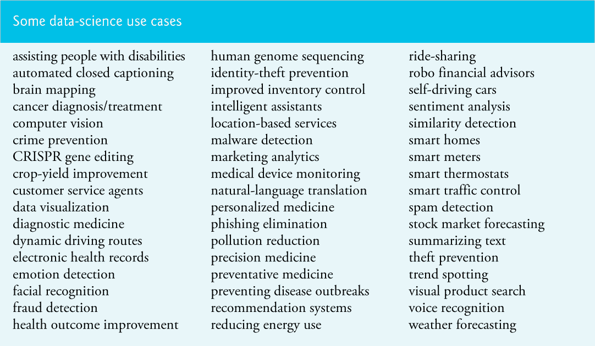

### 1.13 AI——计算机科学与数据科学的交汇点

当婴儿第一次睁开眼睛时，它能“看到”父母的脸吗？它能理解脸的概念或甚至是一个简单的形状吗？婴儿必须“学习”他们周围的世界。这就是人工智能（AI）技术中的机器学习所做的事情。它观察海量数据并从中学习。AI 技术被用于玩游戏、实现计算机视觉应用、实现自动驾驶汽车、让机器人学习执行新任务、诊断医疗状况、近实时将语音翻译成其他语言、创建在名为大型语言模型的海量文本数据库上进行训练后能够流畅且准确地回答任何问题的聊天机器人，等等。谁能想到在几年前，人工智能的自动驾驶汽车将获允许在我们的道路上行驶——甚至变得家常见呢？

#### 1.13.1 人工智能 (AI)

人工智能（AI）的两个定义(99,100)是：

*   “一门处理计算机智能行为的计算机科学分支”以及
*   “机器模仿人类智能行为的能力。”

99. “人工智能。” [Merriam-Webster.com](http://Merriam-Webster.com). 访问 2025 年 2 月 18 日. [`https://www.merriam-webster.com/dictionary/artificial%20intelligence`](https://www.merriam-webster.com/dictionary/artificial%20intelligence)。

100. “人工智能。” 维基百科。维基媒体。访问 2025 年 2 月 18 日. [`https://en.wikipedia.org/wiki/Artificial_intelligence`](https://en.wikipedia.org/wiki/Artificial_intelligence)。

AI 术语由 John McCarthy 在 1956 年创造。基于 AI 的系统现在渗透到我们的日常生活中。示例包括计算机视觉、语音识别、自然语言翻译、推荐系统（例如亚马逊推荐你可能喜欢的商品或 Netflix 推荐你可能喜欢的节目和电影）、自动游戏系统、自动驾驶汽车，以及最近的卓越工具，如：

*   聊天机器人，如 OpenAI 的 ChatGPT、Google 的 Gemini、Anthropic 的 Claude 和 Perplexity，它们的对话几乎与人类交流无异，
*   图像生成器，如 OpenAI 的 Dall-E（现已集成到 ChatGPT 中）、Google 的 Imagen（集成到 Gemini 中）、Midjourney、Stable Diffusion、Adobe 的 Firefly 等许多，它们根据文本描述创建原始图像，
*   视频生成器，如 OpenAI 的 Sora、Adobe 的 Firefly Video、Google 的 Veo 2、Meta 的 MovieGen 和 Runway 的 Gen-3 Alpha，它们根据文本描述创建原始视频。

几十年来，AI 一直是一个充满问题且没有解决方案的领域。这是一旦一个问题被解决，人们就会说：“那只是一个程序而已。”然而，通过机器学习等 AI 技术，我们不是在预设解决方案。相反，我们正在通过从数据中学习让计算机解决问题。通常是大量的数据。

#### 1.13.2 通用人工智能 (AGI)

AI 的终极目标是通用人工智能（AGI），它可以像人类一样在广泛范围内理解、学习并应用知识，不需要额外的训练——专家对于人工智能何时可能成为现实意见不一——从 2025 年(103)到 2030 年代(104)或永远不会。

101. “通用人工智能。”维基百科。维基媒体。访问 2025 年 2 月 18 日. [`https://en.wikipedia.org/wiki/Artificial_intelligence`](https://en.wikipedia.org/wiki/Artificial_intelligence)。

102. “技术奇点。”维基百科。维基媒体。访问 2025 年 2 月 18 日. [`https://en.wikipedia.org/wiki/Technological_singularity`](https://en.wikipedia.org/wiki/Technological_singularity)。

103. Sam Altman，“反思”，2025 年 1 月 5 日。访问 2025 年 2 月 18 日. [`https://blog.samaltman.com/reflections`](https://blog.samaltman.com/reflections)。

104. Lutz Finger，“Sam Altman 说我们知道构建 AGI —— 但并不快，”福布，2025 年 1 月 7 日。访问 2025 年 2 月 18 日. [`https://www.forbes.com/sites/lutzfinger/2025/01/07/sam-altman---agi--ai-workforce-in-2025-the-battle-of-tech-giants/`](https://www.forbes.com/sites/lutzfinger/2025/01/07/sam-altman---agi--ai-workforce-in-2025-the-battle-of-tech-giants/)。

105. 麦肯锡公司，“什么是通用人工智能 (AGI)？”，2024 年 3 月 21 日。访问 2025 年 2 月 18 日. [`https://www.mckinsey.com/featured-insights/mckinsey-explainers/what-is-artificial-general-intelligence-agi`](https://www.mckinsey.com/featured-insights/mckinsey-explainers/what-is-artificial-general-intelligence-agi)。

#### 1.13.3 智能里程碑

几个人工智能里程碑引起了人们的关注和想象，让大众开始认为 AI 是真实的，并让企业考虑将其商业化：

*   在 1997 年 `IBM 的 DeepBlue` 计算机系统与国际象棋大师加里·卡斯帕罗夫的对决中，`DeepBlue` 成为首个在比赛条件下击败现任世界象棋冠军的计算机。(106) IBM 为 `DeepBlue` 加载了数十万局大师级象棋对局。`DeepBlue` 可以通过暴力法每秒评估高达 2 亿次走法！^(107) 这就是大数据的应用。IBM 获得了 1980 年颁发的 10 万美元卡内基·梅隆大学弗雷金奖，该奖项授予首个击败世界象棋冠军计算机的创造者。(108)

    106. “Deep Blue versus Garry Kasparov.” 维基百科。维基基金会。访问于 2025 年 2 月 18 日。[`https://en.wikipedia.org/wiki/Deep_Blue_versus_Garry_Kasparov`](https://en.wikipedia.org/wiki/Deep_Blue_versus_Garry_Kasparov)。

    107. “Deep Blue (chess computer).” 维基百科。维基基金会。访问于 2025 年 2 月 18 日。[`https://en.wikipedia.org/wiki/Deep_Blue_(chess_computer)`](https://en.wikipedia.org/wiki/Deep_Blue_(chess_computer))。

    108. “IBM Deep Blue Team Gets $100,000 Prize.” 访问于 2025 年 2 月 18 日。[`https://articles.latimes.com/1997/jul/30/news/mn-17696`](https://articles.latimes.com/1997/jul/30/news/mn-17696)。

*   在 2011 年，`IBM 的 Watson` 在一场价值百万美元的比赛中击败了两位顶尖的《危险一家》（Jeopardy!）人类选手。`Watson` 同时使用了数百种语言分析技术在 2 亿页内容（包括所有维基百科）中定位正确答案，这需要 4 TB 的磁盘存储空间。(109,110) `Watson` 通过 AI 机器学习和强化学习技术进行了训练。(111)

    109. Jo Best, “IBM Watson: The inside story of how the Jeopardy-winning supercomputer was born, and what it wants to do next.” 访问于 2025 年 2 月 18 日。[`https://www.techrepublic.com/article/ibm-watson-the-inside-story-of-how-the-jeopardy-winning-supercomputer-was-born-and-what-it-wants-to-do-next/`](https://www.techrepublic.com/article/ibm-watson-the-inside-story-of-how-the-jeopardy-winning-supercomputer-was-born-and-what-it-wants-to-do-next/)。

    110. “Watson (computer).” 维基百科。维基基金会。访问于 2025 年 2 月 18 日。[`https://en.wikipedia.org/wiki/Watson_(computer)`](https://en.wikipedia.org/wiki/Watson_(computer))。


111. Ferrucci, D., Brown, E., Chu-Carroll, J., Fan, J., Gondek, D., Kalyanpur, A. A., Lally, A., Murdock, J. W., Nyberg, E., Prager, J., Schlaefer, N., & Welty, C. (2010). “Building Watson: An Overview of the DeepQA Project.” AI Magazine, 31(3), 59-79. [`https://doi.org/10.1609/aimag.v31i3.2303`](https://doi.org/10.1609/aimag.v31i3.2303).

*   围棋——一种数千年前起源中国的棋类(112)——被广泛认为是人类发明的最复杂的游戏之一，拥有 `10¹⁷⁰` 种可能的棋盘布局。(113) 为了理解这个数字有多大，据认为已知宇宙中仅约有 `10⁸⁰` 个原子！^(114) 2015 年，由 Google DeepMind 团队开发的 `AlphaGo` 使用带有两个神经网络的 AI 深度学习技术击败了欧洲围棋冠军樊回。围棋被认为比国际象棋复杂得多。

    112. *大英百科全书，“Go,” 最后修改于 2025 年 2 月 7 日。访问于 2025 年 2 月 18 日。[`https://www.britannica.com/topic/go`](https://www.britannica.com/topic/go).

    113. Akpan, “Google artificial intelligence beats champion at world’s most complicated.” 2016 年 1 月 27 日。[`https://www.pbs.org/newshour/artificial-intelligence-beats`](https://www.pbs.org/newshour/artificial-intelligence-beats).

    114. Paul Sutter, “How Many Atoms Are in Universe?” Live Science, 2021 年 7 月 11 日。访问于 2025 年 2 月 18 日。[`https://www.livescience.com/how-many-atoms-in-universe`](https://www.livescience.com/how-many-atoms-in-universe).

*   2017 年，Google 将 `AlphaGo` 泛化创建了 `AlphaZero`——一种棋类 AI。`AlphaZero` 在仅用几个小时后学会了下象棋，随后在 2017 年 12 月击败了世界冠军 `Stockfish`。(115)

    115. Samuel Gibbs, “AlphaZero beats champion after teaching itself.” 2017 年 12 月 7 日。[`https://www.theguardian.com/technology/2017/dec/07/alphzero-google-chess`](https://www.theguardian.com/technology/2017/dec/07/alphzero-google-chess).

*   2023 年，Google 发布 `AlphaDev`，它是基于 `AlphaZero` 构建的。`AlphaDev` 用于发现计算机算法，专注于排序算法。`AlphaDev` 为 `LLVM libc++` 库发现了新的算法，在较短序列上快了 70%，在超过 25 万个元素的序列上快了 1.7%。^(116)

    116. Daniel J. Mankowitz and Andrea Michi, “AlphaDev Discovers Faster Sorting Algorithms,” DeepMind，2023 年 6 月 7 日。访问于 2025 年 2 月 18 日。[`https://deepmind.google/discover/blog/alphadev-discovers-sorting-algorithms`](https://deepmind.google/discover/blog/alphadev-discovers-sorting-algorithms/).

#### 机器学习

**机器学习**是“人工智能的一个子领域，它赋予计算机无需显式编程即可学习的能力”。(117) 机器学习通常使用预定义的算法从训练数据中建立模型。这些模型随后可以用于预测。^(118) 例如，给定包含合法电子邮件和垃圾邮件（也称为垃圾邮件）的标记训练数据，机器学习模型可以从训练数据中学习，然后用于将其从未“见过”的电子邮件分类为垃圾邮件或非垃圾邮件。Microsoft Outlook 和 Google Gmail 等电子邮件应用程序使用此类技术将垃圾邮件移出收件箱。

    117. Sara Brown “Machine learning, explained.” 2021 年 4 月 21 日。访问于 2025 年 2 月 18 日。[`https://mitsloan.mit.edu/ideas-made-to-matter/machine-learning-explained`](https://mitsloan.mit.edu/ideas-made-to-matter/machine-learning-explained).

    118. “Machine learning.” 维基百科。维基基金会。访问于 2025 年 2 月 18 日。[`https://en.wikipedia.org/wiki/Machine_learning`](https://en.wikipedia.org/wiki/Machine_learning).

## 深度学习

“深度学习”是机器学习的一个分支，涉及构建人工神经网络，这种神经网络“试图模拟构成人类大脑的神经元网络，以便计算机能够以类人类的方式进行学习和做出决策。”^(119) “深”一词源于人工神经网络中软件“层”的数量——层越多，网络越深。随着网络层层层处理，它从其训练数据中学习得越多。^(120) 大数据的可用性、强大的处理器能力、更快的互联网速度以及并行计算软硬件的进步，使得更多的机构和个人能够追求资源密集型的深度学习解决方案，这些解决方案在计算机视觉、语音识别、语音合成以及新的生成式 AI 应用中取得了令人瞩目的成果（Section 1.14）。

119. Jason Brownlee，“什么是深度学习？”2023 年 11 月 16 日。访问于 2025 年 2 月 18 日。[`https://machinelearningmastery.com/what-is-deep-learning/`](https://machinelearningmastery.com/what-is-deep-learning/)。

120. “深度学习。”维基百科。维基基金。访问于 2025 年 2 月 18 日。[`https://en.wikipedia.org/wiki/Deep_learning`](https://en.wikipedia.org/wiki/Deep_learning)。

### 1.13.6 强化学习

强化学习^(121,122)是机器学习的一个分支，算法从环境中学习，类似于人类学习的方式——例如，视频游戏爱好者学习新游戏，或者婴儿学习走路或识别父母。该算法实现了一个智能体（agent），它通过尝试执行任务来学习，接收有关成功或失败的反馈，进行调整然后再次尝试。目标是奖励最大化。智能体在正确执行时获得正奖励，在错误执行时获得负奖励（惩罚）。智能体利用这些信息确定下一个要执行的操作，并必须尝试奖励奖励。

121. “强化学习。”维基百科。维基基金。访问于 2025 年 2 月 18 日。[`https://en.wikipedia.org/wiki/Reinforcement_learning`](https://en.wikipedia.org/wiki/Reinforcement_learning)。

122. Abid Ali Awan，“新手的强化学习，”KDnuggets，2022 年 5 月 16 日。访问于 2025 年 2 月 18 日。[`https://www.kdnuggets.com/2022/05/reinforcement-learning-newbies.html`](https://www.kdnuggets.com/2022/05/reinforcement-learning-newbies.html)。

### 1.14 生成式 AI

生成式 AI (genAI) 描述了可以根据用户提供的提示词作为输入生成新内容的算法——包括文本、图像、音频和视频。^(123,124,125)

123. “什么是生成式 AI？”麦肯锡公司，2024 年 4 月 2 日。访问于 2025 年 2 月 18 日。[`https://www.mckinsey.com/featured-insights/mckinsey-explainers/what-is-generative-ai`](https://www.mckinsey.com/featured-insights/mckinsey-explainers/what-is-generative-ai)。

124. “生成式人工智能。”维基百科。维基基金。访问于 2025 年 2 月 18 日。[`https://en.wikipedia.org/wiki/Generative_artificial_intelligence`](https://en.wikipedia.org/wiki/Generative_artificial_intelligence)。

125. Hannah Wren，“企业生成式 AI 入门，”Zendesk，2024 年 10 月 22 日。访问于 2025 年 2 月 18 日。[`https://www.zendesk.com/blog/generative-ai-guide/`](https://www.zendesk.com/blog/generative-ai-guide/)。

### GenAI 聊天机器人

OpenAI 的 `ChatGPT`、Google 的 `Gemini`、Anthropic 的 `Claude` 以及 `Perplexity` 都是基于 AI 的聊天机器人，你可以使用自然语言与其对话。^(126) 例如，你可以用如下文本提示它：

*   “告诉我关于 Java 编程语言的历史。”
*   “是谁创造了‘元宇宙’这个词？”
*   “总结文章：”后接文章链接。

126. “介绍 ChatGPT。”2022 年 11 月 30 日。[`https://openai.com/blog/chatgpt`](https://openai.com/blog/chatgpt)。

### 多模态聊天机器人

OpenAI 的 `ChatGPT`、Google 的 `Gemini`、Anthropic 的 `Claude` 以及 `Perplexity` 都是基于 AI 的聊天机器人，你可以使用自然语言与其对话。例如，你可以用如下文本提示它：

*   “告诉我关于 Java 编程语言的历史。”
*   “是谁创造了‘元宇宙’这个词？”
*   “总结文章：”后接文章链接。

### 图灵测试

当你与 `ChatGPT` 对话时，感觉就像在与人聊天。1950 年，艾兰·图灵提出了“模仿游戏”（现在被称为“图灵测试”）作为判断计算机是否表现出智能行为的方法。

127. “图灵测试。”维基百科。维基基金。访问于 2025 年 2 月 18 日。[`https://en.wikipedia.org/wiki/Turing_test`](https://en.wikipedia.org/wiki/Turing_test)。

### GenAI 能做的事

我们提示了 `ChatGPT`，让它列出生成式 AI 可以生成的所有类型。^(128) 然后我们让它总结冗长的回答：

*   **文本**——文章、论文、故事、诗歌、歌词、代码、摘要、营销文案、学术写作、电子邮件和指令指南。
*   **视觉/图像**——数字插画、概念艺术、角色设计、写实图像、标志、品牌元素、信息图和 AI 增强图形。
*   **音频**——AI 创作音乐、音效、环境音频、文本转语音、旁白、语音克隆和合成语音。
*   **视频**——AI 生成动画、解释视频、文本生成视频、深度伪造视频和虚拟角色。
*   **3D**——游戏 3D 模型、模拟、虚拟现实、数字雕塑、动画和特效。
*   **代码和软件**——自动化代码生成、编程辅助、聊天机器人、虚拟助手、自动化脚本和机器学习算法。
*   **交互**——聊天机器人对话、动态故事讲述、个性化测验、问卷、交互式网站和教育工具。
*   **数据相关**——AI 生成的数据分析、报告、可视化、图表、图形、表格和合成数据集。
*   **教育**——学习指南、课程计划、测验、教科章节、教程和交互式学习练习。
*   **多模态**——带有旁白和图形的 AI 生成视频、交互式模拟，结合文本、视觉和用户交互的虚拟环境。
*   **艺术与创意**——数字漫画、图形小说、混合媒体艺术、风格迁移作品、定制商品设计以及 AI 生成的剧本。
*   **杂项**——AI 生成的食谱、健身计划、每日肯定句、产品名称、口号、个性化推荐和法律文档模板。

[128]. `ChatGPT` 对“给我列出生成式 AI 可以生成的所有类型列表”的回答。2024 年 10 月 26 日 [`https://chatgpt.com`](https://chatgpt.com)。我们编辑了该回答。

这些能力让内容创作对所有人都触手可及。

### 大语言模型 (LLMs)

**大语言模型 (LLM)**[129] 是一种能够理解并生成自然语言的 AI。“大”一词源于 `LLMs` 是通过具有数十亿甚至数万亿参数的人工神经网络（或神经网络）实现的。`LLMs` 在海量文本——文章、书籍、互联网、代码等——上进行训练。随着神经网络的学习，它们会调整参数，试图产生更好的结果。神经网络学习的参数帮助 `LLMs` 理解和生成语言模式。

[129]. “[Large Language Model]。” Wikipedia. Wikimedia Foundation。访问于 2025 年 2 月 18 日 [`https://en.wikipedia.org/wiki/Large_language_model`](https://en.wikipedia.org/wiki/Large_language_model)。

[130]. Sean Michael Kerner, “[Large Language Model (LLM)],” TechTarget。访问于 2025 年 2 月 18 日 [`https://www.techtarget.com/whatis/definition/large-language-model-LLM`](https://www.techtarget.com/whatis/definition/large-language-model-LLM)。

[131]. Adrian Tam, “What Are Large Language Models?” Machine Learning Mastery,2023 年 7 月 20 日。访问于 2025 年 2 月 18 日 [`https://machinelearningmastery.com/what-are-large-language-models/`](https://machinelearningmastery.com/what-are-large-language-models/)。

`LLMs` 可以生成与人类写作无异的文本。某些模型持续学习和适应，随着时间的推移提高其有效性。它们非常擅长自然语言任务，如翻译、分类、摘要、问答、情感分析、创意写作等。它们也非常擅长生成代码、解释代码、发现代码中的错误、重构代码等。

### Transformers

**Transformer**[132] 是一种处理序列化数据（如文本）的神经网络。它可以理解并识别句子中远距离词之间的关系。`Transformers` 还能识别词的相对重要性。许多 `LLMs` 使用**生成式预训练 Transformer (GPTs)**[135]，这些模型使用多种人工智能技术在海量文本上进行训练。还有其他技术，例如 Google 的**双向 Transformer 器 (BERT)**，它侧重于自然语言理解 (NLU；见第 1.14 节) [137]。

[132]. “Transformer (Machine Model).” Wikipedia. Wikimedia Foundation。访问于 2025 年 2 月 18 日 [`https://en.wikipedia.org/wiki/Transformer_learning_model`](https://en.wikipedia.org/wiki/Transformer_learning_model)。

[133]. Rick Merritt, “What Is a Transformer Model?” NVIDIA Blog,2022 年 3 月 15 日。访问于 2025 年 2 月 18 日 [`https://blogs.nvidia.com/blog/what-is-a-transformer-model`](https://blogs.nvidia.com/blog/what-is-a-transformer-model/)。


[134]. Aveek Goswami, “Understanding Transformers,” Towards Data Science, 2024 年 6 月 27 日。访问于 2025 年 2 月 18 日 [`https://medium.com/towards-data-science/understanding-transformers-334d16c836`](https://medium.com/towards-data-science/understanding-transformers-334d16c836)。

[135]. “Large language model.” Wikipedia. Wikimedia Foundation。访问于 2025 年 2 月 18 日 [`https://en.wikipedia.org/wiki/Large_language_model`](https://en.wikipedia.org/wiki/Large_language_model)。

[136]. “ChatGPT.” Wikipedia. Wikimedia Foundation。访问于 2025 年 2 月 18 日 [`https://en.wikipedia.org/wiki/ChatGPT`](https://en.wikipedia.org/wiki/ChatGPT)。

[137]. “BERT (Language Model).” Wikipedia. Wikimedia Foundation。访问于 2025 年 2 月 18 日 [`https://en.wikipedia.org/wiki/BERT_language_model`](https://en.wikipedia.org/wiki/BERT_language_model)。

### 自注意力机制

**自注意力 (Self-attention)**[138] 是 `transformers` 的一个关键方面，用于自然语言处理。在尝试理解句子中的某个词时，周围单词提供的上下文对确定其含义起着重要作用。例如：

*   “good”一词通常是正面的，但当它前面有“not”时，上下文就变成了负面的。
*   “bank”一词可能指金融机构或河岸，取决于它是否与“loan”（贷款）或“river”（河）等词配对。[140] 老师们喜欢使用带有“test bank”（题库）的书籍，这有助于他们创建测验题。
*   同样，“break the ice”（破冰）这样的短语在涉及社交互动的上下文中会从字面意思变为比喻含义。[140]。

[138]. Ashish Vaswani 等，“Attention Is All You Need,” arXiv preprint arXiv:1706.03762 (2017)。访问于 2025 年 2 月 18 日 [`https://arxiv.org/abs/1706.03762`](https://arxiv.org/abs/1706.03762)。

[139]. “Attention (Machine Learning).” Wikipedia. Wikimedia Foundation。访问于 2025 年 2 月 18 日 [`https://en.wikipedia.org/wiki/Attention_machine_learning`](https://en.wikipedia.org/wiki/Attention_machine_learning)。

[140]. `ChatGPT` 对“提供周围上下文对决定单词含义起重要作用的例子”的回答。2024 年 10 月 26 日 [`https://chatgpt.com`](https://chatgpt.com)。我们编辑了该回答。

`Transformers` 利用自注意力机制分析每个词与其周围单词的关系。由于并非所有单词对句子含义的贡献都相同，自注意力机制会为词分配不同的权重，更关注最相关的词。与人类不同，`transformers` 可以同时处理和分析大量单词，建立它们之间的联系，以更好地理解其整体含义。

### Token、上下文与上下文窗口

**Token (标记)**[141] 是语言模型处理的单元。Token 可以是单词、词的一部分或标点符号。分词（Tokenization）将 Token 转换为模型可以处理的数值。Token 的**上下文 (context)** 是出现在单词或短语之前（有时也之后）的 Token 序列。理解上下文有助于模型生成更准确的响应。**上下文窗口 (context window)**[142] 是模型一次可以考虑的最大 Token 数（输入和输出的总和）。上下文窗口越大，与生成式 AI 对话时的上下文就越多，回复就越相关连贯，生成有用回复的成本越高。这就是为什么生成式 AI 的免费版通常具有较小的上下文窗口，或者在规定时间内允许的查询次数较少。

-   141. Microsoft. “理解 Token.” Microsoft Learn, 2024 年 5 月 20 日. 访问于 2025 年 2 月 18 日. [`https://learn.microsoft.com/en-us/dotnet/ai/conceptual/understanding-tokens`](https://learn.microsoft.com/en-us/dotnet/ai/conceptual/understanding-tokens).

-   142. IBM Research. “为什么更大的 LLM 上下文窗口风靡。” IBM Research Blog, 2024 年 7 月 24 日. 访问于 2025 年 2 月 18 日. [`https://research.ibm.com/blog/larger-context-window`](https://research.ibm.com/blog/larger-context-window).

生成式 AI 机器人的上下文窗口大小差异巨大。对于我们广泛使用的四种模型——OpenAI 的 `ChatGPT`、Google 的 `Gemini`、Anthropic 的 `Claude` 和 `Perplexity`——其上下文窗口大小从 `ChatGPT` 免费版本的 `8,000` 个 token^(143) 到 `Gemini` 付费版本的 `1,000,000` 个 token^(144) 不等。

-   143. `ChatGPT` 回复“你的上下文窗口有多大?” 2025 年 2 月 15 日. [`https://chatgpt.com`](https://chatgpt.com).

-   144. “Gemini Advanced.” 访问于 2025 年 2 月 18 日. [`https://gemini.google/advanced`](https://gemini.google/advanced).

### 提示词与提示词工程

**提示词工程** (Prompt engineering) 是指设计提示词以获得最佳响应的过程。在第 19 章之外，书中的许多章节以生成式 AI 练习结束，在这些练习中，我们专注于提示词工程，以帮助你与生成式 AI 工具进行有效交互。将此看作学习一种全新的、不同的编程语言。通过提示词工程，你编写精确的指令或查询，引导生成式 AI 产生所需的响应。

当你向生成式 AI 发出提示词时，请确保：

*   **要求生成式 AI 编写 Java 代码或回答关于 Java 特性的问题时，在提示词中包含“Java”**。此外，**根据你正在使用的 Java 版本，要求它们使用最新的 Java 惯用法编写 Java 代码**。
*   **跟踪你的提示词及其结果的质量。** 这对于学习哪些方法有效、哪些无效至关重要。这还将帮助你识别不同生成式 AI 平台的细微差别。**你将建立一个价值提示词和预期结果的库。**
*   **尝试多个生成式 AI**——包括不断出现的新模型——并比较结果以理解它们各异的能力。
*   **尝试不同的提示词策略**，看看哪些策略能帮助你实现预期的目标。不同的编程挑战可能需要不同的提示词策略。
*   **如果生成式 AI 的结果不理想，请调整你的提示词并重试。** 更好的提示词会产生更好的结果。某些生成式 AI 会深入探讨主题。

在向某些生成式 AI 发出提示词时，按下 `Enter`（或 `Return`）会立即提交提示词。对于其他模型，你必须显式按下（或选择）按钮来提交提示词。**要在不提交提示词的情况下移动光标到新行**，请使用


或

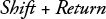

当第 2 章及后续章节要求你在提示词中为生成式 AI 提供 Java 代码时，我们建议从 Java 源文件中复制并粘贴代码。**大多数生成式 AI 还允许你上传一个或多个文件**，但这有时仅为付费订阅者提供的功能。

学习如何创建优秀的提示词需要大量的经验。各种在线指南可以帮助你构建更好的提示词，你甚至可以要求生成式 AI 自己来调整你的提示词。**OpenAI 提供了一份非常好的提示词工程指南**，位于


以及一组**大量的示例提示词**，位于

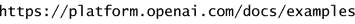

### 生成式 AI 轶事

在 2023 年 11 月和 12 月期间，我们会要求 `ChatGPT` 执行它之前会生成详细响应的任务。但它不再提供详细响应，而是变得很懒，只提供了一些步骤告诉我们如何自己执行任务。一些研究人员提出了“寒假假说”^(145)，推测 `ChatGPT` 学会在一年中这段时间少工作，是因为西方的人在假期期间倾向于少干活。

-   145. Edwards, Benj. “随着 ChatGPT 变得‘懒惰’，人们测试‘寒假假说’作为原因.” 2023 年 12 月 11 日. 访问于 2024 年 10 月 13 日. [`https://arstechnica.com/information-technology/2023/12/is-chatgpt-becoming-lazier-because-its-december-people-run-tests-to-find-out/`](https://arstechnica.com/information-technology/2023/12/is-chatgpt-becoming-lazier-because-its-december-people-run-tests-to-find-out/)

尽管生成式 AI 非常强大，但它们有时会**幻觉**^(146)将错误信息作为事实呈现。作为一个例子，我们询问一些生成式 AI “这些语句输出什么?”并向它们输入显示以下星的语句：

-   146. “幻觉（人工智能）.” 维基百科. 访问于 2025 年 2 月 18 日. [`https://en.wikipedia.org/wiki/Hallucination_(intelligence)`](https://en.wikipedia.org/wiki/Hallucination_(intelligence))

典型的生成式 AI 回是：


或者垂直显示每个星号。在 2024 年 8 月左右，有人发现询问 `ChatGPT` 的语音模式“strawberry 中有几个 R?”会得到错误的回答：“strawberry 中有两个 R。”我们说：“不，strawberry 中有三个 R。”`ChatGPT` 语音返回并说：“让我们看看：S-T-R-A-B-E-R-R-Y。你是对的，有三个 R！”

-   147. Kit Eaton, “strawberry 中有几个 R? AI 无法告诉你.” Inc., 2024 年 8 月 28 日. 访问于 2025 年 3 月 1 日. [`https://www.inc.com/kit-eaton/how-many-rs-in-strawberry-this-ai-cant-tell-you.html`](https://www.inc.com/kit-eaton/how-many-rs-in-strawberry-this-ai-cant-tell-you.html).

-   148. 我们在 2025 年 3 月尝试了这一点，`ChatGPT` 语音模式仍然给出错误的答案。

幻觉的一个例子是，生成式 AI 已被发现会编造法律案件。你可以通过以下提示词对此进行研究：“请提供一些法庭引用，在这些案件中，律师因引用 AI 生成的不存在的案例而受到责备。”

有趣的是，作为文本提示词输入相同的问题会得到正确的答案：“strawberry 中有三个 R。”^(148)

### 自然语言处理 (NLP) 与自然语言理解 (NLU)^(149)

[149] `Claude` 对“请写一段话解释什么是自然语言处理和自然语言理解，以及它们如何成为生成式人工智能的基础”的回复。2024 年 2 月 18 日 [`https://claude.ai`](https://claude.ai)。我们对该回复进行了编辑。

**自然语言处理 (NLP)** 和**自然语言理解 (NLU)** 是使生成式人工智能（genAI）能够与人类语言交互的两项关键技术。NLP 关注计算机如何处理和分析人类语言——将文本拆分为单词、句子以及它们之间等有意义的部分。将 NLP 视为帮助计算机阅读和理解文本的系统，就像你现在正在阅读和处理这些文字一样。

“红砖工厂”这个短语说明了为什么自然语言是一个如此具有挑战性的学科。“红砖工厂”是一个生产红砖的工厂吗？它是一个生产任何颜色砖块的红色工厂吗？它是一个用红砖建造的生产任何类型产品的工厂吗？在如今的音乐世界中，它甚至可能是一个滚乐队的名字或你智能手机上某个游戏的名字。

NLU 帮助计算机理解语言的含义和语境，而不仅仅是单个单词。例如，当你问一个 genAI“天气怎么样？”，然后接着问“我应该带伞吗？”，该 genAI 使用 NLU 识别出你的第二个问题与天气有关，并且你正在询问防雨保护。

NLP 和 NLU 成了生成式人工智能理解你的提示词（prompts）并生成类人类响应的基础。没有它们，与生成式人工智能交互将就像试图与一个认识某种语言的所有单词但不理解这些单词如何组合在一起或它们实际含义的人交谈。

### 1.15 总结

本章介绍了术语和概念，这些概念为你将在全书中学到的 Java 编程能力奠定了基础。我们讨论了摩尔定律，指出它几十年来如此准确预测的持续剧性改进似乎正在结束。因此，硬件设计人员已转向多核架构，你将通过我们在第 18 章、并发：从平台线程到虚拟线程 中讨论的多线程技术对其实进行编程。我们介绍了 Java，并鼓励你在开发新软件时，使用来自 `Java API` 和开源 Java 库的预存软件组件来避免重复造轮。

我们简要回顾了面向对象，以及类、对象、接口、继承和多态的概念，为第 2 章–第 7 章以及第 11 章中的对象自然案例研究，以及我们在第 8 章–第 9 章中对面向对象编程的详细处理提供了基础。

我们在 Java 开发工具包 (`JDK`) 的范围内讨论了典型的 Java 开发环境，然后使用它的工具测试了一个 Java 程序，以便你运行书中的示例程序和你编写的原始程序。你也可以使用 Java 集成开发环境（IDE）运行我们的程序——我们在 [`https://deitel.com/javafp5`](https://deitel.com/javafp5) 提供了多个热门 IDE 的测试引导。

我们讨论了互联网、云和物联网 (IoT)。我们介绍了元宇宙以及相关的关键技术——区块链、加密货币、非同质化代币 (NFTs)、Web3、增强现实 (AR)、虚拟现实 (VR) 和混合现实。我们考虑了各种软件开发技术，包括重构、设计模式、软件开发包 (SDKs)、版本控制系统 (VCS)、敏捷软件开发、测试驱动开发 (TDD)、微服务和容器化。

我们介绍了大数据分析，然后讨论了大数据以及各种数据规模，从兆字节（megabytes）到艾字节字节（exabytes）。最后，我们介绍了人工智能 (AI)——计算机科学与数据科学的交叉领域——展示了各种 AI 里程以及几项 AI 技术的简要概述，包括通用人工智能 (AGI)、机器学习、深度学习、强化学习和生成式人工智能，你将在整个书中使用它们来提升你的 Java 学习体验。在本章末的练习中，你将开始使用生成式人工智能来增强你的 Java 学习体验。在第 2 章中，你将开始 Java 编程。

#### 特别章节：生成式 AI 练习

针对以下每个问题，尝试使用多个 genAI 以确定哪一个表现最好。务必验证结果。记住，它们有时会出错甚至产生幻觉，创建出不可靠的信息。

**1.1** **（2010 年“闪崩”）** 我们对计算机依赖产生后果的一个例子是所谓的“闪崩”，它发生在 2010 年 5 月 6 日，当时美国股市在几分钟内暴跌，蒸发了超过万亿美元的投资——随后在几分钟内恢复。使用 genAI 调查这次崩溃的原因，并讨论它引发的问题。

**1.2** **（Java 与现代编程语言对比）** 提示 genAI 列出 Java 可能被认为是现代编程语言中首位的方法。

**1.3** **（Java 的六个月发布周期）** 提示 genAI 解释 Java 六个月发布周期的理由、优缺点。提问这对于使用 Java 进行业务和任务关键型软件开发的公司带来了哪些挑战。

**1.4** **（相同的问题，不同的答案）** 提示 genAI，询问为什么当你在几秒、几分钟、几小时或几天后询问同一个问题时，它们通常返回截然不同的响应。

**1.5** **（OpenAI ChatGPT 功能）** 提示 OpenAI 的 `ChatGPT` 介绍其处理文本、图像、音频和视频的多模态能力（如果有）。建议你可以构建哪些多模态应用。

**1.6** **（Google Gemini 功能）** 提示 Google 的 `Gemini` 介绍其处理文本、图像、音频和视频的多模态能力（如果有）。建议你可以构建哪些多模态应用。


# 1.7 （Anthropic Claude 功能）

提示 Anthropic 的 `Claude` 介绍其处理文本、图像、音频和视频的多模态能力（如果有）。建议你可以构建哪些多模态应用。

# 1.8 （Perplexity 功能）

提示 `Perplexity` 介绍其处理文本、图像、音频和视频的多模态能力（如果有）。建议你可以构建哪些多模态应用。

# 1.9 （生成式 AI 就业机会）

提示 genAI 询问你应该为生成式人工智能的职业做什么准备，以及生成式人工智能创造了哪些类型的新就业机会。

# 1.10 （技术创新与工作）

有人担心 genAI 会消除工作。提示 genAI 提供其他重大技术创新（例如互联网、谷歌搜索等）在消除某些工作同时也创造了新工作的例子。

# 1.11 （验证生成式 AI 响应）

提示 genAI，询问它们有时为什么产生幻觉，并提供检测和处理这一问题的最佳实践。

# 1.12 （有趣的生成式 AI 轶事）

提示 genAI 提供一系列有趣的生成式 AI 轶事。

# 1.13 （免费生成式 AI）

提示 genAI 列出免费的 genAI 或具有免费层级和或免费用用的 genAI。

# 1.14 （视频生成）

具有免费视频生成功能的 genAI 服务包括：

*   Synthesia.io ([`https://synthesia.io`](https://synthesia.io)) 允许你每月创建最多三分钟的视频，使用九个数字形象和 130 多种语言的各种 AI 语音。
*   Invideo AI ([`https://invideo.io`](https://invideo.io)) 允许你每周创建最多 10 分钟的视频。根据你的文本输入，它可以自动生成脚本、视频片段、字幕、背景音乐和转场。
*   Pictory AI ([`https://pictory.ai`](https://pictory.ai)) 提供三个分钟视频的免费试用。
*   Adobe Firefly ([`https://firefly.adobe.com`](https://firefly.adobe.com)) 提供每月免费额度。

提示生成式 AI 提供每种服务生成的演示链接。尝试并对这些演示评论。

## 1.15 免费文本转语音服务

两个热门的服务是：

*   Google Cloud 的 Text-to-Speech 为其 `WaveNet`（听起来自然）语音每月提供数百万个免费字符，为其标准语音每月提供四百万个免费字符。
*   Amazon Polly 的免费层级允许在使用其标准语音时每月使用五 00 万个字符，并在前 12 个月内使用其神经（听起来自然）语音每月使用一百万字符。

提示生成式 AI 提供每种服务生成的演示链接。尝试并对这些演示评论。

## 1.16 检测 AI 生成内容

提示生成式 AI 寻找用于检测 AI 生成内容的免费工具或具有免费层级/免费试用的工具。这是一个困难的问题，报告的结果往往是错误的。对使用这些工具的伦理问题进行评论。

## 1.17 伦理

提示生成式 AI 编写关于 AI 伦理的教程，并列出使用生成式 AI 的伦理问题。

## 1.18 负面影响

提示生成式 AI 列出 AI negatives。

## 1.19 监管

提示生成式 AI 编写关于政府监管 AI 的教程。这些因州或国家而异。

## 1.20 安全

提示生成式 AI 编写关于 AI 安全的教程。

## 1.21 IQ 测试

提示生成式 AI 列出可能出现在 IQ 测试中的问题类型。

## 1.22 轶事：光速决策

在内战期间，电报被用于近实时的通信。(151) 有一个归于亚伯拉罕·林肯的轶事，其中一位年轻的军官兴奋地告诉他，他们正在为战场配备电报功能。该军官告诉总统，他将能够以光速做出决策。年老且智慧的林肯回答军官说，他也能以光速做出 `wrong` 决策。

151. “内战信号”，访问 2024 年 6 月 24 日。[`https://www.nsa.gov/portals/75/documents/resources/everyone/digital-media-center/video-audio/general/civil-war-signals-transcript.pdf`](https://www.nsa.gov/portals/75/documents/resources/everyone/digital-media-center/video-audio/general/civil-war-signals-transcript.pdf)。

我们要求生成式 AI 追踪这段轶事。以下是 `ChatGPT` 的说法：“你所引用的话通常归于亚伯拉罕·林肯，关于内战期间对电报的使用。然而，这看起来像是一个转述，而非林肯的直接引言。其核心思想是，电报提供的快速通信允许更快的决策速度，但也意味着错误的决策也可以以同样的速度传播。以下是常被引用的转述观点：‘随着电报的出现，错误的决策现在可以以光速传输。’这反映了林肯对电报等新技术如何影响内战期间决策速度和后果的认识。电报在那个时代确实是通信和协调的关键工具，虽然它有许多益处，但也意味着错误可以比以前快得多被传达并处理。”^(152)

152. `OpenAI ChatGPT 4o`，访问 2024 年 6 月 24 日。[`https://chatgpt.com`](https://chatgpt.com)。

生成式 AI 是一项相对新的技术，具有许多必须仔细考虑的影响。它与林肯电报轶事相比的优势之一是它为提高决策质量提供了许多可能性。提示生成式 AI 它们如何帮助你提高决策质量。

## 1.23 生成式 AI 问题：偏见

互联网上的数据包含很多偏见，而这些数据被用于训练生成式 AI 大语言模型。因此，当模型训练时，它们可能会吸收这些偏见。提示生成式 AI，询问它们采取了什么措施避免从训练数据中吸收偏见。

## 1.24 生成式 AI 问题：版权问题

提示生成式 AI，询问它们如何确保其创建的图像是原创的且不侵犯版权。

## 1.25 AI 代理

提示生成式 AI，询问 `AI agent` 是什么，并给出几个著名的例子。

## 1.26 人机交互 (Humans in the Loop)

提示生成式 AI，询问在使用生成式 AI 结果时保持人类“在回路中的重要性”，特别是在业务关键的情况下。

# 2 Java 编程简介

## 目标

在本章中，你将：

*   编写、编译和运行 Java 程序。
*   使用输入输出语句。
*   声明、初始化和使用基本类型变量。
*   使用算术运算符。
*   理解算术运算符的优先级。
*   编写决策语句。
*   使用关系和相等运算符形成条件。
*   使用生成式 AI 来增强你的学习体验。
*   在学习创建类之前，通过方便地创建和使用 `String` 对象开始欣赏对象自然的方法。

## 大纲

## 2.1 引言

本章介绍 Java 编程。我们从在屏幕上输出信息的简单程序开始。然后介绍一个从用户那里输入（即读取）两个数字、计算它们的和并显示结果的程序。你将进行算术计算并将结果供以后使用。最后一个示例通过比较两个数字来演示决策，显示比较结果。在整个章节，你将使用生成式 AI 来增强你的学习体验。

## 2.2 你的第一个 Java 程序：打印一行文本

考虑一个显示一行文本的简单程序。图 2.1 显示了该程序，随后是一个显示其输出的方框。我们使用行号是为了教学目的——它们并不是程序的一部分。这个示例说明了几个重要特性。我们将看到第 7 行执行了程序的关键操作——在屏幕上显示文本 `"Welcome to Java Programming!"`。

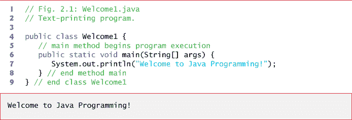

**图 2.1** | 文本打印程序。

### 为程序编写注释

我们插入注释来记录程序并提高其可读性。编译器会忽略注释，因此当你运行程序时，它们不会导致计算机执行任何操作。按照惯例，我们每个程序都从注释开头，标明图编号和程序文件名，以帮助你在书的 `examples` 文件夹（在“开始之前”章节中讨论）中找到该文件。第 1 行的注释指出，你可以在 `examples/ch02/fig02_01` 文件夹中找到 `Welcome1.java`。该注释以 `//` 开头，表示它是*行尾注释*，在行末处结束。此类注释不需要另起一行；它们也可以从行中间开始并持续到行末（如第 5、8 和 9 行）。按照我们的惯例，第 2 行是描述程序用途的注释。

Java 还有传统的注释，你可以将其跨越几行，如下所示：

```
传统注释
```

这些注释以分隔符 `/*` 开头，以 `*/` 结束。编译器会忽略分隔符之间的所有文本。某些组织要求程序员在每个源文件开头都写一个多行注释，包括程序的用途、程序员的名字以及程序员最后一次修改程序的日期和时间。

### Javadoc 注释

第三种注释类型称为 `Javadoc 注释`，由 `/**` 和 `*/` 分隔。编译器会忽略分隔符之间的所有文本。Javadoc 注释允许你直接在程序中嵌入程序文档，这在业界是受青睐的。`javadoc` 工具程序^(1,2)（JDK 的一部分）读取 Javadoc 注释并使用它们准备在 Web 浏览器中查看的程序文档。我们在代码中使用 `//` 注释来节省空间。

1. “如何为 Javadoc 工具编写文档注释”。访问于 2024 年 5 月 17 日。[`https://oracle.com/technical-resources/articles/java/javadoc-tool.html`](https://oracle.com/technical-resources/articles/java/javadoc-tool.html)。

2. “`javadoc` 命令”。访问于 2024 年 9 月 21 日。[`https://docs.oracle.com/en/java/javase/23/docs/specs/man/javadoc.html`](https://docs.oracle.com/en/java/javase/23/docs/specs/man/javadoc.html)。

### 语法错误

忘记注释分隔符会导致语法错误——当编译器遇到违反 Java 语言规则（即其语法）的代码时，就会发生此类错误。这些规则类似于规定句子结构的自然语言语法规则，例如英语、西班牙语、中文、印地语等语言中的规则。语法错误也被称为编译错误，因为它们是由编译器检测到的。在执行程序以完成其工作之前，程序必须无错误地编译。

### 使用空行

空行（如第 3 行）、空格字符和制表符——被称为空白字符——可以让程序更易读。编译器会忽略空白字符。

### 声明类

第 4 行开始 `Welcome1` 的类声明。每个程序至少包含一个你声明的类。`class` 关键字引入类声明，后面紧跟类名（`Welcome1`）。关键字是 Java 保留的。每个关键字都用全小写字母编写。我们声明的大多数类以 `public` 关键字开头。你将在第 8 章学习更多关于 `public` 和非 `public` 类的知识。下表显示了完整的关键字列表：

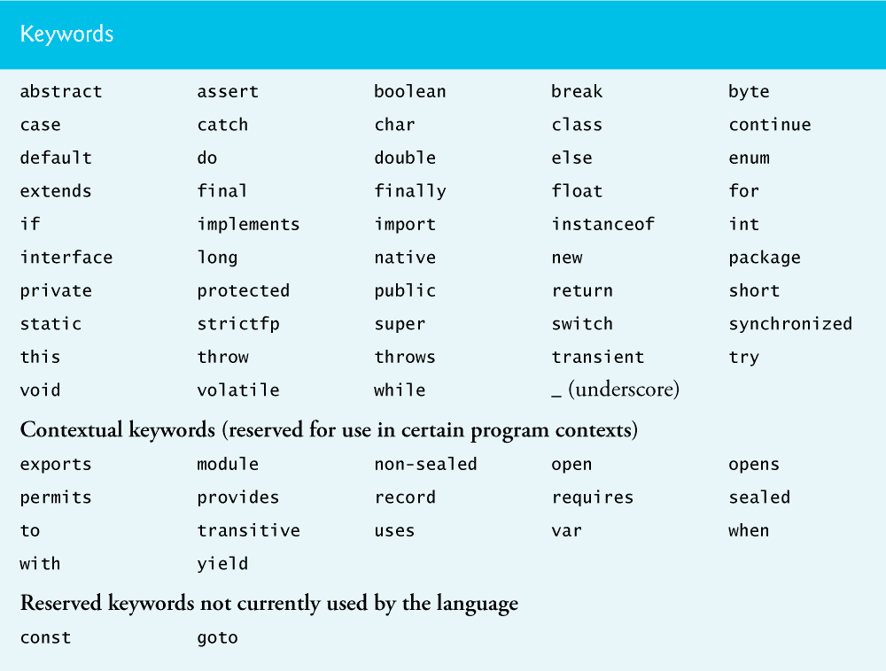

### public 类的文件名

`public` 类必须放在文件名为 `ClassName.java` 的文件中，因此 `Welcome1` 存储在 `Welcome1.java` 文件中。如果 `public` 类的文件名与类名（拼写或大小写均）加上 `.java` 不同，就会发生编译错误。

### 类名和标识符

按照惯例，类名标识符中的每个单词都以大写字母开头。例如，名称 `DollarAmount` 的第一个单词（`Dollar`）以大写 `D` 开头，第二个单词（`Amount`）以大写 `A` 开头。这种命名约定被称为驼峰命名（camel case），因为大写字母像驼峰一样突出。

类名是一个标识符——一系列由字母、数字、下划线（`_`）和美元符号（`$`）组成的字符，不以数字开头且不包含空格。一些有效的标识符是 `Welcome1`、`$value`、`_value`、`inputField`。

### 类体

左括号（第 4 行结尾）开始类声明。对应的右括号（第 9 行）必须结束每个类。

第 5 到 8 行进行了缩进。你应该在括号之间将类体缩进一个“级别”。我们使用三个空格作为缩进——许多程序员偏好两个或四个空格。无论你选择哪种，请保持一致。IDE 通常会为你缩进代码，默认使用四个空格缩进。`Tab` 键也可以用于缩进代码。

如果括号没有成对出现，就是语法错误。为了防止这种错误，当你输入左括号时，立即输入右括号。然后，将光标放在括号之间并缩进。

### 声明方法

第 6 行是每个程序的起点。标识符 `main` 后的括号表示这是一个被称为方法的程序构建块。类声明通常包含一个或多个方法。一个方法必须名为 `main` 且必须像第 6 行那样定义；否则程序将无法执行。

方法执行任务并在完成任务后返回信息。我们将在 8.2.5 节中解释关键字 `static` 的用途。`void` 关键字表示此方法不会返回任何信息。稍后我们将看到返回信息的方法。现在，在你的程序中模仿 `main` 的第一行即可。第 6 章讨论了括号中的 `String[] args`。

第 7 行显示了双引号（`"`）标记之间的字符。引号本身不会显示。双引号以及它们之间的字符合称为 `string`（字符串）、`character string`（字符字符串）或 `string literal`（字符串字面量）。编译器不会忽略字符串中的空白字符。双引号（`"`）中的字符串不能跨越多行代码。稍后我们将讨论用于形成多行字符串的文本块。

`System.out` 是预定义的 `standard output object`（标准输出对象）。它允许程序在执行程序的 `command window`（命令行窗口）中显示文本：

* Microsoft Windows 上的 Command Prompt 或 Windows PowerShell，或
* Linux/macOS 中的 `terminal`（终端）或 `shell`（壳）。

许多程序员简单地将命令行窗口称为 `command line`（命令行）。

`System.out.println` 方法显示一行文本。第 7 行括号中的字符串是该方法的 `argument`（参数）。当 `System.out.println` 完成任务时，它会将输出光标（下一个字符将显示的位置）移动到下一行的开头。这类似于在编辑器中输入文本时按下 `Enter` 键——光标会移动到文档下一行的开头。

整个第 7 行（包括 `semicolon` 分号（`;`））被称为一个 `statement`（语句）。一个方法通常包含执行其任务的语句。大多数语句以分号结束。

### 在右括号上使用行尾注释以提高可读性

目前，我们在结束方法声明的右大括号以及结束类声明的右大括号之后包含了一个行尾注释。例如，第 8 行表示 `main` 方法的结束大括号，第 9 行表示 `Welcome1` 类的结束大括号。在本章之后，我们将省略此类结束注释。

## 生成式 AI

**1** 使用以下代码向生成式 AI 提问，询问该代码显示了什么：

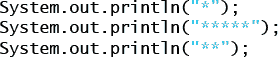

将结果与以下输出对比：


### 2.2.1 编译程序

现在你可以编译并执行该程序了。在这里，我们将使用 Java 开发工具包（JDK）的命令行工具。我们假设书中的示例位于你用户账户的 `Documents` 文件夹中名为 `examples` 的子目录下，正如“开始之前”部分所说。

#### 切换到正确的文件夹

首先，打开命令行窗口（参见第 1.7 节）并切换到存储程序的文件夹。操作系统通常使用 `cd` 命令切换文件夹。在 Windows 上，输入以下命令并按 `Enter`（或 `Return`）键切换到 `fig02_01` 文件夹：

```
cd Documents\examples\ch02\fig02_01
```

在 Linux/macOS 上，使用以下命令：

```
cd Documents/examples/ch02/fig02_01
```

#### 编译 .java 文件

要编译程序，请输入以下命令并按 `Enter`：

```
javac Welcome1.java
```

如果程序不包含编译错误，此命令将创建 `Welcome1` 的 `class file`（类文件）（`Welcome1.class`），其中包含代表程序的平台无关字节码。当我们使用 `java` 命令在给定平台上执行程序时，JVM 将这些字节码翻译成底层操作系统和硬件理解的指令。

#### 错误消息

编译时，如果你收到错误消息“`class Welcome1 is public, should be declared in a file named Welcome1.java`”，可能是因为：

* 你的文件名与文件的 `public` 类名不匹配，或
* 你在编译命令中拼写错了类名。

有时，“破坏”一个运行良好的程序来熟悉编译器的错误消息很有帮助。虽然错误消息通常能让你了解产生原因，但它们并不总是能指出代码中的准确问题。尝试从图 2.1 的程序中删除一个分号或大括号，然后重新编译以产生由于缺失而生成的错误消息。

如果编译器报告语法错误，错误可能不在错误消息指示的那行。首先，检查错误消息中报告的行。如果在该行没有找到错误，请检查之前的几行。每个编译错误消息都包含发生错误的文件和行号。例如，`Welcome1.java:6` 表示 `Welcome1.java` 的第 6 行发生了错误。消息的其余部分将提供有关错误的信息。

## 生成式 AI

**1** 通过删除大括号来破坏图 2.1 中的程序。然后，将损坏的代码发送给生成式 AI，让它们找到并修正错误。将修复后的代码与图 2.1 进行对比。

### 2.2.2 执行程序

输入以下命令并按 `Enter` 来执行 `Welcome1` 程序：

```
java Welcome1
```


注意，运行程序时不包含 `.class` 扩展名。JVM 会启动并加载 `Welcome1.class` 文件，然后调用 `Welcome1` 的 `main` 方法。

### 2.3 修改你的第一个程序

在本节中，我们修改图 2.1 的示例，使用多个语句在单行打印文本，并使用一个语句在多行打印文本。

#### 使用多个语句显示单行文本

`Welcome2`（图 2.2）使用两个语句（第 7–8 行）产生图 2.1 中的输出。

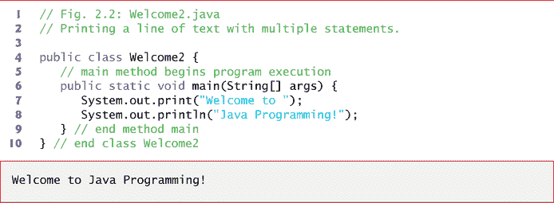

**图 2.2** | 使用多个语句打印一行文本。

该程序与图 2.1 类似，因此我们在这里只讨论变化。第 2 行是说明程序目的的行尾注释。第 4 行开始 `Welcome2` 类的声明。`main` 方法中的第 7–8 行显示一行文本。第一个语句使用 `System.out.print` 方法显示字符串。每个 `print` 或 `println` 语句都会从上一个语句停止的地方继续显示字符。与 `println` 不同，`print` 在显示其参数后不会将输出光标置于下一行的开头——程序显示的下一个字符将紧接着 `print` 显示的最后一个字符（空格字符）出现。

#### 使用单个语句显示多行文本

单个语句可以使用 `newline characters` 换行符（`\n`）显示多行文本，换行符会将输出光标置于下一行的开头。图 2.3 中的程序输出了四行文本。

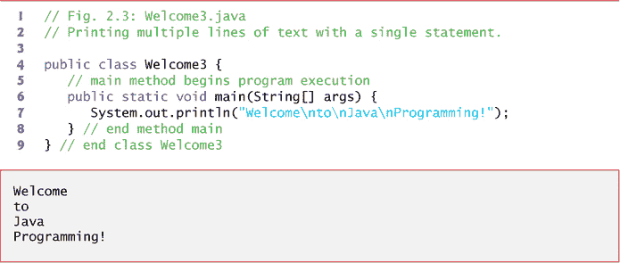

**图 2.3** | 使用单个语句打印多行文本。

第 7 行显示四行文本。通常，字符串中的每个字符按照其在双引号中的显示显示。然而，组合字符 `\` 和 `n`（语句中重复了三次）并没有出现在屏幕上。反斜杠（`\`）是一个转义字符，对 `System.out` 的 `print` 和 `println` 方法具有特殊含义。当字符串中出现反斜杠时，它会与下一个字符结合形成一个 `escape sequence` 转义序列——`\n` 转义序列代表 `newline character` 换行符。当在输出的字符串中遇到 `\n` 时，输出光标移动到下一行的开头。

下表描述了若干转义序列——完整列表，请参阅《Java 语言规范》第 3.10.7 节，转义序列：^(5)

5. 《Java 语言规范，Java SE 22 版》。第 3.10.7 节，“转义序列”。访问于 2024 年 5 月 30 日 [`https://docs.oracle.com/javase/specs/jls/se22/html/jls-3.html#jls-3.10.7`](https://docs.oracle.com/javase/specs/jls/se22/html/jls-3.html#jls-3.10.7)。

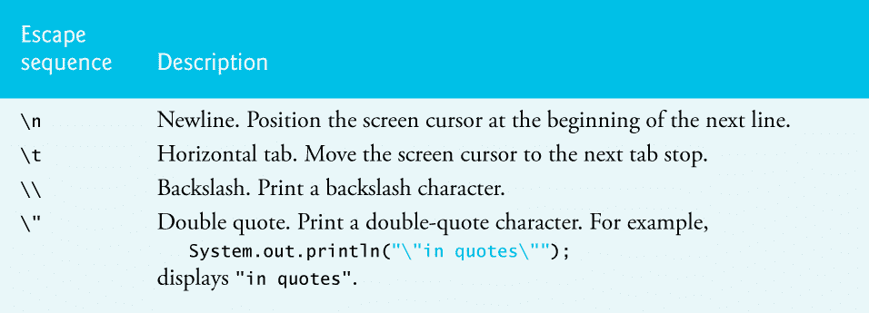

## 生成式 AI

**1** 提示生成式 AI 简化以下代码

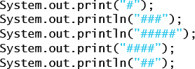

然后运行它们返回的代码。它产生了如下输出吗？


*注：* 在本文写作时，我们所有的首选生成式 AI 都错了，即使我们更改了提示词来尝试帮助它们。请始终检查 genAI 的结果。

### 2.4 使用 `printf` 显示文本

`System.out.printf` 方法显示格式化数据——`printf` 中的“f”代表“formatted（格式化的）”。图 2.4 使用 `printf` 在分行输出 `"Welcome to"` 和 `"Java Programming!"`。

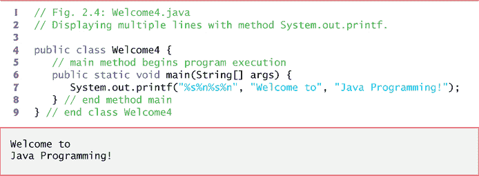

**图 2.4** | 使用方法 `System.out.printf` 显示多行。

第 7 行调用 `System.out.printf` 显示程序的输出。该方法调用指定了三个参数。当一个方法需要两个或多个参数时，你将它们放在逗号分隔的列表中，并在每个逗号（`,`）后加一个空格以提高可读性。

方法 `printf` 的第一个参数是格式字符串，它由固定文本和格式说明符组成。固定文本由 `printf` 输出的方式与 `print` 或 `println` 输出完全相同。每个格式说明符都是一个值的占位符，并指定了要输出的数据类型。

格式说明符以百分号（`%`）开头，后跟一个代表数据类型的字符。`%s` 格式说明符是字符串的占位符。第 7 行中的格式字符串指定 `printf` 输出两个字符串，每个字符串后面跟着一个换行符。此示例将第一个 `%s` 替换为 `"Welcome to"`，将第二个 `%s` 替换为 `"Java Programming!"`。输出显示了两行文本。

注意，我们没有使用在 `System.out.print` 和 `System.out.println` 中使用的换行转义序列 `\n`，而是使用了 `%n` 格式说明符，它仅出现在格式字符串中。在后面的章节中，我们将介绍使用 `printf` 格式化输出的更多细节，附录 B 深入介绍了打印格式化。

## 生成式 AI

**1** 提示生成式 AI 写一个 Java `printf` 语句，产生如下输出：


将生成的代码与以下语句对比：

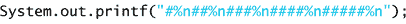

### 2.5 另一个程序：整数相加

图 2.5 中的程序读取（或输入）用户输入的两个整数（整数，如 –22、7、0 和 1024），将它们存储在变量中，计算它们的和并显示。在我们的程序输出中，我们使用粗体文本识别用户输入（此例中的 `45` 和 `72`）。

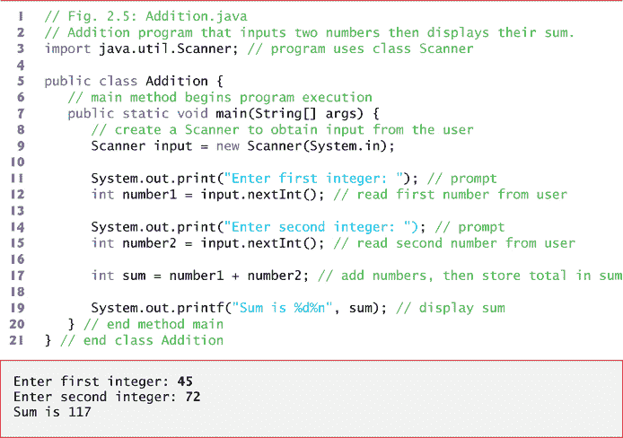

**图 2.5** | 输入两个数字然后显示它们的和的加法程序。

### `import` 声明

Java 的一大优势是它拥有丰富的预定义类，你可以重用这些类，而不是“重复造轮子”。这些类被分组在包中——即相关类的命名组——统称为 Java 应用程序编程接口（Java API）。

第 3 行是一个 `import` 声明，帮助编译器找到此程序中使用的类。它指示程序使用了来自 `java.util` 包的预定义 `Scanner` 类（稍后将讨论）。编译器随后确保你正确地使用了该类。

所有 `import` 声明必须出现在文件中的类声明之前。将 `import` 声明放置在类声明内部或之后是语法错误。忘记为必须 `import` 的类包含 `import` 声明会导致编译错误，错误中包含类似“cannot find symbol（无法找到符号）”这样的信息。当发生这种情况时，请检查你是否提供了正确的 `import` 声明，以及其中的名称是否正确（包括正确的大小写）。

### 声明并创建 `Scanner` 以获取用户输入

在使用每个变量之前，你必须用名称和类型对其进行声明。变量名允许程序访问内存中的变量值。按照惯例，变量名使用驼峰命名法（camelCase）。

第 9 行声明 `input` 持有 `Scanner` 类型的数据。表达式 `input = new Scanner(System.in)` 使用 `new` 关键字从 `System.in` 创建一个 `Scanner` 对象。`Scanner` 对象从用户处读取字节并将其转换为 `int` 等类型。

### 提示用户输入

第 11 行使用 `System.out.print` 显示 `"Enter first integer: "`。此提示消息引导用户采取行动。我们使用 `print` 而不是 `println`，以便用户的输入出现在同一行。回想第 2.2 节，以大写字母开头的标识符代表类名。`System` 类是 `java.lang` 包的一部分，Java 会自动导入每个程序。

### 声明变量存储整数并从用户处获取

第 12 行的变量声明语句声明 `number1` 持有 `int` 类型的数据——即整数（整数数值），如 `72`、–1127 和 `0`。`int` 的取值范围是 –2,147,483,648 到 +2,147,483,647。程序的 `int` 值可能包含逗号，因为 Java 使用逗号来分隔列表中的项，例如此程序第 19 行 `System.out.printf` 的参数。为了可读性，你可以使用下划线对数字进行分组作为数字分隔符——所以 `60_000_000` 代表值 60,000,000。

`float` 和 `double` 类型持有实数，`char` 类型持有字符数据。实数包含小数点，如 `3.4`、`0.0` 和 –11.19。`char` 类型的变量表示单个字符，例如

*   一个字母（例如 `A` 或 `z`），
*   一个数字（`0`–`9`），
*   一个特殊字符（例如 `*` 或 `%`）或
*   一个转义序列（例如 `\t` 表示制表符或 `\n` 表示换行符）。

`int`、`float`、`double` 和 `char` 类型是**基本类型**。它们的名称是关键字，且必须全部小写。其他基本类型有 `boolean`、`byte`、`short` 和 `long`。关于数值基本类型范围的摘要，请访问 Java 语言规范第 4.2 节，“基本类型与值”。^(6)

6. 《Java 语言规范，Java SE 22 版》。第 4.2 节，“基本类型与值”。访问 2024 年 5 月 30 日。[`https://docs.oracle.com/javase/specs/jls/se22/html/jls-4.html#jls-4.2`](https://docs.oracle.com/javase/specs/jls/se22/html/jls-4.html#jls-4.2)。

第 12 行中的 `=` 表示 `int` 变量 `number1` 在声明时应用 `input.nextInt()` 的结果进行初始化。这使用了 `Scanner` 对象 `input` 的 `nextInt` 方法从用户处获取一个整数。此时，程序等待用户输入一个数字并按下 *Enter* 键将其提交给程序。

我们的程序假设用户输入的是有效的整数值。如果不是，将会发生逻辑错误，且程序将终止。第 10 章，异常处理：深入探讨 讨论了如何通过允许程序处理此类错误来增强程序的健壮性。这有助于使你的程序具有容错能力。

### 获取第二个整数

第 14 行提示用户输入第二个整数。第 15 行声明了 `int` 变量 `number2` 并用从用户处读取的第二个整数对其进行初始化。

### 在计算中使用变量

第 17 行声明了 `int` 变量 `sum`，并用计算 `number1 + number2` 的结果对其初始化。`+` 运算符是一个**二元运算符**，因为它有两个**操作数**——`number1` 和 `number2`。包含计算的语句部分称为**表达式**。事实上，表达式是语句中任何具有值的部分。表达式 `number1 + number2` 的值是它们之和。同样地，表达式 `input.nextInt()`（第 12 行和第 15 行）的值是用户输入的整数。在二元运算符的两侧留空格以提高可读性。

### 显示计算结果

计算完成后，第 19 行使用方法 `System.out.printf` 来显示 `sum` 的值。`%d` **格式占位符**是 `int` 值（`sum`）的占位符——字母 `d` 代表“十进制（基数为 10）整数”。格式字符串中的其余字符都是固定文本。因此，`printf` 方法显示 `"Sum is "`，随后是 `sum` 的值（替换 `%d`）以及一个换行符。

```
System.out.printf("Sum is %d\n", sum);
```

### 2.6 算术

`int`、`float`、`double` 和 `char` 类型是**基本类型**。它们的名称是关键字，且必须全部小写。其他基本类型有 `boolean`、`byte`、`short` 和 `long`。

#### 2.6.1 整数除法

整数除法产生商。整数除法中的分数部分会被截断（即丢弃）。例如，`7 / 4` 结果为 `1`，`17 / 5` 结果为 `3`。

#### 2.6.2 模数运算符 (`%`)

模数运算符 `%` 产生除法后的余数。例如，`7 % 4` 产生 `3`，`17 % 5` 产生 `2`。该运算符最常用于整数操作，但也可以用于其他类型。该运算符的用途包括判断整数的奇偶性或一个数是否是另一个数的倍数。

#### 2.6.3 直线形式的算术表达式

算术表达式必须以**直线形式**编写以便计算机输入。因此，诸如“a 除以 b”的表达式必须写成 `a/b`，使常量、变量和运算符都在一行。

#### 2.6.4 用于分组的括号

括号在 Java 表达式中的分组方式与代数相同。例如，为了将 `a` 乘以 `b + c`，我们写成 `a*(b+c)`。

#### 2.6.5 运算符优先级

Java 根据**运算符优先级**规则规定的精确顺序应用算术运算符，这些规则通常与代数规则一致：

1. 先应用乘法、除法和模运算。如果表达式中包含多个此类操作，则从左到右应用。乘法、除法和模运算符具有相同的优先级。
2. 接下来应用加法和减法操作。如果表达式中包含多个此类操作，则从左到右应用。加法和减法运算符具有相同的优先级。
3. 最后应用赋值运算符。

当我们说运算符从左到右应用时，我们指的是它们的**分组**方式。有些是从右到左应用的。

7. 我们使用简单的示例来解释求值顺序。在更复杂的表达式可能会出现微妙的求值顺序问题。更多信息，请参考《Java 语言规范》第 15 章（[`https://docs.oracle.com/javase/specs/jls/se22/html/jls-15.html`](https://docs.oracle.com/javase/specs/jls/se22/html/jls-15.html)）。

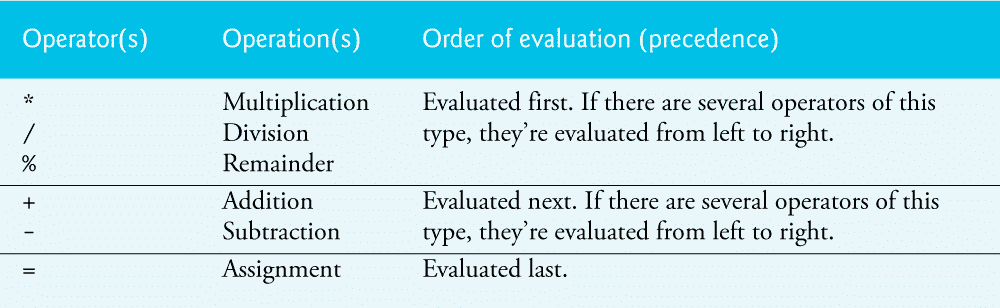

你可以在此处查看 Java 运算符的完整运算符优先级表：


## 生成式 AI

**1** 提示生成式 AI 解释 Java 评估以下语句中运算符的顺序，并指明在语句执行执行后 `x` 的值：


生成式 AI 应该说明求值顺序为：


并且赋值给 `x` 的值为 `3`。

### 2.7 决策：相等运算符和关系运算符

条件是一个可以为 `true` 或 `false` 的表达式。`if` 语句根据条件的值做出决策。你在 `if` 语句中使用下表总结的**相等运算符**（`==` 和 `!=`）和**关系运算符**（`>`、`<`、`>=`、和 `<=`）来构建条件：

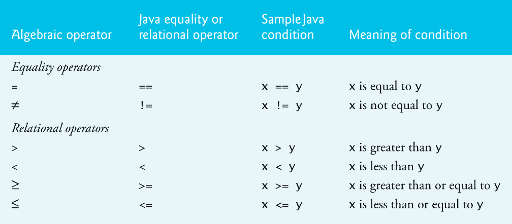

两个相等运算符具有相同的优先级，且低于关系运算符的优先级。相等运算符从左到右分组。所有关系运算符具有相同的优先级，并且也从左到右分组。

### 使用 `if` 语句

图 2.6 使用六个 `if` 语句来比较用户输入的两个整数。如果这些语句中的任何一个条件为 `true`，则执行相应的体语句；否则，则跳过它。我们使用 `Scanner` 从用户处输入整数并将其存储在变量 `number1` 和 `number2` 中。程序用所有六个关系运算符和相等运算符比较这些数字，并显示结果为 `true` 的比较结果。我们展示了用户输入的不同值对的三个示例输出。

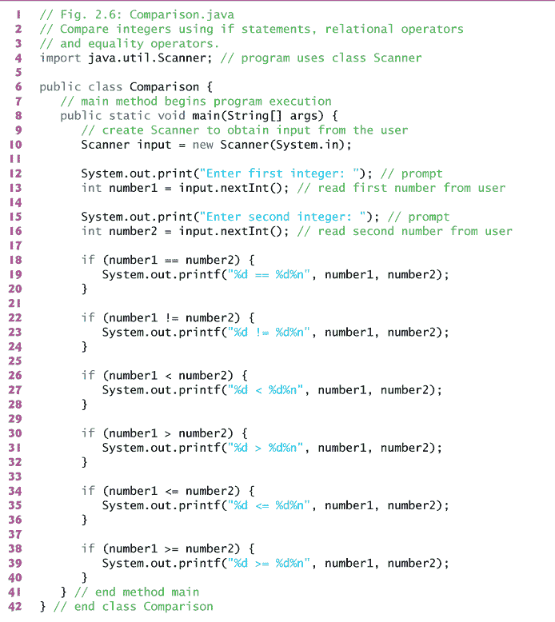 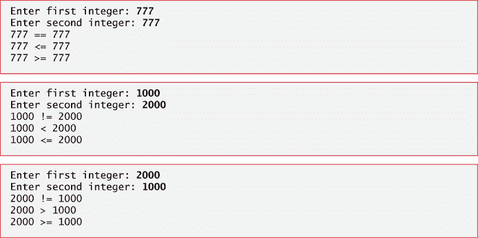

**图 2.6** | 使用 `if` 语句、关系运算符和相等运算符比较整数。


类 `Comparison` 中 `main` 方法的第 10 行设置了一个 `Scanner` 用于从用户处读取数据。第 12–13 行提示用户输入第一个整数，然后输入值并将其存储在 `int` 变量 `number1` 中。第 15–16 行提示用户输入第二个整数，然后输入值并将其存储在 `int` 变量 `number2` 中。第 18–20 行比较 `number1` 和 `number2` 的值以判断它们是否相等。如果是，第 19 行显示用 `==` 分隔的数字。从第 22、26、30、34 和 38 行开始的 `if` 语句使用运算符 `!=`、`<`、`>`、`<=` 和 `>=` 比较 `number1` 和 `number2`。对于那些条件为 `true` 的 `if` 语句，相应的体语句会显示适当的文本，显示评估为 `true` 的条件。

### 块

图 2.6 中的每个 `if` 语句都包含一个缩进的体语句以增强可读性。IDE 通常会为你完成这种缩进。此外，注意我们将每个体语句都封装在一对大括号 `{ }` 中，创建了一个**块**。

你不需要在单语句体周围使用大括号，但必须在多语句体周围包含大括号。你稍后会看到，忘记在语句体周围包含大括号会导致错误。为了避免此类错误，请始终将 `if` 语句的体语句（或）封装在大括号中。

在 `if` 语句条件的右括号后紧跟分号通常是一个逻辑错误（尽管不是语法错误）。分号（`;`）充当**空语句**（即什么都不执行的语句）。在这种情况下，无论条件是否为 `true`，`if` 语句都不执行任何操作。更糟糕，看起来位于 `if` 语句体中的缩进语句始终执行——这种逻辑错误通常会导致程序产生错误的结果。

### 空白

注意图 2.6 中空白的使用。编译器忽略大部分空白，因此语句可以拆分到几行，并根据你的喜好进行间距处理，而不会影响程序的含义。标识符和字符串不能拆分。理想情况下，语句应该保持短小，但这并不总是可能的。

如果你将一个语句跨越几行，请选择自然的断行点，例如逗号分隔列表中的逗号之后，或者长表达式中的运算符之后。当语句跨越两行或更多行时，将第一行之后的所有行都缩进相同的量。

## 生成式 AI

**1** 提示生成式 AI 解释 Java 评估以下语句中运算符的顺序，并指明在语句执行后 `x` 的值：


生成式 AI 应该说明求值顺序为：


并且赋值给 `x` 的值为 `3`。

## 生成式 AI

**1** 提示生成式 AI 发现并修正以下 `if` 语句中的错误：

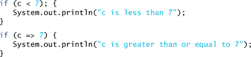

```
// 等待代码
```

对比它们的结果：在第一个 `if` 语句中，括号后有一个分号，因此无论条件是否为 `true` 执行。在第二个 `if` 语句中，符号 `=>` 不是有效的关系运算符。生成式 AI 应将 `=>` 替换为 `>=`。

### 2.8 对象自然案例：创建和使用 Java API 对象

在本书中，我们强调使用来自 Java API 和各种库的现有类。你专注于了解有哪些库，创建现有库的对象。通过“对象自然”，我们的意思是即使在第 8 章学习创建自定义类之前，你也可以方便地创建和使用强大的对象。

你已经处理过 Java 对象。你使用了 `System.out` 对象显示程序的输出，并使用 `Scanner` 对象配合 `System.in` 对象从用户处获取输入。这些封装了输出和输入机制。`System.out` 和 `System.in` 对象由 `System` 类为你创建，而你使用 `new` 运算符创建了 `Scanner` 对象。在本节中，你并将创建并交互 Java API `String` 类的对象(8)

### 测试 String 类

类不能自己执行。`Person` 对象可以驱动 `Car` 对象，告诉它做什么（加速、减速、左转、右转等），而无需知道汽车的内部机制。同样，`main` 方法可以通过调用方法来“驱动” `String` 对象——而无需知道类是如何实现的。在这种意义上，以下程序中的 `main` 被称为**驱动程序**。图 2.7 的 `main` 方法测试了几个 `String` 对象。

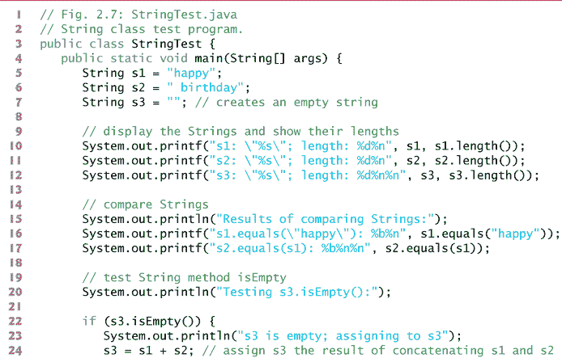 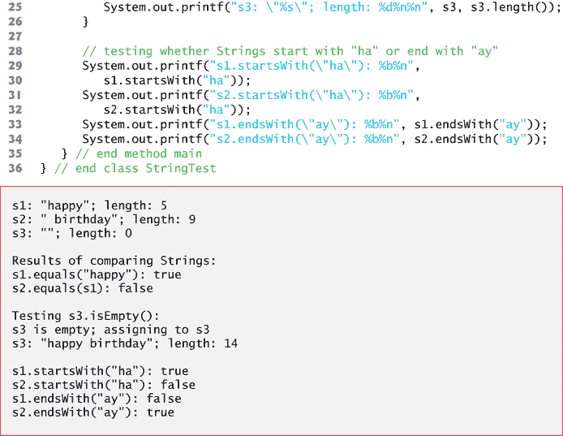

**图 2.7** | `String` 类测试程序。

### 创建 String 对象

对于每个字符串字面量，Java 编译器都会创建一个 Java API 中 `String` 类的对象，并用字面量的字符对其进行初始化。因此，第 5–7 行创建了三个 `String` 对象：`s1` 包含 `"happy"`，`s2` 包含 `" birthday"`，而 `s3` 包含空字符串（`""`）。当我们声明 `int` 变量时（正如我们之前所做），编译器知道 `int` 是什么——它是 Java 内置的原始类型。同样，编译器也理解 Java API 中 `String`类的某些方面，例如如何从字符串字面量创建 `String` 对象。

对于大多数类，你必须使用 `new` 来创建该类的对象，就像你在图 2.5 和 图 2.6 中对 `Scanner` 类做的那样。

与 `System` 类一样，`String` 类是 `java.lang` 包的一部分，因此它被导入到每个程序中。只要封装得当，类就可以被其他程序员复用。这是使用支持面向对象编程的 Java 等语言的最优点之一。这些语言拥有丰富的强大预构建类库。例如，你只需要通过导入就可以在任何程序复用 Java API 的类，正如我们在图 2.5 和 图 2.6 中对 `Scanner` 类做的那样。

### String 方法 length

第 10–12 行输出每个 `String` 及其长度。`String` 类的 `length` 方法返回存储在特定 `String` 对象中的字符数。要为特定对象调用此方法，你需要指定对象的名称（`s1`）、点运算符（`.`）、然后是方法名（`length`）和括号。空括号表示 `length` 不需要额外的参数来完成其任务。

### 比较 String 对象

可以使用 `String` 类的 `equals` 方法对 `String` 进行等值比较，该方法返回 `true` 或 `false`：

*   第 16 行将 `s1` 的内容与字符串字面量 `"happy"` 的进行比较——这些 `String` 包含相同的字符，因此 `equals` 返回 `true`。

*   第 17 行将 `s2` 的内容与 `s1` 的内容进行比较——这些 `String` 不包含相同的字符，因此 `equals` 返回 `false`。

注意，运算符 `==` 不能用于比较 `String` 对象的内容。我们将在面向对象编程章节中解释原因。

`String` 比较是区分大小写的。第 16 行和第 17 行中的 `printf` 调用使用了 `%b` 格式说明符，它是条件值的占位符。该格式说明符会导致 `printf` 将条件的值显示为单词 `"true"` 或单词 `"false"`。

在第 7 章中，你会看到 `String` 使用每个 `String` 中字符的数值来执行“字典序”比较。

### String 方法 isEmpty

第 22 行调用了 `String` 的 `isEmpty` 方法，如果 `String` 为空（即其长度为 `0`），则返回 `true`。对象 `s3` 被初始化为空字符串（`""`），因此它确实是空的，`if` 语句体将执行。

### String 拼接

第 24 行通过使用 `+` 运算符“相加”字符串 `s1` 和 `s2` 为 `s3` 分配新值——这被称为 `String` 拼接。赋值后，`s3` 包含 `s1` 的字符紧随 `s2` 的字符——即 `"happy birthday"`。第 25 行输出 `s3` 的内容和长度，以证明 `String` 拼接工作正常。

### String 方法 startsWith 和 endsWith

第 29–34 行演示了 `String` 的 `startsWith` 方法和 `endsWith` 方法，这两个方法分别在 `String` 以指定的子字符串开头或结尾时返回 `true`；否则返回 `false`。这些 `String` 比较也是区分大小写的。第 30 行和第 32 行显示 `s1` 以子字符串 `"ha"` 开头，但 `s2` 不。第 33 行和第 34 行显示 `s1` 不以 `"ay"` 结尾，但 `s2` 是。

## 生成式 AI

1. 提示生成式 AI 编写一个 Java 程序，分别输入名和姓，然后显示 `"Welcome to Java,"`，随后是名、一个空格、姓和一个感叹号（`!`）。

### 2.9 总结

在本章中，你创建了基础的 Java 程序。我们从使用 `System.out` 的 `print`、`println` 和 `printf` 在屏幕上显示消息的程序开始。我们使用 `Scanner` 对象来执行输入。我们讨论了算术运算符（`+`、`-`、`*`、`/` 和 `%`）以及运算符优先级规则如何决定 Java 表达式的顺序。我们简要提到了其他原始类型。你使用 `if` 语句根据由等值（`==` 和 `!=`）和关系（`<`、`<=`、`>`、`>=`）运算符组成的条件决策。

最后，我们通过创建对象并与之交互引入了我们的对象-自然方法。

我们将详细地讨论 `if` 语句，并介绍 `if`…`else` 和 `while` 语句。我们将介绍复合赋值运算符以及递增和递减运算符。我们还考虑了 Java 原始类型的移植性。最后，我们将继续这种以对象为中心的方法，通过一个案例研究：如何创建和操作超大整数，这些整数可以表示超出 Java 整数原始类型支持的有限范围的值。

### 3.2 控制结构

程序中的语句通常按照其编写顺序一个接一个地执行，正如你在第 2 章中看到的那样。这个过程被称为**顺序执行**。各种 Java 语句允许你指定下一个要执行的语句不一定是序列顺序上的下一条。这被称为**控制转移**。

在 20 世纪 60 年代，人们清楚地看到，无节地使用控制转移是软件开发小组遇到许多困难的根源。指责指向了 `goto` 语句（用于当时的大多数编程语言），它允许你将控制转移到程序中广泛范围内的一个目标^(1)。

1. Java 没有 `goto` 语句；然而，`goto` 是 Java 的保留字，不应在程序中用作标识符。使用它会导致编译错误。

Bohm 和 Jacopini 的研究^(2) 证明了可以在没有任何任何 `goto` 语句的情况下编写程序。当时程序员面临的挑战是将他们的风格转向“无 `goto` 编程”。**结构化编程**这一术语几乎与“消除 `goto`”同义。直到 20 世纪 70 年代，大多数程序员才开始重视结构化编程。结果令人深刻。软件开发小组报告开发时间缩短、系统按时交付频率更高、软件项目在预算内完成的频率更高。成功的关键在于结构化程序清晰、更容易调试和修改，并且最初就可能没有错误。

2. C. Bohm and G. Jacopini, “Flow Diagrams, Turing Machines, and Languages with Only Two Formation Rules,” *Communications of the ACM*, Vol. 9, No. 5, May 1966, pp. 366–371.

Bohm 和 Jacopini 的工作证明了所有程序都可以仅用三种控制结构来编写：顺序结构、选择结构和迭代结构。当我们介绍 Java 的控制结构实现时，我们将使用《Java 语言规范》中的术语将它们称为“控制语句”。

### 3.2.1 顺序结构

**顺序结构**内置在 Java 中。除非另有说明，否则计算机会按照编写的顺序一个接一个地执行 Java 语句——即按顺序执行。下面的 **UML 活动图**展示了一个典型的顺序结构，其中顺序执行了两个计算：

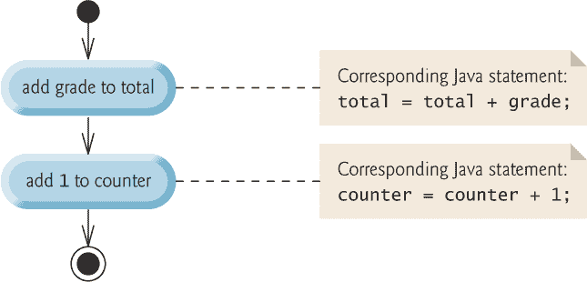

Java 允许你按顺序拥有任意数量的动作。正如我们很快将看到的，在任何可以放置单个动作的地方，我们都可以按顺序放置多个动作。

UML 活动图模型化了软件系统部分的**工作流**（也称为**活动**）。此类工作流可能包含算法的一部分，例如上面的顺序结构。活动图由符号组成，例如**动作状态符号**（左侧和右侧被替换为外弧的矩形）、**菱形**和**小圆圈**。这些符号通过**转换箭头**连接，箭头表示活动的流向——即动作应该发生的顺序。

活动图帮助你开发和表示算法。它们清晰地展示了控制结构如何运作。在第 3 章和第 4 章中，我们使用 UML 来显示每个控制语句的工作流——也称为其**控制流**。

之前的活动图包含两个**动作状态**，每个状态包含一个**动作表达式**，指定要执行的特定动作——“将分数加到总和”或“向计数器加 1”。其他动作可能包括计算或输入输出操作。箭头表示转换，指示动作状态所描述的动作发生的顺序。实现上述图表活动的程序首先将 `grade` 加到 `total`，然后向 `counter` 加 `1`。

活动图顶部的**实心圆圈**代表**初始状态**——程序在执行所模型动作之前的工作流的开始。图底部的**空心圆圈中的实心圆圈**代表**结束状态**——程序在执行模型动作之后的工作流的结束。

图中还包含右上角折叠的矩形。这些可选的 **UML 注释**（类似于 Java 中的注释）是描述图表符号目的的解释性备注。我们的注释显示了与每个动作状态关联的 Java 代码。**虚线**将每个注释与其所描述的元素连接起来。活动图通常不显示对应的 Java 代码。我们在这里显示它是为了说明图表与 Java 代码之间的关系。有关关于 UML 的更多信息，请访问 [`https://uml.org`](https://uml.org)。

### 3.2.2 选择语句

Java 有三种类型的**选择语句**（在本章和第 4 章中讨论）。`if` 语句（第 3.3 节）在条件为真时执行一个动作，在条件为假时跳过它。`if`…`else` 语句（第 3.4 节）在条件为真时执行一个动作，在条件为假时执行另一个动作。`switch` 语句（第 4.8 节）根据表达式的值执行多个动作中的之一。

`if` 语句被称为**单选择语句**，因为它选择或忽略单个动作。`if`…`else` 语句被称为**双选择语句**，因为它在两个动作之间进行选择。`switch` 语句被称为**多选择语句**，因为它在许多动作中选择。

### 3.2.3 迭代语句

Java 提供了四种**迭代语句**（也称为**重复**或**循环语句**），用于在循环继续条件为真时重复执行语句。迭代语句有 `while`（第 3.5 节）、`for`（第 4.3 节）、`do`…`while`（第 4.7 节）和增强型 `for`（第 6.13 节）。`while` 和 `for` 语句在它们的体中执行动作（或动作组）零或多次——如果循环继续条件初始为假，则动作（或动作组）将不执行。`do`…`while` 语句在其体中执行动作（或动作组）一次或多次。

#### 关键字

`if`、`else`、`switch`、`while`、`do` 和 `for` 是 Java 关键字。我们在第 2.2 节中展示了 Java 关键字的完整列表。你也可以在《Java 语言规范》第 3.9 节“关键字”中找到它们^(3)。

3. The Java Language Specification（Java 语言规范），Java SE 22 版。第 3.9 节](#ch03.xhtml_ch03)，“关键字。” 访问于 2024 年 5 月 21 日。[`https://docs.oracle.com/javase/specs/jls/se22/html/jls-3.html#jls-3.9`](https://docs.oracle.com/javase/specs/jls/se22/html/jls-3.html#jls-3.9)。

### 3.2.4 控制语句总结

Java 只有三种控制结构，从现在起，我们统称之为控制语句：

*   顺序语句，

*   选择语句（三种类型）以及

*   循环语句（四种类型）。

我们可以将每个控制语句建模为活动图，其中包含初始状态和结束状态，分别代表控制语句的入口和出口点。`单入/单出口控制语句`使得通过将一个语句的出口点连接到下一个语句的入口点来构建程序变得容易——即`控制语句叠加`。控制语句可能连接的唯一另一种方式是`控制语句嵌套`，即一个控制语句出现在另一个控制语句内部。

### 3.3 if 单选择语句

我们曾在 第 2.7 节 中简要介绍过 `if` 单选择语句。程序使用选择语句在备选行动方案之间进行选择。例如，假设考试及格线为 60 分。以下 `if` 语句判断条件 `grade >= 60` 是否为 `true`：

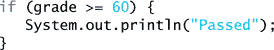

如果是，则语句将打印 `"Passed"`；否则，条件为 `false`，输出语句被忽略，并执行序列中的下一条语句（如果有）。对第二行进行缩进是可选的，但为了清晰起见建议这样做。

#### boolean 原始类型

在 第 2.7 节 中，你使用关系运算符和相等运算符创建了条件。Java 条件必须求值为为 `true` 或 `false`——这两者都是 Java 关键字。Java 提供了 `boolean` `原始类型`，用于只能存储 `true` 或 `false` 值的变量。

#### if 语句的 UML 活动图

下图阐释了单选择 `if` 语句的控制流：

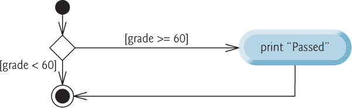


该图包含了活动图中最重要的符号——菱形，或`决策符号`，它表示要做出决策。工作流沿着由符号关联的`守卫条件`决定的路径继续，这些条件为真或假。从决策符号发出的每个转换箭头在箭头旁边的方括号中指定了守卫条件。如果守卫条件为真，工作流进入转换箭头指向的动作状态。在图中，如果成绩大于或等于 60，程序打印“Passed”，然后转换到活动的最终状态。如果成绩少于 60，程序转换到最终状态而不打印任何消息。`if` 语句是一个单入/单出口控制语句。

### 3.4 `if…else` 双选择语句

`if` 单选择语句仅在条件为 `true` 时执行指定的动作。`if…else` `双选择语句`允许你在条件为 `true` 时执行一个动作，并在条件为 `false` 时执行另一个动作。例如，以下 `if…else` 语句如果学生的成绩大于或等于 60，则打印 `"Passed"`；否则，它打印 `"Failed"`：

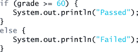

在任何情况下，打印发生后，都会执行序列中的下一条语句（如果有）。`if` 和 `else` 体等等缩进。为了可读性，你应该在整个程序中一致地应用你的缩进规范。如果有多个缩进层级，每一层都应该用相同的额外空间缩进。我们倾向于使用三空格缩进。IDE 通常会自动为你完成代码缩进。

#### `if`…`else` 语句的 UML 活动图

下图阐释了上述 `if…else` 语句的控制流：

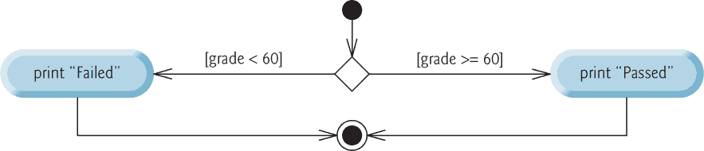

再次，UML 活动图从初始状态开始，包含转换箭头、决策和动作状态，并以最终状态结束。

## 生成式 AI

**1** 使用以下代码向生成式 AI 提问，要求它们找到并修正错误：

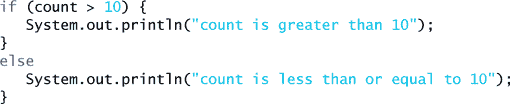

确认生成式 AI 是否识别出 `else` 关键字后缺失的左大括号 `{`。

#### 3.4.1 嵌套 `if`…`else` 语句

你可以通过将 `if…else` 语句放在 `if…else` 语句内部来创建`嵌套` `if…else` 语句，从而测试多种情况。以下嵌套的 `if…else` 对大于或等于 90 的成绩打印 `A`，对 80 到 89 的成绩打印 `B`，对 70 到 79 的成绩打印 `C`，对 60 到 69 的成绩打印 `D`，对所有其他成绩打印 `F`。我们使用阴影来突出嵌套：

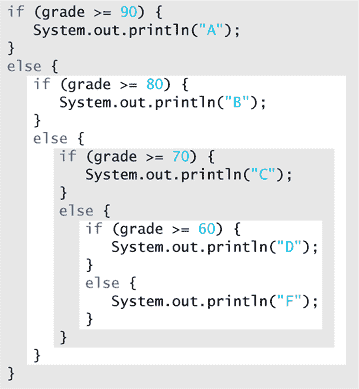

如果 `grade` 大于或等于 90，嵌套 `if…else` 语句中的前四个条件均为 `true`。然而，只执行第一个 `if` 部分的语句——“最外层”`if…else` 语句的 `else` 部分被跳过。

大多数程序员倾向于将上述嵌套的 `if…else` 语句写成：

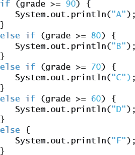

后一种形式避免了深度右缩进，这通常会导致源代码行留下的空间很少，迫使行换行并使代码可读性降低。

#### 3.4.2 块

`if` 语句体只预期一条语句。要在 `if` 或 `else` 的体中包含多条语句，必须用大括号（`{` 和 `}`）将语句括起来。回顾 第 2.7 节，在大括号中的语句形成形成一个块。你可以在任何可以放置单条语句的地方放置一个块。我们总是将控制语句的体括在大括号中。这避免了被称为“悬空 else”（dangling-else）的逻辑错误。

以下示例显示在 `if…else` 语句的 `else` 部分包含一个多条语句的块：

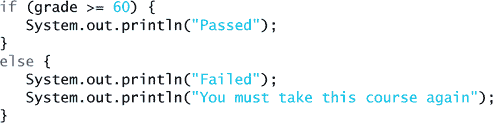

如果 `grade` 少于 60，`else` 体中的两条语句都会执行，显示：


`else` 子句中两条语句周围的大括号非常重要。如果没有大括号，语句

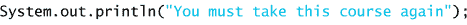

将位于 `else` 体之外，即使对于及格成绩也会打印“你需要重上这门课”——这是一种逻辑错误。

##### 语法错误与逻辑错误

编译器可以捕捉语法错误，例如块中漏掉了一个括号。逻辑错误（例如错误的计算）在执行时产生影响。`致命逻辑错误`会导致程序失败并终止。`非致命逻辑错误`允许程序继续执行，但会产生错误的结果。

##### 空语句

正如块可以放置在任何可以放置单条语句的地方，也可以拥有空语句。回顾 第 2.7 节，空语句通过在通常语句语句放置分号（`;`）来表示。

在 `if` 或 `if…else` 语句的条件后放置分号会导致单选择 `if` 语句出现逻辑错误，并在双选择 `if…else` 语句（当 `if` 部分包含实际体时）出现语法错误。

## 生成式 AI

**1** 使用以下代码向生成式 AI 提问，要求它们识别并修正错误：

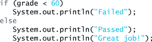

将它们的代码更新和解释与以下对比：只有 `else` 之后的第一个缩进语句是 `else` 体的一部分，因为这两条缩进语句没有被大括号括起来。因此，即使学生的成绩不及格，这段代码也会打印“Great Job!”。此外，良好的做法是即使是单条语句体（如 `if` 部分体），也用大括号括起来，以防止将来向其体中添加更多语句时发生错误。代码应该是：

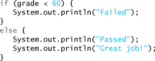

### 3.4.3 条件运算符 (`?:`)

`条件运算符` (`?:`) 可以用来替代简单的 `if…else` 语句。条件运算符是唯一的`三元运算符`——它接受三个操作数。这些操作数与 `?:` 符号共同构成了一个`条件表达式`。例如，以下语句打印了 `println` 方法中条件-表达式参数的值：

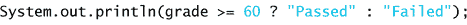

*   问号 (`?`) 左侧的操作数——`grade >= 60`——是一个求值结果为 `true` 或 `false` 的条件。
*   问号 (`?`) 与冒号 (`:`) 之间的操作数——`"Passed"`——是当条件为 `true` 时，条件表达式的值。
*   冒号 (`:`) 之后的操作数——`"Failed"`——是当条件为 `false` 时，条件表达式的值。

在该语句中，如果 `grade >= 60` 为 `true`，则条件表达式求值为 `"Passed"`；如果为 `false`，则值为 `"Failed"`。因此，这个带有条件运算符的语句与 3.4 节开头所示的 `if…else` 语句本质相同。条件运算符的优先级较低，因此通常放在括号中。

## 生成式 AI

**1** 提示生成式 AI 编写一个 `System.out.printf` 语句，用于判断 `int` 变量 `number` 的值是奇数还是偶数并打印结果。告诉生成式 AI 假设 `number` 存在且包含 `7`。将它们生成的代码与以下语句进行比较，确认它们的代码产生了相同的结果：

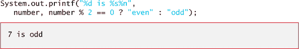

### 3.5 `while` 迭代语句

迭代语句指定程序在某些条件保持为 `true` 时重复执行某操作。考虑一段使用 `while 迭代语句` 来寻找大于 50 的第一个 3 的幂的程序。在该代码执行后，`product` 包含了结果：

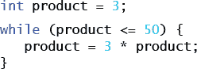

首先，我们将 `product` 初始化为 `3`。然后，`while` 语句执行如下：

1.  程序测试条件 `product <= 50`，为 `true`，因为 `product` 是 `3`。体语句将 `product` 乘以 `3` 并将结果 (`9`) 赋值给 `product`。循环的第一次迭代完成。
2.  程序再次测试条件——结果为 `true`，因为 `product` 现在是 `9`。体语句将 `product` 设置为 `27`。循环的第二次迭代完成。
3.  程序再次测试条件——结果为 `true`，因为 `product` 现在是 `27`。体语句将 `product` 设置为 `81`。循环的第三次迭代完成。
4.  程序再次测试条件——结果终于为 `false`，因为 `product` 现在是 81，它并不小于或等于 50，因此循环终止。

变量 `product` 现在包含 `81`——大于 50 的第一个 3 的幂。`while` 语句的体可以是单个语句，也可以是一个块。

#### `while` 语句的 UML 活动图

下面的 UML 活动图说明了前述 `while` 的控制流：


此图引入了 `UML 合并符号`。UML 将合并符号和决策符号都表示为菱形。合并符号将两个活动流合并为一个。在图中，合并符号将来自初始状态的转换和来自动作状态的转换合并在一起，因此它们都汇入决定循环是否应该开始（或继续）执行的决策中。

决策符号和合并符号可以通过“入站”和“出站”转换箭头的数量来区分：

*   决策符号有一个指向菱形的转换箭头，有两个或多个从它指向外部的箭头，表示可能的转换。每个从决策符号指向外部的转换箭头旁边都有一个守卫条件（guard condition）。
*   合并符号有两个或多个指向菱形的转换箭头，且只有一个从它指向外部的箭头，表示多个活动流合并以继续该活动。合并符号的转换箭头没有守卫条件。

该图清晰地展示了 `while` 语句的迭代。从动作状态出的转换箭头指向合并点，程序流从该处转回每次迭代开始时测试的决策。`while` 语句一直执行，直到守卫条件“product <= 50”变为 `false`，从而使得守卫条件“product > 50”变为 `true`。然后，`while` 语句达到其最终状态，程序继续按顺序执行下一条语句。

## 生成式 AI

**1** 提示生成式 AI 编写一个 Java 程序，确定大于一百万的第一个 2 的幂。它们使用了我们在后续代码中展示的技巧吗？如果没有，请调整你的提示词，给出一些提示，帮助生成式 AI 生成与此处所示类似的代码。


### 3.6 计数控制迭代

让我们解决两个计算学生平均分问题的变体。考虑以下问题描述：

一个十名学生的班参加了测验。这次测验的成绩（0–100 范围内的整数）可用。班级平均分是成绩总和除以学生人数。我们使用计数控制迭代来输入成绩。这种技术使用计数器（或控制变量）来控制执行次数。计数控制迭代也称为确定迭代，因为迭代次数在循环执行前是知的。在本例中，迭代在计数超过 10 时终止。本节介绍了实现该算法的 Java 程序。

#### 3.6.1 实现算法

在图 3.1 中，`ClassAverage` 类的 `main` 方法允许用户输入 10 个成绩，然后计算并显示平均分。


**图 3.1** | 使用计数控制迭代解决平均分问题。

*   第 17 行读取用户输入的成绩并将其赋值给变量 `grade`。
*   第 18 行将新的 `grade` 加到 `total` 中，替换其原有的值。
*   第 19 行将 `gradeCounter` 加 `1`（替换其原有的值），以表示程序已处理了一个成绩，并准备好从用户处输入下一个成绩。

增加 `gradeCounter` 最终会导致其超过 10。然后，循环终止，因为其条件（第 15 行）变为 `false`。

### 终止阶段：计算并显示班级平均分

当循环结束时：

*   第 23 行计算平均值并将结果赋值给变量 `average`。
*   第 26 行使用 `System.out` 的 `printf` 方法显示文本 `"Total of all 10 grades is "`，随后是 `total` 的值。
*   第 27 行使用 `printf` 显示文本 `"Class average is "`，随后是 `average` 的值。

当执行到第 28 行时，程序结束运行。

### 3.6.2 整数除法与截断

第 23 行的平均值计算产生整数结果。在示例输出中，成绩总和为 846，除以 10 后应得到 84.6。这是一个浮点数——带有小数点的数字。然而，在第 23 行中，`total / 10` 的结果是整数 84，因为 `total` 和 `10` 都是整数。两个整数相除的结果是整数除法——计算中的任何分数部分都会被截断（即丢失）。在接下来的章节中，我们将看到如何从平均值计算中获得浮点结果。假设整数除法会四舍五入（而不是截断会导致错误的结果。

### 3.6.3 算术溢出

在图 3.1 中，第 18 行将用户输入的每个 `grade` 加到 `total`：

```

```

即使是这个简单的语句也存在潜在问题——整数相加可能导致结果过大，无法存储在 `int` 变量中。这被称为算术溢出，会导致未定义行为，从而导致非预期的结果。图 2.5 中的 `Addition` 程序在第 17 行也存在相同的问题，该行计算了用户输入的两个 `int` 值之和：

4.“整数溢出。”维基百科，最后修改于 2024 年 5 月 18 日[`https://en.wikipedia.org/wiki/Integer_overflow#Security_ramifications`](https://en.wikipedia.org/wiki/Integer_overflow#Security_ramifications)。[讨论与整数溢出相关的潜在问题。]

```

```

常量 `Integer.MIN_VALUE` 和 `Integer.MAX_VALUE` 代表 `int` 变量可以存储的最小值和最大值。其他数值基本类型也有类似的常量。你可以在每个类的在线文档中找到这些常量的值。`Integer` 的文档位于：

```

```

### 3.6.4 输入验证

每当程序从用户处接收输入时，可能会发生各种问题。例如，图 3.1 的第 17 行

```

```

假设用户将输入 0 到 100 之间的整数成绩，但用户可能会：

*   小于 0 的整数，
*   大于 100 的整数，
*   超出 `int` 变量存储范围的整数，
*   包含小数点的数字，或
*   包含字母或特殊符号的值（甚至不能代表数字）。

工业级程序必须测试所有可能的错误情况以确保输入有效。输入成绩的程序应该使用范围检查对成绩进行验证，以确保它们是 0 到 100 之间的值。然后你可以要求用户重新输入任何超出范围的值。如果程序需要特定值集合的输入（例如非连续的产品代码），你应该确保每个输入都匹配集合中的某个值。

## 生成式 AI

1. 向生成式 AI 提供以下代码，要求它们修复代码以便显示 1–4 的 `count` 值：

```

```

将它们的结果与以下代码对比：

```

```

### 3.7 哨兵控制迭代

让我们扩展第 3.6 节班级平均分的问题。考虑以下问题：

开发一个班级平均分程序，每次运行时都能处理任意数量学生的成绩。

在之前的班级平均分示例中，成绩的数量（10）是预先知道的。对于这个问题，我们不知道用户在程序执行期间会输入多少成绩。

解决此问题的一种方法是使用哨兵值（称为标记值）来指示数据的结束。用户输入 -1 表示不再输入成绩。程序必须选择一个不会与有效输入混淆的哨兵值。成绩是非负的，因此 -1 是该问题的合适值。

#### 3.7.1 实现哨兵控制迭代

图 3.2 实现了哨兵控制迭代。图 3.1 的大部分是相同的，因此我们专注于新内容。虽然用户输入的每个成绩都是整数，但平均值计算可能会产生浮点数，`int` 无法表示。使用 `float` 和 `double` 类型存储浮点数：

*   `float` 基本类型变量表示单精度浮点数。小数点后有七位。
*   `double` 基本类型变量表示双精度浮点数。它们所需的内存是 `float` 变量的两倍。它们有 15 位有效数字。

大多数程序员使用 `double`，因为程序代码中的所有浮点数（如 `7.33` 和 `0.075`）默认表示为 `double`。这些被称为浮点字面量。关于 Java 浮点类型的精确范围，请访问 Java 语言规范第 4.2 节](#ch04.xhtml_ch04lev1sec2)“基本类型与值”。

```
 
```

**图 3.2 使用哨兵控制迭代解决班级平均分问题。**

##### 哨兵控制迭代与计数控制迭代的逻辑

第 12 行将 `gradeCounter` 初始化为 0，因为还没有输入成绩。记住我们正使用哨兵控制迭代来输入成绩，所以只有当用户输入有效成绩时才增加变量 `gradeCounter`。第 33 行声明了 `double` 变量 `average`，它用浮点数存储班级平均分。

将此程序的哨兵控制迭代逻辑与图 3.1 的计数控制迭代进行对比：

*   在计数控制迭代中，每次循环迭代（图 3.1 的第 15–20 行）都会指定的次数内从用户处读取一个值。
*   在哨兵值控制迭代中，图 3.2 中的第 16–17 行在进入 `while` 循环之前提示并输入第一个值。该值决定了控制流是否应该进入 `while` 循环体。如果条件为 `false`，说明用户输入了哨兵值——没有输入分数，因此 `while` 循环体不执行。如果条件为 `true`，循环体会将 `grade` 加到 `total` 中并使 `gradeCounter` 增。然后，第 25–26 行提示并输入下一个分数。此时，程序控制到达循环的结束右大括号（第 27 行）。执行通过测试 `while` 条件（第 20 行）继续，使用最近输入的 `grade` 来决定是否再次执行循环体。


请注意，下一个 `grade` 始终是在程序测试 `while` 语句条件之前立即由用户输入的。这使得程序能够在处理该值（即将其添加到 `total` 中）之前，判断刚刚输入的值是否为哨兵值。如果 `grade` 包含哨兵值，循环将终止而不会向 `total` 添加 -1。在哨兵值控制的循环中，提示信息应当提醒用户哨兵值。

循环结束后，执行第 31–42 行的 `if`…`else` 语句。条件（第 31 行）决定是否输入了任何分数。如果没有输入分数，`else` 部分将显示 `"No grades were entered"`。在 `if`…`else` 执行后，程序终止。

### 3.7.2 在原始类型之间进行显式和隐式转换

如果至少输入了一个分数，第 33 行将计算分数的平均值。回想图 3.1，整数除法会产生整数结果。即使变量 `average` 被声明为 `double`，但如果我们把平均值计算写成：


在将结果赋值给 `average` 之前，它将丢失商的小数部分。发生这种情况的原因是因为 `total` 和 `gradeCounter` 都是整数，而整数除法产生整数结果。

大多数平均值都是浮点数。为了对整数值进行浮点计算，我们必须临时地将这些值视为浮点数。`一元强制转换运算符`完成了这项任务。图 3.2 的第 33 行使用 `(double)` 强制转换运算符来为其操作数 `total`（显示在运算符右侧）创建一个临时的浮点副本。以这种方式使用转换运算符被称为`显式转换`或`类型强制转换`。存储在 `total` 中的值仍然是整数。

现在的计算由一个浮点数值（`total` 的临时 `double` 副本）除以整数 `gradeCounter` 组成。在混合类型算术表达式中，Java 对选定的操作数执行名为`提升`（或`隐式转换`）的操作。在包含 `int` 和 `double` 值的算术表达式中，`int` 值的副本会被提升为 `double` 值以供表达式使用。在本例中，`gradeCounter` 的值被提升为 `double` 类型，然后执行浮点除法，并将计算结果赋值给 `average`。在本章后面的部分，我们将讨论所有的原始类型。你将在第 5.11 节学习更多关于提升的规则。

### 3.7.3 浮点数的格式化

第 36–37 行显示 `gradeCounter` 和 `total` 的值。第 38 行显示双变量 `average` 的值。`printf` 方法使用 `%f` `格式说明符` 对浮点数进行格式化。默认情况下，`%f` 以小数点后六位精度格式化 `double`，但你可以在 `%` 和 `f` 之间指定`自定义精度`。示例执行中三个分数的平均值为 85.666666……，6 无限重复。在格式说明符 `%.2f` 中，`.2` 就是自定义精度。这会将平均值四舍五入到百分位，产生小数点后 2 位的 `85.67`。

#### 关于浮点数精度的说明

浮点数并不总是 100% 精确的，但它们有许多应用。例如，当我们谈论 98.6 °F 的“正常”体温时，我们不需要精确到很多位。当我们从温度计上读取温度为 98.6 时，它实际上可能是 98.5999473210643。对于大多数涉及体温的应用程序，将这个数字简单称为 98.6 就足够了。

浮点数通常产生于除法，如本例中的类平均分计算。在常规算术中，当我们用 10 除以 3 时，结果是 3.3333333……，3 无限重复。计算机只分配固定的空间来存储此类值，因此存储的浮点值只能是一个近似值。

由于浮点数的不精确性，类型 `double` 比 `float` 更受青睐，因为 `double` 变量可以更准确地表示浮点数。因此，我们在书中主要使用 `double`。在某些情况下，`float` 和 `double` 的精度是不够的。对于精确的浮点数（例如货币计算所需的），Java 提供了 `BigDecimal`（位于 `java.math` 包），我们将在第 4.11 节中讨论。

#### 对象-自然案例研究：生成式 AI

（等待，原文在此处有一些重复/重叠，但我将遵循提供的流程）

## 生成式 AI

**1** 提示生成式 AI 写一个 Java 程序，从用户处读取任意数量的整数温度并计算并显示它们的平均值。告诉生成式 AI 假设用户输入的温度范围在 –212 到 212 之间，并使用哨兵值 999。

将其生成的代码与以下程序进行比较。如果它们的代码使用了我们尚未介绍的技术，尝试调整提示词（prompt），给它们更多细节以帮助它们生成代码。例如，告诉它们使用 `while` 循环，并在循环之前输入第一个温度，并在每个循环体的末尾输入后续温度。


### 3.8 嵌套控制语句

我们已经看到控制语句可以堆叠（顺序执行）。在本案例研究中，我们检查控制语句唯一的结构化连接方式——即将一个控制语句嵌套在另一个语句中。

#### 3.8.1 问题陈述

考虑以下问题陈述：

某大学提供一门准备州房地产经纪人执业考试的课程。去年，完成这门课程的学生参加了考试。大学想知道其学生的表现如何。你被要求写一个程序来总结结果。

你被给了这 10 名学生的列表。每个名字旁边写着 1 表示该学生通过了考试，写 2 表示未通过。

你的程序应该按如下方式分析考试结果：

1.  输入每个测试结果（即 1 或 2）。每当程序请求另一个测试结果时，都显示“Enter result”。

2.  统计每个类型测试结果的数量。

3.  显示测试结果的摘要，说明通过的人数和失败的人数。

4.  如果有超过 8 名学生通过考试，打印“Bonus to instructor!”。

##### 问题陈述的观察结果

在仔细阅读问题陈述后，我们得出了以下观察：

*   程序必须处理 10 个学生的测试结果。由于测试结果的数量是预知的，可以使用计数控制循环。

*   每个测试结果要么是 `1` 要么是 `2`。当程序读取每个结果时，它必须确定它是 `1` 还是 `2`。我们在算法中测试结果是否为 `1`。如果该数字不是 `1`，我们就假设它是 `2`。

*   使用两个计数器来跟踪考试结果——一个计算通过考试的人数，另一个计算未通过的人数。

*   在程序处理完所有结果后，它必须判断是否有超过八名学生通过考试。

#### 3.8.2 实现程序

图 3.3 使用计数器控制循环实现了该程序，并展示了两次示例执行。第 11–13 行和第 19 行声明了我们用于处理考试结果的变量。在声明时初始化局部变量可以帮助避免因尝试使用未初始化变量而导致的编译错误。虽然 Java 不要求将局部变量的初始化包含在声明中，但它要求局部变量在表达式中使用之前必须有值；否则会发生编译错误。

 

**图 3.3** | 使用嵌套控制语句对考试结果分析。

`while` 语句（第 16–31 行）循环 10 次。在每次迭代中，它输入并处理一个考试结果。用于处理每个结果的 `if`…`else` 语句（第 22–27 行）嵌套在 `while` 语句中。如果 `result` 为 `1`，则 `if`…`else` 语句增加 `passes`；否则，假设 `result` 为 `2` 并增加 `failures`。第 30 行在第 16 行再次测试循环条件之前增加 `studentCounter`。在输入 10 个值后，循环终止，第 34 行显示 `passes` 和 `failures` 的数量。第 37–39 行的 `if` 语句判断是否有超过八名学生通过考试，如果是，则输出消息 `"Bonus to instructor!"`。

图 3.3 显示了程序两次示例执行的输入和输出。在第一次执行中，第 37 行的条件为 `true`——有超过八名学生通过考试，因此程序输出一条消息来奖励讲师。

## 生成式 AI

**1** 向生成式 AI 提示，让它们通过将嵌套的 `if`…`else` 语句替换为使用条件表达式的单个语句来简化以下程序。执行它们返回的代码以确保产生相同的结果。


### 3.9 复合赋值运算符

复合赋值运算符允许你简写赋值表达式。你可以将语句


使用加复合赋值运算符 `+=` 简写为：


`+=` 运算符将其右操作数的值加到左侧变量上，然后将结果存储在左侧变量中。因此，赋值表达式 `c+=3` 将 `3` 加到 `c`。复合赋值运算符对右侧表达式的值进行隐式转换，以匹配运算符左侧变量的类型。因此，如果左侧变量是 `int` 而右侧表达式的结果是 `double`，则 `double` 值的浮点部分将被截断。下表显示了算术复合赋值运算符、示例表达式以及运算符作用的解释：


6. 《Java 语言规范》，Java SE 22 版。第 15.26.2 节，“复合赋值运算符”。访问于 2024 年 8 月 28 日 [`https://docs.oracle.com/javase/specs/jls/se22/html/jls-15.26.2`](https://docs.oracle.com/javase/specs/jls/se22/html/jls-15.26.2)。

## 生成式 AI

**1** 向生成式 AI 提供以下代码，询问代码执行后 `y` 的值是多少：


确认生成式 AI 指明 `y` 为 8。你可能会预期赋值语句会产生编译错误。复合赋值运算符隐式地转换右侧表达式的值以匹配运算符左侧变量的类型。因此，3.3 被截断为 3。

### 3.10 递增和递减运算符

下表总结了对数值变量值加 1 或减 1 的单元运算符——这些是单元递增运算符 `++` 和单元递减运算符 `--`。与二元运算符不同，按照习惯，单元递增和递减运算符应该放在操作数旁边，中间不留空格：


##### 前置递增与后置递增

图 3.4 展示了 `++` 运算符的前置和后置版本之间的区别。递减运算符（`--`）的工作原理类似。


**图 3.4** | 前置递增与后置递增。

第 7 行将 `c` 初始化为 `5`，第 8 行输出其初始值。第 9 行输出 `c++`。该表达式后置递增变量 `c`，因此语句输出 `c` 的原始值（5），然后 `c` 的值增加（变为 6）。第 10 行输出 `c` 的新值（6），以证明第 9 行确实增加了值。

第 15 行将 `c` 的值重置为 `5`，第 16 行输出其值。第 17 行输出 `++c`，它是前置递增，因此语句输出新值（6）。第 18 行再次输出 `c` 的值，显示执行第 17 行后其值仍为 6。

##### 简化递增语句

算术复合赋值运算符和递增递减运算符可以简化程序语句。例如，图 3.3 中的第 23、26 和 30 行的赋值语句


可以使用复合赋值运算符更简洁地写为


使用前置递增运算符


或使用后置递增运算符


当在语句中单独对变量进行递增时，前置递增和后置递增的效果相同，前置递减和后置递减的效果也相同。只有当变量出现在更大的表达式环境中，前置递增和后置递增的效果才会不同（前置递减和后置递减亦然）。

## 生成式 AI

**1** 让生成式 AI 解释以下代码的作用。


将它们的答案与以下内容进行比较：在垂直列中，代码打印 1–10 的平方，然后打印这些平方的和。


### 3.11 基本数据类型

Java 要求所有变量必须有类型。在 C 和 C++ 中，程序员经常需要编写不同版本的程序以支持不同的计算机平台，因为基本数据类型在不同计算机之间无法保证是相同的。例如，一台机器上的 `int` 可能由 16 位（2 字节）内存表示，而在另一台机器上为 32 位（4 字节），在另一台机器上则为 64 位（8 字节）。在 Java 中，`int` 值始终是 32 位（4 字节）。Java 的八种基本类型——`boolean`、`byte`、`char`、`double`、`float`、`int`、`long` 和 `short` 在所有支持 Java 的计算机平台上都是可移植的。这些类型值范围的摘要，请访问 Java 语言规范中的《基本类型与值》。由于 Java 设计者希望确保可移植性，他们使用了国际认可字符格式标准（Unicode；[`https://unicode.org`](https://unicode.org)）和浮点数标准（IEEE 754；[`https://standards.ieee.org/ieee/754/6210/`](https://standards.ieee.org/ieee/754/6210/)）。

## 生成式 AI

1. 提示生成式 AI 编写一个 Java 程序，显示 Java 整数基本类型的最小值和最大值，然后运行生成的程序。

### 3.12 对象-自然案例研究：超大整数

连接网络的设备上互联网通信和数据存储的爆炸式增长，极大地提高了隐私和安全的重要性。几年来，密码学一直用于对数据进行编码，使得未经授权的用户难以读取（并希望是无法读取），这在当今互联的世界中至关重要。大多数网站（包括 [`deitel.com`](http://deitel.com)）使用 `HTTPS`（超文本传输安全）来加密和解密你的交互。

##### 某些应用需要 `long` 整数范围外的整数

Java 的基本类型 `long` 可以存储范围 -9,223,372,036,854,775,808 到 9,223,372,036,854,775,807 之间的值——最多包含 19 位十进制数字，可以表示低万亿（quintillions）级别的整数。许多加密算法对远大于 `long` 存储范围的整数进行计算。最流行的加密/解密方案之一是 RSA 公钥加密，通常用于保护互联网数据安全。工业级 RSA 实现处理由数百位数字组成的巨大质数，远超基本类型 `long` 能容纳的内容。RSA 之所以安全的一个关键原因是，即使对于今天最强大的超级计算机，分解这些质数的乘积也需要大量的时间。公钥加密还用于保护加密货币背后的区块链技术。在书的后面部分，我们将讨论公钥加密。

##### `long` 范围外的整数需要自定义编程

那么，我们如何处理任意数字位的巨整数？需要 `long` 范围外整数的应用需要自定义编程。我们可以使用 Java 类机制来开发一个处理大整数算术的自定义类——但这可能花费几个月的努力。对象-自然的方法鼓励我们先检查 Java API 或免费开源类库中的类，以确定是否存在这样的“大整数”类。

##### 使用 Java API 的 `java.math.BigInteger` 类处理大整数

已经存在用于创建和处理大整数的现有类。在本例中，我们将演示 Java API `java.math` 包中的 `BigInteger` 类：


通过对象-自然方法，我们将使用 `BigInteger` 类的对象，而无需理解该类是如何实现的。我们 `import` 它（第 4 行），使用它来创建 `BigInteger` 对象（第 12–15 行），然后对它们进行计算并显示结果（第 23–30 行）。如果你开车，你可以有效地使用它，而不需要了解汽车发动机、转向系统、刹车和变速系统内部是如何工作的。在你深入学习 Java 后，你可能想研究 `BigInteger` 的源码（约 5,000 行，包括大量的 Javadoc 注释）以学习它是如何实现的。在本书后面关于面向对象编程的介绍中，你将学习用于创建自己的大整数类的技术。


**图 3.5** | 使用 `BigInteger` 类对象创建和处理超大整数。

##### `long` 的最大值

第 9 行显示了 `Long.MAX_VALUE`——这是一个常量，表示 `long` 变量可以存储的最大值（9,223,372,036,854,775,807）。正如你所看到的，示例中的每个 `BigInteger` 计算结果都是一个大于 `Long.MAX_VALUE` 的值。每个基本类型（例如 `long`）在 `java.lang` 包中都有对应的类（例如 `Long` 类）。这些类提供了常量 `MIN_VALUE` 和 `MAX_VALUE`，代表对应基本类型可以存储的最小和最大值。

##### 使用字符串初始化 `BigInteger`

如果 `BigInteger` 的初始值超过了 Java 支持的最大整数值，你可以使用表示该整数值的字符串来初始化一个新的 `BigInteger` 对象，正如我们在第 12–13 行中处理 30 位整数所做的那样。

##### 使用整数初始化 `BigInteger`

第 14–15 行要求 `BigInteger` 类创建新的 `BigInteger` 对象，并用基本类型整数值对其进行初始化。类提供了执行任务的方法。到为止，我们使用的每个方法都是在对象上调用的。例如，为了显示文本，图 3.5 调用了 `System.out` 对象的 `printf` 和 `println` 方法。某些类提供了在类上而不是在类对象上调用的方法。这些被称为 `static`（静态）方法。你通过指定类名后跟点（`.`）分隔符和方法名来调用 `static` 方法，如下


`BigDecimal` 类的 `static valueOf` 方法创建并返回一个新的 `BigInteger` 对象，其初始化值为 `valueOf` 的基本类型整数参数：

*   第 14 行初始化 `value2` 为一个包含 `long` 最大值的 `BigInteger`。`9_223_372_036_854_775_807L` 末尾的 `L`（“el”）后缀表示该值是一个 `long` 整数。如果没有 `L`，Java 编译器会将代码中的整个数字视为 `int` 值——在这种情况下，第 14 行会导致编译错误，因为该值远大于 `int` 的最大正值（2,147,483,647）。^(17)

    17。我们可以在第 14 行中使用 `Long.MAX_VALUE` 而不是 `9_223_372_036_854_775_807L`。

*   第 15 行初始化 `value3` 为一个包含整数值 17 的 `BigInteger`。

第 18–20 行显示 `BigInteger` 对象 `value1`、`value2` 和 `value3` 的初始值。

### `printf` 的字符串格式符 `%s` 如何理解 `BigInteger` 对象？

每个 Java 基本类型值和对象都有一个字符串表示。当你使用 `printf` 配合 `%s` 格式符格式化任何值或对象时，Java 会将该值或对象转换为字符串。对于对象，Java 通过调用对象的 `toString` 方法来实现这一点，我们将在后面的章节中讨论。当使用 `System.out` 的 `print` 和 `println` 方法显示对象时，也会调用 `toString` 方法。

### 执行 `BigInteger` 算术运算

`BigInteger` 类提供了各种常用算术运算方法。第 23–30 行演示了 `BigInteger` 的 `add`、`subtract` 和 `multiply` 方法。`BigInteger` 能够正确处理任意位数的整数。每个结果的位数超过了 Java 整数基本类型能表示的位数。例如，第 28 行的乘法产生了一个 48 位整数。虽然 `BigInteger` 可以表示任何整数值，但它并不使用 Java 虚拟机所理解的基本类型。因此，使用 `BigInteger` 进行计算运行比使用基本类型慢（可能慢得多）。^(18)

18。关于 `BigInteger` 性能的更多细节，请参考 `BigInteger` 文档中的 API Note。“Class `BigInteger`。”访问于 2024 年 9 月 21 日。[`https://docs.oracle.com/en/java/javase/23/docs/api/java.base/java/math/BigInteger.html`](https://docs.oracle.com/en/java/javase/23/docs/api/java.base/java/math/BigInteger.html)。

## 生成式 AI

**1** 提示生成式 AI 编写一个 Java 程序，计算并显示 100,000,000,000,000（100 万亿）的立方。执行生成的代码，并将代码和输出与以下进行比较：


### 3.13 总结

在本章中，我们演示了 `if` 单选择语句、`if`…`else` 双选择语句以及 `while` 迭代语句。我们使用计数器控制迭代计算了 10 个学生成绩的平均分。然后，我们使用哨兵控制迭代计算了任意一组学生成绩的平均分。我们引入了复合赋值运算符以及增/减运算符。我们还讨论了 Java 的八种基本类型，并注意到它们在平台之间是可移植的。

在我们的对象-自然案例研究中，我们创建并操作了 `BigInteger` 对象，对超出 Java 整数基本类型范围的值进行整数算术运算。在整个章节中，你利用生成式 AI 来提升 Java 学习体验。在第 4 章中，我们引入了 `for`、`do-while` 和 `switch` 语句。

### 4 控制语句：第二部分


**目标**

在本章中，你将：

*   使用 `for` 和 `do`…`while` 迭代语句重复执行语句。

*   使用 `switch` 语句执行多分支。

*   使用 `break` 和 `continue` 语句改变控制流。

*   使用逻辑运算符形成复合条件表达式。

*   使用生成式 AI 提升你的 Java 学习体验。

*   继续我们的对象-自然方法，研究使用 Java API `BigDecimal` 类进行精确金额计算。

目录

### 4.1 引言

本章介绍了 Java 其余控制语句。我们演示了 `for`、`do`…`while` 和 `switch` 语句。我们通过 `while` 和 `for` 计数计数迭代的核心要素。我们使用 `switch` 语句统计用户输入的一组成绩中 A、B、C、D 和 F 等的数量。我们介绍了 `break` 和 `continue` 程序控制语句。我们讨论了逻辑运算符，它允许你在控制语句中使用复杂的条件表达式。在整个章节中，你使用生成式 AI 来提升 Java 学习体验。我们讨论了使用 `double` 等浮点类型处理金额的挑战。然后，在第 4.11 节](#ch04.xhtml_ch04lev1sec11)的对象-自然案例研究中，我们使用 Java API `BigDecimal` 类对象精确地表示和操作金额。

### 4.2 计数控制迭代的核心要素

让我们使用 `while` 迭代语句（第 3.5 节](#ch03.xhtml_ch03lev15））将计数控制迭代的要素要素：

1.  控制变量（或循环计数器），

2.  控制变量的**初始值**，

3.  每次循环修改变量的**增量**（也称为每次**循环迭代**），

4.  决定循环是否继续的**循环继续条件**。

考虑图 4.1 所示的程序，它使用循环显示 1–10。第 6、8 和 10 行了计数控制迭代的元素。第 6 行将控制变量 `counter` 声明为 `int`，在内存中为其预留空间并将其初始值设置为 `1`。`while` 语句的循环继续条件（第 8 行）测试控制变量的值是否小于等于 `10`（该条件为 `true` 的最终值）。即使控制变量为 `10`，程序也会执行该 `while` 语句的体。当控制变量超过 `10`（即 `counter` 变为 `11`）时，循环终止。第 9 行在每次迭代中显示 `counter` 的值。第 10 行在每次迭代结束时将控制变量加 1，准备处理下一个值。


**图 4.1** | 使用 `while` 迭代语句的计数控制迭代。

你始终应该使用整数来控制计数循环。记住，浮点值是近似的。因此，使用浮点变量控制计数循环会导致计数值不精确以及终止测试不准确，从而可能导致无限循环。

## 生成式 AI

**1** 提示生成式 AI，让它们找到并修正以下代码中的错误，该代码应该打印 1–5 的值：


确认生成式 AI 指出循环目前打印的是 1–4 的值，为了打印 1–5，循环继续条件应该使用 `<=` 而不是 `<`，或者使用最终值 `6` 而不是 `5`。

### 4.3 `for` 迭代语句

`for` 迭代语句在一行代码中指定计数控制迭代的细节。通常，你使用 `for` 语句进行计数控制迭代，使用 `while` 语句进行哨兵控制迭代，但每种语句都可以用于任种迭代类型。图 4.2 使用 `for` 语句重新实现了图 4.1 所示的程序。


**图 4.2** | 使用 `for` 迭代语句的计数控制迭代。

`for` 语句（第 8–10 行）声明控制变量 `counter` 并将其初始化为 `1`。接下来，语句在两个分号之间测试循环继续条件（`counter <= 10`）。由于 `counter` 的初始值为 `1`，因此该条件为 `true`，第 9 行显示 `counter` 的值（`1`）。接下来，`++counter` 将 `counter` 加 1。然后，再次测试循环继续条件以确定是否继续循环的下一次迭代。此时，`counter` 的值为 `2`，因此条件仍为 `true`，程序执行第 9 行。这个过程一直持续到循环显示 1–10。当 `counter` 的值变为 `11` 时，循环继续条件为 `false`，迭代终止，程序继续执行循环后的第一个语句（第 12 行）。

#### 差一错误 (Off-By-One Errors)

如果你在图 4.2 中错误地将循环继续条件指定为 `counter < 10`，循环将只迭代九次——这种常见的逻辑错误被称为差一错误。循环继续条件中错误的最终值也会导致差一错误。在从 1 计数到 10 的循环中，条件应该是 `counter <= 10` 或 `counter < 11`。许多程序员更倾向于基于零的计数，其中要计数 10 次，`counter` 将初始化为 0，循环继续测试将为 `counter < 10`.^(1)

1。在第 6 章中，我们将看到基于零计数的示例。

#### 仔细观察 `for` 语句的头部

让我们仔细观察图 4.2 中的 `for` 语句：


这一行——包括关键字 `for` 以及 `for` 之后括号中的所有内容（图 4.2 中的第 8 行）——有时被称为 `for` 语句头部。

#### `for` 语句的通用格式

`for` 语句的通用格式为


其中

*   `initialization` 声明循环控制变量并提供其初始值，

*   `loopContinuationCondition`——在两个分号之间——决定循环是否继续执行，

*   `increment` 在循环体执行后修改控制变量的值，使得循环继续条件最终变为 `false`。

#### `for` 语句控制变量的作用域

如果 `initialization` 表达式声明了控制变量，它只能在该块中使用——不能在块之外使用。这种限制是变量的作用域，定义了它的生命周期和范围。例如，正如你在第 5 章的方法中将看到的，将变量的作用域限制在需要的地方是良好的做法。

#### `for` 语句头部表达式的可选性

`for` 部的三个表达式都是可选的：

*   如果你省略 `loopContinuationCondition`，条件始终为 `true`，产生无限循环。我们稍后会看到这是有用的。

*   如果程序在循环之前初始化了控制变量，你可以省略 `initialization` 表达式。

*   如果程序在循环体内计算增量或不需要增量，你可以省略 `increment` 表达式。

`for` 中的 `increment` 表达式的作用相当于 `for` 体结束处的独立语句。因此，以下 `increment` 表达式在 `for` 中是等价的：


该表达式没有出现在更大的表达式中，因此前增后增的效果相同。我们偏于前增.^(2) 增量也可以为负，在这种情况下它是递减，循环向下计数。

2。这种对前增的偏好源于对 C++ 的经验，在 C++ 中，前增的性能有时比后增更好。在 Java 中，对于独立的计数器增加（例如在 `for` 的增量表达式中），前增没有比后增的性能优势，因此编译器生成的代码相同。许多 Java 程序员更偏好后增。在操作方式不同的复杂表达式中使用前增和后增时要小心

#### 在语句体 `for` 语句的控制变量

程序经常在 `for` 循环体内显示控制变量的值或在计算中使用，但并非要求的。你可以在循环体内修改控制变量的值，但这可能会导致细微的错误。如果你必须在循环体内修改控制变量，请选择 `while` 而非 `for`。

##### `for` 语句的 UML 活动图

下方图 4.2 中 `for` 语句的后续 UML 活动图显示，初始化在语句第一次测试循环继续条件之前发生一次。增量发生在体语句执行之后：


## 生成式 AI

**1** 向生成式 AI 提示图 4.2 中的代码，并要求它们逐步解释 `for` 循环的执行步骤。

### 4.4 使用 `for` 语句的示例

以下示例展示了在 `for` 语句中改变控制变量的技术。在每种情况下，我们只编写相应的 `for` 头部。注意对于递减控制变量的循环，其关系运算符发生了变化。

1. 将控制变量从 `1` 变化到 `100`，每次递增为 `1`。

   

2. 将控制变量从 `100` 递减到 `1`，每次递减为 `1`。

   

3. 将控制变量从 `7` 变化到 `77`，每次递增为 `7`。

   

4. 将控制变量从 `20` 递减到 `2`，每次递减为 `2`。

   

5. 将控制变量在 `2`, `5`, `8`, `11`, `14`, `17`, `20` 等值之间变化。

   

6. 将控制变量在 `99`, `88`, `77`, `66`, `55`, `44`, `33`, `22`, `11`, `0` 等值之间变化。

   

如果循环的控制变量递增或递减大于 `1`，则不要在循环继续条件中使用相等运算符（`!=` 或 `==`）。例如，在接下来的 `for` 头部中，`counter != 10` 永远不会变为 `false`，导致死循环，因为 `counter` 在每次迭代后递增 2，产生奇数 3, 5, 7, 9, 11, …：

```

```

在向下计数循环中，常见的逻辑错误是在循环继续条件在使用错误的关系运算符——例如，在计数到 `1` 的向下循环中使用 `i<= 1` 而不是 `i>= 1`。计数循环很容易出错。在随后的章节中，我们将引入 lambda 和流技术，你可以使用它们来消除此类错误。

## 生成式 AI

**1** 向生成式 AI 提示，要求它们找到并纠正以下代码段中的错误，该代码应该显示从 19 到 1 的奇数：

```

```

确认生成式 AI 已将 `for` 头部增量部分的 `+=` 运算符替换为 `-=`。

### 4.5 使用 `for` 语句求加 2 到 20 的偶数

图 4.3 使用 `for` 语句求加 2 到 20 的偶数，并将结果存储在名为 `total` 的 `int` 变量中。当第 9–11 行执行时，每次循环迭代会将控制变量 `number` 的值加到 `total` 的当前值并将结果存储在 `total` 中。

```

```

**图 4.3** | 使用 `for` 语句求加整数。

## 生成式 AI

**1** 向生成式 AI 提示，要求它们编写使用 `for` 语句以及 `int` 变量 `sum` 和 `count` 来求加 1 到 99 奇数的代码，然后显示结果。还要询问它们和应该是。将生成的代码与以下代码比较，确保它产生了正确的和：

```

```

### 4.6 使用 `for` 语句计算复利

让我们使用 `for` 语句来计算复利。考虑以下问题：

一个人在利率为 5% 的储蓄账户中投资了 1,000 美。假设所有利息都留在账户中，计算并打印 10 年内每年年底账户中的金额。使用以下公式来确定金额：

`a` = `p` (1 + `r`)^`n`

其中

`p` 是投资的原始本金

`r` 是年利率（例如，5% 使用 0.05）

`n` 是年数

`a` 是第 `n` 年末的存款金额。

图 4.4 使用循环对资金留存的 10 年中的每一年进行复利计算。第 6–7 行声明了 `double` 类型的 `principal`、`rate` 和 `amount`。第 6–7 行将 `principal` 初始化为 1000，将 `rate` 初始化为 0.05。第 15 行调用 `Math.pow(1 + rate, year)`。

```

```

**图 4.4** | 使用 `for`。

##### 带有宽度和对齐的字符串格式化

`for` 语句（第 13–19 行）执行 10 次循环体，将控制变量 `year` 从 1 变化到 10。第 18 行输出每年年底的存款金额。`year` 以 4 个字符的宽度输出，如 `%4d` 指定。`amount` 使用格式说明符 `%,20.2f` 输出浮点数。

##### 格式化浮点数

每次计算后，第 18 行输出每年年底的存款金额。`year` 以 4 个字符的宽度输出，如 `%4d` 指定。`amount` 使用格式说明符 `%,20.2f` 输出浮点数。

## 3. `printf` 方法使用 `Formatter` 类来执行格式化。`Formatter` 类的文档列出了所有的格式化功能。“`Formatter` 类。”访问于 2024 年 9 月 21 日。[`https://docs.oracle.com/en/java/javase/23/docs/api/java.base/java/util/Formatter.html`](https://docs.oracle.com/en/java/javase/23/docs/api/java.base/java/util/Formatter.html)。

### 浮点数是近似值


回想第 3.7.3 节，浮点数在算术运算中通常由于除法产生。例如，当用 10 除以 3 时，结果是 3.3333333…，数字 3 的序列无限重复。计算机分配固定的空间来存储此类值，因此存储的值只能是一个近似值。像 `double` 这样的浮点类型会受到所谓的`表示误差`。假设浮点数是精确的可能会导致错误的结果。

### 关于显示舍入值的警告

在示例中，我们声明了 `double` 变量 `amount`、`principal` 和 `rate`。我们处理的是美元的小数部分，因此需要一种允许值中包含小数点的类型。遗憾的是，浮点数可能会带来麻烦。以下是使用 `double`（或 `float`）表示美元金额时可能出现问题的简单解释，假设美元金额显示为小数点后两位：机器中存储的两个 `double` 类型美元金额可能是 14.234，这在显示时上通常会被舍入为 14.23；另一个是 18.673，这在显示时上通常会被舍入为 18.67。当这些金额相加时，它们产生的内部和为 32.907，这在显示时上通常会被舍入为 32.91。因此，你的输出可能如下


但如果一个人按照显示的单个数字进行相加，会预期和为 32.90。你已经收到了警告！

### 货币计算

不要使用 `double`（或 `float`）变量进行货币计算。浮点数的不精确性会导致错误。Java API 提供了 `BigDecimal` 类（位于 `java.math` 包）用于此目的，我们在第 4.11 节的对象-自然案例研究中进行了演示。

在全球经济中，处理货币、金额、转换、舍入和格式化是非常复杂的。JavaMoney（`https://javamoney.github.io`）不是 Java API 核心部分，它是为了应对这些挑战而开发的。

## 生成式 AI

**1** 使用本节的复利问题陈述提示生成式 AI，让它们编写相应的 Java 代码，然后将生成的代码与图 4.4 中的代码进行比较。在编写提示词时，考虑如何指定计算一个值的幂次方。此外，在生成式 AI 生成代码后，向它们提供图 4.4 之间的任何差异。

### 4.7 `do`…`while` 迭代语句

`do`…`while` 迭代语句与 `while` 语句相似：

* `while` 语句在执行循环体之前测试循环继续条件。如果条件为 `false`，则体永不执行。
* `do`…`while` 在执行循环体后测试循环继续条件。因此，循环体至少执行一次。

图 4.5 使用 `do`…`while` 输出数字 1–10。第 6 行声明并初始化了控制变量 `counter`。进入 `do`…`while` 语句后，第 9 行显示 `counter` 的值，第 10 行增加 `counter`。然后，程序在第 11 行评估循环继续测试。如果条件为 `true`，则再次执行第 9 行和第 10 行。如果条件为 `false`，循环终止，程序继续执行序列中的下一个语句（第 13 行）。


**图 4.5** | `do`…`while` 迭代语句。

#### `do`…`while` 迭代语句的 UML 活动图

`do`…`while` 语句的 UML 活动图清楚表明，`do`…`while` 在体至少执行一次之后才会评估其循环继续条件。将此活动图与第 3.5 节所示的 `while` 语句活动图进行比较。


## 生成式 AI

**1** 提示生成式 AI，让他们找到并修正以下代码段中的错误，该代码段应输出偶数，从 2 到 10：


确认生成式 AI 识别出 `W` 应该是小写，且循环继续条件应该是 `<=`

### 4.8 `switch` 多分支语句

`switch` 多分支语句根据整数表达式 `byte`、`short`、`int` 或 `char`（但不 `long`）的值执行不同操作。在后面的章节中你会看到这些限制已放宽。

#### 使用 `switch` 语句统计 A、B、C、D 和 F 等级

图 4.6 计算一组输入数字的平均值。`switch` 语句确定每个等级是 A、B、C、D 还是 F 并增加相应的计数器。然后，程序显示一个包含总分、平均分以及每个等级人数的报告。如果没有输入任何成绩，第 71 行将显示相应的消息。声明局部变量 `total`（第 7 行）和 `gradeCounter`（第 8 行）来跟踪总和数量。注意 9–13 行的变量显式初始化为 `0`。

  

**图 4.6** | `LetterGrades` 类使用 `switch` 语句统计等级。

`main` 方法有两个关键部分。第 24–48 行使用哨兵迭代从用户读取任意数量的整数成绩，更新实例变量 `total` 和 `gradeCounter`，并增加每个等级的计数器。第 51–69 行输出包含总分、平均分和每个等级人数的报告。如果没有输入成绩，第 71 行将显示。让我们详细检查这些部分。

##### 从用户读取成绩

第 17–21 行提示用户输入整数成绩并输入文件结束符以终止输入。在这里，我们使用 Java 的较新特性——文本块来指定指令，它是表示多行字符串的方便方法。每个文本块由单独成行的 `"""` 分隔符开始，随后是任意行的文本和一个终止 `"""` 分隔符。每行文本（带有终止 `"""` 的行除外）都以隐式换行符结束。

在某些系统上，在输入文件结束键序列后，你必须按下 `Enter`。此外，当输入文件结束指示符时，Windows 通常会在屏幕上显示字符 `^Z`，如图 4.6 所示示例所示。

`while`语句（第 24–48 行）获取用户输入。第 24 行的条件调用 `Scanner` 的 `hasNext` 方法来判断是否有更多数据待输入。如果输入流中还有更多数据，该方法返回 `true`；否则返回 `false`。返回值随后被用作 `while`语句的条件。当对标准输入流使用 `hasNext` 时，第 24 行会等待用户输入值或文件结束指示符，然后程序据此继续。一旦用户输入文件结束指示符，`hasNext` 方法将返回 `false`。

第 25 行从用户处输入成绩。第 26 行将 `grade` 加到 `total` 中。第 27 行增加 `gradeCounter`。这些变量用于计算成绩的平均值。

#### 处理成绩

`switch`语句（第 30–47 行）根据输入的数字成绩确定要增加哪个字母等级计数器。我们假设用户输入的是 0–100 范围内的有效成绩，其中 90–100 代表 A，80–89 代表 B，70–79 代表 C，60–69 代表 D，0–59 代表 F。`switch`语句的块包含一系列 `case` 标签和一个可选的 `default` 情况，`default` 情况可以出现在 `switch` 的任何位置，但通常出现在最后。当控制流到达 `switch` 时，程序会求值随 `switch` 后面括号内的控制表达式。


然后将此值与每个 `case` 标签进行比较。

#### 控制表达式产生整数值

第 30 行的控制表达式执行整数除法，这会截断结果的小数部分。当我们将 0 到 100 之间的 `int` 值除以 10 时，结果始终是 0 到 10 之间的 `int` 值。我们在 `case` 标签中测试了这些值中的几个。如果用户输入整数 `85`，控制表达式的求值为 `8`。`switch` 将 `8` 与每个 `case` 标签比较。如果发生匹配（第 35 行的 `case 8:`），则执行该 `case` 的语句。对于 `8`，第 36 行增加 `bCount`，因为 80 多分的成绩是 B。`break`语句（第 37 行）退出 `switch`，然后执行顺序中的下一个语句。在该程序中，我们到达`while`循环的结尾，因此控制返回到第 24 行的循环继续条件，以判断循环是否应该继续执行。

#### 为多个 `case` 执行相同语句

我们`switch`语句的 `case` 显式测试了值 `10`、`9`、`8`、`7` 和 `6`。第 31–32 行的 `case` 测试值 `10` 和 `9`，它们都代表成绩 A。连续列出 `case` 且之间不留任何语句可以使它们执行同一组语句。因此，当控制表达式求值为 `10` 或 `9` 时，第 33–34 行的语句将执行。`switch`语句没有提供测试值范围的机制——你需要测试的每个值必须列在单独的 `case` 标签中。（第 5 章中，我们将介绍`switch`表达式，可以在每个 `case` 中指定一个逗号分隔的匹配值列表

#### `default` 情况

如果控制表达式的值不匹配任何 `case` 标签，则执行 `default` 情况（第 44–46 行）。在本例中，`default` 情况处理所有小于 `6` 的控制表达式值——即所有不及格的成绩。如果没有发生匹配且 `switch` 不包含 `default` 情况，程序控制将直接继续执行 `switch` 之后的第一个语句。在 `switch` 中，测试控制表达式的所有可能值是一个良好的习惯。此外，提供 `default` 情况可以让你专注于处理异常情况的需求。

#### 显示成绩报告

第 51–69 行根据输入的成绩输出报告（如图 4.6 中的输入/输出窗口所示）。第 54 行确定用户是否至少输入了一个成绩——这有助于我们避免除以零。如果是，第 56 行计算全平均分。第 59–68 行输出所有成绩的总和、班级平均分以及获得每个字母等级的人数。如果没有输入成绩，第 71 行将输出适当的消息。

#### 没有 `break` 语句的 `case`

如果没有 `break` 语句，每当发生 `case`匹配，该 `case` 的语句就会一直执行直到到达 `switch` 的结束。这被称为“贯穿”到后续的 `case`。在 `case` 中需要时遗漏 `break` 语句是一个逻辑错误。

#### `switch` 语句 UML 图

以下是通用 `switch` 的 UML 活动图：


大多数`switch`语句在每个 `case` 中使用 `break` 来立即终止 `switch`。对于 `switch` 的最后一个 `case`，不需要 `break`——执行将直接继续到 `switch` 之后的语句。

Java 还有带标签的 `break` 和 `continue` 语句。请参阅书籍的网页 `https://deitel.com/javafp5`。

### `break` 语句

在前面的节中，我们使用 `break` 来终止 `switch` 语句的执行。在 `while`、`for` 或 `do`…`while` 中执行 `break` 会立即退出该语句——程序将继续执行后续的条语句。[图 4.7] 展示了 `break` 退出 `for` 循环。当嵌套的 `if` 语句（第 8–10 行）检测到 `count` 为 `5` 时，`break` 语句（第 9 行）终止外层循环，然后程序继续执行第 15 行，该行显示指示循环结束时控制变量值的消息。循环体仅完全执行了四次，而不是 `for` 头部（第 7 行）中指定的 10 次。第 15 行可以在循环结束后访问控制变量 `count`，这是因为我们是在循环之前（第 5 行）声明的 `count`，而不是在在 `for` 头部的初始化部分（第 7 行）。


**图 4.7** | `break` 语句退出 `for` 语句。

### `continue` 语句

当你在循环中执行 `continue` 语句时，它会跳过循环体中的语句，并进入循环的下次迭代：

* 在 `while` 或 `do`…`while` 语句中，程序在执行 `continue` 后会立即评估循环继续测试。
* 在 `for` 语句中，先执行增量表达式，然后程序评估循环继续测试。

[图 4.8] 使用 `continue`（第 7 行）在嵌套的 `if` 确定 `count` 的值为 `5` 时跳过第 10 行的语句。当执行 `continue` 时，程序控制将继续执行 `for` 语句头部（第 5 行）中的 `++count` 增量表达式。


**图 4.8** | `continue` 语句终止 `for` 语句的一次迭代。

有些程序员认为 `break` 和 `continue` 语句违反了结构化编程。通过结构化编程技术也可以实现相同的效果，因此这些程序员不使用 `break` 或 `continue`。

在实现高质量软件工程和实现最佳性能软件之间存在一种紧张关系。有时，一个目标的实现是以牺牲另一个为代价的。对于除性能要求最高以外的所有情况，请遵循以下指南：首先，让你的代码简单且正确；然后，在必要时让它变得快速且短小。

## 生成式 AI

**1** 向生成式 AI 提问，要求它们使用结构化方法重新实现 [图 4.8] 的代码，然后将它们编写的代码与以下代码进行比较：


### 4.10 逻辑运算符

`if`、`if`…`else`、`while`、`do`…`while` 和 `for` 语句都需要一个条件来决定如何继续程序的控制流。到目前为止，我们只学习了简单条件，例如 `count <= 10` 和 `total > 1000`。简单条件仅测试一个条件，并用关系运算符 `>`、`<` `>=` 和 `<=` 以及相等运算符 `==` 和 `!=` 表示。在决策时测试多个条件，我们在单独的语句中或嵌套的 `if` 或 `if`…`else` 语句中执行这些测试。有时，控制语句需要更复杂的条件来确定程序的控制流。

#### 逻辑运算符

* `&&`（条件与）
* `||`（条件或）
* `&`（布尔逻辑与）
* `|`（布尔逻辑包含或）
* `^`（布尔逻辑异或）以及
* `!`（逻辑非反）

这些运算符允许你将两个或多个简单条件组合成复合条件。当 `&`、`|` 和 `^` 运算符应用于整数操作数时，它们也是位运算符。

#### 4.10.1 条件与 (`&&`) 运算符

2023 年，在经历了三年的新冠疫情后，美国经历了飞行员短缺，导致航空流量拥堵。为了缓解飞行员短缺，政府考虑将强制性飞行员退休年龄从 65 岁提高到 67 岁，以便健康良好的资深飞行员可以继续飞行两年。

假设一家航空公司想询问每个 63 岁或以上的资深飞行员是否希望申请一直飞行到 67 岁，而不是在 65 岁退休，航空公司需要知道有多少飞行员符合这一年龄范围。航空公司可以编写一个程序搜索他们的员工记录，并确定 63 岁及以上资深飞行员的数量。程序可能包含以下语句：


假设 `PILOT` 是一个常量。`if` 语句包含两个由 `&&`（条件与）运算符分隔的简单条件：

* `employeeType == PILOT` 确定员工是否为飞行员。
* `age >= 63` 确定员工是否接近退休年龄。

`if` 语句考虑组合后的条件，只有当两个简单条件都为 `true` 时，该条件才为 `true`。如果是这样，`if` 语句体会将 `veteranPilots` 加 `1`。有些程序员认为组合条件加上括号更具可读性，如下：


以下真值表总结了 `&&` 运算符，显示了 `expression1` 和 `expression2` 的所有 `false` 和 `true` 组合。对于包含关系运算符、相等运算符或逻辑运算符的表达式，Java 评估其结果为 `false` 或 `true` 的：


#### 4.10.2 条件或 (`||`) 运算符

假设我们希望在两个条件中至少有一个为 `true` 时选择执行路径。在这种情况下，我们使用 `||`（条件或）运算符，如下段所示：


该语句也包含两个简单条件：

* `semesterAverage >= 90` 决定学生整个学期的表现是否值得获得 A 等。
* `finalExam >= 90` 决定学生期末考试的表现是否值得获得 A 等。

`if` 语句随后考虑组合条件


如果两个简单条件中有一个为 `true`，则授予学生 A。只有当两个简单条件都为 `false` 时，此处不会打印“Student grade is A”。以下是条件或 (`||`) 运算符的真值表。


`&&` 运算符的优先级高于 `||`。两者从左到右结合。

#### 4.10.3 条件的短路求值

表达式中包含 `&&` 或 `||` 运算符的部分只会被评估直到确定条件是 `true` 还是 `false` 为止。因此，如果条件


`employeeType` 不等于 `PILOT`（即整个表达式为 `false`），则评估立即停止；但如果 `employeeType` 等于 `PILOT`（即如果 `age >= 63` 为 `true`，整个表达式可能仍为 `true`），则继续评估。

在使用 `&&` 的表达式中，条件——我们称之为**依赖条件**——可能需要另一个条件为 `true`，该依赖条件的评估才有意义。在这种情况下，依赖条件应该放置在 `&&` 运算符之后以防止错误。考虑以下条件：


依赖条件`(10/i==2)`必须出现在`&&`运算符之后，以防止出现除零的情况。

#### 4.10.4 布尔逻辑与 (`&`) 和包含或 (`|`) 运算符

布尔逻辑与 (`&`) 运算符和布尔逻辑包含或 (`|`) 运算符与 `&&` 和 `||` 运算符相同，但 `&` 和 `|` 运算符总是会评估两个操作数——它们不执行短路计算。如果右操作数具有所需的副作用（即对变量值的修改），则这种运算符非常有用。例如：


这保证了条件`++age >= 65`会被评估。因此，无论整体条件是`true`还是`false`，变量`age`都会加 1。为了清晰起见，请避免在条件中使用带有副作用（如自增）的表达式。它们可能会使代码更难以理解，并导致细微的逻辑错误。

赋值 (`=`) 表达式通常不应在条件中使用。每个条件必须产生一个`boolean`值；否则将发生编译错误。在条件中，只有当将`boolean`表达式赋值给`boolean`变量时，赋值操作才能编译。

#### 4.10.5 布尔逻辑异或 (`^`) 运算符

包含布尔逻辑异或 (`^`) 运算符的简单条件仅当两个操作数中一个为`true`而另一个为`false`时才为`true`。如果两者均为`true`或均为`false`，则条件为`false`。该运算符保证会评估其两个操作数。以下是布尔逻辑异或 (`^`) 运算符的真值表。


#### 4.10.6 逻辑取反 (`!`) 运算符

逻辑取反 (`!`) 运算符——也称为逻辑否定运算符或逻辑非运算符——会“反转”条件的含义。与组合两个条件的二元运算符`&&`、`||`、`&`、`|`和`^`不同，逻辑取反运算符是一个一元运算符，只有一个条件作为操作数。该运算符置于条件之前，如果原始条件（不带逻辑取反运算符）为`false`，则选择该执行路径，如下程序段所示：


只有当`grade`不等于`sentinelValue`时才会执行`printf`调用。条件`grade == sentinelValue`周的括号是必要的，因为逻辑取反运算符的优先级高于相等运算符。

在大多数情况下，你可以通过使用适当的关系或相等运算符以不同的方式表达条件来避免使用逻辑取反。例如，前面的语句也可以写如下所示：


这种灵活性可以帮助你更方便地表达条件。以下是逻辑取反运算符的真值表。


#### 4.10.7 示例：生成逻辑运算符真值表

图 4.9 使用逻辑运算符生成本节讨论的真值表。输出显示了每个`boolean`表达式及其结果。我们使用`%b`(`boolean`)格式指定符根据`boolean`表达式的值显示单词“true”或“false”。第 7–11 行产生`&&`的真值表。第 14–18 行产生`||`的真值表。第 21–25 行产生`&`的真值表。第 28–33 行产生`|`的真值表。第 36–41 行产生`^`的真值表。第 44–45 行产生`!`的真值表。

 

**图 4.9** | 逻辑运算符。

## 生成式 AI

**1** 提示生成 AI，让它们编写一个程序，假设`i = 1`、`j = 2`、`k = 3`且`m = 2`，显示以下条件的`boolean`结果：

1. `i == 1`
2. `j == 3`
3. `(i >= 1) && (j < 4)`
4. `(m <= 99) & (k < m)`
5. `(j >= i) || (k == m)`
6. `(k + m < j) | (3 - j >= k)`
7. `!(k > m)`

运行它们生成的代码以确认条件产生以下结果：a) `true`。b) `false`。c) `true`。d) `false`。e) `true`。f) `false`。g) `false`。

### 4.11 对象自然案例研究：使用 Java API 类 `BigDecimal` 进行精确货币计算

许多应用需要对小数数字进行精确表示。像银行这样每天处理数百万甚至数十亿交易的机构必须确保其货币交易“精确到分”。我们之前提到过，使用`double`值处理货币金额（如图 4.4 所示）会引入表示错误：

1. 存在表示错误是因为我们将利率存储为`double`类型中。
2. 在货币计算中，有许多可能发生舍入点。例如，在餐厅账单上，税费可以按每项计算，也可以按总额计算。这些方法可能产生不同的结果。

##### 精确货币计算的自定义类型

你将在第 8 章中看到 Java 是一种可扩展语言。因此，我们可以为货币计算创建一个自定义类。然而，正确实现可能需要花费大量精力。与其“造轮子”，可以使用 Java API（或其他库）提供的精确到分的现有类型。在对象自然案例研究中，我们将创建`BigDecimal`类的对象并使用其方法进行货币计算。

##### 金额的表示和计算是一个复杂问题

处理金额可能比在这里展示的复杂得多。银行必须处理诸如计算每日利息时使用“公平舍入算法”等问题。舍入规则根据货币、政府、公司等而异。此外，全球许多货币在千位分隔符、小数点分隔符、货币符号等方面约定不同。各种 Java 库（包括不是核心 Java API 的库，如 JavaMoney）都会处理这些问题。

##### `BigDecimal` 对象比原生类型变量需要更多内存

`BigDecimal`可以表示如 123.02 这样的精确金额，并进行分分算术而不会产生表示错误。为了做到这一点，`BigDecimal`的内部编码方案使用额外的内存来存储任意精度的值。`BigDecimal`的精度包括小数点左和右的所有有效数字。默认情况下，`BigDecimal`计算是精确的——它们不会舍入结果。正如你将看到的，你可以指定舍入策略，金融机构通常对货币计算这样做。

以下语句创建了`BigDecimal`变量`monetaryAmount`并使用上述`double`值`123.02`初始化它：

```
BigDecimal monetaryAmount = new BigDecimal(123.02);
```

如果你打印`monetaryAmount`，你会发现这个`BigDecimal`数字实际上是从底层的`double`值初始化的：


这清楚地显示了`double`的表示误差——`monetaryAmount`被初始化为略小于 123.02。要精确表示 123.02，应使用`String`初始化`monetaryAmount`，如下：


### 演示 Java API 中的 `BigDecimal` 类

图 4.10 使用`BigDecimal`对象重新实现了图 4.4 中的复利计算，用这些对象精确地表示金额和利率，并对其执行精确的算术运算。第 3–4 行`import`了我们在示例中将使用的`java.math`包类。与图 4.4 相同，图 4.10 中的前两输出列显示了年份和年末四舍五入后的存款金额。此示例还显示了第三列，显示精确的存储值。当我们讨论舍入是如何工作时，你可以用此进行比较。指定舍入策略会导致第二列显示的值与图 4.4 中显示的值存在细微差异。


**图 4.10** | 使用`BigDecimal`对象的复利示例。

### 初始化 `BigDecimal` 对象

由于浮点数的表示误差，你通常通过以下方式创建`BigDecimal`对象：

* 一个整数值，Java 可以精确表示它，或者
* 一个字符串，包含你希望在小数点左右两侧表示的精确数字。

第 9 行和第 10 行分别用字符串`"1000.00"`和`"0.05"`初始化`BigDecimal`对象`principal`和`rate`。

### 为输出格式化 `BigDecimal` 对象

`BigDecimal`被转换为字符串以便显示。默认情况下，会显示其精确值的数字。第 12–13 行使用`%7s`格式指定符在宽度为七字符的字段中右对齐`principal`和`rate`。由于`principal`和`rate`的小数点后各有两个数字，因此它们的小数点是垂直对齐。

### 使用 `BigDecimal` 执行利息计算

第 21–22 行


使用`BigDecimal`的`multiply`、`add`和`pow`方法执行利息计算。该表达式的求值如下：

1. 首先，表达式`BigDecimal.ONE.add(rate)`在`rate`上加上`1`，产生一个包含`1.05`的`BigDecimal`——等同于图 4.4 第 15 行中的`1.0 + rate`。`BigDecimal.ONE`是一个预定义的`BigDecimal`对象，表示值`1`。`BigDecimal`还预定义了`BigDecimal.ZERO`(`0`)、`BigDecimal.TWO`(`2`)和`BigDecimal.TEN`(`10`)。这些值在`BigDecimal`计算中被频繁使用，并帮助程序员避免重复创建它们带来的开销。
2. 接下来，我们在上一个结果上调用`BigDecimal`方法`pow`——它接收一个`int`参数——将`1.05`幂到`year`次。这等同于向图 4.4 第 15 行中的方法`Math.pow`传递`1.0 + rate`和`year`。
3. 最后，我们在`principal`对象上调用`BigDecimal`方法`multiply`，将上一个结果作为参数。这返回一个表示指定年份存款金额的`BigDecimal`。

第 23–24 行显示了年份、年末四舍五入后的`amount`以及为了比较而提供的未舍入的`amount`（在第 10 年，后者已经包含了比`double`提供的更高的精度）。我们将在下方讨论舍入。

### 策略问题：四舍五入 vs. 银行舍入法

比较图 4.4 和图 4.10 的输出。年份`3`的输出略有不同——图 4.4 中为`1157.63`，而图 4.10 中为`1157.62`。这是由于本示例中`double`和`BigDecimal`使用了不同的舍入算法，也可能是由于使用`double`计算时的表示误差造成的。在图 4.4 对第`3`年的计算中


`pow`返回 1.157625（即 1.05³）。

在第 5 章中，你将创建自己的自定义方法，理解方法调用与返回机制的工作原理，学习使用随机数生成进行模拟技术，并定义重载方法——即具有相同名称、执行相同任务但参数类型和/或数量不同的方法。

#### 特别章节：生成式 AI 练习

针对以下每个问题，请尝试使用多个生成式 AI 以确定哪一个表现最好。请务必验证结果。记住，它们有时会出错甚至产生幻觉，从而出不可靠的信息。

**4.1** ***（生成式 AI：控制语句练习）*** 提示生成式 AI 建议一些用于练习 Java`for`、`do`…`while`和`switch`控制语句的入门级练习及答案。将建议限制在最多 50 行代码内可以完成的练习题。

**4.2** ***（生成式 AI：处理货币金额的挑战）*** 提示生成式 AI 解释为什么在编程语言中处理货币金额具有挑战性。

**4.3** ***（生成式 AI：在 Java 中精确处理货币金额）*** 提示生成式 AI 列出在 Java 中精确处理货币金额的各种方法。

### 5 方法


### 目标

在本章中，你将：

* 创建自定义方法。
* 使用随机数生成用于模拟和游戏程序。
* 使用带有新的、更简洁的`case`标签的`switch`语句。
* 使用`switch`表达式变量赋值。
* 学习声明的可见性仅限于程序的特定区域。
* 创建具有相同名称但参数类型和/或数量不同的重载方法。
* 查看`static`方法和字段如何与类关联而非对象关联。
* 熟悉主要的 Java API 包，这些包包含一组相关的类。
* 学习方法调用堆栈如何支持方法调用/返回机制，以及局部变量的创建与销毁。
* 理解参数提升（argument promotion）和类型转换（casting）。
* 使用生成式 AI 利用你的 Java 学习经验。
* 继续我们的“对象-自然”方法，通过一个使用 Date/Time API 类对象执行常用日期和时间操作的案例研究。

### 大纲

### 5.1 引言

在本章中，我们介绍了自定义方法的创建和调用。我们将使用带有随机数生成的模拟技术来编写一个流行骰子游戏版本，该游戏利用了你目前为止用过的大部分编程技术。

我们将演示 Java 的`switch`增强。首先，我们将使用带有更简洁`case`标签的独立`switch`语句。然后，我们将展示产生返回值的`switch`表达式——这些表达式简化了先声明变量后使用`switch`语句为该变量赋值的代码。

我们将讨论作用域（scope），它决定了你可以在程序中使用已声明标识符的位置。你会发现类可以拥有多个相同名称的“重载”方法，为不同类型和/或数量的参数执行相似的任务。

我们将区分在对象上调用的方法（例如`System.out`对象上的`printf`）与在类而非对象上调用的`static`方法。我们将概述 Java API 的各种包。你将看到 Java 如何跟踪正在执行的是哪个方法、方法的局部变量如何在内存中维护，以及方法在完成执行后如何知道该返回到哪里。我们将讨论参数提升——如果可能，自动将参数的值转换为方法期望在相应参数中接收的类型——以及类型转换——显式强制进行类型之间的转换。

你将继续使用生成式 AI 利用你的 Java 学习经验。在“对象-自然”案例研究中，你将使用 Java Date/Time API 在一个输入你出生日期时间（如果你愿意，可以使用近似值）的应用程序中执行常见的日期时间操作，然后确定你出生时的星期以及你活了多少年、月、日、小时、分、秒。

### 5.2 方法

到为止，我们声明的每个类都包含一个名为`main`的方法并使用了各种 Java API 特。在这里，你将声明并调用你的第一个自定义方法。

`MaximumFinder`类（图 5.1 在执行程序时会自动调用`main`。大多数方法不会被自动调用。你必须显式调用`maximum`方法来告诉它执行任务。

 

**图 5.1** | 程序员声明的、带有三个`double`参数的方法`maximum`。

#### `public` 和 `static` 关键字

`maximum`方法的声明（第 25–39 行）以`public`关键字开头，表示该方法是“公开的”——即它可以从其他类的方法调用。`static`关键字允许`main`方法（另一个`static`方法）调用`maximum`（如第 18 行所示），而无需用类名`MaximumFinder`限定方法名——同一类中的`static`方法可以直接相互调用。任何使用`maximum`的其他类必须完全限定方法名，例如


我们的许多示例以`public`和`static`关键字开始方法声明。你将在第 8 章学习非`public`和非`static`方法。

#### 返回类型

在`public`和`static`之后、方法名之前是返回类型，它指定了方法在执行任务后返回（即交回给调用者）的数据类型。例如，当你去自动取款机 (ATM) 请求账户余额时，你期望 ATM 返回你的余额值。同样，当语句在本例中调用`maximum`时，语句期望接收三个值中的最大值。返回类型`double`表示此方法将执行任务并将一个`double`值返回给调用方法——在本例中为`main`。你已经使用过返回信息的方法。例如，`Scanner`的`nextInt`方法输入用户输入的整数并返回该整数供程序使用。有时，你会执行任务但不返回任何信息的方法。此类方法使用返回类型`void`（如`main`的第 6 行）。

#### 方法名和参数

方法名`maximum`随返回类型。类名、方法名和变量名都是标识符。根据习惯，它们使用第 2 章中讨论的驼峰命名法。此外，根据习惯，类名以大写字母开头，方法名和变量名以小写字母开头。

方法名后的括号是必须的。需要额外信息来执行任务的方法可以指定一个或多个参数来接收这些信息。空括号表示方法不需要额外信息即可执行任务。

通过在方法名后的括号内提供逗号分隔的参数列表来声明参数。每个参数必须指定类型和一个标识符。`maximum`方法需要三个名为`x`、`y`和`z`的`double`参数。

在特定方法的参数列表（如`x`、`y`和`z`）和方法体（如`maximumValue`）中定义的变量是`局部变量`——它们只能在在该方法中使用。每个方法都可以访问自己的局部变量，但不能访问其他方法的局部变量。第 25 行中的元素统被称为`方法头`。

### 方法 `maximum` 的体

方法头之后紧跟的是方法体，它由左左右大括号界定，如第 25 行和 39 行所示。方法体包含一个或多个执行该方法任务的语句。

我们按照如下方式确定最大值：


最初，我们假设参数 `x` 包含最大值，因此第 26 行声明了局部变量 `maximumValue` 并用参数 `x` 的值对其初始化。

当然，`y` 或 `z` 可能包含最大值，因此我们必须将它们与 `maximumValue` 进行比较。第 29–31 行确定 `y` 是否大于 `maximumValue`。如果是，则第 30 行将 `y` 赋值给 `maximumValue`。

第 34–36 行确定 `z` 是否大于 `maximumValue`。如果是，则第 35 行将 `z` 赋值给 `maximumValue`。

此时，`maximumValue` 包含了最大值，因此第 38 行使用 `return` 语句将该值返回到第 18 行（即调用 `maximum` 的地方）。当方法返回给调用者时，它的局部变量不再存在于内存中。

### 局部变量类型推断

`main` 中的第 8 行引入了用于`局部变量类型推断`的 `var` 关键字。当你在声明时初始化局部变量时，`var` 关键字告诉编译器从初始化器的类型推断（即确定）变量的类型。在第 8 行中，我们用一个新的 `Scanner` 对象初始化 `input`，因此编译器推断出 `input` 的类型为 `Scanner`。这简化了如下的语句：


这些语句显示了变量声明语句两侧的类型。

### 获取用户输入并调用方法 `maximum`

`main` 中的第 11–15 行提示用户输入三个 `double` 值，然后使用 `Scanner` 的 `nextDouble` 方法读取它们，该方法将用户的输入作为 `double` 值返回。方法调用为方法的每个参数提供值——称为参数。例如，方法 `System.out.println` 的参数指定了要显示的数据。当我们在第 18 行调用 `maximum` 时，它的 `x`、`y` 和 `z` 参数分别被用 `number1`、`number2` 和 `number3` 的值的拷贝进行初始化。方法声明中的每个参数在方法调用中都必须有一个对应的一个参数。此外，每个参数的类型必须与对应参数的类型一致。例如，`double` 类型的参数可以接收 7.35、22 或 –0.03456 等值，但不能接收像 `"hello"` 这样的 `String`，也不能接收 `boolean` 值 `true` 或 `false`。第 5.11 节讨论了在方法调用中为每个基本类型参数可以提供的参数类型。第 21 行显示了结果。

### 通过重用方法 `Math.max` 实现方法 `maximum`

`maximum` 方法的整个体可以通过两次调用 `Math.max` 简洁地实现，如下：


第一次调用 `Math.max` 的参数是 `x` 和 `Math.max(y, z)`。在调用任何方法之前，必须对其参数进行求值以确定它们的值。如果参数是一个方法调用，则必须执行该方法调用以确定其返回值。因此，在前面的语句中，首先求值 `Math.max(y, z)` 以确定 `y` 和 `z` 的最大值。然后将该结果作为第二个参数传递给另一个 `Math.max` 调用，后者返回两个参数中较大的一个。这是软件重用的很好的例子——我们通过重用寻找两个值中较大值的 `Math.max`，从而找到了三个值中的最大值。

### 将程序拆分为更小、更容易管理的部分

方法和类允许你将程序的任务拆分成小的自包含的单元。使用方法和类创建程序组件的动机包括：

*   软件重用。例如，在早期的程序中，我们不需要定义如何创建和处理字符串或从用户处读取输入。Java 通过 `String` 和 `Scanner` 类及其方法提供了这些功能。
*   避免代码重复。
*   隐藏复杂性。
*   更易于测试、调试和维护。

为了提高可用性，每个方法都应该执行单一的、定义良好的任务，且方法的名称应该有效地表达该任务。在处理面向对象编程时，我们将介绍更多关于软件重用的内容。

## 生成式 AI

1. 提示生成式 AI（genAI），让它们寻找并纠正以下代码中的错误，该代码应返回参数 `x` 和 `y` 之值相加的结果：


将它们的回答与以下内容对比：该方法本应返回一个 `int` 但并没有。要修复这个问题，请删除变量 `result` 并在方法末放置以下语句：


### 5.3 关于声明和使用方法的说明

#### 调用方法

调用方法有三种方式：

1.  直接使用方法名来调用同类的另一个方法——例如图 5.1 第 18 行中的 `maximum(number1, number2, number3)`。
2.  使用对象名，后跟点（`.`）和方法名来调用非 `static` 方法——例如 `MaximumFinder` 中第 13 行的 `input.nextDouble()`。非 `static` 方法通常称为实例方法。
3.  使用类名和点（`.`）调用 `static` 方法——例如图 4.4 中的 `Math.pow(1.0, rate)`。

#### 从方法返回

有三种方式立即将控制权返回给调用方法的语句：

*   当返回类型为 `void` 的方法到达方法结束的大括号时。
*   当返回类型为 `void` 的方法执行以下语句时：

    

*   当方法通过如下形式的语句返回结果时，*表达式*被求值并将其结果（以及控制权）返回给调用者：

    

从应该返回值的方法忘记返回值会导致编译错误。如果方法指定了 `void` 以外的返回类型，则方法必须包含一个与方法返回类型一致的 `return` 语句。从 `void` 返回类型的方法返回值会导致编译错误。

### 5.4 案例研究：使用随机数生成进行骰子模拟

让我们短暂进入模拟和游戏的世界。在这里以及第 5.5 节中我们将开发一个具有多个方法的游戏程序。正如你所看到的，该程序使用了书中为止介绍的大部分控制语句，并引入了几个新的编程概念。

你可以通过 `java.util.random` 包中的 `RandomGenerator` 对象向程序引入**随机元素**。此类对象可以使用列出的 13 种随机数生成算法之一产生随机值：


#### 创建 `RandomGenerator` 对象

在接下来的几个示例中，我们使用 JDK 中的默认算法通过 `RandomGenerator` 对象产生随机值。^(1) 下述语句使用 `RandomGenerator` static method `getDefault` 创建一个新的 `RandomGenerator` 对象：


`L32X64MixRandom` 是由 `getDefault` 返回的 `RandomGenerator` 对象使用的默认算法。随着随机数生成算法的改进，这在未来可能会发生。“接口 `RandomGenerator`。”访问于 2024 年 9 月 21 日 [`https://docs.oracle.com/en/java/javase/23/docs/api/java.base/java/util/random/RandomGenerator.html`](https://docs.oracle.com/en/java/javase/23/docs/api/java.base/java/util/random/RandomGenerator.html)。

随后可以使用它来生成随机值——我们在这里只讨论随机 `int` 值。有关生成其他随机值的信息，请参阅


### 获取随机 `int` 值

考虑以下述语句：


`RandomGenerator` 方法 `nextInt()` 生成一个从 -2,147,483,648 到 2,147,483,647 的随机 `int` 值。如果它确实随机产生值，那么该范围内的每个值在每次调用 `nextInt()` 时都应该有相同的几（或概率）被选中。

### 更改 `nextInt()` 生成的值范围

`nextInt()` 范围通常与给定 Java 程序所需的范围不同。例如，一个模拟掷硬币的程序可能只需要对于“正面”取 0，“反面”取 1。一个模拟掷六面骰子的程序可能需要 1–6 范围内的随机整数。一个随机预测视频游戏中飞越地平线的下种飞船类型（四种可能性之一）的程序可能需要 1–4 范围内的随机整数。对于这些情况，`RandomGenerator` 提供了其他版本的 `nextInt()`：

*   带有一个 `int` 参数的 `nextInt()` 返回一个从 0 到（但不包含）参数值的值。例如，为了模拟掷硬币，以下语句返回 0 或 1：

    

*   带有两个 `int` 参数的 `nextInt()` 返回一个从第一个参数值到（但不包含）第二个参数值的值。例如，为了模拟掷六面骰子，以下语句返回 1–6 范围内的一个值：

    

#### 掷 10 次六面骰子

图 5.2 显示了两个示例输出，证实了之前的 `nextInt()` 调用的结果是 1–6 范围内的整数，并且每次运行产生不同的数字。第 3 行导入了 `RandomGenerator`。第 8 行创建了 `RandomGenerator` 对象 `randomNumbers` 来产生随机值。第 13 行在循环中执行 10 次以掷骰子。


**图 5.2** | 掷六面骰子。

### 掷 6,000 万次六面骰子

`nextInt()` 产生的数字概率大致相等。因此，在模拟六面骰子时，我们预计每个面出现的概率大约为 16.667% (1/6)。对于较少的掷骰子次数，这种情况是不可能的。例如，图 5.2 的第二个示例输出不包含 1。随着我们继续多次掷骰子，“大数定律”认为每个面的频率应该收敛于总掷骰子总次数的 16.667%。让我们通过模拟 60,000,000 次掷骰子来演示（图 5.3）。^(2) 每个面应该出现大约 10,000,000 次。第 18 行使用 `_` 数字分隔符（第 2.5 节）使 `int` 值 `60_000_000` 更具可读性。

2. 当合作者 Harvey Deitel 在 1976 年首次用另一种语言为他的课程实现此示例时，他只掷了 600 次骰子——6000 次将花费太长时间。在我们目前的笔记本电脑测试系统上，该程序花费约 1.33 秒完成 60,000,000 次掷骰子。600,000,000 次掷骰子花费了 8.03 秒。掷骰子是顺序发生的。第 18 章、并发：从平台线程到虚拟线程探索了如何并行化应用程序以利用今天的多核计算机。

 

**图 5.3** | 掷六面骰子。

如示例输出所示，`nextInt()` 决定了面。`for` 语句（第 19 行）迭代 60,000,000 次。`switch` 语句（第 22–30 行）使用了新的 `case` 标签。根据该值，第 22 行确定了面。`for` 语句（第 18 行）迭代两次。

### 引入带有更多标签的 `switch` 语句

`switch` 语句（引入自第 4 节）有一些局限性：Java 增强了 `switch` 语句并引入了 `switch` 表达式来改进这些。

`switch` 有几种形式——我们在本章展示两种：

*   在此示例中，我们使用了带有新的 `case` 标签的 `switch` 语句（第 22–29 行）。
*   在第 5.5 节最后，我们展示了一个产生值的 `switch` 表达式，可以将其赋值给变量。

第 22–29 行的 `switch` 语句与传统的 `switch` 语句不同如下：

*   不是以冒号（:`）结束的 `case` 标签，每个测试的值后面跟着一个箭头（`->`），指向 `case` 的体。默认情况下，体是一个语句，但 `case` 可以包含多个语句的块。
*   在一个 `case` 执行后，`switch` 表达式立即终止——不需要 `break` 语句。

#### 随机数的泛化缩放和偏移

你可以从连续整数范围以外的值集中随机选择整数。例如，为了从序列 2, 5, 8, 11 和 14 中获取随机值，你可以使用语句


在这种情况下，`randomNumbers.nextInt(5)` 产生 0–4 范围内的值。产生的每个值乘以 3 以产生序列 0, 3, 6, 9 和 12 中的数字。我们对该值加上 2 以偏移值范围，并从序列 2, 5, 8, 11 和 14 中获取值。我们可以将此结果泛化为


其中

*   *shiftingValue* 指定所需值范围中的第一个数字，
*   `differenceBetweenValues` 表示序列中连续数字之间的固定差。
*   `scalingFactor` 指定范围内有多少个数字。

### 安全随机数

某些随机数生成算法会产生`确定性随机数`（deterministic random numbers）——即可以被恶意程序员预测的值。`java.security` 包中的 `SecureRandom` 类对象产生的`非确定性随机数`（nondeterministic random numbers）这些值是不可预测的。确定性随机一直是许多软件安全漏洞的根源。现在大多数编程语言都拥有类似于 `SecureRandom` 的库功能，用于生成非确定性随机数，以防止此类问题。

3. “随机数生成器攻击，”Wikipedia。维基基金会。访问于 2024 年 8 月 30 日。[`https://en.wikipedia.org/wiki/Random_number_generator_attack`](https://en.wikipedia.org/wiki/Random_number_generator_attack)。

你可以按照如下方式创建一个安全的随机数生成器对象：


`SecureRandom` 拥有许多与 `RandomGenerator` 相同的方法名。使用 `SecureRandom` 代替 `RandomGenerator` 以获得更高水平的安全会带来显著的性能开销。对于“临时”程序，优先选择 `RandomGenerator` 类。

## 生成式 AI

1. 提示生成式 AI 使用 `RandomGenerator` 对象 `randomNumbers` 写一个 Java 语句，仅使用 `RandomGenerator` 对象和算术运算产生一个来自 6, 10, 14, 18 和 22 集合的值。

### 5.5 案例研究：运气游戏；引入 `enum`

一种流行的运气游戏是被称为骰点（craps）的骰子游戏，世界各地的赌场和后巷都有玩。游戏规则非常简单：

你掷两颗骰子。每个骰子有六个面，分别包含一、二、三、四、五和六个点数。骰子停止后，计算两个朝上点数之和。如果第一次投出的和为 7 或 11，则你获胜。如果第一次投出的和为 2、3 或 12，则你输了（即“庄家”获胜），这被称为“craps”。如果第一次投出的和是 4、5、6、8、9 或 10，则该和将成为你的“点”（point）。要获胜，你必须继续掷骰子，直到你“命中你的点”（即掷出相同的点数值）。如果你在命中你的点之前掷出 7，你就输了。

图 5.4 使用方法实现游戏逻辑模拟了骰点游戏。`main` 方法（第 14–60 行）根据需要调用 `rollDice` 方法（第 63–74 行）来掷两颗骰子并计算它们的和。四个示例输出显示了第一次掷的胜负，以及后续掷的胜负。

 

**图 5.4** | `Craps` 类模拟了骰点游戏。

#### 方法 `rollDice`

在游戏规则中，玩家每次掷必须掷两颗骰子。`rollDice` 方法（第 63–74 行）掷两颗骰子，计算并打印它们的和，并返回它们的和。该方法声明一次，但在 `main` 的第 18 行和 40 行被调用，`main` 包含了一个完整骰点游戏的逻辑。`rollDice` 方法不接受参数，因此它的参数列表为空。每次调用时，`rollDice` 返回骰子的和，因此在方法头（第 63 行）中指定返回类型为 `int`。虽然第 65 行和 66 行看起来在执行相同的任务，但它们并不一定产生相同的结果。每个语句在 1–6 的范围内产生一个随机值。变量 `randomNumbers`（用于第 65 和 66 行）被声明为类的 `private static final` 变量，并在第 7–8 行用 `RandomGenerator` 对象初始化：

*   将其设置为 `private` 表示它将仅在 `Craps` 类中使用。
*   将其设置为 `static` 类变量使得该类的 `static` 方法（如 `rollDice`）可以使用它，而无需创建类的对象。
*   将其设置为 `final` 表示 `randomNumbers` 在初始化后不会改变。将此类变量声明为 `final` 是一种良好的做法，可以防止意外更改。

#### `main` 方法的变量

游戏相当复杂。玩家可能在第一次掷中胜或输，也可能在任何后续掷中胜或输。`main` 方法（第 14–60 行）使用了：

*   局部变量 `myPoint`（第 15 行），在玩家第一次掷未获胜未输时存储“点”；
*   局部变量 `gameStatus`（第 16 行），用于跟踪整个游戏状态；


- 局部变量 `sumOfDice`（第 18 行），存储最近一次掷骰子的和。

变量 `myPoint` 初始化为 `0`，用于在玩家第一次掷未获胜未输时存储“点”（注：原文此处存在大量重复描述，已按核心逻辑整理）。

---

### `enum` 类型 `Status`

`main` 方法（第 14–60 行）根据需要调用 `rollDice` 方法（第 63–74 行）来掷两颗骰子并计算它们的和。四个示例输出显示了第一次掷的胜负，以及后续掷的胜负。

 

**图 5.4** | `Craps` 类模拟了骰点游戏。

该程序使用了我们讨论过的各种程序控制机制。`Craps` 类使用了两个方法——`main` 和 `rollDice`（在 `main` 中调用两次），以及 `switch`、`while`、`if`……`else` 和嵌套的 `if` 控制语句。此外，注意 `switch` 语句中使用多个 `case` 标签来为和为 `7` 和 `11`（第 22–23 行）以及 `2`、`3` 和 `12`（第 26–28 行）执行语句。

### switch 表达式产生值

第 16 行的 `gameStatus` 和第 21–36 行的 `switch` 语句展示了一种常见的 Java 代码模式：声明一个变量，随后是一个 `switch` 语句，其中每个分支都为该变量赋值一个值以供后续代码使用。产生值的 `switch` 表达式简化了这种代码模式。

我们可以用以下语句替换第 16 行和第 21–36 行，该语句使用 `switch` 表达式的结果来初始化 `gameStatus`：


在 `switch` 表达式中，每个分支必须产生一个值，你必须有一个 `default` 情况，并且出现 `switch` 表达式的语句必须以分号（`;`）结束。每个分支产生的值在其箭头（`->`）符号右侧指定。此 `switch` 表达式将 `sumOfDice` 与每个 `case` 进行比较。前两个 `case`


显示 `switch` 表达式可以使用逗分隔的值列表：

* 如果骰子和为 `7` 或 `11`，表达式产生 `Status.WON`。
* 如果骰子和为 `2`、`3` 或 `12`，表达式产生 `Status.LOST`。

对于所有其他和，`default` 情况执行代码块，该代码块：

* 将 `sumOfDice` 赋值给 `myPoint`，
* 打印点数
* 并产生值 `Status.CONTINUE` 以初始化 `gameStatus`。

当任何分支箭头（`->`）符号右侧的代码是花括号中的块时（如 `default` 情况所示），该块的最后一个语句必须是一个显式的 `yield` 语句，包含要产生的值。你不能在 `switch` 表达式中使用 `return` 语句。

我们也可以用一个产生值的 `switch` 表达式替换图 5.4 (#ch05.xhtml_ch05fig04) 中的第 43–50 行，以便在后续掷骰后更新 `gameStatus` 的值：


如果 `sumOfDice` 为 `7`，`switch` 表达式产生 `Status.LOST` 作为新的 `gameStatus` 值。对于所有其他值，`default` 情况使用条件表达式判断骰子和是否等于 `myPoint`。如果是，`default` 情况产生 `Status.WON`；否则产生 `Status.CONTINUE`。此 `default` 情况不需要 `yield` 语句，因为 `->` 右侧的代码不是花括号中的语句块。

## 生成式 AI

1. 提示生成 AI 写一个 `switch` 表达式，根据 `int` 变量 `flip` 的值（包含 `0` 或 `1`）产生 `"heads"` 或 `"tails"`。对于无效值，打印一个包含该值和 `"is invalid"` 的字符串，然后产生空字符串。将它们生成的 Java 代码与以下代码对比：


### 5.6 声明的作用域

你已经见过各种 Java 实体的声明，例如类、方法、变量和参数。声明引入了可以引用此类 Java 实体的名称。声明的**作用域**是程序中可以通过名称引用已声明实体的部分。该实体被认为在该程序的该部分“在作用域内”。本节将介绍几个重要的作用域问题。基本作用域规则如下：

1. 参数声明的作用域是该声明出现的方法体。
2. 局部变量声明的作用域是从声明出现点到该块的结束处。
3. `for` 语句头部中局部变量声明的作用域是 `for` 语句的体以及头部中的其他表达式。
4. 方法或字段的作用域是整个类体。

任何块都可能包含变量声明。如果方法中的局部变量或参数与类的字段同名，则该字段会被隐藏，直到块执行结束——这被称为**屏蔽**（shadowing）。虽然你可以通过在类名前加上类名和点（`.`），例如 `ClassName.x` 来访问被屏蔽的 `static` 类变量，但避免屏蔽可以防止微妙的错误。如果同一个方法中有多个局部变量同名，则是编译错误。

图 5.5 展示了字段和局部变量的作用域。第 6 行声明并初始化字段 `x` 为 `1`。在任何声明名为 `x` 的局部变量的块（或方法）中，该字段都会被屏蔽。方法 `main` 了一个局部变量 `x`（第 11 行）并将其初始化为 `5`   

### 5.7 方法重载

如果多个方法的参数集不同（由参数的数量、类型和顺序决定），则可以在同一个类中声明同名的方法。这被称为**方法重载**。当调用重载方法时，编译器将根据调用中参数的数量、类型和顺序来选择合适的方法。方法重载通常用于创建具有相同名称的、执行相同或相似任务、但处理不同类型和/或不同数量参数的方法。例如，`Math` 类提供了 `min` 方法，它被重载了四个版本：

1. 返回两个 `double` 参数中较小的一个。
2. 返回两个 `float` 参数中较小的一个。
3. 返回两个 `int` 参数中较小的一个。
4. 返回两个 `long` 参数中较小的一个。

我们的下一个示例将演示如何声明和调用重载方法。

### 声明重载方法

类 `MethodOverload` (图 5.6) 声明了重载的 `square` 方法——一个计算 `int` 的平方（并返回 `int`），另一个计算 `double` 的平方（并返回 `double`）。尽管这些方法具有相同的名称以及相似的参数列表和方法体，但将它们视为名为“`int` 的 `square`”和“`double` 的 `square`”的不同方法可能会有所帮助。


图 5.6 | 重载方法的声明。

第 7 行使用参数 `7` 调用方法 `square`。字面量整数值被视为 `int` 类型，因此第 7 行中的方法调用了第 12–16 行中指定 `int` 参数的 `square` 版本。同样，第 8 行使用参数 `7.5` 调用方法 `square`。字面量浮点值被视为 `double` 类型，因此第 8 行中的方法调用了第 19–23 行中指定 `double` 参数的 `square` 版本。每个方法首先输出一行文本，以显示在种情况下都调用了正确的方法。第 8 行和第 20 行中的值使用 `%f` 格式说明符显示，它默认输出 `float` 或 `double` 类型的值，并在小数点后保留六位精度。

### 区分重载方法

编译器通过方法的**签名**（signatures）区分重载方法——签名是方法名称以及参数数量、类型和顺序的组合，但不包括其返回类型。如果编译器在编译期间只查看方法名，那么图 5.6 中的代码将产生歧义——编译器将不知道如何区分这两个 `square` 方法。在内部，编译器使用更长的方法名，这些名称包含了原始方法名、每个参数的类型以及参数的精确顺序，以确定类中的方法在该类中是否是唯一的。

例如，在图 5.6 中，编译器可能会（在内部）为指定 `int` 参数的 `square` 方法使用逻辑名称“`int` 的 `square`”，并为指定 `double` 参数的 `square` 方法使用逻辑名称“`double` 的 `square`”——编译器实际使用的名称要复杂得多。如果 `method1` 的声明如下：


那么编译器可能会使用逻辑名称“`int` 和 `float` 的 `method1`”。如果参数指定为：


那么编译器可能会使用逻辑名称“`float` 和 `int` 的 `method1`”。参数类型的顺序是非常重要的——编译器认为前两个 `method1` 标头是不同的。

### 重载方法的返回类型

在讨论编译器使用的方法逻辑名称时，我们没有提到返回类型。方法调用不能仅通过返回类型来区分。当两个方法具有相同的签名但不同的返回类型时，编译器会抛出错误消息，指示该方法在类中已经定义。如果方法具有不同的参数列表，则重载方法可以具有不同的返回类型。此外，重载方法不需要具有相同数量的参数。声明具有相同参数列表的重载方法会导致编译错误。

## 生成式 AI

**1** 向生成式 AI 提供以下代码，并询问它们：如果你向 `multiply` 传递值 `7` 和 `2.2`，将调用哪个方法：


让它们写一个 Java 程序来证明调用了哪一个 `multiply` 方法，然后执行该程序以确认结果。

### 5.8 类 `Math`：`static` 方法和变量

节 3.12 讨论过大多数方法是在特定对象上调用的，某些类包含了方便的 `static` 方法来执行常见任务。此类方法也被称为**类方法**。回我们在图 4.4 中使用类 `Math` 的 `static` 方法 `pow` 来计算一个值的幂。对于任何导入到你程序中的带有 `static` 方法的类，你可以通过指定类名、后接点（`.`）和方法名来调用 `static` 方法，如下：


#### `Math` 类方法

我们在这里使用 `Math` 类方法来介绍 `static` 方法的概念。记得 `Math` 是 `java.lang` 包的一部分，编译器隐式导入它，因此可以在不需要式导入类的情况下使用 `Math` 类的方法。

`Math` 类提供了执行常见数学计算的 `static` 方法。例如，你可以通过 `static` 方法调用计算 `900.0` 的平方根：


该表达式的结果为 `30.0`。方法 `sqrt` 接收 `double` 类型的参数并返回 `double` 类型的结果。为了输出上一个方法调用的值，你可能会编写语句：


在这里，`sqrt` 返回的值成为 `println` 的参数。`Math` 类的方法都是 `static` 的，因此你不需要创建 `Math` 对象就可以调用 `sqrt`。你通过在方法名之前加上类名 `Math` 和点（`.`）分隔符来调用每个 `Math` 方法。

方法参数可以是常量、变量或表达式。如果 `c = 13.0`、`d = 3.0` 且 `f = 4.0`，那么语句


计算并打印 `13.0 + 3.0 * 4.0 = 25.0` 的平方根——即 `5.0`。下表总结了一些 `Math` 类 `static` 方法——表中的 *x* 和 *y* 类型为 `double`。方法 `abs`、`max` 和 `min` 针对 `double`、`float`、`long` 或 `int` 参数进行了重载。


#### 类变量与 `Math` 类 `static` 常量 `PI` 和 `E`

就像类可以包含 `static` 方法一样，类还可以包含 `static` 变量，这些变量属于类而不是类的特定对象。此类变量也被称为**类变量**。`Math` 类声明了常量 `Math.PI` 和 `Math.E`。每个都是 `double` 类型，小数点后有 15 位精度：

* `Math.PI` (3.141592653589793) 是圆周长与直径的比。
* `Math.E` (2.718281828459045) 是自然对数的底数（使用类 类的 `static` 方法 `log` 计算）。

这些常量在 `Math` 类中带有 `public`、`final` 和 `static` 修饰符：

* 将其设置为 `public` 允许你在自己的类中使用它们。
* 任何用 `final` 关键字声明的变量都是常量——初始化后值无法更改。
* 将这些变量设置为 `static` 允许通过类名 `Math` 和点（`.`）分隔符来访问它们，就像访问 `Math` 类的方法一样。

类的变量有时被称为**字段**（fields）。节 8.16 介绍了更多关于 `static` 字段的内容。

#### 为什么 `main` 方法被声明为 `static`？

当你使用 `java` 命令执行 Java 虚拟机 (JVM) 时，JVM 会尝试调用你指定的类中的 `main` 方法。将 `main` 声明为 `static` 允许 JVM 在不创建类对象的情况下调用 `main`。


JVM 加载由 `ClassName` 指定的类，并使用该类名来调用 `main` 方法。在前面的命令中，`ClassName` 是 JVM 的一个参数，告诉它要执行哪个类。在 `ClassName` 之后，你还可以指定一个 `String` 列表（用空格分隔）作为 JVM 传递给你的程序的参数——这些参数被称为**命令行参数**。此类参数可能指定运行程序所需的选项，例如程序应该处理的文件名。虽然每个类都可能包含 `main` 方法，但只有用于执行程序的那个类中的 `main` 方法会被调用。正如你将在 第 6 节 和 数组与 `ArrayList` 中将中学到的那样，你的程序可以访问这些命令行参数并使用它们来定制程序。

## 生成式 AI

**1** 提示生成式 AI，询问在每个 Java 类中包含 `main` 方法的优缺点是什么。

### 5.9 Java API 包

你通常通过组合以下内容来编写程序：

* Java 应用程序编程接口（Java API）中提供的预包方法和类，
* 大量开源和专有第三方库中提供的方法和类，
* 你和你的同事编写的新方法和类。

Java 的一大优势是 Java API 拥有近 5000 个预定义类和其他类型，这些类型被分成 200 多个包，以便 `import` 到你的程序中。你应该熟悉这些预定义功能，以便重用它们而不是“重复造轮子”。下表显示了书中用到的一些 Java API 包：


相关的包被分组合在另一个名为“模块”（module）的程序单元中。(4) Java API 的 200 多个包被分为 58 个模块。上表中的大多数包都在 `java.base` 模块中。要查看该模块包的概览，请访问 4。你将在 第 21 节 Java 平台模块系统 中学习如何将自定义类分到包中以及与模块一起工作。


在上一页的包表中，你可以点击包名了解更多关于它的信息。页面顶部的索引（Index）链接包含了每个 Java API 类型、方法和常量的字母顺序列表。有关关于使用 Java API 文档的更多信息，请参考：


## 生成式 AI

**1** 提示生成式 AI，列出一个 Java 程序员想要熟悉的顶尖 Java API 包排名列表。

### 5.10 方法调用栈与激活记录

为了理解 Java 如何执行方法调用，我们首先考虑一种称为**栈**（stack）的数据结构（即相关数据项的集合）。将栈想象成一堆盘子。当把一个盘子放在堆上时，它位于顶部——这被称为将盘子**推入**（pushing）到栈中。同样，当把一个盘子从堆中移除时，它是从顶部移除的——这被称为从栈中**弹出**（popping）盘子。栈被称为**后进先出（LIFO）数据结构**——最后推入（插入）到栈中的项是第一个从栈中弹出（移除）的项。

### 方法调用栈

**方法调用栈**（也称为**程序执行栈**）支持方法的调用/返回机制。它还支持每个被调用方法的局部变量的创建、维护和销毁。正如我们在本节图图中所示，后进先出（LIFO）行为正是方法返回给其调用者所需要的行为。

### 栈帧


当每个方法被调用时，它可能会转而调用其他方法，而这些方法又可能调用其他方法——这一切在任何方法返回之前都会发生。每个方法最终必须将控制权返回给调用它的方法。因此，系统必须以某种方式跟踪返回地址。方法调用栈是处理此类信息的完美数据结构。当一个方法调用另一个方法时，栈中会被推入一条目。这个条目被称为`栈帧`（`stack frame`）或`激活记录`（`activation record`），它包含了被调用方法需要返回到调用方法的返回地址。它还包含了一些我们即将将讨论的额外信息。当被调用方法返回到其调用方法时，被调用方法的栈帧会被弹出，控制权转移到弹出栈帧中的返回地址。

调用栈的巧妙之处在于，每个被调用方法总能在调用栈的顶部找到它返回给其调用者所需的信息。如果一个方法调用另一个方法，新方法调用的栈帧只需推入调用栈即可。因此，新调用的方法返回给其调用者所需的返回地址现在位于栈的顶部。

### 局部变量与栈帧

栈帧还有另一个重要责任。大多数方法都有局部变量，包括参数和方法声明的任何局部变量。非 `static` 局部变量在方法执行期间需要存在。如果方法调用了其他方法，它们必须保持激活状态。但当被调用方法返回到其调用者时，被调用方法的局部变量需要“消失”。被调用方法的局部变量不再存在了。

### 栈溢出

当然，计算机内存是有限的，因此只有有限的内存可用于在方法调用栈上存储激活记录。如果方法调用超过了方法调用栈可以存储激活记录的数量，就会发生被称为`栈溢出`（`stack overflow`）的致命错误。(5)

### 方法调用栈演示

现在，让我们考虑调用栈如何支持 `square` 方法（第 13-15 行）被 `main` 方法（图 5.7 第 6-10 行）的操作。


**图 5.7** | 用于演示方法调用栈和激活记录的 `square` 方法。

#### 步骤 1：虚拟机调用 main 执行应用程序

首先，JVM 调用 `main`。这在栈中推入了一个栈帧，如下所示所示。栈帧告诉 `main` 如何返回 JVM（即跳转到返回地址 `R1`），并包含了 `main` 的局部变量 `y`（初始化为 10）以及尚未初始化的局部变量 `result` 的空间。（为了保持图形简洁，我们没有显示每个方法的 `public` 和 `static` 关键字。）


#### 步骤 2：`main` 调用方法 `square` 执行计算

在返回 JVM 之前，`main` 调用了图 5.7 第 9 行的 `square` 方法。这在方法调用栈上推入了一个 `square`（第 13-15 行）的栈帧：


该栈帧包含了 `square` 返回到 `main` 所需地址 `R2` 以及 `square` 参数 `x` 的内存。

#### 步骤 3：`square` 将结果返回给 `main`

在 `square` 计算出参数的平方后，它需要返回到 `main`——并且不再需要变量 `x` 的内存。因此栈被弹出，为 `square` 提供了 `main` 中的返回位置 `R2`，并丢失了 `square` 的局部变量。下图显示了在 `square` 的栈帧弹出且 `square` 的返回值存储在 `main` 的局部变量 `result` 之后的方法调用栈状态。


当遇到 `main` 的右大括号（图 5.7 第 10 行）时，它的栈帧从栈中弹出。这为 `main` 提供了返回 JVM 所需的地址（第一个图中的 `R1`）。此时，`main` 的局部变量 `y` 和 `result` 不再可用。

6. 你可能想查看 `https://cscircles.cemc.uwaterloo.ca/java_visualize/`，它可以根据你提供的代码创建方法调用/返回机制的交互式可视化界面。

### 数据结构

你现在已经看到了栈数据结构在支持程序执行方面的极高价值。数据结构在计算机科学中有许多重要应用。第 6 章 介绍了 Java 内置的数组数据结构，并在章的“对象自然案例”中探索了 Java API 的 `ArrayList` 集合类。我们将在第 12 章泛型集合 中更详细地讨论 Java 的其他数据结构（集合）。

## 生成式 AI

**1** 使用图 5.1 中的 Java 代码提示生成式 AI。让它们解释该代码的方法调用栈是如何工作的。告诉它们使用仅由字符组成的、纯文本的、逐步的图表。

### 5.11 参数提升与强制转换

方法调用的另一个重要特性是`参数提升`（`argument promotion`）——如果可能，将参数的值转换为方法在其相应参数中期望接收的类型。例如，程序可以使用 `int` 参数调用 `Math` 方法 `sqrt`，尽管它期望的是一个 `double` 参数。该语句：


正确地评估了 `Math.sqrt(4)` 并打印出值 `2.0`。方法声明的参数列表导致 `int` 值 `4` 的拷贝在传递给方法 `sqrt` 之前被转换为 `double` 值 `4.0`。不符合 Java `提升规则`的转换可能会导致编译错误。这些规则规定了哪些转换是允许的且可以在不丢失数据的情况下。在上面的 `sqrt` 示例中，`int` 转换为 `double` 而没有改变其值。然而，将 `double` 转换为 `int` 会截断 `double` 值的小数部分。因此，部分数值丢失了。将大整数类型转换为小整数类型（例如 `long` 到 `int` 或 `int` 到 `short`）也可能会改变值。

提升规则适用于包含两个或多个基本类型值的表达式，以及传递给方法的基本类型值。每个值的临时拷贝都会提升为“最高”类型——原始值的类型保持不变。下表列出了基本类型以及各自可以提升的类型：


给定类型的有效提升总是到表中位置更高的类型。例如，`int` 可以提升为更高类型 `long`、`float` 或 `double`。

将值转换为上表中较低的类型，如果低级类型无法表示高级类型的值，则将导致不同的结果（例如，`int` 值 2000000 无法表示为 `short`，且任何带有小数点后数字的浮点数无法在 `long`、`int` 或 `short` 等整数类型中表示）。因此，在因转换可能丢失信息的情况下，编译器要求你使用强制转换操作符（第 3.7 节引入）来显式强制转换——否则会发生编译错误。这让你能够从编译器那里“夺回控制权”。你实际上是在说：“我知道这种转换可能会信息丢失，但对于我的目的来说，没关系。”

将基本类型值转换为另一种基本类型时，如果新类型不是有效的提升，可能会改变值。例如，将浮点值转换为整数值可能会在结果中引入截断误差（丢失小数部分）。

假设方法 `square` 计算整数的平方，因此需要一个 `int` 参数。为了使用名为 `doubleValue` 的 `double` 参数来调用 `square`，我们需要将方法调用写为：

```

```

此方法调用显式地将 `doubleValue` 的值转换为临时的 `int` 以供 `square` 使用。所以，如果 `doubleValue` 的值是 `4.5`，方法接收 `4` 并返回 `16`，而不是 `20.25`。

## 生成式 AI

**1** 使用本节讨论的允许的 Java 基本类型提升提示生成式 AI，并询问为什么 `char` 在表中比 `short` 高。

### 5.12 对象自然案例：Java 日期/时间 API

让我们介绍 `Java Date/Time API` 的功能，它提供了强大的能力来：

*   方便地管理日期和时间
*   执行日期和时间计算
*   使用`特定区域的格式`显示日期和时间

我们将构建一个程序，输入用户的日期和时间，然后显示：

*   星期
*   年、月、天数
*   总分钟和秒数

这是一个 1969 年 7 月 20 日晚上 10:56 东部时间的用户的示例输出——由于你没有运行程序 7，你的输出会有所不同。7 这是尼尔登上月球的时间。“阿波罗 11 号任务，”访问于 2024 年 8 月 30 日。[`airandspace.si.edu/explore/apollo-missions/apollo11-timeline`](https://airandspace.si.edu/explore/apollo-missions/apollo11-timeline)。


在 5.12.2 节中，我们将展示如何使用指定语言（或区域）的命令行参数运行程序，以便获取上述输出中的日期、时间和数值。为了简单起见，我们不翻译其他英文文本。

我们在案例中使用的一些关键日期/时间类型包括：

*   `LocalDate` 类、`LocalTime` 类和 `LocalDateTime`（均来自 `java.time` 包）表示基于用户本地日期和时间的日期、时间和组合值。

    8. “`java.time` 包，”访问于 2024 年 9 月 21 日。[`docs.oracle.com/en/java/javase/23/docs/api/java.base/java/time/package-summary.html`](https://docs.oracle.com/en/java/javase/23/docs/api/java.base/java/time/package-summary.html)。

*   `Period` 类和 `Duration` 类（均来自 `java.time` 包）表示时间段。`Period` 是基于期的，存储年、月、日。`Duration` 是基于时间的，存储小时、分钟和秒。

*   `DateTimeFormatter` 类、`FormatStyle` 枚举和 `TextStyle` 枚举（均来自 `java.time.format` 包）实现了精确的日期时间格式化。

    9. “`java.time.format` 包，”访问于 2024 年 9 月 21 日。[`docs.oracle.com/en/java/javase/23/docs/api/java.base/java/time/format/package-summary.html`](https://docs.oracle.com/en/java/javase/23/docs/api/java.base/java/time/format/package-summary.html)。

*   `ChronoUnit enum`（来自 `java.time.temporal` 包）提供了常量，用于指定各种日期/时间类计算方法所返回的值的单位。

    10. “Package `java.time.temporal`,” Access 于 2024 年 9 月 21 日. [`https://docs.oracle.com/en/java/javase/23/docs/api/java.base/java/time/temporal/package-summary.html`](https://docs.oracle.com/en/java/javase/23/docs/api/java.base/java/time/temporal/package-summary.html)。

这种面向对象的自然方法的妙之处在于，这里讨论的类型包含了近 4000 行源代码（不包括注释）。由自己实现这些类型将花费大量时间来编写、测试、调试和证明其正确性。但是，你只需要编写少量的语句来操作这些类型的对象并调用它们的方法，就可以从它们强大的功能中受益。

### 5.12.1 日期/时间操作

图 5.8 使用各种日期/时间 API 特实现了应用程序。为了方便讨论，我们将程序分成了几个部分。

#### 导入 Java API 类和 `enum`

第 4–14 行 `import` 了此程序中使用的类和 `enum`。


**图 5.8** | 使用日期/时间 API 计算用户活了多久，并确定他们出生时的星期几。

#### 从用户处输入生日和出生时间

第 21–26 行提示并输入了用户的生日和出生时间：


代码运行机制如下：

*   第 21 行指定生日应以 `yyyy-MM-dd` 格式输入，该格式表示四位年份（例如 1969）、两位月份（例如 07）和两位日期（例如 20），每个部分之间都用连字符（`-`）分隔。日期/时间 API 使用大写的 `M` 表示月份，使用小写的 `m` 表示分钟。`DateTimeFormatter` 类的文档包含一个解释日期和时间格式中所用字母的表格。(11)

    11. “Class `DateTimeFormatter`,” Access 于 2024 年 9 月 21 日. [`https://docs.oracle.com/en/java/javase/23/docs/api/java.base/java/time/format/DateTimeFormatter.html`](https://docs.oracle.com/en/java/javase/23/docs/api/java.base/java/time/format/DateTimeFormatter.html)。

*   第 22 行使用 `Scanner` 类的 `nextLine` 方法读取一行文本作为字符串。然后它将该字符串传递给 `LocalDate` 类的 `parse` 方法，该方法将日期转换为 `LocalDate` 对象并将其存储在 `birthday` 中。

*   第 25 行指定出生时间应以 `HH:mm` 格式输入，表示两位小时和两位分钟，用冒号（`:`）分隔。日期/时间 API 使用大写的 `H` 表示 24 小时制下的小时，而小写的 `h` 表示 12 小时制。

*   第 26 行读取一行文本作为字符串并将其传递给 `LocalTime` 类的 `parse` 方法，将时间转换为 `LocalTime` 对象，然后将其存储在 `birthTime` 中。

#### 创建生日、出生时间以及当前日期时间的 `LocalDateTime` 对象

为了日期/时间计算做准备，第 29 行通过调用 `LocalDateTime` 类的 `of` 方法将 `birthday` 和 `birthTime` 对象转换为 `LocalDateTime` 对象并将结果存储在 `birthDateTime` 中。我们将计算当前日期时间与 `birthDateTime` 之间的差异，因此第 32 行调用 `LocalDateTime` 类的 `now` 方法获取用户系统上的当前日期时间，并将其存储在 `now` 中。第 35 行调用我们的 `displayDatesAndTimes` 方法（稍后将讨论），以用户本地区域的默认格式显示 `LocalDateTime` 对象 `birthDateTime` 和 `now`。


#### 计算 `LocalDateTime` 对象之间的 `Period` 和 `Duration`

第 38 行和 41 行计算出生日期/时间与当前日期时间之间年、月、日，以及小时、分钟和秒的差异：


第 38 行和 41 行使用了 `Period` 和 `Duration` 类的方法：

*   `Period` 类的 `static` 方法 `between`（第 38 行）返回一个 `Period` 对象，表示两个 `LocalDate` 对象之间年、月、日的差异。在这里，我们传递了 `birthday` 对象和 `now` 的 `toLocalDate()`。`Duration` 类的 `static` 方法 `between`（第 41 行）返回一个 `Duration` 对象，表示两个 `LocalDateTime` 对象之间小时、分钟和秒的差异。我们传递了 `birthDateTime` 和 `now`。

#### 确定日期的星期

第 44–46 行显示日期的星期：


`LocalDate` 类的 `getDayOfWeek` 方法（第 45 行）返回 `DayOfWeek` 中的一个常量，它包含了所有星期。

*   第一个参数 `TextStyle.FULL` 常量（第 46 行）指定返回星期的全称（例如“Monday”、“Tuesday”）。(12)

    12. “Enum Class `TextStyle`,” Access 于 2024 年 9 月 21 日. [`https://docs.oracle.com/en/java/javase/23/docs/api/java.base/java/time/format/TextStyle.html`](https://docs.oracle.com/en/java/javase/23/docs/api/java.base/java/time/format/TextStyle.html)。

*   第二个参数指定使用的本地区域。`Locale` 类的 `getDefault` 方法（第 46 行）返回特定的默认 `Locale` 对象。

#### 显示用户活了多久

第 49–61 行显示用户活了多久的年、月、日，以及总月份、天、小时、分钟和秒——在这里我们定义 `printf` 的格式字符串为一个文本块，指定了输出的逐行格式：

*   第 58 行调用 `Period` 类的 `getYears`、`getMonths` 和 `getDays` 方法获取出生日期时间之间的年、月、天数。

*   第 59 行调用 `Period` 类的 `toTotalMonths` 方法确定 `Period` 中的总月份数。


*   第 60 行调用 `LocalDate` 类的 `until` 方法确定 `LocalDate birthday` 与其第一个参数（`now.toLocalDate()` 返回的日期部分）之间的差异。`until` 方法的第二个参数指定返回差异的单位。`ChronoUnit.DAYS` 表示差异应转换为天。

*   第 61 行调用 `Duration` 枚举的 `toHours`、`toMinutes` 和 `toSeconds` 方法获取出生日期时间与当前日期时间之间的小时、分钟和秒数。


#### `displayDatesAndTimes` 方法使用本地区域特定格式显示用户的生日和当前日期时间

第 69–70 行创建一个 `DateTimeFormatter`，它被用于第 74 行和 76 行，以获取用户的生日、出生时间以及当前日期时间的字符串表示以便显示：


第 70 行调用了 `DateTimeFormatter` 类的 `static ofLocalizedDateTime` 方法，以获取一个 `DateTimeFormatter` 对象，该对象用于根据用户系统的默认本地语言格式化日期和时间。`FormatStyle.MEDIUM`^(13) 常量为我们美国东部时区的本地语言生成按如下格式的日期/时间：


13. “枚举类 `FormatStyle`，”访问 2025 年 9 月 21 日。[`https://docs.oracle.com/en/java/javase/23/docs/api/java.base/java/time/format/FormatStyle.html`](https://docs.oracle.com/en/java/javase/23/docs/api/java.base/java/time/format/FormatStyle.html)。

第 74 行和第 76 行通过调用 `LocalDateTime` 类的 `format` 方法将 `LocalDateTime` 对象转换为字符串以便显示。该参数是指定格式的 `DateTimeFormatter` 对象（`formatter`，第 69 行）。日期/时间 API 还为指定自定义本地语言提供了广泛支持，而不仅仅是与系统默认本地语言配合。

### 5.12.2 运行与你自己的本地语言不同的程序

你可以通过向 `java` 命令传递 `-D` 选项来自定义 Java 运行时，如下所示。每个选项都指定为 `-D` 标志，其后紧跟系统属性的名称。对于日期、时间以及其他语言、国家和时区的数值本地语言格式化，你可以使用以下选项运行 `AgeCalculator` 程序：

*   `-Duser.language` 指定语言代码。
*   `-Duser.country` 指定国家代码。
*   `-Duser.timezone` 指定时区代码。

例如，要将语言设置为西班牙语，国家设置为西班牙，时区设置为 Europe/Madrid，你可以按照如下方式执行程序：


其输出类似于下面的内容：


你可以使用以下链接中的代码对其他语言、本地语言和时区进行实验：

*   ISO 639-1 语言代码：
    
*   ISO 3166-1 Alpha-2 国家代码：
    
*   时区代码：
    

## 生成式 AI

**1** 将本节的 Java 代码提供给生成式 AI（genAIs），并要求它们编写在每个洲最大城市的语言、国家和时区运行应用程序的 `java` 命令。使用生成的命令测试程序并获取特定本地语言的输出。

### 5.13 总结

在本章中，你创建了第一个自定义方法声明。你使用 `enum` 类型声明了命名常量。你使用 `RandomGenerator` 类为模拟和游戏生成了随机数。你学到某些应用程序需要安全的随机数，对此可以使用 `SecureRandom` 类。

我们引入了 `switch` 增强功能，并展示了它们如何更简洁地表示 `switch` 逻辑。我们还展示了产生值的 `switch` 表达式——这些简化了代码模式，即变量声明后紧跟一个 `switch` 语句，该语句在每个分支中为变量赋值。

你学习了类中字段和局部变量的作用域。我们展示了类中的多个方法可以通过提供具有相同名称和不同签名的方法来实现重载——此类方法通常使用不同的类型和/或参数数量来执行相同或相似的任务。

我们使用 `Math` 类引入了 `static` 类成员，然后讨论了为什么 `main` 方法是 `static`（静态）的。你学习了 Java API 中一些常用的包。你看到了方法调用栈和栈帧如何跟踪已调用的方法，以及每个方法在完成任务后必须返回到何处。我们还讨论了 Java 在原始类型之间进行隐式转换的提升规则，以及如何使用强制转换符进行显式转换。

你继续使用生成式 AI 来利用你的 Java 学习经验。在“对象-自然案例分析”中，你利用 Java 日期/时间 API 的功能，在一个输入出生日期和出生时间的应用程序中执行常见的日期和时间操作，然后确定你已经活了多少年、月、日、小时、分钟和秒，以及你出生在星期几。

我们将在 第 8 章 使用自定义类进行真实世界建模——在其中你将声明自己的类，创建这些类的对象并调用它们的方法——以及 第 22 章 递归与大 O 复杂度 中讨论方法的更多细节。

在 第 6 章 中，你将学习如何在数组中维护数据列表和表格。你将看到一个更优雅的程序实现，该程序会掷 6000 万次骰子。

#### 特殊章节：生成式 AI

对于以下每个问题，尝试多个生成式 AI 以确定哪一个表现最好。始终验证结果。请记住它们会出错，甚至会产生幻觉。

**5.1** ***（方法练习）*** 让生成式 AI 建议可以从 `main` 调用的 `static` 方法练习题。

**5.2** ***（因数分解）*** 让生成式 AI 编写一个确定 `BigInteger` 因数的程序，并以 `ArrayList<BigInteger>` 返回结果。

**5.3** ***（Java 安全简介）*** 让生成式 AI 创建一个介绍 Java 安全特性的教程。

**5.4** ***（智力预测器）*** 让生成式 AI 生成一个输入任意序列的 Java 程序，预测该序列中的下一个整数。

**5.5** ***（日期/时间 API）*** 让生成式 AI 编写一个关于日期/时间 API 应用的教程。

**5.6** ***（日期/时间 API）*** 让生成式 AI 建议用于 5.12 计算年龄案例分析的 Java/时间 API 练习题。

### 6 数组与 ArrayList


**目标**

在本章中，你将：

*   理解原始类型和引用类型之间的区别。
*   使用数组在列表和表格中存储和检索数据。
*   声明数组、初始化数组并引用数组的单个元素。
*   使用增强 `for` 语句遍历数组。
*   将数组传递给方法。
*   理解按值传递与按引用传递。
*   声明和操作多维数组。
*   定义具有变长参数的方法。
*   将命令行参数读入程序。
*   使用 `Arrays` 类的方法执行预定义的数组操作。
*   使用生成式 AI 利用你的 Java 学习经验。
*   继续我们的对象-自然方法，对使用 Java API 的 `ArrayList` 类进行案例分析——这是一种比内置数组功能更多的动态调整数组数组的数据结构。

大纲

6.1 引言

本章介绍了数据结构，它可以让你存储相关数据的集合。数组对象是包含相同类型数据的数据结构，处理相关值组非常方便。在本章中，我们：

*   检查原始类型和引用类型之间的区别，并展示数组如何存储两者。
*   讨论如何声明、创建和初始化数组，并演示常见的数组操作，例如计算数组元素值、计算数组元素总和、可视化数组数据以及将数组元素用计数器。
*   引入 Java 的异常处理机制，并使用它处理程序尝试访问不存在的数组元素时发生的错误。
*   演示增强型 `for` 语句，与计数控制的 `for` 语句相比，它能更方便地处理数组数据，且潜在错误更少。
*   引入二维数组，用于表示包含行和列数据的表格。
*   声明并操作多个二维数组，使用嵌套计数型 `for` 循环和嵌套增强型 `for` 循环对它们进行迭代。
*   创建可以带有不同数量参数调用的方法，并展示如何通过 `main` 方法的 `args` 参数来操作其命令行参数。
*   使用来自 `Arrays` 类（位于 `java.util` 包）的数组操作方法来避免“重复造轮”。

你将继续使用生成式 AI 来辅助你的 Java 学习体验。本章的“对象——自然案例”引入了 `ArrayList` 集合类——这是一种可重用、可靠、强大且高效的数据结构，它与数组相似，但是`动态调整大小的`，可以适应更多或更少的元素。

### 6.2 基本类型与引用类型

Java 的类型分为基本类型或引用类型。八种基本类型是 `boolean`、`byte`、`char`、`short`、`int`、`long`、`float` 和 `double`——你已经创建了 `int` 和 `double` 类型的变量。你还处理过引用类型的对象，包括 `Scanner`、`String`、`BigInteger`、`BigDecimal`、`RandomGenerator` 以及 Java Date/Time API 中的各种类型。所有非基本类型都是引用类型。

#### 基本类型变量存储值

基本类型变量一次只持有其声明类型的一个值。考虑以下 `int` 变量声明：


执行该语句后，`number` 包含值 `7`，如下图所示：


当你给 `number` 分配一个新值时，新值将替换 `7`，而旧值将丢失。

#### 引用类型变量存储对象的位置

引用类型变量存储指向内存中其他位置对象的引用。例如，给定以下声明：


变量 `name` 指向内存中某处包含 `"Paul"` 的 `String` 对象，如下所示：


你使用变量 `name` 来引用 `String` 对象并调用它的方法。例如，以下语句调用了 `String` 对象的 `length` 方法，并将结果存储在 `int` 基本类型变量 `length` 中：


你可以通过指向对象的引用类型变量调用方法，但不能通过基本类型变量调用。

### 6.3 数组

数组是一组包含相同类型数据的变量（称为 `元素`）。数组是对象，因此它们是引用类型——数组变量包含指向内存中数组对象的引用。数组的元素可以是基本类型，也可以是引用类型（包括其他数组，如第 6.16 节

数组遵循与其他变量相同的约定。此数组包含五个元素。程序使用数组访问表达式引用这些元素中的任何一个，该表达式包括数组名称，后跟方括号 `[ ]` 包裹的特定元素索引——例如 `c[0]`。每个数组的第一个元素的索引为 `0`。因此，数组 `c` 的元素从 `c[0]`（读作“`c` 零”）到 `c[4]`。`c[0]` 的值为 `-45`，`c[2]` 为 `0`，`c[4]` 为 `1543`。数组访问表达式可以用在赋值语句的左侧，以将新值放入数组元素中。例如，以下语句替换了 `c[4]` 的值：


索引必须是非负整数表达式。最高索引（在此例中为 4）总是数组大小（在此例中为 5）减一。每个数组都知道自己的大小（元素数量），你可以通过它的 `length` 实例变量来访问它，如下：


数组的长度在创建后无法更改。

### 6.4 声明和创建数组

数组对象的元素占用内存中的连续空间，使得能够通过索引高效地访问元素。要创建数组对象，你使用数组创建表达式，由 `new` 后接数组类型以及包含大小的方括号组成。

```java
int[] c = new int[5];
```

当你创建一个数组时，每个元素都会接收一个默认值——数值基本元素为零，`boolean` 元素为 `false`，引用类型元素为 `null`。变量并不引用对象。

#### 分声明数组变量和创建数组

创建数组也可以分步完成：


在声明语句中，类型后面的方括号表示 `c` 是一个变量——声明没有为数组预留内存。在赋值语句中，数组变量 `c` 接收指向五个 `int` 元素的数组引用。

#### 在一个语句中创建多个数组

程序可以在一个声明中创建多个数组。以下声明为 `b` 留了 100 个元素，为 `x` 留了 27 个元素：


当数组元素类型和方括号在声明开头结合时，声明中的所有标识符都是数组变量。在这种情况下，`b` 和 `x` 指向 `String` 数组。为了阅读清晰，每个声明只声明一个变量。之前的声明等同于：


#### 数组变量声明中方括号的位置

在一个声明中声明多个数组变量会导致微妙的错误。考虑以下声明：


这声明 `a`、`b` 和 `c` 全为数组变量。再次，直接放在类型后面的方括号表示声明中的所有标识符都是数组变量。然而，如果仅打算让 `a` 成为数组变量，而让 `b` 和 `c` 独立的 `int` 变量，那么声明应该是：


在此声明中，`int` 分配给每个变量，但方括号仅适用于变量 `a`。因此，`a` 可以存储 `int` 数组的引用，而 `b` 和 `c` 可以存储单独的 `int` 值。在独立的变量声明语句中声明每个变量可以消除这种困惑。

程序可以声明元素为任意类型的数组：

*   基本数据类型数组的每个元素都是一个变量，包含该数组声明的元素类型的值。例如，每个 `int` 数组元素都是一个存储 `int` 值的变量。
*   引用类型数组的每个元素都是一个变量，可以指向该数组声明的元素类型的对象。例如，每个 `String` 数组元素都是一个可以指向 `String` 对象的变量。

### 6.5 创建和初始化数组

图 6.1 中的程序使用关键字 `new` 来创建一个包含 5 个 `int` 元素的数组，这些元素的初始值为 0——这是 `int` 数组元素的默认初始值。第 7 行声明了 `array`——这是一个能够指向 `int` 元素数组的引用类型变量——然后通过指向一个包含 5 个 `int` 元素的数组对象的引用对其初始化。第 9 行输出列标题。第一列包含每个数组元素的索引（0–4），第二列包含每个数组元素的默认初始值（0）。


**图 6.1** | 将数组元素初始化为默认值零。

`for` 语句（第 12–14 行）输出每个数组元素的索引（由 `counter` 表示）和值（由 `array[counter]` 表示）。控制变量 `counter` 的初始值为 `0`，因为索引值从 0 开始。使用**基于零的计数法**允许循环访问每一个 元素。`for` 循环的继续执行条件使用表达式 `array.length`（第 12 行）来确定数组的长度。在本例中，长度为 5，因此只要 `counter` 的值小于 5，循环就会继续执行。五元素数组的最高索引值为 4，因此在循环继续执行条件中使用小于运算符可以确保循环不会尝试访问数组末之外的元素——在循环的最后一次迭代中，`counter` 为 `4`。我们很快就会看到 Java 在执行时遇到超出范围的索引会发生什么。

#### 生成式 AI

**1** 提示生成式 AI 查找并纠正以下代码中的错误：


确认它们的响应表明循环继续测试导致代码引用了越界的数组元素（`values[10]`），并将 `<=` 运算符更改为 `<`。

### 6.6 数组初始化器

你可以创建一个数组并使用**数组初始化器**对其元素进行初始化——这是一个用大括号括起来的、逗号分隔的表达式列表。在这种情况下，数组长度由数组初始化器中元素的数量决定的。例如，


创建了一个索引值为 `0`–`4` 的五元素数组。元素 `n[0]` 初始化为 `10`，`n[1]` 初始化为 `20`，依此类推。当编译器遇到包含数组初始化器的数组声明时，它会计算列表中初始化器的数量来确定数组的大小，并为你创建一个该大小的新数组。

图 6.2 初始化了一个包含 5 个值的整型数组（第 7 行），并以表格格式显示了该数组。用于显示数组元素的代码（第 12–14 行）与图 6.1

**图 6.2** | 使用数组初始化器初始化数组元素。

通常不是像第 7 行那样使用数组初始化器，数组元素的值往往被读取到程序中。例如，你可以从用户或磁盘上的文件输入值，正如第 11 章文件、I/O 流、JSON 序列化与 CSV 文件所讨论的。将数据读入程序中（而不是“硬编码”到程序中）使得程序更具重用性，因为可以使用不同的数据集。

#### 生成式 AI

**1** 提示生成式 AI 编写一个 `for` 循环，将 `int` 数组 `values` 的元素复制到 `int` 数组 `otherValues` 中，后者的元素数量与 `values` 。将它们的响应与以下代码对比：


### 6.7 计算数组元素值

图 6.3 创建了一个五元素数组，为每个元素分配一个从 2 到 10 之间的偶数，然后以表格格式显示该数组。第 10–12 行的 `for` 语句通过将控制变量 `counter` 的当前值乘以 `2` 然后加 `2` 来计算数组元素的值。第 17–19 行显示每个数组元素的索引和值。


**图 6.3** | 计算要放入数组元素中的值。

我们使用 `final` 修饰符指定了数组的大小（第 6 行）。常量在使用之前必须初始化。尝试修改 `final` 变量会导致编译错误。像 `enum` 常量一样，命名常量 `ARRAY_LENGTH` 明确指示了它的用途。

#### 生成式 AI

**1** 提示生成式 AI 重写图 6.3 中的程序以计算每个元素的值。

### 6.8 数组元素求和

数组元素经常存储值以便使用。例如，如果数组元素代表成绩，教授可能希望对它们进行求和。图 6.4 中的第 10–12 行对十元素 `int` 数组 `grades`（第 6 行创建）求和。在 6.13 节中，我们将使用“增强 `for`”语句重新实现此示例，它不需要计数器。


**图 6.4** | 计算数组的和。

#### 生成式 AI

**1** 提示生成式 AI 编写 Java 代码，计算包含 1–100 的数组 `values` 中元素的乘积。让它们解释所使用的步骤。

### 6.9 可视化简介：使用柱状图图形化显示数据

许多程序以图形化的方式向用户展示数据——这种过程被称为可视化。例如，数值通常以柱状图中的条的形式显示，较长的条代表较大的数值。一种图形化显示数值数据的方法是使用柱状图，将每个数值显示为星号（`*`）条。

教授通常喜欢查看考试的成绩分布。他们可能会通过图表显示几个类别的成绩数量。假设成绩为 87, 68, 94, 100, 83, 78, 85, 91, 76 和 87。他们包括一个 100 分、两个 90 分段、四个 80 分段、两个 70 分段、一个 60 分段且没有 60 分以下的。图 6.5 使用一个元素数组存储了这些成绩分布数据。每个元素代表一个成绩类别。例如，`distribution[0]` 存储 0–9 范围内的成绩数量，`distribution[7]` 是 70–79 范围内的成绩数量，`distribution[10]` 是 100 分的数量。


**图 6.5** | 柱状图打印程序。

该程序将数组信息以柱状图的形式绘制，每个分数范围后跟着一排星号柱形，表示该范围内的分数数量。为了标记每个柱形，第 13–19 行根据当前的 `counter` 值输出一个分数范围（例如 `"70-79: "`）。当 `counter` 为 `10` 时，第 14 行输出字段宽度为 5 的 `100`，后跟一个冒号和空格，以便将标签 `"100: "` 与其他柱形标签对齐。在例例中，没有学生的分数低于 60 分，因此 `distribution[0]` 到 `distribution[5]` 每个都包含 `0`，且在前六个分数范围旁边没有显示任何星号。在第 17 行中，格式指定符 `%02d` 表示 `int` 值应被格式化为两个数字的字段。格式指定符中的 `0` `标志`会在数字少于字段宽度（`2`）的值前显示前导零 `0`。附录 B、格式化输出 讨论了格式指定符和格式标志。

#### 生成柱形

嵌套的 `for` 语句（第 22–24 行）输出柱形——外层循环遍历分数范围，嵌套循环打印每个范围的星号。注意第 22 行的循环继续条件（`stars < distribution[counter]`）。当程序触运行到嵌套的 `for` 循环时，循环从 `0` 计数到 `distribution[counter]` 减一，从而使用 `distribution` 中的值来确定要显示的星号数量。

图 6.5 中的第 22–26 行可以替换为

```
"*" .repeat(distribution[counter])
```

回想像 `"*"` 这样的字符串字面量是一个 `String` 对象。前面的语句在 `String` 对象 `"*"` 上调用了 `String` 方法 `repeat`，根据 `repeat` 参数指定的次数重复该字符串。该方法返回一个包含重复文本的新 `String`。

#### 生成式 AI

**1** 提示生成 AI 列出 Java `System.out.printf` 格式字符串中所使用的标志。

### 6.10 使用数组元素作为计数器

有时，程序使用计数器来汇总数据，例如调查结果。在图 5.3 中，我们在掷骰子程序中使用单独计数器，在程序掷 60,000,000 次骰子时，追踪六面骰子每个面的出现频率。图 6.6 展示了图 5.3 的数组版本。


**图 6.6** | 使用数组代替 `switch` 的掷骰子程序。

图 6.6 使用数组 `frequency`（第 8 行）来计算骰子每个面的出现次数。该程序的第 12 行替换了图 5.3 中的第 19–29 行。第 12 行使用随机值来确定递增哪个 `frequency` 元素。第 12 行的计算产生 1 到 6 之间的随机数，因此数组 `frequency` 必须足够大存储六个计数器。我们选择使用七元素数组，并忽略 `frequency[0]`，因为让点数 1 递增计数器变量 `frequency[1]` 比让 `frequency[0]` 更清晰。使用索引为 0–6 的七元素数组可以确保它为每个可能的骰子面（1–6）都有一个索引。在第 12 行中，方括号内的计算首先计算以确定要递增的数组元素，然后使用 `++` 运算符对该元素加 1。我们还通过遍历数组 `frequency` 来输出结果（第 18–20 行），替换了图 5.3 中的第 33–35 行。在第 14 章 中，我们将使用函数式编程能力用单个语句替换第 11–13 行和 18–20 行！

#### 生成式 AI

**1** 提示 AI 写一个程序，使用数组汇总 100 次硬币正面并显示正面和反面的数量。将生成的代码与以下代码进行比较。如果生成的代码差异很大，请让他们解释代码以及开发该代码所使用的步骤。


### 6.11 分析调查结果

接下来，让我们使用数组汇总调查中收集的数据。考虑以下问题陈述：

要求 20 名学生在 1 到 5 分范围内对学生食堂的食物质量评分，其中 1 表示“极差”，5 表示“优秀”。将响应放在整数数组中，并确定每个评分的频率。

这是数组的一个典型用法。我们希望汇总每个类型的响应（即 1–5）。数组 `responses`（图 6.7）是一个 20 元素的数组，包含了调查响应。


**图 6.7** | 调查分析程序。

##### `frequency` 数组

我们使用六元素数组 `frequency`（第 9 行）来统计每个面的出现次数。每个元素（零元素外）都被用作计数器——`frequency[1]` 统计评 1 分的人数，`frequency[2]` 统计评 2 分的人数，以此类推。

##### 汇总结果

`for` 语句（第 13–22 行）从数组 `responses` 中读取响应并递增 `frequency[1]` 到 `frequency[5]` 之一。循环的关键语句是第 15 行。该语句根据 `responses[answer]` 的值增加相应的 `frequency` 计数器。

让我们执行 `for` 语句的前几次迭代：

*   当 `answer` 为 `0` 时，`responses[answer]` 是 `responses[0]` 值（即 `1`——第 8 行）。因此，`frequency[responses[answer]]` 计算为 `frequency[1]`，计数器 `frequency[1]` 加一。为了评估表达式，我们从最内层括号中的值（当前为 `0`）开始。将 `answer` 的值代入表达式，评估下一组括号（`responses[answer]`）。该值被用作 `frequency` 数组索引以确定递增哪个计数器（在本例中为 `frequency[1]`）。

*   下一次循环时 `answer` 为 `1`，`responses[answer]` 是 `responses[1]` 值（即 `2`——第 8 行）。因此，`frequency[responses[answer]]` 被解释为 `frequency[2]`，导致 `frequency[2]` 增加。

*   当 `answer` 为 `2` 时，`responses[answer]` 是 `responses[2]` 值（即 `5`——第 8 行）。因此，`frequency[responses[answer]]` 被解释为 `frequency[5]`，导致 `frequency[5]` 增加，以此类推。

无论处理了多少个响应，只需要一个六元素数组（忽略零元素）即可汇总结果，因为所有正确响应都在 1 到 5 之间。

##### 处理错误的响应

在程序的输出中，`Frequency` 列只汇总了 `responses` 数组中 20 个值中的 19 个。`responses` 数组的最后一个元素包含一个（故意为之的）错误响应，该响应未被计入。所有索引必须大于或等于 0 且小于数组的长度。在运行时验证索引的过程被称为 `array bounds checking`（数组边界检查）。任何尝试访问该范围之外元素的尝试都会导致名为 `ArrayIndexOutOfBoundsException` 的运行时错误。输出的第一行显示了与该错误相关的信息。该信息包含了异常的包名和类名，以及一个指示越界索引值和数组长度的错误消息。接下来的部分介绍了 Java 的异常处理机制，该机制用在第 14–21 行中，用于在发生 `ArrayIndexOutOfBoundsException` 时显示该程序输出的前两行。异常处理使程序能够处理意外取值，而不会崩溃。

### 6.12 异常处理

`exception`（异常）表示程序在执行过程中发生的问题。`Exception handling`（异常处理）可以帮助你创建能够解决（或处理）异常的 `fault-tolerant programs`（容错程序）。有时，这允许程序像没有遇到任何问题一样继续执行。例如，`StudentPoll` 程序仍然显示了结果（图 6.7），尽管其中一个响应超出范围。更严重的问题可能会阻止程序继续正常执行，而是要求它通知用户问题，然后终止。当 JVM 或方法检测到问题（例如无效的数组索引或无效的方法参数）时，它会 `throws an exception`（抛出一个异常）——即发生了异常。你自己的类中的方法也可以抛出异常，正如你在第 8 章中所所示。

#### 6.12.1 `try` 语句

要处理异常，请使用 `try` 语句（图 6.7 中的第 14–21 行）。`try` 块（第 14–16 行）包含可能抛出异常的代码，而 `catch` 块（第 17–21 行）包含在发生异常时处理异常的代码。你可以有多个 `catch` 来处理在相应的 `try` 块中可能抛出的各种异常。当第 15 行正确增加 `frequency` 数组元素的值时，第 17–21 行将被跳过。分隔 `try` 和 `catch` 块的括号是必须的。

#### 6.12.2 `catch` 块

当程序在 `responses` 数组中遇到无效值 `14` 时，它尝试向 `frequency[14]` 添加 `1`，而这超出了数组的边界——`frequency` 数组只有六个元素（索引为 0–5）。JVM 在执行时执行数组边界检查。当第 15 行尝试访问越界元素时，JVM 抛出一个 `ArrayIndexOutOfBoundsException` 以通知程序发生此问题。此时，`try` 块终止，并开始执行 `catch` 块。如果你在 `try` 块中声明了局部变量，它们现在已经超出了作用范围（并且不再存在），因此在 `catch` 块中无法访问它们。`catch` 块声明了一个 `ArrayIndexOutOfBoundsException` 异常参数（`e`）来处理该类型的异常。你可以使用参数的标识符在 `catch` 块内部与捕获的异常对象进行交互。

在编写访问数组元素的代码时，为了防止 `ArrayIndexOutOfBoundsException`，请确保每个数组索引大于或等于 0 且小于数组长度。例如，图 6.7 中的代码可以对 `responses` 中的值进行数据验证，以确保在将它们用作 `frequency` 数组的索引之前它们是有效的响应值。

经过广泛测试的工业级系统仍然可能包含错误。我们对工业级系统的倾向是捕获并处理运行时异常（例如 `ArrayIndexOutOfBoundsException`），以确保系统保持运行或优雅地降级，并让系统开发者了解该问题。

##### 异常参数的 `toString` 方法

当图 6.7 中的第 17–21 行捕获异常时，程序会显示一条指示发生问题的消息。每个对象都有一个 `String` 表示形式。当你使用 `System.out` 的 `print`、`println` 和 `printf` 方法显示对象时，它们会隐式地调用对象的 `toString` 方法来获取其 `String` 表示形式。^(1) 第 18 行隐式地调用异常对象的 `toString` 方法以获取异常对象的错误消息 `String` 并将其显示。第 19–20 行显示了导致问题的 `responses[answer]` 值。一旦在该示例中显示了消息，异常就被认为已处理，程序将继续执行 `catch` 块结束括号后的语句。在这个示例中，到达了 `for` 语句的结束处（第 22 行），因此程序继续执行第 13 行控制变量的递增。我们将在第 8 章中再次讨论异常处理，并在第 10 章中更深入地讨论。

1. 第 8.6 节 详细讨论了 `toString`。

#### 生成式 AI

**1** 提示 AI 使用图 6.7 中的代码，让它们重写 `try` 语句但仍然防止 `ArrayIndexOutOfBoundsException`。让它们执行代码以确认其正确运行并产生相同的频率摘要。

### 6.13 增强型 `for` 语句：累加数组元素

图 6.8 重新实现了图 6.4 中的 `int` 数组。第 10–12 行引入了增强型 `for` 语句来遍历数组而无需使用计数器。这消除了多种错误，例如错误指定控制变量的初始值、循环继续测试和递增表达式，从而避免了“越出”数组的可能性。

**图 6.8** | 使用增强型 `for` 语句累加数组。

增强型 `for` 语句的头部（第 10 行）将变量 `grade` 声明为 `int`，因为 `grades` 数组包含 `int` 值。声明和数组之间由冒号（`:`）分隔。循环在每次迭代中从 `grades` 中选择一个 `int` 值并赋值给 `grade`，程序在循环体内对其处理。该增强型 `for` 语句的头部可以读作“对于 `grades` 中的每个 `grade`”。第 11 行将 `grade` 变量当前的值加到 `total`。循环在处理完 `grades` 数组的最后一个元素后自动终止。

##### 等价的计数 `for` 循环

第 10–12 行等价于图 6.4 中第 10–12 行使用的计数控制迭代，用于累加 `grades` 中的整数：增强型 `for` 语句向你隐藏了计数细节。

##### 何时使用增强型 `for` 语句

增强型 `for` 语句可以读取数组元素的值，^(2)，但不能修改它们。^(3) 如果你的程序需要修改元素，请使用计数控制的 `for` 语句。

`Section 6.20` 将展示增强型 `for` 语句也可以用于其他数据集合。

修改原始类型数组的元素意味着更改该元素的值。修改引用类型数组的元素意味着让元素指向一个不同的对象。

#### 函数式编程

`for` 语句和增强型 `for` 语句都会从一个起始值顺序迭代到一个结束值。在第 14 章《使用 Lambdas & Streams 进行函数式编程》中，你将看到一种更优雅、更简洁且不易出错的方法，用于遍历数组和其他集合。这种方法允许某些迭代与其他迭代并行进行，从而获得更好的多核系统性能。

#### 生成式 AI

**1** 提示生成式 AI（genAIs）重写 `Fig. 6.2` 中的代码，使用增强型 `for` 循环并产生相同的输出。将生成的增强型 `for` 循环与 `Fig. 6.2` 中的计数控制 `for` 循环进行比较，检查生成的代码是如何确定并显示数组元素索引值的。

### 6.14 将数组传递给方法

本节演示了如何将数组和单个数组元素作为参数传递给方法。要向方法传递数组参数，请使用不带括号的数组名。例如，如果 `hourlyTemperatures` 声明为：


那么方法调用


会将数组 `hourlyTemperatures` 的引用传递给方法 `processTemps`。请记住，每个数组对象都通过其 `length` 实例变量“知道”自己的长度，因此当我们把数组对象的引用传递到方法时，不需要将数组长度作为额外参数传递。

#### 数组参数

若要让一个方法通过方法调用接收数组引用，其参数列表必须指定一个数组参数。例如，方法 `processTemps` 的方法头可以写为：


表示参数 `temps` 接收 `double` 数组的引用。方法调用传递了数组 `hourlyTemperature` 的引用，因此当被调用方法使用数组变量 `temps` 时，它指向与调用者中的 `hourlyTemperatures` 相同的数组对象。


当方法的参数是整个数组或引用类型的单个数组元素时，被调用方法接收的是引用的副本。然而，当方法的参数是原始类型的单个数组元素时，被调用方法接收的是元素值的副本。此类原始值被称为 `scalars`（标量）或 `scalar quantities`。要将单个数组元素传递给方法，请在方法调用中使用元素的索引名称作为参数（你稍后会看到）。

### 将数组和单个数组元素传递给方法

`Figure 6.9` 演示了将整个数组和原始类型数组元素传递给方法。`main` 方法分别在第 18 行和第 30 行调用 `static` 方法 `modifyArray` 和 `modifyElement`。请记住，`static` 方法可以在不使用类名和点（`.`）分隔符的情况下调用同类的其他 `static` 方法。

 

**图 6.9** | 将数组和单个数组元素传递给方法。

第 14–16 行中的增强型 `for` 语句输出 `array` 的元素。第 18 行调用 `modifyArray`（第 36–40 行），将 `array` 作为参数。该方法接收 `array` 引用的副本，并用它将 `array` 的每个元素乘以 2。为了显示 `array` 的元素已被修改，第 22–24 行再次输出了这些元素。我们不能在 37–39 行使用增强型 `for` 语句，因为我们正在修改 `array` 的值。

接下来，我们演示当将原始类型数组元素的副本传递给方法时，修改副本不会影响调用者方法数组中该元素的原始值。第 26–28 行在调用 `modifyElement` 之前输出 `array[3]` 的值。记住，在调用 `modifyArray` 期间修改后，该元素的值现在已变为 8。第 30 行调用 `modifyElement` 并将 `array[3]` 作为参数。这只是 `array` 中的一个 `int` 值 (8)，因此程序传递了 `array[3]` 值的副本。方法 `modifyElement`（第 43–47 行）将其参数乘以 2，将结果存储在参数 `element` 中，然后输出 `element` 的值 (16)。由于方法参数像局部变量一样，在声明它们的方法执行完毕后不再存在，因此当 `modifyElement` 结束时，方法参数 `element` 被销毁。当程序控制权返回 `main` 时，第 31–32 行输出未修改的 `array[3]` 值（即 8）。

## 生成式 AI

**1** 提示生成式 AI 创建名为 `sum` 的 Java 方法，`main` 可以调用它来计算并返回 `int` 数组元素的和，然后在程序中测试该方法的代码。执行生成的代码以确保其正常工作。

### 6.15 值传递 vs. 引用传递

前面的示例演示了将数组和原始类型数组元素作为参数传递给方法。让我们仔细观察许多编程语言中传递参数的两种方式：`pass-by-value`（值传递）和 `pass-by-reference`（引用传递）。

当按值传递参数时，传递给方法的是参数值的副本。被调用方法仅在该副本工作。被调用方法的更改不会影响调用者中的原始变量。

当按引用传递参数时，被调用方法可以直接访问调用者中的参数值并在必要时修改数据。引用传递通过消除复制大量数据的需要提高了性能。

与其他某些语言不同，Java 按值传递所有方法参数，这意味着它传递的是每个参数的副本。方法调用可以向方法传递两种类型的值：原始值的副本（例如 `int` 和 `double` 类型的值）以及对象引用的副本。对象本身不能传递给方法。

当方法修改原始类型参数时，对参数的更改对调用方法中的原始参数没有影响。例如，在图 6.9 中，当 `main` 第 30 行将 `array[3]` 传递给方法 `modifyElement` 时，第 44 行将参数 `element` 乘以 2 的语句并没有影响 `array[3]`。对于引用类型参数也是如此。如果你修改引用类型参数使其指向另一个对象，只有方法参数指向新对象——调用者变量中存储的引用仍然指向原始对象。

出于性能考虑，传递数组引用而不是数组对象本身是有意义的。因为参数是通过值传递的，如果传递数组对象，则会传递每个元素的一个副本。对于大型数组来说，这将浪费时间并消耗大量的存储空间来存放元素副本。

### 6.16 多维数组

具有两个维度的多维数组通常表示按行和列排列数据的数值表格。要标识特定的表格元素，你需要指定两个索引。按照惯例，第一个索引标识元素的行，第二个索引标识列。需要两个索引来标识每个元素的数组称为`二维数组`。多维数组可以有两个或更多维度。Java 的多维数组实际上是一维数组，其元素指向另一个一维数组。下面的图展示了一个名为 `a` 的二维数组，它有三行四列（即一个 3x4 的数组）。一个具有 `m` 行 `n` 列的数组称为 `m`行-`n`列数组。


数组 `a` 中的每个元素都通过形如 `a[row][column]` 的数组访问表达式来标识，其中 `a` 是数组名称，`row` 和 `column` 是通过行索引和列索引唯一标识每个元素的索引。行 0 中的所有元素名称第一个索引均为 `0`，列 3 中的所有元素名称第二个索引均为 `3`。

#### 一维数组的数组

与一维数组一样，多维数组可以在声明中用数组初始化器进行初始化。一个具有两行两列的二维数组 `b` 可以按如下方式使用`嵌套数组初始化器`进行声明和初始化：


初始值按行分组在大括号中。因此，`1` 和 `2` 分别初始化了 `b[0][0]` 和 `b[0][1]`，而 `3` 和 `4` 分别初始化了 `b[1][0]` 和 `b[1][1]`。编译器通过计算嵌套数组初始化器的数量（由外层大括号内的大括号集合表示）来确定数组 `b` 的行数。编译器通过计算某行嵌套数组初始化器中的初始化值数量来确定其列数。正如我们将看到的，这意味着行可以具有不同的长度，从而实现了“锯齿数组”。

多维数组是以一维数组数组的形式维护的。因此，在前面的声明中，数组 `b` 的行是一维数组——一个包含第一个嵌套数组初始化器 `{1, 2}` 中的值，另一个包含第二个嵌套数组初始化器 `{3, 4}` 中的值。所以，数组 `b` 是一个包含两个元素的一维数组，其中每个元素都指向一个包含两个 `int` 值的一维数组。

#### 行长度不相同的二维数组

多维数组的表示方式使其变得非常灵活。事实上，数组中的行并不要求具有相同的长度。例如，


创建了具有两个元素的整数数组 `b`（由嵌套数组初始化器的数量决定），这两个元素代表二维数组的行。`b` 的每个元素都是指向 `int` 变量一维数组的引用。第 `0` 行的 `int` 数组是一个包含两个元素（`1` 和 `2`）的一维数组，而第 `1` 行的 `int` 数组是一个包含三个元素（`3`、`4` 和 `5`）的一维数组。

#### 使用数组创建表达式创建二维数组

每一行列数相同的多维数组可以使用数组创建表达式来创建。例如，下行代码声明了数组 `b` 并为其赋值了一个指向 3x4 `int` 数组的引用：


多维数组的元素在数组对象创建时会被初始化。

每行列数不同的多维数组可以按如下方式创建：


前面的语句创建了一个具有两行的二维数组。行 `0` 有五列，行 `1` 有三列。

#### 二维数组示例：显示元素值

图 6.10 展示了如何使用数组初始化器初始化二维数组，并使用嵌套 `for` 循环`遍历数组`（即操作每个数组的每个元素）。类 `InitArray` 的 `main` 方法声明了两个数组。`array1` 的声明（第 7 行）使用相同长度的嵌套数组初始化器将第一行初始化为值 1、2 和 3，将第二行初始化为值 4、5 和 6。`array2` 的声明（第 8 行）使用不同长度的初始化器——第一行初始化为两个元素，值为 1 和 2；第二行初始化为一个元素，值为 3；第三行初始化为三个元素，值为 4、5 和 6。


**图 6.10** | 初始化二维数组。

第 11 行和第 14 行调用方法 `outputArray`（位于第 18–28 行）来输出 `array1` 和 `array2`。`outputArray` 的参数 `int[][] array` 表明该方法接收一个二维数组。嵌套 `for` 语句（20–27 行）输出数组的行。在外层 `for` 语句（20 行）中，`array.length` 决定了行数。在内层 `for` 语句（22 行）中，`array[row].length` 决定了列数。

#### 嵌套增强 for 循环

我们在示例中使用计数控制循环来演示带有两组方括号的数组访问（例如 23 行的 `array[row][column]`）。可以使用增强 `for` 语句来实现 20–27 行：


在外层循环中，变量 `row` 是代表当前行的一维 `int` 数组——你可以将此 `for` 头部读为“对于 array 中的每个 row”。在内层循环中，变量 `element` 是代表当前行中一个元素的 `int`——你可以将此 `for` 头部读为“对于当前行中的每个 element”。当内层循环处理完 `row` 后，外层循环输出换行，然后处理下一个 `row`（如果有）。

#### 常见的多维数组操作

让我们使用 6.16 节开头的三行四列数组 `a` 其他常见操作。下面的 `for` 语句将数组 `a` 第 `2` 行的所有元素设置为 0：


我们指定了行 `2`；因此，我们知道第一个索引始终为 `2`（`0` 是第一行，`1` 是第二行）。此 `for` 循环仅改变第二个索引（即列索引）。如果数组 `a` 的第 `2` 行包含四个元素，那么前面的 `for` 语句等同于赋值语句：


下面的嵌套增强 `for` 语句计算数组 `a` 中所有元素的和：


这些嵌套 `for` 语句逐行汇总数组元素：

* 外层 `for` 语句最初选择行 0，因此行由内层 `for` 语句进行总和。
* 接下来，外层 `for` 选择行 `1`，因此第二行可以进行总和。
* 然后，外层 `for` 选择行 `2`，因此第三行可以进行总和。

当外层 `for` 语句终止时，可以显示变量 `total`。

## 1

1. 提示生成式 AI 编写嵌套的 `for` 循环，用于确定并显示名为 `values` 的 `double` 类型二维数组中的最大值。生成式 AI 使用的是嵌套计数 `for` 循环还是嵌套增强型 `for` 循环？

### 6.17 变长参数列表

通过**变长参数列表（variable-length argument lists）**，你可以创建接收未指定数量的方法。在方法的参数列表中，一个类型后紧跟一个**省略号（`...`）**表示该方法可以接收该类型任意数量的参数。这种省略号的使用在参数列表中只能出现一次。此类参数必须放在参数列表的末尾。虽然你可以使用方法重载和数组传递来实现变长参数列表的大部分功能，但在方法的参数列表中使用省略号会更加简洁。

图 6.11 展示了 `average` 方法（第 6–15 行），该方法接收一个变长度的 `double` 序列。Java 将变长参数列表视为一个数组。因此，方法体将参数 `numbers` 处理为 `double` 数组。第 10–12 行使用增强型 `for` 循环计算数组中 `double` 的总和。第 14 行使用 `numbers.length` 获取 `numbers` 数组的大小，用于平均值计算。`main` 方法中的第 27、29 和 31 行分别带有两个、三个和四个参数调用 `average` 方法。`average` 方法具有变长参数（第 6 行），因此它可以处理调用者传递的任意数量的 `double` 参数。输出显示每次调用 `average` 方法都返回了正确的值。


**图 6.11** | 使用变长参数列表。

## 生成式 AI

1. 如果你不带任何参数调用图 6.11 中的 `average` 方法，它将尝试计算 `0.0/0`，而这没有数值表示。向生成式 AI 提示图 6.11 中的 `average` 方法，并要求它们修改 Java 代码，使 `average` 至少需要一个参数——不带参数调用它应该导致编译错误。不带参数调用生成的 `average` 方法，以确认编译器是否生成了错误。

### 6.18 命令行参数

你可以通过方法 `main` 的 `String[]` 参数从命令行向程序传递参数，该参数按照习惯命名为 `args`。命令行参数的典型用途包括向程序传递配置选项、数据、文件名和文件夹路径。当你使用 `java` 命令执行程序时，JVM 将命令行参数（跟在类名后面的部分）作为数组 `args` 中的 `String` 元素传递给程序的 `main` 方法。数组的 `length` 属性存储命令行参数的数量。

在图 6.12 中，我们使用命令行参数来确定数组的大小、第一个元素的值以及计算其余元素值的增量。该命令


命令向 `InitArray` 程序传递了三个参数——`5`、`0` 和 `4`。命令行参数之间用空格分隔。当此命令执行时，`InitArray` 的 `main` 方法的 `args` 参数接收到一个包含三个元素的数组（`args.length` 为 `3`），其中：

* `args[0]` 包含字符串 `"5"`，
* `args[1]` 包含字符串 `"0"`，以及
* `args[2]` 包含字符串 `"4"`。

程序决定如何使用这些参数。对于此示例，我们将它们转换为 `int` 值，并使用它们来初始化数组。当程序执行时，如果 `args.length` 不为 `3`，程序将打印错误消息并通过立即从 `main` 返回来终止（第 7–12 行）。否则，第 15–32 行根据命令行参数初始化并显示数组。

 

**图 6.12** | 使用命令行参数初始化数组。

第 15 行获取 `args[0]`——一个指定数组大小的 `String`——并将其转换为 `int` 值，程序在第 16 行使用该值创建数组。`Integer` 类的静态方法 `parseInt` 将 `String` 参数转换为 `int`。该方法可能会失败——在生成式 AI 问题 1 中，你将提示生成式 AI 处理这种可能性。

第 19–20 行将命令行参数 `args[1]` 和 `args[2]` 转换为 `int` 值，并分别存储在 `initialValue` 和 `increment` 中。第 23–25 行计算每个数组元素的值。第 27–32 行显示数组的内容。

在三个示例执行中：

* 第一个显示程序接收到的命令行参数不足。
* 第二个使用命令行参数 `5`、`0` 和 `4` 来指定大小（5）、第一个元素值（0）以及计算其余元素值的增量（4）。
* 第三个使用命令行参数 8、1 和 2 产生一个包含从 1 到 15 的奇整数的数组。

## 生成式 AI

1. 向生成式 AI 提示图 6.12 中的代码，并要求它们处理用户输入非整数参数时可能发生的异常。

### 6.19 类数组

`Arrays` 类帮助你避免重复造轮子，提供了用于数组操作的 `static` 方法，例如：

* `sort` 用于排序数组——即将元素按升序或降序排列，
* `binarySearch` 用于搜索已排序的数组——即确定数组是否包含特定值，如果包含，则所在位置，
* `equals` 用于判断数组的内容是否相同，
* `fill` 用相同值填充数组元素，
* `toString` 用于创建数组的 `String` 表示，而无需遍历元素。

这些以及许多其他 `Arrays` 方法都针对基本类型和引用类型元素的数组进行了重载。图 6.13 使用 `Arrays` 方法 `sort`、`binarySearch`、`equals`、`fill` 和 `toString`，并展示了如何使用 `System` 类的静态方法 `arraycopy` 复制数组。

 

**图 6.13** | Arrays 类方法和 System.arraycopy。

#### 排序数组元素

在 `main` 方法中，第 9 行对数组 `doubles` 的元素进行排序。`Arrays` 类的静态方法 `sort` 默认升序排列元素。`sort` 的重载版本允许你排序数组中特定范围的元素。第 10 行显示排序后的数组。`Arrays` 静态方法 `toString` 返回数组元素的字符串表示，格式为逗号分隔并用方括号括起。

#### 用指定值填充数组元素

第 14 行调用 `Arrays` 类的静态方法 `fill` 将 `filledInts` 数组的 10 个元素填充为 `7`。`fill` 的重载版本允许用相同的值填充特定范围的元素。第 15 行显示填充后的数组。


第 20 行将 `ints` 中的元素复制到 `intsCopy`。传递给 `System` 方法 `arraycopy` 的第一个参数（`ints`）是要从中复制元素的数组。第二个参数（`0`）是指定从数组中复制的元素范围起始点的索引。该值可以是任何有效的数组索引。第三个参数（`intsCopy`）指定了存储副本的目标数组。第四个参数（`0`）指定了目标数组中存储第一个复制元素的索引。最后一个参数指定了从第一个参数的数组中复制的元素数量。在这种情况下，我们复制了数组中的所有元素。

### 比较数组

第 25 行和第 30 行调用 `Arrays` 类的 `static` 方法 `equals`，以判断两个数组的所有元素是否等价。如果数组包含相同顺序的相同元素，则该方法返回 `true`（第 25 行）；否则，它返回 `false`（第 30 行）。在比较数组内容时，务必使用 `Arrays.equals(array1, array2)`，它比较的是两个数组的内容，而不是 `array1.equals(array2)`，后者比较的是 `array1` 和 `array2` 是否指向同一个数组对象。

### 在数组中搜索指定值

第 35 行和第 45 行调用 `Arrays static` 方法 `binarySearch` 对 `ints` 进行二分查找，使用第二个参数（分别为 `5` 和 `8763`）。你正在搜索的值被称为 `key` 或搜索键（search key）。如果找到了该键（第 35 行），`binarySearch` 返回元素的索引；否则，`binarySearch` 返回一个负值（第 45 行）。将未排序的数组传递给 `binarySearch` 是一个逻辑错误——返回的值是未定义的。

### 类 `Arrays` 类方法 `parallelSort`

`Arrays` 类有几个“并行”方法，它们可以使用多核硬件显著提高性能。`Arrays` 方法 `parallelSort` 可以在多核系统上更高效地排序大型数组。在第 18.2 节 中，我们创建一个包含 100,000,000 个元素的数组，并使用 Date/Time API 的特性来比较使用 `sort` 和 `parallelSort` 排序数组所需的时间。

## 生成式 AI

1. 提示生成式 AI 编写一个教程，展示如何使用 Java 类 `Arrays` 的常用方法。

### 6.20 对象-自然案例研究：集合简介与 `ArrayList` 类

我们现在继续对象-自然的方法，通过案例研究创建和操作 **Java 集合框架（Java Collection Framework）** 中的 `ArrayList<E>` 集合类对象。Java API 提供了许多预定义的集合（即数据结构），它们在内存中存储一组相关的对象。这些类提供了高效且经过验证的方法，可以以移植的方式组织、存储和检索你的数据，而无需了解数据的存储方式。这缩短了程序开发时间并有助于创建更健壮的应用。第 12 章、泛型集合 详细介绍了 Java 集合框架。

你已经使用过数组来存储对象序列。数组的大小是固定的，因此它们无法在执行时自动改变大小以适应更多或更少的元素。集合类 `ArrayList<E>`（包 `java.util`）为该问题提供了一个方便的解决方案。`E` 是 `ArrayList` 元素类型的占位符。在声明新的 `ArrayList` 时，你用元素类型替换 `E`。例如，


将 `list` 声明为一个只能存储 `String` 的 `ArrayList` 集合。一旦指定了集合的元素类型，编译器就会确保所有使用该集合的操作都是类型安全的。例如，编译器会确保你添加到 `ArrayList<String>` 中的所有元素都是 `String`；否则，将发生编译错误。与数组一样，集合索引从 0 开始。事实上，`ArrayList` 在后台是使用常规数组实现的。下表显示了 `ArrayList<E>` 类的一些关键方法：


### 装箱与拆箱

带有可以用于任何类型的类型占位符的类被称为泛型类。只有引用类型可以用于声明变量和创建泛型类的对象。Java 提供了一种机制——称为装箱（boxing），允许将原始值封装成对象以便与泛型类使用。例如，一个 `ArrayList<Integer>` 只能存储 `Integer` 对象。当你将一个 `int` 值放入 `ArrayList<Integer>` 时，该 `int` 值被装箱（封装）为 `Integer` 对象；而当你从 `ArrayList<Integer>` 获取一个 `Integer` 对象并将其赋值给 `int` 变量时，对象内部的 `int` 值被拆箱（解封装）。这个装箱/拆箱过程对程序员来说是透明的。

### `ArrayList<String>`

图 6.14 展示了一些常见的 `ArrayList` 功能。第 8 行创建了一个新的 `String` 类型空 `ArrayList`，初始容量为三个元素。容量表示 `ArrayList` 在不增长的情况下可以容纳多少项。当 `ArrayList` 增长时，它必须创建一个更大的内部数组并将每个元素复制到新数组中。此操作是非常耗时的。如果 `ArrayList` 每添加一个元素就增长一个元素，将是低效的。相反，只有当添加元素且元素数量等于容量时，它才会增长 50%。如果你在创建 `ArrayList` 时没有传递容量，默认容量为 10。我们在示例中选择了初始容量 3（第 8 行），是为了展示当尝试超出容量添加元素时，`ArrayList` 会增长。

  

**图 6.14** | 泛型 `ArrayList<E>`

`add` 方法向 `ArrayList` 添加元素（第 13-14 行）。单参数的版本（第 13 行）将其附加到 `ArrayList` 的末尾。双参数的版本（第 14 行）在指定位置插入新元素。第一个参数是索引。第二个参数是要插入该索引处的值。所有后续元素的索引都会加 1。插入元素通常比在 `ArrayList` 末尾添加元素要慢。

第 20-22 行显示 `ArrayList` 的项。`size` 方法返回 `ArrayList` 当前元素数量——与数组不同，`ArrayList` 没有 `length` 实例变量。`get` 方法（第 21 行）获取指定索引的元素。第 25-26 行通过调用 `display` 方法（第 57-66 行）再次显示元素，该方法使用增强 `for` 循环遍历 `ArrayList` 的元素，就像我们在本章较早处理内置数组的那样。然后，第 27 行显示 `ArrayList` 的当前大小。第 29-30 行向 `ArrayList` 添加了两个元素，然后第 31 行再次显示元素以确认这两个元素已添加到集合的末尾，第 33 行显示 `ArrayList` 的新大小。注意，现在的大小已经大于 `ArrayList` 的初始容量了。

第 35 行的 `remove` 方法调用删除了具有特定值（`"yellow"`）的第一个元素。如果 `ArrayList` 中不存在该元素，`remove` 将什么都不做。第 36–37 行显示了 `ArrayList` 当前的元素和大小，以证明第一个 `"yellow"` 已被删除且大小减了一。第 39 行使用了 `remove` 的重载版本，用于删除指定索引（在此例中为 `1`）处的元素。当元素被删除时，被删除元素之后任何元素的索引都会减一——这是一个耗时的操作。第 40–41 行显示了 `ArrayList` 当前的元素和大小，以证明 `"green"` 已被删除且大小再次减了一。

第 44–45 行使用 `contains` 方法检查 `"red"` 是否在 `ArrayList` 中。如果在 `ArrayList` 中找到了该元素，`contains` 方法返回 `true`；否则返回 `false`。第 48–49 行使用 `indexOf` 方法获取 `"red"` 在 `ArrayList` 中的索引，如果未找到 `"red"`，则返回 `-1`。`contains` 和 `indexOf` 方法按顺序将其参数与 `ArrayList` 的每个元素进行比较——这被称为线性搜索——因此在大型 `ArrayList` 上使用这些方法可能会很低效。

第 52 行通过调用 `clear` 方法移除 `ArrayList` 中剩余的所有元素。然后，第 53 行显示 `ArrayList` 的大小现在为 0。

### 用于创建泛型类对象的菱形（`<>`）符号

图 6.14 中的 `ArrayList` 是一个局部变量，因此我们在第 8 行使用了局部变量类型推断，根据其初始化器确定变量 `items` 的类型。在较旧的代码中，第 8 行可能显示为：


`new` 表达式中的菱形（`<>`）告诉编译器从变量 `items` 的声明中推断 `ArrayList` 对象的元素类型（`String`）。前面的语句缩短了如下语句：


其中 `ArrayList<String>` 同时出现在变量声明和 `new` 表达式中。

## 生成式 AI

1. 使用图 6.14 中的代码向生成式 AI 提示，并要求它们重写代码以移除对 `displayArray` 的调用，将其替换为对 `System.out.printf` 的调用，后者隐式地使用了 `ArrayList` 的 `toString` 方法。运行更新后的代码并与图 6.14 的输出进行比较。

### 6.21 总结

本章开始了对数据结构的介绍，使用数组在值列表和表中存储数据并从这些地方检索数据。我们讨论了存储值的原始类型变量与存储内存中其他地方对象引用的引用类型变量之间的区别。我们引入了数组，讨论了如何声明、创建和初始化它们，并解释了如何访问和操作它们的元素。

你已经看到数组元素默认是初始化的，并且你可以使用数组初始化器为它们提供自定义的初始化器。你还使用了循环将计算出的值赋值给数组元素。我们展示了常见的数组操作，包括对数组元素求和、使用条形图直观展示数组数据，以及使用数组元素作为计数器来总结掷骰频率和调查结果。我们使用了 `try` 语句来处理程序尝试访问数组边界之外元素时产生的 `ArrayIndexOutOfBoundsException`。

你使用计数 `for` 循环遍历了数组。我们还使用了增强型 `for` 循环在不使用计数器的情况下遍历数组元素，从而消除了各种计数错误的可能性，并防止了访问数组边界之外元素。我们将数组和单个数组元素传递给方法，以演示按值传递和按引用传递的区别。

我们引入了多维数组，并使用二维数组表示包含行和列数据的表。你声明、创建并操作了二维数组。你使用嵌套的计数 `for` 循环和嵌套的增强型 `for` 循环遍历二维数组。我们展示了如何编写使用可变长度参数列表的方法，以及如何从命令行读取传递给程序的参数。你通过 `Arrays` 类的 `static` 方法执行了各种数组操作。

Objects-自然案例研究引入了 `ArrayList<E>` 泛型集合，它提供了数组的功能和性能，以及动态调整大小以容纳更多元素的能力。你使用 `add` 和 `remove` 方法向 `ArrayList` 添加新项和移除项。我们展示了 `ArrayList` 方法 `size` 返回 `ArrayList` 中当前项的数量。我们还使用了 `contains` 来确定某项是否在 `ArrayList` 中。

我们将在第 12 章 泛型集合中继续介绍数据结构，该章节介绍了 Java 集合框架中的几个集合以及 `Arrays` 类的其他方法。在第 14 章使用 Lambdas & Streams 的函数式编程中，我们引入了 Java 的函数式编程能力，使你能够编写更简洁的代码，错误更少，且更容易阅读、调试和修改。第 14 章对应于书中适当的早期章节，以便你可以更早地使用 lambdas 和 streams。现在你已经完成了第 6 章，如果你愿意，可以阅读 14.1 至 14.7，这些章节介绍了 lambdas 和 streams 概念，并用它们重构第 5 章和第 6 章的示例。在完成第 14 章后，你将能够更简洁优雅地重新实现第 6 章中的许多示例，并以易于并行化的方式提高现代多核系统的性能。在第 18 章并发：平台线程到虚拟线程中，我们将通过计时 Date/Time API 的各种操作演示性能提升。

在下一章中，我们将讨论 `String` 类及其方法。我们引入用于字符串模式匹配的正则表达式并用它们验证用户输入。

#### 特别章节：生成式 AI 练习

针对以下每个问题，尝试多个生成式 AI 以确定哪种表现最好。始终要验证结果。请记住它们有时会出错甚至产生幻觉，创建不可靠的信息。

6.1 **(研究下一个 Java 版本)** Java 每每年 3 月和 9 月发布新版本。向生成式 AI 提供当前的 Java 版本，并要求它们编写涵盖下版本发布的重大语言和库功能的教程。

6.2 **(一维数组动画演示)** 让生成式 AI 寻找遍历一维数组的动画。

6.3 **(二维数组动画演示)** 让生成式 AI 寻找遍历二维数组的动画。

6.4 **(一维数组练习题)** 让生成式 AI 创建带有答案的一维数组操作练习题。

6.5 **(二维数组练习题)** 让生成式 AI 创建带有答案的二维数组操作练习题。

6.6 **(这段一维数组代码是做什么的？)** 让生成式 AI 创建一些晦涩的一维数组操作代码示例，以便你进行研究并确定它们的功能。

### 6.7 (这段二维数组代码是做什么的？)

提示生成式 AI 创建关于 Java 二维数组操作的晦涩代码示例，以便你进行研究并确定它们的功能。

### 6.8 (快速失败 vs. 异常处理)

某些开发者认为，在程序开发过程中，当发生异常时允许程序失败（被称为“快速失败”）比捕获并处理异常更好。提示生成式 AI 讨论“快速失败”优于“异常处理”的优缺点。

### 6.9 (提高容错能力)

向生成式 AI 提供一个程序，并要求它们通过为抛出异常的方法添加异常处理来提高代码的容错能力。

### 6.10 (做出贡献)

提示生成式 AI 建议一些你可以构建的 Java 程序和项目，以通过这些项目来为世界“做出改变”。

### 6.11 (检查 Java 惯用法)

向生成式 AI 提供你编写的代码，并要求它们根据最新的 Java 版本以及你到目前为止在书中学的内容，评估代码是否符合正确的惯用法。

### 6.12 (基本类型 vs. 引用类型)

提示生成式 AI 编写关于 Java 中基本类型与引用类型的教程。

### 6.13 (向方法传递参数)

提示生成式 AI 编写一篇对比 Java 中按值传递和按引用传递的教程。

### 6.14 (Java 代码现代化)

由于自 1995 年 Java 出现以来编写了大量的 Java 遗留代码，许多开发者关注其组织代码库的现代化。提示生成式 AI 编写一个关于 Java 代码现代化的教程。

## 7

# 字符串、NLP 与正则表达式：生成式 AI 基础


### 学习目标

在本章中，你将：

* 创建并操作 `String` 类的不可变字符串对象。
* 创建并操作 `StringBuilder` 类的可变字符串对象。
* 使用 `Character` 类的 `static` 方法测试字符的各种属性。
* 对 `String` 进行分词（Tokenize）。
* 利用生成式 AI 增强你的 Java 学习经验。
* 接触自然语言处理——这是生成式 AI 的关键基础。
* 查看一个使用正则表达式识别文本模式以进行数据验证、转换和提取的面向对象自然案例——这些操作通常用于准备训练生成式 AI 所用语言模型的文本。
* 查看一个关于 `pMa5tfEKwk59d TvC04Ft1IFQz9mEXnkfYXZwxk4ujGE=` 的面向对象自然案例（参见第 7.9 节）。

### 目录概要

#### 7.1 引言

本章讨论了 Java 的字符串和字符处理能力。这里介绍的技术适用于验证程序输入、向用户显示信息以及执行许多常见的文本操作。你在之前的章节中已经看到了几种字符串处理能力。本章将详细讨论 `java.lang` 包中的 `String`、`StringBuilder` 和 `Character` 类。你将继续使用生成式 AI 来增强你的学习体验。

##### 自然语言处理 (NLP) 简介

第 7.7 节介绍了自然语言处理（NLP）——重要的数据科学和 AI 话题。NLP 是生成式 AI 的关键基础技术。NLP 帮助计算机理解、分析和处理文本。在编写本书时，我们使用了付费的 NLP 工具 `Grammarly`^(1) 来帮助润色写作并确保文本对广大读者具有可读性。我们还使用了各种生成式 AI 的 NLP 能力来评估章节的覆盖广度和深度，验证内容并提出潜在的改进。

1. Grammarly 有免费版和付费版（[`https://www.grammarly.com`](https://www.grammarly.com)）。它们提供了你可以在几种流行的网页浏览器中使用的免费插件。

##### 面向对象自然案例：使用正则表达式搜索字符串模式、验证数据和替换子字符串

我们继续采用“面向对象”的方法，介绍了两个案例研究。第 7.8 节 介绍了正则表达式（简称 regexes），它们在当今数据密集型应用中至关重要，主要用于：

* 清理和准备用于分析和大语言模型（LLM）训练的数据——这一过程被称为**数据清洗（data wrangling）**或**数据整理（data munging）**；
* 数据挖掘——例如在大段文本中定位名称、组织、URL、电子邮件地址和电话号码；以及
* 将数据转换为其他格式——例如将制表符分隔的数据转换为逗号分隔值（CSV）数据。


通过 `String` 类以及来自 `java.util.regex` 包的 `Matcher` 和 `Pattern` 类，我们将使用正则表达式来匹配文本中的模式。早些章节提到验证用户输入重要性，特别是在工业级代码中。本章介绍的功能经常被用于验证数据，并应用于：

* 自然语言处理；
* 为训练生成式 AI 准备数据；以及
* 使生成式 AI 能够对你的提示词做出响应。

### 面向对象安全案例：`pMa5tfEKwk59dTvC04Ft1IFQz9mEX nkfYXZwxk4ujGE=`

我们第二个面向对象自然案例的标题并非误。请参见第 7.9 节 了解这些随机字符的含义。

## 7.2 字符与字符串基础

字符是 Java 代码的基本单元。**字符字面量**是用单引号表示的整数值。例如，`'z'` 代表字母 `z`，`'\t'` 代表制表符。**Unicode 集合**^(2)（引入自第 1 章）1）。每个程序都由字符序列组成，这些序列组合后会被 Java 编译器解释以完成任务。

2. “List of characters.” 维基百科，于 2024 年 6 月 20 日修改。2024 年 9 月 6 日访问 [`https://en.wikipedia.org/wiki/List_of_characters`](https://en.wikipedia.org/wiki/List_of_characters)。

## 7.3 `String` 类

接下来的几个小节将涵盖 `String` 的许多功能。

### 7.3.1 创建 `String` 对象

图 7.1 显示了创建和初始化 `String` 对象的几种方法。

## 图 7.1 | `String` 类构造函数。

第 7 行使用 `new` 算符来创建一个 `String` 对象。变量 `s` 使用表达式的结果进行初始化：


这在形式上被称为**类实例创建表达式**。`new` 运算符创建指定类的对象（即实例）——在本例中为 `String` 类。类名随后的括号表示对**构造函数**的调用，构造函数类似于方法，但由 `new` 运算符隐式调用，以便在创建对象时对其初始化。第 7 行调用了 `String` 构造函数，将另一个 `String` 的内容复制到新的 `String` 对象中。我们将在第 8 章中详细讨论构造函数。

3. Java 语言规范，Java SE 23 版. 第 15.9 节，“类实例创建表达式”。访问于 2024 年 9 月 6 日。[`https://docs.oracle.com/javase/specs/jls/se23/html/jls-15.html#jls-15.9`](https://docs.oracle.com/javase/specs/jls/se23/html/jls-15.html#jls-15.9)。

第 10 行使用 `String` 无参数构造函数创建一个新的 `String`，该构造函数创建一个包含没有任何字符的 `String` 对象（即空字符串，也可以表示为 `""`）。第 11 行创建一个新的 `String` 对象，其包含参数 `s` 的拷贝，而 `s` 包含 `"hello"`。第 12 行创建一个新的 `String` 对象，其包含 `String` 构造函数中 `char` 数组参数内字符的拷贝。

第 13 行使用接受 `char` 数组和两个整数作为参数的 `String` 构造函数创建一个新的 `String` 对象。第二个参数指定了从数组复制字符的起始位置（偏移量；`String` 索引从 0 开始）。第三个参数指定了从数组中复制的字符数量（计数）。如果作为参数指定的偏移量或计数导致访问超出数组边界的元素，则会发生 `IndexOutOfBoundsException`。

## 生成式 AI

**1** 提示生成式 AI 为图 7.1 中的程序添加有意义的注释，然后将结果与原始程序进行比较。

### 7.3.2 `String` 方法 `length`、`charAt` 和 `getChars`

`String` 方法 `length`、`charAt` 和 `getChars` 分别返回 `String` 的长度、获取 `String` 中特定位置的字符，以及从 `String` 中检索一组字符并作为 `char` 数组返回。图 7.2 展示了这些方法。


**图 7.2** | `String` 方法 `length`、`charAt` 和 `getChars`。

第 13 行使用 `String` 方法 `length` 来确定 `String s1` 中的字符数量。和数组一样，`String` 知道自己的长度。然而，与数组不同，你使用 `String` 的 `length` 方法来访问 `String` 的长度。

第 18–20 行倒序打印 `String s1` 的字符（并用空格分隔）。`String` 方法 `charAt`（第 19 行）返回 `String` 中特定位置的字符。方法 `charAt` 接收一个表示索引的整数参数并返回该索引处的字符。和数组一样，`String` 的第一个元素位于位置 0。

第 23 行使用 `String` 方法 `getChars` 将 `String` 的字符复制到字符数组中。第一个参数是复制字符的起始索引。第二个参数是 `String` 中最后一个待复制字符之后的一个索引。第三个参数是用于存放被复制字符的 `char` 数组。最后一个参数是被复制的字符放置在目标字符数组中的起始索引。接下来，第 26–28 行逐字符地打印 `char` 数组的内容。

## 生成式 AI

**1** 提示生成式 AI 写一个计数 `for` 语句，等同于图 7.2 中第 26–28 行的增强型 `for` 语句。要求它们解释为什么优先使用增强型 `for` 语句。

### 7.3.3 比较 `String`

通常，正在排序或搜索的信息由 `String` 组成，必须对它们进行比较以进行排序，或确定某个 `String` 是否出现在数组（或其他集合）中。`String` 类提供了比较 `String` 的方法，如图 7.3–7.4 所示。

为了理解一个 `String` 大于或小于另一个 `String` 的含义，考虑...

#### `String` 方法 `equals`

第 15 行使用 `String` 方法 `equals` 比较 `String s1` 和字面量 `"hello"` 是否相等。（省略部分以 brevity）

对于 `String`，`equals` 方法判断两个 `String` 的内容是否相同。如果是，它返回 `true`；否则返回 `false`。

#### 使用 `==` 运算符比较 `String`

第 23 行的条件使用相等运算符 `==` 来比较 `String s1` 与字面量 `"hello"` 是否相等。（省略部分）

#### `String` 方法 `equalsIgnoreCase`

在排序 `String` 时，你可能会使用 `String` 类的 `equalsIgnoreCase` 方法来比较它们的相等性，该方法执行忽略大小写的比较。


#### `String` 方法 `compareTo`

第 39–48 行使用 `String` 方法 `compareTo` 来比较 `String` 对象。第 40 行将 `String s1` (`"hello"`) 与 `String s2` (`"goodbye"`) 进行比较。`compareTo` 方法返回：

* 如果 `String` 相等，则返回 0；
* 如果调用方法的 `String` 小于参数 `String`，则返回负数；
* 如果调用方法的 `String` 大于参数 `String`，则返回正数。

该方法使用字典序比较来比较每个 `String` 对应字符的 Unicode 数值。


#### `String` 方法 `regionMatches`

第 51 行的条件使用 `String` 方法 `regionMatches` 的一个版本来比较两个 `String` 部分是否相等。该版本的第一个参数是调用方法的 `String` 中的起始索引。第二个参数是用于比较的 `String`。第三个参数是比较 `String` 中的起始索引。最后一个参数是要比较的字符数。只有当比较的字符在字典序上相等时，该方法才返回 `true`。

最后，第 60 行的条件使用五参数版本的 `regionMatches` 来比较两个 `String` 部分相等。当第一个参数为 `true` 时，方法将忽略字符的大小。其余参数与四参数 `regionMatches` 方法描述相同。


#### `String` 方法 `startsWith` 和 `endsWith`

图 7.4 展示了 `String` 方法 `startsWith`（第 10 和 19 行）和 `endsWith`（第 29 行）。`main` 方法创建了包含 `"started"`、`"starting"`、`"ended"` 和 `"ending"` 的数组 `strings`。我们使用三个 `for` 语句来测试数组元素，确定它们是否以特定的字符集开头或结尾。


**图 7.4** | `String` 方法 `startsWith` 和 `endsWith`。

第 9–13 行使用接受 `String` 参数的 `startsWith` 方法。`if` 语句中的条件（第 10 行）确定每个 `String` 是否以字符 `"st"` 开头。如果是，该方法返回 `true`，程序打印该 `String`；否则，方法返回 `false` 且不打印任何内容。

第 18–23 行使用接受 `String` 和整数作为参数的 `startsWith` 方法。整数指定了 `String` 中开始比较的索引。第 19 行的条件确定每个 `String` 是否从每个 `String` 中索引为 `2` 的字符开始包含字符 `"art"`。如果是，方法返回 `true`，程序打印该 `String`。

第三个 `for` 语句（第 28–32 行）使用接受 `String` 参数的 `endsWith` 方法。第 29 行的条件确定每个 `String` 是否以字符 `"ed"` 结尾。如果是，方法返回 `true`，程序打印该 `String`。

## 生成式 AI

**1** 提示生成式 AI 编写 Java 代码，证明程序中所有 `String` 字面量实例在内存中都是同一个对象，而用相同 `String` 字面量初始化的新 `String` 对象是不同的对象。要求生成式 AI 精确解释这些比较是如何工作的。

**2** 提示生成式 AI，让他们解释为什么当 `String` 不相等时，Java 的 `String` 方法 `compareTo` 并不总是返回 `-1` 或 `1`。

### 7.3.4 在字符串中定位字符和子字符串

通常，在 `String` 中搜索某个字符或一组字符（称为**子字符串**）很有用的。例如，如果你正在创建自己的文本编辑器，你可能会包含一个在当前文档中搜索文本的功能。图 7.5 展示了 `String` 方法 `indexOf` 和 `lastIndexOf` 的多个版本，它们用于在 `String` 中搜索指定的字符或子字符串。为了方便讨论，我们将此示例分成了几。此示例的搜索使用了 `String letters` (`"abcdefghijklmabcdefghijklm"`）。


**图 7.5** | 字符串搜索方法 `indexOf` 和 `lastIndexOf`。

#### 使用 `indexOf` 方法搜索字符

第 9–14 行使用方法 `indexOf` 在 `String` 中定位字符的首次出现。如果方法找到了该字符，它返回该字符在 `String` 中的索引——否则，返回 `–1`。`indexOf` 有两个版本用于在 `String` 中搜索字符。第 10 行的表达式使用接受字符表示的版本。第 12 行的表达式使用接受两个参数的版本——要查找的字符和起始索引。


#### 使用 `lastIndexOf` 方法搜索字符

第 17–22 行使用 `lastIndexOf` 定位字符在 `String` 中的最后出现。该方法从 `String` 的末尾开始。如果找到了该字符，它返回该字符在 `String` 中的索引——否则，返回 -1。`lastIndexOf` 有两个版本。第 18 行的表达式使用接受字符表示的版本。第 20 行使用接受两个参数的版本——要查找的字符和开始搜索的索引。


#### 使用 `indexOf` 和 `lastIndexOf` 搜索子字符串

第 25–38 行演示了接受 `String` 作为参数的 `indexOf` 和 `lastIndexOf` 版本。这些版本与之前描述的相同，但它们搜索由 `String` 参数指定的子字符串。如果找到了子字符串，这些方法返回子字符串在 `String` 中第一个字符的索引。


## 生成式 AI

**1** 提示生成式 AI 编写执行以下操作语句：

1. 编写 Java 代码，定位字符串 `"to be or not"` 中子字符串 `"be"` 的首次出现，并显示索引。
2. 编写一个 Java 表达式，定位字符串 `"to be or not"` 中子字符串 `"be"` 的最后出现，并显示索引。

将生成的结果与以下代码进行比较：


### 7.3.5 从字符串中提取子字符串

`String` 两个 `substring` 方法都通过复制现有字符串的一部分来创建并返回一个新的 `String` 对象。图 7.6 展示了这两个方法。


**图 7.6** | `String` 类 `substring` 方法。

第 10 行的表达式 `letters.substring(20)` 使用接受一个整数参数的 `substring` 方法。该参数指定了原始 `String letters` 中开始复制字符的起始索引。返回的子字符串包含从起始索引到 `String` 结尾的字符副本。超出 `String` 范围的索引会导致 `IndexOutOfBoundsException`。

第 13 行使用接受两个整数参数的 `substring` 方法——原始 `String` 中起始复制字符的索引以及最后一个复制字符之后的索引（即复制到该索引但不包括它）。返回的子字符串包含原始 `String` 中指定字符的副本。超出 `String` 范围的索引会导致 `IndexOutOfBoundsException`。

## 生成式 AI

**1** 提示生成式 AI 编写代码，以捕获当代码尝试访问 `String` 边界之外字符时抛出的异常。该代码应该捕获并显示 `IndexOutOfBoundsException`。

### 7.3.6 拼接 `String`

`String` 方法 `concat` (图 7.7) 能够拼接两个 `String` 对象（类似于 `+` 运算符），并返回一个包含两个原始 `String` 中字符的新 `String` 对象。第 11 行的表达式 `s1.concat(s2)` 通过将 `s2` 中的字符追加到 `s1` 的字符之后形成一个 `String`。第 12 行在 `String` 拼接后打印 `s1`，以显示它没有被修改——再次，`String` 是不可变的，因此像 `concat` 这样的方法返回的是新的 `String`。


**图 7.7** | `String` 方法 `concat`。

### 7.3.7 杂项 `String` 方法

`String` 类提供了几种方法，可以返回 `String` 或包含原始 `String` 内容修改副本的字符数组 (图 7.8)）。为了方便讨论，我们将此示例分成了几个部分。第 6–10 行创建并显示了示例中使用的 `String` 对象。


**图 7.8** | `String` 方法 `replace`、`toLowerCase`、`toUpperCase`、`trim` 和 `toCharArray`。

#### 替换 String 中的字符

第 14 行使用 `String` 方法 `replace` 返回一个新的 `String` 对象，在该对象，`s1` 中出现的每个字符 `'l'`（小写 L）都被替换为字符 `'L'`。`replace` 方法保持原始 `String` 不变。如果 `String` 中没有出现第一个参数，`replace` 将返回原始的 `String`。`replace` 方法的重载版本允许你替换子字符串而不是单个字符。


#### 更改 String 的大小写

第 17 行使用 `String` 方法 `toUpperCase` 获取一个新的 `String`，其中大写字母替换了 `s1` 中的任何小写字母，同时保持原始 `String` 不变。如果没有字符需要转换，`toUpperCase` 将返回原始的 `String`。第 18 行使用 `String` 方法 `toLowerCase` 获取一个新的 `String` 对象，其中小写字母替换了 `s2` 中的任何大写字母，同时保持原始 `String` 不变。如果原始 `String` 中没有需要转换的字符，`toLowerCase` 将返回原始的 `String`。


### 移除 String 末端的空白

第 21 行使用 `String` 方法 `strip()` 获取一个新的 `String`，移除原始 `String` 开头和/或结尾的所有空白字符。该方法返回一个没有前导或尾空白的 `String`，并保持原始 `String` 不变。如果开头结尾没有空白字符，`strip()` 返回原始的 `String`。你可以分别使用 `String` 方法 `stripLeading()` 和 `stripTrailing()` 仅移除 `String` 开头或结尾的空白字符。


### 将 String 转换为 char 数组

由于 `String` 是不可变的，你无法修改它们的字符。如果你需要操作并修改 `String` 的字符，可以使用 `String` 方法 `toCharArray()` 创建一个包含字符拷贝的新 `char` 数组（第 24 行），然后操作数组中的字符。第 27–29 行简单地输出数组的每个字符，每个字符之间用空格分隔。


### 7.3.8 String 方法 `valueOf()`

Java 中的每个对象都有一个 `toString()` 方法，用于返回对象的 `String` 表示形式。遗憾的是，这不能用于基本数据类型，因为它们没有方法。`String` 类提供了 `static` 方法，可以接受任何类型的参数并将其转换为 `String` 对象。图 7.9 展示了 `String` 类的 `valueOf()` 方法。


**图 7.9** | `String valueOf()` 方法。

第 10–11 行使用字面量 `10000000000L` 和 `2.5f` 分别作为 `long` 变量 `longValue` 和 `float` 变量 `floatValue` 的初始值。记住，Java 将整数字面量视为 `int` 类型，将浮点字面量视为 `double` 类型。在字面量 `10000000000` 后添加字母 `L` 以及在 `2.5` 后添加字母 `f`，是告诉编译器将 `10000000000` 视为 `long`，将 `2.5` 视为 `float`。

## 生成式 AI

**1** 提示生成式 AI 编写代码，以捕获当代码尝试访问 `String` 边界之外字符时抛出的异常。该代码应该捕获并显示 `IndexOutOfBoundsException`。

### 7.4 StringBuilder 类

我们现在讨论 `StringBuilder` 类用于创建和操作字符串的功能。每个 `StringBuilder` 都可以存储由其容量指定的字符。当超过该容量时，`StringBuilder` 会扩展其容量——新容量为原来的两倍加 2。

在频繁执行 `String` 拼接或其他 `String` 修改的程序中，使用 `StringBuilder` 实现这些操作更高效，并且可以避免创建必要的 `String` 对象。Java 可以对 `String` 对象进行优化（例如多个变量引用同一个对象），因为它知道这些对象不会改变。对于变化的文本使用 `StringBuilder`。

#### 7.4.1 创建 StringBuilder 对象

`StringBuilder` 类提供了四个构造器来初始化新的 `StringBuilder` 对象。图 7.10 展示了其中三个：

*   第 6 行使用无参数 `StringBuilder` 构造器创建一个默认容量为 16 的空 `StringBuilder`。
*   第 7 行使用带整数参数的 `StringBuilder` 构造器创建一个空的 `StringBuilder` 以及指定的初始容量（此处为 10）。如果你知道内容的最终大小，可以使用此构造器预分配该容量，使程序更高效，因为 `StringBuilder` 不需要扩展来适应更多文本。
*   第 8 行使用接受 `String` 参数的 `StringBuilder` 构造器创建一个包含 `String` 字符的 `StringBuilder`。`StringBuilder` 的初始容量是 `String` 的长度加 16。

第 10–12 行隐式调用 `StringBuilder` 方法 `toString()` 以输出每个 `StringBuilder` 的内容。


**图 7.10** | `StringBuilder` 构造器。

`StringBuilder` 类的 `length()` 和 `capacity()` 方法分别返回 `StringBuilder` 中当前包含的字符数以及在不分配更多内存的情况下可以存储的字符数。`StringBuilder` 的 `ensureCapacity()` 方法保证 `StringBuilder` 至少具有指定的容量，并在必要时增加容量。`StringBuilder` 的 `setLength()` 方法可以增加或减少 `StringBuilder` 的长度。图 7.11 演示了这些方法。


**图 7.11** | `StringBuilder length()`、`setLength()`、`capacity()` 和 `ensureCapacity()` 方法。

该程序包含一个名为 `buffer` 的 `StringBuilder`。第 6 行使用接受 `String` 参数的 `StringBuilder` 构造函数，将 `StringBuilder` 初始化为 `"Hello, how are you?"`。第 8–9 行打印 `StringBuilder` 的内容、长度和容量。`buffer` 的初始容量为 35，因为接受 `String` 参数的构造函数将容量初始化为该 `String` 的长度加 16。

第 11 行调用 `ensureCapacity()` 将 `StringBuilder` 的容量扩展到至少 75 个字符。如果 `StringBuilder` 的容量大于 `ensureCapacity()` 方法的参数，则其容量保持不变。

频繁地动态增加 `StringBuilder` 的容量可能会降低性能。如果 `StringBuilder` 的大小会多次增加，将其容量设置得高可以通过减少 `StringBuilder` 重新分配内部数组的次数，从而提高性能。

第 14 行使用 `setLength()` 方法将 `StringBuilder` 的长度设置为 10。如果指定的长度小于 `StringBuilder` 的长度，则其内容将被截断到指定的长度——随后的字符被丢弃。如果指定的长度大于 `StringBuilder` 的长度，则会追加 `null` 字符（`'\0'`），直到 `StringBuilder` 的字符总数等于指定的长度。

## 生成式 AI

**1** 提示生成式 AI 解释为什么当你用 `String` 初始化 `StringBuilder` 时，它会在容量上增加 16。

**2** 第 7.4 节 的引言提到，当 `StringBuilder` 的容量超过限制时，它会扩展，使得“新容量是旧容量的两倍加 2”。提示生成式 AI 编写 Java 代码演示这种增长模式。

#### 7.4.3 方法 `charAt()`、`setCharAt()`、`getChars()` 和 `reverse()`

你可以通过 `StringBuilder` 方法 `charAt()`、`setCharAt()`、`getChars()` 和 `reverse()` 来操作 `StringBuilder` 的字符（图 7.12）：

*   `charAt()` 方法（第 10 行）接受一个整数参数，并返回 `StringBuilder` 中该索引处的字符。
*   `getChars()` 方法（第 13 行）将 `StringBuilder` 中的字符复制到参数传递的字符数组中。该方法接受四个参数：开始复制字符的起始索引、要复制的最后一个字符之后的索引、用于复制字符的字符数组，以及字符数组中放置第一个被复制字符的起始索引。
*   `setCharAt()` 方法（第 20 行和 21 行）接受索引和字符参数，并用字符参数替换 `StringBuilder` 在该索引处的字符。
*   `reverse()` 方法（第 24 行）反转 `StringBuilder` 的内容。

对于接收索引的 `StringBuilder` 方法，尝试访问 `StringBuilder` 边界之外的字符会导致 `IndexOutOfBoundsException`。


**图 7.12** | `StringBuilder` 方法 `charAt()`、`setCharAt()`、`getChars()` 和 `reverse()`。

## 生成式 AI

**1** 为生成式 AI 提供 图 7.12 中的代码，要求它们精简代码并解释它们所做的更改。

#### 7.4.4 `append()` 方法

`StringBuilder` 类的重载 `append()` 方法（图 7.13）将各种类型的值添加到到 `StringBuilder` 的末尾。为每种基本类型、字符数组、`String`、`Object` 等都提供了相应的版本。每个方法接受其参数，将其转换为 `String` 并追加到 `StringBuilder` 中。在本例中，调用

```
System.lineSeparator()
```

返回系统特定的行分隔符，该符在不同的操作系统之间不同。

 

**图 7.13** | `StringBuilder append()` 方法。

##### 为字符串实现 `+` 和 `+=`

编译器可以使用 `StringBuilder` 和 `append()` 方法来实现 `+` 和 `+= String` 拼接操作符，以避免创建不必要的额外 `String` 对象。例如，假设声明如下

```
String s = "hello";
```

语句

```
s += "BC" + 22;
```

拼接了 `"hello"`、`"BC"` 和 `22`。拼接可以如下执行：

```
StringBuilder temp = new StringBuilder();
temp.append(s);
temp.append("BC");
temp.append(22);
s = temp.toString();
```

这创建一个空的 `StringBuilder`，然后追加 `s` 的当前内容。接下来，`StringBuilder` 的 `toString()` 方法（必须显式调用）将 `StringBuilder` 转换为 `String` 赋值给 `s`。

## 生成式 AI

**1** 提示生成式 AI 重写 图 7.13 中的代码以使用 `+` 操作符进行字符串拼接，然后将生成的代码与图 7.13 进行比较。

#### 7.4.5 插入和删除方法

`StringBuilder` 类的重载 `insert()` 方法在 `StringBuilder` 的任何有效位置插入各种类型的值。为基本类型、字符数组、`String`、`Object` 等都提供了相应的版本。每个方法接受第二个参数并将其插入到第一个参数指定的索引处。如果第一个参数小于 0 或大于 `StringBuilder` 的长度，则会发生 `StringIndexOutOfBoundsException`。`StringBuilder` 类的 `delete()` 和 `deleteCharAt()` 方法删除 `StringBuilder` 中任意位置的字符：

*   `delete()` 接受两个参数——起始索引和要删除字符结束后的索引。从起始索引到不包含结束索引的所有字符都被删除。
*   `deleteCharAt()` 接受一个参数——要删除字符的索引。

无效索引会导致这两个方法都抛出 `StringIndexOutOfBoundsException`。图 7.14 演示了 `insert()`、`delete()` 和 `deleteCharAt()` 方法。

 

**图 7.14** | `StringBuilder` 方法 `insert()`、`delete()` 和 `deleteCharAt()`。

## 生成式 AI

**1** 提示生成式 AI 询问为什么某些 `String` 和 `StringBuilder` 方法抛出 `IndexOutOfBoundsException` 而另一些则抛出 `StringIndexOutOfBoundsException`？

### 7.5 Character 类

Java 提供了八种**类型包装类**，将基本类型值作为对象处理——`Boolean`、`Character`、`Double`、`Float`、`Byte`、`Short`、`Integer` 和 `Long`。本节介绍了 `Character` 类——它是基本类型 `char` 的类型包装类。

`Character` 类提供了 `static` 方法，用于方便地处理单个 `char` 值。这些方法通常接收一个 `char` 参数，并对其进行测试或操作。有关类 `Character` 类（以及所有类型包装器类）的更多信息，请参阅 Java API 文档中的 `java.lang` 包。

4. “Class `Character`,” 访问于 2024 年 9 月 21 日 [`https://docs.oracle.com/en/java/javase/23/docs/api/java.base/java/lang/Character.html`](https://docs.oracle.com/en/java/javase/23/docs/api/java.base/java/lang/Character.html)。

## 7.5.1 `Character` 测试与大小写转换方法

图 7.15 展示了：

* `static Character` 方法，用于测试字符以确定它们是否属于特定的字符类型。
* `static Character` 方法，用于对字符进行大小写转换。

此处显示的许多 `Character` 测试方法（以及第 7.8 节 中的技术）对于验证程序输入非常有用。第 8–10 行输入一个字符进行处理。`Scanner` 的 `next()` 方法（第 9 行）读取字符直到遇到空白字符，然后返回一个包含空白字符之前（但不包含）字符的 `String`，而该空白字符会被丢弃。

 

**图 7.15** | 用于测试字符和转换大小写的 `Character static` 方法。

每个以单词 "is" 开头的 `Character` 方法都返回 `true` 或 `false`：

* 第 13 行使用 `Character` 方法 `isDefined()` 来确定字符 `c` 是否在 Unicode 字符集中定义。
* 第 14 行使用 `Character` 方法 `isDigit()` 来确定字符 `c` 是否为定义的 Unicode 数字位。
* 第 16 行使用 `Character` 方法 `isJavaIdentifierStart()` 来确定 `c` 是否可以作为 Java 标识符的首字符——字母、下划线 (`_`) 或美元符号 (`$`)。
* 第 18 行使用 `Character` 方法 `isJavaIdentifierPart()` 来确定字符 `c` 是否可以用于 Java 标识符中的字符——即数字、字母、下划线 (`_`) 或美元符号 (`$`)。
* 第 19 行使用 `Character` 方法 `isLetter()` 来确定字符 `c` 是否为字母。
* 第 21 行使用 `Character` 方法 `isLetterOrDigit()` 来确定字符 `c` 是否为字母或数字。
* 第 23 行使用 `Character` 方法 `isLowerCase()` 来确定字符 `c` 是否为小写字母。
* 第 25 行使用 `Character` 方法 `isUpperCase()` 来确定字符 `c` 是否为大写字母。
* 第 27 行使用 `Character` 方法 `toUpperCase()` 将 `c` 转换为大写形式。如果字符具有大写等效形式，该方法返回转换后的字符；否则，该方法返回其参数。
* 第 29 行使用 `Character` 方法 `toLowerCase()` 将 `c` 转换为小写等效形式。如果字符具有小写等效形式，该方法返回转换后的字符；否则，该方法返回其参数。

## 7.5.2 字符/数字转换

图 16 展示了 `Character` 方法 `digit()` 和 `forDigit()`，它们在不同的数字系统中将字符转换为数字，反之亦然——十进制（基 10）、八进制（基 8）、十六进制（基 16）和二进制（基 2）。数字基数也被称为 `radix`。有关数字系统转换的更多信息，请参阅附录 C。

 

**图 16** | `Character` 类的 `static` 转换方法。

第 27 行使用 `forDigit()` 方法将整数 `digit` 转换为整数 `radix` 指定的数字系统（数字的基数）中的字符。例如，基 16（`radix`）中的整数 `13` 对应字符 `'d'`。第 33 行使用 `digit()` 方法将变量 `character` 转换为整数 `radix` 指定的数字系统（基数）中的整数。`radix` 必须在 2 到 36 之间（包含）。

## 7.5.3 其他 `Character` 方法


## 图 17 `Character` 类实例方法

图 17 展示了 `Character` 类实例方法——`charValue()`、`toString()` 和 `equals()`。第 5–6 行通过将字符常量 `'A'` 和 `'a'` 分别赋值给 `Character` 变量实例化 `Character` 对象。Java 将这些 `char` 装箱为 `Character` 对象。第 9 行使用 `Character` 方法 `charValue()` 获取存储在 `c1` 中的 `char`，并使用方法 `toString()` 获取 `c2` 的 `String` 表示。第 11 行中的条件使用 `equals()` 方法来判断 `char` 之间是否相等。只有当你将 `char` 存储在集合（如 `ArrayList<Character>`）中时，通常才会使用 `Character` 对象及其实例方法。


**图 17** | `Character` 方法。

## 7.6 String 分词

当你读取一个句子时，你的大脑会将其分成 `tokens`——具有意义的单个单词和标点符号。编译器也会执行分词。它们将语句分解为关键字、标识符和其他语言元素。在自然语言处理（NLP）和生成式 AI 中，将文本分句子和单个单词是文本分析（如词频计数）和训练大语言模型（LLM）的关键。在本节中，我们将使用 `String` 类的 `split()` 方法将 `String` 分割。标记之间通过`分隔符` 分隔，通常是空白字符如空格、制表符和换行。其他字符也可以作为分隔符来分隔标记，例如逗号。图 7.18 展示了 `String` 的 `split()` 方法。

 

**图 18** | 使用 `split()` 方法分词

程序将输入存储在变量 `sentence` 中。第 13 行调用 `String` 方法 `split()` 并传入参数 `" "`，返回一个 `String` 数组。参数 `String` 中的空格字符是 `split()` 分隔标记的分隔符。第 7.8 节介绍了使用正则表达式对文本进行模式匹配——`split()` 的参数可以是正则表达式以进行更复杂的分词。第 14–15 行显示 `tokens` 数组的长度，即 `sentence` 中的标记数量。第 17–19 行逐行输出每个标记。

- 你与家人、朋友和同事进行对话。
- 你是聋人或听力障碍，通过手语与朋友和家人交流，并喜欢带字幕的视频节目。
- 你是盲人或视力低下，阅读盲文、听有声书，并听屏幕阅读器读取电脑屏幕上的内容。
- 你阅读电子邮件，并将垃圾邮件与重要信息区分开来。
- 你收到一封用你不熟悉的语言写的客户邮件，在网上对其进行翻译，然后用英文回复，因为你知道客户通常会将你的邮件翻译回成他们的语言。
- 你穿过一个社区（可能是通过汽车、自行车、轮椅或步行），观察诸如“停止（Stop）”和“行人横道”等路标。
- 你向手机发出语音命令，如“拨打家里”或“播放古典音乐”，或者问一些问题，如“最近的加油站在哪里？”
- 你教孩子如何说话和阅读。
- 你学习一门外语。

`Natural Language Processing (NLP)` 帮助计算机理解、分析和处理人类的文本和语音。它在由电子邮件、社交媒体帖子、对话、电影评论、莎士比亚戏剧、历史文献、新闻项目、会议记录等组成的文本网上进行。文本集合被称为 `corpus`（语料库），其复数形式为 `corpora`。

典型的 NLP 应用包括：

- `Natural language understanding`——理解文本或语音。
- `Sentiment analysis`——判断文本具有积极、中性还是消极的情绪。例如，公司分析关于其产品的社交媒体帖子的情绪。
- `Readability assessment`——根据词汇、词长、句子长度、句子结构、涵盖主题等确定文本的可读性。在编写这本书时，我们使用了 NLP 工具 `Grammarly`^(6) 的付费版本来帮助我们调整写作，以确保其面向读者的质量和可读性。
  - 6. Grammarly 也有免费版本 ([`https://www.grammarly.com`](https://www.grammarly.com))。
- `Intelligent virtual assistants`——帮助你执行日常任务的软件。流行的虚拟助手包括 Amazon Alexa、Apple Siri、Microsoft Copilot、Google Assistant、OpenAI ChatGPT 和 Anthropic Claude。
- `Text summarization`——总结文本语料库的关键点。这可以为忙碌的人节省时间。
- `Speech recognition`——将语音转换为文本。
- `Speech synthesis`——将文本转换为语音。
- `Language identification`——当你预先不知道语言时接收文本，然后自动确定语言。
- `Interlanguage translation`——将文本转换为其他口语语言。
- `Named-entity recognition (NER)`——定位并分类语料库中的项目，如日期、时间、数量、地点、人物、事物、组织等。
- `Chatbots`——人类通过自然语言交互的 AI 软件。一种流行的机器人应用是自动化客户支持。
- `Similarity detection`——检查文档以确定它们的相似程度。基本的相似性指标包括平均句子长度、句子长度频率分布、平均单词长度、单词长度频率分布、词汇频率分布等。

许多低级 NLP 任务在执行任务时支持上述应用，包括：

- `Tokenization`——将文本分割为标记（tokens），即有意义的单位，如单词和数字。
- `Parts-of-speech (POS) tagging`——识别每个词的词性，如名词、动词、形容词等。
- `Noun phrase extraction`——定位代表名词的词组，例如“红砖厂（red brick factory）”。^(7)
  - 7. “red brick factory”这个短语解释了为什么自然语言是一个如此挑战性的学科。“红砖厂”是一个生产红砖的工厂吗？是一个生产任何颜色砖的红色工厂吗？是一个用红砖建造的生产任何类型产品的工厂吗？在当今的音乐世界，它甚至可以是一个摇滚乐队的名字或智能手机上某个游戏的名字。
- `Spelling and grammar checking` 及其 `correction`。
- `Stemming`——通过删除前缀或后缀将单词还原为词根。例如，“varieties”的词根是“varieti”。
- `Lemmatization`——类似于词干提取，但根据原始词的上下文产生实际单词。例如，“varieties”的词形还原是“variety”。
- `Word frequency counting`——确定每个单词在语料库中出现的频率。
- `Stop-word elimination`——移除单词，如——`a`、`and`、`as`、`at`、`be`、`do`、`for`、`have`、`he`、`I`、`in`、`it`、`not`、`of`、`on`、`that`、`the`、`to`、`with`、`you` 等——以分析语料库中的重要单词。
- `n-grams`——生成语料库中的连续单词集，以识别频繁相邻出现的单词。n-grams 常用于预测文本输入，例如当你输入短信时手机建议可能的下一个单词，或者你的代码支持工具列出你正在处理的对象的可能方法。

### Generative AI

1. （等等，此节嵌套在下方）

## 7.8 对象-自然案例研究：NLP 中的正则表达式简介

有时，你需要识别文本中的模式，如电话号码、电子邮箱地址、邮政编码等。`regular expression (regex)` 描述了一种用于匹配其他 `String` 的搜索模式。正则表达式可以帮助你从非结构化文本中提取数据，例如从社交媒体帖子中提取。它们对于准备用于自然语言处理（NLP）和生成式 AI 的文本数据至关重要。在处理文本数据之前，你通常使用正则表达式对其进行验证。例如，你可能会检查：

- 美国邮政编码由五个数字（如 02215）或五个数字后跟连字符和四个数字（如 02215-4775）组成。
- 姓仅包含字母、空格、撇号和连字符。
- 电子邮件地址包含允许的字符。
- 美国社会安全号码包含三个数字、连字符、两个数字、连字符四个数字，并符合关于每组数字的其他规则。

对于常见模式，你很少需要自己创建正则表达式。像：

- `https://regex101.com`
- `https://regexr.com`
- `https://regexlib.com`
- `https://regular-expressions.info`

提供了你可以复制和使用的正则表达式库。这些网站还允许你测试正则表达式以确定它们是否满足你的需求。

### 正则表达式的其他用途

正则表达式还用于：

- 从文本中提取数据（数据抓取、文本挖掘和解析），例如定位网页中的所有 URL。
- 清理数据——例如移除不需要的数据、消除重复数据、处理不完整的数据、修复拼写错误、确保格式一致、删除格式、更改文本大小、处理异常值等。
- 将数据转换为其他格式——例如将制表符分隔或空格分隔的值转换为逗号分隔值 (CSV)，供需要 CSV 格式的应用程序使用。

## 7.8.1 匹配完整的 `Strings` 到模式

图 7.19 展示了如何将整个 `String` 与正则表达式模式匹配。为了方便讨论，我们将程序分成了部分。

### 匹配字面字符

如果调用方法的 `String` 匹配其参数中的模式，则 `String` 类的 `matches()` 方法将返回 `true`。默认情况下，模式匹配是区分大小写的——稍后你将看到如何进行不区分大小写的匹配。让我们从匹配其自身的字面字符开始。第 8 行调用了两次 `matches()` 方法，尝试匹配模式 `"02215"`，该模式仅包含按指定顺序与自身匹配的字面字符（在本例中为数字）：

* 调用 `"02215".matches("02215")` 返回 `true`——`"02215"` 匹配了 `matches()` 方法参数中的模式。
* 调用 `"51220".matches("02215")` 返回 `false`——`"51220"` 与参数中的模式具有相同的数字，但 `"51220"` 的顺序错误。


**图 7.19** | 将整个 `String` 匹配到正则表达式。

### 元字符、字符类和量词

正则表达式通常包含各种被称为**元字符**的特殊符号：


`\` `metacharacter` 用于开始每个预定义的**字符类**，下表显示了其中几个类及其匹配的字符组：


记住，Java `String` 中的反斜杠 (`\`) 是转义序列。正则表达式的字符类不是有效的 Java 转义序列，因此**你必须在正则表达式中的每个字符类前面加上一个额外的反斜杠**。例如，`\$` 匹配美元符号 (`$`)，`\\` 匹配反斜杠 (`\`)。要在 Java 中表示这些模式，你必须**转义每个反斜杠**，所以：

* 要匹配美元符号 (`$`)，在模式 `String` 中指定 `\\$`；
* 要匹配反斜杠 (`\`)，在模式 `String` 中指定 `\\\\`。

### 匹配数字

让我们验证一个五位的美国邮政编码。在正则表达式 `\d{5}` 中，字符类 `\d` 是一个**正则表达式转义序列**，它匹配一个字符，具体来说是一个数字 (0–9)。要匹配多个字符，请在字符类后面跟一个**量词**。量词 `{5}` 将 `\d` 重复五次，以匹配五个连续数字（第 13 行）：

* 第一次调用 `matches()` 返回 `true`——`"02215"` 包含五个连续数字。
* 第二次调用 `matches()` 返回 `false`——`"9876"` 仅包含四个连续数字。


### 自定义字符类

方括号 `[]` 中的字符定义了一个**自定义字符类**，用于匹配单个字符。例如，`[aeiou]` 匹配小写元音，`[A-Z]` 匹配大写字母，`[a-z]` 匹配小写字母，而 `[a-zA-Z]` 匹配任何大写或小写字母。第 18 行定义了一个自定义字符类，用于验证没有空格或标点的简单名字。一个名字可能包含许多字母。

* `[A-Z]` 匹配一个大写字母，
* `[a-z]*` 匹配任意数量的小写字母。

`*` `quantifier` 匹配其左侧子表达式零次或多次（在本例中为 `[a-z]`）。因此，`[A-Z][a-z]*` 匹配一个大写字母，后跟任意数量的小写字母，例如 `"Vivaan"`、`"Jo"` 和 `"E"`：


当自定义字符类以**脱号 (`^`)**开头时，该类匹配任何未指定的字符。因此，`[^a-z]`（第 23 行）匹配任何非小写字母的字符：


自定义字符类中的元字符被视为字面字符。因此，`[*+$]`（第 28 行）匹配一个 `*`、`+` 或 `$` 字符：


### `*` vs. `+` 量词

为了要求名字中至少有一个小写字母，请将第 18 行中的 `*` 量词替换为 `+` `quantifier`（第 33 行），它匹配其左侧子表达式（`[a-z]`）至少出现一次：


`*` 和 `+` 都是**贪婪的**——它们会匹配尽可能多的字符。因此，正则表达式 `[A-Z][a-z]+` 匹配任何以大写字母开头且后跟至少一个小写字母的单词。你将在本节结束后的生成 AI 练习中探索**懒性量词**。

### 其他量词

`?` `quantifier` 匹配其左侧子表达式零次或一次。在正则表达式 `l?`（第 38 行）中，子表达式是 `l`。

## 生成式 AI

**1** 向 genAIs 提供正则表达式 `[b-df-hj-np-tv-z]`。要求它们编写 Java 代码，展示该模式匹配小写辅音。运行代码以确认该模式工作正常。

**2** 正则表达式量词默认是贪婪的。让 genAIs 提供一个简短的 Java 教程，通过简单示例展示懒正则表达式量词如何匹配。

## 7.8.2 替换子字符串

`String` 类的 `replaceAll()` 方法替换 `String` 中的模式。让我们将一个制表符分隔的 `String` 转换为逗号分隔（见 图 7.20）。方法 `replaceAll()`（第 9 行）接收：

* 要匹配的 `regex` 模式（制表符字符 `"\t"`）
* 替换文本（`,`）

并返回一个包含修改后的新 `String`。`String` 类还提供了 `replaceFirst()` 方法，它只替换第一个匹配的子字符串。


**图 7.20** | 正则表达式替换。

## 7.8.3 使用 `Pattern` 和 `Matcher` 类搜索匹配

除了 `String` 类的正则表达式功能外，`java.util.regex` **package** 提供了帮助开发者处理正则表达式的机制：

* `Pattern` `class` 的对象表示正则表达式。
* `Matcher` `class` 的对象包含一个正则表达式模式和一个用于其中搜索该模式的 `String`。

这些类为正则表达式模式匹配过程提供了更多的控制。

### 在 `String` 的任意位置查找匹配项

为了介绍 `Pattern` 和 `Matcher`，让我们在 `String s1`（图 7.21，第 9 行）中搜索字面子串。第 13 行调用了 `Pattern` 类的 `static` 方法 `compile()`，它创建了一个表示正则表达式的 `Pattern` 对象——在这种情况下，它由字面字符 `"Programming"` 组成。`compile()` 方法使正则表达式更高效，提高了多次使用正则表达式的性能——例如在循环中，稍后我们会这样做。第 14 行调用了 `Pattern` 对象的 `matcher()` 方法，该方法创建并返回一个 `Matcher` 对象，该对象可以在 `String s1`（`"Programming is fun"`）中搜索 `Pattern` 的正则表达式。第 15 行调用了 `Matcher` 对象的 `find()` 方法在 `s1` 中搜索 `"Programming"`——如果找到模式，该方法返回 `true`；否则返回 `false`。第 17–19 行和 21–23 行重复了上述过程，分别搜索模式 `"fun"` 和 `"fn"`。


**图 7.21** | `Pattern` 和 `Matcher` 类。

### 在正则表达式中忽略大小写并查看匹配文本

与 `String` 比较一样，正则表达式的模式匹配默认是区分大小写的。`Pattern` 类提供了常量来自定义正则表达式执行匹配的方式。第 33–34 行配置了一个执行不区分大小写匹配的 `Pattern`——如常量 `Pattern.CASE_INSENSITIVE` 所示——用于字面量 `"Gabriela"`。第 35 行创建了一个 `Matcher` 对象以在 `s2` 中搜索该模式。第 37 行调用 `Matcher` 方法 `find()` 来确定 `s2` 是否包含该模式。如果是，`Matcher` 方法 `group()`（第 39 行）返回 `s2` 中与模式匹配的子字符串（在这种情况下为 `"GABRIELA"`）。


### 在 `String` 中查找所有匹配项

让我们从一个 `String` 中提取所有格式为 `###-###-####` 的 10 位电话号码。以下代码在 `contact`（第 46–47 行）中找到与 `phonePattern`（第 48 行）匹配的每个子字符串并显示匹配文本。该模式


匹配包含三个数字 (`\d{3}`)、一个连字符（`-`）、三个数字 (`\d{3}`)、一个连字符（`-`）和四个数字 (`\d{4}`) 的任何子字符串——`contact` 包含两个这样的电话号码。第 49 行创建一个 `Matcher` 对象用于在 `contact` 中定位 `phonePattern` 匹配项。在搜索多个匹配项时，你在循环条件中调用 `Matcher` 方法 `find()`（第 52 行）。第 52–54 行在 `find()` 返回 `true` 时进行迭代——直到 `contact` 中没有更多匹配项。如果有匹配项，第 53 行调用 `Matcher` 方法 `group()` 获取找到的子字符串并显示它。下一次调用 `Matcher` 方法 `find()` 将自动从上一个匹配项之后的字符处继续。


### 7.8.4 用于准备 NLP 和生成式 AI 模型训练文本的简单数据处理步骤

数据并不总是准备好用于分析或训练人工智能 (AI) 模型的。它可能是错误的、格式错误的，甚至是缺失的。行业经验表明，数据科学家在分析数据之前花费高达 80% 的时间来准备数据。(8) 为分析准备数据被称为数据清洗（data munging）或数据整理（data wrangling）。从现在起，我们将其称为数据整理。图 7.22 利用 `String` 和正则功能执行几项常见的数据整理任务，这些任务可能用于为训练大语言模型（LLMs）准备文本，生成式 AI 使用这些模型来理解并响应你的提示。其中一些包括我们在 第 7.7 节“自然语言处理 (NLP) 简介——生成式 AI 的核心”中列出的任务。其他的包括：

*   将文本转换为所有小写字母（在 第 7.3.7 节 中所示），
*   移除标点符号
*   将连续的空白字符合并为单个空格
*   移除个人身份信息 (PII)
*   归一化数字（有时特定的数值对分析或训练并不重要，因此你可能会将其替换为 `<NUMBER>` 或 `<NUM>` 等标签），
*   移除数字
*   移除特殊符号。

8. Pragmatic Institute. “Overcoming the 80/20 Rule in Data Science.” Access 于 2024 年 9 月 6 日. [`https://www.pragmaticinstitute.com/resources/articles/data/overcoming-the-80-20-rule-in-data-science/`](https://www.pragmaticinstitute.com/resources/articles/data/overcoming-the-80-20-rule-in-data-science/)

这些操作是否在语料库上执行取决于

*   AI 模型的需求
*   模型如何需要

图 7.22 利用 `String` 和正则功能执行几项常见的数据整理任务，这些任务可能用于为训练大语言模型（LLMs）准备文本，生成式 AI 使用这些模型来理解并响应你的提示。


**图 7.22** | 用于训练的简单数据整理任务

#### 小写化/大小写折叠

常见的数据整理步骤是将整个语料库转换为小写。记住 Java 默认按字典顺序比较 `String`，因此 `"happy"` 和 `"Happy"` 是不同的。但它们仍然是同一个单词，对于词频计数等任务，我们希望将它们视为相同。可以使用正则表达式将所有大写字母替换为小写，但正如你在 第 7.3.7 节 中看到的，Java 提供了 `String` 方法 `toLowerCase()` 用于此。在这一步的输出中，注意 `toLowerCase()` 将 “C++” 变成了 “c++”。


##### 移除标点符号

对于某些文本分析和训练，你必须移除标点符号以便于分词。第 22 行引入了一个匹配任何 Unicode 标点符号的特殊字符类——`\p{Punct}`，并在 `replaceAll()` 调用中使用将 `String lowerased` 中的所有标点字符替换为空字符串 (`""`)。再次注意，我们必须在正则表达式中的反斜杠前再加一个反斜杠：


在这一步的输出中，注意移除标点符号将 “c++” 变成了 “c”。因此在系列数据整理步骤中，“C++” 变成了 “c++”，然后变成 “c”。

#### 合并与归一化空白

此示例的原始 `String` 间距不一致。将连续的空白字符合并为单个空格以归一化间距是常见操作。在第 26 行，正则表达式 `\s+` 将任何一个或多个空白字符替换为单个空格，因此单独的换行符 (`\n`) 或制表符 (`\t`) 字符也会被替换为空格。在此操作之后，`String` 中的所有标记都用一个空格均匀隔开。虽然我们在这里没有这样做，但我们也可以对结果 `String` 调用 `strip()` 来移除任何开头或结尾的空白（本示例中没有）。

现在我们已经对初始文本块执行了几个数据清洗步骤，第 30 行调用 `String` 方法 `split()` 对文本进行分词，第 31 行使用 `Arrays` 方法 `toString()` 显示生成的令牌数组，该方法通过创建令牌创建一个以逗号分隔的 `String` 表示形式。语言模型可能会使用这些令牌来执行频率分析。


## 生成式 AI

**1** 使用图 7.22 中的代码提示生成式 AI。要求它们修改代码以对数字进行归一化，即将这些数字替换为标签 `<NUMBER>`，然后通过运行更新后的程序来确认结果。

**2** 提示生成式 AI 提供你在 Java 中可以使用其他字符类（如 `\p{Punct}`）的简要解释和示例。

**3** 提示生成式 AI 提供关于从语料库中移除个人身份信息（PII）的简要 Java 教程。

## 7.9 对象-自然安全案例研究：pMa5tfEKwk59dTvC04Ft1IFQz9mEXnkfYXZwxk4ujGE=

你可能已经注意到

*   本章最后一个“目标”项目符号，
*   第 7.9 节在章节大纲中以及这里的标题，以及
*   第 7.1 节中的最后一个子标题

看起来都像乱码。这些并不是错误——它们是加密文本。在这里，我们继续我们的对象-自然方法，通过使用由 Java API 类提供的对象对消息进行加密和解密的案例研究：

*   **Java 加密架构 (`java.security` 包^(9))**
*   **Java 加密扩展 (`javax.crypto`^(10) 和相关包)**

9. “`java.security` 包，” 访问于 2024 年 9 月 21 日。[`https://docs.oracle.com/en/java/javase/23/docs/api/java.base/java/security/package-summary.html`](https://docs.oracle.com/en/java/javase/23/docs/api/java.base/java/security/package-summary.html)

10. “`javax.crypto` 包，” 访问于 2024 年 9 月 21 日。[`https://docs.oracle.com/en/java/javase/23/docs/api/java.base/javax/crypto/package-summary.html`](https://docs.oracle.com/en/java/javase/23/docs/api/java.base/javax/crypto/package-summary.html)

Java 加密架构 (JCA) 定义了使用加密能力的框架。Java 加密扩展通过高级加密算法和其他能力增强了 JCA，这些工业级应用在安全传输和存储数据时使用它们。

### 加密

加密技术已经使用了数千年^(11,12)，在当今连接的世界中至关重要。每天，它都在后台运行，以确保你的基于互联网的通信隐私且安全。例如，大多数网站现在使用 HTTPS 协议来加密和解密你的网页交互，就像我们在 [`deitel.com`](http://deitel.com) 所做的那样。

11. “加密，”维基百科。Wikimedia 基金会。访问于 2024 年 9 月 6 日。[`https://en.wikipedia.org/wiki/Cryptography`](https://en.wikipedia.org/wiki/Cryptography)

12. “加密，” Binance 学院。更新于 2024 年 12 月 23 日。[`https://www.binance.com/security/history-cryptography`](https://www.binance.com/security/history-cryptography)

### 加密术

凯撒使用了一种简单的**替换加密**来加密通信^(13,14)——这种技术被称为凯撒加密^(14)——将字母表中的每个字母向后移动三个位置。因此 A 被替换为 D，B 替换为 E，……X 替换为 A，Y 替换为 B。

13. “凯撒密码，”维基百科。访问于 2024 年 9 月 6 日。[`https://en.wikipedia.org/wiki/Caesar_cipher`](https://en.wikipedia.org/wiki/Caesar_cipher)

14. “凯撒密码，”维基百科。访问于 2024 年 9 月 6 日。[`https://en.wikipedia.org/wiki/Caesar_cipher`](https://en.wikipedia.org/wiki/Caesar_cipher)

为了有趣的玩玩凯撒加密和其他许多加密技术，请查看网站 [`https://cryptii.com/caesar-cipher`](https://cryptii.com/caesar-cipher)，它是开源实现：[`https://github.com/cryptii`](https://github.com/cryptii)。

### 对称密钥加密

在对象-自然案例研究中，你将使用**对称密钥加密**（也称为私钥加密或密钥加密），其中发送者和接收者使用相同的密钥来加密密文。“对称”一词源于接收者必须使用相同的密钥来解码。对称密钥加密的问题在于密文的安全性取决于密钥的安全性。在第 11 章中，我们将讨论非对称密钥加密。

### 高级加密标准 (AES) 简介

在对象-自然案例研究中，你将使用**高级加密标准 (AES)** 的简化版本——它是最广泛使用的对称密钥算法之一，也是美国政府用于安全通信的选择。为了解密，AES 支持 128 位、192 位或 256 位的密钥——位数越多，安全性越高，算法执行加密和解密所需的计算能力也越大。根据应用程序的安全需求，你可以选择位数较少的密钥以获得更好的性能。

`CryptographyDemo` 类 (图 7.23) 使用 AES 加密解密消息。第 3–8 行 `import` 了我们从 `javax.crypto`、`java.security` 和 `java.util` 包使用的特性。


**图 7.23** | 使用 AES 加密和消息。

### 方法 `main()`

`main()` 方法处理用户交互。第 14–15 行提示并输入要加密的 `plaintext`：


第 17–19 行提示并输入用于创建可重复密钥的 `String`，这样你就可以解密第 7.9 节标题中的密文——再次，这仅用于演示目的：


`main()` 中的第 22–39 行被包含在一个 `try` 块中，因为许多加密 API 方法会抛出你必须“捕捉或声明”的异常——我们将在第 10.4 节中讨论这一要求。第 41–46 行 `catch` 该程序的潜在异常并显示错误消息。第 23 行调用我们的 `generateKey()` 方法（第 52–61 行）以获取用于加密 `plaintext` String 以及稍后解密密文 `String` 的密钥——你很快就会看到 `generateKey()` 使用 Java API 类来创建该密钥：


密钥和密文以 `byte` 数组的形式存储。当这些内容在网络（如互联网）以及处理原始字节的方式不同的系统之间传输时，密钥和密文可能会损坏。然而，这些系统通常能够识别小写字母、大写字母、数字和各种特殊符号。因此，原始字节通常被转换为字符表示以便传输。这种格式的一种被称为 `Base64`——以 `Base64 字母表` 的 64 个字符命名，由 52 个字母（`A`–`Z` 和 `a`–`z`）、10 个数字（`0`–`9`）和两个特殊符号（`+` 和 `/`）组成，它们都是可打印的，世界计算机系统轻松理解.^(17) 第 24–25 行将密钥的字节表示转换为 Base64 格式如下：

*   `SecretKey` 的 `getEncoded()` 方法返回密钥的 `byte` 数组表示。
*   `Base64` 的 `getEncoder()` 方法返回一个 `Base64` 对象，可以将 `byte` 数组转换为仅包含 Base64 字母表字符的 `String` 表示。我们随后使用 `Base64` 对象的 `encodeToString()` 方法将 `byte` 数组转换为 `String`。这使我们能够为了演示目的显示密钥（以及暂时的密文）。^(18)

17. “Base64,” 维基百科。维基媒体基金。访问于 2024 年 9 月 6 日。[`https://en.wikipedia.org/wiki/Base64`](https://en.wikipedia.org/wiki/Base64)

18. “Class Base64.” 访问于 2024 年 9 月 21 日。[`https://docs.oracle.com/en/java/javase/23/docs/api/java.base/java/util/Base64.html`](https://docs.oracle.com/en/java/javase/23/docs/api/java.base/java/util/Base64.html)

第 28 行调用我们的 `encrypt()` 方法（第 64–75 行）使用 `secretKey` 加密 `plaintext`，第 29 行显示生成的 `ciphertext`，我们的方法将其返回为 Base64 编码的 `String`：


第 32–33 行调用方法 `decrypt()`（第 78–89 行）使用 `secretKey` 解密 `ciphertext`，然后显示生成的明文，它与原始消息匹配：


第 36–37 行提示并输入现有的密文，以便你可以解密本节的标题。为了方便起见，我们将该文本放置在示例文件夹的 `encrypted.txt` 文件中，你可以将其复制并粘贴到程序中。第 38–39 行调用我们的 `decrypt()` 方法使用 `secretKey` 解密该 `ciphertext`，然后显示第 7.9 节标题中加密部分的明文。


### 方法 `generateKey()`

`generateKey()` 方法（第 52–61 行）使用其参数作为种子生成一个 256 位的 AES `SecretKey`。

### 方法 `encrypt()`

`encrypt()` 方法（第 64–75 行）使用 `Cipher` 类执行加密。

*   第 67 行调用 `Cipher` 的静态方法 `getInstance("AES")` 获取一个实现 AES 算法的 `Cipher` 对象。
*   第 68 行调用 `Cipher` 的 `init()` 方法，传入 `Cipher.ENCRYPT_MODE` 和 `secretKey` 来初始化用于加密的 `Cipher`。
*   第 71 行调用 `Cipher` 的 `doFinal()` 方法并传入 `plaintext.getBytes()` 执行加密，返回密文字节数组 `ciphertextBytes`。
*   第 74 行将 `ciphertextBytes` 转换为 Base64 编码的 `String` 并返回。

### 方法 `decrypt()`

`decrypt()` 方法（第 78–89 行）执行解密，步骤与 `encrypt()` 类似但方向相反。

*   第 81 行调用 `Cipher.getInstance("AES")` 获取 `Cipher` 对象。
*   第 82 行用 `Cipher.DECRYPT_MODE` 和 `secretKey` 初始化它。
*   第 85 行将 Base64 编码的 `ciphertext String` 解码为字节数组 `ciphertextBytes`。首先，我们调用 `Base64` 的 `getDecoder()` 方法获取一个可以将 Base64 编码的 `String` 转换为 `byte` 数组的对象。然后，我们调用该对象的 `decode()` 方法执行转换。
*   为了解密 `ciphertextBytes` 中的 `bytes`，第 88 行调用 `Cipher` 的 `doFinal()` 方法并传入 `ciphertextBytes`。`doFinal()` 方法返回一个解密后的 `byte` 数组。
*   第 88 行根据 `byte` 数组创建一个新的 `String` 并返回原始明文。

## 密钥加密的局限性以及公钥加密的展望

密钥加密有一个缺点：密文的安全性完全取决于密钥的安全性。任何发现或窃取了密钥的人都可以解密密文。在第 11 章的一个对象自然的案例研究中，我们将通过讨论公钥加密来完成对 Java 加密技术的介绍。这种技术使用每个可能想向特定接收者发送秘密消息的发送者都已知的公钥进行加密。公钥可用于加密消息，但不能用于解密。消息只能用只有接收者已知的对应私钥进行解密。我们将使用公钥加密来安全地传输密钥加密中使用的密钥。

## 关于加密与计算能力的说明


理想情况下，密文应该是无法被“破解”的——也就是说，在没有解密密钥的情况下，无法从密文中确定明文。由于各种原因，这一目标无法实现。因此，加密方案的设计者退而求其次，让它们变得极其难以破解。遗憾的是，今天日益强大的计算机（量子计算机已指日可见）使得世界在过去几十年中一直信赖的许多加密方案变得可以破解。((20,21)加密是实现比特币等加密货币的区块链技术的核心。(22)量子计算将带来性能极其惊叹的计算机正使加密方案和加密货币面临风险。(23,24)加密货币社区正在应对这些挑战。((25,26,27)

20. Martin Giles, “Inside the Quest for Unbreakable Encryption,” MIT Technology Review, 2023 年 10 月 19 日, 访问于 2024 年 9 月 6 日。[`https://www.technologyreview.com/2023/10/19/1081389/unbreakable-encryption-quantum-computers-cryptography-math-problems`](https://www.technologyreview.com/2023/10/19/1081389/unbreakable-encryption-quantum-computers-cryptography-math-problems)/。

21. Jason Dorrier, “Quantum Computers Could Crack Encryption Sooner Than Expected With New Algorithm,” Singularity Hub, 2023 年 10 月 2 日, 访问于 2024 年 9 月 6 日。[`https://singularityhub.com/2023/10/02/quantum-computers-could-crack-encryption-sooner-than-expected-with-new-algorithm/`](https://singularityhub.com/2023/10/02/quantum-computers-could-crack-encryption-sooner-than-expected-with-new-algorithm/)。

22. “Cryptocurrency.” 访问于 2024 年 9 月 6 日。[`https://www.investopedia.com/terms/c/cryptocurrency.asp`](https://www.investopedia.com/terms/c/cryptocurrency.asp)。

23. “The Impact of Quantum Computing on Present Cryptography.” 访问于 2024 年 9 月 6 日。[`https://arxiv.org/pdf/1804.00200.pdf`](https://arxiv.org/pdf/1804.00200.pdf)。

24. “Quantum Computing and its Impact on Cryptography.” 访问于 2024 年 9 月 6 日。[`https://www.cryptomathic.com/news-events/blog/quantum-computing-and-its-impact-on-cryptography`](https://www.cryptomathic.com/news-events/blog/quantum-computing-and-its-impact-on-cryptography)。

25. “How Should Crypto Prepare for Google’s ‘Quantum Supremacy’?” 访问于 2024 年 9 月 6 日。[`https://www.coindesk.com/how-should-crypto-prepare-for-googles-quantum-supremacy`](https://www.coindesk.com/how-should-crypto-prepare-for-googles-quantum-supremacy)。

26. Martin Giles, “Inside the Quest for Unbreakable Encryption,” MIT Technology Review, 2023 年 10 月 19 日, 访问于 2024 年 9 月 6 日。[`https://www.technologyreview.com/2023/10/19/1081389/unbreakable-encryption-quantum-computers-cryptography-math-problems`](https://www.technologyreview.com/2023/10/19/1081389/unbreakable-encryption-quantum-computers-cryptography-math-problems/)。

27. “How the Crypto World Is Preparing for Quantum Computing, Explained.” 访问于 2024 年 9 月 6 日。[`https://cointelegraph.com/explained/how-the-crypto-world-is-preparing-for-quantum-computing`](https://cointelegraph.com/explained/how-the-crypto-world-is-preparing-for-quantum-computing)。

## 生成式 AI

* 提示解释 256 位密钥。

* 提示解释评估量子计算对当前加密方案带来的风险。让它们解释加密社区目前正在为这些挑战做出哪些努力。

### 7.10 总结

本章介绍了 Java 的 `String`、`StringBuilder` 和 `Character` 类。你看到了创建 `String` 对象的各种方法，然后使用 `String` 方法确定 `String` 的长度、获取字符和字符数组、比较 `String`、在 `String` 中查找字符和子字符串、提取子字符串、拼接 `String`、替换 `String` 中的字符以及更改字符串的大小写。你了解到 `String` 是不可变的，因此每个看似修改 `String` 内容的操作都会复制内容，在副本上执行修改并返回一个包含结果的新 `String`。

我们使用了 `StringBuilder` 类的可变对象来动态创建和操作 `String` 内容，而不会产生必要的 `String` 对象。我们使用 `Character` 类测试字符的各种属性。我们在字符与其对应的 Unicode 整数值之间进行转换。我们使用 `String` 方法 `split` 对 `String` 进行分词——将文本分解为句子和单词是计算机理解自然语言的关键方面。

我们引入了自然语言处理（NLP），它可以帮助计算机理解、分析和处理文本，是生成式 AI 的基础。我们解释了如何使用 Grammarly 和生成式 AI 的 NLP 功能来调优我们的写作、评估章节的广度和深度、验证内容并提出改进建议。

我们通过两个案例研究继续了对象自然的方法。第一个介绍了正则表达式——这在当今数据丰富的应用程序中对于数据清洗、准备、数据挖掘以及将数据转换为其他格式至关重要。你使用了 `String` 方法以及 `java.util.regex` 包中的 `Matcher` 和 `Pattern` 类来执行这些任务。这些功能经常被用于验证数据。它们也被用于自然语言处理、为训练生成式 AI 准备数据帮助生成式 AI 模型对你的提示词做出响应。

在第二个“对象自然”案例研究中，我们使用了 Java 加密架构（JCA）和 Java 加密扩展（JCE），通过流行且强大的 `AES` 加密算法介绍了对称加密。在那个案例研究中，你了解了如何生成密钥密钥、为加密准备明文、配置用于加密的 `Cipher`、将明文加密为密文、配置用于解密的 `Cipher` 以及解密密文以恢复原始明文。Java 提供了丰富的安全和加密功能。要深入学习这些内容，请参考 Oracle 的《安全开发者指南》（28）。我们将在第 11 章 文件、I/O 流、JSON 序列化与 CSV 文件 中通过介绍非对称加密来继续我们的“对象自然”安全案例研究。

28. Oracle, “Security Developer’s Guide,” Access 于 2024 年 9 月 21 日，[`https://docs.oracle.com/en/java/javase/23/security/index.html`](https://docs.oracle.com/en/java/javase/23/security/index.html)。

在下一章中，你将创建自定义类。你会发现创建的每个新类都是你可以用于声明变量和创建对象的类型。

### 8 使用自定义类进行真实世界建模


### 目标

在本章中，你将：

*   声明类并创建这些类的对象。

*   调用方法使对象执行其操作。

*   比较方法的局部变量与类的实例变量。

*   使用构造函数初始化对象。

*   学习为什么类是建模现实事物和抽象实体的自然方式。

*   `throw` 异常以指示发生了运行时问题。

*   通过 `this` 将工作从一个构造函数委托到同类的另一个构造函数。

*   定义 `static` 类成员。

*   导入 `static` 类成员。

*   使用 `enum` 创建具名的常量集。

*   声明带参数的 `enum` 常量。

*   使用 `record` 创建不可变对象，主要用于存储相关数据项。

*   配合模式匹配 `switch` 表达式使用 `record` 对象。

*   继续使用生成式 AI 来利用你的 Java 学习经验。

### 提纲

### 8.1 引言^(1)

1。 本章依赖于第 1.5 节 对象技术简介中介绍的面向对象编程术语和概念。

在前面的章节中，你使用了已有的类、对象和方法。例如，你使用了预定义的标准输出对象 `System.out`，调用 `print()`、`println()` 和 `printf()` 在屏幕上显示信息。你使用 `Scanner` 对象从用户处输入数据。在“对象自然”案例研究中，你：

*   操作了 `String` 类的对象

*   使用大整数（`BigInteger` 类）进行计算

*   进行精确的货币计算（`BigDecimal` 类）

*   处理日期和时间（使用 Java Date/Time API）

*   处理动态调整大小的对象集合（`ArrayList` 类）

*   使用正则表达式在文本中匹配模式（使用 `String`、`Pattern` 和 `Matcher` 类）

*   使用密钥加密加密和解密数据（使用 `Cipher`、`KeyGenerator` 和 `SecretKey` 类）。在第 11 章 文件、I/O 流、JSON 序列化与 CSV 文件，“对象自然”案例研究中，你将探索公钥加密。

在书中，你将使用更多现有的类和对象。这是学习 Java 面向对象编程的伟大优势也是挑战之一。

在本章中，你将创建自定义类。创建的每个新类都是你可以用于声明变量和创建对象的类型。你可以根据需要声明新类；这就是 Java 被认为是一种可扩展语言的原因之一。

第 8.2 节–8.5 节 介绍了关于创建和使用简单银行账户类的案例研究。当我们完成案例研究时，该类将维护 `name` 和 `balance` 属性（作为实例变量），并提供查询余额（`getBalance()`）和增加余额的存款操作（`deposit()`）方法。作为一项练习，你可以添加一个减少余额的 `withdraw()` 方法。

接下来，我们展示一个洗牌和发牌模拟。然后，通过 `Time` 类案例研究和几个额外的类，我们继续深入研究构建类、控制对成员的访问以及创建构造函数初始化对象。你将验证数据并 `throw` 异常以指示问题的发生——第 6.12 节 讨论了 `catch` 异常。我们使用 `this` 关键字允许一个构造函数将工作委托给同类的另一个构造函数。我们检查使用 `set` 和 `get` 方法来更改和检索对象的实例变量值。我们讨论组合——一种允许类将其他类的对象引用作为成员的能力。

第 5.5 节 引入了基本的 `enum` 类型来声明一组具名常量。在这里，我们详细讨论了 `static` 类成员和 `final` 实例变量。我们引入了 `record` 类来创建主要用于存储相关数据的不可变对象。正如你将看到的，`record` 类会自动生成各种方法。我们展示了如何根据控制表达式对象的 `record` 类型配合 `switch` 操作，以及如何将 `record` 对象的数据项提取到变量中使用。在随后的章节中，我们将讨论另外两种类类型——嵌套类和匿名内部类。书中的许多程序将由两个或多个类组成。如果你加入行业开发团队，你可能会处理包含成百上千个类的应用程序。

## 8.2 实例变量、`set` 方法和 `get` 方法

让我们创建自定义类 `Account` (图. 8.1) 和 `AccountTest` (图. 8.2)。`AccountTest` 的 `main()` 方法将创建并使用 `Account` 对象并演示其功能。

### 8.2.1 带有实例变量的 Account 类以及 set 和 get 方法

不同的账户通常有不同的持有人姓名。因此，我们第一版本的 `Account` 类(图. 8.1)包含一个 `name` 实例变量。类的实例变量为类的每个对象（即实例）维护数据。稍后我们将添加 `balance` 实例变量来存储账户金额。`Account` 类提供了两个方法——`setName()` 在 `Account` 对象中存储名称，`getName()` 从 `Account` 对象中获取名称。


**图 8.1** | 带有 `name` 实例变量以及用于 set 和 get 其值的方法的 Account 类。

#### 类声明

类声明从第 5 行开始：

```
public class Account {
```

`public` 关键字是一个 `access modifier`（访问修饰符）。我们将大多数类声明为 `public`——这是使它们可重用的第一步。每个 `public` 类声明必须位于一个与类同名并以 `.java` 为扩展名的文件中；否则将发生编译错误。因此，`public` 类 `Account` 和 `AccountTest`（图 8.2）必须分别声明在单独的文件 `Account.java` 和 `AccountTest.java` 中。

在第 21 章 Java 平台模块系统中，我们将讨论如何使用包和模块来创建可以被其他程序导入并使用的可重用类。

每个类声明都包含关键字 `class`，后面紧跟类的名——在本例中，为 `Account`。类名是标识符。按照惯例，它们使用驼峰命名法（camel-case）并以大写字母开头。你用大括号括起类体，如图 8.1 中的第 5 行和第 17 行所示。

### 实例变量 `name`

回想 1.4 节，对象拥有属性，这些属性通过实例变量实现并贯穿整个生命周期。每个对象（实例）都有其类实例变量的副本。这些变量声明在类声明内部、类方法体之外。第 6 行

```
private String name;
```

在 `setName`（第 9–11 行）和 `getName`（第 14–16 行）方法体之外声明了 `String` 类型的实例变量 `name`。每个 `Account` 对象都有自己的 `name`。由于 `name` 是一个实例变量，该类的每个实例方法都可以操作它。我们倾向于在类体中先列出类的实例变量，以便在类方法中使用它们之前已经知道它们的名称和类型。从技术上讲，你可以将它们放在类中方法声明之外的任何位置，但散布实例变量会导致代码难以阅读。

### 访问修饰符 `public` 和 `private`

你使用 `private` `access modifier` 声明大多数实例变量（第 6 行）。声明为 `private` 的变量或方法仅对声明它的方法可见。在这个示例中，`Account` 的方法 `setName` 和 `getName` 可以使用 `name`。你很快就会发现这种强大的软件工程机会。

### `Account` 类的 `setName` 方法

之前，你只在每个类中声明了 `static` 方法。类的非 `static` 方法被称为 `instance methods`（实例方法）。方法 `setName` 的声明（第 9–11 行）指定了 `String` 参数 `name`，代表要存储在 `Account` 对象 `name` 实例变量中的名称。返回类型 `void` 表示 `setName` 在执行完毕时不返回值。回想，方法的参数以及在方法体中声明的任何变量都是局部变量，只能在方法体内中使用。

`setName` 方法体（第 10 行）通过将 `name` 参数的值（一个 `String`）赋值给类的 `name` 实例变量，在 `Account` 对象中存储一个名称。如果方法包含一个与实例变量（第 6 行）同名的局部变量（第 9 行的参数），则局部变量会在方法体中遮蔽 (5.6 节)实例变量。在第 10 行赋值的左侧，我们使用关键字 `this` 来显式引用被遮蔽的实例变量。在每个实例方法中，Java 都会创建一个名为 `this` 的引用，指向调用方法的对象。

IDE 通常会警告你变量遮蔽。

我们可以通过在第 9 行选择不同的参数名称来避免使用 `this`，但使用 `this`（如第 10 行所示）是一种广泛接受的行业做法，以减少标识符名称的扩散。

### `Account` 类的 `getName` 方法


`getName` 方法（第 14–16 行）将 `Account` 对象的 `name` 返回给调用者。该方法返回一个 `String` 且具有空参数列表，因此不需要额外信息来执行操作。第 15 行直接使用 `name` 实例变量——它在该方法中没有被遮蔽，因此不需要用 `this.` 来限定。在图 8.2 中，我们将创建并操作一个 `Account` 对象。

## 生成式 AI

**1** 提示生成式 AI 解释类的实例变量必须声明在方法体之外。

**2** 提示生成式 AI，询问 Java 程序员通常在类声明的什么位置声明实例变量。

### 8.2.2 创建和使用 `Account` 对象的 `AccountTest` 类

让我们创建一个 `Account` 对象并调用它的方法。如你所知，Java 程序从 `main` 方法开始执行。`Account` 类不能自执行，因为它不包含 `main` 方法，因此如果你尝试执行 `Account`，你将得到错误：

```

```

为了修复这个问题，我们将一个单独的类 `main`。目前，我们简单地让括号为空。

#### 驱动类 `AccountTest`

人可以通过告诉汽车做什么（开得快、开得慢、左转、右转等）来开车——而无需了解这些机制的工作原理。同样，一个方法（如 `main`）可以通过调用它的方法来“驱动”一个 `Account` 对象。从这个意义上说，包含 `main` 的类被称为**驱动类**（driver class）。为了帮助你准备书中后面和工业界将遇到的更大的程序，我们在文件 `AccountTest.java` 中定义了 `AccountTest` 类（图 8.2）。`AccountTest` 的 `main` 方法创建一个 `Account` 对象并调用它的 `getName` 和 `setName` 方法。

```

```

**图 8.2** | 创建和操作一个 `Account` 对象。

#### 实例化对象——关键字 `new` 和构造函数

第 11 行使用类实例创建表达式创建一个新的 `Account` 对象并将其赋值给 `myAccount`，使用局部变量类型推断确定 `myAccount` 的类型。回想，当 `new` 创建类的对象时，它会调用类的构造函数来初始化实例变量。在 8.4 节中，你将定义一个带参数的自定义构造函数，以便为 `Account` 对象的 `name` 实例变量指定初始值。目前，我们简单地让括号为空。

#### 调用 `Account` 类的 `getName` 方法

第 14 行显示初始名称，该名称通过带空括号调用 `myAccount` 对象的 `getName` 方法获得，因为 `getName` 不需要参数。

#### `null`——`String` 变量的默认初始值

输出的第一行显示名称 `null`。与自动初始化的局部变量不同，如果你没有指定，每个实例变量都有一个**默认初始值**。因此，在使用实例变量之前不需要显式地初始化它们——除非它们需要非默认值。对于 `String` 或其他引用类型的实例变量，默认值为 `null`。

第 17–18 行提示并输入一个名称，将其赋值给局部变量 `theName`。你输入名称并按 `Enter` 键将其提交给程序。`Scanner` 的 `nextLine` 方法读取字符（包括空白字符，例如 `"Sofia Lopez"` 中的空格），直到遇到换行符，然后返回一个包含换行符之前（但不包括换行符）字符的 `String`，换行符会被丢弃。

回想 `Scanner` 的 `next` 方法读取下一个单词。当你输入某些文本后按 `Enter` 时，`next` 会读取字符直到遇到空白字符，然后返回一个包含空白字符之前（但不包括空白字符）字符的 `String`，该空白字符会被丢弃。第一个空白字符之后的信息不会丢失——后续语句可以通过之后调用 `Scanner` 的方法读取剩余输入。

### 调用类 `Account` 的 `setName` 方法并显示新名称

第 19 行调用了 `myAccount` 的 `setName` 方法，并将 `theName` 作为参数。第 23–24 行再次调用 `getName` 以获取并显示第 18 行中用户输入的名称，这表明 `setName` 在第 19 行修改了 `Account` 对象的 `name` 属性。

## 生成式 AI

**1** 提示生成式 AI，让它们解释为什么用于创建和操作对象的 `Account` 类不应该也包含 `main` 方法。

### 8.2.3 编译和执行包含多个类的程序

让我们编译 `Account.java` 和 `AccountTest.java`，这样我们就可以运行应用程序。首先，切换到包含应用程序源文件的文件夹。然后执行以下命令编译这两个类：

```

```

如果文件夹中只包含此程序的文件，你可以按照如下方式编译两个文件：

```

```

`*` 通配符告诉编译器编译当前文件夹中所有以 `.java` 扩展结尾的文件。如果两个类都编译通过没有错误，你可以使用命令运行程序：

```

```

### 直接运行 `.java` 文件

回想 第 1.7 节，你可以方便地在不先编译的情况下测试 Java 程序。从 Java 22 开始，如果你输入命令

```

```

JVM 将在内存中编译 `AccountTest.java`。在此期间，它会识别出 `AccountTest.java` 依赖于 `Account.java`，并在内存中同样编译 `Account.java`——这两个类的字节码都不会存储在 `.class` 文件中。然后，JVM 将调用 `AccountTest` 的 `main` 方法来执行程序。

### 8.2.4 `Account` UML 类图

我们将使用 UML 类图来帮助你可视化一个类。在工业领域中，UML 图帮助设计人员指定类的属性和操作。下图是 `Account` 的（图 8.2）。

```

```

#### 顶部区域

在 UML 中，我们用矩形表示一个类。顶部区域包含类名。

#### 中间区域

中间区域包含属性。在 UML 中，我们用减号 (`-`) 表示私有属性。

#### 底部区域

底部区域包含操作。在 UML 中，我们用加号 (`+`) 表示公共操作。

#### 返回类型

UML 通过将返回类型放在方法名之后来指定方法的返回类型。如果操作不返回任何内容，则返回 `void`。

#### 参数

UML 对参数的建模方式不同。在 UML 中，我们在方法名后的括号中列出参数。

## 生成式 AI

**1** 提示生成式 AI，让它们解释为什么用于创建和操作对象的 `Account` 类不应该也包含 `main` 方法。

**2** 向生成式 AI 提供 `Account` 的 UML 图，让它生成 Java 代码。

### 8.2.5 关于类 `AccountTest` 的说明

#### 静态方法

`static` 方法可以使用方法名本身调用同类的其他 `static` 方法并可以直接操作 `static` 变量。要访问实例变量和实例方法，`static` 方法必须接收一个类对象的引用作为参数。实例方法可以访问其所在类所有的字段（静态和实例字段）和方法。

图 8.2 第 3 行中的 `import` 声明并不是必需，如果我们始终使用完全限定类名 `java.util.Scanner`（它包含了完整的包名和类名）来引用 `Scanner`，那么就不需要。例如，图 8.2 的第 8 行可以写成：

```

```

如果每次使用类名时都指定完全限定类名，Java 编译器就不需要 `import` 声明。大多数 Java 程序员更倾向于使用 `import` 声明提供的更简洁的编程风格。

## 生成式 AI

**1** 提示生成式 AI 解释为什么 Java `static` 方法不能直接访问同一类中的实例变量和方法。

## 8.2.6 使用 `private` 实例变量和 `public` `set` 及 `get` 方法的软件工程

正如你将看到的，通过 `set` 和 `get` 方法，你可以对对 `private` 数据的修改尝试进行验证，并控制这些数据呈现给调用者的方式——这些都是非常有吸引力的软件工程优势。我们将在后续示例中详细讨论这一点。

如果实例变量是 `public` 的，任何*类的客户端*（client of the class）即任何调用该类方法的其他类都可以访问数据并对其进行随心所欲的操作，包括将其设置为无效值。

你可能会认为，尽管类的客户端无法直接访问 `private` 实例变量，但客户端仍然可以通过 `public` `set` 和 `get` 方法对该变量进行随心所欲的操作。你可能认为你可以通过 `public` `get` 方法随时查看 `private` 数据，并通过 `public` `set` 方法随心所欲地修改 `private` 数据。你可以编写 `set` 方法来对其参数进行验证，并拒绝任何将数据设置为无效值的尝试，例如：负的体温、3 月份不在 1 到 31 范围内的日期、不在公司产品目录中的产品代码等。同样地，`get` 方法可以以不同的形式呈现数据。例如，`Grade` 类可能将成绩存储为 0 到 100 之间的 `int`，但 `getGrade` 方法可能会返回一个 `String` 类型的字母等级，例如，90 到 100 分之间的成绩返回 `"A"`，80 到 89 分之间的成绩返回 `"B"` 等。严格控制对 `private` 数据的访问和呈现可以减少错误，使你的程序更健壮、更安全。

使用访问修饰符 `private` 声明实例变量被称为信息隐藏。当程序创建（实例化）一个 `Account` 对象时，`private` 变量 `name` 会被隐藏，并且只能由对象类的方法访问。你应该在声明每个实例变量和方法时都使用访问修饰符。通常，实例变量应该是 `private` 的，而方法应该是 `public` 的。在书的后面，我们将讨论为什么你可能想要将方法声明为 `private`。

### 封装数据的 `Account` 对象的概念视图

你可以将 `Account` 对象看作如下图（非 UML 图）所示：

```

```

`private` 实例变量 `name` 隐藏在对象内部，由包含 `name` 的内圆表示，并通过包含 `getName` 和 `setName` 的保护性外层（`public` 方法）进行访问。需要与 `Account` 对象的 `name` 交互的客户端代码只能通过调用其 `public` 方法来实现。

## 8.3 默认和显式的实例变量初始化

类型为 `byte`、`char`、`short`、`int`、`long`、`float` 和 `double` 的实例变量初始化为 0，`boolean` 初始化为 `false`。你可以在声明原始类型实例变量时指定初始值，如下：

```

```

如果不进行显式初始化，引用类型的实例变量将初始化为 `null`，表示“对无内容的引用”。这就是为什么 图 8.2 第 14 行中的第一次 `getName` 调用返回了 `null`——`name` 还没有被设置，所以返回了它的默认初始值。

## 生成式 AI

**1** 提示生成式 AI 提供见解，解释为什么 Java 实例变量默认会被初始化，而 Java 局部变量不是。

## 8.4 `Account` 类：使用构造函数初始化对象

你已经在第 8.2 节中看到 `Account` 对象的 `name` 实例变量默认初始化为 `null`。如果你在创建 `Account` 对象时提供一个名称怎么办？你声明的每个类都可以提供带参数的构造函数，这些参数的值在对象创建时用于初始化对象的实例变量。Java 要求每个新对象都必须调用构造函数，因此这是初始化对象实例变量的理想点。下一个示例通过构造函数增强了 `Account` 类，该构造函数接收一个名称并用它初始化新 `Account` 对象的 `name`。

### 8.4.1 为自定义对象初始化声明 `Account` 构造函数

你可能想在创建对象时为 `Account` 对象指定名称，正如你在图 8.2 第 8 行中所示：

```

```

`String` 参数 `"Wei Li"` 被传递给 `Account` 构造函数并初始化该对象的 `name`。如果不显式初始化，引用类型的实例变量将初始化为 `null`，表示“对无内容的引用”。这就是为什么图 8.2 第 14 行中的第一次 `getName` 调用返回了 `null`——`name` 还没有被设置，所以返回了它的默认初始值。

（注：此处根据原文逻辑衔接，确保翻译流畅）

图 8.3 包含带有此类构造函数的 `Account` 类。

```

```

**图 8.3** | 带有构造函数的 `Account` 类

#### `Account` 构造函数声明

图 8.3 的 8-10 行声明了 `Account` 的构造函数，其名称与类名相同。第 8 行表明该构造函数有一个参数——`String`。当你创建一个 `Account` 对象时，你会传递一个姓名，构造函数将其赋值给实例变量 `name`（第 9 行）。你不应该在构造函数中调用类方法。我们将在第 9 章中讨论为什么这样做有问题。第 8.16 节讨论了 `static` 方法。

## 生成式 AI

**1** 提示生成式 AI 询问 Java 构造函数是否为方法。

**2** 提示生成式 AI 解释——不提及继承或多态（第 9 章中讨论））——为什么不要在构造函数中调用类方法。

### 8.4.2 `AccountTest` 类：初始化新的 `Account` 对象

`AccountTest` 程序（图 8.4

**图 8.4** | 使用 `Account` 构造函数初始化每个新 `Account` 对象的 `name` 实例变量

#### 构造函数不能返回值

构造函数与方法的区别在于构造函数不能返回值，因此它们指定返回类型（即使是 `void`）。通常，构造函数是 `public` 的，以便其他类调用它们——在第 9 章中，我们将讨论何时使用 `private` 构造函数。

### 默认构造函数

回想图 8.2 第 11 行

```

```

使用 `new` 创建了一个 `Account` 对象。`new Account` 之后的空括号表示对**默认构造函数**的调用。在任何没有显式声明构造函数的类中，编译器都会提供一个无参数的默认构造函数。当一个类只有一个默认构造函数时，它的实例变量将被初始化为默认值。在第 8.10 节中，你会看到类可以有多个构造函数。

## 声明了构造函数的类没有默认构造函数

如果你声明了一个有一个或多个参数的构造函数，你就无法像图 8.2 那样使用表达式 `new Account()` 来创建 `Account`，除非你也声明一个无参数的自定义构造函数。如果类实例变量的默认初始化不可接受，请提供自定义构造函数以确保每个新对象的实例变量都用有意义的值进行初始化。

## 在类 `Account` 的 UML 类图中添加构造函数

以下是类 `Account` 的 UML 类图（图 8.3），它有一个带有 `String name` 参数的构造函数：

```

```

UML 在类图的第三区域中对构造函数和其他操作进行建模，并通过在名称前加上 `«constructor»` 字样将其与类的操作区分开来。习惯做法是在第三区域的其他操作之前、以及在类声明的其他操作之前列出构造函数。

## 生成式 AI

**1** 提示生成式 AI 提供关于为什么 Java 构造函数不能返回值的见解。

## 8.5 带有余额的 `Account` 类

我们现在声明一个 `Account` 类，用于维护银行账户的名称和余额。`Account` 类将账户余额表示为 `BigDecimal`。

### 8.5.1 具有 `BigDecimal balance` 实例变量的 `Account` 类

我们下一个版本的 `Account` 类（图 8.5）维护了 `name` 和 `balance` 实例变量。一个典型的银行服务于许多账户，每个账户都有自己的余额，因此第 8 行声明了一个类型为 `BigDecimal` 的实例变量 `balance`。

```
 
```

**图 8.5** | 带有 `BigDecimal` 实例变量 `balance` 的 `Account` 类，以及一个执行验证的构造函数和 `deposit` 方法。

### `Account` 类双参数构造函数

该类有一个构造函数四个方法。开户的人通常会立即存款，因此构造函数（第 11–19 行）现在接收第二个参数——`BigDecimal balance`——代表初始余额。第 16–18 行确保 `balance` 参数的值大于 `BigDecimal.ZERO`。如果是，第 17 行将其赋值给实例变量 `balance`。否则，实例变量 `balance` 将保持为 `BigDecimal.ZERO`——这是在第 8 行定义的默认初始值。在本章稍后，我们将为无效的初始值抛出异常。

### `Account` 类 `deposit` 方法


`deposit` 方法（第 22–26 行）在执行完毕时不返回任何数据，因此其返回类型为 `void`。该方法接收一个名为 `amount` 的 `BigDecimal` 参数，只有当参数值大于 `BigDecimal.ZERO` 时，我们才将其加到实例变量 `balance` 上；否则 `balance` 保持不变。

### `Account` 类 `getBalance` 方法

`getBalance` 方法（第 29–31 行）没有指定并返回一个 `BigDecimal`，允许类的客户端获取特定 `Account` 对象的余额。

## 生成式 AI

**1** 提示生成式 AI 询问为什么 Java 在处理 `BigDecimal` 金额时不像操作 `int` 和 `double` 等基本类型那样使用 `+` 和 `-` 等方便的运算符。

### 8.5.2 `AccountTest` 类

`AccountTest` 类（图 8.6）创建了两个 `Account` 对象（第 9–10 行），并将它们初始化为有效余额 `50.00` 和无效余额 `-7.53`——在示例中，我们假设余额必须大于或等于零。第 13–16 行对 `printf` 方法的调用显示了账户名称和余额，这些内容是通过调用每个 `Account` 的 `getName` 和 `getBalance` 方法获得的。对于余额，我们调用每个 `BigDecimal` 对象的 `setScale` 方法，使用 `RoundingMode.HALF_EVEN` 将余额格式化为小数点后两位，这是在第 4.11 节中引入的。

 

**图 8.6** | 使用 `Account` 对象输入和输出浮点数。

### 显示 `Account` 对象的初始余额

我们在第 13–16 行显示初始余额时，`account2` 的 `balance` 为 `0.00`，因为构造函数拒绝了使用负余额启动 `account2` 的尝试。因此该对象的 `balance` 保持了默认初始值。

### 从用户读取 `BigDecimal` 值并存款

第 21 行提示用户为 `account1` 输入存款金额。第 22 行声明局部变量 `depositAmount` 来存储用户输入的存款金额。第 22 行还通过调用 `Scanner` 的 `nextBigDecimal` 方法获取输入，将输入转换为 `BigDecimal` 并返回。第 23–24 行显示 `depositAmount`。然后，第 25 行调用 `account1` 的 `deposit` 方法并将 `depositAmount` 作为参数。`deposit` 方法确保 `depositAmount` 有效，如果是，将其加到 `balance`。第 28–31 行再次输出两个账户的名称和余额，显示只有 `account1` 的 `balance` 发生了变化。第 33–36 行提示输入 `account2` 的存款金额并显示它。第 37 行调用 `account2` 的 `deposit` 方法并将 `depositAmount` 作为参数将该值加到 `balance`。最后，第 40–43 行再次输出两个账户的名称和余额，显示只有 `account2` 的 `balance` 发生了变化。

`main` 方法中的重复代码

第 13–14、15–16、28–29、30–31、40–41 和 42–43 行的六条语句几乎相同——它们输出账户的名称和余额。它们唯一的区别在于 `Account` 对象的名称——`account1` 或 `account2`。同样，第 21–25 行和 33–37 行在输入金额并存入账户方面也几乎相同。这种重复代码在需要更新时可能会产生维护问题。通过调用包含该代码拷贝的方法替换重复代码可以减小程序体积并提高可维护性。

## `Account` 类的 UML 类图

以下是图 8.5 `Account` 类的 UML 类图。第二区域建模了私有属性 `name`（`String`）和 `balance`（`BigDecimal`）。第三区域建模了构造函数及其 `name`（`String`）和 `balance`（`BigDecimal`）参数。第三区域还建模了类的公共方法——带有 `BigDecimal amount` 参数的 `deposit`、返回 `BigDecimal` 的 `getBalance`、带有 `String name` 参数的 `setName` 以及返回 `String` 的 `getName`。


## 第 6 章 的示例演示了仅包含基本类型元素的数组。数组的元素可以是基本类型，也可以是引用类型。本节使用随机数生成器和一个包含引用类型元素的数组——即代表扑克牌的对象数组——来开发一个模拟洗牌和发牌的类，你可以用它来实现玩纸牌游戏的程序。

此示例包含三个类。`Card` 类（图 8.7）表示一张带有花色（`"Ace"`、`"Deuce"`、`"Three"`、……`"Jack"`、`"Queen"`、`"King"`）和花色（`"Hearts"`、`"Diamonds"`、`"Clubs"`、`"Spades"`）的扑克牌。`DeckOfCards` 类（图 8.8）创建包含 52 张扑克牌的牌，其中每个元素都是 `Card` 对象。最后，`DeckOfCardsTest` 类（图 8.9）展示了 `DeckOfCards` 类的洗牌和发牌功能。

## `Card` 类

`Card` 类（图 8.7）包含 `String` 实例变量 `face` 和 `suit`，用于存储指向特定 `Card` 面和花色名称的引用。我们将这些声明为 `final`，因为真实牌的面和花色不能被修改。`Card` 构造函数（第 9–12 行）接收两个 `String` 来初始化 `face` 和 `suit`。`toString()` 方法（第 15–17 行）返回一个由 `Card` 的 `face`、`"of "` 和 `Card` 的 `suit` 组成的 `String`（例如 `"Ace of Spades"`）。当需要 `String` 的地方使用对象时，Java 会隐式调用 `toString()`——例如当 `printf` 使用 `%s` 格式说明符将对象作为 `String` 输出，或者当你使用 `+` 运算符将对象与 `String` 拼接时。为了发生这种行为，你必须按照第 15 行所示的头部声明 `toString()`。

我们将在 8.18 节中详细讨论 `final` 实例变量。

你将在第 9 章中了解到，当我们提供自定义的 `toString()` 方法时，我们是在“重写”继承自 `Object` 类的版本。从第 9 章开始，我们每个显式重写的方法前面都会带有 `@Override` 注解，这可以防止常见的编程错误。


**图 8.7** | `Card` 类表示一张扑克牌。

## `DeckOfCards` 类

`DeckOfCards` 类（图 8.8）创建并管理一个 `Card` 引用数组。为了方便讨论，我们将该类分成了几个部分。`NUMBER_OF_CARDS`（第 9 行）指定牌组中 `Card` 的数量（52）。第 10 行声明并初始化了实例变量 `deck`，它指向一个包含 `NUMBER_OF_CARDS` (52) 个元素的新 `Card` 数组。`deck` 数组的元素默认为 `null`。记住，`null` 代表“指向无的引用”，因此目前不存在 `Card` 对象。`DeckOfCards` 类还声明了 `int` 实例变量 `currentCardIndex`（第 11 行），代表从 `deck` 数组中发出下一张 `Card` 的序列号（0–51）。


**图 8.8** | `DeckOfCards` 类表示一副扑克牌。

### `DeckOfCards` 构造函数

构造函数使用循环（第 20–22 行）向 `deck` 数组中填充 `Card` 对象。循环从 `0` 开始，只要 `count` 小于 `deck.length`，导致 `count` 取从 0 到 51 的每一个值（数组索引）。我们用两个 `String` 初始化每个 `Card`——一个来自包含 `"Ace"` 到 `"King"` 字符串的 `faces` 数组，另一个来自包含 `"Hearts"`、`"Diamonds"`、`"Clubs"` 和 `"Spades"` 字符串的 `suits` 数组。计算 `count % 13` 得到从 0 到 12 的值（第 15–16 行 `faces` 数组的 13 个索引），计算 `count / 13` 得到从 0 到 3 的值（第 17 行 `suits` 数组的四个索引）。循环完成后，`deck` 包含面值为 `"Ace"` 到 `"King"` 的 `Card`——13 张 `"Hearts"`，然后是 13 张 `"Diamonds"`，接着是 13 张 `"Clubs"`，最后是 13 张 `"Spades"`。

## `DeckOfCards` 方法

`shuffle()` 方法（第 26–40 行）洗牌 `deck` 数组。`shuffle()` 算法是有偏的，因为它有时会将 `Card` 与自身交换。

```java
for (int i = 0; i < deck.length; i++) {
    int j = (int) (Math.random() * (deck.length - i)) + i;
    Card temp = deck[i];
    deck[i] = deck[j];
    deck[j] = temp;
}
```

### 为什么我们需要 `temp` 来执行交换？


```java
Card temp = deck[i];
deck[i] = deck[j];
deck[j] = temp;
```

### `DeckOfCards` 方法 `dealCard`

`dealCard()` 方法（第 43–51 行）发出顶部的 `Card`。

```java
Card dealCard() {
    if (currentCardIndex < deck.length) {
        return deck[currentCardIndex++];
    } else {
        return null;
    }
}
```

## 洗牌与发牌

图 8.9 程序演示了 `DeckOfCards` 类。第 7 行创建一个 `DeckOfCards` 对象，调用其构造函数按花色和面值顺序创建 52 张 `Card`。第 8 行调用 `myDeckOfCards.shuffle()` 重新排列 `Card` 对象。第 11–18 行发出所有 52 张 `Card`，每列打印 13 张 `Card`。第 13 行通过调用 `myDeckOfCards.dealCard()` 发出一 `Card`，然后在 19 个字符的字段内左对齐显示该 `Card`。图 8.9 中的第 15–17 行在每四张 `Card` 后换一行。


**图 8.9** | 洗牌与发牌。

## 防止 `NullPointerException`

在图 8.8 中，我们创建包含 52 个 `Card` 引用的 `deck` 数组——默认每个都初始化为 `null`。当你对 `null` 引用调用方法时，就会发生 `NullPointerException`。在工业级代码中，在使用调用方法之前确保引用不为 `null` 可以防止 `NullPointerException`。

## 生成式 AI

**1** 提示生成 AI，询问 Java 可能抛出 `NullPointerException` 的情况，以及 Java 增强提案 (JEP) 358 引入的改进 `NullPointerException` 错误消息如何帮助你定位导致这些异常的代码。

**2** 向生成 AI 提供图 8.8 中的 `shuffle()` 方法，要求它们解释洗牌算法有偏意味着什么，以及为什么 `shuffle` 算法是有偏的。

**3** 向生成式 AI 询问无偏的 Fisher-Yates 洗牌算法的工作原理，并让它们使用该算法重新实现 `DeckOfCards` 类的 `shuffle` 方法。测试更新后的代码。

## 8.7 案例研究：`Time` 类

我们的下一个示例由类 `Time1`（图 8.10）和 `Time1Test`（图 8.11）组成。`Time1` 类代表一天的时间。`Time1Test` 的 `main` 方法创建一个 `Time1` 对象并调用它的方法。程序的输出显示在图 8.11 中。

### `Time1` 类声明

`Time1` 类的私有 `int` 实例变量 `hour`、`minute` 和 `second`（图 8.10，第 5–7 行）代表世界时间格式的时间（24 小时制格式，其中小时范围在 0–23 之间，分钟和秒的范围均为 0–59 之间）。`Time1` 包含 `public` 方法 `setTime`（第 11–22 行）、`toUniversalString`（第 25–27 行）和 `toString`（第 30–34 行）。这些方法是类向客户端提供的 `public` **服务**或 `public` **接口**。


**图 8.10** | `Time1` 类声明以 24 小时格式维护时间。

### 默认构造函数

`Time1` 类没有声明构造函数，因此编译器提供默认构造函数。每个实例变量隐式接收默认的 `int` 值（`0`）。

### 方法 `setTime` 与抛出异常

方法 `setTime`（第 11–22 行）是一个带有三个 `int` 参数的 `public` 方法，用于设置时间。第 13–14 行测试每个参数以确定值是否在有效范围之外。`hour` 值必须大于或等于 `0` 且小于 `24`，因为世界时间格式将小时表示为 0 到 23 的整数（例如，下午 1 点是 13 点，晚上 11 点是 23 点，午夜是 0 点，中午是 12 点）。同样，`minute` 和 `second` 值必须大于或等于 `0` 且小于 `60`。如果参数值有效，第 19–21 行将它们分配给 `hour`、`minute` 和 `second` 实例变量。只有当方法的参数都有效时，你应该修改对象的实例变量。

对于无效值，`setTime` 会抛出 `IllegalArgumentException`（第 15–16 行）以通知客户端代码问题。第 15 行创建一个新的 `IllegalArgumentException` 对象并调用其接收自定义错误信息的构造函数。接下来，`throw` 语句立即终止 `setTime` 并异常返回给调用方法。然后，客户端代码可以使用 `try`...`catch`（第 6.12 节）处理该异常。

### 方法 `toUniversalString`

方法 `toUniversalString`（第 25–27 行）不接受参数并返回一个世界时间格式的 `String`，由小时、分钟和秒的两个数字组成——回想可以使用 `printf` 格式规范中的 `0` 标记（例如 `"%02d"`）为未使用指定字段宽度所有字符位置的值显示领先零。例如，如果时间是下午 1:30:07，该方法将返回 `13:30:07`。第 26 行使用 `static String` 方法 `format` 返回一个包含格式化后的 `hour`、`minute` 和 `second` 值的 `String`，每个两个数字并可能有一个前导 `0`（通过 `0` 标记指定）。`format` 方法类似于 `printf`，但它返回的是格式化的 `String` 而不是显示它。

### 方法 `toString`

方法 `toString`（第 30–34 行）不接受参数并返回一个 12 小时格式的 `String`，由冒号分隔的 `hour`、`minute` 和 `second` 值组成，并后跟 AM 或 PM（例如 `11:30:17 AM` 或 `1:27:06 PM`）。与 `toUniversalString` 类似，`toString` 使用 `static String` 方法 `format` 将 `minute` 和 `second` 格式化为两位值，必要时添加领先零。第 32 行使用条件运算符 (`?:`) 确定 `String` 中的 `hour` 值。如果 `hour` 为 `0` 或 `12`（AM 或 PM），它显示为 12；否则，显示为 1 到 11 之间的值。第 33 行的条件运算符决定返回 AM 还是 PM 作为 `String` 的一部分。

### 使用类 `Time1`

`Time1Test`（图 8.11）。`Time1Test` 的 `main` 方法创建一个 `Time1` 对象并调用它的方法。程序的输出显示在图 8.11 中。

**1** 向生成式 AI 提示类 `Time1`（见图 8.10），要求其将其重构为使用一个 `int` 表示自午夜以来的秒数。告诉生成式 AI 确保 `Time1` 提供了相同的 `public` 接口，以便现有的客户端代码无需修改。将更新后的 `Time1` 类与图 8.10 进行比较。在图 8.11 的程序中使用更新后的 `Time1` 类，以确保它产生相同的结果。

## 8.8 控制对成员的访问

访问修饰符 `public` 和 `private` 控制对类变量和方法的访问。在第 9 章中，我们将引入额外的访问修饰符 `protected`。`public` 方法的主要目的是向类的客户端展示该类的服务的视图——该类的 `public` 接口。


## 图 8.12

图 8.12 展示了 `private` 类成员在类外部不可访问。第 7–9 行尝试访问 `Time1` 对象 `time` 的 `private` 实例变量 `hour`、`minute` 和 `second`。当编译此程序时，编译器会生成错误消息，指示这些 `private` 成员不可访问。此程序假设使用了来自图 8.10 的 `Time1` 类。非类成员的方法尝试访问该类的 `private` 成员将产生编译错误。


**图 8.12** | 类 `Time1` 的 `private` 成员不可访问。

## 生成式 AI

1. 向生成式 AI 提词（Prompt），询问 Java 的 `private` 访问修饰符是否让数据绝对安全。

## 8.9 使用 `this` 引用引用当前对象的成员

每个对象都可以通过关键字 `this` 访问对自身的引用。当为特定对象调用实例方法时，方法体隐式地使用 `this.` 来引用该对象的实例变量和其他方法，从而使类代码知道要操作哪个对象。正如你在图 8.13 中所所示，你也可以在实例方法体中显式地使用 `this.`。第 8.10 节显示了 `this` 关键字的另一个有趣用法。第 8.16 节解释了为什么在 `static` 方法中不能使用 `this.`。

图 8.13 展示了 `this` 引用的隐式和显式使用。此示例是我们第一次在一个文件中声明两个类——第 4–9 行声明了类 `ThisTest`，第 12–41 行声明了类 `SimpleTime`。当你编译源文件（`.java`）时，编译器会为该文件中的每个类生成单独的 `.class` 文件。在这种情况下，产生了两个文件——`SimpleTime.class` 和 `ThisTest.class`。编译器将这些文件放在同一个文件夹中。同时注意在图 8.13 中，只有类 `ThisTest` 被声明为 `public`。源文件（`.java`）可能只包含一个 `public` 类——记住，每个公共类都必须在一个以类名后接 `.java` 文件扩展名的文件中声明。非 `public` 类只能由同一包中的其他类使用，而编译到同一个文件夹的类属于同一个包。因此，`SimpleTime` 只能在类 `ThisTest` 中使用。


**图 8.13** | `this` 被隐式和显式地用于引用对象的成员。

`SimpleTime` 类（第 12–41 行）声明了三个 `private` 实例变量——`hour`、`minute` 和 `second`（第 13–15 行）。类的构造函数（第 20–24 行）接收三个 `int` 参数来初始化 `SimpleTime` 对象。再次，我们为构造函数使用了与类实例变量名相同的参数名（第 13–15 行），因此我们在第 21–23 行中使用 `this.` 来引用实例变量。大多数 IDE 如果发现你写 `x = x;` 而不是 `this.x = x;`，将会发出警告。`x = x;` 语句通常被称为 no-op（无操作）——在这种情况下，该语句会将 `x` 赋值给自身，不会修改 `x`。

`buildString` 方法（第 27–31 行）返回一个 `String`，该字符串由一个语句使用 `this` 引用显式调用 `toUniversalString`（第 29 行）和隐式调用（第 30 行）。这两行都执行相同的操作。你通常不会显式地使用 `this` 来引用其他方法。

第 12 行使用 `this` 调用 `Time2` 构造函数，该构造函数接受三个参数（第 26–42 行），并将 `hour`、`minute` 和 `second` 设为 0。如此处所示，使用 `this` 关键字必须是构造函数的第一条语句，它是避免重复初始化代码的常用方法。将构造工作委托给同一类中另一个构造函数的构造函数被称为“委托构造函数”（`delegating constructor`）。我们在五个 `Time2` 构造函数中有四个处使用了这种语法，以便该类更易于维护和修改——我们稍后会详细介绍。

### 带有一个 `int` 参数的 `Time2` 构造函数

第 16–18 行声明了一个带有单个 `int` 参数的 `Time2` 构造函数，该参数表示 `hour`。我们将它连同 0 的 `minute` 和 `second` 传递给第 26–42 行的构造函数。


### 带有两个 `int` 参数的 `Time2` 构造函数

第 21–23 行声明了一个带有两个 `int` 参数的 `Time2` 构造函数，接收表示 `hour` 和 `minute` 的参数。我们将它们连同 0 的 `second` 传递给第 26–42 行的构造函数。


### 带有三个 `int` 参数的 `Time2` 构造函数

第 26–42 行声明了 `Time2` 构造函数，接收表示 `hour`、`minute` 和 `second` 的三个 `int` 参数。该构造函数验证并初始化实例变量。


### 带有一个 `Time2` 参数的 `Time2` 构造函数

第 45–48 行声明了一个 `Time2` 构造函数，接收指向另一个 `Time2` 对象的引用。该构造函数通过将值传递给三参数构造函数，复制了参数对象的 `hour`、`minute` 和 `second` 值。（某些语言将其称为拷贝构造函数，但这不是 Java 的正式概念。）`time.hour`、`time.minute` 和 `time.second` 表达式直接访问参数对象的 `hour`、`minute` 和 `second` 实例变量——尽管它们是 `private` 的。这种允许是由于同类对象之间存在特殊关系。当一个对象拥有另一个同类对象的引用时，第一个对象可以访问第二个对象的所有数据和方法——即使是 `private` 方法。


### 类 `Time2` 的 `setTime` 方法

方法 `setTime`（第 53–69 行）如果该方法的任何参数超出范围，将抛出 `IllegalArgumentException`（第 55、59 和 63 行）——此示例分别测试每个参数，以抛出带有更精确错误消息的异常。如果参数有效，第 66–68 行将实例变量设置为参数值。


### 类 `Time2` 的 `setHour`、`setMinute` 和 `setSecond` 方法

第 72–96 行声明了用于小时、分钟和秒的 `set` 方法。每个方法在设置相应的实例变量之前都会验证其参数。


### 类 `Time2` 的 `getHour`、`getMinute` 和 `getSecond` 方法

第 100–106 行声明了用于小时、分钟和秒的 `get` 方法。每个方法都返回相应的实例变量。


### 类 `Time2` 的 `toUniversalString` 和 `toString` 方法

第 109–119 行声明了 `toUniversalString` 和 `toString` 方法。每个方法都创建一个 `Time2` 对象的 `String` 表示。

如果你的类声明了构造函数，编译器将不会创建默认构造函数。在这种情况下，如果需要默认初始化，必须声明一个无参数构造函数。与默认构造函数一样，无参数构造函数通过空括号调用。`Time2` 的无参数构造函数（图 8.14 中的第 11–13 行）通过向三参数构造函数传递每个参数 `0` 来显式地初始化 `Time2` 对象。由于 `0` 是 `int` 实例变量的默认值，`Time2` 中的无参数构造函数可以声明为空函数体。在这种情况下，当调用无参数构造函数时，每个实例变量都将接收其默认值。如果我们省略了无参数构造函数，该类的客户端将无法通过 `new Time2()` 表达式创建 `Time2` 对象。

确保你不要在构造函数定义中包含返回类型。Java 允许类中除构造函数以外的方法具有与类相同的名称并指定返回类型。此类方法不是构造函数，在实例化该类的对象时不会被调用。

## 生成式 AI

**1** 提示生成式 AI 解释为什么 Java 设计者选择允许类中除构造函数以外的方法具有与类相同的名称并指定返回类型，考虑到这会导致混淆。

## 8.12 关于 `Set` 和 `Get` 方法的注意事项

如你所知，客户端代码只能通过类的方法来操作类的 `private` 字段。`Set` 方法通常被称为“变器方法”（mutator methods），因为它们会改变对象的状态——即修改实例变量的值。^(7) `Get` 方法通常被称为“访问器方法”（accessor methods）或“查询方法”（query methods）。

7. 除了 `set` 方法之外的其他方法也可以是变器方法。

### Set 和 Get 方法与 `public` 数据

提供 `set` 和 `get` 功能本质上与将类的实例变量设为 `public` 是相同的。这是让 Java 在软件工程中具有吸引力的微妙之处之一。

任何 `public` 非 `final` 实例变量都可以被任何拥有该变量对象引用的方法读取或写入。`public` 的 `get` 方法确实允许客户端代码方法访问 `private` 实例变量，但 `get` 方法可以控制客户端“看到”数据的方式。例如，`get` 方法可能会格式化它返回的数据，从而保护客户端代码不受实际数据表示的影响。`public` 的 `set` 方法可以——并且应该——仔细检查修改变量值的尝试，并在必要时抛出异常。例如，尝试 `set` 日期设置为 `37` 或将人的体重设置为负值的尝试都应该被拒绝。因此，尽管 `set` 和 `get` 方法提供了对 `private` 数据的访问，但这种访问可以通过方法的实现进行仔细限制，从而促进良好的软件工程。

类永远不应该有 `public` 非常量数据。将数据声明为 `public static final` 允许你为类的客户端提供常量。例如，`Math` 类提供了 `public static final` 常量 `Math.PI` 和 `Math.E`。

### Set 方法中的有效性检查

数据完整性的好处并不仅仅因为实例变量被声明为 `private` 就自动获得——你必须提供有效性检查。类的 `set` 方法可以防止向该类的对象分配无效数据的尝试。通常，`set` 方法具有 `void` 返回类型，并使用异常处理来指示分配无效数据的尝试。我们在第 10 章中详细讨论异常处理。

在适当的情况下，提供 `public` 方法来访问 `private` 实例变量。这种架构有助于向客户端隐藏类的实现，从而提高了程序的模块修改性。使用 `set` 和 `get` 方法可以帮助你创建更易调试和维护的类。如果只有一个方法执行特定的操作（例如设置对象中的实例变量），那么该类将更易调试和维护。如果实例变量没有被正确设置，那么实际修改实例变量的代码就局限在一个 `set` 方法中。你的调试工作可以集中在那一个方法上。

### 谓词方法

访问器方法的另一个常见用途是测试条件的真假情况——此类方法通常被称为“谓词方法”（predicate methods）。一个例子是 `ArrayList` 类的 `isEmpty` 方法，如果 `ArrayList` 为空，它返回 `true`，否则返回 `false`。程序在尝试从 `ArrayList` 读取另一个项目之前可能会测试 `isEmpty`。根据惯例，谓词方法名以 `is` 开头，而不是 `get`。

## 生成式 AI

**1** 提示生成式 AI 提供示例，说明为什么 Java 类永远不应该有 `public` 非 `final` 数据。

**2** 提示生成式 AI 列出并解释谓词方法在 Java 中的应用。

## 8.13 组合

类可以拥有其他类对象的引用作为成员。这被称为“组合”（composition），有时被称为“有一个关系”（`has-a relationship`）。例如，`AlarmClock` 对象需要知道当前时间以及它应该响起的时间，因此在 `AlarmClock` 对象中包含两个对 `Time` 对象的引用是合理的。汽车*有一个*方向盘、刹车踏板、油门踏板等。

### `Date` 类

这个组合示例包含了类 `Date`（图 8.14）、`Employee`（#ch08.xhtml_ch08fig17）和 `EmployeeTest`（ch08.xhtml_ch08fig18）。`Date` 定义了实例变量 `month`、`day` 和 `year`（第 5–7 行）来表示日期。构造函数接收三个 `int` 参数。第 15–18 行验证 `month`——如果超出范围，第 16–17 行抛出异常。第 21–25 行验证 `day`。如果日期根据该月份的天数错误——除了需要闰年的二月 29 日——第 23–24 行抛出异常。第 28–29 行执行二月的闰年测试。如果月份是二月，日期是 29 且年份不是闰年，第 30–31 行抛出异常。如果没有抛出异常，第 34–36 行初始化 `Date` 的实例变量，第 38 行将 `this` 引用作为 `String` 输出。由于 `this` 指向当前的 `Date` 对象，因此隐式调用对象的 `toString` 方法（第 42–44 行）来获取对象的表示。在这个示例中，我们假设年份值是正确的——工业级 Date 类应该验证年份。


**图 8.16** | `Date` 类声明。

### `Employee` 类

类 `Employee`（图 8.17）拥有引用类型的实例变量 `firstName` (`String`)、`lastName` (`String`)、`birthDate` (`Date`) 和 `hireDate` (`Date`)，显示了类可以拥有其他对象的引用作为实例变量。`Employee` 构造函数（第 11–17 行）接受四个参数，代表姓、生日和入职日期。参数引用的对象赋值给 `Employee` 对象的实例变量。当调用 `Employee` 的 `toString` 方法时，它返回一个包含员工姓名和两个 `Date` 对象表示的 `String`。每个 `String` 都通过隐式调用 `Date` 类的 `toString` 方法获得。


**图 8.17** | `Employee` 类带有对其他对象的引用。

### `EmployeeTest`

类 `EmployeeTest`（图 8.18）创建了两个 `Date` 对象，分别代表 `Employee` 的生日和入职日期。第 8 行创建一个 `Employee`，并通过向构造函数传递两个 `String`（代表 `Employee` 的姓和名）和两个 `Date` 对象（代表生日和入职日期）来初始化其实例变量。第 10 行隐式地调用了 `Employee` 的 `toString` 方法，以显示其实例变量的值并证明该对象已正确初始化。


**图 8.18** | 组合演示。

## 生成式 AI

**1** 提示生成式 AI 提供一些 Java 类的简单示例，这些类包含引用其他类对象的实例变量。

**2** 向生成式 AI 提示 `Date` 类的代码（图 8.16），要求它们重构 `Date` 构造函数，使闰年测试定义在 `isLeapYear` 方法中。

## 8.14 `enum` 类型

在图 5.4 中，我们引入了基本的 `enum` 类型，它定义了一组由唯一标识符表示的常量。在那个程序中，`enum` 常量代表游戏状态。在本节中，我们将讨论 `enum` 类型与类之间的关系。和类一样，所有的 `enum` 类型都是引用类型。一个 `enum` 声明会创建一个包含由逗号分隔的 `enum` 常量列表的 `enum` 类型。该声明可以可选包含传统类的其他组件，如构造函数、字段和方法（正如你稍后看到的）。每个 `enum` 声明都声明了一个具有以下限制的 `enum` 类：

1. `enum` 常量是隐式的 `final` 的，因为常量不能被修改。
2. `enum` 常量是隐式的 `static` 的——由于它们不能被修改，因此只需要一份常量拷贝。

任何尝试使用 `new` 操作符创建 `enum` 类型对象的尝试都会导致编译错误。`enum` 常量可以用任何可以使用常量的地方，例如 `switch` 语句中的 `case` 标签以及用于控制增强 `for` 语句。

### 在 `enum` 类型中声明实例变量、构造函数和方法

图 8.19 演示了 `enum` 类型中的实例变量、构造函数和方法。`enum` 声明包含两部分——`enum` 常量和 `enum` 类型的其他成员。


**图 8.19** | 声明一个带有构造函数、显式实例字段以及这些字段访问器的 `enum` 类型。


第 7–12 行声明了六个常量。每个常量后面都可以可选地跟随参数，这些参数会被传递给 `enum Book` 的构造函数（第 19–22 行）。像类中的构造函数一样，`enum` 构造函数可以指定任意数量的参数并可以重载。在这个例子中，`enum` 构造函数需要两个 `String` 参数，指定书名和版权年份。为了正确初始化每个 `enum` 常量，我们在其后跟一个包含两个 `String` 参数的括号。在 `enum` 声明中，`enum` 常量必须在 `enum` 的构造函数、字段和方法之前声明。

第二部分（第 15–32 行）声明了 `enum` 的其他成员——实例变量 `title` 和 `copyrightYear`（第 15–16 行）、一个构造函数（第 19–22 行）以及两个返回书名和版权年份的方法（第 25–27 行和 30–32 行）。`Book` 类型中的每个常量都是 `Book` 类型的对象，拥有它们自己的实例变量拷贝。

#### 使用 `enum` 类型 `Book`

图 8.20 测试了 `enum Book` 并说明了如何遍历其常量的范围。对于每一个 `enum`，编译器都会生成一个 `static` 方法 `values()`（在第 10 行调用），它返回一个按声明顺序排列的 `enum` 常量数组。第 10–13 行显示了常量。第 12 行调用 `enum Book` 的 `getTitle()` 和 `getCopyrightYear()` 方法，以获取与常量相关的标题和版权年份。当 `enum` 常量隐式转换为 `String` 时（例如第 11 行中的 `book`），常量的标识符被用作 `String` 的表示（例如第一个 `enum` 常量为 `JHTP`）。


**图 8.20** | 测试 `enum` 类型 `Book`。

第 18–21 行使用 `EnumSet` 类（`java.util` 包）的 `static` 方法 `range()` 来显示 `enum Book` 常量的范围。方法 `range()` 接受两个参数——范围内的第一个和最后一个 `enum` 常量——并返回一个包含这两个常量之间（包含边界）所有常量的 `EnumSet`。例如，表达式 `EnumSet.range(Book.JHTP, Book.CPPHTP)` 返回一个包含这两个常量之间所有常量的 `EnumSet`。增强 `for` 语句可以像用于数组一样用于 `EnumSet`。第 18–21 行使用它来显示 `EnumSet` 中每本书的标题和版权年份。`EnumSet` 提供了其他用于创建 `enum` 常量集的 `static` 方法。

## 生成式 AI

**1** 向生成式 AI 提示图 8.19–8.20 的代码，要求它们解释并提供 `EnumSet` 方法 `of()` 和 `complementOf()` 的示例。

### 8.15 垃圾回收

每个对象使用系统资源，例如内存。我们需要一种规范的方法在不再需要时将资源交给系统；否则可能会发生“资源泄漏”。JVM 执行垃圾回收以回收不再使用的对象所占的内存。

如果没有引用，对象在垃圾回收器执行时就可以被回收。这可能不会立即发生。如果程序在垃圾回收发生之前终止，所有的内存都会返回系统。因此，在 C 和 C++ 等语言中（因为它们不会自动回收内存）常见的内存泄漏在 Java 中并不常见。然而，某些仍然会微妙地发生。

内存之外的资源泄漏也可能发生。例如，程序可能会打开辅助存储器文件以修改其内容。如果程序不关闭文件，另一个程序就无法使用该文件，直到程序终止。

许多 Java API 类（例如 `Scanner` 类以及从文件读写文件的类）提供了 `close()` 或 `dispose()` 方法，以便在程序不再需要时释放资源。

## 生成式 AI

**1** 提示生成式 AI 提供最新 OpenJDK 版本自带的垃圾回收器的概述。询问哪一个是默认的，以及开发者可能选择另一个。多个组织提供 JVM。每个 JVM 通常有多个垃圾回收器。

### 8.16 `static` 类成员

每个对象拥有其类实例变量的拷贝。有时，一个变量应该被该类的所有对象共享。`static` 字段——称为类变量——代表类级信息。该类的所有对象共享该类的 `static` 字段。

#### 动机 `static`

让我们通过一个例子来激发 `static` 数据的动机。假设我们有一个包含火星人（`Martian`）和其他太空生物的游戏。当 `Martian` 意识到现场至少存在另外四个 `Martian` 时，每个 `Martian` 都倾向于表现勇敢并愿意攻击其他太空生物。如果火星人少于五个，每个个体都会变得胆小。因此，每个 `Martian` 都需要知道 `martianCount`。我们可以为 `Martian` 类赋予一个实例变量 `martianCount`。那么，每个 `Martian` 都会拥有该实例变量的独立副本，并且每当我们创建一个新的 `Martian` 或销毁一个现有的 `Martian` 时，都要更新每个 `Martian` 对象中的 `martianCount`。这会由于冗余副本而浪费空间，由于更新独立副本而浪费时间，并且容易出错。相反，我们将 `martianCount` 声明为 `static`，使其成为类级数据，这样每个 `Martian` 都可以访问它。这节省了空间。每当创建一个新的 `Martian` 时，`Martian` 构造函数都会增加 `static martianCount`。由于只有一个副本，我们不需要为每个 `Martian` 对象增加独立的副本。同样，当一个 `Martian` 被销毁时，会调用类的一个方法来减少 `martianCount`。

## 类作用域 (Class Scope)

类的 `static` 变量具有类作用域——它们可以在类的所有方法中使用。我们可以通过该类的任何对象的引用来访问类的 `public static` 成员，或者通过使用类名和点符号（`.`）限定成员名来访问，例如 `Math.sqrt(2)`。类的 `private static` 类成员只能通过类的方法被客户端代码访问。即使在没有该类对象的情况下，`static` 类成员也存在——只要类在执行时被加载到内存中，它们就是可用的。要在没有类对象的情况下（以及存在对象时）访问 `public static` 成员，请在 `static` 成员前加上类名和点符号（`.`），例如 `Math.PI`。要在没有类对象的情况下访问 `private static` 成员，请提供一个 `public static` 方法，并通过类名和点符号（`.`）限定名称来调用它。

## 静态方法无法直接访问实例变量和实例方法

`static` 方法无法直接访问类的实例变量和实例方法，因为在没有实例化该类对象时，`static` 方法也可以被调用。因此，在 `static` 方法中不能使用 `this`。Java 只在实例方法中创建 `this` 引用，因为它必须指向类的特定对象。当调用 `static` 方法时，内存中可能不存在类的任何对象。

## 跟踪已创建的 Employee 对象数量

我们的下一个程序声明了两个类——`Employee` (图 8.21）和 `EmployeeTest` (图 8.22）。`Employee` 类声明了 `private static` 变量 `count` (图 8.21，第 6 行）和 `public static` 方法 `getCount()`（第 32–34 行）。`static` 变量 `count` 维护到目前为止创建的 `Employee` 对象计数。该类变量在第 6 行初始化为 `0`。如果 `static` 变量未初始化，编译器将为其分配一个默认值——在这种情况下，是 `int` 类型的默认值 `0`。


**图 8.21** | 用于维护内存中 `Employee` 对象数量的 `static` 变量。

当 `Employee` 对象存在时，变量 `count` 可以在 `Employee` 对象的任何方法中使用。示例在构造函数中增加了 `count`（第 16 行）。`public static` 方法 `getCount()`（第 32–34 行）返回到目前创建的 `Employee` 对象数量。当不存在 `Employee` 类对象时，客户端代码可以通过类名调用方法 `getCount()` 来访问变量 `count`，例如 `Employee.getCount()`。使用类名和点符号（`.`）调用每个 `static` 方法，以强调该方法是 `static` 的。

### 类 EmployeeTest

`EmployeeTest` 方法 `main()` (图 8.22）实例化了两个 `Employee` 对象（第 11–12 行）。当调用每个 `Employee` 对象的构造函数时，它会初始化 `Employee` 的实例变量 `firstName` 和 `lastName`，然后将 `Employee static` 变量 `count` 加一。


**图 8.22** | `static` 成员演示。

当 `main()` 终止时，局部变量 `e1` 和 `e2` 被丢弃——记住局部变量仅在其所在的块执行完成之前存在。因为 `e1` 和 `e2` 是第 11–12 行创建的 `Employee` 对象的唯一引用 (图 8.22)，当 `main()` 终止时，这些对象变得“可以被垃圾回收”。

让我们看看这一原则是如何应用于实例变量的。某些变量应该是可修改的，而另一些则不应该是。你可以使用 `final` 关键字来指定一个变量是不可修改的（即它是一个常量），并且任何修改它的尝试都是一个错误。例如，


声明了一个 `final`（常量）`int` 实例变量 `INCREMENT`。此类变量可以在声明时初始化。如果不在此时初始化，则必须在每个构造函数中初始化，并且在对象构造后无法更改。在构造函数中初始化常量允许该类的每个对象对该常量拥有不同的值。如果 `final` 变量没有在声明处或每个构造函数中初始化，则会发生编译错误。按照惯例，常量的标识符使用全大写字母，并用下划线（`_`）分隔单词。

在初始化后尝试修改 `final` 实例变量会导致编译错误，该错误是在编译时被捕获的，而不是运行时。如果可能，最好在编译时排除错误，而不是在运行时（经验表明，运行时的修复成本往往要昂贵得多）。

将实例变量声明为 `final` 有助于强制最小权限原则。如果一个实例变量不应该被修改，请将其声明为 `final` 以防止修改。例如，在图 8.17 中，实例变量 `firstName`、`lastName`、`birthDate` 和 `hireDate` 在初始化后从未被修改，因此它们应该被声明为 `final`。当每一个可以是 `final` 的变量实际上都是 `final` 时，测试、调试和维护程序会变得更容易。你将在第 18 章 并发：从平台线程到虚拟线程 中看到 `final` 的额外益处。

如果一个 `final` 字段在声明时初始化为对该类的所有对象都相同的值，则它应该是 `static` 的。将该字段设为 `static` 允许该类的所有对象共享该 `final` 字段。

## 生成式 AI

**1** 提示生成式 AI（genAIs）提供一些示例，演示 Java 编程中最小权限原则的实现。

**2** 提示生成式 AI 解释 Java 常量的命名规范。

### 8.19 包访问权限

如果类的方法或字段没有用访问修饰符声明，它默认具有**包访问权限**（package access）。在只有一个类的类的程序中，这没有影响。在同一个包中具有多个类的程序中，类可以通过指向这些类对象的引用或通过 `static` 成员的类名直接访问彼此的包访问成员。包访问权限很少使用。

图 8.24 展示了包访问权限。该程序在一个源文件中包含两个类——`PackageDataTest` 类（第 5–19 行）和 `PackageData` 类（第 22–30 行）。同一个源文件中的类属于同一个包。因此，`PackageDataTest` 被允许修改 `PackageData` 对象的包访问数据。在 `PackageData` 类声明中，第 23–24 行声明了实例变量 `number` 和 `string`，没有访问修饰符——因此，这些是包访问实例变量。`PackageDataTest` 类的 `main()` 方法创建了一个 `PackageData` 对象（第 7 行），然后直接修改 `PackageData` 实例变量（第 13–14 行）。当你编译此程序时，编译器会生成 `PackageDataTest.class` 和 `PackageData.class` 文件并将它们放在同一个文件夹中。


**图 8.24** | 类的包访问成员可以被同一个包中的其他类访问。

## 生成式 AI

**1** 提示生成式 AI，询问为什么 Java 中包访问权限很少使用。

### 8.20 `record` 类

某些编程语言提供了一种固定大小的不可变数据结构，称为元组（tuple），它仅仅是将相关的数据项分组。在这些语言中，你可以将元组对象传递给方法、从方法返回它们，并方便地访问它们的数据项。它们基本上是将数据从程序的一部分传输到另一部分。Java 的**`record` 类**为声明**数据载体类**（data-carrier classes）提供了紧凑的语法，允许你创建对象并以类似于元组的方式使用它们。

8 . “JEP 395: Records.” 访问 2024 年 7 月 12 日. [`https://openjdk.org/jeps/395`](https://openjdk.org/jeps/395)。

在声明 `record` 类时，你指定其实例变量名称和类型，Java 编译器会方便地为你自动生成“样板”代码，包括：

*   为你指定的每个相关数据项生成一个 `private final` 实例变量——`record` 的实例变量是不可变的，（9)）

    9 . 在第 18 章 并发：从平台线程到虚拟线程 中，我们将讨论在执行并发操作的程序不可变对象的各种益处。

*   一个带有参数的 `public` 构造函数，用于初始化每个实例变量——此构造函数不验证其参数，但它会初始化变量。

*   与实例变量同名的 `get` 方法——每个方法返回实例变量的值，

*   一个 `toString()` 方法，返回 `record` 的 `String` 表示，格式如下，其中 `variable1`、`variable2` ... 是实例变量：

    

*   一个 `equals()` 方法，根据两个 `record` 对象的内容是否相同返回 `true` 或 `false`，以及

*   一个 `hashCode()` 方法——我们将在第 12.10 节 中讨论此方法以及被称为“哈希”（hashing）的数据结构。

#### 定义 `record` 类

图 8.25 定义了 `record` 类 `Employee`（第 3–15 行），代表一个员工的姓（`String`）、姓（`String`）、薪水（为了简单起见，在本例中为 `double`）和部门（`String`）。为了方便讨论，我们将程序分成了若干部分。`record` 类以 `record` 关键字和类型名开头，后跟包含类实例变量的括号。括号之后，`record` 类体由大括号（`{` 和 `}`）限定。对于只需要默认生成的代码的 `record` 类，体将为空。


**图 8.25** | 展示 `Employee record` 类。

你可以自定义生成的构造函数和方法。对于构造函数，`record` 使用简记符号（第 10–14 行），由 `record` 类名紧跟大括号，包含构造的数据验证代码——这些代码会被添加到生成的构造中。如果数据验证没有抛出异常，构造函数会自动将每个构造参数赋值给相应的实例变量。

#### 创建 `Employee record` 对象并获取其 String 表示

第 19–21 行创建了新的 `Employee` 对象。与普通类一样，这些语句使用 `record` 类的构造函数来初始化对象的数据。第 24 行显示每个 `Employee` 对象的生成的 `String` 表示——在 `printf` 调用中将任何对象转换为 `String`（`%s`）会隐式调用该对象的 `toString()` 方法。


#### 获取 `Employee` 对象的实例变量值

第 27–30 行演示了针对对象 `e1` 的 `Employee` 类自动生成的 `get` 方法——再次，每个方法都与其相应的实例变量同名。


#### 比较 Employee 对象的相等性

第 33–34 行演示了 `record` 类 `Employee` 自动生成的 `equals()` 方法。该方法将调用 `equals()` 的对象的实例变量值与其参数中对应的实例变量值进行比较，如果相等则返回 `true`；否则返回 `false`。在这个示例中，`e1` 和 `e2` 不相等，而 `e2` 和 `e3` 相等。


### Employee 构造函数为无效薪资抛出异常

第 37 行尝试创建一个具有无效薪资的 `Employee`。在这种情况下，`Employee` 构造函数的自定义验证代码（第 11–13 行）识别出无效数据并抛出异常，显示错误发生在第 12 行，该行是由第 37 行调用的：


### record 事项


Java `record` 还可以声明 `static` 数据、`static` 方法和实例方法，并实现接口（第 9 章）。与普通 Java 类不同，`record` 类可以在方法体中声明，且仅供该方法使用。例如，一个读取并处理文件数据的方法可能会使用本地 `record` 类来创建用于存储和处理文件记录的对象。

## 生成式 AI

1. 声明一个名为 `Part` 的 `record` 类，代表硬件商店的库存物品，包含 `name` (`String`)、`price` (`BigDecimal`) 和 `quantity` (`int`)。提示 AI 修改你的代码以包含一个简写构造函数，它可以：

   1. 验证价格，确保其大于 0.0；
   2. 验证数量，确保其非负；
   3. 如果其中任一无效则抛出 `IllegalArgumentException`。

   同时提示 AI 写一个程序来测试更新后的 `record` 类，包括初始化 `Part` 对象时使用无效值。

#### 8.20.1 switch 表达式的模式匹配

自 Java 14 引入 `switch` 表达式以来，它们在 Java 21 中增强了引用类型模式匹配能力。每个 `case` 都可以指定一个引用类型和一个变量名，如果控制表达式对象的类型与给定 `case` 中的类型匹配，则该对象会被赋值给该变量。该 `case` 随后可以通过该变量操作对象。图 8.26 定义了 `Rectangle`（第 6 行）具有实例变量 `length` 和 `width` 以及 `Circle`（第 7 行）具有实例变量 `radius` 的 `record` 类。我们使用这些类配合 `getPerimeter` 方法（第 20–26 行）计算 `Rectangle` 和 `Circle` 的周长。`main` 方法中的第 10–11 行创建并初始化 `Rectangle` 和 `Circle`。第 12–15 行显示每个对象的 `String` 表示和周长。


**图 8.26** | 将 `switch` 表达式的结果赋值给变量 10。“JEP 441: switch 的模式匹配。” 访问于 2024 年 7 月 18 日。[`https://openjdk.org/jeps/441`](https://openjdk.org/jeps/441)。

方法 `getPerimeter`（第 20–26 行）接收一个 `Object` 并返回 `double` 类型计算结果。参数类型 `Object` 表示该方法可以接收任何引用类型对象作为参数。模式匹配 `switch`（第 21–25 行）确定其控制表达式中对象的类型：

* 如果其类型与某个 `case` 匹配，`switch` 将对象存储在对应 `case` 的变量中。
* 随后，匹配 `case` 的 `->` 右侧的表达式使用该变量获取 `record` 对象的数据并执行适当的周长计算。

`default` 情况用于 `switch` 无法识别的任何类型。此示例对任何不是 `Rectangle` 或 `Circle` 的内容都会 `throws` `IllegalArgumentException`。

#### 8.20.2 在 switch 表达式中解构 records

在模式匹配 `switch` 表达式中，你可以使用 `record` 模式 11 自动将 `record` 对象中的值赋值给 `case` 中使用的变量。这被称为解构 records（decomposing records），它让你无需调用 `record` 的 `get` 方法即可访问数据项。图 8.27 修改了图 8.26，使用 `record` 模式（第 23–24 行）解构 `Rectangle` 和 `Circle` 对象。你定义的 `record` 模式是 `record` 类名后跟括号，括号内包含匹配对象值的变量。模式的变量名不需要与 `record` 的实例变量名匹配。`case` 随后可以使用模式的变量处理匹配对象的数据。我们在这里使用了局部变量类型推断 (`var`)，从 `record` 类的实例变量推断模式变量的类型。图 8.7 产生的结果与图 8.26 相同。


**图 8.27** | 在 `switch` 表达式中使用 `record` 模式将 `record` 成员赋值给变量以便在给定的 `case` 中。

### 8.21 总结

在本章中，你声明了自定义类，创建了这些类的对象并调用了它们的方法来执行有用操作。你声明了实例变量来维护每个对象的数据，并声明了操作这些数据的方法。我们讨论了方法的局部变量与类的实例变量之间的区别，并看到实例变量会自动初始化为默认值。你使用构造函数为对象的实例变量指定了初始值。

我们展示了一个洗牌和发牌的模拟。`Time` 类案例展示了一个完整的类声明，包括 `private` 数据、为了初始化灵活性而重载的 `public` 构造函数、操作类数据的 `set` 和 `get` 方法，以及返回 `Time` 对象 `String` 表示的方法（这些方法返回了标准时间与通用时间格式的 `String` 表示）。你看到类的 `toString` 方法返回对象的 `String` 表示，并在期望 `String` 的地方可以显式或隐式地调用。我们展示了如何 `throw` 异常以表示发生了错误。

你学习了 `this` 引用在类的实例方法中被隐式使用，以访问实例变量和其他实例方法。你还看到了显式使用 `this` 来访问类的成员（包括被隐藏的字段），以及从构造函数调用同一类的另一个构造函数。

我们讨论了编译器提供的默认构造函数与程序员提供的无参构造函数之间的区别。你看到通过组合（composition），类可以拥有其他类的引用作为成员。我们讨论了 `enum` 类型的更多特性。我们提到了 Java 的垃圾回收能力以及它如何（不可预测地）回收不再使用的对象的内存。

我们现在引入了控制语句、方法、数组、集合、类和对象的基础概念。下一章将讨论 Java 面向对象编程的一个核心方面——继承。你会发现，Java 中的所有类都直接或间接地通过继承与名为 `Object` 的类相关。你将探索类与类之间的关系如何帮助你构建强大的应用程序。

### 9 使用继承、多态与接口进行真实世界建模


### 目标

在本章中，你将：

* 使用继承基于现有的类开发新类。
* 理解父类和子类之间的关系。
* 创建一个 `extends` 另一个类的类，以继承其属性和行为。
* 通过 `super` 从子类中调用重写的父类方法。
* 学习构造函数在继承层次结构中如何使用。
* 学习类 `Object`，它是所有类的直接或间接父类。
* 观察多态如何让编程更加便利，使系统更易于扩展。
* 使用重写的方法来实现多态。
* 区分具体类和 `abstract`（抽象）类。
* 声明 `abstract` 方法和 `abstract` 类。
* 声明并实现接口，并熟悉 `default`、`static` 和 `private` 接口方法。
* 学习 `protected` 如何让子类方法直接访问父类成员。
* 使用 `sealed` 控制哪些类可以扩展某个类或实现接口。

### 提纲

### 9.1 引言

在第 1 章中，我们结合汽车这一真实世界的物品介绍了面向对象编程（OOP）的基础。通过“对象-自然”的方法，你一直在从预定义的类创建对象，并方便地让它们执行强大的操作，而无需知道它们内部是如何构建的。这就像在不知道如何制造汽车的情况下驾驶汽车一样。

在第 8 章中，你开始构建自定义类，这些是真实世界的软件模型。在第 9 章中，你将学习继承、多态和接口等核心面向对象技术，这些技术允许你对真实世界对象之间的关系和交互进行建模。

#### 继承

通过继承，你可以基于现有的经过证明的软件来创建新类——新类的创建是通过获取现有类的能力，并可能对其进行修改或添加新功能来实现。正如你将看到的，这种操作不需要复制和粘贴源代码。

在创建类时，与其声明完全新的成员，不如你可以指定新类应该继承现有类的成员。现有的类是 `superclass`（父类），新类是 `subclass`（子类）。子类可以添加自己的字段和方法，使其比父类更具专门化。子类表现出其父类的行为。它可以重写这些行为以适应子类的操作，因此继承有时被称为 `specialization`（专门化）。子类也可以成为未来子类的父类。

我们区分继承的 `is-a`（是一个）`relationship`（关系）和组合的 `has-a`（有一个）关系。在 `is-a` 关系中，子类的对象也可以被视为其父类的对象。例如，汽车*是一个*交通工具（vehicle），正方形*是一个*形状（shape）。在 `has-a` 关系中，对象包含作为成员对其他对象的引用。例如，汽车*有一个*方向盘（汽车对象*有一个*指向方向盘对象的引用）。

新类可以继承类库中丰富的类。组织会开发自己的类库，并可以使用全球范围内其他（主要是开源的）类。这促进了更强大、经过证明且经济的软件的快速开发。

#### 多态

我们通过继承层次结构来演示 `polymorphism`（多态），这让你能够方便地进行“通用性编程”而不是“针对特定性编程”。你可以编写具有相同父类（无论是直接还是间接的）对象的程序，就像它们都是该父类的对象一样——这可以简化编程。多态的核心概念是依赖于每个对象“做正确的事”——即对于相同的方法调用，该类型的对象执行最合适的操作。因此，发送给不同类型对象的相同消息可以产生许多形式的结果，这就是“多态”一词的由来。

通过多态，我们可以设计并实现易于扩展的系统——可以在对程序通用部分进行少量或不进行修改的情况下添加新类。新类只需“直接插入”即可。

偶尔，在执行多态处理时，我们可能想要“针对特定性编程”。我们将看到程序可以在执行运行时确定对象的类型，并对该对象采取相应的操作。

#### 接口

我们引入了接口，它对于为可能无关的类分配公共功能特别有用，使得这些类的对象可以以多态的方式处理。`implement`（实现）相同接口的类对象可以响应该接口的所有方法调用。

接口定义并标准化了诸如人类和系统等事物如何交互。例如，收音机的控制按钮充当收音机用户与收音机内部组件之间的接口。这些按钮允许用户执行一组常用操作（例如开启或关闭收音机、切换频道、调整音量以及在 AM 和 FM 之间选择）。收音机可能以不同的方式实现这些控制（例如，按按钮、旋钮和语音命令）。接口规定了收音机必须允许用户执行*哪些*操作，但没有规定操作*是如何*执行的。(1)

1. 你将在在本章稍后的部分看到，Java 接口可以定义 `default` 方法，以指定默认如何执行操作。

## 生成式 AI

**1** 提示 AI 询问 Java 的继承、多态和接口如何帮助我们建模真实世界的示例。

### 9.2 父类和子类

通常，一个类的对象*也是*另一个类的对象——例如，汽车贷款（`CarLoan`）*是*贷款（`Loan`），房屋装修贷款（`HomeImprovementLoan`）和抵押贷款（`MortgageLoan`）也是如此。因此，可以说 `CarLoan` 继承自 `Loan`。在这种背景下，`Loan` 是父类，`CarLoan` 是子类。`CarLoan` 是一种 `Loan` 类型，但声称每个 `Loan` 都是 `CarLoan` 是错误的——它可以是任何贷款类型。

##### 父类和子类的示例

下表列出了几个父类和子类的简单示例。父类倾向于“更通用”，而子类“更具体”：


由于每个对象*都是*其父类的对象，并且一个父类可以有很多子类，因此父类所代表的对象集通常比其任何子类所代表的对象集大。例如，父类 `Vehicle` 代表所有交通工具，包括汽车、卡车、飞机、船等。相比之下，子类 `Car` 代表 `Vehicle` 的一个较小、更具体的子集。

##### 大学社区成员类层次结构

继承关系构成了树形的层次级结构——父类与其子类之间存在层次级关系。让我们考虑一个示例类层次结构——也称为 `inheritance hierarchy`（继承层次结构）。大学社区可以有成千上万成员，包括员工、学生和校友，如下面的 UML 类所示。每个类层次结构都从 `Object` 类（位于 `java.lang` 包中）开始，每个类直接或间接地 `extends`（或“继承自”）该类。对于这第一张图，我们显式地将 `Object` 类置于结构的顶部，因为所有的 Java 类都继承自它：


`Employee`（员工）要么是 `Faculty`（教员）要么是 `Staff`（职员）。`Faculty` 要么是 `Administrator`（管理员，例如院长和系主任）或 `Teacher`（教师）。该层次结构可能包含许多其他类。例如，`Student`（学生）可以是 `Graduate`（研究生）或 `Undergraduate`（本科生）。本科生可以是 `Freshmen`（大一学生）、`Sophomore`（大二学生）、`Junior`（大三学生）或 `Senior`（大四学生）等等。

此类层次结构中的每个向上的箭头都代表一种 *is-a*（是一个）的关系。顺着箭头，我们可以说例如：“一个 `Employee` 是一个 `CommunityMember`（社区成员）”，“一个 `Teacher` 是一个 `Faculty` 成员”。`direct superclass`（直接父类）是子类显式继承的父类。`CommunityMember` 是 `Employee`、`Student` 和 `Al` 类的直接父类。`indirect superclass`（间接父类）是 `class hierarchy` 中直接父类之任何类，它定义了类之间的继承关系。`CommunityMember` 是图中 `Employee` 之下所有类的间接父类。从底部开始，你可以向上追踪箭头，并将 *is-a* 关系应用于最顶部的父类。例如，一个 `Administrator` 是一个 `Faculty` 成员，是一个 `Employee`，是一个 `CommunityMember`，而且当然，也是一个 `Object`。Section 9.4 详细讨论了 `Object` 类。

Java 支持 `single inheritance`（单继承），即每个类派生自一个直接父类。Java 不支持多继承（即一个类派生自多个直接父类）。在章节后后部分，我们将解释如何使用 Java 接口来实现多继承的处处，同时避免相关问题。

### Shape Hierarchy（形状层次结构）

现在考虑以下 `Shape`（形状）继承层次结构：


该层次结构从父类 `Shape` 开始。`Shape` 要么是 `TwoDimensionalShape`（二维形状）要么是 `ThreeDimensionalShape`（三维形状）——这些 `Shape` 的 `direct subclasses`（直接子类）。层次结构的第三层包含特定的 `TwoDimensionalShape` 和 `ThreeDimensionalShape` 类型。同样，我们可以从图底部向上追踪该类层次结构中最顶部的父类，以识别出若干 *is-a* 关系。例如，`Triangle`（三角形）是一个 `TwoDimensionalShape` 且是一个 `Shape`，而 `Sphere`（球体）是一个 `ThreeDimensionalShape` 且是一个 `Shape`。该层次结构可能包含许多其他类。例如，`Ellipse`（椭圆）和 `Trapezoid`（梯形）也是 `TwoDimensionalShape`，而 `Cylinder`（圆柱体）是一个 `ThreeDimensionalShape`。

并不是所有的类关系都是继承关系。例如，Chapter 8 讨论了 *has-a*（拥有/组合）关系，其中类拥有引用其他类对象的实例变量。给定 `Employee`、`BirthDate`（出生日期）和 `TelephoneNumber`（电话号码）类，说 `Employee` 是 `BirthDate` 或 `Employee` 是 `TelephoneNumber` 是不妥的。然而，说 `Employee` 拥有 `BirthDate` 且 `Employee` 拥有 `TelephoneNumber` 是正确的。

可以相似对待父类和子类对象——它们的共同点在父类的成员中。所有扩展（即继承自）共同父类的类对象都可以被视为该父类的对象——此类对象与父类具有 *isa* 关系。

子类可以自定义它从父类继承的方法。为了实现这一点，子类方法 `overrides`（重写/重定义）父类方法，并提供适用于子类的实现。

### Generative AI

**1** 提示生成 AI 创建一个基于文本的 `Shape` 层次结构图，由 `TwoDimensionalShapes` 和 `ThreeDimensionalShapes` 组成。将结果与我们的 `Shape` 层次结构图进行比较。

### 9.3 Relationship Between Superclasses and Subclasses（父类与子类之间的关系）

我们现在使用公司工资应用程序中的员工类型继承结构来演示父类与子类之间的关系：

* 父类 `SalariedEmployee`（月薪员工）领取固定周薪。
* 子类 `SalariedCommissionEmployee`（底薪提金员工）领取周薪加其销售额的百分比。


我们将对这些类之间关系的讨论分为两个示例。第一个示例声明了 `SalariedEmployee` 类，它直接继承自 `Object` 类并包含 `private` 实例变量 `name` 和 `salary`。第二个示例声明了 `SalariedCommissionEmployee` 类，它直接继承自 `SalariedEmployee` 并增加了 `private` 实例变量 `grossSales`（总销售额）和 `commissionRate`（佣金率）以及相应的方法。它还自定义（即重写）了两个继承的 `SalariedEmployee` 方法。继承提供的软件重用使得我们在开发子类时，编写的代码比从头开始编写要少得多。然后，我们展示了 `SalariedCommissionEmployee` 对象如何使用继承的 `SalariedEmployee` 方法来受控地操作 `private` 实例变量。

### 9.3.1 Creating and Using a SalariedEmployee Class（创建和使用 SalariedEmployee 类）

让我们检查 `SalariedEmployee` 类（图 9.1）。第 5 行开始类声明并指示该类 `extends` `Object` 类（位于 `java.lang` 包）。这导致 `SalariedEmployee` 继承了 `Object` 的方法——它没有任何字段。如果你不指定扩展哪个类，它会隐式 `extends Object`。由于这个原因，你通常不会代码中包含 `extends Object`——我们在这个示例这样做是为了演示。


**图 9.1** | `SalariedEmployee` 类代表领取固定工资的员工。

#### Overview of Class SalariedEmployee’s Methods and Instance Variables（SalariedEmployee 类的方法和实例变量概述）

该类将其实例变量声明为 `private`（6-7 行），因此其他类的对象无法直接访问这些变量。`SalariedEmployee` 的 `public` 服务包括：

*   一个构造函数（10-20 行），
*   一个 `public getName` 方法（23 行）用于获取 `final` 实例变量 `name`（第 6 行）的值，
*   `public` 方法 `setSalary` 和 `getSalary`（26-35 行）用于设置和获取实例变量 `salary`（第 7 行），
*   `calculateEarnings` 方法（38 行）用于计算 `SalariedEmployee` 的收益，
*   `toString` 方法（41-45 行）用于创建 `SalariedEmployee` 的 `String` 表示。

构造函数和 `setSalary` 分别验证它们的 `salary` 参数，确保它们大于等于 0，然后修改实例变量 `salary`。

#### Class SalariedEmployee’s Constructor（SalariedEmployee 类构造函数）

父类的构造函数不被继承，但可以被子类调用。事实上，Java 要求每个子类构造函数显式或隐式地调用其直接父类的构造函数，以初始化继承的父类实例变量。**关于显式调用父类构造函数的语法将在 Section 9.3.2 中讨论。**

在这个示例中，`SalariedEmployee` 的构造函数隐式地调用了 `Object` 构造函数。**如果代码没有包含父类构造函数的显式调用，Java 会隐式调用父类的默认或无参数构造函数。** 第 11 行的注释指示了 Java 隐式调用父类 `Object` 默认构造函数的位置。**即使类没有构造函数，编译器为该类隐式声明的默认构造函数也会调用父类的默认或无参数构造函数。**

我们在将 `name` 参数赋值给 `name` 实例变量（第 18 行）之前，没有对其进行验证。我们可以对其进行验证——也许是为了确保名称长度合理。

#### `SalariedEmployee` 成员函数 `calculateEarnings`

`calculateEarnings` 方法（第 38 行）调用了 `getSalary` 并返回结果。你可能会奇怪，既然我们可以直接调用 `getSalary` 并获得相同的结果，为什么还要费心提供 `calculateEarnings`？正如你在第 9.3.2 节中所示，`SalariedCommissionEmployee` 类将重写 `calculateEarnings`，以自定义计算该类对象收益的方式。然后，在第 9.6 节中，我们将展示多态要求每个类都拥有具有相同签名的方法。

#### `SalariedEmployee` 成员函数 `toString`

`toString` 方法（第 41–45 行）返回一个包含 `SalariedEmployee` 对象信息的 `String`，这些信息通过调用类的 `get` 方法获取。`toString` 方法是每个类直接或间接继承自 `Object` 类的方法之一（在第 9.4 节中进行了总结）。正如你所看到的，当对象必须转换为 `String` 表示形式时，JVM 会隐式地调用 `toString`，例如当你使用 `printf` 将对象输出为 `String` 或使用 `String` 方法 `format` 将对象格式化为 `String` 时。`Object` 类的 `toString` 方法返回一个包含对象类名和哈希值的 `String`（参见第 9.4 节）。这个 `toString` 主要是一个占位符，子类可以通过重写它为子类对象的数据指定合适的 `String` 表示。

`SalariedEmployee` 的 `toString` 方法（第 41–45 行）重写（重定义）了继承自 `Object` 版本。要重写父类方法，子类必须声明与父类方法签名相同（方法名、参数数量、参数类型和参数类型顺序）的方法。`Object` 的 `toString` 方法没有参数，因此 `SalariedEmployee` 声明了无参数的 `toString`。

#### `@Override` 注解

第 41 行使用了可选的 `@Override` 注解来指示后续的方法声明（即 `toString`）应该重写现有的父类方法。该注解有助于编译器捕捉一些常见错误。在这个示例中，我们意图重写父类方法 `toString`，它的拼写是小写的 `t` 和大写的 `S`。如果你不小心地使用了小写的 `s`，编译器将将其标记为错误，因为父类中不包含名为 `tostring`（小写 `s`）的方法。如果你没有使用 `@Override` 注解，`tostring` 将是一个完全不同的方法，当在需要 `String` 的地方使用 `SalariedEmployee` 对象时将不会被调用。

另一个常见的重写错误是在子类方法的参数列表中声明了错误数量或类型的参数。这创建了父类方法的无意重载，而不是重写现有方法。如果你随后尝试在子类对象上调用该方法（使用正确数量和类型的参数），则会调用父类的版本——这可能会导致细微的逻辑错误。当编译器遇到带有 `@Override` 声明的方法时，它会将该方法的签名与父类的方法签名进行比较。如果没有精确匹配，编译器会发出错误信息，例如“方法未重写或实现父类型中的方法”。然后你就可以修正方法的签名，使其与父类中的某个方法匹配。

尽管 `@Override` 是可选的，但在声明被重写的方法时请使用它，以便编译器能够确保你正确定义了它们的签名。在编译时发现错误总比在运行时要好。出于这个原因，第 8 章示例中的 `toString` 方法也应该使用 `@Override` 进行声明。

#### 你不能在子类中降低方法的可见性

`public` 父类方法在该类的每个直接和间接子类中必须是 `public` 的。使用更严格的访问修饰符重写方法会导致编译错误：

*   `public` 父类方法在子类中不能是 `protected`^(2) 或 `private`
*   并且 `protected` 父类方法在子类中不能是 `private`。

2. 我们将在第 9.16 节中讨论 `protected`。

这样做将破坏 *is-a*（是一个...）关系，该关系要求所有子类对象都能响应方法调用。

#### `SalariedEmployeeTest` 类

图 9.2 测试了 `SalariedEmployee`。第 9–10 行实例化了一个 `SalariedEmployee` 对象。第 14–15 行使用 `SalariedEmployee` 的 `get` 方法获取实例变量值。第 17 行调用对象的 `setSalary` 方法来更改 `salary`。第 20–23 行输出 `SalariedEmployee` 的表示。再次，当你使用 `%s` 指定符输出对象时，JVM 会隐式调用对象的 `toString` 方法。

### 生成式 AI

**1** Prompt 解释为什么用更严格的修饰符重写方法会导致编译错误，但用不严格的修饰符不会。

### 9.3.2 创建 `SalariedEmployee`/`SalariedCommissionEmployee` 继承

现在，让我们创建一个 `SalariedCommissionEmployee` 类（图 9.3），它继承自 `SalariedEmployee`（图 9.1）。`SalariedCommissionEmployee` 对象*是一个* `SalariedEmployee`，正如第 6 行的 `extends` 子句所示。继承将 `SalariedEmployee` 的能力传递给子类。`SalariedCommissionEmployee` 还有 `grossSales` 和 `commissionRate` 实例变量（图 9.3，第 7–8 行），我们将它们相乘来计算赚佣金。

#### 继承

`SalariedCommissionEmployee` 继承了 `SalariedEmployee` 的所有成员，构造函数除外（构造函数是 `SalariedEmployee` 特有的）。只有父类的 `public` 和 `protected`^(3) 成员在子类中是可以访问的。在继承中，父类的 `public` 成员在子类中仍为 `public`，`protected` 仍为 `protected`。继承成员只有一个副本。这使得代码更容易维护、修改和调试，因为与 `SalariedEmployee` 相关的代码仅存在于该类。

3. 我们将在第 9.16 节中讨论 `protected`。此类中没有 `protected` 成员。

##### `SalariedCommissionEmployee` 为客户端提供的代码

`SalariedCommissionEmployee` 类的 `public` 服务（图 9.3）包括：

*   它自身的构造函数（11–30 行），
*   方法 `setGrossSales`、`getGrossSales`、`setCommissionRate`、`getCommissionRate`、`calculateEarnings` 和 `toString`（33–70 行），以及
*   继承自 `SalariedEmployee` 的 `public` 方法。

`setGrossSales`（33–39 行）和 `setCommissionRate`（45–53 行）在修改实例变量 `grossSales` 和 `commissionRate` 之前会对其参数进行验证：

*   `setGrossSales` 确保 `grossSales` 值大于 0，
*   `setCommissionRate` 确保 `commissionRate` 值大于 0 且小于 1。

回想一下 `BigDecimal` 的 `compareTo` 方法当方法的调用者小于、等于或大于方法的参数时，会返回负值、零或正值。我们将这些返回值与 0 进行比较，以确定 `grossSales` 是否为负（17 行和 34 行），以及 `commissionRate` 是否小于等于 0 或大于等于 1（22–23 行和 46–47 行）。

尽管 `SalariedCommissionEmployee` 的源代码不包含继承的 `SalariedEmployee` 成员，但它们仍然是子类的一部分。`SalariedCommissionEmployee` 对象也包含 `SalariedEmployee` 的 `private` 实例变量，但在子类内部无法直接访问它们。你只能通过继承的 `SalariedEmployee` `public` 方法（如果有 `protected` 方法也可以）访问它们。

##### `SalariedCommissionEmployee` 的构造函数

每个子类构造函数必须调用其直接父类的构造函数，以初始化从该父类继承的实例变量。因此，实例化子类对象开始了一个构造调用链。对于你创建的每个新对象，`Object` 类的构造函数总是链中最后一个调用的构造函数。

构造函数（11–30 行）通过`父类构造函数调用语法`（14 行）显式地执行此操作，它由关键字 `super` 后跟一对包含父类构造函数参数的括号组成——这初始化了继承的父类实例变量 `name` 和 `salary`。显式的父类构造函数调用必须是构造函数体中的第一个语句——这一要求将在未来的 Java 版本中放宽。(4)

4. Java 23 的“JEP 482: 灵活构造函数体（第二次预览）”建议更改这一要求，以便子类构造函数可以在调用父类构造函数之前对其参数进行验证。这将允许你在子类构造函数因无效参数抛出异常时避免不必要的工作。请查看书籍的网页 [`https://deitel.com/javafp5`](https://deitel.com/javafp5) 获取示例。访问于 2024 年 9 月 19 日 [`https://openjdk.org/jeps/482`](https://openjdk.org/jeps/482)。

在调用父类构造函数后，`SalariedCommissionEmployee` 构造函数会验证 `grossSales` 和 `commissionRate` 参数，如果有效，则将它们分配给相应的实例变量。当父类包含无参数构造函数时，你可以使用 `super()` 来显式调用该构造函数，但很少这样做。

我们在第 8 章 中提到，你不应该从类的构造函数调用该类的实例方法。如果你遵循这一建议，将避免因直接或间接调用类的可重写方法而引起的微妙问题，这可能导致运行时错误——更多细节请参见第 9.10 节。

##### `SalariedCommissionEmployee` 方法 `calculateEarnings`

`SalariedCommissionEmployee` 的 `calculateEarnings` 方法（59–63 行）重写了 `SalariedEmployee` 的版本，以计算 `SalariedCommissionEmployee` 的收益。61 行使用表达式

```
salary + grossSales * commissionRate
```

根据 `salary` 计算收益的一部分。该方法随后将该值加到佣金并返回总收益。

请注意从子类调用被重写的父类方法的语法——在父类方法名之前放置关键字 `super` 和点号（`.`）分隔符。这种方法调用是一种良好的软件工程实践——如果一个方法执行了另一个方法所需的全部或部分操作，请调用该方法而不是重复其代码。(5)

5. 缺点是这在父类和子类之间创建了紧耦合，使得大型系统难以修改。我们在第 9.13 节中进一步讨论这一点。

当子类重写父类方法时，子类版本通常会调用父类版本来完成部分工作。调用父类方法时未在父类方法名前加上关键字 `super` 和点号（`.`）分隔符会导致方法调用自己，可能导致方法调用栈溢出——这是一个致命错误。正确使用递归是第 22 章中讨论的一种强大能力。

##### `SalariedCommissionEmployee` 方法 `toString`

同样，`SalariedCommissionEmployee` 的 `toString` 方法（图 9.3）重写了 `SalariedEmployee` 的版本。67 行调用 `super.toString()` 获取 `SalariedEmployee` 部分的 `String` 表示，随后是 `SalariedCommissionEmployee` 的 `grossSales` 和 `commissionRate`。

##### 测试 `SalariedCommissionEmployee`

图 9.4 创建 `SalariedCommissionEmployee` 对象 `employee`（9–11 行）。14–21 行通过调用方法输出对象的数据。24–25 行使用 `setGrossSales` 和 `setCommissionRate` 分别更改 `employee` 的 `grossSales` 和 `commissionRate` 值。然后，28–31 行显示更新后的信息和收益，调用 `toString`（隐式）获取 `employee` 的 `String` 表示形式，并调用 `calculateEarnings` 获取 `employee` 的收益。


**图 9.4** | `SalariedCommissionEmployee` 测试程序。

### `SalariedCommissionEmployee` 类的注意事项

我们可以从 `SalariedEmployee` 复制代码并粘贴到 `SalariedCommissionEmployee` 中，然后修改 `SalariedCommissionEmployee` 以包含 `grossSales` 和 `commissionRate` 实例变量以及操作它们的方法。这种“复制粘贴”方法容易出错且耗时。更糟糕的是它在系统中散布了相同代码的副本，创建了代码维护问题。

通过继承，层次结构中所有类相同的实例变量和方法都在一个父类中声明。在父类中对这些公共特征的更改会被子类继承。如果没有继承，则需要对包含相关代码的所有源代码文件进行更改。通过使用继承并调用隐藏父类 `private` 数据且确保其一致性的父类方法，我们高效且有效地构建了一个设计良好的子类。但我们能做得更好吗？

在面向对象的系统的设计阶段，你通常会发现类之间共享共同的特征。你可以识别并“提取”共同的实例变量和方法，并将它们放在父类中。然后，你可以使用继承来创建子类，通过额外的专门化功能来扩展这些共享特征。声明子类不会影响其父类的源代码。虽然继承是一项强大的工具，但经验表明它也有局限性。第 9.13 节讨论了为什么你可能倾向于使用组合和接口而不是继承。

## 生成式 AI

**1** 提示生成式 AI，询问 `@Override` 是否被视为其前置方法的一部分。

### 9.4 `Object` 类

Java 中的所有类都直接或间接地继承自 `Object` 类（位于 `java.lang` 包），因此它们都继承了下表总结的 `Object` 方法。我们在书中各处都讨论了其中几种方法（如表所示）。


### 9.5 多态引论：多态视频游戏

假设我们正在设计一个包含火星人 (`Martian`)、金星人 (`Venusian`)、冥星人 (`Plutonian`)、太空船 (`SpaceShip`) 和激光束 (`LaserBeam`) 的视频游戏。每个类都继承自父类 `SpaceObject`，该父类有一个 `draw` 方法，并且每个子类相应地实现了该方法。

#### 屏幕管理器

屏幕管理器程序维护一个包含 `SpaceObject` 引用的 `ArrayList`，指向各种类的对象。屏幕管理器定期向每个对象发送相同的 `draw` 消息以刷新屏幕。每个对象以其独特的方式做出响应。例如：

* 一个火星人可能会用红色绘制自己，并带有相应数量的天线；
* 太空船可能会把自己画成一个银色的飞行飞碟；
* 激光束可能会把自己画成一道横跨屏幕的亮红色光束。

同一个 `draw` 消息具有多种形式的结果——这就是多态术的由来。

#### 为系统添加新类

多态屏幕管理器有助于以极少的代码修改向系统添加新类。假设我们想在游戏中添加水星人 (`Mercurian`) 对象。我们构建一个继承自 `SpaceObject` 的 `Mercurian` 类并定义方法 `draw`，然后将该对象的引用添加到 `SpaceObject` 的 `ArrayList` 中。屏幕管理器代码以相同的方式为 `ArrayList` 所引用的每个对象调用 `draw`，无论对象的类型如何。因此，新的水星人对象只需“即插即用”。

多态使你能够处理通用性问题，并让执行时环境去关注具体细节。只要对象属于同一个类层次结构并通过父类变量进行访问，你就可以在不知道其类型的情况下引导对象表现出适当的行为。

多态通过允许软件独立于特定的对象类型运行，增强了可扩展性。只要新对象类型能够响应现有的消息，就可以将它们集成到系统中，而不必更改其核心功能。只有实例化新对象的代码需要修改以适应新类型。

## 生成式 AI

**1** 提示生成式 AI 解释 Java 多态如何增强可扩展性。

### 9.6 演示多态行为

第 9.3 节创建了一个类层次结构，其中 `SalariedCommissionEmployee` 继承自 `SalariedEmployee`。该节中的示例通过使用指向它们的引用来调用它们的方法，操作 `SalariedEmployee` 和 `SalariedCommissionEmployee` 对象。我们将父类变量指向父类对象，将子类变量指向子类对象。这些赋值是自然且直接的，因为父类变量旨在引用父类对象，而子类变量旨在引用子类对象。其他赋值也是可能的。

在下一个示例中，我们将一个父类引用指向一个子类对象。然后我们展示了如何通过父类引用调用子类对象的方法来触发子类功能。**决定调用哪个方法的应该是被引用对象的类型，而不是变量的类型。**此示例证明，**子类对象可以被视为其父类对象**，从而实现各种有趣的操作。例如，**程序可以创建一个父类变量数组，该数组引用许多子类类型的对象**。这是允许的，因为每个子类对象都是其父类的对象。我们可以将 `SalariedCommissionEmployee` 对象的引用赋值给父类 `SalariedEmployee` 变量，因为 `SalariedCommissionEmployee` *是一个* `SalariedEmployee`。

图 9.5 中的示例演示了使用父类和子类变量来存储父类和子类对象引用的三种方法。前两种是直接的——我们将父类引用赋值给父类变量，将子类引用赋值给子类变量。然后，通过将子类引用赋值给父类变量，演示了子类与父类之间的关系（即 *is-a* 关系）。该程序使用了图 9.1 和 9.3 中的 `SalariedEmployee` 和 `SalariedCommissionEmployee` 类。

 

**图 9.5** | 将父类和子类引用赋值给父类和子类变量。

#### 创建父类和子类对象

第 10–11 行创建了一个 `SalariedEmployee` 对象并将其引用赋值给一个类型为 `SalariedEmployee` 的变量。第 14–16 行创建了一个 `SalariedCommissionEmployee` 对象并将其引用赋值给一个 `SalariedEmployee` 变量。

#### 通过父类变量调用父类方法

第 19–25 行使用父类变量 `salariedEmployee` 调用 `SalariedEmployee` 的方法 `toString()`（第 23 行）和 `calculateEarnings()`（第 24 行）。由于该变量指向一个 `SalariedEmployee` 对象，因此调用了这两个方法的父类版本。

#### 通过子类变量调用子类方法

同样，第 28–34 行使用子类变量 `salariedCommissionEmployee` 调用 `SalariedCommissionEmployee` 的方法 `toString()`（第 32 行）和 `calculateEarnings()`（第 33 行）。由于 `salariedCommissionEmployee` 指向 `SalariedCommissionEmployee` 对象，因此调用了这两个方法的子类版本。

#### 通过父类变量调用子类方法

第 37 行将 `salariedCommissionEmployee` 引用的 `SalariedCommissionEmployee` 子类对象赋值给父类 `SalariedEmployee` 变量 `salariedEmployee2`。第 38–44 行使用此父类变量调用 `SalariedCommissionEmployee` 子类方法 `toString()`（第 42 行）和 `calculateEarnings()`（第 43 行）。**当父类变量指向子类对象并被用于调用方法时，调用的是子类版本。**因此，第 42–43 行调用了 `SalariedCommissionEmployee` 类的方法 `toString()` 和 `calculateEarnings()`。

有时候，声明一些你永远从未打算创建对象的 `abstract classes`（抽象类）是有用的。我们将它们称为 `abstract superclasses`（抽象父类），因为它们在继承层次结构中仅作为父类使用。正如我们很快看到的，这些类不能用于实例化对象，因为它们是不完整的。我们在第 9.8 节的代码示例中演示了一个抽象类。

### `abstract` 类的目的

`abstract` 类提供了一个父类，其他类可以继承它并共享共同的设计。例如，在第 9.2 节的 `Shape` 层次结构中，子类继承了“什么是 `Shape`”的概念——可能包括如 `location`、`fillPattern`、`color` 和 `borderThickness` 等共同属性，以及 `draw()`、`move()`、`resize()`、`rotate()` 和 `setColor()` 等行为。

用于实例化对象的类被称为 `concrete classes`（具体类）。此类类实现了它们声明的所有方法（某些实现可能是继承而来的）。例如，我们可以从抽象父类 `TwoDimensionalShape` 派生具体类 `Circle`、`Square` 和 `Triangle`。同样，我们可以从抽象父类 `ThreeDimensionalShape` 派生具体类 `Sphere`、`Cube` 和 `Tetrahedron`。

`abstract` 父类太通用了，无法实例化真实的对象——它们仅规定了子类之间的共同性。在实例化对象之前，我们需要更加具体化。例如，如果你向 `abstract` 类 `TwoDimensionalShape` 发送 `draw` 消息，该类知道二维形状应该是可绘制的，但它并不知道要绘制哪种具体的形状，因此它无法实现具体的 `draw()` 方法。**具体类提供了使实例化对象成为可能的具体细节。**

并不是所有的层次结构都包含 `abstract` 类。然而，你经常会编写客户端代码，这些代码只使用 `abstract` 父类类型的变量，以减少客户端代码对一系列子类类型的依赖。例如，你可以写一个接收抽象父类类型参数的方法。当调用该方法时，它可以接收直接或间接 `extends`（继承）该父类的任何具体类的对象。

`abstract` 类有时会构成层次结构中的多个级别。例如，在第 9.2 节的 `Shape` 层次结构中，`Shape` 类及其直接子类 `TwoDimensionalShape` 和 `ThreeDimensionalShape` 都将是 `abstract` 的，因为它们不够具体以确定实际形状。层次结构的第三层声明了具体的 `TwoDimensionalShape`（`Circle`、`Square` 和 `Triangle`）和 `ThreeDimensionalShape`（`Sphere`、`Cube` 和 `Tetrahedron`）。

### 声明 `abstract` 类和 `abstract` 方法

你在 `class` 关键字之前放置 `abstract` 关键字来声明一个类为 `abstract`。`abstract` 类为类层次结构中的类声明共同属性和行为（抽象的和具体的）。`abstract` 类的实例变量和具体方法遵循标准的继承规则。

`abstract` 类通常包含一个或多个 `abstract` 方法，但这不是要求的。`abstract` 方法是声明为 `abstract` 的实例方法，如下所示


`abstract` 方法不提供实现。包含任何 `abstract` 方法的类必须显式声明为 `abstract`。子类必须声明“缺失的部分”（如果有），以成为具体类，从而你可以从其实例化对象。因此，一个 `abstract` 类的具体子类必须为每个 `abstract` 方法提供具体的实现。否则，该子类必须声明为 `abstract`。

### 某些方法不能是 `abstract`

构造函数和 `static` 方法不能是 `abstract` 的。构造函数不被继承，因此抽象构造函数永远无法被实现。虽然非 `private static` 方法会被继承，但它们不能被重写。`abstract` 方法是为了用于对象的多态处理而重写的。`static` 方法与类而非特定对象相关，因此将 `static` 方法声明为 `abstract` 没有意义。

### 使用 `abstract` 类声明变量

虽然我们不能实例化 `abstract` 父类的对象，但你很快就会发现可以使用 `abstract` 父类来声明变量，这些变量可以引用从该父类派生的任何具体类的对象。我们将使用此类变量来多态地操作子类对象。你还可以使用 `abstract` 父类名来调用在这些 `abstract` 父类中声明的 `static` 方法。

### 分层软件系统

多态性在实现所谓的分层软件系统时特别有效。例如，在操作系统，每个物理设备类型的运行方式可能完全不同。尽管如此，从设备和向设备读写数据的命令可能具有某种统一性。对于每个设备，操作系统使用称为设备驱动程序的软件来控制系统与设备之间的所有通信。发送到设备-驱动程序对象的 `write` 消息需要根据该驱动程序的语境以及它如何操作特定类型的设备进行特定的解释。然而，对一个设备的 `write` 调用与系统中任何其他设备的 `write` 没有区别——将内存中的若干字节放置到该设备上。

面向对象的操作系统可能会使用 `abstract` 父类来提供一个适用于所有设备驱动程序的通用“接口”。然后，行为相似的子类通过继承该 `abstract` 父类而形成。设备驱动程序的方法在父类中声明为 `abstract` 方法。这些 `abstract` 方法的实现在对应设备类型的具体子类中提供。新设备不断被开发，往往在操作系统发布很久之后。当你购买新设备时，它会带有设备供应商提供的驱动程序。在你安装驱动程序并连接到计算机后，设备即可立即运行。这是多态性如何使系统具有扩展性的另一个优雅示例。

## 生成式 AI

**1** 提示 GenAI，询问为什么我们想要将一个 Java 类声明为 `abstract`，即使它没有 `abstract` 方法。

### 9.8 案例研究：使用多态性的工资系统

让我们使用 `abstract` 类和多态性来计算两种类型员工的工资。我们创建一个 `Employee` 层次结构来解决以下问题：

公司每周向员工发放工资。员工分为两种类型：

1. 工薪员工无论工作时间如何都获得固定薪水。
2. 佣金员工获得销售额的百分比。

在当前支付周期，公司决定通过将薪水提高 10%来奖励薪员工。公司希望实现一个多态地执行工资计算的程序。

#### `Employee` 层次结构

我们使用 `abstract` 类 `Employee` 来表示员工的通用概念，并定义层次结构的“接口”——即所有 `Employee` 子类必须具备的方法，以便程序可以在所有 `Employee` 对象上调用这些方法。`SalariedEmployee` 和 `CommissionEmployee` 直接继承 `Employee`。下面的 UML 类图显示了我们的多态工资应用程序的继承结构。根据 UML 规范，抽象类名 `Employee` 使用了斜体。


`abstract` 超类 `Employee` 声明了层级结构的“接口”——即程序在整个层级结构中对所有 `Employee` 对象调用的方法。我们在这里使用“接口”一词是广义的，指的是程序与任何 `Employee` 子类对象进行通信的各种方式。注意不要将“接口”的通用概念与 Java 接口的正式概念混淆（第 9.11 节）。每个员工无论其收入如何计算，都有一个名字，因此我们将在 `abstract` 超类 `Employee` 中声明 `private` 实例变量 `name`。

下面的图显示了左侧层级结构中的每个类，以及顶部的 `calculateEarnings()` 和 `toString()` 方法。对于每个类，图表显示了每个方法的预期执行结果。我们没有列出父类 `Employee` 的 `getName()` 方法，因为它没有被任何子类重写——它是被继承并“按原样”使用的。


接下来的章节将实现 `Employee` 类层级结构。第一部分声明 `abstract` 超类 `Employee`。接下来的两个部分分别实现一个具体的子类。最后部分实现了一个测试程序，该程序构建所有这些类的对象并以多态的方式处理它们。

### 9.8.1 `abstract` 超类 `Employee`

`Employee` 类（图 9.6）提供了 `getName()`、`toString()` 和 `calculateEarnings()` 方法。


**图 9.6** | `Employee abstract` 超类。

`Employee` 类的声明（图 9.6）包含：

* 一个构造函数（第 9 行），它接收一个 `String` 来初始化 `final` 实例变量 `name`（声明在第 6 行）——在本示例中，构造函数没有对其参数进行验证，
* 一个 `getName()` 方法用于返回 `name`（第 12 行），
* 一个 `toString()` 方法（第 15–16 行），用于返回 `Employee` 的字符串表示，以及
* 一个 `abstract` 方法 `calculateEarnings()`（第 19 行）——该方法将被每个具体的子类重写。每个 `Employee` 子类都将重写 `toString()`，以创建一个包含员工所有信息的字符串表示。

#### `abstract` 方法 `calculateEarnings`

我们为什么将 `calculateEarnings` 声明为 `abstract` 方法？计算收入确实适用于所有员工。然而，我们无法为 `Employee` 的通用概念计算收入——我们首先需要知道具体的 `Employee`。将此方法声明为 `abstract` 表示每个具体的子类必须重写 `calculateEarnings()`。你不能直接创建 `Employee` 对象，因为 `Employee` 是一个 `abstract` 类。但是，由于继承，任何 `Employee` 子类的每个对象都是 `Employee`，因此保证提供 `calculateEarnings()`。所以，程序可以通过超类 `Employee` 变量，对任何类型为 `Employee` 的对象以多态方式调用该方法。在第 9.8.4 节中，我们将创建一个超类 `Employee` 变量的数组，每个变量引用一个是 `Employee` 的子类对象。程序将遍历数组，以多态方式调用每个对象的 `calculateEarnings()`。编译器允许通过 `Employee` 变量调用 `calculateEarnings()`，因为在在 `Employee` 类中声明了它——再次，变量的类型决定了程序可以调用哪些方法。

### 9.8.2 具体子类 `SalariedEmployee`

`SalariedEmployee` 类（图 9.7）扩展 `Employee`（第 5 行）并重写了 `abstract` 方法 `calculateEarnings()`（第 33–34 行），这使得 `SalariedEmployee` 了一个具体类。该类包含：

* 一个构造函数（第 9–18 行），它接收 `name` 和 `salary`，并将名字传递给父类 `Employee` 的构造函数（第 10 行），以初始化 `Employee` 的 `private` 实例变量；
* 一个 `setSalary()` 方法用于给 `salary` 实例变量分配新值（第 21–27 行），
* 一个 `getSalary()` 方法用于返回 `salary` 的值（第 30 行），
* 一个 `calculateEarnings()` 方法（第 33–34 行），它重写了父类版本以计算 `SalariedEmployee` 的收入，
* 一个 `toString()` 方法（第 37–41 行），它重写了父类版本以返回一个包含父类 `Employee` 的 `toString()` 和 `SalariedEmployee` 的 `getSalary()` 方法返回信息的字符串。


**图 9.7** | `SalariedEmployee` 具体类扩展 `abstract` 类 `Employee`。

方法 `calculateEarnings()` 重写了 `Employee` 的抽象方法，以提供返回 `SalariedEmployee` 的 `salary` 的具体实现。如果我们不实现 `calculateEarnings()`，`SalariedEmployee` 必须声明为 `abstract`。当然，我们在这个示例中希望 `SalariedEmployee` 类是具体的。`toString()` 方法（第 37–41 行）重写了 `Employee` 的 `toString()`。如果 `SalariedEmployee` 类没有重写 `toString()`，它将继承 `Employee` 的版本。在这种情况下，`SalariedEmployee` 的 `toString()` 方法将只返回 `name`，无法充分表示 `SalariedEmployee`。

### 9.8.3 具体子类 `CommissionEmployee`

`CommissionEmployee` 类（图 9.8）扩展 `Employee`（第 5 行）。该类包含：

* 一个构造函数（第 10–28 行），它接收名字、销售额和佣金率，并将名字传递给父类 `Employee` 的构造函数（第 12 行），以初始化 `Employee` 的 `private` 实例变量；
* `set` 方法（第 31–37 行和 43–51 行），用于为实例变量 `grossSales` 和 `commissionRate` 分配新值；
* `get` 方法（第 40 行和 54 行），返回 `grossSales` 和 `commissionRate` 的值；
* 一个 `calculateEarnings()` 方法（第 57–60 行），它重写了父类版本以计算 `CommissionEmployee` 的收入；以及
* 一个 `toString()` 方法（第 63–67 行），它重写了父类版本以返回一个包含父类 `Employee` 的 `toString()` 以及 `CommissionEmployee` 的 `getGrossSales()` 和 `getCommissionRate()` 方法信息的字符串。

 

**图 9.8** | `CommissionEmployee` 类扩展 `Employee`。

### 9.8.4 多态处理、`instanceof` 运算符和向下转型

图 9.9 测试了我们的 `Employee` 层级结构。第 9–12 行创建一个 `SalariedEmployee` 对象和一个 `CommissionEmployee` 对象。程序通过对象自身的类型变量以非多态方式操作这些对象，然后通过 `Employee` 变量数组以多态方式操作它们。在以多态方式处理对象时，程序将每个 `SalariedEmployee` 的薪水增加 10%——这需要在运行时确定对象的类型。最后，程序以多态方式确定并输出 `Employee` 数组中每个对象的类型。第 14–21 行非多态方式输出每个对象的字符串表示和收入，使用 `salariedEmployee` 变量调用 `SalariedEmployee` 方法，使用 `commissionEmployee` 变量调用 `CommissionEmployee` 方法。当对象使用 `%s` 格式说明符作为 `String` 输出时，`printf` 会隐式地调用对象的 `toString()` 方法（第 16 行和第 19 行）。

第 24 行创建了数组 `employees`，并用存储在变量 `salariedEmployee` 和 `commissionEmployee` 中的引用对其进行初始化——编译器将这些引用分别分配给 `employees` 的第 0 和第 1 个元素。这些赋值是允许的，因为 `SalariedEmployee` *是一个* `Employee`，而 `CommissionEmployee` *也是* `Employee`。即使 `Employee` 是一个 `abstract`（抽象）类，我们可以将 `SalariedEmployee` 和 `CommissionEmployee` 的引用赋值给父类 `Employee` 变量（在本例中为数组元素）。

#### 多态地处理 `Employee`

第 29–45 行遍历数组 `employees` 并使用 `Employee` 变量 `currentEmployee` 调用方法 `toString()`（隐式地；第 30 行）和 `calculateEarnings()`（第 43 行），其中 `currentEmployee` 在每次迭代中代表数组中不同的 `Employee`。输出结果说明，可以使用父类引用来调用父类的方法，但实际上调用的是子类特定的方法实现。

JVM 再次使用动态绑定（也称为**晚绑定**）在执行时根据 `currentEmployee` 所引用对象的类型来解析所有对 `toString()` 和 `calculateEarnings()` 的调用。通过 `Employee` 变量只能调用 `Employee` 类的方法。当然，`Employee` 继承了 `Object` 类的方法，因此我们也可以通过 `Employee` 变量调用 `Object` 方法（如 `toString()`）。

#### 对 `CommissionEmployee` 执行特定操作

我们对 `SalariedEmployee` 对象执行特殊处理。当我们在执行时遇到这些对象时，将其薪资增加了 10%。在以多态方式处理对象时，我们通常不需要担心这类细节。然而，为了调整薪资，必须在执行时确定 `Employee` 对象的特定类型。

第 33 行使用**模式匹配** `instanceof` **运算符**（Java 16）来确定特定的 `Employee` *是* `SalariedEmployee`。如果 `currentEmployee` 指向一个*是* `SalariedEmployee` 的对象，则第 33 行的条件为真——这包含了 `SalariedEmployee` 子类对象，因为子类与其父类之间存在 *is-a*（是一个）关系。如果条件为真，模式匹配的 `instanceof` 表达式会自动将 `currentEmployee` 中的引用从父类类型 `Employee` 转换为子类类型 `SalariedEmployee`，然后将引用赋值给子类变量 `employee`。这种转换被称为**向下转换**（downcast），且仅当对象 `currentEmployee` *是* `SalariedEmployee` 时才允许。第 33 行的条件确保了这一点。如果我们要在当前 `Employee` 对象上调用子类 `SalariedEmployee` 的方法 `getSalary()` 和 `setSalary()`，则需要这种向下转换——直接在父类引用上尝试调用子类特有的方法会导致编译错误。

如果第 33 行的 `instanceof` 表达式为 `true`，则第 34–39 行将执行 `SalariedEmployee` 对象所需的特殊处理。使用 `SalariedEmployee` 变量 `employee`，第 34–35 行调用子类特有的方法 `getSalary()` 和 `setSalary()` 来获取并更新员工薪资（增加 10%）。然后，第 37–39 行使用 `getSalary()` 获取新薪资并显示出来。

#### 多态地调用 `calculateEarnings`

第 43 行在 `currentEmployee` 上调用 `calculateEarnings()` 方法，该方法会多态地调用当前子类对象相应的 `calculateEarnings()` 方法。多态地获取 `CommissionEmployee` 的收益与第 20 行获取的结果相同。由于基础薪资增加了 10%，`SalariedEmployee` 的收益金额比第 17 行高。

#### 获取每个 `Employee` 的类名

为了证明每个对象都知道自己的类，第 48–51 行将每个 `Employee` 的类型显示为 `String`。每个对象都可以通过继承自 `Object` 方法 `getClass()` 访问其类信息。方法 `getClass()` 返回一个 `Class` 类型对象（来自 `java.lang` 包）的引用，该对象包含有关对象类型的信息，例如其类名。第 50 行在当前对象上调用 `getClass()` 以获取其类。然后，它使用 `getClass()` 返回的引用调用 `Class` 方法 `getName()` 来获取对象的类名。

#### 通过向下转换避免编译错误

在这个示例中，我们通过第 33 行的模式匹配 `instanceof` 表达式将 `Employee` 变量向下转换为 `SalariedEmployee` 变量，避免了多个编译错误。如果你尝试直接将 `Employee` 变量 `currentEmployee` 赋值给 `SalariedEmployee` 变量，将收到“类型不兼容”的编译错误。将存储在父类变量中的引用赋值给子类变量是不允许的，因为 `Employee` 不是 `SalariedEmployee`——**is-a 仅适用于子类与其父类之间，反之则不然。**

同样，如果第 35 行和第 39 行使用父类变量 `currentEmployee` 调用子类特有的方法 `getSalary()` 和 `setSalary()`，我们将在这些行收到“找不到符号”的编译错误。**不允许通过父类变量调用子类特有的方法**——尽管第 35 行和第 39 行只有在第 33 行的 `instanceof` 返回 `true` 时才会执行，表示 `currentEmployee` 持有一个 `SalariedEmployee` 对象。使用父类 `Employee` 变量，我们只能调用 `Employee` 中的方法——`getName()`、`calculateEarnings()` 和 `toString()`。**尽管实际调用的方法取决于对象的类型，但变量只能调用该变量类型所属的方法，编译器会对此进行验证。**

##### Java 16 之前的 `instanceof`

模式匹配 `instanceof` 运算符在 Java 16 中才定稿。在此之前，第 33 行的 `if` 头部将实现如下：

```
if (currentEmployee instanceof SalariedEmployee) {
    SalariedEmployee employee = (SalariedEmployee) currentEmployee;
    // ...
}
```


`if` 内部的第一条语句使用转换运算符——`(SalariedEmployee)` 将 `currentEmployee` 中的父类 `Employee` 引用转换为子类变量 `employee`。然而，除非我们已经知道 `currentEmployee` 指向一个 `SalariedEmployee` 对象（即 `if` 的 `instanceof` 条件为真），否则该语句不会执行。这防止了 `ClassCastException`，当向下转换时引用的对象与指定的类型之间没有 *is-a* 关系时，就会发生这种异常。**尽管这是允许的，但通常应该避免向下转换。**

## 父类中的 `final method` 不能在子类中被重写

父类中的 `final method` 不能在子类中被重写——这保证了 `final` 方法的实现将被层次结构中的所有直接和间接子类使用。声明为 `private` 的方法隐式是 `final` 的——子类无法访问父类的 `private` 成员，因此无法重写它们。声明为 `static` 的方法也是隐式的 `final`，因为只有非 `static` 实例方法可以被重写。由于 `final` 方法的声明永远不会改变，因此对 `final` 方法的调用在编译时解析——被称为`静态绑定`。

## 最终类不能作为父类

`final class` 不能被扩展，因此它的方法隐式是 `final` 的。`String` 是一个 `final` 类。如果你允许扩展 `String`，那么该子类的对象就可以被用于任何需要 `String` 的地方。由于它不能被扩展，使用 `String` 的程序就可以依赖 Java API 中指定的 `String` 对象的功能。将类标记为 `final` 还能防止程序员创建可能绕过安全限制的子类。

## `record` 类

`record` 类隐式是 `final` 类，因此它的方法隐式是 `final` 的。`record` 类的实例变量也是 `final` 的。

## 如果可以是 final，就应该是 final

通常情况下，如果一个变量、方法或类可以是 `final` 的，它就应该是 `final` 的。这是最小权限原则的另一个例子。当我们在第 18 章学习并发时，你会发现 `final` 变量使得你的程序更容易并行化，以用于当今的多核处理器并提高性能。

有时，将类声明为 `final` 是重要的——通常出于安全考虑。除非你为扩展仔细地设计了一个类，否则你应该将类声明为 `final` 以避免（通常是微妙的）错误。像任何类一样，你可以通过组合重用 `final` 类——例如，我们的 `Employee` 类包含对 `String` 对象的引用，而 `String` 是一个 `final` 类。有关使用 `final` 的更多见解，请访问


## 生成式 AI

**1** 提示生成式 AI，让它们提供一个简单的示例，说明为什么出于安全考虑可能将 Java 类声明为 `final`。

## 9.10 构造函数调用实例方法的问题

在第 8.10 节中，我们选择在类 `Time2` 的构造函数和 `set-Time` 方法之间重复代码。我们这样做是因为你不应该从类的构造函数调用该类的非 `static` 方法。为了理解为什么，请回想，当你构造一个子类对象时，在子类实例变量初始化代码执行之前，子类构造函数会调用其直接父类的构造函数。**如果父类构造函数随后调用了被子类重写的方法，那么子类的版本将在子类构造函数完成子类对象数据的初始化之前执行。** 如果子类方法使用了尚未初始化的实例变量，可能会导致微妙的、难以检测的错误。

假设一个构造函数和一个 `set` 方法对特定的实例变量执行相同的验证。你应该如何处理这些公共代码？

*   在构造函数和 `set` 方法中重复简短的验证代码是消除我们在这里考虑的问题的简单方法。
*   对于较长的验证代码，你可以定义一个 `static` 验证方法——通常是一个 `private static` 辅助方法——然后从构造函数和 `set` 方法调用它。在构造函数中调用 `static` 方法是可以接受的，因为它是不可重写的。

如果构造函数没有直接或间接地调用任何可重写的实例方法，那么构造函数调用 `final` 或 `private` 实例方法也是可以的。

## 生成式 AI

**1** 提示生成式 AI，让它们提供一个简单的示例，说明从构造函数中调用可重写方法可能产生的微妙、难以检测的错误。

**2** 提示生成式 AI，让它们讨论从构造函数中调用可重写方法可能引起的潜在 Java 安全问题。

## 9.11 创建和使用接口

我们的下一个示例（图 9.10–9.13）重新检查了第 9.8 节的工资单系统。假设公司希望在一个应付账应用程序中执行若干项会计操作。除了计算每位员工的收入外，公司还必须计算发票的应付付款（即购买物品的账单）。尽管应用于不相关的事物——员工和发票——但这两项操作都获取了付款金额：

*   对于员工，付款金额是员工的收入。
*   对于发票，付款金额是发票中列出商品的总成本。

我们能在一个应用程序中以多态的方式计算诸如员工和发票应付付款这样截然不同的内容吗？Java 允许不相关的类实现一组公共方法（例如，计算付款金额的方法）？Java `interfaces`（接口）提供了这种能力。

### 标准化交互

在我们在第 1.4 节中的汽车类比中，一个由方向盘、加速踏板和刹车踏板组成的“基本驾驶能力”接口将使驾驶员能够告诉汽车做什么。一旦你学会了如何使用此接口进行转向、加速和刹车，你驾驶许多不同的汽车，尽管制造商可能以不同的方式实现这些系统。例如，有许多制动系统——盘式刹车、鼓式刹车、防锁刹车等。当你按下刹车踏板时，汽车系统的类型并不重要——重要的是它慢了下来。

### 通过接口软件对象

软件对象通过接口进行通信。Java 接口描述了一组可以在对象上调用的方法，让它执行某些任务或返回某些信息。示例引入了一个名为 `Payable` 的接口，描述任何“能够支付”的对象的功能，因此它们必须提供一个确定金额的方法。

### 使用接口

要使用接口，具体类必须

*   指定实现（`implements`）该接口
*   为接口中的每个 `abstract` 方法提供具体的实现。

要指定类实现了接口，在类声明的第一行末尾添加 `implements` 关键字和接口名称，如下：


或


`InterfaceName`可以是逗号分隔的接口列表。实现接口就像与编译器签一份合同，声明：“我会声明接口指定的所有 `abstract` 方法，否则我就将我的类声明为 `abstract`；”否则会发生编译错误。

### 标记接口

`tagging interface`（标记接口）也称为 `marker interface`，是一个没有任何方法或常量值的空接口。它们被用于为类添加 *is-a* 关系。例如，Java 有一种名为**序列化**的机制，它可以将对象转换为字节表示（例如，将对象存储在文件中或通过网络发送），并可以将这些字节表示转换回对象（称为**反序列化**），这使用了 `ObjectOutputStream` 和 `ObjectInputStream` 类。为了让此机制对你的对象生效，请通过将它们标记为 `Serializable`，即在类声明的第一行末尾添加 `implements Serializable`。这样，你类的所有对象都具有与 `Serializable` 的 *is-a* 关系。

## 生成式 AI

**2** 提示生成式 AI 解释为什么许多 Java 开发者认为接口是比 `abstract` 类更重要的技术。

**3** 提示生成式 AI，询问 Java 社区中是否有关于从语言中移除对象序列化的讨论。

### 9.11.1 开发 `Payable` 层次结构

为了构建一个能够同时确定员工和发票付款金额的应用程序，我们首先创建一个接口 `Payable`，它包含方法 `calculatePayment`，该方法返回一个 `BigDecimal`，代表对任何实现该接口的对象的支付金额。`calculatePayment` 方法是一个通用方法，可以应用于广泛可能相互无关的对象。**在接口中声明方法时，你应该选择一个能以通用方式描述方法目的的方法名称，因为该方法可能由无关的类实现。**

在声明 `Payable` 后，我们引入了类 `Invoice`，它 `implements Payable`。然后我们修改了 `Employee` 类，让它也 `implements Payable`。这样，我们的程序就可以多态地在 `Invoice` 和 `Employee` 对象上调用 `calculatePayment`，从而为应付账款应用程序实现所需的 `Invoice` 和 `Employee` 处理。

#### 包含接口的 UML 图

下面的 UML 类图显示了接口和类层次结构：


该层次结构从接口 `Payable` 开始。UML 通过在接口名称上方使用引导符号（`` 和 `»）放置“interface”一词将接口与类区分开来。UML 通过一种名为 **realization**（实现）的关系表示类与接口之间的关系。可以说一个类实现（realize）了接口的方法。类图将实现关系（realization）建模为从实现类指向接口的带有空心箭头的虚线箭头。前面的图表示类 `Invoice` 和 `Employee` 分别实现了接口 `Payable`。`Employee` 类以斜体显示，表示它是一个 `abstract` 类。具体类 `SalariedEmployee extends Employee` 继承了其父类与接口 `Payable` 的实现关系。

## 生成式 AI

**1** 提示生成式 AI 列出 Java API 中最常用的接口，并对每个接口进行简要解释。

### 9.11.2 接口 `Payable`

接口通常是 `public` 类型。与 `public` 类一样，`public` 接口必须在与接口同名且扩展名为 `.java` 的文件中声明（例如 `Payable.java`）。`interface` 关键字（图 9.10 中的第 5 行）开始一个**接口声明**。该接口包含 `public abstract` 方法 `calculatePayment`。该方法没有参数，但接口方法可以参数。接口还可以拥有任意数量的方法。


**图 9.10** | `Payable` 接口声明。

最初，`interface` 只能包含常量和没有实现的 `public abstract` 方法。Java 8 和 9 增强了 `interface`，允许方法实现（第 9.12 节）。你声明的任何没有体的接口方法隐含是 `public` 和 `abstract` 的，但显式声明它们为 `public` 和 `abstract` 可以明确你的意图——这可以将接口的 `abstract` 方法与其他类型的接口方法区分开来。接口中的所有字段隐含是 `public`、`static` 和 `final` 的。

### 9.11.3 类 `Invoice`

类 `Invoice`（图 9.11）代表一种零件的发票。该类声明了 `private` 实例变量 `partNumber`、`partDescription`、`quantity` 和 `pricePerItem`（第 6–9 行）。`Invoice` 类还包含构造函数（第 12–28 行）、`get` 方法（第 31–34 行）和一个 `toString` 方法（第 37–42 行），该方法返回 `Invoice` 对象的 `String` 表示。

 

**图 9.11** | 实现了 `Payable` 的 `Invoice` 类。

第 5 行表示 `Invoice` 实现了接口 `Payable`。像所有类一样，`Invoice` 也隐含地 `extends Object`。`Invoice` 类实现了接口 `Payable` 中的唯一 `abstract` 方法——第 45–49 行中的 `calculatePayment` 方法。该方法计算并返回发票金额——通过适当的 `get` 方法获取 `quantity` 和 `pricePerItem` 的积。此方法满足了 `Payable` 接口中该方法的实现要求，因此我们与编译器完成了接口契约。

## 生成式 AI

**1** 在 图 9.11 中，注意类 `Invoice` 的实例变量全都是 `final` 的。提供 `Invoice` 的源代码并提示生成式 AI，要求它们将该类重构为 `record` 类，并保留重写的 `toString` 方法。

### 9.11.4 修改类 `Employee` 以实现接口 `Payable`

我们现在修改 图 9.6 中的 `Employee` 类以实现接口 `Payable`（图 9.12）。

接口声明与 图 9.6 相同，但有两个例外：
*   图 9.12 的第 5 行表示 `Employee` 现在实现了 `Payable`。
*   第 23–24 行实现了 `Payable` 的 `calculatePayment`。

`calculatePayment` 方法简单地调用了 `calculateEarnings` 方法。考虑到 `calculateEarnings` 没有实现，这看起来可能很奇怪。但在执行时调用 `calculatePayment` 时，它是针对子类的。


**图 9.12** | 实现了 `Payable` 的 `Employee abstract` 超类。

#### `Employee` 的子类与接口 `Payable`

当类实现接口时，适用于相同的 *is-a* 关系。`Employee` 类实现了 `Payable`，因此 `Employee` 是 `Payable`。因此，`Employee` 的任何子类对象也是 `Payable`。所以，如果我们用 图 9.12 中的新 `Employee` 超类更新 第 9.8 节 中的类层次结构，那么 `Employee` 子类 `SalariedEmployee` 和 `CommissionEmployee`。

正如我们可以将 `SalariedEmployee` 子类对象的引用赋值给超类 `Employee` 变量一样，我们可以将 `SalariedEmployee` 对象（或任何其他 `Employee` 派生类对象）赋值给 `Payable` 变量。`Invoice` 实现 `Payable`，因此 `Invoice` 对象也是 `Payable` 对象，我们可以将 `Invoice` 对象的引用赋值给 `Payable` 变量。

**当将对象传递给方法时，超类与子类之间、接口与实现它们的类之间的 *is-a* 关系同样有效。当方法参数接收超类或接口类型的参数时，该方法会多态地处理它收到的对象。**

使用超类引用，我们可以多态地调用在该超类及其父超类中声明的任何方法（例如 `Object` 类）。使用接口引用，我们可以多态地调用在该接口、其父接口（一个接口可以扩展另一个）以及 `Object` 类中声明的任何方法。通过接口变量调用 `Object` 类的方法是允许的，因为变量必须引用一个对象才能调用方法，而所有对象都有 `Object` 的方法。

## 生成式 AI

**1** 提示生成式 AI 给出一个 Java 接口被扩展的示例。

### 9.11.5 使用接口 `Payable` 多态地处理 `Invoice` 和 `Employee`

`PayableInterfaceTest` (图 9.13) 演示了接口 `Payable` 可以在单个应用程序中以多态方式处理一组 `Invoice` 和 `Employee`。第 10–15 行声明并初始化了四元素数组 `payableObjects`。第 11–12 行将 `Invoice` 对象的引用放在 `payableObjects` 的前两个元素中。第 13–14 行将 `SalariedEmployee` 对象的引用放在 `payableObjects` 的后两个元素中。这些元素可以使用 `Invoice` 和 `SalariedEmployee` 进行初始化，因为 `Invoice` 是一个 `Payable`，`SalariedEmployee` 是一个 `Employee`，而 `Employee` 是一个 `Payable`。

 

**图 9.13** | `Payable` 接口测试程序多态地处理 `Invoice` 和 `Employee`。

第 21–28 行多态地处理 `payableObjects` 中的每个 `Payable` 对象，显示每个对象的 `String` 表示形式和支付金额。第 24 行显示每个 `Payable` 对象的类名。第 25 行通过 `Payable` 接口引用调用 `toString` 方法，尽管 `toString` 未在 `Payable` 接口中声明。所有引用（包括接口类型的引用）都指向扩展自 `Object` 的对象，因此拥有 `toString` 方法。`toString` 方法在这里也可以被隐式地调用。第 26 行调用 `Payable` 方法 `calculatePayment` 以获取 `payableObjects` 中每个对象的支付金额，无论对象的实际类型为何。输出显示，每次 `toString` 和 `calculatePayment` 方法调用都会调用针对每个对象类型的相应实现。

### 9.11.6 一些常见的 Java API 接口

在开发 Java 应用程序时，你将广泛地使用接口。Java API 包含许多接口，许多 Java API 方法接受接口作为参数并返回接口值。下表概述了我们在后续章节中使用的 Java API 中一些较流行的接口。


## 生成式 AI

**1** 提示 genAIs，询问关于对于 Java Collections Framework 的 `ArrayList` 类，继承、多态和接口在实际世界中的用途。

### 9.12 其他接口特性

本节介绍了其他接口特性，你将在后续章节中再次看到它们。

#### 9.12.1 `default` 接口方法

正如我们所提到的，接口方法最初只能是 `public abstract` 方法。这意味着接口指定了实现类必须执行*哪些*操作，但没有指定类应该*如何*执行这些操作。

Java 8 允许接口包含带有具体默认实现的 `public default` 方法，这些实现指定了操作是*如何*执行的。如果一个类实现了这样的接口，该类将接收接口的 `default` 实现。实现类可以类重写接口的 `default` 方法，但并非强制要求。要声明 `default` 方法，请在 `public` 和方法的返回类型之间放置 `default` 关键字，并提供具体的方法实现：


##### 向现有接口添加方法

在 `default` 方法出现之前，向接口添加方法会破坏没有定义新方法的实现类——如果你没有定义接口的每个 `abstract` 方法，则必须将你的类声明为 `abstract`。任何实现接口的类在添加 `default` 方法时都不会被破坏。当你修改接口时，必须重新编译接口，但实现类只需接收新的 `default` 方法的实现。因此，`default` 方法允许你通过向现有接口添加新新方法来演进该接口，而不会破坏实现它的类。

#### 9.12.2 `static` 接口方法

第 12 章 介绍了 `Collections` 类，它包含了许多 `static` 辅助方法，用于处理实现了 Java Collections API 接口 `Collection`、`List`、`Map`、`Set` 等对象。例如，`Collections` 方法 `sort` 可以对任何 `List` 对象进行排序——即该对象的类实现了 `List` 接口。通过 `static` 接口方法（同样在 Java 8 中添加），此类辅助方法可以直接在接口中声明，而不是在单独的类中。

#### 9.12.3 函数式接口

任何仅包含一个 `abstract` 方法的接口都是函数式接口.^(6) 函数接口广泛用于 Java 的 Lambda 能力，我们将在第 14 章 使用 Lambda 和 Stream 的函数式编程 中引入。Lambda 提供了实现函数接口的简写表示。你将在书中使用的一些函数接口包括：

6. 有些人称这些 SAM（单个 `abstract` 方法）接口。

*   `Comparator` (第 12 章, 泛型集合)——你将实现此接口来定义一个比较给定类型两个对象的方法，以判断第一个对象是否小于、等于或大于第二个。
*   `ChangeListener` (第 15 章, JavaFX 图形用户界面：第一部分)——你会实现此接口，在用户与滑块图形用户界面控件交互时调用方法。
*   `Runnable` (第 18 章, 并发：从线程到虚拟线程)——你会实现此接口来定义一个可能与程序其他部分并行的任务。

#### 9.12.4 `private` 接口方法

如你所知，类的 `private` 辅助方法只能由类的其他方法调用。你可以声明 `private` 接口方法，定义仅供接口其他方法使用的公共代码。接口的 `private` 实例方法可以被接口的其他实例方法直接调用（即无需对象引用）。接口的 `private static` 方法可以被接口的任何实例或 `static` 方法调用。在 `private` 接口方法的声明中包含 `default` 关键字是编译错误——`default` 方法必须是 `public`。

## 生成式 AI

**1** 提示 genAIs，请求在接口中使用 `default`、`static` 和 `private` 方法的简单示例。

## 9.13 重新思考 `Employee` 层次结构：组合与依赖注入

子类 `extends`（继承）父类的实现继承主要用于定义具有许多相同实例变量和方法实现的紧密相关的类。这种继承创建了`紧密耦合`的类，其中父类的实例变量和方法被继承到子类中。对父类的更改会直接影响所有相应的子类。

紧耦合会使修改类结构变得困难。考虑修改第 9.8 节中的 `Employee` 层次结构以支持退休计划。有很多退休计划类型，包括 `401(k)s` 和 `IRAs`。我们可能会在父类 `Employee` 中添加一个 `abstract makeRetirementDe-posit` 方法。然后，我们将定义各种子类，如 `SalariedEmployeeWith401k`、`SalariedEmployeeWithIRA`、`CommissionEmployeeWith-401k`、`CommissionEmployeeWithIRA` 等，每个子类都有重写的 `makeRetirementDe-posit` 实现。这种方法会导致子类迅速激增，使得层次结构的实现和维护更具挑战性。

### 重新思考 `Employee` 层次结构：组合与依赖注入

多年来，程序员们写了大量的论文、文章和博客，关于像第 9.8 节中 `Employee` 层次结构这样的紧耦合类结构的问题。在这个示例中，我们将重构 `Employee` 层次结构，使得 `Employee` 的薪酬模型不会“硬编码”在类结构中。^(8)

8。我们感谢 Oracle Java 语言架构师 Brian Goetz，他在评审早期版本的 *Java How to Program* 时建议了我们在本节中使用的类架构。

为了实现这一点，我们将使用组合和`dependency 注入`，其中一个类包含一个对象的引用，该对象提供该类对象所需的行为。^(9) 在我们的 `Employee` 薪资示例中，该行为计算每个 `Employee` 的收入。我们将使用组合重新实现 `Employee` 类——在本示例中，`Employee` *拥有*（has a）一个 `CompensationModel` 对象的引用。正如你所看到的，你可以在构造 `Employee` 时初始化其 `CompensationModel` 引用，甚至在稍后设置新的 `CompensationModel`，从而将薪酬功能“注入”到 `Employee` 对象中。`组合一个 `CompensationModel` 引用在 `Employee` 和其 `CompensationModel` 之间创建了松耦合的关系，使得无需重新编译类结构即可动态更改 `CompensationModel`。`

9. “Dependency Injection.”维基百科。Wikimedia Foundation。访问于 2024 年 9 月 19 日。[`https://en.wikipedia.org/wiki/Dependency_injection`](https://en.wikipedia.org/wiki/Dependency_injection)。

### 接口是实现灵活性的最佳选择

在本示例中，我们将 `CompensationModel` 声明为带有 `abstract`（抽象）方法 `calculateEarnings` 的接口，然后声明 `CompensationModel` 的实现，指定 `Employee` 获得薪酬的方式：

*   类 `Salaried implements CompensationModel`，用于获取固定工资的员工。
*   类 `Commission implements CompensationModel`，用于根据总销售额获取佣金的员工。

`Employee` 类的 `calculateEarnings` 方法将调用其组合的 `Compensation-Model` 的 `calculateEarnings` 方法来确定 `Employee` 的收入。新的 `Employee` 类将不再是父类——为了强调这一点，我们将标记为 `final`。

## 生成式 AI

**1** 提示词生成式 AI，询问为什么 Java 的实现继承会创建紧密耦合的类。

#### 9.13.1 `CompensationModel` 接口

图 9.14 定义了 `CompensationModel` 接口，包含 `abstract` 方法 `calculateEarnings`（第 6 行）。实现此接口的每个类都将定义计算员工薪酬所需的实例变量，并重写 `CompensationModel` 的 `calculateEarnings` 方法以执行相应的计算。`任何 `implements`（实现）此接口的类对象*都是* `CompensationModel`。`


**图 9.14** | 定义了方法 `calculateEarnings` 的 `CompensationModel` 接口。

#### 9.13.2 一个 `Employee` 拥有一个 `CompensationModel`——组合与依赖注入

图 9.15 定义了类 `Employee`。`此类被声明为 `final`，因此它不能作为父类。` 每个 `Employee` 一个指向其 `CompensationModel` 实现的引用（第 7 行）。


**图 9.15** | 一个 `Employee` “拥有”（has a）一个 `CompensationModel`。

`Employee` 类提供了以下构造函数和方法：

*   构造函数（第 11–14 行）初始化 `Employee` 的 `name`，并将 `model` 引用指向实现 `CompensationModel` 接口的对象。这是一种被称为 `constructor injection`（构造函数注入）的依赖注入。构造函数接收另一个对象的引用并将其存储在（即注入）对象中。
*   `setCompensationModel` 方法（第 18–20 行）允许客户端更改 `Employee` 的 `CompensationModel`。这是一种被称为 `property injection`（属性注入）的依赖注入。在 Java 中，`property`（属性）用于描述一组访问实例变量的 *set* 和 *get* 方法。
*   `getCompensationModel` 方法（第 23 行）返回 `CompensationModel`。
*   `calculateEarnings` 方法（第 26–28 行）通过调用其 `CompensationModel` 来确定 `Employee` 的收入。
*   重写的 `toString` 方法（第 31–34 行）通过调用 `model` 引用创建 `Employee` 的 `String` 表示形式。

#### 9.13.3 `CompensationModel` 实现

接下来，让我们定义 `CompensationModel` 实现。这些类的对象将被注入到 `Employee` 对象中，以指定如何计算它们的收入。

##### 实现 `CompensationModel` 的 `Salaried` 类

`Salaried` 薪酬模型（图 9.16）定义了如何向获取固定工资的 `Employee` 付薪。该类实现了 `CompensationModel` 接口（第 5 行）并提供了：

*   实例变量 `salary`（第 6 行）用于存储周薪；
*   构造函数（第 9–16 行）验证并初始化 `salary`；
*   `getSalary` 方法（第 19 行）返回 `salary` 值；
*   `calculateEarnings` 方法（第 22–23 行）重写父类版本以返回 `salary` 以及
*   `toString` 方法（第 26–29 行）重写父类版本以返回 `Salaried` 对象的 `String` 表示形式，用于程序输出。

`Salaried` 被声明为 `final`（第 5 行），因此不能作为父类。


**图 9.16** | 实现 `CompensationModel` 接口。

##### 实现 `CompensationModel` 的 `Commission` 类

`Commission` 薪酬模型（图 9.17）定义了如何根据总销售额向 `Employee` 佣金。该类实现了 `CompensationModel`（第 5 行）并提供了：

*   实例变量 `grossSales`（第 6 行）和 `commissionRate`（第 7 行）用于存储计算员工佣金的数据；
*   构造函数（第 10–25 行）验证并初始化实例变量；
*   *get* 方法（第 28 行和 31 行）返回实例变量的值。
*   一个 `calculateEarnings` 方法（第 34–37 行），它重写了父类版本，返回 `grossSales` 乘以 `commissionRate`。
*   一个 `toString` 方法（第 40–44 行），它重写了父类版本，返回 `Commission` 对象的 `String` 字符串表示，用于此程序的输出。

`Commission` 被声明为 `final`（第 5 行），因此它不能作为父类。

 

**图 9.17** | `Commission` 实现了 `CompensationModel` 接口。

### 9.13.4 测试 `CompensationModel` 层次结构

接下来，让我们创建 `Employee` 对象，并为每个对象初始化一个合适的具体的 `CompensationModel` 实现（图 9.18）。

 

**图 9.18** | 使用各种 `CompensationModel` 处理 `Employee`。

`main` 方法的运行如下：

*   第 9 行创建了一个 `Salaried CompensationModel` 对象（`salaried`）。
*   第 10 行创建了 `Employee salariedEmployee` 并注入其 `Compensation-Model`，将 `salaried` 作为第二个构造函数参数传递。
*   第 12–13 行创建了一个 `Commission CompensationModel` 对象（`commission`）。
*   第 14 行创建了 `Employee commissionEmployee` 并注入其 `Compensation-Model`，将 `commission` 作为第二个构造函数参数传递。
*   第 17 行创建了一个 `Employee` 数组，并用 `salariedEmployee` 和 `commissionEmployee` 初始化了它。
*   第 20–34 行通过多态计算每个 `Employee` 的收益。该应用程序的一项要求是在计算收益之前，为支付固定周薪的员工提供 10% 的加薪。第 22–29 行使用带模式匹配的 `instanceof` 运算符来确定当前 `Employee` 的 `Compensation-Model` 是否为 `Salaried` 对象。如果是，第 22 行将 `CompensationModel` 引用转换为 `Salaried` 引用，并将其赋值给条件中的变量 `s`。第 23–24 行在 `if` 体中使用变量 `s` 调用 `Salaried` 特有的方法 `getSalary` 来获取当前 `Employee` 的 `salary`，然后将其增加 10%。第 27–28 行使用新薪资初始化一个新的 `Salaried CompensationModel`，调用 `setCompensationModel` 将新的 `Salaried` 对象注入到当前 `Employee` 中。最后，第 31–33 行显示当前 `Employee` 的 `String` 表示和（可能已更新的）收益。注意输出窗口，`salariedEmployee` 的收益确实比其第 9 行中的初始值高了 10%。

### 9.13.5 依赖注入的设计优势^(10)

10。有关依赖注入的更多信息，请参阅经典书籍：Mark Seemann 和 Steven van Deursen 的 *Dependency Injection Principles, Practices, and Patterns* (Manning Publications, 2019)。

#### `CompensationModel` 变化时的灵活性

将 `CompensationModel` 声明为实现相同接口的独立类为未来的变化提供了灵活性。假设公司增加了新的员工支付方式。我们可以简单地定义一个实现 `CompensationModel` 的新类，并适当重写 `calculateEarnings`。

#### `Employee` 晋升时的灵活性

本示例使用的基于接口的组合和依赖注入方法比第 9.8 节中的类层次结构更灵活。在第 9.8 节中，如果员工晋升，你需要通过创建适当 `Employee` 子类的新对象来更改其对象类型，然后将数据移动到新对象中。使用依赖注入，你只需调用 `Employee` 的 `setCompensationModel` 方法并注入不同 `CompensationModel` 的引用来替换现有的。继承是在编译时完成的，因此它不提供这种灵活性。

#### `Employee` 获取新功能时的灵活性

基于接口的组合和依赖注入方法对于增强 `Employee` 类也更加灵活。如果我们决定支持退休金计划（如 401(k) 和 IRA），我们可以说每个 `Employee` *拥有一个* `RetirementPlan`。首先，我们定义带有 `makeRetirementDeposit` 方法的 `RetirementPlan` 接口，并提供适当的子类实现。

使用本示例中这样的基于接口的组合和依赖注入，只需要对 `Employee` 类进行细小更改即可支持 `RetirementPlan`：

*   一个指向 `RetirementPlan` 的实例变量，
*   多一个构造函数参数用于初始化 `RetirementPlan` 引用，以及
*   一个 `setRetirementPlan` 方法，当我们以后需要注入不同的 `Employee RetirementPlan` 时可以调用它。

### 9.13.6 `interface` 与 `abstract` 类

接口继承可能比实现需要更多工作。

#### `interface` 比 `abstract` 类更灵活

接口继承可能比实现需要更多工作。本示例中使用的基于接口的组合和依赖注入方法比第 9.8 节中的类层次结构更灵活。在第 9.8 节中，如果员工晋升，你需要通过创建适当 `Employee` 子类的新对象来更改其对象类型，然后将数据移动到新对象中。使用依赖注入，你只需调用 `Employee` 的 `setCompensationModel` 方法并注入不同 `CompensationModel` 的引用来替换现有的。继承是在编译时完成的，因此它不提供这种灵活性。

#### `Employee` 获取新功能时的灵活性

基于接口的组合和依赖注入方法对于增强 `Employee` 类也更加灵活。如果我们决定支持退休金计划（如 401(k) 和 IRA），我们可以说每个 `Employee` *拥有一个* `RetirementPlan`。首先，我们定义带有 `makeRetirementDeposit` 方法的 `RetirementPlan` 接口，并提供适当的子类实现。使用本示例中这样的基于接口的组合和依赖注入，只需要对 `Employee` 类进行细小更改即可支持 `RetirementPlan`：

*   一个指向 `RetirementPlan` 的实例变量，
*   多一个构造函数参数用于初始化 `RetirementPlan` 引用，以及
*   一个 `setRetirementPlan` 方法，当我们以后需要注入不同的 `Employee RetirementPlan` 时可以调用它。

### 9.13.6 `interface` 相对 `abstract` 类

接口继承可能比实现需要更多工作。本示例中使用的基于接口的组合和依赖注入方法比第 9.8 节类层次结构更灵活。在第 9.8 节中，如果员工晋升，你需要通过创建适当 `Employee` 子类的新对象来更改其对象类型，然后将数据移动到新对象中。使用依赖注入，你只需调用 `Employee` 的 `setCompensationModel` 方法并注入不同 `CompensationModel` 的引用来替换现有的。继承是在编译时完成的，因此它不提供这种灵活性。

## 生成式 AI

**1** 提示 AI 关于何时使用接口而非 `abstract` 类的问题。
**2** 向 AI 提示第 9.8 节中的 `Employee` 类层次结构和应用程序类。让它们重构代码使 `Employee` 拥有一个补偿模型，并使用基于接口的层次结构。将生成的代码与我们在第 9.13 节中介绍的代码进行对比。

### 9.14 `sealed` 类和接口

Java 17 引入了 `sealed` 类和 `sealed` 接口，允许开发者严格控制子类型。

11。 “JEP 409: Sealed Classes.” 访问于 2024 年 9 月 19 日[`https://openjdk.org/jeps/409`](https://openjdk.org/jeps/409)。

*   允许扩展 `sealed` 类的类，
*   允许实现 `sealed` 接口的类以及
*   允许扩展 `sealed` 接口的接口。

`sealed` 关键字允许类和接口设计者完全控制允许的直接子类型，并防止其他开发者扩展层次结构，除非允许的子类型被显式声明为 `non-sealed`。`sealed` 类和接口还简化了模式匹配 `switch` 表达式，消除了通常处理意外类型的 `default` 情况。

##### 密封 `CompensationModel` 层次结构
对于本次演示，我们将修改第 9.13 节中的 `CompensationModel` 层次结构，使用 `sealed interface`。`Employee`、`Salaried` 和 `Commission` 类保持相同，因此我们在此不再重复它们。

图 9.19 将 `CompensationModel` 接口声明为 `sealed`（第 5 行）。可以实现此接口的唯一类列在其 `permits` 子句的逗号分隔列表中（第 5 行）。如果我们希望在未来支持额外的 `CompensationModel`，则我们必须将它们添加到此 `permits` 子句并重新编译。对于 `sealed` 类，你将 `sealed` 关键字放在 `class` 关键字之前，并在类名后紧跟一个 `permits` 子句。


**图 9.19** | 定义了方法 `calculateEarnings` 的 `sealed` `CompensationModel` 接口。

我们提到过接口可以扩展另一个接口——这允许你创建一个增强现有接口所描述的功能的接口。在 `extends` 另一个接口的 `sealed` 接口中，列出允许实现接口的类的 `permits` 子句必须出现在 `extends` 子句之后，如下：


在 `sealed` 类中，列出允许扩展该类的 `permits` 子句必须出现在任何 `extends` 或 `implements` 子句之后，如下：


### 关于 `Salaried` 和 `Commission` 说明

扩展 `sealed` 类或实现 `sealed` 接口的类必须声明为：

- `final`，以便它们不能被扩展，
- `sealed` 并指定 `permits` 子句以指示特定的允许子类，或
- `non-sealed` 以允许它们无限制地被扩展。

在图 9.16 和 9.17 中，我们将 `Salaried` 和 `Commission` 类声明为 `final`，因此此示例中它们不需要任何修改。

### `main` 中的 `switch` 表达式

对于此示例，我们用图 9.18 中使用的 `if` 语句和模式匹配 `instanceof` 运算符替换为了一个返回值的模式匹配 `switch` 表达式（图 9.20，第 23–34 行），以演示对 `sealed` 层次结构的模式匹配。回想一下我们在 5.5 节中引入了返回值的模式匹配 `switch` 表达式。第 24 行和 33 行为 `sealed` 层次结构的每个允许类型指定了 `case`。此 `switch` 表达式不需要 `default` 情况，因为 `sealed` 层次结构不能有意外类型。如果你扩展 `sealed` 层次结构并忘记为新类型添加适当的 `case`，将得到编译错误。注意输出窗口，`salariedEmployee` 的收入确实比第 9 行中的初始值高了 10%。


**图 9.20** | 使用各种 `CompensationModel` 处理 `Employee`。

## 生成式 AI

1 提问生成式 AI 以澄清在 `sealed` 类和接口中 `permits` 子句何时是可选。

### 9.15 `private` 构造函数

我们之前提到过构造函数通常被声明为 `public`。有时，在类中声明一个或多个 `private` 构造函数是有用的。

#### 防止对象实例化

通过将类的构造函数设置为 `private`，你可以防止客户端代码创建类的对象。例如，考虑 `Math` 类，它只包含 `public static` 常和 `public static` 方法。由于不需要创建 `Math` 对象来使用类的常量和方法，因此它的构造函数是 `private` 的。

#### 在构造函数中共享初始化代码

`private` 构造函数的一个用途是在类的其他构造函数之间共享初始化代码。你可以使用委托构造函数（引入 8.10 节讨论了访问修饰符 `public` 和 `private`：

- 类的 `public` 成员在程序拥有该类或其一个子类的对象引用的地方都可以访问。
- 类的 `private` 成员仅在类内部可以访问。

访问修饰符 `protected` 提供了 `public` 和 `private` 之间的中间访问级别：

- 父类的 `protected` 成员可以直接被访问。
- 父类的 `protected` 成员也可以被子类的成员以及同一包中其他类的访问。回想 8.19 节，在具有多个类的程序中，类可以访问彼此的包访问成员。

因此，从最严格到最少限制，Java 的成员访问修饰符为：

- `private`
- 包访问（未列出标识符时的默认）
- `protected`
- `public`

父类的 `public` 和 `protected` 成员在变为子类成员时保留其修饰符：`public` 父类成员变为 `public` 子类成员，`protected` 父类成员变为 `protected`。父类的 `private` 成员对子类隐藏，只能通过 `public` 或 `protected` 方法操作。子类方法可以通过使用成员名称引用自父类的 `public` 和 `protected` 成员。

声明 `private` 变量有助于你测试、调试和正确修改系统。如果子类可以访问其父类的变量，继承该子类的类也可以访问它们。这将消除信息隐藏的处。

#### 关于使用 `protected` 变量的

继承 `protected` 变量允许子类直接访问变量。但在大多数情况下，你应该使用 `private` 变量以鼓励良好的软件工程。

使用 `protected` 变量会产生多个潜在问题。首先，子类对象可以直接设置继承变量的值，而不使用 setter 方法。因此，子类对象可以给变量分配无效值，可能导致对象处于不一致状态。

`protected` 变量的另一个问题是子类方法更有可能依赖于父类的数据实现。在实践中，子类应该仅依赖父类的服务（即非 `private` 方法），而不是父类的数据实现。父类中使用 `protected` 变量，如果父类实现发生变化，我们需要修改父类的所有子类。这种类被认为是脆弱的或脆弱的，因为父类的变化会“破坏”子类的实现。你应该能够在更改父类实现的同时向子类提供相同的服务。当然，如果父类服务发生变化，我们必须重新实现其子类。

第三个问题是，类的 `protected` 成员对包含这些成员的同一包中的所有类都是可见的——这并不总是理想的。将父类的实例变量声明为 `private`（而不是 `protected`）可以使父类对这些实例变量的实现发生变化，而不影响子类的实现。

当父类应该只向其子类以及同一包中的其他类提供方法，而不提供其他客户端时，请使用 `protected` 访问修饰符。避免使用 `protected` 实例变量。相反，应该包含访问 `private` 实例变量的非 `private` 方法。

#### 生成 AI

#### 9.17
1. 询问 `genAIs` 关于 `protected` 访问的真实 Java 使用用例。

### 9.17 总结

本章介绍了继承——即通过获取现有类的成员来创建类（而无需复制粘贴代码），并能够通过新功能来增强它们的能力。你学习了父类和子类的概念，并使用关键字 `extends` 创建了继承自父类成员的子类。

我们展示了如何使用 `@Override` 注解通过通过明该方法重写了父类方法来防止意外的重载。你使用了 `super` 来访问被重写的父类成员。你看到了构造函数在继承体系中是如何使用的。你学习了 `Object` 类的方法，它是所有 Java 类的直接或间接父类。我们讨论了组合与继承设计类的优缺点。

我们引入了多态——即在类层次结构中处理共享父类的对象，就像它们都是该父类对象一样。我们讨论了多态如何使系统具有扩展性和维护性，然后演示了如何使用重写的方法来实现多态行为。

我们引入了 `abstract` 类，它允许你提供一个合适的父类，其他类可以从其派生。你学到 `abstract` 类可以声明 `abstract` 方法，每个具体的子类必须实现这些方法，并且程序可以使用 `abstract` 类的变量以多态的方式调用子类对 `abstract` 方法的实现。你看到了如何在执行时确定一个对象的类型。

我们解释了 `final` 方法和类的概念。本章讨论了将声明和实现接口作为让可能不同的类实现公共功能的方法，使得这些类的对象可以以多态的方式进行处理。我们讨论了为什么构造函数不应该调用可重写的方法，以及从构造函数调用 `final`、`static` 和 `private` 方法是可以的。

我们引入了 `default`、`static` 和 `private` 接口方法。我们讨论了 `private` 构造函数的目的。我们引入了访问修饰符 `protected` 并提到子类方法可以直接访问继承的 `protected` 父类成员。

我们最初关注于实现继承，然后指出几十年的经验表明，紧耦合的实现继承层次结构可能难以维护和修改。因此，我们重构了 `Employee` 薪资示例以使用接口继承。在示例中，我们引入了组合和依赖注入的方法，类类包含一个对象的引用，该对象提供该类对象所需的行为。然后，我们讨论了这种基于接口的方法如何使示例更容易修改和演进。最后，我们讨论了 `sealed` 类和接口，用于控制哪些类可以扩展某个类或实现某个接口。

你现在学习了类、对象、封装、继承、多态和接口——这些面向对象编程的核心方面。在下一章中，我们将更深入地讨论异常——异常处理能够使程序更加健壮。

### 特别章节：生成 AI 练习题

对于以下每个问题，尝试使用多个 genAIs 来确定哪一个表现最好。始终验证结果。请记住，它们有时会出错甚至产生幻觉，创建不可靠的信息。

**9.1 (构造函数注入 vs. 属性注入)** 询问 `genAIs` 讨论构造函数注入与属性注入的区别，以及在 Java 中何时使用每种。

**9.2 (default 方法)** 询问 `genAIs` 讨论 Java 接口中使用 `default` 方法的优缺点。

**9.3 (运行时多态 vs. 编译时多态)** 询问 `genAIs` 讨论 Java 中运行时多态与编译时多态的区别，以及何时使用每种。

**9.4 (组合 vs. 继承)** 询问 `genAIs` 讨论 Java 中组合与继承的优缺点，并提供每种方法更合适的场景示例。

## 10 异常处理：深度观察


### 目标

在本章中，你将：

* 学习为什么异常处理是响应运行时问题的有效机制。
* 使用 `try` 块界定可能发生异常的代码。
* 使用 `throw` 表明发生了问题。
* 使用 `catch` 块指定异常处理程序。
* 学习何时使用异常处理。
* 理解异常类层次结构。
* 使用 `finally` 块释放资源以防止资源泄漏。
* 通过捕获一个异常并抛出另一个异常来形成异常链。
* 创建自定义异常。
* 使用调试功能 `assert` 测试方法中特定点的条件是否为真。
* 学习 `try`-with-resources 语句如何在 `try` 块结束时自动释放 allocate 资源。

### 提纲

##### 10.1 引言

正如你在前面的章节中中学到的那样，异常表示程序执行过程中出现的问题。异常处理使应用程序能够解决（或处理）异常。本章介绍的功能帮助你编写健壮且容错的程序，这些程序能够处理问题并继续执行或优雅地退出。

首先，我们处理了方法尝试将整数除以零时发生的异常。我们讨论了何时使用异常处理，并展示了异常处理类体系的一部分。你将学到只有 `Throwable` 的子类可以用于异常处理。我们引入了 `try` 语句的 `finally` 块，无论是否发生异常它都会执行。然后我们演示了如何使用异常链为异常添加特定应用程序信息，以及如何创建你自己的异常类型。接下来，我们引入了前置条件和后置条件，它们分别在方法被调用和返回时必须为真。然后我们介绍了断言，它可以帮助你在开发期间调试代码。我们还讨论了用一个 `catch` 处理器捕获多个异常，以及 `try`-with-resources 语句在 `try` 块使用资源后自动释放该资源。

##### 本书中使用的异常

本章重点关注异常处理概念，并展示了演示关键功能的机械示例。许多 Java API 方法会抛我们在代码中处理的异常。下表显示了我们涵盖的一些异常类型，以及我们将在后续章节中讨论的其他异常。

在工业领域，组织会开发自己的设计、编码、测试、调试和维护标准。公司通常会根据其所开发的应用程序类型制定异常处理标准，例如实时系统、高性能数学计算、大数据、基于网络的分布式系统、人工智能应用等。

## 何时使用异常处理

异常处理旨在处理`同步错误`（synchronous errors）——这些错误在程序语句执行时发生在程序的常规控制流中。常见的示例包括除以零、数组索引越界、算术溢出（即值超出了可表示的范围）以及无效的方法参数。

异常处理为记录、检测和从错误中恢复提供了一种单一、统一的技术。这有助于开发大型项目的开发者理解彼此的错误处理代码。异常处理并不是作为指定程序控制流的替代方法，也不是为了处理那些可以通过在执行任务前测试条件来避免的问题。有时，你可以通过先验证数据来防止异常。例如，在执行整数除法之前，你可以确保分母不为零，从而防止除以零时发生 `ArithmeticException`。异常处理的设计用于处理与`异步事件`（asynchronous events，例如网络消息到达、鼠标点击和击键输入）相关的问题，这些事件与程序的控制流并行发生且相互独立。

你应该从设计过程之初就将异常处理和错误恢复策略整合到系统中。在系统实现后再加入这些内容可能是困难的。

## 生成式 AI

**1** 提示生成式 AI，要求其列出 10 种常见的 Java 异常并对其可能发生的原因进行简要说明。

## 10.2 示例：无异常处理的除以零

首先，让我们演示当不使用异常处理的程序出现异常时会发生什么。图 10.1 提示用户输入两个整数，并将它们传递给 `quotient` 方法，该方法计算整数商并返回 `int` 结果。在这个示例中，你将学到当方法检测到问题且无法处理时，异常会被该方法`抛出`（thrown）（即发生了异常）。图 10.1 中的第一次示例执行显示了成功的整数除法。


**图 10.1** | 无异常处理的整数除法。

### 堆栈跟踪

在第二次执行中，用户输入 `0` 作为分母。针对这一无效输入，显示了多行信息。此`堆栈跟踪`（stack trace）包含了异常的包名和类名（`java.lang.ArithmeticException`），以及一个描述性消息，该消息指示了问题、发生行号以及问题发生时的方法调用栈（即调用链）。堆栈跟踪显示了逐个方法通往异常方法的执行路径。这有助于你调试程序。即使没有发生问题，你也可以通过调用 `Thread.dumpStack()` 随时打印堆栈跟踪。

### `ArithmeticException` 的堆栈跟踪

第一行指定发生了 `ArithmeticException`。类名后的文本 `/byzero` 表明该异常由于尝试除以零（`/`）引起的。**Java 不允许在整数算术中进行除以零的操作。** 当这种情况发生时，Java 会抛出一个 `ArithmeticException`。此类异常可能由多种算术问题引起，因此 `/byzero` 提供了关于异常原因的具体信息，帮助你理解问题。

从堆栈跟踪的最后一行开始，注意异常是在第 19 行检测到的。堆栈跟踪的每一行都包含用点分隔的类名和方法名（例如 `DivideByZeroNoExceptionHandling.main`），随后是发生问题的文件名和行号（例如 `DivideByZeroNoExceptionHandling.java:19`），即问题在该方法中发生的位置。向上移动堆栈跟踪，注意方法 `main` 调用了方法 `quotient`，异常发生在方法的第 8 行。堆栈跟踪顶部的行号指示了异常的`抛出点`（throw point）——异常发生的初始点。

### 关于浮点算术的备注

**Java 允许对浮点值除以零**，结果会导致正无穷或负无穷，并显示为 `"Infinity"` 或 `"-Infinity"`。如果你将 0.0 除以 0.0，结果是 `NaN`（不是数字）——这是一个显示为 `"NaN"` 的浮点值。要将浮点值与 `NaN` 进行比较，使用 `Float.isNaN(floatValue)` 或 `Double.isNaN(doubleValue)`。每个方法都返回一个 `boolean` 值，指示参数值是否为 `NaN`。`Float` 和 `Double` 类位于 `java.lang` 包中。

### `InputMismatchException` 的堆栈跟踪

在图 10.1 的第三次执行中，用户输入 `"hello"` 作为分子，导致了 `InputMismatchException`（包为 `java.util`）。我们之前输入数值的示例假设用户会输入正确的整数值。用户有时会输入错误的非整数值。当 `Scanner` 方法 `nextInt` 接收到一个不表示有效整数的 `String` 时，就会发生 `InputMismatchException`。从堆栈跟踪末尾开始，注意异常是在第 15 行检测到的。向上移动堆栈跟踪，我们注意到异常发生在 `Scanner` 的方法 `nextInt` 中。

### 程序终止

在图 10.1 中，当发生异常且 Java 显示堆栈跟踪时，程序退出。这并不总是如此——有时，程序可以继续执行。在这种情况下，程序可能会产生意外的结果。例如，图形用户界面（GUI）应用程序通常会继续执行。在图 10.1 中，`main` 方法检测到了两种异常类型。在下一个示例中，我们将处理这些异常，以便让程序能够正常完成。

## 生成式 AI

**1** 提示生成式 AI，询问为什么异常处理对于防止程序意外终止非常重要。

## 10.3 示例：处理 `ArithmeticException` 和 `InputMismatchException`

图 10.2 修改了之前的程序，使用异常处理来处理任何出现的 `ArithmeticException` 和 `InputMismatchException`。程序仍然提示用户输入两个整数，并将它们传递给方法 `quotient`，该方法计算商并返回 `int` 结果。如果用户输入了错误，此程序会捕获并处理该异常，允许用户重新输入。

 

**图 10.2** | 处理 `ArithmeticException` 和 `InputMismatchException`。

第 17–41 行反复提示用户输入，直到接收到有效输入。在示例执行中：

*   首先，用户在需要整数时输入了 `"hello"`。发生了 `InputMismatchException` 异常，程序要求用户重试。
*   接下来，用户输入了有效的分子（100）但分母为 `0`。发生了 `ArithmeticException` 异常，程序要求用户重试。
*   最后，用户输入了正确的分子和非零分母，因此程序执行除法、显示结果并成功完成。

### 将代码封装在 `try` 块中

第 18–28 行包含一个 `try` 块，它封装了可能会 `throw` 异常的代码，以及在发生异常时不应该被执行的代码——如果发生异常，`try` 块中剩余的代码将被跳过。一个 `try` 块由关键字 `try` 后面紧跟一个用大括号括起来的代码块组成。从键盘读取整数的语句（第 20 行和第 22 行）均使用 `nextInt` 方法，如果读取到的值不是整数，该方法将抛出 `Input-MismatchException`。

可能导致 `ArithmeticException` 的除法操作并未在 `try` 块中执行。相反，`try` 块中对方法 `quotient` 的调用（第 24 行）会触发尝试执行除法的代码（第 10 行），当分母为 0 时，JVM 就会抛出一个 `ArithmeticException` 对象。异常可能源自：

* `try` 块中的代码，
* 由 `try` 块中的代码发起的的方法调用，或
* Java 虚拟机在执行 Java 字节码时。

### 捕获异常

此示例的 `try` 块之后有两个 `catch` 块：

* 一个处理 `InputMismatchException`（第 29–35 行），以及
* 一个处理 `ArithmeticException`（第 36–40 行）。

`catch` 块（也称为 `catch` 子句或异常处理器）捕获并处理从相应的 `try` 块抛出的异常。`catch` 关键字后面跟着：

* 必须的圆括号，其中包含一个异常参数，用于标识处理器可以处理的异常类型，以及
* 一个用大括号括起来的代码块。

至少有一个 `catch` 块——或一个 `finally` 块（第 10.6 节）必须紧跟在 `try` 块之后。我们倾向于根据类型来命名异常参数（`inputMismatchException` 和 `arithmeticException`）。许多 Java 程序员使用字母 `e` 作为异常参数的名称。

当 `try` 块中发生异常时，第一个类型与抛出的异常类型匹配的 `catch` 块将执行。如果 `catch` 的类型是抛出的异常的类型，或者是其直接或间接父类，则 `catch` 类型匹配。异常参数的名称使得 `catch` 块能够与捕获的异常对象交互（如第 30–31 行和 37 行）。我们在这里使用了 `System.err`（标准错误流）对象来输出错误信息。与 `System.out` 一样，`System.err` 的打印方法默认将数据显示在命令行提示符中。

如果第 20 行或 22 行导致 `InputMismatchException`，`try` 块将终止（因此不会调用方法 `quotient`），执行继续第 29–35 行的 `catch` 块。由于发生了 `InputMismatchException`，对方法 `nextInt` 调用从未成功读取用户的无效输入——因此第 32 行通过调用 `Scanner` 方法 `nextLine` 读取并丢弃了该输入。然后，第 33–34 行显示错误信息并要求用户重试。我们将很快讨论处理 `ArithmeticException` 异常的 `catch` 块。

当任一 `catch` 块终止时，`main` 将在最后一个 `catch` 块之后继续执行，回到循环顶部重新提示用户输入。我们将很快深入探讨这种控制流在异常处理中是如何工作的。

### 多异常捕获 (Multi-catch)

`try` 块后面跟着多个 `catch` 块来处理各种异常是常见做法。如果多个 `catch` 块的体相同，且被捕获的异常之间不存在 *is-a* 关系，你可以使用多异常捕获（multi-`catch`）功能在一个 `catch` 处理器中捕获这些异常并执行相同的任务。多异常捕获的语法如下：


每个异常类型与下一个类型之间用竖线（`|`）隔开。之前的代码行表示，任何任的类型（或其子类）都可以在异常处理器中被捕获。多异常捕获中可以指定任意数量的异常类型。

### 未捕获的异常

未捕获的异常是指没有匹配的 `catch` 块的异常。在图 10.1 的第二次和第三次输出中存在未捕获的异常。回想一下，当示例发生异常时，程序在显示异常的堆栈跟踪后立即终止。

未捕获的异常并不总是导致程序终止。Java 使用“多线程”模型进行程序执行——每个线程都是一个并发活动。一个程序可以有很多线程。如果一个程序只有一个线程，未捕获的异常将导致程序终止。如果程序有多个线程，未捕获的异常将只终止异常发生的线程。某些线程可能依赖于其他线程。如果一个线程由于未捕获的异常而终止，可能会对程序的其他线程产生不利影响。第 18 章, 并发：从平台线程到虚拟线程深入讨论了这些问题。

### 异常处理的终止模型

在图 10.2 中，第一个 `catch` 块捕获 `InputMismatchException`，第二个 `catch` 块捕获 `ArithmeticException`。在异常被处理后，程序控制不会返回到抛出点，因为 `try` 块已经过期。相反，控制从最后一个 `catch` 之后恢复。这被称为异常处理的终止模型。某些语言使用异常处理的恢复模型，在异常被处理后，控制在抛出点之后立即恢复。

执行 `catch` 块后，此程序的控制流将进入最后一个 `catch` 块之后的第一个语句（第 41 行）。在这种情况下，程序到达 `while` 循环的结束大括号，因此控制返回循环条件。条件仍为 `true`，因此程序再次提示用户输入。该循环一直执行到输入有效输入为止。在此时，第 27 行将 `false` 赋值给 `continueLoop`，然后 `try` 块终止。当 `try` 块中没有抛出异常时，Java 会跳过 `catch` 块，控制继续执行 `catch` 块之后的第一个语句。（2）。现在循环的条件为 `false`，`main` 结束。

2。当我们讨论第 10.6 节中的 `finally` 块时，将介绍另一种可能性。

`try` 块及其相应的 `catch` 和/或 `finally` 块构成一个 `try` 语句。不要混淆“`try` 块”和“`try` 语句这两个术语——后者包含了 `try` 块以及随后的 `catch` 块和 `finally` 块。

与其他代码块一样，当 `try` 块终止时，块中定义的局部变量超出作用域且不再可用；因此，`try` 块的局部变量在相应的 `catch` 块中是不可见的。当 `catch` 块终止时，在该块定义的局部变量（包括其异常参数）也会超出作用域。

### throws 子句

在方法 `quotient`（第 8–11 行）中，`throws` 子句（第 9 行）指定了发生问题时可能抛出的异常。该子句位于参数列表之后、体之前，包含一个用逗号分隔的异常类型列表。此类异常可能由体中的语句或从那里调用的方法抛出。我们为此方法添加 `throws` 子句，以告知其调用者该方法可能会抛出 `ArithmeticException`。某些异常类型（如 `ArithmeticException`）不需要列在 `throws` 子句中。对于那些列出的类型，方法可以抛出与 `throws` 子句列出的类具有 *is-a* 关系的异常。你将在第 10.4 节中了解更多内容。

在程序中使用方法之前，请先阅读该方法的在线 API 文档。文档说明了方法抛出的异常（如果有），并指出了可能发生此类异常的原因。接下来，阅读指定异常类的在线 API 文档，这些文档通常会列出发生此类异常的原因。最后，在你的程序中处理这些异常。

### 方法 `quotient` 因除以零而失败

当执行第 10 行时，如果 `denominator` 为 0，JVM 将抛出一个 `ArithmeticException` 对象。该对象将由第 36–40 行的 `catch` 块捕获，该块将显示由其 `toString()` 方法返回的异常基本信息。然后，程序要求用户重试。

当 `quotient` 抛出 `ArithmeticException` 时，它会立即终止且不返回值。它的局部变量将超出作用域。如果 `quotient` 包含指向对象的局部变量，且没有其他对这些对象的引用，则这些对象将被标记为待垃圾收集。在程序中，当发生 `Arithmetic-Exception` 时，调用 `quotient` 的 `try` 块会在第 25–27 行执行之前终止。在这里，`try` 块的局部变量也会超出作用域。

### 方法 `quotient` 执行成功

如果 `denominator` 不为 0，`quotient` 将执行除法并将结果返回给 `try` 块中调用 `quotient` 的行（第 24 行）。第 25–26 行显示结果，第 27 行将 `continueLoop` 设置为 `false`。在这种情况下，`try` 块成功完成，因此程序跳过 `catch` 块，第 17 行条件失败，`main` 正常完成执行。

## 生成式 AI

**1** 提示生成式 AI，要求它们提供关于何时使用异常处理对比输入验证的真实世界示例。

**2** 提示生成式 AI，询问为什么在 Java 程序中你可能不想 `catch` 异常。

### 10.4 Java 异常层次结构

所有的 Java 异常类都直接或间接继承自 `Exception` 类，形成一个继承层次结构。你可以用自己的异常类来扩展此层次结构。

下面的 UML 类图显示了 `Throwable` 类（`Object` 的子类）继承层次结构的一小部分，`Throwable` 是 `Exception` 类的父类——只有 `Throwable` 对象才能用于异常处理机制：


`Throwable` 类有两个直接子类——`Exception` 和 `Error`：

* `Exception` 类及其子类——例如 `RuntimeException`（位于 `java.lang` 包）和 `IOException`（位于 `java.io` 包）——代表 Java 程序中可能发生的且可以被应用程序捕获的异常情况。

* `Error` 类及其子类代表发生在 JVM 中的异常情况。大多数 `Error` 发生频率很低，且不应该被应用程序捕获——应用程序通常无法从它们恢复。

Java 异常层次结构包含数百个类。关于这些类的信息可以在整个 Java API 中找到。你可以在此处查看 `Throwable` 的文档：


从那里，你可以查看该类的子类，以获取更多关于 Java `Exception` 和 `Error` 的信息。

### 捕获子类异常

如果编写的 `catch` 处理程序用于捕获父类异常对象，它也将捕获该异常类所有子类的对象。这使得 `catch` 块能够以多态的方式处理相关异常。如果不同的子类需要不同的处理，你应该单独地 `catch` 每一个子类。

### 只有第一个匹配的 `catch` 执行

如果有多个 `catch` 块匹配特定的异常类型——例如，一个捕获特定的异常类，另一个捕获其父类——则只有第一个匹配的 `catch` 块会执行。例如，我们可以在 `ArithmeticException` 的 `catch` 块之后跟一个 `Exception` 的 `catch` 块——两者都匹配 `ArithmeticException`，但只有第一个匹配的 `catch` 会执行。将父类异常类型的 `catch` 块放在其他捕获子类异常类型的 `catch` 块之前，会导致那些 `catch` 块无法执行，从而产生编译错误。

忘记显式测试一个或多个子类类型，单独捕获子类型可能会出错。捕获父类可以确保所有子类对象都被捕获。将父类类型的 `catch` 块放在所有其他子类 `catch` 块之后，可以确保所有子类异常最终都被捕获。

在工业界，不建议抛出或捕获类型为 `Exception`——我们在本章中使用它是为了演示异常处理机制。在随后的章节中，我们通常会 `throw` 和 `catch` 更具体的异常类型。

## 生成式 AI

**1** 提示生成式 AI，要求它们列出常见的 `Error` 子类及其可能发生的原因。

**2** 提示生成式 AI，询问为什么你不应该 `throw` 和 `catch` 类型为 `Exception`。

### 10.5 检查异常与未检查异常

Java 将异常分为两类：检查异常（checked）和未检查异常（unchecked）。理解它们之间的区别将帮助你编写更健壮的代码。Java 编译器对检查异常强制特殊要求。

### `RuntimeException` 是未检查异常

异常类在 Java `Exception` 类层次结构中的位置（第 10.4 节 和 10.2）发生在尝试除以零时。为了避免此类异常，在计算前确保除数不为 0。

* `ArrayIndexOutOfBoundsException`（第 6 章 和第 9 章](#ch09.xhtml_ch09) 中所示）。你可以通过传递正确的参数来避免这些。

* `NullPointerException` 通过包含 `null` 的变量调用方法时发生——即该变量未引用对象。在使用它调用方法之前，确保引用不为 `null` 以避免此类异常。

* `StringIndexOutOfBoundsException` 在尝试访问 `String` 边界之外的字符时发生。为了避免此类异常，确保你的索引始终大于 0 且小于 `String` 的 `length()` 方法返回的值。

### Error 是未检查的

`Error` 的直接和间接子类是不被编译器检查的——它们代表程序无法恢复的严重错误。例如，`VirtualMachineError` 的文档^(3)说，这种错误“抛出是为了指示 Java 虚拟机已损坏或缺少继续运行所需的资源”。如果发生此类错误，程序无能为力，因此你不应该 `catch` 它。

3. “类 `VirtualMachineError`”。访问于 2024 年 9 月 22 日[`https://docs.oracle.com/en/java/javase/23/docs/api/java.base/java/lang/VirtualMachineError.html`](https://docs.oracle.com/en/java/javase/23/docs/api/java.base/java/lang/VirtualMachineError.html)）。

##### 检查异常

所有直接或间接继承自 `Exception` 但不是 `RuntimeException` 的类都是检查异常（checked exceptions）。这些异常通常由程序无法的条件引起。例如，在文件处理（第 11 章）中，如果 Java 程序尝试打开一个不存在的文件，就会发生检查异常 `FileNotFoundException`。

#### 编译器与检查异常

编译器强制检查异常执行“捕获或声明”（catch-or-declare）的要求。如果一个方法的代码可能会抛出检查异常，该方法必须：

*   通过将代码封装在 `try` 块中并紧跟一个处理该检查异常类型（或其父类之一）的 `catch` 处理器来 `catch` 该异常；或者
*   通过在方法的参数列表和方法体之间的 `throws` 子句中放置异常类型，向该方法的调用者声明该异常。

如果代码不满足这些要求，就会发生编译错误。这迫使你思考并处理潜在的问题，从而产生更健壮的代码。如果异常可以在方法中被有意义地处理，则方法应该 `catch` 该异常而不是声明它。

#### 编译器与未检查异常

编译器不强制未检查异常（unchecked exceptions）执行“捕获或声明”的要求，这些异常通常代表可以避免的编码错误。理想情况下，你应该在程序开发期间修复此类错误。然而，为未检查异常提供适当的异常处理代码可以让你的程序更健壮。未检查异常不需要在方法的 `throws` 子句中列出。

#### 覆盖方法中的 `throws` 子句

如果子类方法覆盖了父类方法，那么子类方法在其 `throws` 子句中列出的异常如果比父类方法多，将是一个错误。然而，子类的 `throws` 子句可以列出父类 `throws` 子句中类型的子集。

## 生成式 AI

1.  向生成式 AI 提问，询问为什么 Java 的设计者选择将检查异常与未检查异常区分开。
2.  向生成式 AI 索要常见的 Java 未检查异常列表以及如何避免每种异常。

### 10.6 `finally` 块

程序通常通过使用系统资源（如内存、文件、网络连接和数据库连接）来完成任务。当程序不再需要某种资源时，程序应立即将其归还系统，以避免资源泄漏，资源泄漏会导致其他程序无法使用。

在 C 和 C++ 等编程语言中，最常见的资源泄漏是内存泄漏。Java 的自动垃圾回收防止了大多数内存泄漏，但在没有对某个对象的剩余引用之前，Java 不会对其进行垃圾回收。因此，如果程序错误地保留了对不需要对象的引用，仍然可能发生内存泄漏。其他资源必须显式释放，以确保它们在未来可以使用。

#### `finally` 块的位置

`try` 语句的 `finally` 块（也称为 `finally` 子句）由 `finally` 关键字以及后续在大括号括围的代码组成：

*   如果 `try` 语句有一个或多个 `catch` 块，则 `finally` 块是可选的，并放在最后一个 `catch` 块之后。
*   如果 `try` 语句没有 `catch` 块，则 `finally` 块是强制的，并紧跟在 `try` 块之后。

#### `finally` 块何时执行

如果存在，`finally` 块总在其相应的 `try` 块终止时执行，无论是否发生了异常。`finally` 块不执行的唯一情况是 `try` 块调用了 `System` 类的 `exit` 方法，这会立即终止程序。如果发生了异常但未被 `catch` 处理器捕获，或者 `catch` 块抛出了异常，控制将在程序将异常传递给下一个嵌套的 `try` 块（通常在调用方法中）之前进入 `finally` 块执行。由于 `finally` 块总是执行的，因此它是释放资源代码的理想位置，用于将文件、网络连接、数据库连接和其他资源归还系统。

#### 演示 `finally` 块

图 10.3 机械地演示了无论相应的 `try` 块中是否抛出异常，`finally` 块都会执行。程序包含 `static` 方法 `main`（第 5–14 行）、`throwException`（第 17–35 行）和 `doesNotThrowException`（第 38–50 行）。方法 `throwException` 和 `doesNotThrowException` 被声明为 `static`，因此 `main` 可以直接调用它们。

 

**图 10.3** | `try`…`catch`…`finally` 异常处理机制。

#### 使用 `throw` 语句抛出异常

方法 `main`（图 10.3）开始执行，进入其 `try` 块，并在第 7 行立即调用方法 `throwException`（第 17–35 行）。第 20 行的 `throw` 语句抛出一个 `Exception` 以立即终止 `try` 块。`throw` 语句中的对象必须是直接或间接继承自 `Throwable` 的类。

#### 重新抛出异常

第 20 行的 `Exception` 在第 22 行被捕获。然后，第 25 行重新抛出该异常。当 `catch` 块在接收到异常后只能部分处理时，通常会重新抛出异常。重新抛出异常将异常处理（或可能是其部分）延迟到另一个 `catch` 块。你通过使用 `throw` 后跟捕获的异常名称来重新抛出异常。

当重新抛出异常时，下一个嵌套的 `try` 块将有机会检测该异常。在这种情况下，下一个嵌套的 `try` 块位于第 6–8 行。然而，在重新抛出的异常返回第 7 行之前，第 30–32 行的 `finally` 块会执行。然后，方法 `throwException` 终止，`main` 在 `catch` 块（第 9–11 行）中检测到重新抛出的异常。

#### 没有异常时 finally 也会执行

接下来，`main` 的第 13 行调用方法 `doesNotThrowException`（第 38–50 行）。`doesNotThrowException` 的 `try` 块（第 39–41 行）没有发生异常，因此程序跳过了 `catch` 块（第 42–44 行），但 `finally` 块（第 45–47 行）仍然执行。然后，控制进入 `finally` 块之后的语句（第 49 行），函数返回到 `main`，程序终止。

#### 在 finally 块中抛出异常

不要在 `finally` 块中编写可以 `throw` 异常的代码。如果需要此类代码，请将其封装在 `finally` 块内的 `try`…`catch` 中，以防止 `finally` 抛出异常。当 `finally` 块在处理异常期间抛出一个新异常时，第一个异常将丢失。

#### 过度使用 try 语句

`try` 语句将错误处理代码从逻辑中移除，提高了程序的清晰度。不要将每个可能抛出异常的语句封装在独立的 `try` 语句中，这会降低可读性。相反，将大部分代码放在一个 `try` 块中，随后是必要的 `catch` 块，如果需要的话，还有一个 `finally` 块。

### 10.7 栈回溯与从异常中获取信息

当异常在特定方法中被抛出但未被捕获时，方法调用栈会被“回溯”，并尝试在下一个嵌套的 `try` 块中 `catch` 该异常。这一过程被称为 `stack unwinding`（栈回溯）。回溯方法调用栈意味着未捕获到异常的方法将终止，该方法中的所有局部变量都超出作用范围，控制权返回到调用该方法的语句。如果 `try` 块包裹了该语句，则会尝试 `catch` 该异常。如果 `try` 块没有包含该语句，或者异常未被捕获，则会再次发生栈回溯。图 10.4 展示了栈回溯，而 `main` 中的异常处理程序显示了如何访问异常对象中的数据。^(4)

4。如果你使用命令 `java UsingExceptions.java` 执行此示例程序——该命令会在内存中编译程序然后运行它——此程序的输出将与图 10.4 不同。

 

**图 10.4** | 栈回溯以及从异常对象获取数据。

### 栈回溯

在 `main` 中，`try` 块（第 6–8 行）调用 `method1`（定义在第 30–32 行），该方法转调用 `method2`（定义在第 35–37 行），再次调用 `method3`（定义在第 40–42 行）。程序按以下方式运行：

*   `method3` 中的第 41 行抛出一个 `Exception` 对象——这就是抛出点。
*   由于 `throw` 语句没有包含在 `try` 块中，因此发生了栈回溯。因此，`method3` 在第 41 行终止，然后将控制权返回到第 36 行——即 `method2` 中调用 `method3` 的语句。
*   由于没有 `try` 块包裹第 36 行，再次发生了栈回溯。因此，`method2` 在第 36 行终止，并将控制权返回到第 31 行——即 `method1` 中调用 `method2` 的语句。
*   由于没有 `try` 块包裹第 31 行，再次发生了栈回溯。因此，`method1` 在第 31 行终止，并将控制权返回到第 7 行——即 `main` 中调用 `method1` 的语句。
*   第 6–8 行的 `try` 块包含了该语句。异常尚未被处理，因此 `try` 块终止，第一个匹配的 `catch` 块（第 9–26 行）捕获并处理了该异常。

如果没有匹配的 `catch` 块，且受检异常在每个抛出它的方法中都没有声明，将会发生编译错误——`main` 捕获了该异常，因此它没有 `throws` 子句。

### 从异常对象获取数据

所有异常都继承自 `Throwable`，它拥有一个 `printStackTrace` 方法，可以将堆栈跟踪输出到标准错误流。这在测试和调试中通常很有。`Throwable` 类还提供了一个 `getStackTrace` 方法，用于检索可能由 `printStackTrace` 打印的堆栈跟踪信息。`Throwable` 类的 `getMessage` 方法（被所有 `Throwable` 子类继承）返回存储在异常中的描述性字符串。`Throwable` 方法 `toString`（同样被所有 `Throwable` 子类继承）返回一个包含异常类名和描述性消息的 `String`。

如果异常未被捕获，Java 的默认异常处理程序将运行，显示异常的名称、指示发生问题的描述性消息以及完整的执行堆栈跟踪。在单线程执行的应用程序中，应用程序将终止。在多线程的应用程序中，导致异常的线程将终止。我们将在第 18 章 中的 `catch` 处理程序（第 9–26 行）演示了 `getMessage`、`printStackTrace` 和 `getStackTrace`。如果我们想将堆栈跟踪信息输出到标准错误流以外的流，可以使用 `getStackTrace` 返回的信息将其输出到另一个流，或使用 `printStackTrace` 的重载版本之一。向其他流发送数据将在第 11 章中讨论。

第 10 行调用异常的 `getMessage` 方法获取异常描述。第 11 行调用异常的 `printStackTrace` 方法输出指示异常发生位置的堆栈跟踪。第 14 行调用异常的 `getStackTrace` 方法，以 `StackTraceElement` 对象数组的形式获取堆栈跟踪信息，以便进行更详细的检查。第 20–25 获取数组中的每个 `StackTraceElement` 并调用其方法 `getClassName`、`getFileName`、`getLineNumber` 和 `getMethodName`，分别获取该 `StackTraceElement` 的类名、文件名、行号和方法名。每个 `StackTraceElement` 代表方法调用栈上的一次方法调用。

### 栈遍历 API

`Throwable` 方法 `printStackTrace` 和 `getStackTrace` 每一个都会处理整个栈。在调试时，你可能只对对应特定类的栈帧感兴趣。Java 的 `StackWalker` API（在 Java 9 中引入）提供了一种更高效的方法来遍历堆栈跟踪。例如，你可以使用 `StackWalker` 过滤栈帧：

```


```java
StackWalker walker = StackWalker.getInstance();

// ...

String className = walker.walk(frames -> frames.map(StackWalker.Frame::getClassName).findFirst().orElse(""));
```


### 链式异常

有时方法通过抛出不同类型来响应异常。如果 `catch` 块抛出一个新异常，原始异常的信息就会丢失。早期的 Java 版本没有机制用新异常封装原始异常。链式异常允许异常对象维护原始异常的堆栈跟踪信息。图 10.5 展示了链式异常。

#### 控制流

程序有四个方法——`main`（第 5–12 行）、`method1`（第 15–22 行）、`method2`（第 25–32 行）和 `method3`（第 35–37 行），其运行方式如下：

* `main` 的 `try` 块中的第 7 行调用 `method1`。`method1` 的 `try` 块中的第 17 行调用 `method2`。`method2` 的 `try` 块中的第 27 行调用 `method3`。
* 在 `method3` 中，第 36 行抛出一个新的 `Exception`。由于第 36 行不在 `try` 块中，`method3` 终止，异常返回到调用方法 `method2` 的第 27 行。
* 第 27 行在 `try` 块中，因此 `try` 块终止，异常在第 29–31 行被捕获。
* `catch` 块中的第 30 行抛出一个新异常。我们调用带有两个参数的 `Exception` 构造函数，第二个参数代表导致问题的异常——每个异常类都有这样的构造函数。在本程序中，原始异常发生在第 36 行。
* 第 17 行位于 `try` 块中，因此 `try` 块终止，异常在 19–21 行被捕获。
* `catch` 块中的第 20 行抛出一个新异常，使用捕获到的异常作为构造函数的第二个参数。由于从 `catch` 块抛出了异常，`method1` 终止并将新异常返回给 `main` 方法中的第 7 行。
* `main` 方法中的 `try` 块终止，异常在 9–11 行被捕获。第 10 行打印了包含所有链式异常信息的堆栈跟踪轨迹。

### `Throwable` 方法 `getCause`

对于任何链式异常，你都可以调用 `Throwable` 方法 `getCause()` 获取最初导致该异常的 `Throwable`。

### 程序输出

在程序输出中：
* 前三行显示了最近抛出的异常（即第 20 行 `method1` 抛出的异常），
* 接下来四行表示从第 30 行 `method2` 抛出的异常，
* 最后四行表示从第 36 行 `method3` 抛出的异常。

当你从下往上读取输出时，它显示了还剩余多少链式异常。

## 生成式 AI

**1** 提示生成式 AI，要求提供一个“异常翻译”的真实世界示例，即 Java 程序捕获异常，然后使用链式异常在抛出更具体的异常之前添加上下文信息。

### 10.9 声明自定义异常

绝大多数 Java 程序员使用来自 Java API 的现有类、第三方供应商以及来自 GitHub 等网站的免费类库来构建 Java 应用程序。这些类的方法在发生问题时可能会抛出适当的异常。你编写代码处理这些现有异常，使你的程序更加健壮。如果你构建了其他程序员将使用的类，那么针对其他程序员在使用你的类时可能出现的问题，声明特定的异常类通常是合适的。将每种严重的运行时故障与命名适当的 `Exception` 子类关联起来可以提高程序的清晰度。

#### 扩展现有的异常类

新的异常类必须扩展现有的类，以确保新类可以使用异常处理机制。按照惯例，新类的名称应以“Exception”结尾。异常类通常包含四个构造函数：
* 一个不带参数的构造函数，并将默认错误消息 `String` 传递给父类构造函数，
* 一个接收自定义错误消息作为 `String` 并将其传递给父类构造函数的构造函数，
* 一个接收自定义错误消息作为 `String` 和 `Throwable`（用于链式异常）并将两者都传递给父类构造函数的构造函数，以及
* 一个接收 `Throwable`（用于链式异常）并将其传递给父类构造函数的构造函数。

#### 尽可能使用现有的异常类

大多数程序员不需要声明自己的异常类。在定义自己的异常类之前，先研究 Java API 中现有的类。如果没有适当的现有类，尝试扩展相关的异常类。例如，如果你正在创建一个新类来表示方法尝试除以零的情况，你可能会扩展 `ArithmeticException` 类，因为除以零发生在算术运算期间。

#### 选择自定义异常应该是受检查的还是未检查的

如果现有类不是你新异常类的合适父类，请决定你的新类应该是受检查异常（checked exception）还是未检查异常（unchecked exception）类：
* 如果要求客户端处理该异常，则新的异常类应该是继承 `Exception` 而不是 `RuntimeException` 的受检查异常。在这种情况下，客户端应用程序应该能够从异常中合理恢复。
* 如果客户端代码可以忽略该异常（即该异常是未检查的），则新的异常类应该继承 `RuntimeException`。

## 生成式 AI

**1** 提示生成式 AI，获取关于在 Java 中何时创建新异常类型的指南。
**2** 提示生成式 AI，获取关于何时将自定义异常作为受检查异常与未检查异常的指南。

### 10.10 前置条件和后置条件

程序员花费大量时间来维护和调试代码。为了有助于这些任务并改进整体设计，你可以指定方法执行前后的预期状态。这些状态分别称为前置条件（preconditions）和后置条件（postconditions）。

#### 前置条件

在调用方法时，`precondition` 必须为真。前置条件描述了方法参数的约束，以及方法在开始执行之前对程序当前状态的任何预期。如果不满足前置条件，则方法的行为是未定义的——它可能会抛出异常、带有非法值继续执行或尝试从错误中恢复。如果不满足前置条件，你不应该期望获得一致的行为。

#### 后置条件

在方法成功返回后，`postcondition` 为真。后置条件描述了对返回值的约束以及方法可能产生的任何副作用。在定义方法时，你应该记录所有后置条件，以便其他人在调用你的方法时知道预期什么，并且你应该在满足前置条件的情况下确保它遵守所有后置条件。

#### 当不满足前置条件或后置条件时抛出异常

当不满足前置条件或后置条件时，方法通常会抛出异常。例如，检查 `String` 方法 `charAt`，它有一个 `int` 参数——`String` 中的索引。`charAt` 方法的前置条件是它接收到的索引大于等于零且小于 `String` 的长度。如果满足了前置条件，后置条件规定该方法将返回参数指定索引处的字符。否则，`charAt` 抛出 `IndexOutOfBoundsException`。我们相信只要我们满足了前置条件，方法 `charAt` 就满足了它的后置条件。我们不需要担心方法实际上如何检索索引处的字符的细节。

##### 文档前置条件或后置条件

通常，方法的前置条件和后置条件作为其规范的一部分被描述。在设计自己的方法时，你通常在方法声明之前的注释中陈述前置条件和后置条件。

## 生成式 AI

**1** 提示生成式 AI 列出 Java 方法典型的的前置条件和后置条件类型。
**2** 提示生成式 AI，询问如果不满足前置条件或后置条件，Java 方法会抛出哪些异常。
**3** 提示生成式 AI，请求一个简单的 Java 程序演示具有正确前置条件和后置条件的方法，通过 `if` 语句进行测试，在不满足前置条件或后置条件时 `throw` 异常。

### 10.11 断言

在实现和调试类时，有时说明方法某个特定点应为条件是有帮助的。这些条件被称为断言（assertions），有助于在开发期间通过捕捉潜在漏洞识别可能的逻辑错误来确保程序的有效性。前置条件和后置条件是两种断言。前置条件是关于方法调用时程序状态的断言，后置条件是关于方法结束后状态的断言。

##### `assert` 语句

虽然断言可以作为注释在程序开发期间引导你，但 Java 包含了两个版本的 `assert` 语句以程序化方式验证断言。`assert` 语句评估一个 `boolean` 表达式，如果为 `false`，则抛出 `AssertionError`（`Error` 的子类）。`assert` 语句的第一种是：

```
assert expression;
```

如果 `expression` 为 `false`，则会抛出一个 `AssertionError`。第二种形式是：

```
assert expression1 : expression2;
```

它评估 `expression1`，如果 `expression1` 为 `false`，则会以 `expression2` 作为错误消息抛出 `AssertionError`。

### 使用 `assert`

在开发过程中，你可以使用断言通过编程方式实现前置条件和后置条件，或者验证任何有助于确保代码运行的中间状态。

断言主要用于调试和识别应用程序中的逻辑错误。它们在默认情况下是被忽略的，因此在执行程序时，你必须显式地启用它们，如下所示——`-ea` 表示“启用断言”（enable assertions）：

```
java -ea ClassName
```

图 10.6 展示了 `assert` 语句。第 9 行提示用户输入 0 到 10 之间的数字，然后第 10 行读取该数字。第 13 行确定用户输入的数字是否在有效范围内。如果数字超出范围，`assert` 语句将报告错误；否则，程序正常继续。你不应该使用 `assert` 来指示生产环境代码中的运行时问题，正如我们在图 10.6 中所做的出于演示目的。生产环境代码应该抛出异常来指示执行过程中遇到的问题。

### 不要捕获 `AssertionError`

`AssertionError` 应该只在程序开发期间用于识别代码中的问题。不要捕获它们。只需让你的程序终止，这样你就可以定位并修复问题根源，使你的程序更加健壮。

## 生成式 AI

**1** 提示生成式 AI，要求其提供一个简单的 Java 程序，演示一个带有适当注释的前置条件和后置条件的方法，并通过 `assert` 进行测试。

### 10.12 `try`-with-Resources 语句：自动资源释放

在早期的 Java 版本中，你会将释放资源的代码放在 `finally` 块中以确保资源被释放，无论使用该资源的相应 `try` 块是否抛出异常。`try`-with-resources 语句简化了代码编写：获取一个或多个资源，在 `try` 块中使用它们，并在相应的 `finally` 块中释放它们。大多数表示需要释放资源的 Java API 类现在实现了 `AutoCloseable` 接口并提供了 `close` 方法。此类类的对象可以如下所示用于 `try`-with-resources 语句：

```
try (ResourceClass resource = new ResourceClass()) {
    // 使用 resource
}
```

其中括号中的 `ResourceClass` 必须实现 `AutoCloseable`。`try`-with-resources 语句是管理 `AutoCloseable` 资源的优方法。`try` 块使用 `ResourceClass` 对象，然后在块成功结束或由于异常终止时调用其 `close` 方法来释放资源。`try`-with-resources 的 `catch` 子句是可选的。你可以在 `try` 后的括号中用分号（`;`）分隔，创建多个 `AutoCloseable` 对象。我们从第 11 章 文件、I/O 流、JSON 序列化与 CSV 文件 开始在多个程序中使用 `try`-with-resources 语句。

### `try`-with-Resources 可以有效使用 `final` 变量

如果编译器能够推断出局部变量可以声明为 `final`，因为封装它的方法在声明和初始化后从未修改过它，那么它本质上就是 `final` 的。你可以创建一个 `AutoCloseable` 对象并将其赋值给显式声明为 `final` 或本质上为 `final` 的局部变量。然后，你可以在 `try`-with-resources 语句中使用该变量，该语句会自动释放对象的资源：

```
try (final AutoCloseable resource = new ResourceClass()) {
    // 使用 resource
}
```

与之前，你可以在 `try` 后的括号中用分号（`;`）分隔多个 `AutoCloseable` 对象。这简化了 `try`-with-resources 语句的代码，特别是当语句使用并释放多个 `AutoCloseable` 对象时。

### 被抑制的异常

当 `try`-with-resources 语句的 `try` 块抛出异常时，该语句会立即关闭 `try` 括号中指定的 `AutoCloseable` 资源。如果在关闭这些资源时发生任何异常，Java 会抑制新异常，以便原始异常能够继续被处理。被抑制的异常会被添加到原始异常对象。你可以通过异常对象的 `getSuppressed` 方法（所有异常类都继承自 `Throwable`）访问被抑制的异常，该方法返回被抑制的 `Throwable` 对象数组。

## 生成式 AI

**1** 提示生成式 AI，要求它们列出实现 `AutoCloseable` 接口的常用 Java API 类，并提到每个类管理的资源。
**2** 提示生成式 AI，要求它们提供 Java `try`-with-resources 语句中抑制异常的典型示例。

### 10.13 `catch` 处理器中的未命名变量

Java 22 引入了未命名变量 `_`，用于需要变量名但你不需要它的情况。例如，图 10.7 创建数组，然后尝试访问越界元素，这会抛出 `ArrayIndexOutOfBoundsException`。`catch` 处理器必须在类型后指定变量名。但如果你的 `catch` 处理器不需要异常对象，可以使用未命名变量 `_`（第 10 行）。

> **5**. “JEP 456: 未命名变量与模式”。访问于 2024 年 9 月 22 日。<https://openjdk.org/jeps/456>。

### record 模式中的未命名变量

你也可以在以下 record 模式中使用未命名变量来解构匹配的 `record` 对象：

* 匹配 `instanceof` 表达式（第 9.8.4 节）以及
* 匹配 `switch` 表达式（第 8.20.1 节）

如果匹配只需要 `record` 元素的子集，`record` 模式可以使用 `_` 代替你想忽略的项。更多 `_` 用法的完整列表，请访问 <https://openjdk.org/jeps/456>。

### 10.14 总结

在本章中，你通过 `try` 语句使用异常处理处理执行错误。你学习了异常处理允许将错误处理代码从程序执行的“主线”中移除，使代码更易读。我们展示了如何使用 `try` 块封装可能 `throw` 异常的代码，以及如何使用 `catch` 块处理引发的异常。我们还引入了多 `catch` 用于在同一个 `catch` 处理器中处理多个异常。

你学习了异常处理的终止模型，在处理异常后，程序控制不会返回到 `throw` 点。我们讨论了受检异常与未检异常，以及如何使用 `throws` 子句指定方法可能 `throw` 的异常。

我们展示了 `finally` 块始终会执行，无论相应的 `try` 块中是否发生异常，这使得 `finally` 块非常适合释放资源。你还学习了如何重新抛出（`throw`）异常。我们展示了如何使用 `printStackTrace`、`getStackTrace` 和 `getMessage()` 方法获取异常信息。我们介绍了链式异常，它允许你在保留原始异常及其堆栈跟踪信息的同时，抛出更特定类型的异常。然后，我们展示了如何创建自定义异常类。

我们引入了前置条件（preconditions）和后置条件（postconditions），以帮助使用你方法的程序员分别理解在方法调用时和返回时必须满足的条件。当不满足前置或后置条件时，方法通常会 `throw` 异常。我们讨论了 `assert` 语句以及如何使用它来帮助调试程序。

我们引入了 `try`-with-resources 语句，用于在 `try` 块中使用 `AutoCloseable` 资源后自动释放它。最后，我们演示了在 `catch` 处理程序中使用未命名变量（`_`），它不需要访问所捕获的异常。在下一章中，你将学习文件处理，包括持久数据如何存储和检索。

#### 特别章节：生成式 AI 练习

针对以下每个问题，尝试使用多个生成式 AI 以确定哪一个表现最好。务必验证结果。记住，它们有时会出错甚至产生幻觉，创建不可靠的信息。

**10.1** **(生成式 AI: finally 块)** 向生成式 AI 提示以下内容：Java 中大多数管理资源的类都实现了 `AutoCloseable` 接口，以便它们与 `try`-with-resources 语句配合使用。基于此，提供一个需要使用 `try` 语句 `finally` 块的真实世界示例。

**10.2** **(生成式 AI: 后置条件)** 向生成式 AI 提问 `java.lang.Math` 类方法中使用的后置条件列表。

**10.3** **(生成式 AI: 自定义异常的优缺点)** 向生成式 AI 询问在 Java 中创建自定义异常的优缺点。

**10.4** **(生成式 AI: 组织是否反对使用异常)** 向生成式 AI 询问某些 Java 软件开发组织是否反对使用异常。如果是，原因是什么？

**10.5** **(生成式 AI: 异常处理性能)** 向生成式 AI 提问在使用 Java 异常处理时的性能考虑因素列表。

**10.6** **(生成式 AI: BigDecimal 方法抛出的异常)** 向生成式 AI 提问抛出异常的 `java.math.BigDecimal` 方法列表，以及这些异常可能发生的原因。

**10.7** **(生成式 AI: 异常日志记录)** 向生成式 AI 提问什么是异常日志，以及使用它的优点和缺点是什么。

**10.8** **(生成式 AI: 吞掉异常)** 向生成式 AI 提问“吞掉异常”（swallow an exception）意味着什么，以及为什么你不应该这样做。

**10.9** **(生成式 AI: 避免灾难性问题)** 向生成式 AI 询问如何使用异常处理来避免灾难性问题。

**10.10** **(生成式 AI: 使用 RuntimeExceptions 防止“throws 链”)** 向生成式 AI 询问为什么在行业中流行“随处”使用 Java `RuntimeException` 以防止一直延伸到堆栈顶端的“throws 链”。

# 11 文件、I/O 流、JSON 序列化与 CSV 文件

### 目标

在本章中，你将：

* 获取有关文件和目录的知识。
* 创建、读取、写入和更新文件。
* 学习文本文件和二进制文件之间的区别。
* 使用 `Formatter` 类将文本输出到文件。
* 使用 `Scanner` 类从文件输入文本。
* 使用 Jackson 开源库通过 JavaScript 对象表示法（JSON）序列化和反序列化将对象写入文件并从文件中读取。
* 通过免费的 OpenWeatherMap Web 服务获取 JSON 格式的城市天气预报。
* 读写逗号分隔值 (CSV) 文件。
* 探索一个入门数据分析案例研究，从 CSV 文件读取并处理 *Titanic* 灾难的数据。
* 探索一个关于 RSA 公钥加密的面向对象案例研究，该加密结合 `AES`（第 7 章）用来保护存储在文件中和通过网络传输的数据。
* 继续使用生成式 AI 来辅助你的 Java 学习。

### 11.1 引言

内存中的数据是暂时的。文件用于**数据持久化**——对于在程序终止后仍保持可用的数据进行永久留存。计算机将文件存储在**次级存储设备**上，如闪存驱动器，今天也经常存储在云端。本章解释了 Java 程序如何使用一些广泛的文件处理 API 和一个流行的免费开源库创建并处理包含人类和计算机可读数据的文件。持久化数据的另一种方法是使用数据库，我们在后续章节讨论。

我们从 Java 程序化处理文件的架构开始。接下来，我们解释数据可以存储在文本文件或二进制文件中，并讨论它们之间的区别。我们演示了使用 NIO（新输入输出的缩写）类和接口来获取有关文件和目录的信息。然后，我们使用 `Formatter` 对象写入文本文件并使用 `Scanner` 对象从文件中读取。我们创建并操作顺序文本文件，并展示了多个从流行数据格式转换对象的案例。为了简单起见，一些示例使用了 `double` 表示金额——请记住真实应用程序应使用 `BigDecimal` 表示金额。

#### JavaScript 对象表示 (JSON) 与调用 Web 服务

第一个案例研究介绍了 JavaScript 对象表示 (JSON)——一种人类和计算机可读的文本格式。我们使用流行的 Jackson 开源库将对象的 JSON 表示写入文件（该过程称为序列化），然后读取 JSON 并重建对象（该过程称为反序列化）。在第二个 JSON 案例中，我们使用 Java API 的 `HttpClient`、`HttpRequest` 和 `HttpResponse` 类（包 `java.net.http`）的网络功能调用 `OpenWeatherMap.org` Web 服务，它以 JSON 格式返回城市天气预报，然后使用 Jackson 处理响应并显示天气预报。

#### 逗号分隔值 (CSV) 文件与基础数据分析

接下来两个研究介绍了 CSV（逗号分隔值）文件格式，以及如何使用 Jackson 开源库读写 CSV 文件。CSV 在用于大数据、数据分析和数据科学的数据集，以及人工智能应用（如自然语言处理、机器学习和深度学习）中非常流行。

一个常用的数据分析初学者数据集是泰坦尼克号灾难数据集，它列出了乘客以及当船舶在 1912 年 4 月 10 日至 15 日首次航行期间撞击冰山沉没时的生存情况。该案例研究使用 Jackson 库从 CSV 文件读取数据集。然后，我们查看部分数据并进行基础数据分析。

##### 面向对象的安全案例研究：RSA 公钥加密

我们在第 2 章至 7 章中介绍了面向对象的案例研究，在这些章节中，你可以在第 8 章学习如何开发自定义类之前，方便地与现有 Java API 类的对象进行交互。在最后一个面向对象的案例研究中，我们通过增强第 7.9 节中的私钥加密示例，继续强调安全和隐私。我们使用 RSA 公钥加密来加密和解密 `AES` 密钥。这使得能够安全地传输到加密消息接收者。此类加密和解密技术对于保护存储在文件中和通过网络传输的数据至关重要。

## 11.2 文件和流

Java 将每个文件视为顺序的字节流（`stream of bytes`）：

> **1**. Java 的 NIO API 还包括实现了基于通道架构以实现高性能 I/O 的类和接口。这些主题超出了本书的范围。

每个操作系统都提供了一种确定文件末尾的机制，例如文件结束标记（`end-of-file marker`）或记录在系统维护的数据结构中的文件总字节数。处理字节流的 Java 程序在到达流的末尾时会接收来自操作系统的指示——程序不需要知道底层平台如何表示文件或流。在某些情况下，文件结束指示以异常的形式出现。在其他情况下，该指示是某个在流处理对象上调用的方法的返回值。

### 基于字节的流和基于字符的流

文件流可以作为字节或字符输入和输出数据：

* **基于字节的流（Byte-based streams）**以二进制格式输出和输入数据——一个 `int` 是四个字节，一个 `double` 是八个字节，等等。此类流用于非文本数据，如图像、视频或音频文件。我们将在第 19 章 构建基于 API 的 Java 生成式 AI 应用 中处理二进制数据。
* **基于字符的流（Character-based streams）**将文本数据作为字符序列输出和输入。每个字符是两个字节，因此给定值的字节数取决于其字符数。例如，值 `2000000000`（10 个字符）需要 20 个字节，但值 `7`（一个字符）只需要两个字节。

使用基于字节的流操作的文件是**二进制文件**，而使用基于字符的流操作的文件是**文本文件**。文本文件可以使用文本编辑器读取，而二进制文件则由理解文件特定内容的程序读取。你可以直接在计算中使用来自二进制文件的数值（例如，`5`）。相比之下，文本文件中的字符 `'5'` 只是 `String` 的一部分，就像句子 `"Sarah is 15 years old."` 中的情况一样。

### 标准输入、标准输出和标准错误流

Java 程序通过创建一个对象并将其与字节流或字符流关联来**打开文件**。对象的构造函数与操作系统交互以打开文件。Java 还可以将流与不同的设备关联。当 Java 程序开始执行时，它会创建三个与设备关联的流对象：

* `System.in`（标准输入流）对象通常允许程序从键盘获取输入。
* `System.out`（标准输出流）对象通常允许程序将数据输出到屏幕。
* `System.err`（标准错误流）对象通常允许程序向屏幕输出错误信息。

这些流分别可以通过 `System` 方法 `setIn`、`setOut` 和 `setErr` 进行**重定向**。对于 `System.in`，这允许程序从不同的源读取字节。对于 `System.out`，这允许程序将数据输出到屏幕。

### java.io 和 nio 包

Java 程序通过 `java.io` 包的类和接口执行文件处理。`java.nio` 包含了用于高性能 I/O 的特性。

字符输入和输出，你将在第 11.4 节中看到通过 `Scanner` 和 `Formatter` 进行。`Scanner` 能够从文件读取数据。`Formatter` 以及 `java.io` 和 `java.nio` 的子包提供了格式化输出功能。

### 另一种流

第 14 章 使用 Lambda 进行函数式编程引入了一种用于处理元素（如数组）而不是字节和字符的流类型。第 11.13 节介绍了如何使用 lambda 和流。

## 11.3 使用 NIO 类和接口获取文件目录信息

`java.nio.file` 包提供了获取文件和目录信息的有用特性：

* `Path` 接口——实现 `Path` 的类表示文件或目录的位置。`Path` 对象不打开文件或提供任何处理功能。在其功能中，`Path` 接口提供了静态方法来创建文件或目录的 `Path` 对象。
* `Files` 类——此类提供了常用文件目录操作的静态方法，如复制文件；创建和删除文件及目录；获取文件和目录信息；读取文件内容；获取操作文件内容的对象。
* `DirectoryStream` 接口——实现此接口的类允许遍历目录的内容。

### 绝对路径与相对路径

文件或目录的路径指定其在计算机上的位置。路径包含通往文件或目录的某些或全部目录：

* **绝对路径（Absolute path）**指定从**根目录**开始的特定文件或目录的完整位置。特定磁盘驱动器或固态硬盘（SSD）上的每个文件或目录都有相同的根目录。
* **相对路径（Relative path）**相对于某个目录——例如相对于程序执行所在目录的路径。在相对路径中，点（`.`）表示当前文件夹，双点（`..`）表示父文件夹。

### 示例：获取文件目录信息

图 11.1 提示用户输入文件或目录名称，然后使用 `Path`、`Files` 和 `DirectoryStream` 输出有关该文件或目录的元数据，包括：

* 文件或文件夹是否存在，
* 名称，
* 是文件还是文件夹，
* 其位置是否为绝对路径，
* 最后修改时间，
* 大小，
* 路径以及
* 其绝对路径——如果用户输入绝对路径，则路径和绝对路径将相同。

对于文件夹，我们也列出了它的内容。在第一个示例输出中，我们输入了包含本章示例的文件夹的 `Path`。在第二个示例中，我们输入了该示例源文件的 `Path`。在这两种情况下，我们指定的都是绝对路径。

第 13 行提示用户输入文件或目录。第 16 行输入文件名或目录名并将其传递给 `Path` 静态方法 `of`，该方法将 `String` 转换为 `Path`。第 18 行调用 `Files` 静态方法 `exists`，它接收一个 `Path` 并判断其是否存在（无论是作为文件还是目录）。如果名称不存在，第 44 行将显示包含 `Path` 的 `String` 表示形式的消息，后跟“不存在”。否则，执行第 20–41 行：

* `Path` 方法 `getFileName`（第 20 行）获取不包含任何位置信息的文件或目录的 `String` 名称。
* `Files` 静态方法 `isDirectory`（第 22 行）接收一个 `Path` 并返回一个 `boolean`，指示该 `Path` 是否表示目录。
* `Path` 方法 `isAbsolute`（第 24 行）返回一个 `boolean`，指示该 `Path` 是否表示文件或目录的绝对路径。
* `Files` 静态方法 `getLastModifiedTime`（第 26 行）接收一个 `Path` 并返回一个 `FileTime`（包 `java.nio.file.attribute`），指示文件最后修改的时间。程序输出 `FileTime` 的默认 `String` 表示形式。
* `Files` 静态方法 `size`（第 27 行）接收一个 `Path` 并返回一个表示文件或目录字节数的 `long` 值。对于目录，返回的值取决于平台。
* `Path` 方法 `toString`（在第 28 行隐式调用）返回一个表示 `Path` 的 `String`。
* `Path` 方法 `toAbsolutePath`（第 29 行）将调用的 `Path` 转换为绝对路径。

如果 `Path` 表示目录（第 31 行），第 35–36 行使用 `Files` 类的静态方法 `newDirectoryStream` 获取一个包含目录内容 `Path` 对象的 `DirectoryStream<Path>`。`DirectoryStream` 是一个类似于 `ArrayList` 的泛型。第 38–40 行显示 `DirectoryStream<Path>` 中每个 `Path` 的 `String` 表示形式。

一旦你确认了 `Path` 存在，图 11.1 中所示的方法仍可能抛出 `IOException`——我们没有在该程序中 `catch` 这些受检异常，因此我们在 `main` 方法中添加了 `throws` 子句（第 10 行）。例如，`Path` 代表的文件或目录可能在调用 `Files` 方法 `exists` 之后、第 20–41 行其他语句执行之前从系统中删除。工业级文件和目录处理程序需要大量的异常处理来应对此类可能性。

### 分隔符

分隔符用于分隔路径中的目录和文件。在 Windows 上，分隔符是反斜杠（`\`）。在 Linux 或 macOS 系统上，它是正斜杠（`/`）。Java 在路径名以相同的方式处理这两个字符。

在构建 `Path` 对象时，`Path` 方法 `of` 可以为你处理分隔符。例如，语句

```java
Path path = Path.of("Documents", "Java", "Examples");
```

创建一个表示你的用户账户 `Documents` 文件夹的 `Path` 对象。调用

```java
Path path = Path.of(System.getProperty("user.home"), "Documents", "Java", "Examples");
```

使用 `System` 类的 `getProperty` 方法获取你的用户账户文件夹（由 `"user.home"` 表示）。在 Windows 系统上，这将表示路径 `C:\Users\YourName\Documents\Java\Examples`。在 macOS 上，这将表示路径 `/Users/YourName/Documents/Java/Examples`。我们将在后续的示例中使用此功能。

## 生成式 AI

**1** 在图 11.1 中，程序在显示 `DirectoryStream<Path>` 元素后立即终止，因此我们没有显式地关闭它。使用代码提示生成式 AI。

### 11.4 顺序文本文件

本章的许多示例使用了相同的五个 `Account` 对象，且没有更改它们的数据。对于此类情况，`List` 静态方法 `of` 创建并返回一个不可变的（不可修改）对象，该对象实现了 `List` 接口并包含方法的参数。不可变意味着在创建 `List` 之后，你不能向其添加或删除对象。`List` 的元素类型由 `of` 的参数决定。第 13–19 行创建了一个 `List<Account>`，其中包含了五个 `Account` 对象，我们将在本示例中将它们写入文本文件。

#### 到 `clients.txt` 文件的 `Path`

第 22–23 行创建一个表示 `clients.txt` 文件的 `Path` 对象。此示例将文件写入到你用户账户的 `Documents` 文件夹中。

```java
Path filePath = Path.of(System.getProperty("user.home"), "Documents", "clients.txt");
```

### 使用 `Formatter` 将 `Account` 写入文件

`Formatter` 对象可以输出到各种位置，例如命令行窗口或文件，正如我们在示例中所做。第 26 行在 `try`-with-resources 语句中创建了 `Formatter`（第 10.12 节）。记得 `try`-with-resources 在 `try` 块成功结束或由于异常结束时关闭其资源。这确保了我们在不再需要文件时关闭它以便其他程序可以使用它。我们在这里使用的 `Formatter` 构造函数接受一个参数——包含文件位置和名称的 `String`。我们调用 `filePath` 对象的 `toString` 方法来获取它的字符串表示。如果你只指定文件名，JVM 将假设该文件位于你执行程序的目录。对于文本文件，我们使用 `.txt` 文件扩展名。如果文件不存在，`Formatter` 构造函数将创建它。如果没有发生异常，文件将处于打开写入状态，可以使用 `Formatter` 对象将数据写入文件。

```java
try (Formatter output = new Formatter(filePath.toString())) {
    // 写入数据
}
```

如果在打开文件时没有发生异常，第 28–31 行使用 `Formatter` 的 `format` 方法输出每个 `Account` 的数据，该方法的作用类似于 `System.out.printf`，但它将格式化后的 `String` 写入 `Formatter` 对象的输出目标（即文件 `clients.txt`）。格式字符串 `"%d %s %.2f%n"` 表示当前记录将存储为一个 `int`（账号），后紧跟一个 `String`（名称）和一个 `double`（余额）。我们用空格将每条信息隔开，并以两位精度输出 `double` 值。

当 `try` 块结束时，`try`-with-resources 语句将通过调用 `Formatter` 方法 `close` 来关闭 `Formatter` 和底层的输出文件。如果程序没有显式地调用 `close` 方法，操作系统将在程序执行终止时关闭文件——这是操作系统“终止清理工作”的一个示例。当文件不再需要时，你应该始终显式地关闭文件。

#### 可能的异常

第 36 行捕获了 `try` 块中发生的任何 `Exception`。有几种：
* 如果用户没有权限向第 26 行打开的文件写入数据，则会发生 `SecurityException`。
* 如果文件不存在且无法创建新文件，或者在第 26 行打开文件时出错，则会发生 `FileNotFoundException`。
* 如果在第 29–30 行尝试使用 `Formatter` 对象写入文件时该对象已关闭，则会发生 `FormatterException`。

对于这些异常，我们显示写入文件时发生了错误并显示异常的消息。

#### 注意：在打开文件写入之前检查文件是否存在

通常情况下，你应该使用图 11.1 中的功能在打开文件进行输出之前检查文件是否存在。以输出模式打开一个现有文件会截断其内容——文件中的所有数据将被丢弃。

#### 示例输出

此程序的输出仅表示它已将 `Account` 写入 `clients.txt`。它没有显示数据记录在文件中实际的样子。在第 11.4.2 节中，我们展示了一个读取文件并打印其内容的程序，以验证文件是否成功创建。由于这是文本文件，你也可以简单地通过在文本编辑器中打开文件来验证这些信息。

## 生成式 AI

**1** 提示词：比较 Java 的 `BufferedWriter` 和 `Formatter` 在写入文本文件时的性能，并讨论何时使用每者。
**2** 提示词：带有图 11.2 中的代码，要求它们重写程序以使用 `BufferedWriter` 而不是 `Formatter`。

### 11.4.2 从顺序文件中读取数据

我们将数据存储在文件中，以便检索它们进行处理。在图 11.3 中，我们从图 11.2 程序创建的 `"clients.txt"` 文件中按顺序读取数据。之前，我们使用 `Scanner` 从用户处输入数据。在这里，我们使用 `Scanner` 输入文件中的每条记录并显示其内容。

```java
try (Scanner input = new Scanner(filePath)) {
    // 读取数据
}
```

`try`-with-resources 语句（第 13 行）通过创建一个 `Scanner` 对象来打开文件进行读取。我们向构造函数传递一个 `Path` 对象，该对象指定 `Scanner` 对象将从用户 `Documents` 文件夹中的 `"clients.txt"` 文件读取。第 14–15 行显示程序输出中列的标题。第 18–22 行读取并显示文件内容直到到达文件末尾——在这种情况下，`hasNext` 方法将在第 18 行返回 `false`。第 20–21 行使用 `Scanner` 方法 `nextInt`、`next` 和 `nextDouble` 输入一个 `int`（账号）、一个 `String`（名称）和一个 `double`（余额）。每条记录是文件中的行文本。

当循环结束并到达第 23 行时，`try`-with-resources 语句将隐式地调用 `Scanner` 的 `close` 方法来关闭 `Scanner` 和文件。

#### 潜在的异常

`try` 块中可能会发生几种异常：
* 如果 `Scanner` 在第 14 行打开文件，会发生 `IOException`。
* 如果文件中的信息格式错误（例如在应该有余额的地方有一个名称），则在输入记录时会发生 `InputMismatchException`。
* 如果在输入数据之前关闭了 `Scanner`，则会发生 `IllegalStateException`。

这些异常由第 25–28 行处理。

## 生成式 AI

**1** 提示词：比较 Java 的 `BufferedReader` 和 `Scanner` 在读取大型文本文件时的性能，并讨论何时使用每者。
**2** 提示词：带有图 11.3 中的代码，要求它们重写以使用 `BufferedReader` 而不是 `Scanner`。

### 11.4.3 更新顺序文件

许多顺序文件的数据无法在不破坏文件中其他数据的情况下修改。例如，如果你需要将名称“Pappas”更改为“Papadopoulou”，不能简单覆盖旧名称，因为新名称需要更多空间。`Pappas` 的记录写入文件的方式为：

```
300 Pappas 0.00
```

如果你在文件的相同位置使用新名称重写该记录，该记录将变为：

```
300 Papadopoulou 0.00
```

新记录比原始记录大（字符更多）。`Papadopoulou` 将覆盖当前记录中的 `0.00`，而 `Papadopoulou` 最后一个字母 `u` 之后的字符将覆盖文件中下一个顺序记录的开头。

这里的问题在于，文本文件中的字段（因此记录）的大小可能各异。例如，7、14、–117、2074 和 27383 在内部都是存储在相同字节数（4 字节）的 `int`，但当它们作为文本写入文件时，它们是不同大小的字段。因此，你通常不会在顺序文件中直接更新记录——而是重写整个文件。为了完成上述的名称更改：

* 将 `300 Pappas 0.00` 之前的记录复制到新文件中，
* 写入一条新记录（其大小可能与被替换的记录不同），
* 将 `300 Pappas 0.00` 之后的记录也复制到新文件中。

为了只更新一条记录而重写整个文件是不合经济效益的，但如果需要更新大量记录，这样做就是合理的。

## 生成式 AI

**1** 提示生成式 AI，询问你可以使用哪些 Java 技术来优化通过重写顺序文件来完成记录更新的过程。

### 11.5 案例研究：JavaScript 对象表示 (JSON) 序列化

如今，越来越多的计算是在“云端”完成的——即分布在互联网上。你每天使用的许多应用程序通过互联网与 `cloud-based services`（云服务）通信，这些服务使用了海量的计算资源（计算机、处理器、内存、存储、数据库等）。

通过互联网提供自身访问的服务被称为 `web service`。应用程序通常通过发送和接收 `JavaScript Object Notation (JSON)` 对象与网络服务进行通信。JSON 是一种基于文本的、人类和机器均可读的数据交换格式，它将对象表示为键值对的集合。JSON 已经成为在互联网上跨平台之间传输对象的首选数据格式。在这个案例研究中，我们将探索在 Java 中使用 JSON。

##### JSON 数据格式

每个 JSON 对象都包含一个在大括号内的、用逗号分隔的属性名和值的列表。例如，以下键值对可能表示一个客户端记录：

```json
{
  "accountNumber": 100,
  "name": "Devi",
  "balance": 24.98
}
```

JSON 还支持作为方括号中逗号分隔的值的数组。例如，以下表示一个数字 JSON 数组：

```json
[10, 20, 30, 40, 50]
```

JSON 对象和数组中的值可以是：

* 双引号中的字符串（如 `"Devi"`），
* 数字（如 `100` 或 `24.98`），
* JSON 布尔值（表示为 `true` 或 `false`），
* `null`（表示无值），
* 任何有效 JSON 值的数组，以及
* 包含上述提到的类型的值和数组的其他 JSON 对象。

JSON 数组可能包含相同类型或不同类型的元素。

##### 序列化

将对象转换为适用于存储或通过互联网传输的格式被称为 `serialization`（序列化）。同样，从序列化数据中重构对象被称为 `deserialization`（反序列化）。JSON 只是几种序列化格式之一。另一种常见格式是 XML（可扩展标记语言）。JSON 通常因其简单性（比 XML 更简洁）、易用性、高效性和广泛应用而受到青睐。

##### 序列化安全

某些编程语言（包括 Java）拥有使用原生格式的序列化机制。使用这些原生格式反序列化对象是安全问题的来源。根据开放 Web 应用安全项目 (OWASP) 的说法，这些格式“在处理不可信数据时可能会被用于恶意目的。针对反序列化器的攻击已被发现允许拒绝服务、访问控制和远程代码执行 (RCE) 攻击”。OWASP 指出，通过避免语言原生序列化格式，转而使用 JSON 或 XML 等“纯数据”格式，可以显著降低攻击风险。

### 11.5.1 序列化 `List<Account>`

图 11.4 使用 Jackson 开源库将 `List<Account>` 序列化为 JSON 文件。为了方便讨论，我们将程序分成了部分。

```java
ObjectMapper mapper = new ObjectMapper();
mapper.writeValue(filePath.toFile(), accounts);
```

生成的 `clients.json` 文件包含 `List` 的如下 JSON 表示形式。我们重新格式化了 JSON 以提高可读性。尽管你可能从未见过以 JSON 编码的数据，但你应该会发现它是组织良好、易读且易理解的——这些都是 JSON 吸引人的重要原因。

```json
[
  {"accountNumber":100,"name":"Devi","balance":24.98},
  {"accountNumber":200,"name":"Bob","balance":100.00},
  {"accountNumber":300,"name":"Pappas","balance":0.00},
  {"accountNumber":400,"name":"Smith","balance":-10.00},
  {"accountNumber":500,"name":"Jones","balance":50.00}
]
```

### 可序列化类的

默认情况下，Jackson 会序列化 `record` 的所有实例变量。对于类，Jackson 要求每个实例变量都有 `get` 方法才能进行序列化。在将 JSON 反序列化为 `record` 对象时，Jackson 使用 `record` 的构造函数来重构对象。对于其他类，它需要一个默认构造函数和 `set` 方法来将每个实例变量存储在新对象中。

### 编译并运行程序

为了方便起见，我们将本章示例所需的 Jackson 库组件包含在第 11 章示例目录的 `libs` 子目录中。在 Windows 上编译此示例，请使用以下命令：

```
javac -cp ".;../libs/*" SerializeAccounts.java
```

对于 macOS，将分号（`;`）更改为冒号（`:`）。`-cp` 选项指定 `class-path`，它指示程序编译所需的类所在。点（`.`）表示当前文件夹。根据你的操作系统，使用分号（`;`）或冒号（`:`）分隔不同的位置。相对路径 `../libs/*` 指定 `libs` 文件夹在目录结构中上一级（即在包含本章示例的 `ch11` 文件夹中）。最后，`*` 表示该文件夹中的所有文件应添加到类路径。在 Windows 上运行此示例，请使用以下命令：

```
java -cp ".;../libs/*" SerializeAccounts
```

对于 macOS，将分号（`;`）更改为冒号（`:`）。

## 生成式 AI

**1** 使用图 11.4 中的代码提示生成式 AI，要求它们更新代码，以便 Jackson 以缩进方式写入 JSON 数据，使输出文件更具可读性。运行更新后的程序，然后用文本编辑器打开 `clients.json` 查看结果。

### 11.5.2 反序列化 `List<Account>`

图 11.5 使用 JSON 反序列化重新实现了图 11.3，用于创建一个表示文件中账户数据的 `List<Account>`。为了让 Jackson 在内存中重现普通 Java 类的对象，它必须能够访问每个类的默认或无参构造函数。它将使用它来创建对象，然后使用该对象的 `set` 方法将数据放入对象中。对于 `record` 类，Jackson 使用自动生成的构造函数。

```java
List<Account> accounts = mapper.readValue(
    filePath.toFile(),
    new TypeReference<List<Account>>() {}
);
```

第 22–23 行使用 `ObjectMapper` 的 `readValue` 方法将第一个参数中文件中的 JSON 数据反序列化为 `List<Account>`。Jackson 需要知道你想转换的数据类型（在本例中为 `List<Account>`），这正是方法 `readValue` 第二个参数的目的：

```java
new TypeReference<List<Account>>() {}
```

这使用了 Jackson 的 `TypeReference` 类（在第 3 行导入），为 Jackson 提供 `ObjectMapper` 反序列化复杂泛型类型（如 `List<Account>`）所需的类型信息，将 JSON 数据映射到正确的 Java 对象结构。此表达式创建了一个匿名内部类的对象——这是一个没有名称的、你“临时”创建的用于扩展另一个类或实现接口的类。此类类仅存在于它编写的地方。在前面的表达式中，`TypeReference` 是 Jackson 库中的一个 `abstract` 类，帮助它理解像 `List<Account>` 这样的泛型类型。该表达式创建一个扩展新的无名类并立即创建一个该新无名类的对象。Jackson 使用此对象帮助它将你的数据反序列化为 `List<Account>`。该匿名内部类类似于下面的类声明：

```java
class MyTypeReference extends TypeReference<List<Account>> {}
```

一旦数据被反序列化，我们将使用与图 11.3 相同的格式显示它。

## 生成式 AI

**1** 提示生成式 AI 写一个关于 Java 匿名内部类基础的简短教程。
**2** 提示生成式 AI 写一个关于为什么你可能想要自定义 Jackson JSON 序列化和反序列化以及如何做的简短教程。

### 11.6 案例研究：处理来自 Web 服务的 JSON 响应

第 1.8 节介绍了互联网、Web、云、Web 服务和组合（mashups）。在这个案例研究中，你将使用 Java 内置的网络能力深入 Web 服务的世界，调用 Web 服务并处理其返回的 JSON 结果。你将与 OpenWeatherMap 免费 Web 服务交互，以获取你所选城市的当前天气报告，你可以通过城市名指定该城市。

#### Web 服务

运行 Web 机器被称为 Web 主机。Web 服务客户端（在本例中为 Java 程序）通过网络向 Web 主机发送 Web 服务请求，主机处理请求并向网络返回 Web 服务响应。这种分布式计算以多种方式使系统受益，例如，直接访问数据的应用程序可以通过 Web 服务检索数据。

#### 表征状态传输 (REST)

如今大多数 Web 服务都使用表征状态传输 (REST)，通常被称为 RESTful 服务。在 RESTful 服务中，每个调用的函数都通过唯一的 URL 标识。URL（统一资源定位符）标识 Internet 资源，例如网站和 Web 服务。例如，`https://deitel.com/` 是 Deitel & Associates 网站的 URL。当 Web 服务器接收到 RESTful 服务的请求时，它立即知道要调用哪个函数。RESTful 服务可以从程序调用（正如在这里这样做），也可以直接从 Web 浏览器的地址栏调用。

#### OpenWeatherMap

OpenWeatherMap 为其几个天气 Web 服务提供免费级。在使用它们之前，你需要在 <https://openweathermap.org/> 注册免费账户。他们会给你发送一封邮件来验证账户。完成后，他们会回复一封包含你免费 API Key 的邮件。登录网站后，也可以在 API Keys 标签页下找到它。

你可以在此处查看 OpenWeatherMap 的各种 API 及其文档：<https://openweathermap.org/api>。有些是免费的，有些仅限订阅者。使用免费 API Key，你可以访问：

* 指定位置的当前天气（我们在案例研究中使用）
* One Call API，它返回指定位置的当前和未来天气组合，以及
* 指定位置的 5 天/3 小时预报

### 在环境变量中存储 API Key

本节程序假设你将 API Key 存储在名为 `OPENWEATHERMAP_API_KEY` 的系统环境变量。在 Windows 上，执行以下步骤将 API Key 存储在环境变量中：

1. 在任务栏的搜索框中输入 `"environment"`。
2. 在搜索结果中，选择“编辑系统环境变量”。
3. 在系统属性对话框中，选择或按“环境变量”按钮。
4. 在“用户变量”下，点击“新建…”。
5. 输入变量名 `OPENWEATHERMAP_API_KEY`，然后对于“变量值”，粘贴由 OpenWeatherMap.org 提供的 API 密钥。
6. 点击“确定”保存环境变量，然后在“系统属性”对话框中点击“确定”关闭它。

在 macOS 上，执行以下步骤将您的 API 密钥存储在环境变量中：

1. 打开终端（Terminal）。
2. 使用文本编辑器打开 `~/.zshrc`（例如 `nano ~/.zshrc`）。
3. 滚动到文件末尾并添加以下行，将 `YourAPIKey` 替换为 OpenWeatherMap.org 提供的 API 密钥：
   ```bash
   export OPENWEATHERMAP_API_KEY=YourAPIKey
   ```
4. 保存并关闭文件。
5. 在终端运行以下命令：
   ```bash
   source ~/.zshrc
   ```

### JSON 与 Web 服务

许多云端服务（如 OpenWeatherMap）通过 JSON 对象与您的应用程序通信。图 11.6 包含了来自 OpenWeatherMap 当前天气数据服务的示例 JSON 响应，我们为了可读性对其进行了格式化。我们用**粗体**标出的项目包含了我们在示例中将显示的信息。我们将引导 Jackson 忽略非粗体项目。

### 获取天气预报

图 11.7 与 OpenWeatherMap 交互，以获取用户作为程序命令行参数指定的城市的气象预报。您可以像处理在第 11.5 节中一样处理编译和运行。在 macOS 上，将分号（`;`）替换为冒号（`:`）。为了方便讨论，我们将程序分成了部分。

### 用于反序列化 JSON 响应的 `record` 类

`record` 类 `WeatherData`（第 18–25 行）、`Weather`（第 27–32 行）和 `Main`（第 34–40 行）模拟从 Web 服务提取的 JSON 数据结构。图 11.6 中的整个响应代表一个城市的天气数据。`WeatherData` 类包含每个顶层 JSON 密钥对应的实例变量（图 11.6 第 6、15、34、42 和 44 行），我们在示例中使用它们。我们在之前的章节中使用编译时注解 `@Override`。许多库使用运行时注解将代码注入您的程序并为您执行任务。`WeatherData` 类的第 18 行使用运行时注解 `@JsonIgnoreProperties` 告诉 Jackson 忽略图 11.6 中我们未使用的顶层 JSON 字段。

JSON 密钥 `dt`、`timezone` 和 `name` 是映射到相应 `WeatherData` 实例变量的单个值。JSON 密钥 `weather`（图 11.6 第 6 行）的值是一个 JSON 对象数组。同样，JSON 密钥 `main`（图 11.6 第 15 行）的值是一个包含许多键值对的 JSON 对象。因此，我们的 `WeatherData` 类将变量 `weather` 声明为 `Weather` 对象数组（见下方第 27–32 行），将变量 `main` 声明为 `Main` 类对象（见下方第 34–40 行）。我们根据它们代表的 JSON 密钥命名这两个类。同样，我们没有使用所有的键值对，因此这两个类都使用 Jackson 注解 `@JsonIgnoreProperties` 来忽略与这些类实例变量不匹配的键值对。

### 从命令行获取城市

第 45–50 行检查是否存在城市的命令行参数，如果有，将其赋值给 `String city`。

### 获取 API 密钥

第 53 行使用 `System` 的静态方法 `getenv` 从环境变量 `OPENWEATHERMAP_API_KEY` 加载 API 密钥。第 56–60 行确保 API 密钥不为空。

### 创建调用服务的 URL

第 63–70 行构建请求 OpenWeatherMap 有效 URL。`URLEncoder` 方法 `encode` 将 `city` 变量转换为 URL 安全格式——以防命令行参数包含 URL 不允许的字符。接下来，我们将 `encodedCity` 插入 URL，它指定了：

* Web 服务 API 端点（`https://api.openweathermap.org/data/2.5/weather`），
* 城市名，替换 `q=%s` 中的 `%s`，
* 温度单位（`units=metric`），以及
* 所需的 API 密钥，替换 `appid=%s` 中的 `%s`

API 端点后跟着 `?` 和选项，每个选项之间用 `&` 分隔。

### 设置 Web 服务请求并接收响应

为了获取图 11.6 中的 JSON 响应，我们的应用程序使用 `HttpClient`（包 `java.net.http`）向 OpenWeatherMap Web 服务发送请求。

> **10**. “JEP 321: HTTP Client (Standard).” <https://openjdk.org/jeps/321>。

```java
HttpClient client = HttpClient.newHttpClient();
HttpRequest request = HttpRequest.newBuilder()
    .uri(URI.create(apiUrl))
    .GET()
    .build();
HttpResponse<String> response = client.send(request, HttpResponse.BodyHandlers.ofString());
```

`HttpClient` 类封装了从 Web 服务请求信息并接收响应的机制。第 73 行调用 `HttpClient` 的静态方法 `newHttpClient` 获取一个 `HttpClient` 对象。接下来，第 77–81 行使用链式方法调用构建 `HttpRequest`：

* 第 78 行调用静态方法 `newBuilder` 获取一个 `HttpRequest.Builder` 对象。
* 第 79 行调用构建器的 `uri` 方法，使用第 67–70 行创建的 `apiUrl` 指定 Web 服务的位置。统一资源标识符 (URI) 是用于定位网站的统一资源定位符（URL）更通用的形式。`URI` 方法 `create` 将 URL 转换为 URI。
* 第 80 行使用 `GET` 方法将 HTTP 请求方法设置为 GET，表示程序将请求数据。
* 第 81 行调用构建器的 `build` 方法创建 `HttpRequest` 对象。

接下来，第 84–85 行使用 `HttpClient` 对象的 `send` 方法发送请求：

* 第一个参数是 `HttpRequest`。
* 第二个参数使用 `HttpResponse.BodyHandlers` 类的 `ofString` 方法，表示期望响应为 `String`。

响应存储在 `HttpResponse<String>` 对象中，该对象持有状态码，指示请求是否成功，如果成功则响应内容。第 88 行检查状态码——状态码 200 服务器成功处理了请求。否则，程序打印包含接收到的状态码的错误信息并终止。

第 95–97 行使用了你在第 11.5 节中使用的技术，将 `HttpResponse` 正文中的 JSON 天气报告反序列化，并将其存储在 `WeatherData` 对象中，该对象模拟了 JSON 响应的结构。在这里，我们使用 `WeatherData.class` 来表示对象的类型，而不是来自图 11.5 的 `TypeReference`——`TypeReference` 专门用于为 Jackson 提供关于泛型的额外信息。

```java
WeatherData weatherData = mapper.readValue(response.body(), WeatherData.class);
```

### 准备并显示天气报告

第 100–102 行将摄氏度温度转换为华氏度，以便我们同时显示两者。

第 105 行从 `weatherData` 对象的 `weather` 实例变量获取天气报告的图标，在这个示例中，它是一个包含一个 `Weather` 对象的数组。第 106–107 行为天气图标创建一个 URL——一旦你在第 15 章–第 17 章中学习了 JavaFX，你可以使用此 URL 来显示天气图标。

第 110–115 行使用 Java Date/Time API 的功能将天气报告的日期和时间转换为可读格式。第 113–114 行表示 `DateTimeFormatter` 应该根据用户的时区将时间转换为本地时间。

最后，第 117–129 行显示天气报告，有时使用链式方法调用来导航到要显示的特定项目。例如，在第 120 行：

```java
weatherData.main().temp()
```

通过调用 `main()` 获取 `weatherData` 对象的 `main` 对象，然后通过调用 `temp()` 获取该对象的 `temp` 实例变量值。

## 生成式 AI

**1** 向生成式 AI 提示 `WeatherApp.java`，要求它们展示如何使用 Jackson 注解使 `WeatherData` 类的实例变量名 `dt` 更具可读性。
**2** 向生成式 AI 请求关于 RESTful 服务的简短教程。
**3** 向生成式 AI 请求关于 HTTP GET 请求如何与 Web 服务交互以获取结果的简短教程。
**4** 向生成式 AI 询问在 URL 中使用的特殊字符列表，以及为什么你应该使用 `URLEncoder` 方法 `encode` 在 URL 中包含数据。
**5** 向生成式 AI 提，让它们对比 URI 和 URL。
**6** 要求生成式 AI 创建一个免费 Web 服务精选列表，并建议你可以通过组合它们来构建的应用。

### 11.7 案例研究：创建和读取 CSV 文件

`CSV（逗号分隔值）` 文件格式使用 `.csv` 文件扩展名，在大数据、数据分析和数据科学的数据集，以及机器学习和深度学习等人工智能应用中非常流行。在这里，我们将演示写入和从 CSV 文件读取。

#### 数据集

网上有海量的免费数据集可用。OpenML 机器学习资源 <https://www.openml.org/> 包含了近 6000 个 CSV 格式的免费数据集。其他优秀的数据集源包括：

* <https://www.kaggle.com/datasets>
* <https://github.com/awesomedata/awesome-public-datasets>

此外，许多地方和国家政府也会发布免费数据集。例如，截至 2024 年 12 月，美国政府在 `data.gov` 上列出了 25515 个 CSV 数据集：<https://data.gov/>。

#### `account.csv`

对于我们的两个示例，我们将创建以下数据的 `clients.csv` 文件，然后读取该文件。CSV 文件的第一行通常包含列名。后续每一行包含一个数据记录，代表这些列的值。该数据集有三列，分别代表 `accountNumber`、`name` 和 `balance`。

##### 11.7.1 创建 CSV 文件

图 11.8 使用 CSV 格式重新实现了图 11.4。

```java
CsvMapper csvMapper = new CsvMapper();
CsvSchema schema = csvMapper.schemaFor(Account.class).withHeader();
ObjectWriter writer = csvMapper.writer(schema);
writer.writeValue(filePath.toFile(), accounts);
```

在编译和运行此程序时，记得将 Jackson 添加到类路径中。此示例中的主要区别在于第 29–37 行中 Jackson 的 CSV 处理：

* 第 29 行创建了一个 `CsvMapper` 对象。这与用于 JSON 的 `ObjectMapper` 类似，但它将 Java 对象转换为 CSV 格式，反之亦然。
* 第 30–32 行使用链式方法调用为 `Account` 类构建 `CsvSchema`。这根据 `Account` 实例变量定义了 CSV 文件的结构。`CsvSchema` 方法 `schemaFor` 根据 `Account.class` 确定架构——这是代表 `Account` 的 Java 对象的简写。`CsvSchema` 方法 `withHeader` 指定 CSV 文件的第一行包含表头。默认情况下，CSV 记录的字段用逗号分隔，但 Jackson 允许你自定义其他分隔符。
* 一个 `ObjectWriter` 在第 36 行写入 CSV 文件。
* 最后，第 37 行使用 `ObjectWriter` 的 `writeValue` 方法将 `Account` 列表写入指定的文件。该方法将 `Account` 序列化为 CSV 格式，生成与架构匹配的记录。

## 生成式 AI

**1** 向生成式 AI 提示关于使用逗号与自定义分隔符的讨论。

##### 11.7.2 读取 CSV 文件

图 11.9 重新实现了图 11.5 以读取 CSV 数据并以图 11.5 格式显示。

```java
CsvMapper csvMapper = new CsvMapper();
CsvSchema schema = csvMapper.schemaFor(Account.class).withHeader();
MappingIterator<Account> iterator = csvMapper.readerFor(Account.class)
    .with(schema)
    .readValues(filePath.toFile());
List<Account> accounts = iterator.readAll();
```

在编译和运行此程序时，记得将 Jackson 添加到类路径中。此示例中的主要区别在于第 20、24–26 行和 31–35 行中 Jackson 的 CSV 处理：

* 第 20 行创建一个 `CsvMapper` 对象，它将把 CSV 记录转换为 Java 对象。
* 第 24–26 行为 `Account` 类创建 `CsvSchema`。该架构定义了 CSV 文件中的列如何对应 `Account` 的实例变量。
* 为了读取 CSV 文件，我们使用 `MappingIterator`。第 31–33 行使用链式方法调用创建一个 `MappingIterator<Account>`。“迭代器”是一个允许程序逐个遍历集合元素的对象。例如，增强 `for` 循环使用迭代器来访问集合中的每个元素，如 `ArrayList`。`MappingIterator` 允许此程序访问 CSV 文件中的每条记录。
* 第 35 行调用 `MappingIterator` 的 `readAll` 方法遍历 CSV 文件中的所有记录，并将它们读入 `List<Account>`。这使得在内存中处理所有 CSV 文件数据变得简单。

##### 注意：CSV 数据字段中的逗号

在处理包含嵌入逗号的字符串时要小心，例如名称 `"Flores, Silvio"`。如果这个名字被不小心地存储为两个字符串 `"Flores"` 和 `"Silvio"`，那么该 CSV 记录将会有四个字段，而不是三个。读取 CSV 文件的程序通常期望每条记录都具有相同数量的字段；否则就会出现问题。

### 注意：CSV 文件中缺失的逗号和额外的逗号

准备和处理 CSV 文件时要小心。例如，假设你的文件由若干记录组成，每个记录包含四个用逗号分隔的 `int` 值，如下：

```
85, 77, 92, 88
```

如果你不小心漏掉了这些逗号中的一个，如：

```
85, 77, 92 88
```

那么该记录就只有三个字段，其中一个字段具有无效值 `8577`。

如果你在只预期一个逗号的地方放置了两个相邻的逗号，如：

```
85, 77,, 92, 88
```

那么你就有五个字段而不是四个，其中一个字段会错误地变为空。这些与逗号相关的错误每一个都让试图处理该记录的程序产生混乱。

#### 生成式 AI

**1** 提示生成式 AI，要求提供一个使用 Jackson 处理包含逗号的 CSV 字段的示例。
**2** 提示生成式 AI 关于处理 CSV 文件的最佳实践。

### 11.8 案例研究：读取并分析包含泰坦尼克灾难数据集的 CSV 文件

`Titanic` 灾难数据集是数据分析初学者最常用的数据集之一。它列出了所有乘客以及他们在 `Titanic` 号轮在 1912 年 4 月 10 日至 15 日首次航行期间撞击冰山并沉没时的生存情况。在这个案例研究中，我们将加载数据集，查看其部分数据并进行一些基础的数据分析。

> **11**. 存储在 <https://vincentarelbundock.github.io/Rdatasets> 上的 “TitanicSurvival”数据集。数据集作者：Frank E. Harrell, Jr., 和 Thomas Cason。

该数据集可以在许多数据集仓库中找到。我们使用了来自 Rdatasets 仓库的版本，位于 <https://vincentarelbundock.github.io/Rdatasets/csv/Stat2Data/TitanicSurvival.csv>。我们将此文件存放在与示例代码相同的文件夹中。

#### 认识你的数据

在数据分析中，你通常从了解你的数据开始。一种方法是直接查看原始数据。如果你用文本编辑器或电子表格应用程序打开 `TitanicSurvival.csv` 文件，你会发现数据集包含 1,309 行，每行有五列——在数据分析中通常被称为“特征”。在本案例研究中，我们忽略包含乘客姓的第一列，只使用后四列：

* `survived`: `"yes"` 或 `"no"`。
* `sex`: `"female"` 或 `"male"`。
* `age`: 乘客的年龄。大多数年龄是整数，但某些小于 1 岁的儿童具有浮点值，因此我们将此列处理为 `double` 类型值。
* `passengerClass`: 分别代表一等、二等或三等的 `"1st"`、`"2nd"` 或 `"3rd"`。

要了解更多关于该数据集的起源，请访问 <https://vincentarelbundock.github.io/Rdatasets/doc/Stat2Data/TitanicSurvival.html>。

#### 缺失数据

糟糕的数据值和缺失值会显著影响数据分析。`Titanic` 数据缺少 263 名乘客的 `age`。这些在 CSV 文件中以空字段的形式表示——也就是说，在这些记录中，分隔年龄字段的逗号之间没有数据。在这个示例中，当我们为乘客年龄生成描述性统计时，我们将“清洗”数据以过滤并忽略缺失值。在数据科学中，为分析准备数据被称为数据清洗（data munging）或数据整理（data wrangling）。

一些数据科学家建议不要尝试插入“合理的值”。相反，他们主张明确标记缺失数据，并将其交给数据分析包来处理该问题。其他人则提出了强烈的警告。

> **12**. 这条脚注摘自 2018 年 7 月 20 日我们的一位 Python 教科书学术评审员、圣迭戈大学商学院的 Alison Sanchez 博士发给我们的评论。她评论道：“在提到为缺失或糟糕值‘替换合理的值’时要小心。一个严厉的警告：不允许‘替换’能够增加统计显著性或提供更‘合理’或更‘好’结果的值。‘替换’数据不应变成‘伪造’数据。学生应该学习的第一条规则是不要消除或改变与他们的假设矛盾的值。‘替换合理的值’并不意味着学生可以随意更改值以获得他们想要的结果。”

#### 加载数据集

图 11.10 加载数据集并执行我们的分析。为了方便讨论，我们将程序分成了几部分。记住在编译和运行此程序时，将 Jackson 添加到类路径中。

#### 用于存储数据集的 `TitanicRecord` 类

第 13–19 行定义了 `TitanicRecord` 类，该类拥有代表四个列的实例变量。正如前面所讨论的，第 13 行告诉 Jackson 如何映射 CSV 字段。

```java
@JsonPropertyOrder({"survived", "sex", "age", "passengerClass"})
record TitanicRecord(String survived, String sex, String age, String passengerClass) {}
```

#### 加载数据集

第 22–26 行创建了我们用于读取 CSV 文件并将每个记录转换为 `TitanicRecord` 的 `CsvMapper` 和 `CsvSchema`。在本示例中，我们使用 `static emptySchema` 指示 Jackson 自动映射到 `List<TitanicRecord>`。

```java
CsvMapper csvMapper = new CsvMapper();
CsvSchema schema = CsvSchema.emptySchema().withHeader();
MappingIterator<TitanicRecord> iterator = csvMapper.readerFor(TitanicRecord.class)
    .with(schema)
    .readValues(filePath.toFile());
List<TitanicRecord> records = iterator.readAll();
```

#### 将列数据提取到 `ArrayList`

第 38–41 行为每列创建了 `ArrayList`。44–58 行的循环填充了每个 `ArrayList`。当我们将每个年龄添加到 `age ArrayList` 时，检查它是否为空。如果不为空，将其转换为 `double` 并添加到 `ArrayList`；否则，添加 `Double.NaN`（非数字）来表示缺失值。你将在后续章节中了解到 Java 集合只能存储对象，并且 `double` 和 `int` 会自动转换为对应的对象（反之亦然）。当我们每个乘客等级添加到 `pclass ArrayList` 时，将其从 `String "1st"`、`"2nd"` 或 `"3rd"` 转换为数字 `1`、`2` 或 `3`。我们在总结每个等级的人数时将使用这些作为数组索引。

#### 查看泰坦尼克数据集中的某些行

1,309 行每行代表一名乘客。根据维基百科，大约有 1,317 名乘客，其中 817 人去世了。

> **13**. “泰坦尼克号上的人数及遇难人数”。访问 2025 年 1 月 1 日。<https://www.titanicpages.com/numberaboardandlostsaved>。

对于大型数据集，可以只显示一小部分数据。了解数据的常用做法是显示数据集开头和结尾的几行，以便对数据有一个直观感受。代码 64–67 行显示了每列数据的前五个元素。

第 70–77 行的代码显示了每列数据的最后五个元素。注意值 `NaN`，它表示 `age` 列中某一行的缺失值。

### 数据清洗：清洗年龄列以计算描述性统计数据

在熟悉数据集的过程中，数据科学家经常使用统计学来描述和总结数据。我们将为年龄列计算几项`描述性统计数据`，包括已知年龄的乘客人数，以及平均值、最小值、最大值和中位数年龄。在执行这些计算之前，我们必须移除 `NaN` 值，因为包含 `NaN` 值的计算将产生 `NaN` 结果。因此，第 80–85 行创建了 `ArrayList cleanAge`，其中仅包含 `age` 中不为 `NaN` 的值。`Double` 方法 `isNaN` 在值为 `NaN` 时会返回 `true`。

### 清洗后年龄列的基本描述性统计

现在，我们可以计算描述性统计了。第 88 行对 `cleanAge` 进行排序，以便我们能够确定最小值、最大值和中位数。当 `sort` 的参数为 `null` 时，`ArrayList` 的元素类型必须实现 `Comparable` 接口，以便 `sort` 能够比较元素以确定排序——`Double` 类实现了 `Comparable`。为了统计有效年龄的人数，我们只需获取 `cleanAge` 的 `size`（第 89 行）。第 92–94 行确定中位数。如果 `cleanAge` 的 `size` 为偶数，中位数是两个中间元素的平均值（第 93 行）；否则，它是中间元素（第 94 行）。第 97–103 行计算平均年龄。

第 106–111 行显示了描述性统计结果。由于 `ArrayList` 已排序，第 109–110 行调用 `ArrayList` 的 `getFirst` 和 `getLast` 方法获取第一个最后一个元素，分别包含最小值和最大值。平均值和中位数是`集中趋势的量`。它们都产生一个单一值，代表一组值中的“中心”值——该值在某种意义上是其他值的典型。对于 1046 个具有有效年龄的人，平均年龄为 `29.88` 岁。最年轻的乘客（即最小值）仅略大于两个月（`0.17 * 12` 为 `2.04`），最老的（即最大值）是 80 岁。`中位数年龄`为 `28`。

### 按等级确定乘客人数

让我们计算每个舱位的乘客人数。第 114–118 行统计每个舱位的乘客人数——我们忽略 `counts` 数组的索引 0 元素，以便可以使用每个舱位的数值作为索引。第 120–122 行显示这些计数结果。

### 按性别和舱位统计幸存人数

记得 `survived` 列包含 `"yes"` 或 `"no"` 来分别表示幸存或死亡。第 129–142 行遍历 `survived ArrayList`，测试每个值是否为 `"yes"`。如果是，我们就增加 `survivorCount`。接下来，第 133–138 行确定幸存者是 `"female"` 还是 `"male"`，并更新 `survivorsBySex` 数组中相应的计数器。然后，第 140 行增加 `survivorsByClass` 中相应的计数器——同样，我们忽略索引 0。我们将使用这些计数来计算百分比。

### 计算并显示幸存百分比

第 145–146 行显示幸存人数和死亡人数。要确定有多少人死亡，第 146 行从 `survived` `ArrayList` 的大小中减去 `survivorCount`。第 147–148 行计算并显示幸存百分比。第 149–158 行计算并显示了以下百分比：

* 幸存的女性，
* 幸存的男性，
* 幸存的一等舱乘客，
* 幸存的二等舱乘客，
* 以及幸存的三等舱乘客。

在幸存者中，约三分之二是女性，且一等舱乘客的幸存率高于其他等级。

## 生成式 AI

**1** 向生成式 AI 提供图 11.10 中的代码，要求将 `TitanicRecord` 类的年龄实例变量改为 `double`，并使用自定义反序列化器将该列的缺失值替换为 `Double.NaN`。
**2** 向生成式 AI 提供图 11.9 和 11.10 中的代码，要求它们比较这两种方法。

### 11.9 案例研究：RSA 公钥加密保护 AES 密钥

RSA 是最广泛使用的公钥加密算法。它由 Ron Rivest、Adi Shamir 和 Leonard Adleman 于 1977 年在麻省理工学院发明。RSA 于 2000 年 9 月 6 日发布到公共领域。

> **19**. “RSA Security 将 RSA 加密算法发布于领域。”2000 年 9 月 6 日。访问于 2025 年 1 月 1 日。<https://web.archive.org/web/20071120112201/http://www.rsa.com/press_release.aspx?id=261>。

### 增强型加密演示

在这个案例研究中，我们增强了 AES 私钥加密示例，以演示如何使用 `RSA 公钥加密` 安全地加密密钥。特别是，我们关注如何生成：

* 任何发送者都可以用来加密 AES 密钥并将其传输给特定接收者的`公钥`，以及
* 只有特定接收者才能用来解密 AES 密钥的`私钥`。

> **20**. “RSA（加密系统）。”访问于 2025 年 1 月 1 日。<https://en.wikipedia.org/wiki/RSA_(cryptosystem)>。
> **21**. “RSA 算法。”访问于 2025 年 1 月 1 日。<https://simple.wikipedia.org/wiki/RSA_algorithm>。
> **22**. “PKCS #1: RSA 加密规范版本 2.2。”2016 年 11 月。访问于 2025 年 1 月 1 日。<https://tools.ietf.org/html/rfc8017>。

公钥加密也称为非对称密钥加密，因为加密和解密使用了不同的密钥。这种技术通常用于传输对称加密中使用的密钥。RSA 基于复杂的数学算法，使用了由数百位数字组成的巨大质数，但 Java 加密 API 封装了这种复杂性，并将其隐藏在你的背后。图 11.11 中的大部分代码与图 7.23 中的 AES 加密演示相同，因此我们关注增强部分。为了方便讨论，我们将示例分成了几个部分。

### 获取待加密消息并进行 AES 加密

第 20–35 行执行的任务与第 7.9 节相同：

* 输入要加密的明文
* 输入用于可复现性的密钥种子（再次强调，仅用于演示目的）
* 生成用于 AES 加密的密钥
* 使用该密钥对明文进行 AES 加密

### 生成 RSA 公钥和私钥

第 38–45 行生成了一个 RSA 密钥对，我们将用它来模拟加密后的 AES 密钥的安全传输：

* 第 38 行调用 `KeyPairGenerator` 静态方法 `getInstance` 并传入参数 `"RSA"`，以获取用于 RSA 加密的 `KeyPairGenerator` 对象。
* 第 39 行使用 `KeyPairGenerator` 方法 `initialize` 将密钥大小设置为 2048 位，正如美国标准与技术研究院（NIST）建议的那样——这定义了加密强度。

> **23**. 国家标准技术研究院 (NIST)。密钥管理建议：部分 3 — 特定应用程序密钥管理指南。特别出版物 800-57 第 3 修订版 1。Gaithersburg, MD: 国家标准技术研究院，2015。<https://nvlpubs.nist.gov/nistpubs/SpecialPublications/NIST.SP.800-57Pt3r1.pdf>。

* 第 40 行通过调用 `KeyPairGenerator` 方法 `generateKeyPair` 生成 RSA `KeyPair`。
* 第 44–45 行通过 `KeyPair` 方法 `getPublic` 和 `getPrivate` 获取 `KeyPair` 的 `PublicKey` 和 `PrivateKey`。

你将 `PublicKey` 共享给任何向你发送加密数据的人。你保持 `PrivateKey` 秘密并用它来解密用你的 `PublicKey` 加密的数据，确保只有预期接收者（你）能够读取该消息。

### 使用 RSA 公钥加密 AES 密钥

第 48–55 行使用 RSA `PublicKey` 加密 AES `SecretKey`：

* 第 48 行调用 `Cipher` 静态方法 `getInstance` 并传入 `"RSA/ECB/PKCS1Padding"`，获取用于 RSA 加密的 `Cipher` 对象。
* 第 49 行使用 `Cipher` 方法 `init` 将 `Cipher` 初始化为加密模式（`Cipher.ENCRYPT_MODE`），并传入 RSA `PublicKey`。
* 第 50 行调用 `Cipher` 方法 `doFinal`，传入 AES `SecretKey` 的编码字节数组（通过 `getEncoded` 获取），返回加密后的字节数组。
* 第 54–55 行将加密后的字节数组转换为 Base64 字符串以便显示或传输。

### 使用 RSA 私钥解密 AES 密钥

第 58–67 行演示接收者如何使用 RSA `PrivateKey` 解密 AES `SecretKey`：

* 第 58 行调用 `Cipher` 静态方法 `getInstance` 获取用于 RSA 解密的 `Cipher` 对象。
* 第 59 行使用 `Cipher` 方法 `init` 将 `Cipher` 初始化为解密模式（`Cipher.DECRYPT_MODE`），并传入 RSA `PrivateKey`。
* 第 60 行调用 `Cipher` 方法 `doFinal`，传入 Base64 解码后的字节数组，返回解密后的 AES 密钥字节数组。
* 最后，该方法将此字节数组转换为 AES `SecretKey` 对象，接收者可以使用它来解密相应的消息。`SecretKeySpec` 类是 `SecretKey` 接口的实现。

此过程确保了只有拥有 RSA `PrivateKey` 的预期接收者才能解密并使用 AES `SecretKey`。

## 生成式 AI

**1** 提示生成式 AI，询问为什么“对称密钥加密”是私钥加密的良好同义词。
**2** 提示生成式 AI，询问为什么“非对称加密”是公钥加密的良好同义词。

## 11.10 总结

在本章中，你在辅助存储设备上创建并操作了持久化数据。我们从 Java 的文件处理架构开始，解释了数据可以存储在文本文件或二进制文件中，并讨论了它们的区别。我们演示了用于获取文件和目录信息的 Java NIO 类和接口。我们讨论了如何使用 `Formatter` 对象写入文本文件以及使用 `Scanner` 对象从文本文件中读取内容。我们创建并操作了顺序文本文件。

接下来，我们展示了几个关于对象与流行数据格式之间转换的案例研究。第一个案例介绍了人类和机器可读的 JavaScript 对象表示法（JSON）数据格式。我们使用了流行的基于 Java 的 Jackson 开源库将对象序列化为 JSON 格式的文件，然后将文件中的 JSON 文本反序列化为内存中的对象。第二个 JSON 案例使用了 Java 的 `HttpClient`、`HttpRequest` 和 `HttpResponse` 类来调用免费的 `OpenWeatherMap.org` Web 服务，该服务返回 JSON 格式的城市天气报告。然后，我们使用 Jackson 处理响应并显示天气报告。

接下来的两个案例研究引入了流行的 CSV（逗号分隔值）文件格式，以及如何使用 Jackson 开源库写入和读取 CSV 文件。然后，我们利用 CSV 读取能力加载了泰坦尼克号灾难数据集，该数据集通常用于介绍基础数据分析。

最后，我们展示了最后一个面向对象案例研究。我们通过使用 RSA 公钥加密来加密和解密 AES 密钥，增强了第 7.9 节中的私钥加密示例，实现了将密钥安全传输给加密消息接收者。这种加密和解密技术对于保护存储在文件中和通过网络传输的数据至关重要。我们将在第 20 章 使用 JDBC 和 SQLite 访问数据库中继续对数据持久化的讨论。

在下一章中，我们将讨论 Java 集合框架，它包含了许多预定义的集合类和接口，用于操作内存中的数据，例如 `ArrayList` 类（引入第 6.20 节）和 `List` 接口（引入第 11.4.1 节）。

#### 特别章节：生成式 AI 练习

针对以下每个问题，尝试多个生成式 AI 以确定哪一个表现最好。务必验证结果。记住，它们有时会出错甚至产生幻觉，创建出不可靠的信息。

**11.1** **(Files 类教程)**：提示生成式 AI 编写一个带有代码示例的关于 `java.nio.file` 包中 Java `Files` 类的简短教程。

**11.2** **(格式化输出的 PrintWriter 与 Formatter)**：提示生成式 AI，让他们解释 `java.io.PrintWriter` 和 `java.util.Formatter` 之间的主要区别，以及在何时应该使用它们。

**11.3** **(电话号码单词生成器)**：标准电话键盘包含数字 0 到 9。数字 2–6 和 8 每个关联三个字母，7 和 9 每个关联四个字母，如下表所示：

| 数字 | 字母 |
| :--- | :--- |
| 2 | A B C |
| 3 | D E F |
| 4 | G H I |
| 5 | J K L |
| 6 | M N O |
| 7 | P Q R S |
| 8 | T U V |
| 9 | W X Y Z |

许多人发现记忆电话号码很有帮助，因此他们利用数字与字母之间的对应关系来开发与其电话号码对应的七字母单词。例如，电话号码为 686-2377 的人可以使用上表中的对应关系开发出七字母单词“NUMBERS”。每个七字母单词都对应一个七位电话号码。希望增加外卖业务的餐厅完全可以通过 825-3688 这一号码（即“TAKEOUT”）来实现目标。

每个七位电话号码都对应许多不同的七字母单词，但大多数代表的是无法识别的字母堆砌。然而，理发店主可能会发现其店的电话号码 424-7288 对应“HAIRCUT”而感到高兴。电话号码为 738-2273 的兽医可能会发现该数字对应“PETCARE”而感到高兴。汽车经销商可能会发现其号码 639-2277 对应“NEWCARS”而高兴。

提示生成式 AI 编写一个 Java 程序，给定一个七位数字，使用 `Formatter` 对象向文件写入该数字对应的所有可能的七字母单词组合。接下来，将程序的输出文件上传给生成式 AI，让他们分析输出并仅选择真实的单词或词组，同时自动消除粗俗用语。对于词组（例如“PETCARE”），要求生成式 AI 在单词之间留空格显示它们。在第 19 章 构建基于 API 的生成式 AI 中，我们将讨论过滤有害文本和图像的 OpenAI API。

**11.4** **(电话号码生成器)**：使用生成式 AI 扩展 11.3 以处理十位电话号码。

**11.5** **(Tablesaw 库)**：提示生成式 AI 介绍 Tablesaw 库 (<https://github.com/jtablesaw/tablesaw>) 及其数据分析能力。接下来，提示生成式 AI 处理第 11.8 节的 Titanic 数据集示例，让他们使用 Tablesaw 库重写代码并逐行解释。同时，让他们提供使用 `javac` 和 `java`（或你常用的 IDE）编译和运行程序的精确指令。

**11.6** **(二进制文件处理)**：提示生成式 AI 编写并解释演示 Java 二进制文件处理的代码示例。

**11.7** **(安全存储 RSA 私钥)**：提示生成式 AI，如何使用 Java 安全地存储 RSA 私钥。

**11.8** **(处理大文件的最佳实践)**：提示生成式 AI 提供 Java 高效处理大文件的最佳实践列表。

**11.9** **(椭圆加密)**：提示生成式 AI 提供演示 Java 椭圆加密能力的代码示例。

**11.10** **(加密算法比较)**：提示生成式 AI 比较 AES、RSA 和椭圆加密的优缺点。你可以通过下图了解这些算法的 Java 类和接口。

**11.11** **(文件比较)**：提示生成式 AI 提供比较文件的算法以及如何在 Java 中实现它。

**11.12** **(OpenCSV 库)**：提示生成式 AI 介绍 OpenCSV 库 (<https://opencsv.sourceforge.net/>)，然后让他们重写第 11.7 节–第 11.8 节中的代码示例，使用该库的相应功能。同时，让他们提供使用 `javac` 和 `java`（或你常用的 IDE）编译和运行程序的精确指令。

**11.13** **(Apache Commons CSV Library)**：向生成式 AI 询问 Apache Commons CSV 库（<https://commons.apache.org/proper/commons-csv/>）的概述，然后要求它们使用该库相应的功能重写第 11.7 至 11.8 节的代码示例。同时，要求它们提供使用 `javac` 和 `java`（或你喜欢的 IDE）编译和运行程序的精确指令。

# 12 泛型集合

### 目标

在本章中，你将：

* 学习什么是集合（collections）。
* 学习使程序能够将原始数据值作为对象的类型包装类（type-wrapper classes）。
* 理解包装类对象与其对应的原始类型之间发生的自动装箱和拆箱。
* 使用集合框架中预构建的泛型数据结构。
* 使用 `Collections` 类的各种算法来处理集合。
* 使用迭代器（iterators）来遍历集合。
* 学习工厂方法，以便方便地创建针对 0 到 10 个元素优化的不可变 `List`、`Set` 和 `Map`。

### 提纲

### 12.1 引言

第 6.20 节介绍了泛型 `ArrayList` 集合——这是一种动态调整大小的类数组数据结构，它存储了创建 `ArrayList` 时指定的类型对象的引用。在这里，我们继续对 Java 集合框架的讨论，该框架包含了许多其他预构建的泛型数据结构。集合的示例包括手机中存储的歌曲、联系人列表、纸牌游戏中玩家持有的牌以及运动队中的球员。

我们将讨论声明每个集合类型能力的集合框架接口、实现这些接口的各种类、处理集合对象的方法以及遍历集合的迭代器。在第 12.11 节中，我们介绍了便利的工厂方法，帮助你创建小型不可变集合。工厂方法通常是一个 `static` 方法，它为你构建并返回一个对象。

在阅读完第 14 章 使用 Lambdas 和 Streams 的函数式编程 后，你能够以更简洁、优雅的方式重新实现本章的许多示例，并使这些示例更容易并行化，以提高在多核系统上的性能。在第 18 章 并发：从平台线程到虚拟线程 中，你将学习如何使用 Java 的并发集合和并行流操作来提高多核系统上的性能。

#### 显示集合

在本章中，我们有时会使用循环遍历集合以显示其元素，以便我们介绍各种集合方法。你也可以打印集合的 `String` 表示形式。每个 Java 集合都提供一个 `toString()` 方法，该方法根据集合的类型将集合的数据格式化为方括号 `[]` 或大括号 `{}` 内的逗号分隔列表。

### 12.2 集合概述

集合（也称为数据结构）是一个可以持有其他对象引用的对象。集合包含了与集合元素类型具有 *is-a* 关系的任何类型对象的引用。

#### Java 集合框架接口

第 9.11 至 9.13 节介绍了接口。集合框架的接口声明了在各种集合类型上执行的操作。以下列表包含一些关键集合框架接口——框架内提供了这些接口的若干实现，你也可以提供自己的实现：

> **1**. 集合框架接口的完整列表可以通过点击 `Interfaces` 选项卡在 <https://docs.oracle.com/en/java/javase/23/docs/api/java.base/java/util/package-summary.html#class-summary> 查看。

* `Collection` 是集合层次结构的根接口。`Set`、`Queue` 和 `List` 接口继承 `Collection`，它包含了常见的集合操作，如添加元素、删除元素、清空整个集合、比较整个集合以及将集合转换为数组。此外，`Collection` 接口提供了一个返回 `Iterator` 对象的方法（第 12.5.1 节），程序可以使用它一次一个元素地遍历集合。`Collection` 接口方法的完整列表，请访问：<https://docs.oracle.com/en/java/javase/23/docs/api/java.base/java/util/Collection.html>。
* `Set` 接口规定了不允许包含重复元素的集合的操作。默认情况下，`Set` 元素没有保证顺序。然而，Java 也提供了 `Set` 的实现，可以按照插入顺序（你将元素添加到 `Set` 的顺序）或排序顺序维护元素。
* `List` 接口规定了对有序元素集合的操作，该集合可能包含重复元素。`List` 是“有序的”，因为你可以像数组一样访问它的元素。
* `Map` 接口规定了对键值对集合的操作，该集合关联键和值且不允许包含重复键。`Map` 不派自 `Collection`。默认情况下，`Map` 的键值对没有保证顺序。然而，Java 也提供了 `Map` 的实现，可以按照插入顺序（你将它们添加到 `Map` 的顺序）或按键排序维护键值对。
* `Queue` 接口规定了对先进先出集合的操作，它可以模拟队列。

#### 泛型集合

`Collection`、`List`、`Set`、`Map` 和 `Queue` 是泛型接口。泛型（如第 6.20 节中的 `ArrayList`）允许你指定存储在集合中的精确类型，并带来编译时类型检查的优势。如果你在泛型集合中使用不适当的类型，编译器会发出错误信息。我们在第 13 章 泛型类和方法：深入探讨 中详细讨论了 Java 的泛型机制。

#### 选择集合

在构建自己的数据结构之前，请考虑使用 Java 集合框架的接口和集合，它们经过了仔细的测试和调优，以满足大多数应用需求。每个集合的文档都讨论了它的内存需求以及添加和删除元素、查找元素、排序元素等操作方法的性能特征。第 22 章 递归与大 O 表示 讨论了一种描述算法执行任务困难程度的方法——基于其对待处理数据数量的敏感性。在阅读完第 22 章后，你将更好地理解在线文档中描述的每个集合的性能特征。

##### 使用泛型接口类型声明参数

泛型接口经常用作参数类型，允许对所有实现给定泛型接口且具有正确元素类型的对象进行多态处理。例如，许多 Java 集合类都有接收 `Collection` 参数的构造函数，允许新集合通过任何具有正确元素类型的现有集合的元素进行填充。因此，如果你正在构建一个 `ArrayList<String>`，任何作为 `Collection<String>` 的对象都可以传递给 `ArrayList<String>` 的构造函数。

### `Collections` 类的 `static` 方法

`Collections` 类提供了许多 `static` 方便方法，用于对各种集合进行搜索、排序和执行许多其他常用操作。第 12.6 节讨论了这些 `Collections` 方法中的几种。

## 生成式 AI

**1** 向生成式 AI 提问，Java 编译器如何确保只有正确类型的对象被添加到泛型集合中。

### 12.3 类型包装类

对于每个基本数据类型，`java.lang` 包都包含一个对应的类型包装类——`Boolean`、`Byte`、`Character`、`Double`、`Float`、`Integer`、`Long` 和 `Short`。这些使得程序可以将基本类型值作为不可变对象进行操作。Java 集合不能直接存储基本类型值，但它们可以操作类型包装类的对象。`Byte`、`Short`、`Integer`、`Long`、`Float` 和 `Double` 数字类型包装类继承了 `Number` 类。类型包装类是 `final` 的，因此你不能扩展它们。

与类类型不同，基本类型没有方法。因此，与给定基本类型相关的方法被定义为对应类型包装类中的 `static` 方法。例如，`Integer` 类包含 `static` 方法 `parseInt`，它将 `String` 转换为 `int` 值。其他类型包装类也有类似的方法。

## 生成式 AI

**1** 向生成式 AI 提问每个 Java 类型包装类提供的常用方法概述。
**2** 向生成式 AI 提问为什么 Java 集合不能直接存储基本类型值。

### 12.4 装箱与拆箱

Java 在需要时自动可以在基本类型值和类型包装对象之间进行转换：

* 装箱（boxing）转换将基本类型值转换为对应类型包装类的对象。
* 拆箱（unboxing）转换将类型包装类的对象转换为对应的基本类型值。

以下语句通过创建一个包含值 10 的 `Integer` 对象对 `int` 值 `10` 进行装箱，并将对象的引用赋值给 `integerObject`：

```java
Integer integerObject = 10;
```

以下语句从 `integerObject` 引用的 `Integer` 对象中拆箱 `int` 值 `10`：

```java
int primitiveInt = integerObject;
```

我们后续的示例将使用装箱和拆箱转换将基本值存储在集合中并从中检索。

## 生成式 AI

**1** 向生成式 AI 提问 Java 装箱和拆箱的性能成本。

### 12.5 List

`List`（有时称为序列）是顺序元素的 `Collection`，可能包含重复项。像数组索引一样，`List` 索引从 0 开始。除了从 `Collection` 继承的方法外，`List` 还提供了以下额外方法：

* 通过索引操作元素，
* 操作指定范围的元素，
* 搜索元素，以及
* 获取 `ListIterator` 以访问元素。

有关方法的完整列表请访问：<https://docs.oracle.com/en/java/javase/23/docs/api/java.base/java/util/List.html>。

多个 Java 集合框架类实现了 `List`，包括 `ArrayList`（引入自第 6.20 节）、`LinkedList` 等。

### 12.5.1 `Collection` 接口方法

图 12.1 使用 `ArrayList` 通过两个 `ArrayList<String>` 对象演示了若干 `Collection` 能力。为了方便讨论，我们将示例分成了部分。

#### 创建 `ArrayList` 并添加元素

第 11 行和 19 行声明并初始化了 `String` 数组 `colors` 和 `removeColors`。第 12 行和 20 行创建 `ArrayList<String>` 对象并将它们的引用赋值给 `List<String>` 变量 `colorList` 和 `removeList`——稍后我们将详细介绍使用 `List` 接口而非 `ArrayList` 类来声明这些变量。记得 `ArrayList` 是一个泛型类，因此我们指定类型参数（`String`）来指示每个列表的元素类型。由于你在编译时指定了要存储在集合中的类型，泛型集合提供了编译时类型安全。

#### 使用接口变量引用集合对象

在示例中，我们使用 `List` 变量来引用 `ArrayList`。这使得我们的代码更加灵活且易于修改。如果我们之后发现 `LinkedList` 更加合适，则只需要修改第 4 行的 `import` 语句以及创建 `ArrayList` 对象的语句（第 12 行和第 20 行）。通常，当你创建一个集合对象时，请使用相应集合接口类型的变量来引用它。同样，实现方法 `removeColors` 以接收 `Collection<String>` 参数，使得该方法适用于任何实现了 `Collection<String>` 的对象。

#### 使用 `<>` 符号进行类型推断

第 12 行和第 20 行在变量类型和对象创建表达式指定了 `ArrayList` 的元素类型（`String`）。在声明和创建泛型变量及对象的语句中，你可以使用菱形符号 `<>` 进行类型推断。例如，第 12 行可以写为：

```java
List<String> colorList = new ArrayList<>();
```

在第 14 章 使用 Lambdas & Streams 进行函数式编程中，我们将演示过滤操作，该操作允许你创建一个仅包含符合指定标准元素的新集合——根据不可变性原则，原始集合保持不变。在第 14 章中的一个生成式 AI 问题中，我们将要求你使用图 12.1 中的代码来提示生成式 AI，让它们使用该章介绍的技术对代码进行重构并改进。

### 迭代器失效

如果在为 `Collection` 创建 `Iterator` 后，通过其方法之一修改了该集合，则该 `Iterator` 会立即失效——任何使用该迭代器执行的后续操作将立即失败，并抛出 `ConcurrentModificationException`。这被称为“快速失败”（failing fast）——快速失败迭代器有助于确保可修改的集合不会被多个线程同时操作，否则可能会损坏数据。在第 18 章 并发：从平台线程到虚拟线程中，你将学习 `java.util.concurrent` 包中的并发集合，多个并发线程可以安全地操作它们。然而，通过 `Iterator` 修改集合不会使其失效。


```
<> 告诉编译器从声明左侧角括号中的类型（即 `String`）推断出 `ArrayList` 的元素类型。我们将在本章剩余的示例中适当地使用这种语法。
```

## 生成式 AI

**1** 提示生成式 AI，询问使用 Java 集合接口类型的变量来引用集合对象如何让你的代码更加灵活。

### 12.5.2 `LinkedList`

图 12.2 展示了 `LinkedList` 的各种操作。程序创建了两个 `String` 类型的 `LinkedList`。我们将一个 `List` 的元素追加到另一个列表中。然后，我们将所有 `String` 转换为大写并删除范围内的元素。为了方便讨论，我们将程序分成了几个部分。


**图 12.2** | `List`、`LinkedList` 和 `ListIterator`。

第 12 行和第 21 行创建了 `LinkedList<String>` own `list1` 和 `list2`。与 `ArrayList` 一一样，`LinkedList` 是一个泛型类，带有一个类型参数（示例中为 `String`）。第 14–16 行和 23–25 行调用 `List` 方法 `add`，将数组 `colors` 和 `colors2` 中的元素分别追加到 `list1` 和 `list2` 的末尾。


第 27 行调用 `List` 方法 `addAll` 将 `list2` 的所有元素追加到 `list1` 的末尾。第 29 行调用方法 `printList`（第 41–49 行）输出 `list1` 的内容——同样，我们也可以打印 `List` 的字符串表示来实现。


第 31 行调用方法 `convertToUppercaseStrings`（第 52–59 行）将每个 `String` 元素转换为大写，然后第 32 行再次调用 `printList` 显示修改后的 `String`。


第 35 行调用方法 `removeItems`（第 62–65 行），删除列表中从索引 `4` 开始到但不包含索引 `7` 的元素范围。第 36 行显示更新后的列表，然后第 37 行调用方法 `printReversedList`（第 68–77 行）按逆序打印列表。


#### 方法 `printList`

方法 `printList`（第 41–49 行）使用增强型 `for` 循环遍历其参数元素并显示它们。


#### 方法 `convertToUppercaseStrings`

方法 `convertToUppercaseStrings`（第 52–59 行）更改小写 `String` 元素。第 53 行调用 `listIterator`。第 55 行调用 `hasNext`。第 56 行调用 `toUpperCase`。第 57 行调用 `set`。


## 1. 提示生成式 AI，让它们讨论 `ArrayList` 与 `LinkedList` 的相对性能，不要提及复杂度。还要询问它们在什么情况下使用每一种。

## 2. `LinkedList` 类也实现了 `Deque` 接口。提示生成式 AI，询问它们什么是 deque，以及 `LinkedList` 类实现了哪些 `Deque` 方法。此外，还请求并学习一个使用 `LinkedList` 作为 `Deque` 的简单 Java 代码示例。

### 12.5.3 集合的视图与 `Arrays` 方法 `asList`

`Arrays` 静态方法 `asList` 返回数组数据的 `List` 视图，这使得你能够在期望 `List` 的代码中使用数组，并且由于 `List` *是一个* `Collection` (*is a* Collection)，它也可以在期望 `Collection` 的地方使用。例如，我们可以使用数组的 `List` 视图来：

* 通过调用接收 `Collection` 参数的新集合构造函数，用数组的元素初始化新集合；
* 通过调用接收 `Collection` 参数的 `Collection` 方法 `addAll`，将数组的所有元素添加到 `Collection` 中。

接下来的示例创建了一个 `LinkedList` 并用数组的 `List` 视图初始化它。对 `List` 视图的任何修改都会更改数组的元素，对数组元素的任何修改都会更改 `List` 视图。记住，数组的大小是固定的，因此对于数组的 `List` 视图，调用通过添加或删除元素来更改 `List` 大小的方法会导致 `UnsupportedOperationException`。

### 将数组视为 `List` 并将 `List` 转换为数组

图 12.3 使用 `Arrays` 方法 `asList` 将数组视为 `List`，并使用 `List` 方法 `toArray` 从 `LinkedList` 的内容创建数组。


**图 12.3** | 将数组视为 `List` 并将 `List` 转换为数组。

第 9 行构建了一个包含数组 `colors` 元素的 `LinkedList<String>`。`Arrays` 方法 `asList` 返回 `colors` 的 `List` 视图，我们将其传递给 `LinkedList` 的构造函数以初始化它。该构造函数接收一个 `Collection` 作为参数——再次，`List` *是一个* `Collection`。第 11 行调用 `LinkedList` 方法 `addLast` 将 `"red"` 追加到 `list` 的末尾。第 12–13 行调用 `LinkedList` 方法 `add` 将 `"pink"` 作为最后一个元素添加，并将 `"green"` 作为索引 `3` 元素（即第四个元素）。`addLast` 方法的工作方式与单参数 `add` 方法相同。第 14 行调用 `LinkedList` 方法 `addFirst` 将 `"cyan"` 添加为 `LinkedList` 中的新第一个项。这些 `add` 操作是被允许的，因为它们作用于 `LinkedList` 对象，而不是作用于 `asList` 返回的视图。当我们添加 `"cyan"` 作为第一个元素时，`"green"` 变成了 `LinkedList` 的第五个元素。

第 17 行调用 `List` 接口的 `toArray` 方法从 `list` 获取一个 `String` 数组。该数组是列表元素的副本——修改数组的内容不会更改列表。传递给 `toArray` 的数组必须具有 `toArray` 应该返回的元素类型。如果数组的元素数量超过 `LinkedList` 的数量，`toArray` 将列表元素复制到它的数组参数中并返回该数组。如果 `LinkedList` 的元素多于数组参数，`toArray` 将分配一个相同类型的新数组，然后将 `list` 的元素复制到新数组并返回它。因此，传递一个大小正确的数组会更有效，因为避免了重新分配。

### 可能的 `toArray` 逻辑错误

将包含数据的数组作为 `toArray` 的参数可能会导致逻辑错误。如果数组的元素数量小于调用 `toArray` 的列表的元素数量，将分配一个新数组来存储列表元素。如果数组的元素数量超过列表的数量，数组的元素（从索引 0 开始）将被列表元素覆盖。数组剩余部分的第一个元素被设置为 `null`，以表示列表的结束。

## 生成式 AI

1. 使用带有 图 12.1 的 Java 代码来提示生成式 AI，让它们通过移除在 `colorList` 和 `removeList` 上重复调用 `add` 的循环，改为使用 `Arrays` 方法 `asList` 和接收 `Collection` 的 `ArrayList` 构造函数来初始化列表。将生成的代码与 图 12.1 进行比较以确保循环已移除。

### 12.6 `Collections` 方法

`Collections` 类提供了许多预包的、高性能的算法来操作集合元素。下表中的算法都是 `static` 方法：


`sort`、`binarySearch`、`reverse`、`shuffle`、`fill` 和 `copy` 方法作用于 `List`。`min`、`max`、`addAll`、`frequency` 和 `disjoint` 方法作用于 `Collection`，因此它们比特定的 `List` 方法支持更广泛的集合对象。`Collections` 方法是多态的——每个都可以作用于实现特定接口的对象。

### 12.6.1 sort 方法

`sort` 方法对 `List` 进行排序。元素的类型必须实现 `Comparable`。顺序由 `compareTo` 方法实现的自然序决定。例如，数值的自然序是升序，`String` 的自然序基于字典排序（第 7.3 节）。`compareTo` 方法声明在 `Comparable` 接口中，被称为自然比较。`sort` 调用可以通过第二个参数指定实现 `Comparator` 的对象以指定替代排序。

#### 升序排序

图 12.4 使用 `Collections` 方法 `sort` 对 `List` 进行升序排序（第 15 行）。第 12 行创建了一个 `String` 列表。第 13 行和第 16 行通过隐式调用 `list` 的 `toString` 方法以逗号分隔的形式输出列表（`[` 和 `]`）。


**图 12.4** | `Collections` 方法 `sort`。

#### 降序排序

图 12.5 对 图 12.4 中使用的字符串列表进行降序排序。该示例引入了 `Comparator` 接口来自定义集合排序。第 16 行调用 `Collections` 的 `sort` 方法对 `List` 进行降序排序。`static Collections` 方法 `reverseOrder` 返回一个反向排序集合元素的 `Comparator` 对象。因为被排序的集合是 `List<String>`，`reverseOrder` 返回一个 `Comparator<String>`。


**图 12.5** | 带有 `Comparator` 对象的 `Collections` 方法 `sort`。

#### 使用自定义 `Comparator` 排序

图 12.6 创建了一个实现 `Comparator` 接口的自定义类 `TimeComparator` 来比较两个 `Time2` 对象。记住 `Time2` 类（图 8.14）表示时间。


**图 12.6** | 比较两个 `Time2` 对象的自定义 `Comparator` 类。

`TimeComparator` 类（图 12.6）实现了泛型接口 `Comparator`，该接口有一个类型参数（在此例中为 `Time2`）。实现 `Comparator` 的类必须声明一个 `compare` 方法，该方法接收两个待比较类型的参数并返回：

* 负整数，如果第一个参数小于第二个参数，
* 0，如果参数相等，或
* 正整数，如果第一个参数大于第二个参数。

`compare` 方法（第 6–22 行）比较 `Time2` 对象。第 8 行计算它们小时之间的差异。如果小时不同（第 10 行），则返回此值：

- 如果该值为正，则 `time1` 的小时大于 `time2` 的小时，且 `time1` 大于 `time2`。
- 如果该值为负，则 `time1` 的小时小于 `time2` 的小时，且 `time1` 小于 `time2`。

如果小时差为零，说明小时相同，因此我们必须测试分钟（第 14–18 行）来确定哪个时间更大。如果分钟相同，我们必须测试秒（第 20–21 行）来确定哪个时间更大。

图 12.7 使用我们的 `TimeComparator` 对 `ArrayList<Time2>` 对象的元素进行排序。第 9 行创建了 `ArrayList`。第 11–15 行创建了五个 `Time2` 对象并将它们添加到列表中。第 21 行调用 `sort` 方法，并传入一个 `TimeComparator` 对象以自定义比较（图 12.6）。


**图 12.7** | 使用自定义 `Comparator` 对象的 `Collections` 方法 `sort`。

## 生成式 AI

**1** 结合图 8.5 中的 `Account` 类向生成式 AI 提示，让它们创建一个可以帮助按余额排序 `Account` 对象的 `Comparator`。要求生成式 AI 写一个测试程序，创建一个 `ArrayList<Account>`，为其填充五个 `Account` 对象，然后按余额升序和降序对账户进行排序并显示结果。

#### 12.6.2 方法 `shuffle`

`shuffle` 方法随机对 `List` 的元素进行排序。第 8 章 展示了一个洗牌和发牌的模拟，该模拟使用循环来洗了一副牌。图 12.8 使用 `shuffle` 方法洗了一副 `Card` 对象，这组牌可能用于扑牌游戏模拟器。

`Card` 类（第 8–32 行）代表牌组中的一张牌。每个牌都有面和花色。第 9–11 行声明了两个 `enum` 类型——`Face` 和 `Suit`——代表 `Card` 的面和花色。`toString` 方法（第 29–31 行）返回一个包含 `Card` 面和花色并用 `"of"` 分隔的 `String`。当 `enum` 常量转换为 `String` 时，使用其标识符作为 `String` 的表示。此示例仅将每个 `enum` 常量的第一个字母大写，因此 `Card` 的面和花色将显示大写字母（例如 `"Ace of Spades"`）。

 

**图 12.8** | 使用 `Collections` 方法 `shuffle` 进行洗牌和发牌。

第 41–45 行用具有唯一 `Face` 和 `Suit` 组合的 `Card` 填充 `deck` 数组。`Face` 和 `Suit` 都是 `Card` 类中的嵌套类型。要在 `Card` 类外部使用这些 `enum` 类型，必须用每个 `enum` 的类型名加上其所属类名（即 `Card`）和点（`.`）分隔符进行限定。因此，第 41 和 42 行使用 `Card.Suit` 和 `Card.Face` 来声明 `for` 语句的控制变量。回 `enum` 类型的 `values` 方法返回包含类型常量的数组。第 41–45 行使用增强型 `for` 语句构造了 52 个新的 `Card`。第 47 行调用 `static Collections shuffle` 方法来洗 `Card`s。`shuffle` 方法需要一个 `List` 参数。

`printCards` 方法（第 51–57 行）分四列显示牌组。每次循环左对齐输出一个 19 字符的字段，后跟一个换行符或空字符串（第 54–55 行），具体取决于已输出的牌数。如果该数字能被 4 整除，则输出换行符。第 55 行使用 `System lineSeparator` 方法获取与平台相关的换行符，每四张牌输出一次。

## 生成式 AI

**1** 有时你可能需要一个可重复的随机序列，这在数据科学应用中很常见。例如，每当你调试扑牌应用逻辑时，你可能希望洗过的牌顺序相同。向生成式 AI 询问如何使用 `Collections shuffle` 方法的重载版本以及 `RandomGenerator` 对象来获得可重复的结果。

#### 12.6.3 方法 `reverse`, `fill`, `copy`, `max` 和 `min`

`Collections` 类提供了反转、填充和复制 `List` 的方法：

- `Collections reverse` 方法反转 `List`。
- `Collections fill` 方法用指定值覆盖 `List`。
- `Collections copy` 方法从一个 `List` 复制到另一个 `List`。
- `Collections min` 方法查找 `Collection` 中的最小元素。
- `Collections max` 方法查找 `Collection` 中的最大元素。

图 12.9 演示了这些方法。

 

**图 12.9** | `Collections` 方法 `reverse`、`fill`、`copy`、`max` 和 `min`。

第 12 行使用包含数组 `colors` 元素拷贝的 `ArrayList` 来初始化 `list`。第 14 行调用 `Collections` 方法 `reverse` 反转 `list`。第 17 行调用 `Collections` 方法 `fill` 用 `"white"` 覆盖 `list` 中的所有元素。第 20 行创建一个新的 `ArrayList` `copyList`，第 21 行调用 `Collections` 方法 `copy` 将 `list` 的内容复制到 `copyList`。第 24 行调用 `Collections` 方法 `min` 查找 `list` 中的最小元素，第 25 行调用 `Collections` 方法 `max` 查找最大元素。

### 12.6.4 方法 `binarySearch`

`binarySearch` 方法在已排序的 `List` 中搜索指定键。图 12.10 演示了 `binarySearch`。

 

**图 12.10** | `Collections` 方法 `binarySearch`。

第 13 行使用包含数组 `colors` 中元素拷贝的 `ArrayList` 来初始化 `list`。`Collections` 方法 `binarySearch` 的一个先决条件（第 10.10 节）是其 `List` 参数的元素必须按升序排列。第 15 行使用 `Collections` 方法 `sort` 对 `List` 进行排序，对于较大的 `List` 来说这是一个耗时操作。如果不满足 `binarySearch` 的前提条件，其结果是未定义的——稍后你将与生成 AI 探讨这个问题。第 16 行输出排序后的列表。第 19–24 行调用方法 `printSearchResults`（第 28–40 行）执行搜索并输出结果。第 32 行调用 `Collections` 方法 `binarySearch` 在 `list` 中搜索指定的 `key`，并将一个 `List` 和搜索键作为参数。第 34–39 行输出搜索结果。`binarySearch` 的重载版本接受 `Comparator` 对象作为第三个参数，它指定了 `binarySearch` 如何将搜索键与 `List` 的元素进行比较。

## 生成式 AI

**1** 业务关键和任务关键系统不应包含可能产生定义结果的代码，可能会导致严重问题。提示生成 AI 询问如何避免 Java `Collections` 方法 `binarySearch` 产生未定义的结果。

**2** 提示生成 AI，询问 Java `Collections` 方法 `binarySearch` 在找不到键时如何计算其负返回值。

#### 12.6.5 方法 `addAll`、`frequency` 和 `disjoint`

`Collections` 类还提供了 `addAll`、`frequency` 和 `disjoint` 方法：

* `Collections` 方法 `addAll` 接受两个参数——用于插入新元素的 `Collection` 以及一个提供待插入元素的数组（或变长参数列表）。
* `Collections` 方法 `frequency` 接受两个参数——要搜索的 `Collection` 和要在集合中查找的 `Object`。方法 `frequency` 返回第二个参数在集合中出现的次数。
* `Collections` 方法 `disjoint` 接受两个 `Collection`，如果它们没有共同元素，则返回 `true`。

图 12.11 展示了这些方法。


**图 12.11** | `Collections` 方法 `addAll`、`frequency` 和 `disjoint`。

第 12 行使用数组 `colors` 中的元素初始化 `list1`，第 15–17 行向 `list2` 添加 `String` `"black"`、`"red"` 和 `"green"`。第 20 行调用方法 `addAll` 将数组 `colors` 中的元素添加到 `list2`。第 24 行使用方法 `frequency` 获取 `"red"` 在 `list2` 中的频率。第 28 行调用方法 `disjoint` 测试 `Collection` `list1` 和 `list2` 是否具有共同元素，在本例中它们具有共同元素。

在第 14 章[使用 Lambda 和 Streams 进行函数式编程中，一个生成 AI 问题将要求你向生成 AI 提供图 12.11 中的代码，要求它们重构代码，并使用该章引入的技术进行改进。

## 生成式 AI

**1** 提示生成 AI，让他们讨论 `Collections` 方法 `addAll`、`frequency` 和 `disjoint` 处理大型集合时的性能。

### 12.7 类 `PriorityQueue` 和接口 `Queue`

回想一下，队列是一个表示等待队列的集合——通常，插入在队列末尾进行，删除从队列头部进行。本节演示了来自 `java.util` 包的 Java `Queue` 接口和 `PriorityQueue` 类。在第 18 章[并发：从平台线程到虚拟线程中，我们将使用并发队列。

`Queue` 接口扩展了 `Collection` 接口，并为队列中元素的插入、移除和检查提供了额外操作。实现 `Queue` 接口的 `PriorityQueue` 类根据 `Comparable` 元素的 `compareTo` 方法指定的自然顺序，或根据传递构造函数的 `Comparator` 对象对元素进行排序。

`PriorityQueue` 类提供了相应的功能，能够按排序顺序向底层数据结构插入元素，并从底层数据结构的头部删除。对于包含数值的 `PriorityQueue`，值最小的具有“最高”优先级，并将首先从 `PriorityQueue` 中移除。

##### `PriorityQueue` 操作

常见的 `PriorityQueue` 操作有：

* `offer`：根据优先级顺序在适当的位置插入元素，
* `poll`：移除优先级队列中优先级最高的元素（即队列头部），
* `peek`：获取优先级队列中最高元素的引用（但不移除该元素），
* `clear`：移除优先级队列中的所有元素，以及
* `size`：获取优先级队列中的元素数量。

##### `PriorityQueue` 

图 12.12 展示了带有 `<Double>` 的泛型 `PriorityQueue`（第 8 行）。默认情况下，`PriorityQueue` 的初始容量为 `11`。`PriorityQueue` 类提供了几个额外的构造函数。其中一个接受 `int` 和 `Comparator` 对象，创建一个由 `int` 指定初始容量并由 `Comparator` 指定排序的 `PriorityQueue`。


**图 12.12** | `PriorityQueue` 测试程序。

第 11–13 行使用 `offer` 方法向优先级队列添加元素。如果程序尝试向队列添加 `null` 对象，`offer` 方法将抛出 `NullPointerException`。第 18–21 行的循环使用 `isEmpty` 方法判断优先级队列是否为空（第 18 行）。当还有元素时，第 19 行使用 `PriorityQueue` 方法 `peek` 查看队列中的最高元素以便输出（而不将其移除）。第 20 行使用 `poll` 方法移除队列中的最高元素，该方法返回被移除的元素。

## 生成式 AI

提示生成计算机系统中优先级队列的示例。

提示生成 AI 询问何时使用 `Queue` 的 `offer` 和 `poll` 方法，而不是 `Queue` 的 `add` 和 `remove` 方法。

### 12.8 哈希表

当程序创建对象时，可能需要高效地存储和检索它们。如果数据的某个方面与数值键值匹配（即索引），且键是唯一的且分布紧密，那么使用数组存储和检索信息将是高效的。如果你有 100 名拥有九位社会安全号码的员工，并想通过使用社会安全号码作为数组索引来存储和检索员工数据，该任务将需要一个包含约 9 亿元素的数组，因为根据社会安全局的网站，九位社会安全号码必须以 001–899（不包括 666）开头：


拥有如此大数组的程序可以通过简单地将社会安全号码作为数组索引来实现员工记录的高性能检索。对于大多数使用社会安全号码作为键的应用来说，这是不实际的。

##### 非整数和稀疏分布的键

许多应用程序都面临这个问题——即键（keys）类型错误（例如，不是可以作为数组下标的正整数），或者键类型正确但在广阔的范围内稀疏分布，例如小公司员工的社会安全号。我们需要的是一种快速的方案，用于将键（如社会安全号、库存零件号等）转换为适中大小数组上的唯一索引。然后，当应用程序需要存储一个数据项时，该方案可以快速将应用程序的键转换为数组索引（此过程称为 `hashing`，哈希），并将项存储在数组的该槽位中。检索过程也是一样的：一旦应用程序拥有了想要检索数据的键，它只需对该键应用转换，即可产生存储和检索该数据所需的数组索引。

## 为什么使用“哈希（Hashing）”术语？

当我们把一个键转换为数组索引时，我们实际上是字字面上打乱了比特位，形成了一种“杂乱无章”的或哈希过的数字。除了在存储和检索特定数据的有用性外，这个数字本身实际上没有真正的意义。

## 哈希冲突（Hashing Collisions）

方案中的故障称为 `collision`（冲突），当两个不同的键“哈希进”同一个数组元素（或单元）时就会发生。我们无法在同一个空间内存储两个值，因此我们需要为除第一个哈希到相同数组索引之外的所有值找到另一个替代去处。有很多方案可以实现这一点。其中一种是“再次哈希”（hash again）——即对上一个哈希结果应用另一个哈希变换，以提供数组中的下一个候选单元。哈希过程的设计目的是将值分布在整个表中，因此希望通过一次或几次哈希就能找到一个可用的单元。

另一种方案使用一个哈希来定位第一个候选单元。如果该单元被占用，则按顺序搜索相邻单元，直到找到一个可用的单元为止。检索的工作方式也相同：对键进行一次哈希以确定初始位置，并检查该位置是否包含所需的数据。如果是，则搜索结束；否则，将按顺序搜索连续单元，直到找到所需的数据。哈希表冲突的一种流行解决方案是让每个表单元成为一个 `hash bucket`（哈希桶）——通常是所有哈希到该单元的键值对的列表。这就是 Java 的 `HashMap` 类（第 12.10 节）使用的解决方案。

## 负载因子与性能（Load Factor and Performance）

`hash table’s load factor`（哈希表的负载因子）影响哈希方案的性能。负载因子是哈希表中已单元数与其总单元数之比。这个比例越接近 1.0，冲突的机会就越大，从而减慢数据插入和检索。

哈希表的负载因子是内存空间/执行时间权衡的经典示例：通过增加负载因子，我们可以获得更好的内存利用率，但由于哈希冲突增加，程序运行变慢。通过降低负载因子，由于哈希冲突减少，我们可以获得更好的程序速度，但由于哈希表大部分仍为空，我们的内存利用率会较低。

## HashSet 和 HashMap 集合

Java 的 `HashSet` 和 `HashMap` 集合（在第 12.9 节至 12.10 节中介绍）在“底层”被实现为哈希表。当你使用这些集合时，你可以获得高速数据存储和检索的优势，而无需自己构建哈希表机制——这是软件重用的经典示例。`Object` 类的 `hashCode` 方法用于确定键在基于哈希表的 Java 集合中的位置。

## 虚拟内存（Virtual Memory）

哈希的另一个有趣应用是虚拟内存^(2)操作系统。程序和数据维护在海量的次级存储中，并被带入更有限的主内存（甚至是更有限且更快的缓存内存）中执行。高效运行应用程序的秘诀是在主内存（和缓存内存）中保留需要执行的程序部分。在虚拟内存中寻找这些程序片段涉及搜索它的大型数据结构。哈希通常用于此目的。

2. “Virtual Memory.” Wikipedia. Wikimedia Foundation. 访问于 2024 年 9 月 24 日. [`https://en.wikipedia.org/wiki/Virtual_memory`](https://en.wikipedia.org/wiki/Virtual_memory)。

### 生成式 AI（Generative AI）

**1** 提示生成式 AI 简要概述如何使用哈希来实现高性能的虚拟内存操作系统。

## 12.9 集合（Sets）

`Set` 是一个唯一元素的集合（即没有重复项）。集合框架包含了几个 `Set` 实现，包括 `HashSet` 和 `TreeSet`：

*   `HashSet` 将其元素（无序的）存储在哈希表中——哈希表在第 12.8 节中介绍。
*   `TreeSet` 将其元素（有序的）存储在树（tree）中。树（tree）及其应用在通常称为“数据结构与算法”的高级计算机科学课程中讨论。

图 12.13 使用 `HashSet` 从 `List` 中移除重复字符串。回想 `List` 和 `Collection` 都是泛型类型，因此第 14 行创建了一个包含 `String` 对象的 `List`，第 18 行将集合传递给方法 `printNonDuplicates`（第 22–33 行），该方法接收该集合。

### 排序集合（Sorted Sets）

集合框架还包含了 `SortedSet` 接口（它继承 `Set`），用于按排序维护元素的集合——无论是元素的自然排序（例如数字按升序），还是由 `Comparator` 指定的顺序。`TreeSet` 类实现了 `SortedSet`。图 12.14 将 `String` 放入 `TreeSet` 中。这些 `String` 在添加到 `TreeSet` 时是排序的。此示例还演示了范围视图方法（range-view methods），它们允许程序查看集合的一部分。

## 生成式 AI

**1** 提示生成式 AI，询问 `HashSet` 与 `TreeSet` 的性能对比，以及何时使用它们。

## 12.10 Map（映射）

`Map` 将键（keys）与值（values）关联起来。`Map` 中的键必须是唯一的，但关联的值不需要唯一。如果一个 `Map` 包含唯一的键和唯一的值，则称实现了“一对一映射”（oneto-one mapping）。如果只有键是唯一的，则称 `Map` 实现了“多对一映射”（many-to-one mapping）——多个键可以映射到一个值。

`Map` 与 `Set` 的区别在于 `Map` 包含键和值，而 `Set` 只包含值。实现 `Map` 接口的两个类是 `HashMap` 和 `TreeMap`：

* `HashMap` 将元素存储在哈希表中，且
* `TreeMap` 将元素存储在树结构中。

本节使用 `HashMap` 来存储键值对。`SortedMap` 接口扩展了 `Map` 并按排序维护其键——可以是元素的自然顺序或由 `Comparator` 指定的顺序。`TreeMap` 类实现了 `SortedMap`。

图 12.15 使用 `HashMap` 来统计字符串中每个单词出现的次数。第 12 行创建了一个空的 `HashMap`，具有默认初始容量（16 个元素）和默认负载因子（0.75）——这些默认值内置在 `HashMap` 的实现中。当 `HashMap` 中被占用槽的数量超过容量乘以负载因子时，容量会自动翻倍。

 

**图 12.15** | 程序统计 `String` 中每个单词出现的次数。

`HashMap` 是一个泛型类，接受两个类型参数——键的类型（即 `String`）和值的类型（即 `Integer`）。记住，传递给泛型类的类型参数必须是引用类型，因此第二个类型参数是 `Integer` 而不是 `int`。

### 方法 `createMap`

第 14 行调用了 `createMap` 方法（第 19–40 行），该方法使用 `Map` 来存储句子中每个单词出现的次数。第 22 行获取用户输入，第 25 行对其进行分词（tokenizes）。对于每个标记，第 28–39 行将标记转换为小写字母（第 29 行）以便进行不区分大小写的单词计数，然后调用 `Map` 方法 `containsKey`（第 32 行）来确定该单词是否在 map 中（即之前是否在字符串中出现过）：

* 如果单词存在于 map 中，第 33 行使用 `Map` 方法 `get` 获取 map 中与键关联的值（计数）。第 34 行将该值加 1，并使用 `put` 将键关联的值替换为新计数的装箱后的 `Integer` 版本。`put` 方法返回键先前的关联值，如果键不在 map 中，则返回 `null`。
* 如果 `Map` 不包含该单词，第 37 行使用 `Map` 方法 `put` 创建新条目，以单词为键，以包含 `1` 的 `Integer` 对象为值（`1` 经过了装箱）。

`Map` 中的键应该是不可变对象。键决定了相应值放置的位置。在使用键插入键值对后对其进行修改可能会导致程序稍后无法定位该键的对应值。在本章的示例中，我们使用 `String` 作为键，因为它们是不可变的。

### 方法 `displayMap`

`displayMap` 方法（第 43–58 行）显示 map 中的所有条目。它使用 `HashMap` 方法 `keySet`（第 44 行）获取键的集合。由于 map 中键的类型为 `String`，因此 `keySet` 返回一个 `Set<String>`。第 47 行创建一个键的 `TreeSet` 以按排序顺序存储它们。第 52–54 行访问 map 的键值对。第 53 行使用格式说明符 `%-10s` 使每个键左对齐，使用格式说明符 `%10s` 使每个值右对齐，从而显示每个键及其值。键按升序显示。第 57 行调用 `Map` 方法 `size` 获取 `Map` 中键值对的数量，并调用 `Map` 方法 `isEmpty`，该方法返回一个指示 `Map` 是否为空的 `boolean`。

## 生成式 AI

**1** 提示生成式 AI，询问 Java `HashMap` 的默认初始容量和负载因子是多少，以及选择这些特定值。

**2** 提示生成式 AI，询问为什么当 `HashMap` 被占用槽的数量大于容量乘以负载因子时，Java `HashMap` 的容量会翻倍。

**3** 提示生成式 AI，询问为什么 Java `Map` 的键应该是不可变的。

## 12.11 创建不可变集合的便利工厂方法

`List`、`Set` 和 `Map` 接口包含用于创建小型不可变集合的 `static` 便利工厂方法。“工厂”一词表示这些方法创建对象。它们之所以方便，是因为你只需要将元素作为参数传递给便利工厂方法——它会为你创建集合并将元素添加到其中。调用尝试向这些不可变集合添加或删除元素的 `List`、`Set` 或 `Map` 方法会导致异常。虽然这些集合是不可变的，但它们可能包含可变对象。便利工厂方法接收到任何 `null` 参数会抛出 `NullPointerException`。第 14 章（ch14.xhtml_ch14）将介绍更多相关内容。

### `List.of` 便利工厂方法

第 10–11 行使用 `List.of` 便利工厂方法创建一个不可变的 `List<String>`。`List.of` 为 0–10 个元素提供了任意数量元素的重载。元素保证与 `List.of` 参数的顺序相同。第 12 行显示 `List` 的字符串表示。

### 便利工厂方法针对小型集合进行了优化

根据引入便利工厂方法的 JEP 269，这些方法针对 0–10 个元素进行了重载，因为这“足以涵盖大多数”需要小型集合的用例。这些重载消除了处理变长参数列表的额外开销，提高了程序性能。对于 0–10 个元素的 `Set` 和 0–10 个键值对的 `Map` 也提供了类似的重载。此外，`List`、`Set` 和 `Map` 接口每个为超过 10 个元素的集合或键值对提供重载工厂方法。

### `Set.of` 便利工厂方法

第 15–16 行使用 `Set.of` 便利工厂方法创建一个不可变的 `Set<String>`。与 `List.of` 类似，`Set.of` 为 0–10 个元素的 `Set` 提供了重载，并为任意数量元素提供了重载。如果任何参数重复，`Set.of` 将抛出 `IllegalArgumentException`。第 17 行显示集合的字符串表示。注意两个示例输出中元素的顺序是不同的。便利工厂方法返回的不可变 `Set` 的迭代顺序是不指定的——你将在生成式 AI 问题 3 中询问原因。

### `Map.of` 和 `Map.ofEntries` 便利工厂方法

第 20–22 行使用 `Map.of` 便利工厂方法来创建一个不可变的 `Map<String, Integer>`。与 `List` 和 `Set` 来说，`Map.of` 针对 0–10 个键值对的 `Map` 重载——对于更大的 `Map`，`Map` 提供了 `ofEntries` 方法，我们稍后会讨论。每对参数（例如第 20 行中的 `"Monday"` 和 `1`）代表一个键值对。第 23 行显示了 `Map` 的 `String` 表示形式。对于便利工厂方法返回的 `Map`，其键的迭代顺序是不指定的^(5——如输出所示，该顺序在程序执行之间可能会发生变化。如果任何键重复，方法 `Map.of` 和 `Map.ofEntries` 将抛出 `IllegalArgumentException`。

5. “Interface `Map<K,V>`—Unmodifiable Maps.” 访问于 2024 年 9 月 21 日. [`https://docs.oracle.com/en/java/javase/23/docs/api/java.base/java/util/Map.html#unmodifiable`](https://docs.oracle.com/en/java/javase/23/docs/api/java.base/java/util/Map.html#unmodifiable)。

##### `Map.ofEntries` 便利工厂方法

第 26–39 行使用 `Map.ofEntries` 便利工厂方法来创建一个不可变的 `Map<String, Integer>`。该方法的每个参数都是调用 `Map` 的 `static` 方法 `entry` 返回的 `Map.Entry` 对象——`Map.Entry` 存储一个键值对。第 40 行显示了 `Map` 内容的 `String` 表示形式。再次，输出确认 `Map` 键的迭代顺序在程序执行之间可以发生变化。

## 生成式 AI

1. 提示生成式 AI，询问 Java 便利工厂方法返回的不可变集合的用例。
2. 提示生成式 AI，询问为什么 Java 的便利工厂方法主要针对小集合进行了优化。
3. 提示生成式 AI，询问为什么 Java 集合工厂方法返回的不可变 `Set` 和 `Map` 在程序执行之间可能有不同的迭代顺序。

### 12.12 并发集合

第 18 章 介绍了并发和并行性。集合框架中的集合默认是不同步的，因此在不需要并发和并行时，它们可以高效运行。然而，多个线程对集合的并发访问可能会导致不确定的结果或致命错误——正如我们在第 18 章中所示。为了解决此类问题，我们将引入 `java.util.concurrent` 包中的 `ArrayBlockingQueue` 类——许多健壮并发集合之一，旨在利用当今的多核处理器提高性能的应用程序中使用。

### 12.13 总结

本章介绍了 Java 集合框架。你学习了 Java 集合框架的 `Collection` 接口层次结构，以及如何使用这些接口以多态方式对集合进行编程。你使用了 `ArrayList` 和 `LinkedList` 类，它们都实现了 `List` 接口。你使用了几个预定义的 `Collections` 类方法来执行常见的集合操作。

我们介绍了 Java 的 `Queue` 接口和 `PriorityQueue` 实现来操作队列。我们使用了 `Set` 接口和 `HashSet` 类来操作无序的唯一值集合，并使用 `SortedSet` 接口和 `TreeSet` 类来操作排序的唯一值集合。接下来，我们介绍了 Java 用于操作键值对集合的接口和类——`Map`、`SortedMap`、`HashMap` 和 `TreeMap`。最后，我们介绍了用于创建不可变 `List`、`Set` 和 `Map` 的便利工厂方法。有关 Java 集合框架的更多信息，请访问


和


第 14 章, 使用 Lambdas & Streams 的函数式编程 介绍了让你以更简洁、优雅的方式重新实现本章许多示例的能力，并且这种方式使其更容易并行化，以提高在多核系统上的性能。第 18 章, [并发: 从平台线程到虚拟线程] 讨论了如何使用 Java 的并发集合和并行流操作提高多核系统上的性能。访问书籍的网页 [`https://deitel.com/javafp5`](https://deitel.com/javafp5) 查看关于 Java 21 引入的有序集合的讨论。在下一章中，我们将通过声明自定义泛型方法和自定义泛型类继续对泛型的讨论。我们还讨论了 Java 编译器如何处理泛型。

#### 特别章节：生成式 AI 练习

对于以下每个问题，尝试多个生成式 AI 以确定哪一个表现最好。务必验证结果。记住，它们有时会出错甚至会产生幻觉，创建出不可靠的信息。

12.1 (生成式 AI: ArrayList vs. LinkedList) 提示生成式 AI，要求它们对比 `ArrayList` 与 `LinkedList`。
12.2 (生成式 AI: HashSet vs. SortedSet) 提示生成式 AI，要求它们对比 `HashSet` 与 `SortedSet`。
12.3 (生成式 AI: HashMap vs. SortedMap) 提示生成式 AI，要求它们对比 `HashMap` 与 `SortedMap`。
12.4 (生成式 AI: Collections Optimized for Primitive Types) 提示生成式 AI，要求概述处理原始类型的开源库。
12.5 (生成式 AI: Collections Methods for Creating Singletons) 提示生成式 AI，询问 `Collections` 方法 `singletonList`、`singleton` 和 `singletonMap` 的实际用途。
12.6 (生成式 AI: Choosing the Right Initial Size of a Collection) 提示生成式 AI，询问如何选择集合合适的初始大小。

### 13 泛型类与方法：深入探讨


在本章中，你将：

- 创建对不同类型执行相同任务的泛型方法。
- 限制类型参数以确保符合泛型方法。
- 创建一个可以存储任何类型的泛型 `Stack` 类。
- 学习 Java 在编译翻译期间使用类型擦除替换泛型。
- 学习如何用非泛型方法重载泛型方法。
- 使用通配符指定用于泛型的类型必须是某个参数化类型的子类或父类。

### 13.1 引言

你已经在第 6 章和第 12 章中使用现有的泛型方法和类。在本章中，你将学习如何编写自己的。

如果我们能写一个 `sort` 方法对 `Integer` 数组、`String` 数组或任何支持排序（即其元素可以比较）的数组进行排序，那就好了。如果我们能写一个 `Stack` 类，并它可以作为整数 `Stack`、浮点数 `Stack`、`String` `Stack` 或任何其他类型的 `Stack`，那就更好。如果我们能在编译时检测到类型不匹配——即**编译时类型安全**——会更好。例如，如果 `Stack` 应该存储整数，向该 `Stack` 推入一个 `String` 应该发出编译错误。本章讨论了**泛型**——特别是**泛型方法**和**泛型类**，它们提供了创建上述类型安全泛型模型的方法。

## 生成式 AI

## 1. 提示 AI 列出若干常用的非集合 Java API 通用类。

## 13.2 泛方法

重载方法通常对不同的数据类型执行相似的操作。为了说明泛型方法，图 13.1 使用重载的 `printArray` 方法（17–24 行和 27–34 行），分别显示 `Integer` 数组和 `Double` 数组中元素的 `String` 表示。对于此示例，我们本可以使用基本类型 `int` 和 `double` 的数组。然而，我们使用类型包装类 `Integer` 和 `Double` 的数组来构建我们的泛型方法示例——因为在泛型方法和类中，只能操作引用类型^(1)

1. 在未来的 Java 版本中，Project Valhalla 正在开发的语言增强将使 Java 泛型直接支持基本类型。欲需更多信息，请访问 [`https://openjdk.org/projects/valhalla/`](https://openjdk.org/projects/valhalla/)。


**图 13.1** | 使用重载方法打印数组元素。

程序声明并初始化了两个数组：

*   六元素 `Integer` 数组 `integerArray`（第 7 行），以及
*   七元素 `Double` 数组 `doubleArray`（第 8 行）。

第 11 行和 13 行分别调用了 `printArray` 来显示每个数组的内容。

当编译器遇到方法调用时，它会尝试寻找与调用参数类型匹配的、具有相同名称和参数的方法声明。在这个示例中，每个 `printArray` 调用都匹配一个 `printArray` 声明：

*   第 11 行使用参数 `integerArray` 调用 `printArray`。编译器确定参数的类型（`Integer[]`）并尝试寻找具有 `Integer[]` 参数的 `printArray` 方法（17–24 行），然后建立起对该方法的调用。
*   同样地，当编译器遇到第 13 行的调用时，它确定参数的类型（`Double[]`）并尝试寻找具有 `Double[]` 参数的 `printArray` 方法（27–34 行），然后建立起对该方法的调用。

### 重载 `printArray` 方法的共同特征

研究每个 `printArray` 方法。元素类型出现在每个方法的头部（第 17 行和 27 行）以及 `for`-语句的头部（第 19 行和 29 行）。如果我们把每个方法中的元素类型替换为泛型名称——例如 `T`——那么这两个方法都将如下所示：


如果我们将每个方法中的数组元素类型替换为单一的泛型类型，我们应该能够声明一个 `printArray` 方法，它可以显示任何数组元素的 `String` 表示。**上述方法将无法编译**。这段代码强调了图 13.1 中的 `printArray` 方法除了处理的类型外是完全相同的。第 13.3 节 给出了一个声明正确的泛型 `printArray` 方法。

## 生成式 AI

**1** 提示 AI 介绍 Project Valhalla 及其将如何影响 Java 中的自动装箱和拆箱。

## 13.3 泛型方法：实现与编译时翻译

如果重载方法执行的操作对于每个参数类型都是相同的，那么这些重载方法可以更方便地编码为一个泛型方法，该方法可以使用不同类型的参数进行调用。根据传递给泛型方法的参数类型，编译器会妥善地处理每个方法调用。在编译时，编译器确保你的代码的类型安全，防止许多运行时错误。

### 13.3.1 泛型方法 `printArray`

图 13.2 使用泛型 `printArray` 方法（图 13.2 的第 17–24 行）重新实现了图 13.1。第 11 行和 13 行中的 `printArray` 调用与图 13.1 中的调用相同，两个程序的输出也是相同的。这证明了泛型的表达能力。


**图 13.2** | 使用泛型方法 `printArray` 打印数组元素。

### 13.3.2 泛型方法的类型参数部分

第 17–24 行通过创建一个泛型 `printArray` 方法（它可以输出任何对象数组的 `String` 表示），消除了图 13.1 中的重载方法。所有泛型方法声明都有一个由**尖括号**分隔的**类型参数部分**——在本例中为第 17 行中的 `<T>`——它位于方法的返回类型之前。类型参数部分包含一个或多个用逗号分隔的**类型参数**（第 17 行中的 `T`）。类型参数——也称为**类型变量**——是一个指定泛型类型的标识符。类型参数作为泛型类型的占位符，用于泛型方法的参数。类型参数只能是引用类型，而不是基本类型（如 `int` 和 `double`）。

泛型方法体可以像任何其他方法一样声明。类型参数名称不需要在不同的泛型方法之间是唯一的。在泛型方法 `printArray` 中，`T` 出现了两次。图 13.1 的重载 `printArray` 方法指定了 `Integer` 或 `Double` 作为数组元素类型。

#### 用的类型参数

我们在 `printArray` 中使用了泛型类型名称 `T`。多个字母常用于泛型类型名称，但允许任何有效的标识符^(2)

2. “泛型类型”。访问于 2024 年 9 月 4 日[`https://docs.oracle.com/tutorial/java/generics/types.html`](https://docs.oracle.com/tutorial/java/generics/types.html)。

*   `T` 用于“类型”（如果需要额外的泛型可以使用 `S`、`U`、`V`）。
*   `E` 用于集合中的“元素”。
*   `K` 用于 `Map` 中的“键”类型。
*   `V` 用于 `Map` 中的“值”类型。

### 13.3.3 测试泛型方法

图 13.2 声明并初始化了一个六元素 `Integer` 数组 `integerArray`（第 7 行）和一个七元素 `Double` 数组 `doubleArray`（第 8 行）。第 11 行和第 13 行通过调用 `printArray` 输出每个数组。当编译器遇到第 11 行时，它确定 `integerArray` 的类型（`Integer[]`）并尝试寻找名为 `printArray` 且参数为 `Integer[]` 的方法。在该示例中没有这样的方法，因此编译器确定是否存在具有由类型参数指定的数组参数的泛型 `printArray` 方法。编译器确定 `printArray`（17–24 行）是匹配的，并建立起对该方法的调用。对第 13 行的调用也重复此过程。

#### 如果未找到匹配项则将产生编译错误

如果编译器无法将方法调用匹配到非泛型或泛型方法声明，则会发生编译错误。如果编译器发现两个或多个满足给定调用的方法，也会发生编译错误。有关解析重载和泛型方法调用的完整细节，请访问


#### 验证方法体

编译器还确保 `printArray` 主体中的操作可以应用于其数组参数中存储的类型的元素。在这个示例中，对数组元素执行的唯一操作是输出它们的 `String` 字符串表示。第 20 行对每个 `element` 执行了隐式的 `toString` 调用。为了处理泛型，每个元素都必须引用一个对象，而所有对象都具有 `toString` 方法，因此编译器认为第 20 行执行的是有效操作。`Integer` 和 `Double` 的 `toString` 方法返回其底层 `int` 或 `double` 值的 `String` 字符串表示。

### 13.3.4 编译时的擦除

当编译器将泛型方法 `printArray` 翻译为 Java 字节码时，它会移除类型参数部分并将类型参数的每次出现替换为实际类型——这一过程被称为**擦除**（type erasure）。默认情况下，所有的泛型类型都被替换为类型 `Object`。因此，`printArray` 的编译版本为：


该代码的一个副本用于示例中所有的 `printArray` 调用。这与其他编程语言中的类似机制（如 C++ 的模板）非常不同，在模板中，编译器会为作为方法参数传递的每个类型生成并编译单独源代码副本。第 13.4 节讨论了泛型的翻译和编译，这比我们目前讨论的要复杂。

图 13.2 中的泛型 `printArray` 方法消除了图 13.1 中重载方法的需求，并创建了一个可重用的方法可以输出任何对象数组的 `String` 表示。然而，我们本可以简单地声明 `printArray` 接收 `Object[]` 参数。当你限制它可以处理的类型时，泛型方法的优势会变得更加明显，正如我们在第 13.4 节中所做的那样

## 生成式 AI

**1** 提示生成 AI 提供几个例子，说明 Java 泛型的编译时类型安全如何消除潜在的运行时错误。

### 13.4 额外的编译时翻译问题：使用类型参数作为返回类型的方法

让我们考虑一个在返回类型和参数列表中使用类型参数的泛型方法（图 13.3）。程序使用泛型 `maximum` 方法（类似于图 5.1 中的 `maximum`）来确定并返回三个参数中最大的，这些参数必须具有相同的类型。


**图 13.3** | 泛型方法 `maximum` 返回三个对象中最大的。

##### Java 对象不能用关系运算符比较

`>` 等关系运算符不能用于引用类型^(3)。然而，如果一个类实现了泛型接口 `Comparable<T>`（位于 `java.lang` 包），你就可以比较该类的两个对象。类型包装类（如 `Integer` 和 `Double`）实现了此接口。**泛型接口**允许你通过单个接口声明指定一组相关的类型。`Comparable<T>` 对象具有 `compareTo` 方法。例如，你可以使用表达式比较两个 `BigInteger` 对象（第 3.12 节）`integer1` 和 `integer2`：

3。由于自动拆箱，这对于类型包装对象有效，但不适用于其他类型的对象。


### 类型擦除与类型参数的上界

当编译器将 `maximum` 翻译为字节码时，它使用类型擦除将类型参数替换为实际类型。我们之前讨论过，默认情况下，编译器会将泛型类型替换为 `Object`。然而，对于带有上界的类型参数，每个出现的地方都会被替换为该方法类型参数部分中定义的上界。以下代码模拟了方法 `maximum` 泛型的类型擦除：通过移除类型参数部分并在整个方法声明中将 `T` 替换为上界 `Comparable`——`Comparable<T>` 的擦除结果是 `Comparable`：


类型擦除后，方法 `maximum` 指定返回返回类型 `Comparable`。然而，调用者方法（`main`）并不期望接收一个 `Comparable`。它期望接收一个与传递给 `maximum` 的参数类型相同的对象——在本例中，是一个 `Integer`、`Double` 或 `String`。当编译器在方法声明中将类型参数信息替换为上界类型时，它会在每个方法调用之前插入显式的强制转换运算符，以确保 `maximum` 的返回值具有调用者预期的类型。因此，第 7、9 和 11 行中的 `maximum` 调用（图 13.3）被编译器重写为：


强制转换类型是从方法的参数类型中推断出来的，因为方法声明表明返回类型和参数类型是匹配的。

## 生成式 AI

1. **1** 提示生成式 AI 定义运算符重载，并解释为什么 Java 的设计者选择不让语言支持它。
2. **2** 提示生成式 AI 提供无法比较的常用 Java 对象的示例。
3. **3** 提示生成式 AI 重写图 13.3 中的 Java 程序，类似于 Java 编译器对泛型方法执行类型擦除的方式。要求它们包含适当的强制转换操作。将它们的的结果与原始代码进行比较。

### 13.5 重载泛型方法

泛型方法可以像任何其他方法一样被重载。此外，父类中的泛型方法可以在子类中使用泛型或非泛型方法进行重写。

一个类可以提供两个或多个同名但方法参数不同的泛型方法。例如，图 13.2 中的泛型方法 `printArray` 可以被另一个 `printArray` 泛型方法重载，该方法具有额外的参数 `startIndex` 和 `endIndex` 以指定输出数组元素的范围。

泛型方法也可以被非泛型方法重载。例如，图 13.2 中的泛型方法 `printArray` 可以被一个特定于 `String` 的版本重载。

## 生成式 AI

1. **1** 提示生成式 AI 提供并解释一个 Java 代码示例，其中泛型方法被泛型方法和非泛型方法重载。

### 13.6 泛型类

像栈（stack）这样的集合可以独立于其元素类型进行理解。泛型类提供了一种以类型无关的方式描述栈（或任何其他类）的概念。然后我们可以实例化泛型类的特定类型对象，为软件复用提供了很好的机会。

一旦你有了泛型类，就可以使用简单、简洁的表示法来指示应该替换类类型参数的类型。在编译时，编译器确保你的代码的类型安全，并使用第 13.3 节–第 13.4 节中描述的类型擦除技术，使你的代码能够与泛型类交互。

#### 参数化类型

例如，一个泛型 `Stack` 类可以作为创建许多 `Stack` 类的基础——例如，“`Double`栈”、“`Integer`栈”、“`Character`栈”和“`Employee` 栈”。这些类被称为参数化类型，因为它们接受一个或多个类型参数。记住，类型参数仅代表引用类型，这意味着 `Stack` 泛型类不能用基本类型实例化。然而，我们可以实例化一个存储 Java 包装类类型对象的 `Stack`，并使用装箱（boxing）将基本值转换为对象。当一个基本类型值（例如 `int`）被推入包含包装类对象（例如 `Integer`）的 `Stack` 时，就会发生装箱。当一个包装类对象从 `Stack` 中弹出并并在需要基本类型值的地方使用时，就会发生拆箱。

#### 13.6.2 实现泛型 `Stack` 类

图 13.4 为了演示之目的声明了一个泛型 `Stack` 类——`java.util` 包包含了 `Stack<E>` 类的功能，你可以直接使用它而不是创建一个自定义类。


**图 13.4** | `Stack` 泛型类声明。

泛型类声明在类名之后紧跟一个类型参数部分（第 6 行的 `<E>`）。类型参数 `E` 代表 `Stack` 的元素类型，并在整个类中使用。与泛型方法一样，泛型类的类型参数部分可以用逗号分隔多个类型参数。

##### 使用 `ArrayList<E>` 作为栈的元素

`Stack` 类将其实例变量 `elements` 声明为 `ArrayList<E>`（第 7 行）。该 `ArrayList` 将存储 `Stack` 的元素——注意 `ArrayList` 使用与 `Stack` 相同的类型 `E`。正如你所知的，`ArrayList` 是动态调整的，因此我们的 `Stack` 对象也是。

##### Stack 构造函数

`Stack` 类的无参构造函数（第 10-12 行）调用带参构造函数（第 15-18 行），以创建一个容量为 10 的 `Stack`。带参构造函数也可以直接调用，以创建一个指定初始容量的 `Stack`。第 16 行验证构造函数的参数。第 17 行创建指定容量的 `ArrayList`（如果容量无效则为 10）。

##### Stack 方法 `push` 和 `pop`

`push` 方法（第 21-23 行）使用 `ArrayList` 方法 `addLast` 将推入的项目添加到 `ArrayList elements` 的末尾。`ArrayList` 中的最后一个元素代表栈顶。`pop` 方法（第 26-33 行）首先确定 `Stack` 是否为空。如果是，第 28 行抛出 `NoSuchElementException`（`java.util` 包）。否则，第 32 行通过调用 `ArrayList` 方法 `removeLast` 返回栈顶元素，该方法会移除并返回 `ArrayList` 的最后一个元素。

##### Stack 的类型参数

与泛型方法一样，当泛型类被编译时，编译器对类的类型参数执行类型擦除，并将其替换为上界。`Stack` 类（图 13.4）未为其类型参数指定上界，因此默认使用 `Object`。泛型类类型参数的作用域是整个类。然而，类型参数不能在类的 `static` 变量声明中使用。

#### 13.6.3 测试泛型 Stack 类

现在，让我们考虑使用 `Stack` 泛型类（图 13.4）的程序（图 13.5）。图 13.5 中的第 11–12 行创建并初始化了类型为 `Stack<Double>`（读作“`Double` 栈”）和 `Stack<Integer>`（读作“`Integer`栈”）的变量。`Double` 和 `Integer` 是每个 `Stack` 的类型参数。编译器在执行类型擦除时使用它们进行类型检查并在需要插入类型转换操作。我们稍后将详细讨论类型转换操作。第 11 行实例化了容量为 `5` 的 `doubleStack`，第 12 行以默认容量 10 实例化了 `integerStack`。第 15–16 行和 19–20 行调用了方法 `testPushDouble`（第 24–33 行）、`testPopDouble`（第 36–52 行）、`testPushInteger`（第 55–64 行）和 `testPopInteger`（第 67–83 行）来操作此示例中的两个 `Stack`。

   

**图 13.5** | `Stack` 泛型类测试程序。

### 方法 `testPushDouble` 和 `testPopDouble`

方法 `testPushDouble`（第 24–33 行）调用方法 `push`（第 31 行），将数组 `doubleElements` 中的 `double` 值 1.1、2.2、3.3、4.4 和 5.5 放入 `doubleStack` 中。当程序试图将原始 `double` 值推入存储 `Double` 对象引用的 `doubleStack` 中时，在第 31 行发生了装箱（Boxing）。

方法 `testPopDouble`（第 36–52 行）在无限循环（第 43–46 行）中调用 `Stack` 方法 `pop`（第 44 行），从栈中移除所有值。在输出中，这些值确实按照后进先出（LIFO）的顺序弹出——这是栈的定义性特征。当循环尝试 `pop` 第六个值时，`doubleStack` 是空的，因此 `pop` 抛出一个 `NoSuchElementException`，导致程序进入 `catch` 块（第 48–51 行）。堆栈轨迹指示了发生的异常，以及方法 `pop` 在 `Stack.java` 文件的第 28 行生成了异常（图 13.4）。轨迹还表明，`pop` 是由 `Stack-Test.java` 中第 44 行的 `testPopDouble` 方法调用的（图 13.5），而 `testPopDouble` 方法是由 `StackTest.java` 中第 16 行的 `main` 方法调用的。这些信息帮助你确定异常发生时方法调用栈上的方法。由于程序捕获了该异常，它被认为已处理，程序可以继续执行。通过异常来终止循环是一种糟糕的编程实践。

在第 44 行，当程序将从栈弹出的 `Double` 对象赋值给 `double` 原始变量时，发生了拆箱（Unboxing）。回想 第 13.4 节，编译器会插入类型转换以确保从泛型方法返回正确的类型。在类型擦除后，`Stack` 方法 `pop` 返回类型 `Object`，但 `testPopDouble` 中的客户端代码在 `pop` 方法返回时期望接收到一个 `Double`。因此，编译器插入了一个 `Double` 类型转换，如下：

```


赋值给 `popValue` 的值将从 `pop` 返回的 `Double` 对象中拆箱。

### 方法 `testPushInteger` 和 `testPopInteger`

方法 `testPushInteger`（第 55–64 行）调用 `Stack` 方法 `push`，将数组 `intElements` 中的 `int` 值 1–10 放入 `integerStack` 中。方法 `testPopInteger`（第 67–83 行）调用 `Stack` 方法 `pop` 从 `integerStack` 中移除值。再次，值按照后进先出的顺序弹出。在类型擦除期间，编译器识别出 `testPopInteger` 方法中的客户端代码在 `pop` 方法返回时期望接收到一个 `Integer`。因此，编译器插入了一个 `Integer` 类型转换，如下：


赋值给 `popValue` 的值将从 `pop` 返回的 `Integer` 对象中拆箱。

#### 生成 AI

1. 提示 AI 关于 Java 泛型如何提供软件重用机会的见解。
2. 提示 AI 列出接收两个类型参数的 Java 泛型类的示例。
3. 提示 AI 哪些 Java 泛型集合可以表示。
4. 提示 AI 关于 Java 泛型如何提供软件重用机会的见解。
5. 提示 AI 关于 Java 泛型如何提供软件重用机会的见解。
6. 提示 AI 关于 Java 泛型如何提供软件重用机会的见解。

### 13.6.4 使用泛型方法重构测试程序

在图 13.5 中，你可能注意到：
* `testPushDouble` 和 `testPushInteger` 中的代码在推入栈时几乎相同，
* `testPopDouble` 和 `testPopInteger` 中的代码在从栈中弹出时几乎相同。

这提供了另一个使用泛型方法的机会。图 13.6 重构了。泛型方法 `push`（第 24–33 行）使用类型参数 `E`（第 24 行）来表示栈的元素类型。该泛型方法接受三个参数：
* 一个表示 `Stack<E>` 对象名称的 `String`，
* 一个 `Stack<E>` 对象的引用，
* 一个类型为 `E` 的数组，表示要推入栈的元素。

编译器强制要求调用 `push` 时栈的元素类型与要推入的元素之间保持一致。同样，泛型方法 `pop`（第 36–52 行）接受两个参数——一个表示 `Stack<E>` 对象名称的 `String`，以及一个 `Stack<E>` 对象的引用。它还会显示弹出元素的 `String` 表示形式。


**图 13.6** | 将泛型 `Stack` 对象传递给泛型方法。

首先，让我们通过一个例子来激发对通配符的兴趣（图 13.7）。假设你想实现一个通用方法 `sum`，用于计算 `List` 中数值的总和。你将从一个数字 `List` 开始。正如我们之前演示的那样，泛型类中的类型参数必须是引用类型，因此数字会被装箱为类型包装对象。我们希望无论类型如何，都计算所有数字的总和。因此，我们在声明此示例的 `List` 时使用了类型参数 `Number`，它是所有数值类型包装类（如 `Integer` 和 `Double`）的父类。我们还将 `sum` 的参数声明为 `List<Number>` 并对参数元素进行求和。


**图 13.7** | 计算 `List<Number>` 中数字的总和。

第 9 行创建了一个 `Number` 数组。初始化器是原始值，因此每个值都被装箱为其对应的包装类型对象——`int` 值 `1` 和 `3` 被装箱为 `Integer` 对象，`double` 值 `2.4` 和 `4.1` 被装箱为 `Double` 对象。第 10 行从该数组创建一个 `List<Number>`。第 13 行输出 `List` 的 `String` 表示。第 16–17 行显示了调用 `sum(numberList)` 返回的元素总和。

方法 `sum`（第 21–30 行）接收一个 `List<Number>` 并计算其元素总和。该方法使用 `double` 值进行计算并返回 `double` 结果。第 25–27 行计算 `List` 元素的总和。`for` 语句：

*   将每个 `Number` 赋值给 `element`，
*   使用 `Number` 方法 `doubleValue` 获取 `Number` 的底层原始值并作为 `double`，然后
*   将结果累加到 `total`。

当循环结束时，第 29 行返回 `total`。

### `List<Integer>` 不是 `List<Number>`

你可能认为，因为 `sum` 方法接收的是 `List<Number>`，所以你可以传递一个 `List<Integer>` 或 `List<Double>`，因为 `Integer` 和 `Double` 都继承自 `Number`。为了测试这一点，我们修改了图 13.7 中的 `TotalNumbers` 类，创建一个包含值 1–4 的 `List<Integer>` 并将其传递给方法 `sum`。`fig13_07` 示例文件夹中的 `TotalNumbersErrors.java` 文件包含了修改后的代码。

当我们在文件名之前带有命令行选项 `-Xdiags:verbose` 编译 `TotalNumbersErrors.java` 时，编译器输出了以下更详细的错误信息——命令行选项提供了更多细节：


尽管 `Number` 是 `Integer` 的父类，但编译器并不认为 `List<Number>` 是 `List<Integer>` 的超类型。但为什么呢？如果 `List<Integer>` 与 `List<Number>` 存在*是一个*（is-a）的关系，那么我们可以在 `List<Number>` 上执行的任何操作也应该适用于 `List<Integer>`。然而，请考虑这种情况：向 `List<Number>` 添加一个 `Double` 是可行的，因为 `Double` *是一个* `Number`；向 `List<Number>` 添加一个 `Integer` 是可行的，因为 `Integer` *是一个* `Number`；但向 `List<Integer>` 添加一个 `Double` 会导致编译错误，因为 `Double` 不是 `Integer`。这种*是一个*的关系并不成立。

#### 13.7.2 使用通配符类型参数重新实现 `sum` 方法

我们如何声明一个更灵活的 `sum` 方法，使其能够计算包含任何 `Number` 子类元素的任何 `List` 的元素总和呢？这就是通配符类型参数重要的地方。在图 13.8 中，方法 `sum` 的参数在第 34 行声明，其类型为：


通配符类型参数用问号 `?` 表示，代表“未知类型”。在这种情况下，通配符 `extends` 类 `Number`，这意味着 `Number` 是通配符的上限——该未知类型参数必须是 `Number` 或其子类之一。通过通配符类型参数，方法 `sum` 可以接收包含任何类型 `Number` 的 `List`。为了确认这可行，我们用 `List<Integer>`（第 14 行）、`List<Double>`（第 22 行）和 `List<Number>`（第 30 行）调用 `sum`。

 

**图 13.8** | 通配符测试程序。

第 9–14 行创建并初始化 `List<Integer>`，输出其元素并通过调用方法 `sum`（第 14 行）计算总和。第 17–22 行创建并初始化 `List<Double>`，输出其元素并调用方法 `sum`（第 22 行）计算总和。第 25–30 行创建并初始化 `List<Number>`，输出其元素并调用方法 `sum`（第 30 行）计算总和。

##### 通配符限制

方法头部（第 34 行）中的通配符 `?` 没有指定类型，因此你不能将其作为显式类型。如果你使用没有上限的通配符，它默认为 `Object`。声明为：


表示对应的参数可以是 `List<Number>` 或包含 `Number` 的上类型的 `List`，例如 `List<Object>`。你将深入了解这一点。

##### 通配符的下界

正如可以使用 `extends` 指定通配符类型参数的上限一样，你可以使用 `super` 指定通配符类型参数的下界。例如，方法参数声明为：


表示参数可以是 `List<Integer>` 或包含 `Integer` 子类的 `List`。你将深入了解这一点。

## 生成式 AI

**1** 提示式 AI，询问为什么在类型参数中使用上限通配符的 Java 泛型方法无法向参数引用的集合添加元素。

**2** 提示式 AI，询问关于在泛型方法和类中使用 Java 通配符的建议。

**3** 提示式 AI，询问 Java 泛型中的通配符如何影响类型安全的见解。

**4** 提示式 AI，请求带有上限通配符类型参数的 Java API 方法或类的简单示例。

**5** 提示式 AI，请求带有下界通配符类型参数的 Java API 方法或类的简单示例。

**6** 提示式 AI，询问在什么情况下你会选择上限或下界的 Java 通配符类型参数。

### 13.8 总结

本章介绍了自定义的泛型方法和类。首先，我们通过用泛型方法替代重载方法（例如打印不同数组的方法）来激发对泛型方法的兴趣。我们在声明泛型方法时，在方法的返回类型之前指定了一个类型参数部分（`<T>`），然后在整个方法中使用该类型参数（`T`）。你学习了泛型方法如何提高代码的可用性和可维护性。

我们在泛型方法中使用类型边界来限制作为参数的类型。例如，我们的 `maximum` 方法确定实现 `Comparable<T>` 接口的类型的三个值中的最大值，这防止了传递不可比较类型时可能发生的错误。

我们讨论了编译时类型擦除如何将类型参数替换为实际类型。特别是，如果你不使用上界（upper bound）限制类型参数，编译器默认会将其替换为 `Object`；否则，它将使用该上界。你学习了泛型方法可以通过泛型方法和非泛型方法进行重载，编译器会为每个方法调用使用可用的最具体的匹配项。

我们展示了一个泛型 `Stack` 类，它可以存储任何类型的对象。我们为特定类型（如 `Stack<Integer>` 和 `Stack<Double>`）实例化 `Stack<E>`。你学习了泛型 `Stack` 通过防止不兼容的类型推入栈中来提供类型安全。我们将 `StackTest` 程序中的非泛型方法重构为泛型方法，以减少冗余。

我们使用通配符（wildcards）来增加泛型方法的灵活性。我们用问号（`?`）后跟 `extends` 来指定上界。我们创建了一个 `sum` 方法，它可以接收包含任何类型元素的 `List`，这些元素必须与 `Number` 具有 *is-a* 关系，这使得 `sum` 方法能够接收 `Number` 的每个子类的 `List`。接下来的几章介绍了 JavaFX 以及如何使用它构建具有事件驱动的图形用户界面（GUI）、图形和多媒体的应用。

#### 特别章节：生成式 AI 练习

针对以下每个问题，尝试多个生成式 AI（genAI）以确定哪一个表现最好。务必验证结果。请记住，它们有时会出错甚至产生幻觉，创建不可靠的信息。

**13.1** **(异常与泛型)** 提示 genAI，让它们讨论在处理 Java 泛型时处理异常的最佳实践。

**13.2** **(重载泛型方法 printArray)** 提示 genAI，让它们重载图 13.2 中的泛型方法 `printArray`，以接受额外的 `int` 参数 `lowIndex` 和 `highIndex`。该方法应只打印从 `lowIndex` 到（但不包括）`highIndex` 的指定范围元素。验证 `lowIndex` 和 `highIndex`。如果其中一个超出范围，则抛出 `InvalidSubscriptException`。修改图 13.2 中的 `main` 方法，分别使用 `integerArray` 和 `doubleArray` 调用两个版本的 `printArray`。

**13.3** **(带有变长参数列表的方法 maximum)** 提示 genAI，让它们修改图 13.3 中的方法 `maximum`，使其能接收一个或多个参数。不带参数调用该方法应产生编译错误。该方法应有两个参数，第二个参数表示变长参数列表。测试生成的方法。

**13.4** **(泛型 maximumElement 和 minimumElement 方法)** 提示 genAI，让它们创建泛型方法 `maximumElement` 和 `minimumElement`，返回 `Collection` 中的最大值和最小值。每个方法都能够接收实现 `Comparable<T>` 接口的任何类的 `Collection`。使用包含可比较元素的 `List` 和 `Set` 集合测试生成的方法。

# 14 使用 Lambdas 和 Streams 进行函数式编程


### 目标

在本章中，你将：

*   学习各种函数式编程技术以及它们如何补充面向对象编程。
*   使用 lambdas 和 streams 来简化处理元素序列的任务。
*   学习什么是 streams，以及如何从流源、中间操作和终端操作形成流流水线（stream pipelines）。
*   创建表示 `int` 值范围和随机 `int` 值的流。
*   使用 lambdas 实现函数接口。
*   在 `IntStream` 上执行中间操作 `filter`、`map`、`mapToObj` 和 `sorted`，以及终端操作 `forEach`、`count`、`min`、`max`、`sum`、`average` 和 `reduce`。
*   在 `Stream` 上执行中间操作 `distinct`、`filter`、`map`、`mapToDouble` 和 `sorted`，以及终端操作 `collect`、`forEach`、`findFirst` 和 `reduce`。
*   处理无限流。

### 大纲

### 14.1 引言

1.  我们有幸邀请 Brian Goetz（Oracle Java 语言架构师、Java Project Lambda 规范负责人，以及 *Java Concurrency in Practice* 的合著者）对 *Java How to Program, 10/e* 进行了详细评审。他彻底审查了该版本中本章的内容，并提供了许多额外的建议，这些建议反映在这一新版的 *Java for Programmers* 中。书中遗留的错误都是我们自己的责任。

到目前为止，我们讨论了三种编程范式——过程化、面向对象和泛型。在本章中，我们介绍了 lambdas 和 streams，这是用于 Java 第四种范式——函数式编程的选择。

2.  我们在本章中讨论的 streams 与我们在第 11 章（文件、I/O 流、JSON 序列化与 CSV 文件）中讨论的输入/输出流不同，在后者中，程序从文件读取字节流或向文件写入字节流。

（注：原文中存在大量重复的段落，已根据要求去重处理，仅保留核心逻辑）

该循环精确地规定了*如何*执行任务——使用一个 `for` 语句处理 `number` 从 1 到 10 的每一个值，在每次循环迭代时将其当前值加到 `total` 中，并在每次加法操作后增加 `number`。这被称为**外部迭代**（external iteration），因为是*你*指定了所有的迭代细节。

## 14.2.2 使用 `for` 的外部迭代容易出错

让我们考虑上述代码的潜在问题。按照目前的实现方式，该循环需要两个变量（`total` 和 `number`），代码在每次循环迭代期间会对它们进行变异（修改）。每当你编写修改变量的代码时，都有可能无意中向代码中引入错误。上述代码中有几处可能出现错误的地方。例如，你可以：

*   错误地初始化变量 `total`，
*   错误地初始化 `for` 循环的控制变量 `number`，
*   使用错误的循环继续条件，
*   错误地增加控制变量 `number`，或
*   错误地将 `number` 的每个值加到 `total` 中。

此外，随着你执行的任务变得越来越复杂，理解代码*如何*工作会阻碍对代码*在做什么*的理解。这使得代码更难阅读、调试和修改，并且更容易包含错误。

## 14.2.3 使用 Stream 和归约（Reduction）求和

现在，让我们尝试一种不同的方法，指定*要做*什么而不是*如何*做。在图 14.1 中，我们指定了我们想要完成的任务——求从 1 到 10 的整数的和——然后让 Java 的 `IntStream` 类（位于 `java.util.stream` 包）来决定*如何*做。这个程序的关键在于第 8–9 行中的以下表达式：


**图 14.1** | 使用 `IntStream` 求 1 到 10 整数的和。

它可以被读作：“对于 1 到 10 范围内的 `int` 值流，计算总和”或“求和 1 到 10 的数字”。在这段代码中，注意既没有计数控制变量，也没有存储总和的变量——`IntStream` 将这些细节封装在 `rangeClosed` 和 `sum` 中。

### 流（Streams）与流流水线（Stream Pipelines）

第 8–9 行中的链式方法调用创建了一个**流流水线**。**流**（stream）是一系列元素，你可以在其上执行任务。流流水线将流的元素移动通过一系列任务或处理步骤。使用链式方法调用时，请垂直对齐点（`.`）以提高可读性。

### 指定数据源

流流水线通常于一个创建流的方法调用开始——这被称为数据源。第 8 行通过该方法调用指定了数据源：


该方法创建了一个表示 `int` 值有序范围的 `IntStream`。

`IntStream` 的静态方法 `rangeClosed` 创建了一个 `IntStream`，表示 `int` 元素的有序序列 `1`、`2`、`3`、`4`、`5`、`6`、`7`、`8`、`9` 和 `10`。该方法命名为 `rangeClosed` 是因为它产生了一个包含两个参数（`1` 和 `10`）的闭区间值。`IntStream` 还提供了方法 `range`，它产生一个从第一个参数到（但不包含）第二个参数的半开区间值——例如：


产生一个表示 `int` 元素有序序列 `1`、`2`、`3`、`4`、`5`、`6`、`7`、`8` 和 `9` 的 `IntStream`，但不包含 `10`。

### 计算 IntStream 元素的和

接下来，第 9 行通过处理步骤完成了流流水线：


这调用了 `IntStream` 的实例方法 `sum`，它返回流中所有 `int` 的和——在这种情况下是从 1 到 10 的整数的和。

方法 `sum` 执行的处理步骤是一个**归约**（reduction）——它将值流归约为单个值（总和）。这是几个预定义的 `IntStream` 归约之一。第 14.7 节介绍了预定义的归约方法 `count`、`min`、`max`、`average` 和 `summaryStatistics` 以及用于定义自定义归约的 `reduce` 方法。

### 处理流流水线

**终端操作**（terminal operation）启动流流水线的处理并产生结果。`IntStream` 方法 `sum` 是一个终端操作，返回流元素的和。同样，`count`、`min`、`max`、`average`、`summaryStatistics` 和 `reduce` 都是终端操作。我们将在整个章节介绍其他的。第 14.3.3 节更详细地讨论终端操作。

## 14.2.4 内部迭代

上一个示例的关键在于，它指定了我们想要完成的任务——求从 1 到 10 的整数的和，而不是*如何*完成它。这是**声明式编程**（指定*做什么*）与**命令式编程**（指定*如何做*）的对比。

我们将目标拆分为两个简单任务：

*   产生 1–10 范围内的数字
*   计算它们的和。

在内部，`IntStream` 已经知道如何执行。我们不需要指定*如何*迭代或使用任何可变变量。这被称为**内部迭代**（internal iteration），因为 `IntStream` 处理了所有细节——这是函数式编程的一个重要方面。与使用 `for` 语句的外部迭代相比，图 14.1 中第 8 行主要的潜在错误是指定了错误的 `rangeClosed` 方法起始或结束值。

函数式编程技术允许你编写更高级的代码，从而提高效率。这些技术还消除了大量的错误，例如：

*   差一错误——因为迭代细节对你隐藏并由库处理，以及
*   错误地修改变量——因为你关注不可变性从而不修改数据。这使得编写正确的程序变得更容易。

### 生成式 AI（Generative AI）

**1** 提示 AI 使用 `IntStream` 方法 `range` 而不是 `rangeClosed` 重新实现图 14.1 中的流流水线。

**2** 提示 AI 使用代码和示例解释 Java 程序员使用 lambda 和 stream 创建常见的归约。

**3** 提示 AI 讨论使用 Java Stream 和函数式编程技术可以避免的常见错误。

**4** 提示 AI 讨论在使用 Java Stream 和函数式编程技术时不可变性的性能成本。

### 14.3 映射与 Lambda

本节将演示流如何简化你在第 4 章和控制语句：部分 2 中学习的编程任务。

图 14.2 使用流和内部迭代重新实现了此任务。


**图 14.2** | 使用 `IntStream` 求和从 2 到 20 的偶数整数。

第 8–10 行的流流水线执行了三次链式方法调用：

*   第 8 行创建数据源——一个包含元素 `1`, `2`, `3`, `4`, `5`, `6`, `7`, `8`, `9` 和 `10` 的 `IntStream`。
*   第 9 行（我们稍后会详细讨论）执行了一个处理步骤，将流中的每个元素 (`x`) 映射为该元素乘以 2。结果是一个包含偶数 `2`, `4`, `6`, `8`, `10`, `12`, `14`, `16`, `18` 和 `20` 的流。
*   第 10 行将流中的元素归约为单个值——元素的 `sum`。此终端操作启动了流水线的处理并对流的元素进行求和。

这里的新特性是第 9 行的映射操作，在示例中，它将每个流元素乘以 2。`IntStream` 方法 `map` 接收的参数（第 9 行）为：


这种符号在第 14.3.1 节中讨论，表示“一个接收 `int` 参数 `x` 并返回该值乘以 2 的方法”。对于流中的每个元素，`map` 都会调用此方法，并将当前流元素传递给它。方法的返回值将成为 `map` 返回的新流的一部分。

### 14.3.1 Lambda 表达式

在本章中，我们将演示许多接收方法作为参数的中间操作和终端流操作。第 9 行中方法 `map` 的参数：


是一个 lambda 表达式（或简单称为“lambda”），它代表一个匿名方法——即没有名称的方法。虽然 lambda 表达式的语法看起来与我们之前展示的方法不同，但左侧看起来像方法参数列表，而右侧看起来像方法体。我们稍后会解释语法细节。

Lambda 表达式允许你创建可以被视为数据处理的方法。你可以：

*   将 lambda 作为参数传递给其他方法（如 `map` 甚至是其他 lambda），
*   将 lambda 表达式赋值给变量以备后用，以及
*   从方法返回 lambda 表达式。

我们将演示这些强大的功能。Lambda 和流让你能够将函数式编程技术的许多优点与面向对象编程的优点结合起来。

### 14.3.2 Lambda 语法

一个 lambda 由参数列表组成，后面跟着箭头标记 (`->`) 和方法体，如下：


第 9 行中的 lambda：


接收一个 `int`，将其值乘以 2 并返回结果。在这种情况下，方法体是一个语句块，可能包含包含在大括号内的语句。编译器从 lambda 推断出它返回一个 `int`，因为参数 `x` 是 `int` 且字面量 `2` 是 `int`——`int` 乘以 `int` 产生 `int` 结果。与方法声明一样，lambda 使用逗号分隔的列表指定参数。之前的 lambda 与方法：


类似，但 lambda 没有名称，编译器会推断其返回类型。lambda 语法有几种变体。

#### 省略 Lambda 的参数类型

lambda 的参数类型通常可以省略，例如：


在这种情况下，编译器通过 lambda 的上下文推断参数和返回类型——我们稍后会详细说明这一点。如果编译器无法推断参数或返回类型（例如，存在多种类型可能性），它会生成错误。

#### 简化 Lambda 方法体

如果方法体只包含一个表达式，可以省略 `return` 关键字、大括号和分号，例如：


在这种情况下，lambda 隐式返回表达式的值。

#### 简化 Lambda 参数列表

如果参数列表只包含一个参数，可以省略括号，例如：


#### 空参数列表的 Lambda

要定义带有空参数列表的 lambda，请在箭头标记 (`->`) 左侧使用空括号，例如：


#### 方法引用

除了上述 lambda 语法的变体外，lambda 的特殊简写形式称为方法引用，我们将在第 14.6 节中介绍它们。

### 14.3.3 中间操作和终端操作

在第 8–10 行的流流水线，`map` 是中间操作，而 `sum` 是终端操作。

#### 惰性与急性操作

中间操作使用**惰性求值**——每个中间操作产生一个新的流，但在调用终端操作之前，不会对流执行任何操作。这有助于提高性能。例如，如果你有 1,000,000 个 `Person` 对象，并且正在寻找第一个名为 "Jones" 的人，一旦找到匹配的 `Person` 对象，流处理即可终止。

终端操作是**急性**的——它们在调用时执行请求的操作。我们将在整个章节中遇到它们时，更多地讨论惰性和急性操作。

*   第 11 行将流中的每个元素 (`x`) 映射为该元素乘以 2，产生一个包含偶数 4, 8, 12, 16 和 20 的整数流。
*   第 12 行将流归约为其所有元素之和 (60)。

这里的新功能是第 10 行的过滤操作。`IntStream` 方法 `filter` 接收的参数是一个接受一个参数并返回 `boolean` 结果的方法。如果给定元素的结果为 `true`，则该元素被包含在生成的流中。

第 10 行中的 Lambda 表达式：


决定了其 `int` 参数是否能被 `2` 整除（即除以 `2` 后的余数为 `0`），如果是，则返回 `true`；否则，Lambda 表达式返回 `false`。对于流中的每个元素，`filter` 都会调用接收到的参数的方法，并将当前流元素传递给该方法。如果方法的返回值为 `true`，则相应的元素将成为 `filter` 返回的中间流的一部分。

第 10 行创建了一个仅代表可被 `2` 整除的元素的中间流。接下来，第 11 行使用 `map` 创建了一个代表偶数 (2, 4, 6, 8 和 10) 乘以 2 后的结果 (4, 8, 12, 16 和 20) 的中间流。第 12 行通过调用终端操作 `sum` 启动流处理。在此时，组合后的处理步骤被应用于每个元素，然后 `sum` 返回流中剩余元素的总和。我们将在下一节中进一步讨论。

### 流水线操作的顺序非常重要

流流水线中操作的顺序很重要：

*   从 1–10 `filter` 出偶数得到 2, 4, 6, 8 和 10，然后将它们 `map` 映射为它们值的两倍得到 4, 8, 12, 16 和 20。
*   相反，将 1–10 的数字 `map` 映射为它们值的两倍得到 2, 4, 6, 8, 10, 12, 14, 16, 18 和 20，然后 `filter` 出偶数得到所有这些值，因为在执行 `filter` 操作之前它们都是偶数。

此示例中的流流水线本仅可以使用 `map` 和 `sum` 来实现。

## 生成式 AI

1.  向生成式 AI 提示图 14.3 中的代码，要求它们修改程序以计算奇数平方的和。
2.  向生成式 AI 提示在图 14.3 代码的文中解释惰性求值的性能优势。
3.  向生成式 AI 提示仅使用 `map` 和 `sum` 重新实现图 14.3。

### 14.5 元素如何在流流水线中移动

第 14.3 节提到每个中间操作都会产生一个新的流。每个新流仅仅是代表到目前为止所指定的处理步骤的对象。用于中间操作的链式方法调用增加了在每个元素上执行的处理步骤的集合。流流水线中的最后一个流对象包含了在每个元素上执行的所有处理步骤。

当你使用终端操作启动流流水线时，中间操作的处理步骤会在应用于下一个流元素之前，先应用于给定的流元素。因此，图 14.3 中的流流水线运行方式如下：


为了证明这一点，请考虑图 14.3 流流水线的修改版本，其中每个 lambda 都会显示中间操作名称和当前流元素的值：


从修改后的流水线的输出（我们添加了注释）可以清楚看出，每个偶整数的 `map` 步骤在下一个流元素的 `filter` 步骤之前被应用：


对于奇数元素，没有执行 `map` 步骤。当 `filter` 步骤返回 `false` 时，该元素的处理步骤会被忽略（此版本的图 14.3 位于一个子文件夹中）。

## 生成式 AI

1.  向生成式 AI 提示修改版本图 14.3 的代码，要求它们将 `sum` 调用替换为自定义归约，该归约求和 `map` 步骤产生的值，并打印 `"reduce: "` 后跟归约步骤加到总和的值。

### 14.6 方法引用

本节演示了如何使用流来简化你在第 5 章中学过的编程任务。对于简单调用另一个方法的 lambda，你可以用该方法的名称替换该 lambda——这被称为方法引用。编译器会将方法引用转换为适当的 lambda。

就像图 5.2 所示，图 14.4 使用 `RandomGenerator` 获取 1–6 范围内的随机数。程序使用流创建随机值并使用方法引用辅助显示。我们将在 14.6.1–14.6.4 节讨论这些代码。


**图 14.4** | 偏移和缩放整数

#### 14.6.1 创建随机值的 IntStream

`RandomGenerator` 类的 `ints` 方法返回一个随机数的 `IntStream`。在第 12 行的流流水线中：


创建一个具有指定数量 (`10`) 随机数据源，范围从第一个参数 (`1`) 开始但不包含第二个参数 (`7`)。因此，第 12 行产生了一个范围为 1–6 的 10 个整数。

#### 14.6.2 使用 forEach 和方法引用在每个流元素上执行任务

接下来，流流水线的第 13 行使用 `IntStream` 方法 `forEach`（一种终端操作）在每个流元素上执行任务。`forEach` 接收的参数是一个接受一个参数并使用该参数执行任务的方法。

`forEach` 的参数 `System.out::println` 是方法引用——调用特定方法的简写表示。格式如下的方法引用是绑定实例方法引用，“绑定”意味着 `::` 左侧的对象 (`System.out`) 调用右侧的实例方法 (`println`)：


编译器会将 `System.out::println` 转换为如下单参数 lambda：


将 lambda 的参数（当前流元素，由 `x` 表示）传递给 `System.out` 对象的 `println` 实例方法，该方法输出其参数的字符串表示。第 12–13 行的流流水线等同于以下 `for` 循环：

```
for (int i = 0; i < 10; i++) {
    int randomValue = randomNumbers.nextInt(1, 7);
    System.out.println(randomValue);
}
```


#### 14.6.3 使用 `mapToObj` 将整数映射到字符串对象

第 16–19 行的流流水线创建了一个包含 10 个 1–6 范围内随机整数的字符串。流水线执行了三次链式方法调用：

*   第 17 行创建数据源——一个范围为 1–6 的 10 个随机整数的 `IntStream`。
*   第 18 行将每个 `int` 映射到其 `String` 表示，从而产生一个中间的 `String` 流。我们之前使用的 `IntStream` 方法 `map` 返回的是一个 `IntStream`。在这里，我们使用 `IntStream` 方法 `mapToObj`，它允许你从原始类型元素的流映射到引用类型元素的流。与 `map` 类似，`mapToObj` 期望接收一个返回结果的单参数方法。在示例中，`mapToObj` 的参数是一个形式为 `ClassName::staticMethodName` 的 `static` 方法引用。`String` 静态方法 `valueOf` 返回其参数的 `String` 表示。编译器将方法引用 `String::valueOf` 转换为一个单参数 lambda 表达式，该表达式调用 `valueOf` 并将当前流元素作为参数传递，如下：
    ```
    x -> String.valueOf(x)
    ```
*   第 19 行将在 14.6.4 节 中详细讨论，它使用 `Stream` 终端操作 `collect` 将所有 `String` 拼接起来，并用空格将它们隔开。方法 `collect` 是归约（reduction）的形式，因为它返回一个对象——在本例中是一个 `String`。

第 20 行显示生成的 `String`。

#### 14.6.4 使用 `collect` 拼接字符串

考虑图 14.4 中的第 19 行。`Stream` 终端操作 `collect` 使用收集器（collector）将流的元素收集到一个单个对象中——通常是一个集合。这类似于归约，但 `collect` 返回一个包含流元素的对象，而 `reduce` 返回流元素类型的单一值。在例中，我们使用由 `static Collectors` 方法 `joining` 返回的预定义收集器。该收集器创建了流元素拼接后的 `String` 表示，将每个元素附加到 `String` 上，并用 `joining` 方法的参数（在本例中为空格）与上一个元素隔开。方法 `collect` 然后返回生成的 `String`。我们将在本书中讨论其他收集器。

## 生成式 AI

**1** 提示生成式 AI 为 Java 的 `Collectors` 类定义的最常用的收集器提供简要描述。

**2** 提示生成式 AI 方法引用和 lambda 之间的区别，以及在何时应该优先使用每种。

### 14.7 `IntStream` 操作

本节演示了如何使用 lambda 和流来简化编程任务，就像你在[第 6 章和数组与 `ArrayList`中学习的那样。]

图 14.5 展示了对第 8 行名为 `values` 的 `int` 数组创建的流进行额外的 `IntStream` 操作。`LongStream` 和 `DoubleStream`（分别对应 `long` 和 `double` 值）也支持目前演示的 `IntStream` 技术。我们将此示例代码拆分为第 14.7.1 节至 14.7.4 节中讨论的部分。

**图 14.5** | 展示 `IntStream` 操作。

#### 14.7.1 创建 `IntStream` 并显示其值

第 12–15 行使用流管道来显示 `int` 数组 `values` 的元素：

在流管道中，`IntStream` 静态方法 `of`（第 13 行）接收一个 `int` 数组参数并返回一个 `IntStream`，用于处理数组的值。在第 13–15 行中：

*   第 13 行为 `values` 数组的元素创建一个 `IntStream`，然后
*   第 14–15 行使用 `mapToObj` 和 `collect` 方法获取由空格分隔的流元素的 `String` 表示。

我们在本示例及后续示例中多次使用这种技术来显示流元素。

##### 流不能被复用

此示例通过以下方式反复为 `values` 数组的元素创建 `IntStream`：

```
IntStream.of(values)
```

你可能认为我们可以简单存储流并复用它。然而，一旦流管道通过终端操作处理完成，流就无法复用，因为它不维护原始数据源的副本。尝试复用流会导致 `IllegalStateException`。

#### 14.7.2 终端操作 `count`, `min`, `max`, `sum` 和 `average`

`IntStream` 类为 `int` 值流的常见归约提供了各种终端操作：

第 18–25 行的操作原理如下：

*   `count`（第 18 行）返回流中元素的数量。
*   `min`（第 20 行）返回一个 `OptionalInt`（包 `java.util`），可能包含最小的 `int`。如果流是空的，`OptionalInt` 将不包含 `int`，且 `getAsInt` 将抛出异常。为了防止这种情况，你可以将 `getAsInt` 替换为 `orElse`，如果存在则返回 `OptionalInt` 的值，否则返回你传递的参数。
*   `max`（第 22 行）返回一个 `OptionalInt`（包 `java.util`），可能包含最大的 `int`。如果流是空的，`OptionalInt` 将不包含 `int`，且 `getAsInt` 将抛出异常。为了防止这种情况，你可以将 `getAsInt` 替换为 `orElse`，如果存在则返回 `OptionalInt` 的值，否则返回你传递的参数。
*   `sum`（第 23 行）返回所有 `int` 的和。
*   `average`（第 25 行）返回一个 `OptionalDouble`（包 `java.util`），可能包含流中 `int` 的平均值（`double` 类型）。在本例中，我们知道流有元素，因此调用 `OptionalDouble` 的 `getAsDouble` 方法获取平均值。如果没有元素，`OptionalDouble` 将不包含平均值，且 `getAsDouble` 将抛出异常。为了防止这种情况，你可以将 `getAsDouble` 替换为 `orElse`，如果存在则返回 `OptionalDouble` 的值，否则返回你传递的参数。

`IntStream` 类还提供了 `summaryStatistics` 方法，它通过对 `IntStream` 的一次遍历完成 `count`、`min`、`max`、`sum` 和 `average` 操作并将结果作为 `IntSummaryStatistics` 对象（包 `java.util`），而不是重复处理 `IntStream`。该对象具有获取每个结果的方法以及一个汇总所有结果的 `toString` 方法。例如，该语句为 `values` 数组产生了以下摘要。

#### 14.7.3 终端操作 `reduce`

到为止，我们展示了各种预定义的 `IntStream` 归约。你可以通过 `IntStream` 的 `reduce` 方法定义自己的归约——事实上，在第 14.7.2 节中讨论的每个终端操作都是 `reduce` 的专门实现。

第 29–30 行的流管道使用 `reduce` 而不是 `sum` 来对 `IntStream` 的值求总和。

*   `reduce` 的第一个参数（`0`）是操作的**恒等值 (identity value)**——该值与任何流元素结合（使用 `reduce` 第二个参数中的 lambda 表达式）时，会产生元素的原始值。例如，在对元素求和时，恒等值是 0，因为任何 `int` 值加 0 都会得到原始的 `int` 值。同样，在获取元素的乘积时，恒等值是 1，因为任何 `int` 值乘以 1 结果都是原始的 `int` 值。
*   方法 `reduce` 的第二个参数是一个方法，它接收两个 `int` 值，代表二元运算符的左操作数和右操作数，对这些值进行计算并返回结果。第 30 行中的 lambda 将这些值相加。**带有两个或多个参数的 lambda 必须括在括号中。**

`reduce` 参数指定的操作必须具有结合律——也就是说，`reduce` 将操作应用于流元素的顺序必须不重要。这一点很重要，因为 `reduce` 允许以任何顺序对流元素应用其操作。非结合律的操作可能会根据处理顺序产生不同的结果。例如，减法不是具有结合律的操作：

*   表达式 7 – (5 – 3) 产生 5，而
*   表达式 (7 – 5) – 3 产生 –1。

结合律的 `reduce` 操作对于并行流（第 18 章）至关重要。

归约的评估如下：

第一次计算使用恒等值 (0) 作为左操作数，后续每次计算都使用之前计算的结果作为左操作数。归约过程持续生成 `IntStream` 值的运行总和，直到所有元素都被使用完毕，此时返回最终总和。

### 使用方法 `reduce` 计算值的乘积

第 34–35 行中的流流水线使用了 `reduce` 方法单参数版本，它返回一个 `OptionalInt`。如果流中有元素，该 `OptionalInt` 包含 `IntStream` 值的乘积；否则，`OptionalInt` 不包含结果。

根据流的元素归约的评估如下：

此过程持续生成 `IntStream` 值的运行乘积，直到所有元素都被使用完毕，然后返回最终乘积。

我们可以使用双参数的 `reduce` 方法，如下：

然而，如果流是空的，这个版本的 `reduce` 将返回恒等值（`1`），这对于空流来说不是预期的结果。

### 计算值的平方和

现在考虑计算流元素的平方和。

在实现流流水线时，将处理步骤分解为易于理解的任务是有帮助的。流元素的平方和需要两个不同的任务：

*   计算每个流元素的平方
*   对结果值求和

与其通过 `reduce` 方法调用来定义，第 39–41 行中的流流水线使用了 `map` 和 `sum` 方法来组合平方和操作。首先，`map` 生成一个新的包含原始元素平方的 `IntStream`，然后 `sum` 对结果流元素求和。

#### 14.7.4 排序 `IntStream` 值

在第 6.19 节中，你使用 `Arrays` 类的 `sort static` 方法对数组进行了排序。你也可以对流的元素进行排序。

第 45–48 行的流流水线对流元素排序并显示每个值后跟一个空格。**`IntStream` 中间操作 `sorted`** 默认将流元素按升序排列。与 `filter` 类似，`sorted` 是一个惰性操作，只有在终端操作启动流流水线处理时才会执行。

## 生成式 AI

**1** 提示生成式 AI 讨论并提供 `java.util` 包类 `Optional`、`OptionalInt`、`OptionalLong` 和 `OptionalDouble` 的简要代码示例。

**2** 提示生成式 AI 询问何时使用 `IntStream` 方法 `reduce` 的单参数版本与双参数版本。

### 14.8 函数式接口

**本节需要[第 9.11 节–9.12 节中引入的接口概念。]**

函数式接口包含恰好一个抽象方法的接口。此类接口也称为单抽象方法（SAM）接口。函数式接口在函数式编程中被广泛使用。函数式程序员处理仅依赖于参数的**纯函数**。给定特定的参数，纯函数总是产生相同的结果。纯函数具有**引用透明性**——也就是说，它们：

*   仅依赖参数
*   没有副作用
*   不维护状态

状态的变化通过在方法之间传递数据来实现。在流的上下文中，纯函数更安全、更容易测试、调试和并行化。

##### java.util.function 中的函数接口

`java.util.function` 包包含几个函数接口。下表包含了基础函数接口，你在本章使用了其中几个。在表中，`T` 和 `R` 是泛型名称，分别代表函数接口操作的对象类型和方法的返回类型。

`java.util.function` 中的许多其他函数接口是表中接口的特化版本。大多数用于 `int`、`long` 和 `double` 原始值。还有针对二元操作（接受两个参数的方法）的通用 `Consumer`、`Function` 和 `Predicate`。我们每个接收 lambda 的 `IntStream` 方法都是这些接口的 `int` 特定版本。

## 生成式 AI

**1** 提示生成式 AI 列出 `java.util.function` 包之外可以使用 lambda 实现的常用 Java 接口。

### 14.9 Lambda：深入观察

##### 类型推断与 Lambda 的目标类型

Lambda 表达式可以用任何期望函数式接口的地方。Java 编译器通常可以根据 Lambda 使用的上下文推断其参数的类型和 Lambda 返回的类型。这取决于 Lambda 的目标类型——即 Lambda 在代码中出现处预期的函数接口类型。例如，在调用图 14.2 中的 `IntStream` 方法 `map` 时目标类型是 `IntUnaryOperator`——一个接受一个 `int` 参数并返回 `int` 结果的方法。在这里，Lambda 参数的类型被显式声明为 `int`。编译器推断 Lambda 的返回类型为 `int`，因为这是 `IntUnaryOperator` 要求的。

编译器也可以推断 lambda 参数的类型。例如，在图 14.3 所示的流流水线中调用 `IntStream` 方法 `filter` 时目标类型是 `IntPredicate`——这是一个接受一个 `int` 参数并返回 `boolean` 结果的方法。编译器推断 lambda 参数 `x` 的类型为 `int`，因为这正是 `IntPredicate`要求的。在示例中，我们通常让编译器来推断 lambda 参数的类型。

### 作用域与 Lambda

与方法不同，lambda 没有自己的作用域。因此，例如，你不能用相同名的 lambda 参数来遮蔽（shadow）外部方法的局部变量。在这种情况下会发生编译错误，因为方法的局部变量和 lambda 参数处于同一个作用域内。在带有大括号主体的 lambda 中，任何在该体中声明的变量都具有局部作用域。

### 捕获的 Lambda 与 `final` 局部变量

引用外部方法中局部变量（即 lambda 的词法作用域）的 lambda 称为“捕获型 lambda”（capturing lambda）。对于此类 lambda，编译器会捕获局部变量的值并将其与 lambda 一起存储，以确保 lambda 在最终执行时可以使用该值。这很重要，因为你可以将 lambda 传递给另一个方法，该方法会在词法作用域不再存在后执行 lambda。

lambda 在词法作用域内引用的任何局部变量必须是 `final`。这种变量可以显式声明为 `final`，也可以是有效 `final`（effectively final）。对于有效 `final` 变量，编译器推断该局部变量本可以声明为 `final`，因为其外部方法在声明和初始化变量之后从未修改过该变量。

## 生成式 AI

**1** 提示生成式 AI，询问为什么 Java lambda 表达式没有自己的作用域。

**2** 提示生成式 AI，要求提供演示 Java 中捕获型 lambda 的代码示例。

### 14.10 `Stream<Integer>` 操作

**本节需要第 [9.11–9.12 节中引入的接口概念。]**

到为止，我们处理了 `IntStream`。接口 `Stream`（包 `java.util.stream`）是一个用于对引用类型对象执行流操作的泛接口。`Stream` 的源决定了所处理对象的类型。`IntStream` 仅仅是针对 `int` 优化的 `Stream`，提供了常用 `int` 操作的方法。图 14.6 对 `Stream<Integer>` 执行了过滤和排序，使用了与之前示例类似的技术，并将流流水线的结果放入一个新的集合中供后续处理。我们将在随后的示例中处理其他引用类型的 `Stream`。我们将此示例的代码分为几个部分，并在第 14.10.1–14.10.4 节中进行讨论。

**图 14.6** | 使用 `Integer` 数组演示 lambda 和流。

在整个示例中，我们使用用 `int` 值初始化的 Integer 数组 `values`（第 9 行——编译器将每个 `int` 装箱为 `Integer` 对象。第 12 行在执行任何流处理之前显示 `values` 的内容。`Arrays` 方法 `asList` 创建了 `values` 数组的 `List<Integer>` 视图。泛接口 `List` 由 `ArrayList` 等集合（第 6 章）实现。

`Arrays` 类还提供了方法 `stream` 的重载版本，用于从整个 `int`、`long` 和 `double` 数组或其元素的子集创建 `IntStream`、`LongStream` 和 `DoubleStream`。第 16–18 行的流流水线对 `values` 数组的元素进行排序（不修改原始数组），并将结果收集到 `List<Integer>` 中。首先，第 16 行从 `values` 创建 `Stream<Integer>`。接下来，第 17 行调用 `Stream` 方法 `sorted` 对元素进行排序——这产生了一个按升序排列值的中间 `Stream<Integer>`。（14.11.3 节讨论降序排序。）

##### 创建包含流流水线结果的新集合

在处理流时，你通常会创建一个包含结果的新集合，以便对它们执行操作。这样做，你可以使用 `Stream` 的终端操作 `collect`。第 18 行中的 `collect` 版本接收一个实现 `Collector`（包 `java.util.stream`）的对象作为参数，该对象指定了如何执行归约。`Collectors`（包 `java.util.stream`）提供了返回预定义 `Collector` 实现的 `static` 方法。`Collectors` 方法 `toList`（第 18 行）返回一个将 `Stream` 元素放入 `List` 的 `Collector`。如果你知道不会修改该 `List`，可以将第 18 行替换为调用 `Stream` 方法 `toList`：

```
values.stream().sorted().toList()
```

这返回一个实现 `List` 接口的不可变对象。我们将在随后的示例中使用这种方法。

可变归约可以可选地执行最终的数据转换。例如，在图 14.4 中，我们用 `Collectors` 方法 `joining` 返回的对象调用了 `Stream` 方法 `collect`。在后台，该 `Collector` 使用 `StringJoiner`（包 `java.util`）拼接流元素的 `String` 表示，然后调用 `StringJoiner` 的 `toString` 方法将结果转换为 `String`。我们将在第 14.12 节中介绍更多的 `Collectors`。访问：

#### 14.10.2 过滤 `Stream` 并存储结果以后使用

第 21–24 行的流水线创建一个 `Stream<Integer>`，过滤流以定位所有大于 4 的值，并将结果收集到不可变的 `List<Integer>` 中。`Stream` 方法 `filter` 的 lambda 参数实现了函数接口 `Predicate`（包 `java.util.function`），表示一个返回指示参数值是否满足谓元的单参数方法。我们将流水线产生的 `List<Integer>` 存储在 `greaterThan4` 中，并在第 25 行使用它显示大于 4 的值。我们将在第 37–39 行再次使用 `greaterThan4` 对大于 4 的值执行额外操作。

#### 14.10.3 过滤并排序 `Stream` 并收集结果

第 29–32 行的流流水线按排序显示大于 4 的值。首先，第 29 行创建一个 `Stream<Integer>`。然后，第 30 行使用 `filter()` 过滤元素以定位所有大于 4 的值。接下来，第 31 行表示我们希望对结果进行 `sorted()`。最后，第 32 行将结果收集到 `List<Integer>` 中，然后通过 `printf` 以 `String` 类型显示。我们在 `sorted` 之前调用了 `filter`，因此只有位于流水线结果中的元素才会被排序。

#### 14.10.4 排序已收集的结果

第 37–39 行的流流水线使用第 21–24 行创建的 `greaterThan4` 集合，演示对之前的流流水线结果进行额外处理。`List` 方法 `stream()` 创建流，然后我们对元素进行排序，并将结果收集到新的 `List<Integer>` 中，最后显示其 `String` 表示。

## 生成式 AI

**1** 提示生成式 AI，让它们解释 Java 的可变和不可变归约操作之间的区别。

**2** 提示生成式 AI，让它们解释 Java 的 `IntStream` 和 `Stream<Integer>` 之间的区别以及在什么情况下优先使用一种。

### 14.11 `Stream<String>` 操作

**本节演示了 lambda 和流如何简化你在 [第 7 章、字符串、自然语言处理和正则表达式：生成式 AI 基础] 中学过的编程任务。]**

目前为止，我们只处理了 `int` 值流和 `Integer` 对象的流。图 14.7 对 `Stream<String>` 执行了流操作。此外，我们还演示了不区分大小写的排序以及降序排序。在整个示例中，我们使用了字符串数组 `strings`（第 7–8 行），该数组用颜色名称初始化——其中一些首字母大写。第 11 行在执行任何流处理之前显示了 `strings` 的内容。我们将代码分为在第 14.11.1 节–14.11.3 节中讨论的部分。

**图 14.7** | 使用 String 数组演示 lambda 和流。

#### 14.11.1 将 `String` 映射为大写

第 15–17 行的流流水线以大写字母显示 `String`：

第 15 行从数组 `strings` 创建一个 `Stream<String>`，然后第 16 行通过调用 `String` 实例方法 `toUpperCase()` 将每个 `String` 映射为其大写版本。`Stream` 方法 `map()` 接收一个实现 `Function` 函数式接口的对象，该接口表示一个单参数方法，执行一个与其参数相关的任务并返回结果。在这种情况下，我们向 `map` 传递了一个形式为 `ClassName::instanceMethodName` (`String::toUpperCase`) 的未绑定的实例方法引用。“未绑定”意味着该方法引用没有指定调用该方法的特定对象——编译器将其转换为一个单参数 lambda，在 lambda 的参数上调用该实例方法，该参数类型必须为 `ClassName`。在这种情况下，编译器将 `String::toUpperCase` 转换为如下所示的 lambda：

```
s -> s.toUpperCase()
```

该 lambda 返回 lambda 参数的大写版本。第 17 行使用 `collect()` 将结果收集到 `List<String>` 中，我们将其作为 `String` 输出。

#### 14.11.2 过滤 `String` 然后按不区分大小写的升序排序

第 21–24 行的流流水线过滤并排序 `String`：

第 21 行从数组 `strings` 创建一个 `Stream<String>`，然后第 22 行调用 `Stream` 方法 `filter()`，在 `Predicate` lambda 中使用不区分大小写的比较定位所有小于 `"n"` 的 `String`。第 23 行排序结果，第 24 行将其收集到 `List<String>` 中，我们将其作为 `String` 输出。

在这种情况下，第 23 行调用 `Stream` 方法 `sorted()`，该方法接收一个 `Comparator` (第 12.6.1 节) 作为参数。默认情况下，方法 `sorted` 使用类型的自然顺序——对于 `String`，自然顺序是区分大小写的（字典序），这意味着 `"Z"` 小于 `"a"`。传递预定义的 `Comparator String.CASE_INSENSITIVE_ORDER` 可执行不区分大小写的排序。

#### 14.11.3 过滤 `String` 然后按不区分大小写的降序排序

第 28–31 行的流流水线执行与 21–24 行相同的任务，但按降序对 `String` 进行排序。

到目前为止，我们仅通过将 lambda 直接作为参数传递给流方法来使用。在这里，我们将 lambda 存储在变量中供以后使用。第 28–29 行声明了一个函数接口类型 `Predicate<Employee>` 的变量，并用一个带有一个参数的 lambda 初始化它，该 lambda 返回一个 `boolean`（按照 `Predicate` 的）。如果 `Employee` 的薪资范围在 4000 到 6000 之间，则 lambda 返回 `true`。我们在第 36 行和 43 行中使用存储的 lambda 来过滤 `Employee`。

第 35–38 行中的流处理流水线执行以下任务：

*   第 35 行创建了一个 `Stream<Employee>`。
*   第 36 行使用名为 `salaryInRange4to6k` 的 `Predicate` 对流进行过滤。
*   第 37 行对剩余的 `Employees` 进行排序。为了创建一个薪资 `Comparator`，我们使用接口 `Comparator` 的 `static` 方法 `comparing`，它接收一个 `Function`，该函数对其参数执行某个任务并返回结果。编译器将未绑定的实例方法引用 `Employee::salary` 转换为一个带有一个参数的 lambda，该 lambda 对其 `Employee` 参数调用 `salary`。方法 `comparing` 返回的 `Comparator` 会对两个 `Employee` 对象中的每一个调用其 `Function` 参数，然后如果第一个 `Employee` 的薪资小于第二个，则返回一个负值；如果相等，则返回 0；如果第一个 `Employee` 的薪资大于第二个，则返回一个正值。`Stream` 方法 `sorted` 使用这些值来对 `Employee` 排序。
*   最后，第 38 行执行终端操作 `forEach`，它处理流流水线并输出按薪资排序的 `Employee`。

### 短路流流水线处理

4.10 节 讨论了使用逻辑与 (`&&`) 和逻辑或 (`||`) 运算符的短路求值。惰性求值的一个很好的性能特性是能够执行短路求值——即在获得所需结果时立即停止处理流流水线。第 44 行演示了 `Stream` 方法 `findFirst`——这是一个短路终端操作，它处理流流水线，一旦从流的中间操作中找到第一个对象，就会终止处理。

第 42–45 行的流流水线过滤薪资在 $4000–$6000 范围内的 `Employee`，其过程如下：

*   将 `Predicate salaryInRange4to6k` 应用于第一个 `Employee` (James Roy)。他的薪资 ($5000.00) 在 $4000–$6000 范围内，因此 `Predicate` 返回 `true`，流的处理立即终止，仅处理了流中八个对象中的一个。
*   随后，方法 `findFirst` 返回一个 `Optional`（在本例中为 `Optional<Employee>`），其中包含找到的对象（如果存在的话）。对 `Optional` 方法 `get` 的调用（第 45 行）在例中返回了匹配的 `Employee` 对象。即使流中包含数百万个 `Employee` 对象，`filter` 操作也只执行到找到匹配为止。

我们从此例的 `Employee` 中知道，该流水线将找到至少一个薪资在 4000–6000 范围内的 `Employee`。因此，我们调用了 `Optional` 方法 `get`，而没有先检查 `Optional` 是否包含结果。如果 `findFirst` 返回一个空的 `Optional`，这将导致 `NoSuchElementException`。对于返回 `Optional<T>` 的流操作，你可以将结果存储在变量中，然后使用其 `isPresent` 或 `ifPresent` 方法在尝试使用之前确认是否有结果。这可以防止 `NoSuchElementException` 的发生。方法 `findFirst` 是多个相关终端操作之一。下表包含了几个类似的 `Stream` 方法。

#### 14.12.3 按多个字段对 `Employee` 排序

接下来，让我们使用流按多个字段对对象排序。我们将按姓对 `Employee` 排序，对于姓相同的 `Employee`，我们再按名排序。为了实现这一点，我们首先创建两个 `Function`，它们各自分接收一个 `Employee` 并返回一个 `String`：

*   `byFirstName`（第 48 行）被赋值为 `Employee` 实例方法 `firstName` 的方法引用
*   `byLastName`（第 49 行）被赋值为 `Employee` 实例方法 `lastName` 的方法引用

接下来，我们使用这些 `Function` 创建一个 `Comparator` (`lastThenFirst`; 第 52–53 行)，按姓比较两个 `Employee`，并在必要时按名比较。我们使用 `Comparator` 方法 `comparing` 来创建一个 `Comparator`，它对 `Employee` 调用 `Function byLastName` 以获取其姓氏。在生成的 `Comparator` 上，我们调用 `Comparator` 方法 `thenComparing` 来创建一个组合的 `Comparator`，它首先按姓比较 `Employee`，如果姓相同，则按名比较它们。

第 58–60 行使用此 `Comparator` 对 `Employee` 进行排序。第 65–67 行按姓倒序对 `Employee` 进行排序。第 80–83 行按姓、按名对 `Employee` 进行排序，然后使用 `map` 将 `Employee` 转换为 `String`，最后通过终端操作 `forEach` 输出名称。

### 补充：组合表达式

`java.util.function` 中的许多函数接口提供了用于组合的 `default` 方法。例如，考虑 `IntPredicate`，它包含三个 `default` 方法：

*   `and`——在 `IntPredicate` 之间执行逻辑与。
*   `negate`——反转 `IntPredicate` 的布尔值。
*   `or`——在 `IntPredicate` 之间执行逻辑或。

你可以使用这些方法来组合复杂的条件。例如，考虑以下两个 `IntPredicate`：

要在 `IntStream` 中定位大于 5 的偶数，你可以向 `IntStream` 方法 `filter` 传递以下组合的 `IntPredicate`：

```
isEven.and(isGreaterThan5)
```

与 `IntPredicate` 类似，函数接口 `Predicate` 表示一个指示其参数是否满足条件的方法。`Predicate` 还包含用于组合谓词的 `and` 和 `or` 方法，以及用于反转谓词的 `negate` 方法。

#### 14.12.4 将 `Employee` 映射到唯一的姓氏 `String`

你之前使用 `map` 操作对 `int` 值执行计算、将 `int` 转换为 `String` 以及将 `String` 转换为大写。接下来，我们将一种类型的对象（`Employee`）映射到另一种类型的对象（`String`）。

第 71–75 行的流流水线执行以下任务：

*   第 71 行创建了一个 `Stream<Employee>`。
*   第 72 行使用未绑定的实例方法引用 `Employee::getName` 作为 `map` 的 `Function` 参数，将 `Employees` 映射到它们的姓氏。结果是一个包含所有 `Employee` 姓氏的 `Stream<String>`。
*   第 73 行对 `Stream<String>` 调用 `Stream` 方法 `distinct` 以消除任何重复的 `String`——生成的流包含唯一的姓氏。
*   第 74 行对唯一的姓氏进行排序。
*   最后，第 75 行执行终端操作 `forEach`，它处理流流水线并按排序输出唯一的姓氏。

#### 14.12.5 按部门对 `Employee` 分组

此前，我们已经使用终端流操作 `collect` 将流元素连接成 `String` 表示形式，并将流元素放入 `List` 集合中。第 89 行使用 `Stream` 方法 `collect` 按部门对 `Employees` 进行分组。

回想 `collect` 的参数是一个 `Collector`，它指定了如何将数据汇总为有用的形式。在这种情况下，我们使用 `Collectors` 静态方法 `groupingBy` 返回的 `Collector`，它接收一个 `Function` 来对流中的对象进行分类。该 `Function` 返回的值被用作 `Map` 集合中的键。对应的值默认情况下是包含给定类别中流元素的 `List`。

当方法 `collect` 方法与此 `Collector` 使用时，结果是一个 `Map<String, List<Employee>>`，其中每个 `String` 键是一个部门，每个 `List<Employee>` 包含该部门的 `Employee`。我们将此 `Map` 赋值给 `groupedByDepartment`，并在第 90–96 行中使用它来显示按部门分组的 `Employees`。`Map` 方法 `forEach` 对 `Map` 的每个键值对执行操作——在这种情况下，每个键是一个部门，对应的值是包含该部门 `Employee` 的 `List<Employee>`。`Map` 的 `forEach` 方法的参数是一个实现函数式接口 `BiConsumer` 的对象，代表一个不返回结果的两个参数的方法。对于 `Map`，`BiConsumer` 的第一个参数是键，第二个参数是对应的值。在 lambda 体中，第 92 行显示部门（即键）。第 93–94 行使用对应 `List` 的 `forEach` 方法输出每个 `Employee` 的 `String` 表示，前面带有三个空格。

#### 14.12.6 统计每个部门的 `Employee` 数量

接下来，我们使用 `Stream` 方法 `collect` 和 `Collectors` 静态方法 `groupingBy` 来统计每个部门的 `Employee` 数量。演示的技术将分组和归约（reduction）合并为一个操作。第 100–103 行的流流水线产生一个 `Map<String, Long>`，其中每个 `String` 键是部门名称，对应的 `Long` 值是该部门的 `Employee` 数量。

在这种情况下，我们使用 `Collectors` 静态方法 `groupingBy` 的版本，它接收两个参数：

*   第一个是一个 `Function`，对流中的对象进行分类；
*   第二个是另一个 `Collector`（称为下游 `Collector`），用于收集由 `Function` 分类的对象。

我们使用调用 `Collectors` 静态方法 `counting` 作为第二个参数。生成的 `Collector` 将给定分类中的元素归约为这些元素的计数，而不是将它们收集到 `List` 中。第 104–106 行输出结果 `Map<String, Long>` 中的键值对。

#### 14.12.7 求和并平均 `Employee` 薪资

此前，我们使用 `mapToObj` 方法（位于 `IntStream`、`LongStream` 和 `DoubleStream` 类）将原始类型元素的流映射到对象流。同样，对象的 `Stream` 也可以映射到 `IntStream`、`LongStream` 或 `DoubleStream`。在这里，我们使用 `Stream` 方法 `mapToDouble`（第 112、119 和 125 行）获取一个将对象映射到 `double` 值的 `DoubleStream`。在这种情况下，我们将 `Employee` 对象映射到它们的薪资，以便计算总和和平均值。

`mapToDouble` 方法接收一个实现函数式接口 `ToDoubleFunction`（包 `java.util.function`）的对象，代表返回 `double` 值的单参数方法。第 112、119 和 125 行分别向 `mapToDouble` 传递未绑定的实例方法引用 `Employee::salary`，它将当前 `Employee` 的薪资作为 `double` 返回。编译器将此方法引用转换为单参数 lambda，其在 `Employee` 参数上调用 `salary`。

第 111–113 行创建一个 `Stream<Employee>`，将其映射到 `DoubleStream`，然后调用 `DoubleStream` 方法 `sum` 来对 `Employee` 的薪资求和。第 118–120 行也对 `Employee` 的薪资求和，但使用的是 `DoubleStream` 方法 `reduce` 而不是 `sum`——第 120 行中的 lambda 可以被替换为静态方法引用 `Double::sum`。`Double` 类的 `sum` 方法接收两个 `double` 并返回它们的和。

最后，第 124–127 行使用 `DoubleStream` 方法 `average` 计算 `Employee` 的平均薪资，如果 `DoubleStream` 不包含任何元素，它将返回一个 `OptionalDouble`。在这里，我们知道流包含元素，因此只需调用 `OptionalDouble` 方法 `getAsDouble` 获取结果。

#### 14.12.8 从文件创建 `Stream<String>`

*   第 20–21 行使用 `Stream` 方法 `collect` 来统计每个单词的频率，并将单词及其计数放入 `TreeMap<String, Long>` 中——`TreeMap` 会按排序顺序维护其键。在这里，我们使用了 `Collectors` 方法 `groupingBy` 的一个版本，它接收三个参数：一个分类器（classifier）、一个 `Map` 工厂和一个下游收集器（downstream `Collector`）。分类器是一个 `Function`，它返回用于用作结果 `Map` 键的对象——方法引用 `String::toLowerCase` 将每个单词转换为小写。`Map` 工厂是一个实现了 `Supplier` 接口的对象，它并返回一个新的 `Map` 集合。在这里，我们使用了构造方法引用 `TreeMap::new`。编译器将构造方法引用转换为一个无参数的 lambda 表达式，该表达式返回一个新的 `TreeMap`。此示例中的下游 `Collector` 是 `Collectors.counting()`，它确定每个键在流中出现的次数。`TreeMap` 的键类型由分类器 `Function` 的返回类型（`String`）决定，而值类型由下游收集器决定——`Collectors.counting()` 返回一个 `Long`。

### 按首字母分组显示摘要

接下来，第 24–33 行的流流水线根据键的首字母对 `Map wordCounts` 中的键值对进行分组。这产生了一个新的 `Map`，其中每个键都是一个 `Character`，而对应的值是 `wordCounts` 中所有以该 `Character` 开头的键值对的 `List`。

该语句执行了以下任务：

*   首先，我们需要一个 `Stream` 来处理 `wordCounts` 的键值对。`Map` 接口没有直接返回 `Stream`s 的方法。因此，第 24 行调用 `Map` 的 `entrySet` 方法来获取一个 `Map.Entry` 对象的 `Set`，每个对象都包含来自 `wordCounts` 的一个键值对。这产生了一个类型为 `Set<Map.Entry<String, Long>>` 的对象。
*   第 25 行调用 `Set` 方法 `stream` 来获取一个 `Stream<Map.Entry<String, Long>>`。
*   第 26–28 行调用 `Stream` 方法 `collect` 并传入三个参数：一个分类器、一个 `Map` 工厂和一个下游 `Collector`。该分类器从 `Map.Entry` 中获取键，然后获取键的首个字符，该字符成为结果 `Map` 中的 `Character` 键。构造方法引用 `TreeMap::new` 是 `Map` 工厂，它创建一个按排序顺序维护键的 `TreeMap`。下游 `Collector`（`Collectors.toList()`）将 `Map.Entry` 对象放入一个 `List` 集合中。`collect` 的结果是 `Map<Character, List<Map.Entry<String, Long>>>`。
*   最后，通过字母对单词及其计数进行摘要（即索引），第 29–33 行调用了 `Map` 方法 `forEach`。它的 lambda（一个 `BiConsumer`）接收两个参数——`letter` 和 `wordList`。在 `collect` 产生的 `Map` 中，这些参数代表每个键值对的 `Character` 和 `List`。由于 lambda 的体有两个语句，因此它被包含在大括号中。第 30 行单独占一行显示 `Character`。第 31–32 行从 `wordList` 获取一个 `Stream<Map.Entry<String, Long>>`，然后调用 `Stream` 方法 `forEach` 来显示每个 `Map.Entry` 的键和值。

**图 14.11** | 图 14.10 的输出，按四列排列齐。

## 生成式 AI

**1** 提示 AI 建议使用 Java Stream 流水线处理来自文本文件的文本行。

### 14.14 随机值流

图 5.3 使用外部迭代（`for` 循环）和一个确定递增哪个计数器的 `switch` 语句总结了 60,000,000 次六面骰子的投掷结果。然后我们使用单独的语句显示了结果。在 图 6.6 中，我们重新实现了 图 5.3，用一个增加数组中计数器数量的单条语句替换了整个 `switch` 语句——那个版本的掷骰子仍然使用外部迭代来产生和总结 60,000,000 次随机投掷，并显示最终结果。之前的两个版本都使用可变变量来控制外部迭代并总结结果。图 14.12 使用一个完成所有操作的单条语句重新实现了这些程序，利用 lambda、流、内部迭代且不使用任何可变变量来投掷 60,000,000 次骰子、计算频率并显示结果。

**图 14.12** | 使用流投掷 60,000,000 次骰子。

`Random` 类重载了 `ints`、`longs` 和 `doubles`。它们分别返回 `IntStream`、`LongStream` 或 `DoubleStream`。`ints` 方法执行以下操作：

*   `ints()`——创建随机值的 `IntStream`。
*   `ints(long size)`——创建 `size` 个随机值的 `IntStream`。
*   `ints(int origin, int bound)`——创建从 `origin`（包含）到 `bound`（不包含）的随机值 `IntStream`。
*   `ints(long size, int origin, int bound)`——创建从 `origin`（包含）到 `bound`（不包含）的 `size` 个随机值的 `IntStream`。
*   `ints(long size, long origin, long bound)`——创建从 `origin`（包含）到 `bound`（不包含）的 `size` 个随机值的 `IntStream`。
*   `ints(long size, double origin, double bound)`——创建从 `origin`（包含）到 `bound`（不包含）的 `size` 个随机值的 `IntStream`。

`longs` 和 `doubles` 方法的工作方式与 `ints` 相同，但分别返回 `LongStream` 和 `DoubleStream`。

### 将 `IntStream` 转换为 `Stream<Integer>`

我们通过将结果收集到 `Map<Integer, Long>` 来总结频率，其中 `Integer` 键是骰子的面，每个 `Long` 值是该面的频率。为了在 `Map` 中总结结果，我们必须先将 `IntStream` 转换为 `Stream<Integer>`。我们通过调用 `IntStream` 方法 `boxed` 来实现这一点。

### 总结频率

第 15–16 行调用 `Stream` 方法 `collect` 将结果总结为 `Map<Integer, Long>`。`Collectors` 方法 `groupingBy` 的第一个参数（第 15 行）调用 `Function` 接口的静态方法 `identity`，创建一个简单返回参数的 `Function`。这允许将实际的随机值作为 `Map` 的键。`groupingBy` 方法的第二个参数统计每个键出现的次数。

### 显示结果

第 17–18 行调用生成的 `Map` 的 `forEach` 方法显示结果摘要。该方法接收一个实现 `BiConsumer` 函数接口的对象作为参数。记住，对于 `Map` 来说，第一个参数代表键，第二个参数代表值。第 17–18 行的 lambda 使用参数 `face` 作为键，使用 `frequency` 作为值，并显示面和频率。

### 14.15 无限流

数据结构（如数组或集合）始终表示有限数量的元素——所有元素都存储在内存中，而内存是有限的。当然，从有限数据结构创建的任何流都具有有限数量元素，正如本章之前的示例所示。

惰性求值使得处理代表未知且可能为无限数量元素的无限流成为可能。例如，你可以定义一个 `nextPrime` 方法，每当你调用它时都会产生序列中的下一个质数。然后，你可以利用它来定义一个在概念上表示所有质数的无限流。然而，由于流在执行终结操作（terminal operation）之前是惰性的，你可以使用中间操作（intermediate operations）来限制执行终结操作时计算的元素总数。考虑以下伪代码流流水线：

尽管我们从一个无限流开始，但只会显示小于 `10,000` 的有限质数集合。你通过流接口方法 `iterate` 和 `generate` 来创建无限流。在本次讨论中，我们将使用 `IntStream` 版本的这些方法。

### `IntStream` 方法 `iterate`

考虑以下无限流流水线：

`IntStream` 方法 `iterate` 会生成一个有序的值序列，其起始值为第一个参数中的种子值（`1`）。后续每个元素都是通过对序列中的前一个值应用作为 `iterate` 的第二个参数指定的 `IntUnaryOperator` 产生的。前一个流水线生成了无限序列 1, 2, 3, 4, 5, …, 但这个流水线存在一个问题。我们没有指定要产生多少元素，因此这等同于无限循环。

### 限制无限流的元素数量

限制无限流产生的元素总数的一种方法是使用短路终结操作 `limit`，它指定了从流中处理的最大元素数量。对于无限流，`limit` 会终止元素的无限生成。因此，以下流流水线从无限流开始，但将产生的元素总数限制为 `10`，因此它显示了从 1 到 10 的数字。同样，流水线从无限流开始，但仅求和从 1 到 10 的整数的平方。确保使用产生无限流的方法的流流水线通过 `limit` 限制了生成的元素数量。

### `IntStream` 方法 `generate`

你也可以使用 `IntStream` 方法 `generate` 创建无序无限流，该方法接收一个 `IntSupplier`，代表一个不接受参数并返回 `int` 的方法。例如，如果你有一个名为 `random` 的 `RandomGenerator` 对象，以下流流水线将生成并显示 10 个随机整数：

这等同于使用 `RandomGenerator` 的无参数 `ints` 方法（Section 14.14）：

## 生成式 AI

1. 提示生成式 AI 关于无限流的常见用途。

### 14.16 关于接口的附加说明

#### 接口允许方法实现的继承

当类实现一个带有 `default` 方法的接口且不重写它们时，它会继承这些实现。

#### `@FunctionalInterface`

你可以创建带有 `default` 和 `static` 方法的函数接口。虽然不是强制要求的，但 `@FunctionalInterface` 注解可以确保接口仅包含一个抽象方法。

### 14.17 总结

在本章中，你学习了 lambda、流和函数接口。我们引入了无限流，并演示了如何限制它们生成的元素数量。最后，我们提供了关于接口的一些额外信息。在下一章中，我们将开始为期三章的图形用户界面（GUI）、图形和多媒体介绍。在 第 18 章 并发：从平台线程到虚拟线程 中，我们将对流流水线进行并行化处理。

#### 特别：生成式 AI 练习

对于以下每个问题，尝试多个生成式 AI 以确定哪一个表现最好。始终验证结果。请记住，它们有时会出错甚至产生幻觉，创建不可靠的信息。

1. **（代码重构）**：向生成式 AI 提供 图. 12.1 中的代码，要求它们使用 lambda 和流技术对其进行重构。
2. **（代码重构）**：向生成式 AI 提供 图. 12.2 中的代码，要求它们使用 lambda 和流技术对其进行重构。
3. **（代码重构）**：向生成式 AI 提供 图. 12.11 中的代码，要求它们使用 lambda 和流技术对其进行重构。
4. **（不可变性）**：提示生成式 AI 解释在 Java lambda 和流背景下不可变性的益处。
5. **（Optional 对象）**：提示生成式 AI 关于使用 `Optional` 对象的各种方法的教程，包括使用 `Optional` 方法 `isPresent` 与 `ifPresent` 的示例。
6. **（流中的异常处理）**：提示生成式 AI 解释并提供示例，说明如何使用 `Optional` 对象处理 Java 流流水线过程中遇到的异常。

### 14.7 (使用 StackWalker 对堆栈轨迹进行流式处理) 提示生成式 AI 生成一个关于使用 Java `StackWalker` 类对堆栈轨迹进行流式处理的教程。

### 14.8 (循环与流的性能) 提示生成式 AI 讨论传统循环与 Java 流管道线在内存和计算开销方面的性能差异。

### 14.9 (流的最佳实践) 提示生成式 AI 提供一份使用 Java lambda 和流的最佳实践列表。

### 14.10 (流的陷阱) 提示生成式 AI 提供一份使用 Java lambda 和流的常见陷阱列表。

### 14.11 (收集器) 提示生成式 AI 提供代码示例，展示 Java `Collectors` 类中常用的常用的收集器。

### 14.12 (流管道线中的 switch 表达式) 提示生成式 AI 提供在流管道线中映射元素时使用 `switch` 表达式的示例。

### 14.13 (流方法 mapMulti) 提示生成式 AI 提供使用 Java Stream 接口的 `mapMulti` 方法将每个元素映射为多个元素的示例。

### 14.14 (测试和调试流管道线) 提示生成式 AI 提供关于测试和调试代码流管道线的指南。

# 15 JavaFX 图形用户界面：第一部分


### 目标

在本章中，你将：

* 构建 JavaFX GUI 并处理由用户交互产生的事件。
* 理解 JavaFX 应用程序窗口的结构。
* 使用 JavaFX Scene Builder 创建 FXML 文件来描述包含 `Label`、`ImageView`、`TextField`、`Slider` 和 `Button` 的 JavaFX 场景，而无需编写任何代码。
* 使用 `VBox` 和 `GridPane` 布局容器安排 GUI 组件。
* 使用控制器类为 JavaFX FXML GUI 定义事件处理器。
* 使用 lambda 定义事件处理器。
* 逐步完成构建一个具有简单 GUI 布局的 JavaFX 欢迎应用程序。
* 逐步完成构建一个具有更复杂 GUI 布局、更多控件以及用于响应用户交互的事件处理的 JavaFX 计算器应用程序。

### 大纲

### 15.1 引言

**[第 15 章–第 17 章 假设你已经按照本书“在开始之前”部分的介绍安装了 JavaFX 软件开发包 (SDK) 和 Scene Builder。]**

图形用户界面（GUI）为与应用程序交互提供了一种友好的机制。GUI（读作“GOO-ee”）为应用程序提供了独特的“外观和感觉”。GUI 由 GUI 组件构建的——这些组件也称为控件或 widgets（window gadgets 的缩写）。GUI 组件是一个对象，用户通过鼠标、键盘或其他输入形式（如语音识别）与其交互。通过为不同的应用提供一致、直观的用户界面组件，可以使用户对新应用程序产生熟悉感，从而让他们更快地学习和更高效地使用。

#### Java 中 GUI 的历史

Java 原始的 GUI 库是抽象窗口工具（AWT）。在 JavaFX 之前，Swing 是 Java 主要的 GUI 技术。Swing 将是 Java 的一部分并被广泛使用。

**JavaFX** 是“基于 Java 的用于桌面、移动和嵌入式系统的下一代客户端应用程序平台”。^(1) 它提供了 GUI、图形和多媒体 API，以及广泛的定制能力。Oracle 在 2011 年将 JavaFX 开源。随着 2018 年 Java 11 的发布，JavaFX 变成了一个独立的开源项目，与 Java 开发包并行演进，并且必须单独安装（在书的“在开始之前”部分讨论）。JavaFX 相比 Swing 的一些优势包括：

1. “JavaFX.” 访问于 2024 年 9 月 7 日[`https://openjfx.io/`](https://openjfx.io/).

* JavaFX 更容易使用——它为客户端功能提供了一个 API，包括 GUI、图形和多媒体（图像、动画、音频和视频）。Swing 仅用于 GUI，因此你需要使用其他 API 处理图形多媒体应用。
* 使用 Swing，许多 IDE 提供了 GUI 设计工具来将组件拖放到布局中；然而，每个 IDE 都会产生不同的代码（例如不同的变量和方法名）。JavaFX Scene Builder (第 15.2 节) 可以独立使用或与许多 IDE 集成，并且无论使用哪种 IDE，它生成的代码都是相同的。
* 虽然 Swing 组件可以自定义，但 JavaFX 允许通过层级样式表（CSS）完全控制 JavaFX GUI 的外观和感觉——这是与用于网页样式的相同技术。你将在第 17 章 中使用 JavaFX CSS。JavaFX 23 包含了对基于 CSS 动画的支持 (第 17.10 节)）。
* JavaFX 有更好的线程支持，这对于在今天的多核系统上获得最佳程序性能至关重要。
* JavaFX 使用 GPU（图形处理单元）进行硬件加速渲染。
* JavaFX 支持用于重新定位的变换以及用于随时间更改 Java 属性的动画。
* JavaFX 为现有 GUI 提供了多种升级路径——JavaFX 功能可以通过 `Node` 嵌入到 Swing 应用中。
* JavaFX 使用 Java 平台模块系统 (JPMS) 组织其功能，我们将在第 21 章 中讨论。

本章介绍 JavaFX 基础，包括布局、控件和事件处理器，我们将使用 lambda 实现这些。我们将在下一章详细介绍 Java FX。第 17 章。

## 生成式 AI

1 提示生成式 AI 询问为什么 JavaFX 从 Java 开发包中分离。

### 15.2 JavaFX Scene Builder

**Scene Builder** 工具由 Gluon 维护（[`https://gluon.com/`](https://gluon.com/) )），是一个独立的 JavaFX 布局工具。你可以将其与各种 IDE 集成，直接在 Scene Builder 中打开 JavaFX 文件。

JavaFX Builder 允许通过从 Scene Builder 库中拖放组件到设计区域来创建 GUI，无需无需任何代码。Scene Builder 的实时编辑和预览功能允许你在创建时查看 GUI——无需编译和运行应用程序。你可以使用层级样式表（CSS）更改 GUI 的整体外观和感觉——这种概念有时被称为**皮肤 (skinning)**。在第 16 章 中，我们将介绍使用 CSS 进行样式化。

#### FXML (FX 标记语言)

当你创建和修改 GUI 时，JavaFX Scene Builder 生成 **FXML (FX Markup Language)**——一种在无需编写 Java 代码的情况下定义和排列 JavaFX 控件的 XML 词汇。XML（扩展标记语言）是一种广泛用于描述事物的语言——计算机和人类都可以读取。在 JavaFX 中，FXML 简洁地声明了 GUI、图形和多媒体元素。学习本章不需要了解 FXML 或 XML。JavaFX Scene Builder 为你隐藏了 FXML 细节，因此你可以专注于 GUI 应该包含什么，而不是指定如何生成它——这是声明式编程的一个示例。^(2)

2. Gupta, Mala, “LiveStream Summary: JavaFX, the Cross-platform UI Development in Java.” 访问于 2024 年 9 月 8 日[`https://blog.jetbrains.com/idea/2021/02/livestream-summary-javafx-the-cross-platform-ui-development-in-java/`](https://blog.jetbrains.com/idea/2021/02/livestream-summary-javafx-the-cross-platform-ui-development-in-java/).

FXML 代码与在 Java 源代码中定义的程序逻辑是分离——这种界面（GUI）与实现（Java 代码）的分离使得 JavaFX GUI 应用程序更容易进行测试、调试、修改和维护。

## 生成式 AI

1. 提示生成式 AI 解释生成式 AI 本身是如何作为声明式编程的一个示例的。

### 15.3 JavaFX 应用程序窗口结构

一个 JavaFX 应用程序窗口由几个部分组成：

### 控件 (Controls)
`Controls` 是 GUI 组件，例如显示文本的 `Label`、允许程序接收用户输入的 `TextField`、用户点击以启动操作的 `Button` 等。

### 阶段 (Stage)
显示 JavaFX 应用程序 GUI 的窗口被称为 `stage`（阶段），它是 `Stage` 类（包 `javafx.stage`）的一个实例。

### 场景 (Scene)
`stage` 包含一个活跃的 `scene`（场景），该场景将 GUI 定义为 `scene graph`（场景图）——这是一种应用程序视觉元素的树形数据结构，例如 GUI 控件、形状、图像、视频、文本等。`scene` 是 `Scene` 类（包 `javafx.scene`）的一个实例。

### 节点 (Nodes)
场景图中的每个视觉元素都是 `node`（节点）——它是 `Node` 类（包 `javafx.scene`）子类的实例，该类定义了所有节点的通用属性和行为。除了场景图的 `root node`（根节点），每个节点都有一个父节点。节点可以具有变换（例如移动、旋转和缩放）、透明度（节点是透明、半透明还是不透明）、效果（例如投影投影、模糊、反射和光照）等，我们将在第 16 章中介绍。

### 布局容器 (Layout Containers)
拥有子节点的通常是 `layout containers`（布局容器），它们在场景中安排其子节点。你将在本章中使用两个布局容器（`VBox` 和 `GridPane`），并在第 16 章–第 17 章中学习更多。在布局容器中排列的节点是控件的组合，在更复杂的 GUI 中，可能是其他布局容器。

### 事件处理器和控制器类 (Event Handler and Controller Class)
当用户与控件进行交互时（例如点击 `Button` 或在 `TextField` 中输入文本），控件会生成一个 `event`（事件）。程序可以响应这些事件——被称为事件处理——以指定当每次用户交互发生时应该发生发生什么。`event handler`（事件处理器）是一个响应用户交互的方法。FXML GUI 的事件处理器定义在 `controller class`（控制器类）中（第 15.5.5 节）。

## 生成式 AI

1. 提示生成式 AI 解释基于 GUI 的程序和事件处理，用户是如何“驱动程序动作”的，而不是像非 GUI 用户界面那样反过来驱动。

### 15.4 欢迎应用程序：显示文本和图像

在本节中，你将在不编写任何代码的情况下，构建一个 GUI，它在 `Label` 中显示文本，在 `ImageView` 中显示图像：

你将使用视觉编程技术将 JavaFX 组件拖放到 Scene Builder 的内容面板（设计区域）上，然后使用检查器（Inspector）来配置选项，例如 `Labels` 的文本和字体大小，以及 `ImageView` 的图像。你将使用 Scene Builder 窗口中的“显示预览”（Show Preview）选项来查看完成的 GUI。在第 15.5 节

选择“空项目”（Empty）模板以从头创建一个 JavaFX GUI。操作后，SceneBuilder 窗口将如下所示：

窗口顶部的“Untitled”（Untitled）表示 Scene Builder 创建了一个你尚未保存的新 FXML 文件。(3) 选择 文件（File） > 保存（Save）以显示“另存为”对话框，然后选择存储文件的位置，将文件命名为 `Welcome.fxml` 并点击“保存”（Save）按钮。

3。我们使用 Microsoft Windows 11 展示 Scene Builder 屏幕截图，但 Scene Builder 在 Windows、macOS 和 Linux 上的几乎相同。主要区别是 macOS 的菜单栏位于屏幕顶部，而 Windows 和 Linux 的菜单栏是窗口的一部分。

#### 15.4.2 向包含 `Welcome.fxml` 的文件夹中添加图像

你将为此应用程序使用的图像（`bug.png`）位于本章示例文件夹的 `images` 子文件夹中。为了方便在当你准备好将其添加到应用程序时找到该图像，请找到 `images` 文件夹，然后将 `bug.png` 复制到你保存 `Welcome.fxml` 的位置。

#### 15.4.3 创建 `VBox` 布局容器

对于此应用程序，你将把 `Label` 和 `ImageView` 放在一个 `VBox`（包 `javafx.scene.layout`）中，这将是场景图的根节点。布局容器帮助你安排和调整 GUI 组件。我们在第 15.5 节中讨论 `GridPane` 布局容器，并在第 16 章中讨论其他。要添加 `VBox`，从 Containers 部分将其拖放到 Scene Builder 内容面板。（也可以双击 VBox。）

#### 15.4.4 配置 VBox 布局容器

你现在将指定 `VBox` 的对齐、初始大小和内边距。

##### 指定 VBox 对齐方式
`VBox` 的对齐决定了子节点的布局位置。在本应用程序中，我们希望每个孩子（`Label` 和 `ImageView`）在场景中水平居中，并且我们希望它们在垂直方向上居中，这样在 `Label` 上方和 `ImageView` 下方就有等量的空间。要实现这一点：

1. 选择 Scene Builder 内容面板中的 `VBox`。Scene Builder 在检查器的 Properties 部分显示了许多 `VBox` 属性。
2. 点击 Alignment 属性的下拉列表，注意你可以使用的各种对齐值。点击 `CENTER` 设置 Alignment。

你为 JavaFX 对象指定的每个属性值用于在 JavaFX 创建该对象时设置其实例变量。

##### 指定 VBox 首选大小
场景图根节点的**首选大小**（宽度和高度）用于场景在应用程序开始执行时确定窗口大小——在本应用程序中，我们为 `VBox` 的大小任意选择了 450x300 像素，这适用于我们要显示的文本和图像。要设置首选大小：

1. 选择 `VBox`。
2. 点击检查器 Layout 部分旁边的右箭头展开它。该部分展开，右箭头变为向下箭头。再次点击箭头将折叠该部分。
3. 点击 Pref Width 属性的文本字段，输入 `450` 并按 *Enter* 更改首选宽度。
4. 点击 Pref Height 属性的文本字段，输入 `300` 并按 *Enter* 更改首选高度。

当你更改这些属性时，`VBox` 的大小会立即变化，因此你可以确认你的修改已应用。

#### 15.4.5 添加并配置 Label

接下来，你将创建一个显示 `"Welcome to JavaFX!"` 的 `Label`。

### 向 `VBox` 添加一个 `Label`

点击 Controls 旁边的右箭头展开 Scene Builder 库窗口的 Controls 部分，然后从 Controls 部分将 `Label` 拖放并释放到 Scene Builder 内容面板中的 `VBox` 上。（你也可以通过双击 Containers 区域中的 `Label` 来添加 `Label`。）Scene Builder 会根据 `VBox` 的 `Alignment` 属性，自动在 `VBox` 中水平和垂直方向居中 `Label` 对象。

### 修改 `Label` 的文本

你可以通过双击 `Label` 并输入新文本，或者通过选择 `Label` Inspector（检查器）的 Properties 部分中设置其 `Text` 属性来设置 `Label` 的文本。将 `Label` 的文本设置为 `"Welcome to JavaFX!"`。

### 修改 `Label` 的字体

对于此应用程序，我们将 `Label` 设置为大号粗体字体。要为此操作，选择 `Label`，然后在 Inspector 的 Properties 部分中，点击 `Font` 属性右侧的向下箭头。在弹出的窗口中，将 `Style` 属性设置为 `Bold`，将 `Size` 属性设置为 `30`。现在的设计应该如下：

#### 15.4.6 添加并配置 `ImageView`

最后，你将添加显示 `bug.png` 的 `ImageView`。

##### 向 `VBox` 添加 `ImageView`

从库窗口的 Controls 部分将 `ImageView` 拖放到 `Label` 正下方，如下所示——将图像放置在灰色引导线正下方：

你也可以双击库窗口中的 `ImageView`，在这种情况下，Scene Builder 会自动将新的 `ImageView` 对象放置在 `Label` 下方。你可以通过在 `VBox` 中或 Document 窗口的 Hierarchy（层级结构）部分中拖动控件来重新排列 `VBox` 控件的顺序。Scene Builder 会自动将 `ImageView` 在 `VBox` 中水平居中。此外，注意 `Label` 和 `ImageView` 在垂直方向上居中，使得 `Label` 上方和 `ImageView` 下方出现相同的空间。

##### 设置 `ImageView` 的图像

接下来，你将设置要显示的图像：

1. 选择 `ImageView`，然后在 Inspector 的 Properties 部分中，点击 `Image` 属性右侧的省略号（…）按钮。默认情况下，Scene Builder 打开一个对话框，列出 FXML 文件所在文件夹的内容。这就是你在第 15.4.2 节中放置图像文件 `bug.png` 的地方。
2. 选择 `bug.png`，然后点击 Open。Scene Builder 显示图像并调整 `ImageView` 的大小以匹配图像比例——即图像宽度与高度比例。

##### 修改 `ImageView` 的尺寸

我们希望按原始大小显示图像。如果你重置 `ImageView` 的默认 `Fit Width` 和 `Fit Height` 属性值（这是 Scene Builder 在你将 `ImageView` 添加到设计时设置的），Scene Builder 将调整 `ImageView` 的大小以匹配图像的精确尺寸。要重置这些属性：

1. 展开 Inspector 的 Layout 部分。
2. 将鼠标悬停在 `Fit Width` 属性值上。这会显示一个小设置按钮。点击按钮并选择 Reset to default 以重置值。这种技术可用于任何属性值以重置其默认值。
3. 重复步骤 2 以重置 `Fit Height` 属性值。

带有完成的 GUI 的 Scene Builder 内容面板现在应该所示：

选择 File > Save 保存 FXML 文件。

#### 15.4.7 预览 `Welcome` GUI

你可以通过选择 Preview > Show Preview in Window 来预览设计在运行的程序窗口中的外观，这将显示以下窗口：

该窗口的内容在 Linux、macOS 和 Windows 上是完全相同的——只有窗口边框会有不同。JavaFX 使用操作系统的默认窗口装饰——例如用于最小化、最大化和关闭窗口的图标。

## 生成式 AI

**1** 提示生成式 AI 评论 GUI 开发与“传统”非 GUI 编程技术相比“感觉有何不同”。

**2** 提示生成式 AI 提供 JavaFX 的无障碍功能列表，并就如何为盲人或视障人士提高 JavaFX GUI 的访问性提供建议。

### 15.5 小费计算器应用程序：事件处理简介

小费计算器应用程序计算并显示餐厅账单的小费和总量：

默认情况下，应用程序按 15% 的小费计算总额。以下截图包含了你输入金额 `34.56` 并点击 Calculate `Button`（按钮）后的 GUI：

你可以通过移动 `Slider` 滑块指定从 0% 到 30% 的小费百分比。下面的截图包含了你移动 `Slider` 滑块将小费百分比更改为 20% 后点击 Calculate 的 GUI：

在本节中，你将使用多种 JavaFX 组件构建应用程序，并学习如何响应 GUI 的用户交互。最后，我们将展示完整代码并进行详细讲解。

#### 15.5.1 测试驱动小费计算器

让我们编译并运行应用程序，它位于 `TipCalculator` 文件夹中。`TipCalculator` 类是应用程序。

##### 编译小费计算器应用程序

如我们所述，JavaFX 使用 Java 模块系统 (JPMS；第 21 章) 来组织其功能。编译和运行应用程序，必须包含两个 `javac` 命令行 JPMS 选项：

- `--module-path` 指定 JavaFX 模块在系统上的位置——你在书中创建的环境变量 `PATH_TO_FX` 指定了这一点。
- `--add-modules` 指定指定应用程序所需的 JavaFX 模块。在这种情况下，`javafx.controls` 模块包含了控件（如 `Label`、`TextField`、`Button` 和 `Slider`），而 `javafx.fxml` 模块提供了我们从 FXML 文件构造 GUI 使用的功能。

要编译应用程序，请完整输入以下命令并按 *Enter*：

```
javac --module-path pathToFX --add-modules javafx.controls,javafx.fxml TipCalculator.java TipCalculatorController.java
```

将 pathToFX 替换为

- 如果是 macOS，使用 `$PATH_TO_FX`
- 如果在 Windows 上使用 PowerShell，使用 `$env:PATH_TO_FX`
- 如果在 Windows 上使用命令提示符，使用 `%PATH_TO_FX%`

##### 运行小费计算器应用程序

要运行应用程序，完整输入以下命令并按 *Enter*：

```
java --module-path pathToFX --add-modules javafx.controls,javafx.fxml TipCalculator
```

`javac` 和 `java` 命令都需要相同的 `--module-path` 和 `--add-modules` 选项。

##### 输入账单总额

使用键盘在 Amount `TextField` 中输入账单金额 `34.56`，然后点击 Calculate `Button`。`Tip` 和 `Total` `TextField` 包含 15% 小费金额和账单总额，如下：

接下来，使用 `Slider` 来指定自定义的小费百分比。拖动 `Slider` 的滑块，直到百分比显示为 20%。当你拖动滑块时，`Slider` 左侧 `Label` 中的小费百分比会持续更新。默认情况下，`Slider` 允许你选择从 0.0 到 100.0 的浮点值，但此应用程序将 `Slider` 限制为 0 到 30 的整数。点击计算 `Button` 以显示更新后的小费和总额：

## 15.5.2 技术概述

本节介绍了你构建小费计算器应用程序将用到的技术。

### `Application` 类

启动 JavaFX 应用程序的类（我们将在第 15.5.4 节 中介绍）是 `Application`（包 `javafx.application`）的子类。当你执行该子类时：

1. 方法 `main` 调用类 `Application` 的 `static launch` 方法开始执行应用程序。
2. `launch` 方法反过来导致 JavaFX 运行时创建一个 `Application` 子类的对象并调用其 `start` 方法。
3. `Application` 子类的 `start` 方法创建 GUI，将其附加到 `Scene` 上，并将其放置在 `start` 接收到的参数的 `Stage` 上。

### 使用 `GridPane` 布局 JavaFX 组件

回想一下，布局容器在 `Scene` 中排列 JavaFX 组件。`GridPane`（包 `javafx.scene.layout`）在行列组成的矩形网格中排列 JavaFX 组件。此应用程序使用 `GridPane` 将视图排列为五行两列：

`GridPane` 中的每个单元格可以是空的，也可以包含一个或多个 JavaFX 组件，包括用于排列其他控件的布局容器。`GridPane` 中的每个组件可以跨越多个行或列，尽管我们在在这个 GUI 中没有使用该功能。你可以根据需要添加和删除列和行。当把将一个 `GridPane` 拖动到 Scene Builder 的内容面板时，Scene Builder 默认创建一个具有两列三行的 `GridPane`。你可以根据需要添加和删除列和行。我们介绍 GUI 构建步骤时讨论其他的 `GridPane` 功能。要了解更多关于 `GridPane` 类的信息，请访问：

### 使用 Scene Builder 创建并自定义 GUI

在第 15.5.3 节中，你将创建 `Label`、`TextField`、一个 `Slider` 和一个 `Button`：

* `TextField`（包 `javafx.scene.control`）可以接受文本输入或显示文本。你将使用一个可编辑的 `TextField` 输入用户的账单金额，并使用两个不可编辑的 `TextField` 来显示小费和总金额。
* `Slider`（包 `javafx.scene.control`）默认表示 0.0–100.0 范围内的值，并允许用户通过移动 `Slider` 的滑块来选择该范围内的数字。你将自定义 `Slider`，使用户只能从更有限的整数范围 0–30 中选择自定义的小费百分比。
* `Button`（包 `javafx.scene.control`）允许用户发起操作——在此应用程序中，点击计算 `Button` 会计算并显示小费和总金额。

### 将数字格式化为特定区域的货币和百分比字符串

你将使用类 `NumberFormat`（包 `java.text`）创建特定区域的货币和百分比字符串——这是国际化的重要部分。

### 事件处理

用户与应用程序的 GUI 交互以指示应用程序应该执行的任务。例如，当你写一封邮件时，点击电子邮件应用程序的发送按钮会告诉应用程序将邮件发送给指定的收件人。

GUI 是事件驱动的。当用户与 GUI 组件交互时，这种交互（被称为“事件”）会驱动程序执行操作。导致应用程序执行任务的某些常见用户交互包括：

* 点击按钮，
* 在文本字段中输入文本，
* 从菜单中选择项目，
* 最小化、最大化或关闭窗口，
* 按下鼠标按钮并
* 移动鼠标。

响应事件执行任务的代码被称为事件处理器，响应事件的过程被称为事件处理。在应用程序能够响应特定控件的事件之前，你必须：

1. 定义一个实现适当接口（被称为事件监听器接口）的事件处理器。
2. 指明当事件发生时应通知该类的某个对象——被称为注册事件处理器。

在此应用程序中，你将响应两个事件：当用户移动 `Slider` 的滑块时，应用程序将更新显示当前小费百分比的 `Label`；当用户点击计算 `Button` 时，应用程序将计算并显示小费和总账单金额。

我们将演示对于某些事件（例如当用户点击 `Button` 时），你可以将控件链接到其事件处理方法。

### 实现 `ChangeListener` 以处理 `Slider` 位置变化

你将实现 `ChangeListener`（包 `javafx.beans.value`）来响应用户移动 `Slider` 滑块的情况。`ChangeListener` 是一个函数接口，因此我们将使用 lambda 表达式。

### 模型-视图-控制器 (MVC) 架构

使用 FXML 实现 GUI 的 JavaFX 程序遵循模型-视图-控制器（MVC）设计模式，将应用程序的数据（包含在模型中）与应用程序的 GUI（视图）以及应用程序的处理逻辑（控制器）分离。

控制器实现处理逻辑。模型包含程序数据，视图展示存储在模型中的数据。当用户提供某些输入时，控制器修改模型。在小费计算器中，模型是账单金额、小费和总额。当模型变化时，控制器更新视图。

在 JavaFX FXML 应用程序中，控制器类定义了用于交互的实例变量，以及响应用户交互的事件处理方法。控制器类还可以声明支持应用程序操作的实例变量、静态变量和方法。对于小费计算器这样简单的应用程序，模型和控制器通常合并在一个类中。

### `FXMLLoader` 类

当 JavaFX FXML 应用程序开始执行时，`FXMLLoader` 类的 `static` 方法 `load` 将 GUI 的 FXML 文件内容读入内存。然后，`load` 执行以下操作：

* 创建包含 GUI 布局和控件的场景图，并返回根节点的 `Parent`（包 `javafx.scene`）引用。
* 创建控制器类的实例，并初始化控制器中用于操作组件的实例变量。
* 创建并注册 FXML 中指定的任何事件的事件处理器。

我们将在第 15.5.4 节和第 15.5.5 节中详细讨论这些步骤。

### 15.5.3 构建应用程序的 GUI

在本节中，我们将介绍创建小费计算器 GUI 的精确步骤。

##### 此应用程序控件的 fx:id 属性值

如果选择器类将通过程序方式操作控件或布局（正如我们将对一个 `Label`、所有的 `TextField` 和 `Slider` 所做的那样），你必须为该控件或布局提供一个名称。在第 15.5.4 节中，你将在 FXML 中每个此类组件声明 Java 变量，我们将讨论如何为你初始化这些变量。每个对象的名称都通过其 `fx:id` `属性` 指定。你可以通过在场景中选择组件，然后展开检查器（Inspector）窗口的 Code 部分来设置此属性的值——`fx:id` 属性出现在该部分的顶部。底图包含了小费计算器中程序化操作控件的 `fx:id` 属性。我们的命名规范是在 `fx:id` 属性中使用控件的类名。因此，fx:ids `amountTextField`、`tipTextField` 和 `totalTextField` 都包含了控件的类名——`TextField`：

#### 创建 `TipCalculator.fxml` 文件

正如你在第 15.4.1 节中所做的那样，打开 Scene Builder 创建一个新的空白 FXML 文件。然后，选择 File > Save 以显示“另存为”对话框：

*   指定存储文件的位置（与存储应用程序 Java 源代码的相同文件夹），
*   将文件命名为 `TipCalculator.fxml` 并
*   点击 Save 按钮。

##### 第 1 步：添加 `GridPane`

从 Library（库）窗口的 Containers 部分将 `GridPane` 拖到 Scene Builder 的内容面板上。默认情况下，`GridPane` 包含两列三行：

#### 第 2 步：为 `GridPane` 添加行

回想应用程序的最终 GUI 有两列五行。在这里，你将再添加两行。要在现有行的上方或下方添加行：

1.  右键点击任何行的行号标签，选择 `Grid Pane > Add Row Above` 或 `Grid Pane > Add Row Below`。
2.  重复此过程以添加另一行。

添加两行后，`GridPane` 应该显示如下：

你可以使用类似的步骤添加列。你可以通过右键点击包含其行号或列号的标签并选择 Delete 来删除某行或列。

#### 第 3 步：向 `GridPane` 添加控件

现在你将控件添加到 `GridPane` 中。当你将控件拖到 `GridPane` 上时：

*   如果下图中所示的控件具有 `fx:id`，请使用相应的变量名在检查器窗口的 Code 部分设置控件的 `fx:id` 属性。
*   如果下图中所示的控件显示文本，请使用相应的文本在检查器窗口的 Properties 部分设置控件的 `Text` 属性。

执行以下步骤来构建 GUI：

1.  添加 `Label`。从 Library 窗口的 Controls 部分将 `Label` 拖到列 0 的前四行（`GridPane` 的左列）。每添加一个时，设置其文本。
2.  添加 `TextField`。从 Library 窗口的 Controls 部分将 `TextField` 拖到列 1 的第 0、2 和 3 行（`GridPane` 的右列）。
3.  添加 `Slider`。从 Library 窗口的 Controls 部分将一个水平 `Slider` 拖到列 1 的第 1 行。
4.  添加 `Button`。从 Library 窗口的 Controls 部分将 `Button` 拖到列 1 的第 4 行。将 `Button` 的文本更改为 Calculate。你可以通过双击它或选择 `Button` 然后在检查器窗口的 Properties 部分设置其 `Text` 属性来设置 `Button` 的文本。

`GridPane` 应该显示如下：

#### 第 4 步：调整 `GridPane` 大小以适应内容

当你通过添加布局开始设计 GUI 时，Scene Builder 会自动将布局对象的 Pref Width 属性设置为 `600`，Pref Height 属性设置为 `400`，这比此 GUI 的最终宽度和高度大得多。对于此应用程序，我们希望布局的大小根据布局的内容计算。要进行此更改：

1.  首先，通过点击 `GridPane` 内部来选择它，但不要点击已放入列和行中的任何控件。有时，在 Scene Builder 左侧的 Document 窗口的 Hierarchy（层级结构）部分选择 `GridPane` 节点更简单。
2.  在检查器的 Layout 部分，将 `Pref Width` 和 `Pref Height` 属性值重置为默认值（正如你在第 15.4.6 节中所做的那样）。这会将两个属性都设置为默认值。布局现在如下：

#### 第 5 步：对齐 `GridPane` 列 0

`GridPane` 列的内容默认是左对齐的。要右对齐列 0 的内容，点击该列的顶部或底部选择它，然后在检查器的 Layout 部分将 `Halignment` 属性设置为 `RIGHT`。

#### 第 6 步：调整 `GridPane` 列的大小

默认情况下，Scene Builder 将每个 `GridPane` 列的宽度设置为 `100` 像素，每行的高度设置为 `30` 像素，以确保可以将控件拖入 `GridPane`。对于此应用程序，我们希望列的大小适应其内容。要这样做，点击列的顶部或底部选择列 0，然后在检查器的 Layout 部分将 `Pref Width` 属性重置为 `USE_COMPUTED_SIZE`，以该列宽度应根据其最宽的子元素（在本例中为 Amount `Label`）。对列 1 重复此过程。`GridPane` 应该显示如下：

#### 第 7 步：调整 `Button` 大小

默认情况下，Scene Builder 根据文本设置 `Button` 的宽度。对于此应用程序，我们选择让 `Button` 与右列的其他控件宽度相同。要这样做，选择 `Button`，然后在检查器的 Layout 部分将 `Max Width` 属性设置为 `MAX_VALUE`。这会导致 `Button` 的宽度增长以填充列宽。

#### 预览 GUI

通过选择 `Preview > Show Preview in Window` 预览 GUI：

注意左列的 `Label` 与右列控件之间没有空间，`GridPane` 周围也没有空间。默认情况下，`Stage` 的大小适合 `Scene` 的内容，因此许多控件紧贴窗口边界。你将在下一步中修复这些问题。

#### 第 8 步：配置 `GridPane` 的内边距和列之间的水平间隙

内容与其顶部、右、底部和左边缘之间的空间被称为 `padding`，它将内容与节点边缘分开。由于 `GridPane` 的大小决定了 `Stage` 窗口的大小，`GridPane` 的内边距将其元素与窗口边缘分开。要设置 `GridPane` 的内边距，选择它，然后在 Layout 部分将 `Padding` 属性的四个值（代表 TOP、RIGHT、BOTTOM 和 LEFT）设置为 `14`——这是控件边缘与 `Scene` 边缘之间常用的距离。

你可以分别通过 `GridPane` 的 `Hgap`（水平间隙）和 `Vgap`（垂直间隙）属性来指定 `GridPane` 列和行之间的默认间距。由于 Scene Builder 将每个 `GridPane` 行的高度设置为 30 像素——这大于应用程序中控件的高度——因此组件之间已经存在一些垂直空间。要指定列之间的水平间隙，请在 Document（文档）窗口的 Hierarchy（层级结构）部分中选择 `GridPane`，然后在 Inspector（检查器）窗口的 Layout（布局）部分中，将 `Hgap` 属性设置为 `8`——这是控件之间常用的距离。如果你想精确控制组件之间的垂直空间，可以将每行的 `Pref Height`（首选高度）重置为默认值，然后设置 `GridPane` 的 `Vgap` 属性。

### 第 9 步：使 `tipTextField` 和 `totalTextField` 不可编辑且不可获取焦点

`tipTextField` 和 `totalTextField` 在此应用程序中仅用于显示结果，而不接收文本输入。因此，它们不应该具有交互性。只有当 `TextField` “获得焦点”时（即用户正在交互的控件），你才可以在其中输入文本。当你点击一个交互式控件时，它就会获得焦点。同样，当你按下 `Tab` 键时，焦点会从当前的可聚焦控件转移到下一个控件——默认情况下，这是控件被添加到 GUI 的顺序。交互式控件（如 `TextField`、`Slider` 和 `Button`）默认情况下是可以获取焦点的。非交互式控件（如 `Label`）是不可获取焦点的。

在此应用程序中，`tipTextField` 和 `totalTextField` 既不可编辑也不可聚焦。要进行这些更改，请同时选择这两个 `TextField`，然后在 Inspector 窗口的 Properties（属性）部分中取消勾选 `Editable`（可编辑）和 `Focus Traversable`（焦点可遍历）属性。要一次选择多个控件，可以点击第一个（在 Document 窗口的 Hierarchy 部分或内容面板中），然后按住 `Shift` 键并点击其他每一个。

### 第 10 步：设置 `Slider` 的属性

为了完成 GUI，你现在将配置小费计算器的的 `Slider`。默认情况下，`Slider` 的范围是 `0.0` 到 `100.0`，其初始值为 `0.0`。此应用程序仅允许 0 到 30 范围内的整数小费百分比，默认值为 `15`。要进行这些更改，请选择 `Slider`，然后在 Inspector 的 Properties 部分中，将 `Slider` 的 `Max` 属性设置为 `30`，并将 `Value` 属性设置为 `15`。我们还将 `Block Increment` 属性设置为 `5`——这是当用户点击 `Slider` 的端点与滑块之间时，`Value` 属性增加或减少的增量。选择 `File > Save` 保存 FXML 文件。

尽管我们将 `Max`、`Value` 和 `Block Increment` 属性设置为整数值，但当用户移动滑块时，`Slider` 仍会产生浮点值。在应用程序的 Java 代码中，我们在响应其事件时会将 `Slider` 的值限制为整数。

### 预览最终布局

你现在已经完成了小费计算器的设计。选择 `Preview > Show Preview in Window` 查看最终的 GUI：

当我们在 第 15.5.5 节 中讨论 `TipCalculatorController` 类时，我们将展示如何在 FXML 文件中指定计算 `Button` 的事件处理程序。

### 指定控制类名称

正如我们在 第 15.5.2 节 中提到的，在 JavaFX FXML 应用程序中，应用程序的控制类通常会定义用于通过编程方式操作控件的实例变量，以及事件处理方法。为了确保在应用程序运行时加载 FXML 文件时能创建控制类的对象，你必须在 FXML 文件中指定控制类的名称：

1.  展开 Scene Builder Document 窗口的 `Controller` 部分——该部分位于 Scene Builder 左下角 Hierarchy 部分的下方。
2.  在 `Controller Class` 字段中，输入 `TipCalculatorController`——按照惯例，控制类的名称与 FXML 文件名相同（在本例中为 `TipCalculator`），并以 `Controller` 结尾。

### 指定计算 `Button` 的事件处理方法名

你可以在 FXML 文件中指定处理控件事件的方法名称。当你选择一个控件时，Inspector 窗口的 `Code` 部分会显示你可以指定事件处理程序的所有事件。当用户点击 `Button` 时，`On Action` 字段中的方法会被调用。该方法定义在 Scene Builder Controller 窗口中指定的控制类中。在 `Button` 的 `On Action` 字段中输入 `calculateButtonPressed`。

### 生成示例控制类

你可以让 Scene Builder 生成初始的控制类，其中包含你用于通过编程方式操作控件的变量以及空的计算 `Button` 事件处理程序。Scene Builder 将称为“控制器骨架”。选择 `View > Show Sample Controller Skeleton` 生成骨架：

注意，示例类具有你指定的类名、每个具有 `fx:id` 的控件对应一个变量，以及一个空的计算 `Button` 事件处理程序。我们将在 第 15.5.5 节 中讨论 `@FXML` 注解。

#### 15.5.4 `TipCalculator` 类

简单的 JavaFX FXML 应用程序有两个源文件。对于小费计算器，这些文件是：

*   `TipCalculator.java`——该文件包含 `TipCalculator` 类（在本节中），它声明了 `main` 方法来加载 FXML 创建 GUI 并附加到 `Stage`。
*   `TipCalculatorController.java`——该文件包含控制类（在第 15.5.5 节中讨论），你将在其中指定 `Slider` 和 `Button` 控件的事件处理程序。

图 15.1 展示了 `TipCalculator` 类。正如我们在第 15.5.2 节 中提到的，JavaFX 应用程序的起点是一个 `Application` 子类，因此 `TipCalculator` 继承 `Application`（第 9 行）。`main` 方法调用 `Application` 的 `static launch` 方法（第 23 行）来初始化 JavaFX 运行时并执行应用程序。该方法会导致 JavaFX 运行时创建 `TipCalculator` 类的对象并调用其 `start` 方法（第 10–19 行），传递代表显示应用程序窗口的 `Stage` 对象。JavaFX 运行时创建窗口。

**图 15.1** | 加载并显示 GUI 的主应用程序类。

##### 重写的 `Application` 方法 `start`

`start` 方法（第 10–19 行）创建 GUI，将其附加到 `Scene` 并放置在 `start` 方法接收到的参数的 `Stage` 上。第 12–13 行使用 `FXMLLoader` 类的 `static` 方法 `load` 创建 GUI 的场景图。该方法：

*   返回场景图根节点的 `Parent`（包 `javafx.scene`）引用——这是应用程序中 `GridPane` 的引用。
*   创建我们在 FXML 文件中指定的 `TipCalculatorController` 类对象。
*   初始化用于编程操作组件的控制实例变量。
*   将 FXML 中指定的事件处理程序注册到相应的控件，以便它们在响应用户交互时调用事件处理程序。

我们将在第 15.5.5 节中讨论控制实例变量的初始化和事件处理程序的注册。

##### 创建 `Scene`

要显示 GUI，你必须将其附加到一个 `Scene`，然后将该 `Scene` 附加到方法 `start` 接收到的参数 `Stage` 上。为了将 GUI 附加到 `Scene`，第 15 行创建了一个 `Scene`，并将 `root`（场景图的根节点）作为参数传递给构造函数。默认情况下，`Scene` 的大小由场景图根节点的大小决定。`Scene` 构造函数的重载版本允许你指定 `Scene` 的大小和填充颜色（颜色、渐变或图像），这些内容将显示在 `Scene` 的背景中。第 16 行使用 `Stage` 方法 `setTitle` 来指定在 `Stage` 窗口标题栏中显示的文本。第 17 行调用 `Stage` 方法 `setScene` 将 `Scene` 放置在 `Stage` 上。最后，第 18 行调用 `Stage` 方法 `show` 显示 `Stage` 窗口。

### 15.5.5 `TipCalculatorController` 类；使用 Lambda 实现事件处理器

图 15.2 展示了 `TipCalculatorController` 类，该类响应用户与应用程序 `Button` 和 `Slider` 的交互。为了方便讨论，我们将该类分成了几个部分。第 3–10 行显示了类的 `import` 语句：

**图 15.2** | `TipCalculatorController` 的 `import` 声明。

类 `TipCalculatorController` 使用的类和接口包括：

*   `BigDecimal` 类（第 3 行；在第 4.11 节 中引入）用于执行精确的货币计算。`java.math` 包中的 `RoundingMode` 枚举（第 4 行）用于指定在计算期间或将浮点数格式化为 `String` 时如何对 `BigDecimal` 值进行舍入。
*   `java.text` 包中的 `NumberFormat` 类（第 5 行）提供了数字格式化功能，例如特定区域的货币和百分比格式。例如，在美国区域设置，货币值 34.95 被格式化为 $34.95，百分比 15 被格式化为 15%。`NumberFormat` 类确定运行你应用程序的系统区域，然后据此格式化货币金额和百分比。
*   `Button` 的事件处理器接收一个 `ActionEvent` 对象（第 6 行；包 `javafx.event`），指示用户点击了哪个 `Button`。许多 JavaFX 控件支持 `ActionEvent`。
*   `FXML` 注解（第 7 行；包 `javafx.fxml`）用于 JavaFX 控制器类的代码（以 `@FXML` 形式），以标记应引用 GUI FXML 文件中 JavaFX 组件的实例变量，以及可以响应 GUI FXML 文件中 JavaFX 组件事件的方法。
*   `javafx.scene.control` 包（第 8–10 行）包含许多 JavaFX 控制类，包括 `Label`、`Slider` 和 `TextField`。

#### `TipCalculatorController` 的 `static` 变量和实例变量

第 14–35 行声明了类 `TipCalculatorController` 的 `static` 变量和实例变量。`NumberFormat` 对象（第 14–17 行）分别用于格式化货币值和百分比。`NumberFormat` 方法 `getCurrencyInstance` 返回一个 `NumberFormat` 对象，该对象使用运行应用程序的系统默认区域将值格式化为货币。同样，`NumberFormat` 方法 `getPercentInstance` 返回一个 `NumberFormat` 对象，该对象使用系统默认区域将值格式化为百分比。`BigDecimal` 对象 `tipPercentage`（第 19 行）存储当前的小费百分比，并在用户点击 Calculate `Button` 时用于小费计算。

#### `@FXML` 注解

回想第 15.5.3 节提到的，该应用程序在 Java 源码中操纵的每个控件都需要一个 `fx:id`。第 22–35 行声明了控制器类对应的实例变量。每个声明之前的 `@FXML` 注解（第 22, 25, 28, 31 和 34 行）表示该变量名可以在描述应用程序 GUI 的 FXML 文件中使用。控制器类中指定的变量名必须与你构建 GUI 时指定的 `fx:id` 值精确匹配；否则 `FXMLLoader` 将抛出 `LoadException`。当 `FXMLLoader` 加载 `TipCalculator.fxml` 创建 GUI 时，它还会初始化使用 `@FXML` 声明的每个实例变量，以确保它们引用对应的 GUI 组件。

#### `TipCalculatorController` 的 `calculateButtonPressed` 事件处理器

第 38–53 行声明了 `TipCalculatorController` 的 `calculateButtonPressed` 方法，该方法在用户点击 Calculate `Button` 时被调用。方法之前的 `@FXML` 注解（第 38 行）表示该方法可以用于指定描述应用程序 GUI 的 FXML 文件中控件的事件处理器。对于生成 `ActionEvent` 的控件（如许多 JavaFX 控件），事件处理方法必须返回 `void` 并接收一个 `ActionEvent` 参数（第 39 行）。

##### 注册计算按钮的事件处理器

`EventHandler<ActionEvent>`（包 `javafx.event`）——`EventHandler` 是一个泛型接口，包含一个返回 `void` 并接收 `ActionEvent` 参数的 `handle` 方法。当 `FXMLLoader` 加载 `TipCalculator.fxml` 创建 GUI 时，它为 Calculate `Button` 创建并注册事件监听器。

##### 计算并显示小费金额

第 41–46 行计算并显示小费。第 41 行调用 `amountTextField` 的 `getText` 方法获取输入的金额。该 `String` 被传递给 `BigDecimal` 构造函数，如果参数不是数字，则抛出 `NumberFormatException`。在这种情况下，第 49 行调用 `amountTextField` 的 `setText` 方法在 `TextField` 中显示 `"Enter amount"`。第 50 行调用 `amountTextField` 的 `selectAll` 方法选中 `TextField` 的文本。第 51 行调用 `amountTextField` 的 `requestFocus` 方法赋予 `TextField` 焦点。现在，用户无需先选择文本即可在 `amountTextField` 中输入新值。`TextField` 从 `TextInputControl`（包 `javafx.scene.control`）继承 `getText`、`setText` 和 `selectAll` 方法，从 `Node`（包 `javafx.scene`）继承 `requestFocus` 方法。

如果 41 行没有抛出异常，第 42 行通过调用 `multiply` 将 `amount` 乘以 `tipPercentage` 来计算 `tip`，第 43 行通过将 `tip` `add` 到 `amount` 来计算 `total`。接下来，第 45 行和 46 行使用 `currency` 对象的 `format` 方法创建代表小费和总金额的货币格式 `String`，将其显示在 `tipTextField` 和 `totalTextField` 中。

#### `TipCalculatorController` 的 `initialize` 方法

第 56–69 行声明了 `TipCalculatorController` 的 `private initialize` 方法。如果存在并标记为 `@FXML`，JavaFX 在显示 GUI 之前调用此方法来配置控制器。第 59 行调用 `currency` 对象的 `setRoundingMode` 方法，指定使用 `RoundingMode.HALF_EVEN` 对货币舍入（如第 4.11 节中所示）。

##### 使用 Lambda 进行事件处理

每个 JavaFX 控件都有属性。某些属性（例如 `Slider` 的值）在更改时可以生成事件。对于此类事件，你必须手动注册一个实现 `ChangeListener` 接口（包 `javafx.beans.value`）的对象作为事件处理器。

`ChangeListener` 是一个泛型类型，针对属性类型进行了专门化。对 `valueProperty` 的调用（第 62 行）返回一个 `DoubleProperty`（包 `javafx.beans.property`），代表 `Slider` 的值。`DoubleProperty` 是一个 `ObservableValue<Number>`，可以在值改变时通知监听器。每个实现 `ObservableValue` 接口的类都提供 `addListener` 方法（在第 62–68 行调用），用于注册实现 `ChangeListener` 接口的事件处理器。对于 `Slider` 的值，`addListener` 的参数是一个实现 `ChangeListener<Number>` 的对象，因为 `Slider` 的值是一个数值。

`ChangeListener` 是一个泛型函数接口，因此我们可以方便地使用 lambda 实现它（第 63–67 行；在第 14.3 节中引入）。`ChangeListener` 的抽象方法 `changed` 接收三个参数：

*   一个 `ObservableValue<T>`
*   类型为 `T` 的旧值，以及
*   类型为 `T` 的新值。

由于 `Slider` 的 `addListener` 方法期望一个 `ChangeListener<Number>` 对象，编译器推断出 lambda 的三个参数中 `T` 为 `Number`：

*   `ov`——发生改变的 `ObservableValue<Number>`
*   `oldValue`——一个包含事件发生前 `Slider` 旧值的 `Number`
以及
*   `newValue`——一个包含 `Slider` 新值的 `Number`。

当用户移动 `Slider` 的滑块时，第 64–65 行存储新的小费百分比，第 66 行更新了 `tipPercentageLabel`。

## 生成式 AI

1. 提示词询问 `genAIs`，要求列出 JavaFX 间距和布局规范的列表。
2. 提示词询问 `genAIs`，询问 JavaFX 设计师是如何得出推荐的间距规范的。

### 15.6 其他 JavaFX 章节涵盖的内容

JavaFX 是一种强大的 GUI、图形和多媒体技术。在第 16 章节和第 17 章节中，你将：

*   学习额外的 JavaFX 布局和控件。
*   处理其他事件类型（如 `MouseEvent`）。
*   对场景图的节点应用变换（如移动、旋转、缩放和倾斜）以及效果（如投影投影、模糊、反射和光照）。
*   使用 CSS 指定控件的外观和感觉。
*   使用 JavaFX 属性和数据绑定，以便在相应数据更改时自动更新控件。
*   使用 `FileChooser` 和 `DirectoryChooser` 对话框访问磁盘上的文件和文件夹。
*   使用 JavaFX 图形能力。
*   执行 JavaFX 动画。
*   使用 JavaFX 多媒体能力播放音频和视频。

### 15.7 总结

在本章中，我们引入了用于创建图形化用户界面（GUI）的 JavaFX。我们简要讨论了 JavaFX 较于旧的 AWT 和 Swing GUI 技术的优势。我们探索了 JavaFX 应用程序窗口的结构，包括它的阶段（stage）、场景（scene）和各种控件。我们解释了关键的 JavaFX 概念，例如使用 Scene Builder 创建 FXML 以声明式地指定 GUI 的布局和控件、模型-视图-控制器（MVC）设计模式，以及控制器类如何响应用户与 GUI 控件交互时生成的事件。

我们使用了两个示例来引入关键的 JavaFX 概念。在简单的欢迎（Welcome）应用程序中，我们在 Scene Builder 中使用了拖放式可视化编程技术来设计一个由 `VBox` 布局容器、`Label` 和 `ImageView` 组成的 GUI，而无需编写任何 Java 代码。

在小费计算器（Tip Calculator）应用程序中，我们使用 Scene Builder 创建了一个更复杂的 GUI，它由 `Label`、`TextField`、一个 `Slider` 和一个 `Button` 组成，并排列在一个具有多行多列的 `GridPane` 布局容器中。我们使用类 `FXMLLoader` 读取 Scene Builder 创建的 FXML，创建相应的 GUI，创建控制器类的实例，并将 GUI 控件附加到控制器类带有 `@FXML` 注解的字段和方法上。

小费计算器的控制器类响应用户与应用程序中 `Button` 和 `Slider` 控件的交互，并相应地更新 GUI。我们展示了某些事件处理器（如 `Button` 的 On Action 处理器）可以直接在 Scene Builder 中作为 FXML 的一部分指定，但针对控件属性值变化（如 `Slider` 的值）的事件处理器必须直接在控制器代码中实现。我们使用 lambda 实现了响应 `Slider` 值变化的事件处理器。在整个示例中，我们强调了 JavaFX 的最佳实践，例如 GUI 元素的正确间距和对齐。

在下一章中，你将学习更多关于使用各种 JavaFX 布局面板在场景图中布局节点的细节，以便你能够构建更复杂的 GUI。我们将演示额外的 JavaFX 控件和事件类型。我们将使用 CSS 为 GUI 样式。我们将自定义控件的显示。你还将学习更多关于 JavaFX 属性以及如何使用数据绑定用新数据自动更新 GUI 中的元素。

#### 特别章节：生成式 AI 练习

对于以下每个问题，尝试多个 `genAIs` 以确定哪一个表现最好。务必验证结果。请记住，它们有时会出错甚至产生幻觉，创建不可靠的信息。

**15.1**（生成式 AI：JavaFX 演示）提示词 `genAIs` 寻找带有应用程序的 JavaFX 演示网站。

**15.2**（生成式 AI：JavaFX 剪贴簿布局）提示词 `genAIs` 提供四个图像文件名，要求它们设计一个以不同角度显示 3:2 图片的 JavaFX FXML 布局，就像在剪贴簿中看到那样。

**15.3**（生成式 AI：小费计算器用户界面重构）提示词 `genAIs` 提供 FXML，要求它们重构 JavaFX 用户界面将 `tipSlider` 从水平改为垂直。让它们提供下载链接。

**15.4**（生成式 AI：识别 JavaFX 应用程序的模型、视图和控制器）提示词 `genAIs` 提供第 15.5 节的小费计算器应用程序 FXML 和 Java 源代码。让 `genAIs` 识别应用程序中模型-视图-控制器（MVC）设计模式的组件。

**15.5**（生成式 AI：JavaFX 变换）提示词 `genAIs` 请求 JavaFX 变换的列表。

**15.6**（生成式 AI：JavaFX 效果）提示词 `genAIs` 请求 JavaFX 效果的列表。

# 16 JavaFX 图形用户界面：第二部分


### 目标

在本章中，你将：

* 使用额外的布局容器（`TitledPane`、`BorderPane` 和 `Pane`）以及控件（`RadioButton` 和 `ListView`）。
* 处理鼠标事件和 `RadioButton` 事件。
* 设置响应控件属性变化的事件处理器（例如 `Slider` 的值）。
* 在场景图中作为节点节点显示 `Rectangle`（矩形）和 `Circle`（圆形）。
* 将对象集合绑定到 `ListView`，由 `ListView` 显示该集合的内容。
* 自定义 `ListView` 单元格的外观。
* 使用 `FileChooser` 和 `DirectoryChooser` 对话框允许用户选择文件或目录。

最后，我们还会概述其他 JavaFX 功能、更新和在线资源。

## 16.2 在场景图中布局节点

布局（Layout）决定了场景图中节点的大小和相对位置。

### 节点大小

通常情况下，不应显式地定义节点的大小。这样做通常会导致设计在加载时看起来很好，但随着应用程窗口的缩放或内容的更新，效果会变差。除了 `width` 和 `height` 之外，大多数 JavaFX 节点还有额外的属性，用于指定节点在在其父节点内布局时可接受的大小范围：

* `minWidth` 和 `minHeight` 属性指定节点以像素为单位的最小尺寸。
* `maxWidth` 和 `maxHeight` 属性指定节点以像素为单位的最大尺寸。
* `prefWidth` 和 `prefHeight` 属性指定在大多数情况下应由布局使用的节点首选尺寸。

### 节点位置与布局容器

节点的位置应该相对于其父节点以及父节点中的其他节点来定义。JavaFX 布局容器是容器节点，它们根据子节点的大小和位置，在场景图中对子节点进行相对排列。子节点可以是控件、其他布局容器、形状等。

大多数 JavaFX 布局容器使用相对定位——如果布局容器节点被缩放，它会根据子节点的首选、最小和最大尺寸相应地调整它们的大小和位置。下表描述了各种 JavaFX 布局，包括在第 15 章中介绍的内容——这些定义在 `javafx.scene.layout` 和 `javafx.scene.controls` 包中。在本章中，我们将使用 `javafx.scene.layout` 包中的 `Pane`、`BorderPane`、`GridPane` 和 `VBox`：

## 生成式 AI

**1** 将上表中的布局列表提供给生成式 AI，让它们解释每种布局的典型用例。

## 16.3 绘图应用程序：单选按钮、鼠标事件与形状

在本节中，你将创建一个简单的绘图（Painter）应用程序，允许你通过拖动鼠标绘图——你可以使用 `javac` 和 `java` 命令编译并运行本章的每个应用程序，类似于你在第 15.5.1 节中看到的命令：

首先，我们将概述将用到的技术，然后讨论创建应用程序项目并构建其 GUI。最后，我们将展示 `Painter` 和 `PainterController` 类的源代码。

### 16.3.1 技术概述

本节介绍了你在绘图应用程序中将使用的 JavaFX 特性。

#### 单选按钮与切换组（ToggleGroups）

`RadioButton` 的功能是互斥选项。你将多个 `RadioButton` 添加到 `ToggleGroup` 中，以确保给定组内只有一个 `RadioButton` 被选中。你将使用 JavaFX Scene Builder 在 FXML 中指定每个 `RadioButton` 的 `ToggleGroup`；不过，你也可以通过编程创建 `ToggleGroup`，然后使用 `RadioButton` 的 `setToggleGroup` 方法指定其 `ToggleGroup`。事实上，有些程序员完全不使用 FXML，通过编程创建整个 JavaFX GUI。

#### BorderPane 布局容器

`BorderPane` 布局容器将控件排列在下图所示五个区域中的一个或多个：

顶部和底部区域的宽度与 `BorderPane` 相同。左侧、中间和右侧区域填充顶底垂直空间。每个区域可以只包含一个控件或一个布局容器——任何布局容器都可以包含其他控件、布局和节点。`BorderPane` 中的所有区域都是可选的：

* 如果顶部或底部区域为空，左侧、中间和右侧区域将垂直扩展以填充该区域。
* 如果左侧或右侧区域为空，中间区域将水平扩展以填充该区域。

#### TitledPane 布局容器

`TitledPane` 布局容器在顶部显示标题，并是一个包含其他节点布局的可折叠面板。你将使用 `TitledPane` 来组织应用程序的 `RadioButton`，并帮助用户理解每个 `RadioButton` 组的。

#### JavaFX 形状

`javafx.scene.shape` 包包含了各种 2D 和 3D 形状节点类，这些节点可以显示在场景图中。在应用程序中，你将在用户拖动鼠标时通过编程创建 `Circle` 对象，然后将它们附加到应用程序的绘图区域以便在场景图中显示。

#### Pane 布局容器

绘图区域将是一个 `Pane` 布局。每个 `Circle` 对象将放置在从 `Pane` 左上角测量的 *x-y* 坐标处。

#### 鼠标事件处理

当你拖动鼠标时，应用程序的响应是在 `Pane` 中根据选定的颜色和笔触显示一个 `Circle`。JavaFX 支持多种类型的输入事件，如下表所示：

对于此应用程序，我们将配置 `Pane` 的 `onMouseDragged` 事件处理器。JavaFX 还支持其他类型的输入事件。例如，对于触摸设备有触摸事件，对于键盘有按键事件。JavaFX 节点的完整事件列表请参见 `Node` 类：

##### 设置控件的用户数据

每个 JavaFX 控件都有一个接收 `Object` 的 `setUserData` 方法。你可以使用它存储任何与该控件关联的对象。对于每个绘制颜色 `RadioButton`，我们存储其所代表的特定 `Color`。对于每个笔触 `RadioButton`，我们存储对应笔触的 `enum` 常量。我们在处理 `RadioButton` 事件时使用这些对象。

#### 16.3.2 创建 Painter.fxml 文件

在系统中为此示例创建一个文件夹，然后打开 Scene Builder 并新 FXML 文件保存为 `Painter.fxml`。如果你已经打开了一个 FXML 文件，也可以选择 File > New 创建一个新的 FXML 文件，然后保存它。

#### 16.3.3 构建 GUI

在本节中，我们将讨论绘图应用程序的 GUI。我们不会像在第 15 章中那样提供精确的步骤，而是提供构建 GUI 的通用说明，并针对新概念关注特定细节。在构建 GUI 时，请记住，通过 Scene Builder 的层次结构（Hierarchy）部分操作布局和控件比直接在舞台设计区域操作要容易。

##### 此应用程序控件的 fx:id 属性值

下图显示了绘图应用程序中编程控件的 fx:id 属性。在构建 GUI 时，你应该在 FXML 文文中设置相应的 fx:id 属性，正如我们在第 15 章中讨论的那样：

##### 步骤 1：添加 BorderPane 作为根布局节点

从 Scene Builder 库窗口的 Containers 部分拖入一个 `BorderPane` 到内容面板。

##### 步骤 2：配置 BorderPane

将 `BorderPane` 的 `Pref Width` 和 `Pref Height` 属性设置为 `640` 和 `480`。请记住，阶段（stage）的大小是根据 FXML 文档中根节点来定的。对于 `BorderPane`，将 `Padding` 属性的四个值设置为 `8`，使其相对于阶段边缘产生内边距。

### 步骤 3：添加 `Pane` 和 `VBox`

将一个 `Pane` 拖入中心区域，并将一个 `VBox` 拖入 `BorderPane` 的左侧区域。当你将它们拖过 `BorderPane` 时，Scene Builder 会显示布局的五个区域，并高亮显示你在你松开鼠标时拖动项将出现的区域。将 `Pane` 的 `fx:id` 设置为 `drawingAreaPane`。

对于 `VBox`，将它的 `Spacing` 属性（在检查器的 Layout 部分中）设置为 `8`，以便在放置在该容器中的控件之间添加一些垂直间距。将它的右侧 `Margin` 属性设置为 `8`，以便在 `VBox` 和 `Pane` 之间添加水平间距。此外，将它的 `Max Height` 属性设置为 `MAX_VALUE`。这将允许 `VBox` 能够达到所需的宽度以容纳其子节点并占据整个列的高度。

将 `Pane` 的 `Pref Width` 和 `Pref Height` 重置为默认的 `USE_COMPUTED_SIZE` 值，并将它的 `Max Width` 和 `Max Height` 设置为 `MAX_VALUE`，以便它占据 `BorderPane` 中心区域的整个宽度和高度。在检查器窗口 Properties 部分中 `Pane` 的 JavaFX CSS 类别下，点击 `Style` 下方的字段（初始为空）并选择 `-fx-background-color`。在右侧的字段中，指定 `white`。

### 步骤 4：向 `VBox` 添加 `TitledPane`s

从 Library（库）窗口的 Containers 部分中，将两个 `TitledPane`（空）对象拖到 `VBox` 上。对于第一个 `TitledPane`，将它的 `Text` 属性设置为 `Drawing Color`。对于第二个，将它的 `Text` 属性设置为 `Pen Size`。

### 步骤 5：自定义 `TitledPane`s

完成的 GUI 中的每个 `TitledPane` 包含多个 `RadioButton`。我们将在每个 `TitledPane` 中使用 `VBox` 来帮助排列这些控件。将一个 `VBox` 拖到每个 `TitledPane` 上。将每个 `VBox` 的 `Spacing` 属性设置为 `8`，并将 `Pref Width` 和 `Pref Height` 设置为 `USE_COMPUTED_SIZE`，这样 `VBox` 将根据其内容调整大小。

### 步骤 6：向 `VBox` 添加 `RadioButton`s

从 Library 窗口的 Controls 部分中，为 Drawing Color `TitledPane` 的 `VBox` 拖入四个 `RadioButton`，并为 Pen Size `Titled-Pane` 的 `VBox` 拖入三个 `RadioButton`。如之前所示配置它们的 `Text` 属性和 `fx:ids`。接下来，选择 `blackRadioButton` 并确保它的 `Selected` 属性已勾选，然后对 `mediumRadioButton` 执行同样的操作。

### 步骤 7：为 `RadioButton` 指定 `ToggleGroup`s

选择第一个 `TitledPane` 的 `VBox` 中的所有四个 `RadioButton`。在检查器的 Properties 部分，将 `Toggle Group` 属性设置为 `colorToggleGroup`。当应用程序在执行时加载 FXML 文件时，`FXMLLoader` 将创建一个同名的 `ToggleGroup` 对象并将这四个 `RadioButton` 与其关联，以确保一次只有一个被选中。对第二个 `TitledPane` 的 `VBox` 中的三个 `RadioButton` 重复此步骤，但将 `Toggle Group` 属性设置为 `sizeToggleGroup`。

### 步骤 8：更改 `TitledPane`s 的首选宽度和高度

对于每个 `TitledPane`，将它的 `Pref Width` 和 `Pref Height` 设置为 `USE_COMPUTED_SIZE`，这样 `TitledPane` 将根据其内容调整大小。

### 步骤 9：添加 `Button`s

在 `TitledPane`s 下方添加两个 `Button`，然后如之前所示配置它们的 `Text` 属性和 `fx:ids`。将每个 `Button` 的 `Max Width` 属性设置为 `MAX_VALUE`，以便它们填满 `VBox` 的宽度。

### 步骤 10：设置 `VBox` 的宽度

我们希望 `VBox` 的宽度仅为该列控件所需的宽度。在 Document 窗口的 Hierarchy 部分选择 `VBox`。将它的 `Min Width` 和 `Pref Width` 属性设置为 `USE_COMPUTED_SIZE`，然后将 `Max Width` 设置为 `USE_PREF_SIZE`，表示最大宽度应为首选宽度。此外，将 `Max Height` 重置为默认的 `USE_COMPUTED_SIZE` 值。现在 GUI 应该如本节开头所示。

### 步骤 11：指定控制类的名称

正如我们在第 15.5.2 节中提到的，在 JavaFX FXML 应用程序中，控制类通常定义用于程序化与控件交互的实例变量，以及事件处理方法。为了确保在应用程序加载 FXML 文件时创建一个控制类的对象，在 FXML 文件中指定控制类的名称：

1.  展开 Scene Builder 的 Controller 窗口（位于 Hierarchy 下方）。
2.  在 Controller 字段中输入 `PainterController`。

### 步骤 12：指定事件处理程序

接下来，在检查器窗口的 Code 部分指定将调用的方法名称：

*   对于 `drawingAreaPane`，转到 Code 标题并指定 `drawingAreaDragged` 为 On Dragged 事件。
*   对于四个 Drawing Color `RadioButton`，指定 `colorRadioButtonSelected` 为 On Action。该方法将根据选择设置颜色。
*   对于三个 Pen Size `RadioButton`，指定 `sizeRadioButtonSelected` 为 On Action。该方法将根据选择设置笔的大小。
*   对于 Undo `Button`，指定 `undoButtonPressed` 为 On Action。该方法将撤销用户画的最后一个圆。
*   对于 Clear `Button`，指定 `clearButtonPressed` 为 On Action。该方法将清除整个。

### 步骤 13：生成示例控制器

正如你在 5.5 节所示，当你选择 View > Sample Skeleton 时，Scene Builder 会生成控制器骨架。你可以将此代码复制到 `PainterController.java` 文件中，并将其存储在与 `Painter.fxml` 相同的文件夹中。

#### 16.3.4 `Application` 的 `Painter` 子类

图 16.1 显示了启动应用程序的 `Painter` 子类。该类执行了 15.5.4 节中 Tip 计算器所述的任务。

**图 16.1** | 加载并显示 Painter 的类。

#### 16.3.5 `PainterController` 类

图 16.2 显示了 `PainterController` 类的最终版本，为了讨论将其分成了部分。回顾第 15 章，控制类定义了用于程序化与控件交互的实例变量，以及事件处理方法。控制类还可能声明支持应用程序运行的其他实例变量、`static` 变量和方法。

**图 16.2** | Painter 应用的控制器。

##### `PenSize enum`

第 15–25 行定义了嵌套枚举类型 `PenSize`，它指定了三种笔的大小：`SMALL`、`MEDIUM` 和 `LARGE`。每个枚举项包含一个半径，将在响应鼠标拖动事件创建 `Circle` 对象时使用。`PenSize enum` 被声明为 `private` 嵌套类型，因为它只供 `PainterController` 使用。

### 实例变量

第 28–37 行声明了控制器用于与 GUI 进行程序交互的 `@FXML` 实例变量。请记住，这些变量的名称必须与 `Painter.fxml` 中的 `fx:id` 值匹配；否则 `FXMLLoader` 将无法将 GUI 组件连接到这些实例变量。两个 `@FXML` 实例变量是 `ToggleGroup`——`RadioButton` 事件处理器使用它们来确定选择了哪一个 `RadioButton`。第 40–41 行定义了用于存储当前 `PenSize`（笔画）和绘制 `Color`（颜色）的实例变量。

##### `initialize` 方法

记住，当 `FXMLLoader` 创建控制器类对象时，它会检查控制器类是否包含一个用用 `@FXML` 声明且无参数的 `initialize` 方法，如果是，它将调用该方法来初始化控制器。第 44–54 行定义了 `initialize` 方法，以指定每个 `RadioButton` 对应的用户数据对象——一个 `Color` 或 `PenSize`。我们在 `RadioButton` 的事件处理器中使用这些对象。

### `drawingAreaMouseDragged` 事件处理器

第 57–62 行定义了 `drawingAreaMouseDragged`，它响应于 `drawingAreaPane` 中的拖动事件。每个鼠标事件处理器接收一个 `MouseEvent` 参数（包 `javafx.scene.input`）。当事件发生时，该参数包含有关事件的信息，例如它的位置、是否按下任何鼠标按钮、用户与哪个节点进行了交互等。你在 Scene Builder 中将 `drawingAreaMouseDragged` 指定为 `drawingAreaPane` 的 On Mouse Dragged 事件处理器。

第 59–60 行使用构造函数创建了一个新的 `Circle` 对象，该构造函数接收其中心点的 *x*-*y* 坐标、半径和它的 `Color`。接下来，第 61 行将新的 `Circle` 附加到 `drawingAreaPane`。布局的 `getChildren` 方法返回一个包含其子节点的 `ObservableList<Node>` 集合。`ObservableList` 具有添加和删除元素的方法。第 61 行使用 `ObservableList` 的 `add` 方法向 `drawingAreaPane` 添加了一个新的 `Node`——所有的 JavaFX 形状都间接继承自 `javafx.scene` 包中的 `Node` 类。你将在本章后面学习更多关于 `ObservableList` 的知识。

### `colorRadioButtonSelected` 事件处理器

方法 `colorRadioButtonSelected`（第 65–70 行）响应颜色 `RadioButton` 的 `ActionEvent`，这些事件在选择一个新的颜色 `RadioButton` 时发生。你在 Scene Builder 中将此方法指定为所有四个颜色 `RadioButton` 的 On Action 事件处理器。第 68–69 行设置了当前的绘制 `Color`。`ColorToggleGroup` 的 `getSelectedToggle` 方法返回被选中的 `Toggle`。`RadioButton` 是实现 `Toggle` 接口的多个控件之一（其他是 `RadioButtonMenuItem` 和 `ToggleButton`）。`Toggle` 的 `getUserData` 方法返回我们在 `initialize` 方法中与指定的 `RadioButton` 关联的用户数据 `Object`——对于 `ColorToggleGroup` 的 `RadioButton`，该 `Object` 始终是一个 `Color`，因此我们将 `Object` 强制转换为 `Color` 并赋值给 `brushColor`。

### `sizeRadioButtonSelected` 事件处理器

第 73–78 行定义了 `sizeRadioButtonSelected`，它响应笔画 `RadioButton` 的 `ActionEvent`。你将此方法指定为所有三个笔画 `RadioButton` 的 On Action 事件处理器。第 76–77 行设置了当前的 `PenSize`，使用了与 `colorRadioButtonSelected` 中设置当前颜色相同的方法。在这种情况下，用户数据 `Object` 始终是一个 `PenSize`。

### `undoButtonPressed` 事件处理器

第 81–89 行定义了 `undoButtonPressed`，它通过移除最后一个 `Circle` 来响应来自 `undoButton` 的 `ActionEvent`。你在 Scene Builder 中将此方法指定为 `undoButton` 的 On Action 事件处理器。要撤销上一个 `Circle`，我们从 `drawingAreaPane` 的子节点集合中移除最后一个元素。首先，第 83 行获取该集合中的元素数量。然后，如果数量大于 0，第 87 行移除集合中最后一个索引处的节点。

### `clearButtonPressed` 事件处理器

第 92–95 行定义了 `clearButtonPressed`，它通过清空 `drawingAreaPane` 的子节点集合来响应来自 `clearButton` 的 `ActionEvent`。你在 Scene Builder 中将此事件处理器指定为 `clearButton` 的 On Action 事件处理器。第 94 行清空子节点集合以清除整个绘制。

## 生成式 AI

**1** 提示生成式 AI，要求它们解释在 JavaFX 应用中使用 `RadioButton` 的最佳实践。

**2** 提示生成式 AI，要求它们提供 `Node` 鼠标事件的示例以及它们通常用法。

### 16.4 颜色选择器应用程序：属性绑定

本节通过构建一个选择器（Chooser）应用程序来演示属性绑定和属性监听器。下图显示了使用红色和绿色 `Slider` 的结果：

下图显示了使用红色和绿色 `Slider` 的结果：

#### 16.4.1 技术概述

让我们介绍构建选择器将用的技术。

##### RGBA 颜色

应用程序使用 RGBA 模型根据四个 `Slider` 的值显示矩形。RGBA 通过其红、绿、蓝值表示颜色，每个值范围从 0 到 255——0 表示无颜色，255 表示全色。例如，红色值为 0 的颜色不红。Alpha 值（A）范围从 0.0 到 1.0，代表颜色的透明度——0.0 透明，1.0 不透明。示例输出中的两种颜色值相同。你将创建一个 RGBA `Color` 对象，然后用它填充 `Rectangle`。

##### 类的属性

JavaFX 广泛使用属性。属性是实现 `Property` 接口（包 `javafx.beans.property`）的类实例，可以通过 *set* 和 *get* 方法访问。通常情况下，定义读写属性的一对方法形式如下：

通常，此类方法会操作与属性同名的对应 `private` 实例变量，但并非强制要求。例如，在 `Time` 类中，`setHour` 和 `getHour` 方法共同表示一个 `hour` 属性——它们通常会操作私有的 `hour` 实例变量。如果属性表示布尔值，其 *get* 方法名将以 `is` 而不是 `get` 开始——例如 `ArrayList` 方法 `isEmpty`。定义属性的方法应该声明为 `final`，以防止子类覆盖这些方法，这会导致客户端代码出现意外结果。

##### 属性绑定

JavaFX 属性的实现方式使其可观测——当属性值变化时，其他对象可以相应做出响应。这类似于事件处理。响应属性变化的一种方法是通过属性绑定，它允许当另一个对象的属性发生变化时更新一个对象的属性。你将使用属性绑定，当用户移动 `Slider` 滑块时，用相应的 `Slider` 的当前值更新 `TextField`。属性绑定不仅限于 JavaFX 控件。`javafx.beans.property` 包包含许多类，你可以使用它们在自己的类中定义可绑定的属性。

##### 属性监听器（Property Listeners）
属性监听器与属性绑定类似。`property listener` 是一种在属性属性值发生变化时被调用的事件处理器。在事件处理器中，你可以以适用于应用程序的方式对属性更改做出响应。在本应用程序中，当 `Slider` 的值改变时，属性监听器会将该值存储在相应的实例变量中，根据四个 `Slider` 的值创建一个新的 `Color`，并将该 `Color` 设置为显示当前颜色的 `Rectangle` 对象的填充颜色。有关更多关于属性、属性绑定和属性监听器的详细信息，请访问：

#### 16.4.2 构建 GUI
在这一节中，我们将讨论颜色选择器（Color Chooser）应用程序的 GUI。我们不会像在第 15 章中那样提供具体的步骤，而是提供构建 GUI 的通用说明，并重点关注新概念的细节。在构建 GUI 时，请记住，通过 Scene Builder 文档窗口的层次（Hierarchy）部分来操作布局和控件，通常比直接在舞台设计区域操作更简单。在继续之前，打开 Scene Builder 并创建一个名为 `ColorChooser.fxml` 的 FXML 文件。

##### 本应用程序控件的 fx:id 属性值
下面的图显示了颜色选择器应用程序中程序化操作控件的 `fx:id` 属性。你应该像第 15 章中所学习的那样，在 FXML 文档设置这些控件的 `fx:id` 属性。

##### 第 1 步：添加 `GridPane`
从库（Library）窗口的容器部分将 `GridPane` 拖到 Scene Builder 的内容面板上。

##### 第 2 步：配置 `GridPane`
该应用程序的 `GridPane` 需要四行四列。使用你之前学过的技术为 `GridPane` 添加两列一行。将 `Grid-Pane` 的 `Hgap` 和 `Padding` 属性设置为 `8`，以使 `GridPane` 距离舞台边缘内缩，并在列之间留出空间。

##### 第 3 步：添加控件
参考上图，向 `GridPane` 中添加 `Label`、`Slider`、`TextField`、一个 `Circle` 和一个 `Rectangle`——`Circle` 和 `Rectangle` 位于 Scene Builder 库的形状（Shapes）部分。在添加 `Circle` 和 `Rectangle` 时，将它们都放在最右侧列的第一行，在添加 `Rectangle` 之前添加 `Circle`，这样它在布局中就会位于矩形后面。按所示内容设置 `Label` 和 `TextField` 的文本，并在添加每个控件时设置所有相应的 fx:id 属性。

##### 第 4 步：配置 `Slider`
对于红、绿、蓝 `Slider`，将 `Max` 属性设置为 `255`（RGBA 颜色方案中给定颜色的最大值）。对于透明度（alpha）`Slider`，将它的 `Max` 属性设置为 `1.0`（RGBA 颜色方案中的最大不透明度）。

##### 第 5 步：配置 `TextField`
将所有 `TextField` 的 `Pref Width` 属性设置为 `50`。

##### 第 6 步：配置 `Rectangle`
将 `Rectangle` 的 `Width` 和 `Height` 属性设置为 `100`，然后将其 `Row Span` 属性设置为 `Remaining`，使其跨越该列的所有四行。

##### 第 7 步：配置 `Circle`
将 `Circle` 的 `Radius` 属性设置为 `40`，然后将其 `Row Span` 属性设置为 `Remainder`，使其跨越该列的所有四行。

##### 第 8 步：配置行
将所有四行的 `Pref Height` 属性设置为 `USE_COMPUTED_SIZE`，使行的高度仅等于内容的高度。

##### 第 9 步：配置列
将所有四列的 `Pref Width` 属性设置为 `USE_COMPUTED_SIZE`，使列的宽度仅等于内容的宽度。对于最左列，将 `Halignment` 属性设置为 `RIGHT`。对于最右侧列，将 `Halignment` 属性设置为 `CENTER`。

##### 第 10 步：配置 `GridPane`
将 `GridPane` 的 `Pref Width` 和 `Pref Height` 属性设置为 `USE_COMPUTED_SIZE`，使其根据内容调整大小。你的 GUI 现在已完成。

##### 第 11 步：指定控制器类名称
为了确保应用程序在运行时加载 FXML 文件时会创建控制类的对象，请在 FXML 文件中指定 `ColorChooserController` 为控制类的名称。

##### 第 12 步：生成示例控制器类
选择 View > Show Sample Controller Skeleton，将此代码复制到 `ColorChooserController.java` 文件中，并将文件存储与 `ColorChooser.fxml` 相同的文件夹中。我们在第 16.4.4 节中展示了完成后的 `ColorChooserController` 类。

#### 16.4.3 `Application` 的子类 `ColorChooser`
图 16.3 显示了 `Application` 的子类 `ColorChooser`。该类加载 FXML 并像之前的 JavaFX 示例一样显示应用程序。

**图 16.3** | 加载并显示颜色选择器的类。

#### 16.4.4 `ColorChooserController` 类
图 16.4 显示了 `ColorChooserController` 的最终版本。我们将代码分成了部分进行讨论。

**图 16.4** | 颜色选择器的控制器。

### 实例变量
第 13-27 行声明了控制器的实例变量。变量 `red`、`green`、`blue` 和 `alpha` 存储了 `redSlider`、`greenSlider`、`blueSlider` 和 `alphaSlider` 的当前值。当用户调整 Slider 时，我们使用这些值来更新 `colorRectangle` 的填充颜色。

##### `initialize` 方法
第 29-66 行定义在 FXMLLoader 创建 GUI 后完成控制器的初始化。在本应用程序中，`initialize` 配置了属性绑定和属性监听器。

##### 属性绑定
第 32-39 行设置了每个 `Slider` 的值与对应 `TextField` 之间的属性绑定，以便 `Slider` 的变化可以更新 `TextField`。

`TextField` 的 `textProperty()` 方法返回其 `text` 属性的 StringProperty（位于包 `javafx.beans.property`）。`StringProperty` 方法 `bind()` 接收一个 `ObservableValue` 作为参数。当其 ObservableValue 发生变化时，绑定的属性会更新。在这种情况下，ObservableValue 返回的是：

`Slider` 的 `valueProperty()` 方法返回其 `value` 属性的 DoubleProperty，这是一个可观测的 double 值。然而，`TextField` 的 `text` 属性必须绑定到可观测的 `String`。因此，我们调用 `DoubleProperty` 方法 `asString()` 获取一个 `StringBinding` 对象——这是一个提供 `DoubleProperty` 字符串表示的 `ObservableValue`。此版本的 `asString()` 接收一个格式控制字符串 `String`，用于指定 `DoubleProperty` 的 `String` 格式。

如果你需要在属性值改变时执行任意任务，可以注册一个属性监听器。第 42–65 行为 `Slider` 的 `value` 属性注册了属性监听器。考虑第 42–47 行，它们注册了处理 `redSlider` 属性变化的 `ChangeListener`（变化监听器）。如 第 15.5 节 所示，我们使用 lambda 表达式实现了 `ChangeListener` 接口。每个 `ChangeListener` 会将 `newValue` 参数的 `int` 值存储在相应的 `ColorChooserController` 实例变量中，然后调用 `colorRectangle` 的 `setFill` 方法来更改其颜色，并使用 `Color` 方法 `rgb` 创建新的 `Color` 对象。

## 生成式 AI

**1** 提示 `genAIs`，让它们讨论 JavaFX 属性监听器（property listeners）与属性绑定（property bindings）之间的区别。

**2** 提示 `genAIs` JavaFX 中常用的属性绑定列表。

## 16.5 封面查看器应用程序：使用 JavaFX 集合实现数据驱动的 GUI

通常，应用程序需要编辑和显示数据。JavaFX 提供了一个全面的模型，允许 GUI 与数据进行交互。在本节中，你将构建封面查看器应用程序（如下图所示），该程序将一个 `Book` 对象列表绑定到 `ListView` 上。当用户在 `ListView` 中选择一个项时，相应的 `Book` 封面图像将显示在 `ImageView` 中。

### 16.5.1 技术概述

此应用程序使用 `ListView` 控件显示书名列表。虽然你可以单独向 `ListView` 中添加项，但此应用程序将一个 `ObservableList` 对象绑定到 `ListView` 上。如果你更改了 `ObservableList` 的元素，它的观察者（即 `ListView`）会自动收到通知。`javafx.collections` 包定义了 `ObservableList`（它与 `ArrayList` 类似，实现了 `List` 接口）和其他可观测集合接口。该包还包含类 `FXCollections`，它提供了用于创建和操作可观测集合的 `static` 方法。你将使用属性监听器在用户从 `ListView` 中选择一个项时显示正确的图像。对于此控件，发生变化的属性是选中的项。

在构建应用程序之前，将本章示例文件夹中的 `images` 文件夹（包含 `large` 和 `small` 子文件夹）复制到你保存此应用程序的 FXML 文件以及 `CoverViewer.java` 和 `CoverViewerController.java` 源码文件的文件夹中。虽然在这个示例中只使用 `large` 图像，但你将复制此应用程序的文件夹以创建 第 16.6 节 的示例，该示例将使用了两组图像。

### 16.5.2 构建 GUI

在本节中，我们将讨论封面查看器应用程序的 GUI。使用 Scene Builder 创建一个新的 FXML 文件并将其保存为 `CoverViewer.fxml`。

#### 此应用程序控件的 fx:id 值

下图显示了封面查看器应用程序中通过程序操作的控件的 `fx:id` 属性。在构建 GUI 时，在 FXML 文档中设置相应的 `fx:id` 属性。

#### 添加和配置控件

使用你之前学到的技术，创建一个 `BorderPane`。在左侧区域放置一个 `ListView` 控件，在中间区域放置一个 `ImageView` 控件。对于 `ListView`，设置以下属性：

*   Margin—`8`（右边距）以将 `ListView` 与 `ImageView` 隔开
*   Pref Width—`200`
*   Max Height—`MAX_VALUE`
*   Min Width, Min Height, Pref Height—`USE_COMPUT_SIZE`

对于 `ImageView`，设置其 Fit Width 和 Fit Height 为 `370` 和 `480`。为了根据 `ObservableList` 的内容调整 `BorderPane` 的大小，设置其 Padding 为 `8`。

#### 指定控制器的名称

为了确保应用程序在运行时加载 `Book` 对象，并在 FXML 文件中指定控制器的名称。

#### 生成示例控制器

选择 View > Sample Controller，将此代码复制到 `CoverViewer.java`。如 第 15.5 节 所示，我们使用 lambda 表达式实现了 `ChangeListener`。在 `CoverViewer.java` 中注册 `ChangeListener` 以处理 `redSlider` 属性的变化。

### 16.5.3 Application 的子类

如 第 15.5 节 所示，显示了 `Application` 的子类。

**图 15.5** | 属性监听器

### 16.5.4 CoverViewerController 类

如 第 16.6 节 所示，显示了 `CoverViewerController` 类。

**图 16.6** | 封面查看器的控制器

#### @FXML 实例变量

第 13–14 行声明了控制器的 `@FXML` 实例变量。注意 `ListView` 是泛型类。在本例中，我们为 `Book` 定义了三个实例变量：

*   title—书名
*   thumbImage—缩略图路径
*   largeImage—大图路径

`record` 类还提供了一个 `toString` 方法返回 `Book` 的标题。

#### 实例变量 books

第 17–18 行将 `books` 实例变量定义为 `ObservableList<Book>`并通过调用 `FXCollections.observableArrayList()` 进行初始化。该方法返回一个实现了 `ObservableList` 的空集合。

#### 初始化 books ObservableList

第 23–38 行在 `initialize` 方法中向 `books` 集合添加 `Book` 对象。第 39 行将此集合传递给 `ListView` 的 `setItems` 方法，从而将其绑定到 `ListView`。这种数据绑定允许 `ListView` 自动显示 `Book` 对象。默认情况下，`ListView` 显示 `Book` 的 `String` 表示。你将在 第 16.6 节 中对其进行自定义。

**图 16.6** | 属性绑定

#### 监听 ListView 选择的变化

为了使显示的封面与当前选中的书籍同步，我们监听 `ListView` 选中项的变化。第 42–48 行为 `MultipleSelectionModel` 的 `selectedItem` 属性注册了监听器。`ListView` 方法 `getSelectionModel` 返回一个 `MultipleSelectionModel` 对象。相应的 `ChangeListener` 将其 `oldValue` 和 `newValue` 参数分别接收旧选中的和新选中的 `Book` 对象。

第 45–46 行使用 `newValue` 的大图像路径初始化一个新的 `Image`（位于 `javafx.scene.image` 包）——这将从该路径加载图像。然后，我们将新的 `Image` 传递给 `coverImageView` 的 `setImage` 方法以显示该 `Image`。

## 生成式 AI

**1** 提示生成式 AI 概述 `javafx.collections` 包中的 JavaFX 集合以及每个集合的典型用途。

**2** 提示生成式 AI 概述 JavaFX 类 `FXCollections` 提供的常用方法。

## 16.6 封面查看器应用程序：自定义 `ListView` 单元

在之前的示例中，`ListView` 显示的是 `Book` 的 `String` 表示（即其标题）。在本示例中，你将创建一个自定义的 `ListView` 单元格工厂，使用 `VBox`、`ImageView` 和 `Label` 创建能够将每本书显示为其缩略图和标题的单元格，如下方的截图左侧所示：

## 16.6.1 技术概述

### 用于自定义 `ListView` 单元格式的 `ListCell` 通用类

你在第 16.5 节 中看到 `ListView` 单元默认显示 `ListView` 项的 `String` 表示。要创建自定义单元格式，你首先需要定义 `ListCell` 通用类的子类（`javafx.scene.control` 包），指定如何创建 `ListView` 单元。当 `ListView` 显示项时，它会从其单元格工厂获取 `ListCell`。你将使用 `ListView` 的 `setCellFactory` 方法将默认单元格工厂替换为返回你的 `ListCell` 子类对象的工厂。你将重写该类的 `updateItem` 方法以指定单元格的自定义布局和内容。

### 程序化创建布局和控件

到为止，你一直在使用 JavaFX Scene Builder 可视化地创建 GUI。在这个应用程序中，你还将通过程序创建部分 GUI。事实上，我们在 Scene Builder 中展示的所有内容都可以直接通过 Java 代码实现。对于此应用程序，你将使用包含 `ImageView` 和 `Label` 的 `VBox` 布局创建并配置自定义的 `ListView` 单元格式。

## 16.6.2 拷贝 `CoverViewer` 应用程序

此应用程序的 FXML 布局以及 `Book` 和 `CoverViewer` 类与第 16.5 节中的完全相同，且 `CoverViewerController` 类仅有一个新语句。对于此示例，我们将展示一个实现自定义 `ListView` 单元格工厂的新类以及 `CoverViewerController` 的新语句。与其从头开始创建一个应用程序，不如将上一个示例中的 `CoverViewer` 应用程序复制到名为 `CoverViewerCustomListView` 的新文件夹中。

## 16.6.3 `ImageTextCell` 自定义 `ListView` 单元布局

`ImageTextCell` 类（图 16.7）定义了此版本封面查看器应用程序的自定义 `ListView` 单元布局。为了讨论，我们将类分成了几个部分。`ImageTextCell` 类继承 `ListCell<Book>`，因为它定义了 `Book` 在 `ListView` 单元中的自定义呈现方式。为了获得最佳的 `ListView` 性能，最佳实践是将自定义呈现的控件定义为 `ListCell` 子类的实例变量，并在子类的构造函数中对其进行配置。这可以最大限度地减少每次调用 `updateItem` 方法时所需的工作量。

**图 16.7** | 显示图像和文本的自定义 `ListView` 单元工厂。

##### 构造函数

构造函数（第 17–29）配置了用于构建自定义呈现的实例变量。第 18 行表示 `VBox` 的子节点应该居中。第 20–22 行配置了 `ImageView` 并将其附加到 `VBox` 的子节点集合。第 20 行表示 `ImageView` 应该保持图像的比例，第 21 行表示 `ImageView` 的高度应为 100 像素。第 22 行将 `ImageView` 附加到 `VBox`。

第 24–26 行配置了 `Label` 并将其附加到 `VBox` 的子节点集合。第 24 行表示如果文本太宽而无法适应 `Label` 的宽度，则应对文本进行换行，第 25 行表示文本应在 `Label` 中居中。第 26 行将 `Label` 附加到 `VBox`。最后，第 28 行表示单元格应使用其首选宽度，该宽度由其父级 `ListView` 的宽度决定。

### `updateItem` 方法

`updateItem` 方法（第 32–46 行）配置 `Label` 的文本和 `ImageView` 的 `Image`，然后在 `ListView` 中显示自定义呈现。当需要 `ListView` 单元时，单元格工厂会调用此方法——当 `ListView` 首次显示以及 `ListView` 单元即将滚动到屏幕时。该方法接收 `ListView` 对象。

#### 16.6.4 `CoverViewerController` 类

一旦定义了自定义单元布局，更新 `CoverViewerController` 以使用它就需要设置 `ListView` 的单元格工厂。将以下代码作为 `CoverViewerController` 的 `initialize` 方法的最后一个语句：

`BorderPane` 的顶部包含一个 `ToolBar` 布局（来自 Scene Builder 库的 Containers 部分），它按水平（默认情况下）或垂直方向排列其控件。通常，你将 `ToolBar` 放置在 GUI 的边缘，例如 `BorderPane` 的顶部、右侧、底部或左侧。

`BorderPane` 的中心包含一个 `fx:id` 为 `textArea` 的 `TextArea` 控件。我们将控件的 `Text` 属性设置为 `"Select file or directory"`，并启用了它的 `Wrap Text` 属性，以确保长文本行换行到下一行。如果需要显示的文本行数多于 `TextArea` 的垂直行数，控件将显示垂直滚动条。当未启用 `Wrap Text` 时，如果文本太宽无法显示，`TextArea` 也会显示水平滚动条。

默认情况下，你拖入布局的 `ToolBar` 具有一个 `Button`。你可以将其他控件拖到 `ToolBar` 上，并在必要移除默认的 `Button`。我们添加了第二个 `Button`。对于第一个 `Button`，我们设置了：

*   将 `Text` 属性设置为 `"Select File"`
*   将 `fx:id` 属性设置为 `selectFileButton` 以及
*   将 `On Action` 事件处理器设置为 `selectFileButtonPressed`

对于第二个 `Button`，我们设置了：

*   将 `Text` 属性设置为 `"Select Directory"`
*   将 `fx:id` 属性设置为 `selectDirectoryButton` 以及
*   将 `On Action` 事件处理器设置为 `selectDirectoryButtonPressed`

最后，我们指定 `FileChooserTestController` 为 FXML 的控制器。

### 启动应用程序的类

图 16.8 显示了 `Application` 的子类 `FileChooserTest`，它的操作与之前示例中的 `Application` 子类相同。该图还显示了应用程序的初始 GUI。

**图 16.8** | 展示 `JFileChooser`。

### 控制器类

`FileChooserTestController` 类（图 16.9）响应 `Button` 的事件。为了方便讨论，我们将该类分成了几个部分。第 18–21 行声明了 FXML 文件中带有 `fx:id` 的控件变量。

**图 16.9** | 显示所选文件或文件夹的信息。

### 方法 `selectFileButtonPressed`

当用户按下“Select File”按钮时，方法 `selectFileButtonPressed`（第 24–44 行）会创建、配置并显示一个 `FileChooser`（见代码下方的第一张屏幕截图）。第 28 行设置了 `FileChooser` 标题栏中显示的文本。第 31 行指定了显示 `FileChooser` 时应打开的初始目录。方法 `setInitialDirectory` 接收表示目录位置的 `File` 对象——`"."` 代表启动应用程序的当前文件夹。

第 34–35 行通过调用其 `showOpenDialog` 方法显示 `FileChooser`，该方法弹出一个带有 Open 按钮的对话框用于打开文件。该方法接收应用程序 `Window` 的引用作为参数。非 `null` 参数使 `FileChooser` 变为模态对话框，防止用户在关闭对话框（用户选择文件或点击取消）之前与应用程序的其他部分交互。为了获取应用程序的 `Window`，我们使用 `borderPane` 的 `getScene` 方法获取其父级 `Scene` 的引用，然后使用 `Scene` 的 `getWindow` 方法获取包含该 `Scene` 的 `Window` 。

方法 `showOpenDialog` 返回代表所选文件位置的 `File`，如果用户点击取消按钮则返回 `null`。如果 `File` 不为 `null`，第 39 行调用 `analyzePath` 显示所选文件的信息——`File` 方法 `toPath` 返回一个表示位置的 `Path` 对象。否则，第 42 行在 `TextArea` 中显示消息，提示用户选择文件或目录。方法 `selectFileButtonPressed` 之后的截图显示了在用户按下对话框的 Open 按钮后，选中了 `FileChooserTest.java` 文件的 `FileChooser` 对话框，并且应用程序中显示了该文件的信息。`FileChooser` 还有一个 `showSaveDialog` 方法，用于显示一个带有 Save 按钮的对话框以保存文件。

### 方法 `selectDirectoryButtonPressed`

当用户按下“Select Directory”按钮时，方法 `selectDirectoryButton-Pressed`（第 47–67 行）创建、配置并显示一个 `DirectoryChooser`。

该方法执行的任务与 `selectFileButtonPressed` 方法相同。区别在于第 57 行，它调用 `DirectoryChooser` 方法 `showDialog` 显示对话框——选择文件夹没有独立的打开和保存对话框。`show-Dialog` 返回代表所选目录位置的 `File` 对象，如果用户点击取消则返回 `null`。如果 `File` 不为 `null`，第 62 行调用 `analyzePath` 显示所选目录的信息。否则，第 65 行在 `TextArea` 中显示消息，提示用户选择文件或目录。方法 `selectFileButtonPressed`（注：此处原文应指 selectDirectoryButtonPressed）之后的截图显示了在用户按下 Open 按钮后，选中了 `FileChooserTest.java` 文件的 `FileChooser` 对话框，并且应用程序中显示了该文件的信息。

### 方法 `analyzePath`

两个事件处理器都调用 `analyzePath`（第 70–110 行）来确定 `Path` 是文件还是目录，显示其相关信息，如果是目录，则列出其内容。

## 生成式 AI

**1** 提示 JavaFX 提供的所有对话框类型的概述以及每种类型的典型用例。

### 16.8 其他 JavaFX 功能和 JavaFX 辅助功能

本节概述了各种额外的 JavaFX 功能。

#### `TableView` 和 `TreeTableView` 控件

节 16.5 展示了如何将数据绑定到 `ListView` 控件。你通常从数据库加载此类数据（第 20 章, [使用 JDBC 和 SQLite 访问数据库]）。JavaFX 的 `TableView` 控件（包 `javafx.scene.control`）以行和列的形式显示表格数据，并支持用户与数据进行交互。`TreeTableView` 控件为分级数据增加了功能，行可以拥有子行，例如类别以及该类别中的项目。

#### 辅助功能

JavaFX 具有辅助功能，可以帮助视觉障碍人士使用他们的设备。例如，各种操作系统中的屏幕阅读器可以朗读屏幕文本或你提供的文本，帮助视觉视障用户理解控件的作用。视障用户必须启用其操作系统的屏幕读取功能。JavaFX 控件还支持：

*   通过键盘进行 GUI 导航——例如，用户可以按 *Tab* 键跳转下一个控件。如果启用了屏幕阅读器，当用户在控件之间移动焦点时，屏幕阅读器将读出关于每个控件的适当信息（下文讨论）。
*   高对比模式，使控件更具读性——与屏幕阅读器一样，视障用户必须在操作系统中启用此功能。

请查看你的操作系统的文档获取有关启用屏幕阅读器和高对比模式的信息。

每个 JavaFX `Node` 子类还具有以下与辅助功能相关的属性：

*   `accessibleTextProperty`—一个屏幕阅读器会读出的控件的 `String` 字符串。例如，屏幕阅读器通常会读出 `Button` 上显示的文本，但为 `Button` 设置此属性会导致屏幕阅读器读出该属性的文本而不是原来的文本。你还可以设置此属性，为没有文本的控件（如 `ImageView`）提供可访问文本。
*   `accessibleHelpProperty`—一个比 `accessibleTextProperty` 提供的更详细的控件描述 `String`。此属性的文本应帮助用户理解控件在你的应用程序语境下的作用。
*   `accessibleRoleProperty`—一个来自 `enum AccessibleRole`（位于 `javafx.scene` 包中）的值。屏幕阅读器使用此属性值来确定给定控件支持的属性和操作。
*   `accessibleRoleDescriptionProperty`—对控件的 `String` 文本描述，屏幕阅读器通常会读出该描述，随后跟上控件的内容（例如 `Button` 上的文本）或 `accessibleTextProperty` 的值。

此外，你还可以向 GUI 中添加 `Label` 来描述其他控件。在这种情况下，你应该将每个 `Label` 的 `labelFor` 属性设置为该标签所描述的特定控件。例如，用户可以输入电话号码的 `TextField` 之前可能会有一个包含 `"Phone Number"` 文本的 `Label`。如果 `Label` 的 `labelFor` 属性引用了 `TextField`，那么屏幕阅读器在向用户描述 `TextField` 时也会读出 `Label` 的文本。

## 创建自定义 JavaFX 控件

你可以通过扩展现有的 JavaFX 控件类来对其进行自定义，或者直接扩展 JavaFX 的 `Control` 类来创建自定义控件。

## 生成式 AI

1. 向生成式 AI 提问，让它们讨论 JavaFX 的默认可访问功能以及让 JavaFX GUI 具有可访问性的最佳实践。

## 16.9 JavaFX 更新

本节概述了 JavaFX 的各种变化和增强。

### 模块化

在第 21 章][Java 平台模块系统] 中，我们详细讨论了 Java 的模块系统。JavaFX 9 及更高版本已模块化，允许开发者仅打包其应用程序所需的 JavaFX 模块。关键的 JavaFX 模块包括：

*   `javafx.base`—包含所有 JavaFX 应用程序所需的包。所有其他 JavaFX 模块都依赖于它。
*   `javafx.controls`—包含控件、布局和图表的包，包括本章和第 15 章中显示的各种控件。
*   `javafx.fxml`—包含用于处理 FXML 的包，包括我们在本章和第 15 章中演示的 FXML 特性。
*   `javafx.graphics`—包含用于图形、动画、CSS（用于节点样式化）、文本等更多内容的包（第 17 章）。
*   `javafx.media`—包含用于音频和视频的包（第 17 章）。
*   `javafx.swing`—包含用于将旧的 Swing GUI 组件集成到 JavaFX 应用程序中的包。
*   `javafx.web`—包含用于集成网络内容的包。

### Skinning API

第 17 章 演示了如何使用层级样式表（CSS）格式化 JavaFX `Node`——CSS 最初用于样式化网页元素。CSS 将呈现（例如字体、间距、大小、颜色、位置）与 GUI 的结构和内容（布局容器、形状、文本、GUI 组件等）分开指定。如果 JavaFX GUI 的呈现完全由样式表决定，你可以切换到一个新的样式表（有时称为 skin）来更改 GUI 的外观。每个 JavaFX 控件都有一个决定默认外观的 skin 类（位于 `javafx.scene.control.skin` 包中）。你可以扩展适当的 skin 类来定制特定类型控件的外观。然后，你创建一个你自定义 skin 类的对象，并通过控件的 `setSkin` 方法进行设置。

### 订阅 API

JavaFX 21 添加了新的 `Subscription` API，用于通过编程方式添加和移除事件监听器。请参见[`https://deitel.com/javafp5`](https://deitel.com/javafp5) 演示。

### 高 DPI 屏幕支持

JavaFX 支持 Windows、macOS 和 Linux 上的高 DPI（每英寸点）屏幕，并具有编程操作 JavaFX 应用程序渲染缩放比例。

### 更新的 GStreamer

JavaFX 使用开源 GStreamer 框架（[`gstreamer.freedesktop.org``](https://gstreamer.freedesktop.org)）实现其音频和视频多媒体功能。JavaFX 23 包含了更新版本的 GStreamer，带有错误修复和性能增强。

### 更新的 WebKit

JavaFX 的 `WebView` 控件允许你将网络内容嵌入 JavaFX 应用程序中。它基于开源 WebKit 框架（[https://www.webkit.org`](https://www.webkit.org)）——这是一个支持加载和渲染网页的网络浏览器引擎。JavaFX 每年更新多次 WebKit。

### CSS 过渡

JavaFX 23 添加了对 CSS 过渡的支持，允许在 CSS 变化时实现更平滑的动画。我们将在 17.7 节 中介绍 CSS 过渡。

## 16.10 JavaFX 资源与库

### 用于移动和嵌入式设备的 JavaFX

一个关键优势是可以在带有 Java 虚拟机（JVM）的任何设备上运行，包括笔记本电脑、服务器、移动设备和嵌入式设备。Gluon Mobile 为 iOS、Android 以及树莓派（[`www.raspberrypi.org``](https://www.raspberrypi.org/)）提供了移动优化的 JavaFX 实现。更多信息请参见。

### 用于调试 JavaFX 场景和节点的 Scenic View

Scenic View 是一个用于 JavaFX 场景和节点的调试工具。你可以将 Scenic View 直接嵌入应用程序中，也可以作为独立程序运行。你可以动态地检查和修改 JavaFX 场景和节点，以查看更改产生的影响，而无需每次都重新编辑代码、编译和运行。更多信息请访问。

### JFX Central

JFX Central 网站是 JavaFX 开发者的中心枢纽，提供：

*   与 JavaFX 相关的更新和公告，如新版本、社区活动和变化。
*   用于 JavaFX 开发的库和工具全面列表。
*   学习 JavaFX 的分步指南和教程。
*   展示 JavaFX 特性和最佳实践的 JavaFX 示例代码。
*   官方文档和资源的链接，包括 JavaFX API 文档和用户指南。
*   来自 JavaFX 社区的文章和博客。
*   JavaFX 社区信息，如论坛、讨论组和活动。
*   关于 JavaFX 开发工具的信息。

### Awesome JavaFX

GitHub 上的 Awesome JavaFX 提供了一份很长的 JavaFX 资源列表，包含：

*   文章，
*   教程和博客文章，
*   关键博客和网站，
*   YouTube 视频，
*   书籍（可购买），
*   许多库、工具、项目和框架，
*   JavaFX 演示的幻灯片，以及
*   各种 JavaFX 的真实世界应用示例。

### WebFX

开源 WebFX 项目它允许你将 JavaFX 应用程序转换为纯 JavaScript，以便它们可以在浏览器中运行。访问它们的演示页面查看基于浏览器的 JavaFX 应用示例：

你可以在此处下载 WebFX 并在查看更多演示：

### 第三方 JavaFX 库

一个流行的开源 JavaFX 库是 `ControlsFX`

它提供了常用的对话框、额外的控件、验证功能、`TextField` 增强功能、`SpreadSheetView`、`TableView` 增强功能等。你可以在此处找到 API 文档：

它们的 `FXSampler` 演示应用展示了该库的功能。

## 生成式 AI

1. 提示生成式 AI（genAIs），让它们寻找 JavaFX 演示站点、资源和库。

### 16.11 总结

在本章中，我们继续了对 JavaFX 的介绍。我们更详细讨论了 JavaFX 布局面板，并使用了 `BorderPane`、`TitledPane` 和 `Pane` 来排列控件。

我们讨论了 JavaFX 节点支持的许多鼠标事件，并在一个简单的画家（Painter）应用程序中使用了 `onMouseDragged` 事件，当用户在 `Pane` 上拖动鼠标时，程序会会显示 `Circle`。我们使用了 `ToggleGroup` 和 `RadioButton` 来管理互斥选项，并为控件设置了用户数据 `Object`。当你选择一个 `RadioButton` 时，画家程序会从相应的 `ToggleGroup` 获取被选中的 `RadioButton`，然后访问该 `RadioButton` 的用户数据 `Object`，以便方便访问画家程序所选的颜色或画笔大小。

我们讨论了属性绑定（property binding）和属性监听器（property listeners），然后使用它们实现了一个颜色选择器应用程序。我们将一个 `TextField` 的文本绑定到 `Slider` 的值上，这样当用户移动 `Slider` 的滑块时，会自动更新 `TextField`。你还使用了属性监听器允许应用程序的控制器在 `Slider` 的值改变时更新 `Rectangle` 的颜色。

在封面查看器应用程序中，我们展示了如何将一个 JavaFX `ObservableList` 集合绑定到 `ListView` 控件，以填充集合中的元素。默认情况下，集合中的每个对象都以 `String` 的形式在 `ListView` 中显示。你配置了一个属性监听器，当用户在 `ListView` 中选择一个项目时，在 `ImageView` 中显示图像。我们修改了封面查看器应用程序，使用自定义的 `ListView` 单元格工厂（cell factory），为 `ListView` 单元格的内容指定自定义布局。我们显示了 `FileChooser` 和 `DirectoryChooser` 对话框，使用户可以选择文件或目录。

最后，我们介绍了其他几个 JavaFX 功能和最近的更改，并�论了几个 JavaFX 在线资源。在下一章中，我们将演示额外的 JavaFX 特性，包括图形、多媒体以及使用 JavaFX 的 CSS（级联样式表）能力自定义 GUI 的外观和感觉。

### 特 section：生成式 AI 练习题

针对以下每个问题，尝试使用多个生成式 AI 以确定哪一个表现最好。务必验证结果。请记住，它们有时会出错甚至产生幻觉，创建不可靠的信息。

16.1 `(生成式 AI：画家应用程序的增强)`：向生成式 AI 提供画家应用程序的 FXML 和代码文件，并让它们提供建议的增强。你自己手动实现更新，然后要求生成式 AI 为它们的建议生成代码。要求它们在生成的 FXML 文件中进行任何 GUI 更改，而不是通过编程方式实现。

16.2 `(生成式 AI：绑定 vs. 监听器)`：向生成式 AI 询问绑定（bindings）和监听器（listeners）之间的区别。

16.3 `(生成式 AI：双向绑定)`：向生成式 AI 询问双向绑定。

16.4 `(生成式 AI：JavaFX 应用程序事件)`：向生成式 AI 询问应用程序事件。

16.5 `(生成式 AI：JavaFX 国际化)`：向生成式 AI 询问本地化。

16.6 `(生成式 AI：JavaFX 响应式设计)`：向生成式 AI 询问响应式设计。

16.7 `(生成式 AI：JavaFX 触摸事件和手势)`：向生成式 AI 询问触摸事件和手势。

16.8 `(生成式 AI：JavaFX 失效监听器)`：向生成式 AI 询问 `InvalidationListeners`。

# 17 JavaFX 图形与多媒体


### 目标

在本章中，你将：

*   使用 JavaFX 图形和多媒体让你的应用程序通过图形、动画、音频“活”起来。
*   使用外部级联样式表（CSS）自定义 `Nodes` 的外观。
*   自定义字体族、大小和样式。
*   显示二维 `Arc`、`Circle`、`Ellipse`、`Line`、`Path`、`Polyline`、`Polygon` 和 `Rectangle` 形状节点。
*   使用实色、图像和渐变自定义形状的描边和填充。
*   使用 `Transform` 重新定位和重新调整节点方向。
*   使用 `Media`, `MediaPlayer` 启用视频播放。
*   使用 `Transition` 和 `Timeline` 动画化 `Node` 属性。
*   使用 `AnimationTimer` 创建帧动画。
*   将 Java CSS 应用到 CSS 属性上。
*   在 `Canvas` 上绘制图形。
*   显示 3D 形状。
*   简要介绍用于游戏开发的 FXGL。

### 17.1 引言

在本章中，我们将继续第 15 和第 16 章中 JavaFX 的讨论。在这里，我们介绍了各种 JavaFX 图形和多媒体。你将：

*   使用级联样式表（CSS）自定义 JavaFX 节点的外观。
*   自定义显示文本的字体和字体属性。
*   显示二维形状，包括线、矩形、圆、椭圆、弧、折线、多边形和自定义路径。
*   对 `Nodes` 应用变换，例如围绕特定点旋转 `Node`、缩放、平移（移动）等。
*   显示视频并控制其播放（例如播放和暂停）。
*   使用 `Transition` 和 `Timeline` 动画动态修改 JavaFX `Node`。正如你将学到的，内置的 `Transition` 动画更改特定的 JavaFX `Node` 属性（例如 `Node` 的描边和填充颜色），但 `Timeline` 动画可以更改任何可修改的 `Node` 属性。
*   显示三维形状，包括盒子、圆柱体和球体。
*   简介用于 JavaFX 游戏开发的 `FXGL`。

本章未包含每个示例的 `Application` 子类，因为它执行的任务与我们在第 15 章和第 16 章中讨论并演示的任务相同。某些示例没有控制器类，因为它们通过显示 JavaFX 控件或图形来演示层级样式表（CSS）的功能。

## 17.2 使用层级样式表 (CSS) 控制字体

在第 15 章至第 16 章中，你使用 Scene Builder 构建了 JavaFX GUI。你通过在 Scene Builder 中选择对象，然后在属性检查器中设置其属性值来指定特定 JavaFX 对象的外观。使用这种方法，如果你想更改 GUI 的外观，必须编辑每个对象。对于希望对多个对象进行相同更改的复杂 GUI 来说，这可能会非常耗时且容易出错。

在本章中，我们使用`层级样式表 (CSS)` 来格式化 JavaFX 对象——这是一种通常用于设置网页元素的技术。CSS 样式表将外观细节（字体、间距、大小、颜色、定位等）与 GUI 的结构和内容（布局容器、形状、文本、GUI 组件等）分开指定。如果 JavaFX GUI 的呈现完全由 CSS 规则决定，你就可以通过更换新的样式表来更新它的外观。

在本节中，你将使用 CSS 指定多个 `Label` 的字体属性以及 `VBox` 布局的间距和内边距属性。你会将指定字体属性、间距和内边距的 `CSS rules` 放在以 `.css` 文件扩展结尾的单独文件中，然后从 FXML 该文件。你会观察到：

*   在从 FXML 引用 CSS 文件之前，Scene Builder 显示的是没有样式的 GUI；
*   在从 FXML 引用 CSS 文件之后，Scene Builder 会将 CSS 规则应用到相应的对象并渲染 GUI。

包含以下完整参考请访问：

*   所有的 JavaFX CSS 属性，
*   可以应用这些属性的 JavaFX `Node` 类型，以及
*   每个属性的允许值：

### 17.2.1 装饰 GUI 的 CSS

图 17.1 展示了此应用指定 `VBox` 和 `Label`样式的 CSS 规则。为了方便讨论，我们将文件分为几个部分。在本章中，我们使用“app”代替“application”。

#### `.vbox` CSS 规则——样式类选择器

第 4–7 行定义了 `.vbox` CSS 规则，该规则将应用于应用的 `VBox` 对象（图 17.2 的第 8–18 行）。

**图 17.1** | 用于 `VBox` 和 `Label` 的 CSS 规则。

每个 CSS 规则都以 `CSS selector` 开头，用于指定根据该规则进行样化的 JavaFX 对象。在此规则中，`.vbox` 是一个 `style class selector`。该规则中的 CSS 属性应用于任何具有 `styleClass` 属性值为 `"vbox"` 的 JavaFX 对象。在 CSS 中，样式类选择器以点（`.`）开头，后紧跟其类名（不要与 Java 类混淆）。按照惯例，选择器名称通常全全小写字母，多单词名称用连字符（`-`）分隔每个单词。

每个 CSS 规则的主体由必需的大括号（`{}`）界定，包含应用于匹配 CSS 选择器的对象的 CSS 属性。JavaFX CSS 属性名以 `-fx-` 开头，随后是全小写的 JavaFX 对象属性名。因此：

*   `-fx-spacing`（第 5 行）定义了 JavaFX 对象 `spacing` 属性的值，以及
*   `-fx-padding`（第 6 行）定义了 JavaFX 对象 `padding` 属性的值。

每个属性值指定在必需冒号（`:`）的右侧。在这种情况下，我们设置：

*   将 `-fx-spacing` 设置为 `10`，在 `VBox` 中的对象之间留出 10 像素的垂直间距，以及
*   将 `-fx-padding` 设置为 `10`，在顶部、右侧、底部和左侧边缘将 `VBox` 的内容与其边缘隔开 10 像素。

你也可以用四个由空格分隔的值来指定 `-fx-padding`。例如：

指定顶部 10 像素、右侧 5 像素、底部 10 像素和左侧 5 像素。在第 17.2 节中，你将 `.vbox` 规则应用于 `VBox`。

#### `#label1` CSS 规则——ID 选择器

图 17.2 的第 9–11 行定义了 `#label1` CSS 规则，该规则将应用于 `Label` 对象。

以 `#` 开头的选择器是 `ID selectors`——它们匹配特定的元素。在这种情况下，`#label1` 匹配 `fx:id` 值为 `"label1"` 的 `Label`。

#### `#label2` CSS 规则

图 17.1 的第 13–15 行定义了 `#label2` CSS 规则，该规则将应用于 `fx:id` 值为 `"label2"` 的 `Label`。

CSS 属性指定了字体大小 `16` 和字体族。

#### `#label3` CSS 规则

第 17–19 行定义了 `#label3` CSS 规则，该规则将应用于 `fx:id` 值为 `"label3"` 的 `Label`。

CSS 属性包括 `-fx-font-style`、`-fx-font-weight`、`-fx-font-size` 和 `-fx-font-family`。

#### `#label4` CSS 规则

第 21–24 行定义了 `#label4` CSS 规则，该规则将应用于 `fx:id` 值为 `"label4"` 的 `Label`。

#### `#label5` CSS 规则 

第 26–28 行定义了 `#label5` CSS 规则，该规则将应用于 `fx:id` 值为 `"label5"` 的 `Label`。

#### `#label5 .text` CSS 规则 

第 30–32 行定义了 `#label5 .text` CSS 规则，该规则将应用于 `fx:id` 值为 `"label5"` 的 `Label` 内部的 `Text` 对象。

此选择器结合了 ID 选择器和样式类选择器。每个 `Label` 均包含一个带有 CSS 类 `.text` 的 `Text` 对象。当应用此 CSS 规则时，JavaFX 首先定位到 ID 为 `label5` 的对象，然后在该对象内部查找指定了类 `text` 的嵌套对象。

CSS 属性 `-fx-strikethrough: true` 表示 `Label` 中的文本应以删除线的方式显示——该属性的默认值为 `false`。

### 17.2.2 定义 GUI 的 FXML——XML 标记语言简介

图 17.2 展示了 `FontCSS.fxml`。`FontCSS` 应用的 FXML GUI 由一个 `VBox` 布局元素（第 8–18 行）组成，包含五个 `Label`（第 12–16 行）。要在 Scene Builder 中创建此内容，请将五个 `Label` 拖到 `VBox` 上。按照图 17.2(a)所示所示配置它们的文本，并从上到下将它们的 fx:ids 设置为 `label1`、`label2`、`label3`、`label4` 和 `label5`。所有 `Label` 初始外观相同，它们之间或周围没有间距。^(2)

2。在本章的许多示例中，在 Scene Builder 中创建 GUI 后，我们使用文本编辑器对 FXML 进行格式化，移除由 Scene Builder 插入的无必要属性以及我们通过 CSS 规则指定的属性。各种流行 IDE 中的文本编辑器也可以用于编辑 FXML。因此，当你从零开始构建这些示例时，你的 FXML 可能会与本章所示的内容不同。你也可以在 Scene Builder 中将属性设置为其默认值，以便将其从 FXML 中移除。

**图 17.2** | 通过外部 CSS 样化的 `FontCSS` GUI。

#### XML 声明

每个 FXML 文档以 **XML 声明**（第 1 行）开始，它必须是文件的第一行，并指示该文档包含 XML 标记。对于 FXML 文档，第 1 行必须如图 17.2 所示。XML 声明的 `version` 属性指定文档的 XML 语法版本（`1.0`）。`encoding` 属性指定文档的字符格式——XML 文档通常包含 `UTF-8` 格式的 Unicode 字符。^(3) Scene Builder 会自动插入 XML 声明。

3。“UTF-8.” Wikipedia, Wikimedia Foundation. 访问于 2024 年 9 月 26 日[`https://en.wikipedia.org/wiki/UTF-8`](https://en.wikipedia.org/wiki/UTF-8)。

#### 属性

每个 XML 属性的格式如下

`name` 和 `value` 由 `=` 分隔，`value` 置于引号（`""`）中。多个 `name`=`value` 对用空格隔开。

#### 注释

第 2–3 行是 XML 注释。这些注释由 `<!--` 和 `-->` 界定，几乎可以放在 XML 文档的任何地方。XML 注释可以跨多行。我们添加这些 XML 注释是为了说明 FXML 文档的图号、文件名和目的，正如我们通常在 Java 代码中做的那的那样。

#### FXML `import` 声明

第 5–6 行是 **FXML** `import` 声明——由 `<?import` 和 `?>` 界定——指定了文档中使用的 JavaFX 类型的完全限定名。Scene Builder 会根据你添加到 GUI 的各种 JavaFX 节点类型自动插入 FXML `import` 声明。

#### 元素

XML 文档包含指定文档结构的**元素**。大多数元素由**起始标签**和**结束标签**界定：

*   起始标签由包含元素名称的**角括号**（`<` 和 `>`）组成，名称后紧跟零或多个属性。例如，`VBox` 元素的起始标签（第 8–10 行）具有四个属性。
*   结束标签由角括号内带有**正斜杠**（`/`）的元素名称组成——例如第 18 行中的 `</VBox>`。

元素的起始和结束标签包围了元素的内容。在这种情况下，第 11–17 行声明了描述 `VBox` 内容的其他元素。每个 XML 文档必须恰有一个**根元素**，包含其他元素。在图 17.2 中，`VBox` 是根元素。

布局元素始终包含一个 `children` 元素（第 11–17 行），该元素反过来包含由该布局排列的子 `Node`。对于 `VBox`，`children` 元素的子 `Node` 按照它们从上到下的显示顺序列出。第 12–16 行中的元素代表了 `VBox` 的内容。

#### 命名空间

在在第 9–10 行中，`VBox` 指定了 `namespaces`。`fx:` 是一个指定 `id` 的**命名空间前缀**。图 17.2 不以 `fx:` 开头的元素属于默认命名空间。

### 17.2.3 从 FXML 引用 CSS 文件

为了让 `Label` 以指定的字体显示，我们必须从 FXML 引用 `FontCSS.css` 文件。这使得 Scene Builder 将 CSS 规则应用于 GUI。引用 CSS 文件：

1.  在 Scene Builder 中选择 `VBox`。
2.  在属性检查器中，点击 Stylesheets 标题下的 `+` 按钪。
3.  在弹出的对话框中选择 `FontCSS.css` 文件并点击 Open。

这添加了 `stylesheets` 属性。`@` 在 FXML 中称为本地解析运算符——表示 `FontCSS.css` 相对于磁盘上 FXML 文件的位置。如果没有指定路径信息，则 CSS 和 FXML 文件必须在同一个文件夹中。

### 17.2.4 指定 VBox 的样式类

前面的步骤根据 ID 选择器为 `Label` 应用了字体样式，但没有为 `VBox` 应用间距和内边距。对于 `VBox`，我们使用名为 `.vbox` 的样式类选择器定义了 CSS 规则。将此 CSS 规则应用于 `VBox`：

1.  在 Scene Builder 中选择 `VBox`。
2.  在属性检查器中，在 Style Class 标题下点击空框并从可用选择器列表中选择 `vbox`。

为 `VBox` 的起始标签添加了 `styleClass` 属性。

在 `FontCSS` 应用程序中，FXML 直接引用了 CSS 样式表（第 8 行）。你也可以动态加载 CSS 文件并将其添加到 `Scene` 的样式表集合中。你可能会这样做，例如在一个允许用户选择偏好外观的应用程序中，比如在浅色背景深色文本与深色背景浅色文本之间进行切换。

要动态加载样式表，请在 `Application` 子类的 `start` 方法中添加以下语句：

`FontCSS.class` 创建了一个代表 `Application` 子类 `FontCSS` 的 `Class` 对象。这等同于调用所有类都继承的 `getClass()` 方法。
`Class` 方法 `getResource` 返回一个代表 `FontCSS.css` 文件位置的 `URL`。`getResource` 方法会在 JVM 载载类 `FontCSS` 的相同位置查找该文件。
`URL` 方法 `toExternalForm` 返回 `URL` 的字符串（String）表示。该字符串被传递给 `Scene` 样式表集合的 `add` 方法，从而将样式表添加到场景中。

方法 `getStyleSheets` 返回一个 `ObservableList` 对象，它支持标准的 `List` 方法，因此你也可以通过程序 `remove` 某个样式表或 `clear` 所有的样式表。

## 生成式 AI

1. 提示生成式 AI，让它们写一篇关于 JavaFX CSS 选择器类型及其组合方式的教程。
2. 提示生成式 AI，让它们写一篇关于 JavaFX 层级 CSS 选择器和伪类（pseudoclasses）的教程，并附带如何使用的示例。

### 17.3 显示二维形状

JavaFX 有两种绘制形状的方法：

- 你可以定义 `Shape` 和 `Shape3D`（包 `javafx.scene.shape`）子类对象，将它们添加到 JavaFX stage 中的容器中，并像处理其他 JavaFX `Node` 一样对它们进行操作。
- 你可以向 JavaFX stage 中的容器中添加一个 `Canvas` 对象（包 `javafx.scene.canvas`），然后使用各种 `GraphicsContext` 方法在上面进行绘图。

本节的 `BasicShapes` 示例显示了 `Line`、`Rectangle`、`Circle`、`Ellipse` 和 `Arc` 等 `Shape`。与其他 `Node` 类型一样，可以将这些形状从 Scene Builder 库的 Shapes 类别拖到设计区域，然后通过检查器（Inspector）的属性（Properties）、布局（Layout）和代码（Code）部分进行配置。你也可以编程创建任何 JavaFX `Node` 类型的对象。

#### 17.3.1 使用 FXML 定义二维形状

图 17.3 包含了 `BasicShapes` 应用程序的完整 FXML，它引用了 `BasicShapes.css` 文件（第 13 行），该文件将在第 17.3.2 节中介绍。对于此应用程序，我们使用 Scene Builder 将两个 `Line`、一个 `Rectangle`、一个 `Circle`、一个 `Ellipse` 和一个 `Arc` 拖到 `Pane` 布局中，然后配置了它们的尺寸和位置。

**图 17.3** | 定义了 `Shape` 对象并通过 CSS 进行样式设置。

你在 Scene Builder 中设置的每个属性在 FXML 中都有一个对应的属性。例如，Scene Builder 中 `Pane` 对象的 Pref Height 属性对应于 FXML 中的 `prefHeight` 属性（第 12 行）。当你在 Scene Builder 中构建此 GUI 时，请使用图 17.3 中的 FXML 属性值。当你将每个形状拖到设计中时，Scene Builder 会自动配置某些属性，例如 `Rectangle`、`Circle`、`Ellipse` 和 `Arc` 的填充（Fill）和描边（Stroke）颜色。对于图 17.3 中没有对应属性的每个属性，你可以通过在 Scene Builder 中将其设置为默认值或通过手动编辑 FXML 来移除该属性。

第 6–10 行导入了 FXML 中使用的形状类。我们还为两个 `Line` 指定了 `fx:id` 值（第 16 行和第 18 行）——我们在 CSS 规则中使用带有 ID 选择器的这些值来为每个 `Line` 定义单独的样式。我们删除了 Scene Builder 自动生成的形状 `fill`、`stroke` 和 `stroke-Type` 属性。形状的默认 `fill` 是黑色。默认描边是单像素宽的黑线。默认的 `strokeType` 是居中的（centered）——根据描边的粗细，一半厚度显示在形状边界内部，一半在外部。你也可以让形状的描边完全显示在形状边界内部或外部。我们在第 17.3.2 节的样式中指定了描边和填充。

##### `Line` 对象

第 16–17 行和 18–19 行定义了两个 `Line`。每个连接由属性 `startX`、`startY`、`endX` 和 `endY` 指定两个端点。

##### `Rectangle` 对象

第 20–21 行定义了一个 `Rectangle`。像 `Line` 一样，它是通过坐标指定的。

##### `Circle` 对象

第 22–23 行定义了一个 `Circle`。像 `Rectangle` 一样，它是通过坐标指定的。

##### `Ellipse` 对象

第 24–25 行定义了一个 `Ellipse`。像 `Circle` 一样，它是通过坐标指定的。

##### `Arc` 对象

第 26–27 行定义了一个 `Arc`。像 `Ellipse` 一样，它是通过坐标指定的。

#### 17.3.2 设置二维形状的 CSS

图 17.4 包含了 `BasicShapes` 应用程序的 CSS。在这个 CSS 文件中，我们定义了带有 ID 选择器（`#line1` 和 `#line2`）的 CSS 规则来设置应用程序的两个 `Line` 样式。其余规则使用类型选择器，适用于所有给定类型的对象。你通过使用 JavaFX 类名来指定类型选择器。

##### 为各种对象指定公共属性

第 4–6 行的 CSS 规则为应用程序中的形状定义了 `-fx-stroke-width` CSS 属性——该属性指定了 `Line` 的厚度以及所有其他形状的边界厚度：

我们使用逗号分隔的 CSS 类型选择器列表将此规则应用于多个形状。第 4 行表示这应应用于 `Line`、`Rectangle`、`Circle`、`Ellipse` 和 `Arc` 类型的所有对象。

##### 为第一个 `Line` 设置样式

第 8–10 行的 CSS 规则为 `fx:id "line1"` 的 `Line` 将 `-fx-stroke` 设置为实色 `red`：

此规则是在第 4–6 行规则之外的，后者设置了此应用中所有形状的描边宽度。当 JavaFX 渲染对象时，它会组合适用于该对象的所有 CSS 规则以确定其外观。颜色可以通过以下方式指定：

*   命名颜色（例如 `"red"`、`"green"` 和 `"blue"`），
*   通过红、绿、蓝和 alpha（透明度）分量定义的颜色，
*   通过色调、饱和度、亮度和 alpha（透明度）分量定义的颜色，
以及更多。关于在 CSS 中指定指定颜色的所有方式的详细信息，请访问

### 样式化第二个 `Line`

第 12–15 行的 CSS 规则适用于 `fx:id "line2"` 的 `Line`。

对于此规则，我们使用 CSS 函数 `rgba` 指定了 `-fx-stroke` 属性的颜色，该函数根据红、绿、蓝和 alpha（透明度）分量定义颜色。我们使用了接收 0% 到 100% 百分比的 `rgba` 版本，指定颜色中红、绿、蓝的量，以及用于 alpha 分量的、从 0.0（透明）到 1.0（不透明）的值。第 13 行产生了一条半透明的绿色线条。注意 Fig. 17.3 输出窗口中两个 `Line` 颜色在交点处的相互作用。`-fx-stroke-line-cap` CSS 属性（第 14 行）表示 `Line` 的端点应该是圆角的——当描边较粗时，圆角效果更加明显。

### 样式化 `Rectangle`

对于 `Rectangle`、`Circle`、`Ellipse` 和 `Arc`，你可以同时指定形状边界的 `-fx-stroke` 和形状内部显示的颜色或图案的 `-fx-fill`。第 17–22 行的规则使用 CSS 类型选择器指示所有 `Rectangle` 都应该有 `red` 边界（第 18 行）和 `yellow` 填充（第 21 行）。

第 19–20 行定义了 `Rectangle` 的 `-fx-arc-width` 和 `-fx-arc-height` 属性。这些属性指定了一个水平和垂直方向平半椭圆的宽度和高度，然后用于圆化 `Rectangle` 的角。由于这些属性在此应用中具有相同的值（`50`），因此四个角都是直径为 50 的圆四分之一。

### 样式化 `Circle`

第 24–27 行的 CSS 规则适用于所有的 `Circle` 对象。

第 25 行将 `Circle` 的描边设置为 `blue`。第 26 行使用渐变设置 `Circle` 的填充——颜色从一种颜色逐渐过渡到下一种颜色。你可以在任意数量的颜色之间进行过渡，并指定更改颜色的点——这些点称为颜色停止点（color stops）。你可以对任何指定颜色的属性使用渐变。在这种情况下，我们使用 CSS 函数 `radial-gradient` 创建一个渐变，颜色从中心点向外逐渐变化。填充指示渐变应该从 `50% 50%` 的 `center` 点开始——即形状的水平和垂直中心点。`radius` 指定了从中心开始的距离，在该距离会出现两种颜色的均匀混合。这种径向渐变从中心的 `white` 开始，在 `Circle` 填充的外边缘以 `red` 结束。我们稍后将讨论线性渐变。

### 样式化 `Ellipse`

第 29–32 行的 CSS 规则适用于所有的 `Ellipse` 对象。

第 30 行指定 `Ellipse` 应该有 `green` 描边。第 31 行指定 `Ellipse` 的填充应该是 `yellowflowers.png` 中的图像（位于此应用的文件夹中）。如果你是从零开始构建此应用，请从包含章节示例的 `images` 文件夹将图像复制到应用文件夹中。要指定图像作为填充，使用 CSS 函数 `image-pattern`。

在编写本文时，如果使用 CSS image-pattern 指定形状的填充，Scene Builder 无法正确显示。你必须运行示例来显示填充 (Fig. 17.3(b))。我们将在书籍网站发布更新：`https://deitel.com/javafp5`。

### 样式化 `Arc`

第 34–37 行的 CSS 规则适用于所有的 `Arc` 对象。

第 35 行指定 `Arc` 应该有 `purple` 描边。第 36 行指定 `Arc` 应用渐变填充——颜色从一种颜色逐渐过渡到下一种颜色。你可以在任意数量的颜色之间进行过渡，并指定更改颜色的点——这些点称为颜色停止点。在这种情况下，我们使用 CSS 函数 `linear-gradient` 创建一个渐变，颜色从中心点向外逐渐变化。

### 17.4 显示 `Polyline`、`Polygon` 和 `Path`

本节演示了 `Polyline`、`Polygon` 和 `Path` 形状。这些形状由点的集合定义。我们将通过程序化方式根据用户的鼠标点击来设置这些点。

#### 17.4.1 使用 FXML 定义 `Polyline`、`Polygon` 和 `Path`

图 17.5 包含了 `PolyShapes` 应用程序的 FXML。它引用了 `PolyShapes.css`（第 13 行），后者将在第 17.4.2 节中介绍。我们使用 Scene Builder 将一个 `Polyline`、一个 `Polygon` 和一个 `Path` 拖到 `Pane` 布局中。我们删除了 Scene Builder 自动生成的形状 `fill`、`stroke` 和 `stroke-Type` 属性。我们还编辑了 FXML，移除了 `Path` 对象的 `<elements>` 以及 `Polyline` 和 `Polygon` 对象的 `<points>`，因为我们将根据用户的鼠标点击事件通过程序化方式设置这些内容。

`PolyShapes.css` 文件定义了 `-fx-stroke`、`-fx-stroke-width` 和 `-fx-fill` 属性，这些属性应用于此示例中的三个形状。每个形状都有黑色的五像素轮廓，并带有红色填充：

### 17.4.2 `PolyShapesController` 类

`PolyShapesController` 类（图 17.5）响应此应用程序的用户交互。为了方便讨论，我们将代码分成了几个部分。`enum ShapeType`（第 17 行）定义了我们用于确定显示何种形状的常量。

**图 17.5** | 绘制 `Polyline`、`Polygon` 和 `Path`。

第 20–26 行声明了与 FXML 中带有 `fx:id` 的 GUI 组件和形状对应的变量。`shapeType` 变量（第 29 行）存储了 GUI 中 `RadioButton` 当前选中的形状类型。默认情况下，将显示 `Polyline`。`sweepFlag` 变量将决定以负角度还是正角度扫描绘制圆弧。

#### 方法 `initialize`

回想 第 16.3.1 节，你通通过 `setUserData` 方法将任何 `Object` 关联到每个 JavaFX 控件。对于此应用程序中的形状 `RadioButton`s，`initialize` 方法（第 33–41 行）存储了每个 `RadioButton` 代表的 `ShapeType`（第 36–38 行）。在处理 `RadioButton` 事件时，我们使用这些值来设置 `shapeType` 实例变量。第 40 行调用 `displayShape` 方法显示当前选中的形状（默认为 `Polyline`）。初始时，由于形状没有点，因此形状是不可见的。

#### 方法 `drawingAreaMouseClicked`

当用户点击应用程序的 `Pane` 时，`drawingAreaMouseClicked` 方法（第 44–65 行）会修改三个形状，以包含用户点击的新点。

`Polyline` 和 `Polygon` 将其点存储为 `Double` 集合——前两个值表示第一个点的位置，接两个值表示第二个点的位置，以此此类推。第 46 行通过调用 `addAll` 并传入 `MouseEvent` 的 `x` 和 `y` 坐标值，将新的点击点添加到 `polyline` 对象的 `points` 集合中。这会将新点的信息添加到集合的末尾。第 47 行对 `polygon` 对象执行相同的任务。

第 50–64 行操作了 `path` 对象。`Path` 由 `PathElement` 集合表示。在本示例中使用的 `PathElement` 子类包括：

*   `MoveTo`——移动到特定位置而不绘制任何内容。
*   `ArcTo`——从上一个 `PathElement` 的终点到指定位置绘制圆弧。稍后我们将详细讨论这一点。
*   `ClosePath`——通过从最后一个 `PathElement` 的终点到第一个 `PathElement` 起点绘制一条直线来关闭路径。

此处未涵盖的其他 `PathElement` 包括 `LineTo`、`HLineTo`、`VLineTo`、`CubicCurveTo` 和 `QuadCurveTo`。

当用户点击 `Pane` 时，第 50 行检查 `Path` 是否包含元素。如果没有，第 51 行通过向 `path` 的 `PathElement` 集合添加 `MoveTo` 元素，将 `path` 的起点移动到鼠标点击位置。然后，第 52 行添加一个新的 `Close-Path` 元素来完成路径。对于后续的鼠标点击事件，第 56–61 行创建一个 `ArcTo` 元素，第 63 行通过调用 `PathElement` 集合的 `add` 方法（以索引作为第一个参数）将其插入到 `ClosePath` 元素之前。

第 57–58 行将 `ArcTo` 元素的终点设置为 `MouseEvent` 的坐标。圆弧作为椭圆的一部分绘制，你需要指定水平半径和垂直半径（第 59–60 行）。第 61 行设置 `ArcTo` 的 `sweepFlag`，它决定了圆弧沿正角度方向（`true`；逆时针）还是负角度方向（`false`；顺时针）扫描。默认情况下，`ArcTo` 元素绘制为最后一个 `PathElement` 终点与 `ArcTo` 元素指定点之间的最短弧。要让圆弧绕远椭圆，将 `ArcTo` 的 `largeArcFlag` 设置为 `true`。每次鼠标点击，第 62 行反转控制器类中 `sweepFlag` 实例变量的值，以便 `sweepFlag` 实例变量发生变化。

#### 方法 `shapeSelected`

当用户点击 `RadioButton` 时，第 71–72 行设置 `shapeType` 实例变量。

#### 方法 `displayShape`

`displayShape` 第 78–80 行根据 `shapeType` 设置三个形状的可见性。当前选中形状的可见性设置为 `true`，其他形状的可见性设置为 `false`。

#### 方法 `clearButtonPressed`

当用户点击 `Button` 时，`clearButtonPressed` 第 86–87 行清空 `polyline` 和 `polygon` 的集合，第 88 行清空 `path` 的 `PathElement`s。

### 17.5 变换

JavaFX 允许你对场景图中的节点应用变换。变换可以移动、旋转、缩放、倾斜节点，以及组合这些操作。`Transform` 类（包 `javafx.scene.transform`）是所有变换的基类。你可以通过调用节点的 `getTransforms` 方法获取其 `Transform` 集合，然后向其中添加变换对象。

#### 17.5.1 旋转变换

图 17.6 演示了如何使用 `Rotate` 变换围绕特定点旋转节点。我们创建了 18 个 `Polygon` 对象（星形），每个都围绕点 `(150, 150)` 旋转 20 度的倍数。

要对新的 `Polygon` 应用旋转，我们向其 `Transform` 集合添加了一个 `Rotate` 变换（第 35–36 行）。`Transform` 的 `static` 方法 `rotate`（第 36 行）返回一个 `Rotate` 对象。该方法的第一个参数是旋转角度。循环的每次迭代通过使用控制变量乘以 20 作为 `rotate` 方法的第一个参数，来分配一个新的旋转角度值。该方法的后续两个参数是 `Polygon` 旋转的旋转点的 *x*-*y* 坐标。星形圆的中心是点 `(150, 150)`——我们围绕该点旋转了所有 18 颗星形。将每个 `Polygon` 作为 `pane` 对象的新子元素添加（第 37 行），允许 `Polygon` 渲染在屏幕上。

## 生成式 AI

1. 提示生成式 AI，让它们列出所有的 JavaFX `Transform` 并解释它们的作用。
2. 提示生成式 AI，询问如何组合 JavaFX `Transform`。

## 17.6 使用 `Media`、`MediaPlayer` 和 `MediaView` 视频播放

如今许多最流行的应用都是多媒体密集型的。JavaFX 通过 `javafx.scene.media` 包提供了音频和视频多媒体能力：

* 对于简单的音频播放，使用类 `AudioClip`。
* 对于具有更多播放控制的音频播放以及视频播放，使用 `Media`、`MediaPlayer` 和 `MediaView` 类。

在本节中，你将构建一个基础视频播放器。我们将在示例的控制器类中解释 `Media`、`MediaPlayer` 和 `MediaView`。我们在示例中使用的视频来自 NASA 的多媒体库并下载自。在编写期间，示例中的 MP4 视频无法运行在 Windows 11 ARM  JavaFX 应用中正确加载，但在 Windows 11 x64 上可能会加载。我们将在书籍网页上发布更新：`https://deitel.com/javafp5`。有关 NASA 的使用条款，请访问 `https://www.nasa.gov/nasa-brand-center/images-and-media/`。

我们在本章节的示例 `video` 文件夹中包含了视频文件 `A1Launch~medium.mp4`。从头开始构建应用时，将视频拷贝到应用的文件夹中。

### 媒体格式

JavaFX 支持多种视频格式，但某些格式是特定平台的。MPEG-4 视频（也称为 MP4）在所有平台上都有很好的支持。如果你发现视频格式不受支持，可以使用可以使用许多免费的在线视频转换工具将视频文件转换为另一种格式，包括：

以及

### ControlsFX 库的 `ExceptionDialog`

`ExceptionDialog` 是通过开源项目 ControlsFX 提供的额外 JavaFX 控件之一，地址位于：

我们在此应用中使用 `ExceptionDialog`，以便在媒体播放期间发生错误时向用户显示消息。

为了方便起见，我们在本章节示例文件夹中包含了编写时最新版本的 ControlsFX JAR 文件

为了方便起见，请将此文件放在你的 JavaFX SDK 文件夹的 `lib` 子文件夹中。

### 使用 ControlsFX 编译并运行应用

要编译并运行此应用，你必须在 `javac` 和 `java` 命令中包含 ControlsFX 和 JavaFX  能力。输入以下完整命令，然后按下或选择 *Enter* 以编译 `VideoPlayer` 文件夹中的代码：

同样，要运行应用，输入以下完整命令，然后按下或选择 *Enter*：

回想第 15.5 节，你需要将 *pathToFX* 替换为：

* 如果你使用 macOS，则使用 `$PATH_TO_FX`，
* 如果你使用 Microsoft Windows PowerShell，则使用 `$env:PATH_TO_FX`，或
* 如果你使用 Microsoft Windows 命令提示，则使用 `%PATH_TO_FX%`。

#### 17.6.1 VideoPlayer GUI

图 17.7 包含了完整的 `VideoPlayer.fxml` 文件和两个运行中的 `VideoPlayer` 应用的示例截图。GUI 的布局是一个 `BorderPane`，由以下部分组成：

* 一个带有 `fx:id mediaView` 的 `MediaView`（来自 Scene Builder 库的 Controls 部分），以及
* 一个 `ToolBar`（来自 Scene Builder 库的 Containers 部分），包含一个带有 `fx:id playPauseButton` 文本为 `"Play"` 的 `Button`。控制器方法 `playPauseButtonPressed` 在 `Button` 被按下时做出响应。

我们将 `MediaView` 放置在 `BorderPane` 的中心区域（第 25–27 行），使其占据 `BorderPane` 中的所有可用空间，并将 `ToolBar` 放置在 `BorderPane` 的 `bottom` 区域（第 15–24 行）。默认情况下，当你将 `ToolBar` 拖到布局上时，Scene Builder 会向 `ToolBar` 添加一个 `Button`。然后你可以向 `ToolBar` 添加其他控件。我们将控制器类设置为 `VideoPlayerController`。

**图 17.7** | 带有 `MediaView` 的 VideoPlayer GUI。

#### 17.6.2 VideoPlayerController

`VideoPlayerController` 类配置视频播放，响应 `MediaPlayer` 的状态变化并响应 `playButton` 的事件。

* `Media` 对象指定要播放的媒体，并提供有关媒体的各种信息，如时长。
* `MediaPlayer` 对象加载 `Media` 并控制其播放，在加载和播放期间转换各种状态（就绪、播放等）。你将使用 Lambda 表达式来定义转换。
* `MediaView` 对象是场景图中的 `Node`，用于显示由给定 `MediaPlayer` 对象播放的 `Media`。

我们将代码拆分为部分进行讨论。

**图 17.8** | 使用 `Media`、`MediaPlayer` 和 `MediaView`。

### 实例变量

第 17–19 行了实例变量。当应用加载时，`mediaView`（第 17 行）被赋值为应用 FXML 中定义的 `MediaView` 对象。`mediaPlayer` （第 19 行）在 `initialize` 方法中配置，用于加载由 `Media` 对象指定的视频，并在 `playPauseButtonPressed` 方法（第 67–77 行）中用于播放和暂停视频。

### 创建表示要播放视频的 Media 对象

`initialize` 方法（第 21–64 行）配置播放，注册 `MediaPlayer` 事件的处理程序，并设置数据绑定以根据 `MediaPlayer` 的状态将按钮文本改为“播放”或“暂停”。第 24–25 行获取表示视频位置的 `URL`。接下来，第 28 行创建一个表示视频的 `Media` 对象。`Media` 构造函数的参数是表示视频位置的字符串，我们通过 `URL` 方法 `toExternalForm()` 获取它。`Media` 构造函数会抛出各种异常，如果找不到媒体或不是的媒体格式，则会抛出 `MediaException`。

### 创建 `MediaPlayer` 对象以加载视频并控制播放

为了加载视频并准备播放，你必须将其与一个 `MediaPlayer` 对象关联（第 31 行）。播放多个视频需要为每个 `Media` 对象准备一个独立的 `MediaPlayer`。然而，一个给定的 `Media` 对象可以与多个 `MediaPlayer` 关联。`MediaPlayer` 构造函数会抛出：

*   如果 `Media` 为 `null`，则抛出 `NullPointerException`，
*   如果在构造 `MediaPlayer` 时发生问题，则抛出 `MediaException`。

### 将 `MediaPlayer` 对象附加到 `MediaView` 以显示视频

要显示视频，必须将 `MediaPlayer` 与 `MediaView` 关联。当 `MediaView` 已经存在时（例如在 FXML 中创建时），你调用其 `setMediaPlayer` 方法（第 34 行）来执行此任务。在编程创建 `MediaView` 对象时，可以将 `MediaPlayer` 传递给 `MediaView` 的构造函数。`MediaView` 就像场景图中的任何其他 `Node` 一样，你也可以对其应用 CSS 样式、变换和动画（章节 17.7–17.9）。

### 为 `MediaPlayer` 事件配置事件处理器

`MediaPlayer` 会经历各种状态。常见状态包括就绪（ready）、播放（playing）和暂停（paused）。对于这些和其他状态，你可以在 `MediaPlayer` 进入相应状态时执行任务。此外，你还可以指定在媒体播放结束或播放期间发生错误时执行的任务。要为特定状态执行任务，你需要指定一个实现 `Runnable` 接口（`java.lang` 包）的对象。该接口包含一个无参数的 `run` 方法，返回值为 `void`。

`Runnable` 是一个函数接口，可以使用 lambda 来实现。例如，第 37–40 行调用了 `MediaPlayer` 的 `setOnEndOfMedia` 方法，传递了一个在视频播放完成后执行的 lambda。第 38 行调用 `MediaPlayer` 方法 `seek` 方法移动到视频开头，第 39 行暂停视频。

第 43–46 行调用了 `MediaPlayer` 的 `setOnError` 方法，指定当 `MediaPlayer` 进入错误状态（表示播放期间发生错误）时要执行的任务。在这种情况下，我们显示一个包含错误消息的 ControlsFX `ExceptionDialog`。调用 `ExceptionDialog` 的 `showAndWait` 方法表示程序必须等待用户关闭对话框后才能继续。

### 将 `MediaView` 的大小绑定到场景的尺寸

第 49–56 行调用了 `MediaPlayer` 的 `setOnReady` 方法，指定当 `MediaPlayer` 进入就绪状态时要执行的任务。我们使用属性绑定将 `MediaView` 的 `width` 和 `height` 绑定到场景的 `width` 和 `height`，这样当应用程序窗口大小改变时，它会自动调整大小。`Node` 的 `sceneProperty` 返回一个 `ReadOnlyObjectProperty<Scene>` 类型的对象，你可以通过它访问显示该 `Node` 的 `Scene`。该对象有许多属性。要绑定到其特定属性，你可以使用 `Bindings` 类（`javafx.beans.binding` 包）的方法来选择相应的属性。`Scene` 的 `width` 和 `height` 分是 `DoubleProperty` 对象。`Bindings` 方法 `selectDouble` 获取对 `DoubleProperty` 的引用。该方法的第一个参数是包含该属性的对象，第二个参数是你想要绑定的属性名称。

### 将 `Button` 的文本绑定到 `MediaPlayer` 的状态

第 59–63 行将 `Button` 的文本绑定到 `MediaPlayer` 的 `Status`，这样文本就会根据当前的播放状态进行更新。`Button` 方法 `textProperty` 返回按钮的文本属性，我们将其 `bind` 到使用 `Bindings` 方法 `when` 配置的条件结果上。该方法的参数（第 60 行）获取 `MediaPlayer` 的状态属性，并调用其 `isEqualTo` 方法将当前状态与 `Status.PLAYING` 进行比较。`when` 调用返回一个 `When` 对象，根据条件指定要的操作。如果条件为 `true`，则通过链式调用 `.then("Pause")` 将 `Button` 的文本设置为 `"Pause"`；否则，通过链式调用 `.otherwise("Play")` 将 `Button` 的文本设置为 `"Play"`。

### 方法 `playPauseButtonPressed`

事件处理器 `playPauseButtonPressed`（第 67–77 行）用于切换视频播放。我们获取 `MediaPlayer` 的 `Status`（第 69 行），然后当状态为 `Status.READY`（准备就绪）或 `Status.PAUSED`（当前暂停）时，第 72 行调用 `MediaPlayer` 的 `play` 方法；否则，第 75 行调用 `MediaPlayer` 的 `pause` 方法。

### 17.7 `Transition` 动画

JavaFX 提供了多种内置的 `Transition` 动画，用于随时间更改特定的 `Node` 属性。这些动画包括 `FadeTransition`、`FillTransition`、`PathTransition`、`RotateTransition`、`ScaleTransition`、`StrokeTransition`、`TranslateTransition` 等。你可以使用 `ParallelTransition` 并行执行多个动画，或使用 `SequentialTransition` 顺序执行它们。

#### 17.7.1 `FillTransition`

第 30–34 行配置了一个耗时一秒的 `FillTransition`，用于改变 `Node` 的填充颜色。

第 31 行指定了初始填充颜色（`RED`）。第 32 行指定了最终填充颜色（`BLUE`）。第 33 行将动画的循环次数设置为 2，第 34 行指定动画在初始过渡完成后应自动反向播放。对于此动画，填充颜色在第一个循环内从原始填充颜色更改为 `BLUE`，并在第二个循环内变回原始填充颜色。

#### 17.7.2 `StrokeTransition`

第 37–41 行配置了一个耗时一秒的 `StrokeTransition`，用于改变 `Node` 的描边颜色。

第 37 行指定了描边将过渡到的颜色（`BLUE`）。第 38 行将动画的循环次数设置为 2，第 39 行指定动画在初始过渡完成后应自动反向播放。对于此动画，描边颜色在第一个循环内从原始描边颜色更改为 `BLUE`，并在第二个循环内变回原始描边颜色。

#### 17.7.3 `ParallelTransition`

第 42–43 行配置了一个 `ParallelTransition`，它同时（即并行地）执行多个过渡。

`ParallelTransition` 构造函数接收以逗号分隔的形式形式的可数量 `Transition`。在这种情况下，`FillTransition` 和 `StrokeTransition` 将在应用的 `Rectangle` 上并行执行。

#### 17.7.4 `FadeTransition`

第 46–50 行配置了一个耗时一秒的 `FadeTransition`，用于改变 `Node` 的不透明度。

第 47 行指定了初始不透明度——1.0 为完全不透明。第 48 行指定了最终不透明度——0.0 为完全透明。再次，我们将循环次数设置为 2，并指定动画应自动反转。

#### 17.7.5 `RotateTransition`

第 53–57 行配置了一个耗时一秒的 `RotateTransition`，用于旋转 `Node`。

你可以通过指定的角度数旋转 `Node`（第 54 行），或者使用类 `RotateTransition` 类的其他方法来指定起始角度和结束角度。每个 `Transition` 动画都使用 `Interpolator` 在整个动画持续期间计算新的属性值。默认是 `LINEAR` `Interpolator`，它将属性值的变化均匀地分布在动画持续时间内。对于 `RotateTransition`，第 56 行使用了 `Interpolator` `EASE_BOTH`，它在开始时缓慢改变旋转（被称为“淡入”/easing in），在动画中间加速旋转，然后再次减慢旋转以完成动画（被称为“淡出”/easing out）。有关 `Interpolator` 的列表，请访问

#### 17.7.6 `PathTransition`

第 60–66 行配置了一个耗时两秒的 `PathTransition`，用于沿着 `Path` 移动节点。`Path`（第 60–61 行）作为第二个参数传递给 `PathTransition` 构造函数（第 62–63 行）。`LineTo` 对象从上一个 `PathElement` 的端点到指定位置绘制直线。第 65 行指定此动画应使用 `Interpolator` `EASE_IN`，它会在以全速执行动画之前先缓慢改变位置。

#### 17.7.7 `ScaleTransition`

第 69–74 行配置了一个耗时一秒的 `ScaleTransition`，用于改变 `Node` 的大小。第 70–71 行指定对象将分别沿 *x*-轴（即水平方向）和 *y*-轴（即垂直方向）放大 75%。第 73 行指定此动画应使用 `Interpolator` `EASE_OUT`，它将以全速开始缩放形状然后随着动画的完成逐渐减慢。

#### 17.7.8 `SequentialTransition`

第 77–79 行配置了一个 `SequentialTransition`，它执行一系列过渡——当每个过渡完成时，下一个就会开始执行。`SequentialTransition` 构造函数接收将应用动画序列的 `Node`，随后是待执行的逗号分隔的 `Transition` 列表。事实上，每个过渡动画类都有一个构造函数，允许你指定一个 `Node`。在本示例中，我们在创建其他过渡时没有指定 `Node`，因为它们都是由 `SequentialTransition` 应用到 `Rectangle` 上的。每个 `Transition` 都有一个 `play` 方法（第 80 行）来启动动画。在 `SequentialTransition` 上调用 `play` 会自动对序列中的每个动画调用 `play`。

## 生成式 AI

**1** 提问生成式 AI，询问为什么使用“easing in”（淡入）和“easing out”（淡出）来描述那些缓慢开始后加速，或快速开始后减慢的动画。

**2** 提问生成式 AI 获取关于完整 JavaFX `Interpolator`set 的教程，以及如何使用它们的示例。

**3** 提问生成式 AI，询问创建平滑 JavaFX `Transition` 动画的最佳实践。

### 17.8 `Timeline` 动画

接下来，我们将使用 `Timeline` 动画让 `Circle` 对象随时间在应用的 `Pane` 中弹跳。`Timeline` 动画可以改变任何可修改的 `Node` 属性。你通过一个或多个 `KeyFrame` 对象来指定如何更改属性值，`Timeline` 动画按顺序执行这些对象。对于此应用，我们将指定一个修改 `Circle` 位置的 `KeyFrame`，然后无限播放该 `KeyFrame`。

### `TimelineAnimation.fxml`

此 FXML 定义了一个 `Circle`（第 13–15 行），带有 `fx:id="c"`，半径为 20，填充颜色为 `DODGERBLUE`。

### `TimelineAnimation.java`

`initialize` 方法（第 20–43 行）配置了 `Timeline`。

### 创建 `Timeline`

第 23–38 行使用的 `Timeline` 构造函数可以接收逗号分隔的 `KeyFrame` 列表——在这种情况下，我们传递了一个部。每个 `KeyFrame` 在特定时间触发 `ActionEvent`。我们将 `Timeline` 的循环次数设置为 `Timeline.INDEFINITE`，因此 `Timeline` 每十毫秒执行一次该 `KeyFrame`。

### `KeyFrame` 的 `EventHandler`

Lambda 表达式使用 `TimelineController` 的实例变量 `dx` 和 `dy`（在第 15–16 行声明并初始化）在每次播放 `KeyFrame` 时改变 `Circle` 的 x 和 y 坐标。第 26–27 行将这些值加到 `Circle` 的 x 和 y 坐标上。接下来，第 30–36 行判断 `Circle` 是否碰撞了 `Pane` 的边缘。如果 `Circle` 碰到左侧或右侧边缘，第 31 行将 `dx` 的值乘以 -1 以反转 `Circle` 的水平方向。如果 `Circle` 碰到顶部或底部边缘，第 35 行将 `dy` 的值乘以 -1 以反转 `Circle` 的垂直方向。

JavaFX 尝试以每秒 60 帧的速度显示动画帧以实现流畅动画。此帧率取决于动画的复杂性、处理器速度以及处理器在特定时间的忙碌程度。由于如此，`handle` 方法接收一个以纳秒（秒的十分之一）为单位的时间戳，你可以它来确定自上一个动画帧以来所经过的时间，然后相应地缩放对象的移动。这使得你定义的动画无论特定设备的帧率如何，都能以相同的整体速度运行。我们将在第 18 章中详细讨论 JavaFX 的性能问题。

图 17.13 使用 `AnimationTimer` 重新实现了图 17.12 中的动画。FXML 是完全相同的（文件名和控制器类名除外）。代码的大部分与图 17.12 相同，因此我们关注的是新功能。

**图 17.13** | 使用 `AnimationTimer` 子类让圆在窗口中反弹。

### 使用匿名内部类扩展 `abstract` 类 `AnimationTimer`

`AnimationTimer` 类是一个 `abstract` 类，因此你必须创建一个子类。在这个示例中，我们没有在单独的文件定义 `AnimationTimer` 子类，而是通过 21–44 行创建了一个匿名内部类。此类类没有名称，通常在方法中声明。第 21–44 行是一个语句，其作用是：

*   声明 `AnimationTimer` 子类，
*   立即创建该类的对象，并
*   将新对象的引用赋值给 `AnimationTimer` 变量 `timer`（第 21 行）。

由于匿名内部类没有名称，你必须在声明处创建该类的对象，因此第 21 行使用了 `new` 关键字。在括号调用了匿名类的构造函数。括号之后是界定匿名类体的大括号（第 21 行和 44 行），它们可能像其他类一样包含字段和方法声明。第 22–23 行定义了匿名内部类的实例变量：

*   变量 `velocity` 被用作倍数，用于确定每个动画帧中移动的距离。我们稍后会讨论这一点。
*   变量 `previousTime` 代表上一个动画帧的时间戳（纳秒）——这将用于确定帧与帧之间经过的时间。我们将 `previousTime` 初始化为 `System.nanoTime()`，该方法返回自 JVM 启动应用以来的纳秒数。`AnimationTimer` 的 `handle` 方法也接收自 JVM 启动以来的纳秒数作为参数。

### 重写 `AnimationTimer` 的 `handle` 方法

第 26–43 行重写了 `AnimationTimer` 类的 `handle` 方法，该方法指定了每个动画帧期间执行的操作：

*   第 28 行计算自上一个动画帧以来经过秒数 `elapsedTime`。如果 `handle` 方法每秒被调用 60 次，帧之间经过的时间约为 0.0167 秒——即 1/60 秒。
*   第 29 行将时间戳存储在 `previousTime` 中，供下一个动画帧使用。
*   当我们更改 `Circle` 的 `layoutX` 和 `layoutY` 时（第 33–34 行），我们将 `dx` 和 `dy` 乘以 `scale`（第 30 行）。在图 17.12 中，`Circle` 的速度是通过每 10 毫秒沿 x-* 轴和 y-* 轴移动 1 到 5 个像素来决定的——值越大，`Circle` 移动得越快。如果我们只用 `elapsedTime` 来缩放 `dx` 或 `dy`，那么在每帧中，`Circle` 只移动 `dx` 和 `dy` 的一小部分——根据其随机选择的值，大约为 0.0167 秒 (1/60 秒) 到 0.083 秒 (5/60 秒)。因此，我们将 `elapsedTime` 乘以 `velocity` (60) 来缩放每帧的移动。这产生的值大约为 1 到 5 个像素，如图 17.12 所示。

在创建 `AnimationTimer` 对象后，控制器类的 `initialize` 方法调用 `AnimationTimer` 对象的 `start` 方法（第 46 行）开始移动球。

### 匿名内部类注意事项

匿名内部类可以访问其顶层类的实例变量、`static` 变量方法。在这个示例中，匿名内部类使用了控制器的实例变量 `dx` 和 `dy`。匿名内部类对声明所在方法的局部变量访问有限。它只能访问在封闭方法体中定义的 `final` 或有效的 `final` 局部变量。

## 生成式 AI

1. 提示 `genA` 
2. 提示 `genA` 讨论基于 `Timeline` 和基于 `AnimationTimer` 的动画之间的区别。

### 10 CSS 过渡

第 17.2 章–第 17.3 章 引入了 JavaFX CSS。JavaFX 的支持传统上专注于静态 `Node` 样式。如果你想动画 `Node` 属性，可以使用 17.7 所示的编程应用。在网页开发中，CSS 过渡广泛用于悬停网页元素。当用户将鼠标移出元素边界时，元素将恢复原有外观。某些 CSS 过渡包括：

*   更改元素外观以指示可点击；
*   缩放元素尺寸（放大）以引起注意；
*   临时更改图像（如图标）以显示元素具有交互性；
*   当用户悬停在菜单项上时高亮它们；
*   移动元素以吸引注意力；
*   更改元素的旋转角度；
*   添加阴影使元素看起来悬浮在屏幕上，以及
*   淡入使其可见或淡出使其隐藏。

其他可以触发过渡的事件包括控件获取焦点或被按下时。

为了演示 CSS 过渡（transitions），我们将使用一个 FXML GUI，它包含一个 `Pane` 布局，其中有一个圆角 `Rectangle` 形（图 17.14）。第 9 行引用了包含 `Rectangle` 属性和 CSS 过渡定义的 样式表（见图 17.15）。

**图 17.14** | `Pane` 和 `Rectangle` 的 FXML 代码。

#### `TransitionAnimations.fxml`

通过 CSS 过渡，我们将修改 `Rectangle` 的填充颜色、描边颜色、描边宽度和旋转角度。接下来的截图显示了过渡的过程——当用户将鼠标光标悬停在 `Rectangle` 上时开始过渡，当用户将鼠标移出 `Rectangle` 时，过渡回原始状态。

#### `CSransition.css`

图 17.15 包含了此示例的 CSS 样式表。在 `Rectangle` CSS 规则中：

*   4–9 行指定了 `Rectangle` 的初始样式，
*   10–12 行指定了 CSS 过渡设置（后文讨论）。

`-fx-rotate` 属性指定了 `Rectangle` 的旋转角度。15–20 行的 CSS 规则指定了当用户悬停在 `Rectangle` 上时 JavaFX 应用的四个 CSS 属性值。`:hover` 是一个 CSS 伪类（pseudo-class）——只有当鼠标光标悬停在匹配的 `Node` 上时，JavaFX 才会应用此规则（11）。当用户移出 `Rectangle` 时，4、5、9 行的 CSS 属性恢复到原始值。访问 JavaFX CSS 参考中的[伪类](https://openjfx.io/javadoc/23/javafx.graphics/javafx/scene/doc-files/cssref.html)部分了解其他可以触发过渡的伪类。

**图 17.15** | 为 `Rectangle` 应用样式和 CSS 过渡的 CSS 规则。

##### 指定过渡设置

CSS `transition-property`（10–11 行）指定了 `Rectangle` 规则中参与 CSS 过渡的属性，例如：

*   `-fx-fill`（Rectangle 的填充颜色），
*   `-fx-stroke`（Rectangle 的描边颜色），
*   `-fx-stroke-width`（Rectangle 的描边厚度）以及
*   `-fx-rotate`（Node 的旋转角度）。

CSS `transition-duration`（第 12 行）指定了过渡动画的持续（`3s` 表示三秒）。

当用户将鼠标悬停在 `Rectangle` 上时，JavaFX 会为 `transition-property` 中列出的属性应用平滑动画。正如第 17.7 节 中的 `Interpolator.EASE_BOTH` 一样。你可以通过向指定 `transition-property` 的 CSS 规则添加该属性来自定义 `transition-timing-function`：

访问此处查看计时列表：

你还可以使用 `transition-delay` 属性通过指定的时间间隔延迟过渡动画的开始。

你可以将所有 CSS 过渡属性合并为单个简写 `transition` 属性，格式如下：

其中你为参与 CSS 过渡的每个 CSS 属性指定*属性(property)*、*持续时间(duration)*、*函数(timing-function)* 和*延迟(delay)*。例如，我们可以这样写此示例的 `transition` 属性：

##### JavaFX CSS 过渡注意事项

在以下情况下，JavaFX CSS 过渡会被忽略或取消（11）：

11 访问 JavaFX CSS 参考中的[伪类](https://openjfx.io/javadoc/23/javafx.graphics/javafx/scene/doc-files/cssref.html)部分](https://openjfx.io/javadoc/23/javafx.graphics/javafx/scene/doc-files/cssref.html)。

*   你的程序通过编程设置了相应的属性，
*   该属性被用于数据绑定，
*   节点不可见。

##### CSS 过渡资源

在编写本文时，JavaFX CSS 过渡是新的，关于它们的在线文档较少。然而，它们直接基于 Web 开发中使用的过渡。通过研究 Web 开发中的过渡，你可以获得关于 JavaFX 属性如何制作动画的灵感。特别是，**CSS 过渡生成器**允许你尝试各种设置并查看相应的 CSS。你可以将这些设置复制到 JavaFX 样式表中，应用于 JavaFX `Node`。有关更多 CSS 过渡信息，请访问：

*   [`www.w3.org/TR/css-transitions-1/`](https://www.w3.org/TR/css-transitions-1/)
*   [`developer.mozilla.org/en-US/docs/Web/CSS/Using_CSS_transitions`](https://developer.mozilla.org/en-US/docs/Web/CSS/Using_CSS_transitions)
*   [`www.w3schools.com/css/css3_transitions.asp`](https://www.w3schools.com/css/css3_transitions.asp)

### 17.11 在 Canvas 上绘制

到目前为止，你一直在 JavaFX 场景图中显示和操作 JavaFX 二维形状对象。本节使用 `javafx.scene.canvas` 包演示类似的绘制能力，该包包含两个类：

*   `Canvas` 是 `Node` 的子类，可以在其中绘制图形。
*   `GraphicsContext` 在 `Canvas` 上执行绘制操作。

`GraphicsContext` 对象支持你之前在 `Shape` 中使用的绘制特性，但你需要先设置这些特性，然后通过代码绘制形状。图 17.16 重新实现了第 17.3 节 的 `BasicShapes` 示例，以演示 `Canvas` 的能力，产生了如下输出：

## 生成式 AI

**1** 提示生成式 AI，让他们讨论 JavaFX 23 的 CSS 过渡与 JavaFX `Transition` 动画的优缺点，以及何时该选择哪一种。

**2** 提示生成式 AI，询问 CSS 悬停动画的建议持续时间。

**3** 提示生成式 AI 建议网页开发中酷炫的 CSS 过渡，这些可以应用于 JavaFX `Node`。

你将使用来自 `javafx.scene.image`、`javafx.scene.paint` 和 `javafx.scene.shape` 包的各种 JavaFX 类和 `enum`。JavaFX 的 CSS 能力在后台使用这些类来为 `Shape` 样式。对于性能导型的图形（例如带有移动元素的游戏），通常优先选择 `Canvas`。为了方便讨论，我们将代码（特别是 `initialize` 方法）分成了几个部分。

**图 17.16** | 在 `Canvas` 上绘图。

### 获取 `GraphicsContext` 并设置所有形状的线宽

要在 `Canvas` 上绘图，你首先通过调用 `Canvas` 方法 `getGraphicsContext2D`（第 23 行）获取其 `GraphicsContext`。

当你设置 `GraphicsContext` 的绘制特性时，它们将（在适当的情况下）应用于你之后绘制的所有形状上。例如，第 24 行调用 `GraphicsContext` 方法 `setLineWidth` 来指定线条粗细（`10`）。所有后续绘制线条或形状边界的 `GraphicsContext` 方法调用都将使用此线宽设置。这类似于我们在第 17.3 节中为所有形状指定的 CSS 属性 `-fx-stroke-width`。

### 绘制线条

第 27–34 行绘制红色和绿色线条：

*   `GraphicsContext` 的 `setStroke` 方法（第 27 行和第 33 行）指定用于绘制线条的 `Paint` 对象（包 `javafx.scene.paint`）。它可以是 `Paint` 的任何子类，`Color`、`ImagePattern`、`LinearGradient` 或 `RadialGradient`（均来自 `javafx.scene.paint` 包）。
*   `GraphicsContext` 的 `strokeLine` 方法（第 28 行和第 34 行）使用我们设置为笔画的当前 `Paint` 对象绘制线条。四个参数是起点和终点的 `x-y` 坐标。
*   `GraphicsContext` 的 `setGlobalAlpha` 方法（第 31 行）设置你之后绘制的所有形状的 alpha 透明度。对于绿色线条，我们使用了 `0.5`，即 50% 透明。在绘制绿色线条后，我们将将其重置为默认的 `1.0`（第 35 行），以便后续形状完全不透明。
*   `GraphicsContext` 的 `setLineCap` 方法（第 32 行）设置线端点，类似于第 17.3 节中的 CSS 属性 `-fx-stroke-line-cap`。该方法的参数是来自 `enum StrokeLineCap`（包 `javafx.scene.shape`）的常量。在这里，我们将线端设置为圆角。

### 绘制圆矩形

第 39–42 行绘制带有红色边界和黄色填充的圆矩形：

*   第 38 行将边界颜色设置为 `Color.RED`。
*   `GraphicsContext` 的 `setFill` 方法（第 40、50、56 和 66 行）指定填充形状的 `Paint` 对象。在这里，我们用 `Color.YELLOW` 填充矩形。
*   `GraphicsContext` 的 `fillRoundRect` 方法（第 41 行）使用当前 `Paint` 对象作为填充，绘制一个带有圆角的填充矩形。前四个参数代表矩形的左上角 `x` 坐标、左上角 `y` 坐标、宽度和高度。最后两个参数指定用于圆角的弧宽和弧高。它们的功能与第 17.3 节中的 CSS 属性 `-fx-arc-width` 和 `-fx-arc-height` 相同。`GraphicsContext` 还提供了一个 `fillRect` 方法，用于绘制不带圆角的矩形。
*   `GraphicsContext` 的 `strokeRoundRect` 方法（第 42 行）的参数与 `fillRoundRect` 方法相同，但它绘制的是带有圆角的空心矩形。`GraphicsContext` 还提供了一个 `strokeRect` 方法，用于绘制不带圆角的矩形。

### 使用 `RadialGradient` 填充绘制圆形

第 45–52 行绘制一个带有蓝色边界和红白色径向渐变填充的圆形：

第 45 行将边界颜色设置为 `Color.BLUE`。第 46–49 行配置 `RadialGradient`——这些行执行的任务与第 17.3 节中的 CSS 函数 `radial-gradient` 相同。第 46–47 行创建一个 `Stop` 对象数组（包 `javafx.scene.paint`），表示颜色停止点。每个点都有从 0.0 到 1.0 的偏移量（距离渐变起始点的百分比）和一个 `Color`。在这里，`RadialGradient` [逻辑根据提供的文本继续]。

### 使用 `ImagePattern` 填充绘制椭圆

第 55–58 行绘制一个带有绿色边界并包含图像的椭圆：

*   第 55 行将边界颜色设置为 `Color.GREEN`。
*   第 56 行将填充设置为 `ImagePattern`——它是 `Paint` 的子类，用于从本地系统或指定的 URL 加载 `Image`。

### 使用 `LinearGradient` 填充绘制弧

第 61–68 行绘制一个带有紫色边界并用青白色线性渐变填充的弧：

*   第 61 行将边界颜色设置为 `Color.PURPLE`。

还有许多额外的 `GraphicsContext` 功能，你可以在此处进行探索：

我们在这里没有讨论的一些能力包括：

*   绘制和填充文本——类似于第 17.2 节中的字体功能。
*   绘制和填充多折线、多边形和路径——类似于第 17.4 节中相应的 `Shape` 子类。
*   应用效果和变换——类似于第 17.5 节中的变换。
*   绘制图像。
*   通过 `PixelWriter` 操纵 `Canvas` 中绘制的单个像素。
*   通过 `save` 和 `restore` 方法保存和恢复图形特性。

## 生成式 AI

**1** 提示生成 AI 讨论何时使用 JavaFX 的 `Canvas` 还是场景图（scene graph），包括它们在性能、事件处理和 CSS 样式方面的差异。
**2** 提示生成 AI 详细讨论 `RadialGradient` 的聚焦角和焦点点的构造函数参数。

### 17.12 三维形状

我们已经演示了许多二维图形能力。JavaFX 提供了几种三维形状和相应的能力。三维形状是 `javafx.scene.shape` 包中 `Shape3D` 的子类。在本节中，你将使用 Scene Builder 创建一个 `Box`、一个 `Cylinder` 和一个 `Sphere` 并指定它们的若干属性。然后，在应用的控制器中，你将创建将颜色和图像应用到三维形状的材质.^(13)

13。在编写本文时，3D 形状在搭载 M 处理器（ARM）的 Mac 的 Scene Builder 或运行的程序中无法正确渲染，且在 Windows 11 ARM 上完全不渲染。我们将在书籍网页上发布更新：[`https://deitel.com/javafp5`](https://deitel.com/javafp5)。

#### 用于 `Box`、`Cylinder` 和 `Sphere` 的 FXML

图 17.17 显示了我们用 Scene Builder 创建的完整 FXML：

*   第 16–21 行定义了 `Box` 对象。
*   第 22–27 行定义了 `Cylinder` 对象。
*   第 28–29 行定义了 `Sphere` 对象。

我们从 Scene Builder 库的 Shapes 部分将这些 `Shape3D` 子类的对象拖到设计区域，并分别为它们赋予了 fx:id 值 `box`、`cylinder` 和 `sphere`。我们还将控制器设置为 `ThreeDimensionalShapesController`。

**图 17.17** | 显示 `Box`、`Cylinder` 和 `Sphere` 的 FXML。

所有三个形状最初都是灰色的。Scene Builder 中的阴影来自场景的默认光照。虽然我们在这里没有使用它们，但 `javafx.scene` 包中的类 `AmbientLight`、`PointLight`、`SpotLight` 和 `DirectionalLight` 可添加光照效果。你还可以使用相机对象从不同的角度和距离查看场景。`AmbientLight`、`PointLight` 和相机能力位于 Scene Builder 库的 3D 部分。

#### `Box` 属性

在 Scene Builder 检查器的 Layout 部分按如下方式配置 `Box` 的属性：

*   将 Width、Height 和 Depth 设置为 `100`，使其成为一个立方体。深度沿 `z` 轴测量，该轴垂直于屏幕。当你沿着 `z` 轴移动对象时，它们在向你靠近时会变大，在远离你时会变小。
*   将 Layout X 和 Layout Y 设置为 `100` 以指定立方体的位置。
*   将 Rotate 设置为 `30` 以指定以度为单位的旋转角度。正值表示逆时针旋转。
*   对于 Rotation Axis（旋转轴），将 X、Y 和 Z 值设置为 `1`，表示使用 Rotate 角度绕每个轴将立方体旋转 30 度。

要观察 Rotate 角度和 Rotation Axis 值如何影响 `Box` 的旋转，请将三个 Rotation Axis 值中的两个设置为 `0`，然后更改 Rotate 角度。

#### `Cylinder` 属性

在 Scene Builder 中按如下方式配置 `Cylinder` 的属性：

*   将 Height 设置为 `100.0`, Radius 设置为 `50`。
*   将 Layout X 和 Layout Y 分别设置为 `265` 和 `100`。
*   将 Rotate 设置为 `-45` 以指定以度为单位的旋转角度。负值表示顺时针旋转。
*   对于 Rotation Axis，将 X、Y 和 Z 值设置为 `1`，表示 Rotate 角度应应用于三个轴。

#### `Sphere` 属性

在 Scene Builder 中按如下方式配置 `Sphere` 的属性：

*   将 Radius 设置为 `60`。
*   将 Layout X 和 Layout Y 分别设置为 `430` 和 `100`。

#### `ThreeDimensionalShapesController`

图 17.18 显示了 `ThreeDimensionalShapesController` 类。为了讨论，我们将代码分成了几个部分。

**图 17.18** | 为 3D 形状应用材质。

### 用于 `Box` 的 `PhongMaterial`

第 17–21 行创建了一个 `PhongMaterial`（包 `javafx.scene.paint`）用于 `Box`。`PhongMaterial` 允许你指定漫反射颜色、镜面反射颜色和自发光颜色。第 18 行将漫反射颜色设置为 `Color.RED`。第 19 行将镜面反射颜色设置为 `Color.WHITE`。第 20 行将自发光颜色设置为 `Color.BLACK`。第 21 行将此材质应用到 `box`。

### 用于 `Cylinder` 的 `PhongMaterial`

第 24–28 行创建了一个 `PhongMaterial` 用于 `Cylinder`。第 25 行将漫反射颜色设置为 `Color.GREEN`。第 26 行将镜面反射颜色设置为 `Color.WHITE`。第 27 行将自发光颜色设置为 `Color.BLACK`。第 28 行将此材质应用到 `cylinder`。

### 用于 `Sphere` 的 `PhongMaterial`

第 31–35 行创建了一个 `PhongMaterial` 用于 `Sphere`。第 32 行将漫反射颜色设置为 `Color.BLUE`。第 33 行将镜面反射颜色设置为 `Color.WHITE`。第 34 行将自发光颜色设置为 `Color.BLACK`。第 35 行将此材质应用到 `sphere`。

### 17.13 用于游戏开发的 FXGL

**FXGL** 是一个基于 JavaFX 的游戏开发库，它提供了：

*   一个用于模拟真实世界物理效果的物理引擎，包括质量、密度、摩擦、弹性（弹力）、重力、力、速度、加速度等，
*   碰撞检测，
*   音效，以及
*   对动画和精灵的支持——即图像或一系列图像（通常表示为一张大图），用于添加可以独立于游戏背景移动的动画。(19)

17. “FXGL 11.” 访问于 2024 年 9 月 30 日. [`https://github.com/AlmasB/FXGL/wiki/FXGL-11`](https://github.com/AlmasB/FXGL/wiki/FXGL-11).

18. 在本文编写期间，其 3D 功能处于实验阶段。

19. Löw, Andrew. “什么是精灵？” 访问于 2024 年 10 月 4 日. [`https://www.codeandweb.com/knowledgebase/what-is-a-sprite`](https://www.codeandweb.com/knowledgebase/what-is-a-sprite).

FXGL 封装了复杂的游戏开发任务——如渲染、玩家输入处理、游戏状态管理和场景切换——让你能够专注于游戏逻辑和设计。它还支持高级功能，如多人游戏和粒子效果，这些功能可以用于生成复杂的动画，如烟雾、火、雨水、雪、爆炸等。(20) FXGL 是跨平台的，因此你创建的游戏可以在各种操作系统上运行，包括 Windows、macOS 和 Linux。

20. “粒子系统。” 维基百科，维基媒体基金。访问于 2024 年 10 月 4 日. [`https://en.wikipedia.org/wiki/Particle_system`](https://en.wikipedia.org/wiki/Particle_system).

### FXGL 资源

有丰富的资源帮助你学习 FXGL。`FXGL GitHub 仓库`提供了该库的概述：

以及许多用于基础、中及高级 FXGL 特性的 Java 代码示例：

`FXGLGames GitHub 仓库` 包含许多完整实现的游戏的源代码。你可以学习它们的代码来了解更多关于 FXGL 开发的知识，并为构建自己的游戏获取灵感：

`FXGL YouTube 播放列表` 包含了来自 FXGL 创建者 Almas Baimagambetov 的 100 多个视频教程：

`FXGL 维基库` 包含教程和文档，帮助你开始使用 FXGL 进行游戏编程：

### 17.14 总结

在本章中，我们完成了对 JavaFX 的讨论，该讨论始于 第 15 章 和 第 16 章。在这里，我们展示了各种 JavaFX 图形和多媒体能力。我们使用外部层级样式表 (CSS) 来自定义 JavaFX `Node` 的外观，包括 `Label` 和各种 `Shape` 子类的对象。我们显示了二维形状，包括线条、矩形、圆形、椭圆、弧、多折线、多边形和自定义路径。

我们对 `Node` 应用了变换，将 18 个 `Polygon` 对象围绕特定点旋转，以创建一个星形圆。我们使用 `Media` 类来指定视频位置，使用 `MediaPlayer` 类加载视频并控制其播放，使用 `MediaView` 类来显示视频。

我们使用 `Transition` 和 `Timeline` 动画对 `Node` 进行动画处理，这些动画会随时间将 `Node` 属性更改为新值。我们使用内置的 `Transition` 动画来更改特定的 JavaFX `Node` 属性（例如 `Node` 的描边色和填充颜色、透明度、旋转角度和缩放）。我们使用带有 `KeyFrame` 的 `Timeline` 动画让 `Circle` 在窗口周围跳动，证明了此类动画可以用于更改任何可修改的 `Node` 属性。我们使用 `AnimationTimer` 创建了逐帧动画，并将 JavaFX CSS 过渡应用到 `Node` 的 CSS 属性。

接下来，我们展示了使用 `GraphicsContext` 对象通过编程方式在 `Canvas Node` 上绘制的各种能力，它支持许多与 `Shape Node` 相同的绘制特性和形状。最后，我们演示了三维形状 `Box`、`Cylinder` 和 `Sphere`，并使用材质为它们应用颜色和图像。更多关于 JavaFX 的信息，请访问

我们简要介绍了用于 JavaFX 游戏开发的 FXGL。

在下一章中，你将构建基于 API 的 Java 生成式 AI 应用，利用流行的生成式 AI 来完成任务，如通过语音转文本 API 转录音频文件、总结文本、从文本中提取关键点、对文本进行情感分析以及通过聊天完成 API 将文本翻译成其他语言、通过文本转语音 API 从文本合成音频、通过图像生成 API 根据文本提示词生成图像等。

#### 特别章节：生成式 AI 练习

对于以下每个问题，请尝试多种生成式 AI 以确定哪种表现最好。请记住它们有时会犯错甚至产生幻觉。

**17.1 (AudioClip)**：提示生成式 AI 提供关于使用 `AudioClip` 播放音频的概述。

**17.2 (Effects)**：提示生成式 AI 提供关于应用于图像的效果的概述。利用你所学的知识构建一个允许用户选择图像，然后选择要应用的效果的应用程序。允许用户调整特定设置。

**17.3 (MediaPlayer Events)**：提示生成式 AI 提供关于 JavaFX `MediaPlayer` 事件的概述。

**17.4 (MediaPlayer Errors)**：提示生成式 AI 提供关于使用 JavaFX `MediaPlayer` 时可能发生的错误以及你应该如何处理它们。

**17.5 (Node Transformations)**：使用第 17.5 节的代码提示生成式 AI，让它们增强 JavaFX 程序以演示所有的 `Node` 变换。编译并尝试该程序。

**17.6 (3D Lighting and Camera Effects)**：使用第 17.12 节的 FXML 和 Java 代码提示生成式 AI，让它们修改示例以演示 JavaFX 光照和相机效果。

## 18 并发：从平台线程到虚拟线程


### 目标

在本章中，你将：

*   理解并发、并行和多线程。
*   比较 `Arrays` 方法 `sort` 和 `parallelSort` 的性能。
*   使用并行流以获得更好的多核心性能。
*   使用 `ExecutorService` 启动执行 `Runnable` 的并发线程。
*   介绍用于大规模并发、高吞吐量应用的 Project Loom。
*   使用轻量级虚拟线程启动任务。
*   通过结构化并发分组任务和子任务。
*   使用结构化并发和作用域值在任务之间共享不可变数据。
*   理解生产者/消费者关系。
*   通过 `java.util.concurrent` 类协调共享可数据的访问。
*   以安全的方式更新 JavaFX 的 GUI。
*   将长时间运行任务的中间结果返回到 JavaFX GUI。

### 18.1 介绍

如果我们能专注于一次执行一项任务并做好，那太棒了。在一个许多事情同时发生的复杂世界中，这通常很难做到。本章介绍了 Java 创建和管理多个任务的能力。正如我们将演示的，这可以显著提高程序的性能和响应能力。

当我们说两个任务 `concurrently`（并发）运行时，我们的意思是它们都在取得进展。直到 2000 年初，大多数计算机只有一个处理器。此类计算机上的操作系统通过在任务之间快速切换来并发执行任务，在移动到下一个任务之前先执行每个任务的一小部分，从而让所有任务都保持进展。例如，个人电脑并发地接受键盘输入、编译程序、将文件发送到打印机、通过网络接收电子邮件等，都是非常常见的。自从 Java 诞生以来，它一直支持并发。

## 并行 (Parallelism)

当我们说两个任务 `in parallel`（并行）运行时，我们的意思是它们正在同时执行。从这个意义上说，并行是并发的子集。人体并行执行许多各种操作。例如，呼吸、血液循环、消化、思考和行走可以并行发生，所有的感官——视觉、听觉、触觉、嗅觉和味觉也是如此。人们认为这种并行是可能的，因为人脑被认为包含数十个“处理器”。今天的多核 CPU 拥有可以并行执行任务的多个处理器。并发与并行之间的区别在于：代码可以通过共享单个核心来并发执行，而并行执行代码则需要多个核心。

## Java 并发 (Java Concurrency)

Java 通过语言和 API 为你提供了并发支持——在本章中我们仅使用 API 并发特性。Java 程序可以有多个 `threads of execution`（执行线程），每个线程都有它自己的方法调用栈，允许它在共享系统资源（如处理器、内存和文件句柄）的同时，与其他线程并发执行。这被称为 `multithreading`（多线程）。JVM 创建线程来运行程序并执行垃圾回收等家务任务。

单线程程序的一个导致响应能力不佳的问题是：耗时较长的活动必须在其他活动开始之前完成。在多线程程序中，线程可以分布在多个核心上（如果可用），以便多个任务并行执行。这使得程序运行更高效，并优化了系统资源的使用。多线程还可以提高单处理器系统上的性能——当一个线程无法继续时（例如，它正在等待 I/O 操作的结果），另一个线程可以使用处理器的。

## 并发编程的用途 (Concurrent Programming Uses)

我们将讨论 `concurrent programming`（并发编程）的许多应用。例如，在互联网上流传输音频或视频时，用户可能不想等待整个音频或视频下载完成后再开始播放。为了解决这个问题，可以使用多个线程：

* 一个线程用于下载音频或视频（在章的后半部分，我们将其称为生产者/producer），以及
* 另一个线程用于播放它（在章的后半部分，我们将其称为消费者/consumer）。

这些线程并发运行。为了避免播放卡顿，音频/视频播放器会 `synchronizes`（同步）线程的动作（即协调它们），以便播放线程在内存中有足够的音频或视频来保持播放线程忙碌之前，不开始播放。生产者和消费者线程共享内存——我们将演示 Java 的并发集合之一，该集合可以自动协调此类线程以确保执行无误。

## 并发编程是困难的 (Concurrent Programming Is Difficult)

编写多线程程序很容易出错。虽然人类大脑可以并发地执行功能，但在并行的意识思维流之间跳转可能是困难的。

为了理解为什么多线程程序难以编写和理解，请尝试以下实验：打开三本书到第 1 页，并尝试并发地阅读这些书。从第一本书读几个字，然后从第二本书读几个，再从第三本书读几个，然后循环回来读第一本书的几个字，以此类推。在这个实验之后，你将体会多线程的许多挑战——在书籍之间切换、简短阅读、记住你在每本书中的位置、将你正在读的书移近以便阅读，以及将你没读的书推到一边——而且在这一切混乱中，试图理解书的内容！

这种“读多本书”的类比类似于多线程应用中的 `context switching`（上下文切换）。为了在线程之间切换，你的系统必须暂停一个线程，保存它的状态，加载另一个线程的状态并恢复该线程的执行。这种上下文切换会因为花费时间管理线程而不是运行代码而影响性能。频繁的上下文切换使得高效处理信息变得更加困难。

## 尽可能使用并发 API 的预建类 (Use the Prebuilt Classes of the Concurrency APIs Whenever Possible)

在需要线程同步的程序中，大多数程序员应该使用来自 `package` `java.util.concurrent` 的 Java 并发 API，这些 API 会为你管理同步，例如 `ArrayBlockingQueue`（Section 18.10）。并发 API 类具有：

* 由专家编写的，
* 设计上是正确的且运行高效，
* 经过了彻底的测试和调试，以及
* 帮助你避免常见的陷阱和坑。

Section 18.10.8 简介绍了 Java 并发 API 的其他预建并发集合。

## Project Loom：虚拟线程、结构化并发和作用域值 (Virtual Threads, Structured Concurrency and Scoped Values)

除了几个传统的并发和多线程主题外，本章还关注 Project Loom 对 Java 线程模型的增强，它提供了更简单、轻量级的虚拟线程（在 Java 21 中定型）。它们需要的内存远少于 Java 的传统线程（称为平台线程），这允许应用程序启动大量的并发虚拟线程，以满足今天大规模并行应用的需求。Project Loom 还降低了编写并发程序的复杂性，使并发更容易使用和实现。

我们还引入了两种新兴的 Project Loom 技术——结构化并发（structured concurrency）和作用域值（scoped values）。^(1)。结构化并发允许程序员将多个线程视为单个工作单元（范围/scope），从而更容易管理这些线程、处理错误并回收不再需要的资源。作用域值简化了同一范围内虚拟线程之间的数据共享，减少了对复杂线程同步技术的需求。作用域值成为在给定结构化并发范围内调用的每个方法的隐式参数。

1。本文编写时，结构化并发和作用域值是预览特性。一旦它们定型，我们将在博客 [`https://deitel.com/blog`](https://deitel.com/blog) 上发布更新后的示例。

#### 生成式 AI (Generative AI)

**1** 提示 genAIs 提供并发与并行的现实类比。

**2** 提示 genAIs 提供关于多个线程在没有同步的情况下共享数据时可能发生的问题概述。

### 18.2 使用 Date/Time API 进行 `sort`/`parallelSort` 计时

让我们从一个示例开始，Java 会自动将任务划分为子任务，并在多核系统上并行执行。第 6.19 节 使用 `Arrays` 类的 `static` 方法 `sort` 对数组进行排序。它还提到了 `static` 方法 `parallelSort`，用于在多核系统上更高效地排序大型数组。图 18.1 通过对包含 1 亿个相同随机 `int` 值的数组进行排序，比较了 `sort` 和 `parallelSort` 的性能，证明了 `parallelSort` 相比 `sort` 的性能提升。我们在一台配备 12 核 M2 Max 处理器的 MacBook Pro 上运行了此示例。为了方便讨论，我们将代码分成了几个部分。第 11 行使用 `InstantSource` 接口的 `static system` 方法获取一个代表系统时钟的 `InstantSource`，我们将用它对排序进行计时。

**图 18.1** | 比较 `Arrays` 方法 `sort` 和 `parallelSort` 的性能。

### 创建并填充数组

第 16 行创建了一个拥有 100,000,000 个元素的 `int` 数组。第 17–18 行使用 `Arrays static` 方法 `parallelSetAll` 在数组中填充随机 `int` 值，该方法将填充数组的工作分配到多个线程，这些线程可以在你计算机的 CPU 核心上并行操作。这使得大型数组的填充更快。该方法接收的参数是待填充的数组以及一个产生用于填充数组元素的生成器函数。我们正在填充一个 `int` 数组，因此生成器必须是 `IntUnaryOperator`，它接收一个 `int` 并返回一个 `int`。根据你使用的 `parallelSetAll` 的重载版本，生成器函数必须实现以下 `java.util.function` 接口之一：

*   用于 `int` 数组的 `IntUnaryOperator`，
*   用于 `long` 数组的 `IntToLongFunction`，
*   用于 `double` 数组的 `IntToDoubleFunction`，或
*   用于任何非原始类型数组的 `IntFunction<T>`。

在本示例中，我们以 Lambda 表达式（第 18 行）实现了 `IntUnaryOperator`（引入自第 14.9 节），它调用了：

为每个数组元素选择一个随机 `int` 值。^(2) 在节结束时，我们将解释为什么使用 `ThreadLocalRandom` 而不是 `RandomGenerator`。第 19 行调用 `array1` 的 `clone` 方法创建一个副本，以便对 `sort` 和 `parallelSort` 的调用排序的是相同的值。

2。Lambda 的参数 `i` 在此程序中没有未使用。对于此类情况，你可以将变量名替换为下划线 (`_`)。

### 为 `Arrays` 方法 `sort` 计时

第 23 行和第 25 行使用 `clock` 对象的 `instant` 方法在调用 `sort` 之前之后获取当前系统时间。该方法返回一个代表当前时间的 `Instant`。第 28 行通过调用 `Duration` 的 `static` 方法 `between` 计算两个 `Instant` 之间的差，该方法返回一个 `Duration` 对象。`Duration` 方法 `toMillis` 将时间差转换为毫秒。最后，第 29 行计算并以秒显示排序时间。在此样本执行中，`sort` 花了 9.1 秒完成数组排序。

### 为 `Arrays` 方法 `parallelSort` 计时

第 32–41 行使用了与第 22–29 行相同的技术，对 `Arrays` 方法 `parallelSort` 的调用计时并以秒显示排序时间。`parallelSort` 方法花不到一秒就完成了相同数组的排序——这是一个巨大的性能提升。

### 显示排序时间的百分比差异

第 44–45 行使用 `NumberFormat`（来自 `java.text` 包）将排序时间的比例格式化为百分比。`NumberFormat static` 方法 `getPercentInstance` 返回一个用于格式化百分比的 `NumberFormat`。对象的 `format` 方法执行格式化。第 46–47 行显示格式化后的百分比。在此样本执行中，`sort` 花的时间比 `parallelSort` 多了 843%。^(3)

3。根据你计算机的能力，你可能会观察到比我们在测试计算机上观察到的慢或更快的性能。

### `ThreadLocalRandom` vs. `RandomGenerator`

Java 常规随机数生成器（例如由以下代码返回）：

并不是设计用于线程间共享的。它们不是“线程安全的”——当多个线程共享一个生成器时，它们会相互干扰。使用 `ThreadLocalRandom` 的 `static` 方法 `current` 返回它自己的 `RandomGenerator`。这防止了当 `parallelSetAll` 生成数组多个部分时的冲突。

### 18.3 顺序流 vs. 并行流

让我们继续另一个由 Java 处理任务并行化的示例。第 14 章 展示了使用 Lambda 的 Java 函数式编程技术。我们提到流很容易并行化，从而在多核系统上获得更好的性能。图 18.2 使用我们当前计算机对十亿个随机 `long` 值的数组进行计时。根据你计算机的能力，你可能需要减少示例中的元素数量——上一版本使用的是 5000 万。为了让你对我们测试计算机的计算能力有一个概念，此示例的并行流操作在 2017 年处理 5000 万数据花费 143 毫秒，而在 2025 年处理十亿个（20 倍）花费 359 毫秒。我们在此示例中使用 `long` 类型，以便表示十亿元素的和。

**图 18.2** | 顺序流和并行流操作的性能比较。

#### 顺序流的多次遍历操作

第 14.7 节 展示了 `IntStream` 上的各种数值操作。第 19–25 行执行并计时 `count`、`sum`、`min`、`max` 和 `average` 流操作，分别对 `Arrays` 方法 `stream` 返回的 `LongStream` 执行。第 28–35 行显示结果以及执行所有五个操作所需的总时间。

#### 顺序流的单次遍历操作

流默认按顺序处理。第 39–47 行演示了使用 `LongStream` 方法 `summaryStatistics` 获得的性能提升，该方法通过一次遍历 `LongStream` 确定计数、和、最小值、最大值和平均值。该操作占了单独执行五个操作所需时间的约 85%。

#### 并行流的单次遍历操作

第 51–58 行演示了在并行流上调用 `summaryStatistics` 带来的性能提升，该并行流会自动利用多核处理器。要获取并行流，请在流对象上调用 `parallel` `method`。示例输出表明，在并行流上执行操作进一步缩短了总计算时间。在并行流上调用 `summaryStatistics` 耗时仅为在顺序流上执行耗时的 10.4%，而仅为顺序执行各个单独操作耗时的 8.9%。

### 方法 `displayStatistics` 

`displayStatistics` 方法显示存储在其 `LongSummaryStatistics` 参数中的计数、总和、最小值、最大值和平均值。

## 生成式 AI

1. 提示生成式 AI 讨论在 Java 结合 lambdas 和流的函数式编程中，并行性的优缺点。

2. 提示生成式 AI 关于在 Java 结合 lambdas 和流的函数式编程中，何时使用顺序流与并行流的指南。

3. 提示生成式 AI 询问处理各种 Java 集合时并行流的性能考虑因素。

### 18.4 使用 `Executor` 框架创建和执行平台线程

在第 18.2 节–18.3 节 中，我们使用了 `Arrays` 类的并行方法以及自动“找出”如何利用系统 CPU 核来提高性能的并行流。你也可以创建自定义的并发任务。

#### 使用 `Runnable` 接口创建并发任务

你实现 `java.lang` 包下的 `interface` 来指定可以与其他任务并发执行的任务。你通过重写 `Runnable` `interface` 的 `run` `method` 来指定执行任务的代码。

#### 使用 `Executor` 执行 `Runnable` 对象

你执行一个 `Runnable` 来完成任务，通常使用实现 `Executor` `interface` 的对象。该接口的 `execute` `method` 接收一个 `Runnable` 并在未来的某个时间点执行它。当 `Executor` 开始执行 `Runnable` 时，它会将 `Runnable` 分配给一个 `Thread` 并调用 `Runnable` 的 `run` 方法来执行指定的任务。从 `Runnable` 的 `run` 方法中调用的任何方法都会作为该任务所在 `Thread` 的一部分执行。

你通过调用 `Executors` `class`（`java.util.concurrent` 包）的 `static` 方法来获取 `Executor` 对象。该类的方法返回实现 `ExecutorService` `interface`（`java.util.concurrent` 包）的对象，该接口扩展了 `Executor` 并声明了用于管理 `Executor` 生命期的额外方法。`ExecutorService` 对象是 `AutoCloseable` 的，因此你可以在 `try`-with-resources` 语句中使用它们。

虽然创建 `Thread` 是可能的，但 `Executor` 有许多优势。例如，某些 `Executor` 管理一组称为线程池的平台线程，并可以重用现有的平台线程以消除为每个任务创建新线程的开销。此类 `Executor` 可以通过优化线程数量来确保 CPU 核心保持繁忙，从而提高 CPU 密集型任务的性能。

#### 实现 `Runnable` 接口

让我们使用一个机械示例来演示创建和执行 `Runnable` 任务。`PrintTask` 类（图 18.3）实现了 `Runnable`（第 5 行）——每个 `PrintTask` 都可以与其他任务并发执行。变量 `sleepTime`（第 8 行）存储 0 到 5000 毫秒之间的随机整数（第 15 行）——在这里没有使用 `ThreadLocalRandom`，因为 `PrintTask` 构造函数总是从 `main` 线程调用的。每个运行 `PrintTask` 的线程都会睡眠 `sleepTime` 指定的时间，然后输出其任务名称和一条指示其已完成睡眠的消息。

**图 18.3** | `PrintTask` 类睡眠 0 到 5 秒之间的随机时间。

当线程调用其 `run` 方法时（第 19–33 行），`PrintTask` 开始执行。第 22–23 行输出消息，指示任务名称以及它将睡眠 `sleepTime` 毫秒。第 24 行调用 `Thread` 的 `static` `method` `sleep` 来暂停线程指定的时间。此时，线程失去了对处理器的控制，操作系统允许另一个线程执行。当线程唤醒且操作系统最终将其分配给处理器以继续执行时，第 32 行输出消息指示任务已完成睡眠，然后方法 `run` 终止。

#### `Runnable` 的 `run` 方法必须捕获 `InterruptedException`

需要第 26–29 行的 `catch` 处理程序，是因为如果调用了睡眠线程的 `interrupt` `method`，`sleep` 方法可能会抛出受检的 `InterruptedException`。回想第 10 章，当你重写一个方法时，`throws` 子句可能只包含相同的异常类型，或声明中异常的子集。在 `Runnable` 接口中，`run` 没有 `throws` 子句，因此我们必须在第 20 行捕获 `InterruptedException`（以及任何其他检查异常）。

当线程被中断时，通常是因为程序的其他部分需要它终止。每个线程都有 `boolean` 中断状态。线程可以通过调用 `Thread` 的 `static` `method` `isInterrupted` 定期检查此状态。如果此方法返回 `true`，线程知道自己已被中断并决定如何终止。当你捕获 `InterruptedException` 时，线程的中断状态会被设置为 `false`，这可能会阻止线程终止。出于由于，良好的做法是将线程的中断状态设回 `true`。第 28 行通过调用 `Thread` 的 `static` `method` `currentThread` 获取当前执行的 `Thread` 引用，然后使用该 `Thread` 的 `interrupt` 方法将中断状态设置为 `true`。(4)

关于处理线程中断的详细信息，请阅读 Brian Goetz 等人 2006 年版的 *Java Concurrency in Practice* 第 7 章。

#### 并发执行 `PrintTask`

图 18.4 使用 `ExecutorService` 对象执行 `PrintTasks`。第 8–10 行创建了三个要执行的 `PrintTask`。`try`-with-resources 语句中的第 18 行调用 `Executors` 的 `static` `method` `newCachedThreadPool` 来获取一个管理缓存线程池的 `ExecutorService`。此类线程池通过以下方式执行每个任务：

*   使用池中现有的平台 `Thread`；
*   如果没有可重用的现有线程，则创建一个平台 `Thread`。

当任务完成后，缓存线程池 `ExecutorService` 会保留该平台 `Thread` 60 秒。如果程序在此时间内向 `ExecutorService` 提交了另一个任务，它将重用缓存的 `Thread` 执行该任务，从而消除创建新平台线程的开销（我们将在第 18.7 节 中详细说明这种开销）。否则，`ExecutorService` 将终止 `Thread` 并将其从缓存中移除。缓存线程池通常用于执行许多短任务的程序.(5)

5. “`Executors` 类。”访问于 2025 年 2 月 7 日。[`docs.oracle.com/en/java/javase/23/docs/api/java.base/java/util/concurrent/Executors.html#newCachedThreadPool()``](https://docs.oracle.com/en/java/javase/23/docs/api/java.base/java/util/concurrent/Executors.html#newCachedThreadPool()).

**图 18.4** | 使用 `ExecutorService` 执行 `Runnable`。

Java 将缓存线程池中的每个 `Thread` 映射到操作系统线程——Java 文档将这些称为**平台线程（platform threads）**。多核系统可以将多个平台线程（以及运行在你的计算机上的其他程序）调度到不同的核心上，使它们能够并行执行。第 20–22 行使用缓存线程池在未来的某个时刻执行 `Runnable`——在本例中为 `PrintTask`。`execute` 方法在每次调用后都会立即返回——程序不会等待每个 `PrintTask` 完成。

### 等待任务完成执行

在调度任务执行后，你通常希望等待它们完成——例如，这样你可以使用任务的结果，正如我们在后续示例中所做的那样。当 `try-with-resources` 语句执行完毕（第 23 行）时，它会调用 `ExecutorService` 的 `close` 方法，该方法：

*   调用 `ExecutorService` 方法 `shutdown` 以防止 `ExecutorService` 再接受新任务
*   调用 `ExecutorService` 方法 `awaitTermination` 等待所有之前调度的任务完成。

### 主线程

`main` 中的代码在 `main` 线程中执行，该线程由 JVM 创建。`PrintTask` 的 `run` 方法中的代码（图 18.3 的第 19–33 行）在每个任务传递给 `ExecutorService` 的 `execute` 方法后（图 18.4，第 20–22 行）的某个时刻执行。

#### 示例输出

每个任务显示其名称和睡眠时间，然后让其线程进入睡眠。在大多数情况下，运行睡眠时间最短的任务的线程首先唤醒（尽管不能保证），然后指示它已完成睡眠并终止。在示例输出中，注意任务进入睡眠的顺序与它们启动的顺序并不相同。这说明**我们无法预测任务开始执行的顺序，即使我们知道它们被创建和启动的顺序。**同样，**我们无法预测从睡眠中唤醒的线程何时会被分配给处理器继续执行。**

## 生成式 AI

**1** 提示生成式 AI 关于 `InterruptedException` 的用例以及一个代码示例，演示当发生 `InterruptedException` 时 `Runnable` 如何优雅地终止。

**2** 提示生成式 AI，要求它们列出 `Executors` 类提供的线程池类型以及为什么要使用每种。

**3** 提示生成式 AI 询问 `ExecutorService` 的最佳实践。

**4** 提示生成式 AI，询问为什么当你将几个具有不同睡眠时间的线程设置为睡眠时，不能保证睡眠时间最短的会首先唤醒。

### 18.5 Project Loom 概述

第 18.4 节 使用密集平台线程执行了 `PrintTask`。每个平台线程都有自己的默认方法调用堆栈大小——通常为一到两兆字节（取决于硬件）^(6)，用于跟踪该线程中任务调用的方法。平台线程的数量不仅限于可用内存量，还限于^(7)

6. “`java` 命令。”访问于 2025 年 2 月 9 日。[`docs.oracle.com/en/java/javase/23/docs/specs/man/java.html``](https://docs.oracle.com/en/java/javase/23/docs/specs/man/java.html).

7. *ChatGPT*、*Claude*、*Gemini* 和 *Perplexity* 对提示“应用程序中线程的操作系统限制是什么？”的响应摘要。[`chatgpt.com``](https://chatgpt.com), [`https://claude.ai`](https://claude.ai), [`https://gemini.google.com/app`](https://gemini.google.com/app) 和 [`https://perplexity.ai`](https://perplexity.ai).

*   每个进程（即每个应用程序）线程的操作系统限制以及
*   调度和执行大量并发任务以及在这些任务之间共享资源的开销。

这些限制使得开发者很难构建需要数千甚至百万个并发任务的可扩展应用程序——例如处理用户与热门社交媒体应用（如 YouTube、Facebook、WhatsApp、Instagram、Snapchat、Reddit 和 X）之间海量交互。**Project Loom** 通过三项新能力增强了 Java，简化了大规模并行开发：

*   虚拟线程（virtual threads）（第 18.6 节）
*   结构化并发（structured concurrency）（第 18.7 节）
*   作用域值（scoped values）（第 18.8 节）

这些限制使得开发者很难构建需要数千甚至百万个并发任务的可扩展应用程序——例如处理用户与热门社交媒体应用（如 YouTube、Facebook、WhatsApp、Instagram、Snapchat、Reddit 和 X）之间海量交互。

Java 提供了几种使用虚拟线程执行任务的方法。第 18.6.1 节修改了第 18.4 节中的`PrintTask`示例，以演示一个为每个任务创建一个独立虚拟线程的`ExecutorService`。第 18.6.2 节展示了如何为虚拟线程创建`Thread` 对象。

## 18.6.1 使用“每个任务一个线程”执行器启动虚拟线程

虚拟线程的一个主要用例是处理海量并发请求的服务器软件，在这些场景中，每个请求的大部分时间都处于阻塞状态，等待 I/O 请求完成才能继续执行，例如：

*   通过向浏览器返回网页来响应用户请求的 Web 服务器，或
*   向应用程序返回数据库查询结果的应用程序服务器。

平台线程更适用于 CPU 密集型任务，例如排序和耗时计算。`Arrays` 方法 `parallelSort` 使用平台线程来执行对数组部分进行排序的子任务。

作为一个海量并发请求的例子，考虑社交媒体网站 [X.com](http://X.com)。2024 年 12 月，X 有 46 亿次访问，每个访问者平均查看了 12.35 个页面.^(13)如果我们假设每个页面访问都需要一次服务器请求，^(14)，[`X.com`](http://X.com) 的服务器处理了大约 568. 亿次请求（46 亿乘以 12.35）——每秒约 21,200 请求。轻量级虚拟线程使 Java 服务器能够通过“每个请求一个线程的代码”（thread-per-request code）处理此类海量并发请求——即为每个请求创建一个新的虚拟线程。

13. Similarweb，“[X.com](http://X.com) 流量分析与市场份额。”访问于 2025 年 2 月 9 日。[`https://www.similarweb.com/website/x.com/#overview`](https://www.similarweb.com/website/x.com/#overview).

14. 对 Web 内容的请求通常需要对图像、视频和广告等项目的许多子请求，Web 浏览器会在网页中渲染这些项目。

### 使用 `ExecutorService` 启动虚拟线程

图 18.5 重复了图 18.3 的`PrintTask` 类并启动了虚拟线程。图 18.5 的第 18 行调用了`Executors` 类的静态方法 `newVirtualThreadPerTaskExecutor` 来获取一个 `ExecutorService`，它为你提交的每个任务启动一个新的虚拟线程。第 20–22 行调用了`ExecutorService` 的 `execute` 方法来启动每个 `PrintTask`。

```


 

**图 18.5** | 使用虚拟线程执行 `Runnable`。

### 载体、挂载与卸载

虚拟线程的 `carrier`（载体）是运行虚拟线程的平台线程。当 JVM 调度一个虚拟线程执行时，它会将该虚拟线程挂载（mounts）到一个载体上。然后，操作系统负责调度载体的执行。当虚拟线程因 I/O 阻塞、睡眠或完成任务时，JVM 会从其载体上卸载（unmounts）该虚拟线程。运行时可以将另一个虚拟线程挂载到该载体上，以高效地利用系统的平台线程资源。

### 非守护线程与 守护线程^(15)

15. “类 `Thread`。”访问于 2025 年 2 月 9 日。[`https://docs.oracle.com/en/java/javase/23/docs/api/java.base/java/lang/Thread.html`](https://docs.oracle.com/en/java/javase/23/docs/api/java.base/java/lang/Thread.html)。

平台线程可以是非守护的（non-daemon）的也可以是守护线程（daemon threads）。只要其非守护线程仍在执行任务，Java 应用程序就会运行。非守护线程的示例包括：

*   执行 `main` 方法的线程，以及
*   JavaFX 应用程序的事件处理线程。

守护线程通常执行支持程序运行的后台任务。守护线程的示例包括：

*   Java 的后台垃圾回收线程，它负责从内存中回收未使用的对象，以及
*   “自动保存”后台线程，它监控你对文档所做的更改并自动保存——这是许多处理文档、电子表格等文件的应用程序的常见功能。

如果剩余的线程都是守护线程，则 Java 应用程序将终止。

### 线程默认值

默认情况下，平台线程是非守护线程，除非你：

*   从守护线程启动它，或者
*   对其调用了 `setDaemon(true)`。

### 等待线程完成

如果你希望程序一直运行直到线程完成，你必须使用 `try-with-resources` 语句。当 `try-with-resources` 语句终止时，它会自动调用 `ExecutorService` 的 `close` 方法，而该方法会调用：

*   `shutdown` 方法停止接受新任务
*   `awaitTermination` 方法等待已提交的任务

## 18.6.2 启动线程的其他方式

### `Thread` 方法 `startVirtual`

平台线程和虚拟线程都是 `java.lang.Thread` 类，但虚拟线程完全由 JVM 管理。如果你需要通过 `Thread` 方法对虚拟线程进行更多控制，或者需要一种不使用 `ExecutorService` 的便捷启动虚拟线程的方法，可以使用 `Thread` 的静态方法 `startVirtual`。该方法接收一个 `Runnable`，启动一个虚拟线程执行它，并返回该虚拟线程 `Thread` 对象的引用。例如，以下语句为 `task1` 创建了一个虚拟线程：

```

```

在这种情况下，如果你的程序需要任务的结果，你必须以某种方式等待它——通常在 `main` 终止之前调用 `Thread` 的 `join` 方法：

```

```


否则，`main` 可能在虚拟线程执行任务之前终止。

### `Thread` 方法 `ofVirtual`

当你需要指定虚拟线程时，使用 `Thread` 的静态方法 `ofVirtual`，它返回一个 `Thread.Builder.OfVirtual` 对象[^16][^17]。该对象使用了构建器模式——一种通过链式方法调用逐步构建复杂对象的技术[^18][^19]。构建器模式对于灵活的对象配置非常有用——你只需调用添加所需选项的构建器方法。如果没有这种模式，Java 类可能为每种可能的选项组合需要许多重载构造函数。

[^16]: “接口 `Thread.Builder.OfVirtual`。”访问于 2025 年 2 月 9 日。[`https://docs.oracle.com/en/java/javase/23/docs/api/java.base/java/lang/Thread.Builder.OfVirtual.html`](https://docs.oracle.com/en/java/javase/23/docs/api/java.base/java/lang/Thread.Builder.OfVirtual.html)。
[^17]: `Thread` 的静态方法 `ofPlatform` 返回一个 `Thread.Builder.OfPlatform` 对象，用于平台线程进行类似的创建和配置。
[^18]: Bloch, Joshua. *Effective Java*. 3rd ed. Upper Saddle River, NJ: Addison-Wesley, 2018.
[^19]: Kiwy, Frank. “探索 Java 中 Joshua Bloch 的设计模式.” 2021 年 5 月 28 日。访问于 2025 年 2 月 9 日。[探索 Java 中 Joshua Bloch 的设计模式](https://blogs.oracle.com/javamagazine/post/exploring-joshua-blochs-builder-design-pattern-in-java)。

`Thread.Builder.OfVirtual` 对象允许你指定多个虚拟线程选项，包括：

* 虚拟线程的名称
* 虚拟线程名称与指定的计数器值拼接——在启动多个虚拟线程并为每个线程提供唯一名称时非常有用
* 当虚拟线程中发生未捕获的异常时调用的方法

在构建器模式中，你调用一个 `static` 方法来获取构建器对象。在构建器对象上调用的每个后续方法都会添加一个配置选项并返回构建器对象的引用，以便添加更多选项。对于 `Thread.Builder.OfVirtual` 对象，链中的最后一次调用是以下内容之一：

* `start` 创建一个虚拟线程来执行其 `Runnable` 参数，调度该线程执行并返回相应 `Thread` 对象的引用。
* `factory` 返回 `ThreadFactory` 的引用，该工厂可以根据之前对构建器对象方法调用的指定设置创建虚拟线程。
* `unstarted` 创建一个虚拟线程来执行其 `Runnable` 参数，并返回 `Thread` 对象的引用，但不启动它。在这种情况下，你必须随后调用 `Thread` 的 `start` 方法来执行虚拟线程。

例如，假设变量 `id` 包含 `1` 且 `task` 是一个 `Runnable` 对象，以下链式方法调用将创建一个名为 `"Task1"` 的新虚拟线程，调度 `Runnable` 执行并返回相应 `Thread` 对象的引用：


再次，如果你想确保线程在程序终止之前执行完毕，你必须调用 `thread.join()`。

## 生成式 AI

1. 提示生成式 AI，询问为什么你通常调用 `static` 方法来获取构建器对象。
2. 提示生成式 AI，要求解释 Java 方法命名规范，即方法名以单词 `"of"` 开头。
3. 提示生成式 AI，要求提供 Java API 中构建器模式的几个示例。
4. 提示生成式 AI 关于创建 Java 虚拟线程的三种方式的优缺点。

### 18.7 性能分析：平台线程 vs 虚拟线程[^20]

[^20]: 本节的示例灵感源于 Brian Goetz 在文章《虚拟线程：高规模 Java 应用的新基础》中对虚拟线程的介绍。InfoQ, 2022 年 11 月 2 日。访问于 2025 年 1 月 31 日。[虚拟线程：高规模 Java 应用的新基础](https://www.infoq.com/articles/java-virtual-threads/)。

在现实应用中——例如每月处理数到数十亿请求的社交媒体 Web 服务器——高效执行大量并发任务至关重要。正如我们提到的，平台线程具有巨大的内存开销，并且与操作系统线程一一对应，这使得使用它们的应用程序在扩展海量并发任务时变得更加复杂。虚拟线程通过允许数百万个轻量级线程以最小的开销并发运行，解决了这一局限性。为了演示这一点，我们将构建一个使用平台线程和虚拟线程执行大量任务的示例。

#### 18.7.1 `Future` 和 `Callable` 接口

下一个示例中的每个任务都返回一个结果。`Runnable` 接口的 `run` 方法返回 `void`，因此它不能返回值。`Callable` 接口（位于 `java.util.concurrent` 包）修复了这个局限性——它的 `call` 方法返回一个代表任务结果的值。`Callable` 通常与其他 `Runnable` 和 `Callable` 并发运行。`ExecutorService` 方法 `submit` 执行其 `Callable` 参数并返回一个实现 `Future` 接口（位于 `java.util.concurrent` 包）的对象——这代表 `Callable` 的结果，该结果将在未来的某个时间可用。`Future` 接口的 `get` 方法返回任务的结果，可能会阻塞调用线程以等待该结果可用。该接口还提供了方法允许你：

* 取消 `Callable` 的执行
* 确定 `Callable` 是否被取消
* 确定 `Callable` 是否完成了其任务

#### 18.7.2 我们将使用的线程方法

图 18.6 展示了虚拟线程与平台线程在处理模拟阻塞操作的大量并发任务时的对比。该示例将任务提交给三个 `ExecutorService` 对象：

* 一个包含 1000 个线程的固定线程池，供所有任务共享
* 一个根据需求动态调整数量的缓存线程池
* 每个任务对应一个独立的虚拟线程——因为虚拟线程使用的资源极少且易于创建[^21]

[^21]: 虚拟线程：JEP 444。访问于 2025 年 2 月 9 日。[虚拟线程](https://openjdk.org/jeps/444)。

我们将示例拆分以便讨论。第 3-9 行导入了示例使用的类和接口。


**图 18.6** | 平台线程与虚拟线程计时。

#### 18.7.3 启动和计时大量任务

`executeAndTimeThreads` 方法（第 13-48 行）管理启动和计时大量任务执行的过程。为了演示目的，示例中的每个任务都会睡眠一秒以模拟阻塞，然后计算并返回长值的平方。我们将这些平方值求和并在输出中显示。`executeAndTimeThreads` 需要三个参数：

* `tasks`——方法执行的并发任务数量
* `threadType`——所用线程方法的字符串描述
* `executor`——创建线程的 `ExecutorService` 实现


该方法的操作流程如下：

* 第 15 行获取用于计时操作系统时间。
* 第 18 行创建一个存储 `Future` 对象的 `ArrayList` 用于访问每个任务的结果。
* 第 20-21 行显示正在执行的任务数量以及调用 `executeAndTimeThreads` 时使用的线程方法。
* 第 22 行记录启动任务前的系统时间。
* 第 26-34 行是 `try-with-resources` 语句，我们在其中提交任务。我们使用 `LongStream` 从 1 计数到 `tasks`。对于每个 `value`，我们使用 `executor` `submit` 一个任务——在这里是一个实现 `Callable` 接口的 lambda 表达式，告诉线程睡眠一秒（模拟阻塞），然后返回 `value` 的平方。我们将每次调用 `submit` 返回的 `Future<Long>` 存储在 `ArrayList` 中——当流完成任务启动后，控制到达 `try-with-resources` 语句的结束括号，自动关闭 `executor` 并等待已启动的任务完成执行。
* 第 37-40 行对所有任务的结果求和，确定从 1 到 `tasks` 的值的平方和。
* 第 42 行记录任务和最终计算完成执行后的系统时间。
* 第 45–47 行计算并显示总执行时间和最终的 `sum`。

### 18.7.4 测试线程方法

在 `main` 方法中（第 50–73 行）：

* 第 52–55 行确保程序在启动时带有一个命令行参数。该值表示要创建的线程数，因此我们将其转换为 `int`（第 58 行）。
* 第 61–63 行调用 `executeAndTimeThreads`，传递了要启动的任务数、用于执行任务的线程类型描述，以及用于启动任务的 `ExecutorService`。在这种情况下，我们使用了一个管理固定大小为 1000 个平台线程线程池的 `ExecutorService`。该线程池只能并发执行 1000 个任务。额外的任务必须等待正在执行的任务完成后才能被分配到池中的线程。
* 第 66–68 行调用 `executeAndTimeThreads`，使用了一个管理缓存线程池的 `ExecutorService`，该池会根据需求动态调整线程数量。
* 第 71–72 行调用 `executeAndTimeThreads`，使用了一个为每个任务创建一个虚拟线程的 `ExecutorService`。


### 18.7.5 性能分析

以下是在带有 M2 MAX 处理器和 96GB 内存的 MacBook Pro 上对 1,000、5,000、10,000 和 50,000 个任务进行的示例执行。根据你的系统配置，你可能无法执行这么多任务（对于大量任务，可能会耗尽内存），或者你可能可以执行比我们演示的更多的任务。你可以使用以下命令运行示例：


其中 `numberOfTasks` 应该是一个表示启动任务数的整数。示例执行揭示了有趣的性能对比。

#### 1,000 个任务

对于 1,000 个任务，三种线程方法的执行时间差别很小——虚拟线程略占优势。在这种情况下，使用固定大小平台线程池的吞吐量约为每秒 962 个任务（1000 / 1.04），使用缓存平台线程池的吞吐量约为 971（1000 / 1.03），而使用虚拟线程的吞吐量约为每秒 980 个任务（1000 / 1.02）：


#### 5,000 个任务

在 5,000 个任务的示例执行中，固定线程池的吞吐量（每秒 986 个任务）与 1,000 个时相似——该池能够处理的每秒任务数限于池中固定线程数量。没有足够的平台线程来处理所有任务，因此许多任务必须等待线程可用。缓存池的吞吐量增加到每秒 3,759 个任务，虚拟线程的吞吐量增加到每秒 4,762 个任务。缓存平台线程池和虚拟线程的扩展性优于固定平台线程池，虚拟线程再次表现最佳。


#### 10,000 个任务

Oracle 虚拟线程文档指出，“如果你的应用从未有过 10,000 个或更多虚拟线程，它就不可能从虚拟线程中获益。”[^22] 在 10,000 个任务的示例执行中，虚拟线程对于大量阻塞任务的优势变得更加明显。固定池的吞吐量为每秒 992 个任务——与 1,000 个和 5,000 个任务的吞吐量规模相似。缓存池的吞吐量增加到每秒 7,518 个任务，虚拟线程的吞吐量增加到每秒 9,523 个任务。同样，缓存平台线程池和虚拟线程的扩展性更好，但虚拟线程与缓存平台线程池之间的每秒任务差距扩大了。

[^22]: “Virtual Threads.” Accessed 于 2025 年 2 月 9 日。[`https://docs.oracle.com/en/java/javase/23/core/virtual-threads.html`](https://docs.oracle.com/en/java/javase/23/core/virtual-threads.html)。


#### 50,000 个任务

在 50,000 个任务的示例执行中，虚拟线程对于大量阻塞任务的优势变得清晰易见。固定池的吞吐量（每秒 994 个任务）与之前的示例执行相似。缓存池的吞吐量在本次执行中实际上下降到了每秒 5,507 个任务，但虚拟线程的吞吐量增加到每秒 34,468 个任务。


示例输出表明，对于大部分时间处于阻塞状态的高并发任务，虚拟线程性能始终优于平台线程，特别是随着线程数量的增加更是如此。这使得具有大量阻塞任务的应用成为可能。

## 生成式 AI

1. 询问关于桌面应用中虚拟线程的用例。
2. 询问对于计算密集型（CPU 绑定）任务，为什么平台线程优于虚拟线程。
3. 询问关于优化选择合适的线程数量的建议。
4. 询问阻塞如何影响应用性能。

### 18.8 结构化并发与作用域值

本节介绍了 Project Loom 的两个关键特性——结构化并发和作用域值：

* **结构化并发**通过允许开发者将执行相关任务的虚拟线程视为一个单元并以简单的顺序语句进行编程，简化了任务管理。这使得代码更具可读性且更容易维护和调试。它避免了更复杂的异步编程技术，如响应式编程[^23]。结构化并发还简化了资源管理和错误处理，因为这些顺序语句可以放在熟悉的 `try` 和资源语句中。
* **作用域值**允许任务及其子任务在结构化并发范围内共享不可变数据。它们解决了与几十年前引入的 `ThreadLocal` 变量相关的问题[^24]。作用域值成为该并发范围内每个方法的隐式参数。

[^23]: 响应式编程的细节超出本文范围。关于虚拟线程优于响应式的某些细节，请阅读：Goetz, Brian. “Virtual Threads: New Foundations for High-Scale Java Applications.” InfoQ, 2022 年 11 月 2 日。Accessed 于 2025 年 2 月 9 日 [`https://www.infoq.com/articles/java-virtual-threads/`](https://www.infoq.com/articles/java-virtual-threads/)。
[^24]: `ThreadLocal` 变量的细节超出本文范围。关于作用域值如何优于 `ThreadLocal` 的更多信息，请访问 [`https://openjdk.org/jeps/487`](https://openjdk.org/jeps/487) 并查看生成式 AI 练习 18.2。

#### 示例概述

为了演示结构化并发和作用域值，我们将修改 11.6 节中的 OpenWeatherMap 网络服务示例。回想一下，虚拟线程主要用于大部分时间阻塞的大量任务——网络服务请求会阻塞直到结果可用或请求失败。假设我们想构建一个应用程序，其中每个用户都可以提交一个请求，指定用户想要某个城市的当前天气和未来几天的预报——这些是独立的 OpenWeatherMap 网络服务请求。与 11.6 节一样，我们将使用 Jackson 库解析 JSON 响应，以便方便访问天气数据。

为了演示目的，我们将构建一个命令行程序，并将“请求”（即单个城市）作为命令行参数。我们将使用“每个请求一个线程的处理方式”（thread-per-request handling），为每个请求启动一个虚拟线程。该线程反过来又会在独立的虚拟线程中启动两个子任务，以便它们并发运行：

* 一个任务用于调用 OpenWeatherMap Web 服务，返回该城市的当前天气；以及
* 另一个任务用于调用 OpenWeatherMap Web 服务，返回该城市的五天预报，每隔三小时一个增量预报。

如果某个子任务失败，我们将其视为一个错误，并希望整个请求及其子任务立即终止——结构化并发可以自动实现这一点。此外，请求及其子任务需要一个共享数据——要获取天气的城市。该信息在特定请求的持续期间不会更改，因此我们将使用作用域值在处理请求的虚拟线程及其子任务虚拟线程之间共享该不可变数据。

### 编译并运行此示例

结构化并发和作用域值在本文编写时还是预览功能，在它们成为标准 Java 特性之前预计可能会有一些变化。我们将在书的网站上发布更新：


在它们成为标准之前，你必须在编译和运行代码时启用它们。此示例还使用了 Jackson 开源库，该库位于本章示例的 `libs` 文件夹中。在 macOS 上编译程序，请输入命令：


其中

* `--enable-preview` `option` 表示我们正在使用预览功能。
* `-source 23` `option` 表示我们正在使用 Java 23 进行编译。

一旦结构化并发和作用域值成为正式的 Java 特性，就可以删除这些选项。在 Windows 上，请将斜杠（`/`）替换为反斜杠（`\`），并将冒号（`:`）替换为分号（`;`）。

在 macOS 上运行代码，请输入以下命令：


在 Windows 上，如果你使用命令提示符窗口，请将反斜杠（`\`）替换为脱字符（`^`）；如果你使用 PowerShell 窗口，请将其替换为反引号（`` ` ``）。多单词城市名称必须包含在引号（`""`）中；否则每个单词将被视为一个独立的城市。

### `import` 语句

第 4–20 行导入了示例中使用的类和接口，第 6 行和第 19 行分别导入了 `ScopedValue` 和 `StructuredTaskScope` 类。


**图 18.7** | 使用结构化并发和作用域值通过 OpenWeatherMap API 获取天气。

### 用于反序列化 OpenWeatherMap JSON 响应的 `record` 类

第 23–31 行包含了我们将用于存储城市当前天气 JSON 响应部分内容的 `record` 类，而第 34–38 行包含了我们用于存储城市天气预报 JSON 响应部分内容的 `record` 类。更多详细信息请参阅 11.6 节的讨论。你可以在此处学习当前天气的完整 JSON 响应示例：


以及天气预报的示例：


在本示例中，我们使用的 OpenWeatherMap 当前天气数据比 11.6 节示例中使用的要少。对于预报数据中的每一天，我们使用日期、天气描述以及最低温度和最高温度。


### `static` 类变量

第 42–43 行加载了 OpenWeatherMap API 密钥——你最初在 11.6 节中获取此密钥并将其存储在环境变量。第 46–47 行定义了一个 `HttpClient` 对象，因此我们不需要为每个 Web 服务请求重新创建它。第 50–51 行定义了一个存储 `String` 的 `ScopedValue`，并通过调用 `ScopedValue` 的 `static` 方法 `newInstance` 来初始化它，该方法返回一个 `ScopedValue` 对象。当我们准备启动获取给定城市天气的任务时，将指定该对象的城市值。


### `main` 方法

`main` 方法（第 53–83 行）模拟了一个实现“每个请求一个线程处理”的服务器。`try`-with-resources 语句获取了一个用于启动虚拟线程的 `ExecutorService`（第 61 行）。在为每个请求（即城市）启动虚拟线程后，该语句关闭 `ExecutorService` 并等待所有启动的虚拟线程完成。第 62–81 行的循环使用 `executor` 为每个城市启动一个虚拟线程。第 66–79 行的 Lambda 表达式定义了一个 `Runnable` 任务：

* 第 66 行首先调用 `ScopedValue` 的 `where` 方法，将 `ScopedValue` 的值设置为当前请求要获取天气的城市。这返回一个 `ScopedValue.Carrier` 类的对象，其中包含唯一的作用域值。
* 接下来，第 66 行调用 `ScopedValue.Carrier` 对象的 `run` 方法来执行即将启动的 `Runnable` 任务。第 68–78 行的 Lambda 表达式定义了任务。`run` 方法为该任务提供作用域值。
* 第 70–71 行显示 `getWeather` 返回的 `String`。


### `getWeather` 方法

`getWeather` 方法（第 86–116 行）使用 `ScopedValue` 的 `get` 方法（第 89 行）获取用于任务及其子任务的城市作用域值。第 92–97 行构成了用于两个 `OpenWeatherMap` Web 服务请求的 URL。接下来，第 100–115 行的 `try`-with-resources 语句创建了一个新的 `StructuredTaskScope`（第 100 行）。在本示例中，只有当两个 Web 服务请求完成后，我们才认为 `getWeather` 方法中的任务是成功的。


第 100 行创建一个在失败时关闭的 `StructuredTaskScope`。如果此作用域中的某个子任务失败，其他子任务将被中断以便关闭。第 101–104 行调用 `StructuredTaskScope` 的 `fork` 方法来启动执行 `Callable` 任务——这些任务由 102 和 104 行的 Lambda 表达式实现。每个 Lambda 调用我们通用的 `requestData` 方法（稍后讨论），传递 Web 服务请求的 URL 以及 Jackson 库从 JSON 响应中提取所需数据项所需的 `Class` 对象（`WeatherData.class` 或 `ForecastResponse.class`）。


第 106 行调用 `StructuredTaskScope` 的 `join` 方法等待请求完成。如果任何失败，第 107 行调用 `StructuredTaskScope` 的 `throwIfFailed` 方法以确保任务异常可以被处理。在本示例中，我们在 `main` 中处理它，而不是在 `try`-with-resources 语句后的 `catch` 处理器中。如果两个任务都成功完成，第 110–111 行通过调用 `StructuredTaskScope.Subtask` 方法 `get` 获取 `WeatherData` 或 `ForecastResponse` 对象。最后，第 114 行调用 `formatWeatherOutput` 方法生成天气报告，并将生成的 `String` 返回给 `main` 以在第 70–71 行显示。

### `requestData` 方法

`requestData` 方法（第 119–138 行）使用了 11.6 节中介绍的技术来实现：

* 构建 `HttpRequest`（第 121–122 行），
* 通过 `HttpClient` 提交请求并等待响应（第 125–126 行），
* 检查响应是否成功（第 123–133 行），以及
* 将 JSON 数据反序列化为 `record` 对象（第 137 行）。


### `formatWeatherOutput` 方法

`formatWeatherOutput` 方法（第 141–174 行）接收包含两个 Web 服务请求数据的记录对象，然后创建一个格式化的天气报告：

* 第 145–146 行获取当前温度并将其从摄氏度转换为华氏度。
* 第 149–152 行创建一个 `DateTimeFormatter`，并配置为以 `yyyy-MM-dd HH:mm` 格式显示日期和时间。
* 第 155–164 行使用流处理将 `ForecastResponse` 中 `List<ForecastEntry>` 的前 16 个项目转换为格式化文本，该文本包含日期、时间、天气描述以及摄氏度和华氏度的两种温度。
* 第 166–173 行返回对实现为文本块的格式化 `String` 调用 `formatted` 方法的结果，在其中插入城市名称、当天的天气描述、当前的摄氏度和华氏度温度，以及来自第 155–164 行的 `forecastInfo`。


#### 示例输出

下面的示例输出包含了以波士顿、新奥尔良和洛杉矶作为命令行参数执行此应用程序的结果。请注意，任务完成的顺序及其结果的显示顺序与我们启动任务的顺序不同。请记住，我们无法预测虚拟线程执行的顺序。此外，由于我们的应用程序向 Web 服务发送请求、Web 服务构建响应以及 Web 服务将响应返回给我们的应用程序，还存在网络和处理延迟。


## 生成式 AI

1. 本节的示例演示了一个配置为失败时关闭的 `StructuredTaskScope`。你也可以指定一个 `StructuredTaskScope`，使其在任何一个子任务成功完成后立即关闭。提示生成式 AI，请求关于为什么可能使用此特性的示例，以及一个演示其用法的简单代码示例。
2. 提示生成式 AI，请求关于为什么可能使用嵌套 `StructuredTaskScope` 的示例，以及一个演示此功能的简单代码示例。
3. 提示生成式 AI，请求任务可能需要多个 `ScopedValue` 的案例，以及一个演示如何向给定任务提供这些值的简单代码示例。
4. 提示生成式 AI，询问为什么必须通过 `static` 方法而不是构造函数来创建 `ScopedValue`。
5. 提示生成式 AI，询问结构化并发如何简化错误处理。
6. 提示生成式 AI 有关结构化并发的最佳实践。
7. 提示生成式 AI 关于 `ScopedValue` 的最佳实践。

### 18.9 线程同步概述

当多个线程共享一个对象，并且该对象被其中一个或多个线程修改时，除非正确管理对共享对象的访问，否则可能会出现不确定的结果：

* 如果一个线程正在更新共享对象，而另一个线程尝试同时更新它，则不确定哪个线程的更新会生效。
* 同样，如果一个线程正在更新共享对象，而另一个线程尝试同时读取它，则不确定读取线程会读取到不再有效的旧值（称为**陈旧值**，stale value）还是新值。

在这些情况下，程序的行为是不可信的。程序有时会产生正确的结果，有时则不会，而且没有任何迹象表明共享对象被错误地操作了。

**通过一次只允许一个线程对操作共享对象的代码进行独占访问可以解决这个问题。** 在此期间，其他想要访问对象的线程将保持等待状态。当具有独占访问权限的线程完成对对象的操作后，等待线程中的一个可以继续。这种过程被称为**线程同步**，它协调了多个并发线程对共享数据的访问。通过这种方式同步线程，你可以确保每个访问共享对象的线程都排除了其他线程同时进行操作——这被称为**互斥**。

Java 提供了广泛的机制来确保对共享可变数据的互斥访问，从允许开发者管理互斥的底层能力，到由 Java API 为你处理互斥的高级机制。**多线程编程面临的挑战之一是发现错误——这些错误发生的频率之低且不可预测，以至于损坏的程序在测试期间不会产生错误结果，从而产生程序是正确的错觉。** 出于此，大多数开发者应该使用预定义的并发集合，它们会为你处理线程同步。这些集合由 Java 并发专家设计，旨在在共享可变数据的应用程序中能够正确工作并获得最优性能。

### 不可变数据

线程同步仅对于**共享可变数据**是必要的——即在其生命周期内可能会发生变化的数据。对于不会改变的**共享不可变数据**，线程无法由于另一个线程对该数据的操作而读取到旧值或错误值。

当你跨线程共享不可变数据时，将相应的数据字段声明为 `final`，以指示变量的值在初始化后不会改变。这防止了对共享数据的意外修改，这种修改可能会损害线程安全。**将对象引用标记为 `final` 表示引用将不会改变，但并不保证所引用的对象是不可变的——这完全取决于对象的属性。** 但将引用标记为 `final` 仍然是一个良好的做法。

作为良好的做法，将你不预期改变的数据字段声明为 `final`。声明为 `final` 的原始变量可以安全地跨线程共享。声明为 `final` 的对象引用可以确保其引用的对象在使用之前已完成完全构造和初始化，防止引用指向另一个对象。

## 生成式 AI

1. 提示生成式 AI，询问为什么在 Java 应用程序中跨线程共享信息时首选不可变数据。
2. 提示生成式 AI，请求 Java 应用程序中可能遇到的并发问题。

### 18.10 使用 `ArrayBlockingQueue` 的生产者/消费者关系

多个线程访问共享数据的常见场景是**生产者/消费者关系**：

* 程序的**生产者**部分生成数据并存储在共享对象中，
* 程序的**消费者**部分从共享对象读取数据并进行处理。

### 生产者/消费者关系的示例

生产者/消费者关系的一个示例是**打印缓存**。虽然当你想要从应用程序（即生产者）打印时，打印机可能不可用，你仍然可以“完成”打印任务，因为数据会被临时放在磁盘上，直到打印机可用。同样，当打印机（即消费者）可用时，它不需要等待当前用户想要打印。缓存的打印作业可以在打印机可用时打印。另一个生产者/消费者关系的示例是一个将数据备份到存储设备（如固态硬盘 SSD）的应用程序，通过将数据放入固定大小的缓冲区中，并在存储设备写入数据时清空缓冲区。

## 生成式 AI

1. 提示生成式 AI 生成生产者/消费者关系的真实世界 Java 示例。

### 18.10.1 同步与状态依赖

在多线程的生产者/消费者关系中，`producer thread` 生成数据并将其放入一个名为缓冲区或队列的共享对象中。`consumer thread` 从缓冲区中读取数据。这种关系需要同步处理，以确保值被正确地生产和消费，从而防止数据损坏：

* 如果生产者在消费者读取上一条数据之前就将新数据放入共享缓冲区，数据可能会丢失或错乱。
* 同样，如果消费者在生产者产生下一个值之前再次消费数据，数据可能会被错误地重复。

对生产者和消费者线程共享的缓冲区数据的操作也是 `state-dependent` 的。作为状态依赖的例子，请考虑一辆电动汽车。如果电池没有电量，你就无法驾驶电动汽车；如果电池已经充满电，你就无法对其进行更多充电。类似地，生产者和消费者只有在缓冲区处于正确状态时才能继续：

* 如果缓冲区处于未满状态，生产者可以生产。
* 如果缓冲区处于非空状态，消费者可以消费。

所有访问缓冲区的操作都必须使用同步，以确保只有在缓冲区处于适当状态时，才将数据写入缓冲区或从缓冲区读取：

* 如果生产者尝试向满缓冲区写入新值，生产者线程必须等待，直到有空间写入该值。
* 如果消费者线程尝试从空缓冲区读取值，消费者必须等待新数据可用。

### 18.10.2 类 `ArrayBlockingQueue`

同步生产者和消费者的一种可靠方法是使用那些为你实现同步处理的类。`java.util.concurrent` 包中的 `ArrayBlockingQueue` `class` 定义了一个完全实现的、线程安全的缓冲区类，该类实现了 `interface` `BlockingQueue`。在它的方法中，该接口声明了：

* 方法 `put`，用于将元素放在 `BlockingQueue` 的末尾，如果队列已满则等待，以及
* 方法 `take`，用于从 `BlockingQueue` 的头部移除元素，如果队列为空则等待。

这些方法使得 `ArrayBlockingQueue` 类成为实现共享缓冲器的良好选择。因为方法 `put` 会阻塞，直到缓冲区有空间写入数据，而方法 `take` 会阻塞，直到有新数据可读：

* 生产者必须先生产一个值，
* 消费者只有在生产者写入值后才正确地消费，
* 生产者只有在消费者读取了上一个（或第一个）值后，才正确地生产下一个值。

`ArrayBlockingQueue` 在数组中存储共享的可变数据，其大小由 `ArrayBlockingQueue` 构造函数的参数指定。`ArrayBlockingQueue` 的大小是固定的，它不会扩展以容纳额外的元素。

### 18.10.3 生产者/消费者示例概述

我们的下一个示例（Figs. 18.8–18.10）实现了一个通过单元素 `ArrayBlockingQueue` 提供适当同步的生产者/消费者关系。生产者线程将数字 1 到 10 写入共享的 `ArrayBlockingQueue`。消费者线程从共享的 `ArrayBlockingQueue` 读取这些数据。生产者线程写入的每个值必须被消费者线程恰好消费一次。为了帮助确认这一点，

* 生产者线程将输出它写入（生产）的每个值，并将这些值累加到一个运行总量中，
* 消费者线程将输出它读取（消费）的每个值，并将这些值累加到一个运行总量中。

如果生产者恰好写入一次 1–10 的每个值，且消费者恰好读取一次 1–10 的每个值，则每个线程的值总和应为 55。

为了进一步强调 `ArrayBlockingQueue` 提供了同步，生产者和消费者线程在每次尝试写入或读取值之间，都会随机睡眠长达 3,000 毫秒的间隔。结果，我们不知道生产者线程何时会尝试向共享缓冲区写入新值，也不知道消费者线程何时会尝试读取共享缓冲区中的内容。该程序由以下接口和类组成：

* 接口 `Buffer`（Fig. 18.8），
* 类 `BlockingBuffer`（Fig. 18.9）以及
* 类 `BlockingBufferTest`（Fig. 18.10）。

### 18.10.4 接口 `Buffer`

接口 `Buffer`（Fig. 18.8）声明了方法 `blockingPut`（第 5 行）和 `blockingGet`（第 8 行），我们的 `BlockingBuffer` 类实现了这些方法，以便生产者线程将值放入缓冲区，并让消费者线程从中检索值。`blockingPut` 和 `blockingGet` 方法将调用抛出 `InterruptedException` 的 `ArrayBlockingQueue` 方法。因此，它们还会输出文本，这就是为什么这个示例声明了接口 `Buffer` 而不是直接调用 `ArrayBlockingQueue` 方法。接口 `Buffer` 在它的 `throws` 子句中列出了 `InterruptedException`，以便异常可以返回给生产者或消费者线程。


**图 18.8** | 生产者和消费者调用的 Buffer 接口。

### 18.10.5 类 `BlockingBuffer`

类 `BlockingBuffer`（Fig. 18.9）实现了 `Buffer` 接口，并使用 `ArrayBlockingQueue` 对象来存储一个 `Integer`（第 7–8 行）并管理其状态——我们将在节末尾详细介绍 `ArrayBlockingQueue` 的大小。由于我们的 `BlockingBuffer` 类使用线程安全的 `ArrayBlockingQueue` 来管理整个缓冲区，尽管我们还没有实现同步，`BlockingBuffer` 本身也是线程安全的。


**图 18.9** | 使用 `ArrayBlockingQueue` 创建同步缓冲区。

`blockingPut` 方法中的第 13 行调用 `ArrayBlockingQueue` 对象的 `put` 方法。如果 `ArrayBlockingQueue` 已满，生产者线程将在第 13 行等待直到 `ArrayBlockingQueue` 有空间写入 `value`。`blockingGet` 方法中的第 21 行调用 `ArrayBlockingQueue` 对象的 `take` 方法。如果 `ArrayBlockingQueue` 为空，消费者线程将在第 21 行等待直到 `ArrayBlockingQueue` 中元素可读。第 14–15 行和 22–23 行使用 `ArrayBlockingQueue` `size` 方法显示 `ArrayBlockingQueue` 的当前元素数量。在本示例中，当大小为 1 时，缓冲区已满；当大小为 0 时，缓冲区为空。

本示例中使用的 `ArrayBlockingQueue` 方法演示了封装同步——调用 `blockingPut` 和 `blockingGet` 以访问共享 `ArrayBlockingQueue`（即缓冲区）的生产者和消费者线程并不知道它们的读写操作是经过同步的。这完全由 `ArrayBlockingQueue` 方法 `put` 和 `take` 来处理。

### 18.10.6 类 `BlockingBufferTest`

`BlockingBufferTest` 的 `main` 方法（Fig. 18.10）启动了两个虚拟线程来执行向共享 `BlockingBuffer` 写入值的生产者任务，以及一个从同一个 `BlockingBuffer` 读取值的消费者任务。为了方便讨论，我们将 `BlockingBufferTest` 类分成了部分。本示例中的任务不是计算密集型的，并且在无法执行任务时会阻塞，因此第 10 行创建了一个用于虚拟线程的 `ExecutorService`。第 12 行创建了共享的 `BlockingBuffer` 对象，生产者和消费者任务将访问它。


**图 18.10** | 两个线程操作一个正确实现生产者/消费者关系的阻塞型缓冲区。

#### 生产者任务

第 15–31 行使用 lambda 表达式定义生产者的 `Runnable` 任务，并在虚拟线程中启动其执行。该循环的每次迭代（第 18–27 行）都会调用 `Thread` 方法 `sleep`（第 20 行），让生产者的虚拟线程休眠，持续一个随机的时间间隔。当线程唤醒并重新开始执行时，第 21 行将控制变量 `count` 的值传递给 `buffer` 对象的 `blockingPut` 方法，以设置共享缓冲区的值。第 22 行记录了目前为止产生的所有值的总和，以便在生产者完成执行时输出该总和。当循环完成时，第 29–30 行输出一条消息，指示生产者执行完毕以及所有产生值的总和。当控制流到达定义其 `Runnable` `run` 方法的 lambda 表达式末尾时，生产者虚拟线程终止。


#### 消费者任务

第 34–49 行定义消费者的 `Runnable` 任务并在虚拟线程中启动其执行，使其能够与生产者的虚拟线程并发运行。第 37–45 行迭代 10 次。每次迭代调用 `Thread` 方法 `sleep`（第 39 行），让消费者的虚拟线程休眠，持续一个随机的时间间隔。接下来，第 40 行调用 `buffer` 的 `blockingGet` 方法从共享缓冲区获取值，然后将该值加上变量 `sum`。当循环完成时，第 47–48 行指示消费者已完成并显示消耗值的总和，该总和应与生产者产生的值总和匹配。当控制流到达定义其 `Runnable` `run` 方法的 lambda 表达式末尾时，消费者虚拟线程终止。一旦此程序中的两个虚拟线程都完成了任务，程序就会终止。


#### 示例输出

当你执行程序时，你会注意到写入和读取之间存在一些停顿：

* 有时，这些是程序线程休眠的结果。
* 有时，它们是因为生产者或消费者线程必须等待轮到访问 `BlockingBuffer` 的 `ArrayBlockingQueue`。

`ArrayBlockingQueue` 的实现能够正确管理并发线程对其数据的访问，因此程序每次运行时都能正常工作，结果如下：

* 生产者写入一次从 1 到 10 的每个值；
* 消费者读取一次每个值；
* 并且都显示从 1 到 10 的值之相同的总和。


### 关于 `BlockingBuffer` 输出语句的说明

无法保证 `BlockingBuffer` 方法 `blockingPut` 和 `blockingGet` 写入的输出会立即在这些方法对应的 `ArrayBlockingQueue` 的 `put` 或 `take` 调用之后发生。因此，在某些执行情况下，输出可能会出现顺序混乱。即使输出顺序错乱，`ArrayBlockingQueue` 对象也正确地同步了对其数据的访问，这从生产者写入和消费者读取的值的总和中可以得到证明。

### 我们调用 `Thread` 方法 `sleep` 仅用于演示

我们在生产者和消费者的 `Runnable` 中调用 `sleep` 方法是为了强调，**在多线程程序中，每个线程何时执行其任务以及当它拥有处理器时它将执行任务持续多久是不可预测的**。这些线程调度问题通常是 Java 开发人员无法控制的。

**我们无法对并发线程的相对速度做出假设**。与操作系统、网络、用户和其他组件的交互可能会导致线程以不同且不断变化的速度运行。当发生这种情况时，线程会等待。当线程过度等待时，程序的效率会降低，交互式程序的响应会变慢，应用程序将遭受更长的延迟。

#### 18.10.7 有界缓冲区

为了尽量减少共享资源且平均运行速度相同的线程的等待时间，我们可以实现一个**有界缓冲区**（bounded buffer），它提供固定数量的缓冲区单元，生产者可以在其中放置值，消费者可以在其中检索这些值。事实上，`ArrayBlockingQueue` 类就是一个有界缓冲区。

如果生产者产生值的速度暂时快于消费者消耗的速度，生产者可以将额外的值写入额外的缓冲区单元中（如果有的话）。这种能力使生产者在消费者尚未准备好检索当前正在产生的值时也能执行其任务。同样，如果消费者的消耗速度暂时快于生产者产生新值的速度，消费者可以从缓冲区读取额外的值（如果有的话）。这使得消费者在生产者尚未准备好产生额外值时也能保持忙碌。使用有界缓冲区的生产者/消费者关系示例是视频流，我们在 18.1 节中讨论过。

如果生产者和消费者始终以不同的速度运行，即使是有界缓冲区也是不适当的。如果消费者总是执行得比生产者快，那么包含一个位置的缓冲区就足够了。如果生产者总是执行得更快，则只有具有“无限”数量位置的缓冲区才能吸收额外的产生量。然而，如果生产者和消费者以大致相同的平均速度执行，有界缓冲区有助于平滑偶尔加速或减速的影响。

对于以相似速度运行的生产者和消费者，使用有界缓冲区的关键在于为缓冲区提供足够的位置来处理预期的“额外”产生。如果在一段时间内，我们确定生产者产生的值比消费者消耗的多三个，我们可以提供至少三个单元的缓冲区。缓冲区太小会导致线程等待更久。

`ArrayBlockingQueue` 可以与多个生产者一起工作，确保每个存储的项目只读取一次。例如，生产速度非常快的工厂需要许多货运车（即消费者）来快速从仓库区域（即有界缓冲区）移除这些产品，以便工厂能够继续全速生产。

## 生成式 AI

1. 提问有界缓冲区的大小如何影响性能，以及在实现生产者/消费者关系的 Java 应用程序如何确定有界缓冲区的最优大小。

## 生成式 AI

1. 提示生成式 AI，询问何时该使用 `ArrayBlockingQueue` 而非 `LinkedBlockingQueue`。
2. 提示生成式 AI，询问什么决定了 `ConcurrentHashMap` 的写入线程限制。

### 18.11 JavaFX 中的多线程

JavaFX 应用为多线程编程带来了独特的挑战。所有 JavaFX 应用都有一个 `JavaFX application thread`，用于处理与应用程序控件的交互，例如渲染控件或处理用户的操作。所有需要与 GUI 交互的任务都会被放置在事件队列中，并由 `JavaFX application thread` 按照先进先出（FIFO）顺序执行。

`JavaFX 的场景图不是线程安全的`——从多个线程中操作其节点可能会导致错误的结果，并可能损坏场景图。为了确保 JavaFX 中的线程安全，你使用一种名为“线程限制”（`thread confinement`）的技术，即确保程序只在 JavaFX 应用程序线程中操作场景图，而不是使用线程同步技术。通过一次只允许一个线程访问非线程安全的对象，可以消除多个线程并发访问这些对象时导致损坏的可能性。

在 JavaFX 应用程序线程上执行短任务是可以接受的——例如在 15 章的小费计算器应用中计算小费额。然而，在 JavaFX 应用程序线程中执行耗时任务会阻止其渲染控件或响应事件，直到该任务完成，这会导致 GUI 无响应并产生糟糕的用户体验。因此，最好在单独线程中处理长时间运行的任务，释放 JavaFX 应用程序线程继续管理 GUI 交互。当然，你必须在 JavaFX 应用程序线程中使用计算结果来更新 GUI，而不是在执行计算的工作线程中。

### `Platform` 方法 `runLater`

JavaFX 提供了多种从其他线程更新 GUI 的机制。其中一种是调用 `Platform` 类（包 `javafx.application`）的 `static` 方法 `runLater`。该方法接收一个 `Runnable` 并将其调度到 JavaFX 应用程序线程上以便以后执行。此类 `Runnable` 应该只执行微小的更新，例如更改 `Label` 上的文本，以保持 GUI 的响应性。

### `Task` 类和 `Worker` 接口

长时间运行或计算密集型任务应在单独的计算线程上执行，而不是在 JavaFX 应用程序线程上。`javafx.concurrent` 包提供了 `Worker` 接口以及 `Task` 和 `ScheduledService` 类用于此目的：

* `Worker` 接口用于本应使用一个或多个单独线程执行的任务。
* `Task` 类提供了 `Worker` 的实现，允许你在工作线程中执行任务（例如长时间运行的计算），并根据任务结果从 JavaFX 应用程序线程中更新 GUI。`Task` 实现了多个接口，包括 `Runnable`，因此 `Task` 对象可以被调度在单独线程中执行。`Task` 类还提供了某些方法，保证在 JavaFX 应用程序线程中更新其属性——这使得程序可以将 `Task` 的属性绑定到 GUI 控件以实现自动更新。一旦 `Task` 完成，它就无法重新启动，因此再次执行它需要一个新的 `Task` 对象。我们将在接下来的两个示例中演示 `Task`。
* `ScheduledService` 类提供了 `Worker` 的实现，用于创建和管理 `Task`。与 `Task` 不同，`ScheduledService` 可以被重置和重启。它还可以被配置为在成功完成后以及由于异常失败时自动重启。

## 生成式 AI

1. 提示生成式 AI 比较线程同步与线程限制的优缺点。

### 18.11.1 在工作线程中执行计算：斐波那契数

在下一个示例中，用户输入一个数字 `n`，程序获取斐波那契数列中的第 `n` 个斐波那契数，


该数列从 0 和 1 开始，其属性是序列中的每个后续值是前两个数之和。在本示例中，我们使用一种 CPU 密集型算法计算第 `n` 个斐波那契数，我们在 22.4 节中详细讨论过，因此在此不介绍其细节。

对于较大的 `n` 值，该算法特别耗时，因此我们使用 `Task` 对象在工作线程中执行计算。GUI 还提供了一套独立的组件，每当用户按下（或选择）`Button` 时，显示序列中的下一个斐波那契数。这组组件直接在 JavaFX 应用程序线程中执行其短时间的计算。程序可以产生多达第 92 个斐波那契数——后续值超出了 `long` 类型能表示的范围。记住，你可以使用 `BigInteger` 类来表示任意大的整数值。

#### 创建 `Task`

`FibonacciTask` 类（图 18.11）继承自 `Task<Long>`（第 5 行），以便在工作线程中执行计算。实例变量 `n`（第 6 行）代表要计算的斐波那契数。重写的 `Task` 方法 `call`（第 14–20 行）计算第 `n` 个斐波那契数并返回结果。`Task` 的类型参数 `Long`（第 5 行）决定了 `call` 的返回类型。继承的 `Task` 方法 `updateMessage`（在第 16–18 行调用）在 JavaFX 应用程序线程中更新 `Task` 的 `message` 属性。在图 18.12 中，我们将利用将 JavaFX 控件绑定到 `Task` 的 `message` 属性，以便在任务执行期间显示消息。


**图 18.11** | 用于在后台计算斐波那契数的 `Task` 子类。当工作线程开始运行时，`FibonacciTask` 的 `call` 方法开始执行。首先，第 16 行调用 `updateMessage` 来更新消息属性，指示任务正在计算。接下来，第 17 行使用实例变量 `n` 的值调用 `fibonacci`（第 23–30 行）。当 `fibonacci` 返回时，第 18 行再次更新消息属性以指示计算已完成，然后第 19 行将结果返回给 JavaFX 应用程序线程。

#### `FibonacciNumbers` GUI

下面的屏幕截图展示了该应用程序。我们在第三张截图中通过 fx:ids 为应用程序 GUI（在 `FibonacciNumbers.fxml` 中定义）标记了标签：


在此截图中，我们只指出关键元素以及我们将在 `FibonacciNumbersController` 类中实现的事件处理方法。`FibonacciNumbersController`（图 18.12）。GUI 的主布局是一个包含两个 `TitledPane` 的 `VBox`。控制器类定义了两个事件处理程序：

* `goButtonPressed` 在 Go `Button` 被按下时调用——这启动工作线程来递归计算斐波那契数。
* `nextNumberButtonPressed` 在 Next Number `Button` 被按下时调用——这计算序列中的下一个斐波那契数。最初，应用显示 0 的斐波那契数（为 0）。

我们没有展示 JavaFX `Application` 子类（位于 `FibonacciNumbers.java`），因为它执行的是与我们之前用于加载应用 FXML GUI 并初始化控制器的相同的任务。

#### `FibonacciNumbersController` 类

`FibonacciNumbersController` 类——为了讨论方便将其分成了部分——处理来自两组控件的事件：

* “With FibonacciTask” `TitledPane` 提供了控件，允许用户输入一个斐波那契数，以计算并在工作线程中启动一个 `FibonacciTask`。该 `TitledPane` 中的 `Label` 会随着更新显示 `FibonacciTask` 的 `message` 属性值，并在 `FibonacciTask` 结果可用时显示最终结果。
* “Without FibonacciTask” `TitledPane` 提供了“下一个数字”（Next Number）`Button`，允许用户按顺序计算下一个斐波那契数。该 `TitledPane` 中的 `Label` 显示正在计算的斐波那契数（`"Fibonacci of n"`）以及对应的斐波那契数值。

实例变量 `n1` 和 `n2`（第 20–21 行）包含序列中的前两个斐波那契数，并分别初始化为 `0` 和 `1`。实例变量 `number`（第 22 行初始化为 `1`）用于跟踪当用户按下（或选择）下一个数字 `Button` 时，下一个将计算并显示哪个斐波那契数值。第一次按下（或选择）该 `Button` 时，将显示斐波那契数 1。


**图 18.12** | 使用 `Task` 在 JavaFX 线程之外执行耗时计算。

#### 方法 `goButtonPressed`

当用户按下（或选择）Go `Button` 时，执行 `goButtonPressed` 方法（第 25–59 行）。第 29 行获取 `numberTextField` 中输入的值并尝试将其解析为整数。如果失败，第 55–57 行提示用户输入整数，选择 `numberTextField` 中的文本并使其获得焦点，以便用户立即输入新值。


第 32 行创建一个 `FibonacciTask` 对象，并将用户输入的值传递给构造函数。第 35 行将 `messageLabel` 的 `text` 属性（一个 `StringProperty`）绑定到 `FibonacciTask` 的 `message` 属性（一个 `ReadOnlyStringProperty`）。当 `FibonacciTask` 更新此属性时，`messageLabel` 显示新值。

所有 `Worker` 都会经历各种状态。实现 `Worker` 接口的 `Task` 类允许你为这些状态注册监听器：

* 第 38–41 行使用 `Task` 方法 `setOnRunning` 注册监听器（通过 lambda 实现），该监听器在 `Task` 开始执行时调用——即 `Task` 被分配处理器并调用其 `call` 方法时。在这种情况下，我们禁用 `goButton`，使用户在当前任务完成前启动另一个 `FibonacciTask`。然后清空 `fibonacciLabel`（以免在新的 `FibonacciTask` 开始时显示旧结果）。
* 第 44–47 行使用 `Task` 方法 `setOnSucceeded` 注册监听器（通过 lambda 实现），该监听器在 `Task` 成功完成后调用。在这种情况下，我们调用 `Task` 方法 `getValue`（来自 `Worker`）获取结果，将其转换为 `String` 显示在 `fibonacciLabel` 中。然后启用 `goButton`。

你还可以注册监听器，在 `Task` 被取消、执行失败或被调度时接收通知。

最后，第 50–52 行使用 `ExecutorService` 启动 `FibonacciTask`，将其调度到单独的工作线程执行。`execute` 方法不会等待 `FibonacciTask` 执行完毕，允许 GUI 在计算期间继续处理其他事件。第 52 行确保不再使用 `ExecutorService` 调度其他任务。我们在这里没有使用 `ExecutorService` 的 `AutoCloseable` 功能，因为它会阻塞 JavaFX 线程等待任务完成，导致 GUI 卡死。

#### 方法 `nextNumberButtonPressed`

如果用户按下（或选择）下一个数字 `Button`，执行 `nextNumberButtonPressed` 方法（第 62–71 行）。第 65–66 行用斐波那契数更新 `nthLabel`，然后更新 `nthFibonacciLabel` 显示 `n2` 的值。第 67–70 行将存储 `n1` 和 `n2` 中的两个斐波那契数相加以确定序列中的下一个数字（将在下次调用 `nextNumberButtonPressed` 时显示），更新 `n1` 和 `n2` 的新值并递增 `number`。


这些计算的代码位于 `nextNumberButtonPressed` 方法中，因此它们在 JavaFX 线程上执行。处理此类短时间计算不会导致 GUI 无响应（类似于计算大数斐波那契数的递归算法）。由于较长的斐波那契计算是在单独的工作线程执行的，因此在递归计算进行期间，可以点击下一个数字 `Button` 获取下一个斐波那契数。

### 18.11.2 处理中间结果：埃拉托斯特尼筛法

`Task` 类提供了额外的方法和属性，允许在 `Task` 继续执行时更新 GUI。下一个示例使用了以下 `Task` 方法：

* `updateProgress` 方法更新 `Task` 的 `progress` 属性，表示完成百分比。
* `updateValue` 方法更新 `Task` 的 `value` 属性，持有每个值。

与 `updateMessage` 一样，`updateProgress` 和 `updateValue` 保证更新 JavaFX 线程。

#### 用于查找数字的 `Task`

图 18.13 展示了 `PrimeCalculatorTask` 类，它扩展了 `Task<Integer>` 来计算前 n 个质数。在 `FindPrimesController` 类（图 18.14）中，我们将此 `Task` 的 `progress` 属性绑定到 `ProgressBar` 控件，以便应用程序可以指示 `Task` 的完成百分比。控制器还为 `value` 属性的变化注册了监听器——我们将每个质数存储在绑定到 `ListView` 的 `ObservableList` 中。

 

**图 18.13** | 计算前 n 个质数并在发现时发布它们。

##### 构造函数

构造函数（图 18.13，第 10–13 行）接收一个用于查找质数上限的 `int`，创建布尔数组 `primes` 并将其元素初始化为 `true`。

##### 埃拉托斯特尼筛法

`PrimeCalculatorTask` 使用 `primes` 数组和埃拉托斯特尼筛法查找所有小于 `max` 的质数。埃拉托斯特尼筛法接收一个整数列表，从第一个质数开始过滤掉该质数的所有倍数。然后移动到下一个质数（即下一个未被过滤的数字），并消除它的所有倍数。持续直到列表结束且所有非质数都被过滤掉。在算法上，我们从布尔数组的元素 2 开始，将所有 2 的倍数对应的单元格设置为 `false`，表示它们能被 2 整除，因此不是质数。然后我们移动到下一个数组元素，检查它是否为 `true`，如果是，则将其所有倍数设置为 `false`。以这种方式遍历整个数组后，所有包含 `true` 的索引都是质数，因为它们没有因数。

`Task` 方法 `call`（第 16–52 行）在 `Task` 执行时被调用。该方法被设置为 `protected`，是因为它旨在被子类重写，而不是直接调用。在 `call` 方法中，循环的控制变量 `i`（第 22–49 行）代表实现埃拉托斯特尼筛法的当前索引。第 23 行调用继承自 `Task` 的方法 `isCanceled` 来判断用户是否点击了取消按钮。如果是，第 24 行更新 `Task` 的 `message` 属性，然后第 25 行返回 `0` 以立即终止 `Task`。

如果计算没有取消，第 29 行让当前执行的线程睡眠 10 毫秒。我们稍后会讨论原因。第 36 行调用 `Task` 的 `updateProgress` 方法在 JavaFX 应用程序线程中更新 `progress` 属性。完成百分比通过将方法的第一个参数除以第二个参数来确定。

接下来，第 38 行测试当前 `primes` 元素是否为 `true`（即为质数）。如果是，第 39 行增加已找到质数的计数 `count`，第 40 行用一个包含 `count` 的 `String` 更新 `Task` 的 `message` 属性。然后，第 41 行将索引 `i` 传递给方法 `updateValue`，该方法在 JavaFX 应用程序线程中更新 `Task` 的 `value` 属性——在控制器中，我们将处理这个中间结果显示在 GUI 中。当遍历整个数组后，第 51 行返回 `0`，我们在控制器中忽略了它（图 18.14 第 53 行），因为它不是质数。

由于计算进展很快，频繁发布值会导致更新在 JavaFX 应用程序线程上堆积，导致其忽略某些更新。这就是为什么为了演示目的，我们在循环的每次迭代中让工作线程睡眠 10 毫秒。计算速度被恰好放慢，以便 JavaFX 应用程序线程能够跟上更新，并使 GUI 保持响应。

#### `FindPrimes` GUI

下面的截图展示了该程序。我们在第三张截图中通过 fx:ids 标记了应用程序的 GUI（定义在 `FindPrimes.fxml` 中）：


在这里，我们只指出了关键元素以及将在 `FindPrimesController` 类中实现的事件处理方法（图 18.14）。要查看完整的布局细节，请在 Scene Builder 中打开 `FindPrimes.fxml`。GUI 的主布局是一个 `BorderPane`，在顶部和底部区域包含两个 `ToolBar`。控制器类定义了两个事件处理器：

* 当按下 Get Primes `Button`（按钮）时，调用 `getPrimesButtonPressed`。这会启动工作线程寻找小于用户输入数值的质数。
* 当按下 Cancel `Button`（按钮）时，调用 `cancelButtonPressed`。这将终止工作线程。

我们没有展示 JavaFX `Application` 子类（位于 `FindPrimes.java` 中），因为它执行了我们之前使用过的相同任务，用于加载应用程序的 FXML GUI 并初始化控制器。

#### `FindPrimesController` 类

`FindPrimesController` 类（图 18.14）——为了讨论方便将其分成了部分——创建了一个 `ObservableList<Integer>`（第 24–25 行）并将其绑定到应用程序的 `primesListView`（第 31 行）。控制器还为 Get Primes 和 Cancel `Button` 提供事件处理器。


**图 18.14** | 在计算时显示质数并更新 `ProgressBar`（进度条）。

#### `getPrimesButtonPressed` 方法

当用户按下（或选择）Get Primes `Button`（按钮）时，`getPrimesButtonPressed`（第 35–84 行）创建一个 `PrimeCalculatorTask`（第 42 行）并配置各种监听器：

* 第 45 行将 `statusLabel` 的 `text` 属性绑定到任务的 `message` 属性，以便在发现新质数时自动更新 `statusLabel`。
* 第 48 行将 `progressBar` 的 `progress` 属性绑定到任务的 `progress` 属性，以便根据完成百分比自动更新 `progressBar`。
* 第 51–58 行注册了一个使用 lambda 表达式的 `ChangeListener`，用于响应任务 `value` 属性的变化。如果属性的 `newValue` 不为 `0`（表示任务已终止），第 54 行将其添加到 `primes ObservableList<Integer>` 中，该列表绑定到 `primesListView` 以显示列表元素。接下来，第 55–56 行将 `ListView` 滚动到其最后一个元素，以便最新的质数显示在屏幕上。
* 第 62–72 行注册了任务开始运行和任务成功完成时的监听器。我们利用这些监听器根据任务状态启用或禁用应用程序的 `Button`（按钮）。
* 长时间运行的 `PrimeCalculatorTask` 在将质值传递给 JavaFX 应用程序线程并在 `ListView` 中显示之间会睡眠。由于此任务不是 CPU 密集型的，第 75–77 行启动一个虚拟线程执行它，从而可能更好地利用系统的 CPU 资源。注意，我们没有在本章之前的所有虚拟线程示例那样等待该线程完成。如果应用程序在此等待，事件处理器在任务完成前不会结束，且 GUI 将冻结，阻止其他用户交互（如取消任务）。

 

#### `cancelButtonPressed` 方法

当用户按下 Cancel `Button`（按钮）时，`cancelButtonPressed` 调用 `PrimeCalculatorTask` 继承的 `cancel` 方法（第 90 行）来终止任务，然后启用 `getPrimesButton` 并禁用 `cancelButton`。


### 18.12 总结

本章介绍了 Java 的并发能力以增强多内核系统的性能。你学习了并发执行与并行执行之间的区别。我们解释了 Java 如何通过语言和库为你提供并发支持，并重点关注了高级库功能以及创建线程运行任务。你学习了 JVM 创建平台线程来运行程序并执行维护任务（如垃圾回收）。

我们使用 `Arrays` 类的 `sort` 和 `parallelSort` 方法演示了并行排序算法在多内核处理器上的优势，并使用 Java 日期时间 API 对操作进行了计时。你学习了流流水线很容易并行化，使程序能够从多内核系统的性能提升中获益。要获取并行流，可以在现有的顺序流上调用 `parallel` 方法。

我们探索了 Project Loom 的虚拟线程、结构化并发和作用域值——这些 Java 并发能力的重要增强解决了传统平台线程在需要大量并发任务且大部分时间处于阻塞状态的应用中的局限性。我们讨论了虚拟线程是轻量级的，并由 `JVM` 而不是操作系统管理。我们比较了虚拟线程（仅几百字节）与平台线程（一到两兆字节）的初始内存需求，并展示了创建和启动虚拟线程的三种方法。我们进行了详细的性能比较，证明了虚拟线程在处理大量并发 I/O 密集型任务时如何优于平台线程，使应用程序能够高效管理成千或数百万个并发操作。在那个示例中，我们讨论了 `Callable` 和 `Future` 接口，它们分别允许你执行返回结果的任务并获取这些结果。

我们在一个实用的气象应用示例中讨论了结构化并发和作用域值（这些是写作时的预览功能），该示例使用了 11.6 节中介绍的 OpenWeatherMap Web 服务。我们演示了这些功能如何简化并发编程和资源管理，同时使代码更易读、易维护和调试。我们使用 `StructuredTaskScope` 将相关的并发任务视为单个单元，从而能够直观的顺序语句进行并发编程。我们还使用 `ScopedValue` 对象在从同一个结构化并发作用域启动的任务之间共享不可变数据。

你学习了，当多个线程共享一个对象且其中一个或多个线程修改了该对象时，除非妥善管理对共享对象的访问，否则可能会出现不确定的结果。在一个生产者/消费者关系的示例中，我们展示了如何通过内置类 `ArrayBlockingQueue` 解决此问题，它会为你处理好所有的同步细节。

我们讨论了 JavaFX GUI 不是线程安全的，因此所有与 GUI 的交互和修改必须在 JavaFX 应用程序线程中执行。我们还讨论了在该线程中执行耗时计算相关的问题。然后，我们演示了如何使用 `Task` 类在工作线程中执行耗时计算，但在 JavaFX 应用程序线程中更新 GUI。你学习了如何使用 `Task` 的属性在计算完成后在 GUI 中显示 `Task` 的结果，以及在计算进行过程中显示中间结果。

在下一章中，我们将构建基于 API 的 Java 生成式 AI 应用。你将使用 OpenAI API 创建能够：总结文本、分析文本情感、创建图像的可访问描述、检测文本语言并在语言间翻译文本、生成 Java 代码、对文本进行命名实体识别并获取结构化 JSON 输出、语音转文本、文本转语音、为视频生成闭式字幕等的应用。

## 特别章节：生成式 AI 练习题

针对以下每个问题，尝试使用多个生成式 AI 以确定哪一个表现最好。始终验证结果。请记住，它们有时会出错甚至产生幻觉，创建不可靠的信息。

**18.1（最佳实践与常见陷阱）** 提示生成式 AI 给出 Java 多线程应用开发的最佳实践和常见陷阱。

**18.2（`ThreadLocal` 变量 vs. `ScopedValue`）** 提示生成式 AI，要求详细比较 `ThreadLocal` 变量与 `ScopedValue` 的优缺点并提供代码示例。

**18.3（气象应用增强）** 有时，Web 服务可能不会及时响应。使用来自 18.8 节中气象应用的代码提示生成式 AI，询问如何让每个 OpenWeatherMap 请求在未在规定时间内响应时停止执行（即“超时”）。

**18.4（嵌套的 `StructuredTaskScope`）** 提示生成式 AI 提供嵌套 `StructuredTaskScope` 的真实世界示例，以及一个演示如何创建它们的简单代码示例。

**18.5（`StructuredTaskScope` 中的异常）** 提示生成式 AI 详细讨论 `StructuredTaskScope` 中如何处理异常。

**18.6（自定义 `StructuredTaskScope`）** 你可以继承 `StructuredTaskScope` 以自定义其虚拟线程的方式。提示生成式 AI 提供演示自定义 `StructuredTaskScope` 用例的代码示例。

**18.7（通过虚拟线程限制对共享资源的并发访问）** 提示生成式 AI，询问如何限制访问某种资源的并发虚拟线程数量。

**18.8（Java Flight Recorder）** 提示生成式 AI 提供 Java Flight Recorder 的概览，以及如何使用它来调试多线程应用。

**18.9（Fork/Join 框架）** 提示生成式 AI 提供 Java Fork/Join 框架的概述，以及它如何在并行流和 `Arrays` 方法 `parallelSort` 和 `parallelSetAll` 中被使用。

**18.10（多线程应用中的未捕获异常）** 提示生成式 AI，要求它们列出未捕获异常不会终止 Java 程序的情况。

**18.11（死锁、活锁和无限推迟）** 在允许线程等待的系统（如生产者/消费者关系）中可能发生的三个问题是：
* 死锁：一个或多个线程将永远等待不会发生的事件；
* 活锁：线程保持活跃状态，但不断重试或调整，导致任务无法完成；
* 无限推迟：一个或多个线程将被延迟不可预测的长时间。提示生成式 AI，要求它们讨论如何在多线程程序中避免死锁、活锁和无限推迟。

**18.12（边界缓冲区：真实世界示例）** 提示生成式 AI 描述高速出口进入本地道路是生产者/消费者关系的良好示例，以及设计者可能如何选择出口的大小。

## 19 构建基于 API 的 Java 生成式 AI 应用


### 目标

在本章中，你将：
* 使用开源 Simple-OpenAI Java 库基于 OpenAI API 构建应用程序。
* 构建多模态 AI 应用。
* 生成文本。
* 总结文本。
* 从文本中提取要点。
* 分析文本情感。
* 通过识别图像对象获取详细的可访问描述。
* 在自然语言之间翻译文本。
* 生成 Java 代码。
* 对主体进行命名实体识别 (NER)。
* 接收并处理结构化输出。
* 语音转文本。
* 文本转语音。
* 生成图像。
* 使用 OpenAI 的 Sora 生成视频。
* 从音频轨道为视频创建闭式字幕。
* 生成短视频片段。

### 19.1 引言

到目前为止，你通过 Web 界面手动提示生成式 AI 并比较和使用了它们的结果。我们还没有展示这些提示的结果。在本章中，我们将编写基于 API 的 Java genAI 应用，并展示它们的输出或播放生成的音频和视频。

#### 多模态生成式 AI

当生成式 AI（genAI）聊天机器人出现时，它们接收文本提示词并生成文本或图像。许多机器人现在是**多模态**的——它们可以理解文本、代码、图像、音频和视频输入，并利用这些输入生成混合文本、代码、图像、音频和视频输出。例如，你可以向包含语音和指令的音频文件提示生成式 AI，要求它将语音转录为文本、显示转录结果、分析其情感、翻译成另一种口语并合成该语言的语音。

各种生成式 AI 支持你与它们对话并接收语音响应。事实上，在 2024 年 OpenAI DevDay 上，OpenAI 首席执行官 Sam Altman 表示，`ChatGPT` 的 `Advanced Voice Mode` 如此真实，以至于让他以为自己正在与另一个人聊天。

### OpenAI APIs

我们将使用 OpenAI APIs 来构建多模态 Java 生成式 AI 应用。Google、Anthropic、Meta、Hugging Face 等公司也提供了 API。OpenAI API 没有提供官方的 Java 库，因此我们将使用免费且开源的 `Simple-OpenAI` 库（在 19.3 节中讨论）与 OpenAI APIs 交互并处理其结果。正如你所看到的，像你在书中使用的那些提示词对于基于生成式 AI API 的编程至关重要。

### 带有免费层级的生成式 AI APIs

Google Gemini 和 Hugging Face 提供免费层级。欲了解概述，请访问：

* Google Gemini 价格层级：`https://ai.google.dev/pricing`
* Hugging Face 价格层级：`https://huggingface.co/pricing`

Hugging Face 是一个专注于自然语言处理的开源平台，提供预训练语言模型（近 150 万个）、数据集以及处理模型的工具。Meta 提供其 `Llama 3` 生成式 AI 模型免费下载并在本地运行。更多信息请访问 `https://www.llama.com/`。Meta 的 `Llama` 模型也可以在 Hugging Face 上。

### 使用付费生成式 AI API 的注意事项

生成式 AI 服务通常根据使用情况收费，根据请求量和任务复杂性可能会产生大量费用。请检查付费 API 的定价结构并监控你的使用情况，以避免意外支出。免费层级通常有严格的使用限制，因此超出这些限制会导致巨额账单。务必检查 API 服务提供的可用预算工具和成本管理策略。

使用付费服务时务必小心。在你的 OpenAI 开发者账户中，你可以在此处管理账单：


将 `auto recharge` 设置为 `off` 可以防止意外收费。

### 章末项目

本章包含了帮助你学习的项目。

## 生成式 AI

OpenAI API 的功能分为若干类，包括：

* **文本生成**（19.4 节）——根据文本提示词生成文本。
* **图像生成**（19.6 节）[^11]——根据文本提示生成图像、编辑现有图像并为现有图像提供变体。
* **视觉**（19.4.3 节）[^12]——回答关于图像输入的问题。
* **音频生成**[^13]——接收文本输入并生成文本的语音音频摘要，对语音音频进行情感分析并启用语音到语音的模型交互。
* **文本转语音**（19.5 节）[^14]——叙述文本，合成 57 种语言的语音并流式音频输出。
* **语音转文本**（19.5 节）[^15]——将 57 种语言的语音转为对应语言的文本，并将非英语语音直接转为英文文本。
* **向量嵌入**[^16]——将文本转换为数值，用于确定文本字符串之间的关系。
* **内容审核**（19.8 节）[^17]——判断图像或文本是否有害。
* **推理**[^18]——为计算机编程以及解决数学、物理、生物和化学问题执行复杂的推理。

[^11]: “图像生成.” 访问于 2025 年 2 月 25 日. [`https://platform.openai.com/docs/guides/images/image-generation`](https://platform.openai.com/docs/guides/images/image-generation).
[^12]: “视觉.” 访问于 2025 年 2 月 25 日. [`https://platform.openai.com/docs/guides/vision`](https://platform.openai.com/docs/guides/vision).
[^13]: “音频生成.” 访问于 2025 年 2 月 25 日. [`https://platform.openai.com/docs/guides/audio`](https://platform.openai.com/docs/guides/audio).
[^14]: “文本转语音.” 访问于 2025 年 2 月 25 日. [`https://platform.openai.com/docs/guides/text-to-speech/`](https://platform.openai.com/docs/guides/text-to-speech/).
[^15]: “语音转文本.” 访问于 2025 年 2 月 25 日. [`https://platform.openai.com/docs/guides/speech-to-text`](https://platform.openai.com/docs/guides/speech-to-text).
[^16]: “嵌入.” 访问于 2025 年 2 月 25 日. [`https://platform.openai.com/docs/guides/embeddings`](https://platform.openai.com/docs/guides/embeddings).
[^17]: “内容审核.” 访问于 2025 年 2 月 25 日. [`https://platform.openai.com/docs/guides/moderation`](https://platform.openai.com/docs/guides/moderation).
[^18]: “推理模型.” 访问于 2025 年 2 月 25 日. [`https://platform.openai.com/docs/guides/reasoning/reasoning`](https://platform.openai.com/docs/guides/reasoning/reasoning).

### 19.2.3 获取 OpenAI 开发者账户

OpenAI 示例需要 OpenAI 开发者账户。OpenAI 的 API 是付费服务。请按照以下网站的说明注册账户：


要实时运行本章的示例，你必须向账户充值[^19]。我们展示的示例执行成本并不高[^20]。你可以在 [`https://openai.com/api/pricing`](https://openai.com/api/pricing) 了解 OpenAI 各种模型的定价。

[^19]: 对于不想注册付费服务的读者，
[^20]: （此处原文脚注内容缺失）

### 19.2.4 OpenAI API Key

你需要一个 API Key 来调用 OpenAI 的 API。获取密钥，请访问 [`https://platform.openai.com/api-keys`](https://platform.openai.com/api-keys) 并创建一个密钥。为了安全，你应该将 API Key 存储在环境变量中，而不是硬编码在代码中。

#### 在 macOS 中存储 API Key

在 macOS 上执行以下步骤存储你的 API Key：

1. 打开终端。
2. 使用编辑器打开 `~/.zshrc`（例如 `nano ~/.zshrc`）。
3. 滚动到文件末尾并添加以下行：

```


export `OPENAI_API_KEY`='your-api-key-here'

4. 保存并关闭文件。
5. 在终端运行以下命令：

```bash
source ~/.zshrc
```

#### 在 Windows 中存储 API Key

在 Windows 上执行以下步骤存储你的 API Key：

1. 在任务栏搜索框中输入 `编辑环境变量` 并按回车。
2. 在系统属性窗口中，点击“环境变量”按钮。
3. 在“用户变量”下点击“新建”。
4. 变量名输入 `OPENAI_API_KEY`，值粘贴你的 API Key。
5. 点击确定保存环境变量，然后在系统属性窗口中点击关闭。

### 19.3 设置 Java 环境

OpenAI 的 API 实现为 Web 服务。我们将使用以下封装了 Web 服务交互的 Java 库，以便方便使用 OpenAI API。

### 19.3.1 Simple-OpenAI 开源库：连接到 OpenAI

OpenAI 没有提供官方 Java 库，但有多个第三方可选。在本章中，我们使用 Simple-OpenAI——一个以简单方式使用 OpenAI API 的 Java 库。该库支持大多数 OpenAI API 能力，包括对话补全、语音合成、语音识别、图像生成、图像编辑、结构化输出、实时语音交互等。

*   使用你的 `OPENAI_API_KEY` 对 OpenAI 进行身份验证以使用其 Web 服务
*   管理请求中文件
*   构建调用 OpenAI API 的 Web 服务请求
*   处理它们返回的响应（例如生成的文本、图像和音频）等

要查看 Simple-OpenAI 支持的所有 OpenAI 服务完整列表，请访问以下网站并在目录中选择“支持的服务”（Supported Services）：


## 19.3.2 基于 IntelliJ Maven 的 Java 项目

本章的示例都调用了我们自定义类 `OpenAIUtilities` 的方法（在第 19.9 节中讨论），该类位于 `deitel.openai` 包，使用 Simple-OpenAI Java 库与 OpenAI API 交互。这使我们专注于每个示例中的 genAI 概念，稍后会介绍 Simple-OpenAI 的细节。`OpenAIUtilities` 类还允许我们在应用程序之间共享代码。在编译和运行本章的程序时，你将使用我们的自定义库文件 `OpenAIUtilities.jar`，它位于本章示例所在 `libs` 子文件夹中。

为了降低编译类 `OpenAIUtilities` 的复杂性（例如，如果你在解决本章练习题时对其添加内容），它定义在一个 IntelliJ IDEA 社区版 IDE 项目中，该项目包含类代码及其依赖项：

* `用于 JSON 反序列化的 Jackson 库`，
* `用于与 OpenAI API 交互的 Simple-OpenAI 库`以及
* `Simple-OpenAI 库的各种依赖项`。

在我们 IntelliJ IDEA 社区版的试用中


我们讨论了如何设置运行书中大部分示例的基础项目，以及如何设置 Apache Maven 项目来自动管理库依赖项。试用还讨论了如何编译我们的 `OpenAIUtilities` 类项目并创建 `OpenAIUtilities.jar` 文件，这你在解决练习题时可能需要用到。

23. “Apache Maven 项目.”. 访问于 2025 年 2 月 25 日 [`https://maven.apache.org/`](https://maven.apache.org/)。

## 19.4 通过对话补全生成文本

在本节中，我们展示了完整代码的程序，它们与 OpenAI 的 `"gpt-4o"` 模型交互以请求对话补全：

* 第 19.4.1 节 执行`文本摘要`——在两次 OpenAI API 请求中，我们上传了一个 Deitel 视频转录，并要求对话 API 返回一个摘要段落，随后是转录的要点列表。这样的文本响应被称为`对话补全`（chat completions）。

* 第 19.4.2 节 使用对话补全请求执行`情感分析`——确定 Deitel 视频转录是积极的、中性的还是消极的。我们还要求 genAI 解释它是如何得出结论的。

* 第 19.4.3 节 请求 OpenAI `为无障碍描述图像`。此多模态应用上传图像并请求详细的图像描述。我们获得了对第 4.3 节`for`-循环 UML 图以及一张风景优美的阿鲁巴海滩照片的详细描述。

* 第 19.4.4 节 使用对话补全请求`翻译文本`。OpenAI 将自动检测文本的源语言，然后将其翻译指定的指定的语言。我们将文本从英语翻译为西班牙语和日语，然后将西班牙语和日语文本翻译回英语。

* 第 19.4.5 节 使用对话补全请求为模拟`生成 Java 代码`，该模拟汇总 600,000,000 次六面骰的结果并显示结果。然后我们编译并执行生成的代码。

* 第 19.4.6 节 使用对话补全请求执行自然语言处理（NLP）任务`命名实体识别 (NER)`，它尝试定位并分类文本中提到的实体，如日期、时间、数量、地点、人物、事物、组织等。此示例演示了 OpenAI 按你的应用程序所需的格式生成`结构化输出`的能力。为了使结果更易处理，我们向 API 提供了希望接收的精确 JSON 响应格式，然后使用 Jackson 开源库 (第 11 章) 处理结果。NER 是 OpenAI API 可以执行的许多自然语言处理任务之一。第 7.7 节 列出了许多你可以尝试的常见 NLP 任务。

### 19.4.1 文本摘要

`文本摘要`是一种自然语言处理（NLP）任务，通过分析正文生成一个包含核心思想的较短版本。这对于快速获取文章、学术论文、书籍章节或章节、长电子邮件、报告、学习材料、产品评论等项目的摘要非常有用。图 19.1 将一份演示转录汇总为：

* 一个摘要段落和
* 一个要点列表。

`ch19` 示例文件夹下 `resources` 子文件夹中的 `transcript.txt` 文件包含原始演示转录。本章的许多示例使用了该文件夹中的文件，许多生成音频或图像的示例将结果写入 `outputs` 文件夹。在本章中，我们假设代码位于用户帐户的 `Documents\examples` 文件夹，正如准备工作部分所示。**如果你将它们放在其他地方，必须更新示例中的路径。**

#### 编译并运行本章示例

要在 macOS 上编译本章的每个示例，请打开终端窗口，进入示例文件夹，然后输入：


其中 `SourceFile` 是示例的 Java 文件——在本节中为 `TextSummarizationDemo.java`。要运行代码，输入


在 Windows 上，打开 PowerShell 或命令提示符窗口，进入示例文件夹，然后执行前面的命令，将斜杠（`/`）替换为反斜杠（`\`），并将冒号（:`）替换为分号（`;`）。

##### TextSummarizationDemo 类

我们将 `TextSummarizationDemo` 类 (图 19.1) 分成几部分进行讨论。第 3 行导入了我们的 `OpenAIUtilities` 类，第 4 行导入了它的内部类 `Message`（稍后讨论）。(23)

23. “Apache Maven 项目.”. 访问于 2025 年 2 月 25 日 [`https://maven.apache.org/`](https://maven.apache.org/)。本章部分演示的灵感源于 OpenAI 的教程“使用 Whisper 和 GPT-4 创建自动会议生成器”。访问于 2025 年 2 月 25 日 [`https://platform.openai.com/docs/tutorials/meeting-minutes`](https://platform.openai.com/docs/tutorials/meeting-minutes)。我们在整个书中提供的提示词和 Java 代码都是原创的。


**图 19.1** | 将转录汇总为摘要和要点。

##### 加载演示转录

第 13–14 行使用 `Path.of` 方法（在第 11.3 节 中引入）创建一个指向 `transcript.txt` 文件的 `Path`。第 15 行使用 `Files.readString` 方法将整个文件读入 `String`。


##### 请求生成摘要段落的对话补全

第 19–31 行调用了我们 `OpenAIUtilities` 类的 `static chat` 方法（在第 19.9.5 节 中讨论），请求 OpenAI 对话补全，为第 15 行加载的转录生成摘要段落。我们的 `chat` 方法使用 Simple-OpenAI 库与响应提示的 OpenAI API 交互，类似于你通过网页界面与 ChatGPT 交互。


##### 传递给 OpenAI API 的消息

许多 OpenAI API 调用需要包含 `role` 和 `content` 的消息。`role` 有 `"user"`、`"system"` 或 `"assistant"`——我们稍后会讨论。`content` 通常是：

*   类似于你通过生成式 AI 网页界面输入的提示词（prompt），或者
*   API 调用将要处理的数据。

在我们的代码中，我们使用 `OpenAIUtilities` 类的嵌套 `record` 类 `Message` 定义了这些消息（该类在第 4 行导入并在 第 19.9.3 节 中讨论过）：


`OpenAIUtilities` 类的几个方法（包括 `chat`）接收 `List<Message>` 对象。我们的 `chat` 方法的第一个参数指定了用于构建响应的 OpenAI 模型——在本文写作时，`"gpt-4o"` 模型是 OpenAI 最最新、强大的模型之一。作为 `chat` 第二个参数传递的 `List<Message>` 中的每项都是包含 `role` 和 `content` 的 `Message` 对象。

### `"system"` 角色

带有 `"system" 角色` 的消息通过向模型提供细节来帮助其执行任务。相应的 `content` 通常解释了你想让模型做什么。例如，第 21–28 行定义了一个文本块，描述了我们希望模型如何总结文本。如果你要求模型编写 Java 代码，你可以告诉它它是 Java 编程专家。此类指令为模型提供了上下文，帮助其提供更相关的结果。

25. “Messages and Roles.”访问于 2025 年 2 月 25 日. [`https://platform.openai.com/docs/guides/text-generation/#messages-and-roles`](https://platform.openai.com/docs/guides/text-generation/#messages-and-roles)。

26. OpenAI 最近添加了 `"developer"` 消息，专门用于 OpenAI 的“推理模型”（例如 `"o1"` 或 `"o3-mini"`）。根据 [`https://community.openai.com/t/how-is-developer-message-better-than-system-prompt/1062784/2`](https://community.openai.com/t/how-is-developer-message-better-than-system-prompt/1062784/2)，如果你向 `"gpt-4o"` 模型（或其他 GPT 模型）提交 `"developer"` 消息，它会被转换为 `"system"` 消息；如果你向推理模型提交 `"system"` 消息，它会被转换为 `"developer"` 消息。

### `"user"` 角色

带有 `"user" 角色` 的消息其 `content` 是执行任务的提示词或模型执行任务所需的数据。你可以提供多个 `"system"` 和 `"user"` 消息——`"system"` 消息优先级高于 `"user"` 消息。第 29 行提供了要总结的数据（`transcript`）。如果你希望模型生成代码，`content` 将指示你想让代码做什么。

27. “Messages and Roles.”访问于 2025 年 2 月 25 日. [`https://platform.openai.com/docs/guides/text-generation/#messages-and-roles`](https://platform.openai.com/docs/guides/text-generation/#messages-and-roles)。

### `"assistant"` 角色

带有 `"assistant" 角色` 的消息通常用于为模型提供示例，例如向它展示你想要的响应精确格式。与 ChatGPT 网页界面不同，chat-completion API 并没有内存，因此它不会记得之前的 chat-completion 请求。因此，带有 `"assistant"` 角色的消息也可以用于在代码与生成式 AI 的对话中提供之前的 chat-completion 响应，为当前请求提供更多上下文。关于提示工程（prompt engineering）和这些角色的更多细节，请访问

28. “Messages and Roles.”访问于 2025 年 2 月 25 日. [`https://platform.openai.com/docs/guides/text-generation/#messages-and-roles`](https://platform.openai.com/docs/guides/text-generation/#messages-and-roles)。

### 提取关键点

为了从转录中提取关键点，我们使用了 `OpenAIUtilities` 类的 `chat` 方法，但第 36–45 行更改了 `"system"` 提示，要求 OpenAI 生成转录中的顶级关键点列表。根据我们的经验，生成的关键点有时以编号列表返回，有时以无序列表返回，因此我们在提示词中显式要求编号列表。


## 生成式 AI

**1** 提示生成式 AI，询问你为什么要为 OpenAI chat-completion 提供 `"system"` 或 `"user"` 消息。

**2** 提示生成式 AI，请求提供在 OpenAI chat-completion 使用 `"assistant"` 消息的示例。

#### 19.4.2 情感分析

图 19.2 分析了 `transcript.txt` 中的文本情感。该示例再次使用了我们 `OpenAIUtilities` 类的 `chat` 方法和 `"gpt-4o"` 模型，但第 21–25 行更改了 `"system"` 提示，请求分析原始转录情感的 chat-completion，并解释模型是如何得出结论的。模型的响应表明转录的情感是中性的。它还将将其结论分为几个部分，指出：

*   内容“客观且富有信息量”，
*   说话者“缺乏情感表达”，
*   说话者保持“平衡的语气”，且
*   说话者提供了“建设性和支持性的意见”，

每个部分都带有说明。

 

**图 19.2** | 分析转录情感。

### Markdown 格式的响应

chat-completion API 经常以 markdown 格式返回响应，正如我们运行此示例时那样。Markdown 是一种轻量级标记语言，使用文本分隔符来指示格式指令。各种代码编辑器和 IDE 可以读取 markdown 格式分隔符并将文本渲染为 HTML（网页）或其他格式。以下是启用 markdown 的工具可以进行格式化的 markdown 格式示例：

*   ```` ``` `````` 用于界定应以等宽代码字体格式化的程序代码块，
*   `` ` `` 用于界定在非代码段落中应以代码字体格式显示的单词，
*   `**` 限制应以加粗格式化的文本以强调强调
*   从 `1` 开始的数字后跟句号和空格表示编号列表中的项目，以及
*   以 `-` 开头的项目表示符号列表中的项目。

网站 [`markdownguide.org`](http://markdownguide.org) 提供了一个入门指南，位于：


以及 markdown 语法的概述，位于：


要尝试 markdown，可以查看 [`https://dillinger.io`](https://dillinger.io) 提供并排实时内容渲染的免费在线 markdown 编辑器。

### 19.4.3 无障碍图像描述

万维网联盟（W3C）的一个核心目标是让每个人（无论其能力如何）都能使用网络。为此，对于盲人或视力低下者来说，无障碍图像描述至关重要。正如我们在第 19.9.7 节中讨论的，我们 `OpenAIUtilities` 类中的 `describeImage` 方法向 OpenAI 模型传递了一个 `"system"` 消息，指示模型是根据 W3C 指南创建图像无障碍描述的专家。(29)


## 参考文献

29. 万维网联盟 (W3C), “Web Accessibility Tutorials: Images.” 访问于 2025 年 2 月 25 日 [`https://www.w3.org/WAI/tutorials/images/`](https://www.w3.org/WAI/tutorials/images/)。

## 图 19.3 获取图像的无障碍描述

图 19.3 调用了我们的 `describeImage` 方法来获取内容的无障碍描述：

*   一张显示 `for` 循环控制流的 UML 活动图（第 14–19 行），以及
*   一张来自阿鲁巴海滩的照片（第 24–28 行）。

为了方便讨论，我们将程序分成了几部分。程序假设这些图像位于你用户账户的 `Documents` 文件夹中的子目录下：


第 9–10 行创建指向 `resources` 文件夹的 `Path`。


### 获取 `for`-循环 UML 图的无障碍描述

第 14–19 行调用我们 `OpenAIUtilities` 类的 `describeImage` 方法，以获取第 4.3 节中 UML 活动图 (`ForLoop.png`) 的无障碍描述，该图显示了通过 Java `for` 循环的控制流。与对话完成 API 的交互使用由以下组成的多模态提示词：

*   OpenAI API 应用于获取图像无障碍描述的模型 (`"gpt-4o"`)，
*   一个简要概述图像内容的文本提示词，以及
*   要上传的的 `Path`。


对于第 4.3 节的 UML 活动图：


OpenAI API 返回了以下对话完成结果：

 

### 获取阿鲁巴海滩风景照的无障碍描述

第 24–28 行对阿鲁巴海滩风景照重复了该过程。


对于以下照片：


OpenAI API 返回了以下对话完成结果：


## 19.4.4 语言检测与翻译

跨语言翻译是自然语言处理和 AI 领域的一个挑战性问题。随着大语言模型 AI 的进步，生成 AI 可以瞬间进行语言翻译。自然语言翻译有广泛用途，包括：^(30)

30. *ChatGPT* 对“提供自然语言翻译的常见用途”的回答。2024 年 12 月 14 日 [`https://chatgpt.com`](https://chatgpt.com)。

*   **跨境交流：** 促进说不同语言的人员之间的交流。
*   **全球业务运营：** 为国际市场翻译文档、网站和客户沟通。
*   **旅游：** 帮助旅行者在外国进行交流。
*   **教育：** 让学生和研究人员能够获取不同语言的学术内容。
*   **医疗保健：** 协助医疗提供人员理解说不同语言的患者。
*   **外交关系：** 支持国家之间的谈判和通信，例如在联合国。
*   **娱乐：** 翻译字幕和媒体。

网站 [`markdownguide.org`](http://markdownguide.org) 提供了一个入门指南，位于：


以及 markdown 语法的概述，位于：


要尝试 markdown，可以查看 [`https://dillinger.io`](https://dillinger.io) 提供并排实时内容渲染的免费 markdown 编辑器。

## 19.4.5 代码生成

生成式 AI 可以用许多编程语言编写代码，但它们的代码质量与编写良好且功能代码可能有巨大差异。因此，请彻底测试并验证生成 AI 提供的任何代码。

图 19.5 使用我们 `OpenAIUtilities` 类的 `chat` 方法（第 20–32 行），配合 `"gpt-4o"` 模型、 `"system"` 消息（第 22–23 行，告知模型它是专家程序员）以及一个 `"user"` 消息（第 24–30 行，讨论模型应编写的 Java 程序）。回想第 19.4.2 节，对话完成结果经常以 markdown 格式返回响应，正如本程序的输出，包含了带有解释的 Java 代码。程序将代码写入 `RollDie.java` 以便我们编译并运行。第 38–40 行使用正则表达式从响应中提取 Java 代码，该正则匹配 markdown 界符 ``````java`（开始 Java 代码块）和 ````````` `（结束代码块）之间的所有文本。子表达式 `"(.*?)"` 捕获界符之间的所有文本。`Pattern.DOTALL` 使模式匹配多行文本。第 43–48 行将代码写入 `RollDie.java`——第 46 行提取匹配模式的文本。(31)

另一种方法是提示模型仅返回没有额外格式的 Java 代码，以便你可以将其写入文件。

 

**图 19.5** | 为骰子模拟生成代码。

我们在本次代码演示中使用 `"gpt-4o"` 模型。在撰写本文时，OpenAI 最近发布了其高级推理模型，这些模型在“STEM [科学、技术、工程和数学] 尤其是数学和编码”方面表现卓越。”^(32,33) 对于更高级的编程任务，可以考虑推理模型（或后续更强大的模型），但请记住这些模型成本可能更高.^(34)

32. “推理模型”。访问于 2025 年 2 月 25 日。[`https://platform.openai.com/docs/guides/reasoning/reasoning`](https://platform.openai.com/docs/guides/reasoning/reasoning)。

33. “OpenAI o1-mini——推进成本效益的推理”。访问于 2025 年 2 月 25 日。[`https://openai.com/index/openai-o1-mini-advancing-cost-efficient-reasoning/`](https://openai.com/index/openai-o1-mini-advancing-cost-efficient-reasoning/)。

34. OpenAI，“定价”。访问于 2025 年 2 月 25 日。[`https://openai.com/api/pricing/`](https://openai.com/api/pricing/)。

## 其他 AI 代码能力

除了用各种编程语言从零编写程序外，许多生成式 AI 还能执行以下编码任务：

1.  **从图表/伪代码生成代码**——将 UML 图或流程图转换为代码，或将伪代码转换为代码。
2.  **提高性能**——提高速度、减少内存占用并实现并行化。
3.  **调试**——定位并修复编译错误、运行时错误（异常）和逻辑错误。
4.  **重构**——简化代码、将代码拆分为更小的可重用方法和类、重命名代码元素并将重复代码提取到方法中。
5.  **提高可读性**——重命名变量、方法和类，并调整现有注释。
6.  **代码审查**——检查代码的风格、代码异味，^(35)对整洁代码指南的遵循，^(36)对 SOLID 原则的遵循^(37,38)以及对最新惯用法的遵循。
7.  **注释与文档**——为无注释代码添加注释，并提高现有注释的准确性。
8.  在编程语言之间翻译代码。
9.  分析——这段代码的作用是什么？这段代码有什么问题？

## 19.4.6 命名实体识别 (NER) 和结构化输出

你看到 AI 可以确定文本的主题并总结信息。其中的一个关键方面是一项自然语言处理 (NLP) 任务，**命名实体识别 (NER)**，它尝试定位并分类诸如日期、时间、数量、地点、人物、事物、组织等项目。我们的下一个示例展示了一个聊天请求，要求模型对正文执行 NER。我们要求模型使用 OntoNotes 命名实体标记集。^(39) 为了使结果更易处理，我们为 OpenAI API 提供了希望接收的精确 JSON 响应格式——即**结构化输出**。

39. 语言数据联盟，OntoNotes Release 5.0, LDC2013T19。

### 命名实体的 JSON 输出

我们希望 chat-completion API 以所示格式返回其响应：

```json
{
  "entities": [
    {
      "text": "Apple",
      "tag": "ORG"
    },
    {
      "text": "Cupertino",
      "tag": "GPE"
    }
  ]
}
```


#### 调用 `OpenAIUtilities` 类的 `chatStructuredOutput` 方法

图 19.6 使用我们 `OpenAIUtilities` 类的 `chatStructuredOutput` 方法来分析 `web.txt` 中的文本。该方法接收的参数为：

- 使用的 OpenAI 模型 (`"gpt-4o"`)
- 一个 `"system"` 消息，告诉它是命名实体识别专家，并应按指定的 JSON 格式返回结果
- 一个包含要识别实体文本的 `"user"` 消息
- 一个 `Class` 对象——`OpenAIUtilities.NamedEntities.class`

该方法反序列化模型的 JSON 响应，并返回一个包含名为 `entities` 的 `List<NamedEntity>` 的 `NamedEntities` 对象。第 37–38 行获取 `List` 然后使用其 `forEach` 方法输出每个 `NamedEntity` 的 `text` 和 `tag` 属性。`NamedEntities` 和 `NamedEntity` 类（在 19.9 节中讨论）是 `OpenAIUtilities` 类中的嵌套 `record` 类。

##### 结构化输出练习

*   练习 19.84 要求你修改此示例以执行名为**词性标记 (POS)** 的 NLP 任务，该任务识别句子中每个词的词性（例如名词、动词、形容词等）。
*   练习 19.36 要求你修改此示例以创建一个多语言翻译应用，接收字符串并将其翻译成多种语言。这与 19.4.4 节中的示例类似，但使用了结构化输出来方便处理响应。

### 19.5 语音合成与语音识别

让我们演示 OpenAI API 的语音识别和语音合成能力，分别将语音转为文本以及从文本合成语音。语音转文本模型可以转录许多口语言的语音。文本转语音模型可以使用九种自然语音产生多种语言的语音。

#### 19.5.1 用于音频转录的英语语音转文本

图 19.7 对音频文件进行语音识别，将其转换为文本。我们的类 `OpenAIUtilities` 中的 `speechToText` 方法（第 19.9.10 节）使用 `Simple-OpenAI` 库和 `OpenAI 的 Whisper 模型` ("whisper-1") 对上传到模型的音频文件进行转录。`Whisper` 自动检测自然语言并返回转录。第 20–21 行将模型名称和音频文件路径传递给 `speechToText`，第 22 行输出响应。在这里包含了转录的一部分，为了便于阅读，将输出分成了段。第 25–29 行将转录写入本章节示例文件夹中 `resources/outputs` 子文件夹下的 `WhatsNewInJavaOverview.txt` 文件中。结果几乎 100% 准确，尽管它在电子邮件地址和 URL 中按读音方式将我们的姓氏 Deitel 拼写为 `"dytel"`。

 

**图 19.7** | 将音频文件转为文本。

## 生成式 AI

**1** 向生成式 AI 提示，要求列出 `OpenAI Whisper API` 的所有功能，并建议其功能的酷炫 Java 代码示例和演示程序。

#### 19.5.2 文本转语音

自然语言处理 (NLP) 的一个挑战是世界上有 7000 多种自然语言。^(40) 根据《CIA 世界事实汇》（World Fact Book），仅前 11 种语言就占世界人口的 44.5%。^(41) `OpenAI 的 Audio API` 可以跨 57 种语言用 9 种声音（`"alloy"`、`"ash"`、`"coral"`、`"echo"`、`"fable"`、`"onyx"`、`"nova"`、`"sage"` 和 `"shimmer"`）将文本合成语音。OpenAI 的文本转语音文档为每种声音提供了音频样本，并列出了支持的口语语言：

40. Babbel. “世界上有多少语言？”Babbel 杂志。访问于 2025 年 2 月 18 日。[`https://www.babbel.com/en/magazine/how-many-languages-are-there-in-the-world`](https://www.babbel.com/en/magazine/how-many-languages-are-there-in-the-world)。

41. 中央情报局. “世界：人口与社会。”世界事实汇。访问于 2025 年 2 月 18 日。[`https://www.cia.gov/the-world-factbook/countries/world/#people-and-society`](https://www.cia.gov/the-world-factbook/countries/world/#people-and-society)。


这些声音针对英语进行了优化，但也适用于其他语言。图 19.8 使用了我们 `OpenAIUtilities` 类的 `textToSpeech` 方法（第 19.9.11 节）使用 `OpenAI` "tts-1-hd" 模型合成语音。我们方法的参数如下：

*   第一个参数是要使用的模型——"tts-1-hd" 比更快的 "tts-1" 模型返回更高质量的音频。
*   第二个参数是要合成成语音的文本。
*   第三个参数 ("onyx") 是要使用的声音。
*   最后一个参数是存储合成音频的文件名。

Audio API 默认将合成语音作为 MP3 音频文件返回。MP3 被跨平台支持，并平衡了文件大小和音频质量。^(42) Audio API 还支持其他音频格式。我们将此示例的合成语音文件与本章的示例一起写入 `resources/outputs` 文件夹中。只需打开 `english.mp3`、`spanish.mp3` 和 `japanese.mp3` 文件即可收听合成语音。

42. “MP3.”维基百科，维基基金会。访问于 2025 年 2 月 25 日。[`https://en.wikipedia.org/wiki/MP3`](https://en.wikipedia.org/wiki/MP3)。


**图 19.8** | 从文本合成语音。

##### 带情感语音

根据 OpenAI 的文本转语音文档，“没有直接机制可以控制生成音频的情感输出。某些因素（如大写或语法）可能会影响输出音频，但我们对这些因素的内部测试结果不齐。”^(43) 有更多关于语音合成的细节，请访问

## ChatGPT 对“你如何确保 Dall-E 创建的图像是原创的？”的回答
2024 年 10 月 14 日，[`https://chatgpt.com/`](https://chatgpt.com/)。

1. **生成过程**：DALL-E 使用名为 `diffusion`（扩散）的过程，模型从随机噪声开始，根据给定的文本提示不断进行精炼。这确保了 `每次输出都是从零生成的`。该模型 `不会检索或编辑现有图像`，而是根据它从训练数据中学习的模式 `创建完全全新的图像`。

2. **无直接复制**：DALL-E `不会存储其训练数据中的特定图像`。它学习理解文本描述与视觉特征之间的关系，但 `输出并不是数据集中任何特定图像的副本`。因此，它创建的图像是符合给定提示的视觉元素的新颖组合。

3. **伦理指南**：DALL-E 的开发者实施了保护措施和政策，以确保模型遵守伦理标准，例如 `不创建冒犯性、有害或违反版权的内容`。此外，它被设计为 `避免创建特定个人或受版权保护作品的可识别肖像`，而是专注于 `生成具有创意且原创的内容`。

4. **输出的多样性**：同一个提示在多次生成中可能会产生不同的图像。这种可变性表明 `图像并不是预生成或存储的，而是每次创意性生成过程的结果`。

5. **训练数据**：模型在大型、多样化的数据集上进行训练，这些数据集包含 `公开的图像`，但它 `不会复制它们`。相反，它 `学习图像与文本之间的高层概念和关系`，并利用这些关系 `响应新提示创建原创艺术品`。

如果你对原创性和版权表示担忧，始终建议 `审查生成图像的具体使用场景`，并根据图像的使用方式考虑任何法律影响（例如，`商业用途 vs 个人用途`）。

### 19.7 视频

本节介绍了一个使用多个 OpenAI API 为视频创建内字幕的应用，展示了 OpenAI 的 Sora 视频生成器，并引入了其他几个强大的视频生成 AI。

#### 19.7.1 生成视频内字幕

我们的下一个示例是一个多模态应用（语音、文本和视频播放），它可以：

* 上传视频的音频轨道
* 将其转录为包含时间戳的 JSON 格式，这些时间戳配合转录文本生成 `内字幕`（也称为字幕）
* 使用 chat-completion 请求生成 `VTT（视频文本轨道）格式` 的这些内字幕

47. “WebVTT。”维基百科。最后修改于 2024 年 12 月 31 日。访问于 2025 年 2 月 25 日。[`https://en.wikipedia.org/wiki/WebVTT`](https://en.wikipedia.org/wiki/WebVTT)。

以下屏幕截图包含了该应用生成的字幕叠加在原始视频上的效果。


图 19.10 调用了我们 `OpenAIUtilities` 类的 `speechToVTT` 方法（第 22–23 行；在第 19.9.13 节中讨论过），以创建与文件 `ImplicitClass.m4a` 中音频对应的 VTT 字幕。目前，你无法直接将视频文件上传到 OpenAI 来生成内字幕。但你可以执行以下步骤，我们已经在 `speechToVTT` 方法中实现了：

1. 使用 macOS 上的 QuickTime 或跨平台 VLC 播放器（[`https://www.videolan.org/`](https://www.videolan.org/)）将视频音频轨道保存为音频文件。
2. 将音频文件传递给 `"whisper-1"` 模型进行转录。在这个示例中，`speechToVTT` 明确要求模型生成详细 JSON 格式响应，导致模型返回一组转录片段。每个片段包含部分转录内容，以及该部分在音频文件中开始和结束的时间戳。
3. 构建一个包含这些片段及其开始和结束时间戳的 `String`。
4. 提交一个带有 VTT 格式要求的 chat-completion 请求，要求 chat API 为视频播放器生成 VTT 格式的字幕。我们将其保存为 VTT 文件。
5. 在支持内字幕的应用中打开并播放视频。对于此示例，我们使用了跨平台 VLC 播放器，它允许你指定 VTT 文件的位置。与本章中的其他输出一样，我们将 VTT 文件写入本章示例文件夹的 `resources/outputs` 子文件夹中。

图 19.10 的输出包含部分 VTT 格式内字幕文本，这些文本已写入标准输出和文件 `ImplicitClass.vtt`。

 

**图 19.10** | 正在转录音频并创建内字幕。

#### 19.7.2 Sora

2024 年 2 月，OpenAI 宣布了他们的 `Sora`。虽然它不是第一个 AI 视频工具，但 Sora 在生成式 AI 领域引发了活动热潮，在 2024 年内发布了许多视频模型。2024 年 12 月，OpenAI 向 ChatGPT 订阅者发布了 Sora——部分免费，部分付费。

48. “Sora，”OpenAI，2024 年 2 月。访问于 2025 年 2 月 27 日。[`https://openai.com/index/sora/`](https://openai.com/index/sora/)。
49. “Sora 已发布，”OpenAI。2024 年 12 月 9 日。访问于 2025 年 2 月 27 日。[`https://openai.com/index/sora-is-here/`](https://openai.com/index/sora-is-here/)。

在此时，Sora 还没有 API。因此，你只能通过网页界面使用它，它支持通过以下方式创建视频：

* 提供描述要生成视频的纯文本提示
* 提供基础图像或视频片段，并提供额外的文本提示引导
* 使用 Storyboard 工具对视频进行更精确控制

通过 Storyboard，你可以在时间轴上的单个视频帧中放置图像、视频片段和文本提示，Sora 将利用它们引导视频的生成。你也可以对生成的视频进行“重新剪辑”。

##### 通过文本提示从零生成视频

以下是 Sora 根据提示“一只哈瓦僧犬在院子里嬉玩跑”生成的视频帧。完整视频（`HavanesePuppy.mp4`）提供在本章示例的 `resources/sora` 文件夹中。


OpenAI, Sora 视频，2025 年 2 月 27 日根据提示“一只哈瓦僧犬在院子里嬉玩跑”生成 [`https://sora.com/`](https://sora.com/)。

##### 错误

正如我们讨论过的，生成式 AI 会出错并幻觉，因此你需要验证它们的结果。虽然视频生成 AI 可以创建超真实的视频，但它们有时会犯错。对于下一个视频，我们为 Sora 提供了提示：“两只哈瓦僧犬，一只有黑毛，爪子是白色的，在后院里嬉玩跑。”它再次生成了真实的视频，但请注意以下视频帧中

* 起初有两只小狗，其中浅色的那只有两个尾巴没有头
* 在第二帧中，第三只小狗的头出现在浅色小狗上方
* 随后浅色小狗完全消失了

本章的示例在 `resources/sora` 文件夹中提供了完整的视频 (`DogsWithMistakes.mp4`)。


OpenAI Sora 视频，根据 2025 年 2 月 27 日的提示词“两只哈瓦那僧犬，其中一只有黑毛和白色爪子，在后院里玩耍地跑跑”生成，[`https://sora.com/`](https://sora.com/)。

## 生成式 AI

**1** 提示生成式 AI 以获取使用 Sora 的分镜功能生成视频的概览。

**2** 提示生成式 AI 以获取使用 Sora 的分镜功能对视频进行“重剪”的概述。

#### 19.7.3 其他视频生成 AI

许多视频生成 AI 已经可用或正在开发中。在练习 19.66–19.69 中，你将研究以下每个都提供独特能力的生成 AI。请务必查看每个网站上酷炫的视频演示：

* `Adobe Firefly` ([`https://firefly.adobe.com`](https://firefly.adobe.com)) 是 Adobe 的订阅制 AI 服务，包含视频生成和编辑，并集成到许多 Adobe 图像和视频创意工具中。Firefly 现在提供有限的免费层。
* `Meta Movie Gen` ([`https://ai.meta.com/research/movie-gen/`](https://ai.meta.com/research/movie-gen/)) 视频生成 AI 提供了高级视频生成和编辑能力，目前面向故事讲述者（如电影导演）。在写作期间，它仍在开发中，且仅对选定的 Meta 合作伙伴可用。
* `Google 的 Veo 2` ([`https://deepmind.google/technologies/veo/veo-2/`](https://deepmind.google/technologies/veo/veo-2/)) 视频生成 AI 声称由于其细节水平、对物理知识的理解以及相机控制选项的范围，比其他视频生成 AI 更真实。在写作期间，它处于早期访问阶段。你可以在此处加入候补名单：


* `InVideo` ([`https://invideo.io/`](https://invideo.io/)) 自动化了创建专业营销和教育视频的许多方面，包括脚本编写、配音等。他们提供了一个用于实验的免费有限层。

## 生成式 AI

**1** 提示生成式 AI 以获取免费或提供免费层的视频生成 AI 列表。

### 19.8 内容审核

`OpenAI moderation API`^(51) 帮助开发者识别并过滤潜在有害或不适当的文本和图像内容。`"omni-moderation-latest"` `model` 评估文本和图像输入是否存在骚扰、仇恨言论、暴力、自残和显式性的内容——其中几类还有更具体的子类别。对于每个类别和子类别，响应包含：

* 一个指示是否检测到该类别的 `boolean` 值
* 一个从 0 到 1 的置信度评分——值越高表示内容越违规

审核 API 的报告类别列表，请访问：


应用程序可以使用这些结果来确保用户安全并符合伦理准则。有关 OpenAI 使用政策和指南的信息，请访问：


#### 审核演示

图 19.11 展示了使用 OpenAI 审核 API 的简单示例。程序从用户处获取提示词，然后第 14 行调用我们 `OpenAIUtilities` 类的 `static` 方法 `checkPrompt`（第 19.9.14 节）使用审核 API 评估提示词是否存在攻击性内容。`checkPrompt` 方法返回 `ModerationResult` 对象。第 16 行调用其 `getFlagged` 方法检查提示词是否被标记。如果是，第 21–46 行将显示各个审核类别及其得分。第 21–22 行获取包含类别 `boolean` 值的 `ModerationResult.Category` 对象和包含类别得分的 `ModerationResult.CategoryScore` 对象。这两个类都提供了同名的 `get` 方法来获取 `boolean` 值和分值（在第 32–46 行中调用）。^(52)

在写作期间（Simple-OpenAI 版本 3.18.0），`Category` 和 `CategoryScore` 类都包含一个拼写错误的方法 `getViolencGraphic`，它本应为 `getViolenceGraphic`。该错误已经被报告，并计划在下一个 Simple-OpenAI 版本中修复。

 

**图 19.11** | 使用 OpenAI 审核 API 检查攻击性内容。

#### 示例输出

为了测试审核 API，我们从以下语句开始：


在这个句子中，使用了单词 `"die"` 来夸张地表达对立即寻找冰淇淋圣点的渴望。

为了让审核 API 标记内容，我们需要一个被解释为攻击性的语句。我们提示 ChatGPT 列出一些并不违规但可能会被标记的短语，并使用了以下一个：


审核 API 将该语句解释为具有暴力性，分为 0.42。

包含多个类别的输出列出了主类别及其子类别。例如，输出


显示 `"harassment"` 类别及其子类别 `"harassment/threatening"`（我们简写为 `"threatening"`）。有趣的是，审核 API 给 `"harassment"` 和 `"threatening"` 分别 0.25 和 0.33，但没有将它们标记为 `true`。每个类别都有报告 `true` 的阈值，但具体数值未在 API 文档中发布。

### 19.9 类 `OpenAIUtilities`

在本章的示例中，我们专注于应用程序的 genAI 概念，并将使用 Simple-OpenAI 库与 OpenAI API 交互的细节封装在本节的 `OpenAIUtilities` 类中。我们按照示例使用的顺序介绍该类的方法和嵌套类型。正如第 19.3.2 节所述，本章示例的 `libs` 子文件夹包含一个编译好的 `OpenAIUtilities` 类 JAR 文件。对于想要修改此类的用户，我们讨论了用于管理该类及其依赖的 IntelliJ 项目。

#### 19.9.1 构建器模式

第 18.6.2 节介绍了构建器模式——通过链式方法调用逐步构建复杂对象的常用技术。在使用 Simple-OpenAI 时，你将使用此模式来

* 创建用于与 OpenAI API 交互的 `SimpleOpenAI` 对象
* 构建 OpenAI API 请求

##### 同步与异步执行

在本章的示例中，程序发布 OpenAI API 请求并等待整个响应后再输出结果。Simple-OpenAI 支持异步编程。当你提交请求时，Simple-OpenAI 返回一个 `CompletableFuture`，它是具有额外能力的 `Future`（第 18.7.1 节）。

`CompletableFuture` 的一些功能包括：

* 结合多个异步任务，并在结果可用时统一处理它们
* 提供了 `“callback”` 方法，在任务完成时自动调用以处理结果
* 对任务的生命周期提供了更多控制，例如手动终止任务

我们 `OpenAIUtilities` 类中的每个方法都调用了 `CompletableFuture` 的 `join` 方法来同步等待结果。有关 `CompletableFuture` 的更多信息，请访问：


#### 19.9.2 `package` 和 `import` 语句

`OpenAIUtilities` 类（图 19.12）使用 Simple-OpenAI 开源库与 OpenAI API 交互。该类定义在它自己的 IntelliJ 项目中，作为一个库被我们导入到本章的示例中。为了方便讨论，我们将该类拆分成了几个部分。为了使应用程序能够使用 `OpenAIUtilities` 类，它们必须能够从我们的自定义库中导入该类。因此，我们通过使用 `package` 语句（第 4 行）将 `OpenAIUtilities` 类置于自定义的 `deitel.openai` 包中，该语句必须出现在 Java 源代码文件的任何 `import` 语句之前。第 7–22 行导入了 Simple-OpenAI 库类——我们会在使用时对每一个进行讨论。


**图 19.12** | 辅助方法和一个记录类，用于通过 Simple-OpenAI Java 库封装 OpenAI API 的调用。

#### 19.9.3 嵌套 `record` 类 `Message`

`record` 类 `Message`（第 37 行）将 OpenAI 的 `role`（`"system"`、`"user"` 或 `"assistant"`）及其对应的 `content` 分组。我们将每个 `Message` 对象转换为 Simple-OpenAI 类的对象，该对象表示具有指定角色的消息。随后，Simple-OpenAI 将这些对象转换为随我们的请求一起发送到 OpenAI 网络服务的消息。


#### 19.9.4 `SimpleOpenAI` 客户端对象

Simple-OpenAI 库中 `SimpleOpenAI` 类的对象使用你的 `OPENAI_API_KEY` 进行身份验证，并提供了调用 OpenAI 网络服务的方法。第 40–41 行：

* 调用 `SimpleOpenAI` 静态方法 `builder` 获取一个 `SimpleOpenAIBuilder` 对象，用于构建一个经过身份验证可以使用 OpenAI API 的 `SimpleOpenAI`
* 调用 `SimpleOpenAIBuilder` 的 `apiKey` 方法指定我们的 `OPENAI_API_KEY`，该密钥是从你在 19.2.4 节中创建的环境变量加载的
* 调用 `SimpleOpenAIBuilder` 的 `build` 方法创建用于与 OpenAI API 交互的 `SimpleOpenAI` 客户端对象

我们将生成的 `SimpleOpenAI` 对象存储在一个静态类变量中，供 `OpenAIUtilities` 类的所有方法使用。


#### 19.9.5 `chat` 方法

`OpenAIUtilities` 方法 `chat`（第 44–59 行）接收用于聊天完成的 OpenAI 模型和 `List<Message>`，构建聊天请求，使用它调用 OpenAI 的聊天完成 API^(53) 并将聊天响应作为 `String` 返回。

53. OpenAI, *Chat Completions API Reference*, OpenAI Platform. 于 2025 年 2 月 25 日。[`https://platform.openai.com/docs/api-reference/chat`](https://platform.openai.com/docs/api-reference/chat)。


该方法的操作如下：

* 第 46 行调用 Simple-OpenAI `ChatRequest` 类的 `static builder` 方法获取一个 `ChatRequestBuilder` 对象以配置 `ChatRequest`。我们调用该对象的方法向请求添加选项。
* 接下来，第 46 行调用 `ChatRequestBuilder` 对象的 `model` 方法设置聊天完成模型。
* 正如在 19.4.1 节中所讨论，OpenAI 聊天端点可以接收 `"system"`、`"user"` 和 `"assistant"` 消息。Simple-OpenAI 库用 `ChatMessage` 类表示这些，该类具有 `SystemMessage`、`DeveloperMessage`、`UserMessage` 和 `AssistantMessage` 子类。第 49–51 行通过调用我们的工具方法 `makeChatMessages`（19.9.6 节）将 `chat` 方法的 `messages` 参数转换为 `List<ChatMessage>`，继续构建聊天请求。对于每个 `ChatMessage`，第 50 行调用 `ChatRequestBuilder` 的 `message` 方法将 `ChatMessage` 添加到请求中。
* 当所有消息添加完成后，第 53 行调用 `ChatRequestBuilder` 的 `build` 来完成 `ChatRequest`。
* 第 56 行将 `request` 发送至 OpenAI。我们提交 `request` 并获取一个 `CompletableFuture<ChatResponse>`。
* 最后，第 58 行调用 `ChatResponse` 的 `content` 获取表示响应的 `String`。

##### Simple-OpenAI 类到 API 文档的映射

`chat` 方法中使用的 Simple-OpenAI 类和方法映射到 OpenAI API 文档中的选项：


例如：

* 第 46 行的 `model` 调用指定了聊天 API `model` 参数的值
* 第 50 行的 `message` 调用将消息添加到聊天 API 的 `messages` 参数

在 IntelliJ 中编写 Simple-OpenAI 代码的好处是，当你输入代码时，IDE 可以告诉你你可以调用的方法及其参数。我们在 IntelliJ 社区版的测试驱动中演示了这一点：


#### 19.9.6 工具方法 `makeChatMessages`

我们的工具方法 `makeChatMessages`（第 63–77 行）根据每个 `Message` 的角色（`"system"`、`"user"` 或 `"assistant"`）将 `List<Message>` 转换为 `SystemMessage`、`UserMessage` 和 `AssistantMessage` 对象的 `List<ChatMessage>`。第 66–76 行的流管道将每个 `Message` 对象映射到相应的 `ChatMessage` 子类（第 67–75 行）。第 76 行将这些转换为 `List`，由 `makeChatMessages` 返回。


##### 嵌套类

`SystemMessage`、`UserMessage` 和 `AssistantMessage` 是 `ChatMessage` 类中的 `public static` 嵌套类。`static` 嵌套类定义在另一个类内部并带有 `static` 关键字。这种类通常用于嵌套类与其外部类密切相关。在这种情况下，嵌套类也是 `ChatMessage` 的子类。因此，在需要 `ChatMessage` 的地方这些类的对象都是有效的。这些嵌套子类的每一个都有 `of` 方法，接收表示消息内容的 `String` 并返回相应 `ChatMessage` 子类的新对象。

#### 19.9.7 `describeImage` 方法

`OpenAIUtilities` 方法 `describeImage`（第 80–104 行）利用 OpenAI 聊天 API 的视觉能力为盲人或视障人士创建无障碍图像描述。该方法的 `"system"` 消息（第 85–89 行）指导聊天 API 遵循万维网联盟（W3C）提供的无障碍图像描述指南^(54)。方法 `describeImage` 需要三个参数：

54. W3C Web 无障碍倡议，“图像，”Web Accessibility Tutorials。最后修改于 2022 年 2 月 8 日。访问于 2025 年 2 月 25 日 [`https://www.w3.org/WAI/tutorials/images/`](https://www.w3.org/WAI/tutorials/images/)。

* 用于创建无障碍图像描述的聊天模型
* 将作为“user”消息提供给聊天模型的提示词——在第 19.4.3 节中用于为模型提供简短描述
* 指向将上传图片的 `Path`

OpenAI 的模型也可以接收用于分析的图像 URL，尽管我们目前的 `describeImage` 方法中并不支持该功能。


`describeImage` 方法与 `chat`（19.9.5 节）类似。关键区别在于创建 `ChatRequest` 的第 90–96 行。要分析图像，OpenAI 聊天 API 需要一个包含文本提示词和待分析图像 URL 的 JSON 消息数组。如果图像是你系统上的本地文件，如 19.4.3 节示例所示，URL 必须采用以下格式：


其中我们示例中的 `imageFormat` 为 `png` 或 `jpeg`（取决于我们发送的是哪种图像），而 `base64EncodedImageString` 是一个包含图像 Base64 编码数据的 `String`（在第 7.9 节中引入）。第 90–96 行创建了一个 JSON 消息数组：

* 当使用 `List` 作为参数创建 `ChatMessage` 时，Simple-OpenAI 会将 `List` 转换为 JSON 数组——第 91–96 行创建了一个包含两个 Simple-OpenAI `ContentPart` 的 `List`，每个部分代表 JSON 数组中的一条消息。
* `ContentPart` 嵌套类 `ContentPartText`（第 92 行）为所需的文本提示词创建一个消息。
* `ContentPart` 嵌套类 `ContentPartImageUrl`（第 93–96 行）创建一个包含所需的 Base64 编码图像的消息。Simple-OpenAI 工具类 `Base64Util` 的 `encode` 方法（第 95–96 行）接收图像在系统上的位置以及正在被编码的数据类型作为参数——`Base64Util.MediaType.IMAGE` 表示数据为图像。数据类型被嵌入在 Base64 编码中，以便 OpenAI API 能够正确解码。

#### 19.9.8 `translate` 方法

`OpenAIUtilities` 方法 `translate`（第 107–122 行）使用其第一个参数中指定的聊天模型，将第二个参数中的 `String` 翻译为第三个参数中的语言，然后返回翻译后的 `String`。文本翻译也可以通过标准补全完成。第 111–116 行构建了 `ChatRequest`：

* 第 112–114 行中的 `SystemMessage`（"system" 角色）告诉聊天模型如何操作。在这种情况下，聊天机器人是一个翻译专家，将文本翻译为 `targetLanguage`。
* 第 115 行中的 `UserMessage`（"user" 角色）提供了待翻译的文本。
* 第 119 行将请求提交给 OpenAI 并等待其响应。然后，第 121 行将结果作为 `String` 返回。


#### 19.9.9 `chatWithStructuredOutput` 方法

如 19.4.6 节所示，OpenAI 聊天补全可以按照你指定的格式返回结构化输出。本节讨论了我们在 19.4.6 节命名实体识别（NER）示例中使用的 `record` 类和 `chatWithStructuredOutput` 方法。

##### `record` 类 `NamedEntity` 和 `NamedEntities`

第 126–127 行定义了命名实体示例（19.4.6 节）中表示结构化输出的 `record` 类：

* 我们的 `NamedEntity` record 类用两个 `String` 表示一个命名实体——实体的 `text` 和 `tag`（标签）。
* 我们的 `NamedEntities` record 类表示 `NamedEntity` 对象的 `List`。


##### `chatWithStructuredOutput` 方法

`OpenAIUtilities` 方法 `chatWithStructuredOutput`（第 131–160 行）并不特定于命名实体识别。它是一个通用方法，接收以下内容作为参数：

* 将处理聊天请求的聊天模型
* 指定在聊天请求中传递消息的 `List<Message>`
* 代表用于确定结构化输出格式的类 `Class<T>`。在 19.4.6 节中，使用了 `OpenAIUtilities.NamedEntities.class`。

 

#### 19.9.10 `speechToText` 方法

`OpenAIUtilities` `static` 方法 `speechToText`（第 163–174 行）接收 OpenAI 音频转录模型名称和音频文件的 `Path`，使用 OpenAI Audio API^(55) 转录音频，并返回转录文本。

55. OpenAI, *Audio API Reference*, OpenAI Platform. 访问于 2025 年 2 月 25 日 [`https://platform.openai.com/docs/api-reference/audio`](https://platform.openai.com/docs/api-reference/audio)。

* 第 165 行调用 `TranscriptionRequest` 的 `static` 方法 `builder` 来获取一个 `TranscriptionRequestBuilder` 对象，用于配置请求。
* 第 166 行调用 `TranscriptionRequestBuilder` 对象的 `file` 方法来指定音频文件的 `Path`。
* 第 167 行调用 `TranscriptionRequestBuilder` 对象的 `model` 方法来指定将转录音频的模型。
* 第 168 行调用 `TranscriptionRequestBuilder` 对象的 `build` 方法来创建 `TranscriptionRequest`。


第 171–172 行启动转录请求：

* 首先，我们调用 `SimpleOpenAI` 对象的 `audios` 方法来获取一个 Simple-OpenAI `Audios` 对象，该对象封装了调用 OpenAI 音频转录网络服务的细节。
* `Audios` 对象的 `transcribe` 方法接收一个 `TranscriptionRequest` 并返回一个 `CompletableFuture<Transcription>`，使程序能够在 OpenAI 响应可用时获取该响应。
* 再次，调用 `join` 方法告诉程序在接收到完整响应之前不要继续。

第 173 行返回转录结果。

#### 19.9.11 `textToSpeech` 方法

`OpenAIUtilities` `static` 方法 `textToSpeech`（第 177–192 行）接收 `String` 类型，分别代表 OpenAI 语音合成模型、要合成成语音的文本、用于读取文本的语音以及存储音频的文件。它向 OpenAI Audio API 发送语音合成请求，并将音频响应写入指定的文件中。


第 180–184 行构建了一个 Simple-OpenAI `SpeechRequest`：

* 第 180 行调用 Simple-OpenAI `SpeechRequest` 类的 `static builder` 方法来获取一个 `SpeechRequestBuilder` 对象，用于配置 `SpeechRequest`。
* 第 181 行调用 `SpeechRequestBuilder` 对象的 `model` 方法来设置文本转语音模型。
* 第 182 行调用 `SpeechRequestBuilder` 对象的 `input` 方法来指定模型的输入——即模型将合成成语音的文本。
* 第 183 行调用 `SpeechRequestBuilder` 对象的 `voice` 方法来设置文本转语音模型将使用的语音。`Voice` 枚举为每个当前支持的语音提供了常量。我们使用 `enum` 的 `valueOf` 方法根据我们方法的语音参数获取正确的常量。
* 第 184 行构建 `SpeechRequest`。

第 187–191 行提交 `SpeechRequest` 并将其响应写入指定的文件：

* 与音频转录类似，我们调用 `SimpleOpenAI` 对象的 `audios` 方法来获取一个 Simple-OpenAI `Audios` 对象，该对象也提供了访问 OpenAI 文本转语音能力的权限。`Audios` 对象的 `speak` 方法（第 187 行）接收一个 `SpeechRequest` 并返回一个 `CompletableFuture<InputStream>`，使程序能够在 OpenAI 响应可用时获取该响应。我们调用 `join` 来等待完整响应。
* 接下来，第 188 行创建一个基于字节的 `FileOutputStream`，我们将用它将音频字节写入指定的文件。
* 第 189 行调用 `InputStream` 的 `readAllBytes` 方法从响应中获取完整音频，然后使用 `FileOutputStream` 的 `write` 方法将字节写入文件。

当 `try`-with-resources 语句执行完毕时，两个流都会自动关闭。

#### 19.9.12 `image` 方法

`OpenAIUtilities` `static` 方法 `image`（第 195–217 行）使用 OpenAI 的图像生成 API^(56) 根据文本提示生成图像。该方法接收图像生成模型的名称、描述要生成图像的提示词以及用于存储所生成图像的 `Path`。该方法随后创建一个图像生成请求，使用它调用图像生成 API，并将生成的图像存储在 `Path` 参数指定的文件中。

56. OpenAI, *Images API Reference*, OpenAI Platform. 访问于 2025 年 2 月 25 日 [`https://platform.openai.com/docs/api-reference/images`](https://platform.openai.com/docs/api-reference/images)。


第 198–202 行构建了一个 Simple-OpenAI `ImageRequest`：

* 第 198 行调用 Simple-OpenAI `ImageRequest` 类的 `static builder` 方法来获取一个 `ImageRequestBuilder` 对象，用于配置 `ImageRequest`。
* 第 199 行调用 `ImageRequestBuilder` 对象的 `model` 方法来设置图像生成模型。
* 第 200 行调用 `ImageRequestBuilder` 对象的 `prompt` 方法来指定描述图像的提示词。
* 第 201 行调用 `ImageRequestBuilder` 对象的 `quality` 方法设置图像质量（`Image.HD`）。
* 第 202 行构建 `ImageRequest`。

第 205–216 行提交 `ImageRequest` 并将其响应写入指定的文件：

* 第 205 行调用 `SimpleOpenAI` 对象的 `images` 方法来获取一个 Simple-OpenAI `Images` 对象，该对象提供了访问 OpenAI 图像生成能力的权限。`Images` 对象的 `create` 方法接收一个 `ImageRequest` 并返回一个 `CompletableFuture<List<Image>>`，使程序获取图像列表。我们调用 `join` 等待完整响应。
* 第 208 行调用 `List` 方法 `getFirst` 获取第一个（在此例中也是唯一的）`Image`，然后调用 `Image` 的 `getUrl` 方法获取代表服务器图像的 `String` URL。
* 第 209 行将 `String` URL 转换为 `URL` 对象。
* 第 212 行调用 `URL` 方法 `openStream` 获取字节的 `InputStream`，我们可以从中读取字节。
* 第 213–214 行使用 `Files` 类的 `static` 方法 `copy` 从第一个参数的 `InputStream` 读取字节并将其写入第二个参数的 `Path`。

当 `try`-with-resources 语句执行完毕时，`InputStream` 会关闭。

#### 19.9.13 `speechToVTT` 方法

`OpenAIUtilities` `static` 方法 `speechToVTT`（第 220–263 行）接收 OpenAI 音频转录模型名称和音频文件的 `Path`，然后

* 使用 `TranscriptionRequest` 将音频转录为带有时间戳的段
* 使用 `ChatRequest` 将转录结果格式化为 WebVTT 格式（在 19.7.1 节中讨论）用于字幕
* 返回 WebVTT 格式的转录结果

 

`speechToVTT` 方法的操作如下：

* 第 223–227 行如之前所示构建转录请求。关键区别在于第 226 行，我们调用 `TranscriptionRequestBuilder` 方法 `responseFormat` 并传入 `AudioResponseFormat.VERBOSE_JSON` 作为参数。这告诉转录模型以 JSON 格式返回带有时间戳的音频段。Simple-OpenAI 将音频段转换为 `Transcription.Segment` 类的对象并存储在 `Transcription` 响应中。
* 第 230–231 行提交 `TranscriptionRequest`。
* 第 234 行通过调用 `Transcription` 的 `getSegments` 方法获取 `List<Transcription.Segment>`。
* 第 238–241 行使用流管道将每个 `Segment` 映射为格式化的 `String`，该字符串包含 `Segment` 的开始时间、结束时间和文本内容，然后将这些格式化的 `String` 收集到单个 `String` 中，每个段之间用换行符分隔。
* 第 245–257 行构建并执行一个包含 `"system"` 消息（第 247–252 行）的聊天请求，告知模型如何格式化 `"user"` 消息（第 253 行）中提供的数据。

## 递归与大 *O*


**学习目标**

在本章中，你将：

* 编写并使用递归方法。
* 确定递归算法中的基本情况和递归步骤。
* 了解系统如何处理递归方法调用。
* 了解递归与迭代之间的区别以及何时使用哪种方法。
* 了解什么是分形，以及如何使用递归和 JavaFX 的 `Canvas` 与 `GraphicsContext` 类来绘制它们。
* 了解什么是递归回溯以及它为何是一种有效的解决问题的技术。
* 使用大 *O* 符号来比较算法的效率。

### 22.1 引言

本章中，我们将关注计算机科学思维中一些超越编程基础知识的关键方面，包括对性能问题的探讨。我们将从研究调用自身的**递归方法**开始。我们将展示示例，并将递归编程与迭代编程进行比较。我们会指出每种方法在何种情况下可能更优。我们还将介绍**大** ***O*** **符号**，它通过对算法完成任务所需工作量的简洁分类来描述算法。大 *O* 有助于你比较算法的效率。

### 22.2 递归概念

递归的问题解决方法有几个共同的要素。当调用一个递归方法来解决问题时，它通常只能解决最简单的情况，即**基本情况**。如果方法被以一个基本情况调用，它会返回一个结果。如果方法被以一个更复杂的问题调用，它会将问题划分为两个概念上的部分——方法知道如何处理的部分和方法不知道如何处理的部分。为了使递归可行，后一部分必须与原始问题相似，但稍简单或更小。由于这个新问题与原始问题相似，方法会调用一个新的自身副本来处理这个较小的问题——这被称为**递归调用**，也称为**递归步骤**。递归步骤通常包含一个 `return` 语句，因为它的结果将与方法知道如何解决的那部分问题相结合，形成一个将被传递回原始调用者的结果。将问题分为两个较小的部分是分治法的一种形式。

递归步骤在原始方法调用仍然活跃（即，尚未完成执行）时执行。当方法将每个新子问题划分为两个概念部分时，它可能导致更多的递归调用。为了使递归最终终止，每次方法以一个比原始问题更简单的版本调用自身时，越来越小的问题序列必须收敛到一个基本情况。当方法识别出基本情况时，它会向方法的前一个副本返回一个结果。随后产生一系列返回，直到原始方法调用向调用者返回最终结果。我们将在 22.3 节中用一个具体例子来说明这个过程。

### 22.3 递归示例：阶乘

让我们编写一个递归程序来执行一个常见的数学计算。考虑一个正整数 *n* 的阶乘，记作 *n*!（读作“*n* 的阶乘”），其乘积为：


其中 1! 等于 1，0! 被定义为 1。例如，5! 是乘积 5 · 4 · 3 · 2 · 1，等于 120。

整数 `number`（其中 `number` ≥ 0）的阶乘可以使用 `for` 语句迭代地（非递归地）计算如下：


通过观察以下关系，我们可以推导出整数（大于 1）阶乘的递归声明：


例如，5! 显然等于 5 · 4!，如下所示的等式所示：


5! 的计算将按以下图示进行。部分(a)显示了一系列递归调用，这些调用持续进行直到 1!（基本情况）被计算为 1，从而终止递归。部分(b)显示了从每个递归调用返回给其调用者的值，直到最终值被计算并返回。


##### 实现递归阶乘函数

图 22.1 递归地计算 0–10 的阶乘，然后是 20、30 和 40 的阶乘。递归方法 `factorial`（第 7–15 行）首先确定终止条件（第 8 行）是否为 `true`。如果是，`factorial` 返回 `BigInteger.ONE`，无需进一步递归，方法返回。（本例中调用 `factorial` 方法的前提是其参数必须是非负数。）如果 `number` 大于 `1`，第 12–13 行将问题表达为 `BigInteger.valueOf(number)` 与对 `number - 1` 阶乘进行计算的递归调用 `factorial` 的乘积，这比原始计算 `factorial(number)` 略微简单。第 19–21 行的循环调用 `factorial` 函数计算从 `0` 到 `10` 的值。第 24–25 行对 20、30 和 40 的值调用 `factorial` 方法。请注意，阶乘值增长很快。

 

**图 22.1** | 递归阶乘方法。

##### 阶乘值增长迅速

`factorial` 方法接收一个 `int` 并返回一个 `BigInteger` 对象（在第 3.12 节中介绍）。该方法产生大值的速度如此之快，以至于 `long` 类型在达到其最大值之前无法帮助我们计算许多阶乘值。`long` 类型可以存储从 –9,223,372,036,854,775,808 到 9,223,372,036,854,775,807 的值——最多 19 位十进制数（可以表示千亿亿量级的整数）。20 的阶乘是一个 19 位数，而后续的值显著超过 19 位。

##### 间接递归

一个递归函数可能调用另一个函数，而后者又可能反过来调用前者。这被称为**间接递归调用**。例如，函数 `A` 调用函数 `B`，函数 `B` 又调用回函数 `A`。这仍然是递归，因为对函数 `A` 的第二次调用是在对函数 `A` 的第一次调用仍然活跃时进行的——即，对函数 `A` 的第一次调用尚未完成执行，也未返回给 `A` 的原始调用者，因为它正在等待函数 `B` 返回结果。

##### 栈溢出与无限递归

计算机的内存是有限的，因此只有一定量的内存可以在函数调用栈上存储活动记录。如果发生的递归函数调用数量超过了栈上可以存储其活动记录的数量，就会发生一个称为栈溢出的致命错误。^(1) 这通常是由于无限递归造成的，而无限递归可能是由于省略了对基本情况的测试或错误地编写递归步骤导致其无法收敛到基本情况引起的。无限递归类似于迭代解决方案中的无限循环。

1. 这就是网站 [`stackoverflow.com`](http://stackoverflow.com) 得名的原因。这是一个回答编程问题的优秀网站。

#### 生成式人工智能

**1** `BigInteger` 对于 `long` 范围内的计算比 `long` 慢。使用图 22.1 的代码提示生成式 AI，要求它们修改代码以使用 `BigInteger` 和 `long` 执行相同的递归阶乘计算，并将计算时间性能提升显示为百分比。运行生成的代码并检查结果。

### 22.4 递归示例：斐波那契数列

**斐波那契数列**：


从 0 和 1 开始，具有后续每个斐波那契数都是前两个数之和的性质。这个数列出现在自然界中，并描述了一种螺旋形式。连续斐波那契数的比值收敛于一个常数 1.618……，这个数被称为**黄金比例**或**黄金分割率。** 人类倾向于觉得黄金分割在审美上令人愉悦。建筑师经常设计长度和宽度符合黄金分割比例的窗户、房间和建筑物。明信片通常也设计成具有黄金分割的长宽比。

##### 递归斐波那契定义

斐波那契数列可以递归定义如下：


有两个基本情况——`fibonacci(0)` 定义为 0，`fibonacci(1)` 定义为 1。

##### 实现递归斐波那契算法

图 22.2 递归地计算第 *i* 个斐波那契数，使用 `fibonacci` 方法（第 9–18 行）。`main` 方法（第 20–26 行）测试 `fibonacci`，显示 0–40 的斐波那契值。变量 `counter`（第 22 行）指示在每次循环迭代中计算哪个斐波那契数。斐波那契数很快变大（尽管没有阶乘那么快），因此我们使用 `BigInteger` 作为 `fibonacci` 方法的参数类型和返回类型。

 

**图 22.2** | 递归斐波那契方法。

从 `main` 中对 `fibonacci` 方法（第 24 行）的调用不是递归调用，但从第 15–16 行对 `fibonacci` 的所有后续调用都是递归的，因为调用是由 `fibonacci` 方法发起的。每次调用 `fibonacci` 时，它立即测试基本情况——`number` 等于 0 或 `number` 等于 1（第 10–11 行）。我们分别使用 `BigInteger` 常量 `ZERO` 和 `ONE` 来表示 0 和 1。如果第 10–11 行的条件为 `true`，`fibonacci` 直接返回 `number`，因为 `fibonacci(0)` 是 0，`fibonacci(1)` 是 1。有趣的是，如果 `number` 大于 1，递归步骤会生成*两个*递归调用（第 15–16 行），每个调用对应的问题比对 `fibonacci` 的原始调用略小。第 15–16 行使用 `BigInteger` 方法 `add` 和 `subtract` 来帮助实现递归步骤。我们还使用了一个类型为 `BigInteger`、名为 `TWO` 的常量（在第 6 行定义）。

##### 分析对 `Fibonacci` 方法的调用

下图展示了函数 `fibonacci` 如何计算 `fibonacci(3)`：

* 在图的底部，我们得到值 1、0 和 1——这些是基本情况的计算结果。
* 前两个返回值（从左到右）1 和 0，分别作为对 `fibonacci(1)` 和 `fibonacci(0)` 调用的值返回。
* 1 加 0 的和作为 `fibonacci(2)` 的值返回。这个值加上最右边对 `fibonacci(1)` 调用的结果（1），产生值 2。
* 然后，这个最终值作为 `fibonacci(3)` 的值返回。


这个图引出了关于 Java 编译器求值操作数顺序的一些有趣问题。这个顺序与运算符应用于其操作数的顺序不同——即，由运算符优先级规则决定的顺序。从图中看，在计算 `fibonacci(3)` 时，似乎将进行两次递归调用——`fibonacci(2)` 和 `fibonacci(1)`。但它们会以什么顺序进行？Java 语言规范指定操作数的求值顺序是从左到右。因此，首先调用 `fibonacci(2)`，然后是 `fibonacci(1)`。

##### 复杂性问题

对于我们在这里用于生成斐波那契数的递归程序，需要注意一下。每次调用 `fibonacci` 函数，如果与基本情况（0 或 1）不匹配，都会导致对 `fibonacci` 函数进行两次更多的递归调用。因此，这组递归调用会迅速失控。使用递归实现计算斐波那契值 20 需要 21,891 次调用 `fibonacci` 函数；计算斐波那契值 30 需要 2,692,537 次调用！

当你尝试计算更大的斐波那契值时，你会注意到你计算的每个连续斐波那契数都会导致计算时间和对 `fibonacci` 函数调用次数的显著增加。例如，斐波那契值 31 需要 4,356,617 次调用，而斐波那契值 32 需要 7,049,155 次调用！对 `fibonacci` 的调用次数增长迅速——斐波那契值 30 和 31 之间增加了 1,664,080 次调用，斐波那契值 31 和 32 之间增加了 2,692,538 次调用！斐波那契值 31 和 32 之间的调用次数差异是斐波那契值 30 和 31 之间调用次数差异的 1.5 倍以上！这类问题会让世界上最强大的计算机也感到棘手。

在复杂性理论领域，计算机科学家研究算法完成任务所需的工作量有多大——即，它们执行多少操作？我们在 22.9 节中介绍各种复杂性问题。

避免斐波那契式的递归，它会导致方法调用指数级“爆炸”，花费大量时间并消耗大量函数调用栈内存。在这些情况下，迭代解决方案效率高得多。

#### 生成式人工智能

**1** 提示生成式 AI，要求提供斐波那契数列在自然界中出现的例子以及该数列在计算机编程中的实际应用。

**2** 使用图 22.2 的代码提示生成式 AI，要求它们修改代码以使用 `BigInteger` 和 `long` 执行相同的递归斐波那契计算，并将计算时间性能提升显示为百分比。运行生成的代码并检查结果。

**3** 提示生成式 AI 解释一种称为记忆化的性能优化技术。接下来，要求它们修改图 22.2 的代码，以使用非记忆化和记忆化的方法执行递归斐波那契计算，然后将计算时间性能提升显示为百分比。运行生成的代码并检查结果。

### 22.5 递归与迭代

我们研究了计算阶乘和斐波那契值的方法。每种方法都可以很容易地递归或迭代地实现。让我们比较这两种方法，并讨论在特定情况下为何选择每种方法。

为了说明迭代和递归之间的区别，让我们看一下一个迭代阶乘计算（图 22.3，第 11–13 行）。这里，我们使用迭代语句而不是选择语句（图 22.1，第 8–14 行）。两种解决方案都使用终止测试。在递归解决方案（图 22.1）中，第 8 行测试基本情况。在图 22.3 的迭代解决方案中，第 11 行测试循环继续条件——如果测试失败，循环终止。最后，迭代解决方案使用计数器控制的循环，而不是生成原始问题的更小版本。

 

**图 22.3** | 迭代阶乘方法。

##### 比较迭代与递归

迭代和递归都基于控制语句：迭代使用迭代语句（例如，`for`、`while` 或 `do`…`while`），而递归使用选择语句（例如，`if`、`if`…`else` 或 `switch`）：

* 两者都涉及迭代：迭代显式地使用迭代语句，而递归通过重复的方法调用来实现迭代。
* 两者都涉及终止测试：迭代在循环继续条件失败时终止，而递归在达到基本情况时终止。
* 带有计数器控制迭代的迭代和递归都逐渐接近终止：迭代不断修改计数器，直到它取到一个使循环继续条件失败的值，而递归不断生成原始问题的更小版本，直到达到基本情况。
* 两者都可能无限发生：如果循环继续测试从不变为 false，迭代中会发生无限循环，而如果递归步骤没有以收敛到基本情况的方式减少问题，或者如果没有测试基本情况，则会发生无限递归。这会导致栈溢出，程序突然终止（即崩溃）。

##### 递归的缺点

递归有许多缺点。它反复调用方法的机制，并因此带来开销。这种迭代在处理器时间和内存空间方面都可能代价高昂。每次递归调用都会导致创建方法的另一个副本（实际上，只是存储在栈帧中的方法的变量）。这组副本会消耗大量内存空间。由于迭代发生在一个方法中，因此避免了重复的方法调用及其内存开销。

##### 何时选择递归与迭代

任何可以递归解决的问题都可以迭代解决，反之亦然。当递归方法能更自然地映射问题并导致程序更容易理解和调试时，通常首选递归方法而不是迭代方法。递归方法通常可以用更少的代码行实现。选择递归方法的另一个原因是，迭代方法可能不明显。当性能至关重要时，你可能需要尝试各种迭代和递归方法，以确定哪种方法能实现你的目标。

#### 生成式人工智能

**1** 提示生成式 AI，要求提供调试递归 Java 方法的建议。

### 22.6 汉诺塔

在本章前面，我们研究了可以递归或迭代实现的方法。现在，我们提出一个问题，其递归解决方案展示了递归的优雅性，而其迭代解决方案可能不那么明显。

**汉诺塔**是经典的递归问题之一。传说在远东的一座寺庙里，祭司们正试图将一摞金盘从一个钻石柱移动到另一个柱子：


初始的盘子堆有 64 个圆盘，从底部到顶部按尺寸递减的顺序穿在一个柱子上。祭司们试图在以下约束条件下将盘子堆从一个柱子移动到另一个柱子：一次只能移动一个圆盘，并且任何时候都不能将较大的圆盘放在较小的圆盘上面。提供了三个柱子，其中一个用于临时存放圆盘。据说，当祭司们完成任务时，世界将会终结，所以我们没有什么动力去促进他们的工作。

让我们假设祭司们正试图将圆盘从柱子 1 移动到柱子 3。我们希望开发一个算法来打印从柱子到柱子的圆盘移动的确切序列。

如果我们尝试找到迭代解决方案，我们很可能会发现自己在管理圆盘时“陷入困境”。相反，递归地解决这个问题会产生一个直观的解决方案。移动 *n* 个圆盘可以视为只移动 *n* – 1 个圆盘（因此是递归的），如下所示：

1. 使用柱子 3 作为临时存放区域，将 *n* – 1 个圆盘从柱子 1 移动到柱子 2。
2. 将最后一个圆盘（最大的）从柱子 1 移动到柱子 3。
3. 使用柱子 1 作为临时存放区域，将 *n* – 1 个圆盘从柱子 2 移动到柱子 3。

当最后一个任务涉及移动 *n* = 1 个圆盘（即基本情况）时，过程结束。这个任务可以通过简单地移动圆盘而无需使用临时存放区域来完成。

在图 22.4 中，`solveTowers` 方法（第 5–22 行）解决了汉诺塔问题，给定的参数是圆盘总数（我们将用 `3` 个圆盘的情况调用该方法）、起始柱、结束柱和临时存放柱。


**图 22.4** | 使用递归方法解决汉诺塔问题。

基本情况（第 8–11 行）发生在只需要将一个圆盘从起始柱移动到结束柱时。递归步骤（第 15–21 行）将 `disks - 1` 个圆盘（第 15 行）从第一个柱子（`sourcePeg`）移动到临时存放柱（`tempPeg`）。当除了一个圆盘之外的所有圆盘都已移动到临时柱上时，第 18 行将最大的圆盘从起始柱移动到目标柱。第 21 行通过调用 `solveTowers` 方法递归地将 `disks - 1` 个圆盘从临时柱（`tempPeg`）移动到目标柱（`destinationPeg`）来完成剩余的移动，这次使用第一个柱子（`sourcePeg`）作为临时柱。`main` 中的第 31 行调用递归的 `solveTowers` 方法，该方法将步骤输出到命令提示符。

#### 生成式人工智能

**1** 提示生成式 AI 提供汉诺塔问题的传说和故事。

### 22.7 分形

**分形**是由递归重复的模式生成的几何图形。通过将模式递归地应用于原始图形的每个线段来修改该图形。尽管在 20 世纪之前就有人研究过这样的图形，但数学家本华·曼德博在 1970 年代引入了“分形”这个术语，以及分形是如何创建的具体细节和分形的实际应用。曼德博的分形几何为自然界中发现的许多复杂形态提供了数学模型，例如山脉、云朵和海岸线。分形在数学和科学中有许多用途。它们可以用来更好地理解出现在自然界（如生态系统）、人体（如大脑褶皱中）或宇宙（如星系团）中的系统或模式。并非所有分形都类似于自然界的物体。绘制分形已成为一种流行的艺术形式。分形具有**自相似性**——当被细分成部分时，每个部分都类似于整体的缩小版本。许多分形在放大其一部分时会产生与原始图形完全相同的副本——这样的分形被称为**严格自相似的**。

#### 22.7.1 科赫曲线分形

例如，让我们看看严格自相似的**科赫曲线**分形——通过移除图形中每条线段的中间三分之一，并用两条形成一个点的线段替换它来形成，使得如果原始线段的中间三分之一保留，就会形成一个等边三角形：


创建分形的公式通常涉及移除先前分形图像的全部或部分。这个分形的模式已经确定。我们这里关注的是如何在递归解决方案中使用这些公式。

我们从第(a)部分的直线开始，应用模式，从中间三分之一创建一个三角形，如第(b)部分所示。然后我们对每条直线应用模式，得到第(c)部分。每次应用模式时，我们说分形处于一个新的**级别**或**深度**——有时，术语**阶**也用于此。分形可以以多个级别显示——例如，一个级别为 3 的分形已经应用了模式的三次迭代（第(d)部分）。经过几次迭代后，这个分形开始看起来像雪花的一部分，如第(e)和(f)部分所示。由于这是一个严格自相似的分形，每个部分都包含分形的精确副本。例如，在第(f)部分，我们用虚线框突出显示了分形的一部分。如果将此框中的图像放大，它看起来将与第(e)部分的整个分形完全相同。

**科赫雪花**分形类似于科赫曲线，但始于一个三角形而不是一条直线。相同的模式应用于三角形的每一边，生成一个类似于封闭雪花的图像。

#### 22.7.2 （可选）案例研究：Lo 羽毛分形

我们现在演示如何通过编写程序使用递归来绘制分形，以创建一个严格自相似的分形。我们称之为“Lo 羽毛分形”，以 Deitel & Associates, Inc. 的同事 Sin Han Lo 的名字命名，他创造了它。这个分形最终将类似于半个羽毛。基本情况，即分形级别为 0，从两个点 `A` 和 `B` 之间的一条线段开始，如下图所示：


要创建下一个更高的级别，我们找到线段的中点 (`C`)。要计算点 `C` 的位置，请使用以下公式：


每个字母左边的 `x` 和 `y` 分别指该点的 *x*-坐标和 *y*-坐标。例如，`xA` 指点 `A` 的 *x*-坐标，而 `yC` 指点 `C` 的 *y*-坐标。我们的图示用字母表示该点，后跟两个数字表示 *x* 和 *y* 坐标。

要创建这个分形，我们必须找到一个位于线段 `AC` 左侧的点 `D`，并创建一个等腰直角三角形 `ADC`。要计算点 `D` 的位置，请使用公式：


现在我们从级别 0 进入级别 1，如下所示：首先，添加点 `C` 和 `D`，如下图所示：


然后，移除原始线段并添加线段 `DA`、`DC` 和 `DB`。剩余的线段将以一定角度弯曲，导致我们的分形看起来像一根羽毛。

对于下一个级别，此算法将在级别 1 的三条线段中的每一条上重复。对于每条线段，应用上述公式，其中之前的点 `D` 现在被视为点 `A`，而每条线段的另一端被视为点 `B`。下图包含来自级别 0 的线段（现在是虚线）和来自级别 1 的三条添加的线段：


我们将点 `D` 改为点 `A`，并将原始点 `A`、`C` 和 `B` 分别改为 `B1`、`B2` 和 `B3`。上述公式用于在每个线段上找到新的点 `C` 和 `D`。这些点也编号为 1–3，以跟踪与每条线段关联的点。例如，点 `C1` 和 `D1` 表示与从点 `A` 到 `B1` 形成的线段关联的点 `C` 和 `D`。

为了达到级别 2，上图中的三条线段被移除，并替换为刚刚添加的 `C` 和 `D` 点的新线段。下图包含新线段（为了方便起见，级别 1 的线段用虚线表示）：


下图是不带级别 1 虚线的级别 2 图形。一旦这个过程重复多次，分形将开始看起来像半个羽毛（请提前查看图 22.5 以查看分形在各个阶段的样子）：


#### 22.7.3 （可选）分形应用程序 GUI

在本节和下一节中，我们将构建一个 JavaFX 分形应用程序来显示 Lo 分形——我们没有展示该示例的 `Application` 子类，因为它执行与第 15–16 章中相同的任务来加载和显示应用程序的 FXML。

下图是包含我们以编程方式访问的控件的 fx:id 值的 GUI——与 16.3 节中的 Painter 应用程序类似，此应用程序使用带有白色背景颜色的 `BorderPane` 布局：


在顶部区域，我们放置了一个 `ToolBar`（位于 Scene Builder Library 的 Containers 部分）。`ToolBar` 布局将其控件水平（默认）或垂直排列。通常，你会将 `ToolBar` 放在 GUI 的边缘，例如 `BorderPane` 的顶部、左侧、底部或右侧区域。

在中心区域，我们放置了一个 400 像素宽、480 像素高的 `Canvas`（来自 Scene Builder Library 的 Miscellaneous 部分）。`Canvas` 是 `Node` 的一个子类，你可以在其中使用 `GraphicsContext`（都在 `javafx.scene.canvas` 包中）绘制图形。为了使 `BorderPane` 布局的大小适合其内容，我们将它的 Pref Width 和 Pref Height 属性值重置为 `USE_COMPUTED_SIZE`。

##### `ToolBar` 及其附加控件

默认情况下，你拖到布局上的 `ToolBar` 有一个 `Button`。你可以将其他控件拖到 `ToolBar` 上，如果需要，可以移除默认的 `Button`。我们添加了一个 `ColorPicker` 控件（fx:id 为 `colorPicker`）、另一个 `Button` 和一个 `Label`（fx:id 为 `levelLabel`）。对于两个 `Button` 和 `Label`，我们如前面的屏幕截图所示设置了它们的文本。

##### `ColorPicker`

**`ColorPicker`** 提供了一个预定义的颜色选择 GUI，默认情况下，允许用户通过色板（小方块的样本颜色）选择颜色。最初，选定的颜色是白色。我们将在应用程序的控制器中以编程方式将其设置为蓝色。下图显示了 `ColorPicker` 的默认 GUI 和当你单击 `ColorPicker` 的 Custom Color... 链接时出现的 Custom Colors GUI。Custom Colors GUI 允许你选择任何自定义颜色。


##### 事件处理程序

当用户选择颜色样本或在 Custom Colors GUI 中自定义颜色并按 Save 时，会发生 `ActionEvent`。在 Scene Builder 中，对于 `ColorPicker` 的 On Action 事件处理程序，我们指定了 `colorSelected`，对于 Decrease Level 和 Increase Level `Button` 的 On Action 事件处理程序，我们分别指定了 `decreaseLevelButtonPressed` 和 `increaseLevelButtonPressed`。

#### 22.7.4 （可选）`FractalController` 类

`FractalController` 类（图 22.5）定义了应用程序的事件处理程序和递归绘制 Lo 分形的方法。示例屏幕截图包含了级别 0–5、8 和 11 的分形。如果我们专注于这个分形的一条分支，它将与上一级别的整个图像相似。这一特性将分形定义为严格自相似的。

     

**图 22.5** | 使用递归绘制 "Lo 羽毛分形"。

##### `FractalJPanel` 字段

第 14–25 行声明了类的字段：

* 常量 `MIN_LEVEL` 和 `MAX_LEVEL`（第 14–15 行）指定了此应用程序可以绘制的 Lo 分形级别的范围。一旦你达到级别 15，分形（在此大小下）的变化就不可见了，因此我们将 15 设置为最大级别。在级别 13 左右及更高时，由于要绘制的细节，分形渲染可能会变慢。
* 第 18–20 行声明了 `@FXML` 实例变量，它们将引用我们要以编程方式操作的 GUI 控件。回想一下，这些变量由 `FXMLLoader` 初始化。
* 第 23 行声明了 `Color` 变量 `currentColor`，并将其初始化为常量 `Color.BLUE`。类 **`Color`**（包 `javafx.scene.paint`）包含各种常见颜色的常量，并提供创建自定义颜色的方法。
* 第 24 行声明了 `int` 变量 `level`，用于维护当前的分形级别。
* 第 25 行声明了 `GraphicsContext` 变量 `gc`，它将用于在应用程序的 `Canvas` 上绘制。

##### `initialize` 方法

当应用程序的控制器被创建和初始化时，`initialize` 方法（第 28–33 行）：

* 将 `levelLabel` 的初始文本设置为指示级别 0。
* 将 `colorPicker` 的初始值设置为 `currentColor` (`Color.BLUE`)。
* 获取 `canvas` 的 `GraphicsContext`，它将用于以当前选择的颜色绘制线条。
* 调用 `drawFractal`（第 63–67 行）绘制级别为 0 的分形。

##### `colorSelected` 事件处理程序

当用户选择一种新颜色时，`colorPicker` 的 `colorSelected` 事件处理程序（第 36–40 行）使用 `ColorPicker` 方法 **`getValue`** 获取当前选定的颜色，然后调用 `drawFractal`（第 63–67 行）以新颜色和当前 `level` 重绘分形。

##### `decreaseLevelButtonPressed` 和 `increaseLevelButtonPressed` 事件处理程序

当用户按下 Decrease Level 或 Increase Level `Button` 时，相应的事件处理程序（第 43–50 行或第 53–60 行）执行。这些事件处理程序会减少或增加级别，相应地设置 `levelLabel` 的文本，并调用 `drawFractal`（第 63–67 行）为新的 `level` 和 `currentColor` 重绘分形。尝试将 `level` 降低到 `MIN_LEVEL` 以下或增加到 `MAX_LEVEL` 以上在此应用程序中不会有任何作用。

##### 无参数的 `drawFractal` 方法

每次调用 `drawFractal` 时，它都使用 `GraphicsContext` 方法 **`clearRect`** 清除之前的绘图。此方法通过将指定区域的内容设置为 `Canvas` 的背景颜色来清除矩形区域。该方法的四个参数是矩形左上角的 *x* 和 *y* 坐标以及矩形的宽度和高度。在这种情况下，我们清除整个 `Canvas`——方法 **`getWidth`** 和 **`getHeight`** 分别返回 `Canvas` 的宽度和高度。

接下来，第 65 行调用 `GraphicsContext` 方法 **`setStroke`** 将绘图颜色设置为 `currentColor`。然后，第 66 行首次调用重载的递归方法 `drawFractal`（第 70–91 行）来绘制分形。

##### 五参数的 `drawFractal` 方法

第 70–91 行定义了创建分形的递归方法。该方法接受五个参数：要绘制的 Lo 分形级别，以及指定两个点的 *x-* 和 *y-*坐标的四个整数。此方法的基本情况（第 72 行）发生在 `level` 等于 `0` 时——第 73 行使用 `GraphicsContext` 方法 **`strokeLine`** 在当前 `drawFractal` 调用接收到的两个参数点之间绘制一条线。

在递归步骤（第 75–90 行）中，第 77–84 行计算：

* (`xC`, `yC`) — (`xA`, `yA`) 和 (`xB`, `yB`) 之间的中点
* (`xD`, `yD`) — 与 (`xA`, `yA`) 和 (`xC`, `yC`) 构成直角等腰三角形的点

然后，第 87–89 行对三组不同的点进行三次递归调用。

由于在达到基本情况之前不会绘制任何线条，因此在每次递归调用中两个点之间的距离会减小。随着递归级别的增加，分形变得更加平滑和详细。当级别接近 12 时，这种分形的形状趋于稳定——分形的形状大致保持不变，并且额外的细节变得难以察觉。分形会在不同的级别上稳定下来，具体取决于其形状和大小。

#### 生成式人工智能

**1** 提示生成式 AI 提供自然界中分形的例子。

**2** 提示生成式 AI 提供分形在数学和科学中的用途。

### 22.8 递归回溯

我们的递归方法都具有类似的架构——如果达到基本情况，则返回一个结果；如果没有，则进行一次或多次递归调用。本节探讨一种更复杂的递归技术，它能找到穿过迷宫的路径，如果存在可能的解决方案则返回 true。该解决方案涉及一次一步地穿过迷宫，可以向下、向右、向上或向左移动（禁止对角线移动）。从迷宫中的当前位置（从入口点开始），采取以下步骤：对于每个可能的方向，向该方向移动，并进行递归调用以解决新位置处迷宫的其余部分。当到达死胡同时（即，我们无法在不撞墙的情况下再向前移动），我们退回到之前的位置并尝试向不同方向移动。如果无法采取其他方向，我们再次后退。这个过程一直持续，直到我们找到迷宫中可以向另一个方向移动的点。一旦找到这样一个位置，我们就向新方向移动，并继续进行另一个递归调用以解决迷宫的其余部分。

为了退回到迷宫中的前一个位置，我们的递归方法简单地返回 false，沿着方法调用链向上移动到前一个递归调用（该调用引用了迷宫中的前一个位置）。使用递归返回到早期的决策点被称为**递归回溯**。如果一组递归调用没有导致问题的解决方案，程序会退回到前一个决策点并做出不同的决定，这通常会导致另一组递归调用。在此示例中，前一个决策点是迷宫中的前一个位置，要做的决定是下一步移动应采取的方向。一个方向导致了死胡同，因此搜索继续尝试不同的方向。迷宫问题的递归回溯解决方案使用递归只返回到方法调用链的一部分，然后尝试不同的方向。如果回溯到达迷宫的入口位置，并且所有方向的路径都已被尝试过，则该迷宫没有解决方案。

#### 生成式人工智能

**1** 提示生成式 AI 提供递归回溯的实际应用。

### 22.9 大 *O* 符号

描述算法工作量的一种方式是使用**大 *O* 符号**，它指出算法解决问题可能需要付出多大的努力。搜索和排序算法的大 *O* 主要取决于数据元素的数量。我们使用大 *O* 来描述各种排序算法的最坏情况运行时间。

#### 22.9.1 *O*(1) 算法

假设一个算法测试数组的第一个元素是否等于第二个元素。如果数组有 10 个元素，此算法需要一次比较。如果数组有 1,000 个元素，此算法仍然只需要一次比较。事实上，该算法完全独立于数组的元素数量。该算法被称为具有**常数运行时间**，我们用大 *O* 符号表示为 ***O*****(1)**，读作“1 阶”。一个 *O*(1) 算法不一定只需要一次比较。*O*(1) 意味着比较次数是**常数**——它不随数组大小的增加而增长。一个测试第一个数组元素是否等于接下来三个元素之一的算法仍然是 *O*(1)，即使它需要三次比较。

#### 22.9.2 *O*(*n*) 算法

一个测试数组第一个元素是否等于数组其他元素之一的算法最多需要 *n* – 1 次比较，其中 *n* 是数组的元素数量。如果数组有 10 个元素，此算法最多需要九次比较。如果数组有 1,000 个元素，此算法最多需要 999 次比较。

随着 *n* 的增长，表达式 *n* – 1 中的 *n* 占“主导地位”，因此减去 1 变得微不足道。大 *O* 旨在突出这些主导项，并忽略那些随着 *n* 增长变得不重要的项。因此，一个需要 *n* –1 次比较的算法被称为 ***O*****(*n*)**。一个 *O*(*n*) 算法被称为具有**线性运行时间**。*O*(*n*) 通常读作“与 *n* 同阶”或简称为“*n* 阶”。

#### 22.9.3 *O*(*n*²) 算法

假设一个算法测试数组中的任何元素是否在数组的其他位置重复。该算法将第一个元素与数组的所有其他元素进行比较。然后将第二个元素与除第一个之外的所有其他元素进行比较——第二个已经与第一个进行了比较。然后，该算法将第三个元素与除前两个之外的所有其他元素进行比较。最终，该算法总共进行 (*n* – 1) + (*n* – 2) + … + 2 + 1 或 *n*²/2 – *n*/2 次比较。随着 *n* 的增加，*n*² 项占主导地位，而 *n* 项变得微不足道。大 *O* 符号突出显示 *n*² 项，保留 *n*²/2。常数因子（如 1/2）在大 *O* 符号中被省略。

大 *O* 关注算法的运行时间如何随处理项目数量的增长而增长。假设一个算法需要 *n*² 次比较。对于四个元素，该算法将需要 16 次比较；对于八个元素，该算法将需要 64 次比较。使用此算法，元素数量加倍会使比较次数**增加四倍**。考虑一个需要 *n*²/2 次比较的类似算法。对于四个元素，该算法将需要八次比较；对于八个元素，该算法将需要 32 次比较。同样，元素数量加倍会使比较次数**增加四倍**。两个算法都随 *n* 的平方增长，因此大 *O* 忽略常数，两个算法都被视为 ***O*****(*****n*****²)**。这被称为**二次运行时间**，读作“与 *n* 平方同阶”或简称为“*n* 平方阶”。

当 *n* 较小时，*O*(*n*²) 算法（在当今每秒数十亿次操作的个人计算机上运行）不会明显影响性能。但随着 *n* 的增长，你将开始注意到性能下降。一个在百万元素数组上运行的 *O*(*n*²) 算法将需要万亿次“操作”，每次操作可能需要几条机器指令。这可能需要几个小时才能执行。一个十亿元素数组将需要百亿亿次操作，这个数字如此之大，以至于该算法可能需要数十年才能完成！*O*(*n*²) 算法通常很容易编写。我们还将介绍一种具有更优大 *O* 度量的算法。高效的算法需要巧妙的编码和更多的工作。它们的优越性能可能值得付出额外的努力，特别是当 *n* 变大时。

#### 生成式人工智能

**1** 提示生成式 AI，询问大 *O* 符号的起源。

**2** 提示生成式 AI，提供大 *O* 如何影响应用程序性能的实际示例。

### 22.10 常见大 *O* 符号

下表列出了各种常见的大 *O* 类别以及几个 *n* 的值，以突出增长率的差异。如果你将表中的值解释为秒数，你可以很容易地看到为什么应该避免 *O*(*n*²) 算法！


### 22.11 本章小结

在本章中，你创建了调用自身的递归方法。你将每个问题分为两个概念部分——方法知道如何做的基本情况和原始问题的稍微简化的版本（即递归步骤），递归步骤通过递归方法调用来执行。我们展示了一些流行的递归示例，包括计算阶乘和生成斐波那契数列中的值。我们讨论了递归方法调用被推入或弹出程序执行栈的顺序。接下来，我们比较了递归和迭代方法。我们使用递归来解决更复杂的问题——汉诺塔和显示分形。我们讨论了递归回溯——一种通过回溯递归调用尝试不同可能解决方案来解决问题的技术。

至此，《面向程序员的 Java 与生成式 AI，第 5 版》已结束。我们希望你觉得这个现代计算机编程教程既信息丰富又有趣。祝你取得巨大成功！

## 附录 A

## 用于交互式 Java 的 JShell 简介


**学习目标**

在本附录中，你将：

* 使用 JShell 通过快速探索、发现和试验 Java 语言和 API 特性来增强学习和软件开发过程。
* 启动 JShell 会话。
* 执行代码片段。
* 声明变量。
* 求值表达式。
* 编辑现有代码片段。
* 声明和使用一个类。
* 将片段保存到文件。
* 打开 JShell 片段文件并求值它们。
* 自动完成代码和 JShell 命令。
* 显示方法参数和重载方法。
* 在 JShell 中使用 Java API 文档。
* 声明和使用方法。
* 前向引用一个尚未声明的方法。
* 了解 JShell 如何包装异常。
* 导入自定义包以在 JShell 会话中使用。
* 控制 JShell 的反馈级别。

### A.1 引言

教师们表示，在入门编程课程中更倾向于使用具有 **REPL（读取-求值-打印循环）**的语言。Java 的 **JShell** 提供了丰富的 REPL 体验。第三方已将 JShell 及相关的交互式开发工具集成到 IntelliJ、Eclipse、NetBeans 等主要 IDE 中。

#### 什么是 JShell？

它的神奇之处在哪里？很简单。JShell 提供了一个快速友好的环境，让你能够快速探索、发现和试验 Java 语言特性及其丰富的库。像 JShell 中的这种 REPL 已经存在了几十年。在 1960 年代，最早的 REPL 之一使 LISP 编程语言的便捷交互式开发成为可能。那个时代的学生，比如你的作者之一 Harvey Deitel，发现它使用起来快速而有趣。

JShell 用它的读取-求值-打印循环取代了编辑、编译和执行的周期。你编写的是 **JShell 命令**和 Java 代码片段，而不是完整的程序。当你输入一个片段时，JShell 立即**读取**它，**求值**它，并**打印**结果，这些结果帮助你观察代码的效果。然后，它**循环**执行此过程以处理下一个片段。当你完成数十个示例和练习时，你将学习 JShell 及其即时反馈如何保持你的注意力，提高你的表现，并加速学习和软件开发过程。

#### 代码变得生动

如你所知，我们在书中强调实时代码教学方法的价值，专注于完整、可运行的程序。JShell 将这一点带到了单个片段的层面。当你输入每一行代码时，你的代码实际上变得生动起来。当然，在输入片段时你偶尔仍会犯错误。JShell 会逐个片段地向你报告编译错误。你可以利用此功能，例如，测试常见的编程错误并在错误发生时观察它们。

#### 片段的种类

片段可以是表达式、单个语句、多行语句以及更大的实体，如方法和类。JShell 支持除少数几个之外的所有 Java 特性，但有一些差异旨在促进 JShell 的探索-发现-试验能力。在 JShell 中，方法不需要在类中，表达式和语句不需要在方法中，你也不需要 `main` 方法（其他差异在 A.13 节中讨论）。消除这些基础设施为你节省了大量时间，特别是与完整程序的漫长重复编辑、编译和执行周期相比。而且因为 JShell 自动显示表达式和语句求值的结果，所以你不需要像本书传统 Java 代码示例中那样多的打印语句。

#### 通过自动完成进行发现

我们包含了对**自动完成**的详细讨论——这是一种加速编码过程的关键发现功能。在你输入名称（类、方法、变量等）的一部分并按（或选择）*Tab* 键后，JShell 会为你完成该名称，或者提供以你到目前为止输入的内容开头的所有可能名称的列表。然后你可以轻松地显示方法参数以及描述这些方法的文档。

#### 快速原型设计

专业开发人员通常使用 JShell 进行试验和快速原型设计，而不是全面的软件开发。一旦你创建并测试了一小块代码，你就可以将其粘贴到你更大的项目中。

#### 本附录的组织结构

本附录是可选的。对于那些想使用 JShell 的人，本附录被设计成一系列单元，与前面的特定章节相协调。每个单元以“本节可在学习第 2 章后阅读”之类的声明开始。因此，你将首先通读第 2 章，然后阅读本附录的相应部分——后续章节同样如此。

#### 第 2 章 JShell 自测练习与答案

当你完成本附录时，在 JShell 中执行每个片段和命令以确认这些功能如所述般工作。A.2–A.3 节设计为在第 2 章之后阅读。一旦你阅读了这些部分，我们建议完成本附录末尾的数十个自测练习。JShell 鼓励你“边做边学”，因此练习要求你编写和测试代码片段，以练习第 2 章的许多 Java 特性。自测练习小而精，每个练习之后都紧跟着答案，帮助你快速熟悉 JShell 的功能。

### A.2 JShell 简介

**本节可在学习第 2 章《Java 编程入门》后阅读。**

在第 2 章中，要创建一个 Java 应用程序，你：

1. 创建一个包含 `main` 方法的类
2. 在 `main` 中声明运行程序时要执行的语句
3. 编译程序并修复出现的任何编译错误——此步骤必须重复，直到程序编译无误
4. 运行程序以观察结果

通过在你完成每个表达式或语句时自动编译和执行代码，JShell 消除了：

* 创建包含要测试代码的类
* 编译该类
* 执行该类

的开销。相反，你可以专注于交互式地探索和试验 Java 的语言和 API 特性。如果你输入的代码无法编译，JShell 会立即报告错误。然后你可以使用 JShell 的编辑功能快速修复并重新执行代码。

#### A.2.1 启动 JShell 会话

要启动 JShell 会话，在系统命令行中执行 **`jshell`** **命令**：

* 在 Microsoft Windows 上，打开命令提示符或 PowerShell 窗口。
* 在 macOS 上，打开终端窗口。

这会启动一个新的 JShell 会话，显示以下消息和 **`jshell>`** **提示符**：


上面第一行表明你正在使用 `Version 23` 的 JDK。JShell 在信息消息前加上竖线 (`|`)。你现在已准备好输入 Java 代码或 JShell 命令。

#### A.2.2 执行语句

**[当你完成本附录时，请输入我们在每个 `jshell>` 提示符中呈现的相同代码和 JShell 命令，以确保你的输出将与我们的匹配。]**

JShell 有两种输入类型：

* Java 代码，JShell 文档称之为**片段**
* JShell 命令

在本节和 A.2.3 节中，我们从 Java 代码片段开始。后续部分将介绍 JShell 命令。

你可以在 `jshell>` 提示符处输入任何表达式或语句，然后按（或选择）*Enter* 键执行代码并立即观察其结果。考虑图 2.1 的程序，我们再次列在图 A.1 中。为了演示 `System.out.println` 如何工作，该程序需要许多行代码和注释，这些都需要你编写、编译和执行。即使没有注释，仍然需要五行代码（第 4 行和第 6–9 行）。


**图 A.1** | 文本打印程序。

在 JShell 中，你可以执行第 7 行的语句，而无需创建 `Welcome1` 类及其 `main` 方法的所有基础设施：


在这种情况下，JShell 将片段的命令行输出显示在初始 `jshell>` 提示符和你输入的语句下方。按照我们的惯例，我们使用**粗体**表示用户输入。

我们没有输入语句的分号 (`;`)。JShell 只在独立语句后添加终止分号。^(1) 例如，如果语句在花括号 (`{` 和 `}`) 内，你必须包含分号。

1. 不要求分号是 JShell 为方便交互式使用而重新解释标准 Java 的一个例子。我们将在本附录中讨论其中几个，并在第 A.13 节中总结它们。

第二个 `jshell>` 提示符之前的空行是由 `println` 方法显示的换行符和 JShell 在每个 `jshell>` 提示符前总是显示的另一个换行符造成的。使用 `print` 而不是 `println` 可以消除空行：


JShell 会跟踪你输入的所有内容，这对于重新执行之前的语句和修改语句以更新它们执行的任务很有用。

#### A.2.3 显式声明变量

你可以在典型的 Java 源代码文件中声明的几乎任何内容也可以在 JShell 中声明（A.13 节讨论了你不能使用的一些特性）。例如，你可以按如下方式显式声明一个变量：


当你输入变量声明时，JShell 显示变量的名称（在本例中为 `number1`），后跟 `==>`（意思是“具有值”）和变量的初始值 (`0`)。如果你没有显式指定初始值，变量将初始化为其类型的默认值——在这种情况下，对于 `int` 变量是 `0`。

变量可以在声明中初始化——让我们重新声明 `number1`：


JShell 显示：


以表示 `number1` 现在具有值 `30`。当你用与当前 JShell 会话中另一个变量相同的名称声明一个新变量时，JShell 会用新的声明替换第一个声明。^(2) 因为 `number1` 之前已声明过，我们可以简单地给 `number1` 赋值，例如：

2. 重新声明现有变量是 JShell 为交互式使用而重新解释标准 Java 的另一个例子。这种行为与 Java 编译器处理现有变量的新声明的方式不同——这样的“重复声明”会导致编译错误。


##### JShell 中的编译错误

在 JShell 中，你必须在变量使用前声明它们。以下 `int` 变量 `sum` 的声明尝试使用一个我们尚未声明的名为 `number2` 的变量，因此 JShell 报告了一个编译错误，表明编译器无法找到名为 `number2` 的变量：


错误消息使用符号 `^-----^` 突出显示语句中的错误。先前声明的变量 `number1` 没有报告错误。此片段有编译错误，因此无效。但是，JShell 仍然将该片段保留为 JShell 会话历史的一部分，该历史包括有效片段、无效片段和你输入的命令。正如你将很快了解到的，你可以回想起这个无效片段并稍后再次执行它。JShell 的 **`/history`** **命令**显示当前会话的历史记录——即你输入的所有内容：


##### 修复错误

JShell 使修复之前的错误和重新执行片段变得容易。让我们首先用值 `72` 声明 `number2` 来修复前面的错误：


后续的片段现在可以使用 `number2`——稍后，你将重新执行那个声明并用 `number1 + number2` 初始化 `sum` 的片段。

##### 回想和重新执行之前的片段

现在 `number1` 和 `number2` 已声明，我们可以声明 `int` 变量 `sum`。你可以使用上、下箭头键在之前输入的片段和 JShell 命令中向后和向前导航。你可以按（或选择）上箭头键三次以回想之前失败的声明，而无需重新输入 `sum` 的声明。JShell 按相反的顺序回想你之前的输入——你最后输入的片段或命令首先被回想。因此，第一次按（或选择）上箭头键时，`jshell>` 提示符处出现以下内容：


第二次按（或选择）上箭头键时，出现 `/history` 命令：


第三次按（或选择）上箭头键时，出现 `sum` 之前的声明：


现在你可以按（或选择）*Enter* 重新执行声明并初始化 `sum` 的片段：


JShell 将 `number1` (`45`) 和 `number2` (`72`) 的值相加，将结果存储在新的 `sum` 变量中，然后输出 `sum` 的值 (`117`)。

#### A.2.4 列出和执行之前的片段

你可以使用 JShell 的 **`/list`** **命令**查看所有先前有效的 Java 代码片段的列表——JShell 按你输入的顺序显示片段：


每个有效片段都由一个顺序 **片段 ID** 标识。上面缺少 ID 为 3 的片段，因为我们用前面 `/list` 中 ID 为 4 的片段替换了原始的变量声明片段：


JShell 显示当前会话中 ID 为 `1` 的片段，执行它并显示结果。

##### 重新执行多个单独的片段或片段范围

你也可以一次重新执行多个语句。例如，以下命令将重新执行从 *start* 到 *end*（包含）的片段范围：


而以下命令将重新执行单独的片段或片段范围：


在这种情况下，ID 可以是单个片段 ID 或 ID 范围。

##### 重新执行最后一个片段

要重新执行上一个片段，使用 **`/!`**：


JShell 为执行的每个有效片段分配一个 ID，因此即使


在此会话中已作为片段 `1` 存在，JShell 仍会创建一个具有序列中下一个 ID 的新片段（在这种情况下，最后两个片段是 `8` 和 `9`）。`/list` 命令的输出确认片段 `1`、`8` 和 `9` 是相同的：


#### A.2.5 求值表达式和隐式声明变量

当你在 JShell 中输入一个表达式时，它会求值该表达式，隐式创建一个变量，并将表达式的值赋给该变量。**隐式变量**命名为 `$`#，其中 # 是新片段的 ID。^(3) 例如：


3. 隐式声明的变量是 JShell 为交互式使用而重新解释标准 Java 的另一个例子。在常规 Java 程序中，你必须显式声明*每个*变量。

求值表达式 `11 + 5` 并将结果值 (`16`) 赋给隐式声明的变量 `$10`，因为之前有九个有效片段（即使我们重新声明了变量 `number1` 导致其中一个被删除）。JShell 将 `$10` 的类型推断为 `int`，因为表达式 `11 + 5` 将两个 `int` 值相加，产生一个 `int`。表达式也可以包括一个或多个方法调用。片段的列表现在是：


请注意，隐式声明的变量 `$10` 在列表中简单地显示为 `10`，没有 `$`。

#### A.2.6 使用隐式声明的变量

你可以在表达式中使用隐式声明的变量。例如，以下将 `number1` (`45`) 和 `$10` (`16`) 的结果赋给现有变量 `sum`：


片段的列表现在是：


#### A.2.7 查看变量的值

你可以随时通过输入变量名并按 *Enter* 来查看变量的值：


这样做不会创建另一个隐式声明的变量。

#### A.2.8 重置 JShell 会话

你可以通过输入 **`/reset`** **命令**删除 JShell 会话中的所有先前代码：


随后的 `/list` 命令没有输出，确认所有先前的片段都被移除了。JShell 显示的消息，例如：


在你熟悉 JShell 时很有帮助。在 A.11.5 节中，我们将演示如何更改 JShell 反馈模式，使其更详细或更简洁。

#### A.2.9 编写多行语句

接下来，让我们输入一个 `if` 语句来判断 `45` 是否小于 `72`。首先，将 45 和 72 存储在隐式声明的变量中，例如：


接下来，开始输入 `if` 语句：


JShell 知道 `if` 语句不完整，因为我们输入了左花括号但没有提供主体或右花括号。因此，JShell 在**继续提示符** **`...>`** 处显示，你可以在该处输入控制语句的更多内容。它还将第二行缩进四个空格。我们上面使用下划线来表示光标当前所在的位置。^(4) 以下完成了并求值了 `if` 语句：

4. Java 程序员通常使用四个空格的缩进。


第二个继续提示符出现是因为 `if` 语句仍然缺少右花括号 (`}`)。当你输入右花括号时，JShell 会自动将其与关键字 `"if"` 下的 `"i"` 对齐。`if` 主体中的 `System.out.printf` 语句末尾的语句终止分号 (`;`) 是必需的。JShell 为每个多行代码片段（如 `if` 语句）分配一个片段 ID。片段的列表现在是：


#### A.2.10 编辑代码片段

有时你可能想基于当前 JShell 会话中的现有片段创建一个新片段。例如，假设你想创建一个 `if` 语句来判断 `$1` 是否大于 `$2`。执行此任务的语句：


与 A.2.9 节中的 `if` 语句几乎相同，因此编辑现有语句比从头输入新语句更容易。当你编辑一个片段时，JShell 会将编辑后的版本保存为一个新片段，并使用序列中的下一个片段 ID。

##### 编辑单行片段

要编辑一个片段：

* 用上箭头键找到它
* 使用箭头键导航到片段中需要更改的位置
* 在片段中进行更改
* 按（或选择）*Enter* 进行求值

A.12 节列出了可以帮助你编辑片段的键盘快捷键。

##### 编辑多行片段

对于较大的多行片段——例如 `if` 语句——你也可以使用 JShell 的 **`/edit`** **命令**在 JShell Edit Pad 中打开片段来编辑整个片段。命令：


打开 JShell Edit Pad 并显示你到目前为止输入的所有有效代码片段。要编辑特定片段，请包含片段 ID，例如：


因此，命令：


在 JShell Edit Pad 中显示来自 A.2.9 节的 `if` 语句：


你也可以编辑片段组和范围，如 A.2.4 节中所述。JShell Edit Pad 不显示片段 ID。此窗口是模态的——即，当它打开时，你无法在 JShell 提示符处输入代码片段或命令，除非你关闭 JShell Edit Pad 窗口。

JShell Edit Pad 仅支持基本的编辑功能。你可以：

* 单击以在特定位置插入光标以开始输入文本
* 通过键盘上的箭头键移动光标
* 拖动鼠标选择文本
* 使用 *Delete* (*Backspace*) 键删除文本
* 使用操作系统的键盘快捷键剪切、复制和粘贴文本
* 输入文本，包括与你正在编辑的片段分开的新片段

在 `if` 语句的第一行和第二行中，选择每个小于运算符 (`<`) 并将其更改为大于 (`>`) 运算符，然后单击 Accept 以创建一个包含编辑后代码的新 `if` 语句。当你单击 Accept 时，JShell 也会立即求值新的 `if` 语句并显示其结果（如果有）——`$1` (`45`) 不大于 `$2` (`72`)，因此 `System.out.printf` 语句不会执行。^(5)

5. 我们本可以将此设为 `if`…`else` 语句，以便在条件为 *false* 时输出一些内容，但本节旨在与第 2 章一起使用，其中我们只介绍了单选 `if` 语句。

如果你想立即返回 JShell 提示符，而不是单击 Accept，你可以单击 Exit 来执行编辑后的片段并关闭 JShell Edit Pad。单击 Cancel 会关闭 JShell Edit Pad 并丢弃自上次单击 Accept 或 JShell Edit Pad 启动（如果你尚未单击 Accept）以来所做的任何更改。

当你更改或创建多个片段，然后单击 Accept 或 Exit 时，JShell 会将 JShell Edit Pad 的内容与之前保存的片段进行比较。然后它执行每个修改过或新的片段。

##### 通过 JShell Edit Pad 添加新片段

为了演示 JShell Edit Pad 确实在你单击 Accept 时立即执行片段，让我们通过在 JShell Edit Pad 中的 `if` 语句之后输入以下语句来将 `$1` 的值更改为 `100`：


并单击 Accept：


每次修改变量的值时，JShell 都会立即显示变量名和新值：


单击 Exit 关闭 JShell Edit Pad 并返回 `jshell>` 提示符。

以下列出了当前片段——请注意每个多行 `if` 语句只有一个 ID：


##### 再次执行新的 `if` 语句

以下使用更新的 `$1` 值重新执行新的 `if` 语句（ID 为 4）：


条件 `$1` > `$2` 现在为 `true`，因此执行 `if` 语句的主体。片段的列表现在是：


#### A.2.11 退出 JShell

要终止当前 JShell 会话，请使用 **`/exit`** **命令**或输入键盘快捷键 *Ctrl + d*（或 *control + d*）。

### A.3 JShell 中的命令行输入

**本节可在学习第 2 章《Java 编程入门》以及本附录前面的部分后阅读。**

在第 2 章中，我们使用 `Scanner` 对象执行命令行输入：


我们创建了一个 `Scanner`，提示用户输入，然后使用 `Scanner` 方法 `nextInt` 读取一个值。回想一下，然后程序会等待你输入一个整数并按（或选择）*Enter* 键，然后才继续执行下一条语句。屏幕上的交互如下所示：


本节演示了这种交互在 JShell 中的外观。

##### 创建 `Scanner`

启动一个新的 JShell 会话或 `/reset` 当前会话，然后创建一个 `Scanner` 对象：


你不需要导入 `Scanner`。JShell 自动导入 `java.util` 包和其他几个包——A.9 节提供了完整列表。当你创建一个对象时，JShell 会显示其文本表示。`input ==>` 右侧的符号是 `Scanner` 的文本表示（你可以直接忽略它）。

##### 提示输入并读取值

接下来，提示用户输入：


该语句的输出会立即显示，然后是下一个 `jshell>` 提示符。现在输入输入语句：


此时，JShell 等待你的输入。输入光标位于 `jshell>` 提示符和你刚输入的片段下方——如上划线 (`_`) 所示——而不是像在第 2 章中那样位于提示符 `"Enter first integer:"` 旁边。现在输入一个整数并按（或选择）*Enter* 键将其赋给 `number1`——最后一个片段的执行现已完成，因此下一个 `jshell>` 提示符出现：


虽然你可以在 JShell 中使用 `Scanner` 进行命令行输入，但这很笨拙，并且在大多数情况下是不必要的。上述交互的目的是将 `int` 存储在变量 `number1` 中。你可以在 JShell 中通过简单的赋值完成此操作：


因此，你通常会使用赋值，而不是在 JShell 中使用命令行输入。

### A.4 声明和使用类

**本节可在学习第 8 章《使用自定义类进行现实世界建模》后阅读。**

A.2 节演示了 JShell 的基本功能。这里，我们创建一个类并操作该类的对象。我们将使用图 8.1 中介绍的 `Account` 类版本。

#### A.4.1 在 JShell 中创建类

启动一个新的 JShell 会话（或 `/reset` 当前会话），然后声明 `Account` 类——我们忽略了图 8.1 中的注释：


当你输入类的右花括号时，JShell 会识别出来——然后显示：


**图 A.2** | 使用 `/types` 命令显示已声明的类型。

#### A.4.2 显式声明引用类型变量

以下创建了 `Account` 变量 `account`：


引用类型变量的默认值是 `null`。

#### A.4.3 创建对象

你可以创建新对象。以下创建了一个名为 `account` 的 `Account` 变量，并用一个新对象对其进行初始化：


是新的 `Account` 对象的默认文本表示。如果一个类提供了自定义的 `toString` 方法，它返回的文本表示将被输出。`@` 符号后的值是对象的哈希码。

##### 用 `Account` 对象初始化的隐式 `Account` 变量声明

如果你只用表达式 `new Account()` 创建一个对象，JShell 会将该对象赋给一个类型为 `Account` 的隐式变量，例如：


请注意，此对象的哈希码 (`49993335`) 与先前 `Account` 对象的哈希码 (`2d928643`) 不同——这些通常不同，但不能保证。

##### 查看已声明的变量

你可以使用 JShell 的 **`/vars`** **命令**查看到目前为止声明的所有变量：


对于每个变量，JShell 输出类型和变量名，后跟等号和变量的文本表示。

#### A.4.4 操作对象

一旦你有了一个对象，你就可以调用它的方法。事实上，你已经在之前的片段中通过调用 `System.out` 对象的 `println`、`print` 和 `printf` 方法这样做了。

以下设置 `account` 对象的名称：


`setName` 方法的返回类型是 `void`，因此它不返回值，JShell 中没有额外的输出。

以下获取 account 对象的名称：


`getName` 方法返回一个 `String`。当你调用一个返回值的方法时，JShell 将该值存储在一个隐式声明的变量中。在这种情况下，`$6` 的类型被推断为 `String`。当然，你本可以将前面方法调用的结果赋给一个显式声明的变量。

##### 在语句中使用方法的返回值

如果你将方法作为更大语句的一部分调用，则返回值用于该语句，而不是存储。例如，以下使用 `println` 显示 `account` 对象的名称：


#### A.4.5 为表达式创建有意义的变量名

你可以为 JShell 之前赋给隐式变量的值指定一个有意义的变量名。例如，回想以下片段：


输入：


此符号表示你应该同时按（或选择）*Shift* 和 *Tab* 键，然后释放这些键并按（或选择）*v*。JShell 推断表达式的类型并为你开始一个变量声明——`account.getName()` 返回一个 `String`，因此 JShell 在表达式之前插入 `String` 和一个等号 (`=`)，例如：


JShell 还将光标（如上 _ 所示）定位在 `=` 之前，以便你可以简单地输入变量名，例如：


当你按（或选择）*Enter* 键时，JShell 求值新片段并将值存储在指定的变量中。

#### A.4.6 保存和打开代码片段文件

你可以将会话的有效代码片段保存到文件中，并根据需要加载到 JShell 会话中。

##### 将片段保存到文件

要仅保存有效片段，请使用 **`/save`** **命令**，例如：


默认情况下，文件是在你启动 JShell 的文件夹中创建的。要将文件存储在其他位置，请指定文件的完整路径。

##### 从文件加载片段

保存片段后，可以使用 **`/open`** **命令**重新加载它们：


这会执行文件中的每个片段。

##### 使用 `/open` 加载 Java 源代码文件

你也可以使用 `/open` 打开现有的 Java 源代码文件。例如，假设你想使用图 8.1 中的 `Account` 类进行实验（就像你在 A.4.1 节中所做的那样）。与其在 JShell 中输入其代码，不如从源文件 `Account.java` 加载该类以节省时间。在命令窗口中，你会更改到包含 `Account.java` 的文件夹，执行 JShell，然后使用以下命令将类声明加载到 JShell 中：


要从另一个文件夹加载文件，你可以指定文件的完整路径名。A.9 节演示了如何在 JShell 中使用现有的已编译类。

### A.5 通过 JShell 自动完成进行发现

**本节可在学习第 2.8 节后阅读。**

JShell 可以帮助你编写代码。当你部分输入现有类、变量或方法的名称，然后按（或选择）*Tab* 键时，JShell 会执行以下操作之一：

* 如果没有其他名称匹配你到目前为止输入的内容，JShell 会为你输入剩余的名称。
* 如果有多个名称以相同的字母开头，JShell 会显示这些名称的列表，以帮助你决定接下来要输入什么——然后你可以输入下一个字母并再次按（或选择）*Tab* 以完成该名称。
* 如果没有名称匹配你到目前为止输入的内容，JShell 什么也不做，并且你的操作系统的警报声作为反馈播放。

自动完成通常是 IDE 功能，但在 JShell 中，它是与 IDE 无关的。

#### A.5.1 自动完成标识符

启动一个新的 JShell 会话或重置当前会话。然后执行以下片段定义 `String` 变量 `greeting` 并将其初始化为 `"hello"`：


到目前为止声明的唯一以小写 `"g"` 开头的变量是 `greeting`——自动完成区分大小写。如果你在 `jshell>` 提示符处输入 `"g"`：


然后按（或选择）*Tab*，JShell 会自动完成名称：


如果你然后输入一个点：


然后按（或选择）*Tab*，JShell 不知道你想调用什么方法，因此它会显示所有可以出现在点右侧的内容的列表——在这种情况下，是所有方法：


并在列表后跟一个新的 `jshell>` 提示符，其中包含你到目前为止输入的内容。列表包括在 `String` 类中声明的方法以及所有 Java 类都有的几个 `Object` 方法（在第 9 章中讨论）。在方法名称列表中：

* 后跟 `"()"` 的是不需要参数的方法
* 后跟 `"("` 的的是至少需要一个参数的方法，或者是可以用不同数量和/或类型参数调用的重载方法（在第 5.7 节中讨论）

假设你想使用 `String` 的 `endsWith` 方法检查 `greeting` 是否以 `"o"` 结尾。只有一个以 `"en"` 开头的方法，因此你可以输入 `en` 然后 *Tab* 来自动完成 `endsWith`：


JShell 自动插入方法调用的左括号。现在你可以像下面这样完成该片段：


#### A.5.2 自动完成 JShell 命令

自动完成也适用于 JShell 命令。如果你输入 `/` 然后按（或选择）*Tab*，JShell 会显示 JShell 命令列表：


如果你然后输入 `h` 并按（或选择）*Tab*，JShell 仅显示以 `/h` 开头的命令：


最后，如果你输入 `"i"` 并按（或选择）*Tab*，JShell 会自动完成 `/history`。类似地，如果你输入 `/l` 然后按（或选择）*Tab*，JShell 会将命令自动完成为 `/list`，因为只有该命令以 `/l` 开头。

### A.6 探索类的成员和查看文档

**本节可在学习第 5 章《方法》后阅读。**

上一节介绍了基本的自动完成功能。当使用 JShell 进行试验和发现时，你通常希望在使用一个类之前了解更多关于它的信息。在本节中，我们将探索 `Math` 类以演示如何查看：

* 方法所需的参数，以便你可以正确调用它
* 方法的文档
* 类的字段的文档
* 类的文档
* 给定方法的重载列表

启动一个新的 JShell 会话或 `/reset` 当前会话。

#### A.6.1 列出类 `Math` 的 `static` 成员

如第 5 章中所述，`Math` 类仅包含 `static` 成员——用于各种数学计算的 `static` 方法以及 `static` 常量 `PI`、`E` 和 `TAU`。要查看完整列表，请启动一个新的 JShell 会话，然后输入 `"Math."` 并按（或选择）*Tab*：


因为可能的补全项太多，JShell 会要求你再次按 *Tab* 查看所有可能的补全项。一旦你这样做，它就会显示——只显示了 103 个补全项中的 62 个，因为 `Math` 类的许多方法都是重载的：


同样，JShell 自动完成显示所有可以出现在点 (`.`) 右侧的内容。这里，我们输入了一个类名和一个点 (`.`)，因此 JShell 只显示类的 `static` 成员。不跟任何括号的名称（`E`、`PI` 和 `TAU`）是类的 `static` 变量。所有其他名称是类的 `static` 方法：

* 任何后跟 `()` 的方法名——在这种情况下只有 `random`——不需要参数。
* 任何仅后跟左括号 `(` 的方法名至少需要一个参数，或者是重载的。

你可以轻松查看 `PI` 和 `E` 等常量的值：


#### A.6.2 查看方法的参数

假设你想测试 `Math` 的 `pow` 方法但不知道所需的参数。

你可以输入：


然后按（或选择）*Tab* 自动完成名称 `pow`：


没有其他方法以 `"pow"` 开头，因此 JShell 插入左括号表示方法调用的开始。接下来，你可以按（或选择）*Tab* 查看方法的参数：


JShell 显示：

* 可以用作 `pow` 参数的当前会话中的变量（`$1` 和 `$2`）
* 方法的返回类型、名称和完整参数列表，表明该方法需要两个 `double` 参数
* `"<press tab again to see documentation>"`
* 包含你到目前为止输入内容的下一个 `jshell>` 提示符

#### A.6.3 查看方法的文档

JShell 集成了 Java API 文档，因此你可以方便地在 JShell 中查看文档，而不是使用单独的 Web 浏览器。假设你想在完成代码片段之前了解更多关于 `pow` 的信息。你可以按（或选择）*Tab* 查看方法的 Java 文档（称为 javadoc）。我们删除了一些文档文本并用省略号 (...) 替换以节省空间——请在你自己的 JShell 会话中尝试这些步骤以观察完整文本：


对于冗长的文档，JShell 会显示一部分，后跟消息：


你可以按（或选择）*Tab* 查看文档的下一页。下一个 `jshell>` 提示符包含你到目前为止输入的片段部分。

#### A.6.4 查看 `public` 字段的文档

你可以使用 *Tab* 功能了解更多关于类的 `public` 字段的信息。例如，如果你输入 `Math.PI` 后跟 *Tab*，JShell 显示：


其中包括 `Math.PI` 的类型，并指出你可以再次使用 *Tab* 查看文档。这样做会显示：


下一个 `jshell>` 提示符包含你到目前为止输入的片段部分。

#### A.6.5 查看类的文档

你也可以输入一个类名然后 *Tab* 来查看类的完全限定名。例如，输入 `Math` 然后 *Tab* 输出：


表明 `Math` 类在包 `java.lang` 中。再次输入 *Tab* 包含类文档的开头：


在这种情况下，还有更多文档可供查看，因此你可以按（或选择）*Tab* 查看它。无论你是否查看剩余的文档，`jshell>` 提示符都包含你到目前为止输入的片段部分。

#### A.6.6 查看方法重载

许多类都有重载方法。当你按（或选择）*Tab* 查看重载方法的参数时，JShell 会显示完整的重载列表，其中包含每个重载的参数。例如，`Math.abs` 方法有四个重载：


当你再次按（或选择）*Tab* 查看文档时，JShell 输出第一个重载的文档：


然后你可以按（或选择）*Tab* 查看列表中下一个重载的文档。同样，无论你是否查看剩余的文档，`jshell>` 提示符都包含你到目前为止输入的片段部分。

#### A.6.7 探索特定对象的成员

A.6.1–A.6.6 节中的探索功能也适用于特定对象的成员。让我们启动一个新会话，然后创建并探索一个 `String` 对象：


要查看 `dayName` 对象的方法，输入 `"dayName."` 并按（或选择）*Tab*：


##### 探索 `toUpperCase`

让我们研究 `toUpperCase` 方法。继续输入 `"toU"` 并按 *Tab* 自动完成其名称：


然后，输入 *Tab* 查看方法的参数：


此方法有两个重载。你现在可以使用 *Tab* 阅读每个重载或通过指定适当的参数（如果有）选择你希望使用的重载。在这种情况下，我们将使用无参数版本创建一个新的包含 `MONDAY` 的 `String`，因此我们只需输入方法调用的右括号并按（或选择）*Enter*：


##### 探索 `substring`

假设你想创建新的 `String "DAY"`——隐式变量 `$2` 的一个字符子集。为此，`String` 类提供了重载方法 `substring`。首先，输入 `"$2.subs"` 并按（或选择）*Tab* 自动完成方法的名称：


接下来，使用 *Tab* 查看方法的重载：


接下来，再次使用 *Tab* 查看第一个重载的文档：


文档表明此方法重载允许你从特定字符索引（即位置）开始获取子字符串，直到 `String` 的末尾。`String` 中的第一个字符位于索引 `0`。这是我们希望使用的版本，用于从 `"MONDAY"` 获取 `"DAY"`，因此我们可以返回到 `jshell>` 提示符处的代码片段：


最后，我们可以完成对 `substring` 的调用并按（或选择）*Enter* 查看结果：


### A.7 声明方法

**本节可在学习第 5 章《方法》以及本附录的前面部分后阅读。**

你可以使用 JShell 来原型化方法。例如，假设我们想编写代码来显示从 1 到 10 的值的立方。为了本次讨论的目的，我们将定义两个方法：

* 方法 `displayCubes` 将迭代 10 次，每次调用方法 `cube`。
* 方法 `cube` 将接收一个 `int` 值并返回该值的立方。

#### A.7.1 前向引用未声明的方法——声明 `displayCubes` 方法

让我们从 `displayCubes` 方法开始。启动一个新的 JShell 会话或 `/reset` 当前会话，然后输入以下方法声明：


当你完成方法声明时，JShell 显示：


在你输入方法体的左花括号之后，JShell 会在每后续行显示继续提示符 (`...>`)，直到你通过输入右花括号完成方法声明。此外，虽然 JShell 说 `"created method displayCubes()"`，但它表示在 `"cube(int) is declared"` 之前你无法调用此方法。这在 JShell 中并非致命——它认识到 `displayCubes` 依赖于一个未声明的方法 (`cube`)，这被称为**前向引用**一个未声明的方法。一旦你定义了 `cube`，你就可以调用 `displayCubes`。

#### A.7.2 声明之前未声明的方法

接下来，让我们声明 `cube` 方法，但故意犯一个逻辑错误，返回其参数的平方而不是立方：


此时，你可以使用 JShell 的 **`/methods`** **命令**列出当前 JShell 会话中声明的方法：


#### A.7.3 测试 `cube` 并替换其声明

现在 `cube` 方法已声明，让我们用参数 `2` 测试它：


根据该方法当前的实现方式，它返回 `4`（即 2 * 2）。然而，该方法的目的是计算其参数的立方，因此结果应该是 `8`（2 * 2 * 2）。你可以编辑 `cube` 的片段来纠正问题。让我们直接在 JShell 中而不是在 JShell Edit Pad 中编辑片段。使用上箭头三次重新显示 cube 的定义：


然后使用箭头键将光标移动到分号处，并编辑该语句使方法如下所示，然后按（或选择）*Enter*：


JShell 确认方法 `cube` 已被修改。

#### A.7.4 测试更新后的方法 `cube` 和方法 `displayCubes`

现在 `cube` 方法已正确声明，让我们再次用参数 `2` 和 `10` 测试它：


该方法正确返回 `2`（即 `8`）和 `10`（即 `1000`）的立方，并将结果存储在隐式变量 `$5` 和 `$6` 中。

现在，让我们测试 `displayCubes`。如果你输入 `"di"` 并按（或选择）*Tab*，JShell 会自动完成名称，包括方法调用的括号，因为 `displayCubes` 不接受参数。以下包含调用结果：


### A.8 异常

**本节可在学习第 6 章和本附录的前面部分后阅读。**

在第 6.11 节中，我们介绍了 Java 的异常处理机制，演示了如何在尝试使用越界数组索引时捕获发生的异常。在 JShell 中，不需要捕获异常——它会自动捕获每个异常并显示有关它的信息，然后显示下一个 JShell 提示符，以便你可以继续会话。这对于在常规 Java 程序中必须捕获的受检异常（10.5 节）尤其重要。如你所知，捕获异常需要将代码包装在 `try`…`catch` 语句中。通过自动捕获所有异常，JShell 使你更容易试验抛出受检异常的方法。

在以下新的 JShell 会话中，我们声明一个 `int` 值数组，然后演示有效和无效的数组访问表达式：


片段 `values[10]` 尝试访问一个越界元素——回想一下，这会导致 `ArrayIndexOutOfBoundsException`。即使我们没有将代码包装在 `try`…`catch` 中，JShell 也会捕获异常并显示其 `String` 表示。这包括异常的类型和错误消息（在本例中为无效索引 `10`），后跟一个堆栈跟踪，指示问题发生的位置。符号：


命令来更改此设置，我们将在 A.11 节中介绍。

### A.9 导入自定义包

**本节可在学习第 11 章《JSON 处理：Jackson》和本附录的前面部分后阅读。**

#### 查看已导入的包

在本节中，我们假设你从 `ch11` 示例文件夹启动了 `jshell`。JShell 的 **`/imports`** **命令**列出当前会话的 `import` 声明。当你开始新的 JShell 会话时，会自动导入以下包：


`java.lang` 包的内容在 JShell 中始终可用，就像在任何 Java 源代码文件中一样。

#### 将包添加到类路径

你也可以导入自己的或第三方的包，以便在 JShell 中进行试验。JShell 的 **`/env -class-path`** **命令**将包添加到 JShell 的 `CLASSPATH`，这告诉 JShell 额外包的位置。^(7) 然后你可以使用 `import` 声明在 JShell 中试验这些包的内容。

7. JShell 还提供 **`-module-path`** 和 **`-add-modules`** 选项来添加模块，以便你可以从中导入包。

#### 在 JShell 中使用 Jackson

在第 11 章中，我们介绍了用于将对象序列化为 JSON 格式的 Jackson 开源库。在这里，我们将把它添加到 JShell 的 `CLASSPATH`，然后在 JShell 中将一个对象序列化为 JSON `String`。如果你有一个打开的 JShell 会话，请使用 `/exit` 终止它。然后，更改为 `ch11` 示例文件夹并启动一个新的 JShell 会话。

##### 将包的位置添加到 `CLASSPATH`

`ch11` 文件夹的 `libs` 子文件夹包含我们在第 11 章中使用的 Jackson 库组件。以下命令将此包添加到 Windows 上的 `CLASSPATH`——请确保你键入了完整的类路径，没有空格：


如果你使用 macOS，请将分号 (`;`) 替换为冒号 (`:`)。`.jar`（Java 归档）文件是包含已编译的 Jackson 库 Java 代码的 ZIP 文件。我们在这里使用了相对于 `libs` 文件夹的路径。你也可以指定绝对路径。

##### 从包中导入类

现在，你可以导入 `ObjectMapper` 以在 JShell 中使用。以下演示了导入 `ObjectMapper` 类以及当前会话的完整导入列表：


##### 创建要序列化为 JSON 的 `List<Account>`

让我们在 JShell 中创建一个要序列化的 `List<Account>`：


##### 使用导入的 `ObjectMapper` 类

最后，你可以使用 `ObjectMapper` 类。下面，我们创建一个 `ObjectMapper` 并演示 JShell 的自动完成功能可以显示可用方法列表。有 247 个自动完成选项，因此我们下面只显示几个，并用省略号表示还有更多：


接下来，我们使用 **`ObjectMapper`**'s **`writerWithDefaultPrettyPrinter`** **方法**获取一个 `ObjectWriter`，它输出带有缩进的 JSON 文本以提高可读性：


最后，我们使用 **`ObjectWriter`**'s **`writeValueAsString`** **方法**获取 `accounts` 的 JSON 表示并显示返回的 `String`：


### A.10 使用外部编辑器

A.2.10 节演示了用于编辑代码片段的 JShell Edit Pad。此工具仅提供简单的编辑功能。许多程序员更喜欢使用功能更强大的文本编辑器。你可以使用 JShell 的 **`/set editor`** **命令**指定你首选的文本编辑器。例如，JShell 命令：


将 `notepad.exe` 设置为当前 JShell 会话的片段编辑器。`/set editor` 命令的参数特定于操作系统。例如，在 macOS 上，你可以使用内置的 `nano` 文本编辑器和命令：


#### 使用自定义文本编辑器编辑片段

当你使用自定义编辑器时，每次保存片段编辑时，JShell 会立即重新求值任何更改过的片段，并在 JShell 输出中显示它们的结果（但不是片段本身）。

#### 保留编辑器设置

你可以通过以下方式保留编辑器设置以供将来的 JShell 会话使用：


#### 将 JShell Edit Pad 恢复为默认编辑器

如果你不保留自定义编辑器，后续的 JShell 会话将使用 JShell Edit Pad。如果你确实保留了自定义编辑器，你可以使用以下命令将 JShell Edit Pad 恢复为默认值：


### A.11 JShell 命令摘要

下表包含基本的 JShell 命令。这些命令中的许多已在整个本附录中介绍过。其他命令将在本节中讨论。


#### A.11.1 在 JShell 中获取帮助

JShell 的帮助文档通过 **`/help`** 或 **`/?`** 命令直接提供——`/?` 只是 `/help` 的简写。要快速了解 JShell，请输入：


要显示 JShell 的命令列表，请输入：


要获取有关给定命令选项的更多信息，请输入：


例如：


显示 `/list` 命令的更详细帮助文档。类似地：


显示有关 `/set` 命令的 `start` 选项的更详细帮助文档。要获取 JShell 中快捷键组合的列表，请输入：


#### A.11.2 `/edit` 命令：附加功能

我们已经讨论了使用 `/edit` 将所有有效片段、具有指定 ID 的片段或具有指定名称的方法加载到 JShell Edit Pad 中。你可以指定要编辑的任何变量、方法或类型声明的标识符。例如，如果当前 JShell 会话包含名为 `Account` 的类的声明，则以下命令将该类加载到 JShell Edit Pad：


#### A.11.3 `/reload` 命令

JShell 的 **`/reload`** 命令可以重新执行当前会话中的所有有效片段。考虑 A.2.9–A.2.10 节中的会话：


以下命令一次重新加载一个片段：


每个重新加载的片段前面都有 `-:`，并且在 `if` 语句的情况下，输出（如果有）会紧跟在每个 `if` 语句之后。如果你不希望在片段重新加载时列出它们，可以使用 `/reload` 命令的 `-quiet` 选项：


在这种情况下，仅显示输出语句的结果。然后，你可以使用 `/list` 命令查看重新加载的片段。

#### A.11.4 `/drop` 命令

你可以使用 JShell 的 **`/drop`** 命令后跟片段 ID 或标识符，将片段从当前会话中消除。以下新的 JShell 会话声明了一个变量 `x` 和一个方法 `cube`，然后通过其片段 ID 删除 `x`，通过其标识符删除 `cube`：


#### A.11.5 反馈模式

JShell 有几种反馈模式，用于确定每次交互后显示的内容。要更改反馈模式，请使用 JShell 的 **`/set feedback`** 命令：


其中 *mode* 是 `concise`、`normal`（默认）、`silent` 或 `verbose`。本附录中之前所有的 JShell 交互都使用了 `normal` 模式。

##### 反馈模式 `verbose`

下面是一个新的 JShell 会话，我们使用了 `verbose` 模式，Java 新手可能会更喜欢这种模式：


注意额外的反馈，表明：

* 创建了变量 `x`
* 创建了方法 `cube`
* 第一次调用 `cube` 时创建了临时变量 `$3`
* 将 `int` 赋给了变量 `x`
* 第二次调用 `cube` 时创建了临时变量 `$5`

##### 反馈模式 `concise`

接下来，我们 `/reset` 会话，然后将反馈模式设置为 `concise` 并重复前面的会话：


请注意，唯一显示的反馈是每次调用 `cube` 的结果。如果发生错误，其反馈也会被显示。

##### 反馈模式 `silent`

最后，我们 `/reset` 会话，然后将反馈模式设置为 `silent` 并重复前面的会话：


在这种情况下，`jshell>` 提示符变为 `->`，并且仅显示错误反馈。如果你从 Java 源文件复制了代码并想将其粘贴到 JShell 中，但不希望每一行都有反馈，你可以使用此模式。

#### A.11.6 使用 `/set` 配置的其他 JShell 功能

到目前为止，我们已经演示了 `/set` 命令设置外部片段编辑器和设置反馈模式的功能。`/set` 命令提供了强大的功能，可通过以下命令创建自定义反馈模式：

* `/set mode`
* `/set prompt`
* `/set truncation`
* `/set format`

`/set mode` 命令创建一个用户定义的自定义反馈模式。然后，你可以使用其他三个命令来定制 JShell 反馈的所有方面。这些命令的详细信息超出了本附录的范围。每个上述命令的 JShell 帮助文档包含更多信息。

##### 自定义 JShell 启动

A.9 节列出了 JShell 在每个会话开始时 `import` 的常用包集。使用 JShell 的 **`/set start`** **命令**：


你可以提供一个 Java 片段和 JShell 命令文件，当由于 `/reset` 或 `/reload` 命令导致会话重新启动时，该文件将用于当前会话。你也可以使用以下命令移除所有启动片段：


或使用以下命令恢复默认启动片段：


在所有三种情况下，设置仅适用于当前会话，除非你还包含 `-retain` 选项。例如，以下命令表示所有后续 JShell 会话应加载指定的启动片段和命令文件：


你可以使用以下命令恢复将来会话的默认设置：


### A.12 片段编辑的键盘快捷键

除了图 A.11 中的命令外，JShell 还支持许多用于编辑代码的键盘快捷键，例如快速跳转到行的开头或结尾，或在行中的单词之间跳转。下表包含一些可用的快捷键。


### A.13 JShell 如何为交互式使用重新解释 Java

在 JShell 中：

* 不需要 `main` 方法。
* 独立语句不需要分号。
* 变量不需要在类或方法中声明。
* 方法不需要在类体内声明。
* 语句不需要写在方法内部。
* 重新声明变量、方法或类型会删除先前的声明并将其替换为新声明，而 Java 编译器通常会报告错误。
* 你不需要捕获异常，尽管如果需要测试异常处理，你可以这样做。
* JShell 忽略顶级访问修饰符（`public`、`private`、`protected`、`static`、`final`）——只有 `abstract`（第 9 章）允许作为类修饰符。
* `synchronized` 关键字（第 18 章《并发：从平台线程到虚拟线程》）被忽略。
* 不允许 `package` 语句和 `module` 语句。

### A.14 IDE JShell 支持

许多 Java IDE 都包含 JShell 支持，包括 IntelliJ IDEA、Eclipse IDE for Java Developers、NetBeans 和 Visual Studio Code。每个 IDE 处理打开 JShell 和运行代码片段的方式不同。有些包含代码语法着色，并以不同方式处理名称自动完成。

#### 生成式人工智能

**1** 提示生成式 AI 提供在你首选 IDE 中使用 JShell 的分步教程。要求它们解释 IDE 中的 JShell 与命令行中的 JShell 之间的主要区别。

### A.15 本附录小结

在本附录中，你使用了 JShell——Java 的交互式 REPL，用于探索、发现和试验。我们启动了一个 JShell 会话并处理了各种类型的代码片段，包括语句、变量、表达式、方法和类——所有这些都无需声明一个包含 `main` 方法来执行代码的类。

你列出了当前会话中的有效片段，并使用上、下箭头键回想起并执行了之前的片段和命令。你还了解到你可以列出当前会话的变量、方法、类型和 `import`。我们清除了当前 JShell 会话以移除所有现有片段，并将片段保存到文件中，然后重新加载它们。

我们演示了 JShell 的代码和命令自动完成功能，探索了类的成员并直接在 JShell 中显示文档。我们探索了 `Math` 类，演示了如何列出其 `static` 成员，如何查看方法的参数和重载，查看方法的文档以及查看 `public` 字段的文档。我们还探索了 `String` 对象的方法。

你声明了方法并前向引用了一个未声明的方法，后来在会话中声明了它，然后了解到你可以回去执行第一个方法。我们还将一个方法声明替换为一个新方法——事实上，你可以替换变量、方法或类型的任何声明。

我们演示了 JShell 会捕获所有异常并只显示一个堆栈跟踪，后跟下一个 `jshell>` 提示符，以便你可以继续会话。你从包中导入了一个现有的已编译类，然后在 JShell 会话中使用了该类。

接下来，我们总结并演示了其他各种 JShell 命令。我们配置了自定义片段编辑器，查看了 JShell 的帮助文档，重新加载了会话，从会话中删除了片段，配置了反馈模式等等。我们列出了一些用于在 `jshell>` 提示符处编辑当前片段的额外键盘快捷键。最后，我们讨论了 JShell 如何为交互式使用重新解释 Java，并提到了 IDE 对 JShell 的支持。
