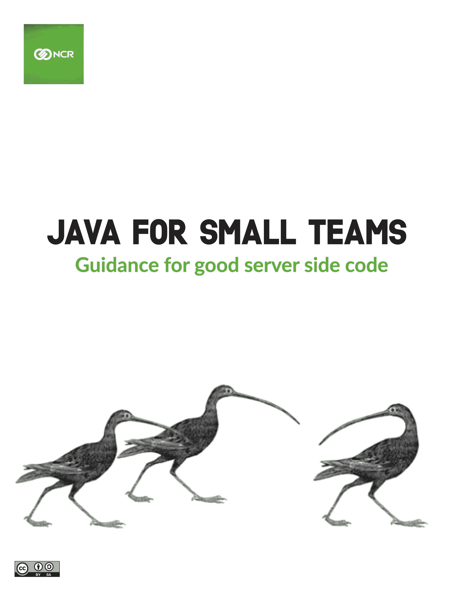
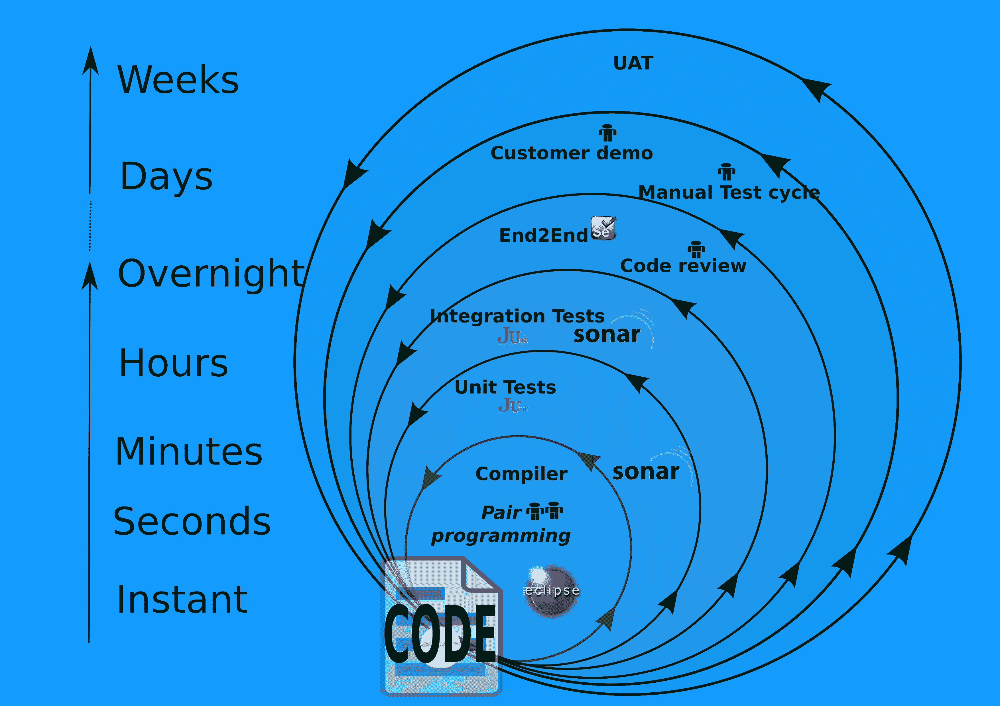
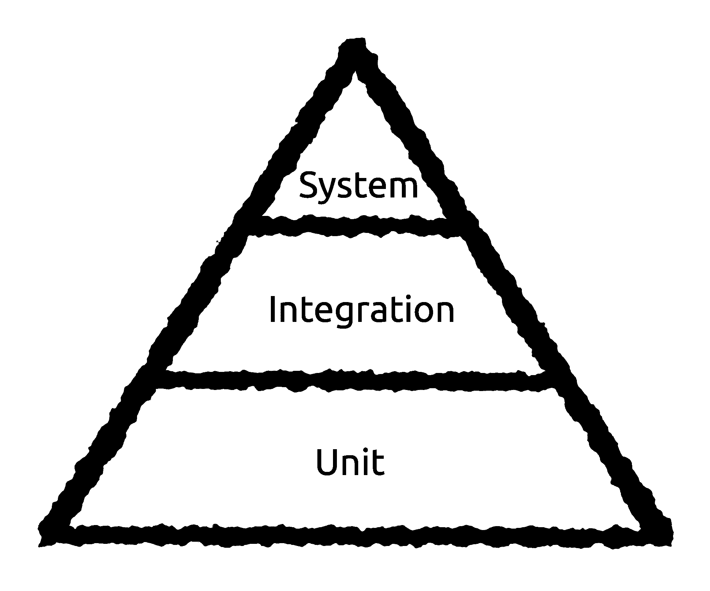
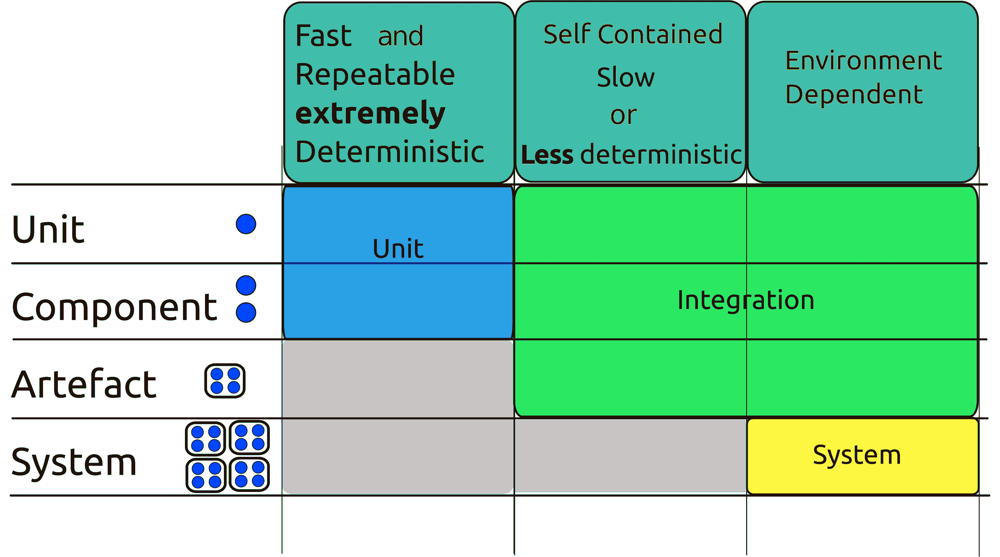
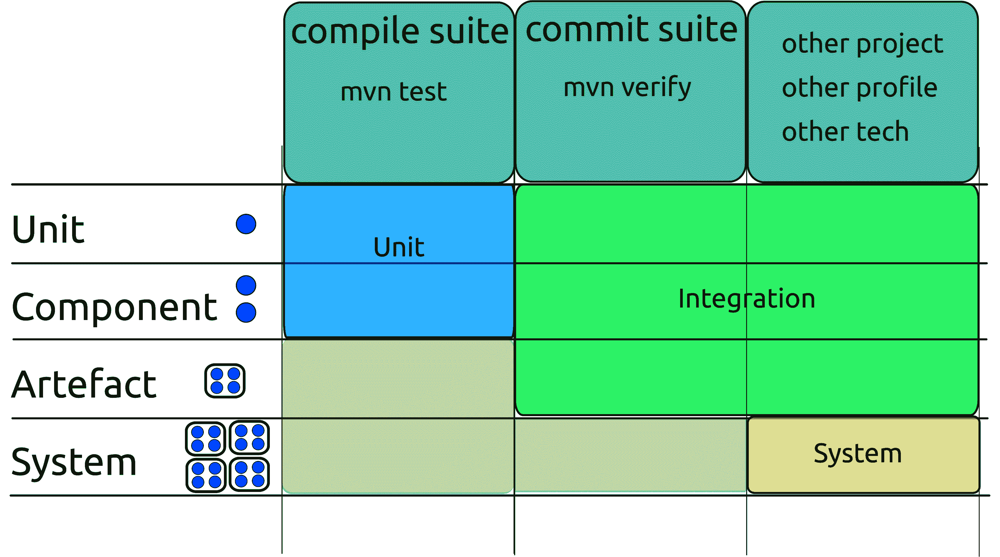

# 小团队的 Java



## 介绍

### 这本书是什么？

这本书旨在尝试描述良好的代码是什么样子的，以及实现它的实践。它并不是唯一的标准答案，而是许多有效方案中的一种观点。

所以为什么要写这本书？它的独特之处在于具有以下特点：

- 易于分发
- 开放并欢迎更新
- 简洁
- 针对性强

我们对你以及你工作环境有一些假设：

- 我们假设你正在编写 `Java` 代码。
- 我们假设你的团队经验各异（既有专家也有学者）。
- 我们假设你在业务背景下编写代码。
- 我们假设你的代码在多年后仍然有效。

书中的建议在某些背景下是有效的，而在另一些情况下可能是糟糕的。如果你对书中的内容有异议，请告知我们，以便改进。最后，我们编写的代码并非完美。有时我们会继承自己的错误，有时也会继承别人的错误。

我们看到的经验丰富的程序员会犯的最常见错误之一，就是盲目地只考虑一或两个因素（通常是那些带有响亮缩写词的因素），而不考虑其他因素。

我们仔细地列出了我们认为书中建议会有用的背景，但这个背景仍然非常广泛。略有不同的情况可能需要完全不同的权衡。在某个项目中运行良好的方法，在下一个项目中可能就不那么好了。

出于这个原因，我们很少使用 `always`（总是）或 `never`（从不）这样的词。

当我们使用这些词时，我们在这样做之前已经经过了仔细考虑，但我们真正的意思是“几乎总是”或“几乎从不”。

尽管如此，如果你发现自己正在忽视此书中的任何建议，请先停下来思考一下。不要掉进“某些建议不适用于你”的陷阱。我们往往在认为自己表现得优雅或聪明时犯下最糟糕的错误。我们无能的全部恐怖有时在几个月或几年之后才会显现。

建议是为了拯救我们免于自身的失误。

### 关于 Java 版本的说明

本文旨在适用于 `Java 7`、`8` 和 `9`，但很大程度上也适用于 `Java 5` 和 `6`。

在最近的 Java 版本之间存在差异的地方，我们将指出它们。如果你不幸地正在使用早期版本的 `Java`，你必须自己发现它与 `Java 7` 的任何差异。

### 许可证

本作品版权所有 `NCR`，但可以根据知识产权 署名-相同共享许可协议 v4.0 的条款与他人阅读和共享。

### 作者

本文由 [Henry Coles](https://twitter.com/0hjc) 和众多贡献者撰写。

#### 贡献者

- Francesco Burato
- Gary Duprex
- Grant Forrester
- Kevin Grant
- Keir Lawson
- Marco Di Paola
- Gordon Rogers
- Herve Saint-Amand
- Ewan Summers

### 封面

封面由 Peter Berry 根据 1885 年的文本《Nouveau dictionnaire encyclopédique universel illustré》中长嘴沙鹬的木刻画制作。

据我们所知，长嘴沙鹬在 `Java` 方面并不精通。

# 流程

代码（好的或坏的）不会凭空出现，需要有人坐下来编写它。程序员处理这项任务的方式会影响以后在代码上咒骂时花费的时间。

本节探讨了开发哲学、工作流以及团队在开始合作之前应该考虑的其他因素。

## 构建快速反馈循环

良好的代码关键在于获取良好且及时的反馈。你越早发现某个错误，修复就越容易。

在遗留项目上工作，如果发现代码更改是否良好的唯一方法是将其部署到 `dev/test/qa` 环境，将是令人沮丧且打击士气的。

确保你的项目具有具有设计良好的开发工作流——设置这些内容所付出的努力将获得多倍回报。

理想情况下，所有反馈都应该是瞬时的，但在实践中，通过这种方式获取所有反馈是不切实际或是不可能的。

相反，软件开发被组织为嵌套的反馈层级，如下：



### 即时反馈

现代 IDE（如 `Eclipse` 或 `IntelliJ`）会在你打字时使用底层编译器和可配置的静态分析工具提供即时反馈。

你可以通过充分利用 `Java` 类型系统并配置静态分析工具来增加你收到的即时反馈。

虽然来自 IDE 的反馈快速且方便，但它也有一些缺点。

- 它可能根据 IDE 的配置在不同的机器上有所不同
- 它通常是非二元化的（即不是简单的通过/失败）
- 它可能会被忽略/忽视
- 对速度的预期限制了它所能实现的内容

由于这些原因，你应该避免纯粹以 IDE 为中心的工作流。在通过构建文件运行测试之前，开发者不应认为代码是完成的。

### 快速反馈

#### 构建文件是真理

构建脚本提供的反馈没有 IDE 那么即时，因为必须被显式地触发。

然而，构建脚本的反馈有两个主要优势：

- 它在所有机器上都是可重复的
- 在 `CI` 服务器的帮助下，你可以确保它不被忽略

因为构建脚本的较慢反馈是可以接受的，可以从这里运行更大规模的静态和动态分析。这通常包括对即时反馈的重复。

#### 本地可运行测试

在编译器和静态分析之后，下一最快的反馈层级是测试套件。

至少应该维护两个可以在任何开发机器上本地运行的测试套件。

由于它们通常在编译之后或提交/推送代码之前立即运行，Martin Fowler 将这些测试称为：

- 编译套件 (The compile suite)
- 提交套件 (The commit suite)

在 `Maven` 中，这些自然映射到 `test` 和 `integration-test` 阶段。

然而，将测试放入编译套件的标准不应仅仅是其执行速度。

它们必须是快速的（每个测试毫秒级或更短），但还必须是高度确定且可重复的。这确保了套件提供了纯洁的反馈——在代码更改后测试失败的唯一原因是该更改导致了回归。

尽管这听起来很简单，但在实践中，需要相当的严谨性来确保测试之间不会相互干扰或受到外部因素的影响。

提交套件中的测试可能会慢一些，可重复性也可能略低一些。它们的目标应该是 100% 的可重复性，但它们可能会执行一些带有带有偶尔导致失败风险的操作，例如使用网络 `IO` 或向磁盘写入。

虽然此套件中的许多测试可能只是在与测试相同的 `JVM` 中启动代码，但某些测试还应该启动构建的产物（`war`、`ear`、`jar`）并对其进行某种程度的测试。

尽管提交套件可能依赖外部资源（如容器、数据库、队列等），但它仍然应该可以通过单个命令在任何机器上运行。

安装和启动依赖资源应该由构建脚本和测试自动处理——项目不应该带有关于如何设置开发机器的说明。

通常使用 `Maven Cargo` 插件来下载和配置测试容器。

### 慢反馈

编译套件和提交套件都应该在 `CI` 服务器上运行，通常由向仓库的提交/推送触发。

除了编译套件和提交套件之外，还应该创建其他套件。

这些套件可能需要本地机器上不可用的资源，并且或者执行需要长时间。

它们可能针对更真实的依赖项重新运行相同的测试。如果在本地运行集成测试时通常使用内存数据库，那么相同的测试可能会在生产数据库上再次运行。

对于 `Maven` 构建，这些套件可能使用配置或作为独立的 `Maven` 模块来实现。

这些套件将尽可能频繁地运行。最可能这意味着是基于定时运行的，因为它们可能花费时间太长而不适合在提交时运行。在这里，“花费时间太长”被定义为耗时超过了监控仓库的提交/推送之间可能的间隔。

定时测试运行有时在没有代码更改的情况下运行套件——这在识别不稳定测试（flaky tests）时可以提供有用信息。

## 统一讨论测试时使用的语言

### 在讨论测试时统一语言

#### 测试金字塔

遗憾的是，测试语言被过度加载了，不同的社区用相同的名称指代不同的内容。

测试金字塔是一个广为人知的关于应该如何进行测试的图表。

它展示了底部有大量的单元测试，上方是较少的集成测试，顶端是数量更少的系统测试。通常，在顶部还会添加一些手动测试的“云团”。



这张图可能已经画过成千上万次。虽然每个版本的底部都会出现单元测试，但在其他层级所使用的词汇会有巨大差异。

即使使用了相同的词汇，它们所包含的含义也可能不同。

尽管当你讨论“单元测试”、“集成测试”、“系统测试”、“端到端测试（end 2 end tests）”、“服务测试”时人们可能会点头表示同意，但不能保证他们和你想的是同一个东西。

取决于你交流的对象，“单元测试”可能是任何东西：从一份充满指令的 Word 文档到“程序员编写的任何测试”，再到教科书中出现的各种正式（但绝非权威的）定义。

“集成测试”的可能含义甚至更多。

#### 单元测试 (Unit Tests)

Java 社区现在广泛使用一种相当严谨的单元测试定义。我们建议你和你的团队使用这个定义。

要成为单元测试，测试必须满足：

- 快速（毫秒或更短）
- 隔离（仅测试一个单元）
- 可重复（能够在任何机器上运行数百万次并获得相同的结果）
- 自我验证（通过通过或失败）
- 及时（先编写测试）

注意：虽然先写测试通常是一个非常好的主意，但只要测试符合其他标准，无论何时何时的，它仍然是一个单元测试。

当我们谈论“单元”测试时，什么构成一个 `unit` 并不一定显而易见。

一种循环的定义是：`unit` 是独立测试时是有意义的最小实体。

它通常是一个类，但并不总是如此。将一组类视为一个单元是有意义的（特别是它们大部分是非公的），或者偶尔甚至可以将一个方法视为一个单元。

如果我们接受 `unit` 是一个小东西，并且认为我们在看到它时就能认识它，那么我们可以发现，单元测试的标准在很大程度上符合我们为编译套件（compile suite）提出的标准。

唯一的区别是，编译套件不关心隔离性。

如果我们选择编写一个同时测试两个（或更多）`units` 的测试，只要它符合其他标准，它仍然属于编译套件。

#### 系统测试 (System Tests)

系统测试的定义也相当明确。它们是对整个系统进行测试——即在真实环境中运行你所有的代码以及这些代码与其交互的所有外部代码。

#### 集成测试 (Integration Tests)

集成测试更难定义。它们占据了所有不符合单元测试或系统测试定义的巨大空间。

本文将使用这些图中所示的 `unit test`（单元测试）、`Integration test`（集成测试）和 `System test`（系统测试）术语。

为了清晰起见，在讨论集成测试时，有时会具体说明测试什么——例如“通过运行在 Tomcat 中的 war 文件的 REST API 进行测试”。

虽然很冗长，但这种长术语非常清晰。建议在跨团队讨论测试时使用它。在你们自己的团队内部，你们可能会开发出一种大家都能理解的简短语言。



这映射到我们的套件，如下所示：



## 将覆盖率视为工具而非目标

### 将覆盖率视为工具，而非目标

代码覆盖率是捕捉你错误的有用工具。

工具应该为你工作，而不是你为工具工作。

在编写代码和测试时运行代码覆盖率是最用的，而不是在几小时后的 CI 服务器上运行。

代码覆盖率的缺口突出了未经过测试的代码区域。这些缺口中有些可能是预期的且有意的，另一些可能是意外。正是这些意外缺口提供了有用信息。

这就是代码覆盖率的所有作用。

具有 100% 分支覆盖的代码可能经过了测试，也可能没有。代码覆盖率只是告诉你某些测试执行了代码，而不是说它们对其进行了有意义的测试。不要让它陷入虚假的安全感中。

有些团队设定了代码必须达到的覆盖目标（75% 似乎是一个常见数字）。尽管初衷是好的，但这种做法通常是有害的。

代码覆盖率很容易衡量。测试的其他理想的（或极不理想的）属性并不容易衡量，例如：

- 测试是有意义的吗？
- 测试是否易于阅读和理解？
- 测试是否与特定的实现紧密绑定？

最后一点尤为重要。

为了使测试具有价值，它必须能够支持重构；与特定解决问题的方法绑定的测试通常具有负价值，因为每当代码更改时，它们就必须修改或重写。不幸的是，你很容易以这种方式编写几个月或几年测试，然后才意识到你做错了。

通过专注于这一个易于衡量的属性，其他属性被淡化了。但更糟糕的是，试图达到覆盖率目标会积极推动开发者编写与实现绑定的测试。坏测试比好测试更容易编写。

可能可以说，当代码单元测试覆盖率只有 30% 时就存在问题。反之，如果通过设定目标来实现 80% 的覆盖率，代码可能会更难维护。

因此不要设定目标，相反要确保你的团队致力于编写良好的测试。

良好的测试是能够帮助代码、捕捉回归并在进行更改时不产生障碍的测试。在编写代码之前编写测试有助于鼓励良好的测试并确保代码有覆盖率。

# 风格 (Style)

## 风格

编程风格有很多方面，从关于括号和新行的平凡问题，到你如何设计和组织代码的趣味问题。

本节将涉及所有这些方面，从抽象的问题开始，深入到具体的细节。

虽然静态分析工具可以衡量大多数讨论内容的某些方面，但在大多数情况下，它们无法就代码的好坏做出中断构建的决策。需要熟练的人来来权衡并应用裁量权。

## 仔细考虑代码生成器

### 总结

代码生成器可以自动实现某些功能，节省时间并消除某些类 Bug 的可能。

尽管它们有很多推荐之处，但代码生成器也有成本，在将其整合到项目之前应仔细考虑。

优先选择那些允许生成功能与非生成功能之间清晰分离的生成器，但在将任何生成器引入项目之前，请确保你理解你正在做的权衡。

### 细节

代码生成器可以分为三大类：

- 样板生成器（向现有类中插入代码，例如由 IDE 自动生成的方法）。
- 生成存入版本控制并进行修改的脚架生成器。
- 从模型生成新类的生成器。生成的代码通常不提交到版本控制中。

我们建议尽量少使用第一种类型，或者根本不使用。这在“如何实现 Hashcode 和 Equals”中会有进一步的讨论。

从模型（如 schema 或语法法）生成代码是一种很有用的方法，只要是生成的代码不被修改并且被单独打包。如果将生成的代码和未生成的代码打包在同一个模块中，那么可能会开始产生**摩擦力**（见下文）。

#### 编译时注解处理器

JSR 269 引入了一个在构建时处理注解的标准框架。现在有多个工具使用 JSR 269 来生成代码。

大多数工具纯粹将带注解的类作为输入，并此生成新类。通常，新类会扩展或实现被注解的类或接口，但保持独立。这些工具本质上只是基于模型的样板代码生成器的子集，其中模型输入模型是带注解的 Java 类。

有些工具（如项目 Lombok）会更新带注解的类本身，添加额外的行为。这可能会增加**意外性**和**摩擦力**，我们在下文中讨论了这些问题。

#### 缺点

代码生成器显然有很多优点，那么为什么它们不是总是合理的呢？

它们引起的主要问题是`意外性`和`摩擦力`。

##### 意外性

如果你在编译或运行时生成代码，你就不再是在用 Java 编程了。

你是在用一种增强后的 Java 编程，它执行一些维护代码的开发者可能并不知道的事情。

它可能会执行他们意想不到的事情。

它可能会破坏程序员对代码内部可以发生或不能发生什么的根本性假设。

运行时生成器通常会比编译时系统产生更多意外性——它们添加了打破通常 Java 规则的 `magic`（魔法）元素。运行时生成器通常还会削弱类型安全，将开发者通常预期在编译时发生的问题类别转移到运行时。

当开发者第一次在项目中遇到代码生成器时，它所做的一切都会令他们感到惊讶。

经过一段时间的学习，大部分的意外性应该会消失，但每位开发者都需要经历这个学习阶段。其中涉及的学习成本可能是巨大的——例如，完全理解像 `Spring` 这样的框架就需要巨大的努力。

最令人担心的问题是，在初始学习结束后仍然存在某些意外性。

当系统发生意料之外的情况时，你发现自己在问“这会不会是因为代码生成器的原因？”，并且每次都不得不消除这种可能性，那么你就为项目引入了非常真实的成本。

##### 摩擦力

使用编译时生成器的代码在 IDE 中无法整洁地导入，除非 IDE 了解如何运行该生成器。即使系统有 IDE 的支持，也可能需要安装插件、设置配置选项等。

摩擦力的程度以及遇到的频率将取决于 IDE 以及支持的质量。摩擦力可能很小，且只在新开发者加入项目时遇到。或者摩擦力可能非常显著，并且每次清理代码（clean）时都会触发。

减少摩擦力最有效的方法是将生成的代码与依赖它的代码分开打包。生成的代码随之变成了一个正常的二进制依赖，而其自动化的事实就就变成了一个内部实现细节。

虽然这种方法有效，但它可能也有缺点。它可能会创建人工模块。如果代码不是自动生成的，将其打包为单独的模块是否有意义呢？

运行时生成器通常不会引入太多摩擦力，尽管有时在 IDE 中运行测试时，如果没有 `javaagents` 可能会遇到问题。

#### 权衡

以上就是这些问题。

与免费获得功能的承诺相比，`意外性`和`摩擦力`听起来是微不足道的顾虑，但它们的影响可能是重大的。

引入代码生成器是否有意义，通常取决于它被使用的程度。如果有大量功能可以自动生成，那么它可能是有的；如果数量相对较少，最好坚持使用原生 Java。

## 为可读性进行优化

### 优化可读性而非性能

#### 总结

不要过早地优化你的代码。

相反，专注于让代码变得简单且易懂。

#### 细节

许多新程序员担心他们编写的每个方法的性能，避免编写他们认为效率下的代码，并采用一种试图减少对象分配、方法调用、赋值或其他他们认为会有成本的因素的风格。

尽管这通常会降低可读性并增加复杂度，但大多数微型性能优化完全没有提供性能增益。

在我们工作的背景下，性能应该是最后考虑的关注点之一。相反，应该关注让代码尽可能简单和易读。

如果出现性能问题，应该使用性能分析工具（profiling）来确定问题真正的所在。

这并不意味着应该完全忽略性能，但它应该始终让位于代码的可读性和简单性，直到证明优化有真实的益处。如果代码可以用更高效的方式编写，而不会增加`任何`复杂度或牺牲可读性，那么应该优先选择（假设的）更高效的代码。

### 优先使用可读代码而非注释

#### 总结

仅使用注释来解释代码本身无法解释的内容。

当你正要写注释时，先想想是否有办法更改代码，使其在没有注释的情况下也能被理解。

#### 细节

出自 Robert C. Martin 的《整洁代码》。


“没有什么比一个位置恰当的注释更有帮助了。没有什么比轻率的、教条式的注释更能让模块变得混乱。没有什么比一个陈旧、破旧的传播谎言和虚信息的注释更具破坏性了。”

注释应该仅用于解释无法通过重构来自我解释的代码背后的意图。

**糟糕**

```java
// 检查员工是否符合全额福利条件
if ((employee.flags & HOURLY_FLAG) && (employee.age > 65))
```

**更好**

```java
if (employee.isEligibleForFullBenefits())
```

注释只有在解释代码无法解释的内容时才是有用的。

这意味着你写的任何注释应该提供“为什么”，而不是“是什么”或“如何做”。

**糟糕**

```java
// 确保端口大于或等于 1024
if (port < 1024) {
  throw new InvalidPortError(port);
}
```

**更好**

```java
// 1024 以下的端口（特权端口或已知端口）
// 我们没有 root 权限
if (port < 1024) {
  throw new InvalidPortError(port);
}
```

**更好**

```java
if (requiresRootPrivileges(port)) {
  throw new InvalidPortError(port);
}

private boolean requiresRootPrivileges(int port) {
  // 1024 以下的端口（特权端口或已知端口）
  // 在 Unix 系统上需要 root 权限
  return port < 1024;
}
```

在这里，功能意图已经包含在方法名中，注释仅被用于提供一些逻辑合理的背景信息。

这个魔数字也可以被替换为常量。

```java
final static const HIGHEST_PRIVILEDGED_PORT = 1023;

private boolean requiresRootPrivileges(int port) {
  // 特权端口或“已知端口”
  // 在 Unix 系统上需要 root 权限
  return port <= HIGHEST_PRIVILEDGED_PORT;
}
```

在这种情况下，注释可以说仍然具有价值——至少，它为不熟悉该主题的读者提供了两个可以在网上搜索的关键词短语。

## 谨慎使用 Javadoc

### 总结

Javadoc 可以帮助文档化代码，但通常有更好的方法。在决定编写它之前，请仔细考虑。

### Javadoc 详情

### Javadoc 的优点

对于那些无法访问源码必须使用你代码的外部团队来说，Javadoc 是无价的。

所有外部使用的代码其公共方法都应该 javadoc。

确保所有此类 javadoc 都集中在方法*做了什么*，而不是它是*怎么做的*。

### Javadoc 的缺点

Javadoc 重复了本该从代码本身就能清晰看出的信息，并且会带来持续的维护成本。

如果它没有与代码同步更新，就会产生误导性。

不要对仅由你的直接团队使用和维护的代码编写 Javadoc。相反，要花精力确保代码能够自说明。

## 记住 KISS 和 YAGNI

### 总结

保持你的设计尽可能简单。

只创建你现在需要的功能——而不是你认为未来可能需要的功能。

### 详情

KISS（保持简单，愚蠢蛋）和 YAGNI（你并不需要它）缩写词提供了良好的建议，在编码时值得记住。

KISS 建议我们保持代码和设计尽可能简单。

很少有人不同意这一点，但遗憾的是，*简单*的含义并不总是显见的。

给定问题的两个解决方案，哪一个更简单？

* 代码行最少的那个？
* 类数量最少的那个？
* 使用第三方依赖最少的那个？
* 分支语句少的那个？
* 逻辑最显式的那个？
* 与其他使用的解决方案一致的那个？

以上所有都是*简单*的合理定义。其中没有哪一个是始终通用的单一定义。

识别出什么是简单并不容易，而保持简单则需要大量工作。

如果我们能以某种方式衡量软件的复杂度，我们就会发现每件软件都必须包含某个最小值。

如果软件比这更简单，那么它的功能就会更少。

真实的程序始终会包含这种*固有复杂度*再加上额外的一部分。这些额外的复杂度是我们由于自身不完美而添加的*意外复杂度*。

当然，将意外复杂度与固有复杂度区分开来也是困难的。

幸运的是，YAGNI 为我们提供了实用的建议，告诉我们如何在不需要区分意外和固有复杂性的情况下保持简单。

系统执行的操作越多，其整体复杂度就越高。如果我们做一个功能较少的系统，它就会更简单——它将拥有更少的*固有复杂度*和更少的*意外复杂度*。

因此，你的目标是创建解决你**现在**问题的最少功能。

* 不要因为你认为以后可能需要就实现某些东西。如果以后需要，将来再实现。
* 不要试图让事情变得“灵活”或“可配置”。让它们只做该做的事——在你有需要的时候再对其进行参数化。

如果你创建了超过最少的功能，从那时刻起，你将有更多的代码需要调试、理解和维护，直到有人有信心删除它们。

## 偏好组合

### 偏好组合而非继承

### 总结

组合通常会导致更灵活的设计。

首先考虑使用组合，只有当组合看起来不合适时，才退而求助于继承。

### 详情

组合意味着通过将其他东西组合在一起来构建。继承意味着通过创建子类来扩展现有类的行为以构建构建。

举一个极简的例子——如果要求一个类要接受并存储 `String` 值，一些初学 Java 的程序员会按照如下方式使用继承：

```java
class InheritanceAbuse extends ArrayList<String> {

  public void performBusinessLogic(int i) {
    // 对存储的字符串进行操作
  }

}
```

相同的功能可以使用组合来实现。

```java
class UsesComposition {

  private final List<String> values = new ArrayList<String>();

  public void performBusinessLogic(int i) {
    // 对存储的字符串进行操作
  }

  public void add(String value) {
    this.values.add(value);
  }

}
```

尽管需要更多代码，但经验丰富的 Java 程序员甚至不会考虑第一种方法。那么，为什么第二个版本更好呢？

有几个重叠的解释，我们将从最抽象的开始，然后转向更实用的解释。

### 继承是强关系

继承用于建模 IS-A（是一个）关系——即，我们是在说我们的 `InheritanceAbuse` 类是一个 `ArrayList`，并且应该能够将其传递给任何接受 `ArrayList` 的代码片段。

组合创建了 HAS-A（有一个）关系；这是一种较弱的关系，我们**代码中应该总是倾向于较弱的关系**。

因此，偏好组合而非继承只是“倾向于类与类之间弱关系”这一更通用建议的一个特定实例。

当存在 IS-A 关系时，使用继承是有意义的，但纯粹为了重用代码并不是合适的机制。

### 继承破坏了封装

继承实现未能封装一个实现细节——即我们把东西存储在 `ArrayList` 中。

我们类的接口包含了来自 `ArrayList` 的各种方法，例如：

* `clear`
* `remove`
* `contains`

这些方法对我们的类有意义吗？如果有人调用了它们，会干扰 `performBusinessLogic` 中的逻辑吗？

我们对这个示例类意图做什么了解得不够，无法确定性地回答这些问题，但答案很可能是我们更倾向于不暴露这些方法。

如果我们从 `ArrayList` 切换到其他列表实现，这对客户端是可见的。即使没有调用 `ArrayList` 的特定方法，之前编译的代码现在可能会崩溃。

### 我们只能这样做一次

Java 不支持多继承，所以我们只能选择一个要扩展的东西。如果我们的类还需要存储 `Integer`，那么继承甚至不是选项，我们必须使用组合。

在单继承语言中，组合天生更灵活。

### 组合有助于测试

这与我们的简单示例无关，但测试通过组合连接的类如何交互是非常而易举的。使用继承时则困难得多。

```java
class UntestableClass extends SomeDependency {
  public void performBusinessLogic(int i) {
    // 使用 SomeDependency 的方法操作
  }
}
```

```java
class MyClass {
  private final SomeDependency dependency;

  MyClass(SomeDependency dependency) {
    this.dependency = dependency;
  }

  public void performBusinessLogic(int i) {
    // 使用 dependency 进行操作
  }
}
```

向 `MyClass` 注入 mock 很容易。存在技巧可以为了单元测试隔离 `UntestableClass` 与 `SomeDependency`，但要复杂得多。

### 继承是静态的

继承在编译时设置了具体类之间的固定关系。通过组合，可以在运行时切换不同的具体类。

再次，组合天生更灵活。

### 接口继承

偏好组合而非继承的建议指的是*实现继承*（即扩展类）。上述讨论的缺点并不适用于*接口继承*（即实现接口）。

事实上，你通常必须做的设计选择是在实现继承与组合与接口继承的结合之间进行。

在这些情况下，建议仍然是倾向于使用组合的方法。

例如，著名的基于组合的装饰器模式：

```java
class ProcessorUpperCaseDecorator implements Processor {

  private final Processor child;

  ProcessorUpperCaseDecorator(Processor child) {
    this.child = child;
  }

  @Override
  public void process(String someString) {
    child.process(someString.toUpperCase());
  }

}
```

也可以使用继承来实现：

```java
class InheritanceUpperCaseDecorator extends ConcreteProcessor {

  @Override
  public void process(String someString) {
    super.process(someString.toUpperCase());
  }

}
```

但是，同样，这种解决方案的灵活性较低。

使用基于组合的版本，我们可以装饰任何 `Processor`。而使用继承的版本，我们需要为每个想要添加大写行为的具体类型重新实现装饰器。

许多常见的面向对象（OO）模式依赖于组合和接口继承的结合。

## 何时使用实现继承

几乎任何可以通过实现继承实现的功能，也都可以通过接口继承和组合的结合来实现。

那么，什么时候应该使用实现继承呢？

与组合相比，实现继承唯一的优势——它更简洁。

因此，当满足以下**两项**条件时，应该使用实现继承：

1. 存在需要建模的 IS-A（继承）关系
2. 使用组合方法会导致过多的样板代码

遗憾的是，第二点完全是主观的。

# 保持 SOLID

## 保持 SOLID

### 总结

SOLID 缩写为你应该遵循的设计提供了指导。

* **S** 单一职责原则 (Single Responsibility Principle)
* **O** 开闭原则 (Open Closed Principle)
* **L** 里可替换原则 (Liskov Substitution Principle)
* **I** 接口隔离原则 (Interface Segregation Principle)
* **D** 依赖倒转原则 (Dependency Inversion Principle)

## 细节

#### 单一职责原则

分离关注点——一个类应该只做一件事。换句话说，一个类应该只有一个改变的原因。

#### 开闭原则

你应该能够扩展行为，而不必修改现有代码。

“……你应该设计永远改变的模块。当需求变化时，你通过添加新代码来扩展此类模块的行为，而不是更改已经运行的老代码。”

—— 罗伯特·马丁 (Robert Martin)

你可能没有遵循这一原则的一个迹象，是代码中存在 `switch` 语句或 `if/else` 逻辑。

#### 里可替换原则

派生类必须能够替换它们的基类。

你正在违反这一原则的一个迹象，是代码中存在 `instanceof` 语句。

#### 接口隔离原则

接口隔离原则规定，客户端不应被强制实现它们不使用的接口；倾向于使用小型、定制的接口，而不是巨大的全能接口。

你可能违反这一原则的一个迹象，是代码中存在空方法或抛出 `OperationNotSupportedException` 的方法。

#### 依赖倒转原则

高层模块不应该依赖低层模块。两者都应该依赖抽象。

抽象不应该依赖于细节。细节应该依赖抽象。

在实践中，这意味着你应该遵循两种模式之一：

1. 将“高层”组件依赖的接口与该组件打包在一起
2. 将组件依赖的接口与客户端和实现分开打包

第一种方法是经典的依赖倒转（与高层组件依赖底层的传统方法形成对比）。

第二种方法被称为“分离接口模式”（Separated Interface Pattern）。它稍微笨重一些，但也更灵活，因为它对接口由谁所有不作假设。

你违反这一原则的一个迹象，是代码中存在包循环。

# 保持代码 DRY

## 保持代码 DRY

### 总结

不要重复自己（DRY - Don't Repeat Yourself）——避免多次编写相同的逻辑。

每当你复制粘贴代码时，就朝自己的眼睛戳一下。这是一个很好的震慑手段，但久久之可能会导致失明。

## 细节

如果需要多次使用相同的逻辑，就不应该重复；而应该将其提取到命名良好的类或方法中。

这样既更容易读也更容易维护，因为如果逻辑需要更改，只需要在一个地方进行更改即可。

**糟糕的写法**

```java
class Foo {
   private int status;
   private boolean approved;

   foo() {
     if (status == 12 || approved) {
       doFoo();
     }
   }

   bar() {
     if (status == 12 || approved) {
       doBar();
     }
   }
}
```

**更好的做法**

```java
class Foo {
   private final static int PRE_APPROVED = 12;

   private int status;
   private boolean approved;

   foo() {
     if (isApproved()) {
       doFoo();
     }
   }

   bar() {
     if (isApproved()) {
       doBar();
     }
   }

   private isApproved() {
     return status == PRE_APPROVED || approved;
   }
}
```

当我们有相似但并不完全相同的逻辑时，情况会有点复杂。

虽然复制粘贴很快，但我们能做的最糟糕的事情就是复制粘贴。

**极其糟糕**

```java
public void doSomething(List<Widget> widgets) {
  for (Widget widget : widgets) {
    reportExistence(widget);
    if (widget.snortles() > 0) {
      reportDeviance(widget);
      performSideEffect(widget);
    }
  }
}

public void doSomethingSimilar(List<Widget> widgets) {
  for (Widget widget : widgets) {
    reportExistence(widget);
    if (widget.snortles() > 0) {
      reportDeviance(widget);
      performSideEffect(widget);
    }
  }
}
```

这现在看起来很快很简单，但每当我们尝试理解或更改它时，都会浪费时间。

重用代码的一种简单直接但非常有限的方法是引入布尔标志位。

**不太好**


```java
public void doSomething(List<Widget> widgets) {
  doThings(widgets, false);
}

public void doSomethingSimilar(List<Widget> widgets) {
  doThings(widgets, true);
}

private void doThings(List<Widget> widgets, boolean doSideEffect) {
  for (Widget widget : widgets) {
    reportExistence(widget);
    if (widget.snortles() > 0) {
      reportDeviance(widget);
      if (doSideEffect) {
        performDifferentSideEffect(widget);
      } else {
        performSideEffect(widget);
      }
    }
  }
}
```

这种写法很丑，并且随着可能性的增加会变得糟糕。

更具扩展性的方法是使用策略模式。

如果我们引入一个接口：

```java
interface WidgetAction {
   void apply(Widget widget);
}
```

那么我们可以这样使用：

### 更好的做法

```java
public void doSomething(List<Widget> widgets) {
  doThings(widgets, performSideEffect());
}

public void doSomethingSimilar(List<Widget> widgets) {
  doThings(widgets, performDifferentSideEffect());
}

private WidgetAction performSideEffect() {
  return new WidgetAction() {
    @Override
    public void apply(Widget widget) {
      performSideEffect(widget);
    }
  };
}

private WidgetAction performDifferentSideEffect() {
  return new WidgetAction() {
    @Override
    public void apply(Widget widget) {
      performDifferentSideEffect(widget);
    }
  };
}

private void doThings(List<Widget> widgets, WidgetAction action ) {
  for (Widget widget : widgets) {
    reportExistence(widget);
    if (widget.snortles() > 0) {
      reportDeviance(widget);
      action.apply(widget);
    }
  }
}
```

Java 7 的版本由于匿名内部类的样板代码显得非常繁琐。

毫无争议地，对于像这样非常简单的情况，布尔标志可能更理想；但如果我们将 `performSideEffect` 和 `performDifferentSideEffect` 方法中的逻辑提取到实现 `WidgetAction` 的顶层类中，那么策略模式就会变得非常有吸引力。

在 Java 8 中，毋庸疑问，即使在最简单的情况下，策略模式也是更优的。

### Java 8 更好

```java
public void doSomething(List<Widget> widgets) {
  doThings(widgets, widget -> performSideEffect(widget));
}

public void doSomethingSimilar(List<Widget> widgets) {
  doThings(widgets, widget -> performDifferentSideEffect(widget));
}

private void doThings(List<Widget> widgets, Consumer<Widget> action ) {
  for (Widget widget : widgets) {
    reportExistence(widget);
    if (widget.snortles() > 0) {
      reportDeviance(widget);
      action.accept(widget);
    }
  }
}
```

我们不需要引入自己的接口 —— 内置的 `Consumer<T>` 就足够了。如果 `doThings` 方法是公开的，或者 `performSideEffect` 中的逻辑复杂到需要提取到顶层类中，那么我们应该考虑引入一个。

循环也可以转换为流水线操作。

### 作为流水线

```java
private void doThings(List<Widget> widgets, Consumer<Widget> action ) {
  widgets
  .stream()
  .peek(widget -> reportExistence(widget))
  .filter(widget -> widget.snortles() > 0)
  .peek(widget -> reportDeviance(widget))
  .forEach(action);
}
```

## 优先考虑可逆转的决策

### 总结

优先选择易于更改的设计决策。

## 细节

你在设计代码时所做的许多决策最终都会被证明是错误的。

如果你能通过包含后果和添加抽象来使你的决策变得可逆转，那么这种未来的变化将不再重要。

例如 —— 如果你引入了一个第三方库并在整个代码中引用它，那么你就推高了逆转使用该库这一决策的成本。如果你将其限制在单个位置并为它创建一个接口，那么逆转该决策的成本就很低。

但不要忘记 KISS 和 YAGNI —— 如果你的抽象使设计复杂化，那么最好不要使用。

# 显式化依赖关系

## 使依赖关系显式化并可见

### 总结

确保类的依赖关系是清晰可见的。

始终通过构造函数向类注入依赖。不要使用其他方法，如 setter 或字段上的注解。

永远不要使用隐藏路由（如 `Singletons` 或 `ThreadLocals`）引入依赖关系。

## 细节

如果每个对象所依赖的接口和类是显著且可见的，代码将更容易理解。

最可见的依赖是作为参数注入到方法中的那些。

可见性较低的是存储在字段中的那些，但取决于这些字段如何填充，依赖关系仍然可以被发现。

### 构造函数注入

构造函数依赖注入在单个位置清晰地通信了对象的依赖关系，并确保对象只在有效状态下创建。它允许将字段标记为 `final`，以便其生命周期是明确。

这是注入依赖的唯一方式。

### setter 注入

setter 注入增加了对象可能处于的状态的数量。其中许多状态是无效的。

如果使用 setter 注入，类可以在半初始化的状态下构造。什么才构成完全初始化的状态只能通过检查代码来确定。

#### 糟糕

```java
public class Foo() {
  private Bar bar;

  public void doStuff() {
    bar.doBarThings();
  }

  public void setBar(Bar bar) {
    this.bar = bar;
  }
}
```

在这里，如果构造 `Foo` 时没有调用 `setBar`，将会抛出 `NullPointerException`。

#### 更好

```java
public class Foo() {
  private final Bar bar;

  public Foo(Bar bar) {
    this.bar = bar;
  }

  public void doStuff() {
    bar.doBarThings();
  }
}
```

在这里，很清楚我们必须提供一个 `Bar`，因为没有它我们无法构造该类。

### 字段注解

虽然字段上的注解看起来很方便，但意味着依赖关系在公共 API 中不可见。它们还将将你的类构造与理解这些注解的框架绑定，并防止字段被标记为 `final`。

不应该使用字段注解。

如果你正在使用如 `Spring` 之类的依赖注入框架，要么将对象的构造移动到配置类中，要么将注解的使用限制在构造函数上。这两种方法都允许你的类被正常构造，并确保所有依赖都是可见的。

### 隐藏依赖关系

任何不是通过构造函数或方法参数注入类中的东西都是隐藏依赖关系。

这些是恶性的。

它们通过 `Singletons`、`ThreadLocals`、静态方法调用或简单地调用 `new` 引入。

#### 糟糕

```java
public class HiddenDependencies {
  public void doThings() {
    Connection connection = Database.getInstance().getConnection();
    // 使用 connection 进行操作
    ....
  }
}
```

在这里，我们必须在调用下方代码的 `doThings` 方法之前确保 `Database` 类处于有效状态，但如果不遍遍每一行代码，我们无法知道这一点。

#### 更好

```java
public class HiddenDependencies {
  private final Database database;

  public HiddenDependencies(Database database) {
    this.database = database;
  }

  public void doThings() {
    Connection connection = database.getConnection();
    // 使用 connection 进行操作
    ....
  }
}
```

通过构造函数注入使得依赖关系清晰可见。

根据定义，隐藏依赖关系很难发现，但它们还有第二个问题——它们也很难替换。

### 缝隙

缝隙是 Michael Feathers 在《Legacy Code》（Working Effectively with legacy code）中引入的概念。

他将其定义为：

> “可以在不编辑该处的情况下更改程序行为的地方。”

在 `HiddenDependencies` 的原始版本中，如果我们想 `Database` 替换为 mock 或 stub，只有当单例提供了某种方法来修改它的实例时我们才能这样做。

#### 不是好的方法

```java
public class Database implements IDatabase {
  private static IDatabase instance = new Database();

  public static IDatabase getInstance() {
    return instance;
  }

  public static void setInstanceForTesting(IDatabase database) {
    instance = database;
  }

}
```

这种方法引入了缝隙，但没有解决我们对可见性的担忧。依赖关系仍然是的。

通过构造函数注入，我们获得了缝隙并使依赖关系可见。即使 `Database` 是单例，我们仍然能够为了测试将其与我们的代码隔离。

# 优先使用不可变对象

### 总结

尽可能创建不可更改的对象 —— 特别是当这些对象是长寿或可全局访问时。

## 细节

可变状态使程序更难理解和维护。

当对象寿命短暂且不离开方法作用域时，可变状态引起的问题很少。写和读操作彼此接近，且发生的顺序是清晰的。

对于长寿对象，情况变得复杂。

如果一个对象逃离了方法，它可能会被代码中的多个位置访问。

我们必须首先假设发生在这些对象上的任何事情都会发生。只有通过检查整个程序，才能确认某些情况不会发生。

不可变对象可能发生的情况要比可变对象少得多。通过限制长生命周期对象的行为，我们让事情变得更简单了。我们需要考虑的可能性也随之减少。

遗憾的是，从类的定义中并不总是容易看出该类型对象的生命周期。可能只会创建短命的实例，也可能只创建长命的实例。又可能是两者的混合。

如果我们默认设计不可变类，我们就不需要担心这个问题了。

## 可变对象的问题

假设我们有一个像 `Foo` 这样非常简单的类：

```java
public class Foo {
  private Long id;

  public Long getId() {
    return id;
  }

  public void setId(Long id) {
    this.id = id;
  }

  @Override
  public int hashCode() {
    return Objects.hashCode(id);
  }

  @Override
  public boolean equals(Object obj) {
    if (this == obj)
      return true;
    if (obj == null)
      return false;
    if (getClass() != obj.getClass())
      return false;
    Foo other = (Foo) obj;
    return Objects.equals(id, other.id);
  }
}
```

我们需要在代码库中搜索它的所有用法，以确保以下成立：

### 它永远不会从多线程访问

`Foo` 不是线程安全的。

对 long 类型的写入不是原子的，且 `Foo` 内部没有任何机制可以建立字段写入和读取操作之间的“先发生于”（happens-before）关系。

如果从不同的线程调用 `setId` 和 `getId`，我们可能会得到过时的值或垃圾值。

### 在 `Foo` 放入 Set 之后永远不会被调用 `setId`

该类的 `hashcode` 依赖于一个可变字段。如果我们在将其放入集合后修改了它，那么我们程序的行为将不符合预期。

### 我们的数据流

即使我们的程序运行正常，我们也需要做额外的工作来理解它是如何运行的。

`setId` 可以在对象创建后的任何点被调用。因此，我们只能通过查找所有对 `setId` 的调用来理解数据如何在程序中流动的 —— 可能有几处，也可能只有一个。我们发现这一点的唯一就是检查整个程序。

## 不可变对象

如果我们能让对象变得不可变，我们就获得了某种保障，意味着我们不需要担心对象是如何被使用的。

```java
@Immutable
public final class Foo {
  private final Long id;

  public Foo(Long id) {
    this.id = id;
  }

  public Long getId() {
    return id;
  }

  @Override
  public int hashCode() {
    return Objects.hashCode(id);
  }

  @Override
  public boolean equals(Object obj) {
    if (this == obj)
      return true;
    if (obj == null)
      return false;
    if (getClass() != obj.getClass())
      return false;
    Foo other = (Foo) obj;
    return Objects.equals(id, other.id);
  }
}
```

`Foo` 是长命还是短命已经不再重要了。

它本质上是线程安全的。

我们知道，无论用什么值构造它，它将一直保持到销毁。数据只有一个写入点，因此我们不需要搜索其他点。

### 注解

该示例使用了 JSR305 的 `javax.annotation.concurrent.Immutable` 注解。

这并没有任何方式改变对象的功能，但提供了一种传达该类为不可变意图的方法。静态分析工具如 [Mutability Detector](https://github.com/MutabilityDetector/MutabilityDetector) 可以检查这种意图是否被违背。

我们可以一眼看出 `Foo` 是不可变的，因为它具有已知不可变类型的 `final` 字段。

`final` 关键字仅确保字段所引用的引用不会改变。

如果字段类型是 `Bar`，那么在不检查 `Bar` 确定它是否也是不可变的情况下，我们无法知道它是可变的。即使不使用静态分析工具，使用 `Immutable` 注解也会让这种评估更快。

我们不是更新不可变对象的状态，而是创建新实例来保留我们不想修改的状态。

这种模式起初对某些 Java 程序员来说很奇怪，但这种编程模型与熟悉的 `String` 类的工作原理相似。


```java
@Immutable
public final class Bar {
  private int anInt;
  private String aString;

  public Bar(int anInt, String aString) {
    this.anInt = anInt;
    this.aString = aString;
  }

  @CheckReturnValue
  public Bar withAnInt(int anInt) {
    return new Bar(anInt, this.aString);
  }

  @CheckReturnValue
  public Bar withAString(String aString) {
    return new Bar(this.antInt, aString);
  }
}
```

通过调用 `withAString()` 和 `withAnInt()` 可以获得带有新值的 `Bar` 实例。

JSR305 的 `javax.annotation.CheckReturnValue` 使静态分析工具如 [Error Prone](https://github.com/google/error-prone) 在发生错误时（如下所示代码所示）发出警告。

```java
public Bar doThings(Bar bar) {
  if (someLogic()) {
    bar.withAnInt(42);
  }
  return bar;
}
```

```java
public Bar doThings(Bar bar) {
  if (someLogic()) {
    bar.withAnInt(42);
  }
  return bar;
}
```

## 什么时候使用可变对象

创建可变对象比创建不可变对象所需的样板代码稍少。

如果你知道一个类将用于创建短命的局部对象，那么你可以考虑它是可变的。但你必须权衡随着代码库的增长，为了确保它仅以这种方式使用而所需的额外工作。

目前有选项可以自动生成不可变和可变类，从而消除了可变对象的主要优势。这些选项中的两个将在“如何实现 Hashcode 和 Equals”中进一步讨论。

可变对象曾是 Java 的常态。结果是许多许多框架需要可变对象。持久化和序列化框架通常需要带有无参构造函数和 setter 的 Java Bean。文档并不总是强调这一点，但某些长期框架已经更新以支持不可变对象。

例如 Jackson 现在允许对构造函数和工厂方法进行注解：

```java
public class Foo {
  private final int x;
  private final int y;

  @JsonCreator
  public Foo(@JsonProperty("x") int x, @JsonProperty("y") int y) {
    this.x = x;
    this.y = y;
  }
}
```

其他框架（如 Hibernate）只能与提供默认构造函数的类一起使用。虽然它们可以配置为直接设置字段而不需要 setter，但这产生的问题比解决的问题多。

如果你受限于一个需要可变性的框架，那么在与该框架交互时，你将使用可变对象。

虽然一致性具有价值，但也存在代价。

除非团队之间已经对内容的格式化达成了广泛共识，否则试图强制执行一套官方规则可能会产生的怨恨多于收益。

因此，应该设定一个全局首选参考标准，但只要团队在他们维护的代码中使用保持一致的风格，他们应该根据自己的需要自由偏离此标准。

## 建议的格式规则

如果您没有自己强烈的偏好，我们建议您遵循 [Google Java Style 指南](https://google.github.io/styleguide/javaguide.html)。

这些格式规则经过了深思熟虑，文档清晰，且没有过度规定。

我们不会在这里详细描述它们，但按照这些规则格式化的代码看起来如下：

```java
class Example {
  int[] myArray = {1, 2, 3, 4, 5, 6};
  int theInt = 1;
  String someString = "Hello";
  double aDouble = 3.0;

  void foo(int a, int b, int c, int d, int e, int f) {
    if (f == 5) {
      System.out.println("fnord");
    } else {
      System.out.println(someString);
    }

    switch (a) {
      case 0:
        Other.doFoo();
        break;
      default:
        Other.doBaz();
    }
  }

  void bar(List<Integer> v) {
    for (int i = 0; i < 10; i++) {
      v.add(new Integer(i));
    }
  }
}
```

然而，我们建议忽略 Google 指南关于何时编写 Javadoc 的建议，转而采用我们自己的规范。

### 关于此风格的注意事项

### 使用空格而非制表符

制表符的显示可能取决于编辑器的配置。这将导致不同的程序员在根据编辑器设置调整文件时，产生频繁的重新格式化。使用空格可以避免这个问题。

在某些语言中（例如代码压缩工具兴起之前的 JavaScript），制表符具有曾具有优势，因为与使用多个空格相比，它们减小源代码文件的大小。对于 Java 来说，源代码文件的大小增大无关。

### 单真大括号风格 (One True Brace Style)

关于这种风格的优点有各种争论，但我们建议使用它主要因为它在 Java 社区很常见。

虽然简单的 `if else` 语句可以通过省略大括号来写得更简洁，但我们建议始终包含它们。这减少了语句在非意图情况下被放置在条件之外的概率。

#### 组方法以便于理解

### 总结

类的公共方法应该出现在文件顶部，私有方法位于底部，任何受保护（protected）或包默认方法位于中间。

除了按照访问权限进行排列外，它们应该按照逻辑流进行排序。

## 细节

该方案试图实现两个目标：

1. 通过将公共 API 与实现细节分离来突出公共 API
2. 让读者以最少的滚动操作遵循逻辑流

为了实现第二个目标，方法应该被逻辑分组，并且方法始终出现在它们所调用的方法之上。

这两个目标显然是冲突的，因为将公共 API 方法分组在文件顶部会防止将它们与所使用的实现方法分组。如果这导致了大问题，可能表明该类承担了过多职责，可以重构为一个或多个更小的类。

当实现方法从多个位置被调用或方法之间存在递归关系时，也会出现方法“正确”位置的问题。当然，这没有唯一的标准答案，任何大体符合第二个目标的排序都可以使用。

构造函数和静态工厂方法通常应该放在类的开头。然而，方法是 `static` 的这一事实，通常不应影响它放置的位置。

#### 示例

```java
public class Layout {

  private int a;

  Layout() {...}

  public static Layout create() {...}

  public void api1() {
    if (...) {
      doFoo();
    }
  }

  public void api2() {
    if (...) {
      doBar();
    }
  }

  private void doFoo() {
    while (...) {
      handleA();
      handleB();
    }
    leaf();
  }

  private void handleA() {...}

  private void handleB() {...}

  private static void doBar() {
    if (...) {
      leaf();
    }
  }

  private void leaf() {...}
}
```

字段应始终放在类的顶部，位于任何方法之前。

## 保持方法短而简单

### 总结

保持方法短而简单。

## 细节

小事物比大事物更容易理解。方法也一样。

衡量方法大小的一种方法是通过它所包含的代码行数。

作为指南，方法长度通常不应超过 `7` 行。这不是一条硬性规定——只是一个关于何时对方法的大小感到不适的指南。

衡量方法大小的另一种方法是看通过它的可能路径有多少。方法的“圈复杂度”提供了这种衡量——它会随着条件逻辑数量和循环数量的增加而增加。

作为指南，方法通常不应该有。

上述任何更改都不会改变我们程序的结构，甚至不会影响方法的签名。它们在减少代码行数和降低复杂性的同时，仍然提高了可读性。

然而，通过一系列具有更高影响的更改来提取我们的领域模型并简化问题，通常是最佳方法。

很难猜测这个模型在我们构思的示例中可能是什么样的，但这种条件逻辑很可能可以用多态来代替。

```java
enum ADomainConcept {
  AAA(true),
  ABA(true),
  CC(true),
  FWR(true),
  OTHER(false),
  ANDANOTHER(false);

  private final boolean isFnardy;
  private ADomainConcept(boolean isFnardy) {
    this.isFnardy = isFnardy;
  }

  boolean isFnardy() {
    return isFnardy;
  }
}
```

# 使用适当的语言特性

方法有时会因为解决通用编程问题的样板代码而变得臃肿。新的语言特性已经消除了部分样板代码的需求。

这些一些*新*特征并不完全新，但代码仍然在没有它们的情况下编写：

* Java 5 泛型消除了丑陋强制转换的需求
* Java 5 for-each 循环可以替代使用迭代器和索引循环的代码
* Java 7 try-with-resources 可以替代复杂的 try, catch finally 块
* Java 7 multi-catch 可以替代重复的 catch 块
* Java 8 lambda 表达式可以替代匿名类的样板代码

## 方法应该只做一件事

## 方法应该只做一件事

### 总结
方法应该只做一件事。

## 细节
确保你知道如何在代码中避免使用 null。

尝试限制你或客户端编写以下内容的次数：

```java
if ( != null ) {
    ...
}
```

## 细节
尽管你交互的库和框架可能会返回 null，但你应该尝试确保这种做法仅限于第三方代码。

你应用程序的核心应该假设它不需要担心 null 值。

避免 null 的策略包括：

* 空对象模式 - 当你认为某些内容是可选时
* 类型安全的 null 模式（即 Option、Optional & Maybe） - 当你需要表达接口可能不返回内容时
* 契约设计

### 空对象模式
空对象模式是避免 null 的经典面向对象方法。当你认为你有一个可选的依赖项时，就应该使用它。

该模式非常简单，只需提供接口的一个实现，该实现“什么都不做”或具有中性行为。这样客户端就可以安全地引用它，无需检查 null。

### 类型安全的 null（即 Optional）
类型安全的 null 模式在大多数函数式编程语言中都很常见，在那里它们被被称为 Maybe、Option 或 Optional。Java 8 终于添加了 Optional 类型，但早期版本可以通过 Guava 和其他库获得实现。

这是一个简单的模式。`Optional` 基本上只是一个可以容纳一个或零个值的盒子。你可以检查盒子是否为空（使用 `isPresent()`）并通过 `get()` 方法获取其值。

每当公共方法可能作为正常程序流的一部分而不返回任何值时，都应该使用 `Optional`。

如果你在空的 `Optional` 上调用 `get()`，它将抛出 `NoSuchElementException`。

相对于直接使用 null，Optional 提供了什么可能并不显而易见。有几点重要的区别。

首先，如果你的方法声明为 `Optional<Person>`，你可以从类型看出它可能不返回值。如果它只返回 `Person`，你只有查看源码或文档才知道它可能返回 null。

同样重要的是，如果你知道返回 `Person` 的方法总是返回值而永远不返回 null。

最后，使用 Optional 的优方法不是调用 `get()` 方法或显式检查它是否包含值。相反，包含或不包含在 Optional 中的值可以通过各种方法安全地映射、消费和过滤。

在最简单的情况下，可能的 `Optional` 可以通过调用带有默认值的 `orElse()` 方法来访问。

提到，使用 Optional 的最佳位置是方法的返回类型。它们通常不应该作为字段持有（使用空对象模式）或传递给公共方法（提供不需要参数的重载版本）。

第一次遇到 Optional 的 Java 程序员提出的反对之一是 Optional 本身可能是 null。虽然确实如此，但方法返回 null Optional 是一种反行为，应该被视为编码错误。

静态分析规则可以检查返回 null Optional 的。

### 契约设计
我们希望控制的所有代码都能忽略 null 的存在（除非它与迫使我们考虑它的第三方代码交互）。

`Objects.requireNonNull()` 可用于添加运行时断言，确保传递给方法的不是 null。

由于核心代码通常假设不会传递 null，因此通过测试记录这种行为的价值有限；断言具有价值，因为它们确保错误发生在发生错误的地方附近。

我们还可以在构建时检查这种契约。

JSR-305 提供了注解，可以声明哪里是可以接受 null 的。尽管 JSR-305 处于休眠状态，且没有在近期整合到 Java 的迹象，但这些注解可以通过 maven 坐标可用：

```xml
<dependency>
    <groupId>com.google.code.findbugs</groupId>
    <artifactId>jsr305</artifactId>
    <version>3.0.1</version>
</dependency>
```

它们被多个静态分析工具支持，包括：

* [Findbugs](http://findbugs.sourceforge.net/)
* [Error Prone](http://errorprone.info/)

可以配置这些工具，当我们在不预期的参数上传递了 `null` 时，中断构建。

在每个类、方法或参数上都添加 `@Nonnull` 注解会迅速变得繁琐，而且其收益是否值得产生如此噪音仍有待商榷。

幸运的是，可以通过在 `package-info.java` 文件中对包进行如下注解，从而将 `@Nonnull` 设置为默认值：

```java
@javax.annotation.ParametersAreNonnullByDefault
package com.example.somepackage;
```

遗憾的是，子包不会继承父包的注解，因此每个包都必须创建一个 `package-info.java` 文件。

一旦将非空参数设置为默认行为，任何接受 `null` 的参数都可以使用 `@Nullable` 进行标注。

# 广泛使用 Final

## 广泛使用 Final

### 总结
考虑将任何不改变的变量或参数设置为 `final`。

### 详情
将仅赋值一次的参数和变量设置为 `final` 可以使方法更容易理解，因为它限制了代码内部可能发生的情况。

将所有参数和仅赋值一次的变量都设置为 `final` 是合理的，但这需要与在随处插入 `final` 关键字所产生的噪音之间进行权衡。

对于短方法来说，收益是否大于成本尚有争议，但如果一个方法很大且难以处理，那么将内容设置为 `final` 的理由就会变得充分得多。

每个团队都应该就创建 `final` 变量的策略达成共识。

至少在大方法内部，所有内容都应该被设置为 `final`。这也可以根据团队的决定扩展到较短的方法中。一刀切的策略优点是易于自动化/理解。更细致的策略则难以沟通。

在处理遗留代码时，将参数和变量设置为 `final` 也是在重构之前理解方法的有用第一步。对于那些被证明难以拆分为更小分块的方法，当单赋值变量变为 `final` 时，它们也会变得更容易理解。

## 不要提供超过一个工作构造函数

## 不要提供超过一个工作构造函数

### 总结
虽然一个类可以提供多个构造函数，但应该只有一个构造函数负责写入字段并初始化类。

### 详情
在构造期间只有一个地方进行赋值，可以很容易理解类可以被构造的状态。

类不应该提供多个设置字段的构造函数。

**糟糕的**
```java
public class Foo {

  private final String a;

  private final Integer b;

  private final Float c;

  public Foo(String value) {
    this.a = Objects.requireNonNull(value);
    this.b = 42;
    this.c = 1.0f;
  }

  public Foo(Integer value) {
    this.a = "";
    this.b = Objects.requireNonNull(value);
    this.c = 1.0f;
  }

  public Foo(Float value) {
    this.a = "";
    this.b = 42;
```


```java
this.c = Objects.requireNonNull(value);
}
}
```

上述代码中值的重复可以删除，但它仍然很令人困惑，因为初始化类的关注点分散在三个位置。

如果增加了更多字段，很容易忘记在现有的构造函数中初始化它们。

幸运的是，我们已经将所有字段设为 `final`，因此这会导致编译错误。如果该类是可变的，我们将在运行时发现一个 bug。

**更好的**

```java
public class Foo {

  private final String a;

  private final Integer b;

  private final Float c;

  private Foo(String a, Integer b, Float c) {

    this.a = Objects.requireNonNull(a);

    this.b = Objects.requireNonNull(b);

    this.c = Objects.requireNonNull(c);

  }

  public Foo(String value) {

    this(value, 42, 1.0f);

  }

  public Foo(Integer value) {

    this("", value, 1.0f);

  }

  public Foo(Float value) {

    this("", 42, value);

  }

}
```

字段现在只在一个位置被写入，减少了重复。

我们也可以一眼看出 `Foo` 无法用 `null` 值进行构造。在之前的版本中，这只能通过扫描三个不同的位置来确定。

遵循这种模式，即使字段不是 `final` 的，也很难忘记设置字段。

## 避免检查型异常

### 总结
除非在抛出检查型异常时有明确的可采取措施，否则不要声明检查型异常。

### 详情
异常是为了异常情况设计的——设计你的代码，使其在预期会发生的场景中不抛出异常。

这意味着它们不应该用于正常的控制流。

检查型异常会膨胀并复杂代码。你应该避免将它们添加到你的 API 中，除非调用者总可以采取明确的行动来从错误场景中恢复。

这种情况出奇地少见。

如果你正在使用的库使用了检查型异常，可以通过重新抛出运行时异常（runtime exception）来包装它们。

当你这样做时，请务必保持堆栈跟踪信息。

```java
try {

  myObject.methodThrowingException();

} catch (SomeCheckedException e) {

  throw new RuntimeException(e);

}
```

如果你捕获了 `Exception` 或 `Throwable`，但不确定具体类型，可以使用 Guava 的 `Throwables.propagate` 避免创建不必要的包装。

```java
try {

  myObject.methodThrowingException();

} catch (Exception e) {

  throw Throwables.propagate(e);

}
```

这将包装检查型异常并重新抛出异常异常。

## 具体细节

本节提供了关于各种 Java 特性和陷阱的特定建议。

本节涵盖的大部分内容可以通过 FindBugs、PMD、Checkstyle 和 Sonar 等工具自动化。

## 如何实现 hashCode 和 equals

### 总结
实现 `hashCode` 和 `equals` 并不简单。除非必要，否则不要实现它们。如果你确实实现了它们，请确保你自己在做什么。

### 详情
众所周知，如果你重写了 `equals`，那么必须重写 `hashCode` 方法（参见 Effective Java 第 9 条）。

如果逻辑上相等的对象没有相同的 `hashCode`，当它们放入基于哈表的集合（如 `HashMap`）时，它们的行为将会非常异常。

所谓“异常”，是指你的程序将以一种非常难以调试的方式错误运行。

遗憾的是，正确实现 `equals` 异常地困难。Effective Java 第 8 条花了大约 12 页来讨论这个话题。

`equals` 的约定在 `java.lang.Object` 的 Javadoc 中清晰陈述。我们在这里不重复它，也不重复讨论它的含义，这些可以在 Effective Java 和互联网的大量区域找到。相反，我们将观察实现它的策略。

无论你采用哪种策略，先为你的实现编写测试都是重要的。

如果代码发生变化（例如增加了字段或更改了其类型），`equals` 方法很容易导致难以诊断的 bug。编写 `equals` 方法的测试曾是一个痛苦且耗时的过程，但现在有了库可以让指定常见情况变得非常简单（参见测试 FAQ）。

### 不要实现
这是最简单的策略，也是为了保持代码库精小而应该默认采用的策略。

大多数类不需要 `equals` 方法。除非你的类代表某种值，否则与另一个进行比较没有意义，因此坚持继承自 `Object` 的实现即可。

一个讨厌的灰色地带是那些生产代码不需要比较相等性、但测试代码需要的类。这里的困境在于，是为了纯粹的测试而实现这些方法，还是让测试代码通过自定义的相等性检查变得复杂。

当然，这里没有标准答案；我们建议在回退到提供自定义 `equals` 方法之前，首先尝试 `compare-it-in-the` 测试方法。

通过使用如 `AssertJ` 或 `Hamcrest` 等库实现自定义断言，可以干净地共享自定义的相等性检查。

`Effective Java` 初步建议，如果 `equals` 被意外调用，那么你的类应该抛出一个异常：

```java
@Override public boolean equals(Object o) {

  throw new AssertionError(); // 方法永远不会被调用

}
```

这似乎是一个好主意，但遗憾的是，它会混淆大多数静态分析工具。权衡之下，它产生的问题可能比解决的问题更多。

### 使用 IDE 自动生成
大多数 IDE 都提供某种自动生成 `hashCode` 和 `equals` 方法的方法。这是一个很容易实现的方法，但生成的方法（取决于 IDE 及其设置）通常很丑陋且复杂，如下所示由 `Eclipse` 生成的方法：

```java
@Override
public int hashCode() {

  final int prime = 31;

  int result = 1;

  result = prime * result + ((field1 == null) ? 0 : field1.hashCode());

  result = prime * result + ((field2 == null) ? 0 : field2.hashCode());

  return result;

}
```

```java
@Override
public boolean equals(Object obj) {

  if (this == obj)
    return true;

  if (obj == null)
    return false;

  if (getClass() != obj.getClass())
    return false;

  MyClass other = (MyClass) obj;

  if (field1 == null) {
    if (other.field1 != null)
      return false;
  } else if (!field1.equals(other.field1))
    return false;

  if (field2 == null) {
    if (other.field2 != null)
      return false;
  } else if (!field2.equals(other.field2))
    return false;

  return true;

}
```

除非你的 IDE 可以配置为生成整洁的方法（下文所述），否则我们通常不建议这种方法。随着时间的推移，手动编辑这些代码很容易引入 bug。

### 手写整洁的方法
Java 7 引入了 `java.util.Objects` 类，使得实现 `hashCode` 变得非常简单。Guava 提供了类似的 `com.google.common.base.Objects` 类，可以与早版本的 Java 使用。

```java
@Override
public int hashCode() {

  return Objects.hash(field1, field2);

}
```

`Objects` 类也稍微简化了 `equals` 的实现，将大部分空检查推到了 `Objects.equals` 方法中。

```java
@Override
public boolean equals(Object obj) {

  if (this == obj) // <- 性能优化
    return true;

  if (obj == null)
    return false;

  if (getClass() != obj.getClass()) // <- 参见关于继承的注释
    return false;

  MyClass other = (MyClass) obj;

  return Objects.equals(field1, other.field1) &&
      Objects.equals(field2, other.field2);

}
```

第一个 `if` 语句逻辑上并不是必须的，可以安全地省略；然而，它可能会提供性能优势。

通常，我们建议除非证明这些微优化确实能带来益处，否则不要包含它们。在 `equals` 方法的情况下，我们建议保留该优化。它很可能在你的某些类中自证明了其合理性，而且让所有方法遵循相同的模板是有价值的。

上面的示例使用 `getClass` 来检查对象是否为相同类型。另一种方法是使用 `instanceof`，如下：

```java
@Override
public boolean equals(Object obj) {

  if (this == obj)
    return true;

  if (obj == null)
    return false;

  if (!(obj instanceof MyClass)) // <- 与 instanceof 
    return false;

  MyClass other = (MyClass) obj;

  return Objects.equals(field1, other.field1) &&
      Objects.equals(field2, other.field2);

}
```

这会导致行为上的差异——将 `MyClass` 的实例与其子类比较时，使用 `instanceof` 会返回 `true`，而使用 `getClass` 则会返回 `false`。

在 `Effective Java` 中，Josh Bloch 主张使用 `instanceof`，因为 `getClass` 的实现违反了对里氏夫替换原则的严格解释。

然而，如果使用了 `instanceof`，一旦子类重写了 `equals`，很容易违反 `equals` 合约的对称性。例如：

```java
MyClass a = new MyClass();

ExtendsMyClassWithCustomEqual b = new ExtendsMyClassWithCustomEqual();

a.equals(b) // true

b.equals(a) // false, 违反了对称性
```

如果你发现自己处于需要考虑子类是否与其父类相等的细微差别时，我们强烈建议你重新考虑你的设计。

在类层次结构中考虑维护 `equals` 合约是痛苦的，你不应该让自己或团队在普通的服务器端编码任务中经历这些。

在大多数情况下，如果你认为你的类实现 `hashCode` 和 `equals` 是合理的，我们强烈建议将类标记为 `final`，这样就不需要考虑层次结构了。

如果你认为在某些情况下将子类视为等同于父类是合理的，请使用 `instanceof` 但要确保 `equals` 方法设为 `final`。

### Commons EqualsBuilder 和 HashCodeBuilder
Apache commons 的 `hashcode` 和 `equals` 曾经是生成这些方法的流行方式。我们不建议在新代码中使用它们，因为它们实现的大部分功能现在已由 `java.util.Objects` 或 Guava 的对应类提供。

这些类确实提供了单行反射实现的选项：

```java
public boolean equals(Object obj) {

  return EqualsBuilder.reflectionEquals(this, obj);

}
```

```java
public int hashCode() {

  return HashCodeBuilder.reflectionHashCode(this);

}
```

这些实现的简洁性很有吸引力，但它们的性能明显逊于其他方法。良好的性能测试和定期的性能分析（Profiling）可以帮助判断性能差的方法会导致瓶颈。如果你有信心可以检测到这种影响，那么将这些方法作为占位实现可能是一个合理的方法。但通常情况下我们建议避免使用它们。

## 代码生成器
许多项目可以在构建时自动生成值对象。其中两个较著名的：

*   [Google auto](https://github.com/google/auto/tree/master/value)
*   [Project Lombok](https://projectlombok.org/)

但还有许多其他可用工具。

### Google Auto
Google *Auto* 会为带有 `@AutoValue` 注解的抽象类创建一个*显而易见*的子类实现。该实现将包含功能的 `hashcode` 和 `equals` 方法。

```java
import com.google.auto.value.AutoValue;

@AutoValue
abstract class Animal {

  static Animal create(String name, int numberOfLegs) {

    return new AutoValue_Animal(name, numberOfLegs);

  }

  Animal() {}

  abstract String name();

  abstract int numberOfLegs();

}
```

这显然比手动编写完整的 `Animal` 类要容易得多，但也存在缺点。问题在“仔细考虑代码生成器”中有所讨论，它们被分为“摩擦”和“意外”。在这里，Google Auto 引入了一些“摩擦”，因为在生成器运行产生 `AutoValue_Animal` 类之前，上述代码在 IDE 中是无法编译的。存在一些“意外”。由于它是值对象，Animal 通常应该实现为 `final` 类——但我们被迫将其变为抽象类。*Auto* 团队建议你添加一个包私有构造函数，以防止创建其他子类。

与普通的 Java 不同，访问器（accessors）的声明顺序很重要，因为生成器使用它来定义构造函数参数的顺序。因此，重新排序访问器可能会引入意想不到的 Bug。

### Lombok
Lombok 还可以（以及其他功能）生成值对象的完整实现。它与 Google auto 采取不同的方法。

假设有如下注解的类：

```java
@Value
public class ValueExample {

  String name;

  @NonFinal int age;

  double score;

}
```

它会在构建时修改该类，产生类似于所示的实现：

```java
public final class ValueExample {

  private final String name;

  private int age;

  private final double score;

  public ValueExample(String name, int age, double score) {

    this.name = name;

    this.age = age;

    this.score = score;

   }

  public String getName() {

    return this.name;

  }

  public int getAge() {

    return this.age;

  }

  public double getScore() {

    return this.score;

  }

  public boolean equals(Object o) {

   // valid implementation of equality based on all fields

  }

  public int hashCode() {

   // valid hashcode implementation based on all fields

  }
}
```


Google `Value` 要求程序员为类提供有效的公共 API，而 `Lombok` 则根据其内部状态的描述来创建公共 API。该描述是有效的 Java 语法，但在被 `Lombok` 解释时具有不同的含义。

`Lombok` 会带来一些摩擦。如果没有理解它的 IDE，使用 `Lombok` 是不实际的——使用自动生成 API 的代码将看起来是无效的。必须安装 IDE 插件。

虽然在安装 IDE 插件后，它（可以认为）引入的摩擦比 auto 更少，但 `Lombok` 的行为要让人惊讶得多。解释 `Auto` 的作用很容易——它在构建时生成一个实现你定义的接口的类。而预测或解释 `Lombok` 会做什么则要困难得多。

尽管 `Lombok` 要求程序员编写的代码比 `Auto` 等解决方案更少，但它更偏离了普通的 Java。

如果你考虑为 Value 类使用代码生成器，我们建议在考虑 `Lombok` 之前先考虑 `Auto` 等方法。

值得的是，`Lombok` 以 delombok 的形式提供了一个退路（参见“优于可逆的决策”），允许你输出生成的类。这些类随后可以用来替换带注解的原始类。

移除 `Auto` 同样简单——生成的类可以提交到源码树中。然后可以通过简单的重构移除人为的抽象类/实现拆分。

# 不要重新赋值参数

### 总结
方法的参数永远不应该被重新赋值。

## 细节
对参数重新赋值会让代码更难理解，并且与创建一个新变量相比没有意义上的优势。

如果方法很大，可能很难跟踪参数的生命周期。即使在短方法中，重用参数也会导致问题。由于 `variable` 被用来表示两个独立的概念，通常无法为其起一个有意义的名字。

**糟糕示例**

```java
public String foo(String currentStatus) {

  if ( someLogic() ) {

    currentStatus  = "FOO";

  }

  return currentStatus;

}
```

**更好示例**

```java
public String foo(final String currentStatus) {

  String desiredStatus = currentStatus;

  if ( someLogic() ) {

    desiredStatus = "FOO";

  }

  return desiredStatus ;

}
```

参数可以声明为 `final`，以便读者可以一眼看出其值不会改变。

# 限制范围

## 将变量限制在尽可能小的范围范围内

### 总结
变量应该尽晚声明，以便它们具有尽可能窄的作用范围。

## 细节

**糟糕示例**

```java
public void foo(String value) {

    String calculatedValue;

    if (someCondition()) {

        calculatedValue = calculateStr(value);

        doSomethingWithValue(calculatedValue);

    }

}
```

**更好示例**

```java
public void foo(String value) {

    if (someCondition()) {

        String calculatedValue = calculateStr(value);

        doSomethingWithValue(calculatedValue);

    }

}
```

**极好示例**

```java
public void foo(String value) {

    if (someCondition()) {

        doSomethingWithValue(calculateStr(value));

    }

}
```

有时，将值赋值给命名良好的临时变量会比内联调用方法产生更可读的代码，因为它有助于读者遵循数据和逻辑流。

根据经验法则，如果你无法为一个变量起一个名字，而该变量的作用仅仅是镜像获取其值的方法，那么这个变量应该被消除。

# 优先使用 For Each 循环而非 For 循环

### 总结
优先使用 `for each` 循环而不是索引 `for` 循环。

## 细节
Java 5 引入的 `for each` 循环避免了索引 `for` 循环潜在的越一错误（out-by-one errors），并且比使用迭代器的代码更简洁。

**糟糕示例**

```java
 public List<String> selectValues(List<Integer> someIntegers) {

    List<String> filteredStrings = new ArrayList<String>();

    for (int i = 0; i != someIntegers.size(); i++) {

      Integer value = someIntegers.get(i);

      if (value > 20) {

        filteredStrings.add(value.toString());

      }

    }

    return filteredStrings;

  }
```

**好一点示例**

```java
 public List<String> selectValues(List<Integer> someIntegers) {

    List<String> filteredStrings = new ArrayList<String>();

    for (Integer value : someIntegers) {

      if (value > 20) {

        filteredStrings.add(value.toString());

      }

    }

    return filteredStrings;

  }
```

# 优先使用 Map 和 Filter 而非命令式

### 总结
命令式循环将逻辑隐藏在内部——优先使用 map 和 filter，因为它们将逻辑与实现分离开。

## 细节
大多数基于循环的代码可以使用 filter 和 map 重写为声明式样式。Java 8 通过引入 lambda 和流 API 使这变得简单，但在 Java 7 中可以使用第三方库（如 Guava）应用相同的样式。

filter 和 map 突出了代码想要实现的目标。这在命令式实现中并不清晰。

**糟糕示例**

```java
 public List<String> selectValues(List<Integer> someIntegers) {

    List<String> filteredStrings = new ArrayList<String>();

    for (Integer value : someIntegers) {

      if (value > 20) {

        filteredStrings.add(value.toString());

      }

    }

    return filteredStrings;

  }
```

**更好 (Java 8)**

```java
 public List<String> selectValues(List<Integer> someIntegers) {

    return someIntegers.stream()

        .filter(i -> i > 20)

        .map(i -> i.toString())

        .collect(Collectors.toList());

  }
```

**更好 (Java 7 使用 Guava)**

```java
 public List<String> selectValues(List<Integer> someIntegers) {

    return FluentIterable

    .from(someIntegers)

    .filter(greaterThan(20))

    .transform(Functions.toStringFunction())

    .toList();

  }

  private static Predicate<Integer> greaterThan(final int limit) {

    return new Predicate<Integer>() {

      @Override

      public boolean apply(Integer input) {

        return input > limit;

      }

    };

  }
```

注意，尽管 Java 7 版本需要更多的代码行（形式为匿名内部类的样板代码），但 `selectValues` 方法的逻辑更加清晰。如果 `Predicate` 或映射函数所需的逻辑在多个处需要，那么将其移动到公共位置很容易。这在命令式版本中较难实现。

另外请注意，创建 `Predicate` 的方法已改为静态（static）。在返回匿名类时，尽可能这样做是一个好主意，可以防止长生命实例导致父类无法被垃圾回收。虽然在这个实例中 `Predicate` 只是短命的，但在所有情况下教条式地应用 `static` 可以避免思考的开销。

## 避免使用史前时代的 API

### 总结

不要使用 `Vector`、`StringBuffer` 以及 JDK 的其他过旧部分。

### 详情

Java 已经存在 20 多多年。为了保持向后兼容，它堆积了各种不再具有意义的 API。其中一些被方便地标记了 `@Deprecated` 注解，而另一些则没有。

遗憾的是，许多 API 仍然在大学课程和在线示例中使用。新的 Java 程序员可能没有意识到它们已经被替换——几个需要注意的包括：

*   `java.util.Vector` - 请用 `ArrayList` 代替
*   `java.lang.StringBuffer` - 请用 `StringBuilder` 代替
*   `java.util.Stack` - 请用 `Deque`（例如 `ArrayDeque`）代替
*   `java.util.Hashtable` - 请用 `Map`（例如 `HashMap`）代替
*   `java.util.Enumeration` - 请用 `Iterator` 或 `Iterable` 代替

这些替代品（`Enumeration` 除外）与原始类的区别在于它们不同同步。如果你认为你需要同步集合，请去安静的地方重新思考一下。

## 注意强制转换和泛型警告

### 总结

强制转换稀释了 Java 类型系统的优势，使得代码的可读性和安全性都降低了。

尽可能避免强制转换。

如果你发现自己正在编写强制转换，停下来问问自己为什么要写它。

你的代码需要进行什么修改才能不需要编写那个强制转换？

你为什么不能做那个修改？

### 详情

Java 的类型系统是为了帮助我们的——它在编译时捕捉错误并记录我们的代码，使其更容易理解和导航。

当我们向代码中添加强制转换时，我们就失去了这两种好处。

代码中引入强制转换主要有三个原因：

1.  我们已经达到了 Java 类型系统的极限，程序员必须接管控制权
2.  代码的整体设计很糟糕
3.  代码使用了原始泛型（raw generic types）

我们将反序查看这些。

#### 使用原始类型的代码

如果代码包含原始泛型（是因为代码早于 Java 5，或者是程序员不熟悉 Java），那么就会产生强制转换的需求。

例如：

```java
List list = numberList();

for (Object each : list) {

  Integer i = (Integer) each;

  // do things with integers

}
```

编译器不会对我们未能完全声明正在处理的 `List` 类型感到高兴，并会（取决于如何配置）在声明 `list` 的行上生成错误或警告，例如：

```
List is a raw type. References to generic type List<E> should be parameterized
```

同样，对于错误的代码，例如：

```java
List l = new ArrayList<Number>();

List<String> ls = l;
```

编译器将发出：

```
The expression of type List needs unchecked conversion to conform to List<String>
```

确保所有此类警告都得到解决，要么实施零警告策略，要么配置编译器将它们视为错误。

在这种情况下，移除强制转换和警告是非常直接的：

```java
List<Integer> list = numberList();

for (Integer each : list) {

   // do things with each

}
```

#### 糟糕的设计

有时，移除强制转换或修复警告并非于易事。我们遇到了第二个问题——设计糟糕。

例如：

```java
List<Widget> widgets = getWidgets();

List results = process(widgets);

for (Object each : results) {

  if (each instanceof String) {

    // handle failure using data from string

  } else {

    EnhancedWidget widget = (EnhancedWidget) each;

    widget.doSomething();

  }

}
```

通常情况下，放入集合的对象应该是单一类型，或者是通过共同的超类或接口关联的多种类型。

在这里，无关的类型被放在了集合中。

```java
public void fnord(int i) {

  if (i == 1) {

    performSideEffect();

  }

}
```

`更好`

```java
public void fnord(int i) {

  if (i == VALID) {

    performSideEffect();

  }

}
```

`你偏离了重点`

```java
public void fnord(int i) {

  if (i == ONE) {

    performSideEffect();

  }

}
```

如果你提取的常量对应一个可识别的概念，请创建一个枚举（Enum）：

`好`

```java
public void fnord(FnordStatus status) {

  if (status == FnordStatus.VALID) {

    performSideEffect();

  }

}
```

某些编码规范会做出像“0 和 1 是此规则的例外”这样的语句。然而，这过于简化了。有时，当 0 和 1 作为底层代码的一部分时，它们具有明确的局部含义，例如：

```
 if (list.size() == 0) {...}
```

但 0 和 1 也可能具有特定领域的值，应该像其他字面量一样被提取为常量。服务器端 Java 通常也可以在不使用数字字面量的情况下以更简洁重写，例如：

```
 if (list.isEmpty()) {...}
```

## 不要使用 Assert 关键字

### 总结
断言（Assertions）是一种实用的编码技术，可以提供许多益处，但在大多数情况下，使用第三方库来实现它们比使用 `assert` 关键字更好。

### 详细说明
使用 `assert` 关键字编写的断言仅在设置了 `-ea` JVM 标志时才会启用。该标志的意图是允许在开发和测试环境中启用断言，但在生产环境中禁用，以避免断言逻辑带来的性能开销。这通常是过早优化，并且会增加出错的机会，因为代码在开发环境和生产环境中的行为会不同。

在生产环境中关闭断言也会极大地削弱它们的价值。如果发生了编码错误，断言可以确保该错误在早期、靠近 bug 的地方被报告。如果生产环境中关闭了断言，bug 可能会静默传播。这可能导致后果更严重，并会使问题变得难以诊断。

因此，出于这些原因，除非你正在性能非常敏感的领域工作，否则应该始终启用断言。对于始终开启的断言，第三方库如 `Guava` 的 `preconditions` 提供了比 `assert` 关键字更好的解决方案。另一个独立的问题是在测试中使用 `assert` 关键字。这通常是因为对 Java 和 JUnit 熟悉熟悉。在野外发现的在测试中使用 `assert` 的代码库中，很少设置 `-ea` 标志，这意味着测试永远不会失败。对于测试，应该始终使用 JUnit 内置的断言或现代的专注于测试的断言库（如 `AssertJ`）。

# 避免使用 Float 和 Double

### 总结
避免使用单精度浮点数和双精度浮点数（基本类型及其包装类）。

### 详细说明
float 和 double 引入了四舍入和比较问题的雷区。虽然对于某些不在乎四舍入误差的领域它们是合理的选择，但对于服务器端业务代码，整数或 `BigDecimal` 通常是更好的选择。

核心问题是，浮点数无法表示许多数字（例如 `0.1`）。这导致了简单的测试用例可能无法到的意外结果：

```java
 double balance = 2.00;

    double transationCost = 0.10;

    int numberTransactions = 6;
```


# 浮点数精度问题与解决方案

## 问题演示

```java
double balance = 2.00;
double transationCost = 0.10;
int numberTransactions = 6;

System.out.printf("After %s transactions balance is %s"
        , numberTransactions
        , balance - (transationCost * numberTransactions));

// 结果为 After 6 transactions balance is 1.4 :-)
```

但是

```java
double balance = 2.00;
double transationCost = 0.10;
int numberTransactions = 7;

System.out.printf("After %s transactions balance is %s"
        , numberTransactions
        , balance - (transationCost * numberTransactions));

// 结果为 After 7 transactions balance is 1.2999999999999998 :-(
```

在这种情况下，简单的解决方案是将浮点数替换为整数值（即以分而不是美元为单位跟踪余额）。在无法用整数替换 `float` 的情况下，可以将代码重写为使用 `BigDecimal`：

```java
BigDecimal balance = new BigDecimal("2.00");
BigDecimal transationCost = new BigDecimal("0.10");
BigDecimal numberTransactions = BigDecimal.valueOf(7);

System.out.printf("After %s transactions balance is %s"
        , numberTransactions
        , balance.subtract(transationCost.multiply(numberTransactions)));

// 结果为 After 7 transactions balance is 1.30 :-)
```

注意，虽然 `BigDecimal` 可以从 `float` 构造，但这会将我们回到原点：

```java
BigDecimal balance = new BigDecimal("2.00");
BigDecimal transationCost = new BigDecimal(0.10); // <- 使用 float 构造
BigDecimal numberTransactions = BigDecimal.valueOf(7);

System.out.printf("After %s transactions balance is %s"
        , numberTransactions
        , balance.subtract(transationCost.multiply(numberTransactions)));

// 结果为 After 7 transactions
// balance 为 1.2999999999999998
```

## 什么时候使用 float 和 double

`float` 和 `double` 显然不是全坏的，否则它们不太可能包含在 Java 语言中。对于性能敏感的领域，如机器学习、物理引擎、科学应用等，原始类型相比 `BigDecimal` 有性能优势。在这些领域，性能收益可能远大于额外风险。使用 `BigDecimal` 的代码通常也更加冗长和笨拙。如果你在一个可以接受浮点类型不精度的领域工作，你可能更喜欢它们带来的简洁代码，但请确保你在做出这种选择时充分了解其中的陷阱。

# 不要使用反射

## 总结

不要在代码中使用反射（即使用 `java.lang.reflect` 包中的任何内容）。

## 详细说明

反射是一个强大的工具；它允许 Java 实现某些原本无法实现或需要大量模板代码的功能。但是，虽然它在创建框架或库时有时有用，但它不太可能是解决我们在普通的服务器端代码中遇到的问题的好方法。

那么为什么我们要避免使用 Java 提供的强大工具呢？反射有三个主要缺点：

### 丢失编译时安全性

反射将错误从编译时移动到运行时——这是一个坏事。编译器是我们防御缺陷的第一道防线，类型系统是我们记录代码的最有效的工具之一。我们不应该轻易抛弃这些。

### 丢失重构安全性

重构和代码分析工具对反射是盲目的。尽管它们可能会尝试考虑这一点，但反射为程序行为带来的额外可能性，意味着工具无法再提供其已理解程序的严谨保证。在存在反射的情况下，原本安全的重构可能会改变程序，分析工具可能会报告错误的结果。

### 增加代码理解难度

正如反射让自动化工具更难理解代码，它也让人类更难理解代码。反射引入了惊喜。

> “这个方法从未被调用过，我可以安全地删除它。” * 哦，反射。
>
> “由于我知道是在哪里调用的，我可以安全地更改这个私有方法的行为。” * 哦，反射。

# 使用 JDK 工具函数

JDK 包含许多工具函数，可以使用它们来替代更冗长的代码。

## 详情

正如在“优化可读性而非性能”中讨论的，我们应该倾向于使用简单代码而不是我们认为可能更高效的复杂代码（除非我们通过性能分析和性能测试证明了更复杂的代码具有实际收益）。

然而，有时我们发现自己处于一种理想的情况，即不需要在代码的清晰度和（假设的）性能之间进行权衡。有时也有理由相信，最整洁的代码版本可能也略微更高效。

JDK 中散布着许多小函数，它们不仅比通常用于替换的代码更整洁，而且可能略微更高效。应该尽可能使用这些函数，一旦你了解了它们的存在，任何没有使用它们的代码看起来都会有些不对劲。

大多数 IDE 都会提示你使用部分或全部这些单行代码。

## java.util.Arrays.asList

当你需要将数组转换为固定大小的列表时。

```java
List<String> ss = Arrays.asList("1", "2");
```

这比常见的替代方案更整洁、更高效，例如：

```java
List<String> ss = new ArrayList<>(); ss.add("1"); ss.add("2");
```

`asList` 返回的列表实现是专门的，可能比 `ArrayList` 消耗更少内存。

请注意，通过此方法创建的列表不是完全不可变的。它们是固定大小的，如果你尝试添加或删除成员，将抛出 `java.lang.UnsupportedOperationException` 异常，但 `set` 等修改方法将成功。

如果你在使用 Java 9，`List.of` 方法提供了更优的替代方案。

## java.util.Collections.empty*

`java.util.Collections` 类包含了创建常用集合类不可变版本的方法，这些类专门用于包含空条目或单个条目。

最常见的有：

* `emptyMap`
* `emptyList`
* `emptySet`
* `singletonList`
* `singletonMap`
* `singletonSet`

但也有其他更专门的方法。

同样，与常见的替代方案相比，使用这些会导致更整洁、更具描述性的代码，并且返回的专用数据结构内存可能更小。

如果你在使用 Java 9，静态的 `of` 方法提供了单条目方法的更优替代方案。

## valueOf

形式如下：

```java
Boolean b = Boolean.valueOf(true);
```

这比主观上更丑的写法效率更高：

```java
Boolean b = new Boolean(true);
```

`valueOf` 将返回两个固定 `Boolean` 实例之一，而调用构造函数始终会分配一个新对象。

对于 `Integer` 也是如此，`valueOf` 将为 -128 到 127 之间的值返回共享实例。

`Long.valueOf` 同样会从缓存中返回对象。

Oracle JDK 目前没有在调用 `valueOf` 时对 `Float` 或 `Double` 使用缓存。因此，在浮点数上使用 `valueOf` 替代 `new` 可能没有优势，但也没有劣势。

`valueOf` 方法的重载版本从字符串构造它们所需的类型。如果你需要从字符串创建装箱后的原始类型，这是实现方法。

值得注意的是，虽然规范没有保证，但在实践中，Java 编译器通过调用 `valueOf` 来实现自动装箱。

所以：

```java
Boolean b = true;
```

和

```java
Boolean b = Boolean.valueOf(true);
```

它们是等价的。

从 Java 9 开始，装箱原始类型构造函数已弃用，取而代之的是 `valueOf` 和 `parse` 方法（见下）。

## parseXXX

与 `valueOf` 类似，`parseXXX` 方法将字符串转换为原始类型，在这种情况下原始类型没有被装箱。

```java
float f = Float.parseFloat("1.2");
```

这完全符合方法名所述的作用，与常见的替代方案相比：

```java
float f = new Float("1.2");
```

它避免了 `Float` 对象的构造和解箱。

对于 `Boolean`、`Double`、`Integer` 以及其他原始类型也存在类似的方法。

## isEmpty

一种常见的拙劣惯用法是通过检查大小来检查 `Collection` 是否为空：

```java
if (list.size() == 0) {
    // 执行一些事情
}
```

更清晰、更简洁的是：

```java
if (list.isEmpty()) {
    // 执行一些事情
}
```

取决于所调用的数据结构，这可能在计算上更高效。

通常没有性能差异，但对于大型 `ConcurrentLinkedQueue`，这种差异可能是巨大的。

## Java 9 工厂方法

Java 9 为 `List`、`Set` 和 `Map` 接口添加了静态工厂方法 `of`。

这些允许我们整洁地构建集合，例如：

```java
List.of(1, 2, 3);
Set.of(42);
```

`of` 方法重载支持最多 10 个值。

代码比 Java 8 的 `Arrays.asList` 版本读起来稍微好，并返回一个完全结构不可变的列表，不允许替换元素。它可能稍微更高效，因为避免了分配数组。

虽然 `of` 被重载为不接受参数，但这种表达的意图没有 `emptyList` 等方法清晰，因此后者可能仍然是首选。

# 测试

# 好的测试

测试金字塔和不同层次的测试在“约定测试中使用的语言”中进行了讨论。

正如该节所讨论的，保持分层策略是重要的，要有许多快速运行的单元测试和少量的集成和系统测试。精确的比例会根据项目而异。

虽然在所有层次编写测试都是重要的，但本节主要关注单元测试，因为这些是我们编写得最多。

## 编写规范而非测试

在编写测试之前，理解你*为什么*这样做很重要。

你想实现什么？

开发者中有一种不幸的倾向，将测试视为由于“最佳实践”而必须做的事。是完成工作后的额外工作。一项任务。

编写测试的原因已经丢失。

### 为什么要编写测试？

编写测试是为了让我们的生活更轻松。

如果我们编写的测试没有做到这一点，我们就应该停止编写。

一个好的测试应该做到以下所有点：

* 在实现改变时通过防止回归
* 在初始编码期间捕获 bug
* 文档代码的行为
* 为代码的设计提供信息

它描述了某物 `must` 需要做什么，而不对其如何实现做任何假设。它允许存在多种实现。如果一个规范与某种实现绑定，那么它就是 `over-specified`（过度规格），并且在实现发生变化时必须更改。

所以这就是我们必须的目标——我们代码的可执行规范。

遗憾的是，这非常困难。

## 规范优先

可以帮助的一种简单技术是在编写代码之前编写规范，即 TDD（测试驱动开发）。

一个严格的 `TDD` 循环以非常小的步骤进行。

首先编写一个测试并运行它，确保它是失败的。

接下来编写恰好少的代码来让该测试通过（不要多写）。

花一点时间看看是否有合理的重构可以改进代码，然后编写下一个测试并继续循环。

这有几个优势：

* 它保证了所有代码都 `can` 被测试
* 因为在编写测试时还没有实现，因此很难编写出与特定实现绑定的测试
* 它保证了所有行为都被测试覆盖
* 它遏制了编写多余代码

`TDD` 有两个重要方面：

1. 先编写规范
2. 以非常微小的步骤移动

这两个实践单独都是很好的主意，即使它们不结合在一起。

如果我们先编写规范，但以较大的步骤移动（可能是因为我们认为自己知道实现应该是什么样的），我们将实现第一个优势——即保证我们编写的代码是可以被测试的。

我们指什么意思？

如果代码在编写时没有考虑测试，那么很难为它编写一个符合我们对 `unit`（单元）测试定义的测试。

我们可以通过遵循简单的规则来让代码更具可测试性：

* 始终注入依赖
* 避免全局状态（单例、静态变量、`ThreadLocals`、注册表等）

但即使我们遵循了这些规则，如果我们没有为测试进行设计，我们仍然会发现测试代码很困难。先编写规范要求我们的设计考虑测试。

虽然我们确保了代码是可测试的，但由于我们在带着实现的情况下以大步移动，我们可能无法获得其他收益。

如果我们在不先写测试的情况下编写代码，我们可能会发现虽然已经完成了，但代码很难测试。然而，如果我们应用了第二种技术——以微小步骤移动，编写这些代码的过程将会变得更容易。

如果我们在执行代码之前只编写少量代码并观察每个微小更改的结果，我们可能会花费更少的时间进行调试，不太可能编写我们不需要的代码，并且整体移动得更快。

`TDD` 有许多优势，但它不是魔法。

即使被严格应用，也完全可能写出糟糕的代码和规范。`TDD` 并不意味着你可以停止思考。

尽管如此，如果你对正在工作的技术和领域有良好的理解，如果你想为质量优化，`TDD` 通常是最好的方法。

如果你不熟悉自己的领域或技术，你可能会发现先编写规范很困难。

这个问题的经典解决方案是首先通过产生一个丢弃的 spike（实验）来获得理解。

## Spikes（实验）

Spike 只是一些快速粗糙的代码，用于探索你可能如何解决问题。在 spike 结束后，你将知道该方法是否有效，或者是否值得寻找替代方案。

通过产生 spike，你对正在处理的领域和技术会有更多的理解。即使 spike 结束时的结论是这是一个糟糕的方法，spike 仍然很有用，因为它增加了你的理解。

一旦你从 spike 中学会了所有知识，它就应该被丢弃，并使用你所获得的知识通过测试驱动编写最终代码。

## Spike and Stabilize（实验与稳定）

传统上，spike 会被丢弃，因为它们本质上质量很低。丢弃 spike 是以（可能）较慢的交付为代价优化代码质量。

有时这不是你想要的权衡。

另一种方法是尝试稳定 spike 以适用于使用。如果你这样做，你最终得到的将比重新开始质量要低。

在项目的生命周期内，你在这段代码上花费的精力也将比丢弃 spike 时多。

你为了这种质量损失和精力增加而获得的是更快的 `first` 交付。有时这是值得的权衡，有时则不是。

## 思考单元而不是方法

单元测试描述的每个行为通常应该与整个 `unit` 相关，而不是单个方法的职责。

### 什么是单元（Unit）？

要从单元的角度思考，我们必须首先回答 `unit` 到底是什么这个难题。

以方法为单位进行测试，实际上等同于说 `unit` 是一个方法。很容易证明为什么这并不总是奏效。

如果我们尝试为 `java.util.Stack` 的 `push` 方法编写单元测试，我们可能会得到类似下面的内容：

```java
@Test
public void testPush() {
    Stack<String> testee = new Stack<String>();
    testee.push("foo");
    assertThat(testee.pop()).isEqualTo("foo");
}
```

现在让我们测试 `pop` 方法：

```java
@Test
public void testPop() {
    Stack<String> testee = new Stack<String>();
    testee.push("foo");
    assertThat(testee.pop()).isEqualTo("foo");
}
```

噢。这看起来很眼熟。

我们遇到的问题是定义的 `unit` 太小了。

如果我们开始将 `java.util.Stack` 视为我们的 `unit`，那么测试变得简单许多：

```java
@Test
public void shouldRetrieveInOrderAdded() {
    Stack<String> testee = new Stack<String>();
    testee.push("a");
    testee.push("b");
    assertThat(testee.pop()).isEqualTo("b");
    assertThat(testee.pop()).isEqualTo("a");
}
```


我们写了一个测试，它不是试图描述方法做什么，而是描述整个类的行为。

认为我们的工作是测试方法的想法对于新接触单元测试的开发者来说很常见，不幸，某些 IDE 和为每个方法生成测试模板的工具也强化了这一点。

### 类是单元吗？

将类视为 `unit` 通常是有意义的，这是一个很好的默认定义，但它并不总是正确的粒度。

如果我们尝试测试 `java.util.Collections` 类，我们会发现将 `sort`、`reverse`、`singleton` 等方法视为独立的 `units` 是完全合理的。每个方法代表一个自包含的逻辑行为。

所以有时 `units` 和方法一样小。

有时它们也比单个类大。

如果我们在没有任何测试的情况下继承下面的代码，我们会为它写什么测试？

```java
public class ThingaMeBob {

  private final Iterable<MatchingBinaryOperator> actions;

  ThingaMeBob() {

    actions = Arrays.asList(new Addition(), new Subtraction());

  }

  public int process(String s, int a, int b) {

    for (MatchingBinaryOperator each : actions) {

      if (each.match(s)) {

        return each.apply(a,b);

      }

    }

    throw new RuntimeException();

  }

}
```

```java
class Addition implements MatchingBinaryOperator {
  public boolean match(String s) {
    return "add".equals(s);
  }
  public int apply(int a, int b) {
    return a + b;
  }
}

class Subtraction implements MatchingBinaryOperator {
  public boolean match(String s) {
    return "minus".equals(s);
  }
  public int apply(int a, int b) {
    return a - b;
  }
}
```

我们可以为 `Addition` 和 `Subtraction` 类编写测试：

```java
public class AdditionTest {

  Addition testee = new Addition();

  @Test
  public void shouldMatchWhenStringIsAdd() {
  }

  @Test
  public void shouldNotMatchWhenStringIsNotAdd() {
  }

  @Test
  public void shouldAddTwoNumbers() {
  }

  // 等

}
```

针对 `ThingaMeBob` 类也是如此的：

```java
public class ThingaMeBobTest {

  ThingaMeBob testee = new ThingaMeBob();

  @Test
  public void shouldAddTwoNumbers() {
  }

  @Test
  public void shouldSubtractTwoNumbers() {
  }

  // 等

}
```

在某个时刻，我们可能会质问为什么这些代码设计得如此过度，并考虑将其重构为更简单的形式，例如：

```java
public class ThingaMeBob {

  public int process(String s, int a, int b) {
    if ("add".equals(s)) {
      return a + b;
    }

    if ("minus".equals(s)) {
      return a - b;
    }

    throw new RuntimeException();
  }

}
```

我们的测试会发生什么？

哪些测试最有价值？

答案自然是，通过 `ThingaMeBob` 的公共接口执行所有三个类的测试证明是最有用的。我们完全不需要修改它。当运行通过（显示绿色）时，我们知道重构成功了，而且一切运行正常。

我们删除了针对 `Addition` 和 `Subtraction` 的测试。我们创建的较小单元只是实现细节。

让我们回溯并想象一下情况发生了变化。

如果我们被要求从零开始测试驱动所需的行为会怎样？我们会写什么？

我们最可能会写出类似于我们的第二个简单版本 `ThingaMeBob` 的代码，以及一个看起来类似于 `ThingAMeBobTest` 的测试。

如果之后我们被要求添加对其他 10 个操作的支持，我们可能会保持设计基本不变。

如果有一个新需求要求 `ThingAMeBob` 的行为更具动态性，在运行时启用和禁用不同的操作会怎样？

那么，重构为我们早期的更复杂的版本就变得有意义了。

我们应该如何处理这些测试？

我们已经有了基于 `ThingaMeBob` 编写的测试，描述了所有支持的行为。当我们将它们提取到类中时，是否也应该通过测试完全描述 `Addition`、`Subtraction` 和其他 10 个操作？

这里没有标准答案，但我希望大家很清楚，我们确定的最有用的 `unit` 是 `ThingaMeBob`。较小的 `units` 只是我们所需功能的一种实现。

如果我们选择为每个提取的类编写测试，那么这些测试将具有某些价值。

基于 `ThingaMeBob` 编写的测试在描述每个提取出的微小单元的功能方面效果很差。如果测试失败，将无法立即看出 bug 出在哪个类中。如果我们必须更改提取的类之一，将无法立即看出应该运行哪一个测试。

因此，为每个提取的类编写测试绝对有价值。与此同时，如果我们不这样做，那也是一个合理的决定，并且会降低重构成本。

`ThingaMeBob` 测试将是快速且可重复的，允许我们轻松地与代码工作。如果只能在一个层级进行测试，我们会选择的层级是 `ThingaMeBob`。

所以，作为一个起点，假设一个 `unit` 是一个类，但要意识到这不是硬性规定。

一个 `unit` 实际上是一个“单一自包含的逻辑关注点”——让几个类协作来捕捉该关注点是有意义的——只要这种协作提供了一个单一且定义的入口即可。

将单元分得过小可能是过度规格的形式。

将单元分得过大可能导致测试难以理解且维护成本高昂。

根据经验法则，如果你认为可以合理地将一个或多个类作为另一个类的内部类，那么它们可能应该被视为单个单元。

# 使用规格说明风格命名

## 使用规格说明风格命名测试用例

使用每个测试用例的名称来描述被测单元的一个（且**仅有**）行为。名称应该是一个命题——即一个可能为真也可能为假的陈述。

方法名应该以 `should` 开头。

一旦你擅长编写测试名称，这是多余的，但在混合团队中它是有用的，因为它鼓励人们以正确的方式思考测试。

名称的其余部分应该描述一种行为，可选地描述一个场景（由单词 `When` 标识）。

例如，我们可能开始这样描述 `java.util.Stack`：

*   `shouldBeEmptyWhenCreated`（创建时应为空）
*   `shouldReturnMostRecentlyAddedItemsFirst`（应返回最近添加的项目）
*   `shouldThrowAnErrorWhenItemsRemovedFromEmptyStack`（从空栈中移除元素时应报错）

与某些代码库中常见的命名模式进行对比：

*   `emptyStack`
*   `testEmptyStack`
*   `testPush`

这些名称本身没有告诉我们关于 `Stack` 应该如何表现。

如果我们省略 `should`，我们可以创建更简洁的名字：

*   `isEmptyWhenCreated`（创建时为空）
*   `returnsItemsInOrderTheyAreAdded`（按添加顺序返回项目）
*   `throwsAnErrorWhenItemsRemovedFromEmptyStack`（从空栈中移除元素时报错）

虽然更冗长，但公式化的 `should` 形式有一个优势——它提供了一个可以遵循的清晰模式。

如果开发者知道测试必须以 `should` 开头（通常是因为他们习惯了这种写法），他们很难切换到不同的风格并编写一个非命题的测试。

`should` 的冗长通过强制开发者以正确的方式思考测试证明了其价值。

Kevlin Henney 将 `should` 比作自行车的辅助轮——一种我们在学习时的设备。

那么，我们什么时候应该去掉辅助轮？

这取决于团队的构成以及变动频率。

如果代码库生命周期内大多数人习惯于这种风格编写测试，那么增加的冗长是不值得的。如果相当比例的人不是这样，那么最好遵循惯例。

### 当规格风格不适用时使用示例风格

偶尔，无法遵循规格命名风格，因为描述变得太长且臃肿。如果你觉得你的方法名变得过于冗长，请问自己两个问题：

1. 我真的只测试了一件事吗？
2. 我的单元是否做得太多？

如果你确信这两个问题的答案都是“否”，请切换到不同的风格——示例风格。

在示例风格中，名称只描述“When”部分。它不描述预期行为，例如：

*   `emptyStack`
*   `oneItemAdded`
*   `removalFromEmptyStack`

为了理解使用示例风格命名的测试，你必须阅读测试内部的代码。由于这个原因，在可能的情况下应使用规格风格。

### 尽可能在描述中避免方法名

尽可能，避免在测试名称中包含方法名。

在实践层面，这避免了在方法名重构时更新测试名称的额外开销。

更微妙的是，包含名称可能会让你以错误的方式思考——验证方法实现而不是指定单元行为。

这不是硬性规定——有时在不引用接口的情况下，很难或无法描述有意义的行为。

那么我们应该如何选择这些示例呢？

一种方法是查看被测组件的可能输入。

如果我们为每个可能的输入提供预期的输出，就可以完整地指定我们的代码。通常，这并不是可行的，因为输入的可能范围实在太大了。相反，我们可以在可能的输入范围内寻找值的类别（例如，`valid` 和 `invalid`），并从每个类别中选择一个示例。

然而，最好的方法通常不是从可能的输入和示例的角度来思考，而是首先考虑我们希望代码表现出的行为。

一旦我们确定了行为，就可以选择能够演示该行为的示例。使用的实际值通常并不重要——“使测试易于理解”讨论了某些技术，可以使不重要的值在测试中不那么突出，并突出重要的值。

基于属性的测试（Property-based testing）在此基础上进了一步。

识别出必须对所有输入或满足某些标准的可能输入子集成立的属性。测试不包含任何示例值——仅描述它们必须如何被约束。用于检查属性的示例是随机生成的，并且只有在检查失败时才会被看到。

基于属性的测试有一些引人注目的优势：

*   测试描述了输入值中重要的部分。在示例测试中，这必须由读者推断出来。
*   测试将自动发现边界情况和程序员所做的错误假设。

目前 Java 社区对基于属性的测试经验较少，因此关于如何最好地使用它仍然存在疑问。

一个明显的问题是它引入了随机性，尽管大多数框架都提供了一些机制来控制它并重复测试运行。

## 遵循零、一、多规则

如果你的组件处理数字或对象集合，请确保你使用了足够的示例来描述它的行为。

一个好的经验法是，覆盖 0（或空）、1 和“多个”的测试用例可能是必要的。还有重要的边界情况，例如处理整数的算法代码可能需要考虑 `Integer.MAX` 和 `Integer.MIN`。

零、一、多规则定义了你可以希望考虑的最少案例数量。要正确描述代码的行为，可能需要更多。

在进行测试驱动时，从 `zero` 测试用例开始是最容易的。

### 一次测试一件事

每个测试用例应该指定且仅指定一件。

测试中的多个断言（assertions）可能是测试正在测试多一件事的指标。应该对多个断言保持怀疑，但它们并不一定是问题，例如：

```java
@Test
public void shouldReturnItemsInOrderTheyWereAdded() {
   ArrayDeque<String> testee = new ArrayDeque<String>();

   testee.add("foo");
   testee.add("bar");

   assertEquals("foo",testee.pop());
   assertEquals("bar",testee.pop());
}
```

这个测试只测试了一个关注点，但使用了多个断言来实现。

### 每个东西只测试一次

一旦你测试了一个关注点，就不要让它泄露到其他测试中——如果你这样做，那么那些测试就不再只测试一件事了。

在基于交互的测试中，这是一个特别容易犯的错误。如果调用方法 `anImportantSideEffect()` 至关重要，你很容易发现自己在每个测试用例中都在验证该方法。

如果合约发生变化，导致该副作用不再重要，那么所有的测试都将更新。

这个关注点应该由单个测试用例 `shouldPerformImportantSideEffect()` 来覆盖。

虽然我们不应该让属性泄露到不属于它的测试用例中，但这并不意味着它会被局限在单个测试用例中。可能需要多个示例才能充分演示一个属性。

# 使测试易于理解

我们编写测试时的目标之一是记录被测试代码的作用。

我们部分通过为每个测试用例选择清晰的规范风格的名称来实现这一点，但我们必须确保实现每个测试用例的代码是易于理解的。

下面讨论了一些有助于实现此点的技术。

### 使测试结构清晰

一个测试可以被视为包含三个部分：

*   Given（假设）：创建测试所需的值和对象
*   When（当）：执行被测代码
*   Then（那么）：验证输出/行为符合预期

这些阶段有时也被特别偏爱字母 'a' 的人称为 `arrange`、`act` 和 `assert`。

虽然这三个阶段的可见性很重要，但试图严谨地分离它们或用注释标记它们会给测试增加噪声。

**Bad**

```java
@Test
public void shouldRetrieveValuesInOrderTheyAreAdded() {

  // given
  Stack<String> testee = new Stack<String>();
  String expectedFirstValue = "a";
  String expectedSecondValue = "b";

  // when
  testee.push(expectedFirstValue);
  testee.push(expectedSecondValue);
  String actualFirstValue = testee.pop();
  String actualSecondValue = testee.pop();

  // then
  assertThat(actualFirstValue).isEqualTo(secondValue);
  assertThat(actualSecondValue).isEqualTo(firstValue);
}
```

**Better**

```java
@Test
public void shouldRetrieveValuesInOrderTheyAreAdded() {
  Stack<String> testee = new Stack<String>();
  testee.push("a");
  testee.push("b");
  assertThat(testee.pop()).isEqualTo("b");
  assertThat(testee.pop()).isEqualTo("a");
}
```

### 测试变量命名遵循标准的 TEA 命名约定

建立简单的约定可以使测试中一些非常基础的内容对读者清晰。

如果你测试的单元是一个类，请通过始终将其命名为 `testee` 来明确这一点。

如果你需要在变量中存储一个预期值，将其称为 `expected`（但不要为了 sake 而将其存储在变量中）。

如果你需要存储一个与预期值进行比较的结果，将其称为 `actual`（但不要为了 sake 而将其存储在变量中）。

如果你 stub 了一个参与者，考虑将其命名为 `stubbedFoo`；如果它是作为 mock 使用的，将其命名为 `mockedFoo`。这条规则不像其他那样严格——根据具体情况判断你认为它是让测试更易读还是更难读。

### 突出重要的，隐藏不重要的

应该一眼看出每个测试用例——因此通过突出该测试用例重要的部分并隐藏不重要的部分来变得清晰。

如果输入的某个方面对于测试用例很重要，通过在测试用例中`explicitly`设置它来突出它——不要依赖该值在通用方法中的设置。

即使相同的值是默认设置，最好在测试中重新提供它，以便它是清晰可见的。

如果某个值并不重要，通过使用已知的中性值（如字符串 `"foo"`）来指示读者，或者对于提供值的变量和方法使用清晰名称如 `someInt` 或 `anInt`。

通过方法调用提供值会使它们不那么可见。

下面的测试中哪些是重要的？

**Bad**

```java
@Test
public void shouldXXX() {
  MyClass testee = new MyClass();
  assertThat(testee.process(0, "", 3))
    .isEqualTo(Status.FAIL);
}
```

这个版本如何？

**Better**


```java
@Test
public void shouldXXX() {
    int invalidValue = 3;
    MyClass testee = new MyClass();
    assertThat(testee.process(anInt(), aString(), invalidValue))
      .isEqualTo(Status.FAIL);
}
```

虽然我们需要额外的上下文来理解为什么 `3` 是一个无效值，但应该清楚 `process()` 方法的前两个参数对于我们所指定的行为是不重要的。

为什么下方的 `testee` 返回枚举 `CONTINUE` 很重要？

**Bad**

```java
@Test
public void shouldXXX() {
    assertThat(testee.process()).isEqualTo(CONTINUE);
}
```

如果我们通过查看该类的其余部分，可能会发现：

```java
@Before
public void setup() {
    MyClass testee = new MyClass();
    testee.setDefaultProcessState(CONTINUE);
}
```

其他测试可能不需要关心默认状态是什么，但这个测试需要了，因此我们应该这样写：

**更好**

```java
@Test
public void shouldXXX() {
    testee.setDefaultProcessState(CONTINUE);
    assertThat(testee.process()).isEqualTo(CONTINUE);
}
```

当我们开始处理更复杂的领域对象时，要将重要的值与那些“为了构造有效对象但对我们的测试没有特别兴趣”的值分离来变得越来越困难。幸运的是，我们可以使用构建器模式（`Builder` pattern）来减轻这种痛苦、减少重复，并保持测试的可读性。

### 有意义地命名值

如果一个值具有重要意义，请让这种意义变得清晰，例如：

```java
Foo testee = new Foo(PERFORM_VALIDATION);
```

而不是：

```java
Foo testee = new Foo(true);
```

### 编写 DAMP 测试代码

正如我们所见，为了突出某个值对测试是重要的，我们需要将它保留在使用它的测试方法中。这可能会引入我们在普通代码中可能无法接受的重复——但测试代码略有不同。

复制和粘贴代码在测试代码和生产代码中都是糟糕的——代码越多，越难阅读，而且如果某个关注点在整个测试中被复制，它的改变将导致“散弹式修改”（`shotgun surgery`）。

因此，在测试代码中通常应该避免重复。

然而，测试代码与生产代码不同。

测试代码必须讲述更多故事——突出重要的部分并隐藏不重要的部分。测试代码不应该像生产代码那样 DRY（**D**on't **R**epeat **Y**ourself，不要重复自己）。它应该是 DAMP（包含 **D**escriptive **A**nd **M**eaningful **P**hrases，描述性和有意义的短语）。

如果将测试方法中的少量代码重构到共享方法中会隐藏正在发生的内容，请接受这种重复并将其留在原处。如果不影响可读性，请无情地重构。

### 选择正确的断言方法

当测试失败时，良好的断言会告诉你哪里错了。

虽然 JUnit 允许你提供断言消息，但这会给测试增加噪声。就像注释一样，这些消息应该留给那些无法通过代码进行通信的情况。

糟糕的

```java
assertTrue("Expected 2 but got " + actual, actual == 2);
```

好的

```java
assertEquals(2, actual);
```

内置断言的功能相当有限。替代性的断言库（如 AssertJ）提供了更丰富的功能，并产生更可读性的代码。

## 理解如何使用 Mocks 和 Stubs

代码有两种类型，它们需要两种不同的测试。

**工作代码（Worker code）**执行具体任务。我们可以通过**基于状态的测试（state based testing）**来测试工作代码——即断言方法返回了预期的值，或者对象处于预期的状态。

基于状态的测试很容易识别，因为它会使用 `assert` 语句。

**管理代码（Manager code）**通过协调其他对象来执行任务。

管理代码比工作代码更难测试，因为我们需要做一个选择——我们是尝试通过基于状态的测试从输出推断它的行为，还是使用**基于交互的测试（interaction based testing）**？

在基于交互的测试中，我们检查对象之间是否以预期的方式通信。为了做到这一点，我们需要以某种方式窃听对话。这通过使用充当真实对象的对象来实现。

通常这些对象是使用 Mock 框架（`mocking framework`）创建的。

### Mock 框架

虽然通常将由 Mock 框架创建的所有对象称为 mocks，但这是不准确的。

这些对象一个更准确的通用术语是 `测试替身（test double）`。

它们可以根据行为细分：

*   **哑对象（Dummy object）**——需要存在以满足类型签名，但从未被实际使用
*   **存根（Stub）**——必须存在并可能提供间接输入
*   **Mock 对象（Mock）**——验证预期的交互是否发生
*   **假实现（Fake）**——像真实的东西但更轻量——例如内存数据库
*   **间谍（Spy）**——记录其与其他对象交互的对象

在这些对象中，只有 stubs、mocks 和 spies 可能是由 Mock 框架创建的。

稍后我们会谈到 spies，但大多数测试替身在概念上可以被视为 stub 或 mock。

它们之间重要的区别是，mock 拥有一个预期，如果该预期没有被满足将会导致测试失败。也就是说，如果没有在 mock 上调用预期的方法，测试将失败。

stub 并不在乎是否被调用——它的作用仅仅是提供值。

传统的 Mock 呈现了代码可读性的困境。它们定义了预期的结果（一个 *then*），但它们也是执行测试所需的固件的存（一个 *given*）。

例如，使用 JMock 时，我们会写道：

```java
Mockery context = new Mockery();

// given / arrange
Subscriber subscriber = context.mock(Subscriber.class);
Publisher publisher = new Publisher();
publisher.add(subscriber);

final String message = "message";

// then / assert . . . 但我们还没有写 when
context.checking(new Expectations() {{
    oneOf (subscriber).receive(message);
}});

// when / act
publisher.publish(message);
```

Spy 优雅地解决了这个问题。

### Spies

Spy 记录它们与其他对象的交互。在实践中，这意味着 spy 默认充当 stub，但在我们需要它们时也充当 mock。

例如，使用 Mockito：

```java
// given
Subscriber subscriber = Mockito.mock(Subscriber.class);
Publisher publisher = new Publisher();
publisher.add(subscriber);

// when
publisher.publish(message);

// then
Mockito.verify(subscriber).receive(message);
```

根据定义，基于状态的测试永远不会 mock（严格意义上的 mock），但它们可以使用存根（stubs）来提供间接值。

人们可能会尝试使用 mock 框架来存桩值，而不是使用它们的构造函数和修改方法。对于复杂对象，使用存根似乎比构建真实的对象更简单。

**不要这样做。**

mock 框架应该仅用于将我们的测试与具有行为的对象隔离开。如果你有难以构造的值，请考虑使用测试数据构建模式（`test data builder pattern`）。

## 在状态测试和交互测试之间进行选择

有时候，你无法选择使用哪种。例如，仅凭输入和输出无法有意义地指定缓存应该如何运行。其他情况下，我们必须权衡利弊。

针对管理类代码（manager code）的状态测试可能更难以阅读和理解，因为它必须依赖于被测试对象（SUT）所交互的对象的行为。测试也将与这些行为耦合，并且当这些行为变化时，测试也需要进行更改——正如在“考虑单元而非方法”中讨论的那样，你实际上增加了你所测试的“单元”的大小。

基于交互的测试要求我们越过单元的外部接口，深入其内部实现。这带来了我们可能会过度规范并创建一个特定于实现的测试的风险。

权衡之下，最好倾向于基于状态的测试，并尽可能在你的代码设计中实现它。然而，在许多情况下，你可能会认为基于交互的测试是优的。

# 理解你的代码复用选项

复用代码是一件好事。

当人们第一次用面向对象（OO）语言编程时，他们倾向于为了此目的过度使用继承，直到发现组合（composition）通常是一个更好的主意。

遗憾的是，在 `JUnit` 测试中使用组合来复用代码并不容易，这可能导致你编写出难以维护的测试类层次结构。

在没有其他选择的情况下，少量的重复可能比引入类层次结构要好，但某些类型的测试可以在不继承的情况下进行复用。

### 断言 (Assertions)

与断言相关的代码在类层次结构之外很容易复用。这可以很容易实现：创建包含 `static assert` 方法的类，这些方法可以静态导入（就像现在内置的 `JUnit` 断言那样），或者更优雅地为 `hamcrest` 或 `AssertJ` 创建自定义匹配器（matchers）。

### 对象创建

对于小型简单的对象，可以使用“母亲模式”（mother pattern），但如果对象随着时间的推移变得复杂，这可能会迅速变成一个维护问题。

更好的模式是 `Builder` 模式，它的额外优势是允许测试清晰地突出重要和不重要的输入。

### 重复的行为

如果你正在使用 `JUnit`，那么测试内部重复的代码段可以被封装并复用[自定义规则](https://github.com/junit-team/junit/wiki/Rules)。

# 编写可重复的测试

单元测试必须是可重复且确定性的——它们必须能够以任何顺序运行数千次并获得相同的结果。这意味着它们对任何外部因素都不能依赖。

在实践中，这意味着单元测试不能：

*   从数据库读取或写入
*   执行网络 IO
*   写入磁盘
*   修改静态状态

如果你的测试执行了上述任何操作，那么它就不是一个 `unit` 单元测试。这并不是说你的测试没有价值。

# 只对单元测试有意义的代码进行单元测试

在大多数情况下，单元测试以下内容的价值很：

*   生成的代码
*   日志记录
*   `唯一`关注点是与其他系统集成的代码

具有纯集成关注点的代码典型示例是 `DAO`。

如果有一个兼容的内存假数据库，那么可以针对它进行有意义的单元测试。如果没有用的假数据库，那么编写 mock 出 `JDBC` 驱动的测试是没有价值的——第一级测试应该是针对真实数据库的集成测试。

对于`显式地`指定非常简单的样板代码（如 `get/set` 方法）的行为也几乎没有意义。在没有测试的情况下，预期行为是清晰的，它们的实际行为应该由在使用这些代码时测试更复杂逻辑的其他测试来验证。如果代码覆盖率表明这些方法没有被其他测试执行，也许你可以删除它们？

不进行单元测试的代码应该始终进行集成测试的。

## 测试常见问题解答

### 如何测试私有方法？

你不是测试方法（私有或公共），你测试的是单元作为一个整体的行为。

如果你无法通过公共接口执行私有方法的逻辑，那么该逻辑真的是需要的吗？如果它是需要的，并且足够复杂以让你感到测试痛苦，那么也许你应该将该关注点提取到一个独立的单元中，该单元可以被隔离测试，并通过构造函数注入？

### 如何测试 void 方法？

你不是测试方法（void 或否），你测试的是单元作为一个整体的行为。

如果方法是 `void` 的，它必须在执行某种副作用，这种副作用可以通过状态测试或交互测试来检查。

例如，如果你正尝试“测试集合类的 `add` 方法”，你可能应该编写类似这样的测试：

```java
@Test
public void shouldIncreaseInSizeWhenItemsAdded() {
    Collection testee = new ArrayList();
    assertEquals(0, testee.size());
    testee.add("itemA");
    assertEquals(1, testee.size());
    testee.add("itemB");
    assertEquals(2, testee.size());
}
```

### 如何测试处理当前日期/时间的代码？

一种糟糕的解决方案是使用静态方法（例如 joda time 的 `setCurrentMillisFixed`）来设置当前日期。

良好的解决方案是将获取日期/时间的策略作为依赖注入你的类中。

Java 8 提供了 `java.time.Clock` 类可以用于此。

静态工厂方法 `fixed` 会创建一个表示常量时间的实例。其他方法提供了适用于生产环境的实现。

Java 7 没有为此目的提供开箱即用的类，所以你需要自己实现。

### 我需要为我的测试实现 teardown 方法吗？

这曾是所有 `JUnit 3` 测试的要求。如果你没有在 teardown 中置空测试类的所有成员，你的测试套件会随着增长开始消耗内存。

这对于原生的 `JUnit 4` 测试不是要求的，但如果你使用自定义运行器（runner），你可能需要这样做。

### 错误 (Errors) 和失败 (Failures) 的区别是什么？

你应该尝试设计测试在逻辑错误时产生 `failures`。你的测试应该只在发生意外情况时产生错误。

### 我应该如何测试预期异常？

这取决于具体情况。

内置的：

```java
@Test(expected = FooException.class)
public void shouldThrowFooExceptionWhenFeelsLikeIt
```

简洁且适用于简单场景，但有一个陷阱。如果测试方法执行了被测试对象的多个方法，预期将适用于整个测试方法，而不是与抛出异常的特定对象之间的交互。

如果异常中持有的数据很重要，这种方法也无法对其进行断言。

传统的解决方案是使用 try catch 块：

```java
@Test
public void shouldThrowFooExceptionWhenFeelsLikeIt() {
    try {
        testee.doStuff();
        fail("Expected an exception");
    } catch (FooException expectedException) {
        assertThat(expectedException.getMessage(), is("felt like it"));
    }
}
```

这种方法易于遵循，但有些冗长。如果你不对代码进行测试驱动，很容易忘记包含对 `fail()` 的调用。

`JUnit` 现在提供了一种以 `'ExpectedException'` 方法规则形式存在的替代解决方案。这允许进行更细粒度的异常检查：

```java
@Rule
public ExpectedException thrown = ExpectedException.none();

@Test
public void foo() throws IOException {
    thrown.expect(FooException.class);
    thrown.expectMessage("felt like it");

    testee.doStuff();
}
```

这种方法更加简洁，但通过将 `then` 部分移动到方法的开头，破坏了测试常用的 `given/when/then` 流程。

对于 Java 8，`AssertJ` 提供了一些自定义断言，可以在不破坏这种流程的情况下使用。

```java
@Test
public void testException() {
    assertThatThrownBy(() -> { testee.doStuff(); })
        .isInstanceOf(Exception.class)
        .hasMessageContaining("felt like it");
}
```

虽然它保持了这种流，但调用 `testee` 的 lambda 表达式看起来有点丑。

在可以使用的情况下，我们建议坚持使用简洁的 `expected =` 格式。对于更复杂的情况，这很大程度上取决于个人喜好。

### 如何测试抽象类？

抽象类只是某些其他代码将使用的依赖项 - 由于你选择将其作为抽象类，这个依赖项变得比通常更难隔离。

所以首先，如果功能是通过组合而不是继承来重用，你的设计是否会看起来更好呢？

假设你无法通过消除抽象类来改进你的设计，那么你可以：

*   将其视为实现细节，并检查它的每个客户端的行为是否符合预期。
*   通过创建一个匿名具体类来对其进行隔离测试。

第一种方法产生的测试与实现的耦合度较低，但每个子类的测试之间会存在重复。

第二种方法避免了重复，但它与实现紧密相关，并且可能很脆弱。

### 我如何测试 Hashcode 和 Equals？

测试 `hashcode` 和 `equals` 可能非常繁琐且耗时，这让人考虑到考虑到代码可能是自动生成的，这种时间投入是否值得的。


`Equals verifier` 项目提供了一个很好的（部分）解决方案：

[`www.jqno.nl/equalsverifier/`](http://www.jqno.nl/equalsverifier/)

它通过单行易于编写的测试检查类是否符合 `hashcode-equals` 合约：

```java
@Test
public void shouldObeyHashCodeEqualsContract() {
  EqualsVerifier.forClass(MyValue.class).verify();
}
```

然而，它在检查合约方面做得非常彻底 - 包括它如何与继承相互作用。要让一个非 `final` 类符合合约并不是易事的。

尽管 `equals verifier` 在检查 `hashcode equals` 合约方面做得很好，但它并不了解你期望这些方法实际如何表现。如果你希望相等性（例如）仅由单个 ID 字段定义，则你必须编写额外的测试来验证这种行为。

对于一个应该根据其所有字段被认为等等的类的常见场景，可以在单次测试中检查该行为：

```java
@Test
public void shouldObeyHashCodeEqualsContract() {
  EqualsVerifier.forClass(MyValue.class).allFieldsShouldBeUsed().verify();
}
```

这可能在 `EqualsVerifier` 的未来版本中成为默认行为，但在 `1.7.5` 中必须特地指定。

# 错误的建议

一些真正糟糕的想法通常作为“最佳实践”流传。在这一节中，我们提供了示例并解释了为什么应该忽略它们。

## 单出口点规则

### 错误的建议 - 单出口点规则

某些编码标准强制所有方法都应该有一个出口点。

这样做是有害的，特别是当它由静态分析强制执行时。

### 细节

单出口点是一个具有悠久历史的想法，可以追溯到大量使用 `goto` 和面条式代码的时代。

在那种背景下，对函数内部可能发生的情况增加限制是有帮助的。知道一个大型函数只有一个出口点会使其变得更容易理解。

许多现代函数式语言继续强制或鼓励单出口点。

所以，在 Java 中添加这个限制也应该是个好主意，对吧？

让我们看看当我们被告知只能有一个出口点时会发生什么：

**带语句的单出口**

```java
public class Example {
  private int value;

  public int single(int x) {
    int retVal = 0;

    if (x == 10) {
      retVal = -value;
    } else if (x > 0) {
      retVal = value + x;
    }

    return retVal;
  }
}
```

如果移除移除单出口点限制，我们得到了：

**多出口**

```java
public class Example {
  private int value;

  public int multi(int x) {
    if (x == 10) {
      return -value;
    }

    if (x > 0) {
      return value + x;
    }

    return 0;
  }
}
```

哪个版本更好？

这并没有什么特别，但多出口点的版本更容易理解。

尝试应用单出口点限制导致了一个额外的局部变量来保存返回状态。在多出口版本中，我们可以清楚地看到当没有条件都不匹配时返回了什么。在单出口版本中，这一点稍微不清晰。

所以这意味着单出口是坏的吗？

不是。

可以编写替代的单出口实现。

```java
public int oneAssignment(int x) {
    final int retVal;

    if (x == 10) {
      retVal = -value;
    } else if (x > 0) {
      retVal = value + x;
    } else {
      retVal = 0;
    }

    return retVal;
}
```

我们已经解决了之前发现的问题。我们只对 `retVal` 赋值一次，并且当没有条件都不匹配时赋值了什么是清楚的。

这在某些方面真的优于多出口版本吗？

并不真的。由于 Java 在很大程度上是基于语句的语言，你也会遇到多出口版本不可否认更清晰的逻辑。我们从使用语句切换到处理表达式。即返回返回值的东西。

我们还可以使用 `?` 运算符编写单出口方法：

**带 ? 运算符的单出口**

```java
public int expression(int x) {
    return  x == 10 ? -value
        : x > 0  ? value + x
        : 0;
}
```

这个这个版本比多出口版本更清晰吗？这是有争议的，最终取决于个人喜好。

使用 `?` 运算符的代码非常简练，有些人会觉得它更难理解。

多出口版本虽然冗长，但其支持者会认为它更容易理解。

如果你个人偏好是 `?` 运算符版本，这仍然不能说明单出口点规则是你应该尝试普遍适用的规则。最可能的结果是你会推使人们写出像我们方法早期那个臃肿的代码。

在循环中避免字符串拼接是合理的。如果循环执行次数在合理范围内，使用 `StringBuilder` 可能会更高效，因为可以避免字符串的分配。

在大多数情况下，性能差异可能并不显著，但生成的代码在可读性上并没有明显下降——因此这是一种没有代价的过早优化。

让我们看看当在没有循环的情况下应用这条建议会发生什么：

```java
public String buffer(String s, int i) {
  StringBuilder sb = new StringBuilder();
  sb.append("Foo");
  sb.append(s);
  sb.append(i);
  return sb.toString();
}

public String concat(String s, int i) {
  return "Foo" + s + i;
}
```

`concat` 版本要清晰得多。

它的效率更低吗？

Eclipse 编译器为 `concat` 生成了以下字节码：

```
NEW java/lang/StringBuilder
   DUP
   LDC "Foo"
   INVOKESPECIAL java/lang/StringBuilder.<init> (Ljava/lang/String;)V
   ALOAD 1
   INVOKEVIRTUAL java/lang/StringBuilder.append /
      (Ljava/lang/String;)Ljava/lang/StringBuilder;
   ILOAD 2
   INVOKEVIRTUAL java/lang/StringBuilder.append (I)Ljava/lang/StringBuilder;
   INVOKEVIRTUAL java/lang/StringBuilder.toString ()Ljava/lang/String;
   ARETURN
```

编译器在后台创建了一个 `StringBuilder` 来处理拼接，因此我们更简单、更洁的代码生成的字节码与冗长的选项完全相同。

代码中循环的存在可能会阻止编译器执行这种优化，但没有分支的代码每次都会被优化。尽管可能存在不支持这种优化的编译器，但你不太可能会使用它们。

## 匈牙利命名 (Hungarian Notation)

### 错误的建议 - 匈牙利命名

匈牙利命名及类似方案的想法是在变量名中反映其类型、作用域或其他属性。

例如：

- `bFlag`
- `nSize`
- `m_nSize`

其中 `b` 表示布尔类型，`n` 表示整数类型，`m_` 表示该命名变量是一个字段。

这是一个糟糕的主意。

如果你阅读的是打印在纸上的代码，这种记法可能有用，但它提供的所有信息在现代 IDE 中都可以轻松获取。

命名本身已经足够困难了，无需再增加名称必须处理的额外负担。

这些类型的记法就像注释。它们增加了噪声，并且必须与它们重复的信息同步维护。如果不花费额外精力来维护它们，它们就会产生误导性。

Uncle 鲍勃·马丁（Uncle Bob Martin）说得很有水平：

> “如今，匈牙利命名和其他形式的类型编码仅仅是障碍。它们让更改变量、函数、成员或类的名称或类型变得更加困难。它们让代码变得更难以阅读。并且制造了编码系统误导读者的可能性”
