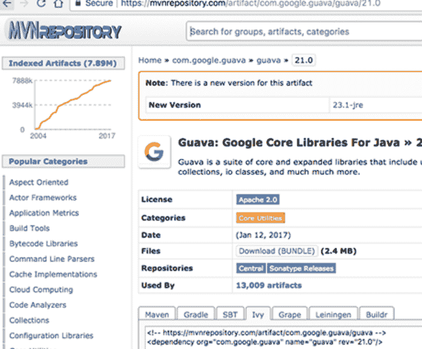
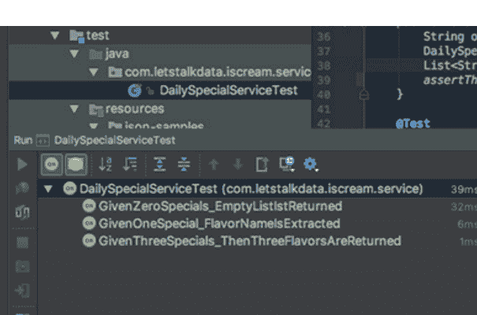
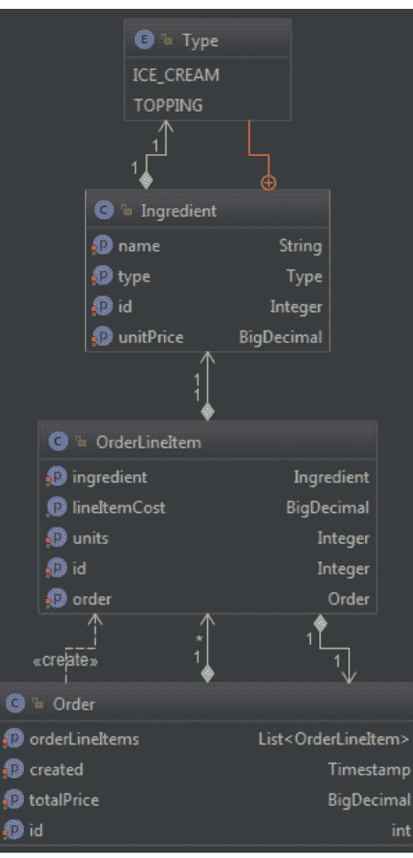

# 实战 Java


## 引言

正如你可能从本书的内容中观察到的，它并不是我所使用的任何工具的完整手册。它的目标是提供这些工具的简要概述以及最常见的用法。如果你想了解更多信息，我在每章的末尾都提供了资源列表。

那么，你正在进入 Java 的世界吗？

我发现解释只能做到某种程度，因此此本书非常强调代码。文中包含了相关的代码，但为了简洁起见，省略了一些样板代码。你始终可以在公共仓库中找到可运行的项目。

### 但真的如此吗？

框架开发者喜欢用华丽的辞藻来描述他们的工具。例如，当你读到“Apache Maven 是一个软件管理和理解工具”时，你仍然并不知道它是什么。通过这些内容，你可以快速了解一个工具实际的作用。

## Java 疣疣

Java 是一门相对较老的语言，以特别注重向后兼容著称。因此，许多传统做法已经过时，标准库中的很大一部分已被废弃。我将这些不幸的瑕疵称为“疣疣”。

## 遗留警告 (Legacy Watch)

遗留警告是一个警告，提醒你注意某些在遗留应用程序中更有可能遇到的内容。对于全新的项目，你应该尽量避免使用我在“遗留警告”中提到的任何内容。

## 时髦观察 (Hipster Watch)

时髦观察与“遗留警告”相反。它提醒你注意某些 Java 世界中相对较新且可能尚未被广泛采用的事物。这并不意味着坏事，只是需要你留意一下。

## 详细介绍 (Tell Me More)

这些章节将为你提供关于正文中提到的内容的更详细信息。它们并不是至关重要的，但如果某些内容引起了你的兴趣，值得一读。

## 设置你的工作空间

### 安装 Java

根据你的操作系统和偏好，有很多方法可以安装 Java。

- **Homebrew** (macOS): `brew cask install java`
- **Chocolatey** (Windows): `choco install jdk`
- **Apt-Get** (Linux): `sudo apt-get install default-jdk`
- **SDKMAN** (Unix-like): `sdk install java`

官方构建（所有）：访问 [Oracle 的 OpenJDK 网站](https://www.oracle.com/) 并点击标记为“Ready for use”的版本。下载适用于你系统的 tar.gz 文件并解压。你需要将该位置添加到你的 `PATH` 中。

如果你使用了工具，它应该会将 Java 放入你的 `PATH` 中，但为了保险起见，请在命令行运行 `java -version`。你应该能看到类似的内容：

```
openjdk 11-ea 2018-09-25
OpenJDK Runtime Environment Zulu11.1+23 (build 11-ea+22)
OpenJDK 64-Bit Server VM Zulu11.1+23 (build 11-ea+22, mixed mode)
```

你可能还想设置 `JAVA_HOME` 环境变量，因为许多使用 Java 的工具会首先检查那里。这还允许你安装多个版本的 Java，并让 `JAVA_HOME` 指向你的主版本，这在测试 Java 的新发布版本时特别有用。

> *brew.sh
> *chocolatey.org
> *http://sdkman.io
> *jdk.java.net/

## 第 1 章：入门

## IDE

三个最常用的 Java IDE 是 `Eclipse`、`IntelliJ` 和 `Netbeans`。我特别喜欢 `IntelliJ`，因为它拥有丰富的功能以及与数十种框架的卓越集成。在这三者中，它是唯一一个提供付费版本的。免费的社区版非常好用，这也是我在家里使用的版本，但我强烈建议在工作项目中使用付费的 Ultimate 版。

你可能会发现某些公司由于自定义插件或设置，要求开发人员使用相同的 IDE。通常情况下，我认为这是一个红旗（警示信号）。由于 Java 代码在技术上可以从命令行构建，因此使用什么种 IDE 来编写代码并不重要。

> *https://www.eclipse.org
> *https://www.jetbrains.com/idea/
> *https://netbeans.org

## 第 2 章：Java 虚拟机

### 什么是 Java 虚拟机？

多年来，Java 的卖点之一是它对多平台的支持。例如，我可以在 Mac 上编写并测试 Java 代码，然后将其部署在 Windows 服务器上并期望它运行。原因在于 Java 虚拟机（或 `JVM`）坐于你的编译后的代码和操作系统之间，它知道如何将 Java 翻译成原生系统调用。完全精确地说，这指的是 `JVM` 的实例。该术语也可以指代 Oracle 规范或其实现。

### JVM 版本

Java 的维护者会定期更新 `JVM` 规范。自然地，这允许他们发布新功能和改进。截至本文写作时，最新的生产环境版本是 Java 11。在 Java 9 之前，发布速度缓慢，通常需要数年。然而，Oracle 已转向六个月一个的周期，这意味着会有更多版本“出现”。此外，每第三个发布将是一个长期支持版本（`LTS`）。我们仍在观察社区的反应，但我怀疑大多数公司将停留在 Java 8、11、14 等版本上，而仅将中间版本用于实验。

关于版本的另一点说明：Java 9 之前的 `JVM` 在某些技术领域使用 1.x 命名方案。Java 7 和 Java 1.7 是同一个版本，尽管人们在口语中很少使用“1.7”这个名称。

> **遗留警告：过时的 JVM**
>
> 遗憾的是，某些公司采用技术的速度很慢。金融行业尤其以落后于时代而闻名。因此，虽然学习材料、博客、新闻等可能假设你正在使用 Java 8+，但你实际上可能在使用 Java 7 甚至 Java 6。
>
> 在开始任何开发之前，了解你的应用程序运行在哪个版本的 `JVM` 下是非常关键的。版本将决定你可以利用哪些语言特性。然而，无论在生产环境中使用哪种版本，你通常可以在你的开发机上安装最新版本。这是因为 Java 具有极强的向后兼容性（这种做法到了固执的地步），例如，你可以在 Java 11 `JVM` 上运行以 Java 6 风格编写的 Java 代码。

为了尝试一下，这里有两个执行相同功能的示例程序：

**NamesOld.java**

```java
import java.util.ArrayList;
import java.util.List;
public class NamesOld {
  public static void main(String[] args) {
    List<String> names = new ArrayList<>();
    names.add("Foo");
    names.add("Bar");
    for (String name : names) {
      System.out.println(name);
    }
  }
}
```

**NamesNew.java**

```java
import java.util.List;
public class NamesNew {
  public static void main(String[] args) {
    var names = List.of("Foo", "Bar");
    names.forEach(System.out::println);
  }
}
```

如果你尝试针对两个版本编译这些程序，你应该看到：

| `javac -source 1.6` | `javac -source 11` |
| :--- | :--- |
| NamesOld.java | 无错误（可能有警告） | 无错误 |
| NamesNew.java | 编译错误 | 无错误 |

## Java 缺陷：向后兼容性

Java 维护者确保版本间兼容性的决定可能是 Java 保持如此普及的原因之一。这一决定也带来了许多包袱。列举几点：

- `java.util.Date` 中的某些方法自 1999 年起已被废弃
- 泛型类型仅用于编译时检查。它们在运行时会被擦除
- `const` 和 `goto` 并不是关键字（保留字）
- 所有原始类型都有包装类，例如 `int` 和 `Integer`
- 应该避免使用集合 `Hashtable` 和 `Vector`，而倾向于使用 `HashMap` 和 `ArrayList`
- 如果你需要具有并发优势的集合，你应该查看 `java.util.concurrent`

你可能会惊讶地发现，Oracle 实际上有两个产品：`OracleJDK` 和 `OpenJDK JVM`。在 Java 11 之前，在大多数情况下，选择哪一个并不重要。它们存在某些许可影响和细微的功能差异，但工作方式大相同。然而，随着 11 的发布，`OracleJDK` 仅对拥有支持协议的商业客户可用。

值得注意的是，`JVM` 规范是公开的，任何人都可以创建自己的。事实上，一些人和公司确实这样做了。列举几个，有 IBM 的 `J9`、Azul 的 `Zing` 以及 Excelsior 的 `JET`。第三方 `JVM` 实现各有自己的卖点，但通常归结为针对不同的操作系统、提高性能或添加功能。

## 第 3 章：构建工具

尽管这个例子有些牵强，但它依赖于 Google Guava 代码库（`guava-26.0-jre.jar`）。因此，在编译代码之前，我们必须下载该库并将其引入项目中。


### 扩展：关于 .jar 文件

- `.jar` 文件就是一个 zip 包。使用 `7-zip` 或 `unzip` 等工具，你可以像查看其他 zip 文件一样浏览内容。一个典型的 `.jar` 包含相关的 Java 类、资源，甚至为了方便分发与其他 `.jar` 文件。“瘦 jar”（thin jar）仅包含作者创建类和资源，而“胖 jar”（fat jar）还包含了任何第三方依赖。你使用的几乎每个代码库都是 `.jar` 文件。

这是应用程序的目录结构，遵循常见的 Java 文件夹命名约定。

```
lib
└── guava-26.0-jre.jar
└── src
  └── main
    └── java
        └── com
          └── letstalkdata
            └── iscream
              ├── Application.java
              └── service
                └── DailySpecialService.java
```


### 扩展：关于 Java 文件夹结构

Java 类使用文件顶部的 `package` 关键字组织成包。惯例是包名以你的域名开始，例如 `com.google`，然后深入到部门、代码用途等。这可能会导致包名非常长，并且由于包与目录之间存在强制对应关系，会导致深层嵌套的目录结构。

另一个约定是将这整个目录结构放在同一组文件夹中：应用程序的 `src/main/java` 或测试的 `src/test/java`。随着我们学习更多构建工具的知识，这一点尤为重要。

现在我们的代码已经组织好，并且找到了第三方库代码，我们可以编译应用程序了。准备好了吗？

```bash
$ javac -cp :.lib/* src/main/java/com/letstalkdata/iscream/*.java
```

首先我们必须告诉 Java 编译器去查找依赖项。Java 会在所谓的类路径（`classpath`）中查找，类路径可以通过环境变量设置，或者通过运行时参数 `-cp` 设置。（哦，如果你使用的是 Windows，请使用 `;` 分隔类路径位置。）现在我们需要准确地编译所有文件。使用 `*` 通配符可以节省一些时间，但我们仍然需要指定两个目录。想象一个拥有几十个目录的真实应用程序。

遗憾的是，当我们运行该命令时，它会在源代码旁边创建一堆杂乱的 `.class` 文件。为了保持整洁，我们可能想做类似这样的操作：

```bash
$ javac -cp ":.lib/*" src/main/java/com/letstalkdata/iscream/*.java src/main/java/com/letstalkdata/iscream/service/*.java -d /out
```

使用 `-d` 可以将编译后的代码存储在其他地方。你最好希望 `out` 文件夹存在，否则 `javac` 将无法运行。

如果我们想让代码易于运行，我们想要创建一个 jar 包。这里就不详述细节了，简而言之，就是从 Guava 库中提取内容，创建一个指定所有运行时所需代码及类路径的 `MANIFEST.MF` 文件，并调用 `jar` 命令将所有 Guava 类和你在 `out` 目录中的类包含进去。

这就引出了为什么创建构建工具。

### Ant

该程序已使用了四十多年，用于将源代码转换为应用程序。因此，它是 Java 早期年的自然选择。遗憾的是，C 程序的许多假设和约定并不适用于 Java 生态系统。为了让构建 Java Tomcat 应用程序变得更容易，James Duncan Vision 编写了 `Ant`。很快，其他开源项目也开始使用 `Ant`，它迅速在整个社区中传播开。

#### 但真的如此吗？

`Ant` 是一个管理 Java 构建过程的工具。它非常有扩展性，但通常用于编译代码、运行测试、创建构建产物、部署文件等。

#### 遗留观察：Ant

尽管早期被广泛采用，但 `Ant` 现在已大部分被淘汰，被更新的构建工具（`Maven` 和 `Gradle`）所取代。

### 构建文件

`Ant` 构建文件用 XML 编写，称为目标（`targets`）。以下是一些常见的目标：

- `clean`: 该目标用于删除所有构建产物。
- `compile`: 该目标将 Java 源代码编译为类文件。
- `jar`: 该目标构建我们应用程序的 `.jar` 文件。
- `run`: 该目标将使用指定的类实际运行应用程序。

### Ivy 依赖管理

`ivy.xml`

```xml
<ivy-module version="2.0">
  <info organisation="com.letstalkdata" module="iscream"/>
  <dependencies>
    <dependency org="com.google.guava" name="guava" rev="26.0-jre"/>
  </dependencies>
</ivy-module>
```

当然，依赖属性并不是随机的。寻找这些属性最简单的方法是在库的网站上（通常如此！）或者在 `MVNRepository` 上。对于 Guava 库，你只需搜索 "guava" 并点击进入版本 26。然后点击 "Ivy" 标签页即可获取一个易于复制的依赖项。



构建文件还需要进行一些更改。

1. 修改第一行以包含 Ivy 库：

```xml
<project xmlns:ivy="antlib:org.apache.ivy.ant">
```

2. 添加一个目标来解析依赖：

```xml
<target name="resolve">
  <ivy:retrieve />
</target>
```

我们现在可以运行 `resolve` 来获取依赖并将它们放入 `lib` 文件夹中，而不是手动操作。

### 总结

虽然编写构建脚本需要花费一些前期时间，但希望你能看到它比手动向 Java 传递命令的优势。当然，`Ant` 并非没有缺陷。首先，`Ant` 脚本中几乎没有强制标准。这提供了灵活性，但代价是每个构建过程都是完全不同的。同理，了解 `Ivy` 意味着你可以快速上手任何代码库，但了解 `Ant` 并不意味着你可以快速上手任何 `Ant` 文件——你需要时间来理解它。其次，`Ant` 构建脚本的命令式性质可能导致其变得非常非常、非常长。我发现的一个例子就超过了 2000 行。最后，我们了解到 `Ant` 没有内置的依赖管理功能，尽管可以通过 `Ivy` 来进行补充。这些局限性加上其他一些构建脚本的困扰，导致了 `Maven` 在 21 世纪初的诞生。

### Maven

`Maven` 实际上是合一的工具：一个依赖管理器和一个构建工具。像 `Ant` 一样，它是基于 XML 的，但与 `Ivy` 不同的是，它概述了相当严谨的标准。此外，`Maven` 是声明式的，允许你定义构建应该“做什么”，而不是关注“如何做”。这些优势使得 `Maven` 极具吸引力；构建文件在不同项目和开发者之间变得更加标准化，开发者可以将时间花在定制文件上。因此，`Maven` 已经成为 Java 世界中某种事实上的行业标准。在 2016 年的一项调查中，68% 的开发者使用 `Maven` 作为他们的主要构建工具。

#### 但它到底是什么？

`Maven` 是一个管理 Java 代码库整个构建生命周期的工具：获取依赖、编译代码、运行测试、创建构建产物、部署文件。它还可以通过插件扩展运行自定义任务。

> *https://github.com/lexposon/scalatgt-scala/build/master.xml
> *History of Maven. Maven Project. 2017年3月26日, https://maven.apache.org/background/history-of-maven.html. 于2017年4月1日访问。


> ¹⁸Java Tools and Technologies Landscape 2016. Rebel Labs, 2016年7月14日, zeroturnaround.com/rebellabs/java-tools-and-technology-landscape-2016. 于2017年3月15日访问。

### Maven 阶段 (Phases)

你想要通过构建脚本完成的最常见任务都包含在 Maven 中。这些任务被称为“阶段”，可以通过运行 `mvn PHASE`（其中 PHASE 是阶段名称）来执行。这些是你最可能用到的阶段：

- **compile**: 编译你的源代码
- **test**: 运行项目中的单元测试
- **package**: 创建代码的可分发包，例如 `.jar` 文件
- **verify**: 运行项目中的集成测试
- **install**: 将可分发包发布到*本地*，并将其安装在本地 Maven 仓库中，供作为其他 Maven 项目的依赖使用
- **deploy**: 将可分发包发布给*他人*，以便将其作为其他 Maven 项目的依赖使用（“他人”通常指的是你的团队、公司等，而不一定是整个世界。）

这些阶段是累加的，因此例如运行 `package` 会同时编译和测试。要查看 Maven 阶段的完整列表，请参阅生命周期参考¹¹。当你第一次运行 Maven 构建时，你可能会使用 `install` 阶段，因为它会完整构建并测试项目，创建构建产物，并“安装”到你的本地 Maven 仓库中。

虽然它实际上不是一个阶段，但 `clean` 命令值得一提。运行该命令将“清理”你的本地构建目录（即 `/target`），并移除编译后的类、资源、包等。从理论上讲，你应该能够运行 `mvn install` 且构建目录会自动更新。然而，似乎有足够的开发者（包括我自己）被这种失效的情况所苦，以至于你习惯性地运行 `mvn clean install` 来强制项目从头开始构建。

### 项目对象模型 (POM) 文件

Maven 的构建文件被称为项目对象模型文件，通常缩为 POM，并保存为项目根目录下的 `pom.xml`。为了让 Maven 开箱即用，遵循这种目录结构至关重要：

> ¹https://maven.apache.org/guides/introduction-to-the-lifecycle.html#Lifecycle_Reference

```text
pom.xml
src
  main
    -- 你的 Java 代码放在这里
    resources
      -- 你的应用程序/库所需的非代码文件
  test
    java
      -- Java 测试
      resources
        -- 你的测试所需的非代码文件
```

在 POM 的顶部，你通常会看到以下标签：

```xml
<groupId>com.letstalkdata</groupId>
<artifactId>iscream</artifactId>
<version>0.1-SNAPSHOT</version>
<packaging>jar</packaging>
```

- **groupId**: 标识你的公司、团队或组织单元
- **artifactId**: 产物的名称。`-SNAPSHOT` 后缀意味着当构建成功时，`mvn install` 和 `mvn deploy` 将自动替换该产物。你应该在发布版本中移除该后缀。
- **version**: 产物版本。`-SNAPSHOT` 后缀意味着
- **packaging**: 要构建的产物类型

下一个部分是依赖。正如之前提到的，Maven 拥有依赖管理。这是我们的示例：

```xml
<dependencies>
  <dependency>
    <groupId>com.letstalkdata</groupId>
    <artifactId>iscream</artifactId>
    <version>0.1-SNAPSHOT</version>
  </dependency>
</dependencies>
```

### 插件

Maven 成功的一个大因素是其通过插件实现的扩展性。例如，你可以找到从 Web 框架到 Docker 的各种插件。对于我们简单的构建，只需要 `pom.xml`：

```xml
<build>
  <plugins>
    <plugin>
      <groupId>org.apache.maven.plugins</groupId>
      <artifactId>maven-shade-plugin</artifactId>
      <version>2.3</version>
      <executions>
        <execution>
          <phase>package</phase>
          <goals>
            <goal>shade</goal>
          </goals>
          <configuration>
            <transformers>
              <transformer implementation="org.apache.maven.plugins.shade.resource.ManifestResourceTransformer">
                <mainClass>com.letstalkdata.Application</mainClass>
              </transformer>
            </transformers>
          </configuration>
        </execution>
      </executions>
    </plugin>
  </plugins>
</build>
```

> ²⁰https://mvnrepository.com

这里涉及很多内容，但你主要可以关注 `package` 阶段和 `shade` 目标。这意味着当你运行 `mvn package`（或更高的阶段）时，插件的 `shade` 目标将会运行。这是挂钩 Maven 生命周期的目标。

插件的一个抱怨是实际上无法实现独立的目标，而且创建自己的插件需要更多的 XML 模板代码。使用插件的另一个挑战是无法直观看出它们能做什么。此外，在没有良好的文档的情况下确定正确的配置是非常困难的。例如，我们必须在 POM 中向下六层才能告诉插件主类。由于配置是通过 XML 完成的，可能存在插件可以读取但无法解析的 XML 文件，导致频繁报错。我的最佳建议是查阅文档、在你工作的现有项目中找到示例，或者咨询经典的 Stack Overflow！从零开始配置插件通常是西西弗斯式的工作。

此时，你可以运行 `mvn package`，你将在 `target` 文件夹中看到 `iscream-0.0-1-SNAPSHOT.jar` 文件。如果你运行 `java -jar iscream-0.0-1-SNAPSHOT.jar`，你应该看到应用程序的新输出。

### 仓库与发布

虽然我们的构建不需要 `repositories` 和 `distributionManagement` 部分，但它们值得提及，因为它们在公司内部项目中相当常见。

Maven 世界中的仓库是存储 Maven 可以访问的产物的地方。默认情况下，Maven 知道并使用 Maven 中央² 仓库。在第一次构建应用程序时，产物会被下载到本地仓库中。开玩笑地说，人们有时称之为“下载整个互联网”，因为 Maven 会遍历无尽的依赖树。然而，产物存储在你的本地计算机上，这使得未来的构建更快。如果你的项目需要从内部仓库使用产物（或 Maven 中央不存在的公共产物），你可以包含额外的

> ²¹https://developer.jboss.org/wiki/CreatingCustomLifecycleInMaven?sacc=t
> ²¹https://repo.maven.org/maven2

```xml
<repositories>
  <repository>
    <id>xyzRepo</id>
    <name>Company XYZ Repo</name>
    <url>http://some-server/repo/</url>
  </repository>
</repositories>
```

如果指定了多个仓库，它们将按照顺序进行检查。

如果你需要部署制品（artifact），则会使用 `distributionManagement` 部分。如果你正在开发一个需要供其他使用的内部库，这种情况最为常见。这里是一个示例：

```xml
<distributionManagement>
  <repository>
    <uniqueVersion>false</uniqueVersion>
    <id>xyzRepo</id>
    <name>Company XYZ Repo</name>
    <url>http://some-server/repo/</url>
  </repository>
  <snapshotRepository>
    <uniqueVersion>true</uniqueVersion>
    <id>xyzSnapRepo</id>
    <name>Company XYZ Snapshot Repo</name>
    <url>http://some-server/repo-snapshots</url>
    <layout>legacy</layout>
  </snapshotRepository>
</distributionManagement>
```

### 深度解析：仓库

无论团队规模如何，如果你在项目中有内部库，设置一个内部仓库是一个好主意。如果没有仓库，你将被迫将库存储在源码控制中。最流行的仓库是 Sonatype Nexus²³，尽管 Artifactory²⁴ 正在受到关注。

有了你自己的 Maven 仓库，你可以存储任何构建制品，而不仅仅是内部库。我发现存储 Maven Central 中不可用的第三方制品非常有帮助，例如微软的 SQL Server 数据库驱动程序。你也可以存储 Maven 缓存中的制品，以便加快下载速度或减少项目之间的版本碎片化。事实上，有些公司允许开发者仅使用公司仓库。

> ²³http://www.sonatype.org/nexus/
> ²⁴https://www.jfrog.com/artifact/

### 总结

尽管 Maven 在简化构建方面取得了巨大进展，但所有 Maven 用户在某个时刻都发现自己正被某个棘手的 Maven 问题搞得头晕脑胀。我已经提到了一些插件的易用性问题，但也存在“Maven 方式”的问题。每当构建偏离了 Maven 的预期时，实施变通方案可能会非常困难。许多项目都是“正常的……除了我们必须做的那件奇怪的事情”。而且里面的“奇怪事情”越多，就越难让 Maven 适应你的世界。虽然我不完全同意某位博客作者所说的——“Maven 构建是一个绝望的无限循环，将缓慢将你拖入最深、最黑暗的地狱深渊……”²，但我深有同受！

如果我们能结合 Ant 的灵活性和 Maven 的功能，那不是太好了吗？这正是 Gradle 正在尝试做的。

### Gradle

你会在 Gradle 构建脚本中首先注意到的是它不是 XML！事实上，Gradle 使用的是由 Groovy 编写的领域特定语言（DSL），Groovy 是另一种运行在 JVM 上的编程语言。

### 深度解析：Groovy

由于 JVM 规范是免费提供的，因此编写可以编译为 Java 字节码的其他编程语言。Groovy 就是其中一种语言。尽管它有时被认为是一种脚本语言（很大程度上是因为你不需要类的开销就可以开始），但它也可以用于编写完整的应用程序。试一试吧³！

```groovy
def name = 'World'
println("Hello, $name!")
```

DSL 定义了构建文件的核心部分以及称为“任务”（tasks）的特定构建步骤。它还是可扩展的，使得定义自己的任务变得非常简单。当然，Gradle 拥有丰富的第三方插件库。让我们深入学习吧。

### 趋势观察：Gradle

尽管 Gradle 正在变得流行，但它仍然相对新。由于整个 Java 生态系统移动较慢，如果你在开源项目中遇到它，你会很惊讶的。

> ²Spillner, Kent. "Java Build Tools: Ant vs. Maven". 14 November 2009, http://kent.spillner.org/blog/work/2009/11/14/java-build-tools.html. Accessed 10 March 2017.
> ³http://groovy-lang.org

### 构建文件

Gradle 文件相应地命名为 `build.gradle`，并从配置构建开始。对于我们的项目，我们利用了一个 fat jar 插件，因此将在构建脚本配置中添加 Shadow 插件。

```gradle
buildscript {
    repositories {
        jcenter()
    }
    dependencies {
        classpath 'com.github.jengelman.gradle.plugins:shadow:1.2.4'
    }
}
```

为了让 Gradle 下载插件，它必须在仓库查找，仓库是制品的索引。某些仓库是 Gradle 已知的，可以简单地引用 `mavenCentral()` 或 `jcenter()`。在涉及仓库时，团队决定不重复轮子，而是依赖于现有的 Maven 和 Ivy 依赖生态系统。

### 任务

最后，在 Ant 的“目标”和 Maven 令人混淆的“阶段”之后，Gradle 为构建步骤提供了一个合理的名称：“任务”（task）。我们使用 Gradle 的 API 来访问某些任务。（Java 插件位于 Gradle 中，因此我们不需要声明）。

```gradle
apply plugin: 'java'
```

Java 插件为你提供常用任务：

- **assemble**: 构建项目。
- **build**: 构建项目。
- **clean**: 删除构建目录。
- **javadoc**: 生成 Javadoc 文档。
- **jar**: 生成包。
- **test**: 运行单元测试。

你也可以在构建定义自己的任务。由于 DSL 基于 Groovy，可能性几乎是无限的。这是一个展示某些 Groovy 的简单示例，该任务将打印文件：

```groovy
task printClasspath {
    sourceSets.each { source ->
        println(source)
        def tree = source.compileClasspathAsFileTree()
        tree.files.each { println(it.name) }
    }
}
```

### 依赖管理

我们已经看到构建脚本如何依赖插件，因此推导出代码依赖将非常简单。我们再次创建仓库部分和依赖部分。起初这似乎是重复，但有一个关键区别。`buildscript` 之外的仓库和依赖用于运行构建本身；而仓库和依赖用于编译你的代码。

```gradle
repositories {
    mavenCentral()
}
dependencies {
    compile group: 'com.google.guava', name: 'guava', version: '26.0-jre'
}
```

这里是完整的脚本：

```gradle
buildscript {
  repositories {
    jcenter()
  }
  dependencies {
    classpath 'com.github.jengelman.gradle.plugins:shadow:1.2.4'
  }
}

apply plugin: 'java'
apply plugin: 'com.github.johnrengelman.shadow'

group = 'com.letstalkdata'
version = '0.0.1-SNAPSHOT'
sourceCompatibility = 11
targetCompatibility = 11

repositories {
  mavenCentral()
}

dependencies {
  compile group: 'com.google.guava', name: 'guava', version: '26.0-jre'
}

shadowJar {
  baseName = 'iscream'
  manifest {
    attributes 'Main-Class': 'com.letstalkdata.iscream.Application'
  }
}
```

### 其他仓库配置示例

```gradle
repositories {
  maven {
    url "http://repo.mycompany.com/maven2"
  }
}
```

```gradle
repositories {
  ivy {
    url "http://repo.mycompany.com/repo"
  }
}
```

### Gradle Daemon

你可能在运行 Gradle 时注意到过这条注释：

> 正在启动 Gradle Daemon（后续构建将变快）

Gradle Daemon 是 Gradle 的一项功能，旨在加快构建速度。JVM 以启动缓慢而闻名（尽管这一点在每个新版本中都得到了改进）。由于 Gradle 运行需要 JVM，因此 JVM 的启动过程会减慢构建速度。为了缓解这一点，Gradle 会创建一个长时间运行的后台进程。以后调用 `gradle` 时将不再需要完整的 JVM 启动。

在我的机器上，第一次在 IScream 上运行 `gradle clean build` 花了 5.35 秒。第二次只花费了 1.898 秒。


如果你发现构建速度很慢，可以使用 `--profile` 来帮助确定时间耗在哪里。这将生成一个精美的 HTML 报告，详细列出每个任务所花费的时间。

## 总结

Gradle 为 Java 构建生态系统带来了巨大的灵活性和力量。当然，高度可定制的工具总是存在风险——你突然必须意识到构建文件中的代码质量。这并不一定是坏事，但在评估你的团队如何使用该工具时值得考虑。此外，Gradle 的强大很大程度上取决于第三方插件。由于 Gradle 较新，有时感觉你正在使用一组由随机人员开发的插件。你可能会发现自己在为同一个功能比较三个插件，而每个插件只有几十个 GitHub Stars，而且几乎没有文档。尽管有这些缺点，Gradle 正在变得越来越流行，对于喜欢对构建有更多控制权的开发者来说，非常有吸引力。

## 推荐资源

### Ant

无论是由于缺乏知识、管理不善还是开发者的疏忽，似乎并不缺少没有测试的代码。特别是如果你正在处理一个遗留 Java 应用，你可能会发现自己迷失在面条代码中。我学到，如果你能隔离部分代码并创建几个宽泛的测试，至少可以帮助你找到方向。更多细节，请参考 Michael Feather 关于测试用架的讨论。

Loughran, Steve and Erik Hatcher. *Ant in Action*. Manning, 2007.

https://www.manning.com/books/ant-action

### Maven

Bharathan, Raghuram. *Apache Maven Cookbook*. Packt, 2015.

https://www.packpub.com/application-development/apache-maven-cookbook

O’Brien, Tim, John Casey et al. *Maven by Example* Sonatype, 2011.

http://books.sonatype.com/mvnex-book/reference/index.html

### Gradle

Mitra, Mainak. *Mastering Gradle*. Packt, 2015.

https://www.packpub.com/web-development/mastering-gradle

Muschko, Benjamin. *Gradle in Action*. Manning, 2014.

https://www.manning.com/books/gradle-in-action

## 第 4 章：测试

没有什么能比良好的测试更能预测生产代码的成功了。坦率地说，Java 拥有一套丰富的测试工具和库。到目前为止，最使用的库是 JUnit。它可以作为独立库使用，也可以与其他提供额外功能的库结合使用。所有现代 IDE 都可以毫无费力地运行 JUnit，且 Maven 和 Gradle 都支持运行所有检测到的 JUnit 测试的命令（Ant 有一个 `junit` target）。JUnit 的替代方案是 TestNG，它在历史上提供了 JUnit 缺失的功能。它同样拥有广泛的生态系统，但在某些情况下需要额外的插件。

### 遗留警示：没有测试！

无论是由于缺乏知识、管理不善还是开发者的疏忽，似乎并不缺少没有自动化测试的代码。特别是当你正在处理一个遗留 Java 应用时，你可能会发现自己迷失在面条代码中。我学到，如果你能隔离部分代码并创建几个宽泛的测试，至少可以帮助你找到方向。更多细节，请查看 Michael Feather 在《Working Effectively with Legacy Code》（Prentice Hall, 2004）中对测试用架的讨论。

### 为 IScream 应用添加服务

再次使用 IScream 商店应用程序，让我们更改 `DailySpecialService` 以查询 Web 端点，而不是返回静态的特价列表。我们假设该服务返回 JSON 响应，并且我们不知道 JSON 解析库！

`DailySpecialService.java`

```java
package com.lestalkdata.iscream;

import java.io.BufferedReader;
import java.io.IOException;
import java.io.InputStreamReader;
import java.net.HttpConnection;
import java.net.URL;
import java.util.ArrayList;
import java.util.List;
import java.util.regex.Pattern;

public class DailySpecialService {

    private final String SPECIALS_URL = "http://www.mocky.io/v2/59401621000003d034f66dc";

    public List<String> getSpecials() {
        try {
            var json = getFromJsonUrl();
            return parseFlavorsFromJson(json);
        } catch (IOException e) {
            System.out.println("Error retrieving daily specials!");
            e.printStackTrace();
            return new ArrayList<>();
        }
    }

    private String getFromJsonUrl() throws IOException {
        var url = new URL(SPECIALS_URL);
        var con = (HttpConnection) url.openConnection();
        try (var reader = new BufferedReader(new InputStreamReader(con.getInputStream()))) {
            String input;
            var response = new StringBuilder();
            while ((input = reader.readLine()) != null) {
                response.append(input);
            }
            return response.toString();
        }
    }
}
```

### 更多信息：Mocky

如果你经常需要快速模拟一个实际上可以通过 HTTP 访问的 Web 服务，我推荐 Mocky。你提供响应码、内容类型、标头，并立即获得一个始终返回你输入内容的永久 URL。注意：我发现该网站支持 SSL，但证书不是完整链，会抛出 SSL 异常。

我们感兴趣的方法是 `parseFlavorsFromJson`。开始之前，请参阅第 10 章获取详情。

### JUnit 与第三方库集成

JUnit 还可以与第三方测试库集成以增强其功能。例如，如果你向项目中添加了 Hamcrest 测试库 (`hamcrest-library.jar`)，你就可以在 JUnit 测试中使用“流式”（fluent）匹配来使用它。

`DailySpecialService.java`

```java
@Test
public void GivenOneSpecial_FlavorNameExtracted() throws Exception {
    var json = readJsonFromFile("one_special.json");
    var service = new DailySpecialService();
    var parsedFlavors = service.parseFlavorsFromJson(json);
    assertThat(parsedFlavors.isEqualTo("Salty Caramel"));
}
```

有些人更喜欢这种测试编写风格，但在 Java 中他们总是觉得有些别扭。

### TestNG

在很多情况下，TestNG 最先出现，并提供了现在同时存在于 TestNG 和 JUnit 中的功能。例如：注解、测试和参数化测试。因此，TestNG 与 JUnit 有许多相似之处。它是一个 xUnit 框架，测试是标记了 `@Test` 注解的公共方法。许多断言都在框架中，你通常会在类中包含静态的 `org.testng.Assert.*`。

由于这些相似性，这个测试看起来（几乎）完全一样：

`DailySpecialService.java`

```java
@Test
public void GivenOneSpecial_FlavorNameExtracted() throws Exception {
    var json = readJsonFromFile("one_special.json");
    var service = new DailySpecialService();
    var parsedFlavors = service.parseFlavorsFromJson(json);
    assertEquals(parsedFlavors.get(0), "Salty Caramel");
}
```

（我说的是“几乎”，TestNG 和 JUnit 翻转了 `assertEquals()` 中参数的顺序）。

直到最近，JUnit 还不支持测试组。测试组允许你在不同的时间执行不同的测试集。例如，你可能有一组缓慢的测试，你不需要频繁运行它们，因此可以将它们与快速的单元测试分开分组。这里是两个示例测试，其中一个位于某个组中：

```java
@Test(groups = "db-integration")
public void employeeCanBeSaved() {
    EmployeeService service = new EmployeeService();
    Employee employee = new Employee("Allie");
    service.save(employee);
    assertEquals(service.ById(1).getName(), "Allie");
}
```

```java
@Test
public void employeeFullNameIsGenerated() {
    Employee employee = new Employee();
    employee.setFirstName("Allie");
    employee.setLastName("Park");
    assertEquals(employee.getFullName(), "Allie Park");
}
```

既然 `employeeCanBeSaved` 已被放入一个组中，我们可以根据需要运行该组。例如，在 Gradle 中，我们可以创建一个任务来运行缓慢的数据库集成测试。

```groovy
task dbTest(type: Test, dependsOn: 'test') {
  useTestNG() {
    includeGroups 'db-integration'
  }
}
```

## 运行测试

正如之前提到的，JUnit 和 TestNG 被大多数 Java 工具链的人所熟悉。在开发过程中，你可能会发现通过 IDE 运行测试是最简单的。以下是我从 IntelliJ 运行测试时，某些测试的样式。



在 IntelliJ IDE 中运行测试

构建工具让测试变得关于测试。例如，以下是 Gradle 中失败测试的样式：

```
$ gradle test
:compileJava UP-TO-DATE
:processResources NO-SOURCE
:classes UP-TO-DATE
:compileTest UP-TO-DATE
:processTestResources UP-TO-DATE
:test
com.letstalkdata.iscream.service.DailySpecialService > GivenSpecial_EmptyList FAILED
java.lang.AssertionError at DailyServiceTest.java:31

3 tests completed, 1 failed
test FAILED

FAILURE: Build failed with an exception.
```

Maven 和 Gradle 也会创建（略有不同）HTML 报告，这对于拥有数十个测试的大应用程序特别有用。你可以在 Gradle 的 `build` 文件夹或 Maven 的 `target` 文件夹中找到测试结果。以下是之前的构建对应的 Gradle 测试。

### 测试摘要

| tests | failures | ignored | duration |
|---|---|---|---|
| 3 | 1 | 0 | 0.014s |
| successful: 66% | Failed tests | | |
| Packages: Classes | DailyServiceTest EmptyListReturned | | |

### 使用测试替身

有时在编写测试时，我们会遇到处理起来很麻烦的对象。通常这些对象是与外部世界交互的对象——数据库连接器、文件系统读取器、Web 对象等。测试替身是代表复杂对象的对象，以便使测试更容易。如果这个概念对你来说很新，我强烈推荐 Martin Fowler 写的《Mocks and Stubs》。Java 有许多用于处理测试替身的框架：EasyMock, Mockito, PowerMock...

- EasyMock 是最早的框架之一，往往在旧项目中更常见。
- Mockito 是最常用的库。
- PowerMock 建立在 EasyMock 或 Mockito 之上，提供额外的功能。

### 修改 IScream 以支持可 Mock 的服务

目前，我们的应用程序配置为向互联网发出 Web 服务调用。在单元测试中，这既慢又不可靠。一个 HTTP 调用可能需要几秒钟，而且无法保证服务可用。除非我们正在测试服务集成（即在集成测试中），否则我们真的希望避免与互联网实际通信。Mock 救了急。我在代码中添加了一个新类，让我们的测试变得简单一点：

### MenuCreator.java

```java
package com.letstalkdata.iscream;

import com.letstalkdata.iscream.service.DailySpecialService;

public class MenuCreator {
    private DailySpecialService dailySpecialService;

    public MenuCreator(DailySpecialService dailySpecialService) {
        this.dailySpecialService = dailySpecialService;
    }

    public String getTodayMenu() {
        var dailySpecial = dailySpecialService.getSpecials();
        var menuItem = new StringBuilder("Today's specials are:\n");
        dailySpecial.forEach(s ->
            menuItem.append(" ").append(s).append("\n")
        );
        return menuItem.toString();
    }
}
```

`MenuCreator` 构造函数包含一个 `DailySpecialService` 实例，因为 `MenuCreator` 依赖于它。当传递实例时，我们说它是被“注入”的。“依赖注入”这一术语在我们读 Spring 章节时将特别相关！现在 `MenuCreator` 已经设置好了，我们可以在测试中注入 mock `DailySpecialService`。

### 使用 Mock 创建测试

使用 Mock 的基本步骤如下：

1. 创建 Mock 对象
2. 为 Mock 对象设置期望
3. 将 Mock 对象注入测试对象
4. 调用测试对象
5. 验证 Mock 是否符合期望

步骤 1、2 和 5 是实际使用 Mock 框架的地方。因此理论上如果你想在代码库中切换 Mock 框架，只需要部分修改测试。

### EasyMock

EasyMock 有一套令人困惑的术语“记录、播放、验证”，所以我发现将其理解为“设置、启用、验证”会更容易。这里有一个使用 EasyMock 的测试：

`MenuCreatorTestEasyMock.java`


```java
@Test
public void whenAMenuIsCreated_ThenDailyServiceIsCalled() {
    // 步骤 1：创建 Mock 对象
    var mockService = EasyMock.createMock(DailySpecialService.class);
    // 步骤 2：设置期望
    var specials = new ArrayList<String>();
    EasyMock.expect(mockService.getSpecials()).thenReturn(specials).once();
    EasyMock.replay(mockService);
    // 步骤 3：注入 Mock
    var menuCreator = new MenuCreator(mockService);
    // 步骤 4：调用测试对象
    menuCreator.getTodaysMenu();
    // 步骤 5：验证
    EasyMock.verify(mockService);
}
```

回到 Mock 的通用步骤，`EasyMock.createMock()` 方法是步骤1，`EasyMock.expect()` 是步骤2。我们的期望是服务被调用一次，并且当它被调用时返回 specials（在本例中只是空列表）。`EasyMock.replay()` 方法是下一步，它允许 Mock 对象被使用。步骤3和4与 EasyMock 无关，无论我们使用什么框架都一样。最后，`EasyMock.verify()` 断言 Mock 是否符合预期。当你运行测试时，它将在没有互联网连接的情况下通过！

## Mockito

由于 Mockito 是从 EasyMock 分叉而来的，它的概念和术语与其相似。然而，与其更简单的语法和更扩展的功能集不同，它在流行程度上已经超越了前者。

### MenuCreatorMockito.java

```java
@Test
public void WhenAMenuIsCreatedThenDailySpecialServiceIsCalled() {
    // Step 1: 创建 mock 对象
    var mockService = Mockito.mock(DailySpecialService.class);

    // Step 2: 设置期望
    var specials = new ArrayList<String>();
    Mockito.when(mockService.getSpecials()).thenReturn(specials);

    // Step 3: 注入 mock
    var menuCreator = new MenuCreator(mockService);

    // Step 4: 调用测试对象
    menuCreator.getTodosMenu();

    // Step 5: 验证
    Mockito.verify(mockService, Mockito.times(1)).getSpecials();
}
```

如果你读过关于 EasyMock 的章节，这看起来会非常熟悉。回溯 mock 的通用步骤，`Mockito.mock()` 方法是第一步，`Mockito.when()` 是第二步。我们希望 mock 在被调用时返回 specials（在本例中，一个空列表）。正如承诺的那样，第三步和第四步与 mock 无关，在切换到 Mockito 时保持不变。最后，`Mockito.verify().foo()` 断言当调用 `foo()` 时，mock 的行为符合预期，而 `Mockito.times(1)` 断言该 mock 方法被调用了一次¹。同样，这个测试在没有实际查询网络服务的情况下通过了。

你可以通过向 `mock(Class, Answer)` 方法传递以下常量之一来控制 mock 行为。

## 第 4 章：测试

| 行为 | 描述 |
| :--- | :--- |
| `CALLS_REAL_METHODS` | 不会隐式地 mock 任何内容。 |
| `RETURNS_DEEP_STUBS` | 允许链式 mock 调用，例如 `mockEmployee.getManager().getName()`。 |
| `RETURNS_DEFAULTS` | **默认行为。** 一个返回 null、空列表、∅ 的“友善” mock。与 RETURNS_DEFAULTS 类似，但也会委托返回另一个 mock。 |
| `RETURNS_MOCKS` | 返回一个 mock。 |
| `RETURNS_SELF` | 返回 mock 本身。对于使用构建器模式创建的对象。 |
| `RETURNS_SMART_NULLS` | 返回一个不会抛出 `NullPointerException` 的“增强”null。 |

Mockito 还有一些注解可以使创建 stub 变得非常简单。stub 与 mock 不同，因为 stub 是不需要验证的。考虑以下代码：

```java
@Mock
private DailySpecialService mockDailySpecialService;

@Test
public void menuCreatorCanBeUsed() {
    MockitoAnnotations.initMocks(this);
    var menuCreator = new MenuCreator(mockDailySpecialService);

    try {
        menuCreator.getTodaysMenu();
        menuCreator.getTodaysMenu();
    } catch (Exception e) {
        e.printStackTrace();
        Assert.fail("Menu creators 应该是可重用的!");
    }
}
```

在这里，我们并不关心 `DailySpecialService` 的行为，我们只需要创建一个 stub，以便 `testCreator` 在单元测试期间不会尝试进行 HTTP 调用。`@Mock` 注解创建一个新的（即 `RETURNS_DEFAULTS`）stub，它返回方便的默认值。

在极少数情况下，你可能想要测试它的某些真实方法和 stubbed 方法。为此，你可以使用 `@Spy` 注解。注意，即使是官方文档也建议避免过度使用：“真实的 spies 应该谨慎且偶尔使用，例如在处理遗留代码时……我不会为新的、测试驱动且设计良好的代码使用部分 mock (partial mocks)。”

> ³² 类 Mockito. Mockito 2.7.22 API, https://static.mockito.org/mockito-core/2.7.22/org/mockito/mockito.html#spy. 访问于 2017 年 5 月 14 日。

## PowerMock

如果在测试在此过程中，你发现自己陷入了困境，需要模拟静态方法的行为，你可能考虑使用 PowerMock 工具。它构建在 EasyMock 或 Mockito 之上，并提供了额外功能。

以下是我们如何使用 EasyMock stub 一个方法：

### DailySpecialServicePowerMock.java

```java
@Test
public void mockStaticWithEasyMock() throws Exception {
    PowerMock.mockStatic(DailySpecialService.class);
    EasyMock.expect(DailySpecialService.isAvailable())
        .andReturn(true);
    PowerMock.replay(DailySpecialService.class);

    var available = DailySpecialService.isAvailable();
    assertTrue(available);
}
```

以及使用 Mockito 的相同测试：

### DailySpecialServiceTestMockito.java

```java
@Test
public void mockStaticWithMockito() throws Exception {
    PowerMock.mockStatic(DailySpecialService.class);
    Mockito.when(DailySpecialService.isAvailable()).thenReturn(true);

    var available = DailySpecialService.isAvailable();
    assertTrue(available);
}
```

诚然，这两个测试都不太有想象力。通常，只有当你处理第三方代码或遗留代码，且这些代码无法通过适当重构来避免静态方法调用时，才会使用 PowerMock。例如，想象一下这种情况（伪代码）——一个 web 控制器与第三方服务上下文通信：

```java
public class MyHomeController {
    public void getHomePage() {
        WebApplicationSession.setVariable("user", new User());
    }
}

public class MyHomeControllerTest {
    @Test
    public void someTest() {
        MyHomeController controller = new MyHomeController();
        controller.getHomePage();
    }
}
```

PowerMock 还可以 mock final 方法和类。更多信息，请查看 [PowerMock](https://github.com/powermock)。

### 总结

显然，测试世界非常广阔。事实上，我们已经看到许多框架可以满足需求。Mockito 是一个不错的选择，EasyMock

## 建议资源

### 通用测试

- Fowler, Martin. “Mocks Aren't Stubs，”2007. https://martinfowler.com/articles/mocks
- Koskela, Lasse. Test Driven: Practical TDD for Java Developers. 2007. https://www.manning.com/test-driven
- Osherove, Roy. The Art of Unit Testing. 2013. https://www.manning.com/the-art-of-unit

### 框架特定

- Acharya, Sujoy. Mastering Unit Testing Mockito and JUnit. 2014. https://www.packpub.com/mastering-unit-testing-mockito-junit
- Shah, Deep. Instant Mock Testing with PowerMock. 2013. https://www.packpub.com/application-development/powermock
- Tahchiev, Petar, et al. JUnit in Action. 2010. https://www.manning.com/junit-in-action-second-edition

## 第 5 章：Spring

在 Java 世界，可能没有哪个工具比 Spring 更著名。它最初作为一种方便连接应用程序组件的工具，现在演变成了各种框架，包括构建 Web 应用、访问数据、快速应用开发、微服务配置、移动开发等。

所有 Spring 工具的核心都是 Spring Core。我们将在本章大部分部分学习 Spring Core，然后探索一个名为 Spring Boot 的现代框架。然而，代码中还有许多需要配置。在后面的章节中，我们将讨论 Spring JDBC 和 Spring MVC。

### Spring Core

#### 依赖注入

“依赖注入”（DI）术语是将复杂词汇应用于简单概念的经典案例。Spring 文说：

> [依赖注入] 是一个过程，其中对象的依赖项（即它们协作的对象）通过构造函数参数、工厂方法参数或在对象实例构造或从工厂方法返回后设置的属性来定义。¹

清楚了吗？在任何应用程序中，你都有依赖于其他对象的。例如，在我们的 IScream 应用中，我们已经看到 Application 需要一个 DailySpecialService。我们可以说 Application 依赖于 DailySpecialService。到为止，我们一直在代码中显式创建该服务。Spring 将自动配置或注入依赖。

所有这些魔术都有权衡。开发者可能会过度依赖 Spring 自由创建复杂的依赖。此外，由于依赖项是由

³¹ IoC 容器。Spring Framework Reference, https://docs.spring.io/docs/spring/current/spring-framework-reference/htm-lbeans.html. 访问于 2017 年 6 月 10 日。

#### XML 与注解

与 Java 框架一样，Spring 在最初创建时，使用 XML 进行配置。这一决定众所周知地充满了争议。尽管有一些检查可以确保 XML 文档的有效性，但有许多事情在编译时无法检查，会导致运行时错误。此外，XML 文档可能会变成冗长、啰嗦且难以处理的制品构件。在 Spring 3 中，引入了注解，允许在无需 XML 的情况下配置应用程序。注解将（并非所有）运行时错误转换为了编译时错误，并可以帮助识别类如何与代码内联使用。我将同时展示 XML 和注解两种样式，但请记住，它们并不是互斥的。你可以根据不同的目的同时使用 XML 和注解。

#### 基于 XML 的方法

为了修改 Iscream 应用程序以与 Spring 工作，我们将创建一个依赖于 `DailySpecialService` 的 `DailySpecialPrinter`。

### DailySpecialPrinter.java

```java
package com.letstalkdata.iscream;

import com.letstalkdata.iscream.service.DailySpecialService;

public class DailySpecialPrinter {

    private DailySpecialService dailySpecialService;

    public DailySpecialService getDailySpecialService() {
        return dailySpecialService;
    }

    public void setDailySpecialService(DailySpecialService dailySpecialService) {
        this.dailySpecialService = dailySpecialService;
    }

    public void printSpecials() {
        var dailySpecials = dailySpecialService.getSpecials();
        System.out.println("Today's specials are: ");
        dailySpecials.forEach(s -> System.out.println(" - " + s));
    }
}
```

#### Java 惯例：Getters 和 Setters

具有公共访问器的类属性模式在大多数 Java 代码库中无处不在。这种做法的“官方”理由是通过依赖 getter 和 setter 方法，你不必担心底层实现的改变。但实际上，getter 和 setter 很少除了“get”或“set”之外的做任何事情。或许恼人的是，它们让类变得完全可变。

那么我们为什么还要创建它们呢？我有的最好的理由是许多框架都期望它们。Spring XML 方法将尝试使用 setters 来注入依赖。（可以使用构造函数，但对开发者来说需要更多工作。）我们将看到更多框架也期望 getters 和 setters，尽管某些框架在没有访问器时会自动回退到查找类的方法。

使用 XML 将 Spring 添加到项目中，按照惯例，我们将添加一个名为 `appContext.xml` 的文件。如果你使用 Maven 或 Gradle，它位于 `src/main/resources` 中。此文件定义了“beans”（豆），你可以将其认为为应用程序的组件。

### applicationContext.xml


# 第 5 章：Spring

```xml
<?xml version="1.0" encoding="UTF-8"?>
<beans xmlns="http://www.springframework.org/beans"
    xmlns:xsi="http://www.w3.org/2001/XMLSchema-instance"
    xsi:schemaLocation="http://www.springframework.org/schema/beans
    http://www.springframework.org/schema/beans/beans.xsd">

    <bean id="dailySpecialServiceBean"
        class="com.letstalkdata.iscream.service.DailySpecialService" />

    <bean id="dailySpecialPrinter"
        class="com.letstalkdata.iscream.DailySpecialPrinter">
        <property name="dailySpecialService" ref="dailySpecialServiceBean"/>
    </bean>
</beans>
```

## 更多了解：Java Beans

JavaBean 是一个满足一组特定要求的 Java 对象，意图是在应用程序内部或应用程序之间重用。这些要求是该类必须：

- 有一个公共的零参数构造函数
- 通过 getters 和 setters 暴露其属性
- 是可序列化的（即实现 `java.io.Serializable`）

某些框架要求 JavaBean 或至少与 JavaBean 协作。尽管 Spring 将其管理的对象称为 beans，但它对要求是灵活的。因此，一个 Spring "bean" 可能不是真正的 JavaBean。

我们定义的第一个 bean 是服务。`id` 是你选择的任何名称，`class` 显然是你想要创建的对象的类型。

```xml
applicationContext.xml
<bean id="dailySpecialBean" class="com.letstalkdata.iscream.service.DailySpecialService" />
```

接下来，我们创建 Printer，在定义中包含了一个属性。属性名称必须与实际 Java 类中的名称匹配（例如 `dailySpecialService`），且 `ref` 指向 XML 文件中的另一个 bean（例如 `dailySpecialServiceBean`）。

```xml
applicationContext.xml
<bean id="dailySpecialPrinter" class="com.letstalkdata.iscream.DailySpecialPrinter">
    <property name="dailySpecialService" ref="dailySpecialBean"/>
</bean>
```

通过 Spring 配置应用程序的最后一步是在主方法中获取 `ApplicationContext` 的引用，并使用该上下文创建 Printer。这被称为“引导”（bootstrapping）。

Application.java

```java
package com.letstalkdata.iscream;
import org.springframework.context.support.ClassPathXmlApplicationContext;

public class Application {
    private static final String CONTEXT_PATH = "applicationContext.xml";
    public static void main(String[] args) {
        var ctx = new ClassPathXmlApplicationContext(CONTEXT_PATH);
        var printer = ctx.getBean(DailySpecialPrinter.class);
        System.out.println("Starting store!\n==============\n");
        printer.printSpecials();
    }
}
```

在应用程序中使用 Spring 的 `getBean` 方法通常不是正确做法——你应该配置 Spring 自动创建对象。但如果你将应用程序中的依赖视为树，我们仍然需要某些东西来创建根对象。因此，在 `main` 中使用 `getBean` 是常见做法。现在即使你没有创建 Service，应用程序也可以运行！

## 注解方法

就像我们在 XML 方法中所做的，我们将创建一个依赖于 `DailySpecialService` 的 `DailySpecialPrinter`。我们不再使用 `appContext.xml` 而是使用 `@Component` 和 `@Autowired` 注解。在类上加上 `@Component` 意味着会被 Spring 检测。`@Autowired` 注解用于标记你想让 Spring 注入。这是带有注解的 Printer：

DailySpecialPrinter.java

```java
package com.letstalkdata.iscream;

import com.letstalkdata.iscream.service.DailySpecialService;
import org.springframework.beans.factory.annotation.Autowired;
import org.springframework.stereotype.Component;

@Component
public class DailySpecialPrinter {

    private DailySpecialService dailySpecialService;

    @Autowired
    public DailySpecialPrinter(DailySpecialService dailySpecialService) {
        this.dailySpecialService = dailySpecialService;
    }

    public void printSpecials() {
        var dailySpecials = dailySpecialService.getSpecials();
        System.out.println("Today's specials are:");
        dailySpecials.forEach(s -> System.out.println(" - " + s));
    }
}
```

你也可以自动注入 setter 方法：

```java
private DailySpecialService dailySpecialService;

@Autowired
public void setDailySpecialService(DailySpecialService service) {
    this.dailySpecialService = service;
}
```

...或者字段：

```java
@Autowired
private DailySpecialService dailySpecialService;
```

作为指南，Spring 建议对必需的依赖使用构造函数注入，对可选的依赖使用 setter 方法。那么字段注入呢？它存在一些问题。使用字段注入要求对象必须由 Spring 创建。然而，万物皆有定时，我承认字段注入属性的整洁性有时是一个巨大的优势。只需记住，许多依赖关系可能意味着设计问题。要进行更深入的讨论，请搜索“为什么字段注入是邪 (Why field injection is evil?)”。

由于我们需要注入 `DailySpecialService`，我们需要让该类对 Spring 可见。如所述，可以通过 `@Component` 注解来实现。不过，我更倾向于使用 `@Service` 注解。它在功能上没有区别，但它是比 `@Component` 更具体的类语义标记。

```java
@Service
class DailySpecialService {
    // 为了简洁起见省略了代码
}
```

最后我们需要调整 `Application` 类。与 XML 方式一样，我们需要引导 Spring，但我们将使用一种不同的 `ApplicationContext` 类型：`AnnotationConfigApplicationContext`（在 Spring 中要使用长名称！）。我们还需要在该类上标记 `@ComponentScan` 注解，它会告诉 Spring 从该类开始递归向下扫描，直到找到 Spring 可以实例化的类，即那些标记了 `@Component` 或 `@Service`（或其他 Spring 注解）的类。

Application.java

```java
package com.letstalkdata.is;
import org.springframework.context.annotation.AnnotationConfigApplicationContext;
import org.springframework.context.annotation.ComponentScan;

@Component
public class Application {

    public static void main(String[] args) {
        var ctx = new AnnotationConfigApplicationContext(Application.class);
        var printer = ctx.getBean(DailySpecialPrinter.class);

        System.out.println("Starting store!\n\n==================\n");
        printer.printSpecials();
    }
}
```

现在你可以运行应用程序了，再次证明，它在没有显式创建 `DailySpecialService` 的情况下运行了。

> http://olierjerke.de/2013/11/why-field-injection-is-evil/

## 属性 (Properties)

将应用程序的一些值从代码外部解外部化通常是一个好主意。这可以让配置和部署变得简单得多，特别是当你需要维护多个配置不同的应用程序实例时。

让我们想象一下，我们的应用程序希望运行在一个连接到特殊 Web 服务的用户验收测试 (UAT) 环境中，同时维护一个指向生产 Web 服务的生产应用程序。这意味着我们不能再在 `DailySpecialService` 中硬编码 URL 了。

我们在文件系统中创建了以下文件：

```
application.properties
specials.url = http://www.mocky.io/v2/590401621000003d034f66dc
```

```
application.prod.properties
specials.url = http://www.example.com/some-prod-url
```

### 了解更多：.properties 文件

> .properties 中的纯文本文件通常用于配置只需要极少设置的 Java 应用程序或框架。它们包含简单的键值对，大多数解析器都能智能地识别字符串、数字和布尔值。按照惯例，使用点号来分隔单词。例如，一个文件可能包含 `app.directory.output`、`app.db.username`、`app.db.password` 等。

现在我们需要告诉 Spring 如何访问这些文件。我们可以在 `Application` 上使用 `@PropertySource` 注解（或者如果你使用 XML，则在 XML 文件中使用 `PropertyPlaceholderConfigurer`）来实现。

Application.java

```java
@Component
@PropertySource("${propPath}/application.${env}.properties")
public class Application {
```

记得我们需要我们的应用程序在多个环境中运行。为了避免不断重新编译代码，我们可以让应用程序动态访问其属性。Spring 有一种用于字符串插值的表达式语言。这使我们能够让文件路径的部分动态化。Spring 将查找 Java 系统属性或环境变量 `propPath` 和 `env`，并替换文件路径中的 `${propPath}` 和 `${env}`。接下来，`@PropertySource` 将读取文件并加载到 Spring 上文中，使属性对可用。

这非常强大——现在你有了无需重新编译即可动态配置应用程序的能力！

要使用应用程序属性，你可以使用 Spring 的 `@Value` 注解，或者在 XML 文件的 bean 属性中直接引用它们。以下是在 `DailySpecialService` 中访问 URL 的方法：

DailySpecial.java

```java
public DailySpecialService(@Value("${specials.url}") String specialsUrl) {
    this.specialsUrl = specialsUrl;
}
```

再次，使用 Spring 表达式来引用我们想要使用的特定应用程序属性。就像对象可以通过字段、构造函数或 setter 方法注入一样，属性也是如此。同样的指南适用，因此通常最好将 `@Value` 注解放在构造函数中。

设置 `propPath` 环境变量后，你就可以运行应用程序。为了测试，最简单的方法是配置我的 IDE 传递 Java 系统（或 "VM"）属性（例如 `-Denv=uat`）。

> 提示：系统属性 (System Properties)

在启动 JVM 时，可以包含在 JVM 运行期间一直有效的某些变量。这是通过 `-key=value` 语法实现的，其中 key 和 value 是实际的属性名和值。这些被称为“系统属性”或“系统变量”。属性由 JVM 定义，也可以设置自定义属性。

## Spring Boot

Spring 团队在确保他们的组件之间能够良好工作方面做得非常出色。然而，开发者往往擅长让事情变得复杂，遇到痛苦的 Context 配置并不罕见。遵循 Spring 指南会有帮助，但要正确配置 Spring 应用程序仍然很繁琐。

2014 年，Spring 发布了 Spring Boot，这是一个为了在 Spring 平台上快速开发应用程序而设计的工具。它采用约定优于配置，并使得配置变得简单。

Spring Boot 应用程序由一个或多个“启动器 (starters)”构建，这些被包含在 Maven 或 Gradle 依赖中。例如，与 LDAP 服务器通信的应用程序将使用 `spring-boot-starter-web` 和 `spring-boot-starter-data-ldap`。完整的启动器列表可以在 Spring Boot GitHub 仓库找到。

> https://github.com/spring-projects/spring-boot/tree/master/starters

### 运行 Spring Boot

与任何 Java 程序一样，Spring Boot 程序的入口是一个包含 `main` 方法的类。然而，它需要一些特殊配置才能运行。

首先，类被标记为 `@SpringBootApplication`。这是一个方便注解，结合了 `@Configuration`、`@EnableAutoConfiguration` 和 `@ComponentScan`。我们在在本章之前已经见过 `@ComponentScan`，但另外两个注解用于根据以下内容配置应用程序：

- 你添加到该类的设置 (`@Configuration`)
- 你的类路径上的内容 (`@EnableAutoConfiguration`)

通常 `main` 方法非常简单。例如，如果类名为 `Application.java`。

```java
public static void main(String[] args) throws Exception {
    SpringApplication.run(Application.class, args);
}
```

静态 `run()` 方法负责引导工作。

Spring Boot 项目可以从 IDE 启动，也可以使用 Maven 和 Gradle 编译成 `.jar` 文件并正常运行。还有快捷任务 `mvn spring-boot:run` 和 `gradle bootRun` 可以从命令行编译并运行应用程序。

### 配置 (Configuration)

正如我们为止所看到的，Spring 在让配置变得简单方面非常有帮助。Spring Boot 将多配置的概念的形式化为“配置文件 (profiles)”。应用程序在运行时可以激活一个或多个配置文件，使得为不同的运行时混合配置变得简单。

Spring 配置文件名为 `application.properties` 或 `application.yml`，配置文件命名为 `application-foo.properties` 或 `application-foo.yml`，其中 foo 是配置文件名称。使用 yaml 文件时，属性名 `spring.foo.bar=baz` 被解包为：

```yaml
spring:
  foo:
    bar: baz
```

结合上一节关于属性的示例，这里是你可以创建配置文件来切换不同的 IScream 服务。


application.yml

```yaml
spring:
  profiles:
    active: uat
```

application-uat.yml

```yaml
specials:
  url: http://www.mocky.io/v2/5904016210000033d034f66dc
```

application-prod.yml

```yaml
specials:
  url: http://www.example.com/some-prod-url
```

此配置将默认 profile 设置为 uat。但是，如前所述，可以使用 Java 系统变量 `spring.profiles.active` 来覆盖它，例如执行 `java -Dspring.profiles.active=prod my-app.jar`，或者使用环境变量 `SPRING_PROFILES_ACTIVE`。事实上，Spring Boot 属性可以使用这两种方法进行覆盖。正如前面提到的，通过用逗号分隔每个 profile 名称可以轻松地混合 profile。

## 文青式视点：Spring Cloud Config

如果你正在运行分布式软件或需要支持许多环境，application profile 文件可能会变得繁琐。Spring 的解决方案是 Spring Cloud Config，它允许应用程序查询 Web 服务以确定其属性。默认情况下，属性存储在 Git 仓库中，这些仓库由 Spring Cloud Server 克隆并传递给请求的应用程序。

## 总结

我们仅仅接触了 Spring 的冰山一角，遗憾的是它的用法如此多样，以至于难以给出通用的建议。然而，我们可以记住 Spring Core 的目标是在运行时用所有配置适当的依赖项组装应用程序。正如所提到的，Spring 工具集是无处不在的，我们将在后面的章节中再次看到它。

Spring Boot 是 Spring 的新方法，它让开发者能够花费更多时间编写代码，而减少在配置上的花费。你可以看到本章代码中包含的示例，但我将在讨论 Web 框架的第 6 章中深入探讨。

> https://cloud.spring.io/spring-cloud-config/spring-cloud-config.html

## 建议资源

- “Guides”. Spring, https://spring.io/guides. 访问于 2017 年 6 月 18 日。
- Deinum, Marten. *Spring Recipes: A Problem-Solution Approach*. Apress, 2014. http://www.apress.com/br/book/9781430259084
- Walls, Craig. *Spring Boot in Action*. Manning, 2015. https://www.manning.com/books/spring-boot-in-action
- Walls, Craig. *Spring in Action*. Manning, 2014. https://www.manning.com/books/spring-in-action-fourth-edition
- Yong, Mook Kim. “Spring Tutorial”. Mkyong.com, http://www.mkyong.com/tutorials/spring-tutorials. 访问于 2017 年 6 月 18 日。

## 第 6 章：Web 应用程序框架

Java 在企业环境中最常见的用途或许是 Web 开发。让 Java Web 开发变得可行的 API 是“Java 2 平台企业版”（或 J2EE），它首次发布于 1999 年。从那时起，许多 Web 框架兴起又落落。即使涵盖目前活跃的所有框架也将是一项巨大的工程，因此我将只关注一些最流行的框架。

- **Spring MVC**: Spring MVC 框架到目前为止是最主导的框架。它构建在我们已经看到的 Spring Core 之上，并提供了构建控制器的功能，用于与业务模型和 HTML 视图交互。
- **Spring Boot**: 我们看到了如何使用 Spring Boot 开发控制台应用程序，但它也可以作为 Spring MVC 的封装，让 Web 开发变得更加简单。
- **Java Server Faces (JSF)**: JSF 是一个基于复用 UI 组件的框架，这些组件可以轻松地与数据和事件处理器关联。它抽象了大部分 HTML、CSS 和 JavaScript。
- **Vaadin**: Vaadin 进一步了一步，它与 JSF 一样集成了组件。

## 遗留视点：过时的框架

在过去的几年中，我发现许多框架已经过时。在 2000 年代早期有一些流行的框架：

- **Struts**: 曾经非常流行的 Java 框架。
- **Spring MVC**: 早期的版本。
- **JSF**: 也是流行的框架。

现在，我们关注更现代框架：

- **Spring MVC**: 它是目前的标准。
- **Spring Boot**: 简化了开发流程。
- **JSF**: 仍然在某些企业级应用中使用。
- **Vaadin**: 允许使用 Java 构建 Web 界面。

在使用遗留系统时，我们经常会遇到：

- **Servlets**: Java Web 开发的底层。
- **JSP**: 用于动态生成内容。

## Java 企业版 API

在编写 Java 框架时，通常需要与 Java EE 交互。它为 Web 应用程序提供了许多核心 API：

### 请求与响应

请求以 `HttpServletRequest` 的形式进入，提供了会话、Cookie、参数等数据。返回给客户端的是 `HttpServletResponse`。

### Java 页面

JavaServer Pages (JSP) 是一种允许动态生成 HTML 的技术。jsp 文件看起来类似于 HTML 文件，它们在服务器端评估并发送到客户端。

### Servlet 容器

大多数 Java 应用程序部署在“Servlet 容器”中。它处理 Web 服务器和 Java 应用程序之间的流量。我们将在下一章详细介绍这些容器，但现在只需要知道应用程序必须向容器注册自己。这通常通过 `web.xml` 文件完成，尽管某些框架允许纯 Java 实现。大多数框架使用以下文件夹：

- `src/main/java`: 应用程序代码。
- `src/main/resources`: 包含类路径的文本文件、属性等，辅助应用程序代码。
- `src/main/webapp/resources`: CSS、JavaScript、图像等公共资源。
- `src/main/webapp/WEB-INF`: 容器可以访问的私有资源。

### Spring MVC

详细讨论模型-视图-控制器（MVC）范式超出了本书的范围，但作为快速回顾：控制器是逻辑和业务对象，它是用户交互的对象，控制器将两者结合在一起。Spring MVC 框架提供了一个以控制器为中心的 API，可以轻松地将请求转换为模型对象并将模型对象转换为视图。

### 模型

我们将为 IScream 公司构建一个简单的点点系统，让员工输入冰淇淋订单并计算费用。我们将添加一些领域对象来帮助：

#### Order.java

```java
package com.letstalkdata.iscream.domain;
import java.util.ArrayList;
import java.util.Arrays;
import java.util.List;
public class Order {
    private String flavor;
    private int scoops;
    private List<Topping> toppings = new ArrayList<>();
    public Order() {
    }
    public Order(String flavor, int scoops, Topping... toppings) {
        this.flavor = flavor;
        this.scoops = scoops;
        this.toppings = Arrays.asList(toppings);
    }
    public String getFlavor() {
        return flavor;
    }
    public void setFlavor(String flavor) {
        this.flavor = flavor;
    }
    public int getScoops() {
        return scoops;
    }
    public void setScoops(int scoops) {
        this.scoops = scoops;
    }
    public List<Topping> getToppings() {
        return toppings;
    }
    public void setToppings(List<Topping> toppings) {
        this.toppings = toppings;
    }
    public double getPrice() {
        return scoops * 1.50d + toppings.size() * 0.25d;
    }
}
```

值得注意的是，没有任何标识表明这些对象是 Web 应用程序的一部分。这是刻意为之。Spring 尽可能使用“纯旧 Java 对象”（POJO）。

### View（视图）

我们的应用程序将有两个视图：一个让员工输入订单数据，另一个用于返回价格。Spring MVC 可以使用多种技术，但我们目前将使用 JSP。

如前提到的，`.jsp` 文件看起来与 HTML 文件相似，并可以使用 HTML 中可用的所有标签。我们可以通过在文件顶部添加 `taglib` 来使用其他标签。大多数 JSP 文件至少会使用标准的 JSP 标签库。此外，JSP 表达式语言（Expression Language）允许我们注入动态内容。其语法为 `${expression}`，其中 `expression` 可以包含变量、字面量、操作符，甚至 Java 方法调用。

以下是我们如何向视图中动态注入口味和配料的：

```html
<select name="flavor">
<option value="">
<c:forEach items="${flavors}" var="flavor">
<option value="${flavor}">${flavor.toString()}</option>
</c:forEach>
</select>
```

我们很快就会看到口味实际上是如何传递的，假设它们确实传递了，这里是发送给客户端的渲染后的 HTML：

> https://docs.oracle.com/javaee/7/tutorial/jsf-el.htm

```html
<select name="flavor">
  <option value=""> selected</option>
  <option value="VANILLA">Vanilla</option>
  <option value="CHOCOLATE">Chocolate</option>
  <option value="STRAWBERRY">Strawberry</option>
</select>
```

我们还可以以类似的方式包含配料和辣椒，你可以在本章的示例代码中看到这一点。

### Controller（控制器）

Spring MVC 控制器既强大又多功能，能够轻松适应任何需求。同时，解决同一个问题通常有不同的方法，这在初学该框架时可能会令人困惑。

Controller 类使用 `@Controller` 注解，有时带有带有 `@RequestMapping` 注解来定义控制器的基础路由。例如，`EmployeeController` 将具有一个基础路由 (`/employee`)。

路由通过在方法上添加 `@RequestMapping` 注解来定义，包含实际路由（例如 `/new`）和 HTTP 方法（例如 `POST`）。除此之外，方法非常灵活。有 20 多种参数对象类型和 15 多种有效的返回类型！请记住，定义应用程序中“新订单”页面路由的方法只有一种。

```java
@RequestMapping(value = "/new", method = RequestMethod.GET)
public String orderForm(Model model) {
  model.addAttribute("flavors", EnumSet.allOf(Flavor.class));
  model.addAttribute("toppings", EnumSet.allOf(Topping.class));
  return "new-order";
}
```

传递一个 model 是为了让我们我们可以修改（或“丰富”）它，以包含口味列表和配料列表。例如，`flavors` 允许数据通过 `${flavors}` 表达式在视图中显示。最后，返回类型是一个 String，用于标识应该使用的视图。

为了处理订单，我们需要允许 POST 请求发送到同一个路由。我们可以通过在控制器中创建另一个方法来实现。

> https://docs.spring.io/spring/current/spring-framework-reference/html/mvc.html#mvc-ann-arguments
> https://docs.spring.io/spring/docs/current/spring-framework-reference/html/mvc.html#mvc-ann-return-types

### RestController

```java
@RequestMapping(value = "new", method = RequestMethod.POST)
public String createOrder(@ModelAttribute Order order, Model model) {
    var priceNumber = order.getPrice();
    var price = NumberFormat.getCurrencyInstance(Locale.US)
        .format(priceNumber);
    model.addAttribute("price", price);
    return "order-success";
}
```

似乎通过魔法一般，通过使用 `@ModelAttribute` 注解，请求被自动转换为 `Order` 对象。Spring MVC 将使用 POST 请求中的表单数据来调用 `Order` 类中匹配的 setter 方法。（这是另一个框架期望 getter 和 setter 的示例！）再次，我们包含一个 Model 是为了用计算出的价格丰富它，并返回一个 String 来标识用于响应的视图。

这些示例仅触及 Spring MVC 控制器可能性的冰山一角。在你的应用程序中，你可能会发现更多变体以适应更复杂的请求-响应周期。这起初可能会让人应接不暇，所以请轻松对待！

### Configuration（配置）

作为 Spring 工具，Spring MVC 可以使用 XML 文件或注解进行配置。像这样的极简应用程序只需要极少的配置。以下是如何使用这两种方法配置设置。

dispatcher-servlet.xml


# 第6 章：Web 框架

```xml
<beans xmlns="http://www.springframework.org/schema/beans"
    xmlns:context="http://www.springframework.org/schema/context"
    xmlns:xsi="http://www.w3.org/2001/XMLSchema-instance"
    xmlns:mvc="http://www.springframework.org/schema/mvc"
    xsi:schemaLocation="http://www.springframework.org/schema/beans
        http://www.springframework.org/schema/beans/spring-beans.xsd
        http://www.springframework.org/schema/context
        http://www.springframework.org/schema/context/spring-context.xsd
        http://www.springframework.org/schema/mvc
        http://www.springframework.org/schema/mvc/spring-mvc.xsd">
  <context:component-scan base-package="com.letstalkdata.iscream" />
  <bean class="org.springframework.web.servlet.view.InternalResourceResolver">
    <property name="viewClass">
      <value>org.springframework.web.servlet.view.JstlView</value>
    </property>
    <property name="prefix" value="/WEB-INF/views/jsp/" />
    <property name="suffix" value=".jsp" />
  </bean>

  <mvc:annotation-driven />
</beans>
```

## WebConfig.java

```java
package com.letstalkdata.iscream;

import org.springframework.context.annotation.Bean;
import org.springframework.context.annotation.ComponentScan;
import org.springframework.context.annotation.Configuration;
import org.springframework.web.servlet.ViewResolver;
import org.springframework.web.servlet.config.EnableWebMvc;
import org.springframework.web.servlet.view.InternalResourceViewResolver;
import org.springframework.web.servlet.view.JstlView;

@ComponentScan
@Configuration
@EnableWebMvc
public class WebConfig {

  @Bean
  public ViewResolver viewResolver() {
    var viewResolver = new InternalResourceResolver();
    viewResolver.setViewClass(JstlView.class);
    viewResolver.setPrefix("/WEB-INF/views/jsp/");
    viewResolver.setSuffix(".jsp");
    return viewResolver;
  }
}
```

## web.xml

```xml
<?xml version="1.0" encoding="UTF-8"?>
<web-app xmlns="http://xmlns.jcp.org/xml/ns/javaee"
      xmlns:xsi="http://www.w3.org/2001/XMLSchema-instance"
      xsi:schemaLocation="http://xmlns.jcp.org/xml/ns/javaee http://xmlns.jcp.org/xml/ns/javaee/web-app_3_1.xsd"
      version="3.1">
  <servlet>
    <servlet-name>dispatcher</servlet-name>
    <class>org.springframework.web.servlet.DispatcherServlet</class>
    <init-param>
      <param-name>contextLocation</param-name>
      <param-value>WEB-INF/dispatcher-servlet.xml</param-value>
    </init-param>
    <load-on-startup>1</load-on-startup>
  </servlet>
  <servlet-mapping>
    <servlet-name>dispatcher</servlet-name>
    <url-pattern>/*</url-pattern>
  </servlet-mapping>
</web-app>
```

如果你选择这种方式，你可以使用 Java 对象来代替它。

### WebApplicationInitializer.java

```java
package com.letstalkdata.iscream;

import org.springframework.web.WebApplicationInitializer;
import org.springframework.web.context.ContextLoaderListener;
import org.springframework.web.context.support.AnnotationConfigWebApplicationContext;
import org.springframework.web.servlet.DispatcherServlet;

import javax.servlet.ServletContext;

public class WebApplicationInitializer implements WebApplicationInitializer {
  @Override
  public void onStart(ServletContext container) {
    var context = new AnnotationConfigWebApplicationContext();
    context.setConfigLocation("com.letstalkdata.iscream.WebConfig");
    container.addListener(new ContextLoaderListener(context));

    var dispatcherServlet = new DispatcherServlet(context);
    var dispatcher = container.addServlet("dispatcher", dispatcherServlet);
    dispatcher.setLoadOnStartup(1);
    dispatcher.addMapping("/");
  }
}
```

完成这些完成后，现在就可以将应用程序部署到 servlet 容器了。不过，如果你想尝试示例代码，可以运行 `appRun`，它会在你的电脑上启动一个轻量级 servlet 容器（Jetty）并将应用程序部署到 http://localhost:8080。

## Spring Boot

我们在上一节中介绍了 Spring Boot，并看到了它如何被用于快速应用程序开发。通过添加另一个启动器（starter），我们可以使用 Spring Boot 来构建 Spring MVC Web 应用程序。

主要的优势在于你不需要进行任何配置。Spring Boot Web 应用程序既没有 `web.xml`，也没有 `WebApplicationInitializer` 类。此外，无需创建 `@WebConfig` 类或 `dispatcher-servlet.xml`。类路径上存在 `spring-boot-starter-web` 启动器就足够配置应用程序了。

## Thymeleaf

虽然在 Spring 应用可以使用 JSP，但推荐创建视图的方法是使用 Thymeleaf 模板引擎。只要类路径上有 Thymeleaf，它就会自动作为应用程序的视图渲染器。Thymeleaf 引擎与 JSP 技术类似，但有一个显著区别：Thymeleaf 视图是 (X)HTML 文件，它们实际上使用自定义属性而不是标签。作为对比，以下是你如何使用 Thymeleaf将口味加载到视图中的方法。

```html
<select class="form-control" id="flavor" name="flavor">
  <option value="" selected="selected"></option>
  <option th:each="${flavor}" th:value="${flavor.name}" th:text="${flavor}"></option>
</select>
```

你可以看到这通常看起来像 HTML，而 `th` 属性提供了逻辑。按照惯例，`th` 是 http://www.thymeleaf.org 的别名。

由于你直接处理 HTML，因此可以在不运行应用程序的情况下在浏览器中加载视图。例如：


### 新订单

| 口味 (Flavor) |
| --- |
| 冰淋 (Scoops) |
| 配料 (Toppings) |
| [ ] | 创建订单 |

浏览器中的 Thymeleaf 视图

显然，没有任何服务器端数据被渲染到视图中，但它可以让你对布局和样式有一个直观的了解，使前端设计的迭代更快。关于 Thymeleaf 的更深入讨论，请参阅官方文档。

## 运行 Spring Boot Web 应用

我之前提到过，Java Web 应用程序运行在 servlet 容器中。部署到容器需要几分钟（对于复杂的应用程序需要更长时间），这在开发过程中可能会令人困扰。为了加快速度，你可以使用插件将应用程序部署到轻量级的本地容器。在本章中，我使用了 "Jetty Gradle" 插件（"Gretty"），可以通过 `gradleRun` 调用。Spring Boot 采用了类似的方法，它不再将容器和应用程序视为独立的实体，而是将一个容器（Tomcat）嵌入到你的应用程序中。当你使用 `java -jar` 从命令行运行应用程序时，嵌入式容器会自动启动。

> http://www.thymeleaf.org

## JavaServer Faces

JavaServer Faces (JSF) 是一种关注 UI 的技术。与 Spring 不同，使用 JSF 创建了一个基于组件的模型来构建用户界面。JSF 是一个构建 Web 应用程序的框架。

## Managed Beans (托管 Bean)

在 JSF 中，托管 Bean 是用于保存视图数据和逻辑的对象。有几种 Bean 作用域：

- 应用作用域 (ApplicationScoped)：Bean 在整个应用程序运行期间有效。
- 会话作用域 (SessionScoped)：Bean 在用户会话期间有效。
- 请求作用域 (RequestScoped)：Bean 在单个 HTTP 请求持续期间有效。
- 视图作用域 (ViewScoped)：只要用户留在同一个视图中，Bean 就会有效。

> http://docs.oracle.com/javaee/6/tutorial/index.html

# 第 6 章：Web 应用框架

```java
public void setScoops(int scoops) {
    this.scoops = scoops;
}
public List<Topping> getToppings() {
    return toppings;
}
public void setToppings(List<Topping> toppings) {
    this.toppings = toppings;
}
public String getFormattedPrice() {
    return formattedPrice;
}
public void setFormattedPrice(String formattedPrice) {
    this.formattedPrice = formattedPrice;
}
public boolean isSaved() {
    return saved;
}
public void setSaved(boolean saved) {
    this.saved = saved;
}
private double calculatePrice() {
    return scoops * 1.50d + toppings.size() * 0.25d;
}
public void save() {
    this.saved = true;
    formattedPrice = NumberFormat.getCurrencyInstance(Locale.US)
        .format(calculatePrice());
}
```

### JSF 视图

与 Thymeleaf 类似，JSF 视图是 XHTML 文件，它们使用自定义扩展来指示服务器如何构建响应。然而，JSF 高度依赖自定义标签。事实上，大多数 JSF XML 文件几乎完全使用自定义标签。以下是在 JSF 中创建现在熟悉的“口味（flavors）”下拉菜单的方法：

```xml
<h:selectMenu id="flavor" class="form-control" value="#{order.flavor}">
<f:selectItems value="#{ingredientsService.flavors}" var="flavor" itemLabel="#{flavor}" itemValue="#{flavor}"/>
</h:selectMenu>
```

在这里，我们看到了绑定的 `ingredientsService`，用于填充选择列表的项目。重要的是，我们还看到了 `value="#{order.flavor}"`。这就是将视图数据绑定回订单（order）的方法。Bean 已经绑定，因为我们有一个 `setFlavor` 方法，所以我们可以访问该口味值。

在将数据绑定到模型后，我们需要向用户显示计算出的成本。我们不需要进行页面重定向，而是可以使用 JSF 内置的 AJAX 支持。这也是我们管理 order bean 中属性的优势的地方。以下是处理 AJAX 请求的 JSF 代码：

#### new-order.xhtml

```xml
<h:button class="btn btn-primary" value="Create Order"
    action="#{order.save}">
    <f:ajax execute="@form" render="orderDisplay"/>
</h:button>
<br/>
<h:panelGroup id="orderDisplay" layout="block">
  <h:panelGroup rendered="#{order.saved}">
    <h:outputText value="Order Saved!"/>
    <br/>
    <h:outputText value="Flavor: #{order.flavor}"/>
    <br/>
    <h:outputText value="Scoops: #{order.scoops}"/>
    <br/>
    <h:outputText value="Toppings: #{order.toppings}"/>
    <br/>
    <h:outputText id="priceDisplay" value="The total is: #{order.formattedPrice}"/>
  </h:panelGroup>
</h:panelGroup>
```


当页面加载时，订单没有详情，因此无法计算价格。由于 `order` 是一个受管理的 Bean（managed bean），当用户提交 AJAX 请求时，细节通过 setter（set 方法）注入到订单中。此外，`save()` 方法会被执行，因为它被赋值给了 commandButton 的 `action` 属性。`save()` 方法会切换 `saved` 属性。由于 `panelGroup` 的可见性由 `saved` 属性的布尔值决定，它现在变得可见了。最后，`formattedPrice` 被访问并渲染到页面上。

要运行此演示，你可以再次使用 `gradle appRun`。然而，在使用 JSF 时，通常不定义路由。相反，路由是基于 web 内部的文件结构。

# 第 6 章：Web 框架

```java
71  var price = NumberFormat.getCurrencyInstance(Locale.US)
72      .format(priceNumber);
73  orderDetails.setValue("Order Saved! Total: " + price);
74  }
75  }
76 }
```

由于没有显式的控制器或请求的引用，我们可以在编译时填充口味和配料控件。同样，我们并不关心应用程序如何响应用户点击提交按钮，我们只需要编写代码规定当用户点击按钮时会发生什么即可。

## Vaadin 8 UI

创建一个 UI 是在 Vaadin 8 应用中尽可能接近定义路由的操作。然而，与传统的 Web 应用不同，大多数 Vaadin 8 应用只有少数几个路由——许多只有一个。Vaadin 8 UI 是一个单页应用（SPA），尽管可以通过实现 `View` 接口向用户显示不同的“页面”。

在 IceCream 项目中，我们创建了 `OrderScreen` 实例并将其设置为 UI 的根节点。

```java
package com.letsdata.ui;

import javax.servlet.annotation.WebServlet;
import com.vaadin.annotations.Theme;
import com.vaadin.annotations.VaadinConfiguration;
import com.vaadin.server.VaadinRequest;
import com.vaadin.server.VaadinServlet;
import com.vaadin.ui.*;

@Theme("mytheme")
public class OrderUI extends UI {

    @Override
    protected void init(VaadinRequest vaadinRequest) {
        OrderScreen orderScreen = new OrderScreen();
        setContent(orderScreen);
    }
}

@WebServlet(urlPatterns = "/*", name = "OrderUIServ", asyncSupported = true)
@VaadinConfiguration(ui = OrderUI.class, productionMode = false)
public static class OrderUIServ extends VaadinServlet {
}
```

### 主题

除非你绝对需要自己的自定义样式，否则最好在 Vaadin 预设主题之一的基础上进行构建。对于这个应用程序，我使用 Valo 主题作为基础：

```scss
mytheme.scss
@import "../valo.scss";

@mixin mytheme {
    @include valo;

    // 插入你自己的主题规则
}
```

如果你这样做，可以将它们添加到这里。你还需要将 SCSS 主题编译为 CSS，如果你使用 Vaadin 插件，这很容易实现（详情请参阅 `README.md`）。

### 运行应用程序

Vaadin Maven 插件包含一个简单的 Web 服务器，用于在开发期间运行应用程序。运行 `mvn jetty:run` 并导航到 http://localhost:8080/。如果你定义了多个 UI，它们将通过 http://localhost:8080/main-ui、http://localhost:8080/other-ui 等进行访问。

## Vaadin Flow

### 组件

通常情况下，Vaadin Flow 中的视图是通过组合组件（Components）来构建的。组件是用户交互的所有 HTML 组件：divs、anchors（链接）、headers 等。某些组件是 CSS 类的快捷方式，例如布局和通知。为了创建订单屏幕，我们将创建一个包含用于订单详情的 `FormLayout`（表单布局）和用于显示价格的 `VerticalLayout`（垂直布局）的 Div 。

OrderScreen.java

```java
package com.letsdata.ui;

import com.letsdata.domain.Flavor;
import com.letsdata.domain.Order;
import com.letsdata.domain.Topping;
import com.vaadin.flow.component.AbstractField;
import com.vaadin.flow.component.HtmlComponent;
import com.vaadin.flow.component.Text;
import com.vaadin.flow.component.button.Button;
import com.vaadin.flow.component.checkbox.Checkbox;
import com.vaadin.flow.component.dependency.HtmlImport;
import com.vaadin.flow.component.formlayout.FormLayout;
import com.vaadin.flow.component.html.Div;
import com.vaadin.flow.component.html.Label;
import com.vaadin.flow.component.list.ListBox;
import com.vaadin.flow.component.orderedlayout.VerticalLayout;
import com.vaadin.flow.component.textfield.TextField;
import com.vaadin.flow.router.Route;
import java.text.NumberFormat;
import java.util.EnumSet;
import java.util.List;
import java.util.Locale;
import java.util.stream.Collectors;

/**
 * Created by Phillip Johnson on 8/31/2018
 */
@HtmlImport("/frontend/styles/shared-styles.html")
@Route("")
public class OrderScreen extends Div {
    private OrderDetailsForm orderDetailsForm;
    private OrderSavedLayout orderSavedLayout;

    public OrderScreen() {
        orderDetailsForm = new OrderDetailsForm();
        orderSavedLayout = new OrderSavedLayout();
        add(orderDetailsForm);
        add(orderSavedLayout);
    }
}
```

```java
private class OrderDetailsForm extends FormLayout {

    private ListBox<Flavor> flavor;
    private TextField scoops;
    private List<Checkbox> toppings;
    private Button submit;

    public OrderDetailsForm() {
        flavor = new ListBox<>();
        flavor.setId("flavor");
        flavor.setItems(EnumSet.allOf(Flavor.class));
        addFormItem(flavor, "Flavor");
        add(new HtmlComponent("br"));

        scoops = new TextField("Scoops");
        add(scoops);

        submit = new Button("Submit");
        submit.addClickListener(event -> {
            Order order = new Order();
            // ... 订单保存逻辑
        });
        add(submit);
    }
}
```

```java
private class OrderSavedLayout extends VerticalLayout {
    private Label orderDetails;

    public OrderSavedLayout() {
        orderDetails = new Label("");
        add(orderDetails);
    }

    public void showOrder(String message) {
        orderDetails.setText(message);
    }
}
```

专注于构建视图，同时向开发者隐藏控制器。这些方法中的每种都有其优处，并且在今天都被广泛使用。

我们还看到了各种视图技术。JSP 是最老的，使用表达式语言处理基本逻辑。Spring 为该表达式语言提供了扩展，使得开发 Spring 应用程序变得简单一些。JSF 和 Thymeleaf 使用 XHTML，但方法略有不同。Thymeleaf 视图主要使用带有特殊属性的 HTML 标签，而 JSF 视图几乎完全使用自定义标签。Vaadin 视图主要使用 Java，而不是使用 Java 定义视图。

在许多方面，Java 应用程序可能是你在传统公司中可能处理的最复杂的应用程序。遗憾的是，最佳实践并不总是被遵循，而且某些框架的灵活性可能会让人抓狂。花时间了解你的公司使用哪些框架，甚至重要的是了解开发者是如何使用它们的，这是非常重要的。

## 建议资源

- Ganeshan, Amuthan. Spring MVC: Beginner’s Guide - Second Edition. Packt, 2016.

  https://www.packpub.com/application-development/spring-mvc-beginners-guide-second-edition

- Leonard, Anghel. Mastering JavaServer Faces 2.2. Packt, 2014.

  https://www.packpub.com/application-development/mastering-javaserver-22

- Walls, Craig. Spring Boot in Action. Manning, 2015.

  https://www.manning.com/books/spring-boot-in-action

- “Vaadin Docs”. Vaadin, 2017, https://www.vaadin.com/docs/. Accessed 23 July 2017.

# 第 7 章：Web 应用程序部署

根据公司的规模，你可能永远不需要实际部署你的代码。可能有一个部署团队为你处理此事。尽管如此，你仍然应该熟悉代码是如何部署的，以便妥妥地维护项目构建文件。另一方面，如果你在一个较小的团队中，你可能需要知道如何部署你构建的项目。

与控制应用程序不同，Java Web 应用程序不是从命令行执行的。（尽管我们将看到例外）。相反，它们运行在应用程序服务器内部，服务器负责处理发送你代码的请求以及返回给 Web 服务器的响应。

## 打包

Java 应用程序有两种常用方法：WAR 文件和 EAR 文件。

WAR 文件（Web 应用程序存档）实际上与 JAR 文件相同，只是扩展名不同，以便将其识别为 Web 应用程序。作为部署制品使用时，它包含了运行应用程序所需的所有代码，包括领域对象、控制器、视图文件等。

EAR 文件（企业级应用程序存档）是另一种类型的部署存档，它包含了 WAR 和 JAR 文件。通常情况下在使用 EAR 文件时，WAR 文件仅包含与 Web 应用程序相关的代码。领域对象、服务等（在此语境下被称为“企业级 Java 豆”）被封装在 JAR 文件中。从理论上讲，这意味着不同的团队可以处理单独的代码库（Web 代码和领域代码）。此外，你可以拥有多个共享相同领域对象的 Web 应用程序。

书中的示例代码包含一个被打包为 WAR 的项目和一个被打包为 EAR 的项目。让我们比较一下存档文件的结构：

### WAR 文件结构

```
- META-INF
|-- MANIFEST.MF
- WEB-INF
|-- classes
|   |-- com
|   |   |-- letstalkdata
|   |   |   |-- iscream
|   |   |   |   |-- controller
|   |   |   |       |       -- OrderController.class
|   |   |   |       |   |-- WelcomeController.class
|   |   |   |   -- domain
|   |   |   |       |   |-- Flavor.class
|   |   |   |       |   |-- Order.class
|   |   |              |-- Topping.class
- dispatcher-servlet.xml
- lib
|-- commons-logging-1.2.jar
|-- jstl-1.2.jar
|-- spring-aop-4.3.9.RELEASE.jar
|-- spring-beans-4.3.9.RELEASE.jar
|-- spring-context-4.3.9.RELEASE.jar
|-- spring-core-4.3.9.RELEASE.jar
|-- spring-expression-4.3.9.RELEASE.jar
|-- spring-web-4.3.9.RELEASE.jar
|-- spring-webmvc-4.3.9.RELEASE.jar
- views
|-- jsp
|   -- new-order.jsp
|   -- order-success.jsp
|   -- welcome.jsp
```

### EAR 文件结构

```
- META-INF
|-- MANIFEST.MF
|-- application.xml
- WEB-INF
|-- classes
|   |-- com
|   |   |-- letstalkdata
|   |   |   |-- iscream
|   |   |   |   |-- controller
|   |   |   ||       |       -- OrderController.class
|   |   |   ||       |   |-- WelcomeController.class
|   |   |   |   |-- domain
|   |   |   ||       |   |-- Flavor.class
|   |   |   |          |   |-- Order.class
|   |   |   ||           |-- Topping.class
- lib
|-- commons-logging-1.2.jar
|-- spring-aop-4.3.9.RELEASE.jar
|-- spring-beans-4.3.9.RELEASE.jar
|-- spring-context-4.3.9.RELEASE.jar
|-- spring-core-4.3.9.RELEASE.jar
|-- spring-expression-4.3.9.RELEASE.jar
|-- spring-web-4.3.9.RELEASE.jar
|-- spring-webmvc-4.3.9.RELEASE.jar
```

## 部署目录

- WildFly: `$INSTALL_DIR/standalone/deployments`

### GUI（图形界面）

- Tomcat:

  1. 访问 http://server:8080/manager

  2. 点击“Choose File”（选择文件）选择你的 .war 文件

  3. 点击“Upload”（上传）

- WildFly:

  1. 访问 http://server:9990/console

  2. 点击“Deployments”（部署）下的“Start”（启动）


# 第 8 章：数据库操作

了解如何访问和修改存储在数据库中的数据对于任何 Java 开发人员来说至关重要。虽然现在倾向于服务化，但今天生产环境中的大多数应用程序仍然直接与数据库交互（当然，这些服务最终也要这样做）。

正如你所预期的，在数据访问方面，Java 有许多选择。然而，选择取决于你是否想编写 SQL。如果你的团队熟悉 SQL、复杂数据或需要低级 SQL 访问，你可能会看到很多（希望如此）被数据框架封装的手写编码 SQL。另一方面，如果你的团队 SQL 知识较少，或者数据相对相当简单，则可以使用 ORM 解决方案，可能只针对特别棘手的问题编写少量的 SQL 片段。显然，这两种方法各有优缺点，你应该熟悉这两种数据访问方式。

## Java 数据库连接 (JDBC)

Java Database Connectivity（或 JDBC）API 是 Java 标准库中（自然地）处理数据库访问的部分。虽然使用纯 JDBC 显然是一个选项，但在几乎所有情况下，你都应该使用抽象了底层细节的数据框架。然而，你应该熟悉 `java.sql` 包中的几个对象：

- `DriverManager`: 工具类，包含可用数据库驱动程序知识。
- `Connection`: 表示与数据库的连接，包含 URL、用户名、密码等信息。`Connection` 可以从 `DriverManager` 创建。
- `PreparedStatement` 和 `CallableStatement`: 这些用于向数据库服务器发送实际的 SQL。`Statement` 从 `Connection` 创建。
- `ResultSet`: 数据返回的方式。`ResultSet` 是可迭代的，每个对象代表一行。可以通过 `getFoo(index)` 或 `getFoo(name)` 访问数据，其中 `Foo` 是数据类型（例如 `String`、`Blob`、`Int` 等），`index` 是索引。

下面的示例展示了如何使用 JDBC 连接到内存数据库。

```java
String url = "jdbc:h2:mem:testdb;DB_CLOSE_DELAY=-1";
try (Connection conn = DriverManager.getConnection(url, "sa", "")) {
    String sql = "CREATE TABLE ingredient (id INT PRIMARY KEY, name VARCHAR(255), price DECIMAL)";
    try (Statement stmt = conn.createStatement()) {
        stmt.execute(sql);
    }

    String insertSql = "INSERT INTO ingredient (id, name, price) VALUES (?, ?, ?)";
    try (PreparedStatement pstmt = conn.prepareStatement(insertSql)) {
        pstmt.setInt(1, 1);
        pstmt.setString(2, "Chocolate");
        pstmt.setBigDecimal(3, new BigDecimal("2.50"));
        pstmt.executeUpdate();
    }

    String selectSql = "SELECT * FROM ingredient";
    try (PreparedStatement pstmt = conn.prepareStatement(selectSql)) {
        ResultSet rs = pstmt.executeQuery();
        while (rs.next()) {
            int id = rs.getInt("id");
            String name = rs.getString("name");
            BigDecimal price = rs.getBigDecimal("price");
            System.out.printf("ID: %d, Name: %s, Price: %.2f%n", id, name, price);
        }
    }
} catch (SQLException e) {
    e.printStackTrace();
}
```

## 与数据库交互

```java
.reduce(BigDecimal.ZERO, BigDecimal::add);
  return iceCreamCost.add(toppingCost);
}
```

```java
public Flavor getFlavor() {
  return flavor;
}
```

```java
public void setFlavor(Flavor flavor) {
  this.flavor = flavor;
}
```

```java
public int getScoops() {
  return scoops;
}
```

```java
public void setScoops(int scoops) {
  this.scoops = scoops;
}
```

```java
public List<Topping> getToppings() {
  return toppings;
}
```

```java
public void setToppings(List<Topping> toppings) {
  this.toppings = toppings;
}
```

```java
public BigDecimal getTotalPrice() {
  if(totalPrice == null) {
    totalPrice = calculatePrice();
  }
  return totalPrice;
}
```

### 查询数据

`JdbcTemplate` 类有许多不同的方法，取决于你想要从数据库中检索什么类型的数据。首先，你必须确定你想检索一个“实体”还是多个“实体”。

> *https://docs.spring.io/spring/docs/current/javadoc-api/org/springframework/jdbc/core/JdbcTemplate.html*

然后，你需要确定希望以什么方式返回数据：作为 Java 内置对象（例如 `String`、自定义对象、`Map` 或 `SqlResultSet`）。我们正在处理自定义对象，这意味着我们还需要实现一个 `RowMapper`。这听起来很复杂，但它与 JDBC 连接中循环内部的部分非常相似。

IngredientService.java

```java
private RowMapper<Flavor> flavorRowMapper = (rs, rowNum) -> {
    var id = rs.getInt("id");
    var name = rs.getString("ingredient");
    var unitPrice = rs.getBigDecimal("unit_price");
    return new Flavor(id, name, unitPrice);
};
```

通过将此映射器与 SQL 结合，我们可以从数据库中获取真实的 `Flavor` 对象作为口味。

IngredientService.java

```java
public List<Flavor> getFlavors() {
    var sql = "select id, ingredient, unit_price from ingredient " + 
             "where ingredient_type = 'ICE_CREAM'";
    return jdbcTemplate.query(sql, flavorRowMapper);
}
```

Spring 的美之处在于，我们不需要担心获取数据库连接和语句。相反，我们只需要关注特定于应用程序的内容：领域对象和 SQL。

如果我们想使用参数化 SQL，只需将参数传递给方法即可。以下是我们如何通过 ID 获取单个对象：

IngredientService.java

```java
private static String INGREDIENT_BY_ID = 
    "select id, ingredient, unit_price from ingredient where id = ?";

public Flavor getFlavorById(int id) {
    return jdbcTemplate.queryForObject(INGREDIENT_BY_ID, 
           flavorRowMapper, id);
}
```

### 写入数据

在大多数情况下，使用 `JdbcTemplate` 写入数据与读取数据一样直接。例如，我们可以创建一个这样的对象：

```java
final var sql = "insert into purchase(total_price) values (?)";
jdbcTemplate.update(sql, BigDecimal.valueOf(4.25d));
```

稍微有点困惑的是，`update` 方法既用于实际的 SQL 更新也用于 SQL 插入。

记住，我们的数据模型包含了每个订单的行项目。此外，这些行项目必须通过外键进行适当关联。为了正确完成这一点，我们需要在创建订单后保留订单 ID，并创建相应的行项目。我们可以使用 Spring 的 `KeyHolder` 来实现这一点。

OrderService.java

```java
private final static String CREATE_ORDER =
    "insert into purchase(total_price) values (?)";
private int saveOrder(Order order) {
    var keyHolder = new GeneratedKeyHolder();
    PreparedStatement ps = con.prepareStatement(CREATE_ORDER,
        PreparedStatement.RETURN_GENERATED_KEYS);
    ps.setBigDecimal(1, order.getTotalPrice());
    return ps.update();
    jdbcTemplate.update(ps, keyHolder);
    return keyHolder.getKey().intValue();
}
```

这对于理想路径没有问题，但如果在保存行项目时发生错误怎么办？我们希望避免数据库中出现错误或部分数据。这个问题通常使用数据库事务来解决。你直接在原生 JDBC 中使用事务，而 Spring 再次出现救援，提供了一个简单的 `@Transactional` 注解，可以将其添加到应该在事务上下文中执行的方法中。

这里是创建订单及其行项目的完整服务类：

OrderService.java

```java
package com.letstalkdata.iscream.service;
import com.letstalkdata.iscream.domain.Ingredient;
import com.letstalkdata.iscream.domain.Order;
import org.springframework.beans.factory.annotation.Autowired;
import org.springframework.jdbc.core.JdbcTemplate;
import org.springframework.jdbc.core.PreparedStatementCreator;
import org.springframework.jdbc.core.support.GeneratedKeyHolder;
import org.springframework.jdbc.core.support.KeyHolder;
import org.springframework.stereotype.Service;
import org.springframework.transaction.annotation.Transactional;
import java.sql.PreparedStatement;

@Service
public class OrderService {
    private JdbcTemplate jdbcTemplate;

    @Autowired
    public OrderService(JdbcTemplate jdbcTemplate) {
        this.jdbcTemplate = jdbcTemplate;
    }

    @Transactional
    public int saveOrder(Order order) {
        var keyHolder = new GeneratedKeyHolder();
        final static String CREATE_ORDER = "insert into purchase(total_price) values (?)";
        PreparedStatementCreator psc = con -> {
            PreparedStatement ps = con.prepareStatement(CREATE_ORDER, PreparedStatement.RETURN_GENERATED_KEYS);
            ps.setBigDecimal(1, order.getTotalPrice());
            return ps;
        };
        jdbcTemplate.update(psc, keyHolder);
        return keyHolder.getKey().intValue();
    }
}
```

## MyBatis Mapper 示例

MyMapper.java

```java
@Mapper
public interface MyMapper {
    @Select("select name from Employee where id = #{id}")
    String getEmployeeName(@Param("id") int id);
}
```

我通常更倾向于使用注解而不是 XML，但 MyBatis 是一个例外。XML 实现提供了更多的灵活性和选项。此外，在 mapper 文件中轻松读取 SQL 语句非常有帮助，而且通常可以将其复制到 SQL 编辑器中直接在数据库上执行查询。


非常方便的一点是，尽管 Mappers 只是接口，你也不需要手动实现它们！MyBatis 会为你创建默认实现类。当然，如果你需要提供自定义行为，也可以手动实现它们。

## Java 的“怪癖”：过度分层的数据库对象

在某些应用程序中，区分服务层和数据访问层是有意义的。例如，你有一个只知道 CRUD（增、删、改、查）操作的数据访问层，以及将操作抽象为业务概念的服务层。我见过极其令人沮丧的极端情况，其中每一层都有一个接口且恰好只有一个实现类。这种情况并不罕见：一个 `MyServiceImpl` 实现 `Service` 并包含对 `MyDao` 的引用，而 `MyDao` 又在 `MyDaoImpl` 中实现！MyBatis 可以将其简化为一个对象，如果你确实需要这种灵活性，我鼓励这样做。

MyBatis 与 Java 对象的结合比 JDBC 更紧密。这意味着你可以将自定义领域对象作为参数传递给查询并返回自定义领域对象作为结果。MyBatis 展示了 `IScream` 实现如何获取冰淇淋口味和配料作为实际的对象——无需手动映射。

### ingredient-mapper.xml

```xml
<?xml version="1.0" encoding="UTF-8" ?>
<!DOCTYPE mapper
  PUBLIC "-//mybatis.org//DTD Mapper 3.0//EN"
  "http://mybatis.org/dtd/mybatis-3-mapper.dtd">
<mapper namespace="com.letstalkdata.iscream.service.IScreamService">
  <select id="getFlavors"
      resultType="com.letstalkdata.iscream.domain.Flavor">
    select id, ingredient_name as name, unit_price as unitPrice
    from ingredient
    where ingredient_type = 'ICE_CREAM'
  </select>
</mapper>
```

```xml
<select id="getFlavorById"
  resultType="com.letstalkdata.iscream.domain.Flavor">
  select id, ingredient as name, price as unitPrice
  from ingredient
  where id = #{id}
</select>
<select id="getToppings"
  resultType="com.letstalkdata.iscream.domain.Topping"
  select id, ingredient as name, price as unitPrice
  from ingredient
  where ingredient_type = 'TOPPING'
</select>
<select id="getToppingById"
  resultType="com.letstalkdata.iscream.domain.Topping"
  select id, ingredient as name, price as unitPrice
  from ingredient
  where id = #{id}
</select>
</mapper>
```

通过将查询中的列与 `Ingredient` 类的属性匹配，MyBatis 可以利用反射自动创建正确的对象并调用正确的 setter 方法。（你也可以使用自定义方法代替 setter，但这需要在 mapper 文件中进行额外的配置。）自然，mapper XML 文件对应于 Java 代码中的 Mapper 服务对象。同样，不需要实现。

### IngredientService.java

```java
package com.letstalkdata.iscream.domain.Flavor;
import com.letstalkdata.iscream.domain.Topping;
import org.apache.ibatis.annotations.Mapper;
import org.apache.ibatis.annotations.Param;

@Mapper
public interface IngredientService {
  List<Flavor> getFlavors();

  Flavor getFlavorById(@Param("id") int id);

  List<Topping> getToppings();

  Topping getToppingById(@Param("id") int id);
}
```

> *http://www.mybatis.org/mybatis-3/sqlmap-xml.html*

## 写入数据

与 Java 数据类型和对象可以从 MyBatis 查询返回一样，Java 数据类型和对象也可以传递到 MyBatis 查询中。这使得保存、更新或删除领域对象变得相对简单。

再次通过 mapper 文件操作，我们创建了以下 insert 语句来保存订单：

### purchase-mapper.xml

```xml
<?xml version="1.0" encoding="UTF-8" ?>
<!DOCTYPE mapper
  PUBLIC "-//mybatis.org//DTD Mapper 3.0//EN"
  "http://mybatis.org/dtd/mapper-3.dtd">
<mapper namespace="com.letstalkdata.iscream.service.OrderService">
  <insert id="createPurchase"
    useGeneratedKeys="true"
    keyColumn="id"
    keyProperty="id"
    parameterType="com.letstalkdata.iscream.domain.Order">
    insert into purchase (total_price)
    values(#{price})
  </insert>
  <insert id="createOrderItem" parameterType="map">
    insert into purchase_line_item(purchase_id, ingredient_id, units)
    values(#{purchaseId}, #{ingredientId}, #{units})
  </insert>
</mapper>
```

由于创建订单的过程相当复杂，我选择了 Mapper 实现。这需要访问 `SqlSession`。记得 purchase 的 ID，我们可以使用 `keyColumn` 和 `keyProperty` 属性在 POJO 上设置 ID。

### OrderService.java

```java
package com.letstalkdata.iscream.service;
import com.letstalkdata.iscream.domain.Flavor;
import com.letstalkdata.iscream.domain.Order;
import com.letstalkdata.iscream.domain.Topping;
import org.apache.ibatis.annotations.Mapper;
import org.apache.ibatis.session.SqlSession;
import org.springframework.beans.factory.annotation.Autowired;
import org.springframework.stereotype.Service;
import org.springframework.transaction.annotation.Transactional;
import java.util.Map;

@Mapper
@Service
public class OrderService {
    private SqlSession sqlSession;

    @Autowired
    public OrderService(SqlSession sqlSession) {
        this.sqlSession = sqlSession;
    }

    @Transactional
    public void save(Order order) {
        saveOrder(order);
        order.getToppings()
            .forEach(topping -> saveLineItem(order.getId(), topping, 1));
    }

    private void saveOrder(Order order) {
        sqlSession.insert("createPurchase", order);
    }

    private void saveLineItem(int orderId, Ingredient ingredient, int units) {
        var params = Map.of(
            "purchaseId", orderId,
            "ingredientId", ingredient.getId(),
            "units", units
        );
        sqlSession.insert("createOrderItem", params);
    }
}
```

## 动态 SQL

MyBatis 的另一个强大特性是支持动态 SQL。一个常见的业务需求是从列表中选择多个项目并检索这些项目的数据。为了只访问 SQL 数据库，你需要编写 `WHERE IN` 查询。我见过很多开发者尝试使用字符串拼接手动实现这种功能，这种代码通常会产生 SQL 注入漏洞，且无法正确处理末尾逗号。MyBatis 让这一切变得简单：

```xml
<select id="getOrdersById" resultType="com.letstalkdata.iscream.domain.Order">
  select * from purchase
  where id
  <foreach item="id" index="index" collection="orderIds"
    open="(" separator="," close=")">
    #{id}
  </foreach>
</select>
```

另一个棘手的功能是创建带有可选搜索参数的查询。同样，MyBatis 让这一切变得简单：

```xml
<select id="findingIngredientsSearch"
  resultType="com.letstalkdata.iscream.domain.Ingredient">
  select * from ingredient
  where
  <if test="name != null">
    ingredient = #{name}
  </if>
  <if test="type != null">
    and ingredient_type = #{type}
  </if>
  </where>
</select>
```

## Hibernate

我们刚刚看到了 MyBatis 如何将 POJO 领域对象绑定到 SQL 语句，但手动编写相对基础的 SQL 仍然存在开销。此外，对象之间的关系处理起来非常繁琐。对象关系映射（ORM）试图通过将 SQL 从开发者中抽象出来来解决这些问题。从理论上讲，只要关于对象足够的信息，完全可以通过程序化生成所有 SQL。

Hibernate 是 Java 最早的 ORM 工具之一。直到几年后，持久化通过 Java Persistence API (JPA) 标准化，它的地位才更加明确。JPA 本身并不提供实现——而是允许第三方工具利用通用的 API。而恰好 Hibernate 是最常用的第三方实现。尽管如此，仍然可以在不使用 JPA 的情况下使用 Hibernate。本章示例代码包含两个 Hibernate 项目：一个是较现代的、利用 JPA 注解的项目；另一个是使用原生类与数据库交互的老旧项目。为了方便起见，注解代码示例使用了 JPA 接口，而 XML 代码示例使用了 Hibernate 原生对象，但它们是可以混合使用的。你应该熟悉所有这些选项，因为它们仍然非常流行。

## 领域 POJO 调整

在使用 ORM 时，领域对象与数据库越得越匹配，你需要做的工作就越少。虽然处理抽象类¹ 是可能的（例如，一个包含 Flavor 和 Topping 类的原料表），但我不想用这些细节混淆你对 JPA 的理解。相反，让我们改变领域对象以匹配数据库表。

> http://docs.oracle.com/java/6/tutorial/doc/beanm.html#bnubq



冰淇淋领域对象

## JPA 注解

JPA 提供了一组注解，用于标记领域类以描述它们如何映射到底层数据库。通常，类被标记为 `@Entity` 和 `@Table(name="myTableName")`，而属性被标记为 `@Column(name="myColumnName")`。对于 ID 和外键列等“特殊”列，会添加额外的注解。重要的是，外键不是以整数形式表示的，而是以对象本身表示。例如，`OrderLineItem` 类没有 `purchase_id` 属性，而是有一个 `Order` 属性。以下是该类的完整注解属性。

### OrderLine.java

```java
10 @Id
11 @Column
12 @GeneratedValue(strategy = GenerationType.IDENTITY)
13 private Integer id;
14 
15 @ManyToOne(fetch = FetchType.LAZY)
16 @JoinColumn(name = "purchase_id")
17 private Order order;
18 
19 @ManyToOne(fetch = FetchType.LAZY)
20 @JoinColumn(name = "ingredient_id")
21 private Ingredient ingredient;
22 
23 @Column(name = "units")
24 private Integer units;
```

关注这两个外键属性，注意 `@JoinColumn` 用于表示它被用于 SQL 链接（join），并且关系被描述为 `@ManyToOne`，因为每个订单对应多个 OrderItems。`fetch = FetchType.Lazy` 意味着 Hibernate（或更准确地说是 JPA 实现提供）在显式请求之前不会加载实际的 `Order` 对象。懒加载的反面是 `FetchType.Eager`，它会在 `OrderItem` 从数据库返回时立即加载 `Order`。

虽然不是强制要求的，但我选择在订单及其行项目之间建立双向关系。以下是 `Order` 的注解方式。

### Order.java

```java
14 @Id
15 @Column
16 @GeneratedValue(strategy = GenerationType.IDENTITY)
17 private int id;
18 
19 @OneToMany(mappedBy = "order", cascade = CascadeType.ALL)
20 private List<OrderLine> orderItems;
21 
22 @Column(name = "create_dttm")
23 private Timestamp created = Timestamp.valueOf(LocalDateTime.now());
24 
25 @Column(name = "total_price")
26 private BigDecimal totalPrice;
```

这里的新注解是 `@OneToMany`：一个 `Order` 对应多个 `OrderItems`。`mappedBy` 属性应该使用 order 值来获取 setter 方法并返回 `OrderItems`，而 `cascade` 用于描述在父对象上发生操作时子对象的行为。使用 `CascadeType.ALL`，对 `Order` 的更新、插入和删除将级联到 `OrderItems`。

正如你可以想象的，有很多注解来适应数据库中各种样的关系。你可能会参考 JPADoc 来了解可能的用法。

## 更多信息：JPA 实现

虽然 Hibernate 远非最流行的实现，但它并不是唯一的。其他选项是 EclipseLink 和 OpenJPA。所有实现都包含它们自己的注解，提供了 JPA 之外的高级功能。因此，虽然 Hibernate 通常是默认选择，但如果你需要访问特定功能，可能会选择其他实现。使用 JPA 时，Hibernate 通常通过持久化文件进行程序化配置。这些选项都不是私有的，因此可以与任何 JPA 实现配合使用。更多细节，请参阅官方文档中的“启动 (Bootstrapping)”。如果你使用 Spring Boot，大部分配置通过在 `application.yml` 中设置几个值自动完成。

## XML 映射


Hibernate 映射对象的较旧方法是 XML。每个实体将有一个 `ClassName.hbm.xml` 文件，并且它需要位于类路径下。每个类都列出了属性（例如 `<property ...>`）和关系（例如 `<one-to-many ...>`）。以下是 Order 和 OrderItem 的映射。如果你将它们与 JPA 注解类进行比较，你会发现它们的术语和结构是相似，尽管某些词汇并不匹配。

### Order.hbm.xml

```xml
<?xml version="1.0" encoding="utf-8"?>
<!DOCTYPE hibernate-mapping PUBLIC
  "//Hibernate/Hibernate DTD//EN"
  "http://www.hibernate.org/dtd/hibernate-mapping-3.0.dtd">

<hibernate-mapping>
  <class name="icecream.domain.Order" table="purchase">
    <id name="id" type="int" column="id">
      <generator class="identity"/>
    </id>
    <property name="created" column="created_dtt" type="timestamp"/>
    <property name="totalPrice" column="total_price" type="big_decimal"/>
    <bag name="orderitems"
      table="purchase_line_item"
      cascade="all"
      inverse="true">
      <key column="purchase_id" not-null="true" />
      <one-to-many class="icecream.domain.LineItem"/>
    </bag>
  </class>
</hibernate-mapping>
```

### OrderItem.hbm.xml

```xml
<?xml version="1.0" encoding="utf-8"?>
<!DOCTYPE hibernate-mapping PUBLIC
  "//Hibernate/Hibernate DTD//EN"
  "http://www.hibernate.org/dtd/hibernate-mapping-3.0.dtd">

<hibernate-mapping>
  <class name="icecream.domain.OrderLine"
    table="purchase_line_item">
    <id name="id" type="int" column="id">
      <generator class="identity"/>
    </id>
    <many-to-one name="order"
      class="icecream.domain.Order"
      lazy="proxy"
      fetch="join">
      <column name="purchase_id" not-null="true" />
    </many-to-one>
    <many-to-one name="ingredient"
      class="icecream.domain.Ingredient"
      lazy="proxy"
      fetch="join">
      <column name="ingredient_id" not-null="true" />
    </many-to-one>
    <property name="units" column="units" type="int"/>
  </class>
</hibernate-mapping>
```

当使用映射时，你必须在 Hibernate 配置中注册它们。在大多数情况下，Hibernate 通过 java、hibernate.properties 文件或 hibernate.cfg.xml 文件进行程序化配置。关于 hibernate 配置的细节，请参见官方文档中的“传统启动 (Legacy Bootstrapping)”。

### 写入数据

### JPA

正如你可以想象的，JPA 的 OrderService 看起来会有很大不同，其核心是 `EntityManager`。类似于 MyBatis，一种方法是通过 `EntityManagerFactory` 获取 `EntityManager`。`EntityManager` 有三个大致对应“插入”、“更新”和“删除”的方法：`persist`、`merge` 和 `remove`。

这就是 ORM 真正的威力所在：无需编写 SQL，但通过注解，JPA 实现允许创建实体来保存 Order 及其子项 OrderItems！这意味着一个对象通常只需要一行代码：

OrderService.java

```java
20 @Transactional
21 void void(Order order) {
22     entityManager.persist(order);
23 }
```

### 原生 Hibernate

如果不使用 JPA，工作类是 Hibernate SessionFactory，它可以创建 Session。每个工作单元使用一个 Session。

`persist` 和 `merge` 方法也并非易事，这个 StackOverflow 答案对它们的差异进行了很好的讨论。

## 第 8 章：数据库操作

它通常比单次数据库往返要大，并可能包含几个紧密相关的操作。例如，一个工作单元可能是 Web 应用中的一次用户请求。

除了 `merge` 和 `persist`，Hibernate session 还有一些诸如 `save`、`update` 和 `saveOrUpdate` 等操作。遗憾的是，这些操作同样并不简单。简要讨论，请参见 Baelung 上的 Hibernate: save, persist, update, merge, saveOrUpdate。

使用原生 Hibernate 保存数据的代码相对短，但请记住（自动）关闭 Session。

OrderService.java

```java
public void save(Order order) {
    try(var session = sessionFactory.openSession()) {
        var tx = session.beginTransaction();
        session.persist(order);
        tx.commit();
    } // Session 自动关闭
}
```

### 读取数据

使用 ORM 时，可以说“保存这个对象”，因为对象带有注解，但说“获取一个对象”却并不直观。应该应用哪些过滤器？你是想要一个对象还是多个？你想要子对象吗？等等。由于这些问题，你需要构建一个查询。

在 Hibernate 中，你有几种选择：使用 `Criteria` 对象、编写 Hibernate 查询语言 (HQL) 或编写原生 SQL。（通常情况下，你应该避免使用 SQL，因为那真的违背了 ORM 框架的初衷。但在某些情况下，确实是无法（轻易）避免的。）以下是这三种方法的对比：

### Criteria:

```java
private List<Ingredient> getIngredients(Ingredient.Type type) {
    CriteriaBuilder cb = entityManager.getCriteriaBuilder();
    CriteriaQuery<Ingredient> criteriaQuery =
    cb.createQuery(Ingredient.class);
    Root ingredient = criteriaQuery.from(Ingredient.class);
    criteriaQuery.where(cb.equal(ingredient.get("type"), type));
    TypedQuery<Ingredient> query = entityManager.createQuery(criteriaQuery);
    return query.getResultList();
}
```

### HQL:

```java
private List<Ingredient> getIngredients(Ingredient.Type type) {
  var hql = "select i from Ingredient where type = :type";
  Query query = entityManager.createQuery(hql);
  query.setParameter("type", type);
  @SuppressWarnings("unchecked")
  var ingredients = (List<Ingredient>) query.getResultList();
  return ingredients;
}
```

### Native SQL:

```java
private List<Ingredient> getIngredients(Ingredient.Type type) {
  var sql = "select * from ingredient where type = ?";
  Query query = entityManager.createNativeQuery(sql, Ingredient.class);
  query.setParameter(1, type.name());
  @SuppressWarnings("unchecked")
  var ingredients = (List<Ingredient>) query.getResultList();
  return ingredients;
}
```

决定使用哪种方法并不像我所提到的那样简单。使用原生 SQL 阻止了 Hibernate 进行任何检查，除非你是在说：“我知道做什么，执行 SQL 即可”。然而，确实有合理的理由使用原生 SQL。如果你有复杂的查询或需要映射到实体的查询，它是你的最佳选择。在光谱的另一端是 Criteria，它允许在不编写 SQL 的情况下获取数据并且完全类型安全。缺点是繁琐且难以阅读。我个人通常经常使用中间地带 HQL。HQL 看起来像 SQL，比 Criteria 更易读，代价是牺牲了部分类型安全。

### 总结

许多 Java 应用与数据库交互，而 Java 标准库仅提供了最基本的数据库连接工具。虽然某些代码库依赖纯 JDBC，但有很多框架可以使数据库交互变得轻松。

Spring JDBC 在 JDBC 之上提供了一些功能，但仍然依赖手动在领域对象和 SQL 之间进行转换。MyBatis 处理了大部分转换并将 SQL 存储在代码外部。最后，Hibernate 尝试从开发者那里屏蔽大部分 SQL。现代 Hibernate 项目将利用 JPA 注解，而旧项目可能仍在使用 XML 映射。

关于哪种数据选择方法最好有很多论述，但事实是每种方法都有其理由。因此，熟悉这些方法是关键的。你迟早会遇到它们中的所有。

## 建议资源

- Bauer, Christian, Gavin King, and Gary Gregory. *Java Persistence with Hibernate, Second Edition.* Manning, 2015. https://www.manning.com/books/java-persistence-with-hibernate-second-edition.

- "Lesson: JDBC Basics". Oracle, 2015. https://docs.oracle.com/javase/tutorial/jdbc/basics/.

- Mihalcea, Vlad. *High-Performance Java Persistence.* Leanpub, 2017. https://leanpub.com/high-performance-java-persistence.

- Prajapati, Yogesh and Vishal Ranaparariya. *Java Hibernate Cookbook.* Packt, 2015. https://www.packpub.com/application-development/java-hibernate-cookbook.

- Reddy, K. Siva Prasad. *Java Persistence with Hibernate.* Packt, 2013.

## 第 9 章：日志

```java
public void save(Order order) {
    log.fine("Trying to save order.");
    entityManager.persist(order);
}
```

JDK Logging API 因为其主要的日志类型显得有些繁琐：Logger.level(String message)（其中 level 是 severe、warning、info 等之一）以及 `Logger.log(Level level, String message, Object[] parameters)`。以下是这两种风格用法：

OrderService.java

```java
@Transactional
public void save(Order order) {
    log.fine("Trying to save order.");
    entityManager.persist(order);
}
```

OrderMaker.java

```java
public void makeOrder() {
    var flavors = ingredientService.getFlavors();
    var toppings = ingredientService.getToppings();
    var myFlavor = getRandom(flavors, 1).get(0);
    var myToppings = getRandom(toppings, 3);
    myToppings.add(myFlavor);

    var order = new Order(toppings, 1);
    orderService.save(order);
    log.log(Level.INFO, "Saved Order ID {0}!", order.getId());
}
```

```java
public void makeBadOrder() {
    try {
        var order = new Order();
        orderService.save(order); // 此行故意抛出异常
    } catch (PersistenceException e) {
        log.log(Level.SEVERE, "Error saving order!", e);
    }
}
```

如果你运行示例代码，将看到输出到控制台和文件的日志消息。其中有一个故意的失败示例，让你看到记录异常时的格式。

### Log4j

Java 最早的第三方日志框架之一是 Log4j，它到今天仍然非常流行。Log4j 有两个核心概念：Appenders（输出器）和 Loggers（日志记录器）。Appender 是日志记录可以写入的地方，例如标准输出（stdout）、文件、数据库等。Logger 产生消息并将这些消息发送到一个或多个 Appender。

### 旧版本警告：2.17.0 之前的 Log4j

所有 2.17.0 之前的 Log4j 版本都存在 2021 年发现的重大严重安全漏洞（CVE-2021-45105, CVE-2021-45046, CVE-2021-44228）。NIST 对这些漏洞评分为 7.5、9.0 和 10.0。如果你遇到旧版本，应立即更新。Log4j 的配置可以使用 XML、JSON 或属性文件。每种格式的结构相同，但语法不同。例如，如果你使用 YAML，请记住它可以轻松转换为其他任何格式。配置的第一部分设置了全局属性。这里最重要的是存储在 property 中的 `pattern`（模式）。

log4j.yaml

```yaml
Configuration:
  status: warn
  properties:
    property:
      value: "[%5p] %c{1.} [%t] %m%n"
  filter:
    level: debug
```

### Log4j 模式

Log4j 的模式易于查看，从零开始编写一个并不是好主意。相反，你应该使用公司的标准日志格式。但是，如果你需要进行调整，请查阅 Pattern Layout（模式布局）文档。它记录了日志语句的文件、方法等某些信息。除非你真的需要它们（记住，堆栈跟踪将为你提供错误的完全限定类名和行号）。

> https://logging.apache.org/log4j/2.0/manual/layouts

接下来，定义两个 appender：一个写入 stdout 的控制台 appender，以及一个写入 order.log 的滚动 appender（rolling appender）。有许多类型的 appender 可以满足你的需求。


# 第 9 章：日志

## Log4j 2 配置

### Appenders 配置

```yaml
log4j2.yml
append:
  Console:
    name: STDOUT
    PatternLayout:
      Pattern: ${format}
  RollingFile:
    name: File
    fileName: order.log
    filePattern: order-%d{yyyy-MM-dd}-%i.log
    defaultRolloverStrategy:
      max: 10
    policies:
      sizeBasedTriggeringPolicy:
        size: 1 MB
    PatternLayout:
      Pattern: ${format}
```

### Loggers 配置

```yaml
log4j2.yml
loggers:
  Root:
    level: error
    AppenderRef:
      - ref: STDOUT
      - ref: File
  logger:
    name: com.data
    level: debug
    additivity: false
    AppenderRef:
      - ref: STDOUT
      - ref: File
```

所有的 Log4j 文件都必须定义一个 root logger，通常是项目自身的自定义 logger。logger 的名称非常重要：如果你遵循按类命名 logger 的约定，你可以在包级别进行控制。如果你需要应用程序的不同层具有不同的日志级别，或者想对第三方代码启用调试，这将非常有帮助。此特定配置将把来自 `com.data` 的 debug（及以上）语句输出到 stdout，将来自 `com.data` 的 warn（及以上）语句输出到 `order.log`，并将所有包的 error（及以上）语句输出到 stdout 和 `order.log`。对于 JUL 示例，我建议使用这些设置来学习如何调整应用程序的日志。

在代码中，日志写法看起来与 JUL 语法相似。在 Log4j 中，我们使用 `org.apache.logging.log4j.LogManager` 来创建 `org.apache.logging.log4j.Logger`。

```java
private static final Logger log = LogManager.getLogger(OrderService.class);
```

写入日志的语法友好得多。提供了所有日志级别的方法：`trace`、`debug`、`info`、`error`、`fatal`。这些方法经过重载，提供了记录 `Throwable` 和包含参数化日志消息的功能。

### OrderService.java

```java
@Transactional
public void save(Order order) {
    log.debug("Trying to save order.");
    entityManager.persist(order);
}
```

### OrderMaker.java

```java
public void makeRandomOrder() {
    var flavors = ingredientService.getFlavors();
    var toppings = ingredientService.getToppings();
    var myFlavor = getRandom(flavors, 1).get(0);
    var myToppings = getRandom(toppings, 3);
    myToppings.add(myFlavor);

    var order = new Order(toppings, 1);
    orderService.save(order);
    log.info("Saved Order ID {} {}", order.getId());
}
```

```java
public void makeBadOrder() {
    try {
        var order = new Order();
        orderService.save(order); // 此行故意报错
    } catch (PersistenceException e) {
        log.error("Error saving order!", e);
    }
}
```

## Logback

与之前的框架有很大不同，Logback 决定不提供自己的日志 API。相反，它们依赖于代码，你使用 `org.slf4j.LoggerFactory` 来创建 `org.slf4j.Logger`。由于 SLF4J 即使在 Logback 环境之外也被广泛使用，下一节将详细讨论它。

## SLF4J

在开发 Java 库时，你会遇到一个问题：如何以既提供信息又不具侵入性的方式记录日志。直接写入 STDOUT 会非常讨厌，但选择一个日志提供者会迫使库的消费者去配置该提供者。解决方案是使用日志门面。

### 但它到底是什么？

如果配置正确，SLF4J 是所有日志的前端。库和你的应用程序代码通过 SLF4J API 向 SLF4J 发送日志。然后，SLF4J 在内部将日志消息发送到你选择的日志提供者：Log4j、JUL 等。

如果你接受使用日志门面，你的学习曲线可能会稍微陡峭，但结果是你的日志工作将变得简单得多。幸运的是，SLF4J API 用起来非常舒服。

要开始使用 SLF4J，你需要包含一个“绑定器”，它负责完成在 SLF4J 和日志提供者之间进行翻译的实际工作。在示例代码中，我将使用 Log4j，这意味着我包含了 `log4j-slf4j-impl` 绑定器。如果你在关注的话，这意味着我们现在仅仅为了记录日志就有四个依赖项！SLF4J API `slf4j-api` 与绑定器 `log4j-slf4j-impl` 通信，由后者将日志消息发送到 Log4j `log4j-core`，而后者依赖于用于配置的 Jackson `jackson-dataformat-yaml`。

如果你读过关于 Logback 的章节，你就知道我们使用 SLF4J `LoggerFactory` 来创建记录器实例。

```java
private static final Logger log = LoggerFactory.getLogger(OrderService.class);
```

SLF4J 使用了 Log4j 可用的六个级别中的五个：`trace`、`debug`、`info`、`warn` 和 `error`。像 Log4j 一样，所有级别都有对应的方法，并且它们被重写为可以传递参数和/或 `Throwable` 对象。

### OrderService.java

```java
@Transactional
public void save(Order order) {
    log.debug("Trying to save order.");
    entityManager.persist(order);
}
```

### OrderMaker.java

```java
public void makeRandomOrder() {
    var flavors = ingredientService.getFlavors();
    var toppings = ingredientService.getToppings();
    var myFlavor = getRandom(flavors, 1).get(0);
    var myToppings = getRandom(toppings, 3);
    myToppings.add(myFlavor);

    var order = new Order(toppings, 1);
    orderService.save(order);
    log.info("Saved Order ID {} {}", order.getId());
}
```

```java
public void makeBadOrder() {
    try {
        var order = new Order();
        orderService.save(order); // 此行故意报错
    } catch (PersistenceException e) {
        log.error("Error saving order!", e);
    }
}
```

## Java Commons Logging (JCL)

作为 SLF4J 的替代方案，Apache Commons Logging (JCL) 是另一个让日志记录更简单的门面框架。它的配置方式与 SLF4J 类似，你必须在类路径上包含连接门面和提供者的链接，被称为“绑定器”，而 JCL 将其称为“桥接”。同样，我们最终需要四个依赖：JCL API `commons-logging` 与桥接 `log4j-jcl` 通信，由后者将消息发送到 Log4j `log4j-core`，而后者依赖于用于配置的 `jackson-dataformat-yaml`。

我们可以从 `org.apache.commons.logging.LogFactory` 创建 `org.apache.commons.logging.Log`。

### OrderService.java

```java
private static final Log log = LogFactory.getLog(OrderService.class);
```

Log4j 的六个日志级别在 JCL 中均可用（包括 SLF4J 舍弃的 "fatal"）。然而，日志方法稍微严格一些。它不支持参数，因此你必须先准备好日志消息。

### OrderService.java

```java
@Transactional
public void save(Order order) {
    log.debug("Trying to save order.");
    entityManager.persist(order);
}
```

### OrderMaker.java

```java
var flavors = ingredientService.getFlavors();
var toppings = ingredientService.getToppings();
var myFlavor = getRandom(flavors, 1).get(0);
var myToppings = getRandom(toppings, 3);
myToppings.add(myFlavor);

var order = new Order(toppings, 1);
orderService.save(order);
log.info(String.format("Saved Order ID %d!", order.getId()));

public void makeBadOrder() {
    try {
        var order = new Order();
        orderService.save(order); // 这行故意会报错
    } catch (PersistenceException e) {
        log.error("Error saving order!", e);
    }
}
```

## 总结

理清所有的日志选项可能会令人沮丧，希望你的代码库已经有一个建立的标准。最重要的是理解这两种方法：直接使用提供者或使用门面。一旦确定了代码库中使用的方法，只需使用正确 API 的问题。

## 推荐资源

- “Apache Log4j 2”。Apache Logging Services, 2017。https://logging.apache.org/log4j/2.0/manual/index.html
- “Apache Commons Logging”。Apache Commons, 2014。https://commons.apache.org/proper/commons-logging/index.html
- “文档”。SLF4J, 2017。https://www.slf4j.org/docs.html
- “Java Logging Overview”。Oracle, 2001。https://docs.oracle.com/java/8/docs/technotes/guides/logging/overview.html
- “Logback 文档”。Logback, 2017。https://logback.qos.ch/documentation.html

# 第 10 章：实用的第三方库

虽然 Java 标准库非常健壮，但开源社区贡献了一些你应该熟悉的显著增强工具。由于不支持，我们将看到 Jackson 如何与 Hibernate 配合得更好。

## Jackson

Jackson 与 Gson 类似，Jackson 操作使用单个线程安全的对象来完成所有工作。在 Jackson 中，这个对象被称为 `com.fasterxml.jackson.databind.ObjectMapper`。与 Gson 不同，（反）序列化的配置通常不是在 `ObjectMapper` 级别完成的，而是在对象级别完成的。

正如我们过的许多其他工具一样，Jackson 使用注解进行配置。默认情况下，使用 getter 和 setter 方法来确定对象应该拥有哪些字段，因此如果你对默认设置满意，则不需要注解。然而，大多数应用程序的使用 JSON 对 JSON 的构造有特殊要求，特别是对于 Web 服务。我们将使用 `@JsonProperty(String name)` 和 `@JsonIgnore` 注解，但请记住，有很多注解可以满足你的需求。

在 `Order` 类中，我们需要忽略上述的循环引用 `Order` 引用。

### OrderItem.java

```java
@ManyToOne(fetch = FetchType.LAZY)
@JoinColumn(name = "purchase_id")
@JsonIgnore
private Order order;
```

由于 Jackson 使用 getter 来确定要序列化的属性，我们还需要忽略计算出的属性 `getLineItemCost`。

### OrderItem.java

```java
@JsonIgnore
public BigDecimal getLineItemCost() {
    return ingredient == null || units == null
        ? BigDecimal.ZERO
        : ingredient.getUnitPrice().multiply(BigDecimal.valueOf(units));
}
```

我倾向于在 JSON 中使用下划线命名法（snake_case），因此通过使用 `@JsonProperty` 可以更改某些属性的名称。例如：

### Order.java

```java
@JsonProperty("total_price")
public BigDecimal getTotalPrice() {}
```

`ObjectMapper` 拥有几个 `readValue` 和 `writeValue` 方法，类似于 Gson 的 `fromJson` 和 `toJson`。以下是它们在控制器中的用法：

> 你也可以使用 `MAPPER.setPropertyNamingStrategy(PropertyNamingStrategy.SNAKE_CASE)` 来全局设置行为。

### OrderController.java

```java
@RequestMapping(value = "/fJson", method = RequestMethod.POST,
    produces = "application/json")
@ResponseBody
public String createOrderFromJson(@RequestBody String orderJson)
    throws Exception {
    var order = MAPPER.readValue(orderJson, Order.class);
    order.getOrderLineItems().forEach(li -> li.setOrder(order));
    orderService.save(order);

    return MAPPER.writeValueAsString(order);
}

@RequestMapping(value = "", method = RequestMethod.GET,
    produces = "application/json")
@ResponseBody
public String all() throws Exception {
    var orders = orderService.getAllOrders();
    return MAPPER
        .writeWithDefaultPrettyPrinter()
        .writeValueAsString(orders);
}
```

在这两个库之间做出选择主要取决于你需要哪些功能。对我来说，Gson 使用起来更快，但缺乏 Jackson 的灵活性。如果考虑性能，你应该知道，Jackson 在处理大文件时通常优于 Gson，而 Gson 在处理小文件时通常优于 Jackson。

## 工具库

Java 有许多通用工具库，事实上你的公司可能自己有一套。我重点介绍的两个是 Guava 和 Apache Commons。

### Guava

#### Collections

Guava 为创建集合提供了许多实用的工具方法。在 Java 9 之前，创建对象集合非常麻烦。考虑这段代码：

```java
List<String> myList = Arrays.asList("blue", "green", "yellow");

Set<String> mySet = new HashSet<>();
mySet.add("blue");
mySet.add("green");
mySet.add("yellow");
```

Guava 的替代方案是：


```java
List<String> myList = ImmutableList.of("blue", "green", "yellow");
Set<String> mySet = ImmutableSet.of("blue", "green", "yellow");
```

当然，如果你使用的是 Java 9+，这可能是首选，因为标准库集合也是不可变的：

```java
List<String> myList = List.of("blue", "green", "yellow");
Set<String> mySet = Set.of("blue", "green", "yellow");
```

新集合还包括 `HashMap`、`BiMap` 和 `Table`。

```java
BiMap<String, String> usersToEmail = new HashMap<>();
usersToEmail.put("football", "bill@example.com");
usersToEmail.put("dragon", "sue@something.org");

Multiset<String> multi = Multiset.create();
multi.add("a");
multi.add("b");
multi.add("c");
multi.add("c");
assert 3 == multi.count("c");

Table<Integer, String, Double> data = Table.create();
data.put(1, "abe Bondley", 6.0);
data.put(2, "Helli Siver", 5.0);
data.put(3, "Kevan Loughton", 4.0);
assert 4.0 == data.row(3).get("Kevan Loughton");
assert 6.0 == data.column("abe Bondley").get(1);
```

### Strings

分割字符串通常可以通过 `split()` 完成，但它的行为在使用用户提供的数据时可能不稳定。`Splitter` 类在分割字符串方面是显式的：

```java
Iterable<String> it = Splitter.on(',')
  .trimResults()
  .omitEmptyStrings()
  .split("foo, qux");

List<String> strings = Lists.newArrayList(it);
assert 3 == strings.size();
assert "foo".equals(strings.get(0));
assert "bar".equals(strings.get(1));
assert "qux".equals(strings.get(2));
```

还有用于转换大小写的工具方法：

```java
assert "hello-world".equals(CaseFormat.to(UPPER_UNDCORE, "HELLO_WORLD"));
```

### Caches

你可能听过这句话：“计算机科学只有两个难问题：缓存失效和命名。”缓存对很多事情很有用，但实现起来很复杂。让 Guava 来处理意味着你不容易出错。

```java
var cacheHits = new AtomicInteger();
LoadingCache<String, String> values = CacheBuilder.newBuilder()
  .maxSize(10)
  .expireAfterAccess(1, TimeUnit.HOURS)
  .build(new CacheLoader<String, String>() {
    @Override
    public String load(String key) throws Exception {
      // 一些耗时操作...
      Thread.sleep(1000);
      cacheHits.incrementAndGet();
      return key + "foo";
    }
  });

values.get("abc");
values.get("abc");
values.get("abc");
assert 3 == cacheHits.get();
```

### Other

Guava 有很多内容我在这里涵盖了，所以值得去看看 Wiki。注意，如果你使用的是最新版本的 Java，Guava 的某些类并没有很大帮助。例如，`com.google.common.base.Optional` 很大程度上被 `java.util.Optional` 取代了。

## Apache Commons

Apache Commons 库是大量的工具集合，帮助 Java 开发者完成常见任务。事实上，我们在日志章节已经见过一个库。到处还有其他工具，我将突出几个。

### commons.lang

`commons.lang` 库旨在扩展 `java.lang` 包中的类。`StringUtils` 将 `String` 的许多方法变得了空安全。例如：

```java
assert !StringUtils.endsWith(null, "foo");
assert null == StringUtils.reverse(null);
```

它还有用于常用 String 任务的有用方法：

```java
assert StringUtils.isEmpty(null);
assert StringUtils.isEmpty("");
assert StringUtils.isNumeric("123");
assert "0123".equals(StringUtils.leftPad("123", 5, '0'));
assert "Hello, World!"
.equals(StringUtils.normalizeSpace(" Hello, World! "));
assert "Hello".equals(StringUtils.capitalize("hello"));
```

我实在无法理解 `java.Random` 为什么没有一个生成范围内随机数的方法。`RandomUtils` 添加了这些方法。

```java
int random = RandomUtils.nextInt(5, 10);
assert random >= 5 && random < 10;
```

`ClassUtils` 类与实际类工作——它不使用反射所以它是。

```java
assert "java.lang".equals(StringUtils.getPackageName(String.class));
assert "String".equals(StringUtils.getSimpleName(String.class));
```

### commons.collections

`Commons Collections` 库有少量新的集合和工具。像 Guava 一样，有一个双向映射：

```java
BidiMap<String, String> usersToEmail = new DualBidiMap<>();
usersToEmail.put("footballfan", "bill@example.com");
usersToEmail.put("dragon", "sue@something.org");
```

```java
assert "dragon".equals(usersToEmail.getKey("sue@something.org"));
```

还有 `SetUtils`、`ListUtils` 和 `MapUtils` 类用于处理各自的集合类型。这里是一个集合工具操作的示例：

## 第 10 章：实用的第三方库

```java
var ints = List.of(1, 2, 3);
assert 3 == CollectionUtils.size(ints.iterator());

var a = Set.of(1,2,3,4);
var b = Set.of(1,2,4);
SetUtils.SetView<Integer> result = SetUtils.difference(a, b);

assert 1 == result.size();
assert result.contains(3);
```

### commons.io Utils

IO 操作以冗长著称。虽然 Java 7 发布的 `nio` 包改进了其中一些问题，但许多任务仍然很繁琐。Apache Commons IO 库抽象了许多此类操作的样板代码。当你与另一个无法按照你想要的方式提供数据的库一起工作时，这个库就特别有用。例如，假设你有一个 InputStream 但

```java
final var DROM = "src/test/resources/declaration.txt";
var declaration = Paths.get(DROM).isFile();
var is = new FileInputStream(declaration);

var read = IOUtils.toCharArray(is, Charset.defaultCharset());
is.close();

assert new String(read).startsWith("The representatives");
```

同样，有时你可能将字符串拷贝到 Writers 或 Readers。

```java
var sw = new BufferedWriter();
var is = new FileInputStream(declaration);
IOUtils.copy(is, sw, Charset.defaultCharset());
is.close();

assert sw.toString().startsWith("The representatives");
```

`FileUtils` 类为处理文件和目录提供了一些有用的方法。例如，我们可以用一行代码就将 File 转换为 String：

```java
final var DROM = "src/test/resources/declaration.txt";
var declaration = Paths.get(DROM).toFile();
var s = FileUtils.readToString(declaration, Charset.defaultCharset());

assert s.startsWith("The representatives");
```

你还可以遍历目录并可选地忽略某些文件或目录：

```java
assert "declaration.txt".equals(
    FileUtils.listFiles(
        Paths.get("src/test/resources").toFile(),
        CanReadFilesFilter.CAN_READ,
        null
    ).iterator().next().getName()
);
```

### 其他

像 Guava 一样，Apache Commons 也非常庞大，我无法涵盖所有实用的内容。花点时间浏览一下其他包，并在你接的项目中记住它们。

### Joda Time

### 遗留备忘 (Legacy Watch)

在 Java 8 之前，日期和时间库容易出错且使用繁琐。这就是 Joda Time 创建者创建一个用户易用且安全的日期/时间库的动力。Java 8 引入了 `java.time` 包（该包大量借鉴了 Joda Time），并修复了旧 `java.util.Date` 的问题。然而，如果你的组织已经迁移到 Java 8，但由于项目早于 Java 8，你可能仍然会发现 Joda Time。

Joda Time 的核心是 `Instant` 类，它代表 Unix 纪元时间线上的一个时间点。你通常不需要创建实例，但你可能会使用它们将 Joda Time 对象转换为其他 Joda Time 对象。

```java
assert 1483246800000L == Instant.parse("2017-01-01").millis();

assert 1483246800000L == Instant.parse("2017-01-02")
    .minus(24 * 60 * 60 * 1000)
    .millis();

assert Instant.parse("1900-01-01").millis() < 0;
```

`DateTime` 对象非常强大，可能是你在应用程序中最常用的对象。它可以从整数创建、从字符串解析、从 Instant 转换等。

```java
DateTime dt = new DateTime(2017, 1, 1, 0, 23);
System.out.println(dt.toString());
assert dt.toString().startsWith("2017-01-01T00:23");

assert DateTime.now().isAfter(Instant.parse("2017-01-01"));
```

Period 是两个时间点之间的持续时间，用于确定事件之间有多远。它不是精确到毫秒的，通常用于计算距离某个事件的天数，或者根据出生日期计算年龄。（如果需要毫秒级精度，请使用 Duration。）重要的是它正确处理了夏令时间和闰年！虽然 Period 是一个具体类，但与 `Years`、`Months`、`Days` 等子类配合通常更方便。

```java
DateTime start = new DateTime(2017, 1, 1, 0, 0);
DateTime end = new DateTime(2018, 1, 1, 0, 0);
assert 1 == Years.yearsBetween(start, end).years();
assert 525600 == Minutes.minutesBetween(start, end).minutes();
```

处理时区可能很麻烦，但除非另有指定，Joda Time 会考虑系统时区。为了清晰起见，创建 DateTime 时使用接受时区的重载构造函数，即使该时区始终相同。

```java
DateTime UTC = DateTimeZone.UTC;
DateTime NYC = DateTimeZone.forID("America/New_York");

DateTime utc = new DateTime(2017, 1, 1, 0, 0, UTC);
DateTime nyc = new DateTime(2017, 1, 1, 0, 0, NYC);

assert nyc.getMillis() == utc.plusHours(5).getMillis();
```

Joda Time 的最后一个提示是，它的所有对象都是不可变的且安全的，除非你显式选择使用 `MutableDate`。

### Java 坑：java.util.Date

旧的 Date 类到底有什么问题以至于促成了 Joda Time 的诞生？嗯，有很多。Jon Skeet 在他的博客上有一个很不错的总结，但最令人沮丧的是类名与语义之间的脱节。`java.util.Date` 根本不是一个日期。

### 总结

Guava 和 Apache Commons 有助于减少样板代码、扩展核心语言功能并减少错误。你并不是每个项目都需要这些库，但在添加它们之前要确保你真的能从中获益。如果你在遗留（Java 8 之前）的应用程序上工作，几乎应该总是选择 Joda Time。

## 推荐资源

- “用户指南” <https://codeblog.jonkeet.com/2017/04/23/all-about-java-date/>

## 附录 A：Docker

可以使用 `image:tag` 语法引用特定版本的镜像，例如 `azul/zulu-openjdk:10`。

Dockerfile 中可以包含许多额外的命令，例如用于包含资源的 `ADD`，用于设置环境变量的 `ENV` 等。在本例中，Dockerfile 用于创建一个 Spring Boot Web 应用程序。

### Dockerfile

```
FROM azul/zulu-openjdk:10
ADD build/libs/iscream-web-0.0.1-SNAPSHOT.jar app.jar
ENTRYPOINT [ "sh", "-c", "java -jar /app.jar" ]
```

`ENTRYPOINT` 命令告诉 Docker 在容器启动后立即运行什么程序。这非常重要，否则容器将只会启动微型 Alpine Linux 而不运行任何其他内容。要实际创建镜像，我们可以运行 `docker build --tag=iscream .`。tag 是可选的，如果不提供它，Docker 将给它分配一个随机名称。第一次构建镜像可能需要一分钟左右，因为所有基础镜像都需要从互联网下载。随后的构建将更快，因为 Docker 会保存基础镜像。

### 部署 Docker 容器

一旦构建了镜像，就可以从该镜像创建一个或多个容器。容器通常被认为是（相对）短寿命且是易弃的。如果它们需要持久化数据，则通过 Docker卷来实现。当需要部署新版本的代码或需要用不同参数重新配置应用程序时，容器会被丢弃。甚至可以创建高度易弃的容器，它们会在进程结束时由 Docker 自动删除。这种模式对于任务完成后无需留的批处理或 ETL 任务非常有用。


可以使用 `docker run -d -p 8080:8080 iscream` 创建一个简单的容器。这将在后台 (`-d`) 启动 `iscream` 镜像的实例，为其分配名称，并暴露内部端口 8080 (`-p`)。在执行该命令后，你可以通过访问熟悉的 `http://localhost:8080/orders/new` 来验证程序。

你可以使用 `docker ps` 查看容器的名称，然后运行 `docker stop container_name` 停止容器，并运行 `docker rm container_name` 删除它。

当然，`run` 命令有许多参数，但这里有几个示例可以帮助你快速上手：

- `docker run -it -p 8080:8080 iscream`：以“交互式”模式运行容器
- `docker run -d --p 8080:8080 iscream`：在容器停止时自动删除容器
- `docker run -d --name iscream_dev -p 8080:8080 iscream`：将容器实例命名为 `iscream_dev`

> ⁴https://docs.docker.com/engine/reference/builder/
>
> ⁵https://docs.docker.com/engine/reference/run/

## 注意事项

### 内存

如果你在 Docker 宿主机上运行多个容器（你应该这样做的！），对容器可以使用的内存量进行限制是一个好主意。否则，应用程序中的内存泄漏可能会影响其他容器。Docker 允许你使用 `--memory` 标志限制容器使用的内存，但如果你使用的是 Java 9 或更早版本，在 JVM 级别限制内存也至关重要！（关于原因的更多细节，请参见 Rafael Benvides 写的 *Java Inside Docker: What You Must Know to Not FAIL*）。这需要两个步骤。

首先，修改你的 `Dockerfile`，将 `$JAVA_OPTS` 传递给 `java` 命令：

```
ENTRYPOINT [ "sh", "-c", "java $JAVA_OPTS -jar /app.jar" ]
```

其次，在创建容器时，限制容器内存并设置 `$JAVA_OPTS --usage`，如下：

```
docker run -d -p 8080:8080 -m 1536m -e JAVA_OPTS='-Xmx1024m' iscream
```

从 Java 10 开始，已经进行了更改，使 Java 可以检查容器层应用的限制。不再需要设置 JVM 内存限制。

```
docker run -d -p 8080:8080 -m 1536m iscream
```

### JDK

如果你还记得第一章的内容，你会记得 Java 实际上有多个 JDK。由于 Oracle 的许可问题，在 Docker 内部使用 Oracle JDK 可能是非法的。替代方案是使用具有宽松许可的 OpenJDK 等 JDK。这适用于大多数情况。然而，由于 tag 命名的差异，你可能会意外使用一个你并非想要的 JDK 版本。例如，`8-jdk-alpine` 并没有指定特定的提交，可以是 Java 8 的任何版本。

另一种替代方案是指定特定的 tag 名称，例如 `8ut31-jdk-alpine`（尽管这并没有指向特定的 JDK 提交）。或者你可以使用不同的 JDK，例如 Zulu，它经过了充分测试并固定在特定的提交，如 `8u144-28.03.0`。

就价值而言，我大多数时候都切换到了 Zulu。尽管我不认为版本不确定性令人担心，而且许多 Docker 容器仍然从 OpenJDK 构建。我信任 OpenJDK 经过良好的测试。然而，我不处理那些容忍偶尔（且罕见！）JDK Bug 的任务关键型软件。你应该选择一个适合你情况的 JDK。

> *https://dzone.com/articles/java-inside-docker-what-you-must-know-to-not-fail
>
> *http://blog.takips.com/running-java-on-docker-your-breaking-law/

## 建议的文档资源

"Docker Documentation" Docker, 2017. https://docs.docker.com.

Krochmalski, Jarosław. *Docker and Kubernetes for Java Developers*. Packt 2017.

https://www.packpub.com/virtualization-and-cloud/docker-and-kubernetes-java-developers
