# Java Web 开发：使用 Servlets、JSP、MVC 模式和数据库连接创建全栈 Java 应用（英文版）


[www.bpbonline.com](http://www.bpbonline.com)

*   连接 Java 程序与数据库的驱动类型
*   数据库名称

*图 1.1* 展示了数据库应用程序架构：

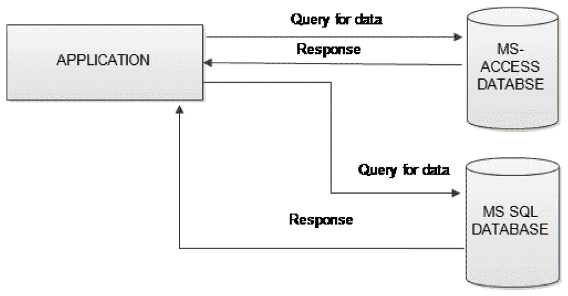

**图 1.1**: 数据库应用程序架构

这意味着您创建的应用程序将只能与一种数据库工作，并且编码和移植将非常困难。

上述问题通过微软的一种与数据库进行高效通信的机制解决了，称为`开放数据库连接`（`ODBC`）。

## ODBC 应用程序编程接口 (API)

`ODBC API` 是一组库例程，使您的程序能够访问各种数据库。您只需要安装特定于 DBMS 的 `ODBC` 驱动并编写您的程序。`图 1.2` 显示应用程序与 `ODBC` 驱动管理器通信。

以后，如果数据库升级到新版本或移植到不同的 `RDBMS`，您只需要更改 `ODBC` 驱动而不需要更改程序，如`图 1.2`所示（此处应为图 1.2）：

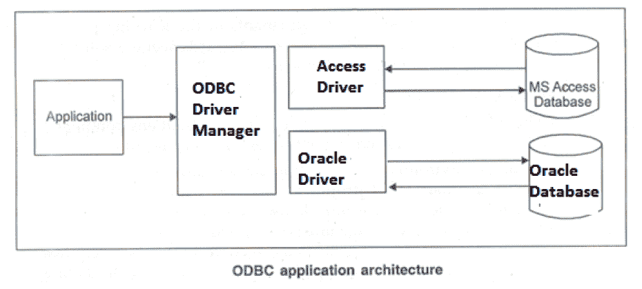

**图 1.2**: ODBC 应用程序架构

## JDBC-API

`Java 数据库连接（JDBC）`为 Java 程序提供了数据库编程 API。由于 `ODBC API` 是用 C 语言编写的，并使用了 Java 不支持的指针等结构，Java 程序无法直接与 `ODBC` 驱动通信。

Sun 创建了 `JDBC-ODBC` 桥接驱动，将 `JDBC-API` 翻译为 `ODBC`。它与 `ODBC` 驱动一起使用。

## JDBC 驱动分类

JDBC 驱动有几类，如下：

*   `JDBC-ODBC` 桥接 + `ODBC` 驱动
*   `JDBC` – 网络纯 Java 驱动 / 网络协议
*   客户端机器需要安装 ODBC 驱动

## 原生 API 驱动 (Native-API driver)

`Native-API` 驱动使用数据库的客户端库。驱动将 `JDBC` 方法调用转换为数据库 API 的原生调用。它不是完全用 Java 编写的。

## 以下是优点：

* 性能提升，优于 `JDBC-ODBC` 桥接驱动

## 以下是缺点：

* 每个客户端机器上都需要安装原生驱动

* 需要在中间层针对特定数据库进行编码

* 客户端或服务器端都不需要软件

## 以下是缺点：

* 驱动依赖于数据库

## 查询数据库

现在你已经理解了 `JDBC` 架构，就可以编写一个可以与数据库工作的 Java 应用程序。在本节中，你将学习 Java 中提供的包和类，这些类允许你向数据库发送查询并处理查询结果。

## 连接数据库

`java.sql` 包包含了帮助连接数据库、向数据库发送嵌入 SQL 语句以及处理查询结果的类。

## 连接对象 (connection object)

连接对象代表与数据库的连接。在一个连接一个或多个数据库的应用程序可能有多个连接对象。

## 加载驱动并建立连接

要与数据库建立连接，请完成以下步骤：

1. 通过 `Class` 类的 `forName()` 方法注册 ODBC JDBC/薄型驱动。

例如：

```java
Class.forName("oracle.JDBC.driver.OracleDriver");
String url = "jdbc:oracle:thin:@localhost:1521:xe";
//"jdbc:oracle:thin:@localhost:1521:xe"
Class.forName ("oracle.jdbc.driver.OracleDriver")
```

## 在数据库中处理查询

一旦建立了与数据库的连接，就可以查询数据库并处理结果集。`JDBC` 不对可以发送的 SQL 语句类型实施任何限制，但作为程序员，你有责任确保数据库能够处理这些语句。

`JDBC` 提供了三个类向数据库发送 SQL 语句，如下所示：

* **Statement 对象**：你可以通过调用连接对象的 `createStatement()` 方法创建 statement 对象。
* **CallableStatement 对象**：你可以通过调用连接对象的 `prepareCall()` 方法创建 Callable Statement 对象。`CallableStatement` 对象包含调用存储过程的功能。你可以使用 Callable Statement 对象处理输入和输出参数。

### 使用 Statement 对象

你可以像接下来的示例 Query-App 程序所示，使用 statement 对象向数据库发送简单的查询：

```java
import java.sql.*;

public class QueryApp {

    try {

      Connection con = DriverManager.getConnection ("jdbc:oracle:thin:@localhost:1521:xe","system","password");

      stat.executeQuery ("select * from emp");

      System.out.print ("Error" + e);

  }
}
```

在前面的 Query App 示例中，发生了这些：
2. 使用 `getConnection()` 方法初始化了连接对象。
4. 最后，使用 statement 对象的 `executeQuery()` 方法执行了一个简单的查询。

### Statement 对象

`Statement` 对象允许你执行简单的查询。它有三个可以用于查询的方法，如下：

* `executeQuery()` 方法执行简单的 select 查询并返回一个 `ResultSet` 对象。
* `execute()` 方法执行可能返回多个结果的 SQL 语句。

### ResultSet 对象

`ResultSet` 对象为你提供了访问表中数据的方法。执行一个语句通常会生成一个 `ResultSet` 对象。它维护一个指向当前行的游标。初始时，游标置在第一行之前。`next()` 方法将游标移动到下一行；你可以通过调用 `getxxx()` 方法访问 `ResultSet` 中的数据，其中 `xxx` 是参数的数据类型。以下代码查询数据库并处理 `ResultSet`：

```java
public static void main (String a []) {

    try {

      Connection con = DriverManager.getConnection ("jdbc:oracle:thin:@localhost:1521:xe","system","password");

      result=stat.executeQuery ("select * from emp");

        System.out.println(result.getString(2));/*获取 emp 表第二列的数据*/

    } catch(Exception e) {

    }

}
```

1. `executeQuery()` 方法返回了 `ResultSet` 对象。
3. 使用 `getString()` 方法获取第二列的值。

**输出如下：**

Suresh

Radhika

你可以修改同一个程序以在窗口中显示表格的内容：

```java
import java.awt.event.*;

TextField eid,ename;
Panel p;
static Connection con;
public QueryApp(){
    setLayout(new GridLayout(5,1));
    ename=new TextField();
    setSize(500,500);
    add(new Label("Employee ID"));
    add(new Label ("Employee Name: "));
    add(p);
    next.addActionListener(this);
}
{
    try  {
      System.out.println("after Driver");
      stat = con.createStatement();
      result=stat.executeQuery("select * from emp");
    catch(Exception e)
  
public void actionPerformed(ActionEvent event) {
    {
        while( result.next())
          eid.setText(eid.getText()+"  "+(result.getString(1)));
        }
    }
}
```

在前面的示例中，发生了以下情况：

1. `main()` 方法创建了 `QueryApp` 类的一个对象。
3. 随后执行查询。

```java
PreparedStatement stat = con.preparedStatement("select * from emp where eid = ?");
stat.setString(1, eid.getText());
```

下面的代码使用了预编译语句：

```java
import java.awt.*;

{
  Button query;

  /* 这些变量被声明为静态，因为它们必须在方法中访问 */

  static Connection con;

  public QueryApp()

    super("The Query Application");

    eid=new TextField();

    query=new Button("Next");

    p=new Panel();

    add(eid);

    add(ename);

    p.add(query);

    setVisible(true);

public static void main (String a [] )

    QueryApp obj = new QueryApp();

      Class.forName("oracle.jdbc.driver.OracleDriver");

      stat = con.prepareStatement("select * from emp where eid = ?");

      System.out.print ("Error in sql" + e);

  }

  @Override

    if(event.getSource()==query)

      try{

        {

          ename.setText(ename.getText()+"  "+(result.getString(2)));

      }catch(Exception e){System.out.println(e);}

  }
}
```

在前面的示例中，发生了以下情况：
1. `PreparedStatement` 对象通过 `preparedStatement()` 方法创建。
3. 随后通过 `actionPerformed()` 方法执行查询，结果在*图 1.5*中显示。

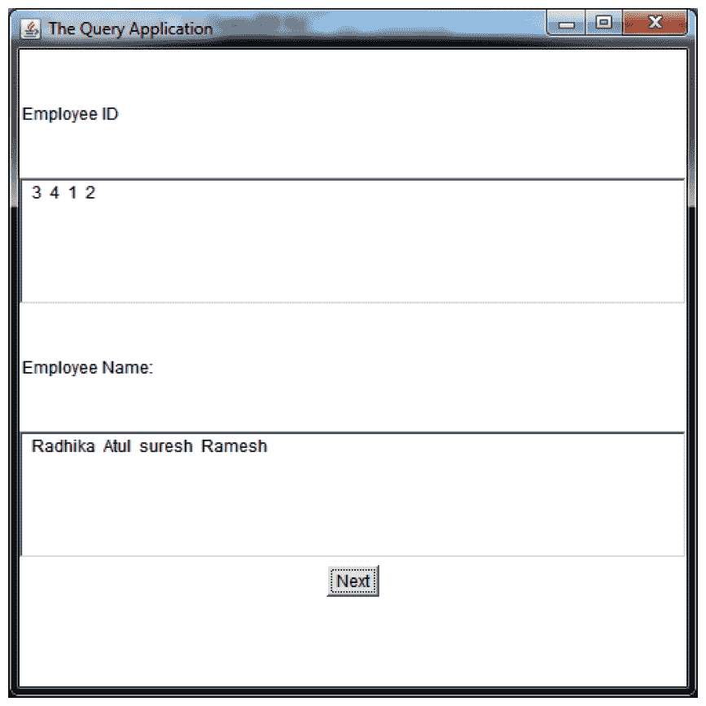

**图 1.5**: 前一个程序的输出

### 添加记录

你可以使用 `executeUpdate()` 方法执行简单的插入语句，如下：

```java
```

`executeUpdate()` 方法的返回值是受影响的行数，如下：

```java
try {

} catch (Exception e) { }
```

> **注意：预编译语句对象可以用于发送参数化的插入语句。**

### 修改记录

你可以使用 `executeUpdate()` 方法执行简单的更新语句，如下：

```java
```

`executeUpdate()` 方法的返回值是受影响的行数，如下：

```java
try {

} catch(Exception e) {

}
```

> **注意：占位符符号可以在运行时被输入参数替换。**

### 删除记录

你可以使用 `executeUpdate()` 方法执行简单的删除语句，如下：

```java
```

`executeUpdate()` 方法的返回值是受影响的行数，如下：

```java
try {

} catch (Exception e) { }
```

> **注意：预编译语句对象可以用于发送参数化的删除语句。**

## 结论

* 原生 API，部分为 Java 驱动
* 薄型驱动 (Thin Driver)

`java.sql` 包包含了帮助连接数据库、将嵌入 SQL 语句发送到数据库以及处理查询结果的类。连接对象表示与数据库的连接。`PreparedStatement` 对象允许你执行参数化查询。`ResultSet` 对象提供了从表中访问数据的方法。

许多人并不懂英语，并希望用自己的语言查看消息、货币和时间。国际化有助于实现这一点。在下一章中，我们将学习国际化（Internationalization），它是根据特定的语言和地区定制应用程序的过程。

## 单选题

1. **JDBC-ODBC 桥接是以下哪一个？**
   b. 多线程
   a. 接口
   c. 方法

3. **Commit 是以下哪一个的方法？**
   b. ResultSet
   a. `Class.forName()`
   c. 以上都不是

5. **Sun 定义了多少种 JDBC 驱动类型？**
   b. 四种

2. b
4. a

**Ans**: MYSQL
**Ans**: Prepared Statement
**Ans**: ResultSet
**Ans**: "?"

## 判断题

1. JDBC 是用于连接关系型、对象和 XML 数据源的 API。
2. JDBC-ODBC 桥接支持每个连接多个并发打开的语句。
3. JDBC 是访问关系型数据库的 API。
4. `java.sql` 和 `javax.sql` 包包含了 JDBC 类和接口。

2. 有多少种驱动？请解释。
4. 什么是 `ResultSet`？`ResultSet` 的返回类型是什么？

## 面试题

1. Java 中建立 JDBC 连接的主要步骤有哪些？
3. 什么是 `JDBC`？
5. JDBC-ODBC 桥接支持多个并发打开的语句？

# 第 2 章：国际化 (I18N)

## 引言

在本章中，我们将涵盖：

* 区域语言 (Locale)
* 开发基于 I18N 应用程序的步骤

学习本章后，你能够开发应用程序并根据特定的语言和地区显示消息。

## 本地化 (L10N)

它是 `java.util` 包中的一个类，提供了有关国家和地区的信息。

## Locale 类的构造函数

* `Locale(String language)`
* `Locale(String language, String country, String variant)`

## Locale 类的常用方法

* `public static Locale getDefault()`：返回当前 `Locale` 的实例。
* `public String getDisplayCountry()`：返回该 locale 对象的国家名称。
* `public String getDisplayVariant()`：返回该 locale 对象的变体代码。
* `public String getISO3Language()`：返回当前 locale 语言的三字母缩写。

获取印度信息的程序如下：

```java
public class LocaleTest {

    Locale locale = new Locale("hi", "IN");

    System.out.println(locale.getDisplayLanguage());

    System.out.println(locale.getISO3Country());

    System.out.println(locale.getLanguage());

}
```


**输出如下**：
Hindi
IND
hi

如果应用程序内部使用的消息或标签以用户的语言显示，这是一个良好的做法，例如，如果用户来自印度，消息是印地语；如果用户来自美国，消息是英语。`ResourceBundle` 存储区域敏感的文本和组件，并从包含消息的属性文件中加载这些信息。
`java.util.ResourceBundle` 类是一个抽象类；我们无法实例化该类。它的方法帮助我们管理区域敏感资源。

## `ResourceBundle` 的构造函数

* `public static ResourceBundle getBundle(String basename)`：加载指定名称资源包并返回 `ResourceBundle` 类的实例。
* `public static ResourceBundle getBundle(String basename, Locale locale)`：根据给定的名称和指定的 locale 加载资源包，并返回 `ResourceBundle` 类的实例。
* `Locale getLocale()`：返回与当前包关联的 Locale。
* `boolean containsKey()`：如果传递的字符串参数是调用资源包中的一个键，则返回 true。
* `final Object getObject()`：从当前资源包或父包中检索并返回与参数传递的键相关联的对象。

| 注意： |
| :--- |
| 属性文件的命名应为 `filename_languagecode_country`，例如 `MyMessage_hi_IN.properties`。 |

2. 为每个 Locale 创建属性文件，属性文件的命名必须为 `filename_languagecode_country`。
4. 借助 `ResourceBundle` 的方法从属性文件中读取消息。

**以下是示例**：

1. 创建 `MessageBundle_hi_IN.properties`，如下：
   `welcome=Hello, How are you?`
3. 创建一个 Java 类来获取 `ResourceBundle` 实例，并根据它们的 Locale 从属性文件中读取消息，如下：

```java
import java.util.ResourceBundle;

public class I18NDemo {

    // Default Locale is the US
    System.out.println("Message in " + Locale.US + ": " + bundle.getString("welcome"));

    // Now the default locale change to India
    bundle = ResourceBundle.getBundle("MessageBundle");
}
```

**输出如下**：
Message in hi_IN: Namaskar, Kaise hai aap?

## 日期和时间的国际化（带日期时间的 I18N）

每当 Locale 改变时，日期时间的格式也会发生变化。这意味着日期格式在不同地区是不同的。
`java.text.DateFormat` 类具有以下方法，可以帮助根据地区更改日期时间。

## `java.text.DateFormat` 的方法

以下是 `java.text.DateFormat` 的方法：

1. `public static DateFormat getDateInstance(int style, Locale locale)`：此方法根据指定的样式返回 `DateFormat` 对象，并且 `Locale` 对象用于格式化日期而不是时间。
3. `public String format(java.util.Date date)`：此方法将日期格式化为日期时间字符串。

| 注意：DateFormat 类具有以下用于显示日期和时间的样式： |
| :--- |
| • static final int SHORT |
| • static final int FULL |
| • static final int DEFAULT |

**以下是一个示例**：

```java
import java.text.DateFormat;

public class DateFormatDemo {

    // TODO Auto-generated method stub
    Locale l = new Locale(lang);
    System.out.println(df.format(new java.util.Date()));

    // Time
    System.out.println(df2.format(new java.util.Date()));
}
```

* `public static NumberFormat getCurrencyInstance(Locale locale)`：此方法返回指定 locale 的 `NumberFormat` 实例。

```java
import java.util.Locale;

public static void main(String[] args) {
    NumberFormat nf = NumberFormat.getNumberInstance(l);
    System.out.println(nf2.format(1234567.89));
    NumberFormat nf3 = NumberFormat.getPercentInstance(l);
}
```

# 5. 每当 `Locale` 发生变化时，数字格式也会发生变化。数字格式在不同地区之间也不同。`java.text.NumberFormat` 类用于根据特定的区域对以下进行格式化：

* 格式化数字
* 格式化百分比

## 多选题

### 1. 已知：
Date = new Date(); // line no 12
String s = df.format(date); // line no 14
变量 `df` 是 `DateFormat` 类型的对象，已在第 11 行内联初始化。如果这段代码在 2000 年 12 月 14 日运行，结果是什么？

A. `s` 的值为 `14-dec-2004`。
C. 运行时抛出异常。

```java
nf.setMaximumFractionDigits(4); // line no 13
String a = nf.format(3.1415926); // line no 15
```

B. `a` 的值为 `3.14`。
D. `a` 的值为 `3.141`。
F. `a` 的值为 `3.1416`。

`d` 是一个有效的、非空的 `Date` 对象。`df` 是一个有效的、非空的 `DateFormat` 对象，并设置为当前区域。什么输出当前区域的国家名称和 `d` 日期的适当版本？

A. `Locale loc = Locale.getLocale();`
B. `Locale loc = Locale.getDefault();`
C. `Locale loc = Locale.getLocale();`
D. `Locale loc = Locale.getDefault();`

```java
class DateOne {
    Date d = new Date(123631685981L);
    System.out.println(df.format(d));
}
```

并且假设 `123631685981L` 是 1970 年 1 月 1 日到 2005 年 8 月 9 日某时刻之间的毫秒数，结果是什么？（注意：选项 A 中的时间可能会变化。）

A. `8/9/05 5:54 PM`
B. `123631685981L`
C. 运行时抛出异常。
D. 因为单个错误编译失败。
E. 因为多个错误编译失败。

**答案**：
-> E 是正确的。`Date` 类位于 `java.util` 包中，因此需要导入，并且 `DateFormat` 对象必须使用静态方法（如 `DateFormat.getInstance()` 或 `DateFormat.getDateInstance()`）来创建。
-> 根据上述，A、B、C 和 D 都是错误的。

### 5. 下述哪些是正确的？（选择所有适用。）

A. `DateFormat.getDate()` 用于将 `String` 转换为 `Date` 实例。
B. `DateFormat` 和 `NumberFormat` 对象都可以被构造为特定区域的。
C. `Currency` 和 `NumberFormat` 对象都必须使用静态方法构造。
D. 如果 `NumberFormat` 实例的 `Locale` 与当前 `Locale` 不同，则必须在创建时指定。
E. 单个 `NumberFormat` 实例可以从字符串创建数字对象，并从数字创建格式化后的数字。

**答案**：
-> B、C、D 和 E 是正确的。
-> A 是错误的，`DateFormat.parse()` 用于将 `String` 转换为 `Date`。

## 问题

1. 你如何在 Java 中使用特定的 `Locale`？
2. 如何区分本地化（Localization）和国际化（internationalization）？
3. 我该如何对现有程序进行国际化？
4. `ResourceBundle` 是什么？如何提取字符串到 Resource Bundle？
5. 解释 Java 应用如何使用多个区域？

# 第 3 章

## Java Servlet 引言

### 引言

考虑一种你想注册网站以获取免费订阅的情况。你需要提供的信息是名、姓和组织名称。输入详情并点击提交按钮后，输入的数据会被转发到服务器进行处理。处理可能包括检查 ID 是否已使用或在客户端检查无效值以减轻服务器负担。为这些目的编写的小程序被称为客户端脚本。VB 脚本和 Java 脚本是用于客户端脚本的两种语言。处理服务器数据的程序被称为服务端脚本。Web 应用也需要服务器的功能。这促使了高效服务端编程工具的发展，如 Servlet、Java Pages、ASP 等。

### 结构

在本章中，我们将涵盖以下主题：

* Web 服务器
* Servlet 及其特点
* Servlet 与 Applet 的区别
* Servlet 的工作
* Servlet 的生命周期
* Servlet 方法
* 部署描述

### 目标

学习本章后，你将学会如何通过 Servlet 与服务器通信。你将理解 Servlet 的生命周期。你还将学习如何通过部署描述获取 Servlet 的信息。

### Web 服务器

Web 服务器接收客户端请求，找到资源（HTML 页面、图片、声音文件、记录），并向用户返回。当服务器找不到请求的资源时，会给出 404 “未找到”。Web 服务器是硬件和软件的结合。硬件可以是任何物理机器，软件是服务器应用程序。

### Servlet 引言

Servlet 是部署在支持 Java 的 Web 服务器上的 Java 程序，用于增强和扩展服务器的功能。例如，你可以编写一个 Servlet 为银行网站添加即时通讯服务。Servlet 还可以用于为页面添加动态内容。例如，你可以使用 Servlet 从信息数据库中检索银行提供的最新优惠，并显示在银行主页上。

### Servlet 的特点

Servlets 可用于开发各种 Web 应用程序。由于 Servlets 使用 Java 编写，它们可以使用 Java API 的强大功能，例如网络连接和 URL 访问、多线程、数据库连接、国际化、`remote method invocation` (`RMI`) 以及对象序列化。Servlets 获得广泛认可的特性如下：

* **Servlets 是高效的**：Servlet 的初始化代码仅在 Servlet 第一次执行时运行。随后，Servlet 的请求将由其 `service()` 方法处理。这有助于通过避免创建不必要的进程来提高服务器的效率。
* **Servlets 是健壮的**：Servlets 基于 Java；它们提供了 Java 的所有强大功能，如异常处理和垃圾回收，使它们非常健壮。
* **Servlets 是可移植的**：由于 Servlets 用 Java 开发的，因此它们也具有移植性。这使得可以在不同的 Web 服务器之间轻松迁移。
* **Servlets 是持久的**：Servlets 通过防止频繁的磁盘访问提高了系统性能。例如，如果客户登录 `www.EarnestOnline.com`，客户可以执行许多活动，如查询余额、申请贷款等。在每个阶段，客户都需要通过对比数据库中的账号来通过身份验证；Servlets 无需每次都对比数据库检查账号，而是将账号保留在内存中，直到用户退出网站。

### Servlets 与 Applets 的比较

Applets 是嵌入在 Web 页面中的 Java 程序。当打开包含 Applet 的 Web 页面时，applet 的字节码会被下载到客户端计算机。由于 applet 的尺寸过大，这个过程变得非常耗时。由于 Servlets 在 Web 服务器上执行，它们有助于解决使用 applets 时面临的下载时间问题。与 applets 不同，Servlets 不需要浏览器启用 Java 功能，因为它们在 Web 服务器上执行，并将结果返回给客户端或浏览器。Applet 是一项过时的技术。

### Servlets 与其他服务器端脚本技术的比较

常见的网关接口 (`CGI`) 脚本、JSP 和 ASP 是 Servlets 的替代方案，它们各自有优缺点。

#### CGI 脚本

CGI 脚本是用 C、C++ 或 Perl 编写的程序。当服务器接收到客户端用于处理数据的请求时，CGI 脚本会在服务器上执行。服务器将请求传递给 CGI 脚本。CGI 脚本处理请求并将以 HTML 形式的输出发送到服务器。服务器反过来将请求传递给客户端。

使用 CGI 脚本的缺点如下：

* 每当调用 CGI 脚本时，服务器都会为其创建一个单独进程。服务器对同时创建的进程数量有限制。如果请求数量过高，服务器将无法接受请求。此外，创建过多进程也会降低服务器的效率。
* 编写 CGI 脚本最流行的平台是 Perl。尽管 Perl 是一种编写 CGI 应用程序非常强大的语言，但服务器需要为收到的每个请求加载 Perl 解释器。因此，对于每个传入的请求，需要加载 CGI 脚本的可执行文件和 Perl 解释器，这会降低服务器的效率。

与 CGI 脚本不同，Servlet 的初始化代码仅执行一次。在 Servlets 的情况下，每个请求都由 Web 服务器中的独立线程更高效地处理，避免了创建不必要的进程。

#### Active Server Pages (ASP)

ASP 是由微软开发的一种服务器端脚本语言。ASP 允许开发者在同一个 Web 页面上结合 HTML 和脚本语言。JavaScript 和 VBScript 是 ASP 支持的两种脚本语言。通过 `<script runat=server>` 标签，VBScript 和 JavaScript 也可以用于服务器端脚本。ASP 的局限性在于它不兼容所有的 Web 服务器。其他 Web 服务器需要安装特定的插件来支持 ASP。然而，添加插件可能会降低系统性能。

### Servlets 的工作原理

客户端或浏览器使用 `GET` 或 `POST` 方法将请求传递给服务器。例如，可以通过点击用户界面组件（如表单上的按钮）或跟随 Web 页面上的链接来调用 Servlet。Servlet 处理请求后，输出将以 HTML 页的形式返回给客户端。

客户端请求由以下组件组成：

* 服务器和客户端之间通信使用的协议，例如 `HTTP`。
* 请求类型可以是 `GET` 或 `POST`。
* 查询字符串包含附加信息，如登录名、密码和注册详情。

**以下是一个示例**：`GET`

```
http://www EarnestBank.com/login.xhtml?username="sarika"&passwd="3445H"
```


前述 URL 用于显示用户名为 "Sarika" 的信箱。

**表 3.1** 描述了 URL 的不同组件：

| 组件 | 描述 |
| :--- | :--- |
| HTTP | 它是服务器和客户端之间通信的协议。 |
| www.EarnestBank.com | 它是网站的域名。 |
| login.xhtml | 它是显示给用户的表单名称。 |
| Username="sarika"&passwd="3445H | 这些是传递给服务器端程序的值。 |

### GET 和 POST 方法

当客户端向服务器发送请求时，客户端可以使用 `GET` 方法通过 URL 传递附加信息，以描述从服务器所需的确切输出。附加在 URL 后的额外字符序列称为 `查询字符串`。然而，查询字符串的长度限制为 240 个字符。此外，查询字符串在浏览器上可见，因此存在安全风险。

为了克服这些缺点，可以使用 `POST` 方法。在 `POST` 方法中，可以通过单独的套接字连接发送大量数据。整个事务对客户端不可见。

这种方法的缺点是比 `GET` 方法慢，因为数据是作为单独的数据包发送到服务器的。

### Javax.servlet 包

Java 通过 `javax.servlet` 和 `javax.servlet.http` 包支持 Servlet 的实现。`javax.servlet` 接口提供了创建 Servlet 的通用框架。Servlet 可以直接实现此接口，也可以通过扩展 `javax.servlet.GenericServlet` 或 `javax.servlet.http.HttpServlet` 类来间接实现。

`javax.servlet` 包中的 `GenericServlet` 类用于创建可以与任何协议协同工作的 Servlet。`javax.servlet.http` 包用于创建以 HTML 页面形式输出的 HTTP Servlet。用于创建 HTTP Servlets 的类被称为 `HttpServlet`，它继承自 `GenericServlet` 类。Servlet 中也支持序列化，它通过 `Serializable` 接口继承自 `GenericServlet` 类来实现。序列化是将对象写入持久化存储介质（如硬盘）的过程。用于创建 Servlet 的类层次结构如图 **图 3.1** 所示：

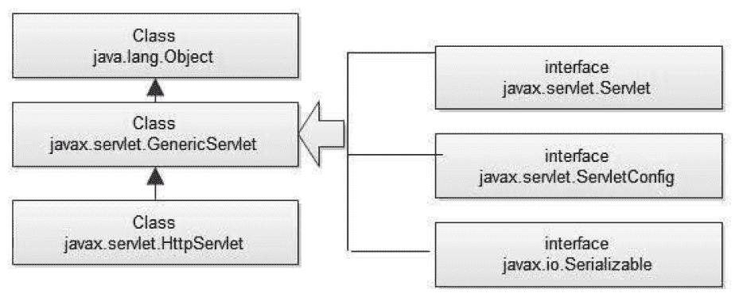

**图 3.1**：Servlet 类层次结构

**表 3.2** 描述了用于创建 Servlet 的类和接口：

| 类/接口名称 | 描述 |
| :--- | :--- |
| `HttpServlet` 类 | 提供 Servlet 接口的 HTTP 特定实现。该类扩展了 `GenericServlet` 类，该类为处理其他类型的网络和 Web 服务提供了框架。 |
| `HttpServletRequest` 接口 | 它扩展了 `ServletRequest` 接口以提供处理客户端请求的方法。例如，假设客户端浏览器包含一个有两个字段的表单。当值被提交到服务器进行处理时，将使用 `HttpServletRequest` 接口中的方法进行提取。 |
| `HttpServletResponse` 接口 | 它扩展了 `ServletResponse` 接口以提供发送响应的方法。例如，它具有访问 HTTP Header 和 Cookie 的方法。 |

### Servlet 的生命周期（#toc.xhtml_aa55）

Servlet 的生命周期描述了 Servlet 的状态。Servlet 有三种状态：新创建（new）、就绪（ready）和结束（end）。Servlet 的状态通过调用 servlet 方法发生变化。

### Servlet 接口（#toc.xhtml_aa56）

Servlet 接口为所有 Servlet 提供了通用功能。Servlet 接口定义了所有 Servlet 必须实现的方法。`HttpServlet` 和 `GenericServlet` 直接或间接地实现了 Servlet 接口。Servlet 接口提供了三个用于实现任何 Servlet 的生命周期方法。

Servlet 在内存中只加载一次，并在 `init()` 方法中初始化。Servlet 初始化后，开始接收来自客户端的请求，并通过 `service()` 方法处理它们，直到被 `destroy()` 方法关闭。`service()` 方法会在每个传入的请求时执行。Servlet 的生命周期如下：

1. 加载 Servlet 类。
2. 创建 Servlet 实例。
3. 调用 `init` 方法。
4. 调用 `service` 方法。
5. 调用 `destroy` 方法。

参考 **图 3.2**，该图说明了 Servlet 的生命周期：

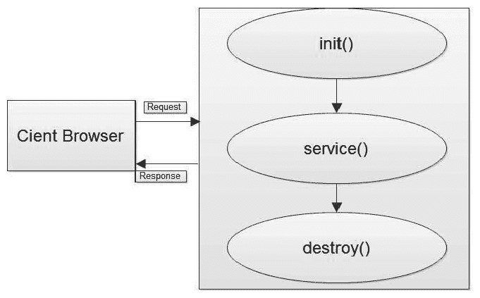

**图 3.2**：Servlet 的生命周期

**表 3.3** 描述了 Servlet 接口的方法：

| 序号 | 方法名 | 描述 |
| :--- | :--- | :--- |
| 1 | `public void init(ServletConfig config) throws ServletException` | 它包含 Servlet 的所有初始化代码，并在 Servlet 首次加载和创建时被调用。 |
| 2 | `public void service(ServletRequest request, ServletResponse response)` | 它接收来自客户端的所有请求，识别请求类型，并将其分发到 `doGet()` 或 `doPost()` 方法进行处理。 |
| 3 | `public void destroy()` | 当 Servlet 从服务器上移除时执行一次。必须在此方法中提供 Servlet 的清理代码。 |
| 4 | `public ServletConfig getServletConfig()` | 返回 `ServletConfig` 对象。 |
| 5 | `public String getServletInfo()` | 返回关于 Servlet 的信息，如作者、版权、版本等。 |

### 创建 Servlet（#toc.xhtml_aa57）

除了三个生命周期方法（`init()`、`service()` 和 `destroy()`）之外，还有两个方法也用于创建 Servlet。

**表 3.4** 描述了用于创建 Servlet 的两个方法：

| 序号 | 方法名 | 描述 |
| :--- | :--- | :--- |
| 1 | `ServletResponse.getWriter()` | 它返回一个 `PrintWriter` 对象的引用。`PrintWriter` 类用于将格式化对象作为文本输出流写入客户端。 |
| 2 | `ServletResponse.setContentType(String type)` | 它设置发送到客户端浏览器响应的内容类型。例如，`setContentType("text/html")` 用于将响应类型设置为文本。 |

**Servlet 可以通过以下三种方式之一创建：**

* 通过实现 `Servlet` 接口
* 通过继承 `GenericServlet` 类
* 通过继承 `HttpServlet` 类

#### 1. 以下是通过实现 Servlet 接口创建的 servlet 示例：

```java
import java.io.*;
import javax.servlet.*;

public class FirstServlet implements Servlet {

    ServletConfig config = null;

    public void init(ServletConfig config) {
        this.config = config;
        System.out.println("Servlet is initialized");
    }

    public void service(ServletRequest req, ServletResponse res) throws IOException, ServletException {
        res.setContentType("text/html");
        PrintWriter out = res.getWriter();
        out.print("<html><body>");
        out.print("<b>This is First Servlet</b>");
        out.print("</body></html>");
    }

    public void destroy() {
        System.out.println("Servlet is destroyed");
    }

    public ServletConfig getServletConfig() {
        return config;
    }

    public String getServletInfo() {
        return "Institute of Learning- Advance First Servlet";
    }
}
```

### 编译 Servlet

编译 Servlet 需要加载 JAR 包。不同的服务器需要不同的 JAR 包。

**表 3.5** 提供了不同服务器和 JAR 包的列表：

| Jar 文件 | 服务器 |
| :--- | :--- |
| `javaee.jar` | Glassfish/JBoss |
| `weblogic.jar` | Weblogic |
| `servlet-api.jar` | Apache Tomcat |

### 创建描述符（web.xml 文件）（#toc.xhtml_aa58）

描述符是一个 XML 文件，Web 容器从中获取要调用的 Servlet 信息。Web 容器使用解析器从 **web.xml** 文件获取信息。有很多 XML 解析器，如 SAX、DOM 和 Pull。对于 Servlet 或 HTML 页面（可能包含指向 Servlet 的链接），要从客户端访问，必须先部署在 Web 服务器上。

> **注意**：web.xml 中 Servlet 的 `load-on-startup` 用于在部署项目或启动服务器时加载 Servlet。这节省了首次请求响应的时间。如果你传递正值，较小整数值的 Servlet 将比较大整数值的 Servlet 先加载。换句话说，容器按照整数值的升序加载 Servlet。0 值先加载，然后是 1、2、3 等以此类推。

**web.xml** 文件中使用的基本元素描述如下：

* `<web-app>` 代表整个应用程序。
* `<servlet>` 是 `<web-app>` 的子元素，代表 Servlet。
* `<servlet-name>` 是 `<servlet>` 的子元素，代表 Servlet 的名称。
* `<servlet-class>` 是 `<servlet>` 的子元素，代表 Servlet 的类。
* `<servlet-mapping>` 是 `<web-app>` 的子元素。它用于映射 Servlet。
* `<url-pattern>` 是 `<servlet-mapping>` 的子元素。该模式在客户端用于调用 Servlet。
* `<load-on-startup>1</load-on-startup>`。数字越小的 Servlet 越先加载。

#### Web.xml

```xml
<web-app>
    <servlet>
        <servlet-name>FirstServlet</servlet-name>
        <servlet-class>FirstServlet</servlet-class>
    </servlet>
    <servlet-mapping>
        <servlet-name>FirstServlet</servlet-name>
        <url-pattern>/FirstServlet</url-pattern>
    </servlet-mapping>
    <session-config>
        <session-timeout>30</session-timeout>
    </session-config>
</web-app>
```

现在，启动服务器并运行 Servlet。Servlet 的输出显示在 **图 3.3** 中：

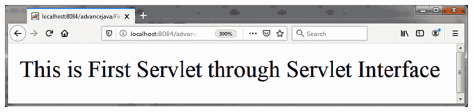

**图 3.3**：Servlet 的输出

### 2. 以下是一个通过扩展 GenericServlet 类创建的 servlet 示例

**GenericServlet 类**：它是一个实现了 `Servlet`、`ServletConfig`、`Serializable` 接口的抽象类。它提供了 Servlet 接口除 `service()` 方法之外的所有方法的实现。因此，程序员必须给出 `service()` 方法的体。它是协议无关的。

#### 程序：

```java
import java.io.*;
import javax.servlet.*;

public class FirstServlet extends GenericServlet {

    public void service(ServletRequest req, ServletResponse res) throws IOException, ServletException {
        res.setContentType("text/html");
        PrintWriter out = res.getWriter();
        out.print("<html><body>");
        out.print("<b>This is First Servlet through GenericServlet Class</b>");
        out.print("</body></html>");
    }
}
```


**`HttpServlet`**: HTTP 是一种 Web 特定的协议，对于浏览器请求和 Web 服务器响应之间的对话有规定。在下一章中，你将学习 `HttpServlet`。

### 结论

在本章中，你学习了 Servlets 是可以部署在 Web 服务器上的服务器端 Java 程序。`Servlet` 接口为编写 Servlets 提供了基本的框架。Servlets 是可移植、可扩展、持久且健壮的。Servlet 的生命周期由 `init()`、`service()` 和 `destroy()` 方法组成。Servlets 可以部署在 Glassfish、Weblogic 和 Apache Tomcat 中。

在下一章中，你将学习 `HttpServlet`。HTTP 是一种 Web 特定的协议，对于浏览器请求和 Web 服务器响应之间的对话有规定。HTTP 在服务器发送的响应的任何内容顶部添加了头部信息。浏览器使用这些头部信息来帮助处理 HTML 页面。`HttpServlet` 提供了一个处理 HTTP 协议的框架，而 `GenericServlet` 是协议无关的。

### 问题

1. Web 服务器和应用程序服务器之间有什么区别？
2. Servlets 相比 CGI 有什么优势？
3. Servlet 使用哪个类来接收来自客户端的请求？
4. Applet 和 Servlet 之间有什么区别？
5. 我们如何编译 Servlet？
6. Servlet 存储在哪里，在何处？
7. Servlet 的生命周期方法有哪些？
8. `web-app.xml` 中 URL-pattern 的作用是什么？

# 第 4 章

## HTTP Servlet

### 引言

本章重点关注与 HTTP servlet 可以执行的功能相关的内容。超文本传输协议（HTTP）是一种用于浏览器和 Web 服务器之间通信的无状态协议。例如，当用户发送请求打开某个特定页面时，必须遵循 HTTP 协议中的规则。`HttpServlet` 实现了 HTTP 协议的所有规则。

### 结构

在本章中，我们将涵盖：
*   HTTP 请求
*   HTTP 响应
*   HTTP 方法

### 目标

在本章中，我们将涵盖：
*   HTTP 请求
*   HTTP 响应
*   HTTP 方法（特别是 `GET` 和 `POST`）

学习本章后，你将学习 `HttpServlet`。

### HTTP Servlet

它是一个扩展了通用 servlet 的抽象类，如图 4.1

**图 4.1：HttpServlet 的层级结构**

### HttpServlet 类的作用

Web 服务器接收客户端请求并以 HTML 格式返回内容。HTTP 是一种 Web 特定的协议，对于浏览器请求和 Web 服务器响应之间的对话有规定。`HttpServlet` 提供了一个处理 HTTP 协议的框架，而 `GenericServlet` 是协议无关的。

### HTTP 请求和响应

浏览器在 HTTP 请求中发送客户端请求，服务器在 HTTP 响应中传递数据，如图 4.2

**图 4.2：HTTP 请求和响应**

HTTP 协议有多种方法。该方法名称告诉服务器请求的类型。例如，客户端发送 `HTTP Get` 请求到服务器获取指定的页面。当用户向服务器发送 `HTTP Post` 请求时，用户向服务器发送数据或更新资源。`HttpServlet` 提供了各种特定的 HTTP 方法，如下：

*   `public void service(ServletRequest req, ServletResponse res)`：通过将请求和响应对象转换为 HTTP 类型将请求分发到受保护的方法。
*   `protected void service(HttpServletRequest req, HttpServletResponse res)`：接收 service 方法的请求，并根据传入 HTTP 请求类型将请求分发到 `doXXX()` 方法。
*   `protected void doGet(HttpServletRequest req, HttpServletResponse res)`：处理 `GET` 请求。Web 容器调用它。
*   `protected void doPost(HttpServletRequest req, HttpServletResponse res)`：处理 `POST` 请求。Web 容器调用它。
*   `protected void doHead(HttpServletRequest req, HttpServletResponse res)`：处理 `HEAD` 请求。Web 容器调用它。
*   `protected void doOptions(HttpServletRequest req, HttpServletResponse res)`：处理 `OPTIONS` 请求。它由 Web 容器调用。
*   `protected void doPut(HttpServletRequest req, HttpServletResponse res)`：处理 `PUT` 请求。它由 Web 容器调用。
*   `protected void doTrace(HttpServletRequest req, HttpServletResponse res)`：处理 `TRACE` 请求。它由 Web 容器调用。
*   `protected void doDelete(HttpServletRequest req, HttpServletResponse res)`：处理 `DELETE` 请求。它由 Web 容器调用。
*   `protected long getLastModified(HttpServletRequest req)`：返回自 GMT 1970 年 1 月 1 日午夜以来 `HttpServletRequest` 最后修改的时间。

### GET 和 POST 方法

当客户端向服务器发送请求时，客户端也可以使用 `GET` 方法通过 URL 传递额外信息，以描述服务器需要输出的具体内容。附加在 URL 后的额外字符序列被称为 `query string`（查询字符串）。然而，查询字符串的长度限制为 240 个字符。此外，查询字符串在浏览器上可见，因此可能存在安全风险。

为了克服这些缺点，可以使用 `POST` 方法。`POST` 方法通过独立的 socket 连接以数据包的形式发送数据。整个事务过程对客户端是不可见的。这种方法的缺点是比 `GET` 方法慢，因为数据是作为单独的数据包发送到服务器。

*表 4.1* 显示了 GET 和 POST 方法之间的区别：

| Get | Post |
| :--- | :--- |
| 数据限制为 240 个字符 | 可以发送大量数据。 |
| 不安全 | 安全。 |
| 可以书签 | 不可以书签。 |
| 幂等的 | 非幂等的。 |
| 高效 | 效率较低且速度慢。 |

**表 4.1：Get 和 Post 方法的区别**

以下是一个用于跟踪访问 Web 应用程序或网站的用户数的应用程序示例：

```java
import java.io.IOException;
import java.io.PrintWriter;
import javax.servlet.ServletConfig;
import javax.servlet.ServletException;
import javax.servlet.http.HttpServlet;
import javax.servlet.http.HttpServletRequest;
import javax.servlet.http.HttpServletResponse;

/** 用于跟踪网站访问人数的计数器 */
public class HitCountServlet extends HttpServlet {

    static int count;

    public void init(ServletConfig config) throws ServletException {
        super.init(config);
    }

    protected void doGet(HttpServletRequest request, HttpServletResponse response)
            throws ServletException, IOException {

        count++;
        response.setContentType("text/html;charset=UTF-8");

        try (PrintWriter out = response.getWriter()) {
            out.println("<!DOCTYPE html>");
            out.println("<html>");
            out.println("<head>");
            out.println("<title>Servlet HitCountServlet</title>");
            out.println("</head>");
            out.println("<body>");
            out.println("<h1>You are user " + String.valueOf(count) + " Visiting our website</h1>");
            out.println("</body>");
            out.println("</html>");
        }
    }

    @Override
    public String getServletInfo() {
        return "Hit count";
    }
}
```

上述示例的输出如图 4.3 所示。

**图 4.3：前一个程序的结果**

在示例中，使用了以下方法：

- 需要在 `HitCountServlet` 类中编写 `init()` 方法，以将访问计数器初始化为零。当服务器启动时 servlet 加载到内存中，或者手动使用某些管理工具时，该方法会被自动调用。
- 需要编写 `doGet()` 方法，以便每当客户端请求主页时增加访问计数器。注意：如果客户端没有显式指定请求类型，则默认调用 `doGet()` 方法。

`HttpServletRequest` 接口扩展了 `ServletRequest` 接口，为 servlet 提供请求信息，例如内容类型、内容长度、参数名和值、头部信息等。它位于 `javax.servlet.http` 包中。

*表 4.2* 显示了 `ServletRequest` 接口的方法：

| 方法 |  |
| :--- | :--- |
| `public String getParameter(String name)` | 用于通过名称获取参数值。 |
| `public String[] getParameterValues(String name)` | 返回包含给定参数名所有值的 String 数组。主要用于获取多选择列表框的值。 |
| `java.util.Enumeration getParameterNames()` | 返回所有参数名的枚举器。 |
| `public int getContentLength()` | 返回请求实体数据的大小，如果未知则返回 -1。 |
| `public String getCharacterEncoding()` | 返回此请求输入的字符集编码。 |
| `public String getContentType()` | 返回请求实体数据的互联网媒体类型，如果未知则返回 null。 |
| `public ServletInputStream getInputStream() throws IOException` | 返回一个用于读取请求体中二进制数据的输入流。 |
| `public abstract String getServerName()` | 返回接收请求的服务器主机名。 |
| `public int getServerPort()` | 返回接收此请求的端口号。 |

**表 4.2：ServletRequest 接口的方法**

借助 `ServletRequest` 接口的帮助，服务器可以获取用户传递的参数，对其进行处理，并将结果返回给用户。这可以通过登录表单示例来解释，用户输入用户名和密码。Servlet 使用了 `getParameter` 方法返回用户名和密码的值，并检查用户名和密码是否有效。

### 示例

**index.xhtml**:
```html
<!DOCTYPE html>
<html>
<body>
    <h1>The Login Form</h1>
    <form method="post" action="/LoginForm/actionpage">
        <label for="fname">User name:</label>
        <input type="text" id="uname" name="Uname"><br><br>
        <label for="lname">Password:</label>
        <input type="text" id="pwd" name="pwd"><br><br>
        <input type="submit" value="Submit">
    </form>
</body>
</html>
```

**Actionpage.java**:
```java
import java.io.IOException;
import java.io.PrintWriter;
import javax.servlet.ServletException;
import javax.servlet.http.HttpServlet;
import javax.servlet.http.HttpServletRequest;
import javax.servlet.http.HttpServletResponse;

public class Actionpage extends HttpServlet {

    public void doPost(HttpServletRequest request, HttpServletResponse response)
            throws ServletException, IOException {

        response.setContentType("text/html;charset=UTF-8");

        try (PrintWriter out = response.getWriter()) {
            /* TODO 在此处输出你的页面。可以使用以下示例代码。 */
            out.println("<!DOCTYPE html>");
            out.println("<html>");
            out.println("<head>");
            out.println("<title>Actionpage</title>");
            out.println("</head>");
            out.println("<body>");

            String name = request.getParameter("Uname");
            String pwd = request.getParameter("pwd");

            if (name.equals("Sarika") && pwd.equals("vivek")) {
                out.println("<h1>You are login</h1>");
            } else {
                out.println("<h1>User Name or Password is Incorrect</h1>");
            }

            out.println("</body>");
            out.println("</html>");
        }
    }

    @Override
    public String getServletInfo() {
        return "Login Form ";
    }
}
```

**Web.xml**:
```xml
<?xml version="1.0" encoding="UTF-8"?>
<web-app version="3.1">
    <servlet>
        <servlet-name>Actionpage</servlet-name>
        <servlet-class>Actionpage</servlet-class>
    </servlet>
    <servlet-mapping>
        <servlet-name>Actionpage</servlet-name>
```


<url-pattern>/actionpage</url-pattern>

</servlet-mapping>

<session-config>

    <session-timeout>

        30

    </session-timeout>

</session-config>

</web-app>

以下是 `index.xhtml` 的输出，如图 4.4 所示：

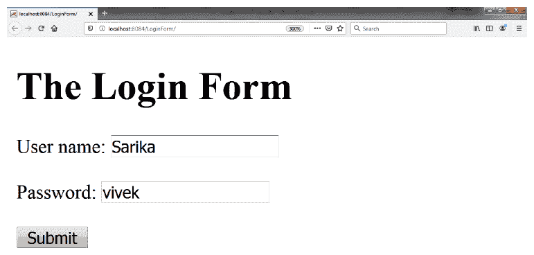

**图 4.4**: `index.xhtml` 的输出

以下是操作页的输出，如图 4.5 和图 4.6 所示：

ActionPage


**图 4.5**: Action Page 的输出

**Action Page** (如果用户名或密码任错误):

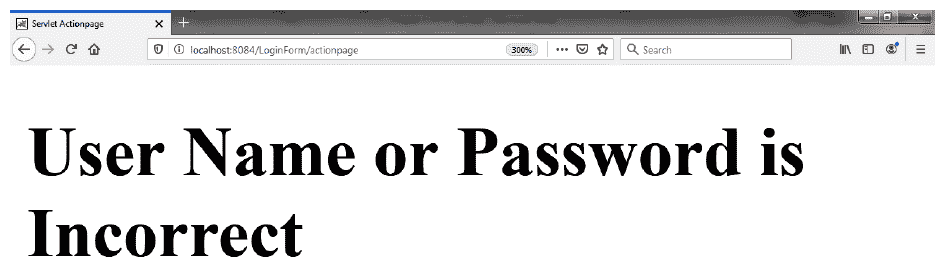

**图 4.6**: Action Page 的输出

## 结论

在本章中，你学习了 HTTP 代表超文本传输协议（HyperText Transfer Protocol），它是一种用于 Web 的网络协议。它运行在 TCP/IP 之上。`HttpServlet` 是一个抽象类，它扩展了通用 servlet 并增加了 HTTP 协议的功能。HTTP 使用请求/响应模型——用户发送请求，Web 服务器向浏览器提供 HTTP 响应，然后浏览器将其显示给用户。如果服务器的响应是 HTML 页面，则 HTML 会被添加到 HTTP 响应中。`HttpServletRequest` 和 `HttpServletResponse` 是用于在用户和 Web 服务器之间交换信息的接口。一个 HTTP 请求包含请求 URL。附加在 URL 后的额外字符序列被称为查询字符串。GET 请求将查询字符串附加在 URL 的末尾。POST 方法将查询字符串或数据添加到请求体中。

在下一章中，你将学习会话（sessions），因为 HTTP 无法记住上一个面的活动。HTTP 是一种无状态协议。这意味着它不包含任何关于 HTTP 页的信息。为了记住状态或将信息从一个页面传递到另一个页面我们需要会话。

## 问题

1. Get 和 Post 方法之间有什么区别？
2. `GenericServlet` 和 `HttpServlet` 之间有什么区别？
3. `PrintWriter` 和 `ServletOutputStream` 有什么不同？
4. 哪种 HTTP 方法是非幂等的？

## 多选题

**1. 哪些类型的 servlet 使用这些方法——`doGet()`、`doPost()`、`doHead()`、`doDelete()`、`doTrace()`？**
a. Generic Servlets
b. `HttpServlets`
c. 以上所有
d. 以上都不是
**答案**: `HttpServlets`

**2. Web 服务器用于加载 servlet 的 `init()` 方法。**
a. 正确
b. 错误
**答案**: 正确

**3. 哪些包代表了 servlet API 的接口和类？**
a. `javax.servlet`
b. `javax.servlet.http`
c. A 和 B 都是
d. 以上都不是
**答案**: A 和 B 都是

**4. 哪类类可以处理任何类型的请求，使其与协议无关？**
a. `GenericServlet`
b. `HttpServlet`
c. A 和 B 都是
d. 以上都不是
**答案**: `GenericServlet`

**5. 哪种 HTTP 请求方法是非幂等的？**
a. GET
b. POST
c. A 和 B 都是
d. 以上都不是
**答案**: POST

**6. Web 容器在部署项目时创建哪个对象？**
a. `ServletConfig`
b. `ServletContext`
c. A 和 B 都是
d. 以上都不是
**答案**: `ServletContext`

# 第 5 章

## 使用 Servlet 会话

## 引言

HTTP 无法记住上一个面的活动。超文本传输协议（HTTP）是一种无状态协议。这意味着它不包含任何关于 HTTP 页的信息。为了记住状态或将信息从一个页面传递到另一个页面，我们需要维护会话。

## 结构

会话是用户在访问特定网站时执行的一组活动。跨会话之间跟踪设置的过程被称为会话跟踪（session tracking）。考虑在线商场的例子：用户可以选择一个产品并将其加入购物车。当用户移动到不同的页面时，购物车中的详情仍然会被保留，这样用户就可以检查购物车中的物品然后下单。如果用户选择了，则会向用户显示更多内容。

### 在 servlet 中跟踪会话的技术

默认情况下，无法使用 HTTP 存储跨会话的数据，因为它是一种无状态协议。然而，某些技术可以帮助使用 HTTP 存储会话。如下：

* URL 重写（URL rewriting）
* 隐藏表单（Hidden form）
* `HttpSession`

### URL 重写

这通过修改 URL 以包含特定用户的会话 ID 并将其返回给客户端的技术。在任何事务中，客户端向服务器发送请求时强制使用会话 ID。如果不存在会话 ID，则会在客户端和服务器之间创建一个会话 ID 使用。

以下是一个示例：

原始 URL：`http://<host>:<port>/servlet`

我们可以随原始 URL 发送参数值和名称。

语法：`Original URL?name1=value1&name2=value2`

以下是一个示例：

`http://<host>:<port>?uname=sarika&pwd=sailboat`

URL 重写的优点：

* 无论 Cookie 是否禁用都可以工作（浏览器无关）。
* 不需要表单。

URL 重写的缺点：

* 适用于链接。
* 只能发送文本信息。

以下是一个示例：使用 URL 重写在 `next2` 页面获取用户名。

**Index.xhtml**:

```html
<!DOCTYPE html>
<html>
<body>
  <h1>Login Form</h1>
  <form method="post" action="/Sessions/next">
    <label>User name:</label>
    <input type="text" id="uname" name="Uname"><br><br>
    <label for="pwd">Password:</label>
    <input type="password" id="pwd" name="pwd"><br><br>
    <input type="submit" value="Submit">
  </form>
</body>
</html>
```

**Next Servlet**:

```java
import java.io.IOException;
import java.io.PrintWriter;
import javax.servlet.ServletException;
import javax.servlet.http.HttpServlet;
import javax.servlet.http.HttpServletRequest;
import javax.servlet.http.HttpServletResponse;

public class URLRewritingExample extends HttpServlet {
    protected void doPost(HttpServletRequest request, HttpServletResponse response) throws ServletException, IOException {
        response.setContentType("text/html;charset=UTF-8");
        try (PrintWriter out = response.getWriter()) {
            out.println("<!DOCTYPE html>");
            out.println("<html>");
            out.println("<head>");
            out.println("<title>Servlet URLRewritingExample</title>");
            out.println("</head>");
            out.println("<body>hello    ");
            String name = request.getParameter("Uname");
            String pwd = request.getParameter("pwd");
            if(name.equals("Sarika") && pwd.equals("vivek")) {
                out.println("<h1>" + name + " are successfully login </h1>");
                out.print("<a href='next2?name=" + name + "'>visit</a>");
            } else {
                out.println("<h1>User Name or Password is Incorrect </h1>");
                out.println("</body>");
                out.println("</html>");
            }
        }
    }
}
```

### Next2Servlet

```java
import javax.servlet.http.HttpServlet;
import javax.servlet.http.HttpServletRequest;
import javax.servlet.http.HttpServletResponse;

public class NEXT2 extends HttpServlet {
    protected void doGet(HttpServletRequest request, HttpServletResponse response)
            throws ServletException, IOException {
        response.setContentType("text/html;charset=UTF-8");
        try (PrintWriter out = response.getWriter()) {
            out.println("<!DOCTYPE html>");
            out.println("<html>");
            out.println("<head>");
            out.println("<title>Servlet NEXT2</title>");
            out.println("</head>");
            out.println("<body>");
            String n = request.getParameter("name");
            out.println("<h1>Hello " + n + "</h1>");
            out.println("</body>");
            out.println("</html>");
        }
    }
}
```

以下是 `index.xhtml` 的结果，如图 5.1 所示：

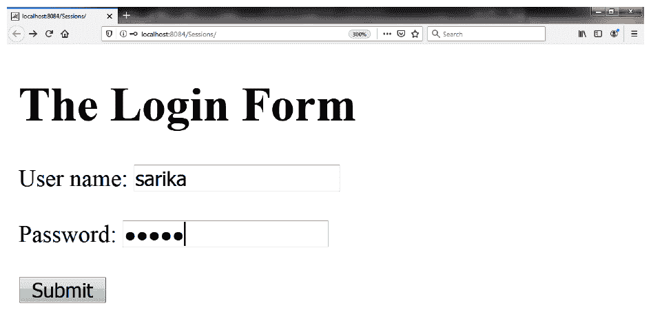

**图 5.1**: 前一个程序 (index.xhtml) 的输出

以下是下一个 servlet 的结果，如图 5.2 所示：

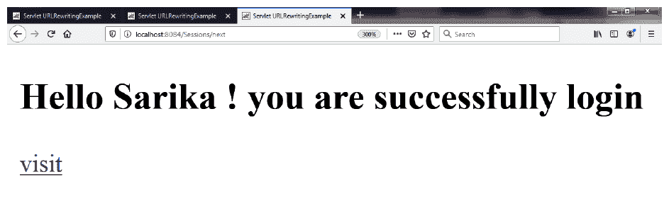

**图 5.2**: Next servlet 的输出

当您点击一次访问时，您将收到以下输出，如图 5.3 所示：

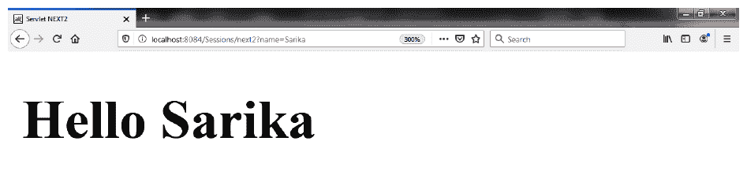

**图 5.3**: Next 2 Servlet 的输出

### 隐藏表单字段 (Hidden Form Fields)

这是可以使用的技术之一，通过在表单中放置隐藏字段来跟踪用户。当用户提交表单时，这些字段中输入的值会被发送到服务器。对于服务器来说，隐藏表单字段与表单中的其他字段没有区别。

让我们考虑同一个购物场示例。可以使用隐藏表单字段记录用户选择的商品，并提交到服务器处理详细信息。

### 以下是一个示例

**Hello.xhtml**:

```html
<HTML>
    <TITLE>带有隐藏字段的表单</TITLE>
    <BODY>
        <FORM>
            <INPUT TYPE="HIDDEN" NAME="text1"></FORM>
    </BODY>
</HTML>
```

在此程序中，我们将用户的名称存储在隐藏文本字段中，并从第二个 servlet 获取该名称，如下所示：

**index.xhtml**

```html
<html>
<head>
<title>隐藏表单字段</title>
</head>
<body>
<form action="first">
  Name:
<input type="text" name="userName"/><br/>
<input type="submit" value="submit"/>
</form>
</body></html>
```

**第一个 Servlet (ActionServlet1)**:

```java
import java.io.IOException;
import java.io.PrintWriter;
import javax.servlet.ServletException;
import javax.servlet.http.HttpServlet;
import javax.servlet.http.HttpServletRequest;
import javax.servlet.http.HttpServletResponse;

public class ActionServlet1 extends HttpServlet {
    protected void doGet(HttpServletRequest request, HttpServletResponse response)
            throws ServletException, IOException {
        response.setContentType("text/html;charset=UTF-8");
        try (PrintWriter out = response.getWriter()) {
            out.println("<html>");
            out.println("<head>");
            out.println("<title>Servlet Action1</title>");
            out.println("</head>");
            out.println("<body>");
            String name = request.getParameter("userName");
            out.print("Welcome " + name);
            out.print("<form action='second'>");
            out.print("<input type='hidden' name='uname' value='" + name + "'>");
            out.print("<input type='submit' value='Next'>");
            out.print("</form>");
            out.println("</body>");
            out.println("</html>");
        }
    }
}
```

**第二个 Servlet**:

```java
import java.io.IOException;
import java.io.PrintWriter;
import javax.servlet.ServletException;
import javax.servlet.http.HttpServlet;
import javax.servlet.http.HttpServletRequest;
import javax.servlet.http.HttpServletResponse;

public class Second extends HttpServlet {
    protected void doGet(HttpServletRequest request, HttpServletResponse response)
            throws ServletException, IOException {
        response.setContentType("text/html;charset=UTF-8");
        try (PrintWriter out = response.getWriter()) {
```


out.println("<!DOCTYPE html>");

out.println("<html>");

out.println("<head>");

out.println("<title>Servlet</title>");

out.println("</head>");

out.println("<body>");

String name=request.getParameter("uname");

out.print("Hello "+name);

out.println("</body>");

out.println("</html>");

`index.xhtml` 的输出如图 5.4 所示：

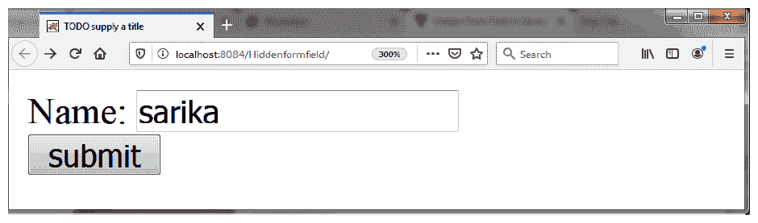

**图 5.4**: 上程序的输出

第一个 Servlet 使用隐藏字段存储名称，如图 5.5 所示：

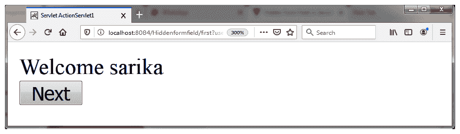

**图 5.5**: ActionServlet1 的输出

第二个 Servlet 从隐藏字段获取名称，如图 5.6 所示：

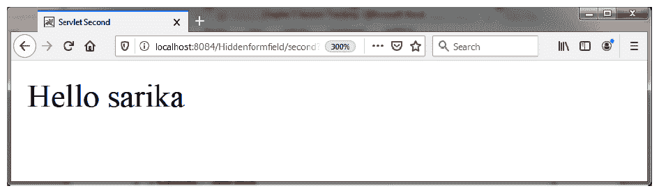

**图 5.6**: Second servlet 的输出

### 使用 HttpSession 接口

Servlet API 由一些有助于跟踪跟踪的类和接口组成。Java Servlet API 提供名为 `HttpSession` 的接口，用于跟踪会话。

每个登录网站的用户都会自动关联一个 `HttpSession` 对象。servlet 可以使用该对象存储会话信息。`HttpSession` 对象允许用户维护两种类型的数据：状态（state）和应用（application）。

状态数据用于维护和检索用户的连接。用户的连接详情可以是会话创建或上次访问的时间。应用数据用于存储详情，例如添加到篮中的商品。可以通过使用 `HttpSession` 接口的 `getValue()` 和 `putValue()` 方法来操作应用数据，如表 5.1 所示：

| 方法名 | 功能 |
| :--- | :--- |
| `getSession()` | 获取与用户关联的当前 HTTP 会话。如果不存在会话，可以通过 `getSession(true)` 创建会话。 |
| `getValue(String name)` | 获取会话对象中的值。例如，有一个名为 `itemselected` 的会话对象，可以通过 `getValue(itemselected)` 获取会话对象中的值。 |
| `putValue(String name, Object value)` | 向会话添加项。 |
| `isNew()` | 如果了新的会话 ID 尚未发送给客户端，则返回 true。 |
| `getID()` | 返回会话 ID。如果使用了 URL 重写，可以使用此函数获取会话并附加到客户端。 |
| `getCreationTime()` | 返回会话首次创建的时间（毫秒）。 |
| `getLastAccessedTime()` | 返回上一次使用相同会话 ID 请求的时间。该函数的返回值会被会话管理器用于优化服务器的活动。 |

**表 5.1**: HttpSession 接口的方法

在此程序中，属性被设置在第一个 servlet 的会话范围（session scope）中，第二个 servlet 从会话范围中获取了该值。要在会话范围中设置属性，我们使用了 `HttpSession` 接口的 `setAttribute()` 方法；而获取属性，我们使用了 `getAttribute` 方法，如下所示：

```html
<html>
<head>
<title>Http Session</title>
</head>
<body>
<form action="First">
    Name:
<input type="text" name="userName"/><br/>
<input type="submit" value="submit"/>
</form>
</body>
</html>
```

### First Servlet

```java
import java.io.IOException;
import java.io.PrintWriter;
import javax.servlet.ServletException;
import javax.servlet.http.HttpServlet;
import javax.servlet.http.HttpServletRequest;
import javax.servlet.http.HttpServletResponse;
import javax.servlet.http.HttpSession;

public class First extends HttpServlet {
    protected void doGet(HttpServletRequest request, HttpServletResponse response)
            throws ServletException, IOException {
        response.setContentType("text/html;charset=UTF-8");
        try (PrintWriter out = response.getWriter()) {
            /* TODO output your page here. You may use following sample code. */
            out.println("<!DOCTYPE html>");
            out.println("<html>");
            out.println("<head>");
            out.println("<title>Servlet First</title>");
            out.println("</head>");
            out.println("<body>");
            String name=request.getParameter("userName");
            out.print("Welcome "+name);
            HttpSession session=request.getSession();
            session.setAttribute("uname",name);
            out.print("<br><a href='Second'>visit</a>");
            out.println("</body>");
            out.println("</html>");
        }
    }
}
```

### Second Servlet

```java
import java.io.IOException;
import java.io.PrintWriter;
import javax.servlet.ServletException;
import javax.servlet.http.HttpServlet;
import javax.servlet.http.HttpServletRequest;
import javax.servlet.http.HttpServletResponse;
import javax.servlet.http.HttpSession;

public class Second extends HttpServlet {
    protected void doGet(HttpServletRequest request, HttpServletResponse response)
            throws ServletException, IOException {
        response.setContentType("text/html;charset=UTF-8");
        try (PrintWriter out = response.getWriter()) {
            /* TODO output your page here. You may use following sample code. */
            out.println("<!DOCTYPE html>");
            out.println("<html>");
            out.println("<head>");
            out.println("<title>Servlet Second</title>");
            out.println("</head>");
            out.println("<body>");
            HttpSession session=request.getSession(false);
            String n=(String)session.getAttribute("uname");
            out.print("Hello "+n);
            out.println("</body>");
            out.println("</html>");
        }
    }
}
```

以下是 `index.xhtml` 的结果，如图 5.7 所示：

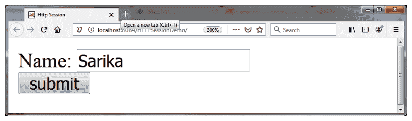

**图 5.7**: 前述程序 (index.xhtml) 的输出

以下是 First Servlet 的输出，如图 5.8 所示：


**图 5.8**: First Servlet 的输出

以下是 Second Servlet 的输出，如图 5.9 所示：


**图 5.9**: Second Servlet 的输出

```java
import javax.servlet.http.HttpServletRequest;
import javax.servlet.http.HttpServletResponse;

public class First extends HttpServlet {
    protected void doGet(HttpServletRequest request, HttpServletResponse response)throws ServletException, IOException {
        response.setContentType("text/html;charset=UTF-8");
        try (PrintWriter out = response.getWriter()) {
            out.println("<!DOCTYPE html>");
            out.println("<html>");
            out.println("<head>");
            out.println("<title>Servlet First</title>");
            out.println("</head>");
            out.println("<body>");
            String name=request.getParameter("userName");
            out.print("Welcome "+name+" in the Cookie Demo");
            Cookie ck=new Cookie("uname",name);//creating cookie object
            response.addCookie(ck);//adding cookie in the response
            out.print("<form action='Second'>");
            out.print("<input type='submit' value='next'></form>");
            out.println("</body>");
            out.println("</html>");
        }
    }
}
```

### 第二 Servlet

```java
import java.io.IOException;
import java.io.PrintWriter;
import javax.servlet.ServletException;
import javax.servlet.http.Cookie;
import javax.servlet.http.HttpServlet;
import javax.servlet.http.HttpServletRequest;
import javax.servlet.http.HttpServletResponse;

public class Second extends HttpServlet {
    protected void doGet(HttpServletRequest request, HttpServletResponse response)
            throws ServletException, IOException {
        response.setContentType("text/html;charset=UTF-8");
        try (PrintWriter out = response.getWriter()) {
            /* TODO 在此处输出你的页面内容。 你可以使用以下示例代码。 */
            out.println("<!DOCTYPE html>");
            out.println("<html>");
            out.println("<head>");
            out.println("<title>Servlet Second</title>");
            out.println("</head>");
            out.println("<body>");
            Cookie ck[]=request.getCookies();
            out.print("Hello "+ck[0].getValue()); // 化的逻辑表示
            out.println("</body>");
            out.println("</html>");
        }
    }
}
```


## 结论

Session（会话）是服务器与客户端在一段时间内发生的一组事务。以下任何方法可以实现会话跟踪：

* URL 重写 (URL Rewriting)
* 隐藏表单字段 (Hidden Form fields)
* Cookies
* 使用 `HttpSession` 接口

## 问题

1. 解释什么是 Session 及其重要性？
2. 什么是会话跟踪 (Session Tracking)？会话跟踪有哪些不同类型？
3. 为什么在 `HttpServlet` 中使用会话跟踪？
4. `Cookies` 相比 URL 重写有什么优势？
5. `Cookie` 和 `Session` 的作用是什么？它们之间有什么区别？你如何在 `Servlet` 中销毁 Session？（提示：你可以对会话对象调用 `invalidate()` 方法来销毁 Session。例如，`session.invalidate();`）
6. 你如何在 Servlets 中跟踪用户会话？

# 第 6 章：Servlet 间通信

## 介绍

Servlet 间通信是指同一服务器上 Web 应用程序中 Servlet 之间的通信。同一服务器上的 Servlet 之间可以相互通信并共享资源，例如变量。例如，当用户登录网站时，由一个 Servlet 完成用户身份验证。用户通过验证后，另一个 Servlet 可以执行信息处理。将任务分配给不同的 Servlet 有助于实现结构化的任务处理。Servlet 之间的通信可以使用 `RequestDispatcher` 接口来实现。

## 结构

在本章中，我们将涵盖以下主题：

* `RequestDispatcher`
* `ServletContext`
* 获取 `RequestDispatcher` 对象的方法
* `RequestDispatcher` 接口的方法
* `HttpServletResponse` 接口的 `sendRedirect()` 方法

## RequestDispatcher 接口

`RequestDispatcher` 接口用于将请求从 Servlet 转发或委托给其他资源，例如 Servlet、HTML 文件或 JSP 页面。在这种情况下，源 Servlet 执行某些处理并将请求委托给另一个 Servlet。此外，这种任务委托发生在同一个 Servlet 上下文（servlet context）的 Servlet 内部。

Servlet 上下文是 Web 服务器中部署 Servlet 的目录。在同一服务器上执行的 Servlet 属于同一个 Servlet 上下文。然而，少数 Web 服务器也允许创建多个 Servlet 上下文。你可以通过 `ServletConfig` 接口的方法获取 `ServletContext` 的引用。

**语法**：`public ServletContext getServletContext();`

`ServletConfig` 接口的 `getServletContext()` 方法用于获取 Servlet 执行所在的 Servlet 上下文引用。

## ServletContext 接口方法

以下是 `ServletContext` 接口的方法：

1. `public abstract void setAttribute(String name, Object object)`：此函数用于为 Servlet 上下文中可用的属性设置值。例如，`setAttribute("name", "Ram")` 用于设置名为 `name` 的属性值。此外，该函数还用于创建一个可以被同一 Servlet 上下文中所有 Servlet 访问的属性。
2. `public abstract Object getAttribute(String name)`：此函数用于获取属性的值。

## 获取 RequestDispatcher 对象的方法

`RequestDispatcher` 接口封装了存在于特定 Servlet 上下文中的资源（Servlet、JSP 页面或 .xhtml 文件）的 URL。`ServletRequest` 接口的 `getRequestDispatcher()` 方法返回 `RequestDispatcher` 对象。

**语法**：`public RequestDispatcher getRequestDispatcher(String urlpath);`

该方法通过指定的 URL 获取 Servlet 的引用。返回的调度器用于调用该 Servlet。如果无法获取指定 URL 的调度器，函数返回 null。

## RequestDispatcher 接口的方法

以下是 `RequestDispatcher` 接口的方法：

* `public abstract void forward(HttpServletRequest request, HttpServletResponse response) throws ServletException, IOException`：此方法用于将任务委托给特定对象的资源。它将请求从一个 Servlet 转发到另一个 Servlet。当输出完全由第二个 Servlet 生成时，必须使用此方法。如果第一个 Servlet 访问了 `PrintWriter` 对象，则此方法将抛出异常。
* `public abstract void include(ServletRequest request, ServletResponse response) throws ServletException, IOException`：此函数也用于像 `forward()` 函数一样从一个 Servlet 调用另一个 Servlet；然而，你也可以将第一个 Servlet 的输出与当前输出合并。第一个 Servlet 在调用 `include()` 方法后，仍然可以使用 `PrintWriter` 对象。

| 注意事项 |
| :--- |
| Servlet 链（Servlet chaining）是一种按特定顺序执行多个 Servlet 以完成某项事务的技术。一个 Servlet 可以调用另一个 Servlet 来执行事务的下一步。上一个 Servlet 的输出将发送回给浏览器或客户端。这种技术可以与 Linux 中的管道（pipes）概念相比较，其中一个命令的输出被重定向到另一个命令。 |
| 在 Servlet 链的过程中：首先，我们必须为需要链接的资源创建一个 `RequestDispatcher`。然后，如果需要，必须为请求设置属性值。接下来，我们需要在 `RequestDispatcher` 对象上调用 `forward()` 方法或 `include()` 方法。 |

## 通过问题描述实现 Servlet 间通信

你需要将钱存入账户。创建一个 Servlet 来接收并验证用户的账号号码和 PIN。第一个 Servlet 用于验证账号和 PIN。如果值有效，则创建并分配名为 account number 的属性并输入账号。否则，将向用户显示错误消息并包含 `index.xhtml`。如果账号和 PIN 有效，则将请求转发到第二个 Servlet 并调用它。

## 任务列表

* 编写客户端界面（`index.xhtml`）：HTML 表单接收用户的账号号码和 PIN。
* 编写两个 Servlet 的代码：点击提交按钮后，将调用 Servlet 验证账号号码和 PIN，并将请求转发到第二个 Servlet。然后，第二个 Servlet 授予存款或取款金额的权限。
* 编译并部署 Servlet：在部署描述符 `web.xml` 中配置 Servlet 的条目。编译并运行程序。
* 验证 Servlet 的功能：验证程序是否显示了有效结果。

为了解决这个问题，我们将使用 `RequestDispatcher` 接口。问题规定，第一个 Servlet 需要接收用户的账号号码和 PIN 并对其进行验证。如果账号有效，则需要调用第二个 Servlet。

## 客户端界面

HTML 表单包含两个文本框，分别接收账号号码和 PIN。点击提交按钮后，将调用第一个 Servlet。

## index.xhtml

```html
<html>
<head>
    <title>Our Bank</title>
</head>
<body>
    <div>
        <center>
            <h1>MY BANK </h1>
        </center>
        <form action="firstServlet">
            <table>
                <tr>
                    <td>Enter the account Number</td>
                    <td><input type="text" name="accnum"></td>
                </tr>
                <tr>
                    <td>Enter the Pin Number </td>
                    <td><input type="password" name="pinnum"></td>
                </tr>
            </table>
            <br>
            <center><input type="submit" value="SUBMIT"></center>
        </form>
    </div>
</body>
</html>
```

## FirstServlet 的代码

第一个 Servlet 用于验证账号号码和 PIN。如果值有效，将创建一个名为 account number 的属性并输入账号。否则，将向用户显示错误消息。如果账号和 PIN 有效，则将请求转发到第二个 Servlet 并调用它，如下：

```java
import java.io.IOException;
import java.io.PrintWriter;
import javax.servlet.RequestDispatcher;
import javax.servlet.ServletException;
import javax.servlet.http.HttpServlet;
import javax.servlet.http.HttpServletRequest;
import javax.servlet.http.HttpServletResponse;

public class FirstServlet extends HttpServlet {

    protected void doGet(HttpServletRequest request, HttpServletResponse response) throws ServletException, IOException {
        response.setContentType("text/html;charset=UTF-8");
        try {
            PrintWriter out = response.getWriter();
            out.println("<!DOCTYPE html>");
            out.println("<html>");
            out.println("<head>");
            out.println("<title>Servlet First</title>");
            out.println("</head>");
            out.println("<body>");

            String n = request.getParameter("accnum");
            String p = request.getParameter("pinnum");

            if (p.equals("201306") && n.equals("AJ123456789")) {
                RequestDispatcher rd = request.getRequestDispatcher("servlet2");
                rd.forward(request, response);
            } else {
                out.print("Sorry account Number or Password Error!");
                RequestDispatcher rd = request.getRequestDispatcher("/index.xhtml");
                rd.include(request, response);
            }

            out.println("</body>");
            out.println("</html>");
        } catch (Exception e) {
            System.out.println("Exception");
        }
    }
}
```

## SecondServlet 的代码

以下是第二个 Servlet 的代码：

```java
import java.io.IOException;
import java.io.PrintWriter;
import javax.servlet.ServletException;
import javax.servlet.http.HttpServlet;
import javax.servlet.http.HttpServletRequest;
import javax.servlet.http.HttpServletResponse;

public class SecondServlet extends HttpServlet {

    protected void doGet(HttpServletRequest request, HttpServletResponse response) throws ServletException, IOException {
        try {
            response.setContentType("text/html;charset=UTF-8");
            PrintWriter out = response.getWriter();
            out.println("<!DOCTYPE html>");
            out.println("<html>");
            out.println("<head>");
            out.println("<title>Servlet Second</title>");
            out.println("</head>");
            out.println("<body>");

            String n = request.getParameter("accnum");
            out.print("<font color=BLUE size=20>Welcome " + n + "<br><center>");
            out.print(" You can deposit/ withdraw the amount ");

            out.println("</body>");
            out.println("</html>");
        } catch (Exception e) {
            System.out.println("Exception occured" + e);
        }
    }
}
```

## 输出

如果账号和 PIN 有效，输出如图 6.2 所示：

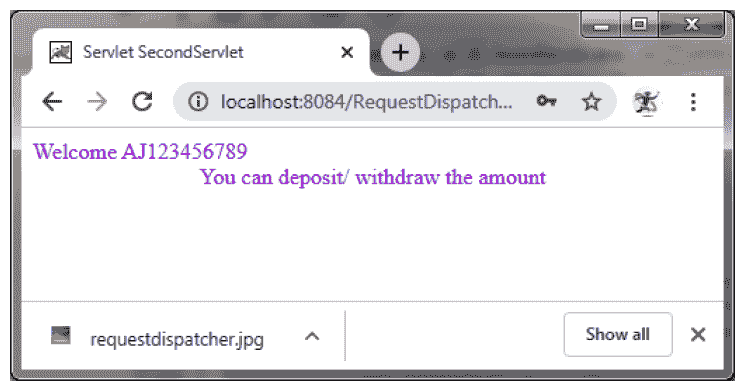
**图 6.2：账号和 PIN 有效的输出**

如果账号和 PIN 无效，输出如图 6.3 所示：

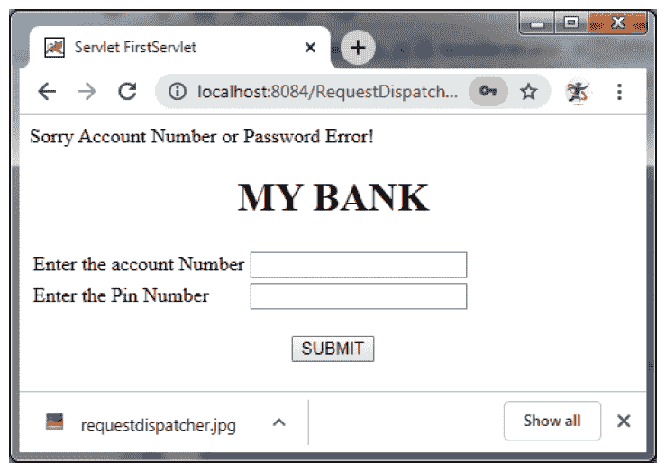
**图 6.3：账号和 PIN 无效的输出**

## SendRedirect

在 `RequestDispatcher` 类的 `include()` 和 `forward()` 方法中，Servlet 并没有创建新请求。它只是将请求包含在当前 Servlet 中或将其转发到另一个 Servlet。

`客户端`（浏览器）想要通过 `sendRedirect()` 方法创建一个新请求来获取资源；用户可以看到新的 URL。它支持相对路径和绝对路径。

**语法**：

```java
public void sendRedirect(String URL) throws IOException;
```


# 示例

在本示例中，我们正请求重定向到 `instituteoflearning` 服务器，如下所示：

## `SendRedirectExample`

```java
import java.io.IOException;
import java.io.PrintWriter;
import javax.servlet.ServletException;
import javax.servlet.http.HttpServlet;
import javax.servlet.http.HttpServletRequest;
import javax.servlet.http.HttpServletResponse;

public class SendRedirectExample extends HttpServlet {

    protected void doGet(HttpServletRequest request, HttpServletResponse response)
            throws ServletException, Exception {

        response.setContentType("text/html;charset=UTF-8");
        PrintWriter out = response.getWriter();

        try {
            response.sendRedirect("http://instituteoflearning.in/");
        } finally {
            out.close();
        }
    }
}
```

## `forward()` 与 `sendRedirect()` 方法的区别

*表 6.1* 显示了 `forward()` 和 `sendRedirect()` 方法之间的区别：

| `forward()` | `sendRedirect()` |
| :--- | :--- |
| 它是 `RequestDispatcher` 接口的方法。 | 它是 `HttpServletResponse` 接口的方法。 |
| 在服务器内部服务器端工作。 | 在客户端工作（包括服务器外部和内部）。 |
| 向另一个 servlet 发送相同的请求和响应。 | 向另一个 servlet 发送新请求。 |

**表 6.1**: `forward()` 与 `sendRedirect()` 方法的区别

## 结论

在本章中，我们学习了可以使用 `RequestDispatcher` 接口来从一个 servlet 调用另一个 servlet。

`forward()` 和 `include()` 方法可以从一个 servlet 调用另一个。Servlet 之间共同的数据可以通过使用 `ServletContext` 接口来访问。

Servlet 链是一个非常简单的过程，我们将一个 servlet 的输出作为另一个 servlet 的输入。`sendRedirect` 是 `HttpServletResponse` 接口的方法，它创建一个新请求并将其发送到另一个 servlet。

在下一章中，我们将学习 Java Server Pages (JSP)。JSP 技术促进了网页设计师和网页开发者之间工作职责的分离。网页设计师可以使用 HTML 设计并制定网页的布局。另一方面，独立工作的网页开发者可以使用 Java 代码和其他 JSP 特有的标签为业务逻辑编写代码。

## 问题

1. 必须使用哪个函数向服务器发送到客户端的响应中添加 cookie？
2. 什么是 `RequestDispatcher`？
3. 什么是 `sendRedirect`？区分 `forward()` 方法和 `sendRedirect()` 方法的区别。
4. Servlet 链的流程是什么？
5. 获取 `RequestDispatcher` 对象的流程是什么？

# 第 7 章：Java Server Pages (JSP)

## 引言

随着互联网的出现，单体应用架构转变为多层客户端/服务器架构。对服务器端脚本的需求逐渐主导网络编程的各个方面。微软引入了 Active Server Pages (ASP) 以满足市场对服务器端脚本的需求。以类似的路线，Sun Microsystems（现已被 Oracle 收购）发布了 Java Server Pages (JSP) 以增加服务器端编程功能。它可以被认为是 Servlet 的改进，因为它添加了比 Servlet 更多的功能，例如自定义标签和表达式语言（这些将在后续章节中讨论）。我们可以与 JSP 标签一起编写 HTML 标签。但在 Servlet 中，我们通过 `ServletResponse` 接口的 `out.println()` 方法嵌入 HTML 标签。JSP 是平台独立的，而 ASP 不是独立的。

## 结构

在本章中，我们将涵盖以下主题：

* JSP 的需求和特性
* Servlet 和 JSP 的区别
* JSP 的生命周期：JSP 示例
* JSP 的目录结构：`Web.xml` 的结构

## 目标

学习本章后，你将理解 JSP 的生命周期方法。编译后，JSP 会转换为 Servlet 并包含 Servlet 的所有功能。你将理解 JSP 和 Servlet 之间的区别以及 JSP 的优势。

## JSP 的需求

典型的 Web 应用包含表示静态内容的表示逻辑，用于根据页面布局、颜色和文本设计网页结构。业务逻辑...（内容保留）... `sendRedirect` 是 `HttpServletResponse` 接口的方法... JSP 是平台独立的...

### Servlet 和 JSP 的区别

1. Servlet 将文件绑定（一个用于静态内容的 HTML 文件和一个用于动态内容的 Java 文件）用以处理静态展示和动态逻辑...
2. Servlet 编程涉及大量的编码...

### JSP 的优势

以下是 JSP 的优势：

* 对 Servlet 的扩展：JSP 是 Servlet 的扩展...
* 编译：JSP 在服务器处理它之前总是会被编译的...
* JSP 是平台独立的。
* 无需重新部署 JSP。
* JSP 代码的长度比 Servlet 短。

## JSP 请求-响应周期

JSP 文件以 JSP 扩展名存储在 Web 服务器上。当客户端/浏览器请求特定的 JSP 页面时，服务器转向 JSP 引擎发送请求。*图 7.1* 表示了在客户端请求后发生的事件流过程：

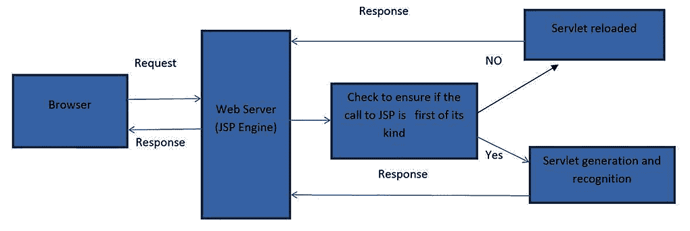

**图 7.1**: 客户端请求后的事件流

请求-响应周期本质上包含两个阶段，即翻译阶段和请求处理阶段。翻译阶段由 JSP 引擎实现，并涉及 servlet 的生成。在内部，这些操作会为实现 servlet 接口的 JSP 页面创建一个类文件。在请求处理阶段，根据请求规范生成响应。随后，`Servlet` 向接收到的请求发送回相应的响应。在 `Servlet` 第一次被加载后，它将保持激活状态，并处理所有后续请求并返回响应，从而节省了每次请求都重新加载 servlet 所会浪费的时间。

## JSP 的生命周期

JSP 生命周期是指将 JSP 翻译为 servlet 的过程，随后 servlet 的生命周期将开始发挥作用。

JSP 页面生命周期通过以下步骤的完成：

1. **JSP 页面翻译**：JSP 容器将 JSP 页面翻译为 `Servlet`。
2. **编译**：像任何其他 Java 类一样，生成的 `Servlet` 被编译成字节码，并准备好被加载和执行。生成的 servlet 具有 `jspInit()`、`_jspService()` 和 `jspDestroy()` 方法。
3. **类加载**：一旦 JSP 被编译为 servlet 类，其生命周期就与 `Servlet` 类似，并被加载到内存中。
4. **实例化**：创建生成的 `Servlet` 对象。
5. **初始化**：Web 容器调用 `jspInit()` 方法。该方法只调用一次。初始化后，`ServletConfig` 和 `ServletContext` 对象供 JSP 类访问。当 `Servlet` 加载时允许其初始化实例变量。
6. **请求处理**：容器调用 `_jspService()` 方法。
7. **销毁**：容器调用 `jspDestroy()` 方法。生成的 `Servlet` 将从内存中卸载，并在其关闭时从内存中清理实例变量。

> **注意**：`jspInit()`、`_jspService()` 和 `jspDestroy()` 是 JSP 的生命周期方法。

JSP 页面生命周期如图 7.2 所示：

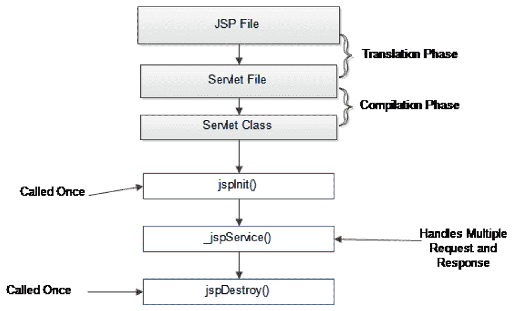

**图 7.2**：JSP 页面的生命周期

## JSP 页面的结构

一个 JSP 页面由代表静态内容的普通 HTML 标签以及封装在特殊标签内的代表动态内容的代码组成。这些标签以 `<%` 开始，以 `%>` 结束，并包含脚本元素和指令元素。脚本元素由 Java 代码段组成，而指令定义了整个 JSP 页面的规范。提供关于代码各个部分的附加信息的注释行被封装在 `<%--` 和 `--%>` 标签中。例如，以下 JSP 代码在浏览器上显示服务器时间。它包含了 HTML 内容和分别放置在各自标签内的 JSP 内容。

以下是一个示例：

**index.jsp**

```jsp
<%@page contentType="text/html" pageEncoding="UTF-8"%>
<%@ page language="java" %>
<!DOCTYPE html>
<html>
<head>
<title>JSP Example</title>
</head>
<body>
<h1>这是 JSP 标签内用于显示服务器时间的代码</h1>
<%-- 这是使用 java.util.package 中的 Date 类来显示服务器时间的 JSP 内容 --%>
<% java.util.Date now=new java.util.Date(); %>
<h2><%= now %></h2>
</body>
</html>
```

以下是 `index.jsp` 的输出，如图 7.3 所示：

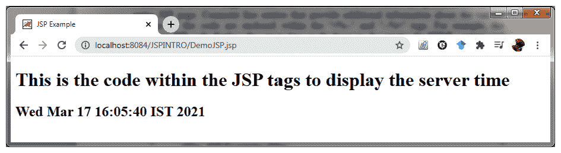

**图 7.3**：index.jsp 的输出

## JSP 页面的目录结构

JSP 页面放置在根目录下。它不应该放在 `WEB-INF` 目录下，因为我们无法从客户端直接访问它，如图 7.4 所示：

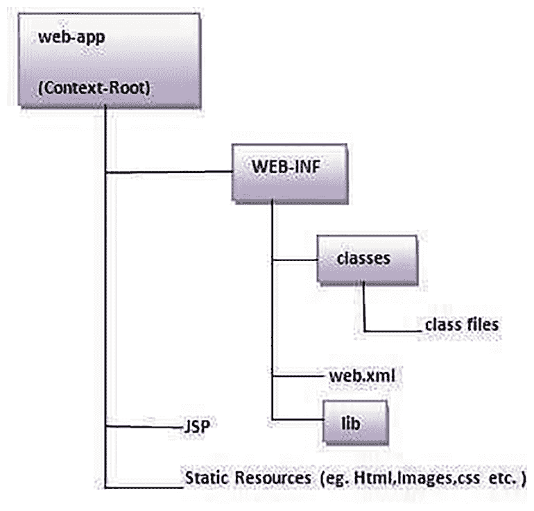

**图 7.4**：JSP 页面的目录结构

## 总结

JSP 代表 Java Server Pages（Java 页面）。它是一种用于创建动态 Web 应用程序的服务器端技术。JSP 的特点是表现层与业务逻辑的分离。

一旦 Servlet 重新加载到服务器，代码的更改将自动更新并重新编译。

在 JSP 中，我们可以使用许多标签，例如动作标签、Java 标准标签库 (JSTL)、自定义标签等，这些减少了 Servlet 和 JSP 之间的代码差异。

在 JSP 的生命周期期间，JSP 页面被转换为 `Servlet`，创建 `Servlet` 对象，并调用 `jspInit()`、`_jspService()` 和 `jspDestroy()` 来满足请求。

JSP 页面与静态资源一起放置，即根目录。

JSP 构建了各种元素和对象，允许 Web 设计师借助嵌入 JSP 元素和对象的帮助编写动态 Web 应用程序。

在下一章中，我们将学习要嵌入 JSP 页面中的标签。

## 问题

1. 什么是 JSP？我们为什么需要它？
2. 生命周期阶段有哪些？
3. 生命周期方法有哪些？
4. JSP 生命周期中的哪些部分可以被重写？
5. 使用 JSP 有什么优势？
6. 相比 Servlet，JSP 有什么优势？
7. 相比静态 HTML，JSP 有什么优势？

# 第 8 章：标签与脚本元素

JSP 构建了各种元素和对象，允许 Web 设计师借助嵌入 JSP 元素和对象的帮助编写动态 Web 应用程序。脚本标签帮助程序员在 Web 应用程序中编写 Java 代码。当 JSP 转换为 servlet 时，代码会自动移动到 `_jspService()` 方法。

## 结构

在本章中，我们将涵盖以下主题：

* 注释标签
* 脚本元素
* 隐式对象

## 目标

学习本章后，你将了解如何在 Web 应用程序中嵌入 Java 代码并学习代码如何自动转换为 servlet。

## JSP 元素

JSP 元素帮助开发者在标签内编写 Java 代码。当 JSP 转换为 servlet 时，代码会自动移动到 `_jspService()` 方法。

它包含以下标签。

## 注释标签

注释标签提供了关于代码各个部分的附加信息，被封装在 `<%--` 和 `--%>` 标签中。当程序员想要从 Web 容器隐藏某些文本或语句时可以使用注释，如下：

语法：`<%-- JSP 注释 --%>`

## 脚本元素

脚本标签帮助程序员在 Web 应用程序中编写 Java 代码。当 JSP 转换为 servlet 时，代码会自动移动到 `_jspService()` 方法。每次请求都会调用 `_jspService` 方法。三种脚本元素如下：

* 脚本标签
* 表达式标签
* 声明标签

## 脚本标签

JSP 脚本标签由封装在 `<%` 和 `%>` JSP 标签中的有效代码段组成。该标签允许开发者在脚本标签内编写 Java 代码。此代码移动到 `_jspService()` 方法。当用户请求时，会调用 JSP 服务方法，脚本标签内部的内容将被执行。

语法：`<% // java 代码 %>` .

**示例**

以下代码片段包含创建请求会话对象并使用 `getParameter()` 方法检索变量值的代码。以下代码片段接收用户名称并将输入参数转发到 JSP 页面：

**index.xhtml**

```html
<html>
<head>
  <title>JSP 元素</title>
  <meta charset="UTF-8">
  <meta name="viewport" content="width=device-width, initial-scale=1.0">
</head>
<body>
  <h3>脚本段示例</h3>
  <form action="test.jsp">
    您的姓名：
    <input type="text" name="user_name" />
    <input type="submit" value="提交">
  </form>
</body>
</html>
```

### Test.jsp

```jsp
<%@page contentType="text/html" pageEncoding="UTF-8"%>
<!DOCTYPE html>
<html>
<head>
  <meta http-equiv="Content-Type" content="text/html; charset=UTF-8">
  <title>JSP 页面</title>
</head>
<body>
  <h1>欢迎来到 JSP 页面</h1>
  <%
    String name = (String) request.getParameter("user_name");
    out.println(name);
  %>
</body>
</html>
```

以下是 `index.xhtml` 的输出，如*图 8.1*所示：

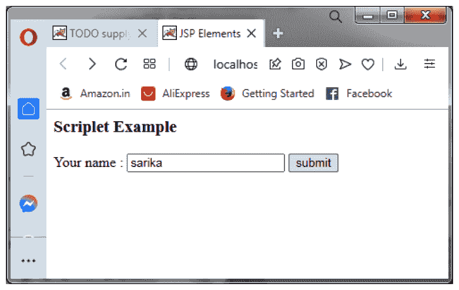

**图 8.1**: index.xhtml 的输出

点击 `submit` 后，我们得到以下输出，如*图 8.2*所示：

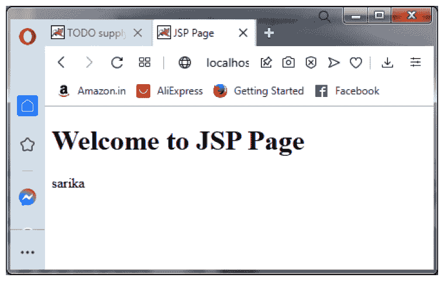

**图 8.2**: test.jsp 页面的输出

### 表达式标签

它用于直接将值插入到输出中。你不需要编写 `out.println()` 语句来写入数据。

**语法**：`<%= msg %>`

**以下是一个示例**：

```html
<head>
  <meta http-equiv="Content-Type" content="text/html; charset=UTF-8">
  <title>JSP 页面</title>
</head>
<body>
  <%= "要打印的值" %>
</body>
</html>
```

**以下是输出**：

**要打印的值**

### 声明标签

它用于声明字段和方法。代码通过此标签的帮助写在服务方法（service method）之外，并且只在加载时分配一次内存，而不是每次请求都分配。脚本段标签（scriptlet tag）只能声明变量，且所有变量都是服务方法的局部变量；而在声明标签中，变量和方法都可以在服务方法之外声明。

**语法**：`<%! 变量或方法声明 %>`

> **注意**：JSP 脚本段标签只能声明变量不能声明方法，而 JSP 声明标签可以同时声明变量和方法。

**示例**：

在以下示例中，使用声明标签声明了一个变量 `data` 和方法 `square`：

```jsp
<%@page contentType="text/html" pageEncoding="UTF-8"%>
<!DOCTYPE html>
```


<html>

<head>

  <meta http-equiv="Content-Type" content="text/html; charset=UTF-8">

  <title>JSP 页面</title>

</head>

<body>

  <%! int data=120;

  int square(int n) {return n*n;}

  %>

  <%= "变量的值是:"+data %><br>

  <%= "4 的平方是:"+square(4) %>

</body>

</html>

```

**以下是输出**：

变量的值是：120
4 的平方是：16

## 隐式对象

JSP 中的对象可以通过指令（directives）隐式地创建，可以通过使用标准动作（standard actions）显式地创建，或者直接在脚本段（scriptlets）中声明。JSP 隐式对象是某些预定义的变量，可以包含在 JSP 表达式和脚本段中。JSP 隐式对象由 Servlet 类和接口实现。

Web 容器创建了九个隐式对象并在 JSP 中可用，如下：

1. **application**: `application` 对象定义了一个 Web 应用程序。通常，它是当前 Web 上下文中 `application` 或 `ServletContext` 的实例。`ServletContext` 实例仅在项目部署到服务器时由 Web 容器创建一次。它用于从应用范围设置或删除属性。
   `application` 对象可以从配置文件（`web.xml`）获取初始化参数。所有的 JSP 页面都可以使用此初始化参数。
   **示例**：密码存储在 `context-param` 中，可以借助 `application` 对象获取。参考以下示例代码：

```html

<!DOCTYPE html>

<html>

<head>

  <title>隐式对象</title>

  <meta charset="UTF-8">

  <meta name="viewport" content="width=device-width, initial-scale=1.0">

</head>

<body>

  <form method="post" action="submit.jsp" >

    <input type="text" name="uname">

    <input type="submit" value="提交"><br/>

  </form>

</body>

</html>

```


# 姓名是 Agarwal

与 `HttpServletRequest` 接口一起使用的方法列出如下：

* `getCookies()`：用于随请求传递 cookie 信息。`Cookies` 是从服务器发送到浏览器的文本数据。因此，发送的数据可以在随后的事务中被检索。
* `getSession()`：用于获取与请求对象关联的当前会。如果请求没有关联会，则会创建一个新会。
* `getMethod()`：用于返回一个 String 字符串，指定请求中是否存在 HTTP get、post 或 put 方法。
* `getQueryString()`：用于返回随 `request(GET)` 传递的查询字符串。

## 5. response
这代表 `HttpServletResponse` 的响应对象，用于通过 `response.getWriter()` 等方法向浏览器写入 HTML 输出。

与 `HttpServletResponse` 接口一起使用的方法列出如下：

* `addCookie()`：用于随响应添加 cookie。浏览器接受的 cookie 最大数量通常为 20 个。
* `sendRedirect()`：用于为浏览器指定一个新的 URL。该方法的调用会终止之前的响应并将浏览器内容重定向到新 URL。

## 6. session
这代表 `HttpSession` 的会话对象，用于在客户端请求之间存储对象。

**示例**：以下代码使用 request 隐式对象访问用户输入的值；在会中设置参数并访问相同参数：

**index.xhtml**:

```html

<!DOCTYPE html>

<html>

<head>

<meta charset="UTF-8">

<meta name="viewport" content="width=device-width, initial-scale=1.0">

</head>

<body>

<form method="post" action="next.jsp" >

    First Name: <input type="text" name="uname">

    Last Name: <input type="text" name="lname">

    <input type="submit" value="Submit"><br/>

</form>

</body>

</html>

```

**表单底部：**
点击 **Submit** 按钮后，将运行以下代码：

```html

<!DOCTYPE html>

<html>

<%

    String str1=request.getParameter("uname");

    String str2=request.getParameter("lname");

    HttpSession sess=request.getSession(true) ;

    sess.setAttribute("FName", str1);

    sess.setAttribute("LName", str2);

%>

<body>

<%

    out.println("First name is "+session.getAttribute("FName"));

    out.println("<br>Last Name is"+session.getAttribute("LName"));

%>

</body></html>

```

以下是 `index.xhtml` 的输出，如 *图 8.6*所示：

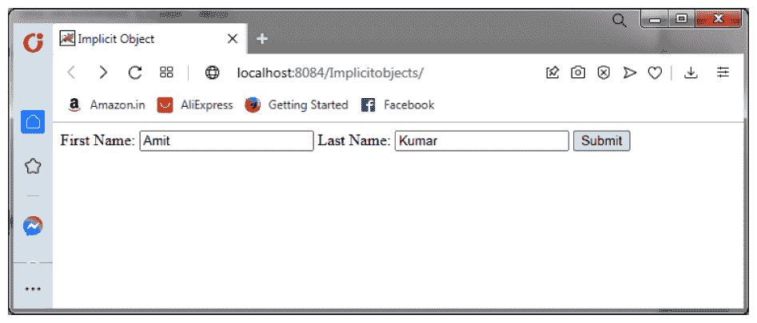

**图 8.6**：上一个程序 (index.xhtml) 的输出

以下是 `next.jsp` 的输出，如 *图 8.7*所示：

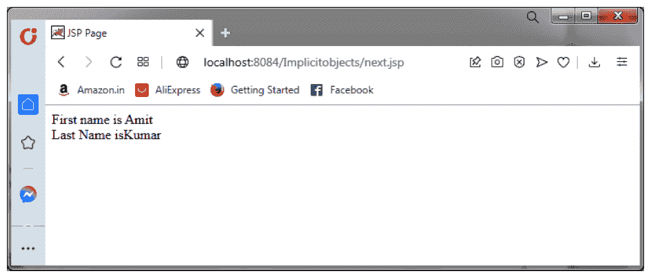

**图 8.7**：next.jsp 的输出（从会对象中检索）

## 7. Config
它是 `ServletConfig` 的隐式对象。Web 容器创建此对象。用于设置或获取 JSP 页面的参数。

## 8. exception
它是 `java.lang.Throwable` 的隐式对象。用于打印 `exception`。

## 9. pageContext
它是 `PageContext` 的隐式对象。用于从页面、会和应用范围中设置、获取和删除属性。默认情况下，JSP 具有页面范围。

## 结论
在本章中，我们学习了 JSP 页由 HTML 和 JSP 标签组成。JSP 标签包括注释、脚本段（scriptlets）、表达式和动作（actions）。JSP 注释标签提供了关于代码部分的额外信息，并封装在 `<-- --` 标签中。脚本段标签由放在 `<%` 和 `%>` 标签内的有效代码组成。JSP 表达式用于将值插入输出中。JSP 中有五个隐式对象。下一章，我们将学习如何提供特定页面的全局信息，以及在将 JSP 页转换为相应的 servlet 时向 Web 容器提供信息。

## 问题
1. 什么是 JSP 元素？
2. 脚本段标签的作用是什么？
3. JSP 脚本段标签和 JSP 声明标签有什么区别？
4. 我们如何在 JSP 页中使用注释？
5. JSP 中共有多少个隐式对象？
6. JSP 中隐式对象的用途是什么？

## 选择正确选项
1. JSP 的哪种脚本不会将内容放入转换后的 servlet 的服务方法中？
A. Scriptlets
B. Declarations
C. Expressions
D. 以上均不是
**答案**: C

2. 下列哪个标签用于在 JSP 中执行 Java 源代码？
A. Scriptlets
B. Declarations
C. Expressions
D. 以上都不是
**答案**: A

3. 下面是 JSP 生命周期各阶段的正确顺序吗？
A. 编译、初始化、执行、清理
B. 清理、编译、初始化、执行
C. 初始化、清理、编译、执行
D. 初始化、编译、清理、执行
**答案**: A

4. J2EE 包含以下哪些企业特有的 API？
A. Java Message Service (JMS)
B. Enterprise JavaBeans (EJB)
C. JavaServer Pages (JSP)
D. 以上所有
**答案**: 以上所有

5. JSP 页被转换为 _。
A. Java 类
B. Java Servlet
C. Java Bean
**答案**: Java Servlet

6. JSP 页提供了一种使用 HTML 和 Java 语言创建动态网页面的方法。
A. 正确
B. 错误
**答案**: 正确


| 1 | `contentType="MIME type"` | 这是响应的 MIME 类型（多用途内部邮件扩展类型）。该属性的默认值为 `text/HTML`。 |
| 2 | `extends="packagename.class"` | 这是生成的 servlet 将继承的父类名。 |
| 3 | `errorPage="url"` | 这是用于处理异常的错误页 URL。 |
| 4 | `isErrorPage="False"` | 如果某个特定的 JSP 页面可以作为另一个 JSP 页面的错误页。该属性的默认值为 `false`。 |
| 5 | `import="package list"` | 这些是特定 JSP 页面可用的包名。 |
| 6 | `Language="scripting language."` | 这是编译 JSP 页面时使用的脚本语言。目前可选语言是 `Java`。 |
| 7 | `Session="true"` | 用于指定特定 JSP 页面会话数据的可用性。该属性的默认值为 `true`。 |
| 8 | `Info` | 它设置 JSP 页面的信息，可以通过使用 `Servlet` 接口的 `getServletInfo()` 方法来检索。 |
| 9 | `Buffer` | 它设置以字节为单位的缓冲区大小，用于处理 JSP 页面生成的输出。缓冲区的默认大小为 `8KB`。 |
| 10 | `isELIgnored` | 可以通过 `ELIgnored` 属性在 JSP 中忽略表达式语言 (`EL`）。默认情况下，它的值为 `false`，即默认启用表达式语言。 |
| 11 | `isThreadSafe` | 它将 JSP 请求序列化。 |
| 12 | `Autoflush` | 它指定当缓冲区填充时是否自动刷新缓冲区输出，或者是否抛出异常来指示缓冲区溢出。 |
| 13 | `PageEncoding` | 页面编码是文件编码的字符编码。 |

***表 9.1: 隐式对象***

## 隐式对象

### contentType
`contentType` 属性定义了响应的 MIME 类型。MIME 是一种规定不同系统之间交换消息时如何格式化的标准。MIME 消息可以包含不同类型的数据，如文本、图像、音频和视频。

默认值为 `"text/html"`。

**语法如下**：

```jsp

<%@page contentType="text/html" pageEncoding="UTF-8"%>

```

### extends
`extends` 属性扩展了 JSP 中的父类。必须指定生成的 servlet 将继承的父类名。

**语法如下**：
```jsp

<%@ page extends = "package.ClassName" %>

```

### errorPage
它用于处理异常。`errorPage` 属性用于定义错误页；如果当前页面发生异常，它将重定向到错误页。

**语法如下**：
```jsp

<%@ page errorPage= "next.jsp" %>

```

### isErrorPage
`isErrorPage` 属性用于声明当前页面为错误页。

**语法如下**：
```jsp

<%@ page isErrorPage=true %>

```

**示例**：在此示例中，`index.jsp` 发生了 `Exception`，因为变量 `s` 指向空类型。异常在 `error.jsp` 页面中被处理。

参考以下示例代码：

**Index.jsp**:
```jsp

<%@page contentType="text/html" pageEncoding="UTF-8"%>

<!DOCTYPE html>

<html

<head>

<meta http-equiv="Content-Type" content="text/html; charset=UTF-8">

<title>JSP Page</title>

</head>

<body>

<h> Welcome to the is error page example </h1>

<%@ page errorPage="error.jsp" %>

<%

      String s=null;

      char j=s.charAt(0);

      out.println(j);

%>

</body>

</html>

```

**error.jsp**:
```jsp

<%@page contentType="text/html" pageEncoding="UTF-8"%>

<!DOCTYPE html>

<html

<head>

<meta http-equiv="Content-Type" content="text/html; charset=UTF-8">

<title>JSP Page</title>

</head>

<body>

<h1> Welcome to the error page </h1><br>

<%@ page isErrorPage="true" %>

<%= exception %>

</body>

</html>

```

以下是输出结果，如 [图 9.1] 所示。
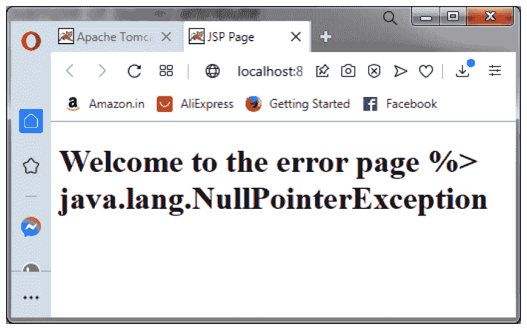
***图 9.1: 前述程序的输出***

### import
此属性导入接口和类。

**语法如下**：
```jsp

<%@ page import= "java.util.Date" %>

```

**示例**：此示例导入了 `java.util.Date` 并显示当前日期：
```jsp

<%@page contentType="text/html" pageEncoding="UTF-8"%>

<!DOCTYPE html>

<html

<head>

<meta http-equiv="Content-Type" content="text/html; charset=UTF-8">

<title>JSP Page</title>

</head>

<body>

<%@ page import="java.util.Date" %>

<h1>Today is: <%= Date() %></h1>

</body>

</html>

```

### Language
这指定编译 JSP 页面时使用的脚本语言。目前可选语言是 `Java`。

**语法如下**：
```jsp

<%@ page language="java" %>

```

### Session
用于指定特定 JSP 页面会话数据的可用性。该属性的默认值为 `true`。

**语法如下**：
```jsp

<%@ page session="true" %>

```

### Info
它设置 JSP 页面的信息，可以通过使用 `Servlet` 接口的 `getServletInfo()` 方法来检索。

**语法如下**：
```jsp

<%@ page info="servlet description" %>

```

### Buffer
设置以字节为单位的缓冲区大小，用于处理 JSP 页面生成的输出。缓冲区的默认大小为 `8KB`。

**语法如下**：
```jsp

<%@ page buffer="8KB" %>

```

### isELIgnored
此属性通过 JSP 2.0 引入的 `ELIgnored` 属性在 JSP 中禁用表达式语言 (`EL`)。它默认是用的。这意味着它的默认值为 `false`。

**语法如下**：
```jsp

<%@ page isELIgnored="true" %>

```

### isThreadSafe
JSP 和 Servlet 默认都是多线程的，即 `isThreadSafe` 的值为 `true`。如果你想序列化客户端请求，必须将其设置为 `false`。在之前的序列化客户端请求完成之前，Web 容器将不再接受任何后续请求。

**语法如下**：
```jsp

<%@ page isThreadSafe="false" %>

```

### Autoflush
此属性用于指定是否自动刷新缓冲区输出。默认值为 `true`，即当缓冲区满时会自动刷新。

**语法如下**：
```jsp

<%@ page autoFlush="true" %>
```


`include` 指令用于指定在 JSP 页面编译期间要插入的文件名（以相对 URL 的形式存在）。所包含的文件内容将成为 JSP 页面的一部分。`include` 指令还可以用于插入多个页面共同通用的代码部分，以避免为每个代码实例单独使用 bean。被包含的文件可以是 HTML 文件、文本文件或用 Java 编程语言编写的代码。

例如，对于一个包含学院名称和 Logo 的 JSP 页面，用于包含头文件 `file(Instituteoflearning.xhtml)` 的代码行可以写如下所示：

```jsp
<%@ include file="Instituteoflearning.xhtml" %>
```

### 以下是其优点
- 代码的可重用性，适用于包含版权信息、脚本语言文件或任何你可能想在其他应用程序中重用的内容。
- 在指令所在的主 JSP 文件中插入另一个文件的内容。

### 以下是一个示例
```html
<body>
  <%@ include file="instituteoflearning.xhtml" %>
  <h6> 今日日期和时间是 </h6>
  <%= java.util.Calendar.getInstance().getTime() %>
</body>
</html>
```

### Taglib 指令
JSP `taglib` 指令用于定义包含许多标签的标签库。标签库由一组与功能相关的用户自定义 XML 标签组成，称为 `custom tags`（自定义标签）。自定义将在后续章节中描述。我们使用标签库描述符（`TLD`）文件来定义这些标签。

### 语法如下
```jsp
<%@ taglib uri="uriofthetaglibrary" prefix="prefixoftaglibrary" %>
```

## 结论
JSP 指令用于指定特定页面的通用信息。`page` 指令定义了适用于整个 JSP 页面的属性，例如用于导入类的 `extends`、定义 JSP 是否线程安全的 `isThreadSafe`、处理异常的 `error-page` 和 `isErrorPage`，以及检查会话对象（session）是否可用 `session`。

`include` 指令在指令所在的主 JSP 文件中插入另一个文件的内容。`Taglib` 指令用于定义包含许多标签的标签库。

在下一章中，我们将学习 JSP 动作（SP actions），如 `useBean`、`getProperty`、`setProperty` 和 `forward`，以执行插入文件、重用 bean、将用户转发到另一个页面以及实例化对象等任务。我们还将学习自定义标签库，它提供了一种机制，程序员可以封装重复的代码或任务并在多个应用程序中重用它们。

## 问题
1. **JSP 使用 page 指令中的 _________________ 属性处理运行时错误。**
   **答案：** 通过 `errorPage` 和 `isErrorPage` 属性

2. **page 指令的主要属性有哪些？**
   **答案：** `buffer`, `ContentType`, `autoFlush`, `errorPage`, `isErrorPage`, `extends`, `isThreadSafe`, `language`, `Session`, `import`, `info`, `isElIgnored`

3. **JSP 页面是可扩展的。**
   A. 正确
   B. 错误
   **答案：** 正确

4. **page 指令的作用是什么？**
   A. 指示翻译器在其包含的 JSP 页面内分配值。
   B. 指示翻译器关于其包含的 JSP 页面的特征。
   C. 指示翻译器关于此 JSP 页面使用的文件。
   D. 指示翻译器关于此 JSP 页面使用的模块。
   **答案：** A

5. **我们在 JSP 页面中将 page 指令放在哪里？**
   A. 在开头
   B. 在中间
   C. 在末尾
   D. 任何地方
   **答案：** D

6. **一个 JSP 页面允许多少个 page 指令？**
   A. 1
   B. 2
   C. 多个
   **答案：** C

7. **有多少个 page 指令属性？**
   **答案：** 3

8. **使用 page 指令，我们可以在 JSP 中包含什么类型的文件？**
   A. HTML
   B. JSP
   C. 两者都不是
   D. 都是
   **答案：** D

9. **使用 page 指令包含的页面通常称为？**
   A. 组件 (Components)
   B. 片段 (Fragments)
   C. 模块 (Modules)
   D. 包 (Parcels)
   **答案：** A

# 第 10 章 JSP 动作元素与自定义标签

## 引言
JSP 动作用于执行诸如插入文件、重用 bean、将用户转发到另一个页面以及实例化对象等任务。自定义标签提供了一种机制，程序员可以使用它来封装重复的代码或任务。

## 结构
在本章中，我们将涵盖以下主题：
- JSP 动作元素
- 自定义标签
- 模型-视图-控制器 (MVC) 架构

## 目标
学习本章后，你将学习动作标签的使用，并学习如何创建自己的标签、在应用程序中使用它们，并查看表达式语言（Expression language）如何简化存储在 Java Bean 组件及其他对象（如 `request`、`session` 和 `application`）中的数据的访问性。在本章中，你还将学习将业务逻辑与表示逻辑分离的 MVC 架构。

## JSP 动作标签
JSP 提供了标准标签，用于插入、移除和重用 bean，将用户转发到另一个页面并实例化对象。

JSP 动作标签的语法如下：
```xml
<jsp:action_name attribute="attribute_value"/>
```

各种 JSP 动作如表 10.1 所示：

| 序号 | JSP 动作 | 用途 | 属性 | 描述 |
| :--- | :--- | :--- | :--- | :--- |
| 1 | `<jsp:useBean>` | 用于查找并加载现有 bean | `id` | 唯一标识 bean 实例 |
| | | | `class` | 指定实现 对象的类 |
| | | | `scope` | 指定 bean 在页面、会话或应用程序中的生命周期 |
| | | | `beanName` | 指定 bean 的引用名称 |
| 2 | `<jsp:getProperty>` | 用于获取指定 bean 的属性并作为输出。获取的值在作为输出之前会转换为字符串值。 | `name` | 指定 bean 的名称 |
| | | | `property` | 指定要获取值的属性 |
| 3 | `<jsp:setProperty>` | 用于设置指定 bean 的属性；要设置 bean 属性的值，可以指定显式值，也可以从请求参数获取。根据指定的请求属性值，调用 bean 中对应的 setter。 | `name` | 指定 bean 的名称 |
| | | | `property` | 指定要设置值的属性。如果设置为 `*`，则表示调用所有指定值的 setter。 |
| | | | `value` | 为 bean 属性指定显式值 |
| | | | `param` | 指定用于设置 bean 属性值的请求参数名称 |
| 4 | `<jsp:forward>` | 用于将请求转发到另一个页面 | `page` | 指定目标页面的相对 URL |
| 5 | `<jsp:include>` | 用于向特定的 JSP 页面插入文件。文件包含发生在 JSP 页面的请求期间。 | `page` | 指定要包含的页面相对 URL |
| | | | `flush` | 指定是否刷新缓冲区。声明包含动作时必须包含一个强制性的布尔属性。 |
| 6 | `<jsp:param>` | 作为 `jsp:include` 和 `jsp:forward` 的子属性使用，用于传递额外的请求参数 | `name` | 指定引用参数的名称 |
| | | `value` | 指定引用参数的值 |

**表 10.1: 各种 JSP Action 标签**

有很多 JSP Action 标签，每个标签都有其用途和特点。

### jsp:useBean action 标签

它用于创建一个引用，以指定在 JSP 页面中包含预定义的 bean 组件。如果 `Bean` 类的 bean 对象已经创建，则根据作用域（scope）不再创建 bean。但如果尚未创建 bean 对象，则实例化该 bean。

**语法**:

```jsp
<jsp:useBean id="instanceName" scope="page | request | session | application" class="packageName.className" type="packageName.className" beanName="packageName.className | <%= expression %>"> </jsp:useBean>
```

**示例**:
```jsp
<jsp:useBean id="savAcc" scope="application" class="savAccount" />
```

上述代码行指定了包含一个名为 `savAcc`、类为 `savAccount` 的 bean。该类是定义 bean 的 Java 类。 JavaBean 类应该遵循以下约定：

* 它应该有一个无参的构造函数。
* 它 应该是可序列化的。
* 它应该提供设置和获取属性值的方法，即 getter 和 setter 方法。

一旦实例化，就可以可以使用相同的作用域和 `ID` 重用 bean。

以下是 `useBean` 标签的属性：

* `id`: 此属性唯一标识 bean 的实例。
* `Class`: 此属性指定用于实现 bean 对象的类。
* `Scope`: 此属性指定对象的生命周期，其取值如*表 10.2* 所示：

| Scope | 对象的生命周期 |
| :--- | :--- |
| page | 对象的可用性对应特定页面对当前请求的响应。对象在用户请求开始时创建，在完成后销毁。 |
| session | 对象的可用性对应特定会话的存在。 |
| application | 对象的可用性在整个应用程序范围内存在。 |
| request | 对象的可用性对应于 `HttpServletRequest` 对象的存在。 |

**表 10.2: scope 属性的值**

* `beanName`: 此属性指定 bean 的引用名称。
* `type`: 如果 bean 已经存在于作用域中，则此属性为 bean 提供数据类型。它主要与 `class` 或 `beanName` 属性配合使用。如果不使用 `class` 或 `beanName` 而使用它，则不会实例化 bean。

**示例**: 在下面的示例中，bean 有一个方法 `square`，通过 `useBean` 标签辅助获取：

**MyBean 类:**
```java
package IOL;

public class MyBean {

    public int square(int n) {

        return n*n;

    }

}
```

**index.jsp**:
```jsp
<html>
<body>
    <jsp:useBean id="obj" class="IOL.MyBean"/>
    <%
        int m=obj.square(5);
        out.print("squareof 5 is "+m);
    %>
</body>
</html>
```

以下是输出结果，如*图 10.1:* 所示

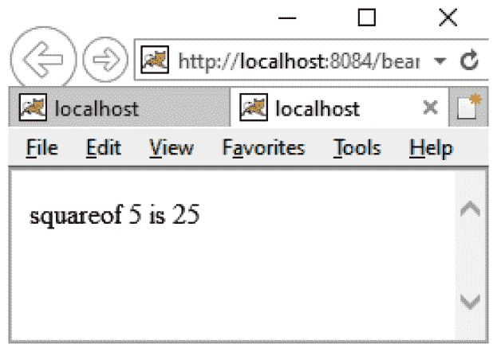

**图 10.1: index.jsp 的输出**

### jsp:setProperty 和 jsp:getProperty action 标签

这些标签用于设置和获取 bean 中的属性值。它是表示数据的重用组件。

**setProperty action 标签的语法**:

```jsp
<jsp:setProperty name="instanceOfBean" property="*" property="propertyName" param="parameterName" value="{ <%= expression %>"/>
```

**示例**:
```jsp
<jsp:setProperty name="savAcc" property="*" />
```
上述代码行设置了 bean 类中后续请求的值。

**jsp:getProperty action 标签的语法**:

```jsp
<jsp:getProperty name="instanceOfBean" property="propertyName"/>
```

**示例**:
```jsp
<jsp:getProperty name="savAcc" property="accountNo" />
```
`jsp:getProperty` action 标签返回属性 `accountNo` 值。

以下是 `setProperty` 标签的属性：

* `name`: 指定 bean 的名称。
* `property`: 指定要设置的属性。如果设置为 `*`，则将调用所有设置方法。
* `Value`: 指定 bean 的显式值。
* `Param`: 指定设置 bean 属性的请求参数。

以下是 `getProperty` 标签的属性：

* `Name`: 指定 bean 的名称。
* `Property`: 指定需要检索的属性。

**示例**: 在下面的示例中，从 bean 类设置 name 和 password：

**index.jsp**:
```jsp
<html>
<body>
    <form action="next.jsp" method="post">
        User Name:<input type="text" name="userName"><br>
        Password:<input type="password" name="password"><br>
        <input type="submit" />
    </form>
</body>
</html>
```

**Bean 类**:
```java
package IOL;

public class NewClass implements java.io.Serializable {

    public String userName, password;

    public String getUserName() {
        return userName;
    }

    public void setUserName(String userName) {
        this.userName = userName;
    }

    public String getPassword() {
        return password;
    }

    public void setPassword(String password) {
        this.password = password;
    }

}
```

**next.jsp**:
```jsp
<html>
<body>
    <jsp:useBean id="myBean" class="IOL.NewClass"></jsp:useBean>
    <jsp:setProperty property="*" name="myBean"/>
    Record:<br>
    User name=<jsp:getProperty property="userName" name="myBean"/><br>
    password=<jsp:getProperty property="password" name="myBean"/><br>
</body>
</html>
```

以下是 index.jsp 的输出，如*图 10.2:*

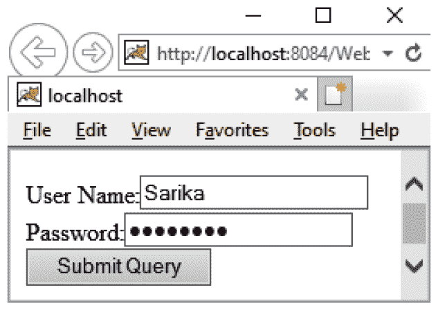

**图 10.2: index.jsp 的输出**

以下是 next.jsp 的输出，如*图 10.3:*

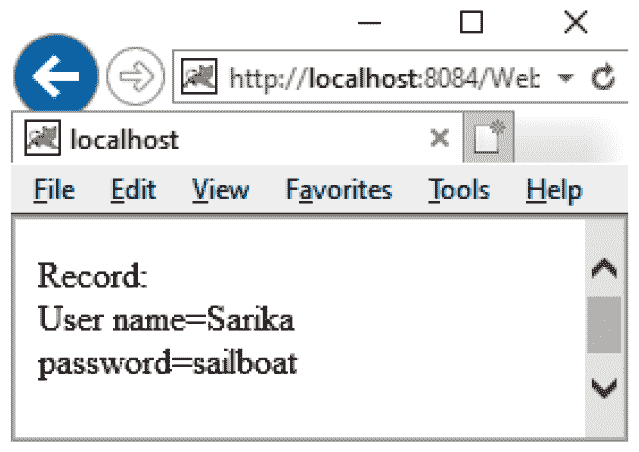

**图 10.3: next.jsp 的输出**

### Jsp:forward action 标签

此标签用于将请求转发到另一个页面。

**语法**:

```jsp
<jsp:forward page="relativeURL | <%= expression %>">
    <jsp:param name="parametername" value="parametervalue | <%=expression%>" />
</jsp:forward>
```

`page` 是 forward 标签的属性。

**示例**:

**Index.xhtml**:
```html
<html>
<body>
    <form action="Next.jsp" method="post">
        User Name:<input type="text" name="userName"><br>
        Password:<input type="password" name="password"><br>
        <input type="submit" />
    </form>
</body>
</html>
```

**Next.jsp**:
```html
<html>
<body>
    <jsp:forward page="next2.jsp">
```


## JSP 转发与包含示例

### Next2.jsp
```jsp
<html>
<body>
    <h1> Record <br>
    User Name<%= request.getParameter("userName") %><br>
    password = <%= request.getParameter("password") %><br>
    Date<%= request.getParameter("date") %>
    </h1>
</body>
</html>
```

以下是 `index.xhtml` 的输出，如图 10.4 所示：

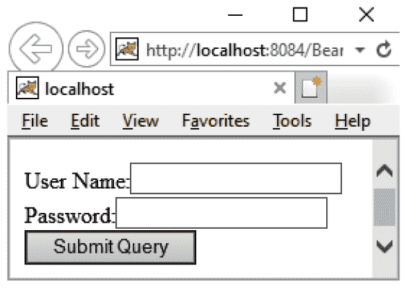

**图 10.4: index.xhtml 的输出**

以下是 `next2.jsp` 的输出，如图 10.5 所示：

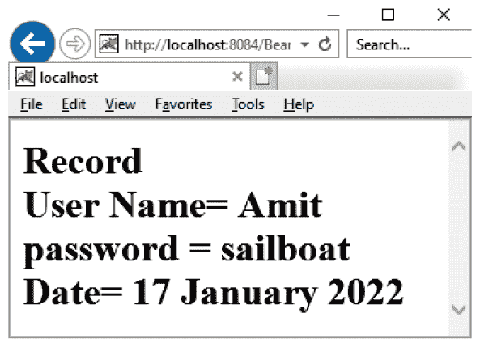

**图 10.5: Next2.jsp 的输出**

---

## `<jsp:include>` 动作

它用于将文件内容插入到特定的 JSP 文件中。该文件可以是 JSP、HTML 或 Servlet。文件包含发生在 JSP 页面请求时。

### 属性

- `page`：指定要包含的页面的相对 URL。
- `flush`：指定是否刷新缓冲区。在声明 include 动作时，必须包含一个强制性的布尔属性。

### 语法

```jsp
<jsp:include page="relativeURL | <%= expression %>">
    <jsp:param name="parametername" value="parametervalue | <%=expression%>" />
</jsp:include>
```

### 示例 1：包含打印日期的页面

**printdate.jsp**
```jsp
<% out.print("Today is:" + java.util.Calendar.getInstance().getTime()); %>
```

**Index.jsp**
```html
<html>
  <body>
    <h2>this is index page</h2>
    <jsp:include page="printdate.jsp" />
    <h2>end section of index page</h2>
  </body>
</html>
```

### 示例 2：用户登录验证

**Index.jsp**
```html
<html>
  <body>
    <form method="post" action="usebean.jsp">
      <table border="0" cellspacing="1" cellpadding="5">
        <tr>
          <td width="100">&nbsp;</td>
          <td align="right">
            <h1>
              <font color="red">Welcome to Famous bank</font>
            </h1>
          </td>
        </tr>
        <tr>
          <td width="100" align="right"><b><font color="blue">User ID</font></b></td>
          <td align="left"><input type="text" name="userId" size="30"></td>
        </tr>
        <tr>
          <td width="100" align="right"><b><font color="blue">Password</font></b></td>
          <td align="left"><input type="password" name="pwd" size="30"></td>
        </tr>
        <tr>
          <td width="100">&nbsp;</td>
          <td align="right"></td>
        </tr>
        <tr>
          <td width="100">&nbsp;</td>
          <td align="left"><input type="submit" value="submit" /></td>
        </tr>
      </table>
    </form>
  </body>
</html>
```

**bean.jsp**
```html
<html>
  <head>
    <meta http-equiv="Content-Type" content="text/html; charset=UTF-8">
    <title>JSP Page</title>
  </head>
  <body>
    <jsp:useBean id="BA" scope="application" class="IOL.MyBank"/>
    <jsp:setProperty name="BA" property=""/>
    <%
      String userid = BA.getUserId();
      String pwd = BA.getPwd();
      boolean valid = BA.validate();
      if (valid == true)
        out.println("The user is valid");
      else
        out.println("The user is not valid");
    %>
  </body>
</html>
```

**MyBank.java**
```java
package IOL;

import java.sql.*;

public class MyBank {
  private String userId, pwd;
  public Connection con;

  public String getUserId() {
    return userId;
  }

  public void setUserId(String userId) {
    this.userId = userId;
  }

  public String getPwd() {
    return pwd;
  }

  public void setPwd(String pwd) {
    this.pwd = pwd;
  }

  public MyBank() throws ClassNotFoundException, SQLException {
    Class.forName("com.mysql.cj.jdbc.Driver");
    con = DriverManager.getConnection("jdbc:mysql://localhost:3306/MyBank", "root", "sailboat");
  }

  public boolean validate() {
    String ppwd = "";
    boolean valid = false;
    try {
      userId = getUserId();
      pwd = getPwd();
      String strQuery = "select * from login where userid='" + userId + "'";
      Statement stat = con.createStatement();
      ResultSet result = stat.executeQuery(strQuery);
      System.out.println(result.next());
      while (result.next()) {
        ppwd = result.getString(1);
        System.out.println(ppwd);
      }
      ppwd.trim();
      pwd.trim();
      if (ppwd.equals(pwd))
        valid = true;
    } catch (Exception e) {}
    return valid;
  }
}
```

## 总结

以下是 `index.jsp` 的输出，如图 10.6 所示。
以下是 `bean.jsp` 的输出，如图 10.7 所示。

---

## JSP 自定义标签

`JSP 自定义标签`是用户定义的标签，可以封装表现逻辑和业务逻辑。JSP 在表现层与业务逻辑分离方面的贡献从功能上将设计人员从复杂的编程中解放出来。在很多情况下，代码结构使得某些部分是重复的并且需要重写。库的自定义标签为程序员提供了一种机制来封装重复性任务。一旦封装，这些代码就可以以更简单的形式重用。标签库由一组功能相关的自定义标签（称为自定义标签）组成。

由于 JSP `<jsp:useBean>` 元素促进了现有 Bean 的重用，自定义库中的标签可以缩短应用程序开发周期并提高生产力。JSP 1.0 不支持标签库。然而，JSP 1.1 支持在 JSP 文件中包含用户创建的标签。JSP 中自定义标签的结构与 `XML` 标签相似。

## XML 的需求

`可扩展标记语言`（`XML`）用于 Web 应用程序创建自定义或用户定义的标签。`XML` 标签与 `HTML` 标签不同，因为它允许用户与浏览器之间的交互。考虑到 `HTML` 的支持，为什么需要新的标记语言？考虑一个显示账户持有人数据的 `HTML` 代码。显示这些数据的 `HTML` 代码如下：

```html
<html>
<body>
  <table align="center">
    <tr>
      <td>Ms Anne Brown</td>
    </tr>
    <tr>
      <td>9, Sunley House, Gunthorpe Street</td>
    </tr>
    <tr>
      <td>London E1-7RW</td>
    </tr>
  </table>
</body>
</html>
```

以表现层为中心的 `HTML` 输出如下：

```text
Ms Anne Brown
9, Sunley House, Gunthorpe Street
London E1-7RW
```

`HTML` 代码的输出是以表现层为中心的，看起来就像任何文本数据。然而，在呈现账户持人的姓名和姓的数据上没有区分。也就是说，通过使用预定义的 `HTML` 标签丢失了数据类型信息。

相反，考虑使用自定义标签（用户定义）用 `XML` 编写的相同示例，如下：

```xml
<CUSTOMERDETAILS>
  <NAME>
    <TITLE>Ms</TITLE>
    <FIRSTNAME>Anne</FIRSTNAME>
    <LASTNAME>Brown</LASTNAME>
  </NAME>
  <ADDRESS>
    <APTNAME>9, Sunley House</APTNAME>
    <STREETNAME>Gunthorpe Street</STREETNAME>
    <COUNTRY>London</COUNTRY>
    <ZIP>E1 – 7RW</ZIP>
  </ADDRESS>
</CUSTOMERDETAILS>
```

上述代码在 `XML` 中的重写如下：

```xml
<xml>
  <CUSTOMERDETAILS>
    <NAME>
      <TITLE>Ms</TITLE>
      <FIRSTNAME>Anne</FIRSTNAME>
      <LASTNAME>Brown</LASTNAME>
    </NAME>
    <ADDRESS>
      <APTNAME>9, Sunley House</APTNAME>
      <STREETNAME>Gunthorpe Street</STREETNAME>
      <COUNTRY>London</COUNTRY>
      <ZIP>E1 – 7RW</ZIP>
    </ADDRESS>
  </CUSTOMERDETAILS>
</xml>
```

不言而喻，在 `XML` 代码的输出中，账户持有者详情的定义是以强调数据类型的格式呈现的。这是通过使用特定的自定义标签，如 `<FIRSTNAME>`、`<LASTNAME>`、`<STREETNAME>` 和 `<ZIP>` 实现的。这些标签的使用更容易区分数据。例如，封装在 `<COUNTRY>` 标签内的文本定义了账户持有人所属的国家。虽然这些数据的呈现方式与 `HTML` 中编写的样式类似，但 `XML` 代码更以数据为中心。

### 使用 XML 的优势

使用 XML 的优势如下：

- **易于编码**：与 `HTML` 相似，除了包含自定义标签外，`XML` 是非常易于编码的。
- **易于数据交换**：由于使用了显式的自定义标签，翻译 `XML` 文档非常容易。因此，可以在不同级别交换数据，无需解码或解释其结构。
- **易于业务通信**：组织之间交换数据时无需理解对方业务、系统组织或结构的复杂性。但是，需要对数据中使用的标签有共同的理解。

`XML` 代码中遵循的详细规则和规范写在 `Document Type Definition` (`DTD`) 中。`DTD` 定义了特定文档中使用的标签、标签结构、属性和值。

### 自定义标签

JSP 1.1 支持创建自定义标签，能够将业务复杂性分离以形成内容呈现。JSP 中自定义标签的结构与 `XML` 和 `HTML` 一样，包含起始标签、结束标签和正文。因此，自定义标签的结构可以表示如下：

**语法**：

```text
<start tag>
    Body
</end tag>
```


根据标签正文是否存在，自定义标签可以分类为正文标签或空标签。此外，自定义标签还可以进行嵌套或包含属性。嵌套标签包含不同层级的标签。带有属性的标签使用属性参数来定制标签行为。

自定义标签的属性列如下：

- `name`：用于指定标签内使用的名称。
- `required`：用于指定标签是否性。此属性接受的值为 `true`、`false`、`yes` 或 `no`。

### 使用自定义标签的优势

脚本段（Scriptlets）和自定义标签封装了 Java 代码段，因此在功能上非常相似。然而，通过提供更好的封装功能，自定义标签能够有效地分离 Web 设计师和开发人员的工作职能。使用自定义标签的优势如下：

- **减少代码中的脚本段**：自定义标签的属性可以用于接收参数。因此，可以避免或减少声明（定义变量）和脚本段（设置 Java 组件的属性）的包含。
- **可重用性**：与不可重用的 Java 代码段脚本段相反，自定义标签是可以重用的。这使得开发和部署代码时花费的时间减少。

## 标签库的组件

JSP 文件使用的自定义标签由以下部分组成：

- **标签句柄 (Tag handler)**：标签句柄用于定义自定义标签。标签句柄使用不同的方法和对象来定义标签的行为。
- **标签库描述符 (TLD) 文件**：`TLD` 文件是一个 XML 文件，包含自定义标签的描述性列表。

JSP 文件包含一个标签以及用于内容呈现的 HTML 代码。考虑到这种结构，显而易见的是开发者负责编写标签句柄和 `TLD` 文件代码。

Web 设计师为网页的静态显示内容编写代码，然后将自定义标签添加到 JSP 文件中。因此，JSP 的自定义标签功能通过分离 Web 设计师和开发者的工作职能，增强了高质量 Web 应用程序的生产力。

### 在 JSP 文件中使用标签的步骤

1. 创建一个包含 `Tag` 和 `BodyTag` 接口的标签句柄。标签句柄文件应该定义由标签执行的任务。
2. 使用 `TLD` 文件映射标签和标签句柄文件。`TLD` 文件应该定义到标签句柄的输入。

JSP 文件应该包含 `taglib` 指令，用于指定标签的使用和标签的定义。

创建任何自定义标签，我们需要完成以下步骤：

- 创建标签句柄类并在标签的开始或结束处执行操作。
- 创建`标签库描述符` (`TLD`) 文件并定义标签。
- 创建使用 `TLD` 文件中定义的自定义标签的 JSP 文件。

### 标签句柄的结构

标签句柄用于定义自定义标签的工作。该类文件的方法派自 `javax.servlet.tagext` 包，并实现了 `TagSupport` 或 `BodyTag` 支撑接口。`javax.servlet.jsp.tagext` 包包含了用于 JSP 自定义标签 API 的类和接口。`JspTag` 是自定义标签层次结构中的根接口。[图 10.8] 显示了 JSP 标签的层级结构；JSP Tag 接口是一个标记接口，因此它没有任何方法：

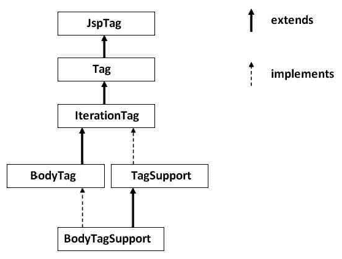

**图 10.8**：JSP 标签的层级结构

`TagSupport` 接口用于空正文标签，`BodyTagSupport` 接口用于使用正文的标签。标签句柄定义还可以包含其他包的类，例如 `javax.servlet.jsp` 和 `java.io`。因此，添加相应的导入语句是关键的。

标签句柄的结构可以分类为基础标签、带属性的标签和带正文的标签。因此，需要实现的方法取决于标签的结构，如表 10.3 所示：

| 标签结构 | 需要实现的方法 |
| :--- | :--- |
| 无正文无属性的简单标签 | `doStartTag()`、`doEndTag()` 和 `release` |
| 带属性的标签 | `doStartTag()`、`doEndTag()` 以及每个定义标签的 `setAttribute()` 和 `getAttribute()` 方法 |

**表 10.3**：在标签句柄类中实现的方法

标签库的功能使用抽象类 `tag` 中的方法定义。标签类的一些方法及其返回类型列在表 10.4、表 10.5 和表 10.6 中：

| 序号 | 方法 | 描述 |
| :--- | :--- | :--- |
| 1 | `public int doStartTag()` | 初始化标签句柄并在需要时连接数据库。 |
| 2 | `public int doEndTag()` | 执行后任务，如输出和关闭数据库连接。 |
| 3 | `public void release()` | 移除标签句柄实例。 |
| 4 | `int doAfterBody()` | 在正文标签评估完成后调用。 |
| 5 | `public int doBeforeTag()` | 在正文标签评估之前调用。 |
| 6 | `Public void setContext (PageContext pc)` | 设置指定的 PageContext 对象。 |
| 7 | `public Tag getParent()` | 设置标签句柄的父级。 |

**表 10.4**：Tag 接口的方法

| 序号 | 字段 | 描述 |
| :--- | :--- | :--- |
| 1 | `public static int SKIP_BODY` | 用于空标签，指示 JSP 引擎跳过标签正文并随后调用下一个方法 `doEndTag()`。 |
| 2 | `public static int EVAL_BODY_INCLUDE` | 用于指示 JSP 引擎处理标签的正文内容。此方法仅在实现为 javax.servlet.tagext.Tag 时使用。 |
| 3 | `EVAL_BODY_TAG` | 用于指示 JSP 引擎处理标签的主体。只有当实现的接口是 `javax.servlet.tagext.BodyTagSupport` 时才使用此方法。 |

**表 10.5**: `doStartTag()` 方法的返回类型

| **序列号** | **字段** | **描述** |
| :--- | :--- | :--- |
| 1 | `SKIP_PAGE` | 用于指定跳过或省略对剩余 JSP 页面的评估。 |
| 2 | `EVAL_PAGE` | 用于指定对剩余 JSP 页面的评估。 |

**表 10.6**: `doEndTag()` 方法的返回类型

除了上述方法外，标签处理程序还包含以下类和方法：

*   `JspWriter()` 方法必须在标签中显式提到，以便将输出写入 JSP 页面。
*   `getAttribute()` 和 `setAttribute()` 方法用于从脚本段（scriptlets）中获取变量值。在处理变量后，通过使用 `setAttribute()` 方法设置其其值。在使用 `getAttribute()` 和 `setAttribute()` 方法时，还需要使用 `TagExtraInfo` 类指定有关脚本变量的细节。
*   `TagExtraInfo` 类包含此类方法，如 `getVariableInfo()` 返回从脚本段中检索的脚本值信息；`TagExtraInfo()` 是该类的默认构造函数；以及 `setTagInfo()` 和 `getTagInfo()` 方法用于为此类设置和获取 `TagInfo` 对象。

包含自定义标签的 JSP 文件的执行周期如 *图 10.9*所示：

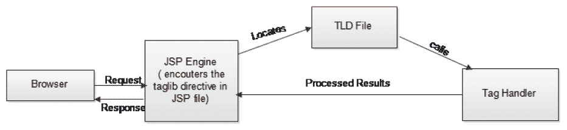

**图 10.9**:get 自定义标签 JSP 文件的执行周期

1.  当 JSP 引擎识别 JSP 页面中的 `taglib` 指令时，它会识别与该 JSP 文件相关的自定义标签的存在。统一资源标识符 (`URI`) 和标签前缀作为指定唯一 `URI` 和标签名的引用数据。
2.  初始化指定的标签处理程序。
3.  执行每个标签的 `get()` 和 `set()` 方法。
4.  调用 `doStartTag()` 方法并用于执行如打开数据库连接等任务。
5.  接下来评估标签主体，但如果指定了 `SKIP_BODY` 字段常量，则跳过。
6.  标签的输出存储在名为 `JSPWriter` 的特殊 `PrintWriter` 中。使用 `pageContext.getOut()` 方法使内容对方法可用。在此阶段，输出不会转发到客户端。
7.  接下来，调用 `doAfter()` 方法处理评估标签主体后生成的内容。可以返回 `SKIP_BODY` 和 `EVAl_BODY_TAG` 字段常量来估算生命周期的精确阶段。
8.  接下来调用 `doEndTag()` 方法。之前创建的所有连接都将被关闭，输出重定向到浏览器。

## TLD 文件的结构

| **序列号** | **组件** | **描述** |
| :--- | :--- | :--- |
| 1 | `<tlib-version>` | 标签库的版本，例如 `<tlib-version>1.0</tlib-version>`。 |
| 2 | `<jsp-version>` | 标签库依赖的 JSP 版本，例如 `<jsp-version>1.2</jsp-version>`。 |
| 3 | `<short-name>` | 标签库的。 |
| 4 | `<uri>` | 统一资源标识符，一个可选组件，是标签库的唯一 ID。 |
| 5 | `<info>` | 关于标签库的详细信息。 |

**表 10.7**: Taglib 级上的 TLD 文件元素

标签级上的 TLD 文件元素列在 *表 10.8*中：

| **序列号** | **组件** | **描述** |
| :--- | :--- | :--- |
| 1 | `<name>` | 为标签定义一个名称。 |
| 2 | `<tagclass>` | 指定标签处理程序类。此规范的格式为 `<tagclass>package.classname</tagclass>`。 |
| 3 | `<info>` | 提供关于标签及其功能的附加信息。 |
| 4 | `<attribute>` | 指定标签的属性名称和规范。 |
| 5 | `<bodycontent>` | 包含主体的定义。如果主体为空则指定 empty，如果是主体则指定 JSP。 |

**表 10.8**: 标签级上的 TLD 文件元素

创建名为第一个的 TLD 文件的步骤列如下：

1.  在记事本中包含文档类型和定义：
    ```xml
    <!DOCTYPE taglib PUBLIC "-//Sun, Inc.//DTD Tag Library 1.2//EN" "http://java.sun.com/dtd/taglibrary_1_2.dtd">
    ```
2.  在 `<taglib>` 和 `</taglib>` 标签之间添加 `tlibversion`、`jspversion`、`shortname`：
    ```xml
    <taglib>
      <tlib-version>1.0</tlib-version>
      <jsp-version>1.2</jsp-version>
      <short-name>simple</short-name>
      <uri>http://tomcat.org/taglib</uri>
    </taglib>
    ```
3.  在 `<tag>` 和 `</tag>` 标签内添加标签定义：
    ```xml
    <tag>
      <name>today</name>
      <tag-class>IOL.TagHandler</tag-class>
    </tag>
    ```
4.  添加 `taglib` 的结束标签：
    ```xml
    </taglib>
    ```

## JSP 文件的结构

```java
public String getBankName() {
    return Name;
}

public void setBankName(String Name) {
    this.Name = Name;
}

public int doStartTag() throws JspException {
    JspWriter out = pageContext.getOut(); // 返回 JspWriter 实例
    try {
        out.print(Calendar.getInstance().getTime()); // 使用 JspWriter 打印日期时间
        out.print("Your Bank Name is " + Name);
    } catch (Exception e) {
        System.out.println(e);
    }
    return SKIP_BODY; // 不评估标签的主体内容
}
```

**TLD 文件**:

```xml
<?xml version="1.0" encoding="UTF-8"?>
<taglib version="2.1" xmlns="http://java.sun.com/xml/ns/javaee" xmlns:xsi="http://www.w3.org/2001/XMLSchema-instance" xsi:schemaLocation="http://java.sun.com/xml/ns/javaee http://java.sun.com/xml/ns/javaee/web-jsptaglibrary_2_1.xsd">
  <tlib-version>1.0</tlib-version>
  <jsp-version>1.0</jsp-version>
  <uri>/WEB-INF/tlds/MYTLD</uri>
  <tag>
    <name>bank</name>
    <tag-class>IOL.TagHandlerBank</tag-class>
    <body-content>empty</body-content>
    <attribute>
      <name>Name</name>
      <required>true</required>
      <type>java.lang.String</type>
    </attribute>
  </tag>
</taglib>
```

## JSP 文件

```html
<html>
<body>
  <%@ taglib uri="WEB-INF/tlds/MYTLD.tld" prefix="n" %>
  <n:bank Name="My Bank"></n:bank>
</body>
</html>
```

### 表达式语言 (EL)

`Expression Language`（即 `EL`）简化了对 `Java Bean` 组件中存储的数据以及如 `request`、`session`、`application` 等其他对象的访问。`EL` 中有许多隐式对象、操作符和保留字。它是 JSP 技术 2.0 版本中新添加的功能。

#### 语法：

`${ expression }`

#### 示例：在接下来的示例中，`El.jsp` 使用 `param` 对象来获取请求 `Parameter`（参数）：

**index.jsp**:

```html
<html>
<body>
  <form action="El.jsp">
    输入名称：<input type="text" name="name" /><br/><br/>
    <input type="submit" value="提交"/>
  </form>
</body>
</html>
```

**el.jsp:**

```jsp
<%@page contentType="text/html" pageEncoding="UTF-8"%>
<!DOCTYPE html>
<html>
<body>
    欢迎，${ param.name }
</body>
</html>
```

以下是 `index.xhtml` 的输出，所示图 10.10：。

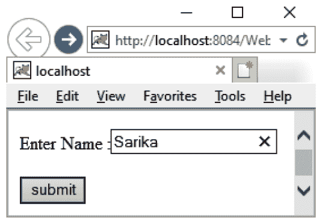

**图 10.10**：index.xhtml 的输出

以下是 `el.jsp` 的输出，所示图 10.11：。

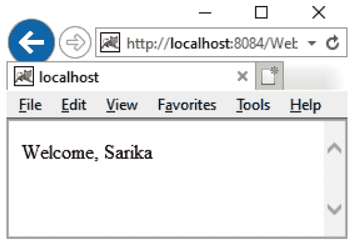

**图 10.11**：el.jsp 的输出

表达式语言使用了许多隐式对象。一些隐式对象列在表 10.9 中：

| 序号 | 隐式对象 | 用法 |
| :--- | :--- | :--- |
| 1 | `pageScope` | 它将给定的属性名与页面作用域（page scope）中设置的值进行映射。 |
| 2 | `requestScope` | 它将给定的属性名与请求作用域（request scope）中设置的值进行映射。 |
| 3 | `sessionScope` | 它将给定的属性名与会话作用域（session scope）中设置的值进行映射。 |
| 4 | `applicationScope` | 它将给定的属性名与应用作用域（application scope）中设置的值进行映射。 |
| 5 | `param` | 它将请求参数映射到单一值。 |
| 6 | `paramValues` | 它将请求参数映射到值数组。 |
| 7 | `header` | 它将请求头名称映射到单一值。 |
| 8 | `headerValues` | 它将请求头名称映射到值数组。 |
| 9 | `cookie` | 它将给定的 cookie 名称映射到 cookie 值。 |
| 10 | `initParam` | 它映射初始化参数。 |
| 11 | `pageContext` | 它提供了对 request、session 等许多对象的访问权限。 |

**表 10.9**：隐式对象

#### 以下是 Session 和 Cookie 的示例：

**index.jsp**:


```jsp
<%@page contentType="text/html" pageEncoding="UTF-8"%>
<!DOCTYPE html>
<html>
<body>
<%
  session.setAttribute("user","Sarika");
  Cookie ck=new Cookie("pwd","sailboat");
  response.addCookie(ck);
%>
  <a href="process.jsp">访问</a>
</body>
</html>
```

### Process.jsp

```jsp
<%@page contentType="text/html" pageEncoding="UTF-8"%>
<!DOCTYPE html>
<html>
<head>
  <meta http-equiv="Content-Type" content="text/html; charset=UTF-8">
  <title>JSP 页面</title>
</head>
<body>
    名称= ${ sessionScope.user }
    你的密码 = ${cookie.pwd.value}
</body>
</html>
```

以下是 `index.jsp` 的输出，所示图 10.12：

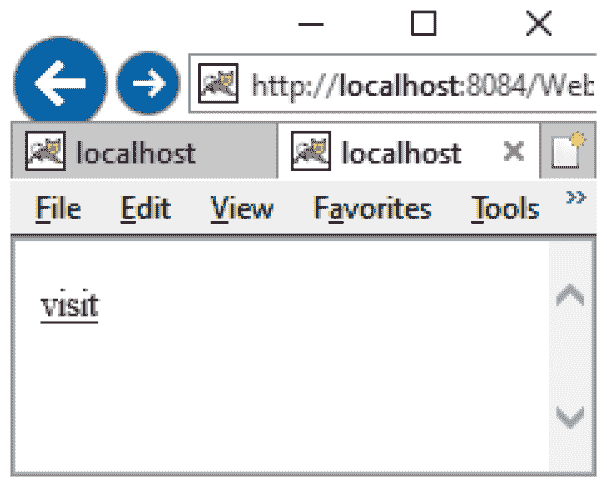

**图 10.12**：index.jsp 的输出

以下是 `process.jsp` 的输出，所示图 10.13：

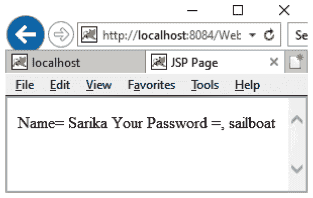

**图 10.13**：process.jsp 的输出

以下是 `index.xhtml` 的输出，所示图 10.14：

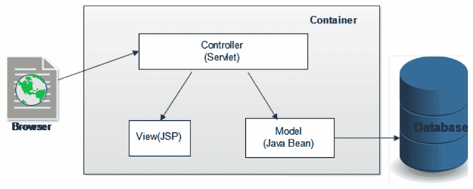

**图 10.14**：index.xhtml 的输出

### 模型-视图-控制器 (MVC)

在 JSP 中的模型-视图-控制器 (MVC) 模式中：

- `Model`（模型）负责数据和逻辑。
- `View`（视图）负责界面展示。
- `Controller`（控制器）负责处理请求并协调模型和视图。

以下是 MVC 模式的示例：

#### web.xml

```xml
<web-app>
  <servlet>
    <servlet-name>Controller</servlet-name>
    <servlet-class>IOL.Controller</servlet-class>
  </servlet>
  <servlet-mapping>
    <servlet-name>Controller</servlet-name>
    <servlet-pattern>*.jsp</servlet-pattern>
  </servlet-mapping>
</web-app>
```

#### Controller.java

```java
package IOL;
import java.io.IOException;
import javax.servlet.ServletException;
import javax.servlet.http.HttpServlet;
import javax.servlet.http.HttpServletRequest;
import javax.servlet.http.HttpServletResponse;

public class Controller extends HttpServlet {
  protected void doGet(HttpServletRequest request, HttpServletResponse response) throws ServletException, IOException {
    // 控制器逻辑
  }
}
```

#### 登录成功页面

```html
<head>
    <title>登录成功</title>
</head>
<body>
    <%@page import="IOL.LoginBean"%>
    <p>您登录成功！</p>
    <%
      LoginBean bean=(LoginBean)request.getAttribute("bean");
      out.print("欢迎，"+bean.getName());
    %>
</body>
</html>
```

### Login-error.jsp

```html
<%@page contentType="text/html" pageEncoding="UTF-8"%>
<!DOCTYPE html>
<html>
<head>
    <meta http-equiv="Content-Type" content="text/html; charset=UTF-8">
    <title>错误页面</title>
</head>
<body>
<p>抱歉！用户名或密码错误</p>
    <%@ include file="index.xhtml" %>
</body>
</html>
```

### Web.xml

```xml
<?xml version="1.0" encoding="UTF-8"?>
<web-app version="3.1" xmlns="http://xmlns.jcp.org/xml/ns/javaee" xmlns:xsi="http://www.w3.org/2001/XMLSchema-instance" xsi:schemaLocation="http://xmlns.jcp.org/xml/ns/javaee http://xmlns.jcp.org/xml/ns/javaee/web-app_3_1.xsd">
<servlet>
    <servlet-name>Controller</servlet-name>
    <servlet-class>IOL.Controller</servlet-class>
</servlet>
<servlet-mapping>
    <servlet-name>Controller</servlet-name>
    <url-pattern>/Controller</url-pattern>
</servlet-mapping>
<session-config>
    <session-timeout>
        30
    </session-timeout>
</session-config>
</web-app>
```

以下是 `index.xhtml` 的输出，如图 10.15 所示：

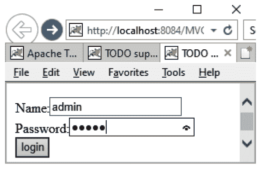

**图 10.15**: index.xhtml 的输出

以下是 `logini-success.jsp` 的输出，如图 10.16 所示：

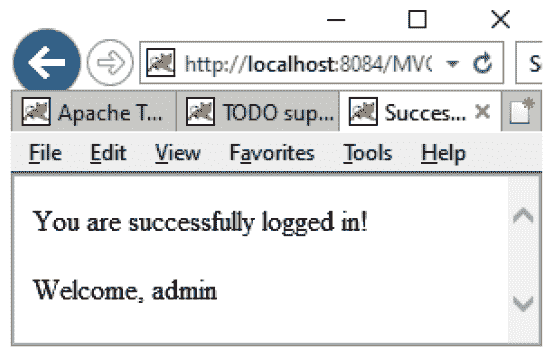

**图 10.16**: logini-success.jsp 的输出

以下是 `login-error.jsp` 的输出，如图 10.17 所示：

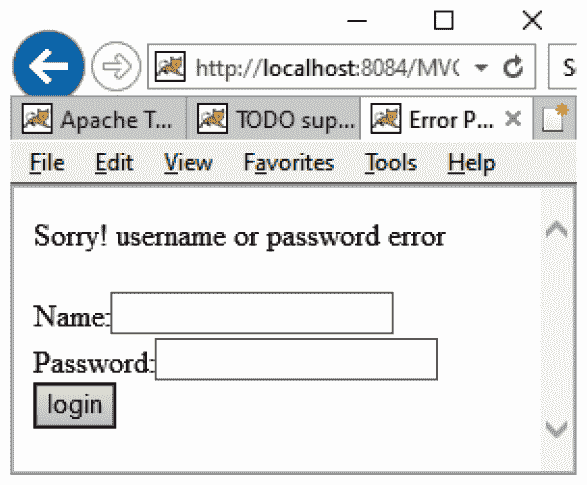

**图 10.17**: login-error.jsp 的输出

## 结论

在本章中，我们学习了 JSP 动作如 `useBean`、`getProperty`、`setProperty` 和 `forward`，它们用于执行插入文件、重用 bean、将用户转发到另一个页面以及实例化对象等任务。自定义标签库提供了一种机制，程序员可以通过该机制封装重复的代码或任务，并在多个应用程序中重用。像 XML 和 HTML 标签这样的自定义标签包含开始标签、结束标签和主体。自定义标签可以分为简单标签、体标签、带属性的标签或嵌套标签。属性包含可以用于自定义标签行为的参数。

创建标签处理器和 TLD 文件是为了在 JSP 文件中实现自定义标签的功能。标签处理器用于定义自定义标签，并源自 `javax.servlet.tagext` 包，该包实现了 `TagBody` 接口。标签处理器由 `doStartTag()`、`doEndTag()` 和 `release()` 方法组成。

标签库定义 (`TLD`) 是一个包含标签库描述的 XML 文件，它包含：

* 标签库描述
* TLD 版本
* 标签名称
* 属性

JSP 错误可以分为编译时错误或运行时错误。

* **各种结果类型**：在 `struts2` 中，我们可以使用 `JSP`、`freemarker`、`velocity` 等技术作为结果。`Velocity` 和 `freemarker` 是基于 Java 的模板引擎。它们都是免费开源的 Web 框架，旨在作为 MVC 架构中的视图组件。
* **各种标签支持**：为了使 `struts2` 应用更易用，`Struts2` 包含了许多标签，例如 UI 标签、数据标签、控制标签等。
* **主题和模板支持**：`Struts2` 支持三种不同的主题——`XHTML`、`simple` 和 `CSSXHTML`。`struts2` 的默认主题是 `XHTML`。为了保持一致的外观和感受，可以使用主题和模板。

## Struts2 的组件

`struts2` 中的模型-视图-控制器（Model-View-Controller）模式通过以下五个核心组件实现：

* **Actions（动作）**：`Action` 类。`Action` 类负责维护状态和处理请求。`Action` 类是一个普通的 Java 类，拥有 `getter`、`setter` 和 `execute` 方法。它代表了 MVC 模式中的 MODEL 部分。
* **Controller（控制器）**：在 `struts2` 中，控制器负责识别传入的请求，选择合适的动作类进行处理，并最终查找 `JSP` 或 `HTML` 文件来显示响应。`Controller` 类（`org.apache.struts2.dispatcher.FilterDispatcher`）由 `struts` 框架提供。
* **Interceptors（拦截器）**：`Interceptors` 是容器的辅助组件，包含横切关注点逻辑，并可以在以下两种情况下扩展：
    * 在执行 `Action` 之前
    * 在执行 `Action` 之后
  因此，拦截器是在请求预处理和后处理期间调用的对象。在 `Struts 2` 中，`Interceptor` 用于执行验证、异常处理、国际化、显示中间结果等操作。
* **Value Stack（值栈）**：`Value Stack` 简单来说包含特定特定对象的栈，如动作对象和其他模型对象。`Value stack` 通过名为 `OGNL`（对象图导航语言）的表达式帮助，通过 `struts` 标签获取对象。`value stack` 是一个用于处理客户端请求的数据存储区域。
* **Results/Result types（结果/结果类型）**：在 `struts2` 中，结果组件负责识别合适的 `JSP` 或 `HTML` 来向客户端显示数据。我们也可以根据需要自定义此组件。
* **视图技术**：使用 `HTML` 或 `JSP` 文件来向用户显示信息。

## Struts2 架构

`Struts2` 架构与传统的 MVC 模式不同。在这里，`Action` 是一个模型，而控制器类由 `struts2` 框架维护。在 `Struts 2` 中，`Servlet Filter`（`Filter Dispatcher`）查看请求，然后根据 `URL` 的映射将请求转发到相应的 `Action Class`，如图 11.1 所示：

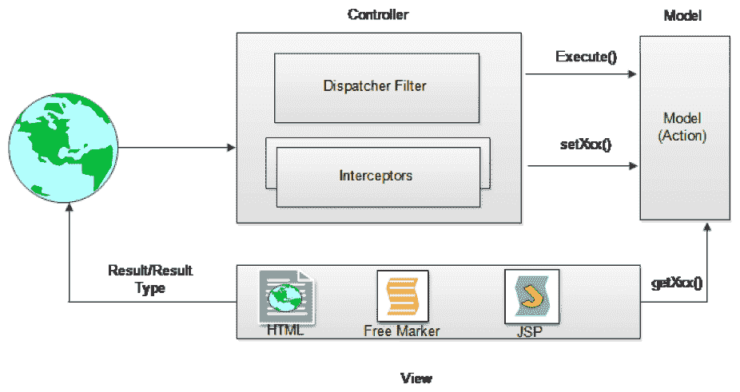

**图 11.1**：`Strut2` 架构

在图 11.1 中，**浏览器**发送请求。请求传递给**控制器**。控制器通过 `Struts2` 分发 servlet 过滤器和拦截器实现。控制器找到合适的动作类，发送请求，设置参数并调用 `execute()` 方法。配置的拦截器功能将生效，例如验证、文件上传等。最后，视图准备结果并将其返回给用户。

## 创建 Struts

以下是创建 Struts 应用的步骤：

1. 创建 `index.xhtml`。
2. 创建动作类 `Login.java`。
3. 创建视图 `Welcome.jsp` 和 `Invalid.jsp`。
4. 在 `struts.xml` 中添加 Struts 配置。
5. 在 `web.xml` 中添加过滤器。
6. 构建 WAR 文件并运行应用程序。

参考以下代码示例：

### index.xhtml

```html
<html>
    <head>
        <meta http-equiv="Content-Type" content="text/html; charset=UTF-8">
        <title>JSP Page</title>
    </head>
    <body>
        <form action="login.action">
            User Name<input type="text" name="uname"/><br>
            <input type="submit" value="submit"/>
        </form>
    </body>
</html>
```

### Action class - Login.java

```java
package p1;

public class Login
{
    private String uname;
    public String execute()
    {
        if(uname.equals("Sarika"))
            return("Success");
        else
            return("Invalid");
    }
    public String getUname()
    {
        return uname;
    }
    public void setUname(String uname)
    {
        this.uname = uname;
    }
}
```

### Welcome.jsp

```html
<%@page contentType="text/html" encoding="UTF-8"%>
<!DOCTYPE html>
<html>
    <head>
        <meta http-equiv="Content-Type" content="text/html; charset=UTF-8">
        <title>JSP Page</title>
    </head>
    <body>
        <%@ taglib uri="/struts-tags" prefix="s" %>
        <s:property value="uname"/>
    </body>
</html>
```

### Invalid.jsp

```html
<%@page contentType="text/html" encoding="UTF-8"%>
<!DOCTYPE html>
<html>
    <head>
        <meta http-equiv="Content-Type" content="text/html; charset=UTF-8">
        <title>JSP Page</title>
    </head>
    <body>
        <s:property value="uname"/>
    </body>
</html>
```

### struts.xml

```xml
<?xml version="1.0" encoding="UTF-8"?>
<!DOCTYPE struts PUBLIC "-//Apache Foundation//DTD Struts Configuration 2.0//EN"
"http://struts.apache.org/dtd/struts-2.0.dtd">
<struts>
    <package name="default" extends="struts-default">
        <action class="p1.Login" name="login">
            <result name="Success">welcome.jsp</result>
            <result name="Invalid">invalid.jsp</result>
        </action>
    </package>
</struts>
```

### web.xml

```xml
<?xml version="1.0" encoding="UTF-8"?>
<!DOCTYPE web-app PUBLIC "-//Sun/DTD Servlet Web Application 3.1//EN"
"http://xmlns.jcp.org/xml/ns/javaee/web-app_3_1.xsd">
<web-app version="3.1" xmlns="http://xmlns.jcp.org/xml/ns/javaee">
    <filter>
        <filter-name>struts2</filter-name>
        <filter-class>org.apache.struts2.dispatcher.FilterDispatcher</filter-class>
    </filter>
    <filter-mapping>
        <filter-name>struts2</filter-name>
        <url-pattern>/*</url-pattern>
    </filter-mapping>
</web-app>
```

## 问题

1. 什么是 Struts？
2. struts1 和 struts2 之间有什么区别？


## 面试题

### 1. 什么是服务端包含（server-side includes）？

**答**：服务端包含允许你在 HTML 文档中嵌入一个 `Java Servlet`。包含服务端包含的文件必须以 `.shtml` 扩展名保存，以通知服务器该文件包含一个服务端包含。

### 2. 什么是线程安全的 servlet（thread-safe servlets）？

**答**：在典型的环境中，Web 服务器只会创建一个 servlet 实例。`Servlet` 的 `service()` 方法充当请求的分发器。如果 `service` 方法正在处理一个请求并同时接收到另一个请求，Web 服务器可以不同的线程并在新创建的线程中执行 `service()` 方法。在执行过程中，线程需要进行同步，从而使 servlet 是线程安全的。Servlet 可以利用 Java API 来实现线程同步。

### 3. 在 Servlet 中可以跟踪发送请求的客户端地址？

**答**：可以。可以通过使用 `HttpServletRequest` 的 `getRemoteAddr()` 和 `getRemoteHost()` 函数在 `Servlet` 中跟踪远程客户端的地址。

### 4. 如何告知客户端服务器发送的文件大小？

**答**：可以使用 HTTP 头中的 `content-length` 属性来设置文件大小并发送该长度。

### 5. 我可以通过特定的键读取 cookies 吗？

**答**：不能。需要检索所有的 cookies，然后单独检查键名和值。

### 6. 什么是持久性 cookie（persistent cookies）？

**答**：只有少数 cookie 在会话结束后会被删除。为了让 cookie 持久化，你可以为 cookie 设置一个过期时间。这类 cookie 被称为持久性 cookie。

### 7. 如何在运行时获取 servlet 的绝对 URL？

**答**：你可以使用 `HttpServletRequest` 接口的 `getRequestURL()` 方法获取请求的 URL（排除查询字符串）。`HttpServletRequest` 接口的 `getQueryString()` 函数用于获取请求中的查询字符串。此外，你还可以使用 `ServletRequest` 接口的 `getServerName()` 和 `getServerPort()` 方法来获取接收请求的服务器名称以及 Servlet 接收请求的端口号。

### 8. `getScheme()` 方法有什么用处？

**答**：`getScheme()` 方法用于获取构建 URL 并发送到 Servlet 的方案（scheme）。该方案可以是 ftp、http 或 https。

### 9. 会话（session）的生命周期是什么？

**答**：会话的生命周期有三个阶段，如下：

* a. **新建（New）**：直到与客户端建立会话。
* b. **加入（Joins）**：如果客户端没有加入会话，会话将是新的。
* c. **销毁（Destroyed）**：会话失效或会话超时过期。

### 10. `PrintWriter` 和 `ServletOutputStream` 有什么区别？

**答**：`PrintWriter` 是一个字符流类，而 `ServletOutputStream` 是字节流类。`PrintWriter` 类仅用于写入基于字符的信息，而 `ServletOutputStream` 类可以用于写入原始值和基于字符的信息。

### 11. 可以使用 Servlet 调用 JSP 吗？

**答**：可以。Servlet 可以使用 `RequestDispatcher` 接口调用 JSP。

以下是一个示例：

```
RequestDispatcher reqdis = request.getRequestDispatcher("log.jsp");
reqdis.forward(request, response);
```

### 12. Servlet 中的 `load-on-startup` 是什么？

**答**：`web.xml` 中 Servlet 的 `load-on-startup` 元素用于在部署项目时或服务器启动时加载 servlet。这为第一次请求节省了时间。

### 13. 可以在客户端和服务器端自动刷新 Servlet 吗？

**答**：可以。servlet 有几种可以自动刷新的主要方法。一种方法是添加一个“Refresh”响应头，其中包含多少秒后应该刷新的秒数。

以下是一个示例：

```
response.addHeader("Refresh", "5");
```

### 14. 可以从 Servlet 发送身份验证错误吗？

**答**：可以。我们可以使用 `HttpServletResponse` 的 `setStatus(statuscode)` 方法发送身份验证错误。我们需要做的只是设置错误代码以及与错误代码对应的有效原因。

以下是一个示例：

```
response.sendError(404, "Page not Found!!!");
```

### 15. 为什么 Servlet 不包含 `main()` 方法？它是如何工作的？

**答**：Servlet 没有 `main()` 方法，因为 servlet 是使用 Web 容器（containers）执行的。当客户端向 servlet 请求时，服务器将请求交给部署 servlet 的 Web 容器。

### 16. 上下文参数（Context Parameter）和上下文属性（Context Attribute）之间有什么区别？

**答**：主要区别在于上下文参数是存储在部署描述符（`web.xml`）中的值，在部署期间加载。另一方面，上下文属性是动态设置并在整个应用程序使用的。

### 17. 什么是 servlet 映射（mapping）？

**答**：servlet 映射定义 URL 模式与 servlet 之间关联的过程。映射用于将请求映射到 servlet。

### 18. Servlet 使用哪些注解？

**答**：Servlet 中使用的三个注解如下：

* a. `@WebServlet`：用于 servlet 类。
* b. `@WebListener`：用于监听器类。
* c. `@WebFilter`：用于过滤器类。

### 19. Generic Servlet 和 HTTP Servlet 之间有什么区别？

**答**：Generic Servlet 和 HTTP Servlet 的共同点是它们都是抽象类（Abstract Classes）。它们之间的区别如下：

| Generic Servlet | HTTP Servlet |
| :--- | :--- |
| 与协议无关。 | 特定协议。 |
| 属于 `javax.servlet` 包。 | 属于 `javax.servlet.http` 包。 |
| 仅支持 `service()` 方法。 | 支持 `doGet()`、`doPost()`、`doHead()` 方法。 |

### 20. 如何在 servlet 中获取服务器信息？

**答**：可以在 servlet 中检索服务器信息。可以使用以下代码段通过 servlet 上容器对象在 servlet 中获取 servlet 信息：

```
getServletContext().getServerInfo();
```

### 21. 什么是 JSP 技术？

**答**：JSP 技术是 Java 编程扩展。JSP 包含了基于 Java 的脚本语言。JSP 页面编译后生成 servlet。使用 JSP 开发的 Web 应用程序具有平台和 Web 服务器无关性。

### 22. 如何消除重新加载 JSP 文件的任务？

**答**：消除重新加载 JSP 文件的良好方法是分离放置静态内容。为静态内容创建一个单独的 JSP 文件，并使用 `include` 等指令来附加该文件内容。

### 23. 在存在 servlet 技术的情况下，JSP 如何为应用程序添加功能？

**答**：使用 JSP 的基本意义在于自动生成 servlet。这一功能简化了编码阶段的部分工作。当响应输出同时包含模板和特定业务数据时，JSP 的积极实现优势也得以体现。

### 24. 你如何将 JSP 和 XML 关联起来？

**答**：代表静态内容的 HTML 内容也可以使用 XML 编写。此外，JSP 内容或脚本段（scriptlets）也可以被表示在 XML 标签 `<jsp:scriplet>` 和 `</jsp:scriplet>` 之中。

### 25. JSP 是否使用了 Java 平台 API？

**答**：由于 JSP 的编译会生成 servlet，因此 JSP 需要符合 Java Servlets 标准的 JVM 支持。

### 26. 你如何定义一个 JSP 标签库？

**答**：JSP 标签库包含用户定义的自定义标签，这些标签用于编写包含 `javaBean` 组件的 XML 代码。标签库的主要目标是将 JSP 文件的静态代码内容和动态代码内容分离。

### 27. 使用标签库有什么优势？

**答**：标签库的特性如下：

a. 为 JSP 页面创建的标签是可移植的，可以轻松地跨项目使用。一旦封装为 `jar` 或 `war` 文件，就可以重复使用。

b. 标签库是可维护的。这是因为动态代码被放置在标签处理器和 `javaBean` 组件中。因此，对代码进行的任何更改都可以在相应文件中简单地更新。

可重用因素也解释了调试时间的缩短，从而减少了部署使用标签库的 JSP 应用程序所需。

### 28. 你如何限制 JSP 页面上显示的页面错误？

**答**：通过将 `PAGE` 指令的 `ErrorPage` 属性设置为 JSP 页面中错误页的名称，然后在错误 JSP 页面中设置 `isErrorpage="TRUE"`，可以停止错误的显示。

### 29. 如何实现一个线程安全的 JSP 页面？

**答**：可以通过让实现 `SingleThreadModel` 接口来实现。在 JSP 页面中添加 `<@page isThreadSafe="false" %>` 指令。

### 30. 如何防止浏览器缓存 JSP 或 servlet 页面的输出？

**答**：使用适当的 HTTP 头部属性可以帮助 JSP 页面输出的动态内容被浏览器缓存。

### 31. 如何禁用脚本？

**答**：通过将部署描述符中的 `scripting-invalid` 元素设置为 true，可以轻松禁用脚本。它是属性组的一个子元素。它也可以是 false。

### 32. JSP 技术是可扩展的吗？

**答**：是的，JSP 通过使用和修改封装在标签库中的标签或自定义动作来轻松地扩展。

## 索引

#### A

- action 175
- Active Server Pages (ASP) 41
- Applets versus Servlets 39
- application data 72
- autoFlush attribute 127

#### B

- buffer about 126
- autoFlush attribute 127
- isELIgnored attribute 126
- isThreadSafe attribute 127

#### C

- Callable Statement object 8
- CGI script about 40
- disadvantages 40
- comment tag 104
- Common Gateway Interface (CGI) 40
- contentType attribute 122
- controller 175
- cookie class constructor 77
- cookies about 76
- advantages 76
- characteristics 76
- disadvantages 76
- example 78, 80
- custom tag about 128, 150
- advantages 151
- attributes 151
- components 151
- in JSP file 152
- JSP file execution 155, 156
- custom tag library 147

#### D

- database connecting to 7
- connection, establishing 7
- connection object 7
- driver, loading 7
- querying 7
- query, processing 8
- Database Management 2, 3
- declaration tag 107
- deployment descriptor 47, 48
- directives types 120
- Document Type Definition (DTD) 150
- doGet() 56

#### E

- errorPage attribute 122
- isErrorPage attribute 122-124
- package list 124, 125
- scripting language 125
- servlet information 126
- true/false 125
- execute() method 10
- executeQuery() method 10
- executeUpdate() method 10
- Expression Language (EL) about 121, 160-163
- implicit objects 161, 162
- expression tag 106
- extends attribute 122
- Extensible Markup Language (XML) about 148
- advantages 150
- need for 148-150

#### F

- forward action tag about 141
- attribute 140
- forward() method versus sendRedirect() method 92

#### G

- GenericServlet class 49
- getAttribute() method 155
- getConnection() method 7
- GET method about 42, 54
- versus POST method 54
- getProperty tag attributes 137

#### H

- hidden form fields about 68
- example 68-71
- HTTP Request 52
- HTTP Response 52
- HttpServlet about 43, 49
- HTTP methods 53, 54
- HTTP Servlet class for 52
- HttpServletRequest interface 56
- getCookies() 113
- getMethod() 113
- getQueryString() 113
- getSession() 113
- HttpServletResponse interface addCookie() 113
- sendRedirect() 113
- HttpSession 72
- HttpSession interface methods 72, 73
- program 73, 75
- using 71
- HttpSession object about 72
- types 72
- HyperText Transfer Protocol (HTTP) 52

#### I

- I18N-based application developing 27
- examples 27
- implicit objects about 108

### application

- `application` 108-110
- `config` 116
- `contentType` 属性 122
- `exception` 116
- `extends` 属性 122
- `out` 111
- `page` 111
- `pageContext` 116
- `request` 112
- `response` 113
- `session` 114, 115

### include 动作标签

- `about` 146
- `attribute` 属性 142
- `example` 142

### include 指令

- `about` 127
- `advantages` 128
- `init()` 方法 56

### 输入参数

- `passing` 15, 17
- `interceptor` 176

### 日期和时间的国际化 28

### 数字的国际化 30, 31

### Servlet 间通信

- `client interface` 客户端接口 87
- `first servlet code` 88, 90
- `通过问题陈述实现` 86
- `index.xhtml` 87
- `SendRedirect` 91
- `tasklist` 86
- `isELIgnored` 属性 126
- `isErrorPage` 属性 122-124
- `isThreadSafe` 属性 127

# J

## Java 数据库连接 (JDBC) 4


## Java Server Pages (JSP)

- `advantages` 97
- `directory structure` 目录结构 101
- `features` 特性 96
- `lifecycle` 生命周期 98, 99
- `MVC 架构` 164
- `需要` 96
- `request-response cycle` 请求-响应周期 98
- `structure` 结构 99, 100
- `对比 Servlet` 97

## java.text.DateFormat

- `methods` 28

## javax.servlet.http.Cookie 类

- `about` 76
- `methods` 77, 78

## Javax.servlet 包 42, 43

## JDBC-API 4

## JDBC 类

- `Callable Statement` 对象 8
- `Prepared Statement` 对象 8
- `Statement` 对象 8
- `JDBC Driver Manager` 5

## JDBC 驱动程序

- `about` 4
- `JDBC Driver Manager` 5
- `JDBC-ODBC 桥接` 5
- `JDBC-ODBC 驱动程序` 5
- `Native-API 驱动程序` 5
- `network protocol 驱动程序` 6
- `ODBC 驱动程序` 5
- `thin 驱动程序` 6

## JDBC-ODBC 桥接

- `about` 5
- `advantages` 5
- `disadvantages` 5
- `JDBC-ODBC 驱动程序` 5

## JDBC URL

- `about` 7, 8
- `example` 8

## JSP 动作标签

- `about` 132-134
- `jsp:forward` 动作标签 140
- `jsp:getProperty` 动作标签 136
- `jsp:include` 动作标签 142
- `jsp:setProperty` 动作标签 136
- `jsp:useBean` 动作标签 134
- `syntax` 语法 132
- `JSP 自定义标签` 147
- `JSP 指令` 120

## JSP 元素

- `about` 104
- `comment tag` 注标签 104

## JSP 文件

- `structure` 158
- `jsp:forward` 动作标签 140
- `jsp:getProperty` 动作标签 136
- `jsp:include` 动作标签 142
- `jsp:setProperty` 动作标签 136
- `jsp:useBean` 动作标签 134
- `jspWriter()` 方法 154

# L

## `Locale` 类

- `about` 24
- `constructors` 构造函数 24
- `methods` 24, 25
- `Localization (L10N)` 24

# M

## Model View Controller (MVC)

- `about` 164
- `example`, in JSP 165, 169, 170

## MVC 架构

- `in JSP` 164

## MVC 模式

- `characteristics` 特性 164

# N

## Native-API 驱动程序

- `about` 5
- `advantages` 6
- `disadvantages` 6

## network protocol 驱动程序

- `about` 6
- `advantages` 6
- `disadvantages` 6

## NumberFormat

- `methods` 30

# O

## ODBC API 3, 4

## ODBC 驱动程序 5

## Open Database Connectivity (ODBC) 3

# P

- `package list` 包列表 124, 125

## page 指令

- `about` 120
- `attributes` 属性 120, 121

## Plain Old Java Object (POJO) 175

## POST 方法

- `about` 42, 54
- `versus GET 方法` 54

## Prepared Statement

- `about` 8, 14
- `using` 14

# Q

- `query string` 42, 54

# R

- `adding` 18
- `deleting` 18
- `modifying` 18

## Relational Database Management Systems (RDBMS) 2

## remote method invocation (RMI) 39

## RequestDispatcher

- `about` 84
- `methods` 85
- `obtaining` 84, 90

## resource bundle

- `about` 27

## Resource Bundle

- `about` 25
- `constructor` 24
- `methods` 24

## ResultSet

- `ResultSet` 10
- `result type` 176

# S

## scripting elements

- `about` 104
- `declaration tag` 104
- `expression tag` 106
- `scriptlet tag` 104-106
- `scripting language` 125
- `scriptlet tag` 104-106

## SendRedirect

- `about` 91
- `example` 91
- `sendRedirect()` 方法 91
- `versus forward 方法` 92

## server-side scripting technologies

- `versus Servlets` 40

## Servlet

- `about` 38
- `characteristics` 39
- `classes and interfaces` 43
- `client request components` 41
- `compiling` 47
- `creating` 45, 46
- `lifecycle` 44
- `session techniques` 64
- `versus Applets` 39
- `versus Java Server Pages (JSP)` 97
- `versus server-side scripting technologies` 40
- `working` 41
- `chaining` 85

## ServletContext interface

- `methods` 84
- `servlet information` 126

## Servlet interface

- `about` 44
- `methods` 45

## ServletRequest interface

- `method` 57, 60

## session techniques

- `hidden form fields` 68

## S

- `HttpSession` 接口，在 Servlet 64 中使用 71
- URL 重写 64, 67, 68
- 会话跟踪 64
- `setAttribute()` 方法 155
- `setProperty` 标签
- 属性 137
- 状态数据 72
- `Statement` 对象
  - 关于 8, 10
  - 使用 9
- `Statement` 对象，方法
    - `execute()` 方法 10
    - `executeQuery()` 方法 10
    - `executeUpdate()` 方法 10

# T

- Struts2
  - 特性 174, 175
  - Struts2 架构 176, 177
- Struts2 组件
  - 关于 175
  - action 175
  - controller 175
  - interceptor 176
  - result 176
  - 类型 176
  - Value Stack 176
  - 视图技术 176
- Struts 应用程序
  - 创建 177, 180, 181
- `T`
- `TagExtraInfo()` 方法 155
- 标签处理器
  - 关于 152
  - 结构 152, 153
- 标签处理器，方法
    - `getAttribute()` 方法 155
    - `jspWriter()` 方法 154
    - `setAttribute()` 方法 155
    - `TagExtraInfo()` 方法 155
- `taglib` 指令 128
- 标签库
  - 方法 153
- 标签库描述符 (TLD) 文件
  - 关于 128
  - 创建 157, 158
  - 标签层级的元素 157
  - taglib 层级的元素 [156]](#chap10.xhtml_page156)
  - 结构 156
- 瘦型驱动
  - 关于 6
  - 优点 6
  - 劣势 6

# U

- 统一资源标识符 (URI) 155
- URL 重写
  - 关于 64, 67, 68
  - 优点 65
  - 劣势 65
  - 示例 65
- `useBean` 标签
  - 属性 135
  - 示例 135, 136

# V

- Value Stack 176
- 视图技术 176

# W

- Web 服务器 38
- `web.xml` 文件
  - 关于 47
  - 元素 48


