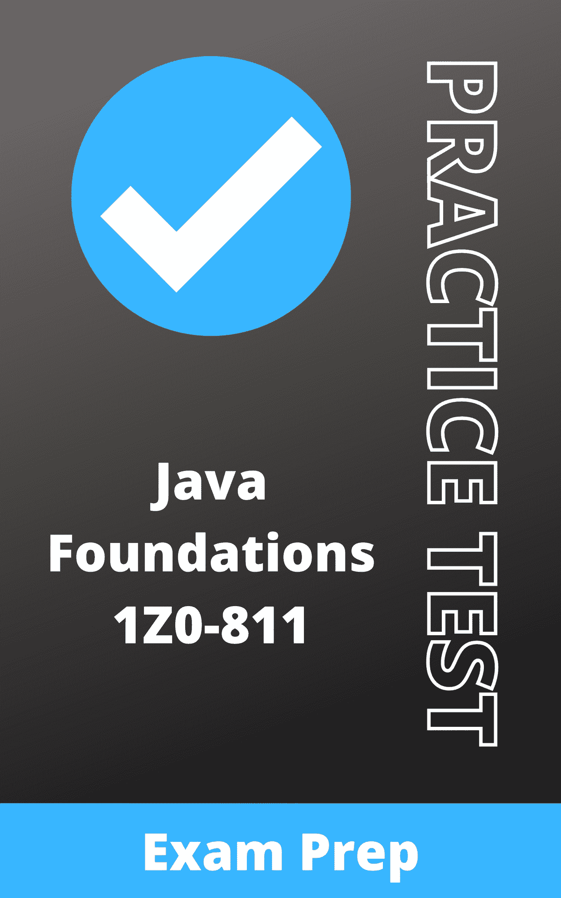

# Java Foundations 1Z0-811 考试实践指南



# 关于本书

感谢您购买本书！

书中的练习题旨在作为帮助您准备 [Java 基础考试, 1Z0-811](https://education.oracle.com/java-foundations/pexam_1Z0-811) 的工具。它包含的问题涵盖了考试目标中发布的每一个主题。

为了获得最大的成功几率，强烈建议您将此练习题与培训、自学或其他准备方法结合使用，以确保您对考试将涵盖的所有主题都有坚实的理解。

## 反馈

如果您觉得这本书对您有帮助，请考虑留下积极的评价，或在 Twitter 或 LinkedIn 上发布内容与他人分享。

如果您想发送电子邮件，可以邮件至 `feedback@getcertified.dev`。

## 祝您好运！

再次感谢，祝您考试顺利！

---

### 第 1 题

以下哪些是 Java 的特性？选择 3 个正确答案：

A. 面对象

B. 平台无关

C. 上下文无关

D. 单线程

E. 多线程

**第 1 题：**

以下哪些是 Java 的特性？选择 3 个正确答案：

A. 面对象（正确）

B. 平台无关（正确）

C. 上下文无关（错误）

D. 单线程（错误）

E. 多线程（正确）

---

## 目标: 01a - 描述 Java 的特性

### 第 2 题

哪种类型的应用程序**不能**使用 Java 创建？选择正确答案：

A. 桌面应用

B. Web 应用程序

C. 移动应用

D. 这些应用程序类型都无法使用 Java 创建

E. 所有这些应用程序类型都可以使用 Java 创建

**第 2 题：**

哪种类型的应用程序**不能**使用 Java 创建？选择正确答案：

A. 桌面应用（错误）

B. Web 应用程序（错误）

C. 移动应用（错误）

D. 这些应用程序类型都无法使用 Java 创建（错误）

E. 所有这些应用程序类型都可以使用 Java 创建（正确）

---

## 目标: 01b - 描述 Java 的现实世界应用

### 第 3 题

填空：

__________ 提供了库、Java 虚拟机以及其他组件，供您运行用 Java 语言编写的 applet 和应用程序。它可以随应用程序一起分发，使其能够独立运行。选择正确答案：

A. Java 运行环境 (JRE)

B. Java 执行环境 (JEE)

C. 即时编译编译器 (JIT)

D. Java 语言规范 (JLS)

**第 3 题：**

填空：

__________ 提供了库、Java 虚拟机以及其他组件，供您运行用 Java 语言编写的 applet 和应用程序。它可以随应用程序一起分发，使其能够独立运行。选择正确答案：

A. Java 运行环境 (JRE)（正确）

B. Java 执行环境 (JEE)（错误）

C. 即时编译编译器 (JIT)（错误）

D. Java 语言规范 (JLS)（错误）

---

## 目标: 02a - 描述 Java 开发工具包 (JDK) 和 Java 运行环境 (JRE)

参考资料：

* [`docs.oracle.com/javase/7/docs/technotes/guides/index.html`](https://docs.oracle.com/javase/7/docs/technotes/guides/index.html)

### 第 4 题

填空：

__________ 包含了 JRE 加上命令行开发工具（如编译器和调试器），这些工具对于开发 applet 和应用程序是必要的或有用的。选择正确答案：

A. Java Servlet

B. Java 开发工具包 (JDK)

C. Java 编译器

D. Java 命令行接口 (CLI)

E. JAR 文件

**第 4 题：**

填空：

__________ 包含了 JRE 加上命令行开发工具（如编译器和调试器），这些工具对于开发 applet 和应用程序是必要的或有用的。选择正确答案：

A. Java Servlet（错误）

B. Java 开发工具包 (JDK)（正确）

C. Java 编译器（错误）

D. Java 命令行接口 (CLI)（错误）

E. JAR 文件（错误）

---

### 第 5 题

关于面向对象编程中的对象，以下哪些陈是**正确**的？选择 2 个正确答案：

A. 对象应该只用于表示现实世界的物理对象

B. 对象使用字段来存储状态

C. 对象提供方法来操作其内部状态

D. 对象优化您的代码的性能

**第 5 题：**

关于面向对象编程中的对象，以下哪些陈是**正确**的？选择 2 个正确答案：

A. 对象应该只用于表示现实世界的物理对象（错误）

B. 对象使用字段来存储状态（正确）

C. 对象提供方法来操作其内部状态（正确）

D. 对象优化您的代码的性能（错误）

---

## 目标: 02b - 描述面向对象编程的组件

参考资料：

* [`docs.oracle.com/javase/tutorial/java/concepts/object.html`](https://docs.oracle.com/javase/tutorial/java/concepts/object.html)

### 第 6 题

在面向对象编程中，创建对象的蓝图或原型是什么？选择正确答案：

A. 类 (Class)

B. 实例 (Instance)

C. 结构体 (Struct)

D. 类型 (Type)

E. 变量 (Variable)

**第 6 题：**

在面向对象编程中，创建对象的蓝图或原型是什么？选择正确答案：

A. 类（正确）

B. 实例（错误）

C. 结构体（错误）

D. 类型（错误）

E. 变量（错误）

---

### 第 7 题

考虑以下代码：

```java
class MountainBike extends Bicycle
```

这是哪种面向对象概念？选择正确答案：

A. 组合 (Composition)

B. 封装 (Encapsulation)

C. 等幂性 (Idempotency)

D. 继承 (Inheritance)

**第 7 题：**

考虑以下代码：

```java
class MountainBike extends Bicycle
```

这是哪种面向对象概念？选择正确答案：

A. 组合（错误）

B. 封装（错误）

C. 等幂性（错误）

D. 继承（正确）

---

### 第 8 题

你有以下接口：

```java
interface Bicycle {
    void changeCadence(int newValue);
    void changeGear(int newValue);
    void speedUp(int increment);
    void applyBrakes(int decrement);
}
```

如何定义一个可以在任何需要该接口的地方类？选择正确答案：

A. class ACMEBicycle extends Bicycle {}

B. class ACMEBicycle implements Bicycle {}

C. class ACMEBicycle : Bicycle {}

D. class ACMEBicycle { }

**第 8 题：**

你有以下接口：

```java
interface Bicycle {
    void changeCadence(int newValue);
    void changeGear(int newValue);
    void speedUp(int increment);
    void applyBrakes(int decrement);
}
```

如何定义一个可以在任何需要该接口的地方类？选择正确答案：

A. class ACMEBicycle extends Bicycle {}（错误）

B. class ACMEBicycle implements Bicycle {}（正确）

C. class ACMEBicycle : Bicycle {}（错误）

D. class ACMEBicycle { }（错误）

---

### 第 9 题

填空：

__________ 是用于逻辑方式组织类和接口的命名空间。选择正确答案：

A. 容器 (Container)

B. 依赖 (Dependency)

C. JAR 文件 (JAR File)

D. 包 (Package)

`__________` 是一个以逻辑方式组织类和接口的命名空间。请选择正确的答案：

A. 容器（错误）

B. 依赖（错误）

C. JAR 文件（错误）

D. 包（正确）

***

## 目标: 02b - 描述面向对象编程的组件

参考资料：

* [`docs.oracle.com/javase/tutorial/java/concepts/package.html`](https://docs.oracle.com/javase/tutorial/java/concepts/package.html)

### 第 10 题：你正在创建一个新的 Java 程序。

以下哪一项将打印 `Hello Java`？请选择正确的答案：

A.

```java
class ExamPrep {
  public void main(String[] args){
    System.out.println("Hello Java");
  }
}
```

B.

```java
class ExamPrep {
  public static void main(String[] args){
    System.out.println("Hello Java");
  }
}
```

C.

```java
class ExamPrep {
  public void Main(String[] args){
    System.out.println("Hello Java");
  }
}
```

D.

```java
class ExamPrep {
  public static void Main(String[] args){
    System.out.println("Hello Java");
  }
}
```

**第 10 题结果：**

A.

```java
class ExamPrep {
  public void main(String[] args){
    System.out.println("Hello Java");
  }
}
```

（错误）

B.

```java
class ExamPrep {
  public static void main(String[] args){
    System.out.println("Hello Java");
  }
}
```

（正确）

C.

```java
class ExamPrep {
  public void Main(String[] args){
    System.out.println("Hello Java");
  }
}
```

（错误）

D.

```java
class ExamPrep {
  public static void Main(String[] args){
    System.out.println("Hello Java");
  }
}
```

（错误）

***

## 目标: 02c - 描述基础 Java 程序的组件

参考资料：

* [`www.oracle.com/java/technologies/compile.html`](https://www.oracle.com/java/technologies/compile.html)

### 第 11 题：你在一个名为 `hello.java` 的文件中创建了一个简单的 Java 程序，代码如下：

```java
class ExamPrep {
  public static void main(String[] args){
    System.out.println("Hello Java");
  }
}
```

使用哪哪个命令可以编译此程序并将其转换为字节码（字节码是 Java 虚拟机的平台无关指令）？请选择正确的答案：

A. `java hello.java`

B. `java -c hello.java`

C. `java -jar hello.java`

D. `javac hello.java`

**第 11 题结果：**

A. `java hello.java` （错误）

B. `java -c hello.java` （错误）

C. `java -jar hello.java` （错误）

D. `javac hello.java` （正确）

***

## 目标: 02d - 编译并执行 Java 程序

参考资料：

* [`www.oracle.com/java/technologies/compile.html`](https://www.oracle.com/java/technologies/compile.html)

### 第 12 题：你在一个名为 `hello.java` 的文件中创建了一个简单的 Java 程序，代码如下：

```java
class ExamPrep {
  public static void main(String[] args){
    System.out.println("Hello Java");
  }
}
```

你执行了 `javac hello.java` 并发现在同一目录下生成了一个名为 `ExamPrep.class` 的文件。

你可以使用哪个命令执行该程序并看到 `Hello Java` 的输出？请选择正确的答案：

A. `java ExamPrep`

B. `java ExamPrep.class`

C. `javac ExamPrep`

D. `javac ExamPrep.class`

**第 12 题结果：**

A. `java ExamPrep` （正确）

B. `java ExamPrep.class` （错误）

C. `javac ExamPrep` （错误）

D. `javac ExamPrep.class` （错误）

***

## 目标: 02d - 编译并执行 Java 程序

参考资料：

* [`www.oracle.com/java/technologies/compile.html`](https://www.oracle.com/java/technologies/compile.html)

### 第 13 题：遵循 Java 规范，以下哪些项应该以大写开头？请选择 2 个答案：

A. `classes`

B. `interfaces`

C. `local variables`

D. `packages`

E. `public methods`

**第 13 题结果：**

A. `classes` （正确）

B. `interfaces` （正确）

C. `local variables` （错误）

D. `packages` （错误）

E. `public methods` （错误）

***

## 目标: 03a - 识别 Java 程序中需要遵循的规范

参考资料：

* [`www.oracle.com/java/technologies/codeconventions.html`](https://www.oracle.com/java/technologies/codeconventions.html)

### 第 14 题：你是 `Example Corp` 的软件开发人员，正在创建一个新包。你需要命名。哪行代码符合 Java 包命名规范？

A. `ExampleCorp`

B. `exampleCorp`

C. `CorpExample`

D. `com.example`

E. `example.com`

F. `www.example`

**第 14 题结果：**

A. `ExampleCorp` （错误）

B. `exampleCorp` （错误）

C. `CorpExample` （错误）

D. `com.example` （正确）

E. `example.com` （错误）

F. `www.example` （错误）

包的前缀总是全小写的，并且应该是顶级域名名称。

***

## 目标: 03a - 识别 Java 程序中需要遵循的规范

参考资料：

* [`www.oracle.com/java/technologies/codeconventions.html`](https://www.oracle.com/java/technologies/codeconventions.html)

### 第 15 题：你正在编写一个函数，需要声明一个变量。以下哪些变量声明可以通过编译？请选择正确的答案：

A. `String 100`

B. `String _100`

C. `String 100_`

D. `None of these are valid`

**第 15 题结果：**

A. `String 100` （错误）

B. `String _100` （正确）

C. `String 100_` （错误）

D. `None of these are valid` （错误）

标识可以包含下划线，但不能以数字开头。

***

## 目标: 03a - 识别 Java 程序中需要遵循的规范

参考资料：

* [`docs.oracle.com/javase/tutorial/java/nutsandbolts/variables.html`](https://docs.oracle.com/javase/tutorial/java/nutsandbolts/variables.html)


#### 16：你正在编写一个函数，需要声明另一个变量。以下哪些变量声明可以通过编译？请选择正确的答案：

A. `String 200`

B. `String $200`

C. `String 200$`

D. `None of these are valid`

**第 16 题结果：**

A. `String 200` （错误）

B. `String $200` （正确）

C. `String 200$` （错误）

D. `None of these are valid` （错误）

标识符可以包含美元符号，但不能以数字开头。通常 `$` 留给自动生成的代码，但作为标识符的一部分是有效的。

- [`docs.oracle.com/javase/tutorial/java/nutsandbolts/variables.html`](https://docs.oracle.com/javase/tutorial/java/nutsandbolts/variables.html)

### 问题 17：以下哪一个不是 Java 预留关键字？

请选择正确答案：

A. `default` (错误)

B. `object` (正确)

C. `import` (错误)

D. `new` (错误)

E. 以上都是 Java 预留关键字 (错误)

***

## 目标：03b - 使用 Java 预留关键字

参考资料：

- [`docs.oracle.com/javase/tutorial/java/nutsandbolts/_keywords.html`](https://docs.oracle.com/javase/tutorial/java/nutsandbolts/_keywords.html)

### 问题 18：你写了以下函数来计算两个数字之和：

```java
public int add(int a, int b) {
    return a + b;
}
```

现在，你想在与返回语句相同的行上添加一个“Add two numbers”的注释。你应该如何做？请选择 2 个正确答案：

A. `return a + b; # Add two numbers` (错误)

B. `return a + b; /* Add two numbers */` (正确)

C. `return a + b; -- Add two numbers` (错误)

D. `return a + b; // Add two numbers` (正确)

***

## 目标：03c - 在 Java 程序中使用单行注释和多行注释

参考资料：

- [`www.oracle.com/java/technologies/javase/codeconventions-comments.html`](https://www.oracle.com/java/technologies/javase/codeconventions-comments.html)

### 问题 19：你写了以下函数来计算两个数字之和：

```java
public int add(int a, int b) {
    return a + b;
}
```

现在，你想添加一个多行注释，第一行写“Add two numbers”，第二行写“Returns an integer”。你应该如何做？请选择正确答案：

A.

```java
/*
Add two numbers
Returns an integer
*/
``` (正确)

B.

```java
//
Add two numbers
Returns an integer
//
``` (错误)

C.

```java
//
Add two numbers
Returns an integer
///
``` (错误)

D. 以上都不是。无法添加跨越多行的单个注释 (错误)

***

## 目标：03c - 在 Java 程序中使用单行注释和多行注释

参考资料：

- [`www.oracle.com/java/technologies/javase/codeconventions-comments.html`](https://www.oracle.com/java/technologies/javase/codeconventions-comments.html)

### 问题 20：你写了以下代码：

```java
package com.example;

// LINE 2
public class Main {
    public static void main(String[] args) {
        Rectangle myRectangle = new Rectangle();
    }
}
```

当你编译它时，得到一个提示为 `java: cannot find symbol` 的错误。你可以在 `// LINE 2` 处添加什么来解决这个问题？请选择正确答案：

A. `class graphics.Rectangle;` (错误)

B. `export graphics.Rectangle;` (错误)

C. `import graphics.Rectangle;` (正确)

D. `package graphics.Rectangle;` (错误)

***

## 目标：03d - 导入其他 Java 包以便在代码中可以访问它们

参考资料：

- [`docs.oracle.com/javase/tutorial/java/package/usepkgs.html`](https://docs.oracle.com/javase/tutorial/java/package/usepkgs.html)

### 问题 21：关于 `java.lang` 包，以下哪些陈述是正确的？

请选择正确答案：

A. 它提供了对 Java 编程语言设计至关重要的类，如 `Object`、`Class` 以及基本类型包装类如 `Boolean`、`Integer` 和 `Float`。(正确)

B. 它提供了允许 Java 程序为多语言支持提供文本本地化的类 (错误)

C. 它提供了允许 Java 调用其他语言编写的程序导出的函数，并提供了导出 Java 程序函数供其他编程语言编写的程序使用的功能 (错误)

D. 这些陈述都不正确 (错误)

***

## 目标：03e - 描述 java.lang 包

参考资料：

- [`docs.oracle.com/javase/7/api/java/lang/package-summary.html`](https://docs.oracle.com/javase/7/api/java/lang/package-summary.html)

### 问题 22：你正在编写一个 Java 程序，需要声明一个可以存储整数的变量 `myvar`，并且你还想给它赋值 5。你应该使用哪行代码？

A. `int myvar = 5;` (正确)

B. `integer myvar = 5;` (错误)

C. `myvar int = 5;` (错误)

D. `myvar integer = 5;` (错误)

***

### 目标：04a - 声明和初始化变量，包括使用 final 的变量

参考资料：

- [`docs.oracle.com/javase/tutorial/java/nutsandbolts/variables.html`](https://docs.oracle.com/javase/tutorial/java/nutsandbolts/variables.html)
- [`docs.oracle.com/javase/tutorial/java/nutsandbolts/datatypes.html`](https://docs.oracle.com/javase/tutorial/java/nutsandbolts/datatypes.html)

### 问题 23：你在一个名为 `hello.java` 的文件中写了以下 Java 程序：

```java
class ExamPrep {
    public static void main(String[] args) {
        int myvar;
        System.out.println(myvar);
    }
}
```

你运行 `javac hello.java` 和 `java ExamPrep`。输出是什么？请选择正确答案：

A. `0` (错误)

B. `null` (错误)

C. `undefined` (错误)

D. `javac hello.java 命令失败并报错，因为你没有初始化 myvar.` (正确)

* [变量](https://docs.oracle.com/javase/tutorial/java/nutsandbolts/variables.html)
* [数据类型](https://docs.oracle.com/javase/tutorial/java/nutsandbolts/datatypes.html)

### 问题 24

你正在运行一个 Java 项目，并在函数中看到以下行代码：

```java
final int rate = 5;
```

`final` 关键字的作用是什么？

选择正确答案：

A. 如果有另一行代码尝试给 `rate` 变量赋值，将发生编译时错误。

B. 如果有另一行代码尝试给 `rate` 变量赋值，将发生编译时警告。

C. 如果有另一行代码尝试给 `rate` 变量赋值，将发生运行时错误。

D. 如果有另一行代码尝试给 `rate` 变量赋值，将发生运行时警告。

**问题 24 答案解析：**

A. 如果有另一行代码尝试给 `rate` 变量赋值，将发生编译时错误。**正确**

B. 如果有另一行代码尝试给 `rate` 变量赋值，将发生编译时警告。**错误**

C. 如果有另一行代码尝试给 `rate` 变量赋值，将发生运行时错误。**错误**

D. 如果有另一行代码尝试给 `rate` 变量赋值，将发生运行时警告。**错误**

***

**目标：04a - 声明和初始化变量，包括使用 final 的变量**

参考：

* [`docs.oracle.com/javase/tutorial/java/nutsandbolts/variables.html`](https://docs.oracle.com/javase/tutorial/java/nutsandbolts/variables.html)

### 问题 25

以下哪些是 Java 中的基本数据类型？

选择 5 个正确答案：

A. bool

B. boolean

C. byte

D. char

E. date

F. double

G. int

H. single

I. string

**问题 25 答案解析：**

A. bool **错误**

B. boolean **正确**

C. byte **正确**

D. char **正确**

E. date **错误**

F. double **正确**

G. int **正确**

H. single **错误**

I. string **错误**

***

**目标：04a - 声明和初始化变量，包括使用 final 的变量**

参考：

* [`docs.oracle.com/javase/tutorial/java/nutsandbolts/datatypes.html`](https://docs.oracle.com/javase/tutorial/java/nutsandbolts/datatypes.html)

### 问题 26

以下哪个列表按照容量从小到大的顺序排列了数据类型？

选择正确答案：

A. short, byte, int, long

B. byte, short, long, int

C. byte, int, short, long

D. byte, short, int, long

**问题 26 答案解析：**

A. short, byte, int, long **错误**

B. byte, short, long, int **错误**

C. byte, int, short, long **错误**

D. byte, short, int, long **正确**

***

**目标：04a - 声明和初始化变量，包括使用 final 的变量**

参考：

* [`docs.oracle.com/javase/tutorial/java/nutsandbolts/datatypes.html`](https://docs.oracle.com/javase/tutorial/java/nutsandbolts/datatypes.html)

### 问题 27

你需要在变量中存储数字 128 的值。

可以使用哪些数据类型？

选择所有正确答案。

A. boolean

B. byte

C. short

D. int

E. long

**问题 27 答案解析：**

A. boolean **错误** (`boolean` 只能存储 `true` 或 `false`)

B. byte **错误** (`byte` 的最小值为 -128，最大值为 127（包含）)

C. short **正确** (`short` 的最小值为 -32,768，最大值为 32,767（包含）)

D. int **正确** (`int` 的最小值为 -2³¹，最大值为 2³¹ -1)

E. long **正确** (`long` 的最小值为 -2⁶³，最大值为 2⁶³ -1)

***

**目标：04a - 声明和初始化变量，包括使用 final 的变量**

参考：

* [`docs.oracle.com/javase/tutorial/java/nutsandbolts/datatypes.html`](https://docs.oracle.com/javase/tutorial/java/nutsandbolts/datatypes.html)

### 问题 28

你正在编写一个 Java 函数，代码如下：

```java
short a = 1;
short b = 2;
// LINE 3
```

在 `// LINE 3` 处填写什么可以将变量 `a` 和 `b` 相加并将结果存储在另一个变量 `c` 中？

选择 2 个正确答案：

A. `short c = a + b;`

B. `int c = a + b;`

C. `short c = (short)(a + b);`

D. `short c = (short)a + (short)b;`

**问题 28 答案解析：**

A. `short c = a + b;` **错误**

B. `int c = a + b;` **正确**

C. `short c = (short)(a + b);` **正确**

D. `short c = (short)a + (short)b;` **错误**

***

**目标：04b - 从一种类型转换为另一种类型，包括自动提升**

参考：

* [`docs.oracle.com/javase/specs/se11/html/jls-5.1`](https://docs.oracle.com/javase/specs/se11/html/jls-5.1)

### 问题 29

以下哪些 Java 行可以声明并初始化变量？

选择 2 个正确答案：

A. `s = "Hello"`

B. `String s = "Hello"`

C. `String s = new String("Hello")`

D. `String s`

**问题 29 答案解析：**

A. `s = "Hello"` **错误**

B. `String s = "Hello"` **正确**

C. `String s = new String("Hello")` **正确**

D. `String s` **错误**

***

**目标：04c - 声明和初始化 String**

参考：

* [`docs.oracle.com/javase/tutorial/java/strings.html`](https://docs.oracle.com/javase/tutorial/java/strings.html)

### 问题 30

以下哪个不是 Java 中的运算符？

选择正确答案：

A. `+`

B. `-`

C. `*`

D. `/`

E. `\`

F. `%`

**问题 30 答案解析：**

A. `+` **错误**

B. `-` **错误**

C. `*` **错误**

D. `/` **错误**

E. `\` **正确**

F. `%` **错误**

***

**目标：05a - 使用基础算术运算符处理数据**

参考：


* [`docs.oracle.com/javase/tutorial/java/nutsandbolts/op1.html`](https://docs.oracle.com/javase/tutorial/java/nutsandbolts/op1.html)

### 问题 31

哪个运算符是 Java 的取模运算符，返回第一个操作数除以第二个操作数后的余数？

选择正确答案：

A. `/`

B. `\`

C. `%`

D. `^`

**问题 31 解析：**

选择正确答案：

A. `/` **错误**

B. `\` **错误**

C. `%` **正确**

D. `^` **错误**

***

**目标：05a - 使用基础算术运算符处理数据**

参考：

* [`docs.oracle.com/javase/tutorial/java/nutsandbolts/op1.html`](https://docs.oracle.com/javase/tutorial/java/nutsandbolts/op1.html)

### 问题 32

以下 Java 程序的输出是什么？

```java
class ExamPrep {
    public static void main(String[] args) {
        int a = 5;
        int b = a++;
        System.out.println(b);
    }
}
```

选择正确答案：

A. 4

B. 5

C. 6

D. 该程序将无法编译

E. 该程序将发生运行时错误

**问题 32 解析：**

选择正确答案：

A. 4 **错误**

B. 5 **正确** (`a` 在赋值给 `b` 之后自增)

C. 6 **错误**

D. 该程序将无法编译 **错误**

E. 该程序将发生运行时错误 **错误**

***

**目标：05b - 使用自增和自减运算符**

参考：

* [`docs.oracle.com/javase/tutorial/java/nutsandbolts/op1.html`](https://docs.oracle.com/javase/tutorial/java/nutsandbolts/op1.html)

### 问题 33

下面 Java 程序的输出是什么？

```java
class ExamPrep {
  public static void main(String[] args) {
    int a = 5;
    int b = ++a;
    System.out.println(b);
  }
}
```

选择正确答案：

A. 4 (错误)

B. 5 (错误)

**C. 6 (正确)** - `a` 在赋值给 `b` 之前已经加了 1

D. 此程序将无法编译（错误）

E. 此程序将在运行时发生错误（错误）

***

## 目标: 05b - 使用自增和自减运算符

参考文献：

* [`docs.oracle.com/javase/tutorial/java/nutsandbolts/op1.html`](https://docs.oracle.com/javase/tutorial/java/nutsandbolts/op1.html)

### 问题 34

如果 `a` 和 `b` 的值相等，哪个代码块会打印 Yes？

选择正确答案：

A. `if (a = b) { System.out.println("Yes"); }` (错误)

**B. `if (a == b) { System.out.println("Yes"); }` (正确)**

C. `if (a === b) { System.out.println("Yes"); }` (错误)

D. `if (a instanceof b) { System.out.println("Yes"); }` (错误)

***

## 目标: 05c - 使用关系运算符，包括 `==`, `!=`, `>=`, 和 `<=`

参考文献：

* [`docs.oracle.com/javase/tutorial/java/nutsandbolts/op2.html`](https://docs.oracle.com/javase/tutorial/java/nutsandbolts/op2.html)

### 问题 35

如果 `a` 和 `b` 的值不相等，哪个代码块会打印 No？

选择正确答案：

**A. `if (a != b) { System.out.println("No"); }` (正确)**

B. `if (a !== b) { System.out.println("No"); }` (错误)

C. `if (a !=== b) { System.out.println("No"); }` (错误)

D. `if (a ! b) { System.out.println("No"); }` (错误)

***

### 问题 36

你定义了这样一个变量 `a`：`int a = 5;`。你可以使用哪些代码将 `a` 减 1？选择所有正确答案。每个答案代表一个完整的解决方案。

**A. `--a;` (正确)**

**B. `a--;` (正确)**

**C. `a -= 1;` (正确)**

D. `a =- 1;` (错误)

**E. `a = a - 1;` (正确)**

***

## 目标: 05d - 使用算术赋值运算符

参考文献：

* [`docs.oracle.com/javase/tutorial/java/nutsandbolts/op1.html`](https://docs.oracle.com/javase/tutorial/java/nutsandbolts/op1.html)

### 问题 37

下面程序的输出是什么？

```java
class ExamPrep {
  public static void main(String[] args) {
    int a = 4;
    int b = 3;
    int result = a < b ? 1 : 2;
    System.out.println(result);
  }
}
```

选择正确答案：

A. 1 (错误)

**B. 2 (正确)**

C. 3 (错误)

D. 4 (错误)

E. 此代码将无法编译（错误）

F. 此代码将在运行时发生异常（错误）

***

## 目标: 05e - 使用条件运算符，包括 `&&`, `||`, 和 `?`

参考文献：

* [`docs.oracle.com/javase/tutorial/java/nutsandbolts/op2.html`](https://docs.oracle.com/javase/tutorial/java/nutsandbolts/op2.html)

### 问题 38

下面程序的输出是什么？

```java
class ExamPrep {
  public static void main(String[] args) {
    int a = 1;
    int b = 2;
    int c = 3;
    boolean result = a < b && b > c;
    System.out.println(result);
  }
}
```

选择正确答案：

A. true (错误)

**B. false (正确)**

C. 此代码将无法编译（错误）

D. 此代码将在运行时发生异常（错误）

***

### 问题 39

下面程序的输出是什么？

```java
class ExamPrep {
  public static void main(String[] args) {
    int a = 1;
    int b = 2;
    int c = 3;
    boolean result = a < b || b > c;
    System.out.println(result);
  }
}
```

选择正确答案：

**A. true (正确)**

B. false (错误)

C. 此代码将无法编译（错误）

D. 此代码将在运行时发生异常（错误）

***

### 问题 40

在第 4 行写什么可以使程序的输出为 10？

```java
class ExamPrep {
  public static void main(String[] args) {
    int a = 3;
    // 第 4 行
    System.out.println(result);
  }
}
```

选择正确答案：

A. `int result = a + 2 * a - 1;` (错误)

**B. `int result = (a + 2) * (a - 1);` (正确)**

C. `int result = (a + 2 * a) - 1;` (错误)

D. `int result = a + (2 * a - 1);` (错误)

***

## 目标: 05f - 描述运算符优先级和括号的使用

参考文献：

* [`docs.oracle.com/javase/tutorial/java/nutsandbolts/op2.html`](https://docs.oracle.com/javase/tutorial/java/nutsandbolts/op2.html)

### 问题 41

你有以下代码。

```java
class ExamPrep {
  public static void main(String[] args) {
    int a = 5;
    // 第 4 行
  }
  static void printMessage(String message) {
    System.out.println("Message = " + message);
  }
}
```

在第 4 行可以放置什么，使得程序的输出为 `Message = 5`？请选择 2 个正确答案。每个答案代表一个完整的解决方案。

```java
class ExamPrep {
  public static void main(String[] args){
    int a = 5;
    // LINE 4
  }
  static void printMessage(String message) {
    System.out.println("Message = " + message);
  }
}
```

选择正确答案：

A. `printMessage(a);` 错误

B. `printMessage(a.toString());` 错误

C. `printMessage((String)a);` 错误

D. `printMessage(String.valueOf(a));` 正确

E. `printMessage(Integer.toString(a));` 正确

---

**目标:** 06a - 开发使用 `String` 类方法的代码

**参考文献:**

* [`docs.oracle.com/javase/tutorial/java/data/converting.html`](https://docs.oracle.com/javase/tutorial/java/data/converting.html)

---

## 问题 42

在第 4 行可以放置什么，使得程序的输出为 `v`？请选择正确答案：

```java
class ExamPrep {
  public static void main(String[] args){
    String s = "Java";
    // LINE 4
    System.out.println(result);
  }
}
```

选择正确答案：

A. `char result = s[2];` 错误

B. `char result = s[3];` 错误

C. `char result = s.charAt(2);` 正确

D. `char result = s.charAt(3);` 错误

---

**目标:** 06a - 开发使用 `String` 类方法的代码

**参考文献:**

* [`docs.oracle.com/javase/tutorial/java/data/manipstrings.html`](https://docs.oracle.com/javase/tutorial/java/data/manipstrings.html)

---

## 问题 43

在第 4 行可以放置什么，使得程序的输出为 `av`？请选择正确答案：

```java
class ExamPrep {
  public static void main(String[] args){
    String s = "Java";
    // LINE 4
    System.out.println(result);
  }
}
```

选择正确答案：

A. `String result = s.split(1, 2);` 错误

B. `String result = s.split(1, 3);` 错误

C. `String result = s.substring(1, 2);` 错误

D. `String result = s.substring(1, 3);` 正确

---

**目标:** 06a - 开发使用 `String` 类方法的代码

**参考文献:**

* [`docs.oracle.com/javase/tutorial/java/data/manipstrings.html`](https://docs.oracle.com/javase/tutorial/java/data/manipstrings.html)

---

## 问题 44

以下程序的输出是什么？

```java
class ExamPrep {
  public static void main(String[] args){
    String s = "Java";
    int result = s.indexOf("a");
    System.out.println(result);
  }
}
```

选择正确答案：

A. -1

B. 0

C. 1 正确

D. 2

E. 3

F. 4

G. 此程序无法编译

H. 此程序将抛出异常

---

**目标:** 06a - 开发使用 `String` 类方法的代码

**参考文献:**

* [`docs.oracle.com/javase/tutorial/java/data/manipstrings.html`](https://docs.oracle.com/javase/tutorial/java/data/manipstrings.html)

---

## 问题 45

以下程序的输出是什么？

```java
class ExamPrep {
  public static void main(String[] args){
    String s = "Java";
    int result = s.indexOf("x");
    System.out.println(result);
  }
}
```

选择正确答案：

A. -1 正确

B. 0

C. 1

D. 2

E. 3

F. 4

G. 此程序无法编译

H. 此程序将抛出异常

---

**目标:** 06a - 开发使用 `String` 类方法的代码

**参考文献:**

* [`docs.oracle.com/javase/tutorial/java/data/manipstrings.html`](https://docs.oracle.com/javase/tutorial/java/data/manipstrings.html)

---

## 问题 46

以下程序的输出是什么？

```java
class ExamPrep {
  public static void main(String[] args){
    String s = "Java";
    int result = s.lastIndexOf("a");
    System.out.println(result);
  }
}
```

选择正确答案：

A. -1

B. 0

C. 1

D. 2

E. 3 正确

F. 4

G. 此程序无法编译

H. 此程序将抛出异常

---

**目标:** 06a - 开发使用 `String` 类方法的代码

**参考文献:**

* [`docs.oracle.com/javase/tutorial/java/data/manipstrings.html`](https://docs.oracle.com/javase/tutorial/java/data/manipstrings.html)

---

## 问题 47

以下程序的输出是什么？

```java
class ExamPrep {
  public static void main(String[] args){
    String s = "Java Exam Prep";
    boolean result = s.contains("exam");
    System.out.println(result);
  }
}
```

选择正确答案：

A. true

B. false 正确（记住：字符串比较是区分大小写的！）


## 问题 48

`String` 类的哪个方法返回一个转换为小写的字符串副本？

选择正确答案：

A. `toLower()`

B. `toLowerCase()` 正确

C. `asLower()`

D. `asLowerCase()`

E. `lower()`

**目标:** 06a - 开发使用 `String` 类方法的代码

**参考文献:**

* [`docs.oracle.com/javase/tutorial/java/data/manipstrings.html`](https://docs.oracle.com/javase/tutorial/java/data/manipstrings.html)

---

## 问题 49

`String` 类的哪种方法返回一个除了头部和尾空格的字符串副本？选择正确的答案：

A. `removeSpace()` (错误)

B. `removeWhiteSpace()` (错误)

C. `split()` (错误)

D. `trim()` (正确)

E. `withoutSpace()` (错误)

**目标：** 06a - 开发使用 `String` 类方法的代码

**参考文献：**

* [Java 教程：处理字符串](https://docs.oracle.com/javase/tutorial/java/data/manipstrings.html)

---

## 问题 50

以下哪行代码可以用于判断 `String` 类型的变量 `s` 的内容是否以 "java" 开头？选择正确的答案：

A. `boolean result = s.beginsWith("java");` (错误)

B. `boolean result = s.hasPrefix("java");` (错误)

C. `boolean result = s.startsWith("java");` (正确)

D. `boolean result = s.prefixEquals("java");` (错误)

**目标：** 06a - 开发使用 `String` 类方法的代码

**参考文献：**

* [Java 教程：比较字符串](https://docs.oracle.com/javase/tutorial/java/data/comparestrings.html)

---

## 问题 51

`String` 类的哪种方法返回字符串的长度？选择正确的答案：

A. `length()` (正确)

B. `size()` (错误)

C. `capacity()` (错误)

D. `getLength()` (错误)

E. `getSize()` (错误)

F. `getCapacity()` (错误)

**目标：** 06a - 开发使用 `String` 类方法的代码

**参考文献：**

* [Java 教程：字符串](https://docs.oracle.com/javase/tutorial/java/data/strings.html)

---

## 问题 52

在第 5 行添加什么内容可以使程序打印 `JavaExam`？

```java
class ExamPrep {
  public static void main(String[] args){
    String a = "Java";
    String b = "Exam";
    // LINE 5
    System.out.println(result);
  }
}
```

选择 2 个正确答案。每个答案代表一个完整的解决方案。

A. `String result = a + b;` (正确)

B. `String result = a & b;` (错误)

C. `String result = a.concat(b);` (正确)

D. `String result = b.concat(a);` (错误)

E. `String result = String.concat(a, b);` (错误)

**目标：** 06a - 开发使用 `String` 类方法的代码

**参考文献：**

* [Java 教程：字符串](https://docs.oracle.com/javase/tutorial/java/data/strings.html)

---

## 问题 53

在第 4 行添加什么内容可以使程序打印 `Percent Complete = 56.79`？

```java
class ExamPrep {
  public static void main(String[] args){
    double a = 56.785;
    // LINE 4
    System.out.println(result);
  }
}
```

选择正确的答案：

A. `String result = String.format("Percent Complete = %d", a);` (错误)

B. `String result = String.format("Percent Complete = %.2d", a);` (错误)

C. `String result = String.format("Percent Complete = %f", a);` (错误)

D. `String result = String.format("Percent Complete = %.2f", a);` (正确)

E. `String result = String.format("Percent Complete = %s", a);` (错误)

F. `String result = String.format("Percent Complete = %.2s", a);` (错误)

**目标：** 06b - 使用包括 `%d`, `%n` 和 `%s` 在内的转义序列格式化字符串

**参考文献：**

* [Java 教程：数字格式化](https://docs.oracle.com/javase/tutorial/java/data/numberformat.html)

---

## 问题 54

在第 6 行添加什么内容可以使用适用于平台的换行符，将 `a`、`b` 和 `c` 的值分行打印？

```java
class ExamPrep {
  public static void main(String[] args){
    int a = 1;
    int b = 2;
    int c = 3;
    // LINE 6
    System.out.println(result);
  }
}
```

选择正确的答案：

A. `String result = String.format("%d%n%d%n%d", a, b, c);` (正确)

B. `String result = String.format("%d\n%d\n%d", a, b, c);` (错误)

C. `String result = String.format("%d\r\n%d\r\n%d", a, b, c);` (错误)

D. `String result = String.concat(a, b, c);` (错误)

---

## 问题 55

在第 6 行添加什么内容可以使程序打印 `Java Prep`？

```java
class ExamPrep {
  public static void main(String[] args){
    String a = "Java";
    String b = "Exam";
    String c = "Prep";
    // LINE 6
    System.out.println(result);
  }
}
```

选择正确的答案：

A. `String result = String.format("%d %d %d", a, b, c);` (错误)

B. `String result = String.format("%s %s %s", a, b, c);` (正确)

C. `String result = String.format("%n %n %n", a, b, c);` (错误)

D. `String result = String.format("%a %b %c");` (错误)

---

## 问题 56

你运行以下程序：

```java
import java.util.Random;

class ExamPrep {
  public static void main(String[] args){
    Random r = new Random(23);
    int a = r.nextInt(100);
    int b = r.nextInt(100);
    int c = r.nextInt(100);
    System.out.printf("%d,%d,%d%n", a, b, c);
  }
}
```

输出为 `27,48,83`。

如果你再次运行它，输出将是什么？请选择正确答案：

A. `27,48,83`

B. 另一组在 0（包含）到 100（不包含）之间的三个随机数

C. 此代码将无法编译

D. 此代码将在运行时将抛出异常

**正确**：传递给 `Random` 构造函数的种子 `23` 决定了调用 `nextInt()` 返回的伪随机值的顺序。如果你使用相同的种子再次运行代码，将获得相同的数字序列。

**错误**：另一组在 0（包含）到 100（不包含）之间的三个随机数

**错误**：此代码将无法编译

**错误**：此代码将在运行时将抛出异常

---

**目标**：07a - 使用 `Random` 类

**参考**：

* [`docs.oracle.com/javase/8/docs/api/java/util/Random.html`](https://docs.oracle.com/javase/8/docs/api/java/util/Random.html)

---

## 问题 57

你运行以下程序：

```java
import java.util.Random;

class ExamPrep {
  public static void main(String[] args){
    Random r = new Random();
    int a = r.nextInt(100);
    int b = r.nextInt(100);
    int c = r.nextInt(100);
    System.out.printf("%d,%d,%d%n", a, b, c);
  }
}
```

输出为 `27,48,83`。

如果你再次运行它，输出将是什么？请选择正确答案：

A. `27,48,83`

B. 另一组在 0（包含）到 100（不包含）之间的三个随机数

C. 此代码将无法编译

D. 此代码将在运行时将抛出异常

**错误**：`27,48,83`

**正确**：另一组在 0（包含）到 100（不包含）之间的三个随机数。当不带种子调用时，`Random` 的构造函数将选择一个唯一的种子，导致每次运行代码时返回的伪随机值顺序不同。

**错误**：此代码将无法编译

**错误**：此代码将在运行时将抛出异常

---

**目标**：07a - 使用 `Random` 类

**参考**：

* [`docs.oracle.com/javase/8/docs/api/java/util/Random.html`](https://docs.oracle.com/javase/8/docs/api/java/util/Random.html)

---

## 问题 58

以下哪行代码可以获取变量 `a` 的绝对值？请选择正确答案：

A. `int result = java.lang.Math.abs(x);`

B. `int result = abs(x);`

C. `int result = java.lang.Math.absoluteValue(x);`

D. `int result = absoluteValue(x);`

E. `int result = !x;`

**正确**：`int result = java.lang.Math.abs(x);`

**错误**：`int result = abs(x);`

**错误**：`int result = java.lang.Math.absoluteValue(x);`

**错误**：`int result = absoluteValue(x);`

**错误**：`int result = !x;`

---

**目标**：07b - 使用 `Math` 类

**参考**：

* [`docs.oracle.com/javase/8/docs/api/java/lang/Math.html#abs-int-`](https://docs.oracle.com/javase/8/docs/api/java/lang/Math.html#abs-int-)

---

## 问题 59

你有以下 Java 程序：

```java
class ExamPrep {
  public static void main(String[] args){
    double a = 5.0;
    double b = 2.0;
    // LINE 5
    System.out.println(result);
  }
}
```

在 `LINE 5` 放置什么可以得到 `a` 的 `b` 次幂的结果？请选择正确答案：

A. `double result = a ^ b;`

B. `double result = b ^ a;`

C. `double result = java.lang.Math.exp(a, b);`

D. `double result = java.lang.Math.exp(b, a);`

E. `double result = java.lang.Math.pow(a, b);`

F. `double result = java.lang.Math.pow(b, a);`

**错误**：`double result = a ^ b;`

**错误**：`double result = b ^ a;`

**错误**：`double result = java.lang.Math.exp(a, b);`

**错误**：`double result = java.lang.Math.exp(b, a);`

**正确**：`double result = java.lang.Math.pow(a, b);`

**错误**：`double result = java.lang.Math.pow(b, a);`

---

**目标**：07b - 使用 `Math` 类

**参考**：

* [`docs.oracle.com/javase/8/docs/api/java/lang/Math.html#pow-double`](https://docs.oracle.com/javase/8/docs/api/java/lang/Math.html#pow-double)

---

## 问题 60

可以使用 `java.lang.Math` 的哪个静态函数来返回两个值中的较小值？选择正确答案：

A. `floor`

B. `lessThan`

C. `min`

D. `smallerOf`

**错误**：`floor`

**错误**：`lessThan`

**正确**：`min`

**错误**：`smallerOf`

---

**目标**：07b - 使用 `Math` 类

**参考**：

* [https://docs.oracle.com/javase/8/docs/api/java/lang/Math.html#min-double-double](https://docs.oracle.com/javase/8/docs/api/java/lang/Math.html#min-double-double)

---

## 问题 61

判断对或错：`java.lang.Math` 的 `random()` 方法返回一个 0（包含）到 100（不包含）之间的整数值？请选择正确答案：

A. `TRUE`

B. `FALSE`

**错误**：`TRUE`

**正确**：`FALSE`。`java.lang.Math.random()` 返回 `0.0`（包含）到 `1.0`（不包含）之间的 `double`。它第一次被调用时会创建一个伪随机数生成器，使用 `java.util.Random()`，随后的调用将使用该 `Random` 实例。

---

**目标**：07b - 使用 `Math` 类

**参考**：


* [`docs.oracle.com/javase/8/docs/api/java/lang/Math.html#random-`](https://docs.oracle.com/javase/8/docs/api/java/lang/Math.html#random-)

## 问题 62

你正在编写一个生成 0 到 1 之间随机数的程序，如果小于 .5，则打印“less than half”。你有以下代码：

```java
import java.lang.Math;

class ExamPrep {
  public static void main(String[] args){
    double result = Math.random();
    // LINE 6
  }
}
```

在 `LINE 6` 添加什么可以在随机数小于 .5 时打印“less than half”？请选择 2 个正确答案。每个答案都代表一个完整的解决方案：

A.

```java
if result < .5 {
  System.out.println("less than half");
}
```

B.

```java
if result < .5 then {
  System.out.println("less than half");
}
```

C.

```java
if (result < .5) {
  System.out.println("less than half");
}
```

D.

```java
if (result < .5) then {
  System.out.println("less than half");
}
```

E.

```java
if (result < .5) System.out.println("less than half");
```

**错误**：A

**错误**：B

**正确**：C

**正确**：E

```java
System.out.println("less than half");
```

错误。`if (result < .5) System.out.println("less than half");`

正确

***

## 目标: 08a - 使用决策语句 (if-then 和 if-then-else)

### 参考文献

* [`docs.oracle.com/javase/tutorial/java/nutsandbolts/if.html`](https://docs.oracle.com/javase/tutorial/java/nutsandbolts/if.html)

### 问题 63

你正在编写一个程序来生成 0 到 1 之间的随机数，如果它小于 .5，则打印 heads（正面），否则打印 tails（反面）。你目前有了以下代码：

```java
import java.lang.Math;

class ExamPrep {
  public static void main(String[] args){
    double result = Math.random();
    // LINE 6
  }
}
```

你可以在 `LINE 6` 添加什么内容来根据 `result` 的值打印 heads 或 tails？选择正确答案：

A.

```java
if (result < .5) {
  System.out.println("heads");
} else {
  System.out.println("tails");
}
```

正确

B.

```java
if (result < .5)
  System.out.println("heads");
otherwise
  System.out.println("tails");
```

错误

C.

```java
if (result < .5) {
  System.out.println("heads");
} or else {
  System.out.println("tails");
}
```

错误

D.

```java
if (result < .5)
  System.out.println("heads");
or else
  System.out.println("tails");
```

错误

***

## 目标: 08a - 使用决策语句 (if-then 和 if-then-else)

### 参考文献

* [`docs.oracle.com/javase/tutorial/java/nutsandbolts/if.html`](https://docs.oracle.com/javase/tutorial/java/nutsandbolts/if.html)

## 问题 64

你写了以下 Java 程序：

```java
class ExamPrep {
  public static void main(String[] args){
    printColor(2);
  }
  private static void printColor(int x) {
    switch (x) {
      case 1:
        System.out.println("red");
      case 2:
        System.out.println("blue");
      case 3:
        System.out.println("green");
      default:
        System.out.println("something else");
    }
  }
}
```

运行此程序时的输出将是什么？选择正确答案：

A. red

B. blue

C. green

D. something else

E. blue
green
something else

正确

你需要在每个 `case` 中使用 `break` 关键字以防止穿透（fall-through），并在 `switch` 语句外部恢复执行。

***

## 目标: 08b - 使用 switch 语句

### 参考文献

* [`docs.oracle.com/javase/tutorial/java/nutsandbolts/switch.html`](https://docs.oracle.com/javase/tutorial/java/nutsandbolts/switch.html)

### 问题 65

以下哪些函数会比较两个整数 `a` 和 `b`，如果它们相等则打印 `THEY EQUAL`？选择 2 个正确答案：

A.

```java
public void printComparison(int a, int b) {
  if (a == b) {
    System.out.println("THEY EQUAL");
  }
}
```

正确

B.

```java
public void printComparison(int a, int b) {
  if (a.equals(b)) {
    System.out.println("THEY EQUAL");
  }
}
```

错误

C.

```java
public void printComparison(Integer a, Integer b) {
  if (a.equals(b)) {
    System.out.println("THEY EQUAL");
  }
}
```

正确

D.

```java
public void printComparison(int a, int b) {
  if (Integer.equals(a, b)) {
    System.out.println("THEY EQUAL");
  }
}
```

错误

E.

```java
public void printComparison(int a, int b) {
  if (a instanceof b) {
    System.out.println("THEY EQUAL");
  }
}
```

错误

***

## 目标: 08c - 比较 == 在基本类型和对象之间的差异

### 参考文献

* [`docs.oracle.com/javase/tutorial/java/nutsandbolts/op2.html`](https://docs.oracle.com/javase/tutorial/java/nutsandbolts/op2.html)

### 问题 66

你定义了一个名为 `Customer` 的自定义类，代码如下：

```java
public class Customer {
  private int id;
  private String name;
  public Customer(int id, String name) {
    this.id = id;
    this.name = name;
  }
  public boolean equals(Object o) {
    if (o == this)
      return true;
    else if (o == null || !(o instanceof Customer))
      return false;
    Customer c = (Customer)o;
    return Objects.equals(id, c.id) && Objects.equals(name, c.name);
  }
}
```

如果两个客户具有相同的 `id` 和 `name`，则认为它们是相等。你如何比较两个客户对象 `a` 和 `b`，如果它们相等则打印 `THEY EQUAL`？选择正确答案：

A.

```java
public void printComparison(Customer a, Customer b) {
  if (a == b) {
    System.out.println("THEY EQUAL");
  }
}
```

错误

B.

```java
public void printComparison(Customer a, Customer b) {
  if (a.equals(b)) {
    System.out.println("THEY EQUAL");
  }
}
```

正确

C.

```java
public void printComparison(Customer a, Customer b) {
  if (Customer.equals(a, b)) {
    System.out.println("THEY EQUAL");
  }
}
```

错误

D.

```java
public void printComparison(Customer a, Customer b) {
  if (a instanceof b) {
    System.out.println("THEY EQUAL");
  }
}
```

错误

```java
System.out.println("THEY ARE EQUAL");
}
```

错误

***

## 目标: 08c - 比较 == 在基本类型和对象之间的差异

引用:

* [`docs.oracle.com/javase/8/docs/api/java/lang/Object.html#equals-java.lang.Object-`](https://docs.oracle.com/javase/8/docs/api/java/lang/Object.html#equals-java.lang.Object-)

### 问题 67: 下面程序的输出是什么？

```java
class ExamPrep {
  public static void main(String[] args){
    String a = new String("Java");
    String b = new String("Java");
    if (a == b) {
      System.out.println("They are equal");
    } else {
      System.out.println("They are not equal");
    }
  }
}
```

选择正确答案：

A. 它们相等的

B. 它们不等 **正确**

C. 此程序将无法编译 **错误**

D. 此程序在运行时将抛出异常 **错误**

`==` 是引用比较，由于 `a` 和 `b` 不共享同一个引用，`==` 将返回 `false`。

***

## 目标: 08d - 使用 compareTo 和 equals 方法比较两个 String 对象

引用:

* [`docs.oracle.com/javase/tutorial/java/nutsandbolts/op2.html`](https://docs.oracle.com/javase/tutorial/java/nutsandbolts/op2.html)

### 问题 68: 下面程序有一个 bug。你预期的输出是 "They are equal"，但它打印的是 "They are not equal"。

```java
class ExamPrep {
  public static void main(String[] args){
    String a = new String("Java");
    String b = new String("Java");
    if (a == b) { // 第 5 行
      System.out.println("They are equal");
    } else {
      System.out.println("They are not equal");
    }
  }
}
```

你可以用什么来替换 `第 5 行` 以解决这个问题？

选择正确答案：

A. `if (a instanceof b) {` **错误**

B. `if (a.equals(b)) {` **正确**

C. `if (a === b) {` **错误**

D. `if (a is b) {` **错误**

***

## 目标: 08d - 使用 compareTo 和 equals 方法比较两个 String 对象

引用:

* [`docs.oracle.com/javase/tutorial/java/nutsandbolts/op2.html`](https://docs.oracle.com/javase/tutorial/java/nutsandbolts/op2.html)

### 问题 69: 下面行是你程序中代码的一部分：

```java
String a = new String("Java!");
String b = new String("Exam.");
int result = a.compareTo(b);
```

你已经确定了 `result` 的值为 `5`。这意味着什么？

选择正确答案：

A. `a` 中的 `String` 值与 `b` 中的 `String` 值相差 5。

B. `a` 中的 `String` 值在字典序上小于 `b` 中的 `String` 值。

C. `a` 中的 `String` 值在字典序上大于 `b` 中的 `String` 值。**正确**

D. 什么都不是。`compareTo()` 方法不适用于字符串。

***

## 目标: 08d - 使用 compareTo 和 equals 方法比较两个 String 对象

引用:

* [`docs.oracle.com/javase/tutorial/java/nutsandbolts/op2.html`](https://docs.oracle.com/javase/tutorial/java/nutsandbolts/op2.html)

### 问题 70: Java 提供了循环语句如 `for`、`while`、`do-while`。哪些语句是正确的？

选择正确答案：

A. 循环语句提供了一种只要条件为真就重复执行代码的方法。**正确**

B. 循环语句提供了一种只要条件为假就重复执行代码的方法。

C. Java 在单独线程上执行循环的每次迭代。

D. 循环语句可以提高性能。

E. 除非你传递参数，否则 JVM 会限制迭代次数为 `100` 次。

***

## 目标: 09a - 描述循环语句

引用:

* [`docs.oracle.com/javase/tutorial/java/nutsandbolts/while.html`](https://docs.oracle.com/javase/tutorial/java/nutsandbolts/while.html)
* [`docs.oracle.com/javase/tutorial/java/nutsandbolts/for.html`](https://docs.oracle.com/javase/tutorial/java/nutsandbolts/for.html)

### 问题 71: 下面哪个代码段会打印 1 到 10 的数字？

选择正确答案：

A. `for (int i = 0; i < 10; ++i) { System.out.println(i); }` **错误**

B. `for (int i = 0; i < 11; ++i) { System.out.println(i); }` **错误**

C. `for (int i = 1; i < 10; i++) { System.out.println(i); }` **错误**

D. `for (int i = 1; i < 11; i++) { System.out.println(i); }` **正确**

***

## 目标: 09b - 使用 for 循环包括增强 for 循环

引用:


* [`docs.oracle.com/javase/tutorial/java/nutsandbolts/for.html`](https://docs.oracle.com/javase/tutorial/java/nutsandbolts/for.html)

### 问题 72

`Customer` 是一个拥有 `getName()` 方法以及一个接受名称作为参数的构造函数的类。你有一个 `Customer` 对象的数组，定义如下：

```java
Customer[] customers = {
  new Customer("a"),
  new Customer("b"),
  new Customer("c")
};
```

哪段代码片段可以打印 `customers` 数组中所有客户的名字？选择正确答案：

A.

```java
for (Customer c in customers) {
  System.out.println(c.getName());
}
```

B.

```java
for each (Customer c in customers) {
  System.out.println(c.getName());
}
```

C.

```java
for (Customer c : customers) {
  System.out.println(c.getName());
}
```

D.

```java
for each (Customer c : customers) {
  System.out.println(c.getName());
}
```

### 问题 72 分析

`Customer` 是一个拥有 `getName()` 方法以及一个接受名称作为参数的构造函数的类。你有一个 `Customer` 对象的数组，定义如下：

```java
Customer[] customers = {
  new Customer("a"),
  new Customer("b"),
  new Customer("c")
};
```

哪段代码片段可以打印 `customers` 数组中所有客户的名字？选择正确答案：

A.

```java
for (Customer c in customers) {
  System.out.println(c.getName());
}
``` (错误)

B.

```java
for each (Customer c in customers) {
  System.out.println(c.getName());
}
``` (错误)

C.

```java
for (Customer c : customers) {
  System.out.println(c.getName());
}
```

**正确**

D.

```java
for each (Customer c : customers) {
  System.out.println(c.getName());
}
``` (错误)

***

## 目标：09b - 使用 for 循环包括增强型 for 循环

**参考：**

* [`docs.oracle.com/javase/tutorial/java/nutsandbolts/for.html`](https://docs.oracle.com/javase/tutorial/java/nutsandbolts/for.html)

### 问题 73

以下哪个代码片段将打印 1 到 10 的数字？选择正确答案：

A.

```java
int i = 0;
while (i <= 10) {
  System.out.println(i);
  i++;
}
```

B.

```java
int i = 1;
while (i <= 10) {
  System.out.println(i);
  i++;
}
```

C.

```java
int i = 0;
while (i < 10) {
  System.out.println(i);
}
```

D.

```java
int i = 1;
while (i < 11) {
  System.out.println(i);
}
```

### 问题 73 分析

以下哪个代码片段将打印 1 到 10 的数字？选择正确答案：

A.

```java
int i = 0;
while (i <= 10) {
  System.out.println(i);
  i++;
}
``` (错误)

B.

```java
int i = 1;
while (i <= 10) {
  System.out.println(i);
  i++;
}
```

**正确**

C.

```java
int i = 0;
while (i < 10) {
  System.out.println(i);
}
``` (错误)

D.

```java
int i = 1;
while (i < 11) {
  System.out.println(i);
}
``` (错误)

***

## 目标：09c - 使用 while 循环

**参考：**

* [`docs.oracle.com/javase/tutorial/java/nutsandbolts/while.html`](https://docs.oracle.com/javase/tutorial/java/nutsandbolts/while.html)

### 问题 74

以下哪个代码片段将打印 1 到 10 的数字？选择正确答案：

A.

```java
int i = 0;
do {
  System.out.println(i);
  i++;
} until (i == 10);
```

B.

```java
int i = 1;
do {
  System.out.println(i);
  i++;
} until (i == 10);
```

C.

```java
int i = 0;
do {
  System.out.println(i);
  i++;
} while (i < 11);
```

D.

```java
int i = 1;
do {
  System.out.println(i);
  i++;
} while (i < 11);
```

### 问题 74 分析

以下哪个代码片段将打印 1 到 10 的数字？选择正确答案：

A.

```java
int i = 0;
do {
  System.out.println(i);
  i++;
} until (i == 10);
``` (错误)

B.

```java
int i = 1;
do {
  System.out.println(i);
  i++;
} until (i == 10);
``` (错误)

C.

```java
int i = 0;
do {
  System.out.println(i);
  i++;
} while (i < 11);
``` (错误)

D.

```java
int i = 1;
do {
  System.out.println(i);
  i++;
} while (i < 11);
```

**正确**

***

## 目标：09d - 使用 do-while 循环

**参考：**

* [`docs.oracle.com/javase/tutorial/java/nutsandbolts/while.html`](https://docs.oracle.com/javase/tutorial/java/nutsandbolts/while.html)

### 问题 75

哪种 Java 循环类型在代码的每次迭代**之前**评估条件？

A. `for` 循环

B. `while` 循环

C. `do` 循环

D. 无

### 问题 75 分析

哪种 Java 循环类型在代码的每次迭代**之前**评估条件？

A. `for` 循环 (**正确**)

B. `while` 循环 (**正确**)

C. `do` 循环 (错误)

D. 无 (错误)

***

## 目标：09e - 对比 for、while 和 do-while 循环

**参考：**

* [`docs.oracle.com/javase/tutorial/java/nutsandbolts/for.html`](https://docs.oracle.com/javase/tutorial/java/nutsandbolts/for.html)

### 问题 76

哪种循环类型可以在不使用索引的情况下迭代？

A. `for` 循环

B. `while` 循环

C. `do` 循环

D. 无

### 问题 76 分析

哪种循环类型可以在不使用索引的情况下迭代？

A. `for` 循环 (**正确**)

B. `while` 循环 (错误)

C. `do` 循环 (错误)

D. 无 (错误)

***

### 问题 77

你有一个返回 `int` 的函数 `getNextId()`。你有以下代码：

```java
while (true) {
  int id = getNextId();
  if (id == -1) {
    break;
  }
  System.out.println(id);
}
```

关于这段代码的哪个描述是正确的？

A. 代码不会退出，因为条件是 `while(true)`。

B. 如果 `getNextId()` 返回 `-1`，它将打印并跳出循环。

C. 如果 `getNextId()` 返回 `-1`，它会在该行抛出异常。

D. 代码无法编译。

### 问题 77 分析

关于这段代码的哪个描述是正确的？

A. 代码不会退出，因为条件是 `while(true)`。(错误)

B. 如果 `getNextId()` 返回 `-1`，它将打印并跳出循环。(**正确**)

C. 如果 `getNextId()` 返回 `-1`，它会在该行抛出异常。(错误)

D. 代码无法编译。(错误)

***

## 目标：09f - 开发使用 break 和 continue 语句的代码

**参考：**

* [`docs.oracle.com/javase/tutorial/java/nutsandbolts/branch.html`](https://docs.oracle.com/javase/tutorial/java/nutsandbolts/branch.html)

### 问题 78

你有一个返回 `int` 的函数 `getNextId()`。你有以下代码：

```java
while (true) {
  int id = getNextId();
  if (id == -1) {
    break;
  }
  if (id % 2 == 0) {
    continue;
  }
  System.out.println(id);
}
```

以下关于这段代码的哪个陈述是正确的？

A. 代码只打印奇数。

B. 代码只打印偶数。

C. 代码打印除 -1 以外的所有数字。

D. 如果 `id` 是奇数，它将退出循环（或执行 `continue`）并打印。

E. 如果 `id` 是偶数，它将退出循环（或执行 `continue`）并打印。

### 问题 78 分析

以下关于这段代码的哪个陈述是正确的？

A. 代码只打印奇数。(**正确**)

B. 代码只打印偶数。(错误)

C. 代码打印除 -1 以外的所有数字。(错误)

D. 如果 `id` 是奇数，它将退出循环（或执行 `continue`）并打印。(错误)

E. 如果 `id` 是偶数，它将退出循环（或执行 `continue`）并打印。(错误)

`System.out.println("Done");` 关于这段代码，以下哪些陈述是正确的？选择正确答案：

A. 代码将只打印奇数（正确）

B. 代码将只会打印偶数（错误）

C. 代码将打印除 -1 外的所有数字（错误）

D. 如果 `id` 是奇数，执行将退出循环（或通过 "continue" 跳出循环）并打印 `Done`。（错误）

E. 如果 `id` 是偶数，执行将退出循环（或通过 "continue" 跳出循环）并打印 `Done`。（错误）

---

### 目标: 09f - 开发使用 `break` 和 `continue` 语句的代码

**参考：**

* [`docs.oracle.com/javase/tutorial/java/nutsandbolts/branch.html`](https://docs.oracle.com/javase/tutorial/java/nutsandbolts/branch.html)

### 题 79

下面的程序存在语法错误。

```java
class ExamPrep {
  public static void main(String[] args) {
    System.out.println("Hello Java")
  }
}
```

第 3 行缺少一个分号。编译并运行此程序会发生什么？选择正确答案：

A. 当执行 `javac hello.java` 时，命令将失败并打印错误，显示第 3 行缺少 `';'`。（正确）

B. `javac hello.java` 将完成且不报错，但当执行 `java ExamPrep` 时，命令将失败并打印错误，显示第 3 行缺少 `';'`。（错误）

C. `javac hello.java` 将完成且不报错，但当执行 `java ExamPrep` 时，将发生运行时异常，显示第 3 行缺少 `';'`。（错误）

D. `javac hello.java` 将完成且不报错，java ExamPrep` 将打印 `Hello Java`。（错误）

---

### 目标: 10a - 识别语法和逻辑错误

**参考：**

* [`docs.oracle.com/javase/tutorial/getStarted/problems/index.html`](https://docs.oracle.com/javase/tutorial/getStarted/problems/index.html)

### 题 80

异常（Exception）是在程序执行过程中发生的事件，会中断程序指令的正常流。关于 Java 异常，以下哪些陈述是正确的？选择 2 个正确答案：

A. 异常可以在一个函数中发生，并在调用它的函数或调用栈中更高的任何函数中使用 `try-catch` 块捕获。（正确）

B. 异常必须在发生函数中使用 `try-catch` 块捕获。（错误）

C. 创建异常对象并将其交给运行时系统被称为“引发异常”（raising an exception）（错误）

D. 创建异常对象并将其交给运行时系统被称为“抛出异常”（throwing an exception）（正确）

---

### 目标: 10b - 使用异常处理

**参考：**

* [`docs.oracle.com/javase/tutorial/essential/exceptions/definition.html`](https://docs.oracle.com/javase/tutorial/essential/exceptions/definition.html)

### 题 81

你有一个名为 `hello.java` 的文件包含以下程序，它读取名为 `data.txt` 的文件内容并打印其中包含的行数。

```java
import java.nio.file.*;
import java.util.List;

class ExamPrep {
  public static void main(String[] args) {
    Path path = Path.of("data.txt");
    List<String> lines = Files.readAllLines(path);
    System.out.println(lines.size());
  }
}
```

当你使用 `javac hello.java` 编译此程序时，得到以下错误：

```text
hello.java:7: error: unreported exception IOException; must be caught or declared to be thrown
    List<String> lines = Files.readAllLines(path);
                                            ^
1 error
```

你决定添加 `try/catch` 块来修复此错误。下面哪个代码块显示了语法正确的 `try/catch` 块用法，并且可以无错误编译？选择正确答案：

A. 

```java
public static void main(String[] args) {
  Path path = Path.of("data.txt");
  try {
    List<String> lines = Files.readAllLines(path);
  } catch {
    System.out.println(java.io.IOException.getMessage());
  }
  System.out.println(lines.size());
}
``` （错误）

B. 

```java
public static void main(String[] args) {
  Path path = Path.of("data.txt");
  try {
    List<String> lines = Files.readAllLines(path);
    System.out.println(lines.size());
  } catch {
    System.out.println(java.io.IOException.getMessage());
  }
}
``` （错误）

C. 


```java
public static void main(String[] args) {
  Path path = Path.of("data.txt");
  try {
    List<String> lines = Files.readAllLines(path);
  } catch (java.io.IOException e) {
    System.out.println(e.getMessage());
  }
  System.out.println(lines.size());
}
``` （错误）

D. 

```java
public static void main(String[] args) {
  Path path = Path.of("data.txt");
  try {
    List<String> lines = Files.readAllLines(path);
    System.out.println(lines.size());
  } catch (java.io.IOException e) {
    System.out.println(e.getMessage());
  }
}
``` （正确）

```java
List<String> lines = Files.readAllLines(path);
System.out.println(lines.size());
} catch (java.io.IOException e) {
  System.out.println(e.getMessage());
}
```

正确

***

## 目标: 10d - 使用 try 和 catch 块

### 参考文献

- [`docs.oracle.com/javase/tutorial/essential/exceptions/handling.html`](https://docs.oracle.com/javase/tutorial/essential/exceptions/handling.html)

### 问题 82

你有一个名为 `hello.java` 的文件，该程序读取 `data.txt` 文件的内容并打印其中包含行数。

```java
import java.io.IOException;
import java.nio.file.*;
import java.util.List;

class ExamPrep {
  public static void main(String[] args) {
    Path path = Path.of("data.txt");
    try {
      System.out.println(countLines(path));
    } catch (IOException e) {
      System.out.println(e.getMessage());
    }
  }

  static int countLines(Path path) {
    List<String> lines = Files.readAllLines(path);
    return lines.size();
  }
}
```

当你使用 `javac hello.java` 编译此程序时，会得到以下错误：

```text
hello.java:10: error: exception IOException is never thrown in body of corresponding try statement
    } catch (IOException e) {
      ^
hello.java:16: error: unreported exception IOException; must be caught or declared to be thrown
    List<String> lines = Files.readAllLines(path);
                                     ^
2 errors
```

你想在 `main()` 中捕获错误并显示错误信息。你需要进行什么更改才能使代码通过编译？选择正确答案：

**A.** 将 `static int countLines(Path path) {` 改为 `static int countLines(Path path) throws IOException {`（正确）

**B.** 将 `static int countLines(Path path) {` 改为 `static int countLines(Path path) throws Exception {`

**C.** 在 `countLines` 内部添加 try/catch 语句并重新抛出异常。

**D.** 你无法捕获发生在另一个函数内部的异常。你必须将代码从 `countLines()` 移动到 `main()` 中。

***

## 目标: 10d - 使用 try 和 catch 块

### 参考文献

- [`docs.oracle.com/javase/tutorial/essential/exceptions/declaring.html`](https://docs.oracle.com/javase/tutorial/essential/exceptions/declaring.html)

### 问题 83

以下代码的输出将什么？

```java
class ExamPrep {
  public static void main(String[] args) {
    try {
      doSomething();
      System.out.println("Success");
    } catch (Exception e) {
      System.out.println("Exception");
    } finally {
      System.out.println("Finally");
    }
  }

  static void doSomething() throws Exception {
    throw new Exception("Something unexpected");
  }
}
```

选择正确答案：

**A.** Success Exception

**B.** Success Finally

**C.** Exception Finally（正确）

**D.** Finally Exception

**E.** Exception

***

## 目标: 10d - 使用 try 和 catch 块

### 参考文献

- [`docs.oracle.com/javase/tutorial/essential/exceptions/finally.html`](https://docs.oracle.com/javase/tutorial/essential/exceptions/finally.html)

### 问题 84

声明一个名为 `a` 且大小为 4 的 int 数组的正确方法是？选择正确答案：

**A.** `int a[] = new int[4];`

**B.** `int[] a = new int[4];`（正确）

**C.** `int a[] = new int(4);`

**D.** `int[] a = new int(4);`

***

## 目标: 11a - 使用一维数组

### 参考文献

- [`docs.oracle.com/javase/tutorial/java/nutsandbolts/arrays.html`](https://docs.oracle.com/javase/tutorial/java/nutsandbolts/arrays.html)

### 问题 85

你有一个名为 `a` 的变量，是一个大小为 4 的 int 数组，定义如下：

`int a[] = new int[4];`

你如何将值 `99` 赋值给数组中的第一个元素？选择正确答案：

**A.** `a[0] = 99;`（正确）

**B.** `a[1] = 99;`

**C.** `a(0) = 99;`

**D.** `a(1) = 99;`

***

## 目标: 11a - 使用一维数组

### 参考文献

- [`docs.oracle.com/javase/tutorial/java/nutsandbolts/arrays.html`](https://docs.oracle.com/javase/tutorial/java/nutsandbolts/arrays.html)

### 问题 86

你有一个名为 `a` 的变量，是一个大小为 4 的 int 数组，定义如下：

`int a[] = { 99, 98, 97, 96 };`

哪行代码将打印 `96`？选择正确答案：

**A.** `System.out.println(a[3]);`（正确）

**B.** `System.out.println(a[4]);`

**C.** `System.out.println(a[96]);`

**D.** 以上都不是。数组声明中存在语法错误。

***

## 目标: 11a - 使用一维数组

### 参考文献

- [`docs.oracle.com/javase/tutorial/java/nutsandbolts/arrays.html`](https://docs.oracle.com/javase/tutorial/java/nutsandbolts/arrays.html)

### 问题 87

你有以下代码：

```java
import java.util.*;

class ExamPrep {
  public static void main(String[] args) {
    // 第 5 行
  }
}
```

在 `LINE 5` 处添加什么可以声明一个名为 `a` 的变量，它是 `String` 的 `ArrayList`？选择正确答案：

A. `List(String) a = new List(String)();` (错误)

B. `List<String> a = new List<String>();` (错误)

C. `ArrayList(String) a = new ArrayList(String)();` (错误)

D. `ArrayList<String> a = new ArrayList<String>();` (正确)

**目标：** 11b - 创建和操作 ArrayList

### 参考文献

- [`docs.oracle.com/javase/tutorial/collections/implementations/list.html`](https://docs.oracle.com/javase/tutorial/collections/implementations/list.html)
- [`docs.oracle.com/javase/8/docs/api/java/util/ArrayList.html`](https://docs.oracle.com/javase/8/docs/api/java/util/ArrayList.html)

---

### 问题 88

在 `LINE 6` 处添加什么可以将 `"Java"` 作为 `ArrayList` 的第一个元素？选择正确答案：

A. `a[0] = "Java";` (错误)

B. `a[1] = "Java";` (错误)

C. `a.add("Java");` (正确)

D. `a.insert("Java");` (错误)

```java
import java.util.*;

class ExamPrep {
  public static void main(String[] args) {
    ArrayList<String> a = new ArrayList<String>();
    // LINE 6
  }
}
```

**目标：** 11b - 创建和操作 ArrayList

### 参考文献

- [`docs.oracle.com/javase/8/docs/api/java/util/ArrayList.html#add-E-`](https://docs.oracle.com/javase/8/docs/api/java/util/ArrayList.html#add-E-)

---

### 问题 89

在 `LINE 7` 处添加什么可以将 `"First"` 作为 `ArrayList` 的第一个元素？选择正确答案：

A. `a.add("First");` (错误)

B. `a.insert("First");` (错误)

C. `a.add(0, "First");` (正确)

D. `a.insert(0, "First");` (错误)

```java
import java.util.*;

class ExamPrep {
  public static void main(String[] args) {
    ArrayList<String> a = new ArrayList<String>();
    a.add("Java");
    // LINE 7
  }
}
```

**目标：** 11b - 创建和操作 ArrayList

### 参考文献

- [`docs.oracle.com/javase/8/docs/api/java/util/ArrayList.html#add-int-E-`](https://docs.oracle.com/javase/8/docs/api/java/util/ArrayList.html#add-int-E-)

---

### 问题 90

在 `LINE 8` 处添加什么可以从 `ArrayList` 中删除 `"First"`？选择 2 个正确答案。每个答案代表一个完整的解决方案。

A. `a.delete("First");` (错误)

B. `a.delete(0);` (错误)

C. `a.deleteAt(0);` (错误)

D. `a.remove("First");` (正确)

E. `a.remove(0);` (正确)

F. `a.removeAt(0);` (错误)

```java
import java.util.*;

class ExamPrep {
  public static void main(String[] args) {
    ArrayList<String> a = new ArrayList<String>();
    a.add("Java");
    a.add(0, "First");
    // LINE 8
  }
}
```

**目标：** 11b - 创建和操作 ArrayList

### 参考文献

- [`docs.oracle.com/javase/8/docs/api/java/util/ArrayList.html#remove-int-`](https://docs.oracle.com/javase/8/docs/api/java/util/ArrayList.html#remove-int-)
- [`docs.oracle.com/javase/8/docs/api/java/util/ArrayList.html#remove-lang.Object-`](https://docs.oracle.com/javase/8/docs/api/java/util/ArrayList.html#remove-lang.Object-)

---

### 问题 91

哪一个 `ArrayList` 方法返回列表中元素的数量？选择正确答案：

A. `capacity()` (错误)

B. `count()` (错误)

C. `length()` (错误)

D. `size()` (正确)

**目标：** 11b - 创建和操作 ArrayList

### 参考文献

- [`docs.oracle.com/javase/8/docs/api/java/util/ArrayList.html#size--`](https://docs.oracle.com/javase/8/docs/api/java/util/ArrayList.html#size--)

---

### 问题 92

你有一个类型为 `ArrayList<String>` 的变量 `a` 。以下哪些代码段可以打印列表中的所有元素？选择所有正确答案。每个答案代表一个完整的解决方案。

A.

```java
for (String s : a) {
  System.out.println(s);
}
``` (正确)

B.

```java
for (int i = 0; i < a.size(); i++) {
  System.out.println(a.get(i));
}
``` (正确)

C.

```java
Iterator i = a.iterator();
while (i.hasNext()) {
  System.out.println(i.next());
}
``` (正确)

这些都是实现相同目的的方法。

---

### 问题 93

关于 Java 数组和 ArrayList，以下哪些说法是正确的？选择 3 个正确答案：

A. 数组可以调整大小。(错误)

B. ArrayList 可以调整大小。(正确)

C. 数组可以存储基本类型或对象。(正确)


## 判断题

D. `ArrayList` 可以存储基本类型或对象。（错误） - 你需要使用对象包装类在 `ArrayList` 中存储基本类型。例如用 `Integer` 代替 `int`。

E. `ArrayList` 实现了 `List` 接口。（正确）

F. 数组实现了 `List` 接口。（错误）

**目标：** 11d - 比较数组和 `ArrayList`

**参考文献：**

* [`docs.oracle.com/javase/tutorial/java/nutsandbolts/arrays.html`](https://docs.oracle.com/javase/tutorial/java/nutsandbolts/arrays.html)
* [`docs.oracle.com/javase/8/docs/api/java/util/ArrayList.html`](https://docs.oracle.com/javase/8/docs/api/java/util/ArrayList.html)

---

## 问题 94

哪个程序可以无错误地编译并在运行时打印 Hello Java？选择正确答案：

A. 
```java
class ExamPrep {
  public void main() {
    System.out.println("Hello Java");
  }
}
```
**错误**

B. 
```java
class ExamPrep {
  public void main(String[] args) {
    System.out.println("Hello Java");
  }
}
```
**错误**

C. 
```java
class ExamPrep {
  public static void main() {
    System.out.println("Hello Java");
  }
}
```
**错误**

D. 
```java
class ExamPrep {
  public static void main(String[] args) {
    System.out.println("Hello Java");
  }
}
```
**正确**

***

### 目标： 12a - 创建一个包含 `main` 方法的新类

**参考：**

* [`docs.oracle.com/javase/tutorial/getStarted/application/index.html`](https://docs.oracle.com/javase/tutorial/getStarted/application/index.html)

***

## 问题 95

你正在处理一个 Java 项目并看到以下代码：

```java
class Customer {
  private int id;
  private String name;
}
```

`private` 修饰符的作用是什么？选择正确答案：

A. `id` 和 `name` 被加密了。（错误）

B. `id` 和 `name` 只能通过 `Customer` 类内部定义的方法访问。（正确）

C. `id` 和 `name` 只能通过 `Customer` 类内部或任何继承自 `Customer` 的类内部的方法访问。（错误）

D. `id` 和 `name` 只能通过 `Customer` 类内部或在同一包内定义的任何类内部的方法访问。（错误）

***

### 目标： 12b - 使用 `private` 修饰符

**参考：**

* [`docs.oracle.com/javase/tutorial/java/javaOO/accesscontrol.html`](https://docs.oracle.com/javase/tutorial/java/javaOO/accesscontrol.html)

***

## 问题 96

以下哪些可以使用 `private` 修饰符定义？选择 4 个正确答案：

A. `class`（正确）

B. `method`（正确）

C. `class variable`（正确）

D. `instance variable`（正确）

E. `local variable`（错误）

***

## 问题 97

你正在处理一个 Java 项目并看到以下代码：

```java
class Customer {
  private int id;
  private String name;

  public int getId() {
    return id;
  }

  public void setId(int value) {
    id = value;
  }

  public String getName() {
    return name;
  }

  public void setName(String value) {
    name = value;
  }
}
```

如何创建一个 ID 为 12、Name 为 ACME 的 `Customer` 类实例？选择正确答案：

A. `Customer c = new Customer(12, "ACME");` （错误）

B. `Customer c = new Customer(); c.setId(12); c.setName("ACME");` （正确）

C. `Customer c = new Customer(); c.id = 12; c.name = "ACME";` （错误）

D. `你无法创建此类的实例，因为没有声明构造函数` （错误）

***

### 目标： 12c - 描述对象与成员之间的关系

**参考：**

* [`docs.oracle.com/javase/tutorial/java/javaOO/classvars.html`](https://docs.oracle.com/javase/tutorial/java/javaOO/classvars.html)

***

## 问题 98

你正在处理一个包含以下代码的 Java 项目：

```java
class Customer {
  private static int customerCount = 0;
  private int id;
  private String name;

  public int getId() {
    return id;
  }

  public String getName() {
    return name;
  }

  public int getCustomerCount() {
    return customerCount;
  }

  public Customer(int startId, String startName) {
    id = startId;
    name = startName;
    customerCount++;
  }
}
```

你创建了两个 `Customer` 实例，然后打印这两个实例的 `getCustomerCount()` 输出，如下所示：

```java
class ExamPrep {
  public static void main(String[] args) {
    Customer a = new Customer(1, "cust1");
    Customer b = new Customer(2, "cust2");
    System.out.println(a.getCustomerCount());
    System.out.println(b.getCustomerCount());
  }
}
```

运行此程序时输出将是什么？选择正确答案：

A. `0, 1` （错误）

B. `1, 1` （错误）

C. `1, 2` （错误）

D. `2, 2` （正确）

***

## 问题 99

使用 `static` 关键字定义的是哪种类型的变量？选择正确答案：

A. `class variable`（正确）

B. `instance variable` （错误）

C. `local variable` （错误）

D. `以上都不是` （错误）

## 问题 100

哪种类型的变量的值被该类的每个实例共享？请选择正确答案：

* A. 类变量 (正确)
* B. 实例变量 (错误)
* C. 局部变量 (错误)
* D. 以上均不是 (错误)

**目标**: 12d - 描述类变量、实例变量和局部变量之间的区别。

**参考文献**:

* [`docs.oracle.com/javase/tutorial/java/javaOO/classvars.html`](https://docs.oracle.com/javase/tutorial/java/javaOO/classvars.html)

## 问题 101

哪种类型的变量的值是由该类的每个实例单独存储的？请选择正确答案：

* A. 类变量 (错误)
* B. 实例变量 (正确)
* C. 局部变量 (错误)
* D. 以上均都不是 (错误)

**目标**: 12d - 描述类变量、实例变量和局部变量之间的区别。

**参考文献**:

* [`docs.oracle.com/javase/tutorial/java/javaOO/classvars.html`](https://docs.oracle.com/javase/tutorial/java/javaOO/classvars.html)

## 问题 102

哪种类型的变量定义在方法内部？请选择正确答案：

* A. 类变量 (错误)
* B. 实例变量 (错误)
* C. 局部变量 (正确)
* D. 以上均不是 (错误)

**目标**: 12d - 描述类变量、实例变量和局部变量之间的区别。

**参考文献**:

* [`docs.oracle.com/javase/tutorial/java/javaOO/classvars.html`](https://docs.oracle.com/javase/tutorial/java/javaOO/classvars.html)

## 问题 103

你有一个名为 `Customer` 的类，定义如下：

```java
class Customer {
  private String region = "east";
  public String getRegion() {
    return region;
  }
}
```

运行此程序时，输出是什么？

```java
class ExamPrep {
  public static void main(String[] args) {
    Customer c = new Customer();
    System.out.println(c.getRegion());
  }
}
```

请选择正确答案：

* A. null (错误)
* B. east (正确)
* C. 代码将无法编译，因为 `Customer` 没有构造函数 (错误)
* D. 代码可以编译，但会发生运行时错误，因为 `Customer` 没有构造函数 (错误)

**目标**: 12e - 开发创建对象的默认构造函数并修改对象字段的代码。

**参考文献**:

* [`docs.oracle.com/javase/tutorial/java/javaOO/constructors.html`](https://docs.oracle.com/javase/tutorial/java/javaOO/constructors.html)

## 问题 104

正确或错误：Java 类只能有一个构造函数。请选择正确答案：

* A. 正确 (错误)
* B. 错误 (正确)

**目标**: 12f - 使用带参数和不带参数的构造函数。

**参考文献**:

* [`docs.oracle.com/javase/tutorial/java/javaOO/constructors.html`](https://docs.oracle.com/javase/tutorial/java/javaOO/constructors.html)

## 问题 105

正确或错误：Java 编译器会自动为任何没有构造函数的类提供一个无参数的默认构造函数。请选择正确答案：

* A. 正确 (正确)
* B. 错误 (错误)

**目标**: 12f - 使用带参数和不带参数的构造函数。

**参考文献**:

* [`docs.oracle.com/javase/tutorial/java/javaOO/constructors.html`](https://docs.oracle.com/javase/tutorial/java/javaOO/constructors.html)

## 问题 106

你有一个名为 `Customer` 的类，定义如下：

```java
class Customer {
  private String region = "east";
  public String getRegion() {
    return region;
  }
  Customer() {
    region = "west";
  }
  Customer(String r) {
    region = r;
  }
}
```

运行此程序时，输出是什么？

```java
class ExamPrep {
  public static void main(String[] args) {
    Customer c = new Customer();
    System.out.println(c.getRegion());
  }
}
```

请选择正确答案：

* A. null (错误)
* B. east (错误)
* C. north (错误)
* D. west (正确)
* E. 代码将无法编译，因为 `Customer` 有两个构造函数 (错误)
* F. 代码可以编译，但会发生运行时错误，因为 `Customer` 有两个构造函数 (错误)

**目标**: 12g - 开发重载构造函数的代码。

**参考文献**:

* [`docs.oracle.com/javase/tutorial/java/javaOO/constructors.html`](https://docs.oracle.com/javase/tutorial/java/javaOO/constructors.html)

## 问题 107

你有一个名为 `Customer` 的类，定义如下：

```java
class Customer {
  private String region = "east";
  public String getRegion() {
    return region;
  }
  Customer() {
    region = "west";
  }
  Customer(String r) {
    region = r;
  }
}
```

运行此程序时，输出是什么？

```java
class ExamPrep {
  public static void main(String[] args) {
    Customer c = new Customer("north");
    System.out.println(c.getRegion());
  }
}
```

请选择正确答案：

* A. null (错误)
* B. east (错误)
* C. north (正确)
* D. west (错误)
* E. 代码将无法编译，因为 `Customer` 有两个构造函数 (错误)
* F. 代码可以编译，但会发生运行时错误，因为 `Customer` 有两个构造函数 (错误)

## 问题 108

你有一个名为 `Customer` 的类，定义如下：

```java
class Customer {
    private String region = "east";

    public String getRegion() {
        return region;
    }

    public Customer(String r) {
        region = r;
    }
}
```

运行此程序时，输出是什么？

```java
class ExamPrep {
    public static void main(String[] args) {
        Customer c = new Customer();
        System.out.println(c.getRegion());
    }
}
```

选择正确答案：

A. null

B. east

C. west

D. 代码无法编译，因为 `Customer` 没有接受零参数的构造函数

E. 代码可以编译，但会发生运行时错误，因为 `Customer` 没有接受零参数的构造函数


```java
class ExamPrep {
    public static void main(String[] args) {
        Customer c = new Customer();
        System.out.println(c.getRegion());
    }
}
```

选择正确答案：

A. `null`（错误）

B. `east`（错误）

C. `west`（错误）

D. 代码无法编译，因为 `Customer` 没有接受零参数的构造函数（正确）

E. 代码可以编译，但会发生运行时错误，因为 `Customer` 没有接受零参数的构造函数（错误）

***

**目标：** 12g - 开发重载构造函数的代码

**参考：**

* [`docs.oracle.com/javase/tutorial/java/javaOO/constructors.html`](https://docs.oracle.com/javase/tutorial/java/javaOO/constructors.html)

### 问题 109

关于 Java 方法，以下哪些陈述是正确的？

选择正确答案：

A. 方法必须返回一个值

B. 方法必须始终有一个或多个参数

C. 方法必须始终在类内部定义

D. 以上都是正确的

E. 以上都不对

问题 109:

关于 Java 方法，以下哪些陈述是正确的？

选择正确答案：

A. 方法必须返回一个值（错误）

B. 方法必须始终有一个或多个参数（错误）

C. 方法必须始终在类内部定义（正确）

D. 以上都是正确的（错误）

E. 以上都不对（错误）

***

**目标：** 13a - 描述并创建一个方法

**参考：**

* [`docs.oracle.com/javase/tutorial/java/javaOO/methods.html`](https://docs.oracle.com/javase/tutorial/java/javaOO/methods.html)

### 问题 110

你有以下 Java 类：

```java
public class Customer {
    private String name;
}
```

你想使用面向对象的封装原则，并创建一个访问器方法（或 getter 方法），允许你读取 `name` 字段的值。

以下哪一个方法可以添加到 `Customer` 类中，以便读取 `name` 的值？

选择正确答案：

A.

```java
public String getName() {
    return name;
}
```

B.

```java
private String getName() {
    return Customer.name;
}
```

C.

```java
public static String getName() {
    return name;
}
```

D.

```java
private static String getName() {
    return Customer.name;
}
```

问题 110:

你有以下 Java 类：

```java
public class Customer {
    private String name;
}
```

你想使用面向对象的封装原则，并创建一个访问器方法（或 getter 方法），允许你读取 `name` 字段的值。

以下哪一个方法可以添加到 `Customer` 类中，以便读取 `name` 的值？

选择正确答案：

A.

```java
public String getName() {
    return name;
}
```（正确）

B.

```java
private String getName() {
    return Customer.name;
}
```（错误）

C.

```java
public static String getName() {
    return name;
}
```（错误）

D.

```java
private static String getName() {
    return Customer.name;
}
```（错误）

***

**目标：** 13b - 创建并使用访问器和变器方法

**参考：**

* [`docs.oracle.com/javase/tutorial/java/javaOO/methods.html`](https://docs.oracle.com/javase/tutorial/java/javaOO/methods.html)
* [`docs.oracle.com/javase/tutorial/java/javaOO/variables.html`](https://docs.oracle.com/javase/tutorial/java/javaOO/variables.html)

### 问题 11

你有以下 Java 类：

```java
public class Customer {
    private String name;

    public String getName() {
        return name;
    }
}
```

你想使用面向对象的封装原则，并创建一个变器方法（或 setter 方法），允许你设置 `name` 字段的值。

以下哪一个方法可以添加到 `Customer` 类中，以便设置 `name` 的值？

选择正确答案：

A.

```java
public void setName(String name) {
    this.name = name;
}
```

B.

```java
public void setName(String name) {
    name = name;
}
```

C.

```java
public static void setName(String name) {
    name = name;
}
```

D.

```java
private void setName(String name) {
    this.name = name;
}
```

问题 11 (重复):

你有以下 Java 类：

```java
public class Customer {
    private String name;

    public String getName() {
        return name;
    }
}
```

你想使用面向对象的封装原则，并创建一个变器方法（或 setter 方法），允许你设置 `name` 字段的值。

以下哪一个方法可以添加到 `Customer` 类中，以便设置 `name` 的值？

选择正确答案：

A.

```java
public void setName(String name) {
    this.name = name;
}
```（正确）

B.

```java
public void setName(String name) {
    name = name;
}
```（错误）

C.

```java
public static void setName(String name) {
    name = name;
}
```（错误）

D.

```java
private void setName(String name) {
    this.name = name;
}
```（错误）

***

**目标：** 13d - 理解方法重载

### 问题 12

在 Java 中，重载（overloading）是指什么意思？

选择正确答案：

A. 方法可以替换类的实现

B. 代码行数过多需要拆分

C. 同名方法可以具有不同的返回类型

D. 同名方法可以具有不同的参数

问题 12 (重复):

在 Java 中，重载（overloading）是指什么意思？

选择正确答案：

A. 方法可以替换类的实现（错误）

B. 代码行数过多需要拆分（错误）

C. 同名方法可以具有不同的返回类型（错误）

D. 同名方法可以具有不同的参数（正确）

```java
// implementation omitted
}
```

正确

## 目标：13c - 创建重载方法

参考：

* [`docs.oracle.com/javase/tutorial/java/javaOO/methods.html`](https://docs.oracle.com/javase/tutorial/java/javaOO/methods.html)

#### 题 114：关于 Java 静态方法，以下哪些陈述是正确的？选择 2 个正确答案：

A. 可以使用类名调用，无需创建类的实例

B. 可以直接调用其他静态方法

C. 可以使用关键字 `this` 来引用实例方法和成员变量

D. 必须声明为 public

**答案：**

A. 可以使用类名调用，无需创建类的实例（正确）

B. 可以直接调用其他静态方法（正确）

C. 可以使用 `this` 关键字来引用实例方法和成员变量（错误）

D. 必须声明为 public（错误）

## 目标：13d - 描述静态方法并演示如何在程序中使用它

参考：

* [`docs.oracle.com/javase/tutorial/java/javaOO/methods.html`](https://docs.oracle.com/javase/tutorial/java/javaOO/methods.html)
