# Java 基础：程序设计与数据结构入门指南

John Lewis

Peter DePasquale

Joseph Chase

John Lewis

拉德福大学

Peter J. DePasquale

新泽西理工学院

Joseph Chase

拉德福大学

致 Justin, Kayla, Nathan 和 Samantha。以及致 Sharon，感谢她在重大转型期间的鼓励。

- John

致我的妻子 Lisa，她对我的信任和对对我工作的支持给了我巨大的力量。所有的爱。

- Pete

致我亲爱且支持我的妻子 Melissa 以及我们的两个家庭，感谢他们持久的支持。

- Joe

# 前言

欢迎学习《Java 基础》。本书旨在作为为期两个或三个学期的入门课程序列的主要资源，范围从最基本的编程概念到复杂数据结构的设计与实现。这种统一的方法使得重要的入门序列对学生来说更具凝聚力且易于理解。

我们从行业领先的教材《Java Software Solutions》中借鉴了入门材料的最佳元素，并进行了重新设计，以补充整个文本的设计和愿景。例如，我们没有将图形用户界面的内容分散在许多章节中，而在一个组织良好的独立章节中完成介绍。

在后面的章节中，对集合和数据结构的探索稍后于《Java Software Structures》中的涵盖，但已经过彻底的重新调整，以从入门材料流畅地衔接。结果是对编程概念的全面、连贯且无缝的探索。

# 关于对象

“对象优先”、“尽早对象”和“推后对象”等术语在计算机教育工作者中仍然被反复提及，尽管这些入门序列教学法的细微差别不能如此简单地总结。我们将借此机会讨论我们的方法。

首先，本书是完全面向对象的，以一种渐进的、自然的方式呈现。与过程化编程重叠的概念（如方法及其调用）将从面向对象的角度进行讨论。因此，从没有创建过具有多个方法的单类示例。事实上，在我们的示例中，包含 `main` 方法的类从不包含另一个方法。

我们从一开始就使用对象，并始终用面向对象的术语讨论一切。第 1 章提供了面向对象概念的概述，然后在全书中不断强化和充实。立即介绍了 Java 标准类库中的类，并实例化这些类的对象，将其用于它们提供的各种服务。在前四章中，学生探索并编写了由带有 `main` 方法的单类组成的程序，但这些程序在探索表达式和条件判断等基础编程概念的同时，还积极使用标准库中的预定义类和对象。

我们绝不会简单地引入第三方类作为创建示例的饲料。那种方法会模糊标准库类（因此始终可用）与教科书作者为了方便而丢入的“额外内容”之间的区别，从而让学生产生困惑。示例中使用的每个非库类在书中都得到了充分探索。背后没有任何“魔法”。

争论仍在继续：控制结构的涵盖应该在编写类之前，还是反之？事实是，控制结构的涵盖应该在编写类之前，还是反之？

# 学生 CD

每本教科书附的 CD 包含：

- 文中所有程序的源代码。
- Java 软件开发包 (SDK)。
- 各种 Java 开发环境，包括 NetBeans™、Eclipse™、Dr. Java、jGRASP™、JCreator® 和 TextPad™。

# 教师资源

以下补充材料仅供合格教师使用。请访问 Addison-Wesley 教师资源中心（www://aw.aw.com/irc）或发送电子邮件至 computing@aw.com 获取如何访问这些资源的信息。

- Microsoft PowerPoint® 格式的各章节演示幻灯片。
- 练习题和编程项目的完整答案。
- 带有强大测试题生成软件的题库——包含丰富的简答题、多选择题和判断题。
- 配合文中主题进展的实验活动。

# 致谢

来自世界各教育工作者和学生对之前的作品提供的反馈，使我们能够将这本书塑造为一个新颖且有价值的资源。欢迎您的意见和问题。

Addison-Wesley 团队的人才和投入不断令我们惊叹。我们的编辑 Michael Hirsch 对出版的细微差别有敏锐的洞察力，我们非常感谢他的协作方式。他的助手 Lindsey Triebel 提供了持续且有帮助的支持。营销经理 Michelle Brown 确保教师理解本书的教学优势。Joyce Wells 设计了封面和内页装帧。Marilyn Lloyd 领导了制作工作。Addison-Wesley 的同事们得到了 Argos Publishing 才华团队的支持，我们的校对 Bill McManus 以其对细节的敏锐观察和技术造诣令我们惊叹。我们感谢这些人，他们确保了这本书符合最高质量标准。

我们要感谢全球范围内数百教授和学生在开发本书所依据的材料时提供的集体投入。由于人数实在之多，我们无法逐一列出名字，但你们对《Java 软件解决方案》（Java Software Solutions）和《Java 软件结构》（Java Software Structures）的影响在《Java 基础》（Java Foundations）中显而易见。

特别感谢新新泽西州立学院的 Jason Snyder 在代码测试方面提供的帮助以及许多其他贡献。Jason 即将开始他的研究生学习，并将转向计算教学。他的未来同事将非常荣幸拥有他。

像 ACM 计算机科学教育特别兴趣小组（SIGCSE）、学院计算科学协会（CCSC）和计算机科学教师协会（CSTA）这样的团体是极佳的资源。他们的会议和在线活动为所有层次、所有类型学校的教育者提供了分享想法和材料的机会。如果你是一名计算教育工作者但没有参与这些小组，那么你就错过了机会。

最后，感谢我们的家庭在忙碌的写作期间的支持与耐心。

# 功能详览

**概念。** 在全文中，“核心概念”（Key Concepts）强调了基础且重要的准则。这些概念在每章的末尾进行了总结。

另一个。程序有时被称为应用程序。软件由程序和它们使用的数据组成。软件是物理硬件组件的抽象对应物。它们共同构成了一个用来解决问题的工具。

程序是用特定的编程语言编写的，然后由计算机读取并执行。编程语言定义了一组规则，决定了程序员如何编写编程语句，这些语句是程序执行时所执行的指令。

自从计算机诞生以来，出现了许多编程语言。我们在本书中使用 Java 语言来演示各种编程概念。

### Listing 3.2

```java
// Facts.java Java Foundations
// * Facts. 展示了字符串拼接运算符的使用以及
// 对象的拼接以形成一个字符串。
public class Facts {
    // * Prints 创建了事实。
    public static void main(String[] args) {
        // * String. 可以允许将字符串拼接成一个长字符串
        System.out.println("We present the following facts for your " + "extracurricular edifications:");
    }
}
```

**列表。** 所有的编程示例都以带标签的框的形式呈现，随后根据情况给出程序输出、示例运行或截图。颜色用于区分注释和保留字。

语法图。在文中的适当位置，Java 语言的语法元素将在带有高亮显示的特殊部分进行讨论，并配有清晰标识语句或构造形式的图形。整个 Java 语言的语法图见附录 J。

贯穿章节的核心概念将在章末尾进行总结。

- 计算机系统由共同解决问题的硬件和软件组成。
- 本书侧重于面向对象的编程方面。
- 注释不影响程序的处理，相反它们有助于增强人类的理解。
- 良好的文档应该提供洞察力，而不应被程序员忽略。
- Java 是区分大小写的。字母的大写和小写是不同的字符。
- 标识符名称应具有描述性和可读性。
- 适当使用空格可以使程序更容易阅读。
- 你应该遵守一组建立了你格式化和文档化程序的准则。
- 所有程序现在都翻译成特定的 CPU 机器语言以便执行。
- 高级语言允许程序员忽略机器语言中令人担忧的细节。
- Java 编译器将源代码翻译成 Java 字节码，这是程序的一种低级、体系无关的表示。

| SR 1.3 | 什么是 Java 字节码？ |
| :--- | :--- |

| PP 2.5 | 编写一个将英里转换为公里的应用程序（1 英里等于 1.60934 公里）。从用户处以浮点值读取英里值。 |
| :--- | :--- |

| PP 4.16 | 设计并实现一个程序，读取文本文件中的整数个数。生成一个表格，列出你从文件中识别为整数的值。 |
| :--- | :--- |

Addison-Wesley-MyCodeMate。

学生在线工作，可以查看、编译、运行并选择编程问题以及教科书中所有的代码列表。通过您的 MyCodeMate 图标查看您的包含的 MyCodeMate 在线订阅中可以使用哪些编程项目。

## 15.7 基数排序 630

## 16.2 树的遍历 660

左右旋转 706

- 介绍 Java 编程语言。
- 描述程序编译和执行的步骤。
- 探索与通用问题解决相关的问题。
- 讨论软件开发过程中涉及的活动。
- 概述面向对象的原则。

# 引言

本书关于编写良好的软件。我们将通过检查一个非常基本的 Java 程序并使用它来。

# 列表 1.1

```java
// Lincoln.java        Java Foundations
// Demonstrates the basic structure of a Java application.
//****************************************************************************************************
public class Lincoln {
    //------------------------------------------------------
    // Prints a presidential quote.
    //------------------------------------------------------
    public static void main(String[] args) {
        System.out.println("A quote by Abraham Lincoln:");
        System.out.println("Whatever you are, be a good one.");
    }
}
```

# 输出

亚伯拉罕·林肯的名言：

无论你是什么，都要做好最好的。

从程序最后行的第一个左大括号 `{` 到最后一个右大括号 `}`。所有的 Java 程序都是使用类定义定义的。

在类定义内部，还有一些注释描述了 `main` 方法的作用，该方法直接定义在注释下方。*方法*（method）是一组命名的编程语句。在这种情况下，方法的名字是 `main`，它只包含了两个编程语句。类类一样，方法也由大括号分隔。

所有的 Java 都有一个 `main` 方法，这是处理开始的地方。`main` 方法中的每个编程语句都会按顺序逐个执行，直到方法的末尾。然后程序结束，或*终止*（terminates）。Java 程序中的 `main` 方法定义总是带有 `public`、`static` 和 `void` 这几个单词，我们将在后后对其进行检查。`String` 和 `args` 的使用在这个特定的程序中并没有发挥作用。我们稍后也会描述这些。

## 1.1 Java 编程语言

`main` 方法中的两行代码调用了另一个名为 `println`（读作 print line）的方法。当我们想要执行操作时，就会调用（或触发）一个方法。`println` 方法将指定的字符打印到屏幕上。要打印的字符表示为字符字符串，包含在双引号（`"`）中。当程序执行时，它会再次调用以打印第二条语句，因为这是 `main` 方法的最后一行，所以程序终止了。

调用 `println` 方法时执行的代码并未在此程序中定义。`println` 方法是 `system.out` 对象的一部分，而该对象又是 Java 标准类库的一部分。从技术上讲，它不是 Java 语言的一部分，但在任何 Java 程序中始终可以使用。我们将在第 2 章更详细地探讨 `println` 方法。

### 注释

让我们详细地检查注释。注释是唯一允许程序员独立于代码来组合和交流他们想法的语言特性。注释应该提供对程序员原始意图的洞察。一个程序通常会使用多年，并且随着时间的推移往往对其进行了许多修改。当未来的某个时刻需要进行修改时，原始程序员往往不再记得某个特定程序的细节。此外，原始程序员并不总是能出来进行更改；因此，不熟悉该程序的人需要理解它。因此，良好的文档是至关重要的。

对于 Java 编程语言而言，注释的内容可以是任何文本。计算机会忽略注释；它们不会影响程序的执行。

`Lincoln` 程序中的注释代表了 Java 允许的两种注释类型之一。Lincoln 程序中的注释采用以下形式：

```java
// This is a comment.
```

这种类型的注释以双斜杠（`//`）开始并持续到行尾。你不能在双斜杠之间放置任何字符。计算机会忽略双斜杠到行尾之间的任何文本。注释可以跟在同一行的代码后面，以说明该特定行的内容，如下例所示：

```java
System.out.println("Monthly Report"); // always use this title
```

Java 注释的第二种形式如下：

```java
/* This is another comment. */
```

这种类型的注释不使用行尾来表示注释的结束。在起始斜杠-星号（`/*`）和结束星号-星号（`*/`）之间的任何内容都是注释的一部分，包括代表行尾的不可换行符。因此，这种类型的注释可以跨越多行。斜杠和星号之间不能有空格。

如果在注释开头的 `/*` 后面跟着第二个星号，则注释的内容可以使用一个名为 `javadoc` 的工具自动生成关于你程序的外部文档。关于 `javadoc` 的更多信息见附录 I。

这两种基本的注释类型可以创建各种文档样式，例如：

```java
// This is a comment on a single line
// --------------------------------------
// 一些注释如这些方法或类
// 值得被分块隔离以便特别关注
// 你代码的某个特定方面。注意这些
// 每一行在技术上都是一个独立的注释。
// --------------------------------------
```

```java
/*
这是一条跨越
多行的注释。
*/
```

程序员往往过于专注于编写代码，以至于对文档的关注太少。你应该养成良好的注释习惯并习惯性地遵循它们。注释应该写得很好，通常是完整的句子。它们不应该解释显而易见的事，而应该对代码的意图提供适当的洞察。以下示例*不是良好的注释*：


```java
System.out.println("hello"); // prints hello
System.out.println("test"); // change this later
```

第一个注释转述了该行显而易见的目的，没有为语句增加任何价值。与其有一个没用的注释，不如什么注释都好。


# 第 1 章 引言

## 1.1 Java 编程语言

第二个注释是模糊的。什么应该被更改？什么时候？为什么？

### 标识符与保留字

在编写程序时保留的单词被称为标识符。`Lincoln` 程序中的标识符有 `class`、`Lincoln`、`public`、`static`、`void`、`main`、`String`、`args`、`System`、`out` 和 `println`。这些分为三类：

- 我们编写程序时命名的单词（`Lincoln` 和 `args`）
- 其他程序员选择的单词（`String`、`System`、`out`、`println` 和 `main`）
- 语言中特殊用途保留的单词（`class`、`public`、`static` 和 `void`）

在编写程序时，我们简单地将类命名为 `Lincoln`，但我们可以使用许多可能性中的一个。例如，我们可以将其称为 `Quote`、`Abe` 或 `GoodOne`。标识符 `args`（arguments 的缩写）通常像我们在 `Lincoln` 中使用它那样使用，但可以使用任何其他标识符。

`String`、`System`、`out` 和 `println` 是其他程序员选择的。这些单词并不是 Java 语言的一部分。它们是 Java 标准库的一部分，这是一个已经为我们写好的类和方法集合。代码的作者选择了代码中的标识符——我们只是在使用它们。

保留字是在编程语言中具有特殊含义的标识符，只能按定义方式使用。保留字不能用于任何其他用途，例如命名类或方法。在 `Lincoln` 程序中，保留字是 `class`、`public`、`static` 和 `void`。在本书中，我们用蓝色字体显示 Java 保留字。（此处此处文本存在问题）。

我们为程序创建的标识符由字母、数字、下划线字符（`_`）和美元符号（`$`）的任意组合组成，但不能以数字开头。因此，`total`、`label7`、`nextItem`、`NUM_BOXES` 和 `$amount` 都是有效的标识符，但 `4th_word` 和 `coin#value` 则无效。

| abstract | default | goto* | package | this |
| :--- | :--- | :--- | :--- | :--- |
| assert | do | private | throw | |
| boolean | double | implements | protected | throws |
| break | else | import | public | transient |
| byte | enum | instanceof | return | true |
| case | extends | int | short | try |
| catch | false | interface | static | void |
| char | final | long | strictfp | volatile |
| class | finally | native | super | while |
| const* | float | new | switch | |
| continue | for | null | synchronized | |

图 1.1 Java 保留关键字

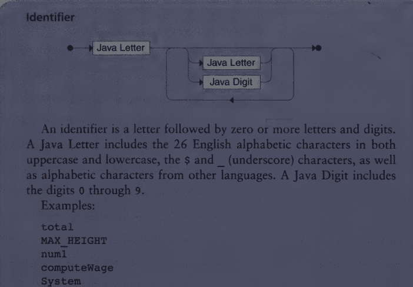

标识符（identifier）是一个字母，后面跟着零或多个字母和数字。Java 字母（Java Letter）包括大小写的 26 个英语文字文字母、`$$` 和 `_`（下划线）字符，以及来自其他语言的字母。Java 数字（Java Digit）包括数字 0 到 9。示例如：

```
total
MAX HEIGHT
num1
computeWage
System
```

标识符可以使用大写字母和小写字母，两者的区别非常重要。Java 是区分大小写的（case sensitive），这意味着两个仅在字母大小写不同的标识符被认为是不同的标识符。因此，`total`、`Total`、`Total` 和 `TOTAL` 都是不同的标识符。你可以想象，使用多个仅在大小写不同的标识符并不是一个好主意，因为它们很容易被混淆。

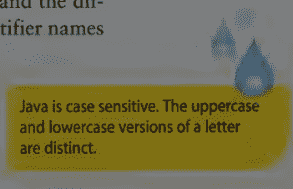

尽管 Java 语言没有强制要求，但每种标识符使用一致的大小写格式会让你的标识符更容易理解。关于标识符应该遵循各种 Java 惯例，尽管从技术上讲并不是必须的。例如，我们对类名使用标题 Case（title case，即每个单词的首字母大写）。在全文中，我们在第一次遇到每类标识符时，都会描述其首选风格。

虽然标识符的长度可以是任意，但你应该仔细选择名称。你的命名应该具有描述性，但不要冗长。你应该避免使用诸如 `a` 或 `x` 这样没有意义的名字。如果名称实际上具有描述性，可以破例，例如使用 `x` 和 `y` 表示二维网格上的 `(x, y)` 坐标。同样，你不应该使用不必要的长名称，如 `currentSelectedItem`。使用 `currentItem` 名称就足够了。正如你所想象的，使用冗长的标识符比使用不具描述性的名称要少得多。

你应该始终努力让程序尽可能具有可读性。因此，在缩写单词时你应该始终小心。你可能会使用 `curVal` 作为代表当前股票值的名称，这是一个不错的名字，但任何试图理解代码的人可能很难弄清楚你的意思。在编写代码两个月后，你自己可能也不清楚了。


Java 中的名称（name）是由点（period）字符分隔的一系列标识符。`System` 这个名称是我们用来指定调用 `println` 方法的对象的标识。名称在 Java 程序中非常常见。

### 空白

所有的 Java 程序都使用空白（white space）来分隔程序中使用的单词和符号。空白包括空格、制表符（tabs）和换行符。“空白”一词是指，在黑字印刷的白纸上，单词和符号之间的空间是白色的。程序员使用空白的方式非常重要，因为可以用它可以强调代码的部分，并使程序更易读。

除了用于分隔单词的情况外，计算机会忽略空白。它不会影响程序的执行。这一事实为程序员在格式化程序方面提供了极大的灵活性。程序的行应该在逻辑位置进行划分，某些行应该进行缩进和对齐，以便使程序的底层结构清晰明了。

由于空白会被忽略，我们可以用许多不同的方式编写程序。例如，将空白推向一个极端，我们可以在每行放置尽可能多的单词。列表 1.2 中的代码 `Lincoln2` 程序的格式与 `Lincoln` 完全不同，但呈现了相同的信息。

将空白推向另一个极端，我们可以几乎将每个单词和符号写在不同的行，并带有不同数量的空格，如列表 1.3 所示 `Lincoln3`。

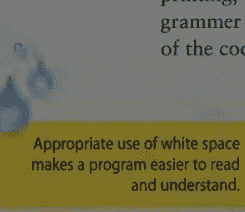

# 列表 1.2

```java
********************************************************************
// Lincoln2.java      Java Foundations
// 展示了一个格式不佳但有效的程序。
********************************************************************
public class Lincoln2(public static void main(String[] args){
System.out.println("A quote by Abraham Lincoln:");
System.out.println("Whatever you are, be a good one.");
}}
```

# 输出

亚伯拉罕·林肯的一名言：

无论你做什么，都要做好出色的。

```
************************************************************************************************************************************
// Lincoln3.java        Java Foundations
// 展示了另一个格式不佳的有效程序。
********************************************************************************************************************************************************************
public class Lincoln3 {
    public static void main (String[] args) {
        System.out.println("A quote by Abraham Lincoln: ");
        System.out.println("Whatever you are, be a good one.");
    }
}
```

# 输出

亚伯拉罕·林肯的一名言：

无论你做什么，都要做好出色的。

## 1.2 程序开发

运行一个程序的过程涉及各种活动。程序必须用适当的编程语言（如 Java）编写。程序必须被转换成计算机可以执行的形式。错误可能发生在过程的各个阶段并必须修复。各种软件工具可以帮助开发过程各个部分。让我们详细探讨这些问题。

### 编程语言级别

编程语言可以分为以下四组。这些组基本上反映了计算机语言的历史发展。

- 机器语言
- 汇编语言
- 高级语言
- 四代语言

为了让程序在计算机上运行，必须以该计算机的机器语言表示。每种 CPU 都有自己的语言。因此，我们不能将专门为带有 Sparc 处理器的 Sun 工作站编写的程序运行在带有 Intel 处理器的 Dell PC 上。

每条机器指令只能完成一个简单的任务。例如，单条语言指令可以将一个值复制到寄存器中，或将一个值与零比较。可能需要四个独立的语言指令将两个数字相加并存储结果。然而，计算机每秒可以执行数百万这样的指令，因此可以快速执行许多命令来完成复杂任务。所有程序必须翻译成特定 CPU 的机器语言才能执行。

机器语言用一系列二进制数字表示，对于人类来说，读写极其困难。起初，程序是通过开关或其他繁琐的方法输入计算机的。早期的程序员发现这些技术既耗时又容易出错。这些问题促成了汇编语言的使用，它用助记符（代表命令和数据的短英语单词）取代了二进制数字。对于程序员来说，处理单词比处理二进制数字容易得多。然而，汇编语言不能直接在计算机上执行，它必须先翻译成机器语言。

通常，每条汇编指令对应一条等效的机器指令。因此，与机器语言类似，每条汇编指令只完成一个简单的操作。虽然汇编语言是机器码的改进，但使用起来仍然很繁琐。汇编语言和机器语言都被认为是低级语言。今天，大多数程序员使用高级语言编写软件。高级语言用类似英语的短语表示，因此更容易让程序员阅读和书写。单条高级语句可以完成等同于许多条（可能是数百条）机器语言指令的任务。与最终执行的机器语言不同，Java 是一门高级语言，Ada、C++、Smalltalk 以及许多其他语言也是如此。高级语言允许程序员忽略机器语言的底层细节。图 1.2 显示了高级语言、汇编语言和机器语言的等效表达式。图 1.2 中的高级语言表达式对程序员来说是可读且直观的。汇编语言则是特定处理器的。

| 高级语言 | 汇编语言 | 机器语言 |
| :--- | :--- | :--- |
| a + b | load R1, a<br>load R2, b<br>add R1, R2<br>store R1, c | 00110110 00000001<br>00110110 00000010<br>01010111 00000000<br>00110110 00000011 |

图 1.2 一个高级表达式及其对应的汇编语言和机器语言。代码具有一定的可读性，但更加冗长且不直观。机器语言基本上是不可读的，而且长得多。事实上，图 1.2 只显示了两个两个数字所需的二进制机器码的一小部分。该特定表达式的完整机器语言代码超过 400 位。

### 编辑器、编译器和解释器

需要几个特殊程序来帮助开发新程序。起初，当你将程序输入计算机并存储在文件中时，你会使用一个编辑器。有许多具有不同功能的编辑器。你应该熟悉你经常使用的编辑器，因为它会极大地影响你输入和修改程序的速度。

图 1.3 显示了程序开发过程的一个基本视图。在编辑并保存程序后，你尝试将其从高级代码翻译成可执行的形式。这种翻译可能会导致错误，在这种情况下你需要返回编辑器进行修改以修复问题。一旦翻译成功，你就可以执行程序并评估结果。如果结果不是你想要的，或者你想增强现有的程序，你将再次返回编辑器进行修改。

将源代码翻译成特定类型 CPU 的机器语言可以通过多种方式实现。编译器是一个将一种语言的代码翻译成另一种语言的等效代码的程序。原始代码称为源代码，它被翻译到的语言称为目标语言。对于许多编译器来说，源代码直接翻译成特定的机器语言。在这种情况下，翻译只发生一次（对于给定版本的程序），生成的可执行程序可以在需要时运行。

解释器与编译器类似，但有一个重要的区别。解释器将翻译和执行活动交织在一起。源代码的一小部分（作为一个语句）被翻译并执行。然后另一条语句被翻译并执行，以此此类推。这种技术的优点是消除了单独编译阶段的需求。然而，程序通常运行得较慢，因为翻译过程发生在每次执行期间。

翻译和执行 Java 程序的过程结合了编译器和解释器的使用。该过程如图 1.4 所示。Java 编译器将 Java 源代码翻译成 Java 字节码，程序程序的类似于机器语言代码的低级形式表示。Java 解释器读取字节码并在特定机器上执行它。另一个编译器可以将字节码翻译成特定的机器语言，以便在该机器上高效执行。

> Java 编译器将源代码翻译成 Java 字节码，这是一种低级的、体系无关的程序表示。

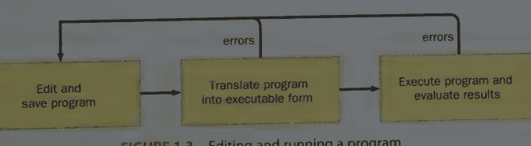

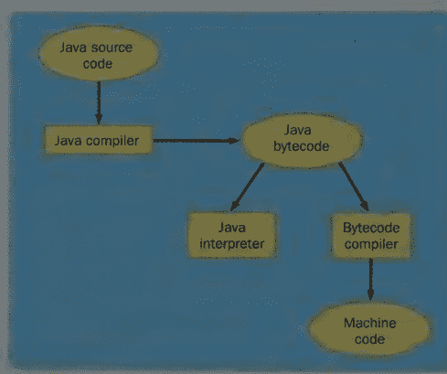

图 1.4 Java 翻译和执行过程

Java 字节码与真正的机器语言代码的区别在于 Java 字节码不绑定于任何处理器类型。这种方法的明显优势是使 Java 具有体系无关，因此很容易从一种机器级代码类型移植到另一种。唯一的限制是，对于执行 Java 字节码的每个处理器类型，必须有一个 Java 解释器或字节码编译器。

由于编译过程将高级 Java 源代码翻译成低级表示，解释过程比直接解释高级代码更高效。通过解释字节码执行程序仍然比直接执行机器码慢，但对于大多数应用程序来说已经足够快了。注意，为了效率，Java 字节码可以编译成机器码。

### 开发环境

开发环境是用于创建、测试和修改程序的工具集。某些开发环境是免费的，而另一些具有高级功能的环境必须购买。某些环境被称为集成开发环境 (IDE)，因为它们将各种工具集成到一个程序中。

任何开发环境都会包含某些关键工具，例如 Java 编译器和解释器。某些环境将包含一个调试器，它可以帮助你发现程序中的错误。其他可能包含的工具还有文档生成器、归档工具以及帮助你可视化程序结构的工具。

Java 语言的创建者太阳微系统（Sun Microsystems）提供了 Java 软件开发包（SDK），有时也称为 Java 开发工具包（JDK）。从太阳的 Java 网站 `java.sun.com` 可以免费下载适用于硬件平台的 SDK，同时也包含在随书 CD 光盘中。

SDK 工具并不是一个集成环境。编译和解释命令是在命令行中执行的。这意味着 SDK 并不具备带有窗口、菜单、按钮等的图形用户界面（GUI）。它同样不包含编辑器，尽管任何可以将简单示例保存为文本的编辑器都可以使用。

太阳公司还有一个 Java IDE 称为 NetBeans（`www.netbeans.org`），它将 SDK 的开发工具整合到一个方便的程序中。IBM 推出了类似的 IDE —— Eclipse（`eclipse.org`）。NetBeans 和 Eclipse 都是开源项目，这意味着它们由广泛的程序员群体开发并免费提供。

奥本恩大学（Auburn University）的一个研究小组开发了 jGRASP，这是一个免费的 Java IDE，包含在随书的 CD 光盘中。它也可以从 `www.jgrasp.org` 下载。除了基础开发工具外，jGRASP 还包含图形化显示程序元素的工具。

还有许多其他 Java 开发环境可用，书中 CD 提供了其中几种。选择使用哪种开发环境至关重要。你对环境能力的了解越多，在程序开发期间效率就越高。


### 语法与语义

每种编程语言都有其独特的语法。语言的语法规则规定了语言词汇元素如何组合成语句。为了创建程序，必须遵循这些规则。我们已经讨论了若干 Java 语法规则。例如，标识符不能以数字开头就是一个语法规则。使用大括号开始和结束类以及方法也是一种语法规则。附录 J 正式定义了 Java 编程语言的基本语法规则，并在文中突出强调了特定规则。

在编译期间，所有的语法规则都会经过检查。如果程序在语法上是正确的，编译器将输出错误信息且不会产生代码。Java 的语法与 C 和 C++ 编程语言相似，因此对于具有这些语言背景的人来说，代码的外观是熟悉的。

编程语言语句的语义定义了执行该语句时会发生什么。编程语言通常是无歧的，这意味着程序的语义是有良好定义的。也就是说，每条语句都有且仅有一种解释。相反，人类用来交流的自然语言（如英语和意大利语）则充满了歧义。一个句子通常可以有两种或多种不同的含义。例如，考虑以下句子：

Time flies like an arrow.（光阴如箭。）


普通人可能将这个句子解释为一种普遍观察：时间移动得很快，就像箭移动得一样。然而，如果我们把单词 `time` 解释为动词（如“跑一下 50 米冲刺，我为你计时”），并将单词 `flies` 解释为名词（飞虫的复数形式），解释就完全改变了。我们知道箭是不计时的，所以我们通常不会那样解释句子中的词汇。计算机很难确定想要表达的是哪种含义。此外，这个句子还可能描述一种不常见昆虫的喜好，即“时间蝇”（`time fly`），这种虫可能出现在射箭场附近。此外，果蝇喜欢香蕉（`Fruit flies like a banana.`）。

重点在于，一个特定的英语句子可以有多个有效含义。计算机语言不允许存在此类歧义。如果一条编程语言指令可以有两个不同的含义，计算机将无法确定应该执行哪一个。

### 错误

软件中可能会发生几种类型的问题，特别是在程序开发期间。“计算机错误”这一术语经常被误用，其含义随情况而异。从用户的角度来看，与机器交互时发生的任何故障都可以被称为计算机错误。例如，假设你用信用卡支付了一个 23 美元的商品，但当你收到账单时，该商品列出的是 230 美元。在你解决问题后，信用卡公司对“计算机错误”表示歉意。是计算机任意在数字末尾增加了一个零，还是将数值乘以了 10？显然不是。计算机遵循我们给它的命令，并根据我们提供的数据进行操作。如果程序是错误的或我们的数据是不准确的，我们就不能期望结果是正确的。描述这种情况的常用短语是“垃圾进，垃圾出”（`garbage in, garbage out`）。

### 1.2 程序开发

在开发程序时，你会遇到三类错误：

- 编译时错误（`compile-time error`）
- 运行时错误（`run-time error`）
- 逻辑错误（`logical error`）

编译器检查以确保你正在使用正确的语法。如果有任何不符合语言语法规则的语句，编译器将产生语法错误。编译器还会尝试寻找其他问题，例如使用不兼容的数据类型。语法在技术上可能是正确的，但你可能正在尝试语言语义上不允许的操作。编译器识别的任何错误都是编译时错误。如果发生编译时错误，则不会产生执行版本。

第二类问题发生在执行期间。它被称为运行时错误，会导致程序异常终止。例如，如果我们尝试除以零，系统就会停止。最好的程序是健壮的；也就是说它们尽可能避免运行时错误。在 Java 中，许多异常是可以处理的。

第三类软件问题是逻辑错误。在这种情况下，软件可以编译并执行，但产生的结果是错误的。例如，当计算错误或按钮没有出现在正确位置时，就会发生逻辑错误。程序员必须彻底测试程序，将预期结果与实际结果进行比较。发现缺陷时，必须追溯。寻找并修正缺陷的过程被称为调试。逻辑错误可能会以多种方式表现，根源可能很难发现。

### 1.3 解决问题

创建软件不仅仅是编写代码。程序的编辑和运行是必要的步骤，软件开发的核心是解决问题。我们编写程序是为了解决特定的问题。

通常，解决问题包含多个步骤：

- 理解问题。
- 设计方案。
- 考虑备选方案并完善方案。
- 实现方案。
- 测试方案并修复任何问题。

尽管这种方法适用于任何问题的解决，但在开发软件时尤为有效。这些步骤并不是纯线性的。也就是说，某些活动会与其他重叠。但在某些阶段，所有步骤都应该被认真对待。

第一步理解问题听起来很显而易见，但对这一步的忽视是许多错误软件开发工作的原因。如果我们尝试解决一个我们并不完全理解的问题，就会解决错误的问题或偏离主题。每个问题都有一个问题领域，即与我们的解决方案相关的现实问题。例如，如果我们要写一个计算保龄球计分的程序，那么问题领域就包含了保龄球规则。为了开发出解决方案，我们必须彻底理解问题领域。

### 1.4 软件开发活动

我们对解决方案的第一个直觉可能不是最好的。我们必须始终考虑替代方案，并根据需要完善解决方案。我们越早考虑替代方案，修改我们的方法就越容易。

实现解决方案是将设计并将其转化为可用形式的行为。在为问题开发软件解决方案时，实现是实际编写程序的过程。编程往往被认为等于编写代码。但在大多数情况下，设计程序的行为应该比在特定编程语言中实现设计的过程要更具趣味性和创造性。

在开发过程的许多点，我们都应该测试自己的解决方案，以发现任何存在的错误，以便我们修复它们。测试不能保证不再有未被发现的问题，但它可以增强我们对已拥有可行解决方案的信心。

在整本书中，我们将探索允许我们设计和实现优雅程序的技巧。尽管我们经常沉浸在这些细节中，但我们永远不应该忘记我们的首要目标是解决问题。

既然软件开发的目标是解决问题，那么软件开发过程中涉及的活动与我们在上一节讨论的一般问题解决步骤相似，这并不令人意外。特别是，任何适当的软件开发工作都由四个基本的开发活动组成：

- 建立需求。
- 创建设计。
- 实现设计。
- 测试。

如果这些活动能按照这种顺序定义一种开发软件的步进方法，那就太好了。然而，尽管它们看起来是顺序的，但在现实中它们几乎从不是完全线性的。它们相互重叠并交互。让我们简要讨论每项开发活动。

软件需求规定了程序必须完成的任务。它们指示了程序应该执行的任务。通常，需求通过一个称为“功能规格书”的文档中表示。

需求是对待解决问题的清晰表达。在我们真正知道我们正在尝试解决什么问题之前，我们无法真正解决它。

在教室环境中，学生通常以问题作业的形式获得软件需求。然而，即使提供了这些需求，也需要对它们进行讨论和澄清。在专业开发中，想要开发软件产品的个人或小组（客户）通常会提供一组初始需求。然而，这些需求往往是不完整的、含糊的，甚至可能是相互矛盾的。软件开发者必须与客户合作完善需求，直到所有关于系统将做什么的关键决策都得到解决。

需求通常涉及用户界面问题，如输出格式、屏幕布局和图形界面组件。本质上，需求确立了使程序对用户有用的特征。它们也可以对你的程序施加限制，例如任务必须执行多快。

软件设计指示了程序将如何完成其需求。设计规定了程序所需的类和对象，并定义了它们如何交互。它还规定了类之间的关系。低级设计问题涉及单个方法如何完成其任务。

土木工程师在没有先设计的情况下绝不会考虑建造桥梁。软件设计同样本质。软件中发生的许多问题直接归因于缺乏良好的设计。事实反复证明，在程序设计上花费的是值得的，从长远来看既节省了时间和金钱。

在软件设计期间，需要考虑和探索替代方案。通常，设计的第一次尝试并不是解决方案。幸运的是，在设计阶段进行更改相对容易。

实现是编写将解决问题的源代码的过程。更准确地说，实现是将设计翻译成特定编程语言的行为。太多的程序员只关注实现，而实际上它应该是所有开发活动中创造性最低的活动。重要的决策应该在建立需求和创建设计时做出。

测试是确保程序在必须执行的所有约束条件下能够解决预设问题的行为。测试包括使用各种输入多次运行程序，并仔细检查结果。但它的意义远不止于此。各种形式的测试应该是开发每个阶段的一部分。例如，需求的准确性应该通过与客户核对来进行测试。我们将在第 11 章重新回到与测试相关的问题。

### 1.5 面向对象编程

正如本章前面提到的，Java 是一种面向对象的语言。正如名称所示，对象是 Java 程序中的基本实体。本书的重点在于通过定义相互作用的对象来开发软件的想法。

面向对象的软件开发原则已经存在了许多年，本质上与高级编程语言的使用历史一样长。20 世纪 60 年代开发的编程语言 Simula 具有许多定义现代面向对象软件开发方法的特征。20 世纪 80 年代和 90 年代，面向对象编程变得非常流行，这很大程度上归功于 C++ 和 Java 编程语言的发展。它现在是商业软件开发中使用的主导方法。

面向对象的方法最有吸引力的特征之一是对象可以非常有效地表示现实世界的实体。例如，我们可以使用软件对象来代表公司中的员工。我们会为每个员工创建一个对象，每个对象都具有我们需要表示的行为和特性。通过这种方式，面向对象编程允许我们把程序映射到程序所代表的现实情况。也就是说，面向对象的方法使得解决问题变得更容易，这正是编写程序的初衷。

让我们探索面向对象方法的特征，帮助我们解决这些问题。

#### 面向对象软件原则

面向对象编程最终要求对以下术语有深入理解：

- 对象 (`object`)
- 属性 (`attribute`)
- 方法 (`method`)
- 类 (`class`)
- 封装 (`encapsulation`)
- 继承 (`inheritance`)
- 多态 (`polymorphism`)

除了这些术语，还有许多相关概念允许我们以无数方式定制解决方案。本书旨在帮助你逐渐自然地演进对这些概念的理解。本节提供了这些思想的高层次概述，以建立一些术语并提供全局视图。

我们之前提到过对象是程序中的基本元素。软件对象通常代表一个真实对象，例如银行账户。每个对象都有状态和一组行为。通过“状态”，我们指的是存在状态——定义对象的当前特征。例如，银行账户状态的一部分是它的当前余额。对象的行为是与对象相关的活动。与银行账户的行为可能包括存款和取款的能力。

除了对象之外，Java 程序还管理原始数据。原始数据包括数字和字符等基本值。对象代表更有趣或更复杂的实体。

对象的属性是它内部存储的值，可以以原始数据或其他对象的形式表示。例如，银行账户可能存储一个代表账户余额的浮点数（原始值）。它可能包含其他属性，如所有者的姓名。汇总，对象属性的值定义了它的当前状态。

正如本章前面提到的，方法是一组命名的编程语句。当方法被调用时，其语句就会执行。一组方法与对象相关。对象的方法定义了它的潜在行为。为了定义向银行账户存款的能力，我们定义了一个包含更新账户余额编程语句的方法。

对象由类定义。类是创建对象的模型或蓝图。考虑建筑师设计房屋时创建的蓝图。蓝图定义了房屋的重要特征——墙、窗、门、电源插座等。创建蓝图后，可以使用它建造几栋房屋，如图 1.5 所示。

> 每个对象都有一个状态（由属性定义）和一组行为（由方法定义）。


类是对象的蓝图。它确定了该类型对象将持有的数据类型，并定义了代表此类对象行为的方法。然而，类并不存储任何数据，就像蓝图并不是房子一样。通常，类不包含存储数据的空间。每个对象都有存储自己数据的空间，这就是为什么每个对象都可以有自己的状态。

一旦定义了类，就可以从该类创建多个对象。例如，一旦我们定义了一个表示银行账户概念的类，我们就可以创建多个代表特定、个别银行账户的对象。每个银行账户对象都会跟踪它自己的余额。

对象应该是被封装的，这意味着它保护并管理它自己的信息。也就是说，对象应该是自立自足的。对对象状态的唯一更改应该通过该对象的方法完成。我们应该设计对象，使得其他对象无法“进入内部”并改变它的状态。

可以使用继承从其他类创建新类。也就是说，一个类的定义可以基于另一个已经存在的类。继承是软件复用的形式，利用了我们可能想要创建的各种类之间的相似性。

> 类是对象的蓝图。从一个类定义中可以创建多个对象。

一个类可以用于派生几个新类。派生类随后可以被用于派生更多的类。这创建了一个类的层次结构，其中在一个类中定义的属性和方法被其子类继承，子类又将它们传递给它们的子类，依此类推。例如，我们可能会创建一个代表各种类型账户的类层次结构。共同特征在高层类中定义，特定的差异在派生类中定义。

多态性是指随着时间的推移可以用一致的方式引用多个相关对象类型的思想。它使我们能够为处理多个对象的问题设计强大且优雅的解决方案。

一些核心的面向对象概念如图 1.6 所示。我们不指望你现在完全理解这些思想。这本书的大部分内容都是为了充实这些思想。这个概述仅仅是为了铺垫背景。

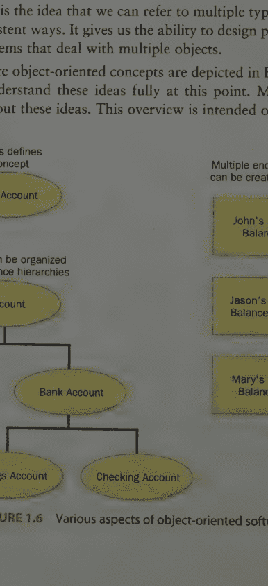

#### 概念总结

- 计算机系统由硬件和软件组成，它们协同工作帮助我们解决问题。
- 本书关注面向对象编程的原理。
- 注释不影响程序的处理；相反，它们有助于人类理解。
- 内联文档应该提供对你代码的见解。它不应该是含糊的，也不应该对显而易见的事物赘述。
- Java 是区分大小写的。字母的大写和小写版本是不同的。
- 标识符名称应该是描述性的且可读的。
- 适当使用空白字符使得程序更容易阅读和理解。
- 你应该遵循一组指南，这些指南建立了你格式化和文档化程序的方式。
- 所有程序必须翻译成特定 CPU 的机器语言才能执行。
- 高级语言允许程序员忽略机器语言的底层细节。
- Java 编译器将 Java 源代码翻译成 Java 字节码，这是一种程序的低级、体系结构无关的表示。
- 存在许多不同的开发环境来帮助你创建和修改 Java 程序。
- 语法规则规定程序的形式。语义规定了程序语句的含义。
- 程序员对程序的准确性和可靠性负责。
- Java 程序必须在语法上是正确的，否则编译器将不会产生字节码。
- 解决问题涉及将解决方案分解为可管理的部分。
- 在设计上投入精力是至关重要的且具有成本效益的。

# 第 1 章 引言

- 每个对象都有一个状态，由其属性定义，以及一组行为，由其方法定义。
- 类是对象的蓝图。从一个类定义中可以创建多个对象。

### 自测习题

- SR 1.1 什么是硬件？什么是软件？
- SR 1.2 高级语言与机器语言之间的关系是什么？
- SR 1.3 什么是 Java 字节码？
- SR 1.4 什么是空白？它如何影响程序的执行？它如何影响程序的可读性？
- SR 1.5 下面哪些项不是有效的 Java 标识符？为什么？
  - a. `RESULT`
  - b. `result`
  - c. `12345`
  - d. `x12345y`
  - e. `black&white`
  - f. `answer_7`
- SR 1.6 程序的语法和语义指的是什么？
- SR 1.7 列出软件开发过程中涉及的四个活动。
- SR 1.8 支持面向对象编程的主要概念有哪些？

### 练习

- EX 1.1 给出 Java 注释的示例并说明它们之间的区别。
- EX 1.2 哪些是有效的 Java 标识符？
  - a. `Factorial`
  - b. `anExtremelyIdentifierIfAskMe`
  - c. `2ndLevel`
  - d. `level2`
  - e. `MAX_SIZE`
  - f. `highest$`
  - g. `hook&ladder`
- EX 1.3 为什么这些有效的标识符不被认为是好的标识符？
  - a. `q`
  - b. `totVal`
  - c. `nextInList`
- EX 1.4 Java 是什么意思？
- EX 1.5 我们说英语语言具有歧义性是指什么？给出两个英语歧义例子（除了本章使用的例子）并解释这种歧义。歧义对编程会有什么问题？
- EX 1.6 将以下情况分类为编译时错误、运行时错误或逻辑错误：
  - a. 想加两个数字却用了乘法
  - b. 除以零
  - c. 语句末尾缺少分号
  - d. 在输出中拼错单词
  - e. 产生不准确的结果
  - f. 输入了 `(` 而应该是 `)`

### 编程项目

- PP 1.1 输入、编译并运行以下程序：

```java
public class Test {
    public static void main(String[] args) {
        System.out.println("An Emergency Broadcast");
    }
}
```

- PP 1.2 将以下错误引入项目 1.1 的程序中。记录编译器产生的任何错误信息。在引入新错误之前，修复上一个错误。如果没有产生错误信息，请解释原因。在每次更改之前，尝试预测会发生什么。
  - a. 将 `Test` 改为 `test`
  - b. 将 `Emergency` 改为 `emergency`
  - c. 移除字符串中的第一个引号
  - d. 移除字符串中的最后一个引号
  - e. 将 `main` 改为 `man`
  - f. 将 `println` 改为 `bogus`
  - g. 移除 `println` 语句末尾的分号
  - h. 移除程序的最后一个大括号
- PP 1.3 写一个程序，分行打印你的名字、生日、爱好、最喜欢的书和最喜欢的电影。在输出中为每项信息加上标签。
- PP 1.4 写一个程序，打印短语 `Knowledge is Power`：
  - a. 占据一行
  - b. 占据三行，每行一个单词，单词彼此居中对齐
  - c. 在由字符 `=` 和 `|` 组成的框内
- PP 1.5 写一个程序，列出你喜欢的四段歌词或五个网站。同时打印网站名称和 URL。
- PP 1.6 写一个程序，打印一首歌曲（你喜欢的）的前几节。标记出副歌。
- PP 1.7 写一个程序打印下面的菱形形状。不要打印任何多余字符。（也就是说，不要让任何字符字符串比必须的长度更长。）
- PP 1.8 编写一个程序，用大字母块字显示你的姓名首字母。让每个大字母都由相应的普通字符组成。例如：

```
JJJJJJJJJJJJJJ AAAAAAAA LLLL
JJJJJJJJJJJJJJ AAAAAAAA LLLL
JJJJ AAA AAA LLLL
JJJJ AAA AAA LLLL
JJJJ AAAAAAAA LLLL
J JJJJ LLLL
JJ AAA AAA LLLL
JJJJJJJJJJJJJJ LLLLLLLLLLLLLLL
JJJJJJJJJJJJJJ AAA LLLLLLLLLLLLLLL
```


### 自测题答案

SR 1.1 计算机系统的硬件由其物理组成部分组成，如电路板、显示器和键盘。软件是由硬件执行的程序以及这些程序使用的数据。硬件是有形的，而软件是无形的。


# SR 1.2 高级语言允许程序员以类似于英语的术语表达一系列程序指令，这些指令易于阅读和使用。然而，为了执行，程序必须用特定计算机的机器语言表示，机器语言由一系列位组成，人类基本上无法直接触及。高级语言程序在运行之前必须翻译成机器语言。

# SR 1.3 Java 字节码是 Java 源代码程序的低级表示。Java 编译器将源代码翻译成字节码，然后可以使用 Java 解释器执行。字节码在被 Web 浏览器中的 Java 解释器执行之前，可能会跨越网络传输。

# SR 1.4

空白符（White space）是指在程序中分隔单词和符号的空格、制表符和换行符。编译器会忽略多余的空白；因此，它不会影响执行。然而，适当使用空白符对于使程序人类可读至关重要。

# SR 1.5 显示的所有标识符都是有效的，除了 `12345`（因为标识符不能以数字开头）和 `black&white`（因为标识符不能包含字符 `&`）。标识符 `RESULT` 和 `result` 都是有效的，但不应在程序中同时使用它们，因为它们仅区别于大小写。下划线字符（如 `answer_7`）是标识符的有效部分。

# SR 1.6

语法规则定义了编程语言的符号和单词如何组合在一起。程序语言指令的语义决定了执行该指令时会发生什么。

# SR 1.7

软件开发中的四个基本活动是需求分析（决定程序应该做什么）、设计（决定如何做）、实现（用源代码编写解决方案）和测试（验证实现结果）。

# SR 1.8

支持面向对象编程的主要元素是对象、类、封装和继承。对象由类定义，类包含了定义在这些对象上操作的方法（即它们执行的服务）。对象被封装，使得它们能够存储和管理自己的数据。继承是一种重用技术，其中一个类可以从另一个类派生。

# 本章目标

- 讨论字符字符串、拼接和转义序列的使用。
- 探索变量的声明和使用。
- 描述 Java 原始数据类型。
- 讨论表达式的语法和处理。
- 定义数据转换的类型以及实现它们的机制。
- 引入 `Scanner` 类以创建交互式程序。

# 第 2 章 数据与表达式

本章探索了 Java 程序中一些基本数据类型，以及使用表达式进行计算。它讨论了数据从一种类型到另一种类型的转换，以及如何从运行程序的用户处交互式读取输入。

## 2.1 字符字符串

在第 1 章中，我们讨论了 Java 程序的基本结构，包括注释、标识符和空白符的使用，并以 Lincoln 程序为例。第 1 章还概述了涉及面向对象编程的各种概念，如对象、类和方法。如果需要，请花些时间回顾这些思想。

字符串是 Java 中的一种对象，由 `String` 类定义。由于字符串对计算机编程至关重要，Java 提供了使用由双引号界定的字符串字面量的方法，正如我们在之前的示例中看到的那样。我们在第 3 章中更详细地探讨 `String` 类及其方法。现在，让我们进一步探索字符串字面量的使用。

以下都是有效字符串字面量的示例：

```
"The quick brown fox jumped over the lazy dog."
"2201 Birch Leaf Lane, Blacksburg, VA 24060"
""
```

字符串字面量可以包含任何有效字符，包括数字、标点符号和其他特殊字符。列表中的最后一个示例没有包含任何字符。

### print 和 println 方法

在第 1 章的 Lincoln 程序中，我们如下调用了 `println` 方法：

```
System.out.println("Whatever you are, be a good one.");
```

该语句展示了对象的使用。`System.out` 代表一个输出设备，默认情况下是屏幕。更准确地说，我们将在后文中详细地探讨这种关系。`println` 方法是 `System.out` 为我们执行的服务。当我们请求它时，它会将消息打印到屏幕。`println` 方法在执行后会移动到下一行。在这种情况下，它会向我们发送到 `System.out` 打印字符字符串。

发送到方法的每部分数据被称为参数。在这种情况下，`println` 方法只接收一个参数：要打印的字符串。

`System.out` 还提供了另一种可以使用的服务：`print` 方法。`print` 和 `println` 之间的区别很小但很重要。`println` 方法打印发送的信息，然后移动到下一行。`print` 方法与 `println` 相似，但完成后不会换行。

列表 2.1 显示所示程序被称为 `Countdown`，它调用了 `print` 和 `println` 方法。

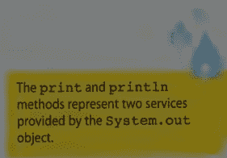

### 列表 2.1

### 输出

Three... Two... One... Zero... Liftoff!

Houston, we have a problem.

仔细比较程序底部的 Countdown 程序输出。注意单词 Liftoff 与前面的单词在同一行打印，尽管它是使用 `println` 方法打印的。记住 `println` 方法在打印传递的信息后会移动到下一行。

### 字符串拼接

字符串字面量在程序中不能跨行。以下程序语句语法不正确，尝试编译时会产生错误：

```
// 以下语句无法编译
System.out.println("The only stupid question is the one's not asked.");
```

当我们想要打印一个长到无法放入一行的字符串时，可以使用字符串拼接将一个字符串附加另一个字符串的末尾。字符串拼接运算符是加号 (`+`)。以下表达式将一个字符与另一个字符拼接，产生一个长字符串：

列表 2.2 所示的 `Facts` 程序包含几个 `println` 语句。第一个打印了一个相当长的句子，无法放入程序的一行。由于字符字面量在程序中不能跨行，我们将字符串分成两部分并使用字符串拼接将它们连接。因此，第一个 `println` 语句中的字符串拼接操作产生传递给方法的大型字符串。

注意我们不需要向 `println` 方法传递任何信息，如 `Facts` 程序的第二行所示。此调用不打印任何可见字符，但它会移动到输出的下一行。因此在这种情况下，无参数的 `println` 具有打印空行的效果。

Facts 程序最后三次 `println` 调用展示了字符串拼接的另一个有趣现象：字符串不能与数字拼接。注意这些行中的数字没有被双引号包，因此不是字符字符串。在这些情况下，数字会自动转换为字符串，然后对两个字符串进行拼接。

### 列表 2.2

### 输出

我们向你提供以下事实以供你增长课外知识：

- 夏威夷字母中的字母数量：12
- 南极的拨号代码：672
- 列奥纳多·达芬奇发明降落伞的年份：1515年
- 番茄酱的速度：每年40千里

由于我们正在打印特定的值，我们完全可以将数值作为字符串字面量的一部分包含进来，例如：

"Speed of ketchup: 40 km per year"

数字是字符，可以根据需要包含在字符串中。在 `Facts` 程序中，我们将它们分开，是为了演示拼接字符串和数字的能力。这种技术将在后续的示例中非常有用。

正如你所想的，`+` 运算符也用于算术加法：因此，`+` 运算符取决于它所操作的数据类型。如果 `+` 运算符的操作数中有一个或两个是字符串，则执行字符串拼接。

列表 2.3 所示的 `Addition` 程序演示了字符串拼接与算术加法之间的区别。`Addition` 程序使用了四次 `+` 运算符。在第一次

### 列表 2.3

```
********************************************************************************
// Addition.java          Java Foundations
//
// 演示加法运算符与字符串
// 拼接运算符之间的区别。
********************************************************************************
public class Addition
{
    // 拼接并两个两个并打印结果。
    //
    public static void main (String[] args)
    {
        System.out.println("24 and 45 concatenated: " + 24 + 45);

        System.out.println("24 and 45 added: " + (24 + 45));
    }
}
```

### 输出

24 and 45 concatenated: 2445

24 and 45 added: 69

对 `println` 的第一次调用，两次 `+` 操作都执行了字符串拼接，因为运算符是从左到右执行的。第一个运算符将字符串与第一个数字（24）拼接，创建一个更大的字符串。然后，该字符串与第二个数字（45）拼接，创建一个更大的字符串并打印出来。

在第二次调用 `println` 时，我们使用括号将 `+` 操作与两个数字操作数分组。这强制该操作先发生。因为两个操作数都是数字，所以这些数字在算术意义上相加，产生结果 69。然后，该数字与字符串拼接，产生一个更大的字符串并打印。

我们将在在本章的晚些时候再次回到这种情况，届时我们将形式化定义运算符求值的优先级规则。

### 转义序列

由于双引号字符（`"`）在 Java 语言中用于指示字符串的开始和结束，我们必须使用一种特殊技术来保护引号字符。如果我们简单地将其放在字符串中（`"\""`），编译器就会困惑，因为它认为第二个引号是字符串的结束，并且不知道如何处理第三个引号。这会导致编译时错误。

为了解决这个问题，Java 定义了几个转义序列。转义序列以反斜杠字符（`\`）开头，表示后面的字符或多个字符应该以特殊方式解释。图 2.1 列出了这些转义序列。

列表 2.4 中的程序名为 `Roses`，它打印了一些类似于诗歌的文本。尽管这首诗有几行长，但它仅使用 `println` 语句来实现。注意整个字符串中使用的转义序列。`\n` 转义序列强制输出到新行，而 `\t` 转义序列表示制表符。（注意，当你运行此程序时可能会看到不同的缩进量——制表符取决于系统设置。）

> 转义序列可以表示本会引起编译问题的字符。

| 转义序列 | 含义 |
|---|---|
| `\b` | 退格格 (backspace) |
| `\t` | 制表符 (tab) |
| `\n` | 换行 (newline) |
| `\r` | 回车 (carriage return) |
| `\"` | 双引号 (double quote) |
| `\'` | 单引号 (single quote) |
| `\\` | 反斜杠 (backslash) |

图 2.1 Java 转义序列

### 列表 2.4

```
****************************************************************************************************
// Roses.java        Java Foundations
// 演示转义序列的使用。
****************************************************************************************************

public class Roses {
//-------------------------------------------------------------------------------------------------
// 在多行上打印一首（某种意义上的）诗。
//-------------------------------------------------------------------------------------------------
    public static void main(String[] args) {
        System.out.println("Roses are red
```

### 输出

Roses are red,	Violets are blue,

Sugar is sweet,	But I have "commitment issues",	So I'd rather just be friends

At this point in our relationship.

## 2.2 变量与赋值

我们在程序中管理的大部分信息由变量表示。让我们检查如何在程序中声明和使用它们。

### 变量

变量是内存中用于存储数据值的名称。变量声明指示编译器保留一段足够的主内存空间来存储特定类型的值，并指示我们引用它的名称。

考虑列表 2.5 所示的 `PianoKeys` 程序。`main` 方法的第一行是名为 `keys` 的变量声明，它包含一个整数（int）值。该声明还为 `keys` 给了一个初始值 88。如果没有为变量指定初始值，则该值是未定义的。如果你在显式赋值之前尝试使用变量，大多数 Java 编译器会给出错误或警告。

`keys` 变量及其值可以想象如下：

在 `PianoKeys` 程序中，`println` 调用使用了两部分信息。第一个是字符串，第二个是变量 `keys`。当引用变量时，使用的是其中存储的值。因此，当执行 `println` 调用时，值 88 被转换为字符串并与初始字符串拼接。变量声明可以在同一行声明多个相同类型的变量。每个变量可以带有初始化值，也可以没有。例如：

```
int count, minimum = 0, result;
```


```
****************************************************
// PianoKeys.java      Java Foundations
// 演示整数变量的声明、初始化和使用。
****************************************************
public class PianoKeys
{
    //--------------------------------------
    // 打印钢琴键。
    //--------------------------------------
    public static void main (String[] args) {
        int keys = 88; // 初始化
        System.out.println("A piano has " + keys + " keys.");
    }
}
```

钢琴有 88 个键。

### 赋值语句

让我们检查一个改变变量值的程序。列表 2.6 显示了一个程序首先声明了一个名为 `sides` 的整数变量并将其初始化为7。然后打印 `sides` 的当前值。

`main` 方法中的下一行改变存储在变量中的值：

`sides = 10;`

这是一个赋值语句，因为它为变量分配了值。执行时，赋值运算符右侧的表达式被求值，结果被存储在左侧变量所指示的内存位置中。在这个示例中，表达式仅仅是一个数字 10。我们将在下一节讨论比这更复杂的表达式。

变量只能存储其声明类型类型的一个值。新值会覆盖旧值。在这种情况下，值 10 被赋值给 `sides`，原始值 7 被覆盖并永远丢失，如下所示：

初始化后：sides

| sides | 7 |
|---|---|

第一次赋值后：10

| sides | 10 |
|---|---|

### 列表 2.6

```
****************************************************
// Geometry.java             Java Foundations
// 演示使用赋值语句改变存储
// 变量中的值。
****************************************************
public class Geometry
{
    // 打印几种几何形状的边数。
    //--------------------------------------------------------------------
    public static void main(String[] args)
    {
        int sides = 7; // 初始化
        System.out.println("A heptagon has " + sides + " sides.");

        sides = 10; // 赋值语句
        System.out.println("A decagon has " + sides + " sides.");

        sides = 12;
        System.out.println("A dodecagon has " + sides + " sides.");
    }
}
```

### 输出

A heptagon has 7 sides.

A decagon has 10 sides.

A dodecagon has 12 sides.

### 基础赋值


基础赋值语句使用赋值运算符 (`=`) 将表达式（`Expression`）的结果存储在指定的标识符（`Identifier`）中，通常是一个变量。

示例：

```
total = 57;
count = count + 1;
value = (min / 2) * lastValue;
```


# 数据与表达式

当引用一个变量时（例如打印它时），变量的值不会改变。这就是计算机内存的本质：访问数据保持内存中的值不变，但写入数据会用新数据替换旧数据。

Java 语言是强类型的，这意味着我们不允许为与其声明类型不一致的变量赋值。当您尝试编译程序时，尝试组合不兼容的类型将产生错误。因此，赋值语句右侧的表达式求值后的结果必须与左侧变量的类型兼容。

## 常量

有时，我们会使用在整个程序中保持不变的数据。例如，我们可能会编写一个处理容纳人数不超过 427 人的剧院的程序。给一个常量值起一个名称（例如 `MAX_OCCUPANCY`）通常比在整个代码中使用字面量（literal value，如 427）要有帮助的。像 427 这样的字面值的目的和意义对阅读代码的人来说通常是困惑的。通过赋予值名，你解释了它在程序中的作用。

常量是标识符，与变量相似，不同在于它们在存在期间持有特定的值。用英语单词的字面意思来说，常量不是变量（not variable）。它们的值不会改变。

在 Java 中，如果你在声明前加上保留字 `final`，该标识符就是一个常量。按照习惯，命名常量时使用大写字母以区分普通变量，单个变量之间使用下划线字符分隔。例如，描述剧院最大容纳量的常量可以这样声明：

```java
final int MAX_OCCUPANCY = 427;
```

如果你在常量被赋予初始值后尝试更改它的值，编译器将产生错误信息。这是使用常量的另一个良好理由。常量可以防止意外的编码错误，因为更改其值的有效位置就是初始赋值。

使用常量的第三个原因是：如果常量在整个程序中使用，并且需要修改其值，那么你只需要在一个地方更改它。例如，如果剧院的容量（因为装修原因）从 427 变为 535，那么你只需要更改一个声明，`MAX_OCCUPANCY` 的所有使用都会自动反映这一变化。如果在整个代码中使用了字面量 427，则必须找到并更改每一个使用处。如果你漏了任何一个字面值，肯定会出现问题。

## 2.3 原生数据类型

Java 中有八种原生数据类型：四种整数子集、两种浮点数子集、一种字符数据类型和一个布尔数据类型。其他所有内容都使用对象表示。让我们详细检查这八种原生数据类型。

### 整数与浮点数

Java 有两种基本的数值：没有小数部分的整数和小数部分的浮点数。四种整数数据类型（`byte`、`short`、`int` 和 `long`）和两种浮点数据类型（`float` 和 `double`）。所有数值类型的区别在于存储该类型值所需的内存空间大小，这决定了可以表示的值范围。每个数据类型的大小在所有硬件平台上都是相同的。所有数值类型都是符号符号，这意味着它们可以存储正负值。图 2.2 总结了数值原生类型。

位（bit）或二进制数字可以是 1 或 0。由于每个位可以表示两种状态，N 位的字符串可以表示不同的值。附录 B 详细介绍了数系统和各种关系。

在设计程序时，有时我们需要小心选择合适大小的变量，以免浪费内存空间。这种情况发生在内存空间特别受限的情况下，例如运行在个人数据辅助（PDA）上的程序。在这种情况下，我们可以相应地选择变量的数据类型。例如，如果特定变量的值不会超出 1 到 1000 的范围，那么双字节的整数（`short`）就足够容纳它。另一方面，当不清楚特定变量的范围时，我们应该提供合理的、甚至是慷慨的空间。在大多数情况下，内存空间并不是严格限制，我们通常可以负担起慷慨的假设。

注意，即使是 `float` 值也支持很大（非常小）的数字，但只有七位有效数字。因此，如果精确维护像 50341.277 这样的值，我们需要使用 `double`。

| 类型 | 大小 | 最小值 | 最大值 |
|---|---|---|---|
| byte | 8 位 | -128 | 127 |
| short | 16 位 | -32768 | 32767 |
| int | 32 位 | -2147483648 | 2147483647 |
| long | 64 位 | -9223372036854775808 | 9223372036854775807 |
| float | 32 位 | 约 -3.4E+38（7位有效数字） | |
| double | 64 位 | 约 -1.8E-308（15位有效数字） | |

图 2.2 总结了数值原生类型。

数以千计的意符。因此，Java 语言的开发者选择了 Unicode 字符集，每个字符使用 16 位，支持 65536 个唯一字符。许多语言的字符和符号都包含在 Unicode 定义中。ASCII 是 Unicode 字符集的子集。附录 C 详细讨论了 Unicode 字符集。

字符集为每个字符分配特定的数字，因此根据定义字符按特定的顺序排列。这被称为字典序。在 ASCII 和 Unicode 排序中，数字 '0' 到 '9' 是连续的（没有其他字符插间）且按顺序排列的。同样，小写字母 'a' 到 'z' 是连续有序的，大写字母 'A' 到 'Z' 也是。这些特性使得按字母顺序对数据（如姓名列表）进行排序相对容易。第13 章将讨论排序。

在 Java 中，数据类型 `char` 表示单个字符。以下是 Java 中字符变量声明的示例：

> Java 使用 16 位 Unicode 集合来表示字符数据。

```java
char topGrade = 'A';
char symbol1, symbol2, symbol3;
char terminator = ';', separator = ' ';
```

### 布尔值

在 Java 中使用保留关键字 `boolean` 定义的布尔值只有两个有效值：`true` 和 `false`。布尔变量通常用于指示特定条件是否为真，它也可以表示任何具有两种状态的情况，例如灯泡的开启或关闭。`boolean` 一词是为了纪念英国数学家乔尔斯·布尔（George Boole）而命名的，他开发了一种代数形式（布尔代数），其中变量只取两个值中的一个。

布尔值不能转换为任何其他数据类型，其他数据类型也无法转换为布尔值。`true` 和 `false` 两个单词在 Java 中被保留为布尔字面量，不能在此语境之外使用。

以下是 Java 中布尔变量声明的的一些示例：

```java
boolean flag = true;
boolean tooHigh, tooSmall, tooRough;
boolean done = false;
```

## 2.4 表达式

*表达式* 是一个或多个运算符和操作数的组合，通常用于执行计算。计算出的值不必非是数字，但通常是。操作中使用的操作数可能是字面量、常量、变量或其他数据源。表达式的求值和使用方式是编程的基础。现在，我们将关注使用数值操作数并产生数值结果的算术表达式。

### 算术运算符

通常算术操作针对整数和浮点数值类型都有定义，包括加法 (`+`)、减法 (`-`)、乘法 (`*`) 和除法 (`/`)。Java 还有另一种算术操作：取余运算符 (`%`) 返回第二个操作数除以第一个操作数后的余数。取余运算符有时称为模运算符（modulus operator）。取余运算结果的符号与被数的符号相同。下表显示了一些示例：

| 操作 | 结果 |
|---|---|
| 17 % 4 | 1 |
| -20 % 3 | -2 |
| 10 % -5 | 0 |
| 3 % 8 | 3 |

正如你预期的，如果一个或两个操作数是数值浮点值，结果将是浮点值。然而，除法运算符 (`/`) 产生的结果不那么直观，取决于操作数的类型。如果两个操作数都是整数，`/` 运算符将执行*整数除法*，这意味着结果的任何小数部分都会被丢弃。如果一个或两个操作数是浮点值，`/` 运算符将执行*浮点除法*，并保留结果的小数部分。例如，10/4 的结果是 2，但 10.0/4 和 10.0/4.0 的结果都是 2.5。

单运算符只有一个操作数，而二元运算符有两个。`+` 和 `-` 算术运算符可以是单元的，也可以是二元的。二元版本完成加法和减法，而单元版本表示正数和负数。例如，`-1` 是使用单元取反运算符使值变为负数的示例。单元 `+` 运算符很少使用。

Java 没有内置的将值提升为幂的运算符。然而，`Math` 类提供了执行幂运算和许多其他数学函数的方法。`Math` 类在第 3 章中讨论。

### 运算符优先级

运算符可以组合以创建更复杂的表达式。例如，考虑以下赋值语句：

```java
result = 14 + 8 / 2;
```

赋值的整个右侧将被求值，然后将结果存储在变量中。但结果是什么？如果先执行加法，结果是 11；如果先执行除法操作，结果是 18。运算符的求值顺序很大。在这种情况下，除法在加法之前执行，得到结果 18。

注意，在这些和随后的示例中，我们使用字面量而非变量来简化表达式。如果操作数是变量或其他任何数据源，运算符的求值顺序是相同的。

所有表达式都根据运算符优先级分级求值，该分级规定了操作执行顺序的规则。乘法、除法和取余运算符的优先级相同，并从左到右执行。加法和减法的优先级相等。

然而，可以通过括号在表达式中强制优先级。例如，如果我们真的想在示例中执行加法，可以这样写表达式：

```java
result = (14 + 8) / 2;
```

在复杂的表达式中，即使没有必要，使用括号也是良好的做法，可以清楚表达式是如何求值的。

括号可以嵌套，最内嵌套的表达式先求值。考虑以下表达式：

```java
result = 3 * ((18 - 4) / 2);
```

在示例中，结果是 21。首先由内括号执行减法。然后，尽管乘法和除法处于同一级且通常从左到右执行，但由于外部括号，先执行除法。最后执行乘法。

算术完成后计算的结果存储在赋值运算符 (`=`) 左侧的变量中。换句话说，赋值运算符的优先级低于任何算术运算符。

特定表达式的求值可以使用表达式树来显示，如图 2.3 所示。运算符从下到上执行，产生的值用于表达式的其他部分。因此，树底部的操作优先级高于上面的操作，或者通过括号强制它们更早执行。

表达式中使用的括号实际上是运算符本身。括号的优先级高于几乎任何其他运算符。图 2.4 显示了算术运算符、括号和赋值运算符之间的优先级表。附录 D 包含所有 Java 运算符的优先级表。

为了使表达式语法正确，左括号的数量必须与右括号匹配，且必须正确嵌套。以下示例不是有效的表达式：

```java
result = ((19 + 8) % 3) - 4); // 无效
result = (19 + (8 %) % 3 - 4); // 无效
```

图 2.3 表达式树

| 优先级级别 | 运算符 | 操作 | 结合性 |
|---|---|---|---|
| 1 | + | 一元加号 | 从右到左 |
| | - | 一元减号 | |
| 2 | * | 乘法 | 从左到右 |
| | / | 除法 | |
| | % | 取余 | |
| 3 | + | 加法 | 从左到右 |
| | - | 减法 | |
| | + | 字符串拼接 | |
| 4 | = | 赋值 | 从右到左 |

图 2.4 部分 Java 运算符的优先级

记住，当表达式中引用一个变量时，其当前值被用于计算。在接下来的赋值语句中，变量 `count` 的当前值加到变量 `total` 的当前值，并将结果存储在变量 `sum` 中：

```java
sum = count + total;
```

在此赋值之前，`sum` 中包含的原始值会被计算出的值覆盖。`count` 和 `total` 中存储的值不会改变。

同一个变量可以出现在赋值语句的左侧和右侧。假设在执行以下赋值语句时，名为 `count` 的变量当前值为 15：

```java
count = count + 1;
```

由于右侧表达式先求值，因此获取了 `count` 的原始值并加 1，产生结果 16。然后将该结果存储在变量 `count` 中，用新值 16 覆盖原始值 15。因此，该赋值语句使变量 `count` 自增（或给 `count` 加 1）。

让我们来看另一个表达式处理的例子。列表 2.7 中的程序 `TempConverter` 使用一个计算以下公式的表达式将特定的摄氏度温度转换为相应的华氏度值：

Fahrenheit = 9/5 Celsius + 32

注意，在 `TempConverter` 程序中，除法操作的操作数是浮点数字面量，以确保数字的小数部分被保留。优先级规则规定在最终计算中乘法发生在加法之前。

`TempConverter` 程序并没有很有用，因为它只转换我们包含在程序中的常量数据值（24摄氏度）。每次运行程序时，它都会产生相同的结果。一个要有用得多的程序的另一个版本将在每次执行程序时从用户处获取要转换的值。本章稍后将讨论读取用户输入的交互式程序。

### 递增和自减运算符

还有两个有用的算术运算符。递增运算符 (`++`) 向任何整数或浮点值加 1。构成该运算符的两个加号不能被空格隔开。自减运算符 (`--`) 类似，它从值中减去 1。它们都是一元运算符，因为它们只作用于操作数。以下语句会导致 `count` 的值递增：

```java
count++;
```

结果被存回变量 `count` 中。因此，它在功能上与我们在上一节中讨论的语句等价：

```java
count = count + 1;
```

递增和自减运算符可以应用于变量之后（例如 `count++` 或 `count--`），创建所谓的运算符的**后缀形式**的运算符。它们也可以应用于变量之前（例如 `++count` 或 `--count`），即所谓的**前缀形式**。当在语句中单独使用时，前缀和后缀形式在功能上是等价的。也就是说，写成

```java
count++;
```

或

```java
++count;
```

并不重要。

然而，当这种形式单独作为一个语句书写时，通常以其后缀形式书写。

当递增或自减运算符用于较大的表达式时，根据所使用的形式可能会产生不同的结果。例如，如果变量 `count` 当前包含值 15，以下语句将值 15 赋值给 `total`，将值 16 赋值给 `count`：

```java
total = count++;
```

然而，如果 `count` 包含 15，以下语句将值 16 同时赋值给 `total` 和 `count`：

```java
total = ++count;
```

在两种情况下 `count` 的值都递增了，但在较大的表达式中使用的值取决于使用的是递增运算符的前缀还是后缀形式。

由于递增自减运算符的前缀和后缀形式之间存在细微差异，使用时应谨慎。一如既往，优先考虑可读性。

### 赋值运算符

为了方便起见，Java 定义了几个赋值运算符。例如，`+=` 运算符可以如下使用：

```java
total += 5;
```

这执行的操作与以下操作相同：

```java
total = total + 5;
```

赋值运算符的右侧可以是完整的表达式。赋值运算符的右侧先求值，然后将结果加到变量的当前值。因此，语句

```java
total += sum - 12;
```

等同于：

```java
total = total + (sum - 12);
```

Java 定义了许多简单的赋值运算符，包括执行减法 (`-=`)、乘法 (`*=`)、除法 (`/=`) 和取余 (`%=`) 的运算符。所有运算符将在附录 D 中讨论。

所有赋值运算符首先求右侧的值，将其作为另一个操作的操作数。语句：

```java
result *= count1 + count2;
```

等同于：

```java
result = result * (count1 + count2);
```

同样，语句

```java
result %= (highest - 40) / 2;
```

等同于：

```java
result = result % ((highest - 40) / 2);
```

某些赋值运算符根据操作数的类型执行特定的功能，正如相应的普通运算符一样。例如，如果 `+=` 运算符的操作数是字符串，那么赋值运算符执行拼接。


## 2.5 数据转换

由于 Java 是一种强类型语言，每个数据值都关联一个特定的类型。有时有助于或必要将一种类型的数据值转换为另一种类型，但我们必须小心不要在此过程中丢失重要信息。例如，假设一个持有数字 1000 的 `short` 变量被转换为 `byte`。由于 `byte` 没有足够的位，转换过程中将丢失位，字节中表示的数字将无法保留其原始值。

一个原始类型到另一种类型之间的转换分为两类：宽转换和窄转换。**宽转换**是最安全的，因为它们通常不会丢失信息。它们之所以被称为宽转换，是因为它们从一个数据类型转换为另一个使用相同或更多空间来存储值的类型。表 2.5 列出了 Java 的宽转换。

例如，从 `byte` 转换为 `short` 是安全的，`byte` 存储在 8 位中，而 `short` 存储在 16 位中。没有信息丢失。所有从整数类型到另一种整数类型或从浮点类型到另一种浮点类型的宽转换都能精确保留数值值。

尽管宽转换没有丢失任何关于值的大小的信息，但导致浮点值的宽转换可能会丢失一些低有效位。当从 `int` 或 `long` 转换为 `float`，或从 `long` 转换为 `double` 时，生成的浮点值将是整数值的四舍五入版本，其遵循了 IEEE 754 浮点标准中定义的舍入技术。

**窄转换**比宽转换更容易丢失信息。它们通常从一个类型转换为另一个存储值所需的空间较小的类型，因此某些信息可能会受到损害。窄转换可能会丢失数值大小也可能丢失精度。通常情况下，应该避免这种转换。表 2.6 列出了 Java 的窄转换。

窄转换中空间缩小情况的一个例外是将 `byte`（8 位）或 `short`（16 位）转换为 `char`（16 位）。这些仍然被视为窄转换，因为符号位被整合到了新的字符值中。由于字符值是无符号的，一个负整数将被转换为一个与原始整数数值没有特定关系的字符。

注意，宽化转换或窄化转换中都没有提到 `boolean` 值。`boolean` 值不能转换为任何原始类型，反之亦然。

### 表 2.5 Java 宽化转换

| 源类型 | 目标类型 |
|---|---|
| `byte` | `short`, `int`, `long`, `float`, or `double` |
| `short` | `int`, `long`, `float`, or `double` |
| `char` | `int`, `long`, `float`, or `double` |
| `int` | `long`, `float`, or `double` |
| `long` | `float` or `double` |
| `float` | `double` |

### 表 2.6 Java 窄化转换

| 源类型 | 目标类型 |
|---|---|
| `byte` | `char` |
| `short` | `byte` or `char` |
| `char` | `byte` or `short` |
| `int` | `byte`, `short`, `char`, or `int` |
| `long` | `byte`, `short`, `char`, `int`, or `long` |
| `float` | `byte`, `short`, `char`, `int`, or `long` |
| `double` | `byte`, `short`, `char`, `int`, `long`, or `float` |

### 转换技术

在 Java 中，转换可以通过三种方式发生：

- 赋值转换
- 提升
- 强制类型转换

当一个类型的值在赋值过程中给另一个类型的变量时，发生了赋值转换。只有宽化转换可以通过赋值完成。例如，如果 `money` 是一个 `float` 变量，`dollars` 是一个 `int` 变量，那么下面的赋值语句会自动将 `dollars` 中的值转换为 `float`：

```java
money = dollars;
```

因此，如果 `dollars` 包含值 25，赋值后，`money` 包含值 25.0。然而，如果我们尝试将 `money` 赋值给 `dollars`，编译器将发出错误信息，提醒我们正在尝试进行可能会丢失信息的窄化转换。如果我们真的想执行此赋值，就必须使用强制类型转换来显式地进行转换。

当某些运算符需要修改其操作数以执行操作时，通过提升进行的转换会自动发生。例如，当一个浮点值 `sum` 除以一个整数值 `count` 时，在除法发生之前，`count` 的值会自动提升为浮点值，从而产生浮点结果：

```java
result = sum / count;
```

当将数字与字符串拼接时，也会发生类似的转换。该数字首先转换为（提升为）字符串，然后将两个字符串拼接。

强制类型转换是 Java 中最通用的转换形式。如果转换在 Java 程序中可以完成，那么就可以使用强制转换来完成。

`(type)` 是一个 Java 运算符，通过括号中的类型名称指定。它放置在待转换的值之前。例如，为了将 `money` 转换为整数值，我们可以在它前面加上强制转换：

```java
dollars = (int) money;
```

强制转换返回 `money` 中的值，并截断任何小数部分。如果 `money` 包含值 84.69，那么赋值后，`dollars` 将包含值 84。**注意**，强制转换不会改变 `money` 中的值。在赋值操作完成后，`money` 仍然包含值 84.69。

强制转换在我们需要临时将一个值视为另一种类型的许多情况下都是有帮助的。例如，如果我们想将整数值 `total` 除以整数值 `count` 并得到浮点结果，我们可以这样做：

```java
result = (float) total / count;
```

第一个强制转换运算符返回 `total` 中值的浮点数版本。此操作不会改变 `total` 中的值。然后，`count` 通过算术提升被视为浮点值。现在，除法运算符将执行浮点除法并产生预期的结果。如果没有包含强制转换，该操作将执行整数除法，并在将其赋值给 `result` 之前截断答案。还要注意，由于强制转换运算符的优先级高于除法运算符，强制转换作用于 `total` 的值，而不是作用于除法的结果。

## 2.6 读取输入数据

设计一个程序在执行期间从用户那里交互式读取数据通常是有用的。这样，每次运行程序时，都可以根据输入的数据计算新的结果。

### Scanner 类

`Scanner` 类是标准 Java 类库的一部分，它提供了方便的方法来读取各种类型的输入值。输入可以来自各种来源，包括用户交互式输入的数据或存储在文件中的数据。

我们必须先创建一个 `Scanner` 对象以便调用它的方法。使用 `new` 运算符创建 `Scanner` 对象。下面的声明创建了一个从键盘读取的 `Scanner` 对象：

```java
Scanner scan = new Scanner(System.in);
```

此声明创建了一个名为 `scan` 的变量，它代表一个 `Scanner` 对象。对象本身是通过 `new` 运算符和调用特殊方法（构造函数）创建的。`System.in` 对象代表标准输入流，默认是键盘。使用 `new` 运算符创建对象将在下一章进一步讨论。

### 2.7 Scanner 的一些方法

| 方法 | 描述 |
|---|---|
| `next()` | 返回下一个字符串。 |
| `nextLine()` | 返回行的剩余输入。 |
| `nextBoolean()` | 返回 `boolean` 值。 |
| `nextByte()` | 返回下一个 `byte` 值。 |
| `nextDouble()` | 返回下一个 `double` 值。 |
| `nextFloat()` | 返回下一个 `float` 值。 |
| `nextInt()` | 返回下一个 `int` 值。 |
| `nextLong()` | 返回下一个 `long` 值。 |
| `nextShort()` | 返回下一个 `short` 值。 |
| `hasNext()` | 如果 scanner 还有标记，则返回 `true`。 |
| `useDelimiter(String pattern)` | 设置 scanner 的分隔符。 |
| `delimiter()` | 返回 scanner 当前使用的模式。 |
| `findIn(String pattern)` | 尝试查找指定模式的出现。 |

`Scanner` 类还可以用于解析。除非另有说明，`Scanner` 对象假设空白字符（空格、制表符和换行符）用于分隔输入元素（标记）。这些字符被称为分隔符。如果输入标记由其他字符分隔，可以更改分隔符。

### 构造函数

| 构造函数 | 描述 |
|---|---|
| `Scanner(InputStream source)` | 从 `InputStream` 设置 scanner。 |
| `Scanner(File source)` | 从文件设置 scanner。 |
| `Scanner(String source)` | 从字符串设置 scanner。 |

### 列表 2.8 Echo.java

```java
// Echo.java               Java 基础
// 展示如何使用 Scanner 类的 nextLine 方法
// 从用户处读取字符串。

import java.util.Scanner;

public class Echo {
    //-----------------------------------------------------------------------
    // 从用户处读取一个字符串并打印。
    //-----------------------------------------------------------------------
    public static void main(String[] args) {
        String message;
        Scanner scan = new Scanner(System.in);

        System.out.println("Enter a line of text:");
        message = scan.nextLine();
        System.out.println("You entered: \"" + message + "\"");
    }
}
```

**输出**

```text
Enter a line of text:
Set your laser printer on stun!
You entered: "Set your laser printer on stun!"
```

在第 5 章中，我们使用 `Scanner` 类来从数据文件中读取输入，并修改它用于解析数据的分隔符。附录 H 探索了如何使用 `Scanner` 类使用名为正则表达式的模式来分析其输入。

### 列表 2.9 GasMileage.java

```java
// GasMileage.java      Java 基础
// 展示如何使用 Scanner 类读取数值数据。

import java.util.Scanner;

public class GasMileage {
    //----------------------------------------------------------------------
    // 根据用户输入的值计算燃料效率。
    //----------------------------------------------------------------------
    public static void main(String[] args) {
        int miles;
        double gallons, mpg;

        Scanner scan = new Scanner(System.in);

        System.out.print("Enter the number of miles: ");
        miles = scan.nextInt();

        System.out.print("Enter the gallons of fuel used: ");
        gallons = scan.nextDouble();

        mpg = miles / gallons;

        System.out.println("Miles Per Gallon: " + mpg);
    }
}
```

**输出**

```text
Enter the number of miles: 369
Enter the gallons of fuel used: 12.4
Miles Per Gallon: 29.758064516129032
```

### 核心概念总结

- `print` 和 `println` 方法代表了 `System.out` 对象提供的两种服务。
- 在 Java 中，`+` 运算符既用于加法，也用于字符串拼接。
- 转义序列可用于表示否则会导致编译问题的字符。
- 变量是用于存储特定数据类型值的内存位置的名称。
- 访问数据会保持其在内存中完好无损，但赋值语句会重写旧数据。
- 我们不能将一种类型的值赋值给一个不兼容类型的变量。
- 常量在其存在期间保持一个特定的值。
- Java 有两种数值类型：整数和浮点数。共有四种整数数据类型和两种浮点数数据类型。
- Java 使用 16 位 Unicode 字符集来表示字符数据。
- 表达式是运算符和操作数的组合，用于执行计算。
- 算术除法产生的结果类型取决于操作数的类型。
- Java 遵循一套定义良好的优先级规则，这些规则规定了表达式中运算符的求值顺序。
- 应该避免窄转换，因为它们可能会丢失信息。
- `Scanner` 类提供了各种方法，从各种来源读取各种类型的输入。

### 自测习题

- **SR 2.1** 什么是基本数据类型？基本数据类型与对象有什么区别？
- **SR 2.2** 什么是字符串字面量？
- **SR 2.3** `print` 和 `println` 方法之间有什么区别？
- **SR 2.4** 什么是参数？
- **SR 2.5** 什么是转义序列？举例说明。
- **SR 2.6** 什么是变量声明？
- **SR 2.7** 整数变量中同时可以存储多少个值？
- **SR 2.8** Java 中的四种整数数据类型是什么？它们有什么区别？
- **SR 2.9** 什么是字符集？
- **SR 2.10** 什么是运算符优先级？
- **SR 2.11** 在 Java 表达式中求值 `19*5` 的结果是什么？请解释。
- **SR 2.12** 在 Java 表达式中求值 `3/4` 的结果是什么？请解释。
- **SR 2.13** 如果整数变量 `diameter` 当前持有值 5，执行以下语句后，它的值是什么？

```java
diameter = diameter * 4;
```

- **SR 2.14** 如果整数变量 `weight` 当前持有值 100，执行以下语句后，它的值是什么？

```java
weight -= 17;
```

- **SR 2.15** 为什么宽转换比窄转换更安全？

### 练习题

- **EX 2.1** 从对象及其提供的服务的角度解释以下编程语句：

```java
System.out.println("I gotta be me!");
```

- **EX 2.2** 以下代码段会产生什么输出？请解释。

```java
System.out.print("Here we go!");
System.out.println("12345");
System.out.print("Test this if you are not sure.");
System.out.print("Another.");
System.out.println();
System.out.println("All done.");
```

- **EX 2.3** 以下程序语句哪里错误？如何修复？

```java
System.out.println("To be or not to");
```

- **EX 2.4** 以下语句会产生什么输出？

```java
System.out.println("50 + 25");
```

- **EX 2.5** 以下语句会产生什么输出？

```java
System.out.println("He throws");
```

- **EX 2.6** 以下语句执行后，`size` 变量中包含什么值？

```java
size = 18;
```

- **EX 2.7** 以下语句执行后，`depth` 变量中包含什么值？

```java
depth = 5;
```

- **EX 2.8** 执行以下语句后，`length` 变量中包含什么值？

```java
length = 10;
```

- **EX 2.9** 写四种不同的语句增加 `total` 的值。

- **EX 2.10** 给定以下声明，每个赋值语句存储的结果是什么？

```java
int num1 = 25, num2 = 40, num3 = 17, num4 = 5;
double val1 = 17.0, val2;
```

- a. `iResult = num1 / num4;`
- b. `fResult = num1 / num4;`
- c. `iResult = num3 / num4;`
- d. `fResult = num3 / num4;`
- e. `iResult = val1 / num2;`
- f. `fResult = val1 / num2;`
- g. `iResult = (double) num1 / num2;`
- h. `fResult = (double) num1 / num2;`
- i. `iResult = (double) (num1 / num2);`


- j. `fResult = (double) (num1 / num2);`
- k. `iResult = (int) (val1 / num4);`
- l. `fResult = (int) (val1 / num4);`
- m. `iResult = (double) val1 / num4;`
- n. `fResult = (double) val1 / num4;`

### EX 2.11 对于以下每个表达式，通过在运算符下方写数字来指示运算符的求值顺序。

- a. `a - b - c - d`
- b. `a - b + c - d`
- c. `a + b / c / d`
- d. `a + b / c * d`
- e. `a / b * c * d`
- f. `a % b / c * d`
- g. `a & b & c & d`
- h. `a - (b - c) - d`
- i. `(a - (b - c)) - d`
- j. `a - ((b - c)) - d`
- k. `a % (b - c) * d * e`
- l. `a + (b - c) * d - e`
- m. `(a + b) * c + d * e`
- n. `(a + b) * (c / d) % e`

### 编程项目

- PP 2.1 创建第 1 章 Lincoln 应用程序的修订版本，让引号出现在周围。
- PP 2.2 写一个程序，读取三个整数并打印它们的平均值。
- PP 2.3 写一个程序，读取两个浮点数并打印它们的和、差和积。
- PP 2.4 创建 `TempConverter` 应用程序的版本，将华氏度转换为摄氏度。从用户处读取华氏温度。
- PP 2.5 写一个程序，将英里转换为公里。（1 英里等于 1.60935 公里。）从用户处作为浮点数读取英里值。
- PP 2.6 编写一个程序，读取表示小时、分钟和秒的持续时间的值，然后打印等值的总秒数。（例如，1 小时 28 分 42 秒等于 5322 秒。）
- PP 2.7 创建上一个项目的版本，反转计算过程。即：读取一个表示秒数的值，然后打印等值的小时、分钟和秒组合形式表示的时间。（例如，9999 秒等于 2 小时 46 分 39 秒。）
- PP 2.8 编写一个程序，确定罐中硬币的价值，并以美元和分为单位打印总额。读取表示四分币、一角币、镍币和美分数量的整数值。


- PP 2.9 编写一个程序，提示并读取一个表示金额的 `double` 类型值。确定表示金额所需的最少种纸币和硬币数量，从最高面额开始（假设十美元钞是所需的最大面额）。例如，如果输入的值为 47.63（四十七美元六十三分），则程序应打印如下等值金额：
  - 4 张十美元钞
  - 1 张五美元钞
  - 2 张一美元钞
  - 2 枚四分币
  - 1 枚一角币
  - 0 枚镍币
  - 3 枚美分
- PP 2.10 编写一个程序，提示并读取表示正方形边长的整数，然后打印正方形的周长和面积。
- PP 2.11 编写一个程序，提示并读取作为整数的分数的分子和分母，然后打印该分数的小数等值。

# 自测习题答案

**SR 2.1** 基本数据是如数字或字符等基本值。对象是更复杂的实体，通常包含有助于定义它们的基本数据。

**SR 2.2** 字符串字面量是由双引号分隔的字符序列。

**SR 2.3** `System.out` 对象的 `print()` 和 `println()` 方法都会将字符字符串写入显示器屏幕。区别在于，在打印字符后，`println()` 方法会执行回车，因此下次打印的内容将出现在下一行。`print()` 方法则允许后续输出出现在同一行。

**SR 2.4** 参数是在调用方法时传入该方法的数据。该方法通常使用该数据来完成它提供的服务。方法中的参数指明了应该打印哪些字符。

**SR 2.5** 转义序列是以反斜杠 (`\`) 开头的字符序列，意味着随后的字符应该被以某种特殊方式处理。例如：`\n` 表示换行符，`\t` 表示制表符，`\"` 表示双引号字符（而不是用它来终止字符串）。

**SR 2.6** 变量声明建立了变量的名称以及它可以包含的数据类型。声明还可以带一个可选的初始化，这为变量提供了一个初始值。

**SR 2.7** 整数变量一次只能存储一个值。当给它赋一个新值时，旧值会被覆盖并丢失。

**SR 2.8** Java 中的四种整数数据类型是 `byte`、`short`、`int` 和 `long`。它们的区别在于为每个类型分配的内存空间大小，因此它们能容纳数字的大小。

**SR 2.9** 字符集是按特定顺序排列的字符列表。字符集定义了特定计算机或编程语言将支持的有效字符。Java 使用 Unicode 字符集。

**SR 2.10** 运算符优先级是决定表达式中运算符求值顺序的规则集合。

**SR 2.11** 在 Java 表达式中 `19 % 5` 的结果是 4。取模运算符 `%` 返回第一个操作数除以第二个操作数后的余数。19 除 5 商 3 次，余 4。

**SR 2.12** 在 Java 表达式中 `13 / 4` 的结果是 3（而不是 3.25）。结果是一个整数，是因为两个操作数都是整数。因此，`/` 运算符执行整数除法，结果的小数部分被截断。

**SR 2.13** 执行该语句后，`diameter` 留值为 20。首先将 `diameter` 的当前值 (5) 乘以 4，然后将结果存回 `diameter`。

**SR 2.14** 执行该语句后，`weight` 留值为 83。赋值运算符 `-=` 通过先从当前值 (100) 中减去 17，并将结果存回 `weight` 来修改 `weight`。

**SR 2.15** 宽转换通常从存储数据所需的空间来看的较小数据值转换为较大的数据值。窄转换则相反。信息在窄转换中更容易丢失，这就是为什么窄转换被认为比宽转换不安全。

# 章节目标

# 3 使用类和对象

- 讨论对象的创建和对象引用变量的使用。
- 探索 `String` 类提供的服务。
- 描述 Java 标准类库是如何组织成包的。
- 探索 `Random` 和 `Math` 类提供的服务。
- 讨论使用 `NumberFormat` 和 `DecimalFormat` 类格式化输出的方法。
- 引入枚举类型（enumeration）。
- 讨论包装类（wrapper classes）和自动装箱（autoboxing）的概念。

本章进一步探索了预定义类以及我们可以从它们创建的对象。使用类和对象提供的服务是面向对象软件的基础部分，并为编写自己的类奠定了基础。在本章中，我们使用类和对象来处理字符串、产生随机数、执行复杂的计算并格式化输出。本章还引入了枚举类型的概念（这是 Java 中一种特殊的类），并讨论了包装类的概念。


## 3.1 创建对象

在第 1 章结束时，我们介绍了面向对象的概念，包括类和对象之间的基本关系。在第 2 章中，除了讨论基本数据外，我们还提供了使用对象提供服务的示例。本章将进一步探索这些思想。

在之前的示例中，我们多次使用了 `println()` 方法。正如我们在第 2 章提到的，`println()` 方法是 `System.out` 对象提供的服务，它代表标准输出流。更准确地说，标识符 `out` 是存储在 `System` 类中的对象变量。它已经作为标准库的一部分被预定义并设置。我们可以简单地使用它。

在第 2 章中还使用了 `Scanner` 类，它代表一个从键盘或文件读取数据的对象。我们使用 `new` 运算符创建了 `Scanner` 对象。一旦创建了对象，我们就可以使用它提供的各种服务。然后，我们就可以调用它的方法。

让我们仔细检查创建对象的概念。在 Java 中，变量代表一个基本值或一个对象。像持有基本类型的变量一样，引用对象的变量必须声明。用于对象的类可以被看作对象的类型。对象变量的声明与基本变量的声明相似。

考虑以下两个声明：

```
int num;
String name;
```

第一个声明创建了一个持有整数值的变量，正如我们多次看到的。第二个声明创建了一个持有 `String` 对象引用的 `String` 变量。对象变量并不持有对象本身，它持有对象的地址。

最初，上述声明的变量不包含任何数据。我们说它们是未初始化的，如下所示：

| | |
|---|---|
| num | |
| name | |

正如我们在第 2 章所指出的，在使用变量之前确保它已初始化是非常重要的。对于对象变量，这意味着我们必须确保它指的是在使用对象之前对其进行有效操作。在大多数情况下，如果你尝试在初始化变量之前使用它，编译器将抛出错误。

对象引用变量也可以被设置为 `null`，`null` 是 Java 中的一个关键字。`null` 引用专门指代该变量不引用任何对象。

请注意，尽管我们声明了一个 `String` 引用变量，但实际上还没有任何 `String` 对象存在。使用 `new` 运算符创建对象的行为被称为“实例化”（instantiation）。一个对象被认为是特定类的“实例”（instance）。要实例化一个对象，我们可以使用 `new` 运算符，它会返回新对象的地址。以下两个赋值语句为上面声明的两个变量赋值：

```
num = 42;
name = new String("James Gosling");
```

在 `new` 运算符创建对象后，会调用构造函数对其进行初始化。构造函数是一个特殊方法，其名称与类名相同。在这个例中，构造函数的参数是一个字符串字面量，它指定了字符串对象将包含的字符。在执行这些赋值语句后，变量可以描述为：

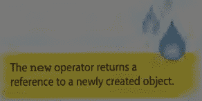

| num | 42 |
| :--- | :--- |
| name | "James Gosling" |

对象引用变量持有对象的地址，它可以被看作指向内存中存放对象位置的指针。我们可以显示数值地址，但实际的地址值是无关紧要——重要的是该变量引用了一个特定的对象。

在对象实例化后，我们使用点运算符（`.`）来访问它的方法。我们已经多次使用过点运算符了，例如在调用 `System.out.println()` 时。点运算符直接在对象引用之后操作，后面跟的是要调用的方法。例如，为了调用 `String` 类中定义的 `length()` 方法，我们可以在 `name` 引用变量上使用点运算符：

```
count = name.length()
```

`length()` 方法不接受任何参数，但括号仍然是必要的，用以表示正在调用方法。某些方法会在方法完成后返回一个值。`String` 类中 `length()` 方法的作用是确定并返回字符串的长度（它包含的字符数）。在这个例中，返回的值被赋值给变量 `count`。对于字符串 "James Gosling"，`length()` 方法返回 13，这包括第一个和最后一个名字之间的空格。某些方法不返回值。其他 `String` 方法将在下一节中讨论。

声明对象引用变量和创建对象本身的行为可以通过在声明时初始化变量来合并为一个步骤，就像我们处理基本类型时所做的那样：

```
String title = new String("Java Solutions");
```

尽管字符字符串不是基本类型，但它们是如此基础且使用得如此频繁，以至于 Java 定义了由双引号分隔的字符串字面量，正如我们在各种示例中看到的那样。这是一种快捷表示法。每当出现字符串字面量时，会自动创建一个 `String` 对象。因此，以下声明是有效的：

```
String city = "London";
```

也就是说，对于 `String` 对象，可以消除显式使用 `new` 运算符和对构造函数的调用。在大多数情况下，我们将使用这种简化语法。

### 别名

由于对象引用变量存储的是地址，程序员在管理对象时必须小心。首先，让我们复习赋值对基本值的影响。假设我们有两个整数变量，`num1`（初始化为 5）和 `num2`（初始化为 12）：

| num1 | 5 |
| :--- | :--- |
| num2 | 12 |

在下面的赋值语句中，`num1` 中存储的值副本被存储在 `num2` 中：

```
num2 = num1;
```

`num2` 中原始值 12 被值 5 覆盖。变量 `num1` 和 `num2` 仍然引用内存中的两个不同的位置，而这两个位置现在都包含了值 5：

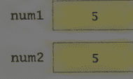

现在考虑以下对象声明：

```
String name1 = "Ada, Countess of Lovelace";
String name2 = "Grace Murray Hopper";
```

最初，引用 `name1` 和 `name2` 引用两个不同的 `String` 对象：

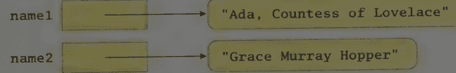

现在假设执行以下赋值语句，将 `name1` 中的值拷贝到 `name2`：

```
name2 = name1;
```

这种赋值的操作与整数赋值相同——`name1` 值的副本被存储在 `name2` 中。但记住，对象变量持有的是对象的地址，被复制的是地址。最初，两个引用指向不同的对象。赋值后，`name1` 和 `name2` 包含相同的地址，因此它们引用同一个对象：


`name1` 和 `name2` 引用变量现在是彼此的别名，因为它们是引用同一个对象的两个不同变量。现在对该对象的所有引用都被视为同一个。别名的一个重要影响是，如果你通过一个引用更改对象，该更改将反映在所有其他引用上。如果处理不当，这会导致意外的结果。

## 3.2 String 类

让我们详细检查 `String` 类。图 3.1 列出了一些有用的方法。一旦 `String` 对象被创建，其值就无法延长或缩短。因此我们说 `String` 是不可变的。

注意某些 `String` 方法如 `charAt()` 引用特定字符。索引指定了字符串中的特定位置，以及特定的字符。字符串第一个字符的索引为 0，下一个字符的索引为 1，依此类推。

列表 3.1 所示程序使用了几个 `String` 方法。在检查程序时，请记住这不是一个会改变的对象；此程序创建了五个独立的 `String` 对象。最初，`phrase` 对象被设置如下：


# 列表 3.1

## 图 3.1 String 类的一些方法

| 方法 | 说明 |
| :--- | :--- |
| `String(String str)` | 构造函数：创建一个与 str 相同的新字符串对象。 |
| `charAt(int index)` | 返回指定索引处的字符。 |
| `compareTo(String str)` | 返回一个整数，指示此字符串在字典上小于（负值）、等于（零值）还是大于（正值）字符串 str。 |
| `concat(String str)` | 返回一个由此字符串与 str 拼接的新字符串。 |
| `equals(String str)` | 如果此字符串包含与 str 相同的字符（包括大小写），返回 true，否则返回 false。 |
| `equalsIgnoreCase(String str)` | 如果此字符串包含与 str 相同的字符（不区分大小写），返回 true，否则返回 false。 |
| `length()` | 返回字符串中字符的数量。 |
| `replace(char oldChar, char newChar)` | 返回一个与此字符串相同的新字符串，但每个 oldChar 的出现都被替换为 newChar。 |
| `substring(int offset, int endIndex)` | 返回一个从索引 offset 开始延伸到 endIndex-1 的字符串子集。 |
| `toLowerCase()` | 返回一个与此字符串相同的新字符串，但所有大写字母都转换为小写形式。 |
| `toUpperCase()` | 返回一个与此字符串相同的新字符串，但所有小写字母都转换为大写形式。 |


# StringMutation.java

```java
************************************************************************************
// StringMutation.java      Java 基础
// 展示了 String 类及其方法的用法。
************************************************************************************
public class StringMutation
{
    // 打印一个字符串及其各种变体。
    
    public static void main(String[] args)
    {
        String phrase = "Change is inevitable";
        String mutation1, mutation2, mutation3, mutation4;

        System.out.println("Original string: \"" + phrase + "\"");
        System.out.println("Length of string: \"" + phrase.length() + "\"");

        mutation1 = phrase.concat(", except from vending machines.");
        mutation2 = mutation1.toUpperCase();
        mutation3 = mutation2.replace('E', 'X');
        mutation4 = mutation3.substring(3, 30);

        // 打印每个变体字符串
        System.out.println("Mutation #1: \"" + mutation1 + "\"");
        System.out.println("Mutation #2: \"" + mutation2 + "\"");
        System.out.println("Mutation #3: \"" + mutation3 + "\"");
        System.out.println("Mutation #4: \"" + mutation4 + "\"");

        System.out.println("Mutated length: \"" + mutation4.length() + "\"");
    }
}
```

# 输出

```
Original string: "Change is inevitable"
Length of string: 20
Mutation #1: Change is inevitable, except from vending machines.
Mutation #2: CHANGE IS INEVITABLE, EXCEPT FROM VENDING MACHINES.
Mutation #3: CHANGX IS INXVITABL, XXCXPT FROM VXNDING MACHINXS.
Mutation #4: NGX IS IN
Mutated length: 27
```

在打印原始短句及其长度后，执行了 `concat` 方法创建一个由变量 `mutation1` 引用的新 `String` 对象：

`mutation1` "Change is inevitable, except from vending machines."

然后在 `mutation1` 对象上执行了 `toUpperCase` 方法，并将生成的 `String` 存储在 `mutation2` 中：

`mutation2` "CHANGE IS INEVITABLE, EXCEPT FROM VENDING MACHINES."

注意 `length` 和 `concat` 方法是在 `phrase` 对象上执行的，但 `toUpperCase` 方法是在 `mutation1` 对象上执行的。`String` 类的任何方法可以在任何 `String` 对象上执行，但对于任何特定的调用，方法是在特定的对象上执行的。在 `mutation1` 上执行 `toUpperCase` 的结果与在 `phrase` 上执行的结果将大不相同。每个对象都有自己的状态，这状态通常会影响方法调用的结果。

> 方法通常在特定的对象上执行，而该对象通常会影响结果。

最后，`String` 对象变量 `mutation3` 和 `mutation4` 分别通过调用 `mutation2.replace` 和 `mutation3.substring` 初始化：

`mutation3` "CHANGX IS INXVITABL, XXCXPT FROM VXNDING MACHINXS."

`mutation4` "NGX IS INXVITABL-X, XXCXPT F"

# 3.3 包

我们之前提到过 Java 语言由一个标准类库支持，我们可以根据需要使用它。让我们进一步探讨这个想法。

类库是一组支持程序开发的类集合。编译器或开发环境通常会带有一个类库。类库也可以通过第三方供应商单独获得。类库中的类包含许多方法，由于它们提供了特殊功能，这些方法对程序员来说通常非常有价值。事实上，程序员经常会依赖类库中的方法，并开始将它们视为语言的一部分。然而，在技术上，它们并不属于语言本身。

> 类库在开发程序时提供了有用的支持。

例如，`String` 类并不是 Java 语言的固有组成部分。它是 Java 标准类库的一部分，可以在任何 Java 开发环境中找到。构成该库的类是由 Sun Microsystems 公司创建的，他们是 Java 语言的创建者。

类库由几组相关的类组成，这些类有时被称为 Java API，或应用程序编程接口。例如，当我们谈论帮助我们编写与数据库交互的程序的类集合时，我们可能会提到 Java Database API。API 的另一个例子是 Java Swing API，它指的是一组定义了用户界面中所使用的特殊图形组件的类。整个标准库被统称为 Java API。

Java 标准类库的类也被分组为不同的包（packages）。每个类都是特定包的一部分。例如，`String` 类是 `java.lang` 包的一部分。正如我们在第 2 章中提到的 `Scanner` 类是 `java.util` 包的一部分，`System` 类也是 `java.lang` 包的一部分。

包的组织比 API 的组织更为基础且基于语言。虽然包名和 API 名字之间存在通用的对应关系，但构成给定 API 的类组可能会跨越多个包。在书中，我们主要根据类的包组织来引用类。

图 3.2 描述了 Java 标准类库的一部分包。这些包在任何支持 Java 软件开发的平台上都是可用的。其中一些包支持非常特定的编程技术，在基础程序的开发中不会发挥作用。

本书在各处讨论了 Java 标准类库的各种类。

## import 声明

`java.lang` 包中的类在编写 Java 程序时是自动可用的。然而，要使用任何其他包中的类，我们必须使用完全限定的引用或使用 `import` 声明。

| 包 | 为以下提供支持 |
| :--- | :--- |
| `java.applet` | 创建小程序 (applets) |
| `java.awt` | 绘制图形 |
| `java.beans` | 定义组件 |
| `java.io` | 输入和输出 |
| `java.lang` | 基础扩展 |
| `java.math` | 任意高精度 |
| `java.net` | 跨网络通信 |
| `java.rmi` | 远程方法调用 |
| `java.security` | 强制限制 |
| `java.sql` | 与数据库交互 |
| `java.text` | 文本格式 |
| `java.util` | 通用工具 |
| `javax.swing` | 创建图形界面 |
| `javax.xml.parsers` | 处理文档 |

`java.lang` 包中的类在编写 Java 程序时是自动可用的。然而，要使用任何其他包中的类，我们必须使用完全限定引用或使用 `import` 声明。

当你想使用某个包中的类时，每次都写包名会很麻烦。

```java
import java.util.Scanner;
```

如果不同包的两个类同名，`import` 声明是不够的，因为编译器无法确定引用的是哪个类。当这种情况发生时（很少见），应该使用完全限定名。

`import` 声明的另一种形式使用星号 (`*`) 表示该包中的任何类都可能被使用。因此，以下声明允许无需限定即可引用 `java.util` 包中的所有类：

```java
import java.util.*;
```

如果程序只使用某个包中的一个类，在 `import` 声明中指定该类更好，因为这为阅读代码的人提供了更具体的信息。然而，如果使用两个或多个，使用 `*` 号通常可以。

`java.lang` 包中的类会被自动导入，因为它们是基础的，可以被视为语言的基础扩展。因此，`java.lang` 包中的任何类（例如 `System` 和 `String`）都可以无需显式的 `import` 声明。就像所有的程序文件都包含以下声明一样：

```java
import java.lang.*;
```

# 3.4 Random 类

编写软件时经常需要随机数。游戏经常使用随机数模拟掷骰或洗牌。飞行模拟器可以使用随机数来决定模拟飞行引擎故障。帮助学生准备 SAT 的程序可以使用随机数来选择下一个问题。

`Random` 类是 `java.util` 包的一部分，代表一个伪随机数生成器。随机数生成器从一个范围内选取数字。执行此角色的代码在技术上是伪随机的，因为程序没有实际上随机选择数字的方法。伪随机数生成器执行一系列复杂的计算并产生一个数字。这些方法基于初始种子值进行计算并产生一个数字。尽管它们在技术上并不是随机的（因为它们是计算得出的），但伪随机数生成器产生的值通常看起来是随机的，至少在大多数情况下看起来是随机的。

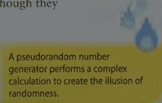

图 3.3 列出了 `Random` 类的一些方法。`nextInt` 方法可以在不带参数的情况下调用，也可以向它传递一个整数值。如果没有传递任何参数，`nextInt` 方法将在整个 `int` 取值范围（包括负数）内生成一个随机数。通常，我们需要一个更特定范围内的随机数。例如，为了模拟掷骰子，我们需要一个 1 到 6 范围内的随机数。`nextInt` 方法返回一个在 0 到参数减 1 范围内的值。例如，如果我们将 100 作为参数传递给 `nextInt`，我们得到一个大于或等于 0 且小于 99 的值。

请注意，我们传递给 `nextInt` 方法的值也是我们可以得到的可能值的数量。我们可以通过添加或减去适当的数值来根据需要偏移范围。要获取 1 到 6 范围内的随机数，我们可以调用 `nextInt(6)` 获取一个从 0 到 5 的值，然后加 1。

`Random` 类的 `nextFloat` 方法返回一个大于或等于 0.0 且小于 1.0 的浮点值。如果需要，我们可以使用乘法来缩放结果，将其强制转换为 `int` 值以截断小数部分，并像处理整数那样偏移范围。

列表 3.2 所示的程序产生了多个范围内的随机数。

- `Random()` : 构造函数：创建一个新的伪随机数生成器。
- `float nextFloat()` : 返回一个 0.0（包含）到 1.0（不包含）之间的随机数。
- `int nextInt()` : 返回一个跨越所有可能的 `int` 值（正数负数）的随机数。
- `int nextInt(int num)` : 返回一个 0 到 num-1 范围内的随机数。

图 3.3 `Random` 类的一些方法

### 列表 3.2

```java
********************************************************************
// RandomNumbers.java      Java Foundations
// 了如何使用 Random 类创建伪随机数。
********************************************************************

import java.util.Random;
public class RandomNumbers {
    //-------------------------------------------------------
    // 在各种范围内生成随机数。
    //-------------------------------------------------------
    public static void main(String[] args) {
        Random generator = new Random();
        int num1;
        float num2;

        num1 = generator.nextInt();
        System.out.println("A random integer: " + num1);

        num1 = generator.nextInt(10);
        System.out.println("From 0 to 9: " + num1);

        num1 = generator.nextInt(10) + 1;
        System.out.println("From 1 to 10: " + num1);

        num1 = generator.nextInt(15) + 20;
        System.out.println("From 20 to 34: " + num1);

        num1 = generator.nextInt(20) - 10;
        System.out.println("From -10 to 9: " + num1);

        num2 = generator.nextFloat();
        System.out.println("A random float (between 0-1): " + num2);

        num2 = generator.nextFloat() * 6; // 0.0 to 5.999999
        num1 = (int)num2 + 1;
        System.out.println("From 1 to 6: " + num1);
    }
}
```

### 列表 3.2 继续

```
输出
A random integer: 243057344
From 0 to 9: 9
From 1 to 10: 2
From 20 to 34: 33
From -10 to 9: -4
A random float (between 0-1): 0.583844484
From 1 to 6: 3
```

# 3.5 Math 类

`Math` 类提供了大量的基础数学函数，这些函数在进行计算时通常很有帮助。`Math` 类定义在 `java.lang` Java 标准类库中。图 3.4 列出了它的若干几个方法。

`Math` 类中的所有方法都是静态方法（也称为类方法），这意味着它们可以通过定义这些方法的类名来调用，而无需先实例化该类的对象。静态方法将在第 5 章中进一步讨论。

`Math` 类的方法返回值，这些值可以根据需要用于表达式。例如，以下语句计算存储在 `total` 中的数字的绝对值，将其与 `count` 的四次方值相加，并将结果存储在变量中：

```java
value = Math.abs(total) + Math.pow(count, 4);
```

请注意，你可以向接受 `double` 参数的方法传递整数值。这是赋值转换的一种形式，在第 2 章中讨论过。

有趣的是，`Math` 类包含一个名为 `random` 的方法，它返回一个 0.0 到 1.0 之间的浮点数。因此，该方法可以替代创建 `Random` 对象并调用其方法，如前节所述。

## Math 类的方法

- `static int abs(int num)` : 返回 num 的绝对值。
- `static double acos(double num)` : 返回 num 的反余弦（弧度）。
- `static double asin(double num)` : 返回 num 的反正弦（弧度）。
- `static double atan(double num)` : 返回 num 的反正切（弧度）。
- `static double cos(double angle)` : 返回 angle 的余弦（弧度）。
- `static double sin(double angle)` : 返回 angle 的正弦（弧度）。
- `static double tan(double angle)` : 返回 angle 的正切（弧度）。
- `static double ceil(double num)` : 返回大于或等于 num 的最小整数（浮点形式）。
- `static double exp(double num)` : 返回 e 的 num 次。
- `static double floor(double num)` : 返回小于等于 num 的最大整数（浮点形式）。
- `static double pow(double num, double power)` : 返回 num 的 power 次。
- `static double random()` : 返回一个 0.0（包含）到 1.0（不包含）之间的随机数。
- `static double sqrt(double num)` : 返回 num 的平方根。

图 3.4 `Math` 类的一些方法

二次方程的一般形式为：


# Quadratic 程序与格式化输出

## Quadratic 程序

Quadratic 程序读取方程的系数 `a`、`b` 和 `c`，然后利用二次公式求根。二次公式为：

```
roots = \frac{-b \pm \sqrt{b^2 - 4ac}}{2a}
```

请注意此程序假设根号下的值（判别式）为正。如果不是，Java 将结果表示为 `NAN`（非数字）。在第 5 章我们将讨论如何避免这种情况。

## 3.6 格式化输出

`NumberFormat` 类和 `DecimalFormat` 类用于对信息进行格式化，使其在打印或显示时看起来自然。它们都是 Java 标准库的一部分，定义在 `java.text` 包中。

### NumberFormat 类

`NumberFormat` 类提供了通用的数字格式化功能。你不需要使用 `new` 操作符实例化 `NumberFormat` 对象。相反，你可以通过类名本身调用的一个静态方法请求一个对象。图 3.5 列出了 `NumberFormat` 类的一些方法。

`NumberFormat` 类中的两个方法 `getCurrencyInstance()` 和 `getPercentInstance()` 返回用于格式化数字的对象。`getCurrencyInstance()` 方法返回一个用于货币值的格式器，而 `getPercentInstance()` 方法返回一个格式化百分比的对象。

#### 图 3.5 NumberFormat 类的一些方法

| 方法 | 说明 |
| :--- | :--- |
| `String format(double number)` | 返回一个包含指定数字的字符串，该数字根据对象的模式进行格式化。 |
| `static NumberFormat getCurrencyInstance()` | 返回表示当前区域货币格式的 `NumberFormat` 对象。 |
| `static NumberFormat getPercentInstance()` | 返回表示当前区域百分比格式的 `NumberFormat` 对象。 |

`format` 方法通过格式化器对象调用，并返回一个包含以适当方式格式化后的数字的字符串。

列表 3.4 所示的 `Purchase` 程序使用了两种类型的格式化器。它读取一个销售交易并计算最终价格（包括税费）。

#### 列表 3.4 Purchase.java

```java
// Purchase.java         Java Foundations
// 演示了使用 NumberFormat 类格式化输出。

import java.util.Scanner;
import java.text.NumberFormat;

public class Purchase {
    //----------------------------------------------------------------------
    // 使用用户输入的值计算购买物品的最终价格。
    //----------------------------------------------------------------------
    public static void main(String[] args) {
        final double TAX_RATE = 0.06; // 6% 销售税

        int quantity;
        double subtotal, tax, totalCost, unitPrice;

        Scanner scan = new Scanner(System.in);

        NumberFormat fmt1 = NumberFormat.getCurrencyInstance();
        NumberFormat fmt2 = NumberFormat.getPercentInstance();

        System.out.print("Enter the quantity: ");
        quantity = scan.nextInt();

        System.out.print("Enter the unit price: ");
        unitPrice = scan.nextDouble();

        subtotal = quantity * unitPrice;
        tax = subtotal * TAX_RATE;
        totalCost = subtotal + tax;

        // 使用适当的格式打印输出
        System.out.println("Subtotal: " + fmt1.format(subtotal));
        System.out.println("Tax: " + fmt1.format(tax) + " at "
              + fmt2.format(TAX_RATE));
        System.out.println("Total: " + fmt1.format(totalCost));
    }
}
```

#### 输出

```
Enter the quantity: 6
Enter the unit price: 1.69
Subtotal: $10.14
Tax: $0.61 at 6%
Total: $10.75
```

`getCurrencyInstance()` 和 `getPercentInstance()` 方法被称为工厂方法，因为它们产生并返回一个以特定方式设置的对象实例。本质上，`NumberFormat` 工厂方法使用 `new` 运算符创建一个 `NumberFormat` 对象，然后设置该对象以特定方式格式化值，并将其返回以供使用。

### DecimalFormat 类

与 `NumberFormat` 类不同，`DecimalFormat` 类使用 `new` 运算符以传统方式实例化。它的构造函数接受一个字符串参数，该参数代表引导格式化过程的模式。然后，我们可以使用 `format()` 方法对特定值进行格式化。在之后，如果我们想更改格式化器对象使用的模式，可以调用 `applyPattern()` 方法。3.6 节描述了这些方法。

传递给 `DecimalFormat` 构造函数的字符串所定义的模式可以相当复杂。使用了多种符号来表示特定的格式化指南。例如，字符串 `"0.###"` 定义的模式表示小数点左侧至少应打印一个数字，如果值的整数部分为零，则应显示为零。它还表示值的数值部分应保留三位小数。

该模式用于列表 3.5 所示的 `CircleStats` 程序，该程序从用户处读取圆的半径并计算圆的面积和周长。该模式不会打印末尾的零（例如圆面积为 78.540 的情况）。

#### 图 3.6 DecimalFormat 类的一些方法

| 方法 | 说明 |
| :--- | :--- |
| `DecimalFormat(String pattern)` | 构造函数：创建一个带有指定模式的新 `DecimalFormat` 对象。 |
| `void applyPattern(String pattern)` | 将指定的模式应用到此 `DecimalFormat` 对象。 |
| `String format(double number)` | 返回一个包含指定数字的字符串，该数字根据当前模式进行格式化。 |

#### 列表 3.5 CircleStats.java

```java
// CircleStats.java      Java Foundations
// 演示了使用 DecimalFormat 格式化十进制值。

import java.util.Scanner;
import java.text.DecimalFormat;

public class CircleStats {
    //---------------------------------------------------------
    // 给定半径计算圆的面积和周长。
    //---------------------------------------------------------
    public static void main(String[] args) {
        int radius;
        double area, circumference;

        Scanner scan = new Scanner(System.in);

        System.out.print("Enter the circle's radius: ");
        radius = scan.nextInt();

        area = Math.PI * Math.pow(radius, 2);
        circumference = 2 * Math.PI * radius;

        // 将输出保留三位小数
        DecimalFormat fmt = new DecimalFormat("0.###");

        System.out.println("The circle's area: " + fmt.format(area));
        System.out.println("The circle's circumference: " + fmt.format(circumference));
    }
}
```

#### 输出

```
Enter the circle's radius: 5
The circle's area: 78.54
The circle's circumference: 31.416
```

### printf 方法

除了 `print` 和 `println`，`System` 类还有另一个名为 `printf` 的输出方法，它允许用户打印包含数据数值的格式化字符串。方法的第一个参数表示格式化字符串，其余参数指定插入到格式化字符串中的值。

例如，`printf` 代码打印一个 ID 号和名称：

```java
System.out.printf("ID: %d\tName: %s", id, name);
```

方法的第一个参数指定输出的格式，并包含字面字符如 `\t`。模式 `%d` 表示对应的数值 (`id`) 应在五个字符的字段中打印。模式 `%s` 匹配字符串参数。产生的结果如：

```
ID: 24036 Name: Larryhopper
```

`printf` 方法添加到 Java 中是为了镜像 C 编程语言中类似的函数。这使得程序员更容易将 C 程序翻译（或迁移）到 Java。

仍然具有价值的旧软件通常是一项成本巨大的工程，因为由于其他原因，它是基于旧技术的。但在许多情况下，维护遗留系统比迁移到新技术（如用新语言编写）更具成本效益。`printf` 方法通过提供 C 程序员习惯的相同输出，使得这种迁移变得更容易且成本降低。

然而，使用 `printf` 方法并不是格式化问题的特别良好的面向对象的解决方案，因此我们在书中避免使用它。

## 3.7 枚举类型

Java 提供了定义枚举类型的能力，然后该类型可以作为声明变量的类型。枚举类型通过列出（或枚举）值来建立类型变量的所有可能值，值是标识符，可以是任何所需的名称。

```java
enum Season {winter, spring, summer, fall}
```

枚举值的数量没有限制。一旦定义了类型，就可以声明该类型的变量：

```java
Season time;
```

变量 `time` 的取值范围现在受到了限制。它可以持有四个 `Season` 值之一，而不能是其他任何值。Java 的枚举类型被认为是类型安全的，这意味着任何尝试使用枚举值之外的值的都会导致编译时错误。

> 枚举类型是类型安全的，确保了不会使用无效值。

通过类型的名称访问这些值。例如：

```java
time = Season.spring;
```

在变量可以承担的不同取值相对较少的情况下，枚举类型会非常有帮助。例如，假设我们想表示学生可能获得的各种字母等级。我们可能会声明如下枚举类型：

```java
enum Grade {A, B, C, D, F}
```

任何持有 `Grade` 的初始化变量都保证具有这些有效等级之一。这比使用简单的字符（`char`）或字符串（`String`）值来表示等级要好，因为后者可以取任何值。

假设我们还想表示加号和减号等级，例如 `A-` 和 `B+`。我们不能使用 `A-` 或 `B+` 值，因为它们不是有效的标识符（在 Java 中，字符 `-` 和 `+` 不能作为标识符的一部分）。然而，相同的值可以使用标识符 `Aminus`、`Bplus` 来表示。

在内部，枚举类型中的每个值都存储为了一个整数，称为其序值（ordinal value）。枚举类型中的第一个值的序值为 0，第二个值的序值为 1，第三个为 2，依此类推。这些值仅在内部使用。你不能给枚举类型分配一个数值值，即使该值对应于一个有效的序值。

枚举类型是一种特殊的类，而枚举类型的变量都是对象变量。因此，所有枚举类型都关联有几个方法。`ordinal()` 方法返回与特定枚举类型相关的数值。`name()` 方法返回值的名称，这与定义该值的标识符相同。

列表 3.6 显示了一个名为 `IceCream` 的程序，它声明了一个枚举类型并练习了它的某些方法。由于枚举类型是特殊的类，它们不能定义在方法内部。它们既可以定义在类级别（类内部但方法外部，如本例所示），也可以定义在最外层。

#### 列表 3.6 IceCream.java

```java
/****************************************************
// IceCream.java Java Foundations
// 演示枚举类型的使用。
/****************************************************
public class IceCream {
    enum Flavor {vanilla, chocolate, strawberry, fudgeRipple, coffee, rockyRoad, mintChocolateChip, cookieDough}

    //------------------------------------------------------
    // 创建并使用 Flavor 变量。
    //------------------------------------------------------
    public static void main(String[] args) {
        Flavor cone1, cone2, cone3;

        cone1 = Flavor.rockyRoad;
        cone2 = Flavor.chocolate;

        System.out.println("cone1 value: " + cone1);
        System.out.println("cone1 ordinal: " + cone1.ordinal());
        System.out.println("cone1 name: " + cone1.name());

        System.out.println();
        System.out.println("cone2 value: " + cone2);
        System.out.println("cone2 ordinal: " + cone2.ordinal());
        System.out.println("cone2 name: " + cone2.name());

        cone3 = cone1;

        System.out.println();
        System.out.println("cone3 value: " + cone3);
        System.out.println("cone3 ordinal: " + cone3.ordinal());
        System.out.println("cone3 name: " + cone3.name());
    }
}
```

#### 输出

```
cone1 value: rockyRoad
cone1 ordinal: 5
cone1 name: rockyRoad

cone2 value: chocolate
cone2 ordinal: 1
cone2 name: chocolate

cone3 value: rockyRoad
cone3 ordinal: 5
cone3 name: rockyRoad
```

## 3.8 包装类

我们之前讨论过，Java 通过使用原始类型（如 `int`、`double`、`char` 和 `boolean`）外使用类和对象来表示数据。管理两类数据（原始值和对象引用）在某些情况下可能会带来挑战。有时，你可能希望将原始数据像对象一样处理。在这些情况下，我们需要将原始值“包装”成一个对象。

包装类代表一个特定的原始类型。例如，`Integer` 类表示一个简单的整数值。从 `Integer` 类创建的对象存储一个单个 `int` 值。包装类的构造函数接受要存储的原始值。

```java
Integer age = new Integer(40);
```

一旦完成此声明和实例化，`age` 对象就有效地将整数 40 表示为一个对象。它可以在程序中任何需要对象的地方代替原始类型。

对于 Java 中的每个原始类型，Java 类库中都存在对应的包装类。所有的包装类都定义在 `java.lang` 包中。图 3.7 显示了与每个原始类型对应的包装类。

#### 图 3.7 原始类型与包装类对应表

| 原始类型 | 包装类 |
| :--- | :--- |
| `byte` | `Byte` |
| `short` | `Short` |
| `int` | `Integer` |


| long | Long |
|------|------|
| float | Float |
| double | Double |
| char | Character |
| boolean | Boolean |
| void | Void |

图 3.7 java.lang 中的包装类

注意，甚至有一个代表 `void` 的包装类。然而，与其它包装类不同，`Void` 类不能被实例化。

包装类还提供了与原始类型相关的各种方法。例如，`Integer` 类包含了返回存储在对象中的整数的方法。图 3.8 列出了 `Integer` 类中的一些方法。其他包装类也有类似的方法。

```
Integer(int value)
构造函数：创建一个存储指定值的整数对象。

byteValue()
doubleValue()
floatValue()
intValue()
longValue()
将此 Integer 的值作为原始类型返回。

static int parseInt(String str)
返回对应指定字符串的 int。

static String toBinaryString(int num)
static String toString(int num)
static String toOctalString(int num)
返回对应进制的整数字符串表示。
```

图 3.8

注意包装类还包含独立于任何对象的静态方法。例如，`Integer` 类包含名为 `parseInt` 的静态方法，可以将存储在 String 中的整数转换为对应的 int 值。如果字符串对象 `str` 持有字符串 "987"，下面的代码将字符串转换为整数 987并将该值存储在 int 变量 `num` 中：

```
num = Integer.parseInt(str);
```

Java 包装类通常包含有静态常量。例如，`Integer` 类包含两个常量 `MIN_VALUE` 和 `MAX_VALUE`，分别持有最小和最大的 int 值。其他包装类对于其类型包含类似的常量。

### 自动装箱（Autoboxing）

自动装箱是原始值与对应的包装对象之间的自动转换。例如，在下面的代码中，`int` 值被赋值给 `Integer` 引用变量：

```
Integer obj1;
int num1 = 69;
obj1 = num1; // 自动创建一个 Integer 对象
```

反向转换称为自动拆箱（unboxing），在需要时自动发生。例如：

```
Integer obj2 = new Integer(69);
int num2;
num2 = obj2; // 自动提取 int 值
```

原始类型与对象类型之间的赋值通常是不兼容的。自动装箱功能仅发生在原始类型与其对应的包装类之间。在任何其他情况下，尝试将原始值赋值给对象引用变量（或反之）都会导致编译时错误。

### 核心概念总结

- `new` 运算符返回一个新创建对象的引用。
- 多个引用变量可以指向同一个对象。
- 方法通常在特定的对象上执行，该对象的状态通常会影响结果。
- 类库在开发程序时提供实用的支持。
- Java 标准类库被组织成包（packages）。
- `java.lang` 包中的所有类都会为每个程序自动导入。
- 伪随机数生成器通过复杂的计算来营造随机的错象。
- `Math` 类的所有方法都是静态的，这意味着它们通过类名进行调用。
- Java 引入 `printf` 方法是为了支持遗留系统的迁移。
- 枚举类型是类型安全的，确保不会使用无效值。
- 包装类允许将基本值作为对象进行管理。
- 自动装箱（Autoboxing）在基本值与对应的包装对象之间进行自动转换。

### 自测题

- SR 3.1 | `new` 运算符实现了什么功能？
- SR 3.2 | 什么是空引用（null reference）？
- SR 3.3 | 什么是别名（alias）？它与垃圾收集有什么关系？
- SR 3.4 | 编写一个名为 `author` 的 String 变量声明，并将其初始化为字符串 "Fred Brooks"。画出该值及其值的图形表示。
- SR 3.5 | 编写一条语句打印名为 `title` 的 String 对象的全大写值。
- SR 3.6 | 编写一个名为 `front` 的 String 变量声明，并将其初始化为另一个名为 `description` 的 String 对象的前 10 个字符。

# 第3章 使用类和对象

- SR 3.7 | 什么是 Java 包？
- SR 3.8 | `java.net` 包包含什么？`java.swing` 包包含什么？
- SR 3.9 | 哪个包包含 `Scanner` 类？`String` 类？`Random` 类？`Math` 类？
- SR 3.10 | 导入声明（import declaration）实现了什么功能？
- SR 3.11 | 为什么 `String` 类不需要特意导入到我们的程序中？
- SR 3.12 | 假定有一个名为 `rand` 的 Random 对象，调用 `rand.nextInt()` 返回什么？
- SR 3.13 | 假定有一个名为 `rand` 的 Random 对象，调用 `rand.nextInt(20)` 返回什么？
- SR 3.14 | 什么是类方法（也称为静态方法）？
- SR 3.15 | 编写一条语句打印 1.23 弧度角的正弦值。
- SR 3.16 | 编写一个名为 `result` 的 double 变量声明，并将其初始化为 5 的 2.5 次。
- SR 3.17 | 使用 Java 的格式化类将浮点值以百分比形式输出的步骤是什么？
- SR 3.18 | 编写一个表示电影分级的枚举类型声明。
- SR 3.19 | 我们如何将基本值表示为对象？

### 练习题

- EX 3.1 | 编写一条语句打印名为 `overview` 的 String 对象的字符数。
- EX 3.2 | 编写一条语句打印名为 `introduction` 的 String 对象的第八个字符。
- EX 3.3 | 编写一个名为 `change` 的 String 变量声明，并将其初始化为另一个名为 `original` 的 String 对象中存储的字符，其中所有的 'e' 字符都改为 'j'。

#### EX 3.4 下列代码段产生什么输出？

#### EX 3.5 以下导入声明的作用是什么？

```java
import java.awt.*;
```

# EX 3.6 假设已经创建了一个名为 `generator` 的 Random 对象，以下每个表达式的的结果范围是什么？

- a. `generator.nextInt(20)`
- b. `generator.nextInt(8) + 1`
- c. `generator.nextInt(45) + 10`
- d. `generator.nextInt(100) - 50`

### EX 3.7 编写代码声明并实例化 `Random` 类的对象（对象引用变量命名为 `rand`）。然后编写一个使用 `nextInt` 方法的表达式列表，在以下指定的范围内（包含端点）生成随机数。使用接受单个整数参数的 `nextInt` 方法版本。

- a. 0 到 10
- b. 0 到 500
- c. 1 到 10
- d. 1 到 500
- e. 25 到 50
- f. -10 到 15

### EX 3.8 编写一条赋值语句，计算 `num1` 和 `num2` 之和的平方根并将结果赋值给 `num3`。

### EX 3.9 编写一条语句计算并打印 `total` 的绝对值。

# 第3章 使用类和对象

- EX 3.10 | 编写代码语句创建一个 `DecimalFormat` 对象，将格式化后的值保留四位小数。编写一条语句使用该对象打印经过正确格式化的结果值。
- EX 3.11 | 编写代码语句提示并从用户处读取一个 double 值，然后打印其四方的结果。将结果保留三位小数。
- EX 3.12 | 编写一个表示星期的枚举类型声明。

### 编程项目

- PP 3.1 | 编写一个应用程序，提示并读取用户的姓和名（分别读取）。然后打印一个字符串，该字符串由用户名的第一个字母、用户姓的前五个字符以及后跟的一个指定范围内的随机数组成。
- PP 3.2 | 编写一个应用程序，提示并读取球的半径，并打印其体积和表面积。
- PP 3.3 | 编写一个应用程序，读取三角形的边长并打印其面积。
- PP 3.4 | 编写一个应用程序，读取两个点的坐标并计算它们之间的距离。

### 自测题答案

#### SR 3.13

向 `Random` 对象的 `nextInt` 方法传递正整数参数 `x` 会返回 0 到 `x-1` 之间的随机数。因此，调用 `nextInt(20)` 将返回一个 0 到 19 之间的随机数（包含 19）。

#### SR 3.14

类方法（静态方法）可以通过其所属的类名来调用，例如 `Math.abs`。如果一个方法不是静态的，则只能通过类的实例（对象）来执行。

#### SR 3.15

以下语句打印了 1.23 弧度的正弦：

```
System.out.println(Math.sin(1.23));
```

#### SR 3.16

以下声明创建了一个 `double` 变量并将其初始化为 5 的 2.5 次：

```
double result = Math.pow(5, 2.5);
```

#### SR 3.17

要将浮点值输出为百分比，首先通过调用 `NumberFormat` 类的静态方法 `getPercentInstance` 获取一个格式化对象。然后将该值传递给该格式化对象，它会返回一个格式化后的字符串。例如：

```
NumberFormat fmt = NumberFormat.getPercentageInstance();
System.out.println(fmt.format(value));
```

#### SR 3.18

以下是一个用于评分枚举类型声明：

```
enum Ratings {G, PG, PG13, R, NC17}
```

#### SR 3.19

Java 标准类库为每种基本数据类型定义了一个包装类。在需要调用对象的情况下，由包装类创建的对象可能就足够了。


# 章节目标

- 讨论通过方法的控制流。
- 探索可用于做决策的布尔表达式。
- 使用 `if` 和 `switch` 语句执行基础决策。
- 讨论与某些类型数据比较相关的问题。
- 使用 `while`、`do` 和 `for` 循环重复执行语句。
- 讨论迭代器对象的概念并使用它来读取文本文件。

## 4 条件判断与循环

所有的编程语言都拥有允许你做出决策以确定下一步做什么的语句。其中某些语句允许你重复执行某项活动多次。本章将讨论此类语句，并探索一些与数据和对象比较相关的问题。我们从讨论布尔表达式开始，布尔表达式是任何决策的基础。

### 4.1 布尔表达式

在运行程序中，语句执行的顺序被称为控制流。除非另有规定，程序的的基本执行按线性方式进行。也就是说，运行的程序从第一条语句开始，一次向下移动一条语句，直到程序完成。Java 应用从 `main` 方法的第一行开始执行，逐步进行直到到达 `main` 方法的末尾。

调用方法会改变控制流。当一个方法被调用时，控制流会跳转到该方法定义的代码并开始执行。当方法完成后，控制返回到调用方法中执行调用的地方，并在下一章中从那里继续执行。


在给方法内部，我们可以通过使用某些类型的编程语句来改变控制流。控制方法执行流的语句分为两类：条件语句和循环。

条件语句有时被称为选择语句，因为它允许我们选择执行哪条语句。Java 中的条件语句是 `if` 语句、`if-else` 语句和 `switch` 语句。这些语句允许我们决定执行哪哪条语句。

每个决策都基于一个布尔表达式，也称为条件，它是一个评估为 `true` 或 `false` 的表达式。表达式的结果决定了将执行哪条语句。

以下是 `if` 语句的示例：

```
if (count > 20)
    System.out.println("Count exceeded");
```


该语句中的条件是 `count > 20`。该表达式评估为布尔值（`true` 或 `false`）。存储在 `counter` 中的值要么大于 20 要不是。如果不是，则跳过 `println` 语句并继续执行其后的任何代码。本章将详细探讨该语句和其他条件语句。

在编程情况下，这种做决策的需求随处可见。例如，人寿保险的费用可能取决于被保险人是否吸烟。如果此人吸烟，我们使用特定公式计算费用；如果不吸烟，则使用另一种。条件语句的作用是评估一个布尔条件（人是否吸烟），然后相应地执行正确的计算。

循环（或重复语句）允许我们反复执行一条编程语句。与条件语句一样，循环也基于布尔表达式。Java 有三种类型的循环：`while`、`do` 和 `for`。

### 相等与关系运算符

`==` 和 `!=` 运算符被称为相等运算符。它们分别测试两个值是否相等。注意相等运算符由两个符号组成，不要误认为是赋值运算符。

`if` 语句仅在变量相等时打印句子：

```
if (total == sum)
   System.out.println("total equals");
```

同样，`if` 语句仅在变量不相等时打印句子：

```
if (total != sum)
   System.out.println("total not equal");
```

Java 还有几种关系运算符，让我们决定两个值之间的相对顺序。在本节早些时候我们使用 `>` 来判断一个值是否大于另一个。可以使用各种运算符来询问此类问题，取决于关系。这些包括小于 (`<`)、大于等于 (`>=`) 和小于等于 (`<=`)。图 4.1 列出了 Java 的相等关系运算符。

| 运算符 | 含义 |
| :--- | :--- |
| == | 等于 |
| != | 不等于 |
| < | 小于 |
| <= | 小于等于 |
| > | 大于 |
| >= | 大于等于 |

图 4.1 Java 相等关系运算符

相等和关系运算符的优先级低于算术运算符。因此，首先评估算术运算，然后是相等和关系运算。一样，可以使用括号显式指定求值顺序。

在本章检查条件和循环语句时，我们将看到更多关系运算符的示例。

### 逻辑运算符

除了相等关系运算符，Java 还有三种产生布尔结果的逻辑运算符。它们也接受布尔操作数。图 4.2 列出了描述了逻辑运算符。

| 运算符 | 描述 | 示例 | 结果 |
| :--- | :--- | :--- | :--- |
| ! | 逻辑非 | ! a | 如果 a 为 false 则为 true，a 为 true 则为 false |
| && | 逻辑与 | a && b | 如果 a 和 b 都为 true 则为 true，否则为 false |
| \|\| | 逻辑或 | a \|\| b | 如果 a 或 b 为 true 则为 true，否则为 false |

图 4.2 Java 逻辑运算符

`!` 运算符用于执行逻辑非，也称为逻辑取反。`!` 运算符是单元的，只接受一个布尔操作数。布尔值的逻辑取反产生其相反的值。也就是说，如果布尔变量 `found` 为 `false`，则 `!found` 为 `true`。同样，如果 `found` 为 `true`，则 `!found` 为 `false`。注意，逻辑非运算符不会更改存储在 `found` 中的值——它创建一个返回布尔结果的表达式。

逻辑操作可以通过真值表来描述，列出表达式涉及变量的所有可能的值组合。由于逻辑非运算符是单元的，其操作数只有两个可能的值：`true` 或 `false`。图 4.3 显示了描述 `!` 运算符的真值表。

| | |
| :--- | :--- |
| false | true |
| true | false |

图 4.3 描述逻辑非运算符的真表

`&&` 运算符执行逻辑与操作。如果两个操作数都为 true，则 `&&` 操作的结果为 true，否则为 false。这与逻辑或运算符 (`||`) 的结果相比，如果其中一个或两个操作数为 true，则其结果为 true，否则为 false。

AND 和 OR 运算符都是二元运算符，因为它们都使用两个操作数。因此，有四种可能的组合需要考虑：两个操作数均为 true、都为 false、一个为 true 另一个为 false，反之亦然。图 4.4 展示了一个显示 `&&` 和 `||` 运算符的真表。

| | | | | | |
| :--- | :--- | :--- | :--- | :--- | :--- |
| false | false | false | false |
| false | true | false | true |
| true | false | false | true |
| true | true | true | true |

图 4.4 描述逻辑与和或运算符的真表

逻辑非在三个逻辑运算符中优先级最高，其次是逻辑与，然后是逻辑或。

逻辑运算符允许我们在做出决策时创建复杂的表达式。考虑以下 if 语句：

```java
if (!done && (count > MAX))
   System.out.println("Completed.");
```

# 第 4 章 条件判断与循环

在什么条件下会执行 println 语句？布尔变量 `done` 的值要么为 true 要为 false，而 NOT 运算符会反转该值。`count` 的值要么大于 `MAX` 或者不是。图 4.5 中的真表列举了所有可能性。

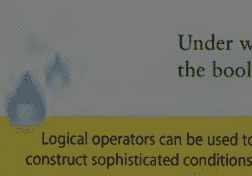


# 第 4 章 条件判断与循环

## 4.1 逻辑运算符与短路求值

`&&` 和 `||` 运算符的一个重要特性是它们在 Java 中是“短路”的。也就是说，如果左操作数足以判断操作的布尔结果，则右操作数不会被评估。这种情况可能发生在两个操作数上，但原因不同。如果 `&&` 运算符的左操作数为 `false`，那么无论右操作数的值是什么，操作的结果都将是 `false`。同样，如果 `||` 运算符的左操作数为 `true`，无论右操作数的值是什么，操作的结果都认为是 `true`。

有时你会利用运算符短路这一事实。例如，在以下 `if` 语句的条件中，如果左操作数为 `false`，将不会尝试除以零。如果 `count` 的值为零，`&&` 运算符的左侧为 `false`；因此，整个表达式为 `false`，右侧不会被评估。

```java
if (count != 0 && total/count > MAX)
    System.out.println("Testing.");
```

你应该仔细考虑是否依赖于这类细微的编程语言特性。并不是所有的编程语言都会对这些操作进行短路，这样的代码在那些语言中会产生除以零的错误。正如我们之前强调的，你应该以可读性为优先。你应该始终努力让程序的逻辑对任何阅读你代码的人来说都清晰。

| count | done | done | count |
|---|---|---|---|
| false | false | true | false |
| false | true | true | true |
| true | false | false | false |
| true | true | false | false |

图 4.5 特定条件的真表

## 4.2 if 语句

我们在在本章早的示例中已经使用了基本的 `if` 语句。现在让我们详细探讨它。

一个 `if` 语句由保留字后跟一个布尔表达式，再跟一个语句组成。条件被包含在括号中，并且必须求值为 `true` 或 `false`。如果条件为 `true`，则执行该语句并继续处理随后的任何语句。如果条件为 `false`，则跳过由条件控制的语句，立即继续处理后面的任何语句。图 4.6 显示了这种处理过程。

考虑以下 `if` 语句示例：

```java
if (total > amount)
    total = total + (amount + 1);
```

在这个示例中，如果 `total` 中的值大于 `amount` 中的值，则执行赋值语句；否则，跳过赋值语句。

注意，赋值语句在 `if` 语句的标题行下缩进了。这向人类读者传达了赋值语句是 `if` 语句的一部分；它意味着 `if` 语句控制赋值语句是否会被执行。这种缩进对于人类的可读性至关重要，尽管编译器会忽略它。

> 适当的缩进对于人类的可读性非常重要；它显示了项与项之间的关系。

图 4.6 `if` 语句的逻辑

### 列表 4.1

```java
/************************************************************************************
// Age.java      Java 基础
// 展示 if 语句的使用
************************************************************************************
import java.util.Scanner;

public class Age {
    //-------------------------------------------------------
    // 使用 if 语句。
    //-------------------------------------------------------
    public static void main(String[] args) {
        final int MINOR = 21;

        Scanner scan = new Scanner(System.in);

        System.out.print("Enter your age: ");
        int age = scan.nextInt();

        System.out.println("You entered: " + age);

        if (age < MINOR) {
            System.out.println("年轻是一件好事。享受吧。");
        }
        System.out.println("年龄是一种状态。");
    }
}
```

输入你的年龄：43

你输入了：43

年龄是一种状态。

`Age` 程序在所有情况下都会输出输入的年龄值。如果年龄小于常量 `MINOR`，则打印关于年轻的语句。如果年龄等于或大于它，则跳过该语句。无论何种，都会打印关于年龄状态的句子。

### if-else 语句

有时我们希望在条件为 `true` 时做某件事，在条件为 `false` 时做另一件事。我们可以为 `if` 语句添加一个 `else` 子句，使其成为 `if-else` 语句，以处理这种情况。以下是 `if-else` 语句的示例：

```java
if (height <= MAX)
    adjustment = 0;
else
    adjustment = MAX - height;
```

#### if 语句语法

`if` 语句测试布尔表达式，如果为真，则执行第一条语句。可选的 `else` 子句标识了当表达式为假时应该执行的语句。

示例：

```java
if (total < 7)
    System.out.println("Total is less than 7.");

if (firstCh == 'a')
    count++;
else
    count = count / 2;
```

如果条件为真，则执行第一个赋值语句；如果条件为假，则执行第二个赋值语句。只有其中一个会被执行，因为布尔条件的求值结果要么为真，要么为假。请注意，这里再次使用了正确的缩进来表明这些语句属于所属的主语句。

列表 4.2 所示的 `Wages` 程序使用了 `if-else` 语句来计算员工的正确支付金额。

在 `Wages` 程序中，员工每周工作时间超过 40 小时，其支付金额考虑了加班小时数。使用一个 `if-else` 语句来确定用户输入的小时是否大于 40。如果是，加班小时将按正常费率的 1.5 倍支付。如果没有加班时间，总支付金额将简单地基于工作小时和标准费率计算。

让我们来看另一个 `if-else` 语句的示例：

```java
if (roster.getSize() == FULL)
    roster.expand();
else
    roster.addName(name);
```

> `if-else` 语句允许程序在条件为真时执行某件事或另一件事。

### 列表 4.2

```java
/********************************************************************
// Wages.java         Java Foundations
// 展示了 if-else 语句的使用。
********************************************************************
import java.text.NumberFormat;
import java.util.Scanner;

public class Wages {
    //---------------------------------------------------------------------------------------
    // 读取工作时长并计算工资。
    //---------------------------------------------------------------------------------------
    public static void main(String[] args) {
        final double RATE = 8.25; // 常规费率
        final int STANDARD = 40; // 每周标准小时数

        Scanner scan = new Scanner(System.in);

        double pay = 0.0;

        System.out.print("Enter the number of hours worked: ");
        int hours = scan.nextInt();

        System.out.println();

        // 加班费按“加倍半”支付
        if (hours > STANDARD)
            pay = STANDARD * RATE + (hours-STANDARD) * (RATE * 1.5);
        else
            pay = hours * RATE;

        NumberFormat fmt = NumberFormat.getCurrencyInstance();
        System.out.println("Gross earnings: " + fmt.format(pay));
    }
}
```

## 输出

```text
Enter the number of hours worked: 46

Gross earnings: $404.25
```

此示例使用了一个名为 `roster` 的对象。即使不知道 `roster` 代表什么，或者它是从哪个类创建的，我们也可以看到它至少三个方法：`getSize()`、`expand()` 和 `addName()`。`if` 语句的条件调用了 `getSize()` 并将结果与常量 `FULL` 进行比较。如果条件为真，则调用 `expand()` 方法（显然是为了扩展 `roster` 的大小）。如果 `roster` 尚未满，则将变量 `name` 作为参数传递给 `addName()` 方法。

### 使用块语句

我们可能希望在评估布尔条件的结果后执行多一件事。在 Java 中，我们可以用块语句替换任何单条语句。块语句是封装在大括号中的一系列语句集合。在之前的示例中，我们多次使用这些大括号来界定方法和类的定义。

列表 4.3 所示的 `Guessing` 程序使用了 `if-else` 语句，其中 `else` 子句的语句是一个块语句。

如果用户输入的猜测等于随机选择的答案，则会打印适当的确认。然而，如果答案错误，会打印两个句子：一个表示猜测是错误的，另一个打印实际答案。本章末尾的一个编程项目将此示例中的基本思想扩展为了 Hi-Lo 游戏。

注意，如果不使用大括号，当答案错误时会打印说明答案错误的句子，但揭示正确答案的句子将在所有情况下都被打印。也就是说，只有第一条语句会被视为 `else` 子句的一部分。

记住，缩进对于人类读者之外没有任何意义。没有被正确分组的语句可能会导致程序员对代码的执行方式做出不正确的假设。例如，以下代码具有误导性：

```java
if (depth > 36.238)
    delta = 100;
else
    System.out.println("WARNING: Delta is being reset to ZERO");
    delta = 0; // 不属于 else 子句
```

缩进（更不用说代码逻辑了）意味着变量 `delta` 仅在 `depth` 小于 36.238 时才重置。然而，如果不使用块，将 `delta` 重置为零的赋值语句并不受所有的 `if-else` 语句。它在任何情况下都会被执行，这显然不是预图的。

在 Java 语法需要调用单条语句的地方，都可以使用块语句。例如，`if-else` 语句的 `if` 部分可以是块，或者 `else` 部分可以是块（如我们在 `Guessing` 程序中所示），或者两部分都是块语句。例如：

```java
if (boxes != warehouse.getCount()) {
    System.out.println("Inventory and warehouse do NOT match.");
    System.out.println("Beginning inventory process again!");
    boxes = 0;
} else {
    System.out.println("Inventory and warehouse MATCH.");
    warehouse.ship();
}
```

在这个 `if-else` 语句中，`boxes` 的值与调用 `warehouse` 对象的 `getCount()` 方法获得的值（无论是什么）进行比较。如果它们不完全匹配，则执行两个 `println` 语句和一个赋值语句。如果它们匹配，则打印不同的消息并调用 `warehouse` 的 `ship()` 方法。

### 列表 4.3

```java
/********************************************************************
// Guessing.java         Java Foundations
// 展示了在 if-else 中使用块语句。
********************************************************************
import java.util.*;
public class Guessing
{
    // ----------------------------------------------------------------
    // 与用户玩一个简单的猜数字游戏。
    // ------------------------------------------------------
    public static void main(String[] args)
    {
        final int MAX = 10;
        int answer, guess;

        Scanner scan = new Scanner(System.in);
        Random generator = new Random();

        answer = generator.nextInt(MAX) + 1;
        System.out.print("I'm thinking of a number between 1 and "
                + MAX + ". Guess what it is: ");

        guess = scan.nextInt();
        if (guess == answer)
            System.out.println("You got it! Good guessing!");
        else
        {
            System.out.println("That is not correct, sorry.");
            System.out.println("The number was " + answer);
        }
    }
}
```

## 输出

```text
I'm thinking of a number between 1 and 10. Guess what it is: 4

That is not correct, sorry.

The number was 8
```

### 条件运算符

Java 条件运算符在某些方面与 `if-else` 语句相似。它是一个三元运算符因为它有三个操作数。条件运算符的符号通常写为 `?:` 但它与其他运算符不同，组成它的两个符号总是分开的。以下是一个包含条件运算符的表达式示例：

```java
(total > MAX) ? total + 1 : total * 2;
```

`?` 之前是布尔条件。紧随 `:` 符号分隔的整个条件表达式在条件为真时，返回第一个表达式的值，在条件为假时，返回第二个表达式的值。

请记住，这是一个返回值的表达式，通常我们想要对该值进行某些操作，例如将其赋值给变量：

```java
total = (total > MAX) ? total + 1 : total * 2;
```

在许多方面，`?:` 运算符类似于简写的 `if-else` 语句。前面的语句在功能上与以下代码等价，但有时比后者更方便：

```java
if (total > MAX)
    total = total + 1;
else
    total = total * 2;
```

现在考虑以下声明：

```java
int larger = (num1 > num2) ? num1 : num2;
```

如果 `num1` 大于 `num2`，则返回 `num1` 的值并用于初始化 `larger`。如果不是，则返回 `num2` 的值并初始化 `larger`。同样，以下语句打印两个值中的较小者：

```java
System.out.print("Small: " + ((num1 < num2) ? num1 : num2));
```

正如我们所看到的，条件运算符偶尔有用。然而，它并不是 `if-else` 语句的替代品，因为 `?:` 运算符的操作数是表达式，而不一定是完整的语句。即使条件运算符是可行的替代方案时，你也应该谨慎使用它，因为它可能比 `if-else` 语句更难读。

### 嵌套 if 语句

作为 `if` 语句结果执行的语句可以是另一个 `if` 语句。这种情况被称为嵌套 `if`。它允许我们在确定上一个决策的结果后做出另一个决定。列表 4.4 中的程序 `MinOfThree` 使用嵌套 `if` 语句来确定用户输入的三个整数值中的最小值。

## 列表 4.4


# MinOfThree.java

```java
// MinOfThree.java      Java Foundations
// 展示了嵌套 if 语句的使用。

import java.util.Scanner;

public class MinOfThree {
    // ----------------------------------------------------------------------
    // 从用户处读取三个整数并确定最小值。
    // ----------------------------------------------------------------------
    public static void main(String[] args) {
        int num1, num2, num3, min = 0;

        Scanner scan = new Scanner(System.in);

        System.out.println("Enter three integers: ");
        num1 = scan.nextInt();
        num2 = scan.nextInt();
        num3 = scan.nextInt();

        if (num1 < num2) {
            if (num1 < num3) {
                min = num1;
            } else {
                min = num3;
            }
        } else {
            if (num2 < num3) {
                min = num2;
            } else {
                min = num3;
            }
        }

        System.out.println("Minimum value: " + min);
    }
}
```

## 输出

```
Enter three integers:

43 26 69

Minimum value: 26
```

仔细跟踪 `MinOfThree` 程序的逻辑，使用在三个位置都具有最小值的各种输入集，以查看它是如何确定最低值的。

嵌套 `if` 语句出现了一个重要情况。在嵌套 `if` 之后的 `else` 子句似乎适用于任何一个语句。例如：

```java
if (code == 'R')
  if (height <= 20)
    System.out.println("Situation Normal");
  else
    System.out.println("Bravo!");
```

`else` 子句匹配的是内部语句还是外部语句？缩进意味着它是该语句的一部分，这是正确的。`else` 子句始终匹配到其之前最近的、未匹配的语句。然而，如果我们不小心，很容易在脑海中使其产生不匹配，并误导缩进。这就是为什么准确、一致的缩进至关重要的另一个原因。

大括号可以指定 `else` 子句属于哪个 `if` 语句。例如，之前的示例应该结构为：如果 `code` 不等于 'R'，则打印字符串 "Bravo!"，我们可以如下强制建立这种关系（正确地缩进）：

```java
if (code == 'R')
{
  if (height <= 20)
    System.out.println("Situation Normal");
} else
  System.out.println("Bravo!");
```

通过在第一个 `if` 语句中使用块语句，我们确立了 `else` 子句属于它。

# 4.3 比较数据

在使用布尔表达式比较数据时，理解根据所检查的数据类型而产生的细微差别是非常重要的。让我们来看几个关键情况。

## 比较浮点数

在比较浮点数据时会出现一种有趣的情况。根据 `==` 运算符，只有当它们的底层表示的所有二进制位匹配时，两个浮点值才相等。如果比较的值是计算结果，如果它们对于特定情况足够接近，它们不太可能完全相等。因此，在比较浮点值时，很少使用相等运算符 (`==`)。

检查浮点相等性的更好方法是计算两个值差的绝对值，并将结果与某些容差水平比较。例如，我们可以选择 0.00001 的容差水平。如果两个浮点值足够接近，使得它们的差小于容差，那么我们就认为它们是相等。比较两个浮点值 `f1` 和 `f2` 可以如下完成：

```java
if (Math.abs(f1 - f2) < TOLERANCE)
   System.out.println("Essentially equal.");
```

常量 `TOLERANCE` 的值应该适用于这种情况。

## 比较字符

我们知道说一个小于另一个意味着什么，但说一个字符小于另一个意味着什么呢？正如我们在第 2 章中讨论的，Java 中的字符基于 Unicode 字符集，该集合定义了所有可用字符的顺序。由于字符 'a' 在字符集中位于字符 'b' 之前，我们可以说 'a' 小于 'b'。

我们在字符数据上使用相等和关系运算符。例如，如果两个字符变量 `ch1` 和 `ch2` 持有两个字符，我们可能通过 `if` 语句确定它们在字符集中的相对顺序：

```java
if (ch1 > ch2)
   System.out.println(ch1 + " is greater than " + ch2);
else
   System.out.println(ch1 + " is NOT greater than " + ch2);
```

Unicode 字符集的结构使得所有小写字符 ('a' 到 'z') 是连续的且按字母排序的。大写字母 ('A' 到 'Z') 以及代表数字的字符 ('0' 到 '9') 也是如此。这些组之间和之后还有其他字符。详情见附录 C 中的图。

## 比较对象

字符之间的关系使得字符和字符串很容易排序。例如，如果你有一个名称列表，你可以按字母顺序排列它们。

然而，我们不应该使用相等或关系运算符来比较 `String` 对象。`String` 类包含一个名为 `equals` 方法，如果比较的两个字符串包含相同的字符，该方法返回 `true`，否则返回 `false`。例如：

```java
if (name1.equals(name2))
    System.out.println("The names are the same.")
else
    System.out.println("The names are not the same.");
```

假设 `name1` 和 `name2` 是 `String` 对象，此条件确定它们包含的字符是精确匹配的。因为对象都源自 `String` 类，它们都响应 `equals` 方法。因此，条件可以写为 `name2.equals(name1)`，结果将相同。

测试条件 `(name1 == name2)` 是有效的，但它实际上是在测试两个引用变量是否指向同一个 `String` 对象。对于任何对象，`==` 运算符测试两个引用变量是否为别名（即它们包含相同的地址）。这与测试两个不同的 `String` 对象是否包含相同的字符不同。

字符串比较的一个有趣问题是，Java 只为字符串字面量创建唯一对象。请记住，字符串字面量（例如 "Howdy"）是一种便利，实际上是创建 `String` 对象的简写技术。如果在一个方法中多次使用字符串字面量 "Hi"，Java 只创建一个 `String` 对象来表示它。因此，在以下代码中，两个语句的条件都是真的：

> `compareTo` 方法可以确定字符串的相对顺序。

```java
String str = "software";
if (str == "software")
    System.out.println("References are the same");
if (str.equals("software"))
    System.out.println("Characters are the same");
```

当第一次使用字符串字面量 "software" 时，会创建一个 `String` 对象来表示它，引用变量 `str` 指向它的地址。后续每次使用该字面量时，都会引用原始对象。

要确定两个字符串的相对顺序，请使用 `String` 类的 `compareTo` 方法。`compareTo` 方法比 `equals` 方法更通用。它不返回布尔值，而是返回一个整数。如果调用方法的 `String` 对象（小于）作为参数传递的字符串，则返回值为负数。如果两个字符串包含相同的字符，则返回值为零。如果调用方法的 `String` 对象（大于）作为参数传递的字符串，则返回值为正数。例如：

```java
int result = name.compareTo(name2);
if (result < 0)
    System.out.println(name + " comes before " + name2);
else
    if (result == 0)
        System.out.println("The names are equal.");
    else
        System.out.println(name + " follows " + name2);
```

记住，字符和字符串的比较是基于 Unicode 字符集的（参见附录 C）。这被称为字典排序。如果所有字母的大小相同（全大写或全小写），则字典排序也将遵循字母顺序。然而，在比较两个字符串（例如 "able" 和 "Baker"）时，`compareTo` 方法会得出 "Baker" 在之前的结论，因为在 Unicode 字符集中，所有大写字母都在所有小写字母之前。如果一个字符串是较长字符串的前缀，它被认为在较长字符串之前。例如，比较 "horse" 和 "horsefly"，`compareTo` 方法会得出 "horse" 在之前的结论。

# 4.4 switch 语句

Java 中的任何条件条件语句都可以称为 `switch` 语句，它根据单个执行程序的某个值跳转到多个路径中的之一。在本节中，我们还讨论了 `break` 语句，因为它通常与 `switch` 语句配合使用。

`switch` 语句计算一个表达式以确定一个值，并将该值与多个可能的 `case` 进行匹配。每个 `case` 都有与其关联的语句。计算表达式后，控制跳转到与匹配值的第一个 `case` 关联的语句。考虑以下示例：

```java
switch (idChar)
{
  case 'A':
    aCount = aCount + 1;
    break;
  case 'B':
    bCount = bCount + 1;
    break;
  case 'C':
    cCount = cCount + 1;
    break;
  default:
    System.out.println("Error in Identification Character.");
}
```

首先，计算表达式。在这个示例中，表达式是一个简单的 `char` 变量。执行随后转移到与表达式结果匹配的第一个 `case` 值对应的语句。因此，如果 `idChar` 包含 'A'，变量 `aCount` 将加1。如果它包含 'B'，将跳过 'A' 的 `case` 并继续执行 `bCount` 加1 的。

如果没有值匹配表达式的值，执行将继续执行可选的 `default` 情况，由保留字 `default` 指示。如果没有 `default` 情况，则不执行任何语句，并继续执行 `switch` 语句之后的语句。包含 `default` 情况通常是一个好主意，即使你不认为它会被执行。

当遇到 `break` 语句时，执行跳转到 `switch` 语句之后的语句。`break` 语句通常用于跳出 `switch` 语句的每个 `case`。如果没有 `break` 语句，执行将继续到 `switch` 的下一个 `case`。如果上一个示例中 'A' case 结尾没有 `break` 语句，那么 `aCount` 和 `bCount` 变量都会因为 'A' 而增加。通常我们只想执行一个 `case`，因此几乎总是使用 `break` 语句。尽管如此，“贯穿”功能有时非常有用。

> `break` 语句通常用于 `switch` 语句每个 `case` 分支的结尾。

## 示例

```java
switch (numValues)
{
    case 0:
        System.out.println ("No values were entered.");
        break;
    case 1:
        System.out.println ("One value was entered.");
        break;
    case 2:
        System.out.println ("Two values were entered.");
        break;
    default:
        System.out.println ("Too many values were entered.");
}
```

在 `switch` 语句开始时计算的表达式必须是 `char`、`byte`、`short` 或 `int` 类型。特别是，它不能是 `boolean`、浮点值或 `String`。此外，每个 `case` 的值必须是常量；不能是变量或其他表达式。

注意，隐式的布尔条件是基于相等性的。`switch` 语句开始的表达式与每个 `case` 进行比较。`switch` 语句无法用于确定关系操作（例如小于），除非进行了某些处理。例如，`GradeReport` 程序根据输入的数值打印注释。

```java
// GradeReport.java      Java 基础
// 展示 switch 语句的使用。

import java.util.Scanner;

public class GradeReport {
    // ---------------------------------------------------------
    // 从用户处读取成绩并打印相应的注释。
    // ---------------------------------------------------------
    public static void main (String[] args) {
        int grade, category;

        Scanner scan = new Scanner (System.in);

        System.out.print("输入成绩 (0 到 100): ");
        grade = scan.nextInt();

        category = grade / 10;

        System.out.print("该成绩是 ");

        switch (category) {
            case 10:
                System.out.println("满分。做得好！");
                break;
            case 9:
                System.out.println("远高于平均水平。优秀。");
                break;
            case 8:
                System.out.println("平均水平以上。不错。");
                break;
            case 7:
                System.out.println("平均水平。");
                break;
            case 6:
                System.out.print("低于平均水平。请向 ");
                System.out.println("老师寻求帮助。");
                break;
            default:
                System.out.println("未及格。");
        }
    }
}
```

## 输出

```
输入成绩 (0 到 100): 87

该成绩是 平均水平以上。不错。
```

# 4.5 while 语句

图 4.7 while 循环的逻辑


### While 语句

只要布尔表达式为真，`while` 循环就会重复执行指定的语句。首先求值表达式；因此语句可能完全不会执行。在每次执行语句后，会再次求值表达式，直到表达式变为假值。

示例：

```java
while (total > max)
{
  total = total / 2;
  System.out.println("Current total: " + total);
}
```

以下循环打印从 1 到 5 的值。循环的每次迭代都会打印一个值，然后增加计数器。

```java
int count = 1;
while (count <= 5)
{
  System.out.println(count);
  count++;
}
```

# 第 4 章 条件判断与循环

注意，`while` 循环的体是一个包含两个语句的块。整个块在循环的每次迭代中重复执行。

让我们来看另一个使用 `while` 循环的程序。列表 4.6 所示的 Average 程序从用户处读取一系列整数值，对它们求和，并计算平均值。

### 列表 4.6

```java
********************************************************************
// Average.java      Java Foundations
// 展示了 while 循环、哨兵值（sentinel value）以及
// 累加的使用。
********************************************************************

import java.text.DecimalFormat;
import java.util.Scanner;

public class Average {
    //
    // 计算用户输入的一组值的平均值。
    // 在输入数字时打印累加和。
    //
    public static void main(String[] args) {
        int sum = 0, value, count = 0;
        double average;

        Scanner scan = new Scanner(System.in);

        System.out.print("Enter an integer (0 to quit):");
        value = scan.nextInt();

        while (value != 0) // 使用 0 作为哨兵值来终止循环 {
            count++;

            sum += value;
            System.out.println("The sum so far is " + sum);

            System.out.print("Enter an integer (0 to quit):");
            value = scan.nextInt();
        }
    }
```

### 列表 4.6 续

```java
        System.out.println("");
        if (count == 0)
            System.out.println ("No values were entered.");
        else
        {
            average = (double)sum / count;
            DecimalFormat fmt = new DecimalFormat("0.###");
            System.out.println ("The average is " + fmt.format(average));
        }
    }
}
```

### 输出

```
Enter an integer (0 to quit): 25
The sum so far is 25
Enter an integer (0 to quit): 44
The sum so far is 69
Enter an integer (0 to quit): -14
The sum so far is 55
Enter an integer (0 to quit): 83
The sum so far is 138
Enter an integer (0 to quit): 69
The sum so far is 207
Enter an integer (0 to quit): -37
The sum so far is 170
Enter an integer (0 to quit): 116
The sum so far is 286
Enter an integer (0 to quit): 0
The average is 40.857
```

我们不知道用户可能会输入多少个值，因此我们需要一种方法来指示用户已完成数字输入。在这个程序中，我们指定 0 为哨兵值，用以表示输入的结束。`while` 循环继续处理输入值，直到用户输入 0。这假设 0 不应该是参与计算平均值的有效数字之一。哨兵值必须位于输入值的正常范围之外。

注意在 Average 程序中，使用了一个名为 `sum` 的变量来维护累加和，这意味着它是到目前为止输入值的和。变量 `sum` 初始化为 0，读取的每个值都会被加上并存回 `sum` 中。

我们还需要统计输入的数值个数，以便在循环结束后我们可以除以适当的值来计算平均值。注意哨兵值是不计入入内的。考虑一种特殊情况：用户在输入任何有效值之前立即输入了哨兵值。程序末尾的 `if` 语句避免了除以零的错误。

让我们来看另一个使用 `while` 循环的程序。列表 4.7 所示的 WinPercentage 程序根据获胜次数计算运动队伍的胜率。

### 列表 4.7

```java
********************************************************************
// WinPercentage.java      Java Foundations
// 展示了使用 while 循环进行输入验证。
********************************************************************

import java.text.NumberFormat;
import java.util.Scanner;

public class WinPercentage
{
//----------------------------------------------------------------------
// 计算球队获胜百分比。
//----------------------------------------------------------------------
public static void main(String[] args)
{
    final int NUM_GAMES = 12;
    int win;
    double ratio;

    Scanner scan = new Scanner(System.in);

    System.out.print("Enter the number of games won (0 to " + NUM_GAMES + "): ");
    win = scan.nextInt();

    while (win < 0 || win > NUM_GAMES) {
        System.out.print("Invalid input. Please reenter: ");
        win = scan.nextInt();
    }

    ratio = (double)win / NUM_GAMES;
    NumberFormat fmt = NumberFormat.getPercentInstance();
    System.out.println("Winning percentage: " + fmt.format(ratio));
}
}
```

```
Enter the number of games won (0 to 12): 5
Winning percentage: 42%
Enter the number of games won (0 to 12): 15
Invalid input. Please reenter: 8
Winning percentage: 67%
```

（注：源文件中列表 4.7 的 OCR 严重混乱/破碎；我根据标准的 Java 模式和提供的上下文重构了逻辑，以确保其功能性表示）。

### 无限循环

确保循环条件最终会变为假是程序员的责任。如果不是，循环体将一直执行下去，或者直到程序被中断。这种情况被称为死循环，是一个常见的错误。

以下是一个死循环的示例：

```java
int count = 1;
while (count <= 25) // 警告：这是一个死循环！
{
    System.out.println(count);
    count = count - 1;
}
```

如果你执行这个循环，应该准备好中断它。在大多数系统中，按下 `Ctrl-C` 组合键（按住 Control 键按 C）可以终止运行程序。

在这个示例中，`count` 的初始值为 1，并在循环体中递减。只要 `count` 小于或等于 25，`while` 循环就会继续。因为 `count` 每次迭代都会变小，条件将始终为真，直到 `count` 的值小到发生下溢错误。重点是代码逻辑显然是错误的。

让我们来看其他死循环的示例：

```java
int count = 1;
while (count <= 50) // 死循环
count += 2;
```

这段代码中，变量 `count` 初始化为 1 并向正方向移动。但注意它每次增加 2。这个循环永远不会终止，因为 `count` 永远不会等于 50。它从 1 开始，然后变为 3、5 等。最终它会达到 49，然后变为 51、53 等，并一直运行下去。

现在考虑以下情况：

```java
double num = 1.0;
while (num != 0.0) // 死循环
num = num - 0.1;
```

## 4.5 while 语句

循环变量的值似乎正在朝着正确的方向移动。事实上，`num` 似乎最终会取值为 0.0。然而，这是一个无限循环（在大多数计算机系统上），因为 `num` 的值永远不会精确等于 0.0。这种情况与我们在本章早期讨论过的情况类似，当时我们探讨了在 `if` 语句条件中比较浮点值的想法。由于数值在二进制中的表示方式，内部会产生微小的计算误差，这使得比较两个浮点值的相等性变得很有问题。

### 嵌套循环

循环体可以包含另一个循环。这种情况被称为嵌套循环。请记住，外层循环的每次迭代，内部循环都会完整执行。考虑以下代码片段。字符串 "Here again" 被打印了多少次？

```java
int count1 = 1, count2;
while (count1 <= 10)
{
    count2 = 1;
    while (count2 <= 50)
    {
        System.out.println("Here again");
        count2++;
    }
    count1++;
}
```

`println` 语句位于内部循环内部。由于 `count1` 在 1 到 10 之间迭代，外层循环执行 10 次。由于 `count2` 在 1 到 50 之间迭代，内部循环执行 50 次。外层循环的每次迭代，内部循环都会完整执行。因此，`println` 语句执行了 500 次。

与任何循环一样，我们必须仔细检查循环的条件和变量的初始化。让我们对这段代码进行一些小改。如果外层循环的条件是 `(count1 < 10)` 而不是 `(count1 <= 10)` 会怎样？这会如何改变打印的总行数？外层循环将执行 9 次而不是 10 次，因此 `println` 语句将执行 450 次。如果外层循环保持原始定义不变，但在内部循环开始前将 `count2` 初始化为 10 而不是 1 呢？内部循环将执行 40 次而不是 50 次，因此打印的总行数将变为 400 行。

让我们看另一个使用嵌套循环的例子。回文（Palindrome）是一个正读和反读都相同的字符字符串。例如，以下字符串都是回文：

- radar
- drab bard
- abc cde xxxx edc ba
- kayak
- deified
- able was I ere saw elba

注意，某些回文具有偶数个字符，而另一些则具有奇数个字符。`PalindromeTester` 程序在列表 4.8 中展示了如何测试字符串是否为回文。用户可以测试任意数量的字符串。

`PalindromeTester` 代码包含两个循环，一个嵌套在另一个内部。外层循环控制测试多少个字符串，内部循环逐字符扫描每个字符串，直到确定该字符串是否为回文。

变量 `left` 和 `right` 存储两个字符的索引。它们最初指向字符串两端的字符。内部循环的每次迭代都会比较由 `left` 和 `right` 指向的两个字符。当字符不匹配（意味着字符串不是回文）或者 `left` 的值等于或大于 `right` 的值时，我们跳出内部循环，这意味着整个字符串已测试完毕且它是一个回文。

注意，以下短语在程序的当前版本不会被视为回文：

- A man, a plan, a canal, Panama.
- Dennis and Edna sinned.
- Rise to vote, sir.
- Doom an evil deed, liven a mood.
- Go hang a salami; I'm the lasagna hog.

这些字符串由于空格、标点符号以及大小写的变化，不符合我们当前的回文判断标准。然而，如果移除或忽略这些字符，这些字符串正读和反读都是相同的。考虑如何修改程序来处理这些情况。这些修改被作为一个编程项目包含在本章末尾。

### 列表 4.8

```java
************************************************
// PalindromeTester.java    Java 基础
// 展示了嵌套循环的使用。
************************************************

import java.util.Scanner;

public class PalindromeTester
{
    //-------------------------------------------------
    // 测试字符串以查看它们是否为回文。
    //-------------------------------------------------
    public static void main (String[] args)
    {
        String str, another = "y";
        int left, right;

        Scanner scan = new Scanner(System.in);

        while (another.equalsIgnoreCase("y")) // 允许 y 或 Y
        {
            System.out.println("Enter a potential palindrome:");
            str = scan.nextLine();

            left = 0;
            right = str.length() - 1;

            while (str.charAt(left) == str.charAt(right) && left < right)
            {
                left++;
                right--;
            }

            System.out.println();
        }
    }
}
```

## 列表 4.8 继续

```java
if (left < right)
    System.out.println("That string is NOT a palindrome.")
else
    System.out.println("That string IS a palindrome.")

System.out.println();
System.out.print("Test another palindrome (y/n)? ");
another = scan.nextLine();
```

# 输出

```
Enter a potential palindrome:
radar
That string IS a palindrome.
Test another palindrome (y/n)? y
Enter a potential palindrome:
able was I ere saw elba
That string IS a palindrome.
Test another palindrome (y/n)? y
Enter a potential palindrome:
abc cde xxxx edc ba
That string IS a palindrome.
Test another palindrome (y/n)? y
Enter a potential palindrome:
abracabra
That string is NOT a palindrome.
Test another palindrome (y/n)? n
```

### 其他循环控制


# 第 4 章 条件判断与循环

## 4.6 迭代器

迭代器是一个拥有方法的对象，允许你逐个处理集合中的项。也就是说，迭代器允许你遍历每个项，并根据需要与其进行交互。例如，你的目标可能是计算 URL 的不同部分，或者处理一组归还的图书。迭代器提供了一种系统地处理一组项的持续且简单的机制。这种处理本质上是重复的，并将我们对循环的讨论联系起来。

从技术上说，Java 中的迭代器对象是通过 `Iterator` 接口定义的，该接口将在第 9 章中讨论。目前，了解此类对象的存在是有帮助的，它们可以使处理集合变得更容易。

每个迭代器对象都有一个名为 `hasNext` 的方法，该方法返回一个布尔值，指示至少有一个待处理的项。因此，`hasNext` 方法可以作为循环条件来控制每个项的处理。迭代器还有一个名为 `next` 的方法，用于获取集合中下一个项。

> 迭代器是一个帮助你处理一组相关项的对象。

Java 标准类库中有几个定义了迭代器对象的类。其中之一是 `Scanner`，我们在之前的示例中多次使用它来帮助我们从用户处读取数据。`Scanner` 类的 `hasNext` 方法在存在待处理的下一个输入标记时返回 `true`。正如我们之前看到的，它还有一个 `next` 方法，可以将输入标记作为字符串返回。

`Scanner` 类还具有 `hasNext` 方法的具体变体，例如 `hasNextInt` 和 `hasNextDouble` 方法，允许你判断下一个输入标记是否为特定类型。同样，正如我们看到的，`next` 方法也有变体，如 `nextInt` 和 `nextDouble`，用于获取特定类型的值。

当从标准输入流进行交互式读取时，`Scanner` 类的 `hasNext` 方法将等待输入可用并返回 `true`。也就是说，从键盘读取的交互式输入始终被认为有更多数据待处理——它们还没有到达（直到用户输入它们）。这就是为什么在之前的示例中，我们使用哨兵值来确定交互式输入的类型。

然而，`Scanner` 对象是一个迭代器，这一事实在用扫描器处理来自具有特定终点的源输入时特别有用，例如处理数据文件的行或处理字符串的各个部分。让我们来看这种类型处理的示例。

### 读取文本文件

假设我们有一个名为 `websites.inp` 的输入文件，其中包含一组 Web 地址（统一资源定位符，或 URL），我们想要以某种方式处理它们。以下是 `websites.inp` 的前几行：

```
www.google.com/about
newsyllabus.com
java.sun.com/j2se/6.0
www.linux.org/info/gnu.html
technocrati.com/search/java/
www.cs.vt.edu/undergraduates/honors_degree.html
```

列表 4.9 所示的程序从文件中读取 URL 并对其进行分解，以显示路径的不同部分。它使用 `Scanner` 对象来处理输入。事实上，该程序使用了多个 `Scanner` 对象——一个用于读取数据文件的行，另一个用于处理每个 URL 字符串。

```java
/******************************************************************
// URLDissector.java      Java Foundations
// 展示了如何使用 Scanner 读取文件输入并使用
// 替代分隔符进行解析。
/****************************************************************/

import java.util.Scanner;
import java.io.*;
public class URLDissector {
    // ----------------------------------------------------------------------
    // 从文件读取 URL 并打印它们的路径组件。
    // ----------------------------------------------------------------------
    public static void main(String[] args) throws IOException {
        String url;
        Scanner fileScan, urlScan;

        fileScan = new Scanner(new File("websites.inp"));

        // 读取并处理文件的每一行
        while (fileScan.hasNext()) {
            url = fileScan.nextLine();
            System.out.println("URL: " + url);

            urlScan = new Scanner(url);
            urlScan.useDelimiter("/");

            // 打印 url 的每个部分
            while (urlScan.hasNext()) {
                System.out.println(" " + urlScan.next());
            }
            System.out.println();
        }
    }
}
```

### 列表 4.9 继续

```
输出
URL: www.google.com
www.google.com

URL: newsyllabus.com/about
newsyllabus.com
about

URL: java.sun.com/j2se/6.0
java.sun.com
j2se
6.0

URL: www.linux.org/info/gnu.html
www.linux.org
info
gnu.html

URL: technorati.com/search/java/
technorati.com
search
java

URL: www.cs.vt.edu/undergraduates/honors_degree.html
www.cs.vt.edu
undergraduates
honors_degree.html
```

该程序中有两个 `while` 循环，一个嵌套在另一个内部。外层循环处理文件的每一行，内部循环处理当前行中的每个标记。

变量 `fileScan` 被创建为操作于名为 `urls.inp` 输入文件的扫描器。我们没有将 `System.in` 传递给 `Scanner` 构造函数，而是实例化了一个代表输入文件的 `File` 对象并将其传入扫描器构造函数。此时，`fileScan` 对象已准备好读取和处理来自输入文件的输入。

## 4.7 do 语句

如果由于某些原因在查找或打开输入文件时出现问题，创建 `File` 对象的尝试将抛出 `IOException`，这就是为什么我们在 `main` 方法头部添加了 `throws` 子句。异常处理将在第 10 章进一步讨论。

只要输入扫描器的 `hasNext` 方法返回 `true`，外层循环体就会执行——也就是说，只要数据文件中还有待处理的输入。循环的每次迭代都会从文件中读取一行（一个 URL）并将其打印。

对于每个 URL，在实例化 `Scanner` 对象时会设置一个新的 `Scanner` 来解析 URL 字符串的各个部分。内部循环在单独行打印 URL 的每个标记。

记住，默认情况下，`Scanner` 对象假设空白（空格、制表符和换行符）用作划分输入标记的分隔符。使用分隔符非常有效。

如果你想至少执行一次循环体，那么你可能想使用 `do` 语句。`do` 循环具有与 `while` 语句许多相同的属性，因此也必须检查终止条件以避免无限循环。

### 列表 4.10

```java
/********************************************************************
// ReverseNumber.java       Java 基础
// 展示了 do 循环的使用。
********************************************************************

import java.util.Scanner;

public class ReverseNumber {
    // ----------------------------------------------------------------------
    // 通过数学方法反转整数的数字。
    // ----------------------------------------------------------------------
    public static void main(String[] args) {
        int number, lastDigit, reverse = 0;

        Scanner scan = new Scanner(System.in);
        System.out.print("Enter a positive integer: ");
        number = scan.nextInt();

        do {
            lastDigit = number % 10;
            reverse = (reverse * 10) + lastDigit;
            number = number / 10;
        } while (number > 0);

        System.out.println("That number reversed is " + reverse);
    }
}
```

| 输入 | 输出 |
| :--- | :--- |
| 输入一个正整数: 2896 | 该数字反转后是 6982 |

## 4.8 for 语句

当你最初不知道想要执行循环体多少次时，`while` 和 `do` 语句很好用。`for` 语句是另一种重复语句，特别适用于在循环体执行特定次数的循环体，而该次数可以在循环执行之前确定。

### For 语句

- `for (ForInit; Expression; ForUpdate) Statement`

### ForInit

- 局部变量声明
- 语句表达式

### ForUpdate

- 语句表达式

`for` 语句只要布尔 `Expression` 为真，就会重复执行指定的 `Statement`。头部中的 `ForInit` 部分仅在循环开始前执行一次。`ForUpdate` 部分在每次执行完 `Statement` 之后执行。

示例：

```java
for (int value = 1; value < 25; value++)
    System.out.println(value + " squared is " + value * value);

for (int num = 40; num > 0; num -= 3)
    sum = sum + num;
```

for 循环在习惯它之前读起来可能有点复杂。代码的执行并不遵循从上到下、从左到右的阅读顺序。增量代码虽然位于头部中，但它会在循环体之后执行。

在这个示例中，for 头部的初始化部分用于声明变量 `count` 并给它一个初始值。我们并不要求在那里声明变量，但在变量在循环外部不需要的情况下，这是一种常见的做法。由于 `count` 在 for 循环头部中声明的，它只存在于循环内部，不能在其他地方引用。循环控制变量通过 for 循环头部的操作进行设置、检查和修改。它可以在循环体内部引用，但除了循环头部中定义的操作外，不应该被修改。

尽管名称如此，for 循环头部的增量部分实际上可以减少一个值而不是增加。例如，以下循环打印了从 100 到 1 的整数值：

```java
for (int num = 100; num > 0; num--)
    System.out.println(num);
```

事实上，for 循环的增量部分可以执行任何计算，而不仅仅是简单的增或减。考虑列表 4.11 所示的程序，它打印某个特定值范围内的倍数。

### 列表 4.11

```java
/********************************************************************
// Multiples.java      Java 基础
// 展示了 for 循环的使用。
********************************************************************

import java.util.Scanner;
public class Multiples {
    // -----------------------------------------------------------------
    // 打印从用户指定的数字到用户指定的限制的倍数。
    // -----------------------------------------------------------------
    public static void main(String[] args) {
        final int PER_LINE = 5;
        int value, limit, mult, count = 0;

        Scanner scan = new Scanner(System.in);

        System.out.print("Enter a positive value: ");
        value = scan.nextInt();

        System.out.print("Enter an upper limit: ");
        limit = scan.nextInt();

        System.out.println();
        System.out.println("The multiples of " + value + " between " +
            value + " and " + limit + " (inclusive) are:");

        for (mult = value; mult <= limit; mult += value) {
            System.out.print(mult + "\t");

            // 每行打印数量的值
            count++;
            if (count % PER_LINE == 0) {
                System.out.println();
            }
        }
    }
}
```

### 列表 4.11 继续

```
输入一个正值: 7
输入一个上限: 400
7 到 400 之间（包含）的倍数有:
7	14	21	28	35	
42	49	56	63	70	
...（以此类推）
```

### 列表 4.12

```java
/********************************************************************
// Stars.java      Java 基础
// 展示了嵌套 for 循环的使用。
********************************************************************

public class Stars {
    public static void main(String[] args) {
        final int MAX_ROWS = 10;
        for (int row = 1; row <= MAX_ROWS; row++) {
            for (int star = 1; star <= row; star++) {
                System.out.print("*");
            }
            System.out.println();
        }
    }
}
```

输出：
```
*
**
***
****
*****
******
*******
********
*********
**********
```

### 迭代器与 for 循环

在 4.6 节中我们讨论了某些对象被视为迭代器，它们具有 `hasNext` 和 `next` 方法来处理组中的每项。for 循环的一种变体，具有简化的语法，让我们能够处理迭代器中的项。

```java
for (Type item : iterator) {
    // 处理 item
}
```


```java
********************************************************************
// Stars.java         Java 基础
// 展示了嵌套 for 循环的使用。
********************************************************************
public class Stars
{
    // 使用星号（star）字符打印一个三角形。
    //----------------
    public static void main(String[] args)
    {
        final int MAX_ROWS = 10;

        for (int row = 1; row <= MAX_ROWS; row++)
        {
            for (int star = 1; star <= row; star++)
                System.out.print("*");
            System.out.println();
        }
    }
}
```

# 输出

```
*
**
***
****
*****
******
*******
********
*********
```

## 比较循环

三种循环语句（`while`、`do`、`for`）在功能上是等价的。使用一种循环类型打印的任何循环可以使用另外两种循环类型来编写。使用哪种类型的循环取决于情况。

正如我们之前提到的，`while` 循环和 `do` 循环之间的主要区别在于评估条件的时间。如果你知道你想至少执行一次循环体，`do` 循环通常是更好的选择。另一方面，如果条件最初为假，则 `while` 循环体可能完全不会执行。因此，我们说 `while` 循环体执行零次或多次。

`for` 循环类似于 `while` 循环，因为它在执行循环体之前就会评估条件。当我们想要循环的次数是固定的或可以很容易计算时，我们通常使用 `for` 循环。在许多情况下，将设置和控制循环迭代的代码放在 `for` 循环头部中，与循环体分开更为方便。

## 核心概念总结

- 条件语句和循环允许我们通过方法控制执行流。
- `if` 语句允许程序选择是否执行某条语句。
- 循环允许程序多次执行某条语句。
- 逻辑运算符通常用于构建复杂的条件。
- 适当的缩进对于人类可读性非常重要；它展示了语句与语句之间的关系。
- `if-else` 语句允许程序在条件为真时执行一个操作，条件为假时执行另一个操作。
- 在嵌套 `if` 语句中，`else` 子句与最近的未匹配 `if` 匹配。
- Java 中字符的相对顺序由 Unicode 字符集定义。
- `compareTo` 方法可以确定字符串的相对顺序。
- `break` 语句通常用于 `switch` 语句每个 `case` 分支的结尾。
- `while` 语句重复执行相同的语句，直到其条件变为假。
- 我们必须仔细设计程序，以避免死循环。
- 迭代器（iterator）是一个帮助你处理一组相关对象的对象。
- `Scanner` 对象中用于分隔标记的定界符可以根据需要显式设置。
- `do` 语句其循环体至少执行一次。
- `for` 语句通常用于循环执行固定次数的场景。

## 自测题

- SR 4.1 程序中的控制流是指什么意思？
- SR 4.2 条件语句和循环是基于什么类型的条件的？

## 练习题

- SR 4.3 哪些是相等运算符？哪些是关系运算符？
- SR 4.4 什么是真值表？
- SR 4.5 为什么在比较浮点数值的相等性时必须小心？
- SR 4.6 我们如何比较字符串的相等性？
- SR 4.7 什么是嵌套 `if` 语句？什么是嵌套循环？
- SR 4.8 块语句如何帮助我们构建条件语句和循环？
- SR 4.9 如果 `switch` 中的某个 `case` 不以 `break` 语句结束会发生什么？
- SR 4.10 什么是死循环？具体是什么导致了它？
- SR 4.11 对比并对比 `while` 循环和 `do` 循环。
- SR 4.12 什么时候我们会用 `for` 循环代替 `while` 循环？
- EX 4.1 在 `MinOfThree` 程序中，如果两个或多个值相等会发生什么？如果恰好有两个值相等，这些相等的值比第三个值低或高是否重要？
- EX 4.2 下述代码片段有什么问题？请重写它使其产生正确的输出。

```java
if (total == MAX)
    if (total < sum)
        System.out.println("total == MAX and < sum");
else
    System.out.println("total is not equal to MAX");
```

- EX 4.3 下述代码片段有什么问题？如果它是另一个有效程序的一部分，这段代码能通过编译吗？请解释原因。

```java
if (length = MIN_LENGTH)
    System.out.println("The length is minimal.");
```

### EX 4.4 下述代码片段产生什么输出？

```java
int num = 87, max = 25;
if (num >= max*2)
    System.out.println ("apple");
    System.out.println ("orange");
    System.out.println ("pear");
```

### EX 4.5 下述代码片段产生什么输出？

```java
int limit = 100, num1 = 15, num2 = 40;
if (limit < limit)
{
    if (num1 == num2)
        System.out.println ("lemon");
    System.out.println ("lime");
}
System.out.println ("grape");
```

## EX 4.6 根据 `String` 类 `compareTo` 方法确定的字典顺序，对以下字符串列表排序。请参考附录 C 中的 Unicode 表。

### EX 4.7 下述代码片段产生什么输出？

```java
int num = 0, max = 20;
while (num < max)
{
    System.out.println(num);
    num += 4;
}
```

### EX 4.8 下述代码片段产生什么输出？

```java
int num = 1, max = 20;
while (num < max)
    if (num%2 == 0)
        System.out.println (num);
    num++;
```

### EX 4.9 下述代码片段产生什么输出？

```java
for (int num = 0; num <= 200; num += 2)
    System.out.println (num);
```

### EX 4.10 下述代码片段产生什么输出？

```java
for (int val = 200; val >= 0; val -= 1)
    if (val % 4 != 0)
        System.out.println(val);
```

## EX 4.11 将以下 `while` 循环转换为等效的 `do` 循环（确保其产生相同的输出）。

```java
int num = 1;
while (num < 20)
    num++;
    System.out.println (num);
```

## EX 4.12 将 4.11 中的 `while` 循环转换为等效的 `for` 循环（确保其产生相同的输出）。

## EX 4.13 下述代码有什么问题？三种不同的修改方法是什么？

```java
count = 50;
while (count >= 0)
    System.out.println(count);
count = count + 1;
```

## EX 14 编写一个 `while` 循环，验证用户输入正整数。

## EX 15 编写一个 `do` 循环，验证用户输入偶整数。

## EX 16 编写一个代码片段，读取用户输入直到输入特定的标记值。

## EX 17 编写一个 `for` 循环，打印从 1 到 99（包含）的奇数。

## EX 18 编写一个 `for` 循环，打印 300 到 3 的倍数。

## EX 19 编写一个代码片段，读取10个用户输入并打印最大值。

## EX 20 编写一个代码片段，计算用户输入的整数和并确定字符串对象中 'z' 出现的次数。

## EX 21 编写一个代码片段，反向打印字符串对象中的字符。

## 程序项目

- PP 4.1 设计并实现一个应用程序，从用户处读取年份的整数值。程序的目的是判断其是否为闰年（因此二月有 29 天）。如果年份能被 4 整除，则为闰年，除非它也能被 100 整除。例如，2003 年不是闰年，但 2004 年是。1900 年不是闰年，因为它被 100 整除，但 2000 年是，因为它被 400 整除。验证输入。
- PP 4.2 修改编程项目 4.1 的解决方案，使用用户可以使用标记值评估多个年份。
- PP 4.3 设计并实现一个应用程序，读取一个整数并打印2到输入值之间的所有偶数的和。如果输入值小于2，打印错误信息。
- PP 4.4 设计并实现一个应用程序，读取字符串并每行打印一个字符。
- PP 4.5 设计并实现一个应用程序，确定并打印从键盘读取的整数中奇数、偶数和零的数量。
- PP 4.6 设计并实现一个应用程序，生成乘法表，显示 1 到 12 整数自相乘的结果。
- PP 4.7 设计并实现一个应用程序，打印歌曲“Hundred Bottles of Beer”的前几节。使用循环使得每次迭代打印节。从用户处读取要打印的节数。验证输入。以下是歌曲的前两节：

```
100 bottles of beer on the wall
100 bottles of beer
If one of those bottles should happen to fall
99 bottles of beer on the wall
99 bottles of beer
If one of those bottles should happen to fall
```

- PP 4.8 设计并实现一个玩数字猜大小游戏的应用程序。程序应该随机选择一个1 到 100（包含）之间的数字，反复提示用户猜测该数字。每次猜测后，告知用户正确或高/低。继续接受猜测，直到用户猜中或选择退出。使用标记值来确定用户想要退出。计算猜测次数，并在用户猜对时报告该值。在每局游戏结束时（退出或猜对），提示用户决定是否想再次玩。继续玩游戏，直到用户选择停止。

### PP 4.9

创建一个 `PalindromeTester`（回文测试器）程序的修改版本，使得在判断字符串是否为回文时，不考虑大小写、标点符号以及大小写的变化。提示：这些问题可以通过多种方式处理。请仔细考虑你的设计。

### PP 4.10

创建 stars（星号）程序的修改版本，以打印以下模式。为每种模式创建一个单独程序。提示：部分 b、c 和 d 需要多个循环，其中一些循环需要打印特定数量的空格。

```
a. *********   b. *        c. **********   d. ***
   *********     **           **********      ***
   *********     ***          *********       *****
   *****         *****        *********       *******
   *****         *****        *********       *********
   *****         *****        *********       ***********
   *****         *****        *********       *************
   *****         *****        *********       ***************
   *****         *****        *********       *****************
   *****         *****        *********       *******************
```

### PP 4.11

设计并实现一个应用程序，打印一个显示 Unicode 字符子集及其数值的表格。每行打印五个数字/字符对，并用制表符隔开。打印数值从 32（空格字符）到 126（~ 字符）的表格，这对应 Unicode 字符集中可打印的 ASCII 子集。将你的输出与附录 C 中的表格进行比较。与附录 C 中的表格不同，你表格中的值可以随着行的移动而增加。


## 第 4 章 条件与循环

- PP 4.12 设计并实现一个应用程序，从用户处读取字符串，然后确定并打印整个字符串中每个小写元音（a, e, i, o, 和 u）出现的次数。为每个元音设置一个单独的计数器。还要计算并打印非元音字符的数量。
- PP 4.13 设计并实现一个应用程序，与电脑玩剪刀石头布游戏。在两人对战时，每个人同时选择三个选项之一（通常用手势表示），然后决定胜负。在游戏中，石头赢剪刀，剪刀赢纸布，纸布赢石头。程序应随机选择三个选项之一（不提前显示），然后提示用户进行选择。此时，程序显示双方选择的结果，并打印一条语句说明是用户赢了、电脑赢了还是平局。持续进行直到用户选择停止，然后打印胜、负、平的次数。
- PP 4.14 设计并实现一个应用程序，打印歌曲“圣诞节的十二天”的歌词，每段歌词增加一行。这首歌的前两个段落是：

```
在圣诞节的第一天，我的真爱送给了我
一只梨树上的仙鹌。

在圣诞节的第二天，我的真爱送给了我
两只乌龟，和
一只梨树上的仙鹌。
```

在循环中使用 `switch` 语句来控制打印哪些行。提示：仔细安排 `case` 的顺序并避免使用 `break` 语句。使用一个单独的 `switch` 语句为日期数字（1st, 2nd, 3rd, 等）添加相应的后缀。这首歌的最后一段涉及所有 12 天，如下：

```
在圣诞节的第十二天，我的真爱送给了我
十二鼓手在敲鼓，
十一个长号在吹奏，
十位主在跳跃，
九位女士在跳舞，
八位女仆在挤奶，
七只天鹅在游泳，
六只鹅在下蛋，
五金戒指，
四叫鸟，
三只法国鸡，和
一只梨树上的仙鹌。
```

**PP 4.15** 设计并实现一个应用程序，模拟简单的老虎机，随机选择并并排打印 0 到 9 之间的三个数字。如果三个数字都相同，或者任意两个数字相同，则打印相应的语句。继续玩直到用户选择停止。

**PP 4.16** 设计并实现一个程序，统计文本输入文件中的整数值。生成一个表格，列出你从输入文件中识别为整数的值。

**PP 4.17** 设计并实现一个程序处理高尔夫得分。四位高尔夫球员的分数存储在一个文本文件中。每行代表一个洞，文件包含 18 行。每行包含五个值：该洞的标准杆数（par），以及每位高尔夫球员在该洞使用的杆数。确定胜者并生成一个表格，显示每位高尔夫球员的表现（与标准杆相比）。

**PP 4.18** 设计并实现一个程序，逐行比较两个文本输入文件是否相等。打印任何不相等的行。

**PP 4.19** 设计并实现一个程序，统计文本文件中的单词数。生成一个显示每个单词频率的表格。

## 自测练习答案

- 4.1 控制流决定了哪些语句将被执行。
- 4.2 一个求值为真或假的的条件表达式。
- 4.3 等于运算符有相等 (`==`) 和不等于 (`!=`)。关系运算符有小于 (`<`)、小于或等于 (`<=`)、大于 (`>`) 和大于等于 (`>=`)。
- 4.4 因为它们在内部以二进制存储，所以浮点数的相等比较复杂。
- 4.5 我们使用 `String` 类的 `compareTo` 方法比较字符串，它根据关系返回正整数、0 或负整数。
- 4.6 嵌套 `if` 指 `if` 语句内部本身也是一个 `if`。同样，嵌套循环是指循环内部的循环。
- 4.7 块语句分组多个语句。我们使用块语句来定义循环体。
- 4.8 如果 `case` 没有以 `break` 语句结束，处理将继续进行到下一个 `case`。
- 4.9 无限循环是一种不会终止的重复语句，因为循环体从未导致条件变为假。
- 4.10 `while` 循环先求值条件。如果为真，则执行循环体。`do` 循环先执行循环体，然后求值条件。

# 5.1 类与对象的回顾

在第 1 章中，我们介绍了基本的面向对象概念，包括对对象和类的简单概述。在第 2 章和第 3 章中，我们使用了 Java 标准类库中的几个预定义类来创建对象，并利用它们提供的特定功能。

在本章中，我们将注意力转向编写自己的类。虽然现有的类库提供了许多有用类，但面向对象程序开发的本质是设计和实现自己的类以适应特定需求的过程。

回想对象与类之间的基本关系：类是对象的蓝图。类代表对象的概念，而从该类创建的任何对象都是该概念的实现。

例如，从第 3 章我们知道 `String` 类代表字符字符串的概念，每个 `String` 对象代表一个包含特定字符的特定字符串。

让我们考虑另一个例子。假设有一个 `Student` 类代表大学的一名学生。从 `Student` 类创建的对象将代表一个特定的学生。`Student` 类代表学生的通用概念，从该类创建的每个对象都代表一个就读的真实学生。在一个帮助管理大学业务的系统中，我们将有一个 `Student` 类和数千个学生对象。

回想对象具有状态，该状态由该对象的属性值定义。例如，学生的属性可能包括学生的姓名、地址、专业和平均点数。`Student` 类规定了每个学生都有这些属性，并且每个 `Student` 对象存储该特定学生的这些属性的值。在 Java 中，对象的属性是由类内部的变量定义的。


# 第 5 章 类

## 5.1 对象与类

对象还具有行为，这些行为由与对象相关的操作定义。学生的操作可能包括更新学生地址和计算其当前平均点数的能力。`Student` 类定义了这些操作，例如如何计算平均点数的细节。这些操作可以在特定对象上（或由特定对象）执行。注意，对象的行为可能会修改该对象的状态。在 Java 中，对象的操作是由类内部的方法定义的。

图 5.1 列出了一些类的示例，以及可能为这些类的对象定义的某些属性和操作。确定需要哪些属性和操作取决于程序设计者，这取决于程序的目的以及特定对象在这些目的中所扮演的角色。考虑一下你可能在这些示例中包含的其他属性和操作。

| 名称 | 属性 | 操作 |
|---|---|---|
| Student | 姓名、地址、专业、平均点数 | 设置地址，设置专业，计算平均点数 |
| Rectangle | 长度、宽度、颜色 | 设置长度，设置宽度，设置颜色 |
| Aquarium | 材质、长度、宽度、高度 | 设置材质，设置长度，设置宽度，设置高度，计算体积，计算填充量 |
| Flight | 航空公司、航班号、出发地、目的地、当前状态 | 设置航空公司，设置航班号，确定状态 |
| Employee | 姓名、部门、职称、工资 | 设置部门，设置职称，设置工资，计算工资，计算奖金，计算税费 |

**图 5.1** 具有某些可能的属性和操作类的示例

### 识别类和对象

面向对象软件设计的一个部分是确定应该创建哪些类来定义程序。我们必须仔细考虑如何表示构成整体解决方案的各种元素。这些类决定了我们将在系统中管理的对象。

识别潜在类的一种方法是识别程序需求中讨论的对象。对象通常是名词。你可能需要从字面上仔细检查问题描述（或者如果可用，检查功能说明书），以识别其中发现的名词。例如，图 5.2 显示了问题描述的一部分，并圈出了名词。

> 必须允许用户通过每个产品的主要特征来指定产品，包括其名称和产品号。如果条码与产品不匹配，则应向消息窗口生成错误并输入日志。所有交易的摘要报告必须按照第 7.A 节指定的结构编制。

**图 5.2** 通过识别问题描述中的名词寻找潜在对象

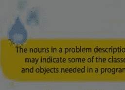

当然，问题规范中的每个名词都不会对应于程序中的类。某些名词可能被表示为其他对象的属性，设计者可能完全没有决定在程序中显式表示其他对象。这项活动只是一个起点，允许开发者思考程序将管理的对象类型。

记住，一个类代表一组具有相似行为的对象。说明书中的复数名词，如 `products`（产品），可能表示需要一个代表其中某一项的类，例如 `Product`（产品）。如果你的系统中至少需要一种特定类型的对象，最好的方法可能是将其表示为一个类。

表示对象的类通常应命名为单数名词，例如 `Coin`、`Student` 和 `Message`。一个类代表一个单一项目，我们可以自由地创建任意数量的实例。

另一个关键决定是将某物表示为对象，还是表示为另一个对象的原始属性。例如，我们最初可能认为员工的工资应该表示为整数，这可能适用于系统的大部分处理。但经过进一步反思，我们意识到工资是基于人的职级的，职级有上限和下限，必须仔细管理。因此，最终结论是，我们认为将所有数据和相关行为表示为一个独立的类会更好。

根据特定程序的需求，我们希望在过于通用的类和过于具体的类之间取得良好的平衡。例如，为家中的每种电器创建一个单独的类可能会不必要地增加设计复杂度。一个 `Appliance` 类可能足够了，并带有一个指示电器类型的实例数据。尽管如此，这可能并不是一个充分的解决方案，取决于软件要实现什么。

## 5.2 类的构造

除了表示问题的类之外，我们可能还需要支持完成工作所需的类。例如，除了 `Member` 对象之外，我们可能还需要一个单独的类来管理所有的成员。

它们也是程序的一部分，但我们通常不需要关心它们的内部细节。我们真的只需要知道如何与它们交互，并简单地信任它们会提供它们承诺的服务。

我们将继续依赖库类，但现在我们也将根据需要设计并实现其他类。让我们来看一个例子。列表 5.1 中的 `SnakeEyes` 类包含一个 `main` 方法，该方法实例化了两个 `Die` 对象（即 dice 的单数）。该程序的目的是掷骰子，并统计在同一次掷中两个骰子都显示 1 的次数（“蛇眼”）。

这个示例与我们在前面的章节中看到的示例的主要区别在于，`Die` 类不是 Java 类库的预定义部分。为了让程序能够编译和运行，我们必须编写 `Die` 类本身，定义我们希望 `Die` 对象执行的服务。

类可以包含数据声明和方法声明，如图 5.3 所示。数据声明代表将存储在类的每个对象中的数据。方法声明定义了这些对象提供的服务。类的数据和方法合称为类的成员（members）。

我们在之前的示例中编写的类也遵循这个模型，但在类级别上不包含数据，且只包含一个方法（`main` 方法）。我们将继续这样定义类，正如 `SnakeEyes` 类那样，用以定义程序的起点。

然而，真正的面向对象编程来自于定义表示具有良好状态和行为的对象的类。因为在任何给定时刻，骰子都显示一个特定的面值，我们可以将其称为骰子的状态。骰子还有我们可以在其上调用的各种方法，例如掷骰子或获取其面值的能力。这些方法代表了骰子的行为。

`Die` 类位于列表 5.2 中。它包含两个数据值：一个代表骰子最大面值的整数常量（`MAX`），以及一个代表骰子当前面值的整数变量（`faceValue`）。它还包含一个名为 `Die` 的构造函数和四个普通方法：`roll()`、`setFaceValue()`、`getFaceValue()` 和 `toString()`。

你可能从第 2 章和第 3 章记得，构造函数是与类名同名的特殊方法。当使用 `new` 操作符创建 `Die` 类的新实例时，会调用 `Die` 构造函数，正如我们在 `SnakeEyes` 类的 `main` 方法中调用两次那样。`Die` 类中的其余方法定义了 `Die` 对象提供的各种服务。


### 列表 5.1

```java
/********************************************************************
// SnakeEyes.java      Java Foundations
// 展示了程序员定义类的使用。
********************************************************************/
public class SnakeEyes {
    //--------------------------------------------------------------------------------------
    // 创建两个 Die 对象并掷它们几次，统计
    // 蛇眼出现的次数。
    //--------------------------------------------------------------------------------------
    public static void main(String[] args) {
        final int ROLLS = 500;
        int num1, num2, count = 0;

        Die die1 = new Die();
        Die die2 = new Die();

        for (int roll = 1; roll <= ROLLS; roll++) {
            num1 = die1.roll();
            num2 = die2.roll();

            if (num1 == 1 && num2 == 1) // 检查蛇眼
                count++;
        }

        System.out.println("Number of rolls: " + ROLLS);
        System.out.println("Number of snake eyes: " + count);
        System.out.println("Ratio: " + (float) count / ROLLS);
    }
}
```

### 输出

```text
Number of rolls: 500
Number of snake eyes: 12
Ratio: 0.024
```

### 列表 5.2

```java
/********************************************************************************
// Die.java        Java Foundations
// 表示一个骰子（dice 的单数），面值显示为
// 1 到 6 之间。
********************************************************************************/

public class Die {
    private final int MAX = 6; // 最大面值
    private int faceValue; // 骰子上显示的当前值

    //--------------------------------------------------------------------------------
    // 构造函数：设置此骰子的初始面值。
    //--------------------------------------------------------------------------------
    public Die() {
        faceValue = 1;
    }

    //--------------------------------------------------------------------------------
    // 为此骰子计算新的面值并返回结果。
    //--------------------------------------------------------------------------------
    public int roll() {
        faceValue = (int) (Math.random() * MAX) + 1;
        return faceValue;
    }

    //------------------------------------------------------
    // 面值变异器。如果指定的值无效，则
    // 面值不会被修改。
    //------------------------------------------------------
    public void setFaceValue(int value) {
        if (value > 0 && value <= MAX)
            faceValue = value;
    }

    //------------------------------------------------------
    // 面值访问器。
    //------------------------------------------------------
    public int getFaceValue() {
        return faceValue;
    }

    //------------------------------------------------------
    // 返回此骰子的字符串表示。
    //------------------------------------------------------
    public String toString() {
        String result = Integer.toString(faceValue);
        return result;
    }
}
```

我们使用文档块来解释类中每个方法的目的。这种做法对于任何试图理解软件的人来说都是关键的，它在视觉上分离了代码，使得眼睛可以轻松从一个方法跳转到另一个方法。

**图 5.4** `Die` 类的一些方法

| 方法 | 说明 |
|---|---|
| `Die()` | 构造函数：将骰子的初始面值设置为 1。 |
| `int roll()` | 掷骰子，通过将面值设置为适当范围内的随机数。 |
| `void setFaceValue(int value)` | 将骰子的面值设置为指定的值。 |
| `int getFaceValue()` | 返回骰子的当前面值。 |
| `String toString()` | 返回表示骰子当前面值的字符串表示。 |

## 5.3 类的结构

### 实例数据

注意，在 `Die` 类中，常量 `MAX` 和变量 `faceValue` 是在类内部声明的，但在任何方法内部之外。变量声明的位置定义了它的作用域，作用域是指程序中该变量可以被引用的区域。通过在类级别声明（而不是在方法内部），这些变量和常量可以在类的任何方法中被引用。

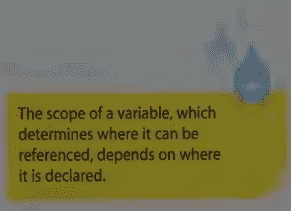

如变量 `faceValue` 这样的属性被称为实例数据，因为每当创建一个类的实例时，都会为其预留新的内存空间。每个 `Die` 对象都有它们自己的 `faceValue` 变量及其对应的数据空间。这就是每个 `Die` 对象可以拥有自己的状态的原因。例如，一个 `Die` 对象可以显示 5，而另一个显示 2。这是可能的，因为为每个 `die` 的 `faceValue` 变量创建了独立的内存空间。

我们可以如下描绘这种情况：

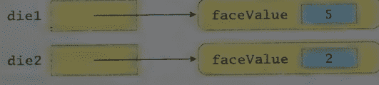

`die1` 和 `die2` 引用变量指向（即包含）它们各自的对象。每个对象都包含一个具有独立内存空间的 `faceValue` 变量。因此，每个对象都可以为其实例数据存储不同的值。Java 会自动初始化所有在类级别声明的变量。例如，所有数值类型（如 `int` 和 `double`）都会初始化为零。然而，尽管语言执行了这种自动初始化，但显式地初始化变量（通常在构造函数中）是一个良好的习惯，这样阅读代码的人就能清楚地理解其意图。

### UML 类图

随着我们的程序变得越来越复杂，包含多个类，使用图形表示法来捕获、可视化和通信程序设计将很有帮助。在本书的剩余部分，我们将使用 UML 图来实现这一目的。UML 代表统一建模语言（Unified Modeling Language），它已成为表示面向对象程序设计最流行的表示法。

存在多种类型的 UML 图，每种都用于展示面向对象程序的特定方面。在本书中，我们主要关注 UML 类图，用于展示类的内容以及它们之间的关系。

在 UML 图中，每个类都用矩形表示，可能包含三个部分以显示类名、其属性（数据）和其操作（方法）。图 5.5 显示了一个包含 `SnakeEyes` 程序类的类图。

UML 并不是专门为 Java 程序员设计的。它的目的是与语言无关的。因此，UML 图使用的语法并不与 Java 相同。例如，变量的类型在变量名之后，用冒号隔开。方法的返回值也以此方式显示。类图中属性的初始值可以显示，正如我们在图 5.5 中对 `MAX` 常量所做的那样。变量和方法前面的 `+` 号表示它们的可见性，这将在下一节中讨论。

UML 图中连接两个类的实线表示这两个类之间存在某种关系。这些线被称为关联（associations），表示一个类以某种方式“知道”并“使用”另一个类。例如，关联可能表示一个类的对象创建了另一个类的对象，并且和/或一个类调用了另一个类的方法。关联可以被标记以指示关联的细节。

定向关联（directed association）使用箭头来指示该关联是特殊的单向关系。例如，图 5.5 中连接 `SnakeEyes` 和 `Die` 类的箭头表示 `SnakeEyes` 类“知道”并使用 `Die` 类，但反之则不然。

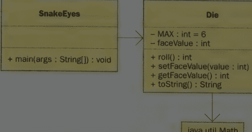

**图 5.5** 显示参与 `SnakeEyes` 程序的 UML 类图

## 5.4 封装

关联可以通过在连接末端标注数值来显示多重性（multiplicity）。在这种情况下，图表表示 `SnakeEyes` 与正好两个 `Die` 对象关联。如果需要，关联的末端都可以显示多重性值。多重性也可以用值范围以及使用通配符表示未知值，正如我们在稍后的示例中看到的那样。

类之间其他类型的面向对象关系通过不同类型的连接线和箭头显示。随着我们在书中讨论相应的面向对象编程概念，我们将探索 UML 图的更多方面。

UML 图是多功能的。根据我们试图在特定图中传达的内容，我们可以包含任何所需的适当信息。例如，如果某些细节对于特定图不相关，我们可能会省略类的数据和方法部分。例如，图 5.5 指出 `Die` 类使用了 Java API 中的 `Math` 类，但没有标识 `Math` 类的细节。我们也可以显式地指示对 `String` 类的使用，但由于其无处不在，很少这样做。


# 5.3 封装

我们在第一章对面向对象概念的概述中提到，对象应该是自律的。也就是说，对象的实例数据应该只由该对象本身修改。例如，`Die` 类的方法应该专门负责更改 `faceValue` 变量的值。我们应该让外部代码“伸入”并修改在该类内部声明的变量值变得困难，甚至是不可能的。这种特性被称为封装。

> 对象应该被封装，以保护其数据免受不当的访问。

对象应该相对于系统的其余部分被封装起来。它应该通过定义接口的特定方法与程序的其他部分交互。封装的性质如图 5.6 所示。使用对象的代码（有时称为对象的客户端）不应允许直接访问变量。客户端应该调用对象的方法，这些方法与数据交互。例如，`SnakeEyes` 中的 `main` 方法调用了骰子对象的 `roll` 方法。`main` 方法不应该（实际上无法）直接访问 `faceValue` 变量。

在 Java 中，我们使用修饰符来实现对象封装。修饰符是 Java 留字，用于指定语言构造的特定特性。在第二章中我们讨论了 `final` 修饰符，它用于声明常量。Java 有多种修饰符可以使用各种方式使用。某些修饰符可以组合使用，但某些组合是无效的。我们在书中适当的位置讨论各种修饰符，它们都总结在附录 E 中。

## 可见性修饰符

某些 Java 修饰符被称为可见性修饰符，因为它们控制对类方法的访问。`public` 和 `private` 是可以应用于类变量和方法的可见性修饰符。如果类的成员具有 `public` 可见性，则可以从类外部直接引用。如果类的成员具有 `private` 可见性，则可以在类内部任何地方使用但不能在外部引用。第三种修饰符 `protected` 只在继承的上下文中相关。我们在第 8 章讨论它。

> 公共变量违反了封装。它们允许定义数据的类外部代码伸入或修改数据的值。因此，实例数据应该定义为 `private` 可见性。声明为 `private` 的数据只能由类的方法访问。

我们对方法应用的可见性取决于该方法的目的。为客户端提供服务的方法必须以公共（`public`）可见性声明，以便客户端调用它们。这些方法有时被称为*服务方法*（service methods）。私有（`private`）方法无法从类外部调用。私有方法的唯一目的是帮助类的其他方法完成它们工作。因此，它们有时被称为*支持方法*（support methods）。

图 5.7 中的表格总结了公共和私有可见性对变量和方法的影响。

将常量设为公共可见性通常被认为是可以的，因为虽然可以直接访问它们的值，但由于它们是使用 `final` 修饰符声明的，它们的值无法被更改。请记住，封装意味着数据值不应该能被代码的其他部分直接*修改*。由于常量根据定义是不可更改的，因此封装问题在很大程度上不复存在了。

UML 类图通过在类成员前面加上特定的字符来显示类成员的可见性。具有公共可见性的成员前面有一个加号（`+`），具有私有可见性的成员前面有一个减号（`-`）。请复阅图 5.5 以查看此符号的用法。

### 访问器与变异器

由于实例数据通常以私有可见性声明，因此类通常会提供访问和修改数据值的服务。`Die` 类中类似于 `getFaceValue` 的方法被称为*访问器方法*（accessor method），因为它提供了对特定值的只读访问。同样，类似于 `setValue` 的方法被称为变异器（mutator），因为它改变了特定值。

通常，访问器方法名具有 `getX` 形式，其中 `x` 是它提供的值。同样，变异器方法名具有 `setX` 形式，其中 `x` 是它们正在设置的值。因此，这些类型的方法被称为“getter”（get器）和“setter”（set器）。

例如，如果一个类包含实例变量 `height`，它可能也应该包含 `getHeight` 和 `setHeight` 方法。注意，这种命名约定在方法名中使用时会将变量的首字母大写，这与通常方法名的写法方式是一致的。

某些方法作为其主要目的的副作用，提供了访问器和/或变异器功能。例如，`Die` 类的 `roll` 方法改变变量 `faceValue` 的值，并同样返回该新值。注意，`roll` 方法的代码保证将骰子的面值保持在有效范围内（1 到 `MAX`）。同样，`setValue` 方法检查指定的值是否在有效范围内，如果不在，则忽略它。服务方法必须仔细设计，以仅允许适当的访问和值更改。通过封装数据，对象可以维持这种控制。

让我们看另一个例子。列表 5.3 中的程序多次实例化一个 `Coin` 对象，并计算出现正面和反面的次数。注意它在 `if` 语句的条件中调用了 `isHeads` 方法来确定发生了哪种结果。

## 列表 5.3

```java
// CountFlips.java      Java Foundations
// 展示程序员定义类的用法。
public class CountFlips
{
    // 翻转硬币多次并计算结果正面
    // 和反面的次数。
    public static void main (String[] args)
    {
        final int FLIPS = 1000;
        int heads = 0, tails = 0;

        Coin myCoin = new Coin();
        for (int count=1; count <= FLIPS; count++)
        {
            myCoin.flip();

            if (myCoin.isHeads())
                heads++;
            else
                tails++;
        }

        System.out.println ("Number of flips: " + FLIPS);
        System.out.println("Number of heads: " + heads);
        System.out.println("Number of tails: " + tails);
    }
}
```

## 输出

Number of flips: 1000

Number of heads: 486

Number of tails: 514

## 列表 5.4

```java
// Coin.java         Java Foundations
// 表示一个可以翻转的双面硬币。
public class Coin
{
    private final int HEADS = 0; // tails is 1

    private int face; // 当前显示的面

    // 通过初始翻转设置设置硬币。
    public Coin () {
        flip();
    }

    // 通过随机选择面值来翻转硬币。
    public void flip () {
        face = (int) (Math.random() * 2);
    }

    // 如果硬币的面是正面则返回 true。
    public boolean isHeads () {
        return face == HEADS;
    }

    // 将硬币当前的面作为字符串。
    public String toString() {
        return (face == HEADS) ? "Heads" : "Tails";
    }
}
```

## 列表 5.5

```java
// FlipRace.java      Java Foundations
// 展示程序员定义类的重用。
public class FlipRace
{
    // 翻转两个硬币直到其中一个连续
    // 三次正面。
    public static void main(String[] args)
    {
        final int GOAL = 3;
        int count1 = 0, count2 = 0;
        Coin coin1 = new Coin(), coin2 = new Coin();

        while (count1 < GOAL && count2 < GOAL) 
        {
            coin1.flip();
            coin2.flip();

            System.out.println("Coin 1: " + coin1 + "\tCoin 2: " + coin2);

            // 计数或重置计数器
            count1 = (coin1.isHeads()) ? count1+1 : 0;
            count2 = (coin2.isHeads()) ? count2+1 : 0;
        }

        if (count1 < GOAL)
            System.out.println("Coin 2 Wins!");
        else
            if (count2 < GOAL)
                System.out.println("Coin 1 Wins!");
            else
                System.out.println("It's a TIE!");
    }
}
```

| Coin 1: Tails | Coin 2: Heads |
|---|---|
| Coin 1: Heads | Coin 2: Heads |
| Coin 1: Tails | Coin 2: Tails |
| Coin 1: Tails | Coin 2: Tails |
| Coin 1: Heads | Coin 2: Heads |
| Coin 1: Heads | Coin 2: Tails |
| Coin 1: Heads | Coin 2: Heads |
| Coin 1 Wins! |

FlipRace程序的输出显示了每次硬币翻转的结果。注意在 `println` 语句中，`coin1` 和 `coin2` 对象被接到字符字符串。正如我们之前提到的，这种情况会导致对象的 `toString` 方法被调用，返回一个要打印的字符串。不需要显式调用 `toString` 方法。

条件运算符用于赋值语句，以便在硬币翻转后设置硬币的计数器。对于每枚硬币，如果结果是正面，则计数器加1；否则，计数器重置为零。当其中一个或两个计数器达到连续三次正面的目标时，`while` 循环将终止。

FlipRace 使用 `Coin` 类作为其程序的一部分，就像之前的 `CountFlips` 一样。设计良好的类通常可以在多个程序中复用，就像我们不断重复使用 Java API 中的类一样。

# 5.4 方法的结构

我们已经看到类由数据声明和方法声明组成。让我们更详细地检查方法声明。

正如第 1 章所述，方法是一组被赋予名称的编程语言语句。方法声明指定了在调用方法时执行的代码。Java 程序中的每个方法都是特定类的一部分。

方法声明的头部包括返回值的类型、方法名以及该方法接受的参数列表。构成方法体的语句定义在由花括号分隔的界定块中。我们在之前的示例中已经多次定义过程序的 `main` 方法。它的定义与任何其他方法具有相同的语法。

当方法被调用时，控制流会转移到该方法。方法中的语句逐个执行。当该方法完成后，控制返回到调用发生的位置并继续执行。

被调用的方法（被激活的方法）可能与调用它的方法属于同一个类。如果调用它需要方法名，则可以直接调用。如果该方法属于不同的类，则通过对该其他类对象的引用来调用，正如我们多次看到的那样。图 5.8 显示了在调用方法时的执行流。

在我们继续探索方法声明的细节时，让我们来看另一个示例。列表 5.6 所示的 `Transactions` 类包含一个 `main` 方法，它创建了一些账户对象并调用了它们的服务。`Transactions` 程序除了演示如何与 `Account` 对象交互外，没有做其他有用的事情。此类程序被称为驱动程序（driver programs），因为它们所做的就是驱动我们程序中其他更有趣部分的使用。它们通常用于测试目的。

列表 5.7 所示的 `Account` 类代表一个基础银行账户。它包含代表所有者姓名、账户号码和账户当前余额的实例数据。账户的利率以常量形式存储。`Account` 类的构造函数接受三个参数，用于在实例化 `Account` 对象时初始化实例数据。`Account` 类的其他方法对账户执行各种服务，例如存款和取款。这些方法检查传递给它们的数据以确保请求的交易是有效的。例如，`Withdraw` 方法防止取出负数（这在本质上是存款）。还有一个 `addInterest` 方法，通过加上赚取的利来更新余额。这些方法代表了修改余额的有效方式，因此不提供如 `setBalance` 这样的通用的修改器（mutator）。

在 `Transactions` 程序中，三个 `Account` 对象刚创建后的状态可以描述如下：

## 方法声明

方法由可选修饰符、返回类型（return Type）、确定方法名的标识符（Identifier）、参数列表（Parameters）以及方法体（Method Body）组成。返回类型表示方法将返回的值类型，可以是 `void`。方法体是在方法被调用时执行的语句块。`throws` 子句（Throws Clause）是可选的，表示该方法可能抛出的异常。

## 参数


```java
public int computeArea(int length, int width) {
    int area = length * width;
    return area;
}
```

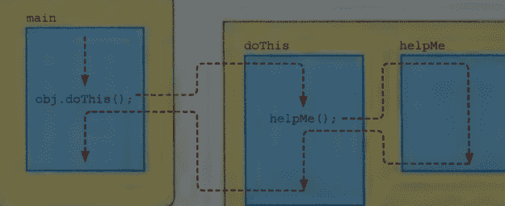

图 5.8 方法调用后的控制流

### 列表 5.6

```java
// Transactions.java       Java Foundations
// 演示创建和使用多个 Account 对象。
public class Transactions {
    // 创建一些银行账户并请求各种服务。
    public static void main(String[] args) {
        Account acct1 = new Account("Ted Murphy", 72354, 25.59);
        Account acct2 = new Account("Angelica Adams", 69713, 50.00);
        Account acct3 = new Account("Edward Demsey", 93757, 76.00);
        System.out.println(acct1);
        System.out.println(acct2);
        System.out.println(acct3);

        acct1.deposit(100.00);
        acct2.deposit(50.00);
        acct3.deposit(25.00);

        acct1.withdraw(20.00, 5.00);
        acct2.withdraw(10.00, 2.00);
        acct3.withdraw(10.00, 2.00);

        acct1.addInterest();
        acct2.addInterest();
        acct3.addInterest();

        System.out.println("balance after deposit: " + acct1.getBalance());
        System.out.println("balance after deposit: " + acct2.getBalance());
        System.out.println("balance after deposit: " + acct3.getBalance());

        System.out.println("balance after withdrawal: " + acct1.getBalance());
        System.out.println("balance after withdrawal: " + acct2.getBalance());
        System.out.println("balance after withdrawal: " + acct3.getBalance());

        System.out.println("balance after interest: " + acct1.getBalance());
        System.out.println("balance after interest: " + acct2.getBalance());
        System.out.println("balance after interest: " + acct3.getBalance());
    }
}
```

### 列表 5.6 输出

```text
72354	Ted Murphy	$25.59

69713	Angelica Adams	$50.00

93757	Edward Demsey	$76.00

balance after deposit: $125.59

balance after deposit: $100.00

balance after deposit: $101.00

balance after withdrawal: $100.59

balance after withdrawal: $88.00

balance after withdrawal: $89.00

balance after interest: $104.11

balance after interest: $101.44

balance after interest: $92.12
```

### 列表 5.7

```java
// Account.java      Java Foundations
// 代表一个银行账户，提供存款和
// 取款等服务。

import java.text.NumberFormat;

public class Account {
    private final double RATE = 0.035; // 利率3.5%

    private String name;
    private long acctNumber;
    private double balance;

    //------------------------------------------------------
    // 设置账户的所有者、账户号码和
    // 余额。
    //------------------------------------------------------
    public Account(String owner, long account, double initial) {
        name = owner;
        acctNumber = account;
        balance = initial;
    }

    //------------------------------------------------------
    // 将指定的金额存入此账户并返回
    // 新余额。如果金额无效，则余额
    // 不改变。
    //------------------------------------------------------
    public double deposit(double amount) {
        if (amount > 0) {
            balance = balance + amount;
        }
        return balance;
    }

    //------------------------------------------------------
    // 从此账户中取出指定的金额和费用
    // 并返回新余额。如果取款金额
    // 无效或余额不足，则余额不改变。
    //----------------------------------------------------
    public double withdraw(double amount, double fee) {
        if (amount + fee > 0 && amount + fee < balance)
            balance = balance - amount - fee;
        return balance;
    }

    //------------------------------------------------------
    // 为账户增加利息并返回新余额。
    //----------------------------------------------------
    public double addInterest() {
        balance += (balance * RATE);
        return balance;
    }

    //------------------------------------------------------
    // 返回账户的当前余额。
    //----------------------------------------------------------------
    public double getBalance() {
        return balance;
    }

    //------------------------------------------------------
    // 返回账户的单行字符串描述。
    //----------------------------------------------------
    public String toString() {
        NumberFormat fmt = NumberFormat.getCurrencyInstance();
        return (acctNumber + "\t" + name + "\t" + fmt.format(balance));
    }
}
```

## 5.4 方法的结构

**`return` 语句 (return Statement)**

方法头部中指定的返回类型可以是基本类型、类名或保留字 `void`。当方法不返回任何值时，使用 `void` 作为返回类型，程序的 `main` 方法总是这样做的。`Die` 类的 `setCellValue()` 方法和 `Coin` 类的 `flip()` 方法的返回类型也是 `void`。

`Die` 类的 `getCellValue()` 和 `roll()` 方法返回一个 `int` 值，代表骰子的数值。`Coin` 类的 `isHeads()` 方法返回一个 `boolean` 值，代表硬币当前是否显示正面。`Account` 类的多个方法返回更新后的 `double` 类型余额。这些类中的 `toString()` 方法都返回一个 `String` 对象。

返回值的方法必须有一个 `return` 语句。当执行 `return` 语句时，控制权会立即返回到调用它的方法，并继续执行。`return` 语句由关键字 `return` 后跟一个决定要返回值的表达式组成。该表达式必须与方法头部中指定的返回类型一致。

不返回值的方法通常不包含 `return` 语句。当到达方法末尾时，方法会自动返回到调用方法。此类方法可以包含一个没有表达式的 `return` 语句。

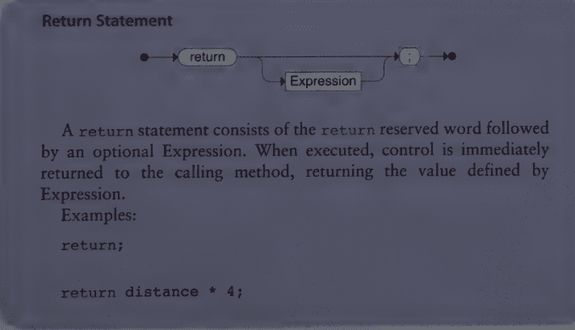

虽然在方法中使用多个 `return` 语句是可行的，但通常不是良好的做法。通常情况下，方法应该有一个 `return` 语句，并作为方法体的最后一行，除非这会导致方法变得过于复杂。

从方法返回的值可以在调用方法中被忽略。考虑 `Transactions` 程序中的以下方法调用：

```java
acct1.deposit(44.10);
```

在这种情况下，`deposit()` 方法正常执行并相应地更新了账户余额，但调用方法并没有使用返回的值。

构造函数没有返回类型（甚至没有 `void`），因此不能返回值。我们将在本章的后部分更详细地讨论构造函数。

### 参数 (Parameters)

我们在第 2 章中引入了参数的概念，将其定义为调用方法时传递给方法的值。参数为方法提供数据，使方法能够执行其工作。让我们更详细地探讨这一点。

方法声明指定了方法将接受的参数数量和类型。更准确地说，方法声明头部的参数列表指定了传递给方法的值的类型，被调用方法将通过名称引用每个值。调用中相应的参数列表指定了在该特定调用中传递的值。

方法声明头部的参数名称称为**形式参数** (formal parameters)。调用方法时传递到方法的值称为**实际参数** (actual parameters)，或**实参** (arguments)。声明和调用中的参数列表都括在方法名后的括号中。如果没有参数，则使用空括号。

`Coin` 和 `Die` 类中的所有方法都不接受参数，但 `Die` 类的 `setValue()` 方法除外，它接受一个单整数，用于指定骰子的新值。`Account` 构造函数接受多个不同类型的参数，以为对象的实例数据提供初始值（这在构造函数中很常见）。`Account` 类中的 `withdraw()` 方法接受两个为 `double` 类型的参数；注意，即使类型相同，每个形式参数的类型也是分行列出的。

> 当调用方法时，实际参数被复制到形式参数中。

调用和方法声明中的参数列表必须匹配。也就是说，第一个实际参数的值复制到第一个形式参数中，第二个实际参数复制到第二个形式参数中，依此类推，如图 5.9 所示。实际参数的类型必须与形式参数指定的类型一致。

在 `Transactions` 程序中，进行了如下调用：

```java
acct2.withdraw(480, 1.50);
```

此调用将一个整数值作为 `withdraw()` 方法的第一个参数传递，而该方法定义为接受 `double` 类型。这是有效的，因为实际参数和形式参数必须一致，但不必完全精确匹配。`double` 变量可以分配整数值，因为这是一个宽化转换。因此，在传递参数时也是允许的。

我们将在本章稍后部分探讨关于参数传递的一些细节。

### 本地数据 (Local Data)

正如我们在本章早期描述的，变量或常量的作用域是程序中可以对该变量建立有效引用的部分。

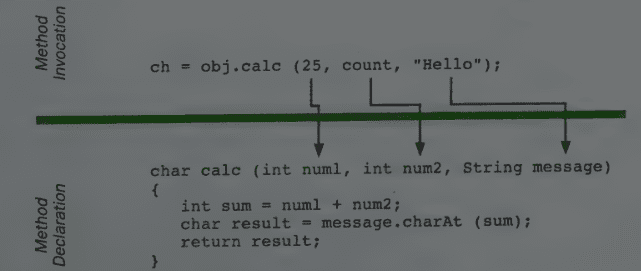

图 5.9 从方法调用到声明的参数传递

变量可以在方法内部声明，使其成为本地数据而非实例数据。回想一下，实例数据是在类中声明的，但在任何特定方法内部。

本地数据的作用域仅限于声明它的方法。在 `Die` 类的 `toString()` 方法中定义的变量是局部的。

在 `Die` 类的其他方法中对它的任何引用都会导致编译器发出错误信息。局部变量在声明它的方法之外根本不存在。相反，在类级别声明的实例数据其作用域是整个类；类的任何方法都可以引用它。

由于本地数据和实例数据作用在不同作用域，因此可以在方法内部声明一个与类级别定义的实例变量同名的局部变量。在方法中引用该名称将引用该变量的本地版本。这种命名习惯显然可能会误导阅读代码的人，因此应该避免。

方法头部中的形式参数名称作为它们的本地数据使用。它们在方法被调用之前才存在，并在方法退出时消失。例如，`Account` 构造函数中的形式参数在构造调用时产生。为了将这些值存储在对象中，参数的值被复制到新创建的 `Account` 对象的实例变量中。

### 重温构造函数

让我们进一步讨论构造函数。当我们定义一个类时，通常会定义构造函数来帮助设置类。特别是，我们经常使用构造函数来初始化与对象相关的变量。

构造函数与普通方法有两个不同之处。首先，构造函数的名称与类名相同。因此，`Die` 类的构造函数名称是 `Die`，`Account` 类的构造函数名称是 `Account`。其次，构造函数不能返回值，且在方法头部没有指定返回类型。

程序员的一个常见错误是给构造函数加上 `void` 返回类型。对于编译器来说，给构造函数加上任何返回类型（即使是 `void`）都会将其变成一个与类名相同的普通方法。

因此，它不能被作为构造函数调用。这会导致错误信息有时难以理解。

通常情况下，构造函数用于初始化新实例化的对象。例如，`Die` 类的构造函数最初将骰子的面值设置为 1。`Coin` 类的构造函数调用 `flip()` 方法将硬币置于初始的随机状态。`Account` 类的构造函数将实例变量的值设置为传递给构造函数的参数值。如何使用构造函数来初始化对象是另一个重要的设计决策。

我们不需要为每个类都定义构造函数。每个类都有一个不带参数的默认构造函数。如果我们不提供自己的构造函数，就会使用这个默认构造函数。这个默认构造函数对新创建的对象没有影响。

## 5.5 静态类成员

在书中之前的各种示例中，我们已经在多种情况下使用过静态方法。例如，`Math` 类的所有方法都是静态的。记住，静态方法是通过其类名而不是该类的某个对象来调用的方法。

不仅方法可以是静态的，变量也可以是静态的。我们使用 `static` 修饰符来声明静态类成员。

决定是否将方法或变量声明为静态是类设计中的关键一步。让我们仔细检查静态变量和方法的影响。

### 静态变量

到目前，我们看到了两类变量：声明在方法内部的局部变量，以及声明在类中但不在方法内部的实例变量。使用“实例变量”一词是因为类的每个实例都拥有该变量自己的版本。也就是说，每个对象对每个变量都拥有独立的内存空间，以便每个对象对该变量拥有不同的值。

静态变量在类的所有实例之间共享。对于该类的所有对象，静态变量只有一个副本。因此，更改一个对象中静态变量的值会改变所有其他对象的值。


保留关键字 `static` 用作修饰符，如下所示声明静态变量：

```java
private static int count = 0;
```


# 静态变量与静态方法

静态变量的内存空间在包含它的类在程序中第一次被引用时建立。在方法内部声明的局部变量不能是静态的。

使用 `final` 修饰符声明的常量通常也使用 `static` 修饰符。因为常量的值不能改变，所以该类的所有对象之间可能只有一个值的副本。

## 静态方法

在第 3 章中，我们简要地介绍了静态方法的概念（也称为类方法）。静态方法可以通过类名调用。我们不需要实例化该类的对象就可以调用该方法。在第 3 章中，我们注意到 `Math` 类的所有方法都是静态方法。例如，在下面这行代码中，`sqrt` 方法是通过类名调用的：

```java
System.out.println("Square root of 27: " + Math.sqrt(27));
```

`Math` 类中的方法根据传递的参数值执行基本计算。在这些情况下，没有需要维护的对象状态；没有正理由迫使我们为了请求这些服务而创建一个对象。

通过在方法声明中使用 `static` 修饰符可以将方法设为静态的。正如我们多次看到的，Java 程序的 `main` 方法是使用 `static` 修饰符声明的；这样它就可以被解释器执行，而无需从包含它的类实例化对象。

静态方法并不在特定对象的上下文中运行，它们不能引用实例变量（实例变量只存在于类的实例中）。如果静态方法尝试访问非静态变量，编译器将发出错误。然而，静态方法可以引用静态变量，因为静态变量独立于特定对象。因此，所有静态方法（包括 `main` 方法）只能访问静态变量或局部变量。

列表 5.8 中的程序实例化了 `Slogan` 类的多个对象，并逐一打印。然后它通过类名调用了名为 `getCount` 的方法，该方法返回程序中实例化的 `Slogan` 对象数量。

### 列表 5.8

```java
// SloganCounter.java       Java Foundations
//
// 展示了 static 修饰符的使用。
public class SloganCounter {
    //-----------------------------------------------------------------------
    // 创建几个 Slogan 对象并打印创建的
    // 对象数量。
    //-----------------------------------------------------------------------
    public static void main(String[] args) {
        Slogan obj;

        obj = new Slogan("Remember the Alamo.");
        System.out.println(obj);

        obj = new Slogan("Don't Worry. Be Happy.");
        System.out.println(obj);

        obj = new Slogan("Live Free or Die.");
        System.out.println(obj);

        obj = new Slogan("Talk is Cheap.");
        System.out.println(obj);

        obj = new Slogan("Write Once, Run Anywhere.");
        System.out.println(obj);

        System.out.println();
        System.out.println("Slogans created: " + Slogan.getCount());
    }
}
```

### 输出

```
Remember the Alamo.
Don't Worry. Be Happy.
Live Free or Die.
Talk is Cheap.
Write Once, Run Anywhere.

Slogans created: 5
```

## 第5章 编写类

列表 5.9 显示了 `Slogan` 类。`Slogan` 的构造函数会增加一个名为 `count` 的静态变量，该变量在声明时初始化为零。因此，`count` 用于跟踪创建的 `Slogan` 实例数量。

`Slogan` 的 `getCount` 方法也被声明为静态的，这允许在 `main` 方法中通过类名调用它。注意，`getCount` 方法引用的唯一数据是整数变量 `count`，它是静态的。作为静态方法，`getCount` 不能引用任何非静态数据。

`getCount` 方法可以在不带 `static` 修饰符的情况下声明，但在 `main` 方法中的调用必须通过 `Slogan` 类的实例而不是类本身来完成。

## 5.6 类关系

软件系统中的类之间有各种类型的关系。最常见的三种关系是依赖（dependency）、聚合（aggregation）和继承（inheritance）。

我们在许多示例中见过依赖关系，其中一个类“使用”另一个类。本节将重温依赖关系，并探索类依赖于自身的情况。然后我们探索聚合，其中一个类的对象包含了另一个类的对象，创建了“有一个”的关系。继承我们在第 1 章中介绍过的概念，它在类与类之间创建了“是一个”的关系。我们将对继承的详细检查推迟到第 8 章。

### 依赖

在之前的许多示例中，我们看到了一个类依赖于另一个类的想法。这意味着一个类在某些方面依赖于另一个类。通常，一个类的方法会调用另一个类的方法。这建立了一个“使用”关系。

通常，如果 A 使用类 B，那么类 A 的一个或多个方法会调用类 B 的一个或多个方法。如果调用的方法是静态的，则 A 仅通过名称引用 B。如果调用的方法不是静态的，则 A 必须访问类 B 的特定实例才能调用该方法。也就是说，A 必须拥有指向类 B 对象的引用。

一个对象获取另一个类对象的方法是一个重要的设计决策。这发生于一个类实例化另一个类的对象时，但也可以通过将一个对象作为方法参数传递给另一个对象来实现。

通常情况下，我们希望尽量减少类之间的依赖关系。类之间的依赖程度越低，变化和错误对系统的影响就越小。

#### 同类对象之间的依赖关系

在某些情况下，一个类依赖于自身。也就是说，一个类的对象与同类的另一个对象进行交互。为了实现这一点，该类的方法可以接受同类的对象作为参数。

`String` 类的 `concat` 方法就是这种情况的一个例子。该方法通过一个 `String` 对象执行，并将另一个 `String` 对象作为参数传递。例如：

```java
str3 = str1.concat(str2);
```

执行方法的 `String` 对象 (`str1`) 将其字符追加到作为参数传递的 `String` 对象 (`str2`) 之后。结果返回一个新的 `String` 对象并存储为 `str3`。

列表 5.10 所示的 `RationalTester` 程序演示了类似的情况。有理数是一个可以表示为两个整数之比（分数）的值。`RationalTester` 程序创建两个代表有理数的对象，然后对它们执行各种操作以产生有理数。

列表 5.11 显示了 `RationalNumber` 类。在检查此类时，请记住，从 `RationalNumber` 类创建的每个对象都代表一个有理数。`RationalNumber` 类包含了对有理数的各种操作，例如加法和减法。

`RationalNumber` 类的方法（如 `add`、`subtract`、`multiply` 和 `divide`）使用执行方法的 `RationalNumber` 对象作为第一个（左）操作数，并将作为参数传递的 `RationalNumber` 对象作为第二个（右）操作数。

`RationalNumber` 类的 `isLike` 方法用于判断两个有理数在本质上相等。因此，人们倾向于将其它方法 `equals`，类似于用于比较 `String` 对象的方法（在第 4 章中讨论过）。然而，在第 8 章中我们将讨论 `equals` 方法由于继承而具有特殊性，并且它应该以特定的方式实现。因此，为了避免混淆，我们目前将此方法命名为 `isLike`。

注意 `RationalNumber` 类中的某些方法（包括 `reduce` 和 `get`）被声明为 `private` 可见性。这些方法是私有的，因为我们不希望从 `RationalNumber` 对象外部直接执行它们。它们仅用于支持该对象的其他服务。

### 列表 5.10

```java
// RationalTester.java      Java Foundations
// 用于练习使用多个 Rational 对象的驱动程序。
public class RationalTester {
    //--------------------------------------------------------------------
    // 创建一些有理数对象并对它们执行各种
    // 操作。
    //--------------------------------------------------------------------
    public static void main (String[] args) {
        RationalNumber r1 = new RationalNumber(6, 8);
        RationalNumber r2 = new RationalNumber(1, 3);
        RationalNumber r3, r4, r5, r6, r7;

        System.out.println("First rational number: " + r1);
        System.out.println("Second rational number: " + r2);

        if (r1.isLike(r2)) {
            System.out.println("r1 and r2 are equal.");
        } else {
            System.out.println("r1 and r2 are NOT equal.");
        }

        r3 = r1.reciprocal();
        System.out.println("The reciprocal of r1 is: " + r3);

        r4 = r1.add(r2);
        r5 = r1.subtract(r2);
        r6 = r1.multiply(r2);
        r7 = r1.divide(r2);

        System.out.println("r1 + r2: " + r4);
        System.out.println("r1 - r2: " + r5);
        System.out.println("r1 * r2: " + r6);
        System.out.println("r1 / r2: " + r7);
    }
}
```

### 输出

```
First rational number: 3/4
Second rational number: 1/3
r1 and r2 are NOT equal.
The reciprocal of r1 is: 4/3
r1 + r2: 13/12
r1 - r2: 5/12
r1 * r2: 1/4
r1 / r2: 9/4
```

### 列表 5.11

```java
// RationalNumber.java      Java Foundations
// 用分子和分母表示一个有理数。
public class RationalNumber
{
    private int numerator, denominator;

    //--------------------------------------------------------------------
    // 构造函数：通过确保分母的存在并处理
    // 符号来设置有理数。
    //--------------------------------------------------------------------
    public RationalNumber(int numer, int denom)
    {
        if (denom == 0)
            denom = 1;

        // 让分子存储符号
        if (denom < 0)
        {
            numer = numer * -1;
            denom = denom * -1;
        }

        numerator = numer;
        denominator = denom;

        reduce();
    }

    //--------------------------------------------------------------------
    // 返回此有理数的分子。
    //--------------------------------------------------------------------
    public int getNumerator()
    {
        return numerator;
    }

    //--------------------------------------------------------------------
    // 返回此有理数的分母。
    //--------------------------------------------------------------------
    public int getDenominator() {
        return denominator;
    }

    // 返回此有理数的倒数。
    //------------------------------------------------------
    public RationalNumber reciprocal() {
        return new RationalNumber(denominator, numerator);
    }
    //------------------------------------------------------
    // 将此有理数与参数传递的有理数相加。
    // 公共分母通过乘以各个分母找到。
    //------------------------------------------------------
    public RationalNumber add (RationalNumber op2) {
        int commonDenominator = denominator * op2.getDenominator();
        int numerator1 = numerator * op2.getDenominator();
        int numerator2 = op2.getNumerator() * denominator;
        int sum = numerator1 + numerator2;

        return new RationalNumber(sum, commonDenominator);
    }
    //------------------------------------------------------
    // 从有理数中减去参数传递的有理数。
    //------------------------------------------------------
    public RationalNumber subtract (RationalNumber op2) {
        int commonDenominator = denominator * op2.getDenominator();
        int numerator1 = numerator * op2.getDenominator();
        int numerator2 = op2.getNumerator() * denominator;
        int difference = numerator1 - numerator2;

        return new RationalNumber(difference, commonDenominator);
    }
}
```

### 聚合

某些对象是由其他对象组成的。例如，汽车由它的发动机、底盘、轮子和其他许多部分组成。这些部分中的每一个都可以被视为一个独立的对象。因此，我们可以说汽车是一个聚合——它至少部分由其他对象组成。在软件世界中，我们将聚合对象定义为一种“包含”（has-a）关系。例如，汽车有一个底盘。我们有时会忘记对象也是对象，但从技术上说，这意味着每个 `Account` 是一个聚合对象。


# 列表 5.11 继续

```java
// ---------------------------------------------------------
// 将此有理数乘以作为参数传入的有理数。
// ---------------------------------------------------------
public RationalNumber multiply(RationalNumber op2)
{
    int numer = numerator * op2.getNumerator();
    int denom = denominator * op2.getDenominator();
    return new RationalNumber(numer, denom);
}

// ---------------------------------------------------------
// 通过乘以第二个有理数的倒数，将此有理数除以作为参数传入的的。
// ---------------------------------------------------------
public RationalNumber divide(RationalNumber op2)
{
    return multiply(op2.reciprocal());
}

// ---------------------------------------------------------
// 判断此有理数是否与作为参数传入的相等。
// 假设它们都是约分形式。
// ---------------------------------------------------------
public boolean islike(RationalNumber op2)
{
    return (numerator == op2.getNumerator() &&
            denominator == op2.getDenominator());
}

// ---------------------------------------------------------
// 将此有理数作为字符串返回。
// ---------------------------------------------------------
public String toString()
{
    String result;
    if (numerator == 0)
        result = "0";
    else
        if (denominator == 1)
            result = numerator + "";
        else
            result = numerator + "/" + denominator;
    return result;
}

// 通过将分子和分母除以它们的最大公约数来简化此有理数。
private void reduce() {
    if (numerator != 0) {
        int common = gcd(Math.abs(numerator), denominator);

        numerator = numerator / common;
        denominator = denominator / common;
    }
}

// 计算并返回两个正数参数的最大公约数。
// 使用欧几得算法。
private int gcd(int num1, int num2) {
    while (num1 != num2) {
        if (num1 > num2)
            num1 = num1 - num2;
        else
            num2 = num2 - num1;
    }
    return num1;
}
```

## 5.6 类关系

聚合（Aggregation）是依赖的一种特殊类型。也就是说，一个部分由另一个类定义的类就依赖于该类。聚合对象的方法通常会调用它所包含的对象的方法。

一个对象越复杂，它就越可能需要表示为一个聚合对象。在 UML 中，聚合用两个类之间的连接线表示，在靠近聚合类的类一端末端有一个菱形。图 5.10 显示了一个包含聚合关系的 UML 类图。

注意，在之前的 UML 图示例中，字符串（strings）没有被作为具有聚合关系的独立类来表示，尽管从技术上讲它们可以这样做。字符串对编程来说至关重要，因此它们在 UML 图中通常被表示为类似于原始类型的形式。

## `this` 引用

在离开类与类关系的话题之前，我们应该检查 Java 程序中使用的另一种特殊引用，称为 `this` 引用。`this` 词是 Java 中的一个保留字。它允许对象引用自己。正如我们已经讨论过的，非静态方法是通过（或由）某个特定的对象或类来调用的。在该方法内部，`this` 引用可以用来指向当前正在执行的对象。

例如，在一个名为 `ChessPiece`（棋子）的类中，可能有一个方法 `move`，它可能包含以下行代码：

```java
if (this.position == piece2.position)
   result = false;
```

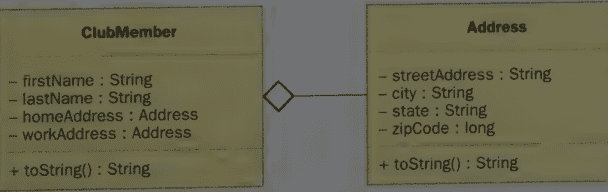

图 5.10 显示聚合关系的 UML 类图

在这种情况下，该引用被用来明确所引用的是哪一个位置。该引用指向调用该方法的对象。因此，当使用以下行代码调用方法时，`this` 引用指向 `bishop1`：

```java
bishop1.move();
```

然而，当使用另一个对象来调用该方法时，该引用就指向那个对象。因此，当使用以下调用时，`move` 方法中的该 `this` 引用指向 `bishop2`：

```java
bishop2.move();
```

通常，该引用被用于区分构造函数的参数与其具有同名的对应实例变量。例如，列表 5.7 展示了 `Account` 类的构造函数如下：

```java
public Account(String owner, long account, double initial)
{
    name = owner;
    acctNumber = account;
    balance = initial;
}
```

在编写此构造函数时，我们特意为参数使用了不同的名称，以将其与实例变量 `name`、`acctNumber` 和 `balance` 区分开。这种区分是任意的。可以使用 `this` 引用按如下编写构造函数：

```java
public Account(String name, long acctNumber, double balance)
{
    this.name = name;
    this.acctNumber = acctNumber;
    this.balance = balance;
}
```

在这个构造函数的版本中，该引用特指对象的实例变量。赋值语句右侧的变量指的是形式参数。这种方法消除了构不同等效名称的需求。这种情况有时会在其他方法中发生，但在构造函数中经常出现。

## 5.7 方法设计

一旦你确定了类并分配了基本职责，每个方法的设计将决定类具体如何定义其行比。某些方法是直观的，几乎不需要思考。另一些方法则更有趣，需要仔细的规划。

算法是解决问题的逐步过程。食谱是算法的一个例子。旅行路线是另一个算法示例。每个方法都实现一个确定其目标的算法。

算法通常使用伪代码来描述，伪代码是代码语句和英语短语的混合。伪代码提供了足够的结构来展示代码如何运行，而不陷入特定语言的语法细节。

本节讨论了方法级别的两个重要方面：方法分解和传递对象传递的影响。

### 方法分解

有时对象提供的服务非常复杂，无法通过一个方法合理实现。因此，我们有时需要将一个方法分解为多个方法以创建更好的设计。例如，让我们检查一个将英语句子翻译成猪拉丁语的程序。

猪拉丁语是一种假语言，句子中的每个单词通常通过将单词的首音移到末尾并加上 "ay" 音来修改。例如，单词 `happy` 会写成 `appyhay`，`birthday` 会变成 `irthdaybay`。以元音开头的单词只需在结尾加上 "yay"，将单词变为 `enoughyay`。开头的辅音（如 "ch" 和 "st"）在添加 "ay" 音之前移动到末尾。因此，`grapefruit` 变成 `apefruitgray`。

列表 5.12 所示的 PigLatin 程序读取一个或多个句子，并将每个翻译成猪拉丁语。

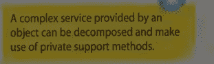

# 列表 5.12

```java
********************************************************************
// PigLatin.java      Java Foundations
// 展示了方法分解的概念。
********************************************************************

import java.util.Scanner;
public class PigLatin {
    //-----------------------------------------------------------------------
    // 读取句子并将其翻译成猪拉丁语。
    //-----------------------------------------------------------------------
    public static void main(String[] args) {
        String sentence
```

## 5.7 方法设计

215

# 列表 5.12 继续

```
输出
输入一个句子（无标点符号）：
Do you speak Pig Latin

这句话的 Pig Latin 翻译为：oday ouyay ekspay igpay atinlay

翻译另一个句子 (y/n)? y

输入一个句子（无标点符号）：
Play it again Sam

这句话的 Pig Latin 翻译为：
ayplay itvay againainay amsay

翻译另一个句子 (y/n)? n
```

PigLatin 程序的后台核心是 `PigLatinTranslator` 类，如列表 5.13 所示。`PigLatinTranslator` 类提供了一个基本服务：名为 `translate` 的静态方法，它接受一个字符串并将其翻译成拉丁。注意，`PigLatinTranslator` 类不包含构造函数，因为不需要。

将整个句子翻译成 Pig Latin 并不是易事。如果写在一个大方法中，它将变得非常长且难以追踪。更好的解决方案（如 `PigLatinTranslator` 类中实现的那样）是分解 `translate` 方法并使用几个其他辅助方法来帮助完成任务。

`translate` 方法使用 `Scanner` 对象将字符串拆分为单词。回想一下 `Scanner` 类（在第 3 章讨论过）的功能之一是将字符串拆分为称为令牌（tokens）的较元素。在这种情况下，令牌由空格字符分隔，因此我们可以使用默认的空白分隔符。PigLatin 程序假设输入中不包含标点符号。

# 列表 5.13

```
********************************************************************************************************
// PigLatinTranslator.java         Java 基础
// 代表从英语到 Pig Latin 的翻译器。演示了
//     方法分解。
// *****************************************************************************************************
```

```
import java.util.Scanner;

public class PigLatinTranslator
{
    //----------------------------------------------------------------------
    // 将一组单词翻译成 Pig Latin。
    //----------------------------------------------------------------------
    public static String translate(String sentence)
    {
        String result = "";
        sentence = sentence.toLowerCase();
        Scanner scan = new Scanner(sentence);
        while (scan.hasNext())
        {
            result += translateWord(scan.next());
            result += " ";
        }
        return result;
    }

    // 将一个单词翻译成 Pig Latin。如果单词以元音
    // 开头，则在单词末尾附加 "yay"。否则，
    // 将第一个或两个字母移动到单词的末尾，
    // 并附加 "ay"。
    //----------------------------------------------------------------------
    private static String translateWord(String word)
    {
        String result = "";

        if (beginsWithVowel(word))
            result = word + "yay";
        else
            if (beginsWithBlend(word))
                result = word.substring(2) + word.substring(0,2) + "ay";
            else
                result = word.substring(1) + word.charAt(0) + "ay";

        return result;
    }

    //------------------------------------------------------
    // 判断指定的单词是否以元音开头。
    //------------------------------------------------------
    private static boolean beginsWithVowel(String word)
    {
        String vowels = "aeiou";

        char letter = word.charAt(0);

        return (vowels.indexOf(letter) != -1);
    }

    //------------------------------------------------------
    // 判断指定的单词是否以特定的
    // 两个字母的辅音组合开头。
    //------------------------------------------------------
    private static boolean startsWith(String word)
    {
        return (word.startsWith("bl") | word.startsWith("sc") |
                word.startsWith("bz") | word.startsWith("sh") |
                word.startsWith("ch") | word.startsWith("sk") |
                word.startsWith("cl") | word.startsWith("sl") |
                word.startsWith("cr") | word.startsWith("sn") |
                word.startsWith("dr") | word.startsWith("sm") |
                word.startsWith("dw") | word.startsWith("sp") |
                word.startsWith("fl") | word.startsWith("sq") |
                word.startsWith("fr") | word.startsWith("st") |
                word.startsWith("gl") | word.startsWith("sw") |
                word.startsWith("gr") | word.startsWith("th") |
                word.startsWith("kl") | word.startsWith("tr") |
                word.startsWith("ph") | word.startsWith("tw") |
                word.startsWith("pl") | word.startsWith("wh") |
                word.startsWith("pr") | word.startsWith("wr")));
    }
}
```

# 第 5 章 类


## 5.7 方法设计

### 列表 5.12 继续

```
输出
输入一个句子（无标点符号）：
Do you speak Pig Latin

这句话的 Pig Latin 翻译为：oday ouyay ekspay igpay atinlay

翻译另一个句子 (y/n)? y

输入一个句子（无标点符号）：
Play it again Sam

这句话的 Pig Latin 翻译为：
ayplay itvay againainay amsay

翻译另一个句子 (y/n)? n
```

`PigLatin` 程序的后台核心是 `PigLatinTranslator` 类，如列表 5.13 所示。`PigLatinTranslator` 类提供了一个基本服务：名为 `translate` 的静态方法，它接受一个字符串并将其翻译成 Pig Latin。注意，`PigLatinTranslator` 类不包含构造函数，因为不需要。

将整个句子翻译成 Pig Latin 并不是易事。如果写在一个大方法中，它将变得非常长且难以追踪。更好的解决方案（如 `PigLatinTranslator` 类中实现的那样）是分解 `translate` 方法并使用几个其他辅助方法来帮助完成任务。

`translate` 方法使用 `Scanner` 对象将字符串拆分为单词。回想一下 `Scanner` 类（在第 3 章讨论过）的功能之一是将字符串拆分为称为令牌（tokens）的较小元素。在这种情况下，令牌由空格字符分隔，因此我们可以使用默认的空白分隔符。`PigLatin` 程序假设输入中不包含标点符号。

### 列表 5.13

```java
// PigLatinTranslator.java         Java 基础
// 代表从英语到 Pig Latin 的翻译器。演示了
//     方法分解。
// *****************************************************************************************************

import java.util.Scanner;

public class PigLatinTranslator
{
    //----------------------------------------------------------------------
    // 将一组单词翻译成 Pig Latin。
    //----------------------------------------------------------------------
    public static String translate (String sentence)
    {
        String result = "";
        sentence = sentence.toLowerCase();
        Scanner scan = new Scanner (sentence);
        while (scan.hasNext())
        {
            result += translateWord (scan.next());
            result += " ";
        }
        return result;
    }

    //----------------------------------------------------------------------
    // 将一个单词翻译成 Pig Latin。如果单词以元音
    // 开头，则在单词末尾附加 "yay"。否则，
    // 将第一个或两个字母移动到单词的末尾，
    // 并附加 "ay"。
    //----------------------------------------------------------------------
    private static String translateWord (String word)
    {
        String result = "";

        if (beginsWithVowel(word))
            result = word + "yay";
        else
            if (beginsWithBlend(word))
                result = word.substring(2) + word.substring(0,2) + "ay";
            else
                result = word.substring(1) + word.charAt(0) + "ay";

        return result;
    }

    //------------------------------------------------------
    // 判断指定的单词是否以元音开头。
    //------------------------------------------------------
    private static boolean beginsWithVowel (String word)
    {
        String vowels = "aeiou";

        char letter = word.charAt(0);

        return (vowels.indexOf(letter) != -1);
    }

    //------------------------------------------------------
    // 判断指定的单词是否以特定的
    // 两个字母的辅音组合开头。
    //------------------------------------------------------
    private static boolean beginsWithBlend (String word)
    {
        return (word.startsWith("bl") || word.startsWith("sc") ||
                word.startsWith("br") || word.startsWith("sh") ||
                word.startsWith("ch") || word.startsWith("sk") ||
                word.startsWith("cl") || word.startsWith("sl") ||
                word.startsWith("cr") || word.startsWith("sn") ||
                word.startsWith("dr") || word.startsWith("sm") ||
                word.startsWith("dw") || word.startsWith("sp") ||
                word.startsWith("fl") || word.startsWith("sq") ||
                word.startsWith("fr") || word.startsWith("st") ||
                word.startsWith("gl") || word.startsWith("sw") ||
                word.startsWith("gr") || word.startsWith("th") ||
                word.startsWith("kl") || word.startsWith("tr") ||
                word.startsWith("ph") || word.startsWith("tw") ||
                word.startsWith("pl") || word.startsWith("wh") ||
                word.startsWith("pr") || word.startsWith("wr"));
    }
}
```

`translate` 方法将每个单词传递给私有辅助方法 `translateWord()`。即使是翻译一个单词的工作也有些复杂，因此 `translateWord()` 方法使用了另外两个私有方法：`beginsWithVowel()` 和 `beginsWithBlend()`。

`beginsWithVowel()` 方法返回一个布尔值，表示作为参数传递的单词是否以元音开头。注意，该方法并没有单独检查每个元音，而是声明了一个包含所有元音的字符串，然后调用 `String` 的 `indexOf()` 方法来确定单词的第一个字符是否在元音字符串中。特定的字符 `indexOf()` 方法返回值为 -1。

`beginsWithBlend()` 方法返回一个布尔值。该方法体只包含一个返回语句，其中包含一个大型表达式，包含了对 `String` 类的 `startsWith()` 方法的调用。如果这些调用中任何一个返回 `true`，那么 `beginsWithBlend()` 方法也会返回 `true`。

注意 `translateWord()`、`beginsWithVowel()` 和 `beginsWithBlend()` 方法都声明为 `private` 可见性。

### 重复参数

另一个与方法设计相关的重要问题涉及参数传递的方式。在 Java 中，所有参数都是按值传递的。也就是说，实际参数的值被复制到形式参数中。在本章之前提到过这个问题，现在让我们详细检查。

本质上，参数传递类似于赋值语句，为形式参数赋值一个副本。在对形式参数进行更改必须考虑这个问题。形式参数是副本，因此对其进行的任何更改对实际参数没有影响。当控制返回方法后，实际参数将与之前相同。

然而，当我们向方法传递对象时，我们实际上传递的是该对象的引用。复制的值是对象的地址。因此形式参数和实际参数互为别名。如果我们通过形式参数更改对象的状态，我们正在更改实际参数所引用的对象。另一方面，如果我们更改形式参数引用本身（例如将其指向新对象），我们并没有更改实际参数指向原始对象的事实。

列表 5.14 中的程序说明了参数传递的细微差别。仔细跟踪程序的处理过程并注意输出的值。`ParameterTester` 包含一个 `main()` 方法，调用 `ParameterModifier` 对象的 `changeValues()` 方法。`changeValues()` 的两个参数是 `Num` 对象，仅存储一个整数值。另一个参数是原始整数。

列表 5.15 显示了 `ParameterModifier` 类，列表 5.16 显示了 `Num` 类。在 `changeValues()` 方法内部，对三个形式参数都进行了修改：整数参数被设置为不同的值，第一个 `Num` 参数存储的值通过 `setValue()` 被更改，并且创建了一个新的 `Num` 对象并赋值给第二个 `Num` 参数。这些更改反映在 `changeValues()` 方法结束时打印的输出中。

然而，注意从方法返回后打印的最终值。原始整数没有从其原始值改变，因为更改是在方法内部进行的。同样，最后一个参数仍然指向其原始对象并具有原始值。这是因为创建的 `Num` 对象仅赋值给了形式参数。

> 实际和形式参数互为别名。

### 列表 5.14

```java
// ParameterTester.java    Java 基础
// 展示了传递不同类型参数的影响。
//********************************************************************

public class ParameterTester {
    //----------------------------------------------------
    // 设置三个变量（一个原始类型和两个对象）作为
    // changeValues 方法的实际参数。在调用方法之前
    // 之后打印它们的值。
    //--------------------------------------------------------------------
    public static void main(String[] args) {
        ParameterModifier modifier = new ParameterModifier();

        int a1 = 111;
        Num a2 = new Num (222);
        Num a3 = new Num (333);

        System.out.println("Before calling changeValues:");
        System.out.println("a1\ta2\ta3");
        System.out.println(a1 + "\t" + a2 + "\t" + a3 + "\n");

        modifier.changeValues(a1, a2, a3);

        System.out.println("After calling changeValues:");
        System.out.println("a1\ta2\ta3");
        System.out.println(a1 + "\t" + a2 + "\t" + a3 + "\n");
    }
}
```

**输出：**

```
Before calling changeValues:
a1      a2      a3
111     222     333

Before changing the values:
f1      f2      f3
111     222     333

After changing the values:
f1      f2      f3
999     888     777

After calling changeValues:
a1      a2      a3
111     888     333
```

### 列表 5.15

```java
// ParameterModifier.java         Java 基础
// 展示了修改参数值的影响。
// *********************************************************************
public class ParameterModifier {
    // ----------------------------------------------------------------------
    // 修改参数，在修改之前和
    // 之后打印它们的值。
    // ----------------------------------------------------------------------
    public void changeValues(int f1, Num f2, Num f3) {
        System.out.println("Before changing the values:");
        System.out.println("f1\tf2\tf3");
        System.out.println(f1 + "\t" + f2 + "\t" + f3 + "\n");

        f1 = 999;
        f2.setValue(888);
        f3 = new Num(777);

        System.out.println("After changing the values:");
        System.out.println("f1\tf2\tf3");
        System.out.println(f1 + "\t" + f2 + "\t" + f3 + "\n");
    }
}
```

### 列表 5.16

```java
// Num.java
public class Num {
    private int value;

    public Num(int value) {
        this.value = value;
    }

    public void setValue(int value) {
        this.value = value;
    }

    public String toString() {
        return String.valueOf(value);
    }
}
```


```java
/********************************************************************
// Num.java      Java 基础
// 将单个整数表示为一个对象。
********************************************************************/

public class Num {
    private int value;

    // 初始化新的 Num 对象，存储初始值。
    public Num(int update) {
        value = update;
    }

    // 将存储的值设置为新指定的值。
    public void setValue(int update) {
        value = update;
    }

    // 将存储的整数值作为字符串返回。
    public String toString() {
        return value + "";
    }
}
```

在方法中仅通过形式参数引用。当方法返回时，形式参数被销毁，它所引用的 `Num` 对象被标记为垃圾回收。唯一“永久性”的改变是对第二个参数状态所做的修改。图 5.12 显示了该程序的逐步处理过程。

## 5.7 方法设计

### 步骤 1：调用 `changeValues` 之前

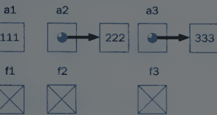

### 步骤 2：`tester.changeValues(a1, a2, a3);`

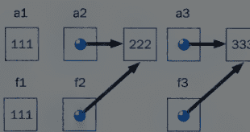

### 步骤 3：`f1 = 999;`

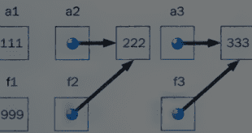

### 步骤 4：`f2.setValues(888);`

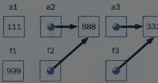

### 步骤 5：`f3 = new Num(777);`

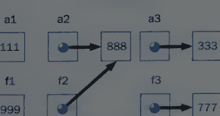

### 步骤 6：从 `changeValues` 返回之后

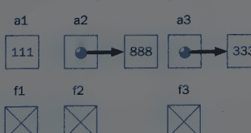

= 未定义

图 5.12 追踪 `ParameterTesting` 程序中的参数

## 5.8 方法重载

正如我们讨论过的，当方法被调用时，控制流会转移到定义该方法的代码。

### 核心概念总结

- 问题描述中的名词可能表示程序中需要的某些类和对象。
- 面向对象编程的核心是定义类，用表示具有定义状态和行为的对象。
- 变量的作用域决定了它可以在哪里被引用，这取决于它的声明位置。
- UML 类图有助于我们视觉化程序中类的内容以及类之间的关系。
- 对象应该被封装，保护其数据免受不当访问。
- 实例变量应该被声明为 `private` 可见性以促进封装。
- 大多数对象包含访问方法（accessor）和修改方法（mutator），以允许客户端以受控的方式管理数据。
- 类表示对象状态的方式应该独立于该对象如何被使用。
- 方法返回的值必须与方法头中指定的返回类型一致。
- 当调用方法时，实际参数会被复制到形式参数中。
- 在方法中声明的变量是该方法的局部变量，不能在方法外部使用。
- 构造函数不能有任何返回类型，即使是 `void`。
- 静态变量在类的所有实例之间共享。
- 聚合对象由其他对象组成，形成“拥有一个（has-a）”的关系。
- 对象提供的复杂服务可以分解，以便使用 `private` 的辅助方法。
- 当将对象传递给方法时，实际参数和形式参数成为别名。
- 重载方法的版本通过其参数的数量、类型和顺序来区分。

### 自测习题

- SR 5.1 什么是属性（attribute）？
- SR 5.2 什么是操作（operation）？
- SR 5.3 对象和类之间的区别是什么？
- SR 5.4 变量的作用域是什么？
- SR 5.5 UML 图的设计目的是什么？
- SR 5.6 对象应该是自管理的。请解释。
- SR 5.7 什么是修饰符（modifier）？
- SR 5.8 为什么常量可能赋予 `public` 可见性？
- SR 5.9 描述以下每一项：
  - a. 公有方法（public method）
  - b. 私有方法（private method）
  - c. 公有变量（public variable）
  - d. 私有变量（private variable）
- SR 5.10 对象的接口（interface）是什么？
- SR 5.11 为什么要通过特定对象（或在特定对象上）调用方法？该规则例外例外？
- SR 5.12 方法返回一个值意味着什么？
- SR 5.13 `return` 语句的作用是什么？
- SR 5.14 需要 `return` 语句吗？
- SR 5.15 解释实际参数（actual parameter）和形式参数（formal parameter）之间的区别。
- SR 5.16 构造函数有什么用？它们是如何定义的？
- SR 5.17 静态变量和实例变量之间的区别是什么？
- SR 5.18 任何程序的 `main` 方法可以引用什么类型的变量？为什么？
- SR 5.19 描述两个类之间的依赖关系。
- SR 5.20 如何区分重载方法？
- SR 5.21 什么是方法分解？
- SR 5.22 解释一个类如何与自身建立关联。

# 第 5 章 编写类

- SR 5.23 什么是聚合对象？
- SR 5.24 `this` 引用指的是什么？
- SR 5.25 对象是如何作为参数传递的？

### 练习题

- EX 5.1 对于以下每一对，哪一个代表一个代表该类对象的类？
  - a. Superman
  - b. Justin, Person
  - c. Rover, Pet
  - d. Magazine, Time
  - e. Christmas, Holiday
- EX 5.2 为一个代表画框的名为 `PictureFrame` 的类列一些可能的属性和操作。
- EX 5.3 为一个代表业务会议的名为 `Meeting` 的类列一些可能的属性和操作。
- EX 5.4 为一个代表大学课程的名为 `Course` 的类（不是特定的某次开的课程，只是泛指课程）列一些可能的属性和操作。
- EX 5.5 重写 SnakeEyes 程序中的 `for` 循环体，使得变量 `num` 和 `num2` 不被使用。
- EX 5.6 编写一个名为 `lyrics` 的方法，在调用时打印歌词。该方法不接受参数且不返回值。
- EX 5.7 编写一个名为 `cube` 的方法，接受一个整数参数并返回该值的三次方。
- EX 5.8 编写一个名为 `random100` 的方法，返回 1 到 100 之间的随机整数（包含边界）。
- EX 5.9 编写一个名为 `randomInRange` 的方法，接受两个表示范围的参数。该方法应返回指定范围内的随机整数（包含边界）。假设第一个参数大于第二个参数。
- EX 5.10 编写一个名为 `powersOfTwo` 的方法，打印 2 的前 10 次幂（从 2 开始）。该方法不接受参数且不返回任何。
- EX 5.11 编写一个名为 `alarm` 的方法，在单独行上多次打印字符串 "Alarm!"。该方法应接受一个整数参数，指定字符串打印的次数。如果参数小于 1，则发出错误信息。
- EX 5.12 编写一个名为 `sum100` 的方法，返回从 100 开始的整数之和。
- EX 5.13 编写一个名为 `maxOf` 的方法，接受两个参数并返回两者中的较大者。
- EX 5.14 编写一个名为 `sumRange` 的方法，接受两个表示范围的整数参数并返回该范围内的整数和（包含边界）。
- EX 5.15 编写一个名为 `floatEquals` 的方法，接受三个浮点值（`double`），如果前两个在第三者的误差范围内相等则返回 `true`。
- EX 5.16 编写一个名为 `countA` 的方法，接受一个字符串参数并返回字符串中字符 'A' 出现的次数。
- EX 5.17 编写一个名为 `evenlyDivisible` 的方法，接受两个整数参数，如果第一个能被第二个整除或反之则返回 `true`。
- EX 5.18 编写一个名为 `isAlpha` 的方法，接受一个字符参数，如果该字符是大写或小写字母则返回 `true`。
- EX 5.19 编写一个名为 `isZero` 的方法，如果任一参数为零则返回 `false`。
- EX 5.20 编写一个名为 `reverse` 的方法，接受一个字符串参数并返回反转后的字符串。
- EX 5.32 为 Transactions 程序绘制 UML 类图。

### 编程项目

**PP 5.1** 修改 `Coin` 类，使其内部使用布尔变量表示状态。在 `CoinFlips` 和 `FlipRace` 程序中测试新版本的类。

**PP 5.2** 重复编程项目 5.1，使用字符字符串表示币的状态。

**PP 5.3** 重复编程项目 5.1，使用枚举类型（enum type）表示币的状态。

**PP 5.4** 设计并实现一个名为 `Sphere` 的类，包含表示直径的实例数据。定义 `Sphere` 构造函数接受并初始化直径，并包含直径的 getter 和 setter。包含计算并返回球体积和表面积的方法（参见编程项目 3.5）。包含一个 `toString` 方法，返回球的单行描述。创建一个名为 `MultiSphere` 的驱动类，其 `main` 方法实例化并更新多个 `Sphere` 对象。

**PP 5.5** 设计并实现一个名为 `Dog` 的类，包含表示狗的名字和年龄的实例数据。定义 `Dog` 构造函数接受并初始化实例数据。为名称和年龄提供 getter 和 setter。包含一个计算并返回狗的“人年”（狗年龄七倍）的方法。包含一个 `toString` 方法，返回狗的单行描述。创建一个名为 `Kennel` 的驱动类，其 `main` 方法实例化并更新多个 `Dog` 对象。

**PP 5.6** 设计并实现一个名为 `Box` 的类，包含表示框的高、宽、深的实例数据。还要包含一个布尔变量 `full` 表示框是否装满。定义 `Box` 构造函数接受并初始化框的高、宽、深。每个新建的框都是空的（构造函数应将 `full` 初始化为 `false`）。为所有实例数据提供 getter 和 setter。包含一个 `toString` 方法，返回框的单行描述。创建一个名为 `BoxTest` 的驱动类，其 `main` 方法实例化并更新多个 `Box` 对象。

## 第 5 章编写类

**PP 5.7** 设计并实现一个名为 `Book` 的类，包含标题、作者、出版商和版权日期的实例数据。定义 `Book` 构造函数以接收并初始化所有实例化数据。为所有实例化数据包含 setter（设置）和 getter（获取）方法。包含一个 `toString` 方法，返回一个格式良好的多书籍描述。创建一个名为 `Books` 的驱动类，其 `main` 方法用于实例化并更新几个 `Book` 对象。

**PP 5.8** 设计并实现一个名为 `Flight` 的类，代表航空公司航班。它应该包含代表航空公司名称、航班号和目的城市的实例数据。定义 `Flight` 构造函数以接收并初始化所有实例化数据。为所有实例化数据包含 getter 和 setter 方法。包含一个 `toString` 方法，返回一个单行的航班描述。创建一个名为 `FlightTest` 的驱动类，其 `main` 方法用于实例化并更新几个 `Flight` 对象。

**PP 5.9** 设计并实现一个名为 `Bulb` 的类，代表一个可以开启和关闭的灯泡。创建一个名为 `Lights` 的驱动类，其 `main` 方法用于实例化并开启一些 `Bulb` 对象。

**PP 5.10** 使用本章定义的 `Die` 类，设计并实现一个名为 `PairDice` 的类，由两个 `Die` 对象组成。包含设置和获取单个骰子值的方法、一个掷骰子的方法，以及一个返回两个骰子值之和的方法。重写 `SnakeEyes` 对象。

**PP 5.11** 使用编程 5.10 中的 `PairDice` 类，设计并实现一个名为 `Pig`（猪爬游戏）的游戏。在这个游戏中，用户与计算机竞争。在每个回合中，当前玩家掷一对骰子并累积分数。目标是在对手之前达到 100 分。如果在任何回合中，玩家掷出 1，则该回合积累的所有分数都将放弃，并将骰子的控制权移交给另一个玩家。如果玩家在一次回合内掷出两个 1，则玩家将丢失游戏中为止积累的所有分数并失去对骰子的控制权。玩家在每次投掷后可以自愿交出骰子。因此，玩家必须决定是继续掷（当一只猪）并承担丢失分数的风险，还是放弃骰子的控制权，可能导致另一个玩家获胜。实现计算机玩家，使其在任何给定回合累积 20 分或更多分后总是交出骰子。

**PP 5.12** 修改本章中的 `Account` 类，使其允许仅通过名称和账号即可开设账户（假设初始余额为零）。修改 `Transactions` 类的 `main` 方法以演示这一新功能。

**PP 5.13** 设计并实现一个名为 `Card` 的类，代表一张标准扑牌。每张牌都有一个花色和一个点值。创建一个分发五张随机牌的程序。

## 自测习题答案

**SR 5.1** 属性是存储在对象中的数据值，定义了该对象的特定特征。例如，`Student` 对象的一个属性可能是该学生的当前平均学点（GPA）。对象属性值的总和决定了该对象的当前状态。

**SR 5.2** 操作是对象可以执行或由对象执行的函数。例如，`Student` 对象的一个操作可能是计算学生的当前平均学点。对象的操作统称为对象的行为。

**SR 5.3** 类是对象的蓝图。它定义了将成为该类实例化的每个对象一部分的变量和方法。类不为变量预留内存空间。每个对象都有自己的数据空间，因此有自己的状态。

**SR 5.4** 变量的作用范围是可以引用该变量的区域。在类级别声明的实例变量可以在类的任何方法中引用。在特定方法内部声明的局部变量（包括形式参数）只能在该方法中引用。

**SR 5.5** UML 图帮助我们视觉化程序中使用的类以及它们之间的关系。UML 图是我们在编写程序之前帮助捕捉程序设计的工具。

**SR 5.6** 自主对象是指控制其自身数据值的对象。封装的对象不允许外部客户端进入并更改其数据，因此是自主的。

**SR 5.7** 修饰符是 Java 保留关键字，可用于变量或方法的定义，并专门定义其使用的的特征。例如，如果一个变量用 `private` 修饰符声明，则该变量无法在定义它的对象之外直接访问。

**SR 5.8** 常量可以以 `public` 可见性声明，这不会违反封装性。因为常量的值不能更改，因此另一个对象直接访问它通常不是问题。

**SR 5.9** 修饰符以以下方式影响方法和变量：
- a. 公共方法（`public`）被称为对象的服务方法（service），因为它定义了对象提供的服务。
- b. 私有方法（`private`）被称为支持方法（support），因为它不能从对象外部调用，用于支持类中其他方法的活动。
- c. 公共变量（`public`）是可以被客户端直接访问和修改的变量。这显式地违反了封装原则，因此应该避免。
- d. 私有变量（`private`）只能从类内部访问和修改的变量。变量几乎总是声明为 `private` 可见性。

**SR 5.10** 对象的接口是定义在其上的公共操作（方法）集合。也就是说，接口建立了对象将为系统其余部分执行的服务集。

**SR 5.11** 虽然方法定义在类中，但它是通过特定对象调用的，以指示受影响的是哪个对象。例如，`Student` 类可能定义计算平均学点的操作，但该操作是通过特定的对象调用的。该规则的例外是静态方法的调用，它是通过类名执行且不影响特定对象的。

**SR 5.12** 被调用的方法可以返回一个值，这意味着它计算了一个值并将其提供给调用者。调用者通常将调用（及其返回值）作为更大表达式的一部分。

**SR 5.13** 显式返回语句用于指定方法返回的值。返回类型必须与方法定义中的返回类型匹配。

**SR 5.14** 返回类型非 `void` 的方法需要返回语句。不返回结果的方法可以使用带表达式的返回语句，但并非必须。一个方法应只使用一个返回语句。

**SR 5.15** 实际参数（actual parameter）在调用方法时传递方法。形式参数（formal parameter）是方法头中对应的变量；它获取实际参数的值以便在方法内部使用。

**SR 5.16** 构造函数是对象的特殊方法，用于在实例化时初始化对象。构造函数的名称与其类相同，且不返回任何值。

**SR 5.17** 实例变量的内存空间为从类实例化的每个对象创建。静态变量（static variable）被类的所有对象共享。

**SR 5.18** 任何程序的 `main` 方法都是静态的，只能引用静态变量或局部变量。因此，`main` 方法无法引用在类级别声明的实例变量。


- SR 5.19 两个类之间的依赖关系（`dependency`）发生于一个类依赖另一个类的功能。它通常被称为“使用”关系。

- SR 5.20 重载方法（`overloaded methods`）通过具有唯一的签名来区分，该签名包括参数的数量、顺序和类型。返回类型不是签名的一部分。

## 第5章 类的编写

SR 5.21 方法分解是将一个复杂方法拆分为若干辅助方法以完成任务的过程。这简化并方便了程序的设计。

SR 5.22 通过对象执行的方法可能会接受从同一类创建的另一个对象作为参数。例如，`String` 类的 `concat` 方法通过一个 `String` 对象执行，并接受另一个 `String` 对象作为参数。

SR 5.23 聚合对象（`aggregate object`）是一个拥有其他对象作为实例数据的对象。也就是说，聚合对象是由其他对象组成的。

SR 5.24 `this` 引用始终指向当前执行的对象。类的非静态方法是针对该类的所有对象泛泛地编写的，但它是通过特定对象调用的。因此，`this` 引用指向当前执行该方法的对象。

SR 5.25 对象通过复制对象的引用（其地址）传递给方法。因此，方法的实际参数和形式参数变得互相彼此的别名。

# 章节目标

## 6 图形用户界面

- 讨论任何 Java GUI 所需的核心元素：组件、事件和监听器。
- 探索使用容器来组织组件。
- 探索各种类型的组件，包括按钮、文本字段、滑块和组合框。
- 讨论组件生成的各种类型的事件以及在什么条件下产生。
- 讨论布局管理器的概念并探索几个特定的布局管理器。
- 探索各种类型的鼠标和键盘事件。
- 讨论对话框，包括用于选择文件和颜色的专用对话框。
- 探索边界框、工具提示和助记键的使用。

许多程序提供图形用户界面（GUI），用户通过该界面与程序交互。顾名思义，GUI 利用了如窗口、按钮、复选框、菜单和文本字段等图形化屏幕组件。与简单的基于文本的命令行环境相比，GUI 经常能为用户提供更自然、更丰富的体验。本章将探索在 Java 中开发 GUI 相关的各种问题。

## 6.1 GUI 元素

我们在示例中看到的基于文本的程序是命令行应用程序，它们通过简单的提示和反馈与用户交互。这种类型的界面易于理解，但缺乏使用真正的图形用户界面（GUI）时可能实现的丰富用户体验。通过 GUI，用户不再局限于按特定顺序响应并在并在处接收反馈。相反，用户可以根据需要与按钮和文本字段等各种组件进行交互。本章将探索在 Java 中开发 GUI 涉及的许多问题。

让我们从每个基于 GUI 的程序的底层概念开始。在 Java 中创建一个 GUI 至少需要三种对象：

- 组件 (`components`)
- 事件 (`events`)
- 监听器 (`listeners`)

组件是一个定义屏幕元素的对象，用于显示信息或允许用户以某种方式与程序交互。GUI 组件的示例包括推入按钮、文本字段、标签、滚动条和菜单。容器（`container`）是一种特殊的组件，用于存放和组织其他组件。

事件（`event`）是一个代表我们可能感兴趣的某些发生的情况。通常，事件对应于用户操作，例如点击鼠标按钮或在键盘上输入键。大多数 GUI 组件生成事件以指示与该组件相关的用户操作。例如，按钮组件将生成一个事件来指示按钮已被按下。以 GUI 为方向并响应用户事件的程序被称为事件驱动程序。

监听器（`listener`）是一个“等待”事件发生并在事件发生时以某种方式响应的对象。设计基于 GUI 的程序的很大一部分是建立监听器、它监听的事件以及生成事件的组件之间的关系。

在大多数情况下，我们将使用 Java 类库中预定义的类和事件。我们将定制组件的行为，但它们的基本角色已经建立。然而，我们将编写自己的监听器类，以便在事件发生时执行我们所需的任何操作。


因此，创建一个使用 GUI 的程序，我们必须：

- 实例化并设置必要的组件，
- 实现监听器类以定义特定事件发生时的情况，
- 建立监听器与生成感兴趣事件的组件之间的关系。

Java 组件和其他 GUI 相关的类主要定义在两个包中：`java.awt` 和 `javax.swing`。（注意 `javax.swing` 中的 x.）。抽象窗口工具包（AWT）是最初的 Java GUI 包。它仍然包含许多我们将使用的重要类。Swing 包是后来添加的，并提供了比 AWT 包更多功能的组件。GUI 开发需要这两个包，但每只要有选项，我们尽可能使用 Swing 组件。

在某些方面，一旦你对事件编程有了基本的理解，其余的就只是细节问题了。你可以使用许多类型的组件来产生你可能想要确认的许多类型的事件。但它们都以相同的基本方式工作。它们与彼此具有相同的内核关系。

让我们看一个包含所有基本 GUI 元素的简单示例。列表 6.1 所示的 `PushCounter` 类包含了程序的驱动器。

### 框架 (Frames) 和面板 (Panels)

框架（`frame`）是一种用于显示基于 GUI 的程序的容器。它是一个带有标题栏的独立窗口。它可以最小化、最大化和关闭。框架由 `JFrame` 类定义。

面板（`panel`）也是一种容器。然而，与框架不同，它只能作为容器的一部分显示。除非你移动容器，否则面板不会移动。它的主要作用是帮助组织 GUI 中的组件。面板由 `JPanel` 类定义。

#### 列表 6.1

```java
************************************
// PushCounter.java      Java Foundations
// 图形用户界面和事件监听器。
************************************

import javax.swing.JFrame;

public class PushCounter {
    // 创建并显示主框架
    // --------------------------------------
    public static void main(String[] args) {
        JFrame frame = new JFrame("Push Counter");
        frame.setDefaultCloseOperation(JFrame.EXIT_ON_CLOSE);

        PushCounterPanel panel = new PushCounterPanel();
        frame.getContentPane().add(panel);

        frame.pack();
        frame.setVisible(true);
    }
}
```


#### 列表 6.2

```java
************************************
// PushCounterPanel.java      Java Foundations
// 图形用户界面和事件监听器。
************************************

import java.awt.*;
import java.awt.event.*;
import javax.swing.*;

public class PushCounterPanel extends JPanel
{
    private int count;
    private JButton push;
    private JLabel label;

    --------------------------------------
    // 构造函数：设置 GUI。
    --------------------------------------
    public PushCounterPanel()
    {
        count = 0;

        push = new JButton("Push Me!");
        push.addActionListener(new ButtonListener());

        label = new JLabel("Pushes: " + count);

        add(push);
        add(label);

        setBackground(Color.cyan);
        setPreferredSize(new Dimension(300, 40));
    }

************************************
// 代表对按钮按下（动作）事件的监听器。
************************************
    private class ButtonListener implements ActionListener
    {
        --------------------------------------
        // 当按钮被按下时更新计数器和标签。
        --------------------------------------
        public void actionPerformed (ActionEvent event)
        {
            count++;
            label.setText("Pushes: " + count);
        }
    }
}
```

我们可以将容器分类为重量级或轻量级容器。重量级容器是由运行该程序的底层操作系统管理的，而轻量级容器则由 Java 程序本身管理。帧（`frame`）是一个重量级组件，而面板（`panel`）是一个轻量级组件。另一个重量级容器是应用单元（`applet`），用于通过 Web 浏览器显示和执行 Java 程序。Applet 在附录 G 中讨论。

通常情况下，重量级组件比轻量级组件更复杂。例如，帧具有多个窗格（`panes`），它们负责帧窗口的各种特性。Java 界面的所有可见元素都显示在帧的内容面板（`content pane`）中。

通常，我们可以通过创建一个用于显示程序界面的帧来创建一个基于 Java GUI 的应用程序。界面通常组织在一个主面板（`primary panel`）中，将其添加到帧的内容面板中。主面板中的组件有时根据需要使用其他面板进行组织。

在 `PushCounter` 类的 `main` 方法中，程序被构建、设置并显示。`JFrame` 构造函数接收一个字符串作为参数，并显示在帧的标题栏中。对 `setDefaultCloseOperation` 方法的调用决定了点击帧角的关闭按钮时会发生什么。在大多数情况下，我们只需让该按钮终止程序，如 `EXIT_ON_CLOSE` 常量所示。

使用 `getContentPane` 方法获取帧的内容面板，紧接着调用内容面板的 `add` 方法来添加面板。帧的 `pack` 方法根据其内容恰当地设置其大小——在这种情况下，帧的大小被调整为容纳其所包含的面板的大小。这种方法比显式设置帧的大小要好，因为帧的大小随着帧内组件的变化而改变。调用 `setVisible` 方法会导致帧显示在显示器屏幕上。

你可以通过多种方式与帧本身进行交互。你可以通过抓住帧的标题栏并用鼠标拖动将整个帧移动到桌面的另一个点。你还可以通过拖动帧的右下角来调整帧的大小。

通过实例化 `JPanel` 类来创建面板。在 `PushCounter` 程序中，面板由 `PushCounterPanel` 类表示，该类派自 `JPanel`。因此，`PushCounterPanel` 是一个 `JPanel`，继承了它所有的方法和属性。这是创建面板的常用技术。

`PushCounterPanel` 类的构造函数调用了几个继承自 `JPanel` 的方法。例如，使用 `setBackground` 方法设置面板的背景颜色（`Color` 类在附录 F 中描述）。`setPreferredSize` 方法接收一个 `Dimension` 对象作为参数，用于指定组件以像素为单位的宽度和高度。许多组件的大小可以通过此设置，像 `setMinimumSize` 和 `setMaximumSize` 等方法有助于控制界面的外观。

面板的 `add` 方法允许将组件添加到面板中。在 `PushCounter` 程序中，新创建的按钮和标签被添加到面板中，从该点起被视为该面板的一部分。组件添加到容器的顺序通常很重要。在这种情况下，它决定了按钮出现在标签之前。

容器由布局管理器（`layout manager`）管理，布局管理器决定了添加到面板的组件具体将如何显示。面板的默认布局管理器仅按照它们添加的顺序显示组件，尽可能在一行放置尽可能组件。布局管理器将在本章稍后的部分详细讨论。

## 按钮和动作事件

`PushCounter` 程序显示了一个按钮和一个标签。标签（`label`）由 `JLabel` 类，是在 GUI 中显示一行文本的组件。标签也可以用于显示图像，如随后的示例所示。在 `PushCounter` 程序中，标签显示按钮被点击的次数。

标签出现在大多数基于 GUI 的程序中。它们对于显示信息或为 GUI 中的其他组件标记非常有用。然而，标签不是交互式的。也就是说，用户不直接与标签交互。

使 `PushCounter` 程序具有交互性的组件是用户用鼠标点击的按钮。

推按钮（`push button`）允许用户通过按下鼠标启动一个动作的组件。在随后的章节中，我们还将探索其他类型的按钮组件。推按钮由 `JButton` 类定义。调用 `JButton` 构造函数接收一个 `String` 参数，指定显示在按钮上的文本。

`JButton` 在被按下时会产生一个动作事件（`action event`）。Java 标准类库中定义了多种类型的事件，我们在整个章节中探索了其中的许多种。不同的组件产生不同类型的事件。

此程序中唯一感兴趣的事件发生在按钮被按下时。为了响应该事件，我们必须为它创建一个监听器对象，因此我们必须写一个表示该监听器的类。在这种情况下，我们需要一个动作监听器（`action listener`）。

在 `PushCounter` 程序中，`ButtonListener` 类表示动作监听器。我们可以将 `ButtonListener` 类写在单独的文件中，甚至写在同一个文件中，但在 `PushCounterPanel` 类之外。然而，我们必须设置一种监听器与被监听器更新的 GUI 组件之间的通信方式。相反，我们将 `ButtonListener` 类定义为内部类（`inner class`），即定义在另一个类内部类。因此，它自动可以访问其包含的类的成员。

只有在两个类之间存在亲密关系且内部类不被任何其他类访问的情况下，才应该创建内部类。监听器与其 GUI 之间的关系是适用于内部类的少数情况之一。


监听器类通过实现接口来编写，接口是实现类必须定义的方法列表。Java 标准类库包含许多事件类型的接口。动作监听器是通过实现 `ActionListener` 接口创建的，因此我们在 `ButtonListener` 类中包含了 `implements` 子句。接口将在第 9 章进行更详细的讨论。

`ActionListener` 接口中列出的唯一方法是 `actionPerformed` 方法，所以这是 `ButtonListener` 类必须实现的方法。产生动作事件的组件（在这种情况下为按钮）在事件发生时会调用 `actionPerformed` 方法，并传入一个 `ActionEvent` 对象。有时我们会使用这个事件对象，有时仅仅知道事件发生了就足够了。在这种情况下，我们不需要与事件对象进行交互。当事件发生时，监听器增加计数并使用 `setText` 方法重置标签的文本。

#### 代码列表 6.3

```java
********************************************************************
// LeftRight.java      Java Foundations
// 展示了如何用一个监听器处理多个按钮。
// *********************************************************************

import javax.swing.JFrame;
public class LeftRight
{
    //----------------------------------------------------------------------
    // 创建并显示主程序框架。
    //----------------------------------------------------------------------
    public static void main(String[] args) {
        JFrame frame = new JFrame("Left Right");
        frame.setDefaultCloseOperation(JFrame.EXIT_ON_CLOSE);

        frame.getContentPane().add(new LeftRightPanel());

        frame.pack();
        frame.setVisible(true);
    }
}
```

显示


#### 代码列表 6.4


# LeftRightPanel.java

```java
/********************************************************************
// LeftRightPanel.java      Java Foundations
// 展示了如何用一个监听器处理多个按钮。
********************************************************************

import java.awt.*;
import java.awt.event.*;
import javax.swing.*;

public class LeftRightPanel extends JPanel {
    private JButton left, right;
    private JLabel label;
    private JPanel buttonPanel;

    //-------------------------------------------------------
    // 构造函数：设置 GUI。
    //-------------------------------------------------------
    public LeftRightPanel () {
        left = new JButton("Left");
        right = new JButton("Right");

        ButtonListener listener = new ButtonListener();
        left.addActionListener(listener);
        right.addActionListener(listener);

        label = new JLabel("Push a button");

        buttonPanel = new JPanel();
        buttonPanel.setPreferredSize(new Dimension(200, 40));
        buttonPanel.setBackground(Color.blue);
        buttonPanel.add(left);
        buttonPanel.add(right);

        setPreferredSize(new Dimension(200, 80));
        setBackground(Color.cyan);
        add(label);
        add(buttonPanel);
    }
```

# 代码列表 6.4 延续

```java
/*********************************************************************
// 表示两个按钮的监听器。
//********************************************************************
private class ButtonListener implements ActionListener
{
    // 判断哪个按钮被按下并相应设置标签
    // 文本。
    public void actionPerformed(ActionEvent event) {
        if (event.getSource() == left)
            label.setText("Left");
        else
            label.setText("Right");
    }
}
```

注意这两个按钮被放在同一个名为 `buttonPanel` 的面板中，它与 `LeftRightPanel` 类表示的面板是的。通过将两个按钮放在一个面板中，我们可以保证当框架以各种方式调整大小时，它们之间的视觉关系保持不变。这对于标记为 Left 和 Right 的按钮来说，无疑非常重要。

## 6.2 更多组件

除了推按钮外，GUI 中还有许多其他交互式组件，每种组件都有其特定的作用。让我们再检查几个。

### 文本字段

文本字段允许用户从键盘输入类型内容。代码列表 6.5 显示的华氏温度程序展示了一个包含文本字段的 GUI，用户可以在其中输入华氏度温度。当用户按下 Enter（或 Return）键时，将显示相应的摄氏度温度。华氏温度程序的界面在 `FahrenheitPanel` 类中设置，如列表 6.6 所示。文本字段是 `JTextField` 的对象。

# 代码列表 6.5

```java
/************************************************************************************
// Fahrenheit.java        Java Foundations
// 展示了文本字段的使用。
//************************************************************************************

import javax.swing.JFrame;

public class Fahrenheit {
    //-----------------------------------------------------------------------
    // 创建并显示温度转换器 GUI。
    //-----------------------------------------------------------------------
    public static void main(String[] args) {
        JFrame frame = new JFrame("Fahrenheit");
        frame.setDefaultCloseOperation(JFrame.EXIT_ON_CLOSE);

        FahrenheitPanel panel = new FahrenheitPanel();
        frame.getContentPane().add(panel);

        frame.pack();
        frame.setVisible(true);
    }
}
```

显示


# 代码列表 6.6

```java
/********************************************************************
// FahrenheitPanel.java      Java Foundations
// 展示了文本字段的使用。
********************************************************************

import java.awt.*;
import java.awt.event.*;
import javax.swing.*;

public class FahrenheitPanel extends JPanel
{
    private JLabel inputLabel, outputLabel, resultLabel;
    private JTextField fahrenheit;
    //----------------------------------------------------------------------
    // 构造函数：设置主 GUI 组件。
    //----------------------------------------------------------------------
    public FahrenheitPanel() {
        inputLabel = new JLabel("Enter Fahrenheit temperature:");
        outputLabel = new JLabel("Temperature in Celsius: ");
        resultLabel = new JLabel("--");

        fahrenheit = new JTextField(5);
        fahrenheit.addActionListener(new TempListener());

        add(inputLabel);
        add(fahrenheit);
        add(outputLabel);
        add(resultLabel);

        setPreferredSize(new Dimension(300, 75));
        setBackground(Color.yellow);
    }

********************************************************************
// 表示温度输入字段的动作监听器。
//********************************************************************
    private class TempListener implements ActionListener
{
    //----------------------------------------------------------------------
    // 当在字段中按下回车键时执行
    // 转换。
    //----------------------------------------------------------------------
    public void actionPerformed (ActionEvent event) {
        int fahrenheitTemp, celsiusTemp;

        String text = fahrenheit.getText();

        fahrenheitTemp = Integer.parseInt(text);
        celsiusTemp = (fahrenheitTemp-32) * 5/9;

        resultLabel.setText(Integer.toString(celsiusTemp));
    }
}
}
```

`JTextField` 构造函数接受一个整数参数，根据当前默认字体指定字段的字符数大小。

文本字段和各种标签被添加到面板中进行显示。记住面板的默认布局管理器会将尽可能多的

## 6.2 更多组件

## 列表 6.7

```java
// *********************************************************************
// StyleOptions.java      Java Foundations
// 展示了复选框的使用。
// *********************************************************************

import javax.swing.JFrame;
public class StyleOptions
{
    // 创建并显示样式选项窗口。
    //
    public static void main(String[] args) {
        JFrame frame = new JFrame ("Style Options");
        frame.setDefaultCloseOperation(JFrame.EXIT_ON_CLOSE);
        frame.getContentPane().add(new StyleOptionsPanel());
        frame.pack();
        frame.setVisible(true);
    }
}
```

## 显示


## 列表 6.8

```java
/************************************************************************************
// StyleOptionsPanel.java      Java Foundations
// 展示了复选框的使用。
************************************************************************************

import javax.swing.*;
import java.awt.*;
import java.awt.event.*;

public class StyleOptionsPanel extends JPanel {
    private JLabel saying;
    private JCheckBox bold, italic;

    //-------------------------------------------------------------------------------------------------
    // 设置一个包含标签和一些复选框的面板
    // 控制标签字体的样式。
    //---------------------------------------------------------------------------------
    public StyleOptionsPanel() {
        saying = new JLabel("Say it with style!");
        saying.setFont(new Font("Helvetica", Font.PLAIN, 36));

        bold = new JCheckBox("Bold");
        bold.setBackground(Color.cyan);
        italic = new JCheckBox("Italic");
        italic.setBackground(Color.cyan);

        StyleListener listener = new StyleListener();
        bold.addItemListener(listener);
        italic.addItemListener(listener);

        add(saying);
        add(bold);
        add(italic);

        setBackground(Color.cyan);
        setPreferredSize(new Dimension(300, 100));
    }

****************************************************************************************************
// 代表两个复选框的监听器。
****************************************************************************************************
```

### 列表 6.8 续

```java
private class StyleListener implements ItemListener
{
    // 更新标签字体的样式。

    public void itemStateChanged (ItemEvent event)
{
        int style = Font.PLAIN;

        if (bold.isSelected())
            style = Font.BOLD;

        if (italic.isSelected())
            style += Font.ITALIC;

        saying.setFont(new Font("Helvetica", style, 36));
    }
}
```

`isSelected` 方法返回一个布尔值。首先，如果“粗体（Bold）”复选框被选中，则样式设置为粗体。接着，如果选择了“斜体（Italic）”复选框，则 `ITALIC` 常量被添加到 `style` 变量中。最后，标签的字体被设置为带有修改后样式的新字体。

注意，由于监听器是写在这个程序中的，因此点击哪个复选框来生成事件并不重要。同一个监听器会处理两个复选框。无论被改变的复选框是从未选中切换到选中，还是反之，并不重要。只要其中一个发生变化，就会检查两个复选框的状态。

### 单选按钮

单选按钮与其他单选按钮一起使用，提供一组互斥的选项。与复选框不同，单选按钮本身并不有用。它只有在与一个或多个单选按钮一起使用时才有意义。组中只有一个选项是有效的。在任何时刻，单选按钮组中且仅有一个按钮被选中（开启）。当组中的一个  按钮被按下时，组中当前处于开启状态的另一个按钮会自动关闭。

“单选按钮（radio buttons）”一词源于旧式收音机上按钮的工作方式。在任何时刻，按下一个按钮来指定当前的电台状态；当按下另一个按钮时，处于开启状态的按钮会自动弹出。


列表 6.9 所示的 `quoteOptions` 程序显示了一个标签和一组单选按钮。单选按钮决定了标签中显示哪条引言。因为一次只能显示一条引言，所以使用单选按钮是恰当的。例如，如果选择了“喜剧（Comedy）”单选按钮，标签将显示喜剧引言。如果点击了“哲学（Philosophy）”按钮，“喜剧”单选按钮会自动关闭，且喜剧引言会被一条富有哲学的引言所取代。

列表 6.10 所示的 `OptionsPanel` 类设置并显示了 GUI 组件。单选按钮由 `JRadioButton` 类表示。因为一组中的单选按钮是协同工作的，因此使用 `ButtonGroup` 类来定义一组单选按钮。

注意，每个按钮都已添加到按钮组中，而且每个按钮也已单独添加到面板中。`ButtonGroup` 对象并不是用于组织和显示组件的容器；它仅仅是定义一组协同工作以形成一组依赖性选项的单选按钮的方法。`ButtonGroup` 对象确保了当组中的另一个按钮被选中时，当前选中的单选按钮会被关闭。

当单选按钮被选中时，会产生一个动作事件。监听器的 `actionPerformed` 首先使用 `getSource` 方法获取事件源，然后依次比较三个单选按钮。根据选中了哪个按钮，标签的文本被设置为相应的引言。

与推送按钮不同，复选框和单选按钮都是切换按钮，意味着它们可以开启或关闭。独立的选项（选择任何组合）由复选框控制。依赖选项（选择组中的一个）由单选按钮控制。如果只有一个选项需要管理，可以使用复选框。

另外注意复选框和单选按钮产生不同类型的事件。复选框产生项目事件，而单选按钮产生动作事件。事件类型的不同与按钮功能的差异有关。复选框在选中或取消选中时产生事件，监听器可以根据需要进行区分。单选按钮，另一方面，只在被选中时产生事件（组中当前选中的按钮会被关闭）。

## 列表 6.10

（此处代码部分根据要求保持原样，不翻译）

### 列表 6.10 继续

```java
philosophy.addActionListener(listener);
carpentry.addActionListener(listener);

add(quote);
add(comedy);
add(philosophy);
add(carpentry);

setBackground(Color.green);
setPreferredSize(new Dimension(300, 100));
}
/****************************************************************/
/* 代表所有单选按钮的监听器
 *****************************************************/
private class QuoteListener implements ActionListener
//-----------------------------------------------------------------------
// 根据哪个单选按钮被按下，设置标签的文本。
//-----------------------------------------------------------------------
public void actionPerformed(ActionEvent event)
{
    Object source = event.getSource();
    if (source == comedy)
        quote.setText(comedyQuote);
    else
        if (source == philosophy)
            quote.setText(philosophyQuote);
        else
            quote.setText(carpentryQuote);
}
}
```

### 滑块 (Sliders)

滑块是一种 GUI 组件，允许用户在边界范围内指定一个数值。滑块可以以垂直或水平方式呈现，并可以带有可选的刻度和标签，以指示值的范围。


列表 6.11 显示了一个名为 `SlideColor` 的程序。该程序展示了三个控制颜色 RGB 分量的滑块。通过滑块值指定的颜色显示在滑块右侧的正方形框中。使用 RGB 值表示颜色在附录 F 中进行了讨论。

列表 6.12 显示的 `SlideColorPanel` 类是一个用于显示三个滑块和颜色面板的面板。每个滑块都由 `JSlider` 类创建，该类接受四个参数。第一个参数使用 `JSlider` 常量（`HORIZONTAL` 或 `VERTICAL`）确定滑块的方向。第二个和第三个参数指定滑块的最大值和最小值，在示例中，每个滑块的这些值被设置为 0 和 255。`JSlider` 构造函数的最后一个参数指定滑块的初始值。

## 列表 6.11

```java
*************************************************************************************************
// SlideColor.java      Java 基础
// 演示滑块组件的使用。
*************************************************************************************************

import java.awt.*;
import javax.swing.*;

public class SlideColor {
    // 展示一个包含控制面板和随滑块调整
    // 改变颜色面板的框架。
    //-------------------------------------------------------------
    public static void main(String[] args) {
        JFrame frame = new JFrame("Slide Colors");
        frame.setDefaultCloseOperation(JFrame.EXIT_ON_CLOSE);
        frame.getContentPane().add(new SlideColorPanel());
        frame.pack();
        frame.setVisible(true);
    }
}
```

### 显示 (Display)

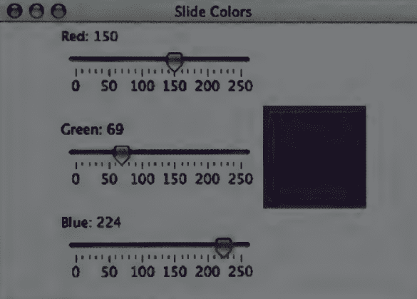

例如，每个滑块的初始值为 0，这使得程序在最初执行时，滑块滑钮位于最左侧。

`JSlider` 类有几个方法，允许程序员定制滑块的外观。可以使用 `setTickSpacing` 方法在特定间隔处设置主刻度。可以使用 `setMinorTickSpacing` 方法设置中间小刻度。然而，除非调用了参数为 true 的 `setPaintTicks` 方法，否则两者都不会显示。通过调用 `setPaintLabels` 方法显示指示主刻度值的标签。

请注意，在示例中，主刻度间隔被设置为 50。从 0 开始，每增加 50 都会被标记。因此，最后一个标签是 250，尽管滑块的值可以达到 255。

滑块会产生一个变化事件，表示滑块的位置及其代表的值已经发生了变化。`ChangeListener` 接口包含一个

## 列表 6.12

```java
************************************************************************************
// SlideColorPanel.java      Java 基础
// 代表 SlideColor 程序的滑块控制面板。
//************************************************************************************
```

```java
import java.awt.*;
import javax.swing.*;
import javax.swing.event.*;
```

```java
public class SlideColorPanel extends JPanel
{
    private JPanel controls, colorPanel;
    private JSlider rSlider, gSlider, bSlider;
    private JLabel rLabel, gLabel, bLabel;
```

```java
//--------------------------------------------------------------------------------
// 设置滑块及其标签，使用盒布局（box layout）
// 将它们的左边缘对齐。
//--------------------------------------------------------------------------------
```

```java
public SlideColorPanel()
{
    rSlider = new JSlider(JSlider.HORIZONTAL, 0, 255, 0);
    rSlider.setMajorTickSpacing(50);
    rSlider.setMinorTickSpacing(10);
    rSlider.setTicks(true);
    rSlider.setPaintLabels(true);
    rSlider.setAlignmentX(Component.LEFT_ALIGNMENT);

    gSlider = new JSlider(JSlider.HORIZONTAL, 0, 255, 0);
    gSlider.setMajorTickSpacing(50);
    gSlider.setMinorTickSpacing(10);
    gSlider.setTicks(true);
    gSlider.setPaintLabels(true);
    gSlider.setAlignmentX(Component.LEFT_ALIGNMENT);

    bSlider = new JSlider(JSlider.HORIZONTAL, 0, 255, 0);
    bSlider.setMajorTickSpacing(50);
    bSlider.setMinorTickSpacing(10);
    bSlider.setTicks(true);
    bSlider.setPaintLabels(true);
    bSlider.setAlignmentX(Component.LEFT_ALIGNMENT);
```

### 列表 6.12 继续

```java
    ChangeListener listener = new SliderListener();

    rSlider.addChangeListener(listener);

    gSlider.addChangeListener(listener);

    bSlider.addChangeListener(listener);

    rLabel = new JLabel("0");

    gLabel = new JLabel("0");

    bLabel = new JLabel("0");

    controls = new JPanel();

    controls.setLayout(new BoxLayout(controls, BoxLayout.Y_AXIS));

    controls.add(rLabel);

    controls.add(rSlider);

    controls.add(Box.createRigidArea(new Dimension(0, 20)));

    controls.add(gLabel);

    controls.add(gSlider);

    controls.add(Box.createRigidArea(new Dimension(0, 20)));

    controls.add(bLabel);

    controls.add(bSlider);

    colorPanel = new JPanel();

    colorPanel.setPreferredSize(new Dimension(100, 100));

    add(controls);

    add(colorPanel);

}

************************************************************************************

// 代表三个滑块的监听器。

************************************************************************************

private class SliderListener implements ChangeListener {

    private int red, green, blue;

    //------------------------------------------------------

    // 获取每个滑块的值，然后更新标签和

    //颜色面板。

    //------------------------------------------------------

    public void stateChanged(ChangeEvent event)

    {

        red = rSlider.getValue();

        green = gSlider.getValue();

        blue = bSlider.getValue();

        rLabel.setText("Red: " + red);

        gLabel.setText("Green: " + green);

        bLabel.setText("Blue: " + blue);

        colorPanel.setBackground(new Color(red, green, blue));

    }

}

```

## 6.2 更多组件 (More Components)

组合框（combo box）可以是可编辑或不可编辑的。默认情况下，组合框是不可编辑的。对于不可编辑的组合框，只能通过从列表中选择项来更改值。然而，如果组合框是可编辑的，用户可以通过从列表中选择项或在组合框区域中输入特定值来更改值。

组合框列表中的选项可以通过两种方式之一建立。我们可以创建一个字符串数组并将其传递给 `JComboBox` 类的构造函数。或者，我们可以在创建组合框后使用 `addItem` 方法向其添加项。`JComboBox` 中的项除了显示文本或单独显示，还可以显示 `ImageIcon` 对象。

列表 6.13 所示的 `JukeBox` 程序演示了组合框的使用。用户使用组合框选择一首歌曲进行播放，然后按下播放（Play）按钮开始播放。可以随时按下停止（Stop）按钮停止歌曲。在歌曲播放时选择新歌曲会停止当前歌曲。

列表 6.14 所示的 `JukeBoxControls` 类是一个面板，它包含了构成 JukeBox GUI 的组件。该类的构造函数还加载了将播放的音频片段（audio clips）。音频片段是通过创建一个与定义片段的 `wav` 或 `au` 文件对应的 `URL` 对象获得的。如果音频片段存储在执行程序的同一机器上，`URL` 构造函数的的前两个参数应该是 "file" 和 "localhost"。创建 `URL` 对象可能会抛出检查异常；因此它们在 `try` 块中创建。然而，此程序假设音频片段将成功加载，因此如果抛出异常则不做任何操作。

一旦创建了 `URL` 对象，就会使用 `Applet` 类的静态方法 `newAudioClip` 来创建 `AudioClip` 对象。音频片段存储在数组中。数组索引为 0 的第一个元素设置为 `null`。此元素对应于初始组合框选项，它仅仅是鼓励用户进行选择。

在组合框中显示的歌曲列表定义在一个字符串数组中。数组的第一个元素默认显示在组合框中，通常用于引导用户。我们必须确保程序的其他部分不会尝试将该选项作为有效歌曲。

此程序还展示了推按钮显示图像的能力。在这个示例中，播放和停止按钮同时显示文本标签和图像图标。

## 列表 6.13

```java
************************************************************************************
// JukeBox.java      Java Foundations
// 演示了组合框的使用。
************************************************************************************

import javax.swing.*;

public class JukeBox {

    //---------------------------------------------------------------------------------
    // 创建并显示点唱机机的控件。
    //---------------------------------------------------------------------------------
```


## 列表 6.14

```java
// JukeBoxControls.java      Java Foundations
//
// 代表点唱机的控制面板。

import java.awt.*;
import java.awt.event.*;
import javax.swing.*;
import java.applet.AudioClip;
import java.net.URL;

public class JukeBoxControls extends JPanel {
    private JComboBox musicCombo;
    private JButton stopButton, playButton;
    private AudioClip[] music;
    private AudioClip current;

    // 设置点唱机的 GUI。
    public JukeBoxControls() {
        URL url1, url2, url3, url4, url5, url6;
        url1 = url2 = url3 = url4 = url5 = url6 = null;

        // 获取并存储要播放的音频片段
        try {
            url1 = new URL("file", "localhost", "westernBeat.wav");
            url2 = new URL("file", "localhost", "classical.wav");
            url3 = new URL("file", "localhost", "jeopardy.au");
            url4 = new URL("file", "localhost", "newAgeRythm.wav");
            url5 = new URL("file", "localhost", "eightiesJam.wav");
            url6 = new URL("file", "localhost", "hitchcock.wav");
        } catch (Exception exception) {}

        music = new AudioClip[7];
        music[0] = null; // 对应于“请选择...”

        music[1] = JApplet.newAudioClip(url1);
        music[2] = JApplet.newAudioClip(url2);
        music[3] = JApplet.newAudioClip(url3);
        music[4] = JApplet.newAudioClip(url4);
        music[5] = JApplet.newAudioClip(url5);
        music[6] = JApplet.newAudioClip(url6);

        // 为组合框创建字符串列表
        String[] musicNames = {"Make A Selection...", "Western Beat",
            "Classical Melody", "Jeopardy Theme", "New Age Rythm",
            "Eighthies Jam", "Alfred Hitchcock's Theme"};

        musicCombo = new JComboBox(musicNames);
        musicCombo.setBackground(Color.cyan);

        // 设置按钮
        playButton = new JButton("Play", new ImageIcon("play.gif"));
        playButton.setBackground(Color.cyan);
        stopButton = new JButton("Stop", new ImageIcon("stop.gif"));
        stopButton.setBackground(Color.cyan);

        // 设置此面板
        setPreferredSize(new Dimension(250, 100));
        setBackground(Color.cyan);
        add(musicCombo);
        add(playButton);
        add(stopButton);

        musicCombo.addActionListener(new ComboListener());
        stopButton.addActionListener(new ButtonListener());
        playButton.addActionListener(new ButtonListener());

        current = null;
    }

    // 代表组合框的动作监听器。
    private class ComboListener implements ActionListener {
        // 停止当前选择（如果有），并将当前选择重置为选中的项。
        public void actionPerformed(ActionEvent event) {
            if (current != null)
                current.stop();
            current = music[musicCombo.getSelectedIndex()];
        }
    }

    // 代表两个按钮的动作监听器。
    private class ButtonListener implements ActionListener {
        // 在任何情况下都停止当前选择（如果有）。如果按了播放按钮，则再次播放。
        public void actionPerformed(ActionEvent event) {
            if (current != null)
                current.stop();
            if (event.getSource() == playButton)
                if (current != null)
                    current.play();
        }
    }
}
```

该程序的设计是：用户必须按下播放按钮才能听到新的选择。

当任意一个按钮被按下时，`ButtonListener` 类的 `actionPerformed` 方法会被执行。当前音频选择正在播放，如果它被停止——如果按了停止按钮——则任务完成。如果按了播放按钮，当前音频选择将从头重新播放。

## 定时器

从 `javax.swing` 包中的 `Timer` 类创建的定时器可以被视为一个 GUI 组件。然而，与其他组件不同，它可能没有出现在屏幕上的视觉表示。相反，正如名称所示，它帮助我们随时间管理某个活动。

定时器对象间隔生成动作事件。为了执行动画，我们可以设置一个定时器定期生成动作事件，然后在动作监听器中更新动画图形。`Timer` 类的方法如图 6.1 所示。

### 图 6.1 Timer 类的一些方法

| 方法 | 说明 |
| :--- | :--- |
| `Timer(int delay, ActionListener)` | 构造函数：创建一个按指定的延迟间隔生成动作事件的定时器。该事件将由指定的监听器处理。 |
| `void addActionListener(ActionListener listener)` | 向定时器添加一个动作监听器。 |
| `boolean isRunning()` | 如果定时器正在运行，则返回 `true`。 |
| `void setDelay(int delay)` | 设置定时器的延迟时间。 |
| `void start()` | 启动定时器，使其生成动作事件。 |
| `void stop()` | 停止定时器，使其停止生成动作事件。 |

## 列表 6.15

```java
// Rebound.java               Java基础 (Java Foundations)
// 演示了动画和 Timer 类的使用。

import java.awt.*;
import java.awt.event.*;
import javax.swing.*;

public class Rebound {
    // 显示程序的主框架。
    public static void main(String[] args) {
        JFrame frame = new JFrame("Rebound");
        frame.setDefaultCloseOperation(JFrame.EXIT_ON_CLOSE);
        frame.getContentPane().add(new ReboundPanel());
        frame.pack();
        frame.setVisible(true);
    }
}
```

## 列表 6.16

```java
// ReboundPanel.java      Java基础 (Java Foundations)
// 代表 Rebound 程序的主面板。

import java.awt.*;
import java.awt.event.*;
import javax.swing.*;

public class ReboundPanel extends JPanel {
    private final int WIDTH = 300, HEIGHT = 100;
    private final int DELAY = 20, IMAGE_SIZE = 35;
    private ImageIcon image;
    private Timer timer;
    private int x, y, moveX, moveY;

    // 设置面板，包括用于动画的定时器。
    public ReboundPanel() {
        timer = new Timer(DELAY, new ReboundListener());
        image = new ImageIcon("happyface.gif");
        x = 0;
        y = 40;
        moveX = moveY = 3;
        setPreferredSize(new Dimension(WIDTH, HEIGHT));
        setBackground(Color.black);
        timer.start();
    }

    // 在当前位置绘制图像。
    public void paintComponent(Graphics page) {
        super.paintComponent(page);
        image.paintIcon(this, page, x, y);
    }

    // 代表定时器的动作监听器。
    private class ReboundListener implements ActionListener {
        // 每当定时器触发事件时，更新图像的位置以及可能更新的移动方向。
        public void actionPerformed(ActionEvent event) {
            x += moveX;
            y += moveY;
            if (x <= 0 || x >= WIDTH - IMAGE_SIZE)
                moveX = moveX * -1;
            if (y <= 0 || y >= HEIGHT - IMAGE_SIZE)
                moveY = moveY * -1;
            repaint();
        }
    }
}
```


监听器的 `actionPerformed` 方法更新当前的 `x` 和 `y` 值，然后检查这些值是否会导致图像撞击面板边缘。如果是，则调整移动，使图像在水平、垂直或两个方向上反向移动。请注意，此计算考虑了图像的大小。在更新坐标值后，`actionPerformed` 方法调用 `repaint` 强制组件（在本例中为面板）重绘。对 `repaint` 的调用会导致 `paint` 方法被调用，从而在新位置重绘图像。

该程序中动画的速度取决于两个因素：动作事件之间的停顿时间以及图像每次偏移的距离。在这个示例中，定时器被设置为每 20 毫秒生成一次动作事件，图像每次偏移 3 像素。你可以尝试调整这些值来改变速度。目标应该是创造出视觉上悦目的移动幻象。

## 6.3 布局管理器

正如本章前面提到的，每个容器都由一个名为布局管理器的对象管理，该对象决定了容器中组件的排列方式。在需要时会咨询布局管理器，例如当容器调整大小或向容器中添加组件时。

布局管理器决定每个组件的大小和位置，并可能考虑许多因素。每个容器都有默认的布局管理器，尽管我们可以根据喜好替换它。

图 6.2 中的表格描述了 Java 标准类库提供的预定义布局管理器。

每个布局管理器都有其特定的属性和组件布局规则。对于某些布局管理器，添加组件的顺序会影响其位置，而另一些则提供更具体的控制。某些布局管理器会考虑首选尺寸或对齐方式，而其他则不会。为了在 Java 中开发良好的 GUI，熟悉各种布局管理器的特征是非常重要的。

我们可以使用容器的 `setLayout` 方法来更改其布局管理器。例如，以下代码将 `JPanel`（默认使用流式布局）的布局管理器设置为边框布局：

```java
JPanel panel = new JPanel();
panel.setLayout(new BorderLayout());
```

让我们更详细地探索这些布局管理器。目前，我们将关注最流行的布局管理器：流式、边框、框和网格。列表 6.17 中提供的类包含应用程序的 `main` 方法，演示了这些布局管理器的使用和效果。

`LayoutDemo` 程序介绍了标签页面板的使用，这是一种允许用户（通过点击标签）选择显示多个面板位置的容器。标签页面板由 `JTabbedPane` 类定义。`addTab` 方法创建一个标签，并指定在标签上显示的名称以及当该面板通过“带到最前层”获得焦点并对用户可见时要显示的组件。

有趣的是，标签页面板提供的功能与卡片布局管理器之间存在重叠。与标签页面板类似，卡片布局允许定义多个层，并且在任何给定时刻只显示其中一层。然而，由卡片布局管理的容器只能在程序控制下进行调整，而标签页面板允许用户直接指示应该显示哪个标签。

在这个示例中，标签页面板的每个标签都包含一个由不同布局管理器控制的面板。第一个标签包含一个带有介绍消息的面板，如列表 6.18 所示。当我们详细探索每个布局管理器时，我们将检查定义该程序对应面板的类，并讨论其视觉效果。

| 布局管理器 | 说明 |
| --- | --- |
| 边框布局 | 将组件组织为五个区域（北、南、东、西和中心）。 |
| 框布局 | 将组件组织为单行或单列。 |
| 卡片布局 | 将组件组织在一个区域，使得任何时候只有一个可见。 |
| 流式布局 | 从左到右组织组件，必要时开始新行。 |
| 网格布局 | 将组件组织为行列网格。 |
| 网格包布局 | 将组件组织为单元格网格，允许组件跨越多个单元格。 |

图 6.2 预定义的 Java 布局管理器

### 列表 6.17

```java
// LayoutDemo.java         Java Foundations                               
// 演示了 flow, border, grid, and box 布局的使用。

import javax.swing.*;

public class LayoutDemo {

    //-----------------------------------------------------------------------
    // 设置一个包含标签页面板的框架。每个标签上的面板
    // 展示了不同的布局管理器。
    //-----------------------------------------------------------------------
    public static void main(String[] args) {
        JFrame frame = new JFrame("Layout Manager Demo");
        frame.setDefaultCloseOperation(JFrame.EXIT_ON_CLOSE);

        JTabbedPane tp = new JTabbedPane();
        tp.addTab("Intro", new IntroPanel());
        tp.addTab("Flow", new FlowPanel());
        tp.addTab("Border", new BorderPanel());
        tp.addTab("Grid", new GridPanel());
        tp.addTab("Box", new BoxPanel());

        frame.getContentPane().add(tp);
        frame.pack();
        frame.setVisible(true);
    }
}
```

### 流式布局

*流式布局* 是最容易使用的布局管理器之一。正如我们提到的，`JPanel` 类默认使用流式布局。流式布局将尽可能多的组件放置在同一行中，并保持其首选尺寸。当组件无法放入某行时，它会被放在下一行。会根据需要添加新行，以容纳所有添加到容器中的组件。图 6.3 描绘了一个由流式布局管理器管理的容器。

### 列表 6.18

```java
// IntroPanel.java         Java Foundations
// 代表 LayoutDemo 程序的介绍面板。

import java.awt.*;
import javax.swing.*;

public class IntroPanel extends JPanel {
    //------------------------------------------------------------
    // 设置此面板并包含两个标签。
    //------------------------------------------------------------
    public IntroPanel() {
        setBackground(Color.green);
        JLabel j11 = new JLabel("Layout Manager Demonstration");
        JLabel j12 = new JLabel("Choose a tab to see an example of " + "a layout manager.");
        add(j11);
        add(j12);
    }
}
```

显示

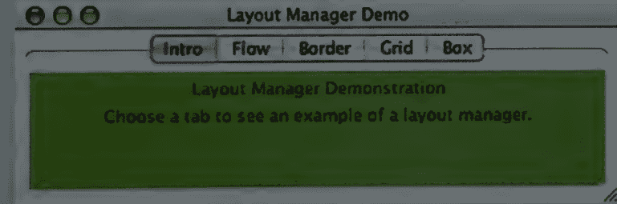

278

第 6 章 图形用户界面

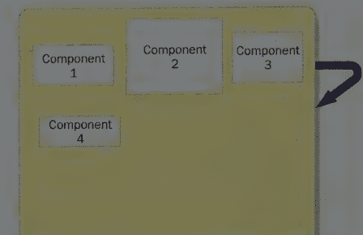

图 6.3 流式布局将尽可能多的组件放在同一行

列表 6.19 中的类代表了 `LayoutDemo` 程序中演示流式布局的面板。它显式地设置布局为流式布局（尽管在这种情况下没有必要的，因为 `JPanel` 默认就是流式布局）。然后创建并将按钮添加到面板中。

每个按钮的大小都设置得足够大，以容纳其上的标签。流式布局将面板内尽可能多的此类按钮放在同一行中，然后开始在另一行上放置组件。当框架的大小变宽时（通过鼠标拖动角部，例如每行可以容纳更多按钮），面板将重新组织。列表 6.19 中的显示展示了这是如何运作的。

### 边框布局

边框布局有五个可以添加组件的区域：北、南、东、西和中心。所添加的区域使用 `BorderLayout` 类定义的常量指定。列表 6.20 显示了 `LayoutDemo` 程序用于演示边框布局的面板。

### 列表 6.20

```java
// BorderPanel.java               Java Foundations
// 设置此面板并在每个边框布局区域包含一个按钮
// 以展示如何影响其位置、形状和大小。

import java.awt.*;
import javax.swing.*;

public class BorderPanel extends JPanel {
    // ----------------------------------------------------------------------
    // 设置此面板并在每个边框布局区域包含一个按钮
    // 以展示如何影响其位置、形状和大小。
    // ----------------------------------------------------------------------
    public BorderPanel() {
        setLayout(new BorderLayout());
        setBackground(Color.green);

        JButton b1 = new JButton("BUTTON 1");
        JButton b2 = new JButton("BUTTON 2");
        JButton b3 = new JButton("BUTTON 3");
        JButton b4 = new JButton("BUTTON 4");
        JButton b5 = new JButton("BUTTON 5");

        add(b1, BorderLayout.NORTH);
        add(b2, BorderLayout.SOUTH);
        add(b3, BorderLayout.EAST);
        add(b4, BorderLayout.WEST);
        add(b5, BorderLayout.CENTER);
    }
}
```

### 列表 6.20 继续

```java
add(b1, BorderLayout.CENTER);
add(b2, BorderLayout.NORTH);
add(b3, BorderLayout.SOUTH);
add(b4, BorderLayout.EAST);
add(b5, BorderLayout.WEST);
}
```


显示结果

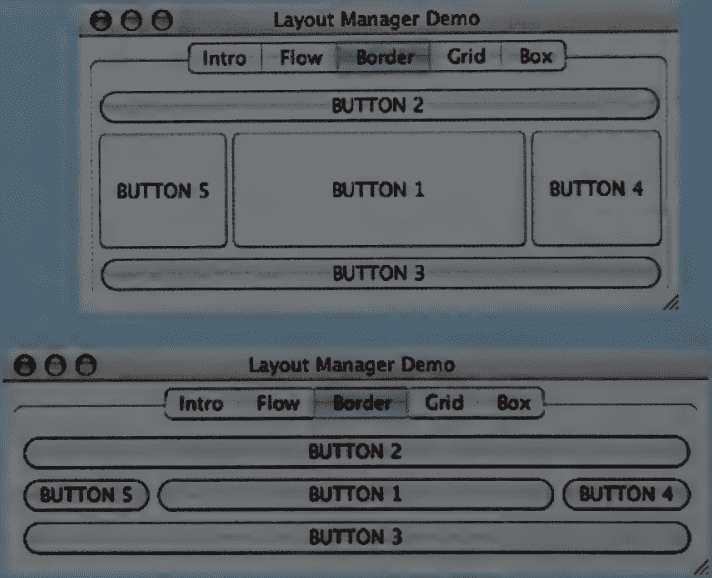

在 `BorderLayout` 类构造函数中，面板的布局管理器被显式地设置为边界布局（border layout）。随后创建按钮并添加到特定的面板区域。默认情况下，每个按钮的宽度足够以容纳其标签，高度足够以填充其被分配的区域。当框架（以及面板）调整大小时，每个按钮的大小会根据需要进行调整，其中中心（Center）区域的按钮将填充任何未使用的空间。

## 6.3 布局管理器

边界布局中的每个区域只显示一个组件。也就是说，给定的边界布局的每个区域只添加一个组件。一个常见的错误是向边界布局的特定区域添加两个组件，在这种情况下，第一个组件会被第二个组件替换，当容器显示时只能看到第二个组件。要在边界布局的区域内添加多个组件，你必须先将组件添加到另一个容器（例如 `JPanel`）中，然后将该面板添加到该区域。

注意，尽管显示按钮的面板具有绿色背景，但在 6.20 的显示中看不到绿色。默认情况下，边界布局的区域之间没有水平或垂直间隙。这些间隙可以通过重载构造函数或 `BorderLayout` 类的显式方法来设置。如果增加了间隙，底层的面板将会显示。

### 网格布局 (Grid Layout)

网格布局以行和列的矩形网格呈现容器的组件。每个网格单元格放置一个组件，所有单元格的大小相同。图 6.5 显示了网格布局的总体结构。

网格布局中的行和列数是在创建布局管理器时通过构造函数的参数确定的。列表 6.21 显示了 `LayoutDemo` 程序用于演示网格布局的面板。它指定了面板应该使用两行三列的网格进行管理。

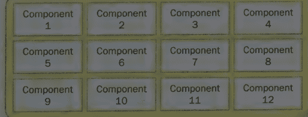

图 6.5 网格布局创建了一个等大小单元格的矩形网格

#### 列表 6.21

```java
// GridPanel.java      Java Foundations

// 代表 LayoutDemo 程序中的面板，用于演示

// 网格布局管理器。

//********************************************************************

import java.awt.*;

import javax.swing.*;

public class GridPanel extends JPanel {

    //----------------------------------------------------

    // 设置此面板的一些按钮，以显示网格

    // 布局如何影响它们的位置、形状和大小。

    //---------------------------------------------------------

    public GridPanel() {

        setLayout(new GridLayout(2, 3));

        setBackground(Color.green);

        JButton b1 = new JButton("BUTTON 1");

        JButton b2 = new JButton("BUTTON 2");

        JButton b3 = new JButton("BUTTON 3");

        JButton b4 = new JButton("BUTTON 4");

        JButton b5 = new JButton("BUTTON 5");

        add(b1);

        add(b2);

        add(b3);

        add(b4);

        add(b5);

    }

}
```

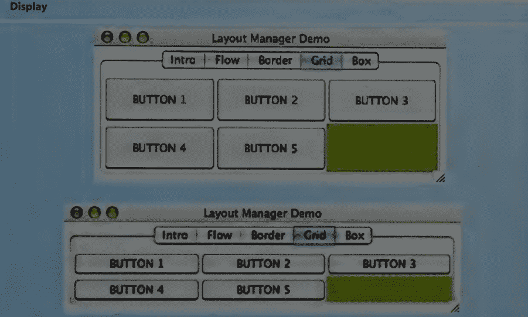

当按钮添加到容器时，它们（默认情况下）从左到右、从上到下填充网格。除了添加到容器的顺序外，没有显式将组件分配给网格中特定位置的方法。

每个单元格的大小由容器的总尺寸决定。当调整容器时，所有单元格都会按比例改变大小以填充容器。

如果指定行数或列数的值为零，网格在该维度上根据需要扩展，以容纳添加到容器的组件数量。行数和列数不能同时为零。

默认情况下，网格单元之间没有水平和垂直间隙。间隙大小可以使用重载构造函数或适当的 `GridLayout` 方法指定。

### 盒布局 (Box Layout)

箱布局以垂直或水平方向组织组件，分为一行或一列，如图 6.6 所示。它很容易使用，但当与其他箱布局结合使用时，可以产生复杂的 GUI 设计，类似于使用网格袋布局（grid bag layout）可以实现的设计，而后者通常要难掌握得多。

当创建 `BoxLayout` 对象时，我们使用 `BoxLayout` 类中定义的常量指定它将遵循 X 轴（水平）或 Y 轴（垂直）。与其他布局管理器不同，`BoxLayout` 类的构造函数的第一个参数是它将要管理的组件。因此，必须为每个组件创建一个新的 `BoxLayout` 对象。列表 6.22 显示了 `LayoutDemo` 程序中用于演示箱布局的面板。

箱布局中的组件按照它们被添加到容器的顺序（从上到右）进行组织。与之前的布局管理器不同，没有水平或垂直

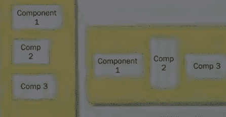

图 6.6 箱布局以垂直或水平方式组织组件

#### 列表 6.22

```java
// BoxPanel.java      Java Foundations

// 代表 LayoutDemo 程序中的面板，用于演示

// 箱布局管理器。

//********************************************************************

import java.awt.*;

import javax.swing.*;

public class BoxPanel extends JPanel {

    //----------------------------------------------------

    // 设置此面板的一些按钮，以显示网格

    // 布局如何影响它们的位置、形状和大小。

    //---------------------------------------------------------

    public BoxPanel() {

        setLayout(new BoxLayout(this, BoxLayout.Y_AXIS));

        setBackground(Color.green);

        JButton b1 = new JButton("BUTTON 1");

        JButton b2 = new JButton("BUTTON 2");

        JButton b3 = new JButton("BUTTON 3");

        JButton b4 = new JButton("BUTTON 4");

        JButton b5 = new JButton("BUTTON 5");

        add(b1);

        add(b2);

        add(b3);

        add(b4);

        add(b5);

    }

}
```

## 6.4 鼠标和键盘事件

除了用户与组件交互时产生的事件外，当用户与计算机鼠标和键盘交互时，也会产生事件。我们也可以设计一个程序来捕获并响应这些事件。

### 鼠标事件

Java 将用户与鼠标交互时产生的事件分为两类：鼠标事件和鼠标移动事件。图 6.7 中的表格定义了这些事件。

当你在 Java GUI 组件上点击鼠标按钮时，会产生三个事件：鼠标按钮被按下时（`mouse pressed`）以及当它被松开时（`mouse released` 和 `mouse clicked`）。鼠标点击定义为在同一位置按下并释放鼠标按钮。如果你按下鼠标按钮、移动鼠标然后释放鼠标按钮，则不会产生 `mouse clicked` 事件。

当鼠标指针进入组件的图形空间时，该组件会产生一个鼠标事件。同样，当鼠标指针离开时，它也会产生一个鼠标事件。

移动事件，正如其名所示，是在鼠标移动过程中触发的。`mouse moved` 事件仅表示鼠标正在移动。`mouse dragged` 事件在用户按下鼠标按钮并在释放按钮的情况下移动鼠标时产生。


| 鼠标事件 | 描述 |
|---|---|
| mouse pressed | 鼠标按钮被按下。 |
| mouse released | 鼠标按钮被释放。 |
| mouse clicked | 鼠标按钮被按下并释放，其间没有移动鼠标。 |
| mouse entered | 鼠标指针移动到组件上（或组件上方）。 |
| mouse exited | 鼠标指针移出组件。 |

| 鼠标移动事件 | 描述 |
|---|---|
| mouse moved | 鼠标移动了。 |
| mouse dragged | 在按下鼠标按钮的同时移动鼠标。 |

图 6.7 鼠标事件和移动事件

当用户按下鼠标按钮并在不释放按钮的情况下移动鼠标时，就会产生多次。在鼠标移动过程中，移动事件会非常快速地产生。

在特定情况下，我们可能只关心一个或两个鼠标事件。我们监听什么取决于我们尝试实现的目标。

列表 6.23 所示的 `Coordinates` 程序响应一个鼠标事件。具体而言，当按下鼠标按钮时，它会在鼠标指针的位置画一个绿点并显示这些坐标。请记住（如附录 F 所示），Java 中的坐标系原点位于组件（如面板）的左上角，x 坐标向右增加，y 坐标向下增加。

列表 6.24 所示的 `CoordinatesPanel` 类跟踪用户最近一次按下鼠标按钮时的 (x,y) 坐标。

#### 列表 6.23

```java
//****************************************************
// Coordinates.java      Java Foundations
// 演示鼠标事件。
//****************************************************

import javax.swing.JFrame;

public class Coordinates {
    // ------------------------------------------------------------------
    // 创建并显示应用程序框架。
    // ------------------------------------------------------------------
    public static void main(String[] args) {
        JFrame frame = new JFrame("Coordinates");
        frame.setDefaultCloseOperation(JFrame.EXIT_ON_CLOSE);

        frame.getContentPane().add(new CoordinatesPanel());

        frame.pack();
        frame.setVisible(true);
    }
}
```

显示


Event 对象的 `getX` 和 `getY` 方法返回鼠标事件发生位置的 x 和 y 坐标。

`mouse pressed` 事件的监听器实现了 `MouseListener` 接口。每当用户在面板上方按下鼠标按钮时，监听器就会调用 `mousePressed` 方法。

注意，与我们在之前的示例中使用的每个包含一个方法的监听器接口不同，`MouseListener` 接口包含五个方法。对于此程序，我们感兴趣的唯一事件是鼠标事件。因此，我们感兴趣的唯一方法是 `mousePressed`。然而，实现接口意味着我们必须为接口中的所有方法提供定义。因此，我们为其他事件提供了空方法。当这些事件产生时，会调用这些空方法，但不会执行任何代码。在本段的末尾

> 监听器可能需要为不需要的事件提供空方法定义以满足接口。

#### 列表 6.24

```java
// CoordinatesPanel.java      Java Foundations

// 代表 Coordinates 程序的主面板。

import javax.swing.JPanel;

import java.awt.*;

import java.awt.event.*;

public class CoordinatesPanel extends JPanel {

    private final int SIZE = 6; // 点的直径

    private int x = 50, y = 50; // 鼠标点击的坐标

    //-------------------------------------------------------------------------------------------------

    // 构造函数：设置此面板以监听鼠标事件。

    //-------------------------------------------------------------------------------------------------

    public CoordinatesPanel() {

        addMouseListener(new CoordinatesListener());

        setBackground(Color.black);

        setPreferredSize(new Dimension(300, 200));

    }

    //-------------------------------------------------------------------------------------------------

    // 绘制列表中存储的所有点。

    //---------------------------------------------------------------------------------

    public void paintComponent(Graphics page) {

        super.paintComponent(page);

        page.setColor(Color.green);

        page.fillOval(x, y, SIZE, SIZE);

        page.drawString("Coordinates:(" + x + ", " + y + ")", 5, 15);

    }

    //**************************************************

    // 代表鼠标事件的监听器。

    //**************************************************

    private class CoordinatesListener implements MouseListener {

        //---------------------------------------------------------

        // 每当按下鼠标按钮时，将当前点添加到列表中

        // 并重绘面板。

        //---------------------------------------------------------

        public void mousePressed(MouseEvent event) {

            x = event.getX();

            y = event.getY();

            repaint();

        }

        //---------------------------------------------------------

        // 为未使用的事件方法提供空定义。

        //---------------------------------------------------------

        public void mouseClicked(MouseEvent event) {}

        public void mouseReleased(MouseEvent event) {}

        public void mouseEntered(MouseEvent event) {}

        public void mouseExited(MouseEvent event) {}

    }

}
```

## 6.4 鼠标和键盘事件

#### 列表 6.25


# RubberLines.java

```java
// RubberLines.java      Java Foundations
// 展示鼠标事件和橡皮筋效应（rubberbanding）。

import javax.swing.JFrame;

public class RubberLines {

    //----------------------------------------------------------------------
    // 创建并显示应用程序框架。
    //----------------------------------------------------------------------
    public static void main(String[] args) {
        JFrame frame = new JFrame("Rubber Lines");
        frame.setDefaultCloseOperation(JFrame.EXIT_ON_CLOSE);
        frame.getContentPane().add(new RubberLinesPanel());
        frame.pack();
        frame.setVisible(true);
    }
}
```

# 显示


# 列表 6.26 RubberLinesPanel.java

```java
// RubberLinesPanel.java      Java Foundations
// 代表 RubberLines 程序的主绘图面板。

import javax.swing.JPanel;
import java.awt.*;
import java.awt.event.*;

public class RubberLinesPanel extends JPanel {
    private Point point1 = null, point2 = null;

    // -------------------------------------------------------------------------------------------------
    // 构造函数：设置此面板以监听鼠标事件。
    // -------------------------------------------------------------------------------------------------
    public RubberLinesPanel() {
        LineListener listener = new LineListener();
        addMouseListener(listener);
        addMouseMotionListener(listener);
        setBackground(Color.black);
        setPreferredSize(new Dimension(400, 200));
    }

    // -------------------------------------------------------------------------------------------------
    // 从初始鼠标按下点到鼠标的当前位置绘制当前线条。
    // -------------------------------------------------------------------------------------------------
    public void paintComponent(Graphics page) {
        super.paintComponent(page);
        page.setColor(Color.yellow);
        if (point1 != null && point2 != null) {
            page.drawLine(point1.x, point1.y, point2.x, point2.y);
        }
    }

    // 代表所有鼠标事件的监听器。
    private class LineListener implements MouseListener, MouseMotionListener {
        //-------------------------------------------------------
        // 捕获鼠标按钮按下时的初始位置。
        //-------------------------------------------------------
        public void mousePressed(MouseEvent event) {
            point1 = event.getPoint();
        }

        //-------------------------------------------------------
        // 获取鼠标在拖动时的当前位置，并重绘线条以创建橡皮筋效应。
        //-------------------------------------------------------
        public void mouseDragged(MouseEvent event) {
            point2 = event.getPoint();
            repaint();
        }

        //-------------------------------------------------------
        // 为未使用的事件方法提供空定义。
        //-------------------------------------------------------
        public void mouseClicked(MouseEvent event) {}
        public void mouseReleased(MouseEvent event) {}
        public void mouseEntered(MouseEvent event) {}
        public void mouseExited(MouseEvent event) {}
        public void mouseMoved(MouseEvent event) {}
    }
}
```

这些方法的实现实现了我们的目标，其他方法被提供了空定义以满足接口契约。

当 `mousePressed` 方法被调用时，变量 `point1` 被赋值。然后，随着鼠标的拖动，变量 `point2` 不断被重置，并且面板被重绘。因此，线条在鼠标拖动时不断被重绘，产生出一种一根线条在固定点和移动点之间被拉伸的视觉效果。

> 橡皮筋效应（Rubberbanding）是指当鼠标拖动时，形状似乎在扩张时产生的图形效果。

这种效果被称为橡皮筋效应，在图形程序中很常见。

线条的起点和终点存储为 `Point` 对象。`Point` 类定义在 `java.awt` 包中，它封装了二维坐标的 x 和 y 值。

注意，在 `RubberLinesPanel` 构造函数中，监听器被两次添加到面板中：一次作为鼠标监听器，一次作为鼠标移动监听器。用于添加监听器的方法必须与作为参数传递的对象相对应。在这种情况下，我们有一个对象同时作为这两类事件的监听器。如果需要，我们可以拥有两个监听器类：一个监听鼠标事件，另一个监听鼠标移动事件。一个组件可以针对各种事件类别拥有多个监听器。

### 键事件


当按下键盘键时会产生键事件。键事件允许程序在用户输入或按下其它键盘键（如方向键）时立即做出响应。如果正在处理事件，程序可以在键按下时立即响应；无需等待按下回车键或等待其他组件（如按钮）被激活。

列表 6.27 中的 `Direction` 程序响应键事件。屏幕上显示一个箭头图像，当按下方向键时，图像跨屏幕移动。实际上，使用了四个不同的方向（上、下、右、左）。如果按下箭头键，图像向相应的方向移动。例如，如果按下上箭头，图像向上移动；如果按下下箭头，图像向下移动；如果按下左箭头，图像向左移动；如果按下右箭头，图像向右移动。

列表 6.28 所示的 `DirectionPanel` 类代表显示图像的面板。构造函数加载图像。当前图像根据最近按下的方向键设置。例如，如果按下上箭头，则显示指向上的图像。图像观察者是一个组件。

# 列表 6.27 Direction.java

```java
// Direction.java        Java Foundations
// 展示键事件。

import javax.swing.JFrame;

public class Direction {
    //----------------------------------------------------------------------
    // 创建并显示应用程序框架。
    //----------------------------------------------------------------------
    public static void main(String[] args) {
        JFrame frame = new JFrame("Direction");
        frame.setDefaultCloseOperation(JFrame.EXIT_ON_CLOSE);
        frame.getContentPane().add(new DirectionPanel());
        frame.pack();
        frame.setVisible(true);
    }
}
```

# 显示


# 列表 6.28 DirectionPanel.java

```java
import javax.swing.*;
import java.awt.*;
import java.awt.event.*;

public class DirectionPanel extends JPanel {
    private final int WIDTH = 300, HEIGHT = 200;
    private final int JUMP = 10; // 图像移动的增量
    private final int IMAGE_SIZE = 31;
    private ImageIcon up, down, right, left, currentImage;
    private int x, y;

    // --------------------------------------
    // 构造函数：设置此面板并加载图像。
    // --------------------------------------
    public DirectionPanel() {
        addKeyListener(new DirectionListener());
        x = WIDTH / 2;
        y = HEIGHT / 2;
        up = new ImageIcon("arrowUp.gif");
        down = new ImageIcon("arrowDown.gif");
        left = new ImageIcon("arrowLeft.gif");
        right = new ImageIcon("arrowRight.gif");
        currentImage = right;
        setBackground(Color.black);
        setPreferredSize(new Dimension(WIDTH, HEIGHT));
        setFocusable(true);
    }

    private class DirectionListener extends KeyAdapter {
        @Override
        public void keyPressed(KeyEvent e) {
            switch (e.getKeyCode()) {
                case KeyEvent.VK_UP:
                    y -= JUMP;
                    currentImage = up;
                    break;
                case KeyEvent.VK_DOWN:
                    y += JUMP;
                    currentImage = down;
                    break;
                case KeyEvent.VK_LEFT:
                    x -= JUMP;
                    currentImage = left;
                    break;
                case KeyEvent.VK_RIGHT:
                    x += JUMP;
                    currentImage = right;
                    break;
            }
            repaint();
        }
    }

    @Override
    protected void paintComponent(Graphics g) {
        super.paintComponent(g);
        currentImage.paintIcon(this, g, x, y);
    }
}
```

# 列表 6.28 续

```java
//----------------------------------------------------------------------
// 在当前位置绘制图像。
//----------------------------------------------------------------------
public void paintComponent(Graphics page) {
    super.paintComponent(page);
    currentImage.paintIcon(this, page, x, y);
}

// 代表键盘活动的监听器。
private class DirectionListener implements KeyListener {
    //--------------------------------------------------------------------
    // 通过相应调整图像和图像位置，对用户按下方向键做出响应。
    //--------------------------------------------------------------------
    public void keyPressed(KeyEvent event) {
        switch (event.getKeyCode()) {
            case KeyEvent.VK_UP:
                currentImage = up;
                y -= JUMP;
                break;
            case KeyEvent.VK_DOWN:
                currentImage = down;
                y += JUMP;
                break;
        }
    }
}
```


```java
case KeyEvent.VK_LEFT:
    currentImage = left;
    x -= JUMP;
    break;
case KeyEvent.VK_RIGHT:
    currentImage = right;
    x += JUMP;
    break;
}
}
repaint();
}
```

//------------------------------------------------------
// 为未使用的事件方法提供空定义。
//------------------------------------------------------
```java
public void keyTyped(KeyEvent event) {
}
public void keyReleased(KeyEvent event) {
}
```

用于管理图像加载；在此例中，我们使用面板作为图像观察者。

名为 `DirectionListener` 的私有内部类被用于响应键事件。它实现了 `KeyListener` 接口，该接口定义了三个我们可以用来响应键盘活动的方法。图 6.8 列出了这些方法。

具体而言，`Direction` 程序对按下键事件做出响应。因为监听器类必须实现接口中定义的所有方法，因此我们为其他事件提供了空方法。

传递给监听器 `keyPressed` 方法的 `KeyEvent` 对象可以用于判断按了哪个键。在示例中，我们调用事件对象的 `getKeyCode` 方法来获取一个表示所按按键的数字代码。我们使用一个 `switch` 语句来判断按下的是哪个键并做出相应响应。`KeyEvent` 类包含了与 `getKeyCode` 方法返回的数字代码对应的常量。如果按下方向键以外的任何键，它将会被忽略。

| 方法 | 说明 |
| --- | --- |
| `void keyPressed(KeyEvent event)` | 当键被按下时调用。 |
| `void keyReleased(KeyEvent event)` | 当键被释放时调用。 |
| `void keyTyped(KeyEvent event)` | 当按下的键或按键组合产生一个键字符时调用。 |

图 6.8 `KeyListener` 接口的方法

## 6.4 鼠标和键盘事件

每当按下键时都会产生键事件，但大多数系统都启用了键重复的概念。也就是说，当按住一个键不放时，就像该键被反复且快速地按下一样。键事件以相同的方式生成。在 `Direction` 程序中，用户可以按住方向键并观察图像跨屏幕移动。

产生键事件的组件是当前拥有键盘焦点的组件。通常，键盘焦点由主“活动”组件持有。当用户用鼠标点击组件时，该组件通常会获得键盘焦点。在面板构造函数中调用 `setFocusable` 方法会将键盘焦点设置为面板。

`Direction` 程序没有为方向图像设置边界，因此它可以移动到可见窗口之外，并在需要时移回来。你可以向监听器中添加代码，当图像到达窗口边界之一时停止移动。这一修改被留作为一个编程项目。

### 扩展适配器类

在之前的基于事件的示例中，我们通过实现特定的监听器接口来创建监听器类。例如，为了创建一个监听鼠标事件的类，我们创建了一个实现 `MouseListener` 接口的监听器类。正如在本节之前的示例所示，监听器接口包含对特定程序不重要的事件方法，在这种情况下，我们提供了空定义以满足接口要求。

创建监听器类的另一种技术是使用继承并扩展一个事件适配器类。每个包含一个以上方法的监听器接口都有一个对应的适配器类，该适配器类已经包含了接口中所有方法的空定义。要创建一个监听器，我们从适当的适配器类派生一个新的监听器类，并重写我们感兴趣的任何事件方法。使用这种技术，我们不再需要为未使用的方法提供空定义了。

例如，`MouseAdapter` 类实现了 `MouseListener` 接口，并为五个鼠标事件方法（`mousePressed`、`mouseClicked` 等）提供了空方法定义。因此，你可以通过扩展 `MouseAdapter` 类而不是直接实现 `MouseListener` 接口来创建鼠标监听器。新的监听器类继承了这些空定义，因此不需要再次定义它们。

> 可以通过派生事件适配器类来创建监听器类。

由于继承，我们在创建事件监听器时有了选择。我们可以实现事件监听器接口，也可以扩展一个适配器类。这是一个应该仔细考虑的设计决策。最佳技术取决于具体情况。继承将在第 8 章中进一步讨论。

## 6.5 对话框

一种称为对话框的组件对 GUI 处理很有帮助。对话框是一个弹出在任何当前活动窗口之上的图形窗口，使用户可以与其交互。对话框可以有多种用途，例如传达某些信息、确认操作或允许用户输入某些信息。通常，对话框只有一个单一的目的，且用户的交互是短暂的。

Java 库中的 Swing 提示包含一个名为 `JOptionPane` 的类，它简化了基本对话框的创建和使用。图 6.9 列出了 `JOptionPane` 的一些方法。

`JOptionPane` 的格式分为三类。消息对话框只需显示输出字符串。输入对话框提供一个提示和一个用户可以在其中输入数据的字段。确认对话框向用户提出一个简单的是否问题。

让我们看一个使用这些类型对话框的程序。列表 6.29 显示了一个程序首先向用户显示一个输入对话框，要求用户输入整数。在用户按下输入框上的 OK 按钮后，会出现第二个对话框（这次是消息对话框），告知用户输入的数字是偶数还是奇数。

| 方法 | 说明 |
| --- | --- |
| `static String showInputDialog(Object msg)` | 显示包含指定消息的对话框，并返回文本字段的内容。 |
| `static int showConfirmDialog(Component parent, Object msg)` | 显示包含指定消息和是/否按钮选项的对话框。如果 parent 为空，对话框将居中显示。 |
| `static void showMessageDialog(Component parent, Object msg)` | 显示包含指定消息的对话框。如果 parent 组件为空，对话框将居中显示。 |

图 6.9 `JOptionPane` 类的方法

在用户关闭该对话框后，会出现第三个对话框，以确定用户是否想测试另一个数字。如果用户按下为“是”的按钮，对话框系列将重复。否则，程序终止。

### 列表 6.29

```java
// ********************************************************************
// EvenOdd.java         Java Foundations
//   演示了 JOptionPane 类的使用。
// ********************************************************************
import javax.swing.JOptionPane;

public class EvenOdd {
    // ----------------------------------------------------------------
    // 判断用户输入的值是偶数还是奇数。
    // 使用多个对话框进行用户交互。
    // ----------------------------------------------------------------
    public static void main(String[] args) {
        String numStr, result;
        int num, again;
        do {
            numStr = JOptionPane.showInputDialog("输入一个整数：");
            num = Integer.parseInt(numStr);
            result = "那个数字是" + ((num % 2 == 0) ? "偶数" : "奇数");
            JOptionPane.showMessageDialog(null, result);
            again = JOptionPane.showConfirmDialog(null, "还要继续？");
        } while (again == JOptionPane.YES_OPTION);
    }
}
```

显示


`showMessageDialog` 和 `showConfirmDialog` 方法的第一个参数指定了对话框的父组件。使用 `null` 引用作为此参数会导致对话框显示在屏幕正中央。

许多 `JOptionPane` 方法允许编程人员定制对话框的内容。此外，`showOptionDialog` 方法可以用于创建结合三种基本格式特征的对话框，以实现更复杂的交互。

对话框应只在需要用户立即关注时使用。如果一个程序不断弹出新窗口以进行不同的交互，会让用户感到困扰。

### 文件选择器

文件选择器是一种特殊的对话框，允许用户从磁盘或其他存储介质选择文件。你可能运行过许多允许打开文件的程序，例如在文字处理程序中指定要打开哪个文件时。由于指定文件的需求非常频繁，`JFileChooser` 类被设计为 Java 类库的一部分。

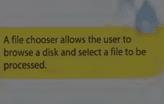

列表 6.30 所示程序使用 `JFileChooser` 对话框来选择文件。该程序还演示了另一个 GUI 组件的使用——文本区域，它类似于文本字段，但一次可以显示多行文本。在这个示例中，用户使用文件选择器对话框选择文件后，文件中包含的内容将显示在文本区域中。

当调用 `showOpenDialog` 方法时，会显示文件选择器对话框。它会自动呈现特定目录包含的文件列表。用户可以使用对话框上的控件导航到其他目录，更改文件的查看方式，并指定显示的文件类型。

`showOpenDialog` 方法返回一个表示操作状态的整数，该整数可以与 `JFileChooser` 类中定义的常量进行比较。在程序中，如果未选择文件（可能是通过按下“取消”按钮），文本区域将显示一条默认消息。如果用户选择了文件，则会打开它并使用 `Scanner` 类读取其内容。注意，此程序假设所选文件包含文本。它没有捕获任何异常，所以如果用户选择了不适当的文件，当抛出异常时，程序将终止。

文本区域组件由 `JTextArea` 类定义。在程序中，我们向其构造函数传递了两个参数，以字符数（行和列）来指定文本区域的大小。要显示的文本通过 `setText` 方法进行设置。

文本区域组件像文本字段一样，可以被设置为可编辑或不可编辑。用户可以通过点击文本区域并使用鼠标打字来更改可编辑文本区域的内容。如果文本区域是不可编辑的，它仅用于显示文本。默认情况下，`JTextArea` 组件是可编辑的。

### 列表 6.30

```java
// ***********************************************************
// DisplayFile.java      Java Foundations
// 演示了文件选择器和文本区域的使用。
// ************************************************************
import java.util.Scanner;
import java.io.*;
import javax.swing.*;

public class DisplayFile {
    // ---------------------------------------------------------------------
    // 打开文件选择器对话框，读取所选文件并
    // 将加载到文本区域。
    // ---------------------------------------------------------------------
    public static void main(String[] args) throws IOException {
        JFrame frame = new JFrame("Display File");
        frame.setDefaultCloseOperation(JFrame.EXIT_ON_CLOSE);
        JTextArea ta = new JTextArea(20, 30);
        JFileChooser chooser = new JFileChooser();
        int status = chooser.showOpenDialog(null);
        if (status != JFileChooser.APPROVE_OPTION) {
            ta.setText("No File Chosen");
        } else {
            File file = chooser.getSelectedFile();
            Scanner scan = new Scanner(file);
            String info = "";
            while (scan.hasNext()) {
                info += scan.nextLine() + "\n";
            }
            ta.setText(info);
        }
        frame.getContentPane().add(ta);
        frame.pack();
        frame.setVisible(true);
    }
}
```

显示

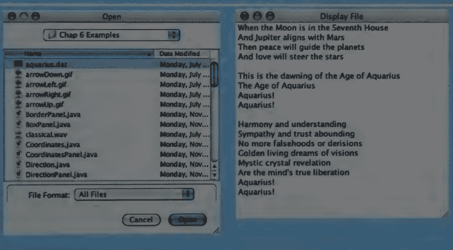

## 第 6 章 图形用户界面

`JFileChooser` 组件让用户能够轻松指定要使用的特定文件。下一节将讨论另一种特殊的对话框——允许用户选择颜色的对话框。

### 颜色选择器

在许多情况下，我们可能希望赋予用户选择颜色的能力。例如，我们可以提供一个调色板。然而，由于可用颜色种类多样，有一个专门的技术会很棒。通常被称为颜色选择器的对话框可以实现此目的。


`JColorChooser` 类表示颜色选择器。它可以使用 RGB 值指定颜色。调用 `JColorChooser` 的静态方法 `showDialog` 可以指定对话框的父组件、显示的标题以及初始颜色。

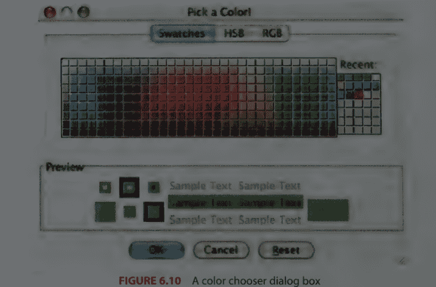

### 一些重要的细节

许多但重要的细节可以为界面增加巨大的价值。有些增强了视觉效果，而另一些提供了提高效率的快捷方式。让我们现在检查一些。

### 边框

Java 提供了为任何组件添加边框的能力。边框本身不是组件，而是定义了组件边缘应该如何绘制，并对 GUI 设计产生重要影响。边框提供了 GUI 组件如何组织的提示，并可用于为组件添加标题。图 6.11 列出了 Java 类库中定义的边框。

`BorderFactory` 类对于创建组件边框非常有用。它有许多方法用于创建特定类型的边框。边框通过 `setBorder` 方法应用于组件。

列表 6.31 中的程序演示了多种边框。它简单创建了多个面板，为每个面板设置了不同的边框，然后在较大的面板中显示。让我们查看程序中创建的每种边框。空边框应用于包含其他面板的较大面板，以创建一个空间缓冲区。

| 边框 | 说明 |
| --- | --- |
| 空边框 | 在组件周围留出缓冲区，否则没有视觉效果。 |
| 线边框 | 包围组件的简单线条。 |
| 刻蚀边框 | 在组件周围创建凹槽的效果。 |
| 斜角边框 | 创建组件凸于表面或凹陷底的效果。 |
| 标题边框 | 在边框上或周围包含文本。 |
| 光边框 | 允许指定每个边缘的大小。使用纯色或图像。 |
| 复合边框 | 两个边框的组合。 |

图 6.11 组件边框

位于框架的外边缘。空边框的顶、左、下、右边缘的大小是以像素为单位指定的。线边框使用特定的颜色创建，并指定了线宽（在本例中为 3 像素）。如果未指定，线宽默认为 1 像素。此程序中创建的蚀刻边框对高亮和阴影使用默认颜色，但根据需要也可以显式地设置。

### 列表 6.31

```java
// ********************************************************************
// BorderDemo.java    Java Foundations
// 展示了各种边框的使用。
```


# BorderDemo 示例

```java
import java.awt.*;
import javax.swing.*;
import javax.swing.border.*;

public class BorderDemo {
    // 创建几个带边框的面板并显示它们。
    public static void main(String[] args) {
        JFrame frame = new JFrame("BorderDemo");
        frame.setDefaultCloseOperation(JFrame.EXIT_ON_CLOSE);

        JPanel panel = new JPanel();
        panel.setLayout(new GridLayout(0, 2, 5, 10));
        panel.setBorder(BorderFactory.createEmptyBorder(8, 8, 8, 8));

        JPanel p1 = new JPanel();
        p1.setBorder(BorderFactory.createLineBorder(Color.red, 3));
        p1.add(new JLabel("Line Border"));
        panel.add(p1);

        JPanel p2 = new JPanel();
        p2.setBorder(BorderFactory.createEtchedBorder());
        p2.add(new JLabel("Etched Border"));
        panel.add(p2);

        JPanel p3 = new JPanel();
        p3.setBorder(BorderFactory.createRaisedBevelBorder());
        p3.add(new JLabel("Raised Bevel Border"));
        panel.add(p3);

        JPanel p4 = new JPanel();
        p4.setBorder(BorderFactory.createLoweredBevelBorder());
        p4.add(new JLabel("Lowered Bevel Border"));
        panel.add(p4);

        JPanel p5 = new JPanel();
        p5.setBorder(BorderFactory.createTitledBorder("Title"));
        p5.add(new JLabel("Titled Border"));
        panel.add(p5);

        JPanel p6 = new JPanel();
        TitledBorder tb = BorderFactory.createTitledBorder("Title");
        tb.setTitleJustification(TitledBorder.RIGHT);
        p6.setBorder(tb);
        p6.add(new JLabel("Titled Border right"));
        panel.add(p6);

        JPanel p7 = new JPanel();
        Border b1 = BorderFactory.createLineBorder(Color.blue, 2);
        Border b2 = BorderFactory.createEtchedBorder();
        p7.setBorder(BorderFactory.createCompoundBorder(b1, b2));
        p7.add(new JLabel("Compound Border"));
        panel.add(p7);

        JPanel p8 = new JPanel();
        Border mb = BorderFactory.createMatteBorder(1, 5, 1, 1, Color.red);
        p8.setBorder(mb);
        p8.add(new JLabel("Matte Border"));
        panel.add(p8);

        frame.getContentPane().add(panel);
        frame.pack();
        frame.setVisible(true);
    }
}
```

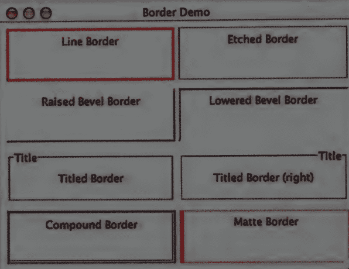

斜角边框可以是凸起的，也可以是凹的。此程序使用了默认颜色，尽管斜角每个部分的颜色可以根据需要进行定制，包括外部高亮、内部高亮、外部阴影和内部阴影。如果需要，这些部分中的任何一个都可以是不同的颜色。

标题边框在边框上或周围放置一个标题。标题的默认位置是边框左上角的边缘。通过使用 `TitledBorder` 类的 `setTitleJustification` 方法，可以将此位置设置为边框上方、下方、左侧、右侧或中间等位置。

复合边框是两个或多个边框的组合。程序中的示例使用线边框和蚀刻边框创建了一个复合边框。`createCompoundBorder` 方法接受两个边框作为参数，并将第一个参数作为外边框，第二个参数作为内边框。

## 6.6 一些重要细节

三个或更多边框的组合是通过首先使用两个边框创建一个复合边框，然后再次使用该复合边框和另一个边框创建另一个复合边框来实现。

哑光边框（Matte border）指定了边框顶、左、下、右边缘的像素大小。这些边缘可以由单一颜色组成（如本例所示），也可以使用图像。

使用边框应谨慎。它们有助于引导用户注意 GUI 的适当部分，并在概念上将相关项分组在一起。然而，如果使用不当，它们也会损害呈现的美观性。边框应该增强界面，而不是使其复杂化或与其竞争。

# 工具提示（Tool Tips）和助记键（Mnemonics）

任何 Swing 组件都可以分配工具提示，这是一行当光标悬停在组件顶部时会显示的短行文本。工具提示通常用于告知用户组件的信息，例如按钮的作用。

可以使用 `setToolTipText` 方法分配工具提示。例如：

```java
button = new JButton("Compute");
button.setToolTipText("Calculates the area.");
```

当按钮被添加到容器并显示时，它会正常显示。当用户将鼠标移动到按钮上时，工具提示会出现。当用户移动鼠标离开按钮时，工具提示会消失。

助记键是一个允许用户除了使用鼠标之外还可以按下按钮的字符。例如，你可以为按钮设置助记键：

```java
button = new JButton("Calculate");
button.setMnemonic('C');
```

当按钮显示时，Calculate 中的字母 C 会下划线。如果选择的助记键不在标签中，则不会下划线。

如果某些组件不应该使用，可以将其禁用。禁用的组件将呈现灰色，用户尝试与其交互时不会发生任何事情。要禁用或启用组件，使用组件的 `setEnabled` 方法传递一个布尔值来指示禁用（`false`）或启用（`true`）。例如：

```java
button = new JButton("Do It");
button.setEnabled(false);
```

当用户不应允许使用组件的功能时，禁用组件是一个好主意。禁用组件的外观表明该组件在当前是不恰当的（实际上是不可能的）。禁用组件不仅可以告诉用户哪些操作是合适的，还可以防止错误情况的发生。


让我们来看一个使用工具提示、助记键和禁用组件的示例。列表 6.32 中的程序展示了一个灯泡的图像、一个开启灯泡的按钮和一个关闭灯泡的按钮。

实际上有两个灯泡的图像：一个显示开启，另一个显示关闭。这些图像以 `ImageIcon` 对象的形式引入。显示图像的标签的 `setIcon` 方法用于根据当前状态设置相应的图像。这种处理在列表 6.33 显示的 `LightBulbPanel` 类中控制。

列表 6.34 显示的 `LightBulbControls` 类是一个包含开启和关闭按钮的面板。这两个按钮都分配了工具提示，并且都使用了助记键。此外，当一个按钮被启用时，另一个就会被禁用，反之亦然。当灯泡开启时，没有理由让开启按钮处于启用状态。

## 6.6 一些重要细节

### Listing 6.32

```java
/*********************************************************************
// LightBulb.java        Java Foundations
// 演示了助记键（mnemonics）和工具提示（tool tips）。
//*****************************************************************/
import javax.swing.*;
import java.awt.*;

public class LightBulb {
    //-----------------------------------------------------------------------
    // 设置一个显示灯泡图像的框架，灯泡可以打开和关闭。
    //-----------------------------------------------------------------------
    public static void main(String[] args) {
        JFrame frame = new JFrame("Light Bulb");
        frame.setDefaultCloseOperation(JFrame.EXIT_ON_CLOSE);

        LightBulbPanel bulb = new LightBulbPanel();
        LightBulbControls controls = new LightBulbControls(bulb);

        JPanel panel = new JPanel();
        panel.setBackground(Color.black);
        panel.setLayout(new BoxLayout(panel, BoxLayout.Y_AXIS));
        panel.add(Box.createRigidArea(new Dimension(0, 20)));
        panel.add(bulb);
        panel.add(Box.createRigidArea(new Dimension(0, 10)));
        panel.add(controls);
        panel.add(Box.createRigidArea(new Dimension(0, 10)));

        frame.getContentPane().add(panel);
        frame.pack();
        frame.setVisible(true);
    }
}
```

### Listing 6.32 运行效果


### Listing 6.33

```java
/*********************************************************************************
// LightBulbPanel.java      Java Foundations
// 代表 LightBulb 程序的图像。
*********************************************************************************/
import javax.swing.*;
import java.awt.*;

public class LightBulbPanel extends JPanel {
    private boolean on;
    private ImageIcon lightOn, lightOff;
    private JLabel imageLabel;

    //--------------------------------------------------------------------------------
    // 构造函数：设置图像和初始状态。
    //--------------------------------------------------------------------------------
    public LightBulbPanel() {
        lightOn = new ImageIcon("lightBulbOn.gif");
        lightOff = new ImageIcon("lightBulbOff.gif");
        setBackground(Color.black);
        on = true;
        imageLabel = new JLabel(lightOff);
        add(imageLabel);
    }

    // 使用适当的图像绘制面板。
    public void paintComponent(Graphics page) {
        super.paintComponent(page);
        if (on) {
            imageLabel.setIcon(lightOn);
        } else {
            imageLabel.setIcon(lightOff);
        }
    }

    // 设置灯泡的状态。
    public void setOn(boolean lightBulbOn) {
        on = lightBulbOn;
    }
}
```

每个按钮都有其自己的监听器类。每个监听器的 `actionPerformed` 方法负责设置灯泡的状态、切换两个按钮的启用状态，并导致带有图像的面板进行重绘。

### Listing 6.34

```java
/************************************************************************************
// LightBulbControls.java       Java Foundations
// 代表 LightBulb 程序的控制面板。
************************************************************************************/
import javax.swing.*;
import java.awt.*;
import java.awt.event.*;

public class LightBulbControls extends JPanel {
    private LightBulbPanel bulb;
    private JButton onButton, offButton;

    //--------------------------------------------------------------------------------------
    // 设置灯泡控制面板。
    //--------------------------------------------------------------------------------------
    public LightBulbControls(LightBulbPanel bulbPanel) {
        bulb = bulbPanel;
        onButton = new JButton("On");
        onButton.setEnabled(false);
        onButton.setMnemonic('n');
        onButton.setToolTipText("Turn it on!");
        onButton.addActionListener(new OnListener());

        offButton = new JButton("Off");
        offButton.setEnabled(true);
        offButton.setMnemonic('f');
        offButton.setToolTipText("Turn it off!");
        offButton.addActionListener(new OffListener());

        setBackground(Color.black);
        add(onButton);
        add(offButton);
    }

    //************************************************************************************
    // 代表 On 按钮的监听器。
    //************************************************************************************
```


```java
private class OnListener implements ActionListener {

    //-----------------------------------------------------------------
    // 打开灯泡并重绘灯泡面板。
    //-----------------------------------------------------------------
    public void actionPerformed(ActionEvent event) {
        bulb.setOn(true);
        onButton.setEnabled(false);
        offButton.setEnabled(true);
        bulb.repaint();
    }
}
```

```java
// 代表 Off 按钮的监听器。
private class OffListener implements ActionListener {

    //-----------------------------------------------------------------
    // 关闭灯泡并重绘灯泡面板。
    //-----------------------------------------------------------------
    public void actionPerformed(ActionEvent event) {
        bulb.setOn(false);
        onButton.setEnabled(true);
        offButton.setEnabled(false);
        bulb.repaint();
    }
}
```

注意，每个按钮上使用的记忆键字符在显示中是带有下划线的。当你运行程序时，你会看到这些字符。

## 6.7 GUI 设计

当我们关注用于创建 GUI 的细节时，有时会忽略大局。我们应该记住，我们的目标是解决问题——创建实用的软件。了解组件、事件和其他语言元素让我们拥有组合 GUI 的工具，但我们必须遵循以下良好的 GUI 设计指导原则：

- 了解用户。
- 预防用户错误。
- 优化能力。
- 保持一致性。


### 核心概念总结

- GUI 由组件、代表用户操作的事件以及响应这些事件的监听器组成。
- 框架（`Frame`）作为独立的窗口显示，但面板（`Panel`）只能作为另一个容器的一部分显示。
- 监听器通常被定义为内部类，这是因为监听器与 GUI 组件之间存在着紧密的关系。
- 单选按钮（Radio buttons）作为一组运行，提供一组互斥的选项。
- 滑动条（Slider）允许用户在限定范围内指定一个数值。
- 组合框（Combo box）提供选项的下拉菜单。
- 定时器（Timer）按固定间隔生成动作事件，可用于控制动画。
- 每个容器都由布局管理器（Layout manager）管理，它决定了组件视觉呈现方式。
- 当发生变化时，容器中的组件会根据布局管理器的策略重新排列。
- 可以显式设置每个容器的布局管理器。
- GUI 的外观是包含层次结构和每个容器布局管理器的函数。
- 移动鼠标和点击鼠标按钮会产生程序可以响应的事件。
- 为了满足接口，监听器可能需要为不需要的事件提供空方法定义。
- 橡皮带效应（Rubberbanding）是在拖动鼠标时形状似乎扩大所产生的图形效果。
- 按键事件（Key events）允许程序立即响应用户按下键盘键的操作。
- 可以通过派生自事件适配器类（Event adapter class）来创建监听器类。
- 文件选择器（File chooser）允许用户浏览磁盘并选择要处理的文件。
- 颜色选择器（Color chooser）允许用户从调色板或使用 RGB 值选择颜色。
- 边框（Borders）可以应用于组件以对对象分组并集中注意力。
- 当组件的使用不合适时，应将其禁用。
- 任何 GUI 设计都应遵循关于一致性和可用性的基本指南。

### 自测题

SR 6.1 任何 Java GUI 需要哪三个元素？

SR 6.2 框架（`Frame`）和面板（`Panel`）的区别是什么？

SR 6.3 事件与监听器之间是什么关系？

SR 6.4 我们可以向任何组件添加任何类型的监听器吗？解释文本字段（Text field）。

SR 6.5 按钮（Push button）产生什么类型的事件？复选框（Check box）？

SR 6.6 对比复选框（Check boxes）和单选按钮（Radio buttons）。

SR 6.7 你什么时候会使用滑动条（Slider）？

SR 6.8 定时器（Timer）对象的作用是什么？

SR 6.9 什么时候会咨询布局管理器？

SR 6.10 流布局管理器（Flow layout manager）的行为是？

SR 6.11 描述边界布局（Border layout）的区域。

SR 6.12 盒子布局（Box layout）中的胶组件（Glue component）有什么作用？

SR 6.13 GUI 的包含层次结构是什么？

SR 6.14 什么是鼠标事件（Mouse event）？

SR 6.15 什么是按键事件（Key event）？

SR 6.16 什么是事件适配器类（Event adapter class）？

SR 6.17 什么是对话框（Dialog box）？

SR 6.18 什么是文件选择器（File chooser）？颜色选择器（Color chooser）？

SR 6.19 `BorderFactory` 类的作用是什么？

SR 6.20 什么是工具提示（Tooltip）？

SR 6.21 组件应该什么时候被禁用？

### 练习题

EX 6.1 解释如何设置两个组件以共享同一个监听器。监听器如何判断是哪个组件生成了事件？

EX 6.2 解释一个组件如何同时使用两个监听器。给出一个例子。

EX 6.3 解释如果 Options 程序中使用的单选按钮没有组织到 `ButtonGroup` 对象中会发生什么。修改程序以测试你的答案。

EX 6.4 为什么在 Slider 程序中，滑动条的值可以达到 255，但最大的刻度标记（Tick mark）是 250？

EX 6.5 影响 Timer 程序中动画平滑度的两个主要因素是什么？解释其中任何一个将如何影响它。

EX 6.6 更改 LayoutDemo 程序中使用的布局的水平和垂直垂直间距会产生什么视觉效果？进行更改以测试你的答案。

EX 6.7 在 Coordinates 程序中，如果我们不为一个或多个未使用的事件提供空定义，会发生什么？

EX 6.8 Coordinates 程序监听按下事件（Pressed event）以画一个点。如果它监听鼠标释放事件（Mouse release）而不是，程序的行为会有何不同？点击事件（Clicked event）？

EX 6.9 如果调用 CoordinatesPanel 类的 `super.paintComponent` 方法会发生什么？移除该调用并运行程序以测试你的答案。

EX 6.10 如果调用 LinesPanel 类的 `super.paintComponent` 方法会发生什么？移除它并运行程序以测试你的答案。这与 6.9 的答案有何不同？

EX 6.11 编写代码使用三个边框定义一个复合边框（Compound border）：内边缘是线边框（Line border），外边缘是蚀刻边框（Etched border），中间是凸斜边框（Raised bevel border）。

EX 6.12 绘制一个 UML 类图，显示 PushCounter 程序中使用的类之间的关系。

EX 6.13 绘制一个 UML 类图，显示 Fahrenheit 程序中使用的类之间的关系。

EX 6.14 绘制一个 UML 类图，显示 LayoutDemo 程序中使用的类之间的关系。

EX 6.15 为 Direction 程序创建一个 UML 类图。

### 编程项目

PP 6.1 设计并实现一个显示按钮和标签的应用程序。每当按钮按下时，标签应显示 1 到 100 之间的随机数（包含边界）。

PP 6.2 设计并实现一个有两个按钮和一个标签的应用程序。分别将按钮命名为 Increment（增加）和 Decrement（减少）。使用标签显示数值（初始为 50）。每次按下 Increment 按钮时增加数值；同样，每次按下 Decrement 按钮时减少数值。

PP 6.3 修改项目 6.2 的解决方案，使两个按钮共享同一个监听器。

PP 6.4 修改 Fahrenheit 程序，使用按钮在按下时触发转换。也就是说，用户可以选择文本字段或按钮。使用已为文本字段定义的监听器。

PP 6.5 修改 Direction 程序，不允许图像移动出可视区域。忽略任何会导致这种情况的按键事件。

PP 6.6 设计并实现一个使用按钮改变交通灯状态的应用程序。将绘制表面派自 `JPanel` 类，并使用另一个面板来组织绘制表面和按钮。

PP 6.7 设计并实现一个显示电子邮件草稿界面的应用程序。该应用程序应具有收件人、抄送、主题和正文的文本字段。包含一个标记为 Send 的按钮。按下 Send 按钮时，程序应使用 `println` 将所有字段的内容打印到标准输出。


PP 6.9 设计并实现一个使用对话框获取两个整数（每个值一个对话框）并显示它们的和与积应用程序。使用另一个对话框询问用户是否想处理另一对数值。

PP 6.10 设计并实现一个根据鼠标位置更改背景颜色的程序。如果鼠标位于窗口左侧，显示红色；右侧显示绿色。

PP 6.11 设计并实现一个鼠标里程计应用程序，持续显示鼠标（在窗口内）移动的像素距离。使用标签显示当前位置相对于上次的位置。提示：将当前位置与上次位置进行比较，并距离公式确定移动了多远。

PP 6.12 设计并实现一个使用橡皮带技术绘制圆的应用程序。圆的大小由鼠标拖动决定。使用原始鼠标点击位置作为固定中心点。提示：计算鼠标指针与中心点之间的距离以确定当前半径。

PP 6.13 修改 StyleOptions 程序，允许用户指定字体大小。使用文本字段获取大小。

# 第 6 章 图形用户界面


PP 6.14

修改编程项目 6.13 的解决方案，使其使用滑动块（slider）来获取字体大小。

PP 6.15

开发一个简单的工具用于计算段落的统计数据。该应用程序应有一个窗口，其中包含一个可滚动的文本区域（`JTextArea`）和一个统计框。统计框应该是一个带有标题边框的面板，带有标签的字段，用于显示文本框中的单词数和平均单词长度，以及你想要添加的任何其他统计数据。统计框还应包含一个按钮，按下该按钮会重新计算文本字段当前内容的统计数据。

PP 6.16

修改本章中的 Rebound 程序，使得在程序窗口上点击鼠标按钮时动画停止，再次点击时动画继续。

PP 6.17

设计并实现一个程序，该程序使用 `JColorChooser` 从用户处获取颜色，并将颜色显示为主程序窗口的背景。使用对话框来确定用户是否想显示另一种颜色，如果是，则重新绘制颜色选择器。

PP 6.18

修改 JukeBox 程序，使得播放（Play）和停止（Stop）功能也可以通过键盘助记（mnemonics）控制。

PP 6.19

修改 Coordinates 程序，通过扩展适配器类（adapter class）而不是实现接口来创建监听器。

PP 6.20

设计并实现一个应用程序，显示汽车（侧视图）从左到右穿过屏幕的动画。创建一个表示汽车的 `Car` 类。

- SR 6.7 当用户需要指定特定范围内的数值时，滑动块很有用。使用滑动块获取此类输入，而不是文本字段或其他组件，可以最大限度地减少用户错误。

- SR 6.8 从 `Timer` 类创建的对象会以固定的间隔产生动作事件。它可以用于控制动画的速度。

- SR 6.9 每当组件的视觉外观可能受到影响时（例如容器调整大小时或向容器中添加新组件时），就会咨询布局管理器（layout manager）。

- SR 6.10 流布局（Flow layout）尝试在一行放置尽可能多的组件。根据需要创建多行。

- SR 6.11 边界布局（Border layout）分为五个区域：北、南、东、西和中。北和南区域分别位于容器的顶部和底部，横跨容器的整个宽度。从左到右位于它们之间的是西、中、东区域。任何未使用的区域不占用空间，其他区域则根据需要填充。

- SR 6.12 盒子布局（box layout）中的胶组件（glue component）决定了布局中任何额外空间应该去哪里。它会根据需要扩展，但如果没有额外的空间可以分配，则不占用空间。

- SR 6.13 GUI 的包含层次结构通过嵌套容器创建。容器的嵌套方式以及这些容器采用的布局管理器决定了 GUI 视觉呈现的细节。

- SR 6.14 鼠标事件是用户以各种方式操纵鼠标时生成的事件。在特定情况下，可能对几种类型的鼠标事件感兴趣，包括移动鼠标、按下鼠标、鼠标进入组件以及拖动鼠标。

- SR 6.15 键事件（key event）在按下键盘键时产生，允许程序立即响应用户输入。

- SR 6.16 适配器类（adapter class）是一个实现接口的类。监听器类可以通过扩展相应的适配器类来创建，并提供方法的定义。

- SR 6.17 对话框（dialog box）是一个用于传递信息、确认操作或接受输入的小窗口。通常，对话框用于特定情况下的用户交互。

- SR 6.18 文件选择器（file chooser）和颜色选择器（color chooser）是特殊的对话框，允许用户从磁盘或颜色中选择文件。

- SR 6.19 `BorderFactory` 类包含多个方法，用于创建可以应用于组件的边框。

- SR 6.20 提示框（tool tip）是当鼠标光标悬停在特定组件上时显示的文本。提示框用于简要说明组件的作用。

- SR 6.21 当 GUI 组件使用时不宜应禁用。这有助于用户执行正确操作并处理错误和特殊情况。

# 章节目标

- 定义并使用数组进行基础数据组织。
- 讨论用于管理容量的边界检查（bounds checking）技术。
- 讨论与数组相关的问题。
- 描述命令行参数（command-line arguments）的使用。
- 讨论变长列表的语法和使用。
- 讨论多维数组的创建和使用。

# 数组

在设计程序时，我们通常以易于访问和修改的形式组织对象或原始数据。本章介绍了数组，它们是将数据分组的编程结构。数组是大多数高级语言中的基本组件。

## 7.1 数组元素

数组是一种简单但强大的编程语言结构，用于分组和组织数据。在编写管理大量信息（例如100个名字列表）的程序时，为每个数据声明单独的变量是不现实的。数组通过声明包含多个可单独访问值的变量解决了这个问题。

数组是值的列表。每个值存储在数组中特定的编号位置。每个位置对应的数字被称为索引（index）或下标（subscript）。图 7.1 显示了一个整数数组及其对应的索引。在 Java 中，数组索引从 0 开始。图 7.1 所示数组有 11 个值。

要访问数组中的值，我们使用数组名称后跟方括号。例如，以下表达式指向该数组：

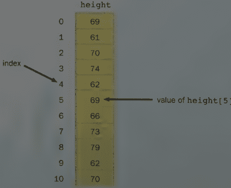

图 7.1 一个包含整数值的数组

```java
height[8]
```

## 7.2 声明和使用数组

在 Java 中，数组是对象。为了创建数组，必须声明数组的引用。然后可以使用 `new` 运算符实例化数组，分配存储值的内存空间。以下代码表示所示数组的声明：

```java
int[] height = new int[11];
```


# 第 7 章 数组

变量 `height` 被声明为整数数组，类型为 `int[]`。数组中存储的所有值具有相同的类型（或至少兼容）。例如，我们可以创建一个包含整数的数组或包含字符串的数组，但不能创建一个同时包含整数和字符串的数组。数组可以设置为存储任何原始类型或任何类类型。数组中存储的值有时被称为数组的元素类型，数组值的类型被称为。

注意数组变量的类型（`int[]`）不包含数组的大小。使用 `new` 运算符实例化 `height` 为存储 11 个整数分配内存空间。一旦数组对象被实例化为特定大小，它能容纳的值的数量就无法更改。声明持有整数数组的引用变量 `height` 可以引用任何大小的数组。像任何其他引用变量一样，`height` 引用的对象（即数组）可以随时间发生改变。


列表 7.1 的示例创建了一个名为 `list` 的数组，它可以存储 15 个整数，并以 10 为连续增量加载。然后，它更改了数组中第六个元素（索引为 5）。最后，它打印存储在数组中的所有值。

图 7.2 显示了数组在 `BasicArray` 程序执行期间的变化情况。使用循环处理数组通常非常方便，因为数组中的位置数量是固定的。注意，在 `BasicArray` 程序中多处使用了常量 `LIMIT`。该常量用于声明数组的大小，并控制初始化数组值的 `for` 循环。

`for` 循环的迭代器版本被用于打印数组中的值。回想第 4 章，这种版本的 `for` 循环会提取指定迭代器中的每个值。每个 Java 数组都是迭代器，因此当我们想要处理数组中的每个元素时，就会使用这种循环。

用于指示数组索引的方括号在 Java 中被视为一种运算符。因此，就如 `+` 运算符或 `<=` 运算符一样，`[]` 的优先级高于其他 Java 运算符，这决定了它的执行时机。它是所有 Java 运算符中优先级最高的。

| 数组创建了 15 个元素，索引从 0 到 14 | 第一次循环迭代三次后 | 完成第一次循环后 | 更改 list[5] 的值后 |
|---|---|---|---|
| 0 | 0 | 0 | 0 |
| 1 | 10 | 10 | 10 |
| 2 | 20 | 20 | 20 |
| 3 | | 30 | 30 |
| 4 | | 40 | 40 |
| 5 | | 50 | 999 |
| 6 | | 60 | 60 |
| 7 | | 70 | 70 |
| 8 | | 80 | 80 |
| 9 | | 90 | 90 |
| 10 | | 100 | 100 |
| 11 | | 110 | 110 |
| 12 | | 120 | 120 |
| 13 | | 130 | 130 |
| 14 | | 140 | 140 |

图 7.2 `BasicArray` 程序中变化的数组 `list`。

## 列表 7.1

```java
// BasicArray.java      Java 基础
// 基础数组的声明和使用。
//********************************************************************

public class BasicArray {

    // 创建一个数组，填充各种整数值，
    // 修改一个值，然后将它们打印出来。
    public static void main(String[] args) {

        final int LIMIT = 15, MULTIPLE = 10;

        int[] list = new int[LIMIT];

        // 初始化数组值
        for (int index = 0; index < LIMIT; index++)
            list[index] = index * MULTIPLE;

        list[5] = 999; // 修改一个数组值

        // 打印数组值
        for (int value : list)
            System.out.print(value + " ");
    }
}
```

## 输出

## 边界检查

索引运算符执行自动边界检查，这确保了索引在所引用的数组范围内。每当引用数组元素时，索引必须大于或等于 0 且小于数组的大小。例如，假设创建了一个名为 `prices` 且包含 25 个元素的数组。该数组的有效索引从 0 到 24。每当引用数组中的特定元素（如 `prices[count]`）时，会检查索引的值。如果索引在数组的有效范围（0 到 24）内，则执行引用。如果无效，则会抛出一个名为 `OutOfBoundsException` 的异常。

大多数情况下，我们希望在引用时执行边界检查。也就是说，在进行引用时需要保持在数组边界内。由于数组索引从 0 开始到比大小小 1，因此在程序中很容易产生差一错误（off-by-one errors），这些错误是由处理了所有元素或尝试多包含一个元素引起的。检查边界的一种方法是使用 `length` 常量，它是数组对象的属性，在数组创建时设置且不可更改。例如，在创建包含 25 个元素的数组后，`prices.length` 的值为 25。`length` 常量是每个数组的组成部分，当需要数组大小时无需单独创建常量。记住，数组的长度是它可以容纳元素的数量。看另一个示例。列表 7.2 显示的程序将 10 个整数读入名为 `numbers` 的数组，然后反序打印它们。

## 列表 7.2

```java
// ReverseOrder.java    Java 基础
// 数组索引处理。
//****************************************************

import java.util.Scanner;

public class ReverseOrder {

    //-----------------------
    // 从用户处读取数字列表并存储在
    // 数组中，然后反序打印它们。
    //-----------------------
    public static void main(String[] args) {
        Scanner scan = new Scanner(System.in);

        double[] numbers = new double[10];

        System.out.println("The size of the array: " + numbers.length);

        for (int index = 0; index < numbers.length; index++) {
            System.out.print("Enter number " + (index + 1) + ": ");
            numbers[index] = scan.nextDouble();
        }

        System.out.println("The numbers in reverse order:");

        for (int index = numbers.length - 1; index >= 0; index--) {
            System.out.print(numbers[index] + " ");
        }
    }
}
```

## 输出

```
The size of the array: 10
Enter number 1: 18.5
Enter number 2: 69.9
Enter number 3: 41.28
Enter number 4: 72.0
Enter number 5: 34.55
Enter number 6: 140.7
Enter number 7: 96.0
Enter number 8: 24.45
Enter number 9: 99.3
Enter number 10: 61.8
The numbers in reverse order:
61.8 99.3 24.45 140.7 34.55 72.0 41.28 69.9 18.5
```

在 `ReverseOrder` 程序中，数组 `numbers` 被声明为 10 个元素，因此索引从 0 到 9。索引范围在 `for` 循环中通过使用数组对象的 `length` 字段控制。你应该仔细设置循环控制变量的初始值和终止循环的条件，以确保处理所有预期元素并仅使用有效索引引用数组元素。

列表 7.3 显示的 `LetterCount` 示例使用了数组和一个 `String` 对象。名为 `upper` 的数组用于存储字符串中每个大写字母出现的次数。名为 `lower` 的数组对小写字母起相同的作用。

## 列表 7.3

```java
// LetterCount.java      Java 基础
// 数组与字符串之间的关系。
//****************************************************************

import java.util.Scanner;

public class LetterCount {

    //-------------------------------------------------------------
    // 从用户处读取一个句子并统计其中包含
    // 大写和小写字母的数量。
    //-------------------------------------------------------------
    public static void main(String[] args) {
        final int NUMCHARS = 26;

        Scanner scan = new Scanner(System.in);

        int[] upper = new int[NUMCHARS];
        int[] lower = new int[NUMCHARS];

        char current;      // 当前处理的字符
        int other = 0;  // 非字母计数器

        System.out.println("Enter a sentence;");
        String line = scan.nextLine();

        // 统计每个字母出现的次数
        for (int ch = 0; ch < line.length(); ch++) {
            current = line.charAt(ch);
            if (current >= 'A' && current <= 'Z')
                upper[current - 'A']++;
            else if (current >= 'a' && current <= 'z')
                lower[current - 'a']++;
            else
                other++;
        }

        // 打印结果
        System.out.println();
        for (int letter = 0; letter < upper.length; letter++) {
            System.out.print(": " + (char) (letter + 'A'));
            System.out.print(": " + upper[letter]);
            System.out.print("\t\t" + (char) (letter + 'a'));
            System.out.println(": " + lower[letter]);
        }

        System.out.println();
        System.out.println("Non-alphabetic characters: " + other);
    }
}
```

## 输出

```
J: 0      j: 0
K: 0      k: 0
L: 0      l: 2
M: 0      m: 2
N: 0      n: 4
O: 0      o: 1
P: 1      p: 1
Q: 0      q: 0
R: 0      r: 3
G: 1      s: 3
T: 0      t: 2
U: 0      u: 1
V: 0      v: 1
W: 0      w: 0
X: 0      x: 0
Y: 0      y: 3
Z: 0      z: 0
```

非字母字符：14

由于英语字母表中有 26 个字母，因此大写和小写数组都被声明为 26 个元素。每个元素包含一个初始为零的整数。这些值作为输入中遇到的每个字母字符的计数器。`for` 循环每次扫描字符串字符。对于字符串中找到的每个字符，相应数组中的计数器都会递增。

两个计数数组的索引都从 0 到 25。因此，我们必须将每个字符映射到一个计数器。实现此点的逻辑方法是使用 `upper[0]` 来计算 'A' 字符的数量，以此类推。同样，`lower[0]` 用于计算 'a' 字符，`lower[1]` 用于计算 'b' 字符，以此类推。一个名为 `other` 的单独变量用于计算遇到的任何非字母字符。

要判断一个字符是否为大写字母，请使用布尔表达式 `current >= 'A'`。确定小写字母也使用类似的表达式。我们可以使用 `Character` 类中的静态方法 `isUpperCase()` 和 `isLowerCase()` 来进行这些判断，但我们在示例中没有这样做，是为了强调基于 Unicode 字符，字符具有特定的数值和顺序，我们可以在编程中使用这些值。

## 7.2 数组的声明与使用

我们使用当前字符来计算应该引用数组中的哪个索引。在计算索引时必须小心，以确保它在数组边界内并匹配正确的元素。记住，在 Unicode 字符集中，大写和小写字母是连续且有序的（见附录 C）。因此，取字符如 'E' 的数值（为 69）并减去字符 'A' 的数值（为 65），得到 4，这就是字符 'E' 计数器的正确索引。请注意，在程序的任何地方，我们实际上都不需要每个字母的具体数值。

### 备用数组语法

在语法上，在 Java 中有两种声明数组引用的方法。第一种技术（在之前的示例和本文中使用的）是将方括号与数组中存储的值的类型关联。第二种技术是将方括号与数组名称关联。因此，以下两种声明是等价的：

```java
int[] grades;
int grades[];
```

尽管从编译器的角度来看，这些声明技术没有区别，但第一种与其他类型的声明保持一致。如果数组括号与元素类型关联，则声明的类型是显式的，特别是当在同一行上声明了多个变量时。因此，在本文中我们始终将括号与元素类型关联。

### 初始化列表

你可以使用初始化列表来实例化数组，并为数组元素提供初始值。这在本质上与在声明时初始化基本类型变量的想法相同，只是数组的初始值包含多个值。

初始化列表中的项由逗号分隔，并用大括号（`{}`）定界。使用初始化列表时，不使用 `new` 运算符。数组的大小由初始化列表中项的数量决定。例如，以下声明将 `scores` 数组实例化为 8 个整数的数组，索引从 0 到 7，具有指定的初始值：

```java
int[] scores = {87, 98, 69, 87, 65, 76, 99, 83};
```

初始化列表只能在声明数组时使用。

初始化列表中值的类型必须与数组元素的类型匹配。让我们另一个例子：

```java
char[] vowels = {'A', 'E', 'I', 'O', 'U'};
```

在这种情况下，变量 `vowels` 被声明为五个字符的数组，初始化列表包含字符字面量。

列表 7.4 所示程序演示了如何使用初始化列表实例化数组。

### 数组参数

数组可以作为参数传递给方法。由于数组是对象，当作为参数传递数组时，传递的是原始数组引用的副本。我们在第 5 章中讨论过适用于所有对象的这一问题。

接收数组作为参数的方法可以永久地更改数组的元素，因为它引用的是原始元素值。然而，方法无法永久地更改数组本身的引用，因为发送到方法的是原始引用的副本。这些规则与适用于对象类型的规则一致。

数组的元素也可以传递给方法。如果元素类型是基本类型，则传递的是值的副本。

## 列表 7.5

```java
/* *********************************************************************************************************************
// GradeRange.java         Java 基础
// 展示对象数组的使用。
// **********************************************************************************************************************/

public class GradeRange {

    // ----------------------------------------------------------------------------------------------------------------------------------
    // 创建 Grade 对象数组并打印它们。
```


```java
// ----------------------------------------------------------------------------------------------------------------------------------

public static void main(String[] args) {

    Grade[] grades = {
        new Grade("A", 95), new Grade("A-", 90),
        new Grade("B+", 87), new Grade("B", 85), new Grade("B-", 80),
        new Grade("C+", 77), new Grade("C", 75), new Grade("C-", 70),
        new Grade("D+", 67), new Grade("D", 65), new Grade("D-", 60),
        new Grade("F", 0)
    };

    for (Grade letterGrade : grades) {
        System.out.println(letterGrade);
    }
}
```

| A | 95 |
|---|---|
| A- | 90 |
| B+ | 87 |
| B | 85 |
| B- | 80 |
| C+ | 77 |
| C | 75 |
| C- | 70 |
| D+ | 67 |
| D | 65 |
| D- | 60 |
| F | 0 |

# 列表 7.6

```java
// Grade.java         Java 基础
// 表示一个学校成绩。

public class Grade {

    private String name;
    private int lowerBound;

    //------------------------------------------------------------------------------------
    // 构造函数：使用指定的成绩名称和数值下限来设置此 Grade 对象。
    //------------------------------------------------------------------------------------
    public Grade(String grade, int cutoff) {
        name = grade;
        lowerBound = cutoff;
    }

    //------------------------------------------------------------------------------------
    // 返回此成绩的字符串表示。
    //------------------------------------------------------------------------------------
    public String toString() {
        return name + "\t" + lowerBound;
    }

    //------------------------------------------------------------------------------------
    // 名称变异器。
    //------------------------------------------------------------------------------------
    public void setName(String grade) {
        name = grade;
    }

    //------------------------------------------------------------------------------------
    // 下限变异器。
    //------------------------------------------------------------------------------------
    public void setLowerBound(int cutoff) {
        lowerBound = cutoff;
    }

    //------------------------------------------------------
    // 名称访问器。
    //------------------------------------------------------
    public String getName() {
        return name;
    }

    //------------------------------------------------------
    // 下限访问器。
    //------------------------------------------------------
    public int getLowerBound() {
        return lowerBound;
    }
}
```

# 列表 7.7

```java
// Tunes.java        Java 基础
// 展示对象数组的使用。

public class Tunes {

    // 创建一个 CDCollection 对象并向其添加一些 CD。打印关于集合状态的报告。
    public static void main(String[] args) {
        CDCollection music = new CDCollection();

        music.addCD("Storm Front", "Billy Joel", 14.95, 10);
        music.addCD("Come On Over", "Shania Twain", 14.95, 16);
        music.addCD("Soundtrack", "Les Miserables", 17.95, 33);
        music.addCD("Graceland", "Paul Simon", 13.90, 11);

        System.out.println(music);

        music.addCD("Double Live", "Garth Brooks", 19.99, 26);
        music.addCD("Greatest Hits", "Jimmy Buffet", 15.95, 13);

        System.out.println(music);
    }
}
```

# 输出

```
My CD Collection
Number of CDs: 4
Total cost: $61.75
Average cost: $15.44

CD List:
$14.95 10 Storm Front Billy Joel
$14.95 16 Come On Over Shania Twain
$17.95 33 Soundtrack Les Miserables
$13.90 11 Graceland Paul Simon
```

```
My CD Collection
Number of CDs: 6
Total cost: $97.69
Average cost: $16.28

CD List:
$14.95 10 Storm Front Billy Joel
$14.95 16 Come On Over Shania Twain
$17.95 33 Soundtrack Les Miserables
$13.90 11 Graceland Paul Simon
$19.99 26 Double Live Garth Brooks
$15.95 13 Greatest Hits Jimmy Buffet
```

# 列表 7.8

```java
// CDCollection.java      Java 基础
// 表示一个 CD 集合。

import java.text.NumberFormat;

public class CDCollection {

    private CD[] collection;
    private int count;
    private double totalCost;

    //------------------------------------------------------------------
    // 构造函数：创建一个空集合。
    //------------------------------------------------------------------
    public CDCollection() {
        collection = new CD[100];
        count = 0;
        totalCost = 0.0;
    }

    //--------------------------------------------------------------------------------
    // 将 CD 添加到集合中，必要时扩大集合的大小。
    //----------------------------------------------------------------
    public void addCD(String title, String artist, double cost, int tracks) {
        if (count == collection.length)
            increaseSize();

        collection[count] = new CD(title, artist, cost, tracks);
        totalCost += cost;
        count++;
    }

    //----------------------
    // 返回描述集合的报告。
    //----------------------
    public String toString() {
        NumberFormat fmt = NumberFormat.getCurrencyInstance();

        String report = "~~~";
        report += "My CD Collection\n";
        report += "Number of CDs: " + count + "\n";
        report += "Total cost: " + fmt.format(totalCost) + "\n";
        report += "Average cost: " + fmt.format(totalCost / count);
        report += "\nCD List:\n";

        for (int cd = 0; cd < count; cd++) {
            report += collection[cd].toString() + "\n";
        }

        return report;
    }

    //----------------------
    // 通过创建更大的数组并将现有集合复制其中来增加集合的容量。
    //----------------------
    private void increaseSize() {
        CD[] temp = new CD[collection.length * 2];
        for (int cd = 0; cd < collection.length; cd++) {
            temp[cd] = collection[cd];
        }
        collection = temp;
    }
}
```

# 列表 7.9

```java
// CD.java         Java 基础
// 表示一张光盘。

import java.text.NumberFormat;

public class CD {
    private String title, artist;
    private double cost;
    private int tracks;

    //--------------------------------------------------------------------
    // 使用指定的信息创建一个新的 CD。
    //--------------------------------------------------------------------
    public CD(String name, String singer, double price, int numTracks) {
        title = name;
        artist = singer;
        cost = price;
        tracks = numTracks;
    }

    //--------------------------------------------------------------------
    // 返回此 CD 的字符串描述。
    //--------------------------------------------------------------------
    public String toString() {
        NumberFormat fmt = NumberFormat.getCurrencyInstance();

        String description;
        description = fmt.format(cost) + "\t" + tracks + "\t";
        description += title + "\t" + artist;

        return description;
    }
}
```

## 7.3 对象的数组

集合数组在 `CDCollection` 构造函数中实例化。每当将 CD 添加到集合中时（使用 `addCD` 方法），就会创建一个新的 `CD` 对象，并将其引用存储在集合数组中。

每当向集合中添加一个 CD 时，我们都会检查是否已经达到了集合数组的当前容量。如果不执行此操作，当我们尝试在无效的索引处存储新的 `CD` 对象时，最终会抛出异常。如果达到了当前容量，则会调用私有方法 `increaseSize`，该方法会先创建一个比当前集合数组大两倍的数组。然后，将现有集合中的每个 `CD` 复制到新数组中（即复制对 `CD` 对象的引用）。最后，通过这种技术，从理论上来说，我们的 CD 集合永远不会耗尽空间。`CDCollection` 对象的用户（`main` 方法）永远不需要担心空间不足，因为所有操作都在内部处理了。

图 7.3 显示了 `Tunes` 程序的 UML 类图。请记住，空菱形表示聚合。关系的基数也已标出：一个 `CDCollection` 对象包含零或多个 `CD` 对象。

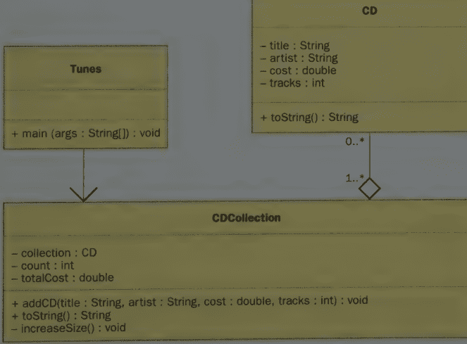

图 7.3 `Tunes` 程序的 UML 类图

`CDCollection` 的 `toString` 方法返回一个总结集合的完整报告。报告的创建部分是对存储在集合中的每个 `CD` 的 `toString` 方法进行隐式调用实现的。

## 7.4 命令行参数

Java 应用 `main` 方法的正式参数始终是一个 `String` 对象的数组。在之前的示例中我们忽略了该参数，但现在我们可以讨论它有时可能有用之处。


# 命令行参数

当应用程序提交给解释器时，Java 运行时环境会调用 `main` 方法。我们通常称为 `args` 的 `String[]` 参数代表在调用解释器时提供的命令行参数。当调用解释器的命令行执行时，提供的额外信息将存储在 `args` 数组中供程序使用。命令行参数是向程序输入的另一种方式。

> 命令行参数存储在 `String` 对象的数组中，并传递给 `main` 方法。

列表 7.10 所示的程序简单地打印提交给解释器时提供的所有命令行参数。注意，命令行上可以使用引号来分隔多单词的参数。

记住，`main` 方法的参数始终是一个 `String` 对象的数组。如果你想将数字信息作为命令行参数输入，程序必须将其从字符串表示进行转换。

在实际时，命令行参数通常预留用于调整程序行为方式的信息。例如，你可能会提供输入文件名作为命令行参数。或者，你可能会使用一个可选的命令行参数，允许用户指定详细（verbose）或简短（brief）的输出格式。

在带有图形用户界面的开发环境中，命令行可能不是向解释器提交程序（即运行程序）的标准方式。在这些情况下，可以通过其他方式指定命令行信息。如有必要，请查阅文档以获取这些细节。

## 列表 7.10

```java
/*********************************************************************
// CommandLine.java         Java Foundations
// 演示了命令行参数的使用。
*********************************************************************

public class CommandLine {
    //---------------------------------------------------------------------
    // 打印用户提供的所有命令行参数。
    //---------------------------------------------------------------------
    public static void main(String[] args) {
        for (String arg : args) {
            System.out.println(arg);
        }
    }
}
```

```
> java CommandLine one two "two and a half" three
one
two
two and a half
three
```

# 7.5 变长参数列表

假设我们想设计一个方法，该方法在每次调用时处理不同数量的数据。例如，让我们设计一个名为 `average` 的方法，它接受几个整数值并返回它们的平均值。在方法的某一次调用中，我们可能会传入三个整数进行平均计算：

`mean1 = average(42, 69, 37);`

在同一方法的另一次调用中，我们可能会传入七个整数：

`mean2 = average(35, 93, 23, 40, 21, 75, 58);`

为了实现这一点，我们可以定义该方法的重载版本（正如我们在第 7 节末尾所的那样）。但这种解决方案无法扩展到可能出现的最大参数数量。

Java 提供了一种定义接受变长列表的方法。通过在正式参数列表中使用某些特殊语法，我们可以定义该方法接受任意数量的整数，这些整数会自动放入一个数组中：

```java
public double average(int ... list)
{
    double result = 0.0;

    if (list.length != 0)
    {
        int sum = 0;
        for (int num : list)
            sum += num;
        result = (double)sum / list.length;
    }

    return result;
}
```

多个参数的类型可以是任何原始类型或对象类型。例如，以下方法接受并打印了在本章之前定义的多个 `Grade` 对象：

```java
public void printGrades(Grade ... grades)
{
    for (Grade letterGrade : grades)
        System.out.println(letterGrade);
}
```

接受变长参数的方法也可以接受其他参数。例如，以下方法接受一个 `int`、一个 `String` 对象，以及任意数量的 `double` 值，这些值将存储在名为 `nums` 的数组中：

```java
public void test (int count, String name, double ... nums) {
    // whatever
}
```

变长参数必须位于正式参数的最后。单个方法不能接受两组变长参数。

构造函数也可以设置为接受任意数量的参数。列表 7.11 所示的程序创建了两个 `Family` 对象，将不同数量的字符串（代表家庭成员名称）传入 `Family` 构造函数。

## 列表 7.11

```java
********************************************************************************
// VariableParameters.java         Java Foundations
// 演示了变长参数列表的使用。
********************************************************************************
public class VariableParameters
{
    //------------------------------------------------------
    // 使用接受变数量 String 对象的构造函数
    // 创建两个 Family 对象。
    //------------------------------------------------------
    public static void main (String[] args)
    {
        Family lewis = new Family("John", "Sharon", "Justin", "Kayla",
            "Nathan", "Samantha");

        Family camden = new Family("Stephen", "Annie", "Matt", "Mary",
            "Simon", "Ruthie", "Sam", "David");

        System.out.println(lewis);
        System.out.println();
        System.out.println(camden);
    }
}
```

输出：

```
John
Sharon
Justin
Kayla
Nathan
Samantha
Stephen
Annie
Matt
Mary
Simon
Lucy
Ruthie
Sam
David
```

`Family` 类如列表 7.12 所示。构造函数简单地存储对数组参数的引用，直到需要它为止。通过为构造函数使用变长列表，我们可以轻松地创建任何规模的家庭。

## 列表 7.12

```java
********************************************************************
// Family.java         Java Foundations
// 展示了变长参数列表的使用。
********************************************************************

public class Family {
    private String[] members;

    //-------------------------------------------------------------
    // 构造函数：通过存储传入参数的（可能的
    // 多个）名称来设置此家庭。
    //-------------------------------------------------------------
    public Family (String ... names) {
        members = names;
    }

    //-------------------------------------------------------------
    // 返回此家庭的字符串表示。
    //-------------------------------------------------------------
    public String toString() {
        String result = "";

        for (String name : members) {
            result += name + "\n";
        }

        return result;
    }
}
```

# 7.6 二维数组

我们目前为止检查的数组在意义上都是一维数组，因为它们表示一个简单的值列表。正如名称所暗示，二维数组在两个维度上有值，这些维度通常被认为是表格的行和列。图 7.4 以图形方式比较了一维数组和二维数组。我们使用两个索引来引用二维数组中的一个值，一个指定行，另一个指定列。

方括号 `[]` 用于表示数组的每个维度。因此，存储整数的二维数组类型为 `int[][]`。从技术上讲，Java 将二维数组表示为数组数组。因此，二维整数数组实际上是一个指向一维整数数组引用的一维数组。在大多数情况下，将二维数组认为一个有行有列的表格更容易。

列表 7.13 所示的 `TwoArray` 程序实例化了一个二维整数数组。和一维数组一样，维度的尺寸在创建数组时指定。各个维度的大小可以是不同的。

## 列表 7.13

```java
********************************************************************
// TwoDArray.java         Java Foundations
// 展示了二维数组的使用。
********************************************************************

public class TwoDArray {
    //------------------------------------------------------
    // 创建整数二维数组，用递增的
    // 填充它，并打印它们。
    //------------------------------------------------------
    public static void main(String[] args) {
        int[][] table = new int[5][10];

        // 加载表格
        for (int row=0; row < table.length; row++) {
            for (int col=0; col < table[row].length; col++) {
                table[row][col] = row * 10 + col;
            }
        }

        // 打印表格
        for (int row=0; row < table.length; row++) {
            for (int col=0; col < table[row].length; col++) {
                System.out.print(table[row][col] + "\t");
            }
            System.out.println();
        }
    }
}
```

| 0 | 1 | 2 | 3 | 4 | 5 | 6 | 7 | 8 | 9 |
|---|---|---|---|---|---|---|---|---|---|
| 10 | 11 | 12 | 13 | 14 | 15 | 16 | 17 | 18 | 19 |
| 20 | 21 | 22 | 23 | 24 | 25 | 26 | 27 | 28 | 29 |
| 30 | 31 | 32 | 33 | 34 | 35 | 36 | 37 | 38 | 39 |
| 40 | 41 | 42 | 43 | 44 | 45 | 46 | 47 | 48 | 49 |

`TwoDArray` 程序使用了嵌套的 `for` 循环来向数组加载值，并以表格格式打印这些值。仔细跟踪该程序的处理过程，查看嵌套循环如何访问二维数组中的每个元素。注意，外层循环由 `table.length` 控制，它代表行数；而内层循环由 `table[row].length` 控制，它代表该行的列数。

和一维数组一样，可以使用初始化列表来实例化二维数组，其中每个元素本身是一个数组列表。这种技术用于列表 7.14 所示的 `SodaSurvey` 程序。

假设一家汽水制造商对四种新口味进行了味味测试，以尝试人们是否喜欢它们。制造商让 10 个人尝试每种新口味，并给出 1 到 5 分的评分，其中 1 分差，5 分优。`SodaSurvey` 程序中名为 `scores` 的二维数组存储了该项调查的结果。每行对应一种汽水，每列对应一个测试人员。通常情况下，每行包含所有测试者对某种特定汽水口味给出的回答，而每列包含一个人对所有汽水的回答。

`SodaSurvey` 程序计算并打印每种汽水和每个受访者的平均响应。每种汽水和每个人的总和首先存储在一维整数数组中。然后计算并打印平均值。

## 多维数组

数组可以有一、二、三、甚至更多维度。任何维度大于一的数组都被称为多维数组。

## 列表 7.14

```java
************************************************
// SodaSurvey.java      Java Foundations
// 展示了二维数组的使用。
************************************************
import java.text.DecimalFormat;
public class SodaSurvey {
    //------------------------------------
    // 计算并打印每行（汽水）和每列
    // 列（受访者）的平均值。
    //-------------------------------------
    public static void main(String[] args) {
        int[][] scores = {
            {3, 4, 5, 2, 1, 4, 3, 2, 1, 4},
            {2, 4, 3, 5, 3, 2, 1, 4, 3, 5},
            {1, 2, 4, 3, 5, 3, 2, 1, 4, 3},
            {4, 3, 1, 2, 4, 3, 5, 3, 2, 1},
            {5, 3, 2, 1, 4, 3, 5, 4, 3, 2}
        };

        final int SODAS = scores.length;
        final int PEOPLE = scores[0].length;

        int[] sodaSum = new int[SODAS];
        int[] personSum = new int[PEOPLE];

        for (int soda=0; soda < SODAS; soda++) {
            for (int person=0; person < PEOPLE; person++) {
                sodaSum[soda] += scores[soda][person];
                personSum[person] += scores[soda][person];
            }
        }

        DecimalFormat fmt = new DecimalFormat("0.#");
        System.out.println("Averages:\n");

        for (int soda=0; soda < SODAS; soda++) {
            System.out.println("Soda #" + (soda+1) + ": " + 
                fmt.format((float)sodaSum[soda]/PEOPLE));
        }

        System.out.println();
        for (int person=0; person < PEOPLE; person++) {
            System.out.println("Person #" + (person+1) + ": " + 
                fmt.format((float)personSum[person]/SODAS));
        }
    }
}
```

输出：

```
Averages:
```


# 第7章 数组

## 核心概念总结

- 大小为 N 的数组索引从 0 到 N–1。
- 在 Java 中，数组是一个必须实例化的对象。
- 边界检查确保了用于引用数组元素的索引在范围内。
- 可以使用初始化列表来实例化数组对象，而不是使用 `new` 算符。
- 整个数组可以作为参数传递，这使得形式参数成为原始数组的别名。
- 实例化一个对象数组只为存储引用预留了空间。存储在每个元素中的对象必须被单独实例化。
- 命令行参数存储在 `String` 对象数组中并传递给 `main` 方法。
- 可以定义一个 Java 方法来接受可变数量的参数。
- 在面向对象的系统中，使用超过两个维度的数组非常稀少。

## 自我复习题

- SR 7.1 什么是数组？
- SR 7.2 如何引用数组的每个元素？
- SR 7.3 数组的元素类型是什么？
- SR 7.4 解释数组边界检查的概念。当用无效值对 Java 数组进行索引时会发生什么？
- SR 7.5 描述创建数组的过程。内存何时为数组分配？
- SR 7.6 什么是差一错误（off-by-one error）？它与数组有何关系？
- SR 7.7 数组初始化列表实现了什么作用？
- SR 7.8 整个数组可以作为参数传递吗？是如何实现的？
- SR 7.9 如何创建对象数组？
- SR 7.10 什么是命令行参数？
- SR 7.11 Java 方法如何能够具有变长度的参数列表？
- SR 7.12 多维数组在 Java 中是如何实现的？

## 练习题

**EX 7.1** 下列哪些是有效的声明？哪些声明实例化了数组对象？请解释你的答案。

```
int primes = {2, 3, 4, 5, 7, 11};
float elapsedTimes[] = {11.47, 12.04, 11.72, 13.88};
int[] scores = {30};
int[] primes = new {2, 3, 5, 7, 11};
int[] scores = new int[30];
char grades[] = {'a', 'b', 'c', 'd', 'f'};
char[] grades = new char[];
```

**EX 7.2** 描述五个很难使用数组实现的程序。

**EX 7.3** 描述以下代码发生了什么问题。应该对其进行哪些修改来消除该问题？

```
int[] numbers = {3, 2, 3, 6, 9, 10, 12, 32, 3, 12};
for (int count = 1; count <= numbers.length; count++)
    System.out.println(numbers[count]);
```

**EX 7.4** 为以下语句编写数组声明和任何辅助类：

- a. 25 个学生的姓名
- b. 40 个学生的测试成绩
- c. 包含交易号、商户名称和金额的信用卡交易
- d. 每个学生的姓名和作业成绩
- e. L&L International 公司的每位员工：工号、入职日期和上次加薪金额

**EX 7.5** 编写代码，将名为 `nums` 的数组的每个元素设置为常量 `INITIAL`。

**EX 7.6** 编写代码，反向打印名为 `names` 的数组存储的值。

**EX 7.7** 编写代码，将名为 `flags` 的布尔数组的每个元素交替赋值（索引 0 为 true，索引 1 为 false 等）。

**EX 7.8** 编写一个名为 `sumArray` 方法，接受浮点数数组并返回数组存储的和。

**EX 7.9** 编写一个名为 `switch` 方法，接受整数数组并交换内容。考虑到数组的大小不同。

## 编程项目

**PP 7.1** 设计并实现一个应用程序，读取任意数量 0 到 50 之间的整数，并统计每个输入的次数。在处理所有输入后，打印出现一次或多次的值（带有出现次数）。

**PP 7.2** 修改项目 7.1 的程序，使其适用于 -25 到 25 之间的数字。

**PP 7.3** 设计并实现一个应用程序，创建一个直方图，允许你视觉上检查一组值的频率。程序应读取任意数量 1 到 100 之间的整数；产生一个类似下表的图表，指示 1 到 10 范围内的值、11 到 20 等等。为每个值打印一个星号。

| 范围 | 图表 |
| :--- | :--- |
| 1 - 10 | ***** |
| 11 - 20 | ** |
| 21 - 30 | ***************** |
| 31 - 40 | |
| 41 - 50 | *** |
| 51 - 60 | **** |
| 61 - 70 | ***** |
| 71 - 80 | ****** |
| 81 - 90 | ******** |
| 91 - 100 | ********* |

**PP 7.4** 如果输入大量值，编程项目 7.3 中的直方图行将太长。修改程序，使每个类别每五个值打印一个星号。忽略剩余部分；如果一个类别有 17 个值，打印三个星号。如果一个类别有 4 个值，则在该行不打印任何星号。

**PP 7.5** 设计并实现算法，计算并打印整数列表 $x_1$ 到 $x_n$ 的平均值和标准差。假设输入值超过 50 个。使用以下公式计算平均值和标准差：

mean = $\frac{\sum_{i=1}^{n} x_i}{n}$

$sd = \sqrt{\frac{\sum_{i=1}^{n} (x_i - mean)^2}{n}}$

**PP 7.6** L&I 银行可以处理最多 30 个拥有储蓄账户的客户。设计并实现一个管理程序。跟踪关键信息并允许每个客户存款。对无效交易产生适当错误消息。提示：你可能希望基于第 5 章的 `Account` 类来创建账户。还要提供一个方法，在每次调用时为所有账户添加 3% 的利息。

**PP 7.7** 第 5 章的编程项目讨论了代表扑克牌的 `Card` 类。创建一个名为 `DeckOfCards` 的类，存储 52 个 `Card` 类对象。包括洗牌、发牌和报告牌中剩余牌数的方法。`shuffle` 方法应假设是一副完整的牌。创建一个带有 `main` 方法的驱动类，从洗过的牌中发出每张牌，并在发牌时打印每个牌。

**PP 7.8** 设计并实现一个应用程序，读取最多 25 对个人姓名和邮政（ZIP）代码。将数据存储在设计用于存储名（字符串）、姓（字符串）和邮政编码（整数）的对象中。假设每行输入包含两个字符串，后跟一个整数，每个之间用制表符分隔。在读取所有输入后，以合适的格式打印列表。

**PP 7.9** 修改你在项目 7.8 中创建的程序，以支持额外的用户信息：街道地址（字符串）、城市（字符串）、州（字符串）和 10 位电话号码（整数）。

**PP 7.10** 定义一个名为 `quiz` 的类，管理最多 25 个问题对象。定义 `quiz` 类的 `add` 方法以向测验添加问题。定义 `givequiz` 方法向用户展示每个问题，接受每个答案并跟踪结果。定义一个名为 `quizTime` 的类，带有 `main` 方法，填充测验、展示它并打印最终结果。

**PP 7.11** 修改你项目 7.10 的答案，使测验中问题的复杂度水平被考虑。重载 `givequiz` 方法，使其接受两个整数参数，指定测试问题的最小和最大复杂度，并仅展示该复杂度范围的问题。修改 `main` 方法演示此功能。

## 自我复习题答案

### SR 7.1
数组是一个存储值列表的对象。整个列表可以通过其名称引用，列表中的每个元素可以根据其在数组中的位置单独引用。

### SR 7.2
数组中的每个元素可以通过其在数组中的数字位置（称为索引）来引用。在 Java 中，所有数组索引从零开始。使用方括号来指定索引。例如，`nums[5]` 指向名为 `nums` 的数组中的第六个元素。

### SR 7.3
数组的元素类型是数组可以包含的值类型。特定数组中的所有值具有相同的类型，或者至少是兼容的类型。因此，我们可能有一个整数数组、布尔值数组、或者 `Dog` 对象的数组等。

### SR 7.4
每当引用特定的数组元素时，索引运算符（包含下标的括号）会确保索引值大于或等于零，且小于数组的大小。如果索引不在有效范围内，将抛出 `ArrayIndexOutOfBoundsException`。

### SR 7.5
数组是对象。因此，与所有对象一样，要创建一个数组，我们首先创建一个该数组的引用（它的名称）。然后我们实例化数组本身，这会预留内存空间来存储数组元素。普通实例化与数组实例化之间的唯一区别在于括号语法。

### SR 7.6
当程序的逻辑超出数组（或类似结构）的边界一个单位时，就会发生“差一错误”（off-by-one error）。这些错误包括忘记处理边界元素，以及尝试处理不存在的元素。数组处理很容易出现差一错误，因为它们的索引从零开始，到数组大小减一。

### SR 7.7
数组初始化列表用于数组的声明，以设置其元素的初始值。初始化器会实例化数组对象，因此**不需要** `new` 算符。

### SR 7.8
整个数组可以作为参数传递。具体来说，因为数组是一个对象，所以传递给方法的是数组的引用。对数组元素所做的任何更改将反映在方法之外。

### SR 7.9
对象数组实际上是对象引用的数组。数组本身必须实例化，而存储在数组中的对象必须单独创建。

### SR 7.10
命令行参数是在调用解释器执行程序时包含在命令行中的数据。命令行参数是向程序提供输入的另一种方式。通过传递给 `main` 方法作为参数的字符串数组来访问它们。

### SR 7.11
Java 方法可以通过在形式参数列表中使用省略号（`...`）来定义一个接受可变数量参数的方法。当将多个值传递给该方法时，它们会自动转换为数组。这允许以数组处理的方式来编写方法，而无需强制调用者创建数组。

### SR 7.12
多维数组在 Java 中被实现为数组对象的数组。作为外部数组元素的数组也可以包含数组作为元素。这种嵌套过程可以根据需要一直持续下去。

# 第8章 继承

## 章节目标

- 探索从现有类派生新类的方法。
- 定义方法重写（method overriding）的概念和目的。
- 讨论类层次结构的设计。
- 检查抽象类的目的和用途。
- 讨论与继承相关的可见性问题。
- 讨论继承背景下的面向对象设计。

本章解释了继承，这是一种组织和创建类的基本技术。这是一个简单但强大的思想，它影响了我们设计面向对象软件的方式，并增强了我们在其他情况和程序中重用类的能力。在本章中，我们探索了创建子类和类层次结构的技术，并讨论了重写继承方法定义的技术。我们检查了 `protected` 修饰符，并讨论了所有可见性修饰符对继承属性和方法的影响。

## 8.1 创建子类

在第 1 章对面向对象概念的介绍中，我们提出了一个类比：类之于对象正如蓝图之于房屋。在随后的章节中，我们强化了这一观点，编写类定义了一组相似的对象。类建立了对象的特征和行为，但没有为变量预留内存空间（除非这些变量被声明为 `static`）。类是计划，而对象是该计划的体现。

从同一张蓝图可以创建许多房屋。它们本质上是位于不同位置、由不同人拥有的相同房屋。现在假设你需要一个与另一个相似但具有不同或额外特征的房子。你想从同一个基础蓝图开始，但对其进行修改以适应新的、略微不同的需求。许多住宅区就是这样创建的。开发区的房屋具有相同的核心布局，但它们拥有独特的特征。例如，所有房子都是具有相同基本房间配置的分层房屋，但有些带有壁炉或全地下室，而另一些没有，或者有升级版的厨房而不是标准版本。

这就像房屋开发商委托了一位首席建筑师创建一张单一蓝图来建立开发区所有房屋的基本设计，然后创建一系列包含变体的蓝图以吸引不同的买家。创建这一系列蓝图的行为被简化，因为它们都从相同的底层结构开始，而变体赋予了它们对潜在所有者可能重要的独特特征。

基于现有蓝图创建新蓝图，类比面向对象概念中的**继承**，继承是从现有类派生出新类的过程。继承是一种强大的软件开发技术，也是面向对象编程的定义性特征。

通过继承，新类自动包含了原始类中的变量和方法。然后，为了根据需要定制该类，程序员可以添加新变量或修改继承的变量。

通常情况下，通过继承创建新类比从头开始写更快、更简单、更廉价。继承是支持软件重用的方式之一。通过使用现有组件，我们利用了原始类在设计、实现和测试方面的投入。

请记住，“类”一词源于对对象进行分类的想法。分类方案通常使用相互相关的类级。例如，所有哺乳动物都有某些特征：它们是温血动物，有毛。现在考虑哺乳动物的一个子集，如马。所有的马都是哺乳动物，并具有哺乳动物的所有特征，但它们也有使其与其他哺乳动物不同的独特特征。

如果我们将其翻译成软件术语，名为 `Mammal` 的现有类具有描述哺乳动物状态和行为的变量和方法。`Horse` 类可以从现有的 `Mammal` 类派生，自动继承 `Mammal` 包含的变量和方法。`Horse` 类引用这些继承的变量和方法，就像它们在该类中声明一样。可以向类添加新的变量和方法以将其与其他区分。

用于派生新类的原始类被称为**父类**、**超类**或**基类**。派生类被称为**子类**或**衍生类**。在 UML 中，继承用一个从子类指向父类的空心箭头表示。

继承过程应该在两个类之间建立一种“是一个……的”（is-a）的关系。也就是说，子类应该是父类的更具体的版本。例如，马是哺乳动物。不是所有的哺乳动物都是马，但所有的马都是哺乳动物。对于任何派生自类 Y 的类 X，你都应该说“X 是一个 Y”。如果这样的陈述不合理，那么这种关系可能不是继承的用法。

> 继承在父类和子类之间建立了“是一个……的”的关系。

让我们来看一个例子。列表 8.1 所示的 Words 程序实例化了一个对象类 `Dictionary`，它派生自名为 `Book` 的类。在 `main` 方法中，通过 `Dictionary` 对象调用三个方法：两个是在 `Dictionary` 类中声明的，另一个是从 `Book` 类继承的。

### 列表 8.1

```
****************************************************************
// Words.java         Java Foundations
// Demonstrates the use of an inherited method.
****************************************************************

public class Words {
    //-----------------------------------------------------------------------
    // 实例化派生类并调用其继承的
    // 本地方法。
    //-----------------------------------------------------------------------
    public static void main(String[] args) {
        Dictionary webster = new Dictionary();

        System.out.println("Number of pages: " + webster.getPages());

        System.out.println("Number of definitions: " +
            webster.getDefinitions());

        System.out.println("Definitions per page: " +
            webster.computeRatio());
    }
}
```

**输出：**

```
Number of pages: 1500
Number of definitions: 52500
Definitions per page: 35.0
```


Java 使用关键字 `extends` 来表示新类派生自现有类。通过在 `Dictionary` 类的头部中使用 `extends` 子句，`Book` 类（如列表 8.2 所示）用于派生 `Dictionary` 类（如列表 8.3 所示）。`Dictionary` 类自动继承了对 `setPages` 和 `getPages` 方法的定义，以及 `pages` 变量。这就像这些方法和 `pages` 变量是在 `Dictionary` 类内部声明一样。注意，在 `Dictionary` 类中，`computeRatio` 显式引用了 `pages` 变量，尽管该变量是在 `Book` 类中定义的。

## 8.1 创建子类

### 列表 8.2

```java
// Book.java      Java Foundations
// 表示一本书。作为派生类的父类，用于
//   演示继承。
public class Book
{
    protected int pages = 1500;

    // 页数修改器。
    public void setPages(int numPages)
    {
        pages = numPages;
    }

    // 页数访问器。
    public int getPages()
    {
        return pages;
    }
}
```

同时注意，尽管创建 `Dictionary` 的定义需要 `Book` 类，但程序中从未实例化 `Book` 对象。子类的实例并不依赖于父类的实例。

继承是单行道。`Book` 类无法使用在 `Dictionary` 类中显式声明的变量或方法。例如，如果我们从 `Book` 类创建一个对象，它将无法被用于调用 `setDefinitions` 方法。这种限制是有意义的，因为子类是父类的更具体的版本。字典有页码是因为所有书都有页码；但虽然字典有定义，并不是所有的书都有定义。

图 8.2 显示了 `Book` 类和 `Dictionary` 类之间的继承关系。

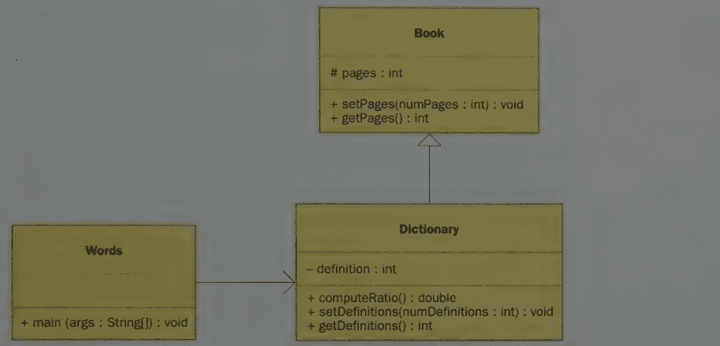

图 8.2 Words 程序的 UML 类图

### protected 修饰符

### 列表 8.3

```java
// Dictionary.java         Java Foundations
// 表示一个字典，它是一本书。用于演示
// 继承。
public class Dictionary extends Book
{
    private int definitions = 52500;

    // 使用本地值和继承值打印消息。
    public double computeRatio ()
    {
        return definitions/pages;
    }

    // 定义修改器。
    public void setDefinitions (int numDefinitions)
    {
        definitions = numDefinitions;
    }

    // 定义访问器。
    public int getDefinitions ()
    {
        return definitions;
    }
}
```

正如我们所看到的，可见性修饰符用于控制类成员的访问。可见性在继承过程中也起着重要作用。父类中的任何公共方法或变量都可以在子类中通过名称显式引用，并通过该子类的对象进行引用。反之，父类的私有方法和变量无法在子类中或通过子类对象进行引用。

这种情况导致了一个困境。如果我们声明一个具有公共可见性的变量以便派生类引用它，我们就违反了封装原则。因此，Java 提供了第三种可见性修饰符：`protected`。注意，在 `Words` 示例中，变量 `pages` 在 `Book` 中被声明为 `protected` 可见性。当一个变量或方法被声明为 `protected` 可见性时，派生类可以引用它。`protected` 可见性允许类保留某些封装属性。`protected` 可见性的封装不如变量或方法为私有的那么密，但比声明为公共要好。具体而言，声明为 `protected` 可见性的变量或方法可以被相同包中的任何类访问。所有 Java 修饰符之间的关系在附录 E 中有详细解释。

> Protected 可见性提供了允许继承范围内最好的封装。

在 UML 图中，protected 可见性可以通过在受保护成员前加哈号 (#) 来表示。`Book` 类的 `pages` 变量在图 8.2 中就有此标记。

每个变量或方法都保留其原始修饰符的效果。例如，`setPages` 方法在它的继承类中仍然被认为是公共的。

让我们明确一下术语。所有方法和变量，即使是声明为私有可见性的，也会被子类继承。也就是说，它们的定义存在，并且为变量留留了内存空间，只是不能通过名称进行引用。这个问题在 8.4 节中详细探讨。

构造函数是不继承的。构造函数是用于设置特定类型的特殊方法，因此 `Dictionary` 类有一个名为 `Book` 的构造函数是不合理的。但你可以想象子类可能想要引用父类的构造函数，这就是使用接下来介绍的 `super` 引用的原因之一。

### super 引用

关键字 `super` 可以在类中引用其父类。与这种引用一样，`super` 引用定义了它在它被使用的类中指的是什么。


### 列表 8.4

```java
// Words2.java       Java Foundations
// Demonstrates the use of the super reference.
public class Words2 {
    // Instantiates a derived class and invokes its inherited and
    // local methods.
    public static void main(String[] args) {
        Dictionary2 webster = new Dictionary2(1500, 52500);
        System.out.println("Number of pages: " + webster.getPages());
        System.out.println("Number of definitions: " +
            webster.getDefinitions());
        System.out.println("Definitions per page: " +
            webster.computeRatio());
    }
}
```

```
Output
Number of pages: 1500
Number of definitions: 52500
Definitions per page: 35.0
```

在这个示例中，在 `Dictionary2` 构造函数中显式地设置 `pages` 变量，与使用 `super` 调用 `Book2` 构造函数是一样简单的。然而，让每个类“自己负责自己”是一种良好的实践。如果我们选择改变 `Book2` 构造函数设置其 `pages` 变量的方式，我们也必须记得在 `Dictionary2` 中进行相应的更改。通过使用 `super` 引用，在 `Book2` 中进行的更改会自动反映在 `Dictionary2` 中。

### 列表 8.5

```java
// Book2.java       Java Foundations
// Represents a book. Used as the parent of a derived class to
// demonstrate inheritance and the use of the super reference.
public class Book2 {
    protected int pages;

    // Constructor: Sets up the book with the specified number of
    // pages.
    public Book2 (int numPages) {
        pages = numPages;
    }

    // Pages mutator.
    public void setPages (int numPages) {
        pages = numPages;
    }

    // Pages accessor.
    public int getPages () {
        return pages;
    }
}
```

子类的构造函数负责调用其父类的构造函数。通常，构造函数的第一行应该使用 `super` 引用来调用父类的构造函数。如果不存在此类调用，Java 将在构造函数的开头自动调用不带参数的 `super`。这条规则确保了父类在子类开始执行之前初始化了它的变量。使用 `super` 引用调用父类构造函数只能在子类的构造函数中进行，并且如果包含它，它必须是构造函数的的第一行。

`super` 引用也可以用于引用父类中的其他变量和方法。我们将在本章的后续章节中使用这种技术。

### 列表 8.6

```java
// Dictionary2.java         Java Foundations
// Represents a dictionary, which is a book. Used to demonstrate
// the use of the super reference.
public class Dictionary2 extends Book2 {
    private int definitions;

    // Constructor: Sets up the dictionary with the specified
    // of pages and definitions.
    public Dictionary2(int numPages, int numDefinitions) {
        super(numPages);

        definitions = numDefinitions;
    }

    // Prints a message using both local and inherited values.
    public double computeRatio () {
        return definitions/pages;
    }

    // Definitions mutator.
    public void setDefinitions(int numDefinitions) {
        definitions = numDefinitions;
    }

    // Definitions accessor.
    public int getDefinitions() {
        return definitions;
    }
}
```

### 多重继承

Java 的继承方法被称为单继承。这意味着派生类只能有一个父类。面向对象的语言允许子类拥有多个父类。这种方法被称为多重继承，有时用于描述共享多个类特征的对象。例如，假设我们有一个 `car` 类和一个 `truck` 类，并且想创建一个名为 `PickupTruck` 的新类。皮卡车既像汽车又像卡车。在单继承中，我们必须决定是从 `Car` 还是 `Truck` 派生。在多重继承中，它可以从两者派生，如图 8.3 所示。

多重继承在某些情况下运行良好，但它是有代价的。如果 `Truck` 和 `Car` 都有相同的方法怎么办？`PickupTruck` 会继承哪一个？这个问题的答案是复杂的，取决于支持多重继承的语言的规则。

## 8.2 方法重写


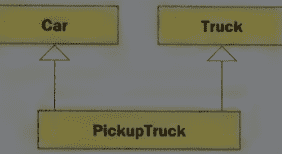

图 继承

Java 语言的设计者明确决定不支持多重继承。第 9 章介绍的 Java 接口提供了多重继承的最佳特性，而没有增加复杂性。

当子类定义了一个与父类相同名称和签名的方法时，我们说子类的版本**重写**了父类的版本，优先使用自己的版本。重写通常发生在继承中。

> 子类可以重写（重新定义）继承方法的定义。

列表 8.7 中的程序提供了 Java 中方法重写的简单演示。`Messages` 类包含一个 `main` 方法，实例化两个对象：一个来自 `Thought`，一个来自 `Advice`。`Thought` 类是 `Advice` 类的父类。

列表 8.8 中的 `Thought` 类和列表 8.9 中的 `Advice` 类都包含一个名为 `message` 方法的定义。`Thought` 类中定义的 `message` 版本被 `Advice` 继承，但 `Advice` 使用替代版本进行了重写。新版本的方法打印完全不同的消息，然后使用 `super` 引用调用父类的方法。

调用方法的对象决定了实际执行哪个版本的方法。在 `main` 方法中使用 `parked` 对象调用 `message` 时，执行的是 `Thought` 版本的。在使用 `dates` 对象调用 `message` 时，执行的是 `Advice` 的版本。

方法可以使用 `final` 修饰符定义。子类不能重写 `final` 方法。这种技术用于确保派生类使用特定的方法定义。

# 列表 8.7

```java
// Messages.java        Java Foundations
// 展示了重写方法的用法。
public class Messages {
    //-------------------------------------------------------
    // 创建两个对象并调用每个对象的 message 方法。
    //-------------------------------------------------------
    public static void main(String[] args) {
        Thought parked = new Thought();
        Advice dates = new Advice();

        parked.message();

        dates.message(); // 重写了
    }
}
```

# 输出

我觉得我好像是斜着停在一个平行宇宙中。

警告：日历上的日期比看起来的要近。

我觉得我好像是斜着停在一个平行宇宙中。

当涉及到多态时，这变得更加重要，多态将在第 9 章中讨论。

# 变量隐藏

子类声明一个与从父类继承的变量同名的变量是可能的，但不建议这样做。请注意重新声明变量与仅仅为继承的变量赋予特定值之间的区别。如果在子类中声明了同名的变量，它被称为隐藏变量。它在概念上与覆盖方法的过程相似，但创建混乱的变量已经对子类可用，通常没有好的理由重新声明它。阅读带有隐藏变量代码的人会发现两个不同的声明，它们似乎都适用于子类中的一个变量。这种困惑会导致问题，并且没有任何实际用处。

- 重新声明特定的变量名可能会改变它的类型，但通常没有必要。总的来说，应该避免隐藏变量。

# 8.3 类层次结构

派自一个父类的子类可以是其自己的子类的父类。此外，多个类可以派自同一个父类。因此，继承关系往往会发展成类层次结构。图 8.4 显示了一个类层次结构，包含了之前讨论过的哺乳动物（`Mammal`）和马（`Horse`）类之间的继承关系。

# 列表 8.8

```java
// Thought.java         Java Foundations
// 表示一个散乱的念。作为派生类的父类，用于展示
// 重写方法的用法。
public class Thought {
    // -----------------------------------------------------------------------
    // 打印消息。
    // -----------------------------------------------------------------------
    public void message() {
        System.out.println("I feel like I'm diagonally parked in a " + 
        "parallel universe.");

        System.out.println();
    }
}
```

# 列表 8.9

```java
// Advice.java         Java Foundations
// 表示一些深思的建议。用于展示
// 重写方法的用法。
public class Advice extends Thought {
    //----------------------------------------------------------------------
    // 打印消息。此方法覆盖了父类版本。
    //----------------------------------------------------------------------
    public void message() {
        System.out.println("Warning: Dates in calendar are closer " + 
                          "than they appear.");

        System.out.println();

        super.message(); // 显式调用父类版本
    }
}
```

一个类拥有的子类数量没有限制，类层次结构延伸的层数也没有限制。同一个父类的两个孩子被称为兄弟。尽管兄弟共享由其父类传递的特征

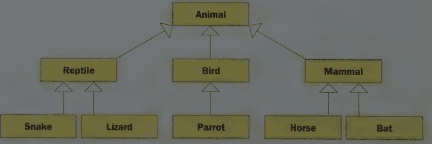

图 8.4 类层次结构

## 8.3 类层次结构

共同父类，但它们之间没有继承关系，因为其中一个不是用来派生另一个的。

在类层次结构中，共同特征应该尽可能保留在层次结构中的高处。这样，在子类中显式建立的唯一特征就是那些使该类与其父类及其兄弟区分开来的特征。这种方法最大化了重用类的潜力。当对父类进行更改时，这也便于维护工作，更改会自动反映在后代中。在构建类层次结构时，始终记住维护“is-a”关系。

> 一个类的孩子可以是一个或多个类的父类，从而创建一个类层次结构。

继承机制是传递的。也就是说，父类将特征传递给子类，该子类又将其传递给它的孩子，以此类推。一个继承的特征可能源于直接父类，也可能源于几层之外更远的祖先类。

对于所有情况，没有单一的最佳层次结构组织方式。你在设计类层次结构时所做的决策限制并引导了更详细的设计决策和实现，因此你必须谨慎做出决策。

> 共同特征应该尽可能地位于类层次结构中的高处。

图 8.4 显示的类层次结构根据主要的生物分类对动物进行组织，例如哺乳动物、鸟类和爬行动物。然而，在不同的情况下，以不同的方式组织相同的动物可能更好。例如，如图 8.5 所示，类层次结构可以围绕动物的功能进行组织，例如它们的飞行能力。在这种情况下，鹦鹉类（`Parrot`）和蝙蝠类（`Bat`）将是派自一个通用飞行动物类（`FlyingAnimal`）的兄弟。这种层次结构与原始层次结构一样有效且合理。使用这些类的程序目标是决定因素，它引导程序员设计出如下的层次结构


图 8.5 动物的另一种层次结构

# Object 类

在 Java 中，所有类都派自 `Object`。如果一个类没有使用 `extends` 子句，它自动派自 `Object`。

```java
class Thing {
    // whatever
}
```

等同于：

```java
class Thing extends Object {
    // whatever
}
```

由于所有类都派自 `Object`，所有的公共方法都是继承的。图 8.6 列出了 `Object` 的一些方法


| 方法 | 说明 |
| :--- | :--- |
| `boolean equals(Object obj)` | 如果此对象是指定对象的别名，则返回 true。 |
| `String toString()` | 返回对象的字符串表示。 |
| `Object clone()` | 创建并返回此对象的拷贝。 |

图 8.6 Object 类的一些方法

当我们在类中定义 `toString` 方法时，我们实际上是在重写继承的定义。`Object` 类提供的 `toString` 定义返回一个包含对象名称以及一个该对象唯一的数值字符串。通常，我们会重写 `toString` 以适应自己的需求。`String` 类重写了 `toString` 以返回其字符串值。

当我们为类定义 `equals` 方法时，我们是在重写一个继承的方法。正如我们在第 4 章中所过的，`equals` 方法的目的是确定两个对象是否相等。`Object` 类提供的 `equals` 定义如果两个对象引用同一个对象（即它们是别名），则返回 true。类通常会重写继承的 `equals` 定义以采用更合适的定义。例如，`String` 类重写了 `equals`，仅当两个字符串包含相同的字符时才返回 true。

# 抽象类

抽象类代表类层次结构中的一个通用概念。正如其名称所示，抽象类表示的是一个通常无法通过自身定义的实体。相反，抽象类可能包含一个部分描述，该描述被其所有后代继承。抽象类与任何其他类都一样，只是它可能有一些尚未定义的方法。它的更具体的类会填充这些空白。

抽象类不能被实例化，通常包含一个或多个没有定义的抽象方法。也就是说，抽象方法没有代码体，因此它不能被调用。抽象类也可能包含不是抽象的方法，这意味着方法定义按常提供。抽象类可以按常包含数据声明。

通过在类头中包含 `abstract` 修饰符可以将类声明为抽象。任何包含一个或多个抽象方法的类都必须声明为抽象。在抽象类中，`abstract` 修饰符必须应用于每个抽象方法。然而，声明为抽象的类并不一定包含抽象方法。

考虑图 8.7 所示的类层次结构。层次结构顶部的 `Vehicle` 类对于特定的应用程序可能太通用了。因此，我们

> 抽象类不能被实例化。它代表了一个其他类可以在其基础上构建定义的概念。

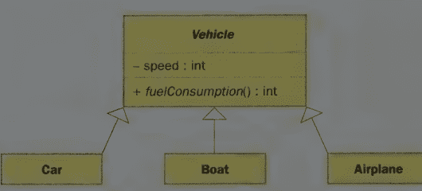

图 8.7 车辆类层次结构

可能会选择将其实现为抽象类。在 UML 图中，抽象类和抽象方法的名字以*斜体*显示。

适用于所有车辆的概念可以在 `Vehicle` 类中表示，并由其后代类继承。这样，每个后代类就不需要冗余地（并且可能是不一致地）定义相同的概念。例如，在图 8.7 中，我们在 `Vehicle` 类中声明了一个名为 `speed` 的变量，层级结构中位于其下方的所有特定车辆都由于继承而自动拥有该变量。我们对车辆速度表示所做的任何更改都会自动反映在所有后代类中。同样，在 `Vehicle` 中，我们声明了一个名为 `fuelConsumption` 的抽象方法，其目的是计算特定车辆消耗燃料的速度。`Vehicle` 类规定了所有车辆都消耗燃料，并为计算该值提供了一个一致性的方法接口。`fuelConsumption` 方法的实现留给 `Vehicle` 的每个子类，每个子类可以据此定制其方法。

某些概念并不适用于所有车辆，因此我们不会在 `Vehicle` 类中表示名为 `numberOfWheels` 的变量，因为并不是所有车辆都有轮子。适合轮子的子类可以在层次结构中的适当层级添加该概念。

抽象类在类层次结构中的定义位置没有限制。通常，它们位于类层次结构的高层。然而，也可以从非抽象父类派生抽象类。

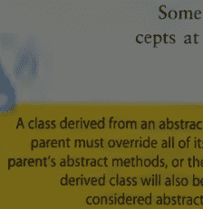

## 8.4 可见性

通常，抽象类的子类将为其从继承的抽象方法提供特定的定义。注意，这只是方法重写的一种特殊情况，提供了与父类提供的不同的定义。如果抽象类的子类没有为其从父类继承的每个抽象方法提供定义，则该子类也被认为是抽象类。

将抽象方法修改为 `final` 或 `static` 是自矛盾的。因为 `final` 方法不能在子类中被重写。

选择哪些类和方法应为抽象的是设计过程中的重要部分。你应该只在仔细考虑后做出此类选择。通过明智地使用抽象类，你可以创建灵活、可扩展的软件设计。

在本章前面提到的，父类中的所有变量和方法（即使声明为 `private` 的）都会被子类继承。私有成员存在于派生类的对象中，尽管它们不能被直接引用。但是它们可以被间接引用。

让我们看看列表 8.10 中的示例，它包含一个 `main` 方法，该方法实例化了一个 `Pizza` 对象并调用一个方法来根据脂肪含量确定每份披萨有多少卡路里。

> 私有成员被子类继承，但不能通过名称直接使用。然而，它们可以间接地使用。

列表 8.11 中的 `FoodItem` 类表示一种通用食物类型。`FoodItem` 的构造函数接受脂肪的克数和该食物的份数。`calories` 方法返回由于脂肪产生的卡路里数，`caloriesPerServing` 方法被调用以帮助计算每份脂肪卡路里数。

列表 8.12 所示的 `Pizza` 类派生自 `FoodItem` 类，但它没有添加任何特殊功能或数据。它的构造函数使用 `super` 引用调用 `FoodItem` 的构造函数，断言每个披萨有八份。

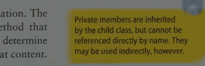

## 列表 8.10

```java
// *****************************************************************************
// FoodAnalyzer.java      Java Foundations
// 对继承私有成员的间接访问。
// *****************************************************************************
public class FoodAnalyzer {
    //----------------------------------------------------
    // 实例化一个 Pizza 对象并打印其每份
    // 卡路里。
    //----------------------------------------------------
    public static void main(String[] args) {
        Pizza special = new Pizza(275);
        System.out.println("Calories per serving: " + special.caloriesPerServing());
    }
}
```

## 输出

Calories per serving: 309

`main` 方法中称为 `special` 的 `Pizza` 对象被用于调用 `caloriesPerServing` 方法，该方法被定义为 `FoodItem` 的一个公共方法。注意，`caloriesPerServing` 调用了 `calories`，后者被声明为 `private` 可见性。此外，`calories` 引用了变量 `fatGrams` 和常量 `CALORIES_PER_GRAM`，它们也被声明为 `private` 可见性。

尽管 `Pizza` 类不能显式地引用 `calories`、`fatGrams` 或 `CALORIES_PER_GRAM`，但当 `Pizza` 对象需要时，它们可以被间接使用。`Pizza` 对象不能被用于调用 `calories` 方法，但它可以调用可以执行该方法的方法。注意从未创建或需要过 `FoodItem` 对象。

## 列表 8.11

```java
// *****************************************************************
// FoodItem.java      Java Foundations
// 表示食物项目。作为派生类的父类使用
// 以演示间接引用。
// *****************************************************************
public class FoodItem {
    final int CALORIES_PER_GRAM = 9;
    private int fatGrams;
```


## 列表 8.11

```java
protected int servings;

// 使用指定的脂肪克数和份数设置此食物项目。
public FoodItem(int fatGrams, int numServings) {
    fatGrams = fatGrams;
    servings = numServings;
}

// 计算并返回此食物项目由于脂肪产生的卡路里。
private int calories() {
    return fatGrams * CALORIES_PER_GRAM;
}

// 计算并返回每份脂肪卡路里数。
public int caloriesPerServing() {
    return (calories() / servings);
}
```

## 列表 8.12

```java
/************************************************
// Pizza.java      Java Foundations
// 表示披萨，一种食物项目。用于演示
// 通过继承进行的间接引用。
/*********************************/
public class Pizza extends FoodItem {
    // 使用指定的脂肪量设置披萨（假设八份）。
    public Pizza(int fatGrams) {
        super(fatGrams, 8);
    }
}
```

## 8.5 为继承而设计

作为面向对象软件的一个主要特征，必须在软件设计期间对继承进行仔细特定的处理。对继承关系的稍微思考可以带来远优的设计，从长期来看具有高回报。

在本章中，讨论 Java 继承的基础时，已经处理了几个设计问题。以下列表总结了你在程序设计阶段应该记住的一些继承问题：

- 每一个派生都应该是“是一个”（is-a）关系。子类应该是父类的更具体的版本。
- 设计类层次结构以利用重用，以及未来可能的重用。
- 当在问题领域识别出类和对象时，找到它们的共同点。将共同特征推到类层次结构中适当的高层，以保持一致性和易于维护。
- 适时地重写方法，以定制或更改子类的功能。
- 根据需要为子类添加新变量，但不要遮蔽（重新定义）任何已继承的变量。
- 允许每个类管理它们自己的数据。因此，使用 `super` 引用来调用父类的构造函数，并在适当的情况下调用重写后的方法。
- 设计符合应用程序需求的类层次结构，并注意它在未来可能有用处。
- 即使目前没有使用，也要在子类中适当地重写 `toString` 和 `equals` 等通用方法，以防继承的版本在以后引起无意的问题。
- 使用抽象类为层次结构中底部的具体类指定公共类接口。
- 谨慎使用可见性修饰符，在派生类中提供所需的访问权限，而不违反封装性。

## 限制继承

我们已经多次看到在声明中使用 `final` 修饰符来创建常量。`final` 修饰符的其它用法涉及继承，并对软件设计产生重大影响。具体而言，`final` 修饰符可以用来限制与继承的能力。

在本章较早部分，我们提到方法可以被声明为 `final`，这意味着它不能在扩展该方法的任何类中被重写。`final` 方法通常用于强制要求在所有子类中使用特定的功能。

`final` 修饰符也可以应用于整个类。`final` 类完全不能被扩展。考虑以下声明：

```java
public final class Standards {
    // whatever
}
```

鉴于此声明，`Standards` 类不能在另一个类的 `extends` 子句中使用。在这种情况下，编译器将生成错误信息。`Standards` 类可以正常使用，但它不能作为另一个类的父类。

使用 `final` 修饰符来限制继承能力是一项关键的决策。在以下情况下应该这样做：子类可能被用于更改某种功能，而你作为设计者特别希望以特定方式处理该功能。这个问题在第 9 章关于多态的讨论中再次出现。

### 核心概念总结

- 继承是从现有类派生新类的过程。
- 继承的目的之一是重用现有软件。
- 继承在父类和子类之间建立了“是”（is-a）的关系。
- `protected` 可见性提供了允许继承的最优封装。
- 可以 `super` 引用调用父类的构造函数。
- 子类可以重写（重新定义）父类对已继承方法的定义。
- 一个类的子类可以是一个或多个类的父类，从而创建类层次结构。
- 通用特征应该尽可能位于类层次结构中的高位置。
- 所有的 Java 类都直接或间接地直接派生自 `Object` 类。
- 每个 Java 程序中的每个类都继承了 `toString` 和 `equals` 方法。
- 抽象类不能实例化。它代表了一个概念，其他类可以在此基础上构建自己的定义。
- 派生自抽象父类的类必须重写其父类所有的抽象方法，否则该派生类也将被视为抽象类。
- 私有成员会被子类继承，但不能通过名称直接引用。然而，它们可以被间接地使用。
- 软件设计必须细致且具体地处理继承。
- `final` 修饰符可以用来限制继承。

### 自测习题

- SR 8.1 描述父类与子类之间的关系。
- SR 8.2 继承如何支持软件重用？
- SR 8.3 每一个类派生应该代表什么样的关系？
- SR 8.4 `protected` 修饰符实现了什么功能？
- SR 8.5 为什么 `super` 引用对子类很重要？
- SR 8.6 单继承和多重继承之间有什么区别？
- SR 8.7 为什么子类会重写其父类的一个或多个方法？
- SR 8.8 `Object` 类的意义是什么？
- SR 8.9 抽象类的作用是什么？
- SR 8.10 父类的所有成员都会被子类继承吗？解释原因。
- SR 8.11 如何使用 `final` 修饰符来限制继承？

### 练习题

- EX 8.1 绘制一个 UML 类图，显示一个包含不同类型时钟继承层次结构。显示其中两个类的变量和方法名。
- EX 8.2 为练习 8.1 中的层次结构绘制另一种层次图。解释为什么它可能比原始方法更好或更差。
- EX 8.3 绘制一个 UML 类图，显示一个按制造商组织的不同类型汽车的继承层次结构。显示至少两个类的某些适当变量和方法名。
- EX 8.4 为练习 8.3 中的层次结构绘制另一种层次图，其中汽车按类型（运动跑车、轿车、SUV 等）组织。显示至少两个类的某些适当变量和方法名。对比这两种方法。
- EX 8.5 绘制一个 UML 类图，显示一个包含不同类型飞机的继承层次结构。显示至少两个类的适当变量和方法名。
- EX 8.6 绘制一个 UML 类图，显示一个包含不同类型树（橡树、榆树）的继承层次结构。显示这两个两个类的适当变量和方法名。
- EX 8.7 绘制一个 UML 类图，显示一个包含不同支付方式（现金、信用卡）的继承层次结构。
- EX 8.8 绘制一个 UML 类图，显示包含不同类型交易的继承层次结构。

### 编程项目

- PP 8.1 设计并实现一个名为 `MonetaryCoin` 的类，派生自第 5 章的类。创建一个驱动类进行练习。
- PP 8.2 设计并实现一组医院员工：医生、护士、接待员、清洁工。创建一个驱动类进行练习。
- PP 8.3 设计并实现一组定义各种阅读材料的类：书籍、杂志、技术期刊、教科书。创建一个驱动类进行练习。
- PP 8.4 设计并实现一组跟踪运动统计。每个底层类代表一种特定的运动。将通用属性移动到高层类中。创建一个驱动类进行练习。
- PP 8.5 设计并实现一组跟踪人类人口统计信息的类，如年龄、国籍、职业和收入。创建一个驱动类进行练习。
- PP 8.6 设计并实现一组定义三维几何形状的类。对于每个形状，存储关于尺寸的基本数据，并提供访问和修改这些数据的方法。提供计算每个形状周长、面积和体积的方法。创建一个驱动类进行练习。
- PP 8.7 设计并实现一组定义各种类型电子设备的类（电脑、手机、传真机、数码相机等）。包含描述电子设备各种属性的数据值，如重量、成本、功耗和制造商名称。创建一个驱动类进行练习。
- PP 8.8 设计并实现一组定义你课程中各种课程的类。包含关于每门课程的信息，如标题、编号、描述和教授该课程的部门。创建一个驱动类进行练习。

# 自我复习题答案

### SR 8.1
子类通过继承从父类派生。父类的方法和变量自动成为子类的一部分，但受限于声明它们时所使用的可见性修饰符规则。

### SR 8.2
由于可以从现有类派生新类，因此可以重用父类的特性，而无需经历易出错的代码复制和修改过程。

### SR 8.3
每次继承派生都代表一种“是”的关系（is-relationship）：子类是父类的更具体的版本。如果这种继承关系不成立，则说明继承的使用不当。

### SR 8.4
`protected` 修饰符建立了一个考虑继承的可见性级别（如 public 和 private）。用 `protected` 可见性声明的变量或方法可以在派生类中通过名称引用，同时保留某种程度的封装。`protected` 可见性允许同一包中的任何类访问。

### SR 8.5
`super` 引用可以用于调用父类的构造函数，构造函数无法通过名称直接调用。它还可以用于调用父类被重写的方法的版本。

### SR 8.6
在单继承中，一个类派生自一个父类；而在多重继承中，一个类可以派生自多个父类，继承每个类的属性。多重继承的问题在于，当两个或多个父类贡献具有相同名的属性或方法时，必须解决冲突。Java 只支持单继承。

### SR 8.7
子类可能倾向于使用自己的方法定义，而不是父类为其提供的定义。在这种情况下，子类用自己的定义重写（重新定义）父类的定义。

### SR 8.8
Java 中的所有类都直接或间接地派生自 `Object` 类。因此，`Object` 类的所有公共方法（如 `equals` 和 `toString`）对每个对象都可用。

### SR 8.9
抽象类是通用概念的表示。可以在抽象类中定义共同特征和方法签名，以便派生自它的子类能够继承这些内容。

### SR 8.10
如果类成员具有 `private` 可见性，则不会被继承，这意味着它在子类中无法通过名称引用。然而，此类成员对于子类确实存在，并且可以被间接引用。

### SR 8.11
`final` 修饰符可以应用于特定方法，防止该方法在子类中被重写。它也可以应用于整个类，防止该类被任何扩展。

# 章节目标

- 定义多态并探索其益处。
- 讨论动态绑定的概念。
- 使用继承创建多态引用。
- 探索 Java 接口的用途和语法。
- 使用接口创建多态引用。
- 在多态的背景下讨论面向对象的设计。

# 多态

本章讨论了多态，这是面向对象软件的另一个基本原理。我们首先探索了绑定的概念，并讨论了它如何与多态相关。然后我们查看了 Java 中实现多态引用的两种不同方式：继承和接口。对 Java 接口进行了通用的探讨，建立了它们与抽象类之间的相似之处，并使多态讨论回归完整。本章以讨论与多态相关的设计问题作为结束。

## 9.1 晚绑定

通常，引用变量的类型与其所引对象的类完全匹配。例如，考虑以下引用：

```java
ChessPiece bishop;
```

`bishop` 变量可以用于指向通过实例化 `ChessPiece` 类而创建的对象。然而，它并非必须如此。变量类型与其引用的对象必须兼容，但它们的类型不需要完全相同。引用变量与其引用的对象之间的关系比此更为灵活。

“多态”一词可以定义为“多种形式”。多态引用是指在任何时候都可以指向不同类型的变量。如果该引用是方法调用，它可以指向不同的类型。考虑以下行代码：

```java
obj.doIt();
```

多态引用在执行时才确定方法版本。如果该引用是多态的，它可以指向不同的类型。在很多情况下，绑定是在编译时完成的。对于多态引用，这种决定在运行时进行。方法定义的绑定由引用的对象类型决定。这被称为晚绑定或动态绑定。这种绑定比编译时绑定效率低，但考虑到多态引用提供的灵活性。我们可以在 Java 中通过两种方式创建多态引用：使用继承和接口。让我们逐一查看这些。

## 9.2 通过继承实现多态

使用类名声明引用变量时，它可以指向该类的任何对象。此外，它还可以指向与其声明类型相关的任何类。例如，如果 `Mammal` 类是 `Horse` 类的父类，那么 `Mammal` 引用就可以指向 `Horse` 类的对象。这种能力在下面的代码段中：

```java
Mammal pet;
Horse secretariat = new Horse();
pet = secretariat; // 有效赋值
```

将一个类的对象赋值给另一个类的引用似乎偏离了第二章讨论的强类型概念，但事实并非如此。强类型断变量只能赋值与其类型一致的值。嗯，这里正是如此。记住，继承建立了“是”的关系。马是哺乳动物。因此，将 `Horse` 对象赋值给 `Mammal` 引用是完全合理的。

相反操作，将 `Mammal` 对象赋值给 `Horse` 引用也可以完成，但它需要显式强制转换。在这种方向上赋值通常更容易引起问题，因为虽然马拥有哺乳动物的所有功能，但反之未必然。

这种关系在整个类层次结构中都有效。如果 `Mammal` 类派生自 `Animal` 类，那么下面的赋值也是有效的：

```java
Animal creature = new Horse();
```

将这一想法推向极限，`Object` 引用可以指向任何对象，因为最终所有对象都是 `Object` 类的后代。引用变量 `creature` 可以多态地使用，因为在任何时刻它都可以指向 `Animal` 对象、`Mammal` 对象或 `Horse` 对象。假设所有这些类都有一个相同的方法并以不同的方式实现（因为子类重写了继承的定义）。下面的调用调用了方法，但具体版本在运行时确定：

```java
creature.move();
```


# 第 9 章 多态

当执行这一行代码时，如果 `creature` 目前指向 `Animal` 对象，则调用 `Animal` 类的 `move()` 方法。同样，如果 `creature` 目前指向一个 `Mammal`（哺乳动物）对象时，会调用 `Mammal` 版本的 `move()` 方法。同样，如果它目前指向一个 `Horse`（马）对象，则调用 `Horse` 版本的 `move()` 方法。

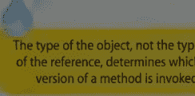

当然，`Animal`（动物）和 `Mammal` 代表的是通用概念，它们可以被定义为抽象类。这种情况并不会消除具有多态性引用的能力。假设 `Mammal` 类中的 `move()` 方法是抽象的，并且在 `Horse`、`Dog`（狗）和 `Whale`（鲸）类中有唯一的定义（它们都派生自 `Mammal`）。一个 `Mammal` 引用变量可以用于从上述任何一类中创建的任何对象，并用于在任何一个对象上执行 `move()` 方法，即使 `Mammal` 本身是抽象的。

让我们来看另一种情况。考虑图 9.1 所示类层次结构。其中的类代表了可能雇于特定公司的各种类型的员工。让我们探索一个使用该层次结构来支付一组各种类型员工工资的示例。

列表 9.1 中的 `Firm` 类包含一个主驱动程序，它创建了一个员工 `Staff`，并调用 `payday()` 方法向他们发放工资。程序包含了每个员工的信息以及他们每人支付的金额（如果有的话）。

列表 9.2 中的 `Staff` 类维护了一个表示各种类型单个员工的对象数组。请注意，该数组被声明为持有 `StaffMember` 引用，但它实际上是由从几个其他类（如 `Executive`（高管）和 `Employee`（员工）创建的对象填充的。这些类都是 `StaffMember` 类的后代，因此赋值是合法的。`StaffList` 填充了多态性引用。

`Staff` 类的 `payday()` 方法扫描员工列表，打印它们的信息并调用它们的 `pay()` 方法来确定每位员工应该获得多少工资。`pay()` 方法的调用是多态的，因为每个类都有该方法的自己的版本。

列表 9.3 所示的 `StaffMember` 类是抽象的。它不用于实例化。相反，它作为所有员工类的祖先，并包含了适用于所有员工的信息。每个员工都有一个姓名、地址和电话号码，因此存储这些值的变量声明在 `StaffMember` 类中，并被所有后代继承。

`StaffMember` 类包含一个 `toString()` 方法来返回由 `StaffMember` 类的信息。它还包含一个名为 `pay()` 的抽象方法，该方法不接受参数并返回一个类型为 `double` 的值。在泛化的 `StaffMember` 层，为此方法提供定义是不恰当的。然而，`StaffMember` 的后代为 `pay()` 提供了自己的特定定义。

## 9.2 通过继承实现多态

这个示例展示了多态的本质。每个类都最了解自己应该如何处理特定的行为，在这种情况下，是支付员工工资。然而，在某种意义上，它们都是同一种行为——员工正在领取工资。多态让我们能够以一致但独特的方式处理相似的对象。

通过在 `StaffMember` 中抽象地定义 `pay()`，`Staff` 的 `payday()` 方法就可以多态地支付每位员工工资。如果 `pay()` 方法没有在 `StaffMember` 中定义，则无法在 `Staff` 类中以多态方式调用它。

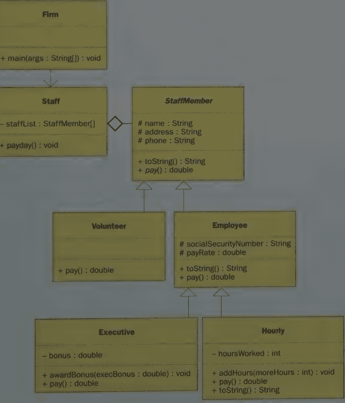

### 列表 9.1 `Firm.java`

```java
/* *****************************************************
// Firm.java      Java Foundations
// 展示通过继承实现多态。
// *****************************************************
public class Firm {
    //----------------------------------------------------------------------
    // 为公司创建员工并向他们发放工资。
    //----------------------------------------------------------------------
    public static void main(String[] args) {
        Staff personnel = new Staff();
        personnel.payday();
    }
}
```

**输出结果：**

```text
Name: Tony
Address: 123 Main Line
Phone: 555-0469
Social Security Number: 123-45-6789
Paid: 2923.07
--------------------
Name: Paulie
Address: 456 Off Line
Phone: 555-0101
Social Security Number: 987-65-4621
Paid: 1246.15
--------------------
Name: Vito
Address: 789 Off Rocker
Phone: 555-0000
Social Security Number: 010-20-3040
Paid: 1169.23
--------------------
Name: Michael
Address: 678 Fifth Ave.
Phone: 555-0690
Social Security Number: 958-47-3625
Paid: 10.55
--------------------
Name: Adrianna
Address: 987 Blvd.
Phone: 555-8374
Social Security Number: 958-47-3625
Paid: 42.0
--------------------
Name: Benny
Address: 321 Lane
Phone: 555-7282
Paid: 0.0
Thanks!
--------------------
```

### 列表 9.2 `Staff.java`

```java
// *****************************************************
// Staff.java        Java Foundations
// 代表特定业务的员工。
// *****************************************************
public class Staff {
    private StaffMember[] staffList;

    //----------------------------------------------------
    // 构造函数：设置员工成员列表。
    //----------------------------------------------------
    public Staff() {
        staffList = new StaffMember[6];
        staffList[0] = new Executive("Tony", "123 Main Line", "555-0469", "123-45-6789", 2923.07);
        staffList[1] = new Employee("Paulie", "456 Off Line", "555-0101", "987-65-4621", 1246.15);
        staffList[2] = new Employee("Vito", "789 Off Rocker", "555-0000", "010-20-3040", 1169.23);
        staffList[3] = new Employee("Michael", "678 Fifth Ave.", "555-0690", "958-47-3625", 10.55);
        staffList[4] = new Employee("Adrianna", "987 Blvd.", "555-8374", 42.0);
        staffList[5] = new Volunteer("Benny", "321 Lane", "555-7282", 500.00);
    }

    //--------------------------------------
    // 给所有员工发放工资。
    //--------------------------------------
    public void payday() {
        double amount;
        for (int count = 0; count < staffList.length; count++) {
            System.out.println(staffList[count].toString());
            amount = staffList[count].pay(); // 多态
            if (amount == 0.0) {
                System.out.println("Thanks!");
            } else {
                System.out.println("Paid: " + amount);
            }
            System.out.println("--------------------");
        }
    }
}
```

### 列表 9.3 `StaffMember.java`

```java
/****************************************************
// StaffMember.java      Java Foundations
// 代表泛化的员工成员。
/****************************************************
abstract class StaffMember {
    protected String name;
    protected String address;
    protected String phone;

    //----------------------------------------------------
    // 构造函数：使用指定的信息设置此员工成员。
    //----------------------------------------------------
    public StaffMember(String eName, String eAddress, String ePhone) {
        name = eName;
        address = eAddress;
        phone = ePhone;
    }

    //----------------------------------------------------
    // 返回包含员工信息的字符串。
    //-----------------------------------------------------
    public String toString() {
        String result = "Name: " + name + "\n";
        result += "Address: " + address + "\n";
        result += "Phone: " + phone;
        return result;
    }

    //----------------------------------------------------
    // 后代类必须为每种类型的员工定义 pay 方法。
    //-----------------------------------------------------
    public abstract double pay();
}
```

### 列表 9.4 `Volunteer.java`

```java
/****************************************************
// Volunteer.java      Java Foundations
// 代表作为志愿者工作的员工成员。
//****************************************************
public class Volunteer extends StaffMember {
    //------------------------------------------------------------
    // 构造函数：使用指定的信息设置此志愿者。
    //------------------------------------------------------------
    public Volunteer(String eName, String eAddress, String ePhone) {
        super(eName, eAddress, ePhone);
    }

    //------------------------------------------------------------
    // 为此志愿者返回零工资值。
    //------------------------------------------------------------
    public double pay() {
        return 0.0;
    }
}
```

### 列表 9.5 `Employee.java`

```java
/****************************************************
// Employee.java               Java Foundations
// 代表一个普通的计薪员工。
/****************************************************
public class Employee extends StaffMember {
    protected String securityNumber;
    protected double payRate;

    //--------------------------------------------------------------------
    // 构造函数：使用指定的信息初始化此员工。
    //--------------------------------------------------------------------
    public Employee(String eName, String eAddress, String ePhone,
                    String socSecNumber, double rate) {
        super(eName, eAddress, ePhone);
        securityNumber = socSecNumber;
        payRate = rate;
    }

    //--------------------------------------------------------------------
    // 以字符串形式返回有关员工的信息。
    //--------------------------------------------------------------------
    public String toString() {
        String result = super.toString();
        result += "\nSocial Security Number: " + securityNumber;
        return result;
    }

    //--------------------------------------------------------------------
    // 返回此员工的费率。
    //--------------------------------------------------------------------
    public double pay() {
        return payRate;
    }
}
```


`Employee` 的 `toString` 方法负责拼接通过 `super` 引用调用的父类 `toString` 返回的额外信息。`Employee` 的 `pay` 方法直接返回该员工的费率。

列表 9.6 显示的 `Executive` 类代表除了普通工资费率外可能获得奖金的员工。`Executive` 类派自 `Employee`，因此同时继承了 `StaffMember` 和 `Employee`。`Executive` 的构造函数将其信息传递给 `Employee` 构造函数，并将奖金设置为零。

使用 `awardBonus` 方法为执行人员发放奖金。该方法在 `Staff` 的 `payday` 方法中被调用，用于 `StaffArrayList` 中唯一的执行人员。注意，必须将泛型 `StaffMember` 引用强制转换为 `Executive` 引用才能调用 `awardBonus` 方法（因为 `StaffMember` 中不存在该方法）。

`Executive` 类重写了 `pay` 方法，使其首先像对待任何员工一样确定支付金额，然后加上奖金。使用 `super` 调用 `Employee` 类的 `pay` 方法以获取正常的支付金额。如果我们选择更改 `Employee` 对象的支付方式，这种技术比仅使用 `payRate` 变量更好，因为更改会自动反映在 `Executive` 中。发放奖金后，奖金会被重置为零。

列表 9.7 显示的 `Hourly` 类代表按小时计算工资的员工。它跟踪当前薪资周期内的工作小时数，可以通过调用 `addHours` 方法进行修改。该方法从 `Staff` 的 `payday` 方法调用。`Hourly` 的 `pay` 方法根据工作小时数确定支付金额，并将小时数重置为零。

### 列表 9.6

```java
/************************************************************************************
// Executive.java      Java Foundations
// 代表一名执行人员，他可以获得奖金。
//************************************************************************************
public class Executive extends Employee {
    private double bonus;
    //--------------------------------------------------------------------------------
    // 构造函数：使用指定的信息
    // 初始化此执行人员。
    //--------------------------------------------------------------------------------
    public Executive (String eName, String eAddress, String ePhone,
        String socSecNumber, double rate) {
        super (eName, eAddress, ePhone, socSecNumber, rate);
        bonus = 0; // 尚未发放 bonus
    }
    //--------------------------------------------------------------------------------
    // 为此执行人员发放指定的奖金。
    //--------------------------------------------------------------------------------
    public void awardBonus (double execBonus) {
        bonus = execBonus;
    }
    //--------------------------------------------------------------------------------
    // 计算并返回执行人员的工资，即
    // 普通员工工资加上一次性奖金。
    //--------------------------------------------------------------------------------
    public double pay() {
        double payment = super.pay() + bonus;
        bonus = 0;
        return payment;
    }
}
```

### 列表 9.7

```java
/*********************************************************************
// Hourly.java               Java Foundations
// 代表按小时计薪的员工。
/*********************************************************************/
public class Hourly extends Employee {
    private int hoursWorked;
    //--------------------------------------------------------------------
    // 构造函数：使用指定的信息
    // 初始化此小时制员工。
    //--------------------------------------------------------------------
    public Hourly (String eName, String eAddress, String ePhone,
                  String socSecNumber, double rate) {
        super(eName, eAddress, ePhone, socSecNumber, rate);
        hoursWorked = 0;
    }
    //--------------------------------------------------------------------
    // 将指定的小时数累加此员工的
    // 累计小时数。
    //--------------------------------------------------------------------
    public void addHours(int moreHours) {
        hoursWorked += moreHours;
    }
    //--------------------------------------------------------------------
    // 计算并返回此小时制员工的工资。
    //--------------------------------------------------------------------
    public double pay() {
        double payment = payRate * hoursWorked;
        hoursWorked = 0;
        return payment;
    }
}
```

### 列表 9.7 继续

```java
//--------------------------------------
// 以字符串形式返回此小时制员工的信息。
//--------------------------------------
public String toString() {
    String result = super.toString();
    result += "\nCurrent hours: " + hoursWorked;
    return result;
}
```

## 9.3 接口

在第5章中，我们使用该术语指代与对象交互的公共方法集。这个定义在本节中的用法一致，但现在我们将使用 Java 语言结构来形式化这一概念。接口提供了创建多态引用的另一种方式。

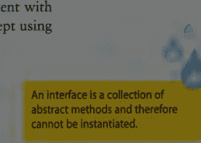

接口是常量和抽象方法的集合。正如第八章所述，抽象方法是没有实现的方法。也就是说，方法没有定义代码体。方法的头部（包括参数列表）后面跟着一个分号。接口不能实例化。

列表 9.8 显示了一个名为 `Encryptable` 的接口。它包含两个抽象方法：`encrypt` 和 `decrypt`。

抽象方法可以加上关键字 `abstract`，尽管在接口中通常不需要。接口中的方法默认具有公共（public）可见性。

类通过为接口定义的每个抽象方法提供方法实现来实现接口。列表 9.9 显示的 `Secret` 类实现了 `Encryptable` 接口。

### 列表 9.8

```java
/************************************************************************************
// Encryptable.java      Java Foundations
// 表示一个可以被加密和
// 解密的对象的接口。
************************************************************************************
public interface Encryptable {
    public void encrypt();
    public String decrypt();
}
```

### 列表 9.9

```java
/************************************************************************************
// Secret.java            Java Foundations
// 表示一个可以被加密和解密的机密消息。
************************************************************************************
import java.util.Random;
public class Secret implements Encryptable {
    private String message;
    private boolean encrypted;
    private int shift;
    private Random generator;
    //----------------------------------------------------------------------------------------------------
    // 构造函数：存储原始消息并建立
    // 加密位移值。
    //----------------------------------------------------------------------------------------------------
    public Secret(String msg) {
        message = msg;
        encrypted = false;
        generator = new Random();
        shift = generator.nextInt(10) + 5;
    }
    //----------------------------------------------------------------------
    // 使用凯撒密码对此机密加密。如果该
    // 机密已经加密，则没有效果。
    //----------------------------------------------------------------------
    public void encrypt() {
        if (!encrypted) {
            String masked = "";
            for (int index=0; index < message.length(); index++)
                masked = masked + (char)(message.charAt(index)+shift);
            message = masked;
            encrypted = true;
        }
    }
    //----------------------------------------------------------------------
    // 解密并返回此机密。如果该
    // 机密当前未加密，则没有效果。
    //----------------------------------------------------------------------
    public String decrypt() {
        if (encrypted) {
            String unmasked = "";
            for (int index=0; index < message.length(); index++)
                unmasked = unmasked + (char)(message.charAt(index)-shift);
            message = unmasked;
            encrypted = false;
        }
        return message;
    }
    //----------------------------------------------------------------------
    // 如果此机密当前处于加密状态，则返回 true。
    //----------------------------------------------------------------------
    public boolean isEncrypted() {
        return encrypted;
    }
    //----------------------------------------------------------------------
    // 返回此机密（可能已加密）。
    //----------------------------------------------------------------------
    public String toString() {
        return message;
    }
}
```

实现接口的类在类头部使用 `implements` 关键字，后跟接口名称。如果一个类断言它实现了某个特定接口，它必须为该接口中的所有方法提供定义。如果类中的任何方法没有在类中定义，编译器将产生错误。

在 `Secret` 类中，`encrypt` 和 `decrypt` 方法都已实现，这满足了接口建立的约定。这些方法的签名必须与接口中对应的抽象方法签名相同。在 `Secret` 类中，加密是通过简单的凯撒密码实现的，该密码将消息的字符移动固定的位数。另一个实现 `Encryptable` 接口的类可能会使用完全不同的加密技术。

注意，`Secret` 类还实现了不属于 `Encryptable` 接口的其他方法。具体而言，它定义了 `isEncrypted` 和 `toString` 方法，这些方法与接口无关。接口保证了类实现了某些方法，但并没有限制它拥有其他方法。事实上，实现接口的类拥有其他方法是常见现象。

列表 9.10 显示了一个程序 `SecretTest`，它创建了一些 `Secret` 对象。

接口及其与类的关系可以通过 UML 类图来表示。接口的表示方式与类节点相似，仅在接口名称上方插入了 `<<interface>>` 标记。从类到它所实现的接口之间画有一条带有三角形箭头的虚线。

### 列表 9.10

```java
/*************************************************************************************
// SecretTest.java       Java Foundations
// 演示正式接口的使用。
*************************************************************************************************/
public class SecretTest {
    //------------------------------------------------------------------------------------
    // 创建一个 Secret 对象并测试其加密。
    //-------------------------------------------------------------------------------------
    public static void main(String[] args) {
```


```java
Secret hush = new Secret("Wil Wheaton is my hero!");

System.out.println(hush);

hush.encrypt();

System.out.println(hush);

hush.decrypt();

System.out.println(hush);

}
}
```

# 输出

| 输出 |
| :--- |
| Wil Wheaton is my hero! |
| *okar-yx*s}w*ro|y+ |
| Wil Wheaton is my hero! |

图 9.2 显示了 `SecretTest` 程序的 UML 类图。

多个类可以实现同一个接口，并为方法提供自己的定义。例如，我们可以创建一个名为 `Password` 的类，它也实现 `Encryptable` 接口。正如之前提到的，每个实现接口的类都可以以不同的方式来实现。接口规定了哪些方法需要实现，而不是规定如何实现。

一个类可以实现多个接口。在这种情况下，该类必须为列出的所有接口中的所有方法提供实现。为了显示一个

## 426 第 9 章 多态


## 9.3 接口

## 427

类层次结构和接口层次结构是不重叠的。也就是说，接口不能用于派生类，类也不能用于派生接口。只有当类被设计为实现特定接口时，类和接口才会发生交互。

在看到接口如何支持多态之前，让我们看看标准库中两个常用的接口：`Comparable` 和 `Iterator`。

### Comparable 接口

Java 标准库既包含接口也包含类。例如，`Comparable` 接口定义在 `java.lang` 包中。`Comparable` 接口包含一个方法 `compareTo`，它接受一个对象作为参数并返回一个整数。

该接口的目的是提供一种比较两个对象的通用机制。一个对象调用方法并将另一个对象作为参数传递：

```java
if (obj1.compareTo(obj2) < 0)
   System.out.println("obj1 小于 obj2");
```

根据接口文档，`compareTo` 方法返回的整数如果 `obj1` 小于 `obj2` 则为负，如果相等则为 0，如果 `obj1` 大于 `obj2` 则为正。每个类的设计者负责决定一个类的对象相对于另一个对象小于、等于还是大于。

在第 4 章中，我们提到 `String` 类包含一个以此方式运行的 `compareTo` 方法。现在我们可以明确，`String` 类拥有此方法是因为它实现了 `Comparable` 接口。

### Iterator 接口

`Iterator` 接口是定义在 Java 标准库中的接口。它被表示集合的类使用，提供了一种逐个遍历集合的方法。

在第 4 章中，我们定义了迭代器的概念，使用循环处理集合中的所有元素。大多数迭代器（包括 `Scanner` 类的对象）都是使用 `Iterator` 接口定义的。

`Iterator` 接口中的两个主要方法是 `hasNext`（它返回一个布尔值结果）和 `next`（它返回一个对象）。这两个方法都不接受任何参数。如果还有剩余待处理的项，`hasNext` 方法返回 `true`，`next` 返回下一个对象。由实现 `Iterator` 接口的类的设计者来决定 `next` 方法交付对象的顺序。

我们需要注意的是，根据接口的本质，`next` 方法并不会从底层集合中移除对象；它返回的是该对象的引用。`Iterator` 接口还有一个名为 `remove` 的方法，它不接受任何参数且返回类型为 `void`。调用 `remove` 方法会从底层集合中移除最近由 `next` 方法返回的对象。

我们已经看到了如何使用迭代器来处理来自 `Scanner` 类（第 4 章）和数组（第 7 章）的信息。请回想一下，在很多情况下，`foreach` 循环简化了这种处理过程。我们将在适宜的情况下继续使用迭代器。它们是集合类开发的重要部分，我们将在本书的后续章节中详细讨论它们（第 14 章及以后）。

## 9.4 通过接口实现多态

现在，让我们看看如何使用接口来创建多态引用。正如我们多次看到的，类名可以用来声明一个对象引用变量的类型。同样，接口名也可以用作引用变量的类型。接口引用变量可以指向任何实现了该接口的任何类的任何对象。

假设我们如下所示声明了一个名为 `Speaker` 的接口：

```java
public interface Speaker
{
    public void speak();
    public void announce(String str);
}
```

现在，接口名 `Speaker` 可以用来声明一个对象引用变量：

```java
Speaker current;
```

> 接口名可以用来声明对象引用变量。

引用变量 `current` 可以指向任何实现了 `Speaker` 接口的任何类的任何对象。例如，如果我们定义了一个名为 `Philosopher` 的类并让它实现 `Speaker` 接口，那么我们就可以如下所示将一个 `Philosopher` 对象赋值给 `Speaker` 引用：

```java
current = new Philosopher();
```

这种赋值是有效的，因为 `Philosopher` 是一个 `Speaker`。从这个意义上说，类与其接口之间的关系与子类与其父类之间的关系是相同的。这是一种“是是”（is-a）的关系，类似于继承产生的关系。而这种关系构成了多态的基础。

接口引用的灵活性允许我们创建多态引用。正如我们之前看到的，通过使用继承，我们可以创建一个多态引用，只要这些对象之间存在继承关系，该引用就可以指向对象集合中的任何一个。使用接口，我们可以在实现相同接口的对象之间创建多态引用。

例如，如果我们创建了一个同样实现 `Speaker` 接口的 `Dog` 类，那么它也可以被赋值给 `Speaker` 引用变量。事实上，同一个引用变量在某一点指向一个 `Philosopher` 对象，稍后又指向一个 `Dog` 对象。以下几行代码说明了这一点：

```java
Speaker guest;
guest = new Philosopher();
guest.speak();
guest = new Dog();
guest.speak();
```

在这段代码中，第一次调用 `speak` 方法时，它调用了在 `Philosopher` 类中定义的 `speak` 方法。第二次调用时，它调用了 `Dog` 类的 `speak` 方法。通过继承实现多态引用，决定调用哪个方法的不是引用的类型，而是基于引用在调用时刻所指向对象的类型。

请注意，当我们使用接口引用变量时，我们只能调用接口中定义的方法，即使该对象还有其他可以响应的方法。例如，假设 `Philosopher` 类还定义了一个名为 `pontificate` 的公共方法。那么下面代码段的第二行将产生编译错误，尽管该对象实际上包含了 `pontificate` 方法：

```java
Speaker special = new Philosopher();
special.pontificate(); // 产生编译错误
```

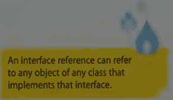

问题在于，编译器只能确定该对象是一个 `Speaker`，因此只能保证该对象可以响应 `speak` 和 `announce` 方法。因为引用变量 `special` 可能指向一个 `Dog` 对象（该对象无法执行 `pontificate`），所以它不允许进行该调用。如果我们在特定情况下知道这种调用是有效的，我们就可以将对象强制转换为适当的引用，以便编译器接受它，如下所示：

```java
((Philosopher)special).pontificate();
```

正如我们在继承中对多态引用所做的那样，接口名也可以用作方法参数的类型。在这种情况下，实现该接口的任何类的任何对象都可以传递给该方法。例如，下面的方法接受 `Speaker` 对象作为参数。因此，在不同的调用中，`Dog` 对象和 `Philosopher` 对象都可以被传递给它：

```java
public void sayIt (Speaker current)
{
    current.speak();
}
```

将多态引用作为方法的形式参数是一种强大的技术。它允许方法控制传递给它的参数类型，同时赋予了它接受各种类型参数的灵活性。

现在让我们检查通过接口实现多态的一种特定用途。

### 事件处理

在第 6 章中，我们检查了 Java GUI 中的事件处理。回想，为了响应事件，我们必须在监听器（listener）和组件之间建立关系。这种情况实际上是多态的一个例子。假设类 `MyButtonEventListener` 代表一个监听器。为了设置一个以响应事件，我们可能会这样做：

```java
JButton button = new JButton();
button.addActionListener(new MyButtonEventListener());
```


## 9.4 通过接口实现多态

一旦建立了这种关系，按钮就会触发事件（因为我们点击了它）。现在仔细考虑 `addActionListener` 方法。它是 `JButton` 类的方法，该类是年前由 Sun Microsystems 的。另一方面，我们可能是今天编写的监听器类。那么，一个以前编写的方法如何能接受今天编写的类的参数呢？

答案是多态。如果你查看 `addActionListener` 方法的源码，你会发现它接受一个类型为 `ActionListener` 接口的参数。因此，而不是接受单一对象类型的参数，`addActionListener` 方法可以接受实现 `ActionListener` 接口的任何类的任何对象。

`JButton` 对象对传递给 `addActionListener` 方法的对象并不了解，除了它实现了 `ActionListener` 接口（否则代码无法编译）。`JButton` 对象只需存储监听器对象，并在事件发生时调用它的动作方法。

在第 6 章中我们提到也可以通过扩展适配器类（adapter class）来创建监听器。这是通过接口实现多态的另一个例子。每个适配器类都被编写为实现相应的监听器接口，为所有事件处理器提供了空方法。因此，通过扩展适配器类，新的监听器类自动实现了相应的监听器接口。这这真正使其成为监听器，使其可以传递给相应的监听器方法。

因此，无论如何创建监听器对象，我们都是通过接口实现多态来建立监听器与其监听的组件之间的关系的。GUI 事件是多态所提供的强大和多功能的绝佳例子。

多态（无论是通过继承还是接口实现）都是一种基础面向对象技术，我们在本书的剩余部分将在适宜的情况下继续使用。

### 核心概念总结

- 多态引用可以随着时间推移指向不同类型的对象。
- 对于多态引用，方法调用到其定义的绑定是在运行时完成的。
- 引用变量可以指向由与其具有继承关系的任何类所创建的任何对象。
- 决定调用哪个版本的方法的应该是对象的类型，而不是引用的类型。
- 接口（interface）是抽象方法的集合，因此不能被实例化。
- 继承可以应用于接口，使得一个接口可以从另一个接口派生出来。
- 可以使用接口名称来声明一个对象引用变量（object reference variable）。
- 接口引用可以指向实现该接口的任何类的任何对象。
- 方法的参数可以是多态的，使方法对其参数具有灵活的控制。
- 监听器与它监听的组件之间的关系是通过多态来实现的。

### 自测习题

- SR 9.1 什么是多态？
- SR 9.2 继承如何支持多态？
- SR 9.3 重写与多态之间什么关系？
- SR 9.4 为什么 Firm 示例中的 StaffMember 类被声明为抽象类（abstract）？
- SR 9.5 既然 pay 方法是抽象的且在该级别没有方法体，为什么要在 StaffMember 类中声明该方法？
- SR 9.6 类和接口之间的区别是什么？
- SR 9.7 类层次结构和接口层次结构是如何交汇的？
- SR 9.8 描述 Comparable 接口。
- SR 9.9 如何使用接口实现多态？

### 练习题

- EX 9.1 绘制并注释一个表示大学不同类型教员的类层次结构。显示层次结构中的不同类将代表哪些特征。解释多态在为每位教员分配课程的过程中可以起什么作用。
- EX 9.2 绘制并注释一个表示动物园不同类型动物的类层次结构。显示层次结构中的不同类将代表哪些特征。解释多态在指导动物喂养的过程中可以起什么作用。
- EX 9.3 绘制并注释一个表示商店中不同类型销售交易（现金、信用卡等）的类层次结构。显示层次结构中的不同类将代表哪些特征。解释多态在支付过程中可以起什么作用。
- EX 9.4 如果 Firm 程序中的 StaffMember 类没有将 pay 方法定义为抽象方法，会发生什么？
- EX 9.5 创建一个名为 visible 的接口，包含两个方法：makeVisible 和 makeInvisible。这两个方法都不应该接受任何参数并返回一个布尔结果。描述类可能如何实现此接口。
- EX 9.6 绘制一个 UML 类图，显示练习 9.5 中元素之间的关系。
- EX 9.7 创建一个名为 VCR 的接口，该接口具有表示视频录带录像机标准操作（播放、停止等）的方法。按你喜欢的方式定义方法签名。描述类可能如何实现此接口。
- EX 9.8 绘制一个 UML 类图，显示练习 9.7 中元素之间的关系。
- EX 9.9 解释基于 GUI 的程序中对 addActionListener 方法的调用如何表示一个多态情况。

### 编程项目

- PP 9.1 修改本章中的 Firm 示例，使其通过名为 Payable 的接口完成多态性。
- PP 9.2 修改本章中的 Firm 示例，使得所有员工根据其分类获得不同的假期选项。修改驱动程序以演示这一新功能。
- PP 9.3 修改第 5 章中的 RationalNumber 类，使其实现 Comparable 接口。为了进行比较，为两个 RationalNumber 对象的分子和分母计算等效浮点值，然后使用 0.0001 的容差值对其进行比较。编写一个 main 驱动程序来测试你的修改。
- PP 9.4 创建一个实现本章 Encrypted 接口的 Password 类。创建一个 main 驱动程序，实例化一个 Secret 对象和一个 Password 对象，使用相同的引用变量并测试它们的方法。对 Password 使用任何所需的加密类型，但 Secret 所使用的凯撒密码（Caesar cipher）。
- PP 9.5 实现本章定义的 Speaker 接口。创建三个以不同方式实现 Speaker 的类。创建一个驱动类，其 main 方法实例化这些对象的一部分并测试它们的能力。
- PP 9.6 设计一个名为 Priority 的 Java 接口，包含两个方法：setPriority 和 getPriority。接口应该定义一种在对象之间建立数值优先级的方法。设计并实现一个名为 Task 的类，表示一个任务（如待办列表上的任务），它实现了 Priority 接口。创建一个驱动类来测试某些 Task 对象。
- PP 9.7 修改编程项目 9.6 中的 Task 类，使其也实现 Java 标准类库中的 Comparable 接口。实现该接口使任务按优先级排序。创建一个驱动类，其 main 方法显示 Task 对象的这些特征。

### 自测习题答案

#### SR 9.1

多态是引用变量在不同时间指向不同类型的能力。通过此类引用调用的方法在不同时间绑定到不同的定义，取决于类型。

#### SR 9.2

在 Java 中，使用父类声明的引用变量可以指向子类对象。如果两个类包含相同的方法，父类引用可以是多态的。

#### SR 9.3

当子类重写该方法时，存在两个版本的方法。如果使用多态引用调用方法，调用的方法版本由对象的类型决定，而不是引用的类型。

#### SR 9.4

StaffMember 类是抽象的，因为它不打算被实例化。它作为继承层次结构中的占位符，有助于多态地组织管理对象。

#### SR 9.5

类可以实例化，而接口不能。接口可以包含抽象方法和常量。类提供了接口的实现。

---

# 10 章节目标

- 讨论异常的作用。
- 检查异常消息和调用栈轨迹。
- 检查用于处理异常的 `try-catch` 语句。
- 探索异常传播的概念。
- 描述 Java 标准类库中的异常类层次结构。
- 探索 I/O 异常以及写入文本的能力。

## 异常

异常处理是面向对象软件系统的重要组成部分。异常代表程序中可能出现的问题或异常情况。Java 提供了多种方法在异常发生时进行处理。我们将探索用于定义异常的 Java 标准库中类层次的类层次结构，以及定义自定义异常对象的能力。本章还讨论了在处理输入和输出时使用异常，并提供了一个写入文本文件的示例。

## 10.1 异常处理

正如我们在书中其他部分简要讨论过的，Java 程序中出现的问题可能会产生异常或错误。异常是一个定义了异常或错误情况的对象。异常由程序或运行时环境抛出，如果需要，可以被捕获并进行适当处理。错误（Error）与异常相似，但错误通常代表不可恢复的情况，不应该被捕获。

Java 拥有一组在程序执行期间可能发生的预定义异常和错误。如果预定义的异常不再适用，程序员可能会选择设计一个新类来代表针对特定情况的异常。

由异常和错误表示的问题情况可能有各种根源。以下是导致异常抛出的情况示例：

- 尝试除以零
- 数组索引越界
- 找不到指定的文件
- 无法正常完成的 I/O 操作
- 尝试跟随空引用
- 尝试执行违反某些规则的操作

这些只是几个例子。还有几十个其他针对非常特定情况的示例。

正如其中许多示例所示，异常可以代表一种真正的错误情况。但是，正如名称所示，它们可能仅仅代表一种异常情况。也就是说，异常可能代表一种在通常情况下不会发生的情况。异常处理的设计是为了成为处理此类情况的高效方法，特别是考虑到它们并不经常发生。

在处理异常时，我们有几种选择。程序可以设计为以三种方式之一处理异常。它可以：

- 完全不处理异常，
- 在异常发生的地方处理异常，或
- 在程序的另一个点处处理异常。

## 10.2 未捕获的异常

如果程序完全不处理异常，它将异常终止并产生一条消息，描述发生了什么异常以及在代码的哪个位置产生的。异常消息中的信息通常对于追踪问题原因非常有帮助。

让我们看看异常的输出。列表 10.1 显示的程序在尝试进行无效算术运算时会抛出 `ArithmeticException`。在这种情况下，程序尝试除以零。

由于此程序中没有显式处理异常的代码，它会在异常发生时终止，并打印有关异常的特定信息。注意，程序中的最后一个 `println` 语句永远不会执行，因为异常先发生了。

异常输出的第一行指示抛出了哪种异常，并提供有关为何抛出异常的信息。其余行是调用栈轨迹（call stack trace）；它们指示了异常发生的位置。在这种情况下，调用栈轨迹中只有一行，但取决于异常的来源，可能有几行。第一条轨迹行指示异常发生的方法、文件和行号。其他轨迹行（如果存在）指示了为了到达引起异常的方法而调用的方法。在该程序中，只有一个方法，它产生了异常；因此轨迹中只有一行。

> 抛出异常时打印的消息提供了方法调用堆栈。

通过调用正在抛出的异常类的方法，也可以获取调用栈轨迹信息。`getMessage` 方法返回一个解释抛出异常原因的字符串。`printStackTrace` 方法打印调用栈轨迹。

## 10.3 try-catch 语句

让我们现在在异常被抛出时如何捕获并处理它。`try-catch` 语句识别一个可能抛出异常的语句块。跟随 `try` 块的 `catch` 子句定义了如何处理特定类型的异常。一个 `try` 块可以关联多个 `catch` 子句。每个 `catch` 子句被称为一个异常处理器。

### 列表 10.1

```java
/****************************************************************
// Zero.java         Java Foundations
// 演示一个未捕获的异常。
/****************************************************************

public class Zero {

    //-------------------------------------------------------
    // 刻意除以零以产生异常。
    //-------------------------------------------------------
    public static void main(String[] args) {
        int numerator = 10;
        int denominator = 0;
        System.out.println("Before the attempt to divide by zero.");
        System.out.println(numerator / denominator);
        System.out.println("This text will not be printed.");
    }
}
```

### 输出

```
Before the attempt to divide by "main"
Exception in thread java.lang.ArithmeticException: / zero
    at Zero.main(Zero.java:19)
```

当执行 `try` 语句时，`try` 块中的语句会被执行。如果在执行 `try` 块期间没有抛出异常，则将继续执行 `try` 语句之后的语句（在所有 `catch` 子句之后）。这种情况是正常的执行流，且在大多数情况下都会发生。

如果在执行 `try` 块期间的任何点抛出了异常，控制将立即转移到相应的异常处理器（如果存在）。也就是说，控制将转移到异常类与抛出的异常对应的第一个 `catch` 子句。

> 每个 catch 子句处理该块内可能抛出的特定类型的异常。

#### Try 语句

```text
try { Block catch ( Type Identifier ) Block finally { Block }
```

`try` 语句包含一个代码块，后面跟着一个或多个 `catch` 子句。如果 `try` 块中发生异常，则执行相应的 `catch` 子句的代码。`finally` 子句（如果存在）无论 `try` 块如何退出都会执行。

示例：

```java
try {
  System.out.println(Integer.parseInt(numString));
} catch (FormatException exception) {
  System.out.println("Caught an exception.");
} finally {
  System.out.println("Done.");
}
```

在执行完 `catch` 子句中的语句后，控制转移到整个 `try-catch` 语句之后的语句。

让我们来看一个示例。假设一家虚拟公司使用代码表示其各种产品。产品代码除了其他信息外，还包括第十位的字符，代表制造产品的区域，以及第 4 到 7 位的四位整数，代表其销售的地区。由于某些重组，来自 R 区域的产品被禁止在编号为 2000 或更高的地区销售。列表 10.2 显示的程序从用户处读取产品代码并计算输入的被禁代码数量。

`try` 块中的编程语句尝试提取区域和地区信息，然后判断它们是否代表被禁的产品。

### 列表 10.2

```java
// *********************************************************************
// ProductCodes.java        Java Foundations
// 演示了 try-catch 块的使用。
// *********************************************************************

import java.util.Scanner;

public class ProductCodes {

    // 计算区域为 R 且地区大于 2000 的
    // 产品代码数量。
    public static void main(String[] args) {
        String code;
        char zone;
        int district, valid = 0, banned = 0;
        Scanner scan = new Scanner(System.in);
        System.out.print("Enter product code (STOP to quit): ");
        code = scan.nextLine();
        while (!code.equals("STOP")) {
            try {
                zone = code.charAt(9);
                district = Integer.parseInt(code.substring(3, 7));
                valid++;
                if (zone == 'R' && district > 2000)
                    banned++;
            }
```


```java
catch (StringIndexOutOfBoundsException exception) {
    System.out.println("Improper code length: " + code);
} catch (NumberFormatException exception) {
    System.out.println("District is not numeric: " + code);
}
```

# Listing 10.2 续

```java
System.out.print("Enter product code (STOP to quit): ");
code = scan.nextLine();
System.out.println("# of valid codes entered: " + valid);
System.out.println("# of banned codes entered: " + banned);
```

```
Enter product code (STOP to quit): TRV2475A5R-14
Enter product code (STOP to quit): TRD1704A7R-12
Enter product code (STOP to quit): TRL2K74A5R-11
District is not numeric: TRL2K74A5R-11
Enter product code (STOP to quit): TRQ2949A6M-04
Enter product code (STOP to quit): TRV2105A2
Improper code length: TRV2105A2
Enter product code (STOP to quit): TRQ2778A7R-19
Enter product code (STOP to quit): STOP
# of valid codes entered: 4
# of banned codes entered: 2
```

`code`。如果在提取区域和地区信息时出现任何问题，该产品代码将被视为无效且不再进一步处理。例如，`charAt` 或 `substring` 方法可能会抛出 `StringIndexOutOfBoundsException`。此外，如果 `substring` 方法包含的内容不是有效的整数，`parseInt` 方法将抛出 `NumberFormatException`。程序会根据抛出的异常类型打印特定的消息。无论在何种情况下，由于异常被捕获并处理，处理将继续进行。

请注意，对于每个检查的代码，只有在没有抛出异常的情况下，整数变量 `valid` 才会递增。如果抛出异常，控制将立即转移到相应的 `catch` 句。同样，只有在没有抛出异常的情况下，才会通过 `if` 语句对区域和地区进行测试。

### finally 子句

> 无论 try 块是正常退出还是因为抛出异常而退出，finally 子句都会执行

try-catch 语句可以有一个可选的 finally 子句。finally 子句定义了一段无论 try 块以如何退出都会执行的代码。通常，finally 子句被用于管理资源或保证算法的特定部分被执行。

如果没有生成异常，则在 `try` 块完成后执行 finally 子句中的语句。如果 `try` 块中生成了异常，控制首先转移到相应的语句。在执行完异常处理语句后，控制将转移到 finally 子句并执行其语句。如果存在 finally 子句，它必须列在 catch 句之后。

请注意，try 块并不一定非要有 catch 句。如果没有 catch 句，在符合特定情况需要时，可以单独使用 finally 子句。

## 10.4 异常传播

我们可以设计软件，使得异常在方法调用层级结构中的外层级被捕获并处理。如果异常在发生的方法中没有被捕获和处理，控制将立即返回到产生该异常的方法。如果在该处仍然没有被捕获，控制将返回到调用该方法的方法，这一过程被称为异常传播。

> 如果异常在发生的地方没有被捕获和处理，它将传播到调用它的方法。

异常将一直传播，直到它被捕获并处理，或者传递到主方法（`main` 方法），会导致程序终止并产生异常消息。要在任何层级捕获异常，产生异常的方法必须在包含能够处理它的异常句的 `try` 块内部被调用。

Listing 10.3 所示的 `Propagation` 程序简明地演示了异常传播的过程。`main` 方法调用 `ExceptionScope` 类中的 `level1`（参见 Listing 10.4），`level1` 调用 `level2`，`level2` 调用 `level3`，随后产生异常。方法 `level3` 没有捕获并处理该异常，因此控制传回 `level2`。`level2` 方法也没有捕获并处理该异常，因此控制传回 `level1`。由于 `level2` 的调用是在 `try` 块中进行的（在方法 `level1` 中），异常在该处被捕获并处理了。

### Listing 10.3

```java
// Propagation.java         Java Foundations
// 演示异常传播。

public class Propagation {

    //--------------------------------------------------
    // 调用方法开始异常演示。
    //--------------------------------------------------
    static public void main(String[] args) {
        ExceptionScope demo = new ExceptionScope();
        System.out.println("Program beginning.");
        demo.level1();
        System.out.println("Program ending.");
    }
}
```

#### 输出

```
Program beginning.
Level 1 beginning.
Level 2 beginning.
Level 3 beginning.

The exception message: / by zero

The stack trace:
java.lang.ArithmeticException: / by zero
    at ExceptionScope.level3(ExceptionScope.java:54)
    at ExceptionScope.level2(ExceptionScope.java:41)
    at ExceptionScope.level1(ExceptionScope.java:18)
    at Propagation.main(Propagation.java:17)

Level 1 ending.
Program ending.
```

### Listing 10.4

```java
// ExceptionScope.java      Java Foundations
// 演示异常传播。

public class ExceptionScope {

    //----------------------------------------------------------------
    // 捕获并处理在 level1 中抛出的异常。
    //------------------------------------------------
    public void level1() {
        System.out.println("Level 1 beginning.");
        try {
            level2();
        } catch (ArithmeticException problem) {
            System.out.println("The exception message is: " + problem.getMessage());
            System.out.println();
            System.out.println("The stack trace:");
            problem.printStackTrace();
            System.out.println();
        }
        System.out.println("Level 1 ending.");
    }

    //--------------------------------------------------------------------
    // 作为中间层。异常通过此方法
    // 传播回 level1。
    //--------------------------------------------------------------------
    public void level2() {
        System.out.println("Level 2 beginning.");
        level3();
        System.out.println("Level 2 ending.");
    }

    // --------------------------------------
    // 执行计算以产生异常。在此层级没有
    // 被捕获和处理。
    // --------------------------------------
    public void level3() {
        int numerator = 10, denominator = 0;
        System.out.println("Level 3 beginning.");
        int result = numerator / denominator;
        System.out.println("Level 3 ending.");
    }
}
```

## 10.5 异常类层级

定义各种异常的类通过继承关系相关，创建了一个类层级，在图 10.1 中所示。


`Throwable` 类是 `Error` 类和 `Exception` 类的父类。许多类型的异常都派自 `Exception` 类，而这些类也有许多子类。尽管这些高层类定义在 `java.lang` 包中，但许多定义特定异常的子类属于其他包。继承关系可以跨越包边界。

我们可以通过从 `Exception` 或其任一个后代派生一个新类来定义自己的异常。我们选择哪一个类作为父类，取决于新异常所代表的特定情况或条件。

列表 10.5 中的程序实例化了一个异常对象并将其抛出。该异常是由 `OutOfRangeException` 类创建的，如列表 10.6 所示。此异常不属于 Java 标准类库的一部分。它的创建是为了表示值在某个特定有效范围之外的情况。

### Listing 10.5

```java
// CreatingExceptions.java         Java Foundations
// 展示了通过继承来定义异常的能力。

import java.util.Scanner;

public class CreatingExceptions {

    //---------------- 创建一个异常对象并可能将其抛出。
    //--------------------------------
    public static void main(String[] args) throws OutOfRangeException {
        final int MIN = 25, MAX = 40;
        Scanner scan = new Scanner(System.in);
        OutOfRangeException problem = new OutOfRangeException("Input value is out of range.");
        System.out.print("Enter an integer value between " + MIN + " and " + MAX + ", inclusive: ");
        int value = scan.nextInt();

        // Determine是否应该抛出异常
        if (value < MIN || value > MAX)
            throw problem;

        System.out.println("End of main method."); // 可能永远到达
    }
}
```

#### 输出

```
输入一个 25 到 40 之间的整数（包含边界）：69
Exception in thread "main" OutOfRangeException:
    Input value is out of range.
    at CreatingExceptions.main(CreatingExceptions.java:20)
```

### Listing 10.6

```java
// OutOfRangeException.java       Java Foundations
// 表示值超出某些
// 特定范围的异常情况。

public class OutOfRangeException extends Exception {

    // -------------------------------------------------------
    // 使用特定的消息设置异常对象。
    // -------------------------------------------------------
    OutOfRangeException(String message) {
        super(message);
    }
}
```


在读取输入值后，`main` 方法对其进行评估，以检查其是否在有效范围内。如果不在，则执行 `throw` 语句。`throw` 语句用于开始异常的传播。由于 `main` 方法没有捕获（catch）并处理异常，如果抛出了异常，程序将终止并打印与异常相关的消息。

我们通过扩展 `Exception` 类创建了 `OutOfRangeException` 类。通常，一个新异常无非你在示例中看到的内容：对某些现有异常类的扩展，存储一个描述其所代表情况的特定消息。关键点是，该类最终是 `Exception` 类和 `Throwable` 类的后代，这使其具有能够使用 `throw` 语句抛出的能力。

此程序处理的异常类型（值超出范围）并不一定需要表示为异常。我们之前曾仅使用条件语句或循环来处理此类情况。使用异常来处理某种情况，还是在程序的正常流中处理它，是一个重要的设计决策。

### 受检查异常与未受检查异常

某些异常是受检查的（checked），而另一些是未受检查的（unchecked）。受检查异常必须要么被方法捕获，或者在任何可能抛出或传播它的异常方法的 `throws` 子句中列出。`throws` 子句被写在方法定义的头部中，以正式确认如果发生特定异常，该方法将抛出或传播该异常。未受检查异常不需要子句。

Java 中唯一的未检查异常是 `RuntimeException` 或其后代的类型。所有其他异常都被视为受检查异常。`CreatingExceptions` 程序的 `main` 方法有一个 `throws` 子句，表示它可能抛出 `OutOfRangeException`。之所以需要这个 `throws` 子句是因为 `OutOfRangeException` 是从 `Exception` 类派生而来的，使其成为了受检查异常。

> 对于未在方法中捕获和处理的受检查异常，方法头部中必须包含 `throws` 子句。

## 10.6 I/O 异常

处理输入和输出是一项经常产生微妙状况的任务，因为它依赖于用户数据和文件等外部资源。这些资源可能会出现各种问题，导致异常的抛出。让我们探索一些 I/O 问题以及可能出现的问题。

流（stream）是字节的有序序列。“流”一词源于类比：当我们读取和写入信息时，数据从源流向目的地（汇点），就像水流过溪流一样。信息源就像填充流的泉源，而目的地则是水流过的洞穴。

> 流是字节的顺序序列；它可以用作输入源或输出的目的地。

在程序中，我们将流视为输入流，或者视为一个向其写入信息的输出流。

### 标准 I/O 流

| 标准 I/O | 描述 |
|---|---|
| `System.in` | 标准输入流。 |
| `System.out` | 标准输出流。 |
| `System.err` | 标准错误流（错误消息输出） |

图 10.2 标准 I/O 流

在本书示例中，我们一直在使用标准输出流，例如调用 `System.println`。我们还使用标准输入流创建 `Scanner` 对象，以便处理交互式输入。`Scanner` 类通过各种方式管理输入，使我们的编程任务变得更容易。它还在需要时处理各种 I/O 异常，产生 `InputMismatchException`。

标准 I/O 流默认代表特定的 IO 设备。`System.in` 通常代表键盘输入，而 `System.out` 和 `System.err` 通常代表屏幕上的窗口。`System.out` 和 `System.err` 默认输出同一个窗口（程序执行所在的窗口），尽管可以设置为输出不同的位置。`System.err` 流通常是发送错误消息的地方。

除了标准输入流，Java 标准类库的 `java.io` 包提供了许多定义特定流的类。某些类处理文件，某些处理内存，其他处理字符串。某些类假设它们处理的数据包含字符，其他类假设数据由二进制字节组成。某些类提供了以某种方式处理流数据的方法，例如对输入进行缓冲或编号。通过以适当的方式组合类，我们可以创建表示特定情况下所需的精确特征的信息流对象。


Java I/O 的主题非常广泛，且 `java.io` 包中的类数量庞大，这使我们无法在书中详细介绍。我们目前的关注是 I/O 异常。

I/O 类执行的许多操作都可能抛出 `IOException`。`IOException` 类是几个表示执行 I/O 时出现问题的的异常类的父类。

`IOException` 是一个检查异常（checked exception）。正如本章前面的介绍，这意味着要么必须捕获该异常，要么所有传播该异常的方法都必须在方法头的 `throws` 子句中列出它。

由于 I/O 通常涉及外部资源，在尝试执行 I/O 操作的程序可能会出现许多问题。例如，我们想要读取的文件可能不存在；当我们尝试打开该文件时，由于找不到文件，将会抛出一个异常。通常情况下，在处理潜在问题时，我们应该尽量设计程序使其具有健壮性。

在之前的示例中，我们已经看到如何使用 `Scanner` 类来读取和处理来自文本文件的输入。现在，让我们探索一个将数据写入文本输出文件的示例。向文本文件写入输出只需要使用适当的类来创建输出流，然后使用适当的方法写入数据即可。

假设我们想要测试正在编写的程序，但没有真实数据可用。我们可以编写一个程序生成包含随机值的数据文件。列表 10.7 所示的程序生成了一个包含特定范围内随机整数值的文件。它还会输出一行标准输出（stdout），确认数据文件已写入。

### 列表 10.7 `TestData.java`

```
********************************************************************
// TestData.java         Java Foundations
// 演示 I/O 异常和字符文件
// 输出流的使用。
********************************************************************

import java.util.Random;
import java.io.*;

public class TestData {

//----------------------------------------------------------------------
// 创建一个测试数据文件，由十行组成
// 每行包含 10 到 99 之间的十个整数值。
//----------------------------------------------------------------------
    public static void main (String[] args) throws IOException
    {
        final int MAX = 10;
        int value;
        String file = "test.dat";
        Random random = new Random();
        FileWriter fw = new FileWriter(file);
        BufferedWriter bw = new BufferedWriter(fw);
        PrintWriter outFile = new PrintWriter(bw);

        for (int line=1; line <= MAX; line++) {
            for (int num=1; num <= MAX; num++) {
                value = random.nextInt(90) + 10;
                outFile.print(value + " ");
            }
            outFile.println();
        }

        outFile.close();
        System.out.println("Output file has been created: " + file);
    }
}
```

输出
```
Output file has been created: test.dat
```

`FileWriter` 类代表一个文本输出文件，但操作数据的方法支持非常少。`PrintWriter` 类提供了类似于标准 I/O `Print` 类的 `print` 和 `println` 方法。
虽然为了程序运行不需要这样做，但我们在文件流配置中添加了一层 `BufferedWriter`。这种添加仅仅是为输出流提供了缓冲区能力，这使得处理更加高效。虽然在当前情况下缓冲不是至关重要的，但在写入文本文件时，这通常是一个好习惯。
注意，在 `TestData` 程序中，我们消除了显式的异常处理。也就是说，如果发生了错误，我们直接让程序终止，而不是具体地捕获并处理问题。由于所有的 `Exception` 都是检查异常，我们必须在方法头中包含 `throws` 子句以指示它们可能被抛出。对于每个程序，我们必须仔细考虑如何更好地处理可能抛出的异常。在处理 I/O 时，这一要求尤为重要，因为 I/O 充满了总是无法预见的潜在问题。

`TestData` 程序使用循环来汇编随机值并写入输出文件。在打印所有值后，文件会被关闭。输出文件必须显式关闭以确保数据被留存。通常情况下，当文件流不再需要时，显式关闭所有文件流是一种良好的做法。

运行 `TestData` 程序后，`test.dat` 文件中包含的数据可能如下：

```
85 90 93 15 82 79 52 71 70 98
74 57 41 66 22 16 67 65 24 84
86 61 91 79 18 81 64 41 68 51
98 47 28 40 69 10 85 82 64 51
23 61 27 10 59 89 42 26 24 76
33 89 73 36 54 91 42 73 95 58
19 41 18 14 63 80 96 17 28
24 37 40 64 94 23 98 10 78 50
89 28 64 54 59 23 61 15 80 88
51 28 44 48 73 21 41 52 35 38
```


### 核心概念总结

- 异常是必须捕获或声明的检查异常。
- I/O 操作通常涉及外部资源，导致潜在问题。
- 程序在处理 I/O 操作时应设计得尽可能健壮。
- 使用 `Scanner` 类来读取和处理来自文本文件的输入。
- 向文件写入输出需要使用适当的类（如 `FileWriter`）创建输出流。
- `BufferedWriter` 通过提供缓冲区能力提高了处理效率。
- 文件流必须显式关闭以确保数据留存。
- 如果异常未被捕获，必须在方法头中使用 `throws` 子句。

### 复习问题

- 什么是检查异常？
- 为什么显式关闭文件流很重要？
- `BufferedWriter` 的作用是什么？
- `throws` 子句在方法头中如何工作？

### 练习

- 10.1 为 `ProductCodes` 程序创建 UML 图。
- 10.2 如果在程序中添加 `catch` 句会发生什么？
- 10.3 如果移除 `try` 语句会发生什么？
- 10.4 如果将 `try` 语句移动到 level2 层会发生什么？
- 10.5 查找以下异常类并描述它们的用途：
    - `ArithmeticException`
    - `NullPointerException`
    - `NumberFormatException`
    - `PatternSyntaxException`
- 10.6 标准 I/O 异常有哪些？
- 10.7 文件流的作用是什么？

### 编程项目

- 10.1 设计一个程序读取一系列整数并打印它们的平均值，并使用 `NumberFormatException` 处理无效输入。
- 10.2 设计并实现一个程序，当字符串超过 20 个字符时抛出 `StringTooLongException`。
- 10.4 设计并实现一个程序，当文档标记不以 U、C 或 P 开头时抛出 `InvalidDocumentException`。
- 10.6 编写一个程序从用户处读取字符串并将其写入 `userStrings.dat`，在输入 "DONE" 时终止。
- 10.7 编写一个程序从 `bookTitles.inp` 中删除重复的书名，并将唯一的标题写入 `noDuplicates.out`。

### 自测题答案

- **SR 10.1** 抛出的异常可以通过三种方式之一进行处理：可以被忽略（这将导致程序终止），可以使用 `try` 语句在异常发生处进行处理，也可以在方法调用层次结构中的更高处对其进行捕获并处理。
- **SR 10.2** `try` 语句的 `catch` 子句定义了处理特定类型异常的代码。
- **SR 10.3** 如果异常在抛出时没有被立即捕获，它将开始向上通过调用生成该异常点的方法进行传播。异常可以在传播过程中的任何点被捕获并处理。如果它传播到主方法（`main` method）之外，程序将终止。
- **SR 10.4** `try-catch` 语句的 `finally` 子句无论 `try` 块何时退出，都会执行。如果 `try` 块执行完成后没有抛出异常，则执行 `finally` 子句。如果抛出了异常，则执行相应的 `catch` 子句，然后执行 `finally` 子句。
- **SR 10.5** 检查异常（checked exception）是指必须 (1) 被捕获处理，或 (2) 列在任何可能抛出或传播它的方法的 `throws` 子句中的异常。这建立了一组必须在程序中以某种方式正式确认的异常集合。如果需要，可以在代码中完全忽略未检查异常（unchecked exceptions）。
- **SR 10.6** 流（stream）是字节的顺序序列，作为输入源或输出目的地使用。
- **SR 10.7** Java 中的标准 I/O 流是 `System.in`（标准输入流）、`System.out`（标准输出流）和 `System.err`（标准错误流）。通常，标准输入来自键盘，标准输出和错误则发送到显示器屏幕上的默认窗口。

# 第 11 章 构建、测试与调试

## 章节目标

- 介绍 JFMail 应用，这是一个基于文本的邮件阅读程序。
- 讨论 Java 中包（packages）的使用和创建。
- 调查 `CLASSPATH` 环境变量的使用。
- 检查 Java 归档（jar）文件。
- 介绍构建工具并为项目创建一个 ANT 构建文件。
- 讨论各种类型的测试。
- 介绍 JUnit 测试框架。
- 检查程序的调试过程。

随着你变得越来越精通软件开发，你可能会处理具有更复杂设计和大量源代码更大的项目。较大的项目需要更好的代码组织、更好的资源管理以及更优的测试调试方法。本章重点关注每个程序员在转向更高级应用开发时应该掌握的若干概念和活动。


## 11.1 构建更大的应用程序

本章探讨了与大型软件开发过程相关的各种主题。首先，我们将介绍一个将为我们的讨论提供背景的应用。JFMail 应用是一个基于文本（非 GUI）的程序，用于在互联网上读取电子邮件。该程序规模仍然较小——总共四个类——但它为我们讨论本章的主题提供了良好的基础。

JFMail 应用是一个基础电子邮件客户端，它是一个与电子邮件服务器通信的程序，通过该服务器发送和接收邮件。服务器是运行在互联网某处计算机上的独立程序。当你收到一封邮件消息时，它被存储在服务器客户端上，等待你阅读。你运行邮件客户端从服务器检索消息并呈现给你阅读。当你发送邮件时，你在你的邮件客户端中编写消息，然后通过服务器发送出去。邮件客户端与服务器之间的关系如图 11.1 所示。在很多情况下，有两个不同的电子邮件服务器，一个处理入站邮件，另一个处理出站邮件。

本章所讨论的 JFMail 应用是处理入站邮件的电子邮件客户端。将客户端扩展为向电子邮件服务器发送出站邮件被留作为一个编程项目。

JFMail 应用使用了 Sun 的 JavaMail API，这是一个类库，可以帮助我们编写一个功能全的电子邮件客户端。JavaMail API 支持多种从服务器读取邮件的通信协议，包括 IMAP 和 POP。这些通信协议建立了与另一台机器通信所需的命令，目的用于读取邮件（IMAP 和 POP）或发送邮件（SMTP）。SMTP 协议也作为 JavaMail API 的一部分。JFMail 应用仅具有接收邮件的能力——发送邮件的修改留给你们完成！

图 11.2 显示了 JFMail 应用当前的 UML 类图。


图 11.1 电子邮件客户端和服务器

### 11.1 构建更大的应用程序：JFMail

#### `JFMail` 类

```
- control : JFMailCommsController
PROPS_FILE : String
- printSeparator() : void
- start() : void
- printMsg() : void
- displaySettings() : void
- listSummaries(String command) : void
- listSummaries(String) : void
- displayNextMessage() : void
- changeSettings() : void
- connect(Properties) : void
- presentMenu() : void
- listSummaries(String, msgNum int) : void
- saveConnectionSettings(newProps Properties) : void
- loadConnectionSettings() : void
- getConnectionSettings() : void
- resetProperties() : void
```

#### `JFMailCommsController` 类

```
- openConnection() : boolean
- DEFAULT_SPAN : int
```


- `spanAmount` : int
- `numMsg` : int
- `index`
- `mailStore` : Session
- `mailSession` : Session
+ `establishConnection(Properties, Authenticator)` : void
+ `getMessage(String)` : void
+ `listSummaries(int, String)` : void
+ `terminateConnection()` : void
+ `getURL()` : URL
+ `isOpenConnection()` : boolean
+ `getMsgNum()` : int
+ `getNextMessage()` : Message
+ `getCurrentMsgNum()` : int

## 11.2 JFMail 程序的类图

### 设计考虑

我们将检查代码，但首先讨论一下如图 11.2 所示的某些设计问题。`JFMail` 类实例化一个 `JFMailCommsController` 对象并将其传递给 `JFMailUserInterface` 对象。由于我们的用户界面完全是文本的，`JFMailUserInterface` 类设计为处理所有输入并通过简单的 `println` 输出。

当我们设计 JFMail 应用时，决定设计应该包含将文本界面切换为 GUI 界面的能力。这一活动留在了章节结束后的编程项目中。然而，为了实现这种切换功能，我们仔细考虑了 `JFMailCommsController` 为其客户端（`JFMailUserInterface` 或其替换界面）提供的服务。因此，`JFMailCommsController` 类必须提供所有的通信能力，并能够以与界面无关的方式提供数据（消息、摘要等）。

`JMailTextualAuthenticator` 扩展了位于 `javax.mail` 包中的 `Authenticator` 类，提供基于文本的方法在连接期间查询用户的用户名和密码。`JMailTextualAuthenticator` 的唯一方法 `getPasswordAuthentication` 由 Java `Session` 对象在连接尝试期间调用。

一旦连接到服务器，JFMail 应用允许你执行以下功能：

- 显示指定邮件的短摘要（包括邮件编号、发件者和邮件摘要）
- 显示后续 10 条邮件的摘要
- 显示指定邮件的内容（包括邮件编号、发送者信息、主题和纯正文）
- 显示下一条邮件的内容
- 显示每个命令选项的简短列表
- 显示当前的连接设置（主机名、用户名和连接协议）
- 重置连接设置（包括终止当前连接并建立新连接——可能是到不同的邮件主机）
- 退出应用程序（包括终止当前连接）

用于与邮件服务器通信的协议。一旦创建，此列表可以轻松地写入纯文本文件，并由 `Properties` 类再次读取。

## 11.2 包

在第 3 章中，我们简要介绍了类库的概念以及如何使用包来组织该库中包含的类。软件开发人员通常会将组成大型程序的类组织成具有通用功能的包。某些包可能足够通用，可以在多个程序中使用。你开发的源代码可能并非只针对某一个程序，而是一个你创建并分享（或出售）给其他程序员的类库。这些程序员反过来会利用你的包结构，根据功能组织好的类来快速定位对他们有用的类。


### 通过包进行类组织

在本书之前的章节的项目中，你已经使用过来自不同包的类。正如我们看到的，`java.util` 包包含了各种用途的类，`java.lang` 类与语言的核心方面相关，而 `java.io` 则涵盖了输入和输出功能。

JMail 应用由三个包组成：`jmail`、`jmail.userInterface` 和 `jmail.communications`。`JMail` 类是我们的驱动类，包含了应用程序的 `main` 方法。它的工作是实例化程序执行所需的最基础对象，并启动处理的主体。`JMail` 类位于 `jmail` 包中，其全限定名为为 `jmail.JMail`。在我们的 `jmail.userInterface` 包中，我们找到了两个构成文本界面功能的类：`JMailTextUserInterface` 和 `JmailTextualAuthenticator`，这两个类在之前都讨论过。但请注意，由于这两个类都与用户界面有关，我们将它们合并到一个包中。如果我们开发支持其他类型用户界面的额外类（例如，图形化用户界面或可能是电话用户界面），我们可能也会将这些类放在此包中。

最后，我们还有 `jmail.communications` 包，它包含了 `JMailCommsController` 和 `JFCommTesting` 类。我们将该类存放在 `jmail.communications` 包中，因为它是一个支持邮件应用程序通信方面的类。

### 创建你自己的包

JMFail 程序的包结构并不复杂——仅涉及三个包。我们在编写应用程序时，通过在工作区域中创建子目录，并确定源代码中的类属于哪个包，来创建我们自己的包。

让我们查看 JMFail 程序的目录结构，如图 11.3 所示。我们的项目位于 `C:\Documents and Settings\Peter\Desktop\ch11` 目录。该目录下唯一的文件文件名为 `build.xml`（一个 Ant 构建文件，我们将在本章第 11.3 节讨论它）。我们的 `ch11` 目录还包含一个名为 `jmfail` 的子目录，它是 `jmfail` 包中所有类的所在地。`jmfail` 包包含了 `JMFail.java` 源代码文件。在 `jmfail` 目录下，我们还找到了 `communications` 和 `userInterface` 目录，每个目录都包含各自的源代码文件。

如果你还记得 `userInterface` 包的全名，它是 `jmfail.userInterface`。然而，当我们组织源代码时，包名会根据包名被拆分为目录（有时嵌套在其他包目录中）。请注意，如果包包含多个组件，我们不会在目录名中使用包的全名。也就是说，我们的 `communications` 目录并不名为 `jmfail.communications`。


图 11.3 JMFail 程序的目录结构

然而，仅为打包源代码创建目录是不够的。我们还需要修改源代码文件本身。让我们看看 `JFMail` 类的源代码，准确地说是 `jfmail.JFMail` 类。列表 11.1 显示了该文件的源代码。文件中的第一语句（注释除外）是

`package jfmail;`

该语句表明文件中包含类是 `jfmail` 包的一部分。在编译时，编译器将检查包声明语句以及源代码文件在目录树中的位置，以确保源代码文件位于正确的位置。

由于 `JFMail` 类在 `main` 方法体使用了 `JFMailTextInterface` 和 `JFMailCommsController` 类，`JFMail` 类需要从它们各自的包中导入这些类。因此，我们有

+ 列表 11.1

```
********************************************************************
// JFMail.java         Java Foundations
// JF Mail 应用程序的主驱动器程序。
********************************************************************
package jfmail;
import jfmail.communications.*;
import jfmail.userInterface.*;
public class JFMail {
//----------------------------------------------------
// 实例化并启动邮件应用程序的用户界面。
//-----------------------------------------------------
public static void main(String[] args) {
    JFMailCommsController comms = new JFMailCommsController();
    JFMailTextInterface ui = new JFMailTextInterface(comms);
    ui.start();
}
}
```

在 `JFMail` 类的包声明之后还添加了那两个 `import` 语句。

如果我们选择，我们也可以在文件系统的其他地方创建包。例如，如果 JFMail 应用利用我们编写的额外类（例如我们在第 14 章中讨论的集合），我们只需要告诉编译器（`javac`）和运行时环境（`java`）在系统的何处搜索这些包。

## 使用 CLASSPATH

环境变量是在操作系统级别设置的变量，用于建立整个系统所需的数值。`CLASSPATH` 环境变量通常在 shell 中设置，以指示路径（目录或其他位置），当编译器或运行时环境在代码中找不到类引用时将查找的地方。请记住，对于 Java API 中的类这种情况会自动发生——例如 `java.util.Scanner`、`java.lang.String` 和 `java.net.URL`。

变量可以通过多种机制设置。第一种是在命令行中作为编译器或运行时环境的选项进行修改。例如，假设我们的 JFMail 应用需要导入来自 `javafoundations` 包的类。此外，假设 `javafoundations` 包位于系统的 `C:\javafoundations`。在编译时，我们需要告诉编译器有两个主要位置可以搜索任何由 API 提供的类。这样做是在调用编译器时添加 `-cp` 命令行选项，如下：

```
javac -cp C:\javafoundations;. jmail\JFMail.java
```

在 `-cp` 之后，我们指定了指示编译器搜索的两个位置。第一个是 `C:\javafoundations`，我们放置集合代码的地方。第二个位置指定为点（`.`），即发布 `javac` 命令的当前目录。当搜索包含程序所使用的类的包时，编译器首先在 Java 安装区域（用于 API 类）查找，然后在 `C:\javafoundations` 目录，最后是当前目录。

`CLASSPATH` 环境变量也可以在 shell（Windows 命令提示符或 Unix/Linux 的登录 shell）中进行临时修改，方法是在执行其他命令（如编译或执行运行时环境）之前设置变量名和值。在 Windows 下，在操作系统中，可以通过发布 `set` 命令来临时设置环境变量。例如，

```
set CLASSPATH=.;C:\javafoundations
```

在 Unix 机器上，过程会稍微复杂一些，取决于你正在使用的 shell 类型。请咨询你的讲师或系统管理员，以确定如何通过命令行设置环境变量。

稍后，我们将临时设置环境变量，以安装成功编译和执行 JFMail 应用程序所需的若干额外软件包的安装路径。通过设置这些变量，我们能够缩短我们的命令行编译和执行命令，并可以将它们用于其他工具中，例如我们将在本节稍后介绍的 ANT 构建文件。

最后，`CLASSPATH` 变量可以在控制面板（Windows）或 shell 的登录配置文件（Unix/Linux）中进行永久设置。这些修改很容易完成，但超出了本书的范围，因此我们建议你查看我们在书籍网站上关于此项操作的教程。通过 shell 设置环境变量，我们可以在许多地方访问它，例如在程序、脚本以及 shell 本身。

无论你通过何种方式对 `CLASSPATH` 变量进行修改，都应该注意，在示例中我们将 `CLASSPATH` 设置为 `C:\javafoundations`（包括代表当前工作目录的点）。`CLASSPATH` 变量中的项目在 Windows 中用分号（`;`）分隔，在 Unix/Linux 下用冒号（`:`）分隔。

通常，我们在编译期间访问的类在运行时解释器也。同样，我们可以通过命令行为解释器修改 `CLASSPATH`。为了让 JFMail 应用程序执行，我们将使用以下命令：

```
java -cp C:\javafoundations;. jmail.JFMail
```

如果我们通过 shell 或控制面板设置了 `CLASSPATH` 环境变量，我们可以将命令缩短为：

```
java jmail.JFMail
```

在这里，`CLASSPATH` 的值会被 Java 运行时自动使用，因此我们不需要通过 `-cp` 选项指定它。

另一个我们需要指出的点在这里——在命令行上使用包名和目录名。在发布 `javac` 编译器命令时，我们通过引用其目录名（也是其包名）来引用 JFMail.java 源代码文件：`jfmail\JFMail.java`。当我们发布编译器命令时，shell 正在 `ch11` 目录下工作，而我们想要编译的源代码位于 `ch11` 目录。如果我们使用完整包名来指定要编译的文件（如 `jfmail.JFMail`），将找不到该文件。

当我们发布开始执行 JFMail 应用程序的命令时，我们通过包含类的包名（`jfmail.JFMail`）来引用该类。在这里，我们并不是在引用文件名，而是引用特定包中的特定类。在处理自己的程序时，使用这些每个命令时要加小心。一个常见的错误是在 `javac` 和 `java` 程序中始终使用文件名，或者始终使用全限定名。

如果你尝试下载并执行 JFMail 应用程序，可能会在未找到一个或多个类时遇到错误。这是由于 JFMail 应用程序依赖于 JavaMail API，正如第 11.1 节中提到的那样。因此，你需要访问 JavaMail API 网站，同意许可协议并安装 API，以便 JFMail 应用程序能够编译和执行。你可以在这里找到 JavaMail API 网站：

```
http://java.sun.com/products/javamail/downloads/index.html
```

JavaMail API 的功能依赖于另一个名为 JavaBeans Activation Framework (JAF) 的 Java 产品。因此，你还需要下载并安装它。你可以在以下网站找到该产品：

```
http://java.sun.com/products/javabeans/jaf/downloads/index.html
```

JavaMail API 和 JAF 都以 zip 包的形式交付，你需要将其解压并安装到本地机器文件系统的位置上。

JavaMail API 和 JAF 为我们提供了丰富的额外类供使用。除了类之外，你下载的 zip 包还包含文档、演示程序和其他支持文件。我们主要感兴趣的是额外的类。这些类并不是以源代码形式提供的，仅提供了类文件。此外，它们每个都被封装成一个名为 jar 文件的特殊文件，这就是我们下一节的主题。

## Java 归档 (Jar) 文件

程序员通常希望与他人分享他们的文件。例如，与客户或其他个人分享我们程序的类文件并不罕见，这样他们就可以运行我们的 Java 程序。另一种场景可能包括学生需要向他们的导师分享他们的 `.java` 文件（为了评分或调试目的）。为了实现这一点，我们可以将想要共享的文件作为电子邮件附件收集起来，但对接收者来说这通常很草率。或者，我们可以将文件打包到目录中并将其刻录到 CD-ROM 中，将物理介质交给预期的接收者。

更好的解决方案是将我们的文件打包成单个文件。这种方法被全世界的计算机用户使用，当我们把一组文件“压缩”成一个所谓的“zip”文件时。Zip 是一种用于从组中压缩每个文件并以标准方式将其封装为单个文件的算法。Java 对这种方法的实现被称为 Java 归档或 jar 文件。一旦打包，jar 文件创建起来相对容易，并为用户提供了许多高级功能。

例如，假设我们想要创建一个 jar 文件。为了实现这一点，我们将使用带有 `c` 和 `f` 选项的 `jar` 程序。第一个 (`c`) 告诉程序我们正在创建一个 jar 文件。第二个 (`f`) 指定 jar 文件的名称：

```
jar -cf jmail.jar *.class
```

如果我们想查看 jar 文件的内容，可以使用 `jar` 工具配合 `t`、`v` 和 `f` 选项来显示内容列表、详细显示信息并指定 jar 文件，分别：

```
jar -tvf jmail.jar
```

要提取 jar 文件的所有内容，可以使用带有 `x`、`v` 和 `f` 选项的 `jar` 程序来指定提取、指定详细输出（提取报告）并指定 jar 文件，分别：

```
jar -xvf jmail.jar
```

在我们的系统中，通过在以下命令在 `C:\Documents and Settings\Peter\Desktop\ch11` 目录下执行应用程序：

```
javac -cp %JAVAMAIL_HOME%\mail.jar;. jmail\JFMail.java
```

注意百分号的使用（在我们基于 Windows 的系统上）。它们用于将环境变量替换为它的具体值。

我们的执行命令更长，因为我们必须在 `activation.jar` 文件中包含：

```
java -cp %JAF_HOME%\activation.jar;%JAVAMAIL_HOME%\mail.jar;. jmail.JFMail
```


我们可以通过将两个 jar 文件复制到项目目录（`C:\Documents and Settings\Peter\Desktop\ch1`）来让生活变得简单一点。然而，我们将通过使用构建文件让生活变得方便得多。因此，我们将 jar 文件留在原处。

如果 jar 文件的目的是执行 jar 文件中的内容，我们可以通过两种方式之一实现这一点。首先，当我们使用 Java 运行时环境时（即当使用 Java 解释器执行程序时），可以指定 jar 文件的名称以及包含 `main` 方法的类。例如，如果我们的 jar 文件名为 `awesome.jar`，并且应用程序的方法位于 `com.awesome.Driver` 类中，我们可以发布以下命令：

```
java -jar awesomeApp.jar com.awesome.Driver
```

我们的另一种方法依赖于 jar 文件的开发者。在创建 jar 文件时，开发者可以指定包含应用程序 `main` 方法的类的位置（也称为“主类”）。此信息被编码到 `MANIFEST.MF` 文件中，该文件存放在 jar 文件的 `META-INF` 目录下。这同样超出了我们讨论的范围，因此我们将正确创建 manifest 文件的细节留给您在以后查找。然而，如果主类已在 manifest 文件中声明（如果不尝试这些步骤，真的没有其他办法可以做到），你可以用鼠标双击 jar 文件（这在 Windows 方式以及某些 Unix/Linux 的配置下均有效），或者发布以下命令：

```
java -jar awesomeApp.jar
```

在这种情况下，我们不需要指定主类的位置，因为该信息已经编码在 jar 文件中了。

## 11.3 构建 Java 项目

正如你可能从前面的讨论中推断出的，对于大型、复杂的应用程序，快速产生非常复杂的编译和执行命令是非常容易的。许多软件开发人员（以及许多学生）倾向于使用集成开发环境（IDE），例如 NetBeans 或 Eclipse，这些环境有助于大规模开发。NetBeans 和 Eclipse 都包含在书中附带的 CD 中。通常，除了源码编辑外，IDE 还有许多工具来协助编译、调试、执行、打包以及 jar 文件的使用。如果你对使用 IDE 不感兴趣（我们认识许多程序员更倾向于使用良好的编辑器和命令行），还有额外的工具可以协助常见的 Java 软件开发任务。在本章的剩余部分中，我们将向你介绍其中的几个。

在讨论第一个能让你的软件开发活动更简单的工具之前，我们应该提到，IDE 并不能让你免受在本章早期介绍过的与 `CLASSPATH` 环境变量相关的问题。通常情况下，IDE 允许你在编译和执行期间编辑 `CLASSPATH`。这通常是通过属性窗口或选项窗口完成的，通常允许向路径添加目录和 jar 文件。随着你作为 Java 开发者的成长，你无疑会使用来自其他公司和开发者的 jar 文件。假设你选择了一个 IDE，务必研究它是如何管理 `CLASSPATH` 的，以及它在你将执行的活动方面提供哪些帮助。

### 构建工具与 Ant

软件开发人员在进行软件开发时简化许多重复执行的任务并不罕见。通常，开发人员会转向使用工具来辅助简化过程。最流行的工具类之一被称为构建工具，它们用于定义并执行一个清晰、一致的流程来构建软件应用程序。


通常，开发者只想编译那些自上次成功编译构建以来修改过的源文件。与其手动搜索这些文件（或者更糟，基于开发者的记忆），构建工具可以识别被修改的文件并在用户意愿的情况下调用编译器。这就是我们随着项目规模增大而转向构建文件来协助我们的原因之一。

其他动力原因包括对标准化编译过程的需求，或为特殊的编译活动添加支持（例如移动源代码文件、备份文件副本，或在构建过程中自动为应用程序包含日期或时间等信息）。另一个有用的构建行为示例是确保当存在代码依赖时（一部分代码依赖于另一部分），依赖关系会被识别并按照适当顺序进行编译。最后一个例子对于 C 和 C++ 源代码来说特别相关。

C 和 C++ 最流行的构建工具称为 `make`。Make 使用名为 `makefile` 的文件来组织构建命令的结构。Make 在 Java 中的对应物是一个名为 `Ant` 的工具。Ant 是由 Apache 软件基金（http://ant.apache.org）开发的 Java 开源构建工具。像 make 一样，Ant 使用用可扩展标记语言（XML）编写的构建文件来描述你想要定义的活动。

虽然我们在本章中无法深入探讨 Ant 的所有细节，但我们将向你展示一个简单、有效的构建文件，你可能用它来构建项目。Ant 的简单构建文件如列表 11.2 所示。该文件包含两个目标。你可能从列表中猜到，编译目标包含一个任务——调用 `javac` 编译器。编译产生的类文件将放在源代码相同的目录下。Ant 允许我们修改 `javac` 和 `delete` 任务的属性来改变行为。例如，我们可能希望创建一个目录，将所有的 `.class` 文件放在其中。每个 Ant 任务属性的完整列表可以在 Ant 文档中找到。

#### Listing 11.2

```xml
<project name="example" default="compile">

  <target name="compile">

    <javac srcdir="./" />

  </target>

  <target name="clean">

    <delete>

      <fileset dir="." includes="**/*.class" />

    </delete>

  </target>

</project>
```

列表 11.3 提供了开发 JMail 所需的 Ant 构建文件。在这个构建文件中，我们使用四个目标为用户提供核心功能集。我们的编译目标相对于列表 11.2 显示的版本进行了增强，因为我们指定了 `CLASSPATH` 的修改——JavaMail jar 文件的位置，用于引用 JavaMail API 提供的类。

#### Listing 11.3

```xml
<project name="JFMail" default="compile" basedir=".">

  <description>Java Foundations Mail 应用程序构建文件</description>

  <!-- 为此构建设置全局属性 -->

  <property name="src" location="./" />

  <property name="dist" location="./" />

  <property name="env" env="./" />

  <target name="compile" description="编译项目源码">

    <!-- 编译位于 ${src} 的 Java 代码 -->

    <javac srcdir="${src}">

      <classpath>

        <pathelement location="${env.JAVAMAIL_HOME}/mail.jar" />

      </classpath>

    </javac>

  </target>

  <target name="clean" description="Deletes all .class files and the distribution directory.">

    <!-- 删除 ${dist} 目录 -->

    <delete dir="${dist}"/>

    <delete>

      <fileset dir="${src}" includes="**/*.class"/>

    </delete>

  </target>

  <target name="dist" depends="compile" description="Generates the distribution (jar file).">

    <!-- 创建发布目录 -->

    <mkdir dir="${dist}"/>

    <timestamp>

      <format property="today" pattern="yyyyMMdd" locale="en"/>

    </timestamp>

    <!-- 将 ${src} 中的所有内容放入 jmfail-${today}.jar，基于目录="${src}" -->

    <jar jarfile="${dist}/jmfail-${today}.jar" basedir="${src}">

      <manifest>

        <attribute name="Built-By" value="Lewis, Dequale, and Chase"/>

      </manifest>

    </jar>

  </target>

</project>
```


在构建文件的 `compile` target 中，我们访问了在 `${shell}`（之前提到过）中设置的变量 `JAVAMAIL_HOME` 来定位 JavaMail API 的位置。然后我们在安装位置后追加 `/mail.jar` 字符串，定义了 `mail.jar` 文件的真实位置。通过使用环境变量而不是在构建文件中硬编码 jar 文件的路径，我们可以与其他开发者共享构建文件，而无需担心他们安装 JavaMail API 的位置。我们对构建文件的唯一要求是，任何其他使用该构建文件的人都需要已安装 JavaMail API 并设置了 `JAVAMAIL_HOME` 环境变量（通过 Windows 中的控制面板或 Unix 中的登录配置文件）。以这种方式使用环境变量使得构建文件非常灵活——轻松避免了其中包含不必要的硬编码路径。

关于构建文件，还有一些值得注意的有趣点。我们可以在文件开头、在任何任务执行之前，使用 `property` 任务来设置属性值（常量变量）。属性值贯穿整个构建文件，提供一个单一的位置和值，该值可能会随着构建文件的演变而改变（就像我们在 Java 程序中对常量值的那样）。请注意，我们为源代码的位置（`src` 属性）、发布目录的位置（`dist` 属性）以及 shell 中环境变量的包含建立了属性。

`dist` target 用于创建 `dist` 子目录——我们的发行版 jar 文件将放置其中的一个系统位置。此外，`dist` target 将创建一个名为 "today" 的属性，该属性将用于后续任务，以创建一个名称基于当前日期的 jar 文件。`dist` target 与 `compile` target 有依赖关系。这种依赖关系将强制在执行 `dist` target 之前执行 `compile` target。依赖关系可以用于创建执行 target 的逻辑链，通过将构建过程分解为一系列可识别的步骤来简化构建过程。

`clean` target 用于使用 `delete` 任务从我们的工作区删除 `dist` 子目录。我们还删除了工作区 `src` 区域的所有 `.class` 文件。`${src}` 是对构建文件顶部设置的 `src` 属性值的引用。

一旦创建了 Ant 构建文件，我们通常将其保存在项目的顶层目录中，命名为 `build.xml`。可以选择其他文件名，但这会改变我们的 Ant 执行命令。若要执行我们的构建文件，我们在命令行上发出 `ant` 命令。如果我们的构建文件名为 `projectBuild.xml`，那么我们就发出 `ant -f projectBuild.xml` 命令。

Ant 处理我们的构建文件并执行项目的默认 target。默认 target 在 `project` 任务中命名（参见构建文件的第一行），并应该与构建文件中包含的 target 之一匹配。如果没有命名默认 target，或者你想要执行另一个 target，可以发出 `ant target` 命令，其中 `target` 是你想要执行的 target 的名称。例如，若要清理我们的构建并删除 `.class` 文件，我们可以发出 `ant clean` 命令。

# 第 11 章 构建、测试与调试

## 11.4 测试

“测试”一词在软件开发中有许多应用方式。测试无疑包含了它的传统定义：使用各种输入运行已完成的程序以发现问题。但它也包括人类或机器进行的评估，以评估不断演进系统的质量。这些评估应该在编写单行代码很久以前发生。

测试的目标是发现错误。通过发现并修复错误，我们提高了程序的质量。很可能以后某人会发现开发过程中隐藏的任何错误。越早发现错误，修复起来就越容易、越便宜。花时间尽早发现问题总是值得的。

使用特定输入运行程序并产生正确的结果只能证明该程序对于该特定输入是有效的。随着越来越多的测试用例执行而没有发现错误，我们对程序的信心会增加，但我们永远无法确定所有错误都已消除。因为可能总会存在另一个未被发现的错误。因此，尽可能通过多种方式和设计良好的测试用例对程序进行彻底测试是非常重要的。

证明程序的正确性是，但这种技术对于大型系统极其复杂，而且证明过程本身可能会出错。因此，我们通常依赖于测试来确定程序的质量。

在确定存在错误后，我们确定错误的原因并修复它。问题得到解决后，我们应该运行之前的测试，以确保我们没有创建另一个错误。这种技术被称为回归测试。

### 评审

用于评估设计或代码的一种技术是评审（review），这是一种会议，其中几个人仔细检查一份文档。展示设计或代码允许他人提出建议。评审的目标是识别必须解决的问题。有时评审被称为走读（walkthrough），因为其目标是仔细遍历章节。代码评审应该判断设计是否满足需求。它还评估系统分解为类和对象的方式。

### 缺陷测试

由于测试的目标是发现错误，因此通常被称为缺陷测试（defect testing）。

#### 黑盒测试

黑盒测试将方法视为一个“黑盒”，测试者看不到内部实现。测试用例基于方法的规格说明或需求文档。黑盒测试用例通常直接来自系统需求或方法的说明目的。

黑盒测试用例的输入数据通常通过定义等效类来选择。等效类是一组预期会产生相似输出的输入集合。通常情况下，如果一个方法对于等效类中的一个值有效，我们有理由相信它对该类中的其他值也有效。例如，计算整数平方根方法的输入可以分为两个等效类：非负整数和负整数。如果它对一个非负值有效，那么它很可能对所有非负值都有效。同样，如果它对一个负值有效，它很可能对所有负值都有效。

等效类具有定义的边界。由于一个等效类中的所有值本质上是在测试程序的相同功能，因此在等效边界内只需要一个测试用例。然而，由于编程经常会产生“差一”（off by one）错误，应该对边界上及周围的值进行穷尽测试。对于整数边界，一个良好的测试套件应该包含边界精确值、边界减 1 以及边界加 1。应该定义使用这些情况的测试用例，且至少要包含一个来自该类别通用区域的用例。

让我们来看一个例子。考虑一个目的是验证特定整数值是否在 0 到 99（包含边界）范围的方法。在这种情况下有三个等效类：值 0、0 到 99 之间的值以及 99 以上的值。黑盒测试要求我们使用边界周围和边界上的值，以及等效类中的一些通用值。因此，这种情况下的一组黑盒测试用例可能是：-500, -1, 0, 1, 50, 98, 99, 100 和 500。

#### 白盒测试

白盒测试也称为玻璃盒测试，它测试方法的内部结构和实现。白盒测试用例基于代码逻辑。目标是确保程序中的每条路径至少执行一次。白盒测试映射了代码中可能的路径，并确保测试用例覆盖了每一条要执行的路径。这种测试通常被称为语句覆盖。

代码中的路径由使用条件表达式（如 `if` 语句）的控制流语句控制。为了让程序中的每个路径至少执行一次，测试用例的输入数据需要控制条件表达式的值。一个或多个测试用例的输入数据应使 `if` 语句的条件至少在一个情况下结果为真，在至少一个情况下结果为假。在 `if` 语句中涵盖真假两个值可以确保 `if` 语句将执行的两条路径都能被覆盖。类似的情况也可以适用于循环和其他结构。

在黑盒测试和白盒测试中，每个测试的预期输出应在运行测试之前建立。如果你没有先仔细确定结果应该是怎样的，那么很容易被说服测试结果是恰当的。

### 单元测试

另一种测试类型被称为单元测试。这种方法为每个已编写的代码模块（方法）创建一个测试用例。单元测试的目标是逐个确保每个方法（单元）的正确性。通常，我们将单元收集在一起，执行每个测试并观察所有结果。当源代码发生变化时，我们还可以重复使用这些测试，以观察代码更改对测试结果的影响（上文讨论的回归测试）。

### 集成测试

在集成测试期间，之前在单元测试中单独测试过的模块现在被作为一个集合进行测试。这种形式的测试关注全局，并确定当模块组合在一起并集成以共同工作时是否存在 Bug。与单元测试一样，随着软件的变化，我们可以使用回归测试来确定随着集成发生以及模块或集成方法的问题得到修改，我们的结果可能发生了什么变化。通常，集成测试的目标是检查系统大型组件的正确性。

### 系统测试

系统测试旨在测试整个软件系统及其实现如何符合其需求。你可能对应用程序或操作系统的公共 Alpha 测试或 Beta 测试并不熟悉。Alpha 测试和 Beta 测试是在软件产品正式发布和可用之前进行的系统测试。软件开发公司会参与此类公共测试，以增加测试产品的用户数量，或扩展测试产品所依赖的硬件基础。

### JUnit

JUnit (http://www.junit.org) 是一个用于 Java 应用程序单元测试自动化的测试框架。JUnit 是 Java 开发者最广泛使用的单元测试框架之一，提供了一系列支持开发和执行一个或多个测试的类。JUnit 框架可以在基于文本或基于 GUI 的界面执行你的单元测试。

在本节中，我们将探索在应用程序中创建单元测试的基本知识，并演示如何在基于 GUI 的运行器中执行你的测试。为了讨论这些需要，我们从 JUnit 网站下载并安装了 JUnit 3.8.2。我们还创建了名为 `JUNIT_HOME` 的另一个环境变量，它存储了 junit 的位置 (`C:\Program Files\junit3.8.2`)。

注意 JUnit 的 4.1 版本（或更高版本）已经发布，但它利用许多与语言相关的问题，我们将在书中进行讨论。此外，在本书的编写期间，Ant 尚未支持 JUnit 的 4.1 版本，这使得讨论变得更加困难。因此，坚持使用 JUnit 3.8 版本是自然的。我们将通过在 `jfmail.communications` 包中创建一个名为 `JFmsms` 的新类来开始单元测试。该文件显示在列表 11.4 中。注意我们导入了来自 JMail 包 (`jfmail.userinterface`)、`java.util`、`javax.mail` 以及 `junit.framework` 的许多类。包含 `junit.framework` 的类将允许我们创建单元测试。

#### 列表 11.4

```
catch(AuthenticationFailedException afe) {

    throw new AssertionFailedError("Authentication failed " + " connecting to " + props.getProperty("mail.host"));

} catch(MessagingException me) {

    throw new AssertionFailedError(me.toString());

}
```

我们的测试类继承自 `junit.framework` 单元 `TestCase` 类。这将允许我们定义一个或多个测试并自动执行它们。我们的类目前实现了两个测试方法：`testCommsInitialization` 和 `testConnectionEstablished`。我们专门地命名这些方法以 `test` 开头。通过这样做，我们的测试运行器（一个执行我们的测试并向我们提供每个测试结果反馈的应用程序）将能够利用名为反射（Reflection）的高级 Java 技术根据名称找到我们的测试。反射是一个本教科范围之外的话题，因此我们在这里不再深入探讨。但是，你真正需要知道的是当我们的测试运行器启动时，它将通过搜索任何以 `test` 开头的方法来定位我们所有的测试。

让我们仔细查看 `testCommsInitialization` 方法。该测试方法简单地创建了 `JMailmsController` 的新实例并获取了 `numMsags` 变量的值。在实例化时，`numMsags` 变量应设置为 -1，一旦建立了到邮件服务器的连接，该值将包含我们收件箱中的消息数量。如果我们的收件箱可能包含零条或更多消息，我们将此变量设置为 -1，以表示我们尚未建立连接。

我们的测试仅仅包含了 `JMailmsController` 对象的实例化以及对该实例变量的测试。为了实际执行测试，我们断言该变量的值应设置为 -1。我们调用 `Assert` 类（`TestCase` 的父类）的 `assertTrue` 方法来执行此断言。如果我们的断言确实为真，方法将顺利结束，并且测试被认为通过。


然而，如果断言为假，且在断言期间 `numMsags` 的值不是 -1，`assertTrue` 方法将抛出 `AssertionFailedError`。我们不需要在测试方法内部捕获此错误，因为它将传播到调用测试的方法中（在本例中是框架）。

我们的第二个测试比第一个稍微复杂一些。`testConnectionEstablished` 方法创建了 `JMailCommTextual Authenticator` 类的实例，我们的目标是提示用户输入有效的邮件服务器主机名和密码，建立到服务器的连接，反之，我们将使用身份验证器提示用户输入用户名和密码。如果连接正确建立，我们应该能够对控制器的 `isOpenConnection` 方法的结果执行另一个断言。我们将不使用 `assertTrue` 方法，而是演示其他类型断言 `assertEquals` 的用法。`assertEquals` 方法将测试我们的预期结果（第一个参数，`true`）是否等于在调用 `comm` 对象中包含的 `isOpenConnection` 方法时返回的结果的值。

如果在第二个测试期间，`JMailCommController` 对象的 `establishConnection` 方法抛出了 `AuthenticationException`，我们将捕获该异常并通过抛出 `AssertionFailedError` 强制测试失败。同样地，如果我们在连接过程中获得了 `MessagingException`（例如，由于错误的主机名），我们将故意让测试失败。

现在我们已经有了单元测试，并将执行它们以确保我们的测试能够通过。理想情况下，我们希望确认 `JMailCommController` 对象的实例化和 `establishConnection` 方法运行顺利，并且我们的测试全部通过。

要执行我们的测试，我们需要在编译和执行期间将 `junit.jar` 文件添加到我们的 CLASSPATH 中。理想情况下，我们的新编译命令将是：

```
javac -cp %JFMAIL_HOME%\mail.jar;"C:\Program Files\junit3.8.2\junit.jar"; jmailcommunications\JFCommsTesting.java
```

注意我们是从 `JFCommsTesting.java` 文件开始编译的。这样做，编译器将编译 `JFCommsTesting` 以及它所引用或需要的所有类。如果你在一个“干净”的项目区域（不包含任何 .class 文件）中执行此编译，那么 `JFMail` 和 `JFMailTextUserInterface` 类将不会被编译。这两个类都没有一个被 `JFCommsTesting` 需要，也没有被 `JFCommsTesting` 使用的任何类使用。

再次，我们的命令行编译方法变得越来越繁琐。这确实需要大量的输入，而且很容易在命令中引入错误。因此，我们将修改构建文件的编译目标（`compile` target），以包含我们需要的 `junit.jar` 文件。为了做到这一点，我们从 shell 的环境变量 `JUNIT_HOME` 使用 JUnit 的安装位置：

```
<target name="compile" description="Compiles the source code of the project.">
  <!-- Compile the java code located in {src} -->
  <javac srcdir="$(src)">
    <classpath>
      <pathelement path="${env.JAVMAIL_HOME}/mail.jar"/>
      <pathelement path="${env.JUNIT_HOME}/junit.jar"/>
    </classpath>
  </javac>
</target>
```

编译完成后，我们将通过输入以下命令在 GUI 测试运行器中执行测试：

```
java -cp %JFMAIL%\mail.jar;C:\Program Files\junit3.8.2\junit.jar org.junit.ui.TestRunner JFCommsTesting
```

注意我们是用 `JFCommsTesting.java` 文件开始编译的。这样做，编译器将编译 `JFCommsTesting` 以及它所引用或需要的所有类。如果你在一个“干净”的项目区域（不包含任何 .class 文件）中执行此编译，`JFMail` 和 `JFMailTextUserInterface` 类将不会被编译。这两个类都没有被 `JFCommsTesting` 需要，也没有被 `JFCommsTesting` 使用的任何类使用。

#### 列表 11.5

```
************************************************************************************
// JfCommsTestingRevised.java      Java Foundations
// This class holds testing routines for the communications module.
//************************************************************************************
package jmail.communications;

import java.util.*;
import javax.mail.*;
import jmail.userInterface.*;
import junit.framework.*;

public class JfCommsTestingRevised extends TestCase {
    protected JfMailCommsController comms;
    protected Authenticator textAuth;
    protected Properties props;
```


// --------------------------------------------------------------------
// Tests that a JfMailCommsController object is intialized
// correctly following instantiation.
// --------------------------------------------------------------------
public void testCommsInitialization() {
    assertTrue(comms.getNumMsgs() == -1);
}

// --------------------------------------------------------------------
// Tests the establishment of a connection to a user-defined
// server. This test will prompt for the entry of the hostname,
// protocol, username, and password prior to attempting to
// establish a connection.
// --------------------------------------------------------------------
public void testConnectionEstablished() {
    try {
        Scanner scan = new Scanner(System.in);
        System.out.println("Enter the hostname of the mail server:");
        System.out.flush();
        scan.hasNextLine();
        props.setProperty("mail.host", scan.nextLine().trim());
        System.out.println("Enter the connection protocol type: ");
        System.out.flush();
        scan.hasNextLine();
        props.setProperty("mail.store.protocol", scan.nextLine());
        comms.establishConnection(props, textAuth);
        assertEquals(true, comms.isOpen());
    } catch (AuthenticationFailedException afe) {
        throw new AssertionFailedError("Authentication failed " + " + " connecting to " + props.getProperty("mail.host"));
    } catch (MessagingException me) {
        throw new AssertionFailedError(me.toString());
    }
}

//-------------------------------------------------------------------------------------------------
// Instantiates the objects required to execute the tests in this
// class.
//-------------------------------------------------------------------------------------------------
protected void setUp() {
    comms = new JMailCommsController();
    textAuth = new JMailTextualAuthenticator();
    props = new Properties();
}

# 测试驱动开发

理想情况下，开发者应该在开发应用程序所需的源代码的同时编写测试用例。事实上，许多开发者已经采用了一种风格，即先编写测试用例，然后只实现足够的源代码以使测试用例通过。这种概念在专业领域上被称为`测试驱动开发`。

> 在测试驱动开发中，测试用例是在代码编写之前为代码编写的。

# 第 11 章 构建、测试与调试

测试驱动方法要求开发者定期（在开发和实现期间）使用已实现的测试用例来测试其代码。如果你将测试驱动方法视为一系列步骤，你通常会发现以下活动：

1. 创建一个测试尚未完成的特定方法的测试用例。
2. 执行所有现有测试用例，并验证除最近实现的测试用例外，所有测试用例均通过。
3. 开发测试用例的目标方法，使测试用例能够无错误地通过。
4. 重新执行所有测试用例，并验证每个测试用例都通过，包括最近实现的测试用例。
5. 清理代码以消除因开发最新方法而引入的任何冗余部分。这一步骤被称为重构代码。
6. 从第 1 步开始重复过程。

测试驱动方法在专业环境中正变得越来越流行。毫无疑问，对于许多开发者来说，停并在为开发中的系统提供功能的方法之前编写测试用例是需要调整的。

# 关于测试和 JFMail 的最后说明

在你的代码中找到适合测试的适当方法可能是困难的。我们在向应用程序添加测试代码时面临的问题之一是，许多方法返回的值具有高度变性，这取决于测试时所连接的邮箱状态。例如，我们可以确定是否建立了与邮件服务器的连接，`JFMailCommsController` 中的 `getNextMessage` 方法在存在消息时会返回消息对象。由于我们并不总是知道邮箱的状态，我们的测试可以检查 `getNextMessage` 方法返回 `null` 值（在没有消息的情况下）或消息本身（在存在下一条消息的情况下）。这类测试在开发 JFMail 应用程序似乎对我们没有太大帮助。

此外，我们知道 `JFMailUserInterface` 类的方法很难测试，因为它们的主要功能是将文本打印到屏幕上（`System.out`）。我们也发现插入测试的地方很困难，因为打印的文本是变化的，取决于邮箱的内容。返回类型为 `void` 的方法也有问题，因为可测试的内容较少。在这些情况下，你通常想确定被测试的方法是否修改了任何实例变量。再次，我们的用户界面并没有做很多这类。

测试通常不应该具有这种挑战性。然而，这个应用程序揭示了在某些情况下，寻找插入单元测试的合适位置本身就是一种练习。

## 11.5 调试

最后，我们遇到了最重要的概念之一。调试是定位和纠正程序中运行时和逻辑错误的行为。调试器是一种允许开发者观察程序执行的软件应用程序。但在我们讨论调试器之前，我们应该先讨论简单调试。

> 调试是定位和纠正程序中运行时和逻辑错误的行为。

> 调试器是一种允许开发者观察程序执行的软件程序。

# 使用打印语句进行简单调试

调试的最简单方法之一是使用打印。也就是说，在程序中散布打印和输出语句，将各种信息输出到屏幕或输出文件中。通常，这种方法将提供关于变量值或状态的信息。定期打印对象的字符串表示被认为是观察随时间变化的有效方法。

其他类型的有用信息也可以打印。例如，当我们想要知道程序运行到了多远时。面临这种挑战的程序员通常打印一系列语句以监控执行路径。

考虑调用方法的情况。在方法开始后打印每个参数的值可能有用，以观察方法是如何调用的。这对于调试递归方法（下一章将讨论）特别有帮助。我们也可以在方法结束返回之前打印变量的值。

## 11.5 调试

- 步入或跳过一个方法。如果我们在方法调用的语句上设置断点，执行将到达该断点并且程序将停止，开发者可以选择进入该方法继续调试，也可以跳过该方法，从而跳过方法中包含的语句显示。在跳过方法时，我们需要注意该方法仍然会被执行，但我们选择了不深入该方法。以考虑向屏幕打印输出字符串的调用为例。我们可能不需要进入 `System.out` 对象的 `println` 方法（而且我们也无法改变它的行为）。
- 执行下一条语句。到达断点后，开发者可以选择执行下一条语句（也称为单步）。通过执行单步，我们可以字面上一条一条语句地控制程序的执行。开发者经常执行单步操作是为了确保他们理解执行流，并为自己提供在每一步之后根据需要显示变量值的机会。
- 继续执行。一旦程序由于断点而停止，或者正在等待开发者决定是进入、跳过还是单步，开发者也可以继续执行。继续执行将导致程序运行每个语句而不暂停，直到程序结束、遇到另一个断点或发生运行时错误。

调试器还提供了大量额外功能来协助调试任务。然而，出于本调试器的目的，我们可以限制在上述列出的活动范围内。任何值得使用的调试器至少都包含这些操作。

## Java 调试器 (JDB)

作为 JDK 的一部分，Java 自带了一个名为 `jdb`（Java debugger）的调试器。`jdb` 应用程序是一个文本程序，提供了上述列出的所有功能以及更多。在如何使用调试器的示例中，我们将使用一个小型示例程序和我们的 JFMail 。事实上，JFMail 展示了几个与调试相关的额外有趣问题。

### 列表 11.6

```
********************************************************************
// DebugTester.java      Java 基础
// 此类用于演示调试器的用法。
//********************************************************************
public class DebugTester {
    // main 方法调用静态测试方法并打印
    // 从 power 方法返回的结果。
    //--------------------------------------------------------------------
    public static void main(String[] args) {
        System.out.println(power(10, 4));
    }
    //--------------------------------------------------------------------
    // power 方法返回一个字符串，显示基
    // 值方幂指数的结果。
    //--------------------------------------------------------------------
    public static String power (int base, int exponent) {
        int pow = 0;
        String result = base + " raised to the power of " + exponent;
        result += " is ";
        pow = base + exponent;
        return result + pow;
    }
}
```

在编译期间生成的文件。因此，为了编译列表 11.6 显示的 `DebugTester.java` 文件，我们将使用以下命令：

```
javac -g DebugTester.java
```

当然，如果你的程序需要使用多个一个类，你将有一个更复杂的编译命令来确保所有的源文件都已编译。一旦源文件成功编译，我们将在命令行输入以下内容来启动调试器：

```
jdb DebugTester
```

当调试器启动时，你将看到一条启动消息和一个调试器提示符 (`>`)。我们将输入第一个命令在程序进入 `main` 方法时停止调试器。要这样做，请在 `DebugTester.main` 中输入 `stop`。调试器将通知我们断点将在类加载后设置。接下来，我们将通过调试提示符处输入 `run` 来启动 `DebugTester` 程序的执行。调试器将加载 `DebugTester` 类，设置断点，执行程序并在 `main` 方法开始处停止执行。产生的输出应该像这样：

```
> run
run DebugTester
Set uncaught java.lang.Throwable
Set deferred uncaught java.lang.Throwable
> VM Started: Set deferred breakpoint DebugTester.main

Breakpoint hit: "thread=main", DebugTester.main(), line=14
bci=0
14 System.out.println(power(10, 4));

main[1]
```

在输出的最后一行，我们有一个调试器提示符，表示我们已经暂停了执行。执行 `list` 命令将显示方法中第一行源代码周围的代码：

```
main[1] list
10 // 从 power 方法返回的结果。
11 //-------------------------------------------
12 public static void main(String [] args)
13 {
14 => System.out.println(power(10, 4));
15 }
16 //------------------------------------------------------
17 // power 方法返回一个字符串，显示基
18 // 值方幂指数的结果。
19 // 
main[1]
```

如果我们在此处执行 `step` 命令，我们将执行下一条单条指令，调用 `power` 方法并在 `power` 方法的第一行处暂停执行：

```
main[1] step
Breakpoint hit: "thread=main", DebugTester.power(), line=23
bci=0
23 int pow = 0;

main[1] list
19 // 方幂指数的结果。
20 //------------------------------------------------------
21 public static String power (int base, int exponent) {
22     23 int pow = 0;
24 String result = base + " raised to the power of " + exponent;
25 result += " is ";
26 27 pow = base + exponent;
28 return result + pow;
29 }
```

`print` 命令允许我们显示单个变量的值，而 `locals` 命令将显示所有变量。这些命令及其对应的输出如下所示：

```
main[1] print base
base = 10
main[1] locals
Method arguments:
base = 10
exponent = 4
Local variables:
pow = 0
```

接下来，将在返回语句处设置断点。返回语句在代码的第 29 行，因此我们将发出 `stop DebugTester:29`。通过继续执行（使用 `continue` 命令），程序现在应该执行并在 29 行再次暂停。此时，我们可以通过打印 `pow` 变量的值：

```
main[1] stop DebugTester:29
main[1] continue
Breakpoint hit: "thread=main", DebugTester.power(), line=29
bci=0
29 return + pow;

main[1] print pow
pow = 14
```


通过执行这些步骤，我们了解到 27 行的值计算错误。我们的问题在于 `pow` 变量是通过相加两个参数而不是相乘计算的。

在我们退出调试器修复源代码并重新编译之前，我们将讨论最后两个命令。首先，通过 `variableName = expression`，我们可以将变量的值更改为表达式的结果。例如，我们可以执行 `set pow=10000` 来设置该方法的正确结果。如果在不修复错误并重新编译的情况下继续调试此程序的代码，更改变量的值也将有用。

我们的最后一个命令是 `help`。输入 `help` 将显示在调试器中可以输入的所有命令的摘要。在调试期间有很多有趣的选项和命令。

## 调试 JFMail 应用

要在 JFMail 应用上使用 `jdb` 调试器，我们需要稍微调整一下我们的方法。当然，我们需要为调试器提供 `CLASSPATH`，以便执行环境能够在运行时找到所有必要的类。这再次需要我们包含在本章早些时候下载的 `mail.jar` 和 `activation.jar` 文件。

我们要解决的另一个问题是 JFMail 应用需要用户在屏幕出现提示后从键盘输入内容。换句话说，它是一个我们需要输入的控制台应用程序。然而，`jdb` 调试器也是一个需要我们输入的控制台应用程序。这正是冲突所在。

例如，下面的输出显示了在调试器中启动 JMail 程序的序列：在 `JMailCommsController` 类的 `establishCommunications` 方法中设置断点，并运行应用程序，直到提示用户输入（要连接的主机主机名称）。当我们输入主机名时，调试器告知我们该主机名不是调试器命令（请查看帮助）。这种交互将迫使我们采取稍微不同的方法。

```
C:\Documents and Settings\Peter\Desktop\Java Foundations\JMail>jdb -classpath %JAVA_HOME%\mail.jar;JAF_HOME%\activation.jar;jfmail.jar

Initializing jdb. . .

> stop in jfmail.communications.JMailCommsController.establishConnection

Deferring breakpoint jfmail.communications.JMailCommsController.establishConnection. It will be set after the class is loaded.

> run jfmail.JMail

Set uncaught java.lang.Throwable

Set deferred uncaught java.lang.Throwable

>

VM Started: Set deferred breakpoint jfmail.communications.JMailCommsController.establishConnection

Welcome to the Java Foundations Mail Reader.

Enter the hostname of the mail server: mailserver.tcnj.edu
recognized command: 'mailserver.tcnj.edu'. Try help...
>
```

我们如何解决这个问题？幸运的是，我们可以在一个终端窗口中启动应用程序，并在另一个窗口中启动调试器。调试器将被指示连接到正在运行的应用程序。实际上，我们会加载应用程序，但在调试器指示应用程序启动之前，不会真正开始执行。我们设置了这个配置，可以在调试器控制台中发布调试器命令，还可以通过应用程序的控制台窗口向应用程序提供输入。

让我们在第一个窗口中启动应用程序。我们将发布 `java` 命令，并提供一些额外的选项。这些选项的细节超出了我们讨论的范围，因此我们暂时避免谈论它们。然而，请注意我们在启动运行时环境时向其传递了 `CLASSPATH`，并在启动 `jfmail.JFMail` 时设置了几个传输属性。特别注意 `suspend=y` 设置，它会在运行时加载应用程序时挂起（暂停）应用程序。通过这样做，当我们转向启动调试器时，应用程序还没有开始运行。

```
java -classpath %JAVA_HOME%\mail.jar;JAF_HOME%\activation.jar; -agentlib jdwp=transport=dt_shm,server=y,suspend=y jfmail.JFMail
```

一旦运行时环境启动并加载了 JFMail 应用程序，我们在屏幕上收到了以下消息：

Listening for transport dt_mem at address: javadebug

现在我们在另一个控制台窗口中启动调试器，并将其连接到我们的半运行程序：

```
jdb -attach javadebug
```

在上一行中，我们启动了调试器，并通过内存中名为 `javadebug` 的特定位置将其附加到半运行的应用程序。一旦连接，我们就可以向调试器发布如 `stop`、`list`、`print`、`run` 等命令，影响 JFMail 应用程序的执行。不要忘记检查 JFMail 应用程序的控制台窗口。它可能正在等待你输入连接信息！

上面的说明演示了如何启动应用程序然后将调试器附加到执行中的应用程序。这些说明是基于 Windows 平台的。Solaris 和 Linux 操作系统也存在类似的功能，仅需极小的更改。请参考 `jdb` 文档学习如何将调试器连接到运行的 Java 应用程序。

## 基于 GUI 的调试器

许多 IDE 程序也包含调试器作为 IDE 程序的一部分。Eclipse、NetBeans、Java 以及其他 IDE 都有调试你用 IDE 开发的程序的能力。从 IDE 到其他 IDE，建立调试会话的命令差异很大，因此你希望阅读你的 IDE 文档以确定它是否包含调试器，如果包含，你可以使用哪些命令来调试你的程序。

在图 11.6 中，我们启动了 Java IDE，并根据用于开发 JFMail 应用程序的源代码创建了一个项目。然后我们在 `establishConnection` 方法中设置了断点，使用 `jmail.JFMail.main` 方法启动调试器。在读取现有的 `jmail.props` 文件以获取基本连接信息后，提示提示输入邮件服务器的用户名和密码。完成后，调用了 `establishConnection` 方法，程序暂停在方法中计算 `spanAmount` 的一行（蓝色高亮显示）。

你可能在图中注意到，我们有两个监视来显示方法中的 `numMsgs` 和 `spanAmount` 变量值。我们通过在监视表中输入变量名来实现。每当调试器在 `establishConnection` 方法中暂停时，监视表中每个变量的值都会更新。

图 11.6 DrJava IDE 中的调试器

### 核心概念总结

- 包用于根据功能组织源代码。
- 构建工具用于简化许多常见的重复性软件开发任务。
- 测试程序永远无法保证没有错误。
- 一个好的测试是能够发现错误的测试。
- 穷尽测试一个程序是不可行的。
- JUnit 是用于执行自动化单元测试的框架。
- 断言用于验证预期结果与我们的实际结果匹配。
- 在测试驱动开发中，测试用例先编写。
- 调试是定位并纠正程序错误。
- 调试器是允许观察程序执行的软件。

## 自测

- Java 中包的作用是什么？
- `CLASSPATH` 的作用是什么？
- jar 文件的作用是什么？
- 写出以下命令行选项，以：
    - 创建一个 jar 文件。
    - 获取 jar 文件的内容。
    - 提取 jar 文件的内容。
- 构建工具是什么？
- 缺陷测试是什么？
- 白盒测试是什么？
- 执行单元测试时使用什么方法？
- 测试驱动开发下通常执行哪些步骤？
- 调试器是什么？

### 练习

- EX 11.1 探索以下 Ant 任务：`echo`、`input`、`mail`、`move` 和 `unjar`。这些任务实现了什么功能？描述你如何在构建文件中使用它们。
- EX 11.2 使用练习 11.1 所示的核心 Ant 任务在文件中创建至少三个新目标。
- EX 11.3 修改 `JFCommsTesting` 类并添加单元测试以支持以下方法的测试：
    - `JMailCommsController.getMessage`
    - `JMailCommsController.listMessageSummary`
- EX 11.4 创建一个名为 `jmail.user.interface.interfaceTesting` 的额外测试类，并添加单元测试以支持以下方法的测试：
    - `JMailTextInterface.presentMenu`
    - `JMailTextInterface.loadConnectionSettings`
- EX 11.5 使用调试器支持练习 11.3 中单元测试的开发。

### 编程项目

- PP 11.1 通过命令行从零在自己的机器上构建 JFMail 应用程序。确保能够无错误地成功构建应用程序，然后运行应用程序并测试读取自己的邮件。
- PP 11.2 使用 Ant 构建文件在自己的机器上构建 JFMail 应用程序。确保能够无错误地成功构建应用程序，然后运行应用程序并测试读取自己的邮件。
- PP 11.3 修改 JMFail 应用，使得当使用错误的主机名时不会发生崩溃。
- PP 11.4 为 JMFail 应用增加发送邮件的功能。这需要深入阅读 JMFail API 并调查你所在校园的邮箱设置。提示：你需要了解 SMTP 服务器的设置。
- PP 11.5 修改 JMFail 应用，添加一个图形界面以替换现有的文本用户界面。
- PP 11.6 修改 Ant 构建文件，使得 jar 文件的名称根据执行构建文件的用户名创建。
- PP 11.7 修改 JMFail 应用，使用户可以通过菜单输入新的跨度（列出摘要时显示的消息摘要数量）。
- PP 11.8 修改 JMFail 应用，支持一种命令行选项，该选项将在存在属性文件时忽略它。

### 自测题答案

- SR 11.1 Java 包将类组织成具有共同功能的包。
- SR 11.2 `CLASSPATH` 指明了路径列表（目录和其他位置），如果编译器或运行时环境在源代码中找不到类引用，将会在这些路径查找。
- SR 11.3 Jar 文件允许我们将源代码、类文件和其他文件收集到一个文件中进行分发。
- SR 11.4 命令行选项有：
    - a. `c` 命令行选项指定创建 jar 文件。
    - b. `t` 命令行选项指定获取 jar 文件的目录内容。
    - c. `x` 命令行选项指定提取 jar 文件的内容。
- SR 11.5 构建工具用于定义和执行构建软件应用程序的一致性过程。
- SR 11.6 缺陷测试是通过测试来定位程序中错误的行为。
- SR 11.7 白盒测试对方法的内部结构和实现进行测试。
- SR 11.8 在执行单元测试时，我们为编写的每个代码模块（方法）创建一个测试用例。
- SR 11.9 测试驱动开发的开发顺序如下：
    1. 创建一个测试尚未完成的特定方法的测试用例。
    2. 执行所有现有的测试用例，验证除最近实现的测试用例外的所有测试用例均通过。
    3. 开发测试用例的目标方法。
    4. 重新执行所有测试用例，验证每个测试用例都通过。
    5. 重构代码。
    6. 从第 1 步重复该过程。
- SR 11.10 调试器是一种允许我们在程序执行时观察和操纵其内部机制的应用程序。

# 第 12 章 递归

## 章节目标

- 解释递归的底层概念。
- 探索促进递归思维的示例。
- 定义无限递归并讨论避免它的方法。
- 解释何时应该以及不应该使用递归。
- 研究递归方法并解析它们的处理步骤。
- 演示使用递归解决问题。

## 递归

递归是一种强大的编程技术，为某些问题提供了优雅的解决方案。本章对递归处理的介绍。它包含了对递归底层概念的解释，然后探讨了递归在编程中的应用。

## 12.1 递归思维

我们知道一个方法可以调用另一个方法来帮助它实现目标。同样，方法也可以调用自己。递归是一种方法通过调用自身来实现目的的编程技术。

在我们深入研究如何在程序中使用递归之前，我们需要先探索递归的通用概念。递归思维对于能够将递归作为编程技术至关重要。

通常，递归是用自身来定义某些东西的过程。例如，考虑以下关于装饰的定义：

- n：任何装饰或点饰

装饰被用于定义某些东西。你可能记得学校老师在解释单词的含义时让你避免这种定义。在许多情况下，递归是表达思想的一种合适方式。假设我们想正式地定义一个由逗号分隔的一个或多个数字的列表。列表可以递归地定义为：

列表是：
- 数字
- 或：数字，列表

该递归定义了以下列表：

```
24, 88, 40, 37
96, 43
14, 64, 21, 69
32, 47, 52, 70
```

无论列表多长，递归定义都描述了它。在最后一个例子中，一个元素由定义的第一个部分完全定义。对于任何大于一个元素的列表，定义中的递归部分（引用自身的部分）会被使用多次，直到达到最后一个元素。列表中的最后一个元素始终由定义的非递归部分定义。图 12.1 显示了特定的数字列表如何对应列表的递归定义。

| 列表 | ... |
| :--- | :--- |
| 数字，列表 | 24, 88, 40, 37 |
| 数字，列表 | 88, 40, 37 |
| 数字，列表 | 40, 37 |
| 数字 | 37 |

图 12.1 追踪列表的递归定义

### 无限递归

注意，列表的定义包含一个递归选项和一个非递归选项。定义中非递归的部分被称为基本情况。如果所有选项都是递归的，递归将永远不会结束。例如，如果列表的定义简单为“数字加列表”，那么没有任何列表是可以结束的。这个问题被称为*无限递归*。它与无限循环相似，但“循环”发生在定义内部。

就像无限循环问题一样，程序员必须小心设计避免无限递归的算法：
- 任何递归定义必须有一个非递归部分，即基本情况，允许递归最终结束。
- 任何递归必须有一个产生进一步递归的基本情况。列表定义的基本情况是一个后面没有任何跟随内容的单个数字。

换句话说，当到达列表中的最后一个数字时，基本情况终止递归。

### 数学中的递归

让我们来看数学中递归的示例。数值 N!（读作 阶乘）对于任何正整数 N 定义为 1 到 N 之间所有整数的积。因此，3! 定义为：

```
3! = 3*2*1 = 6
```

且 5! 定义为：
```
5! = 5*4*3*2*1 = 120
```

数学公式通常用递归表示。N! 的定义可以递归表示为：

```
1! = 1
N! = N * (N-1)! 对于 N > 1
```

该定义的基本情况是 1!，它定义为 1。N! 的所有其他值（N > 1）递归定义为 N 乘以 (N-1)!。递归阶乘函数是用阶乘函数定义的。

使用这个定义，50! 等于 50 * 49!。49! 等于 49 * 48!。48! 等于 48 * 47!。这个过程持续直到我们 1 这个基本情况。由于 N! 仅对正整数定义，此定义是完整的，并将始终以基本情况结束。

下一节描述了如何在程序实现递归。

## 12.2 递归编程

让我们使用一个简单的数学运算来演示递归编程的概念。考虑求 1 到 N（包含 N）之间数值的过程，其中 N 是任何正整数。从 1 到 N 的数值之和可以表示为 N 加上从 1 到 N-1 的数值之和。该和可以用类似的方式，如图 12.2 所示。

例如，1 到 20 之间数值之和等于 20 加上 1 到 19 之间数值之和。继续这种方法，1 到 19 之间数值之和等于 19 加上 1 到 18 之间数值之和。这听起来可能是解决这个问题的一种奇怪方法，但它是一个用于演示如何编写递归的直接示例。

```
$\sum_{i=1}^{N} i = N + \sum_{i=1}^{N-1} i = N + N-1 + \sum_{i=1}^{N-2} i$
$= N + N-1 + N-2 + \sum_{i=1}^{N-3} i$
$= N + N-1 + N-2 + \dots + 2 + 1$
```

图 12.2 1 到 N 数字之和的递归定义

在 Java 中，与许多其他编程语言一样，方法可以调用其自身。对方法的每次调用都会创建一个新的工作环境。也就是说，每当方法被调用时，所有的局部变量和参数都会重新定义，并拥有它们自己独特的数据空间。每个参数都会根据新的调用赋予一个初始值。每当方法终止时，处理过程将返回到它所调用的方法（这可能是该方法的早早调用）。这些规则与任何“普通”方法没有区别。

求和问题的递归解决方案由以下名为 `sum` 的递归方法定义：

```java
// 此方法返回 1 到 num 的和
public int sum (int num) {
    int result;
    if (num == 1)
        result = 1;
    else
        result = num + sum (num-1);
    return result;
}
```


该方法体现了我们的递归定义：1 到 N 之间的数字之和等于 N 加上 1 到 N-1 之间的数字之和。求和是递归的，因为 `sum` 调用了自己。每次调用 `sum` 时，传递的参数都会递减，直到达到 1 的情况。递归方法通常包含一个 `if-else` 语句，其中一个分支代表基础情况（base case）。

假设 `main` 方法调用 `sum` 并传递初始值 1，存储在参数 `num` 中。由于 `num` 等于 1，结果 1 返回给 `main`，没有发生递归。

现在让我们跟踪传递初始值 2 时 `sum` 方法的执行过程。由于 `num` 不等于 1，使用参数 `num-1`（即 1）调用 `sum`。这是对方法 `sum` 的新调用，具有新的参数 `num` 和新的局部变量 `result`。由于在此次调用中 `num` 等于 1，返回结果 1 而不再进行递归。控制返回到第一个被调用的 `sum` 版本。返回的值 1 加到该次 `sum` 调用中 `num` 的初始值（即 2）上。因此，`result` 被赋值为 3，并返回给 `main` 方法。从 `main` 调方法正确计算了 1 到 2 的整数和，并返回结果 3。

求和示例中的基础情况是 N 等于 1，此时不再进行进一步的递归调用。递归开始回溯到 `sum` 方法的早期版本，每次返回适当的值。每个返回值都对上层的求和计算做出贡献。如果没有基础情况，将导致无限递归。对方法的每次调用都需要额外的内存空间；因此，无限递归通常会导致指示内存耗尽的运行时错误。

用不同的初始值 `n` 跟踪 `sum` 函数，直到对这种处理变得熟悉。图 12.3 展示了当 `main` 调用 `sum` 来确定 1 到 4 的整数和时的递归调用。每个框代表方法被调用时的副本，指示了为形式参数和任何局部变量分配的空间。调用用实线表示，返回用虚线表示。每一步都显示了返回值 `result`。完全遵循递归路径，直到到达基础情况；然后调用开始通过链链向上返回它们的结果。


图 12.3 对 sum 方法的递归调用

### 递归 vs 迭代

当然，我们刚刚探讨的求和问题有一个非递归的解决方案。以迭代方式计算 1 到 `num`（包含 num）之间数字和的方法如下：

```java
sum = 0;
for (int number = 1; number <= num; number++)
    sum += number;
```

这个解决方案显然比递归版本更直观。我们使用求和问题来演示递归是因为它简单，而不是因为在通常情况下你会使用递归来解决它。递归具有多次方法调用的开销，并且给出的解决方案比其对应的迭代变体更复杂。

> 递归是解决问题最优雅、最合适的方法，但对其他人来说，它没有迭代解决方案那么那么直观。

程序员必须学习何时使用递归以及何时不使用。确定哪种方法最好取决于正在解决的问题。所有问题都可以用迭代方式解决，但在某些情况下，迭代版本要复杂得多。对于某些问题，递归允许我们创建相对短且优雅的程序。

## 直接递归 vs. 间接递归

直接递归发生在方法调用自身时，例如 `sum` 调用 `sum`。间接递归发生在方法调用另一个方法，最终导致原始方法被再次调用。例如，如果方法 `m1` 调用方法 `m2`，而 `m2` 调用方法 `m1`，我们可以说 `m1` 是间接递归的。递归深度可以是几层，例如 `m1` 调用 `m2`，`m2` 调用 `m3`，`m3` 调用 `m4`，最后调用 `m1`。方法调用用实线表示，返回用虚线表示。遵循整个调用路径，递归沿着返回路径展开。

间接递归需要像直接递归那样的基础情况的关注。此外，由于中间的方法调用，间接递归可能更难跟踪。因此，在设计或评估间接方法时需要格外小心。确保间接性是绝对必要的并在程序文档中清晰地解释。


## 12.3 使用递归

接下来的章节描述了我们使用递归解决的问题。对于每一个问题，考虑递归充当了什么作用，以及如何使用基础情况来终止。遍历迷宫涉及大量的尝试和错误：遵循路径、在无法继续时回溯，以及尝试之前未尝试过的选项。

```java
************************************
// MazeSearch.java         Java Foundations
// 通过解决迷宫来演示递归。
************************************
public class MazeSearch {
    public static void main (String[] args) {
        Maze labyrinth = new Maze();
        System.out.println(labyrinth.originalForm());
        if (labyrinth.traverse(0, 0)) {
            System.out.println("The maze was successfully traversed!");
        } else {
            System.out.println("There is no possible path.");
        }
        System.out.println(labyrinth.finalForm());
    }
}
```

# 输出

```
77701000
30770770
00001010
77707770
70700003
70777333
70000000
77777777
```
The maze was successfully traversed!

# 列表 12.2 继续

```java
else {
    done = traverse(row+1, column); // 向下
    if (!done)
        done = traverse(row, column+1); // 向右
    if (!done)
        done = traverse(row-1, column); // 向上
    if (!done)
        done = traverse(row, column-1); // 向左
}

if (done) // 此位置是最终路径的一部分
    grid[row][column] = PATH;

return done;
```

```java
//----------------------------------------------------------------------
// 判断特定位置是否有效。
//----------------------------------------------------------------------
private boolean valid(int row, int column) {
    boolean result = false;
    if (row >= 0 && row < grid.length && column >= 0 &&
        column < grid[row].length) {
        // 检查单元格是否在矩阵范围内
        // 检查单元格未阻塞且之前未尝试过
        if (grid[row][column] == 1)
            result = true;
    }
    return result;
}
```

```java
//----------------------------------------------------------------------
// 返回迷宫的字符串表示。
//----------------------------------------------------------------------
public String toString() {
    String result = "\n";
    for (int row = 0; row < grid.length; row++) {
        for (int column=0; column < grid[row].length; column++) {
            result += grid[row][column] + "";
        }
        result += "\n";
    }
    return result;
}
```

通过迷宫的唯一有效移动是四个主要方向：向下、向右、向上和向左。不允许对角移动。在这个示例中，迷宫是 8 行 13 列，尽管代码设计为可以处理任何大小的迷宫。

让我们用递归的方式思考这个问题。如果迷宫可以从位置 (0, 0) 开始成功遍历，那么迷宫就可以被成功遍历。因此，如果迷宫可以从 (0, 0) 的任何相邻位置（即位置 (1, 0)、位置 (0, 1)、(-1, 0) 或位置 (0, -1)）开始成功遍历，那么迷宫就可以成功遍历。选取一个潜在的下一步，例如 (1, 0)，我们发现自己处于与之前相同的情况中。要从当前位置成功遍历迷宫，我们必须从相邻位置成功遍历它。在任何点，某些相邻位置可能是无效的、被阻塞的，或者代表一条可能的成功路径。我们可以从每个新位置继续这个过程。如果到达基本情况——位置 (7, 12)，则说明迷宫已成功遍历。

`Maze` 类中的递归方法被为 `traverse`。它返回一个布尔值，指示是否找到了解决方案。首先，方法确定移动到指定的行和列是否有效。如果移动位于网格边界内且网格在该位置包含 1，则认为该移动是有效的，这意味着该方向的移动未被阻塞。`traverse` 的初始调用传递了左上位置 (0, 0)。

如果移动是有效的，网格条目将从 1 变为 3，将此位置标记为已访问，以便我们以后不会回溯步骤。然后，`traverse` 方法通过到达右下角位置来确定迷宫是否已完成。因此，该问题实际上有三种基本情况的可能，会终止任何特定的递归路径：

- 因为移动超出边界而导致的无效移动
- 因为移动之前尝试过而导致的无效移动
- 到达最终位置的移动

如果当前位置不是右下角，我们在必要时会在每个主要方向上搜索解决方案。首先，我们通过递归调用 `traverse` 方法并传递新位置向下查找。`traverse` 方法的逻辑使用此新位置重新开始。这就像每次对 `traverse` 的调用都在尝试解决一个新的、稍微小一点的迷宫。

解决方案要么首先尝试从当前位置向下移动最终找到，要么没有找到。如果通过向下移动没有找到解决方案，我们就尝试向右移动。如果失败了，我们就尝试向上移动。最后，如果从当前位置的任何方向都没有产生正确的解决方案，那么从该位置没有路径，`traverse` 返回 `false`。如果 `traverse` 方法的第一次调用返回 `false`，则不存在通过迷宫的可能路径。

如果从当前位置找到了解决方案，网格条目将更改为 7。7 被放在右下角，以此此类推，直到 7 被放在左上角。因此，如果打印最终的迷宫，0 仍然表示阻塞路径，1 表示从未尝试过的开放路径，3 表示尝试过但未能产生正确解决方案的路径，而 7 表示迷宫最终解决方案的一部分。

注意，在每次调用 `traverse` 方法时都有多次递归的机会。取决于迷宫的配置，可能会遵循任何一个或所有机会。虽然迷宫中可能有很多条路径，但当找到路径时，递归就会终止。在检查迷宫数组的同时仔细跟踪此代码的执行，以查看递归是如何解决问题的。然后考虑编写非递归解决方案的困难。

### 汉诺塔

汉诺塔游戏由法国数学家埃德杜华·卢卡斯（Edouard Lucas）在19世纪80年代发明。它成为了计算机科学家们的喜爱，因为它的解决方案是递归的极佳演示。该游戏由三个柱子和一组直径不同的盘组成。

## 第12 章 递归

游戏的目标是将所有的盘从一个柱子移动到另一个柱子。初始时，所有的盘按大小堆叠在一个柱子上，如图 12.5 所示。为了将盘移动到第三个柱子，可以使用第二个柱子作为临时位置，但必须遵守以下规则：

- 不能将大盘放在小盘之上。
- 我们次次只能移动一个盘。

这种策略非常适合递归解决方案。要将 N 个盘从原始柱子移动到目标柱子：

- 将顶部的 N-1 个盘从原始柱子移动到额外柱子。
- 将最大的盘移动到目标柱子。
- 将 N-1 个盘从额外柱子移动到目标柱子。

移动 N-1 个盘的步骤是相同的问题：移动一堆盘。但是对于这个子任务，少了一个盘，而且我们的目标柱子是我们之前所说的额外柱子。


图 12.5 汉诺塔

### 12.3 使用递归

列表 12.3 中的程序创建一个 `TowersHanoi` 对象并调用它的 `solve` 方法。输出是逐步指令列表，描述了如何移动盘来解决游戏。此示例使用四个盘，这是通过 `TowersOfHanoi` 构造函数的参数指定的。

列表 12.4 所示的 `TowersOfHanoi` 类使用 `solve` 方法对递归方法 `moveTower` 进行初始调用。初始调用指示所有的盘应该从 1 号柱移动到 3 号柱，使用 2 号柱作为额外位置。

`moveTower` 方法首先考虑基本情况（一个盘的“栈栈”）。当这种情况发生时，它调用 `moveOneDisk` 方法，打印描述该特定移动的单行。如果栈超过一个盘，我们再次调用 `moveTower` 将 N-1 个盘移开，移动最大的盘，然后通过另一次调用 `moveTower` 将 N-1 个盘移动到它们的最终位置。


图 12.6 三盘汉诺塔游戏的解决方案

# 522

# 第 12 章 递归

### 列表 12.3

```
****************************************************************
// SolveTowers.java      Java 基础
// 通过解决经典的汉诺塔问题来演示递归。
****************************************************************
public class SolveTowers {
    //    创建一个汉诺塔迷题游戏并解决它。

    public static void main (String[] args) {
        TowersOfHanoi towers = new TowersOfHanoi (4);
        towers.solve();
    }
}
```

```
将一个盘从 1 移动到 2
将一个盘从 1 移动到 3
将一个盘从 2 移动到 3
将一个盘从 1 移动到 2
将一个盘从 3 移动到 2
将一个盘从 3 移动到 2
将一个盘从 1 移动到 2
将一个盘从 1 移动到 3
将一个盘从 2 移动到 3
将一个盘从 2 移动到 1
将一个盘从 3 移动到 1
将一个盘从 2 移动到 3
将一个盘从 1 移动到 2
将一个盘从 1 移动到 3
将一个盘从 2 移动到 3
```

### 列表 12.4

```
********************************************************************
/********************************************************************
// TowersOfHanoi.java      Java 基础
// 代表经典的汉诺塔迷题。
/********************************************************************
```


# 第12章 递归

## 列表 12.4 TowersOfHanoi 类（部分）

```java
public class TowersOfHanoi {
    private int totalDisks;

    // 使用指定的盘数设置迷题。
    public TowersOfHanoi(int disks) {
        totalDisks = disks;
    }

    // 执行 moveTower 的初始调用以解决迷题。
    // 使用塔 2 将盘从塔 1 移动到塔 3。
    public void solve() {
        moveTower(totalDisks, 1, 3, 2);
    }

    // 将指定数量盘从一个塔移动到另一个塔，
    // 通过将包含 n-1 个盘的子塔移开，移动一个
    // 盘，然后将子塔移回。1 个盘是基础情况。
    private void moveTower(int numDisks, int start, int end, int temp) {
        if (numDisks == 1)
            moveOneDisk(start, end);
        else {
            moveTower(numDisks - 1, start, temp, end);
            moveOneDisk(start, end);
            moveTower(numDisks - 1, temp, end, start);
        }
    }

    // 打印将一个盘从指定的起始塔
    // 移动到指定的塔的指令。
    private void moveOneDisk(int start, int end) {
        System.out.println("Move one disk from " + start + " to " + end);
    }
}
```

注意，`moveTower` 中描述圆柱的参数会根据移动部分栈的需要进行调换。我们的通用策略是使用 `moveTower` 方法移动所有部分栈。仔细跟踪三个盘栈的代码执行以理解处理过程。将处理步骤与图 12.6 进行比较。

汉诺塔的解决方案具有指数级复杂度，效率非常低。然而，该解决方案的实现极其简洁且优雅。

与其简洁且优雅的实现相反，汉诺塔迷题的解决方案实际上极其低效。要解决有 N 个盘的栈迷题，我们必须进行 $2^N - 1$ 次单盘移动。这是一个指数级复杂度的例子。随着盘数量的增加，所需的移动次数会呈指数级增长。分析算法效率的技术将在第 14 章中进一步讨论。

传说梵天的祭司们正在世界中心的一座寺庙里研究这个迷题。他们使用 64 块金盘，在纯钻石制成的圆柱之间移动它们。缺点是，当他们完成迷题时，世界就结束了。优点是，如果他们每天每秒移动一个盘，将需要超过 5840 亿年才能完成。仅仅只有 64 个盘！这足以说明指数级复杂度是多么难以对付。


## 核心概念总结

- 递归是一种方法调用自身的编程技术。
- 能够进行递归编程的关键在于能够递归地思考。
- 任何递归定义都必须有一个非递归部分，称为基础情况（`base case`），它允许递归最终结束。
- 数学问题和公式通常以递归形式表示。
- 方法的每次递归调用都会创建新的局部变量和参数。
- 递归是解决某些问题最优雅、合适的方法，但对于其他问题，它不如迭代解决方案那么直观。
- 汉诺塔的解决方案具有指数级复杂度，效率非常低。然而，该解决方案的实现极其简洁且优雅。

## 自测习题

- SR 12.1 什么是递归？
- SR 12.2 什么是无限递归？
- SR 12.3 递归处理时，什么时候需要基础情况？
- SR 12.4 递归是必要的吗？
- SR 12.5 什么时候应该避免递归？
- SR 12.6 什么是间接递归？
- SR 12.7 递归在什么条件下停止？
- SR 12.8 解释汉诺塔的递归。

## 练习题

- EX 12.1 编写标识符的递归定义。
- EX 12.2 编写 $x^y$ 的递归定义，其中 $x$ 和 $y$ 是整数。
- EX 12.3 编写 $i \times j$ 的递归定义，其中 $i > 0$。
- EX 12.4 编写斐波契数列的递归定义。每个数字都是前两个数字的和。前两个数字是 0 和 1。
- EX 12.5 编写返回 $N!$ 的递归方法。
- EX 12.6 编写一个反转字符串的递归方法。
- EX 12.7 设计一个反转字符串的递归程序。
- EX 12.8 注释 `SolveTowers` 代码行以显示递归步骤。
- EX 12.9 编写解决汉诺塔的递归方法。
- EX 12.10 制作一个图表，显示解决 2, 3, 4, 5, 6, 7, 8, 9, 10, 15, 20 和 25 个盘汉诺塔所需的移动次数。

## 编程项目

### PP 12.1 设计并实现第 4 章 `PalindromeTester` 的递归版本。


### PP 12.2 设计并实现一个使用欧几里得算法寻找两个正整数最大公约数的程序。最大公约数是除不产生余数的最大整数。该方法的迭代版本出现在第 5 章的 `RationalNumber` 类。在名为 `DivisorCalc` 的类中定义一个接受两个整数 `num1` 和 `num2` 的静态方法 `gcd`。创建一个驱动程序测试你的实现。递归算法定义：

- 如果 `num2 <= num1` 且 `num2` 整除 `num1`，则 `gcd(num1, num2)` 为 `num2`
- 如果 `num1 < num2`，则 `gcd(num1, num2)` 为 `gcd(num2, num1)`
- 否则，则 `gcd(num1, num2)` 为 `gcd(num2, num1 % num2)`

### PP 12.3 修改 `Maze` 类，使其在发现最终解决方案时打印路径，而不是存储它。

### PP 12.4 设计并实现一个遍历 3D 迷宫的程序。

### PP 12.5 设计并实现一个递归程序来解决八皇后问题。即，编写一个程序确定如何在棋盘上放置八个皇后，使得任何一个皇后都不与其他皇后处于同一行、同列或对角线上。棋盘上没有其他棋子。

### PP 12.6 在一种外星语言中，所有单词都以 `Blurb` 的形式出现。一个 `Blurb` 是一个 `Woohoit` 后跟一个或多个 `Whatzit`。一个 `Woohoit` 是字符 `'x'` 后跟多个 `'y'`。一个 `Whatzit` 是 `'q'` 后跟一个 `'z'` 或 `'d'`，再跟一个 `Woohoit`。设计并实现一个递归程序，生成这种外星语言的随机 `Blurb`。

### PP 12.7 设计并实现一个递归程序，确定一个字符串是否为编程项目 12.6 定义的有效 `Blurb`。

### PP 12.8 设计并实现一个递归程序，确定并打印杨辉三角的第 N 行，如第 22 页所示。每个内部值都是上方两个值之和。提示：使用数组存储每行的值。

```text
1
1 1
1 2 1
1 3 3 1
1 4 6 4 1
1 5 10 10 5 1
1 6 15 20 15 6 1
1 7 21 35 35 21 7 1
1 8 28 56 70 56 28 8 1
```

### PP 12.9 设计并实现汉诺塔谜题的图形化版本。允许用户设置谜题中使用的盘片数量。用户应该能够通过两种主要方式与游戏进行交互：用户可以使用鼠标将盘片从一个柱子移动到另一个柱子上，在这种情况下，程序应确保每次移动都是合法的。用户还可以以动画的形式查看求解过程，并带有暂停/恢复按钮。允许用户控制动画的速度。


### PP 12.10 编写一个程序，提示用户输入城市列表，每个城市包含一个名称和 x、y 坐标。在输入所有城市后，程序应使用递归算法打印所有可能的路径的长度，这些路径从第一个输入的城市开始，到最后一个输入的城市结束，并访问列表中的每个城市。对于每条路径，程序应打印所访问的每个城市的名称，随后是该路径的长度。

# 自测习题答案

- SR 12.1 递归是一种编程技术，其中方法调用自身，每次解决一个较小规模的问题，直到达到终止条件。
- SR 12.2 当没有作为终止条件的基准情形（`base case`）或基准情形指定不当时，就会发生无限递归。递归路径将永远持续下去。在递归程序中，无限递归通常会导致指示可用内存耗尽的错误。
- SR 12.3 总是需要一个基准情形来终止递归并开始通过调用层级返回的过程。没有基准情形，就会导致无限递归。
- SR 12.4 递归并不是必须的。每个递归算法都可以以迭代的方式编写。然而，某些问题的解决方案用递归方式编写时会更加优雅和直观。
- SR 12.5 当迭代解决方案更简单、更容易理解和编写程序时，应避免递归。递归具有多次方法调用的开销等，直到被调用的方法之一并不总是直观的，并且可能非常低效。
- SR 12.6 间接递归发生在一个方法调用另一个方法，该方法再调用另一个方法，以此类推，直到一个被调用的方法调用了原始方法。间接递归通常比直接递归（方法调用自身）更难追踪。
- SR 12.7 `MazeSearch` 程序递归地处理“当前”位置相邻的四个位置中的每一个，除非 (1) 当前位置位于网格之外或 (2) 到达了最终目的地。
- SR 12.8 N 个盘片的汉诺塔谜题的解决方法是将 N–1 个盘片移到额外的柱子上，将最大的盘片移动到目的地，然后将 N–1 个盘片从额外的柱子移到目的地。这种解决方案本质上是递归的，因为为了移动 N–1 个盘片的子栈，可以使用相同的过程。

# 章节目标

- 检查线性查找和二分查找算法。
- 检查选择排序、插入排序、冒泡排序、快速排序和合并排序。
- 讨论分析算法复杂性的技术。
- 探索查找和排序算法的复杂度。

# 第13章 查找与排序

软件开发世界中的两个常见任务是在组元素中查找特定元素，以及将一组元素按特定顺序排序。有多种算法可以完成这些任务，它们之间的区别值得仔细探讨。本章还引入了算法分析的正式概念，并利用这些概念探索查找和排序算法的效率。


## 13.1 查找

查找是在一组项中寻找指定的目标元素的过程，或者确定目标元素不在该组中。要查找的项组有时被称为搜索池。


本节检查了查找的两种常用方法：线性查找和二分查找。在本章中，我们限制为查找项数组。在书的后续章节中，我们将探索以不同方式组织数据的查找技术。


我们的目标是尽可能高效地查找。在算法分析方面，我们希望尽量减少找到目标所需的比较次数。通常情况下，搜索池中的项越多，找到目标所需的比较次数就越多。

为了能够查找对象，我们必须将一个对象与另一个进行比较。因此，问题的规模由搜索池中的项数定义。

记得 `Comparable` 接口包含 `compareTo()`，它设计用于返回一个小于零、等于或大于零的整数，分别表示该对象小于、等于或大于与之进行比较的对象。因此，任何实现 `Comparable` 的类都定义了同类对象的相对顺序。

对于我们的示例，我们将搜索 `Contact` 对象数组。`Contact` 类如列表 13.1 所示。每个 `Contact` 对象代表一个带有姓和电话号码的人。

`Contact` 类实现了 `Comparable` 接口，因此提供了 `compareTo()` 方法的定义。在这种情况下，联系人按姓排序；如果两个联系人的姓相同，则使用他们的名来确定顺序。

`Comparable` 接口有一个版本使用了泛型（generics），这是我们在下一章中探索的技巧。目前，我们使用的是基础接口。当使用该类时，可能会产生一些警告，但这些警告不会阻止创建程序的可执行版本。目前不要担心它们。

## 列表 13.1 Contact 类

```java
/************************************
// Contact.java        Java Foundations
// Represents实现 Comparable 的联系人
/************************************

public class Contact implements Comparable {
    private String firstName, lastName, phone;
    // 设置此联系人的指定信息。
    public Contact(String first, String last, String telephone) {
        firstName = first;
        lastName = last;
        phone = telephone;
    }
    // 返回此联系人的字符串表示形式。
    public String toString() {
        return lastName + ", " + firstName + ": " + phone;
    }
    // 使用姓和名来确定字典顺序。
    public int compareTo(Object other) {
        int result;
        if (lastName.equals(((Contact)other).lastName))
            result = firstName.compareTo(((Contact)other).firstName);
        else
            result = lastName.compareTo(((Contact)other).lastName);
        return result;
    }
}
```

列表 13.2 中的程序创建了一个表示网球球员的 `Contact` 对象数组，并搜索某个特定的球员。它创建了一个目标对象用于搜索，该对象仅包含对 `Contact` 对象比较有贡献的值，在本例中是该人的姓和名。当搜索算法在列表中找到该人员时，它会返回列表中原始 `Contact` 对象的引用。如果返回的引用为 `null`，则表示列表中未找到目标。

创建一个与搜索对象非常接近的目标对象似乎有些多此一举，但请想象一个包含许多属性和方法的复杂 `Contact` 对象。在这种情况下，创建一个只包含姓和名的占位符对象是指示要搜索哪个对象的简单方法。

`SearchPlayerList` 程序通过调用 `Searching` 类的静态方法 `linearSearch` 来搜索特定的 `Contact` 对象。让我们详细探讨线性搜索的概念。

## 线性查找

如果搜索池被组织成某种类型的列表（如数组所示），执行搜索的一种简单直接的方法是从列表开始，并依次将每个值与目标元素进行比较。最终，我们要么找到目标，要么到达列表末尾并得出目标不在组中的结论。这种方法被称为线性查找，因为它从一端开始并以线性方式扫描搜索池。该过程如图 13.1 所示。

`Searching` 类在列表 13.3 所示。它包含两个静态方法：一个使用线性查找算法搜索项目，另一个使用二分查找算法搜索项目。我们在下一节探讨二分查找算法。


## 列表 13.2 SearchPlayerList 类


# SearchPlayerList.java

```java
/*********************************************************************
// SearchPlayerList.java      Java Foundations
// 展示了对 Comparable 对象的线性搜索。
//************************************************************************************

public class SearchPlayerList {
    //----
    // 创建一个 Contact 对象数组，然后搜索
    // 特定的球员。
    //----------------
    public static void main(String[] args) {
        Contact[] players = new Contact[7];

        players[0] = new Contact("Rodger", "Federer", "610-555-7384");
        players[1] = new Contact("Andy", "Rockick", "215-555-3827");
        players[2] = new Contact("Maria", "Sharapova", "733-555-2969");
        players[3] = new Contact("Venus", "Williams", "663-555-3984");
        players[4] = new Contact("Lleyton", "Hewitt", "464-555-3489");
        players[5] = new Contact("Eleni", "Daniilidou", "322-555-2284");
        players[6] = new Contact("Serena", "Williams", "243-555-2837");

        Contact target = new Contact("Eleni", "Daniilidou", "");

        Contact found = (Contact)Searching.linearSearch(players, target);

        if (found == null) {
            System.out.println("Player was not found.");
        } else {
            System.out.println("Found: " + found);
        }
    }
}
```

## 输出

```
Found: Daniilidou, Eleni: 322-555-2284
```

# Searching.java (列表 13.3)

```java
// *********************************************************************
// Searching.java      Java Foundations
// 包含了在 Comparable 对象数组上操作
// 的各种搜索算法。
// *********************************************************************
public class Searching {
    // 使用线性搜索算法搜索指定的对象数组。
    // 如果未找到目标，则返回 null。
    // -----------------------------------------------------------------------
    public static Comparable linearSearch(Comparable[] data,
                                            Comparable target) {
        Comparable result = null;
        int index = 0;

        while (result == null && index < data.length) {
            if (data[index].compareTo(target) == 0)
                result = data[index];
            index++;
        }
        return result;
    }

    // -----------------------------------------------------------------------
    // 使用二分搜索算法搜索指定的对象数组。
    // 如果未找到目标，则返回 null。
    // -----------------------------------------------------------------------
    public static Comparable binarySearch(Comparable[] data,
                                            Comparable target) {
        Comparable result = null;
        int first = 0, last = data.length-1, mid;

        while (result == null && first <= last) {
            mid = (first + last) / 2; // 中间点
            if (data[mid].compareTo(target) == 0)
                result = data[mid];
            else
              if (data[mid].compareTo(target) > 0)
                last = mid - 1;
              else
                first = mid + 1;
        }
        return result;
    }
}
```

`linearSearch` 方法接受要搜索的元素数组和要查找的目标项。该方法返回目标项的引用。

# 第13章 搜索与排序

## 13.1 搜索

### 二分搜索

下一节介绍的二分搜索算法改进了搜索效率，但前提是搜索池是有序的。

如果搜索池中的项是有序的，那么我们的搜索方法可以比线性搜索高效得多。二分搜索通过利用搜索池是有序的这一事实，每次比较都能消除搜索池的大部分内容。

二分搜索不是从列表的一端开始，而是从中间开始。如果不在中间元素找到目标元素，搜索将继续。由于列表是有序的，我们知道如果目标在列表中，它会在数组的左侧或右侧，取决于目标比中间元素大还是小。因此，因为列表是有序的，我们就能消除一半搜索池。剩下的部分是可能包含目标元素的候选区域。

搜索以这种方式继续，检查候选区域的中间元素，每次比较将候选者减少一半，直到最终找到目标元素或没有更多候选者（此时意味着目标元素不在搜索池中）。让我们使用一个简单的排序整数列表来探索二分搜索的概念：

```
10 12 18 22 31 34 40 46 59 67 69 72 80 84 98
```

假设我们正在确定数字 67 是否在列表中。最初，目标可能位于的任何位置。也就是说，最初搜索池中的所有项都是候选者。


二分查找法首先检查中间元素，在本例中为 46。该元素不是我们的目标值，因此我们必须继续搜索。但由于我们知道列表是有序的，我们知道如果 67 在列表中，它一定在数据的后半部分，因为中间元素左侧的所有数据项的值都 46 或更小。这留下了以下可行的候选对象（用蓝色显示）：

```
10 12 18 22 31 34 40 46 59 67 72 80 84 98
```

继续相同的方法，我们检查可行候选对象中的中间值（72）。再次，这不是我们的目标值，所以我们必须继续搜索。这次我们可以排除所有大于 72 的值，剩下：

```
10 12 18 22 31 34 40 46 59 67 72 80 84 98
```

注意，仅通过两次比较，我们就将可行候选对象从 15 个减少到了 3 个。再次采用相同的方法，我们选择中间元素 67，并找到了我们正在寻找的元素。如果它不是我们的目标，我们将继续这个过程，直到找到该值或排除了所有可能的数据。

每次比较，二分查找都会排除掉一半的待搜索数据（它也排除了中间元素）。因此，二分查找在第一次比较时排除一半的数据，第二次比较排除另外四分之一，第三次比较排除另外八分之一，以此类推。


13.3 中 `Searching` 类的静态 `binarySearch` 方法实现了二分查找。与 `linearSearch` 方法一样，它接受一个待搜索的 `Comparable` 对象数组和一个要查找的目标值。

整数变量 `first` 和 `last` 的值代表算法过程中任何给定点构成可行候选对象的索引范围。它们被设置为包含整个数组。

与线性搜索类似，`binarySearch` 方法中的 `while` 循环一直持续到找到目标元素或可行数据耗尽。如果找到了目标，则设置 `result` 的值并终止循环。相反，如果所有可行候选对象都被排除，循环终止并返回空值。

在循环的每次迭代中，通过取 `first` 和 `last` 索引的平均值（使用整数除法）计算可行候选对象的中间点。如果找到了目标值，则返回值 `result` 设置为数组中的原始元素。否则，根据哪部分的候选对象仍然可行，将 `first` 或 `last` 调整到中间点的一侧，并继续搜索。

此版本的二分查找算法是通过迭代实现的。它也可以通过递归实现，这被留作了一个编程项目。

总来说，二分查找比线性搜索更高效，因为每次比较都能排除许多候选对象。但二分查找要求列表是有序的，而线性搜索则不然。本章的最后一节将对这些搜索算法的效率进行正式比较。

## 13.2 排序

排序是根据某些标准将一组项目按照定义的顺序（升序或降序）排列的过程。例如，你可能想对姓名列表按字母顺序排序，或将调查结果列表按数字降序排列。多年来，许多排序算法被开发和评判。事实上，排序被认为是计算机科学中的一个经典案例。

在本节中，我们检查了五种不同的排序算法：选择排序、插入排序、冒泡排序、快速排序和合并排序。前三者在效率上大致相等，尽管它们从不同的角度解决问题。后两种高效得多，但稍微复杂一些。本章的最后一节探索了检查算法效率的方法，并正式地比较了这些排序算法。

正如我们处理搜索算法时所做一样，我们目前限制对对象数组进行排序。书中还根据结构化数据的其他替代方法检查了其他排序技术。

### Listing 13.4: SortPlayerList.java

```java
/********************************************************************
// SortPlayerList.java      Java Foundations
// 展示了 Comparable 对象的选择排序。
//********************************************************************
public class SortPlayerList {
    //-----------------------------------------------------------------------
    // 创建 Contact 对象的数组，对其进行排序，然后打印
    //它们。
    //-----------------------------------------------------------------------
    public static void main(String[] args) {
        Contact[] players = new Contact[7];

        players[0] = new Contact("Rodger", "Federer");
        players[1] = new Contact("Andy", "Rodd");
        players[2] = new Contact("Maria", "Sharapova");
        players[3] = new Contact("Venus", "Williams");
        players[4] = new Contact("Leyton", "Hewitt");
        players[5] = new Contact("Eleni", "Daniil");
        players[6] = new Contact("Serena", "Williams");

        Sorting.selectionSort(players);

        for (Contact player : players) {
            System.out.println(player);
        }
    }
}
```

`SortPlayer` 程序调用了 Listing 13.5 中所示类的静态 `selectionSort` 方法。然而，该类中的任何排序方法都可以用于排序 `Contact` 对象列表。让我们逐一探索这些算法。

### Listing 13.5: Sorting.java

```java
/********************************************************************
// Sorting.java      Java Foundations
// 包含了在 Comparable 对象上操作的各种排序算法。
//****************************************************
public class Sorting
{
    //----------------------------------------------------
    // 使用选择排序对指定数组进行排序。
    //----------------------------------------------------
    public static void selectionSort(Comparable[] data)
    {
        int min;
        for (int index = 0; index < data.length - 1; index++) {
            min = index;
            for (int scan = index + 1; scan < data.length; scan++) {
                if (data[scan].compareTo(data[min]) < 0)
                    min = scan;
            }
            swap(data, min, index);
        }
    }
    //----------------------------------------------------
    // 交换指定数组中的两个元素。
    //----------------------------------------------------
    private static void swap(Comparable[] data, int index1, int index2)
    {
        Comparable temp = data[index1];
        data[index1] = data[index2];
        data[index2] = temp;
    }
}
```


# 排序算法实现

## 插入排序

```java
// 使用插入排序算法对指定对象数组进行排序。
public static void insertionSort(Comparable[] data) {
    for (int index = 1; index < data.length; index++) {
        Comparable key = data[index];
        int position = index;

        // 将较大的值向右移动
        while (position > 0 && data[position - 1].compareTo(key) > 0) {
            data[position] = data[position - 1];
            position--;
        }
        data[position] = key;
    }
}
```

## 冒泡排序

```java
// 使用冒泡排序算法对指定对象数组进行排序。
public static void bubbleSort(Comparable[] data) {
    int position, scan;

    for (position = data.length - 1; position >= 0; position--) {
        for (scan = 0; scan <= position - 1; scan++) {
            if (data[scan].compareTo(data[scan + 1]) > 0) {
                swap(data, scan, scan + 1);
            }
        }
    }
}
```

## 快速排序

```java
public static void quickSort(Comparable[] data, int min, int max) {
    int pivot;
    if (min < max) {
        pivot = partition(data, min, max); // 创建划分
        quickSort(data, min, pivot - 1); // 排序左侧划分
        quickSort(data, pivot + 1, max); // 排序右侧划分
    }
}

//-------------------------------------------------
// 创建快速排序所需的划分。
//-------------------------------------------------
private static int partition(Comparable[] data, int min, int max) {
    // 使用第一个元素作为划分值
    Comparable partitionValue = data[min];

    int left = min;
    int right = max;

    while (left < right) {
        // 查找大于划分值元素的元素
        while (data[left].compareTo(partitionValue) <= 0 && left < right) {
            left++;
        }

        // 查找小于划分值元素的元素
        while (data[right].compareTo(partitionValue) > 0) {
            right--;
        }

        if (left < right) {
            swap(data, left, right);
        }
    }

    // 将划分元素移动到最终位置
    swap(data, min, right);

    return right;
}
```

## 归并排序

```java
//------------------------------------------------------
// 使用归并排序对指定的对象数组进行排序。
//------------------------------------------------------
public static void mergeSort(Comparable[] data, int min, int max) {
    if (min < max) {
        int mid = (min + max) / 2;
        mergeSort(data, min, mid);
        mergeSort(data, mid + 1, max);
        merge(data, min, mid, max);
    }
}

//------------------------------------------------------
// 合并两个有序子数组。
//------------------------------------------------------
public static void merge(Comparable[] data, int first, int mid, int last) {
    Comparable[] temp = new Comparable[data.length];
    int first1 = first, last1 = mid; // 第一个子数组的边界
    int first2 = mid + 1, last2 = last; // 第二个子数组的边界
    int index = first1; // temp 数组中的下一个索引

    // 从每个子数组将较小项拷贝到 temp 中，直到其中一个子数组耗尽
    while (first1 <= last1 && first2 <= last2) {
        if (data[first1].compareTo(data[first2]) < 0) {
            temp[index] = data[first1];
            first1++;
        } else {
            temp[index] = data[first2];
            first2++;
        }
        index++;
    }

    // 从第一个子数组拷贝剩余元素（如果有的话）
    while (first1 <= last1) {
        temp[index] = data[first1];
        first1++;
        index++;
    }

    // 从第二个子数组拷贝剩余元素（如果有的话）
    while (first2 <= last2) {
        temp[index] = data[first2];
        first2++;
        index++;
    }

    // 将合并后的数据拷贝回原始数组
    for (index = first; index <= last; index++) {
        data[index] = temp[index];
    }
}
```

# 排序算法详解

## 选择排序

选择排序算法通过不断将特定值放入其最终的排序位置来对值列表进行排序。换句话说，对于列表中的每个位置，算法都会选择应该放在该位置的值并将其放在那里。

选择排序算法的策略如下：扫描列表找到最小值。将该值与列表第一个位置的值交换。扫描列表的其余部分（除第一个值以外的所有值）找到最小值，并将其与第二个位置的值交换。扫描其余部分（除前两个值以外的值）找到最小值，然后将其与第三个位置的值交换。对列表中的每个位置继续此过程。完成后，列表即已排序。选择排序过程如图 13.3 所示。


`selectionSort` 方法接受一个 `Comparable` 对象数组作为参数。当返回时，数组中的元素已排序。该方法使用两个循环进行排序。外层循环控制数组中存储下一个最小值的位置。内层循环通过扫描所有大于或等于外层循环指定索引的位置来找到其余部分的最小值。确定最小值后，将其与存储在索引处的值交换。数组中两个元素的交换是通过调用名为 `swap` 的方法完成的。本章中检查的许多排序算法都使用了此方法。`swap` 方法使用三条赋值语句来完成交换。

注意，由于该算法在每次迭代中都找到最小值，结果是升序排列的（即从最小到最大）。该算法很容易通过每次循环找到最大值来改为降序排列。

## 插入排序

插入排序算法通过反复将特定值插入已排序的子数组来对值列表进行排序。每次将一个未排序元素插入到子数组的适当位置，直到整个列表有序。

插入排序算法的通用策略如下：通过必要的交换对列表中的前两个值进行排序。然后将第三个值插入到相对于前两个值的适当位置。每次进行插入，排序子数组中的值数量增加一个。继续此过程直到所有值完全排序。插入过程需要数组中的其他值为插入元素留出空间。图 13.4 展示了插入排序。


与选择排序实现类似，插入排序使用两个循环对对象数组进行排序。在插入排序中，外层循环控制待插入值的索引。内层循环将当前插入值与较低索引的值（构成整个列表排序子数组）进行比较。如果当前值小于位置处的值，则将其向右移动，直到打开适当的位置以接受插入值。外层循环的每次迭代向排序子数组增加一个值，直到整个列表排序。

## 冒泡排序

冒泡排序通过反复比较相邻元素并在无序时交换它们对值进行排序。

冒泡排序算法的通用策略如下：扫描列表比较相邻元素，如果它们无序则交换。这会将最大值“泡”到最后一个位置，即其在最终排序列表中的位置。然后再次扫描列表，将倒数第二个值向上泡。此过程持续到所有元素都泡到了它们的位置。

冒泡排序算法的每次通过将一个值移动到其最终位置。一次通过也可以重新定位其他元素。让我们对小型整数列表遵循此过程。假设我们从此列表开始：

```
9 6 8 12 3 1 7
```

我们首先比较 9 和 6，发现它们无序，交换它们，得到：

```
6 9 8 12 3 1 7
```

然后我们比较 9 和 8，再次发现它们无序，交换它们，得到：

```
6 8 9 12 3 1 7
```

我们会比较 9 和 12。由于它们的顺序是正确的，我们不交换它们。相反，我们移动到下一对值。也就是说，我们比较 12 和 3。由于它们无序，我们交换它们，得到：

```
6 8 9 3 12 1 7
```

我们然后比较 12 和 1 并交换它们，得到：

```
6 8 9 3 1 12 7
```

我们然后比较 12 和 7 并交换它们，得到：

```
6 8 9 3 1 7 12
```

这完成了对待排序数据的一次完整遍历。在第一次遍历后，列表中的最大值（12）已处于其正确的位置。下一次遍历将把值 9 泡到它的最终位置。后续对数据的每次遍历都能确保多一个元素被放入正确的位置。因此，我们通过遍历数据，因为如果 n-1 个元素已经处于正确的排序位置，那么第 n 个元素也一定位于正确的位置。

`Sorting` 类中的 `bubbleSort` 方法实现了这种方法。外层 `for` 循环代表了对数据的 n-1 次遍历。内部循环扫描数据，对相邻数据进行两两比较，并在必要时交换它们。辅助方法 `swap` 用于执行两个元素的交换，正就像我们在选择排序（`selectionSort`）方法中使用它的那样。

注意，外层循环还具有减少内部循环中需要检查的最大值位置的作用。也就是说，在第一次遍历（将最后一个值放在其正确位置）之后，在后续的数据遍历中就不需要考虑该值了。在第二次遍历后，我们可以忘记最后两个值，依此类推。因此，内部循环每次遍历都会少检查一个值。

## 快速排序

在本章到目前为止的排序算法（选择排序、插入排序和冒泡排序）相对简单，但它们通常效率很低。它们都使用一对嵌套循环，并且大约需要 n² 次比较来排序一个长度为 n 的元素列表。现在让我们关注更高效的排序方法。

快速排序算法通过根据一个任意选择的划分元素对列表进行分区，并递归地对划分元素两侧的子列表进行排序。


快速排序算法的通用策略如下：首先从列表中选择一个元素作为分区元素。接着，对列表进行分区，使得所有小于分区元素的元素都位于该元素的左侧，所有大于分区元素的元素都位于其右侧。最后，将这种快速排序策略（递归地）应用于这两个分区。

如果初始待排序的项按顺序是随机的，则分区元素的选择是任意的，我们将使用列表中的第一个元素。出于效率考虑，如果分区元素能将列表大致平分就很好，但无论选择哪个元素作为分区，算法都能运行。

让我们来看创建一个分区的示例。假设我们从以下列表开始：

```
90 65 7 305 120 110 8
```

选择 90 作为分区元素，然后重新排列列表，将小于 90 的元素放在左侧，将大于 90 的元素放在右侧，产生两个分区：

```
8 65 7 90 120 110 305
```

在此时，每个分区中元素的相对顺序并不重要，只要左分区中的每个值都小于 90，右分区中的每个值都大于 90 即可。注意，创建两个分区之后，分区元素（90）已处于数组中的最终位置，我们不再需要考虑或移动它。

我们分别对两个分区应用快速排序算法。这个过程一直持续，直到某个分区只包含一个元素，该元素本身就是有序的。因此，在算法递归地应用于每一侧后，整个列表就完成了排序。

`Sorting` 类中的 `quickSort` 方法实现了快速排序算法。它接受一个要排序的对象数组，以及用于该方法特定调用的最小和最大索引值。对于方法的初始调用，`min` 和 `max` 的值将包含所有待排序的元素集。

`quickSort` 方法调用一个名为 `partition` 的辅助方法，该方法对分区元素两侧的元素进行分区，并返回分区元素的最终索引（枢点）。`quickSort` 方法调用自己两次来排序两个分区。当分区大小为一或更小时，`if` 语句终止递归。

`partition` 方法的工作原理是从当前分区的两个端部向中间扫描，直到找到两个位置错误的元素，然后对它们进行交换。当这个扫描过程在分区点相遇时，分区就创建完成了。

整数变量 `left` 和 `right` 用于在从当前分区的两端扫描时跟踪数组中的位置。两个内部循环用于找到位于错误分区中的元素。第一个内部循环从左到右扫描，寻找大于分区元素的元素。第二个内部循环从右到左扫描，寻找小于分区元素的元素。当找到这两个元素时，就会进行交换。这个过程一直持续，直到 `right` 和 `left` 索引在列表的“中间”相遇，外层循环终止。它们相遇的位置也指示了分区元素应该所在的位置。在方法结束处，分区元素从其初始位置移动到在排序数组中的最终位置。

## 归并排序

> 归并排序算法通过递归地将列表平分，直到每个子列表只有一个元素，然后将这些子列表合并为有序顺序。

归并排序算法通过递归地将列表平分，直到每个子列表只有一个元素，然后按顺序重新组合这些子列表。

归并排序算法的通用策略如下：首先将列表分成两个相等的部分，然后递归地调用自己直到达到长度为一的列表（即有序）。然后，当控制权传回递归结构时，算法将两个子列表合并为一个有序列表。

假设我们从以下初始列表开始：

```
90 65 7 305 120 110 8
```

归并排序算法将列表平分，然后对这些列表再次平分，以此类推，直到达到长度为一的列表，如图 13.5 所示。


图 13.5 归并排序的分解

算法的合并部分随后如图 13.6 所示重新组合列表。当每个子列表合并在一起时，它们的元素保持有序状态。


图 13.6 归并排序的合并部分

`Sorting` 类中的 `mergeSort` 方法实现了这种策略。确定待排序列表的中间点，然后调用两次 `mergeSort` 来排序那两个部分。当子列表长度为一或更小时，`if` 语句终止递归。随着递归展开，两个有序子列表通过 `merge` 方法合并。

`merge` 方法接受三个整数，定义数组中已排序的两个子列表。从索引 `first` 到 `mid` 的值是有序的，从索引 `mid + 1` 到 `last` 的值也是有序的。`merge` 方法的任务是将这两个子列表合并为一个更大的有序列表。

在合并发生时，值从其中一个子列表或另一个移动到临时数组中。当合并完成后，将值从临时数组拷贝回原始数组。

`merge` 方法中的第一个 `while` 循环扫描两个子列表，将任一个列表中找到的较小值复制到临时数组中。这个过程一直持续，直到一个子列表或另一个的所有值都被复制到临时数组中。然后将另一个子列表的剩余值移动到临时数组中。由于我们不知道哪一个子列表已耗尽，两个都会被检查（但在给定的排序执行中只需要其中一个）。

`merge` 方法结束处的 `for` 循环将临时数组中的所有数据（现在已排序）拷贝回原始数组。


## 13.3 算法分析

CPU 时间是最重要的资源之一。我们用于完成特定任务的算法的效率，是决定程序执行快慢的主要因素。虽然我们可以根据算法使用的内存量来分析算法，但 CPU 时间通常是更有趣的话题。

本节介绍了形式算法分析的概念，以评估效率。让我们从一个日常生活中的例子开始：手洗碗。如果洗一个盘子需要 30 秒，干一个盘子额外需要 30 秒，那么洗并干 n 个盘子将需要 n 分钟。这种计算可以表示为：

```
Time (n dishes) = n*(30 seconds wash time + 30 seconds dry time)
= 60n
```

现在让我们扩展到极端情况。假设我们在洗碗时水溅得厉害，以至于每次洗完盘子都需要时间来晾干，而且现在干最后一个盘子需要 30 秒，倒数第二个盘子需要 2*30=60 秒，倒数第三个需要 3*30=90 秒，以此类推。这种计算可以表示为：

```
Time (n dishes) = n*(30 seconds wash time) + ∑(i*30)
= 30n + 30n(n+1)/2
= 15n² + 45n
```

如果是洗 n 个盘子，第一方法需要 30 分钟，而第二方法（极端情况）需要的时间。这就是增长函数的差异。

## 增长函数与 O 表示法

对于我们想要分析的每个算法，我们需要定义问题的大小。在我们洗碗的例子中，问题的大小是需要洗干的盘子数量。对于搜索算法，问题的大小是搜索池的大小。对于排序算法，问题的大小是需要排序的元素数量。

我们还需要从 CPU 时间的角度考虑处理步骤。也就是说，我们希望最小化处理步骤的数量。对于洗碗任务，我们希望最小化洗和干盘子的次数。对于搜索和排序算法，我们可以根据找到目标或排序列表所需的元素比较次数来表示处理。

任务消耗的总时间与执行处理步骤的次数直接相关。因此，算法的效率可以通过问题大小和处理步骤来定义。

增长函数显示了问题大小 (n) 与我们希望优化的值之间的关系。该函数代表算法的时间复杂度或空间复杂度。正如我们提到的，时间复杂度通常更重要，因此我们将继续关注这一方面。

洗碗算法的增长函数是：

```
t(n) = 15n² + 45n
```

然而，通常不需要知道算法的精确增长函数。相反，我们主要关注算法的渐近复杂度。也就是说，我们关注函数随 n 增加的总体性质。这种特性基于表达式的主项——即随 n 增长最快的项。当 n 变得很大时，增长函数的值接近 n²，因为 n² 项的增长远快于 n 项。随着 n 的增加，常数和次要项很快变得无关。

渐近复杂度被称为算法的阶。因此，我们的洗碗算法具有 n² 阶，写作 `O(n²)`。这被称为 O 表示法或大 O 表示法。图 13.7 列出了了一些增长函数及其渐近复杂度。


| 增长函数 | 阶 | 复杂度 |
|---|---|---|
| `t(n) = 17` | `O(1)` | 常数 |
| `t(n) = 2n - 4` | `O(n)` | 线性 |
| `t(n) = 12n log n + 100n` | `O(n log n)` | 对数 |
| `t(n) = 3n² + 5n - 2` | `O(n²)` | 多项式（二次） |
| `t(n) = 2ⁿ + 18n² + 3n` | `O(2ⁿ)` | 指数 |

图 13.7 一些增长函数及其渐近复杂度

## 循环执行分析

为了确定算法的阶，我们通常需要确定特定语句或一组语句的执行频率。因此，我们通常需要确定循环体执行的次数。要分析循环执行，首先确定循环体的阶，然后将其乘以循环相对于 n 的执行次数。请记住 n 代表问题大小。

假设循环体是 `O(1)`，那么像这样的一个循环：

```
for (int count = 0; count < n; count++)
{
// 一些 O(1) 步骤序列
}
```

将具有 `O(n)` 时间复杂度。这是由于循环体具有 `O(1)` 复杂度但按线性方式执行了 n 次；如果循环体是 `O(1)`，那么循环就是 `O(n)`。即使在循环设计跳过某些元素的情况下，只要前面的循环跳过每个数字的进展是线性的，循环仍然是 `O(n)`。例如，循环的增长函数将是 n/2，但由于常数不影响渐近复杂度，阶仍然是 `O(n)`。


图 13.9 显示了不同的增长函数。注意，当 n 较小时，差异很小。然而，表 13.8 显示：

| 算法 | 时间复杂度 | 前最大问题大小 | 后最大问题大小 |
|---|---|---|---|
| A₁ | n | s₁ | 10₁ |
| A₂ | n² | s₂ | 16s₂ |
| A₃ | n³ | s₃ | 15s³ |
| A₄ | n⁴ | s₄ | s₄ + 3 |

图 13.8 处理器速度提升十倍后问题大小的增加

让我们来看另一个例子。如果循环的演进是对对数的，如下所示：

```
count = 1
while (count < n) {
    count *= 2;
    // some sequence of O(1) steps
}
```

那么该循环被认为是 `O(log n)`。请注意，当我们使用对数来表示算法的复杂度时，我们几乎总是指以 2 为底。这可以显式地写为 `O(log n)`。由于每次循环循环时 `count` 的值都会乘以 2，因此循环执行的次数是 log。

当循环嵌套时，我们必须将外层循环的复杂度乘以内层循环的复杂度以得到最终复杂度。例如，考虑以下嵌套循环：

```
for (int count = 0; count < n; count++) {
    for (int count2 = 0; count2 < n; count2++) {
        // some sequence of O(1) steps
    }
}
```


这段代码的复杂度为 `O(n²)`。内层和外层循环的复杂度均为 `O(n)`，两者相乘结果为 `O(n²)`。当你深思这一点时，发现它是合理的：每执行一次外层循环（共执行 n 次），内层循环就会执行 n 次。

以下嵌套循环的复杂度是多少？

```
for (int count = 0; count < n; count++) {
    for (int count2 = count; count2 < n; count2++) {
        // some sequence of O(1) steps
    }
}
```

在这种情况下，内层循环的索引被初始化为外层循环索引的当前值。外层循环执行 n 次。内层循环第一次执行 n 次，第二次执行 n-1 次。然而，请记住，我们只对主项感兴趣，而不对常数或任何低阶项。如果演进是线性的，无论是否跳过了某些元素，外层仍然是 `O(n)`。因此，这段代码的最终复杂度是 `O(n²)`。

## 分析递归算法

确定递归算法的阶数在于确定递归的阶数（遵循递归定义的次数），并将其乘以递归方法主体的阶数。

考虑以下递归方法，它计算从 1 到某个正整数的整数之和（我们在第 12 章看过了这个例子）：

```java
public int sum (int num)
{
    int result;
    if (num == 1)
        result = 1;
    else
        result = num + sum(num-1);
    return result;
}
```

我们意识到这不是使用递归的一个良好例子，但在分析算法复杂度时，这是一个值得考虑的例子。这个问题的规模自然地表示为要求和的值个数。因为我们正在求和从 1 到 `num` 的整数，所以要求和的值个数是 `num`。在这种情况下，感兴趣的操作是将两个值相加。递归方法的主体执行一次加法操作，因此是 `O(1)`。每当调用递归方法时，`num` 的值就会减 1。因此，递归方法被调用 num 次，所以递归的阶是 `O(n)`。因此，主体是 `O(1)`，递归是 `O(n)`，整个算法的阶就是 `O(n)`。所以，这种求和方法并不比迭代版本效率低，尽管它确实不那么直观。

现在让我们重新回到第 12 章讨论的汉诺塔问题（如有必要请复习）。问题的规模是磁盘的数量，感兴趣的操作是将一个磁盘从一个柱子移动到另一个柱子。每次对 `moveTower` 的递归调用都会导致一个磁盘移动。遗憾的是，除了基本情况外，每个递归调用还会导致额外的两次调用，且每次调用操作的磁盘栈比之前少一个。使用 1 个磁盘调用 `moveTower` 导致 1 个磁盘移动，使用 2 个磁盘调用 `moveTower` 导致 3 个磁盘移动，使用 3 个磁盘调用 `moveTower` 导致 7 个磁盘移动，使用 4 个磁盘调用 `moveTower` 导致 15 个磁盘移动，以此类推。从另一个角度看，如果 f(n) 是该问题的增长函数，那么：

```
f(n) = 1 when n is equal to 1
```

并且，当 n > 1 时：

```
f(n) = 2 * (f(n-1) + 1)
     = 2^n - 1
```

因此，汉诺塔问题具有指数级复杂度，`O(2^n)`。

## 13.4 分析搜索与排序算法

现在我们已经引入了算法分析后的思想，让我们把这些概念应用于本章之前介绍的搜索和排序算法。请记住，我们最感兴趣的是算法随着问题规模增长而产生的渐近复杂度。也就是说，尽管我们可以费力地量化每行代码（赋值语句、递增、比较）所代表的努力，但它们单独对增长函数只贡献了某个常数，而这些常数在宏观上会变得无关紧要。

小于 n)。在每次内部迭代中都有常数工作。因此，该算法的增长函数可以表示为：

```
f(n) = (n-1) * (某个常数 * n + 另一个常数)
an^2 + bn + c
```

其中 a, b 和 c 是无关数。对于大 O 分析，只有 n^2 项是重要的，因此顺序排序的复杂度为 `O(n^2)`。

对于插入排序和冒泡排序算法也可以得出类似的结论。虽然细节会有所不同，但分析结论都是它们也具有二次方复杂度。

现在考虑这些算法的最优情况和最坏情况。对于选择排序和冒泡排序，其处理过程从根本上独立于待排序元素的原始配置。数据上发生的交换次数会有细微差异，但选择排序和冒泡排序的最优、最坏和平均情况均为 `O(n^2)`。

相反，插入排序基于原始配置的。当原始数组是倒序的时，插入排序的最坏情况将完全处理内部循环，因此它基本上与平均情况相同，均为 `O(n^2)`。然而，如果数组已经按正确顺序排序，插入排序的内部循环将只需一次比较，因此插入排序的最优情况是 `O(n)`。虽然初始状态为完全排序的数组不太可能，但取决于情况，初始为部分排序的数组是有可能的，在这些情况下插入排序会更快。

现在让我们考虑快速排序算法。理想情况下，每次划分元素都会将元素一分为二，因此如图 13.10 所示，快速排序的递归调用将在大约当前数据的一半上操作。在这种情况下，递归将有 log n 层。每一层都需要遍历一次数据，因此划分图 13.10 中某一层的开销是 `O(n)`。因此，排序整个数组的开销是 `O(n log n)`。

图 13.10 展示了快速排序的最优情况。如果我们选择一个良好的划分元素，快速排序的最坏情况是它持续选择一个完全不能划分数据的划分元素，这会导致每一层递归只处理一个元素。在这种情况下，运行运行时间会退化为 `O(n^2)`。

> 因此，快速排序的关键在于选择一个良好的划分元素。在我们的实现中，我们简单地选择分区的第一个元素。如果数组的原始配置是完全随机的，


图 13.10 快速排序的理想分解

该值与其他任何其他值一样好。提高选择良好划分元素概率的方法是随机选取三个值并使用这三个值的中位数。

合并排序的分析与快速排序相似，不同在于我们能够保证合并排序的递归分解始终将数据一分为二。因此，在类似于图 13.10 的场景中，层数是 log n。对于算法的合并部分，需要遍历一次数据来合并两个子列表。合并整层数据的开销是 `O(n)`。因此，合并排序在最优、最坏和平均情况下的开销均为 `O(n log n)`。

合并排序算法的主要缺点是需要临时数据空间来执行合并操作。通常，保证的运行时间节省通常抵消了这一代价。

> 合并排序的最大运行时间复杂度为 `O(n log n)`。

### 核心概念总结

- 搜索是在一组项目中寻找指定目标或确定其不存在的过程。
- 高效的搜索尽可能地减少所的比较次数。
- `Comparable` 接口允许算法以多态方式实现，而无需考虑特定类。
- 二分搜索利用了搜索池已排序的这一事实。
- 二分搜索每次比较都会排除一半的可选候选者。
- 排序是根据某些标准将项目列表排列为定义顺序的过程。
- 选择排序算法通过反复将特定值放入其最终的排序位置对列表进行排序。
- 插入排序算法通过反复将特定值插入到已排序的列表子集中对列表进行排序。
- 冒泡排序算法通过反复比较相邻元素并在必要时交换它们对列表进行排序。
- 快速排序算法通过划分列表并递归地排序两个划分部分对列表进行排序。
- 合并排序算法通过递归地划分列表直到每个子列表只有一个元素，然后将这些子列表合并为排序顺序对列表进行排序。
- 算法的效率是问题规模和处理步骤的函数。
- 增长函数显示了时间或空间利用率相对于问题规模增加的变化。
- 随着问题规模增大，更快的处理器无法补偿低效算法。
- 分析算法通常需要分析循环的执行情况。
- 嵌套循环的分析必须同时考虑内部和外部循环。
- 二分搜索具有对数复杂度，对于大数据池非常高效。
- 选择排序、插入排序和冒泡排序的平均复杂度为 `O(n²)`。
- 快速排序的关键在于选择一个良好的划分元素。
- 合并排序的最大运行时间复杂度为 `O(n log n)`。

### 自测题

SR13.1 接口如何促进搜索和排序的实现？

SR13.2 哪种算法要求列表排序？

SR13.3 二分搜索中的可选候选者是什么？

SR13.4 什么是交换（swapping）？

SR13.5 选择排序一般是如何工作的？

SR13.6 快速排序一般是如何工作的？

SR13.7 什么是增长函数？

SR13.8 更快的计算机可以消除分析算法效率的需要吗？

SR13.9 线性搜索或二分搜索更高效？

SR13.10 选择排序、插入排序或冒泡排序哪个更高效？

SR13.11 快速排序或合并排序更高效？

### 练习题

EX13.1 如果数量是偶数，`binarySearch` 使用哪一个值作为中点？解释。

EX13.2 对数据进行二分搜索。它执行了多少次比较？

EX13.3 通过在以下列表中搜索 45 和 54，对比线性搜索和二分搜索：

```
3 8 12 34 54 84 91 110
```

EX13.4 `swap` 方法使用了三次赋值。可以用更少的赋值语句完成吗？解释。

EX13.5 使用练习 13.3 中的列表，构建一个表格显示每种排序排序该列表所需的比较次数（选择排序、插入排序、冒泡排序、快速排序和合并排序）。

EX13.6 使用练习 13.3 中的列表作为示例，讨论如果列表已经排序，每种排序算法的比较次数会发生什么？

EX13.7 给定以下列表：

```
90 8 7 56 123 235 9 1 653
```

追踪以下执行过程：

- 选择排序
- 插入排序
- 冒泡排序
- 快速排序
- 合并排序

EX13.8 对于练习 13.7 得到的排序列表，追踪搜索数字 235 的二分搜索执行过程。

EX13.9 描述修改修改Sort 方法。

EX13.10 为 `SortPlayerList` 程序绘制 UML 类图。

EX13.11 以下代码的复杂度是多少？

```
for (int num = 1; num <= n; num++)
  val1 = num * 3;
  val2 = (num - 14) / (num + 69);
  System.out.println(val1 + " and " + val2);
```

### 编程项目

PP 13.1 修改 `SearchPlayerList` 驱动程序，首先调用 `Sorting` 类的 `selectionSort` 方法，然后调用 `binarySearch` 方法查找玛利亚·莎拉波娃（Maria Sharapova）。

PP 13.2 创建 `Contact` 类的版本，根据电话号码而不是名称确定联系人的相对顺序。相应地修改驱动程序，并测试线性查找和二分查找算法。

PP 13.3 在 `Searching` 类中添加二分查找算法的递归实现。创建一个驱动程序来演示这种实现。

本章展示的冒泡排序算法效率还没有达到理想水平。如果在遍历列表时没有发生元素交换，则说明列表已经排序完毕，没有必要继续执行。修改该算法，使其在识别出列表已排序好时立即停止。*不要使用 `break` 语句。*


# 编程项目

## PP 13.5 冒泡排序算法有一种变体称为跳排序（gap sort），它每次遍历列表时不是比较相邻元素，而是比较间隔若干位置（i）的元素，其中 $i$ 是小于 $n$ 的整数。例如，第一个元素将与第 $(i+1)$ 个元素比较，第二个元素将与第 $(i+2)$ 个元素比较，第 $n$ 个元素将与第 $(n-i)$ 个元素比较，以此类推。当所有可以比较的元素都比较完成后，一次迭代完成。在下一次迭代中，$i$ 减少一个大于 1 的数，并继续该过程，直到 $i$ 小于 1。实现跳排序并创建一个驱动程序来运行它。

## PP 13.6 修改本章中的排序列表（选择排序、插入排序、冒泡排序、快速排序和合并排序），在每个算法中添加代码，以统计每个算法的比较总次数和总执行时间。针对同一个列表执行这些排序算法，记录每个算法的比较总次数和总执行时间。尝试几个不同的列表，包括至少一个已经排序有序的列表。

## PP 13.7 设计并实现一个名为 `TVShow` 的类，表示某个特定的电视节目。让 `TVShow` 实现 `Comparable` 接口，以便根据标题按字母顺序确定节目的相对顺序。创建一个驱动程序，填充 `TVShow` 对象数组并练习查找和排序算法。

## PP 13.8 修改编程项目 13.7 中的 `TVShow` 类，使其在比较时考虑节目播出的日期。也就是说，让所有周日的节目在所有周一的节目之前，以此类推。在同一天内按标题字母顺序排序。创建一个驱动程序来演示这种新功能。

## PP 13.9 查找和排序算法在本章中分别作为 `Searching` 和 `Sorting` 类的静态方法实现。有时此类方法会被整合到它们操作的对象类中。创建一个名为 `ContactList` 的类，管理一个 `Contact` 对象数组。在 `ContactList` 类中，实现一个 `selectionSort`，该方法不需要传递数组作为参数即可操作。

## PP 13.10 修改编程项目 13.9 中的 `ContactList` 类，使其实现合并排序。

# 第 13 章 查找与排序

## 自复习题答案

### SR 13.1
`Comparable` 接口提供了一种特定且独立的方式来定义任何特定类对象的相对顺序。这取决于类如何相应地实现 `compare` 方法。查找和排序方法并不关心它们操作的是什么类型的对象，只要它们是可比较的对象即可。这是面向对象概念——多态性的经典应用。

### SR 13.2
二分查找要求元素是有排序的，因为它从列表的中间开始，并通过一次比较排除一半的数据。

### SR 13.3
在二分查找中，可行的候选元素是搜索池中可能仍找到目标元素的元素。对于二分查找，每次比较都会将可行候选元素的大小减半。

### SR 13.4
交换（Swapping）是交换数组中两个元素位置的过程。多种排序算法中都需要交换两个元素。

### SR 13.5
选择排序反复地将特定值放入其最终的排序位置。在每一轮中，它都会选择一个值（例如最小的值），并将其放在正确的位置。

### SR 13.6
快速排序将元素列表分为两组：小于特定基准元素的元素和大于基准元素的元素。然后它递归地对这两个部分进行排序。

### SR 13.7
算法的增长函数表示了算法相对于其解决的问题规模的时间或空间使用情况。

### SR 13.8
更快的处理器无法补偿低效算法。对于小型数据集，所使用的算法可能并不重要，但随着问题规模的增加，算法效率的差异会迅速变得显著。由于处理器更快带来的速度提升与低效算法的影响相比显得微不足道。

### SR 13.9
二分查找的复杂度为 $O(\log n)$，比线性查找 $O(n)$ 更高效。然而，二分查找要求池必须是有序的。

### SR 13.10
选择排序、插入排序和冒泡排序的平均运行时间均为 $O(n^2)$，通常被认为质量等同。然而，如果原始数据是部分排序的，插入排序的运行时间会更好。

### SR 13.11
快速排序和合并排序都是 $O(n \log n)$ 算法，通常被认为质量等同。如果选择不当，快速排序可能会退化为 $O(n^2)$，而合并排序在最坏情况下也能保证 $O(n \log n)$。

# 第 14 章 集合与链表

## 第 14 章目标

- 探索集合的概念。
- 强调接口与实现分离的重要性。
- 考察静态与动态实现的区别。
- 定义并使用链表。

## 14.1 集合简介

在日常生活中，我们习惯于拥有各种集合：书本、CD、邮票、钥匙扣等。我们希望以方便的方式组织和存储集合中的物品，以便在需要时使用。现在我们要把这一概念应用于程序设计。我们现在希望以某种方式组织对象。

集合是一个作为其他对象的容器。它提供了添加、删除以及其他管理其包含元素的服务。在之前的示例中，我们使用数组来组织分组，但集合更进了一步，提供了特定的集合接口。事实上，我们将使用数组作为实现集合的一种技术。在本章稍后的部分，我们将探索使用对象引用作为动态链接来实现集合的方法。

因为你可以对集合执行的操作与其底层实现是分离的。也就是说，抽象数据类型（ADT）存储数据和完成其方法的细节，与它所体现的概念是分开的。

集合是一种抽象数据类型。集合是一种抽象。集合定义了接口操作，用户可以通过这些操作来管理集合中的对象，例如添加和删除元素。用户通过该接口与集合交互。然而，如何实现集合以满足该定义的细节应该是一个独立的问题。实现集合接口的类必须满足集合的概念性定义，但可以通过许多方式来实现。图 14.1 描述了这种关键的分离。

> 保持集合接口与其底层实现独立是一项至关重要的设计标准。

这张图与我们在第 5 章讨论通用对象时看到的图不同。对象非常适合实现集合。根据定义，对象具有定义良好的接口，其实现隐藏在类中。数据的表示方式以及管理数据的操作被封装在对象内部。这种类型的对象是可复用且可靠的，因为它们与系统其余部分的交互是受控的。

> 对象凭借其定义良好的接口是实现集合的完美机制。

对于我们检查的每一个集合，都应该考虑以下问题：

- 集合在概念上是如何运行的？
- 集合接口中包含哪些操作？
- 集合帮助我们解决什么类型的问题？
- 集合可能如何实现？
- 从效率的角度来看，这些实现对比如何？


图 14.1 定义良好的接口隐藏了集合的实现。

## Java Collections API

Java 标准类库包含了几个定义集合的类。它们被称为 Java Collections API（Java 集合框架）。Java Collections API 中的类定义了一些特定的集合，并以各种方式实现。

你可能会想，如果已经为我们提供了一组集合，为什么还要花时间研究集合的设计和实现呢？有几个原因。首先，Java Collections API 只提供了你想使用的集合的子集。其次，它们提供的类可能没有以你期望的方式实现你想要的集合。第三，可能也是重要的一点，软件开发的研究需要深入理解集合设计以及用于实现它们的数据结构所涉及的问题。

当我们探索各种类型的集合时，还将检查 Java Collections API 中适当的类。

## 泛型

在进一步探索集合之前，让我们讨论一种将有助于其开发的编程技术。Java 允许我们基于泛型来定义类。也就是说，我们可以定义一个类，使其存储、操作和管理对象，而这些对象的类型在类实例化之前是不确定的。泛型有时被称为参数化类型。

假设我们想定义一个名为 `Group` 的类来存储和管理一组对象。使用多态，我们可以简单地定义 `Group`，使其在内部引用 `Object` 类。那么，任何类型的对象都可以存储在组中。事实上，多个不相关的对象类型可以存储在组中。使用对象引用带来的极端灵活性也带来了控制权的丢失。

更好的方法是定义 `Group` 类来存储一个泛型 `T`。我们可以为泛型使用任何喜欢的标识符，尽管使用 `T` 已经成为一种约定。类的头部包含尖括号中的类型。例如：

```java
class Group<T>
{
    // 管理类型 T 对象的声明和代码
}
```

然后，当需要 `Group` 时，会使用一个特定的类来替换 `T` 进行实例化。例如，如果我们想要一组 `Product` 对象，可以使用以下声明：

```java
Group<Product> group1 = new Group<Product>();
```

变量 `group1` 的类型是 `Group<Product>`。本质上说，对于 `group1` 对象，类将 `T` 替换为了 `Product`。现在假设我们想要一个可以存储 `Friend` 对象的 `Group`。我们可以进行如下声明：

```java
Group<Friend> group2 = new Group<Friend>();
```

对于 `group2`，类本质上将 `T` 替换为了 `Friend`。因此，尽管 `group1` 和 `group2` 对象都是 `Group` 对象，但由于考虑了泛型类型，它们具有不同的类型。一个是产品组，另一个是朋友组。

使用泛型提供了一种更安全的实现，因为通过这些声明，我们无法使用 `group1` 来存储 `Friend` 对象，也无法使用 `group2` 来存储 `Product` 对象。这种方法确保了特定集合中对象之间的兼容性。

> 泛型类确保了由集合存储的对象之间的类型兼容性。

泛型类型（如 `T`）不能被实例化。它仅仅是一个占位符，允许我们定义类来管理特定类型的对象，而该类型是在类实例化时确定的。

在某些集合中，存储实现 `Comparable` 的项是理想的，这样它们就可以相互保持顺序。对于这一点，我们可能希望将泛型 `T` 排序的概念与 `T` 必须是实现 `Comparable` 接口的类型的限制相结合。为了对 `Group` 类实现这一点，我们如下声明：

```java
class Group<T extends Comparable<T>>{
    // 管理类型 T 对象的声明和代码
}
```

注意，`Comparable` 接口本身是使用泛型类型定义的。在第 13 章中，我们在探索排序时使用了 `Comparable`。现在我们已经探索了泛型，就可以利用它们了。

## 14.2 包集合

让我们来看一个集合的示例。概念上，包是一个便于选择随机元素的集合。在包中，元素之间没有特定的关系。图 14.2 描述了一个包集合。

Java 接口（在第 9 章中讨论过）为定义可以在集合上执行的操作集提供了一种很好的机制。列表 14.1 显示了包集合的接口。任何实现 `Bag` 接口的类必须实现所有方法。

使用泛型，`Bag` 接口被定义为操作泛型。例如，`add` 方法接受一个类型 `T` 参数，指定要添加到包中的元素。


图 14.2 包集合的概念性视图

### 列表 14.1

```java
// Bag.java         Java Foundations
// 定义包集合的接口

package javafoundations;
public interface Bag<T> extends Iterable<T>
{
    // 将指定的元素添加到包中。
    public void add(T element);

    // 从包中移除并返回一个随机元素。
    public T remove();

    // 如果包为空返回 true，否则返回 false。
    public boolean isEmpty();

    // 返回包中元素的数量。
    public int size();

    // 返回包的字符串表示。
    public String toString();
}
```

获取包当前状态快照的方便方法。这些方法是许多集合中常见的操作。

注意，包（bag）接口扩展了 `Iterable` 接口。`Iterable` 接口是 Java 标准类库 `java.lang` 包的一部分。它只包含一个方法 `iterator`，该方法返回一个 `Iterator` 对象。回想第 4 章，`Iterator` 对象提供了 `hasNext` 和 `next()` 方法，允许用户扫描对象集合。通过实现 `Iterable`，可以使用 `for-each` 版本的循环对集合进行处理。我们将在检查具体实现时进一步讨论这一点。

为包集合定义的操作并不是严格定义的。我们本可以添加其他操作，但此定义将帮助我们探索与使用和实现集合相关的问题。

让我们来看一个使用包的例子。在宾果（Bingo）游戏中，玩家拥有一张包含数字格的卡片，如图 14.3 所示。每个玩家都有一张不同的卡片，每张卡片包含不同的数字集合和配置。1 到 15 之间的数字与字母 B 关联，16 到 30 之间的数字与字母 I 关联，31 到 45 之间的数字与字母 N 关联，46 到 60 之间的数字与字母 O 关联。

游戏主持人（“叫号者”）管理一组球，每个球上都标有字母/数字组合。叫号者随机选择一个球：

| B | I | N | G | O |
|---|---|---|---|---|
| 9 | 25 | 34 | 48 | 69 |
| 15 | 19 | 31 | 59 | 74 |
| 2 | 28 | FREE | 52 | 62 |
| 7 | 16 | 41 | 58 | 70 |
| 12 | 20 | 38 | 47 | 64 |

图 14.3 一张宾果卡

向玩家宣布。玩家在自己的卡片上标记与被叫数字对应的方格。目标是标记连续五个方格（垂直、水平或对角线），此时玩家大喊“BINGO!”并赢得游戏。

包集合非常适合协助叫号者运行宾果游戏。列表 14.2 中的程序实例化了一个 `BingoBall` 对象，填充它，然后随机提取一些。该包实际上是 `ArrayBag` 类的对象，我们将在下一节检查它。`ArrayBag` 类实现了 `Bag` 接口。

注意，`ArrayBag` 对象使用 `BingoBall` 作为其参数类型进行实例化。当包中的元素被移除时，它不需要强制转换为 `BingoBall` 对象，因为这是该特定包中可能放入的唯一类型对象。`BingoBall` 类见列表 14.3。

### 列表 14.2

```java
// Bingo.java             Java Foundations
// 展示包集合的使用。
import javafoundations.ArrayBag;
public class Bingo {
    //--------------------------------------------------------------------
    // 创建所有 75 个宾果球并将它们存储在包中。
    // 从包中随机取出几个球并打印它们。
    //--------------------------------------------------------------------
    public static void main(String[] args) {
        final int NUM_BALLS = 75, NUM_PULLS = 20;

        ArrayBag<BingoBall> bingoBag = new ArrayBag<BingoBall>();
        BingoBall ball;

        for (int num = 1; num <= NUM_BALLS; num++) {
            bingoBag.add(new BingoBall(num));
        }

        System.out.println("Size: " + bingoBag.size() + "\n");

        for (int num = 1; num <= NUM_PULLS; num++) {
            ball = bingoBag.remove();
            System.out.println(ball);
        }
    }
}
```

### 输出

```text
Size: 75

N 35
I 19
B 1
N 40
G 52
I 21
O 62
B 13
B 14
O 71
B 5
B 2
I 27
B 9
B 4
O 67
O 74
O 64
B 15
N 37
```

### 列表 14.3


# BingoBall.java

```java
// *************************************************
// BingoBall.java      Java Foundations
// 代表宾果游戏中使用的球。
// *************************************************
public class BingoBall {
    private char letter;
    private int number;

    // -------------------------------------------------------
    // 使用指定的数字和合适的字母
    // 设置此球。
    // -------------------------------------------------------
    public BingoBall(int num) {
        number = num;

        if (num <= 15)
            letter = 'B';
        else
            if (num <= 30)
                letter = 'I';
            else
                if (num <= 45)
                    letter = 'N';
                else
                    if (num <= 60)
                        letter = 'G';
                    else
                        letter = 'O';
    }

    // -------------------------------------------------------
    // 返回此球的字符串表示。
    // -------------------------------------------------------
    public String toString() {
        return letter + " " + number;
    }
}
```

## 14.3 数组实现

现在我们已经了解什么是包集合以及如何使用它，让我们考虑它是如何实现的。数组，正如我们之前多次提到的，可以用于存储元素。一个需要考虑的问题是，数组一旦创建大小就是固定的，当用户尝试向包添加元素时，集合可能会变得“满”。但在这种情况下，没有理由限制容量。

`ArrayBag` 类见列表 14.4。集合 API 中的类名指明了集合以及实现它的底层数据结构。我们也遵循这一命名约定。因此，`ArrayBag` 类表示包的数组实现。

## 列表 14.4

```java
// ****************************************************************************************************
// ArrayBag.java           Java Foundations
// 代表包的数组实现。
// ****************************************************************************************************

package javafoundations;

import java.util.*;
import javafoundations.exceptions.EmptyCollectionException;

public class ArrayBag<T> implements Bag<T> {
    private final int DEFAULT_CAPACITY = 10;
    private int count;
    private T[] contents;
    private static Random random = new Random();

    // --------------------------------------
    // 使用默认容量创建一个空包。
    // --------------------------------------
    public ArrayBag() {
        count = 0;
        contents = (T[]) (new Object[DEFAULT_CAPACITY]);
    }

    // --------------------------------------
    // 将指定的元素添加到此包中，将其存储在
    // 列表末尾，需要时扩展数组容量。
    // --------------------------------------
    public void add(T element) {
        if (count == contents.length)
            expandCapacity();

        contents[count] = element;
        count++;
    }

    // --------------------------------------
    // 从此包中移除一个随机元素，将最后一个
    // 元素移动到它的位置以保持列表连续。如果此包为空，则抛出
    // EmptyCollectionException。
    // --------------------------------------
    public T remove() throws EmptyCollectionException {
        if (count == 0)
            throw new EmptyCollectionException("Remove operation " +
                " 失败。包是空的.");

        int index = random.nextInt(count);
        T result = contents[index];

        count--;
        contents[index] = contents[count];
        contents[count] = null;

        return result;
    }

    // 返回此包中元素的数量。
    public int size() {
        return count;
    }

    // 返回此包的迭代器。
    public Iterator<T> iterator() {
        ArrayIterator<T> iter = new ArrayIterator<T>();
        for (int index = 0; index < count; index++) {
            iter.add(contents[index]);
        }
        return iter;
    }

    // 返回此包的字符串表示。
    public String toString() {
        String result = "Bag Contents:\n";
        for (int index = 0; index < count; index++) {
            result += contents[index] + "\n";
        }
        return result;
    }

    // 创建一个新数组来存储此包的内容，
    // 容量是旧数组的两倍。
    private void expandCapacity() {
        T[] larger = (T[]) (new Object[contents.length * 2]);
        int location = 0;
        for (T element : contents)
            larger[location++] = element;

        contents = larger;
    }
}
```

## 14.3 集合的数组实现

`ArrayBag` 类被声明为 `javafoundations` 包的一部分。我们设置了该包，用于存放本书书中所有用于定义集合的类。正如第 11 章所讨论的，将相关的类组织到适当的包中通常是一种良好的做法。

`ArrayBag` 类实现了 `Bag<T>` 接口，用于管理泛型 `T` 对象。包中的元素存储在 `contents` 数组中，并使用一个名为 `count` 的整数变量来跟踪包中当前的元素数量。请注意，`Random` 对象（用于从包中随机选取元素）被声明为静态变量，并在其声明处进行实例化（而不是在构造函数中）。由于它是静态的，它在 `ArrayBag` 类的所有实例之间共享，这避免了创建两个使用相同种子值的随机数生成器的包的问题。

`ArrayBag` 构造函数使用默认容量或泛型数组来实例化 `contents` 数组。因此，我们实例化了一个 `Object` 引用数组并将其强制转换为 `T[]` 类型。当我们编译此处时，编译器会警告我们这是一个未检查的转换，这意味着它不确定对象数组是否真的是 `T` 对象的数组。在此时，数组是新创建且为空的，因此没有问题。类的其余部分设计为数组中只存储 `T` 类型的元素。在这些情况下，忽略这些警告是安全的。

`add` 方法接受一个 `T` 类型的元素并将其存储在数组中。它必须首先检查数组的容量未被超过。如果当前用于存储包元素的数组已满，则会调用私有辅助方法 `expandCapacity`。它会创建一个比旧数组大一倍的新数组，并将现有元素复制到其中。此时，存储新元素就是安全的。

我们在第 4 章中引入了迭代器对象的概念，它允许用户一次一个地步进一组对象。我们将在集合中使用迭代器来根据需要执行各种种的遍历。

`ArrayBag` 类中的 `iterator` 方法实现了 `Iterable` 接口（`Bag` 派生于该接口）。`iterator` 方法的返回类型是 `Iterator`，这是另一个接口。因此，`iterator` 方法必须返回由实现 `Iterator` 接口的类创建的对象。列表 14.5 中所示的 `ArrayIterator` 类正是为此目的而创建的。

## 列表 14.5

```java
// ********************************************************************************
// ArrayIterator.java         Java Foundations
// 表示对集合元素的迭代器。
// ********************************************************************************

package javafoundations;

import java.util.*;

public class ArrayIterator<T> implements Iterator<T> {
    private int DEFAULT_CAPACITY = 10;
    private int count;                  // 迭代器中元素的数量
    private int current;               // 迭代中的当前位置
    private T[] items;                  // 迭代器存储元素的存储

    // --------------------------------------------------------------------
    // 设置此迭代器。
    // --------------------------------------------------------------------
    public ArrayIterator() {
        items = (T[]) (new Object[DEFAULT_CAPACITY]);
        count = 0;
        current = 0;
    }

    // --------------------------------------------------------------------
    // 将指定的项添加到此迭代器。
    // --------------------------------------------------------------------
    public void add(T item) {
        if (count == items.length) {
            expandCapacity();
        }

        items[count] = item;
        count++;
    }

    // -------------------------------------------------
    // 如果此迭代器至少有一个元素可以在迭代
    // 中交付，则返回 true。
    // -------------------------------------------------
    public boolean hasNext() {
        return (current < count);
    }

    // -------------------------------------------------
    // 返回迭代中的下一个元素。如果此迭代
    // 中没有元素，则抛出 NoSuchElementException。
    // -------------------------------------------------
    public T next() {
        if (!hasNext()) {
            throw new NoSuchElementException();
        }

        current++;

        return items[current - 1];
    }

    // -------------------------------------------------
    // 此集合不支持删除操作。
    // -------------------------------------------------
    public void remove(Object o) {
        throw new UnsupportedOperationException();
    }
}
```

## 14.4 链表

# 第 14 章 集合与链表

链结构是一种使用对象引用变量创建对象间链接的数据结构。链结构是基于数组实现的主要替代方案。在讨论了链结构相关的各种问题后，我们将检查一种使用链结构的包的新实现。

回想对象引用变量持有对象的地址，对象存储在内存中。以下声明创建了一个名为 `obj` 的变量，其大小足够持有对象的数字地址：

```java
Object obj;
```

通常对象引用变量持有的特定地址是无关的。也就是说，虽然使用引用变量访问对象很重要，但它存储在内存中的特定位置并不重要。因此，我们不显示地址，而是通常将引用变量描述为“指向”对象的名称，如图 14.4 所示。在这种背景下，引用变量有时被称为指针。

考虑一种类在实例数据中定义指向同类另一个对象的引用的情况。例如，假设我们有一个名为 `Person` 的类，包含人的姓名、地址和其他相关信息。现在假设在这些数据之外，`Person` 类还包含指向另一个 `Person` 对象的引用变量：

```java
public class Person {
    private String name;
    private String address;
    private Person next; // 指向另一个 Person 对象的链接
    // 其他
}
```

仅使用一个类就可以创建一个链结构。一个 `Person` 对象包含指向第二个 `Person` 对象的链接。第二个对象包含指向另一个 `Person` 的引用，后者包含另一个，依此类推。这种对象有时被称为自引用。


**图 14.4** 指向对象的对象引用变量

## 14.4 链表

这种关系形成了链表的基础。链表是一种链接结构，其中一个对象指向下一个对象，从而创建了列表中对象的线性排序。图 14.5 显示了一个链表。通常，存储在链表中的对象泛称为链表的节点。

> 链表由多个对象组成，每个对象都指向列表中的下一个对象。

注意，需要一个单独的引用变量来指示列表中的第一个节点。链表于一个 `next` 引用为 `null` 的节点结束。单链表只是链接结构的一种类型。在双向链表中（如图 14.6 所示），列表中的每个节点都存储了指向后一个元素的引用和指向前一个元素的引用。当处理过程涉及在列表元素之间来回移动时，这种方法非常方便。通常，除了指向列表开头的单独引用外，双向链表还会维护一个指向链表最后一个节点的引用。

如果一个类被设定为对对象有多个引用，就可以创建一个更复杂的非线性结构，例如图 14.7 所示。链接的管理方式决定了结构的特定组织形式。我们将在后面的章节中看到非线性结构的示例。

与固定大小的数组不同，链表除了计算机内存限制外，其容量没有上界。链表被认为是一种动态结构，因为它的大小会根据存储元素数量按需增长和缩小。

> 链表根据需要动态增长，本质上没有容量限制。


## 管理链表


无论链表用于存储什么，都涉及到一些管理列表节点的节点技术。具体而言，节点会被添加到列表中，也会从列表中移除。在处理列表中的第一个节点时，必须格外小心，以确保妥善地维护对整个列表的引用。

节点可以插入到链表的任何位置：列表头部、中间的内部节点之间，或者列表末尾。

在列表首部添加节点需要重置对整个列表的引用，如图 14.8 所示。首先，将新添加节点的 `next` 引用指向列表中当前的第一个节点。其次，将指向列表首部的引用重置指向新添加的节点。


> 引用的顺序对于维护链表至关重要。

注意，如果这些步骤反过来执行，就会出现困难。如果我们先重置头部引用，就会失去对现有列表的引用，且无法再找回它。

在列表中间插入节点需要一些额外的处理。首先，我们必须找到列表中紧邻要插入的新节点的前一个节点。与可以使用下标访问元素的数组不同，在链表中，我们使用一个单独的引用在列表节点中移动，直到找到我们想要的节点。这种类型的引用通常被称为 `current`（当前节点），因为它指示了正在检查的列表中的当前节点。

初始时，`current` 指向列表的第一个节点。然后使用循环沿着节点列表移动 `current` 引用，直到找到目标节点。一旦找到，就可以插入新节点，如图 14.9 所示。

首先，将新节点的 `next` 引用指向 `current` 所指向的节点的下一个节点。然后，将 `current` 节点的 `next` 引用重置指向新节点。再次强调，这些步骤的顺序非常重要。

此过程适用于在列表的任何位置插入节点，无论是使其成为列表的第二个节点还是最后一个节点。如果新节点紧接在列表第一个节点之后，那么 `current` 和 `front` 将指向同一个（第一个）节点。如果新节点插入在列表末尾，则新节点的 `next` 引用被设置为 `null`。唯一的特例是当新节点作为列表的第一个节点被插入时。

列表中的任何节点都可以被删除。无论删除哪一个节点，我们都必须维护列表的完整性。与插入节点过程一样，处理列表中的第一个节点代表了一个特例情况。

> 处理链表中的第一个节点通常需要特殊处理。


图 14.9 在双链表中间插入节点

## 第 14 章 集合与链表

要删除链表中的第一个节点，需要重置指向列表首部的引用，使其指向列表中当前的第二个节点。该过程见图 14.10。如果被删除的节点在其他地方需要，则在重置头部引用之前，必须为其设置一个单独的引用。

要删除列表中间的节点，我们必须首先找到被删除节点的前一个节点。这种处理通常需要使用两个引用：一个用于找到要删除的节点，另一个用于跟踪该节点的前的前一个节点。因此，它们通常被称为 `current` 和 `previous`，如图 14.11 所示。

一旦找到这些节点，将 `previous` 节点的 `next` 引用重置指向 `current` 节点的 `next` 引用所指向的节点。然后就可以根据需要使用被删除的节点。

## 无元素的元素

现在我们探索了管理链表节点的一些技术，可以将注意力转向将链表作为集合的替代实现方法。然而，要做到这一点，我们需要仔细检查链表的一个关键方面。我们必须将链表结构的细节与列表存储的元素分离。

在本章较早之前，我们讨论了 `Person` 类，它除了包含其他数据外，还包含指向另一个 `Person` 的链接。这种方法的缺陷是，这种自引用的 `Person` 类必须被设计成“知道”自己可能成为链表中的节点。这种假设是不实际的，


> 存储在集合中的对象不应包含数据结构的实现细节。

解决这个问题的方案是定义一个单独的节点类将元素连接起来。节点类非常简单，只包含两个重要的引用：一个指向链表中的下一个节点，另一个指向存储在列表中的元素。这种方法如图 14.12 所示。

节点链仍然可以使用上一节讨论的技术进行管理。唯一的额外方面是，存储在列表中的实际元素是通过节点对象中的单独引用访问的。

## 14.5 集合的链表实现

让我们探索集合的一种链表实现方法。首先，由于我们不期望包中的元素是自引用的，我们将创建一个单独的类来表示链表中的节点。`LinearNode` 类如列表 14.6 所示，它持有一个元素的引用和指向列表中下一个节点的引用。

> 列表 14.6

```
**************************************************
// LinearNode.java Java Foundations
// 表示链表中的节点。
**************************************************
```

```java
package javafoundations;
```

# 列表 14.6 继续

```java
public class LinearNode<T>
{
    private LinearNode<T> next;
    private T element;

    //---------------------------------------
    // 创建一个空节点。
    //---------------------------------------
    public LinearNode()
    {
        next = null;
        element = null;
    }

    //---------------------------------------
    // 创建一个存储指定元素的节点。
    //---------------------------------------
    public LinearNode (T elem)
    {
        next = null;
        element = elem;
    }

    //---------------------------------------
    // 返回紧随在该节点的节点。
    //---------------------------------------
    public LinearNode<T> getNext()
    {
        return next;
    }

    //---------------------------------------
    // 设置该节点之后的节点。
    //---------------------------------------
    public void setNext (LinearNode<T> node)
    {
        next = node;
    }

    //---------------------------------------
    // 返回存储在此节点中的元素。
    //---------------------------------------
    public T getElement()
    {
      return element;
    }

    // 设置存储在此节点中的元素。
    public void setElement (T elem)
    {
      element = elem;
    }
}
```

`LinkedBag` 类如列表 14.7 所示，其中一些操作被留作编程项目。与我们基于数组的实现一样，`LinkedBag` 类使用整数变量来跟踪集合中元素的数量。引用变量的内容是指存储在袋集合中元素的节点链表头的指针。

```java
/******************************************/
// LinkedBag.java      Java 基础
// 表示袋（bag）集合的链表实现。
/******************************************/

package java.util.*;

import javafoundations.exceptions.EmptyCollectionException;

public class LinkedBag<T> implements Bag<T>
{
  private int count = 0;
  private LinearNode<T> contents;
  private static Random rand = new Random();
```

# 列表 14.7 继续

```java
//------------------------------------------------------
// 创建一个空列表。
//------------------------------------------------------
public LinkedBag() {
    int count = 0;
    contents = null;
}
//------------------------------------------------------
// 将指定的元素放在列表前端，将其添加到
// 此袋中。
//------------------------------------------------------
public void add(T element) {
    LinearNode<T> node = new LinearNode<T>(element);
    node.setNext(contents);
    contents = node;
    count++;
}
//------------------------------------------------------
// 从此袋中删除一个随机元素。如果此袋为空，
// 则抛出 EmptyCollectionException。
//------------------------------------------------------
public T remove() throws EmptyCollectionException {
    T result = null;
    if (count == 0) {
        throw new EmptyCollectionException("Remove operation "
            + " failed. The bag is empty.");
    }
    int choice = rand.nextInt(count) + 1;
    if (choice == 1) {
        result = contents.getElement();
        contents = contents.getNext();
    } else {
        LinearNode<T> current = contents;
```

# 列表 14.7 继续

```java
for (int i=1; i < choice-1; i++) {
    current = current.getNext();
    result = current.getNext().getElement();
    current.setNext(current.getNext().getNext());
}

return result;
}

// 返回此袋的迭代器。
public Iterator<T> iterator() {
    ArrayIterator<T> iter = new ArrayIterator<T>();
    LinearNode<T> current = contents;

    while (current != null) {
        iter.add(current.getElement());
        current = current.getNext();
    }
    return iter;
}
```

```java
// 以下方法被留作编程项目。
public boolean isEmpty() { }
public int size() { }
public String toString() { }
```

`add` 方法创建了一个新的 `LinearNode`，将元素存储其中，并将其插入到列表前端。这种方法产生了与 `ArrayBag` 实现相反的顺序，但考虑到袋（bag）在元素之间不维护特定顺序，因此最简单的解决方案是最好的。

当尝试从空袋中删除元素时，`remove` 方法会像像我们在实现 `ArrayBag` 时所做的那样抛出 `EmptyCollectionException`。否则，通过从 1 到袋中元素数量之间选取一个随机数来选择元素。如果选择了第一个元素，则更新列表头的引用。如果未选中，则使用循环更新当前引用的值，直到它指向被删除节点的前一个节点。在存储了要返回的元素后，通过更新前一个节点的 `next` 指针从链表中删除该节点。仔细跟踪此处理过程，以查看它在各种场景下是如何工作的。

`remove` 方法的处理过程与图 14.11 所示类似，只不过我们没有使用前驱引用（previous reference）。在这种情况下，我们知道被删除节点的索引，因此可以在被删除的节点的前一个节点停止。在其他情况下，当必须检查节点本身以找到要删除的节点时，前驱引用将非常有帮助。

`iterator` 方法创建了一个新的 `LinearNode`，将元素存储其中，并将其插入到列表前端。这种方法产生了与 `ArrayBag` 实现相反的顺序，但考虑到袋在元素之间不维护特定顺序，最简单的解决方案是最好的。

正像我们在实现 `ArrayBag` 时所做的那样，如果尝试从空袋中删除元素，`remove` 方法会抛出 `EmptyCollectionException`。否则，通过从 1 到袋中元素数量之间选取一个随机数来选择元素。如果选择了第一个元素，则更新列表头的引用。如果未选中，则使用循环更新当前引用的值，直到它指向被删除节点的前一个节点。在存储了要返回的元素后，通过更新前一个节点的 `next` 指针从链表中删除该节点。仔细跟踪此处理过程，以查看它在各种场景下是如何工作的。

`remove` 方法的处理过程与图 14.11 所示类似，只不过我们没有使用前驱引用。在这种情况下，我们知道被删除节点的索引，因此可以在被删除的节点的前一个节点停止。在其他情况下，当必须检查节点本身以找到要删除的节点时，前驱引用将非常有帮助。

`iterator` 方法创建了一个新的 `LinearNode`，将元素存储其中，并将其插入到列表前端。这种方法产生了与 `ArrayBag` 实现相反的顺序，但考虑到袋在元素之间不维护特定顺序，最简单的解决方案是最好的。

# 第 14 章 集合与链表

SR 14.10 与基于链实现相比，基于数组的实现有哪些优势？

SR 14.11 与基于数组实现相比，基于链实现有哪些优势？

### 练习题

- EX 14.1 使用在线 Java API 文档查找并描述三个属于 Java Collections API 的类。

- EX 14.2 编写一个声明，使用本章描述的 `Group` 类来实例化一组 `Book` 对象。

- EX 14.3 为什么本章描述的包集合（bag collection）没有被设计为持有 `Comparable` 对象？

- EX 14.4 为什么在 `ArrayBag` 类的 `expandCapacity` 方法中要创建一个独立的数组？

- EX 14.5 解释迭代器（iterator）与遍历（traversal）之间的关系。

- EX 14.6 集合的基于数组实现是否需要使用基于数组的迭代器？请解释。

- EX 14.7 解释在链表中间插入节点的步骤。

- EX 14.8 解释从链表中间删除节点的步骤。

- EX 14.9 `LinkedBag` 类的 `remove` 方法中考虑了哪两个特殊情况？

- EX 14.10 如果对包集合执行相同的操作，`ArrayBag` 中的迭代器方法产生的迭代结果与 `LinkedBag` 中的迭代器方法相同吗？请解释。

### 编程项目

- PP 14.1 设计并实现一个程序，使用包集合存储一组 `ContestEntry` 对象，并随机选择五个获胜者。

- PP 14.2 完成本章提出的 `LinkedBag` 类实现。具体而言，完成 `isEmpty`、`size` 和 `toToString` 操作的实现。

- PP 14.3 修改 Bingo 程序，使其使用 `LinkedBag` 实现代替 `ArrayBag` 实现。

- PP 14.4 设计并实现一个类 `LinkedIterator`，使其满足 `Iterator` 接口并使用链表作为其底层结构。

- PP 14.5 修改 `ArrayBag` 类，使其使用编程项目 14.4 中创建的 `LinkedIterator` 类代替 `ArrayIterator`。

- PP 14.6 索引列表集合中的元素可以使用数字索引访问。创建一个 `IndexedList` 接口，包含下表所示的操作，然后创建一个使用基于数组策略实现该接口的 `ArrayIndexedList` 类。

| 操作 | 描述 |
| --- | --- |
| insert | 在特定索引处插入一个元素，必要时移动现有元素。如果指定的索引大于当前最大索引 + 1，则抛出异常。 |
| set | 在特定索引处存储一个元素，覆盖当前存储的元素。如果指定的索引大于当前最大索引，则抛出异常。 |
| get | 返回特定索引处的元素而不从列表中中删除它。如果索引大于当前最大索引，则抛出异常。 |
| remove | 删除并返回特定索引处的元素。如果索引大于当前最大索引，则抛出异常。 |


## 编程项目

| 操作 | 描述 |
| --- | --- |
| `contains` | 如果列表包含特定元素，则返回 `true`，否则返回 `false`。 |
| `isEmpty` | 如果列表为空，则返回 `true`，否则返回 `false`。 |
| `size` | 返回列表中当前元素的数量。 |

- **PP 14.7** 创建一个名为 `LinkedIndexedList` 的类，该类使用链表策略实现编程项目 14.6 中定义的 `IndexedList` 接口。

- **PP 14.8** 有序列表集合按照其 `compare` 方法指定的顺序保持 `Comparable` 元素，而与它们添加到集合的顺序无关。创建一个 `OrderedList` 接口，包含下表所示的操作，然后创建一个使用基于数组策略实现该接口的 `ArrayOrderedList` 类。

| 操作 | 描述 |
| --- | --- |
| `add` | 向列表添加一个元素，保持元素有序。 |
| `remove` | 删除并返回指定的特定元素。如果在列表中未找到目标元素，则抛出异常。 |
| `first` | 返回列表中的第一个元素而不删除它。如果列表为空，则抛出异常。 |
| `last` | 返回列表中的最后一个元素而不删除它。如果列表为空，则抛出异常。 |
| `contains` | 如果列表包含特定元素，则返回 `true`，否则返回 `false`。 |
| `isEmpty` | 如果列表为空，则返回 `true`，否则返回 `false`。 |
| `size` | 返回列表中当前元素的数量。 |

- **PP 14.9** 创建一个名为 `LinkedOrderedList` 的类，该类使用底层链表策略实现编程项目 14.8 中定义的 `OrderedList` 接口。

### 自测题答案

**SR 14.1** 集合是一个用于存储和组织其他对象的对象。某些集合代表了经典的数据结构，在解决特定问题时很有帮助。

**SR 14.2** 作为一种抽象数据类型（ADT），集合必须将其接口与其底层实现分离。这允许在更改实现的同时不影响使用该集合的程序。这对于任何设计良好的对象都至关重要，使得面向对象的方法成为创建集合的理想选择。

**SR 14.3** Java Collections API 是 Java 标准类库中的一组类，代表了各种类型的集合。

**SR 14.4** 泛型类型（generic type）是一个占位符，允许定义一个以操作特定类型工作的类，但直到对象实例化时才指定类型名称。泛型对添加到集合的类型提供了一些编译时的控制，并在移除这些类型时消除了强制转换的需求。

**SR 14.5** 包（bag）是一种非线性集合，便于选择随机元素。存储其中的元素之间没有特定的顺序。

**SR 14.6** `java foundations` 包是为了组织最后几章中讨论的各种类而创建的。它不是标准类库的一部分。

**SR 14.7** `Iterable` 接口包含一个方法 `iterator`，该方法返回一个满足 `Iterator` 接口的对象。通过实现集合以满足 `Iterable`，我们至少提供了一种遍历集合的技术，并使其能够与 for-each 循环配合。然而，提供迭代器并不是所有集合都合适的。

**SR 14.8** 链表是一组使用引用来创建顺序的对象。每个对象都指向列表中的下一个对象。

**SR 14.9** 如果存储在集合中的元素包含了创建链表所需的引用，我们就模糊了集合与元素之间的区别。通过使用独立的节点来创建链表，任何元素都可以存储在其中。

**SR 14.10** 基于数组的实现可以使用其索引直接访问数组中存储的元素，而基于链的实现则必须遍历列表以找到所需的元素。

**SR 14.11** 基于链的实现不需要担心底层数据结构变满，而基于数组的实现具有固定容量，需要根据需要进行检查和扩展。

## 15.1 栈

栈是一个线性集合，其元素在同一个端进行添加和移除。我们称栈按照后进先出（LIFO）的方式进行处理。也就是说，最后放入栈的元素将是最先被移除的元素。换句话说，栈中元素的移除顺序与它们放入栈的顺序相反。

栈的处理过程如图 15.1 所示。通常栈被垂直描绘，我们将栈的顶端称为添加和移除元素的端。

栈的操作列于图 15.2 所示。在栈的术语中，我们将一个元素“推入”（`push`）栈中，并从栈中“弹出”（`pop`）一个元素。我们还可以“查看”（`peek`）栈的顶端元素，根据需要对其进行检查或使用，而无需实际上将其从集合中移除。与第 14 章中为索引列表定义的操作类似，还有通用的操作来判断栈是否为空或获取栈当前包含的元素数量。

在许多编程场景中，栈非常有用。例如，文字处理器中的撤销（undo）操作通常是使用栈实现的。当我们对文档进行更改（添加数据、删除数据、更改格式等）时，文字处理器通过将每个操作的某种表示推入栈来跟踪每一次操作。如果我们选择撤销某项操作，文字处理器就会从栈中弹出最近执行的操作并将其反转。如果我们再次选择撤销（撤销执行的倒数第二个操作），则会从栈中弹出另一个元素并进行反转。

请记住，集合的定义并不是通用的。有时集合操作的命名约定存在差异。例如，对于栈来说，使用 `push` 和 `pop` 术语是相对标准的，但 `peek` 操作有时也被称为 `top`。有时，在一个版本的集合中定义了额外的操作，而在另一个版本中是找不到的。在本书中，我们非常小心地定义了每个集合的操作，以确保它们与其目的一致。

例如，注意图 15.2 中的栈操作中没有任何一个操作允许我们深入栈内部来移除或重新组织栈中的元素。这触及了栈的本质——所有活动都发生在一个端。如果我们在集合的中间或底部发现了元素，那么栈并不是合适的集合。

> 程序员应该根据需要的数据管理类型选择合适的集合。

列表 15.1 显示了使用 Java 接口定义的栈操作。任何实现 `Stack` 接口的类必须为接口中列出的方法提供定义。该接口的方法引用泛型类型 `T`，这允许我们实例化栈来存储任何类型的对象。

正如我们在第 14 章中处理包（bag）集合所做，我们在 `Stack` 接口中也提供了 `toString` 操作。这并不是为栈定义的经典操作，但它提供了一种在不修改栈的情况下查看栈内容的方便方法。该操作在测试和调试期间通常很有帮助。

在本章的后半部分，我们将检查两个以不同方式实现这些操作的类。然而，在深入这些细节之前，让我们来看一个使用栈来解决特定问题的示例。

### 列表 15.1

```java
// Stack.java         Java Foundations
// 定义栈集合的接口。
package java_foundations;

public interface Stack<T>
{
    // 将指定的元素推入栈的顶部。
    public void push (T element);

    // 从栈中移除并返回顶端元素。
    public T pop();

    // 返回此栈顶端元素的引用
    // 而不移除它。
    public T peek();

    // 如果栈不包含元素则返回 true，否则返回 false。
    public boolean isEmpty();

    // 返回栈中元素的数量。
    public int size();

    // 返回栈的字符串表示。
    public String toString();
}
```

## 15.2 评估后缀表达式

传统上，算术表达式是以*中缀*（infix）表示法写的，这意味着运算符放在两个操作数之间，形式如下：

`<操作数> <运算符> <操作数>`

例如表达式：

```
4 + 5
```

在评估中缀表达式时，我们依赖优先级规则来确定运算符的求值顺序。例如，表达式

```
4 + 5 * 2
```

评估结果为 14 而不是 18，是因为优先级规则规定，在没有括号的情况下，乘法的优先级高于加法。

在后缀表达式中，运算符紧随其两个操作数之后。因此，后缀表达式的形式为：

`<操作数> <操作数> <运算符>`

例如，后缀表达式

```
6 9 -
```

等同于中缀表达式

```
6 - 9
```

后缀表达式通常比中缀表达式更容易评估，因为不需要考虑优先级规则和括号。编程语言编译器和运行时环境经常因为这个原因使用后缀表达式。

评估后缀表达式的过程可以总结为一条简单的规则：从左到右扫描，将每个操作应用于其前面的操作数，并将其替换为结果。考虑一下我们之前看到的中缀表达式：

```
4 + 5 * 2
```

在后缀表示法中，这个表达式将写为：

```
4 5 2 * +
```

让我们使用我们的评估规则来确定这个表达式的最终值。我们从左扫描直到遇到乘法运算符（`*`）。我们将此运算符应用于其前面的操作数（5 和 2），并将其替换为结果（10），得到：

```
4 10 +
```

继续从左到右扫描，我们立即遇到加法运算符（`+`）。将此运算符应用于其前面的操作数（4 和 10）得到 14，这是表达式的最终值。

让我们来看一个稍微复杂的例子。考虑以下中缀表达式：

```
(3 * 4 - (2 + 5)) * 4 / 2
```

对应的后缀表达式为：

```
3 4 * 2 5 + - 4 * 2
```

应用我们的评估规则得到：

```
12 2 5 + - 4 * 2
然后 12 7 - 4 * 2
然后 5 4 * 2
然后 20 2 /
然后 10
```

现在考虑评估后缀表达式程序的设计。评估规则依赖于在遇到运算符时获取之前的两个操作数。此外，大型表达式将有很多运算符和操作数需要管理。事实证明，在这种情况下栈是完美的集合。栈提供的操作与评估后缀表达式的过程非常契合。

使用栈评估后缀表达式的算法可以描述如下：从左到右扫描表达式，依次识别每个标记（运算符或操作数）。如果是操作数，将其推入栈。如果是运算符，从栈中弹出两个元素，将运算符应用于它们，并将结果推入栈。

当我们到达表达式结束时，栈中剩余的元素就是表达式的结果。如果在任何点我们尝试从栈中弹出两个元素，但如果栈中没有两个元素，那么我们的后缀表达式格式不正确。同样，如果我们到达表达式的末尾且栈中仍剩余多于一个元素，那么我们的表达式格式不正确。图 15.3 展示了如何使用栈来评估后缀表达式。

列表 15.2 中的程序评估了由用户输入的多个后缀表达式。它使用了列表 15.3 所示的 `PostfixEvaluator` 类。

为了保持简单起见，该程序假设操作数是整数和字面量值（而不是变量）。执行时，程序会反复接收并评估后缀表达式，直到用户选择终止程序。

`evaluate` 方法执行了之前描述的评估算法，并由私有的 `isOperator` 和 `evalSingleOp` 方法支持。注意，在 `evaluate` 方法中，只有操作数被推入栈中。运算符在遇到时会被处理，永远不会被放入栈中。

在这个示例中，操作数是 `int` 原始值，但它们被推入了一个处理泛型 `T` 对象的栈中。这是自动装箱（autoboxing）的一个示例，我们在第 3 章讨论过。在 Java 中，当需要对象但提供了原始类型时，该值会自动转换为相应包装类的值对象。在这种情况下，`int` 值被转换为 `Integer` 类型的对象，该对象存储在栈中。当对象从栈中弹出时，会发生反向操作（拆箱），得到原始的 `int` 值。

当遇到运算符时，最近的两个操作数会从栈中弹出。注意，第一个弹出的操作数是表达式中的第二个操作数，而第二个弹出的操作数是表达式中的第一个操作数。在加法和乘法的情况下这个顺序并不重要，但对于减法和除法来说非常重要。

### 列表 15.2

```java
// Postfix.java        Java Foundations
// 演示如何使用栈评估后缀表达式。
import java.util.Scanner;

public class Postfix {
    // --------------------------------------------------------------------
    // 读取并评估多个后缀表达式。
    // -----------------------------------------------------------------
    public static void main (String[] args) {
        String expression, again;
        int result;

        try {
            Scanner in = new Scanner(System.in);

            do {
                PostfixEvaluator evaluator = new PostfixEvaluator();
                System.out.println("Enter a valid postfix expression: ");
                expression = in.nextLine();

                result = evaluator.evaluate(expression);
                System.out.println("That expression equals " + result);

                System.out.println("Evaluate another expression [Y/N]? ");
                again = in.nextLine();
                System.out.println();
            } while (again.equalsIgnoreCase("y"));
        } catch (Exception IOException) {
            System.out.println("Input exception reported");
        }
    }
}
```

**输出示例**

```
Enter a valid postfix expression:
7 4 -3 * 1 5 + /\ *

That expression equals -14
Evaluate another expression [Y/N]? Y
Enter a valid postfix expression:
12 4 - 3 7 * 19 - /

That expression equals 4
Evaluate another expression [Y/N]? N
```

### 列表 15.3

```java
// PostfixEvaluator.java             Java Foundations
// 表示后缀表达式的整数评估器。假设操作数
// 是常数。

import foundations.LinkedStack;
import java.util.Scanner;

public class PostfixEvaluator {
    private final char ADD = '+', SUBTRACT = '-';
    private final char MULTIPLY = '*', DIVIDE = '/';
    private LinkedStack<Integer> stack;

    //----------------------------------------------------------------------
    // 通过创建一个新栈来设置此评估器。
    //----------------------------------------------------------------------
    public PostfixEvaluator() {
        stack = new LinkedStack<Integer>();
    }
}
```


# 评估后缀表达式

```java
//----------------------------------------------------------------------
// 评估指定的后缀表达式。如果遇到操作数，
// 它会被推入栈中。如果遇到运算符，
// 则弹出两个操作数，对操作进行评估，
// 并将结果推入栈中。
//----------------------------------------------------------------------
public int evaluate(String expr) 
{
    int op1, op2, result = 0;
    String token;
    Scanner tokenizer = new Scanner(expr);

    while (tokenizer.hasNext()) {
        token = tokenizer.next();

        if (isOperator(token)) {
            op2 = (stack.pop()).intValue();
            op1 = (stack.pop()).intValue();
            result = evalSingleOp(token.charAt(0), op1, op2);
            stack.push(result);
        } else {
            stack.push(Integer.parseInt(token));
        }
    }
    return result;
}
//----------------------------------------------------------------------
// 判断标记是否为运算符。
//----------------------------------------------------------------------
private boolean isOperator(String token)
{
    return token.equals("+") || token.equals("-") || 
           token.equals("*") || token.equals("/");
}
//----------------------------------------------------------------------
// 对单个运算符进行整数评估。
//----------------------------------------------------------------------
private int evalSingleOp(char operation, int op1, int op2)
{
    int result = 0;
    switch (operation) {
        case ADD:
            result = op1 + op2;
            break;
        case SUBTRACT:
            result = op1 - op2;
            break;
        case MULTIPLY:
            result = op1 * op2;
            break;
        case DIVIDE:
            result = op1 / op2;
            break;
    }
    return result;
}
```

# 15.3 使用数组实现栈

| 0 | 1 | 2 | 3 | 4 | 5 | 6 | 7 | ... |
|---|---|---|---|---|---|---|---|---|
| A | B | C | D |   |   |   |   |     |

count 4

图 15.5 栈的数组实现

与我们在第 14 章中建立的命名规范一致，我们在一个名为 `ArrayStack` 的类中定义了基于数组的栈。该类在代码列表 15.4 中部分显示；某些方法留到章节末尾的编程项目中进行实现。存储栈元素的数组存储的是泛型类型 `T` 的对象引用，其具体类型在实例化 `ArrayStack` 对象时确定。

## 代码列表 15.4

```java
//********************************************************************
// ArrayStack.java      Java Foundations
// 表示栈的数组实现。栈的底部
// 保在数组索引 0 。
//********************************************************************

package javafoundations;

import javafoundations.exceptions.*;

public class ArrayStack<T> implements Stack<T>
{
    private final int DEFAULT_CAPACITY = 10;
    private int count;
    private T[] stack;

    // ----------------------------------------------------------------------
    // 使用默认容量创建一个空栈。
    // ----------------------------------------------------------------------
    public ArrayStack()
    {
        count = 0;
        stack = (T[]) (new Object[DEFAULT_CAPACITY]);
    }

    // ----------------------------------------------------------------------
    // 将指定的元素添加到此栈的顶部，如有时
    // 扩展栈数组的容量。
    // ----------------------------------------------------------------------
    public void push(T element)
    {
        if (count == stack.length)
            expandCapacity();

        stack[count] = element;
        count++;
    }

    // ----------------------------------------------------------------------
    // 返回此栈的字符串表示。
    // ----------------------------------------------------------------------
    public String toString()
    {
        String result = "<top of stack>\n";

        for (int index = count - 1; index >= 0; index--)
            result += stack[index] + "\n";

        return result + "<bottom of stack>";
    }

    // ----------------------------------------------------------------------
    // 创建一个新数组来存储此栈的内容，
    // 容量是旧容量的两倍。
    // ----------------------------------------------------------------------
    private void expandCapacity()
    {
        T[] larger = (T[])(new Object[stack.length * 2]);

        for (int index = 0; index < stack.length; index++)
            larger[index] = stack[index];

        stack = larger;
    }
}
```

## 代码列表 15.4 续

```java
// ----------------------------------------------------------------------
// 以下方法留作编程项目。
// ----------------------------------------------------------------------
// public T pop() throws EmptyCollectionException {
// public T peek() throws EmptyCollectionException {}
// public boolean isEmpty() {}
// public int size() {}
}
```

`push` 方法将新元素插入到数组中下一个可用位置，该位置由 `count` 的当前值决定。然而，在此操作之前，我们必须确定数组是否已达到其容量，如果是，则扩展它。在存储值之后，会更新 `count` 的值，使其继续代表栈中的元素数量。

请注意，`push` 方法与第 14 章中 `ArrayBag` 类的 `add` 方法几乎完全相同。一个是将元素添加到栈顶，另一个是将元素添加到列表末尾。它们在概念上是两个不同的想法，但在这种情况下它们的实现方式是相同的。思考这两个类的相似与区别，以及它们是如何实现各自的集合的。

同样，`expandCapacity` 方法的实现方式与 `ArrayBag` 类相同。这并不总是如此，取决于给定集合所使用的实现策略的细节。`expandCapacity` 方法仅用于支持 `push` 方法，因此以私有（`private`）权限实现。

图 15.6 展示了向图 15.5 所示的栈推入元素 E 后的结果。

`pop` 操作移除并返回栈顶元素。对于数组实现，这意味着返回索引为 `count-1` 的元素。然而，在尝试返回元素之前，`pop` 方法必须确保栈中至少有一个元素可以返回，如果没有，则抛出 `EmptyCollectionException`。从图 15.6 所示的栈中弹出元素会将栈恢复到图 15.5 所示的配置。

# 第 15 章 栈与队列

| 0 | 1 | 2 | 3 | 4 | 5 | 6 | 7 | ... |
|---|---|---|---|---|---|---|---|---|
| A | B | C | D | E |   |   |   |     |

count 5

图 15.6 推入元素 E 后的栈。

`peek` 操作与 `pop` 类似，但它实际上不会从栈中移除元素。它也必须确保栈上至少有一个元素。

`pop`、`peek`、`isEmpty` 和 `size` 操作留作编程项目。

请注意，`ArrayStack` 类中 `toString` 的实现从上到下表示元素，这很好地反映了栈的概念。在这一种实现中，栈的底部始终位于索引 0。这比将栈反转要高效得多。现在我们来探索栈的链式实现。因为栈是一种线性结构，栈的元素可以使用链表来维护。事实上，我们的解决方案可以保留栈顶元素的引用，`push` 和 `pop` 活动将发生在那里。`LinkedStack` 类在代码列表 15.5 中显示，某些操作留作编程项目。

## 15.4 使用链接实现栈

每当将新元素推入栈中时，都会创建一个新的 `LinearNode` 对象并将其存储在链表中。为了将新创建的节点置于栈顶，将其 `next` 引用指向当前的栈顶节点，并将 `top` 引用重置为指向该新节点。`count` 的值加 1 以反映新元素的入栈。图 15.8 显示了向图 15.7 所示的栈推入元素 E 后的结果。

`pop` 操作要求栈中至少包含一个元素。如果栈为空，则会抛出 `EmptyCollectionException`。否则，它会存储指向当前存储在栈顶的元素的引用，并将 `top` 引用重置为指向列表中的下一个元素（该元素现在是新的栈顶）。`count` 的值减 1，以反映被删除的元素。从图 15.8 所示的栈中弹出一个元素，将使栈恢复到图 15.7 所示的配置。

在链接实现中，`peek` 操作通过返回指向 `top` 指针的节点所指向的元素的引用来实现。而 `push`、`peek`、`isEmpty` 和 `size` 操作被留作编程项目。

正如我们在上一节中讨论的，在栈的数组实现中，将栈底保持在索引 0 是有一个优势。在本节描述的链接组织中也有类似的优势。考虑一下将 `top` 引用替换为跟踪栈底的引用的后果。


图 15.8 推入元素 E 后的栈

## 15.5 java.util.Stack 类

在第 14 章中，我们介绍了 Java Collections API，这是 Java 标准类库中的一组类，它们提供了各种集合的实现。Java Collections API 包含了 `java.util.Stack` 类，它是栈的一种实现，具有与我们一直讨论的相似的操作：

- `push` 操作接受一个参数 `item`，该参数是准备放置在栈上的对象的引用。
- `pop` 操作移除栈顶的对象并返回其引用。
- `peek` 操作返回栈顶对象的引用。
- `empty` 操作在栈为空时返回 `true`，类似于我们讨论过的 `isEmpty` 操作。
- `size` 操作返回栈中元素的数量。

`java.util.Stack` 类提供了一个名为 `search` 的额外操作。给定一个要搜索的对象，`search` 操作返回从栈顶到该对象在栈中首次出现位置距离。如果对象位于栈顶，`search` 方法返回值 1。如果在栈上未找到该对象，`search` 返回值 -1。

`java.util.Stack` 类派生自 `java.util.Vector` 类，而后者又派生自 Java 标准类库中的一系列其他类。它还实现继承了几个接口。图 15.9 展示了这种关系。

利用其继承的特性，`java.util.Stack` 类使用 `Vector` 内部结构存储栈元素。这种实现使用类似于数组实现的索引来跟踪栈顶。

但遗憾的是，由于 `java.util.Stack` 的实现派生自 `Vector` 类，它继承了为向量定义的全套操作。在某些情况下，这些额外功能违反了栈的基本假设。也就是说，`java.util.Stack` 类的实例提供了与栈的概念定义完全相反的服务。例如，`java.util.Stack` 对象提供的方法允许用户深入栈内部，检索或修改栈顶以外的元素。

开发者这样做是为了方便，大多数软件工程师认为这是对继承的不当使用。由于栈并不是向量的所有内容，因此它们并不是一个适当的“是一个（is-a）”关系。它违反了设计良好的集合类的基本前提。当然，自律良好的开发者可以将自己的操作限制在仅适用于栈的操作上。幸运的是，Java Collections API 中的大多数其他类都有更优的设计。


图 15.9 java.util.Stack 类的派生关系

## 15.6 队列


让我们探索另一个基础集合。队列是一个线性集合，元素从一端添加并从另一端移除。因此，我们说队列元素按先入先出（FIFO）的方式处理。元素从队列中移除的顺序与它们进入队列的顺序相同。

> 队列元素以 FIFO 方式处理——第一个进入的元素是第一个出来的元素。

这与排队的一般概念一致。当客户到达银行时，他或她开始在队尾等待。当柜员空闲时，队头的客户离开队列接受服务。最终，每一位从队尾开始的客户都会移动到队首并离开。对于任何给定的客户组，第一个进入的人……

（注：提供的 OCR 文本在第 657 页句子中间结束。我已处理了可用内容。）

# 代码列表 15.6 续

```java
// 返回队列中元素的数量。
public int size();

// 返回队列的字符串表示。
public String toString();
}
```

队列在计算中有广泛的应用。在探索实现队列的各种方法之前，让我们先看一个利用其特定特性使用的示例。

## 15.7 基数排序

在实现基数排序时，队列特别有用。我们在第 13 章中检查了各种排序算法，但那里没有涵盖基数排序，因为它不是一种比较排序，因此与那些技术几乎没有共同之处。

排序是基于某个特定的值，该值称为排序键。例如，一组人可以按姓进行排序。基数排序并不是通过排序键比较项目，而是基于排序键的结构。对于排序键中每个数字或字符的每种可能值，都会创建一个独立的队列。队列的数量（或可能值的数量）被称为基数。例如，如果我们排序的是由小写字母组成的字符串，我们将使用 26 个独立的队列，每个队列对应一个可能的字符。如果我们排序的是十进制数字，那么基数就是 10，每个数字 0 到 9 各一个队列。

让我们通过一个使用基数排序对十个三位数进行顺序排序的示例。为了方便管理，我们将这些数字位限制在 0 到 5 之间，这意味着我们需要六个队列。

每个三位数都有一个 1 位（右侧数字）、一个 10 位（中间数字）和一个 100 位（左侧数字）。基数排序对这些值进行三次遍历，每次对应一个数字位。在第一次遍历中，每个数字被放入与其 1 位数字对应的队列中。在第二次遍历中，每个数字被放入与其 10 位数字对应的队列中。而最后，在第三次遍历中，每个数字被放入与其 100 位数字对应的队列中。

最初，这些数字从原始列表加载到队列中。在第二次遍历中，数字按照特定的顺序从队列中取出。它们首先从数字 0 队列中取出，然后是数字 1 队列，依此类推。对于每个队列，数字按照它们离开队列的顺序进行处理。这种处理顺序对于基数排序的操作至关重要。同样，在第三次遍历中，数字以相同的方式从队列中取出。当数字在第三次遍历后从队列中取出时，它们将完全排序完成。


## 15.7 基数排序

队列在实现基数排序时特别有用。我们在第 13 章中检查了各种排序算法，但那里没有涵盖基数排序，因为它不是一种比较排序，因此与那些技术几乎没有共同之处。

排序是基于某个特定的值，该值称为排序键。例如，一组人可以按姓进行排序。基数排序并不是通过排序键比较项目，而是基于排序键的结构。对于排序键中每个数字或字符的每种可能值，都会创建一个独立的队列。队列的数量（或可能值的数量）被称为基数。例如，如果我们排序的是由小写字母组成的字符串，我们将使用 26 个独立的队列，每个队列对应一个可能的字符。如果我们排序的是十进制数字，那么基数就是 10，每个数字 0 到 9 各一个队列。

让我们通过一个使用基数排序对十个三位数进行顺序排序的示例。为了方便管理，我们将这些数字位限制在 0 到 5 之间，这意味着我们需要六个队列。

每个三位数都有一个 1 位（右侧数字）、一个 10 位（中间数字）和一个 100 位（左侧数字）。基数排序对这些值进行三次遍历，每次对应一个数字位。在第一次遍历中，每个数字被放入与其 1 位数字对应的队列中。在第二次遍历中，每个数字被放入与其 10 位数字对应的队列中。而最后，在第三次遍历中，每个数字被放入与其 100 位数字对应的队列中。

最初，这些数字从原始列表加载到队列中。在第二次遍历中，数字按照特定的顺序从队列中取出。它们首先从数字 0 队列中取出，然后是数字 1 队列，依此类推。对于每个队列，数字按照它们离开队列的顺序进行处理。这种处理顺序对于基数排序的操作至关重要。同样，在第三次遍历中，数字以相同的方式从队列中取出。当数字在第三次遍历后从队列中取出时，它们将完全排序完成。

图 15.12 显示了对十个三位数进行基数排序的过程。首先，从原始列表中取出数字 442 并放入与数字 2 对应的队列中。然后将 503 放入与数字 3 对应的队列。然后将 312 放入与数字 2 对应的队列（紧随 442 之后）。此过程持续于所有值，产生一组用于 1 位队列。

假设在我们开始第二次遍历时，我们拥有一组新的空数字队列。实际上，如果处理得当，队列可以再次使用。要开始第二次遍历，首先从数字 0 队列取出数字。将数字 250 放入数字 5 队列，然后将 420 放入数字 2 队列。然后我们可以移动到下一个队列，取出 341 并将其放入数字 4 队列中。这个过程一直持续，直到所有数字都从 1 位队列中取出并放入 10 位的相应队列中。

| 数字 | 1 位 | 10 位 | 100 位 |
| :--- | :--- | :--- | :--- |
| 0 | 420 250 | 503 102 | |
| 1 | 341 | 312 | 145 143 102 |
| 2 | 102 312 442 | 325 420 | 250 |
| 3 | 143 503 | | 341 325 312 |
| 4 | | 145 143 442 341 | 442 420 |
| 5 | 225 145 | 250 | 503 |

原始列表：442 503 312 145 250 341 325 102 420 143

图 15.12 10 个三位数的基数排序

对于第三次遍历，重复该过程。将 102 放入数字 1 队列，然后将 503 放入数字 5 队列，然后将 312 放入数字 3 队列。这个过程一直持续直到我们获得 100 位的最终数字队列。在从每个队列取出数字后，它们现在已经是排序顺序了。

让我们来看一个实现基数排序的程序。列表 15.7 中的程序对一组四位数进行排序。在这个例子中，我们限制了这些数字中使用的数字。使用一个包含 10 个队列对象的数组（每个对应一个数字 0 到 9），执行基数排序的处理步骤，得到结果。

基数排序的逻辑可以应用于任何类型，只要我们这些处理时是考虑到的。

## 列表 15.8

```java
// ArrayQueue.java             Java Foundations
// 表示一个数组实现的队列。队列的头部
// 保持在数组索引 0 。
//********************************************************************************************************************

package javafoundations;

import javafoundations.exceptions.*;

public class ArrayQueue<T> implements Queue<T>
{
    private final int DEFAULT_CAPACITY = 10;
    private int count;
    private T[] queue;

    // 使用默认容量创建一个空队列。
    public ArrayQueue()
    {
        count = 0;
        queue = (T[]) new Object[DEFAULT_CAPACITY];
    }

    // 移除队列头部的元素并返回其引用。
    // 如果队列为空，则抛出 EmptyCollectionException。
    public T dequeue() throws EmptyCollectionException
    {
        if (count == 0)
            throw new EmptyCollectionException("Dequeue操作失败。 " 
                + "队列为空。");

        T result = queue[0];

        count--;

        // 移动元素以保持头部元素位于索引 0 
        for (int index = 0; index < count; index++)
            queue[index] = queue[index + 1];

        queue[count] = null;

        return result;
    }

    //
    // 以下方法留作作为编程项目。
    // public void enqueue(T element) { }
    // public T first () throws EmptyCollectionException { }
    // public boolean isEmpty() { }
    // public int size() { }
    // public String toString() { }
}
```

## 15.8 使用数组实现队列

递减，以反映我们现在队列中少了一个元素。然后元素向后移动一位，将第二个元素移动到第一个位置，依此类推。为了完整起见，队列中最后一个元素的引用拷贝会被 `null` 覆盖。

图 15.16 展示了图 15.13 中 `dequeue` 操作的结果。请注意，与栈的 `push` 和 `pop` 操作不同，`dequeue` 操作并不是 `enqueue` 的逆向操作。也就是说，图 15.16 与我们在图 15.14 中所示的原始配置并不完全相同，因为 `enqueue` 和 `dequeue` 操作是在集合的相反端进行的。

| 0 | 1 | 2 | 3 | 4 | 5 | 6 | 7 | ... |
|---|---|---|---|---|---|---|---|---|
| B | C | O | E | | | | | |

图 15.16 移除第一个元素后的队列

使用此策略实现的 `enqueue`、`first`、`isEmpty`、`size` 和 `toString` 操作被留作了编程项目。记住，`enqueue` 操作可能需要在时支持扩展数组的容量。

## 15.9 使用循环数组实现队列

上一节讨论的基于数组的策略的主要问题是队列的头部固定在索引 0 上。因此，每执行一次 `dequeue` 操作，队列数组中存储的所有元素都必须向下移动一位。如果队列很大，或者执行了多次操作，就会产生大量的移动操作，这是我们想要避免的。本节描述了另一种消除元素移动的基于数组的方法。

反转队列使得队列的尾部位于索引 0 并不能解决问题。那种方法只会会导致元素移动发生在 `enqueue` 方法中（在添加元素之前），而不是 `dequeue` 方法（在移除元素之后）。

关键在于不要将它们固定在某个特定位置。随着元素的出队，队列的头部将向数组深处移动。随着元素的入队，队列的尾部也会向数组深处移动。使用这种策略需要额外的变量来跟踪队列头部和尾部的位置，但不需要移动元素。

挑战出现在队列尾部到达数组末尾时。此时扩大数组并不是实行的解决方案，而且没有利用数组低索引处现在的空闲。

为了实现这个解决方案，我们将使用循环数组来实现队列。循环数组并不是一种新结构——它只是思考存储集合的数组的一种方式。从概念上讲，数组被用作一个圆，其最后一个索引之后是第一个索引。图 15.17 展示了一个存储队列的循环数组。

与之前的数组策略一样，我们使用一个名为 `count` 的整数变量来表示队列中当前的元素数量。然而，`count` 不再代表头部和尾部的位置，这些位置随着元素的添加和移除而改变。注意，`front` 的值代表队列中第一个元素的位置（而不是它存储的位置），`rear` 的值代表数组中下一个可用槽（而不是最后一个元素存储的位置）。以这种方式使用 `rear` 与我们的数组实现是一致的。

> 将数组视为循环消除了在数组中移动元素的需要。


# 第 15 章 栈与队列

## 15.9 使用循环数组实现队列

当队列尾部到达数组末尾时，它会“回绕”到数组的开头。因此，队列的元素可以跨越数组的末尾，如图 15.18 所示，该图假设可以存储 100 个元素。


图 15.18 跨越循环数组末尾的队列

使用这种策略，一旦元素添加到队列中，它就会留在数组的同一个位置，直到被 `dequeue` 操作移除。然而，元素在添加或移除时是不移动的。不过，这种方法要求我们仔细地管理 `front` 和 `rear` 的值。

让我们看另一个例子。图 15.19 显示了一个容量为 10 个元素的循环数组（线性绘制）。最初显示在元素 A 到 H 入队后的状态。然后显示在前四个元素（A 到 D）出队后的状态。最后显示在元素 I、J、K 和 L 入队后，这导致队列绕过了数组末尾。

列表 15.9 显示了一个名为 `CircularArrayQueue` 的类，它包含了使用循环数组实现的队列。某些操作被留作了编程项目。注意，持有队列元素的数组结构与上一节中 `ArrayQueue` 类中使用的并没有不同。底层结构没有区别，但我们管理的方式不同。

### 列表 15.9

```java
/********************************************************************
// CircularArrayQueue.java      Java Foundations
// 表示一个队列的数组实现，其中队列的
// 端尾都没有固定在数组的特定位置。存储队列
// 头部和尾索引的变量会随着元素的移除和添加
// 持续增加，当它们到达数组末尾时，会 循环回到 0。
********************************************************************/
package javafoundations;

import javafoundations.exceptions.*;

public class CircularArrayQueue<T> implements Queue<T> {
    private final int DEFAULT_CAPACITY = 10;
    private int front, rear, count;
    private T[] queue;

    // 使用默认容量创建一个空队列。
    public CircularArrayQueue() {
        front = rear = count = 0;
        queue = (T[]) new Object[DEFAULT_CAPACITY];
    }

    // 将指定的元素添加到队列的尾部，如果需要则
    // 扩展队列数组的容量。
    public void enqueue(T element) {
        if (count == queue.length)
            expandCapacity();

        queue[rear] = element;
        rear = (rear + 1) % queue.length;
        count++;
    }
}
```

### 列表 15.9 续

```java
// 创建一个新数组来存储此队列的内容，
// 容量是旧数组的两倍。
public void expandCapacity() {
    T[] larger = (T[])(new Object[queue.length * 2]);

    for (int index = 0; index < count; index++)
        larger[index] = queue[(front + index) % queue.length];

    front = 0;
    rear = count;
    queue = larger;
}

//------------------------------------------------
// 以下方法被留作编程项目。
//------------------------------------------------
public T dequeue() throws EmptyCollectionException {
}
public T first() throws EmptyCollectionException {
}
public boolean isEmpty() {
}
public int size() {
}
public String toString() {
}
```

`enqueue` 方法检查数组容量是否需要扩展，然后将元素添加到队列的尾部，并更新 `rear` 和 `count` 的值。注意用于计算 `rear` 新值时使用的有趣计算。通常情况下，在入队一个元素后，`rear` 的值会加 1。但当入队操作填满了数组的最后一个单元格（最小索引处）时，`rear` 的值必须设置为 0，表示下一个元素应该存储在索引 0。

对 `rear` 值的适当更新是通过使用取余运算符（`%`）的计算完成的。记住，取余运算符返回第一个操作数除以第二个操作数后的余数。让我们尝试一下这个计算，假设我们有一个大小为 10 的数组。如果 `rear` 当前为 5，它将被设置为 `6 % 10`，即 6。如果 `rear` 当前为 9，它将被设置为 `10 % 10`，即 0。尝试在各种情况下使用此计算方法，你会发现无论数组多大它都有效。

与基于数组的实现一样，数组中的所有单元格都可能变满，这意味着队列的 `rear` 已经“追上了”队列头部。为了添加另一个元素，必须扩大数组。请记住，现有数组中的元素必须按照它们在队列中的正确顺序复制到新数组中，而不是它们在当前数组中出现的顺序。最简单的方法是从索引 0 开始将它们复制到数组，并相应地更新 `front` 和 `rear` 的值，如 `expandCapacity` 方法所示。

一如既往，`dequeue` 操作必须确保集合不空。然后它必须存储队列头部的元素以返回，从数组中移除该元素，并适当更新 `front` 和 `count` 的值。在出队一个元素后，`front` 的值会加 1。但在足够的出队操作后，`front` 的值将达到数组的最后一个索引。在移除最大索引处的元素后，`front` 必须设置为 0 而不是增加。因此，`front` 变量的更新与对 `rear` 的计算相似。

`toString` 操作变得比通常复杂一点，因为元素不是从索引 0 开始存储的，并且可能会环绕数组末尾。`dequeue`、`first`、`isEmpty`、`size` 和 `toString` 操作被留作编程项目。

## 15.10 使用链接实现队列

由于队列是一个线性集合，我们可以像实现栈那样，使用 `ListNode` 对象的链表来实现队列。主要的区别在于我们需要对列表的两个端进行操作。因此，除了指向列表第一个元素的引用（称为 `front`）外，我们还维护了第二个引用（称为 `rear`），它指向列表的最后一个元素。我们还将使用一个整数变量来跟踪队列中的元素数量。

> 队列的链式实现通过指向链表第一个和最后一个元素的引用来辅助。

图 15.20 展示了这种实现队列的策略。它显示了一个按顺序添加元素 A、B、C 和 D 的队列。


图 15.21 添加元素 E 后的队列


图 15.22 执行 dequeue 操作后的队列

### 列表 15.10 续

```java
// public T dequeue() throws EmptyCollectionException { }
// public T first() throws EmptyCollectionException { }
// public boolean isEmpty() { }
// public int size() { }
// public String toString() { }
```

链队列实现中剩余的操作非常简单，且与栈集合相似。`dequeue`、`first`、`isEmpty`、`size` 和 `toString` 操作被留作编程项目。

## 15.11 栈和队列实现的分析

正如第 14 章所讨论，当时间通常是更重要的标准时，我们可以根据算法所使用的内存空间和消耗的 CPU 时间来评估算法。栈和队列的空间问题与我们在第 14 章看到的包（bag）集合相似。现在让我们检查栈和队列操作的 CPU 时间需求。

事实证明，栈和队列可以高效实现。在几乎所有情况下，这些集合上实现的操作不受集合中元素数量的影响。完成一个操作通常只需要少量的固定步骤，很少需要遍历集合中的元素集。

栈的所有操作（`push`、`pop` 等）都是 O(1)。请复习 `ArrayStack` 和 `LinkedStack` 类的实现以确认这一点。基于数组的栈版本效率高的原因之一是由于选择将栈底放在索引 0 位。由于栈上的所有处理都发生在一端，从效率的角度来看，这个决定是至关重要的。

同样，队列的几乎所有操作（`enqueue`、`dequeue` 等）都是 O(1)。唯一有趣的异常是 `ArrayQueue` 类的 `dequeue` 操作。在这个版本中，剩余元素会向前移动一位，以保持头部元素位于索引 0 位。由于这种遍历，基于数组的队列的 `dequeue` 操作是 O(n)。

正因为这种低效率，我们讨论了队列的循环数组版本。通过在实现中将数组视为循环的，我们能够避免移动元素。因此，对于 `CircularArrayQueue` 类，`dequeue` 操作的复杂度是 O(1)。


### 核心概念总结

- 栈元素以 LIFO（后进先出）的方式处理——最后一个进入的元素是第一个出来的。
- 程序员应该选择适用于所需数据管理类型的结构。
- 在评估后缀表达式时，栈是理想的集合。
- 为了提高效率，基于数组的栈实现将栈底保持在索引 0 位。
- 栈的链实现在链表的一端添加和删除元素。
- `java.util.Stack` 类派生自 `Vector`，这给栈提供了一些不当的操作。
- 队列元素以 FIFO（先进先出）的方式处理——第一个进入的元素是第一个出来的。
- 基数排序本质上是基于队列处理。
- 因为队列操作会修改集合的两端，将一端固定在索引 0 位需要移动元素。
- 将数组视为循环可以消除数组队列实现中移动元素的需要。
- 队列的链实现通过对链表第一个和最后一个元素的引用来实现。
- 非循环数组实现中的元素移动创建了 O(n) 的复杂度。

### 自测习题

- SR 15.1 栈的特征行为是什么？
- SR 15.2 栈的五个基本操作是什么？
- SR 15.3 `java.util.Stack` 栈的实现有什么优点？
- SR 15.4 `java.util.Stack` 实现的潜在问题是什么？
- SR 15.5 队列和栈之间的区别是什么？
- SR 15.6 队列的五个基本操作是什么？
- SR 15.7 使用基数排序对存储为全小写的名字排序需要多少队列？
- SR 15.8 在队列的非循环数组实现中，头部和尾部引用可能相等？
- SR 15.9 在队列的循环数组实现中，头部和尾部引用可能相等？
- SR 15.10 在队列的链实现中，头部和尾部引用可能相等？
- SR 15.11 哪种栈和队列实现的时间复杂度最差？

### 练习题

- EX 15.1 假设以下操作手动跟踪 `myStack`，假设它初始为空：

```java
myStack.push(new Integer(4));
myStack.push(new Integer(3));
Integer num = myStack.pop();
```

- EX 15.2 鉴于上一个练习的结果 `myStack`，每个操作的结果将是：
  a. `myStack.peek()`;
  b. `myStack.pop()`;
  c. `myStack.peek()`;

- EX 15.3 如果没有 `count` 变量，链实现 `size` 操作的时间复杂度将会是多少？

- EX 15.4 展示如何使用栈来支持撤销（undo）操作。

- EX 15.5 在后缀求值中，遇到运算符时会弹出最近的两个操作数。画一个例子。

- EX 15.6 解释如何使用栈来反转元素的顺序。

- EX 15.7 列举五个本章讨论之外的队列的日常生活例子。

- EX 15.8 通过以下操作跟踪队列 `myQueue`：

```java
myQueue.enqueue(new Integer(4));
myQueue.enqueue(new Integer(1));
Integer num = myQueue.dequeue();
myQueue.enqueue(new Integer(8));
myQueue.enqueue(new Integer(2));
myQueue.enqueue(new Integer(5));
myQueue.enqueue(new Integer(3));
Integer num = myQueue.dequeue();
myQueue.enqueue(new Integer(4));
myQueue.enqueue(new Integer(9));
```

- EX 15.9 鉴于上一个练习的结果 `myQueue`，每个操作的结果将是：
  a. `myQueue.front()`;
  b. `num = myQueue.dequeue(); myQueue.front();`
  c. `num = myQueue.dequeue(); myQueue.front();`

- EX 15.11 如果没有 `count` 变量，三种实现的时间复杂度将会是多少？

- EX 15.12 对以下五位学生 ID 号进行手动排序，假设每个数字在 1 到 5 之间：13224 32131 54355 12123 22331 21212 33333 54312。

- EX 15.13 基数排序的时间复杂度是多少？

- EX 15.14 比较 `LinkedQueue` 类的 `enqueue` 方法和 `LinkedStack` 类的 `push` 方法。

- EX 15.15 描述实现 `LinkedQueue` 类 `isEmpty` 方法的不同方法。

- EX 15.16 解释为什么栈的数组实现不需要移动元素而非循环数组队列实现需要。

- EX 15.17 如果 `CircularArrayQueue` 类未使用 `count` 变量，解释如何使用 `front` 和 `rear` 的值来计算列表中的元素数量。

### 编程项目

- PP 15.1 完成本章实现的 `ArrayStack`。具体，完成 `pop`、`peek`、`isEmpty` 和 `size` 操作的实现。
- PP 15.2 完成本章实现的 `LinkedStack` 类。具体，完成 `push`、`peek`、`isEmpty` 和 `size` 操作的实现。
- PP 15.3 设计并实现一个应用程序，从用户处读取句子并打印每个单词反转后的句子。使用栈来反转每个单词的字符。
- PP 15.4 修改后缀表达式求值解决方案，以便检查该表达式的有效性是由用户输入。遇到错误情况时，发布相应的错误消息。
- PP 15.5 创建第 12 章中 `MazeSearch` 程序的一个版本，该版本使用栈来跟踪迷宫的探索，而不是使用递归。
- PP 15.6 创建 `ArrayStack` 类的一个版本，不再使用变量 `count` 来跟踪元素数量，而是使用一个名为 `top` 的变量，该变量存储栈顶端元素的索引。
- PP 15.7 栈的链表实现使用一个名为 `count` 的变量来跟踪栈中元素的数量。在不使用此类变量的情况下重写链表实现。
- PP 15.8 一种名为“丢弃栈”（drop-out stack）的集合在各个方面表现得像栈，它能够存储最大数量的元素 (n)，当推入第 n+1 个元素时，栈底的元素会丢失。使用循环数组实现法实现一个丢弃栈，并创建一个驱动程序来演示其处理过程。
- PP 15.9 按照编程项目 15.8 描述的方法，使用链表实现一个丢弃栈。
- PP 15.10 使用三个栈实现一个整数加法器。创建一个驱动程序来演示其处理过程。
- PP 15.11 使用栈实现一个中缀表达式转后缀表达式的翻译器。创建一个驱动程序来演示其处理过程。
- PP 15.12 完成本章介绍的 `ArrayQueue` 类实现。具体来说，完成 `enqueue`、`first`、`isEmpty`、`size` 和 `toString` 操作的实现。
- PP 15.13 完成本章介绍的 `CircularArrayQueue` 类实现。具体来说，完成 `dequeue`、`first`、`isEmpty`、`size` 和 `toString` 操作的实现。


# 第 15 章 栈与队列

## 编程项目

- **PP 15.14** 完成本章介绍的 `LinkedQueue` 类实现。具体来说，完成 `dequeue()`、`first()`、`isEmpty()`、`size()` 和 `toString()` 操作的实现。

- **PP 15.15** 实现 `ArrayQueue` 类的版本，将队列尾部固定在索引 0。创建一个驱动程序来演示其处理过程。

- **PP 15.16** 实现 `CircularArrayQueue` 类的版本，其列表增长的方向与本章描述的版本增长的方向相反。创建一个驱动程序来演示其处理过程。

- **PP 15.17** 实现一个不带 `count` 变量的 `CircularArrayQueue` 类。创建一个驱动程序来演示其处理过程。

- **PP 15.18** 双端队列（读作 "deck"）是一种与队列密切相关的集合。deque 的全称为双端队列。两者的区别在于，对于 deque，你可以从队列的任一端插入或删除。创建一个基于数组的双端队列实现并演示其处理过程。

- **PP 15.19** 按照编程项目 15.18 描述的方法，使用链表实现双端队列。（提示：每个节点都需要一个 `next` 和 `previous` 引用。）

- **PP 15.20** 设计一个模拟路口车辆的程序。假设四个方向各有一个车道，每个方向都有随机红绿灯，并设置了固定的灯光变化频率。运行模拟一段时间以观察路口的“行为”。

- **PP 15.21** 设计一个使用栈和队列来测试给定字符串是否为回文的程序。参见第 4 章中的回文程序以了解基本原理。

## 自测题答案

- **SR 15.1** 栈是一种后进先出（LIFO）结构。

- **SR 15.2** 操作有：
  - `push()`——向栈的末尾添加一个元素
  - `pop()`——从栈的头部移除一个元素
  - `peek()`——返回栈头部元素的引用
  - `isEmpty()`——如果栈为空则返回 true，否则返回 false
  - `size()`——返回栈中元素的数量

- **SR 15.3** 由于 `java.util.Stack` 的实现是 `Vector` 类的扩展，它可以使用索引来跟踪栈中元素的位置，因此不需要每个节点都存储额外的指针。这种实现也像链表实现一样，只在需要时分配空间。

- **SR 15.4** `java.util.Stack` 的实现是 `Vector` 类的扩展，因此继承了许多违反栈的假设的操作。

- **SR 15.5** 队列是先进先出（FIFO）集合，而栈是后进先出（LIFO）集合。

- **SR 15.6** 基本队列操作有：
  - `enqueue()`——向队列的末尾添加一个元素
  - `dequeue()`——从队列的头部移除一个元素
  - `first()`——返回队列头部元素的引用
  - `isEmpty()`——如果队列为空则返回 true
  - `size()`——返回队列中元素的数量

- **SR 15.7** 队列是先进先出（FIFO）集合，而栈是后进先出（LIFO）集合。

- **SR 15.8** 栈的链表实现使用一个名为 `count` 的变量来跟踪栈中元素的数量。在不使用此类变量的情况下重写链表实现。

- **SR 15.9** 一种名为“丢弃栈”的集合在各个方面表现得像栈，它能够存储最大数量的元素 (n)，当推入第 n+1 个元素时，栈底的元素会丢失。使用循环数组实现法实现一个丢弃栈，并创建一个驱动程序来演示其处理过程。

- **SR 15.10** 按照编程项目 15.8 描述的方法，使用链表实现一个丢弃栈。

- **SR 15.11** 使用三个栈实现一个整数加法器。创建一个驱动程序来演示其处理过程。

- **SR 15.12** 使用栈实现一个中表达式转后缀表达式的翻译器。创建一个驱动程序来演示其处理过程。

- **SR 15.13** 完成本章介绍的 `ArrayQueue` 类实现。具体来说，完成 `enqueue()`、`first()`、`isEmpty()`、`size()` 和 `toString()` 操作的实现。

- **SR 15.14** 完成本章介绍的 `CircularArrayQueue` 类实现。具体来说，完成 `dequeue()`、`first()`、`isEmpty()`、`size()` 和 `toString()` 操作的实现。

- **SR 15.15** 完成本章介绍的 `LinkedQueue` 类实现。具体来说，完成 `dequeue()`、`first()`、`isEmpty()`、`size()` 和 `toString()` 操作的实现。

- **SR 15.16** 实现 `ArrayQueue` 类的版本，将队列尾部固定在索引 0。创建一个驱动程序来演示其处理过程。

- **SR 15.17** 实现一个列表增长方向与本章描述的版本相反的 `CircularArrayQueue` 类。创建一个驱动程序来演示其处理过程。

- **SR 15.18** 实现一个不带 `count` 变量的 `CircularArrayQueue` 类。创建一个驱动程序来演示其处理过程。

- **SR 15.19** 双端队列（读作 "deck"）是一种与队列密切相关的集合。deque 的全称为双端队列。两者的区别在于，对于 deque，你可以从队列的任一端插入或删除。创建一个基于数组的双端队列实现并演示其处理过程。

- **SR 15.20** 按照编程项目 15.18 描述的方法，使用链表实现双端队列。（提示：每个节点都需要一个 `next` 和 `previous` 引用。）

- **SR 15.21** 设计一个模拟路口车辆的程序。假设四个方向各有一个车道，每个方向都有随机红绿灯，并设置了固定的灯光变化频率。运行模拟一段时间以观察路口的“行为”。设计一个使用栈和队列测试给定字符串是否为回文的程序。参见第 4 章的回文程序基本原理。

# 第 16 章 树

## 目标

- 定义与树相关的术语。
- 讨论实现树的策略。
- 讨论树的不同遍历方式。
- 探索二叉树。
- 使用二叉树表示决策。

本章开始探索非线性集合，特别是树。

## 16.1 树术语

我们在 15 章检查过的集合（栈、队列和列表）是线性结构，这意味着它们的元素按顺序排列。树是一种层次结构。本节描述了一般的树并建立了一些术语。

树由存储元素的节点以及连接一个节点到另一个节点的边组成。每个节点位于树的特定层级。根是树顶部的唯一节点。树中只有一个根。图 16.1 展示了一些树术语。

树中较低层级的节点是上一层节点的**子节点**。在图 16.1 中，标记为 B、C、D 和 E 的节点是 A 的子节点。F 和 G 是 B 的子节点。节点只能有一个父节点，但一个节点可能有多个孩子。具有相同父节点的节点被称为兄弟。因此，节点 H、I 和 J 都是 D 的兄弟。

根是树中唯一没有父节点的节点。没有任何子节点的节点被称为叶子。具有至少一个子节点的节点被称为内部节点。注意树的类比是反的。我们的树从树顶部的根向底部的叶子“生长”。

子树是构成树部分的树。图 16.1 中的树是由根为 B、C、D 和 E 的子树组成的。

我们可以从父节点到孩子沿着路径穿过树。例如，图 16.1 中从节点 A 到 N 的路径是 A、D、I、N。如果一个节点位于从根开始的路径上方，则它是另一个节点的祖先。


**图 16.1** 一些树术语

### 树的术语（续）

根（root）是树中所有节点的最终祖先。通过从特定节点的路径到达的节点都是该节点的后代。

节点的层级（level）也是从根到节点的路径长度。该路径长度通过计算从根到节点必须经过的边数来确定。根被视为第 0 层，根的子节点位于第 1 层，根的孙节点位于第 2 层，以此类推。路径长度和层级如图 16.2 所示。

树的高度（或深度）是从根到叶子节点最长路径的长度。因此，图 16.2 中树的高度为 3，因为从根到叶节点 F（或 G）的路径长度为 3。特定节点的高度由其所在的层级定义。因此，节点 B 的高度为 1。

## 树的分类

树有多种分类方法。一个重要的标准是树中任何节点可能拥有的最大子数量。这个值有时被称为树的阶（order）。对节点子数量没有限制的树称为普通树（general tree）。限制每个节点子数量不超过 n 的树称为 n 元树（n-ary tree）。

节点最多有两个子节点的树称为二叉树（binary tree）。这种树在许多情况下都特别有用。我们对树的探索大部分集中在二叉树上。

另一种分类树的方法是看它是否平衡。如果树的所有叶子节点都在同一层，或者彼此之间最多差一层，则认为该树是平衡的。因此，图 16.3 左侧所示的是平衡的，而右侧的不是。一个包含 m 个元素的平衡 n 元树，其高度为 $\log_n m$。

> 树的阶规定了树中任何节点可能拥有的最大子数量。


**图 16.2** 路径长度和层级


**图 16.3** 平衡树与不平衡树

> 一个包含 m 个元素的平衡 n 元树，其高度为 $\log_n m$。

高度为 $\log_n m$，这一事实我们在第 13 章分析某些排序算法时利用了它。

如果树的所有叶子节点都在同一层，且每个非叶节点恰好有 n 个子节点，则该 n 元树是满树（full tree）。如果树是满的，或者满到倒数层且所有叶子节点都在树的最底部左侧，则它是完全树（complete tree）。在图 16.4 中，前两个树（a 和 b）是完全的但不是满的。第三棵树（c）既是完全的也是满的。正如我们将看到的，可以使用某些技术高效地实现满树和完全树。

## 16.2 树的遍历

由于树是非线性结构，遍历树的概念通常比遍历线性结构的概念更有趣。遍历树有四种基本方法，都从根节点开始：

- **前序遍历**（Preorder traversal）——访问根，然后从左到右遍历子树
- **中序遍历**（Inorder traversal）——遍历左子树，然后访问根，再从左到右遍历剩余的子树
- **后序遍历**（Postorder traversal）——从左到右遍历子树，然后访问根
- **层序遍历**（Level-order traversal）——从上（根）到下、从左到右访问树的每一层的每个节点


**图 16.4** 一些完全树

回想我们之前对集合的讨论，遍历过程中“访问”（visiting）节点的概念是有意的模糊性。程序在访问节点时做什么取决于开发者。特定类型的遍历处理仅仅规定了集合中元素的访问顺序。

此列表中的前三个遍历定义本质上是递归的。例如，如果一个子树在前序遍历中被遍历，那么它就是按前序方式被遍历的。遍历技术之间是不交叉的。层序遍历在本质上不是递归的，因为它的处理基于树的层级，而不是子树。

这些定义适用于任何阶的树。例如，如果某个节点有四个孩子，中序遍历将遍历节点最左边的子树，然后访问该节点，然后完全遍历第二个子树，然后是第三个子树，最后是第四个。然而，为了简化下面的示例，我们关注这些定义是如何应用于二叉树的。

> 遍历树有四种基本技术。

图 16.5 显示了一棵二叉树及其四种遍历。

### 前序遍历

在前序遍历中，在访问任何子树之前访问根。这可以用以下伪代码总结：

```
Visit node
Traverse(left-subtree)
Traverse(right-subtree)
```

对图 16.5 中的树进行前序遍历，我们首先访问根 A，然后遍历 A 的左子树，然后遍历整个右子树。递归地应用该逻辑，我们首先沿着最左侧路径向下到达 H，那里没有需要处理的左子树。然后访问节点 H，接着访问它的右子树（它不存在）。然后处理 D 的左子树，访问 D，然后处理它的右子树，得到 I。现在，带有 D 的整个子树已完成，我们访问 B，然后处理它的右子树。E 没有左子树，所以我们访问 E，然后遍历它的右子树。得到 M、J 和 N。

此时，A 的整个左子树已完成，所以我们访问 A（注：此处原文逻辑有误，前序应先访问根），然后遍历它的右子树。得到 F、C、G 和 L。


**图 16.5** 树的四种遍历

### 中序遍历

对于二叉树，中序遍历在遍历左右子树之间访问根节点。这如下伪代码所示：

```
Traverse(left-subtree)
Visit node
Traverse(right-subtree)
```

将此伪代码与前序遍历的伪代码进行比较。递归逻辑是相同的，但前两个步骤反转了。


# 第 16 章 树

对图 16.5 中的树进行中序遍历，我们首先完全遍历 `A` 的左子树，然后访问根 `A`，然后遍历右子树。递归地应用该逻辑，我们首先沿着最左侧路径向下到达 `H`，那里没有需要处理的左子树。然后访问节点 `H`，接着访问它的右子树。然后处理 `D` 的左子树，访问 `D`，然后处理它的右子树，得到 `I`。现在，带有 `D` 的整个子树已完成，我们访问 `B`，然后处理它的右子树。`E` 没有左子树，所以我们访问 `E`，然后遍历它的右子树。得到 `M`、`J` 和 `N`。

此时，`A` 的整个子树已完成，所以我们访问 `A`，然后遍历它的右子树。得到 `F`、`C`、`K`、`G` 和 `L`。

注意在前序遍历的结果中，树的根首先。在中序遍历中，根位于遍历的“中间”（取决于树的平衡程度）。这一观察也适用于任何子树。

## 后序遍历

在接受了前序和中序遍历后，后序遍历并没有什么新奇。唯一的区别再次是根访问的顺序是相对于子树进行访问。在后序遍历中，根节点最后被访问，如下面的伪代码所示：

```
Traverse(left-subtree)
Traverse(right-subtree)
Visit node
```

要对图 16.5 中的树执行后序遍历，我们首先遍历 `A` 的整个左子树，然后遍历 `A` 的右子树，最后访问根节点。递归地应用这种方法，我们沿着最左侧的路径向下直到 `H`，其两侧都没有节点，然后访问节点 `H`。接下来遍历 `D` 的右子树，得到 `I`，然后访问 `D`。当 `B` 的左子树处理完成后，我们遍历它的右子树，得到 `M`、`N`、`J` 和 `E`。然后访问 `B`，完成 `A` 子树的遍历。接着，我们遍历 `A` 的右子树，得到 `F`、`K`、`L`、`G` 和 `C`。最后，访问整棵树的最后一个节点。

比较先序遍历和后序遍历的结果。在先序遍历中，根节点始终最先。在后序遍历中，根节点在最后。同样，这种效果适用于所有子树。

## 层序遍历

层序遍历与另外三种遍历完全不同，因为它跨层遍历树，而不是沿着子树向下。每一层的每个节点都从左到右被访问。对于图 16.5 中的树，层序遍历显而易见。我们首先访问根节点 `A`。然后访问下一层的 `B` 和 `C`。接着在下一层访问 `D`、`E`、`F` 和 `G`，以此类推。

但通过观察树产生层序遍历和通过算法产生层序遍历是两回事。对子树进行递归处理不可行的，因为层序遍历并不遵循树节点之间的父子关系。它是从水平方向上切割子树的，需要一些处理来按正确的顺序访问节点。

我们的解决方案依赖于使用队列来帮助在遇到节点时管理节点。生成层序遍历的算法可以如下：

```
将树的根节点入队
当队列不为空
  出队节点
  访问节点
  将节点的左子节点入队
  将节点的右子节点入队
```

遵循该算法应用于图 16.5 树的逻辑。根节点 `A` 入队，循环开始。节点 `A` 出队并访问，然后 `B` 和 `C` 按顺序入队。再次处理循环体时，`B` 出队并访问，`D` 和 `E` 入队（在 `C` 之后）。然后 `C` 出队并访问，其子节点 `F` 和 `G` 入队。此过程在树的每一层持续进行。

> 队列可以用于层序遍历期间存储树的元素。

## 16.3 树的实现策略

在进入细节之前，让我们来讨论一下实现树的一些通用策略。由于树是非线性结构，尝试使用底层的线性结构（如数组）来实现它可能看起来并不合理。然而，某些基于数组的实现是有用的，尽管这几乎不是最直观的选择。我们将简要讨论两种基于数组的方法。树最常见的实现可能是链式结构，通过对象引用从每个树节点指向其子节点。

### 数组中的计算链接

对于某些类型的树，特别是完全二叉树或满二叉树，可以使用计算策略使用数组表示树。一种可能的策略如下：对于存储在数组位置 `n` 的任何元素，元素的左子节点存储在位置 `(2n + 1)`，元素的右子节点存储在位置 `(2 * (n + 1))`。数组的容量可以像我们管理队列和栈的数组实现容量一样进行管理。这种策略在图 16.6 中所示。

> 使用数组实现二叉树的一种策略是将元素 `n` 的左子节点放在位置 `(2n+1)`，右子节点放在位置 `(2*(n+1))`。

尽管这种解决方案在概念上非常优雅，但它并非没有缺点。如果表示的树不是完全或相对完全，这种实现策略可能会浪费数组中分配的大量内存，用于不包含数据的树位置。


图 16.6 使用计算链接的二叉树数组实现

### 数组中的存储链接

另一种可能的树数组实现是模仿操作系统管理内存的方式。不是根据树元素在树中的位置将其分配到数组位置，而是按照先来后到原则连续分配数组位置。数组的每个元素都是一个对象，存储对树元素的引用以及每个子节点的数组索引。这种方法如图 16.7 所示，允许元素在数组中连续存储，从而不浪费空间。数组中元素的顺序由它们进入树的顺序决定。在这种情况下，假设进入顺序为 `A`、`C`、`B`、`E`、`D`、`F`。


这种方法增加了删除树中元素的开销，因为需要移动剩余元素，或者维护一个未使用位置的列表。

### 链节点

经典的链式实现中，每个节点可以使用单独的类定义，类似于我们对列表的操作。每个节点将包含要存储元素的引用。如果表示的树是二叉树，节点只需要跟踪左右子节点。然而，如果实现的是多叉树或通用树（每个节点有多个孩子），则需要更多的引用。这样组织的树有利于许多操作的递归处理。每个节点都可以视为子树的根。如图 16.8 所示。我们在下一节探讨这种实现方法。

## 16.4 二叉树实现

二叉树的一种可能的操作集见列表 16.1。请注意，集合的定义并非统一。你会在不同的书中看到特定集合定义的变体。


# 列表 16.1

```
****************************************************************
// BinaryTree.java      Java Foundations
// 定义二叉树集合的接口
****************************************************************

package javafoundations;

import java.util.Iterator;
public interface BinaryTree<T> extends Iterable<T>
{
    // 返回根节点存储的元素。
    public T getRootElement();

    // 返回左子树。
    public BinaryTree<T> getLeft();

    // 返回右子树。
    public BinaryTree<T> getRight();

    // 如果二叉树包含与指定元素匹配的元素，返回 true，否则返回 false。
    public boolean contains(T target);

    // 返回树中匹配目标元素的引用。
    public T find(T target);

    // 如果二叉树不包含元素，返回 true，否则返回 false。
    public boolean isEmpty();

    // 返回此二叉树中元素的数量。
    public int size();

    // 返回二叉树的字符串表示。
    public String toString();

    // 返回二叉树的先序遍历器。
    public Iterator<T> preorder();
}
```

# 列表 16.1 续

```
// 返回二叉树的中序遍历。
public Iterator<T> inorder();

// 返回二叉树的后序遍历。
public Iterator<T> postorder();

// 对二叉树执行层序遍历。
public Iterator<T> levelorder();
}
```

请注意，`BinaryTree` 接口没有向树中添加特定元素或从树中移除特定元素的方法。在更精细的二叉树版本中（例如下一章中描述的那些），这些树的特性将决定添加和移除特定元素的语义。对于这里描述的通用二叉树，重点在于基本操作。因此，正如我们看到的，这种树在某些情况下是有用的。

让我们检查与实现 `BinaryTree` 接口相关的问题。我们将关注链接实现，并使用上一节讨论过的树的递归定义。

列表 16.2 所示的 `LinkedBinaryTree` 类提供了二叉树的实现，并将一些操作留作编程作业。该树存储泛型类型 `T` 的元素，正如我们之前处理集合时所做的那样。与所有设计良好的集合一样，二叉树的用户不需要了解底层实现的任何细节。

`LinkedBinaryTree` 类的实例数据是一个指向树根节点的单一类引用，由 `BTNode` 类表示。列表 16.3 所示的 `BTNode` 类与链表中使用的 `LinearNode` 类类似，但它存储了指向每个节点左、和右子节点的链接。这种组织结构如图 16.9 所示。`LinkedBinaryTree` 类提供了 `BinaryTree` 接口的正式实现，但其底层结构严重依赖于递归的 `BTNode` 结构。

`LinkedBinaryTree` 类有三个重载的构造函数：一个创建一个空二叉树，一个创建一个带有单个根节点的二叉树。

# 列表 16.2

```
********************************************************************
// LinkedBinaryTree.java      Java Foundations
// 使用链接表示法实现二叉树。
//********************************************************************

package javafoundations;

import java.util.Iterator;
import javafoundations.*;
import javafoundations.exceptions.*;

public class LinkedBinaryTree<T> implements BinaryTree<T> {
    protected TreeNode<T> root;

    //----------------------------------------------------------------------
    // 创建一个空二叉树。
    //----------------------------------------------------------------------
    public LinkedBinaryTree() {
        root = null;
    }

    //----------------------------------------------------------------------
    // 创建一个指定元素为根节点的二叉树。
    //----------------------------------------------------------------------
    public LinkedBinaryTree(T element) {
        root = new TreeNode<T>(element);
    }

    //----------------------------------------------------------------------
    // 创建具有两个指定子树的二叉树。
    //----------------------------------------------------------------------
    public LinkedBinaryTree(T element, LinkedBinaryTree<T> left,
        LinkedBinaryTree<T> right) {
        root = new TreeNode<T>(element);
        root.setLeft(left.root);
        root.setRight(right.root);
    }
}
```

# 列表 16.2 续


//----------------------------------------------------------------------
// 返回存储在树根中的元素。如果树为空，则
// 抛出 EmptyCollectionException。
//----------------------------------------------------------------------
public T getRootElement() {
    if (root == null)
        throw new EmptyCollectionException("Get root operation "
            + "failed. The tree is empty.");

    return root.getRootElement();
}
//----------------------------------------------------------------------
// 返回此树根节点的左子树。
//----------------------------------------------------------------------
public LinkedBinaryTree<T> getLeft() {
    if (root == null)
        throw new EmptyCollectionException("Get left operation "
            + "failed. The tree is empty.");

    LinkedBinaryTree<T> result = new LinkedBinaryTree<T>();
    result.root = root.getLeft();

    return result;
}
//----------------------------------------------------------------------
// 返回此二叉树中与指定目标匹配的元素。
// 如果未找到目标，则抛出 ElementNotFoundException。
//----------------------------------------------------------------------
public T find(T target) {
    BTNode<T> node = null;

    if (root != null)
        node = root.find(target);

    if (node == null)
        throw new ElementNotFoundException("Find operation failed. "
            + "No such element in tree.");

    return node.getElement();
}
//------------------------------------------------------
// 返回此二叉树中的元素数量。
//------------------------------------------------------
public int size() {
    int result = 0;

    if (root != null) {
        result = root.count();
    }
    return result;
}
//------------------------------------------------------
// 使用中序遍历填充并返回一个包含
// 此二叉树中所有元素的迭代器。
//------------------------------------------------------
public Iterator<T> inorder() {
    ArrayIterator<T> iter = new ArrayIterator<T>();

    if (root != null) {
        root.inorder(iter);
    }
    return iter;
}
//------------------------------------------------------
// 使用层序遍历填充并返回一个包含
// 此二叉树中所有元素的迭代器。
//------------------------------------------------------
public Iterator<T> levelorder() {
    Queue<BTNode<T>> queue = new LinkedQueue<BTNode<T>>();
    ArrayIterator<T> iter = new ArrayIterator<T>();

    if (root != null) {
        queue.enqueue(root);
        while (!queue.isEmpty()) {
            BTNode<T> current = queue.dequeue();
            iter.add(current.getElement());
            if (current.getLeft() != null)
                queue.enqueue(current.getLeft());
            if (current.getRight() != null)
                queue.enqueue(current.getRight());
        }
    }
    return iter;
}

//----------------------------------------------------------------------
// 使用中序遍历实现 Iterable 接口。
//-----------------------------------------------------------------------
public Iterator<T> iterator() {
    return inorder();
}
//----------------------------------------------------------------------
// 以下方法被留作编程作业。
//----------------------------------------------------------------
public LinkedBinaryTree<T> getRight() { }
boolean contains(T target) { }
boolean isEmpty() { }
String toString() { }
public Iterator<T> preorder() { }
public Iterator<T> postorder() { }

# 列表 16.3

```
********************************************************************
// BTNode.java         Java Foundations
// 表示具有左右子节点的二叉树中的节点。
// 因此该类也表示子树的根节点。
/******************************************************************
```

```
package javafoundations;

public class BTNode<T>
{
    protected T element;
    protected BTNode<T> left, right;

    //----------------------------------------------------------------------
    // 使用指定的数据创建一个新的树节点。
    //----------------------------------------------------------------------
    public BTNode(T element)
    {
        this.element = element;
        left = right = null;
    }

    //----------------------------------------------------------------------
    // 返回此节点存储的元素。
    //----------------------------------------------------------------------
    public T getElement()
    {
        return element;
    }

    //----------------------------------------------------------------------
    // 设置此节点存储的元素。
    //----------------------------------------------------------------------
    public void setElement(T element)
    {
        this.element = element;
    }

    //----------------------------------------------------------------------
    // 返回此节点的左子树。
    //----------------------------------------------------------------------
    public BTNode<T> getLeft()
```

# 列表 16.3 继续

```java
{
    return left;
}
//----------------------------------------------------------------------
// 设置此节点的左孩子。
//----------------------------------------------------------------------
public void setLeft(BTNode<T> left) {
    this.left = left;
}
//----------------------------------------------------------------------
// 返回此节点的右子树。
//----------------------------------------------------------------------
public BTNode<T> getRight() {
    return right;
}
//----------------------------------------------------------------------
// 设置此节点的右孩子。
//----------------------------------------------------------------------
public void setRight(BTNode<T> right) {
    this.right = right;
}
//----------------------------------------------------------------------
// 返回该子树中与指定目标匹配的元素。
// 如果未找到目标则返回 null。
//----------------------------------------------------------------------
public BTNode<T> find(T target) {
    BTNode<T> result = null;

    if (element.equals(target)) {
        result = this;
    } else {
        if (left != null) {
            result = left.find(target);
        }
        if (result == null && right != null)
            result = right.find(target);
    }
    return result;
}
//------------------------------------------------------
// 返回该子树中的节点数量。
//------------------------------------------------------
public int count() {
    int result = 1;
    if (left != null)
        result += left.count();
    if (right != null)
        result += right.count();
    return result;
}
//------------------------------------------------------
// 对该子树进行中序遍历，更新指定的迭代器。
//------------------------------------------------------
public void inorder(ArrayIterator<T> iter) {
    if (left != null)
        left.inorder(iter);
    iter.add(element);
    if (right != null)
        right.inorder(iter);
}
//------------------------------------------------------
// 以下方法被留作编程项目。
//------------------------------------------------------
// public void preorder(ArrayIterator<T> iter) {
// public void postorder(ArrayIterator<T> iter) {
```

## 16.4 二叉树实现 677


图 16.9 链二叉树的实现策略

节点但没有孩子，以及一个创建一个具有根节点和两个子树的二叉树的情况。在后一种情况下，代表子树的任一参数都可以为 null。

在没有任何向树中添加元素的方法的情况下，必须使用 `LinkedBinaryTree` 构造函数从底向上创建树。也就是说，首先构造最底层的子树，并用它们来创建更大的子树。最后一步是创建一个持有整个树的根元素的树。

`getRoot` 方法提供了访问节点中存储元素的接口。`getLeft` 方法将整个子树作为一个新构造的 `LinkedBinaryTree` 对象返回。`getRight` 方法的操作也类似。请注意，`BNode` 类有它自己版本的 `getLeft` 和 `getRight`，这些方法返回的是 `BNode` 对象。

`LinkedBinaryTree` 中的 `find` 方法在未找到目标元素或树为空时会抛出异常。实际搜索是在 `BNode` 类的 `find` 方法中执行的。它检查目标元素是否存储在当前节点中，然后根据需要对子树调用 `find`。它使用存储元素的 `equals` 方法来判断相等性。我们在其他集合中见过，这种方法将相等性的定义交给了存储在树中的类控制。`BST` 中的 `find` 方法在未找到目标元素时返回 null。`LinkedBinaryTree` 中的 `contains` 方法（被留作编程项目）可以使用 `find` 方法来判断目标元素是否存在于树中。

树中的元素数量等于左子树的节点数加上右子树的节点数再加一（代表根节点）。`LinkedBinaryTree` 中的 `size` 方法调用 `BNode` 中的 `count` 方法，该方法递归地计算此值。可以使用整数变量来跟踪集合中的元素数量，正如我们在之前的集合中做的那样，但我们在这里选择了展示这种处理方法。

`inorder` 方法返回一个迭代器，允许用户按中序遍历遍历树的元素。它使用了我们在之前的集合中使用过的 `ArrayIterator` 对象来按正确顺序存储元素。对 `inorder` 方法的初始调用设置了一个空的 `ArrayIterator` 对象，然后通过调用 `Node` 的 `inorder` 版本递归地处理子树来填充它。当节点被“访问”时，它会被添加到迭代器中。`preorder` 和 `postorder` 方法将遵循类似的逻辑，按每种遍历的正确顺序访问节点。

`levelorder` 方法产生类似的迭代器，其元素按层序遍历的正确顺序排列。该方法遵循本章早些描述的算法，使用队列在处理期间存储节点。与其他遍历不同，`levelorder` 方法不依赖于 `Node` 类中的对应方法。

最后，包含了 `iterator` 方法以满足 `Iterable` 接口。它简单地返回 `inorder` 方法产生的迭代器。选择中序遍历并没有特殊理由——三种遍历中的任何一种都可以使用。

`LinkedBinaryTree` 中的 `right`、`contains`、`toString`、`preorder` 和 `postorder` 方法被留作编程项目，这同时也需要 `BNode` 中的一些方法。

## 16.5 决策树


让我们使用二叉树实现来解决特定问题。决策树是一棵节点代表决策点、孩子代表可用选项的树。决策树的叶子节点代表可能的结论。

简单的决策树（包含是否问题）可以用二叉树进行建模。图 16.10 显示了一个有助于诊断情况的决策树。对于每个问题，左孩子代表“否”，右孩子代表“是”。要进行诊断，从根节点的问题开始，根据答案遵循相应的路径直到到达叶节点。

决策树有时被用作专家系统的基础，专家系统是尝试表示特定领域知识的软件。例如，某个特定的专家系统可能被用来模拟一个


图 16.10 用于诊断背痛的决策树

技师或会计师。显然，16.10 中高度简化的决策树无法很好地诊断背痛的真实原因，但它应该让你感觉到此类系统是如何运作的。

> 决策树可以用作专家系统的基础。

# 列表 16.4

```java
********************************************************************
// BackPainAnalyzer.java      Java 基础
// 演示了二叉树的使用。
********************************************************************

public class `BackPainAnalyzer` {
    //-----------------------------------------------------------------------
    // 向用户提问以诊断医疗问题。
    //-----------------------------------------------------------------------
    public static void `main`(`String[] args`) {
        `BackPainExpert` expert = new `BackPainExpert`();
        expert.`diagnose`();
    }
}
```

# 输出

所以，你感到背痛。

疼痛是在撞击或震动后发生的吗？

是

你控制手臂或腿部有困难吗？

否

你的一只手臂或一条腿部感到疼痛或麻木吗？

是

你可能有肌肉或神经损伤。

# 列表 16.5

```java
********************************************************************
// BackPainExpert.java      Java 基础
// 代表一个用于背痛诊断的简单专家系统。
//********************************************************************
```

```java
import `javafoundations`.*;
import `java.util.Scanner`;
public class `BackPainExpert` {
    private `LinkedBinaryTree`<`String`> tree;
    //----------------------------------------------------------------------
    // 设置诊断问题树。
    //----------------------------------------------------------------------
    public `BackPainExpert`() {
        `String` e1 = "疼痛是在撞击或震动后发生的吗？";
        `String` e2 = "你发热了吗？";
        `String` e3 = "你控制手臂或腿部有困难吗？";
        `String` e4 = "你有持续的晨晨僵硬吗？";
        `String` e5 = "你喉痛或流鼻吗？";
        `String` e6 = "你的一只手臂或一条腿部感到疼痛或麻木吗？";
        `String` e7 = "紧急！你可能损伤了脊髓。";
        `String` e8 = "如果疼痛持续，请看医生。";
        `String` e9 = "你可能有关节炎症。";
        `String` e10 = "看医生处理症状。";
        `String` e11 = "你可能有呼吸道感染。";
        `String` e12 = "你可能扭伤或拉伤了。";
        `String` e13 = "你可能有肌肉或神经损伤。";
        `LinkedBinaryTree`<`String`> n2, n3, n4, n5, n6, n7, n8, n9,
        n10, n11, n12, n13;
        n8 = new `LinkedBinaryTree`<`String>`(e8);
        n9 = new `LinkedBinaryTree`<`String>`(e9);
        n4 = new `LinkedBinaryTree`<`String>`(e4, n8, n9);
        n10 = new `LinkedBinaryTree`<`String>`(e10);
        n11 = new `LinkedBinaryTree`<`String>`(e11);
        n5 = new `LinkedBinaryTree`<`String>`(e5, n10, n11);
```

# 列表 16.5 继续

```java
        n12 = new `LinkedBinaryTree`<`String>`(e12);
        n13 = new `LinkedBinaryTree`<`String>`(e13);
        n6 = new `LinkedBinaryTree`<`String>`(e6, n12, n13);

        n7 = new `LinkedBinaryTree`<`String>`(e7);

        n2 = new `LinkedBinaryTree`<`String>`(e2, n4, n5);
        n3 = new `LinkedBinaryTree`<`String>`(e3, n6, n7);

        tree = new `LinkedBinaryTree`<`String>`(e1, n2, n3);
    }

    // --------------------------------------------------------------------------------------
    // 根据用户的响应遵循诊断树
    // --------------------------------------------------------------------------------------
    public void `diagnose`() {
        `Scanner` scan = new `Scanner`(`System.in`);
        `LinkedBinaryTree`<`String`> current = tree;

        `System.out.println`("所以，你感到背痛。");
        while (current.`size`() > 1) {
            `System.out.println`(current.`getRootElement`());
            if (scan.`nextLine`().`equalsIgnoreCase`("N")) {
                current = current.`getLeft`();
            } else {
                current = current.`getRight`();
            }
        }
        `System.out.println`(current.`getRootElement`());
    }
}
```

### 核心概念总结

* 树是一种非线性结构，其元素被组织成层级结构。
* 树的阶数规定了树中任何节点可以拥有的最大节点数。
* 一个具有 $m$ 个元素的平衡 $n$ 叉树的高度为 $\log_n m$。
* 遍历树有四种基本技术。
* 队列可以在层序遍历期间用于存储树的元素。
* 使用数组实现二叉树的一种策略是将元素 $n$ 的左孩子放在位置 $(2n +1)$，将右孩子放在位置 $(2*(n+1))$。
* 在基于数组的树实现中，存储链接策略允许分配数组位置。
* 在基于数组的树实现中，数组位置可以连续分配。
* 如何向树添加或删除元素取决于树的。
* 决策树可以用于专家系统。

# SR 16.2

树中的节点是指树中存储元素的位置。

# SR 16.3

树的根节点是树顶端没有父节点的节点。根节点被认为是进入树的“入口点”。

# SR 16.4

叶子节点是没有任何子节点的树节点。

# SR 16.5

内部节点是任何至少有一个子节点的非根节点。

# SR 16.6

树的高度是从根到叶子节点的最长路径的长度。

# SR 16.7

节点的深度通过从根节点到达该节点必须遵循的链接数来衡量。

# SR 16.8

二叉树是一种每个节点最多有两个子节点的树。二叉树在许多解决问题的情况下都非常有用。

# SR 16.9

平衡树是指所有叶子节点都在同一层或最多在两个相邻层上的树。

# SR 16.10

完全树是一种平衡树，其中所有叶子节点尽可能位于树的左侧。

# SR 16.11

满树是一种 n 叉树，其中所有叶子节点处于同一层，且每个节点要么是叶节点，要么恰好有 n 个子节点。

# SR 16.12

树遍历访问树中的每个元素。遍历的类型决定了访问节点的顺序。前序遍历在访问每个子树之前访问根节点，而后序遍历在访问所有子树之后访问根节点。

# SR 16.13

计算链接的策略并不存储父节点到子节点之间的链接，因为它们是根据数组中的位置确定的。然而，这种策略对于不平衡和/或不完全的树，可能会导致空间浪费。

# SR 16.14

决策树是一种用于表示用于确定适当结论所需的问题和响应的树。决策树可以作为专家系统的基础，例如医学诊断系统。

# 章节目标

- 讨论二叉搜索树的本质。
- 探索二叉搜索树的链实现。
- 讨论二叉搜索树的旋转。
- 讨论 Java Collections API 中如何实现搜索树。
- 定义堆并讨论其实现。
- 讨论堆排序。

# 17 搜索树与堆

搜索树（尤其是二叉搜索树）和堆是最有用的软件结构之一。在本章中，我们首先探索二叉搜索树的概念及其实现。我们检查了在二叉搜索树中添加和删除元素的算法，以及维护平衡树的算法。然后我们探索了堆——二叉树的另一种扩展及其实现。


# 17.1 二叉搜索树

搜索树是一种其元素组织方式便于在需要时找到特定元素的树。也就是说，搜索树中的元素是按照一种特定方式相互存储的，因此查找一个元素时不需要搜索整棵树。

二叉搜索树是一种二叉树，对于每个节点 $n$，$n$ 的左子树包含小于 $n$ 存储的元素的元素，而 $n$ 的右子树包含大于或等于 $n$ 存储的元素的元素。

图 17.1 显示了一个包含整数值的二叉搜索树。仔细观察它，注意节点之间的关系。根左子树中的每个元素都小于 45，根右子树中的每个元素都大于 45。这种关系对于树中的每个节点都成立。

等值存储在右子树中，如图 17.1 中的 42 所示。然而，这种决策是任意的。只要所有管理树的操作保持一致，等值也可以存储在左侧。

要确定特定元素是否存在于树中，我们从根开始遵循相应的路径，根据目标小于还是大于节点中的元素向左或向右移动。我们将找到寻找的元素，或者遇到路径的末尾，这意味着目标不在树中。

这个过程应该让你想起我们在第 13 章讨论的二分搜索算法。实际上，在第 13 章中搜索的是数组，而在二叉搜索树中，结构本身提供了搜索路径。


图 17.1 整数的二叉搜索树

使用相同元素构建的图 17.1 中的二叉搜索树只是许多之一。二叉搜索树的特定形状取决于元素添加到树中的顺序（下一节），以及用于重塑它的任何额外处理。有效的二叉搜索树是平衡的，这样每次比较可以排除大约一半的候选元素。

> 有效的二叉搜索树是平衡的，这样每次比较可以排除。

当然，二叉搜索树可以存储任何类型的数据或对象，只要我们有一种方法确定它们的相对顺序。例如，实现 `Comparable` 接口的对象。为了简单，本章的示例将使用整数。如果执行中序遍历（如第 16 章所述），元素将按升序顺序访问。

# 向二叉搜索树添加元素

向二叉搜索树添加新元素的过程与搜索树的过程相似。新元素作为叶子节点添加到树上。从根开始，遵循由元素决定的路径，直到在该方向上没有子节点。在该点，添加新元素。

例如，让我们按顺序将以下元素添加到二叉搜索树中：

77 24 58 82 17 40 97

第一个值 77 成为我们新树的根。接下来，因为 24 小于 77，它作为根的左孩子。下一个值 58 小于 77，因此被添加到根的左子树中，但它大于 24，因此作为 24 的右孩子。值 82 大于根值 77，因此作为它的右孩子。值 17 小于 77 且小于 24，因此作为 24 的左孩子。这个过程如图 17.2 所示，并继续适用于示例中的剩余项。

如果没有额外的处理来改变树的形状，值的顺序决定了它的形状。如果特别向某一倾斜，结果树就不特别有用。例如，按顺序添加以下值创建如图 17.3 所示的树：

20 24 37 28 44 47


图 17.3 中的树被称为退化树，因为它是高度不平衡的。如果输入是完全排序的，二叉搜索树实际上退化成了排序列表。二叉搜索树的价值在于每次比较都能排除大量数据，而退化树消除了该值。

> 没有任何额外的处理，二叉搜索树的形状由元素添加顺序决定。


# 删除二叉搜索树

在线性数据结构中，删除目标元素通常涉及找到元素，重置引用使目标之前的节点指向目标之后的节点。对于二叉树，过程并不简单，因为每个节点可能有两个孩子。请记住，删除元素后，结果必须仍然是二叉搜索树，所有元素之间具有适当的关系。

考虑图 17.4 所示的二叉搜索树。它指出了从二叉搜索树删除元素时必须考虑的三种情况：

- 情况 1：如果要删除的节点是叶节点（没有子节点），可以简单删除。
- 情况 2：如果要删除的节点有一个孩子，则被删除节点由其孩子替换。
- 情况 3：如果要删除的节点有两个孩子，则从树的下方找到一个适当节点并用于替换该节点。被删除节点的节点成为替换节点的节点。

第一种情况是显而易见的。如果我们想删除叶子节点，如 88 或 67，可以简单删除。结果树仍然是有效的二叉搜索树。

第二种情况也很直接。如果我们想删除一个只有一个孩子的节点，例如 51 或 62，孩子可以替换被删除的父节点。也就是说，57 可以替换 51，并且

> 从二叉搜索树中删除元素有三种情况，其中两种是直接的。


图 17.4 从二叉搜索树中删除元素时要考虑的三种情况

# 第 17 章 搜索树与堆

67 可以替换 62。该节点与树的其余部分的关系将保持不变。即使该节点有自己的子树，该解决方案也有效。例如，包含 70 的节点可以用 81 替换，尽管 81 有它自己的孩子。整个子树与新父节点（86）具有适当的关系。

第三种情况是最重要的。假设我们想要删除一个像 60 这样拥有两个孩子的节点。在不对树进行大幅重构的情况下，任何一个孩子都无法直接使用。替换该节点的良好选择是它的中序后继（`inorder successor`），即在中序遍历中紧随被删除元素的元素（下一个元素）。例如，在图 17.4 的树中，60 的中序后继是 62，70 的中序后继是 73，69 的中序后继是 70。


要删除具有两个子节点的节点，我们首先从树中删除它的中序后继，然后用它来替换实际要删除的节点。被删除节点的现有孩子将成为替换节点的节点。

但中序后继的现有孩子呢？可以保证，一个节点的中序后继不会有左孩子。如果有，那么那个孩子本身就会是中序后继了。因此，中序后继要么是一个叶子节点，要么拥有一个（右）孩子。所以，删除中序后继属于删除节点的两种情况之一。

例如，要从图 17.4 的树中删除元素 86，我们找到它的中序后继（88），将其从树中删除（这很简单，因为它是一个叶子节点），并用它替换 86。包含 70 的节点将成为 88 的左孩子，包含 90 的节点将成为 88 的右孩子。

让我们来看另一个删除具有两个孩子节点的示例。从图 17.4 的树重新开始，删除根节点（69）。首先，我们找到它的中序后继（70）并将其从树中删除，将带有 81 的子树向上移动以替换它。然后，元素 69 被元素 70 替换。生成的树如图 17.5 所示。

## 17.2 二叉搜索树的实现

在探索了二叉搜索树的概念本质并讨论了某些关键操作的技术后，现在让我们讨论它的实现。因为二叉搜索树的本质是二叉树，我们可以基于第 16 章中讨论过的 `BinaryTree` 接口和 `LinkedTree` 类来实现它。

## 17.2 二叉搜索树的实现 695


列表 17.1 显示了 `BinarySearchTree` 接口，它派生自 `BinaryTree` 接口。这种关系如图 17.6 中的 UML 图所示。搜索接口包含了向树中添加元素、在树中查找目标元素以及从树中删除元素的方法。为了方便起见，我们还选择包含了查找树中最小值和最大值的方法。

## 列表 17.1

```java
/************************************************************************************
// BinarySearchTree.java         Java Foundations
// 定义二叉搜索树的接口。
************************************************************************************

package javafoundations;
public interface BinarySearchTree<T extends Comparable<T>> extends BinaryTree<T> {
    // 向树中添加指定的元素。
    public void add (T element);

    // 查找并返回树中与指定目标匹配的元素。
    // 重写 BinaryTree 的 find 方法。
    public T find (T target);

    // 返回二叉搜索树中的最小值。
    public T findMin();

    // 返回二叉搜索树中的最大值。
    public T findMax();

    // 从树中删除并返回指定的元素。
    public T remove (T target);
}
```

`BinarySearchTree` 接口定义为操作泛型类型 `T`，该 `T` 实现了 `Comparable`。所有添加到二叉搜索树的元素必须是 `Comparable` 的，以便确定它们在树中的相对位置。泛型类型是在第 14 章引入的。

`LinkedBinarySearchTree` 类如列表 17.2 所示，其中一些方法留作编程项目。它扩展了 `LinkedBinaryTree` 类（来自第 16 章），继承了如 `size` 和 `isEmpty` 等经典方法，以及提供各种树遍历的迭代器方法。它还继承了实例数据，包括指向子节点的左、右引用。


图 17.6 BinarySearchTree 接口的 UML 图

## 列表 17.2

```java
/**
 * LinkedBinarySearchTree.java Java Foundations
 * 使用链表示法实现二叉树。
 */
package javafoundations;
import javafoundations.*;
import javafoundations.exceptions.*;
public class LinkedBinarySearchTree<T extends Comparable<T>> extends LinkedBinaryTree<T> implements BinarySearchTree<T> {
    //----------------------------------------------------
    // 创建一个空的二叉搜索树。
    //----------------------------------------------------
    public LinkedBinarySearchTree() {
        super();
    }
    //-----------------------------------------------------
    // 创建一个根节点为指定元素的二叉搜索树。
    //-----------------------------------------------------
    public LinkedBinarySearchTree (T element) {
        root = new BSTNode<T>(element);
    }
    //-----------------------------------------------------
    // 向此二叉搜索树中添加指定的元素。
    //-----------------------------------------------------
    public void add (T item) {
        if (root == null) {
            root = new BSTNode<T>(item);
        } else {
            ((BSTNode)root).add(item);
        }
    }
}
```

## 列表 17.2 延续

```java
//------------------------------------------------------
// 从此二叉搜索树中删除并返回与指定目标
// 匹配的元素。如果未找到目标，则抛出 ElementNotFoundException
//------------------------------------------------------
public T remove(T target)
{
    BSTNode<T> node = null;
    if (root != null)
        node = ((BSTNode)root).find(target);
    if (node == null)
        throw new ElementNotFoundException("Remove operation failed. "
            + "No such element in tree.");
    root = ((BSTNode)root).remove(target);
    return node.getElement();
}
//------------------------------------------------------
// 以下方法留作编程项目
//------------------------------------------------------
// public T findMin() { }
// public T findMax() { }
```

与我们实现通用二叉树的方法类似，`LinkedBinarySearchTree` 与一组表示树节点的独立对象交互。列表 17.3 所示的 `BSTNode` 类派生自第 16 章的 `BTNode` 类。与 `LinkedBinarySearchTree` 一样，`BSTNode` 类管理 `Comparable` 元素。

`LinkedBinarySearchTree` 从 `LinkedBinaryTree` 继承了根节点的引用。同样，`BSTNode` 类从 `BTNode` 继承了指向子节点的左、右引用。由于原始声明，这些引用需要强制转换为它们的真实类才能执行操作。

## 列表 17.3

```java
/*********************************************************************
// BSTNode.java         Java Foundations
// 表示二叉搜索树中的节点，存储 Comparable
// 元素。
/*********************************************************************

package javafoundations;

public class BSTNode<T extends Comparable<T>> extends BTNode<T>
{
    // 创建一个带有指定数据的新树节点。
    //-----------------------------------------------------------------------
    public BSTNode(T element)
    {
        super(element);
    }

    //-----------------------------------------------------------------------
    // 在此树的适当位置添加包含指定元素的
    // 新节点。
    //-----------------------------------------------------------------------
    public void add(T item)
    {
        if (item.compareTo(element) < 0)
        {
            if (left == null)
                left = new BSTNode(item);
            else
                ((BSTNode)left).add(item);
        }
        else
        {
            if (right == null)
                right = new BSTNode(item);
            else
                ((BSTNode)right).add(item);
        }
    }

    //-----------------------------------------------------------------------
    // 返回此子树中元素与指定目标匹配的节点。
    //如果未找到目标则返回 null。
    // 重写 BTNode 的 find 方法以利用
    // 二叉搜索树的特性。
    //----------------------------------------------------------------------
    public BSTNode<T> find (T target)
    {
        BSTNode<T> result = null;

        if (target.compareTo(element) == 0)
            result = this;
        else {
            if (target.compareTo(element) < 0)
                if (left != null)
                    result = ((BSTNode)left).find(target);
            else
                if (right != null)
                    result = ((BSTNode)right).find(target);
        }
        return result;
    }

    // ------------------------------------------------------
    // 从此子树中移除指定的 target。返回指向
    // 修改后树的引用。如果未找到目标，
    // 则树将保持不变。
    // ------------------------------------------------------

    public BSTNode<T> remove(T target)
    {
        BSTNode<T> result = this;

        if (target.compareTo(element) == 0) {
            if (left == null && right == null)
                result = null;
            else if (left != null && right == null)
                result = (BSTNode)left;
            else if (left == null && right != null)
                result = (BSTNode)right;
            else {
                result = getSuccessor();
                result.left = left;
                result.right = right;
            }
        }
        else
            if (target.compareTo(element) < 0)
                if (left != null)
                    left = ((BSTNode)left).remove(target);
            else
                if (right != null)
                    right = ((BSTNode)right).remove(target);

        return result;
    }
    //-------------------------------------------------------
    // 找到并返回包含此节点中序后继节点的节点，
    // 然后该后继节点从其在树中的原始
    // 位置移除。
    //-------------------------------------------------------
    protected BSTNode<?> getSuccessor() {
        BSTNode<T> successor = (BSTNode)right;

        while (successor.getLeft() != null) {
            successor = (BSTNode)successor.getLeft();
        }
        ((BSTNode)right).remove(successor.getElement());

        return successor;
    }
}
```

`LinkedBinarySearchTree` 类的第一个构造函数通过 `super` 引用调用父类的构造函数。父类构造函数将元素和子引用设置为 `null`。第二个构造函数创建一个新的 `BSTNode` 对象并存储该元素。

`LinkedBinarySearchTree` 的 `add` 方法在树完全为空时创建一个根节点。否则，它会调用 `BSTNode` 的 `add` 方法，该方法会搜索将新元素作为叶子节点添加的位置。它的做法是首先检查新元素是否小于当前根元素。如果是，它会检查是否存在左孩子。如果没有左孩子，它会创建一个包含新元素的新节点并将其作为新的左孩子添加。如果左子树存在，则再次调用 `add` 方法将子节点添加到左子树中。类似的逻辑也用于在合适将新元素添加到右子树。请注意，如果新元素与根元素相等，则新节点被添加到右子树中。

`LinkedBinarySearchTree` 类依赖 `find` 方法来满足接口中的该操作。从 `LinkedBinaryTree` 类继承的 `find` 方法然而，它调用了 `BSTNode` 中的 `find` 方法，该方法重写了从父类继承的版本。此版本的 `find` 方法检查当前元素是否匹配，如果是，则返回该节点。如果不是，它确定目标位于左子树还是右子树，并在该子树上调用 `find`。如果相应的孩子不存在，则元素不存在于树中，返回 `null` 值。

理解为什么 `BSTNode` 中的 `find` 方法要重写 `BTNode` 类提供的 `find` 方法是非常重要的。因为通用二叉树中的元素是没有序的，`BTNode` 类的 `find` 方法在必要会检查树中的每个元素。`BSTNode` 的 `find` 方法高效得多，每次比较都会大大缩小搜索范围。这种区别是二叉搜索树的本质。

`LinkedBinarySearchTree` 中的 `remove` 方法使用 `find` 方法获取目标元素，以便返回修改后的值。如果没有找到元素，将抛出异常。如果找到了元素，则调用 `BSTNode` 的 `remove` 方法来删除指定的元素并返回指向修改后树的引用。随着 `remove` 方法递归调用的展开，树本质上被“重建”，并可能包含修改过的子树。请记住，如果被移除的是根节点。如果在树中未找到目标，返回的树将保持不变。

`BSTNode` 中 `remove` 方法的外部语句确定要移除的元素是否匹配根元素。如果不匹配，`else` 部分确定目标将在左子树还是右子树中找到，并适当地地再次调用 `remove` 方法。这种逻辑与 `find` 方法中的处理相似。

如果目标匹配根元素，`remove` 方法将删除节点。为了实现这一点，它确定属于上一节描述的三种情况情况。如果两个孩子都不存在，则返回值设置为 `null`。当方法返回时，相应父节点的子引用被设置为 `null`，从而有效地删除了节点。如果左子树或右子树存在（但不同时），则返回值设置为该子树。因此，当方法返回时，该子树“向上移动”以替换该节点。

如果两个孩子都存在，则找到后继。后继是右子树中的最小元素。后继被移动以替换被删除的节点，并将其原始右孩子挂载到后继的左孩子上。

# 第 17 章 搜索树与堆

## 17.3 平衡二叉搜索树

我们提到过平衡二叉搜索树比退化树高效。对于具有 $n$ 个节点的平衡树，搜索和添加操作的效率为 $O(\log n)$。树越退化，搜索和添加操作越接近 $O(n)$，这消除了使用搜索树的优势。

我们在上一节探索的二叉搜索树实现并没有保证树的平衡。树的形状取决于元素的添加顺序。

更复杂的二叉搜索树实现确保树保持平衡。AVL 树和红黑树是两种方法，尽管我们在书中没有探讨。相反，我们将简单地探索在二叉搜索树上执行旋转的通用概念，这些是在二叉搜索树上执行以帮助重新平衡的操作。这些旋转并没有解决所有由不平衡树引起的问题，但它们展示了以此方式处理树的基本算法过程。

### 右旋转

图 17.7 显示了一个不平衡的二叉搜索树以及重新平衡它所需的处理步骤。为了使这棵树平衡，我们需要：


- 将根节点的左孩子元素变为新的根元素。
- 将原根元素变为新根元素的右孩子。
- 将原左孩子的右孩子变为原根节点的左孩子。

这种过程被称为`右旋转`。这种旋转可以在树的任何层次进行，围绕任何子树的根。这种旋转修正了由根节点左子树中的长路径引起的不平衡。

### 左旋转

图 17.8 显示了另一个不平衡的二叉搜索树以及修复它的步骤。然而，这次长路径位于右孩子的右子树中。为了使这棵树平衡，我们需要：

- 将根节点的右孩子元素变为新的根元素。
- 将原根元素变为新根元素的左孩子。
- 将原右孩子的左孩子变为原根节点的右孩子。

这被称为`左旋转`。它本质上是右旋转的镜像。与右旋转一样，左旋转可以在树的任何层级进行。

## 右左旋转

遗憾的是，并不是所有的不平衡都能通过单旋转来解决。如果不平衡是由根节点右孩子左子树中的长路径引起的，我们必须首先对该问题子树执行右旋转，然后对根节点执行左旋转。这被称为`右左旋转`。图 17.9 阐述了这一过程。

首先，对根节点为 13 的子树执行右旋转，得到图中的第二棵树。然后对树的根节点（5）执行左旋转，得到最终的树。


图 17.9 二叉搜索树上的右左旋转

# 第 17 章 搜索树与堆


## 左右旋转

同样，如果不平衡是由根节点左孩子右子树中的长路径引起的，我们可以对该问题子树执行左旋转，然后对根节点执行右旋转。图 17.10 阐述了这一过程。

# 17.4 堆

在本章为止，我们关注的是二叉搜索树，它是基于上一节讨论的普通二叉树概念的。现在让我们看看另一个本质上也是二叉树扩展的结构。堆是一个完全树，其中每个元素都大于或等于它的两个孩子。

注意，在堆的定义中，普通二叉树有两个有趣的扩展。第一个它是完全树（回想完全树是平衡的，所有叶子节点尽可能位于树的左侧）。第二个是对元素之间关系的限制。根节点元素始终是树中的最大元素，从根节点开始的每条路径都会遇到递减的值。图 17.11 显示了一个堆，为了简单起见，使用了整数元素。

作为二叉搜索树，对于给定的元素集，有许多可能的堆配置。只要保持堆的属性，图 17.11 堆中的元素可以组织成不同的堆。

更准确地说，我们的定义描述的是大顶堆（`maxheap`）。堆也可以是小顶堆（`minheap`），其中每个元素都大于或等于它的孩子。我们将在本章中将讨论集中在大顶堆。所有的相同操作通过反转比较适用于小顶堆。

堆可以随时获取一组元素中的最大值，在任何该值作为主导标准情况下都有用。堆有三个主要操作：向堆中添加新元素、查找最大值和删除最大值。查找操作是简单的，因为最大值始终存储在树的根节点中。让我们讨论添加和删除操作。

## 向堆中添加元素

向堆中添加新元素的策略是将该元素作为新叶子添加，保持树的完全性，并将元素向上移动根节点，与其父节点交换位置，直到元素之间的关系合适。这种方法保证了生成的树将符合堆的标准。

> 向堆中添加元素可以通过将元素作为叶子添加，并根据需要向上移动来完成。

图 17.12 显示了这一过程示例。原始堆是完全的，元素之间关系合适。新元素 39 作为新叶子尽可能向左侧添加到树中。在此时，树不再是一个堆了——它是完全的，但元素之间的关系是不对。因为 39 大于其父节点 28，我们交换它们。然后，因为 39 大于 33，这些元素被交换。这导致树再次成为一个有效的堆，并包含了新元素。

元素之间的关系决定了在将元素作为叶子添加后需要移动多少。如果它的父节点大于它，它可能完全不移动。它可能会向上移动部分，或者可能一直移动成为树的新根节点，如图 17.12 所示。

# 第 17 章 搜索树与堆


图 17.12 向堆中添加元素

## 从堆中删除最大元素

由于堆的特性，我们知道最大元素在树的根节点。从堆中删除最大元素的策略是用最右的叶子节点替换根节点，然后让它向下移动直到关系合适。为了确定新根节点是否应该向下移动，我们与它的孩子进行比较。如果根节点小于任何一个孩子，它就会与较大的孩子交换。这个过程持续到根节点大于它的两个孩子。图 17.13 显示了从堆中删除最大元素的示例。


图 17.13 从堆中删除最大元素

# 列表 17.5 续

```java
// ----------------------------------------------------------------------
// 将指定的元素作为叶子节点添加到此堆中，
// 然后重新建立堆的层序关系。
// ----------------------------------------------------------------------
public void add (T element)
{
    HeapNode<T> node = new HeapNode<T>(element);
    HeapNode<T> newParent = null;

    if (root == null)
        root = node;
    else {
        newParent = ((HeapNode<T>)root).getParentAdd(last);

        if (newParent.left == null)
            newParent.setLeft(node);
        else
            newParent.setRight(node);
    }
    node.setParent(newParent);
    last = node;
    ((HeapNode<T>)root).heapifyAdd(last);
// ----------------------------------------------------------------------
// 从此堆中移除值最大的元素并
// 返回它的引用。
// ----------------------------------------------------------------------
public T removeMax()
{
    if (root == null)
        throw new EmptyCollectionException("Remove max operation " +
            "failed. Tree is empty.");

    T maxElement = root.getElement();
    if (root.count() == 1)
        root = last = null;
    else {
        HeapNode<T> newLast = ((HeapNode<T>)root).getNewLastNode(last);
        if (last.parent.left == last)
            last.parent.left = null;
        else
            last.parent.right = null;
        root.setElement(last.getElement());
        last = newLast;
        ((HeapNode<T>)root).heapifyRemove((HeapNode<T>)root);
    }
    return maxElement;
}

// 以下方法被留作为一个编程项目。
// public T getMax() { }
```

`LinkedMaxHeap` 继承自 `LinkedBinaryTree` 并对泛型类型 `T` 进行操作，该 `T` 实现了 `Comparable` 接口。

`LinkedMaxHeap` 类继承了 `LinkedBinaryTree` 的根节点（`root`）引用。它还跟踪堆中的“最后一个节点”，即完全二叉树中的最后一个叶子节点。由于树中只有一个最后一个节点，该引用维护在 `LinkedMaxHeap` 类中，而不是每个节点都重复。

`LinkedMaxHeap` 类依赖于 `HeapNode` 类（如列表 17.6 所示）。除了继承的左、右引用外，`HeapNode` 还保留了指向其父节点的引用，这允许我们沿着树的路径向上移动。`LinkedMaxHeap` 中的构造函数根据情况设置空堆或单节点堆。

考虑将新元素作为完全二叉树中的“最后一个叶子节点”进行添加的过程。对于任何给定的树，添加该叶子节点只有一个可能的位置。但请记住，该位置可能在当前叶子节点的层级，也可能

```java
/******************************************************************
// HeapNode.java      Java 基础
// 表示堆中的一个节点以及子树的根。
/****************************************************************/

package javafoundations;

public class HeapNode<T extends Comparable<T>> extends BTNode<T> {
    HeapNode<T> parent;

    //---------------------------------------------------------
    // 使用指定的数据创建一个新的堆节点。
    //---------------------------------------------------------
    public HeapNode(T element) {
        super(element);
        parent = null;
    }

    //---------------------------------------------------------
    // 返回此节点的父节点。
    //---------------------------------------------------------
    public HeapNode<T> getParent() {
        return parent;
    }

    //---------------------------------------------------------
    // 设置此节点的父节点。
    //---------------------------------------------------------
    public void setParent(HeapNode<T> parent) {
        this.parent = parent;
    }

    //---------------------------------------------------------
    // 返回将作为新节点父节点的节点。
    //---------------------------------------------------------
```

# 列表 17.6 续

```java
public HeapNode<T> getParentAdd (HeapNode<T> last)
{
    HeapNode<T> result = last;
    while ((result.parent != null) && (result.parent.left != result))
        result = result.parent;
    if (result.parent != null)
        if (result.parent.right == null)
            result = result.parent;
        else
            result = (HeapNode<T>) result.parent.right;
            while (result.left != null)
                result = (HeapNode<T>) result.left;
    else
        while (result.left != null)
            result = (HeapNode<T>) result.left;

    return result;
}

// 将新添加的叶子节点向上移动树到合适的位置，
// 以重新建立堆。
public void heapifyAdd (HeapNode<T> last)
{
    T temp;
    HeapNode<T> current = last;
    while ((current.parent != null) &&
        ((current.element).compareTo(current.parent.element) > 0))
    {
        temp = current.element;
        current.element = current.parent.element;
        current.parent.element = temp;
        current = current.parent;
    }
}
```

# 列表 17.6 续

```java
// 返回移除后将成为新的最后一个节点的节点。
public HeapNode<T> getNewLastNode(HeapNode<T> last)
{
    HeapNode<T> result = last;
    while ((result.parent != null) && (result.parent.left == result))
        result = result.parent;
    if (result.parent != null)
        if (result.parent.right == null)
            result = result.parent;
        else
            result = (HeapNode<T>) result.parent.right;
            while (result.left != null)
                result = (HeapNode<T>) result.left;

    return result;
}

// 在移除根元素后调整此堆。
public void heapifyRemove(HeapNode<T> root)
{
    T temp;
    HeapNode<T> current = root;
    HeapNode<T> next = largerChild (current);
    while (next != null && next.element.compareTo(current.element) > 0)
    {
        temp = current.element;
        current.element = next.element;
        next.element = temp;
        current = next;
        next = largerChild (current);
    }
}

// 返回指定节点的两个孩子中较大的一个。
```

# 列表 17.6 续

```java
public HeapNode<T> largerChild(HeapNode<T> node)
{
    HeapNode<T> larger = null;
    if (node.left == null && node.right == null)
        larger = null;
    else if (node.left == null)
        larger = (HeapNode<T>)node.right;
    else if (node.right == null)
        larger = (HeapNode<T>)node.left;
    else if (((HeapNode<T>)node.left).element.compareTo(((HeapNode<T>)node.right).element) > 0)
        larger = (HeapNode<T>)node.left;
    else
        larger = (HeapNode<T>)node.right;

    return larger;
}
```

如果树当前已满，则是下一层的第一个位置。图 17.14 显示了两个堆以及新叶子的插入点。

`LinkedMaxHeap` 的 `add` 方法依赖于 `HeapNode` 的两个方法。一个（`getParent`）添加要添加节点的父节点，另一个（`heapifyAdd`）在叶子添加后重新建立堆。这一处理过程与在本章上一节中我们向堆添加新元素的讨论一致。


从树的最后一个节点开始，`getParentAdd` 方法考虑所有可能性，寻找将作为新添加节点的父节点。首先，它向上遍历树，直到发现自己是某个节点的左孩子，或者到达根节点。如果到达根节点，那么父节点就是根节点的最左叶子节点。如果没有到达根节点，则寻找右孩子的最左叶子节点。


一旦叶子被添加到树中，`heapifyAdd` 方法使用父引用移动树，并在需要时交换元素。

### 核心概念总结

- 二叉搜索树是一种二叉树，对于其中的每个节点，其左子树中的元素小于父节点，而其右子树中的元素大于或等于父节点。
- 最高效的二叉搜索树是平衡的，这样每次比较时都可以排除掉一半的可能候选元素。
- 在没有任何额外处理的情况下，二叉搜索树的形状取决于元素添加到树中的顺序。
- 从二叉搜索树中删除元素时需要考虑三种情况，其中两种情况是直观的。
- 当从二叉搜索树中删除一个具有两个孩子的节点时，中序后继节点是替换该节点的良好选择。
- 可以对二叉搜索树执行旋转操作来帮助其重新平衡。
- 堆是一棵完全二叉树，其中每个元素都大于或等于它的两个子节点。
- 向堆中添加元素可以通过将该元素作为叶子节点添加，然后根据需要向上移动来实现。
- 从堆中删除最大元素可以通过将根节点替换为最后一个叶子节点并根据需要向下移动来实现。
- 堆排序利用堆的主要特性来对一组元素进行排序。

### 自测题

- SR 17.1 二叉树和二叉搜索树之间的区别是什么？
- SR 17.2 将二叉搜索树与第13章讨论的二叉搜索算法进行比较。
- SR 17.3 哪种二叉搜索树的遍历方法会得到有序列表？
- SR 17.4 向二叉搜索树添加元素的过程是什么？
- SR 17.5 什么是退化树（`degenerate tree`）？
- SR 17.6 为什么二叉搜索树保持平衡（或接近平衡）是重要的？
- SR 17.7 从二叉搜索树中删除元素时最有趣的情况是什么？请解释。
- SR 17.8 什么是二叉搜索树旋转？
- SR 17.9 堆和二叉搜索树之间的区别是什么？
- SR 17.10 最小堆（`minheap`）和最大堆（`maxheap`）之间的区别是什么？
- SR 17.11 如何将元素添加到堆中？
- SR 17.12 如何从堆中删除最大的元素？
- SR 17.13 什么是堆排序？

### 练习题

- EX 17.1 绘制一棵与图17.1中存储的元素相同的二叉搜索树，但具有不同的结构。
- EX 17.2 二叉搜索树中的两个相等元素总是会彼此处于直接的父子关系吗（如图17.1中两个 42 的值所示）？请解释。
- EX 17.3 按照以下顺序将这些值添加到图17.1的树中，显示得到的二叉搜索树：
  57 90 42 11 31 66
- EX 17.4 按照以下顺序将这些值添加到新树中，显示得到的二叉搜索树：
  24 61 28 17 72 4 23 49 80 10 36 16
- EX 17.5 按照以下顺序从练习17.4生成的树中删除这些元素后，显示得到的二叉搜索树：
  23 4 61
- EX 17.6 按照以下顺序将这些值添加到新树中，显示得到的二叉搜索树：
  14 25 31 48 69 12 84 76 31 69 88 79
- EX 17.7 按照以下顺序从练习17.6生成的树中删除这些元素后，显示得到的二叉搜索树：
  49 14 31 84
- EX 17.8 当从二叉搜索树中删除一个具有两个孩子的节点时，我们选择用它的中序后继来替换它。其他什么值也是合理的选择？请解释。
- EX 17.9 如果在 `BinaryTree` 接口中定义了 `find` 方法，那么 `BinarySearchTree` 接口还需要需要声明该方法吗？请解释。
- EX 17.10 使用本章描述的旋转技术平衡以下树后，显示得到的二叉搜索树：
  
- EX 17.11 使用本章描述的旋转技术平衡以下树后，显示得到的二叉搜索树：
  
- EX 17.12 使用本章描述的旋转技术平衡以下树后，显示得到的二叉搜索树：
  
- EX 17.13 堆是否需要像我们讨论二叉搜索树那样进行重新平衡？请解释。
- EX 17.14 绘制一棵与图17.11中存储的元素相同的堆，但具有不同的结构。
- EX 17.15 在堆中，哪个子树（左侧还是右侧）持有相等的值？请解释。
- EX 17.16 按照以下顺序将这些值添加到图17.11所示的堆中，显示得到的最大堆：
  81 25 22 86
- EX 17.17 按照以下顺序将这些值添加到新堆中，显示得到的最大堆：
  28 19 41 35 50 37 10 39 55
- EX 17.18 按照以下顺序从练习17.17生成的堆中删除三个最大的元素后，显示得到的最大堆。
- EX 17.19 按照以下顺序将这些值添加到新堆中，显示得到的最大堆：
  12 31 7 38 34 81 36 29 67 77 79
- EX 17.20 按照顺序从练习17.19生成的堆中删除三个最大的元素后，显示得到的最大堆。

### 编程项目

- PP 17.1 完成本章描述的 `LinkedBinaryTree` 类。具体完成 `findMin` 和 `findMax` 操作的实现。
- PP 17.2 实现一个名为 `CLArraySearchTree` 的类以满足 `BinarySearchTree` 接口。该类应使用计算实现策略表示树，并派自第16章项目16.2中的 `CLArrayBinaryTree`。
- PP 17.3 实现一个名为 `SLArrayBinarySearchTree` 的类以满足 `BinarySearchTree` 接口。该类应使用存储实现策略表示树，并派自第16章项目16.3中的类。
- PP 17.4 设计一个代表社交俱乐部会员的 `CLMember` 类。使用二叉搜索树存储其会员号。
- PP 17.5 修改项目17.4中创建 `CLMember` 类，使其按姓排序。
- PP 17.6 完成本章描述的 `LinkedMaxHeap` 类。具体完成 `getMax` 的实现。
- PP 17.7 设计并实现一个最小堆（`minheap`）集合，具有适当的接口和链实现策略。
- PP 17.8 实现一个名为 `CLArrayMaxHeap` 的类以满足 `MaxHeap` 接口。该类应使用计算实现策略表示树，并派自第16章项目16.2中的 `CLArrayBinaryTree`。
- PP 17.9 实现一个名为 `SLArrayMaxHeap` 的类以满足 `MaxHeap` 接口。该类应使用存储实现策略表示树，并派自第16章项目16.3中的类。
- PP 17.10 优先级队列是一个集合，允许与存储在队列中的任何对象关联优先级值，然后优先产生优先级最高的项。设计并实现一个优先级队列，使用最大堆作为其底层实现。
- PP 17.11 实现堆排序并演示其功能。

SR 17.8 二叉搜索树旋转是一种有助于将二叉搜索树恢复平衡状态的操作。

SR 17.9 二叉搜索树和堆都是对节点间关系有约束的二叉树。二叉搜索树中的节点小于其左子节点且大于或等于其右子节点，而堆（最大堆）中的节点大于或等于其两个子节点。

SR 17.10 最小堆将树中最小的值放在根节点，而最大堆将最大的值放在根节点。除此，它们的策略和实现方式是相似的。

SR 17.11 元素通过将其作为新的叶子节点添加到堆中，然后根据需要将该元素沿树向上移动，以重新维护元素之间的正确关系。

SR 17.12 从堆（最大堆）中移除最大元素的方法是用树的最后一个叶子节点替换根节点，然后根据需要将该元素向下移动，以重新维护元素之间的正确关系。

SR 17.13 堆排序是一种排序算法，它通过将值添加到堆并按排序顺序移除它们来完成排序。

# 第 18 章 图

## 章节目标

- 讨论有向图和无向图。
- 定义加权图并探索其用途。
- 定义图的广度优先和深度优先。
- 定义最小生成树。
- 讨论实现图的策略。

## 图

我们已经看到，如第 16 章和第 17 章讨论过的，树是具有单个根节点的非线性结构。本章介绍了图，图是类非线性结构，其中节点可以连接到许多其他节点，且没有特定的父/子关系。图和图论的研究是数学和计算机科学的一个完整门子学科。在本章中，我们将介绍图的基本概念及其实现。


## 18.1 无向图

正如我们在之前的章节中讨论的那样，树是一种非线性结构，其定义是树中的除根节点外的每个节点恰好有一个父节点。如果我们违反了这一约定，允许树中的每个节点连接到各种其他节点而不考虑父子关系，结果将就是图。

与树一样，图由节点和节点之间的连接组成。在图的术语中，我们将节点称为顶点，将它们之间的连接称为边。顶点通常通过名称或标签来引用。例如，我们可以为顶点 A、B、C 和 D 标记。边通过它们所连接的顶点对来引用。例如，我们可能有一条边 `(A, B)`，意味着从顶点 A 到 B 有一条边。

无向图是一种顶点对是无序的图。因此，将一条边列为 `(A, B)` 意味着 A 和 B 之间存在可以双向遍历的连接。因此，在无向图中，将边列为 `(A, B)` 与列为 `(B, A)` 的含义完全相同。图 18.1 展示了一个无向图。

如果图中的两个顶点之间有边连接，则这两个顶点是相邻的。例如，在图 18.1 的图中，顶点 A 和 B 是相邻的，而顶点 A 和 D 则不是。相邻顶点有时被称为邻居。图中连接顶点到自身的边称为自环或环路。

如果一个无向图具有连接顶点的最大数量的边，则被认为是完全图。对于第一个顶点，需要 `(n-1)` 条边将其连接到其他顶点。对于第二个顶点，只需要 `(n-2)` 条边，因为它已经与第一个顶点连接了。对于第三个顶点，需要 `(n-3)` 条边。这种序列一直持续，直到最后一个顶点不需要额外的边，因为所有其他顶点已经与其连接了。在数学上，这是以下求和公式：

```
$\sum_{i=1}^{n-1} b(u_i-1)
```

路径是连接图中两个顶点的边序列。例如，在我们图 18.1 的图中，A, B, D 是从 A 到 D 的路径。注意每个顺序序对 `(A, B)` 然后是 `(B, D)` 都是边。无向图中的路径是双向的。例如，A, B, D 是从 A 到 D 的路径，但由于这条边也是从 D 到 A 的路径。路径的长度是路径中边的数量（或顶点数减 1）。因此，对于我们之前的例子，路径长度为 2。注意，这个长度的定义与我们在讨论树时使用的定义相同。事实上，树也是图。


如果图中的任何两个顶点之间存在路径，则该图被认为是连通的。我们图 18.1 中的图是连通的。经过微小修改的同一张图则是不连通的，如图 18.2 所示。


循环是起点和终点相同且没有边被重复的路径。我们会说路径 A, B, C 是一个循环。没有循环的图是无环图。之前我们提到过图和树的关系。现在我们引入了这些定义，可以形式化这种关系。无向树是一个连通的、无环的无向图，并指定一个元素作为根。

## 18.2 有向图

有向图，有时称为有向图，是一种图中顶点对是有序的图。这意味着边是有方向的。


FIGURE 18.2 有向图


FIGURE 18.3 边决定连通性的有向图

无向图如果图中的任意两个顶点之间存在路径，则被认为是连通的。我们图 18.1 中的图是连通的。经过微小修改的同一张图是不连通的，如图 18.2 所示。

| 顶点 | A, B, C, D |
| :--- | :--- |
| 边 | (A, B), (B, C), (C, D) |

18.4 展示了不连通的无向图示例。

# 第 18 章 图


图 18.6 有向权图

然而，对于有向图，每个方向连接都必须包含一个三元组。例如，图 18.6 中的权图表示如下：

- 顶点：波士、纽约、费城、罗诺克
- 边：`(Boston, New York, 120)`, `(Boston, Philadelphia, 199)`, `(New York, Boston, 140)`, `(New York, Roanoke, 320)`, `(Philadelphia, Boston, 219)`, `(Philadelphia, New York, 205)`, `(Roanoke, New York, 240)`

## 18.4 常见图算法

有很多常见的图算法可以适用于无向图、有向图和/或加权图。这些包括与我们在树中探索的类似的各种遍历算法，以及寻找最短路径的算法、寻找网络中最小代价路径的算法，以及回答关于图简单问题的算法，例如图是否连通或两个顶点之间的最短路径是什么。

### 遍历

在第 16 章关于树的讨论中，我们定义了四种遍历（前序、后序和层序）。通常有两种类型的图遍历：广度优先遍历（其行为非常像树的层序遍历）以及深度优先遍历（其行为非常像树的前序遍历）。其中一个不同点是，图中不存在根节点。因此，我们的遍历可以从图中的任何顶点开始。

我们可以使用队列和迭代器为图构建广度优先遍历。我们将使用队列（`traversalQueue`）来管理遍历，并使用迭代器（`iter`）来构建我们的结果。第一步是将顶点加入队列，并将起始顶点标记为已访问。然后我们开始一个循环，直到队列为空为止。我们将从队列中取出第一个顶点并将其添加到迭代器中。接下来，我们将与当前顶点相邻且尚未标记为已访问的每个顶点加入队列，将它们中的每一个标记为已访问，然后重复循环。我们只需对每个已访问的顶点重复此过程，直到队列为空，这意味着我们无法再到达新顶点。迭代器现在包含了从给定起点按广度优先顺序排列的顶点。类似的逻辑可以用于构建深度优先迭代器。

下面的方法展示了一个使用数组实现的图进行广度优先遍历的迭代算法。确定与当前顶点相邻的顶点取决于我们选择的表示图中边的实现方式。我们将在 18.4 节中进一步讨论此。

```java
//---------------------------
// 返回一个从给定索引开始执行广度优先搜索
// 遍历的迭代器。
//---------------------------
public Iterator<T> iteratorBFS(int startIndex) {
    int currentVertex;
    LinkedQueue<Integer> traversalQueue = new
    LinkedQueue<Integer>();
    ArrayIterator<T> iter = new ArrayIterator<T>();

    if (!indexIsValid(startIndex)) {
        return iter;
    }

    boolean[] visited = new boolean[numVertices];
    for (int vertexIndex = 0; vertexIndex < numVertices; vertexIndex++)
        visited[vertexIndex] = false;

    traversalQueue.enqueue(startIndex);
    visited[startIndex] = true;

    while (!traversalQueue.isEmpty()) {
        currentVertex = traversalQueue.dequeue();
        iter.add(vertices[currentVertex]);
        for (int vertexIndex = 0; vertexIndex < numVertices; vertexIndex++)
            if (adjMatrix[currentVertex][vertexIndex] && visited[vertexIndex]) {
                traversalQueue.enqueue(vertexIndex);
                visited[vertexIndex] = true;
            }
    }
    return iter;
}
```

通过只需将队列替换为栈，就可以使用几乎相同的逻辑构建图的深度优先遍历。然而，算法中的另一个不同点是，我们不希望在顶点添加到迭代器之前将其标记为已访问。下方的 `iteratorDFS` 方法展示了用于数组实现的图的该算法。


```
//----------------------------------------------------
// 返回一个从给定索引开始执行深度优先搜索
// 遍历的迭代器。
//-----------------------------------------------------
public Iterator<T> iteratorDFS(int startIndex) {
    int currentVertex;
    LinkedList<Integer> traversalStack = 
        new LinkedList<Integer>();
    ArrayIterator<T> iter = new ArrayIterator<T>();
    boolean[] visited = new boolean[numVertices];
    boolean found;

    if (!isIndexValid(startIndex)) {
        return iter;
    }

    for (int vertexIdx = 0; vertexIdx < numVertices; vertexIdx++)
        visited[vertexIdx] = false;

    traversalStack.push(startIndex);
    iter.add(vertices[startIndex]);
    visited[startIndex] = true;

    while (!traversalStack.isEmpty()) {
        currentVertex = traversalStack.peek();
        found = false;
        for (int vertexIdx = 0; vertexIdx < numVertices && !found; vertexIdx++) {
            if (adjMatrix[currentVertex][vertexIdx] && !visited[vertexIdx]) {
                traversalStack.push(vertexIdx);
                iter.add(vertices[vertexIdx]);
                visited[vertexIdx] = true;
                found = true;
                break;
            }
        }
        if (!found) {
            traversalStack.pop();
        }
    }
    return iter;
}
```

深度优先遍历和广度优先遍历的主要区别在于使用栈还是队列。当然，这两个算法都可以递归地表示。例如，递归定义深度优先搜索：

```
depthFirstSearch(x)
  visit(x)
  for each node adjacent to x
    if y not visited
      depthFirstSearch(y)
```

## 第 18 章 图

7. 将 3 和 4 加入队列，标记它们为已访问。

8. 从队列中取出 7。

9. 将 8 加入迭代器。

10. 将 5 加入队列，标记为已访问。

11. 从队列中取出 8。

12. 将 3 加入迭代器。

13. 从队列中取出 4。

14. 将 5 加入迭代器。

15. 从队列中取出 5。

16. 将 1 加入队列，标记为已访问。

17. 从队列中取出 1。

18. 将 2 加入迭代器。

因此，迭代器包含了从 9 开始的广度优先顺序：9, 6, 7, 8, 3, 4, 5, 1, 2。

> 在我们之前的讨论中，我们定义的*连通*图是指图中的任意两个顶点之间都存在路径。这个定义对于无向图和有向图都适用。让我们用广度优先遍历来表达这一点：图是连通的，当且仅当对于包含 $n$ 个顶点的图，广度遍历结果的大小为 $n$。

> 图是连通的，当且仅当广度遍历中的顶点数量与图中顶点数量相同，无论起始顶点如何。

让我们看看图 18.8 中的示例无向图。我们之前说左侧的图是连通的，而右侧的图不是。让我们通过遵循算法来确认这一点。图 18.9 显示了左侧图使用每个顶点作为起点的广度优先遍历。如你所见，每个遍历都产生了 $n=4$ 个顶点，因此该图是连通的。图 18.10 显示了广度优先遍历……注意到，不仅没有任何遍历包含 $n=4$ 个顶点，而且从 D 开始的那个只有一个一个顶点。因此该图不是连通的。


图 18.8 无向图中的连通性

| 起始顶点 | 广度优先遍历 |
|---|---|
| A | A, B, C, D |
| B | B, A, D, C |
| C | C, B, A, D |
| D | D, B, A, C |

图 18.9 连通无向图的广度优先遍历

## 最小生成树

| 起点 | 广度优先遍历 |
|--- |--- |
| A | A, B, C |
| B | B, A, C |
| C | C, B, A |
| D | D |

图 18.10 非连通无向图的广度优先遍历

生成树是包含图中所有顶点、但可能不包含所有边的边的树。由于树也是一种图，所以对于某些图来说，图本身就是一棵生成树，因此该图的唯一生成树将包含所有的边。图 18.11 显示了我们图 18.7 中图的一棵生成树。


生成树的一个有趣应用是为加权图找到最小生成树。最小生成树是一棵生成树，其边权重之和小于或等于该图任何其他生成树的边权重之和。

开发最小生成树的算法由 Prim (1957) 开发，非常优雅。正如我们之前讨论的，每条边都由一个三元组表示，包括起始顶点、终点顶点和权重。


图 18.11 一棵生成树

## 18.4 常见图算法

# 737


图 18.12 一个加权图及其相关的最小生成树

然后我们选择一个任意的起点顶点（哪一个都行），并将其添加到我们的最小生成树（`MST`）中。接下来，我们将所有包含起点顶点的边按权重加入一个最小堆（`minheap`）中请记住，如果我们处理的是有向图，我们将只添加从给定顶点开始的边。

接下来，从最小堆中移除最小边，并将该边和新顶点添加到我们的 `MST` 中。接着，我们将所有包含这个新顶点且该顶点不在我们 `MST` 中的边加入最小堆。我们继续这个过程，直到我们的 `MST` 包含了原始图中的所有顶点，或者最小堆为空。图 18.12 显示了一个加权网络及其相关的最小生成树。下面展示了 `getMST` 方法，它说明了该算法。

```
//--------------------
// 返回图的最小生成树。
//--------------------------------
```

```java
public Graph getMST() {
    int x, y;
    int[] edge = new int[2];
    LinkedList<int> vertexStack = new LinkedList<int[]>();
    Graph<T> resultGraph = new Graph<T>();

    if (isEmpty() || isConnected())
        return resultGraph;

    resultGraph.adjMatrix = new boolean[numVertices][numVertices];

    for (int i = 0; i < numVertices; i++)
        for (int j = 0; j < numVertices; j++)
            resultGraph.adjMatrix[i][j] = false;
```

```java
resultGraph.vertices = (T[])new Object[numVertices];
boolean[] visited = new boolean[numVertices];
```

```java
for (int i = 0; i < numVertices; i++)
    visited[i] = false;
```

```java
edge[0] = 0;
resultGraph.vertices[0] = this.vertices[0];
resultGraph.numVertices++;
visited[0] = true;
```

```java
// 将所有与顶点 0 相邻的边加入栈。
for (int i = 0; i < numVertices; i++)
```

```java
if (!visited[i] && this.adjMatrix[0][i])
    edge[1] = i;
    vertexStack.push(edge.clone());
    visited[i] = true;
```

```java
while ((resultGraph.size() < this.size()) &&
!vertexStack.isEmpty())
```

// 从栈中弹出边并将其添加到 resultGraph 中。

edge = vertexStack.pop();

x = edge[0];

y = edge[1];

resultGraph.vertices[y] = this.vertices[y];

resultGraph.numVertices++;

resultGraph.adjMatrix[x][y] = true;

resultGraph.adjMatrix[y][x] = true;

```

```java

for (int i = 0; i < numVertices; i++)

```

```java

if (!visited[i] && this.adjMatrix[i][y])

    edge[0] = y;

    edge[1] = i;

    vertexStack.push(edge.clone());

    visited[i] = true;

```

## 18.5 图的实现策略

```java

}

return resultGraph;

}
```


# 确定最短路径

在图中确定“最短”路径有两种可能性。第一种，也许也是最简单的可能性，是确定起点顶点和目标顶点之间的字面最短路径，即两个顶点之间边最少。这事实证明是我们之前的广度优先遍历算法的一个简单变体。

为了将此算法转换为寻找最短路径，我们只需要在遍历过程中为每个顶点存储两个额外信息：从起点顶点到该顶点的路径长度，以及在该路径中该顶点的前驱顶点。然后我们修改循环，使其在到达目标顶点时终止。最短路径的路径长度简单等于目标顶点前驱的路径长度加 1，如果我们希望输出最短路径上的顶点，我们可以简单地沿着前驱链进行回溯。

确定最短路径的第二种可能性是在加权图中寻找最便宜的路径。Dijkstra (1959) 为这种可能性开发了一种与我们之前的算法类似的算法。然而，我们没有使用导致我们按照遇到顶点的顺序遍历图的顶点队列，而是使用一个最小堆或优先级队列，根据总权重（从起点顶点到此顶点的权重之和）存储顶点、权重对，以便我们始终按照最便宜的路径遍历图。对于每个顶点，我们必须存储该顶点的标签、从我们的起点到该顶点（目前为止）的最便宜路径的权重，以及该顶点在该路径的前驱。在最小堆中，我们将为已经遇到但尚未遍历的每个可能的路径存储顶点、权重对。当我们从最小堆中移除一个顶点、权重对时，如果我们遇到一个权重小于该顶点已存储权重的顶点，我们就更新代价。

# 18.5 图的实现策略

正如我们在前两个章节中所做的，我们将介绍图实现的算法和策略，但将实现留给编程项目。让我们通过检查图需要哪些可用操作来开始对实现策略的讨论。当然，我们需要能够添加和删除顶点，以及从图中添加和删除边。将需要遍历（可能是从特定顶点开始的广度优先和深度优先，这些可以首先实现为迭代器，就像我们对二叉树的那样）。其他操作如 `size`、`isEmpty`、`toString` 和 `find` 将非常有用。除了这些之外，确定从特定顶点到目标顶点的最短路径、确定两个顶点的邻接性、构建最小生成树以及测试连通性可能都需要实现。无论我们使用什么机制来存储顶点，我们可以在遍历和其他算法中标记顶点为已访问。这可以通过向表示顶点的类添加一个布尔变量来实现。

# 邻接列表

由于树也是图，也许介绍我们如何实现图最好的办法是考虑关于树实现的讨论和示例。人们可能会立即使用一组节点，每个节点包含一个元素和一个可能的指向其他节点的链表。当我们对树使用这种策略时，任何给定节点的连接数量都受到树的限制（例如，二叉树中任何特定节点最多有两个有向边）。由于这种限制，我们能够指定，例如二叉树有一个左和右子指针。即使二叉节点是叶子，该指针仍然存在。它只是被设置为 `null`。

在图的情况下，由于每个节点可能有 n-1 条边连接到节点，使用链表等数据结构来存储节点内的边会更好。这个列表被称为邻接列表。对于加权图，每条边将存储为包含权重的三元组。对于无向图，边 (A, B) 会出现在顶点 A 和顶点 B 的邻接中。

# 邻接矩阵

记住，我们必须以高效的方式（在空间和访问时间方面）存储顶点边。由于顶点只是元素，我们可以使用我们的任何集合来存储顶点。事实上，我们经常谈论“顶点集”，这个术语暗示了一种实现策略。然而，存储边的另一种解决方案是受树的数组实现的启发的，但我们没有使用一维数组，而是使用一个我们称为邻接矩阵的二维数组。

二维数组表示图中两个顶点之间的交点。这些交点中的每一个都由一个布尔值表示，指示这两个顶点是否连接。图 18.13 显示了一个无向图及其邻接矩阵。

对于矩阵中的任何位置（行，列），当且仅当该边存在于图中时，该位置即为真（`true`）。由于无向图中的边是双向的，如果 (A, B) 是图中的一条边，那么 (B, A) 也在图中。

注意，该矩阵是对称的——也就是说，对角线的每一侧都是另一侧的镜像。这种现象是因为我们正在表示的是无向图。对于无向图，可能没有必要表示整个矩阵，而只需表示对角线的一侧或另一侧。

然而，对于有向图，由于所有的边都是方向性的，结果可能会大不相同。图 18.14 显示了一个有向图及其邻接矩阵。

邻接矩阵也可以用于加权图，只需在矩阵的每个位置上存储一个对象来表示边的权重。矩阵中不存在边的位置可以简单地设置为 `null`。


# 第 18 章 图

### 核心概念总结

- 无向图是一种表示边的配对是无序的图。
- 如果图中的两个顶点之间有边连接，则认为这两个顶点是相邻的。
- 如果一个无向图具有连接顶点的最大数量的边，则被认为是完全图。
- 路径是连接图中两个顶点的边序列。
- 循环是一种起点和终点顶点相同且没有边被重复的路径。
- 在有向图中，边是顶点的有序点对。
- 有向图中的路径是连接图中两个顶点的有向边序列。
- 加权图是每条边都关联成本的图。
- 图的深度优先遍历和广度优先遍历的主要区别在于使用栈（`stack`）而不是队列（`queue`）来管理遍历。
- 图是连通的，当且仅当无论起始顶点如何，广度优先遍历中的顶点数与图中顶点数相等时。
- 生成树是一棵包含图中所有顶点以及部分（可能不是全部）边的树。
- 最小生成树是一种生成树，其边权重的之和小于或等于对于同一图的任何其他生成树的边权重的之和。

### 自测习题

- SR 18.1 图和树之间的区别是什么？
- SR 18.2 什么是无向图？
- SR 18.3 什么是有向图？
- SR 18.4 说一个图是完全的是什么意思？
- SR 18.5 无向图的最大边数是多少？有向图呢？

### 编程项目

- SR 18.6 路径的定义是什么？循环的定义是什么？
- SR 18.7 加权图和图之间的区别是什么？
- SR 18.8 什么是生成树？什么是最小生成树？

### 练习题

- EX 18.1 根据以下内容画出无向图：
  顶点：1, 2, 3, 4, 5, 6, 7
  边：(1, 2), (1, 4), (2, 3), (2, 4), (3, 7), (4, 7), (4, 6), (5, 6), (5, 7), (6, 7)
- EX 18.2 练习 18.1 中的图是连通的吗？完全的吗？
- EX 18.3 列出练习 18.1 图中所有的循环。
- EX 18.4 为练习 18.1 的图画出一棵生成树。
- EX 18.5 使用与练习 18.1 相同的数据，画出生成的有向图。
- EX 18.6 练习 18.5 中的有向图是连通的吗？完全的吗？
- EX 18.7 列出练习 18.5 图中所有的循环。
- EX 18.8 为练习 18.5 的图画出一棵生成树。
- EX 18.9 考虑加权图 10。列出从 2 到 3 的所有可能路径。

### 编程项目

- PP 18.1 使用你任何喜欢的数据结构创建一个无向图。它应该包含添加和删除顶点、获取大小的方法，以及广度优先遍历和深度优先遍历。
- PP 18.2 重复 18.1，针对有向图。
- PP 18.3 实现最短路径方法，如果未找到则返回 -1。
- PP 18.4 重复 18.2，加权图。
- PP 18.5 扩展 18.1，创建无向图并添加最小生成树。
- PP 18.6 扩展 18.2，创建有向图并添加最小生成树。
- PP 18.7 创建一个系统，允许输入城市并返回它们之间的最短路径。
- PP 18.8 重复 18.7，加权图。
- PP 18.9 创建一个网络系统，给定点对连接和成本，将报告任何不连通区域。

# 自测习题答案

- SR 18.1 图是一个更通用的概念，没有每个节点只有一个父节点的限制。在图中，没有根，每个顶点可以连接到 n-1 个顶点。
- SR 18.2 无向图是一种表示边的配对是无序的图。
- SR 18.3 有向图（有时称为 digraph）是一种边是顶点点的有序点对的图。
- SR 18.4 如果一个图具有连接顶点的最大数量的边，则认为是完全的。
- SR 18.5 无向图的最大边数为 n(n-1)/2。有向图为 n(n-1)。
- SR 18.6 路径是连接图中两个顶点的边序列。循环是一种起点和终点顶点相同且没有边被重复的路径。
- SR 18.7 加权图是每条边都关联权重或成本的图，无论是有向还是无向的。
- SR 18.8 生成树是一棵包含图中所有顶点以及部分（可能不是全部）边的树。最小生成树是一种生成树，其边权重的之和小于或等于对于同一图的任何其他生成树的边权重的之和。

# 词汇表

abstract——Java 保留字，用作类、接口和方法的修饰符。抽象类不能实例化，用于指定无体抽象方法，这些方法由派生类定义。接口本质上是抽象的。

abstract class——见 abstract。

抽象数据类型 (ADT)——数据以及在数据上定义的操作的集合。抽象数据类型可以用多种方式实现，但其接口操作是一致的。

abstract method——见 abstract。

abstraction——隐藏细节的概念。如果在正确的时间隐藏了正确的细节，抽象可以显著帮助控制复杂性并将注意力集中在适当的问题上。

# 附录 A 术语表

访问——从类外部引用变量或调用方法的能力。由用于声明变量或方法的可见性修饰符控制。也称为封装级别。参见可见性修饰符。

模拟——一种与信息源成正比的表示方式。也参见数字。

动画——一系列图像或绘图，以特定速度顺序播放时产生运动幻象。

访问修饰符——参见可见性修饰符。实际参数——作为参数传递给方法的值。也参见形式参数。

ANT——通常用于 Java 程序开发的构建工具。也参见构建工具。

适配器类——参见监听器适配器类。地址——(1) 唯一标识计算机内存特定位置的数值。(2) 在网络上所有计算机中唯一标识某台计算机的标记。

API——参见应用程序接口。

App 小程序——一种与 HTML 文档链接、然后通过浏览器检索并执行的 Java 程序，与独立的 Java 应用程序相反。

邻接列表——按每个边触及的顶点对图中所有的边进行分组。也参见边、图、顶点。

appviewer——一种解释并显示 HTML 文档中 Java applet 链接的软件工具。Java 开发工具包（JDK）的一部分。

邻接矩阵——一种存储图中边列表矩阵（二维数组）。数组中的每个位置代表图中两个顶点之间的交点。也参见边、图、顶点。

应用程序——(1) 任何程序的通用术语。(2) 无需使用浏览器即可运行的 Java 程序，与 Java applet 相对。

应用程序接口——一组为程序员定义服务的类。它不是语言本身的一部分，但通常依赖它来执行甚至是基础的任务。也参见类库。

ADT——参见抽象数据类型。对象聚合——一个包含引用其他对象的变量的对象。也参见包含关系。

弧角——在定义弧时，定义弧长度的径向距离。也参见起始角。

聚合——至少部分由其他事物组成的东西。也参见聚合。

架构设计——识别软件系统大部分部分和关键数据结构的高层设计。也参见详细设计。

算法——解决问题的逐步过程。程序是基于一个或多个算法的。架构——计算机体系。

别名——指向当前被另一个引用对象的引用。每个引用都是对方的别名。

架构中性——不特定于任何硬件平台。Java 代码被认为是架构中性的，因为它被编译成字节码并由任何 Java 解释器解释。也参见字节码。

算术运算符——执行基本算术计算（如加法或乘法）的运算符。关联——两个类之间的关系，一个使用另一个或以某种方式关联。也参见运算符关联、使用关系。

算术提升——将数值操作数的类型提升为与其他操作数一致的行为。

渐近复杂度——增长函数的阶数或主导项。也参见主导项、增长函数。

数组——一种编程语言结构，用于存储有序的原始类型或对象列表。数组中的每个元素使用从 0 到 N 的数值索引进行引用，其中 N 是数组的大小。

AWT——抽象窗口工具包。

背景颜色——(1) GUI 组件的背景颜色。(2) HTML 页面的背景颜色。也参见前景颜色。

数组元素——存储在数组中的值或对象。

袋——一种便于从组中随机元素的集合。也参见集合。

数组类型——存储在数组中的值或对象的类型。

平衡树——一种所有叶子节点都在同一层或彼此相邻一层的树。也参见叶子。

ASCII——编程语言使用的常用字符集。ASCII 代表美国信息交换代码。它是 Java 使用的 Unicode 字符集的子集。

基数——特定数值系统所依据的数值。它决定了该系统中可用的位数以及数字中每个数字的权重。也参见二进制、十六进制、八进制、权重。

汇编语言——一种使用助记符表示命令的底层语言。

二进制——参见二进制。

断言——Java 关键字，用于断言某个条件已满足。也参见断言。

八进制——参见八进制。

断言——一种编程语言结构，用于声明程序假设（通常为真）。JUnit 将断言用于单元测试目的。也参见 JUnit、单元测试。

十六进制——参见十六进制。

赋值转换——某些数据类型在赋值语句中可以转换为另一种数据类型。参见拓宽转换。

边界情况——终止递归处理的情况，允许活跃的递归返回其调用点。

赋值运算符——导致变量赋值的运算符。`=` 运算符执行基本赋值。许多其他赋值运算符在赋值之前执行额外操作，例如 `*=` 运算符。

基类——参见父类。

行为——由方法定义的对象的功能特征。也参见身份、状态。

二进制——基 2 数制。现代计算机系统将信息存储为二进制位字符串。

二进制运算符——使用两个操作数的运算符。

二分查找——一种要求列表排序的搜索算法。它反复比较列表的“中间”元素与目标值，缩小搜索范围。也参见线性查找。

二叉树——一种带有属性的树，对于每个节点，左子小于父节点，右子大于等于父节点。也参见节点、树。

二进制字符串——二进制位序列；二叉树——一种每个节点最多有两个子节点的树结构。

绑定——将标识符与其代表的结构关联的过程。例如，将方法名绑定到特定的定义。

位——二进制 0 或 1。

位移——将数据的位向左或向右移动，在端丢失位而在另一端插入位。

每秒位——数据传输速率的测量单位。

位运算符——通过计算或位移操作值的单个位的运算符。

黑盒测试——基于软件组件的输入和预期输出生成并评估用例。用例侧重于输入的类别和边界值。也参见白盒测试。

块——由大括号（{}）分隔的编程语句和声明。

布尔——表示逻辑数据类型的关键字，只能取真或假值。

布尔表达式——评估为真或假结果的表达式，用于选择和重复语句。

布尔运算符——应用于布尔操作数的位运算符 AND (`&`)、或 (`|`) 或异或 (`^`)。结果与其逻辑运算符等效，但布尔运算符不是短路的。

边框——增强外观或视觉分组的图形边缘。空边框会在组件周围创建一个空间。

边界值——对应分类边界的输入值。用于边界测试。

边界矩形——定义数组索引或弧区域的矩形。

边界检查——根据数组大小确定数组索引是否在边界内。Java 执行自动检查。

bps——参见每秒位。

广度优先遍历——从顶点开始的图遍历，然后访问距离起始顶点一条边的邻居，然后访问距离起始顶点两条边的顶点，以此类推。也参见深度优先遍历、图、顶点。

中断——用于通过跳当前循环或切换语句中断控制流的关键字。

断点——调试器中的特殊标记或标签，当执行到达断点时暂停被调试程序的执行。

浏览器——跨网络连接检索 HTML 文档并进行格式化显示的软件。浏览器是访问万维网的主要工具。参见网景浏览器。

泡泡排序——一种排序算法，通过反复比较列表中的相邻元素进行值，如果它们之间的顺序不符合要求，则交换它们的位置。参见堆排序、插入排序、合并排序、快速排序、基数排序、选择排序。

缺陷——计算机程序中缺陷或错误的俚语。

构建并修复——一种软件开发方法，在没有任何计划或设计的情况下创建程序，直到其达到某些接受标准为止。这是一种流行但不明理智的方法。

构建工具——用于自动化、定义和执行构建软件应用程序一致过程的软件应用程序。

总线——计算机中的一组导线，用于在 CPU 和主内存等组件之间传输数据。

按钮——一种 GUI 组件，允许用户通过鼠标点击启动操作、设置条件或选择选项。有多种类型的 GUI 按钮。参见复选框、按钮、单选按钮。

字节——(1) 等于 8 的二进制存储单位。(2) 一种 Java 保留关键字，表示一种原始类型，以补码形式存储 8 位数据。

字节流——一种管理 8 位字节原始二进制数据的 I/O 流。参见字符流。

字节码——Java 编译器将源代码翻译成的低级格式。字节码在互联网传输后，由 Java 解释器解释并执行。

容量——参见存储容量。

分支——(1) 一个 Java 保留关键字，用于识别 switch 语句中的每个唯一对象。(2) 字母字符的方向（大写或小写）。

大小写——区分大写字母和小写字母。Java 对大小写敏感；因此，标识符 `total` 和标识符 `Total` 被视为不同的标识符。

强制转换——一种 Java 操作，使用括号中的类型类名显式地将一种数据类型的值转换为另一种。

捕获——一种 Java 保留关键字，用于识别定义在 try 块之后的异常处理程序。

可刻录光盘——一种可以使用带有适当光驱的家用计算机存储信息的光盘。参见可重写光盘、CD-ROM。

可重写光盘——一种可以使用带有适当光驱的家用计算机多次存储和重写信息的光盘。参见可刻录光盘、CD-ROM。

CD-ROM——一种类似于音乐片存储二进制信息的辅助辅助介质。

处理器——控制计算机主要活动的硬件组件，包括信息流和命令的执行。

字符——一种 Java 保留关键字，表示一种原始类型。所有 Java 字符都是 Unicode 字符集的成员，并使用 16 位进行存储。

字符字体——一种定义字符在打印或绘图时独特外观的规范。

字符集——字符的有序列表，例如 ASCII 或 Unicode 字符集。每个字符对应于给定字符集中的一个特定数值。编程语言采用特定的集合来用于字符的表示和管理。

字符流——一种管理 16 位 Unicode 字符的 I/O 流。参见字节流。

字符字符串——一组有序的字符。在 Java 中使用 `String` 类和字符串字面量如 `"hello"` 表示。

复选框——一种允许用户通过鼠标点击设置布尔条件的 GUI 组件。复选框可以单独使用或与其他复选框独立使用。参见单选按钮。

已检查异常——一种必须抛出或显式抛出给调用方法的 Java 异常。参见未检查异常。

类数组——概念上，一个最后一个索引之后紧跟着第一个索引的数组。

类——(1) 一个用于定义类的 Java 保留关键字。(2) 对象的蓝图——定义对象在实例化时将包含的变量和方法的模型。

类图——一种显示类之间关系的图，包括继承和使用关系。参见统一建模语言。

类层次结构——当类通过继承派自其他类时创建的树形结构。参见接口层次结构。

类库——一组为程序员定义有用服务的类。参见应用程序编程接口。

类方法——一种仅可以使用类名调用的方法。不需要像实例方法那样需要实例化的对象。在 Java 程序中使用 `static` 保留关键字定义。

类变量——类中所有对象之间共享的变量。它也可以通过类名引用，而无需实例化该类的任何对象。在 Java 程序中使用 `static` 保留关键字定义。

类路径——一种确定解释器如何搜索类文件的系统设置。

客户端-服务器模型——一种基于对象的设计方法，其中对象（客户端）利用其他对象（服务器）提供的服务。

编码规范——一系列描述程序应如何构建的约定。它们使程序更易读、交换和集成。有时被称为编码标准，特别是当它们被强制执行时。

编码标准——参见编码规范。

内聚——软件组件内部部分之间关系的强度。参见耦合。

集合——一种作为其他对象存储库的对象。

冲突——两个哈希值产生相同的哈希码。参见哈希码、哈希处理。

# 附录 A 表

颜色选择器——一种 GUI 组件，通常以对话框显示，允许用户选择或指定颜色。

组合框——一种 GUI 组件，允许用户从多个选项中选择一个。组合框显示最近的选择。参见列表。

命令行参数——命令行上程序名后的值。在 Java 程序中通过 `String` 数组参数访问。

命令行壳——一种向计算机操作系统发布命令的文本用户界面。

注释——一种编程语言结构，允许程序员在源代码中嵌入人类可读的注解。参见文档。

编译时错误——任何在编译过程中发生的错误，通常表明程序不符合语言语法或对不适当的数据类型尝试操作。参见逻辑错误、运行时错误、语法错误。

编译器——一种将代码从一种语言翻译成另一种语言的程序。Java 编译器将源代码翻译成字节码。参见解释器。

完全树——一种平衡且所有叶子都在左侧的树。参见平衡树、叶子。

组件——软件系统中任何执行特定任务、将输入转换为输出的部分。参见 GUI 组件。

计算机架构——计算机硬件组件的结构和交互。参见字符串拼接。

条件——用于确定是否执行选择语句或循环语句主体的布尔表达式。

条件覆盖——一种白盒测试策略，其中程序中的所有条件都执行执行，产生真和假结果。参见语句覆盖。

条件运算符——一种根据条件评估两个表达式之一的 Java 三元运算符。

条件语句——参见选择语句。

连通图——任意两个顶点之间存在路径的图。参见图、顶点。

常量——一个尚未使用的 Java 保留关键字。

常量——一个包含不可修改值的标识符。用于提高代码可读性和方便更改。在 Java 中使用 `final` 修饰符定义。

常量复杂度——无论问题大小如何，都能在固定时间内执行的算法增长函数。参见增长函数。

构造方法——类中一种在从类实例化对象时被调用的特殊方法。用于初始化对象。

容器——一种可以包含其他组件的 GUI 组件。参见包含层次结构。

包含层次结构——用户界面组件之间的关系。参见容器。

控制符——参见非打印控制符。

控制器——控制计算机系统与外围设备交互的硬件设备。

耦合——两个软件组件之间关系的强度。参见内聚。

# 附录 A 术语表

CPU——参见中央处理器。

循环——图中的路径，其中起点和终点相同，且边不重复。另参见图。

数据流——一种表示特定数据源或目的地的 I/O 流，例如文件。另参见处理。

数据结构——任何编程构造，可以由语言定义，也可以由程序定义，用于将数据组织成便于访问和处理的格式。数组、链表和栈可以被视为数据结构。

数据传输——一种允许在计算机之间发送信息的物理硬件组件，例如调制解调器。

数据类型——指定一组值（可能是无限的）的标识。例如，每个变量都有一个数据类型，指定了可以存储其中的值的种类。

调试器——一种允许程序员单步执行正在运行的程序并在任何点检查变量值的软件工具。另参见 jdb。

调试——在定位和纠正程序中运行时错误和逻辑错误的行为。

十进制——人类在日常生活中使用的10进制计数系统。另参见二进制。

默认——一个保留字，用于在 switch 语句中没有其他情况匹配时，指示默认情况。

默认可见性——在使用显式可见性修饰符声明类、接口或变量时所指定的访问级别。有时被称为包可见性。具有默认可见性的类和接口可以在其包内使用。用默认可见性声明的方法或变量可以被同包内的所有子类继承并访问。

缺陷测试——旨在发现程序中错误的测试。

定义的——存在于派生类中供使用，即使它只能被间接访问。另参见继承。

退化树——节点主要位于一侧的树。另参见树。

分隔符——任何用于定义编程语言构造边界的符号或单词，例如用于定义 Java 类的花括号 ({})。

已弃用——某些东西（例如特定方法），被认为过时且不应使用。

深度优先遍历——一种图遍历，从给定的顶点开始，沿着边的序列尽可能远地遍历，然后回溯并遍历跳过的边。另参见广度优先遍历、图、顶点。

派生类——参见子类。

设计——(1) 实现程序的计划，包括对所使用的类和对象的规范，以及对重要程序算法的表达。(2) 创建程序的过程。

析检——一种审查，开发者检查设计或程序以发现错误。

详细设计——(1) 方法的低级算法步骤。(2) 确定低级算法步骤的开发阶段。

开发阶段——软件生命周期中软件系统首次创建的阶段，处于使用、维护和最终退役之前。

对话框——一个弹出的图形窗口，允许简短、特定的用户交互。

数字化的——将信息分解为若干部分的表示，这些部分进一步表示为数字。所有计算机系统都是数字化的。

主导项——增长函数中随问题 (n) 增加而增长最多的项。主导项是确定算法阶的基础。另参见增长函数、阶。

数字化——通过将模拟表示分解为若干部分并转换为数字表示的行为。

有向图——参见有向图。

double——Java 保留字，表示一种原始浮点数值类型，使用 IEEE 754 格式以 64 位存储。

维度——特定数组的索引级数。

双向链表——每个节点都有两个引用的链表：一个指向链中的节点，一个指向链中的上一个节点。

直接递归——方法调用自身的过程。另参见间接递归。

动态绑定——在运行时将标识符与其定义相关联的过程。另参见静态绑定。

有向图——一种每条边都有特定方向的数据结构。另参见边。

动态结构——一组链接的对象。

禁用——处于非活动状态的组件，使其无法使用。另参见禁用。

边——图中两个节点之间的连接器。另参见图、顶点。

# 附录 A 术语表

异常——在运行时产生的错误或异常的局面。另参见异常。

启用——使其处于活动状态的组件。另参见禁用。

异常传播——当异常抛出时，控制权返回栈的过程；直到异常被捕获。

封装——限制对包含的变量和方法的访问对象的特征。

指数——浮点数内部表示中小数点移动的距离。另参见尾数。

环境——系统设置中的变量（通常是文件或目录的路径）。环境变量可以在命令行中使用。

指数级——包含问题值为指数的方程（例如 n²）。另参见增长函数。

相等性——根据两个值是否相等 (`==`) 或不等 (`!=`) 返回布尔结果运算符之一。

表达式——产生结果的运算符组合。

等效类——软件组件要求的范围内功能相同的输入值。开发黑盒测试用例时。

extends——用于在子类定义中指定父类的保留字。

错误——(1) 设计或程序中的任何缺陷。(2) 一个可以被抛出并由特殊 catch 块处理的对象，通常错误不应被捕获。另参见编译时错误、异常、运行时错误、语法错误。

事件——1) 用户操作，如鼠标点击或按键。(2) 代表用户操作、程序可以响应的对象。另参见事件驱动编程。

事件驱动编程——一种软件开发方法，程序被设计为识别事件的发生并采取相应行动。另参见事件。

转义——在 Java 中是以反斜杠字符 (`\`) 开头的字符序列，用于在打印值时指示特殊情况。例如，转义序列 `\t` 指定打印水平制表符。

阶——1 到正整数 N 之间所有整数的乘积 (n!)。

false——作为布尔字面量（true 和 false）之一的保留字。

异常——1) 执行过程中产生的错误或非常常的局面。(2) 一个可以被抛出并由特殊 catch 块处理的对象。另参见错误。

取-解码-执行——CPU 持续从主内存获取指令并执行指令的循环。

异常处理器——语句中 catch 子句中的代码，当特定类型的异常被抛出时执行。

FIFO——先进先出。

文件——存储在次级存储设备（如磁盘）上的命名数据集合。另参见文本文件。

# 附录 A 术语表

文件选择器——一种 GUI 组件，通常以对话框的形式显示，允许用户从存储设备中选择文件。

文件服务器——网络中的计算机，通常具有较大的次级存储容量，专门存储许多用户所需的软件。

流媒体流——参见处理流。

final——一个 Java 关键字，用作类、方法和变量的修饰符。`final` 类不能用于派生新类。`final` 方法不能被重写。`final` 变量是一个常量。

finalize——一个定义的 Java 方法，可以被任何其他类重写。它在对象成为垃圾回收候选之后、销毁之前被调用。它可以用于执行垃圾回收器不会自动执行的“清理”活动。

终结器——一个 Java 方法，名为 finalize，在对象销毁之前被调用。参见 finalize。

finally——一个 Java 关键字，指定在抛出异常后、处理完任何适当的 catch 处理器后执行的代码块。

先进先出——一种数据管理技术，其中存储在数据结构中的第一个值是第一个出来的值。也参见先进先出；队列。

float——一个 Java 保留关键字，表示原始浮点数值，使用 IEEE 754 格式的 32 位存储。

刷新——强制将输出缓冲区的内容显示在输出设备上的过程。

字体——参见字符函数。

for——一个 Java 关键字，表示一个循环结构。该语句执行零次或多次，通常用于已知精确次数的情况。

前景色颜色——任何绘图渲染时使用的颜色。也参见背景颜色。

形式参数——在方法中用作参数名的标识符。它从传递给它的实际参数接收初始值。也参见实际参数。

第四代语言——一种高级语言，提供了比传统高级语言更丰富的内置功能，如自动报告生成或数据库管理。

满树——一种 n 叉树，其叶子节点都在同一层，且每个节点要么是叶节点，要么是有恰 n 个子节点的树。也参见叶节点、节点、树。

函数——一组命名的声明和编程语句，在需要时可以调用（执行）。类中的函数是方法。Java 没有函数，因为所有代码都是类的一部分。

垃圾——1) 内存位置中未指定的或未初始化的值。(2) 因为所有引用都已丢失而无法被访问的对象。

垃圾回收——收回所需的动态分配内存的过程。Java 对不再具有有效引用的对象执行自动垃圾回收。

通用树——一种节点包含的子节点数量没有限制的树。也参见节点、树。

泛型——一种类的设计，在类实例化之前，存储、操作和管理的对象类型尚未指定。

吉字节——一种二进制存储单位，等于 2^30（约 10 亿字节）。

玻璃盒测试——参见白盒测试。

哈希码——从任何给定的值或对象计算出的整数，用于确定值应存储在哈希表中的位置。也称为哈希值。也参见哈希。

哈希方法——一种根据值或对象计算哈码的方法。相同的数据值或对象始终会产生相同的哈码。也称为哈希函数。参见哈希。

哈希表——一种存储值以实现高效检索的数据结构。也参见哈希。

图——由顶点和连接顶点的边组成的非线性数据结构。也参见有向图、无向图、边。

哈希——一种存储项目以便于轻松查找的技术。项目存储在哈希表中，位置由哈码指定。也参见哈希方法。

图形界面——一种通过图形图像和按钮、文本框等点点点击机制与程序或操作系统进行交互的软件。

堆——一种二叉树，其中每个元素大于或等于它的两个子节点。也参见二叉树、最小。

图形上下文——渲染绘图或放置 GUI 组件的绘图表面和坐标系。

堆排序——一种排序算法，通过将每个元素添加到堆中并逐个移除来完成排序。也参见冒泡排序、归并排序、快速排序、基数排序、选择排序。

增长函数——一种衡量算法复杂度相对于问题规模（n）的函数。增长函数可以表示算法的时间复杂度或空间复杂度。也参见阶。

十六进制——16 进制数字，用作二进制字符串的简写表示。

GUI 组件——用于制作 GUI 的视觉元素。

层级结构——一种组织技术，通过将项目分层或分组来降低复杂度。

硬件——计算机系统的实体组件，如键盘、显示器和电路板。

高级语言——一种每个语句都代表许多机器级构造的编程语言。

包含关系——两个对象之间的关系，其中一个对象至少由另一个的一个或多个组成。也参见聚合对象、is-a 关系。

HTML——超文本标记语言。

混合面向对象语言——一种可以根据程序员意愿以过程方式实现程序的编程语言。也参见纯面向对象语言。

超媒体——超文本的扩展，包含了图形、音频和视频等媒体类型。

超文本——一种文档表示，允许用户以非线性方式进行导航。链接嵌入在文档适当的位置，允许用户从文档的一个部分跳转到另一部分。也参见超媒体。

超文本标记语言——用于定义 Web 页面的符号。也参见浏览器、世界网。

图标——固定尺寸的图片，通常用于装饰 GUI。也参见图像。

IDE——参见集成开发环境。

标识符——程序在其中使用的任何名称，如类名或变量名。

IEEE 754——一种表示浮点值的标准。Java 用它表示 float 和 double 类型。

标识状态、行为。

if——指定简单条件构造的保留关键字。也参见 else。

图像——通常使用 GIF 或 JPEG 的图片。也参见图标。

IMAP——参见 Internet Access Protocol。

不可变——不变的特性。例如，Java 字符串一旦定义就是不可变的。

实现——(1) 将设计转换为源代码。(2) 定义方法、类、抽象数据类型或其他编程实体的源代码。

implements——类声明中的保留关键字，用于指定特定接口中的方法。

import——指定特定源代码文件中使用的包和类的保留关键字。

索引——用于指定数组中特定元素的整数值。

运算符——指定数组索引的括号 (`[]`)。

间接递归——调用另一个方法的过程，最终导致原始方法被再次调用。也参见直接递归。

无限循环——因为循环条件从未变为假而不终止的循环。

无限递归——因为没有到达基情况而不终止的递归调用序列。也参见基情况。

中表达式——运算符位于操作数之间的表达式。也参见后缀表达式。

继承——从现有类派生新类的能力。原始类继承的变量和方法在新类中像在局部声明的一样可用。

初始化——给变量赋予初始值。

初始化列表——一组用大括号 ({}) 限定的逗号分隔的值列表，用于初始化并指定数组的大小。

内联注释——程序源代码中的注释。

内部类——非静态的嵌套类。

中序遍历——一种树遍历方式，通过访问节点的左孩子、然后是节点本身，最后是剩余节点来实现。参见层序遍历、后序遍历、前序遍历。

输入输出缓冲区——用于数据从用户传输到计算机（输入缓冲区）或从计算机传输到用户（输出缓冲区）的存储位置。

输入输出设备——允许用户与计算机交互的硬件组件，如键盘、鼠标和显示器。

输入流——代表数据源（输入流）或数据终点（输出流）的字节序列。

插入排序——一种排序算法，将每个值逐个插入到整个列表的已排序子集中。参见冒泡排序、合并排序、快速排序、选择排序。

检查——参见演练。

实例——从类创建的对象。从单个类中可以实例化多个对象。

实例方法——必须通过类的特定实例调用的方法，与类方法相对。

实例变量——可以通过类的特定实例引用的变量，与类变量相对。

instanceof——Java 的保留关键字，也是一个运算符，用于确定变量的类或类型。

实例化——从类创建对象的行为。

int——表示基本整数类型的保留关键字，使用二补码格式以 32 位存储。

集成开发环境——软件开发者用于创建和调试程序的软件应用程序。

集成测试——对由相互作用的组件构成的软件组件进行测试的过程。它侧重于组件之间的通信，而不是单个组件的功能。

接口——(1) 一种保留关键字，用于定义一组将由类实现的抽象方法。(2) 对象对之做出响应的消息集，由可以从对象外部调用的方法定义。(3) 人类用户与程序交互的技巧，通常是图形化的。参见图形界面。

接口层级结构——当接口通过继承派生自其他接口时所形成的树形结构。参见类层级结构。

内部节点——树中不是根节点且至少有一个孩子的节点。参见节点、根节点。

互联网——世界上最普及的广域网；它已成为计算机间通信的主要媒介。参见广域网。

互联网地址——用于识别互联网上特定计算机或设备的标识。

互联网消息访问协议——一种定义用于与另一台机器通信以读取电子邮件命令的协议。

互联网名称机构——批准所有互联网地址的管理机构。

解释器——在特定机器上翻译并执行代码的程序。Java 解释器翻译并执行 Java 字节码。参见编译器。

## 附录 A 术语表

透明组件——可以添加到容器中的 GUI 组件，用于在其他组件之间提供缓冲空间。

调用——参见方法调用。

I/O 设备——一组用逗号（,）分隔的整数值，用于唯一标识互联网上的特定计算机或设备。每个互联网地址都有对应的 IP 地址。

is-a——通过正确定义的类以及继承创建的关系。子类是父类的更具体版本。参见 has-a-relationship。

ISO-Latin-1——由国际标准组织（ISO）定义的 ASCII 集的 128 字符扩展。这些字符对应 ASCII 和 Unicode 中的数值 128 到 255。

迭代——(1) 语句体的一次执行。(2) 穿过一个循环过程，例如迭代过程。

迭代——参见重复。

迭代过程——一种创建软件的逐步渐进的方法，包含一系列反复执行的阶段。

jar——Java 用于用于打包和压缩一组文件和目录的文件格式，适用于与另一台计算机交换。jar 文件基于 zip 文件格式。参见 zip。

java——Java 命令行解释器，用于翻译和执行字节码。是 Java 开发工具包（JDK）的一部分。

Java——本文中使用用于演示软件开发概念的编程语言。被其开发者描述为面向对象的、健壮的、安全的、架构中性的、高性能的、解释的、线程的和动态的。

Java API——参见应用程序接口。

Java 开发工具包——由 Java 编程语言创建者 Sun Microsystems提供的免费软件工具集合。参见开发包。

Java 虚拟机——用软件实现的概念性设备，Java 字节码在其中执行。字节码是架构中性的，不运行在特定的硬件上；而是运行在 JVM 上。

javac——命令行编译器，将 Java 源代码翻译成字节码。是 Java 开发工具包的一部分。

javadoc——一种以 HTML 格式创建 Java 软件系统内容和结构文档的工具。是 Java 开发工具包的一部分。

javah——一种生成 C 头文件和源文件的工具，用于实现本地方法。是 Java 开发工具包的一部分。

javap——一种反汇编 Java 类文件的工具，将不可读的字节码转换为人类可读的版本。是 Java 开发工具包的一部分。

jdb——Java 命令行调试器。是 Java 开发工具包的一部分。

JDK——参见 Java 开发工具包。

JUnit——一种用于 Java 应用的测试框架。参见单元测试。

JVM——参见 Java 虚拟机。

Kbit——二进制存储单位，等于 2^10 或 1024 位。

Kbyte——二进制存储单位，等于 2^10 或 1024 字节。

## 附录 A 术语表

标签——(1) 显示图像的 GUI 组件。(2) Java 中用于指定特定代码行的标识符。

链表——一种一个对象指向下一个对象以形成线性排序的结构。使用引用连接的动态结构。

LAN——参见局域网。

Linux——一种类似于 Unix 的计算机操作系统，由爱好者开发并通常免费提供。

后进先出——一种数据管理技术，最后存储的值是第一个取出的。

列表——(1) 一种允许用户从中选择项目的列表 GUI 组件。列表中的项会被高亮显示。参见组合框。(2) 以线性方式排列的对象集合。参见链表。

布局管理器——指定 GUI 组件呈现方式的对象。每个容器都由特定的布局管理器管理。

监听器——在事件发生时寻求响应的对象。

叶子节点——没有孩子的树节点。参见节点。

层——树中的水平线，距离根节点相同的元素位于此处。

监听器适配器——一个定义了空方法的类，对应事件发生时调用的方法。监听器对象可以派自适配器类。参见监听器。

层序遍历——一种通过一次访问每一层的所有节点来实现的树遍历方式。参见中序遍历、后序遍历、前序遍历。

监听器接口——一种定义了事件发生时调用的方法的 Java 接口。监听器对象可以通过实现监听器接口创建。参见监听器。

字典顺序——基于特定字符集（如 Unicode）的字符和字符串的排序。

字面量——程序中明确使用的原始值，例如数值字面量 147 或字符串字面量 `"hello"`。

周期——软件开发和使用的阶段。

局域网——旨在跨越短距离并连接较少数量计算机的网络。参见广域网。

局部变量——定义在方法内部、在方法执行期间不存在变量。

线性查找——一种对列表中的每个项与目标值进行比较直到找到目标或遍历完毕的算法。参见二分查找。

链接——(1) 超文本文档中的标识，点击时会跳转到新文档（或跳转到同一文档的其他部分）。(2) 用于连接动态结构中两个对象的引用。

对数复杂度——一种指定算法效率的方程，我们将问题规模视为对数的基数（例如 log n）。参见增长。

逻辑错误——源于代码中编程不当引起的问题。它不会导致程序异常终止，但会产生错误的结果。参见编译时错误、运行时错误、语法错误。

维护——(1) 对发布的软件产品进行错误修复或功能增强的过程。(2) 软件在使用并根据需要对其进行更改的软件生命周期阶段。

逻辑代码行——源代码中的逻辑编程语句，可能跨越多行物理代码。参见物理代码行。

make——一种通常用于 C 和 C++ 程序开发的工具。参见构建工具。

尾数——浮点值内部表示中指定数值大小的部分。参见指数。

逻辑运算符——执行逻辑非 (`!`)、与 (`&&`) 或或 (`||`) 的运算符之一，返回布尔值。逻辑运算符具有短路特性，这意味着如果左操作数足以确定结果，则不评估右操作数。

大顶堆——一种完全二叉树，其中每个元素都大于或等于其两个子节点。参见二叉树、堆。

兆字节——一种二进制存储单位，等于 2^20（约 100 万）字节。

long——一个表示基本整数类型的保留字，使用补码形式的 64 位进行表示。

成员——对象或类中的变量或方法。

循环——参见重复语句。

内存——存储程序和数据的硬件设备。参见内存、辅助内存。

循环控制变量——专门确定循环执行次数的变量。

内存单元——内存内部单个的可寻址单元，可以在其中存储数据。

内存管理——在主内存不再需要时控制动态分配部分的过程。参见垃圾回收。

低级语言——机器语言或汇编语言，被称为“低级”是因为与高级语言相比，它们在概念上接近计算机的基础处理。

机器语言——CPU 的原生语言。运行在特定 CPU 上的软件都必须翻译成其语言。

合并排序——列表中的一种算法，递归地将其平半，直到每个子列表只有一个元素。参见冒泡排序、堆排序、插入排序、快速排序、基数排序、选择排序。

主存——易失性硬件存储设备，当 CPU 积极需要时在其中保存程序数据。参见辅助内存。

方法——需要时的一组声明和编程语句。方法是类的一部分。

## 附录 A 术表

方法转换——当将一种类型的值传递给另一种类型的形式参数时可能发生的自动宽转换。

多重继承——从多个父类派生类，继承每个父类的方法和变量。Java 不支持多重继承。

方法定义——方法被调用时执行的代码规范。定义包含了局部变量和形式参数的声明。

多重——两个对象之间的数值关系，通常在类图中显示。

方法调用——导致方法执行的代码行。它指定了作为参数传递给方法的任何值。

n 元树——一种限制节点可以包含或引用的节点数量 n 的树。

NaN——“不是数字”（not a number）的缩写，指代不恰或未定义的数值。

方法重载——参见重载。小顶堆——一种二叉树，其中每个元素小于或等于其两个子节点。参见二叉树、大顶堆。

窄转换——两个不同数据类型值之间的转换。窄转换可能会丢失信息，因为转换后的类型内部表示比原始空间小。也是宽转换。

最小生成树——一种生成树，其边权重之和小于或等于图中任何其他生成树的边权重之和。参见边、生成树。

原生——一个作为方法修饰符保留字。原生方法用另一种编程语言实现。

助记符——(1) 汇编语言中指定命令或数据值的单词或标识符。(2) 用替代名称激活 GUI 组件作为按钮的字符。

自然语言——人类交流使用的语言，如英语或法语。

模态——具有多种模式（如对话框）。

负无穷大——一种表示最小值的特殊浮点值。参见正无穷大。

调制解调器——允许发送信息的传输设备。

嵌套类——类内部的类。

嵌套 if——另一个语句内部 if 语句。

修饰符——声明中的标识。

显示器——作为输出的屏幕。

多维数组——使用多个索引的数组。

网络——(1) 连接在一起的两个或多个计算机，以便交换数据。(2) 参见图。

new——用于实例化对象的保留字。

换行符——表示结束结束字符。

节点——集合中管理结构的对象。节点可以在链结构中找到。参见图、树。

不可打印——任何没有符号表示的字符。

非易失性——内存设备在电源关闭后仍保留存储信息的特性。辅助内存是非易失性的。参见易失性。

空——一种 Java 引用字面量，表示引用当前未指向对象。

数字系统——由特定基数定义的数值和操作集合，该基数决定了位数。

对象——(1) 面向对象范式中的主要软件结构。(2) 数据和方法的封装集合。(3) 类的实例。

对象图——程序在特定时间点对象的视觉表示，显示了数据状态。

面向对象编程——一种围绕对象和类的软件设计和实现方法。参见过程化编程。

八进制——八进制数字系统，有时用于表示字符串。参见二进制、十六进制。

差一错误——由于计算或条件偏差一个导致的错误，当循环设置为访问过多数组元素时。

操作数——运算符执行的值。例如，在表达式 5 + 2 中，5 和 2 是操作数。

操作系统——为计算机提供主要用户界面并管理资源（如内存和 CPU）的程序集合。

运算符——编程语言中表示特定操作的符号，例如加法 (`+`)。

结合性——相同优先级运算符的评估顺序，从右到左或从左到右。参见运算符优先级。

运算符优先级——由良好定义的层次结构指定的表达式中运算符的评估顺序。

阶——指定算法效率的方程中的主项。例如，选择排序的阶是 n²。

树的阶——树节点可能包含或引用的最大节点数量。参见节点、树。

溢出——当值超过其存储大小时发生的问题，可能导致算术处理不准确。参见下溢。

## 附录 A 词汇表

package——Java 保留关键字，用于指定一组相关的类。package 可见性——默认可见性。

面板——用于包含和组织其他 GUI 组件的 GUI 容器。

参数——(1) 从方法调用传递到其定义的值。(2) 方法定义中用于接收调用时传递的值的标识符。参见参数、形式参数。

方法的实际参数或形式参数列表。泛化类型——参见泛型。父类——参见超类。

划分元素——列表中随机选择的元素，用于快速排序算法对列表进行划分递归处理。参见快速排序。

引用传递——将值的引用作为参数传递给方法的过程。在 Java 中，所有对象都通过引用管理，因此对象的形式参数是原始对象的别名。参见值传递。

值传递——创建值的副本并将其传递到方法的过程。因此，对内部值进行的任何更改都不会反映在原始值上。所有 Java 原始类型都是通过值传递的。

路径——树或图中连接两个节点的序列。参见边、图、节点、树。

PDL——参见程序设计语言。外围——CPU 或主内存之外的任何硬件设备。

持久化——对象在创建它的执行程序结束后仍然存在的能力。参见序列化。

代码行——源文件中的某行，以换行符或类似字符结束。

像素——一个元素。数字化图片由许多像素组成。

位值——数字中每个数字位置的值，它决定了该数字对数值的整体贡献。参见数制。

指针——可以存储内存地址的变量。Java 使用引用代替指针，引用提供了本质上相同的功能，但消除了了复杂性。

折线——由一系列连接的线段组成的形状。折线类似于多边形，但不是闭合的。

多态——一种面向对象的技术，通过使用引用调用方法可能会在不同时间调用不同的方法。所有的 Java 方法调用都潜在具有多态性，因为调用的是对象类型的方法而非引用类型的方法。

POP——参见邮局协议。

可移植性——程序从一个硬件平台移动到另一个硬件平台而无需更改的能力。由于字节码与任何特定的硬件环境无关，Java 程序被认为是可移植的。参见架构中立。

可打印字符——任何可以在显示器上显示或由打印机打印的符号表示的字符。参见不可打印字符。

正无穷——代表“最大可能”值的特殊浮点值。参见负无穷。

private——一种作为方法和变量可见性修饰符的关键字。私有方法和变量不会被子类继承，只能在声明它们的类中访问。

邮局协议——定义了与另一台机器通信以读取邮件所需命令的协议。

过程编程——一种以过程（或函数）及其交互为中心的软件设计和实现方法。参见面向对象编程。

后置表达式——运算符位于其操作的操作数之后的表达式。参见中缀表达式。

处理流——对流中的数据执行某种类型操作的 I/O 流。有时称为过滤流。参见数据流。

后置运算符——在 Java 中，位于单个操作数之后的运算符，其产生操作执行前的值。递增 (`++`) 和递减 (`--`) 均可使用。参见前缀运算符。

程序——由硬件执行的一系列指令。

后序遍历——通过先访问子节点，再访问节点完成的树遍历。参见中序遍历、层序遍历、先序遍历。

程序设计语言——表示程序设计和算法的语言。参见伪代码。

编程语言——用于创建程序的语句的语法和语义的规范。

前缀运算符——在 Java 中，位于单个操作数之前的运算符，产生操作执行后的值。递增 (`++`) 和递减 (`--`) 均可以作为前缀。参见后置运算符。

编程语言语句——给定编程语言中的单条指令。

提示——用于请求用户信息的消息或符号。

传播——参见异常传播。

先序遍历——通过先访问每个节点，再访问其子节点完成的树遍历。参见中序遍历、层序遍历、后序遍历。

protected——一种作为方法和变量可见性修饰符的关键字。保护方法和变量被所有子类继承，并可以在相同包中的所有类中访问。

原型——用于探索想法或证明特定方法可行性的程序。

基数排序——利用一系列队列的排序算法。参见泡排序、堆排序、插入排序、合并排序、选择排序、快速排序。

伪代码——表示程序算法步骤的结构化且简记的记法。参见程序设计语言。

伪数字——软件根据初始种子值进行大量计算生成的值。结果不是真正的随机，因为它是基于计算的，但对于大多数用途来说通常足够随机。

RAM——参见随机存存储器。

随机存取设备——可以直接访问其信息的内存。参见随机存取器、顺序访问设备。

随机存取器——一个基本上与主内存互换的术语。应该称为读写内存，以区别于只读内存。

随机数生成器——根据种子值计算产生伪随机数的软件。

public——一种作为类、接口、方法和变量可见性修饰符的关键字。公共类或接口可以在任何地方使用。公共方法或变量被所有类继承并在任何地方访问。

只读内存——设备创建时永久存储信息的任何内存。可以读取但不可写入。

纯面向对象语言——在某种程度上强制使用面向对象方法的编程语言。参见混合面向对象语言。

递归——方法直接或间接地调用自身的过程。递归算法有时为问题提供优雅但效率低的解决方案。

按钮——允许用户通过点击启动动作的 GUI 组件。参见复选框、单选按钮。

重构——在开发额外源代码期间，修改源代码以清理冗余划分的过程。

队列——按先进先出管理信息的抽象数据类型。

引用——存储对象地址的变量。在 Java 中，可以使用引用访问对象，但无法访问、设置或操作其地址。

快速排序——根据随机划分元素对待排序列表进行划分的排序算法。划分元素两侧的子列表递归排序。参见泡排序、堆排序、合并排序、基数排序、选择排序。

精炼——演化开发周期中的一次迭代，解决系统的特定方面，例如用户界面或特定算法。

精炼范围——在演化软件开发过程中特定精炼中解决的问题。

基数——数制的基数，或可能的唯一数字的数量。

## 附录 A 术语表

register——计算机 CPU 中的小型存储区域。

重用——使用软件组件创建新的组件。

回归测试——在添加新功能或修复现有 bug 后重新执行测试用例的过程，以确保代码修改没有引入任何新问题。

审查——通过批判性地检查设计或程序来发现错误的过程。审查有很多类型。参见台式检查、走查。

关系运算符——确定两个值之间顺序关系的若干运算符之一：小于 (`<`)、小于等于 (`<=`)、大于 (`>`) 和大于等于 (`>=`)。参见相等运算符。

RGB 值——定义颜色的三个值的集合。每个值代表红、绿、蓝三种原色的贡献。

ROM——参见只读存储器。

发布——提供给客户的产品版本。

旋转——树上的一种操作，试图重新定位节点以帮助保持树的平衡。参见平衡树。

重复语句——一种编程结构，允许在特定条件为真时重复执行一组语句。重复语句的主体最终应使条件变为假。也称为迭代语句或循环。参见 do、for。

运行时错误——程序执行期间发生的导致程序异常终止的错误。参见编译错误、逻辑错误、语法错误。

作用域——程序中标识符作为变量可以被引用的区域。参见访问。

滚动面板——一种 GUI 容器，提供组件的有限视图并提供水平和垂直滚动条来更改该视图。

SDK——参见软件开发包。

搜索池——执行搜索操作的项组。

保留字——编程语言中具有特殊含义且不能用于任何其他目的的单词。

搜索树——一种元素结构化的树，以便在需要时查找特定元素。参见树。

退役——程序生命周期中的一个阶段，在此阶段程序被停止活动使用。

搜索——在值列表中确定目标值存在性或位置的过程。参见二分查找、线性查找。

返回——一个关键字，导致程序执行流从方法返回到调用点。

次级内存——硬件存储设备，如磁磁盘或磁带，以相对永久的方式存储信息。参见主内存。

返回类型——方法返回的值的类型，在方法声明中指定方法名之前。可以是 void，表示不返回任何值。


## 附录 A 术语表

种子值——随机数生成器用于计算的基础值，以产生伪随机数。

有符号数值——存储符号（正或负）的值。所有的 Java 数值类型都是有符号的。Java 字符被存储为无符号值。

选择排序——一种排序算法，其中将每个值逐一个地放置其最终的排序位置。参见冒泡排序、堆排序、合并排序、快速排序、基数排序。

签名——方法参数的类型和顺序。重载方法必须每个都具有唯一的签名。

选择语句——一种编程结构，允许在特定条件为真时执行一组语句。参见 if、switch。

简单邮件传输协议——定义发送邮件所需通信的协议。

自环——图中将顶点连接到自身的自身的边。

滑块——一种 GUI 组件，允许用户通过将旋钮移动到范围内的适当位置来指定边界范围内的值。

自对象——一个包含指向相同类型的第二个对象的引用的对象。

弹弓——参见自环。

语义——对程序或编程结构的解释。

软件——(1) 程序和数据。(2) 计算机系统的无形组件。

哨兵值——用于指示特殊条件的特定值，例如输入结束。

软件组件——参见组件。

序列化——将对象转换为线性字节序列的过程，以便将其保存到文件或跨越网络发送。参见持久化。

软件开发包——一组辅助软件开发的软件工具集合。Java 开发包是 Java Development Kit 的另一个名称。

服务方法——对象中声明为公共可见性的方法，定义了客户端可以调用的服务。

软件工程——计算机科学中的一门学科，解决在实际限制内开发高质量软件的过程。

变量遮蔽——在子类中定义变量以覆盖继承的变量的过程。

排序键——对象集合成员中存在的特定值，排序基于该值进行。

外壳——参见命令行外壳。

短——Java 保留字，表示一个原始整数，使用补码形式的 16 位表示。

排序——将值列表放入定义良好的顺序中的过程。参见冒泡排序、堆排序、合并排序、基数排序、选择排序、快速排序。

兄弟节点——树或层次结构中（如类继承层次结构）中具有相同父节点的两个项。

符号位——数值值中表示该值符号（正或负）的位。

生成树——一种包含所有顶点但不是包含所有边的树。

## 附录 A 术语表

分栏面板——一种 GUI 容器，并排或上下堆叠显示两个组件，由可移动的分割条分隔。

strictfp——Java 保留字，用于控制浮点算术的某些方面。

栈——一种以后入先出顺序管理数据的抽象数据类型。

字符串——参见字符字符串。

字符串拼接——将一个字符的开头附加到另一个字符的结尾的过程，产生一个更长的字符串。

堆栈跟踪——到达某点而调的一系列方法。当抛出异常时，可以分析堆栈跟踪以帮助程序员解决问题。

标准输入输出——三个流之一：标准输入（通常是键盘）、标准输出（通常是显示器）和标准错误（通常是显示器）。

结构化编程——一种程序开发方法，每个软件组件都有一个入口和一个出口，控制流不会发生不必要的交叉。

起始角度——在定义弧时，弧开始的角度。参见弧。

存根——模拟特定软件组件功能的方法。通常用于单元测试。参见单元测试。

状态——对象的状态，由其状态的值定义。参见行为。

子类——通过继承派自另一个类。也称为派生类或子类。参见超类。

语句——参见语句。

语句覆盖——白盒测试的一种策略，执行程序中的所有语句。参见条件覆盖。

静态——参见索引。

static——Java 保留字，作为方法和变量的修饰符。静态方法也称为类方法，无需实例即可引用。静态变量也称为类变量，所有实例共享。

super——Java 保留字，是对引用对象的父类的引用。通常用于调用父类的构造函数。

超引用——参见 super。

超类——通过继承派生的类。也称为基类或父类。参见子类。

静态数据——大小固定且不能根据需要增长或缩小的数据结构。参见动态结构。

支持方法——对象中不在类之外的方法。它们为服务方法提供支持功能。因此，它们通常不声明为公共可见性。

单步——在调试器中执行单个程序语句。参见调试器。

存储容量——特定内存设备可以存储的总字节数。

流——输入源或输出目标。

交换——交换两个变量值的过程。

Swing——Java API (`javax.swing`) 中的包，它提供了与抽象窗口工具包不同的替代组件，但并没有取代它。

switch——Java 保留字，用于指定一个复合条件结构。

synchronization——确保多个线程之间共享的数据不会同时被超过一个线程访问的过程。另见 synchronized。

synchronized——Java 保留字，作为方法的修饰符。进程中的单独线程可以并发执行某个方法，除非该方法是同步的，使其成为互斥资源。访问共享数据的方法是同步的。

syntax error——编译器因程序未遵循编程语言语法而产生的错误。语法错误是编译时错误的子集。另见 compile-time error、logical error、run-time error、syntax rules。

syntax rules——规定编程语言元素组成有效语句的规范集。

system test——测试整个软件系统的过程。Alpha 测试和 Beta 测试（也称为软件应用程序的 Alpha 和 Beta 版本）属于系统测试。

tabbed pane——显示一组卡片的容器，用户从中进行选择。每张卡片包含其自己的 GUI 组件。

target element——见 target value。

target value——在形成数据集时寻找的值。

targets——ANT 构建文件中存在的用户定义的动作组。

TCP/IP——控制信息在互联网上移动的软件。该缩写代表传输控制协议/互联网协议。

terabyte——一种二进制存储单位（大约为 1 万亿个字节）。

termination——程序停止执行的点。

ternary operator——一种使用三个操作数的运算符。

test case——一组输入值和操作，以及预期输出的规范，用于发现系统中的错误。

test-driven development——一种允许开发者先编写测试，然后编写足够通过测试用例源码的软件开发方法。

test fixture——一种在测试期间实例化对象的方法。

test suite——覆盖系统各个方面的测试用集。

testing——(1) 使用各种测试用例运行程序以发现问题的过程。(2) 评估设计或程序的过程。

test area——一种显示并允许用户输入多行数据的 GUI 组件。

test field——一种显示并允许用户输入单行数据的 GUI 组件。

test file——一个包含以 ASCII 或 Unicode 字符格式数据的文件。

this——Java 保留字，指向执行代码引用的对象的引用。

thread——在程序内部执行的独立进程。一个 Java 程序可以同时运行多个线程。

# 附录 A 词术语表

throw——Java 保留字，用于启动异常处理程序。

throws——Java 保留字，指定一个方法可能会抛出特定类型的异常。

timer——一个按固定间隔生成事件的对象。

token——由一组分隔符定义的字符串部分。

tool tip——当鼠标指针允许悬停在特定组件上时出现的短文本行。通常，工具提示用于告知用户组件的作用。

top-level domain——网络名的最后部分，例如 edu 或 com。

transient——Java 保留字，作为变量的修饰符。瞬态变量不影响对象的持久化状态，因此不需要保存。

tree——一种形成源自单个根节点的层级结构的非线性数据结构。

true——Java 保留字，作为两个布尔字面量（true 和 false）之一。

truth——在布尔表达式中或作为计算结果的所有排列组合的完整枚举。

try——Java 保留字，用于定义如果某些异常发生，将对其进行处理的上下文。

two-dimensional array——使用两个索引来指定元素位置的数组。这两个维度通常被认为是表格的行和列。另见 multidimensional array。

two's complement——一种表示数值二进制数据的技术。所有 Java 原始类型（byte, short, int, long）均使用它。

type——见 data type。

UML——见 Unified Modeling Language。

unary operator——只使用一个操作数的运算符。

unchecked exception——除非程序员选择，否则不需要处理的异常。

underflow——当浮点值变得太小而超出其存储大小时发生的问题，这可能导致运算异常。另见 overflow。

undirected graph——一种每条边都可以双方向遍历的数据结构。另见 edge。

Unicode——用于定义 Java 字符的国际字符集。每个字符使用 16 位无符号数值值表示。

Unified Modeling Language——用于可视化类和对象之间关系的图形表示。有很多类型的 UML 图。另见 class diagrams。

uniform resource locator——通过 Web 浏览器定位资源的标识。

unit testing——测试单个软件模块以模拟其他系统组件的过程。

Unix——由 AT&T 贝尔实验室开发的操作系统。另见 Linux, operating system。

unsigned numeric value——不存储符号（正或负）的值。保留用于表示符号的位包含在值中，双倍了可存储数字的幅度。Java 字符是以无符号存储的，但没有无符号的原始数值类型。

# 附录 A 词术语表

URL——见 uniform resource locator。

use relationship——两个类之间的关系（通常在类图中显示），建立一个类以某种方式使用另一个类，例如依赖其服务。另见 association。

user interface——用户与软件系统交互的方式，通常是图形化的。另见 interface。

variable——程序中的标识符，代表存储数据值的位置。

vertex——图中的节点。另见 graph。

visibility modifier——定义构造访问范围的修饰符。修饰符有 public、protected 和默认（无修饰符）。

void——作为方法的返回值的关键字，表示没有返回值。

volatile——(1) 作为变量修饰符的 Java 变量。volatile 变量可能会异步更改，因此编译器不应对其进行优化。(2) 设备在电源中断时存储信息的特性。主内存是易失性存储。另见 non-volatile。

von Neumann architecture——以冯·诺依曼命名的计算机，程序和数据存储在相同的内存设备中。

walkthrough——一种评审形式，开发者、经理和质量保证人员检查设计或程序以发现错误。有时称为检查。另见 desk check。

WAN——见 wide-area network。

waterfall model——最早的软件模型之一。它定义了需求、设计、实现和测试阶段之间基本的线性交互。

Web——见 World Web。

weighted graph——每条边关联权重或成本的图。加权图有时被称为网络。

while——表示循环循环的保留字。语句执行零或多次。另见 do。

white-box testing——基于软件组件的内部逻辑产生并评估测试用例。测试重点在于密度和确保覆盖。另见 black-box testing、condition coverage、statement coverage。

white space——用于分隔源代码部分以提高程序可读性的空格、制表符和行。

wide-area network——跨越长距离连接两个或多个局域网的计算机网络。另见 local-area network。

widening conversion——两个不同数据类型值之间的转换。宽转换通常会保持数据值完整，因为转换类型的内部表示大于或等于原始存储空间。另见 narrowing conversion。

word——二进制单位。字的大小随计算机而异，通常为 2、4 或 8 字节。字长表示一次可以通过机器移动的信息量。

World Wide Web——一种通过为多种类型的信息提供通用图形界面，使跨网络信息交换变得简单的软件。网络浏览器用于检索和格式化 HTML 文档。

包装类——一种设计用于将基本类型存储在对象中的类。通常在需要对象引用而基本类型无法满足需求时使用。

WWW——参见 World Wide Web。

zip——一种文件格式，用于将一个或多个文件和目录压缩并存储在单个文件中，以便传输到其他计算机。

# 数制

本附录包含了对数制及其底层特详细介绍。重点关注二进制制、其在计算机中的应用以及与其他数制的相似之处。本介绍还涵盖了不同进制之间的转换。

在日常生活中，我们使用十进制制来表示数值、计数和进行算术运算。十进制也称为十进制制。我们使用 10 个数字（0 到 9）来表示十进制中的数值。

计算机使用二进制制来存储和管理信息。二进制制（也称为二进制制）只有两个数字（0 和 1）。每个 0 和 1 被称为位，是二进制数字的缩写。一系列位被称为二进制字符串。

# 附录 B 数制

二进制制和十进制制都没有特别之处。很久以前，人类采用十进制制可能是因为我们手上有 10 个手指。如果人类有 12 根手指，我们可能会经常使用十二进制制，并发现它像现在的十进制一样容易处理。这完全取决于你习惯了什么。当你探索二进制制时，它会变得更加熟悉和自然。

二进制用于计算机处理，因为如果管理和存储信息的设备只需要表示两个可能的值，它们就会更便宜且更可靠。虽然已经有了使用十进制的计算机，但它们并不方便。

系统无穷无限，而且它们遵循相同的基本规则。你已经知道二进制制是如何工作的，但你可能并没有意识到这一点。这一切都可以追溯到算术的基本规则。

# 位值

在十进制中，我们只用一个数字表示 0 到 9 的数值。为了表示任何大于 9 的数值，我们必须使用多个数字。每个数字的位置都有一个位值，指示它对总数值的贡献量。在十进制中，我们称之为个位、十位、百位等，以此类推，无止境。

位值由数制的基底决定，随着我们从右向左移动，基底的幂次增加。在十进制制中，最右侧数字的位值是 $10^0$，即 1。从右数第三位数字的位值是 $10^2$，即 100，此类此类。图 B.1 显示了十进制中的每个数字是如何贡献的。


图 B.1 十进制中的位值

# B 数制

二进制制的工作原理相同，只是我们更快地消耗可用数字。我们可以用一个位表示 0 和 1，但为了表示任何大于 1 的数值，我们必须使用多个位。

二进制中的位值是由从右向左移动时基底的增加幂决定的，就像十进制系统中一样。然而，在二进制中，基底值为 2。因此，最右侧数字的位值是 $2^0$，下一位的值是 $2^1$，即 2。从右数第三位的位值是 $2^2$，即 4，以此此类推。图 B.2 显示了一个二进制数及其位值。

数字 1101 是一个有效的二进制数，但它也是一个有效的十进制数。有时为了明确正在使用哪种数制，会将基底值作为下标附加在数字末尾。因此，你可以区分 $1101_2$（等同于十进制的 13）和 $1101_{10}$（千一百零一），后者表示为 $1000101101_2$。

基数为 N 个数字（0 到 N-1）的数制。正如我们看到的，十进制制有 10 个数字（0 到 9），二进制制有两个数字（0 和 1）。它们的工作方式相同。

请注意，在任何数制中，最右侧数字的位值都是 1。还请注意，数值 10（我们在十进制中称之为“十”）在任何数制中始终代表该基底值。在基 10 中，10 是一个 1 和零个 1。在基 2 中，10 是一个 1 和零个 1。在基 5 中，10 是五个 1 和零个 1。

你可能在 T 恤上见过下面这个幽默的笑话：世界上有 10 类人，那些懂二进制的人和不懂二进制的人。

十进制数：$1 * 2^3 + 1 * 2^2 + 0 * 2^1 + 1 * 2^0 = 13$

图 B.2 二进制系统中的位值

# 大于 10 的基

大于 10 的数制使用符号来表示大于 9 的数值，通常使用字母。例如，在十六进制系统中（基 16），符号 A、B、C、D、E 和 F 分别表示 10、11、12、13、14 和 15。

在任何数制中，最右侧数字的位值都是 1。数值 10（我们在十进制制中称之为“十”）始终代表该基底值。在基 10 中，10 是一个 1 和零个 1。在基 2 中，10 是一个 1 和零个 1。在基 5 中，10 是五个 1 和零个 1。

| 二进制 (基 2) | 八进制 (基 8) | 十进制 (基 10) | 十六进制 (基 16) |
|---|---|---|---|
| 0 | 0 | 0 | 0 |
| 1 | 1 | 1 | 1 |
| 10 | 2 | 2 | 2 |
| 11 | 3 | 3 | 3 |
| 100 | 4 | 4 | 4 |
| 101 | 5 | 5 | 5 |
| 110 | 6 | 6 | 6 |
| 111 | 7 | 7 | 7 |
| 1000 | 10 | 8 | 8 |
| 1001 | 11 | 9 | 9 |
| 1010 | 12 | 10 | A |
| 1011 | 13 | 11 | B |
| 1100 | 14 | 12 | C |
| 1101 | 15 | 13 | D |
| 1110 | 16 | 14 | E |
| 1111 | 17 | 15 | F |
| 10000 | 20 | 16 | 10 |
| 10001 | 21 | 17 | 11 |
| 10010 | 22 | 18 | 12 |
| 10011 | 23 | 19 | 13 |
| 10100 | 24 | 20 | 14 |

图 B.4 各种数制中的计数

# 转换

我们已经看到了如何通过确定每个数字的位值并计算结果，将另一种基的数字转换为十进制。这个过程可以用于将任何基数的数字转换为其在十进制中的等效值。

现在让我们反转这个过程，将十进制值转换为另一种基。首先，在新数制中找到小于或等于原始值的最高位值。然后，将原始数除以该位值，以确定属于该位置的数字。余数就是位于必须在剩余的数字位上表示。按位置继续此过程，直到整个数值被表示。

例如，图 B.5 显示了将十进制值 180 转换为二进制的过程。二进制中小于或等于 180 的最高位值是 128（或 $2^7$），它是从右侧数的第 8 位。180 除以 128 得到 1，余 52。因此，第一位是 1，十进制值 52 必须在剩余的 7 位中表示。52 除以 64（下一个位值，$2^6$）得到 0，余 52。因此，第二位是 0，剩余的 5 位必须表示值 20。20 除以 16 得到 1，余 4。4 除以 8 得到 0，余 4。4 除以 4 得到 0，余 0。

由于该数字已经被完全表示，其余的基数均为 0。因此，$180_{10}$ 等于二进制的 10110100。这可以通过将新的二进制数转换回十进制来确认，确保我们得到原始值。

此过程适用于将任何十进制值转换为任何目标基数。对于每个目标基，位值和可能的数字都会发生变化。如果你从正确的位值开始，每次除法操作都会在新基中产生一个有效数字。

在图 B.5 的示例中，每次除法操作可能产生的数字只有 1 或 0，因为我们正在转换为二进制。然而，当我们转换为其他基时，新基中的任何有效数字都可能是结果。例如，图 B.6 显示了将十进制值 1967 转换为十六进制的过程。

| 位值 | 数值 | 数字 |
|---|---|---|
| 128 | 180 | 1 |
| 64 | 52 | 0 |
| 32 | 52 | 1 |
| 16 | 20 | 1 |
| 8 | 4 | 0 |
| 4 | 4 | 1 |
| 2 | 0 | 0 |
| 0 | 0 | 0 |

图 B.5 将十进制值转换为二进制

# 附录 B 进制系统

| 位值 | 数值 | 数字 |
|---|---|---|
| 256 | 1967 | 7 |
| 16 | 175 | A |
| 1 | 15 | F |

$1967_{10} = 7AF_{16}$

图 B.6 将十进制值转换为十六进制

位值 256（即 $16^2$）是小于或等于原始数的最高位值，因为下一个位值是 $16^3$ 或 4096。1967 除以 256 得到 7，余 175。175 除以 16 得到 10，余 15。记住十进制的 10 在十六进制中可以为单个数字 A。15 可以表示为数字 F。因此，$1967_{10}$ 等于十六进制的 7AF。

# 快捷转换

我们已经建立了将任何基数的任何值转换为其十进制等效表示的方法，以及从十进制转换为任何其他基的方法。因此，你现在可以通过十进制将任何基数的数字转换为任何其他基数。然而，在 2 的幂次基数（例如二进制、八进制和十六进制）之间存在一种有趣的关系，允许它们之间进行非常快速转换。

例如，从二进制转换为十六进制，你只需要从右侧开始将原始值的位分成四位一组，然后将每组四位转换为单个十六进制数字。图 B.7 中的示例演示了这一过程。


图 B.7 从二进制到十六进制的快捷转换

# 附录 B 进制系统


图 B.8 从十六进制到二进制的快捷转换

从十六进制到二进制，我们反转这个过程，将每个十六进制数字扩展为四个二进制位。注意，如果为了凑齐四个二进制位，你可能需要为每个扩展后的十六进制数字二进制版本添加前导零。图 B.8 显示了十六进制值 40C6 转换为二进制。

为什么在二进制和十六进制之间转换时使用四位一组？答案源于基 2 和基 16 之间的关系。我们使用四位一组是因为 $2^4 = 16$。快捷转换适用于二进制和任何 2 的幂次基之间。我们将位分成幂次组。

因此，从二进制转换为八进制的过程相同，只是位被分成三位一组，因为 $2^3 = 8$。同样，从八进制转换为二进制时，我们将每个八进制数字扩展为三位。

现在，将十六进制和八进制进行转换是一个执行两次快捷转换的过程。首先将十六进制转换为二进制，然后取该结果执行二进制到八进制的快捷转换。

顺便说一下，这类快捷转换可以在任何基 $B$ 和任何 $B$ 的幂次基之间进行。例如，基 3 和基 9 之间的转换可以使用数字分成两个一组的快捷技术完成，因为 $3^2 = 9$。

# 附录 B 进制系统

### 练习

- EX B.1 二进制和十进制系统之间的区别是什么？
- EX B.2 为什么现代计算机使用二进制系统表示信息？
- EX B.3 六进制系统使用了使用了多少数字？它们是什么？
- EX B.4 12 进制系统使用了多少数字？它们是什么？
- EX B.5 将以下二进制数转换为十进制。
  a. 10
  b. 10110
  c. 11100
  d. 10101010
  e. 11000101
  f. 10000000001
- EX B.6 将以下八进制数转换为十进制。
  a. 10
  b. 125
  c. 5401
  d. 777
  e. 46034
  f. 6550
- EX B.7 将以下十六进制数转换为十进制。
  a. 10
  b. 904
  c. 6C3
  d. ABC
  e. 5D0
  f. FFF
- EX B.8 将以下十进制数转换为二进制。
  a. 2
  b. 10
  c. 64
  d. 80
  e. 145
  f. 256
- EX B.9 将以下十进制数转换为八进制。
  a. 8
  b. 10
  c. 512
  d. 406
  e. 349
  f. 888
- EX B.10 将以下十进制数转换为十六进制。
  a. 16
  b. 175
  c. 256
  d. 419
- EX B.11 将以下二进制数转换为十六进制。
  a. 1010001011
  b. 11110111
  c. 110011000101
  d. 100000000101
  e. 101011110000
  f. 110001110000
- EX B.12 将以下二进制数转换为八进制。
  a. 10101111011
  b. 100110111
  c. 111110001011
  d. 101100001011
  e. 111110101001
  f. 1000101111101
- EX B.13 将以下十六进制数转换为二进制。
  a. 555
  b. B74
  c. 479
  d. DCB
  e. 10101010
  f. B609D
- EX B.14 将以下八进制数转换为二进制。
  a. 555
  b. 760
  c. 152
  d. 3032
  e. 76541
  f. 635172

# 字符集

Java 语言使用 Unicode 字符集管理文本。字符集是字符的有序列表，每个字符对应一个特定的数值。Unicode 是一种国际字符集，包含了全球语言的字母、符号和意文字符。每个字符被表示为 16 位无符号值。因此，Unicode 支持超过 65,000 个唯一字符。目前只有这些值一半赋值了字符。随着开发者选择使用 Unicode，Unicode 字符集仍在不断完善。

许多语言仍然使用 ASCII 字符集。ASCII 代表美国信息交换标准。8 位扩展 ASCII 集合非常小，因此 ASCII 本质上是 Unicode 的子集，所以使用 ASCII 的程序员应该没有问题。

# 附录 C 字符集

图 C.1 显示了常用字符列表。图 C.1 中的所有字符都是可打印字符，因为它们可以在显示器上或通过打印机以符号表示。其他字符被称为不可打印字符，因为它们没有符号表示。注意空格字符（数值 32）被认为是可打印字符，尽管在显示时没有打印符号。不可打印字符有时被称为控制字符；其中许多可以通过按住控制 键并按下另一个键生成。数值从 0 到 31 的 Unicode 字符是不可打印字符。此外，数值为 127 的删除字符也是不可打印字符。所有这些字符也是 ASCII 字符。其中许多：

| 数值 | 字符 | 数值 | 字符 | 数值 | 字符 | 数值 | 字符 | 数值 | 字符 |
|---|---|---|---|---|---|---|---|---|---|
| 32 | 空格 | 51 | 3 | 70 | F | 89 | Y | 108 | l |
| 33 | ! | 52 | 4 | 71 | G | 90 | Z | 109 | m |
| 34 | * | 53 | 5 | 72 | H | 91 | [ | 110 | n |
| 35 | # | 54 | 6 | 73 | I | 92 | \ | 111 | o |
| 36 | $ | 55 | 7 | 74 | J | 93 | ] | 112 | p |
| 37 | % | 56 | 8 | 75 | K | 94 | ^ | 113 | q |
| 38 | & | 57 | 9 | 76 | L | 95 | _ | 114 | r |
| 39 | ' | 58 | : | 77 | M | 96 | ` | 115 | s |
| 40 | ( | 59 | ; | 78 | N | 97 | a | 116 | t |
| 41 | ) | 60 | < | 79 | O | 98 | b | 117 | u |
| 42 | * | 61 | = | 80 | P | 99 | c | 118 | v |
| 43 | + | 62 | > | 81 | Q | 100 | d | 119 | w |
| 44 | , | 63 | ? | 82 | R | 101 | e | 120 | x |
| 45 | - | 64 | @ | 83 | S | 102 | f | 121 | y |
| 46 | . | 65 | A | 84 | T | 103 | g | 122 | z |
| 47 | / | 66 | B | 85 | U | 104 | h | 123 | { |
| 48 | 0 | 67 | C | 86 | V | 105 | i | 124 | \| |
| 49 | 1 | 68 | D | 87 | W | 106 | j | 125 | } |
| 50 | 2 | 69 | E | 88 | X | 107 | k | 126 | ~ |

图 C.1 Unicode 字符集中的打印 ASCII 子集

# 附录 C Unicode 字符集

某些用法非常常见且定义明确，而另一些则更为通用。图 C.2 中的表格列出了不可打印字符的一个小样本。

不可打印字符在许多情况下被用于表示特殊状态。例如，某些不可打印字符可以存储在文本文档中，用于指示（等方面）新行的开始。编辑器会处理这些字符，使紧随其后的文本在新的一行开始，而不是在屏幕上打印符号。不同类型的计算机系统使用不同的不可打印字符来表示特定状态。

除了没有可见表示外，不可打印字符在本质上与打印字符等价。它们可以存储在 Java 字符变量中，并作为字符字符串的一部分。它们使用 16 位存储，可以转换为它们的数值，并可以使用关系运算符进行比较。

Unicode 字符集的前 128 个字符对应常见的 ASCII 字符集。前 256 个字符对应 ISO-Latin-1 扩展 ASCII 字符集。许多操作系统和 Web 浏览器能够处理这些字符，但它们可能无法打印其他的 Unicode 字符。

Unicode 字符集包含了今天使用的大多数字母表，包括希腊语、希伯来语、西里尔语以及各种亚洲表意文字。它还包括盲文以及用于数学和音乐的几组符号。图 C.3 显示了来自非西方字母表的字符。

| 数值 | 字符 |
| :--- | :--- |
| 0 | null |
| 7 | bell |
| 8 | backspace |
| 9 | tab |
| 10 | line feed |
| 12 | form feed |
| 13 | carriage return |
| 27 | escape |
| 127 | delete |

图 C.2 Unicode 字符集中某些不可打印字符

| 数值 | 字符 | 来源 |
| --- | --- | --- |
| 1071 | Я | 俄罗斯语（西里尔语） |
| 3593 | ภ | 泰语 |
| 5098 | Ꮳ | 恰洛基语 |
| 8478 | Ꭱ | 类似字母符号 |
| 8652 | ⇌ | 箭头 |
| 10287 | ⋮ | 盲文 |
| 13407 | � | 中文/日语/韩语（通用） |

图 C.3 Unicode 集中某些非西方字符

# Java 运算符

Java 运算符根据图 D.1 所示的优先级层次进行求值。低优先级的运算符在高优先级级的运算符之前求值。相同优先级别的运算符根据指定的结合性进行求值，即从右到左 (R to L) 或从左到右 (L to R)。相同优先级别的运算符不按任何特定顺序列出。

使用括号始终可以强制运算符的求值顺序。有时即使在不需要的情况下使用括号也是一个好主意，这可以让人类读者明确地了解表达式是如何求值的。

# 附录 D Java 运算符

| 优先级级别 | 运算符 | 操作 | 结合性 |
|---|---|---|---|
| 1 | `[]` `.` `()` `++` `--` | 数组索引、对象成员引用、参数评估和方法调用、后置递增、后置减一 | 左到右 |
| 2 | `++` `--` `+` `-` `~` `!` | 前置递增、前置减一、一元正、一元负、位非、逻辑非 | 右到左 |
| 3 | `new` `(type)` | 对象实例化、强制转换 | 右到左 |
| 4 | `*` `/` `%` | 乘法、除法、余数 | 左到右 |
| 5 | `+` `-` | 加法、字符串拼接、减法 | 左到右 |
| 6 | `<<` `>>` `>>>` | 左移、带符号右移、零符号右移 | 左到右 |
| 7 | `<` `<=` `>` `>=` `instanceof` | 小于、小于等于、大于、大于等于、类型比较 | 左到右 |
| 8 | `==` `!=` | 等于、不等于 | 左到右 |

图 D.1 Java 运算符优先级

对于某些运算符，操作数的类型决定了执行哪种操作。例如，如果 `+` 运算符用于两个字符串，则执行字符串拼接；但如果它应用于两个数值类型，则将以算术意义进行相加。如果只有一个操作数是字符串，另一个将转换为字符串，并执行字符串拼接。同样，`&`、`^` 和 `|` 运算符对数值操作数执行位运算，对布尔型操作数执行布尔运算。

# 附录 D Java 运算符

| 优先级级别 | 运算符 | 操作 | 结合性 |
|---|---|---|---|
| 9 | `&` | 位与、布尔与 | 左到右 |
| 10 | `^` | 位异或、布尔异或 | 左到右 |
| 11 | `\|` | 位或、布尔或 | 左到右 |
| 12 | `&&` | 逻辑与 | 左到右 |
| 13 | `\|\|` | 逻辑或 | 左到右 |
| 14 | `? :` | 三元运算符 | 右到左 |
| 15 | `=` `+=` `-=` `*=` `/=` `%=` `<<=` `>>=` `>>>=` `&=` `^=` `\|=` | 赋值、加法赋值、减法赋值、乘法赋值、除法赋值、余数赋值、左移赋值、右移赋值、无符号右移赋值、位与赋值、位异或赋值、位或赋值 | 右到左 |

图 D.1 Java 运算符优先级（续）

布尔运算符 `&&` 和 `\|\|` 是“短路”的，而位运算符不是。表达式的两边都会被求值。

# 位运算符

| 运算符 | 描述 |
|---|---|
| `~` | 位非 |
| `&` | 位与 |
| `\|` | 位或 |
| `^` | 位异或 |
| `<<` | 左移 |
| `>>` | 带符号右移 |
| `>>>` | 零符号右移 |

位运算符作用于单个位。因为在这里没有详细讨论，我们将进一步探索它们。位运算符的独特之处在于它们作用于位。图 D.2 显示了位运算符。

位运算符与逻辑运算符类似。图 D.3 显示了位运算的结果。

位取反运算符 `~` 应用于 `number`，每个位取反得到 `1101010`。由于整数使用补码存储，值现在是负数 -46。

同样，对于所有位运算符，操作都是按位进行的，这就是“位”一词的来源。对于二进制运算符（两个操作数），操作应用于相应的位。例如，假设 `num1` 和 `num2` 是整数，`num1` 的值为 45，`num2` 的值为 14。图 D.4 显示了位运算的结果。

运算符 `&`、`|` 和 `^` 也可以应用于布尔值，其含义与逻辑运算符基本相同。用于布尔值时，它们被称为*布尔运算符*。然而，与短路的 `&&` 和 `\|\|` 不同，布尔运算符不是短路的。表达式的两边每次都会被求值。

与其他位运算符一样，位运算符操作整数位。它们都接受两个操作数。左操作数是要移动位的值；右操作数指定移动的位置数。在执行位移之前，所有运算符都会将字节和短整提升为 `int`。为了可读性，本节中的示例仅使用 16 位，但在 32 位或 64 位字符串中执行的概念相同。

当位移时，某些位会从一端丢失，并在另一端填充。*左移*运算符 `<<` 向左移动位，并在右侧填充零。例如，如果整数 `number` 当前值为 13，那么语句 `number = number << 2;` 将值 52 存储到 `number` 中。初始时，`number` 包含位字符串 `0000000000001101`。

# 附录 D Java 运算符

移动后，`number` 包含 `0000000000110100`，或 52。注意，每向左移动一位，原始值就会乘以 2。

数字的符号位与其他所有位一起移动。因此，如果移动了足够的位来改变符号位，该值可能会变为负数。例如，值 -8 以二进制补码形式存储为 `1111111111111000`。当向左移动两个位后，它变为 `1111111111100000`，即 -32。然而，如果移动的位数足够多，负数可能会变成正数，反之亦然。

右移运算符有两种形式：一种保留原始值的符号（`>>`），另一种是在最左侧的位中填充 0（`>>>`）。

让我们来看两个符号填充右移运算符的两个例子。如果 `int` 变量 `number` 当前的值为 39，则表达式 `(number >> 2)` 的结果为 9。原始位字符串 `number` 为 `0000000000100111`，向右移动两个位的结果是 `0000000000001001`。最左侧的符号位（在此情况下为 0）用于从左侧填充。

如果 `number` 的原始值为 -16，或 `1111111111110000`，则右移（带符号填充）表达式 `(number >> 3)` 的结果为二进制字符串 `1111111111111110`，或 -2。该二进制中的最左侧的符号位是 1，用于填充新的左侧位，以保持符号。

如果不希望保持符号，可以使用零填充右移运算符（`>>>`）。它的操作方式与 `>>` 运算符类似，但无论原始值的符号如何，它都会填充 0。

# Java 修饰符

本附录总结了赋予 Java 类、接口、方法和变量特定特征的修饰符。为了方便讨论，所有的 Java 修饰符被分为两组：可见性修饰符和其他所有。

# Java 可见性修饰符

图 E.1 中的表格描述了 Java 可见性修饰符对各种构造的影响。某些关系不适用（N/A）。例如，一个类不能声明为 `protected` 可见性。注意，每个可见性修饰符在类和接口上的操作相同，在方法和变量上的操作也相同。

默认可见性意味着没有显式使用可见性修饰符。默认可见性有时被称为包可见性，但你不能使用关键字 `package` 作为修饰符。类和接口可以具有默认或 `public` 可见性；这种可见性决定了类或接口是否可以在其包之外引用。只有内部类可以具有 `private` 可见性，在这种情况下，只有外部类可以访问它。

# 可见性示例

考虑图 E.2 所示的情况。类 P 是父类，用于派生类 `c1` 和 `c2`。类 `c1` 与 P 在同一个包中，但 `c2` 不在。类 P 包含四个方法，每个方法都有不同的可见性修饰符。这些类中的都实例化了一个对象。

`public` 方法 `a()` 被 `c1` 和 `c2` 继承，任何可以访问 `x` 的代码都可以调用 `x.a()`。`private` 方法 `d()` 对 `c1` 或 `c2` 不可见，因此对象 `y` 和 `z` 没有可用的方法。此外，`d()` 是完全封装的，只能从对象 `x` 调用。

`protected` 方法 `b()` 在 `c1` 和 `c2` 中可见。`y` 中的方法可以调用 `x.b()`，但 `c2` 中的方法不能。此外，任何类的对象...

| 修饰符 | 类和接口 | 方法和变量 |
| :--- | :--- | :--- |
| default (无修饰符) | 在其包内可见。 | 对与其类在同一包中的任何类可见。 |
| public | 处处可见。 | 处处可见。 |
| protected | N/A | 对与其类在同一包中的任何类可见。 |
| private | 仅外部类可见 | 对任何其他类不可见。 |

图 E.1 Java 可见性修饰符

# 附录 E Java 修饰符


# 附录 E Java 修饰符

## 可见性修饰符示例

```java
package One {

    class P {

        public a()

        protected b()

        c()

        private d()

    }

    class Another1 {

        class C1 {}

    }

}

package Two {

    class C2 {

        class Another2 {}

    }

}

P x = new P();
C1 y = new C1();
C2 z = new C2();
```

图 E.2 展示 Java 可见性修饰符的情况。

在包 `One` 中的类可以调用 `x.b()`，即使是那些与类 `P` 没有继承关系的类，例如从 `Another1` 创建的对象。

方法 `c()` 具有默认可见性，因为没有使用可见性修饰符来声明它。因此，对象 `y` 可以引用方法 `c()` 就像它是局部声明一样，但对象 `z` 不能。对象 `y` 可以调用 `x.c()`，因为它是包 `One` 中任何类（例如 `Another1`）实例化的对象。对象 `z` 不能调用 `x.c()`。

这些规则以相同的方式适用于变量。可见性规则最初看起来很复杂，但只要稍加努力就能掌握。

## 其他 Java 修饰符

图 E.3 总结了剩余的 Java 修饰符。

| 修饰符 | 类 | 接口 | 变量 |
| :--- | :--- | :--- | :--- |
| abstract | 类可以包含。 | 方法是。 | N/A. |
| final | 类不能。 | 方法不能。 | 变量是常量。 |
| native | N/A | N/A | N/A. |
| static | N/A | N/A | 定义变量。 |
| synchronized | N/A | N/A | N/A. |
| transient | N/A | N/A | N/A. |
| volatile | N/A | N/A | 变量会被改变。 |

图 E.3 Java 修饰符

# 附录 F Java 图形

第 6 章涵盖了开发图形用户界面（GUI）的相关问题，但没有讨论绘制形状和管理颜色的机制。本附录旨在介绍管理 Java 图形的概念和技术。

图片通过将其拆分为像素在计算机上表示。一张完整的图片通过存储每个像素的颜色来存储。表示图片的像素越多，复制时看起来越真实。表示图片的像素数量被称为图像分辨率。显示器可以显示的像素数量被称为显示器分辨率。

## 坐标系

绘制时，每个像素映射到显示器上的像素。每个计算机系统和编程语言都定义了一个坐标系，以便引用特定的像素。

传统的笛卡尔坐标系有两个交于原点的轴。每个轴上的值可以是正的也可以负的。编程语言有一个相对简单的坐标系。图 F.1 将传统的坐标系与 Java 坐标系进行了比较。

Java 坐标系使用 `(x, y)` 值对表示每个点。Java 程序中的每个图形组件（如面板）都有自己的坐标系，原点位于左上角的 `(0, 0)`。x 轴坐标向右移动而增大，y 轴坐标向下移动而增大。

## 颜色

表示像素颜色有多种方法。在 Java 编程语言中，每种颜色都是三种基原色的混合：红、绿、蓝。使用三个数字来指定颜色，这些数字统称为 RGB 值。RGB 代表红、绿、蓝。每个数字代表基原色的相对贡献。

使用 1 字节（8 位）来存储 RGB 值的三个组件之一，数值范围可以从 0 到 255。每种原色的色水平决定了整体颜色。例如，红色和绿色的高值结合低水平的蓝色会产生一种黄色调。

在 Java 中，程序员使用 `java.awt` 包中的 `Color` 类来定义和管理颜色。`Color` 类的每个对象都代表一种颜色。该类包含了它自身的多个实例，以提供一组基本的预定义颜色。图 F.2 列出了 `Color` 类的预定义颜色。它还包含定义和管理许多其他颜色的方法。

| 颜色 | 对象 | RGB 值 |
| :--- | :--- | :--- |
| 黑色 | `Color.black` | 0, 0, 0 |
| 蓝色 | `Color.blue` | 0, 0, 255 |
| 青色 | `Color.cyan` | 0, 255, 255 |
| 灰色 | `Color.gray` | 128, 128, 128 |
| 深灰色 | `Color.darkGray` | 64, 64, 64 |
| 浅灰色 | `Color.lightGray` | 192, 192, 192 |
| 绿色 | `Color.green` | 0, 255, 0 |
| 品红色 | `Color.magenta` | 255, 0, 255 |
| 橙色 | `Color.orange` | 255, 200, 0 |
| 粉色 | `Color.pink` | 255, 175, 175 |
| 红色 | `Color.red` | 255, 0, 0 |
| 白色 | `Color.white` | 255, 255, 255 |
| 黄色 | `Color.yellow` | 255, 255, 0 |

图 F.2 Color 类中的预定义颜色

## 绘制形状

Java 标准类库提供了许多类，让我们能够展示和操作图形信息。定义在 `java.awt` 包中的 `Graphics` 类是所有此类处理的基础。

`Graphics` 类包含各种方法，允许我们绘制形状，包括线条、矩形和椭圆。图 F.3 列出了 `Graphics` 类的一些基础绘制方法。这些方法还允许我们绘制圆圈和正方形，它们分别是特定类型的椭圆和矩形。

```java
void drawLine(int x1, int y1, int x2, int y2)
// 从 (x1, y1) 到点 (x2, y2) 绘制一条线。

void drawRect(int x, int y, int width, int height)
// 绘制一个左上角为 (x, y)，尺寸为 width 和 height 的矩形。

void drawOval(int x, int y, int width, int height)
// 绘制一个由矩形边界限制的椭圆，该矩形的左上角为 (x, y)，宽高为 width 和 height。

void drawString(String str, int x, int y)
// 在点 (x, y) 处绘制字符 str，向右延伸。

void drawArc(int x, int y, int width, int height, int startAngle, int arcAngle)
// 沿着由 x, y 和 height 定义的矩形限制的椭圆绘制圆弧。弧从 startAngle 开始，按 arcAngle 定义的距离延伸。

void fillRect(int x, int y, int width, int height)
// 与对应的 draw 方法相同，但用当前前景色填充。

void fillOval(int x, int y, int width, int height)

void fillArc(int x, int y, int width, int height, int startAngle, int arcAngle)

Color getColor()
// 返回此图形上下文的前景色。

void setColor(Color color)
// 将此图形上下文的前景色设置为指定的颜色。
```

图 F.3 Graphics 类的一些方法

`Graphics` 类的方法允许我们指定形状是填充的还是未填充的。未填充的形状只显示形状的轮廓，在其他情况下是透明的（你可以看到任何底层的图形）。填充的形状在其边界之间是实心的，并覆盖任何底层的图形。

这些方法中的许多都接受参数，用于指定绘制形状的坐标。绘制在可见区域之外坐标处的形状将是不可见的。

许多 `Graphics` 绘制方法是自明的，但某些方法，例如 `drawOval`，需要更多的讨论。注意，通过 `drawOval` 方法绘制的椭圆是由左上角的坐标和指定边界矩形宽度和高度的尺寸定义的。具有曲线的形状（如椭圆）通常由一个包含其周边的矩形定义。图 F.4 描绘了一个椭圆的边界矩形。

圆弧可以被看作椭圆的一部分。要绘制圆弧，我们指定圆弧所属的椭圆以及我们感兴趣的椭圆部分。弧的起点由起始角定义，圆弧的终点由弧角定义。弧角并不表示圆弧结束的位置，而是它的范围。起始角和弧角以度为单位测量。起始角是一条穿过椭圆中心的虚线。

```java
drawArc(10, 10, 60, 30, 20, 90)
```

图 F.5 显示了一个使用各种绘制方法绘制雪人的程序。

### 雪人示例

```java
import java.awt.*;
import javax.swing.*;

public class Snowman {
    public static void main(String[] args) {
        JFrame frame = new JFrame("Snowman");
        frame.setDefaultCloseOperation(JFrame.EXIT_ON_CLOSE);
        frame.getContentPane().add(new SnowmanPanel());
        frame.pack();
        frame.setVisible(true);
    }
}
```

```java
class SnowmanPanel extends JPanel {
    private final int MID = 150;
    private final int TOP = 50;

    // 设置雪人面板。
    public SnowmanPanel() {
        setPreferredSize(new Dimension(300, 225));
        setBackground(Color.cyan);
    }

    // 绘制雪人。
    public void paintComponent(Graphics page) {
        super.paintComponent(page);
        page.setColor(Color.blue);
        page.fillRect(0, 175, 300, 50); // 地
        page.setColor(Color.yellow);
        page.fillOval(-40, 40, 80, 50); // 太阳
        page.setColor(Color.white);
        page.fillOval(MID-35, TOP+35, 70, 50); // 上身
        page.fillOval(MID-50, TOP+80, 100, 60); // 下身
        page.setColor(Color.black);
        page.fillOval(MID-10, TOP+10, 5, 5); // 左眼
        page.fillOval(MID-5, TOP+10, 5, 5); // 右眼
        page.drawArc(MID-10, TOP+20, 20, 10, 190, 160); // 微笑
        page.drawLine(MID-25, TOP+60, MID-50, TOP+40); // 左臂
        page.drawLine(MID+25, TOP+60, MID+55, TOP+60); // 右臂
    }
}
```

雪人的图形绘制基于两个名为 `MID` 和 `TOP` 的常量值，这两个值分别定义了雪人的中点（从左到右）和雪人头部的顶部。整个雪人图形都是相对于这些值绘制的。使用此类常量可以更容易创建雪人并在日后进行修改。例如，要将图片中的雪人向右或向左移动，只需要更改一个常量声明即可。

在 `paintComponent` 方法的第一行调用 `super.paintComponent` 方法可以确保背景颜色被涂绘制。在 `JPanel` 类中定义的 `paintComponent` 版本处理面板背景的显示。第 6 章中的示例（即向面板中添加按钮等图形组件）不需要此调用。如果面板包含图形组件，则会自动调用父类的 `paintComponent` 方法。

## 列表 F.3 Splat.java

```java
// Splat.java      Java Foundations
// Demonstrates the use of graphical objects.
import javax.swing.JFrame;

public class Splat {
    // Presents a set of circles.
    public static void main(String[] args) {
        JFrame frame = new JFrame("Splat");
        frame.setDefaultCloseOperation(JFrame.EXIT_ON_CLOSE);
        frame.getContentPane().add(new SplatPanel());
        frame.pack();
        frame.setVisible(true);
    }
}
```

这是在组件上绘制图形与向容器添加组件之间的关键区别。

让我们来看另一个例子。列表 F.3 所示的 `Splat` 类只是绘制了几个实心圆。这个程序有趣的地方不在于它做了什么，而在于它是如何实现的——在这个程序中绘制的每个圆都由它自己的对象表示。

`main` 方法实例化了一个 `SplatPanel` 对象并将其添加到框架中。`SplatPanel` 类如列表 F.4 所示。它继承自 `JPanel`，并持有五个圆对象作为实例数据，这些对象在面板的构造函数中被实例化。`SplatPanel` 类中的 `paintComponent` 方法通过调用每个圆的 `draw` 方法来绘制面板。

`Circle` 类如列表 F.5 所示。它定义了实例数据来存储圆的大小、其 `(x, y)` 位置以及它的颜色。`Circle` 类的 `draw` 方法简单地根据其实例数据的值绘制圆。

## 列表 F.4 SplatPanel.java

```java
// SplatPanel.java      Java Foundations
// Demonstrates the use of graphical objects.
import javax.swing.*;
import java.awt.*;

public class SplatPanel extends JPanel {
    private Circle circle1, circle2, circle3, circle4, circle5;

    // Creates five Circle objects.
    public SplatPanel() {
        circle1 = new Circle(30, Color.red, 70, 35);
        circle2 = new Circle(50, Color.green, 30, 20);
        circle3 = new Circle(100, Color.cyan, 60, 85);
        circle4 = new Circle(45, Color.yellow, 170, 30);
        circle5 = new Circle(60, Color.blue, 200, 60);
        setPreferredSize(new Dimension(300, 200));
        setBackground(Color.black);
    }
}
```


//----------------------------------------------------------------
// Draws this panel by requesting that each circle draw itself.
//----------------------------------------------------
public void paintComponent(Graphics page) {
    super.paintComponent(page);
    circle1.draw(page);
    circle2.draw(page);
    circle3.draw(page);
    circle4.draw(page);
    circle5.draw(page);
}
```

## 列表 F.5

```java
// Circle.java
// Represents a circle with a particular position, size, and color.
import java.awt.*;

public class Circle {
    private int diameter, x, y;
    private Color color;

    //----------------------------------------------------------------------
    // Sets up this circle with the specified values.
    //----------------------------------------------------------------------
    public Circle(int size, Color shade, int upperX, int upperY) {
        diameter = size;
        color = shade;
        x = upperX;
        y = upperY;
    }

    //----------------------------------------------------------------------
    // Draws this circle in the specified graphics context.
    //----------------------------------------------------------------------
    public void draw(Graphics page) {
        page.setColor(color);
        page.fillOval(x, y, diameter, diameter);
    }
}
```

`Splat` 程序的设计体现了基础的面向对象思维。每个圆都管理自己，并在你传递给它的任何图形上下文中绘制自己。`Circle` 类的定义方式可以用于其他情况和程序。被绘制的对象与绘制其绘制的组件之间保持着整洁的分离。

## 多边形与折线

多边形是一个多边形状，在 Java 中使用一系列 (x, y) 点定义，这些点指示多边形的顶点。

多边形使用 `Graphics` 类的方法进行绘制，类似于我们绘制矩形和椭圆。就像这些形状一样，多边形可以填充或不填充绘制。用于绘制多边形的方法是 `drawPolygon` 和 `fillPolygon`。这两个方法都重载了。一个版本使用整数数组来定义多边形，另一个版本使用 `Polygon` 对象来定义多边形。我们将在附录后部分讨论 `Polygon` 类。

在使用数组的版本中，`drawPolygon` 和 `fillPolygon` 方法接受三个参数：第一个是多边形 x 坐标的整数数组，第二个是相应的 y 坐标整数数组，第三个表示从两个数组中使用的点数。总之，前两个参数表示多边形顶点的 (x, y) 坐标。

多边形总是闭合的。列表的最后一个点到第一个点之间会绘制线段。

与多边形类似，折线包含由线段连接的点序列。折线与多边形的区别在于，绘制时第一个和最后一个点是不相连的。由于折线不是闭合的，因此无法填充。只有一个名为 `drawPolyline` 的方法用于绘制折线。`drawPolyline` 方法的参数与 `drawPolygon` 方法的参数相似。

列表 F.6 所示的程序使用多边形绘制火箭。在列表 F.7 的 `RocketPanel` 类中，名为 `xRocket` 和 `yRocket` 的数组定义了火箭主体的多边形点。数组中的第一个点是火箭的顶部，点从那里开始顺时针推进。`xwindow` 和 `ywindow` 数组指定了窗口多边形点。火箭和窗口都作为实心多边形绘制。

`xFlame` 和 `yFlame` 数组定义了折线的点，用于创建从火箭尾喷出的火焰图像。由于它是作为折线而不是多边形绘制的，因此火焰不是闭合或填充的。

### 列表 F.6

```java
// Rocket.java         Java Foundations
// 展示了多边形和折线的用法。
import javax.swing.JFrame;

public class Rocket {
    //---------------------------------------------------------
    // 显示正在飞行中的火箭。
    //---------------------------------------------------------
    public static void main(String[] args) {
        JFrame frame = new JFrame("Rocket");
        frame.setDefaultCloseOperation(JFrame.EXIT_ON_CLOSE);
        frame.getContentPane().add(new RocketPanel());
        frame.pack();
        frame.setVisible(true);
    }
}
```

显示


### 目录 F Java 图形

### 列表 F.7

```java
// RocketPanel.java      Java Foundations
// 展示了多边形和折线的用法。
import javax.swing.JPanel;
import java.awt.*;

public class RocketPanel extends JPanel {
    private int[] xRocket = {100, 120, 120, 130, 130, 70, 70, 80, 80};
    private int[] yRocket = {15, 40, 115, 125, 150, 150, 125, 115, 40};
    private int[] xWindow = {95, 105, 110, 90};
    private int[] yWindow = {45, 45, 70, 70};
    private int[] xFlame = {70, 70, 75, 90, 100, 110, 115, 120,
                           130, 130};
    private int[] yFlame = {155, 170, 165, 190, 170, 175, 160, 185,
                           160, 175, 155};

    //------------------------------------------------
    // 设置此面板的基本特征。
    //------------------------------------------------
    public RocketPanel() {
        setBackground(Color.black);
        setPreferredSize(new Dimension(200, 200));
    }

    //------------------------------------------------
    // 使用多边形和折线画出一个火箭。
    //------------------------------------------------
    public void paintComponent(Graphics page) {
        super.paintComponent(page);
        page.setColor(Color.cyan);
        page.fillPolygon(xRocket, yRocket, xRocket.length);
        page.setColor(Color.gray);
        page.fillPolygon(xWindow, yWindow, xWindow.length);
        page.setColor(Color.red);
        page.drawPolyline(xFlame, yFlame, xFlame.length);
    }
}
```

## 多边形类

多边形也可以使用 `Polygon` 类对象显式地定义，该类定义在 Java 标准类库的 `java.awt` 包中。重载后的 `drawPolygon` 和 `fillPolygon` 方法有两个版本，它们接受单个 `Polygon` 对象作为参数。

`Polygon` 对象封装了多边形各边的坐标。`Polygon` 类的构造函数允许创建一个初始为空的多边形，或者创建一个由表示点坐标的整数数组定义的多边形。`Polygon` 类包含用于向多边形添加点的方法，以及判断给定点是否包含在多边形形状内的方法。它还包含一个获取多边形边界矩形表示的方法，以及一个将多边形中的所有点平移到另一个位置的方法。图 F.6 列出了这些方法。

### 图 F.6 Polygon 类的一些方法

### 练习题

**EX F.1** 比较对比传统的坐标系与 Java 组件使用的坐标系。

**EX F.2** 存储一张宽 400 像素、高 250 像素的彩色图片需要多少位？假设颜色使用本附录中描述的 RGB 技术表示，且没有进行特殊压缩。

**EX F.3** 假设你有一个名为 `page` 的 `Graphics` 对象，写一条语句从点 (20, 30) 画一条线到点 (50, 60)。

**EX F.4** 假设你有一个名为 `page` 的 `Graphics` 对象，写一条语句画一个高度为 70、宽度为 35 的矩形，使其左上角位于 (10, 15)。

**EX F.5** 假设你有一个名为 `page` 的 `Graphics` 对象，写一条语句画一个以点 (50, 50) 为中心、半径为 20 像素的圆。

**EX F.6** 下列代码行绘制了雪人程序中雪人的眼睛。绘制时，眼睛似乎位于脸部中心，但每次调用的第一个参数相对于中点的偏移并不相等。

```java
page.fillOval(MID - 10, TOP + 10, 5, 5);
page.fillOval(MID + 5, TOP + 10, 5, 5);
```


# 附录 F Java 图形

## 练习

**EX F.7** 写一个名为 `randomColor` 的方法，创建并返回一种颜色。

**EX F.8** 假设你有一个名为 `page` 的 `Graphics` 对象，写一条语句从点 (20, 30) 画一条线到点 (50, 60)。

**EX F.9** 假设你有一个名为 `page` 的 `Graphics` 对象，写一条语句画一个高度为 70、宽度为 35 的矩形，使其左上角位于 (10, 15)。

## 编程项目

**PP F.1** 创建火箭程序的修订版本，并包含以下修改：
- 让火箭飞行。
- 修改火箭的颜色。
- 为火箭添加窗口。
- 为火箭添加火焰。
- 改变火箭移动的速度。

**PP F.2** 写一个程序绘制不同大小的星星。

**PP F.3** 写一个程序在夜空中绘制大熊座。

**PP F.4** 写一个程序绘制各种颜色的气球。

**PP F.5** 写一个程序使用圆环绘制奥运会标志。

**PP F.6** 写一个程序显示你自己设计的名片。

**PP F.7** 写一个程序显示带有等分扇区的饼图。

**PP F.8** 写一个程序绘制带有门、窗户以及从烟囱冒出的烟的房屋。

**PP F.9** 修改 F8 程序，包含一个围栏，其中每一行相对于上一行都有偏移。

**PP F.10** 写一个程序绘制随机长度的水平线。

**PP F.11** 写一个程序绘制阶梯。

**PP F.12** 写一个程序在随机位置绘制 100 个随机圆。

**PP F.13** 写一个程序绘制随机半径的圆。

**PP F.14** 写一个程序绘制砖墙图案。

**PP F.15** 设计并实现一个绘制彩虹的程序。使用弧绘制彩虹的每个部分。

**PP F.16** 设计并实现一个程序，在可见区域绘制 20,000 个随机点。使面板左半部分的点显示红色，右半部分的点显示绿色。通过绘制长度为一个像素的线来绘制每个点。

**PP F.17** 设计并实现一个程序在随机位置绘制随机半径的圆。将最大的圆填充为红色。

**PP F.18** 写一个程序绘制被子，其中简单的图案在正方形格中重复。

**PP F.19** 修改 F18 程序，使用一个独立的 `Pattern` 类来表示图案。允许 `Pattern` 的构造函数更改图案的某些特征，例如颜色方案。实例化两个独立的 `Pattern` 对象并将它们整合到被子的棋盘布局中。

**PP F.20** 设计并实现一个 `Building` 类，表示建筑的图形表示。允许构造函数的参数指定建筑的宽度和高度。每个建筑应涂黑色，并包含几个随机的黄色窗口。创建一个程序绘制随机建筑天际线。

**PP F.21** 写一个程序显示晚宴的座位图。创建一个名为 `diner` 的类，存储人的姓名、性别和在晚餐桌的位置。`diner` 在图形上表示为一个圆，根据性别进行颜色编码，并在圆内打印姓名。

**PP F.22** 创建一个 `crayon` 类，表示一种特定颜色和长度（高度）的蜡笔。设计并实现一个绘制蜡笔盒的程序。

**PP F.23** 创建一个 `star` 类，表示星星的图形表示。让 `star` 的构造函数接受星星的点数（4、5 或 6）、星星的半径以及中心点位置。写一个程序绘制包含各种类型星星的星空。

**PP F.24** 设计一个应用程序，显示水平线段跨越屏幕移动的动画，最终穿过一条垂直线。当穿过垂直线时，水平线应该改变颜色。颜色的变化应该在水平线交叉垂直线时发生；因此，在交叉时，水平线将呈现两种不同的颜色。

**PP F.25** 创建一个表示飞船的类，它可以在任何特定位置绘制（侧视图）。使用它创建一个程序，显示飞船并使其跟随鼠标的移动。当按下鼠标按键时，让激光束从飞船前端射出（一束连续的光束，而不是移动的投影），直到释放鼠标按键。

# 附录 G Java Applet

Java 程序有两种：Java 应用程序和 Java Applet。Java 应用程序是一种可以使用 Java 解释器执行的独立程序。本书主章节中介绍的程序都是 Java 应用程序。Java Applet 是一种旨在嵌入 HTML 文档、通过网络传输并使用 Web 浏览器执行的 Java 程序。本附录探讨了 Java Applet。

Web 允许用户通过极其方便且易于使用的点击式界面发送和接收各种类型的媒体，如文本、图形和声音。Java Applet 被认为是另一种可以在 Web 上进行交换的媒体类型。

当我们浏览 Web 时，倾向于以访问网站的方式来思考。当然，现实情况是我们将一个页面下载到本地计算机进行查看。因此，安全性是 applet 的一个问题。当你浏览 Web 页面时，你可能会下载一个包含 applet 的页面，突然一个未知程序就在你的机器上执行了。由于该过程固有的危险，applet 能够执行的操作类型受到了限制。例如，applet 不能向本地驱动器写入数据。

虽然 Java Applet 通常旨在通过网络传输，但并非必须如此。它们可以使用 Web 浏览器在本地查看。就此而言，它们完全不需要通过 Web 浏览器执行。Java 软件开发包中的一个名为 `appviewer` 的工具可以解释并执行 applet。我们在所有附录中使用 `appviewer` 来显示 applet。然而，通常 Java Applet 的意义在于在网页上提供它的链接，并允许世界各地的 Web 用户检索并执行它。

Java 字节码（而不是 Java 源代码）与 HTML 文档链接并在 Web 上传输。嵌入在 Web 浏览器中的 Java 解释器版本将在 applet 到达目的地后执行它。Java Applet 在与 Web 使用之前必须被编译成字节码格式。

Java Applet 的结构与 Java 应用程序的结构之间有一些重要的区别。因为执行 applet 的 Web 浏览器已经在运行，所以 applet 可以被认为是一个更大程序的一部分。由于它们没有开始执行的 `main` 方法，applet 中的 `paint` 方法在 applet 程序执行时会被自动调用。考虑列表 G.1 中的程序，该程序使用 `paint` 方法在屏幕上绘制了几个形状并写了一句阿尔伯特·爱因斯坦的引言。

## 列表 G.1

```java
// Einstein.java         Java 基础
// 演示一个基础 applet.

import javax.swing.JApplet;
import java.awt.*;

public class Einstein extends JApplet {
    //----------------------------------------------------------------------
    // 在一些形状中绘制阿尔伯特·爱因斯坦的引言。
    //----------------------------------------------------------------------
    public void paint(Graphics page) {
        page.drawRect(50, 50, 40, 40); // 正方形
        page.drawRect(60, 80, 225, 30); // 矩形
        page.drawOval(75, 65, 20, 20); // 圆形
        page.drawLine(35, 60, 100, 120); // 线
        page.drawString("Out of clutter, find simplicity.", 110, 70);
        page.drawString("-- Albert Einstein", 130, 100);
    }
}
```

定义 applet 的类扩展了 `JApplet` 类，如 `Einstein` 类声明头行所示。Applet 类必须声明为 `public`。

`paint` 方法是几个具有特殊意义的 applet 方法之一。每当 applet 的图形元素需要绘制到屏幕上时，它就会被自动调用，例如当 applet 首次运行时或当另一个覆盖它的窗口移动时。

注意，`paint` 方法接受一个 `Graphics` 对象作为参数。正如附录 E 所述，`Graphics` 对象定义了组件的图形上下文，并提供了多种在组件上绘制形状的方法。

传递到 applet 的 `paint` 方法的图形上下文代表该 applet 窗口。

## 在 HTML 中嵌入 Applet

为了让 applet 被执行（无论是通过 `appviewer` 还是通过 Web 传输并由浏览器执行），它必须在超文本标记语言 (HTML) 文档中被引用。HTML 文档包含指定格式指令的标签，并识别要包含在文档中的特定媒体类型。

HTML 标签封装在角括号中。以下是一个 applet 的示例：

```html
<applet code="Einstein.class" width="350" height="175">
</applet>
```

这个 `<applet>` 标签指向 applet 的文件。根据万维网联盟 (W3C) 的规定，`<embed>` 标签是更可靠的替代方案。

## Applet 生命周期方法

| 方法 | 说明 |
| :--- | :--- |
| `public void init()` | 初始化 applet。 |
| `public void start()` | 启动 applet。 |
| `public void stop()` | 停止 applet。 |
| `public void destroy()` | 销毁 applet。 |
| `public URL getCodeBase()` | 返回 applet 字节码所在的 URL。 |
| `public URL getDocumentBase()` | 返回 HTML 文档的 URL。 |
| `public AudioClip getAudioClip(URL url, String name)` | 从指定的 URL 获取音频片段。 |
| `public Image getImage(URL url, String name)` | 从指定的 URL 获取图像。 |

`init` 方法在 applet 加载后被调用。`start` 方法在 applet 变为活跃时被调用。`stop` 方法在 applet 变为非活跃时被调用。`destroy` 方法在浏览器退出时被调用。

`getCodeBase` 和 `getDocumentBase` 方法用于确定字节码或 HTML 文档的位置。applet 可以使用适当的 URL 获取额外的资源，如图像或音频片段，使用 `getImage` 或 `getAudioClip` 方法。

## 列表 G.2

```java
// TiledPictures.java      Java Foundations
// 演示一个 applet.

import java.awt.*;
import javax.swing.JApplet;

public class TiledPictures extends JApplet {
    private final int APPLET_WIDTH = 320;
    private final int APPLET_HEIGHT = 320;
    private final int MIN = 20; // 最小图片尺寸
    private Image world, everest, goat;

    //--------------------------------------------------------------------
    // 加载图片。
    //--------------------------------------------------------------------
    public void init() {
        world = getImage(getDocumentBase(), "world.gif");
        everest = getImage(getDocumentBase(), "everest.gif");
        goat = getImage(getDocumentBase(), "goat.gif");
        setSize(APPLET_WIDTH, APPLET_HEIGHT);
    }

    //--------------------------------------------------------------------
    // 绘制三张图片，然后递归地调用自己
    //--------------------------------------------------------------------
    public void drawPictures(int size, Graphics page) {
        page.drawImage(everest, 0, size/2, size/2, size/2, this);
        page.drawImage(goat, size/2, 0, size/2, size/2, this);
        page.drawImage(world, size/2, size/2, size/2, size/2, this);

        if (size > MIN)
            drawPictures(size/2, page);
    }

    //------------------------------------------------------
    // 对 drawPictures 方法执行初始调用。
    //------------------------------------------------------
    public void paint(Graphics page) {
        drawPictures(APPLET_WIDTH, page);
    }
}
```


显示


Applet 已启动。

该方法接收一个参数，该参数定义了显示区域的尺寸。它使用 `drawImage` 方法绘制三张图片，其参数将图片缩放到正确的尺寸和位置。然后递归地调用 `drawPictures` 方法来绘制左上象限。

在每次调用中，如果绘制区域足够大，就会调用 `drawPictures` 方法并使用更小的绘制区域。最终，绘制区域变得足够小，不再执行递归调用。注意 `drawPictures` 将 (0, 0) 坐标视为新图片的相对位置，无论它们的尺寸如何。

该问题递归的基准情况规定了绘制区域的最小尺寸。由于尺寸每次都会减小，最终会达到基准情况并停止递归。这就是为什么在拼贴的最小版本中，左上角是空的。

# Applet 中的 GUI

在第 6 章中，我们探索了与使用图形用户界面（GUI）的程序开发相关的问题。节中的示例是以 Java 的形式提出的，使用 `JFrame` 组件作为主要的重量容器。Applet 也可以用于展示基于 GUI 的程序。像 `JFrame` 一样，`JApplet` 也是一个重量容器。

让我们来看一个包含交互组件的 applet。我们的示例将包含按钮，用于确定显示的分形的层级。分形是一种可以在不同比例和方向上重复相同图案的几何形状。分形的本质上适合递归定义。近年来，人们对分形的兴趣极大增长，这很大程度上归功于 1924 年生的波兰数学家本努瓦·曼德尔博（Benoit Mandelbrot）。他证明了分形存在于数学和自然的许多地方。计算机使得分形的生成和研究变得容易得多。在过去的世纪里，用分形创建的光亮有趣的图像已被视为一种艺术形式和数学兴趣。

分形的一个特定例子是科赫雪花，以瑞典数学家赫尔格·冯·科赫（Helge von Koch）命名。它从一个等边三角形开始，这是一阶科赫分形。更高阶的科赫分形通过反复修改形状中的所有线段来构造。

要创建下一阶科赫分形，形状中的每条线段都将被修改，将其中间三分之一替换为两个线段组成的尖锐突起部分。

# 附录 G Java Applets


图 G.3 科赫雪花的几个阶次

列表 G.3 所示的 applet 绘制了几个不同阶的科赫雪花。applet 顶部的按钮允许用户增加和减少分形的阶。每次按下按钮，分形图像都会重新绘制。applet 充当按钮的监听器。

# 列表 G.3

```java
// KochSnowflake.java      Java Foundations
// 演示递归在图形中的用法。

import java.awt.*;
import java.awt.event.*;
import javax.swing.*;

public class KochSnowflake extends JApplet implements ActionListener {
    private final int APPLET_WIDTH = 400;
    private final int APPLET_HEIGHT = 400;
    private final int MIN = 1, MAX = 9;
    private JButton increase, decrease;
    private JLabel title, orderLabel;
    private JPanel drawing;
    private JPanel appletPanel;
}
```

列表 G.3 续

```java
// 设置 applet 的组件。
public void init() {
    tools = new JPanel();
    tools.setLayout(new BoxLayout(tools, BoxLayout.Y_AXIS));
    tools.setPreferredSize(new Dimension(APPLET_WIDTH, APPLET_HEIGHT));
    tools.setBackground(Color.yellow);
    tools.setOpaque(true);

    title = new JLabel("The Snowflake");
    title.setForeground(Color.black);

    increase = new JButton();
    increase.setIcon(new ImageIcon("increase.gif"));
    increase.setMargin(new Insets(0, 0, 0, 0));
    increase.addActionListener(this);

    decrease = new JButton();
    decrease.setIcon(new ImageIcon("decrease.gif"));
    decrease.setMargin(new Insets(0, 0, 0, 0));
    decrease.addActionListener(this);

    tools.add(Box.createVerticalStrut(40));
    tools.add(decrease);
    tools.add(Box.createVerticalStrut(20));
    tools.add(increase);
    tools.add(Box.createVerticalStrut(20));
    tools.add(orderLabel);

    drawing = new KochPanel(1);

    appletPanel = new JPanel();
    appletPanel.add(tools);
    appletPanel.add(drawing);

    getContentPane().add(appletPanel);

    setSize(APPLET_WIDTH, APPLET_HEIGHT);
}
```

```java
// 确定是哪个按钮被按下，并在范围内设置新的阶数。
public void actionPerformed(ActionEvent event) {
    int order = drawing.getOrder();

    if (event.getSource() == increase)
        order++;
    else
        order--;

    if (order >= MIN && order <= MAX) {
        orderLabel.setText("Order: " + order);
        drawing.setOrder(order);
    }
    repaint();
}
```

显示


分形图像绘制在 `KochPanel` 类定义的面板上。`paintComponent` 方法对递归方法 `drawFractal` 执行初始调用。`paintComponent` 方法中的三次 `drawFractal` 代表构成一阶科赫分形的三角形三边。

# 列表 G.4

```java
// KochPanel.java      Java Foundations
// 用于绘制雪花的绘制表面。

import java.awt.*;
import javax.swing.JPanel;

public class KochPanel extends JPanel {
    private final int PANEL_WIDTH = 400;
    private final int PANEL_HEIGHT = 400;
    private final double SQ = Math.sqrt(3.0) / 6;
    private final int TOPX = 200, TOPY = 20;
    private final int LEFTX = 60, LEFTY = 300;
    private final int RIGHTX = 340, RIGHTY = 300;
    private int current; // 当前阶数

    // 将初始分形阶设置为指定的值。
    public KochPanel(int currentOrder) {
        current = currentOrder;
        setBackground(Color.black);
        setPreferredSize(new Dimension(PANEL_WIDTH, PANEL_HEIGHT));
    }

    // 递归地绘制分形。基准情况是 1 阶，
    // 此时绘制简单的直线。否则计算三个
    // 中间点，并将每条线段作为分形绘制。
    public void drawFractal(int order, int x1, int y1, int x5, int y5, Graphics page) {
        int deltaX, deltaY, x2, y2, x3, y3, x4, y4;

        if (order == 1)
            page.drawLine(x1, y1, x5, y5);
        else {
            deltaX = x5 - x1; // distance between end points
            deltaY = y5 - y1;

            x2 = x1 + deltaX / 3; // one third
            y2 = y1 + deltaY / 3;

            x3 = (int) ((x1 + x5) / 2 + SQ * (y1 - y5)); // tip of projection
            y3 = (int) ((y1 + y5) / 2 + SQ * (x5 - x1));

            x4 = x1 + 2 * deltaX / 3;
            y4 = y1 + 2 * deltaY / 3;

            drawFractal(order - 1, x1, y1, x2, y2, page);
            drawFractal(order - 1, x2, y2, x3, y3, page);
            drawFractal(order - 1, x3, y3, x4, y4, page);
            drawFractal(order - 1, x4, y4, x5, y5, page);
        }
    }

    // Performs the initial calls to the drawFractal method.
    public void paintComponent(Graphics page) {
        super.paintComponent(page);

        page.setColor(Color.green);

        drawFractal(current, TOPX, TOPY, LEFTX, LEFTY, page);
        drawFractal(current, LEFTX, LEFTY, RIGHTX, RIGHTY, page);
        drawFractal(current, RIGHTX, RIGHTY, TOPX, TOPY, page);
    }

    // Sets the fractal order to the value specified.
    public void setOrder(int order) {
        current = order;
    }

    // Returns the current order.
    public int getOrder() {
        return current;
    }
}
```

变量 `current` 代表要绘制的分形阶数。每次递归调用 `drawFractal` 都会将阶数减 1。递归的基准情况发生在分形阶数等于 1 时，这会在参数指定的坐标之间产生一条简单的线段。

如果分形的阶数大于 1，则会计算额外的三个点。这些点与参数结合，构成了修改后分形的四条线段。图 G.4 显示了该转换。

根据原始线段两个端点的位置，会计算出它们之间距离三分之一处的一个点和距离三分之二处的一个点。计算 `<x3, y3>`（凸起顶部的点）更为复杂，它使用了一个包含多个几何关系的简化常数。确定这三个新点的计算实际上与绘制分形时使用的递归技术无关，我们在这里不会讨论这些计算的细节。

科赫雪花一个有趣的数学特征是它具有无限的周长但有限的面积。随着分形阶数的增加，周长呈指数级增长，其数学极限为无穷大。然而，一个足够围绕科赫雪花二阶分形的矩形大足以包含所有更高阶的分形。该形状在面积上被永远限制了，但其周长会变得无限长。


### 编程项目

- PP G.1 将附录 F（图形化）中编程项目描述的任何应用程序转换为 applet。
- PP G.2 将第 7 章（GUI）中编程项目描述的任何应用程序转换为 applet，不需要将数据写入文件的程序。

# 附录：正则表达式

在整书中，我们使用 `Scanner` 类来读取用户的交互式输入，并将字符串解析为单个标记（如单词）。在第 4 章中，我们还用它从数据文件中读取输入。通常，我们使用默认的空白字符作为扫描器输入标记的分隔符。

`Scanner` 类还可以根据正则表达式来解析其输入，正则表达式是一个表示模式的字符字符串。正则表达式可以用于设置提取标记时使用的分隔符，或者可以用于验证输入格式。

通用规则包括：

- 点 (`.`) 匹配任何单个字符。
- 星号 (`*`)，称为 Kleene 星，匹配零次或多次。
- 中括号 (`[]`) 匹配一个集合。
- 反斜杠 (`\`) 后跟一个字符时匹配该字符。
- `\d` 匹配任何数字。
- `\D` 匹配任何非数字。
- `\s` 匹配任何空白字符。
- `\S` 匹配任何非空白字符。
- 插入符号 (`^`) 匹配行首。
- 美元符号 (`$`) 匹配行尾。

| 正则表达式 | 匹配 |
| :--- | :--- |
| `.` | 任何单个字符 |
| `*` | 零次或多次 |
| `[]` | 一个集合 |
| `\c` | 该字符 |
| `\d` | 任何数字 |
| `\D` | 任何非数字 |
| `\s` | 任何空白字符 |
| `\S` | 任何非空白字符 |
| `^` | 行首 |
| `$` | 行尾 |

# Javadoc 生成器

Javadoc 是一种通过检查源码创建 HTML 格式文档的工具。它从注释中提取特殊标记的信息，然后生成 Web 页面。文档注释（称为 doc 注释）指定了格式。Javadoc 工具还会解析称为标签的特殊标记。doc 注释和标签共同可以构建 Java 应用程序接口 (API) 规范。

Javadoc 可以在包或单个文件（或两者）上运行。它每次运行时都会生成一个结构良好的集成 HTML 文档集。然而，Javadoc 不支持增量添加。

Javadoc 是 Java 开发包 (SDK) 的标准部分。可执行文件 `javadoc.exe` 位于 bin 文件夹中，与 `javac` 编译器和 `java` 运行时工具并列。因此，如果你能够在命令行中编译并执行代码，那么 javadoc 也应该可以工作。

使用 javadoc 的基本形式非常简单；非常类似于编译 Java 源文件。可以从命令行发布 javadoc 命令。例如：


> `javadoc myfile.java`

源文件名必须包含 `.java` 扩展名。`javadoc` 命令也可以使用各种选项。

# Doc 注释

文档注释由描述和标签组成。描述应该旨在提供代码功能的概述。标签处理细节。

Javadoc 注释以 `/**` 开始并以 `*/` 结束。任何这种形式的注释都会被检查。这些注释允许包含 HTML 标签。例如：

```java
/**
 * 这是一个 **示例** 文档注释。
 */
```

Javadoc 注释需要仔细构造。Javadoc 工具会自动将每条注释的第一句复制到摘要。句号从 `*` 字符后的任何空格开始，并在第一个句号处结束。文档注释仅识别

# 附录 I Javadoc 文档生成器

它们被放置在类、构造函数、方法、接口或字段声明的之前。

描述内部 HTML 的使用应限于适当的注释分离和显示，而不是样式设置。Javadoc 会根据某些 HTML 元素（如标题标签）自动结构化文档。恰当使用段落或列表元素将产生正确的格式。

# 标签 (Tags)

Javadoc 注释中可以包含标签。每个标签必须单独另一行开始，因此其前面必须有一个 `*` 字符。标签区分大小写，并以 `@` 符号开头。

在某些情况下，某些标签是必须的。每个参数都必须提供 `@param` 标签，用于描述参数。每个返回 `void` 以外返回值的方法都必须提供 `@return` 标签；`@author` 和 `@version` 标签仅适用于类和接口。

图 1.1 列出了 javadoc 注释中使用的各种标签。

注意图 1.1 列出的两种不同类型的标签。以 `@` 符号开头的块标签（例如 `@author`）必须放在主描述之后的标签部分。封装在 `{` 和 `}` 定界符中的内联标签可以放在描述部分的任何位置或块标签的注释中。例如：

```java
/**
 * 这是一个 <strong>示例</strong> 文档注释。
 * {@link Glossary}提供了所用类型的定义。
 * @author Sebastian Niezgoda
 */
```

# 生成的文件

`javadoc` 工具分析 Java 源文件或包，并为每个类生成三部分的 HTML 文档。该 HTML 文件通常被称为文档文件。它包含了根据代码中包含的 javadoc 注释得出的类文件的整洁信息。

| 标签名称 | 描述 |
| --- | --- |
| `@author` | 插入带有指定文本的“作者”条目。 |
| `@code` | 与 `<code>{@literal}` 相同。 |
| `@deprecated` | 插入带有指定文本的粗体“已弃”条目。 |
| `@docRoot` | 指向文档根的相对链接。 |
| `@exception` | 参见 `@throws`。 |
| `@inheritDoc` | 从使用处最近的被继承类或实现的接口中复制文档，允许对层级更高类的更通用注释进行复用。 |
| `@link` | 插入指向字面文档的超链接。用法：`{@link name url}`。 |
| `@linkPlain` | 与 `{@link}` 相同但以纯文本显示。用法：`{@linkPlain label}`。 |
| `@literal` | 标签中的文本将以字面意思表示，因为它包含任何 HTML。例如，`@literal <td>TouchDown` 将显示为 `<td>TouchDown` 而不是被解释为表格单元格。 |
| `@param` | 插入“参数”部分，列出并描述特定构造函数/方法的参数。 |
| `@return` | 插入“返回”部分，列出并描述特定构造函数/方法的任何返回值。用法：`@return description`。如果包含在返回类型为 `void` 的方法的注释中，将显示错误。 |
| `@see` | 包含“另见”注释，带有指向包含更多信息文档的链接。用法：`@see link`。 |
| `@serial` | 用于可序列化字段。用法：`@serial text`。 |
| `@serialData` | 用于描述由 `writeObject`、`readObject` 和 `readExternal` 方法写入的数据。用法：`@serialData text`。 |
| `@serialField` | 用于注释 `ObjectStreamField`。用法：`@serialField name type description`。 |
| `@since` | 插入新的“自”标题，用于标记特定功能首次引入的时间。用法：`@since text`。 |
| `@throws` | 包含“抛出”标题。用法：`@throws name description`。 |
| `@value` | 返回其所引用代码元素的值。用法：`@value code-member label`。 |
| `@version` | 当使用 `-version` 命令行选项时，添加“版本”标题。用法：`@version text`。 |

图 1.1 javadoc 注释中使用的各种标签

# 附录 Javadoc 文档生成器

文档的第一部分包含对类的整体描述。类名首先出现，随后是继承关系的图形化表示。紧接着显示一个概要描述，该描述是从每个文档注释实体的第一句中提取的（如前所述）。

接下来，提供一个构造函数和方法列表。在源文件中包含的所有构造函数和方法的签名将被列出，并附有单句描述。构造函数/方法名称是指向文档第三部分中更详细描述的超链接。

第三，提供每个方法的完整描述。同样，首先提供签名，然后是该方法的解释（这次没有单句限制），该解释从 javadoc 注释中获取。如果适用，将在相应部分提供参数和返回值列表及其描述。

HTML 文档大量使用超链接来提供必要的附加信息（例如使用 `@see` 标签），以及用于导航目的。页面的头部和页脚是导航栏，带有以下链接：

- **Package**（包）提供了包含在包中的类列表，以及每个类的简短目的和描述。
- **Tree**（树）提供了包内类的视觉层级结构。每个类名都是指向相应的文档 HTML 文件的链接。
- **Deprecated**（已弃）列出了包中包含的任何类文件中被认为已弃用的功能。
- **Index**（索引）提供了包中类、构造函数和方法的字母排序列表。类名是指向相应文档 HTML 文件的链接。

`javadoc` 工具的输出是一组可以在任何网络浏览器中查看的 HTML 文件。这些文件的组织方式使得能够导航并查找有关项目中的类、方法和变量的信息。

`javadoc` 工具还提供了生成其他格式（如 PDF）文档的方法。如果您需要提供文档的打印版本，这将非常有用。

`javadoc` 工具是生成 Java 项目文档的强大工具。通过使用 `javadoc`，您可以确保您的文档始终是最新的且易于理解的。这对开发者和软件用户来说都有益。

`javadoc` 工具的输出是一组可以在任何网络浏览器中查看的 HTML 文件。这些文件的组织方式使得能够导航并查找有关项目中的类、方法和变量的信息。

# Java 语法

本附录包含了共同描述 Java 元素组织方式的图表。矩形表示某些内容，椭圆表示字面量。

# 附录 J Java 语法

## 字段声明


## 变量声明符


## 类型


### 修饰符

## 基本数据类型


## 数组初始化


## 名称

## 标识列表


### 方法声明


### 参数


## throws 子句


## 方法体


## 构造方法声明


## 构造方法体


## 构造方法调用


## 块


## 块语句


## 局部变量声明


## 语句


### if 语句


### switch 语句


## switch case


## while 语句


## do 语句


## for 语句


## for 初始化

## for 更新


### 基础赋值


## return 语句


## throw 语句


## try 语句


## synchronized 语句


## 空语句


## break 语句


## continue 语句


## 标签语句


## 表达式


## 基础表达式


## 基础后缀


### 参数


## 分配


## 数组维度


## 语句表达式


## 赋值


## 算术表达式


## 相等表达式


## 关系表达式


## 逻辑表达式


## 位运算表达式


## 三元表达式


## 实例表达式


## 转换表达式


## 一元表达式

## 前缀表达式


## 后缀表达式


## 字面量


## 整数字面量


## 十进制整数字面量


## 八进制整数字面量


## 十进制数字


## 十进制整数字面量


## 浮点数字面量


## 指数部分


## 浮点后缀


## 字符字面量


## 布尔字面量


## 字符串字面量


### 转义序列


## 标识符


## Java 字母


* “Java 字母”类别包含了比英语更多的字母。

## Java 数字


* “其他 Java 数字”类别包含了 Unicode 中的数字。

## Unicode 转义


* 在某些情况下，Unicode 转义是有限制的。

## 索引

## 符号

- `+`, 36-39, 50, 794
- `++`, 55-56, 794
- `+=`, 56-57, 795
- `-`, 50, 794
- `--`, 55-56, 794
- `-=`, 56-57, 795
- `*`, 50, 794
- `*=`, 56-57, 794
- `!=`, 56-57, 795
- `&`, 50, 794
- `&=`, 56-57, 795
- `\\`, 39-40
- `=`, 41-45, 794
- `==`, 111-112, 127-794, 154
- `<=`, 111-114, 794
- `>=`, 111-112, 794
- `>`, 110, 112, 794
- `>>`, 798, 794


## 索引

### 符号

- `~`, 798, 794
- `<`, 112, 794
- `<<`, 112, 297-794
- `~`, 112, 794
- `~`, 75, 794
- `(`, 60, 794
- `[`, 136, 794
- `&`, 794, 794
- `=`, 66-111, 794
- `~`, 797, 794
- `||`, 113-114, 795
- `~`, 122-123, 794
- `~`, 794, 796-797
- `~`, 794

### A

- 抽象类, 393-395, 410-421, 数据类型, 572-573
- 方法, 393-395, 410-421, 421-426
- 抽象窗口工具包 (AWT), 239
- 访问方法, 183-184
- 访问类, 189-194
- 事件, 241, 244-245, `ActionListener` 241, 344
- 实际参数, 196-197
- 适配器类（用于事件）, 303-304
- 邻接, 38-39, 矩阵, 701-740
- 图中的邻接顶点, 726
- 聚合对象, 206, 216
- 聚合, 202, 211
- 算法, 553-564
- 分析, 76-219
- 算法分析, 554-563
- Alpha 测试, 482
- 应用程序 (API), 82
- 行, 238
- 参数, 196-197
- 算术异常, 439-440, 448
- 数组, 333-366
- 替代语法, 343
- 边界检查, 337-338
- 声明, 335, 344, 346
- 元素, 334-355
- 初始化列表, 342-345
- 多维, 362-366
- 锯齿状, 366
- 二维, 356-360
- 长度, 356-360
- `ArrayBase` 类, 582-586
- `ArrayIterator` 类, 587-589
- `ArrayQueue` 类, 635-638
- `ArrayStack` 类, 619-622
- ASCII 字符集, 48-49, 789-790
- 分配, 41-45, 77-78
- 转换, 59
- 语句, 43-45
- 绝对值, 87-88
- 抽象修饰符, 393, 80
- `applet`, 242, 825-840
- `appviewer`, 826
- 应用程序, 2
- 小册, 474-478
- Apache Software Foundation, 475
- Unicode（文本中）, 658-659
- 树, 666
- AND 运算符, 逻辑, 113-114

### B

- 背景颜色, 807-808
- `BackPainAnalyzer` 类, 679-692
- bag 集合, 576-586, 595-600
- 构建文件, 475
- 工具, 474
- 复选框, 255-257
- 组, 259-265
- `push`, 241, 243-245
- 单选按钮, 255-259
- 动态绑定, 408
- 方法, 224-225-408
- `inciso` 类, 578-581
- 位, 476
- 位运算运算符, 794-798
- 黑盒测试, 480
- 块语句, 120-122, 134
- 循环体（循环）, 132
- `Book` 类, 377-381
- 布尔, 469
- 数据类型, 49, 59
- 表达式, 110-114
- 运算符, 794-797
- `Boolean` 类, 999
- 边界（GUI 组件）
- 数组实现, 582-586
- 概念上, 576-578
- 链表实现, 595-600
- `Bag` 接口, 576-578
- 平衡树, 659
- 类, 357
- 系统, 778
- 二进制系统, 779-781
- 八进制系统, 778-784
- 十进制系统, 777-784
- 十六进制系统，事项, 780-784
- 311-315
- `bevel`, 314
- 复合, 315
- 空, 315
- 刻蚀, 314
- 线, 314
- 哑光, 315
- 标题, 318
- 无边管理器, 275,-279-283
- 行为，对象, 174
- 最佳情况（分析）, 560
- beta 测试, 482
- `bevel` 边缘, 311-314
- 大 O(1), 555
- 二进制系统, 779-781
- 八进制系统, 778-784
- 十进制系统, 777-784
- 十六进制系统，事项, 780-784
- 运算符, 逻辑, 113-114

### C

- 方法调用栈, 39-40
- 声明, 335, 344, 346
- 元素, 334-355
- 初始化列表, 342-345
- 多维, 362-366
- 锯齿状, 366
- 二维, 356-360
- 长度, 356-360
- `ArrayBase` 类, 582-586
- `ArrayIterator` 类, 587-589
- `ArrayQueue` 类, 635-638
- `ArrayStack` 类, 619-622
- ASCII 字符集, 48-49, 789-790
- 分配, 41-45, 77-78
- 转换, 59
- 语句, 43-45
- 绝对值, 87-88
- 抽象修饰符, 393, 80
- `applet`, 242, 825-840
- `appviewer`, 826
- 应用程序, 2
- 小册, 474-478
- Apache Software Foundation, 475
- Unicode（文本中）, 658-659
- 树, 666
- AND 运算符, 逻辑, 113-114
- 检举异常 (checked exception), 451
- 子节点（树的 child node), 658
- 选择器 (chooser)
- 颜色 (color), 310
- 文件 (file), 307–310
- `Circle` 类 (Circle class), 812–814
- 循环数组类 (CircularArray class), 640–664
- 类 (class), 23–26
- 抽象 (abstract), 393–395
- 适配器 (adapter), 303–304
- 解剖结构 (anatomy), 171–183
- 关联 (association), 180–181
- 基类 (base)
- 子类 (child), 377
- 定义 (definition), 174–181
- UML 图 (diagram (UML)), 179–181
- 事件 (event), 303–304
- 层次级结构 (hierarchy), 389–395
- 标识性 (identifying), 171–173
- 内部 (inner), 241–242
- 库 (library), 31
- 成员 (members), 174–183
- 方法 (method), 199–202
- 父类 (parent)
- 关系 (relationships), 202–212
- 责任 (responsibilities), 173
- 变量 (variable), 199–202
- 包装器 (wrapper), 98–100
- CLASSPATH, 468–470
- 客户端 (client), 462
- 对象的 (of an object), 181
- 代码审查 (code review), 479
- 硬币类 (Coin class), 154–189
- 集合 (collection), 572–576
- 阶段 (stage), 576–599, 600
- 性的 (linear), 572
- Norcliffe, 572
- 队列 (queue), 627–648
- 栈 (stack), 608–627
- 集合 API (collections API), 574
- 颜色 (color), 804–808
- 背景 (background), 807–808
- 最主要的 (foremost), 806–808
- 主要的 (primary)
- 颜色选择器对话框 (color chooser dialog), 310
- `Color` 类 (Color class), 243, 805–806
- 连接框 (connected box), 264–270
- 命令行应用程序 (command-line application), 238
- 参数 (arguments), 356–357
- 注释 (comments), 3, 5–7
- `Comparable` 接口 (Comparable interface), 427, 532–537, 691
- 与泛型 (and generics), 575–576
- 字符比较 (comparing characters), 126–128
- 字符字符串 (character strings), 127–128
- 浮点数 (floats)
- 循环与对象 (loops, objects), 127–128
- `compareTo` 方法 (compareTo method), 79, 128–129, 532–537, 691
- 编译器 (compiler), 14–17
- 编译错误 (compile error), 19
- 图 (graph), 726
- 树 (tree), 660–661
- 无渐近的 (asymptomatic), 555
- 常量 (constant), 555–556
- 指数级的 (exponential), 524, 555–556
- 性的 (linear), 555–556
- 对数级的 (logarithmic), 555–556
- 多项式的 (polynomial), 555–556
- 空间与时间 (space, time), 556
- 复杂逻辑 (complex logic), 112–114
- 编译 GUI (compile GUI), 238–239
- 248–274
- 复选框 (check box), 252–257
- 组合框 (combo box), 264–270
- 公共发布路径 (pub path), 241–243
- 单选框 (radio), 255–259
- 内部人员 (insider), 259–244
- 文本区域 (text area), 307–310
- 文本字段 (text field), 248–252
- 复合边框 (compound border), 311–315
- 字符串拼接 (concatenation, string), 36–39
- 条件 (condition), 110–114
- 条件运算符 (conditional operator)
- 条件语句 (conditional statement), 109–132
- 确认对话框 (confirm dialog box), 304–307
- 连图 (connected graph), 727
- 连通性用于测试)(connectivity (for test)), 735
- 常量 (constant), 45, 182, 200
- 接口中的 (in interface), 426
- 常数复杂度 (constant complexity), 555–556
- 构造函数 (constructor), 62, 75, 192–196, 198–212
- 默认 (default), 199
- `Contact` 类 (Contact class), 532–534
- GUI 容器 (container, GUI), 238–243
- 重量级与轻量级 (heavyweight, lightweight), 242
- 包含层次结构 (containment hierarchy), 289
- 继续面板 (continue pane), 240, 242
- 控制字符 (control character), 480
- 数据转换 (conversion, data), 57–60
- 数字系统 (number system), 781–784
- 坐标系 (coordinate system), 291, 804
- `Coordinates` 类 (Coordinates class), 291–294
- 达·芬奇 (da Vinci, Leonardo), 37
- 数据初始化 (data, initialization), 179–181
- 实例 (instance), 197–198
- 局部与基本类型 (local, primitive), 24–45
- 作用域与结构 (scope, structure), 572
- 可见性 (visibility), 180
- 数据转换 (data conversion), 57–60
- 收窄与拓宽 (narrowing, widening), 577
- 基本数据类型 (data type, primitive), 45–49
- 布尔型 (boolean), 47–49
- 浮点型 (floating point), 46–47
- 抽象数据类型 (data type, abstract), 572–573
- 枚举型 (enumerated), 95–98
- 泛型 (generic), 574–576
- 调试器 (debugger), 16–17, 493
- 调试 (debugging), 20, 493–502
- 十进制数字系统 (decimal number system), 777–778
- `DecimalFormat` 类 (DecimalFormat class), 90, 93–94
- 图中的循环 (cycle in graph), 272
- 决策树 (decision tree), 678–682
- 数组声明 (declaration, array), 335, 344–346
- 分解方法 (decomposition, method), 213–218
- 减运算符 (decrement operator), 55–56
- 默认分支 (default case (of switch)), 129–130
- `do` 语句 (do statement), 111, 147–150
- 文档 (documentation), 3
- 领域函数 (domain (of function)), 555
- 双精度型 (double), 41, 46–97
- 双向链表 (doubly linked list), 591
- 绘制形状 (drawing shapes), 805–891
- 驱动程序 (driver program), 189
- 差一错误 (off-by-one), 338
- 栈集合 (drop-stack collection), 653
- 运行时 (run-time), 19
- 转义序列 (escape sequence), 39–40
- 刻蚀边框 (etched border), 311–314
- 欧几里得算法 (Euclid's algorithm (GCD)), 527
- 监听器类 (EventListener class), 304–307
- GUI 事件 (event, GUI), 238–239
- 事件驱动 (event-driven), 236
- 异常 (exception), 197–455
- 检举异常 (checked), 451
- 类层次结构 (class hierarchies), 444–457
- 创建者 (creator), 448–451
- 处理器 (handler), 438–439
- 处理 (handling), 438–439
- 输入/输出 (input/output), 451–455
- 传播 (propagation), 444–447
- 捕获异常 (caught), 439
- 字典 (Dictionary), 377–381
- 分隔符 (delimiter), 647
- 依赖 (dependency), 202–206
- 树深度 (deep (of tree)), 659
- 双端队列集合 (deque collection), 654
- 深度优先图遍历 (depth-first graph traversal), 730, 732–737
- 后后节点 (descendant (in tree)), 659
- 设计与继承 (design, and inheritance), 398–400
- 设计审查 (design review), 479
- 开发活动 (development activities), 21–23
- 开发环境 (development environments), 16–17
- 方言对话框 (dialect box), 304–310
- 颜色选择器 (color chooser), 310
- 确认 (confirm), 307–304


## 索引

- 文件选择器 (file chooser), 307–310
- 输入 (input), 304–307
- 消息 (message), 304–307
- 死亡类 (die class), 174–181
- 图形类 (diagram, class), 241, 243
- 直接递归 (direct recursion), 513–514
- 直接图 (direct graph), 727–729
- 方向类 (Direction class), 298–303
- 禁用 GUI 组件 (disable (GUI component)), 316–321
- 除法 (division), 50
- 整数 (integer), 50
- Eclipse, 17, 474
- 图的边 (edges (of a graph)), 726
- 编辑器 (editor), 14–15
- 爱因斯坦 (Einstein), 826, 826–828
- 爱因斯坦类 (Einstein class), 826–828
- 元素数组 (element array), 334–335
- 类型类型 (type type), 335
- elise, 122–125
- Elise 类 (elise class), 117
- 邮件客户端 (mail client), 462
- 服务器 (server), 462
- 空体 (empty body), 311–315
- 捕获的异常 (caught exception), 24–25, 181–189
- Enable 接口 (Enable interface), 421–426
- 世界终结 (end of world), 524
- 枚举 (enum), 95–98
- 枚举类型 (enumerated type), 95–98
- 开发环境 (development, environment), 16–17
- 环境变量 (environment variable), 468
- 等等运算符 (equality operator), 111–112
- 等等方法 (equality methods), 127, 392–393
- 等价类别 (equivalence categories), 481
- 错误 (error), 18–248
- 编译时 (compile-time), 19
- 计算机 (computer), 188
- 逻辑 (logical), 19
- 阶乘 (factorial), 509–510
- 因子方法 (factor methods), 92
- 华氏类 (Fahrenheit class), 248–252
- 假 (false), 49
- 文本文件 (file, text), 144–147
- 文件选择器对话框 (file chooser dialog box), 307–310
- File 类 (File class), 14–45, 182, 200, 379–390
- finally 类 (finally class), 441, 444
- 先入 (first in), 027–628
- 浮点在处 (float at), 46–99
- Float 类 (Float class), 99
- 浮点数据类型 (floating point data type), 46–98
- 除法 (div), 50
- 布局管理器 (layout manager), 275–280
- 前 (front), 254–255
- 字体类 (Font class), 254–255
- foreach 语句 (foreach statement), 111, 149, 155
- 形式参数 (formal parameter), 196–197
- 分形 (fractal), 833–880
- 框架 (frame), 239–243
- 全限定类 (full class), 660–661
- 全限定引用 (fully qualified reference), 82–83
- 功能规范 (functional specification), 21–
- 垃圾 (garbage), 77
- 泛型 (generics), 532
- 泛型类型 (generic type), 574–576
- getter 方法 (getter method), 184
- 玻璃盒测试 (glass-box testing), 184–298
- 山羊 (goats), 831–832
- Gosling, James, 2
- Grade 类 (Grade class), 345–370
- 完整的 (complete), 726
- 连接的 (connected), 727
- 有向 (directed), 727–729
- 无向的 (undirected), 726–727
- 图形用户界面 (graphical user interface (GUI)), 17–232
- 设计 (design), 322
- 图下文 (graph context), 808, 827
- 图形类 (Graphics class), 805–812
- 最大公约数 (greatest common divisor), 327
- 网格布局管理器 (grid manager), 275–327
- 网格布局类 (Gridlayout class), 283–286
- 增长函数 (growth function), 550–555
- 快乐 (happiness), 271
- 关系 (relationship), 206, 222
- 链接实现 (linked implementation), 709–717
- 堆排序 (heap sort), 717
- 堆节点类 (HeapNode class), 712–716
- 尺寸容器 (size container), 242
- 十进制数字系统 (hexadecimal number), 780–781, 783–784
- 层次级 (hierarchy, class), 389–395
- 包含 (containment), 289
- 接口 (interface), 426–427
- 运算符优先级 (operator precedence), 51–54
- 高级语言 (high-level language), 12–14
- HTML, 826, 828
- 标识符 (identifier), 7–8
- if 语句 (if statement), 110–125
- if-else 语句 (if-else statement), 110, 117–122
- IMAP 邮件协议 (IMAP email protocol), 462
- 图像 (image), 265, 272, 298–300, 830–833
- 观察者 (observer), 298, 302
- 图标类 (ImageIcon class), 265, 272, 298–300
- 不变的 (immutable), 78
- 实现 (implement), 20–23, 421
- 实现接口 (implements), 421–426
- 导入声明 (import declaration), 62–63, 82–84
- 递增 (increment), 55–56
- 在循环中 (in a loop), 149–152
- 递增运算符 (increment operator (++)), 55–56
- 索引数组 (index array), 334
- 字符字符串 (character string), 78–81
- 直接递归 (direct recursion), 513–514
- 无限循环 (infinite loop), 138–139
- 递归 (recursion), 509
- 之中缀表达式 (infix expression), 610–611
- 监听器 (listeners), 303–304
- 与多态 (and polymorphism), 409–421
- 多个 (multiple), 386–387
- 限制 (restricting), 399–400
- 单一 (single), 386
- 初始化方法 (init method), 829–832
- 在循环中初始化 (initialization in a loop), 149–152
- 对象的 (of an object), 191–192, 198–199
- 变量的 (of a variable), 41–42, 179
- 初始化列表 (initializer list), 303–345
- 内部类 (inner class), 241–242, 244
- 中序查找（二叉搜索树） (inorder search (in binary search tree)), 694
- 内部树遍历 (inner tree traversal), 660–661, 663
- 输入 (input), 60–64, 147, 304–310, 451–452
- 对话框 (dialog box), 304–307
- 文本文件 (text file), 144–147, 307–310
- 校验 (validation), 137
- Java 集合 API, 574
- Java 开发包 (JDK), 471–473
- Java 归档 (Java Archive (jar file)), 470
- JavaMail API, 462
- JavaMail 应用程序, 462
- JButton, 241–245
- JCheckBox 类 (JCheckBox class), 252–255
- JComboBox 类 (JComboBox class), 264–270
- JFileChooser 类 (JFileChooser class), 307–310
- JLabel 类 (JLabel class), 229
- 链基类 (LinkedBase class), 597–600
- 链二叉搜索树类 (LinkedBinarySearchTree class), 696–698
- 链二叉树类 (LinkedBinaryTree class), 669–673
- 链表类 (LinkedList class), 710–712
- 链队列类 (LinkedQueue class), 645–648
- 链栈类 (LinkedStack class), 622–625
- 输入/输出异常 (input/output exception), 451–455
- 列表，索引, 603
- 有序的, 604
- 链表列表, 589–595
- 双倍, 591
- 管理, 592–595
- 列表器, GUI, 238–239
- 字面量, 45
- 书籍, 49
- 字符, 47–48
- 字符字符串, 34, 47–48
- 浮点, 47
- 整数, 47
- 本地数据, 197–198
- 对数复杂度, 55–556
- 消息对话框, 304–307
- META-INFO 目录, 473
- 方法, 4, 23–24, 189–199
- 抽象, 393–395, 410–421, 426
- 访问器, 183–184
- 匿名性, 189–199
- 绑定器, 222–225
- 调用, 5, 189–190
- 被调用, 189
- 类, 77–192
- 声明, 189–190
- 设计, 213–223
- 装饰, 213–218
- 同步, 802
- 瞬态, 801–802
- 波动, 802
- 监视器分辨率, 803
- 鼠标事件, 290–298
- 鼠标移动事件, 290–298
- MouseListener 接口, 292–298
- MotionListener 接口, 294–298
- 多维数组, 362–366
- 多重继承, 386–387
- 乘法, 50
- 多重性，关联, 181
- 变异, 183–184
- AND 符, 113–114
- 补运算, 112–114
- 错误, 119
- NOT 符, 112–114
- 重写, 112–114
- 长, 46–47
- Long 类, 99
- 循环系统, 109, 112, 131–136
- 分析, 557–558
- 可比较, 156
- 接口, 319
- true，真, 40, 164–165
- 爱卢卡, Edouard, 519
- n-树类, 659
- 名称, 89
- 邻近数据, 57–59
- 自然语言, 182
- 邻接顶点（在图中）, 726
- 嵌套 if 语句, 123–125, 132
- 循环, 139–142
- NetBeans, 17, 474
- 网络, 729
- 新, 61–63, 74–75, 333, 794
- 换行类, 6, 9–38–40
- 机器语言, 12–14
- 主方法, 4
- make 工具, 475
- makefile, 473
- 曼德博, 823
- 清单文件, 473
- MANIFEST 类, 51, 87–90
- 邻接矩阵, 740–741
- 最大堆, 311–315
- MaxHeap 接口, 709
- MazeSearch 类, 514–519
- 合并排序, 545–546, 552–553
- 节点（链表）, 591, 594–595
- 节点（树）, 658–660
- 子节点, 658
- 内部, 658
- 叶子节点, 658
- 兄弟节点, 658
- 非线性集合, 752
- 不可打印字符, 790–791
- 调用, 5, 189–190
- 变异, 183–184
- 重载, 224–225, 397
- 重写, 279–290
- 参数, 35, 190, 196–197–213
- 服务, 183
- setter, 184
- 签名, 224–225
- 静态, 89–192
- 支持, 183–218
- 可见性, 180
- ymecap, 706–707
- 最小生成树, 736–739
- 内存（原子）语言, 13–14
- 内存（GUI 组件）, 315–321
- 修饰符, 12, 799–802
- 抽象, 393, 802
- final, 4, 15, 82, 200, 377, 399–402
- 可见性, 181–189
- 原生, 802
- 私有, 182–189, 800–801
- 保护, 182, 388, 800–801
- 公有, 182–189, 800–801
- 静态, 199, 202, 802
- 空, 75
- 数字系统, 777–784
- 进制 2, 777, 779, 781–784
- 进制 8, 780–781, 784
- 进制 10, 777–779
- 进制 16, 780–781, 783–784
- 二进制, 777, 779, 781
- 十进制, 777–779
- 十六进制, 780–781, 783–784
- 八进制, 780–781, 784
- 格式, 93–94
- 对象, 23–26
- 数组, 345–356
- 属性, 170
- 行为, 24, 170
- 比较, 127–128
- 创建, 61–62, 76
- 标识, 171–173
- 接口, 181–182
- 操作, 170–174
- 引用, 74–78
- 自引用, 590, 594–595
- 状态, 24, 170
- 面对象编程, 23–26
- 编程语言, 2
- 对象类, 392–393, 574
- 八进制数字系统, 780–781
- 差一错误, 338
- 一维数组, 360
- 操作, 170
- 运算符, 703–798
- `+`, 36–39, 50, 794
- `++`, 55–56, 794
- `=`, 56–57, 795
- `-=`, 55, 56, 794
- `-=`, 56–57, 795
- `*`, 70
- `*=`, 56–57, 795
- `/`, 50, 794
- `/=`, 56–57, 795
- `%`, 50, 794
- `&`, 56–57, 795
- `=`, 41–45, 111–112, 127–128
- `-`, 113–114, 794
- `>`, 110, 112, 794
- `>>`, 79, 794
- `>>=`, 112, 794
- `>=`, 112, 794
- `<<`, 797, 794
- `<<=`, 112, 794
- `(`, 60, 794
- `&`, 794
- `&=`, 113–114, 795
- `|`, 113–114, 795, 75, 794
- `?`, 122–123, 794
- `~`, 796–797
- `~=`, 797
- 赋值, 56–57, 50
- 位运算, 794
- 布尔, 794
- 条件, 122–123
- 等于, 111
- 实例化, 794
- 本地, 111
- 新, 61–62, 76–735
- 优先级, 51–54
- 关系运算符, 111–112
- 三元运算符, 122
- 一元, 50, 795
- OR 运算符，逻辑, 111–114
- 算法顺序, 555–556
- 树的顺序, 659
- 序值, 96
- 输出文件, 451
- 流, 451–452
- 重载, 224–225, 357
- 重写, 387–390
- 包, 81–84, 465–468
- 可见性, 800–801
- 绘制方法, 826–828
- paintComponent 方法, 273–274, 808–811
- 回回文, 140–142
- 窗, 200, 242
- 面板, 239–243


# 索引

- 参数, 35, 190, 196–197, 219–223, 196–197, 219–223
- 所有, 334–344
- 形式, 196–219
- 列表, 196–217
- 变长, 356–360
- 参数化类型, 556–574
- 父类, 377
- 解析方法, 99–100
- 分区（快速排序）, 540–552
- 元素, 550
- 帕斯卡三角形, 527–528
- 双端队列, 654
- 队列接口, 629–630
- 路径长度, 659
- 正则表达式, 841–842
- 模式类, 842
- pi, 94
- 资源, 803
- 拉丁语, 213–218
- 像素, 803–804
- 数值, 778–780
- `Point` 类, 296–298
- 指针, 75, 590
- 折线, 815–819
- 多边形类, 818
- 引用, 408
- 多态, 24, 26, 407–431
- 继承, 409–421
- 接口, 428–433
- 复杂度, 555–556
- `POP` 协议, 462
- 后序递减运算符, 55
- 后序递增运算符, 55
- 后序表达式, 610–618
- 后序类, 613–618
- 后序遍历, 660–661, 663
- 优先级顺序, 51–54
- 前序递减运算符, 55
- 前序递增运算符, 55
- 前序遍历, 84
- 质数, 2, 3, 5, 7, 11, 13, 17, 19, 35
- 基本数据类型, 45–49
- 布尔, 49
- 浮点, 46–47
- 整数, 46–47
- 打印方法, 34–36, 93, 34–36
- 可打印字符, 25
- 私有修饰符, 182–189, 800–801
- 私有可见性, 182–189, 800–801
- 问题作用域, 20
- 编程, 21–22
- 程序, 441–443
- 编程方向, 23–36
- 编程语言, 2
- 面向对象, 3
- 编程语句, 12
- 提升转换, 59
- 异常传播, 444–447
- 保护修饰符, 182, 381–382–800
- 伪代码, 213
- 伪名数字, 84
- 种子值, 85
- 公有, 182–189, 800–801
- 按钮, 241–245
- `PushCounter` 类, 239–242
- 二次方程, 89
- 队列集合, 627–648
- 数组实现, 635–638
- 双端队列, 654
- 队列接口, 629–630
- 快速排序, 533–544, 350–552
- 引用选项, 256–259
- 基数排序, 630–634
- 锯齿数组, 366
- 随机生成器, 84–87
- 类, 84
- 旋转（二叉树）, 703–706
- 左, 704–705
- 右左, 706, 704–705, 792–795
- 右, 704
- 橡皮带, 194–298
- `RubberLines` 类, 294–298
- 运行时异常类, 448, 451
- 运行错误时间, 19
- 运行和, 136
- `Seanner` 类, 60–64
- 和正则表达式, 841–842
- 解析字符串, 215–218
- 读取文本文件, 144–147
- 作用域, 179, 197–198
- 二分搜索, 532, 532–537, 538–540
- 线性搜索, 532–538
- 池, 532
- 树, 690
- 搜索, 532–540
- 算法分析, 560–561
- `Shearing` 类, 536–537
- `Secret` 类, 422–426
- 需要的值, 85
- 排序, 542–547
- 语句

## U

- `UersOfanoi` 类, 521–524
- 瞬态修饰, 801–802
- 遍历（集合）, 586–589
- 遍历，图, 730–734
    - 广度优先, 730–734
    - 深度优先, 730, 732
- 遍历，树, 660–665
    - 中序, 660–663
    - 层层序, 660, 663, 664–665
    - 后序, 660, 661, 664–666
    - 前序, 660, 663
- 树, 657–682, 689–717
    - 祖先, 686
    - AVL, 703
    - 平衡, 659–660
    - 二叉, 639–682
    - 二叉搜索, 690–706
    - 完全, 660–661
    - 度, 692
    - 表达式, 52, 686
    - 满, 660–661
    - 通用, 659
    - 堆, 706–717, 736–739
    - 多叉, 659
    - 红/黑, 703
    - 搜索, 690
    - 跨越, 736
- 树的实现
    - 优点, 665–667
    - 类型链接, 665–666
    - 链式节点, 662
    - 存储锁, 666
- 三角三角函数, 888
- `true`, 40, 164–165
- 真值表, 112–114
- `try` 块, 439–444
- `try-catch`, 439–444
- 二维数组, 360–366
- 类型, 956
- 一元运算符, 50–51
- 解箱, 100
- 未检查的异常, 439
- 未检查的异常, 451
- 无向图, 726–727
- Unicode 字符集, 49, 789–792
- 统一建模语言 (UML), 179–181, 183
    - 类图, 179–181
    - 图, 179
- 未初始化变量, 74–75
- 单元测试, 482–493
- URL 接口，图形, 177/237–332
- 使用关系, 180–181, 202–206

## V

- 可行候选（搜索的）, 538
- 输入验证, 137
- 变量, 41–45
    - 类, 199–202
    - 声明, 41–42
    - 环境, 468
    - 初始化, 41–42
    - 实例, 179–181
    - 范围, 197–198
    - 阴影, 388–393
    - 状态, 192–202
- 变长参数列表, 356–360
- `Vector` 类, 626–627
- 顶点（图）, 726
    - 邻接, 726
- 可见性, 100
    - 默认, 800–801
    - 修饰, 182–189, 800–801
    - 继承成员的可见性, 395–398
- 包, 800–801
- `private`, 189–801
- `public`, 189–801
- `void`, 99, 195–198
- `void` 类, 99
- `volatile` 修饰, 802
- von Koch, 823

## W

- 演练 (walkthroughs), 480
- Web, 823–828
- 加权图, 729–730
- 权重, 527
- Heaton, 425

## Z

- `zero` 类, 439–440

---

# Sun Microsystems, Inc. 关于 JAVA 2 PLATFORM STANDARD EDITION DEVELOPMENT KIT 5.0 的二进制代码许可协议

**SUN MICROSYSTEMS, INC. ("SUN")** 愿意向您许可下述确定的软件，前提是您接受本二进制代码许可协议和补充许可条款中的所有条款（统称为“本协议”）。请仔细阅读本协议。

如果您下载或安装了此软件，您将受到这些条款的约束。如果您不愿受这些条款约束，请选择“拒绝”按钮。

## 2. 限制

除非法律允许，否则您不得对软件进行修改、反编译或反向工程。

## 3. 免责声明

除非本协议另有规定，否则所有明示或隐含的保证（包括对可销性、特定用途适用性或非侵权的任何保证）均不予提供。

## 4. 责任限制

在任何情况下，Sun 或其许可方均不对任何收入损失、利润或特殊、偶然或惩罚性损害负责，无论这些损害是由由于合同、侵权（包括疏忽）还是其他原因引起的，即使 Sun 已被告知发生此类损害的可能性。

## 5. 终止

本协议在终止前有效。您可以通过销毁所有软件副本来终止本协议。如果您未能遵守任何规定，任何一方均可立即终止本协议。

## 6. 出口规定

根据本协议交付的所有软件和技术数据均受美国出口法律限制，并可能受其他国家的进口限制。您同意遵守所有法律法规。

## 7. 商标和标志

您与 Sun 承认并同意 SUN、SOLARIS、JAVA、JNI、JINI、FORTE 以及 IPANET 相关的商标、服务标记、标志和其他品牌标识（统称为“Sun商标”），并同意遵守位于 `http://www.sun.com/policies/trademarks` 的最新要求。您对 Sun 商标的任何使用均符合 Sun 的利益。

## 8. 美国政府限制

如果软件是由美国政府或美国政府承包商或分包商（任何层级）获取或代表其获取的，政府对软件和会计文档的权利仅限于本协议规定的；这符合 `48 CFR 227.7201` 至 `227.7202-4`（国防部获取）以及 `48 CFR 2.101` 和 `22.212`（非国防部获取）。

## 9. 适用法律

与本协议相关的任何行动均受加州法律和适用的美国联邦法律管辖。任何司法管辖区的冲突法律均适用。

## 10. 可分割

如果本协议的任何条款被判定为无效，本协议在删除该条款后仍然有效，除非删除该条款会违背双方意图，在这种情况下本协议将立即终止。

## 11. 完整性

本协议是您与 Sun 之间就其主题达成的完整协议。它取代了在本协议有效期内双方之间之前或同时关于该主题的所有口头或书面沟通、建议、陈述和保证，以及关于任何条款的任何先前的或冲突的讨论、报价、订单、确认或其他沟通。除非对本协议的任何修改均经双方授权代表的书面签字，否则不具有约束力。

---

# 补充条款

这些补充许可条款增加了或修改了《二进制代码许可协议》的条款。(ii) 本补充条款中未定义的大写字母术语应具有与《二进制代码许可协议》中赋予它们的相同含义。本补充条款应取代《二进制代码许可协议》中任何不一致或冲突的条款，或软件中包含的任何许可。

### A. 软件内部使用和开发许可授予

根据本协议的条款和条件以及软件“README”文件中列出的限制之外的限制（但不限于本补充条款中的 Java 技术限制），Sun 授予您一个非独有的、不可转让的有限许可，允许您在内部复制和使用完整且未经修改的软件，用于用于设计、开发和测试您的程序。

### B. 软件分发许可

根据本协议的条款和条件以及软件“README”文件中列出的限制之外的限制（但不限于本补充条款中的 Java 技术限制），Sun 授予您一个非独有的、不可转让的免费许可，允许您复制和分发软件，前提是：
(i) 您仅在作为运行您的程序的一部分时以完整且未经修改的形式分发软件；
(ii) 程序为软件增加了显著且主要的函数；
(iii) 您不分发额外的软件来替换软件的任何组件；
(iv) 您仅根据与本协议包含的条款一致的保护 Sun 利益的许可协议分发软件；
以及 (v) 您同意对于 Sun 及其许可人因使用或分发所有程序和/或软件而引起或导致的任何第三方索赔、诉讼或行动而产生的损害、成本、责任、和解金额和/或费用（包括律师费）。

### C. 可分发物分发许可

根据本协议的条款和条件以及软件 README 文件列出的限制（包括但不限于本补充条款中的 Java 技术限制），Sun 授予您一个非独有的、不可转让的免费许可，允许您复制和分发软件“README”文件中特地标识为可分发的文件（“可分发物”），前提是：
(i) 您以完整且未经修改的形式分发可分发物，且仅作为程序的一部分打包；
(ii) 程序为可分发物增加了显著且主要的函数；
(iii) 您不分发额外的软件来取代可分发物的任何组件（除非适用的 README 文件另有说明）；
(iv) 您不删除或更改可分发物中包含或可分发物上的任何专有许可或通知；
(v) 您根据与协议中包含的条款一致的保护 Sun 利益的许可协议分发可分发物；
(vi) 您同意对于 Sun 及其许可人因使用或分发所有程序和/或软件而引起或导致的任何第三方索赔、诉讼或行动而产生的损害、成本、责任、和解金额和/或费用（包括律师费）。

### D. Java 技术限制

您不能创建、修改或更改、或授权您的许可人创建、修改或更改由 Sun 在任何命名指定指定的任何方式标识为“java”、“javax”、“sun”或类似习惯的类、接口或包的行为。

### E. 出版商分发

本节涉及您将软件与涉及 Java 技术的印刷书籍或杂志（行业内的常用术语）一起分发（“出版物”）。在取决于您遵守协议中包含的限制和义务的前提下，除上述第 1 段授予的许可外，Sun 特此处授予您一个非独有的、可转让的许可，允许您在电子媒体（“媒体”）上复制和分发未经修改的软件副本，仅用于包含并分发到您的出版物中，并符合以下条款：
(i) 您不能单独分发软件；它必须与您的出版物一起分发；
(ii) 您负责从适用的 Sun 网站下载软件；
(iii) 您可以将软件称为 Java2 Platform Standard Development Kit 5.0；
(iv) 软件必须完整使用且不进行任何修改（包括但不限于随软件的二进制代码许可和补充许可条款以及软件中包含的专有权利）；
(v) 媒体标签应包含以下信息：`Copyright 2004, Sun Microsystems, Inc. 版权所有。使用受许可条款限制。Sun Microsystems、Sun 标志、Solaris、Java 咖啡杯标志、JSE 以及所有基于 Java 的商标和标志均为 Sun Microsystems 在美国及其他国家的商标或注册商标。` 此信息必须以这种方式放在媒体上，使其仅适用于软件；
(vi) 您必须在媒体载体或标签或任何旨在替换或替代软件的第三方软件上明确标识该软件为 Sun 的产品；
(vii) 您应对因您未能遵守本协议的要求而产生的所有损害对 Sun 进行赔偿。此外，您应自付费用辩护第三方提出的任何所有索赔，并支付具有管辖权的法院判处的所有损害赔偿或由您协商的和解协议，这些是由于您使用、复制或分发软件和/或出版物而产生或与之相关的。在满足以下条件的情况下，您在本节项下的赔偿义务将产生：
(i) 您及时通知索赔；
(ii) 给予您对索赔辩护和和解的控制权；
(iii) 以您的费用为您提供辩护所需的所有信息、协助和授权；
以及 (iv) 在没有您的事先书面同意的情况下损害或和解该索赔。

### G. 第三方材料

软件可能包含受其自身许可条款约束的第三方组件。您负责遵守所有此类第三方许可。

### 6. 责任限制

在法律允许的范围内，在任何情况下，Sun 或其许可方均不对任何收入损失、利润或数据丢失，或任何特殊、间接、后果性、附带或惩罚性损害承担责任，无论由于何种原因，无论基于何种责任理论，对于因使用或无法使用软件而引起或与之相关的损害，即使 Sun 曾存在此类损害的可能性。在任何情况下，Sun 对您的责任（无论是合同、侵权（包括疏忽）还是其他）均不会超过您根据本协议为软件支付的金额。上述限制即使在说明的保证未能实现其基本目的时也适用。某些州不允许排除附带或后果性损害，因此上述上述的某些条款可能不适用于您。

### 7. 终止

本协议一直有效，直至终止。您可以通过销毁软件的所有副本来终止本协议。如果您未能遵守本协议的任何条款，Sun 将在不通知的情况下立即终止本协议。如果任何软件或任何一方的意见可能成为任何知识产权侵权诉讼的主体，任何一方均可立即终止协议。终止后，您必须销毁软件的所有副本。

### 8. 出口条例

根据美国出口法交付的所有软件和技术数据可能受其他国家出口或进口条例的限制。您同意遵守所有此类法律，并承认您有责任在交付给您后根据需要获得出口、重新进口或进口的许可。

### 9. 商标和标志

您承认并同意您和 Sun 拥有 SUN、SOLARIS、JAVA、JNI、JINI、FORTE 和 iPLANET 等商标、服务标记、标志和其他品牌标识（统称为“Sun 商标”），您同意遵守 Sun 商标和标志使用要求。您对 Sun 商标的任何使用均符合 Sun 的利益。`http://www.sun.com/policies/trademarks`。

### 10. 政府受限权利

如果软件由美国政府或代表美国政府，或由美国政府承包商或分包商（任何层级）获取，则政府对软件和文档的权利将仅如本协议所述；这符合 `48 CFR 227.7201` 至 `227.7202-4`（适用于国防部 (DOD) 采购）以及 `48 CFR 2.101` 和 `12.2212`（适用于非国防部采购）。

### 11. 管辖法

任何与本协议相关的法律将受加利福尼亚州法律和美国联邦法律的约束。法律选择规则不适用于管辖权。

### 12. 可分割性

如果本协议的任何条款被判定不可执行，则本协议在删除该条款后继续有效，除非删除该条款会破坏双方意图，在这种情况下，本协议将立即终止。


## 13. 完整性

本协议是您与 Sun 之间关于其主题的完整协议。它取代了所有之前或同时的的书面通信、建议、陈述和保证，并取代了在本协议有效期内双方之间就其主题涉及的任何报价、订单、确认或其他通信中的所有先前的冲突或额外条款。除非经双方授权的代表书面签署并签字，否则对本协议的任何修改均具有约束力。

# 补充许可条款

用于添加或修改二进制代码许可协议。

在本补充条款中定义的大写字母术语具有与二进制代码许可协议中赋予它们的相同含义。这些补充条款应取代二进制代码许可协议或软件中包含的任何许可中任何一致或冲突的条款。

### A. 软件使用和开发许可授予

在遵守本协议条款和条件以及此处通过引用包含的软件“README”文件中列出的限制之外（包括但不限于这些补充条款中的 Java 技术限制）的情况下，Sun 授予您一项非独占的、不可转让的、免费的许可，允许复制和内部使用完整且未经修改的软件，用于设计和测试您的程序。

### B. 软件分发许可

在遵守本协议条款和条件以及软件“README”文件中列出的限制之外（包括但不限于这些补充条款中的 Java 技术限制）的情况下，Sun 授予您一项非独占的、不可转让的、免费的许可，允许复制和分发软件，前提是：

1. 您仅出于运行的唯一目的分发完整且未经修改的软件
2. 程序为软件增加了显著且主要的功能
3. 您不分发任何旨在替换软件任何组件的软件
4. 您不删除或更改软件中包含的任何所有权声明或通知
5. 您同意分发与本协议包含条款一致的保护 Sun 利益的许可，并且您同意对于任何第三方因使用或分发任何程序和软件而引起或相关的任何索赔、诉讼或行动而产生的任何损害、成本、责任、结算和和/或费用（包括律师费）为 Sun 及其许可方辩护

### C. 分发可再发物的许可

在遵守本协议条款和条件以及软件 README 文件列出的限制之外（包括但不限于这些补充条款中的 Java 技术限制）的情况下，Sun 授予您一项非独占的、不可转让的、免费的许可，允许复制和分发软件“README”文件中特别指定为可重新分发的文件（“可再发物”），前提是：

1. 您完整且未经修改地分发可再发物，且仅作为程序的一部分捆绑
2. 程序为可再发物增加了显著且主要的功能，且不打算取代任何组件
3. 您不分发任何旨在替换任何组件的软件
4. 您不删除或更改可再发物中包含的所有权声明或通知
5. 您同意分发与本协议包含条款一致的保护 Sun 利益的许可，并且您同意对于任何第三方因使用或分发任何程序和软件而引起或相关的任何索赔、诉讼或行动而产生的任何损害、成本、责任、结算和和/或费用（包括律师费）为 Sun 及其许可方辩护

### D. Java 技术限制

### E. 出版物分发

在遵守本协议条款和条件以及软件 README 文件列出的限制之外（包括但不限于这些补充条款中的 Java 技术限制）的情况下，Sun 授予您一项非独占的、不可转让的、免费的许可，允许复制和分发软件“README”文件中特别指定为可重新分发的文件，前提是：

1. 您完整且未经修改地分发可再发物，且仅作为程序的一部分捆绑
2. 程序为可再发物增加了显著且主要的功能，且不打算取代任何组件
3. 您不分发任何旨在替换任何组件的软件
4. 您不删除或更改可再发物中包含的所有权声明或通知
5. 您同意分发与本协议包含条款一致的保护 Sun 利益的许可，并且您同意对于任何第三方因使用或分发任何程序和软件而引起或相关的任何索赔、诉讼或行动而产生的任何损害、成本、责任、结算和和/或费用（包括律师费）为 Sun 及其许可方辩护

### F. 源代码

Sun 可能提供源代码，除非明确许可其他用途，否则仅供参考本协议的条款。除非另有规定，否则不得重新发发。

### G. 第三方代码

适用于软件部分的附加版权声明和许可条款由 `THIRDPYLENSEREADAME.txt` 文件列出。除 `THIRDPYLENSEREADAME.txt` 文件包含的任何第三方开源/免费许可的条款外，二进制协议第 5 条中的免责声明和责任限制适用于此发行中的所有软件。

### H. 侵权终止

如果任何软件成为或任何一方认为可能成为侵犯知识产权的主体，任何一方均可立即终止协议。

### I. 安装和自动更新

软件安装和自动更新过程会向 Sun 或其服务提供商传输有关这些特定过程的有限数据，以帮助 Sun 理解并优化它们。Sun 不会将数据与个人信息关联。您可以在 `http://java.com/data` 找到有关 Sun 收集的信息。

垂询请联系：Sun Microsystems, Inc., 4150 Network Circle, San Clara, California 95054, U.S.A. *

# 培逊国际版

这是一本全球范围内学院大学广泛使用的知名著作的特别国际版。培逊教育国际（Pearson Education International）出版此特别版本，旨在为美国和加拿大以外的学生提供便利。

如果您在美国或加拿大境内购买了此书，请注意，该书未经出版商或作者许可即被非法进口的。

在美国或加拿大非售价


ISBN-13: 978-0-321-48678-3

ISBN-10: 0-321-48678-1

EAN 9 780321486783


