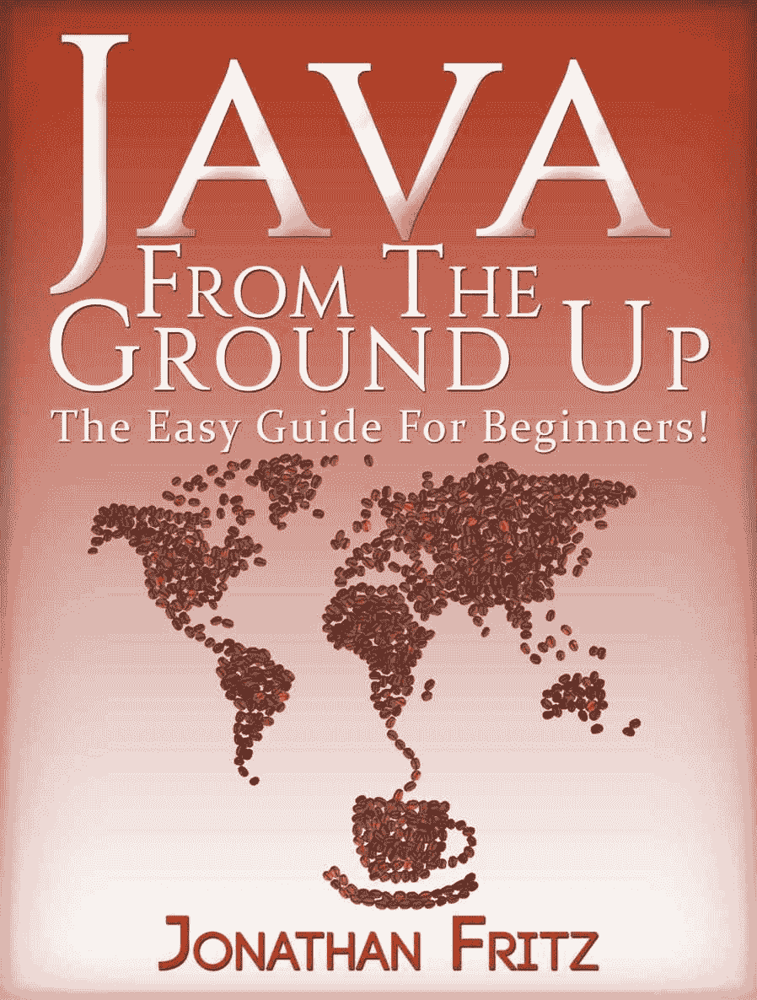
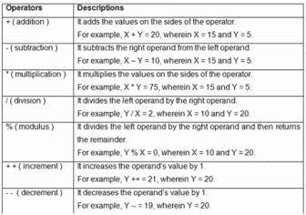
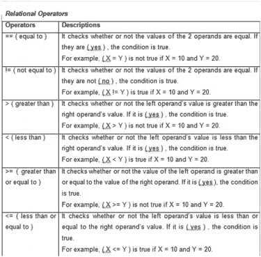
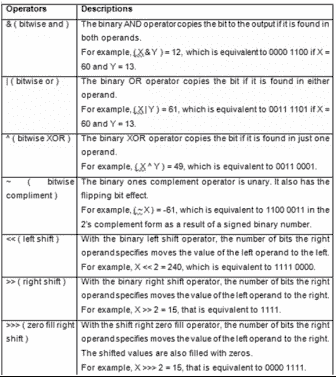
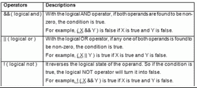
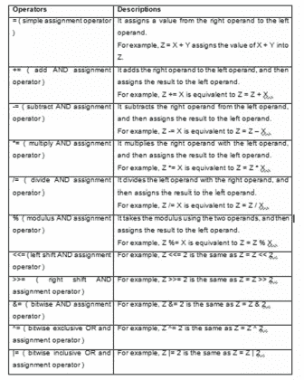

# JAVA 入门指南：初学者简易指南



# 引言

本书包含了如何使用 `Java` 编程语言创建程序的成熟步骤和策略。它还包含了每个初学者都应该注意的主题细节。

本书还包含了关于你在 `Java` 中发现的特有用信息，以及为什么 `Java` 是一个很好的程序语言。你还将发现一些示例程序，可以在编写自己的程序时将它们作为指南。

感谢下载本书，希望你喜欢！

# 第一章：Java 简介

`Java` 是一种于 1991 年在 Sun Microsystems 创建的面向对象的编程语言，该公司以其高级 Unix 工作站而闻名。该编程语言以 `C++` 为模型，最初的设计目标是简单、小巧，并兼容各种操作系统和平台。

`Java` 通常与 `HotJava` 归为一类，`HotJava` 是孙的一个浏览器，类似于 `Mosaic` 或 `Netscape`。`HotJava` 与其他浏览器最明显的区别可能是它在你的系统中运行和下载 applet（小程序）的能力。这些 applet 像其他图像一样出现在你的网页中，但它们是交互性和动态的。你可以用它们制作动画和图形，以及其他对你的输入有响应的内容。

尽管 `HotJava` 是第一个托管 applet 的网页浏览器，但 `Java` 的支持很快在许多其他浏览器中可用。例如，`Netscape 2.0` 支持 `Java` applet。

如果你想开发 applet，你必须使用 `Java` 编写程序并对其进行编译。参考 HTML 网页中的 applet。像处理任何其他图像或 HTML 文件一样，将你的 `Java` 和 `HTML` 文件放置在网站上。当其他人使用 `HotJava` 浏览器查看你的网页时，浏览器会自动将嵌入的 applet 下载到他们的本地系统并运行。读者随后可以以他们想要的方式查看并与 applet 交互。

请记住，除了开发 applet 外，你还可以用 `Java` 做很多事情。这种编程语言的编写方式有助于你解决问题和完成任务，就像你使用 `C` 语言或 `C++` 一样。事实上，`HotJava` 包括它的显示、网络和界面都是使用 `Java` 创建的。

## Java 简介

计算机语言的创新主要受两个因素的影响：编程的改进和计算环境的变化。通过 `Java`，你仍然找到 `C` 和 `C++` 中的元素，但具有更多功能和改进。该编程语言以重构编程以实现更好架构的功能为傲。

`Java` 是 `James Gosling`、`Chris Wrath`、`Patrick Naughton`、`Mike Sheridan` 和 `Ed Frank` 的结晶。它在 Sun Microsystems 开发，最初被称为“Oak”。后来在 1995 年，它的名字被改为 `Java`。`Java` 的原始目的不是连接互联网，而是作为一种平台无关的语言，用于为各种电子设备开发软件，包括遥控器和微波炉。不同类型的 CPU 被用控制器。然而，在那个时代，计算机语言大多被设计为为特定目标进行编译。

尽管为任何类型的 CPU 编译 `C++` 程序是可能的，但这需要为该特定 CPU 提供一个完整的编译器。由于编译器的创建需要大量时间且成本高昂，`Gosling` 和他的团队寻找一种更具移植性的语言，能够产生与不同环境中的不同 CPU 兼容的代码。最终的结果就是 `Java` 编程语言。

## 原理与平台

`Java` 有五个主要目标：它必须简单、熟悉且面向对象；它必须安全且健壮；它必须可移植且与架构中立；它必须执行高效；它必须是动态、解释性和多线程的。

移植性是 `Java` 的设计目标之一。这意味着为该平台创建的程序要在具有足够运行时操作系统组合上运行。这通过将语言代码编译为被称为 `Java bytecode` 的中间表示来实现，而不是特定架构的机器码。

请注意 `Java` 的字节码指令与机器码类似。然而，它们旨在由一种特殊的、为主机硬件制造虚拟机 (`VM`) 执行。运行时环境通常由用户使用。它被安装在浏览器中用于 applet，或者安装在机器上用于独立应用程序。

## 实现与性能

目前，`Java` 平台由 `Oracle Corporation` 所有。他们的实现适用于 `Microsoft Windows`，包括 `XP`。它也适用于 `Solaris`、`Mac OS X` 和 `Linux`。这种实现实际上是事实标准，因为 `Java` 没有一个被 `ANSI`、`ISO/IEC`、`Ecma International` 或任何第三方标准组织认可的正式标准。

这种实现也被封装成两个发行版本：包含调试器、`Jar`、`Javadoc` 和 `Java compiler` 等开发工具的开发工具包，以及运行程序所需的平台部分的运行时环境。另一个以 `GNU GPL` 许可的 Java 实现是 `OpenJDK`。它的实现是从 `Java` 源代码根据 `GPL` 发布开始的。自 `Java SE 7` 以来，一直是官方的参考实现。

`Java` 的目标是让每个实现相互兼容。`Sun` 使用 `Java` 的商标许可实际上坚持所有实现必须兼容。正因如此，当 `Sun` 声称 `Microsoft` 的实现不支持 `JNI` 或 `RMI` 时，引发了法律纠纷。`Sun` 起诉了 `Microsoft` 并在 2001 年获得了 2000 万美元的和解。`Microsoft` 不再随 `Windows` 自带 Java。

在性能方面，所有用 `Java` 创建的程序都以运行缓慢和需要大量内存而闻名。然而，自从 1997 和 1998 年引入即时编译（just-in-time compilation）以来，`Java` 的执行速度显著提高。此外增加了更多支持更好代码分析的语言特性，包括内部类、可选断言和 `StringBuilder`。同时还引入了如 `HotSpot` 等优化技术。

## Java 的目的

Java 的创建目的是为了安全性和移植性。

### 安全性

每次下载一个程序时，你实际上面临着风险，因为下载的代码可能包含病毒。恶意代码是有害的，因为它可以在未经授权的情况下访问你的系统资源。例如，病毒程序可能会获取隐私和敏感信息，如密码和信用卡详情。它是通过搜索你计算机的本地文件系统来实现的。幸运的是，`Java` 通过将 applet 限制在其执行环境中并防止其访问计算机的其他部分，实现了 applet 的安全下载。事实上，安全性被认为是 `Java` 最具创新性的方面。你可以下载 applet 而而不必担心任何内容会破坏你计算机系统的安全性。

### 可移植性

互联网的主要特征之一就是可移植性。连接到互联网的有许多不同的操作系统和计算机。因此，如果一个使用 `Java` 的程序几乎可以在任何连接互联网的计算机上运行，那么必须有某种机制使该程序能够在多个系统上执行。例如，当使用 applet 时，它必须能够被连接到互联网的各种操作系统、浏览器和 CPU 下载并执行。在不同的计算机系统上使用不同类型的 applet 不是一个好主意。请记住，相同的代码能够在所有类型的计算机上运行。这意味着你需要某种东西来生成可移植的可执行代码。此外，记住相同的机制应该能够确保安全性并创建可移植性。

### 术语

现在你已经了解了为什么要创建 `Java`，你必须学习与它相关的术语。除了安全性和移植性之外，还有许多其他因素在其开发过程中起着至关重要的作用。编程语言的设计团队在以下术语列表中总结了其核心考虑因素：

### 简单 (Simple)

- 易学习和使用。
- 它让编写程序变得更容易、更方便。
- 它允许轻松表达。
- 它拥有一组凝聚且简洁的特性。
- `C++` 中发现的大多数令人困惑或复杂的特性在 `Java` 中并不存在。

### 安全 (Secure)

- 通过封装提供数据安全。
- 它允许为 applet（一种可以从一台计算机自动下载到另一台计算机的小型程序）编写安全性的代码。
- 在 applet 能够访问系统资源时，安全性不会受到损害。
- applet 在 `JVM` 内部运行，保护它们免受对系统资源的非法或未经授权的访问。

### 可移植 (Portable)

- 用 `Java` 创建的应用程序可以被认为是可移植的，因为它们可以在使用任何操作系统或 CPU 的任何计算机上执行。
- 当应用程序编译时，它们会生成称为字节码（bytecodes）的中间代码文件。
- 这些字节码使得 `Java` 可移植。它们也可以被带到任何类型的计算机上直接执行。

### 面向对象 (Object – Oriented)

- `Java` 有面向对象的模型。
- 因此，它支持封装、多态、继承和抽象等特性。

### 健壮 (Robust)

- 当 `Java` 中的应用程序和程序能够对上下文做出响应时，它们被描述为健壮的。
- `Java` 具有使其程序变得健壮的特性，例如异常处理和类型检查。

### 多线程 (Multithreaded)

- `Java` 支持多线程，但 `C` 或 `C++` 不支持。
- 线程是一种轻量级进程，多线程可以提高 CPU 的效率。
- 程序可以被分成不同的线程，每个线程并发或与其他线程并行执行。

### 架构中立 (Architecture – Neutral)

- 字节码帮助编程语言变得可移植。
- 字节码可以在运行任何类型 CPU 或操作系统的计算机上执行。
- `Java` 被认为是架构中立的，因为它的应用程序可以在任何类型的 CPU 上执行。

### 高性能和解释执行 (High Performance and Interpreted)

- 1.0 版本专门提供了一个用于执行字节码的解释器。
- 与编译器相比，解释器较慢。这就是为什么使用 `Java` 的程序往往执行得缓慢。
- 在 1.0 版本之后，即时编译器（`JIT`）取代了解释器。
- 即时编译器（`JIT`）利用了 Sun Microsystems 的 `Hot Spot` 技术。
- 即时编译器（`JIT`）逐个将字节码转换为机器码，并将其缓存以备后用。
- 程序的性能得到了增强，从而允许它们快速执行。

### 分布式 (Distributed)

- `Java` 支持使用远程方法调用（`RMI`）概念的分布式计算。
- 允许客户端和服务器相互通信。当计算在可用计算机之间分配时，程序会被快速执行。
- 资源在分布式系统中共享。

### 动态 (Dynamic)

- 关于对象和程序本身的大多数运行时信息由 虚拟机（`JVM`）维护。
- 在运行时，库是动态链接的。
- 因此，即使你对代码进行动态更改，程序也不会受到影响。

# 第 2 章：程序结构与语法

所有用 `Java` 编写程序都由类组成。类基本上是一个用于创建对象的模板。每个对象都包含成员，成员可以是方法或字段。方法是对作为参数传递的值或对象的操作，而字段实质上是一个存储值的容器。

## 程序的结构

考虑以下示例程序：

```java
package sct;

public class HelloJavaWorld {
    /*
     * comments
     */
    public static void main(String[] args) {
        // Comment : printing the output on console
        System.out.println("Wendy says Hello World");
    }
}
```

如你在上面的示例所示，程序有五个部分：`package sct`、`public class HelloJavaWorld`、注释部分、`public static void main(String[] args)` 以及 `System.out.println("Wendy says Hello World")`。让我们详细每个部分。

首先，`package sct` 是包声明语句。它定义了存储类的命名空间。包根据功能组织类。当你不包含包语句时，你将类名放在没有名字的默认包中。注意，包语句不允许出现在程序的任何地方。你的包语句要么出现在第一行，要么被省略。

`Public class HelloJavaWorld` 是一行包含多种编程面向的代码。`Public` 是一个访问修饰符关键字，命令编译器访问类。不同的访问修饰符值可以是 `private`、`public`、`protected` 以及无值（默认值）。`Class` 是一个用于声明类的关键字。类名（在本例中为 `HelloJavaWorld`）紧随其后。

注释部分是程序中你放置单行注释或块注释的区域。如果你选择编写单行注释，必须在注释的开头使用一对正斜杠（`//`）。同样，你必须在同一行注释的末尾加上这些正斜杠。请记住，在写单行注释时，不再需要结束符号。

相反，块注释以正斜杠和星号（`/*`）开始，以星号和正斜杠（`*/`）结束。

关于变量名需要记住的另一个重要点是，这些名称可以以下划线（`_`）、美元符号（`$`）或字母开头。但它们永远不能与数字开头。对于像 `@`、`%` 和 `*` 等符号或特殊字符，它们可以用于运算符，但不能用于变量名。因此，编写变量名时必须非常小心。

此外，请注意 Java 使用了 `Unicode`，这是一种字符集定义，提供了 `ASCII` 字符以及代表国际字母的其他字符。只要字符的具有大于 `00C0` 的 `Unicode` 字符编号，你实际上可以在变量名中使用字形和重音字符。

## 变量类型

对于每一个变量声明，必须有一个变量类型来定义该变量可以存储的任何值。这种变量类型可以是以下任意一种：数组、类名或基本原始数据类型。共有八种原始数据类型，用于处理浮点数、整数、`Boolean` 值和字符的基本类型。它们被称为原始数据类型是因为它们是内置在系统中的。它们并不是真正的对象，这就是为什么它们效率更高。它们还与机器无关，因此它们的特性和大小在每个程序中始终保持一致。

在 Java 中，有四种可用整数类型，每种都有不同的值范围。它们都是有符号的，因此能够容负数或正数。无论你为变量选择何种类型，都取决于你希望该变量存储的值范围。如果值对于你的变量类型来说太大了，它会被截断。

## 关键字

与其它编程语言一样，`Java` 中使用了保留字。这些单词不能用作变量、常量或任何标识符名。以下是 Java 中使用的关键字：

## 注释

在本书的之前章节的示例程序中，你已经读过注释了。`Java` 支持单行注释和多行注释。这些注释实际上与 `C` 和 `C++` 的注释非常相似。当你创建注释时，编译器会忽略其中所有的字符。

请看下面的示例：

```java
public class HelloJavaProgram {
    /* 这是一个用 Java 编写的程序示例。
     * 将打印输出 ‘ Hello Java World ‘。
     * 这是一个多行注释。
     */
    public static void main ( String [] args ) {
        // 这是一个单行注释示例。
        /* 这是另一个单行注释示例。 */
        System.out.println (“ Hello Java World ”);
    }
}
```

记住，注释是不可能嵌套的。这意味着你不能将注释放在另一个注释内部。如果你使用单行注释，则必须使用双斜杠（`//`）。到该行结束为止的所有文本都不会被程序读取。

以 `/*` 开头并以 `*/` 结尾的注释是特殊的注释。它们被用于 `Javadoc` 系统，该系统对于从代码生成 API 文档是关键的。

## 字面量

这些用于指示程序中的简单值。字面量（literal）是 `Java` 中的一个术语，实际上意味着你输入什么，你就会得到什么。所以，如果你输入 `3`，你将获得一个值为 `3` 的整数。如果你输入 `w`，你将获得一个值为 `w` 的字符。

### 数字字面量

`Java` 中主要有两种类型的数字字面量：精确和近似。

精确数字字面量是指不带小数点的数值。例如，`+28`、`-100` 和 `11` 都是不带小数点的数值。当你在 `Java` 中使用整数语法时，精确数字字面量将支持 `long` 范围内的数字。

另一方面，近似数字字面量是用科学计数法表示的数值。`+11.4`、`29` 和 `-99.9` 都是这种类型的示例。当你在 `Java` 中使用浮点字面量语法时，你会发现近似数字字面量实际上支持 `double` 范围内的数字。

整数字面量有不同的类型。例如，数字 `5` 是一个 `int` 类型十进制整数字面量。尽管如此，你也可以将其赋值给类型为 `short` 或 `byte` 的 `var`，因为合适。如果值对于你的变量类型来说太大了，它会被截断。

对于浮点字面量，它们通常包含两个部分：整数和小数。无论精度如何，它们的结果都是 `double` 类型数字。如果你想强制让一个数字成为 `float`，可以在其后面附加 `F`，例如 `2.56F`。此外，你可以通过字母 `E` 或 `e` 使用指数。它甚至可以是一个负数。例如，你可以写 `.36E-2` 或 `10e45`。

### 布尔字面量

这些字面量是 `true` 或 `false`。关键字 `true` 和 `false` 对大小不敏感，因此你可以用大写或小写字母编写，计算机读取结果相同。你还可以在程序中任何需要测试或作为唯一可能的布尔值的地方使用它们。

### 字符字面量

这些字面量使用带有单引号的单个字符表示，例如 `'w'`、`'5'` 和 `'#'`。字符实际上在 `Unicode` 中存储为 16 位字符。以下是表示不可打印字符和包含在 Unicode 中的字符的特殊代码列表。注意 Unicode、八进制和十六进制转义中的字母代表十六进制数字或数值。

如果你习惯用 `C` 或 `C++` 编写程序，你可能会发现 `Java` 中没有包含 `\v`（垂直制表符）或 `\a`（响铃）的字符代码。

## 字符串字面量

字符串本质上是字符的组合。在 `Java` 中，字符串是 `String` 类的实例。由于字符串对象被视为真实的对象，它们拥有允许你轻松测试、修改和组合字符串的方法。当你编写字符串字面量时，你必须在双引号内编写其他字符。请看下面的示例：


# 第 4 章：运算符

运算符基本上是用于表达式的特殊符号，例如算术运算符以及用于大小和等性测试的运算符。由于它们返回值，因此可以将它们的结果赋值给变量。你还可以在其他语句中测试这些值。Java 中的运算符包括算术运算符、关系运算符、位运算符、逻辑运算符、赋值运算符和杂运算符。

## 算术运算符

这些运算符的使用方法与数学表达式相同。



为了帮助更好地理解算术运算符，请考虑以下示例程序：

```java
class ArithmeticTesting {
    public static void main ( String [ ] args ) {
        short w = 6 ;
        int n = 4 ;
        float d = 12.5f ;
        float y = 7f ;
        System.out.println ( “ w is “ + w + “ , n is “ + n ) ;
        System.out.println ( “ w + n = “ + ( w + n ) ) ;
        System.out.println ( “ w - n = “ + ( w – n ) ) ;
        System.out.println ( “ w / n = “ + ( w / n ) ) ;
        System.out.println ( “ w % n = “ + ( w % n ) ) ;
        System.out.println ( “ d is “ + d + “ , y is “ + y ;
        System.out.println ( “ d / y = “ + ( d / y ) ) ;
    }
}
```

如果你运行上述示例程序，你将得到以下输出：

w is 6, y is 4

w + n = 10

w – n = 2

w / n = 1

w % n = 2

d is 12.5 , y is 7

d / y = 1.78571

正如示例程序所示，在 `main()` 方法中最初定义了四个变量。这些变量是 `int` 类型（整数）以及 `float` 类型（浮点数）。请注意，浮点字面量的默认类型是 `double`。因此，你必须确保你使用的数字是 `float` 类型。你可以通过在数字后加上字母‘f’来实现。程序的其余部分简单地对浮点数和整数执行数学运算。然后打印结果，如输出所示。

你可能对 `System.out.println()` 方法感到好奇。这个方法只是简单地将消息打印到系统的输出中。这可以是屏幕、一个特殊的日志文件或一个特殊的窗口。这完全取决于你的开发环境和系统。该方法还接受一个参数，即字符串。尽管如此，如果你想将值连接成字符串，也可以使用 `+` 号。

## 关系运算符



## 位运算符

在 Java 中，位运算符通常应用于整数类型，`byte`、`char`、`short`、`long` 和 `int`。它们对位进行操作并执行逐位操作。



## 逻辑运算符



## 赋值运算符



## 杂运算符

在 Java 中，编程语言还支持其他几种运算符。

### 三条件运算符 ( ? : )

该运算符通常也被称为三元运算符。它由三个操作数组成，用于评估布尔表达式。它的主要目标是确定必须将哪个值分配给变量。它的写法如下：

`variable w = ( expression ) ? value if true : value if false`

为了帮助你进一步理解条件运算符，请看以下示例：

```java
public class Test {
    public static void main ( String args [ ] ) {
        int x, y ;
        x = 10 ;
        y = ( x == 1 ) ? 20 : 30 ;
        System.out.println ( “ The value of y is : “ + y ) ;
        y = ( x == 10 ) ? 20 : 30 ;
        System.out.println ( “ The value of y is : “ + y ) ;
    }
}
```

如果你运行上述示例程序，你将获得：

The value of y is : 30

The value of y is : 20

### instanceof 运算符

该运算符仅用于对象引用。它验证一个对象是否属于特定类型（接口类型或类类型）。它的写法如下：

`( Object reference ) instanceof ( class type )`

当运算符左侧的变量引用一个对象并通过了接口和类类型的 IS-A 检查时，结果将变为 true。请看以下示例程序：

```java
public Class Test {
    public static void main ( String args [ ] ) {
        String name = “ Jesus “ ;
        // 以下代码返回 true，因为 name 是字符串
        boolean result = name instanceof String ;
        System.out.println ( result ) ;
    }
}
```

运行上述程序，你会得到：

true

# 第 5 章：循环

循环允许语句重复执行。在 Java 中，有三种主要的循环：`while`、`for` 和 `do while`。

## while 循环

`while` 循环在条件为真时测试语句。为了帮助你进一步理解这一主题，请看以下示例：


运行上述程序，你会得到：

Please enter a value

7

You have entered 7

Please enter a value

-2

It of loop!

## for 循环

`for` 循环多次执行语句。你可以初始化多个变量，也可以测试许多条件并对许多变量进行加减操作。如果你不再希望循环继续并希望终止它，只需按下 `Ctrl + C`。

考虑以下示例程序，它打印前十个自然数。

```java
class ForLoop {
    public static void main ( String [ ] args ) {
        int w ;
        for ( w = 1 ; w <= 10 ; w++ ) {
            System.out.println ( w ) ;
        }
    }
}
```

运行上述示例，你会得到：

1

2

3

4

5

6

7

8

9

10

## do...while 循环

`do...while` 循环与 `while` 循环相似，不同在于它在最后测试条件。请看以下示例：

```java
public Class Test {
    public static void main ( String args [ ] ) {
        int w = 20 ;
        do {
            System.out.print ( “ The value of w is “ + w ) ;
            w ++;
            System.out.print ( “ \n “ ) ;
        } while ( w < 30 ) ;
    }
}
```

运行上述示例程序，你将得到：

The value of w is 20

The value of w is 21

The value of w is 22

The value of w is 22

The value of w is 23

The value of w is 24

The value of w is 25

The value of w is 26

The value of w is 27

The value of w is 28

The value of w is 29

# 第 6 章：异常

异常用于处理错误。它也可以用于处理破坏程序正常流的异常事件。在 Java 中，异常有几种发生方式：

*   对象为空。
*   网络连接丢失。
*   提供的数据格式不符合预期。
*   数据库未连接。

## 检查异常与非检查异常

### 检查异常

这些是 `Exception` 的子类，但 `RuntimeException` 及其子类除外。它们强制你处理所遇到的任何异常。当这些异常在方法中发生时，该方法必须接收这些异常并采取适当的措施，或者将它们传递给调用者。`ArithmeticException` 就是检查异常（checked exception）的一个示例。

### 未检查异常

这些异常包括 `RuntimeException` 及其所有子类。对于未检查异常，编译器不会强制你捕获它们或在 `throws` 子句中声明它们。你可能根本不知道此类异常可以被抛出。这些异常（运行时异常外）必须在编译期间被接收。`ArrayIndexOutOfBoundsException` 是一个未检查异常的一个示例。

## 异常处理

作为一名程序员，你必须知道如何处理异常，以便开发出健壮的应用程序。异常处理意味着在发生异常时，将程序的执行转移到适当的处理器中。你可以使用 `try` 块和 `catch` 块来处理异常。

`try` 块包含可能发生异常的语句。其后跟着一个 `catch` 块，用于处理与 `try` 块相关的任何异常。它后面应该始终紧跟一个 `catch` 块、一个 `finally` 块或两者都有。

`catch` 块用于匹配异常。它始终与 `try` 块相关联。一个 `try` 块可以有多个 `catch` 子句。如果 `try` 块内部发生异常，则必须执行相应的 `catch` 块。

只要有 `try` 块，`finally` 块就会始终执行。然而，它的作用不仅仅是在异常处理期间执行。它还允许你避免处理那些因 `continue`、`break` 或 `return` 而意外跳过的清理代码。即使你不预料会发生任何异常，始终将清理代码放在 `finally` 块中也是一个好习惯。

# 结

感谢你下载本书！

希望这本书能够帮助你从初学者的角度学习 Java 编程语言。

下一步是应用你从这本书书中中学到的知识。

你喜欢这本书吗？

如果你喜欢这本书，请在 Amazon 上给出你的评价：[点击这里！](https://www.amazon.com/review/create-review?ie=UTF8&asin=B01BGRESWG&channel=detail-glance&nodeID=133140011&ref_=cm_cr_dp_no_rvw_e&store=digital-text)

如果你认为这本书值得分享，愿意花几秒钟让你的朋友知道它吗？

如果事实证明它改变了他们的生活，他们将永远感激。

正如我一样。

祝好，

Jonathan Fritz
