# Java 从零到精通

Patrick Felicia

# 致谢

作者：Patrick Felicia。

Patrick Felicia 是沃特福德理工学院的讲师和研究员，在那里教学并指导本科生和研究生。他于2003年在爱尔兰科克大学获得多媒体技术硕士学位，并于2009年获得计算机科学博士学位。他出版了多关于将视频游戏用于教育目的的书籍，包括《通过教育游戏提高学习和动机的研究：多学科方法》（IGI 出版）和《学校中的数字游戏：教师手册》（欧洲 Schoolnet 出版）。Patrick 还是《国际游戏化学习杂志》(IJGBL) 的主编以及爱尔兰游戏化学习研讨会的会议主席（这是一场在全爱尔兰范围内举办的关于游戏与学习的热门会议）。他还编写了关于通过创建游戏使用 Java 进行编码的书。

技术审核员：Garth Flint

# PAT 的其他书籍

# 本书的支持与资源

本书建立了一个配套网站，您可以在该网站上下载本书的完整项目，其中包含了书中使用的所有代码，以便您将自己的代码与代码解决方案进行比对。

要获取这些内容，您可以打开以下链接：

http://learntocodewithpat.com/Java/

该网站还为您提供了订阅邮件列表的机会，并可以接收：

- PDF 格式的电子书（免费副本），以便您可以在任何电脑上打开它。
- 关于 Java 的定期更新和教程。
- 可以在购买我部分书籍享受 30% 以上折扣的优惠券。

本书献给 Mathis & Helena

# 前言

本书是名为“Java 从零到精通”系列丛的一部分。在该系列书中，您将有机会从零开始学习 Java 编程，并精通这种流行的编程语言。

在名为《Java 从零到精通（初学者）》的书中，您将发现如何快速上手 Java；您将学习如何使用变量、方法、条件语句，并编写您自己的代码。

## 使用本书需要什么条件

要完成书中介绍的项目，您只需要安装 Java 软件开发工具包 (SDK) 和您任选的集成开发环境 (IDE)。

在计算机技能方面，书中介绍的所有知识都假设您没有任何先前的编程经验。虽然书中包含了编程内容，但您将获得一步步的指导。因此，目前您只需要能够执行常见的计算机任务，如打字、打开和保存文件。

## 本书的读者群

如果您对所有这些问题的回答都是**是**的，那么这本书就适合您：

- 您是 Java 编程的完全初学者吗？
- 您想快速上手 Java 概念吗？
- 尽管您可能已经接触过 Java，但您想进一步深入研究 Java 吗？

如果您对所有这些问题的回答都是是的，那么这本书**不**适合您：

- 您已经可以轻松地用 Java 编写代码了吗？
- 您正在寻找一本 Java 的参考书吗？
- 您是一位丰富的（或至少是高级的）Java 程序员吗？

如果您对这三个问题的回答都是是，您可以寻找该系列中的其他书籍。要查看这些书籍的内容和主题，可以访问官方网站：**http://learntocodewithpat/Java.**

## 改进书籍

如果您发现任何错误或有改进建议，请发送电子邮件至 learntocodewithpat@gmail.com。您的反馈将不胜感激，并有助于为未来的读者改进书籍。

报告错误时，请包含：

- 发现错误所在的页码。
- 原始文本和建议的修改内容。
- 错误的性质（例如：拼写错误、事实错误、格式问题）。

感谢阅读本书，希望它对您的 Java 学习之旅有所帮助。

## 你将如何通过本书进行学习

由于所有学生的学习方式都不同，对课程的预期也不同，本书的设计旨在确保所有读者都能找到适合自己的学习模式。因此，它包含以下内容：

- 每一章开头都有学习目标列表，让你对将要获得的技能有一个直观的了解。
- 节都包含所涵盖活动的概述。
- 所有活动都是循序渐进的，你还可以通过每章末尾提供的挑战获得更深层次的学习和解决问题能力的机会。
- 每一章最后都有测验和挑战，你可以通过它们来测试你的技能（以及学到的知识）。挑战包括根据你在章节中学的知识进行编码、调试或创建新功能。
- 本书侧重于你需要的的核心技能。虽然某些章节涉及更详细的内容，但在解释概念后，必要时会提供额外资源的链接。
- 代码是循序渐进引入的，并进行了详细的解释。

## 章节的格式和编写规范

在本书中，为了让阅读和学习更加容易，将使用文本格式和图标来突出所提供的信息部分，并使书籍易于阅读。

## 特别说明

每章都包含一个资源部分，让你进一步加深对 Java 的理解和掌握；这些包括：

- 每章一个测验：这些测验通常包含10道题，测试你对整个章节涵盖主题的理解。解答紧随测验之后。
- 检查清单：它由 5 到 10 个关键概念和技能组成，在进入下一章之前需要熟练掌握它们。
- 挑战：每章都包含一个挑战章节，要求你结合技能来解决特定问题。

作者注释显示所示：

> 作者的建议出现在此框中。

代码显示如下所示：

```java
public int score;
public String playersName = "Sam";
```

包含章节重点的检查清单显示如下所示：

- 检查清单项目 1。
- 检查清单项目 2。
- 检查清单项目 3。

## 如何从本书中学习得最好？

- **向你的朋友讲述你正在做的事情。**

我们通常认为自己理解某个主题，直到必须向朋友解释它并回答他们的问题。通过解释你的不同项目，你刚刚学到的对你来说将变得清晰。

- **做练习。**

所有章节都包含练习，帮助你通过实践来学习。换句话说，通过完成这些练习，你将能够更好地理解主题并获得实践技能（而不是不仅仅是阅读）。

- **不要害怕犯错。**

我通常告诉我的学生犯错是学习过程的一部分；犯的错越多，学习的机会就越多。在开始时，你可能会发现错误具有挑战性，或者在你理解哪里出了问题之前，发现你的程序没有按照预期运行。

- **挑战自我。**

所有章节都包含一个挑战章节，你可以在那里决定承担特定的挑战来提高你的编程或技能。这些挑战是为了让你创造性地思考，并以基于问题的方法应用你在每章中学到的知识。

- **分块学习。**

连续读五六章可能可能有挑战性，因为这可能会降低你的积极性。相反，给自己留出足够的时间学习，并以小单位进行学习（例如，每天15到20分钟）。这至少能为你做两件事：它会让你的大脑有时间“消化”你刚刚学习的信息，以便你第二天能够重新开始。它还能确保你不会崩溃，并保持高水平的积极性。

## 反馈

虽然我已经尽一切努力编写出一本高质量且有价值的书，但我一直感谢读者的反馈，以便对书籍相应的改进。如果你想对本书提供反馈，可以发送电子邮件给我：learntocodewithpat@gmail.com。

# 1 Java 编程简介

> “这个国家的每个人都应该学会编写计算机程序，因为它能教你如何思考”
>
> — 史蒂夫·乔布

在本节中，我们将对 Java 进行介绍，并查看其关键方面，包括：

- 语法
- 变量
- 方法

在完成本章后，你将能够：

- 理解 Java 的核心概念
- 理解如何使用变量
- 创建并使用方法

本章的解答包含在资源包。

## 什么是 JAVA

Java 是由 Sun 公司开发的高级面向对象的语言。它是一种多平台语言，这意味着一旦编写并编译，Java 应用程序就可以在大多数平台上运行。Java 用于许多目的，包括移动应用程序甚至游戏。

## 选择代码编辑器

在接下来的章节中，你将开始编写代码。为此，你需要使用代码编辑器，更具体地说，是一个集成开发环境（IDE）。这些 IDE 包含了编译和执行代码所需的所有工具，并具有以下功能：

- 文本高亮：让代码更清晰。
- 自动补全：让你不需要记住代码中的所有变量或某些方法的名称。
- 错误高亮：在测试代码之前突出显示明显的错误。

有许多免费的 IDE 各自有优缺点，包括：

- BlueJ
- Eclipse
- IntelliJ IDEA
- NetBeans

考虑到所有 IDE，我们将在中使用 BlueJ，尽管你也可以使用任何其他 IDE。BlueJ 是一个专门为初学者设计的 IDE。它不会用过多的功能淹没你，而是帮助你入门 Java，并在过程中提供非常有用的功能，例如类图或颜色标记的代码。

你可以从以下网站下载 BlueJ：https://www.bluej.org/

## 安装 JAVA

在使用 Java 之前，你需要安装最新版本的开发工具包（JDK）。JDK 包含了编写、编译和运行 Java 代码所需的所有库。

要这样做，请执行以下操作：

1. 打开以下页面：https://www.oracle.com/technology/Java/Javase/downloads/index.html
2. 寻找最新版本的 Java SE 开发工具包。
3. 下载最新的 Java SE DK：在本书编写时，Java 的最新版本是 Java SE 11.0.2。
4. 点击下载按钮后，将出现一组新选项，你可以接受许可协议后从中选择你想要下载的版本。
5. 一旦你下载了软件，请启动它并按照说明操作。

## 安装 BLUEJ

安装好 Java SDK 后，是时候安装 BlueJ 了，BlueJ 是你将在本书中编写代码的 IDE（集成开发环境）。BlueJ 的设计初衷是针对初学者，包含了许多便于创建 Java 应用程序的功能。现在，让我们安装这个软件吧：

1. 请打开以下链接：https://www.bluej.org/.
2. 下载与你的操作系统相对应的 BlueJ 版本（例如：适用于 Mac OS、Windows 或 Linux）。

如果你正在使用 Windows 电脑：

1. 双击你下载的安装文件。
2. 这将运行标准安装。按照屏幕上的说明操作。安装程序将安装可执行文件 `bluej.exe`。
3. 如果执行 BlueJ 时出现对话框询问你是否要阻止或取消阻止 BlueJ，你可以选择不阻止 BlueJ，以便它可以无缝启动。
4. 第一次启动 BlueJ 时，如果你的电脑上安装了多个 Java 版本，系统会要求你选择你偏好的版本。

如果你正在使用 Mac：

1. 下载 Mac 版的安装程序（这是一个 zip 文件）。
2. 解压 zip 文件；这将创建一个名为 BlueJ 的文件夹。
3. 将生成的文件夹移动到你的“应用程序”（Applications）文件夹中。
4. 然后你只需点击名为 BlueJ 的图标来启动此应用程序。

## 创建你的第一个应用程序

在简短的介绍之后，现在轮到你编写代码了。

为了让你能够尝试你的 Java 代码，请在安装 BlueJ 后执行以下操作：

1. 请启动 BlueJ。
2. BlueJ 启动后，从顶部菜单选择：`Project` | `New Project` 来创建一个新项目。
3. 在弹出的窗口中，为你的项目选择一个名称和位置，并点击“OK（确定）”。
4. 完成后，会出现一个新窗口，让你能够创建你的第一个程序。
5. 点击窗口左侧名为“New Class（新建类）”的按钮。这将打开一个新窗口。
6. 在属性“Class Name（类名）”的文本字段输入你喜欢的名称，将其他所有选项保持默认，并按“OK（确定）”。
7. 你应该可以看到项目中创建了一个名为 `MyClass` 的新类。
8. 双击标记为“MyClass”的图标。
9. 这将打开一个新窗口，显示为你的新类默认创建的代码：

```java
/**
* 在此处编写 MyClass 类的描述。
* @author (你的名字)
* @version (版本号或日期)
*/
public class MyClass
{
    // 实例变量 - 用下面的示例替换为你自己的代码
    private int x;

    /**
     * MyClass 类对象的构造函数
     */
    public MyClass()
    {
        // 初始化实例变量
        x = 0;
    }

    /**
     * 方法示例 - 将此注释替换为你的
     * @param y 方法的参数
     * @return x 和 y 的和
     */
    public int sampleMethod(int y)
    {
        //在此处输入你的代码
        return x + y;
    }
}
```

由于我们不会使用所有这些代码，请执行以下操作：

1. 选择所有代码（`CTRL + A`）。
2. 按 delete 键删除所有代码。
3. 输入以下代码：

```java
public class MyClass
{
    public static void main(String[] args)
    {
        System.out.println("Hello World");
    }
}
```

我们将使用 Java 虚拟机来运行代码。

如图所示，Java 虚拟机（JVM）作为你的字节码和计算机之间的翻译器。

编译你的代码，点击 `Compile`（编译）按钮。

你现在可以点击 `Compile` 编译按钮，在控制台中看到输出：“Hello World”。

## JAVA 语法简介

现在你已经创建、编译并执行了你的第一行代码，让我们来看 Java 语法吧。

当你使用 Java 时，你正在与系统通信，要求它执行某些操作。为了与系统通信，你正在使用一种语言或一组由计算机和你双方都认识并理解的语法所约束的单词。这种语言由关键字、短语以及确保指令被正确编写和（更重要的是）被正确理解的语法组成。

在计算机科学中，这种语言需要是准确、精确、无歧义且具有正确的语法。换句话说，它需要是精确的。

在编写 Java 代码时，你将遵循一种语法；这种语法由一组规则组成，让你能够无歧义地传递你的指令。除了语法之外，Java 还使用了类，你的 Java 代码默认将保存为类。

在下一节中，我们将学习如何使用这种语法。如果你已经编写过 JavaScript，那么本章其余部分提供的信息可能看起来很熟悉，这种对其他编程语言的先前接触绝对对你有帮助。

在 Java 中编程时，你将使用特定的语法与系统通信；这种语法将由句子组成，用于传达你想让计算机执行的操作信息；这些句子或语句将包含关键字、变量、方法或事件的组合；下一节将解释你如何有信心地构建这些句子，并因此在 Java 中编程。

### 语句

在 Java 中编写代码时，你需要使用语句（statements）来告诉系统执行指令（例如，打印信息）。语句字面上意思是一个命令或你要求系统执行的操作。例如，在下一行代码中，语句将告诉系统在**控制台**（Console）窗口中打印一条消息：

```java
System.out.println("Hello World");
```

在编写语句时，你需要遵循几条规则，例如：

- **语句的顺序**：每个语句按照它们在应用程序中出现的顺序依次执行。例如，在下一个示例中，代码将先打印 **hello**，然后打印 **world**；这是因为相关的语句处于特定的顺序中。

```java
System.out.println("hello");
System.out.println("world");
```

- **语句通过分号分隔**：

> 多个语句可以写在同一行，只要它们之间用分号隔开。

例如，接下来的行代码具有正确的语法，因为它所有的语句都用分号隔开了。

```java
System.out.println("hello");System.out.println("world");
```

- **语句中的多个空格会被忽略**；然而，为了清晰起见，在运算符 `+`、`-`、`/` 或 `%` 周围添加空格是良好的习惯。在下一个代码中，我们说 **a** 等于 **b**。你可能会注意到在运算符 `=` 前后都包含了空格。

```java
a = b;
```

- **一起执行的语句**（例如，基于相同的条件）**可以使用代码块进行分组**。在 Java 中，代码块用大括号表示（例如，`{ }`）。换句话说，如果你需要对几条语句分组，你会将它们都包含同一组大括号内。


```java
{
  System.out.println("hello stranger!");
  System.out.println("today, we will learn about programming");
}
```

正如我们之前看到的，语句通常会使用或以关键字开头（即计算机认识并理解的单词）。所有这些关键字都有特定的用途，常见的关键字如下：

- 在控制台窗口中打印消息：关键字 `System.out.println`。
- 声明变量：关键字取决于所声明变量的类型（例如，整数用 `int`，文本用 `String`，布尔值用 `boolean`），我们将在接下来的几节中介绍更多这些内容。
- 声明方法：关键字取决于方法返回的数据类型。例如，在 Java 中，当方法返回整数时，方法名之前是关键字 `int`；当方法返回 `String` 时，方法名之前是关键字 `String`；或者当方法不返回任何信息时，方法名之前是关键字 `void`。
- 标记根据条件执行的指令块：关键字是 `if` 和 `else`。
- 退出方法：关键字是 `return`。

现在你已经了解了语句，让我们修改你的初始代码以包含更多语句：

- 请打开我们使用过的 `MyClass` 文件。
- 添加以下代码（新代码已加粗）：

```java
{
  System.out.println("Hello, this is my first line of code");
  System.out.println("this is my first application");
  System.out.println("This statement");
}
```

- 我们创建了一个以左大括号开始并以右大括号结束的指令块。
- 在此块内部，我们创建了两个在控制台窗口中显示消息的语句；两个语句都以分号结尾。

你现在可以保存代码并运行应用程序；你应该看到控制台窗口中显示了额外的消息（即你刚刚添加的那些）。目前，使用指令块对你的编码可能没有太大区别。话虽如此，代码块非常有帮助，正如我们稍后看到的，特别是当我们需要告诉系统根据条件执行一系列指令时，例如。

```java
System.out.println("This statement and the previous one belong to the same block of instructions");/*

}*/
```

在之前的代码中，我们使用了多行注释。这意味着介于 `/*` 和 `*/` 之间的两行虽然属于该文件，但不会被执行。

如果你保存代码并运行程序，你应该会看到屏幕上显示的唯一信息是“Hello this is my second line of code”。

### 变量 (VARIABLES)

现在你对语句和注释有了些了解，我们将开始学习更多关于变量的知识。变量在 Java 中非常重要，因为你可能会在大多数程序中使用它们来执行计算或处理文本。

那么什么是变量呢？

变量可以被比作一个容器，其中包含一个可能会随时间而改变的值。在使用变量时，我们通常需要：(1) 通过指定其类型来声明变量，(2) 给此变量赋一个值，以及 (3) 可能使用运算符将此变量与其他变量结合，如下一个代码段所示。

```java
int myAge;//我们声明了变量 myAge
myAge = 20;//我们将变量 myAge 的值设置为 20
myAge = myAge + 1; //我们将变量 myAge 加上 1
```

在之前的示例中，我们声明了一个名为 `myAge` 的变量，它的类型是 `int`（代表整数）。我们在这个变量中保存了值 20，然后对其加 1。

> 注意，在 Java 中，变量是使用其类型后跟名称声明的。正如我们后面看到的，我们还需要使用所谓的“访问修饰符”来指定如何以及从哪里可以访问此变量。

另外请注意，在之前的代码中，我们将 `myAge + 1` 的值赋值给变量 `myAge`；`=` 运算符是一个赋值运算符；换句话说，它是为了给变量赋值，而不应从严格的代数意义上理解（即等号两边的值或变量是相等的）。

为了让 Java 编码更简单、简洁，你可以在一个语句中声明多个相同类型的变量。例如，在下一个代码段中，我们在一条语句中声明了三个变量 `v1`、`v2` 和 `v3`。这是因为它们是相同类型（即整数）。

```java
int v1, v2, v3;
```

在之前的代码中，第一行声明了变量 `v1`、`v2` 和 `v3`。这三个变量都是整数。在第二行代码中，我们不仅同时声明了三个变量，还通过为这些变量设置值来初始化它们。

在使用变量时，我们需要确定它们的名称、类型和作用域：

- **变量名 (Name of a variable)：** 变量通常被赋予一个唯一的名称，以便容易且唯一地标识。变量名通常被称为*标识符* (identifier)。在定义标识符时，它可以包含字母、数字、减号、下划线或美元符号，并且通常以字母开头。标识符不能是关键字（例如，关键字 `if` 不能作为标识符）。
- **变量类型 (Type of variable)：** 变量可以持有多种类型的数据，包括数字（例如整数、双精度或单精度浮点数）、文本（例如字符串或字符）、布尔值（例如 `true` 或 `false`）、数组或对象（我们将在本章稍后的部分介绍数组的概念）。

```java
String MyName = "Patrick"; // 文本使用双引号声明
int currentYear = 2017; // 年份不需要小数，且声明为整数
float width = 100.45f; // 宽度被声明为浮点数（即带小数）
```

- **变量声明 (Variable declaration)：** 变量需要被声明，这样当你在代码中使用此变量时，系统才知道你指的是什么。使用变量的第一步是声明或定义该变量。在声明阶段，变量还没有被赋值，因为这可以在以后完成。在下一个示例中，我们声明了一个名为 `MyName` 的变量，并给它赋值了值 "My Name"。

| String MyName; |
| :--- |
| myName = "My Name" |

- **变量作用域 (Scope of a variable)：** 变量可以在特定的上下文中访问，这取决于变量最初在应用程序中的位置。我们稍后会研究这个概念。
- **可访问级别 (Accessibility level)：** 正如我们后面看到的，Java 程序由类组成；对于这些每个类，内部的方法和变量可以根据它们的可访问级别被访问，我们稍后会研究这一原理。

常见的变量类型包括：

- **String**：用于文本。
- **Int**：整数（1, 2, 3 等）。
- **Boolean**：真 (`true`) 或假 (`false`)。
- **Float**：带有分数部分的值（例如 1.2f, 3.4f 等）。
- **Arrays**：一组相同类型的变量。如果这还不清楚，不要担心，这个概念将在本章中进一步解释。

### 使用变量 (USING VARIABLES)

在这一节中，我们将开始使用变量并使用语句和运算符将它们结合起来。让我们开始吧：

- 请将以下代码紧接在你之前创建的代码之后，如下（加粗部分为新代码）。

在之前的代码中：

- 我们注释了之前显示 "Hello, this is my second line of code" 的代码，如下（加粗部分为新代码）。

在之前的代码中：

- 我们注释了之前显示 "Hello, this is my second line of code" 的代码，如下（加粗部分为新代码）。

在之前的代码中：

- 我们注释了之前显示 "Hello, this is my second line of code" 的代码，如下（加粗部分为新代码）。

在之前的代码中：

- 我们注释了之前显示 "Hello, this is my second line of code" 的代码，如下（加粗部分为新代码）。

等，让我们重新评估最后部分的 OCR 文本。似乎严重乱码。让我们根据提供的片段重构逻辑。

在这一节中，我们将开始使用变量并使用语句和运算符将它们结合起来。让我们开始：

- 请将以下代码紧接在你之前创建的代码之后，如下（加粗部分为新代码）。

实际上，查看 47-50 页的 OCR 文本，有很多重复和噪音。我在保留意图内容的同时将其清理。

### 运算符 (OPERATORS)

在这一节中，我们将开始使用变量并使用语句和运算符将它们结合起来。让我们开始：

- 请将以下代码紧接在你之前创建的代码之后，如下（加粗部分为新代码）。

等，查看 47-50 页的 OCR 文本非常混乱。我将提供逻辑可见内容的整洁版本。

在这一节中，我们将开始使用变量并使用语句和运算符将它们结合起来。让我们开始：

- 请将以下代码紧接在你之前创建的代码之后，如下（加粗部分为新代码）。

实际上，提示说“保留原始语言和信息”，我将在不丢失信息的情况下尝试修复乱码部分。

在这一节中，我们将开始使用变量并使用语句和运算符将它们结合起来。让我们开始：

- 请将以下代码紧接在你之前创建的代码之后，如下（加粗部分为新代码）。

等，47-50 页的 OCR 文本极其破碎/重复。我将输出该部分的清理后版本。

在这一节中，我们将开始使用变量并使用语句和运算符将它们结合起来。让我们开始：

- 请将以下代码紧接在你之前创建的代码之后，如下（加粗部分为新代码）。

等，我看到了这个模式。OCR 在重复句子。我将只输出乱码的文本流。

在这一节中，我们将开始使用变量并使用语句和运算符将它们结合起来。让我们开始：

- 请将以下代码紧接在你之前创建的代码之后，如下（加粗部分为新代码）。

实际上，我将按照要求处理提供的文本，修复错误。

（注：47-50 页的 OCR 文本极其破碎/重复。我将输出该部分的清理后版本。）

```java
System.out.println("This statement and the previous one belong to the same block of instructions");/*

}*/
```

在之前的代码中，我们使用了多行注释。这意味着介于 `/*` 和 `*/` 之间的两行虽然属于该文件，但不会被执行。

如果你保存代码并运行程序，你应该会看到屏幕上显示的唯一信息是“Hello this is my second line of code”。

### 变量 (VARIABLES)

现在你对语句和注释有了些了解，我们将开始学习更多关于变量的知识。变量在 Java 中非常重要，因为你可能会在大多数程序中使用它们来执行计算或处理文本。

那么什么是变量呢？


变量可以被比作一个容器，其中包含一个可能会随时间而改变的值。在使用变量时，我们通常需要：(1) 通过指定其类型来声明变量，(2) 给此变量赋一个值，以及 (3) 可能使用运算符将此变量与其他变量结合，如下一个代码段所示。

```
int myAge;//我们声明了变量 myAge
myAge = 20;//我们将变量 myAge 的值设置为 20
myAge = myAge + 1; //我们将变量 myAge 加上 1
```

在之前的示例中，我们声明了一个名为 `myAge` 的变量，它的类型是 `int`（代表整数）。我们在这个变量中保存了值 20，然后对其加 1。

> 注意，在 Java 中，变量是使用其类型后跟名称声明的。正如我们后面看到的，我们还需要使用所谓的“访问修饰符”来指定如何以及从哪里可以访问此变量。

另外请注意，在之前的代码中，我们将 `myAge + 1` 的值赋值给变量 `myAge`；`=` 运算符是一个赋值运算符；换句话说，它是为了给变量赋值，而不应从严格的代数意义上理解（即等号两边的值或变量是相等的）。

为了让 Java 编码更简单、简洁，你可以在一个语句中声明多个相同类型的变量。例如，在下一个代码段中，我们在一条语句中声明了三个变量 `v1`、`v2` 和 `v3`。这是因为它们是相同类型（即整数）。

```
int v1,v2,v3;
```

在之前的代码中，第一行声明了变量 `v1`、`v2` 和 `v3`。这三个变量都是整数。在第二行代码中，我们不仅同时声明了三个变量，还通过为这些变量设置值来初始化它们。

在使用变量时，我们需要确定它们的名称、类型和作用域：

- **变量名 (Name of a variable)：** 变量通常被赋予一个唯一的名称，以便容易且唯一地标识。变量名通常被称为*标识符* (identifier)。在定义标识符时，它可以包含字母、数字、减号、下划线或美元符号，并且通常以字母开头。标识符不能是关键字（例如，关键字 `if` 不能作为标识符）。

- **变量类型 (Type of variable)：** 变量可以持有多种类型的数据，包括数字（例如整数、双精度或单精度浮点数）、文本（例如字符串或字符）、布尔值（例如 `true` 或 `false`）、数组或对象（我们将在本章稍后的部分介绍数组的概念）。

```
String MyName = "Patrick";//文本使用双引号声明
int currentYear = 2017;//年份不需要小数，且声明为整数
float width = 100.45f;//宽度被声明为浮点数（即带小数）
```

- **变量声明 (Variable declaration)：** 变量需要被声明，这样当你在代码中使用此变量时，系统才知道你指的是什么。使用变量的第一步是声明或定义该变量。在声明阶段，变量还没有被赋值，因为这可以在以后完成。在下一个示例中，我们声明了一个名为 `MyName` 的变量，并给它赋值了值 "My Name"。

| String MyName; |
| :--- |
| myName = "My Name" |

- **变量作用域 (Scope of a variable)：** 变量可以在特定的上下文中访问，这取决于变量最初在应用程序的位置的位置。我们稍后会研究这个概念。

- **可访问级别 (Accessibility level)：** 正如我们后面看到的，Java 程序由类组成；对于这些每个类，内部的方法和变量可以根据它们的可访问级别被访问，我们稍后会研究这一原理。

常见的变量类型包括：

- **String**：同文本。
- **Int**：整数（1, 2, 3 等）。
- **Boolean**：真 (`true`) 或假 (`false`)。
- **Float**：带有分数部分的值（例如 1.2f, 3.4f 等）。
- **Arrays**：一组相同类型的变量。如果这还不清楚，不要担心，这个概念将在本章中进一步解释。

### 使用变量 (USING VARIABLES)

在这一节中，我们将开始使用变量并使用语句和运算符将它们结合起来。让我们开始吧：

- 请将以下代码紧接在你之前创建的代码之后，如下（加粗部分为新代码）。

### 条件语句 (CONDITIONAL STATEMENTS)

虽然我们已经查看了简单的变量如数字或文本，以及如何使用运算符修改它们，我们现在将查看条件语句。

条件语句是根据条件执行的语句，因此得名。它们的语法通常如下：

```
if (condition) statement;
```

这意味着如果条件被验证（或为真），那么（且仅那时）执行该语句。当我们评估条件时，是在测试一个声明（或语句）是否为真。

例如，通过输入 `if (a == b)`，我们意味着“如果 a 等于 b”。同样，如果我们输入 `(a>=b)`，我们意味着“如果 a 等于或大于 b”。

如果 `myName` 等于 "Patrick"；否则，我们显示消息 "Hello Stranger"。

当我们评估真和假条件时，我们实际上在应用所谓的布尔逻辑（Boolean logic）。布尔逻辑处理具有两个值 1 和 0（或 true 和 false）的布尔数字。通过评估条件，我们实际上在处理布尔数字并应用布尔逻辑。虽然你不需要深入了解布尔逻辑，但布尔逻辑运算符是非常重要的，包括 `!` 运算符。它意味着非（NOT）或“……的反面”。这意味着如果一个变量为真，它的反面就为假，反之亦然。例如，如果我们考虑变量 `weatherIsGood = true`，那么 `!weatherIsGood` 的值就是 `false`（它的反面）。因此，条件 `if (weatherIsGood == false)` 也可以写成 `(!weatherIsGood)`，其字面上翻译为“如果天气不是好”。

让我们对条件语句进行实验：

- 请打开 `MyClass` 文件。

- 在类开头添加以下行：

```java
import java.util.Scanner;
```

在上一个代码中，我们导入了名为 `Scanner` 的类，以便在自己的程序中使用它；这个类由 Java 提供，使得读取用户的输入成为可能。

- 请在 `main` 方法中添加以下代码（加粗为新代码）：

```java
System.out.println("My age is " + age);
System.out.println("Please enter your name: ");
Scanner sc = new Scanner(System.in);
String nameOfUser = sc.nextLine();
System.out.println("Hello " + nameOfUser);
```

在上一个代码中：

- 我们写了一条要求用户输入名字的消息。
- 我们声明了变量 `sc`；此变量将用于获取用户输入的信息。变量 `sc` 的类型是 `Scanner`。

正如我们后面看到的，当我们创建一个新的 `Scanner` 变量时，我们需要告诉系统它需要处理的信息来自哪里；在我们的情况下，这些信息来自标准输入（即键盘），我们将其称为 `System.in`，因此使用了以下语法 `sc = new Scanner(System.in)`。

- 声明变量 `nameOfUser`。此变量将包含用户输入的答案（一个字符串）。
- 我们使用 `nextLine()` 方法存储名称，这是 Java 提供的一个用于读取用户输入文本的方法（在用户按下回键后）。
- 一旦用户输入了名称，它就会存储在变量 `nameOfUser` 中。
- 我们显示了一条包含 "Hello" 单词的消息，随后是用户输入的名称。

你现在可以保存代码并运行程序了：

- 使用窗口底部的文本框输入一个你喜欢的名称。
- 按下 Enter 键。
- 控制窗口应该显示一条新消息，单词为 Hello，后面跟着你输入的名称。

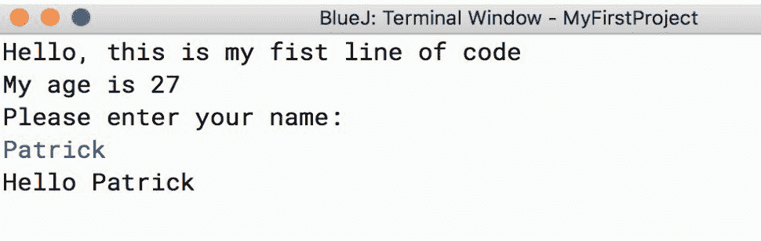

图 1-16：测试代码

- 你可以关闭控制台窗口。

既然我们成功获取了用户的输入，我们将实验使用条件语句。因此，请按如下修改 `MyClass` 文件中的代码（加粗为新代码）。

```java
/*System.out.println("Please enter your name: ");
Scanner sc= new Scanner (System.in);
String nameOfUser = sc.nextLine();
System.out.println("Hello " +nameOfUser);*/
```

```java
System.out.println("What is 1 + 1");
Scanner sc= new Scanner(System.in);
int answer=sc.nextInt();
if (answer == 2) System.out.println("Well Done!");
else System.out.println("Sorry Incorrect Answer!");
```

在上一个代码中：

- 我们注释了之前的代码。
- 我们显示了邀请用户写出问题 **What is 1 + 1** 答案的消息。
- 我们声明了一个名为 `answer` 的变量。
- 我们要求用户输入他们的猜测。这次我们使用 `sc.nextInt()` 方法，因为答案将作为整数存储。
- 一旦答案被输入，它就会存储在变量 `answer` 中。
- 我们根据变量 `answer` 的值执行条件语句。如果输入的文本是 "2"，则显示消息 **"Well done"**，否则显示消息 **"Sorry Wrong Answer"**。

你现在可以保存代码、编译并运行你的程序，对于上一个例子，你应该看到一段要求你输入问题 "What is 2 + 2" 答案的文本。

- 在输入数字 **2** 并按下 **Enter** 后，应该出现一条显示 **"Well done"** 的消息。

# METHODS

现在你已经声明并组合了数字和字符串，是开始研究方法（methods）的好时候了。

方法可以比作朋友或同事，你根据特定的指令请求他们执行某项任务，并在需要时返回信息。

例如，你可以这样问你的朋友：“考虑到我于 2000 年出生，请告诉我我什么时候过 20 岁生日。” 于是你给了你的朋友（他很擅长数学 :-)) 一个参数 `yearOfBirth`。因此，传递给此方法的任何参数在该方法内部都被视为 `yearOfBirth`。

- 此方法返回减法运算 `2018 – yearOfBirth` 的结果。
- 当调用该方法时，`yearOfBirth` 等于 1990；因此它将返回 28（即 2018-1990）。

```
新方法 calculateAge 被声明为 static（静态的）；这是因为 main 方法默认是 static 的，and that as a result, it can only call a method that is also static。如果你忘记声明此方法为 static 并尝试从 main 方法调用它，系统将生成一条错误信息。
```

```
main 方法是 static 的，因为它是程序的入口点，并且是应用程序启动时第一个被调用（或执行）的方法。它是 public 的，因为它需要从程序外部访问。它的返回类型是 void，因为它通常不返回任何数据。它包含了参数，但这些参数不是强制性的。
```

请保存你的代码并运行应用程序，你应该会在控制台窗口看到“Hello, My Age is 28”的消息。

## 变量作用域 (SCOPE VARIABLES)

当你在 Java 中创建变量时，你都需要意识到它们的作用域，以便在作用域允许的地方使用它们。如果你使用方法，这一点尤为重要，因为某些变量仅在局部使用，而另一些变量将在整个类或整个应用程序中使用。

变量的作用域是指你在应用程序可以使用该变量的地方。在 Java 中，除了本书稍后介绍的访问修饰符外，变量可以是成员变量（member variables）或局部变量（local variables）。

- 成员变量根据其访问类型，可以在特定的类中或在整个应用程序中使用。

简单来说，你的应用程序由几个称为“类”（classes）的部分组成。在案例中，应用程序的入口点是一个类 `MyClass`。

- 成员变量可以在类的开头声明，使用通常的声明语法，前面加上一个所谓的访问类型（我们稍后会回到这种语法）。然后，它们可以在类的任何地方使用（有时也可以在类外），如下一个代码段所示。

```
class MyClass
{
    public int myVar;
    public void method1()
    {
        myVar = 0;
    }
    public void method2()
    {
        myVar = myVar + 1;
    }
}
```

在之前的代码中，成员变量 `myVar` 在类 `MyClass` 的开头声明；它在 `method1` 中初始化，并在 `method2` 中更新。注意，该变量被声明为 `public`，这意味着它不仅在整个名为 `MyClass` 的类中可见，而且从该类的外部可见。

- 局部变量在特定方法内部声明（且应该仅在方法内部使用）；因此被称为“局部”（local），因为它们只能在局部使用，如下一个代码段所示。

```
public void method1() {
  int myVar;
  myVar = 0;
}
public void method2() {
  int myVar2;
  myVar2 = 2;
}
```

在之前的代码中，`myVar` 是方法 `method1` 的局部变量，只能在该方法内使用；`myVar2` 是方法 `method2` 的局部变量，只能在该方法内使用。

> 注意，始终避免所谓的“变量掩蔽/遮影”（variable masking/shadowing）是好事，当你给局部变量赋予一个与同一文件中成员变量相同的名称时，就会发生这种情况，因为这可能会导致混淆。

类和成员变量可以比作一个拥有不同俱乐部和协会的城市。城市由这些不同的俱乐部组成。每个俱乐部都有成员。只有当你已经是他们所属的特定俱乐部成员时，才能访问某些成员；其他成员对于不属于该俱乐部的人来说更具公开性。由于某些成员（例如财务主管）非常强大，可能会改变俱乐部的未来和安全，你可能不希望俱乐部之外的每个人都能访问他们，因为这意味着任何人都可以要求他们对俱乐部做出重大改变。然而，所有的俱乐部成员因为受到信任，可以被授予对该财务主管的访问权限。另一方面，每个俱乐部可以有一个负责推广俱乐部的公关人员。在这种情况下，

```
此成员变量可以被设为 public，以便该俱乐部之外的任何人都可以访问他们以获取有关俱乐部的信息（例如，开放时间、特性等）。
```

所以让我们对变量及其作用域进行实验吧：

- 打开文件 `MyClass`。

- 注释 `main` 方法中已存在的代码。

- 在文件 `MyClass` 中添加以下代码（加粗部分为新代码）。

```java
public class MyClass
{
    public static int myMemberVariable;

    public static void myMethod()
    {
        myMemberVariable = 3;
        System.out.println("The value of myMemberVariable is " + myMemberVariable);
    }

    public static void main(String[] args)
    {
        myMemberVariable = 1;
        System.out.println("The value of myMemberVariable before calling the method is " + myMemberVariable);
        myMethod();
    }
}
```

在之前的代码中：

- 我们声明了一个成员变量 `myMemberVariable`；对于任何新活动一样，它在整个类中都是可用的。
- 它默认是 `static` 的；正如我们所知道的，`main` 方法应该只调用也是静态的方法。
- 然后我们调用 `myMethod`。
- 在方法中，我们设置了 `myMemberVariable` 的值。
- 最后，我们运行应用程序。你应该看到消息：

| The value of myMemberVariable before calling the method is 1 |
| :--- |
| The value of myMemberVariable is 3 |

## 创建应用程序时需要记住的注意事项 (A FEW THINGS TO REMEMBER WHEN YOU CREATE APPLICATIONS)

当你开始编写代码时，对于任何新活动一样，你会犯一些小错误，从中学习，改进你的代码，并最终更好地编写应用程序。正如我过去在学习编程的学生身上看到的，常见的错误并不会让你成为一个糟糕的程序员；相反，这是学习的一部分。

所以，当你创建第一个应用程序时，放下任何恐惧，去实验，保持好奇并学习这门语言。这就像学习一种新的外语：当一个外国的人听懂了你的第一个句子时，你会感到充满动力！Java 也是如此，为了缓解学习过程，我在编写应用程序时包含了一些技巧和注意事项，以便让你进展得更快。你现在不需要知道所有内容（我稍后会在章节中提到），但这样做让你意识到它们，并在发生错误时使用。所以，请注意这些点：

- 每个左括号都有对应的右括号。
- 所有变量的写法要一致（例如拼写和大小写）。变量名是区分大小写的；这意味着如果你声明了一个变量 `myvariable` 但在代码中引用 `myVariable`，这可能会触发错误，因为变量 `myVariable` 和 `myvariable` 因为大小写不同（大写 V）被视为两个变量。
- 尽可能在使用变量之前声明它（例如，`int Var`）。


- 对于每个变量名，所有单词（除第一个单词外）的首字母均大写。这并非强制要求，但它会让你的代码更具可读性。

- 对于每个方法名，所有单词（除第一个单词外）的首字母均大写。这并非强制要求；但它会让你的代码更具可读性。

- 所有的语句都以分号结尾。

- 对于 `if` 语句，条件位于圆括号内。

- 对于 `if` 语句，条件使用语法 `==` 而不是 `=`。

- 在调用方法时，使用该方法的确切名称（即区分大小写）。

- 引用变量时，需考虑变量的作用范围（例如：在局部范围内调用局部变量）。

- 局部变量在同一个方法内声明并可以在该方法内使用。

- 成员变量在方法外声明，可以在类内的任何地方使用。

### 最佳实践

当你开始 Java 编码之旅时，你有时可能会发现很难解释浏览器产生的错误。然而，经过一些练习，你将能够识别它们、理解它们（并避免它们的出现）以及相应地修复它们。接下来的列表列出了我的学生在开始编写 Java 编码时经常遇到的错误。

### 变量命名

- 使用你能够理解的、具有意义的名称，尤其是在离开代码两周之后。

```java
String myName = "Patrick";//良好
String b = "Patrick";//不那么好
```

- 变量名中除第一个单词外，所有单词的首字母都要大写。

```java
boolean testfTheNamesCorrect = true;//良好
bool testfThefirstnamecorrect = true; // 不那么好
```

### 方法

- 使用唯一的（即不同的）名称（用于成员变量和局部变量）。

- 检查所有的左括号是否有对应的右括号。

- 对你的代码进行缩进。

- 尽可能为你的代码编写注释以解释其工作原理。

## 章节总结

## 总结

在本章中，我们成功创建了你的第一个应用程序。你已经越来越熟悉创建变量和方法，以及通过控制台窗口显示信息。最后，你还学习了如何使用条件语句以便根据特定条件执行处理。在这些知识的基础上，你创建了简单的程序，用户输入信息，程序相应地计算并输出结果。因此，我们在这里涵盖了重大进展，从毫无 Java 到创建你的第一个应用程序：做得好！

## 测验

现在是时候测试你的知识了。请说明下列陈述正确（TRUE）还是错误（FALSE）。答案在下一页。

- 1. Java 程序的主入口是名为 `main` 的方法。

- 2. `main` 方法通常是公共的（`public`），以便从应用程序外部调用它。

- 3. `main` 方法通常被声明为静态的（`static`）。

- 4. 命令 `System.out.println` 在控制台窗口中显示信息。

- 5. `Scanner` 类使得能够通过键盘读取用户输入的信息。

- 6. 在 Java 中，文本值用双引号括起来。

- 7. 在 Java 中，局部变量只能在最初定义它的方法中使用。

- 8. 在 Java 中，成员变量可以在声明它的整个类中被使用。

- 9. 在 Java 中，方法总是返回一个值。

- 10. 在 Java 中，被注释的代码不会被执行。

## 测验答案

- 1. 正确。

- 2. 正确。

- 3. 正确。

- 4. 正确。

- 5. 正确。

- 6. 正确。

- 7. 正确。

- 8. 正确。

- 9. 错误。

- 10. 正确。

## 检查清单

| 如果你能够完成以下操作，你就可以进入下一章： |
| :--- |
| - 创建变量。组合变量。创建一个方法。调用一个方法。 |

以下挑战的解决方案包含在资源包中，你可以通过遵循“本书的支持与资源”章节中的说明进行下载。

## 挑战 1

现在你已经完成了本章的内容并积累了一些有趣的技能，让我们测试一下这些吧。这个特定的挑战将让你更熟悉方法。解决方案包含在资源包中。

创建一个名为 `calculatePrice` 的方法，执行以下操作：

- 接收两个名为 `nbItems` 和 `unitPrice` 的参数。

- 将这两个数字相乘并将结果存储在变量 `finalPrice` 中。

- 返回变量 `finalPrice` 的值。

方法创建完成后，使用你选择的两个值调用该方法，并在控制台窗口中显示方法返回的结果。

## 挑战 2

创建一个方法执行以下操作：

- 询问用户的名。

- 询问用户的姓。

- 在控制台窗口中显示全名（即名后面跟着一个空格，然后是姓）。

- 在方法创建完成后，调用该方法。

# 2

## 自定义数据类型与结构

> “工程学是世界上存在的最接近魔法的东西。”
>
> - 埃隆·马斯克 (Elon Musk)

## 本节中，你将发现如何使用自定义方法和结构（如循环和条件语句）来优化你的代码。

完成本章后，你将能够：

- 处理字符串（`String`）。

- 处理数字。

- 处理循环和数组。

## 处理字符串变量

在之前的章节中，我们学习了如何声明和操作如数字和字符串之类的变量。正如我们之前看到的，可以对字符串执行诸如加法或拼接等简单操作。然而，正如我们将在本节中看到的，Java 还提供了实用的内置方法和属性。

`length()` 方法返回字符串中字符的数量。`indexOf()` 方法返回指定子字符串第一次出现的位置。

```java
String name = "Patrick";
int length = name.length();
int index = name.indexOf("t");
```

```java
if (mySentence.indexOf("Hi") >= 0) System.out.println("Hi is part of the sentence");
else System.out.println("Hi is not included in the sentence");
```

- 请保存代码并运行应用程序；你应该会在控制台窗口看到以下消息。

```
Hello is part of the sentence
Hi is not included in the sentence
```

Substring（子字符串）：除了在字符串中定位另一个字符串外，Java 还允许你删除字符串的一部分，这可以使用 `substring` 方法实现，如下一个代码片段所示：

```java
String mySentence = "This sentence is long and needs to be shorter";
String shorterSentence = mySentence.substring(0, 14);
System.out.println(shorterSentence);
```

在前面的代码中：

- 我们声明了一个名为 `shorterSentence` 的新 `String` 变量。

- 我们删除了该句子从第一个字符（即索引 0）开始到第 15 个字符（即索引 14，包含在内的部分。

- 我们显示了新 `String` 的内容。

> 你可以将这些代码添加到 `MyClass` 文件的 `main` 方法中，并在运行应用程序后在控制台窗口查看结果。

replace（替换）：有时，替换字符串中的字符非常有用，这可以通过在句子或段落中查找字符串，或者更改句子中几个字母的大小写来实现。这种技术在你从用户收集信息时非常有用，可以确保某些字符或单词不会留在用户输入的字符串中，或者当你希望句子中的所有单词都小写或大写时。下一个代码片段演示了如何实现这一点。

```java
String mySentence = "This sentence is long and needs to be shorter";
String modifiedSentence = mySentence.replace("is long", "is way too long");
```

```java
String upperCaseSentence = mySentence.toUpperCase();
String lowerCaseSentence = mySentence.toLowerCase();
```

在前面的代码中：

- 我们创建了一个名为 `mySentence` 的 `String`。

- 然后我们使用 `replace` 方法将单词 “is long” 替换为单词 “is way too long”，并将结果保存到变量 `modifiedSentence` 中。

- 在接下来的几行代码中，我们相继将变量 `mySentence` 中的所有字母转换为大写（使用 `toUpperCase` 方法）或小写（使用 `toLowerCase` 方法）。

我们可以通过以下操作来亲自测试这些方法：

- 在你的代码编辑器中打开 `MyClass` 文件。

- 注释掉 `main` 方法中之前的代码。

- 向 `main` 方法添加以下代码。

```java
String mySentence = "This sentence is long and needs to be shorter";
String shorterSentence = mySentence.substring(0, 14);
System.out.println(shorterSentence);
String modifiedSentence = mySentence.replace("is long", "is way too long");
System.out.println(modifiedSentence);
String upperCaseSentence = mySentence.toUpperCase();
System.out.println("Upper Case: " + upperCaseSentence);
String lowerCaseSentence = mySentence.toLowerCase();
System.out.println("Lower Case: " + lowerCaseSentence);
```

在前面的代码中，正如我们之前看到的，我们对名为 `mySentence` 的 `String` 执行了若干操作，然后在控制台窗口中显示结果。

保存代码，刷新相应的浏览器页面，你应该会在控制台窗口看到以下消息。

```
This sentence is way too long and needs to be shorter
Upper Case: THIS SENTENCE IS LONG AND NEEDS TO BE SHOR
Lower Case: this sentence is long and needs to be shorter
```

虽然我们在这里已经涵盖了一些最常用的 `String` 方法，但你可以在官方网站查看 Java `String` 方法的完整列表：

```
https://docs.oracle.com/javase/9/docs/api/java/lang/String.html
```

## 数字类型变量的操作

如你所见，在处理字符串时，内置方法非常有用。坦率地说，数字也存在内置方法，以便对它们进行相应的处理，有时是通过数学计算来实现。

所以，让我们来看一些可以用于数字的有用内置属性和方法。

这些属性（或属性）和方法可以帮助执行不同类型变量之间的转换，如下：

- `toString`：此方法将数字转换为 `String`。

- `Integer.parseInt`：此方法将 `String` 转换为整数（即不带小数的数字）。

- `Float.parseFloat`：此方法将 `String` 转换为浮点数（即不带小数的数字）。

Java 还包含了一些允许执行高级数学计算的方法和类，包括：

- `Math.random`：返回一个随机数。

- `Math.pow(x,y)`：返回 x 的 y 次幂值。

- `Math.ceil(x)`：返回 x 向上取整到最近的整数。

- `Math.floor(x)`：返回 x 向下取整到最近的整数。

- `Math.sin(x)`：返回角度 x 的正弦值。

- `Math.min(x, y)`：返回参数列表中的最小数字。

- `Math.max(x, y)`：返回参数列表中的最大数字。

让我们实验一下其中一些：

- 请打开文件 `MyClass`。

- 注释掉之前的代码。

- 添加以下代码：

```java
double randomNumber = Math.random();
System.out.println("Random: " + randomNumber);
if (randomNumber < 0.7) {
    System.out.println("it was less than 0.7");
} else {
    System.out.println("it was greater than or equal to 0.7");
}
```

```java
case 1:
    System.out.println("you chose 1");
    break;
case 2:
    System.out.println("you chose 2");
    break;
case 3:
    System.out.println("you chose 3");
    break;
default:
    System.out.println("Default option");
    break;
}
```

```java
System.out.println("We have exited the switch structure");
```

在之前的代码中：

- 我们要求用户输入一个 1 到 3 之间的选择。

- 我们将此选择转换为数字。

- 然后，我们使用 `switch` 结构显示对应的消息。

- 在退出 `switch` 结构后，我们显示了另一个消息。

你现在可以保存代码并运行程序了，你应该看到以下消息：

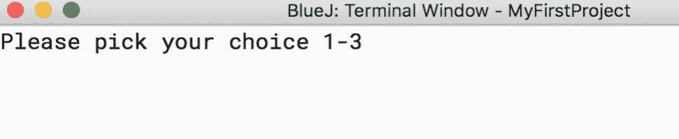

图 2-1：提询问数字

一旦你输入一个数字并按下“回车键”，控制台窗口应该显示一条类似下面的消息：

```
Please pick your choice 1-3
you chose 1
We have exited the switch structure
```

图 2-2：显示选择

### 单维数组

你可以通过数组来优化代码，因为数组可以更容易地对大量数据应用通用特性和相似的行为。当你使用数组时，你可以管理存储相同类型信息的变量，并且更方便地访问它们。你可以创建单维数组或多维数组。

让我们来看数组的最简单形式：单维数组。对于这个概念，我们可以把一组有名字的 10 个人比作类比。如果我们想用 `String` 变量来存储这些信息，我们需要声明不同的变量，如下：

```java
String name1; String name2;
```

虽然这段代码完全没有问题，但如果能将这些信息存储在一个变量中就太好了。为了实现，我们可以使用数组。数组类似于项目列表，我们可以通过索引来访问它。该索引数组中的第一个元素从 0 开始。

让我们看看如何使用数组存储这些名称：

- 首先，我们可以这样声明数组：

```java
String[] names;
```

你可能会注意到这种语法：开括号和方括号用于指定数组将包含值。

- 然后，我们可以这样初始化数组：

```java
names = new String[10];
```

在之前的代码中，我们只是指定了我们名为 `names` 的新数组将包含 10 个变量。

- 然后，我们按照下一个代码所示在数组中存储信息：

```java
names[0] = "Paul";
names[1] = "Mary";
```

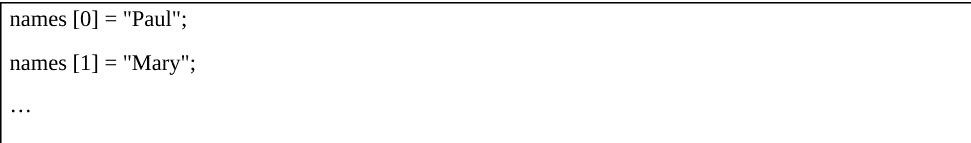

```java
names[9] = "Pat";
```

在之前的代码中，我们将 Paul 存储为数组中的第一个元素（记住索引从 0 开始）；我们将第二个元素（索引为 1）存储为 Mary，并将最后一个元素（索引为 9）存储为 Pat。

> 注意，对于大小为 n 的数组，第一个元素的索引为 0，最后一个元素的索引为 n-1。对于大小为 10 的数组，第一个元素的索引是 0，最后一个元素的索引是 9（即 10-1）。

如果你使用整数数组、浮点数数组或任何其他类型的数据，过程将是简单的，如接下来的代码片段所示：

```java
int[] array; array[0] = 1;
float[] arrayFloats; arrayFloats[0]=2.4f;
```

现在，使用数组的好处之一是你可以在一行代码中初始化数组，这样如果你的数组中有 10 个项目，就可以避免编写 10 行代码的烦恼，如下一个示例所示：

```java
String[] names = new String[10] {"Paul","Mary","John","Eva","Pat","Sinead","Emma","Faith","Eleanor"};
```

这非常方便，正如你将在接下来的章节中看到的，而且这绝对能为你节省大量的编码时间。

为了说明数组的概念，我们可以创建一个非常简单的测验，向用户提问几个问题，并将其/她的答案与正确答案进行比较。

- 请打开 `MyClass` 文件。

- 添加以下方法。这应该放在任何其他方法内部，例如在 `main` 方法的结束大括号之后：


```java
public static void arrayExample()
{
    String[] questions = {"What is 2+2", "What is 4+2", "What is 4+5"};
    int[] correctAnswers = { 4, 6, 9 };
    for (int i = 0; i < 3; i++)
    {
        System.out.println(questions[i]);
        Scanner sc = new Scanner(System.in);
        int answer = sc.nextInt();
        if (answer == correctAnswers[i])
        {
            System.out.println("Well done!");
        }
        else System.out.println("Sorry wrong answer");
    }
}
```

- 我们声明了一个名为 `questions` 的数组并定义了它的内容。该数组包含了与测验相关的三个 `String`。
- 我们定义了一个新数组 `correctAnswers` 并定义了它的内容。该数组包含了测验的三个答案。
- 我们创建一个循环；思路是遍历三个问题，收集用户的答案并检查它们是否正确。
- 循环第一次执行，`i = 0`；我们使用 `questions[0]` 中的 `String` 进行提问；即文本“what is 2+2”；然后我们记录答案，将其转换为数字并保存在变量中；随后，我们将用户的答案与正确答案（即 `correctAnswers[0]`，对应 `4`）进行比较，并相应显示消息。

最后，我们只需要通过以下方式调用此方法：

- 在 `main` 方法中添加此代码：

```java
arrayExample();
```

你现在可以保存代码并运行程序，你应该看到以下消息：

| Question 0: What is 2+2 |
| 4 |
| Well done! |
| Question 1: What is 4+2 |
| 6 |
| Well done! |
| Question 2: What is 4+5 |
| 9 |
| Well done! |

你还应该看到测验结束时提供了分数。

```
排序前的第一个元素：8
排序后的第一个元素：4
```

图 2-4：对数字数组进行排序

如果你愿意，可以使用之前的代码对数值数组进行排序并检查是否获得了相同的结果。

有关数组函数的完整列表，请参阅官方文档：

https://docs.oracle.com/Javase/8/docs/api/Java/util/Arrays.html

### 多维数组

现在我们已经看了单维数组，让我们来看看多维数组，它们在存储信息时也非常有用。这种数组（即多维数组）可以比作一栋有几楼层的建筑，每层都有几间公寓。假设我们想要存储每个公寓的住户人数。在这种情况下，我们将创建变量来存储每个公寓的住户人数。

第一种解决方案是创建变量来存储每个公寓的住户人数，并使用变量来引用楼层和公寓编号。例如，变量 `ap0_1` 可以定义为存储地面楼层第一间公寓的住户人数，`ap0_2` 可以定义为存储地面楼层第二间公寓的住户人数，`ap1_1` 可以定义为存储第一楼层第二间公寓的住户人数，而 `ap1_2` 可以定义为存储第一楼层第三间公寓的住户人数。在代码方面，我们可以这样写：

```
int ap0_1 = 0;
int ap0_2 = 0;
```

然而，在这种情况下我们也可以使用数组来使代码更高效，如下一个代码段所示：

```
int [][] array = new int[10][10];
array[0][1] = 0;
array[0][2] = 0;
System.out.println(array[0][1]);
```

在之前的代码中：

- 我们声明了数组。
- 代码 `int [][]` 对应于整数的二维数组；换句话说，我们表示此数组中的任何元素将根据两个参数进行定义和访问：楼层数和该层公寓的住户人数。
- 我们还为这些参数中的每一个指定了大小（或最大值）。楼层（或级别）的最大数量将为 10，每层公寓的最大数量将为 10。因此，在这个示例中，我们可以定义 10 层，从第 0 层到第 9 层（即 10 层），对于这些层中的每一层，我们还可以定义 10 间公寓，从公寓 0 到 9。
- 最后一行代码在控制台窗口中打印数组第一个元素的值。

数组的其他有趣之处之一是，通过使用循环，你可以编写一行代码来访问数组中的所有项，从而编写出更高效的代码。

## 循环

作为程序员，有时你必须执行重复性任务；很多时候，这些任务可以通过循环来加速，循环是根据条件重复执行相同操作的结构。因此，使用循环时，过程通常如下：

- 开始循环。
- 执行操作。
- 检查条件。
- 如果满足条件，则退出循环；否则继续循环。

有时条件在循环开始时测试，另一些时候在循环结束时测试。正如我们将在下一段中看到的，分别是 `while` 和 `do-while` 循环结构的情况。

让我们来看下面这个使用 `while` 循环的示例。

```
int counter = 0;
while (counter <=10)
{
    counter++;
}
```

在之前的代码中：

- 我们声明了变量 `counter` 并将其值设置为 0。
- 然后我们创建了一个以 `while` 关键字开始的循环，其内容（即我们在循环期间要执行的内容）由左括号和右括号界定。
- 我们设置了留在此循环中的条件（即 `counter <=10`）。因此，只要变量 `counter` 小于或等于 10，我们就一直留在这个循环中。
- 每当我们通过循环时，我们将变量 `counter` 的值加 1。

所以实际上：

- 第一次通过循环：变量 `counter` 增加到 1；到达循环结束；回到循环开始并检查变量 `counter` 是否小于或等于 10；在这种情况下这是真的，因为 `counter` 等于 1。
- 第二次通过循环：变量 `counter` 增加到 2；到达循环结束；回到循环开始并检查变量 `counter` 是否小于或等于 10；在这种情况下这是真的，因为 `counter` 等于 2。
- 第 11 次通过循环：变量 `counter` 增加到 11；到达循环结束；回到循环开始并检查变量 `counter` 是否小于或等于 10；现在是假的，因为 `counter` 现在等于 11。结果是我们退出循环。

所以，正如我们看到的，通过循环，我们成功地迭代增加了变量 `counter` 的值，从 0 增加到 11，但使用的代码比通常需要的要少。

现在，我们可以创建此循环的一个稍微修改的版本，使用 `do-while` 循环，如下所示：

```
int counter = 0;
do
{
    counter++;
} while (counter <=10);
```

在之前的示例中，你可能会发现两个差异：

- `while` 关键字现在位于循环的末尾。因此条件在循环的末尾进行测试。
- `do` 关键字现在位于循环的开头。所以在这里，我们先执行语句，然后在循环结束时检查条件。

代码的另一种变体如下：

```java
for (int counter = 0; counter<=10; counter++)
{
  System.out.println("Counter = " + counter);
}
```

在之前的代码中：

- 我们以不同的方式声明了一个循环：我们表示将使用一个从 0 到 10 的整数变量。
- 每当我们通过循环时，该计数器加 1。
- 只要变量 `counter` 小于或等于 10，我们就留在循环中。
- 这种情况下在循环开始时进行测试。

循环对于有限数量的对象执行重复操作非常有用，或者执行通常被称为递归的操作。例如，你可以使用循环遍历 100 个项目。结果是，循环将为你节省一些代码。

所以我们可以使用循环结构改进之前的代码，让用户输入数字，只要其选择小于 1 或大于 3，或者数据不是数字。

让我们尝试：

- 打开 `MyClass` 文件
- 如下所示向 `MyClass` 添加此方法：

```java
public static void selectChoice()
{
  int myChoice = 0;
  do
  {
    System.out.println("Please enter your choice 1-3");
    Scanner sc=new Scanner(System.in);
    myChoice=sc.nextInt();
  } while (myChoice < 1 || myChoice > 3);

  System.out.println("Thank you");
}
```

在之前的代码中：

- 我们创建了一个名为 `selectChoice` 的方法。
- 我们创建了一个名为 `myChoice` 的变量，用于记录用户的选择。
- 我们创建了一个 `do-while` 循环。
- 我们记录并检查用户的选择。
- 只要用户输入的数字小于 1 或大于 3，我们就循环。

你现在可以注释掉 `main` 方法中的代码，并在同一方法中添加以下代码，以便我们从这里调用 `selectChoice` 方法：

```java
selectChoice();
```

你现在可以保存名为 `MyClass` 的文件并运行应用程序；系统会要求你输入 1 到 3 之间的数字，只要你输入的数字小于 1 或大于 3，它就会一直这样做，如如下所示。

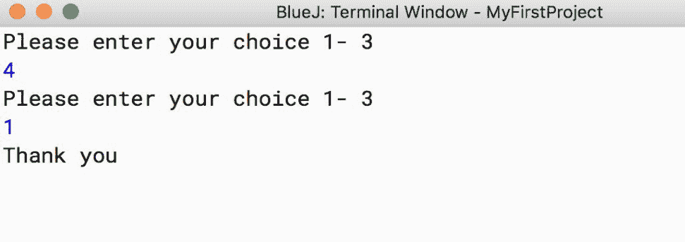

图 2-5：循环直到提供正确信息为止

## 常量

到目前为止，我们已经学习变量以及你如何在代码中无缝地存储和访问它们。之前的假设是值可能会随着时间而改变，并且该值将相应地存储在变量中。然而，在某些情况下，你确定某个值在整个应用程序运行过程中将保持不变。例如，你可能会定义引用不应随时间改变的值的变量，在这种情况下，你可以使用常量。

让我们来看看它是如何工作的：假设用户在应用程序的第一个菜单中有三个选择，我们将其标记为 0、1 和 2。假设你希望有一种一种简单的方法来记住这些值，以便处理相应的选择。让我们看下面的代码，它说明了这一想法：

```java
int userCollection = 2;
if (userChoice == 0) System.out.println("you have decided to restart");
if (userChoice == 1) System.out.println("you have decided to stop the application");
if (userChoice == 2) System.out.println("you have decided to pause the application");
```

在上一段代码中：

- 变量 `userChoice` 是一个整数，并设置为 2。
- 然后我们检查变量 `userChoice` 的值，并在控制窗口中相应地打印消息。

现在，当你向应用程序添加更多代码时，你可能记得也可能忘记值 0 对应于重启应用程序；之前定义的其他两个值也是如此。因此，我们可以使用常量来使这些值更容易记忆（以及更容易使用）。让我们看看如何修改上一个示例以改用常量。

```java
public class MyClass
{
    public static int myMemberVariable;
    public static final int CHOICE_RESTART = 0;
    public static final int CHOICE_STOP = 1;
    public static final int CHOICE_PAUSE = 2;

    public static void testConstants()
    {
        int userChoice = CHOICE_RESTART;
        if (userChoice == CHOICE_RESTART) System.out.println("you have decided to restart");
        if (userChoice == CHOICE_STOP) System.out.println("you have decided to stop the application");
        if (userChoice == CHOICE_PAUSE) System.out.println("you have decided to pause the application");
    }
}
```

在上一段代码中：

- 我们声明了三个常量变量：`CHOICE_RESTART`、`CHOICE_STOP` 和 `CHOICE_PAUSE`。

注意，常量使用大写字母是常用做法，这样它们会显眼。

- 这些变量随后被用于检查用户的选择。
- 要声明常量变量，我们使用 `static` 和 `final` 关键字；`final` 关键字意味着变量不能重新赋值，而 `static` 意味着该变量的值可以通过类的每个实例访问，或者在不实例化类的情况下访问。

你现在可以通过以下步骤测试此功能：

- 请在类的开头处添加以下代码（加粗部分为新代码）：

```java
public class MyClass{
    public static int myMemberVariable;
    public static final int CHOICE_RESTART = 0;
    public static final int CHOICE_STOP = 1;
    public static final int CHOICE_PAUSE = 2;
```

- 请在 `MyClass` 文件中添加以下方法。

```java
public static void useConstants()
{
  int userChoice = CHOICE_RESTART;
  if (userChoice == CHOICE_RESTART) System.out.println("you have decided to restart");
  if (userChoice == CHOICE_STOP) System.out.println("you have decided to stop the application");
  if (userChoice == CHOICE_PAUSE) System.out.println("you have decided to pause the application");
}
```

你可以注释掉 `main` 方法中的代码并在同一方法中添加以下行，以便从那里调用 `useConstants` 方法。

```java
useConstants();
```


保存代码并启动应用程序后，你应该会看到一条显示“You have decided to restart”的消息。

在下一个示例中，我们使用常量来计算税率；这是一个良好的做法，因为同一个值将在整个程序中使用，并且在整个程序中使用完全相同的税率时，几乎没有留出错的空间。

| 代码 |
| :--- |
| `public static final float VAT_RATE = 0.21f;` |
| `float priceBeforeVat = 23.0f;` |
| `float priceAfterVat = priceBeforeVat * VAT_RATE;` |

在上一段代码中：

- 我们为增值税率声明了一个 `float` 常量变量。
- 我们为商品的税前价格声明了一个 `float` 变量。
- 我们计算了加税后的商品价格。

对于程序中不改变的值，使用常量是一种非常好的编码习惯。使用常量使你的代码更具可读性，当你需要更改代码中的值时可以节省工作量，并且减少可能的错误发生（例如在计算时）。

## 等级回顾

## 总结

在本章中，我们成功地使用了自定义的结构，如循环或 `switch` 语句。我们还处理了字符串和数字，并发现了一些处理这些内容的非常有趣的方法。我们还使用了数组，并学会了如何在数组中创建和排序元素。

# 为什么要使用面向对象编程

到目前为止，你已经设法成功地学习并理解了一些非常有趣的编程概念，例如变量和函数（方法），以及循环和条件语句等控制结构。因此，即使不使用面向对象编程，你在现阶段也可以很容易地创建一些非常有趣的程序。

然而，如果你想构建几个程序，并复用你已经创建的一些代码呢？如果你倾向于不要重复造轮子，而是想复用你之前为某个程序创建的组件呢？

在很多情况下，如果你坚持使用仅由函数（方法）、变量和控制结构组成的过程化程序，这将是非常困难的。例如，如果你想在另一个程序中复用已经创建的函数，你将需要手动将其复制/粘贴到新程序中。

这是因为函数在非面向对象的环境中编写时，并没有设计成可以在不同的上下文中直接复用，除非你实际上打开之前的代码并将其复制粘贴到不同的程序中。此外，函数、变量和控制结构的使用可能无法建模（并因此解决）现实世界的问题，因为过程化方法将数据和函数区分开来，并且没有使用高层抽象。换句话说：通过观察代码，很难理解代码与我们试图建模的内容之间有什么关系。

例如，如果你想创建一个试图模拟足球运动员在场上互动方式的程序，你通常会创建移动球员和球的函数，但程序的结构可能很难理解。函数可能存在，但可能很难理解它们与球员或球之间有什么关系。此外，复用这部分代码来创建另一个游戏（这次是篮球游戏）可能意味着大部分内容需要重写或复制/粘贴。

总而言之，使用过程化方法会使你的代码可维护性降低、可复用性降低，并且总体容易出现重复，从而更加耗时。

另一方面，面向对象编程（OOP）程序旨在缓解在过程化编程中发现某些问题，即：数据和相关的算法（即方法）被“封装”在一个类中，因此是可复用的。此外，类和对象的使用使得你能够根据你试图建模的内容，而不是你自己的程序逻辑，来建模你试图解决的问题。例如，如果你想创建一个足球游戏，然后创建一个篮球游戏，你可以创建在两个游戏中都被复用并使用的类，用有意义名称以及关联数据和方法对建模游戏中的实体；例如，你可以创建如 `Ball`（球）、`Player`（球员）、`Field`（球场）、`Rules`（规则）等类。通过继承的力量（正如我们稍后看到的），你还将根据你正在开发的游戏创建更具体的行为，所有这些生成的代码可以在程序间复用，并且更容易理解，因为类为每种类型的游戏提供了虚拟的、更易理解的实体表示。

## 类

在 Java 中编写代码时，你创建的应用程序要么是类，要么使用内置类。那么，什么是类呢？

正如我们之前看到的，Java 是一种面向对象编程（OOP）语言。简单来说，一个 Java 程序将由一组相互作用的对象集合组成。每个对象都有一个或多个属性，并且可以使用所谓的方法对这些对象执行操作。此外，共享相同属性的对象被认为属于同一个类。这里的思想是我们将与实体相关的数据和算法（例如方法）都封装在一个类中。

例如，我们可以以自行车作类比。自行车有各种形状和颜色的；然而，它们具有共同的特征。例如，它们都有特定数量的轮子（例如一个、两个或三个）或一个速度；它们可以有颜色，并且可以在这些自行车上执行操作（例如加速、右转、左转等）。

所以，为了将与自行车相关的所有数据和算法归类，我们可以创建一个名为 `Bike` 的类，它包含了如速度或颜色之类的变量（这些被称为成员变量或属性），以及可以应用于自行车的算法或方法，如加速（加速）。

一旦创建了这个类，它就可以在不同的程序中复用；例如，自行车赛、自行车商店，或者玩家骑自行车探索环境的游戏。如你所见，创建一个名为 `Bike` 的类使得代码变得可复用。该类被声明一次，可以被多次使用。此外，我们可以对名为 `Bike` 的类进行修改，这些更改将传播到所有使用该类的游戏。这无疑将为我们节省大量时间。

所以，如果我们定义一种通用类型，我们可以定义一个名为 `Bike` 的类，并为该类定义成员变量和属性，使得对这种 `Bike` 类型进行定义和执行操作成为可能。

这显然是对类和对象的简化的解释，但如果你是面向对象编程的新手，它应该能让你对面向对象编程的概念有一个更清晰的认识，并解释使用类而不是仅仅使用变量、函数和控制结构有多有用。

## 定义类

现在我们对类是什么有了更清晰的认识，让我们看看如何定义一个类。让我们来看下面的示例。

```java
public class Bike
{
    private float speed;
    private int color;

    public void accelerate()
    {
        speed++;
    }

    public void turnRight()
    {
    }

    private void calculateDistance()
    {
    }
}
```

在之前的代码中，我们定义了一个名为 `Bike` 的类，它包含了两个成员变量（`speed` 和 `color`）以及两个方法（`accelerate` 和 `turnRight`）。因此，我们将与自行车相关的所有数据和算法再次封装在一个类中。这样，更容易看到自行车可以做什么；让我们仔细观察一下这个类：

- 类名的前面是关键字 `public class`；在 OOP 术语中，关键字 `public` 称为访问修饰符，它定义了如何以及何时何访问和使用此类。在 Java 中有四种访问修饰符，包括 `public`（无限制）、`protected`（访问限于包含类、同包的类以及其他包的子类）、`default`（当未指定访问修饰符时的模式；在这种情况下，访问限于包含类和同包的类）和 `private`（仅从包含类访问）。在我们的情况下，我们应该在程序的任何地方使用此类。
- 所有变量的名字前面都是它们的类型（例如 `int`）和关键字 `public`：这意味着这些整数变量将在整个应用程序中可访问（即如果需要，可以在类外部访问）。
- 某些方法的名字前面是关键字 `public void`（例如 `accelerate` 和 `turnRight` 方法）：`void` 关键字意味着方法不返回任何数据，而 `public` 关键字意味着该方法在整个应用程序中可访问。
- 某些方法的名字前面是关键字 `private void`（例如 `calculateDistance` 方法）：`void` 关键字意味着方法不返回任何数据，而 `private` 关键字意味着该方法仅从包含的类型（即 `Bike`）访问。

## 访问类成员和变量

一旦定义了类，能够访问它的成员变量和方法将是非常棒的。在 Java 中（与其他面向对象的编程语言一样），这可以使用点符号法（dot notation）来完成。

点符号法是指面向对象编程。通过使用点，你可以访问与特定对象相关的属性和/或方法。

一旦定义了类，就可以基于该类创建对象。例如，如果我们根据上面看到的代码创建一个新的 `Bike` 对象，在 `MyClass` 文件的 `main` 方法中将有如下代码：

```java
Bike myBike = new Bike();
```

这段代码将在“模板” `Bike` 上创建（实例化）一个对象。你可能会注意到这种语法：

```
dataType variable = new dataType();
```

默认情况下，这个新对象将包含之前在 `Bike` 类中定义的所有成员变量和方法。因此，它有一个颜色（`color`）和一个速度（`speed`），我们也应该能够访问它的 `accelerate`（加速）和 `turnRight`（右转）方法。

因此，使用面向对象的方法，我们可以为对象定义一个模板，并使用这个模板创建一个新对象，该对象包含了管理或修改此对象所需的所有数据和方法（算法）。如何实现这一点？

让我们看看下一个代码片段，它展示了如何访问这些内容。

```java
Bike b = new Bike();
b.accelerate();
```

在前面的代码中：

- 创建了新的 `Bike` 对象。
- 在调用 `accelerate` 方法后，速度增加。可以使用点符号法调用此方法，因为它是公共的（`public`）。
- 注意，在调用对象的方法时我们使用点符号法。

在定义成员变量和方法时，通常的好做法是限制成员变量的访问权限（例如，设置为 `private` 类型），并定义具有无或较少限制的公共方法（例如 `public`）来提供对这些变量的访问。这些方法通常被称为 `getters`（get器），因为你可以通过它们获取或设置成员变量的值。

为了说明这个概念，让我们看看下面的代码：

```java
public class Bike {
  private float speed;
  private int color;

  public void accelerate() {
    speed++;
  }

  public void turnRight() {
  }

  private void calculateDistance() {
  }

  public void setSpeed(float newSpeed) {
    speed = newSpeed;
  }

  public float getSpeed() {
    return (speed);
  }
}
```

在前面的代码中，我们声明了两个新方法：`setSpeed` 和 `getSpeed`。

- 对于 `setSpeed`：类型为 `void`，因为此方法不返回任何信息，其访问权限设置为 `public`，因此可以无限制地访问。
- 对于 `getSpeed`：类型为 `float`，因为此方法返回速度，其速度类型为 `float`。它的访问权限设置为 `public`，因此可以无限制地访问。

现在，让我们创建自己的类并使用其中的一些概念：

- 在 BlueJ 的主窗口中，请从顶部菜单选择 `Edit | New Class`（编辑 | 新类）。

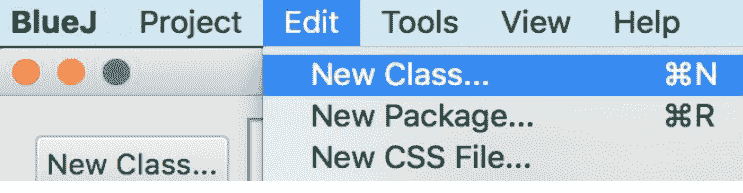

图 3-1: 创建新类

- 在新窗口中，在标记为 "Class Name"（类名）的字段中输入单词 `Bike`。

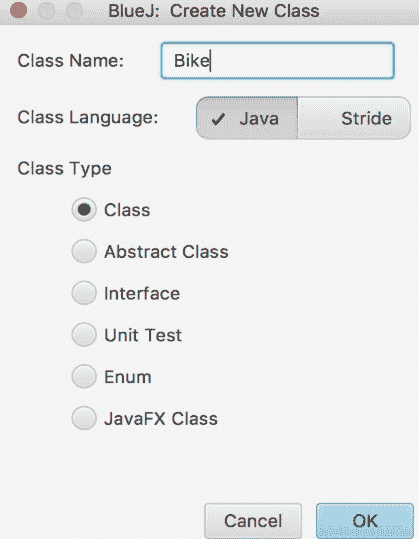

图 3-2: 创建新类

- 完成后，请点击标记为 "OK" 的按钮。
- 这将在项目窗口中创建一个名为 `Bike` 的新类。如下所示所示。

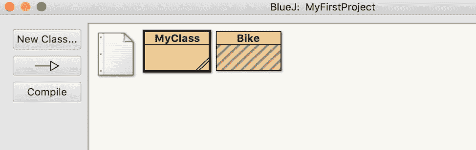

图 3-3: 创建新类 `Bike`

完成后，你可以双击主窗口中标记为 "Bike" 的图标，这应该打开 `Bike` 类的内容，并带有一些默认代码。你可以删除此文件中的所有代码并将其替换为以下内容。

```java
public class Bike
{
    public Bike(){}
}
```

在前面的代码中，定义了新类。我们还定义了一个名为 `Bike` 的方法，它将作为 `Bike` 类的构造函数（constructor）。也就是说，每当创建一个新的 `Bike`（或实例化）时，该方法就会被调用。

再次，类是用于创建对象的模板，而构造函数是用于创建此新对象并在需要时指定默认属性的方法。

虽然我们将在接下来的章节中看到更多关于构造函数的知识，但请注意，构造函数没有返回类型，这（在其他方面之外）是构造函数与其他方法的区别。

接下来，我们将开始修改该类，以包含我们之前介绍和解释的成员变量和方法，如下：

- 首先，请按照所示添加两个成员变量（粗体为新代码）：

```java
public class Bike
{
    private float speed;
    private int color;
```

在前面的代码中，我们创建了 `float` 类型的变量 `speed` 和 `color`。这些是成员变量，将作为任何基于 `Bike` 类创建的自行车的属性。

- 然后按照所示添加方法 `accelerate` 和 `turnRight`：

```java
public void accelerate()
{
    speed++;
}

public void turnRight()
{
}
```

在前面的代码中，我们创建了 `accelerate` 和 `turnRight` 方法。它们都是 `public` 的，因此可以被无限制地访问。

- 最后，添加另外三个方法 `setSpeed`、`getSpeed` 和 `calculateDistance`。

```java
private void calculateDistance()
{
}

public void setSpeed(float newSpeed)
{
    speed = newSpeed;
}

public float getSpeed()
{
    return (speed);
}
```

在前面的代码中，我们添加了三个方法。其中两个是 `void` 类型，因为它们不返回数据。`getSpeed` 返回成员变量 `speed` 的值。`Bike` 文件的完整代码应该如下：

```java
public class Bike
{
    private float speed;
    private int color;

    public void accelerate()
    {
        speed++;
    }

    public void turnRight()
    {
    }

    private void calculateDistance()
    {
    }

    public void setSpeed(float newSpeed)
    {
        speed = newSpeed;
    }

    public float getSpeed()
    {
        return (speed);
    }
}
```

- 完成后，你可以在窗口顶部保存代码并编译。

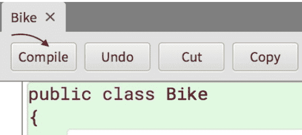

图 3-4: 编译类

现在，我们可以通过在 `MyClass` 文件的 `main` 方法中添加以下行来使用 `Bike` 类：

```java
myBike = new Bike();
System.out.println("Initial Speed=" + myBike.getSpeed());
myBike.setSpeed(23.0);
System.out.println("New Speed="+myBike.getSpeed());
```

在前面的代码中：

- 创建了新的 `myBike`。
- 在调用 `getSpeed` 方法后显示初始速度。
- 然后设置了新速度。
- 我们显示新速度的值。

现在你可以保存 `MyClass` 文件并编译它。你现在应该会在项目窗口看到一个箭头从 `MyClass` 指向 `Bike` 类，这表明在 `MyClass` 中创建了一个新的 `Bike` 对象。

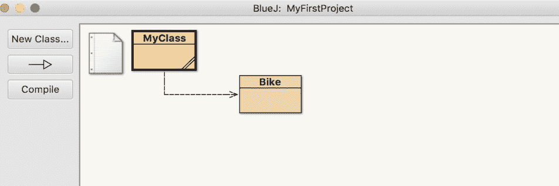

图 3-5: 显示类之间的链接

这里的主意是有一个名为 `MyClass` 的主应用程序，它将使用名为 `Bike` 的类；然而，正如我们之前看到的，我们可以在另一个应用程序中使用这个 `Bike` 类，从而节省编写代码的时间。

- 完成后，你可以像往常通过右键点击 "MyClass" 图标并选择 `void main (String [] parameters)` 选项运行应用程序。

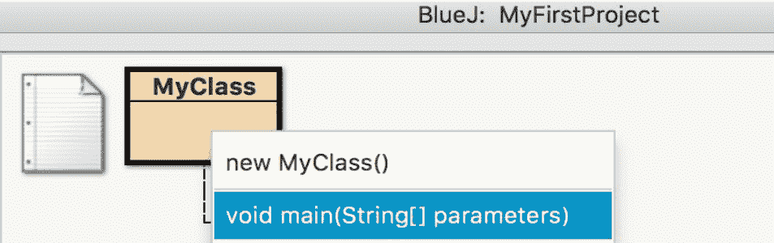

图 3-6: 运行应用程序

你应该会看到如接下来的图中所示的消息消息。

```
Initial Speed=0.0
New Speed=23.0
```

### 图 3-7: 设置速度

## 构造函数

一个类通常包含一个构造函数；构造函数基本上是一个方法，它包含一组指令，用于初始化从该类中创建的对象。正如我们稍后将看到的，类可以有不同的构造函数，每个构造函数以不同的方式初始化新对象。有些可能需要参数，而有些可能完全不需要参数；但最终而言，所有的构造函数都用于根据类以特定的方式进行构造，通常是通过设置某些成员变量来实现。

正如我们在上一节中看到的，当创建一个新对象时，它默认会包含其所在类的所有成员变量和方法。要创建此对象，我们将使用类名后跟 `()`，如下例所示。

```java
Bike myBike = new Bike();
myBike.accelerate();
```


通过使用关键字 `new`，我们隐式地调用了来自 `Bike` 类的构造函数。如果你没有为你的类定义任何构造函数，这将调用默认构造函数，它除了从该类创建一个新对象外，什么都不做。

话虽如此，如果你愿意，可以为你的类创建一个或多个构造函数。这些创建的构造函数例如可以在初始化时更改新创建对象的某些属性。例如，构造函数可以在创建时为变量 `speed` 和 `color` 设置这些值。

所以，例如，假设我们希望在创建时指定自行车的颜色；我们可以通过添加以下方法来修改 `Bike` 类，如下：

```java
public Bike(int newColor) {
    color = newColor;
}
```

这是一个新的构造函数，因为方法名与类名相同。它接受一个整数作为参数；因此在修改了我们的类描述（如上面的代码所示）之后，我们可以创建一个新的 `Bike` 对象：

`Bike myBike = new Bike(2);`

我们可以指定第二个构造函数，它将同时包含颜色和速度，如下所示：

```java
public Bike(int newColor, float newSpeed) {
    color = newColor;
    speed = newSpeed;
}
```

拥有多个构造函数是有用的，因为它们允许你以不同的方式实例化对象，取决于已经设置的参数，或者你希望在初始化阶段考虑的参数。在我们的情况下，我们可能只是想创建一个不指定速度或颜色的新自行车，或者创建一个新自行车并在初始化阶段指定其速度或颜色。因此，在这种情况下，拥有多个构造函数会非常方便。

所以，你可以在类中拥有不同的构造函数，系统将根据构造函数的签名（即应该传递给方法的参数）来确定应该调用哪一个构造函数。

例如，假设我们为 `Bike` 类有两个构造函数，如下。

```java
public Bike(int newColor) {
    color = newColor;
}

public Bike(int newColor, float newSpeed) {
    color = newColor;
    speed = newSpeed;
}
```

如果按照如下方式创建新的 `Bike` 对象：

```java
Bike newBike = new Bike(2);
```

...将调用第一个构造函数。

如果按照如下方式创建新的 `Bike` 对象：

```java
Bike newBike = new Bike(2, 10.0f);
```

...将调用第二个构造函数。

你可能还会想，如果在没有定义默认构造函数的情况下使用以下代码会发生什么。

```java
Bike newBike = new Bike();
```

事实上，每当你创建类时，也会（隐式地）定义一个默认构造函数，每当使用 `new` 操作符不带参数创建新对象时，就会被调用。这被称为默认构造函数。在这种情况下，将使用每个类型数值成员变量的默认值（例如，整数为 0，布尔变量为 false）。

> 注意，对构造函数的访问通常是公共的（`public`），除非我们希望某个类不被实例化的特殊情况（例如，对于仅包含静态成员的类）。另外注意，作为成员变量，如果没有指定访问修饰符，它们默认是私有的（`private`）。方法的情况也是如此。

现在这已经清楚了，让我们实验一下不同的构造函数。

请打开 `Bike` 文件。

- 在类的末尾添加以下代码（最后一个大括号之前）。

```java
public int getColor() {
    return color;
}

public Bike(int newColor) {
    color = newColor;
}

public Bike(int newColor, float newSpeed) {
    color = newColor;
    speed = newSpeed;
}
```

在之前的代码中，我们创建了一个 `getColor` 方法来返回当前 `Bike` 的颜色；我们还创建了两个额外的构造函数，每个接受不同数量和类型的参数。

- 现在你可以保存并编译针对 `Bike` 文件的代码了。

现在，我们只需要使用这些构造函数。

- 在 `MyClass` 文件中，请如下所示修改 `main` 方法（**粗体代码**）；

在之前的代码中：
创建两辆额外的自行车。

- `myBike2` 使用第二个构造函数创建，我们将数字 2（作为其颜色）传递给此构造函数。
- `myBike3` 使用第三个构造函数创建，我们将数字 10 作为其颜色，并将数字 3 作为其速度传递。

现在你可以保存 `MyClass` 文件的代码并运行应用程序，屏幕上应该显示以下内容：

```
Initial Speed=0
Color of Bike2=2, Speed=0
Color of Bike3=10, Speed=3
```

所以，得益于构造函数，我们能够创建自行车的数量。

## 类静态成员

静态成员的概念相比过程化编程提供了巨大的优势。当一个变量被声明为静态（`static`）时，该类只存在一个实例。静态方法也是如此：它们可以在无需实例化的情况下被调用。

所以，让我们探索如何在类中使用静态函数和变量。我们可以创建一个静态变量，例如，用于计算自行车的数量；在这种情况下，静态变量是理想的，因为它在所有类实例之间共享。让我们看看如何操作。

- 请打开 `Bike` 文件。
- 在类的开头添加以下代码（**粗体代码**）。

```java
public class Bike {
    private float speed;
    private int color;
    private static int nbBikes;
}
```

在之前的代码中，我们声明了变量 `nbBikes`，用于跟踪从 `Bike` 类实例化（或创建）的自行车数量。它是私有的且静态的，这意味着它仅供成员方法可用，并在 `Bike` 类的实例之间共享。

- 在此类添加以下方法：

```java
private void increaseNbikes() {
    nbBikes++;
}

public int getNbikes() {
    return (nbBikes);
}
```

在之前的代码中：

- 我们声明了两个方法。
- `increaseNbikes` 方法是私有的，因此只能从成员方法访问，每次调用它都会增加变量 `nbBikes` 的值。
- `getNbikes` 方法是公共的，这意味着它可以从类外部访问，并返回从 `Bike` 类实例化的对象总数。

现在修改早早为 `Bike` 类创建的三个构造函数，以便每当创建一个自行车时，自行车的数量相应增加。

- 请如下所示修改第一个构造函数（**粗体代码**）：

```java
public Bike() {
    increaseNbikes();
}
```

- 请如下所示修改第二个构造函数（**粗体代码**）：

```java
public Bike(int newColor) {
    color = newColor;
    increaseNbikes();
}
```

- 请如下所示修改第三个构造函数（**粗体代码**）：

```java
public Bike(int newColor, float newSpeed) {
    color = newColor;
    speed = newSpeed;
    increaseNbikes();
}
```

```java
public Bike(int newColor) {
    color = newColor;
    increaseNbBikes();
}
```

- 请按照如下方式修改构造函数（新代码为**粗体**）：

```java
public Bike(int newColor, float newSpeed) {
    color = newColor;
    speed = newSpeed;
    increaseNbBikes();
}
```

- 最后，请按照如下方式修改 `MyClass` 文件中的 `Main` 方法（新代码为**粗体**）：

```java
public static void Main(String[] args) {
    Bike myBike = new Bike();
    System.out.println("Initial Speed=" + myBike.getSpeed());
    myBike.setSpeed(23.0f);
    System.out.println("New Speed=" + myBike.getSpeed());
    Bike myBike2 = new Bike(2);
    System.out.println("The color of Bike 2 is " + myBike2.getColor() + " and its speed is " + myBike2.getSpeed());
    Bike myBike3 = new Bike(10, 3);
    System.out.println("The color of Bike 3 is " + myBike3.getColor() + " and its speed is " + myBike3.getSpeed());
    System.out.println("Number of Bikes Created: " + myBike.getNbBikes());
}
```

现在你可以保存这两个两个文件（即 **MyClass 和 Bike**），编译并运行该应用程序，你应该会在控制窗口中看到以下消息：

### Initial Speed=0.0
New Speed=23.0
The color of Bike 2 is 2 and its speed is 0.0
The color of Bike 3 is 10 and its speed is 3.0
Number of Bikes Created: 3

*图 3-9: 使用静态变量*

最后，我们可以为 `Bike` 类创建一个静态方法，该方法可以在不需要实例化 `Bike` 对象的情况下被调用，如下所示：

- 请向 `Bike` 类添加以下方法。

```java
public static void explainWhatABike() {
    System.out.println("A bike is a human-powered, pedal-driven, single-track vehicle, having two wheels attached to a frame, one behind the other");
}
```

- 最后，在 `MyClass` 文件的 `Main` 方法中添加以下代码

```java
public static void main(String[] parameters) {
    Bike.explainWhatABike();
}
```

当你保存文件并运行应用程序时，你应该会在控制窗口中看到一条消息显示：**A bike is a human-powered, pedal-driven, single-track vehicle, having two wheels attached to a frame, one behind the other**。

因此，我们成功创建了一个可以从 `bike` 类外部使用的方法；因此，我们可以在其他事情之外创建一个新程序，甚至不需要实例化新自行车就可以显示定义。

## 继承

我希望到目前为止一切都是清晰的，因为我们将研究一个面向对象编程中非常有趣且重要的概念：继承。继承的核心思想是对象可以从其他对象（即它们的父类）继承属性。当它们继承这些属性时，它们可以保持与父类相同，也可以演变并重写其中一些继承的属性。这非常有趣，因为它使得我们通过创建一个具有所有相似特征对象的通用属性的类来最大限度地减少代码，然后在需要时为子类重写并自定义这些某些属性。

让我们以车辆为例。车辆通常具有以下属性：

- 轮子数量。
- 速度。
- 乘客人数。
- 颜色。
- 加速能力。
- 停止能力。

因此，我们可以创建一个如下的类：

```java
class Vehicle {
    private int nbWheels;
    protected float speed;
    private int nbPassengers;
    private int color;

    public void accelerate() {
        speed++;
    }
}
```

这些特征可以适用于汽车、自行车、摩托车或卡车。然而，所有这些车辆也不同；其中某些可能可能或没有引擎或方向盘。因此，我们可以基于 `Vehicle` 创建名为 `MotorizedVehicle` 的子类，但带有与其机械化相关的特殊性。这些新增属性可以是：

- 引擎尺寸。
- 燃油类型。
- 燃油水平。
- 加油能力。

下面的示例说明了如何创建此类。

```java
class MotoredVehicle extends Vehicle {
    private float engineSize;
    private int petrolType;
    private float petrolLevels;

    public void fillUpTank() {
        petrolLevels += 10;
    }
}
```

- 当定义类时，它的名称后面跟着 `extends Vehicle`。这意味着它继承自 `Vehicle` 类。因此，在默认情况下，它将可以使用 `Vehicle` 类中已包含的所有方法和变量。
- 我们为此类创建了一个新的成员方法，名为 `fillUpTank`。
- 在上一个示例中，你可能注意到为 `Vehicle` 类定义的方法和变量没有在这里出现；这是因为它们被隐式地添加了这个新类中，因为它继承自 `Vehicle` 类。

在使用继承时，父类通常被称为**基类（或超类/父类）**，而子类被称为**子类**。

现在，虽然子类从父类继承了“特征”，但这些特征始终被修改，或者简单来说，被重写。在 Java 中，默认情况下，所有非静态方法都是虚拟的。换句话说，只要方法被声明为非静态，它就可以被子类重写。在重写方法时，必须使用 `Override` 关键字。如下方的代码所示。

```java
class Vehicle {
    private int nbWheels;
    protected float speed;
    private int nbPassengers;
    private int color;

    public void accelerate() {
        speed++;
    }
}

class MotoredVehicle extends Vehicle {
    private float engineSize;
    private int petrolType;
    private float petrolLevels;

    private void fillUpTank() {
        petrolLevels += 10;
    }

    @Override
    public void accelerate() {
        speed += 10;
    }
}
```


## 继承与方法重写

在上述的示例中，虽然 `accelerate()` 方法继承自 `Vehicle` 类，但它通常会将速度增加 1。然而，通过在 `MotoredVehicle` 类中重写它，我们确保了在从 `MotoredVehicle` 类实例化对象的情况下，每次加速都会将速度增加 10。我们可以从子类访问成员变量 `speed`，因为它是被声明为 `protected`。

这种方式，我们可以创建通用的类，其行为可以被子类重写。

### 实验继承

1.  **创建 Vehicle 类**：从主窗口，点击标签 **New Class...**  
    这将创建一个名为 `Vehicle` 的新文件。

2.  **替换 Vehicle 类代码**：

```java
class Vehicle {

  private int nbWheels;
  protected float speed;
  private int nbPassengers;
  private int color;

  public Vehicle() {
  }

  public void accelerate() {
    speed++;
  }

  public void displaySpeed() {
    System.out.println("Current Speed:" + speed);
  }
}
```

3.  **创建 MotoredVehicle 类并替换代码**：

```java
class MotoredVehicle extends Vehicle {

    private float engineSize;
    private int petrolType;
    private float petrolLevels;

    public void fillUpTank() {
        petrolLevels += 10;
    }

    @Override
    public void accelerate() {
        speed += 10;
    }
}
```

在上述的示例中，你可能注意到继承自 `Vehicle` 类的 `accelerate()` 方法被重写，以便在每次加速后速度增加 10（而不是 1）。

4.  **保存并编译** 这两个文件（即 `Vehicle` 和 `MotoredVehicle`）。
5.  **在 `MyClass` 文件的 `main()` 方法中添加代码**（你可以注释掉该方法之前的代码）：

```java
public static void main(String[] parameters) {
    Vehicle v1 = new Vehicle();
    v1.accelerate();
    v1.displaySpeed();

    MotoredVehicle v2 = new MotoredVehicle();
    v2.accelerate();
    v2.displaySpeed();
}
```

**代码说明**：
- 我们创建了一个 `Vehicle` 类的实例和一个 `MotoredVehicle` 类的实例。
- 我们调用了这两个对象的 `accelerate()` 方法（注意 `MotoredVehicle` 的 `accelerate()` 方法与其父类不同）并显示了它们的速度。

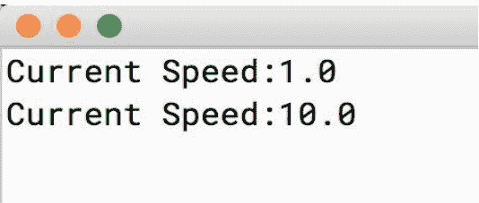

因此有效地说，根据之前的图表我们可以看到，如果你创建一个电动车辆并对其进行加速，它的速度会增加 10，而不是像普通车辆那样增加 1。

## 继承与构造函数

继承的另一个有趣点是，可以重用并适配基类（父类）的构造函数。例如，目前 `Vehicle` 类的构造函数如下：

```java
public Vehicle() {
}
```

为了使其更有用，我们可以对其进行修改，使其实际上初始化一些成员变量如下：

```java
public Vehicle() {
    speed = 0;
    nbWheels = 2;
    nbPassengers = 2;
}
```

因此，默认情况下创建一个新的 `MotoredVehicle` 对象时，它会调用这个构造函数；尽管如此，当创建 `MotoredVehicle` 对象时，它的某些成员变量需要被修改或添加；例如，`MotoredVehicle` 对象还需要为变量 `engineSize`、`petrolType` 或 `petrolLevels` 设置初始值；因此为了一石二鸟，我们可以编写代码调用父类构造函数来初始化 `speed`、`nbWheels` 和 `nbPassengers`，同时为变量 `engineSize`、`petrolType` 和 `petrolLevels` 设置初始值。

我们可以如下修改 `MotoredVehicle` 类的默认构造函数：

```java
public MotoredVehicle() {
    super();
    engineSize = 2;
    petrolType = 0;
    petrolLevels = 100;
}
```

**代码说明**：
- 我们为 `MotoredVehicle` 类定义了构造函数。
- 我们指定当被调用时，该构造函数将反过来使用 `super` 关键字调用基类的构造函数（即父类 `Vehicle` 的构造函数）。
- 如果你记忆清楚，父类的构造函数初始化了速度（`speed`）、轮子数量以及乘客人数。
- 因此，通过使用 `super` 关键字调用父类构造函数，我们避免了在子类的构造函数中重写相同的代码。
- 在调用基类的构造函数后，变量 `engineSize`、`petrolType` 和 `petrolLevels` 将被初始化。

我们可以如下为 `MotoredVehicle` 类添加第二个构造函数：

```java
public MotoredVehicle(float newEngineSize, int newPetrolType, int newPetrolLevels) {
    super();
    engineSize = newEngineSize;
    petrolType = newPetrolType;
    petrolLevels = newPetrolLevels;
}
```

**代码说明**：
- 我们为 `MotoredVehicle` 类声明了一个接受三个参数的构造函数。
- 我们指定当被调用时，该构造函数将反过来使用 `super` 关键字调用基类的构造函数（即父类 `Vehicle` 的构造函数）。
- 在此之后，变量 `engineSize`、`petrolType` 和 `petrolLevels` 将使用传递给此构造函数的参数进行初始化。

因此，如你所看到的，继承可以用来使代码更加简洁，并为你节省一些时间。在上一个例子中，我们看到通过调用父类构造函数，你可以避免重复编写已经在父类中创建的代码。

显然，还有更多与继承相关的概念；然而，本节提供的信息应该能让你轻松开始学习 Java 的这一方面。关于 Java 继承的更多信息，你可以查看官方文档：  
<https://docs.oracle.com/javase/tutorial/java/concepts/inheritance.html>

## 访问方法和访问修饰符

限制访问（并隐藏）变量和方法的能力为你的应用程序提供了更高的安全性，通常被称为封装，这通常通过访问修饰符来实现。

正如我们之前看到的，Java 中有不同类型的访问修饰符。这些修饰符指定了可以从何处调用方法。这些访问修饰符可以是：
- `public`（无限制）
- `protected`（访问限制于包含类、同一包中的类——文件分组——以及其他包中的子类）
- `default`（这是未指定访问修饰符时的默认模式；在这种情况下，访问限制于包含类和同一包中的类）
- `private`（仅允许从包含类或类型访问）

例如，在上一个例子中，我们将变量 `speed` 声明为 `protected` 以便可以访问。

## 多态（通用概念）

多态一词的字面意思是“许多形式”。在面向对象编程中，它指的是接口响应不同的底层形式（数据类型）的能力。

多态有两种主要类型：
- **方法重载**：当多个方法具有相同名称但参数不同时。
- **方法重写**：当子类对其父类中已定义的方法提供特定实现时。

例如，在之前的代码中，我们创建了两个名称相同但参数不同的方法：
- 第一个名为 `decelerate()` 的方法不接受参数并将速度减一。
- 第二个方法具有相同名称；它接受一个用于减少速度的参数。

虽然这些方法的名称相同，但可以根据它们的参数进行区分。如果为任何实例调用了 `decelerate()` 方法，系统将根据传递的参数类型知道应该使用哪一个。

### 实验多态

1.  **向 `Vehicle` 类中添加这些方法**：

```java
public void decelerate() {
    speed--;
}

public void decelerate(float decrease) {
    speed -= decrease;
}
```

2.  **保存并编译 `Vehicle` 文件**。
3.  **在 `MyClass` 文件的 `main()` 方法中添加以下代码**：

```java
MotoredVehicle v2 = new MotoredVehicle();
v2.accelerate();
v2.displaySpeed();

v2.decelerate();
v2.decelerate();
v2.displaySpeed();

v2.decelerate(8);
v2.displaySpeed();
```

**代码说明**：在执行新代码之前，`v2` 的速度应该是 10，因为它通过 `MotoredVehicle` 类可用的方法进行了加速。
- 我们调用了两次 `decelerate()` 方法；由于我们没有传递任何参数，第一个方法（不带任何参数的方法）将被调用，速度将减少两次。因此，新速度应该是 8。
- 随后我们调用了一次 `decelerate(8)` 方法；由于我们传递了参数（即 8），第二个方法（带参数的方法）将被调用，速度将减少 8。因此，新速度应该是 0。

你可以保存代码、编译并运行应用程序；随后你应该看到以下消息：

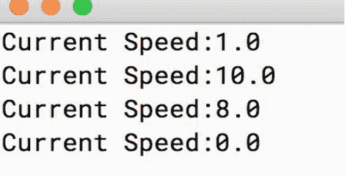

## 包与命名空间

在 Java 中，可以将多个文件和类分组到特定的目录或包（`package`）下，以避免歧义并明确我们想要使用的特定类源自何处。

默认情况下，Java 包含了几个内置包，其中包含可用于特定目的类；例如，`java.io` 包可以用于处理输入和输出，而 `java.util.zip` 包可以用于处理 zip 文件。

包被创建后，就可以使用 `import` 指令相应地导入并使用其中的类。

例如，在本书的第一部分，我们使用了一个名为 `Scanner` 的类来捕获用户的输入。`Scanner` 类是 `java.util` 包的一部分；因此，为了能够使用它，我们在 `MyClass` 类开头添加了以下代码：

```java
import java.util.Scanner;
```

这样，当我们使用 `Scanner` 类时（如下一个代码所示），Java 就知道我们引用的是位于 `java.util` 包中的 `Scanner` 类。

```java
Scanner sc = new Scanner(System.in);
```

同样，名为 `Arrays` 的类也是 `java.util` 包的一部分；因此，如果我们想使用它，我们在 `MyClass` 类开头添加了以下代码：

```java
import java.util.Arrays;
```

这样，当我们使用 `Arrays` 类时（如下一个代码所示），Java 就知道我们引用的是位于 `java.util` 包中的 `Arrays` 类。

```java
Arrays.sort(test);
```

另一个非常有用的功能是可以同时从同一个包导入多个类。例如，如果我们想从 `java.util` 包导入多个类，我们也可以使用以下语法导入该包内的所有类：

```java
import java.util.*;
```

## 列表

正如我们在之前的章节中看到的，使用数组有时是有用的。然而，当你处理大量数据或随时间增长而增加的数据时，列表可能更有用，因为它们包含了用于排序和组织数据的内置工具。因此，你并不总是需要使用列表；但是，它们在组织数据方面可能更高效，特别是对于大型且不断变化的数据集。

### 列表声明与语法

- 你可以如下声明一个列表：
  ```java
  ArrayList<Integer> myList;
  ```
- 声明遵循以下语法：
  ```java
  ArrayList<Type> nameOfVariable;
  ```

所以，你可以创建一个整数、`String` 或 `Vehicle` 对象的列表。列表创建后，Java 提供了几个内置方法，可以操作列表，包括：
- `add()`：在列表末尾添加一个项。
- `clear()`：从列表中删除所有元素。
- `remove()`：从列表中删除一个项。
- `size()`：返回列表中的项目数量。

列表中的每个元素都有一个默认索引，该索引相对于它首次被添加到列表的时间；项添加到列表的时间越早，索引越低。因此，默认添加到列表的第一个项索引为 0，第二个项索引为 1，依此类推。

### 列表示例

```java
ArrayList<String> listOfNames = new ArrayList<String>();
listOfNames.add("Mary");
listOfNames.add("Paul");
System.out.println("Size of list " + listOfNames.size());
// 这会显示 "Size of list 2"

listOfNames.remove("Paul");
System.out.println("Size of List after removing " + listOfNames.size());
```

**代码说明**：
- 我们创建了一个 `String` 变量的新列表。
- 接着我们向列表添加了两个元素，字符串 "Mary" 和 "Paul"。
- 我们显示了从列表中删除一个项前后的列表大小。

### 实践操作

1.  请在 `MyClass` 文件的开头（如果还没有这样做的话）添加以下代码：
    ```java
    import java.util.Arrays;
    ```
2.  请在 `MyClass` 文件的 `main()` 方法中添加以下代码：
    ```java
    ArrayList<String> listOfNames = new ArrayList<String>();
    ```


listOfNames.add("Mary");
listOfNames.add("Paul");
listOfNames.add("John");
listOfNames.add("Zoe");
listOfNames.add("Hannah");
System.out.println("Size of List: " + listOfNames.size());
listOfNames.remove("Paul");
System.out.println("Size of List after removing: " + listOfNames.size());

在之前的代码中：

- 我们声明了一个 `String` 列表并向其添加了五个名字。
- 然后删除了列表的第一个元素（Paul）。
- 我们还显示了删除前后的大小。

你现在可以保存代码并运行程序；你应该看到以下内容。

```
Size of List: 5
```

接下来，我们可以尝试按字母顺序对此列表排序；为了做到，我们将使用 `sort` 方法。

- 请在 `MyClass` 文件的 `main` 方法中添加以下代码。

```java
System.out.println("List before sort");
for (int i = 0; i < listOfNames.size(); i++) {
    System.out.println(listOfNames.get(i));
}
Collections.sort(listOfNames);
System.out.println("List after sort");
for (int i = 0; i < listOfNames.size(); i++) {
    System.out.println(listOfNames.get(i));
}
```

在之前的代码中：

- 我们创建了一个从 0 到列表大小的循环。
- 在循环中，我们显示了索引 `i` 处当前元素的名字。
- 实际上，我们遍历了列表并显示了每个元素的名字。
- 随后，我们使用 `Collections` 类中的 `sort` 方法对列表排序。该类可以用于排序对象。
- 完成后，我们使用 `get` 方法显示刚刚排序过的列表元素。

你现在可以保存代码并运行程序；你应该在控制台中看到以下消息。

| Mary |
| John |
| Zoe |
| Hannah |
| Hannah |
| John |
| Mary |
| Zoe |

如你所见，列表已按字母顺序排序，`Hannah` 变成了第一个元素，`Zoe` 变成了最后一个。

列表还有许多可用方法，你可以在官方页面查看（并尝试）它们：

https://docs.oracle.com/javase/8/docs/api/java/util/ArrayList.html

## 哈希映射 (HashMap)

列表非常有用，而 `HashMap` 是一种特殊的列表，它扩展了这一概念。通过 `HashMap`，你可以通过键（key）而不是索引来定义数据集；例如，考虑一个学生类，每个学生都有名和姓。为了表示和管理这些数据，我们可以创建一个如下类：

```java
public class Student {
    public String firstName;
    public String lastName;
    public Student(String fName, String lName) {
        firstName = fName;
        lastName = lName;
    }
}
```

- 然后我们可以创建一个使用该类来存储多个学生信息的代码：

```java
HashMap<String, Student> students = new HashMap<String, Student>();
students.put("ST123", new Student("Mary", "Black"));
students.put("ST124", new Student("John", "Hennessy"));
System.out.println("Name of student ST124 is " + students.get("ST124").firstName);
```

在之前的代码中：

- 我们声明了一个学生的 `HashMap`。
- 在声明 `HashMap` 时：第一个参数是 `String`，作为索引或键；此索引将是学生 ID。
- 第二个参数将是一个 `Student` 对象。
- 因此实际上创建了键与 `Student` 对象之间的链接。
- 然后我们向 `HashMap` 中添加学生。
- 当使用 `put` 方法时，第一个参数是键（在本例中为 ID：ST123 或 ST124），第二个参数是学生对象。该学生对象通过调用 `Student` 类的构造函数并传递相关参数（如姓）来创建。
- 最后，我们根据特定的学生 ID 打印出名字。

就像列表一样，`HashMap` 也有许多内置方法使其更容易操作它们，包括：

- `put`：向 `HashMap` 中添加新项。
- `containsKey`：检查 `HashMap` 中是否存在特定键的记录。
- `remove`：从 `HashMap` 中删除项。

让我们尝试创建 `HashMap`。

- 请创建一个名为 `Student` 的类：从主窗口选择 `Edit | New Class`，然后选择 `Class` 并在 `Class Name` 字段中输入 `Student`。
- 将创建一个名为 `Student` 的新文件。
- 将现有代码替换为以下内容（新代码为粗体）。

完成此后，我们可以通过在文件 `MyClass` 类中添加以下代码来修改 `main` 方法：

```java
HashMap<String, Student> students = new HashMap<String, Student>();
students.put("ST123", new Student("Mary", "Black"));
students.put("ST124", new Student("John", "Hennessy"));
System.out.println("Name of student ST124 is " + students.get("ST124").firstName());
```

完成后，我们可以保存这两个文件，编译它们并运行应用程序；你应该会在控制台窗口中看到以下消息：

| Name of student ST124 is John |

## 关卡总结

在本章中，我们学习了一些与 Java 和面向对象编程相关的有趣概念。我们还学习了如何定义和使用类，以及成员变量和方法。在在此过程中，我们还查看了其他编程概念，如变量、循环和条件语句。因此，我们已经涵盖了大量内容来帮助你上手 Java！

## 检查清单

| 如果你能做到以下操作，可以考虑移动到下一个阶段： |
| :--- |
| 理解面向对象编程的概念。 |
| 理解类、成员变量和成员方法的含义。 |
| 理解构造函数的作用。 |
| 理解访问修饰符的作用。 |

## 测验

现在，让我们检查你的知识！请回答以下问题，或指定这些陈述正确还是错误（答案在下一页）。

- 1. 类型为 `void` 的方法不返回任何数据。
- 2. 公有变量可以在应用程序的任何地方访问。
- 3. 私有方法只能在同一个类内部访问。
- 4. 保护方法可以被类的子类访问。
- 5. 为给定的类可以创建多个构造函数。
- 6. 为给定的类可以定义相同的方法。
- 7. 默认情况下，类的子类继承其父类的成员方法和变量。
- 8. 静态成员方法可以在不需要实例化给定类的对象的情况下调用。
- 9. 子类可以重写父类的一个方法。
- 10. 在处理动态增长和演变的数据时，使用列表（list）比数组更合适。

## 测验答案

- 1. 正确。
- 2. 正确。
- 3. 正确。
- 4. 正确。
- 5. 正确。
- 6. 正确。
- 7. 正确。
- 8. 正确。
- 9. 正确。
- 10. 正确。

# 4 创建一个单词猜词游戏

> “大多数优秀的程序员编写程序并不是因为他们期待报酬或公众的赞誉，而是因为编程是一件趣事。”
>
> — 林纳斯·托瓦兹 (Linus Torvalds)

在本节中，我们将利用我们的技能创建一个具有以下特征的单词猜词游戏：

- 从现有列表中随机选取一个单词。
- 单词的字母将被隐藏。
- 玩家将尝试通过按下键盘上的字母来猜测每个字母。
- 一旦发现了某个字母，它将显示在屏幕上。
- 玩家猜单词的次数有限。

因此，在完成本章后，你将能够：

- 随机选取一个单词。
- 处理并评估玩家按下的字母。
- 显示玩家正确猜出的字母。
- 跟踪并显示分数。
- 检查玩家是否使用的猜测次数过多。

## 检测并处理用户输入

在本节中，我们将实现游戏的主要功能，即：

- 创建一个新的待猜单词。
- 统计该单词中字母的数量。
- 显示对应的字母。
- 等待用户按下键盘上的字母。
- 检测用户输入。
- 显示玩家猜中的字母。

让我们开始编写吧。

- 创建名为 `MyGame` 的新类。
- 在类的开头添加以下代码：

```java
static String wordGuess = "";
static int lengthOfWordGuess;
static char[] lettersGuess;
static boolean[] lettersGuessed;
static char[] lettersSoFar;

public static void main(String[] args) {
}
```

在前面的代码中：

- 我们声明了变量。
- `wordGuess` 将存储待猜的单词。
- `lengthOfWordGuess` 是单词的字母数量。
- `lettersGuess` 是一个字符数组。
- `lettersGuessed` 是布尔数组，用于标记字母是否已被猜中。
- `lettersSoFar` 是字符数组，用于显示。

- `wordGuess` 用于存储待猜的单词。
- `lettersGuessed` 用于标记哪些字母已被猜中。
- `lettersSoFar` 用于显示单词。

- 为了初始化游戏，请在类中添加以下方法：

```java
static void initGame() {
    wordGuess = "Elephant";
    lengthOfWordGuess = wordGuess.length();
    lettersGuess = wordGuess.toCharArray();
    lettersGuessed = new boolean[lengthOfWordGuess];
    for (int i = 0; i < lengthOfWordGuess; i++) {
        lettersSoFar[i] = '_';
    }
}
```

- `wordGuess` 被初始化为 "Elephant"。
- `lengthOfWordGuess` 设置为 `wordGuess` 的长度。
- `lettersGuess` 将 `wordGuess` 转换为字符数组。
- `lettersGuessed` 被初始化为长度为 `lengthOfWordGuess` 的布尔数组（默认全为 `false`）。
- `lettersSoFar` 被初始化为包含下划线的字符数组。

- 在 `main` 方法中，我们需要调用 `initGame`：

```java
initGame();
System.out.println("" + new String(lettersSoFar));
```

在前面的代码中：

- 我们定义了 `initGame` 方法，它是静态的，以便在 `main` 方法中调用。
- 它初始化了单词并显示了初始状态。

- 为了处理玩家输入的字母，我们需要创建一个执行以下操作的方法：

```java
static void checkKeyboard() {
    Scanner sc = new Scanner(System.in);
    System.out.println("请输入一个新的字母:");
    char newLetter = sc.next().charAt(0);
    newLetter = Character.toUpperCase(newLetter);
    if (Character.isLetter(newLetter)) {
        for (int i = 0; i < lengthOfWordGuess; i++) {
            if (!lettersGuessed[i]) {
                if (lettersGuess[i] == newLetter) {
                    lettersGuessed[i] = true;
                    lettersSoFar[i] = newLetter;
                }
            }
        }
        System.out.println("" + new String(lettersSoFar));
    }
}
```

在 `checkKeyboard` 方法中：

- 我们要求用户输入一个字母。
- 无论用户输入什么字符串，我们只获取输入的第一个字母。
- 然后我们将该字母转换为大写，以便与待猜单词中的字母进行比对（这些字母已以大写形式存储）。
- 我们检查该字符是否为字母。
- 我们遍历待猜单词的所有字母。
- 如果该字母尚未被猜中：
    - 如果该字母与单词中的某个字母匹配，则将其标记为已猜中（`true`），并在 `lettersSoFar` 中显示该字母。
- 最后，显示更新后的单词状态。

- 为了读取用户输入，我们需要导入 `Scanner` 类：

```java
import java.util.Scanner;
```

将此行代码添加到类的最开头。

- 我们检查该字母是否已经被猜过。
- 如果不是这种情况，我们检查该字母是否为 A。
- 如果是这种情况，我们就会指示该字母（即字母 A）已被找到。
- 然后我们在屏幕上显示相应的字母。

最后但同样重要的是，我们只需要能够调用此函数来初始化游戏并处理用户的输入。

- 请将以下代码添加到 `main` 函数中（新代码已**粗体**显示）。

```java
public static void main(String[] arguments) {
    initGame();
    checkKeyboard();
}
```

所以在这个阶段，我们已经拥有了启动游戏所需的所有函数；因此你可以保存并编译 `MyGame` 然后执行它。当程序运行时，系统会要求你输入一个字母，如果你按下键盘上的 A 键，字母 A 也应该显示在屏幕上，因为它是 Elephant 单词的一部分。

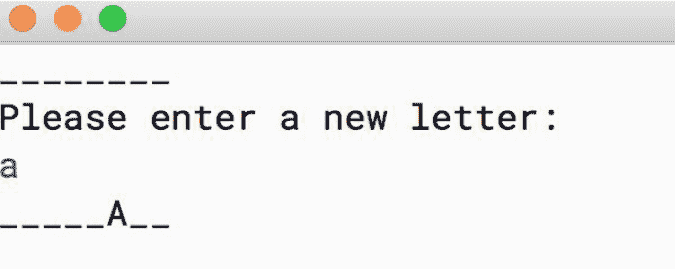

图 4-1：检测按下的键

所以，它运行正常，我们可以轻松地添加更多代码来检测其他键；我们还可以尝试确保按下的键是一个字母。因此，我们将创建一个新方法，涉及以下内容：

- 检查是否按下了键。
- 检查该键是否为字母。
- 按照之前的步骤进行，检查该字母是否是待猜单词的一部分。
- 在达到最大尝试次数后停止游戏。

让我们开始吧：

- 请在 `MyGame` 类的开头添加以下代码。

```java
static private int nbAttemps = 0;
static private final int maxNbAttemps = 5;
```

- 请创建一个名为 `checkKeyboardBoard2` 的新函数，如下：

```java
static void checkKeyboard() {
    String guessingString;
    Scanner sc = new Scanner(System.in);
    System.out.println("Please enter a new letter:");
    char newLetter = sc.next().charAt(0);
    nbAttempts++;
    newLetter = Character.toUpperCase(newLetter);
    int asciiCode = (int) newLetter;
    if (asciiCode >= 65 && asciiCode <= 90) {
        for (int i = 0; i < lengthOfWordToGuess; i++) {
            if (!lettersGuessed[i]) {
                if (lettersToGuess[i] == newLetter) {
                }
            }
        }
    }
}
```

```java
lettersGuessed[i] = true;
lettersDiscoveredSoFar[i] = newLetter;
}
}
}
System.out.println("" + new String(lettersDiscoveredSoFar));
if (nbAttempts <= maxNbAttemps) checkKeyboard2();
}
```


在之前的代码中：

- 每当用户输入一个字母，我们就增加变量 `nbAttempts` 的值。
- 然后我们检查该字符实际上是一个字母。这是通过使用与输入的字母相关的整数值来实现的；这对应于 65 到 90 之间的整数。
- 一旦完成这些，我们就检查是否达到了最大尝试次数。

我们最后需要做的是通过修改 `main` 函数，调用 `checkKeyboard2` 函数代替 `checkKeyboard` 函数（新代码已**粗体**显示）：

```java
public static void main (String [] arguments)
{
  initGame();
  checkKeyboard2();
}
```

就是这样！

一旦完成，请保存你的代码，检查其无错误并测试该场景。当你按下 E、L、P 和 A 键时，你应该能看到它们现在出现在屏幕上。

```text
-------
Please- enter a new letter:
e
E_E____
Please enter a new letter:
1
ELE____
Please enter a new letter:
p
ELEP____
Please enter a new letter:
h
ELEPH___
nPlease enter a new letter:
```

图 4-2：检测所有按下的键

## 选择随机单词

在这个阶段，游戏运行正常，玩家猜的字母会显示在屏幕上；尽管如此，但如果能从预定义的单词列表中随机选择待猜单词，将增加更多挑战性。因此，在下一节中，我们将学习如何这样做；我们将从一个数组中选择一个单词开始。

让我们开始吧。

- 请打开 `MyGame` 类。
- 在类开头添加以下代码。

```java
static private String [] wordToGuess = new String [] { "car", "elephant","autocar" };
```

在之前的代码中，我们声明了一个 `String` 变量数组并向其中添加了三个单词。

- 在类开头添加以下代码：

```java
import java.util.Random;
```

在之前的代码中，我们导入了 `Random` 类，它也可以用于生成随机数。使用这个类，以及该类提供的其他优势，与 `Math.random` 方法相比，它更容易生成随机整数。

这是因为在这种情况下生成的数字（即使用 `Random` 类）比 `Math.random` 方法更容易生成随机整数。

（注：原文中此处存在大量重复的句子，在翻译时已根据逻辑完整性进行处理，保持核心含义一致）

- 在这种情况下，它将保存待猜测的单词并显示在屏幕上。

所以，让我们创建这个函数：

- 请打开 `MyGame.java` 文件。
- 在类的末尾添加以下方法。

```java
static void checkIfWordFound()
{
    Boolean condition = true;
    for (int i = 0; i < lengthOfWordToGuess; i++)
    {
        condition = condition && lettersGuessed[i];
    }
    if (condition)
    {
        System.out.println("Well Done!; would you like to start again (y/n)?");
        Scanner sc = new Scanner(System.in);
        char answer= sc.next().charAt(0);
        if (answer == 'y') main (new String [3]);
    }
}
```

在之前的代码中：

- 我们定义了一个名为 `checkIfWordFound` 的函数。
- 我们声明了一个名为 `condition` 的布尔变量，用于判断是否所有的字母都已找到。
- 这个名为 `condition` 的变量初始被设置为 `true`。
- 然后我们遍历数组 `lettersGuessed` 的每个变量，以检查玩家猜对的字母。如果单词中的任何一个字母没有被找到（即使只是一个），变量 `condition` 将被设置为 `false`。
- 下面的代码实际上在 `lettersGuessed` 数组的所有变量之间执行了逻辑上的“与”（AND）操作，因为只有所有变量都为 `true`（即已找到），变量 `condition` 才为 `true`；所以这等同于说：“如果字母被猜中了，且字母2被猜中了且字母3被猜中了，……并且最后一个字母也被猜中了，那么条件为真”。

```java
condition = condition && lettersGuessed[i];
```

- 如果变量 `condition` 为 `true`，我们会询问玩家是否想重新开始游戏。
我们会显示一条祝贺消息并询问用户是否想重新开始游戏。

现在可以在 `checkKeyboard2` 函数中添加对此函数的调用，如下（粗体部分为新代码）：

```java
if (lettersToGuess[i] == newLetter)
{
    lettersGuessed[i] = true;
    score++;
    checkIfWordFound();
}
```

现在我们可以编译你的代码并执行它；在猜完神秘单词的所有字母后，屏幕会显示一条祝贺消息，并会问你是否想重新开始游戏。

```text
AU___A_
Please enter a new letter:
t
Your score is now 4
AUT__A_
Please enter a new letter:
o
Your score is now 5
AUTO_A_
Please enter a new letter:
c
Your score is now 6
AUTOCA_
Please enter a new letter:
r
Well Done!; would you like to start again (y/n)?ny
------
Please enter a new letter:
```

图 4-5：祝贺玩家

## 章节总结

在本章中，我们学习了如何创建一个简单的单词猜词游戏，玩家可以猜随机单词的字母。在此过程中，我们学习了一些有趣的技能，包括：生成随机数或检测玩家的输入。因此，我们已经涵盖了大量内容来帮助你开启第一个单词游戏！

## 检查清单

| 如果你能够完成以下操作，就可以考虑移动到下一个阶段： |
| :--- |
| * 创建随机数。<br> * 创建一个 String 或 Boolean 变量数组。<br> * 检测玩家按下的按键。 |

## 测验

现在，让我们检查你的知识掌握！请回答以下问题（答案在资源包中），或指定这些陈述正确或错误。

- 1. 下面的代码将声明一个整数数组。

```java
int [] i = new int [];
```

- 2. 下面的代码将声明并初始化一个 String 变量数组：

```java
String [] wordsToGuess = new String [] {"car", "elephant", "autocar"};
```

- 3. `Scanner` 可以读取用户输入的键。

- 4. 下面的代码将显示 String `Hello` 的字符数。

```java
String s = "Hello";
print(s.length);
```

- 5. `char` 变量可以用于存储超过两个字母的名字。

- 6. `String` 变量可以用于存储超过两个字母的名字。

- 7. 在 Java 中可以使用 `Math.random` 方法生成随机数。

- 8. 数组的第一个元素从索引 1 开始。

- 9. 数组的第一个元素从索引 0 开始。

- 10. 在 Java 中可以使用 `Random` 类生成随机数。

## 测验答案

- 1. 正确 (TRUE)。

- 2. 正确 (TRUE)。

- 3. 正确 (TRUE)。

- 4. 错误 (FALSE)。它应该读取 String。

```java
String s = "Hello";
```

- 5. 错误（FALSE）（仅存储了一个字符）。

- 6. 正确 (TRUE)。

- 7. 正确 (TRUE)。

- 8. 错误 (FALSE)。

- 9. 正确 (TRUE)。

- 10. 正确 (TRUE)。

## 挑战 1

现在你已经完成了这一章并创建了游戏，你可以通过以下方法改进它：

- 将尝试次数设置为待猜单词字母的数量。
- 在数组中添加更多待猜单词。

## 挑战 2

另一个有趣的挑战可以是：

- 创建一个二维单词数组。第一个数组可以处理动物名称，第二个数组可以处理城市名称。
- 确保从第一个或第二个数组中随机选择待猜单词。

# 5
感谢


感谢你完成这本书。我相信现在对 Java 有了信心。这本书是“Java 从零到精通”系列的第一本，所以现在是时候进入后续书籍了，在那些书中你将学习到更多 Java。为了不断改进这本书，我非常感谢你的反馈。因此，请在亚马逊上给我留下有帮助的评论，告诉我对对书的想法，并给我发送电子邮件（learntcodewithpat@gmail.com）提出你的任何建议。我会阅读并回复每封邮件。非常感谢！
