# Java FX 初学者指南

**Doug Lowe**

《傻呆书：Java 全能教程》作者

# 在 Dummies.com 获得更多，做更多


# 在 Dummies.com 变得机灵

Dummies.com 用 1,000 个答案让你的生活更轻松，涵盖从去除壁纸到使用最新版本 Windows 的一切问题。

查看我们的：

- 视频
- 图解文章
- 步骤指南

此外，你每个月都可以通过参加 Dummies.com 抽奖活动赢得价值奖品。*

想每周获取一份傻呆指南吗？在以下领域订阅通讯邮件：

- 数字摄影
- Microsoft Windows & Office
- 个人财务与投资
- 健康与健康
- iPad 与手机
- eBay
- 互联网
- 食品、家居与园艺


# 在 Dummies.com 发现“如何做”

*抽奖活动目前并非所有国家可用；请访问 Dummies.com 查看官方规则。*


# Doug Lowe 著


## 第一章：你好，JavaFX！

- 使用记事本开发 Click
- 使用 IDE 创建 Click 程序

## 第二章：深入了解 JavaFX 编程

# JavaFX 入门教程

## 第3章：处理事件

## 第4章：设置舞台与场景布局

## 第5章：使用布局面板安排你的场景

## 第6章：从用户处获取输入

## 第7章：介绍 JavaFX 节点层级结构

## 第8章：从列表中选择

- 创建自定义菜单项

# 第三部分：增强你的场景设计

## 第13章：绘制形状

- 使用渐变填充

## 第14章：添加特殊特效

## 第16章：使用图像和媒体

查看图像示例

播放音频文件

- Accordion（手风琴）
- DatePicker（日期选择器）
- ProgressIndicator（进度指示器）和 ProgressBar（进度条）
- ScrollBar（滚动条）
- 第二步：添加一个柱体
- 第四步：平移柱体
- 第六步：旋转盒子
- 第八步：添加网格对象
- 第十步：添加光源

# 引言

最初有 AWT（抽象窗口工具包）。AWT 是 Java 用于显示窗口界面的第一个系统。AWT 生了 Swing，后者很快成为创建用户友好界面的首选。

但随后有了 JavaFX，它是 Swing 的有力继任者。JavaFX 设计用于在桌面、平板、手机和电视顶盒等各种设备上创建惊人的界面。直到最近，JavaFX 并不是 Java 的官方部分。但从版本 8 开始，JavaFX 已完全集成到 Java 中。

## 关于这本书

这不是一本从头读到尾的书。它是一本按需阅读的书：当你需要某些知识时拿起它。如果你想了解场景图的大纲，请阅读第 7 章。如果你只是想回顾如何设置场景的大小，只需阅读 `Scene` 类的部分。

当然，书中充满了信息——如果你想对某个主题进行简单的探索，非常欢迎。如果你想了解如何为形状添加特效，直接跳到第 14 章。

## JavaFX 傻学者

在本书中，我对你可能已经或不知道的 JavaFX 很少假设。但我必须做两个基本假设：

- 你拥有一台安装了 Java JDK 8 的电脑，或者你有权限在上面安装。

JavaFX 是 JDK 8 的不可或缺部分，因此它是学习 JavaFX 的必要条件。如果你尚未安装，将在第 1 章中找到安装方法。

- 你具备 Java 编程的基础知识。

如果你是 Java 新手，我建议参考两本书：我自己的《Java All-In-One For Dummies》第 4 版，或者 Barry Burd 的《Java For Dummies》第 6 版。这两本书都由 Wiley 出版。


本书没有其他先决条件。

# 本书的结构

本书分为五个部分。以下是各部分内容的简要描述。

## 第一部分：JavaFX 入门

这部分包含了你开始 JavaFX 编程所需的信息。在简要介绍 JavaFX 是什么以及它为什么很受欢迎之后，你将了解到创建简单 JavaFX 程序的基础知识。你将学会如何创建包含标签、文本字段和按钮等常用控件的简单 JavaFX 场景。然后，你将学会如何编写响应用户输入的程序，例如用户点击按钮或在文本字段中输入文本时。最后，你将学习如何使用基本的布局管理器来控制 JavaFX 场景中控件的布局。

## 第二部分：JavaFX 控件

这部分的章节重点介绍你可以在 JavaFX 场景图中使用的各种类型的控件，并介绍了这些控件所使用的类层次结构的细节。然后，本部分的其余章节介绍了特定类型控件的信息，范围从复选框、单选按钮到菜单。

## 第三部分：增强你的场景设计

这部分的章节将帮助改进应用程序的外观。首先，你将学习其他类型的布局管理器，它们让你对用户界面的布局方式有更多控制。然后，你将发现如何使用 CSS 样式来应用格式化细节。接下来，你将学会如何将简单形状整合到场景中。最后，你可以阅读关于 JavaFX 的特殊特效，这些特效让你通过阴影、运动模糊等来装饰你的显示内容。

## 第四部分：让你的程序活起来

这部分的章节重点介绍让你的程序具有响应性且吸引力的各种方法。你将发现如何处理属性（properties），你可以用它们让用户界面的一部分响应于另一部分的变化。然后，你将发现如何整合包括声音和视频在内的媒体。接下来，你将学会创建复杂的动画，让屏幕上的物体跳动起来。最后，你将学习如何创建响应多指手势的程序。

## 第五部分：十项技巧

如果没有“十项技巧”，这就不叫“傻傻指南”了。这里的每一章都介绍了十个特别关注的项目。第 19 章介绍了十种未包含在第二部分的额外 JavaFX 控件。第 20 章介绍了创建显示三维场景的 JavaFX 应用程序的十种技巧。

# 书使用的图标

和任何“傻傻指南”一样，本书充满了实用的图标，引导你注意具有特殊重要性的项目。你可以在书中找到以下图标：

> 危险，罗宾逊！这个图标突出了可能帮助你避免灾难的信息。

> 我告诉过你我上过的内存课程吗？特别注意这个图标；它会让你知道有一个非常有用的小贴士。


# 引言


等一下——技术性太强的内容就在眼前了。显然，因为这是一本编程书，400 多页内容中的几乎每一个段落都可以使用这个图标。因此，我将它留给那些深入探讨、解释某些事物底层工作原理的段落——这可能比你使用某个功能时真正需要了解的要深，但往往能带来启发。当我想要用使用某些 Java 特性的示例来说明观点时，而该特性在书中尚未涵盖，或在之后介绍介绍，有时你会发现这个图标。在这种情况下，该图标只是提醒你不要纠结于示例的细节，而要关注更宏观的观点。

# 书外内容

在书中找不到的所有额外内容都 www.dummies.com 找到。访问在线查找以下内容：

- *涵盖其他主题的在线文章位于：*

`www.dummies.com/extras/javafx`

在这里你将找到涵盖书中未包含的 JavaFX 额外功能的文章。

- *本书的速表（Cheat Sheet）位于：*

`www.dummies.com/cheatsheet/javafx`

在这里你将找到一些最重要的 JavaFX 类的方便总结。

- *本书的代码列表位于：*

`www.dummies.com/extras/javafx`

书中使用的所有代码列表均可下载。

- *本书的更新（如果有的话）也位于：*

`www.dummies.com/extras/javafx`

你可以从这里到达那里。手里拿着这本书，你已经准备好直接跳入 JavaFX 池塘那片清凉宜爽的水中了。浏览目录并决定你想从哪里开始。大胆吧！勇敢吧！冒险吧！最重要的是，玩得开心！

## 第一部分

## JavaFX 入门


访问 www.dummies.com 获取优秀的在线傻傻内容。

## 在这一部分 . . .

- 编写基础程序
- 处理事件
- 显示简单场景
- 安排节点
- 响应输入

## 第 1 章：你好，JavaFX！

在本章中：

- JavaFX 是什么以及你能做什么的概述
- 下载、安装和配置 Java
- 使用 Eclipse 或 NetBeans 等流行的 IDE 构建基础的 JavaFX 程序
- 使用文本编辑器

你不需要成为某个大师，但在深入学习之前，你应该对 JavaFX 有良好的了解。我建议你买一本 Wiley 出版的《Java-in-One》。

## 10：第一部分：JavaFX 入门

在你的 JavaFX 旅程中，不要气馁。在第 2 章中，我将逐行解析那个简单的 JavaFX 程序。为此，我将关注：

- JavaFX 是什么
- 你能用它做什么
- 如何设置你的计算机用于 JavaFX


书中使用的所有代码列表均可在 www.dummies.com/javafx 下载。

# 什么是 JavaFX？

简单来说，JavaFX 是系列 Java 包，让你为 Java 应用程序添加精美的图形界面。通过 JavaFX，你可以创建传统的窗口界面，包括标签、按钮、文本框、复选框、下拉列表等熟悉的控件。你还可以用光源、透视和动画等特效装饰这些界面。增强 JavaFX 的特效。


在 JavaFX 出现之前，在 Java 中创建图形界面的主要方法是通过 Swing API。JavaFX 在很多方面与 Swing 相似，因此如果你用过 Swing 为 Java 程序创建用户界面，那么你在学习 JavaFX 时就有了良好的基础。

JavaFX 作为附加包已经存在了一段时间，但从 Java 8 开始，JavaFX 现在是 Java 平台的官方标准组成。因此，在你安装了 Java 8 开发工具包 (JDK) 之后，就可以使用喜欢的开发工具开始开发自己的 JavaFX 应用程序。


Oracle 已经宣布 JavaFX 将取代 Swing。尽管 Swing 在 Java 8 中仍受支持，并且在可见的未来内将继续支持，但 Oracle 正在 JavaFX 上创建新功能。最终，Swing 将过时。

## 探索 JavaFX 的可能性

JavaFX 的基本优势之一是它能够让你轻松创建复杂的图形用户界面，并包含所有人都熟悉并喜爱的经典用户界面组件。因此，JavaFX 提供了全系列的控件——实际上有几十个，包括按钮、标签、文本框、复选框、下拉列表等经典控件，以及标签面板和手风琴面板等更特殊的控件。图 1-1 显示了一个典型的 JavaFX 界面，它使用了其中几种控件类型来创建一个数据输入表单。

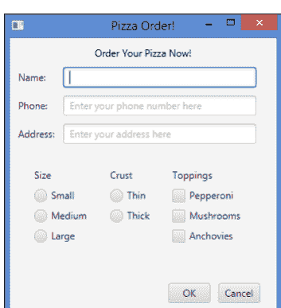

**图 1-1：** 一个典型的 JavaFX 程序。

说实话，图 1-1 所示的数据输入表单并不特别。事实上，你可以使用 Swing 以费同样的精力轻松创建出这样的数据输入表单。相比 Swing，使用 JavaFX 的真正优势直到你开始使用一些高级的 JavaFX 特性时才会显现出来。

首先，考虑图 1-1 中数据输入表单的整体外观。按钮、标签、文本字段、单选按钮和复选框的外观有些过时。图 1-1 中的对话框与你 20 年前在 Windows 95 计算机上用 Visual Basic 创建的视觉差异微乎其微。

JavaFX 开始放异之处在于它能够让你通过层级样式表（CSS）轻松地改进用户界的外观。CSS 通过将所有格式信息放在一个名为“样式表”的独立文件中，使其易于自定义用户界面控件外观的许多方面。样式表是一个简单的文本文件，为用户界面各种元素的格式化提供一组规则。你可以使用 CSS 控制成百上千个格式属性。例如，你可以轻松地更改文本属性（如字体、大小、颜色和粗细），并且添加背景图像、渐变填充、边框以及阴影、模糊和光源等特殊效果。

图 1-2 显示了图 1-1 所示表单的变体，这次使用了 CSS。该表单的简单 CSS 文件添加了背景图像，增强了文本格式化效果，并修改了按钮的外观。

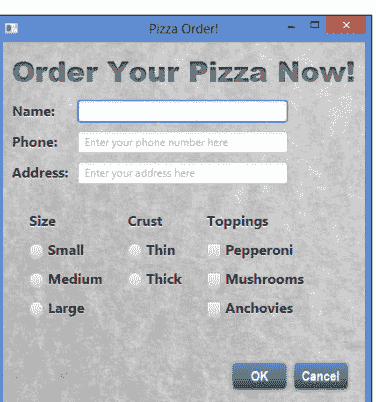

> 图 1-2 JavaFX 让你使用 CSS 指定界面元素的格式化。

除了 CSS 之外，JavaFX 还提供了许多其他能力。这些是最重要的：

- **视觉效果：** 你可以为用户元素添加各种视觉效果，包括阴影、反射、模糊、光照和透视效果。
- **动画：** 你可以指定随时间逐渐应用的动画效果。
- **图表：** 你可以使用 `javafx.scene.chart` 包创建条形图、饼图和许多其他类型的图表。
- **3D 对象：** 你可以绘制三维对象，如立方体、圆柱、球体和其他复杂的形状。
- **触摸界面：** JavaFX 可以轻松处理触摸屏设备，如智能手机和平板电脑。
- **属性绑定：** JavaFX 允许你创建属性，它可以绑定到用户界面控件的特殊数据类型。例如，你可以创建一个表示项目值的属性，然后将标签绑定到它上。这样，每当属性变化时，标签显示的值就会更新。

你将在后面的章节中发现这些以及更多功能。但现在，是时候看一个简单的 JavaFX 程序了，让你对 JavaFX 的样子有个直观印象。

## 查看一个简单的 JavaFX 程序

图 1-3 显示了一个非常简单的 JavaFX 程序的用户界面，它只包含一个简单的按钮。最初，按钮的文本显示为 `Click me please!`。点击时，按钮的文本将变为 `You clicked me!`。如果你再次点击按钮，文本将变回 `Click me please!`。此后，你每次点击按钮，文本都会在 `Click me please!` 和 `You clicked me!` 之间循环。

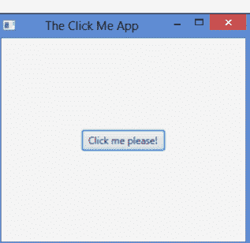

**图 1-3：** “点击我”程序。


为了让你了解 JavaFX 编程是什么样子，代码列表 1-1 显示了该程序的完整代码。我将不会解释该程序如何运行的细节——我将在第 2 章详细检查这个程序。现在，我只想让你对整体有个了解，以便对 JavaFX 的样子有个感觉。

### 代码列表 1-1：Click Me 程序

```java
import javafx.application.*;
import javafx.stage.*;
import javafx.scene.*;
import javafx.scene.layout.*;
import javafx.scene.control.*;

public class ClickMe extends Application {
    public static void main(String[] args) {
        launch(args);
    }

    Button btn;

    @Override
    public void start(Stage primaryStage) {
        // 创建按钮
        btn = new Button();
        btn.setText("Click me please!");
        btn.setOnAction(e -> handleClick());

        // 将按钮添加到布局面板中
        BorderPane pane = new BorderPane();
        pane.setCenter(btn);
        // 将布局面板添加到场景
        Scene scene = new Scene(pane, 300, 250);

        // 完成并显示阶段
        primaryStage.setScene(scene);
        primaryStage.setTitle("The Me App");
        primaryStage.show();
    }

    public void handleClick() {
        if (btn.getText().equals("Click me please!")) {
            btn.setText("You clicked me!");
        } else {
            btn.setText("Click me please!");
        }
    }
}
```

以下段落简要解释了 Click Me 程序中的关键元素：

- 与任何其他 Java 程序一样，JavaFX 程序以一系列导入语句开头，这些语句引用了将使用的包。对于示例，导入了五个包。
- 所有 JavaFX 程序都扩展一个名为 `Application` 的类，它提供了程序的基本功能。当你扩展 `Application` 类时，必须重写 `start` 方法；JavaFX 在启动时会调用该方法。
- 与任何程序一样，JavaFX 程序必须有一个 `main` 方法。在 Java 程序中，`main` 方法只需调用 `Application` 类的 `launch` 方法，该方法会启动应用程序并调用 `start` 方法。

## 安装 JDK 8

下载 JDK 文件后，你可以通过运行下载的执行文件来安装它。安装过程根据操作系统的不同略有差异，但基本上，你只需要在下载后运行 JDK 安装程序，步骤如下：

- 在 Windows 系统上，打开保存安装程序的文件夹并双击安装图标。
- 在 Linux 或 Solaris 系统上，使用控制台命令切换到下载文件的目录，然后运行程序。
- 在 Mac 上，打开“下载”窗口并双击下载的 JDK .dmg 文件。会弹出一个 Finder 窗口，其中包含一个打开的盒子的图标。双击该图标即可启动安装程序。

启动安装程序后，它会提示你输入正确安装 JDK 所需的任何信息，例如你想安装哪些功能以及你想将 JDK 安装在哪个文件夹中。你可以安全地为每个选项选择默认答案。

## 设置路径

安装 JDK 之后，你需要配置操作系统，使其能够找到 JDK 命令行工具。要做到这一点，你必须设置 Path 变量——这是一组操作系统用于定位可执行程序的文件夹列表。在 Windows 系统上执行此操作，请遵循以下步骤。你必须以管理员身份登录才能进行本过程描述的更改。

1. 打开控制面板。
   - 在 Windows 7 或更早系统上，打开“开始”菜单并选择“控制面板”。
   - 在 Windows 8 或更高系统上，点击“开始”按钮或按 Windows 键，输入“控制面板”，然后按回车。
2. 双击“系统”图标。出现系统属性页面。
3. 点击“高级系统设置”链接，然后点击“环境变量”按钮。出现“环境变量”对话框，如图 1–4 所示。

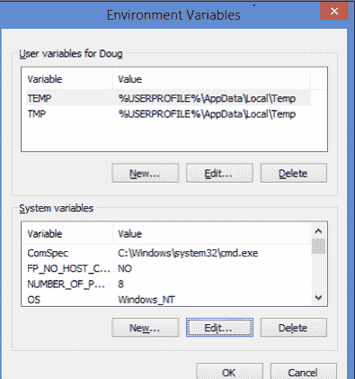

图 1-4：环境变量对话框。

4. 在“系统变量”列表中滚动到 Path 变量，选中它，然后点击“编辑”按钮。弹出一个小的对话框让你编辑 Path 变量的值。
5. 将 JDK bin 文件夹添加到 Path 值的开头。使用分号将 bin 文件夹与路径中可能已经其他信息隔开。

> 注意：bin 文件夹的名称在你的系统上可能有所不同，例如在本例中：

6. 点击三次“确定”以退出。第一次点击“确定”让你回到“环境变量”对话框；第二次“确定”让你回到“系统属性”页面；第三次“确定”关闭“系统属性”页面。

```
c:\Program Files\Java\jdk1.8.0\bin;other directories...
```

对于 Linux 或 Solaris，该过程取决于你使用的 shell。更多信息请参阅你所用 shell 的文档。请注意，在 Mac 系统上不需要此步骤。

## 使用记事本开发 Click Me 程序

安装 JDK 8 之后，你就可以使用 JavaFX 了。严格来说，除了 JDK 8 之外，你开发 Java 程序所需的唯一工具是文本编辑器和命令行提示符的访问权限。通过文本编辑器，你创建 Java 源文件，并以 .java 扩展名保存。然后，在命令行提示符中，使用 Java 的命令行工具来编译和运行程序。

Windows 自带免费的文本编辑器记事本，它对于创建简单的 Java 源文件已经足够。记事本是一个通用的文本编辑器，并不了解 Java 源代码的特殊之处。因此，记事本不会在缩进、左右大括号匹配或引起你注意语法错误等方面提供任何帮助。

记事本也不会在编译、运行或调试 Java 程序方面提供帮助。但记事本的优点是免费且易用。而且，它已经于你的电脑中了，所以不需要安装其他东西。

以下是使用记事本和 Java 命令行工具创建 Click Me 程序的步骤：

1. 启动记事本。
   在 Windows 7 或 8 中执行：
   a. 点击“开始”按钮（或按键盘上的 Windows 键）。
   b. 输入 `notepad` 然后按回车。

记事本启动了，向你展示一个空白文本编辑窗口。

2. 将列表 1-1 所示的 Click Me 程序文本输入到编辑窗口中。确保输入的文本与列表中显示的完全一致。完成后，仔细检查你的工作，以确保输入无误。

图 1-5 显示了 Click Me 程序在正确输入记事本后的样子。（注意，图中显示的记事本窗口不够大以显示整个源文件；你必须滚动窗口才能查看整个文件。）


```java
import javafx.application.Application;
import javafx.stage.Stage;
import javafx.scene.Scene;
import javafx.scene.layout.*;
import javafx.scene.control.*;

public class ClickMe extends Application {
    public static void main(String[] args) {
        launch(args);
    }

    Button btn;

    @Override
    public void start(Stage primaryStage) {
        btn = new Button("Click me");
        btn.setOnAction(e -> handleClick());
        StackPane pane = new StackPane();
        pane.getChildren().add(btn);
        primaryStage.setScene(new Scene(pane, 300, 250));
        primaryStage.setTitle("Click Me");
        primaryStage.show();
    }

    public void handleClick() {
        if (btn.getText().equals("Click me")) {
            btn.setText("You clicked!");
        }
    }
}
```

## 第1章：你好，JavaFX！

TextPad 的基础文本编辑能力与你用过的任何其他文本编辑器都相似，因此你在输入和编辑 Click 程序时应该不会遇到困难。

在你编辑文本时，你可能会注意到 TextPad 的一些实用编辑功能。例如，每当你打开括号时，TextPad 会自动对光标缩进，当你输入右括号时，它会恢复到之前的缩进。TextPad 还会使用不同的颜色来识别关键字、变量以及其他 Java 编程元素。

图 1-7 显示了 Click 程序在 TextPad 中的外观。

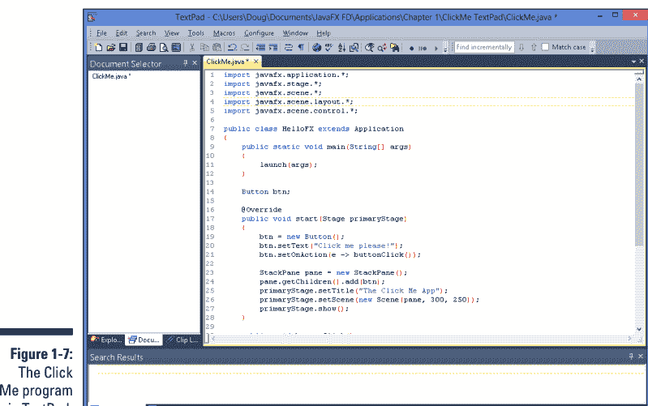

图 1-7：TextPad 中的 Click 程序。

```java
import javafx.application.Application;
import javafx.scene.Scene;
import javafx.scene.control.*;
import javafx.scene.layout.*;
import javafx.stage.Stage;

public class Hello extends Application {
    public static void main(String[] args) {
        launch(args);
    }

    @Override
    public void start(Stage primaryStage) {
        Button btn = new Button("Click me!");
        btn.setOnAction(e -> System.out.println("hello!"));
        StackPane root = new StackPane();
        primaryStage.setTitle("The Click App");
        primaryStage.setScene(new Scene(root, 300, 250));
        primaryStage.show();
    }
}
```

4. 选择工具：编译 Java 以编译程序。如果你愿意，可以使用快捷键 `Ctrl+1`。无论哪种方式，你对源文件的更改都会自动保存，并调用 `javac` 命令来编译程序。如果程序编译成功，工具结果格中将显示 Tool completed successfully（工具执行成功）的消息。

## 24 第一部分：入门 JavaFX

如果你在输入 Click Me 程序时犯错了，编译器会生成错误消息并显示在工具结果格中。如果你双击每条错误消息的第一行，TextPad 将带你到错误发生的地方，以便你进行修正。

5. 选择工具：运行 Java Application 以运行程序。打开一个命令提示窗口，然后 Click Me 程序窗口也会打开（参见图 1-6）。
6. 点击 Click Me! 按钮。当你点击按钮时，按钮上显示的文本会变为 You clicked me!
7. 点击 Close 按钮关闭 Click Me 程序。Click Me 程序窗口已关闭，但命令提示窗口仍然可见，并显示 Press any key to continue（按任意键继续）的消息。
8. 按任意键关闭命令提示窗口。就只有这些了！

## 使用 IDE 创建 Click Me 程序

IDE（或集成开发环境）是一项强大的工具，它结合了复杂的文本编辑功能，以及在多种编程语言中编译、执行和调试程序的能力。IDE 可以跟踪构成单个 Java 程序项目的多个源文件，并可以跟踪源文件的多个版本。

在 Java 编程中，最受欢迎的两个 IDE 是 Eclipse 和 NetBeans。它们都是免费的，且功能不相上下。选择使用哪一个取决于个人喜好。你可以从 `www.eclipse.org` 下载 Eclipse。你可以在 `https://netbeans.org` 获取 NetBeans。

在本章的剩余部分中，我将向你展示如何在 Eclipse 中创建 Click Me 程序。虽然在 NetBeans 中创建 Click Me 程序的步骤有所不同，但概念是相同的。

要开始使用 Eclipse，请访问 `www.eclipse.org`，点击 Download Eclipse 按钮，下载当前版本的 Java 开发人员 Eclipse IDE。与大多数程序不同，Eclipse 并没有复杂的安装程序。你只需要下载 Zip 文件，提取所有文件，然后直接从解压到的文件夹中运行 Eclipse 可执行文件 (`eclipse.exe`)。

如果你使用的是 Windows，你可能想为 Eclipse 添加一个桌面快捷方式以便更方便地启动。要这样做，请打开包含 `eclipse.exe` 文件的文件夹，右键点击该文件并将其拖到桌面，释放鼠标按钮，并从出现的菜单中选择 Create Shortcut（创建快捷方式）。然后你就可以双击此桌面快捷方式来启动 Eclipse 了。

以下是在 Eclipse 中创建 Click Me 程序的步骤：

1. 通过运行 `eclipse.exe` 文件或双击此桌面快捷方式启动 Eclipse。Eclipse 启动了，如图 1-8 所示。

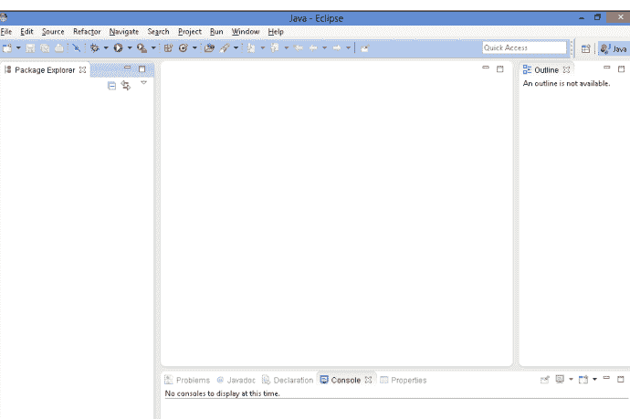

图 1-8：Eclipse 等候你的到来。

## 第一部分：入门 JavaFX

2. 选择 File:New Project。出现 New Project 对话框，如图 1-9 所示。

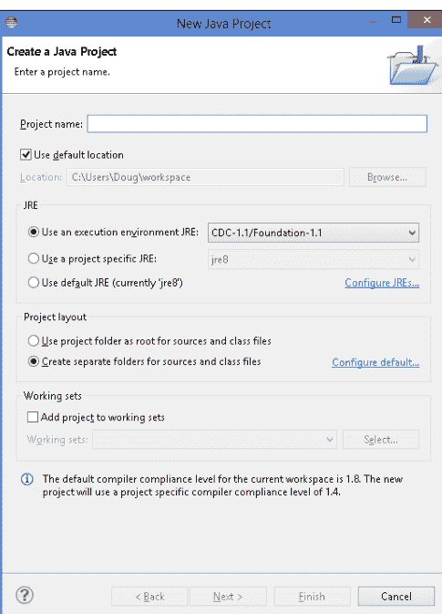

图 1-9：创建新项目

3. 在 Name 字段中输入 Click Me 然后点击 Finish。Eclipse 设置项目并将其添加到 Package Explorer（包资源管理器）中。最初，项目是折叠的，你只看到 JRE Library。

## 第1章：你好，JavaFX！

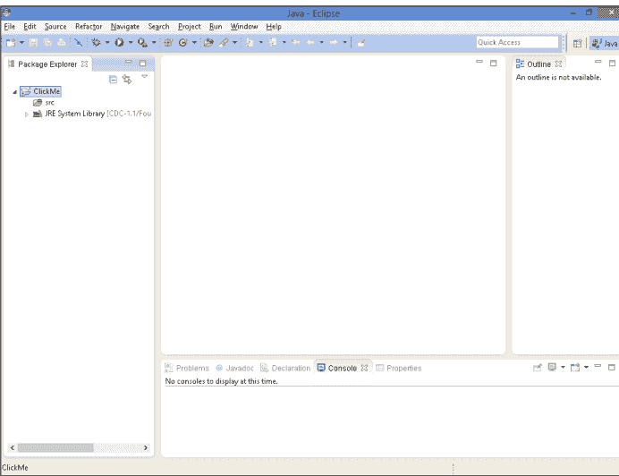

图 1-10：项目在 Package Explorer 中显示。

## 第一部分：入门 JavaFX

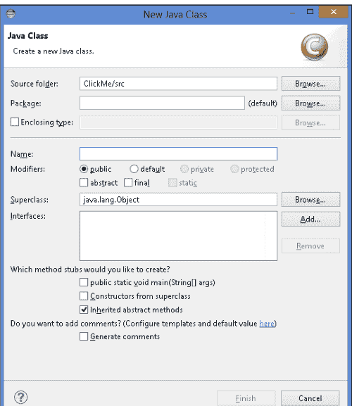

图 1-11：程序显示。

7. 选择 Run 运行程序。Click Me 程序窗口打开，如之前的图 1-6 所示。
8. 点击 Click Me 按钮。当你点击按钮时，按钮上的文本变为 You clicked me!
9. 点击 Close 按钮关闭 Click Me 程序。恭喜！你成功创建并运行了 Click Me 程序。

现在你已经通过 TextPad 或更复杂的 IDE 查看了这个简单程序，你准备好探索 JavaFX 是如何工作的。在第 2 章中，我将详细介绍这个简单程序。

## 第1章：你好，JavaFX！

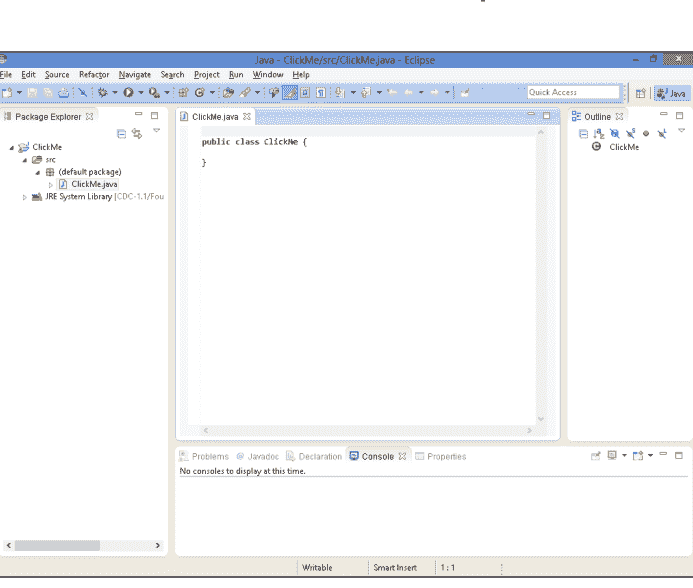

图 1-12：Eclipse 显示源文件。

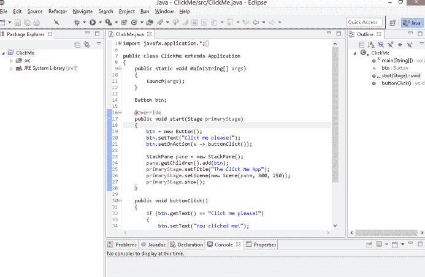

图 1-13：完成的 ClickMe 程序。

# 第2章：深入观察 Java 编程

在本章

- 导入创建程序所需的类
- 创建一个继承 `Application` 类的类
- 使用 Button、BorderPane 和 Scene 创建用户界面
- 创建在用户点击按钮时调用的事件处理器
- 增强版的 Click Me 程序

在第 1 章中，我向你介绍了一个简单的 JavaFX 程序并简要描述了它的工作原理。在本章中，我将对该程序进行详细检查。当你完成本章时，你将理解程序的每一行。然后，你准备好开始更高级的技术。

# 再次观察 Click Me 程序

2-1 显示了 Click Me 程序的运行。正如你所见，此程序显示了一个包含 Click me! 的简单按钮。图中没有显示的是当用户点击按钮时，按钮上的文字变为 I've Clicked!

## 32 第一部分：入门 JavaFX

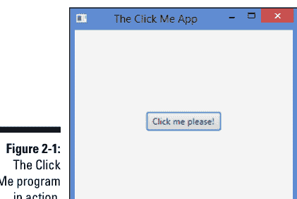

## 第 2 章：深入学习 JavaFX 编程 33

## 列表 2-1：Click Me 程序


```java
import javafx.application.*;
import javafx.stage.*;
import javafx.scene.*;
import javafx.scene.layout.*;
import javafx.scene.control.*;

public class ClickMe extends Application {
    public static void main(String[] args) {
        launch(args);
    }

    Button btn;

    @Override
    public void start(Stage primaryStage) {
        // 创建按钮
        btn = new Button();
        btn.setText("Click me!");
        btn.setOnAction(e -> buttonClick());

        // 将按钮添加到布局窗格
        BorderPane pane = new BorderPane();
        pane.setCenter(btn);

        // 将布局窗格添加到场景
        Scene scene = new Scene(pane, 300, 250);

        // 完成并显示阶段
        primaryStage.setScene(scene);
        primaryStage.setTitle("The Click Me App");
        primaryStage.show();
    }

    public void buttonClick() {
        if (btn.getText() == "Click me!") {
            btn.setText("You clicked me!");
        } else {
            btn.setText("Click me!");
        }
    }
}
```

```java
import javafx.application.*;
import javafx.stage.*;
import javafx.scene.*;
import javafx.scene.layout.*;
import javafx.scene.control.*;

public class ClickMe extends Application {
```

# 第 2 章：深入学习 JavaFX 编程

在这里，`ClickMe` 由一个名为 `ClickMe` 的类定义，该类继承了 `Application` 类。

由于 `ClickMe` 程序的第 1 行导入了整个 `javafx.application` 包，因此 `Application` 类不需要使用全限定名。如果你省略了 `javafx.application` 包的导入语句，`ClickMe` 类的声明将如下所示：

```java
public class ClickMe
    extends javafx.application.Application
```

`Application` 类负责管理 JavaFX 应用程序的生命周期。生命周期由以下步骤组成：

1. 创建 `Application` 的实例。
2. 调用 `init()` 方法。

`init()` 方法的默认实现什么都不做，但你可以重写 `init()` 方法以便在应用程序用户界面显示之前执行任何你需要的处理。

3. 调用 `start()` 方法。

`start()` 方法是一个抽象方法，这意味着作为 `Application` 类的一部分没有提供默认实现。因此，你必须提供你自己的 `start()` 方法版本。`start()` 方法负责构建和显示用户界面。（有关更多信息，请参阅本章节后面的“重写 start 方法”部分）。

4. 等待应用程序结束，这通常发生在用户通过关闭主应用程序窗口或选择程序退出命令来发出程序结束信号时。在此期间，应用程序并不是真的空闲的。相反，它正忙于响应用户事件执行操作，例如点击按钮或从下拉列表中选择项目。

5. 调用 `stop()` 方法。

与 `init()` 方法一样，`stop()` 方法的默认实现什么都不做，但你可以重写它以在程序终止时执行任何必要的处理，例如关闭数据库资源或保存文件。

## 启动应用程序

如你所知，Java 程序的标准入口是 `main()` 方法。这里是 `ClickMe` 程序的 `main()` 方法：

```java
public static void main(String[] args)
{
    launch(args);
}
```

如你所见，`main()` 方法只包含一条语句，对 `Application` 类方法的调用。

`launch()` 方法是真正启动 JavaFX 应用程序的。`launch()` 方法是一个静态方法，因此它可以在静态方法中调用。它会创建 `Application` 类的实例，然后启动 JavaFX 生命周期，调用 `init()` 和 `start()` 方法，等待应用程序结束，然后调用 `stop()` 方法。

`launch()` 方法在应用程序结束之前返回。假设你这样写 `ClickMe` 的 `main()` 方法：

```java
public static void main(String[] args)
{
    System.out.println("Launching...");
    launch(args);
    System.out.println("Finished");
}
```

然后，你会在应用程序打开时看到 "Launching..."。

## 重写 start 方法

每个 JavaFX 应用程序必须包含一个 `start()` 方法。当你包含 `start()` 方法时，你实际上是在重写该抽象方法。

`ClickMe` 程序的 `start()` 方法如下：

```java
@Override
public void start(Stage primaryStage) {
    // 创建按钮
    btn = new Button();
    btn.setText("Click me!");
    btn.setOnAction(e -> buttonClick());

    // 将按钮添加到布局窗格
    BorderPane pane = new BorderPane();
    pane.setCenter(btn);

    // 将布局窗格添加到场景
    Scene scene = new Scene(pane, 300, 250);

    // 完成并显示阶段
    primaryStage.setScene(scene);
    primaryStage.setTitle("The Click Me App");
    primaryStage.show();
}
```

为了创建 `ClickMe` 程序的界面，`start()` 方法执行以下基本步骤：

1. 创建名为 `btn` 的按钮，将其文本设置为 "Click me!"，并指定当点击按钮时调用名为 `buttonClick()` 的方法。
2. 创建名为 `pane` 的布局窗格并将按钮放其中。
3. 创建名为 `scene` 的场景并将布局窗格放其中。
4. 通过设置场景完成阶段。

你将在本章节后面找到这些代码块的相应细节。在继续之前，我想指出关于 `start()` 方法的几个额外细节：

- `start()` 方法在 `Application` 类中被定义为抽象方法；当你在 JavaFX 程序中包含该方法时，你实际上是在重写它。
- 虽然不是强制的，但包含 `@Override` 注解是一个好习惯，可以显式地表示你正在重写该方法。如果你省略此注解并在拼写方法名时出错（例如使用 `Start` 而不是 `start`），或者参数列表错误，Java 会认为你在定义一个新方法而不是重写它。
- 与 `main()` 方法不同，`start()` 方法不是静态方法。当你从静态方法调用 `launch()` 方法时，`launch()` 方法会创建你的 `Application` 类的实例，然后调用 `start()` 方法。
- `start()` 方法接受一个参数：`Stage` 对象，应用程序的用户界面将在此显示。当应用程序调用你的 `start()` 方法时，它通过 `primaryStage` 参数传递主阶段（称为主阶段）。因此，你可以在 `start()` 方法中使用 `primaryStage` 参数来引用应用程序的阶段。

## 创建按钮

由 `ClickMe` 程序显示的按钮是使用名为 `Button` 的类创建的。该类是你用于创建界面控件的许多类之一。`Button` 类以及大多数其他类位于 `javafx.scene.control` 包中。

要创建一个按钮，只需定义一个 `Button` 变量，然后调用 `Button` 构造函数：

```java
Button btn;
btn = new Button();
```

在代码 2-1 中，`btn` 变量定义为 `start()` 方法之外的类变量，但 `Button` 对象实际上是在 `start()` 方法内部创建的。控件通常声明为类变量，以便从类中定义的任何方法访问它们。正如你在后续章节（“处理操作事件”）中发现的，当用户点击按钮时会调用名为 `buttonClick()` 的独立方法。通过将 `btn` 变量定义为类变量，`start()` 方法和 `buttonClick()` 方法都可以访问该按钮。

要设置按钮显示的文本值，请调用 `setText()` 方法，并将要显示的文本作为字符串传递进去：

```java
btn.setText("Click me please!");
```

以下是关于按钮的几个额外小知识：

- `Button` 构造函数允许你将要显示在按钮上的文本作为参数传递，例如：

```java
btn = new Button("Click me please!");
```

如果你通过这种方式设置按钮文本，就不需要调用 `setText()` 方法。

- `Button` 类是许多派生自父类 `javafx.scene.control.Control` 的类之一。许多其他类也派自此类，包括 `Label`、`TextField`、`ComboBox`、`CheckBox` 和 `RadioButton`。

- `Control` 类是派生自更高级父类 `javafx.scene.Node` 的几个不同类之一。`Node` 是所有可以在场景中显示的用户界面元素的基类。控件是一种特定类型的节点，但还有其他类型的节点。换句话说，所有的控件都是节点，但并非所有的节点都是控件。你可以在本书的后面阅读更多关于其他类型节点的知识。


# 处理动作事件

当用户点击按钮时，会触发一个事件。你的程序可以通过提供事件处理器来响应该事件，事件处理器只是每当事件发生时执行的一些代码。“Click Me”程序通过为按钮设置事件处理器来工作；事件处理器的代码更改按钮上显示的文本。

在第 3 章中，有几种方法可以处理 JavaFX 中的事件。现在，我简要介绍最简单的方法之一，它只需要指定每当事件发生时调用某个方法，然后提供实现该方法的代码。

要指定当用户点击按钮时调用的方法，你调用按钮类的 `setOnAction()` 方法。它在列表 2-1 中的实现方式如下：

```java
btn.setOnAction(e -> buttonClick());
```

如果这里使用的语法看起来有点陌生，那是因为使用了 Java 8 的一项新特性，称为 **Lambda 表达式**。如本例所示，这种新语法包含三个元素：

- 参数代表一个 `ActionEvent` 类型的对象，程序可以使用它来获取关于事件的详细信息。
- “Click Me”程序忽略了它，所以你也可以忽略它，至少目前是这样。
- 箭头运算符 (`->`) 是 Java 8 引入的用于 Lambda 表达式的特殊运算符。
- 方法 `buttonClick()` 只是简单地调用了名为 `buttonClick` 的方法。

我将在第 3 章中讨论 Lambda 表达式。

在确定了 `buttonClick()` 为用户点击按钮时调用的方法后，下一步是编写 `buttonClick()` 方法。你在列表 2-1 的底部找到它：

```java
public void buttonClick() {
    if (btn.getText() == "Click me please!") {
        btn.setText("You clicked me!");
    } else {
        btn.setText("Click me please!");
    }
}
```

该方法使用 `if` 语句将按钮显示的文本更改为 `Click me!` 或 `Click me please!`。换句话说，当用户点击按钮时，按钮文本为 `Click me please!`，`buttonClick()` 方法会将文本更改为 `You clicked me!`。否则，语句会将按钮改回 `Click me please!`。

`buttonClick()` 方法使用了 `Button` 类的两个方法来执行工作：

- `getText()`：返回按钮显示的文本（字符串格式）
- `setText()`：设置按钮显示的文本

关于处理事件的更多信息，请参阅第 3 章。

## 创建布局窗格

按钮本身并没有很好用。你必须实际上将其显示在屏幕上，用户才能点击它。而且任何现实的 JavaFX 程序都会包含多个控件。当你向用户界面添加第二个控件的那一刻，你就需要一种方法来指定控件彼此之间的相对位置。例如，如果你的应用程序有两个按钮，你希望它们是垂直堆叠（一个在另一个上面），还是并排排列？

这就是布局窗格大用场。布局窗格是一个容器类，你可以向其中添加一个或多个用户界面元素。然后布局窗格会决定这些元素之间具体的显示方式。

要使用布局，你首先创建一个窗格的实例。然后，向窗格中添加一个或多个控件。当你这样做时，可以指定窗格显示时控件排列的细节。你将所有控件添加到窗格中并恰好排列，然后将窗格添加到场景中。

JavaFX 提供了共八种不同类型的布局窗格，均由 `javafx.scene.layout` 包中的类定义。“Click”程序使用一种名为 `BorderPane`（边界布局窗格）的布局，它将窗格的内容分为五个区域：顶部、左侧、底部、右侧和中心。`BorderPane` 类非常适合此类布局，即顶部有菜单和工具栏，底部有状态栏，左侧有可选的任务面板或工具栏，右侧有可选区域，且场景中心有一个主工作区域。

“Click”程序中创建边界布局窗格的代码是：

```java
BorderPane pane = new BorderPane();
pane.setCenter(btn);
```

在这里，声明了一个类型为 `BorderPane` 的变量 `pane`，并调用 `BorderPane` 构造函数。然后，使用 `setCenter()` 方法将按钮显示在中心区域。

关于布局窗格，有一些有趣的细节：

- 布局窗格根据其包含的元素的大小调整元素的位置。
- 我之前说过控件是节点的一种类型，你可以在书的后面阅读其他类型的节点。嗯，布局窗格也是节点的一种。
- 边界布局的每个区域都可以包含一个节点。因为布局本身是节点的一种，边界布局的每个区域都可以包含另一个布局窗格。例如，假设你想在边界布局的中心区域显示三个控件。为了实现这一点，你会创建一个第二个布局窗格并将控件添加到其中。然后，你把第二个布局窗格设置为显示在第一个布局窗格中心区域的节点。
- 你可以在第 5 章了解 `BorderPane` 类和一些常用的布局窗格。你也可以在第 13 章了解不常用的布局窗格。


## 创建场景

在你创建了包含想要显示的控件的布局窗格后，下一步是创建一个显示该布局窗格的场景。你可以通过一行代码声明一个 `Scene` 变量并调用 `Scene` 构造函数来实现。这就是我在“Click Me”程序中的做法：

```java
Scene scene = new Scene(pane, 300, 250);
```

`Scene` 构造函数接受三个参数：

- 一个节点对象，代表场景显示的根节点。场景只能有一个根节点，因此根节点通常是布局窗格，它进一步包含要显示的控件。“Click Me”程序中，根节点是包含按钮的边界布局。
- 场景的宽度（像素）。
- 场景的高度（像素）。

注：如果你省略了宽度高度，场景将根据根节点内包含元素的大小自动调整大小。

你可以在第 4 章找到 `Scene` 类的更多功能。

## 设置舞台

如果说场景代表由应用程序显示的节点（控件和布局窗格），那么舞台代表显示场景的窗口。当 JavaFX 框架调用应用程序的 `start()` 方法，它会向你传递一个 `Stage` 实例，该实例代表应用程序的主阶段——即代表应用程序主窗口的阶段。此引用通过 `primaryStage` 参数传递。

创建好场景后，你现在准备好完成可以显示该场景的主阶段了。要做到这一点，你必须至少做两件事：


- 调用 `primaryStage` 的 `setScene` 方法来设置要显示的场景。
- 调用 `primaryStage` 的 `show` 方法来显示该场景。

在你调用 `show` 方法后，你的应用程序窗口将对用户可见，用户可以开始与其控制控件进行交互。

设置应用程序标题栏中显示的标题也是常见的做法。你通过调用 `primaryStage` 的 `setTitle` 方法来实现这一点。Click Me 程序的 `start` 方法的最后三行执行了这些功能：

```
primaryStage.setScene(scene);
primaryStage.setTitle("The Click Me App");
primaryStage.show();
```

当最后一行调用 `show` 方法时，`Stage` 会显示出来——在其他窗口中，即图 2-1 中所示的窗口。

你可以在第 4 章中阅读关于 `Stage` 类更多功能。


# 检查点击计数器程序

现在我已经解释了 Click Me 程序每一行的细节，我们来看一个稍微增强版的 Click Me 程序：Click Counter（点击计数器）程序。在列表 1-1（第 1 章）中显示的 Click Me 程序中，当用户点击按钮时，按钮上显示的文本会发生。在 Click Counter 程序中，一种名为 `label`（标签）的额外控件会显示用户点击按钮的次数。

图 2-2 显示了运行中的 Click Counter 程序。该图顶部的窗口显示了 Click Counter 在首次启动时的样子。如你所见，窗口顶部的标签显示文本“You have not clicked the button（你还没有点击按钮）”。第二个窗口显示了你第一次点击按钮后程序的样子。在这里，标签显示“You have clicked once（你已经点击了一次）”。当按钮被第二次点击时，标签会再次变化，如第三个窗口所示。在这里，标签读为“You have clicked 2 times（你已经点击了 2 次）”。之后，标签显示的数字会在你每次点击按钮时更新，以指示按钮被点击的次数。

# 列表 2-2：Click Counter 程序

| 行号 | 代码 |
| :--- | :--- |
| ->1 | import javafx.application.*; |
| ->2 | import javafx.stage.*; |
| ->3 | import javafx.scene.*; |
| ->4 | import javafx.scene.layout.*; |
| ->5 | import javafx.scene.control.*; |
| ->7 | public class ClickCounter extends Application { |
| ->9 | public static void main(String[] args) { |
| ->11 | launch(args); |
| ->12 | } |

```
Button btn;
Label lbl;
int iClickCount = 0;

    @Override public void start(Stage primaryStage)
{
    // 创建按钮
    btn = new Button();
    btn.setText("Click me please!");
    btn.setOnAction((e) -> buttonClick());

    // 创建标签
    lbl = new Label();
    lbl.setText("You have not clicked the button.");

    // 将标签和按钮添加到布局面板中
    BorderPane pane = new BorderPane();
    pane.setTop(lbl);
    pane.setCenter(btn);

    // 将布局面板添加到场景中
    Scene scene = new Scene(pane, 250, 150);
    // 将场景添加到阶段，设置阶段
    // 并显示阶段
    primaryStage.setScene(scene);
    primaryStage.setTitle("Click Counter");
    primaryStage.show();
}

public void buttonClick() {
    iClickCount++;
    if (iClickCount == 1) {
        lbl.setText("You have clicked once.");
    } else {
        lbl.setText("You have clicked " + iClickCount + " times.");
    }
}
```

以下段落解释了 Click Counter 程序的关键点：

- 1：`import` 引用了 Click Counter 程序将使用的 `javafx` 包。
- 7：`ClickCounter` 类继承自 `javafx.application.Application`，指定 `ClickCounter` 类是一个 JavaFX 应用程序。
- 9：和任何 Java 程序一样，`main` 方法是所有 Java 程序的主入口点。
- 11：`main` 方法调用 `launch` 方法，该方法转而创建 `ClickCounter` 类的实例。
- 14：声明了 `javafx.control.Button` 类型的变量 `btn`。
- 15：声明了 `javafx.control.Label` 类型的变量 `lbl`。
- 16：名为 `iClickCount` 的变量将用于跟踪用户点击的次数。
- 18：`start` 方法使用了 `@Override` 注解，表示该方法重写了 `Application` 类的 `start` 方法。
- 21：`start` 方法通过创建 `Button` 对象并赋值给 `btn` 开始。
- 22：调用按钮的 `setText` 方法将按钮文本设置为“Click me please!”。
- 23：调用 `setOnAction` 为按钮创建一个事件处理器。这里使用 Lambda 表达式来调用 `buttonClick` 方法。
- 26：调用 `Label` 类的构造函数创建一个新标签。
- 27：调用标签的 `setText` 方法设置初始文本值为“You have not clicked the button.”。
- 30：通过调用 `BorderPane` 类的构造函数创建一个 `BorderPane` 对象，引用第 30 行创建的 `pane`。该布局面板将用于控制屏幕上显示的控件。
- 31：调用 `pane` 的 `setTop` 方法将标签添加到布局面板的顶部区域。
- 32：调用 `pane` 的 `setCenter` 方法将按钮添加到布局面板的中心区域。
- 35：通过调用 `Scene` 类的构造函数创建一个 `Scene` 对象，将第 30 行创建的 `pane` 传递给构造函数，以将其建立场景的根节点。此外，场景的尺寸设置为宽 250 像素、高 150 像素。
- 39：使用 `primaryStage` 的 `setScene` 方法将场景添加到主阶段。
- 40：使用 `setTitle` 方法设置主阶段标题中的文本。
- 41：调用 `show` 方法显示主阶段。当此行执行时，图 2-1 所示的窗口显示在屏幕上，用户可以开始与程序进行交互。
- 44：每当用户点击按钮时，都会调用 `buttonClick` 方法。
- 46：`iClickCount` 变量递增，表示用户点击了按钮。
- 47：使用 `if` 语句判断按钮是否已经被点击了一次或多次。
- 49：如果按钮被点击了一次，则标签文本设置为“You have clicked once.”。
- 53：否则，标签文本设置为一个指示按钮被点击次数的字符串。

以下段落有助于你理清关于点击计数器（Click Counter）程序和通用 JavaFX 中可能会让你困惑的一些关键点：

- 程序何时从静态切换到非静态？就像每个 Java 程序一样，JavaFX 程序的的主入口点是静态的 `main` 方法。
- 在 JavaFX 程序中，静态 `main` 方法只做一件事：调用 `launch` 方法启动程序的 JavaFX 部分，然后调用 `start` 方法。从此时起，程序不再在静态上下文中运行，因为已经创建了 `ClickCounter` 类的实例。
- `primaryStage` 变量从哪里来？当 `launch` 方法调用 `start` 方法时，`primaryStage` 变量被传递给 `start` 方法。因此，`start` 方法通过参数接收 `primaryStage`。
- 这就是为什么你不会为 `primaryStage` 变量创建一个单独的变量声明。
- `->` 运算符是如何工作的？`->` 运算符用于创建所谓的 Lambda 表达式。Lambda 表达式是 Java 8 的新特性，用于处理以前需要匿名类的情况。如果你不理解 Lambda 表达式的工作原理，不要担心，我会在第 3 章中详细解释它们。


# 第 3 章：事件处理

## 本章内容

- 理解重要的事件概念
- 使用事件处理类和接口
- 扩展 `EventHandler` 接口
- 使用内部类和匿名类进行事件处理
- 使用 Lambda 表达式进行事件处理

在第 2 章中，我讨论了两个显示简单场景的程序，这些场景包含一个按钮并在用户点击按钮时做出响应。这些程序通过提供一个在事件发生时执行的事件处理器，来响应用户点击按钮时触发的事件。

在本章中，你将读到更多关于 JavaFX 事件处理工作原理的细节，我将讨论事件是如何产生的，以及它们是如何被 JavaFX 分发的的，以便你的程序能够对其做出响应。你将发现 JavaFX 程序可以处理的多种类型的事件。你还将发现几种处理 JavaFX 事件的编程技术。

最后，在本章中，你将接触属性绑定（property bindings）的概念，它让你编写代码来对某些类型类字段（称为属性字段）的值变化响应。在 JavaFX 中，属性绑定有时用于在 Swing 中需要调用事件处理器的场景。

虽然事件处理主要用于响应按钮点击，但它也可以用于响应其他类型的用户交互。例如，你可以使用事件处理来编写在用户从组合框中进行选择、将鼠标移动到标签上或在键盘上按下按键时执行的代码。本章中的事件处理技术同样适用于这些事件。


## 剖析事件

事件是用户对你的某个用户界面组件执行某些值得注意的操作时生成的对象。然后，这个事件对象会被传递到你创建的一个特殊方法，称为事件处理器（event handler）。事件处理器可以检查事件对象，确定具体发生了什么类型的事件，并进行异步响应。如果用户点击按钮，事件处理器可能会将用户通过文本字段输入的任何数据写入文件。如果用户将鼠标光标悬过标签，事件处理器可能会更改 `Label` 显示的文本。如果用户从组合框中选择项目，事件处理器可能会使用所选值在数据库中查找信息。可能性是无限的！

事件由 `javafx.event` 类的实例或其许多子类之一表示。表 3-1 列出了最常用的事件类。

| 表 3-1 常用事件类 | | | |
| :--- | :--- | :--- | :--- |
| 事件类 | 包名 | 描述 |
| `ActionEvent` | `javafx.event` | 当用户对按钮或其他组件执行操作时创建。通常这意味着着用户点击了按钮，但用户也可以通过 Tab 键切换到按钮并按 Enter 键来触发按钮操作。这是最常用的事件类，因为它代表了最常见的用户界面事件类型。 |
| `KeyEvent` | `javafx.scene.input` | 当用户输入（如鼠标点击或按键点击）产生事件时创建。 |
| `KeyEvent` | `javafx.scene.input` | 当用户按下键盘上的按键时创建。此事件可用于监听用户输入的特定按键。（`KeyEvent` 是 `InputEvent` 的子类。） |
| `MouseEvent` | `javafx.scene.input` | 当用户使用鼠标进行有趣操作时创建，如点击按钮之一、拖动鼠标或仅仅将鼠标光标移动到另一个对象上。（`MouseEvent` 是 `InputEvent` 的子类。） |
| `TouchEvent` | `javafx.scene.input` | 当用户在支持触摸输入的设备上启动触摸事件时创建。 |
| `WindowEvent` | `javafx.stage` | 当窗口（阶段）的状态发生时创建。 |

有四个你需要知道的术语：

- **事件（Event）**：用户对组件执行某些值得注意的操作，例如点击它。
- **事件源（Event source）**：最初发生事件的对象。
- **事件目标（Event target）**：事件指向的节点。
- **事件处理器（Event handler）**：监听事件并在事件发生时处理事件的对象。这通常是用户点击或操作的按钮或其他控件。（大多数情况下，事件源和事件目标是同一个。）

监听对象必须实现 `EventHandler` 接口，该接口定义了一个方法（见表 3-2）。`EventHandler` 接口定义在 `javafx.event` 包中。

| 表 3-2 EventHandler 接口 | |
| :--- | :--- |
| 方法 | 当事件发生时调用 |

## 事件处理

现在你已经了解了用于事件处理的基础类和接口，你准备好研究如何将它们连接起来以创建一个响应事件的程序了。

在本节中，我将讨论如何通过编写 `Application` 代码来实现事件处理器，使其在扩展 `Application` 类之外也实现 `EventHandler` 接口。在本章的后续章节中，我将讨论实现事件处理器的替代技术，这些技术更简洁，在许多情况下更容易操作。

注意，第 1 章和第 2 章中所示程序使用了简洁的 Lambda 表达式，本书其余部分的大部分程序也使用了 Lambda 表达式。了解其他技术是非常重要的，这样你才能完整理解事件处理到底是如何工作的。

处理 JavaFX 事件必须采取以下三个步骤：

1. 创建事件源。事件源简单来说产生事件的控件（如按钮）。通常，我们将引用事件源的变量声明为私有类成员，位于 `start` 方法或任何类方法之外：

```
private Button btn;
```

然后，在 `start` 方法中，你可以这样创建按钮：

```
btn = new Button();
btn.setText("请点击我!");
```

2. 创建事件处理器。要创建事件处理器，你必须创建一个实现 `EventHandler` 接口并提供 `handle` 方法实现的对象。

创建事件处理器的有四种方法：

- 在程序的 `Application` 类中添加 `implements EventHandler` 并提供 `handle` 方法的实现。你将在“实现 EventHandler 接口”节了解如何使用这种技术。
- 在 `Application` 类内部创建一个实现 `EventHandler` 的内部类。你将在“使用内部类处理事件”节中了解如何使用这种技术。
- 创建一个实现 `EventHandler` 的匿名类。你将在“使用匿名内部类处理事件”节中看到它如何展示如何使用这种技术。
- 使用 Lambda 表达式来实现 `handle` 方法。你将在“使用 Lambda 表达式处理事件”节中学习到如何使用这种技术。

3. 向事件源注册事件处理器。

最后一步是将事件处理器注册到事件源中，每当事件发生时，`handle` 方法就会被该事件源调用。

每一个作为事件源的组件都提供了一个方法，允许你注册事件处理器来监听它的事件。例如，`Button` 控件提供了一个 `setOnAction` 方法，允许你为动作事件注册事件处理器。在 `setOnAction` 方法中，你将事件处理器对象作为参数指定。具体的实现方式取决于你使用了哪种技术来创建事件处理器。

## 实现 EventHandler 接口

为了看到所有这些元素在一个完整程序中是如何协同工作的，图 3-1 显示了名为 `Subtract1` 的简单程序的输出。该程序显示了一个标签和两个按钮，一个标题为 Add（加），另一个为 Subtract（减）。标签初始显示数字 0。每当用户点击 Add 按钮时，标签显示的数值就会加一；每当用户点击 Subtract 按钮时，数值就会减一。

图 3-1 展示了该程序的完整代码。

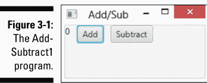

# 列表 3-1：AddSubtract1 程序


```java
import javafx.application.*;
import javafx.stage.*;
import javafx.scene.*;
import javafx.scene.layout.*;
import javafx.scene.control.*;
import javafx.scene.event.*;
```

```java
public class AddSubtract extends Application
implements EventHandler<ActionEvent>
{
    public static void main(String[] args) {
        launch(args);
    }

    Button btnAdd;
    Button btnSubtract;
    Label lbl;
    int iCounter = 0;

    @Override
    public void start(Stage primaryStage) {
        // 创建 Add 按钮
        btnAdd = new Button();
        btnAdd.setText("Add");
        btnAdd.setOnAction(this);

        // 创建 Subtract 按钮
        btnSubtract = new Button();
        btnSubtract.setText("Subtract");
        btnSubtract.setOnAction(this);

        // 创建 Label
        lbl = new Label();
        lbl.setText(Integer.toString(iCounter));

        // 将按钮和标签添加到 HBox 中
        HBox pane = new HBox(10);
        pane.getChildren().addAll(lbl, btnAdd, btnSubtract);

        // 将布局面板添加到场景中
        Scene scene = new Scene(pane, 200, 75);

        // 将场景添加到舞台，并设置标题
        primaryStage.setScene(scene);
        primaryStage.setTitle("Add/Sub");
        primaryStage.show();
    }
}
```

```java
@Override public void handle(ActionEvent e)
{
    if (e.getSource()==btnAdd) {
        iCounter++;
    }
    else {
        if (e.getSource()==btnSubtract) {
            iCounter--;
        }
    }
    lbl.setText(Integer.toString(iCounter));
}
```

以下段落指出了程序的某些关键行：

- **6:** 该程序必须导入 `javafx.event` 包，该包定义了 `ActionEvent` 类和 `EventHandler` 接口。

- **9:** 与任何 JavaFX 程序一样，`AddSubtract` 类继承了 `Application` 类。然而，`AddSubtract` 类也实现了 `EventHandler` 接口，以便它可以定义一个 `handle` 方法来处理由按钮生成的 `ActionEvent` 事件。

`EventHandler` 接口是……（注：此处原文内容逻辑混乱，已根据上下文完成断句并翻译）

# 第 1 章：JavaFX 入门

## 列表 3-2 (续)

```java
// 创建 Label
lbl = new Label();
lbl.setText(Integer.toString(iCounter));

// 将按钮和标签添加到 HBox 窗格
HBox pane = new HBox(10);
pane.getChildren().addAll(lbl, btnAdd, btnSubtract);

// 将布局窗格添加到场景
Scene scene = new Scene(pane, 200, 75);

// 将场景添加到舞台，设置标题
// 并显示舞台
primaryStage.setScene(scene);
primaryStage.setTitle("Add/Sub");
primaryStage.show();
}

private class ClickHandler
implements EventHandler<ActionEvent> {
    @Override
    public void handle(ActionEvent e) {
        if (e.getSource()===btnAdd) {
            iCounter++;
        }
        else {
            if (e.getSource()==btnSubtract) {
                iCounter--;
            }
        }
        lbl.setText(Integer.toString(iCounter));
    }
}
```

这个程序的运行原理与列表 3-1 所示程序基本相同，因此我不再回顾每一个细节。相反，我只是强调了不同之处：

- **8:** `AddSubtract2` 类仍然继承了 `Application`，但没有实现 `EventHandler`。

- **23:** 这条语句创建了 `ClickHandler` 类（内部类）的实例，并将其赋值给变量 `ch`。

# 第 3 章：处理事件

- **28:** 这条语句将 `ch` 设置为 Add 按钮的动作监听器。

- **33:** 这条语句将 `ch` 设置为 Subtract 按钮的动作监听器。

- **53:** 通过将 `ClickHandler` 类的声明完全放在 `AddSubtract2` 类内部，该 `ClickHandler` 类被声明为内部类。`ClickHandler` 类实现了 `EventHandler` 接口，以便它能够处理事件。

- **56:** 这里的 `handle` 方法与 `AddSubtract1` 程序中的 `handle` 方法相同，但它存在于内部类 `ClickHandler` 中，而不是外部类中。

## 使用匿名内部类处理事件

匿名类（通常直接称为匿名类）是在你需要它的地方现场定义的类。由于你可以在需要的地方编写类的主体，因此你不需要给它命名；这就是为什么你称之为匿名类的原因。

匿名类通常用于事件处理器，以避免需要创建一个显式实现 `EventHandler` 接口的单独类。

使用匿名类作为事件处理器的一个优势是，你可以轻松地为产生事件的每个控件创建一个单独的事件处理器。然后在这些事件处理器的 `handle` 方法中，你就可以抛弃检查事件源的 `if` 语句了。

考虑之前在列表 3-2 中所示的 `AddSubtract2` 程序的事件处理器：它必须检查事件源以确定是增加还是减少 `iCounter` 变量。通过使用匿名类，你可以为 Add 和 Subtract 按钮创建单独的事件处理器。因此，任何事件处理器都不需要检查事件源，因为事件处理器的 `handle` 方法只有在与该处理器关联的按钮上触发事件时才会被调用。

列表 3-3 显示了 `AddSubtract3` 程序，它以这种方式使用了匿名内部类。

# 第 1 章：JavaFX 入门

## 列表 3-3：带有匿名内部类的 AddSubtract3 程序

```java
import javafx.application.*;
import javafx.stage.*;
import javafx.scene.*;
import javafx.scene.layout.*;
import javafx.scene.control.*;
import javafx.event.*;

public class AddSubtract3 extends Application {
    public static void main(String[] args) {
        launch(args);
    }

    Button btnAdd;
    Button btnSubtract;
    Label lbl;
    int iCounter = 0;

    @Override
    public void start(Stage primaryStage) {
        // 创建 按钮
        btnAdd = new Button();
        btnAdd.setText("Add");
        btnAdd.setOnAction(new EventHandler<ActionEvent>() {
            public void handle(ActionEvent e) {
                iCounter++;
                lbl.setText(Integer.toString(iCounter));
            }
        });

        // 创建 按钮
        btnSubtract = new Button();
        btnSubtract.setText("Subtract");
        btnSubtract.setOnAction(new EventHandler<ActionEvent>() {
            public void handle(ActionEvent e) {
                iCounter--;
                lbl.setText(Integer.toString(iCounter));
            }
        });
        
        ...
```

```java
// 创建 Label
lbl = new Label();
lbl.setText(Integer.toString(iCounter));

// 将按钮和标签添加到 HBox 窗格
HBox pane = new HBox(10);
pane.getChildren().addAll(lbl, btnAdd, btnSubtract);

// 将布局窗格添加到场景
Scene scene = new Scene(pane, 200, 75);

// 将场景添加到舞台，设置标题
// 并显示舞台
primaryStage.setScene(scene);
primaryStage.setTitle("Add/Sub");
primaryStage.show();
```

以下段落强调了该程序如何使用匿名类：

- **26:** 这条语句为 Add 按钮的 `setOnAction` 创建了 `EventHandler` 实例。

- **28:** `handle` 方法被定义在匿名类内部，并指定了 `EventHandler` 为类型。

- **30:** 因为 `handle` 方法只有在与关联的按钮上触发事件时才会被调用，它不需要检查事件源。

- **39:** 这条语句为 Subtract 按钮的 `setOnAction` 创建了另一个 `EventHandler` 实例。

- **41:** 此时，`handle` 方法减少了计数器并设置了标签文本。

## 使用 Lambda 表达式处理事件

Java 8 引入了一项在某些方面与匿名类相似的新功能，但语法更简洁。具体来说，Lambda 表达式允许你创建一个实现特定类型——函数接口的匿名类——该接口有一个抽象方法。

# 第 1 章：JavaFX 入门

`EventHandler` 接口定义：它有一个抽象方法。因此，`EventHandler` 是一个函数接口，可以使用 Lambda 表达式。

Lambda 表达式是实现函数接口的匿名类的简洁方式。你不需要提供包含返回类型、方法名、参数类型和方法主体的正式方法声明，只需要定义参数类型和方法主体。参数与方法主体之间通过一个新运算符——箭头运算符隔开，它由一个连字符和一个大于号组成。这是一个实现 `EventHandler` 接口的 Lambda 表达式示例：

```java
e -> {
  iCounter++;
  lbl.setText(Integer.toString(iCounter));
}
```

在这种情况下，Lambda 表达式实现了一个接受标识为 `e` 的参数的函数接口。当方法被调用时，`iCounter` 变量增加，标签文本更新以显示新的计数器值。

以下是将此 Lambda 表达式注册为按钮的事件处理器的方法：

```java
btnAdd.setOnAction( e -> {
  iCounter++;
  lbl.setText(Integer.toString(iCounter));
});
```

Lambda 表达式的特点之一是你是你不需要知道被调用的方法的名称。这是因为与 Lambda 表达式一起使用的函数接口只能有一个抽象方法。在 `EventHandler` 接口的情况下，该方法名为 `handle`。

你也不需要知道所实现的接口名称。这是因为接口是由上下文决定的。`setOnAction` 方法接收一个类型为 `EventHandler` 的单个参数。当你在调用 `setOnAction` 使用 Lambda 时，Java 编译器可以推断出该 Lambda 将实现 `EventHandler` 接口。由于 `EventHandler` 的唯一抽象方法是 `handle` 方法，编译器可以推断出你提供的方法主体是 `handle` 方法的实现。

在某种程度上，Lambda 表达式将匿名类的概念进一步推向了一步。当你使用匿名类来处理事件处理器时，你必须知道并指定类的名称（`EventHandler`）以及要调用的方法名称（`handle`），因此，该类之所以说是“匿名”的，唯一意义在于你不需要为引用它的变量手动提供一个名称。但当你使用 Lambda 表达式时，你不需要知道或指定类名、方法名或用于引用它的变量名。本质上，你只需要提供 `handle` 方法的体体即可。

列表 3-4 显示了 `AddSubtract4` 程序，该程序使用 Lambda 表达式来处理按钮点击。

# 列表 3-4：使用 Lambda 表达式的 AddSubtract4 程序

```java
import javafx.application.*;
import javafx.stage.*;
import javafx.scene.*;
import javafx.scene.layout.*;
import javafx.scene.control.*;
import javafx.event.*;

public class AddSubtract4 extends Application {
    public static void main(String[] args) {
        launch(args);
    }
    Button btnAdd; Button btnSubtract; Label lbl; int counter = 0;
    @Override public void start(Stage primaryStage) {
    // Create the Add button
    btnAdd = new Button();
    btnAdd.setText("Add");
    btnAdd.setOnAction(e -> {
        counter++;
        lbl.setText(Integer.toString(counter));
    });
    // Create the Subtract button
    btnSubtract = new Button();
    btnSubtract.setText("Subtract");
    btnSubtract.setOnAction(e ->
```

（续）

# 列表 3-4（续）

```java
{
  iCounter--;
  lbl.setText(Integer.toString(iCounter));

  // Create the Label
  lbl = new Label();
  lbl.setText(Integer.toString(iCounter));

  // Add the buttons and label to an HBox pane
  HBox pane = new HBox(10);
  pane.getChildren().addAll(lbl, btnAdd, btnSubtract);

  // Add the layout pane to a scene
  Scene scene = new Scene(pane, 200, 75);

  // Add the scene to the stage, set the title
  // and show the stage
  primaryStage.setScene(scene);
  primaryStage.setTitle("Add/Sub");
  primaryStage.show();
}
```

该程序的工作原理与列表 3-3 显示的程序基本相同，因此我直接指出与使用 Lambda 表达式直接相关的特性：

- **25:** 此语句使用 Lambda 表达式为 Add 按钮添加了事件处理器。该 Lambda 表达式的方法体递增了 `counter` 变量，然后设置标签文本以反映更新后的值。

- **34:** 此语句使用类似的 Lambda 表达式为 Subtract 按钮创建了事件处理器。这个 Lambda 表达式与 Add 按钮的那个唯一的区别在于，这里 `counter` 变量是递减而不是递增的。


请注意，在这个示例中，两个事件处理器的 Lambda 表达式非常简单，因为当此程序中的任何一个按钮被点击时，需要的处理非常少。然而，如果一个或多个按钮点击所需的处理需要数百行 Java 代码来实现，程序会变成什么样呢？Lambda 表达式将变得臃肿。出于这个原因，我经常倾向于将事件处理器要执行的实际过程在一个独立的方法中。这样，Lambda 本身只包含一行代码，简单地调用该方法即可。

列表 3-5 显示了使用这种技术实现的 AddSubtract5 程序的另一种变体。注意，列表 3-5 中使用的技术是书中其余大部分程序所使用的技术。

# 列表 3-5：使用 Lambda 表达式的 AddSubtract5 程序

```java
import javafx.application.*;
import javafx.stage.*;
import javafx.scene.*;
import javafx.scene.layout.*;
import javafx.scene.control.*;
import javafx.event.*;

public class AddSubtract5 extends Application
{
    public static void main(String[] args)
    {
        launch(args);
    }

    Button btnAdd;
    Button btnSubtract;
    Label lbl;
    int iCounter = 0;

    @Override
    public void start(Stage primaryStage)
    {
        // Create the Add button
        btnAdd = new Button();
        btnAdd.setText("Add");
        btnAdd.setOnAction(e -> btnAdd_Click());

        // Create the Subtract button
        btnSubtract = new Button();
        btnSubtract.setText("Subtract");
        btnSubtract.setOnAction(e -> btnSubtract_Click());

        // Create the Label
        lbl = new Label();
        lbl.setText(Integer.toString(iCounter));

        // Add the buttons and label to an HBox
        HBox pane = new HBox(10);
        pane.getChildren().addAll(lbl, btnAdd, btnSubtract);

        // Add the layout pane to a scene
        Scene scene = new Scene(pane, 200, 75);

        // Add the scene to the stage, set the title
        // and show the stage
        primaryStage.setScene(scene);
        primaryStage.setTitle("Add/Sub");
        primaryStage.show();
    }

    private void btnAdd_Click() {
        iCounter++;
        lbl.setText(Integer.toString(iCounter));
    }

    private void btnSubtract_Click() {
        iCounter--;
        lbl.setText(Integer.toString(iCounter));
    }
}
```

接下来的段落强调了要点：

- 第 25 行：该语句使用 Lambda 表达式为 Add 按钮添加了事件处理器。
- 第 30 行：该语句使用类似的 Lambda 表达式为 Subtract 按钮创建了事件处理器。
- 第 50 行：该语句使用 Lambda 表达式递增计数器。
- 第 56 行：该语句使用 Lambda 表达式递减计数器。

# 第 4 章：设置 Stage 和 Scene

## 本章内容

- 查看 `Stage` 和 `Scene` 类的常用方法
- 在单个 stage 中切换 scene
- 使用对话框显示额外的 stage
- 发现退出 JavaFX 程序的正确方法

## 检查 Stage 类

stage（由 `Stage` 类表示）是 JavaFX 用户界面的顶层容器。在 Windows、Mac 或 Linux 上，stage 通常是一个窗口。在其他类型的设备上（如智能手机或平板电脑），stage 可能是全屏或屏幕的某个区域。

当 JavaFX 应用程序启动时，会自动创建一个主阶段（primary stage）。该阶段的引用通过 `primaryStage` 参数传递给应用程序的 `start` 方法：

```java
@Override public void start(Stage primaryStage) {
    // primaryStage 指向
    // 应用程序的主阶段。
}
```

你可以通过向主 stage 添加 scene 来创建应用程序的用户界面，scene 包含一个或多个控件或其他节点。

在许多情况下，你需要在 `start` 方法的作用之外访问主阶段。你可以通过定义一个类字段并使用它引用主阶段来轻松实现这一点。

主阶段初始时具有普通窗口化应用程序的默认特性，这取决于运行程序的操作系统。你可以根据需要更改这些默认值以适应应用程序的需求。至少，你应该始终设置窗口标题。你可能还想更改细节，例如 stage 是否可以调整以及 stage 外观的各个方面。

`Stage` 类配备了许多方法，让你操纵 stage 的外观和行为。表 4-1 列出了你最可能使用的方法。

## 表 4-1 Stage 类常用方法

| 方法 | 描述 |
| :--- | :--- |
| `void close()` | 关闭舞台。 |
| `void initModality(Modality modality)` | 设置舞台的模态。此方法必须在调用 `show` 方法之前调用。模态可以是以下值之一：`Modality.NONE`, `Modality.APPLICATION_MODAL`, `Modality.WINDOW_MODAL` |
| `void initStyle(StageStyle style)` | 设置舞台的样式。此方法必须在调用 `show` 方法之前调用。样式可以是以下值之一：`StageStyle.DECORATED`, `StageStyle.UNDECORATED`, `StageStyle.TRANSPARENT`, `StageStyle.UNIFIED`, `StageStyle.UTILITY` |
| `void setMaxHeight(double maxheight)` | 设置舞台的最大高度。 |
| `void setMaxWidth(double maxwidth)` | 设置舞台的最大宽度。 |
| `void setMinHeight(double minheight)` | 设置舞台的最小高度。 |
| `void setMinWidth(double minwidth)` | 设置舞台的最小宽度。 |
| `void setFullScreen(boolean fullscreen)` | 设置舞台的全屏状态。 |
| `void setIconified(boolean iconified)` | 设置舞台的最小化状态。 |
| `void setMaximized(boolean maximized)` | 设置舞台的最大化状态。 |

以下段落指出了使用表 4-1 中列出的 `Stage` 类方法的一些细节：

- **对于许多（如果不是所有）应用程序，你只需要使用表 4-1 中的三个方法：`setScene`、`setTitle` 和 `show`。**
  - 每个舞台都必须有一个场景（scene）。
  - 每个舞台都应该有一个标题（title）。
  - 如果你不打算向用户显示舞台，那么创建一个舞台就没有意义。

表中的其他方法允许你更改舞台的外观或行为，在大多数情况下默认值是可以接受的。

```java
primaryStage.setResizable(false);
```

然后，用户就无法更改窗口的大小。（默认情况下，舞台是可调整的。因此，除非你想让舞台不可调整，否则不需要调用 `setResizable` 方法。）

- 如果舞台是可调整的，你可以为窗口设置最小和最大尺寸。例如：

```java
primaryStage.setResizable(true);
primaryStage.setMinWidth(200);
primaryStage.setMinHeight(200);
primaryStage.setMaxWidth(600);
primaryStage.setMaxHeight(600);
```

在这个示例中，用户可以调整窗口大小，但最小允许尺寸是 200x200 像素，最大允许尺寸是 600x600 像素。

- 如果你想在最大化窗口中显示舞台，请调用 `setMaximized`：

```java
primaryStage.setMaximized(true);
```

一个最大化的窗口仍然具有通常的装饰（标题栏、窗口边框以及最小化、恢复和关闭按钮）。如果你想让舞台完全占据屏幕且没有任何此类装饰，请使用 `setFullScreen` 方法：

```java
primaryStage.setFullScreen(true);
```

当你进入全屏模式时，JavaFX 会显示一条消息，告知用户如何退出全屏模式。

- 如果出于某种原因，你想让程序以最小化到图标的形式启动，请使用 `setIconified` 方法：

```java
primaryStage.setIconified(true);
```

- 关于 `close` 方法的更多信息，请参阅本章后面的“退出，舞台”部分。

`initModality` 和 `initStyle` 方法很有趣，因为它们只能在调用 `show` 方法之前调用。`initModality` 允许你创建一个模态对话框——即用户在继续使用程序内其他功能之前必须关闭的窗口。而 `initStyle` 方法创建的窗口没有通常的装饰，例如标题栏或最小化、恢复和关闭按钮。你通常在需要为应用程序创建主舞台之外的额外舞台时使用这些方法。你可以在本章稍后的“创建对话框”部分阅读更多关于其工作原理的内容。


## 检查 Scene 类

与 `Stage` 类一样，`Scene` 类也是 JavaFX 的基础。在每个 JavaFX 程序中，你至少使用一个场景来存放用户将与之交互的用户界面控件。表 4-2 列出了 `Scene` 类最常用的构造函数和方法。

## 表 4-2 Scene 类常用的构造函数和方法

| 构造函数 | 描述 |
| :--- | :--- |
| `Scene(Parent root)` | 创建一个指定根节点的新场景。 |
| `Scene(Parent root, double width, double height)` | 创建一个指定根节点、宽度和高度的新场景。 |

| 方法 | 描述 |
| :--- | :--- |
| `double getHeight()` | 获取场景的高度。 |
| `double getWidth()` | 获取场景的宽度。 |
| `double getX()` | 获取场景的水平位置。 |
| `double getY()` | 获取场景的垂直位置。 |
| `void setRoot(Parent root)` | 设置根节点。 |

以下段落解释了 `Scene` 类构造函数和方法的一些更为有趣的细节：

- 所有 `Scene` 构造函数都要求你指定根节点。

你可以通过调用 `setRoot` 方法来更改根节点；无法在没有根节点的情况下创建场景。

- 你可能奇怪为什么根节点是 `Parent` 类的实例而不是 `Node` 类。`Parent` 类实际上是 `Node` 类的子类，它代表一个可以拥有子节点的节点。`Node` 还有其他几个子类，它们代表不能拥有子节点的节点；这些节点不能作为场景的根节点。

## 设置舞台和场景布局

- 你可以在创建场景时通过指定 `Width` 和 `Height` 参数来设置场景的初始大小。

如果你不设置大小，场景将根据其内容确定自己的大小。

- 你可以通过 `getHeight` 和 `getWidth` 方法获取场景的大小。

没有对应的 `set` 方法允许你设置高度或宽度。

- 通常情况下，场景的大小决定了舞台的大小，只要该场景不小于为舞台指定的最小尺寸，也不大于最大尺寸。

- 如果你调整了舞台的大小，场景的大小也会相应调整。

## 切换场景

JavaFX 程序的主舞台（或者说任何舞台）在任何给定时间内只能显示一个场景。然而，这并不意味着你的程序不能创建多个场景并根据需要进行切换。例如，假设你正在开发一个文字处理程序，并想让用户在编辑视图和页面预览视图之间切换。你可以通过为每个视图创建不同的场景来实现。然后，要在这些视图之间切换，你只需调用舞台的 `setScene` 方法即可切换场景。

在第 2 章中，你读过一个 `ClickCounter` 程序，它的场景显示一个标签并更新标签以指示用户点击按钮的次数。然后，在第 3 章中，你看到了 `AddSubtract` 程序的几种变体，它的场景显示一个标签和两个按钮：一个按钮在点击时给计数器加 1，另一个则从计数器中减 1。

代码列表 4-1 显示了一个名为 `SceneSwitcher` 的程序，它将 `ClickCounter` 和 `AddSubtract` 程序的场景合并到同一个程序中。

- 当 `SceneSwitcher` 程序首次运行时，它显示 `ClickCounter` 场景，如左侧所示。
- 当用户点击 Switch Scene 按钮时，场景将切换到 `AddSubtract` 场景，如右侧所示。


```java
import javafx.application.*;
import javafx.stage.*;
import javafx.scene.*;
import javafx.scene.layout.*;
import javafx.scene.control.*;
import javafx.event.*;

public class SceneSwitcher extends Application
{
    public static void main(String[] args)
    {
        launch(args);
    }

    // class fields for Click-Counter scene
    int clickCount = 0;
    Label lblClicks;
    Button btnClickMe;
    Button btnSwitchToScene2;
    Scene scene1;

    // class fields for Add-Subtract scene
    int iCounter = 0;
    Label lblCounter;
    Button btnAdd;
    Button btnSubtract;
    Button btnSwitchToScene1;
    Scene scene2;

    // class field for stage
    Stage stage;

    @Override
    public void start(Stage primaryStage)
    {
        stage = primaryStage;

        // Build the Click-Counter scene
        lblClicks = new Label();
        lblClicks.setText("You have not clicked the button.");

        btnClickMe = new Button();
        btnClickMe.setText("Click me please!");
        btnClickMe.setOnAction(
            e -> btnClickMe.click());

        btnSwitchToScene2 = new Button();
        btnSwitchToScene2.setText("Switch!");
        btnSwitchToScene2.setOnAction(
            e -> btnSwitchToScene2.click());

        VBox panel = new VBox(10);
        panel.getChildren().addAll(lblClicks, btnClickMe,
        btnSwitchToScene2);

        scene1 = new Scene(panel, 250, 150);

        // Build the Add-Subtract scene
        lblCounter = new Label();
        lblCounter.setText(Integer.toString(iCounter));

        btnAdd = new Button();
        btnAdd.setText("Add");
        btnAdd.setOnAction(
            e -> btnAdd.click());

        btnSubtract = new Button();
        btnSubtract.setText("Subtract");
        btnSubtract.setOnAction(
            e -> btnSubtract.click());

        btnSwitchToScene2 = new Button();
        btnSwitchToScene2.setText("Switch!");
        btnSwitchToScene2.setOnAction(
            e -> btnSwitchToScene1.click());

        HBox panel2 = new HBox(10);
        panel2.getChildren().addAll(lblCounter, btnAdd,
        btnSubtract, btnSwitchToScene2);

        scene2 = new Scene(panel2, 300, 75);

        // Set the stage with scene 1 and show the stage
        primaryStage.setScene(scene1);
        primaryStage.setTitle("Scene Switcher");
        primaryStage.show();
    }

    // Event handlers for scene 1

    public void btnClickMe_Click() {
        clickCount++;
        if (clickCount == 1) {
            lblClicks.setText("You have clicked once.");
        } else {
            lblClicks.setText("You have clicked " + clickCount + " times.");
        }
    }

    private void btnSwitchToScene2_Click() {
        stage.setScene(scene2);
    }

    // Event handlers for scene 2

    private void btnAdd_Click() {
        iCounter++;
        lblCounter.setText(Integer.toString(iCounter));
    }

    private void btnSubtract_Click() {
        iCounter--;
        lblCounter.setText(Integer.toString(iCounter));
    }

    private void btnSwitchToScene1_Click() {
        stage.setScene(scene1);
    }
}
```

## 第 4 章：设置舞台和场景布局

以下段落指出了程序的某些关键特性：

- **15:** 程序的这部分定义了用于程序中“计数器（Click-Counter）”部分的类字段。字段包括：`clickCount`，用于计算用户点击“点击我!Click Me!）按钮的次数；用于显示“点击我！”按钮点击次数的标签；加减法按钮本身；以及切换到“加减法”场景的按钮。还包括一个名为 `scene1` 的场景，它将用于引用计数器场景。

- **22:** 这些行代码定义了程序中“加减法（Add-Subtract）”部分使用的类变量，包括计数器（`iCounter`）、用于显示计数器的标签、两个用于增加和减少计数器的按钮、用于切换回“计数器”场景的按钮，以及一个名为 `scene2` 的场景字段，它将用于引用“加减法”场景。

- **31:** 一个名为 `stage` 的类字段用于持有主舞台（primary stage）的引用，以便在整个程序中访问。

- **35:** 这一行将 `stage` 字段设置为主舞台。

- **37:** 程序的这部分构建了计数器场景。首先，它创建了场景显示的标签和按钮。然后创建一个 `VBox` 面板（它允许其控件垂直堆叠），并将标签和按钮添加到面板中。最后，使用 `VBox` 面板作为根节点创建场景。

- **59:** 程序的这部分通过创建场景显示的标签和按钮，将它们排列在 `HBox` 布局面板中，并使用 `HBox` 面板作为根节点创建加减法场景。

- **84:** 这些行将计数器场景设置为主舞台的根节点，设置舞台标题，然后显示舞台。

- **91:** 程序的这部分为计数器场景中的按钮提供了事件处理器。“点击我”按钮的事件处理器会增加计数器的值，然后设置标签显示适当的消息。`btnSwitchToScene2` 的处理器简单是将主舞台的场景切换到 `scene2`，从而立即将显示切换到加减法。

## 第一部分：JavaFX 入门

- **15:** 消息框（message box）的最小宽度设置为 250 像素。根据要显示的消息长度，消息框的实际宽度将需要自动增大。

- **17:** 创建了一个标签（label），并将其文本设置为消息参数的值；其文本设置为字符串 "OK"。

- **20:** 创建了一个按钮（button）；其文本设置为字符串 "OK"。

- **22:** 使用 Lambda 表达式创建了一个事件处理器，以调用阶段（stage）对象的 `close` 方法。因此，当用户点击 OK 时，阶段就会关闭。这反过来导致消息框消失。

- **24:** 创建了一个 `VBox` 布局窗格（layout pane），并将标签和按钮添加到其中。

- **26:** 调用 `VBox` 类的 `setAlignment` 方法，以指定标签和按钮应该在 `VBox` 布局窗格中居中。（你可以在第 5.5 节中阅读更多关于该方法以及 `VBox` 类其他方法的介绍。）

- **28:** 使用布局窗格作为根节点创建一个场景（scene）对象。然后，在下一行中，调用主阶段的 `setScene` 方法来建立要在阶段上显示的场景。

- **30:** 调用 `showAndWait` 方法来显示消息框。该方法在阶段关闭之前不会返回；这确保了消息框是模态的（modal）——在用户关闭消息框之前，程序的其他部分将不会接收到事件。

为了演示你如何使用 `MessageBox`，列表 4-3 中的程序是第 2 节中讨论过的 `ClickCounter` 程序的变体。该程序的原始版本显示了一个标签和一个按钮，使用标签来计算用户点击按钮的次数。此版本的程序放弃了标签，转而使用 `MessageBox` 来显示一条消息，指示用户点击按钮的次数。

### 列表 4-3：ClickCounter 程序

```java
import javafx.application.*;
import javafx.stage.*;
import javafx.scene.*;
import javafx.scene.layout.*;
import javafx.scene.control.*;

public class ClickCounter extends Application {
    public static void main(String[] args) {
        launch(args);
    }

    int clickCount = 0;

    @Override
    public void start(Stage primaryStage) {
        // 创建按钮
        Button btn = new Button();
        btn.setText("Click me!");
        btn.setOnAction(e -> buttonClick());

        // 将按钮添加到布局窗格
        BorderPane pane = new BorderPane();
        pane.setCenter(btn);

        // 将布局窗格添加到场景
        Scene scene = new Scene(pane, 250, 150);

        // 将场景添加到阶段，设置标题
        primaryStage.setScene(scene);
        primaryStage.setTitle("Click Counter");
        primaryStage.show();
    }

    public void buttonClick() {
        clickCount++;
        if (clickCount == 1) {
            MessageBox.show("You have clicked once.", "Click!");
        } else {
            MessageBox.show("You have clicked " + clickCount + " times.", "Click!");
        }
    }
}
```

该程序与第 2 节介绍的版本（列表 2-2）几乎相同。事实上，区别在于：

- 此程序没有定义标签，而是使用消息框来显示按钮点击的次数。

- 在第 2 节的 `buttonClick` 方法中，使用了标签的 `setText` 方法来显示按钮点击的次数。在此版本中使用了 `MessageBox.show`。

图 4-2 显示了 `ClickCounter` 程序的运行情况。在这里，当用户第一次点击按钮时可以看到消息框（在示例中，我将消息框移动到了侧边，以便你可以看到下方的主阶段）。

### 创建确认框（Confirmation Box）

确认框是一种在执行某些操作之前请求用户确认的对话框（dialog box）。例如，如果用户正在处理当前文档，程序通常会询问是否保存并退出。确认框显示一条如“Are you sure?”之类的消息，以及两个标记为 Yes 或 No 的按钮。

创建确认框比创建消息框稍微复杂，因为确认框必须让主程序知道点击了哪个按钮。在本节中，我查看一个简单的 `ConfirmationBox` 类，它有一个名为 `show` 的静态方法。该方法显示消息两个按钮，如果用户点击第一个则返回 `true`，点击第二个则返回 `false`。

`show` 方法接受四个参数：

- 要显示的消息
- 确认框的标题
- 第一个按钮显示的文本
- 第二个按钮显示的文本

以下是一个如何使用该类显示确认框的示例：

```java
boolean confirm = ConfirmationBox.show(
    "Are you sure?", "Confirmation",
    "Yes", "No");
```

图 4-3 显示了上述语句显示的确认框。如果用户点击 Yes 按钮，`show` 方法返回 `true`；否则，`show` 方法返回 `false`。列表 4-4 显示了 `ConfirmationBox` 类的源代码。

图 4-3：由 Confirmation 类显示的确认框。


### 列表 4-4：ConfirmationBox 类


```java
import javafx.application.*;
import javafx.stage.*;
import javafx.scene.*;
import javafx.scene.layout.*;
import javafx.scene.control.*;
import javafx.scene.text.*;
import javafx.event.*;
import javafx.geometry.*;

public class ConfirmationBox {
    static Stage stage;
    static boolean btnYesClicked;

    public static boolean show(String message, String title,
        String textYes, String textNo) {
        stage = new Stage();
        stage.initModality(Modality.APPLICATION_MODAL);
        stage.setTitle(title);
        stage.setMinWidth(250);

        Label lbl = new Label();
        lbl.setText(message);

        Button btnYes = new Button();
        btnYes.setText(textYes);
        btnYes.setOnAction(e -> btnYesClicked());

        Button btnNo = new Button();
        btnNo.setText(textNo);
        btnNo.setOnAction(e -> btnNo_Clicked());

        HBox paneBtn = new HBox(20);
        paneBtn.getChildren().addAll(btnYes, btnNo);

        VBox pane = new VBox(20);
        pane.getChildren().addAll(lbl, btnYes);
        pane.setAlignment(Pos.CENTER);

        Scene scene = new Scene(pane);
        stage.setScene(scene);
        stage.showAndWait();
        return btnYesClicked();
    }

    private static void btnYesClicked() {
        stage.close();
        btnYesClicked = true;
    }

    private static void btnNo_Clicked() {
        stage.close();
        btnYesClicked = false;
    }
}
```

以下段落解释了该类的一些关键点：

- 第 10 行：`ConfirmationBox` 类代表一个请求用户进行 Yes/No 确认的对话框。
- 第 13 行：`stage` 使用类字段定义，以便按钮的事件处理器可以使用它，这些处理器是实现在通过 Lambda 表达式调用的独立方法中的。
- 第 14 行：布尔类字段 `btnYesClicked` 表示用户点击了 Yes 还是 No 按钮。
- 第 16 行：`show` 方法返回一个布尔值并接受四个参数：要显示的消息、确认框的标题、第一个按钮显示的文本以及第二个按钮显示的文本。

## 第 4 章：设置舞台与场景布局

- 第 21 行：舞台使用 `APPLICATION_MODAL` 模态创建，在用户关闭确认框之前，程序在其他地方不会处理任何事件。标题被赋值为通过 `title` 参数传递的值。
- 第 26 行：创建一个标签（label）并赋值为通过 `message` 参数传递的值。
- 第 28 行：创建一个“是”（Yes）按钮并通过 `textYes` 属性赋值文本值。`setOnAction` 方法使用 Lambda 表达式在用户点击此按钮时调用名为 `btnYesClicked` 的方法。
- 第 32 行：创建一个“否”（No）按钮并通过 `textNo` 属性赋值文本值。`setOnAction` 方法使用 Lambda 表达式在用户点击此按钮时调用名为 `btnNo_Clicked` 的方法。
- 第 36 行：将按钮添加到一个 `HBox` 布局面板中，以便它们在确认框中并排显示。
- 第 39 行：将标签和 HBox 添加到一个 `VBox` 布局面板中，以便标签在确认框中居中显示在按钮上方。
- 第 43 行：使用 `VBox` 面板作为根节点创建场景（scene）。然后将场景添加到舞台（stage）并显示舞台。
- 第 46 行：当用户点击确认框时，`show` 方法返回 `btnYesClicked` 的值，指示用户点击了哪个按钮。
- 第 49 行：如果用户点击“是”按钮，则调用 `btnYesClicked` 方法。在此方法中，关闭舞台并将 `btnYesClicked` 类字段设置为 `true`。
- 第 55 行：如果用户点击“否”按钮，则调用 `btnNo_Clicked` 方法。在这里，关闭舞台并将 `btnYesClicked` 类字段设置为 `false`。

## 退出，从舞台右侧离开

由于我在本章的开头引用了莎士比亚，我想结尾如果引用一下斯纳格勒斯（Snaggleuss）——《哈纳-巴拉》动画片中著名的粉色山狮会很不错。他会通过说“退出，从舞台右侧离开”来离开场景。

## 86 第一部分：开始学习 JavaFX

我的天哪！

甚至退出舞台也有正确和错误的方法之分。到目前为止，书中没有一个程序是以正确的方式执行的。到目前为止你看到的程序提供的退出程序唯一机制就是让用户点击标准的窗口关闭按钮（它通常表示为窗口标题栏右上角的“X”）。这几乎总是是退出程序的错误方式。

在大多数情况下，退出程序的正确方法涉及以下细节：

- 添加一个按钮、菜单命令或其他方式，让用户能够信号出她想要关闭程序。
  许多程序包含一个标记为“退出”（Exit）或“关闭”（Close）的按钮，而使用菜单的程序通常有一个“退出”（Exit）命令。
- 可选显示一个确认框，以验证用户是否真的想关闭程序。你可以通过使用上一节中的 `ConfirmationBox` 类或使用类似的类来实现这一点。
  根据程序的不同，你可能只想在用户对文档、数据库或其他文件进行了未保存的更改时才显示此对话框。
- 如果用户确实想关闭程序，程序应该执行任何必要的清理工作，例如：
  - 保存文档、数据库或其他文件的更改。
  - 适当关闭数据库和其他资源。
- 在完成任何必要的清理工作后，可以通过调用主舞台（primary stage）的 `close` 方法来关闭应用程序。
- 无论用户是尝试通过用户界面中的按钮或菜单命令关闭程序，还是点击内置的窗口关闭按钮来关闭程序，都应该采取验证和清理步骤。

在接下来的章节中，你将学习如何向你的应用程序添加按钮、如何防止窗口关闭按钮无礼地直接终止你的应用程序，以及如何在完整的程序中将这两个元素结合起来。

## 创建关闭按钮

要添加一个允许用户关闭窗口的按钮或其他用户界面元素，你做的只是提供一个调用舞台 `close` 方法的动作事件处理器（handler）。

例如，假设你使用以下代码创建了一个“关闭”（Close）按钮：

```java
Button btnClose = new Button();
btnClose.setText("Close");
btnClose.setOnAction(e -> primaryStage.close());
```

在这种情况下，动作事件处理器简单地调用 `primaryStage.close()` 来关闭应用程序。

如果你想在动作事件处理器中更简单地调用 `close` 方法，你可能希望将事件处理器隔离在一个单独的方法中，如本例所示：

```java
btnClose.setOnAction(e -> btnClose_Clicked());
```

由于 `btnClose_Clicked` 方法需要访问主舞台以关闭它，你需要定义一个类型为 `Stage` 的类字段并使用它来引用主舞台。然后，你的 `btnClose_Clicked` 方法就可以轻松地执行额外的任务。例如：

```java
private void btnClose_Clicked() {
    boolean realQuit = false;
    realQuit = ConfirmationBox.show(
        "你确定要退出吗?",
        "确认",
        "是", "否"
    );
    if (realQuit) {
        // 在此处执行清理任务
        // 例如保存文件或释放资源
        stage.close();
    }
}
```

在这个示例中，显示了一个确认框以确保用户真的想退出程序。

## 处理关闭事件

你可能想创建一个方法，同时作为关闭按钮的 Action（动作）事件和舞台的 CloseRequest（关闭请求）事件的处理器，如下：

```java
btnClose.setText("Close");
btnClose.setOnAction(e -> btnClose_Click());
primaryStage.setOnCloseRequest(e -> btnClose_Click());
```

这里的意图是像用户点击 `btnClose` 按钮一样处理 CloseRequest 事件。

这是一个好主意，但如果 `btnClose_Click` 事件显示确认框并在仅在用户确认要退出程序时关闭舞台，那么它就不起作用。这是因为当 CloseRequest 事件的处理器结束时，JavaFX 会自动关闭舞台。

为了防止这种情况发生，你可以使用 CloseRequest 事件的 `consume` 方法。消费事件会使其在事件处理器内部停止，从而防止 JavaFX 在处理器结束时自动关闭舞台。

在传递给 `setOnCloseRequest` 方法的 Lambda 表达式中，CloseRequest 对象由参数 `e` 表示。因此，你可以通过调用 `e.consume()` 来消费 CloseRequest 事件。

提供一个同时处理关闭按钮 Action 事件和舞台 CloseRequest 事件方法的简单方法，是为 `setOnCloseRequest` 方法编写 Lambda 表达式，使其在调用处理事件的方法之前消费事件：

```java
btnClose.setText("Close");
btnClose.setOnAction(e -> btnClose_Click());
primaryStage.setOnCloseRequest(
e -> {
  e.consume();
  btnClose_Click();
});
```

在这里，CloseRequest 事件的处理器首先消费事件，然后调用 `btnClose_Click`。随后，`btnClose_Click` 方法会显示确认框，并在用户确认这确实是他想做时关闭舞台。

## 整合在一起

现在你已经了解了如何向场景（scene）添加一个关闭按钮以及如何处理 `CloseRequest` 事件，我将展示一个结合了这两个元素的程序，以演示退出 JavaFX 程序的正确方法。

本节介绍了 ClickCounter 程序的变体，它除了“点击我”（Click Me!）按钮外还包含一个“关闭”按钮。当用户点击“点击我”时，会弹出一个消息框显示按钮被点击的次数。但当用户尝试通过点击关闭按钮或直接关闭窗口来退出程序时，将使用前面所示的 `ConfirmationBox` 类来询问用户是否真的想要退出程序。只有当用户点击确认框中的“是”按钮时，阶段（stage）才会关闭。

该程序的源代码如下所示。

### 列表 4-5：ClickCounter 退出程序

```java
import javafx.application.*;
import javafx.stage.*;
import javafx.scene.*;
import javafx.scene.layout.*;
import javafx.scene.control.*;
import javafx.scene.geometry.*;

public class ClickCounterExit extends Application {

    public static void main(String[] args) {
        launch(args);
    }

    Stage stage;
    int iClickCount = 0;

    @Override
    public void start(Stage primaryStage) {
        stage = primaryStage;

        // 创建点击我的按钮
        Button btnClickMe = new Button();
        btnClickMe.setText("Click me please!");
        btnClickMe.setOnAction(e -> btnClickMe_Click());

        // 创建关闭按钮
        Button btnClose = new Button();
        btnClose.setText("Close");
        btnClose.setOnAction(e -> btnClose_Click());

        // 将按钮添加到布局面板中
        VBox pane = new VBox(10);
        pane.getChildren().addAll(btnClickMe, btnClose);
        pane.setAlignment(Pos.CENTER);

        // 将布局面板添加到场景
        Scene scene = new Scene(pane, 250, 150);

        // 完成并显示阶段
        primaryStage.setScene(scene);
        primaryStage.setTitle("Click Counter");
        primaryStage.setOnCloseRequest(e -> {
            e.consume();
            btnClose_Click();
        });
        primaryStage.show();
    }

    public void btnClickMe_Click() {
        iClickCount++;
        if (iClickCount == 1) {
            MessageBox.show("You have clicked once.", "Click!");
        } else {
            MessageBox.show("You have clicked " + iClickCount + " times.", "Click!");
        }
    }

    public void btnClose_Click() {
        boolean confirm = false;
        confirm = ConfirmationBox.show(
            "Are you sure you want to quit?", "Confirmation",
            "Yes", "No");
        if (confirm) {
            // 在此处插入保存文件所需的代码
            // 在此处关闭资源
            stage.close();
        }
    }
}
```

接下来的段落描述了程序中负责确保程序整洁退出的部分：

- `btnClose_Click` 方法显示一个确认框，询问用户是否真的想要退出。如果是，则关闭阶段。我添加了注释，以显示在更真实的程序中，你应该在何处插入保存文件所需的代码或执行任何可能的清理工作。

## 第 5 章：使用布局面板排列你的场景

### 本章内容

- 使用四种常用的布局面板类：`HBox`、`VBox`、`FlowPane` 和 `BorderPane`
- 调整布局面板及其包含的节点的大小
- 调整布局面板中节点间距的各种选项

> 控制场景中组件的布局通常是使用 JavaFX 工作中最困难的方面之一。事实上，有时这简直会让人精疲力竭。很多时候，这些组件似乎有自己的主意。它们变得固执并拒绝隐藏。当你想让它们并排显示时，它们却堆叠在一起。当你对标签或文本字段进行细微更改时，场景似乎就会自动重新排列。有时，你真想拳头打穿显示器。


我不建议用拳头打穿显示器。你会弄得一团糟，割伤手，还要花钱买新显示器——而且当你让电脑恢复工作时，那些组件仍然不会放过你。

问题不在于组件本身，而在于布局面板，它们决定了每个组件在框架或面板中出现的位置。布局面板是特殊的类，其唯一目的是控制出现在场景中的节点排列方式。JavaFX 提供了若干种不同类型的布局面板；每种面板都使用不同的方法来控制节点的排列。成功布局场景的秘诀在于正确组合布局面板，实现你想要的排列。

# 使用布局面板

理解布局面板是创建美观且实用的 JavaFX 框架的关键。

## 介绍四种布局面板

JavaFX 提供了许多布局面板可以使用。我在本章中解释了以下内容：

- **`HBox`**：水平排列节点。
- **`VBox`**：垂直排列节点。
- **`FlowPane`**：排列节点直到空间用尽；然后它会换到下一行。
- **`BorderPane`**：将面板划分为区域。

图 5-1 显示了四种布局面板。


## 第 5 章：使用布局面板排列你的场景

### 创建布局面板

使用布局面板的基本流程如下：

1. 创建你想添加的控件或节点。例如，创建这两个按钮：

```java
btnOK = new Button();
btnOK.setText("OK");
btnCancel = new Button();
btnCancel.setText("Cancel");
```

2. 通过构造函数创建布局面板：

```java
HBox pane = new HBox();
```

3. 调整面板所需的设置。例如，`HBox` 允许设置节点之间的像素距离：

```java
pane.setSpacing(10);
```

4. 添加每个要显示的节点。对于此类布局面板，你必须先调用 `getChildren()` 获取所有已添加节点的列表，然后调用 `addAll` 添加一个或多个节点：

```java
pane.getChildren().addAll(btnOK, btnCancel);
```

5. 创建场景，并将布局面板作为根节点。例如：

```java
Scene scene = new Scene(pane, 300, 400);
```

### 布局面板组合

你可以组合多个布局面板来创建比单个面板更复杂的布局。例如，假设你想创建一个底部有一水平行按钮、右侧有一垂直列按钮的布局。为了实现这一点，你可以为底部创建一个 `HBox`，为右侧创建一个 `VBox`。然后，你可以创建一个 `BorderPane`，并将 `HBox` 放在底部，`VBox` 放在右侧。

这种组合之所以可行，是因为所有的布局面板都继承自 `javafx.scene.layout.Pane`，而该类又继承自 `javafx.scene.Node`。换句话说，所有的面板都是节点。你添加到布局面板的每个节点都可以是布局面板。你可以根据需要深度嵌套布局面板，以实现所需的精确布局。

## 使用 HBox 布局

`HBox` 类提供了 JavaFX 最简单的布局管理器之一：它将一个或多个节点排列成水平行。表 5-1 展示了 `HBox` 类最常用的构造函数和方法。

### 表 5-1 HBox 构造函数

| 构造函数 | 描述 |
| --- | --- |
| `HBox()` | 创建空的 `HBox`。 |
| `HBox(double spacing)` | 创建具有指定间距的空 `HBox`。 |
| `HBox(Node... children)` | 创建带有指定子节点的 `HBox`。此构造函数允许你在创建 `HBox` 的同时向其添加子节点。 |
| `HBox(double spacing, Node... children)` | 创建具有指定间距和子节点的 `HBox`。 |

### 表 5-1 HBox 方法

| 方法 | 描述 |
| --- | --- |
| `ObservableList<Node> getChildren()` | 返回所有已添加到 `HBox` 的子节点集合。该集合以 `ObservableList` 类型返回，该类型包含 `addAll` 方法，允许你向列表添加一个或多个节点。 |
| `static void setAlignment(Pos alignment)` | 设置 `HBox` 内部子节点的对齐方式。关于 `Pos` 枚举的解释请参见表 5-5。更多信息，请参阅本章的“在布局窗格中添加节点”章节。 |
| `static void setHgrow(Node child, Priority priority)` | 设置给定节点的增长行为。关于 `Priority` 枚举的解释请参见表 5-3。更多信息，请参阅本章的“通过增长节点留出空间”章节。 |
| `static void setMargin(Node child, Insets value)` | 设置给定子节点的边距。关于 `Insets` 类的构造函数请参见表 5-2。更多信息，请参阅本章的“使用边距添加空间”章节。 |
| `void setPadding(Insets value)` | 设置 `HBox` 内部边缘的内边距。关于 `Insets` 类的构造函数请参见表 5-2。更多信息，请参阅本章的“拉开距离”章节。 |
| `static void setSpacing(double value)` | 设置 `HBox` 内部节点之间的间距。更多信息，请参阅本章的“拉开距离”章节。 |

`HBox` 类定义在 `javafx.scene.layout` 包中，因此在任何使用 `HBox` 的程序中，都应该包含以下导入语句：

```java
import javafx.scene.layout.*;
```

创建 `HBox` 最简单的方法是先创建你想放置在 `HBox` 中的节点，然后调用 `HBox` 构造函数并将节点作为参数传递。例如：

```java
Button btn1 = new Button("Button One");
Button btn2 = new Button("Button Two");
Button btn3 = new Button("Button Three");
HBox hbox = new HBox(btn1, btn2, btn3);
```

如果你更喜欢在一个初始空的窗格中创建 `HBox` 控件并在稍后添加控件，可以通过以下方式实现：

```java
HBox hbox = new HBox();
hbox.getChildren().addAll(btn1, btn2, btn3);
```

在这里，调用了 `getChildren` 方法，它返回一个添加到 `HBox` 窗格的子节点集合。该集合由 `ObservableList` 定义，它包含一个 `addAll` 方法，你可以使用它向列表添加一个或多个节点。

### 拉开距离

默认情况下，布局窗格中的子节点是紧挨着排列的，之间没有空隙。如果你想在窗格的节点之间留出空间，可以通过四种方式：

- 在窗格内的元素之间添加间距
- 在窗格的内部边缘周围添加内边距
- 为窗格中的单个节点添加边距
- 创建可以增长以填满可用空间的占位节点

在本节中，我将向你展示如何向窗格添加间距和内边距。然后，接下来的三个章节将向你展示如何使用另外两种技术。

请注意，尽管我在这些章节中使用 `HBox` 布局窗格来演示这些技术，但这些技术也适用于其他类型的窗格。

对于 `HBox` 窗格的间距，你可以使用 `HBox` 构造函数上的 `spacing` 参数，或者调用 `setSpacing` 方法。例如，此语句创建了一个默认间距为 10 像素的 `HBox` 窗格：

```java
HBox hbox = new HBox(10);
```

此示例创建一个具有 10 像素间距的 `HBox` 窗格并添加三个按钮：

```java
HBox hbox = new HBox(10, btn1, btn2, btn3);
```

此示例使用默认构造函数创建一个 `HBox` 窗格，然后调用 `setSpacing` 方法将间距设置为 10 像素：

```java
HBox hbox = new HBox();
hbox.setSpacing(10);
```

虽然间距在 `HBox` 窗格的节点之间增加了空间，但它并没有在节点与窗格边缘之间提供任何空间。例如，如果你将间距设置为 10 像素并向窗格添加三个按钮，这三个按钮之间将会有 10 像素的间隙隔。然而，在第一个按钮的左边缘与窗格本身的左边缘之间没有任何空间。按钮顶部与窗格顶部之间也不会有任何空间。换句话说，三个按钮将紧密地挤在窗格中。

要将内边距设置为均匀的 10 像素，像这样调用 `setPadding` 方法：

```java
hbox.setPadding(new Insets(10));
```

要为每个边缘设置不同的内边距值，像这样调用：

```java
hbox.setPadding(new Insets(20, 10, 20, 10));
```

在此示例中，顶部和底部内边距设置为 20，右侧和左侧内边距设置为 10。

### 表 5-2 Insets 构造函数

| 构造函数 | 描述 |
| --- | --- |
| `Insets(double value)` | 创建使用相同值设置顶、右、底、左边距的 `Insets` 对象。 |
| `Insets(double top, double right, double bottom, double left)` | 创建使用指定的顶、右、底、左边距的 `Insets` 对象。 |

`Insets` 类定义在 `javafx.geometry` 包中，因此在任何使用 `Insets` 的程序中应该包含以下导入语句：

```java
import javafx.geometry.*;
```

### 使用边距添加空间

在布局窗格的节点周围留出空间的另一种方法是对单个节点创建边距。这种技术允许你为每个节点设置不同的边距大小，从而控制每个节点的间距。

要创建边距，为要添加边距的节点调用 `setMargin` 方法。你可能会认为该方法属于 `Node` 类，但实际上 `setMargin` 方法接受两个参数：

- 要添加边距的节点
- 定义要添加的边距的 `Insets` 对象

这是一个示例，为 `btn1` 的所有侧设置 10 像素的边距：

```java
HBox hbox = new HBox();
hbox.setMargin(btn1, new Insets(10));
```

`setMargin` 是 `HBox` 类的静态方法，当你调用它时可以引用 `HBox` 类而不是 `HBox` 的实例。因此，以下代码同样有效：

```java
HBox.setMargin(btn1, new Insets(10));
```

（这是一个细微的区别：在第一个示例中，`hbox` 指向 `HBox` 的实例；在第二个示例中，`HBox` 指向自身。）

这是一个为每个侧设置不同边距的示例：

```java
hbox.setMargin(btn1, new Insets(10, 15, 20, 10));
```

在此示例中，顶部边距为 10 像素，右侧边距为 15 像素，底部边距为 20 像素，左侧边距为 10 像素。

注意，边距、间距和内边距可以共同工作。如果你为两个按钮的所有侧创建一个 5 像素的边距，并将这两个按钮添加到间距设置为 10 像素且内边距设置为 10 像素的窗格中，那么这两个按钮之间的距离将是 20 像素，与窗格内部边缘的距离是 15 像素。

### 通过增长节点留出空间

在 `HBox` 节点之间留出空间的方法是创建一个目的是在两个 `HBox` 节点之间添加空间的节点。然后，你可以配置该占位节点，使其自动填满窗格内的任何额外空间。通过只配置占位节点而不配置此处的其他节点，只有占位节点会增长。这产生了将占位节点两侧的节点推开的效果。

例如，假设你想创建一个包含三个按钮的 `HBox` 布局。与其在窗格内分隔这三个按钮，不如你希望前两个按钮出现在窗格的左侧，第三个按钮出现在窗格的右侧。第二个和第三个按钮之间的空间完全取决于窗格的大小。因此，如果用户拖动窗口扩大舞台，空间随之增加。

创建占位节点简单的方法是使用 `Region` 类。`Region` 类是 `Control` 类的基类，`Button` 和 `Label` 等控件都派生自该类。它也是 `Pane` 类的基类，本章和第 11 章中描述的所有布局窗格都派生自该类。

在本文中，我使用简单的默认 `Region` 类来创建一个节点，将其作为布局面板中更简单的占位符。我没有为该区域指定特定的大小。相反，我配置了它，使其在水平方向上伸展以填充容器内任何未使用的空间。

要实现这一点，请使用 `HBox` 类的静态方法 `setHgrow`，并指定名为 `Priority` 的枚举中定义的三个常量值之一。表 5-3 列出了这些常量并解释了它们各自的作用。

### 表 5-3 Priority 枚举

| 常量 | 描述 |
| --- | --- |
| `Priority.NEVER` | 表示节点的宽度永远不应被调整，以填充面板中的可用空间。这是默认值。因此，默认情况下，节点不会根据包含它们的布局面板的大小进行调整大小。 |
| `Priority.ALWAYS` | 表示如果必要，节点的宽度应始终进行调整，以填充面板中的可用空间。如果你将一个或多个节点设置为 `ALWAYS`，则调整将平均分配给每个节点。 |
| `Priority.SOMETIMES` | 表示如果必要，节点的宽度可能会被调整以填充面板。然而，只有在没有其他节点指定 `ALWAYS` 的情况下，才会进行调整。 |

`Priority` 枚举定义在 `javafx.scene.layout` 包中；定义它的布局管理器也位于同一个包。你不需要包含额外的 `import` 语句即可使用 `Priority` 枚举。

下面的示例创建了三个按钮和一个占位符，将所有按钮的外边距设为 10 像素，然后将三个按钮和占位符添加到 `HBox` 中，使得前两个按钮出现在 `HBox` 的左侧，第三个按钮出现在右侧：

```java
// 创建按钮
Button btn1 = new Button("One");
Button btn2 = new Button("Two");
Button btn3 = new Button("Three");

// 创建占位符
Region spacer = new Region();

// 设置外边距
HBox.setMargin(btn1, new Insets(10));
HBox.setMargin(btn2, new Insets(10));
HBox.setMargin(btn3, new Insets(10));

// 设置占位符的 hGrow
HBox.setHgrow(spacer, Priority.ALWAYS);

// 创建 Hbox 面板
HBox hbox = new HBox(10, btn1, btn2, spacer, btn3);
```

图 5-2 显示了此面板在被指定大小时的样式。为了让你看到占位符是如何工作的，该图显示了面板的三种形态，每种窗口都被拖动到了不同的尺寸。注意第二个和第三个按钮之间的间距会自动调整，以便前两个按钮位于面板的左侧，而第三个按钮位于右侧。

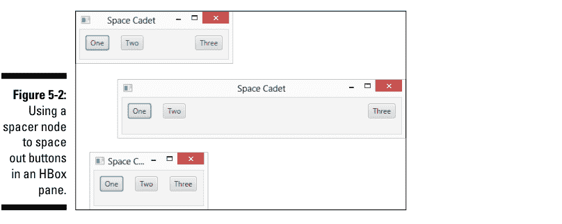

与 `setMargin` 方法类似，`setHgrow` 方法是 `HBox` 类的静态方法。因此，你可以从 `HBox` 实例调用它（如前面的示例所示），也可以从 `HBox` 类本身调用它。也就是说，以下代码段中的第二行是多余的：

```java
HBox pane = new HBox();
pane.setHgrow(spacer, Priority.ALWAYS);
HBox.setHgrow(spacer, Priority.ALWAYS);
```

## 使用 VBox 布局

`VBox` 类与 `HBox` 类类似，但它不是以水平行的方式排列节点，而是以垂直列的方式排列节点。表 5-4 显示了 `VBox` 类最常用的构造函数和方法。

### 表 5-4 VBox 构造函数

| 构造函数 | 描述 |
| --- | --- |
| `VBox()` | 创建一个新的 `VBox`。 |
| `VBox(double spacing)` | 创建具有指定间距的空 `VBox`。 |
| `VBox(Node... children)` | 创建具有指定节点的 `VBox`。 |
| `VBox(double spacing, Node... children)` | 创建具有指定间距和节点的 `VBox`。 |

### 表 5-4 VBox 方法

| 方法 | 描述 |
| --- | --- |
| `ObservableList<Node> getChildren()` | 返回所有节点的集合。 |
| `void setAlignment(Pos alignment)` | 设置所有节点的对齐方式。 |
| `static void setVgrow(Node child, Priority priority)` | 设置节点的垂直增长优先级。 |
| `void setMargin(Node node, Insets insets)` | 设置节点的外边距。 |

`VBox` 类定义在 `javafx.scene.layout` 包中；定义它的布局管理器也位于同一个包。你不需要包含额外的 `import` 语句即可使用 `VBox` 类。

下面的示例创建了三个按钮和一个占位符，将所有按钮的外边距设为 10 像素，然后将三个按钮和占位符添加到 `VBox` 中，使得前两个按钮出现在 `VBox` 的顶部，第三个按钮出现在底部：


# 第 5 章：使用布局面板排列场景

## 使用 HBox 布局

这里有一个示例创建了三个按钮和一个占位符，将所有按钮的外边距设为 10 像素，然后将三个按钮和占位符添加到 `HBox` 中，使得前两个按钮出现在 `HBox` 的左侧，第三个按钮出现在右侧：

```java
// 创建按钮
Button btn1 = new Button("One");
Button btn2 = new Button("Two");
Button btn3 = new Button("Three");

// 创建占位符
Region spacer = new Region();

// 设置占位符的 hGrow
HBox.setGrow(spacer, Priority.ALWAYS);

// 创建 HBox 面板
HBox hbox = new HBox(10, btn1, btn2, spacer, btn3);
```

## 使用 VBox 布局

`VBox` 类与 `HBox` 类类似，但它不是以水平行的方式排列节点，而是以垂直列的方式排列节点。表 5-4 显示了 `VBox` 类最常用的构造函数和方法。

`Priority` 枚举定义在 `javafx.scene.layout` 包中；定义它的布局管理器也位于同一个包。你不需要包含额外的 `import` 语句即可使用 `Priority` 枚举。

下面的示例创建了三个按钮和一个占位符，将所有按钮的外边距设为 10 像素，然后将三个按钮和占位符添加到 `VBox` 中，使得前两个按钮出现在顶部，第三个按钮出现在底部：

```java
// 创建按钮
Button btn1 = new Button("One");
Button btn2 = new Button("Two");
Button btn3 = new Button("Three");

// 创建占位符
Region spacer = new Region();

// 设置占位符的 vGrow
VBox.setGrow(spacer, Priority.ALWAYS);

// 创建 VBox 面板
VBox vbox = new VBox(10, btn1, btn2, spacer, btn3);
```

## 布局面板中的节点对齐

`HBox` 和 `VBox` 布局面板都有 `setAlignment` 方法，允许你控制面板内的节点。该方法接受一个参数，该参数是 `Pos` 枚举中定义的常量之一，见表 5-5。

### 表 5-5 Pos 枚举

| 常量 | 垂直对齐 | 水平对齐 |
|---|---|---|
| `Pos.TOP_LEFT` | Top | 左 |
| `Pos.TOP_CENTER` | Top | 居中 |
| `Pos.TOP_RIGHT` | Top | 右 |
| `Pos.CENTER_LEFT` | 居中 | 左 |
| `Pos.CENTER` | 居中 | 居中 |
| `Pos.CENTER_RIGHT` | 居中 | 右 |
| `Pos.BOTTOM_LEFT` | 下 | 左 |
| `Pos.BOTTOM_CENTER` | 下 | 居中 |
| `Pos.BOTTOM_RIGHT` | 下 | 右 |

`Pos` 枚举定义在 `javafx.geometry` 包中，因此在任何使用 `Insets` 的程序中，你都应该包含导入语句：

```java
import javafx.geometry.*;
```

这个示例展示了如何创建一个在面板内居中的三个按钮垂直列：

```java
Button btn1 = new Button("Number One");
Button btn2 = new Button("Two");
Button btn3 = new Button("The Third Button");
VBox vbox = new VBox(10, btn1, btn2, btn3);
vbox.setPadding(new Insets(10));
vbox.setAlignment(Pos.CENTER);
```

当此面板被添加到场景并显示在舞台中，结果与图 5-3 所示的窗口相似。

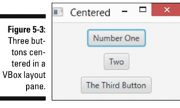

## 让节点具有相同宽度

当你将一组按钮或其他控件放在布局面板中时，你可能希望这些按钮具有相同的宽度，以营造整洁、均匀的外观。当你将它们在 `VBox` 面板中以垂直列的形式排列时，情况也是如此，因为垂直列会突出按钮宽度之间的任何差异。

你可以通过将每个按钮的最大宽度设置为 `Double.MAX_VALUE` 来轻松地让所有按钮具有相同的宽度。以下是前一个示例的修订版本，其中三个按钮被设置为了相同的宽度：

```java
Button btn1 = new Button("Number One");
Button btn2 = new Button("Two");
Button btn3 = new Button("The Third Button");
btn1.setMaxWidth(Double.MAX_VALUE);
btn2.setMaxWidth(Double.MAX_VALUE);
btn3.setMaxWidth(Double.MAX_VALUE);
VBox vbox = new VBox(10, btn1, btn2, btn3);
vbox.setPadding(new Insets(10));
vbox.setAlignment(Pos.CENTER);
```

图 5-4 显示了当面板添加到场景并将场景显示在舞台中时，这些按钮的外观。注意，所有三个按钮都采用了最宽按钮（`btn3`）的宽度。

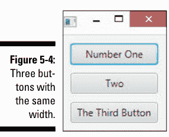

## 使用流布局

流布局有两种形式：水平布局和垂直布局。水平布局在行中排列其子节点，直到面板的宽度达到你可以指定的特定大小。当达到该大小时，布局会在第一行下方开始新的一行子节点。这种流持续进行，每当达到尺寸限制就会开始新的一行，直到所有子节点都放置完毕。

垂直流布局的工作原理相同，只是子节点按列布局，直到达到尺寸限制。当达到尺寸限制时，它会在第一列的右侧立即开始新的一列。

你使用 `FlowPane` 类来创建流布局。表 5-6 显示了 `FlowPane` 类的构造函数和最常用的方法。

### 表 5-6 FlowPane 构造函数和方法

| 构造函数 | 描述 |
|---|---|
| `FlowPane()` | 创建一个空的水平流布局，水平和垂直间隙均设置为零。 |
| `FlowPane(double hgap, double vgap)` | 创建一个具有指定水平和垂直间隙的空流布局。 |
| `FlowPane(double hgap, double vgap, Node... children)` | 创建一个具有指定水平和垂直间隙并填充了指定子节点的水平流布局。 |
| `FlowPane(Node... children)` | 创建一个水平和垂直间隙均设置为零并填充了指定子节点的水平流布局。 |
| `FlowPane(Orientation)` | 创建一个具有指定方向且水平和垂直间隙均设置为零的空流布局。 |
| `FlowPane(Orientation orientation, double hgap, double vgap)` | 创建一个具有指定方向和指定水平、垂直间隙的空流布局。 |
| `FlowPane(Orientation orientation, double hgap, double vgap, Node... children)` | 创建一个具有指定方向、水平和垂直间隙并填充了指定子节点的流布局。 |
| `FlowPane(Orientation orientation, Node... children)` | 创建一个具有指定方向且水平和垂直间隙均设置为零并填充了指定子节点的流布局。 |

| 方法 | 描述 |
|---|---|
| `ObservableList<Node> getChildren()` | 返回所有子节点的集合。该集合以 `ObservableList` 类型返回，其中包含 `addAll` 方法，允许你向其中添加一个或多个节点。 |
| `void setAlignment(Pos alignment)` | 设置行和列内节点的对齐方式。请查看表 5-5 以获取 `Pos` 枚举的说明。更多信息请参阅本章前面的“在布局面板中对齐节点”部分。 |
| `void setColumnAlignment(Pos alignment)` | 设置列内节点的对齐方式。请查看表 5-5 以获取 `Pos` 枚举的说明。更多信息请参阅本章前面的“在布局面板中对齐节点”部分。 |
| `void setHgap(double value)` | 设置流布局的水平间隙，这是节点之间的空间。对于垂直流布局，这是列之间的空间。 |
| `static void setMargin(Node child, Insets value)` | 为给定的子节点设置边距。请查看表 5-2 以获取 `Insets` 类的构造函数。更多信息请参阅本章前面的“使用边距留空”部分。 |
| `void setOrientation(Orientation orientation)` | 设置流布局的方向，可以是 `Orientation.HORIZONTAL` 或 `VERTICAL`。 |
| `void setPadding(Insets value)` | 设置流布局内部边缘的内边距（留白）。请查看表 5-2 以获取 `Insets` 类的构造函数。更多信息请参阅本章前面的“拉开元素”部分。 |
| `void setPrefWrapLength(double value)` | 设置面板的首选换行长度。对于水平流布局，这代表面板的首选宽度；对于垂直流布局，它代表首选高度。 |
| `void setRowAlignment(Pos alignment)` | 设置行内节点的对齐方式。请查看表 5-5 以获取 `Pos` 枚举的说明。更多信息请参阅本章前面的“在布局面板中对齐节点”部分。 |
| `void setSpacing(double value)` | 设置流布局的水平间隙，这是节点之间的空间。对于垂直流布局，这是列之间的空间。 |
| `void setVgap(double value)` | 设置流布局的垂直间隙，这是节点之间的空间。对于水平流布局，这是行之间的空间。 |

注意，无论首选换行长度如何，如果你不调用此方法，默认长度为 400 像素。

以下示例创建一个具有 10 像素水平和垂直间隙、填充了五个按钮且首选换行长度为 300 像素的水平布局：

```java
Button btn1 = new Button("Button One");
Button btn2 = new Button("Button Two");
Button btn3 = new Button("Button Three");
Button btn4 = new Button("Button Four");
Button btn5 = new Button("Button Five");
FlowPane pane = new FlowPane(Orientation.HORIZONTAL, 10, 10, btn1, btn2, btn3, btn4, btn5);
pane.setPrefWrapLength(300);
```

图 5-5 显示了当布局添加到场景并将场景显示在舞台中时，这些按钮的外观。此图还显示了当用户调整窗口大小时，流布局中的按钮是如何重新排列的。注意，最初，前三个按钮出现在第一行，另外两个出现在第二行。当窗口向宽拖动时，按钮会重新填充，使得四个按钮适应第一行，只有一个溢出到第二行。当窗口被缩小时，前两行只出现两个按钮，并为第五个按钮创建了第三行。

图 5-5：带有五个按钮的流布局面板。

## 使用边界布局

边界布局是一个被划分为五个区域的面板：顶部、左侧、中间、右侧和底部，如图 5-6 所示。当你向布局中添加组件时，可以指定该组件位于这些区域之一。

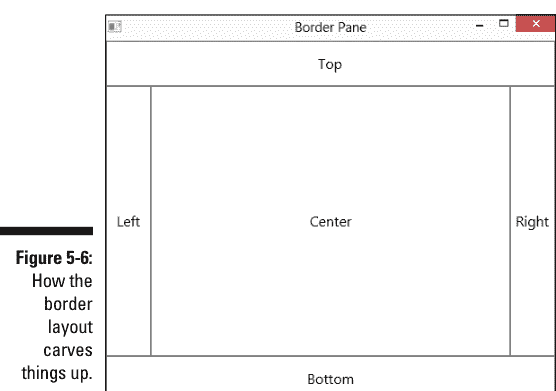

对于具有传统窗口布局的应用程序，边界布局是理想的布局管理器。这种布局顶部显示菜单和工具栏，底部显示状态栏或确定和取消按钮，左侧显示导航面板，右侧显示各种任务面板，中间显示内容。

你使用 `BorderPane` 类来创建边界布局。表 5-7 列出了 `BorderPane` 类的构造函数和最常用的方法。

### 表 5-7 BorderPane 构造函数与方法

| 构造函数 | 描述 |
|---|---|
| `BorderPane()` | 创建一个空的边界布局。 |
| `BorderPane(Node center)` | 创建一个带有指定中心节点的边界布局。 |
| `BorderPane(Node center, Node top, Node right, Node bottom, Node left)` | 创建一个带有指定的中心、顶部、右侧、底部和左侧节点的边界布局。 |

| 方法 | 描述 |
|---|---|
| `void setCenter(Node node)` | 设置中心节点。 |
| `void setTop(Node node)` | 设置顶部节点。 |
| `void setRight(Node node)` | 设置右侧节点。 |
| `void setBottom(Node node)` | 设置底部节点。 |
| `void setLeft(Node node)` | 设置左侧节点。 |
| `void setAlignment(Pos alignment)` | 设置边界面板内节点的对齐方式。`Pos` 枚举的解释请参见表 5-5。更多信息请参阅本章节前面的“在布局面板中对齐节点”部分。 |
| `static void setMargin(Node child, Insets value)` | 设置子节点的边距。`Insets` 类的构造函数请参见表 5-2。更多信息请参阅本章节前面的“使用边距添加空间”部分。 |

`BorderPane` 类定义在 `javafx.scene.layout` 包中，因此在任何使用边界布局的程序中，都应该包含以下导入语句：

```java
import javafx.scene.layout.*;
```

该类的默认构造函数创建一个空的边界布局，你稍后可以添加节点，例如所示：

```java
Button btn1 = new Button("Button One");
Button btn2 = new Button("Button Two");
Button btn3 = new Button("Button Three");
VBox vbox = new VBox(btn1, btn2, btn3);
BorderPane pane = new BorderPane();
pane.setCenter(vbox);
```

在这里，创建了三个按钮并将它们添加到一个 `VBox` 中。然后，创建一个边界布局，并将 `VBox` 添加到它的中间区域。

或者，你也可以通过 `BorderPane` 构造函数向中间区域添加节点，如下：

```java
BorderPane pane = new BorderPane(vbox);
```

表 5-7 中列出的第三个构造函数允许你一次向所有五个区域添加节点。以下示例显示你已经创建了五个面板：`centerPane`、`topPane`、`rightPane`、`bottomPane` 和 `leftPane`：

```java
BorderPane pane = new BorderPane(centerPane, topPane, rightPane, bottomPane, leftPane);
```

关于 `BorderPane` 类，有几个重要点需要了解：


- 如果不在某个区域中添加节点，则该区域将不会渲染。
- 边界布局区域的大小根据其内容进行调整。
- 因此，如果你向右侧区域添加 `VBox` 面板，则 `VBox` 面板的宽度将决定右侧区域的宽度。
- 如果用户调整窗口大小使其变宽，左侧、中间和右侧区域的宽度会相应扩展；顶部和底部的区域保持不变。
- 同样，如果用户拖动窗口使其更高，左侧、中间和右侧区域的高度会相应扩展；顶部和底部的区域保持不变。
- 你添加到边界面板区域中的节点本身几乎都会是其他的布局面板。

在第 6 章中，你将看到一个综合示例，展示如何创建一个布局，该布局使用 `VBox`、`HBox` 和 `FlowPane` 布局面板组合作为 `BorderPane` 每个区域的节点。

# 第 6 章：从用户获取输入

## 本章内容

- 处理文本字段和文本区域
- 验证数值数据并创建复选框
- 设置单选按钮
- 在完整程序中使用这些组件


# 第 6 章：从用户获取输入

在本书的前五章中，我讨论了如何仅使用两个基础 JavaFX 输入控件：标签（`Label`）和按钮（`Button`）来创建 JavaFX 程序。如果你只想编写一个在用户点击按钮时显示文本的程序，那么现在可以停笔了。但如果你想编写一些真正有意义的程序，你就需要这样做。

## 使用文本字段

文本字段是用户可以在其中输入的地方。表 6-1 显示了一些实用的构造函数和方法。

| 构造函数 | 描述 |
|---|---|
| `TextField()` | 创建一个新的文本字段 |
| `TextField(String text, int cols)` | 创建一个带有初始文本的新文本字段 |
| 方法 | 描述 |
| `String getText()` | 获取字段中的值 |
| `void requestFocus()` | 请求焦点到该字段 |
| `void setEditable(boolean value)` | 如果为 `false`，使字段只读 |
| `void setMaxWidth(double width)` | 设置字段的最大宽度 |
| `void setMinWidth(double width)` | 设置字段的最小宽度 |
| `void setPrefColumnCount(int cols)` | 按列设置字段的首选尺寸 |
| `void setPrefWidth(double width)` | 设置字段的首选宽度 |
| `void setPromptText(String prompt)` | 设置字段的提示文本 |
| `void setText(String text)` | 设置字段文本 |

### TextField 类

`TextField` 类定义在 `javafx.scene.control` 包中，因此在任何使用文本字段的程序中，都应该包含以下导入语句：

```java
import javafx.scene.control.*;
```

创建文本字段的最常见方法是不带参数调用构造函数：

```java
TextField text1 = new TextField();
```

你可以这样设置初始值：

```java
TextField text1 = new TextField("Initial value");
```

或者，如果你以后设置值，可以调用 `setText` 方法：

```java
text1.setText("Text value");
```

要获取用户输入到文本字段中的值，请这样调用 `getText` 方法：

```java
String value = text1.getText();
```

与 JavaFX 控件一样，管理文本字段的宽度可能会有点复杂。最终，JavaFX 将根据多个因素确定文本字段的宽度，包括包含阶段和场景的窗口大小，以及包含文本字段的面板尺寸限制。你可以通过调用 `setMinWidth` 和 `setMaxWidth` 方法设置尺寸限制，并可以通过 `setPrefWidth` 方法指定首选宽度，例如所示：

```java
TextField text1 = new TextField();
text1.setMinWidth(150);
text1.setMaxWidth(250);
text1.setPrefWidth(200);
```

另一种设置首选宽度的方法是使用 `setPrefColumnCount` 方法，它按平均字符的大小设置宽度。例如，下行代码将字段调整为足够显示 50 个字符：

```java
text1.setPrefColumnCount(50);
```

注意 `setPrefColumnCount` 方法并没有限制用户向字段中输入的字符数。相反，它限制了字段一次可以显示的字符数。

每当你使用文本字段时，请提供一个提示（prompt），让用户知道应该在字段中输入什么数据。实现此点的常用方法是在文本字段的左侧放置一个标签（`Label`）。例如：

```java
Label lblName = new Label("Name:");
lblName.setMinWidth(75);
TextField txtName = new TextField();
txtName.setMinWidth(200);
HBox pane = new HBox(10, lblName, txtName);
```

在这里，`HBox` 窗格内部创建标签和一个文本字段，以便它们并排显示。

JavaFX 还允许你向文本字段内部显示提示。提示以浅色的的文本颜色显示，并在字段获得焦点时消失。你使用 `setPromptText` 方法来创建提示：

```java
txtName = new TextField();
txtName.setPromptText("Enter the customer's name");
```

在这里，“Enter the customer's name”将出现在文本字段内部。

要获取用户输入文本字段的值，你可以像本示例所示使用 `getText` 方法：

```java
String lastName = textLastName.getText();
```

在这里，用户在 `lastName` 文本字段中输入的值被赋值给字符串变量 `lastName`。

图 6-1 显示了一个简单程序的运行，该程序使用文本字段允许用户输入剧角色名称以及扮演该角色的演员名称。假设用户在两个字段中都输入了文本，程序将显示一条消息，指示谁将扮演该角色。如果用户留空了一个或两个字段，将弹出一个消息框来指示错误。（该程序使用了第 4 章列表 4-2 中介绍的 `MessageBox` 类来显示框。）

图 6-1 显示了该程序主阶段的外，以及当用户输入两个名称或遗漏其中一个时显示的消息框窗口。该程序的 JavaFX 代码显示在列表 6-1 中。

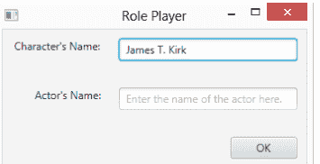

**图 6-1：运行中的 RolePlayer 应用。**

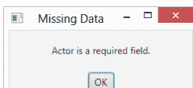

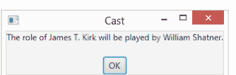

### 列表 6-1：RolePlayer 程序

```java
import javafx.application.*;
import javafx.stage.*;
import javafx.scene.*;
import javafx.scene.layout.*;
import javafx.scene.control.*;
import javafx.geometry.*;

public class RolePlayer extends Application
{
    public static void main(String[] args)
    {
        launch(args);
    }

    TextField txtCharacter;
    TextField txtActor;
    @Override 
    public void start(Stage primaryStage)
    {
        // 创建角色
        Label lblCharacter = new Label("Character's Name:");
        lblCharacter.setMinWidth(100);
        lblCharacter.setAlignment(Pos.BOTTOM_RIGHT);
        // (续)
        // 创建角色文本字段
        txtCharacter = new TextField();
        txtCharacter.setMinWidth(200);
        txtCharacter.setMaxWidth(200);
        txtCharacter.setPromptText(
            "Enter the name of the character here.");

        // 创建演员标签
        lblActor = new Label("Actor's Name:");
        lblActor.setMinWidth(100);
        lblActor.setAlignment(Pos.BOTTOM_RIGHT);

        // 创建演员文本字段
        txtActor = new TextField();
        txtActor.setMinWidth(200);
        txtActor.setMaxWidth(200);
        txtActor.setPromptText("Enter the name of the actor here.");

        // 创建 OK 按钮
        btnOK = new Button("OK");
        btnOK.setOnAction(e -> btnOK_Click());

        // 创建角色窗格
        hBoxPaneCharacter = new VBox(20, lblCharacter, txtCharacter);
        paneCharacter.setPadding(new Insets(10));

        // 创建演员窗格
        hBoxPaneActor = new VBox(20, lblActor, txtActor);
        paneActor.setPadding(new Insets(10));

        // 创建按钮窗格
        hBoxPaneButton = new VBox(20, btnOK);
        paneButton.setPadding(new Insets(10));
        paneButton.setAlignment(Pos.BOTTOM_RIGHT);

        // 将角色、演员和按钮窗格添加到一个 VBox 中
        VBoxPane = new VBox(10, paneCharacter, paneActor, paneButton);

        // 设置阶段
        Scene scene = new Scene(pane);
        primaryStage.setScene(scene);
        primaryStage.setTitle("Role Player");
        primaryStage.show();
    }

    public void btnOK_Click() {
        String errorMessage = "";

        if (txtCharacter.getText().length() == 0) {
            errorMessage += "\nCharacter is a required field.";
        }

        if (txtActor.getText().length() == 0) {
            errorMessage += "\nActor is a required field.";
        }

        if (errorMessage.length() == 0) {
            String message = "The role of " + txtCharacter.getText() + " will be played by " + txtActor.getText() + ".";
            MessageBox.show(message, "Cast");
        } else {
            MessageBox.show(errorMessage, "Missing Data");
        }
    }
}
```

## 验证数字数据

如果你使用文本字段获取数字数据，需要格外小心。`getText` 方法返回一个字符串值。你可以将此值传递给包装类的某个解析方法。要将文本框中的值转换为 `int`，请使用 `parseInt` 方法。

```java
int count = Integer.parseInt(txtCount.getText());
```

在这里，`getText` 方法的结果作为 `parseInt` 方法的参数。

表 6-2 列出了各种包装类的解析方法。注意：如果字符串无法转换，这些方法中的都会抛出 `NumberFormatException`。因此，需要在 `try/catch` 块中调用 `parseInt` 方法来捕获该异常。

| 包装类 | 解析方法 |
| :--- | :--- |
| `Integer` | `parseInt(String)` |
| `Short` | `parseShort(String)` |
| `Long` | `parseLong(String)` |
| `Byte` | `parseByte(String)` |
| `Float` | `parseFloat(String)` |
| `Double` | `parseDouble(String)` |


```java
private boolean isInt(TextField f, String msg)
{
    try {
        Integer.parseInt(f.getText());
        return true;
    } catch (NumberFormatException e) {
        MessageBox.show(msg, "Data Entry Error");
        return false;
    }
}
```

每当你需要检查字段是否为有效整数时，都可以调用此方法。（`MessageBox` 类与列表 6-1 中使用的相同；你可以在第 4 章的列表 4-2 中找到它的代码）

这是一个获取 `txtCount` 文本字段中输入的值的方法，如果输入的值是有效整数，则将其显示在消息框中：

```java
public void buttonOKClick()
{
    if (isInt(txtCount, "You must enter an integer."))
    {
        MessageBox.show("You entered " +
            Integer.parseInt(txtCount.getText()),
            "Your Number");
    }
    txtCount.requestFocus();
}
```

调用 `isInt` 方法是为了确保用户输入的文本可以转换为 `int`。如果是的话，文本将被转换并显示在消息框中。

## 使用复选框

复选框是一种用户可以点击进行勾选或清除的控件。复选框允许用户为选项指定“是”或“否”设置。图 6-2 显示了一个带有三个复选框的窗口。

严格来说，复选框有*三个*状态：已选中、未选中和未定义。未定义状态通常与 `TreeView` 控件配合使用。

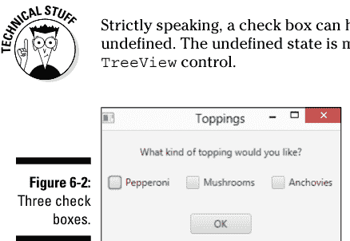

**图 6-2：三个复选框。**

要创建一个复选框，你需要使用 `CheckBox` 类。其常用的构造函数和方法如表 6-3 所示。

| 构造函数 | 描述 |
| --- | --- |
| `CheckBox()` | 创建一个初始未选新的复选框。 |
| `CheckBox(String text)` | 创建一个显示指定文本的新复选框。 |
| 方法 | 描述 |
| `String getText()` | 获取复选框显示的文本。 |
| `boolean isSelected()` | 如果复选框被选中则返回 `true`，如果未选中则返回 `false`。 |
| `void setAction(EventHandler<ActionEvent> value)` | 设置 Action 监听器来处理动作事件。 |
| `void setSelected(boolean value)` | 如果参数为 `true` 则勾选复选框；如果参数为 `false` 则取消勾选。 |
| `void setText(String text)` | 设置复选框文本。 |

与任何 JavaFX 控件一样，如果你想在程序中的任何方法中引用复选框，请声明一个类变量来引用该控件：

```java
CheckBox chkPepperoni, chkMushrooms, chkAnchovies;
```

你可以在 `start` 方法中使用这些语句来创建复选框并将它们添加到布局面板（在本例中为 `panel`）：

```java
chkPepperoni = new CheckBox("Pepperoni");
panel.add(chkPepperoni);
```

```java
chkMushrooms = new CheckBox("Mushrooms");
panel.add(chkMushrooms);
```

```java
chkAnchovies = new CheckBox("Anchovies");
panel.add(chkAnchovies);
```

注意，我没有在构造函数中指定这些复选框的初始状态。它们初始是未选中的。如果你想创建一个初始为选中的复选框，请调用 `setSelected` 方法，如下：


```java
chkPepperoni.setSelected(true);
```

在事件监听器中，你可以使用 `isSelected()` 方法测试复选框的状态，并通过调用其 `setSelected()` 方法来设置复选框的状态。这里有一个方法，当用户点击时显示消息框并清除所有三个复选框：

```java
public void btnOK_Click() {
    String msg = "";
    if (chkPepperoni.isSelected()) {
        msg += "Pepperoni\n";
    }
    if (chkMushrooms.isSelected()) {
        msg += "Mushrooms\n";
    }
    if (chkAnchovies.isSelected()) {
        msg += "Anchovies\n";
    }
    if (msg.equals("")) {
        msg = "You didn't order any toppings.";
    } else {
        msg += "You ordered these toppings:\n";
    }
    MessageBox.show(msg, "Your Order");
    chkPepperoni.setSelected(false);
    chkMushrooms.setSelected(false);
    chkAnchovies.setSelected(false);
}
```

在这里，用户选择的每个披萨配料都被添加到文本字符串中。例如，如果你选择了意大利腊肠和凤尾鱼，将显示以下消息：

- You ordered these toppings:
- Pepperoni
- Anchovies

如果你愿意，可以为复选框添加事件监听器，以响应用户点击这些复选框时生成的事件。假设你的餐厅菜单上有凤尾鱼，但你拒绝制作加凤尾鱼的披萨。这是一个可以在事件监听器中调用的方法，当用户尝试勾选凤尾鱼复选框时显示消息，显示消息后，该方法会清除复选框：

```java
public void chkAnchovies_Click() {
    MessageBox.show("We don't do anchovies here.\nYuck!");
    chkAnchovies.setSelected(false);
}
```

要为凤尾鱼复选框添加此事件监听器，调用其 `setOnAction()` 方法，如下：

```java
chkAnchovies.setOnAction(e -> chkAnchovies_Click() );
```

只有当你需要在用户选择或取消选择框时提供即时反馈时，才为复选框添加监听器。在大多数应用程序中，你会等到用户点击按钮以检查框架中任何复选框的状态。

## 使用单选按钮

单选按钮与复选框相似，但有一个区别：它们成组出现，用户每次从每个组只能选择一个单选按钮。当你点击一个单选按钮进行选择时，同组之前选中的单选按钮会自动取消选择。图 6-3 显示了一个带有三个单选按钮的窗口。


要操作单选按钮，你需要使用以下类。首先，你使用 `RadioButton` 类创建单选按钮本身，其构造函数和方法如表 6-4 所示。然后你使用 `ToggleGroup` 为按钮创建一个组。`ToggleGroup` 对象只是关联单选按钮的一种方式，以便只有一个可以被选中。显示单选按钮，你仍然将它们添加到布局面板。

### 表 6-4 各种 RadioButton 构造函数和方法

| 构造函数 | 描述 |
| --- | --- |
| `RadioButton()` | 创建一个无文本的新单选按钮。 |
| `RadioButton(String text)` | 创建一个带有指定文本的新单选按钮。 |

| 方法 | 描述 |
| --- | --- |
| `String getText()` | 获取单选按钮显示的文本。 |
| `boolean isSelected()` | 如果单选按钮被选中则返回 true，未选中则返回 false。 |
| `void setAction(EventHandler<ActionEvent> value)` | 设置 Action 监听器来处理动作事件。 |
| `void setSelected(boolean value)` | 如果参数为 true 则选中单选按钮；如果参数为 false 则取消选中。 |
| `void setText(String text)` | 设置选择框文本。 |

## 查看披萨订单应用程序

你将了解如何将本章中的控件与我在第 5 章介绍的布局面板结合使用。本节展示了一个允许用户订购披萨的相当复杂的应用程序。用户输入

### 132 第一部分：JavaFX 入门

将他的姓名、地址和电话号码输入到文本框，使用单选按钮选择披萨的大小和饼底样式，并通过复选框选择配料。

图 6-4 显示了披萨订单应用的主窗口。

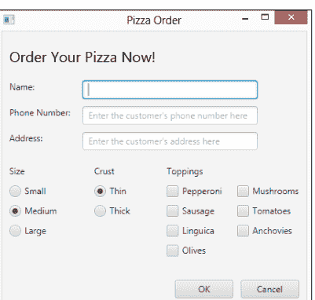

图 6-4：披萨订单应用的主窗口。

当用户输入披萨订单数据并点击 OK 时，此程序将显示一个汇总订单的消息框，如图 6-5 所示。

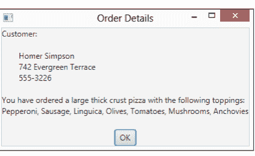

图 6-5：披萨订单应用确认用户的订单。

初看之下可能并不明显，披萨订单应用显示的场景总共使用了 12 个布局窗格来管理控件的排列。整个场景由边框布局组织，其顶部区域显示标题（立即订购披萨！）。中间区域显示文本框、单选按钮和复选框，允许用户配置披萨订单。底部区域包含 OK 和 Cancel 按钮。

## 第 6 章：从用户获取输入

供你参考，表 6-5 列出了用于组织这些内容的 12 个布局窗格。

### 表 6-5 披萨订单应用使用的布局窗格

| 名称 | 类 | 描述 |
| --- | --- | --- |
| `paneMain` | `BorderPane` | 场景的主根布局。 |
| `paneTop` | `HBox` | 包含在边框布局顶部显示的标题文本。 |
| `paneName` | `HBox` | 包含姓名的标签和文本框，并排排列。 |
| `panePhone` | `HBox` | 包含电话的标签和文本框，并排排列。 |
| `paneAddress` | `HBox` | 包含地址的标签和文本框，并排排列。 |
| `paneCustomer` | `VBox` | 包含姓名、电话和地址布局，垂直堆叠。 |
| `paneSize` | `VBox` | 包含带有“Size”标签的让用户选择披萨大小的三个单选按钮，垂直堆叠。 |
| `paneCrust` | `VBox` | 包含带有“Crust”标签的让用户选择饼底样式的两个单选按钮，垂直堆叠。 |
| `paneToppings` | `FlowPane` | 包含配料复选框的流布局。 |
| `paneTopping` | `VBox` | 带有“Toppings”文本的标签和列出配料的流布局，垂直堆叠。 |
| `paneOrder` | `HBox` | 包含并排排列的尺寸、样式和配料的三个 VBox 布局。此布局显示在边框布局的中间区域。 |
| `paneBottom` | `HBox` | 包含并排排列的 OK 和 Cancel 按钮。使用间隙强制按钮靠右边距。此布局显示在边框布局的底部区域。 |

### 134 第一部分：JavaFX 入门

披萨订单应用的源代码如列表 6-2 所示。注意，此程序使用了我在第 4 章介绍的 `MessageBox` 类。该类的源代码可以在列表 6-2 中找到。

## 列表 6-2：披萨订单应用

```java
import javafx.application.*;
import javafx.stage.*;
import javafx.scene.*;
import javafx.scene.layout.*;
import javafx.scene.control.*;
import javafx.geometry.*;
import javafx.scene.text.*;

public class PizzaOrder extends Application
{
    public static void main(String[] args)
    {
        launch(args);
    }

    Stage stage;

    // 客户姓名、电话和地址字段
    TextField txtName;
    TextField txtPhone;
    TextField txtAddress;

    // 大小单选按钮
    RadioButton rdoSmall;
    RadioButton rdoMedium;
    RadioButton rdoLarge;

    // 饼底样式单选按钮
    RadioButton rdoThin;
    RadioButton rdoThick;

    // 配料复选框
    CheckBox chkPepperoni;
    CheckBox chkSausage;
    CheckBox chkLinguica;
    CheckBox chkOlives;
    CheckBox chkMushrooms;
    CheckBox chkTomatoes;
    CheckBox chkAnchovies;

    @Override public void start(Stage primaryStage)
    {
        stage = primaryStage;

        // 创建顶部布局 ---
        Text textHeading = new Text("Your Pizza Now!");
        textHeading.setFont(new Font(20));
        HBox paneTop = new HBox(textHeading);
        paneTop.setPadding(new Insets(20, 10, 20, 10));

        // 创建客户布局 ---
        // 创建姓名标签和文本框
        Label lblName = new Label("Name:");
        lblName.setPrefWidth(100);
        txtName = new TextField();
        txtName.setPrefColCount(20);
        txtName.setPromptText("Enter the customer's name here:");
        txtName.setMaxWidth(Double.MAX_VALUE);
        HBox paneName = new HBox(lblName, txtName);

        // 创建电话标签和文本框
        Label lblPhone = new Label("Phone:");
        lblPhone.setPrefWidth(100);
        txtPhone = new TextField();
        txtPhone.setPrefColCount(20);
        txtPhone.setPromptText("Enter the customer's phone here:");
        txtPhone.setMaxWidth(Double.MAX_VALUE);
        HBox panePhone = new HBox(lblPhone, txtPhone);

        // 创建地址标签和文本框
        Label lblAddress = new Label("Address:");
        lblAddress.setPrefWidth(100);
        txtAddress = new TextField();
        txtAddress.setPrefColCount(20);
        txtAddress.setPromptText("Enter the customer's address here:");
        txtAddress.setMaxWidth(Double.MAX_VALUE);
        HBox paneAddress = new HBox(lblAddress, txtAddress);

        // 垂直堆叠布局
        VBox paneCustomer = new VBox(paneName, panePhone, paneAddress);

        // 创建尺寸布局
        Label lblSize = new Label("Size:");
        ToggleGroup sizeGroup = new ToggleGroup();
        rdoSmall = new RadioButton("Small");
        rdoSmall.setToggleGroup(sizeGroup);
        rdoMedium = new RadioButton("Medium");
        rdoMedium.setToggleGroup(sizeGroup);
        rdoLarge = new RadioButton("Large");
        rdoLarge.setToggleGroup(sizeGroup);
        rdoMedium.setSelected(true);
        VBox paneSize = new VBox(lblSize, rdoSmall, rdoMedium, rdoLarge);

        // 创建饼底布局
        Label lblCrust = new Label("Crust:");
        ToggleGroup crustGroup = new ToggleGroup();
        rdoThin = new RadioButton("Thin");
        rdoThin.setToggleGroup(crustGroup);
        rdoThick = new RadioButton("Thick");
        rdoThick.setToggleGroup(crustGroup);
        rdoThin.setSelected(true);
        VBox paneCrust = new VBox(lblCrust, rdoThin, rdoThick);

        // 创建配料布局
        Label lblToppings = new Label("Toppings:");
        chkPepperoni = new CheckBox("Pepperoni");
        chkSausage = new CheckBox("Sausage");
        chkLinguica = new CheckBox("Linguica");
        chkOlives = new CheckBox("Olives");
        chkMushrooms = new CheckBox("Mushrooms");
        chkTomatoes = new CheckBox("Tomatoes");
        chkAnchovies = new CheckBox("Anchovies");
        FlowPane paneToppings = new FlowPane(chkPepperoni, chkSausage, chkLinguica, chkOlives, chkMushrooms, chkTomatoes, chkAnchovies);
        paneToppings.setHgap(10);
        paneToppings.setVgap(10);
        VBox paneTopping = new VBox(lblToppings, paneToppings);

        // 组合订单布局
        HBox paneOrder = new HBox(paneSize, paneCrust, paneTopping);
        paneOrder.setSpacing(20);

        // 创建底部按钮布局
        Button btnOK = new Button("OK");
        btnOK.setOnAction(e -> btnOK_Click());
        Button btnCancel = new Button("Cancel");
        btnCancel.setOnAction(e -> stage.close());
        Region spacer = new Region();
        HBox.setHgrow(spacer, Priority.ALWAYS);
        HBox paneBottom = new HBox(spacer, btnOK, btnCancel);
        paneBottom.setSpacing(10);
        paneBottom.setPadding(new Insets(10));

        // 组装主布局
        BorderPane paneMain = new BorderPane();
        paneMain.setTop(paneTop);
        paneMain.setCenter(paneOrder);
        paneMain.setBottom(paneBottom);

        Scene scene = new Scene(paneMain);
        stage.setScene(scene);
        stage.setTitle("Pizza Order");
        stage.show();
    }

    public void btnOK_Click() {
        String msg = "";
        if (chkPepperoni.isSelected()) {
            msg += "Pepperoni\n";
        }
        if (chkSausage.isSelected()) {
            msg += "Sausage\n";
        }
        if (chkLinguica.isSelected()) {
            msg += "Linguica\n";
        }
        if (chkOlives.isSelected()) {
            msg += "Olives\n";
        }
        if (chkMushrooms.isSelected()) {
            msg += "Mushrooms\n";
        }
        if (chkTomatoes.isSelected()) {
            msg += "Tomatoes\n";
        }
        if (chkAnchovies.isSelected()) {
            msg += "Anchovies\n";
        }
        if (msg.equals("")) {
            msg = "You didn't order any toppings.";
        } else {
            msg = "You ordered these toppings:\n" + msg;
        }
        msg = "Name: " + txtName.getText() + "\n" +
              "Phone: " + txtPhone.getText() + "\n" +
              "Address: " + txtAddress.getText() + "\n" +
              "Size: " + ((RadioButton)sizeGroup.getSelectedToggle()).getText() + "\n" +
              "Crust: " + ((RadioButton)crustGroup.getSelectedToggle()).getText() + "\n" +
              msg;
        MessageBox.show(msg, "Your Order");
    }
}
```


# 第 6 章：获取用户输入

```java
RadioButton rdoThick;

// 配料单选按钮

CheckBox chkPepperoni;
CheckBox chkSausage;
CheckBox chkLinguica;
CheckBox chkOlives;
CheckBox chkMushrooms;
CheckBox chkTomatoes;
CheckBox chkAnchovies;

@Override
public void start(Stage primaryStage) {
    stage = primaryStage;

    // 创建顶部布局 ---
    textHeading = new Text("Your Pizza Now!");
    textHeading.setFont(new Font(20));
    HBox paneTop = new HBox(textHeading);
    paneTop.setPadding(new Insets(20, 10, 20, 10));

    // 创建客户布局 ---
    // 创建姓名标签和文本框
    Label lblName = new Label("Name:");
    lblName.setPrefWidth(100);
    txtName = new TextField();
    txtName.setPrefColCount(20);
    txtName.setPromptText("Enter the customer's name here:");
    txtName.setMaxWidth(Double.MAX_VALUE);
    HBox paneName = new HBox(lblName);
    // 创建电话标签和文本框
    Label lblPhone = new Label("Phone:");
    lblPhone.setPrefWidth(100);
    txtPhone = new TextField();
    txtPhone.setPrefColCount(20);
    txtPhone.setPromptText("Enter the customer's phone here:");
    txtPhone.setMaxWidth(Double.MAX_VALUE);
    HBox panePhone = new HBox(lblPhone);
    // 创建地址标签和文本框
    Label lblAddress = new Label("Address:");
    lblAddress.setPrefWidth(100);
    txtAddress = new TextField();
    txtAddress.setPrefColCount(20);
    txtAddress.setPromptText("Enter the customer's address here:");
    txtAddress.setMaxWidth(Double.MAX_VALUE);
    HBox paneAddress = new HBox(lblAddress);
    // 垂直堆叠布局
    VBox paneCustomer = new VBox(paneName, panePhone, paneAddress);

    // 创建尺寸布局
    Label lblSize = new Label("Size:");
    // ... 此处省略部分重复代码翻译逻辑
}
```

```java
if (toppings.equals(""))
    msg += "no toppings";
else
    msg += "the following toppings:\n" + toppings;

// 显示消息
MessageBox.show(msg, "Order Details");
}

public String buildToppings(CheckBox chk, String msg) {
    // 用于显示配料列表辅助方法
    if (!chk.isSelected()) {
        if (!msg.equals("")) {
            msg += ", ";
        }
        msg += chk.getText();
    }
    return msg;
}

public void btnCancel_Click() {
    stage.close();
}
```

# 第二部分：JavaFX 控件

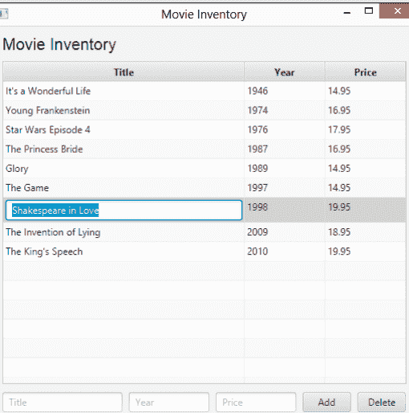

访问 `www.dummies.com/extras/javafx` 获取优质的 Dummies 在线内容。

## 本部分内容

- 控制控件
- 组织列表
- 构建表格
- 创建菜单
- 访问 `www.dummies.com/extras/javafx` 获取优质的 Dummies 在线内容。

# 第 7 章：介绍 JavaFX 节点层次结构

## 本章内容

- 介绍组成 JavaFX 的最重要的包和类
- 查看所有控件通过 `Node`、`Parent` 和 `Region` 类继承的重要方法

JavaFX 控件的最简单定义是：控件是由某个类创建的对象，该类直接或间接继承自 JavaFX `Control` 类。`Control` 类提供了 JavaFX 对象被视为控件所需的所有基本功能。例如，任何继承自 `Control` 的类在场景中都有视觉表示，可以添加到布局面板中，可以通过调用 `setMaxWidth` 或 `setMinHeight` 等方法在您设置的参数范围内自动调整大小，并且当用户鼠标悬停在控件上时会弹出工具提示。

虽然所有控件都有这些共同特征，但并非所有这些特征都是由 `Control` 类提供的。这是因为 `Control` 类本身继承了 `Region` 类，而 `Region` 类又继承了 `Parent` 类，`Parent` 类再继承了 `Node` 类。这条继承链中的每一个类都为每个 JavaFX 控件贡献了功能。

在本章中，你将了解到一些由于每个 JavaFX 控件都继承自 `Control` 类（而 `Control` 类又继承了 `Region`、`Parent` 和 `Node` 类）因此对每个控件都通用的一些重要特性。

## JavaFX 包概览

在查看组成 `Node` 类层次结构的类之前，我想简要讨论一下组成 JavaFX 的各种包。JavaFX 本身由总共 665 个类组成，分布在 36 个不同的包中，这些包都以根名称 `javafx` 开头。

因此，在书中，你已经看到了来自以下包的 JavaFX 类：

- **`javafx.application`**：该包中最重要的类是 `Application`，它提供了 JavaFX 应用程序的基本周期函数。正如我在第 2 章中讨论的，所有 JavaFX 程序都扩展 `Application` 类并实现 `start` 方法，这是唯一必需的。`Application` 类还会创建应用程序的主阶段，并通过 `primaryStage` 参数将其传递。这允许程序在应用程序的窗口中显示场景。

- **`javafx.stage`**：该包中最重要的类是 `Stage`，它代表可以显示用户界面的窗口。你在第 4 章中读过 `Stage` 类。该类中还有其他类可能很有用，例如 `FileChooser` 和 `DirectoryChooser`，它们会显示供你选择文件和目录的对话框。

- **`javafx.scene`**：该包包含几个处理可以在场景中显示的用户界面场景的类。该包中最重要的两个类是：
    - **`Scene`**：创建一个场景对象。你可以阅读关于场景中包含的所有对象（包括控件和布局面板）的 `Scene` 类。
    - **`Node`**：它是场景中包含的所有对象（包括控件）的基类。有关 `Node` 类的更多信息，请参阅本章后半部分的“Node 类”章节。

- **`javafx.scene.control`**：该包包含了 JavaFX 大多数用户界面控件，包括 `Button`、`Label`、`CheckBox` 和 `RadioButton`。该包中还包括 `Control`，它是所有用户界面控件的派生基类。有关 `Control` 类的更多信息，请参阅本章的“Control 类”章节。（注意：有少数 JavaFX 控件定义在其他包中，包括 `javafx.scene.control.cell` 和 `javafx.scene.web`。）

- **`javafx.scene.layout`**：该包包含布局类，如 `HBox`、`VBox` 和 `BorderPane`。在该包中定义的两个重要类是 `Pane` 和 `Region`。所有的布局类都基于 `Pane` 类，而该包中的 `Pane` 类和 `javafx.scene.control` 包中的 `Control` 类都基于 `Region` 类。有关 `Region` 类的更多信息，请参阅本章的“Region 类”章节。

- **`javafx.geometry`**：这是一个较小的包，定义了与 JavaFX 节点几何结构相关的基础类和枚举。在第 5 章中，你将了解如何使用 `Insets` 类来控制布局面板内部的间距。

- **`javafx.collections`**：该包定义了 `ObservableList` 类，它被 `getChildren` 方法使用。

## Node 类

JavaFX 控件层次结构始于 `Node` 类，它代表一个可以添加到场景中的对象。事实上，控件层次结构最顶层的类是 `Object` 类，但这并不值一提，因为所有层次结构都始于 `Object` 类——`Object` 是所有类的基类。

所有对象都是场景图的一部分，场景图是一个构成界面的树结构。要成为场景图的一部分，对象必须继承 `Node` 类。因此，`Node` 类是所有可以添加到场景的类的基类。

像任何其他树结构一样，场景图从单个节点——根节点开始，它可以拥有一个或多个子节点，每个子节点又拥有一个或多个子节点。至少有一个子节点的节点是分支节点，没有子节点的节点是叶节点。场景只能有一个根节点，但可以有很多分支和叶节点。

`Node` 类是一个抽象类，这意味着你不能直接创建它的实例。也就是说，以下代码会导致编译错误：

```java
Node myWeb = new Node();
```

然而，你可以使用 `Node` 类来持有你不确定或不在乎类型的节点。例如：

```java
Node myWebNode = new Button();
```

在这种情况下，`webNode` 的类型是 `Node`，但它用于持有指向 `Button` 控件的引用。

`Node` 层次结构中的许多方法都接受或返回 `Node` 类型的对象。例如，与布局面板（如 `HBox` 和 `FlowPane`）配合使用的 `getChildren` 方法返回 `Node` 对象列表。用于向布局面板列表添加元素的 `add` 方法接受一个 `Node` 对象作为参数。也就是说，任何 `Node` 对象都可以添加到布局面板中。

表 7-1 列出了你在大多数 JavaFX 程序中可能用到的部分方法。请注意，此表极大地简化了 `Node` 类的复杂性。实际上，该类定义了超过 300 个方法。其中超过三分之一的方法与事件处理有关：`Node` 类是该类负责所有节点的大部分处理，包括处理节点与鼠标、键盘和触摸屏交互的事件。

### 表 7-1 常用 Node 方法

| 方法 | 解释 |
| --- | --- |
| `Parent getParent()` | 返回此节点的 `Parent`（父）节点。 |
| `String getId()` | 返回此节点的 ID。 |
| `void setId(String id)` | 设置此节点的 ID。该 ID 在场景图中应该是唯一的。 |
| `Node lookup(String id)` | 在节点的子节点中搜索 ID 与参数匹配的节点。 |
| `String getStyle()` | 返回节点的 CSS 字符串样式。 |
| `void setStyle(String style)` | 设置节点的 CSS 字符串样式。 |

`getParent` 方法返回一个节点的父节点。该方法返回一个 `Parent` 类型的对象，该节点可以拥有子节点（你将在接下来的章节中介绍）。场景图中的每个节点除根节点外，都必须有一个父节点，且父节点类型始终为 `Parent` 类型。如果你在根节点上调用此方法，将返回 `null`。

请注意，每个节点都可以有一个唯一的字符串标识符，这使得在复杂的场景图中区分不同节点变得简单，而且当你使用 CSS 格式化场景时也会很有帮助。你可以通过调用 `setId` 方法设置该字符串，该方法接受如下所示的字符串参数：

```java
myNode.setId("LBL3");
```

在这里，字符串 `LBL3` 与该节点关联。

你之后可以通过调用 `lookup` 方法找到此节点。该方法有点特殊，你必须在要查找的 ID 前加上一个哈希符号 (`#`)。例如，以下是你可能在整个场景图中搜索 ID 为 `LBL3` 的控件的方法：

```java
Node myNode = scene.getRoot().lookup("#LBL3");
```

在这里，调用了 `scene` 变量的 `getRoot` 方法（我假设其类型为 `Scene`）来获取场景的根节点。然后调用 `lookup` 方法来返回 ID 为 `LBL3` 的节点。

`Node` 类还有许多其他方法，允许你为所有类型的节点应用通用格式或其他功能。例如，`setStyle` 方法允许你对任何类型的节点应用任何 CSS 格式。而 `rotate` 方法允许你旋转任何节点。你可以在本书的后续章节中阅读这些以及其他 `Node` 方法。

## Parent 类

尽管有十个不同的类直接继承 `Node` 类，但在处理 JavaFX 控件时，你唯一需要关注的是 `Parent` 类。关于 `Node` 所有子类的解释，请参阅本章中的侧边栏“十种不同类型的节点”。

`Parent` 类拥有 `Node` 类的所有功能，外加拥有子节点的能力。它的主要工作是管理一组节点，这些节点表示为一个标准列表。你可以通过调用 `getChildren` 方法来访问此列表。

你在使用的操作面板（如 `HBox` 和 `VBox`）中见过此方法的实际用法。例如，以下代码创建了一个 `HBox` 然后向其添加两个控件：

```java
Label lblAddress = new Label("Address:");
TextField txtAddress = new TextField();
HBox hbox = new HBox();
hbox.getChildren().addAll(lblAddress, txtAddress);
```

`getChildren` 方法返回一个 `ObservableList` 类型的对象，它扩展了 `List` 接口。在它们之间，这两个接口定义了一些你可以用于操作子节点的方法。表 7-2 列出了一些最常用的方法。

有趣的是，`getParent` 方法在 `Parent` 类中定义为 `protected` 访问权限。这意味着尽管任何继承 `Parent` 类的类都可以使用 `getParent` 方法，但它对外部世界不可见。要让 `getParent` 方法变为公共，继承 `Parent` 类的类必须用公共访问权限对其进行重写。

### 表 7-2 常用的 ObservableList 方法

| 方法 | 解释 |
| --- | --- |
| `void add(Node node)` | 向现有列表添加单个子节点。 |
| `void addAll(Node... nodes)` | 添加多个子节点。 |
| `void remove(Node node)` | 从列表中移除指定的节点。 |
| `void clear()` | 移除所有子节点。 |
| `int size()` | 返回子节点的数量。 |

正是 `Pane` 类的作用。`Pane` 类是所有布局的基类；它继承自 `Parent` 类并重写了 `getChildren` 方法。这里是 `Pane` 类的代码片段：

```java
@Override
public ObservableList<Node> getChildren() {
    return super.getChildren();
}
```

正如你所看到的，`Pane` 类中的 `getChildren` 方法简单地调用其父类（`Parent`）的 `getChildren` 方法并返回结果。你可能会使用的一个派生自 `Parent` 的类是 `Group` 类。`Group` 类类似于 `HBox`，不同在于它不为其包含的节点提供实际布局。当你创建一个 `Group` 时，可以传递子节点：

```java
Group group = new Group(node1, node2);
```

或者，你可以使用默认构造函数通过 `getChildren` 方法添加子节点：

```java
Group group = new Group();
group.getChildren().addAll(node1, node2);
```

你将在整书中看到 `Group` 节点的示例。

## 十种不同类型的节点


# JavaFX 节点层次结构与控件概述

总共有十个不同的类直接继承 `Node` 类，创建了十个继承分支。书中讨论的唯一类是 `Parent` 类，因为所有 JavaFX 控件和布局都派自 `Parent` 类。然而，为了让你对添加到场景中的对象类型有一个大致了解，以下段落对 `Node` 的每个子类简要总结。

- **LightBase**: 一个抽象类，作为由相机渲染的场景的光源基类。
- **Camera**: 光源是一个节点，你可以将其放在场景内的特定位置以创建真实效果。
- **Media**: 代表可以播放媒体（如声音或视频）的媒体器。
- **Parent**: 可以包含子节点的节点。所有控件和布局都继承自 `Parent` 类。
- **Shape**: 二维形状，如矩形或圆形。
- **Text**: 也继承自 `Shape` 类，提供了在场景中显示文本的简单方法。
- **Shape3D**: 三维形状，如箱体、圆柱或球体。
- **SubScene**: 标记一个可以使用自己的相机渲染的场景分支。
- **SwingNode**: 允许将 Swing 对象整合到 JavaFX 场景图中。
- **Camera**: 用于在平板显示器上图形化渲染三维屏幕的对象。
- **Canvas**: 一个你可以使用命令在上面绘制的节点，就像艺术家可以在画布上作画来创作画作一样。画布是一个具有高度和宽度的二维对象。
- **ImageView**: 代表图像器，用于显示二维图像。

## Region 类

`Node` 类层次结构中的下一个是 `Region` 类。`Region` 是 `Control` 类和 `Pane` 类共同的祖先类。因此，`Region` 类是控件和布局面板共享特征的最后一个类。

正如其名称所示，`Region` 类定义了场景中一个可见区域，该区域具有物理尺寸——即高度和宽度。区域的大小取决于许多因素，但默认由其包含的内容的大小决定。你可以设置区域将遵循的最小、最大和首选尺寸限制，并指定固定数量的内边距（padding），在区域内容与其外部边缘之间提供留白。此外，区域的视觉样式可以通过层叠样式表（CSS）设置。

### 表 7-3 Region 类的常用方法

| 方法 | 解释 |
| --- | --- |
| `void maxHeight(double height)` | 设置区域的最大高度。 |
| `void minHeight(double height)` | 设置区域的最小高度。 |
| `void setPrefHeight(double height)` | 设置区域的首选高度。 |
| `void setMaxWidth(double width)` | 设置区域的最大宽度。 |
| `void setMinWidth(double width)` | 设置区域的最小宽度。 |
| `void setPrefWidth(double width)` | 设置区域的首选宽度。 |
| `double getHeight()` | 获取区域的实际高度。 |
| `double getWidth()` | 获取区域的实际宽度。 |
| `void setPadding(Insets value)` | 设置区域内部边缘的内边距。 |

`Region` 类提供了三个不同的参数来控制区域的高度和宽度。对于高宽，你可以设置最小值、首选值和最大值。正如它们的名称所示，JavaFX 不会让控件小于最小尺寸或大于最大尺寸，并在可能的情况下，倾向于首选尺寸。

## 第二部分：JavaFX 控件

在这些参数范围内，JavaFX 将根据其包含的内容确定区域的理想高度和宽度。对于标签或按钮等控件，内容是标签或按钮显示的文本。对于更复杂的控件，内容也更为复杂。对于布局窗格，内容由所有添加到窗格的节点聚合组成。

如果你不指定任何高度或宽度限制，这三个参数——最小、首选和最大——都将默认设置为该控件中内部控件的实际计算尺寸。

> **注意：** 在许多情况下，区域的内容会自动调整大小以填充任何可用空间。因此，如果用户动态调整包含场景的窗口大小，场景内包含的所有区域可能会扩大或收缩以填充可用空间。

如果你想为区域的高度或宽度设置一个精确的值，请将所有三个参数（最小、首选和最大）设置为相同的值。例如：

```java
lbl.setMinWidth(150);
lbl.setPrefWidth(150);
lbl.setMaxWidth(150);
```

在这种情况下，你可能会创建一个常量：

```java
static int LABEL_WIDTH = 150;
lbl.setMinWidth(LABEL_WIDTH);
lbl.setPrefWidth(LABEL_WIDTH);
lbl.setMaxWidth(LABEL_WIDTH);
```

这样，如果你改变了标签宽度的主意，只需要在一个地方更改值即可。

另一个影响区域高度或宽度的设置是：指定的内边距。内边距在区域边缘提供留白，以防止场景看起来拥挤。

> **注意：** 与控件相比，你更有可能在布局窗格中使用内边距。

要指定内边距，请使用 `javafx.geometry` 包中的 `Insets` 类。`Insets` 有两个构造函数。第一个允许你为区域的所有四边设置相同的边距：

```java
pane.setPadding(new Insets(10));
```

或者，你可以为顶、右、底、左边缘设置不同的值：

```java
pane.setPadding(new Insets(10, 0, 10, 0));
```


在这个示例中，顶部和底部边距设置为 10 像素，左右边距设置为 0。

有关内边距的更多信息，请翻阅第 5 章。

## Control 类

本章的最终目的是让你概览所有 JavaFX 控件共有的特征，这是因为所有控件都继承自 `Control` 类。现在你终于来到了关于 `Control` 类本身的讨论，请准备好面对一点小小的失望：`Control` 类本身并不特别有趣。如表 7-4 所示，实际上有三个感兴趣的方法。事实证明，所有控件共有的多数特征实际上是由 `Region`、`Parent` 和 `Node` 提供的。

### 表 7-4 Control 类的方法

| 方法 | 解释 |
| :--- | :--- |
| `void setTooltip(Tooltip value)` | 为控件设置工具提示。 |
| `void setContextMenu(ContextMenu value)` | 为控件设置右键菜单。更多信息请参阅第 10 章。 |
| `void setSkin(Skin value)` | 为控件设置皮肤。更多信息请参阅第 12 章。 |

`Control` 为 `Region` 类增加了三个主要功能：添加工具提示、右键菜单和 CSS 皮肤的能力。你可以在第 10 章阅读右键菜单，并在第 12 章查看 CSS 皮肤如何工作。因此，现在我只看工具提示。

工具提示是一个弹出的气泡，提供对函数的解释。创建工具提示没有更简单了：你调用 `Tooltip` 构造函数，将工具提示文本作为参数传递，然后通过调用控件的 `setTooltip` 方法将工具提示分配给控件。这是一个示例：

```java
btnSave.setTooltip(new Tooltip("Saves the file"));
```

然后，当用户将鼠标悬停在按钮上时，工具提示就会出现。

恭喜！你现在已经了解了所有 JavaFX 控件可用的最重要的方法，这是因为它们都继承自 `Control` 类，而 `Control` 又继承自 `Region`，继承 `Parent`，再继承 `Node`。

现在，在第二部分的剩余章节中，你将发现如何使用一些常用且实用的 JavaFX 控件，包括单选按钮、复选框、选择框、列表、树视图、表格和菜单。

# 第 8 章：从列表中选择

## 本章内容

- 使用 `ChoiceBox` 控件
- 与 `ObservableList` 接口工作
- 监听用户选择的变化
- 使用 `ComboBox` 和 `ListView` 控件
- 使用 `TreeView` 控件

整类 JavaFX 控件的设计是为了让用户从列表中选择一个或多个项目。本章介绍了此类控件：选择框、组合框和列表。在此，你会发现如何使用 `ObservableList` 接口，它用于管理由选择框、组合框或列表视图的项目列表。

实际上，如果你读到这里，你已经简要接触了 `ObservableList` 接口，因为它也用于管理布局窗格中显示的控件列表。在第 5 章中，你学习了如何使用该接口的 `add` 方法。在本章中，你将学习该接口的额外功能。

你可能会发现如何添加一个事件监听器，以便在用户更改当前选择时做出响应。

## 使用选择框

选择框是一种允许用户从下拉列表中选择项的控件。初始状态，选择框仅显示当前选中的项。当用户点击选择框时，选项列表就会显示。用户可以通过点击列表中的任何项来更改选择。图 8-1 显示了一个带有简单选择框的场景。

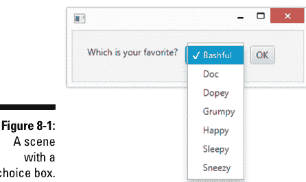

使用 `ChoiceBox` 类来创建选择框。表 8-1 列出了该类最频繁使用的构造函数和方法。

### 表 8-1 ChoiceBox 类的构造函数和方法

| 构造函数 | 描述 |
| :--- | :--- |
| `ChoiceBox<T>()` | 创建一个指定类型的空列表。 |
| `ChoiceBox<T>(ObservableList<T> items)` | 创建选择列表并用指定的值填充。 |

| 方法 | 描述 |
| :--- | :--- |
| `ObservableList<T> getItems()` | 获取列表。 |
| `void setItems(ObservableList<T> items)` | 设置列表。 |
| `T getValue()` | 返回当前选中项。 |
| `void setValue(T value)` | 设置当前选中项。 |
| `void show()` | 显示列表。 |
| `void hide()` | 隐藏列表。 |
| `boolean isShowing()` | 表示列表当前是否可见。 |

## 创建选择框

创建选择框很容易。`ChoiceBox` 类是泛型的，因此为关联的列表指定一个类型。例如：

```java
ChoiceBox<String> choice = new ChoiceBox<String>();
```

这里，创建了一个显示字符串的选择框。

下一步是向选择框添加项。你可以通过调用 `getItems` 方法访问项列表，然后调用 `add` 方法添加项：

```java
choice.getItems().add("Bashful");
choice.getItems().add("Doc");
choice.getItems().add("Dopey");
choice.getItems().add("Grumpy");
choice.getItems().add("Happy");
choice.getItems().add("Sleepy");
choice.getItems().add("Sneezy");
```

或者，你可以调用 `addAll` 方法一次性添加所有字符串，如：

```java
choice.getItems().addAll("Bashful", "Doc", "Dopey",
    "Grumpy", "Happy", "Sleepy",
    "Sneezy");
```


`getItems` 方法返回 `ObservableList` 对象，它提供了许多可以操作列表的方法。更多信息，请参见本章稍后的“与 ObservableList 工作”部分。

`ChoiceBox` 类还包含一个构造函数，允许你在创建选择框之前就添加一个 `ObservableList` 对象。你在本章的“与 ObservableList 工作”部分可以看到该构造函数的实际运行示例。


你可以向选择框添加任何种类型的对象。选择框会调用每个项的 `toString` 方法来确定在选择列表中显示的文本。假设你有一个名为 `Astronaut` 的类，代表太空任务中的宇航员：

```java
class Astronaut {
    private String firstName;
    private String lastName;

    public Astronaut(String firstName, String lastName) {
        this.firstName = firstName;
        this.lastName = lastName;
    }

    public String toString() {
        return firstName + " " + lastName;
    }
}
```

然后，你可以像下面这样创建一个列出阿波罗 13 号宇航员成员的选择框：

```java
ChoiceBox<Astronaut> apollo13 = new ChoiceBox<Astronaut>();
apollo13.getItems().add(new Astronaut("Jim", "Lovell"));
apollo13.getItems().add(new Astronaut("John", "Swigert"));
apollo13.getItems().add(new Astronaut("Fred", "Haise"));
```

如果你需要，你可以在用户点击选择框之前显示选择框的内容。要这样做，请调用 `show` 方法，如下：

```java
apollo13.show();
```

要隐藏列表，请调用 `hide` 方法：

```java
apollo13.hide();
```

## 设置默认值

默认情况下，选择框在第一次显示时没有初始选择。要设置初始值，请调用 `setValue` 方法，并传递你想要作为初始选择的列表对象。

如果选择框包含字符串，你可以通过向 `setValue` 方法传递所需的字符串值来设置初始值：

```java
choice.setValue("Dopey");
```

如果指定的字符串不在列表中，则初始值将保持未指定。

如果选择框包含对象（例如上一节所示的 `Astronaut` 对象），你必须传递一个想要设置为默认值的对象的引用。例如：

```java
Astronaut lovell = new Astronaut("Jim", "Lovell");
Astronaut swigert = new Astronaut("John", "Swigert");
Astronaut haise = new Astronaut("Fred", "Haise");
ChoiceBox<Astronaut> apollo13 = new ChoiceBox<Astronaut>();
apollo13.getItems().addAll(lovell, swigert, haise);
apollo13.setValue(lovell);
```

在这里，Jim Lovell 被设置为默认宇航员。

## 获取所选项目

你可以调用 `getValue` 方法来获取用户选择的项目。返回值的类型取决于你在创建选择框时指定的类型。例如，如果你指定了 `String` 类型，则 `getValue` 方法返回字符串。如果你为选择框指定了 `Astronaut` 类型，则 `getValue` 方法返回宇航员对象。

`getValue` 方法通常用于按钮的动作事件处理程序中。例如：

```java
public void btnOKClick() {
    String message = "You chose ";
    message += apollo13.getValue();
    MessageBox.show(message, "Your Favorite Astronaut");
}
```

此示例中使用的 `MessageBox` 类可以在第 4 章中找到。


## 使用可观察列表

正如你在上一节中看到的，`ChoiceBox` 类并不包含允许你直接从选择框显示的列表中添加或删除项目的方法。相反，它包含一个名为 `getItems` 的方法，该方法返回一个 `ObservableList` 类型的对象。该方法返回的对象是一个可观察列表；它代表了选择框显示的列表。

要处理选择框显示的项目，你必须先访问可观察列表，然后使用 `ObservableList` 类的方法来访问列表中的各个项目。

可观察列表不仅被 `ChoiceBox` 类使用，还被其他显示列表项目的控件类使用，例如 `ComboBox` 和 `ListView`，你可以在本章稍后的部分读到它们。这两个类也都具有返回 `ObservableList` 的 `getItems` 方法。

可观察列表还被布局窗格（如 `HBox` 和 `VBox`）使用，你可以在第 5 章中学习它们。所有布局类通用的 `getChildren` 方法都返回一个 `ObservableList`。

因此，在书中，我讨论了 `ObservableList` 接口的两个方法：`add` 和 `addAll`，它们允许你向可观察列表添加项目。这里是本章早些时候 `add` 方法示例：

```java
cbox.getItems().add("Bashful");
```


# 第 8 章：从列表中选择

## Observable Lists

这里是第 5 章的一个示例，它使用 `addAll` 方法将按钮添加到布局窗格中：

```java
pane.getChildren().addAll(btnOK, btnCancel);
```

`ObservableList` 接口除了 `add` 和 `addAll` 之外还有许多方法。表 8-2 显示了你可能常用的方法。

| 方法 | 描述 |
| --- | --- |
| `void add(E element)` | 将指定的元素添加到列表末尾。 |
| `void add(int index, E element)` | 将指定的对象添加到列表的指定索引位置。 |
| `void addAll(E...elements)` | 将所有指定的元素添加到列表末尾。 |
| `void addAll(Collection<E> c)` | 将指定集合的所有元素添加到列表末尾。 |
| `E set(int index, E elem)` | 将指定的元素设置到指定的索引。 |
| `void clear()` | 删除列表中的所有元素。 |
| `void remove(int fromIndex, int toIndex)` | 从列表中删除元素。 |
| `void removeAll(E...elements)` | 从列表中删除所有指定的元素。 |
| `boolean contains(Object elem)` | 返回列表中是否包含该对象。 |
| `E get(int index)` | 返回索引处的元素。 |
| `int indexOf(Object elem)` | 返回对象在列表中首次出现的索引。 |
| `boolean isEmpty()` | 返回列表是否为空。 |
| `E remove(int index)` | 删除索引处的元素并返回它。 |
| `boolean remove(Object elem)` | 从列表中删除对象；返回是否删除成功。 |
| `int size()` | 返回列表中元素的数量。 |
| `void addListener(ChangeListener listener)` | 添加一个在列表更改时调用的监听器。 |

如果你熟悉集合类（如 `ArrayList`），你可能会发现表 8-2 列出的许多方法都很熟悉。这是因为 `ObservableList` 继承了 `List` 接口，而 `ArrayList` 和 `Vector` 也实现了该接口。因此，任何适用于 `ArrayList` 的方法都可以适用于 `ObservableList`。

例如，你可以像清除 `ArrayList` 一样清除选择框的内容：

```java
cbox.getItems().clear();
```

如果你需要知道选择框中有多少项目，调用 `size` 方法：

```java
int count = cbox.getItems().size();
```

要从列表中删除特定项目，使用 `remove` 方法：

```java
cbox.getItems().remove("Grumpy");
```

无论字符串 "Grumpy" 是否在列表中，该方法都会执行。

你可以通过向 `addAll` 方法指定现有集合（如 `ArrayList`），轻松地将项目插入选择框。例如，假设你已经有一个名为 `list` 的包含你想显示的项目的数组列表。你可以这样添加项目：

```java
cbox.getItems().addAll(list);
```

你可能会奇怪为什么基于列表的 JavaFX 控件需要可观察列表。为什么不使用集合类呢？原因是为了高效工作，控件本身需要监控你对列表进行的任何更改，以便控件自动更新显示的项目。表 8-2 列出的最后一个方法（`addListener`）提供了这种功能，允许你添加一个在列表内容更改时调用的监听器。你很少直接调用此方法。但使用可观察列表的控件确实调用此方法来创建事件监听器，在列表内容更改时自动更新控件。

> **注意：** 当用户在选择框或其他列表控件中选择项目时，你不需要 `add` 方法来响应。相反，你使用一种名为*选择模型*的有趣结构来响应所选项目的变化，详见下一节。

## 监听选择变化

编写程序以便在用户更改选择框或其他列表控件的选择时立即做出响应，而不是等待你点击按钮提交数据，这并不罕见。例如，你可能有一个标签，希望在用户每次更改选择时都更新它的值。你可能还想根据选择显示或隐藏不同的控件。

遗憾的是，选择框和其他列表控件在用户更改选择时不会产生动作事件。因此，`ComboBox` 类没有 `setOnAction` 方法。相反，你必须使用一系列复杂的函数调用序列来设置不同类型的事件监听器，称为`更改监听器`。

操作序列如下：

1. 通过调用选择框上的 `selectionModel` 方法获取选择模型。

   `selectionModel` 方法返回控件的*选择模型*，它是一个管理用户如何从列表中选择项目的对象。选择模型是一个实现若干个扩展自抽象 `SelectionModel` 类的类之一。对于选择框，选择模型始终是 `SingleSelectionMode` 类型，它实现了一个允许用户一次选择一个项目的选择模型。

2. 通过调用选择模型上的 `selectedItemProperty` 获取 `selectedItem` 属性。

   `SelectionModel` 类有一个名为 `selectedItemProperty` 的方法，它用于访问名为 `selectedItem` 的属性，该属性代表当前选中的项目。（*属性*是一种特殊的 JavaFX 对象，我将在第 19 章中详细讨论。目前，只需假设属性是一个对象，其值可以被监听器监控，监听器会在属性值发生变化时被调用。）

3. 通过在 `selectedItem` 属性上调用 `addListener` 方法添加更改监听器。

   当 `selectedItem` 属性的值发生变化时，监听器会被调用。更改监听器执行一个名为 `ChangeListener` 的函数接口。因为 `ChangeListener` 是一个函数接口（即它仅有一个方法），你可以使用 Lambda 表达式来实现更改监听器。

你通常会在一个语句中完成所有这些步骤，如下例所示：

```java
choice.getSelectionModel().selectedItemProperty()
    .addListener((v, oldValue, newValue) -> 
        lbl.setText(newValue));
```

在前面的示例中，更改监听器将标签控件显示的值设置为用户选择的新值。

## 使用组合框

组合框是选择框控件更高级的兄弟控件。通过组合框你获得的主要改进包括：

- 组合框包含了在显示列表时限制项目数量的能力。如果列表中的项目数量超过限制，会自动添加滚动条，允许用户滚动整个列表。
- 组合框包含一个文本字段，允许用户直接输入值，而不是从列表中选择值。文本字段是可选的，默认不显示，但你可以通过单个方法调用来添加它。

图 8-2 显示了一个带有文本字段的组合框。

- 每当用户更改选择时，组合框都会触发一个事件。因此，与选择框相比，使用组合框设置事件处理器来响应用户的选择变化要简单。

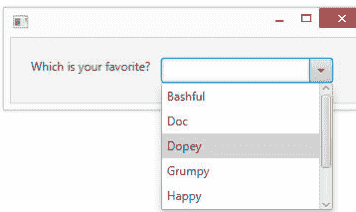

你使用 `ComboBox` 类来创建组合框。表 8-3 列出了该类最常用的构造函数和方法。

| 构造函数 | 描述 |
| --- | --- |
| `ComboBox<T>()` | 创建指定类型的空组合框。 |
| `ComboBox<T>(ObservableList<T> items)` | 创建组合框并用指定列表中的值填充它。 |

| 方法 | 描述 |
| --- | --- |
| `void setEditable(boolean value)` | 如果为 true，则显示文本字段允许用户直接编辑选择。 |
| `void setVisibleRowCount(int value)` | 设置显示的项目数量。 |
| `void setPromptText(String text)` | 设置初始显示在文本字段中的提示文本。 |
| `ObservableList<T> getItems()` | 获取项目列表。 |
| `void setItems(ObservableList<T> items)` | 设置项目列表。 |
| `T getValue()` | 返回当前选中的项目。 |
| `void setValue(T value)` | 设置当前选中的项目。 |
| `void show()` | 显示项目列表。 |
| `void hide()` | 隐藏项目列表。 |
| `void setOnAction(EventHandler<ActionEvent> handler)` | 设置在每次选择更改时调用的事件处理器。 |
| `boolean isShowing()` | 表示项目列表当前是否可见。 |

### 创建组合框

创建组合框与创建选择框非常相似。因为 `ComboBox` 是泛型的，请为它将包含的项目指定类型，如下例：

```java
ComboBox<String> cbox = new ComboBox<String>();
```

然后你可以使用 `getItems` 方法来访问包含组合框显示列表内容的 `ObservableList` 对象。例如，你可以这样向列表添加项目：

```java
cbox.getItems().addAll("Bashful", "Doc", "Dopey", "Grumpy", "Happy", "Sleepy", "Sneezy");
```

有关关于使用 `ObservableList` 的更多信息，请参阅本章前面的“Observable Lists”部分。

默认情况下，用户不允许编辑文本字段。如果你允许用户编辑文本字段，请使用 `setEditable` 方法，如下：

```java
cbo.setEditable(true);
```

如果你需要，可以通过调用 `setVisibleRowCount` 方法来限制列表显示的项目数量：

```java
cbo.setVisibleRowCount(10);
```

你还可以通过调用 `setPromptText` 方法指定显示在文本字段中的提示文本：

```java
cbo.setPromptText("Make a choice");
```

### 获取选中项目

要获取用户选择的项目，请使用 `getValue` 方法，就像选择框一样。你通常在按钮点击的事件处理器中这样做。例如：

```java
public void btnClick() {
    String message = "You chose ";
    message += cbo.getValue();
    MessageBox.show(message, "Your Choice");
}
```

示例中使用的 `MessageBox` 类可以在第 4 章找到。

请注意，`getValue` 方法返回的值可能不是组合框中的值之一。这是因为用户可以在编辑组合框的文本字段中输入任何想要的内容。如果你想知道用户是选择了一个项目，还是通过文本字段输入了不同的项目，请使用 `ObservableList` 类的 `contains` 方法：

```java
if (cbo.getItems().contains(cbo.getValue())) {
    MessageBox.show("You chose outside the box");
}
```

### 处理组合框事件

当用户从组合框选择项目时，会产生一个动作事件。在大多数应用程序中，我们简单地忽略此事件，因为通常不需要在用户选择项目时立即执行任何操作。相反，选中的项目会在用户点击按钮时处理。

如果你想在用户选择项目时提供即时反馈，可以通过调用组合框的 `setOnAction` 方法来设置事件处理器。在大多数情况下，最简单的方法是创建一个包含你在用户选择项目时想要执行的代码的方法，并通过 Lambda 表达式将此方法传递给 `setOnAction` 方法。

例如，下面的方法会在用户选择 Dopey 时显示一个显示“He's my favorite too!”的消息框：

```java
public void cboChanged() {
    if (cbo.getValue().equals("Dopey")) {
        MessageBox.show("He's my favorite too!", "Good Choice!");
    }
}
```

以下是当用户更改组合框选择时调用此方法的代码：

```java
cbo.setOnAction(e -> cboChanged());
```

## 使用列表视图

列表视图是一个强大的 JavaFX 控件，用于在框内显示对象列表。根据列表的配置方式，用户可以选择列表中的一个项或多个项。此外，你对列表项的显示方式拥有极强的控制力。图 8-3 显示了一个包含列表视图的示例场景。

> 图 8-3：列表视图控件。

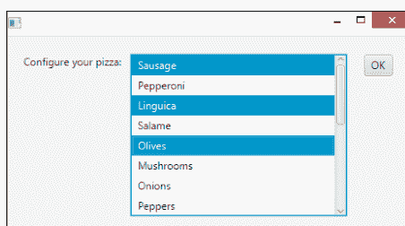

列表视图和组合框之间有几个重要的区别：

- 列表视图没有允许用户编辑所选项目的文本字段。相反，用户必须直接从列表视图选择项目。
- 列表视图不会下拉。相反，列表项会在你可以指定的框框大小内显示。
- 列表视图中的项可以垂直排列（默认）或水平排列。图 8-4 显示了一个水平列表框。
- 列表视图允许用户选择多个项。默认情况下，列表视图只允许选择一个项，但你可以轻松将其配置为允许多项选择。

要在列表中选择多个项，按住 Ctrl 键并点击你想要选择的项目。要选择一个范围的项目，点击第一个项目，按住 Shift 键，然后点击最后一个项目。


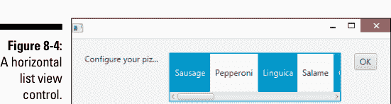

你使用 `ListView` 类来创建列表视图控件。表 8-4 列出了该类最常用的构造函数和方法。

| 构造函数 | 描述 |
| --- | --- |
| `ListView<T>()` | 创建指定类型的空列表 |
| `ListView<T>(ObservableList<T> items)` | 创建列表视图并用指定列表中的值填充它 |

| 方法 | 描述 |
| --- | --- |
| `ObservableList<T> getItems()` | 获取项目列表 |
| `void setItems(ObservableList<T> items)` | 设置项目列表 |
| `void setOrientation(Orientation o)` | 设置列表的方向。方向可以是 `Orientation.HORIZONTAL`（水平）或 `VERTICAL`（垂直） |
| `MultipleSelectionModel<T> getSelectionModel()` | 返回列表视图控件的选择模型。你可以使用选择模型通过调用 `getSelectedItems` 方法来获取已选项目的可观察列表。你也可以通过调用 `getSelectedItem` 获取最近选择的项。 |

### 创建列表视图

创建列表视图控件与创建组合框类似。以下示例创建了图 8-3 所示的列表视图：

```java
ListView<String> list = new ListView<>();
list.getItems().addAll("Sausage", "Pepperoni",
    "Linguica", "Salame", "Olives", "Mushrooms",
    "Onions", "Peppers", "Pineapple", "Spinach",
    "Canadian Bacon", "Tomatoes", "Kiwi",
    "Anchovies", "Gummy Bears");
```

注意，图 8-3 显示的列表视图仅显示列表中的前八项。与组合框一样，如果集合中的项目总数无法完全显示，列表视图会自动添加滚动条。

默认情况下，列表视图控件仅允许单项选择。要允许多项选择，请添加此行：

```java
list.getSelectionModel().setSelectionMode(SelectionMode.MULTIPLE);
```

要将列表视图水平排列而非垂直排列，请添加此行：

```java
list.setOrientation(Orientation.HORIZONTAL);
```

### 获取所选项目

从列表视图控件获取所选项目有点复杂。首先，你必须通过调用 `getSelectionModel()` 获取选择模型对象。然后，调用选择模型的 `getSelectedItems` 方法。这会返回一个仅包含已选项目的只读列表。

以下示例构建了一个字符串，列出了图 8-3 所示的披萨配料列表视图中，用户选择的所有项：

```java
String tops = "";
ObservableList<String> toppings;
toppings = list.getSelectionModel().getSelectedItems();
for (String topping : toppings) {
    tops += topping + "\n";
}
```

在前面的示例中，`tops` 字符串将包含用户选择的所有配料，并用换行符分隔。


## 使用树视图

树视图是一种高级 JavaFX 控件，以大纲形式显示层次级数据，计算机将其称为树。树形结构在计算机世界非常常见。你的磁盘驱动器的文件夹结构是一棵树，JavaFX 场景图也是。

图 8-5 显示了一个包含树视图控件的 JavaFX 场景。在这个示例中，我使用树控件来表示我喜爱的几部剧集，以及它们衍生出的剧。

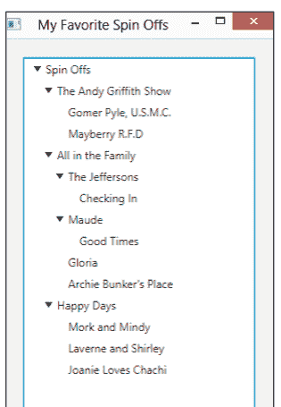

图 8-5：一个树视图控件。

### 树术语

在进入如何创建树的机制之前，你需要了解一些描述树的术语：

- **节点**：树中的每个元素。
- **根节点**：树的起始节点。
- **子节点**：位于节点下方的节点。
- **父节点**：位于节点上方的节点。
- **兄弟节点**：具有相同父节点的节点。
- **叶子节点**：没有子节点的节点。
- **路径**：包含所有祖先节点——直到根——的路径。
- **展开节点**：子项可见的节点。
- **折叠节点**：子项隐藏的节点。

## 构建树

在实际创建树视图之前，你必须先构建树。为了这一点，请使用 `TreeItem` 类，我在表 8-5 中详细介绍。

### 表 8-5 TreeItem 类

| 构造函数 | 描述 |
| --- | --- |
| `TreeItem()` | 创建空节点 |
| `TreeItem(T value)` | 创建具有指定值的树节点 |

| 方法 | 描述 |
| --- | --- |
| `T getValue()` | 返回树项的值 |
| `void setValue(T value)` | 设置树项的值 |
| `ObservableList getChildren()` | 返回表示此树项子节点的可观测列表 |
| `TreeItem getParent()` | 获取节点的父节点 |
| `void setExpanded(boolean expanded)` | 指定为 `true` 以展开节点 |
| `boolean isExpanded()` | 返回布尔值表示树项是否已展开 |
| `boolean isLeaf()` | 返回布尔值表示树项是否为叶子节点（即没有子节点），无法展开 |
| `TreeItem nextSibling()` | 返回此树项的下一个兄弟。如果没有下一个兄弟，则返回 `null` |
| `TreeItem prevSibling()` | 返回此树项的上一个兄弟。如果没有上一个兄弟，则返回 `null` |

`TreeItem` 类为每个节点提供了三个基本特征：

- **值**：包含节点代表的数据。在示例中，我使用字符串作为用户对象，但你可以使用任何类型的对象作为用户对象。树控件会调用用户对象的 `toString()` 方法来确定每个节点显示的文本。设置用户对象最简单的方法是通过 `TreeItem` 构造函数传递它。
- **父节点**：除非该节点恰好是根节点。
- **子节点**：表示为 `ObservableList`。

如果节点恰好是叶子节点，则列表将为空。你可以使用 `ObservableList` 接口中熟悉的方法来创建或检索子节点。更多信息，请参阅本章前面的“使用可观测列表”部分。

### 示例：电视剧衍生剧树

在本节中，我将构建一棵树，展示了过去三部热门电视节的衍生剧：

- 《安迪·格里菲斯秀》，它有两个部衍生剧：*《戈默·派尔，海军陆战队》* 和 *《梅贝诊所》*。
- 《家庭一切》，它直接产生了衍生剧：*《杰斐逊一家》*、*《莫德》*、*《格洛丽》* 以及 *《阿奇·邦克的地方》*。
  此外，这两部衍生剧也有自己的涉及女佣的衍生剧：*《杰斐逊一家》*的女佣成为了短命剧集《入住》的主题，而*《莫德》*的女佣则成为了《美好时光》的主角。
- 《快乐时光》，它衍生出了*《莫克与米迪》*、*《莱弗恩与莎莉》* 以及 *《乔妮爱查奇》*。

你可以采取许多方法来构建树，其中大多数涉及递归编程。为了保持简单，我在本节中将避免递归编程，但这意味着你必须将树的一些细节硬编码到程序中。大多数处理树的实际程序都需要某种类型的递归编程来构建树。

创建树的第一步是为每个非叶子节点声明一个 `TreeItem` 变量。对于我的电视剧示例，我从以下代码开始：

```java
TreeItem<String> andy, archie, happy, george, maude;
```

这些变量可以作为 `start()` 方法中的局部变量，因为一旦构建好树，就不再需要这些变量了。稍后我们会看看为什么不需要为叶子节点变量。

接下来，我创建根节点并将其展开状态设置为 `true`，以便它在树初始显示时就是展开的：

```java
TreeItem<String> root = new TreeItem<>("Spin Offs*");
root.setExpanded(true);
```

为了简化创建所有节点，我使用了以下辅助方法 `makeShow()`：

```java
public TreeItem<String> makeShow(String title, TreeItem<String> parent) {
    TreeItem<String> show = new TreeItem<>(title);
    show.setExpanded(true);
    parent.getChildren().add(show);
    return show;
}
```

此方法接受一个字符串和另一个节点作为参数，并返回一个用户对象设置为该字符串参数的节点。返回的节点也被添加到父节点中，并且该节点被展开。因此，你可以调用此方法创建一个新节点并将其放入树中。

下一步是创建节点。继续我的示例，我从为《安迪·格里菲斯秀》及其衍生剧创建节点开始：

```java
andy = makeShow("The Andy Griffith Show", root);
makeShow("Gomer Pyle, U.S.M.C.", andy);
makeShow("Mayberry R.F.D.", andy);
```

在这里，调用 `makeShow()` 是为《安迪·格里菲斯秀》创建一个节点，并指定根节点为其父节点。此方法返回的节点保存在 `andy` 变量中。然后调用两次 `makeShow()` 来创建衍生剧，这次指定 `andy` 为父节点。

由于*《戈默·派尔，海军陆战队》*和*《梅贝诊所》*都没有衍生剧（的衍生剧），因此我不需要将这些节点作为参数传递给 `makeShow()` 方法。这就是为什么我没有费心创建一个变量来引用这些节点。

在示例的下一步中，我为《家庭一切》及其衍生剧创建节点：

```java
archie = makeShow("All in the Family", root);
george = makeShow("The Jeffersons", archie);
makeShow("Checking In", george);
maude = makeShow("Maude", archie);
makeShow("Good Times", maude);
makeShow("Gloria", archie);
makeShow("Archie Bunker's Place", archie);
```

在这种情况下，《杰斐逊一家》和《莫德》拥有自己的子节点。因此，这两个节目需要变量，以便当我创建《入住》和《美好时光》的节点时，可以将它们作为父参数传递给 `makeShow()`。

最后，这里是创建《快乐时光》及其衍生剧节点的代码：

```java
happy = makeShow("Happy Days", root);
makeShow("Mork and Mindy", happy);
makeShow("Laverne and Shirley", happy);
makeShow("Joanie Loves Chachi", happy);
```

整棵树已在内存中成功创建，因此我可以继续创建 `TreeView` 控件来展示这棵树。

## 创建 TreeView 控件

你使用 `TreeView` 类来创建一个显示树节点的树组件。表 8-6 显示了该类的关键构造函数和方法。

### 表 8-6 TreeView 类

| 构造函数 | 描述 |
| --- | --- |
| `TreeView()` | 创建一个空树（如果你问我的话，这没什么用）。 |
| `TreeView(TreeItem root)` | 创建一个显示根节点的树。 |

| 方法 | 描述 |
| --- | --- |
| `TreeItem getRoot()` | 获取根节点 |
| `void setRoot(TreeItem root)` | 设置根节点 |
| `SelectionModel getSelection()` | 返回选择模型 |
| `void setShowRoot(boolean visible)` | 决定根是否可见。 |

## 获取选中的节点

有几种方法可以确定树中当前选择了哪些节点。一种方法是通过调用 `getSelectionModel()` 访问树的选择模型。然后，你可以调用选择模型的 `getSelectedItems()` 方法返回一个包含已选项目的只读观测列表。

例如：

```java
String msg = "";
ObservableList<TreeItem<String>> show =
    tree.getSelectionModel().getSelectedItems();
for (TreeItem<String> item : show) {
    msg += item.getValue() + "\n";
}
```

在前面的示例中，`msg` 字符串将包含用户选择的所有节目，用换行符分隔。

另一种方法是添加一个当选择变化时就会调用的事件处理器。你可以这样做：

```java
tree.getSelectionModel().selectedItemProperty()
    .addListener((v, oldValue, newValue) ->
        tree_SelectionChanged(newValue));
```

在这里，调用 `getSelectionModel()` 方法来获取选择模型。然后调用 `selectedItemProperty()` 来获取项目属性。最后，使用调用名为 `tree_SelectionChanged()` 方法的 Lambda 表达式为该属性创建一个监听器。新选择的值作为参数传递。

这里是 `tree_SelectionChanged()` 方法的样子：

```java
public void tree_SelectionChanged(TreeItem<String> item) {
    if (item != null) {
        lblShowName.setText(item.getValue());
    }
}
```

**注意：** 使用 `if` 语句确保项目不为空。这是必要的，因为如果用户取消选择某个项目，`tree_SelectionChanged()` 方法将带有 `null` 值作为项目参数被调用。


在这里，调用 `makeShow` 是为《安迪·格里菲斯秀》创建一个节点，并指定根节点为其父节点。此方法返回的节点保存在 `andy` 变量中。然后调用两次 `makeShow` 来创建衍生剧，这次指定 `andy` 为父节点。

由于《戈默·派尔，海军陆战队》和《梅贝诊所》都没有衍生剧，我不需要将这些节点作为参数传递给 `makeShow` 方法。这就是为什么我没有费心创建一个变量来引用这些节点。

在示例的下一步中，我为《家庭一切》及其衍生剧创建节点：

```java
archie = makeShow("All in the Family", root);
george = makeShow("The Jeffersons", george);
makeShow("Checking In", george);
maude = makeShow("Maude", archie);
makeShow("Good Times", maude);
makeShow("Gloria", archie);
makeShow("Archie Bunker's Place", archie);
```

在这种情况下，《杰斐逊一家》和《莫德》拥有自己的子节点。因此，这两个节目需要变量，以便当我创建《入住》和《美好时光》的节点时，可以将它们作为父参数传递给 `makeShow`。

最后，这里是创建《快乐时光》及其衍生剧节点的代码：

```java
happy = makeShow("Happy Days", root);
makeShow("Mork and Mindy", happy);
makeShow("Laverne and Shirley", happy);
makeShow("Joanie Loves Chachi", happy);
```

整棵树已在内存中成功创建，因此我可以继续创建 `TreeView` 控件来展示这棵树。

## 第 8 章：从列表中选择

### 列表 8-1：衍生剧程序

```java
import javafx.application.*;
import javafx.stage.*;
import javafx.scene.*;
import javafx.scene.layout.*;
import javafx.scene.control.*;
import javafx.geometry.*;

public class Spinoffs extends Application {
    public static void main(String[] args) {
        launch(args);
    }

    TreeView<String> tree;
    Label lblShowName;

    @Override
    public void start(Stage primaryStage) {
        TreeItem<String> root = new TreeItem<>("衍生剧");
        root.setExpanded(true);

        andy = makeShow("The Andy Griffith Show", root);
        makeShow("Gomer Pyle, U.S.M.C.", andy);
        maude = makeShow("Ma Mayberry R.F.D.", andy);

        archie = makeShow("All in the Family", root);
        george = makeShow("The Jeffersons", archie);
        makeShow("Checking In", george);
        makeShow("Maude", archie);
        makeShow("Good Times", maude);
        makeShow("Gloria", archie);
        makeShow("Andy Bunker's Place", archie);

        happy = makeShow("Happy Days", root);
        makeShow("Mark and Mandy", happy);
        makeShow("Laverne and Shirley", happy);
        makeShow("Joanie Loves Chachi", happy);

        tree = new TreeView<>(root);
        tree.getSelectionModel().selectedItemProperty()
            .addListener((v, oldValue, newValue) ->
                treeSelectionChanged(newValue));
    }
}
```

（续）

### 列表 8-1（续）

```java
lblShowName = new Label();

VBox pane = new VBox(10);
pane.setPadding(new Insets(20,20,20,20));
pane.getChildren().add(tree, lblShowName);

Scene scene = new Scene(scene);

primaryStage.setScene(scene);
primaryStage.setTitle("我喜欢的衍生剧*");
primaryStage.show();

public TreeItem<String> makeShow(String title,
    TreeItem<String> parent) {
    TreeItem<String> show = new TreeItem<String>(title);
    show.setExpanded(true);
    parent.getChildren().add(show);
    return show;
}

public void selectionChanged(TreeItem<String> item) {
    if (item != null) {
        lblShowName.setText(item.getValue());
    }
}
```

此程序中的所有代码在本章中已经展示过，我仅在此指出其中的重点：

- 树模型和列表模型被定义为类实例变量。
- 为根节点以及每个有衍生剧的节目定义了 `TreeItem` 变量。
- 根节点带有文本“衍生剧（Spin-Offs）”。
- 这些行为 *The Andy Griffith Show* 及其衍生剧创建了节点。
- 这些行为 *All in the Family* 及其衍生剧创建了节点。
- →39: 这些行为 *Happy Days* 及其衍生剧创建了节点。
- →44: 这一行创建了 `TextView` 控件，指定根为树的根节点。下一行隐藏了根节点。
- →46: 这一行为选中项属性创建了事件监听器。Lambda 表达式每当 `TextView` 控件的选择状态改变时，就会调用名为 `tree_SelectionChanged` 的方法。
- →54: `TextView` 控件和标签被添加到 `VBox` 布局面板中，然后在阶段显示之前之前将其添加到场景中。
- →64: `makeShow` 方法根据字符串创建节点，并将该节点添加到作为父参数传递的节点中。
- →73: 每当选中节点发生变化时，就会调用 `tree_SelectionChanged` 方法。只要传递的 `TreeItem` 不为空，它就会在 `lblShowName` 标签中显示所选节目的标题。

## 第 9 章

## 表格操作

**本章内容**

- 使用 `TableView` 控件创建行和列
- 使用 `TableColumn` 类对数据的每列进行格式化
- 为 `TableView` 构建简单的项目列表
- 编辑 `TableView` 控件的内容

JavaFX 表格是 JavaFX 最灵活、最强大的控件之一；它允许你以类似于电子表格的格式显示数据，数据行对齐在整齐的列中。会自动提供水平和垂直滚动，并且你可以配置表格控件允许用户编辑表格单元格的内容。

在本章中，你将发现几个协作工作创建表格的类。首先是 `TableView` 类，它在场景中渲染表格。它由一个或多个使用 `TableColumn` 类创建的列组成。因此，要创建一个表格，你必须先使用 `TableColumn` 类创建一个或多个表格列，然后使用 `TableView` 类创建表格，最后将列添加到表格中。

由于表格控件本质上绑定到底层的项目列表，本章首先展示了如何创建支持表格的项目列表。本章使用的示例数据是一个列出每个项目的 DVD 收藏。

## 188 第二部分：JavaFX 控件

列表 9-1 (续)

```java
public String getTitle() -> 21
{
    return this.title;
}

public void setTitle(String title) -> 26
{
    this.title = title;
}

public int getYear() -> 31
{
    return this.year;
}

public void setYear(int year) -> 36
{
    this.year = year;
}

public double getPrice() -> 41
{
    return this.price;
}

public void setPrice(double price) -> 46
{
    this.price = price;
}
```

该类的代码非常直观，我在这里只需指出几个重点：

- 3: 这些私有类字段在内部用于存储每部电影的标题、年份和价格。
- 7: 默认构造函数创建了一个没有数据的 `Movie` 对象。
- 14: 此构造函数允许用户指定电影标题和价格的数据。
- 21: `getTitle` 方法获取标题属性的值。
- 26: `setTitle` 方法设置标题属性的值。
- 31: `getYear` 方法获取年份属性的值。
- 36: `setYear` 方法设置年份属性的值。
- 41: `getPrice` 方法获取该属性的值。
- 46: `setPrice` 方法设置价格属性的值。

使用这个类，你可以轻松地创建一个 `Movie` 对象：

```java
Movie m = new Movie("The King's Speech", 2010, 19.95);
```

或者，如果你愿意，也可以这样做：

```java
Movie m = new Movie();
m.setTitle("The King's Speech");
m.setYear(2010);
m.setPrice(19.95);
```

在创建 `Movie` 对象后，你必须将其添加到 `ObservableList` 中，该列表可以作为 `TableView` 的项目列表。最简单的方法是先创建 `TableView`，并使用它的 `getItems` 方法访问观测列表：

```java
TableView<Movie> table = new TableView<Movie>();
table.getItems().add(m);
```

注意 `TableView` 是一个泛型类，因此在创建它时指定数据类型。

在实际项目中，表格显示的数据几乎肯定来自文件或数据库。因此，你需要编写 Java 代码从文件或数据库中读取数据，为每条记录创建一个对象，并将该记录添加到列表中。你可能需要将此代码隔离到一个名为 `loadData` 之类的的独立方法中。然后，你可以将观测列表作为参数传递。

从文件或数据库读取数据超出了本书的范围，但如果你想知道如何实现，可以翻阅我的书《Java All-One For Dummies, 4th Edition》（John Wiley & Sons 出版）。该书包含了读取和写入各种类型文件及数据库中数据的示例程序。

目前，请依靠以下方法为表格加载数据：

```java
public void loadData(ObservableList<Movie> data) {
    data.add(new Movie("It's a Wonderful Life", 1946, 14.95));
    data.add(new Movie("Young Frankenstein", 1974, 16.95));
    data.add(new Movie("Star Wars Episode 4", 1976, 17.95));
    data.add(new Movie("The Princess Bride", 1987, 16.95));
    data.add(new Movie("Glory", 1986, 14.95));
    data.add(new Movie("The Game", 1997, 14.95));
    data.add(new Movie("Shakespeare in Love", 1998, 19.95));
    data.add(new Movie("The Invention of Lying", 2009, 18.95));
    data.add(new Movie("The King's Speech", 2010, 19.95));
}
```

然后，你可以在需要将数据加载到表格时随时调用此方法。

如果你愿意，可以在不先创建 `TableView` 的情况下创建一个 `ObservableList` 对象。JavaFX 提供了 `FXCollections`，它包含可以创建各种类型观测列表的静态方法。最常见的是数组列表（array list），它只是由 `ArrayList` 支撑的观测列表。这里的示例展示了如何在创建一个观测数组列表的方法中使用它，填充电影数据，并将观测数组列表返回给调用者：


```java
public ObservableList<Movie> loadData() {
    ObservableList<Movie> data = FXCollections.observableArrayList();
    data.add(new Movie("It's a Wonderful Life", 1946, 14.95));
    data.add(new Movie("Young Frankenstein", 1974, 16.95));
    data.add(new Movie("Star Wars Episode 4", 1976, 17.95));
    data.add(new Movie("The Princess Bride", 1987, 16.95));
    data.add(new Movie("Glory", 1986, 14.95));
    data.add(new Movie("The Game", 1997, 14.95));
    data.add(new Movie("Shakespeare in Love", 1998, 19.95));
    data.add(new Movie("The Invention of Lying", 2009, 18.95));
    data.add(new Movie("The King's Speech", 2010, 19.95));
    return data;
}
```

然后，你可以这样调用 `setItems` 方法来加载数据：

```java
TableView<Movie> table = new TableView<Movie>();
table.setItems(loadData());
```

## 创建只读表格

现在已经知道如何为表格创建底层数据，现在是有趣的部分了。在本节中，我们将展示如何创建一个简单的只读表格，每部电影显示一行数据，并为标题、年份和价格设置单独列。图 9-1 显示了你想要的表格。

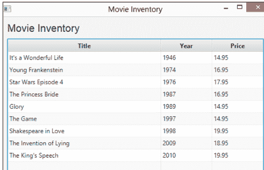

图 9-1：简单的只读表格。

## 192 第二部分：JavaFX 控件

创建此表格需要两个主要类：`TableView`，代表整个表格；`TableColumn`，代表单独列。接下来的两个章节将展示如何使用 `TableColumn` 类来创建列（如图 9-1 所示），然后使用 `TableView` 将列组合成表格。之后，你会看到创建表格的程序源码。

## 使用 TableColumn 类

`TableColumn` 类代表表格中的单列。此类允许将列绑定到表格项目中的属性，从而从正确的属性获取单元格值。表 9-2 列出了该类最重要的构造函数和方法。

### 表 9-2 TableColumn 类

| 构造函数 / 方法 | 描述 |
| :--- | :--- |
| `TableColumn<S, T>()` | 创建一个空列。类型 S 对应于 `TableView` 及其 `ObservableList`。类型 T 表示列中显示的数据类型。 |
| `TableColumn<S, T>(String heading)` | 创建具有指定标题文本的空列。 |
| `void setMinWidth(double width)` | 设置列的最小宽度。表格列可能会为了显示数据而扩展宽度。 |
| `void setMaxWidth(double width)` | 设置列的最大宽度。 |
| `void setPrefWidth(double width)` | 设置列的优选宽度。 |
| `void setText(String title)` | 设置标题文本。 |


| void setSortable(boolean sortable) | 如果为 true，用户可以对此列进行排序。（默认是 true。） |

| void setCellValueFactory(FactoryBean f) | 指定提供此列单元格值的工厂类。通常指定为 `PropertyValueFactory` 的实例。 |

## 第 9 章：操作表格

要创建一个表格列，首先调用构造函数。通常在调用构造函数时要指定出现在列标题中的文本。你需要为表格列指定两个类型。第一个与表格本身相关的类型，也是项目集合相关的类型。在本章的示例中，该类型是 `Movie`，因为表格将从 `Movie` 对象的观测列表中显示数据。

第二个类型将显示在该列中的属性的数据类型。对于 Title 属性，该类型是 `String`，标题列的构造函数为：

```java
TableColumn<Movie, String> colTitle = new TableColumn<Movie, String>("Title");
```

你还想这样设置列的宽度：

```java
colTitle.setMinWidth(300);
```

在这里，列的宽度至少为 300 像素。这足够显示大多数电影标题。

接下来，你需要将表格项目集合中的属性与列关联。要做到这一点，调用 `cellFactory` 方法并提供一个单元格工厂。单元格工厂是一种特殊的对象类型，为表格列提供单元格值。提供单元格工厂简单的方法是使用 `PropertyValueFactory` 类，它允许创建一个返回表格项目集合中命名属性的单元格工厂。

以下是实现该功能的代码：

```java
colTitle.setCellValueFactory(new PropertyValueFactory<Movie, String>("title"));
```

此语句调用了 `PropertyValueFactory` 类的构造函数，指定 `Movie` 为从名称（Title）检索的对象类型，`String` 为属性的值类型，并将属性名（Title）作为构造函数的参数。该语句的最终效果是属性值工厂将调用 `Movie` 类的 `getTitle` 方法来填充此列的单元格。

为了清晰起见我简化了表 9-2 中 `setCellValueFactory` 方法的签名。实际签名是：

```java
void setCellValueFactory(Callback<TableColumn.CellDataFeatures<S,T>, ObservableValue<Object>> valueFactory);
```


## 194 第二部分：JavaFX 控件

呼！真是一乱。这意味着单元格值工厂（cell value factory）必须实现具有正确数据类型的 `Callback` 接口。`PropertyFactory` 类专为 `setCellValueFactory` 方法设计，因此它确实实现了 `Callback` 接口。

创建另外两列的代码与使用字符串略有不同，分别带有整数和双精度数值。以下是创建年份（Year）列的代码：

```java
TableColumn<Movie, Integer> colYear = tableColumn("Year");
colYear.setMinWidth(100);
colYear.setCellValueFactory(PropertyValueFactory<Movie, Integer>("Year"));
```

这是创建价格（Price）列的代码：

```java
TableColumn<Movie, Double> colPrice = tableColumn("Price");
colPrice.setMinWidth(100);
colPrice.setCellValueFactory(PropertyValueFactory<Movie, Double>("Price"));
```

注意，在这两种情况下，T 类型指定了包装类 `Integer` 和 `Double`，而不是原始的 `int` 和 `double` 类型。

## 使用 TableView 类

创建完表格列后，下一步是创建一个表格并将列添加到表格中。要实现这一点，请使用 `TableView` 类，在表 9-3 中进行了讨论。

创建一个表格视图控件需要几个步骤，这些步骤不一定按此顺序执行：

- 调用 `TableView` 构造函数创建表格视图控件。
- 将表格列添加到表格视图中。
- 最简单的方法是调用 `getColumns` 方法，它返回作为观测列表（observable list）的列列表。然后使用 `addAll` 方法添加列。
- 将数据添加到 `items` 列表中。

我在前面的章节“创建表格数据”中讨论了实现这些点的几种方法。

### 表 9-3 TableView 类

| 构造函数 | 说明 |
| --- | --- |
| `TableView<S>()` | 创建一个新的表格视图。类型 S 指定了 `items` 列表中包含的对象的类型。 |
| `TableValue<S>(ObservableList list)` | 使用指定的列表作为 `items` 列表创建一个新的表格视图。 |

| 方法 | 说明 |
| --- | --- |
| `ObservableList getColumns()` | 获取由表格显示的列列表。 |
| `ObservableList getItems()` | 获取作为表格数据源的项列表。 |
| `void setItems(ObservableList list)` | 设置作为表格数据源的项列表。 |
| `TableSelectionModel getSelectionModel()` | 获取选择模型，允许你处理用户选中的行。 |

以下是针对你在本章中查看的示例完成这些步骤的一种方法：

```java
TableView<Movie> table = new TableView<Movie>();
table.getColumns().add(colTitle, colYear, colPrice);
table.setItems(loadData());
```

这里使用的 `loadData` 方法是在前面的章节“创建表格数据”中展示的那个方法。它返回一个包含要显示的 `Movie` 对象的 `ObservableList`。

你也可以通过将 `loadData` 方法传递给 `TableView` 构造函数，在一个语句中创建表格并加载数据，如下：

```java
TableView<Movie> table = new TableView<Movie>(loadData());
```

在创建表格并添加列和数据项后，你可以通过将表格添加到布局窗格（layout pane）、将窗格添加到场景（scene），然后用场景设置舞台（stage）并显示舞台，在场景中显示表格。接下来的章节将展示一个精确执行此操作完整程序代码。


## 创建只读表格的程序

列表 9-2 显示了创建一个只读 `TableView` 控件的程序的完整源代码。该程序显示的场景在之前的图 9-1 中显示过。（注意：要运行此程序，需要列表 9-1 所示的 `Movie` 类存在于同一个文件夹中。）

### 列表 9-2：MovieInventoryProgram

```java
import javafx.application.*;
import javafx.stage.*;
import javafx.scene.*;
import javafx.scene.control.*;
import javafx.scene.layout.*;
import javafx.scene.text.*;
import javafx.scene.control.cell.*;
import javafx.collections.*;
import javafx.geometry.*;

public class MovieInventory extends Application {
    public static void main(String[] args) {
        launch(args);
    }

    @Override public void start(Stage primaryStage) {
        Label lblHeading = new Label("Movie Inventory");
        lblHeading.setFont(new Font("Arial", 20));
        TableView<Movie> table = new TableView<Movie>();
        table.getItems(loadData());
        TableColumn<Movie, String> colTitle = new TableColumn("Title");
        colTitle.setMinWidth(300);
        colTitle.setCellValueFactory(new PropertyValueFactory<Movie, String>("Title"));
        TableColumn<Movie, Integer> colYear = new TableColumn("Year");
        colYear.setMinWidth(100);
        colYear.setCellValueFactory(new PropertyValueFactory<Movie, Integer>("Year"));
        TableColumn<Movie, Double> colPrice = new TableColumn("Price");
        colPrice.setMinWidth(100);
        colPrice.setCellValueFactory(new PropertyValueFactory<Movie, Double>("Price"));

        table.getColumns().addAll(colTitle, colYear, colPrice);

        VBox mainPane = new VBox();
        mainPane.setSpacing(10);
        mainPane.setPadding(new Insets(10));
        mainPane.getChildren().addAll(lblHeading, table);

        Scene scene = new Scene(mainPane);
        primaryStage.setScene(scene);
        primaryStage.setTitle("Movie Inventory");
        primaryStage.show();
    }

    public ObservableList<Movie> loadData() {
        ObservableList<Movie> data = FXCollections.observableArrayList();
        data.add(new Movie("It's a Wonderful Life", 1946));
        data.add(new Movie("Young Frankenstein", 1974));
        data.add(new Movie("Star Wars Episode 4", 1977));
        data.add(new Movie("The Princess Bride", 1987));
        data.add(new Movie("Glory", 1989));
        data.add(new Movie("The Game", 1997));
        data.add(new Movie("Shakespeare in Love", 1998));
        data.add(new Movie("The Invention of Lying", 2005));
        data.add(new Movie("The King's Speech", 2010));
        return data;
    }
}
```

## 198 第二部分：JavaFX 控件

我已经展示并解释了该程序的大部分代码，所以我在这里指出几个要点：

- 第 20 行：这两行创建了位于视图上方的标签。
- 第 23 行：此行调用 `TableView` 构造函数创建一个新的 `TableView`，指定数据类型为 `Movie`。
- 第 24 行：通过调用 `loadData` 方法创建项列表，该方法位于第 53 行。
- 第 26 行：这两行创建了第一列，显示 `Title` 属性。列的宽度设置为最小 300 像素。
- 第 31 行：这两行创建了第二列，显示 `Year` 属性。最小宽度设置为 100 像素。
- 第 36 行：这两行创建了第三列，显示 `Price` 属性。该列的最小宽度也设置为 100 像素。
- 第 40 行：将三列添加到表格视图控件中。
- 第 42 行：创建一个 `VBox` 布局窗格，并将标题标签和表格控件添加到其中。
- 第 47 行：构建并显示场景和舞台。
- 第 53 行：`loadData` 方法创建项列表，并加载了九部电影的数据。该方法的返回值被用作表格视图的项列表。

# 创建可编辑表格

现在你已经知道如何创建只读表格，下一步是添加添加和删除行的功能，或者编辑现有行中的单元格。接下来的章节将向你如何操作。

## 添加表格行

为了允许用户添加行，你需要提供用户可以在其中输入数据的文本框，以及一个用户可以点击以使用用户输入的数据创建新行的添加按钮。在按钮的 `OnAction` 事件中，你只需使用用户输入到文本字段的数据创建一个新对象，然后将该对象添加到表格的项集合中。

假设你已经创建了文本字段 `txtTitle`、`txtYear`，这里有一个你可以从添加（Add）按钮的事件处理程序调用的方法，用于向 `items` 集合中添加新的 `Movie` 项：

```java
public void btnAdd_Clicked() {
    Movie m = new Movie();
    m.setTitle(txtTitle.getText());
    m.setYear(Integer.parseInt(txtYear.getText()));
    m.setPrice(Double.parseDouble(txtPrice.getText()));
    table.getItems().add(m);
    txtTitle.clear();
    txtYear.clear();
    txtPrice.clear();
}
```

该方法首先创建一个 `Movie` 对象，并将 `Title`、`Year` 和 `Price` 属性设置为用户输入的值。然后，该方法将新的 `Movie` 对象添加到 `items` 集合中。最后，方法清空了三个文本框。

注意，使用了 `Integer` 和 `Double` 包装类的 `parse` 方法将文本字段中输入的字符串值转换为有效的整数和双数值。遗憾的是，这些方法没有包含任何合理的数据验证；如果用户输入的值无法转换为整数或双数值，`parse` 方法将抛出异常，而此方法并没有处理该异常。这留由你来考虑如何向此代码添加数据验证和错误信息。


## 删除表格行

从表格视图（table view）中删除项目只需要在场景中添加一个删除（Delete）按钮。用户可以通过选择该行然后按下删除按钮来删除一个或多行。这里是一个你可以从删除按钮的 `OnAction` 处理程序调用的方法：

```java
public void btnDelete_Clicked() {
    ObservableList<Movie> sel, items;
    items = table.getItems();
    sel = table.SelectionModel().getSelectedItems();
    for (Movie m : sel) {
        items.remove(m);
    }
}
```

## 200 第二部分：JavaFX 控件

该方法同时访问表格的 `items` 集合和表格选择模型的 `selectedItems` 集合。然后，使用 `for-each` 循环从 `items` 集合中删除 `selectedItems` 集合中的每一个项。

此方法没有验证用户是否真的想要删除这些行。在更真实的程序中，你可能希望先显示一个警告框（alert box），询问用户是否真的想删除这些行。只有当用户点击“是”时，你才删除这些行。


## 编辑表格单元格

要允许用户编辑单个表格单元格，你需要做三件事：

- 通过调用 `setEditable` 方法并传递 `true` 值将表格标记为可编辑。
- 为你想要允许用户编辑的每一列创建一个单元格工厂（cell factory）。
- 通过调用 `TableColumn` 类的 `setCellFactory` 方法来实现这一点。
- 添加一个在用户完成编辑表格单元格时被调用的事件监听器（event listener）。

该监听器负责根据用户输入的数据更新 `items` 集合。

要允许编辑某列的内容，你必须为该列设置单元格工厂。单元格工厂是一个渲染单元格内容的对象。默认情况下，单元格工厂将单元格内容渲染为文本对象。为了进行编辑，请提供一个将内容渲染为文本字段的单元格工厂。

在表格列中创建文本字段的最简单方法是使用 `TextFieldTableCell`。该类包含一个名为 `forTableColumn` 的静态方法，该方法返回一个适用于用文本框编辑数据的单元格工厂。以下是它的使用方法：

```java
colTitle.setCellFactory(TextFieldTableCell.forTableColumn());
```

## 第 9 章：操作表格


就是这么简单。设置单元格工厂后，每当用户点击它，单元格就会变成一个文本字段。用户随后可以编辑文本字段中的数据。当用户按下 `Enter` 或 `Tab` 键或点击字段外部时，文本字段将再次替换为简单的文本对象。

剩下的问题是，尽管单元格工厂允许用户通过文本字段编辑单元格的内容，但单元格工厂并没有自动更新表格的 `items` 集合以反映用户编辑单元格时可能做的任何更改。要做到这一点，必须设置一个在用户完成编辑单元格时响应的动作监听器（action listener）。然后，在该监听器中，你可以更新 `items` 集合。

这里是使用 Lambda 表达式为 `onEditCommit` 事件设置监听器的方法：

```java
colTitle.setOnEditCommit(e -> colTitle_OnEditCommit(e));
```

在这个示例中，每当用户完成表格列中单元格内容的编辑时，`colTitle_OnEditCommit` 方法就会被调用。

编写 `OnEditCommit` 事件的事件处理程序有点棘手。`OnEditCommit` 事件会生成一个 `CellEditEvent` 类型的对象，该对象包含了你在事件处理程序中需要访问的重要信息。表 9-4 列出了该类的方法。

| 方法 | 说明 |
| --- | --- |
| `T getCellValue()` | 获取用户输入的新值。 |
| `T getOldValue()` | 获取上一个值。 |
| `S getRowValue()` | 获取行对象。 |
| `TableColumn<S, T> getColumn()` | 获取发生此事件的列。 |
| `TableView<S> getTableView()` | 获取使用列表的表格视图。 |

## 204 第二部分：JavaFX 控件

# 列表 9-3 表（续）

```java
private TableView<Movie> table;
TextField txtTitle, txtYear, txtPrice;

@Override public void start(Stage primaryStage) {

    Label lbl1Heading = new Label("Movie Inventory");
    lblHeading.setFont(new Font("Arial", 20));

    table = new TableView<Movie>();
    table.setEditable(true);
    table.setItems(loadData());

    TableColumn colTitle = new TableColumn("Title");
    colTitle.setFixedWidth(300);
    colTitle.setCellValueFactory(
        new PropertyValueFactory<Movie, String>("Title"));
    TextFieldTableCell.forTableColumn(colTitle);
    colTitle.setOnEditCommit((e) -> colTitle.onEditCommit(e));

    TableColumn colYear = new TableColumn("Year");
    colYear.setFixedWidth(100);
    colYear.setCellValueFactory(
        new PropertyValueFactory<Movie, Integer>("Year"));
    TextFieldTableCell.forTableColumn(colYear,
        new IntegerStringConverter());
    colYear.setOnEditCommit((e) -> colYear.onEditCommit(e));

    TableColumn colPrice = new TableColumn("Price");
    colPrice.setFixedWidth(100);
    colPrice.setCellValueFactory(
        new PropertyValueFactory<Movie, Double>("Price"));
    colPrice.setCellFactory(
        TextFieldTableCell.forTableColumn(colPrice,
        new DoubleStringConverter());
    colPrice.setOnEditCommit((e) -> colPrice.onEditCommit(e));

    table.getColumns().addAll(colTitle, colYear, colPrice);

    txtTitle = new TextField();
    txtTitle.setPromptText("Title");
    txtTitle.setMinWidth(100);

    txtYear = new TextField();
    txtYear.setMaxWidth(100);
    txtYear.setPromptText("Year");
```

# 第 9 章：处理表格 205

```java
txtPrice = new TextField();
txtPrice.setMaxWidth(100);
txtPrice.setPromptText("Price");
```

```java
btnAdd = new Button("Add");
btnAdd.setMinWidth(60);
btnAdd.setOnAction(e -> btnAdd_Clicked() );
```

```java
btnDelete = new Button("Delete");
btnDelete.setMinWidth(60);
btnDelete.setOnAction(e -> btnDelete_Clicked() );
```

```java
Hbox paneAdd = new HBox();
paneAdd.setSpacing(8);
paneAdd.getChildren().addAll(txtTitle, txtYear, txtPrice, btnAdd, btnDelete);
```

```java
Vbox paneMain = new VBox();
paneMain.setSpacing(10);
paneMain.set(new Insets(10, 10, 10, 10));
paneMain.getChildren().addAll(lblHeading, table, paneAdd);
```

```java
Scene scene = new Scene(paneMain);
```

```java
primaryStage.setScene(scene);
primaryStage.setTitle("Movie Inventory");
primaryStage.show();
```

```java
public ObservableList<Movie> loadData() {

    ObservableList<Movie> data = FXCollections.observableArrayList();

    data.add(new Movie("It's a Wonderful Life", 1946, 19.95));
    data.add(new Movie("Young Frankenstein", 1974, 16.95));
    data.add(new Movie("Star Wars Episode 4", 1976, 17.95));
    data.add(new Movie("The Princess Bride", 1987, 16.95));
    data.add(new Movie("Glory", 1989, 14.95));
    data.add(new Movie("The Game", 1997, 14.95));
    data.add(new Movie("Shakespeare in Love", 1998, 19.95));
}
```

（续）

# 206 第二部分：JavaFX 控件

## 列表 9-3（续）

```java
    data.add(new Movie("The Invention of Lying", 2009, 18.95));
    data.add(new Movie("The King's Speech", 2010, 19.95));
    return data;
}

public void colTitle_OnCommit(Event e) {
    TableColumn.CellEditEvent<Movie, String> ce = (TableColumn.CellEditEvent<Movie, String>) e;
    Movie m = ce.getRowValue();
    m.setTitle(ce.getNewValue());
}
```

→125

```java
public void colYear_OnCommit(Event e) {
    TableColumn.CellEditEvent<Movie, Integer> ce = (TableColumn.CellEditEvent<Movie, Integer>) e;
    Movie m = ce.getRowValue();
    m.setYear(ce.getNewValue());
}
```

→133

```java
public void colPrice_OnCommit(Event e) {
    TableColumn.CellEditEvent<Movie, Double> ce = (TableColumn.CellEditEvent<Movie, Double>) e;
    Movie m = ce.getRowValue();
    m.setPrice(ce.getNewValue());
}
```

→141

```java
public void btnAdd_Clicked() {
    Movie m = new Movie();
    m.setTitle(txtTitle.getText());
    m.setYear(Integer.parseInt(txtYear.getText()));
    m.setPrice(Double.parseDouble(txtPrice.getText()));
    table.getItems().add(m);
    txtTitle.clear();
    txtYear.clear();
    txtPrice.clear();
}
```

→149

```java
public void btnDelete_Clicked() {
    ObservableList<Movie> sel, items;
    items = table.getItems();
    sel = table.selectionModel().getSelectedItems();

    for (Movie m : sel) {
        items.remove(m);
在 9-3 的基础上：

- 37：为 Title 列设置单元工厂。
- 39：为 Title 列设置编辑提交监听器。
- 45：为 Year 列设置单元工厂。
- 48：为 Year 列设置编辑提交监听器。
- 54：为 Price 列设置单元工厂。
- 57：为 Price 列设置编辑提交监听器。
- 61：创建 Title 文本框。
- 65：创建 Year 文本框。
- 69：创建 Price 文本框。
- 73：创建 Add 按钮。
- 77：创建 Delete 按钮。
- 81：创建一个 HBox 布局，并将文本框和按钮添加其中。

## 208 第二部分：JavaFX 控件

- 125：当用户提交 Title 列的编辑时，调用 `colTitle_OnCommit`。它更新 Movie 对象的标题。
- 133：当用户提交 Year 列的编辑时，调用 `colYear_OnCommit`。它更新 Movie 对象的年份。
- 141：当用户提交 Price 列的编辑时，调用 `colPrice_OnCommit`。它更新 Movie 对象的价格。
- 149：当点击 Add 按钮时，调用 `btnAdd_Clicked`。该方法根据文本框的内容创建一个新的 Movie 对象并将其添加到列表中，并清空文本框。
- 161：当点击 Delete 按钮时，调用 `btnDelete_Clicked`。它从选择模型获取选中的列表，然后使用该列表从列表中移除所有选中的项目。

## 第 10 章：制作菜单

## 本章内容

- 创建基本和动态菜单
- 使用分隔符和监听器
- 使用复选框和单选按钮构建菜单

在本章中，你将学习为程序添加菜单。由于你在应用程序中经常处理菜单，你可能已经熟悉菜单是什么以及它们是如何工作的。我不会在本章回顾这些基础知识，而是直接进入创建菜单并将其添加到场景的细节。

# 创建菜单的类介绍

- `Menu`：该类是菜单栏菜单的顶级容器。
- 菜单栏中的每个菜单都由一个 `Menu` 对象表示。如图 10-1 所示，菜单栏有两个 `Menu` 对象：分别对应游戏 菜单和选项 菜单。一个 `Menu` 对象包含一组在用户点击菜单时显示的 `MenuItem` 对象。
- `MenuItem`：菜单项由 `MenuItem` 类或其子类表示。图 10-1 所示的游戏 菜单有四个 `MenuItem` 对象：新游戏、暂停游戏、退出游戏和退出。它还包含一个 `SeparatorMenuItem` 对象；`SeparatorMenuItem` 是 `MenuItem` 类的子类。

## 210 第二部分：JavaFX 控件

有趣的是，`Menu` 类实际上是 `MenuItem` 的子类。这意味着菜单的菜单项集合可以包含其他子菜单。当用户点击子菜单时，子菜单的菜单项集合就会显示出来。

- `CheckMenuItem`：这种特殊的菜单项关联有一个复选框。虽然它们在图 10-1 中没有显示，但 Options 菜单包含两个 `CheckMenuItem` 对象。该类继承自 `MenuItem`。
- `RadioMenuItem`：这种特殊的菜单项关联有一个单选按钮。`RadioMenuItem` 类继承自 `MenuItem`。
- `CustomMenuItem`：自定义菜单可以关联任何 JavaFX 对象。通过自定义菜单项，你可以向菜单中添加控件，例如文本字段或列表框。
- `SeparatorMenuItem`：分隔符菜单项只是在菜单中显示一条分割线。你使用该类在菜单中创建视觉分组。

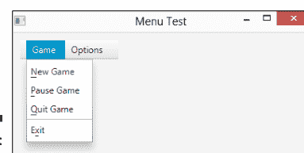

图 10-1:
带有菜单栏的场景。

## 创建基础菜单栏

创建菜单的基础非常直观。首先，通过调用 `MenuBar` 构造函数来创建一个菜单栏：

```java
MenuBar menuBar = new MenuBar();
```

## 第 10 章：制作菜单

然后，你创建一个或多个菜单并将它们添加到菜单栏中。完成菜单栏后，就像添加任何其他节点一样将其添加到布局面板：

```java
pane.getChildren().add(menuBar);
```

供你参考，表 10-1 列出了 `MenuBar` 类最有用的构造函数和方法。

| 表 10-1 | MenuBar 类 |
| --- | --- |
| 构造函数 | 说明 |
| `MenuBar()` | 创建一个菜单栏。 |
| 方法 | 说明 |
| `ObservableList getMenus()` | 返回此菜单栏中包含的菜单列表。你可以使用 `ObservableList` 接口的任何方法从菜单栏中添加或删除菜单。 |

## 创建菜单

要创建每个菜单，你需要使用 `Menu` 和 `MenuItem` 类，我将在本章接两个表格中讨论它们的构造函数和方法。从调用 `Menu` 构造函数并为菜单命名开始：

```java
Menu menuGame = new Menu("_Game");
```

在这里，文本字符串中的下划线标记了用户可以在不接触鼠标的情况下获取菜单的助记快捷键。在这种情况下，字母 G 是助记符。

助记字符允许你在按住 `Alt` 键的同时按下该助记字符来打开菜单。当用户按下 `Alt` 键时，所有可见的助记字符将带有下划线，以便用户确定哪些字符是助记符。

表 10-2 列出了供你参考的 `Menu` 类最重要的构造函数和方法。

## 212 第二部分：JavaFX 控件

| 表 10-2 | Menu 类 |
| --- | --- |
| 构造函数 | 说明 |
| `Menu (String name)` | 创建一个指定名称的菜单。 |
| 方法 | 说明 |
| `ObservableList getItems()` | 返回表示此菜单菜单项的 `ObservableList` 集合。你可以使用 `ObservableList` 接口的任何方法添加或删除菜单项。 |
| `String getText()` |  |
| `void setText(String text)` |  |

## 创建菜单项

创建菜单后，下一步是创建菜单项并将它们添加到菜单中。要创建菜单项，只需调用 `MenuItem` 构造函数，并将要显示的文本作为参数传递：

```java
MenuItem menuItemNewGame = new MenuItem("_New Game");
```

再次，下划线标识了菜单项的助记快捷键。因此，用户可以通过按 `Alt+N` 选择此菜单项。

要为菜单添加事件处理器，请使用 `setOnAction` 方法。例如：


# MenuItem 类

`menuItemNewGame.setOnAction(e -> StartNewGame());`

在这里，当用户选择 New 菜单项时，将调用 `StartNewGame` 方法。

这里有一个短序列，创建了图 10-1 所示的四个菜单项，并为每个项分配了事件处理器：

```java
MenuItem menuItemNewGame = new MenuItem("*New Game");
menuItemNewGame.setOnAction(e -> StartNewGame());

MenuItem menuItemPause = new MenuItem("*Pause Game");
menuItemPause.setOnAction(e -> PauseGame());

MenuItem menuQuitGame = new MenuItem("* Quit Game");
menuQuitGame.setOnAction(e -> QuitGame());

MenuItem menuExit = new MenuItem("* Exit");
menuExit.setOnAction(e -> ExitProgram());
```

创建好菜单项后，你可以像这样将它们添加到菜单中：

```java
menu.getChildren().add(menuNewGame);
menu.getChildren().add(menuItemPause);
menu.getChildren().add(menuQuitGame);
menu.getChildren().add(menuExit);
```

或者，你可以使用 `addAll` 方法一次性添加所有菜单项：

```java
menu.getChildren().addAll(menuNewGame, menuItemPause, menuItemQuitGame, menuItemExit);
```

表 10-3 列出了 `MenuItem` 类的一些构造函数和方法，以备你快速查阅。

| 表 10-3 | 说明 |
| --- | --- |
| 构造函数 `MenuItem(String name)` | 创建一个指定名称的菜单项。 |
| 方法 | 说明 |
| `String getText()` | 获取菜单项的文本。 |
| `void setText(String text)` | 设置菜单项的文本。 |
| `boolean isEnabled()` | 如果菜单项已启用则返回 true。 |
| `void setDisable()` | 禁用菜单项。 |
| `void setEnable(boolean value)` | 启用菜单项。 |
| `void setOnAction(EventHandler<ActionEvent> value)` | 设置调用的事件处理器。 |

## 使用分隔符

*分隔符*是一种在菜单内部创建视觉分割的菜单项。要创建分隔符，你使用 `SeparatorMenuItem` 类。通常，你将分隔符添加到菜单：

```java
menuGame.getChildren().add(new SeparatorMenuItem());
```

## 使用监听器

菜单项在被选择时产生生成事件。使用此监听器，通过 Lambda 表达式将其传递给退出项的 `setOnAction` 方法，如下：

```java
menuItemExit.setOnAction(e -> menuItemAction());
```

如果你喜欢，可以在 `setOnAction` 方法中直接调用 `stage.close()`，从而消除单独的方法：

```java
exitItem.setOnAction(e -> stage.close());
```

然而，我更倾向于为每个菜单项创建单独的方法。这种做法更容易添加代码。

处理菜单中所有菜单项事件的常用方法。你需要在调用 `setOnAction` 方法时通过 Lambda 表达式将 `ActionEvent` 对象传递给事件处理器，例如：

```java
menuItemExit.setOnAction(e -> menuAction(e));
```

然后 `menuAction` 方法可以使用嵌套的 `if` 语句来确定用户选择了哪个菜单项，例如：

```java
public void menuAction(ActionEvent e) {
    if (e.getSource() == newItem) {
        newGame();
    } else if (e.getSource() == pauseItem) {
        pauseGame();
    } else if (e.getSource() == quitItem) {
        quitGame();
    }
    // 等此类推
}
```

> 这是一个你在研究如何使用菜单时可能需要的事件监听器。该事件监听器在用户选择菜单命令时，简单地将每个菜单项的文本显示在控制台上。这样，你就可以确保你正确设置了菜单和事件监听器：

```java
public void menuAction(ActionEvent e) {
    MenuItem item = (MenuItem) e.getSource();
    System.out.println(item.getText());
}
```

## 创建动态变化的菜单

在许多应用程序中，菜单项会随着程序的运行而发生变化。某些项在特定情况下可能会禁用，且菜单项的文本可能会根据命令可能使用的上下文而改变。

例如，你可能希望当用户暂停游戏时，“游戏”菜单中的“暂停游戏”菜单项变为“恢复游戏”。当用户恢复游戏时，该菜单项恢复为“暂停游戏”。你可以通过多种方式实现这一目标。最简单的方法是直接检查菜单项中的文本。如果文本是 *Pause Game*，则将其更改为 *Resume Game*；然后再改回 *Pause Game*。以下是实现该功能的代码片段：

```java
if (menuPauseGame.getText().equals("_Pause Game")) {
    menuPauseGame.setText("_Resume Game");
} else {
    menuPauseGame.setText("_Pause Game");
}
```

在实际程序中，这段代码还会负责暂停和恢复游戏。

根据程序运行的情况来启用或禁用菜单项也是常见的做法。假设你不希望用户在游戏暂停时退出游戏。在这种情况下，当用户选择“暂停游戏”时禁用“退出游戏”菜单项，当用户选择“恢复游戏”时启用它，如下：

```java
if (menuPauseGame.getText().equals("_Pause Game")) {
    menuPauseGame.setText("_Resume Game");
    menuQuitGame.setDisable(true);
} else {
    menuPauseGame.setText("_Pause Game");
    menuQuitGame.setDisable(false);
}
```

## 使用复选和单选菜单项

复选菜单项（Check menu item）类似于复选框的菜单项，用户可以点击它勾选或取消选中。复选菜单项适用于允许用户选择程序选项。

单选菜单项（Radio menu item）与复选菜单项相似，但它可以与其他单选菜单项分组，就像单选按钮一样。在一组单选菜单项中，一次只能选择其中一项。因此，当用户点击一个单选菜单项时，同组中的其他单选项会自动取消选中。

图 10-2 显示了一个包含两个复选菜单项和三个单选项的“选项”菜单。使用分隔符将复选项与单选项隔开。

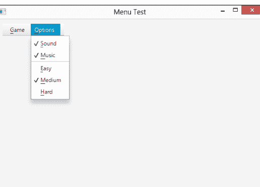

图 10-2: 包含复选和单选菜单项的菜单。

要创建复选菜单项，请使用 `CheckMenuItem` 类，其构造函数和方法如表 10-4 所示。该类继承自 `MenuItem` 类，因此大部分方法都是相同的。

| 表 10-4 CheckMenuItem 类 |
| --- |
| 构造函数 | 描述 |
| `CheckMenuItem(String name)` | 创建一个指定名称的复选菜单项。 |
| 方法 | 描述 |
| `boolean isSelected()` | 如果项被选中则返回 true。 |
| `void setSelected(boolean value)` | 指定为 true 以勾选项，或为 false 以取消取消。 |
| `String getText()` | 获取菜单项的文本。 |
| `void setText(String text)` | 设置菜单项的文本。 |
| `boolean isDisable()` | 如果菜单项被禁用则返回 true。 |
| `void setDisable()` | 禁用菜单项。 |
| `void setDisable(boolean value)` | 如果 value 为 true，则禁用菜单项。否则，启用菜单项。 |
| `setOnChange(EventHandler<ActionEvent> value)` | 设置当用户选择此菜单项时调用的动作事件处理器。 |

初始状态，复选菜单项是未选中的。如果你希望该项的默认设置为勾选状态，请调用 `setSelected` 方法，如下：

```java
menuItemMusic.setSelected(true);
```

要测试复选菜单项的状态，在示例中你使用了 `isSelected` 方法：

```java
if (menuItemMusic.isSelected() == true) {
    System.out.println("Your mamma can't dance.");
} else {
    System.out.println("Your daddy can't rock and roll.");
}
```

这里控制台上会显示两个不同的消息，取决于 `menuItem` 菜单项复选框的设置。

要创建单选菜单项，请使用表 10-5 所示的 `RadioMenuItem` 类。

| 表 10-5 RadioMenuItem 类 |
| --- |
| 构造函数 | 描述 |
| `RadioMenuItem(String name)` | 创建一个指定名称的单选菜单项 |
| 方法 | 描述 |
| `void setGroup(ToggleGroup group)` | 将此单选菜单项分配到切换组 |
| `ToggleGroup getGroup()` | 获取此单选菜单项所属的切换组 |
| `boolean isSelected()` | 如果项被勾选则返回 true |
| `void setSelected(boolean value)` | 指定为 true 以勾选项，或为 false 以取消取消 |
| `String getText()` | 获取菜单项文本 |
| `void setText(String text)` | 设置菜单项的文本 |
| `boolean isDisabled()` | 如果菜单项被禁用则返回 true |
| `void setDisable()` | 禁用菜单项 |
| `void setDisable(boolean value)` | 如果 value 为 true，则禁用菜单项。否则，启用菜单项 |
| `setOnAction(EventHandler<ActionEvent> value)` | 设置当用户选择此菜单项时调用的动作事件处理器 |

如你所示，`RadioMenuItem` 与 `CheckMenuItem` 类相同。唯一的区别是增加了 `setGroup` 方法，它允许将单选菜单项添加到切换组。

```java
ToggleGroup group = new ToggleGroup();
RadioMenuItem item1 = new RadioMenuItem("Option 1");
item1.setGroup(group);
RadioMenuItem item2 = new RadioMenuItem("Option 2");
item2.setGroup(group);
```

```java
if (group != null) {
    item1.setSelected(true);
    item2.setSelected(false);
}
```

## 子菜单

子菜单是嵌套菜单。`Menu` 类是 `MenuItem` 的子类，这意味着你可以将菜单添加到另一个菜单中。图 10-3 显示了这种操作。子菜单可以根据需要嵌套任意深度。例如，你可以在子菜单中创建子菜单。

```java
Menu menu = new Menu("File");
Menu submenu = new Menu("Edit");
MenuItem item = new MenuItem("Copy");
submenu.getItems().add(item);
menu.getItems().add(submenu);
```

要创建子菜单，请使用 `Menu` 类并使用 `getItems()` 方法将其添加到另一个菜单中。

图 10-3: 带有子菜单的菜单。

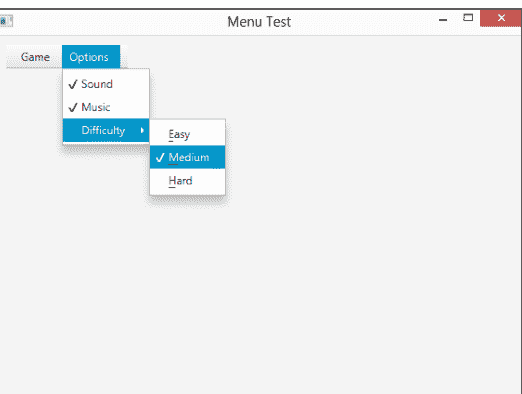

为了避免这种情况，你可以调用 `setHideOnClick` 方法并传入 `false` 作为其参数。这将抑制点击隐藏的行为，允许用户点击自定义菜单项以对其进行选择。然后，用户就可以在字段中输入数据了。注意：你也可以通过类构造函数来设置点击隐藏的行为。

以下示例展示了如何创建一个文本自定义菜单项并将其添加到菜单中：

```java
TextField txtName = new TextField();
txtName.setPromptText("Player Name");
CustomMenuItem menuItemName = new CustomMenuItem(txtName);
menuItemName.setHideOnClick(false);
menuOptions.getItems().add(menuItemName);
```


# 第三部分：增强你的场景设计

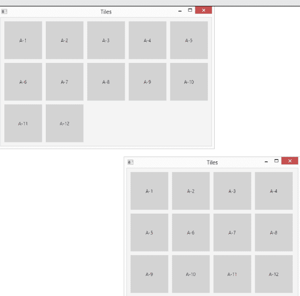

访问 `www.dummies.com/extras/javafx` 获取优质 Dummies 在线内容。

## 本部分内容

- 排列元素
- 管理主题和样式表
- 自定义形状
- 让形状看起来更真实
- 访问 `www.dummies.com/extras/javafx` 获取优质 Dummies 在线内容。

# 第11章：关于用于精确场景设计的布局面板

## 本章内容

- 使用另外四种布局面板创建壮观的布局
- 引入矩形形状
- 为布局添加滚动条
- 创建两个完整的程序

在第5章中，你可以读到如何使用四种基础布局面板类，它们允许你控制场景中控件的排列：`HBox` 水平排列节点；`VBox` 垂直排列节点；`FlowPane` 以及 `BorderPane` 将场景分为五个区域：顶部、右侧、底部、左侧和中间。

在本章中，你将发现另外四种布局面板，它们为你提供了排列场景中元素的其他方法。具体而言，你将学习到如何使用以下五个面板类：

- **`StackPane`**：`StackPane` 类与其他布局面板有所不同，因为它不会在视觉上将节点隔离开。相反，它将节点直接堆叠在彼此之上。例如，如果你向堆叠面板中添加一个矩形形状和一个文本形状，文本将直接显示在矩形上方。

- **`AnchorPane`**：这种布局允许你将节点锚定在面板的顶部、右侧、底部或左侧。当面板调整大小时，节点会重新定位，但仍保持连接在它们的锚点上。注意：一个节点可以锚定在多个位置。例如，你可以将一个节点锚定在顶部和右侧。然后，当你调整面板大小时，该节点将保持在面板的右上角附近。

- **`GridPane`**：在行列组成的网格中排列节点。网格不需要像棋盘那样具有统一的大小。相反，每列的宽度和每行的高度可以根据其内容而变化。此外，内容可以跨列或跨行。`GridPane` 是用于从用户界面控件（如文本框、列表框等）收集信息的表单理想布局类型。

- **`TilePane`**：如果你想要类似于棋盘的布局（即网格中的每个单元格大小相同），那么 `TilePane` 就是你寻找的布局面板。`TilePane` 是组织图像文件缩略图或其他相同对象的理想选择。

- **`ScrollPane`**：从技术上讲，`ScrollPane` 类根本不是布局面板；它继承自 `Control` 类，而不是 `Pane` 类。然而，它的主要用途是创建由于太大而无法一次全部显示的布局，因此需要滚动条允许用户向左向右、向上或向下（或两者）滚动查看所有内容。

请记住，布局面板通常组合使用以为场景创建完整的布局。例如，你可能使用 `GridPane` 来组织用户输入控件，然后将 `GridPane` 放在 `BorderPane` 的中间，使其置于场景中心。或者，你可能使用 `VBox` 在图像缩略图下方显示标签，然后将 `VBox` 添加到 `TilePane` 以便平铺排列显示带标签图像。

## 使用 StackPane 布局

堆叠面板布局的特殊之处在于，它不是通过分散节点来让你看到所有节点。相反，它将节点堆叠在另一个上面使它们重叠。你首先添加到堆叠面板的节点位于堆栈底部；最后添加的节点位于顶部。

你通常会将堆叠面板布局用于形状而非控件。因为我还没有介绍形状，所以我将本节的示例限制为用 `Rectangle` 类创建的简单矩形。你可以在第13章中阅读更多关于该类的信息。现在，只需意识到你可以创建一个这样的矩形：

```
Rectangle r1 = new Rectangle(100,100);
```

要添加填充颜色，调用 `setFill` 方法，如下：

```
r1.setFill(Color.RED);
```

`Color` 类定义了许多常用颜色的常量。在本节中，你将使用：`LIGHTGRAY`、`DARKGRAY` 和 `DIMGRAY`。


`Rectangle` 类位于 `javafx.scene.shape`，`Color` 类位于 `javafx.scene.paint`。因此，你需要包含以下语句来使用它们：

```
import javafx.scene.shape.*;
import javafx.scene.paint.*;
```

要创建一个堆叠面板，首先是要放入面板的节点，然后调用 `StackPane` 构造函数并传入参数。例如：

```
Rectangle r1 = new Rectangle(100,100);
r1.setFill(Color.DARKGRAY);
Rectangle r2 = new Rectangle(50,50);
r2.setFill(Color.LIGHTGRAY);
StackPane stack = new StackPane(r1, r2);
```

在这里，我首先创建了两个矩形，一个是100x100，另一个是50x50。较大的矩形填充为深灰色，较小的为浅灰色。然后，我创建一个持有这两个矩形的堆叠面板。图11-1显示了该面板显示的样子。你可以看到较小的矩形显示在较大的矩形内部。

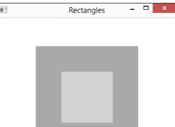
图11-1：在 StackPane 中显示的两个矩形。

### 表11-1：StackPane 构造函数和方法

如果你愿意，可以调用 `getChildren` 方法向堆叠面板添加节点，如下：

```
stack.getChildren().add(r1);
stack.getChildren().add(r2);
```

或者如下：

```
stack.getChildren().addAll(r1,r2);
```

**注意**：向堆叠面板添加节点的顺序对子节点的显示方式有很大影响。例如，假设你反转两个矩形的顺序：

```
stack.getChildren().addAll(r2,r1);
```

默认情况下，堆叠面板中的对象彼此居中堆叠。你可以通过使用 `setAlignment` 方法更改这一点。该方法的参数类型为 `Pos`，与其它具有 `setAlignment` 方法的面板相同。如果你需要刷新 `Pos` 枚举，请翻到第5章的表5-5。这里有一个示例显示了三个大小不同的矩形在堆叠面板的顶端对齐：

```
Rectangle r1 = new Rectangle(400,150);
r1.setFill(Color.DARKGRAY);
Rectangle r2 = new Rectangle(200,440);
r2.setFill(Color.LIGHTGRAY);
Rectangle r3 = new Rectangle(150,150);
r3.setFill(Color.DIMGRAY);
StackPane stack = new StackPane(r1, r2, r3);
stack.setAlignment(Pos.TOP_CENTER);
```

图 11-2 显示了此窗格在场景中显示时的外观。

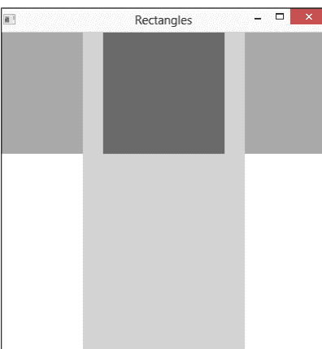
图 11-2：以顶部居中对齐方式显示的三个矩形。

与其他布局窗格一样，你可以使用 `setPadding` 方法在窗格的边缘周围添加内边距。例如，以下代码在窗格边缘周围创建了一个 50 像素的缓冲区：

```
stack.setPadding(new Insets(50));
```

`setPadding` 方法接受一个 `Insets` 类型的参数。有关关于 `Insets` 类的更多信息，请翻阅第 5 章中的表 5-2。

你还可以为 `StackPane` 中的单个节点添加外边距。要这样做，请调用 `setMargin` 方法，并传递节点以及描述外边距的 `Insets` 对象：

```
stack.setMargin(ri, new Insets(25));
```

## 使用 TilePane 布局

`TilePane` 布局与 `FlowPane` 布局类似：它以水平或垂直方向整齐的行和列排列节点。关键区别在于，在 `TilePane` 布局中，所有单元格的大小都是相同的。`TilePane` 布局计算其子节点集中最大节点的大小，然后用该大小作为每个单元格的大小。这创建了一种精美的网格状外观，如图 11-3 所示。

默认情况下，`TilePane` 每行显示五个节点，并使用尽可能多的行来显示所有节点。因此，图 11-3 中的 `TilePane` 将其 12 个矩形显示为两行五个矩形以及第三行仅两个矩形。

如果你调整了 `TilePane` 的大小，每行的节点数会自动调整。例如，图 11-4 显示了调整大小尺寸的相同 `TilePane`，使得 12 个矩形显示为三行每四个。

图 11-3：在 `TilePane` 中显示的12 个矩形。

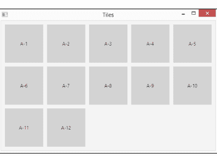

图 11-4：当窗格调整大小时，`TilePane` 会自动重新排列其瓦片。

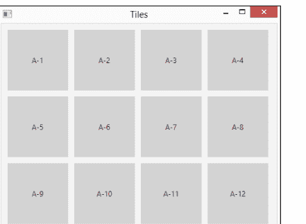

要创建一个 `TilePane`，你需要使用 `TilePane` 类，正如我在表 11-2 中描述的。

### 表 11-2：TilePane 构造函数和方法

| 构造函数 | 说明 |
| :--- | :--- |
| `TilePane()` | 创建一个空的 tile pane。 |
| `TilePane(Node... children)` | 创建一个具有指定子节点的 tile pane。 |
| `TilePane(double hgap, double vgap)` | 创建一个在行和列之间具有指定间隙的空 tile pane。 |
| `TilePane(Orientation orientation)` | 创建一个具有指定方向的 tile pane。`Orientation.HORIZONTAL` 或 `Orientation.VERTICAL`。 |
| `TilePane(double hgap, double vgap, Node... children)` | 创建一个具有指定间隙和子节点的 tile pane。 |
| `TilePane(Orientation orientation, double hgap, double vgap)` | 创建一个具有指定方向和间隙的 tile pane。 |
| `TilePane(Orientation orientation, Node... children)` | 创建一个具有指定方向和子节点的 tile pane。 |
| `TilePane(Orientation orientation, double hgap, double vgap, Node... children)` | 创建一个具有指定方向、间隙和子节点的 tile pane。 |

| 方法 | 描述 |
| :--- | :--- |
| `ObservableList<Node> getChildren()` | 返回添加到 tile pane 的所有子节点集合。该集合以 `ObservableList` 类型返回，其中包含 `add` 和 `addAll` 方法，允许向列表添加一个或多个节点。 |
| `void setHgap(double value)` | 设置列之间出现的间隙大小。 |
| `void setVgap(double value)` | 设置行之间出现的间隙大小。 |
| `void setOrientation(Orientation orientation)` | 设置方向。允许的值为 `Orientation.HORIZONTAL` 和 `Orientation.VERTICAL`。 |
| `void setPrefColumns(int value)` | 设置此 tile pane 优先的列数。 |
| `void setPrefRows(int value)` | 设置此 tile pane 优先的行数。 |
| `void setPrefTileWidth(double value)` | 设置每个单元格的优先宽度。 |
| `void setPrefTileHeight(double value)` | 设置每个单元格的优先高度。 |
| `static void setMargin(Node node, Insets value)` | 设置特定节点的外边距。参见第 5 章中的表 5-2 关于 `Insets` 类的解释。 |
| `void setMinHeight(double value)` | 设置 tile pane 的最小高度。 |
| `void setMaxHeight(double value)` | 设置 tile pane 的最大高度。 |
| `void setPrefHeight(double value)` | 设置 tile pane 的优先高度。 |
| `void setMinWidth(double value)` | 设置 tile pane 的最小宽度。 |
| `void setMaxWidth(double value)` | 设置 tile pane 的最大宽度。 |
| `void setPrefWidth(double value)` | 设置 tile pane 的优先宽度。 |
| `void setPadding(Insets value)` | 设置 tile pane 内部边缘的内边距。参见第 5 章中的 `Insets` 类。 |

以下是创建 tile pane 的代码：

```
TilePane tile1 = new TilePane();
tile1.setHgap(10);
tile1.setVgap(10);
tile1.setPadding(new Insets(10,10,10,10));
for (int i=0; i<12; i++) {
    Rectangle r = new Rectangle(100,100);
    r.setFill(Color.LIGHTGRAY);
    Label l = new Label("-" + i);
    StackPane s = new StackPane(r, l);
    tile1.getChildren().add(s);
}
```


## 使用 ScrollPane

当布局大于窗口时，你需要提供水平或垂直滚动条（或两者），以便用户可以看到所有瓷片。最简单的方法是使用 `ScrollPane`。如果布局比窗格高，会出现垂直滚动条；如果布局比窗格宽，会出现水平滚动条。

技术上讲，`ScrollPane` 继承自 `Control` 类，而不是 `Pane` 类。尽管如此，如果布局比窗格高，会出现垂直滚动条；如果布局比窗格宽，会出现水平滚动条。图 11-5 显示一个 `tile pane` 每行显示两个瓷片，并且垂直滚动条可见。为 `scroll pane` 设置外边距，我将 `scroll pane` 添加到 `stack pane` 中并对其设置外边距。

图 11-5：位于 scroll pane 内的 tile pane。

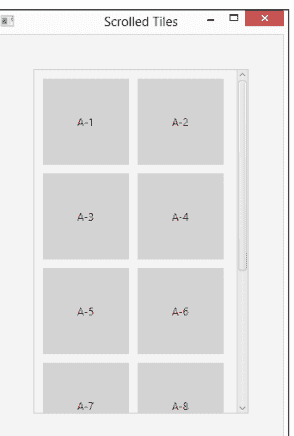

## 第 11 章：更多关于精确场景设计的布局面板

要创建一个 scroll pane，使用表 11-3 所示的 `ScrollPane` 类。

| 表 11-3 | ScrollPane 构造函数和方法 |
| :--- | :--- |
| **构造函数** | **描述** |
| `ScrollPane()` | 创建一个空的 scroll pane。 |
| `ScrollPane(Node node)` | 创建一个具有指定节点的 scroll pane。 |
| **方法** | **描述** |
| `void setContent(Node node)` | 设置包含在 scroll pane 内的节点。 |
| `void setHbarPolicy(ScrollPane.ScrollBarPolicy value)` | 设置水平滚动条的策略。 |
| `void setVbarPolicy(ScrollPane.ScrollBarPolicy value)` | 设置垂直滚动条的策略。 |
| `void setPannable(boolean value)` | 如果为 true，用户可以使用鼠标移动 scroll pane 的内容。默认值为 false。 |
| `void setMinHeight(double value)` | 设置 tile pane 的最小高度。 |
| `void setMaxHeight(double value)` | 设置 tile pane 的最大高度。 |
| `void setPrefHeight(double value)` | 设置 tile pane 的优先高度。 |
| `void setMinWidth(double value)` | 设置 tile pane 的最小宽度。 |
| `void setMaxWidth(double value)` | 设置 tile pane 的最大宽度。 |
| `void setPrefWidth(double value)` | 设置 tile pane 的优先宽度。 |
| `void setPadding(Insets value)` | 设置 tile pane 内部边缘的内边距。参见第 5 章中的表 5-2 关于 `Insets` 类的解释。 |

注意：以下方法的允许值显示在表的末尾。

| ScrollBarPolicy 枚举 | 描述 |
| :--- | :--- |
| `ScrollBarPolicy.ALWAYS` | 始终显示滚动条。 |
| `ScrollBarPolicy.NEVER` | 永远不显示滚动条。 |
| `ScrollBarPolicy.AS_NEEDED` | 仅需要时显示滚动条。 |

创建滚动面板（scroll pane）简单的方法是调用 `ScrollPane` 构造函数，并将你想要滚动的节点作为参数传递，如下所示：

```
ScrollPane span = new ScrollPane(tiled);
```

你可能还想为滚动面板设置尺寸约束。以下代码将宽度固定为 250，并允许布局决定高度，首选高度为 400：

```
pane.setMaxWidth(250);
pane.setMinWidth(250);
pane.setPrefWidth(250);
pane.setPrefHeight(400);
```

如果你需要，可以为垂直和水平滚动条设置策略。默认情况下，滚动条仅在需要时出现。如果你想让滚动条始终出现（即使在不需要时也是），请在此示例中将策略设置为 `ALWAYS`：

```
pane.setVBarPolicy(ScrollBarPolicy.ALWAYS);
```

用于创建图 11-5 所示滚动面板的完整程序位于列表 11-1 中。

### 列表 11-1：滚动瓦片程序

```
import javafx.application.*;
import javafx.stage.*;
import javafx.scene.*;
import javafx.scene.layout.*;
import javafx.scene.control.*;
import javafx.scene.shape.*;
import javafx.scene.paint.*;
import javafx.geometry.*;

public class ScrolledTile extends Application {

    public static void main(String[] args) {
        launch(args);
    }

    @Override
    public void start(Stage primaryStage) {
        TilePane tile1 = new TilePane();
        tile1.setHGap(10);
        tile1.setVGap(10);
        tile1.setPrefColumns(2);
        tile1.setPadding(new Insets(10, 10, 10, 10));

        for (int i = 1; i < 13; i++) {
            Rectangle r = new Rectangle(100, 100);
            r.setFill(Color.LIGHTGRAY);
            Label l = new Label("A-" + i);
            StackPane s = new StackPane(r, l);
            tile1.getChildren().add(s);
        }

        ScrollPane pane = new ScrollPane(tile1);
        pane.setMinWidth(250);
        pane.setPrefWidth(250);
        pane.setMaxWidth(250);
        pane.setPrefHeight(400);
        pane.setVBarPolicy(ScrollPane.ScrollPolicy.ALWAYS);

        StackPane stack = new StackPane(pane);
        stack.setMargin(pane, new Insets(40, 40, 40, 60));

        Scene scene = new Scene(stack);
        primaryStage.setScene(scene);
        primaryStage.setTitle("Scrolled Tile");
        primaryStage.show();
    }
}
```

接下来的段落描述了该程序的亮点：

- **第 20 行**：这一行以及随后的四行代码创建了瓦片面板（tile pane），设置水平和垂直间隙为 10 像素，设置首选宽度两列，并设置了内边距（padding）。
- **第 25 行**：使用 `for` 循环创建了 12 个带标签的矩形并将它们添加到瓦片面板中。
- **第 34 行**：这些行创建了滚动面板并设置了其尺寸。宽度固定为 250 像素。首选高度为 400 像素，但滚动面板的高度可以根据需要增长或缩小以填充场景。
- **第 39 行**：垂直滚动条将始终显示，即使不是必须。
- **第 41 行**：此处使用 `stack pane` 的唯一目的是为滚动面板周围提供 40 像素的外边距（margin）。
- **第 44 行**：将 `stack pane` 添加到场景，并完成场景的确定和显示。

## 使用 GridPane 布局

`GridPane` 网格布局管理器允许你在由行和列组成的网格中排列 GUI 元素。与 `tile pane` 不同，`grid pane` 的行和列大小不需要相同。相反，`grid pane` 布局会根据你添加到面板的组件自动调整每列的宽度和每行的高度。

`GridPane` 布局管理器具有以下一些重要特性：

- 你可以指定希望组件放置在哪个单元格中，并控制每个组件在面板中的位置。
- 你可以创建跨越多行或多列的组件，例如宽两列的按钮或高四行的列表框。
- 你可以告诉 `GridPane` 拉伸组件以填充分配给它的整个空间（如果组件尚未足够大填充整个区域）。你可以指定这种拉伸是水平的、垂直的还是两者的。
- 如果组件没有填充其分配的区域，你可以告诉 `grid pane` 实例你希望组件在区域内的定位方式——例如，左对齐或右对齐。

接下来的章节将描述使用 `grid pane` 布局的细节。

### 规划方案

在创建 `grid pane` 布局之前，先画一张草图，显示你希望组件在面板中出现的方式。将面板分割行和列，从左上角开始从零对行和列编号。

### 向网格布局面板填充节点

向网格布局面板（grid pane）填充节点的常用方法是为每个节点调用 `add` 方法。然而，如果你愿意，也可以通过单独调用 `addColumn` 或 `addRow` 来一次添加一整列或一行的节点。例如，本示例创建了一个标签（label）和一个文本字段（text field），然后创建一个网格布局面板并将标签和文本字段添加到第一行：

```
Label lblName = new Label("Name");
txtName = new TextField();
GridPane grid = new GridPane();
grid.addRow(0, lblName, txtName);
```

如果一个节点跨越了多个列，你可以调用 `setColumnSpan` 方法来指定该节点跨越的列数。例如：

```
grid.setColumnSpan(txtName, 2);
```

在这里，`txtName` 节点将跨两列。如果你需要配置一个节点跨越多行，可以使用类似的方式使用 `setRowSpan` 方法。

为了控制节点的水平对齐方式，在本例中我们使用了 `setHalignment` 方法：

```
grid.setHalignment(lblName, HPos.RIGHT);
```

在这里，`lblName` 节点在其所在的列中右对齐。`setValignment` 方法的工作原理类似。

对于其他布局面板，`GridPane` 类有许多方法用于设置间距和对齐细节。你可以使用 `setHgap` 和 `setVgap` 方法来设置行与列之间的间距，使你的布局看起来不拥挤。你可以使用 `setPadding` 和 `setMargins` 方法来设置内边距和外边距，这与其他布局面板的操作相同。你还可以为网格布局面板设置最小、最大和优先宽度及高度。

### 使用网格面板约束

你可以使用 `GridPane` 类的方法控制网格布局布局的大多数方面，但遗憾的是，你无法控制单个列或行的大小。要做到这一点，你必须如表 11-5 和 11-6 所示，使用 `ColumnConstraints` 或 `RowConstraints` 类。

| 表 11-5 | ColumnConstraints 类 |
| :--- | :--- |
| **构造函数** | **说明** |
| `ColumnConstraints()` | 创建一个空的列约束对象。 |
| `ColumnConstraints(double width)` | 创建一个固定宽度的列约束。 |
| `ColumnConstraints(double min, double pref, double max)` | 创建具有指定最小、优先和最大宽度的列约束。 |
| **方法** | **说明** |
| `void setMinWidth(double value)` | 设置列的最小宽度。 |
| `void setMaxWidth(double value)` | 设置列的最大宽度。 |
| `void setPrefWidth(double value)` | 设置列的优先宽度。 |
| `void setPercentWidth(double value)` | 将宽度设为网格布局面板总宽度的百分比。 |
| `void setHgrow(Priority value)` | 决定当网格布局面板总宽度增加时，列的宽度是否增长。允许的值有 `Priority.ALWAYS`、`Priority.NEVER` 和 `Priority.SOMETIMES`。 |
| `void setFillWidth(boolean value)` | 如果为 true，网格布局面板将扩展此列内的节点以填充空区域。 |
| `void setHalignment(HPos value)` | 设置整列的水平对齐。允许的值有 `HPos.LEFT`、`HPos.CENTER` 和 `HPos.RIGHT`。 |

| 表 11-6 | RowConstraints 类 |
| :--- | :--- |
| **构造函数** | **说明** |
| `RowConstraints()` | 创建一个空的行约束对象。 |
| `RowConstraints(double height)` | 创建一个固定高度的行约束。 |
| `RowConstraints(double min, double pref, double max)` | 创建具有指定最小、优先和最大高度的行约束。 |
| **方法** | **说明** |
| `void setMinHeight(double value)` | 设置行的最小高度。 |
| `void setMaxHeight(double value)` | 设置行的最大高度。 |
| `void setPrefHeight(double value)` | 设置行的优先高度。 |
| `void setPercentHeight(double value)` | 将高度设为网格布局面板总高的百分比。 |
| `void setVgrow(Priority value)` | 决定当面板总高度增加时，行是否增长。允许的值有 `Priority.NEVER` 和 `Priority.SOMETIMES`。 |
| `void setFillHeight(boolean value)` | 如果为 true，网格布局面板将扩展此行内的节点以填充空间。 |
| `void setValignment(VPos value)` | 设置整行的垂直对齐。允许的值有 `VPos.TOP`、`VPos.CENTER` 和 `VPos.BOTTOM`。 |

要使用列约束为网格布局面板中的每列设置固定宽度，首先为每列创建一个约束。然后，将约束添加到网格布局面板的集合中。这里有一个示例：

```
ColumnConstraints col1 = new ColumnConstraints(200);
ColumnConstraints col2 = new ColumnConstraints(200);
ColumnConstraints col3 = new ColumnConstraints(200);
GridPane grid = new GridPane();
grid.getColumnConstraints().addAll(col1, col2, col3);
```

列约束最有用的功能之一是能够将网格布局面板列的宽度按网格布局面板总宽度的百分比分配。例如，假设网格布局面板由三列组成，且你希望无论如何都让它们的宽度相同：以下代码实现了这一点：

```
ColumnConstraints col1 = new ColumnConstraints();
col1.setPercentWidth(33);
ColumnConstraints col2 = new ColumnConstraints();
col2.setPercentWidth(33);
ColumnConstraints col3 = new ColumnConstraints();
col3.setPercentWidth(33);
GridPane grid = new GridPane();
grid.getColumnConstraints().addAll(col1, col2, col3);
```


在这个示例中，每一列将占据 33% 的宽度。

若干属性可以通过列或行约束来设置网格布局面板。例如，你可以通过 `GridPane` 类设置单个节点的水平对齐。或者，通过创建一个列约束来设置整列的水平对齐。

# 第 11 章：更多关于精确场景设计的布局面板


图 11-7：运行中的 Order

```java
import javafx.application.*;
import javafx.stage.*;
import javafx.scene.*;
import javafx.scene.layout.*;
import javafx.scene.control.*;
import javafx.geometry.*;

public class PizzaOrder extends Application {
    public static void main(String[] args) {
        launch(args);
    }

    Stage stage;
    TextField txtName;
    TextField txtPhone;
    TextField txtAddress;
    RadioButton rdoSmall;
    RadioButton rdoMedium;
    RadioButton rdoLarge;
    RadioButton rdoThin;
    RadioButton rdoThick;
    CheckBox chkPepperoni;
    CheckBox chkMushrooms;
    CheckBox chkAnchovies;

    @Override
    public void start(Stage primaryStage) {
        stage = primaryStage;

        // 创建名称标签和文本字段
        Label lbl = new Label("Name:");
        txtName = new TextField();
        txtName.setMinWidth(100);
        txtName.setPrefWidth(200);
        txtName.setMaxWidth(300);
        txtName.setPromptText("Enter the name here");

        // 创建电话标签和文本字段
        Label lblPhone = new Label("Phone:");
        txtPhone = new TextField();
        txtPhone.setMinWidth(60);
        txtPhone.setPrefWidth(120);
        txtPhone.setMaxWidth(180);
        txtPhone.setPromptText("Enter the phone number here");

        // 创建地址标签和文本字段
        Label lblAddress = new Label("Address:");
        txtAddress = new TextField();
        txtAddress.setMinWidth(100);
        txtAddress.setPrefWidth(200);
        txtAddress.setMaxWidth(300);
        txtAddress.setPromptText("Enter the address here");

        // 创建尺寸面板
        Label lblSize = new Label("Size:");
        rdoSmall = new RadioButton("Small");
        rdoMedium = new RadioButton("Medium");
        rdoLarge = new RadioButton("Large");
        rdoMedium.setSelected(true);
        ToggleGroup sizeGroup = new ToggleGroup();
        rdoSmall.setToggleGroup(sizeGroup);
        rdoMedium.setToggleGroup(sizeGroup);
        rdoLarge.setToggleGroup(sizeGroup);

        VBox paneSize = new VBox(lblSize, rdoSmall, rdoMedium, rdoLarge);
        paneSize.setSpacing(10);

        // 创建饼底面板
        Label lblCrust = new Label("Crust");
        rdoThin = new RadioButton("Thin");
        rdoThick = new RadioButton("Thick");
        rdoThin.setSelected(true);
        ToggleGroup groupCrust = new ToggleGroup();
        rdoThin.setToggleGroup(groupCrust);
        rdoThick.setToggleGroup(groupCrust);

        VBox paneCrust = new VBox(lblCrust, rdoThin, rdoThick);
        paneCrust.setSpacing(10);

        // 创建配料面板
        Label lblToppings = new Label("Toppings");
        chkPepperoni = new CheckBox("Pepperoni");
        chkMushrooms = new CheckBox("Mushrooms");
        chkAnchovies = new CheckBox("Anchovies");

        VBox paneToppings = new VBox(lblToppings, chkPepperoni, chkMushrooms, chkAnchovies);
        paneToppings.setSpacing(10);

        // 创建按钮
        Button btnOK = new Button("OK");
        btnOK.setPrefWidth(80);
        btnOK.setOnAction(e -> btnOK_Click());

        Button btnCancel = new Button("Cancel");
        btnCancel.setPrefWidth(80);
        btnCancel.setOnAction(e -> btnCancel_Click());

        HBox paneButtons = new HBox(10, btnOK, btnCancel);

        // 创建 GridPane 布局
        GridPane grid = new GridPane();
        grid.setPadding(new Insets(10));
        grid.setHgap(10);
        grid.setVgap(10);
        grid.setMinWidth(500);
        grid.setPrefWidth(500);
        grid.setMaxWidth(0);

        // 将节点添加到面板
        grid.addRow(0, lbl, txtName);
        grid.addRow(1, lblPhone, txtPhone);
        grid.addRow(2, lblAddress, txtAddress);
        grid.addRow(3, paneSize, paneCrust, paneToppings);
        grid.add(paneButtons, 2, 4);

        // 设置对齐和跨度
        grid.setHalignment(lbl, HPos.RIGHT);
        grid.setHalignment(lblPhone, HPos.RIGHT);
        grid.setHalignment(lblAddress, HPos.RIGHT);
        grid.setColumnSpan(txtName, 2);
        grid.setColumnSpan(txtPhone, 2);
        grid.setColumnSpan(txtAddress, 2);

        // 设置列宽
        ColumnConstraints col1 = new ColumnConstraints();
        col1.setPercentWidth(33);
        ColumnConstraints col2 = new ColumnConstraints();
        col2.setPercentWidth(33);
        ColumnConstraints col3 = new ColumnConstraints();
        col3.setPercentWidth(33);
        grid.getColumnConstraints().addAll(col1, col2, col3);

        // 创建场景和阶段
        Scene scene = new Scene(grid);
        primaryStage.setScene(scene);
        primaryStage.setTitle("Pizza Order");
        primaryStage.setMinWidth(500);
        primaryStage.setMaxWidth(900);
        primaryStage.show();
    }

    public void btnOK_Click() {
        // 创建包含客户信息的字符串
        String msg = "Customer:\n\n";
        msg += "\n" + txtName.getText() + "\n\n";
        msg += "\n" + txtPhone.getText() + "\n\n";
        msg += "\n" + txtAddress.getText() + "\n\n";
        msg += "You have ordered a ";

        // 添加披萨尺寸
        if (rdoSmall.isSelected())
            msg += "small";
        if (rdoMedium.isSelected())
            msg += "medium";
        if (rdoLarge.isSelected())
            msg += "large";

        // 添加饼底样式
        if (rdoThin.isSelected())
            msg += " thin crust pizza with ";
        else if (rdoThick.isSelected())
            msg += " thick crust pizza with ";

        // 添加配料
        String toppings = "";
        toppings = buildToppings(chkPepperoni, toppings);
        toppings = buildToppings(chkMushrooms, toppings);
        toppings = buildToppings(chkAnchovies, toppings);

        if (toppings.equals("")) {
            msg += "no toppings.";
        } else {
            msg += "the following toppings:\n" + toppings;
        }

        // 显示消息
        Alert alert = new Alert(Alert.AlertType.INFORMATION, msg);
        alert.setTitle("Order Details");
        alert.showAndWait();
    }

    public String buildToppings(CheckBox chk, String msg) {
        // 显示配料列表的辅助方法
        if (!msg.equals("")) {
            msg += ", ";
        }
        msg += chk.getText();
        return msg;
    }

    public void btnCancel_Click() {
        stage.close();
    }
}
```

以下段落指出了该程序的亮点：

- 第 32 行：为客户姓名创建了一个标签和文本字段。
- 第 40 行：为客户电话号码创建了一个标签和文本字段。
- 第 48 行：为客户地址创建了一个标签和文本字段。
- 第 56 行：为披萨创建了一个标签和三个按钮。
- 第 70 行：为披萨尺寸创建了一个标签和三个按钮。
- 第 82 行：为披萨配料创建了一个标签和三个复选框。
- 第 92 行：为披萨样式创建了一个标签和两个单选按钮。
- 第 103 行：创建了网格布局。
- 第 112 行：设置了内边距。
- 第 127 行：设置了对齐。
- 第 136 行：创建了场景和阶段。
- 第 146 行：设置了列宽。
- 第 185 行：用于构建配料的辅助方法。
- 第 199 行：关闭阶段的方法。

# 第 12 章：使用 CSS 美化你的应用程序

## 本章内容

- 以多种方式应用样式
- 创建自己的样式表
- 通过 CSS 控制字体

## 使用默认样式

JavaFX 带有两个内置主题：Modena 和 Caspian。Modena 是随 JavaFX 8 引入的新主题；Caspian 是之前的版本使用的主题。

图 12-1 显示了披萨订单应用程序的版本；它包含一对单选按钮，允许用户在 Modena 和 Caspian 主题之间切换。左侧窗口显示 Modena 主题；右侧显示 Caspian 主题。


图 12-1：以 Modena 和 Caspian 主题显示的 JavaFX 应用程序


要切换应用程序的主题，请使用 `Application` 类的 `setUserAgentStylesheet` 方法。`Application` 类定义了你可以用于引用内置样式的静态字段：`STYLESHEET_MODENA` 和 `STYLESHEET_CASPIAN`。因此，要使用 Caspian 作为样式表，使用此语句：

```java
Application.setUserAgentStylesheet(STYLESHEET_CASPIAN);
```

## 创建自己的样式表

JavaFX 最强大的功能之一是可以使用 CSS（代表 *级联样式表*）来控制应用程序的外观。CSS 实际上将应用程序的视觉效果与逻辑分离。

在本章中，我首先讨论如何切换 JavaFX 提供的两种主题。然后你将发现如何创建自己的样式表并将其应用。*theme*（主题）和 *skin*（皮肤）这两个术语互指应用程序的外观。

## 通过 CSS 控制字体

由于创建图 12-1 所示屏幕的程序很长，且与第 11 章列表 11-2 中的披萨订单应用程序完全相同，我不再完整复制它。披萨应用程序唯一的显著添加是定义场景左下角两个单选按钮的代码：

```java
ToggleGroup groupTheme = new ToggleGroup();

RadioButton rdoModena = new RadioButton("Modena Theme");
rdoModena.setToggleGroup(groupTheme);
rdoModena.setSelected(true);
rdoModena.setOnAction(e -> setUserAgentStylesheet(STYLESHEET_MODENA));

RadioButton rdoCaspian = new RadioButton("Caspian Theme");
rdoCaspian.setToggleGroup(groupTheme);
rdoCaspian.setOnAction(e -> setUserAgentStylesheet(STYLESHEET_CASPIAN));

HBox paneTheme = new HBox(10, rdoModena, rdoCaspian);
```

当你将样式表应用到场景时，该样式表中包含的任何样式都将覆盖应用程序默认样式表中的任何对应样式。同样，如果你将样式表应用到特定节点，则该样式表中的样式将覆盖应用于场景的样式表中的任何对应样式。

你可以根据需要创建任意数量的样式表，为场景中不同的父节点应用不同的样式表。然而，你会发现，如果只在场景层级应用一个样式表，会更容易管理你的样式并保持一致性。

应用到场景或父节点的样式表实际上是一个扩展名为 `.css` 的独立文件。该样式表包含了许多规则，这些规则为你应用于应用程序的格式设置提供了规范。

你可以在本章稍后的“创建样式表”节中阅读有关创建样式表的详细信息。现在，我介绍一个名为 `Simple.css` 的简单样式表，它指定了使用的字体和背景底色。`Simple.css` 样式表由以下行组成：

```css
.root {
  -fx-background-color: lightgray;
  -fx-font-family: "serif";
  -fx-font-size: 12pt;
}
```

第一行指定大括号之间的格式适用于整个场景图。然后，通过大括号使用了三条格式规则来指定背景颜色应为浅灰色（lightgray），字体应为衬线字体（serif），且字体大小应为 12 点。

向场景添加样式表最简单的方法是获取场景的样式表集合（一个场景可以有多个样式表），使用 `add` 方法添加样式表，如下所示：

```java
scene.getStylesheets().add("Simple.css");
```


# 第12章：使用 CSS 为应用程序上皮肤

为了保持本书中代码示例的简洁，本章的其余示例将继续使用前一个示例所示的简单技术。然而，仅将样式表作为 `add` 方法的参数仅在样式表与应用程序的类文件位于同一文件夹时才起作用。如果样式表位于其他地方，请使用以下代码：

```
scene.getStylesheets().add(
  getClass().getResource("Simple.css")
  .toExternalForm());
```

该技术不是简单地提供字符串形式的样式表名称，而是调用 `Object` 类的 `getClass()` 方法，该方法返回应用程序类的引用。然后，它调用 `getResource()` 方法，该方法接受一个字符串参数，用于命名位于应用程序类路径上的外部资源（例如文件）。这返回了 `Simple.css` 文件的 URL。最后，`toExternalForm()` 方法将 URL 转换为 `getStylesheets().add()` 方法可以接受的格式。

图 12-2 左上角的窗口显示了一个添加了 `Simple.css` 场景的 JavaFX 应用程序。作为对比，该图还显示了没有 `Simple.css` 文件的应用程序。你可以看到，样式表将背景颜色更改为更深色调，并将字体更改为了衬线字体（在 Windows 电脑上使用的是 Times New）。

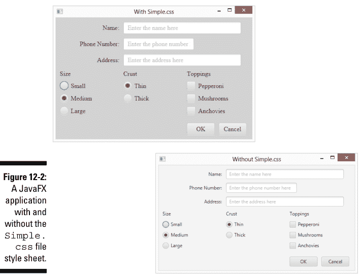

## 第三部分：增强你的场景设计

### 使用内联样式

除了使用单独的 `.css` 样式表，JavaFX 还允许你通过调用节点的 `setStyle()` 方法直接对场景图中的任何节点应用样式规则，并将规则作为字符串参数格式化。例如，下面的示例将按钮的字体大小设置为 15 点：

```
Button btnOK = new Button("OK");
btnOK.setStyle("-fx-font-size: 15pt");
```


作为一个一般原则，我建议在特殊情况下外不要使用内联样式。因为内联样式会让你更改应用程序用户界面的格式变得困难。想象一下，如果你对所有元素都应用内联样式，那么当你决定进行即使是最微小的更改，也必须搜索整个应用程序代码来找到需要更改的内联样式。然后，你必须重新编译程序。

相比之下，外部样式表使得更改 GUI 的外观变得更容易。你只需要编辑 `.css` 文件，格式就会自动反映你的更改。

### 创建样式表

现在你已经知道如何将样式附加到应用程序、场景或单个节点，是时候将注意力转向实际创建样式的任务了。正如我之前提到的，样式表是一个扩展名为 `.css` 的简单文本文件。你可以使用任何标准文本编辑器（如 Eclipse 或 NetBeans）以及简单的文本编辑器（如 TextPad 或记事本）创建你的样式表。将 `.css` 文件保存在与应用程序 java 文件夹相同的目录中。

由一个或多个样式规则组成的样式表决定了应用于场景中各种类型元素的格式。每条样式规则由一个选择器组成，决定了样式规则适用于哪些元素，随后是一个声明块，声明块是包含在一对括号内的样式声明列表。每个声明由一个属性名后跟一个冒号和一个值组成。每个声明都以分号结束。

例如：

```
.root {
  -fx-background-color: lightgray;
  -fx-font-family: "serif";
  -fx-font-size: 12pt;
}
```

第一行指定大括号之间的格式适用于整个场景图。然后，通过大括号使用了三条格式规则来指定背景颜色应为浅灰色，字体应为衬线字体，且字体大小应为 12 点。

向场景添加样式表最简单的方法是获取场景的样式表集合（一个场景可以有多个样式表），使用 `add()` 方法添加样式表，如下所示：

```
scene.getStylesheets().add("Simple.css")
```

为了保持本书中代码示例的简洁，本章的其余示例将继续使用前一个示例所示的简单技术。然而，仅将样式表作为 `add()` 方法的参数仅在样式表与应用程序的类文件位于同一文件夹时才起作用。如果样式表位于其他地方，请使用以下代码：

```
scene.getStylesheets().add(
  getClass().getResource("Simple.css")
  .toExternalForm());
```

该技术不是简单地提供字符串形式的样式表名称，而是调用 `Object` 类的 `getClass()` 方法，该方法返回应用程序类的引用。然后，它调用 `getResource()` 方法，该方法接受一个字符串参数，用于命名位于应用程序类路径上的外部资源（例如文件）。这返回了 `Simple.css` 文件的 URL。最后，`toExternalForm()` 方法将 URL 转换为 `getStylesheets().add()` 方法可以接受的格式。

图 12-2 左上角的窗口显示了一个添加了 `Simple.css` 场景的 JavaFX 应用程序。作为对比，该图还显示了没有 `Simple.css` 文件的应用程序。你可以看到，样式表将背景颜色更改为更深色调，并将字体更改为了衬线字体（在 Windows 电脑上使用的是 Times New）。


## 第三部分：增强你的场景设计

### 使用内联样式

除了使用单独的 `.css` 样式表，JavaFX 还允许你通过调用节点的 `setStyle()` 方法直接对场景图中的任何节点应用样式规则，并将规则作为字符串参数格式化。例如，下面的示例将按钮的字体大小设置为 15 点：

```
Button btnOK = new Button("OK");
btnOK.setStyle("-fx-font-size: 15pt");
```


作为一个一般原则，我建议在特殊情况下外不要使用内联样式。因为内联样式会让你更改应用程序用户界面的格式变得困难。想象一下，如果你对所有元素都应用内联样式，当你决定进行即使是最微小的更改，也必须搜索整个应用程序代码来找到需要更改的内联样式。然后，你必须重新编译程序。

相比之下，外部样式表使得更改 GUI 的外观变得更容易。你只需要编辑 `.css` 文件，格式就会自动反映你的更改。

### 创建样式表

现在你已经知道如何将样式附加到应用程序、场景或单个节点，是时候将注意力转向实际创建样式的任务了。正如我之前提到的，样式表是一个扩展名为 `.css` 的简单文本文件。你可以使用任何标准文本编辑器（如 Eclipse 或 NetBeans）以及简单的文本编辑器（如 TextPad 或记事本）创建你的样式表。将 `.css` 文件保存在与应用程序 java 文件夹相同的目录中。

由一个或多个样式规则组成的样式表决定了应用于场景中各种类型元素的格式。每条样式规则由一个选择器组成，决定了样式规则适用于哪些元素，随后是一个声明块，声明块是包含在一对括号内的样式声明列表。每个声明由一个属性名后跟一个冒号和一个值组成。每个声明都以分号结束。

例如：

```
.root {
  -fx-background-color: lightgray;
  -fx-font-family: "serif";
  -fx-font-size: 12pt;
}
```

第一行指定大括号之间的格式适用于整个场景图。然后，通过大括号使用了三条格式规则来指定背景颜色应为浅灰色，字体应为衬线字体，且字体大小应为 12 点。

向场景添加样式表最简单的方法是获取场景的样式表集合（一个场景可以有多个样式表），使用 `add()` 方法添加样式表，如下所示：

```
scene.getStylesheets().add("Simple.css")
```

为了保持本书中代码示例的简洁，本章的其余示例将继续使用前一个示例所示的简单技术。然而，仅将样式表作为 `add()` 方法的参数仅在样式表与应用程序的类文件位于同一文件夹时才起作用。如果样式表位于其他地方，请使用以下代码：

```
scene.getStylesheets().add(
  getClass().getResource("Simple.css")
  .toExternalForm());
```

该技术不是简单地提供字符串形式的样式表名称，而是调用 `Object` 类的 `getClass()` 方法，该方法返回应用程序类的引用。然后，它调用 `getResource()` 方法，该方法接受一个字符串参数，用于命名位于应用程序类路径上的外部资源（例如文件）。这返回了 `Simple.css` 文件的 URL。最后，`toExternalForm()` 方法将 URL 转换为 `getStylesheets().add()` 方法可以接受的格式。

图 12-2 左上角的窗口显示了一个添加了 `Simple.css` 场景的 JavaFX 应用程序。作为对比，该图还显示了没有 `Simple.css` 文件的应用程序。你可以看到，样式表将背景颜色更改为更深色调，并将字体更改为了衬线字体（在 Windows 电脑上使用的是 Times New）。


## 第三部分：增强你的场景设计

### 创建你自己的类名

每个节点都有一个 `getStyleClass()` 方法，返回一个样式类名的可观察列表。因此，给定的节点可以有多个样式类。这对于具有复杂格式要求的场景来说非常有用，因为它允许你为了格式化目的将控件组合在一起。例如，如果你想让一组按钮的格式与另一组不同，可以为按钮创建额外的类名。

例如，假设你想将某些按钮的字体大小设置为 16 点。你可以通过在样式表中创建一个名为 `button-large` 的样式来实现：

```
.button-large {
  -fx-font-size: 16pt;
}
```

然后，将 `button-large` 样式类添加到想要格式化的按钮的类列表中。例如：

```
Button btn1 = new Button("Wow!");
btn1.getStyleClass().add("button-large");
```

当节点有多个样式类时，样式表中的选择器将使用所有的类名。也就是说，拥有 `button-large` 额外类的按钮将匹配 `button` 和 `button-large` 的样式规则。

> **注意**：对于许多 JavaFX 节点，默认样式类是空的。例如，布局面板（如 `HBox` 和 `BorderPane`）没有默认样式类，形状类（如 `Rectangle` 或 `Circle`）也是。如果你想通过样式类型为这些应用 CSS 样式，你必须调用 `getStyleClass().add()` 为节点创建一个样式类名。

## 第 12 章：使用 CSS 为你的应用皮肤

然后，你可以创建一个仅适用于 id 为 `btnOK` 的节点的样式规则。在选择器中，你必须在 id 前加上哈希标记，如下所示：

```
#btn-wow {
  -fx-font-weight: bold;
}
```

井号 (`#`) 不在 `setId()` 方法中用于创建 id，但在样式表中是必须的。

节点 id 在整个场景图中必须唯一。换句话说，你不能创建两个具有相同 id 的节点。遗憾的是，JavaFX 并没有强制这一点，因此需要你来确保你的节点 id 是唯一的。


### 使用多个选择器

样式选择器可以列出多个一个样式类型或 id。要做到这一点，你将所有类型或 id 列为选择器的一部分，并用逗号分隔它们。例如，这里有一个应用于所有按钮、单选按钮和复选框的样式：

```
.button, .radio-button, .check-box {
  -fx-font-family: "serif";
}
```

这是一个包含多个 id 的示例：

```
#btn1, #btn2, #btn3, #btn4 {
  -fx-fill: GREEN;
}
```

### 指定样式属性

一个样式规则的声明块中，每个声明都指定了一个样式属性和一个值。例如，要将字体大小设置为 12 磅，使用 `-fx-font-size` 作为属性名，使用 `12pt` 作为值。总而言之，存在数百种样式属性。然而，并不是所有属性都适用于所有节点类型，每个 JavaFX 节点类都有自己的一套样式属性。

所有 JavaFX 样式属性都以 `-fx-` 前缀开头。以下章节描述了一些最常用的样式属性。

## 第三部分：增强你的场景设计

### 指定字体属性

对于显示文本的节点，你可以使用表 12-1 所示的属性来控制文本样式。

| 表 12-1 | 字体样式属性 |
| --- | --- |
| 属性 | 值 |
| `-fx-font-family` | 字体的实际名称，或以下通用字体类型之一：serif, sans-serif, cursive, fantasy, 或 monospace。 |
| `-fx-font-size` | 数字后跟单位，通常是 pt（磅）或 px（像素）。 |
| `-fx-font-style` | normal（正体）或 oblique（斜体）。 |
| `-fx-font-weight` | normal, bold, bolder, lighter, 100, 200, 300, 400, 500, 600, 700, 800, 或 900。 |
| `-fx-font` | 简写属性，将此处提到的所有其他属性合并为单个值，列出样式、权重、大小和字体族。用空格分隔这些值。如果你需要，可以省略样式和权重。 |

以下示例为所有按钮控件设置字体：

```
.button {
  -fx-font-family: sans-serif;
  -fx-font-size: 10pt;
  -fx-font-style: normal;
  -fx-font-weight: normal;
}
```


这个版本使用简写字体属性实现了相同的功能：

```css
.button {
  -fx-font: 10pt sans-serif;
}
```

## 指定背景颜色

`Region` 类有一个名为 `-fx-background-color` 的属性，允许你指定背景颜色。因为 Layout 和 Control 都继承了 `Region`，所以你可以在任何布局面板或控件上使用此属性。

要为布局面板应用背景颜色，你必须先给布局面板指定一个样式类名或 id，以便你可以在选择器中引用它。

接下来的段落描述了你可以用于此属性的可能值：

- **命名颜色：** JavaFX 定义了 148 种不同的命名颜色，包括如黑色、白色、红色和蓝色等基本颜色，以及如 cornsilk（丝绢色）和 thistle（蓟草紫）等奇异颜色。

- 例如：
  - `-fx-background-color: red`
  或
  - `-fx-background-color: papayawhip`

- 要查看 148 种命名颜色的完整列表，请参阅在线 CSS 参考页面：http://docs.oracle.com/javase/8/javafx/api/javafx/scene/doc-files/cssref.html#textcolor。

- **RGB 颜色：** 颜色的红-绿-蓝数值。这通常以十六进制表示，每个颜色组件占两位。整个十六进制数以哈希标记作为前缀：
  - `-fx-background-color: #f5f5f5`

- **渐变：** 允许你将颜色指定为渐变，创建从一种颜色到另一种颜色的平滑过渡。

关于创建渐变的信息，请翻到第 13 章。

- **查找颜色：** 查找颜色（lookup color）允许你在样式表的 `.root` 部分定义一组颜色名称，然后在样式表的任何地方引用该颜色名称。


## 指定边框属性

`Region` 类还有几个属性允许你指定边框... 表 12-2 列出了边框属性。

| 表 12-2 | 边框样式 |
| --- | --- |
| 属性 | 值 |
| `-fx-border-width` | 数字后跟单位，通常是 px（像素） |
| `-fx-border-style` | none（无）、solid（实线）或 dashed（虚线） |
| `-fx-border-color` | 颜色 |

例如，以下样式适用于：

```css
.bordered {
  -fx-border-width: 4;
  -fx-border-color: black;
  -fx-border-style: dashed;
}
```

# 第 13 章：绘制形状

- 创建基本形状如直线、矩形、椭圆
- 创建渐变填充
- 旋转、平移和缩放形状
- 组合形状

### Shape 类

到目前，书中介绍了可以添加到场景的节点类型：继承 `Control` 控件和继承 `Pane` 布局面板。在本节中，你将学习如何处理第三种节点类型：形状，它们（如你所料）继承 `Shape` 类。表 13-1 列出了一些最常用的方法。

| 表 13-1 | 方法 |  |
| --- | --- | --- |
| `void setFill(Paint value)` | 设置填充颜色。 |
| `void setSmooth(boolean value)` | 如果为 true，则使用抗锯齿更精确地绘制形状。 |
| `void setStroke(Paint value)` | 设置绘制形状轮廓的线条颜色。 |
| `void setStrokeWidth(double value)` | 设置绘制形状轮廓的线条宽度。 |
| `void setStrokeType(StrokeType value)` | 设置线条相对于形状实际轮廓的位置。可选值为 `StrokeType.CENTERED`、`INSIDE` 和 `OUTSIDE`。 |
| `void setStrokeLineJoin(StrokeLineJoin value)` | 设置绘制角的方法。可选值为 `StrokeLineJoin.MITER`、`BEVEL` 或 `ROUND`。 |
| `void setStrokeEndCap(StrokeLineCap value)` | 设置绘制线条末端的方法。可选值为 `StrokeLineCap.BUTT`、`ROUND` 或 `SQUARE`。 |
| `static intersect(Shape shape1, Shape shape2)` | 返回一个仅包含 shape1 和 shape2 重叠部分的新形状。 |
| `static subtract(Shape shape1, Shape shape2)` | 返回一个通过从 shape1 中减去 shape2 形成的新形状。 |
| `static union(Shape shape1, Shape shape2)` | 返回一个通过将 shape1 添加到 shape2 形成的新形状。 |

## 十二种形状类

共有 12 个继承自 `Shape` 类的形状：`Arc`（弧）、`Circle`（圆）、`CubicCurve`（贝塞尔曲线）、`Ellipse`（椭圆）、`Line`（线）、`Path`（路径）、`Polygon`（多边形）、`Polyline`（折线）、`QuadCurve`（二次曲线）、`Rectangle`（矩形）、`SVGPath` 和 `Text`（文本）。表 13-2 显示了这些类的基本构造函数，图 13-1 显示了一个包含其中几种形状的场景。创建此图的代码显示在本章稍后的列表 13-1 中。

| 表 13-2 | 十二种形状类 |
| :--- | :--- |
| 类构造函数 | 描述 |
| `Arc(double centerX, double centerY, double radiusX, double radiusY, double startAngle, double length)` | 创建一个弧，它是由前四个参数定义的椭圆段。`startAngle` 是弧起始点的角度（度），`length` 是弧的角跨度（度）。`Arc` 还包含一个名为 `getType` 的方法，允许您设置弧的类型。允许的值为 `ArcType.CHORD`、`OPEN` 和 `ArcType.ROUND`。 |
| `Circle(double centerX, double centerY, double radius)` | 创建具有指定中心点和半径的圆。 |
| `CubicCurve(double startX, double startY, double controlX1, double controlY1, double controlX2, double controlY2, double endX, double endY)` | 创建具有指定起点、终点和指定控制点的曲线。 |
| `Ellipse(double centerX, double centerY, double radiusX, double radiusY)` | 创建一个椭圆。`centerX` 和 `centerY` 指定椭圆的中心点。`radiusX` 指定椭圆的水平半径，`radiusY` 指定垂直半径。 |
| `Line(double startX, double startY, double endX, double endY)` | 创建具有指定起点和终点的线。 |
| `Path(PathElement... elements)` | 创建具有指定起点和终点的路径。 |
| `Polygon(Double... points)` | 创建以指定的 x, y 点为顶点的多边形。 |
| `Polyline(Double... points)` | 创建以指定的 x, y 点为段的折线。 |
| `QuadCurve(double startX, double startY, double controlX1, double controlY1, double controlX2, double endX, double endY)` | 创建具有指定起点、终点和指定控制点的二次曲线。 |
| `Rectangle(double x, double y, double width, double height)` | 创建一个矩形。`x` 和 `y` 指定矩形的左上角。 |
| `SVGPath()` | 创建一个可缩矢量图形（SVG）路径。 |
| `Text(double x, double y, String text)` | 在指定的 x 和 y 坐标处创建一个指定文本的文本形状。 |

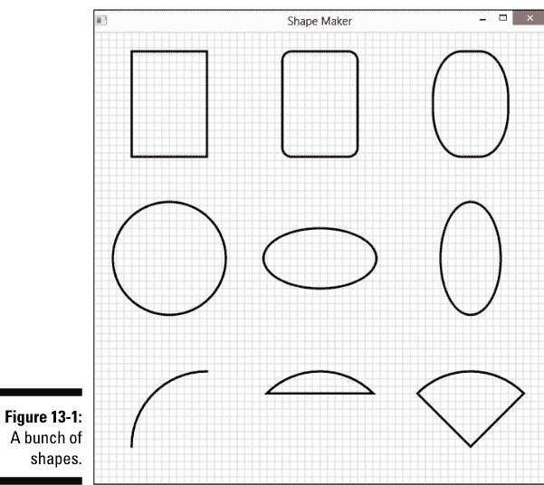

## 创建线条

最基本的形状类型是线，通过 `Line` 类创建。要创建一条线，您需要指定起点和终点的 x 和 y 坐标，例所示：

```java
Line line1 = new Line(0, 0, 100, 200);
```

这段代码创建了一条从 (0,0) 到 (100, 200) 的线。

图 13-1 中的网格线是在 `for` 循环内部通过线形状绘制的，如下：

```java
for (int i = 0; i < 600; i += 10) {
  Line line1 = new Line(i, 0, i, 600);
  line1.setStroke(Color.LIGHTGRAY);
  Line line2 = new Line(0, i, 600, i);
  line2.setStroke(Color.LIGHTGRAY);
  group1.getChildren().addAll(line1, line2);
}
```

循环变量 `i` 从 0 到 600，每次递增 10。在每次迭代中，创建两条线：一条使用变量 `i` 作为 x 轴的垂直线，一条使用变量 `i` 作为 y 轴的水平线。每条线的描边颜色均设置为浅灰色，并添加到 `Group` 中。

## 创建矩形

矩形需要一个 (x, y) 起点、宽度和高度。以下是创建本章之前图 13-1 中所示的矩形的代码：

```java
Rectangle rect1 = new Rectangle(50, 25, 100, 140);
rect1.setStroke(Color.BLACK);
rect1.setFill(null);
```

这里的矩形起始于 (50, 25)。它的宽度为 100，高度为 140。注意，填充颜色被设置为 `null`，因此矩形是透明的。

您可以通过调用 `setArcWidth` 和 `setArcHeight` 方法创建一个带圆角的矩形。这里是图 13-1 第一行所示的圆角矩形：

```java
Rectangle rect2 = new Rectangle(50, 25, 100, 140);
rect2.setStroke(Color.BLACK);
rect2.setFill(null);
rect2.setArcWidth(25);
rect2.setArcHeight(25);
```

您可以通过设置宽度和高度为 25 来创建圆角。对于图 13-1 第三行所示的形状，如下：

```java
Rectangle rect3 = new Rectangle(50, 25, 100, 140);
rect3.setStroke(Color.BLACK);
rect3.setFill(null);
rect3.setArcWidth(75);
rect3.setArcHeight(125);
```

## 创建圆和椭圆

要创建圆，使用 `Circle` 类并指定中心的 x 和 y 坐标以及半径。这里是创建图 13-1 中圆的代码：

```java
Circle c1 = new Circle(100, 300, 75);
c1.setStroke(Color.BLACK);
c1.setFill(null);
```

椭圆与圆类似，但它有两个半径：分别对应 x 轴和 y 轴。这里是创建图 13-1 中第一个椭圆的代码：

```java
Ellipse e1 = new Ellipse(300, 300, 75, 40);
e1.setStroke(Color.BLACK);
e1.setFill(null);
```

第二个椭圆类似，但 x 轴和 y 轴的半径反过了：

```java
Ellipse e2 = new Ellipse(300, 300, 40, 75);
```

## 创建弧

另一种形状类型是弧，它是椭圆的一段。要创建弧，您提供椭圆的参数，然后提供弧开始的角度：0 代表正东（时钟的 3 点位置）。最后，您提供跨度，它表示弧跨越的范围。需要注意的是，弧是顺时针从起点运行的。如果您将 90 设置为起点，90 设置为跨度，弧将从 12 点运行到 9 点，如图 13-1 第三行中的第一个形状所示。

FX 可以创建三种类型的弧，您可以通过 `setType` 方法进行指定：

- `ArcType.OPEN`：表示您只想绘制弧本身。
- `ArcType.CHORD`：表示您想绘制弧并用直线连接端点以创建一个封闭形状。
- `ArcType.ROUND`：表示您想用直线将端点连接到椭圆中心，从而创建一个像扇形的形状。

这里是创建图 13-1 中第一个弧的示例：

```java
Arc arc = new Arc(150, 550, 100, 100, 90, 90);
arc.setType(ArcType.OPEN);
arc.setStroke(Color.BLACK);
arc.setFill(null);
arc.setStrokeWidth(3);
```

第二个弧通过以下语句创建：

```java
Arc a2 = new Arc(300, 550, 100, 100, 45, 90);
a2.setType(ArcType.CHORD);
a2.setStroke(Color.BLACK);
a2.setFill(null);
a2.setStrokeWidth(3);
```

最后，第三个弧通过以下语句创建：

```java
Arc a3 = new Arc(500, 550, 100, 100, 45, 90);
a3.setType(ArcType.ROUND);
a3.setStroke(Color.BLACK);
a3.setFill(null);
a3.setStrokeWidth(3);
```

## 列表 13-1

```java
{
    launch(args);

    @Override public void start(Stage primaryStage) {
        Group group = new Group();

        // 背景网格
        for (int i = 0; i < 600; i += 10) {
            Line line1 = new Line(i, 0, i, 600);
            line1.setStroke(Color.LIGHTGRAY);
            Line line2 = new Line(0, i, 600, i);
            line2.setStroke(Color.LIGHTGRAY);
            group.getChildren().addAll(line1, line2);
        }

        // 一个矩形
        Rectangle r1 = new Rectangle(50, 25, 100, 140);
        r1.setStroke(Color.BLACK);
        r1.setFill(null);
        r1.setStrokeWidth(3);
        group.getChildren().add(r1);

        // 一个圆矩形
        Rectangle r2 = new Rectangle(250, 25, 100, 140);
        r2.setStroke(Color.BLACK);
        r2.setFill(null);
        r2.setStrokeWidth(3);
        r2.setArcWidth(25);
        r2.setArcHeight(25);
        group.getChildren().add(r2);

        // 另一个圆矩形
        Rectangle r3 = new Rectangle(450, 25, 100, 140);
        r3.setStroke(Color.BLACK);
        r3.setFill(null);
        r3.setStrokeWidth(3);
        r3.setArcWidth(75);
        r3.setArcHeight(125);
        group.getChildren().add(r3);

        // 一个圆
        Circle c1 = new Circle(100, 300, 75);
        c1.setStroke(Color.BLACK);
        c1.setFill(null);
        c1.setStrokeWidth(3);
        group.getChildren().add(c1);
    }
}
```

（续）

## 列表 13-1（续）

```java
// 一个椭圆
Ellipse el1 = new Ellipse(300, 300, 75, 40);
el1.setStroke(Color.BLACK);
el1.setFill(null);
el1.setStrokeWidth(3);
group.getChildren().add(el1);
```


// 另一个椭圆

```java
Ellipse e2 = new Ellipse(500, 300, 40, 75);
e2.setStroke(Color.BLACK);
e2.setFill(null);
e2.setStrokeWidth(3);
group1.getChildren().add(e2);
```

// 一个圆弧

```java
Arc a1 = new Arc(150, 150, 100, 100, 90);
a1.setType(ArcType.OPEN);
a1.setStroke(Color.BLACK);
a1.setFill(null);
a1.setStrokeWidth(3);
group1.getChildren().add(a1);
```

// 一个弦形弧

```java
Arc a2 = new Arc(300, 550, 100, 100, 90);
a2.setType(ArcType.CHORD);
a2.setStroke(Color.BLACK);
a2.setFill(null);
a2.setStrokeWidth(3);
group1.getChildren().add(a2);
```

// 一个圆弧

```java
Arc a3 = new Arc(500, 550, 100, 100, 90);
a3.setType(ArcType.ROUND);
a3.setStroke(Color.BLACK);
a3.setFill(null);
a3.setStrokeWidth(3);
group1.getChildren().add(a3);
```

// 创建场景和舞台

```java
Scene scene = new Scene(group1);
primaryStage.setScene(scene);
primaryStage.setTitle("Shape Maker");
primaryStage.show();
```

## 第 13 章：绘制形状

### 华丽的填充

如果你一直跟到现在，你已经看到可以通过调用形状的 `setFill` 方法并指定一个 `Color` 来为形状填充纯色，如下例所示：

```java
Rectangle r1 = new Rectangle(0, 0, 100, 100);
r1.setFill(Color.RED);
```

矩形被填充为红色。你也已经看到，可以通过将填充设置为 `null` 来创建一个透明对象。列表 13-1 所示的 ShapeMaker 程序使用了 `null` 填充，以便网格线显示出形状。然而，填充不仅仅是纯色。在接下来的章节中，你将了解到如何创建部分透明填充以及从一种颜色过渡到另一种颜色的渐变填充。

### 绘制透明

JavaFX 允许通过为颜色设置不透明度值来创建透明矩形。不透明度值 `1.0` 表示颜色完全不透明，而 `0.0` 则意味着颜色完全透明。要创建一个透明颜色，将不透明度设置在 `0.0` 到 `1.0` 之间。有几种方法可以实现，但最简单的是使用 `Color` 类的静态方法之一根据其组成部分创建颜色。

要创建一个 50% 透明的黑色，使用 `rgb` 方法：

```java
Color.rgb(0, 0, 0, 0.5)
```

要创建一个 20% 透明的红色，使用：

```java
Color.rgb(255, 0, 0, 0.2)
```

图 13-2 显示了带有三个矩形的场景，以下是代码：

```java
Rectangle r1 = new Rectangle(0, 75, 350, 40);
r1.setStroke(Color.BLACK);
r1.setFill(Color.rgb(200, 200, 200, 1.0));
r1.setStrokeWidth(3);

Rectangle r2 = new Rectangle(50, 5, 100, 200);
r2.setStroke(Color.BLACK);
r2.setFill(Color.rgb(200, 200, 200, 0.5));
r2.setStrokeWidth(3);

Rectangle r3 = new Rectangle(200, 5, 100, 200);
r3.setStroke(Color.BLACK);
r3.setFill(Color.rgb(200, 200, 200, 0.5));
r3.setStrokeWidth(3);
```

如你所见，三个矩形都使用 `200, 200, 200` 的灰色值。第一个矩形的不透明度为 `1.0`，另外两个为 `0.5`。结果是你可以看到第一个矩形在另外两个后面。


### 使用渐变填充

除了纯色，你可以指定渐变填充，它会在形状上均匀地混合颜色。JavaFX 提供了两个处理渐变的类：`LinearGradient` 和 `RadialGradient`。

线性渐变是从两个点创建的。想象在这些点之间画一条线。渐变从第一个点设置的颜色平滑过渡到第二个点设置的颜色。然后它以垂直直线的 90 度延伸颜色以填充整个区域。

#### 表 13-3 渐变类的构造函数

| 构造函数 | 描述 |
| :--- | :--- |
| `LinearGradient(double startX, double startY, double endX, double endY, boolean proportional, CycleMethod cycleMethod, Stop... stops)` | 创建线性渐变。停止点出现在定义的直线上。`CycleMethod` 可以是 `NO_CYCLE`、`REPEAT` 或 `REFLECT`。 |
| `RadialGradient(double focusAngle, double focusDistance, double centerX, double centerY, double radius, boolean proportional, CycleMethod cycleMethod, Stop... stops)` | 创建径向渐变。停止点是从渐变的中心点开始向圆形延伸的。FocusAngle 通常设置为零。 |
| `Stop(double offset, Color color)` | 在渐变上定义一个颜色停止。`offset` 是一个从 `0.0` 到 `1.0` 的浮点数。对于线性渐变，`0.0` 代表起点，`1.0` 代表终点。对于径向渐变，`0.0` 代表中心，`1.0` 代表半径。 |

表示沿渐变长度的比例位置。例如，`0.5` 的停止点偏移量会将停止点放置在渐变线或半径的中心。

此外，起始和结束停止点的偏移量并不非要是 `0.0` 或 `1.0`。例如，如果你不想在颜色过渡开始之前在渐变的两端留有纯色，可以指定 `0.2` 和 `0.8` 为起始和结束偏移量。

此示例创建了一个颜色从洋红色变为黄色的渐变填充：

```java
GradientPaint gp = new GradientPaint(0, 0, Color.MAGENTA, 0, 100, Color.YELLOW);
```

表 13-4 显示了使用 `LinearGradient` 类创建的五个渐变填充示例，以及使用 `RadialGradient` 类创建的两个径向渐变示例。每个矩形的大小均为 100 × 100 像素。该表还显示了创建每个填充的代码。

#### 表 13-4 七个渐变填充

| | 代码 |
| :--- | :--- |
| | `LinearGradient gradient1 = new LinearGradient(0, 0, 0, 1, true, CycleMethod.NO_CYCLE, new Stop(0.0, Color.WHITE), new Stop(1.0, Color.BLACK));` |
| | `LinearGradient gradient2 = new LinearGradient(0, 0, 1, 0, true, CycleMethod.NO_CYCLE, new Stop(0.0, Color.WHITE), new Stop(1.0, Color.BLACK));` |
| | `LinearGradient gradient3 = new LinearGradient(0, 1, 1, 0, true, CycleMethod.NO_CYCLE, new Stop(0.4, Color.WHITE), new Stop(0.6, Color.BLACK));` |
| | `LinearGradient gradient4 = new LinearGradient(0, 0, 0, 0.2, true, CycleMethod.REPEAT, new Stop(0.0, Color.WHITE), new Stop(1.0, Color.BLACK));` |
| | `LinearGradient gradient5 = new LinearGradient(0, 0, 0, 0.2, true, CycleMethod.REFLECT, new Stop(0.0, Color.WHITE), new Stop(1.0, Color.BLACK));` |
| | `RadialGradient gradient6 = new RadialGradient(0, 0, 0.5, 0.5, 0.5, true, CycleMethod.NO_CYCLE, new Stop(0.0, Color.WHITE), new Stop(1.0, Color.BLACK));` |
| | `RadialGradient gradient7 = new RadialGradient(0, 0, 0.5, 0.5, 0.1, false, CycleMethod.REFLECT, new Stop(0.2, Color.WHITE), new Stop(0.8, Color.BLACK));` |

### 转换、缩放和旋转

本节介绍了 `Node` 类中的几种方法，这些方法在处理形状时特别有用：

- `translateX` 和 `translateY` 方法将 `(0, 0)` 点从左上角移动到任意点。
- `setScaleX` 和 `setScaleY` 允许你更改形状的缩放比例，使其看起来更小或更大。
- `rotate` 方法旋转组件的坐标系，使形状以特定的角度绘制。

> **注意：** 这些方法可以用于场景图中的任何节点，你应用于任何一个节点的转换都会被该节点的任何子节点继承。如果你对场景的根节点应用转换，则该转换实际上应用于整个场景。

例如，图 13-3 显示了在代码列表 13-1 中展示的 ShapeMaker 程序在根节点经过旋转和平移后的样子。产生此输出的程序与代码列表 13-1 中的程序唯一的区别在于增加了以下三行：

```java
group1.setRotate(30);
group1.setScaleX(1.1); // 原文为 setScale(110) 疑为笔误，通常为 1.1 倍或 setScaleX/Y
group1.setTranslateY(110);
```

第一行将根节点旋转 30 度。然后，接下来两行将根节点在 x 轴和 y 轴上各平移 110 像素。

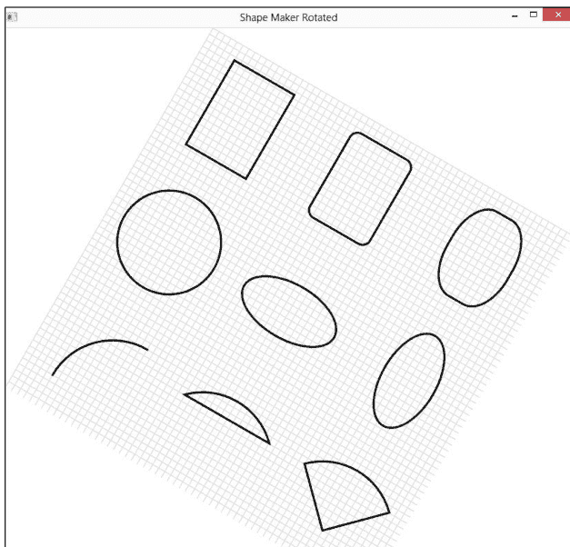

图 13-3：旋转并平移后的 Shape 程序。

缩放会改变 x 轴或 y 轴的相对大小，允许你对单个形状进行放大或缩小，或者如果你缩放根节点，则缩放整个场景。通常你会希望同时缩放 x 和 y 轴，除非你想刻意夸大某个轴。这里有一个将整个场景尺寸倍增示例（假设 `group1` 是根节点）：

```java
group1.setScaleX(2.0); // 原文为 200 疑为笔误，通常为 2.0 倍
group1.setScaleY(2.0);
```

### 绘制文本

你可以使用 `Text` 类来绘制包含在字符串中的文本。`Text` 对象类似于 `Label` 对象，但有一个主要区别：`Text` 对象是一个形状，而 `Label` 是一个控件。

本章的最后一个主题是使用 `Text` 类。例如，你可以用渐变对其进行格式化或设置它。`Text` 构造函数接受三个参数：要绘制的字符串以及基线的 x、y 坐标（从技术上讲，这是第一个字符的左上角）。你可以通过调用 `setFont` 方法更改字体，该方法接受一个 `Font` 对象。这里有一个示例：

```java
Text text1 = new Text("Hello, World!", 100, 50);
```

#### 列表 13-2（续）

```java
group1.getChildren().addAll(circle1, circle2, union, intersect, subtract);

Scene scene = new Scene(group1);
primaryStage.setScene(scene);
primaryStage.setTitle("Shape Combiner");
primaryStage.show();
```


接下来的段落描述了形状组合器程序的要点。

- 17: 创建了一个组（`Group`）来存放此程序显示的圆形和复合形状。
- 19: 这些行创建了八个圆形对象，以每组两个的形式在场景中分为四组。
- 28: 调用了 `Shape.union` 方法，通过组合圆形 3 和 4 创建了一个名为 `union` 的 `Shape` 对象。
- 29: 调用了 `Shape.intersect` 方法，创建一个名为 `intersect` 的 `Shape` 对象，它是圆形 5 和 6 的重叠部分。
- 30: 调用了 `Shape.subtract` 方法，创建一个名为 `subtract` 的 `Shape` 对象，其结果是从圆形 7 中减去圆形 8。
- 32: 这些行设置了圆形 1 和 2 的描边（`stroke`）和填充（`fill`）。
- 38: 这些行设置了 `union`、`intersect` 和 `subtract` 形状的描边和填充。
- 47: 此行将圆形 1、2 以及 `union`、`intersect` 和 `subtract` 形状添加到组容器中，该容器作为场景的根容器。

# 第 14 章：添加特殊特效

## 本章内容

- 为你的形状应用投影
- 使用反射效果
- 使项目模糊
- 使用 `Bloom`（光晕）和 `Glow`（光辉）类
- 为平面图形添加透视效果
- 组合特殊特效

欢迎来到特效章节！在这里，你将学习如何装饰场景图树节点的外观、光晕等。通过模糊、投影、色彩位移等特殊特效，你甚至可以添加透视效果，让应用程序具有三维感，而无需进行真正的 3D 编程。

你可能不会因为本章描述的任何特殊特效而获得奥斯卡奖，但至少你会玩得很开心！

## 介绍特殊特效

JavaFX 中的特殊特效源自 `Effect` 类，这是一个抽象类，它有许多子类，你可以使用它们来创建特殊特效。`Effect` 类总共有 17 个子类，但我没有空间在这里涵盖所有的 17 类。相反，本章将重点介绍那些能让你通过添加模糊、投影、反射和光辉来使形状看起来更真实的特效。

本章介绍的所有特效工作方式都相似。首先，你通过调用其默认构造函数来创建特效类的实例。然后，你可以可选地通过调用一个或多个方法来设置特效的属性。（在许多情况下，默认属性值是合适的，所以你可以跳过这一步。）最后，通过调用节点的 `setEffect` 方法将特效应用到节点上。

例如，这里有一段代码创建了一个矩形，填充它，然后添加了投影：

```java
Rectangle r1 = new Rectangle(50, 50, 100, 100);
r1.setFill(Color.LIGHTGRAY);
r1.setStroke(Color.BLACK);
r1.setStrokeWidth(2);
DropShadow shadow = new DropShadow();
r1.setEffect(shadow);
```

图 14-1 显示了这种效果的结果。如你所见，矩形周围环绕着细微的阴影。

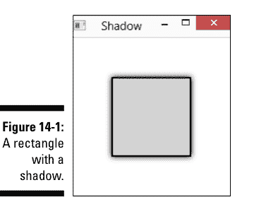

`setEffect` 方法由 `Node` 类定义，这意味着你可以对场景图中的任何节点应用特效。特效不仅应用于你调用的 `setEffect` 方法的节点，还会应用于该节点的任何子节点。如果你对场景的根节点调用 `setEffect`，则特效将应用于整个场景。

## 添加投影

你可能已经注意到图 14-1 所示示例中的投影看起来并不真实。那是因为直接在矩形后面，好像产生阴影的光源就在正前方。通常情况下，我们预期投影与产生阴影的物体之间有一定的角度，大多数时候位于物体下方并向一侧偏移。

幸运的是，`DropShadow` 类有几个属性可以让你控制投影的大小和位置。这些方法列在表 14-1 中，表中不仅列出了 `DropShadow` 类的细节，还列出了它的姐妹类 `InnerShadow`。`InnerShadow` 类在形状内部创建投影而不是形状外部。稍后我会介绍 `InnerShadow` 类。现在，我关注 `DropShadow`。

### 表 14-1：DropShadow 和 InnerShadow 类

| 构造函数 | 解释 |
| --- | --- |
| `DropShadow()` | 创建一个具有默认设置的 `DropShadow` 效果。 |
| `InnerShadow()` | 创建一个具有默认设置的 `InnerShadow` 效果。 |
| 常用方法 | |
| `void setColor(Color value)` | 设置用于投影的颜色。默认是黑色。 |
| `void setWidth(double value)` | 设置投影的宽度。默认是 1。 |
| `void setHeight(double value)` | 设置投影的高度。默认是 1。 |
| `void setOffsetX(double value)` | 投影的水平偏移。默认是 0。 |
| `void setOffsetY(double value)` | 投影的垂直偏移。默认是 0。 |
| `void setRadius(double value)` | 投影的半径。默认是 10。 |
| `void setSpread(double value)` | 投影中 0.0 到 1.0 的比例部分。默认是 0。 |
| `void setChoke(double value)` | 投影中 0.0 到 1.0 的比例部分。默认是 0。 |

`DropShadow` 类的方法允许你指定投影的几何形状。`setWidth` 和 `setHeight` 方法让你指定大小。

`setOffsetX` 和 `setOffsetY` 方法让你更改相对于形状中心的位置。通常你会添加正 x 轴和 y 轴偏移，如下：

```java
DropShadow shadow1 = new DropShadow();
shadow1.setOffsetX(10);
shadow1.setOffsetY(10);
```

在这个项目中，投影位于右侧 10 像素，下方 10 像素。`setRadius` 方法让你指定模糊的大小。这个数字越大，投影越模糊。你还可以控制 `spread`，它指示在模糊生效前投影的实色部分。图 14-2 显示了基础投影的九种变体。


为了创建这些投影矩形，我创建了一个名为 `ShadowedBox` 的实用方法。这是该方法的代码：

```java
Rectangle createShadowedBox(double size,
    double shadowWidth, double shadowHeight,
    double offsetX, double offsetY,
    double radius)
{
    Rectangle r = new Rectangle(size, size);
    r.setFill(Color.LIGHTGRAY);
    r.setStroke(Color.BLACK);
    r.setStrokeWidth(2);
    DropShadow e = new DropShadow();
    e.setWidth(shadowWidth);
    e.setHeight(shadowHeight);
    e.setOffsetX(offsetX);
    e.setOffsetY(offsetY);
    e.setRadius(radius);
    r.setEffect(e);
    return r;
}
```

为了创建实际的投影矩形，我调用了九次 `createShadowedBox` 方法，使用了不同的参数值：

```java
Rectangle r1 = createShadowedBox(100, 10, 10, 5, 5, 10);
Rectangle r2 = createShadowedBox(100, 20, 20, 10, 10, 10);
Rectangle r3 = createShadowedBox(100, 30, 30, 15, 15, 10);
Rectangle r4 = createShadowedBox(100, 20, 20, 0, 10, 10);
Rectangle r5 = createShadowedBox(100, 20, 20, 0, 10, 10);
Rectangle r6 = createShadowedBox(100, 20, 20, 10, 10, 10);
Rectangle r7 = createShadowedBox(100, 20, 20, 10, 10, 0);
Rectangle r8 = createShadowedBox(100, 20, 20, 10, 10, 20);
Rectangle r9 = createShadowedBox(100, 20, 20, 10, 10, 50);
```

对于第一组三个对象，我改变了阴影的大小和偏移量，而宽度、高度以及 x 偏移和 y 偏移使用了相同的值。因此，图 14-2 中的第一行矩形显示了阴影在矩形下方和右侧的不同放置位置。

对于接下来的组三个对象，我将 x 偏移或 y 偏移设置为 0，以演示偏移的变化。对于最后组三个对象，我改变了半径。注意，当半径设置为 0 时，阴影的边缘是锐利的。随着半径值的增大，阴影变得模糊。

图 14-3 显示了内阴影是如何工作的。对于此图，我修改了 `createShadowBox` 方法中的代码：不再创建 `DropShadow`，而是创建了一个 `InnerShadow`：

```java
InnerShadow e = new InnerShadow();
```

如你所见，`InnerShadow` 类将阴影放置在矩形内部而不是外部。

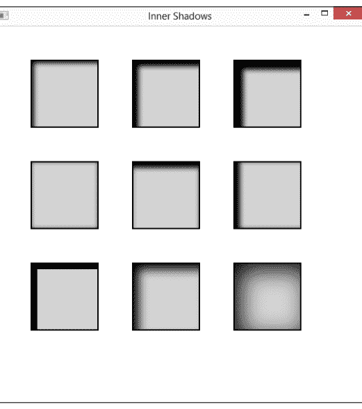

图 14-3：内阴影。

## 创建反射

反射会在形状的前方和下方投影一个形状的倒置副本，营造出形状放置在反射表面上的视觉效果。你可以使用 `Reflection` 类来创建反射，其成员如表 14-2 所示。

### 表 14-2：Reflection 类

| 构造函数 | 解释 |
| --- | --- |
| `Reflection()` | 创建一个具有默认设置的新反射效果。 |
| 常用方法 | |
| `void setBottomOpacity(double value)` | 反射底部边缘的不透明度（0.0 到 1.0）。默认值为 0。 |
| `void setFraction(double value)` | 将被反射的形状部分。默认值为 0.75。 |
| `void setTopOffset(double value)` | 形状底部与反射起始点之间的距离。默认值为 0。 |
| `void setTopOpacity(double value)` | 反射顶部的不透明度（0.0 到 1.0）。默认值为 0.5。 |

图 14-4 显示了一个应用了反射的形状。我使用以下代码来创建该形状：

```java
Text t = new Text("Reflection");
t.setFont(new Font("Times New Roman", 96));
t.setFill(Color.LIGHTGRAY);
t.setStroke(Color.BLACK);
t.setEffect(new Reflection());
```

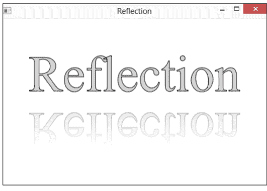

**图 14-4：** 带反射的文本。

## 使物体变模糊

JavaFX 提供了三个可以让对象模糊的特效类。这些类中的都使用不同的方法来应用模糊：

- `BoxBlur`（框模糊）：应用一种简单且高效的模糊技术，模糊区域中的每个像素通过计算输入图像中相邻像素的平均值来得出。
- `GaussianBlur`（高斯模糊）：使用高斯模糊算法，比框模糊更精确，但效率较低。
- `MotionBlur`（运动模糊）：沿方向模糊模糊形状，产生运动的效果。

### 表 14-3：BoxBlur、GaussianBlur 和 MotionBlur 类

| 构造函数 | 解释 |
| --- | --- |
| `BoxBlur()` | 创建一个具有默认设置的新 `BoxBlur` 效果。 |
| `GaussianBlur()` | 创建一个具有默认设置的新 `GaussianBlur` 效果。 |
| `MotionBlur()` | 创建一个具有默认设置的新 `MotionBlur` 效果。 |

| `BoxBlur` 方法 | 解释 |
| --- | --- |
| `void setHeight(double value)` | 设置模糊效果的垂直尺寸。 |
| `void setWidth(double value)` | 设置模糊效果的水平尺寸。 |
| `void setIterations(int value)` | 设置效果重复的次数。默认值为 1。 |

| `GaussianBlur` 方法 | 解释 |
| --- | --- |
| `void setRadius(double value)` | 模糊效果的半径。默认值为 10.0。 |

| `MotionBlur` 方法 | 解释 |
| --- | --- |
| `void setAngle(double value)` | 运动效果的角度（以度为单位）。默认值为 0.0。 |
| `void setRadius(double value)` | 模糊效果的半径。默认值为 10。 |

图 14-5 显示了这些模糊类型对文本形状的影响。以下是创建这三种模糊效果的代码：

```java
Text t1 = new Text("BoxBlur");
t1.setFont(new Font("Times New Roman", 60));
t1.setFill(Color.LIGHTGRAY);
t1.setStroke(Color.BLACK);
t1.setEffect(new BoxBlur());

Text t2 = new Text("GaussianBlur");
t2.setFont(new Font("Times New Roman", 60));
t2.setFill(Color.LIGHTGRAY);
t2.setStroke(Color.BLACK);
t2.setEffect(new GaussianBlur());

Text t3 = new Text("MotionBlur");
t3.setFont(new Font("Times New Roman", 60));
t3.setFill(Color.LIGHTGRAY);
t3.setStroke(Color.BLACK);
t3.setEffect(new MotionBlur());
```

`PerspectiveTransform` 类的工作原理是将原始形状的边界矩形的四个顶点映射到任意四边形上。（边界矩形是一个完全包含形状的矩形，而四边形是任何四个角的形状。）你只需要使用表 14-5 中列出的方法，提供四边形每个顶角的 x 和 y 坐标即可。

### 表 14-5：PerspectiveTransform 类

| 构造函数 | 解释 |
| --- | --- |
| `PerspectiveTransform()` | 创建具有默认参数的新 `PerspectiveTransform` 特效。 |
| 方法 | 解释 |
| `void setULX(double value)` | 设置左上角的 x 坐标。 |
| `void setULY(double value)` | 设置左上角的 y 坐标。 |
| `void setURX(double value)` | 设置右上角的 x 坐标。 |
| `void setURY(double value)` | 设置右上角的 y 坐标。 |
| `void setLLX(double value)` | 设置左下角的 x 坐标。 |
| `void setLLY(double value)` | 设置左下角的 y 坐标。 |
| `void setLRX(double value)` | 设置右下角的 x 坐标。 |
| `void setLRY(double value)` | 设置右下角的 y 坐标。 |

为了说明透视变换是如何工作的，我将其应用到使用以下代码创建的棋盘：

```java
Group board = new Group();
boolean isLight = true;
int size = 50;
for (int rank = 0; rank < 8; rank++) {
    for (int file = 0; file < 8; file++) {
        Rectangle r = new Rectangle(size, size);
        r.setX(file * size);
        r.setY(rank * size);
        if (isLight)
            r.setFill(Color.LIGHTGRAY);
        else
            r.setFill(Color.DARKGRAY);
        isLight = !isLight;
        board.getChildren().add(r);
    }
    isLight = !isLight;
}
```


这段代码使用嵌套循环通过交替颜色的 50x50 矩形来绘制棋盘的行（ranks）和列（files）。`isLight` 布尔变量用于跟踪每个方格的颜色；在绘制每个矩形后，该值会反转。在绘制每一列后，`isLight` 的值会反转，以便后续列从相反颜色开始。图 14-7 显示了棋盘在场景中显示时的外观。

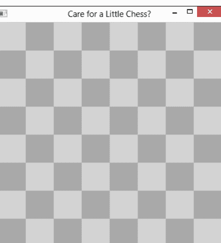

**图 14-7：** 没有透视的棋盘。

整个棋盘占据 400x400 的区域。为了添加透视，我创建了一个 `PerspectiveTransform` 特效，将 400x400 的棋盘映射到一个具有以下顶点坐标的四边形：

### 顶点坐标映射表

| 顶点 | 原始 x, y | 新的 x, y |
|---|---|---|
| 左上角 | 0, 0 | 100, 100 |
| 右上角 | 400, 0 | 450, 100 |
| 左下角 | 0, 300 | 0, 300 |
| 右下角 | 400, 400 | 400, 300 |

完成此变换的代码如下：

```java
PerspectiveTransform e = new PerspectiveTransform();

e.setULX(100); // Upper left
e.setULY(100);
e.setURX(450); // Upper right
e.setURY(100);
e.setLLX(0); // Lower left
e.setLLY(300);
e.setLRX(400); // Lower right
e.setLRY(300);

board.useEffect(e);
```

图 14-8 显示了应用此透视变换后棋盘的观。

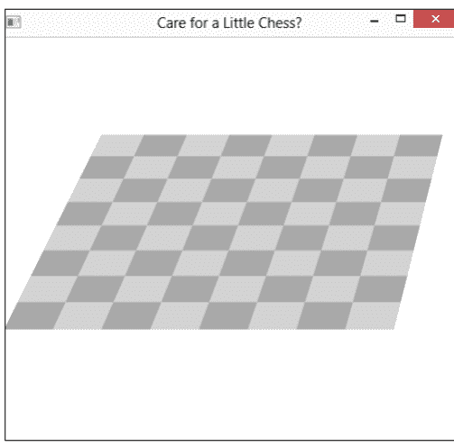

**图 14-8：** 棋盘获得了透视感。

### 组合特效

到此时，你应该同意 JavaFX 特效会对场景的外观产生巨大影响。但等等，还有更多！JavaFX 允许你通过组合特效来进一步改进场景的外观，本质上是将特效叠加在另一个特效之上。

要组合特效，你可以使用 `setInput` 方法，该方法在本章涵盖的所有特效中可用。简单来说，你创建一个特效类的实例，创建第二个特效类的实例，通过调用第一个特效的 `setInput` 方法并将第二个指定为输入，将第一个与第二个链接起来。

例如，假设你想将反射（reflection）与阴影（shadow）组合，并将组合后的特效应用到矩形。

```java
Rectangle rect = new Rectangle(100, 100);
DropShadow shadow = new DropShadow();
Reflection reflect = new Reflection();
shadow.setInput(reflect);
rect.setEffect(shadow);
```

---

# 第 15 章：使用属性创建动态场景

使用 JavaFX 属性时，getter（获取）和 setter（设置）方法返回由属性对象封装的值。除了 getter 和 setter 方法外，JavaFX 属性还引入了第三种方法，该方法返回属性本身。这允许属性的用户直接访问属性对象，从而让他们访问那些强大的特性。

命名规范是使用 JavaFX 属性的一个重要方面。每个属性都有一个名称，按照惯例，该名称以小写字母开头。例如，一个人的名字可能被称为 `firstName`。getter 和 setter 方法通过将属性名称的首字母大写并在前面加上 `get` 或 `set` 单词来创建。返回属性对象的方法名称是属性名称（大写）后加上 `Property` 单词。

因此，一个实现名为 `firstName` 的读/写属性的类必须暴露三个方法：

```
getFirstName
setFirstName
firstNameProperty
```

如果属性是只读的，则会省略 `setFirstName` 方法。

## Java API 属性

本书介绍的所有 JavaFX API 类都广泛使用了属性。事实上，几乎每个 API 的 get 或 set 方法实际上都是属性的 getter 或 setter，并且有一个对应的返回属性本身的方法。

例如，考虑 `TextField` 类，它具有 `getText` 和 `setText` 方法，用于获取和设置文本字段包含的文本。这些方法实际上是名为 `text` 的属性的 getter 和 setter，而 `TextField` 类有一个名为 `textProperty` 的方法，提供了对文本属性的直接访问。

`HBox` 类也是如此：它具有名为 `alignment`、`hgrow`、`padding` 和 `spacing` 的属性，分别对应于 `getAlignment`、`setAlignment`、`getHgrow`、`setHgrow`、`getPadding`、`setPadding`、`getSpacing` 和 `setSpacing` 方法。到目前为止，你无法直接访问属性，因此依赖 getter 和 setter 方法来操作属性值。在本章后面的部分，当你发现如何绑定属性值时，你会看到这些属性非常有用。

在接下来的几节中，我将讨论如何创建你的 JavaFX 属性。即使你永远不会为自己的类创建 JavaFX 属性，了解如何这样做也有助于你理解使用作为标准 JavaFX API 类一部分定义的属性的好处。

## JavaFX 属性类

JavaFX 属性的核心是一组创建属性对象的类。这些类非常多，因为 JavaFX 为每种基本数据类型提供了四种重要的类，并且为十种不同的数据类型提供了属性类。算一下账：有 40 个属性类。接下来的段落描述了 String 属性的四个类：

- `ReadOnlyProperty`：一个抽象类，表示一个只读属性，其值可以被读取但不能修改。
- `StringProperty`：另一个表示读/写属性的抽象类。该类继承自 `ReadOnlyProperty`。
- `SimpleStringProperty`：这是你通过实例化来创建读/写字符串属性的类。
- `ReadOnlyWrapper`：这是你通过实例化来创建只读字符串属性的类。这个类的用法有点让人困惑，所以我暂时还不会解释它。你将在本章稍后的“创建只读属性”部分看到它是如何工作的。

供你参考，表 15-1 列出了用于创建各种类型属性的所有 40 个类。

### 表 15-1 JavaFX 属性类

| 布尔类型类 (Boolean Classes) | 长整型类 (Long Classes) |
| :--- | :--- |
| `ReadOnlyBooleanProperty` | `ReadOnlyLongProperty` |
| `BooleanProperty` | `LongProperty` |
| `SimpleBooleanProperty` | `SimpleLongProperty` |
| `ReadOnlyBooleanWrapper` | `ReadOnlyLongWrapper` |
| 双精度类型类 (Double Classes) | Map |
| `ReadOnlyDoubleProperty` | `ReadOnlyMapProperty<K, V>` |
| `DoubleProperty` | `MapProperty<K, V>` |
| `SimpleDoubleProperty` | `SimpleMapProperty<K, V>` |
| `ReadOnlyDoubleWrapper` | `ReadOnlyMapWrapper<K, V>` |
| 浮点类型类 (Float Classes) | 对象类 (Object Classes) |
| `ReadOnlyFloatProperty` | `ReadOnlyObjectProperty<T>` |
| `FloatProperty` | `ObjectProperty<T>` |
| `SimpleFloatProperty` | `SimpleObjectProperty<T>` |
| `ReadOnlyFloatWrapper` | `ReadOnlyObjectWrapper<T>` |
| 整数类型类 (Integer Classes) | 集合类 (Set Classes) |
| `ReadOnlyIntegerProperty` | `ReadOnlySetProperty<E>` |
| `IntegerProperty` | `SetProperty<E>` |
| `SimpleIntegerProperty` | `SimpleSetProperty<E>` |
| `ReadOnlyIntegerWrapper` | `ReadOnlySetWrapper<E>` |
| 列表类 (List Classes) | 字符串类 (String Classes) |
| `ReadOnlyListProperty<E>` | `ReadOnlyStringProperty` |
| `ListProperty<E>` | `StringProperty` |
| `SimpleListProperty<E>` | `SimpleStringProperty` |
| `ReadOnlyListWrapper<E>` | `ReadOnlyStringWrapper` |

注意表 15-1 中所示的类型——`List`、`Map` 和 `Set` 是泛型的。对于 `List` 和 `Set` 类，你必须为底层列表和集合指定元素类型；对于 `Map` 类型，你需要为键和值指定类型。`Object` 属性允许你创建任何你类型的属性，但你必须指定类型以便 JavaFX 能够强制类型安全。

## 创建读/写属性

要创建一个值可以读可写的基本属性，你需要使用该属性的两个类。例如，要创建一个 `Double` 类型的属性，你需要同时使用 `DoubleProperty` 和 `SimpleDoubleProperty`。

以下是创建读/写属性的步骤：

1. 使用属性类为属性创建一个私有字段。

```java
private StringProperty firstName;
```

2. 在同一语句中实例化属性。属性的构造函数接受三个参数，分别代表对象、属性名称的字符串以及默认值。例如：

```java
firstName = new SimpleStringProperty(this, "firstName", "");
```

3. 为属性创建一个 getter。getter 方法名应该是公共或保护的，遵循命名规范（`get` 后面跟着首字母大写的属性名），并返回底层属性的值。它应该调用私有属性的 `get` 来获取属性值，如下：

```java
public final String getFirstName() { return firstName.get(); }
```

4. 为属性创建一个 setter。setter 方法名应该是公共或保护的，应该是 `final` 的，遵循命名规范（`set` 后面跟着首字母大写的属性名），并接受一个底层属性类型的参数值。它应该调用私有属性的 `set` 方法将属性设置为传递的值。例如：

```java
public final void setFirstName(String value) {
    firstName.set(value);
}
```

5. 创建属性访问器。该方法返回属性对象本身：

```java
public final StringProperty firstNameProperty() {
    return firstName;
}
```

注意类型是 `StringProperty` 而不是 `SimpleStringProperty`。

6. 为类中的每个属性重复整个过程。

这里是一个完整的示例，在名为 `Customer` 的类中实现了一个名为 `firstName` 的读/写属性：

```java
public class Customer {
    private StringProperty firstName =
        new SimpleStringProperty(this, "firstName", "");

    public final String getFirstName() {
        return firstName.get();
    }

    public final void setFirstName(String value) {
        firstName.set(value);
    }

    public final StringProperty firstNameProperty() {
        return firstName;
    }
}
```

## 创建只读属性

虽然只读属性的功能比读/写属性少，但它的实现实际上却要复杂得多。为什么呢？因为在包含只读属性的类内部——你需要能够读取或定义属性的值。而在外部——也就是说，在定义只读属性的类之外——你必须确保用户无法写入属性值。

你可能认为只要省略 `setter` 方法就足够创建一个只读属性了。但问题在于，JavaFX 属性除了 `getter` 和 `setter` 方法外，还暴露了一个访问器方法（accessor method），该方法提供了对属性对象本身的直接访问。

以下是一个*如何错误*创建只读属性的示例：

```java
StringProperty firstName =
    new SimpleStringProperty(this, "firstName", "");

public final String getFirstName() {
    return firstName.get();
}

public final StringProperty firstNameProperty() {
    return firstName;
}
```


这段代码与上一节中创建读/写属性的代码相同，只是我省略了 `setFirstName` 方法。遗憾的是，这个属性定义并不能防止定义属性的类的用户修改该属性。要这样做，用户只需要访问该属性然后直接调用属性的 `set` 方法即可。

例如，假设此属性是一个名为 `Customer` 的类的一部分，该实例由变量 `cust` 引用。以下代码将设置只读属性的值：

```java
cust.firstNameProperty().set("Bogus Value");
```

为了安全地创建一个只读属性，你实际上必须创建该属性的两个拷贝：一个只读版本和一个读/写版本。只读版本将暴露给外部世界。读/写版本将在用于定义属性的类内部使用。然后，你必须同步这两个属性，以便每当内部读/写属性的值改变时，外部只读属性的值就会自动更新。

为了实现这一点，JavaFX 为每个属性类型提供了两个额外的类：一个只读属性类和一个只读包装类（read-only wrapper class）。只读属性类是你通过属性访问器与外部世界共享的那个。只读包装类是你用于创建在程序内部引用属性的私有字段的。

这里是一个完整的示例，在 `Customer` 类中实现了一个名为 `customerNumber` 的只读整数属性：

```java
public class Customer {
    private ReadOnlyIntegerWrapper customerNumber =
        new ReadOnlyIntegerWrapper(this, "customerNumber", 0);

    public final Integer getCustomerNumber() {
        return customerNumber.get();
    }

    public final ReadOnlyIntegerProperty customerNumberProperty() {
        return customerNumber.getReadOnlyProperty();
    }

    // 更多类细节在此处
}
```

理解其工作原理的关键在于意识到，只读包装器是简单属性类的扩展，它只添加了一个方法：`getReadOnlyProperty()`，该方法返回简单属性的只读拷贝。这个只读属性与简单属性自动同步，因此每当底层简单属性发生变化时，只读属性的值也会随之改变。

## 更高效地创建属性

JavaFX 属性的高级功能（你将在本章的最后几节中体会）并不是没有代价的。具体来说，实例化一个属性对象比创建一个基于字段的简单属性消耗更多的内存和处理时间。在许多类中，JavaFX 属性对象的高级功能偶尔才需要。因此，无论是否需要为类中的每个属性实例化属性对象都是浪费。

在本节中，我向你展示一种创建属性的技术，在属性本身被调用之前，不会实例化属性对象。这样，除非实际上需要，否则创建属性对象。以下是该技术的细节：

1. 声明一个私有字段来持有属性所代表的数据。例如，对于字符串属性，你创建一个 `String` 变量。对于变量名，使用带下划线前缀的属性名：

```java
private String _firstName = "";
```


- 2. 创建但不实例化私有变量来表示属性对象。换句话说，声明变量但不调用类的构造函数：
```java
private final SimpleStringProperty firstName;
```

- 3. 创建 `getter`。在 `getter` 中，使用 `if` 语句判断属性是否存在。如果存在，从属性返回值。如果不存在，返回私有字段的值。例如：
```java
public final String getFirstName() {
    if (firstName == null)
        return _firstName;
    else
        return firstName.get();
}
```

- 4. 创建 `setter`。在 `setter` 中使用相同的技术：
```java
public class Customer {
    private final String _firstName = "";
    private final SimpleStringProperty firstName;

    public final String getFirstName() {
        if (firstName == null)
            return _firstName;
    }

    public void setFirstName(String value) {
        if (firstName == null) {
            firstName = new SimpleStringProperty(value);
        } else {
            firstName.set(value);
        }
    }

    public final StringProperty firstNameProperty() {
        if (firstName == null) {
            firstName = new SimpleStringProperty(this, _firstName);
        }
        return firstName;
    }
}
```

# 第四部分：让你的程序活起来

# 列表 15-1（续接）

```java
p.setPrefHeight(200);
p.setMaxHeight(200);
p.getChildren().add(r);
p.widthProperty().addListener(
    (observable, oldValue, newValue) ->
    r.setWidth((Double)newValue/2)
);
p.heightProperty().addListener(
    (observable, oldValue, newValue) ->
    r.setHeight((Double)newValue/2)
);
Scene scene = new Scene(p);
primaryStage.setScene(scene);
primaryStage.setTitle("Auto Rectangle");
primaryStage.show();
```

接下来的段落描述了代码亮点：

- 18: 这些行创建了一个 100x100 的矩形，并设置了矩形的填充颜色、描边颜色和描边宽度。
- 23: 这些行创建了一个堆栈面板（stack pane）并设置了它的宽度和高度属性。
- 33: 这些行使用 Lambda 表达式在堆栈面板的宽度参数上注册了一个更改处理器。当堆栈面板的宽度改变时，矩形的宽度被设置为堆栈面板宽度的一半。
- 38: 这些行使用 Lambda 表达式在堆栈面板的高度参数上注册了一个更改处理器。当堆栈面板的高度改变时，矩形的高度被设置为堆栈面板高度的一半。

# 第 15 章：使用属性创建动态场景

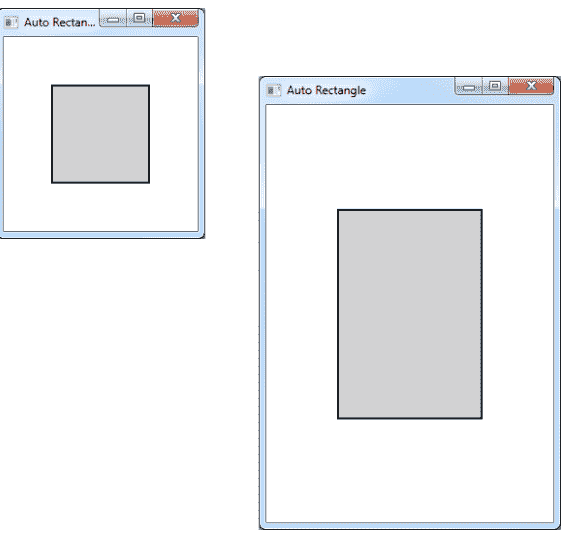

图 15-1：运行中的“自动矩形”程序。

## 属性绑定

JavaFX 属性绑定允许你同步两个属性的值，每当其中一个属性发生变化时，另一个属性的值就会自动更新。它支持两种类型的绑定：

- **单向绑定**：在单向绑定中，绑定仅单方向有效。例如，如果你将属性 A 绑定到属性 B，那么当属性 B 改变时，属性 A 的值会改变，但反之不然。
- **双向绑定**：在双向绑定中，两个属性的值是同步的，因此如果任一属性发生变化，另一个属性也会自动改变。

设置任何类型的绑定都异常简单。每个属性都有一个 `bind` 和 `bindBidirectional` 方法。要建立绑定，只需调用这些方法，并将你想要绑定的属性作为参数传递即可。

这是一个示例，它创建了标签（label）的文本属性与文本字段（text field）的文本属性之间的单向绑定，使得标签的内容始终显示文本字段的内容：
```java
label1.textProperty().bind(text1.textProperty());
```

建立绑定后，当用户在文本字段中输入数据时，标签显示的文本将按字符自动更新。

下面的示例展示了如何在两个名为 `text1` 和 `text2` 的文本字段之间创建双向绑定：
```java
text1.textProperty().bindBidirectional(text2.textProperty());
```

建立此绑定后，你在任一文本字段中输入的任何文本都会自动复制到另一个框中。

为了展示如何在完整程序中使用绑定，列表 15-2 显示了一个带有两个文本字段的程序，每个字段都绑定了一对标签。第一个文本字段接受剧本角色的名字，第二个文本字段接受演员的名字。标签显示将扮演该角色的演员，如图 15-2 所示。

## 列表 15-2：角色扮演程序

```java
import javafx.application.*;
import javafx.stage.*;
import javafx.scene.*;
import javafx.scene.layout.*;
import javafx.geometry.*;
import javafx.scene.control.*;

public class RolePlayer extends Application {
    public static void main(String[] args) {
        launch(args);
    }
}
```

# 第 15 章：使用属性创建动态场景

```java
TextField txtCharacter;
TextField txtActor;

@Override
public void start(Stage primaryStage) {
    // 创建角色标签
    lblCharacter = new Label("Character's Name:");
    lblCharacter.setMinWidth(100);
    lblCharacter.setAlignment(Pos.BOTTOM_RIGHT);

    // 创建角色文本字段
    txtCharacter = new TextField();
    txtCharacter.setMinWidth(200);
    txtCharacter.setMaxWidth(200);
    txtCharacter.setPromptText("Enter the name of the character here.");

    // 创建演员标签
    lblActor = new Label("Actor's Name:");
    lblActor.setMinWidth(100);
    lblActor.setAlignment(Pos.BOTTOM_RIGHT);

    // 创建演员文本字段
    txtActor = new TextField();
    txtActor.setMinWidth(200);
    txtActor.setMaxWidth(200);
    txtActor.setPromptText("Enter the name of the actor here.");

    // 创建角色标签
    lblRole1 = new Label("The role of ");
    lblRole2 = new Label();
    lblRole3 = new Label("will be played by ");
    lblRole4 = new Label();

    // 创建角色面板
    HBox paneCharacter = new HBox(20, lblCharacter, txtCharacter);
    paneCharacter.setPadding(new Insets(10));

    // 创建演员面板
    HBox paneActor = new HBox(20, lblActor, txtActor);
    paneActor.setPadding(new Insets(10));

    // 创建角色面板
    HBox paneRole = new HBox(20, lblRole1, lblRole2, lblRole3, lblRole4);
    paneRole.setPadding(new Insets(10));
}
```

（续接）

# 列表 15-2（续接）

```java
// 将角色和演员面板添加到 VBox
VBox pane = new VBox(10, paneCharacter, paneActor, paneRole);

// 创建绑定
lblRole2.textProperty().bind(txtCharacter.textProperty());
lblRole4.textProperty().bind(txtActor.textProperty());

// 设置舞台
Scene scene = new Scene(pane);
primaryStage.setTitle("Role Player");
primaryStage.show();
```

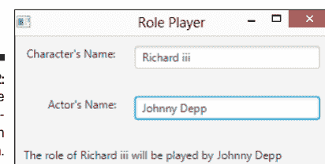

图 15-2：运行中的“角色扮演”程序。

# 第 16 章：使用图像和媒体

- 本章
- 在 JavaFX 组件中显示图像
- 为程序添加声音
- 显示视频

到目前为止，书中所有的 JavaFX 应用都非常无聊。它们有很多标签、文本字段、组合框等，但没有图像、声音或电影！

本章解决了这一问题。你将了解到如何在应用程序中引入图像（是非位性的图像）。为了让事情变得有趣，我将展示如何添加音效、音乐以及视频。

## 使用图像

Image 是包含图像的文件。JavaFX 支持多种格式，包括 .jpg、.png、gif 和 .bmp。要在应用程序中使用图像，你需要两个类：`Image` 和 `ImageView`。`Image` 类表示内存中的图像，而 `ImageView` 类是可以添加到场景中显示图像的节点。

这两个类都位于 `javafx.scene.image` 包，因此你需要在程序中添加以下语句：
```java
import javafx.scene.image.*;
```

## 表 16-1 Image 类

| 构造函数 | 描述 |
| :--- | :--- |
| `Image(InputStream in)` | 从指定的输入流读取图像。 |
| `Image(InputStream in, double width, boolean preserveRatio, smooth)` | 从指定的输入流读取图像，并根据指定的宽度进行调整大小。`preserveRatio` 表示是否保留原始图像的宽高比，`smooth` 表示是否应用图像平滑。 |
| `Image(String url)` | 从指定的 URL 读取图像。 |
| `Image(String url, boolean backgroundLoading)` | 从指定的 URL 读取图像。如果 `backgroundLoading` 为 `true`，图像将在后台加载（即在独立的线程中）。 |
| `Image(String url, double height, boolean preserveRatio, smooth)` | 从指定的 URL 读取图像。该构造函数指定了结果图像的高度，并指定了是否保留原始图像的宽高比以及是否应用图像平滑。 |
| `Image(String url, double width, boolean preserveRatio, smooth, boolean backgroundLoading)` | 从指定的网络路径读取图像，并根据指定的宽度进行调整大小。`preserveRatio` 表示是否保留原始图像的宽高比，`smooth` 表示是否应用图像平滑。如果 `backgroundLoading` 为 `true`，图像将在后台加载（即在独立的线程中）。 |

## 第 16 章：使用图像和媒体

加载图像最简单的方法是直接从本地计算机上的文件加载，只需在 `Image` 构造函数中指定文件路径。文件路径字符串前应加上协议字符串 `file:`。例如，下面的构造函数根据位于 `C:\Pictures` 文件夹中名为 `pic001.jpg` 的文件创建一个 `Image` 对象：
```java
Image img = new Image("file:C:\\Pictures\\pic001.jpg");
```

你也可以使用 `http:` 协议指定网络位置，在下面的示例中：
```java
Image img = new Image("http://www.domain.com/pic001.jpg");
```

在网络示例中，你不需要双写斜杠，因为 HTTP 地址使用正斜杠，而不是反斜杠。

在许多情况下，你可能想从 `File` 对象加载图像。要做到这一点，请使用 `File` 对象的 `toURI` 方法从文件中获取正确的路径。注意：`toURI` 返回一个 `URI` 类型的对象；你随后必须使用 `toString` 将 URI 转换为字符串：
```java
File f = new File("C:\\Pictures\\pic001.jpg");
Image img = new Image(f.toURI().toString());
```

在这里，根据路径 `C:\Pictures\pic001.jpg` 创建了一个文件。然后，从该文件创建一个图像。

当你创建一个 `Image` 对象时，可以通过提供宽度和高度参数来指定调整图像的大小。你还需要使用 JavaFX 来提供布尔参数。第一个参数指定你是否想要保持纵横比例（即宽度与高度的比例）。如果你指定为 `true`，为了保持图像的纵横比例，图像可能根据需要在其上方、下方或左右留出空白。如果你指定为 `false`，图像可能会失真。

第二个布尔参数指定你是否希望让 JavaFX 应用平滑算法来提高图像的清晰度。平滑处理会让图像看起来更好，但需要花费时间。

最后，你可以指定一个可选的第三个布尔参数，表示你希望图像在后台加载。这会导致图像加载过程被派到单独的线程中，以便你的应用程序线程无需等待图像加载即可继续运行。

## 使用 ImageView 类

虽然 `Image` 类在内存中持有图像，但 `ImageView` 类在屏幕上显示图像。`ImageView` 是 `Node` 的子类，允许你将图像视图添加到场景图（scene graph）。基本构造函数接受一个 `Image` 对象，如下：
```java
Image img = new Image("file:C:\\Pictures\\pic001.jpg");
ImageView imageView = new ImageView(img);
```

然后，你可以将图像视图添加到布局窗格（layout pane）并在场景中显示它，就像任何其他节点一样。

默认情况下，图像视图将全尺寸显示图像。通常情况下，你会希望通过调用 `setFitWidth` 和 `setFitHeight` 方法来限制尺寸，并希望调用 `setPreserveRatio` 方法以确保在调整大时保持原始图像的纵横比例。例如：
```java
imageView.setFitWidth(200);
imageView.setFitHeight(200);
imageView.setPreserveRatio(true);
```

在这里，显示的图像尺寸为 200x200。图 16-1 显示了该图像在场景中显示时的样子。

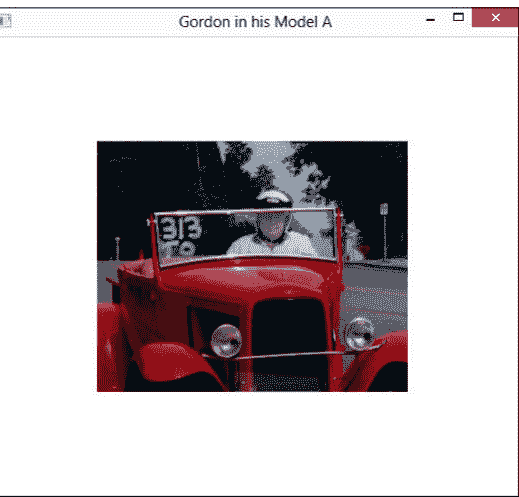

图 16-1：显示图像。

在两个或多个图像视图中显示单个图像是完全可以的。例如：
```java
Image img = new Image("file:C:\\Pictures\\pic001.jpg");
ImageView view1 = new ImageView(img);
ImageView view2 = new ImageView(img);
```

因为图像是一个节点，你可以像我在第 14 章中描述的那样对它应用特殊效果。例如，这里有一段代码加载图像，将其放入两个图像视图中，然后对第二个视图应用运动模糊：
```java
Image img = new Image("file:C:\\Pictures\\pic001.jpg");
```


ImageView view1 = new ImageView(img);
view1.setFitWidth(300);
view1.setFitHeight(300);
view1.setPreserveRatio(true);

ImageView view2 = new ImageView(img);
view2.setFitWidth(300);
view2.setFitHeight(300);
view2.setPreserveRatio(true);

MotionBlur blur = new MotionBlur();
blur.setRadius(25);
blur.setAngle(180);
view2.setEffect(blur);

图 16-2 显示了该图像在两个图像视图中的样子，其中一个具有运动模糊效果。


图 16-2：对图像应用效果。

## 图像示例

为了展示前两个节中介绍的元素是如何协同工作的，列表 16-1 显示了一个完整的程序，该程序使用 `Image` 和 `ImageView` 类来显示本地文件系统中名为 `C:\Pictures` 的文件夹中的所有图像。该程序使用 `File` 类来访问文件夹中的文件。如果你想了解更多关于该类的信息，请参阅我的书籍 *Java-All-One for Dummies*。图 16-3 显示了从 `C:\Pictures` 路径创建文件的方式。


图 16-3：显示图像。

### 列表 16-1：ViewAnImage

```java
import javafx.application.Application;
import javafx.geometry.*;
import javafx.scene.*;
import javafx.scene.image.*;
import javafx.scene.layout.*;
import javafx.scene.stage.*;
import javafx.scene.text.*;
import java.io.File;

public class ViewAnImage extends Application {

    private final String PATH = "C:\\Pictures";

    public static void main(String[] args) {
        launch(args);
    }

    @Override
    public void start(Stage primaryStage) {
        File dir = new File(PATH);
        File[] files = dir.listFiles();
        TilePane tile = new TilePane();
        tile.setHgap(20);
        tile.setVgap(20);
        tile.setPadding(new Insets(20));

        for (File file : files) {
            Image img = new Image(file.toURI().toString());
            ImageView view = new ImageView(img);
            view.setFitWidth(200);
            view.setFitHeight(200);
            view.setPreserveRatio(true);
            Text txt = new Text(file.getName());
            txt.setFont(new Font("Arial", 16));
            Region spacer = new Region();
            VBox box = new VBox(10, view, spacer, txt);
            box.setVgrow(spacer, Priority.ALWAYS);
            box.setAlignment(Pos.CENTER);
            tile.getChildren().add(box);
        }

        ScrollPane scroll = new ScrollPane(tile);
        scroll.setMinWidth(920);
        scroll.setMinHeight(450);
        Scene scene = new Scene(scroll);
        primaryStage.setScene(scene);
        primaryStage.setTitle("Photo Viewer - " + PATH);
        primaryStage.show();
    }
}
```

以下是代码的亮点：

- `PATH` 变量被声明，以便类可以访问。
- `File dir = new File(PATH);` 访问文件夹。
- `File[] files = dir.listFiles();` 获取文件夹中的文件。
- `for (File file : files) {` 循环遍历文件。在实际程序中，当然，这部分代码应该包含错误处理。
- `Image img = new Image(file.toURI().toString());` 根据文件的 URI 字符串创建。
- `ImageView view = new ImageView(img);` 创建图像视图。
- `view.setFitWidth(200);`、`view.setFitHeight(200);` 和 `view.setPreserveRatio(true);` 设置尺寸。
- `Text txt = new Text(file.getName());` 创建一个文本对象以显示文件名。
- `txt.setFont(new Font("Arial", 16));` 设置字体。
- `Region spacer = new Region();` 创建占位符。
- `VBox box = new VBox(10, view, spacer, txt);` 创建一个垂直布局框。
- `box.setVgrow(spacer, Priority.ALWAYS);` 让占位符垂直伸缩。
- `box.setAlignment(Pos.CENTER);` 设置居中对齐。
- `tile.getChildren().add(box);` 将布局框添加到平铺网格中。
- `ScrollPane scroll = new ScrollPane(tile);` 创建滚动面板。
- `Scene scene = new Scene(scroll);` 创建场景。
- `primaryStage.setScene(scene);` 设置场景。
- `primaryStage.setTitle("Photo Viewer - " + PATH);` 设置标题。
- `primaryStage.show();` 显示窗口。

## 播放音频文件

JavaFX 提供了对常见格式音频文件的内置支持，例如 .mp3、.wav 和 .aiff。视频文件可以是 .mp4 或 .flv。你只需要关注 `Media` 和 `MediaPlayer` 这两个类，它们的设计与你之前读过的 `Image` 和 `ImageView` 类类似。

`Media` 和 `MediaPlayer` 类都在 `javafx.scene.media` 包中，因此你需要在程序中添加以下导入语句：

```java
import javafx.scene.media.*;
```

要创建一个 `Media` 对象，请调用 `Media` 类的构造函数并指定媒体文件的 URI（统一资源标识符）。如果你是从本地文件系统访问的，获取有效 URI 的最佳方法是先使用标准文件路径为文件创建一个 `File` 对象。然后，在 `File` 对象上调用 `toURI()` 以获取正确的 URI。以下是一个示例，假设本地文件路径在变量 `PATH` 中：

```java
File f = new File(PATH);
Media media = new Media(f.toURI().toString());
```

获取 `Media` 对象后，你就可以使用 `MediaPlayer` 类轻松地播放它：

```java
MediaPlayer mplayer = new MediaPlayer(media);
mplayer.setAutoPlay(true);
```

在这里，`MediaPlayer` 构造函数接受 `Media` 对象作为其唯一参数。`setAutoPlay` 方法指示媒体播放器在音频片段完成后立即播放。

`MediaPlayer` 类并不是 `Node` 的子类。这意味着你不能将媒体播放器添加到场景图（scene graph）中。如果你想显示播放、暂停和停止等标准媒体控制，必须手动创建这些按钮并使用它们来操作媒体播放器对象。`MediaPlayer` 拥有 `play`、`pause` 和 `stop` 方法来实现这些功能。

### 列表 16-2：播放音频文件

```java
import javafx.application.*;
import javafx.stage.*;
import javafx.scene.*;
import javafx.scene.layout.*;
import javafx.scene.control.*;
import javafx.scene.media.*;
import javafx.geometry.*;
import java.io.File;

public class AudioApp extends Application {

    public static void main(String[] args) {
        launch(args);
    }

    private final String PATH = "C:\\Media\\57492@main_houston_problem.mp3";

    @Override
    public void start(Stage primaryStage) {
        Button btn = new Button("Play Audio");
        btn.setOnAction(e -> playMedia());
        HBox box = new HBox(20, btn);
        box.setPadding(new Insets(20));
        Scene scene = new Scene(box);
        primaryStage.setScene(scene);
        primaryStage.setTitle("Media Player");
        primaryStage.show();
    }

    private void playMedia() {
        File f = new File(PATH);
        Media media = new Media(f.toURI().toString());
        MediaPlayer mplayer = new MediaPlayer(media);
        mplayer.setAutoPlay(true);
    }
}
```

接下来的段落介绍了此程序的亮点：

- 第 17 行：一个名为 `PATH` 的最终变量指定了要加载的音频文件的路径。
- 第 22 行：使用按钮来启动媒体文件的播放。按钮的事件处理器调用 `playMedia` 方法。
- 第 25 行：按钮被添加到 `HBox` 中。
- 第 28 行：`HBox` 被添加到场景中，并显示场景。
- 第 34 行：`playMedia` 方法将音频文件加载到 `Media` 对象中，并创建一个 `MediaPlayer` 来播放声音。


如果你的应用程序需要频繁播放短声音，请对这些声音使用 `AudioClip` 类而不是 `Media` 和 `MediaPlayer` 类。`AudioClip` 类设计用于快速加载小型声音文件，并允许你通过调用 `play` 方法来播放它们。这里是一个加载路径由 `PATH` 变量指定的文件示例：

```java
AudioClip clip = new AudioClip(PATH);
```

在片段加载后，你可以通过调用 `play` 方法任意播放它：

```java
clip.play();
```

## 播放视频文件

播放视频文件与播放音频文件类似，但有一个关键区别：要播放视频文件，你必须首先向场景图添加一个 `MediaView` 控件。与 `MediaPlayer` 不同，`MediaView` 是 `Node` 的子类，因此你可以像操作任何其他节点一样操作它。换句话说，你可以控制它的大小和位置，并对其进行旋转或应用特殊特效。

`MediaView` 类在它的构造函数中接受一个 `MediaPlayer`。要播放视频文件，你首先创建一个 `Media` 对象，

### 列表 16-3：VideoApp

```java
import javafx.application.*;
import javafx.stage.*;
import javafx.scene.*;
import javafx.scene.layout.*;
import javafx.scene.control.*;
import javafx.scene.media.*;
import javafx.geometry.*;
import java.io.File;

public class VideoApp extends Application {

    public static void main(String[] args) {
        launch(args);
    }

    private final String PATH = "C:\\Media\\57492@main_houston_problem.mp3";

    @Override
    public void start(Stage primaryStage) {
        Button btn = new Button("Play Video");
        btn.setOnAction(e -> playMedia());
        HBox box = new HBox(20, btn);
        box.setPadding(new Insets(20));
        Scene scene = new Scene(box);
        primaryStage.setScene(scene);
        primaryStage.setTitle("Media Player");
        primaryStage.show();
    }

    private void playMedia() {
        File f = new File(PATH);
        Media media = new Media(f.toURI().toString());
```


```java
MediaPlayer mplayer = new MediaPlayer(media);

mplayer.setAutoPlay(true);

}
}
```

接下来的段落介绍了此程序的亮点：

- → 17: 一个名为 `PATH` 的最终变量指定了要加载的视频文件的路径。
- → 22: 使用按钮来启动媒体文件的播放。按钮的事件处理器调用 `playMedia` 方法。
- → 25: 按钮被添加到 `HBox` 中。
- → 28: `HBox` 被添加到场景中，并显示场景。
- → 34: `playMedia` 方法将视频文件加载到 `Media` 对象中，创建一个 `MediaPlayer` 来播放声音，并使用 `MediaView` 显示它。

播放视频文件与播放音频文件类似，但有一个关键区别：要播放视频文件，你必须首先向场景图添加一个 `MediaView` 控件。与 `MediaPlayer` 不同，`MediaView` 是 `Node` 的子类，因此你可以像操作任何其他节点一样操作它。换句话说，你可以控制它的大小和位置，并对其进行旋转或应用特殊特效。

# 第 17 章：动画你的场景

## 本章内容

- 查看创建 JavaFX 动画的各种方式
- 使用 JavaFX 过渡动画（Transitions）
- 使用 `KeyFrame` 和 `Timeline` 类
- 创建跳动的球

## 介绍 JavaFX 动画

JavaFX 动画的基本思想是在固定间隔内操作一个或多个节点属性的值。例如，假设你有一个代表球的圆，你想让它从屏幕左侧移动到右侧。假设屏幕宽度为 600 像素，你通过改变其 `posX` 属性从 0 到 600 来制作这个动画。

有两个因素会影响球跨越屏幕的速度：每次更改 `posX` 属性之间流逝的时间，以及你在每个时间间隔为 `posX` 属性增加的增量。例如，如果你在每个间隔时间向 `posX` 属性加 3，将需要 200 次间隔才能达到 600 (3 x 200 = 600)。如果间隔每 10 毫秒发生一次（每秒 100 次），球体需要 2,000 毫秒——即 2 秒——从左到右穿越整个屏幕。

如果没有 JavaFX 动画，你可以使用 Java `Timer` 对象通过定期移动球体来实现移动效果。`Timer` 类可能很难设置和使用。JavaFX 动画类让你的节点动画化概念变得简单得多。

JavaFX 提供了两种创建动画的基本方式，我在本章中使用非常技术性的术语来指代它们——困难的方法和简单的方法：

- **困难的方法**要求你手动设置定时器事件，并编写在定时器事件发生时调用的事件监听器。在事件监听器中，你通过操作节点的属性来实现动画。例如，要让球跨越屏幕，你需要设置一个每 10 毫秒跳动一次的定时器。在每次跳动中，将球的 x 位置增加 3。然后你设置定时器总运行 200 次来移动球体。设置这种动画需要两个类：`Timeline` 和 `KeyFrame`，并且你需要编写一个 `EventHandler` 监听器来移动球体。
- **简单的方法**利用 JavaFX 提供的快捷类来轻松实现各种类型的动画。例如，你可以使用 `TranslateTransition` 类在指定的时间内轻松地将圆形从屏幕的一侧移动到另一侧。你只需要设置一个 `TranslateTransition`，指定你想在 2 秒内让球的 x 位置从 0 变化到 600 即可。`TranslateTransition` 类会处理所有的细节。

在本章的剩余部分中，你将同时发现简单的方法和困难的方法。从简单的方法开始。

## 使用过渡类

JavaFX 自带了八种预定义的动画效果——被称为“过渡类（transition classes）”，你可以使用它们轻松地在场景图中的任何节点上创建动画。（大多数过渡都适用于任何节点，但某些仅适用于形状。）这八种过渡类型为：

- **FadeTransition**：改变任何节点的透明度值。你可以使用此过渡让对象淡入或淡出。或者，你也可以用它通过快速淡出再淡入来让对象“眨眼”。你还可以用它创建一个反复淡入后又淡出的闪烁灯光。
- **FillTransition**：将形状的颜色从起始颜色变为结束颜色。例如，你可以让圆形从红色变为绿色。
- **PathTransition**：使形状沿着预定义的路径移动。你可以使用任何形状作为路径。
- **PauseTransition**：这种实用的过渡只需简单的暂停片刻；它通常用于两个过渡之间，导致动作产生中断。
- **RotateTransition**：使节点旋转。
- **ScaleTransition**：让对象增大或减小。
- **StrokeTransition**：改变用于形状轮廓描边的线条颜色。
- **TranslateTransition**：通过将节点从一个位置平移到另一个位置来移动。

这八种过渡类都是 `Transition` 类的子类，而 `Transition` 类又是 `Animation` 类的子类。表 17-1 列出了由 `Transition` 和 `Animation` 类定义的方法，因此所有过渡类都可以使用这些方法。

### 表 17-1 Transition 和 Animation 类的方法

| 方法 | 解释 |
| :--- | :--- |
| `void play()` | 从当前位置播放动画。 |
| `void playFromStart()` | 从头开始播放动画。 |
| `void pause()` | 临时暂停动画。可以通过调用 `play` 重新启动。 |
| `void stop()` | 停止动画。 |
| `void setCycleCount(int value)` | 设置动画重复的次数。若要无限重复动画，请指定 `Animation.INDEFINITE`。 |
| `setAutoReverse(boolean value)` | 如果为 true，动画在每次循环重复时都会反转方向。 |
| `setInterpolator(Interpolator value)` | 确定用于计算过渡控制的属性中间值的方法。可能的值有 `Interpolator.DISCRETE`、`Interpolator.LINEAR`、`Interpolator.EASE_IN`、`Interpolator.EASE_OUT`、`Interpolator.EASE_BOTH`。默认设置为 `EASE_BOTH`。 |

表 17-1 中的大多数方法都是直观的，但 `setInterpolator` 方法值得稍微解释。插值器（interpolator）是用于计算过渡控制的属性中间值的方法。例如，在 `FadeTransition` 中，插值器决定了动画运行时节点透明度值如何变化；对于 `TranslateTransition`，插值器决定了在动画期间 x 和 y 坐标如何变化。

默认设置是 `Interpolator.EASE_BOTH`，这意味着变化开始很缓慢，在动画中间部分加速，然后在动画结束前减慢。对于 `TranslateTransition`，这会导致节点的移动缓慢开始，然后加速，最后结束时减慢。

`EASE_IN` 插值器在开始时加速但结尾突然结束，而 `EASE_OUT` 插值器开始时突然，但在结尾减慢。`LINEAR` 插值器以恒定的速率改变属性。`DISCRETE` 插值器在动画结束之前不会改变属性值；然后，它会立即变为结束值。

表 17-2 列出了每种过渡类型最常用的构造函数和方法。

### 表 17-2 过渡类

#### FadeTransition

| 方法/构造函数 | 解释 |
| :--- | :--- |
| `FadeTransition(Duration duration, Node)` | 为指定的节点创建指定持续时间的淡入过渡。 |
| `void setFromValue(Double value)` | 设置淡入过渡的起始透明度。 |
| `void setToValue(Double value)` | 设置淡入过渡的结束透明度。 |
| `void setByValue(Double value)` | 如果未指定结束透明度，则此值将加到起始值上以确定结束值。 |

#### FillTransition

| 方法/构造函数 | 解释 |
| :--- | :--- |
| `FillTransition(Duration duration, Shape)` | 为指定的形状创建指定持续时间的填充过渡。 |
| `void setFromValue(Color value)` | 设置填充过渡的起始颜色。 |
| `void setToValue(Color value)` | 设置填充过渡的结束颜色。 |

#### PathTransition

| 方法/构造函数 | 解释 |
| :--- | :--- |
| `PathTransition(Duration duration, Shape, path)` | 创建指定持续时间的路径过渡。路径使指定的形状沿路径移动。 |

#### PauseTransition

| 方法/构造函数 | 解释 |
| :--- | :--- |
| `PauseTransition(Duration duration)` | 创建指定时间的延迟。 |

#### RotateTransition

| 方法/构造函数 | 解释 |
| :--- | :--- |
| `RotateTransition(Duration duration, Node)` | 为指定的节点创建指定持续时间的旋转过渡。 |
| `void setFromAngle(Double value)` | 设置旋转的起始角度。 |
| `void setToAngle(Double value)` | 设置旋转的结束角度。 |
| `void setByAngle(Double value)` | 如果未指定结束角度，则此值将加到起始角度上以确定结束角度。 |

#### ScaleTransition

| 方法/构造函数 | 解释 |
| :--- | :--- |
| `ScaleTransition(Duration duration, Node)` | 为指定的节点创建指定持续时间的缩放过渡。 |
| `void setFromX(Double value)` | 设置 x 轴的起始缩放。 |
| `void setFromY(Double value)` | 设置 y 轴的起始缩放。 |
| `void setFromZ(Double value)` | 设置 z 轴的起始缩放。 |
| `void setToX(Double value)` | 设置 x 轴的结束缩放。 |
| `void setToY(Double value)` | 设置 y 轴的结束缩放。 |
| `void setToZ(Double value)` | 设置 z 轴的结束缩放。 |
| `void setByX(Double value)` | 设置 x 轴的增量缩放。 |
| `void setByY(Double value)` | 设置 y 轴的增量缩放。 |
| `void setByZ(Double value)` | 设置 z 轴的增量缩放。 |

#### StrokeTransition

| 方法/构造函数 | 解释 |
| :--- | :--- |
| `StrokeTransition(Duration duration, Shape)` | 为指定的形状创建指定持续时间的线条过渡。 |
| `void setFromValue(Color value)` | 设置线条过渡的起始颜色。 |
| `void setToValue(Color value)` | 设置线条过渡的结束颜色。 |

#### TranslateTransition

| 方法/构造函数 | 说明 |
| :--- | :--- |
| `TranslateTransition(Duration, Node node)` | 在指定的节点上创建一个持续时间指定的平移过渡动画。 |
| `setFromX(Double value)` | 设置 x 轴的起点。 |
| `setFromY(Double value)` | 设置 y 轴的起点。 |
| `setFromZ(Double value)` | 设置 z 轴的起点。 |
| `setToX(Double value)` | 设置 x 轴的终点。 |
| `setToY(Double value)` | 设置 y 轴的终点。 |
| `setToZ(Double value)` | 设置 z 轴的终点。 |
| `setByX(Double value)` | 设置 x 轴的增量点。 |
| `setByY(Double value)` | 设置 y 轴的增量点。 |
| `setByZ(Double value)` | 设置 z 轴的增量点。 |

## 通过 by, from 或 to 设置属性？

在表 17-2 列出的几个过渡类中出现的 `setFrom`、`setTo` 和 `setBy` 方法提供了极佳的灵活性。

默认情况下，过渡动画的起点和终点都是节点对于被动画属性的当前值。`TranslateTransition` 的默认起始和终点位置是节点的 x 和 y 位置。

以下是指定不同起始值、终点值或两者的几种方法：

- 节点的当前值作为起始值，并使用 `setTo` 方法指定一个新的终点值。
- 节点的当前值作为起始值，并使用 `setBy` 指定指向终点值的位移。
- 使用 `setFrom` 将起始位置从节点的当前值更改。然后，同时省略 `setTo` 和 `setBy`，让节点保持其当前值。
- 使用 `setFrom` 将起始位置从节点的当前值更改，并使用 `setTo` 设置终点值。
- 使用 `setFrom` 将起始位置从节点的当前值更改，并使用 `setBy` 设置一个位移值，该值将加到起始位置以确定终点位置。

## 查看过渡示例

表 17-2 列出的八种过渡动画在工作原理上是相同的。要使用其中任何一种，你只需通过调用其构造函数并指定过渡的持续时间和你要动画化的节点来创建过渡。然后，如果有必要，可以调用其他方法来设置过渡参数。最后，调用 `play` 方法开始动画。

该示例显示了一个将名为 `c` 的圆从场景的左上角移动到位置 300, 300 的过渡：

```java
Transition t = new TranslateTransition(
    Duration.millis(2000), c);

t.setFromX(0);
t.setFromY(0);
t.setToX(300);
t.setToY(300);
t.play();
```

动画的持续时间设置为 2 秒（2,000 毫秒）。

列表 17-1 显示了如何将此过渡整合到一个完整的程序中。如你所见，程序非常短。它简单地在场景的左边缘显示一个红球，然后将球移动到场景的右边缘。过渡的循环次数设置为无限（indefinite），且自动反转（autoreverse）设置为 true。结果是动画将无限地重复，给人一种小球在屏幕左右边缘之间来回跳跃的感觉。

## 列表 17-1：BouncingBall 程序

```java
import javafx.application.*;
import javafx.stage.*;
import javafx.scene.*;
import javafx.scene.layout.*;
import javafx.scene.shape.*;
import javafx.scene.paint.*;
import javafx.animation.*;
import javafx.util.*;

public class BouncingBall extends Application {

    public static void main(String[] args) {
        launch(args);
    }

    @Override
    public void start(Stage primaryStage) {
        RadialGradient g = new RadialGradient(
            0,
            0,
            0.35, 0.35,
            0.5,
            true,
            CycleMethod.NO_CYCLE,
            new Stop(0.0, Color.WHITE),
            new Stop(1.0, Color.RED));

        Circle ball = new Circle(0, 0, 20);
        ball.setFill(g);

        Group root = new Group();
        root.getChildren().add(ball);

        Scene scene = new Scene(root, 600, 600);

        primaryStage.setTitle("Bouncing Ball");
        primaryStage.show();

        Transition t = new TranslateTransition(
            Duration.millis(2000), ball);

        t.setFromX(ball.getRadius());
        t.setToX(scene.getWidth() - ball.getRadius());
        t.setFromY(scene.getHeight() / 2);
        t.setToY(scene.getHeight() / 2);

        t.setCycleCount(Transition.INDEFINITE);
        t.setAutoReverse(true);
        t.setInterpolator(Interpolator.LINEAR);

        t.play();
    }
}
```


以下段落强调了该程序的关键点：

- 动画的持续时间设置为 2 秒（2,000 毫秒）。
- 过渡的循环次数设置为无限。
- 自动反转设置为 true。
- 结果是动画将无限地重复，给人一种小球在屏幕左右边缘之间来回跳跃的感觉。
- 示例显示了一个将名为 `c` 的圆从场景的左上角移动到位置 300, 300 的过渡。

# 352 第四部分：让你的程序活起来

```java
SequentialTransition s = new SequentialTransition(t1, t2, t3);
ParallelTransition p = new ParallelTransition(s, t4);
p.play();
```

为了说明如何将过渡效果组合成一个完整的程序，列表 17-2 展示了列表 17-1 中过渡跳动球（BouncingBall）程序的某种变体。

## 列表 17-2：两个跳动的球程序

```java
import javafx.application.*;
import javafx.stage.*;
import javafx.scene.*;
import javafx.scene.layout.*;
import javafx.scene.shape.*;
import javafx.scene.paint.*;
import javafx.animation.*;
import javafx.util.*;

class TwoBouncingBalls extends Application {
    public static void main(String[] args) {
        launch(args);
    }

    @Override
    public void start(Stage primaryStage) {
        RadialGradient g = new RadialGradient(
            0, 0,
            0.35, 0.35,
            0.5,
            true,
            CycleMethod.NO_CYCLE,
            new Stop(0.0, Color.WHITE),
            new Stop(1.0, Color.RED));

        Circle ball1 = new Circle(0, 0, 20);
        ball1.setFill(g);
        Circle ball2 = new Circle(0, 0, 20);
        ball2.setFill(g);

        Group root = new Group();
        root.getChildren().addAll(ball1, ball2);

        Scene scene = new Scene(root, 600, 600);
        primaryStage.setScene(scene);
        primaryStage.setTitle("Two Bouncing Balls");
        primaryStage.show();

        // 跳动 1
        TranslateTransition t1 = new TranslateTransition(
            Duration.millis(2000), ball1);
        t1.setFromX(ball1.getRadius());
        t1.setToX(scene.getWidth() - ball1.getRadius());
        t1.setFromY(scene.getHeight() / 3);
        t1.setCycleCount(Transition.INFINITE);
        t1.setAutoReverse(true);
        t1.setInterpolator(Interpolator.LINEAR);

        // 跳动 2
        TranslateTransition t2 = new TranslateTransition(
            Duration.millis(2000), ball2);
        t2.setFromX(scene.getWidth() - ball2.getRadius());
        t2.setToX(ball2.getRadius());
        t2.setFromY(scene.getHeight() / 3 * 2);
        t2.setToY(scene.getHeight() / 3 * 2);
        t2.setCycleCount(Transition.INFINITE);
        t2.setAutoReverse(true);
        t2.setInterpolator(Interpolator.LINEAR);

        // 同时让两个球跳动
        ParallelTransition pt = new ParallelTransition(t1, t2);
        pt.play();
    }
}
```

这个版本的程序演示了两个以相反方向移动的球。为第一个球创建了一个过渡效果，使其从左到右在场景高度的三分之一处进行跳动。为第二个球创建了一个过渡效果，使其在相反方向并在场景高度的三分之二处运动。然后，使用 `ParallelTransition` 同时让两个球跳动。图 17 显示了程序的运行情况。

## 第四部分：让你的程序活起来


图 17-2：跳动的两个球。

## 使用硬核方法制作动画

现在你已经了解了创建动画的简单方法（使用过渡类），现在是时候看看更困难的方法了。当然，正如你想象的那样，更困难的方法也是更灵活的方法。

例如，列表 17-1 和 17-2 中所示的跳球很有趣，但并不实用，因为它们在严格的水平方向上来回跳动。如果你想用这些球创建一个游戏，你可能希望它们能以角度跳动，并在场景的四个边缘上都反弹。你还希望它们能相互反弹。为了实现这一点，你需要使用两个动画类：`KeyFrame` 和 `Timeline`：

- **KeyFrame**：`KeyFrame` 是一个时间间隔，当时间间隔过期时它会抛出一个 `KeyEvent`。当你创建一个 `KeyFrame` 时，你需要指定时间间隔的持续时间并提供一个 `ActionListener`。然后，在动作监听器中，你提供实现动画的代码。在跳动球程序中，动作事件将检查每个球的运动，并计算每个球的下一个位置，同时考虑到球从场景边缘反弹或相互反弹的影响。
- **Timeline**：`Timeline` 是一个 `KeyFrame` 序列。当你调用 `Timeline` 的 `play` 方法时，每个 `KeyFrame` 都会按顺序执行。`Timeline` 还有一个 `cycleCount` 属性，指示时间线应该重复的次数，以及 `play`、`pause` 和 `stop` 方法来控制时间轴的执行。你可以将 `cycleCount` 设置为 `INDEFINITE` 以让动画无限持续。

要创建一个 `KeyFrame`，请调用带有两个参数的 `KeyFrame` 构造函数：帧的持续时间。

## 列表 17-3：跳动的球

```java
import javafx.application.*;
import javafx.stage.*;
import javafx.scene.*;
import javafx.scene.layout.*;
import javafx.scene.shape.*;
import javafx.scene.paint.*;
import javafx.animation.*;
import javafx.util.*;

class BouncingBall extends Application {
    public static void main(String[] args) {
        launch(args);
    }

    @Override
    public void start(Stage primaryStage) {
        RadialGradient g = new RadialGradient(
            0, 0,
            0.35, 0.35,
            0.5,
            true,
            CycleMethod.NO_CYCLE,
            new Stop(0.0, Color.WHITE),
            new Stop(1.0, Color.RED));

        Circle ball1 = new Circle(0, 0, 20);
        ball1.setFill(g);
        Circle ball2 = new Circle(0, 0, 20);
        ball2.setFill(g);

        Group root = new Group();
        root.getChildren().addAll(ball1, ball2);

        Scene scene = new Scene(root, 600, 600);
        primaryStage.setScene(scene);
        primaryStage.setTitle("Two Bouncing Balls");
        primaryStage.show();

        // 跳动 1
        TranslateTransition t1 = new TranslateTransition(
            Duration.millis(2000), ball1);
        t1.setFromX(ball1.getRadius());
        t1.setToX(scene.getWidth() - ball1.getRadius());
        t1.setFromY(scene.getHeight() / 3);
        t1.setCycleCount(Transition.INFINITE);
        t1.setAutoReverse(true);
        t1.setInterpolator(Interpolator.LINEAR);

        // 跳动 2
        TranslateTransition t2 = new TranslateTransition(
            Duration.millis(2000), ball2);
        t2.setFromX(scene.getWidth() - ball2.getRadius());
        t2.setToX(ball2.getRadius());
        t2.setFromY(scene.getHeight() / 3 * 2);
        t2.setToY(scene.getHeight() / 3 * 2);
        t2.setCycleCount(Transition.INFINITE);
        t2.setAutoReverse(true);
        t2.setInterpolator(Interpolator.LINEAR);

        // 同时让两个球跳动
        ParallelTransition pt = new ParallelTransition(t1, t2);
        pt.play();
    }
}
```

以下段落强调了程序中的关键点：

- 第 18 行：这些类变量在动作处理器内部使用。
- 第 29 行：用于填充球的渐变在此创建。
- 第 38 行：创建了球。初始坐标将球置于场景的左上角。
- 第 42 行：设置了场景并显示了舞台。
- 第 48 行：创建一个持续时间为 10 毫秒的 `KeyFrame`。使用 Lambda 表达式创建事件监听器。
- 第 51 行：在事件监听器中，通过将当前的 `x_speed` 和 `y_speed` 值加到球的 x 和 y 位置来移动球。
- 第 54 行：接下来，检查球的 x 位置是否与场景的左右边缘碰撞。如果球位于边缘，则反转 `x_speed` 值，使其向相反的 x 方向移动。
- 第 58 行：同样，检查球的 y 位置是否与场景的顶部和底部边缘碰撞。如果球位于边缘，则反转 `y_speed` 值。
- 第 63 行：使用 `KeyFrame` 创建 `Timeline`。将循环次数设置为 `INDEFINITE`，并调用 `play` 方法让球动起来。

图 17-3 显示了跳动球的运行情况。


# 358 第四部分：让你的程序活起来

## 改进小球反弹器

列表 17-3 中显示的程序终于开始看起来像是在游戏程序中有用的东西了。只需再花一点劲力，你就可以将此程序转换为类似于经典乒乓球（Pong）游戏的形式。

但为了更有用，小球反弹程序需要在场景中同时支持多个小球。当你添加第二个球时，程序应该让小球不仅在墙壁上反弹，还能彼此之间反弹。图 17-4 显示了一个恰好是这样的程序。在这里，总共有十个球在拥挤的场景中飞舞。小球在墙壁和彼此之间相互反弹。


图 17-4：许多弹跳的小球！

为了实现这个程序，我创建了一个名为 `Ball` 的类，它继承自 `Circle` 类。`Ball` 类提供了以下功能：

- 你通过构造函数指定球的半径。球会自动填充红色渐变，以赋予其三维外观。
- 你还通过构造函数指定了反弹区域的宽度和高度。小球在该区域内获得一个初始随机位置，并在指定区域内以随机速度自动移动，在遇到边缘时反弹。
- 此外，你将一个包含其他球的 `ArrayList` 传递给构造函数。当小球移动时，它会自动与列表中恰好碰撞的任何其他球反弹。当球碰撞时，它们会交换 x 轴和 y 轴的速度。

`Ball` 类提供了一个 `move` 方法，该方法应该从动画 `KeyFrame` 事件监听器中调用。

列表 17-4 显示了程序的完整代码，包含了 `Ball` 类。

## 列表 17-4：ManyBalls 程序

```java
import javafx.application.*;
import javafx.stage.*;
import javafx.scene.*;
import javafx.event.*;
import javafx.scene.layout.*;
import javafx.scene.shape.*;
import javafx.scene.paint.*;
import javafx.animation.*;
import javafx.util.*;
import java.util.*;

public class ManyBalls extends Application {
    public static void main(String[] args) {
        launch(args);
    }

    final int WIDTH = 600;
    final int HEIGHT = 500;
    final int BALL_SIZE = 20;
    private ArrayList<Ball> balls = new ArrayList<Ball>();

    @Override
    public void start(final Stage primaryStage) {
        Group root = new Group();

        for (int i = 0; i < 10; i++) {
            balls.add(new Ball(BALL_SIZE, WIDTH, HEIGHT, balls));
        }

        root.getChildren().addAll(balls);

        Scene scene = new Scene(root, WIDTH, HEIGHT);
        primaryStage.setTitle("Lots of Bouncing Balls");
        primaryStage.setScene(scene);
        primaryStage.show();

        KeyFrame k = new KeyFrame(Duration.millis(10), e -> {
            for (Ball ball : balls) {
                ball.move();
            }
        });

        Timeline t = new Timeline(k);
        t.setCycleCount(Timeline.INDEFINITE);
        t.play();
    }
}

public class Ball extends Circle {
    public double x_speed;
    public double y_speed;
    public double radius;
    private double fieldWidth;
    private double fieldHeight;

    public Ball(double radius, double fieldWidth, double fieldHeight, ArrayList<Ball> balls) {
        // 构造函数实现细节省略
    }

    public void move() {
        // 移动逻辑实现细节省略
    }
}
```

# 360 第四部分：让你的程序活起来

## 列表 17-4（续）

```java
KeyFrame k = new KeyFrame(Duration.millis(10), e -> {
    for (Ball ball : balls) {
        ball.move();
    }
});

Timeline t = new Timeline(k);
t.setCycleCount(Timeline.INDEFINITE);
t.play();
```

```java
public class Ball extends Circle {
    public double x_speed;
    public double y_speed;
    public double radius;
    private double fieldWidth;
    private double fieldHeight;

    public Ball(double radius, double fieldWidth, double fieldHeight, ArrayList<Ball> balls) {
        // 构造函数实现细节省略
    }

    public void move() {
        // 移动逻辑实现细节省略
    }
}
```


# 第 17 章：制作场景动画

```java
ArrayList<Ball> balls) {

}
```

```java
super();

this.radius = radius;
this.fieldWidth = fieldWidth;
this.fieldHeight = fieldHeight;
```

```java
super.setRadius(radius);
```

```java
super.setCenterX(Math.random() * (fieldWidth - this.radius) + 1);
super.setCenterY(Math.random() * (fieldHeight - this.radius) + 1);
this.x_speed = Math.random() * 5 + 1;
this.y_speed = Math.random() * 5 + 1;
```

```java
RadialGradient g = new RadialGradient(
    0, 0,
    0.35, 0.35,
    true,
    CycleMethod.NO_CYCLE,
    new Stop(0.0, Color.WHITE),
    new Stop(1.0, Color.RED));
super.setFill(g);
```

```java
public void move() {
    super.setCenterX(super.getCenterX() + this.speed);
    super.setCenterY(super.getCenterY() + this.speed);
}
```

```java
// 检测与左边缘碰撞
if (super.getCenterX() <= this.radius) {
    super.setCenterX(this.radius);
    this.speed = -this.speed;
}
```

```java
// 检测与右边缘碰撞
if (super.getCenterX() >= this.fieldWidth) {
    super.setCenterX(this.fieldWidth - this.radius);
}
```

```java
// 检测与顶边缘碰撞
if (super.getCenterY() <= this.radius) {
    super.setCenterY(this.radius);
    this.speed = -this.speed;
}
```

```java
// 检测与底边缘碰撞
if (super.getCenterY() >= this.fieldHeight) {
    super.setCenterY(this.fieldHeight - this.radius);
}
```

```java
// 检测与其他球的碰撞
for (Ball b : balls) {
    if (b != this && this.getBounds().intersects(b.getBounds())) {
        double tempX = this.x_speed;
        double tempY = this.y_speed;
        this.x_speed = b.x_speed;
        this.y_speed = b.y_speed;
        b.x_speed = tempX;
        b.y_speed = tempY;
    }
}
```

## 改进小球反弹器

列表 17-3 中显示的程序终于开始看起来像是在游戏程序中有用的东西了。只需再花一点劲，你就可以将此程序转换为类似于经典乒乓球（Pong）游戏的形式。

但为了更有用，小球反弹程序需要在场景中同时支持多个小球。当你添加第二个球时，程序应该让小球不仅在墙壁上反弹，还能彼此之间反弹。图 17-4 显示了一个恰好是这样的程序。在这里，总共有十个球在拥挤的场景中飞舞。小球在墙壁和彼此之间相互反弹。


图 17-4：许多弹跳的小球！

为了实现这个程序，我创建了一个名为 `Ball` 的类，它继承自 `Circle` 类。`Ball` 类提供了以下功能：

- 你通过构造函数指定球的半径。球会自动填充红色渐变，以赋予其三维外观。
- 你还通过构造函数指定了反弹区域的宽度和高度。小球在该区域内获得一个初始随机位置，并在指定区域内以随机速度自动移动，在遇到边缘时反弹。

此外，你将一个包含其他球的 `ArrayList` 传递给构造函数。当小球移动时，它会自动与列表中恰好碰撞的任何其他球反弹。当球碰撞时，它们会交换 x 轴和 y 轴的速度。

`Ball` 类提供了一个 `move` 方法，该方法应该从动画 `KeyFrame` 事件监听器中调用。

列表 17-4 显示了程序的完整代码，包含了 `Ball` 类。

# 第 18 章：针对触摸设备

## 本章内容

- 发现触摸设备上的手势
- 添加监听器以响应手势事件
- 创建一个允许用手势操作形状的程序

触摸设备无处不在。平板电脑和手机是最常见的触摸设备类型，甚至桌面用户也安装了触摸屏。曾经，触摸设备运行非微软操作系统，例如 Apple 的 iOS 或 Google 的 Android。但现在有了 Windows 8，许多触摸设备运行 Windows。

幸运的是，JavaFX 可以运行在所有这些平台上。在本章中，你将学习开发利用触摸设备独特交互的 JavaFX 程序，包括基础触摸、滑动和滚动，以及缩放和旋转等多触摸手势。

## 介绍手势和触摸事件

在详细讨论如何处理手势之前，我想指出，JavaFX 控件对基础触摸设备的支持已经内置，无需编程即可启用。例如，按钮控件对触摸设备的响应就像对鼠标点击的响应一样。在触摸设备上 JavaFX 控件的基本操作不需要特殊编程。

好消息是，处理更高级触摸手势（如缩放或旋转）所需的编程非常简单。JavaFX 处理了判断用户在触摸屏幕时在做什么的困难任务。例如，当 JavaFX 看到用户用两个手指触摸屏幕并然后旋转手指时，在相反方向上，用户正尝试在屏幕上旋转一个对象。JavaFX 会识别出哪个对象是旋转的目标，计算用户旋转了对象多少度，然后向目标发送一个 `ROTATE` 事件。你只需要为该 `ROTATE` 事件提供一个事件监听器即可。

实际上，当用户执行旋转手势时，JavaFX 可能会向旋转目标发送几十个独立的 `ROTATE` 事件。这些事件中的每一个都代表了通向完成旋转过程中的增量步骤。你的程序将通过旋转由 `ROTATE` 事件指定的目标对象来响应这些事件；结果是当用户继续旋转时，对象会流畅地跟随用户的手指移动。

JavaFX 为四种不同类型的手势提供了事件处理：

- **旋转 (Rotate)**：当用户将两个手指放在屏幕上并向相反方向旋转时，就会识别出旋转手势。识别出旋转手势时会生成三个不同的事件：
    - `ROTATE_STARTED`：此事件在识别出旋转手势后发生一次。
    - `ROTATE`：此事件在整个旋转手势过程中可能会发生多次。这通常是你想要处理的事件。
    - `ROTATE_FINISHED`：此事件在识别出旋转手势结束后发生一次。

所有的旋转事件都由 `RotateEvent` 对象表示，该对象定义了两个方法：
    - `getAngle()`：返回此特定事件的旋转角度。
    - `getTotalAngle()`：返回整个旋转手势的累积角度。

- **缩放 (Zoom)**：当用户将两个手指放在屏幕上并将它们分开或靠拢时，就会识别出缩放手势。与旋转手势一样，缩放手势会创建三种类型的事件：
    - `ZOOM_STARTED`：此事件在缩放手势开始时发生。
    - `ZOOM`：此事件在整个缩放手势过程中发生多次。
    - `ZOOM_FINISHED`：此事件在缩放手势结束时发生一次。

缩放事件由 `ZoomEvent` 类定义，该类有两个重要方法：
    - `getZoomFactor()`：返回此特定事件的缩放因子。
    - `getTotalZoomFactor()`：返回整个缩放手势的累积缩放因子。


缩放因子是你可以用来确定缩放对象新尺寸的倍数。例如，如果用户将目标对象的大小翻倍，缩放因子将为 2.0。

- **滚动 (Scroll)**：当用户将一个手指放在屏幕上并将其拖到另一个位置时，就会识别出滚动手势。同样，滚动手势会生成三种类型的事件：
    - `SCROLL_STARTED`：在滚动手势开始时发生。
    - `SCROLL`：在整个滚动手势过程中发生多次。
    - `SCROLL_FINISHED`：在滚动手势结束时发生。

滚动事件由 `ScrollEvent` 类表示，该类提供了几个方法来获取滚动量：
    - `getDeltaX()`：返回此滚动事件的水平变化。
    - `getDeltaY()`：返回此滚动事件的垂直变化。
    - `getTotalDeltaX()`：返回此滚动手势的总水平变化。
    - `getTotalDeltaY()`：返回此滚动手势的总垂直变化。

- **滑动 (Swipe)**：当用户将一个手指放在屏幕上并快速水平或垂直滑动它时，就会识别出滑动手势。与其他手势不同，滑动手势不会产生指示滑动开始和结束的事件。相反，会生成其中一个事件来指示滑动的方向：
    - `SWIPE_LEFT`（左滑）
    - `SWIPE_RIGHT`（右滑）
    - `SWIPE_UP`（上滑）
    - `SWIPE_DOWN`（下滑）

滑动事件由 `SwipeEvent` 类表示。

滑动事件和滚动事件很难区分，因为滑动只是水平或垂直方向上的快速滚动。因此，当用户执行滑动手势时，除了滑动事件外还会生成滚动事件。


## 监听手势

你可以调用表 18-1 列出的方法之一，为任何节点对象的任何手势安装监听器。与所有 JavaFX 一样，这些事件使用函数式接口，因此你可以轻松地用 Lambda 表达式实现事件监听器。

| 表 18-1 安装手势事件监听器的节点方法 |
| :--- | :--- |
| 方法 | 说明 |
| `void setOnRotate(EventHandler<RotateEvent> listener)` | 为 `ROTATE` 事件创建监听器。 |
| `void setOnRotateStarted(EventHandler<RotateEvent> listener)` | 为 `ROTATE_STARTED` 事件创建监听器。 |
| `void setOnRotateFinished(EventHandler<RotateEvent> listener)` | 为 `ROTATE_FINISHED` 事件创建监听器。 |
| `void setOnZoom(EventHandler<ZoomEvent> listener)` | 为 `ZOOM` 事件创建监听器。 |
| `void setOnZoomStarted(EventHandler<ZoomEvent> listener)` | 为 `ZOOM_STARTED` 事件创建监听器。 |
| `void setOnZoomFinished(EventHandler<ZoomEvent> listener)` | 为 `ZOOM_FINISHED` 事件创建监听器。 |
| `void setOnScroll(EventHandler<ScrollEvent> listener)` | 为 `SCROLL` 事件创建监听器。 |
| `void setOnScrollStarted(EventHandler<ScrollEvent> listener)` | 为 `SCROLL_STARTED` 事件创建监听器。 |
| `void setOnScrollFinished(EventHandler<ScrollEvent> listener)` | 为 `SCROLL_FINISHED` 事件创建监听器。 |
| `void setOnSwipeLeft(EventHandler<SwipeEvent> listener)` | 为 `SWIPE_LEFT` 创建监听器。 |
| `void setOnSwipeRight(EventHandler<SwipeEvent> listener)` | 为 `SWIPE_RIGHT` 创建监听器。 |
| `void setOnSwipeUp(EventHandler<SwipeEvent> listener)` | 为 `SWIPE_UP` 创建监听器。 |
| `void setOnSwipeDown(EventHandler<SwipeEvent> listener)` | 为 `SWIPE_DOWN` 创建监听器。 |

这里有一个示例创建一个矩形，然后为旋转事件安装了监听器，并在旋转事件触发时调整旋转：

```java
Rectangle r = new Rectangle(150, 150, 200, 200);
r.setFill(Color.DARKGRAY);
r.setOnRotate(e -> {
    r.setRotate(r.getRotate() + e.getAngle());
    e.consume();
});
```

这里，通过获取旋转并添加旋转事件中的角度来修改矩形的旋转。

这个事件处理器调用了 `consume()` 方法来丢弃事件。这在处理手势时非常重要。如果你不消费事件，事件将向上链传递并由其他对象处理。

你应该知道的另一个细节是，手势具有称为“惯性 (inertia)”的特征，在 `SCROLL_FINISHED` 事件后事件还会继续触发。这为用户提供了更真实的体验，但会让你的编程变得复杂。

你可以调用手势的 `inertia()` 方法来判断事件是否是由惯性产生的。那么如果你想抑制惯性的影响，可以在 `inertia()` 返回 `true` 时忽略该事件。例如：

```java
Rectangle r = new Rectangle(150, 150, 200, 200);
r.setFill(Color.DARKGRAY);
r.setOnRotate(e -> {
    if (!e.inertia()) {
        r.setRotate(r.getRotate() + e.getAngle());
        e.consume();
    }
});
```

在此处，只有当事件不是由惯性产生时，矩形才会被旋转。


## 查看示例程序

在本节中，我们将查看一个示例程序 —— Gesturator。Gesturator 程序在屏幕上显示了一个简单的矩形，并允许用户使用手势操纵矩形。图 18-1 显示了 Gesturator 程序的场景。

以下是 Gesturator 程序的关键功能：

- 初始状态，矩形位于屏幕中心。
- 用户可以使用旋转手势旋转矩形。
- 用户可以使用缩放手势更改矩形的大小。
- 用户可以通过单指拖动来移动矩形。移动受到限制，以确保整个矩形保持在场景边界内。
- 用户可以通过向正确的方向滑动矩形，将其推向屏幕的一个边缘。程序会对滑动做出响应，将矩形一直移动到屏幕边缘。

列表 18-1 提供了 Gesturator 程序的完整源代码。

## 列表 18-1：Gesturator 程序

```java
import javafx.application.*;
import javafx.scene.*;
import javafx.stage.*;
import javafx.scene.control.*;
import javafx.scene.paint.*;
import javafx.scene.shape.*;
import javafx.scene.input.*;
import javafx.event.*;

public class Gesturator extends Application {

    public static void main(String[] args) {
        launch(args);
    }

    private final double RECT_X = 200;
    private final double RECT_Y = 200;
    private final double SCENE_X = 600;
    private final double SCENE_Y = 600;

    @Override 
    public void start(Stage primaryStage) {
        Group root = new Group();
        Rectangle r = new Rectangle((SCENE_X - RECT_X)/2, (SCENE_Y - RECT_Y)/2, RECT_X, RECT_Y);
        r.setFill(Color.DARKGRAY);
        r.setStroke(Color.BLACK);
        r.setStrokeWidth(2);
        r.setOnZoom(e -> {
```


# Gesturator 程序代码示例

```java
r.setScale(r.getScale() * e.getZoomFactor());
r.setScaleY(r.getScaleY() * e.getZoomFactor());
e.consume();
});

r.setOnRotate(e -> {
    r.setRotate(r.getRotate() + e.getAngle());
    e.consume();
});

r.setOnScroll(e -> {
    if (!e.isInertia()) {
        double newX = r.getX() + e.getDeltaX();
        if (newX >= 0 && newX < SCENE_X - r.getWidth()) {
            r.setX(newX);
        }
        double newY = r.getY() + e.getDeltaY();
        if (newY >= 0 && newY < SCENE_Y - r.getHeight()) {
            r.setY(newY);
        }
    }
    e.consume();
});

r.setOnSwipedLeft(e -> {
    r.setX(0);
    e.consume();
});

r.setOnSwipedRight(e -> {
    r.setX(SCENE_X - r.getWidth());
    e.consume();
});

r.setOnSwipedUp(e -> {
    r.setY(0);
    e.consume();
});

r.setOnSwipedDown(e -> {
    r.setY(SCENE_Y - r.getHeight());
    e.consume();
});

root.getChildren().add(r);
Scene scene = new Scene(root, SCENE_X, SCENE_Y);
primaryStage.setTitle("The Gesturator");
primaryStage.setScene(scene);
primaryStage.show();
}
```

## Gesturator 程序关键点解析

- **第 18 行**：私有字段用于设置矩形的大小和场景的大小。这些常量在整个程序中多次引用。
- **第 27 行**：使用 `RECT_X` 和 `RECT_Y` 指定的尺寸创建矩形。初始中心位置根据场景的大小和矩形的大小计算得出。
- **第 36 行**：缩放事件监听器通过将其当前大小乘以 `ZoomEvent` 对象提供的缩放倍数来调整矩形的大小。
- **第 43 行**：旋转事件监听器通过将 `RotateEvent` 对象提供的角度旋转到矩形当前的旋转值上，来旋转矩形。
- **第 49 行**：滚动事件处理程序比其他事件处理器稍微复杂一点，因为它对矩形的位置施加了若干限制。
- **第 51 行**：如果滚动事件是惯性的结果，则忽略它。这样，当用户停止滑动手势时，矩形会立即停止移动。
- **第 53 行**：为了确定新的 x 位置，滚动事件监听器通过在当前 x 位置上加上水平移动量（`getDeltaX`）来计算新的 x 位置。然后，只有当建议的位置大于 0 且小于屏幕宽度减去当前矩形宽度时，才将矩形的 x 位置设置为建议的位置。该语句防止了用户将矩形移出场景的左边缘或右边缘。
- **第 59 行**：类似的逻辑用于更改 y 位置。首先计算建议的 y 位置；然后只有当建议的 y 位置不会让矩形超出场景的顶部或底部边缘时，才应用它。
- **第 69 行**：向左滑动监听器将矩形移动到屏幕的左边缘。
- **第 75 行**：向右滑动监听器将矩形移动到屏幕的右边缘。
- **第 81 行**：向上滑动监听器将矩形移动到场景的顶部。
- **第 87 行**：向下滑动监听器将矩形移动到场景的底部。
- **第 93 行**：将矩形添加到根节点中。

# 第 19 章：十个 JavaFX 控件

## TitledPane 与 Accordion 示例

```java
TitledPane sizeTPane = new TitledPane("尺寸", sizeBox);

// 创建样式面板
RadioButton rbThin = new RadioButton("薄饼底");
RadioButton rbThick = new RadioButton("厚饼底");

ToggleGroup styleGroup = new ToggleGroup();
styleGroup.getChildren().addAll(rbThin, rbThick);
rbThin.setSelected(true);

VBox styleBox = new VBox(10);
styleBox.setPadding(new Insets(10));
styleBox.getChildren().addAll(rbThin, rbThick);

TitledPane styleTPane = new TitledPane("样式", styleBox);

// 创建配料面板
CheckBox cbPepperoni = new CheckBox("意大利腊肠");
CheckBox cbSausage = new CheckBox("香肠");
CheckBox cbOlives = new CheckBox("橄榄");
CheckBox cbMushrooms = new CheckBox("蘑菇");
CheckBox cbAnchovies = new CheckBox("凤尾鱼");

VBox toppingsBox = new VBox(10);
toppingsBox.setPadding(new Insets(10));
toppingsBox.getChildren().addAll(cbPepperoni, cbSausage, cbOlives, cbMushrooms, cbAnchovies);

TitledPane toppingsTPane = new TitledPane("配料", toppingsBox);

// 创建折叠面板控件
Accordion acc = new Accordion();
acc.getPanes().addAll(sizeTPane, styleTPane, toppingsTPane);
```

## ColorPicker

颜色选择器是一种特殊的组合框，允许用户选择颜色。当颜色选择器最初显示时，它看起来像一个按钮。当用户点击它时，会出现一个调色板，用户从中选择颜色，如图 19-3 所示。


图 19-3：颜色选择器。

如果用户不喜欢颜色选择器调色板中显示的选项，可以点击选择器底部的“自定义颜色”链接。这会弹出一个对话框，允许用户创建自定义颜色，如图 19-4 所示。


图 19-4：创建自定义颜色。

要创建一个颜色选择器，只需使用默认构造函数即可：

```java
ColorPicker cp = new ColorPicker();
```

你可以通过 `getValue` 方法读取用户选择的颜色：

```java
Color c = cp.getValue();
```

以下示例展示了如何为颜色选择器的 `OnChange` 事件添加监听器，以便将名为 `rect` 的矩形的填充颜色设置为所选颜色：

```java
cp.setOnChange(ie -> rect.setFill(cp.getValue()));
```

## DatePicker

与颜色选择器类似，日期选择器也是一种特殊的组合框，允许用户从类日历显示器中选择日期。最初，日期选择器看起来像一个文本字段。当用户点击它时，会出现日历显示，如图 19-5 所示。用户可以选择一个日期，程序可以通过 `getValue` 方法获取该日期，该方法返回 `LocalDate` 类型的日期。


图 19-5：日期选择器。

以下示例创建了一个日期选择器控件和一个 `OnAction` 事件处理器，该处理器会将名为 `lbl` 的 `Label` 控件的值设置为用户选择的日期：

```java
DatePicker dp = new DatePicker();
dp.setOnAction(ie -> {
    LocalDate date = dp.getValue();
    lbl.setText(date.toString());
});
```

## Hyperlink

超链接控件是一个类似于 HTML 超链接的按钮。它被渲染为简单文本，当鼠标悬停在其上方或被点击时，其格式会发生变化。在点击时，超链接控件的作用就像按钮一样；你可以通过为 `OnAction` 事件创建监听器来处理点击。

以下是创建超链接并在超链接被点击时做出响应的代码：

```java
Hyperlink h1 = new Hyperlink("显示详情");
h1.setOnAction(e -> {
    // 代码在此
});
```

## ProgressIndicator 和 ProgressBar

`ProgressIndicator` 和 `ProgressBar` 控件都旨在让用户知道某些耗长时间的过程（例如更新数据库或下载文件）并没有停滞，而确实正在完成。两者之间的区别在于进度的可视化方式：`ProgressIndicator` 是一个圆形控件，随着进度的增加，圆形填充越多；而 `ProgressBar` 是一条水平条，随着进度的增加从左到右填充。

创建进度指示器或进度条只需调用默认构造函数：

```java
ProgressIndicator pi = new ProgressIndicator();
ProgressBar pb = new ProgressBar();
```

要设置进度量，调用 `setProgress` 方法并传递一个 0.0 到 1.0 之间的 `double` 值。例如：

```java
pb.setProgress(0.45);
```

## Slider

滑动块是一个允许用户从某个范围内选择数值的控件。图 19-7 显示了一个滑动块。

```java
private VBox makeSlider(int value) {
    Text text = new Text();
    text.setFont(new Font("sans-serif", 10));
    Slider s = new Slider();
    s.setOrientation(Orientation.VERTICAL);
    s.setPrefHeight(150);
    s.setShowTickMarks(true);
    s.setMajorTickUnit(10);
    s.setMinorTickCount(0);
    s.setShowTickLabels(false);
    s.valueProperty().addListener((observable, oldValue, newValue) -> {
        int i = newValue.intValue();
        text.setText(Integer.toString(i));
    });
    s.setValue(value);
    VBox box = new VBox(10, s, text);
    box.setPadding(new Insets(10));
    box.setAlignment(Pos.CENTER);
    box.setMinWidth(30);
    box.setPrefWidth(30);
    box.setMaxWidth(30);
    return box;
}
```

## ScrollBar

`ScrollBar` 控件通常不单独使用；相反，它被其他控件（如 `ScrollPane` 或 `ListView`）使用，显示滚动条，允许用户控制面板或其他区域的内容。

然而，在某些情况下，你可能出于滚动区域以外的目的使用滚动条。事实上，你可以使用使用 `Slider` 的方式使用滚动条，因为两者非常相似。唯一的区别是，与 `Slider` 不同，滚动条不允许显示刻度，但另一方面，滚动条在条的两端有递增和递减按钮，允许用户以固定的增量向上向下设置滚动条的值。

图 19-8 显示了图 19-7 所示音频调音器的版本，仅使用滚动条实现。与 `Slider` 来说，每个滚动条都与一个 `Text` 对象配对，每当用户管理控件时，该对象就会显示滚动条的值。

```java
private Node makeScrollBar(int value) {
    Text text = new Text();
    text.setFont(new Font("sans-serif", 10));

    ScrollBar sb = new ScrollBar();
    sb.setOrientation(Orientation.VERTICAL);
    sb.setPrefHeight(150);
    sb.valueProperty().addListener((observable, oldValue, newValue) -> {
        int i = newValue.intValue();
        text.setText(Integer.toString(100 - i));
    });
    sb.setValue(value);
    VBox box = new VBox(10, sb, text);
    box.setPadding(new Insets(10));
    box.setAlignment(Pos.CENTER);
    box.setMinWidth(30);
    box.setPrefWidth(30);
    box.setMaxWidth(30);
    return box;
}
```


## PasswordField (密码字段)

`PasswordField` 是一种特殊的文本字段，它可以隐藏用户输入的字符；当输入的信息是敏感时，它非常有用。图 19-9 显示了一个工作中的密码字段。

`PasswordField` 类是 `TextField` 的直接子类，它增加了额外的方法或构造函数。因此，你可以像使用文本字段一样完全使用它。以下是创建密码字段的方法：

```java
PasswordField pw = new PasswordField();
```

要获取用户输入的值，请使用 `getText` 方法：

```java
String ptext = pw.getText();
```

除了隐藏用户输入的输入外，密码字段与文本字段还有一个不同之处：它的内容不能被复制或粘贴。


图 19-9：使用密码字段。

# 第 20 章：构建 3D 世界的十步

## 本章内容

- 创建虚拟的 3D 世界
- 用形状填充你的世界
- 平移和旋转 3D 对象
- 为 3D 对象添加动画
- 添加光源以增强逼真感

JavaFX 对逼真的 3D 建模有内置的支持。事实上，JavaFX 场景图在本质上是三维的。大多数 JavaFX 程序仅在二维空间运行，指定 x 轴和 y 轴坐标。但你只需要进入第三个维度，指定 z 轴坐标，将你的场景图节点放置在三维空间中。

JavaFX 包含了一系列丰富的类，用于在 3D 世界中创建和可视化 3D 对象。你可以创建三维形状，例如立方体和圆柱。你可以在 3D 空间内移动虚拟摄像机，从不同的角度和视角观察你的 3D 对象。你还可以添加光源，以仔细控制虚拟世界的最终外观。简而言之，JavaFX 能够产生惊人的 3D 场景。

在本章中，我将讨论创建一个相对简单的 3D 程序的十步，该程序显示了图 20-1 所示的三维世界。正如你所看到的，这个 3D 世界包含了四个形状：球体、立方体、圆柱和金字塔。该程序还演示了 3D 编程的其他几个关键方面：透视相机、Phong 材质、光源和 3D 动画。


请带上脑筋，因为这一章有时会变得非常技术化，而且本章中提出的许多概念可能会令人困惑，特别是如果你是第一次尝试 3D 编程的话。


图 20-1：一个示例 3D 程序。

## 第一步：添加透视相机

创建三维 JavaFX 应用程序的第一步是向场景图添加摄像机。你通过创建一个 `PerspectiveCamera` 对象，调整它的设置，然后调用场景的 `setCamera` 方法来实现。这里有一个示例：

```java
Group root = new Group();
Scene scene = new Scene(root, 800, 800);

PerspectiveCamera camera = new PerspectiveCamera(true);
camera.setZ(-1000);
camera.setNearClip(0.1);
camera.setFarClip(2000.0);
camera.setFieldOfView(35);
scene.setCamera(camera);
```

# 第20章：构建 3D 世界的十步

## 获取 JavaFX 3D 坐标

在二维场景中，坐标在 x 轴（水平）和 y 轴（垂直）上测量。二维点由一对 x 坐标和 y 坐标表示。例如，点 (100, 200) 代表 x 轴上 0 的右侧 100 个单位处、y 轴下方 200 个单位处的点。

当你在三维空间中工作时，会增加第三条轴——z 轴。它与 x 轴和 y 轴垂直。2D 和 3D 之间的一个关键区别是，在 3D 中，原点 (0,0,0) 位于左上角。

三维点由 x、y、z 坐标表示。例如，点 (100, 200, 300) 代表 x 轴上 0 的右侧 100 个单位处、y 轴下方 200 个单位处、z 轴向你方向 300 个单位处的点。

在设置裁剪距离后，我调整了摄像机的视场。

视场以角度给出，类似于使用广角或长焦镜头。默认值为 30，但对于此应用程序，我发现 35 更好。

最后，我通过调用 `setCamera` 方法指定了相机。

在这个阶段，你创建了一个三维世界。然而，这个世界现在很空旷，因为它没有居民。在下一步，你将添加基础 3D 形状。

## 第二步：添加圆柱体

在这一步中，你向你的世界添加一个基础 3D 对象。JavaFX 提供了可以添加的三种基础形状：圆柱体、立方体和球体。从添加圆柱体开始：

```java
Cylinder cylinder = new Cylinder(100, 50);
root.getChildren().add(cylinder);
```

`Cylinder` 类构造函数接受两个参数：圆柱的半径和高度。这个示例创建了一个类似于冰球的圆柱，宽度是高度的四倍；然后将其添加到场景的根节点。


此时，圆柱体存在于世界中，但不可见。根据你对 2D 形状的了解，你可能会尝试通过填充颜色（`setFill`）或描边颜色（`setStroke`）来制作它。但这不是 3D 对象的工作方式。在下一步，你将发现如何将材质应用到圆柱体的表面，使其在场景中可见。

## 第三步：创建材质

渲染 3D 对象的面比渲染平坦的二维对象要复杂得多。对于 2D 对象，你只需要通过 `setFill` 方法应用 `Paint` 对象。该材料可以是简单的颜色、渐变色或图像。

对于 3D 对象，你不需要涂漆。相反，你需要应用一种名为 Phong 材质的特殊对象，它由 `PhongMaterial` 类表示。Phong 材质（以 Bui Tuong Phong 命名，他是 20 世纪 70 年代计算机图形领域的先驱专家）提供了真实渲染 3D 对象表面的手段。

以下代码基于两种深浅的蓝色创建了一个简单的 Phong 材质，并将其应用到圆柱体上：

```java
PhongMaterial blueStuff = new PhongMaterial();
blueStuff.setDiffuseColor(Color.LIGHTBLUE);
blueStuff.setSpecularColor(Color.BLUE);
cylinder.setMaterial(blueStuff);
```

将 Phong 材质应用到圆柱体后，圆柱体将在场景中可见，如图 20-2 所示。


## 第四步：平移圆柱体

你一定注意到图 20-2 中的圆柱体看起来并不具有三维感。那是因为你正在从侧面观察它：相机正对着 x 轴和 y 轴的交点，而圆柱体正位于该位置。

为了获得圆柱体的透视感，你可以通过平移 x、y、z 坐标，将其移动到 3D 空间中的不同位置。例如：

```java
cylinder.setTranslateX(-200);
cylinder.setTranslateY(200);
cylinder.setTranslateZ(200);
```

在这里，圆柱体向左移动了 200 个单位，向下移动了 200 个单位，并远离摄像头 200 个单位。结果视图看起来更像一个圆柱体，如图 20-3 所示。


在图 20-3 中，看起来圆柱体似乎向前旋转了，以便你可以看到一点顶部表面。然而，事实并非如此。实际发生的情况是你不再从侧面观察圆柱体。相反，因为圆柱体在相机下方，你正在从上方俯视它。因此，你可以看到一点顶面。你还在从侧面看着它，这解释了为什么它看起来稍微倾斜了。

## 第五步：添加一个盒子

在这一步中，我向 3D 世界添加了第二个对象：在这种情况下是一个由 `Box` 类表示的盒子。以下是代码：

```java
Box box = new Box(100, 100, 100);
box.setMaterial(blueStuff);
box.setTranslateX(150);
box.setTranslateY(-100);
box.setTranslateZ(-100);
root.getChildren().add(box);
```

`Box` 构造函数接受三个参数，代表盒子的宽度、高度、深度。在示例中，这三个参数都被设置为 100。因此，盒子将被绘制成每边长度为 100 个单位的立方体。

盒子被赋予了与圆柱体相同的材质；然后在三个轴上都进行了平移，这样你就能获得盒子的透视视图。图 20-4 显示了盒子渲染后的样子。正如你所看到的，盒子的左面和底部是可见的，因为你将盒子的位置向上并向右移动，以便相机获得一些透视感。


## 第六步：旋转盒子

在这一步中，我旋转盒子以创建一个更有趣的透视视图。旋转 3D 对象有两种方法。最简单的是调用对象的 `setRotate` 方法并提供一个旋转角度：

```java
box.setRotate(25);
```

默认情况下，这将在沿 z 轴上旋转对象。如果这很难可视化，请想象用一根与 z 轴平行的长签穿过对象。然后，在签子上旋转对象。

如果你想沿不同的轴旋转对象，请先调用 `setRotationAxis`。例如，要在沿 x 轴上旋转对象，请使用以下序列：

```java
box.setRotationAxis(Rotate.X_AXIS);
box.setRotate(25);
```

想象用一根与 x 轴平行的长签穿过盒子，然后将盒子旋转 25 度。

使用 `setRotate` 方法旋转 3D 对象的唯一问题是它一次只能作用于一个轴。例如，假设你想让盒子在 z 轴和 x 轴上都旋转 25 度。以下代码将无法实现此目标：

```java
box.setRotationAxis(Rotate.X_AXIS);
box.setRotate(25);
box.setRotationAxis(Rotate.Z_AXIS);
box.setRotate(25);
```

当第二次调用 `setRotate` 方法在 z 轴上旋转盒子时，x 轴会被重置。要旋转多个轴，你必须使用 `Rotate` 类。为你每个想要旋转的轴创建一个单独的 `Rotate` 实例，然后将所有 `Rotate` 实例添加到对象的变换集合中，如下所示：

```java
Rotate rxBox = new Rotate(0, Rotate.X_AXIS);
Rotate ryBox = new Rotate(0, Rotate.Y_AXIS);
Rotate rzBox = new Rotate(0, Rotate.Z_AXIS);
box.getTransforms().addAll(rxBox, ryBox, rzBox);
rxBox.setAngle(30);
ryBox.setAngle(50);
rzBox.setAngle(30);
```

`Rotate` 构造函数接受四个参数。前三个是轴将通过的点的 x、y、z 坐标。第四个参数指定轴。图 20-5 显示了结果盒子。

## 第七步：添加一个球体

在这一步中，我添加了一个由 `Sphere` 类表示的球体。`Sphere` 构造函数接受一个参数，指定半径。例如，这些行创建了一个半径为 100 的球体，然后将其平移出虚拟世界的中心：

```java
Sphere sphere = new Sphere(100);
sphere.setTranslateX(-180);
sphere.setTranslateY(-100);
sphere.setTranslateZ(-100);
root.getChildren().add(sphere);
```

与其给球体应用同样的蓝色，我决定做些更有趣的事：我使用图像构建了一个 Phong 材质并应用于球体：

```java
Image earthImage = new Image("file:earth.jpg");
PhongMaterial earthPhong = new PhongMaterial();
earthPhong.setDiffuseMap(earthImage);
sphere.setMaterial(earthPhong);
```

图 20-6 显示了球体。


你可以使用这种技术将任何图像包裹在球体上（或其他任何 3D 对象）。我为程序使用的图像是从维基百科获取的。

## 第八步：添加网格对象

到目前，你添加到虚拟世界的三个对象都是使用 JavaFX 自带的三个形状类创建的：`Cylinder`、`Box` 和 `Sphere`。对于更复杂的对象，你必须使用 `TriangleMesh` 类根据一系列连接的三角形创建对象。

在这一步中，我创建了所有网格对象中最简单的之一：如图 20-7 所示的正四棱锥。本节提供了书中概念上最困难的信息。如果你没有在计算机图形学课程中学习过网格，请准备好阅读多次段落才能开始理解。如果仍然不理解，去买杯咖啡，拿一张网格纸，开始涂画。亲手绘制金字塔有助于你的理解。我建议你使用铅笔。

要开始金字塔，像这样调用 `TriangleMesh` 构造函数：

```java
TriangleMesh pyramidMesh = new TriangleMesh();
```

要完成金字塔，你需要填充三个定义网格几何结构的集合。这些集合包含了定义形状的顶点、面和纹理坐标。

最后的集合定义了面。面是通过指定组成每个面的每个顶点的索引来定义的。例如，左面是一个三角形，其三个顶点分别是顶部、正面和左侧。这三个顶点的索引分别为 0、2 和 1。

金字塔总共有六个三角形，它们的面由以下点定义：

| 面 | 点 1 | 点 2 | 点 3 |
| --- | --- | --- | --- |
| 前左面 | 0 | 2 | 1 |
| 前右面 | 0 | 1 | 3 |
| 后右面 | 0 | 3 | 4 |
| 后左面 | 0 | 4 | 2 |
| 底部后 | 4 | 1 | 2 |
| 底部前 | 4 | 3 | 1 |

虽然从这个表中可能并不明显，但面出现的顺序对于网格的成功至关重要。通常情况下，面是按逆时针和向下的顺序列出的。因此，四个侧面按逆时针顺序绕过金字塔。随后是两个底面。

Faces 集合中的每个面由三对数字表示，每对数字代表一个顶点的索引和相应的纹理坐标索引。由于你在 Texture 集合中只有一个项目，因此每对数字中的第二个数字将始终为 0。因此，序列 `0, 0, 2, 0, 1, 0` 定义了前左面：顶点索引为 0、2、1，而纹理坐标均为 0。

这里是加载 Faces 的代码：

```java
pyramidMesh.getFaces().addAll(
    0, 0, 2, 0, 1, 0,                 // Front left face
    0, 0, 1, 0, 3, 0,                 // Front right face
    0, 0, 3, 0, 4, 0,                 // Back right face
    0, 0, 4, 0, 2, 0,                 // Back left face
    4, 0, 1, 0, 2, 0,                 // Bottom rear face
    4, 0, 3, 0, 1, 0                  // Bottom front face
);
```

在网格的三个集合准备就绪后，其余代码通过添加 Phong 材质、平移金字塔离开中心以及将金字塔添加到根节点来完善金字塔：

```java
MeshView pyramid = new MeshView(pyramidMesh);
pyramid.setDrawMode(DrawMode.FILL);
pyramid.setMaterial(blueStuff);
pyramid.setTranslateX(200);
pyramid.setTranslateY(100);
pyramid.setTranslateZ(200);
root.getChildren().add(pyramid);
```

## 第九步：动画对象

呼！你的 3D 虚拟世界现在有了四个对象：一个像地球的球体、一个立方体、一个像冰球拍的圆柱和一个金字塔。

在这一步中，我为所有四个对象添加了动画让它们旋转起来。每个对象都获得了一个简单的 `RotateTransition` 动画。首先是盒子：

```java
RotateTransition rtl = new RotateTransition();
rtl.setNode(box);
rtl.setDuration(Duration.millis(3000));
rtl.setAxis(Rotate.Z_AXIS);
rtl.setAngle(360);
rtl.setCycleCount(Animation.INDEFINITE);
rtl.setInterpolator(Interpolator.LINEAR);
rtl.play();
```

调用 `play` 方法后，盒子开始旋转，每三秒绕其 z 轴旋转一圈。

其他动画也类似；唯一的区别在于需要旋转的节点、旋转轴和速度。对于圆柱，旋转是在 x 轴上进行的。球体绕 y 轴旋转，营造出世界正在旋转的印象。对于球体，速度被设置为每 10 秒旋转一圈。最后，金字塔绕 y 轴旋转。

## 第十步：添加光源

进入 3D 编程世界的最后一步是添加一个光源。光源将改变整个场景的视觉观感，如图 20-8 所示。

要添加光源，我使用了以下代码：

```java
PointLight light = new PointLight(Color.WHITE);
light.setTranslateX(-100);
light.setTranslateY(100);
light.setTranslateZ(-1000);
root.getChildren().add(light);
```


图 20-8：带有光源的 3D 世界。

`PointLight` 类定义了一个源自场景中特定点的光源，并投射出给定颜色（在本例中是白色）的光。为了创建我想要的光影效果，我通过将坐标向左移动 100 单位、向下移动 100 单位并远离用户方向移动 1000 单位来重新定位光源。

结果在旋转对象的背面投射出了良好的阴影。

## 整合一切：完整的 3D 世界

现在你已经看到了所有的部分。代码列表 20-1 显示了整个程序。程序中的注释使得程序的哪些部分对应本章概述的步骤变得清晰。

以此为起点，你已经在创建自己的 3D 世界的道路上了。玩得开心！

代码列表 20-1：3D 程序


```java
import javafx.application.*;
import javafx.stage.*;
import javafx.scene.*;
import javafx.scene.shape.*;
import javafx.scene.paint.*;
import javafx.animation.*;
import javafx.util.*;
import javafx.scene.transform.*;
import javafx.scene.image.*;

public class ThreeWorld extends Application {
    public static void main(String[] args) {
        launch(args);
    }

    @Override
    public void start(Stage primaryStage) {
        Group root = new Group();
        Scene scene = new Scene(root, 800, 800);

        // 第一步：添加相机
        PerspectiveCamera camera = new PerspectiveCamera(true);
        camera.translateZ(-1000);
        camera.setNearClip(0.1);
        camera.setFarClip(2000.0);
        camera.setFieldOfView(35);
        scene.setCamera(camera);

        // 第二步：添加圆柱
        Cylinder cylinder = new Cylinder(100, 50);
        root.getChildren().add(cylinder);

        // 第三步：创建材质
        PhongMaterial blueStuff = new PhongMaterial();
        blueStuff.setDiffuseColor(Color.LIGHTBLUE);
        blueStuff.setSpecularColor(Color.BLUE);
        cylinder.setMaterial(blueStuff);

        // 第四步：平移圆柱
        cylinder.translateX(-200);
        cylinder.translateY(200);
        cylinder.translateZ(200);

        // 第五步：添加盒子
        Box box = new Box(100, 100, 100);
        box.setMaterial(blueStuff);
        box.translateX(150);
        box.translateY(-100);
        box.translateZ(-100);
        root.getChildren().add(box);

        // 第六步：旋转盒子
        Rotate rxbox = new Rotate(0, 0, 0, Rotate.X_AXIS);
        Rotate rybox = new Rotate(0, 0, 0, Rotate.Y_AXIS);
        Rotate rbox = new Rotate(0, 0, 0, Rotate.Z_AXIS);
        rbox.setAngle(30);
        rybox.setAngle(50);
        rxbox.setAngle(30);
        box.getTransforms().addAll(rxbox, rybox, rbox);

        // 第七步：添加球体
        Sphere sphere = new Sphere(100);
        sphere.translateX(-180);
        sphere.translateY(-100);
        sphere.translateZ(150);
        root.getChildren().add(sphere);

        Image image = new Image("file:earth.jpg");
        PhongMaterial earthPhong = new PhongMaterial();
        earthPhong.setDiffuseMap(image);
        sphere.setMaterial(earthPhong);

        // 第八步：添加网格对象
        TriangleMesh pyramidMesh = new TriangleMesh();
        pyramidMesh.getCoords().addAll(0, 0);

        float h = 150; // 高
        float s = 300;
        pyramidMesh.getPoints().addAll(
            0, 0, 0,
            0, h, -s,
            -s, h, 0,
            s, h, s/2,
            0, s/2
        );

        // 侧
        // 点 0 - 顶部
        // 点 1 - 前面
        // 点 2 - 左侧
        // 点 3 - 背面
        // 点 4 - 右侧

        pyramidMesh.getFaces().addAll(
            0.0, 2.0, 1.0,
            0.0, 1.0, 3.0,
            0.0, 3.0, 4.0,
            0.0, 4.0, 2.0,
            4.0, 1.0, 2.0,
            4.0, 3.0, 1.0
        );

        // 前左
        // 前右面
        // 后右面
        // 后左面
        // 底部背面
        // 底正面

        Mesh pyramid = new MeshView(pyramidMesh);
        pyramid.setDrawMode(DrawMode.FILL);
        pyramid.setMaterial(blueStuff);
        pyramid.translateX(200);
        pyramid.translateZ(200);
        root.getChildren().add(pyramid);

        // 第九步：动画对象

        RotateTransition rt1 = new RotateTransition();
        rt1.setNode(box);
        rt1.setDuration(Duration.millis(3000));
        rt1.setAxis(Rotate.Z_AXIS);
        rt1.setAngle(360);
        rt1.setCycleCount(Animation.INDEFINITE);
        rt1.setInterpolator(Interpolator.LINEAR);
        rt1.play();

        RotateTransition rt2 = new RotateTransition();
        rt2.setNode(cylinder);
        rt2.setDuration(Duration.millis(3000));
        rt2.setAxis(Rotate.X_AXIS);
        rt2.setAngle(360);
        rt2.setCycleCount(Animation.INDEFINITE);
        rt2.setInterpolator(Interpolator.LINEAR);
        rt2.play();

        RotateTransition rt3 = new RotateTransition();
        rt3.setNode(pyramid);
        rt3.setDuration(Duration.millis(3000));
        rt3.setAxis(Rotate.Y_AXIS);
        rt3.setAngle(360);
        rt3.setCycleCount(Animation.INDEFINITE);
        rt3.setInterpolator(Interpolator.LINEAR);
        rt3.play();

        RotateTransition rt4 = new RotateTransition();
        rt4.setNode(sphere);
        rt4.setDuration(Duration.millis(9000));
        rt4.setAxis(Rotate.Y_AXIS);
        rt4.setAngle(360);
        rt4.setCycleCount(Animation.INDEFINITE);
        rt4.setInterpolator(Interpolator.LINEAR);
        rt4.play();

        // 第十步：添加光源
        PointLight light = new PointLight(Color.WHITE);
        light.translateX(-1000);
        light.translateY(100);
        light.translateZ(-1000);
        root.getChildren().add(light);

        // 完成并显示阶段
        primaryStage.setScene(scene);
        primaryStage.setTitle("3D World");
        primaryStage.show();
    }
}
```

## 406 第 V 部分：十的部分

## 列表 20-1 (继续)

```java
rt3.setAxis(Rotate.Y_AXIS);
rt3.setAngle(360);
rt3.setCycleCount(Animation.INDEFINITE);
rt3.setInterpolator(Interpolator.LINEAR);
rt3.play();

RotateTransition rt4 = new RotateTransition();
rt4.setNode(sphere);
rt4.setDuration(Duration.millis(9000));
rt4.setAxis(Rotate.Y_AXIS);
rt4.setAngle(360);
rt4.setCycleCount(Animation.INDEFINITE);
rt4.setInterpolator(Interpolator.LINEAR);
rt4.play();

// 第十步：添加光源
PointLight light = new PointLight(Color.WHITE);
light.translateX(-1000);
light.translateY(100);
light.translateZ(-1000);
root.getChildren().add(light);

// 完成并显示阶段
primaryStage.setScene(scene);
primaryStage.setTitle("3D World");
primaryStage.show();
```

# 索引

## 符号与数字

- `#` (井号), 263
- `->` (箭头指针), 40, 48, 62
- `3D` 坐标, 391
- `3D World` 程序
  - 动画化对象, 401
  - 添加方框, 394
  - 添加圆柱体, 392
  - 添加光源, 401–402
  - 创建材料, 392–393
  - 网格对象, 395–396
  - 概述, 389
  - 透视摄像机, 390–392
  - 旋转方框, 395–396
  - 源代码, 403–406
  - 添加球体, 397
  - 平移类, 393–394
- 在布局面板中对齐节点
  - 布局面板 (`BorderPane`), 114
  - 布局面板 (`FlowPane`), 110
  - 一般讨论, 106–107
  - 网格面板布局, 245
  - 布局面板 (`HBox`), 97
  - 布局面板 (`VBox`), 104
- `AnchorPane` 类, 228
- `Animation` 类, 343–344
- 动画效果
  - 高级动画类, 354–357
  - `BouncingBall` 程序, 348–350
- 组合过渡
  - 一般讨论, 341–342
  - `ManyBalls` 程序, 358–363
  - 概述, 12, 341
  - 用于 `3D World` 程序, 401
  - 过渡类, 342–347
- 注释, 38
- 匿名内部类，事件处理
  - 使用, 59–61
- `Application` 类, 15, 34–35, 46, 144
- `APPLICATION_MODAL` 模态, 85
- `Arc` 类, 69, 269–274
- 弧, 273–274
- 箭头运算符 (`->`), 40, 48, 62
- 图像宽高比例, 330
- 音频文件, 334–337
- `AudioClip` 类, 337
- `AutoRectangle` 程序, 321–322
- `javafx.scene.layout` 包, 34
- `AWT` (抽象窗口工具包), 1

## A

- `Abstract Window Toolkit (AWT)`, 1
- 访问器模式, 310
- 手风琴, 379–380
- 事件处理, 390–400, 87
- 动作监听器
  - 用于菜单, 215–214
  - 用于表格单元格, 201
- `ActionEvent` 类, 50, 56
- `addListener` 方法, 320
- `AddSubtract` 类, 57, 55
- `AddSubtract1` 类, 55
- `AddSubtract1` 程序, 53–56
- `AddSubtract2` 程序, 57–59
- `AddSubtract3` 程序, 59–61
- `AddSubtract4` 程序, 63–65
- `AddSubtract5` 程序, 65–66
- 警告框, 77, 78

## B

- 背景颜色, 265–266
- `Ball` 类, 358–359
- 双向绑定, 323, 324
- `bin` 文件夹, 18
- 绑定属性, 49, 309, 323–326
- `Bloom` 类, 298–299
- 辉光效果, 298–300
- 模糊效果, 292, 296–297
- 布尔类型类字段, 84
- `BorderPane` 布局面板
  - 添加节点, 114–115
  - `ClickCounter` 程序, 47
  - `ClickMenu` 程序, 41–42
  - 与其他面板组合, 96
  - 构造函数和方法, 113–114
  - 定义, 94
  - 一般讨论, 113, 115
  - `Border` 属性, 266
- `BorderPane` 类, 41, 42
- `BouncingBall` 程序, 348–350, 355–357
- `Box` 类, 394
- 3D 添加方框, 394–396
- 分支节点, 146
- `btn` 变量, 38, 46
- `btnAdd` 方法, 66
- `btnClose` 方法, 92
- `btnMouseClicked` 方法, 87
- `btnSubtract` 方法, 66
- `btnYes` 方法, 85
- `Button` 类, 38–39, 40
- `button` 方法, 15, 40–47
- `buttonClicked` 方法, 38
- `ClickCounter` 程序, 43–44, 46
- `ClickMenu` 程序, 38–39
- `Close`, 86, 87
- 控制, 36
- `Delete`, 199–200
- Lambda 表达式作为事件处理器
  - 用于, 62
- 媒体控制, 335
- `SceneSwitcher` 程序, 76
- 布局面板中的宽度, 107–108
- 级联样式表 (`CSS`)
  - 应用场景, 257–259
  - 创建样式表, 260–263
  - 自定义界面, 11–12
  - 默认样式表, 256–257
  - 内联样式化, 260
  - 概述, 235
  - 样式属性, 263–266
- `Caspian` 主题, 255–257
- 单元工厂, 193–194, 200–202
- `TableCell` 类, 201–202
- 表格中的单元, 200–202
- 监听器, 163–164, 320, 321
- 字符限制字段, 119–120
- 图表, 124
- 复选框, 126–129
- 菜单项, 217–220
- `CheckBox` 类, 127
- `CheckMenuItem` 类, 210, 217
- 子节点, 173
- 创建选择框, 157–158
- 默认值设置, 158–159
- 获取选中项, 159
- 概述, 155–156
- `ChoiceBox` 类, 156
- `Circle` 类, 269, 273
- 圆形, 273
- 类变量, 46
- 按名称查看特定类
  - 动画, 355–357
- `Application`, 15, 34–35
- `Button`, 38–39, 40
- `EventHandler`, 58, 59
- `MouseClicked`, 35, 46
- JavaFX 类名转换为 CSS, 269–210
- 事件, 50–51
- 布局面板, 227–228
- `MessageBox`, 78–80
- 属性, 312–313
- `Scene`, 34, 72–73


## 索引

- **Stage**, 34, 68–71
- **该 `Node` 类**, 150
- **属性的使用**, 311–312


- **`Camera` 类**, 150
- **`Canvas` 类**, 150
- **Click Counter 程序**, 43–47
- **Click Me 程序**
  - 事件处理, 39–40
  - 按钮, 28–39
  - 扩展 `Application` 类, 34–35
  - 一般讨论, 31–33
  - 使用 IDE 开发, 24–29
  - 导入 JavaFX 包, 34
  - 启动机制, 36
  - 创建布局面板, 41–42
  - 使用记事本开发, 19–21
  - 重写方法, 36–38
  - 编程, 13–16
  - 创建场景, 24
  - 创建阶段, 42–43
- 使用 TextPad 开发, 22–24
- **`ClickCounter` 类**, 48
- **ClickCounter Exit 程序**, 90–92
- **`EventHandler` 类**, 58, 59
- **`ClickMe` 类**, 35, 46
- 创建关闭按钮, 87
- **`close` 方法**, 87
- 处理 `CloseRequest` 事件, 88–92
- 折叠节点, 173
- **`Color` 类**, 229
- 颜色选择器, 380–382
- **颜色**
  - 背景，表示, 265–266
  - 形状的填充, 277
  - 渐变, 278–283
  - 堆叠布局, 229
    - 在 TextPad 中, 23
    - 透明的, 277–278
  - 列约束, 246, 248
  - **`ColumnConstraints` 类**, 246
  - **列**
    - 网格面板布局, 245
    - 在表格中创建, 192–194
  - **组合**
    - 布局面板, 96
    - 形状, 286–288
    - 特殊效果, 304–305
    - 过渡, 351–353
  - **框**
    - 构造函数和方法, 165–166
    - 创建, 166–167
    - 事件处理, 168–169
    - 获取选中项, 167–168
    - 列表视图, 169
    - 概述, 164
    - 创建确认框, 82–85, 66, 90
    - **`ConfirmationBox` 类**, 82–85, 86
    - **构造函数**
      - Border 布局面板, 113–114
      - **`CheckBox` 类**, 127
    - **`ChoiceBox` 类**, 156
    - **`ColumnConstraints` 类**, 246
    - **框**, 165
    - **`CustomMenuItem` 类**, 210, 222
    - **`FlowPane` 面板**, 109
    - **`GridPane` 类**, 243
    - **`HBox` 面板**, 96–97
    - **`Image` 类**, 328
    - **列表视图**, 170
    - **单选按钮**, 130
    - **`RowConstraints` 类**, 247
    - **`Scene` 类**, 72
    - **`ScrollPane` 类**, 238
    - **`StackPane` 类**, 229
    - **`TableView` 类**, 195
    - **`TilePane` 类**, 234
    - **`VBox` 面板**, 104–105
    - **`Control` 类**, 39, 143, 153–154
    - 控制。按名称查看特定
    - 手风琴, 379–380
    - 框, 126–129
- 创建消息框, 77–81
- 用于 `Stage` 类方法, 71
- **`DISCRETE` 插值器**, 344
- 下载
- **Eclipse**, 25
- **JDK 8**, 16
- **TextPad**, 22
- 绘制文本, 284–285
- 投影投影, 291–292
- **`DropShadow` 类**, 291
- **Eclipse**
  - 在 Click Me 程序中, 24–29
  - 下载, 25
  - 概述, 24
- **可编辑表格**
  - 创建, 198–202
- **MovieEditor 程序**, 202–208
  - 在表格中编辑单元, 200–202
- **`Effect` 类**, 289
- **`Ellipse` 类**, 270, 273
- 椭圆, 273
- 环境变量对话框, 17–18
- **事件处理器**
  - 创建, 52
  - 定义, 51
  - 一般讨论, 39–40
  - 概述, 49
- **SceneSwitcher 程序**, 77
- **事件处理**
  - 菜单的动作监听器, 215–214
  - 表格单元格的动作监听器, 201
  - 使用匿名内部类, 59–61
  - `CloseRequest`, 88–89
  - 用于组合选择框, 168–169
  - 事件类, 50–51
  - **`EventHandler` 接口**, 53–56
  - 事件, 50
  - 定义, 51
  - 使用内部类, 57–59
  - 使用 Lambda 表达式, 61–66
  - 概述, 49
  - 使用属性, 320–322
  - 步骤, 52–53
- **事件监听器**
  - 监听器, 163–164
  - 添加到复选框, 129
  - 触摸手势, 368–369
  - 事件源, 51, 52
  - 事件目标, 51
  - **`EventHandler` 接口**, 51, 53–56, 61, 62
- 退出按钮, 86
- **退出程序**
  - 关闭按钮, 87
  - 处理 `CloseRequest` 事件, 88–89
  - 正确地, 85–86
  - 编程, 90–92
- 展开节点, 173
- 扩展 `Application` 类, 34–35

---

## • F •

- **渐变**
  - 绘制文本, 285
  - 一般讨论, 278–283
- 形状填充, 265
- **图形用户界面**
  - 数据输入表单控件, 11–13
  - 选项, 10
- **网格面板布局**
  - 约束, 245–248
  - 创建的, 243–245
  - 网格面板布局管理器, 241
  - 披萨订单应用程序, 248–254
  - 绘制面板, 242
- **`GridPane` 类**, 228, 233–244
- **`Group` 类**, 149
- 增长节点, 97, 101–105
- **`Transition` 类**, 333, 345
- **`File` 类**, 332
- **文件**
  - 从文件中加载图像, 328–329
  - 从文件中读取数据, 189
- **填充**
  - 渐变, 278–283
  - 概述, 277
  - 堆栈面板布局, 229
  - 透明颜色, 277–278
- **`FillTransition` 类**, 333, 345
- **`FlowPane` 布局面板**
  - 与其他面板组合, 96
  - 构造函数和方法, 109–111
  - 定义, 94
  - 概述, 108–109
  - 换行长度设置, 111–112
- **字体**
  - 绘制文本, 285
  - 样式属性, 264
- **循环**
  - for 循环, 271–272
- **瓦格面板布局**, 236
  - 格式属性，使用 CSS 控制, 12
- **功能式接口**, 61–62
- **`FXCollections` 类**, 190

---

## • G •

- **`handle` 方法**, 56, 59, 61, 62
- 哈希标记 (`#`), 263
- **`HBox` 布局面板**
  - 向其中添加节点, 95
  - **`AddSubtract1` 程序**, 56
  - 在其中对齐节点, 106–107
  - 其与其他面板组合, 96
  - 创建确认框, 85
  - 构造函数和方法, 96–97
  - 定义, 94
  - 边距，添加空间, 100–101
  - **`SceneSwitcher` 程序**, 77
  - 创建间距器节点, 101–103
  - 间距, 98–100
- 场景高度, 42
- **Helios Software Solutions**, 22
- **`hide-ack`**, 菜单项行为, 222–223
- 层级结构, node。参见节点层级结构
- 水平流布局, 108, 110
- 超链接控件, 383
- **`GaussianBlur` 类**, 296, 297, 298
- **`Gesture` 方法**, 370–374
- 触摸设备手势, 365–367
- **`getChildren` 方法**, 98, 148
- **`getItems` 方法**, 157
- **`getParent` 方法**, 147, 148
- **`getSelection` 方法**, 163
- **`getters` 方法**, 56
- **`getter` 方法**, 310–311
- **`getText` 方法**, 40, 125
- **`getValue` 方法**, 159, 167–168
- **`Glow` 类**, 298–299
- 发光效果, 298–300

---

## • I

- **`iClickCount` 变量**, 46, 47
- 图标，书中中使用, 4–5
- **`iCounter` 变量**, 55

---

## 412 JavaFX 基础教程

- **`id` 选择器**, 226–263
- **IDE (集成开发环境)**, 24–29
- **`if` 语句**
  - **`buttonClick` 方法**, 40
  - 点击计数器程序, 47
- **`Image` 类**, 328–329
- **图像**
  - **`Image` 类**, 328–329
  - **`ImageView` 类**, 330–331
  - 概述, 327
  - 照片查看器应用程序, 332–334
  - **`ImageView` 类**, 150, 330–331
  - **`import` 语句**
    - 用于 Border面板, 114
    - Click Me 程序, 15
    - 用于 `FlowPane` 面板, 111
    - 用于 `HBox` 面板, 98
    - 用于 `Insets` 对象, 100
    - 概述, 34
    - 用于文本字段, 119
    - 用于 `VBox` 面板, 105
  - 导入 JavaFX 包, 34
  - 代码缩进, 23
- 惯性, 369
  - **`init` 方法**, 35
  - **`initModal` 方法**, 71, 79
  - **`initStyle` 方法**, 71
  - 内联样式, 260
  - 带有事件处理器的内部类
  - 内阴影, 57–59
- **内阴影**, 294, 291, 294
- **`InnerShadow` 类**, 212
- **`input.controls`** *参见 button；text fields*
  - 复选框, 126–129
  - 概述, 117
  - 单选按钮, 129–131
  - 数值类, 125–126
  - **`KeyEvent` 类**, 50
  - **`Insets` 类**, 152
  - **`Insets` 对象**, 268
  - 安装 JDK 8, 17
  - 集成开发环境 (IDE), 24–29
  - 从 Internet加载图像, 328–329
  - 插值器, 344
  - **`intersect` 方法**, 286
  - 无效监听器, 320
  - **Java 8 开发工具 (JDK 8)**
    - 下载, 16
    - 安装, 17
    - 概述, 10
    - 设置路径, 17–18
  - **Java 运行时 (JRE)**
    - 下载, 21
    - **`java` 命令**, 21
  - **JavaFX**
    - 下载和安装, 16–17
    - 一般讨论, 110
  - **`javax.application` 包**, 34, 144
  - **`javax.collections` 包**, 145
  - **`javax.geometry` 包**, 145
  - **`javax.scene` 包**, 34, 144
  - **`javax.scene.control` 包**, 144–145
  - **`javax.scene.control.Control`**, 39
  - **`javax.scene.image` 包**, 327
  - **`javax.scene.layout` 包**, 145
  - **`javax.scene.layout.Pane`**, 96
  - **`javax.scene.node.Node`**, 39
  - **`javax.scene.stage` 包**, 34, 144
  - **`javax.scene.control` 开发包**
  - **`KeyEvent` 类**, 50
  - **`KeyFrame` 类**, 354, 355
  - label, 43
  - **Lambda 表达式**
    - 运算符 (`→`), 40, 48, 62
    - 在表格中编辑, 202
    - 无效监听器, 164
    - 使用事件处理的, 61–66
    - 一般讨论, 40
    - **`launch` 方法**, 15, 36, 46
    - 启动应用程序, 36
    - 布局管理器, 34
    - 布局面板。参见 grid pane
    - 节点对齐, 106–107
    - 背景颜色, 265–266
    - **`BorderPane`**, 111–112
    - 类, 227–228
    - 创建 Click me, 41–42
    - 其与其他面板组合, 96
    - 创建, 35, 96
    - **`FlowPane` 面板**, 108–112
    - 一般讨论, 41
    - **`HBox` 面板**, 55, 77, 85–96
      - 添加空间设置, 100–101
      - 概述, 15, 93
    - 滚动面板, 236–241
    - 间距器节点, 101–103
    - 间距, 88–100
    - 堆栈面板, 228–232
    - **`瓦格面板`**, 232–236
      - 类型, 94
    - **`VBox` 面板**, 77, 80, 85–104
      - 节点宽度设置, 107–108
    - 叶子节点, 143
    - 应用程序生命周期, 35
    - 光源，添加到 3D 程序, 401–402
    - **`LightBase` 类**, 150
    - **`Line` 类**, 270, 271
    - 线性渐变, 278, 281–282
    - **`LINE` 插值器**, 344
    - **`LinearGradient` 类**, 279
    - 线, 271–272
    - Linux 上安装 JDK, 17
    - **列表视图**
      - 与 combo boxes 对, 169
      - 构造函数和方法, 170
      - 创建, 171
      - 获取选择项, 171–172
      - 概述, 169
    - **监听器**
      - action, 201–214
      - change, 163–164, 320, 321
      - event, 129, 368–369
      - invalidation, 320
    - 列表。参见树视图
    - 变化监听器, 163–164
    - 选择框, 155–159
    - 组合框, 164–169
    - 列表视图, 169–172
    - 可观察, 160–163
      - 概述, 155
    - **加载**
      - 表格数据, 188–190
      - 来自外部源的图像, 328–329
    - 查找角, 265
    - **`lookup` 方法**, 147

---

## • M •

- Macs 上安装 JDK, 17
- **`main` 方法**, 15, 36, 46, 48
- **`snakeShow` 方法**, 176
- **`ManyBalls` 组**, 358–363
  - **边距，添加空间**
    - Border面板, 114
    - **`FlowPane` 面板**, 110
    - 一般讨论, 100–101
    - **`HBox` 面板**, 97
    - 堆栈面板布局, 232
    - 创建 3D 程序的材料, 392–393
  - 最大化窗口，显示
  - **阶段**, 71
  - **媒体**
    - 音频文件, 334–337
    - 视频文件, 334–339
    - **`Media` 类**, 334
  - **`MediaPlayer` 类**, 334, 355
  - **`View` 类**, 150, 337
  - 菜单栏，创建, 210–311
  - **`Menu` 类**, 209, 212
  - 更改, 212
  - 创建自定义项, 221–223
  - 菜单分隔符, 214

---

## 414 JavaFX 基础教程

- **`Animation` 类**, 343–344
- **action 监听器**, 214–215
- 运算符 (`→`), 40, 48, 62
- 在表格中编辑, 202
- **`BorderPane`**, 113–114
- **`buttonClick` 方法**, 40
- **`buttonClicked`**, 38
- **`CheckBox` 类**, 127
- **`CheckMenuItem` 类**, 218
- **`ChoiceBox` 类**, 156
- **`Column` 类**, 246
- **combo boxes**, 165–169
- **`Control` 类**, 153
- 字符串转换为数字, 125
- **`CustomMenuItem` 类**, 222
- **`DropShadow` 类**, 291


- 用于 `FlowPane` 面板, 109–111
- `getters`, 56
- `getText`, 30
- `GridPane` 类, 243–244
- `handle`, 55, 59, 61, 62
- 用于 `HBox` 面板, 96–97
- `it`, 35
- 内阴影, 294, 291, 294
- 安装 `gesture` 监听器, 368
- `launch`, 15, 36, 46
- 启动应用程序, 36
- 布局管理器, 34
- 布局面板。参见 grid pane
- 节点对齐, 106–107
- 背景颜色, 265–266
- `BorderPane`, 111–112
- 类, 227–228
- 创建 Click me, 41–42
- 其与其他面板组合, 96
- 创建, 35, 96
- `FlowPane` 面板, 108–112
- 一般讨论, 41
- `HBox` 面板, 55, 77, 85–96
  - 边距，添加空间, 100–101
  - 概述, 15, 93
- 滚动面板, 236–241
- 间距器节点, 101–103
- 间距, 88–100
- 堆栈面板, 228–232
- 瓦格面板, 232–236
  - 类型, 94
- `VBox` 面板, 77, 80, 85–104
  - 节点宽度设置, 107–108
- 叶子节点, 143
- 应用程序生命周期, 35
- 光源，添加到 3D 程序, 401–402
- `LightBase` 类, 150
- `Line` 类, 270, 271
- 线性渐变, 278, 281–282
- `LINE` 插值器, 344
- `LinearGradient` 类, 279
- 线, 271–272
- Linux 上安装 JDK, 17
- 列表视图
  - 与 combo boxes 对, 169
  - 构造函数和方法, 170
  - 创建, 171
  - 获取选择项, 171–172
  - 概述, 169
- 监听器
  - action, 201–214
  - change, 163–164, 320, 321
  - event, 129, 368–369
  - invalidation, 320
- 列表。参见树视图
- 变化监听器, 163–164
- 选择框, 155–159
- 组合框, 164–169
- 列表视图, 169–172
- 可观察, 160–163
  - 概述, 155
- 加载
  - 表格数据, 188–190
  - 来自外部源的图像, 328–329
- 查找角, 265
- `lookup` 方法, 147
- `name`, 215
- 命名门, 265
- 属性的命名规范, 311
- `NetBeans`, 24
- 新 Java 类对话框, 27
- 新 Java 项目对话框, 26

# 索引 415

## Node 类

- 类的继承, 150
- 通用讨论, 146–148
- 节点层次结构, 143
- 作为子类的父类, 72
- 节点层次结构,
- 控制类, 153–154
- JavaFX 软件包, 144–145
- `Node` 类, 146–148
- 概述, 143
- 父类, 148–199
- `Region` 类, 150–153
- 另见节点层次结构
- 定义, 173
- id 选择器, 262–263
- 布局窗, 41–42
- 在 Notepad 中开发 Click Me 程序, 19–21
- 数值数据，验证, 125–126
- ● 可观察列表, 190
- 可观察列表
- 射线列表, 190
- 组合框，创建, 157
- 用于 `FlowPane`, 109
- 通用讨论, 160–163
- 用于 `HBox` 窗, 97–98
- 用于列表视图, 171–172
- 用于方法, 或 149
- 用于表格, 186
- 用于 `VBox` 窗, 104
- JDK 离线版本下载, 16
- JDK 在线版本下载, 16
- Flow 布局窗的方向, 108, 109, 110
- `@override` 注解, 38, 46
- 重写 `start` 方法, 36–38
- `javafx.application`, 34, 144
- `javafx.collections`, 145
- `javafx.geometry`, 145
- `javafx.scene`, 344
- `javafx.scene.control`, 144–145
- `javafx.scene.image`, 327
- `javafx.scene.layout`, 145
- `javafx.stage`, 34, 144
- `java.scene.control`, 34
- 用于 `FlowPane` 窗, 110
- 用于 `HBox` 窗, 97
- 布局窗, 99
- 用于区域, 152–153
- 堆叠窗布局, 232
- 用于 `VBox` 窗, 105
- `Pane` 类, 149
- `ParallelTranslation` 类, 351
- 父类, 72, 143–148, 150
- 父节点, 173
- 解析方法, 125, 199
- 密码字段, 387–388
- `Path` 类, 270
- Path 环境变量，设置, 17–18
- JDK 8 路径，设置, 17–18
- 路径, 173
- `PathTranslation` 类, 343, 345
- `PauseTransition` 类, 343, 345
- 透视相机, 390–392
- `PerspectiveTransform` 类, 300–301
- Phong 材质, 393
- Photo Viewer 类, 332–334
- 图片
- `Image` 类, 328–329
- `ImageView` 类, 330–331
- 概述, 327
- Photo Viewer , 332–334
- 披萨订单应用程序
- 网格窗布局, 248–254
- 在布局窗中, 133
- 概述, 131–132
- 源码, 134–139
- `Pointlight` 类, 402
- `Polygon` 类, 270
- `Polyline` 类, 270
- ● JavaFX
- 软件包, `javafx.scene.layout`, 34
- 通用讨论, 144–145
- 导入, 34

# 416 JavaFX Dummies

- `Pos` 枚举, 106, 231
- `posX` 属性, 341–342
- 主阶段, 38, 68
- `primaryStage` 参数, 38, 43, 48
- `Priority` 枚举, 102
- 编程, 9–10. *另见 3D World*;
- 样式表, 266–266
- 被 API 类使用, 311–312
- 属性字段, 49
- `Property` 接口, 187
- `PropertyValue` 类, 193
- 比例参数, 280
- + - Click Me 程序
- `AddSub1`, 53–56
- `AddSub2`, 57–59
- `AddSub3`, 59–61
- `AddSub4`, 63–65
- `AddSub5`, 65–66
- `Auto Rectangle`, 321–322, 323
- `BouncingBall`, 348–350, 355–357
- `Counter`, 43–47
- `MouseClickedCounter`, 90–92
- `Gestor`, 370–374
- `ManyBalls`, 358–363
- `MovieInverter`, 196–198
- `MovieInventoryEditor`, 202–208
- `Role Player`, 120–124, 326
- `SceneWriter`, 73–77
- `ScrolledTile`, 259–261
- `Shape Checker`, 287–288
- `ShapeMaker`, 274–276, 283–284
- `Spin`, 180–183
- `Two BouncingBalls`, 352–353
- `VideoApp`, 338–339
- 进度条, 383–384
- 进度指示, 383–384
- 提示，在文本字段中, 120
- 属性
- 绑定, 323–326
- 类, 312–313
- 创建, 187
- 更高效地创建, 318–319
- 表格数据，创建, 186–187
- 事件处理, 320–322
- 通用讨论, 309–311
- 命名规范, 311
- 概述, 13, 309
- 只读，创建, 316–317
- 读写，创建, 314–315
- 选择模型, 163
- `QuadCurve`, 270
- 径向渐变, 279, 282–283
- `RadialGradient` 类, 279
- 单选按钮, 129–131
- 单选菜单项, 217–220
- `RadioButton` 类, 130
- `RadioMenuItem` 类, 210
- 从数据库读取数据, 189
- 只读属性，创建, 316–317
- 只读表格，创建, 191–195
- `MovieInventory`, 196–198
- `ReadOnlyProperty` 类, 312
- `ReadOnlyStringWrapper` 类, 312
- 读写属性，创建, 314–315
- `Rectangle` 类, 220, 270
- 矩形, 272
- 递归编程, 175
- `Reflection` 类, 295
- 反射, 295–304
- `Region` 类
- 背景颜色，指定, 265
- 边框样式属性, 266
- 层次结构, 143, 150–153
- 间距节点，创建, 101–102
- 为源注册事件处理器, 53
- Remember 图标, 4
- 缩放场景, 73
- 阶段, 71
- RGB 颜色, 265
- Role Player 程序, 120–124, 324–326
- 根节点, 42, 72, 146, 173
- `Rotate` 类, 396
- 旋转手势, 366
- `RotateTransition` 类, 343, 345
- 行形状, 396
- `rowConstraints` 类, 247
- 在表格中编辑行, 198–200
- 网格窗布局, 245
- `onAction` 方法, 39, 53, 62, 85, 168
- `setCloseRequest` 方法, 88
- `setPadding` 方法, 99
- `setColumnCountCount` 方法, 119–120
- `setPrefWidth` 方法, 119
- `setPrompt` 方法, 120
- `setResizable` 方法, 71
- `setScene` 方法, 43, 47
- `setSpacing` 方法, 98–100
- `setStyle` 方法, 260
- setter 方法, 310–311
- `setText` 方法, 39, 40, 46
- `setTitle` 方法, 43, 47
- `setTo` 方法, 347
- `setTop` 方法, 47
- `setAlignStylesheet` 方法, 256–257
- `ScaleTransition` 方法, 343, 346
- 缩放形状, 283–284
- `Scene` 类, 34, 72–73
- `Scene` 构造函数, 42
- 场景, 146
- 阴影, 290–294, 304–305
- Shakespeare, William, 88
- `sham` 属性, 178
- `Shape` 类, 150, 267–271
- Shape Combiner 程序, 287–288
- `Shape3D` 类, 150
- 场景
- Counter 程序, 47
- 创建, 36
- 概述, 15, 67
- 缩放, 73
- 样式表，应用, 257–259
- 切换, 77
- `SceneSwitcher` 程序, 73–77
- 滚动条, 386–387
- 滚动手势, 367
- 滚动窗布局, 236–241
- `ScrolledTitle`, 239–241
- `ScrollPane` 类, 228, 238–239
- 选择方法, 163, 178
- 选择器, 260
- `ShapeMaker` 程序, 274–276, 283–284
- 形状
- 弧, 273–274
- 框，添加到 3D 程序, 394–396
- 圆形, 273
- 颜色填充, 277
- 圆柱体，添加到 3D 程序, 392, 393–394
- 绘制方法, 284–285
- 渐变, 278–283
- 线, 271–272
- 概述, 267
- 矩形, 272
- 旋转, 283–284
- 缩放, 283–284
- `Shape` 类, 267–271
- 球体，添加到 3D 程序, 397
- 堆叠窗布局, 228–232
- 翻译, 283–284
- 父颜色填充, 277–278
- `SeparMenuItem` 类, 210, 214
- 分隔符, 214
- `SequentialTranslation` 类, 351
- `setAlignment` 方法, 106
- `setCenter`, 41, 47
- `setFrom` 方法, 347
- `setGrow` 方法, 102, 103
- `setIcon` 方法, 71
- `setInput` 方法, 304
- `setMargin` 方法, 100–101
- `setMaximized` 方法, 71
- `stop` 方法, 43, 47, 82
- `showDialog` 方法, 78
- 兄弟节点, 173
- 网格窗布局草图, 242
- 滑条, 384–386
- Solaris，安装在, 17
- 源文件，创建, 19, 20
- 间距节点，创建, 101–103, 105
- 布局窗中的间距
- 用于 `FlowPane`, 111
- 通用讨论, 98–100
- 用于 `HBox` 窗, 97
- 边距，添加, 100–101, 104
- 吹风, 298–300
- 模糊效果, 296–297
- 组合, 304–305
- 通用讨论, 289–290
- 发光, 298–300
- 用于图像, 331
- 概述, 129
- 透视效果, 300–303
- 反射，添加, 295
- 阴影, 290–294
- `Sphere` 类, 397
- 球体，添加到 3D 程序, 397
- `Spinoff` 程序, 180–183
- 阴影的扩散设置, 292
- 堆叠窗布局, 228–232
- `StackPane` 类, 227, 229–230
- `Stage` 类, 34, 68–71, 144
- 阶段
- 关闭按钮，创建, 87
- CloseRequest 事件，添加, 88–89
- 对话框，创建, 77–81
- 在最大化窗口中显示, 71
- 正确退出程序, 85–86, 90–92
- 覆盖, 15
- 防止调整大小的, 71
- 设置, 42–43
- 缩放, 71
- `Stage` 类, 68–71
- `start` 方法, 15, 35, 36–38
- `Stop` 枚举, 38, 46
- `Stop` 类, 280
- `stop` 方法, 35
- 偏移参数, 280–281
- 字符串标识符，创建, 147
- 字符串属性, 312
- `StringProperty` 类, 312
- 字符串转换为数字, 125
- `StrokeTransition` 类, 343, 346
- 样式类名, 261–262
- 样式声明, 260
- 样式规则, 260
- 样式选择器, 263
- 菜单，创建, 220–221
- 子类类, 150
- 减方法, 286
- `SVGPath` 类, 287
- `Swing` API, 10, 78, 131
- `SwingNode` 类, 150
- 旋转手势, 367
- 切换
- 场景, 73–77
- 主题, 256–257
- Lambda 表达式语法, 40

# 419

- `Text` 类, 270, 284–285
- 事件监听器, 368–369
- 文本编辑器
    - Gesturator 程序, 370–374
    - Notepad, 19–21
    - 手势与触摸事件, 365–367
    - `TextField`, 22–24
        - 概述, 13, 365
- 文本字段
    - 触摸事件, 365–367
    - 构造函数和方法的, 118
- `TouchEvent` 类, 51
    - 创建, 119
- `Transition` 类, 343–344
    - 在菜单中创建, 221–223
- 过渡类, 342–347
    - 概述, 118
    - `translateTransition` 类, 342, 343, 344, 347
- 密码字段, 387–388
    - 提示中的, 120
- 移动形状, 283–284, 393–394
- Role 程序, 120–124
    - 透明颜色, 277–278
    - 宽度, 119
- 树形视图
    - 构建, 173–177
    - `TextField` 类, 118, 311
    - `TextField` 类, 200
    - 创建 View 控件, 177–178
    - 在 Click Me 程序中开发, 22–
    - 获取选中的对象, 178–179
    - 为 Java 配置, 22
    - 概述, 172
    - 编辑功能, 23
    - `Spinoff` 程序, 180–183
    - 主题


- 相关的, 173
- 默认, 256–257
- `tree_SelectionChanged` 方法, 180
- 概述, 255
- `TreeView` 类, 173–178
- 切换, 255–257

- `TriangleMesh` 类, 398
    - 3D 坐标, 391

- `TwoBouncingBalls` 程序, 352–353

- 3D World 程序
    - 动画对象, 401
    - 类型选择器, 261
    - 添加箱框, 394
    - 单向绑定, 323, 324
    - 添加圆柱体, 392
    - `union` 方法, 286
    - 添加光源, 401–402
    - 材质, 392–393
    - 网格对象, 398
    - 折叠, 379–380
    - 旋转摄像, 392
    - 复选框, 126–129
    - 旋转箱框, 393–396
    - 颜色腌菜, 380–382
    - 源代码, 403–406
    - 日期腌菜, 382
    - 添加球体, 397
    - 移动圆柱体, 393–394

- 超链接控件, 383
- 瓦格面板布局, 232–236
    - 概述, 117

- `Tile` 类, 228, 234–236

- `Timeline`, 355
    - 进度条, 383–384
    - 定计时事件, 342, 354
    - 进度指示器, 383–384

- 提示图标, 4
- 单选按钮, 129–131
- 标题页, 377–378
- 滚动条, 386–387
- 验证数值数据, 125–126

- `VBox` 布局面板
    - 对齐节点, 106–107
    - 与其他面板结合, 96
    - 创建确认框, 85
    - 构造函数和方法的, 104–105
    - 定义, 94
    - 消息框, 80
    - `SceneSwitcher` 程序, 77
    - 间距, 105–106
    - 设置节点宽度, 107–108
    - 垂直流布局, 108, 110, 111

- 视频文件, 播放, 337–339

- `VideoApp` 程序. 另见动画效果
    - 晕光, 298–300
    - 模糊效果, 296–297
    - 组合, 304–305
    - 一般讨论, 289–290
    - 发光, 298–300
    - 用于图像, 331
    - 概述, 12, 289
    - 透视效果, 300–303
    - 反射, 295
    - 阴影, 290–294

- Warning! 图标, 4
- 网络, 从网络加载图像, 328–329

- 宽度
    - 设置节点宽度, 107–108
    - 设置场景宽度, 42
    - 设置文本字段宽度, 119–120

- `WindowEvent` 类, 51

- Windows, Microsoft
    - 在 Notepad 中开发程序, 19–21
    - 为 Eclipse 创建快捷方式, 25
    - 安装 JDK, 17

- 设置 Path 环境变量, 17–18
- 流布局的换行长度, 111–112
- z 轴, 17
- 缩放手势, 366–367
