# Java 游戏设计模式：通过游戏学习编程设计模式

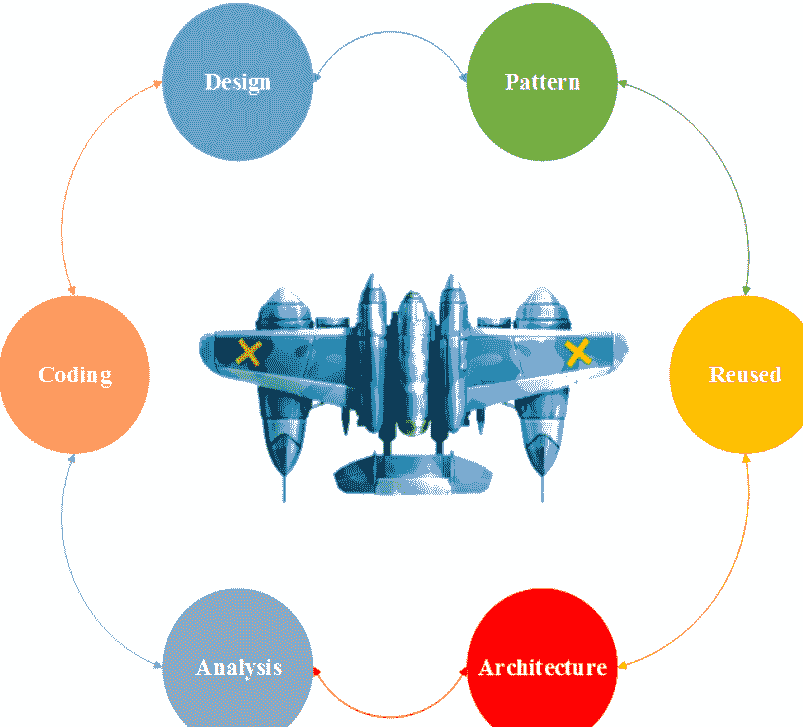
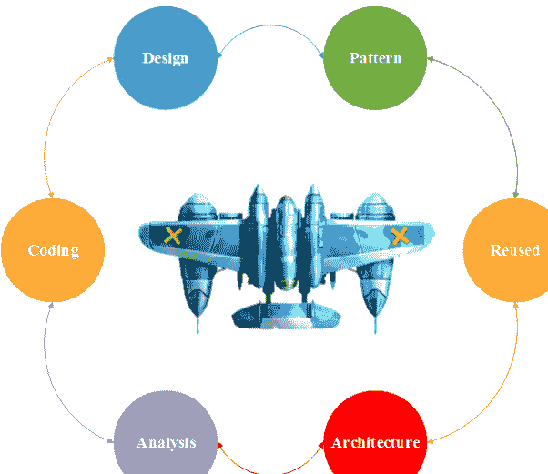
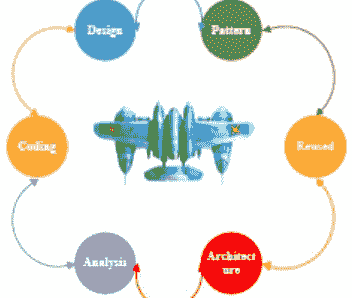

# 杨华 (Y HU)

简单是智慧的开始。本书简要介绍了游戏中的概念和实战案例，你将在轻松且有趣的过程中学习。

如果你想学习这本书，必须具备 Java 基础知识，你可以学习我们的课程 << Java学 Java（第三版）>>

http://en.verejava.com


如果你已经具备 Java 基础知识，请跳过此处，开始这段令人兴奋的旅程

下载 `GameDesignPatternImages.zip` 获取书中的所有图片。

http://en.verejava.com/download.jsp?id=1

# 模板方法模式原理

模板方法：将算法的精确步骤推给子类。在操作中定义算法的骨架，并将某些步骤推给子类。模板方法允许子类在不改变算法结构的情况下重新定义算法的某些步骤。

- 1. `BluePlane` 继承自 `Sprite` 模板以实现复用。

| Sprite |
| --- |
| int x |
| int y |
| String name |
| Sprite(String name, int x, int y) |
| draw() |
| move(int distanceX, int distanceY) |

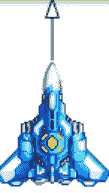

### Sprite:

- 1. `x`: 画布的 x 坐标
- 2. `y`: 画布的 y 坐标
- 3. `Sprite(String name, int x, int y)`: 构造方法
- 4. `draw()`: 在画布上绘制 sprite
- 5. `move(int distanceX, int distanceY)`: sprite 在画布上移动

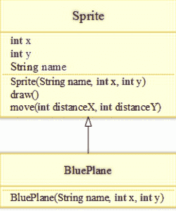

## com.template.principle 包下的 Sprite.java

```java
class Sprite {
    protected int x; // 画布的 x 坐标
    protected int y; // 画布的 y 坐标
    protected String name ;

    public Sprite(String name, int x, int y) {
        this.name = name;
        this.x = x;
        this.y = y;
    }

    public void draw() {
        String text = this.name + " draw on (" + this.x + ", " + this.y + ")";
        System.out.println(text);
    }

    // distance: 在 x 轴上移动
    // distance: 在 y 轴上移动
    public void move(int distanceX, int distanceY) {
        String text = this.name + " move distance (" + distanceX + ", " + distanceY + ")";
        System.out.println(text);
    }
}
```

## com.template.principle 包下的 BluePlane.java

```java
public class BluePlane extends Sprite{
    public BluePlane(String name, int x, int y) {
        super (name, x, y);
    }
}
```

## 2. 创建测试类：com.template.principle 包下的 TestTemplate.java

```java
public class TestTemplate {
    public static void main(String[] args) {
        BluePlane bluePlane = new BluePlane("BluePlane", 50,150);
        bluePlane.draw();
        bluePlane.move(5, 5);
    }
}
```

## 结果:

```
BluePlane draw on (50 , 150)
BluePlane move distance (5 , 5)
```

# 模板方法模式游戏

1. `BluePlane` 在画布上，通过键盘移动上、下、左、右。

```java
public void keyPressed(KeyEvent e) {
    int keyCode = e.getKeyCode();
    if(keyCode == KeyEvent.VK_UP){
        bluePlane.move(0,-6);
    } else if(keyCode == KeyEvent.VK_DOWN){
        bluePlane.move(0,6);
    } else if(keyCode == KeyEvent.VK_RIGHT){
        bluePlane.move(6,0);
    } else if(keyCode == KeyEvent.VK_LEFT){
        bluePlane.move(-6,0);
    }
    Canvas.this.repaint();
}
```


### 2. UML 图继承 Sprite 模板以实现复用。

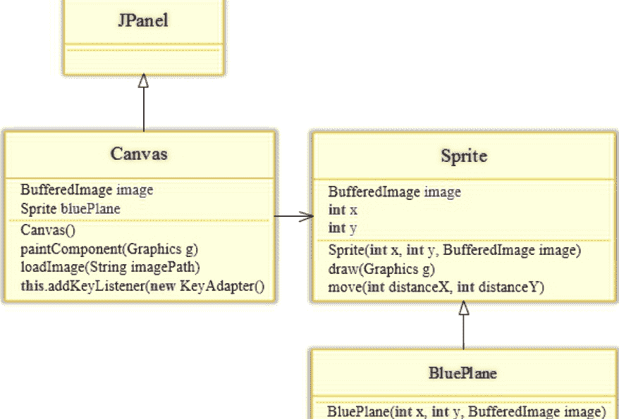

### Sprite:

- 1. `x`: 画布的 x 坐标
- 2. `y`: 画布的 y 坐标
- 3. `Sprite(String name, int x, int y)`: 构造方法
- 4. `draw()`: 在画布上绘制 sprite
- 5. `move(int distanceX, int distanceY)`: sprite 在画布上移动

### Canvas.java 在 com.template.game 包

```java
import java.awt.*;
import java.awt.event.*;
import java.awt.image.BufferedImage;
import java.io.*;
import javax.imageio.ImageIO;
import javax.swing.*;

public class Canvas extends JPanel {
    private BufferedImage blueimage;
    private Sprite bluePlane;

    public Canvas() {
        this.setLayout(null);
        this.setBackground(Color.WHITE);
        blueimage = loadImage("images/blue_plane.png");
        bluePlane = new BluePlane(120, 250, blueimage);
    }

    {
        this.addKeyListener(new KeyAdapter() {
            public void keyPressed(KeyEvent e) {
                int keyCode = e.getKeyCode();
                if(keyCode == KeyEvent.VK_UP){
                    bluePlane.move(0,-6);
                } else if(keyCode == KeyEvent.VK_DOWN){
                    bluePlane.move(0,6);
                } else if(keyCode == KeyEvent.VK_RIGHT){
                    bluePlane.move(6,0);
                } else if(keyCode == KeyEvent.VK_LEFT){
                    bluePlane.move(-6,0);
                }
                Canvas.this.repaint();
            }
        });
    }

    protected void paintComponent(Graphics g) {
        super.paintComponent(g);
        bluePlane.draw(g);
    }

    public BufferedImage loadImage(String imagePath) {
        File file = new File(imagePath);
        BufferedImage bufferedImage = null;
        try {
            bufferedImage = ImageIO.read(file);
        } catch (IOException e) {
            e.printStackTrace();
        }
        return bufferedImage;
    }
}
```

### BluePlane.java 在 com.template.game

```java
import java.awt.*;
import java.awt.image.BufferedImage;

public class BluePlane extends Sprite {
    public BluePlane(int x, int y, BufferedImage image) {
        super(x, y, image);
    }
}
```

### Sprite.java 在 com.template.game

```java
import java.awt.*;
import java.awt.image.BufferedImage;

class Sprite {
    protected int x;
    protected int y;
    protected BufferedImage image;

    public Sprite(int x, int y, BufferedImage image) {
        this.x = x;
        this.y = y;
        this.image = image;
    }

    public void draw(Graphics g) {
        g.drawImage(image, x, y, null);
    }

    public void move(int distanceX, int distanceY) {
        this.x += distanceX;
        this.y += distanceY;
    }
}
```

### TestTemplate.java 在 com.template.game

```java
import java.awt.BorderLayout;
import javax.swing.JFrame;

public class TestTemplate {
    public static void main(String[] args) {
        JFrame frame = new JFrame("Design Pattern Template");
        Canvas canvas = new Canvas();
        frame.add(canvas, BorderLayout.CENTER );
        frame.setSize(300, 350);
        canvas.setFocusable(true);
        frame.setVisible(true);
        canvas.requestFocus();
    }
}
```

# 单例模式原理

单例模式：一种只能存在实例的类。确保一个类只有一个实例，并为其提供一个全局访问点。

- `BluePlane` 和 `RedPlane` 通过 `ImageUtil` 单例实例加载图像。

ImageUtil:

1. `private ImageUtil()`: 不允许创建多个实例
2. `static String loadImage(String imagePath)`: 加载图像

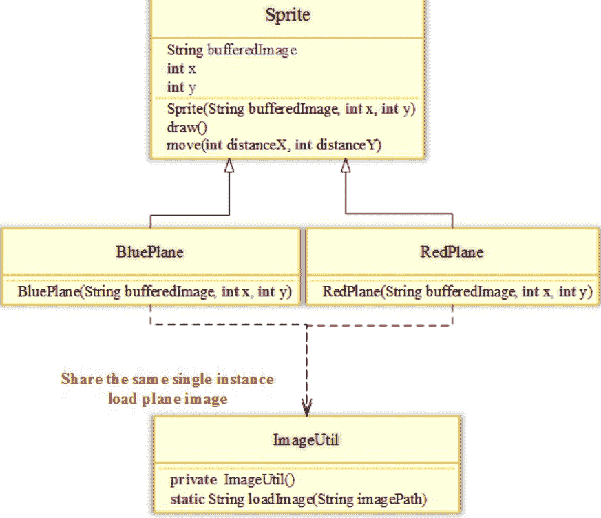

## 包 com.singleton.principle 中的 Sprite.java

```java
class Sprite {
    protected int x; // Canvas 的 x 坐标
    protected int y; // BufferedImage 的 y 坐标
    protected String bufferedImage;

    public Sprite(BufferedImage bufferedImage, int x, int y) {
        this.bufferedImage = bufferedImage;
        this.x = x;
        this.y = y;
    }

    public void draw() {
        String text = this.bufferedImage + " draw on (" + this.x + "," + this.y + ")";
        System.out.println(text);
    }

    public void move(int distanceX, int distanceY) {
        String text = this.bufferedImage + " move distance (" + distanceX + "," + distanceY + ")";
        System.out.println(text);
    }
}
```

## 包 com.singleton.principle 中的 BluePlane.java

```java
public class BluePlane extends Sprite {
    public BluePlane(BufferedImage bufferedImage, int x, int y) {
        super(bufferedImage, x, y);
    }
}
```

## 包 com.singleton.principle 中的 RedPlane.java

```java
public class RedPlane extends Sprite{
    public RedPlane(String bufferedImage, int x, int y) {
        super (bufferedImage, x, y);
    }
}
```

## ImageUtil:

1. `private ImageUtil()`: 不允许创建多个实例
2. `static String loadImage(String imagePath)`: 加载图像

## 包 com.singleton.principle 中的 ImageUtil.java

```java
import java.io.File;

public class ImageUtil {
    private ImageUtil(){
    }
    public static String loadImage(String imagePath) {
        File file = new File(imagePath);
        return file.getName();
    }
}
```

### 2. 在包 com.singleton.principle 中创建一个测试类：TestSingleton.java


```java
public class TestSingleton {
    public static void main(String[] args) {
        String bufferedImage = ImageUtil.loadImage("images/blue_plane.png");
        BluePlane bluePlane = new BluePlane(bufferedImage, 50, 150);
        bluePlane.draw();
        bluePlane.move(5, 5);
        System.out.println("------------------------------------------------");
        bufferedImage = ImageUtil.loadImage("images/red_plane.png");
        RedPlane redPlane = new RedPlane(bufferedImage, 50, 0);
        redPlane.draw();
        redPlane.move(0, 5);
    }
}
```

## 结果

```
blue_plane.png draw on (50 , 150)
blue_plane.png move distance (5 , 5)
red_plane.png draw on (50 , 0)
red_plane.png move distance (0 , 5)
```

## 单例模式游戏

1. `BluePlane` 和 `RedPlane` 通过 `ImageUtil` 单例实例加载图像。
2. 在画布上绘制 `BluePlane` 和 `RedPlane` 图像。
3. 按上、下、左、右键移动 `BluePlane`。
4. 按 `E`、`D`、`S`、`F` 键移动 `RedPlane`。

```java
public void keyPressed(KeyEvent e) {
    int keyCode = getKeyCode();
    if (keyCode == KeyEvent.VK_E) {
        redPlane.move(0, -6);
    } else if (keyCode == KeyEvent.VK_D) {
        redPlane.move(6, 0);
    } else if (keyCode == KeyEvent.VK_F) {
        redPlane.move(6, 0);
    } else if (keyCode == KeyEvent.VK_S) {
        redPlane.move(-6, 0);
    }

    if (keyCode == KeyEvent.VK_UP) {
        bluePlane.move(0, -6);
    } else if (keyCode == KeyEvent.VK_DOWN) {
        bluePlane.move(0, 6);
    } else if (keyCode == KeyEvent.VK_RIGHT) {
        bluePlane.move(6, 0);
    } else if (keyCode == KeyEvent.VK_LEFT) {
        bluePlane.move(-6, 0);
    }

    Canvas.repaint();
}
```

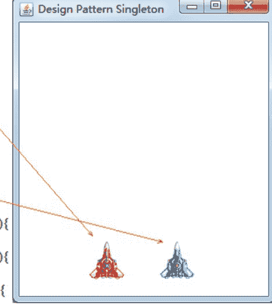

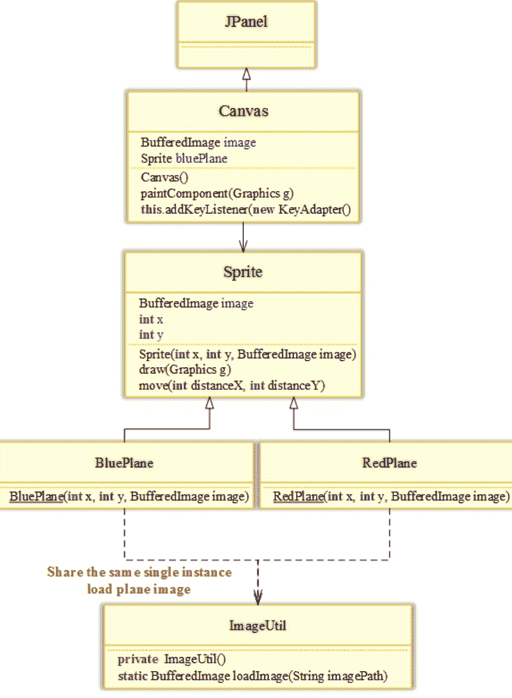

## 包 `com.singleton.game` 中的 `Sprite.java`

```java
import java.awt.Graphics;
import java.awt.image.BufferedImage;

class Sprite {
    protected int x; // Canvas 的 x 坐标
    protected int y; // Canvas 的 y 坐标
    protected BufferedImage image;

    public Sprite(int x, int y, BufferedImage image) {
        this.x = x;
        this.y = y;
        this.image = image;
    }

    public void draw(Graphics g) {
        g.drawImage(image, this.x, this.y, null);
    }

    public void move(int distanceX, int distanceY) {
        this.x += distanceX;
        this.y += distanceY;
    }
}
```

## `ImageUtil`

1. `private ImageUtil()`: 不允许创建多个实例。
2. `static String loadImage(String imagePath)`: 单例加载图像。

### 包 `com.singleton.game` 中的 `ImageUtil.java`

```java
import java.awt.image.BufferedImage;
import java.io.*;

public class ImageUtil {
    private ImageUtil() {
    }

    public static String loadImage(String imagePath) {
        try {
            File file = new File(imagePath);
            return file.getName();
        } catch (IOException e) {
            e.printStackTrace();
            return null;
        }
    }
}
```

### 包 `com.singleton.game` 中的 `BluePlane.java`

```java
import java.awt.image.BufferedImage;

public class BluePlane extends Sprite {
    public BluePlane(int x, int y, BufferedImage image) {
        super(x, y, image);
    }
}
```

### 包 `com.singleton.game` 中的 `RedPlane.java`

```java
import java.awt.image.BufferedImage;

public class RedPlane extends Sprite {
    public RedPlane(int x, int y, BufferedImage image) {
        super(x, y, image);
    }
}
```

### 包 `com.singleton.game` 中的 `Canvas.java`

```java
import java.awt.*;
import java.awt.event.*;
import java.awt.image.BufferedImage;
import javax.swing.*;

public class Canvas extends JPanel {
    private BufferedImage blueImage;
    private Sprite bluePlane;
    private BufferedImage redImage;
    private Sprite redPlane;

    public Canvas() {
        this.setLayout(null);
        this.setBackground(Color.WHITE);
        blueImage = ImageUtil.loadImage("images/blue_plane.png");
        bluePlane = new BluePlane(80, 250, blueImage);
        redImage = ImageUtil.loadImage("images/red_plane.png");
        redPlane = new RedPlane(160, 250, redImage);

        this.addKeyListener(new KeyAdapter() {
            public void keyPressed(KeyEvent e) {
                int keyCode = e.getKeyCode();
                if (keyCode == KeyEvent.VK_E) {
                    redPlane.move(0, -6);
                } else if (keyCode == KeyEvent.VK_D) {
                    redPlane.move(6, 0);
                } else if (keyCode == KeyEvent.VK_F) {
                    redPlane.move(6, 0);
                } else if (keyCode == KeyEvent.VK_S) {
                    redPlane.move(-6, 0);
                }

                if (keyCode == KeyEvent.VK_UP) {
                    bluePlane.move(0, -6);
                } else if (keyCode == KeyEvent.VK_DOWN) {
                    bluePlane.move(0, 6);
                } else if (keyCode == KeyEvent.VK_RIGHT) {
                    bluePlane.move(6, 0);
                } else if (keyCode == KeyEvent.VK_LEFT) {
                    bluePlane.move(-6, 0);
                }

                Canvas.this.repaint();
            }
        });
    }

    @Override
    protected void paintComponent(Graphics g) {
        super.paintComponent(g);
        bluePlane.draw(g);
        redPlane.draw(g);
    }
}
```

# 享元模式原理

享元模式：一种用于高效共享的细粒度实例。通过使用共享来高效地支持大量的细粒度对象。享元对象是一个共享对象，可以同时在多个上下文中使用。享元对象在每个上下文中都作为一个独立对象存在——它与未共享的对象实例没有二致。

1. `ImageCache` 存储游戏图像，如（飞机、敌机、子弹）。

| ImageCache |
| :--- |
| `Map<String, String> cacheMap` |
| `ImageCache()` |
| `static void put(String key, String image)` |
| `static String get(String key)` |

### `ImageCache`

1. `Map<String, String> cacheMap`: 以键值对形式存储数据。
2. `static void put(String key, String image)`: 存储数据。
3. `static String get(String key)`: 通过键获取值。

#### 包 `com.flyweight.principle` 下的 `ImageCache.java`

```java
import java.util.*;

public class ImageCache {
    private static Map<String, String> cacheMap = new HashMap<String, String>();

    private ImageCache() {}

    public static void put(String key, String image) {
        cacheMap.put(key, image);
    }

    public static String get(String key) {
        return cacheMap.get(key);
    }
}
```

## 2. 在包 `com.flyweight.principle` 下创建一个测试类：`TestCache.java`

```java
import java.awt.Border;
import javax.swing.JFrame;

public class TestCache {
    public static void main(String[] args) {
        ImageCache.put("redBulletImage", "images/red_bullet.png");
        ImageCache.put("enemyPlaneImage", "images/enemy_plane.png");
        ImageCache.put("bluePlaneImage", "images/blue_plane.png");

        System.out.println(ImageCache.get("redBulletImage"));
        System.out.println(ImageCache.get("enemyPlaneImage"));
        System.out.println(ImageCache.get("bluePlaneImage"));
    }
}
```

**结果：**

```
images/red_bullet.png
images/enemy_plane.png
images/blue_plane.png
```

## 享元模式游戏

1. `ImageCache` 在 `Canvas` 中预加载蓝色飞机（`BluePlane`）和红色子弹（`RedBullet`）图像。
2. 创建蓝色飞机和红色子弹。
3. 蓝色飞机装载红色子弹。
4. 按上、下、左、右方向键移动蓝色飞机。
5. 按回车键移动红色子弹，然后红色子弹从飞机的上方移动。

```java
static {
    ImageCache.put("redBullet", ImageUtil.loadImage("images/red_bullet.png"));
    ImageCache.put("bluePlane", ImageUtil.loadImage("images/blue_plane.png"));
}
```

```java
public void keyPressed(KeyEvent e) {
    int keyCode = e.getKeyCode();
    if (keyCode == KeyEvent.VK_UP) {
        bluePlane.move(0, -6);
    } else if (keyCode == KeyEvent.VK_DOWN) {
        bluePlane.move(0, 6);
    } else if (keyCode == KeyEvent.VK_RIGHT) {
        bluePlane.move(6, 0);
    } else if (keyCode == KeyEvent.VK_LEFT) {
        bluePlane.move(-6, 0);
    } else if (keyCode == KeyEvent.VK_ENTER) {
        bluePlane.fireBullet();
    }
}
```

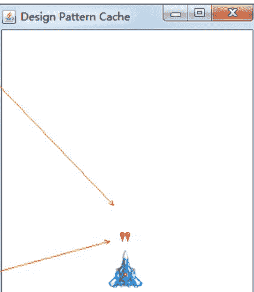

```java
public void fireBullet() {
    if (!bullet.isVisible()) {
        int x = this.x + this.bullet.width / 2 - bullet.getWidth() / 2;
        int y = this.y - bullet.getHeight();
        bullet.setX(x);
        bullet.setY(y);
        bullet.setVisible(true);
    }
}
```

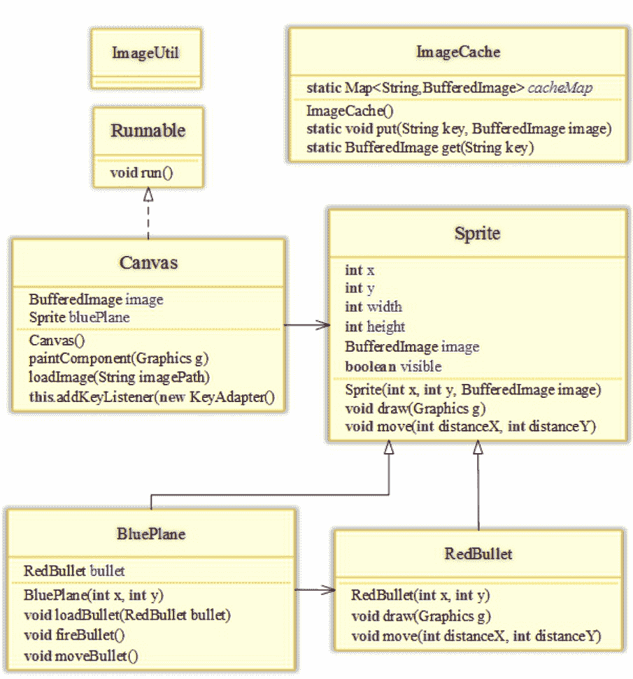

## `Sprite`（精灵类）

1. `boolean visible`: 如果精灵可见=true，则在画布上绘制并移动，否则消失。

### 包 `com.flyweight.game` 下的 `Sprite.java`


```java
import java.awt.Graphics;
import java.awt.image.BufferedImage;

abstract class Sprite {
    protected int x; // Canvas 的 x 坐标
    protected int y; // Canvas 的 y 坐标
    protected int width;
    protected int height;
    protected BufferedImage image;
    protected boolean visible;

    public Sprite(int x, int y, BufferedImage image) {
        this.x = x;
        this.y = y;
        this.image = image;
    }

    public void draw(Graphics g) {
        if (visible) {
            g.drawImage(image, x, y, null);
        }
    }

    public void move(int dx, int dy) {
        x += dx;
        y += dy;
    }

    public void setVisible(boolean visible) {
        this.visible = visible;
    }

    public boolean isVisible() {
        return visible;
    }
}
```

### 3. 在包 `com.flyweight.game` 中创建一个测试类：`TestCache.java`

```java
canvas.setFocusable(true); // 设置焦点以激活键盘事件 
canvas.requestFocus(); // 设置焦点以激活键盘事件
```

```java
import java.awt.BorderLayout;
import javax.swing.JFrame;

public class TestCache {
    public static void main(String[] args) {
        JFrame frame = new JFrame("Design Pattern Cache");
        Canvas canvas = new Canvas();
        frame.add(canvas, BorderLayout.CENTER);
        frame.setSize(300, 350);
        canvas.setFocusable(true);
        frame.setVisible(true);
        canvas.requestFocus();
    }
}
```

## Builder模式原理

构建器模式：将对象的构建与其表示分离。将复杂对象的构建过程与其表示分离，使得相同的构建过程可以创建不同的表示。

- 1. 通过 `Builder` 创建 `SelectDialog`，
- 2. `Builder` 设置标题和按钮。然后创建对话框进行显示

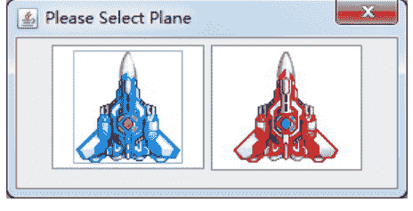

| SelectDialog | 按钮 |
| --- | --- |
| `String title` | `String name` |
| `Button bluePlaneButton` | |
| `Button redPlaneButton` | `Button(String name)` |
| `private SelectDialog()` | | |
| `void showDialog()` | | |

| <<static>> |
| --- |
| `Builder` |
| `SelectDialog dialog` |
| `Builder()` |
| `setTitle(String title)` |
| `setBluePlaneButton(Button bluePlaneButton)` |
| `setRedPlaneButton(Button redPlaneButton)` |

## 包 `com.builder.principle` 中的 `Button.java`

```java
public class Button {
    private String name;

    public Button(String name) {
        super();
        this.name = name;
    }

    public String getName() {
        return name;
    }

    public void setName(String name) {
        this.name = name;
    }
}
```

## 包 `com.builder.principle` 中的 `SelectDialog.java`

```java
import java.awt.*;
import javax.swing.*;

public class SelectDialog {
    private String title;
    private Button bluePlaneButton;
    private Button redPlaneButton;

    private SelectDialog() {
    }

    public String getTitle() {
        return title;
    }

    public void setTitle(String title) {
        this.title = title;
    }

    public Button getBluePlaneButton() {
        return bluePlaneButton;
    }

    public void setBluePlaneButton(Button bluePlaneButton) {
        this.bluePlaneButton = bluePlaneButton;
    }

    public Button getRedPlaneButton() {
        return redPlaneButton;
    }

    public void setRedPlaneButton(Button redPlaneButton) {
        this.redPlaneButton = redPlaneButton;
    }

    public void showDialog() {
        System.out.println("Popup Select Dialog");
        System.out.println(this.title);
        System.out.println(this.bluePlaneButton.getName());
        System.out.println(this.redPlaneButton.getName());
    }

    static class Builder {
        private SelectDialog dialog;

        public Builder() {
            dialog = new SelectDialog();
        }

        public void setTitle(String title) {
            dialog.setTitle(title);
        }

        public void setBluePlaneButton(Button bluePlaneButton) {
            dialog.setBluePlaneButton(bluePlaneButton);
        }

        public void setRedPlaneButton(Button redPlaneButton) {
            dialog.setRedPlaneButton(redPlaneButton);
        }

        public SelectDialog create() {
            return dialog;
        }
    }
}
```

### 2. 在包 `com.builder.principle` 中创建一个测试类：`TestBuilder.java`

```java
public class TestBuilder {
    public static void main(String[] args) {
        // 构建对话框
        SelectDialog.Builder builder = new SelectDialog.Builder();
        builder.setTitle("Please Select Plane");
        builder.setBluePlaneButton(new Button("Blue Plane"));
        builder.setRedPlaneButton(new Button("Red Plane"));
        // 创建并弹出对话框
        SelectDialog dialog = builder.create();
        dialog.showDialog();
    }
}
```

结果：

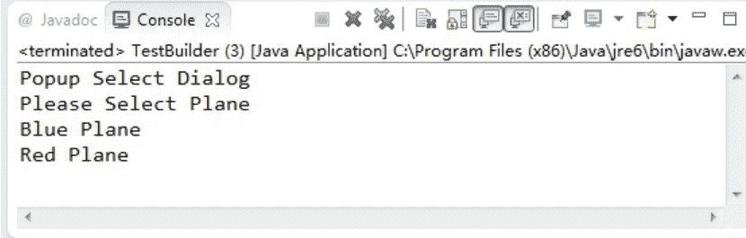

## Builder模式游戏

- 1. 通过 `Builder` 创建 `SelectDialog`，
- 2. `Builder` 设置标题和按钮。然后创建对话框进行显示

```java
private SelectDialog() {
    this.setModal(true);
    this.setBackground(Color.WHITE);
    this.setSize(300, 150);
    this.setLayout(new FlowLayout());
    bluePlaneButton = new JButton();
    bluePlaneButton.setIcon(new ImageIcon("images/blue_plane_big.png"));
    bluePlaneButton.setBackground(Color.WHITE);
    redPlaneButton = new JButton();
    redPlaneButton.setIcon(new ImageIcon("images/red_plane_big.png"));
    redPlaneButton.setBackground(Color.WHITE);
    this.add(bluePlaneButton);
    this.add(redPlaneButton);
}
```

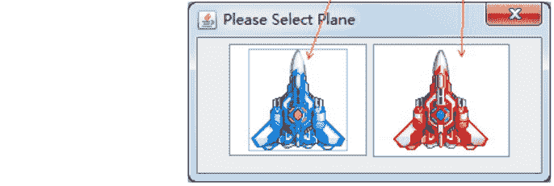

## UML 图

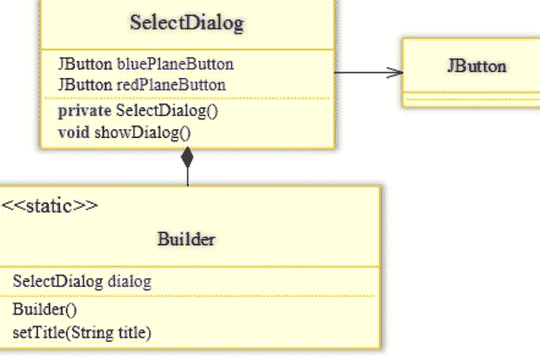

## 包 `com.builder.game` 中的 `SelectDialog.java`

```java
import java.awt.*;
import javax.swing.*;

public class SelectDialog extends JDialog {
    private JButton bluePlaneButton;
    private JButton redPlaneButton;

    public SelectDialog() {
        this.setModal(true);
        this.setBackground(Color.WHITE);
        this.setSize(300, 150);
        this.setLayout(new FlowLayout());
        bluePlaneButton = new JButton();
        bluePlaneButton.setIcon(new ImageIcon("images/blue_plane_big.png"));
        bluePlaneButton.setBackground(Color.WHITE);
        redPlaneButton = new JButton();
        redPlaneButton.setIcon(new ImageIcon("images/red_plane_big.png"));
        redPlaneButton.setBackground(Color.WHITE);
        this.add(bluePlaneButton);
        this.add(redPlaneButton);
    }

    public void showDialog() {
        this.setVisible(true);
    }

    public static class Builder {
        private SelectDialog dialog;

        public Builder() {
            dialog = new SelectDialog();
        }

        public void setTitle(String title) {
            dialog.setTitle(title);
        }

        public SelectDialog create() {
            return dialog;
        }
    }
}
```

### 3. 在包 `com.builder.game` 中创建一个测试类：`TestBuilder.java`

```java
import java.awt.BorderLayout;
import javax.swing.JFrame;

public class TestBuilder {
    public static void main(String[] args) {
        JFrame frame = new JFrame("Design Pattern Cache");
        SelectDialog.Builder builder = new SelectDialog.Builder();
        builder.setTitle("Please Select Plane");
        SelectDialog dialog = builder.create();
        dialog.showDialog();
    }
}
```

# 命令模式原理

**命令模式：**将请求封装为对象，允许对请求进行参数化。

- 1. 通过 `addActionListener(ActionListener)` 创建两个 `BluePlaneButton` 和 `RedPlaneButton`
- 2. 通过 `addActionListener(ActionListener)` 设置 `BluePlaneButton` 和 `RedPlaneButton`
- 3. 点击 `BluePlaneButton` 或 `RedPlaneButton`，会自动调用 `actionPerformed(ActionEvent e)`。

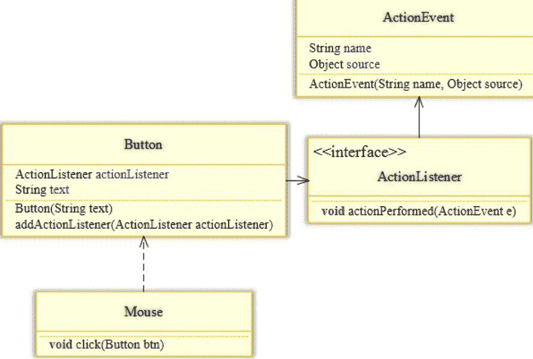

## 包 `com.command.principle` 中的 `ActionListener.java`

点击按钮，会自动调用 `actionPerformed(ActionEvent e)`。

```java
public interface ActionListener {
    void actionPerformed(ActionEvent e);
}
```

## 包 `com.command.principle` 中的 `ActionEvent.java`

从指定的按钮和动作构造一个新的事件对象。

```java
public class ActionEvent {
    private String name;
    private Object source;

    public ActionEvent(String name, Object source) {
        super();
        this.name = name;
        this.source = source;
    }

    public String getName() {
        return name;
    }

    public void setName(String name) {
        this.name = name;
    }

    public Object getSource() {
        return source;
    }
}
```


## 包 `com.command.principle` 中的 `Button.java`

```java
public class Button {

    private ActionListener actionListener;

    private String text;

    public Button(String text) {
        super();
        this.text = text;
    }

    public ActionListener getActionListener() {
        return actionListener;
    }

    public void addActionListener(ActionListener actionListener) {
        this.actionListener = actionListener;
    }

    public String getText() {
        return text;
    }

    public void setText(String text) {
        this.text = text;
    }

}
```

## 测试类：`TestCommand.java` (包 `com.command.principle`)

```java
public class TestCommand {

    public static void main(String[] args) {
        Button bluePlaneButton = new Button("BluePlane Button");
        Button redPlaneButton = new Button("RedPlane Button");

        bluePlaneButton.addActionListener(new ActionListener() {
            // 添加监听事件
            @Override
            public void actionPerformed(ActionEvent e) {
                Button button = (Button) e.getSource();
                System.out.println(button.getText() + " is clicked");
            }
        });

        redPlaneButton.addActionListener(new ActionListener() {
            // 添加监听事件
            @Override
            public void actionPerformed(ActionEvent e) {
                Button button = (Button) e.getSource();
                System.out.println(button.getText() + " is clicked");
            }
        });

        Mouse m = new Mouse();
        m.click(bluePlaneButton); // 鼠标点击 BluePlane 按钮
        m.click(redPlaneButton);  // 鼠标点击 RedPlane 按钮
    }
}
```

### 结果

```text
BluePlane Button is clicked
RedPlane Button is clicked
```

## 命令模式游戏

1. 通过 `addActionListener(ActionListener actionListener)` 添加 `JButton` `BluePlaneButton` 和 `RedPlaneButton`。
2. 通过 `addActionListener(ActionListener actionListener)` 为 `BluePlaneButton` 和 `RedPlaneButton` 添加 `ActionListener`。
3. 点击 `BluePlaneButton` 或 `RedPlaneButton` 时，会自动调用 `actionPerformed(ActionEvent e)`。
4. 关闭 `SelectDialog`。

```java
bluePlaneButton = new JButton();
bluePlaneButton.setIcon(new ImageIcon("images/blue_plane_big.png"));
bluePlaneButton.setBackground(Color.WHITE);
bluePlaneButton.addActionListener(new ActionListener() {
    @Override
    public void actionPerformed(ActionEvent e) {
        SelectDialog.dispose();
    }
});

redPlaneButton = new JButton();
redPlaneButton.setIcon(new ImageIcon("images/red_plane_big.png"));
redPlaneButton.setBackground(Color.WHITE);
redPlaneButton.addActionListener(new ActionListener() {
    @Override
    public void actionPerformed(ActionEvent e) {
        SelectDialog.dispose();
    }
});
```

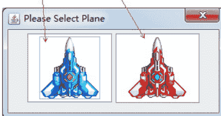
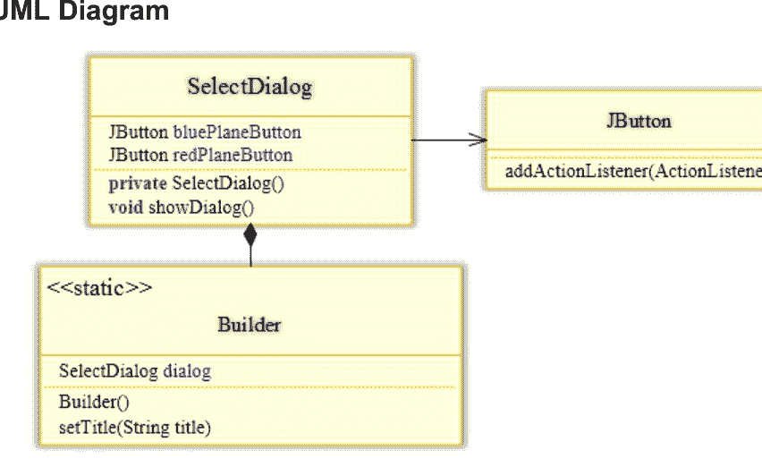

## 包 `com.command.game` 中的 `SelectDialog.java`

```java
import java.awt.*;
import java.awt.event.*;
import javax.swing.*;

public class SelectDialog extends JDialog {
    private JButton blueButton;
    private JButton redButton;

    private SelectDialog() {
        this.setModal(true);
        this.setBackground(Color.WHITE);
        this.setSize(300, 150);
        this.setLayout(new FlowLayout());

        blueButton = new JButton();
        blueButton.setIcon(new ImageIcon("images/blue_plane_big.png"));
        blueButton.setBackground(Color.WHITE);
        blueButton.addActionListener(new ActionListener() {
            @Override
            public void actionPerformed(ActionEvent e) {
                SelectDialog.this.dispose();
            }
        });

        redButton = new JButton();
        redButton.setIcon(new ImageIcon("images/red_plane_big.png"));
        redButton.setBackground(Color.WHITE);
        redButton.addActionListener(new ActionListener() {
            @Override
            public void actionPerformed(ActionEvent e) {
                SelectDialog.this.dispose();
            }
        });

        this.add(blueButton);
        this.add(redButton);
    }

    public void showDialog() {
        this.setVisible(true);
    }

    public static class Builder {
        private SelectDialog dialog;

        public Builder() {
            dialog = new SelectDialog();
        }

        public void setTitle(String title) {
            dialog.setTitle(title);
        }

        public SelectDialog create() {
            return dialog;
        }
    }
}
```

## 测试类：`TestCommand.java` (包 `com.command.game`)

```java
import java.awt.BorderLayout;
import javax.swing.JFrame;

public class TestCommand {
    public static void main(String[] args) {
        JFrame frame = new JFrame("Design Pattern Command");
        SelectDialog.Builder builder = new SelectDialog.Builder();
        builder.setTitle("Please Select Plane");
        SelectDialog dialog = builder.create();
        dialog.showDialog();

        frame.setSize(300, 350);
        frame.setVisible(true);
    }
}
```

# 工厂模式原理

工厂模式：创建多个派生类的实例。定义一个用于创建对象的接口，但让子类决定实例化哪个类。工厂方法让类将实例化推迟到子类。

1. 可以通过 `SpriteFactory` 创建 `BluePlane` 和 `RedPlane`。

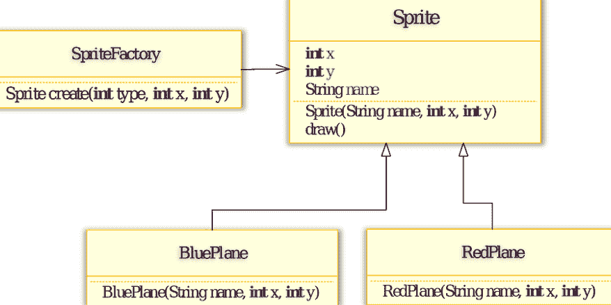

## 包 `com.factory.principle` 中的 `Sprite.java`

```java
class Sprite {
    protected int x; // 画布的 x 坐标
    protected int y; // 画布的 y 坐标
    protected int name;

    public Sprite(int x, int y) {
        this.x = x;
        this.y = y;
    }

    public void draw() {
        System.out.println(name + " at (" + x + ", " + y + ")");
    }
}
```

## 包 `com.factory.principle` 中的 `BluePlane.java`

```java
class BluePlane extends Sprite {
    public BluePlane(int x, int y) {
        super(x, y);
        this.name = "BluePlane";
    }
}
```

## 包 `com.factory.principle` 中的 `RedPlane.java`

```java
class RedPlane extends Sprite {
    public RedPlane(int x, int y) {
        super(x, y);
        this.name = "RedPlane";
    }
}
```

## `SpriteFactory.java` (包 `com.factory.principle`)

`SpriteFactory.create(int type, int x, int y)` 创建 `BluePlane` 或 `RedPlane`。

```java
public class SpriteFactory {
    public static Sprite create(int type, int x, int y) {
        if (type == 1) {
            return new BluePlane(x, y);
        } else if (type == 2) {
            return new RedPlane(x, y);
        }
        return null;
    }
}
```

## 测试类：`TestFactory.java` (包 `com.factory.principle`)

```java
public class TestFactory {
    public static void main(String[] args) {
        Sprite plane = SpriteFactory.create(1, 120, 250);
        plane.draw();

        System.out.println("--------------------------------------------");

        plane = SpriteFactory.create(2, 150, 300);
        plane.draw();
    }
}
```

### 结果

```text
BluePlane at (120, 250)
--------------------------------------------
RedPlane at (150, 300)
```

## 工厂模式游戏

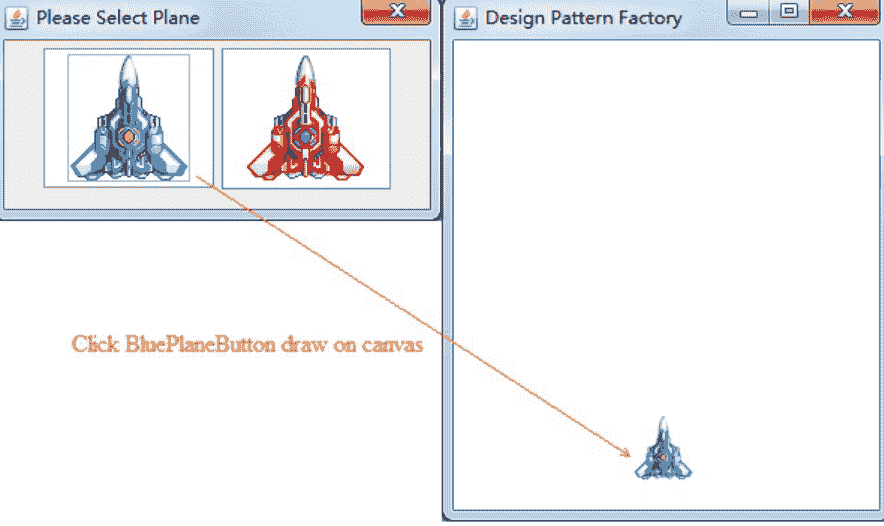

点击 `BluePlane` 绘制画布

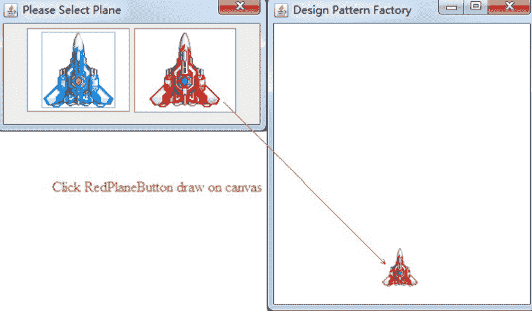

点击 `RedPlane` 绘制画布

```java
bluePlaneButton = new JButton();
bluePlaneButton.setIcon(new ImageIcon("images/blue_plane_big.png"));
bluePlaneButton.setBackground(Color.WHITE);
bluePlaneButton.addActionListener(new ActionListener() {
    @Override
    public void actionPerformed(ActionEvent e) {
        Canvas canvas = new Canvas("C1");
        SelectDialog.dispose();
        CGlobal.frame.repaint();
        CGlobal.frame.add(canvas, BorderLayout.CENTER);
        canvas.setFocusable(true);
        canvas.requestFocus();
    }
});

redPlaneButton = new JButton();
redPlaneButton.setIcon(new ImageIcon("images/red_plane_big.png"));
redPlaneButton.setBackground(Color.WHITE);
redPlaneButton.addActionListener(new ActionListener() {
    @Override
    public void actionPerformed(ActionEvent e) {
        Canvas canvas = new Canvas("C2");
        SelectDialog.dispose();
        CGlobal.frame.repaint();
        CGlobal.frame.add(canvas, BorderLayout.CENTER);
        canvas.setFocusable(true);
        canvas.requestFocus();
    }
});
```

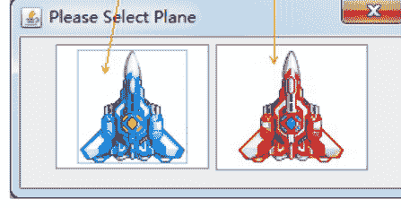


```java
class Canvas {
    private String type;
    private Sprite plane;

    public Canvas(String type) {
        this.type = type;
        this.setLayout(null);
        this.setBackground(Color.WHITE);
        plane = SpriteFactory.create(type, 120, 250);
    }

    public void draw() {
        System.out.println(type + " drawing");
        plane.draw();
    }
}
```

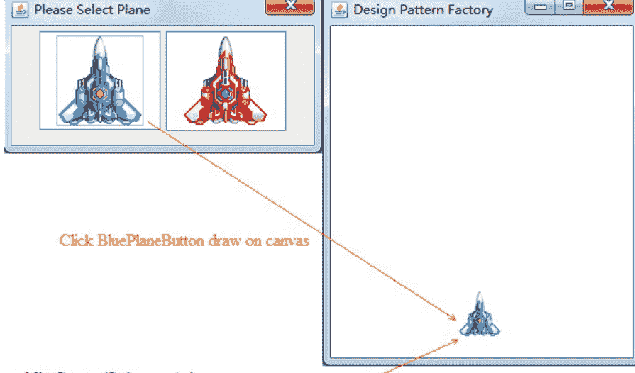

点击 `BluePlane` 绘制画布

```java
public Canvas(String type) {
    this.type = type;
    this.setLayout(null);
    this.setBackground(Color.WHITE);
    plane = SpriteFactory.create(type, 120, 250);
}
```

```java
public Canvas(String type) {
    this.type = type;
    this.setLayoutLayout(null);
    this.setBackground(Color.WHITE);
    plane = SpriteFactory.create(type, 120, 250);
}
```

1. 首先显示对话框(`SelectDialog`)
2. 点击蓝色飞机(`BluePlane`)和红色飞机(`RedPlane`)按钮，关闭对话框
3. `SpriteFactory` 创建选定的飞机并绘制在 `Canvas` 上

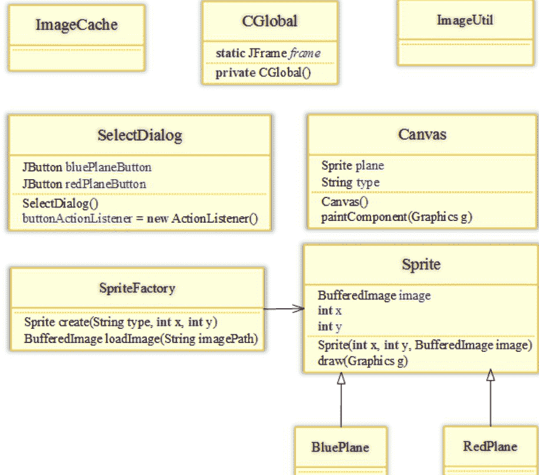

## `com.factory.game` 包下的 `Sprite.java`

```java
import java.awt.Graphics;
import java.awt.image.BufferedImage;
class Sprite {
    protected int x; // Canvas 的 x 坐标
    protected int y; // Canvas 的 y 坐标
    protected BufferedImage image;

    public Sprite(int x, int y, BufferedImage image) {
        this.x = x;
        this.y = y;
        this.image = image;
    }

    public void draw(Graphics g) {
        g.drawImage(image, this.x, this.y, null);
    }
}
```

## `com.flyweight.game` 包下的 `ImageCache.java` 在上一章

## `com.factory.game` 包下的 `BluePlane.java`

```java
import java.awt.image.BufferedImage;
public class BluePlane extends Sprite {

    public BluePlane(int x, int y) {
        super(x, y, ImageCache.get("bluePlaneImage"));
    }
}
```

## `com.factory.game` 包下的 `RedPlane.java`

```java
import java.awt.image.BufferedImage;
public class RedPlane extends Sprite{
    public RedPlane(int x, int y) {
        super(x, y, ImageCache.get("redPlaneImage"));
    }
}
```

## `SpriteFactory`

| Sprite create(int type, int x, int y) |
| :--- |
| 创建 `BluePlane` 和 `RedPlane` |

`com.factory.game` 包下的 `SpriteFactory.java`

```java
import java.awt.image.BufferedImage;
import java.io.*;
import javax.imageio.ImageIO;
public class SpriteFactory {
    public static Sprite create(String type, int x, int y){
        if ("1".equals(type)){
            BufferedImage image = ImageUtil.loadImage("images/blue_plane.png");
            return new BluePlane(x, y, image);
        }else if ("2".equals(type)){
            BufferedImage image = ImageUtil.loadImage("images/red_plane.png");
            return new RedPlane(x, y, image);
        }
        return null;
    }
}
```

`com.factory.game` 包下的 `CGGlobal.java`

```java
import javax.swing.JFrame;
public class CGlobal {
    private CGlobal(){
    }
    public static JFrame frame ;
}
```

`com.factory.game` 包下的 `SelectDialog.java`

```java
import java.awt.*;
import java.awt.event.*;
import javax.swing.*;
public class SelectDialog extends JDialog {
    private JButton bluePlaneButton;
    private JButton redPlaneButton;

    private SelectDialog() {
        this.setModal(true);
        this.setBackground(Color.WHITE);
        this.setSize(300, 150);
        this.setLayout(new FlowLayout());

        bluePlaneButton = new JButton();
        bluePlaneButton.setIcon(new ImageIcon("images/blue_plane_big.png"));
        bluePlaneButton.setBackground(Color.WHITE);
        bluePlaneButton.addActionListener(new ActionListener(){
            public void actionPerformed(ActionEvent e) {
                Canvas canvas = new Canvas("1");
                SelectDialog.this.dispose();
                CGGlobal.frame.repaint();
                CGGlobal.frame.add(canvas, BorderLayout.CENTER);
                canvas.setFocusable(true);
                canvas.requestFocus();
            }
        });

        redPlaneButton = new JButton();
        redPlaneButton.setIcon(new ImageIcon("images/red_plane_big.png"));
        redPlaneButton.setBackground(Color.WHITE);
        redPlaneButton.addActionListener(new ActionListener(){
            public void actionPerformed(ActionEvent e) {
                Canvas canvas = new Canvas("2");
                SelectDialog.this.dispose();
                CGGlobal.frame.repaint();
                CGGlobal.frame.add(canvas, BorderLayout.CENTER);
                canvas.setFocusable(true);
                canvas.requestFocus();
            }
        });
        this.add(bluePlaneButton);
        this.add(redPlaneButton);
    }

    public void showDialog(){
        this.setVisible(true);
    }

    public static class Builder {
        private SelectDialog dialog;
        public Builder() {
            dialog = new SelectDialog();
        }
        public void setTitle(String title) {
            dialog.setTitle(title);
        }
        public SelectDialog create() {
            return dialog;
        }
    }
}
```

`com.singleton.game` 包下的 `ImageUtil.java` 在上一章

`com.factory.game` 包下的 `Canvas.java`

2. 创建一个测试类：`com.factory.game` 包下的 `TestFactory.java`

```java
import java.awt.Border;
import javax.swing.JFrame;

public class TestFactory {
    private Sprite plane;
    public void main(String[] args) {
        CGGlobal.frame = new JFrame("Factory Pattern");
        CGGlobal.frame.setSize(800, 600);
        CGGlobal.frame.setDefaultCloseOperation(JFrame.EXIT_ON_CLOSE);
        CGGlobal.frame.setVisible(true);

        new SelectDialog.Builder().setTitle("选择飞机").create().showDialog();
    }
}
```

## 结果

蓝飞机绘制在 (50 , 150)

请输入弹药类型：1: 蓝色子弹，2: 红色子弹，3: 导弹

1

蓝飞机发射蓝色子弹

## 再次运行

蓝飞机绘制在 (50 , 150)

请输入弹药类型：1: 蓝色子弹，2: 红色子弹，3: 导弹

2

蓝飞机发射红色子弹

## 再次运行

蓝飞机绘制在 (50 , 150)

请输入弹药类型：1: 蓝色子弹，2: 红色子弹，3: 导弹

3

蓝飞机发射导弹

# 策略模式游戏

1. 首先显示 `SelectBulletDialog`。
2. 选择弹药（`BlueBullet`, `RedBullet`, `MissileBullet`）按钮，关闭 `SelectBulletDialog`。
3. `BluePlane` 载入选定的弹药并发射。

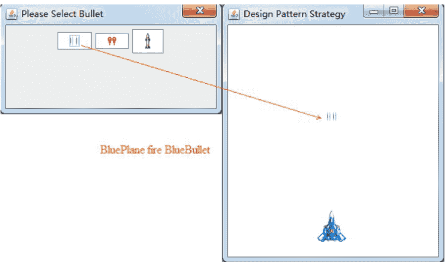

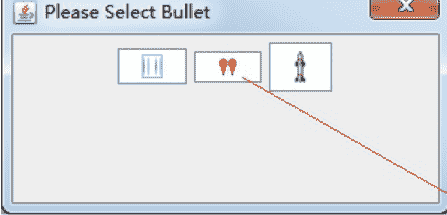

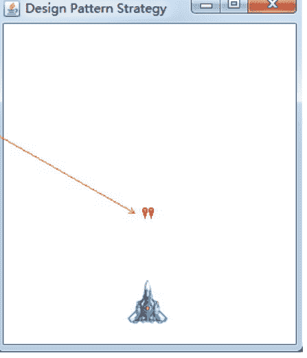

蓝飞机发射 `RedBullet`

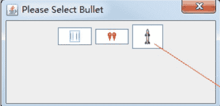

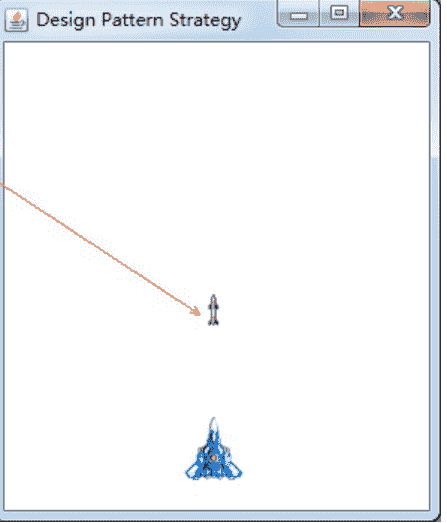

蓝飞机发射 `MissileBullet`

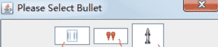

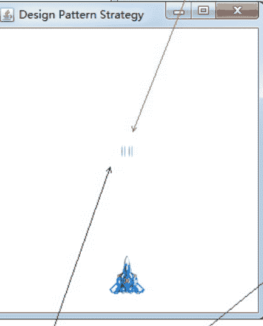

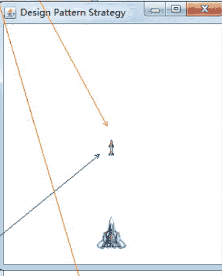

```java
bluePlane = new BluePlane(120, 250);

if("1".equals(bulletType)) {
    Bullet bullet = new Bullet(-100, -100);
    bluePlane.loadBullet(bullet);
} else if("2".equals(bulletType)) {
    Bullet bullet = new RedBullet(-100, -100);
    bluePlane.loadBullet(bullet);
} else if("3".equals(bulletType)) {
    Bullet bullet = new MissileBullet(-100, -100);
    bluePlane.loadBullet(bullet);
}
```

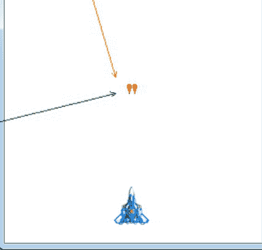

```java
CGlobal
  static JFrame frame
  private CGlobal()
```

```java
SelectBulletDialog
  JButton blueBulletButton
  JButton redBulletButton
  JButton missileBulletButton
  void showDialog()
  static class Builder
```

```java
Runnable
  void run()
```

```java
Canvas
  boolean isRun = true
  BufferedImage image
  BluePlane bluePlane
  Canvas(String bulletType)
  paintComponent(Graphics g)
  bulletMove()
```

```java
Sprite
  BufferedImage image
  int x
  int y
  int width
  int height
  boolean visible
  Sprite(int x, int y, BufferedImage image)
  draw(Graphics g)
  move(int distanceX, int distanceY)
```

```java
BluePlane
  Bullet bullet
  BluePlane(int x, int y, BufferedImage image)
  loadBullet(Bullet bullet)
  fireBullet()
```

```java
Bullet
  Bullet(int x, int y, BufferedImage image)
  move(int distanceX, int distanceY)
```

```java
BlueBullet
```

```java
RedBullet
```

```java
MissileBullet
```

## `com.strategy.game` 包下的 `Sprite.java`


```java
import java.awt.Graphics;
import java.awt.image.BufferedImage;

abstract class Sprite {
    protected int x; // Canvas 的x坐标
    protected int y; // Canvas 的y坐标
    protected int width;
    protected int height;
    protected BufferedImage image;
    protected boolean visible;

    public Sprite(int x, int y, BufferedImage image) {
        this.x = x;
        this.y = y;
        this.image = image;
        this.width = this.image.getWidth();
        this.height = this.image.getHeight();
    }

    public void draw(Graphics g) {
        g.drawImage(image, this.x, this.y, null);
    }

    public void move(int distanceX, int distanceY) {
        this.x = this.x + distanceX;
        this.y = this.y + distanceY;
    }

    public int getWidth() {
        return width;
    }

    public int getHeight() {
        return height;
    }

    public int getX() {
        return x;
    }

    public void setX(int x) {
        this.x = x;
    }

    public int getY() {
        return y;
    }

    public void setY(int y) {
        this.y = y;
    }

    public boolean isVisible() {
        return visible;
    }

    public void setVisible(boolean visible) {
        this.visible = visible;
    }
}
```

```java
private SelectBulletDialog dialog;

public Builder() {
    dialog = new SelectBulletDialog();
}

public void setTitle(String title) {
    dialog.setTitle(title);
}

public SelectBulletDialog create() {
    return dialog;
}
```

# 2. 在 `com.strategy.game` 包下创建一个测试类：TestStrategy.java

```java
import java.awt.BorderLayout;
import javax.swing.JFrame;

public class TestStrategy {
    public static void main(String[] args) {
        CGGlobal.frame = new JFrame("设计模式策略");

        SelectBulletDialog.Builder builder = new SelectBulletDialog.Builder();
        builder.setTitle("请选择子弹");

        SelectBulletDialog dialog = builder.create();
        dialog.show();

        CGGlobal.frame.setSize(300, 350);
        CGGlobal.frame.setVisible(true);
    }
}
```

# 桥接模式

桥接模式：将对象的接口与实现分离。将抽象与实现解耦，使两者可以独立地变化。

- 蓝色飞机和红色飞机、蓝色子弹和红色子弹独立变化。
- 蓝色飞机可以发射蓝色子弹。
- 红色飞机可以发射红色子弹。
- 蓝色飞机可以发射红色子弹。
- 红色飞机可以发射蓝色子弹。

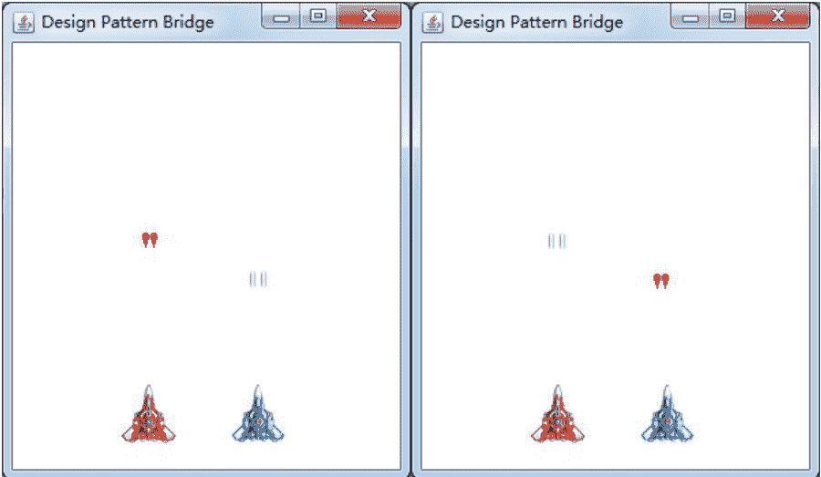
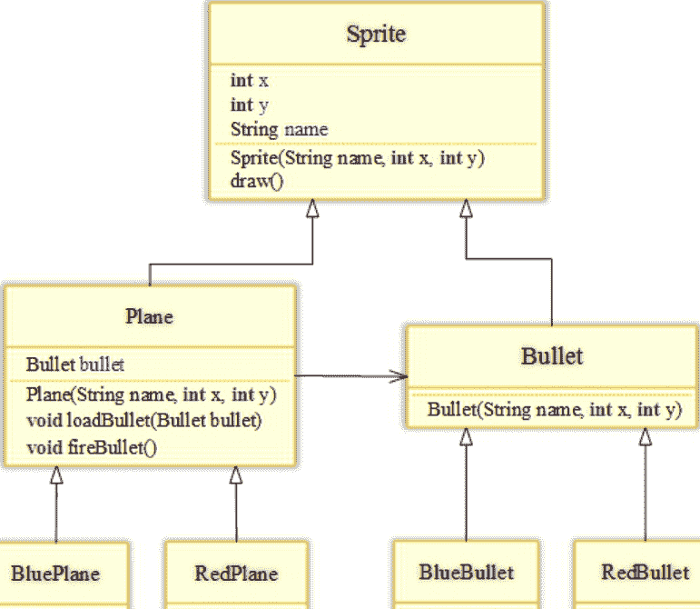

## `com.bridge.principle` 包下的 Sprite.java

```java
class Sprite {
    protected int x; // 画布的 x 坐标
    protected int y; // 画布的 y 坐标
    protected String name;

    public Sprite(String name, int x, int y) {
        this.name = name;
        this.x = x;
        this.y = y;
    }

    public void draw() {
        String text = this.name + " draw on (" + this.x + ", " + this.y + ")";
        System.out.println(text);
    }

    public String getName() {
        return name;
    }
}
```

## `com.bridge.principle` 包下的 Bullet.java

```java
import java.awt.image.BufferedImage;

public class Bullet extends Sprite {
    public Bullet(String name, int x, int y) {
        super(name, x, y);
    }
}
```

## `com.bridge.principle` 包下的 BlueBullet.java

```java
import java.awt.image.BufferedImage;

public class BlueBullet extends Bullet {
    public BlueBullet(String name, int x, int y) {
        super(name, x, y);
    }
}
```

## `com.bridge.principle` 包下的 RedBullet.java

```java
import java.awt.image.BufferedImage;

public class RedBullet extends Bullet {
    public RedBullet(String name, int x, int y) {
        super(name, x, y);
    }
}
```

## `com.bridge.principle` 包下的 Plane.java

```java
import java.awt.image.BufferedImage;

public class Plane extends Sprite {
    protected Bullet bullet;

    public Plane(String name, int x, int y) {
        super(name, x, y);
    }

    public void loadBullet(Bullet bullet) {
        this.bullet = bullet;
    }

    public void fireBullet() {
        System.out.println(this.name + " fire " + this.bullet.getName());
    }

    public Bullet getBullet() {
        return this.bullet;
    }
}
```

## 2. 在 `com.bridge.principle` 包下创建一个测试类：TestBridge.java

```java
import java.awt.BorderLayout;
import javax.swing.JFrame;

public class TestBridge {
    public static void main(String[] args) {
        Plane redPlane = new RedPlane("RedPlane", 80, 250);
        redPlane.loadBullet(new RedBullet("RedBullet", -100));
        redPlane.fireBullet();

        Plane bluePlane = new BluePlane("BluePlane", 80, 250);
        bluePlane.loadBullet(new BlueBullet("BlueBullet", -100));
        bluePlane.fireBullet();

        System.out.println("---------------------------------");

        redPlane.loadBullet(new RedBullet("RedBullet", -100));
        redPlane.fireBullet();

        bluePlane.loadBullet(new RedBullet("RedBullet", -100));
        bluePlane.fireBullet();
    }
}
```

## 结果

```
RedPlane fire RedBullet
BluePlane fire BlueBullet
------------------------------------
RedPlane fire BlueBullet
BluePlane fire RedBullet
```

## 桥接模式游戏

- 在画布上创建并绘制蓝色飞机和红色飞机。
- 蓝色飞机可以加载并发射蓝色子弹。
- 红色飞机可以加载并发射红色子弹。
- 蓝色飞机可以加载并发射红色子弹。
- 红色飞机可以加载并发射蓝色子弹。
- 按上、下、左、右键进行移动。

```java
static {
    ImageCache.put("bluePlaneImage", ImageUtil.loadImage("images/blue_plane.png"));
    ImageCache.put("redPlaneImage", ImageUtil.loadImage("images/red_plane.png"));
    ImageCache.put("redBulletImage", ImageUtil.loadImage("images/red_bullet.png"));
    ImageCache.put("blueBulletImage", ImageUtil.loadImage("images/blue_bullet.png"));
}

public void A() {
    this.setLayout(null);
    this.setBackground(Color.WHITE);
    redPlane = new RedPlane(80, 250);
    redPlane.loadBullet(new RedBullet(-100, -100));

    bluePlane = new BluePlane(160, 250);
    bluePlane.loadBullet(new BlueBullet(-100, -100));

    new Thread(this).start();

    this.addKeyListener(new KeyAdapter() {
        public void keyPressed(KeyEvent e) {
            int keyCode = e.getKeyCode();
            if (keyCode == KeyEvent.VK_E) {
                redPlane.move(0, -3);
            } else if (keyCode == KeyEvent.VK_D) {
                redPlane.move(0, 3);
            } else if (keyCode == KeyEvent.VK_F) {
                redPlane.move(3, 0);
            } else if (keyCode == KeyEvent.VK_S) {
                redPlane.move(-3, 0);
            } else if (keyCode == KeyEvent.VK_G) {
                redPlane.fireBullet();
            }
            if (keyCode == KeyEvent.VK_UP) {
                bluePlane.move(0, -3);
            } else if (keyCode == KeyEvent.VK_DOWN) {
                bluePlane.move(0, 3);
            } else if (keyCode == KeyEvent.VK_RIGHT) {
                bluePlane.move(3, 0);
            } else if (keyCode == KeyEvent.VK_LEFT) {
                bluePlane.move(-3, 0);
            } else if (keyCode == KeyEvent.VK_ENTER) {
                bluePlane.fireBullet();
            }
            Canvas.this.repaint();
        }
    });
}

protected void paintComponent(Graphics g) {
    super.paintComponent(g);
    bluePlane.draw(g);
    bluePlane.getBullet().draw(g);
    redPlane.draw(g);
    redPlane.getBullet().draw(g);
}

private void bulletMove() {
    if (bluePlane.getBullet().isVisible()) {
        bluePlane.getBullet().move(0, -3);
    }

    if (redPlane.getBullet().isVisible()) {
        redPlane.getBullet().move(0, -3);
    }
}

@Override
public void run() {
    while (isRun) {
        try {
            bulletMove();
            Thread.sleep(200);
            Canvas.this.repaint();
        } catch (InterruptedException e) {
            e.printStackTrace();
        }
    }
}
```

### 3. 在包 `com.bridge.game` 中创建一个测试类：TestBridge.java

```java
canvas.setFocusable(true); // 设置焦点以激活键盘事件
canvas.requestFocus(); // 设置焦点以激活键盘事件
```

```java
import java.awt.BorderLayout;
import javax.swing.JFrame;

public class TestSingleton {
    public static void main(String[] args) {
        JFrame frame = new JFrame("桥接模式");
        Canvas canvas = new Canvas();
        frame.add(canvas, BorderLayout.CENTER);
        frame.setSize(300, 350);
        canvas.setFocusable(true);
        canvas.requestFocus();
    }
}
```

# 迭代器模式原理

迭代器模式：顺序访问集合中的元素。提供一种方式，在不暴露其底层表示的情况下顺序访问聚合对象的元素。

1. 迭代器打印子弹列表


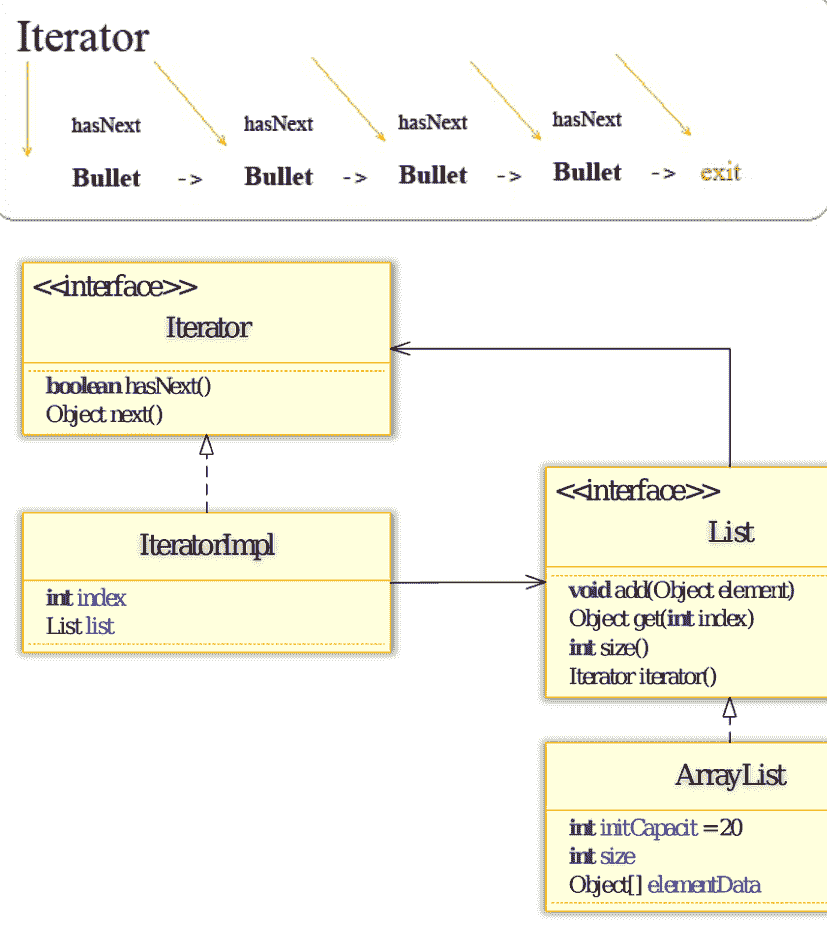

## 迭代器

```java
boolean hasNext(): 如果迭代器还有更多元素，则返回 true
Object next(): 它返回列表中的下一个元素。
```

包 `com.iterator.principle` 中的 `Iterator.java`

```java
public interface Iterator {
    public boolean hasNext();
    Object next();
}
```

包 `com.iterator.principle` 中的 `IteratorImpl.java`

```java
public class IteratorImpl implements Iterator {
    private int index;
    private List list;

    public IteratorImpl(List list) {
        this.list = list;
    }

    public boolean hasNext() {
        return index < list.size();
    }

    public Object next() {
        Object element = null;
        if (index < list.size()) {
            element = list.get(index);
            index++;
        }
        return element;
    }
}
```

### List

```java
void add(Object element): 将指定的元素添加到此列表的末尾。
Object get(int index): 用于从列表中获取元素。
int size(): 返回此列表中的元素数量。
Iterator iterator(): 返回一个用于遍历此列表中元素的列表迭代器。
```

包 `com.iterator.principle` 中的 `List.java`

```java
public interface List {
  void add(Object element);
  Object get(int index);
  int size();
  Iterator iterator();
}
```

```java
import java.util.Arrays;
public class ArrayList implements List {
    private int capacity;
    private Object[] elementData;
    private int size;

    public ArrayList() {
        capacity = 10;
        elementData = new Object[capacity];
        size = 0;
    }

    @Override
    public void add(Object element) {
        if (size == capacity) {
            elementData = Arrays.copyOf(elementData, capacity * 2);
        }
        elementData[size++] = element;
    }

    @Override
    public Object get(int index) {
        return elementData[index];
    }

    @Override
    public int size() {
        return size;
    }

    @Override
    public Iterator iterator() {
        return new IteratorImpl(this);
    }
}

class IteratorImpl implements Iterator {
    private int index;
    private List list;

    public IteratorImpl(List list) {
        this.list = list;
    }

    public boolean hasNext() {
        return index < list.size();
    }

    public Object next() {
        Object element = null;
        if (index < list.size()) {
            element = list.get(index);
            index++;
        }
        return element;
    }
}
```

包 `com.iterator.principle` 中的 `Sprite.java`

```java
public class Sprite {
    protected int x;
    protected int y;

    public Sprite(int x, int y) {
        this.x = x;
        this.y = y;
    }

    public void move(int dx, int dy) {
        this.x += dx;
        this.y += dy;
    }

    public void draw(Graphics g) {
    }
}
```

包 `com.iterator.principle` 中的 `Bullet.java`

```java
public class Bullet extends Sprite {
    private boolean visible;

    public Bullet(int x, int y) {
        super(x, y);
        this.visible = true;
    }

    public boolean isVisible() {
        return visible;
    }

    public void draw(Graphics g) {
    }
}
```

包 `com.iterator.principle` 中的 `Canvas.java`

```java
public class Canvas extends JPanel {
    private RedPlane redPlane;
    private BluePlane bluePlane;
    private boolean isRun = true;

    public void A() {
        this.setLayout(null);
        this.setBackground(Color.WHITE);
        redPlane = new RedPlane(80, 250);
        redPlane.loadBullet(new RedBullet(-100, -100));

        bluePlane = new BluePlane(160, 250);
        bluePlane.loadBullet(new BlueBullet(-100, -100));

        new Thread(this).start();

        this.addKeyListener(new KeyAdapter() {
            public void keyPressed(KeyEvent e) {
                int keyCode = e.getKeyCode();
                if (keyCode == KeyEvent.VK_E) {
                    redPlane.move(0, -3);
                } else if (keyCode == KeyEvent.VK_D) {
                    redPlane.move(0, 3);
                } else if (keyCode == KeyEvent.VK_F) {
                    redPlane.move(3, 0);
                } else if (keyCode == KeyEvent.VK_S) {
                    redPlane.move(-3, 0);
                } else if (keyCode == KeyEvent.VK_G) {
                    redPlane.fireBullet();
                }
                if (keyCode == KeyEvent.VK_UP) {
                    bluePlane.move(0, -3);
                } else if (keyCode == KeyEvent.VK_DOWN) {
                    bluePlane.move(0, 3);
                } else if (keyCode == KeyEvent.VK_RIGHT) {
                    bluePlane.move(3, 0);
                } else if (keyCode == KeyEvent.VK_LEFT) {
                    bluePlane.move(-3, 0);
                } else if (keyCode == KeyEvent.VK_ENTER) {
                    bluePlane.fireBullet();
                }
                }
            Canvas.this.repaint();
        });
    }

    @Override
    protected void paintComponent(Graphics g) {
        super.paintComponent(g);
        bluePlane.draw(g);
        bluePlane.getBullet().draw(g);
        redPlane.draw(g);
        redPlane.getBullet().draw(g);
    }

    private void bulletMove() {
        if (bluePlane.getBullet().isVisible()) {
            bluePlane.getBullet().move(0, -3);
        }

        if (redPlane.getBullet().isVisible()) {
            redPlane.getBullet().move(0, -3);
        }
    }

    @Override
    public void run() {
        while (isRun) {
            try {
                bulletMove();
                Thread.sleep(200);
                Canvas.this.repaint();
            } catch (InterruptedException e) {
                e.printStackTrace();
            }
        }
    }
}
```

## 迭代器游戏

1. 在画布上创建蓝色飞机 (`BluePlane`)。
2. 在线程 `run` 方法中创建少于 100 个子弹。然后加载到子弹列表中。
3. 使用迭代器在画布上绘制并移动子弹列表中的所有子弹。

```java
public void drawBullets(Graphics g) {
  Iterator<Bullet> iter = this.bulletList.iterator();
  while (iter.hasNext()) {
    Bullet bullet = iter.next();
    if (bullet.isVisible()) {
      bullet.draw(g);
    }
  }
}

public void moveBullet(int distanceX, int distanceY) {
  Iterator<Bullet> iter = this.bulletList.iterator();
  while (iter.hasNext()) {
    Bullet bullet = iter.next();
    if (bullet.isVisible()) {
      bullet.move(distanceX, distanceY);
    }
  }
}
```

```java
<<interface>>
Runnable
void run()
```

```java
<<abstract>>
Sprite
int x
int y
int width
int height
BufferedImage image
boolean visible
Sprite(int x, int y, BufferedImage image)
void draw(Graphics g)
void move(int distanceX, int distanceY)
```

```java
Canvas
boolean isRun = true
BufferedImage blueimage
BluePlane bluePlane
Canvas()
paintComponent(Graphics g)
createBullet()
```

```java
BluePlane
CopyOnWriteArrayList<Bullet> bulletList
void loadBullet(Bullet bullet)
void drawBullets(Graphics g)
void moveBullet(int distanceX, int distanceY)
List<Bullet> getBulletList()
```

```java
Bullet
```

```java
RedBullet
```

### `Sprite.java` in package `com.iterator.game`

```java
import java.awt.Graphics;
import java.awt.image.BufferedImage;
abstract class Sprite {
    protected int x; // Canvas 的 x坐标
    protected int y; // Canvas 的 y坐标
    protected int width;
    protected int height;
    protected BufferedImage image;
    protected boolean visible;

    public Sprite(int x, int y, BufferedImage image) {
        this.x = x;
        this.y = y;
        this.image = image;
        this.width = this.image.getWidth();
        this.height = this.image.getHeight();
    }

    public void draw(Graphics g) {
        g.drawImage(image, this.x, this.y, null);
    }

    public void move(int distanceX, int distanceY) {
        this.x = this.x + distanceX;
        this.y = this.y + distanceY;
    }

    public int getWidth() {
        return width;
    }

    public int getHeight() {
        return height;
    }

    public int getX() {
        return x;
    }

    public void setX(int x) {
        this.x = x;
    }

    public int getY() {
        return y;
    }

    public void setY(int y) {
        this.y = y;
    }

    public boolean isVisible() {
        return visible;
    }

    public void setVisible(boolean visible) {
        this.visible = visible;
    }
}
```

### `Bullet.java` in package `com.iterator.game`


```java
import java.awt.BufferedImage;
public class Bullet extends Sprite {
    public Bullet(int x, int y, BufferedImage image) {
        super(x, y, image);
    }
}
```

## ImageCache.java in package com.flyweight.game

## RedBullet.java in package com.iterator.game

## BluePlane

| 方法 | 说明 |
| :--- | :--- |
| `CopyOnWriteArrayList<Bullet> bulletList` | 所有子弹列表的线程安全存储 |
| `void loadBullet(Bullet bullet)` | 将子弹添加到 `bulletList` 中 |
| `void drawBullets(Graphics g)` | 在画布上绘制 `bulletList` 中的所有子弹。 |
| `void moveBullet(int distanceX, int distanceY)` | 在画布上移动 `bulletList` 中的所有子弹。 |

## BluePlane.java in package com.iterator.game

```java
import java.awt.*;
import java.awt.image.BufferedImage;
import java.util.*;
import java.util.concurrent.CopyOnWriteArrayList;

public class BluePlane extends Sprite {
    private CopyOnWriteArrayList<Bullet> bulletList = new CopyOnWriteArrayList<Bullet>();

    public BluePlane(int x, int y) {
        super(x, y, MyImageCache.get("bluePlaneImage"));
    }

    public void createBullets() {
        if (this.bulletList.size() < 100) {
            Bullet bullet = new Bullet(-100, -100);
            int x = this.getX() + this.getWidth() / 2 - bullet.getWidth() / 2;
            int y = this.getY() - bullet.getHeight();
            bullet.setX(x);
            bullet.setY(y);
            bullet.setVisible(true);
            this.loadBullet(bullet);
        }
    }

    public void loadBullet(Bullet bullet) {
        bulletList.add(bullet);
    }

    public void drawBullets(Graphics g) {
        Iterator<Bullet> iter = bulletList.iterator();
        while (iter.hasNext()) {
            Bullet bullet = iter.next();
            if (bullet.isVisible()) {
                bullet.draw(g);
            }
        }
    }

    public void moveBullet(int distanceX, int distanceY) {
        Iterator<Bullet> iter = bulletList.iterator();
        while (iter.hasNext()) {
            Bullet bullet = iter.next();
            if (bullet.isVisible()) {
                bullet.move(distanceX, distanceY);
            }
        }
        for (int i = bulletList.size() - 1; i >= 0; i--) {
            Bullet bullet = bulletList.get(i);
            // 如果子弹移出了画布
            if (bullet.getY() + bullet.getHeight() <= 0) {
                bulletList.remove(bullet);
            }
        }
    }

    public List<Bullet> getBulletList() {
        return bulletList;
    }
}
```

## ImageUtil.java in package com.singleton.game

## Runnable

- `void run()`: 循环重绘画布以移动飞机和子弹

## Canvas

- `paintComponent(Graphics g)`: 可以在画布上绘制图像并重绘画布上所有的精灵。
- `addKeyListener(new KeyAdapter())`: 监听并接收键盘事件以便上、下、左、右。

## Canvas.java in package com.iterator.game

```java
import java.awt.*;
import java.awt.event.*;
import java.awt.image.BufferedImage;
import java.io.*;
import javax.imageio.ImageIO;
import javax.swing.*;

public class Canvas extends JPanel implements Runnable {
    private boolean isRun = true;
    private BluePlane bluePlane;

    static {
        ImageCache.put("bluePlane", ImageUtil.loadImage("images/blue_plane.png"));
        ImageCache.put("redBulletImage", ImageUtil.loadImage("images/red_bullet.png"));
    }

    public Canvas() {
        this.setLayout(null);
        this.setBackground(Color.WHITE);

        bluePlane = new BluePlane(120, 250);

        new Thread(this).start();

        this.addKeyListener(new KeyAdapter() {
            public void keyPressed(KeyEvent e) {
                int keyCode = e.getKeyCode();
                if (keyCode == KeyEvent.VK_UP) {
                    bluePlane.move(0, -3);
                } else if (keyCode == KeyEvent.VK_DOWN) {
                    bluePlane.move(0, 3);
                } else if (keyCode == KeyEvent.VK_RIGHT) {
                    bluePlane.move(3, 0);
                } else if (keyCode == KeyEvent.VK_LEFT) {
                    bluePlane.move(-3, 0);
                }
            }
        });
    }

    protected void paintComponent(Graphics g) {
        super.paintComponent(g);
        bluePlane.draw(g);
        bluePlane.drawBullets(g);
    }

    @Override
    public void run() {
        while (isRun) {
            try {
                bluePlane.createBullets();
                bluePlane.moveBullet(0, -3);
                Thread.sleep(50);
                Canvas.this.repaint();
            } catch (InterruptedException e) {
                e.printStackTrace();
            }
        }
    }
}
```

## TestIterator.java in package com.iterator.game

```java
import java.awt.BorderLayout;
import javax.swing.JFrame;

public class TestIterator {
    public static void main(String[] args) {
        JFrame frame = new JFrame("设计模式迭代");
        Canvas canvas = new Canvas();
        frame.add(canvas, BorderLayout.CENTER);
        frame.setSize(300, 350);
        canvas.setFocusable(true);
        frame.setVisible(true);
        canvas.requestFocus();
    }
}
```

# Decorator Pattern

装饰器模式：动态地为对象添加责任。装饰器提供了一种比子类更灵活的方案来扩展功能。

1. 在画布上创建 `BluePlane`
2. `BluePlane` 创建许多子弹到 `bulletList`
3. 在画布上绘制并移动 `bulletList` 中的所有子弹
4. 通过 `PlaneProps` 装饰 `BluePlane`，然后对某些子弹进行装饰以向下移动。

## Sprite.java in package com.decorator.principle

```java
class Sprite {
    protected int x; // Canvas 的 x坐标
    protected int y; // Canvas 的 y坐标
    protected String name;

    public Sprite(String name, int x, int y) {
        this.name = name;
        this.x = x;
        this.y = y;
    }

    public void draw() {
        String text = this.name + " 在 (" + this.x + "," + this.y + ") 绘制";
        System.out.println(text);
    }

    public void move(int distanceX, int distanceY) {
        String text = this.name + " 移动 (" + distanceX + "," + distanceY + ")";
        System.out.println(text);
    }

    public int getX() {
        return x;
    }

    public int getY() {
        return y;
    }

    public String getName() {
        return name;
    }
}
```

`Bullet.java` 位于 `com.decorator.principle` 包下；

```java
public class Bullet extends Sprite {
    public Bullet(String name, int x, int y) {
        super(name, x, y);
    }
}
```

## Plane

| 成员/方法 | 说明 |
| :--- | :--- |
| `CopyOnWriteArrayList<Bullet> bulletList` | 列表中线程安全的子弹列表。 |
| `void createBullets()` | 创建向上移动的红色子弹。 |
| `void drawBullets()` | 在画布上绘制红色子弹。 |
| `void moveBullet(int distX, int distanceY)` | 在画布上移动子弹。 |

### Plane.java 位于 com.decorator.principle 包下

```java
import java.util.*;
import java.util.concurrent.CopyOnWriteArrayList;

public class Plane extends Sprite {
    private CopyOnWriteArrayList<Bullet> bulletList = new CopyOnWriteArrayList<Bullet>();

    public Plane(String name, int x, int y) {
        super(name, x, y);
    }

    public void createBullets() {
        for (int i = 1; i <= 3; i++) {
            Bullet bullet = new Bullet("RedBullet Move Up", this.x, this.y);
            bulletList.add(bullet);
        }
    }

    public void drawBullets() {
        Iterator<Bullet> iter = this.bulletList.iterator();
        while (iter.hasNext()) {
            Bullet bullet = iter.next();
            bullet.draw();
        }
    }

    public void moveBullet(int distanceX, int distanceY) {
        Iterator<Bullet> iter = this.bulletList.iterator();
        while (iter.hasNext()) {
            Bullet bullet = iter.next();
            bullet.move(distanceX, distanceY);
        }
    }

    public List<Bullet> getBulletList() {
        return this.bulletList;
    }
}
```

### BlueBullet.java 位于 com.decorator.principle 包下

```java
public class BluePlane extends Plane {
    public BluePlane(String name, int x, int y) {
        super(name, x, y);
    }
}
```

## PlaneDecorator

| 成员/方法 | 说明 |
| :--- | :--- |
| `CopyOnWriteArrayList<Bullet> bulletList` | 线程安全的装饰子弹列表 |
| `void createBullets()` | 创建向下移动的装饰红色子弹。 |
| `void drawBullets()` | 在画布上绘制红色子弹。 |
| `void moveBullet(int distanceX, int distanceY)` | 在画布上移动装饰子弹。 |

### PlaneDecorator.java 位于 com.decorator.principle 包下


```java
import java.util.Iterator;
import java.util.concurrent.CopyOnWriteArrayList;

public class PlaneDecorator extends Plane {
    private CopyOnWriteArrayList<Bullet> bulletList = new CopyOnWriteArrayList<Bullet>();
    private Plane plane;

    public PlaneDecorator(Plane plane) {
        super(plane.getName(), plane.getX(), plane.getY());
        this.plane = plane;
    }

    public void createBullets() {
        // 创建许多子弹
        for (int i = 1; i <= 3; i++) {
            Bullet bullet = new Bullet("RedBullet Move Down", this.x, this.y);
            bulletList.add(bullet);
        }
    }

    public void drawBullets() {
        plane.drawBullets();
        Iterator<Bullet> iter = this.bulletList.iterator();
        while (iter.hasNext()) {
            Bullet bullet = iter.next();
            bullet.draw();
        }
    }

    public void moveBullet(int distanceX, int distanceY) {
        plane.moveBullet(distanceX, distanceY);
        Iterator<Bullet> iter = this.bulletList.iterator();
        while (iter.hasNext()) {
            Bullet bullet = iter.next();
            bullet.move(distanceX, -distanceY);
        }
    }
}
```

### 2. 创建测试类：`TestDecorator.java` 位于 `com.decorator.principle` 包下

```java
public class TestDecorator {
    public static void main(String[] args) {
        Plane plane = new BluePlane("BluePlane", 100, 150);
        plane.createBullets();
        plane.drawBullets();
        plane.moveBullet(0, -6);

        System.out.println("----------------------------");
        plane = new PlaneDecorator(plane);
        plane.createBullets();
        plane.drawBullets();
        plane.moveBullet(0, -6);
    }
}
```

## 结果

```text
RedBullet Move Up draw on (100 , 150)
RedBullet Move Up draw on (100 , 150)
RedBullet Move Up draw on (100 , 150)
RedBullet Move Up move distance (0 , -6)
RedBullet Move Up move distance (0 , -6)
RedBullet Move Up move distance (0 , -6)
RedBullet Move Up draw on (100 , 150)
RedBullet Move Up draw on (100 , 150)
RedBullet Move Up draw on (100 , 150)
RedBullet Move Down draw on (100 , 150)
RedBullet Move Down draw on (100 , 150)
RedBullet Move Down draw on (100 , 150)
RedBullet Move Up move distance (0 , -6)
RedBullet Move Up move distance (0 , -6)
RedBullet Move Up move distance (0 , -6)
RedBullet Move Down move distance (0 , 6)
RedBullet Move Down move distance (0 , 6)
RedBullet Move Down move distance (0 , 6)
```

## 装饰器模式

1. 在画布上创建 `BluePlane`
2. `BluePlane` 在 `bulletList` 中创建了许多子弹
3. 在画布上绘制并向上移动 `bulletList` 中的所有子弹
4. 通过 `Plane` 装饰 `BluePlane`，然后装饰一些子弹使其向下移动

```java
public void drawBullets(Graphics g) {
    Iterator<Bullet> iter = this.bulletList.iterator();
    while (iter.hasNext()) {
        Bullet bullet = iter.next();
        if (bullet.isVisible()) {
            bullet.draw(g);
        }
    }
}
```

```java
public void moveBullet(int distanceX, int distanceY) {
    Iterator<Bullet> iter = this.bulletList.iterator();
    while (iter.hasNext()) {
        Bullet bullet = iter.next();
        if (bullet.isVisible()) {
            bullet.move(distanceX, distanceY);
        }
    }
}
```

![img/1a3fabd51f2ead4a519c23cba147_0]

```java
}
}
```

`ImageCache.java` 位于包 `com.flyweight.game` 中；在上一章

`RedBullet.java` 位于包 `com.decorator.game` 中

```java
import java.awt.image.BufferedImage;

public class RedBullet extends Bullet {
    public RedBullet(int x, int y) {
        super(x, y, ImageCache.get("redBulletImage"));
    }
}
```

`BulletProps.java` 位于包 `com.decorator.game` 中

```java
import java.awt.Graphics;
import java.awt.image.BufferedImage;

public class BulletProps extends Bullet {
    public BulletProps(int x, int y) {
        super(x, y, ImageCache.get("blueDecoratorImage"));
    }
}
```

## Plane 类

| 方法 | 描述 |
| :--- | :--- |
| `CopyOnWriteArrayList<Bullet> bulletList` | 所有子弹列表的线程安全存储 |
| `void loadBullet(Bullet bullet)` | 将子弹添加到 `bulletList` |
| `void drawBullets(Graphics g)` | 在画布上绘制 `bulletList` 中的所有子弹 |
| `void moveBullet(int distX, int distanceY)` | 在画布上向上移动 `bulletList` 中的所有子弹 |

### `Plane.java` 位于包 `com.decorator.game` 中

```java
import java.awt.Graphics;
import java.awt.image.BufferedImage;
import java.util.*;
import java.util.concurrent.CopyOnWriteArrayList;

public class Plane extends Sprite {
    private CopyOnWriteArrayList<Bullet> bulletList = new CopyOnWriteArrayList<Bullet>();

    public Plane(int x, int y, BufferedImage image) {
        super(x, y, image);
    }

    public void createBullets() {
        if (this.bulletList.size() < 100) {
            Bullet bullet = new Bullet(-100, -100);
            int x = this.getX() + this.getWidth() / 2 - bullet.getWidth() / 2;
            int y = this.getY() - bullet.getHeight();
            bullet.setX(x);
            bullet.setY(y);
            bullet.setVisible(true);
            bulletList.add(bullet);
        }
    }
}
```

```java
public void drawBullets(Graphics g) {
    Iterator<Bullet> iter = this.bulletList.iterator();
    while (iter.hasNext()) {
        Bullet bullet = iter.next();
        if (bullet.isVisible()) {
            bullet.draw(g);
        }
    }
}
```

```java
public void moveBullet(int distanceX, int distanceY) {
    Iterator<Bullet> iter = this.bulletList.iterator();
    while (iter.hasNext()) {
        Bullet bullet = iter.next();
        if (bullet.isVisible()) {
            bullet.move(distanceX, distanceY);
        }
    }

    for (int i = this.bulletList.size() - 1; i >= 0; i--) {
        Bullet bullet = this.bulletList.get(i);
        // 如果子弹移出画布，则将其移除
        if (bullet.getY() + bullet.getHeight() <= 0) {
            this.bulletList.remove(bullet);
        }
    }
}
```

```java
public List<Bullet> getBulletList() {
    return this.bulletList;
}
```

### `BluePlane.java` 位于包 `com.decorator.game` 中

```java
import java.awt.image.BufferedImage;

public class BluePlane extends Plane {
    public BluePlane(int x, int y) {
        super(x, y, ImageCache.get("bluePlaneImage"));
    }
}
```

## PlaneDecorator

`void moveBullet(int distanceX, int distanceY)`: 在画布上向下移动 `bulletList` 中的子弹

`PlaneDecorator.java` 位于包 `com.decorator.game` 中

```java
import java.awt.Graphics;
import java.awt.image.BufferedImage;
import java.util.*;
import java.util.concurrent.CopyOnWriteArrayList;

public class PlaneDecorator extends Plane {
    private CopyOnWriteArrayList<Bullet> bulletList = new CopyOnWriteArrayList<Bullet>();
    private BufferedImage bulletImage;
    private Plane plane;
    private int canvasHeight;

    public PlaneDecorator(Plane plane, int canvasHeight) {
        super(plane.getX(), plane.getY(), plane.getImage());
        this.plane = plane;
        this.canvasHeight = canvasHeight;
    }

    public void loadBulletImage(BufferedImage bulletImage) {
        plane.loadBulletImage(bulletImage);
        this.bulletImage = bulletImage;
    }

    public void move(int distanceX, int distanceY) {
        plane.move(distanceX, distanceY);
        super.move(distanceX, distanceY);
    }

    public void createBullets() {
        plane.createBullets();
        if (this.bulletList.size() < 100) {
            Bullet bullet = new RedBullet(-100, -100, bulletImage);
            int x = this.getX() + this.getWidth() / 2 - bullet.getWidth() / 2;
            int y = this.getY() + this.getHeight();
            bullet.setX(x);
            bullet.setY(y);
            bullet.setVisible(true);
            bulletList.add(bullet);
        }
    }
}
```

```java
public void drawBullets(Graphics g) {
    plane.drawBullets(g);
    Iterator<Bullet> iter = this.bulletList.iterator();
    while (iter.hasNext()) {
        Bullet bullet = iter.next();
        if (bullet.isVisible()) {
            bullet.draw(g);
        }
    }
}
```

```java
public void moveBullet(int distX, int distanceY) {
    plane.moveBullet(distX, distanceY);
    Iterator<Bullet> iter = this.bulletList.iterator();
    while (iter.hasNext()) {
        Bullet bullet = iter.next();
        if (bullet.isVisible()) {
            bullet.move(distX, -distanceY);
        }
    }
}
```


```java
for (int i = this.bulletList.size() - 1; i >= 0; i--) {
  Bullet bullet = this.bulletList.get(i);
  // 如果子弹移出画布，则将其移除
  if (bullet.getY() > canvasHeight) {
    this.bulletList.remove(bullet);
  }
}
```

`ImageUtil.java` 位于包 `com.singleton.game` 中；在上一章

`Canvas.java` 位于包 `com.decorator.game` 中；

```java
import java.awt.*;
import java.awt.event.*;
import java.awt.image.BufferedImage;
import java.io.*;
import javax.imageio.ImageIO;
import javax.swing.*;

public class Canvas extends JPanel implements Runnable {
    private boolean isRun = true;
    private Plane plane;
    private BulletProps bulletProps;
    private int canvasWidth;
    private int canvasHeight;

    static {
        ImageCache.put("bullet", ImageIO.read(new File("bullet")));
        ImageCache.put("blueDecoratorImage", ImageIO.read(new File("blueDecorator.png")));
        ImageCache.put("bluePlaneImage", ImageIO.read(new File("bluePlane.png")));
        ImageCache.put("redBulletImage", ImageIO.read(new File("redBullet.png")));
    }

    public Canvas() {
        setLayout(null);
        setBackground(Color.WHITE);

        bulletProps = new BulletProps(120, 0);
        plane = new BluePlane(120, 250);
        bulletProps.setVisible(true);
        plane.setVisible(true);

        new Thread(this).start();
        addKeyListener(new KeyAdapter() {
            public void keyPressed(KeyEvent e) {
                int keyCode = e.getKeyCode();
                if (keyCode == KeyEvent.VK_UP) {
                    plane.moveBullet(0, -3);
                } else if (keyCode == KeyEvent.VK_DOWN) {
                    plane.moveBullet(0, 3);
                } else if (keyCode == KeyEvent.VK_RIGHT) {
                    plane.moveBullet(3, 0);
                } else if (keyCode == KeyEvent.VK_LEFT) {
                    plane.moveBullet(-3, 0);
                }
            }
        });
    }

    protected void paintComponent(Graphics g) {
        canvasWidth = this.getWidth();
        canvasHeight = this.getHeight();
        super.paintComponent(g);
        plane.draw(g);
        plane.drawBullets(g);
        bulletProps.draw(g);
    }

    private void collideWith(BulletProps bulletProps) {
        plane.setVisible(false);
        plane = new PlaneDecorator(plane, this.canvasHeight);
        plane.setVisible(true);
    }

    public void run() {
        while (isRun) {
            try {
                plane.createBullets();
                plane.moveBullet(0, -3);
                bulletProps.move(0, 3);
                collideWith(bulletProps);
                Thread.sleep(200);
                this.repaint();
            } catch (InterruptedException e) {
                e.printStackTrace();
            }
        }
    }
}
```

## 2. 创建测试类：TestDecorator.java

`TestDecorator.java` 位于包 `com.decorator.game` 中；

```java
import java.awt.BorderLayout;
import javax.swing.JFrame;

public class TestDecorator {
    public static void main(String[] args) {
        JFrame frame = new JFrame("设计模式装饰器");
        Canvas canvas = new Canvas();
        frame.add(canvas, BorderLayout.CENTER);
        frame.setSize(300, 350);
        canvas.setFocusable(true);
        frame.setVisible(true);
        canvas.requestFocus();
    }
}
```

# 组合模式原理

组合模式：简单对象和复合对象的树形结构。将对象组合成树形结构以表示部分整体关系。组合允许客户端以统一的方式对待单个对象和组合对象。

```
控制
菜单
--游戏
------新建
--------停止
--------恢复
--系统
----帮助
------退出
```

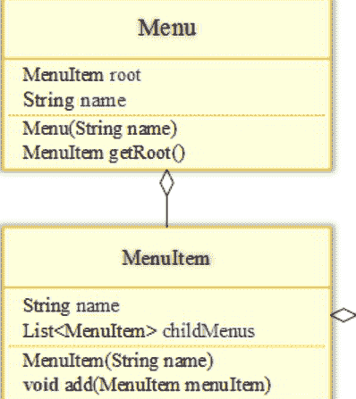

## 菜单

| MenuItem root | 根菜单 |
| :--- | :--- |

`com.composite.principle` 包下的 `Menu.java`

```java
import java.util.*;

public class Menu {
    private MenuItem root;
    protected String name;

    public Menu(String name) {
        this.root = new MenuItem(name);
    }

    public MenuItem getRoot() {
        return root;
    }

    public String getName() {
        return name;
    }

    public void setName(String name) {
        this.name = name;
    }
}
```

## MenuItem

| 字段 | 描述 |
| :--- | :--- |
| List<MenuItem> childMenus | 子菜单列表 |
| void add(MenuItem menuItem) | 添加子菜单 |

`com.composite.principle` 包下的 `MenuItem.java`

```java
import java.util.*;

public class MenuItem {
    protected String name;
    protected List<MenuItem> childMenus;

    public MenuItem(String name) {
        super();
        this.name = name;
        this.childMenus = new ArrayList<MenuItem>();
    }

    public void add(MenuItem menuItem) {
        childMenus.add(menuItem);
    }

    public String getName() {
        return name;
    }

    public void setName(String name) {
        this.name = name;
    }

    public List<MenuItem> getChildMenus() {
        return childMenus;
    }
}
```

### 2. 创建一个测试类：com.composite.principle 包下的 TestComposite.java

```java
import java.util.List;

public class TestComposite {
    public static void main(String[] args) {
        Menu tree = new Menu("Menu");
        MenuItem root = tree.getRoot();

        MenuItem gameFile = new MenuItem("Game");
        MenuItem systemFile = new MenuItem("System");
        root.add(gameFile);
        root.add(systemFile);

        MenuItem newFile = new MenuItem("New");
        MenuItem stopFile = new MenuItem("Stop");
        MenuItem resumeFile = new MenuItem("Resume");
        gameFile.add(newFile);
        gameFile.add(stopFile);
        gameFile.add(resumeFile);

        MenuItem helpFile = new MenuItem("Help");
        MenuItem exitFile = new MenuItem("Exit");
        systemFile.add(helpFile);
        systemFile.add(exitFile);

        System.out.println(root.getName());
        List<MenuItem> childeMenus = root.getChildMenus();
        for (MenuItem menuItem : childeMenus) {
            System.out.println("--" + menuItem.getName());
            List<MenuItem> childMenu2 = menuItem.getChildMenus();
            for (MenuItem menuItem2 : childMenu2) {
                System.out.println("------" + menuItem2.getName());
            }
        }
    }
}
```

## 组合模式游戏

1. 右键点击弹出菜单。

```java
public void mouseReleased(MouseEvent e) {
    if (e.isPopUpTrigger()) {
        JPopupMenu popupMenu = new JPopupMenu();
        JMenu fileMenu = new JMenu("Game");
        JMenuItem newFile = new JMenuItem("New");
        JMenuItem stopFile = new JMenuItem("Stop");
        JMenuItem resumeFile = new JMenuItem("Resume");
        JMenuItem exitFile = new JMenuItem("Exit");

        fileMenu.add(newFile);
        fileMenu.add(stopFile);
        fileMenu.add(resumeFile);
        fileMenu.add(exitFile);

        popupMenu.add(fileMenu);
        popupMenu.addSeparator();
        popupMenu.add(exitFile);
        popupMenu.show(e.getComponent(), e.getX(), e.getY());

        stopFile.setActionCommand("Stop");
        stopFile.addActionListener(menuActionListener);
        resumeFile.setActionCommand("Resume");
        resumeFile.addActionListener(menuActionListener);
        exitFile.setActionCommand("Exit");
        exitFile.addActionListener(menuActionListener);
    }
}
```

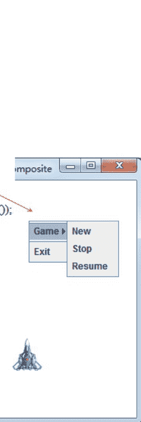
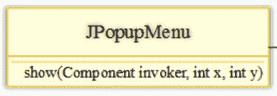
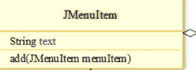
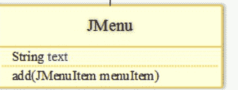
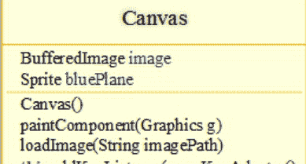
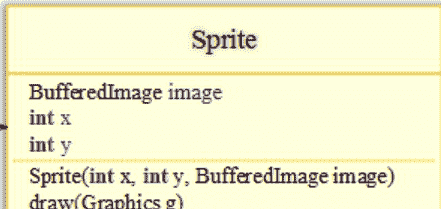


## `com.composite.game` 包下的 `Sprite.java`

```java
import java.awt.Graphics;
import java.awt.image.BufferedImage;

class Sprite {
    protected int x; // 画布的 x 坐标
    protected int y; // 画布的 y 坐标
    protected BufferedImage image;

    public Sprite(int x, int y, BufferedImage image) {
        this.x = x;
        this.y = y;
        this.image = image;
    }

    public void draw(Graphics g) {
        g.drawImage(image, this.x, this.y, null);
    }

    public void move(int distX, int distanceY) {
        this.x = this.x + distX;
        this.y = this.y + distanceY;
    }
}
```

`com.flyweight.game` 包下的 `ImageCache.java`（上文）

`com.singleton.game` 包下的 `ImageUtil.java`（上文）

`com.composite.game` 包下的 `BluePlane.java`


```java
import java.awt.image.BufferedImage;

class BluePlane extends Sprite {
    public BluePlane(int x, int y) {
        super(x, y, ImageCache.get("bluePlane"));
    }
}
```

## Canvas

```java
void mouseReleased(MouseEvent e): 创建并显示菜单
```

`com.composite.game` 包下的 `Canvas.java`。

### 3. 创建一个测试类：`com.composite.game` 包下的 `TestComposite.java`

`canvas.setFocusable(true)`: 设置激活键盘事件

`canvas.requestFocus()`: 设置激活键盘事件

```java
import java.awt.BorderLayout;
import javax.swing.JFrame;

public class TestComposite {
    public static void main(String[] args) {
        JFrame frame = new JFrame("Design Pattern");
        Canvas canvas = new Canvas();
        frame.add(canvas, BorderLayout.CENTER);
        frame.setSize(300, 350);
        canvas.setFocusable(true);
        frame.setVisible(true);
        canvas.requestFocus();
    }
}
```

# 链式模式

在接收到请求时，每个处理器决定处理该请求还是将其传递给链中的下一个处理器。


## 链式模式

| 字段 | 描述 |
| :--- | :--- |
| `List<MenuItem> childMenus` | 子菜单列表 |


### 1.

```java
public class EnemyHandler implements ChainHandler {
    @Override
    public List<Sprite> create() {
        Random rm = new Random();
        List<Sprite> spriteList = new ArrayList<>();
        for (int i = 0; i < 10; i++) {
            int x = rm.nextInt(canvasWidth);
            int y = rm.nextInt(canvasHeight);
            Sprite enemyPlane = new EnemyPlane(x, y);
            spriteList.add(enemyPlane);
        }
        return spriteList;
    }
}
```


### 2.

```java
public class Enemy2Handler implements ChainHandler {
    @Override
    public List<Sprite> create() {
        Random r = new Random();
        List<Sprite> spriteList = new ArrayList<>();
        for (int i = 0; i < 4; i++) {
            int x = r.nextInt(canvasWidth);
            int y = r.nextInt(canvasHeight);
            Sprite enemyPlane = new EnemyPlane(x, y);
            spriteList.add(enemyPlane);
        }
        return spriteList;
    }
}
```


### 3.

```java
public class EnemyBossHandler implements ChainHandler {
    @Override
    public List<Sprite> create() {
        Random m = new Random();
        List<Sprite> spriteList = new ArrayList<>();
        int x = m.nextInt(canvasWidth);
        int y = m.nextInt(canvasHeight);
        Sprite enemyPlane = new NewEnemyPlane(x, y);
        spriteList.add(enemyPlane);
        return spriteList;
    }
}
```

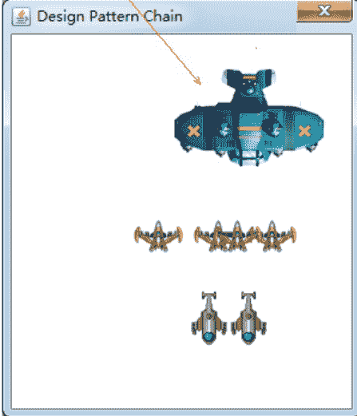

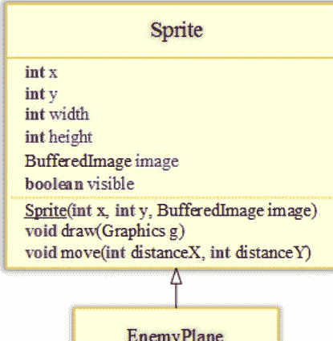

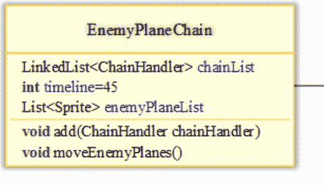

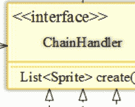

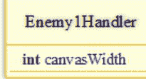

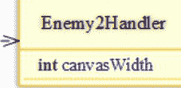

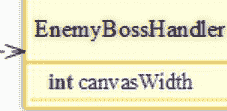


## `com.chain.game` 包下的 `Sprite.java`

```java
import java.awt.Graphics;
import java.awt.image.BufferedImage;

abstract class Sprite {
    protected int x; // Canvas 的 x 坐标
    protected int y; // Canvas 的 y 坐标
    protected int width;
    protected int height;
    protected BufferedImage image;
    protected boolean visible;

    public Sprite(int x, int y, BufferedImage image) {
        this.x = x;
        this.y = y;
        this.image = image;
        this.width = this.image.getWidth();
        this.height = this.image.getHeight();
    }

    public void draw(Graphics g) {
        g.drawImage(image, this.x, this.y, null);
    }

    public void move(int distanceX, int distanceY) {
        this.x = this.x + distanceX;
        this.y = this.y + distanceY;
    }

    public int getWidth() {
        return width;
    }

    public int getHeight() {
        return height;
    }

    public int getX() {
        return x;
    }

    public void setX(int x) {
        this.x = x;
    }

    public int getY() {
        return y;
    }

    public void setY(int y) {
        this.y = y;
    }

    public boolean isVisible() {
        return visible;
    }

    public void setVisible(boolean visible) {
        this.visible = visible;
    }

    public BufferedImage getImage() {
        return image;
    }
}
```

## `com.chain.game` 包下的 `EnemyPlane.java`

```java
import java.awt.Graphics;
import java.awt.image.BufferedImage;

public class EnemyPlane extends Sprite {
    public EnemyPlane(int x, int y, BufferedImage image) {
        super(x, y, image);
    }
}
```

## `com.flyweight.game` 包下的 `ImageCache.java`

## `com.chain.game` 包下的 `ChainHandler.java`

## Enemy1Handler

- `List<Sprite> create()`: 在屏幕顶部随机生成 2 架敌机飞机

## `com.chain.game` 包下的 `Enemy1Handler.java`

```java
import java.awt.image.BufferedImage;
import java.util.*;

public class Enemy1Handler implements ChainHandler {
    private BufferedImage enemyPlaneImage;
    private int canvasWidth;

    public Enemy1Handler(int canvasWidth){
        this.enemyPlaneImage = ImageCache.get("enemyPlaneImage");
        this.canvasWidth = canvasWidth;
    }

    @Override
    public List<Sprite> create() {
        Random n = new Random();
        List<Sprite> spriteList = new ArrayList<Sprite>();
        for (int i=0;i<2;i++){
            int x = n.nextInt(canvasWidth - enemyPlaneImage.getWidth());
            int y = -enemyPlaneImage.getHeight();
            Sprite enemyPlane = new EnemyPlane(x, y, enemyPlaneImage);
            spriteList.add(enemyPlane);
        }
        return spriteList;
    }
}
```

## Enemy2Handler

- `List<Sprite> create()`: 在屏幕顶部随机生成 4 架敌机飞机

## `com.chain.game` 包下的 `Enemy2Handler.java`

```java
import java.awt.image.BufferedImage;
import java.util.*;

public class Enemy2Handler implements ChainHandler {
    private BufferedImage enemyPlaneImage;
    private int canvasWidth;

    public Enemy2Handler(int canvasWidth) {
        this.enemyPlaneImage = ImageCache.get("enemyPlane2");
        this.canvasWidth = canvasWidth;
    }

    @Override
    public List<Sprite> create() {
        Random n = new Random();
        List<Sprite> spriteList = new ArrayList<Sprite>();
        for (int i=0;i<4;i++) {
            int x = n.nextInt(canvasWidth - enemyPlaneImage.getWidth());
            int y = -enemyPlaneImage.getHeight();
            Sprite enemyPlane = new EnemyPlane(x, y, enemyPlaneImage);
            spriteList.add(enemyPlane);
        }
        return spriteList;
    }
}
```

## EnemyBossHandler

- `List<Sprite> create()`: 在屏幕顶部随机生成架敌机飞机

## `com.chain.game` 包下的 `EnemyBossHandler.java`

```java
import java.awt.image.BufferedImage;
import java.util.*;

public class EnemyBossHandler implements ChainHandler {
    private BufferedImage enemyPlaneImage;
    private int canvasWidth;

    public EnemyBossHandler(int canvasWidth){
        this.enemyPlaneImage = ImageCache.get("bossImage");
        this.canvasWidth = canvasWidth;
    }

    @Override
    public List<Sprite> create() {
        Random m = new Random();
        List<Sprite> spriteList = new ArrayList<Sprite>();
        int x = m.nextInt(canvasWidth - enemyPlaneImage.getWidth());
        int y = -enemyPlaneImage.getHeight();
        Sprite enemyPlane = new EnemyPlane(x, y, enemyPlaneImage);
        spriteList.add(enemyPlane);
        return spriteList;
    }
}
```

## EnemyPlaneChain

- `LinkedList<ChainHandler> chainList`: 链中所有的敌机飞机
- `add(ChainHandler chainHandler)`: 将敌机飞机加入链
- `timeline = 45`: 敌机飞机每 15 秒显示一次。
- `moveEnemyPlanes()`: 移动敌机飞机

## `com.chain.game` 包下的 `EnemyPlaneChain.java`


```java
import java.awt.Graphics;
import java.util.*;

public class EnemyPlaneChain {
    private LinkedList<ChainHandler> chainList = new LinkedList<ChainHandler>();
    private int timeline = 45;
    private List<Sprite> enemyPlaneList = new ArrayList<Sprite>();

    public void add(ChainHandler chainHandler) {
        chainList.add(chainHandler);
    }

    public void moveEnemyPlanes(Graphics g) {
        if (enemyPlaneList == null) {
            return;
        }
        if (timeline > 0 && timeline % 15 == 0 && chainList.size() > 0) {
            ChainHandler currentHandler = chainList.poll();
            List<Sprite> spriteList = currentHandler.create();
            enemyPlaneList.addAll(spriteList);
        }
        for (int i = 0; i < enemyPlaneList.size(); i++) {
            Sprite enemyPlane = enemyPlaneList.get(i);
            enemyPlane.draw(g);
            enemyPlane.move(0, 5);
        }
        timeline--;
    }
}
```

## `com.util` 包下的 `ImageUtil.java`

## `com.chain.game` 包下的 `Canvas.java`

```java
import java.awt.*;
import java.awt.image.BufferedImage;
import javax.swing.JPanel;

public class Canvas extends JPanel implements Runnable {
    private boolean isRun = true;
    private int canvasWidth;
    private int canvasHeight;
    private EnemyPlaneChain enemyPlaneChain;
    private boolean isInit = false;

    static {
        ImageCache.put("enemyPlaneImage", ImageUtil.loadImage("images/enemy_1.png"));
        ImageCache.put("enemyPlane2", ImageUtil.loadImage("images/enemy_2.png"));
        ImageCache.put("bossImage", ImageUtil.loadImage("images/boss.png"));
    }

    public Canvas() {
        setLayout(null);
        setBackground(Color.WHITE);
        new Thread(this).start();
    }

    private void isInit() {
        enemyPlaneChain = new EnemyPlaneChain();
        enemyPlaneChain.add(new Enemy1Handler(canvasWidth));
        enemyPlaneChain.add(new Enemy2Handler(canvasWidth));
        enemyPlaneChain.add(new EnemyBossHandler(canvasWidth));
    }

    @Override
    protected void paintComponent(Graphics g) {
        canvasWidth = getWidth();
        canvasHeight = getHeight();

        if (!isInit) {
            isInit();
            isInit = true;
        }
        super.paintComponent(g);
        enemyPlaneChain.moveEnemyPlanes(g);
    }

    @Override
    public void run() {
        while (isRun) {
            try {
                Thread.sleep(200);
                repaint();
            } catch (InterruptedException e) {
                e.printStackTrace();
            }
        }
    }
}
```

### 3. 创建测试类：`TestChain.java` 在 `com.chain.game` 包

- `canvas.setFocusable(true)`：启用键盘焦点
- `canvas.requestFocus()`：启用键盘焦点

# 观察者模式游戏


```java
private void collideCheck() {
    if (bluePlane.getBullet().collideWith(enemyPlane)) {
        enemyPlane.setVisible(false);
        bluePlane.getBullet().setVisible(false);
    }
}
```

```java
ObserverData data = new ObserverData();
data.setNotifyType(Type.INCREMENT_SCORE);
data.setScore(100);
bluePlane.notifyAll(data);
```


```java
public class PlaneScore implements Observer {
    public void draw(Graphics g) {
        g.drawString(String.valueOf(score), x, y);
    }

    @Override
    public void update(ObserverData data) {
        if (data.getNotifyType() == Type.INCREMENT_SCORE) {
            this.score += data.getScore();
        }
    }
}
```

```java
if (bluePlane.collideWith(enemyPlane)) {
    enemyPlane.setVisible(false);
    bluePlane.setVisible(false);
}
```

```java
ObserverData data = new ObserverData();
data.setNotifyType(NotifyType.PLANE_DESTROY);
bluePlane.notifyAll(data);
```

```java
}
```


```java
public class PlaneLife extends Sprite implements Observer {

    public void draw(Graphics g) {
        for (int i = 0; i < lifeCount; i++) {
            g.drawImage(this.image, i * (this.width + 2), this.canvasHeight - 20, null);
        }
    }
}
```

```java
public void update(ObserverData data) {
    if (data.getNotifyType() == NotifyType.PLANE_DESTROY) {
        this.lifeCount--;
    }
}
```

## 观察者 (`Observer`)

`void update(ObserverData data)`：击落敌机以通知增加 100 分。我们的飞机与敌机碰撞导致损失了一条生命。

## 蓝色飞机 (`BluePlane`)

- `void registerObserver(Observer observer)`：注册 `PlaneLife` 和 `PlaneScore` 为观察者。
- `void notifyAll(ObserverData data)`：通知所有观察者更新 `ObserverData`。


## 画布 (`Canvas`)

`void collideCheck()`：检查精灵与另一个精灵的碰撞。


## 包 `com.observer.game` 下的 `NotifyType.java`

```java
public enum NotifyType {
    INCREMENT_SCORE,
    PLANE_DESTROY
}
```

## 包 `com.observer.game` 下的 `ObserverData.java`

```java
public class ObserverData {
    private int score;
    private NotifyType notifyType;

    public int getScore() {
        return score;
    }

    public void setScore(int score) {
        this.score = score;
    }

    public NotifyType getNotifyType() {
        return notifyType;
    }

    public void setNotifyType(NotifyType notifyType) {
        this.notifyType = notifyType;
    }
}
```

## 观察者 (`Observer`)

`void update(ObserverData data)`：击落敌机以通知增加 100 分。我们的飞机与敌机碰撞导致损失了一条生命。

## 包 `com.observer.game` 下的 `Observer.java`


```java
public interface Observer {
    public void update(ObserverData data);
}
```

包 `com.flyweight.game` 下的 `ImageCache.java`；在上一章节

## 包 `com.observer.game` 下的 `PlaneLife.java`

```java
import java.awt.Graphics;

public class PlaneLife extends Sprite implements Observer {
    protected int lifeCount = 3;
    private int canvasWidth;
    private int canvasHeight;

    public PlaneLife(int x, int y, int canvasWidth, int canvasHeight) {
        super(x, y, ImageCache.get("bluePlaneLifeImage"));
        this.canvasWidth = canvasWidth;
        this.canvasHeight = canvasHeight;
    }

    public void draw(Graphics g) {
        for (int i = 0; i < lifeCount; i++) {
            g.drawImage(this.image, i * (this.width + 2), this.canvasHeight - 20, null);
        }
    }

    @Override
    public void update(ObserverData data) {
        if (data.getNotifyType() == NotifyType.PLANE_DESTROY) {
            this.lifeCount--;
        }
    }
}
```

## 包 `com.observer.game` 下的 `PlaneScore.java`

```java
import java.awt.Graphics;
import java.awt.image.BufferedImage;

public class PlaneScore implements Observer {
    protected int x; // 画布的 x 坐标
    protected int y; // 画布的 y 坐标
    protected int score;
    private int canvasWidth;
    private int canvasHeight;

    public PlaneScore(int x, int y, int canvasWidth, int canvasHeight) {
        this.canvasWidth = canvasWidth;
        this.canvasHeight = canvasHeight;
        this.x = canvasWidth - 30;
        this.y = canvasWidth - 10;
    }

    public void draw(Graphics g) {
        g.drawString(String.valueOf(score), x, y);
    }

    @Override
    public void update(ObserverData data) {
        if (data.getNotifyType() == NotifyType.INCREMENT_SCORE) {
            this.score += data.getScore();
        }
    }

    public void setX(int x) {
        this.x = x;
    }

    public void setY(int y) {
        this.y = y;
    }
}
```

## 包 `com.observer.game` 下的 `RedBullet.java`


```java
import java.awt.Graphics;
import java.awt.image.BufferedImage;
public class RedBullet extends Sprite {

    public RedBullet(int x, int y) {
        super(x, y, ImageCache.get("redBulletImage"));
    }

    public void draw(Graphics g) {
        g.drawImage(this.image, x, y, null);
    }

    public void move(int dx, int dy) {
        this.x += dx;
        this.y += dy;
    }
}
```

## 包 `com.observer.game` 下的 `EnemyPlane.java`

```java
import java.awt.Graphics;
import java.awt.image.BufferedImage;
public class EnemyPlane extends Sprite {

    public EnemyPlane(int x, int y) {
        super(x, y, ImageCache.get("enemyPlaneImage"));
    }

    public void draw(Graphics g) {
        g.drawImage(this.image, x, y, null);
    }

    public void move(int dx, int dy) {
        this.x += dx;
        this.y += dy;
    }
}
```

## 包 `com.observer.game` 下的 `BluePlane.java`

```java
import java.awt.*;
import java.util.*;

public class BluePlane extends Sprite {

    private int canvasWidth;
    private int canvasHeight;
    private List<Observer> observers = new ArrayList<>();

    public BluePlane(int x, int y, int canvasWidth, int canvasHeight) {
        super(x, y, ImageCache.get("bluePlaneImage"));
        this.canvasWidth = canvasWidth;
        this.canvasHeight = canvasHeight;
    }

    public void registerObserver(Observer observer) {
        observers.add(observer);
    }

    public void notifyAll(ObserverData data) {
        for (Observer observer : observers) {
            observer.update(data);
        }
    }

    public void move(int dx, int dy) {
        this.x += dx;
        this.y += dy;
    }

    public boolean collideWith(Sprite other) {
        return this.getBounds().intersects(other.getBounds());
    }

    public void draw(Graphics g) {
        g.drawImage(this.image, x, y, null);
    }
}
```

## 包 `com.observer.game` 下的 `Sprite.java`

```java
import java.awt.*;
import java.awt.image.BufferedImage;

public abstract class Sprite {
    protected int x;
    protected int y;
    protected int width;
    protected int height;
    protected BufferedImage image;

    public Sprite(int x, int y, BufferedImage image) {
        this.x = x;
        this.y = y;
        this.image = image;
        this.width = image.getWidth();
        this.height = image.getHeight();
    }

    public Rectangle getBounds() {
        return new Rectangle(x, y, width, height);
    }
}
```

```java
));

}

protected void paintComponent(Graphics g) {

    this.canvasWidth = this.getWidth();

    this.canvasHeight = this.getHeight();

    if (!isInit) {

        init();

        isInit = true;

    }

    super.paintComponent(g);

    bluePlane.draw(g);

    bluePlane.getBullet().draw(g);

    enemyPlane.draw(g);

    planeLife.draw(g);

    planeScore.draw(g);

}
```

```java
private void collideCheck(){

    if (bluePlane.getBullet().collideWith(enemyPlane )) {

        enemyPlane.setVisible(false);

        bluePlane.getBullet().setVisible(false);

        ObserverData data = new ObserverData();

        data.setNotifyType(NotifyType.INCREMENT_SCORE);

        data.setScore(100);

        bluePlane.notifyAll(data);

    }

}
```

```java
if (bluePlane.collideWith(enemyPlane )) {

    enemyPlane.setVisible(false);

    bluePlane.setVisible(false);

    ObserverData data = new ObserverData();

    data.setNotifyType(NotifyType.PLANE_DESTROTRY);

    bluePlane.notifyAll(data);

    bluePlane.setX(this.canvasWidth /2 - bluePlane.getWidth()/2);

    bluePlane.setY(this.canvasHeight - bluePlane.GetHeight() - 30);

}

public void run() {

  while (isRun) {

    try {

      enemyPlane.move(0,5);

      collideCheck();

      bluePlane.moveBullet();

      Thread.sleep(200);

      Canvas.this.repaint();

    } catch (InterruptedException e) {

      e.printStackTrace();

    }

  }

}
```

### 3. 在包 `com.observer.game` 中创建一个测试类：`TestObserver.java`

`canvas.setFocusable(true)`：设置焦点以激活键盘事件
`canvas.requestFocus()`：设置焦点以激活键盘事件

```java
import java.awt.BorderLayout;
import javax.swing.JFrame;

public class TestObserver {

  public static void main(String[] args) {

    JFrame frame = new JFrame("Design Pattern Observer ");

    Canvas canvas = new Canvas();

    frame.add(canvas, BorderLayout.CENTER);

    frame.setSize(300, 350);

    canvas.setFocusable(true );

    frame.setVisible(true );

    canvas.requestFocus();

  }

}
```

# 中者模式原理

中者模式 (Mediator Pattern)：定义了类之间简化的通信。定义一个封装一组对象如何相互交互的对象。中者通过保持对象之间的显式相互引用来促进松耦合，并允许你独立地改变它们的交互方式。

- 1. 中者在游戏系统、爆炸系统和媒体系统中起着调节作用


包 `com.mediator.principle` 下的 `Media.java`

```java
import java.awt.Graphics;

public interface Media {

    public void action(int x, int y);

}
```

包 `com.mediator.principle` 下的 `Bom.java`

```java
import java.awt.Graphics;

public class Bom implements Media {

    public Bom() {

    }

    @Override

    public void action(int x, int y) {

        System.out.println("show a bom image in (" +x+", " +y+")\n");

    }

}
```

包 `com.mediator.principle` 下的 `BomMusic.java`

```java
public class BomMusic implements Runnable, Media {

    public void run() {

        System.out.println("Play explosion audio sound");

    }

    @Override

    public void action(int x, int y) {

        new Thread(this).start();

    }

}
```

## 包 `com.mediator.principle` 下的 `Mediator.java`

```java
public interface Mediator{

    public void handle(int x, int y);

}
```

## 包 `com.mediator.principle` 下的 `MediatorImpl.java`

```java
public class MediatorImpl implements Mediator{

    private Media bom ;
    private Media bomMusic ;

    public MediatorImpl(){

        bom = new Bom();
        bomMusic = new BomMusic();

    }

    public void handle(int x, int y){

        bom.action(x, y);
        bomMusic.action(x, y);

    }

}
```

### 2. 在包 `com.mediacor.principle` 中创建一个测试类：`TestMediator.java`

```java
public class TestMediator {

    public static void main(String[] args) {

        Mediator mediator = new MediatorImpl();

        mediator.handle(100, 100);

    }

}
```

结果：
在 (100, 100) 显示炸弹图像
播放爆炸音效

## 中者模式游戏

```java
private void collideCheck(Graphics g) {

    if(bluePlane.getBullet().collideWith(enemyPlane)){

        enemyPlane.setVisible(false);

        bluePlane.getBullet().setVisible(false);

... (此处省略重复代码，保持不变)

}
```

```java
bomMusic = new BomMusic();

}

@Override

public void handle(Graphics g, int x, int y) {

    bom.action(g, x, y);

    bomMusic.action(g, x, y);

}

}
```

### 包 `com.observer.game` 中的 `PlaneScore.java`

```java
import java.awt.Graphics;
import java.awt.image.BufferedImage;

public class PlaneScore implements Observer{

    protected int x; // Canvas 的 x 坐标
    protected int y; // Canvas 的 y 坐标
    protected int score;
    private int canvasWidth;
    private int canvasHeight;

    public PlaneScore(int x, int y,int canvasWidth, int canvasHeight) {

        this.canvasWidth = canvasWidth;
        this.canvasHeight = canvasHeight;
        this.x = canvasWidth-30;
        this.y = canvasHeight-10;

    }

    public void draw(Graphics g) {

        g.drawString(String.valueOf(score), x , y);

    }

    @Override

    public void update(ObserverData data) {

        if (data.getNotifyType() == NotifyType.INCREMENT_SCORE) {

            this.score +=data.getScore();

        }

    }

    public void setX(int x) {

        this.x = x;

    }

    public void setY(int y) {

        this.y = y;

    }

}
```

### 包 `com.observer.game` 中的 `RedBullet.java`

```java
import java.awt.Graphics;
import java.awt.image.BufferedImage;

public class RedBullet extends Sprite{

    public RedBullet(int x, int y) {

        super (x, y, ImageCache.get("redBulletImage"));

    }

    public void draw(Graphics g){

        if (this.isVisible()){

            super.draw();

        }

    }

    public void move(int distanceX, int distanceY) {

        this.x = this.x + distanceX;
```


this.y = this.y + distanceY;

if (this.y + this.height <= 0) {
    this.setVisible(false);
}

### 包 com.observer.game 中的 EnemyPlane.java

```java
import java.awt.Graphics;
import java.awt.image.BufferedImage;

public class EnemyPlane extends Sprite {
    public EnemyPlane(int x, int y) {
        super(x, y, ImageCache.get("enemyPlaneImage"));
    }

    public void draw(Graphics g) {
        if (this.isVisible()) {
            g.drawImage(image, this.x, this.y, null);
        }
    }
}
```

### 包 com.mediator.game 中的 RedBullet.java

```java
import java.awt.Graphics;
import java.awt.image.BufferedImage;

public class RedBullet extends Sprite {
    public RedBullet(int x, int y) {
        super(x, y, ImageCache.get("redBulletImage"));
    }

    public void draw(Graphics g) {
        if (this.isVisible()) {
            super.draw(g);
        }
    }

    public void move(int distanceX, int distanceY) {
        this.x = this.x + distanceX;
        this.y = this.y + distanceY;
        if (this.y + this.height <= 0) {
            this.setVisible(false);
        }
    }
}
```

### 包 com.mediator.game 中的 EnemyPlane.java

```java
import java.awt.Graphics;
import java.awt.image.BufferedImage;

public class EnemyPlane extends Sprite {
    public EnemyPlane(int x, int y) {
        super(x, y, ImageCache.get("enemyPlaneImage"));
    }
}
```

### 包 com.mediator.game 中的 BluePlane.java

```java
import java.util.*;

public class BluePlane extends Sprite {
    protected RedBullet bullet;
    private int canvasWidth;
    private int canvasHeight;

    public BluePlane(int x, int y) {
        super(x, y, ImageCache.get("bluePlaneImage"));
    }

    public void loadBullet(RedBullet bullet) {
        this.bullet = bullet;
    }

    public void fireBullet() {
        if (bullet.isVisible()) {
            int x = this.x + this.width / 2 - bullet.getWidth() / 2;
            int y = this.y - bullet.getHeight();
            bullet.setX(x);
            bullet.setY(y);
            bullet.setVisible(true);
        }
    }

    public void moveBullet() {
        if (this.bullet.isVisible()) {
            this.bullet.move(0, -5);
        }
    }

    public RedBullet getBullet() {
        return this.bullet;
    }
}
```

### 包 com.mediator.game 中的 Canvas.java

```java
import java.awt.*;
import java.awt.event.*;
import java.awt.image.BufferedImage;
import javax.swing.*;

public class Canvas extends JPanel implements Runnable {
    private boolean isRun = true;
    private BluePlane bluePlane;
    private EnemyPlane enemyPlane;
    private int canvasWidth;
    private int canvasHeight;
    private boolean isInit = false;
    private Mediator mediator;

    static {
        ImageCache.put("redBulletImage", ImageUtil.loadImage("red_bullet.png"));
        ImageCache.put("enemyPlaneImage", ImageUtil.loadImage("enemy_plane.png"));
        ImageCache.put("bluePlaneImage", ImageUtil.loadImage("blue_plane.png"));
        ImageCache.put("bomImage", ImageUtil.loadImage("bom.png"));
    }

    public Canvas() {
        setLayout(null);
        setBackground(Color.WHITE);
    }

    public void init() {
        enemyPlane = new EnemyPlane(120, 0);
        enemyPlane.setVisible(true);
        bluePlane = new BluePlane(0, 0);
        bluePlane.setX(this.canvasWidth / 2 - bluePlane.getWidth() / 2);
        bluePlane.setY(this.canvasHeight - bluePlane.getHeight() - 30);
        bluePlane.loadBullet(new RedBullet(-100, -100));
        bluePlane.setVisible(true);
        mediator = new MediatorImpl();
        new Thread(this).start();
    }

    addKeyListener(new KeyAdapter() {
        public void keyPressed(KeyEvent e) {
            int keyCode = e.getKeyCode();
            if (keyCode == KeyEvent.VK_UP) {
                bluePlane.move(0, -5);
            } else if (keyCode == KeyEvent.VK_DOWN) {
                bluePlane.move(0, 5);
            } else if (keyCode == KeyEvent.VK_RIGHT) {
                bluePlane.move(5, 0);
            } else if (keyCode == KeyEvent.VK_LEFT) {
                bluePlane.move(-5, 0);
            } else if (keyCode == KeyEvent.VK_ENTER) {
                bluePlane.fireBullet();
            }
        }
    });

    protected void paintComponent(Graphics g) {
        this.canvasWidth = this.getWidth();
        this.canvasHeight = this.getHeight();
        if (!isInit) {
            init();
            isInit = true;
        }
        super.paintComponent(g);
    }

    private void collideCheck(Graphics g) {
        if (enemyPlane.isVisible()) {
            enemyPlane.draw(g);
        }
        bluePlane.draw(g);
    }

    @Override
    public void run() {
        while (isRun) {
            try {
                collideCheck(null);
                Thread.sleep(200);
                this.repaint();
            } catch (InterruptedException e) {
                e.printStackTrace();
            }
        }
    }
}
```

### 3. 在包 com.mediator.game 中创建一个类：TestMediator.java

`canvas.setFocusable(true)`：设置可获取焦点
`canvas.requestFocus()`：请求获取焦点

```java
import java.awt.BorderLayout;
import javax.swing.JFrame;

public class TestObserver {
    public static void main(String[] args) {
        JFrame frame = new JFrame("观察者模式");
        Canvas canvas = new Canvas();
        frame.add(canvas, BorderLayout.CENTER);
        frame.setSize(300, 350);
        canvas.setFocusable(true);
        frame.setVisible(true);
        canvas.requestFocus();
    }
}
```

# 状态模式游戏

## 状态模式
在多种状态下，由管理器决定客户在不同状态下的需求。

### 1. 画布从一个状态到另一个状态的滚动


## 瓦片层
瓦片层是由网格单元组成的视觉元素，这些单元可以用图块填充。此类允许在不需要极大图像的情况下创建大型层。这种技术在 2D 游戏平台中用于创建巨大的滚动背景。

## 图块
用于填充瓦片层单元的图块提供在单个图像对象中。图像被分为一系列大小相同的图块；图块的大小与图像一起指定。如图所示，同一组图集可以根据开发者最方便的方式以不同的布局存储。


每个图块都被分配了一个唯一的索引数字。位于图像左上角的图块被分配索引为 1。剩余的图块随后按行主顺序连续编号（索引跨越第一行分配，然后是第二行，依此类推）。


### 单元
`TiledLayer` 的网格由等大小的单元组成；网格的行数和列数在构造函数中指定，单元的物理尺寸由瓦片的大小定义。每个单元的内容通过瓦片索引指定。

```java
private static int[][][] maps = {
    {1, 2, 1, 3, 1, 4, 5, 1, 1},
    {1, 4, 1, 3, 1, 1, 1, 2, 5},
    {1, 1, 5, 1, 2, 1, 3, 1, 1}
}
```


```java
private static int[][][] maps = {
    {1, 2, 1, 3, 1, 4, 5, 1, 1},
    {1, 4, 1, 3, 1, 1, 1, 2, 5},
    {1, 1, 5, 1, 1, 2, 3, 1, 1}
}
```

瓦片
+ 1
2
3
4
5


### 使用二维数组将图像裁剪成瓦片并分布在背景上


```java
private static int[][] maps;

for (int i = 0; i < maps.length; i++) {
    for (int j = 0; j < maps[i].length; j++) {
        int x = i * tiledWidth;
        int y = j * tiledHeight;
        g.setClip(x, y, tiledWidth, tiledHeight);
        g.drawImage(image, x - (maps[i].length - 1) * tiledWidth, y, null);
    }
}
g.setClip(0, 0, this.canvasWidth, this.canvasHeight - viewY);
```

## 滚动背景
`translate(x, y)`：将图形上下文的原点移动到点 (x, y)。修改此图形上下文，使其新原点对应于图形上下文原始坐标系中的点 (x, y)。

```java
viewY = -this.canvasHeight;
g.translate(0, viewY);
viewY++;
translate(0, viewY);
```

滚动背景


```java
class Runnable {
    void run();
}

class Canvas extends Runnable {
    boolean isRun = true;
    BluePlane bluePlane;
    TiledLayer mapLayer;
    MapContext mapContext;
    int screenY;
    boolean isInit = false;
    int canvasWidth;
    int canvasHeight;

    Canvas();
    void paintComponent(Graphics g);
    void init();
    void drawMap(Graphics g);
}
```


## TiledLayer

| 字段 | 类型 | 说明 |
| :--- | :--- | :--- |
| `image` | `BufferedImage` | 用于创建瓦片集的图像。 |
| `tiledWidth` | `int` | 单个瓦片的宽度（像素）。 |
| `tiledHeight` | `int` | 单个瓦片的高度（像素）。 |
| `row` | `int` | `TiledLayer` 的高度，以单元数表示。 |
| `col` | `int` | `TiledLayer` 的宽度，以单元数表示。 |

### 包 `com.state.game` 下的 `TiledLayer.java`

```java
import java.awt.Graphics;
import java.awt.image.BufferedImage;

public abstract class TiledLayer {

    protected BufferedImage image;
    protected int[][] maps;
    protected int tiledWidth;
    protected int tiledHeight;
    protected int col, row;
    protected int viewX, viewY;

    public TiledLayer(BufferedImage image, int[][] maps, int tiledWidth, int col, int row) {
        this.image = image;
        this.maps = maps;
        this.tiledWidth = tiledWidth;
        this.tiledHeight = tiledHeight;
        this.col = col;
        this.row = row;
    }

    public void setViewport(int viewX, int viewY) {
        this.viewX = viewX;
        this.viewY = viewY;
    }

    public abstract void draw(Graphics g);

    public int[][] getMaps() {
        return maps;
    }

    public void setMaps(int[][] maps) {
        this.maps = maps;
    }

    public int getTiledWidth() {
        return tiledWidth;
    }

    public void setTiledWidth(int tiledWidth) {
        this.tiledWidth = tiledWidth;
    }

    public int getTiledHeight() {
        return tiledHeight;
    }

    public void setTiledHeight(int tiledHeight) {
        this.tiledHeight = tiledHeight;
    }

    public int getCol() {
        return col;
    }

    public void setCol(int col) {
        this.col = col;
    }

    public int getRow() {
        return row;
    }

    public void setRow(int row) {
        this.row = row;
    }
}
```

### 包 `com.state.game` 下的 `ImageCache.java`

> 上一章

### 包 `com.state.game` 下的 `MapLayer.java`

```java
import java.awt.*;
import java.awt.image.BufferedImage;

public class MapLayer extends TiledLayer {

    private int canvasWidth;
    private int canvasHeight;
    private static int[][] maps = {
        {1, 1, 1, 1, 1, 1, 1, 1},
        {1, 5, 1, 1, 5, 1, 1, 5},
        {1, 1, 1, 1, 1, 1, 1, 1},
        {1, 1, 1, 1, 1, 4, 1, 1},
        {1, 4, 1, 1, 4, 1, 5, 1},
        {1, 1, 1, 4, 1, 1, 1, 1},
        {1, 1, 5, 4, 1, 1, 1, 1},
        {1, 1, 1, 1, 1, 5, 1, 1},
        {1, 1, 5, 1, 4, 1, 4, 1},
        {1, 1, 1, 1, 1, 1, 1, 1},
        {1, 1, 5, 1, 1, 1, 1, 1},
        {1, 1, 1, 3, 3, 3, 1, 1},
        {1, 3, 3, 1, 1, 1, 5, 1},
        {1, 1, 1, 1, 1, 1, 1, 1},
        {1, 3, 1, 1, 1, 3, 1, 1},
        {1, 1, 1, 1, 1, 1, 3, 1},
        {1, 1, 1, 1, 1, 1, 1, 1},
        {1, 1, 1, 1, 1, 1, 1, 1},
        {1, 1, 5, 1, 1, 3, 1, 1},
        {1, 1, 1, 1, 1, 1, 1, 1},
        {1, 2, 1, 1, 1, 1, 1, 1},
        {1, 2, 1, 1, 1, 2, 1, 2},
        {1, 1, 1, 1, 1, 1, 1, 1},
        {1, 1, 1, 1, 1, 1, 1, 1},
        {1, 1, 1, 1, 1, 1, 1, 1},
        {1, 1, 1, 1, 1, 1, 1, 1},
        {1, 1, 1, 1, 1, 1, 1, 1},
        {1, 1, 1, 1, 1, 1, 1, 1},
        {1, 1, 1, 1, 1, 1, 1, 1}
    };

    public MapLayer(int canvasWidth, int canvasHeight) {
        super(ImageCache.get("mapImage"), maps, 32, 32, 10, 30);
        this.canvasWidth = canvasWidth;
        this.canvasHeight = canvasHeight;
    }

    @Override
    public void draw(Graphics g) {
        g.translate(viewX, viewY);
        for (int i = 0; i < maps.length; i++) {
            for (int j = 0; j < maps[i].length; j++) {
                int x = j * tiledWidth;
                int y = i * tiledHeight;
                g.setClip(x, y, tiledWidth, tiledHeight);
                g.drawImage(image, x - (maps[i][j] - 1) * tiledWidth, y, null);
            }
        }
        g.setClip(0, 0, this.canvasWidth, this.canvasHeight - viewY);
        g.translate(-viewX, -viewY);
    }
}
```

### 包 `com.state.game` 下的 `Map2Layer.java`

```java
import java.awt.*;
import java.awt.image.BufferedImage;

public class Map2Layer extends TiledLayer {

    private int canvasWidth;
    private int imageHeight;
    private static int[][] maps = {
        {1, 1, 1, 1, 1, 1, 1, 1},
        {1, 5, 1, 1, 5, 1, 1, 5},
        {1, 1, 1, 1, 1, 1, 1, 1},
        {1, 1, 1, 1, 1, 4, 1, 1},
        {1, 4, 1, 1, 4, 1, 5, 1},
        {1, 1, 1, 4, 1, 1, 1, 1},
        {1, 1, 5, 4, 1, 1, 1, 1},
        {1, 1, 1, 1, 1, 5, 1, 1},
        {1, 1, 5, 1, 4, 1, 4, 1},
        {1, 1, 1, 1, 1, 1, 1, 1},
        {1, 1, 5, 1, 1, 1, 1, 1},
        {1, 1, 1, 3, 3, 3, 1, 1},
        {1, 3, 3, 1, 1, 1, 5, 1},
        {1, 1, 1, 1, 1, 1, 1, 1},
        {1, 3, 1, 1, 1, 3, 1, 1},
        {1, 1, 1, 1, 1, 1, 3, 1},
        {1, 1, 1, 1, 1, 1, 1, 1},
        {1, 1, 1, 1, 1, 1, 1, 1},
        {1, 1, 5, 1, 1, 3, 1, 1},
        {1, 1, 1, 1, 1, 1, 1, 1},
        {1, 2, 1, 1, 1, 1, 1, 1},
        {1, 2, 1, 1, 1, 2, 1, 2},
        {1, 1, 1, 1, 1, 1, 1, 1},
        {1, 1, 1, 1, 1, 1, 1, 1},
        {1, 1, 1, 1, 1, 1, 1, 1},
        {1, 1, 1, 1, 1, 1, 1, 1},
        {1, 1, 1, 1, 1, 1, 1, 1},
        {1, 1, 1, 1, 1, 1, 1, 1},
        {1, 1, 1, 1, 1, 1, 1, 1}
    };
}
```

### 包 `com.state.game` 下的 `Canvas.java`

```java
import java.awt.*;
import java.awt.image.BufferedImage;
import javax.swing.JPanel;

public class Canvas extends JPanel implements Runnable {

    private boolean isRun = true;
    private boolean isInit = false;
    private int canvasWidth;
    private int canvasHeight;
    private TiledLayer mapLayer;
    private MapContext mapContext;
    private int screenY;

    {
        BufferedImage mapImage = ImageUtil.loadImage("images/map.png");
        mapImage = ImageUtil.resizeBufferedImage(mapImage, 160, 32, false);
        ImageCache.put("mapImage", mapImage);

        BufferedImage map2Image = ImageUtil.loadImage("images/map2.png");
        map2Image = ImageUtil.resizeBufferedImage(map2Image, 160, 32, false);
        ImageCache.put("map2Image", map2Image);
    }

    public Canvas() {
        this.setLayout(null);
        this.setBackground(Color.WHITE);
    }

    private void init() {
        mapContext = new MapContext();
        mapContext.addMap(new MapLayer(this.canvasWidth, this.canvasHeight));
        mapContext.addMap(new Map2Layer(this.canvasWidth, this.canvasHeight));
        mapLayer = mapContext.next();
        screenY = -this.canvasHeight;
        new Thread(this).start();
    }

    @Override
    protected void paintComponent(Graphics g) {
        this.canvasWidth = this.getWidth();
        this.canvasHeight = this.getHeight();

        if (!isInit) {
            init();
            isInit = true;
        }

        super.paintComponent(g);
        drawMap(g);
    }

    public void drawMap(Graphics g) {
        mapLayer.setViewport(0, screenY);
        mapLayer.draw(g);

        if (screenY <= 0) {
            screenY++;
        }

        if (screenY >= 0) {
            screenY = -this.canvasHeight;
            mapLayer = mapContext.next();
        }
    }

    @Override
    public void run() {
        while (isRun) {
            try {
                Thread.sleep(100);
                Canvas.this.repaint();
            } catch (InterruptedException e) {
                e.printStackTrace();
            }
        }
    }
}
```

### 3. 创建一个测试类：包 `com.state.game` 下的 `TestState.java`

| 方法 | 说明 |
| :--- | :--- |
| `canvas.setFocusable(true)` | 设置焦点以激活键盘事件。 |
| `canvas.requestFocus()` | 设置焦点以激活键盘事件。 |

```java
import java.awt.BorderLayout;
import javax.swing.JFrame;

public class TestState {

    public static void main(String[] args) {
        JFrame frame = new JFrame("设计模式 状态");
        Canvas canvas = new Canvas();
        frame.add(canvas, BorderLayout.CENTER);
        frame.setSize(300, 350);
        canvas.setFocusable(true);
        frame.setVisible(true);
        canvas.requestFocus();
    }
}
```


感谢学习，如果你想学习关于设计模式的 Web 或应用程序，请访问 <http://en.verejava.com>。


更多内容请参考 <http://en.verejjava.com/?section_id=196872760588>。

如果你喜欢这本书并从中获益，我希望听听你的反馈，并希望你能花些时间在 Amazon 上发表评论。你的反馈和支持将帮助我们在未来不断改进，并让这本书变得更好。

## 现在可以点击此链接

<http://www.amazon.com/review/create-review?&asin=B0893FJT1J>

不同国家的只需要修改链接中的 amazon 域名：

- <www.amazon.co.uk>
- <www.amazon.de>
- <www.amazon.fr>
- <www.amazon.es>
- <www.amazon.it>
- <www.amazon.ca>
- <www.amazon.nl>
- <www.amazon.in>
- <www.amazon.co.jp>
- <www.amazon.com.br>
- <www.amazon.com.mx>
- <www.amazon.com.au>

祝你未来的事业取得圆满成功！
