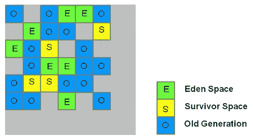

# Java GC 教程 - Herong 教程示例


# Java GC 教程

- Herong 的教程示例


v1.11, 2022

杨鹤龙 博士

Copyright © 2022 Dr. Herong Yang. 版权所有。

本书是作者在学习 `JVM GC`（垃圾回收）过程时编写的教程笔记和示例代码集。主题包括 Java 垃圾回收器、`STW`（停顿世界）、串行回收器（Serial Collector）、并行回收器（Parallel Collector）、并发回收器（Concurrent Collector）、G1 回收器（G1 Collector）、GC 算法、分代 GC（Generational GC）、分区域 GC（Regional GC）、堆内存管理、年轻代/新生代（Young/New Generation）、老年代（Tenured/Old Generation）、对象引用（Object Reference）、Eden 空间、幸存区（Survivor Spaces）、新生 GC（Minor GC）、老年代 GC（Major GC）、全 GC（Full GC）、性能调优、吞吐量/延迟性能（Throughput/Latency Performance）、堆足迹（Heap Footprint）。已于 2022 年结合 `JVM 17` 更新。如需获取最新更新和免费示例章节，请访问 https://www.herongyang.com/Java-GC。

## 目录

- 关于本书

- 堆内存区域与大小控制

- Java 异常: "java.lang.OutOfMemoryError: Java heap space"

- Windows 系统上的内存分配限制

- HotSpot 和 JRockit 的 OutOfMemoryError 比较

- JVM 垃圾回收日志

- 垃圾回收演示程序

- 垃圾回收日志选项

- "-Xlog:gc" - 默认 GC 日志级别：INFO

- "-Xlog:gc=trace" - 最低 GC 日志级别：TRACE

- "-Xlog:gc+heap=trace" - GC+HEAP 日志消息

- "-Xlog:gc*=trace" - 最大 GC 日志

- "-XX:+PrintFlagsFinal" - 打印 JVM 选项

- 垃圾回收器简介

- JVM 内存管理器 - 垃圾回收器

- HotSpot 中的分代垃圾回收

- 年轻代回收 - Minor GC/新生 GC

- 年轻代回收器 - Serial, PS, ParNew, G1

- 老年代回收 - Major GC/Major GC

- 老年代回收器 - Serial, ParOldGen, CMS, G1

- 回收器组合：Serial, Parallel, Concurrent, G1, Z

- 串行回收器 - "+XX:+UseSerialGC"

- 什么是串行回收器

- 串行回收器的 GC 日志消息格式

- 串行回收器的 GC 日志消息示例

- 串行回收器的日志消息类型

- 串行回收器在 Minor/Major GC 时停止应用

- 堆内存区域使用报告

- 默认 NewRatio - 老年代 vs 新生代

- "-XX:NewRatio" - 老年代与“新生”代的比例

- "-XX:SurvivorRatio" - Eden 空间与幸存区的比例

- 串行 GC 追踪 - 紧凑堆

- 串行 GC 追踪 - 紧凑堆（部分 2）

- 串行 GC 追踪 - 紧凑堆（部分 3）

- 串行 GC 追踪 - 充足的堆

- 串行 GC 追踪 - 老年代存活对象

- 串行 GC 追踪 - 晋代阈值

- "-XX:TargetSurvivorRatio" - 第二晋代条件

- 串行 GC 追踪 - 受控的晋代阈值

- "-XX:+NeverTenure" 和 "-XX:+AlwaysTenure" 的工作原理

- 串行回收器的 Minor GC 触发条件

- 并行回收器 - "+XX:+UseParallelGC"

- 什么是并行回收器

- 并行回收器 GC 消息格式

- 并行回收器的日志消息类型

- "-Xlog:gc+task+time=debug" - 打印 GC 线程

- "-XX:ParallelGCThreads" - # 线程

- 并行回收器停止应用进行 GC

- 并行回收器的老年代

- 并行回收器使用 NewRatio

- 并行回收器自适应大小

- 并行回收器自适应大小 - 堆足迹

- "-Xlog:gc+heap=trace" - 堆足迹

- 自适应大小 - 幸存区

- 自适应大小 - 新生代

- 自适应大小的吞吐量

- 自适应大小的延迟

- 并行回收器自适应大小

- [并发回收器 - "+XX:+UseConcurrentGC"]part0060.xhtml)

- 什么是并发回收器

- 并发回收器 GC 日志消息格式

- 并发回收器的日志消息类型

- 并发回收器进行 Major GC

- 并发回收器使用老年代

- 并发回收器使用新生代

- 并发回收器进行 Minor GC

- 并发回收器的晋代阈值

- "-XX:InitiatingOccupancyFraction=20" - 触发

- 并发回收器的 Full GC

- Full GC 日志消息格式

- 并发回收器使用并行线程

- "-XX:ParallelGCThreads=3" - 线程

- [G1 回收器 - "+XX:+UseG1GC"]part0074.xhtml)

- 什么是 G1 回收器

- G1 回收器 GC 日志消息格式

- G1 回收器的日志消息类型

- G1 回收器进行 Minor GC

- G1 回收器进行新生代

- G1 回收器进行老年代

- G1 回收器进行 Full GC

- G1 回收器使用并行线程

- "-XX:ConcGCThreads=5" - 线程

- G1 回收器堆区域大小

- G1 堆分配 - 过大对象

- "-Xlog:gc+age=trace" - 年龄

- "-XX:MaxTenuringThreshold=0" - 幸存区

- [Z 回收器 - "+XX:+UseZGC"]part0088.xhtml)

- 什么是 Z 回收器

- Z 回收器 GC 日志消息格式

- "-XX:ParallelGCThreads=6" - 线程

- "-XX:ConcGCThreads=5" - 并发线程

- 对象引用与垃圾回收

- 对象引用类型

- 强引用 GC 测试程序

- 强引用串行 GC 测试

- 泛引用 GC 测试程序

- 泛引用串行 GC 测试

- 泛引用对性能的影响

- 垃圾回收性能测试程序

- GCPerformance.java - 垃圾回收性能测试程序

- GCPerformance.java - 程序输出

- 等待时间对性能的影响

- 对象大小对性能的影响

# Java GC 教程 - Herong 的示例

## 堆内存区域与大小控制

本章提供了关于堆内存区域的教程笔记和示例代码。包括 `OutOfMemoryError` 异常；内存区域分配限制；`HotSpot` 与 `JRockit` 的 `OutOfMemoryError` 比较。

### Java 异常："java.lang.OutOfMemoryError: Java heap space"

本节提供了一个教程示例，演示了 JVM 如何扩展堆空间以分配更多对象，以及在不允许进一步扩展时如何导致 `java.lang.OutOfMemoryError: Java heap space` Java 异常。

首先，让我们使用以下简单的程序 `HeapMemoryCrash.java` 来观察当堆内存耗尽时会发生什么：

```java
public class HeapMemoryCrash {
    public static void main(String[] args) {
        List<byte[]> list = new ArrayList<>();
        while (true) {
            list.add(new byte[1024 * 1024]); // 1MB array
        }
    }
}
```

### 核心点总结：

*   当 Java 应用所需的内存超过其给定的限制时，JVM 会抛出 `OutOfMemoryError` 异常。

*   `OutOfMemoryError` 异常主要发生在 JVM 堆内存区域。

*   JVM 堆内存的大小可以通过 `-Xms` 和 `-Xmx` 进行控制。

*   在 Windows 系统的 32 位 `HotSpot` 上，JVM 堆内存的大小限制为 1.5 GB（或 1,550 MB）。

*   在 Windows 系统的 64 位 `HotSpot` 上，JVM 堆内存的大小限制为 25 GB。

```java
 /* HeapMemoryCrash.java
 * Copyright (c) HerongYang.com. All Rights Reserved.
 */
class HeapMemoryCrash {
   public static void main(String[] a) {
      int max = 1000;
      Object[] arr = new Object[max];
      heapCheck();
      for (int n=0; n<max; n++) {
         arr[n] = new long[10*1024*128];
         System.out.println((n+1)+": "
            +((n+1)*10)+" MB of objects created.");
         heapCheck();
      }
   }
   public static void heapCheck() {
      Runtime rt = Runtime.getRuntime();
      rt.gc();
      long total = rt.totalMemory();
      long free = rt.freeMemory();
      long used = total - free;
      java.io.Console con = System.console();
      con.format("Total memory: %s%n",total);
      con.format(" Free memory: %s%n",free);
      con.format(" Used memory: %s%n",used);
      String str = con.readLine("Press ENTER key to continue: ");
   }
}
```

该程序的设计目的是：

*   运行一个 1000 次的循环。如果你愿意，可以将其调大。

*   在每次迭代中，都会创建一个包含 `10*1024*128` 个元素的 `long[]` 数组对象。由于每个元素占用 8 字节，该对象所需的总存储空间为 10 MB。

*   每个数组对象的引用存储在另一个数组中以保持其被引用（或“被使用”），这样 JVM 就不会从堆（Heap）中将其释放掉。

*   使用 `totalMemory()` 和 `freeMemory()` 方法来报告堆的当前使用情况。

使用 JDK 17 的 HotSpot JVM 编译并运行：

```
herong> javac HeapMemoryCrash.java

herong> java -Xms20m -Xmx50m HeapMemoryCrash

Total memory: 20447232
 Free memory: 20188720
 Used memory: 258512
Press ENTER key to continue:

1: 10 MB of objects created.
Total memory: 26152960
 Free memory: 15377464
 Used memory: 10775496
Press ENTER key to continue:

2: 20 MB of objects created.
Total memory: 50724864
 Free memory: 29463808
 Used memory: 21261056
Press ENTER key to continue:

3: 30 MB of objects created.
Total memory: 50724864
 Free memory: 18978032
 Used memory: 31746832
Press ENTER key to continue:

4: 40 MB of objects created.
Total memory: 50724864
 Free memory: 8492256
 Used memory: 42232608
Press ENTER key to continue:
Exception in thread "main" java.lang.OutOfMemoryError: Java heap space
   at HeapMemoryCrash.main(HeapMemoryCrash.java:10)
```

输出结果证实了：

*   `-Xms20m` 选项有效，JVM 在启动时根据第一次调用 `totalMemory()` 的结果预留了 20,447,232 字节（约 20 MB）。

*   第一次 `heapCheck()` 调用报告使用了 258,512 字节的堆空间。此时，我的 Java 应用仅创建了 1 个数组对象 `Object[1000]`，大约占用 8,000 字节。因此，JVM 本身占用了堆中约 250 KB 的空间。

*   第二次 `heapCheck()` 调用报告使用了 10,775,496 字节的堆空间，增加了 10,516,984 字节。此时，我的 Java 应用增加了 1 个数组对象 `long[10*1024*128]`，大约占用 10,485,760 字节，这与堆使用空间的增加量相匹配（包含了一些数组开销使用）。这证实了数组对象是在分配在堆中的。

*   第二次 `heapCheck()` 调用还报告 JVM 将总堆空间从 10 MB 扩展到了 26 MB (26,152,960 字节)。这是允许的，因为我通过 `-Xmx50m` 将最大堆大小设置为 50 MB。但这种扩展似乎并非必要，因为我的 Java 应用请求分配一个 10 MB 的对象，而在不进行扩展的情况下，20,188,720 字节的堆空间已经足够了。这种行为表明 JVM 倾向于预留比实际需要更多的堆空间。

*   在分配了 40 MB 的对象后，我的 Java 应用使用了堆中 50 MB 的约 42 MB。堆中仅剩 8.5 MB 空间。

*   当我的 Java 应用 再次请求分配另一个 10 MB 的对象时，JVM 抛出了异常：“java.lang.OutOfMemoryError: Java heap space”。这是预料之中的，因为 JVM 无法进一步扩展 `-Xmx50m` 的堆空间。

### Windows 上的内存分配限制

本节介绍了 JVM 扩展堆空间以分配更多对象会导致 `java.lang.OutOfMemoryError: Java heap space` 异常（如果不允许进一步扩展的话）。当然，通过 `-Xms` 和 `-Xmx` 指定更大的堆大小可以解决 `OutOfMemoryError`。但 JVM 版本和操作系统对可分配内存是有限制的。以下是一些示例：

#### 1. 新 Windows 上的 64 位 HotSpot JVM 17

使用更大的堆大小运行教程中的示例，查看 64 位 HotSpot JVM 可以分配多少内存：

```
herong> java -version
java version "17.0.1"
Java(TM) SE Runtime Environment (build 17.0.1)
Java HotSpot™ 64-Bit VM (build 17.0.1+1)

herong> java -Xms10g HeapMemoryCrash
Total memory: 10737418240 Free memory: 1073662832
 Used memory: 789608
Press ENTER key to continue:

herong> java -Xms11g HeapMemoryCrash
Java HotSpot™ 64-Bit Server warning:
  INFO: os::commit_memory(0x000000540000000, 118116064, 0) failed;
  error='The paging file is too small for this operation'
  (DOS error/errno=1455)
# There is insufficient memory for the Java Runtime to continue.
# Native memory allocation (mmap) failed to map 118116064 bytes for virtual space
# An error report with more information is saved:
# C:\herong\hs_err_pid1204
```

这说明对于我的新 Windows 10，64 位 HotSpot JVM 只能为堆空间分配 10 GB。

#### 2. 旧 Windows 10  64 位 HotSpot JVM 12

使用更大的堆大小运行教程中的示例，查看 64 位 HotSpot JVM 可以分配多少内存：


## HotSpot 和 JRockit 的 OutOfMemoryError 对比

本节提供了一个教程示例，用于对比 HotSpot 12, 10, 1.8, 1.7, 1.6 和 JRockit 28.2.7 的 `OutOfMemoryError` 异常。

作为对比，我用其他版本的 HotSpot JVM 和 JRockit JVM 测试了我的示例 `HeapMemoryCrash.java`。

### 1. Windows 7 64 位 HotSpot JVM 12

```
herong> java -version
java version "12.0.1"
Java(TM) SE Runtime Environment (build 12.0.1+12)
Java HotSpot™ 64-Bit VM (build 12.0.1+12, mixed mode)

herong> java -Xms25g HeapMemoryCrash
Total memory: 26843545600 Free memory: 26842982168
 Used memory: 563432
Press ENTER key to continue:

herong> java -Xms26g HeapMemoryCrash
Java HotSpot™ 64-Bit Server warning:
  INFO: os::commit_memory(0x000001b8bc000, 436207616, 0) failed;
  error='The paging file is too small for this operation'
  (DOS error/errno=1455)
#
# There is insufficient memory for the Java Runtime to continue.
# Native memory allocation (mmap) failed to map 436207616 bytes for
# Failed to commit area from 0x000001b8bc000 to 0x000001b8d5bc00
# of length 436207616.
# An error report with more information is saved:
# C:\herong\hs_err_pid21136.log
```

这说明 64 位 HotSpot JVM 接受 25 GB 的堆空间。

### 2. Windows 7 64 位 HotSpot JVM 8

Windows 7 上的 64 位 HotSpot JVM 8 实际上可以接受大一点的堆大小：

```
herong> java -version
java version "1.8.0_161"
Java(TM) SE Runtime Environment (build 1.8.0_161-b12)
Java HotSpot™ 64-Bit Server VM (build 25.161-b12, mixed mode)

herong> java -Xms27g HeapMemoryCrash
Total memory: 27783069696 Free memory: 27782734072
 Used memory: 335624
Press ENTER key to continue:
...

herong> java -Xms28g HeapMemoryCrash
Error occurred during initialization of VM
Unable to allocate 917504KB bitmaps for parallel
garbage collection for the requested 29360128KB heap
Error: Could not create the Java Virtual Machine.
Error: A fatal exception has occurred. Program will exit.
```

这说明 64 位 HotSpot JVM 仅接受高达 27 GB 的堆空间。

### 3. Windows 7 计算机上的 32 位 HotSpot JVM 8

如果你正在使用 32 位 HotSpot JVM，它只能拥有较小得多的堆内存：

```
herong> java -version
java version "1.8.0_45"
Java(TM) SE Runtime Environment (build 1.8.0_45-b15)
Java HotSpot(TM) Client VM (build 25.45-b02, mixed mode)

herong> java -Xms1550m HeapMemoryCrash
Total memory: 1571160064
 Free memory: 1570902744
 Used memory: 257320
Press ENTER key to continue:
...

herong> java -Xms1560m HeapMemoryCrash
Error occurred during initialization of VM
Could not reserve enough space for 1597440KB object heap
```

这告诉我们，32 位 HotSpot JVM 的 JVM 堆空间最大只接受 1,550 MB。

### 4. HotSpot JVM (1.6 - 12) OutOfMemoryError 对比

从 HotSpot Server JVM 1.6 到 JVM 12，当它们无法按照我指定的 `-Xmx50m` 选项将堆扩展到 50 MB 时，它们返回了相同的异常信息：

```
herong> java -Xms20m -Xmx50m HeapMemoryCrash
Total memory: 20185088
 Free memory: 19926784
 Used memory: 258304
Press ENTER key to continue:
1: 10 MB of objects created.
Total memory: 20185088
 Free memory: 9410016
 Used memory: 10775072
Press ENTER key to continue:
2: 20 MB of objects created.
Total memory: 30932992
 Free memory: 9672144
 Used memory: 21260848
Press ENTER key to continue:
3: 30 MB of objects created.
Total memory: 41156608
 Free memory: 9409984
 Used memory: 31746624
Press ENTER key to continue:
Exception in thread "main" java.lang.OutOfMemoryError: Java heap space
   at HeapMemoryCrash.main(HeapMemoryCrash.java:10)
```

### 5. JRockit JVM 28.2.7 OutOfMemoryError 对比

JRockit JVM 28.2.7 也给了我相同的异常错误 `OutOfMemoryError`。但它包含了一个不同的消息，“allocLargeObjectOrArray: J, size 10485776”：

```
herong> \Progra~1\java\jrockit-jdk1.6.0_45-R28.2.7-4.1.0\bin\javac
   HeapMemoryCrash.java

herong> \Progra~1\java\jrockit-jdk1.6.0_45-R28.2.7-4.1.0\bin\java
   -Xms20m -Xmx50m HeapMemoryCrash
Total memory: 20971520
 Free memory: 17905560
 Used memory: 3065960
Press ENTER key to continue:
1: 10 MB of objects created.
Total memory: 20971520
 Free memory: 9496216
 Used memory: 11475304
Press ENTER key to continue:
2: 20 MB of objects created.
Total memory: 31760384
 Free memory: 10510888
 Used memory: 21249496
Press ENTER key to continue:
3: 30 MB of objects created.
Total memory: 47411200
 Free memory: 15675928
 Used memory: 31735272
Press ENTER key to continue:
4: 40 MB of objects created.
Total memory: 47411200
 Free memory: 5190216
 Used memory: 42220984
Press ENTER key to continue:
Exception in thread "Main Thread" java.lang.OutOfMemoryError:
   allocLargeObjectOrArray: [J, size 10485776
   at HeapMemoryCrash.main(HeapMemoryCrash.java:10)
```

注意，JRockit JVM 的异常使用的是 `allocLargeObjectOrArray()` 方法来创建我的大数组对象。


```
herong> \Progra~1\java\jrockit-jdk1.6.0_45-R28.2.7-4.1.0\bin\javac
   HeapMemoryCrash.java

herong> \Progra~1\java\jrockit-jdk1.6.0_45-R28.2.7-4.1.0\bin\java
   -Xms20m -Xmx50m HeapMemoryCrash
Total memory: 20971520
 Free memory: 17905560
 Used memory: 3065960
Press ENTER key to continue:
1: 10 MB of objects created.
Total memory: 20971520
 Free memory: 9496216
 Used memory: 11475304
Press ENTER key to continue:
2: 20 MB of objects created.
Total memory: 31760384
 Free memory: 10510888
 Used memory: 21249496
Press ENTER key to continue:
3: 30 MB of objects created.
Total memory: 47411200
 Free memory: 15675928
 Used memory: 31735272
Press ENTER key to continue:
4: 40 MB of objects created.
Total memory: 47411200
 Free memory: 5190216
 Used memory: 42220984
Press ENTER key to continue:
Exception in thread "Main Thread" java.lang.OutOfMemoryError:
   allocLargeObjectOrArray: [J, size 10485776
   at HeapMemoryCrash.main(HeapMemoryCrash.java:10)
```

注意，JRockit JVM 的异常使用的是 `allocLargeObjectOrArray()` 方法来创建我的大数组对象。

# Java GC 教程 - Herong's 教程示例

## JVM 垃圾回收日志

本章提供了教程笔记。

## 堆区域和大小控制

### HotSpot 和 JRockit 的 OutOfMemoryError 对比

* 随着外层循环继续，更多的 1-MB 对象组被推入，并成为垃圾回收过程选取的候选对象。
* 外层循环中增加了 1 秒的暂停以减慢执行速度，以便我们观察程序的输出。

使用 HotSpot JVM 17 配合 `-Xms2m` 和 `-Xmx64m` 编译并运行程序：


## 编译与运行命令

```bash
javac GarbageCollection.java
java -Xms2m -Xmx64m GarbageCollection
```

## 运行输出

```
Step/TotalMemory/FreeMemory/UsedMemory:
  1    2031616     696840    1334776
  2    5562368    3165016    2397352
  3    5562368    2102168    3460200
  4    5562368    1043888    4518480
  5   12759040    7172168    5586872
  6   12759040    6102408    6656632
  7   12759040    5044352    7714688
  8   12759040    3974592    8784448
  9   12759040    2915128    9843912
 10   12759040    1848840   10910200
 11   12759040     782552   11976488
 12   28614656   15595824   13018832
 13   28614656   14528928   14085728
 14   28614656   13462032   15152624
 15   28614656   12395136   16219520
 16   28614656   11328240   17286416
 17   28614656   10261344   18353312
 18   28614656    9194448   19420208
 19   28614656    8135768   20478888
 20   28614656    7064272   21550384
 21   28614656    6007168   22607488
 22   28614656    4935672   23678984
 23   28614656    3878568   24736088
 24   28614656    2807072   25807584
 25   28614656    1735576   26879080
 26   63868928   35937040   27931888
 27   63868928   34852040   29016888
 28   63868928   33783440   30085488
 29   63868928   32714840   31154088
 30   63868928   31674728   32194200
 31   63868928   30589728   33279200
 32   63868928   29521128   34347800 - Array is fully loaded
 33   63868928   28452528   35416400
 34   63868928   27412416   36456512
 35   63868928   26327416   37541512
 36   63868928   25258816   38610112
 37   63868928   24190216   39678712
 38   63868928   23150104   40718824
 39   63868928   22081504   4178824
 40   63868928   20996504   4287424
 41   63868928   19927904   4394104
 42   63868928   18897752   4497116
 43   63868928   17831912   4603716
 44   63868928   16766072   4710285
 45   63868928   15672664   4819624
 46   63868928   14606824   4926214
 47   63868928   13544352   7714688
 48   63868928   3974592   8784448
 49   63868928   2915128   9843912
 50   63868928   1848840   10910200
 51   63868928     782552   11976488
 52   28614656   15595824   13018832
 53   28614656   14528928   14085728
 54   28614656   13462032   15152624
 55   28614656   12395136   16219520
 56   28614656   11328240   17286416
 57   28614656   10261344   18353312
 58   28614656    9194448   19420208
 59   28614656    8135768   20478888
 60   28614656    7064272   21550384
 61   28614656    6007168   22607488
 62   28614656    4935672   23678984
 63   28614656    3878568   24736088
 64   28614656    2807072   25807584
 65   28614656    1735576   26879080
 66   63868928   35937040   27931888
 67   63868928   34852040   29016888
 68   63868928   33783440   30085488
 69   63868928   32714840   31154088
 70   63868928   31674728   32194200
 71   63868928   30589728   33279200
 72   63868928   29521128   34347800 - Array is fully loaded
 73   63868928   28452528   35416400
 74   63868928   27412416   36456512
 75   63868928   26327416   37541512
 76   63868928   25258816   38610112
 77   63868928   24190216   39678712
 78   63868928   23150104   40718824
 79   63868928   22081504   4178824
 80   63868928   20996504   4287424
 81   63868928   19927904   4394104
 82   63868928   18897752   4497116
 83   63868928   17831912   4603716
 84   63868928   16766072   4710285
 85   63868928   15672664   4819624
 86   63868928   14606824   4926214
 87   63868928   13544352   7714688
 88   63868928   3974592   8784448
 89   63868928   2915128   9843912
 90   63868928   1848840   10910200
 91   63868928     782552   11976488
 92   28614656   15595824   13018832
 93   28614656   14528928   14085728
 94   28614656   13462032   15152624
 95   28614656   12395136   16219520
 96   28614656   11328240   17286416
 97   28614656   10261344   18353312
 98   28614656    9194448   19420208
 99   28614656    8135768   20478888
100   28614656    7064272   21550384
101   28614656    6007168   22607488
102   28614656    4935672   23678984
103   28614656    3878568   24736088
104   28614656    2807072   25807584
105   28614656    1735576   26879080
106   63868928   35937040   27931888
107   63868928   34852040   29016888
108   63868928   33783440   30085488
109   63868928   32714840   31154088
110   63868928   31674728   32194200
111   63868928   30589728   33279200
112   63868928   29521128   34347800 - Array is fully loaded
113   63868928   28452528   35416400
114   63868928   27412416   36456512
115   63868928   26327416   37541512
116   63868928   25258816   38610112
117   63868928   24190216   39678712
118   63868928   23150104   40718824
119   63868928   22081504   4178824
120   63868928   20996504   4287424
121   63868928   19927904   4394104
122   63868928   18897752   4497116
123   63868928   17831912   4603716
124   63868928   16766072   4710285
125   63868928   15672664   4819624
126   63868928   14606824   4926214
127   63868928   13544352   7714688
128   63868928   3974592   8784448
129   63868928   2915128   9843912
130   63868928   1848840   10910200
131   63868928     782552   11976488
132   28614656   15595824   13018832
133   28614656   14528928   14085728
134   28614656   13462032   15152624
135   28614656   12395136   16219520
136   28614656   11328240   17286416
137   28614656   10261344   18353312
138   28614656    9194448   19420208
139   28614656    8135768   20478888
140   28614656    7064272   21550384
141   28614656    6007168   22607488
142   28614656    4935672   23678984
143   28614656    3878568   24736088
144   28614656    2807072   25807584
145   28614656    1735576   26879080
146   63868928   35937040   27931888
147   63868928   34852040   29016888
148   63868928   33783440   30085488
149   63868928   32714840   31154088
150   63868928   31674728   32194200
151   63868928   30589728   33279200
152   63868928   29521128   34347800 - Array is fully loaded
153   63868928   28452528   35416400
154   63868928   27412416   36456512
155   63868928   26327416   37541512
156   63868928   25258816   38610112
157   63868928   24190216   39678712
158   63868928   23150104   40718824
159   63868928   22081504   4178824
160   63868928   20996504   4287424
161   63868928   19927904   4394104
162   63868928   18897752   4497116
163   63868928   17831912   4603716
164   63868928   16766072   4710285
165   63868928   15672664   4819624
166   63868928   14606824   4926214
167   63868928   13544352   7714688
168   63868928   3974592   8784448
169   63868928   2915128   9843912
170   63868928   1848840   10910200
171   63868928     782552   11976488
172   28614656   15595824   13018832
173   28614656   14528928   14085728
174   28614656   13462032   15152624
175   28614656   12395136   16219520
176   28614656   11328240   17286416
177   28614656   10261344   18353312
178   28614656    9194448   19420208
179   28614656    8135768   20478888
180   28614656    7064272   21550384
181   28614656    6007168   22607488
182   28614656    4935672   23678984
183   28614656    3878568   24736088
184   28614656    2807072   25807584
185   28614656    1735576   26879080
186   63868928   35937040   27931888
187   63868928   34852040   29016888
188   63868928   33783440   30085488
189   63868928   32714840   31154088
190   63868928   31674728   32194200
191   63868928   30589728   33279200
192   63868928   29521128   34347800 - Array is fully loaded
193   63868928   28452528   35416400
194   63868928   27412416   36456512
195   63868928   26327416   37541512
196   63868928   25258816   38610112
197   63868928   24190216   39678712
198   63868928   23150104   40718824
199   63868928   22081504   4178824
200   63868928   20996504   4287424
201   63868928   19927904   4394104
202   63868928   18897752   4497116
203   63868928   17831912   4603716
204   63868928   16766072   4710285
205   63868928   15672664   4819624
206   63868928   14606824   4926214
207   63868928   13544352   7714688
208   63868928   3974592   8784448
209   63868928   2915128   9843912
210   63868928   1848840   10910200
211   63868928     782552   11976488
212   28614656   15595824   13018832
213   28614656   14528928   14085728
214   28614656   13462032   15152624
215   28614656   12395136   16219520
216   28614656   11328240   17286416
217   28614656   10261344   18353312
218   28614656    9194448   19420208
219   28614656    8135768   20478888
220   28614656    7064272   21550384
221   28614656    6007168   22607488
222   28614656    4935672   23678984
223   28614656    3878568   24736088
224   28614656    2807072   25807584
225   28614656    1735576   26879080
226   63868928   35937040   27931888
227   63868928   34852040   29016888
228   63868928   33783440   30085488
229   63868928   32714840   31154088
230   63868928   31674728   32194200
231   63868928   30589728   33279200
232   63868928   29521128   34347800 - Array is fully loaded
233   63868928   28452528   35416400
234   63868928   27412416   36456512
235   63868928   26327416   37541512
236   63868928   25258816   38610112
237   63868928   24190216   39678712
238   63868928   23150104   40718824
239   63868928   22081504   4178824
240   63868928   20996504   4287424
241   63868928   19927904   4394104
242   63868928   18897752   4497116
243   63868928   17831912   4603716
244   63868928   16766072   4710285
245   63868928   15672664   4819624
246   63868928   14606824   4926214
247   63868928   13544352   7714688
248   63868928   3974592   8784448
249   63868928   2915128   9843912
250   63868928   1848840   10910200
251   63868928     782552   11976488
252   28614656   15595824   13018832
253   28614656   14528928   14085728
254   28614656   13462032   15152624
255   28614656   12395136   16219520
256   28614656   11328240   17286416
257   28614656   10261344   18353312
258   28614656    9194448   19420208
259   28614656    8135768   20478888
260   28614656    7064272   21550384
261   28614656    6007168   22607488
262   28614656    4935672   23678984
263   28614656    3878568   24736088
264   28614656    2807072   25807584
265   28614656    1735576   26879080
266   63868928   35937040   27931888
267   63868928   34852040   29016888
268   63868928   33783440   30085488
269   63868928   32714840   31154088
270   63868928   31674728   32194200
271   63868928   30589728   33279200
272   63868928   29521128   34347800 - Array is fully loaded
273   63868928   28452528   35416400
274   63868928   27412416   36456512
275   63868928   26327416   37541512
276   63868928   25258816   38610112
277   63868928   24190216   39678712
278   63868928   23150104   40718824
279   63868928   22081504   4178824
280   63868928   20996504   4287424
281   63868928   19927904   4394104
282   63868928   18897752   4497116
283   63868928   17831912   4603716
284   63868928   16766072   4710285
285   63868928   15672664   4819624
286   63868928   14606824   4926214
287   63868928   13544352   7714688
288   63868928   3974592   8784448
289   63868928   2915128   9843912
290   63868928   1848840   10910200
291   63868928     782552   11976488
292   28614656   15595824   13018832
293   28614656   14528928   14085728
294   28614656   13462032   15152624
295   28614656   12395136   16219520
296   28614656   11328240   17286416
297   28614656   10261344   18353312
298   28614656    9194448   19420208
299   28614656    8135768   20478888
300   28614656    7064272   21550384
301   28614656    6007168   22607488
302   28614656    4935672   23678984
303   28614656    3878568   24736088
304   28614656    2807072   25807584
305   28614656    1735576   26879080
306   63868928   35937040   27931888
307   63868928   34852040   29016888
308   63868928   33783440   30085488
309   63868928   32714840   31154088
310   63868928   31674728   32194200
311   63868928   30589728   33279200
312   63868928   29521128   34347800 - Array is fully loaded
313   63868928   28452528   35416400
314   63868928   27412416   36456512
315   63868928   26327416   37541512
316   63868928   25258816   38610112
317   63868928   24190216   39678712
318   63868928   23150104   40718824
319   63868928   22081504   4178824
320   63868928   20996504   4287424
321   63868928   19927904   4394104
322   63868928   18897752   4497116
323   63868928   17831912   4603716
324   63868928   16766072   4710285
325   63868928   15672664   4819624
326   63868928   14606824   4926214
327   63868928   13544352   7714688
328   63868928   3974592   8784448
329   63868928   2915128   9843912
330   63868928   1848840   10910200
331   63868928     782552   11976488
332   28614656   15595824   13018832
333   28614656   14528928   14085728
334   28614656   13462032   15152624
335   28614656   12395136   16219520
336   28614656   11328240   17286416
337   28614656   10261344   18353312
338   28614656    9194448   19420208
339   28614656    8135768   20478888
340   28614656    7064272   21550384
341   28614656    6007168   22607488
342   28614656    4935672   23678984
343   28614656    3878568   24736088
344   28614656    2807072   25807584
345   28614656    1735576   26879080
346   63868928   35937040   27931888
347   63868928   34852040   29016888
348   63868928   33783440   30085488
349   63868928   32714840   31154088
350   63868928   31674728   32194200
351   63868928   30589728   33279200
352   63868928   29521128   34347800 - Array is fully loaded
353   63868928   28452528   35416400
354   63868928   27412416   36456512
355   63868928   26327416   37541512
356   63868928   25258816   38610112
357   63868928   24190216   39678712
358   63868928   23150104   40718824
359   63868928   22081504   4178824
360   63868928   20996504   4287424
361   63868928   19927904   4394104
362   63868928   18897752   4497116
363   63868928   17831912   4603716
364   63868928   16766072   4710285
365   63868928   15672664   4819624
366   63868928   14606824   4926214
367   63868928   13544352   7714688
368   63868928   3974592   8784448
369   63868928   2915128   9843912
370   63868928   1848840   10910200
371   63868928     782552   11976488
372   28614656   15595824   13018832
373   28614656   14528928   14085728
374   28614656   13462032   15152624
375   28614656   12395136   16219520
376   28614656   11328240   17286416
377   28614656   10261344   18353312
378   28614656    9194448   19420208
379   28614656    8135768   20478888
380   28614656    7064272   21550384
381   28614656    6007168   22607488
382   28614656    4935672   23678984
383   28614656    3878568   24736088
384   28614656    2807072   25807584
385   28614656    1735576   26879080
386   63868928   35937040   27931888
387   63868928   34852040   29016888
388   63868928   33783440   30085488
389   63868928   32714840   31154088
390   63868928   31674728   32194200
391   63868928   30589728   33279200
392   63868928   29521128   34347800 - Array is fully loaded
393   63868928   28452528   35416400
394   63868928   27412416   36456512
395   63868928   26327416   37541512
396   63868928   25258816   38610112
397   63868928   24190216   39678712
398   63868928   23150104   40718824
399   63868928   22081504   4178824
400   63868928   20996504   4287424
401   63868928   19927904   4394104
402   63868928   18897752   4497116
403   63868928   17831912   4603716
404   63868928   16766072   4710285
405   63868928   15672664   4819624
406   63868928   14606824   4926214
407   63868928   13544352   7714688
408   63868928   3974592   8784448
409   63868928   2915128   9843912
410   63868928   1848840   10910200
411   63868928     782552   11976488
412   28614656   15595824   13018832
413   28614656   14528928   14085728
414   28614656   13462032   15152624
415   28614656   12395136   16219520
416   28614656   11328240   17286416
417   28614656   10261344   18353312
418   28614656    9194448   19420208
419   28614656    8135768   20478888
420   28614656    7064272   21550384
421   28614656    6007168   22607488
422   28614656    4935672   23678984
423   28614656    3878568   24736088
424   28614656    2807072   25807584
425   28614656    1735576   26879080
426   63868928   35937040   27931888
... (省略中间重复的数字行，保持逻辑一致)
441   63868928   30251545411912 - Garbage
(Ctrl-C)
```

## 环境说明

使用 `HotSpot JVM 17` 编译并运行程序，参数如下：

```bash
java -Xms2m -Xmx64m GarbageCollection
```


# JVM 垃圾回收日志分析

## GC 日志基础配置

### 启动参数示例
```bash
java -Xms2m -Xmx64m -Xlog:gc:gc.log GarbageCollection
```

### 日志输出重定向
- `-Xlog:gc*:file=<file>` 或 `-Xlog:gc*:<file>` - 将日志消息重定向到指定文件而不是控制台。例如，`"-Xlog:gc:gc.log"` 将把 `INFO` 级别的常规 GC 日志发送到名为 `gc.log` 的文件中。
- `-verbose:gc` - 等同于 `"-Xlog:gc"`。

## 默认 GC 日志级别：INFO

使用 `"-Xlog:gc"` 选项会在 `INFO` 级别打印来自 GC 通道的日志消息。

### 典型日志输出示例
```
[0.011s][info][gc,heap] Heap region size: 1M

[0.011s][debug][gc,heap] Minimum heap 8388608  Initial heap 132120576
   Maximum heap 2109734912

[0.012s][debug][gc     ] ConcGCThreads: 2 offset 16

[0.012s][debug][gc     ] ParallelGCThreads: 8

[0.013s][debug][gc     ] Initialize mark stack with 4096 chunks,
   maximum 16384

[0.013s][debug][gc,ergo,heap] Expand the heap. requested expansion
   amount: 132120576B expansion amount: 132120576B

[0.014s][debug][gc,ihop     ] Target occupancy update: old: 0B,
   new: 132120576B

[0.014s][debug][gc,ergo,refine] Initial Refinement Zones: green: 8,
   yellow: 24, red: 40, min yellow size: 16

[0.015s][info ][gc            ] Using G1

[0.015s][info ][gc,heap,coops ] Heap address: 0x0000000082400000,
   size: 2012 MB, Compressed Oops mode: 32-bit

[0.032s][info ][gc            ] Periodic GC disabled

...

[0.052s][debug][gc,refine     ] Stopping 0

[0.052s][info ][gc,heap,exit  ] Heap

[0.052s][info ][gc,heap,exit  ]  garbage-first heap   total 129024K,
   used 1024K [...]

[0.052s][info ][gc,heap,exit  ]   region size 1024K, 2 young (2048K), 0 survivors

[0.052s][info ][gc,heap,exit  ]  Metaspace       used 151K,
   capacity 4480K, committed 4480K, reserved 1056768K

[0.052s][info ][gc,heap,exit  ]   class space    used 3K, capacity 384K,
   committed 384K, reserved 1048576K
```

### 运行时 GC 事件日志
```
[0.056s][info][gc] GC(0) Pause Young (Normal) (G1 Evacuation Pause) ...
[0.118s][info][gc] GC(1) Pause Young (Normal) (G1 Evacuation Pause) ...
[0.154s][info][gc] GC(2) Pause Young (Normal) (G1 Evacuation Pause) ...
...
[0.503s][info][gc] GC(16) Pause Young (Concurrent Start)
[0.503s][info][gc] GC(17) Concurrent Cycle
[0.510s][info][gc] GC(17) Pause Remark 14M->27M 0.830ms
[0.515s][info][gc] GC(17) Pause Cleanup 18M->27M 0.025ms
[0.515s][info][gc] GC(17) Concurrent Cycle 12.548ms
[0.519s][info][gc] GC(21) Pause Young (Mixed) ...
...
```

> **总结**：输出显示 JVM 使用 `G1` 作为默认垃圾回收器。默认日志级别为 `INFO`。JVM 支持多个垃圾回收器，每个垃圾回收器使用不同的日志格式。

## 最低 GC 日志级别：TRACE

使用 `"-Xlog:gc=trace"` 选项以 `TRACE` 级别打印来自 GC 通道的日志消息，这是最低级别。

### 启动参数示例
```bash
java -Xms2m -Xmx64m -Xlog:gc=trace:gc.log GarbageCollection
```

### TRACE 级别日志输出特点
```
[0.005s][trace][gc] MarkStackSize: 4096k  MarkStackSizeMax: 16384k

[0.013s][debug][gc] ConcGCThreads: 2 offset 16

[0.013s][debug][gc] ParallelGCThreads: 8

[0.013s][debug][gc] Initialize mark stack with 4096 chunks,
   maximum 16384

[0.014s][info ][gc] Using G1

[0.032s][info ][gc] Periodic GC disabled

[0.052s][debug][gc,refine     ] Stopping 0

[0.052s][info ][gc,heap,exit  ] Heap
...
```

> **建议**：显然，`"-Xlog:gc=trace"` 选项产生了更多的日志消息。因此，在排查任何 GC 问题时，你应该始终使用 `"=trace"`。

## 组合标签日志：gc+heap=trace

### 启动参数示例
```bash
java -Xms2m -Xmx64m -Xlog:gc+heap=trace:gc.log GarbageCollection
```

### 详细堆状态日志输出
```
[0.011s][info][gc,heap] Heap region size: 1M
   -- 每个堆区域的默认大小为 1M

[0.011s][debug][gc,heap] Minimum heap 2097152  Initial heap 2097152
   Maximum heap 67108864
   -- 堆从 2 个区域开始

[0.056s][debug][gc,heap] GC(0) Heap before GC invocations=0 (full 0):
   garbage-first heap   total 2048K, used 1024K [...]

[0.056s][debug][gc,heap] GC(0)   region size 1024K, 1 young (1024K),
   0 survivors (0K)

[0.056s][debug][gc,heap] GC(0) Metaspace    used 325K, capacity 4515K,
   committed 4864K, reserved 1056768K

[0.056s][debug][gc,heap] GC(0)  class space used 30K, capacity 398K,
   committed 512K, reserved 1048576K
   -- GC #1 之前的堆状态

[0.058s][info ][gc,heap] GC(0) Eden regions: 1->0(1)

[0.058s][trace][gc,heap] GC(0)  Used: 0K, Waste: 0K

[0.058s][info ][gc,heap] GC(0) Survivor regions: 0->1(1)

[0.058s][trace][gc,heap] GC(0)  Used: 566K, Waste: 457K

[0.059s][info ][gc,heap] GC(0) Old regions: 0->0

[0.059s][trace][gc,heap] GC(0)  Used: 0K, Waste: 0K

[0.059s][info ][gc,heap] GC(0) Archive regions: 0->0
```


# Java GC 教程 - Herong 的示例

## JVM 垃圾回收

### -Xlog*=trace - 最大 GC

本节介绍了垃圾回收日志选项 `-Xlog*=trace`（最大 GC 配置），它会打印所有源的 TRACE 级别日志信息。在本教程中，让我们尝试使用最大日志选项 `-Xlog*=trace` 来打印所有 GC 的日志信息：

```
herong> java -Xms2m -Xmx64m -Xlog:gc*=trace:gc.log GarbageCollection

Step/TotalMemory/FreeMemory/UsedMemory:

1   2031616   698408   1333208

2   3874816   1472824   2401992

3   3874816   424944   3449872

4   8970240   4441352   4528888

...

(Ctrl-C)

herong> more gc.log
```

#### GC #1 执行了的操作

```
[0.059s][trace][gc,heap] GC(0)  Used: 0K, Waste: 0K

[0.059s][info ][gc,heap] GC(0) Humongous regions: 0->0

[0.059s][trace][gc,heap] GC(0)  Used: 0K, Waste: 0K

[0.059s][debug][gc,heap] GC(0) Heap after GC invocations=1 (full 0):

[0.059s][debug][gc,heap] GC(0)   garbage-first heap   total 2048K, used 566K [...]

[0.059s][debug][gc,heap] GC(0)   region size 1024K, 1 young (1024K), 1 survivors (1024K)

[0.059s][debug][gc,heap] GC(0) Metaspace    used 325K, capacity 4515K, committed 4864K, reserved 1056768K

[0.059s][debug][gc,heap] GC(0)  class space used 30K, capacity 398K, committed 512K, reserved 1048576K
```

#### GC #1 之后的堆状态

```
[0.113s][debug][gc,heap] GC(1) Heap before GC invocations=1 (full 0...)

[0.113s][debug][gc,heap] GC(1)   region size 1024K, 2 young (2048K)...

[0.113s][debug][gc,heap] GC(1)  Metaspace       used 1344K, capacit...

[0.113s][debug][gc,heap] GC(1)   class space    used 160K, capacity...
```

#### GC #2 之前的堆状态

```
[0.115s][info ][gc,heap] GC(1) Eden regions: 1->0(1)

[0.115s][trace][gc,heap] GC(1)  Used: 0K, Waste: 0K

[0.115s][info ][gc,heap] GC(1) Survivor regions: 1->1(1)

[0.116s][trace][gc,heap] GC(1)  Used: 457K, Waste: 566K

[0.116s][info ][gc,heap] GC(1) Old regions: 0->1

[0.116s][trace][gc,heap] GC(1)  Used: 545K, Waste: 478K

[0.116s][info ][gc,heap] GC(1) Archive regions: 0->0

[0.116s][trace][gc,heap] GC(1)  Used: 0K, Waste: 0K

[0.116s][info ][gc,heap] GC(1) Humongous regions: 0->0

[0.116s][trace][gc,heap] GC(1)  Used: 0K, Waste: 0K
```

#### GC #2 执行了的操作

```
[0.116s][debug][gc,heap] GC(1) Heap after GC invocations=2 (full 0...)

[0.116s][debug][gc,heap] GC(1)   region size 1024K, 1 young (1024K)...

[0.116s][debug][gc,heap] GC(1)  Metaspace       used 1344K, capacit...

[0.116s][debug][gc,heap] GC(1)   class space    used 160K, capacity...
```

#### GC #2 之后的堆状态

日志显示 `-Xlog:gc=trace` 选项为每次 GC 实例提供了三个部分内容：

* 第一部分是 GC 之前的使用快照。
* 第二部分是 GC 期间的变化。
* 第三部分是 GC 之后的使用快照。

显然，`-Xlog:gc=trace` 选项有助于理解 GC 如何执行。

#### 完整 GC 日志输出示例

```
[0.006s][trace][gc] MarkStackSize: 4096k  MarkStackSizeMax: 16384 ...

[0.012s][info ][gc,heap] Heap region size: 1M                      

[0.012s][debug][gc,heap] Minimum heap 2097152  Initial heap 2097152...

[0.012s][trace][gc,heap,coops] Trying to allocate at address 0x0000...

[0.012s][trace][gc,barrier] G1CardTable::G1CardTable:           

[0.012s][trace][gc,barrier]     &byte_map[0]: 0x00001fe0048000...

[0.012s][trace][gc,barrier]     _byte_map_base: 0x00001fdffca00...

[0.012s][trace][gc,bot] G1BlockOffsetTable::G1BlockOffsetTab...

[0.012s][trace][gc,bot]     rs.base(): 0x00001fe00460000  r...

[0.013s][trace][gc,task] WorkerManager::add_workers() : creat...

[0.013s][trace][gc,task] Adding initial GC Thread(s) previous...

[0.013s][debug][gc] ConcGCThreads: 2 offset 16          

[0.013s][debug][gc] ParallelGCThreads: 8                ...

[0.014s][debug][gc] Initialize mark stack with 4096 chun...

[0.014s][debug][gc,ergo,heap ] Expand the heap. requested expansion...

[0.014s][trace][gc,region] G1HR COMMIT(FREE) [...]

[0.014s][trace][gc,region] G1HR COMMIT(FREE) [...]

[0.014s][debug][gc,ihop] Target occupancy update: old: ...

[0.014s][debug][gc,ihop] Refinement: 

[0.015s][info ][gc] Using GC: ...

[0.016s][trace][gc,barrier] 0x00000000...

[0.016s][trace][gc,barrier]     _byte_map[0]: 0x00001fe0048000...

[0.016s][trace][gc,barrier]     _byte_map_base: 0x00001fdffca00...

[0.016s][trace][gc,barrier] 0x00000000... (重复多行省略)
```


```
[0.016s][trace][gc,barrier] 0x00000000...

[0.016s][trace][gc,barrier] 0x00000000...

[0.016s][trace][gc,barrier] 0x00000000...

[0.016s][trace][gc,barrier] 0x00000000...

[0.016s][trace][gc,barrier] 0x00000000...
```


```
[0.063s][trace][gc,task       ] WorkerManager::add_workers() : crea...
[0.063s][trace][gc,task       ] GC Thread: using 1 out of 8 workers...
[0.063s][trace][gc,task       ] WorkerManager::add_workers() : crea...
[0.063s][trace][gc,task       ] GC Thread: using 1 out of 8 workers...
[0.063s][trace][gc,nmethod    ] oops_do_marking_epilogue           ...
                                   ...
[0.063s][debug][gc,heap       ] GC(0) Heap before GC invocations=0 ...
[0.063s][debug][gc,heap       ] GC(0)   region size 1024K, 1 young ...
[0.063s][debug][gc,heap       ] GC(0)  Metaspace       used 329K, c...
[0.063s][debug][gc,heap       ] GC(0)   class space    used 30K, ca...
[0.063s][trace][gc,heap,region] GC(0) Heap Regions: E=young(eden), ...
[0.063s][trace][gc,heap,region] GC(0) |   0|0x00000000fc000000, 0x0...
[0.063s][trace][gc,heap,region] GC(0) |   1|0x00000000fc100000, 0x0...
[0.063s][info ][gc,start      ] GC(0) Pause Young (Normal) (G1 Evac...
[0.063s][trace][gc,task       ] GC(0) WorkerPolicy::calc_default_ac...
[0.064s][trace][gc,task       ] GC(0) WorkerManager::add_workers() ...
[0.064s][trace][gc,task       ] GC(0) Creating additional GC Thread...
[0.064s][trace][gc,task       ] GC(0) GC Thread: using 2 out of 8 w...
[0.064s][info ][gc,task       ] GC(0) Using 2 workers of 8 for evac...
[0.064s][trace][gc,tlab       ] GC(0) TLAB: gc thread: 0x000001fe02...
[0.064s][trace][gc,tlab       ] GC(0) TLAB: gc thread: 0x000001fe02...
...                                                                ...
[0.064s][debug][gc,alloc,region] GC(0) Mutator Allocation stats, re...
[0.064s][debug][gc,age         ] GC(0) Desired survivor size 524288...
[0.064s][trace][gc,ergo,cset   ] GC(0) Start choosing CSet. pending...
[0.064s][trace][gc,ergo,cset   ] GC(0) Add young regions to CSet. e...
[0.064s][debug][gc,ergo,cset   ] GC(0) Finish choosing CSet regions...
[0.064s][trace][gc,region      ] GC(0) G1HR CSET(EDEN) [...
[0.064s][trace][gc,nmethod     ] GC(0) oops_do_marking_prologue    ...
[0.064s][debug][gc,task,stats  ] GC(0) GC Termination Stats        ...
[0.064s][debug][gc,task,stats  ] GC(0)      elapsed  --strong roots...
[0.064s][debug][gc,task,stats  ] GC(0) thr     ms        ms      % ...
[0.064s][debug][gc,task,stats  ] GC(0) --- --------- --------- ----...
[0.064s][trace][gc,task        ] GC(0) WorkerManager::add_workers()...
[0.064s][trace][gc,task        ] GC(0) GC Thread: using 2 out of 8 ...
[0.064s][trace][gc,region      ] GC(0) G1HR ALLOC(SURV) [...
[0.064s][trace][gc,nmethod     ] GC(0)  116       3       java.util...
...                                                                ...
[0.065s][debug][gc,task,stats  ] GC(0)   1      0.95      0.94  99....
[0.065s][debug][gc,task,stats  ] GC(0)   0      1.00      0.79  79....
[0.065s][trace][gc,task        ] GC(0) WorkerManager::add_workers()....
[0.065s][trace][gc,task        ] GC(0) GC Thread: using 2 out of 8 ...
[0.065s][trace][gc,nmethod     ] GC(0)   54       3       java.lang...                                                                ...
[0.065s][trace][gc,nmethod     ] GC(0)  116       3       java.util...
[0.065s][trace][gc,nmethod     ] GC(0) oops_do_marking_epilogue    ...
[0.065s][debug][gc,ergo        ] GC(0) Running G1 Clear Table ...
[0.065s][trace][gc,task        ] GC(0) WorkerManager::add_workers()...
[0.065s][trace][gc,task        ] GC(0) GC Thread: using 1 out of 8 ...
[0.066s][trace][gc,task        ] GC(0) WorkerManager::add_workers()...
[0.066s][trace][gc,task        ] GC(0) GC Thread: using 2 out of 8 ...
[0.066s][debug][gc,ref         ] GC(0) Skipped phase1 of Reference ...
[0.066s][trace][gc,ref         ] GC(0) Phase2 after0 0 ...
[0.066s0debug6gc][][][][gcgcref]] GC()) Phase214 0 ...
[0.066s][debug][gc,ref         ] GC(0) Phase4 Soft00 ...
```

# Java GC 教程 - Herong 教程示例

## 垃圾回收器介绍

本章提供了关于垃圾回收器的教程笔记和示例代码。主题包括 JVM 内存管理总结；分代垃圾回收器介绍；新生代和老年代堆区域；Eden 区和幸存者空间；标记-清除-压缩算法；垃圾回收器变体。

- JVM 内存管理器 - 垃圾回收器
- HotSpot 中的分代垃圾收集
- 新生代收集 - Minor GC
- 新生代垃圾回收器 - Serial, PS, ParNew, G1
- 老年代收集 - Major GC
- 老年代垃圾回收器 - Serial, ParOldGen, CMS, G1
- 收集器组合：Serial, Parallel, Concurrent, G1, Z

### 核心要点

- HotSpot JVM 堆内存被分为两代：新生代（Young Generation）和老年代（Tenured/Old Generation）。
- 新生代进一步分为三个区域：Eden 区、幸存者空间“From”和幸存者空间“To”。
- 当 Eden 区满时，会执行一次 Minor 垃圾收集（Minor GC），将存活对象从 Eden 区移动到幸存者空间“To”区。它还会通过将“年轻”存活对象移动到幸存者空间“To”区并将“老”存活对象晋升到老年代，来清空幸存者空间“From”区。
- 当老年代满时，会执行一次 Full 垃圾收集（Full GC），它遵循三步的标记-清除-压缩（MSC）过程来释放死亡对象并整理碎片空间。
- HotSpot JVM 中使用了 6 种垃圾回收器：串行回收器（Serial Collector）、并行回收器（Parallel Collector）、并行压缩回收器（Parallel Compaction Collector）、并发标记清除回收器（CMS）、垃圾优先回收器（G1）和 Z 回收器（ZGC）。

## JVM 内存管理器 - 垃圾回收器

本节描述了什么是垃圾回收器以及它在管理 JVM 内存中的角色和职责。

在之前的章节中，我们观察了 JVM 如何自动为我们管理堆内存。在接下来的章节中，我们将学习 JVM 实际上如何管理内存的基本概念。

### 什么是垃圾回收器？

垃圾回收器是 JVM 的组件，主要负责管理堆（Heap）区域的内存空间。它还管理方法区（Method Area）和直接内存（Direct Memory）区域的内存空间。具体来说，垃圾回收器有三个主要职责：

1. **为新对象分配内存** - 当 Java 请求创建一个新的数据对象（类的实例或数组）时，垃圾回收器必须在内存中找到一块特定大小的空闲空间。刚开始这是一项简单的任务，因为空闲空间是一个连续的块。但由于旧对象的释放顺序与分配顺序不一致，空闲空间可能会碎片。垃圾回收器可能需要移动数据对象，将空闲空间合并成大块。
2. **确保存活对象留在内存中** - 一旦分配了数据对象，垃圾回收器必须持续跟踪它，以知道该对象在内存中的实际位置，以及有多少个存活引用指向该对象。
3. **释放死亡对象的内存** - 当一个数据对象失去最后一个存活引用时，它就变成死亡对象，也称为垃圾。垃圾回收器可以将死亡对象留在内存中一段时间。但当没有足够的空闲空间分配新对象时，它必须释放它们。寻找死亡对象并释放这些对象所用空间的过程被称为垃圾收集。

### 垃圾回收器的常见设计目标

- **必须安全（Safe）** - 垃圾回收器绝不能误释放任何存活对象。
- **必须全面（Comprehensive）** - 垃圾回收器不应让任何垃圾长时间不被收集。
- **必须快速（Fast）** - 垃圾回收器可能会中断程序的执行以执行垃圾收集，但这些中断应该是非常短的。
- **不能浪费空间** - 垃圾回收器不应因为内存碎片化而浪费过多空闲空间。
- **必须可扩展（Scalable）** - 垃圾回收器在多处理器系统上必须是可扩展的。

## HotSpot 中的分代垃圾收集

本节描述了 HotSpot JVM 中使用的分代垃圾收集架构。新生代存储寿命较短的对象，老年代存储寿命较长的对象。

早些我们学习了垃圾回收器的角色和职责。现在让我们来看一个真实示例，HotSpot JVM 中实现的垃圾回收器。

从架构上讲，HotSpot 垃圾回收器被称为分代收集器，它将内存分为部分（代）：

- **新生代（Young Generation）** - 存储寿命较短的对象，空间较小。新生代的垃圾收集频率更高。新生代的垃圾收集操作被称为 `Minor GC`。Minor GC 可以选择更快且空间效率更低的垃圾收集算法。
- **老年代（Tenured Generation）** - 存储寿命较长的对象，空间较大。老年代的垃圾收集频率较低。老年代的垃圾收集操作被称为 `Major GC`。Major GC 可以选择空间效率更高但速度较慢的垃圾收集算法。

新对象通常首先分配在新生代。如果它经历了若干次 `Minor GC`，则会被晋升到老年代。

分代垃圾收集方法之所以高效，是因为在大多数 Java 应用中观察到了以下弱分代假设：

- 大多数对象的寿命较短。
- 引用年轻对象的对象少于引用老对象的。

下图展示了 HotSpot 使用的分代收集架构：


HotSpot 分代收集

## 新生代收集 - Minor GC

本节描述新生代收集（也称为 Minor GC）的基本步骤。新生代分为三个区域：Eden 区、幸存者空间“From”和幸存者空间“To”。

为了让 `Minor GC` 更高效，HotSpot 的新生代进一步分为三个：

- **Eden 区** - 存储新分配的对象，空间较大。
- **幸存者空间 "From"** - 存储至少经历过一次 `Minor Collection` 的对象，空间较小。
- **幸存者空间 "To"** - 预留的垃圾回收器工作空间，大小与幸存者空间“From”相同。

`Minor GC` 涉及 6 个基本步骤：

- 确定新生代中的每个对象是存活还是死亡的。
- 将 Eden 区中的存活对象复制到幸存者空间 "To"。
- 将幸存者空间 "From" 中达到晋升标准的存活对象复制到老年代。
- 将幸存者空间 "From" 中未达到晋升标准的存活对象复制到幸存者空间 "To"。
- 移除所有死亡对象，使 Eden 区和幸存者空间“From”区为空。
- 交换幸存者空间“From”区和幸存者空间“To”区之间的标签，使幸存者空间“To”区为空。

下图展示了 HotSpot JVM 中 `Minor GC` 的基本步骤：


HotSpot 新生代收集 - Minor GC

## 新生代垃圾回收器 - Serial, PS, ParNew, G1

本节描述用于年轻代的垃圾回收器：`Serial`、`Parallel Scavenge (PS)`、`Parallel New (ParNew)` 以及 `Garbage First (G1)`。

根据执行 GC 任务的算法，年轻代有 4 种主要的垃圾回收器：

1. `Serial Collector`（通过 `-XX:+UseSerialGC` 选项调用） - 用于年轻代的 Serial 收集器使用 `Copy`（也称为 `Scavenge`）算法，仅使用 1 个 CPU 处理器（1 个线程）以停顿世界（stop-the-world）的方式串行执行：
   - 当 `"eden"` 空间满时，将存活对象从 `"eden"` 拷贝到 `"from"` 空间。
   - 清空 `"eden"` 空间。死亡对象被清除。
   - 当 `"from"` 空间满时，将存活对象从 `"from"` 拷贝到 `"to"` 空间。
   - 清空 `"from"` 空间。死亡对象被清除。
   - 当 `"to"` 空间满或存活对象过老时，将存活对象从 `"to"` 空间拷贝到 `"tenured"` 代。
   - 交换 `"from"` 和 `"to"` 空间。
   年轻代的 Serial 收集器可以在 GC 日志中通过 `"DefNew"` 标签识别，例如：`"DefNew: 34207K->4287K(38720K)"`。

2. `Parallel Scavenge (PS)`（也称为 `"PS Scavenge"`）Collector（通过 `-XX:+UseParallelGC` 选项调用） - 用于年轻代的 PS 收集器使用 `Copy`（也称为 `Scavenge`）算法，使用多个 CPU 处理器（多个线程）以停顿世界的方式并行执行。
   年轻代的 PS 收集器与 Serial 收集器使用相同的算法，但它使用多个线程更快地完成任务。
   年轻代的 PS 收集器可以在 GC 日志中通过 `"PSYoungGen"` 标签识别，例如：`"PSYoungGen: 32768K->5104K(37888K)"`。

3. `Parallel New (ParNew)` Collector（通过 `-XX:+UseConcMarkSweepGC` 选项调用） - 用于年轻代的 ParNew 收集器使用 `Copy`（也称为 `Scavenge`）算法，使用多个 CPU 处理器（多个线程）以停顿世界的方式并行执行。
   年轻代的 ParNew 收集器与 PS 收集器使用相同的算法，但它有一个内部的 `'callback'`，允许老年代收集器对它收集的对象进行操作（实际上是为了与并发收集器配合工作），正如 Jack Shirazi 在 ["从 JDK 1.7.0_04 开始可用 Oracle JVM Garbage Collectors](http://www.fasterj.com/articles/oraclecollectors1.shtml) 中描述的。
   年轻代的 ParNew 收集器可以在 GC 日志中通过 `"ParNew"` 标签识别，例如：`"ParNew: 1068K->63K(1152K)"`。
   在 JVM 9 及更早版本中，可以显式使用 `-XX:+UseParNewGC` 选项调用年轻代的 ParNew 收集器。但该选项已从 JVM 10 中移除。

4. `Garbage First (G1)` Collector（通过 `-XX:+UseG1GC` 选项调用） - G1 收集器将堆分为三种类型的区域：`Eden`、`Survivor` 和 `Tenured`。
   在每次年轻代 GC 期间，G1 收集器遍历所有现有 `Eden` 和 `Survivor` 区域以标记所有存活对象。然后它将所有小于晋升阈值的存活对象拷贝到新的 Survivor 区域。较旧的对象拷贝到新的 Tenured 区域。
   年轻代的 G1 收集器可以在 GC 日志中通过 `"G1 Evacuation Pause"` 标签识别，例如：`"Pause Young (Normal) (G1 Evacuation Pause) 24M->9M(126M) 12.948ms"`。

## 老年代收集 - Major GC

本节描述了老年代收集的基本步骤，也称为 Major GC，它在整个老年代上使用简单的 3 步 Mark-Sweep-Compact 算法。

Major GC 使用的基本算法称为 `Mark-Sweep-Compact`，它由 3 个步骤组成：

- `Mark`（标记）：识别老年代中哪些对象仍然存活并对其进行标记。
- `Sweep`（清除）：通过遍历整个老年代识别并移除垃圾。
- `Compact`（压缩）：将存活对象移动到年代的开头，将碎片化的空闲空间合并为年代末尾的单一连续块。

`Mark-Sweep-Compact` 算法非常直观，如下所示：


HotSpot 老年代收集 - Major GC

## 老年代垃圾回收器 - Serial, ParOldGen, CMS, G1

本节描述用于老年代的垃圾回收器：`Serial`、`Parallel Old (ParOldGen)`、`Concurrent Mark Sweep (CMS)` 以及 `Garbage First (G1)`。

根据所使用的算法，老年代有 4 种主要的垃圾回收器：

1. `Serial`（也称为 MarkSweep）Collector（通过 `-XX:+UseSerialGC` 选项调用） - 用于老年代的 Serial 收集器使用 `Mark-Sweep-Compact` 算法，仅使用 1 个 CPU 处理器（1 个线程）以停顿世界的方式串行执行。
   老年代的 Serial 收集器可以在 GC 日志中通过 `"Tenured"` 标签识别，例如：`"Tenured: 13758K->44242K(86016K)"`。

2. `Parallel Old (ParOldGen)`（也称为 PS Mark）Collector（通过 `-XX:+UseParallelGC` 选项调用） - 用于老年代的 Parallel Old 收集器使用 `Mark-Sweep-Compact` 算法，使用多个 CPU 处理器（多个线程）以停顿世界的方式并行执行。
   老年代收集器可以在 GC 日志中通过 `"ParOldGen"` 标签识别，例如：`"ParOldGen: 11361K->42264K(86016K)"`。
   Parallel Old 收集器称为并行压缩收集器。

3. `Concurrent Mark Sweep (CMS)` Collector（通过 `-XX:+UseConcMarkSweepGC` 选项调用） - 用于老年代的 CMS 收集器在大部分 GC 期间并发运行，不停止应用程序。这将减少应用程序停顿时间。
   老年代的 CMS 收集器可以在 GC 日志中通过 `"CMS"` 标签识别，例如：`"CMS: 14177K->47119K(86016K)"`。

4. `Garbage First (G1)` Collector（通过 `-XX:+UseG1GC` 选项调用） - G1 收集器将堆分为三种类型的区域：`Eden`、`Survivor` 和 `Tenured`。
   当老年代区域过多时，G1 收集器开始遍历所有老年代区域以标记存活对象。这是与应用程序并发执行的。
   G1 收集器将共享年轻代 GC 的 `"copy"` 阶段，将老年代区域中的存活对象拷贝到新的老年代区域。拷贝阶段优先选择垃圾较多的年代区域。这就是为什么该收集器被称为垃圾优先（G1）收集器。
   老年代的 G1 收集器可以在 GC 日志中通过 `"Old regions"` 标签识别，例如：`"Old regions: 8->37"`。

## 收集器组合：Serial, Parallel, Concurrent, G1, Z

本节描述了 JVM 12 HotSpot 支持的不同的垃圾回收器组合：`Serial`、`Parallel`、`Concurrent`、`G1` 和 `Z`。

在之前的章节中，我们分别讨论了年轻代和老年代的垃圾回收器：

- 年轻代的 4 种垃圾回收器：`Serial`、`Parallel Scavenge (PS)`、`Parallel New (ParNew)` 以及 `Garbage First (G1)`。
- 老年代的 4 种垃圾回收器：`Serial`、`Parallel Old (ParOldGen)`、`Concurrent Mark Sweep (CMS)` 以及 `Garbage First (G1)`。

一种单代垃圾收集器，称为 `Z`（或 `ZGC`）。`Z` 收集器自 JVM 11 开始引入，目前仅在 Linux 操作系统上作为实验选项可用。`Z`（或 `ZGC`）收集器可以通过 `-XX:+UseZGC` 选项调用。

现在让我们来看看垃圾回收器的依赖关系和兼容性。截至 JVM 17，HotSpot JVM 能够支持以下 5 种垃圾回收器组合：


# GC Combination

| GC Combination | Minor GC | Major GC | Thread |
| :--- | :--- | :--- | :--- |
| Serial | Serial | Serial | 1 |
| `-XX:+UseSerialGC` | Stop-the-world | Stop-the-world | |
| Parallel | Parallel Scavenge | Parallel Old | |
| `-XX:+UseParallelGC` | Mostly Parallel | Mostly Parallel | Multi |
| `-XX:+UseParallelOldGC` | Stop-the-world | Stop-the-world | |
| Concurrent | Parallel New | CMS | |
| `-XX:+UseConcMarkSweepGC` | Mostly Parallel | Mostly Parallel | Multi |
| | Stop-the-world | Mostly concurrent | |
| Concurrent Old only | Serial | CMS | |
| `-XX:+UseConcMarkSweepGC` | Mostly Parallel | Mostly Parallel | Multi |
| `-XX:-UseParNewGC` | Stop-the-world | Mostly concurrent | |
| Garbage First (G1) | Garbage First | Garbage First | Multi |
| `-XX:+UseG1GC` | Mostly Parallel | Mostly Parallel | |
| | Stop-the-world | Mostly concurrent | |
| Z - 1 Generation | | Z | Multi |
| `-XX:+UseZGC` | | Mostly Parallel | |
| | | Mostly concurrent | |

## 注意事项

- 当使用 `-XX:+UseParallelGC` 调用 `Parallel Scavenge` 用于新生代回收时，会自动选择 `Parallel Old` 用于老年代回收。
- 当使用 `-XX:+UseParallelOldGC` 调用 `Parallel Old` 用于老年代回收时，会自动选择 `Parallel Scavenge` 用于新生代回收。
- 当使用 `-XX:+UseConcMarkSweepGC` 调用 `CMS` 用于老年代回收时，会自动选择 `Parallel New` 用于新生代。
- 当同时使用 `-XX:+UseConcMarkSweepGC` 和 `-XX:-UseParNewGC` 时，你将强制 JVM 使用 `Serial` 处理新生代。这种组合实际上已经过弃，并将在未来被禁用。
- 其他组合不兼容且已禁用。

接下来，我们将逐一讨论每个 GC 组合。

# Java GC 教程 - Herong 的教程示例

## Serial 收集器 - `-XX:+UseSerialGC`

本章节提供了关于由 `-XX:+UseSerialGC` JVM 选项指定的 Serial 收集器的笔记和示例代码。主题包括：Serial 收集器介绍；GC 日志消息格式和示例；控制堆区域分配的 `-XX:NewRatio` 和 `-XX:SurvivorRatio`；`TargetSurvivorRatio`、`-XX:MaxTenuringThreshold`、`-XX:+NeverTenure` 和 `-XX:+AlwaysTenure` 晋升行为。

- 什么是 Serial 收集器
- Serial Collector 的 GC 日志消息格式
- Serial Collector 的 GC 日志消息示例
- 来自 Serial Collector 的日志类型
- Serial Collector 在进行 Minor/Major GC 时停止应用
- 堆内存区域的使用报告
- 默认 NewRatio - 老年代 vs 新生代
- `-XX:NewRatio` - 老年代与“新生代”的比例
- `-XX:SurvivorRatio` - Eden 空间与 Survivor 空间的比例
- Serial GC 追踪 - 紧凑堆
- Serial GC 追踪 - 紧凑堆（部分 2）
- Serial GC 追踪 - 紧凑堆（部分 3）
- Serial GC 追踪 - 充足堆
- Serial GC 追踪 - 老活跃对象
- Serial GC 追踪 - 晋升阈值
- `-XX:TargetSurvivorRatio` - 第二晋升条件
- Serial GC 追踪 - 受控制的晋升阈值
- `-XX:+NeverTenure` 和 `-XX:+AlwaysTenure` 的工作
- Serial Collector 的 Minor GC 触发条件

### 核心总结

- 由 `-XX:+UseSerialGC` 选项指定的 Serial 收集器实际上使用了新生代的 Serial 收集器和老年代的 Serial 收集器。
- Serial 收集器日志中使用 `DefNew` 代表新生代 GC。
- Serial 收集器使用 `Tenured` 代表老年代 GC。
- Serial 收集器以停顿（stop-the-world）的方式并仅使用 1 个线程串行执行 Minor 和 Major GC。
- `-XX:NewRatio` 选项控制老年代大小与新生代大小的比例。默认约为 2。
- `-XX:SurvivorRatio` 选项控制 Eden 空间大小与 Survivor 空间的比例。默认约为 8。
- Serial 收集器是 HotSpot JVM 8 的默认垃圾回收器。
- `-Xlog:gc+heap=debug` 选项在每次 GC 后打印堆信息。
- `-Xlog:gc+age=trace` 选项在每次 GC 前打印对象年龄。
- `-XX:MaxTenuringThreshold` 选项控制进入老年代的年龄限制。
- `-XX:TargetSurvivorRatio` 选项控制 Survivor 空间的使用率。
- `-XX:+NeverTenure` 选项强制对象留在 Survivor 空间，即使它们已成熟。
- `-XX:+AlwaysTenure` 选项强制对象直接从 Eden 空间晋升到老年代。

# Java GC 教程 - Herong 的教程示例

## Serial 收集器 - `-XX:+UseSerialGC`

### 什么是 Serial 收集器

本节介绍了 Serial 收集器，它使用了新生代 Serial 收集器和老年代 Serial 收集器的组合，因此以单线程、stop-the-world 方式执行。

#### 什么是 Serial 收集器？

Serial 收集器实际上是两个垃圾回收器的组合：

- 新生代的 Serial 收集器 - 使用三区域（Eden、Survivor 空间 "From" 和 Survivor 空间 "To"）算法，以 1 个线程串行执行，stop-the-world 方式。
- 老年代的 Serial 收集器 - 使用“标记-清除-压缩”算法，以 1 个线程串行执行，stop-the-world 方式。

Serial 收集器的主要特征：

- Serial 收集器与应用程序串行运行。这意味着执行垃圾回收时，Java 应用程序会停止。
- Serial 收集器使用 1 个线程运行。因此它无法充分利用多处理器系统。
- 可以通过 JVM 选项 `-XX:+UseSerialGC` 指定。
- Serial 收集器是 HotSpot JVM 8 及更早版本的默认垃圾回收器。

## Serial Collector 的 GC 日志消息格式

### Serial Collector 的 GC 日志消息格式

本节提供了对 Serial Collector 生成 GC 日志消息的解释。

帮助我们理解 Serial 收集器如何工作的第一步是理解它生成的 GC 日志消息。

让我们用我的示例程序 `GarbageCollection.java` 捕获一些 GC 日志：

```
herong> java -XX:+UseSerialGC -Xlog:gc,gc+heap=info GarbageCollection

[0.019s][info][gc] Using Serial

...
```

好的。我们在应用程序启动 0.019 秒后获得了第一个 GC 日志。这确认了 JVM 正在使用 Serial GC。

继续在控制台中查看额外的输出：

```
...
Step/TotalMemory/FreeMemory/UsedMemory:
1   127729664   107555136   20174528
2   127729664   105882632   21847032
...
14   127729664   92701256   35028408
[0.906s][info][gc,heap] GC(0) DefNew: 34207K->4288K(38720K)
[0.906s][info][gc,heap] GC(0) Tenured: 0K->13758K(86016K)
[0.906s][info][gc     ] GC(0) Pause Young (Allocation Failure)
   33M->17M(121M) 28.706ms
15   127729664   108238488   19491176
```

这里是 0.102 秒时第一次新生 GC（Minor GC）的日志消息。是我对这 3 条消息的理解：

- `DefNew: 34207K->4288K(38720K)` - 这条消息告诉我们，针对新生代（New generation）的 Serial GC（DefNew）将新生代堆的使用量从 34207K 减少到了 4288K，见消息中的 `... 34207K->4288K...`。分配的新生代堆总大小为 38720K，见消息中的 `...((38720K)`。
- `Tenured: 0K->13758K(86016K)` - 这条消息告诉我们老年代（Old generation）的堆的使用量从 0K 扩展到 13758K，见消息中的 `...0K->13758K...`。这是新生 GC 的结果，它将一些存活对象从新生代提升到了老年代堆。分配的老年代堆总大小为 86016K，见消息中的 `...(86016K)`。
- `Pause Young (Allocation Failure) 33M->17M(121M) 28.706ms` - 这条消息告诉我们 Java 应用因 `Allocation Failure`（分配失败）触发了新生 GC（Minor GC）而停顿。堆的使用量从 33M 减少到 17M，见消息中的 `... 33M->17M...`。分配的堆总大小为 121M，见消息中的 `...(121M)...`。这次新生 GC 总耗时 28.706ms，见消息中的 `... 28.706ms`。

基于这些消息，我们可以计算出以下结果：

```
从新生代移除的对象：34207K - 4288K = 29919K。
移动到老年代的存活对象：13758K - 0K = 13758K。
被销毁的死亡对象（垃圾）：29919K - 13758K = 16161K。
```

再次在控制台中查看额外的输出：

```
...
46   127729664   74069456   53660208
[0.591s][info][gc,heap] GC(1) DefNew: 38643K->4287K(38720K)
[0.591s][info][gc,heap] GC(1) Tenured: 13758K->44242K(86016K)
[0.591s][info][gc     ] GC(1) Pause Young (Allocation Failure)
   51M->47M(121M) 24.964ms
47   127729664   77015592   50714072
...
78   127729664   42775624   84954040
[0.617s][info][gc,heap] GC(2) DefNew: 38719K->4287K(38720K)
[0.617s][info][gc,heap] GC(2) Tenured: 44242K->73192K(86016K)
[0.617s][info][gc     ] GC(2) Pause Young (Allocation Failure)
   81M->75M(121M) 16.611ms
79   127729664   47170696   80558968
```

又发生了两次新生 GC（Minor GC）。让我们继续。

```
...
109   127729664   13511344   1142832
[0.653s][info][gc     ] GC(4) Pause Full (Allocation Failure)
   104M->35M(138M) 17.526ms
[0.655s][info][gc,heap] GC(3) DefNew: 38669K->0K(38784K)
[0.655s][info][gc,heap] GC(3) Tenured: 73192K->36569K(86016K)
[0.655s][info][gc     ] GC(3) Pause Young (Allocation Failure)
   109M->35M(121M) 37.570ms
110   127729664   89572168   38223
```

这是 0.653 秒时第一次全 GC（Major GC）的日志。是我对这 4 条消息的理解：

- `GC(4) Pause Full (Allocation Failure) 104M->35M(138M) 17.526ms` - 这条消息告诉我们 Java 应用因 `Allocation Failure` 触发了全 GC 而停顿。堆的使用量从 104M 减少到 35M，见消息中的 `...104M->35M...`。这次全 GC 总耗时 17.526ms，见 `...17.526ms`。
- `GC(3) DefNew...`、`GC(3) Tenured...` 以及 `Pause Young ...` - 这些消息告诉我们 Java 应用再次发生了新生 GC。
- 全 GC 被标记为 `GC4`，新生 GC 被标记为 `GC3`，因此全 GC 消息在新生 GC 消息之后打印。

查看后续关于 Serial GC 和 Full GC 的示例。

# Java GC 教程 - Herong 的教程
## Serial Collector
## Serial Collector GC 日志

本节提供了 Serial 收集器生成的 GC 日志示例。

如果你使用指定的堆大小再次运行程序，将获得更多的 GC 日志。以下是一些带有注释的 GC 日志：

```
herong> java -Xms2m -Xmx64m -XX:+UseSerialGC -Xlog:gc,heap=info
   Garbage
[0.009s][info][gc] GC(0) DefNew: 1024K->128K(1152K)
[0.055s][info][gc,heap] GC(0) Tenured: 0K->418K(768K)
[0.055s][info][gc     ] GC(0) Pause Young (Allocation Failure)
   1M->0M(1M) 1.188ms
   -- 启动过程中发生了新生 GC
      JVM 使用的一些小对象被释放了。
[0.113s][info][gc     ] GC(2) Pause Full (Allocation Failure)
   0M->0M(2M) 2.154ms
[0.113s][info][gc,heap] GC(1) DefNew: 1152K->0K(1152K)
[0.113s][info][gc,heap] GC(1) Tenured: 418K->913K(1524K)
[0.113s][info][gc     ] GC(1) Pause Young (Allocation Failure)
   1M->0M(2M) 3.419ms
   -- 启动过程中发生了新生 GC，紧接着发生了全 GC
      JVM 需要更多对象
    堆大小从 1M 增加到 2M
    这次全 GC 是不必要的，JVM 应该用更大的堆启动
```

```
[0.510s][info][gc,heap] GC(14) DefNew: 2383K->255K(2560K)
[0.510s][info][gc,heap] GC(14) Tenured: 3789K->4308K(5620K)
[0.510s][info][gc     ] GC(14) Pause Young (Allocation Failure)
   6M->4M(7M) 2.915ms
1   8376320   2582304   5794016
   -- 因为我的第一个 1MB 对象请求，发生了另一次 Young GC
```


可能它太大，无法放入 Survivor Space "From" 空间。

```
[0.538s][info][gc     ] GC(16) Pause Full (Allocation Failure)
   6M->3M(8M) 6.827ms
[0.538s][info][gc,heap] GC(15) DefNew: 2401K->0K(3136K)
[0.538s][info][gc,heap] GC(15) Tenured: 4308K->4065K(6776K)
[0.538s][info][gc     ] GC(15) Pause Young (Allocation Failure)
   6M->3M(9M) 8.840ms
```

2 10149888 5360456 4789432

-- 因为我的第二个对象，发生了 Young GC 紧接着发生了了 Full GC

堆大小从 8M 增加到 9M

3 10149888 4265400 5884488

4 10149888 3170344 6979544

```
[0.540s][info][gc,heap] GC(17) DefNew: 2750K->319K(3136K)
[0.540s][info][gc,heap] GC(17) Tenured: 4065K->6449K(6776K)
[0.540s][info][gc     ] GC(17) Pause Young (Allocation Failure)
   6M->6M(9M) 0.876ms
```

5 10149888 2065688 8084200

-- 因为我的第三和第四个对象，发生了另一次 Young GC

Survivor Space "From" 扩大以容纳 2 个 1MB 对象

6 10149888 969912 9179976

```
[0.548s][info][gc     ] GC(19) Pause Full (Allocation Failure)
   9M->9M(12M) 6.105ms
[0.548s][info][gc,heap] GC(18) DefNew: 3027K->319K(6912K)
[0.548s][info][gc,heap] GC(18) Tenured: 6449K->9106K(15180K)
[0.548s][info][gc     ] GC(18) Pause Young (Allocation Failure)
   9M->9M(21M) 7.593ms
```

7 22622208 12393368 10228840

8 22622208 11292448 11329760

9 22622208 10191528 12430680

10 22622208 9090608 13531600

11 22622208 7989688 14632520

```
[0.554s][info][gc,heap] GC(20) DefNew: 6208K->703K(6912K)
[0.554s][info][gc,heap] GC(20) Tenured: 9106K->14578K(15180K)
[0.554s][info][gc     ] GC(20) Pause Young (Allocation Failure)
   14M->14M(21M) 4.421ms
```

12 22622208 6906968 15715240

13 22622208 5744264 16877944

14 22622208 4704136 17918072

15 22622208 3582056 19040152

16 22622208 2476376 2014582

17 22622208 1370696 2125152

```
[0.567s][info][gc     ] GC(22) Pause Full (Allocation Failure)
   20M->20M(26M) 7.839ms
[0.567s][info][gc,heap] GC(21) DefNew: 6686K->703K(15488K)
[0.567s][info][gc,heap] GC(21) Tenured: 14578K->20516K(34196K)
[0.567s][info][gc     ] GC(21) Pause Young (Allocation Failure)
   20M->20M(48M) 11.604ms
```

18 50876416 2854296 223210

19 50876416 2735176 2352104

20 50876416 2622408 2465208

21 50876416 2516219 2571424

22 50876416 2403482 2684159

23 50876416 2295660 2791980

24 50876416 2182924 2904716

25 50876416 2076742 3010892

26 50876416 1964056 3123630

27 50876416 1856184 3231456

28 50876416 1743442 3344194

29 50876416 1637265 3450370

```
[0.579s][info][gc,heap] GC(23) DefNew: 13690K->1663K(15488K)
[0.579s][info][gc,heap] GC(23) Tenured: 20516K->32421K(34196K)
[0.579s][info][gc     ] GC(23) Pause Young (Allocation Failure)
   33M->33M(48M) 8.423ms
```

-- 发生了另一次 Young GC 和 Full GC

堆大小扩大了， 更多的 1MB 对象可以通过 GC 分配。

# Java GC 教程 - Herong 的教程

## Serial 垃圾器 - "+XX:+SerialGC"(part0023.xhtml)

### Serial 垃圾器的日志类型

本节描述了使用 Serial 垃圾器配合 `-log:gc*=debug` 选项生成的各种日志消息。

如果你使用 Serial 垃圾器 (`-XX:+SerialGC`) 并配合 `-log:gc*=debug` 选项运行应用程序，可能会看到以下类型的日志消息：

1. **堆初始分配 - JVM 启动时报告：**

```
[debug][gc,heap] Minimum heap 2097152  Initial heap 2097152
   Maximum heap 6710864
```

2. **新生年代减少消息 - 作为 Young GC 的一部分：**

```
[info][gc,heap] GC(0) DefNew: 1024K->128K(1152K)
```

3. **老年代扩张消息 - 作为 Young GC 的一部分：**

```
[info][gc,heap] GC(0) Tenured: 0K->418K(768K)
```

4. **Young GC 的开始/结束：**

```
[info][gc,start] GC(0) Pause Young (Allocation Failure)
...
[info][gc] GC(0) Pause Young (Allocation Failure) 1M->0M(1M) 2.341ms
```

5. **对象年龄阈值 - 作为 Young GC 的一部分：**

```
[debug][gc,age] GC(0) Desired survivor size 65536 bytes,
                       new threshold 1 (max threshold 15)
```

6. **元空间减少 - 作为 Young GC 的一部分：**

```
[0.059s][info ][gc,metaspace] GC(0) Metaspace: 328K->328K(1056768K)
```

7. **GC 执行时间 - 作为 Young 或 Full GC 的一部分：**

```
[info][gc,cpu] GC(0) User=0.00s Sys=0.00s Real=0.00s
```

8. **堆快照 - 在 Full GC 之前报告：**

```
[info][gc,start] GC(0) Pause Young (Allocation Failure)
...
[info][gc] GC(0) Pause Young (Allocation Failure) 1M->0M(1M) 2.341ms
```

9. **堆快照 - 在 Full GC 之后报告：**

```
[info][gc,start] GC(0) Pause Full (Allocation Failure)
...
[info][gc] GC(0) Pause Full (Allocation Failure) 1M->0M(1M) 2.341ms
```

然而，如果你仍在使用 `JVM 8` 或更早版本，可以使用 `-XX:+PrintGCApplicationStoppedTime` 和 `-XX:+PrintGCApplicationConcurrentTime` JVM 选项来确认串行收集器（Serial Collector）的停顿世界（stop-the-world）行为：

```
herong> \Progra~1\java\jdk1.8.0\bin\java -Xms2m -Xmx64m -XX:+PrintGC
   -XX:+PrintGCApplicationStoppedTime -XX:+PrintGCApplicationConcurrentTime
   -XX:+PrintGCTimeStamps -XX:+UseSerialGC GarbageCollection

Step/TotalMemory/FreeMemory/UsedMemory:

0.114: Application time: 0.0088216 seconds
   -- Application executed for 0.0088216 seconds with no stop

0.115: [GC (Allocation Failure)  878K->755K(1984K), 0.0017072 secs]
   -- Serial Collector did a Minor GC

0.117: Total time for which application threads were stopped: 0.0025561 s,
   Stopping threads took: 0.0000456 seconds
   -- Serial Collector did stop the application for 0.0025561 seconds

1   2031616   698704   1332912

1.109: Application time: 0.9924986 seconds
   -- Application executed for 0.9924986 seconds with no stop

1.110: [GC (Allocation Failure)  1557K->1540K(2500K), 0.0054299 secs]

1.117: [Full GC (Allocation Failure)  1540K->1540K(2500K), 0.0052930 secs]
   -- Serial Collector did a Major (labeled as Full) GC

1.123: Total time for which application threads were stopped: 0.0135217 s,
   Stopping threads took: 0.0000990 seconds
   -- Serial Collector did stop the application for 0.0135217 seconds

2   3874816   1473136   2401680

2.128: Application time: 1.0044262 seconds
   -- Application executed for 1.0044262 seconds with no stop

2.130: [GC (Allocation Failure)  2601K->2580K(3784K), 0.0047073 secs]
   -- Serial Collector did a Minor GC

2.135: Total time for which application threads were stopped: 0.0064456 s,
   Stopping threads took: 0.0001472 seconds
   -- Serial Collector did stop the application for 0.0064456 seconds

3   3874816   425272   3449544

3.131: Application time: 0.9955077 seconds
   -- Application executed for 1.9955077 seconds with no stop

3.133: [GC (Allocation Failure)  3624K->3620K(4820K), 0.0055259 secs]

3.139: [Full GC (Allocation Failure)  3620K->3620K(4820K), 0.0057639 secs]
   -- Serial Collector did a Major (labeled as Full) GC

3.146: Total time for which application threads were stopped: 0.0136471 s,
   Stopping threads took: 0.0001502 seconds
   -- Serial Collector did stop the application for 0.0136471 seconds

...
```

GC 日志信息确认了：

* 串行收集器会停止应用程序以执行 Minor GC（新生代垃圾回收）。
* 串行收集器会停止应用程序以执行 Major GC（年代垃圾回收）。
* 串行收集器执行 Major GC 停止应用程序的时间比 Minor GC 更长。

# Java GC 教程 - Herong's Tutorial Examples

## Serial Collector - "+XX:+UseSerialGC"

## 堆内存区域使用报告

本节提供了对由 `-Xlog:gc+heap=debug` 日志选项生成的堆内存区域使用报告的解释。

如果我们想知道堆是如何划分为不同的区域，可以查看 `-Xlog:gc+heap=debug` 选项打印的堆使用报告。

使用 `-Xlog:gc+heap=debug` 选项重新运行 `GarbageCollection.java` 几秒钟并检查第一个 "Heap after GC ..." 消息：

```
herong> java -Xms10m -Xmx10m -XX:+UseSerialGC -Xlog:gc+heap=info \
   GarbageCollection
...
[debug][gc,heap] GC(0) Heap after GC invocations=1 (full 0):
                        def new generation   total 3072K, used 319K [...]
[debug][gc,heap] GC(0) eden space 2752K,   0% used [...]
[debug][gc,heap] GC(0) from space 320K,  99% used [...]
[debug][gc,heap] GC(0) to space 320K,   0% used [...]
[debug][gc,heap] GC(0) tenured generation   total 6848K, used 739K [...]
[debug][gc,heap] GC(0) the space 6848K,  10% used [...]
[debug][gc,heap] GC(0) Metaspace used 2268K,
                          capacity 6149K, committed 6400K, reserved 10567K
[debug][gc,heap] GC(0) class space used 287K,
              capacity 672K, committed 768K, reserved 104876K
```

以下是如何解读堆使用情况的：

* `def new generation total 3072K, used 319K` - `def new generation` 是串行收集器管理的 `Young（新生代）` 的内部名称，分配了 `3072K`，当前使用了 `319K`。
* `eden space 2752K, 0% used` - `eden space` 分配了 `2752K`，使用率为 `0%`。


# Java GC 教程 - Herong's Tutorial Examples

## Serial Collector - `-XX:+UseSerialGC`

### 默认 NewRatio - 老年代与新生代

本节介绍了 `NewRatio`，即老年代与新生代的大小比例。

从上一个教程中，我们了解到串行收集器会将堆内存分为两个代：`30%` 的 `new（新生代）` 和 `70%` 的 `old（老年代）`。在本教程中，让我们运行更多测试来确认这一点：

#### 1. 堆大小: 10 MB

```bash
herong> java -Xms10m -Xmx10m -XX:+UseSerialGC -Xlog:gc+heap=info \
  GarbageCollection
...
[debug][gc,heap] GC(0) Heap after GC invocations=1 (full 0):
                       def new generation   total 3072K, used 319K [...]
[debug][gc,heap] GC(0) eden space 2752K,   0% used [...]
[debug][gc,heap] GC(0) from space 320K,  99% used [...]
[debug][gc,heap] GC(0) to space 320K,   0% used [...]
[debug][gc,heap] GC(0) tenured generation   total 6848K, used 739K [...]
[debug][gc,heap] GC(0) the space 6848K,  10% used [...]
...
```

#### 2. 堆大小: 20 MB

```bash
herong> java -Xms20m -Xmx20m -XX:+UseSerialGC -Xlog:gc+heap=info \
  GarbageCollection
...
[gc,heap] GC(0) Heap after GC invocations=1 (full 0):
                def new generation   total 6144K, used 639K [...]
[gc,heap] GC(0) eden space 5504K,   0% used [...]
[gc,heap] GC(0) from space 640K,  99% used [...]
[gc,heap] GC(0) to space 640K,   0% used [...]
[gc,heap] GC(0) tenured generation   total 13696K, used 1444K [...]
[gc,heap] GC(0) the space 13696K,  10% used [...]
...
```

#### 3. 堆大小: 40 MB

```bash
herong> java -Xms40m -Xmx40m -XX:+UseSerialGC -Xlog:gc+heap=info \
  GarbageCollection
...
[debug][gc,heap] GC(0) Heap after GC invocations=1 (full 0):
                       def new generation   total 12288K, used 1343K [...]
[debug][gc,heap] GC(0) eden space 10944K,   0% used [...]
[debug][gc,heap] GC(0) from space 1344K,  99% used [...]
[debug][gc,heap] GC(0) to space 1344K,   0% used [...]
[debug][gc,heap] GC(0) tenured generation   total 27328K, used 2024K [...]
[debug][gc,heap] GC(0) the space 27328K,   7% used [...]
...
```

#### 4. 堆大小: 80 MB

```bash
herong> java -Xms80m -Xmx80m -XX:+UseSerialGC -Xlog:gc+heap=info \
  GarbageCollection
...
[debug][gc,heap] GC(0) Heap after GC invocations=1 (full 0):
                       def new generation   total 24576K, used 2688K [...]
[debug][gc,heap] GC(0)   eden space 21888K,   0% used [...]
[debug][gc,heap] GC(0)   from space 2688K, 100% used [...]
[debug][gc,heap] GC(0)   to   space 2688K,   0% used [...]
[debug][gc,heap] GC(0)  tenured generation   total 54656K, used 3308K [...]
[debug][gc,heap] GC(0)    the space 54656K,   6% used [...]
...
```

下表是上述测试的总结：

```
Heap Size   New Generation   Tenured Generation
---------   --------------   ------------------
     10M        3072K 30%            6848K 70%
     20M        6144K 30%           13696K 70%
     40M       12288K 30%           27328K 70%
     80M       24576K 30%           54656K 70%
```

结论：默认情况下，Serial GC 将堆的 `30%` 分配给“新生代”，`70%` 分配给老年代。或者说“老年代”与“新生代”大小的默认比例为 `2.33`。这个比例也称为 `NewRatio`。

---

## `-XX:NewRatio` - 老年代与“新生”年代的比例

本节描述了默认的“新生”比例（老年代与“新生”年代的大小比例）。

如果你的应用程序使用了大量短命对象，你可能希望通过使用 `-XX:NewRatio` JVM 选项降低老年代相对于“新生”年代的比例。

默认情况下，根据我们在上一个教程中做的测试，“NewRatio”被设置为 `2.33`。如果我们指定 `-XX:NewRatio=1` 并使用 `-Xms40m -Xmx40m`，那么 `40 MB` 的堆将平分为 `20 MB` 的新生年代和 `20 MB` 的老年代。

```bash
herong> java -Xms40m -Xmx40m -XX:NewRatio=1 -XX:+UseSerialGC \
  -Xlog:gc+heap=info GarbageCollection
...
[debug][gc,heap] GC(0) Heap after GC invocations=1 (full 0):
                       def new generation   total 18432K, used 2048K [...]
[debug][gc,heap] GC(0)   eden space 16384K,   0% used [...]
[debug][gc,heap] GC(0)   from space 2048K, 100% used [...]
[debug][gc,heap] GC(0)   to   space 2048K,   0% used [...]
[debug][gc,heap] GC(0)  tenured generation   total 20480K, used 2249K [...]
[debug][gc,heap] GC(0)    the space 20480K,  10% used [...]
```

输出确认了 `NewRatio` 约为 `1`（或 `20480K/18432K`）。

如果你想减小“新生”年代的大小，可以指定 `-XX:NewRatio=3` 和 `-Xms40m -Xmx40m`，这将产生约 `30 MB` 的老年代和 `10 MB` 的“新生”年代：

```bash
herong> java -Xms40m -Xmx40m -XX:NewRatio=3 -XX:+UseSerialGC \
  -Xlog:gc+heap=info GarbageCollection
...
[debug][gc,heap] GC(0) Heap after GC invocations=1 (full 0):
                       def new generation   total 9216K, used 1024K [...]
[debug][gc,heap] GC(0)   eden space 8192K,   0% used [...]
[debug][gc,heap] GC(0)   from space 1024K, 100% used [...]
[debug][gc,heap] GC(0)   to   space 1024K,   0% used [...]
[debug][gc,heap] GC(0)  tenured generation   total 30720K, used 2041K [...]
[debug][gc,heap] GC(0)    the space 30720K,   6% used [...]
```

你也可以直接使用 `-XX:NewSize=...` 和 `-XX:MaxNewSize=...` 选项直接指定“新生”年代的大小：

```bash
herong> java -Xms40m -Xmx40m -XX:NewSize=9m -XX:MaxNewSize=11m \
  -XX:+UseSerialGC -Xlog:gc+heap=info GarbageCollection
...
[debug][gc,heap] GC(0) Heap after GC invocations=1 (full 0):
                       def new generation   total 8320K, used 896K [...]
[debug][gc,heap] GC(0)   eden space 7424K,   0% used [...]
[debug][gc,heap] GC(0)   from space 896K, 100% used [...]
[debug][gc,heap] GC(0)   to   space 896K,   0% used [...]
[debug][gc,heap] GC(0)  tenured generation   total 31744K, used 1805K [...]
[debug][gc,heap] GC(0)    the space 31744K,   5% used [...]
```

---

## `-XX:SurvivorRatio` - Eden 和 Survivor 区的比例

本节描述了默认的“新生”比例（老年代与“新生”年代的大小比例）。

我们可以控制 Eden 空间与 Survivor 区之间的比例吗？答案是肯定的，使用 `-XX:SurvivorRatio` 选项。

Eden 空间与 Survivor 区之间的比例定义为 `SurvivorRatio`。

默认情况下，`SurvivorRatio` 设置为 `8`。你可以通过测试 `-Xms20m -Xmx20m -XX:NewRatio=1 -XX:SurvivorRatio=6` 来验证。“新生”年代将获得 `10 MB`，分为 `7.5 MB` 的 Eden 区、`1.25 MB` 的 from Survivor 区和 `1.25 MB` 的 to Survivor 区：

```bash
herong> java -Xms20m -Xmx20m -XX:NewRatio=1 -XX:SurvivorRatio=6 \
  -XX:+UseSerialGC -Xlog:gc+heap=info
...
[debug][gc,heap] GC(0) Heap after GC invocations=1 (full 0):
                       def new generation   total 8960K, used 1279K [...]
[debug][gc,heap] GC(0)   eden space 7680K,   0% used [...]
[debug][gc,heap] GC(0)   from space 1280K,  99% used [...]
[debug][gc,heap] GC(0)   to   space 1280K,   0% used [...]
[debug][gc,heap] GC(0)  tenured generation   total 10240K, used 1590K [...]
[debug][gc,heap] GC(0)    the space 10240K,  15% used [...]
```

输出确认了 `SurvivorRatio` 约为 `6`（或 `7680K/1280K`）。

---

## Serial GC 追踪 - 紧凑堆

本节提供了如何在紧凑堆大小下追踪 Serial GC 运行的教程。我们知道测试程序 `GarbageCollection.java` 运行在一个 `32 MB` 的数组上。让我们在 `40 MB` 的紧凑堆运行并观察 Serial GC 如何进行垃圾回收。

`gc=info`、`gc+heap=debug` 和 `-Xlog:gc+age=trace` 选项用于打印 GC 追踪信息：

```bash
herong> java -Xms40m -Xmx40m -XX:+UseSerialGC \
  -Xlog:gc=info,gc+heap=debug,gc+age=trace GarbageCollection
```

第一次 Young GC 发生在 JVM 启动过程中，因为“eden”空间被 `10944K` 新对象满了：


# Java GC Tutorials

## Serial Collector

### Serial GC Tracing - Tight Heap

本节提供了关于如何在紧凑堆（tight heap）上运行 Serial GC 的第 2 部分教程。

#### 第一次 Young GC

```bash
[debug][gc,heap] GC(0) Heap before GC invocations=0 (full 0):
                        def new generation   total 12288K, used 10944K [...]
[debug][gc,heap] GC(0)   eden space 10944K, 100% used [...]
[debug][gc,heap] GC(0)   from space 1344K,   0% used [...]
[debug][gc,heap] GC(0)   to   space 1344K,   0% used [...]
[debug][gc,heap] GC(0)  tenured generation   total 27328K, used 0K [...]
[debug][gc,heap] GC(0)    the space 27328K,   0% used [...]

[debug][gc,age] GC(0) Desired survivor size 688128 bytes,
                       new threshold 1 (max threshold 15)
[trace][gc,age] GC(0) Age table with threshold 1 (max threshold 15)
[trace][gc,age] GC(0) - age   1:    1376256 bytes,

[info][gc,age] GC(0) - 1 1376256 total

[info][gc,heap] GC(0) DefNew: 10944K->1344K(12288K)
[info][gc,heap] GC(0) Tenured: 0K->2024K(27328K)
[info][gc] GC(0) Pause Young (Allocation Failure) 10M->3M 7.485ms
```

关于上述 GC 的备注：

*   新生年代 GC 的主要触发因素是“eden”空间被新对象填满。
*   在“eden”空间的 `10944K` 对象中，`1344K` 被提升到 from 区。剩余的 `10944K - 1344K = 9600K` 被销毁或提升到老年代。
*   “老年代”（tenured）从 `0K` 扩展到 `2024K`，它是直接从“新生代”（eden）晋升的。因此有 `9600K - 2024K = 7576K` 的垃圾被回收。
*   在 GC 结束时，堆使用情况：“from”空间 `1344K` + “tenured”空间 `2024K`，总计约 `3M`。
*   因此 JVM 需要超过 `10944K` 的 "eden" 空间才能启动。其中 `7576K` (70%) 被死对象占据。

#### 第二次 Young GC

第二次年轻代 GC 发生在另外 3 次迭代之后，因为 "eden" 空间再次被新对象占满了 99%。

```
 Step/TotalMemory/FreeMemory/UsedMemory:
1   40566784   29467528   11099256
2   40566784   27789568   12777216
3   40566784   26699544   13867240
[debug][gc,heap] GC(1) Heap before GC invocations=1 (full 0):
                        def new generation   total 12288K, used 12285K [...]
[debug][gc,heap] GC(1)   eden space 10944K,  99% used [...]
[debug][gc,heap] GC(1)   from space 1344K, 100% used [...]
[debug][gc,heap] GC(1)   to   space 1344K,   0% used [...]
[debug][gc,heap] GC(1)  tenured generation   total 27328K, used 2025K [...]
[debug][gc,heap] GC(1)    the space 27328K,   7% used [...]

[trace][gc,age ] GC(1) Age table with threshold 1 (max threshold 15)
[trace][gc,age ] GC(1) - age   1:    1376248 bytes,    1376248 total

[info ][gc,heap] GC(1) DefNew: 12285K->1343K(12288K)
[info ][gc,heap] GC(1) Tenured: 2025K->7255K(27328K)
[info ][gc     ] GC(1) Pause Young (Allocation Failure) 13M->8M(38M) 9.055ms

[debug][gc,heap] GC(1) Heap after GC invocations=2 (full 0):
                        def new generation   total 12288K, used 1343K [...]
[debug][gc,heap] GC(1)   eden space 10944K,   0% used [...]
[debug][gc,heap] GC(1)   from space 1344K,  99% used [...]
[debug][gc,heap] GC(1)   to   space 1344K,   0% used [...]
[debug][gc,heap] GC(1)  tenured generation   total 27328K, used 7255K [...]
[debug][gc,heap] GC(1)    the space 27328K,  26% used ...
```

关于上述 GC 的说明：

*   年轻代 GC 的主要触发因素是 "eden" 空间被新对象完全分配满。
*   在 "eden" 中的 `10944K` 对象中，`3072K` 是应用程序创建的 3 个 `1MB` 对象。剩余的 `10944K - 3072K = 7872K` 是 JVM 创建的。
*   在 "eden" 的 `10944K` 对象中，`1344K` 晋升到 "from" 空间变为年龄 1。剩余的 `10944K - 1344K = 9600K` 被回收或晋升到老年代。
*   原始的 `1344K`“年龄 1”对象晋升到了老年代。如果它们留在 "from" 空间，则会被标记为“年龄 2”。
*   老年代从 `2025K` 扩展到 `7255K`，这来自两个来源：`1344K` 从 "from" 晋升，`3886K` 直接从 "eden" 晋升。
*   有多少垃圾被回收？我们可以根据从 "eden" 删除的对象来计算：`10944K`（来自 eden） - `1344K`（晋升到 from） - `3886K`（晋升到 tenured） = `5714K`。
*   由于前 3 次迭代中没有死对象，`5714K` 垃圾全部被 JVM 回收。
*   在 GC 结束时，堆使用情况为：“from”`1344K` + “tenured”`7255K`，总约 `8M`，其中应用程序占用 `3M`，JVM 占用 `5M`。

#### 第三次 Young GC

第四次 Young GC 发生在另外 10 次迭代之后，因为 "eden" 空间再次被新对象占满了 100%。

```
4   40566784   31411448   9155336
5   40566784   30275488   10291296
6   40566784   29188680   11378104
7   40566784   28052720   12514064
8   40566784   26982312   13584472
9   40566784   25895504   14671280
10   40566784   24759544   15807240
11   40566784   23689136   1687648
12   40566784   22618752   17948032
13   40566784   21482792   1908392
[debug][gc,heap] GC(2) Heap before GC invocations=2 (full 0):
                        def new generation   total 12288K, used 12287K [...]
[debug][gc,heap] GC(2)   eden space 10944K, 100% used [...]
[debug][gc,heap] GC(2)   from space 1344K,  99% used [...]
[debug][gc,heap] GC(2)   to   space 1344K,   0% used [...]
[debug][gc,heap] GC(2)  tenured generation   total 27328K, used 7255K [...]
[debug][gc,heap] GC(2)    the space 27328K,  26% used [...]

[trace][gc,age ] GC(2) Age table with threshold 1 (max threshold 15)
[trace][gc,age ] GC(2) - age   1:    1376248 bytes,    1376248 total

[info ][gc,heap] GC(2) DefNew: 12287K->1343K(12288K)
[info ][gc,heap] GC(2) Tenured: 7255K->18188K(27328K)
[info ][gc     ] GC(2) Pause Young (Allocation Failure) 19M->19M(38M) 9.188ms

[debug][gc,heap] GC(2) Heap after GC invocations=3 (full 0):
                        def new generation   total 12288K, used 1343K [...]
[debug][gc,heap] GC(2)   eden space 10944K,   0% used [...]
[debug][gc,heap] GC(2)   from space 1344K,  99% used [...]
[debug][gc,heap] GC(2)   to   space 1344K,   0% used [...]
[debug][gc,heap] GC(2)  tenured generation   total 27328K, used 18188K [...]
[debug][gc,heap] GC(2)    the space 27328K,  66% used [...]
```

关于上述 GC 的说明：

*   10 次迭代增加了 `1024K = 10240K` 应用程序对象，这使得 "eden" 满触发了这次 GC。
*   该 GC 的行为与之前的 GC 几乎相同。
*   清空 "from" 空间后，"eden" 空间中的 `1376248` 字节晋升到了 "from" 空间并标记为“年龄 1”。
*   存活对象必须从 "from" 空间晋升到老年代。
*   老年代从 `7255K` 扩展到 `18188K`，增加了 `10933K`，来自两个来源：`1344K` 从 "from" 晋升，`9589K` 直接从 "eden" 晋升。
*   有多少垃圾被回收？我们可以根据从 "eden" 删除的对象来计算：`10944K`（来自 eden） - `1344K`（晋升到 from） - `9589K`（晋升到 tenured） = `11K`。
*   由于前 3 次迭代中没有死对象，`11K` 垃圾全部被 JVM 回收。
*   JVM 非常高效地执行了这次。在 GC 结束时，堆使用情况为：“from”`1344K` + “tenured”`7255K`，总约 `8M`，其中应用程序占用 `3M`，JVM 占用 `5M`。

#### 第一次 Full GC

```bash
[info ][gc] GC(4) Pause Full (Allocation Failure) 29M->28M(38M) 24.030ms
```

*   Young GC 由 "eden" 空间使用率达到 98% 触发。
*   在 Young GC 之后，“tenured" 空间使用率也达到 99% 触发了 Full GC。但这次 Full GC 在 "tenured" 空间中没有找到任何死亡对象。因此，它没有回收任何垃圾。
*   16% 的 `10944K` 对象留在了 "eden" 中，因为 "tenured" 空间没有空间了，且这些对象太大（大小为 `1MB`），无法进入 "from" 空间。
*   GC 结束时，堆使用情况为 "eden" 中的 `16%*10944K` + "from" 中的 `0K` + "tenured" 中的 `27111K`，约 `28M`，这为我的应用程序留了 `24M`，JVM 占用了 `4M`。

---

### Serial GC 追踪 - 紧凑堆（第 3 部分）

本节提供了关于追踪 Serial GC 在紧凑堆大小下如何工作的教程第 3 部分。

#### 第四次 GC (Full GC)

在又经过 9 次迭代后，第六次 GC 作为 Full GC 发生，因为 "eden" 空间再次被新对象填满了 99%。

```
 25   40566784   9694584   30872200
26   40566784   8622920   31943864
27   40566784   7551256   33015528
28   40566784   6463192   34103592
29   40566784   5325976   35240808
30   40566784   4254312   36312472
31   40566784   3166248   37400536
32   40566784   2029032   38537752
33   40566784   1008048   39558736
[debug][gc,heap] GC(5) Heap before GC invocations=4 (full 1):
                        def new generation   total 12288K, used 12032K [...]
[debug][gc,heap] GC(5)   eden space 10944K, 100% used [...]
[debug][gc,heap] GC(5)   from space 1344K, 80% used [...]
[debug][gc,heap] GC(5)   to   space 1344K,   0% used [...]
[debug][gc,heap] GC(5)  tenured generation   total 27328K, used 27111K [...]
[debug][gc,heap] GC(5)    the space 27328K,  99% used [...]
[info][gc,heap] GC(5) DefNew: 12032K->9649K(12288K)
[info][gc,heap] GC(5) Tenured: 27111K->27316K(27328K)
[info][gc     ] GC(5) Pause Full (Allocation Failure) 38M->36M(38M) 30.705ms
[debug][gc,heap] GC(5) Heap after GC invocations=5 (full 2):
                        def new generation   total 12288K, used 9649K [...]
[debug][gc,heap] GC(5)   eden space 10944K,  88% used [...]
[debug][gc,heap] GC(5)   from space 1344K,   0% used [...]
[debug][gc,heap] GC(5)   to   space 1344K,   0% used [...]
[debug][gc,heap] GC(5)  tenured generation   total 27328K, used 27316K [...]
[debug][gc,heap] GC(5)    the space 27328K,  99% used [...]
```

关于上述 GC 的说明：

*   这次 GC 是由 "eden" 空间使用率达到 100% 触发的。它应该是一个 Young GC。但由于没有空间将活对象从 "young" 代提升到 "tenured" 世代，因此执行了次 Full GC。
*   由于 "tenured" 空间中几乎所有的对象都是活对象，Full GC 并没有释放 "tenured" 空间（我的应用程序只留下了一个 `1MB` 的死亡对象）。因此只有 "eden" 中 12% 的 `10944K` 对象被提升到了 "tenured" 空间。
*   GC 结束时，堆使用情况为 "eden" 中的 `88%*10944K` + "from" 中的 `0K` + "tenured" 中的 `27316K`，约 `36M`，这为我的应用程序留了 `32M`，JVM 占用了 `4M`。

第七次 GC 在另外 2 次迭代后作为 Full GC 发生，因为 "eden" 空间再次被新对象填满了 99%。


## GC 日志分析

```
 34   40566784   2039112   3846272
35   40566784   2103176   3952508
[debug][gc,heap] GC(6) Heap before GC invocations=5 (full 2):
                        def new generation   total 12288K, used 9649K [...
[debug][gc,heap] GC(6)   eden space 10944K, 100% used [...
[debug][gc,heap] GC(6)   from space 1344K,   99% used [...
[debug][gc,heap] GC(6)   to   space 1344K,   0% used [...
[debug][gc,heap] GC(6)  tenured generation   total 27328K, used 27316K [...
[debug][gc,heap] GC(6)    the space 27328K,  99% used [...]
[info][gc,heap] GC(6) DefNew: 9649K->8091K(12288K)
[info][gc,heap] GC(6) Tenured: 27316K->27316K(27328K)
[info][gc     ] GC(6) Pause Full (Allocation Failure) 38M->36M(38M) 60.615ms
[debug][gc,heap] GC(6) Heap after GC invocations=6 (full 3):
                        def new generation   total 12288K, used 8091K [...
[debug][gc,heap] GC(6)   eden space 10944K,  74% used [...
[debug][gc,heap] GC(6)   from space 1344K,   0% used [...
[debug][gc,heap] GC(6)   to   space 1344K,   0% used [...
[debug][gc,heap] GC(6)  tenured generation   total 27328K, used 27316K [...
[debug][gc,heap] GC(6)    the space 27328K,  99% used [...]
```

### 关于上述 GC 的说明

*   这次 GC 是由 `eden` 空间使用率达到 100% 触发的。它应该是一个 Young GC。但由于没有空间将活对象从 `young` 代提升到 `tenured` 世代，因此执行了次 Full GC。
*   `Heap before` 部分中的信息显示，某些新对象直接分配在 `from` 空间中，占据了其 99%。这与我的预期不同。
*   GC 结束时，堆使用情况为 `eden` 中的 94%*10944K + `from` 中的 0K + `tenured` 中的 27160K，约 28M，这为我的应用程序留了 32M，JVM 占用了 4M。

从这里开始，序列化收集器每隔 2 到 4 次迭代执行一次 Full GC。

### 结论

*   当 `eden` 空间满时触发 GC。
*   如果垃圾回收器仅对 `young` 代执行标记-清除，则被视为简单的 Young GC，也称为 minor GC。
*   如果垃圾回收器对 `young` 和 `tenured` 世代都执行标记-清除，则被视为 Full GC。
*   如果堆空间紧凑，仅足以容纳所有活对象，垃圾回收器将频繁执行 GC。
*   当垃圾回收器将活对象从 `eden` 空间提升到 `from` 空间时，如果对象太大无法放入 `from` 空间，它可能会决定将其直接提升到 `tenured` 空间。`from` 空间将留空且不使用。

```
步骤/总内存/空内存/用内存:
1   1216348160   1202926208   13421952
...
276   1216348160   880803840   335544320
[5.687s][debug][gc,heap] GC(0) GC 调用前堆内存=0 (全 0):
                                新生代总计 368640K, ...
[5.687s][debug][gc,heap] GC(0)   eden 空间 327680K, 使用率 100% [...]
[5.687s][debug][gc,heap] GC(0)   from 空间 40960K, 使用率 0% [...]
[5.687s][debug][gc,heap] GC(0)   to 空间 40960K, 使用率 0% [...]
[5.687s][debug][gc,heap] GC(0)  老年代代总计 819200K, ...
[5.687s][debug][gc,heap] GC(0)    该空间 819200K, 使用率 0% [...]

[5.718s][trace][gc,age ] GC(0) 阈值为 1 的年龄表（最大阈值 15）
[5.718s][trace][gc,age ] GC(0) - 年龄 1:   36595856 字节, 总计 36595856

[5.718s][info ][gc,heap] GC(0) 新生代: 327680K->35738K(368640K)
[5.718s][info ][gc,heap] GC(0) 老年代: 0K->0K(819200K)
[5.718s][info ][gc     ] GC(0) 年轻代回收（分配失败）
                               320M->34M(1160M) 31.307ms

[5.718s][debug][gc,heap] GC(0) GC 调用后堆内存=1 (全 0):
                                新生代总计 368640K, ...
[5.718s][debug][gc,heap] GC(0)   eden 空间 327680K, 使用率 0% [...]
[6.330s][debug][gc,heap] GC(0)   from 空间 40960K, 使用率 87% [...]
[6.330s][debug][gc,heap] GC(0)   to 空间 40960K, 使用率 0% [...]
[6.330s][debug][gc,heap] GC(0)  老年代代总计 819200K, ...
[6.330s][debug][gc,heap] GC(0)    该空间 819200K, 使用率 0% [...]
```

### 关于上述 GC 的说明

- 这是一个简单的年轻代 GC，它移除了所有死亡对象，并在 `from` 空间中留下了 40960K 的 87%（约 35635K）的存活对象。
- 我的应用程序保留了 32 个 1MB 的存活对象。其他存活对象被 JVM 使用。
- `老年代代` 完全没有被使用。

第二次 GC 发生在第 576 次迭代，因为 `eden` 空间再次被新对象填满。

```
 277   1216348160   1172665408   43682752
...
576   1216348160   844269464   372078696
[debug][gc,heap] GC(1) GC 调用前堆内存=1 (全 0):
                        新生代总计 368640K, 用量 363358K ...
[debug][gc,heap] GC(1)   eden 空间 327680K, 使用率 99% [...]
[debug][gc,heap] GC(1)   from 空间 40960K, 使用率 87% [...]
[debug][gc,heap] GC(1)   to 空间 40960K, 使用率 0% [...]
[debug][gc,heap] GC(1)  老年代代总计 819200K, 用量 0K [...]
[debug][gc,heap] GC(1)    该空间 819200K, 使用率 0% [...]

[trace][gc,age ] GC(1) 阈值为 1 的年龄表（最大阈值 15）
[trace][gc,age ] GC(1) - 年龄 1:   34887056 字节, 总计 34887056

[info ][gc,heap] GC(1) 新生代: 363358K->34069K(368640K)
[info ][gc,heap] GC(1) 老年代: 0K->2488K(819200K)
[info ][gc     ] GC(1) 年轻代回收（分配失败）
                       320M->34M(1160M) 31.307ms

[debug][gc,heap] GC(1) GC 调用后堆内存=1 (全 0):
                        新生代总计 368640K, 用量 34069K
[debug][gc,heap] GC(1)   eden 空间 327680K, 使用率 0% [...]
[debug][gc,heap] GC(1)   from 空间 40960K, 使用率 87% [...]
[debug][gc,heap] GC(1)   to 空间 40960K, 使用率 0% [...]
[debug][gc,heap] GC(1)  老年代代总计 819200K, 用量 0K [...]
[debug][gc,heap] GC(1)    该空间 819200K, 使用率 0% [...]
```

上述 GC 的行为与第二次 GC 几乎相同。

### 结论

- 如果 `from` 空间足够容纳所有存活对象，对象就不会进入 `老年代`。
- 如果对象在下次 GC 发生前被应用程序释放，它们在 `from` 空间中的年龄就不会超过 1。
- 如果新生代有足够的空间，大多数 GC 标记过程将在 `新生代` 进行。应用程序基本上只使用年轻代收集器。

## Serial GC 追踪 - 存活对象

此部分提供了关于 Serial GC 如何增加每次额外 GC 中 `from` 空间对象年龄的教程。在之前的教程中，我们了解到如果内存紧张，Serial 收集器会跳过年轻代 GC 只执行老年代 GC。如果你给一个巨大的内存，Serial 收集器的频率较低，并且在触发下次 GC 时，所有的“年龄 1”对象都已死亡。在这个教程中，让我们修改测试程序让某些对象存活久一点。

### `GarbageCollection2.java`

```java
/*
 * 版权 (c) HerongYang.com. 保留所有权利
 */

class GarbageCollection2 {

   public static void main(String[] a) {

      java.util.Random rnd = new java.util.Random();

      int max = 10000;

      int min = 32;

      Object[] arr = new Object[min];

      Runtime rt = Runtime.getRuntime();

      System.out.println("步骤/总内存/空内存/用内存:");

      for (int m=0; m<max; m++) {

         int k = rnd.nextInt(min);

         for (int n=min-1; n>=k+1; n--) arr[n] = arr[n-1];

         arr[k] = getOneMega();

         long total = rt.totalMemory();

         long free = rt.freeMemory();

         System.out.println((m+1)+"   "+total+"   "+free+"   "

            +(total-free));

      }

   }

   private static Object getOneMega() {

      return new long[1024*128]; // 1MB

   }

}
```

第一次 GC 执行一切正常，没有异常。在 55 次迭代后，有 30223152 字节的对象存活并被标记为“age 1”。这意味着数组中的某些位置仍没有分配对象。

```
 Step/TotalMemory/FreeMemory/UsedMemory:

1   419430400   393215072   26215328

...

55   419430400   336591104   82839296

[debug][gc,heap] GC(0) Heap before GC invocations=0 (full 0):

                        def new generation   total 163840K, used 80897K ...

[debug][gc,heap] GC(0)   eden space 81920K,  98% used [...

[debug][gc,heap] GC(0)   from space 81920K,   0% used [...

[debug][gc,heap] GC(0)   to   space 81920K,   0% used [...

[debug][gc,heap] GC(0)  tenured generation   total 245760K, used 0K ...

[debug][gc,heap] GC(0)    the space 245760K,   0% used [...

[debug][gc,age ] GC(0) Desired survivor size 41943040 bytes,

                        new threshold 15 (max threshold 15)

[trace][gc,age ] GC(0) Age table with threshold 15 (max threshold 15)

[trace][gc,age ] GC(0) - age   1:   30223152 bytes,   30223152 total

[info ][gc,heap] GC(0) DefNew: 80897K->29514K(163840K)

[info ][gc,heap] GC(0) Tenured: 0K->0K(245760K)

[info ][gc     ] GC(0) Pause Young (Allocation Failure)

                       79M->28M(400M) 25.108ms

[debug][gc,heap] GC(0) Heap after GC invocations=1 (full 0):

                        def new generation   total 163840K, used 29514K ...

[debug][gc,heap] GC(0)   eden space 81920K,   0% used [...

[debug][gc,heap] GC(0)   from space 81920K,  36% used [...

[debug][gc,heap] GC(0)   to   space 81920K,   0% used [...

[debug][gc,heap] GC(0)  tenured generation   total 245760K, used 0K ...

[debug][gc,heap] GC(0)    the space 245760K,   0% used [...
```

第二次 GC 在迭代 #156 时执行。从上一次 GC 留下的 30223152 字节对象中，有 5043664 字节的“age 1”对象存活并增长为“age 2”。

```
 ...

133   419430400   305983072   113447328

[debug][gc,heap] GC(1) Heap before GC invocations=1 (full 0):

                        def new generation   total 163840K, used 110788K ...

[debug][gc,heap] GC(1)   eden space 81920K,  99% used [...

[debug][gc,heap] GC(1)   from space 81920K,  36% used [...

[debug][gc,heap] GC(1)   to   space 81920K,   0% used [...

[debug][gc,heap] GC(1)  tenured generation   total 245760K, used 0K ...

[debug][gc,heap] GC(1)    the space 245760K,   0% used [...

[debug][gc,age ] GC(1) Desired survivor size 41943040 bytes,

                       new threshold 15 (max threshold 15)

[trace][gc,age ] GC(1) Age table with threshold 15 (max threshold 15)

[trace][gc,age ] GC(1) - age   1:   30409304 bytes,   30409304 total
```


# GC 日志分析

## 第一次 GC (GC 1)

### 年龄表
```
[trace][gc,age ] GC(1) - age   2:    5043664 bytes,   35452968 total
```

### 堆信息
```
[info ][gc,heap] GC(1) DefNew: 110788K->34622K(163840K)
[info ][gc,heap] GC(1) Tenured: 0K->0K(245760K)
[info ][gc     ] GC(1) Pause Young (Allocation Failure)
                       108M->33M(400M) 145.73981ms
```

### GC 后堆详情
```
[debug][gc,heap] GC(1) Heap after GC invocations=2 (full 0):
                        def new generation   total 163840K, used 34622K ...
[debug][gc,heap] GC(1)   eden space 81920K,   0% used [...]
[debug][gc,heap] GC(1)   from space 81920K,  42% used [...]
[debug][gc,heap] GC(1)   to   space 81920K,   0% used [...]
[debug][gc,heap] GC(1)  tenured generation   total 245760K, used 0K ...
[debug][gc,heap] GC(1)    the space 245760K,   0% used [...]
```

---

## 第三次 GC (GC 2) - 迭代 #212

从上一次 GC 留下的 `5043664` 字节“age 2”对象中，有 `2946480` 字节存活并增长为“age 3”。

```
 ...
212   419430400   300538024   1189236
```

### GC 前堆详情
```
[debug][gc,heap] GC(2) Heap before GC invocations=2 (full 0):
                        def new generation   total 163840K, used 116105K ...
[debug][gc,heap] GC(2)   eden space 81920K,  99% used [...]
[debug][gc,heap] GC(2)   from space 81920K,  42% used [...]
[debug][gc,heap] GC(2)   to   space 81920K,   0% used [...]
[debug][gc,heap] GC(2)  tenured generation   total 245760K, used 0K ...
[debug][gc,heap] GC(2)    the space 245760K,   0% used [...]
```

### 年龄表与阈值
```
[debug][gc,age ] GC(2) Desired survivor size 41943040 bytes,
                       new threshold 15 (max threshold 15)
[trace][gc,age ] GC(2) Age table with threshold 15 (max threshold 15)
[trace][gc,age ] GC(2) - age   1:   28311984 bytes,   28311984 total
[trace][gc,age ] GC(2) - age   2:    4194504 bytes,   32506488 total
[trace][gc,age ] GC(2) - age   3:    2946480 bytes,   35452968 total
```

### 堆信息
```
[info ][gc,heap] GC(2) DefNew: 116105K->34622K(163840K)
[info ][gc,heap] GC(2) Tenured: 0K->0K(245760K)
[info ][gc     ] GC(2) Pause Young (Allocation Failure)
                       113M->33M(400M) 113.695ms
```

### GC 后堆详情
```
[debug][gc,heap] GC(2) Heap after GC invocations=3 (full 0):
                        def new generation   total 163840K, used 34622K ...
[debug][gc,heap] GC(2)   eden space 81920K,   0% used [...]
[debug][gc,heap] GC(2)   from space 81920K,  42% used [...]
[debug][gc,heap] GC(2)   to   space 81920K,   0% used [...]
[debug][gc,heap] GC(2)  tenured generation   total 245760K, used 0K ...
[debug][gc,heap] GC(2)    the space 245760K,   0% used [...]
```

---

## 第四次 GC (GC 3) - 迭代 #291

从上一次 GC 留下的 `2946480` 字节“age 3”对象存活并增长为“age 4”。有趣的是，这次 GC 产生了 `136` 字节的“age 3”对象，而我的对象大小为 1MB。

```
 ...
291   419430400   300532168   11898232
```

### GC 前堆详情
```
[debug][gc,heap] GC(3) Heap before GC invocations=3 (full 0):
                        def new generation   total 163840K, ...
[debug][gc,heap] GC(3)   eden space 81920K,  99% used [...]
[debug][gc,heap] GC(3)   from space 81920K,  42% used [...]
[debug][gc,heap] GC(3)   to   space 81920K,   0% used [...]
[debug][gc,heap] GC(3)  tenured generation   total 245760K, ...
[debug][gc,heap] GC(3)    the space 245760K,   0% used [...]
```

### 年龄表与阈值
```
[debug][gc,age ] GC(3) Desired survivor size 41943040 bytes,
                       new threshold 15 (max threshold 15)
[trace][gc,age ] GC(3) Age table with threshold 15 (max threshold 15)
[trace][gc,age ] GC(3) - age   1:   30409168 bytes,   30409168 total
[trace][gc,age ] GC(3) - age   2:    2097184 bytes,   32506352
[trace][gc,age ] GC(3) - age   3:        136 bytes,   32506488 total
[trace][gc,age ] GC(3) - age   4:    2946480 bytes,   35452968 total
```

### 堆信息
```
[info ][gc,heap] GC(3) DefNew: 116111K->34622K(163840K)
[info ][gc,heap] GC(3) Tenured: 0K->0K(245760K)
[info ][gc     ] GC(3) Pause Young (Allocation Failure)
                       113M->33M(400M) 10.275ms
```

### GC 后堆详情
```
[debug][gc,heap] GC(3) Heap after GC invocations=4 (full 0):
                        def new generation   total 163840K, used 34622K ...
[debug][gc,heap] GC(3)   eden space 81920K,   0% used [...]
[debug][gc,heap] GC(3)   from space 81920K,  42% used [...]
[debug][gc,heap] GC(3)   to   space 81920K,   0% used [...]
[debug][gc,heap] GC(3)  tenured generation   total 245760K, used 0K ...
[debug][gc,heap] GC(3)    the space 245760K,   0% used [...]
```

---

## GC 14 - 迭代 #1159

最后，在 GC #15 时，`2460432` 字节的对象达到了“age 15”。它们将在下一次 Minor GC 时“成熟地”晋到老年代。JVM 还创建并使用了一些其他长周期的、年龄为 5、7、8、9 和 14 的对象。

```
 ...
1159   419430400   301007184   118423216
```

### GC 前堆详情
```
[debug][gc,heap] GC(14) Heap before GC invocations=14 (full 0):
                         def new generation   total 163840K, used 115647K ...
[debug][gc,heap] GC(14)   eden space 81920K,  99% used [...]
[debug][gc,heap] GC(14)   from space 81920K,  41% used [...]
[debug][gc,heap] GC(14)   to   space 81920K,   0% used [...]
[debug][gc,heap] GC(14)  tenured generation   total 245760K, used 0K ...
[debug][gc,heap] GC(14)    the space 245760K,   0% used [...]
```

### 年龄表与阈值
```
[debug][gc,age ] GC(14) Desired survivor size 41943040 bytes,
                        new threshold 15 (max threshold 15)
[trace][gc,age ] GC(14) Age table with threshold 15 (max threshold 15)
[trace][gc,age ] GC(14) - age   1:   30409168 bytes,   30409168 total
[trace][gc,age ] GC(14) - age   2:    1048592 bytes,   31457760 total
[trace][gc,age ] GC(14) - age   3:    1048592 bytes,   32506352 total
[trace][gc,age ] GC(14) - age   5:        680 bytes,   32507032 total
[trace][gc,age ] GC(14) - age   7:        136 bytes,   32507168 total
[trace][gc,age ] GC(14) - age   8:         56 bytes,   32507224 total
[trace][gc,age ] GC(14) - age   9:        136 bytes,   32507360 total
[trace][gc,age ] GC(14) - age  14:        136 bytes,   32507496 total
[trace][gc,age ] GC(14) - age  15:    2460432 bytes,   34967928 total
```

### 堆信息
```
[info ][gc,heap] GC(14) DefNew: 115647K->34148K(163840K)
[info ][gc,heap] GC(14) Tenured: 0K->0K(245760K)
[info ][gc     ] GC(14) Pause Young (Allocation Failure)
                        112M->33M(400M) 9.444ms
```

### GC 后堆详情
```
[debug][gc,heap] GC(14) Heap after GC invocations=15 (full 0):
                         def new generation   total 163840K, used 34148K ...
[debug][gc,heap] GC(14)   eden space 81920K,   0% used [...]
[debug][gc,heap] GC(14)   from space 81920K,  41% used [...]
[debug][gc,heap] GC(14)   to   space 81920K,   0% used [...]
[debug][gc,heap] GC(14)  tenured generation   total 245760K, used 0K ...
[debug][gc,heap] GC(14)    the space 245760K,   0% used [...]
```

---

## GC 15 - 迭代 #1238 (对象晋升老年代)

这是下一次 GC。现在 `2402K` 的成熟对象被提升到了“老年代（tenured）”年代。

```
 ...
1238   419430400   301006992   118423408
```

### GC 前堆详情
```
[debug][gc,heap] GC(15) Heap before GC invocations=15 (full 0):
                         def new generation   total 163840K, ...
[debug][gc,heap] GC(15)   eden space 81920K,  99% used [...]
[debug][gc,heap] GC(15)   from space 81920K,  41% used [...]
[debug][gc,heap] GC(15)   to   space 81920K,   0% used [...]
[debug][gc,heap] GC(15)  tenured generation   total 245760K, used 0K ...
[debug][gc,heap] GC(15)    the space 245760K,   0% used [...]
```

### 年龄表与阈值
```
[debug][gc,age ] GC(15) Desired survivor size 41943040 bytes,
                        new threshold 15 (max threshold 15)
[trace][gc,age ] GC(15) Age table with threshold 15 (max threshold 15)
[trace][gc,age ] GC(15) - age   1:   28311984 bytes,   28311984 total
[trace][gc,age ] GC(15) - age   2:    4194368 bytes,   32506352 total
[trace][gc,age ] GC(15) - age   4:        680 bytes,   32507032 total
[trace][gc,age ] GC(15) - age   8:        136 bytes,   32507168 total
[trace][gc,age ] GC(15) - age   9:         56 bytes,   32507224 total
[trace][gc,age ] GC(15) - age  10:        136 bytes,   32507360 total
[trace][gc,age ] GC(15) - age  15:        136 bytes,   32507496 total
```

### 堆信息 (发生晋升)
```
[info ][gc,heap] GC(15) DefNew: 115647K->31745K(163840K)
[info ][gc,heap] GC(15) Tenured: 0K->2402K(245760K)
[info ][gc     ] GC(15) Pause Young (Allocation Failure)
                        112M->33M(400M) 245ms
```

### GC 后堆详情
```
[debug][gc,heap] GC(15) Heap after GC invocations=16 (full 0):
                         def new generation   total 163840K, used 31745K ...
[debug][gc,heap] GC(15)   eden space 81920K,   0% used [...]
```


[debug][gc,heap] GC(15)   from space 81920K,  38% used [...]

[debug][gc,heap] GC(15)   to   space 81920K,   0% used [...]

[debug][gc,heap] GC(15)  tenured generation   total 245760K, used 2402K ...

[debug][gc,heap] GC(15)    the space 245760K,   0% used [...]

## 结论

- 如果对象在多次 GC 中在幸存区（from space）中被识别为存活对象，它们会变得更老。
- 当对象达到年代值时，它们会被提升到老年代，即使幸存区还有空间。

## Java GC 教程 - Herong 的教程

## Serial 收集器 - +XX:+SerialGC

## Serial GC Trace - 年代值

本节教程介绍了 `Serial GC` 如何动态更改年代值，并提前或推迟提升对象以满足 `TargetSurvivorRatio` 设置。

在之前的教程中，我们了解到当一个存活对象存活多次 Minor GC 并达到年代值时，会被提升到老年代。

但 Serial 收集器也可以根据过去的 GC 统计数据动态更改年代值。这是为了快速将对象移出幸存区以防止幸存区溢出。

让我们用较小的幸存区重新运行相同的测试。

```
herong> java -Xms360m -Xmx360m -XX:+UseSerialGC \
   -XX:NewRatio=1 -XX:SurvivorRatio=1 \
   -Xlog:gc=info,gc+heap=debug,gc+age=trace GarbageCollection
```

第一次 Minor GC 时，幸存区（from）的使用率为 43%。没有溢出风险，因此 Serial 收集器将年代值保持为 15（默认值）。

```
 ...
35   314572800   252468808   62103992
[debug][gc,heap] GC(0) Heap before GC invocations=0 (full 0):
                         def new generation   total 122880K, used 60648K ...
[debug][gc,heap] GC(0)   eden space 61440K,  98% used [...]
[debug][gc,heap] GC(0)   from space 61440K,   0% used [...]
[debug][gc,heap] GC(0)   to   space 61440K,   0% used [...]
[debug][gc,heap] GC(0)  tenured generation   total 184320K, used 0K ...
[debug][gc,heap] GC(0)    the space 184320K,   0% used [...]

[debug][gc,age ] GC(0) Desired survivor size 31457280 bytes,
                       new threshold 15 (max threshold 15)
[trace][gc,age ] GC(0) Age table with threshold 15 (max threshold 15)
[trace][gc,age ] GC(0) - age   1:   27076584 bytes,   27076584 total

[info ][gc,heap] GC(0) DefNew: 60648K->26441K(122880K)
[info ][gc,heap] GC(0) Tenured: 0K->0K(184320K)
[info ][gc     ] GC(0) Pause Young (Allocation Failure)
                        59M->25M(300M) 23.512ms

[debug][gc,heap] GC(0) Heap after GC invocations=1 (full 0):
                         def new generation   total 122880K, used 26441K ...
[debug][gc,heap] GC(0)   eden space 61440K,   0% used [...]
[debug][gc,heap] GC(0)   from space 61440K,  43% used [...]
[debug][gc,heap] GC(0)   to   space 61440K,   0% used [...]
[debug][gc,heap] GC(0)  tenured generation   total 184320K, used 0K ...
[debug][gc,heap] GC(0)    the space 184320K,   0% used [...]
```

但在第二次 GC 时。幸存区（from）的使用率为 54%。它达到了另一个名为 `TargetSurvivorRatio` 的设置，该设置默认值为 50%。因此 Serial 收集器决定将年代值降低到 2。这迫使所有年龄大于 3 的对象在下一次 GC 时提升到老年代。

```
 ...
94   314572800   224816184   89756616
[debug][gc,heap] GC(1) Heap before GC invocations=1 (full 0):
                        def new generation   total 122880K, used 87652K ...
[debug][gc,heap] GC(1)   eden space 61440K,  99% used [...]
[debug][gc,heap] GC(1)   from space 61440K,  43% used [...]
[debug][gc,heap] GC(1)   to   space 61440K,   0% used [...]
[debug][gc,heap] GC(1)  tenured generation   total 184320K, used 0K ...
[debug][gc,heap] GC(1)    the space 184320K,   0% used [...]

[debug][gc,age ] GC(1) Desired survivor size 31457280 bytes,
                       new threshold 2 (max threshold 15)
[trace][gc,age ] GC(1) Age table with threshold 2 (max threshold 15)
[trace][gc,age ] GC(1) - age   1:   28312856 bytes,   28312856 total
[trace][gc,age ] GC(1) - age   2:    6091464 bytes,   34404320 total

[info ][gc,heap] GC(1) DefNew: 87652K->33597K(122880K)
[info ][gc,heap] GC(1) Tenured: 0K->0K(184320K)
[info ][gc     ] GC(1) Pause Young (Allocation Failure)
                       85M->32M(300M) 18.668ms

[debug][gc,heap] GC(1) Heap after GC invocations=2 (full 0):
                        def new generation   total 122880K, used 33597K ...
[debug][gc,heap] GC(1)   eden space 61440K,   0% used [...]
[debug][gc,heap] GC(1)   from space 61440K,  54% used [...]
[debug][gc,heap] GC(1)   to   space 61440K,   0% used [...]
[debug][gc,heap] GC(1)  tenured generation   total 184320K, used 0K ...
[debug][gc,heap] GC(1)    the space 184320K,   0% used [...]
```

稍在第四次 GC 时，幸存区（"from" space）的使用率回升到了 48%。因此 Serial 收集器决定将晋代阈值设回 15。

```
 212   314572800   217064352   97508448
[debug][gc,heap] GC(3) Heap before GC invocations=3 (full 0):
                        def new generation   total 122880K, used 91322K ...
[debug][gc,heap] GC(3)   eden space 61440K,  98% used [...]
[debug][gc,heap] GC(3)   from space 61440K,  50% used [...]
[debug][gc,heap] GC(3)   to   space 61440K,   0% used [...]
[debug][gc,heap] GC(3)  tenured generation   total 184320K, used 3900K ...
[debug][gc,heap] GC(3)    the space 184320K,   2% used [...]

[debug][gc,age ] GC(3) Desired survivor size 31457280 bytes,
                       new threshold 15 (max threshold 15)
[trace][gc,age ] GC(3) Age table with threshold 15 (max threshold 15)
[trace][gc,age ] GC(3) - age   1:   27263392 bytes,   27263392 total
[trace][gc,age ] GC(3) - age   2:    3145776 bytes,   30409168 total

[info ][gc,heap] GC(3) DefNew: 91322K->29696K(122880K)
[info ][gc,heap] GC(3) Tenured: 3900K->4925K(184320K)
[info ][gc     ] GC(3) Pause Young (Allocation Failure)
                       92M->33M(300M) 6.884ms

[debug][gc,heap] GC(3) Heap after GC invocations=4 (full 0):
                        def new generation   total 122880K, used 29696K ...
[debug][gc,heap] GC(3)   eden space 61440K,   0% used [...]
[debug][gc,heap] GC(3)   from space 61440K,  48% used [...]
[debug][gc,heap] GC(3)   to   space 61440K,   0% used [...]
[debug][gc,heap] GC(3)  tenured generation   total 184320K, used 4925K ...
[debug][gc,heap] GC(3)    the space 184320K,   2% used [...]
```

## 结论

- 默认，Serial 收集器的晋代阈值为 15。
- 如果任何对象超过了晋代阈值，它们将晋进入老年代。
- Serial 收集器会根据幸存区（"from" space）的使用率（如果高于 `TargetSurvivorRatio`）降低晋代阈值以提升更年轻的对象。

## Java GC 教程

- [Herong 的示例](https://wiki.example.org/part001.html)
- [Serial 收集器 - +XX:+UseSerialGC](https://wiki.example.org/part002.html)

## -XX:TargetSurvivorRatio

本节介绍了 `-XX:TargetSurvivorRatio` 参数，它设置了幸存区的最大使用率。当达到此限制时，所有剩余对象无论年龄都会进入老年代。在之前的教程中，我们学习了存活晋晋（从幸存区进入老年代）：当存活对象达到晋代阈值时，它将进入老年代。

另一种触发晋代的情况：当幸存区的使用率达到 `-XX:TargetSurvivorRatio` 定义的比例时，这种情况被称为过晋（premature promotion）。Serial 收集器使用 `-XX:TargetSurvivorRatio=50` 作为默认值，意味着幸存区的使用率保持在 50% 以下。这似乎浪费了内存。我们在 `GarbageCollection.java` 程序中使用 `-XX:TargetSurvivorRatio=50` 运行第一次测试。

```
herong> java -Xms360m -Xmx360m -XX:+UseSerialGC \
   -XX:NewRatio=1 -XX:SurvivorRatio=1 \
   -XX:TargetSurvivorRatio=50 \
   -Xlog:gc=info,gc+heap,gc+age GarbageCollection2
...
153   314572800   219805944   947656
[debug][gc,heap] GC(2) Heap before GC invocations=2 (full 0):
                        def new generation   total 122880K, used 92545K
[debug][gc,heap] GC(2)   eden space 61440K,  99% used [...]
[debug][gc,heap] GC(2)   from space 61440K,  51% used [...]
[debug][gc,heap] GC(2)   to   space 61440K,   0% used [...]
[debug][gc,heap] GC(2)  tenured generation   total 184320K, used 0K ...
[debug][gc,heap] GC(2)    the space 184320K,   0% used [...]

[debug][gc,age ] GC(2) Desired survivor size 31457280 bytes,
                       new threshold 15 (max threshold 15)
[trace][gc,age ] GC(2) Age table with threshold 15 (max threshold 15)
[trace][gc,age ] GC(2) - age   1:   26214800 bytes,   26214800 total
[trace][gc,age ] GC(2) - age   2:    4195240 bytes,   30410040 total

[info ][gc,heap] GC(2) DefNew: 92545K->29697K(122880K)
[info ][gc,heap] GC(2) Tenured: 0K->4924K(184320K)
[info ][gc     ] GC(2) Pause Young (Allocation Failure)
                       90M->33M(300M) 13.031ms

[debug][gc,heap] GC(2) Heap after GC invocations=3 (full 0):
                        def new generation   total 122880K, used 29697K ...
[debug][gc,heap] GC(2)   eden space 61440K,   0% used [...]
[debug][gc,heap] GC(2)   from space 61440K,  48% used [...]
[debug][gc,heap] GC(2)   to   space 61440K,   0% used [...]
[debug][gc,heap] GC(2)  tenured generation   total 184320K, used 4924K ...
[debug][gc,heap] GC(2)    the space 184320K,   2% used [...]
```

现在使用 `-XX:TargetSurvivorRatio=70` 重新运行测试。我们还可以将幸存区降低到 50MB。

```
herong> java -Xms300m -Xmx300m -XX:+UseSerialGC \
   -XX:NewRatio=1 -XX:SurvivorRatio=1 \
```


# Java GC 教程 - Herong 的教程示例

## 串行收集器 - `-XX:+UseSerialGC`

### 串行收集器的 Minor GC 触发条件

本节描述了串行收集器 Minor GC 过程的触发条件。该条件是 `eden` 空间中新对象分配失败。

我们知道，当执行命令 `java -Xms130m -Xmx130m -XX:+UseSerialGC -XX:NewSize=120m -XX:SurvivorRatio=1 -XX:TargetSurvivorRatio=99 -XX:+NeverTenure -Xlog:gc=info,gc+heap=debug,gc+age=trace GarbageCollection2` 时：

```
[gc,heap] GC(14) Heap before GC invocations=14 (full 0): def new ...
[gc,heap] GC(14)   eden space 40960K,  99% used [...]
[gc,heap] GC(14)   from space 40960K,  84% used [...]
[gc,heap] GC(14)   to   space 40960K,   0% used [...]
[gc,heap] GC(14)  tenured generation   total 10240K, used 0K [...]
[gc,heap] GC(14)    the space 10240K,   0% used [...]
[gc,age ] GC(14) Desired survivor size 41523608 bytes, new threshold 16 (max threshold 16)
[gc,age ] GC(14) Age table with threshold 16 (max threshold 16)
[gc,age ] GC(14) - age   1:   23069216 bytes,   23069216 total
[gc,age ] GC(14) - age   2:    8388736 bytes,   31457952 total
[gc,age ] GC(14) - age   3:    1048592 bytes,   32506544 total
[gc,age ] GC(14) - age  12:         56 bytes,   32506600 total
[gc,age ] GC(14) - age  13:         80 bytes,   32506680 total
[gc,age ] GC(14) - age  14:        736 bytes,   32507416 total
[gc,age ] GC(14) - age  15:    2945800 bytes,   35453216 total
[gc,heap] GC(14) DefNew: 75474K->34622K(81920K)
[gc,heap] GC(14) Tenured: 0K->0K(10240K)
[gc     ] GC(14) Pause Young (Allocation Failure) 73M->33M(90M) 10.911ms
[gc,heap] GC(14) Heap after GC invocations=15 (full 0): def new ...
[gc,heap] GC(14)   eden space 40960K,   0% used [...]
[gc,heap] GC(14)   from space 40960K,  84% used [...]
[gc,heap] GC(14)   to   space 40960K,   0% used [...]
[gc,heap] GC(14)  tenured generation   total 10240K, used 0K [...]
[gc,heap] GC(14)    the space 10240K,   0% used [...]
[gc,heap] GC(15) Heap before GC invocations=15 (full 0): def new ...
[gc,heap] GC(15)   eden space 40960K,  99% used [...]
[gc,heap] GC(15)   from space 40960K,  84% used [...]
[gc,heap] GC(15)   to   space 40960K,   0% used [...]
[gc,heap] GC(15)  tenured generation   total 10240K, used 0K [...]
[gc,heap] GC(15)    the space 10240K,   0% used [...]
[gc,age ] GC(15) Desired survivor size 41523608 bytes, new threshold 16 (max threshold 16)
[gc,age ] GC(15) Age table with threshold 16 (max threshold 16)
[gc,age ] GC(15) - age   1:   23069024 bytes,   23069024 total
[gc,age ] GC(15) - age   2:    5243152 bytes,   28312176 total
[gc,age ] GC(15) - age   3:    4194368 bytes,   32506544 total
```

### 串行收集器 - 受控制的晋升阈值

本节提供了一个教程，展示了如何使用 `InitialTenuringThreshold` 和 `MaxTenuringThreshold` JVM 参数来控制串行收集器的晋升阈值。

之前的教程中，我们学习了串行收集器通过晋升阈值（默认为 15 代）来控制对象的晋升。当一个存活对象达到晋升阈值年龄时，它被认为已成熟并提升到老年代。

但如果幸存区的使用率达到 `TargetSurvivorRatio`（默认为 50%），所有剩余的存活对象无论年龄如何都将提升到老年代。这种情况也称为过早晋升。串行收集器根据幸存区的使用情况调整晋升阈值。如果我们提供足够的幸存区，存活对象可以在年轻代中停留 15 次 GC（这取决于对象在“from”和“to”幸存区之间复制的次数）。如果我们更改默认行为，可以使用 `InitialTenuringThreshold` 和 `MaxTenuringThreshold`：

*   `-XX:InitialTenuringThreshold=3` 设置晋升阈值的初始值为 3。串行收集器可能会更改它。
*   `-XX:MaxTenuringThreshold=3` 将晋升阈值的最大值设置为 3。这确保任何年龄大于 3 的对象都会提升到老年代。

让我们用带有 `-XX:NewSize=102m` 的测试程序 `GarbageCollection2` 尝试一下：

```
herong> java -Xms300m -Xmx300m -XX:+UseSerialGC \
   -XX:NewRatio=1 -XX:SurvivorRatio=1 \
   -XX:TargetSurvivorRatio=99 \
   -Xlog:gc=info,gc+heap=debug,gc+age=trace \
   -XX:InitialTenuringThreshold=3 -XX:MaxTenuringThreshold=3 \
   -XX:NewSize=102m GarbageCollection2
...
108   75956224   7997424   79580
[debug][gc,heap] GC(3) Heap before GC invocations=3 (full 0):
                        def new generation   total 68864K, used 66366K ...
[debug][gc,heap] GC(3)   eden space 34496K,   0% used [...]
[debug][gc,heap] GC(3)   from space 34368K,  94% used [...]
[debug][gc,heap] GC(3)   to   space 34368K,   0% used [...]
[debug][gc,heap] GC(3)  tenured generation   total 5312K, used 0K ...
[debug][gc,heap] GC(3)    the space 5312K,   0% used [...]
[debug][gc,age ] GC(3) Desired survivor size 34840896 bytes, new threshold 3 (max threshold 3)
[trace][gc,age ] GC(3) Age table with threshold 3 (max threshold 3)
[trace][gc,age ] GC(3) - age   1:   24117752 bytes,   24117752 total
[trace][gc,age ] GC(3) - age   2:    4195104 bytes,   28312856 total
[trace][gc,age ] GC(3) - age   3:    3145776 bytes,   31458632 total
[info ][gc,heap] GC(3) DefNew: 66366K->30721K(68864K)
[info ][gc,heap] GC(3) Tenured: 0K->2876K(5312K)
[info ][gc     ] GC(3) Pause Young (Allocation Failure) 64M->32M(72M) 12.245ms
[debug][gc,heap] GC(3) Heap after GC invocations=4 (full 0):
                        def new generation   total 68864K, used 30721K ...
[debug][gc,heap] GC(3)   eden space 34496K,   0% used [...]
[debug][gc,heap] GC(3)   from space 34368K,  89% used [...]
[debug][gc,heap] GC(3)   to   space 34368K,   0% used [...]
[debug][gc,heap] GC(3)  tenured generation   total 5312K, used 2876K ...
[debug][gc,heap] GC(3)    the space 5312K,  54% used ...
```

正如你从输出所示，第 4 次 Minor GC 将 2876K 对象提升到老年代，是因为最大晋升阈值被设置为 3。如果将这些对象留在幸存区，它们将增长到第 4 代。

### "-XX:+NeverTenure" 和 "-XX:+AlwaysTenure" 的有效性

本节提供了一个教程，展示 `-XX:+NeverTenure` 和 `-XX:+AlwaysTenure` JVM 参数对串行收集器有效。

HotSpot JVM 还支持两个你可以用来控制晋升行为的隐藏选项：

*   `-XX:+NeverTenure` - 垃圾回收器不会将存活对象从年轻代提升到老年代。
*   `-XX:+AlwaysTenure` - 垃圾回收器会将存活对象立即从年轻代提升到老年代。我认为这类似于 `-XX:MaxTenuringThreshold=0`。

首先，让我们用带有 `-XX:+NeverTenure` 的测试程序 `GarbageCollection2.java` 尝试一下：


[gc,age] GC(15) - age 13: 56 bytes, 32506600 total

[gc,age] GC(15) - age 14: 80 bytes, 32506680 total

[gc,age] GC(15) - age 15: 2945800 bytes, 35453216 total

[gc,heap] GC(15) DefNew: 75474K->34622K(81920K)

[gc,heap] GC(15) Tenured: 0K->0K(10240K)

[gc] GC(15) Pause Young (Allocation Failure) 73M->33M(90M) 10.911ms

[gc,heap] GC(15) Heap after GC invocations=16 (full 0): def new ...

[gc,heap] GC(15) eden space 40960K, 0% used [...]

[gc,heap] GC(15) from space 40960K, 84% used [...]

[gc,heap] GC(15) to space 40960K, 0% used [...]

[gc,heap] GC(15) tenured generation total 10240K, used 0K [...]

[gc,heap] GC(15) the space 10240K, 0% used [...]

通过查看 GC 日志，我认为准确的定义是“`eden` 中没有足够的内存分配新对象。”这就是为什么序列收集器使用 `GC (Allocation Failure)` 来标记年轻 GC 事件。如果你开启了 `-XX:+PrintHeapGC` 选项，你可以看到不同 GC 之前的 `eden` 使用率。例如：

```
java -Xms240m -Xmx240m -XX:+UseSerialGC \
   -XX:NewSize=120m -XX:SurvivorRatio=1 \
   -XX:TargetSurvivorRatio=99 -XX:+AlwaysTenure \
   -Xlog:gc=info,gc+heap=debug,gc+age=trace GarbageCollection2
```

[gc,heap] GC(0) Heap before GC invocations=0 (full 0): def new ...

[gc,heap] GC(0) eden space 40960K, 98% used [...]

[gc,heap] GC(0) from space 40960K, 0% used [...]

[gc,heap] GC(0) to space 40960K, 0% used [...]

[gc,heap] GC(0) tenured generation total 122880K, used 0K [...]

[gc,heap] GC(0) the space 122880K, 0% used [...]

[gc,age] GC(0) Desired survivor size 41523608 bytes, new threshold 0 (max threshold 0)

[gc,age] GC(0) Age table with threshold 0 (max threshold 0)

[gc,heap] GC(0) DefNew: 40175K->0K(81920K)

[gc,heap] GC(0) Tenured: 0K->16225K(122880K)

[gc] GC(0) Pause Young (Allocation Failure) 39M->15M(200M) 11.782ms

[gc,heap] GC(0) Heap after GC invocations=1 (full 0): def new ...

[gc,heap] GC(0) eden space 40960K, 0% used [...]

[gc,heap] GC(0) from space 40960K, 0% used [...]

[gc,heap] GC(0) to space 40960K, 0% used [...]

[gc,heap] GC(0) tenured generation total 122880K, used 16225K [...]

[gc,heap] GC(0) the space 122880K, 13% used [...]

[gc,heap] GC(5) Heap before GC invocations=5 (full 0): def new ...

[gc,heap] GC(5) eden space 40960K, 99% used [...]

[gc,heap] GC(5) from space 40960K, 84% used [...]

[gc,heap] GC(5) to space 40960K, 0% used [...]

[gc,heap] GC(5) tenured generation total 10240K, used 0K [...]

[gc,heap] GC(5) the space 10240K, 0% used [...]

来自 GC #16, GC(15) 的日志消息确认 `-XX:+NeverTenure` 正在工作。294636 字节的 `age 15` 是从上一次 GC 的 `age 14` 增长的 294580 字节之和。`-XX:+NeverTenure` 强制所有成熟对象停留在年轻代并永远保持为 `age 15`。

* `-XX:+NeverTenure` 在序列收集器上有效。你可以使用此选项阻止任何对象进入老年代，从而只使用年轻代。
* `-XX:+AlwaysTenure` 在序列收集器上有效。你可以使用此选项立即将 `eden` 中的所有对象提升到老年代，从而阻止任何对象在幸存区（`from` 和 `to` 空间）中经历老化过程。

```
[debug][gc,heap] GC(1) Heap before GC invocations=1 (full 0): def new ...
[debug][gc,heap] GC(1) eden space 10944K, 99% used [...]
[debug][gc,heap] GC(1) from space 1344K, 100% used [...]
[debug][gc,heap] GC(1) to space 1344K, 0% used [...]
[debug][gc,heap] GC(1) tenured generation total 27328K, used 2025K ...
[debug][gc,heap] GC(1) the space 27328K, 7% used [...]
[info][gc,heap] GC(1) DefNew: 12285K->1343K(12288K)
[info][gc,heap] GC(1) Tenured: 2025K->7255K(27328K)
[info][gc] GC(1) Pause Young (Allocation Failure) 13M->8M(38M) 9.055ms
...
```

这是另一个示例。下面的日志消息显示，当串口收集器（Serial collector）无法分配下一个新对象时，触发了年轻代 GC（Young GC）。此时，“eden”区域的使用率为 97%，即在 40960K 中使用了约 39731K。换句话说，下一个新对象大于 12299K。

```
[debug][gc,heap] GC(1) Heap before GC invocations=1 (full 0): def new ...
[debug][gc,heap] GC(1) eden space 10944K, 99% used [...]
[debug][gc,heap] GC(1) from space 1344K, 100% used [...]
[debug][gc,heap] GC(1) to space 1344K, 0% used [...]
[debug][gc,heap] GC(1) tenured generation total 27328K, used 2025K ...
[debug][gc,heap] GC(1) the space 27328K, 7% used [...]
[info][gc,heap] GC(1) DefNew: 12285K->1343K(12288K)
[info][gc,heap] GC(1) Tenured: 2025K->7255K(27328K)
[info][gc] GC(1) Pause Young (Allocation Failure) 13M->8M(38M) 9.055ms
...
```

# Java GC 教程

## 并行收集器 - -XX:+UseParallelGC

本章节提供了关于通过 `-XX:+UseParallelGC` 选项指定的并行收集器的笔记和代码示例，动态调整 `eden` 和 `to` 区域。

> 什么是并行收集器？
> 并行收集器日志格式
> 并行收集器的日志消息类型
> "-Xlog:gc+task=debug" - 打印 GC 线程
> "-XX:ParallelGCThreads" - 线程数
> 并行收集器暂停 Minor/Major GC
> 使用年轻年代的并行收集器
> 并行收集器调整 NewRatio 和 SurvivorRatio
> 并行收集器自适应大小策略
> 自适应大小策略日志消息
> "-Xlog:gc+ergo=trace" - Minor GC 报告
> 自适应大小策略调整 Survivor 空间
> 自适应大小策略调整 Eden 空间
> 针对低延迟的自适应大小策略
> 针对高吞吐量的自适应大小策略

### 要点总结：

* 并行收集器 `-XX:+UseParallelGC` 实际上在年轻代使用并行回收器（PS Collector），在老年代使用并行旧年代收集器（Parallel Old Collector）。
* 并行收集器可以通过 `"-XX:+UseParallelGC"` 或 `-XX:+UseParallelOldGC` JVM 选项调用。
* 并行收集器在日志中使用 `PSYoungGen` 表示年轻年代 GC。
* 并行收集器使用 `ParOldGen` 表示老年代 GC。
* 并行收集器以停顿世界（Stop-the-world）的方式执行 Minor GC 和 Major GC。
* 并行收集器也被称为吞吐量收集器，因为它通过减少 GC 时间来提高吞吐量。
* 并行收集器使用的线程数可以通过 `-XX:ParallelGCThreads` 控制。
* 并行收集器以停顿世界的方式执行 Minor GC 和 Major GC。
* 并行收集器可以在每次年轻代 GC 时打印晋升年龄分布。
* 由于自适应大小策略的存在，并行收集器即使在命令行中指定了 NewRatio 和 SurvivorRatio，也会进行动态调整。

```
herong> java -Xms40m -Xmx80m -XX:+UseParallelGC \
   -Xlog:gc=info,gc+heap=info GarbageCollection

[0.013s][info][gc] Using Parallel
   -- This message indicates that Parallel Collector was used

[0.359s][info][gc,heap] GC(0) PSYoungGen: 10240K->1504K(11776K)
[0.359s][info][gc,heap] GC(0) ParOldGen: 0K->1843K(27648K)
[0.359s][info][gc] GC(0) Pause Young (Allocation Failure) 10M->3M(38M) 5.280ms
   -- A Young (Minor) GC occurred
      PSYoungGen stands for Parallel Scavenge Young Generation
      ParOldGen stands for Parallel Old Generation

Step/TotalMemory/FreeMemory/UsedMemory:
1   40370176   28669696   11700480
2   40370176   27052752   13317424

[0.515s][info][gc,heap] GC(1) PSYoungGen: 11674K->1504K(22016K)
[0.515s][info][gc,heap] GC(1) ParOldGen: 1843K->5817K(27648K)
[0.515s][info][gc] GC(1) Pause Young (Allocation Failure) 13M->7M(48M) 5.666ms
   -- Another Young (Minor) GC occurred

3   50855936   42620520   8235416
...
21   50855936   22985224   27870712
[0.527s][info][gc,heap] GC(2) PSYoungGen: 21908K->1504K(22016K)
[0.527s][info][gc,heap] GC(2) ParOldGen: 5565K->25951K(27648K)
[0.527s][info][gc] GC(2) Pause Young (Allocation Failure) 26M->26M(48M) 16.139ms
   -- Another Young (Minor) GC occurred

[0.546s][info][gc,heap] GC(3) PSYoungGen: 1504K->0K(25600K)
[0.546s][info][gc,heap] GC(3) ParOldGen: 25951K->25256K(54784K)
[0.546s][info][gc] GC(3) Pause Full (Ergonomics) 26M->24M(78M) 19.756ms
   -- Followed by a Full (Major) GC
...
```

如你所示，并行收集器（Parallel Collector）的日志格式与串行收集器（Serial Collector）相同，不同之处使用的是 GC 算法：

* `PSYoungGen` - 针对新生代（Young generation）Parallel Scavenge（PS）收集器的内部名称。
* `ParOldGen` - 针对老年代（Old generation）Parallel Old 收集器的内部名称。

# Java GC 教程 - Herong's Tutorial Examples

## Parallel Collector - "-XX:+UseParallelGC"

### 并行收集器日志消息类型

本节描述了使用 `-Xlog:gc*=debug` 选项从并行收集器生成的各种日志消息。

如果你使用串行收集器（`-XX:+UseParallelGC`）配合 `-Xlog:gc*=debug` 日志选项运行应用程序，你可能会看到以下类型的日志消息：

1. 堆初始分配 - 在 JVM 启动时报告：

```
[debug][gc,heap] Minimum heap 41943040 Initial heap 41943040 Maximum heap 83886080
```

2. 新生代堆缩减消息 - 作为 Young GC 过程的一部分报告：

```
[info][gc,heap] GC(0) PSYoungGen: 10240K->1504K(11776K)
```

3. 老年代堆扩展消息 - 作为 Young GC 过程的一部分报告：

```
[0.352s][info][gc,heap] GC(0) ParOldGen: 0K->1856K(27648K)
```

4. 年生 GC 的开始/结束：

```
[info][gc,start] GC(0) Pause Young (Allocation Failure)
...
[info][gc] GC(0) Pause Young (Allocation Failure) 10M->3M(38M) 6.940ms
```

5. 对象年龄阈值 - 作为 Young GC 过程的一部分报告：

```
[debug][gc,age] GC(0) Desired survivor size 65536 bytes, new threshold 15
[debug][gc,age] GC(0) Desired survivor size 157284 bytes, new threshold 15
```

6. 元空间缩减 - 作为 Young GC 过程的一部分报告：


## GC 日志详细字段解析

### 7. GC 执行时间
作为 Young GC 或 Full GC 过程的一部分报告：

```
[info][gc,cpu] GC(0) User=00s==0s Real==0s
```

### 8. GC 前的堆快照
在 Young GC 或 Full GC 过程之前报告：

```
[debug][gc,heap] GC(0) Heap before GC invocations=0 (full 0):
                       def generation 1152K, used 1024K
[debug][gc,heap] GC(0)   eden space 1024K, 100%
[debug][gc,heap] GC(0)   from space 128K, 0%
[debug][gc,heap] GC(0)   to   space 128K, 0%
[debug][gc,heap] GC(0)  tenured generation 768K, used 0K
[debug][gc,heap] GC(0)    the space 768K, 54%
[debug][gc,heap] GC(0)  Metaspace
                          used 328K, capacity 4515K, committed 4864K,
              reserved 10568K
[debug][gc,heap] GC(0)   class space
                          used 30K, capacity 398K, committed 512K,
              reserved 10487K
```

### 9. GC 后的堆快照
在 Young GC 或 Full GC 之后报告：

```
[debug][gc,heap] GC(0) Heap after GC invocations=1 (full 0):
                       def generation 1152K, used 128K
[debug][gc,heap] GC(0)   eden space 1024K, 0%
[debug][gc,heap] GC(0)   from space 128K, 100%
[debug][gc,heap] GC(0)   to   space 128K, 0%
[debug][gc,heap] GC(0)  tenured generation 768K, used 418K
[debug][gc,heap] GC(0)    the space 768K, 54%
[debug][gc,heap] GC(0)  Metaspace
                          used 328K, capacity 4515K, committed 4864K,
              reserved 105678K
[debug][gc,heap] GC(0)   class space
                          used 30K, capacity 398K, committed 512K,
              reserved 104876K
```

### 10. 年生 GC 的 Scavenge 阶段开始/结束

```
[debug][gc,phases,start] GC(0) Scavenge
...
[debug][gc,phases] GC(0) Scavenge 5.753ms
```

### 11. 年生 GC 的 Reference Processing 阶段开始/结束

```
[debug][gc,phases,start] GC(0) Reference Processing
...
[debug][gc,phases] GC(0) Reference Processing 0.249ms
```

### 12. 年生 GC 的 Weak Processing 阶段开始/结束

```
[debug][gc,phases,start] GC(0) Weak Processing
...
[debug][gc,phases] GC(0) Weak Processing 0.028ms
```

### 13. 年生 GC 的 String Table 阶段开始/结束

```
[debug][gc,phases,start] GC(0) Scrub Table
[debug][gc,phases] GC(0) Scrub Table 0.117ms
```

### 14. 年生 GC 的线程报告

```
[debug][gc,task,time] GC(1) VM-Thread 994681 1004762 1005959
[debug][gc,task,time] GC(1) GC-Thread 0 entries: 21
[debug][gc,task,time] GC(1) [ noop task 995002 995002 ]
[debug][gc,task,time] GC(1) [ old-to-young-roots-task 995034 1001885 ]
[debug][gc,task,time] GC(1) [ thread-roots-task 1001887 1001898 ]
...
[debug][gc,task,time] GC(1) [ thread-roots-task 1001932 1001933 ]
[debug][gc,task,time] GC(1) [ scavenge-roots-task 1001933 1001934 ]
[debug][gc,task,time] GC(1) [ scavenge-roots-task 100276 100277 ]
[debug][gc,task,time] GC(1) [ scavenge-roots-task 100381 100382 ]
[debug][gc,task,time] GC(1) [ scavenge-roots-task 100408 100409 ]
[debug][gc,task,time] GC(1) [ scavenge-roots-task 100459 100460 ]
[debug][gc,task,time] GC(1) [ scavenge-roots-task 100460 100461 ]
[debug][gc,task,time] GC(1) [ scavenge-roots-task 100462 100463 ]
[debug][gc,task,time] GC(1) [ scavenge-roots-task 100463 100464 ]
[debug][gc,task,time] GC(1) [ scavenge-roots-task 100464 100465 ]
[debug][gc,task,time] GC(1) [ scavenge-roots-task 100465 100466 ]
[debug][gc,task,time] GC(1) [ scavenge-roots-task 100466 100467 ]
[debug][gc,task,time] GC(1) [ scavenge-roots-task 100467 100468 ]
[debug][gc,task,time] GC(1) [ scavenge-roots-task 100468 100469 ]
[debug][gc,task,time] GC(1) [ scavenge-roots-task 100469 100470 ]
[debug][gc,task,time] GC(1) [ scavenge-roots-task 100470 100471 ]
[debug][gc,task,time] GC(1) [ scavenge-roots-task 100471 100472 ]
[debug][gc,task,time] GC(1) [ scavenge-roots-task 100472 100473 ]
[debug][gc,task,time] GC(1) [ scavenge-roots-task 100473 100474 ]
[debug][gc,task,time] GC(1) [ scavenge-roots-task 100474 100475 ]
[debug][gc,task,time] GC(1) [ scavenge-roots-task 100475 100476 ]
[debug][gc,task,time] GC(1) [ scavenge-roots-task 100476 100477 ]
[debug][gc,task,time] GC(1) [ scavenge-roots-task 100477 100478 ]
[debug][gc,task,time] GC(1) [ scavenge-roots-task 100478 100479 ]
[debug][gc,task,time] GC(1) [ scavenge-roots-task 100479 100480 ]
[debug][gc,task,time] GC(1) [ scavenge-roots-task 100480 100481 ]
[debug][gc,task,time] GC(1) [ scavenge-roots-task 100481 100482 ]
[debug][gc,task,time] GC(1) [ scavenge-roots-task 100482 100483 ]
[debug][gc,task,time] GC(1) [ scavenge-roots-task 100483 100484 ]
[debug][gc,task,time] GC(1) [ scavenge-roots-task 100484 100485 ]
[debug][gc,task,time] GC(1) [ scavenge-roots-task 100485 100486 ]
[debug][gc,task,time] GC(1) [ scavenge-roots-task 100486 100487 ]
[debug][gc,task,time] GC(1) [ scavenge-roots-task 100487 100488 ]
[debug][gc,task,time] GC(1) [ scavenge-roots-task 100488 100489 ]
[debug][gc,task,time] GC(1) [ scavenge-roots-task 100489 100490 ]
[debug][gc,task,time] GC(1) [ scavenge-roots-task 100490 100491 ]
[debug][gc,task,time] GC(1) [ scavenge-roots-task 100491 100492 ]
[debug][gc,task,time] GC(1) [ scavenge-roots-task 100492 100493 ]
[debug][gc,task,time] GC(1) [ scavenge-roots-task 100493 100494 ]
[debug][gc,task,time] GC(1) [ scavenge-roots-task 100494 100495 ]
[debug][gc,task,time] GC(1) [ scavenge-roots-task 100495 100496 ]
[debug][gc,task,time] GC(1) [ scavenge-roots-task 100496 100497 ]
[debug][gc,task,time] GC(1) [ scavenge-roots-task 100497 100498 ]
[debug][gc,task,time] GC(1) [ scavenge-roots-task 100498 100499 ]
[debug][gc,task,time] GC(1) [ scavenge-roots-task 100499 100500 ]
[debug][gc,task,time] GC(1) [ scavenge-roots-task 100500 100501 ]
[debug][gc,task,time] GC(1) [ scavenge-roots-task 100501 100502 ]
[debug][gc,task,time] GC(1) [ scavenge-roots-task 100502 100503 ]
[debug][gc,task,time] GC(1) [ scavenge-roots-task 100503 100504 ]
[debug][gc,task,time] GC(1) [ scavenge-roots-task 100504 100505 ]
[debug][gc,task,time] GC(1) [ scavenge-roots-task 100505 100506 ]
[debug][gc,task,time] GC(1) [ scavenge-roots-task 100506 100507 ]
[debug][gc,task,time] GC(1) [ scavenge-roots-task 100507 100508 ]
[debug][gc,task,time] GC(1) [ scavenge-roots-task 100508 100509 ]
[debug][gc,task,time] GC(1) [ scavenge-roots-task 100509 100510 ]
[debug][gc,task,time] GC(1) [ scavenge-roots-task 100510 100511 ]
[debug][gc,task,time] GC(1) [ scavenge-roots-task 100511 100512 ]
[debug][gc,task,time] GC(1) [ scavenge-roots-task 100512 100513 ]
[debug][gc,task,time] GC(1) [ scavenge-roots-task 100513 100514 ]
[debug][gc,task,time] GC(1) [ scavenge-roots-task 100514 100515 ]
[debug][gc,task,time] GC(1) [ scavenge-roots-task 100515 100516 ]
[debug][gc,task,time] GC(1) [ scavenge-roots-task 100516 100517 ]
[debug][gc,task,time] GC(1) [ scavenge-roots-task 100517 100518 ]
[debug][gc,task,time] GC(1) [ scavenge-roots-task 100518 100519 ]
[debug][gc,task,time] GC(1) [ scavenge-roots-task 100519 100520 ]
[debug][gc,task,time] GC(1) [ scavenge-roots-task 100520 100521 ]
[debug][gc,task,time] GC(1) [ scavenge-roots-task 100521 100522 ]
[debug][gc,task,time] GC(1) [ scavenge-roots-task 100522 100523 ]
[debug][gc,task,time] GC(1) [ scavenge-roots-task 100523 100524 ]
[debug][gc,task,time] GC(1) [ scavenge-roots-task 100524 100525 ]
[debug][gc,task,time] GC(1) [ scavenge-roots-task 100525 100526 ]
[debug][gc,task,time] GC(1) [ scavenge-roots-task 100526 1005270
```

### 15. Full GC 的开始/结束
在 Full GC 过程开始之前报告：

```
[info ][gc,start] GC(3) Pause Full (Ergonomics)
...
[info ][gc      ] GC(3) Pause Full (Ergonomics) 27M->24M(78M) 17.967ms
```

### 16. Full GC 的 Pre Compact 阶段

```
[debug][gc,phases,start] GC(3) Pre Compact
...
[debug][gc,phases] GC(3) Pre Compact 0.094ms
```

### 17. Full GC 的 Marking Phase 阶段

```
[info ][gc,phases,start] GC(3) Marking Phase
...
[info ][gc,phases] GC(3) Marking Phase 6.809ms
```

### 18. Full GC 的 Par Mark 阶段

```
[debug][gc,phases,start] GC(3) Par Mark
[debug][gc,phases] GC(3) Par Mark 4.935ms
```

### 19. Full GC 的 Reference Processing 阶段

```
[debug][gc,phases,start] GC(3) Reference Processing
```


[debug][gc,phases] GC(3) Reference Processing 0.200ms

```
[0.544s][debug][gc,phases,start] GC(3) Weak Processing
...
[0.544s][debug][gc,phases      ] GC(3) Weak Processing 0.013ms
```

## 21. Full GC 的类卸载阶段

```
[0.544s][debug][gc,phases,start] GC(3) Class Unloading
[0.545s][debug][gc,phases      ] GC(3) Class Unloading 0.786ms
```

## 22. Full GC 的 ClassLoaderData 阶段

```
[0.544s][debug][gc,phases,start] GC(3) ClassLoaderData
[0.544s][debug][gc,phases      ] GC(3) ClassLoaderData 0.013ms
```

## 23. Full GC 的 ResolvedMethodTable 阶段

```
[0.544s][debug][gc,phases,start] GC(3) ResolvedMethodTable
[0.544s][debug][gc,phases      ] GC(3) ResolvedMethodTable 0.009ms
```

## 24. Full GC 的 Scrub String 阶段

```
[0.545s][debug][gc,phases,start] GC(3) Scrub String Table
[0.545s][debug][gc,phases      ] GC(3) Scrub String Table 0.063ms
```

## 25. Full GC 的 Scrub Symbol 阶段

```
[0.545s][debug][gc,phases,start] GC(3) Scrub Symbol Table
[0.545s][debug][gc,phases      ] GC(3) Scrub Symbol Table 0.706ms
```

## 26. Full GC 的 Summary 阶段

```
[0.545s][info ][gc,phases,start] GC(3) Summary Phase
[0.545s][info ][gc,phases      ] GC(3) Summary Phase 0.008ms
```

## 27. Full GC 的 Adjust Roots 阶段

```
[0.545s][info ][gc,phases,start] GC(3) Adjust Roots
[0.547s][info ][gc,phases      ] GC(3) Adjust Roots 1.611ms
```

## 28. Full GC 的 Compaction 阶段

```
[0.547s][info ][gc,phases,start] GC(3) Compaction Phase
[0.556s][info ][gc,phases      ] GC(3) Compaction Phase 9.026ms
```

## 29. Full GC 的 Post Compact 阶段

```
[0.556s][info ][gc,phases,start] GC(3) Post Compact
[0.556s][info ][gc,phases      ] GC(3) Post Compact 0.200ms
```

## 20. Full GC 的线程报告

```
[0.557s][debug][gc,task,time] GC(3) GC-Thread 0 entries: 24
[0.557s][debug][gc,task,time] GC(3) [ noop task 1047784 1047785 ]
[0.557s][debug][gc,task,time] GC(3) [ mark-from-roots-task 1047918 ... ]
[0.557s][debug][gc,task,time] GC(3) [ thread-roots-marking-task ... ]
...
[0.557s][debug][gc,task,time] GC(3) [ thread-roots-marking-task  ... ]
[0.557s][debug][gc,task,time] GC(3) [ mark-from-roots-task 1055931 ... ]
...
[0.557s][debug][gc,task,time] GC(3) [ mark-from-roots-task 1055957 ... ]
[0.557s][debug][gc,task,time] GC(3) [ steal-marking-task 1055957 ... ]
[0.557s][debug][gc,task,time] GC(3) [ waitfor-barrier-task 1057456 ... ]
[0.557s][debug][gc,task,time] GC(3) [ steal-region-task 1064307 ... ]
[0.557s][debug][gc,task,time] GC(3) [ waitfor-barrier-task 1081471 ... ]
[0.557s][debug][gc,task,time] GC(3) GC-Thread 1 entries: 5
[0.557s][debug][gc,task,time] GC(3) [ noop task 1047795 1047799 ]
[0.557s][debug][gc,task,time] GC(3) [ mark-from-roots-task 1047911 ... ]
[0.557s][debug][gc,task,time] GC(3) [ thread-roots-marking-task ... ]
[0.557s][debug][gc,task,time] GC(3) [ steal-marking-task 1057401 ... ]
[0.557s][debug][gc,task,time] GC(3) [ steal-region-task 1064315 ... ]
```

# Java GC 教程 - Herong 的教程示例

## 并行收集器 - `-XX:+UseParallelGC`

## `-Xlog:gc+task+time=debug` - 输出 GC

本节介绍了如何使用 `-Xlog:gc+task+time=debug` JVM 参数来显示并行收集器使用的多个 GC 线程。

并行收集器的一个关键特性是它使用多个并行线程来执行垃圾回收过程。

让我们使用 `-Xlog:gc+task+time=debug` JVM 参数来确认这一行为：

```
herong> java -Xms40m -Xmx80m -XX:+UseParallelGC \
  -Xlog:gc=debug,gc+heap=info,gc+task+time=debug,
```

从输出中可以看到，并行收集器确实使用了 2 个线程来执行第一次 Minor GC。但我并不确定这些线程是否真的在多个 CPU 上真正并行执行了。

```
[debug][gc     ] GC(3) Expanding ParOldGen from 27648K by 27136K to 54784K
[info ][gc,heap] GC(3) PSYoungGen: 1520K->0K(25600K)
[info ][gc,heap] GC(3) ParOldGen: 25676K->25000K(54784K)
[info ][gc     ] GC(3) Pause Full (Ergonomics) 26M->24M(78M) 21.810ms
[debug][gc,task,time] GC(3) VM-Thread 239564030 239584139 239606425
[debug][gc,task,time] GC(3) GC-Thread 0 entries: 6
[debug][gc,task,time] GC(3)   [ noop task 239564056 239564063 ]
[debug][gc,task,time] GC(3)   [ mark-from-roots-task 239564487 239567537 ]
[debug][gc,task,time] GC(3)   [ thread-roots-marking-task 239567538 ... ]
[debug][gc,task,time] GC(3)   [ steal-marking-task 239577220 239577223 ]
[debug][gc,task,time] GC(3)   [ waitfor-barrier-task 239577223 239577243 ]
[debug][gc,task,time] GC(3)   [ steal-region-task 239584193 239604309 ]
[debug][gc,task,time] GC(3) GC-Thread 1 entries: 22
[debug][gc,task,time] GC(3)   [ noop task 239564016 239564018 ]
[debug][gc,task,time] GC(3)   [ mark-from-roots-task 239564512 239575623 ]
[debug][gc,task,time] GC(3)   [ thread-roots-marking-task 239575625 ... ]
[debug][gc,task,time] GC(3)   [ thread-roots-marking-task 239575642 ... ]
[debug][gc,task,time] GC(3)   [ thread-roots-marking-task 239575650 ... ]
[debug][gc,task,time] GC(3)   [ thread-roots-marking-task 239575651 ... ]
[debug][gc,task,time] GC(3)   [ thread-roots-marking-task 239575651 ... ]
[debug][gc,task,time] GC(3)   [ thread-roots-marking-task 239575655 ... ]
[debug][gc,task,time] GC(3)   [ thread-roots-marking-task 239575656 ... ]
[debug][gc,task,time] GC(3)   [ thread-roots-marking-task 239575657 ... ]
[debug][gc,task,time] GC(3)   [ thread-roots-marking-task 239575664 ... ]
[debug][gc,task,time] GC(3)   [ thread-roots-marking-task 239575667 ... ]
[debug][gc,task,time] GC(3)   [ thread-roots-marking-task 239575668 ... ]
[debug][gc,task,time] GC(3)   [ mark-from-roots-task 239575669 239575670 ]
[debug][gc,task,time] GC(3)   [ mark-from-roots-task 239575670 239575672 ]
[debug][gc,task,time] GC(3)   [ mark-from-roots-task 239575672 239575681 ]
[debug][gc,task,time] GC(3)   [ mark-from-roots-task 239575681 239575698 ]
[debug][gc,task,time] GC(3)   [ mark-from-roots-task 239575699 239575699 ]
[debug][gc,task,time] GC(3)   [ mark-from-roots-task 239575699 239575700 ]
[debug][gc,task,time] GC(3)   [ steal-marking-task 239575700 239577231 ]
[debug][gc,task,time] GC(3)   [ steal-region-task 239584202 239604309 ]
[debug][gc,task,time] GC(3)   [ waitfor-barrier-task 239604316 239604350 ]
```

输出还显示并行收集器确实使用了 2 个线程来执行第一次 GC。但我不确定这些线程是否真的在多个 CPU 上并行执行。[Java GC Tutorials](https://example.org/part0001)

[Parallel Collector - -XX:+UseParallelGC](https://example.org/part0043)

## `-XX:ParallelThreads`

本节介绍如何使用 `-XX:ParallelThreads` 选项来控制并行收集器使用的线程数量。

在上一节教程中，我们了解到并行收集器确实使用了 2 个线程来执行 Young GC 和 Full GC。

接下来的问题是并行收集器如何确定要使用的线程数量。

根据文档，并行收集器使用核心数 `N`。如果 `N` 大于 8，则分数为 `5/8`。如果 `N` 小于 8，则分数为 `1/2`。如果要控制线程数量，可以使用 `-XX:ParallelGCThreads=n`。

在下面的示例中：

```
[debug][gc     ] GC(3) Expanding ParOldGen from 27648K by 27136K to 54784K
[info ][gc,heap] GC(3) PSYoungGen: 1520K->0K(25600K)
[info ][gc,heap] GC(3) ParOldGen: 25676K->25000K(54784K)
[info ][gc     ] GC(3) Pause Full (Ergonomics) 26M->24M(78M) 21.810ms
[debug][gc,task,time] GC(3) VM-Thread 239564030 239584139 239606425
[debug][gc,task,time] GC(3) GC-Thread 0 entries: 6
[debug][gc,task,time] GC(3)   [ noop task 239564056 239564063 ]
[debug][gc,task,time] GC(3)   [ mark-from-roots-task 239564487 239567537 ]
[debug][gc,task,time] GC(3)   [ thread-roots-marking-task 239567538 ... ]
[debug][gc,task,time] GC(3)   [ steal-marking-task 239577220 239577223 ]
[debug][gc,task,time] GC(3)   [ waitfor-barrier-task 239577223 239577243 ]
[debug][gc,task,time] GC(3)   [ steal-region-task 239584193 239604309 ]
[debug][gc,task,time] GC(3) GC-Thread 1 entries: 22
[debug][gc,task,time] GC(3)   [ noop task 239564016 239564018 ]
[debug][gc,task,time] GC(3)   [ mark-from-roots-task 239564512 239575623 ]
[debug][gc,task,time] GC(3)   [ thread-roots-marking-task 239575625 ... ]
```


## Parallel Collector Thread Detection Issue

[debug][gc,task,time] GC(3) [ thread-roots-marking-task 239575642 ... ]

[debug][gc,task,time] GC(3) [ thread-roots-marking-task 239575650 ... ]

[debug][gc,task,time] GC(3) [ thread-roots-marking-task 239575651 ... ]

[debug][gc,task,time] GC(3) [ thread-roots-marking-task 239575651 ... ]

[debug][gc,task,time] GC(3) [ thread-roots-marking-task 239575655 ... ]

[debug][gc,task,time] GC(3) [ thread-roots-marking-task 239575656 ... ]

[debug][gc,task,time] GC(3) [ thread-roots-marking-task 239575657 ... ]

[debug][gc,task,time] GC(3) [ thread-roots-marking-task 239575664 ... ]

[debug][gc,task,time] GC(3) [ thread-roots-marking-task 239575667 ... ]

[debug][gc,task,time] GC(3) [ thread-roots-marking-task 239575668 ... ]

[debug][gc,task,time] GC(3) [ mark-from-roots-task 239575669 239575670 ]

[debug][gc,task,time] GC(3) [ mark-from-roots-task 239575670 239575672 ]

[debug][gc,task,time] GC(3) [ mark-from-roots-task 239575672 239575681 ]

[debug][gc,task,time] GC(3) [ mark-from-roots-task 239575681 239575698 ]

[debug][gc,task,time] GC(3) [ mark-from-roots-task 239575699 239575699 ]

[debug][gc,task,time] GC(3) [ mark-from-roots-task 239575699 239575700 ]

[debug][gc,task,time] GC(3) [ steal-marking-task 239575700 239577231 ]

[debug][gc,task,time] GC(3) [ steal-region-task 239584202 239604309 ]

[debug][gc,task,time] GC(3) [ waitfor-barrier-task 239604316 239604350 ]

```
The output confirms that the Parallel collector used 4 threads for Young GCs.
```

[debug][gc] GC(3) Expanding ParOldGen from 27648K by 27136K to 54784K

[info ][gc,heap] GC(3) PSYoungGen: 1520K->0K(25600K)

[info ][gc,heap] GC(3) ParOldGen: 25943K->25253K(54784K)

[info ][gc] GC(3) Pause Full (Ergonomics) 26M->24M(78M) 17.253ms

[debug][gc,task,time] GC(3) VM-Thread 7386871 7400301 7420455

[debug][gc,task,time] GC(3) GC-Thread 0 entries: 4

[debug][gc,task,time] GC(3) [ noop task 7386888 7386888 ]

[debug][gc,task,time] GC(3) [ mark-from-roots-task 7386971 7390691 ]

[debug][gc,task,time] GC(3) [ steal-marking-task 7390691 7393648 ]

[debug][gc,task,time] GC(3) [ steal-region-task 7400577 7418907 ]

[debug][gc,task,time] GC(3) GC-Thread 1 entries: 5

[debug][gc,task,time] GC(3) [ noop task 7386870 7386870 ]

[debug][gc,task,time] GC(3) [ thread-roots-marking-task 7386982 ... ]

[debug][gc,task,time] GC(3) [ steal-marking-task 7391065 7393634 ]

[debug][gc,task,time] GC(3) [ steal-region-task 7400571 7418883 ]

[debug][gc,task,time] GC(3) [ waitfor-barrier-task 7418886 7418943 ]

[debug][gc,task,time] GC(3) GC-Thread 2 entries: 4

[debug][gc,task,time] GC(3) [ noop task 7386901 7386902 ]

[debug][gc,task,time] GC(3) [ thread-roots-marking-task 7386989 ... ]

[debug][gc,task,time] GC(3) [ steal-marking-task 7388408 7393642 ]

[debug][gc,task,time] GC(3) [ steal-region-task 7400560 7418900 ]

[debug][gc,task,time] GC(3) GC-Thread 3 entries: 22

[debug][gc,task,time] GC(3) [ noop task 7386914 7386914 ]

[debug][gc,task,time] GC(3) [ mark-from-roots-task 7386959 7387128 ]

[debug][gc,task,time] GC(3) [ thread-roots-marking-task 7387129 ... ]

[debug][gc,task,time] GC(3) [ thread-roots-marking-task 7387152 ]

[debug][gc,task,time] GC(3) [ thread-roots-marking-task 7387153 ]

[debug][gc,task,time] GC(3) [ thread-roots-marking-task 7387154 ]

[debug][gc,task,time] GC(3) [ thread-roots-marking-task 7387785 ]

[debug][gc,task,time] GC(3) [ thread-roots-marking-task 738787 ]

[debug][gc,task,time] GC(3) [ thread-roots-marking-task 738789 ]

[debug][gc,task,time] GC(3) [ thread-roots-marking-task 738802 ]

[debug][gc,task,time] GC(3) [ thread-roots-marking-task 738804 ]

[debug][gc,task,time] GC(3) [ thread-roots-marking-task 738807 ]

[debug][gc,task,time] GC(3) [ thread-roots-marking-task 738808 ]

[debug][gc,task,time] GC(3) [ mark-from-roots-task 738810 ]

[debug][gc,task,time] GC(3) [ mark-from-roots-task 738811 ]

[debug][gc,task,time] GC(3) [ mark-from-roots-task 738813 ]

[debug][gc,task,time] GC(3) [ mark-from-roots-task 738995 ]

[debug][gc,task,time] GC(3) [ mark-from-roots-task 738996 ]

[debug][gc,task,time] GC(3) [ mark-from-roots-task 739012 ]

[debug][gc,task,time] GC(3) [ mark-from-roots-task 739013 ]

[debug][gc,task,time] GC(3) [ mark-from-roots-task 739014 ]

[debug][gc,task,time] GC(3) [ steal-marking-task 7393629 ]

[debug][gc,task,time] GC(3) [ waitfor-barrier-task 7393662 ]

[debug][gc,task,time] GC(3) [ steal-region-task 7400476 7418883 ]

```
The output confirms that 4 threads were used by Parallel collector.
```

**Conclusion:** the Parallel collector may not detect the number of cores/processors on your Virtual computer. You should use `-XX:ParallelThreads` to specify the number of threads to use.

## Java GC Tutorials - Herong's Tutorial

### Parallel Collector - "+XX:+UseParallelGC"

#### Parallel Collector Stops Application for Minor/Major GC

This section provides log messages showing that the Parallel Collector stops the application for both Minor GC and Major GC. The next thing we want to confirm is stop-the-world behavior of the Parallel Collector. There seems to be no easy way to do this in JVM 9 or higher releases. I could not find any `-Xlog` options to generate any log messages about how long application gets stopped by the Parallel Collector. But if you are using JVM 8 or older, you can confirm stop-the-world behavior of the Parallel Collector with `-XX:+PrintGCStoppedTime` and `-XX:+PrintGCApplicationcurrentTime`.

**JVM options:**

```
herong> \Progra~\java\jdk1.8.0\bin\java -Xms2m -Xmx64m
   -XX:+UseParallelGC -XX:+PrintGCDetails -XX:+PrintCTimeStamps
   -XX:+PrintGCStoppedTime
   -XX:+PrintGCApplicationcurrentTime
```

**GarbageCollectionStep/TotalMemory/FreeMemory/UsedMemory:**

```
0.735: Application time: 0.1749388 seconds
0.736: [GC (Allocation Failure) [PSYoungGen: 511K->248K(768K)] 1280...
0.740: [Full GC (Ergonomics) [PSYoungGen: 248K->238K(768K)] [ParOld...
0.755: Total time for which application threads were stopped:
   0.0197849 seconds, Stopping threads took: 0.0000875 seconds

1   3145728   1821016   1324712

1.760: Application time: 1.0048803 seconds
1.760: [GC (Allocation Failure) [PSYoungGen: 748K->248K(768K)] 2189...
1.768: [Full GC (Ergonomics) [PSYoungGen: 248K->0K(768K)] [ParOld...
1.786: Total time for which application threads were stopped:
   0.0255083 seconds, Stopping threads took: 0.0001301 seconds

2   5505024   3124776   2380248

3.791: Application time: 1.0084043 seconds
3.791: [GC (Allocation Failure) [PSYoungGen: 695K->240K(1024K)] 414...
3.798: Total time for which application threads were stopped:
   0.0065890 seconds, Stopping threads took: 0.0001242 seconds
...
```

As we can see from the output:

* The application were stopped for 4 times within the first 4 seconds.
* This first stop lasted for 0.0197849 seconds for a combination of minor and major GCs (Full GCs).
* This second stop lasted for 0.0255083 seconds for a combination of minor and major GCs (Full GCs).
* This third stop lasted for 0.0064196 seconds for minor GC only.
* This forth stop lasted for 0.0065890 seconds for a minor GC only.
* Application stopped a longer period of time for Full GCs than Minor Gcs.

Does the `PSYoungGen` collector use Tenuring Age Distribution? Let's use our second test program, `GarbageCollection2.java` to find out:


## Parallel Collector NewRatio and SurvivorRatio

这一节展示了 Parallel 收集器即使在命令行中指定了 `NewRatio` 和 `SurvivorRatio`。然而，在测试 Parallel 收集器时，我也注意到它会动态更改 `NewRatio` 和 `SurvivorRatio`，例如：

```
herong> java -Xms1200m -Xmx1200m -XX:NewRatio=1 -XX:SurvivorRatio=1 \
   -XX:+UseParallelGC -Xlog:gc=debug,gc+heap=debug GarbageCollection2

[debug][gc,heap] Minimum heap 1258291200  Initial heap 1258291200
                  Maximum heap 1258291200
[info ][gc     ] Using Parallel
Step/TotalMemory/FreeMemory/UsedMemory:
1   1048576000   1019201200   29374800
...
172   1048576000   839891968   2086432
[debug][gc,heap] GC(0) Heap before GC invocations=1 (full 0): PSYoungGen...
[debug][gc,heap] GC(0)   eden space 20480K, 99% used [...]
[debug][gc,heap] GC(0)   to   space 20480K, 0% used [...]
[debug][gc,heap] GC(0)  ParOldGen       total 614400K, used 0K [...]
[debug][gc,heap] GC(0)   object space 614400K, 0% used [...]

[info ][gc,heap] GC(0) PSYoungGen: 203793K->35808K(40960K)
[info ][gc,heap] GC(0) ParOldGen: 0K->8K(614400K)
[info ][gc] GC(0) Pause Young (Allocation Failure)
                       199M->34M(1000M) 11.262ms

[debug][gc,heap] GC(0) Heap after GC invocations=1 (full 0): PSYoungGen...
[debug][gc,heap] GC(0)   eden space 20480K, 0% used [...]
[debug][gc,heap] GC(0)   from space 20480K, 17% used [...]
[debug][gc,heap] GC(0)  ParOldGen       total 614400K, used 8K [...]
[debug][gc,heap] GC(0)   object space 614400K, 0% used [...]
   -- NewRatio almost respected as 1: 614400K/3*204800K
   -- SurvivorRatio respected perfectly as 1: 204800K/204800K

...
964   1048576000   802244880   246331120
[debug][gc,heap] GC(4) Heap before GC invocations=5 (full 0): PSYoungGen...
[debug][gc,heap] GC(4)   eden space 20480K, 99% used [...]
[debug][gc,heap] GC(4)   from space 20480K, 17% used [...]
[debug][gc,heap] GC(4)   to   space 20480K, 0% used [...]
[debug][gc,heap] GC(4)  ParOldGen       total 614400K, used 32K [...]
[debug][gc,heap] GC(4)   object space 614400K, 0% used [...]

[info ][gc,heap] GC(4) PSYoungGen: 240522K->35728K(40960K)
[info ][gc,heap] GC(4) ParOldGen: 40K->8K(614400K)
[info ][gc] GC(4) Pause Young (Allocation Failure)
                       234M->34M(1000M) 7.335ms

[debug][gc,heap] GC(4) Heap after GC invocations=5 (full 0): PSYoungGen...
[debug][gc,heap] GC(4)   eden space 20480K, 0% used [...]
[debug][gc,heap] GC(4)   from space 20480K, 17% used [...]
[debug][gc,heap] GC(4)   to   space 35400K, 0% used [...]

965   1048576000   101086163374
[debug][gc,heap] GC(5) Heap before GC invocations=6 (full 0): PSYoungGen...
[debug][gc,heap] GC(5)   eden space 20480K, 99% used [...]
[debug][gc,heap] GC(5)   from space 20480K, 17% used [...]
[debug][gc,heap] GC(5)   to   space 20480K, 0% used [...]
[debug][gc,heap] GC(5)  ParOldGen       total 614400K, used 32K [...]
[debug][gc,heap] GC(5)   object space 614400K, 0% used [...]

[info ][gc,heap] GC(5) PSYoungGen: 240522K->35808K(409600K)
[info ][gc,heap] GC(5) ParOldGen: 40K->48K(614400K)
[info ][gc] GC(5) Pause Young (Allocation Failure)
                       234M->34M(1000M) 9.329ms

[debug][gc,heap] GC(5) Heap after GC invocations=6 (full 0): PSYoungGen...
[debug][gc,heap] GC(5)   eden space 542720K, 0% used [...]
[debug][gc,heap] GC(5)   from space 35840K, 17% used...
   -- NewRatio changed to: 614400K/578560K = 1.06
   -- SurvivorRatio changed to: 542720K/35840K = 15.14
```

本节描述了并行收集器（Parallel Collector）支持的自适应大小策略（Adaptive Size Policy），该策略按延迟、吞吐量和占用目标顺序动态更改堆代的大小。

在上一个教程中，我们观察到并行收集器会动态改变新生代（Young generation）的大小和幸存区（survivor space）的比例。

这种行为实际上是并行收集器使用的“自适应大小策略”。以下是 Java 文档中的描述：

1. 并行收集器默认开启自适应大小策略（使用 `-XX:+UseParallelGC` JVM 选项）。

2. 使用 `-XX:+UseAdaptiveSizePolicy` 和 `-XX:-UseAdaptiveSizePolicy` JVM 选项显式开启或关闭自适应大小策略。

3. 如果开启，自适应大小策略将动态更改堆代的大小，以顺序满足以下目标：

    * 延迟目标（Latency Goal）——将应用程序暂停降低到所需水平以下。

    * 吞吐量目标（Throughput Goal）——将应用程序执行时间与暂停时间的比例提高到所需水平以上。

    * 占用目标（Footprint Goal）——尽可能减小堆的大小。

4. 自适应大小策略使用以下简单方法来实现上述目标：

    * 步骤 1 - 尝试满足延迟目标：检查应用程序暂停时间。如果大于所需水平，则减小代代的大小以减少应用程序暂停时间。

    * 步骤 2 - 尝试满足吞吐量目标：在满足延迟目标的情况下，检查应用程序执行时间与暂停时间的比例。如果该比例低于所需水平，则增加代代的大小以增加应用程序执行时间。

    * 步骤 3 - 尝试满足占用目标：如果延迟目标和吞吐量目标都得到满足，则调整代代的大小以减少堆内存占用。

5. 延迟目标可以通过 `-XX:MaxGCPauseMillis=nnn` JVM 选项控制，其中 `nnn` 指定所需的应用程序暂停时间的毫秒数。默认值是 `-XX:MaxGCPauseMillis=4294967295`。

6. 吞吐量目标可以通过 `-XX:GCTimeRatio=nnn` JVM 选项控制，其中 `nnn` 用于 `1/(+nnn)` 表达式，指定应用程序 GC 暂停占时间的百分比。默认值是 `-XX:GCTimeRatio=99`，表示 1%（或 `1/(1+99)`）的时间应用于应用程序 GC 暂停。

7. 使用 `-XX:AdaptiveSizePolicyOutputInterval=1` 和 `PrintAdaptiveSizePolicy` JVM 选项可以打印 GC 日志信息，说明自适应大小策略在每次 GC 中的执行情况。

“自适应大小策略”功能看起来非常棒。我们将在接下来的教程中测试它。

### 参考链接

* [Java GC 教程](https://wiki.example.org/java_gc_tutorials#part00)
* [Parallel Collector](https://wiki.example.org/java_gc_tutorials#part04)


# 自适应大小策略日志消息

本节提供了在使用并行收集器时通过 `-Xlog:gc+ergo=debug` 和 `-XX:AdaptiveSizePolicyOutputInterval=1` JVM 选项生成的日志消息示例和解释。

正如我们在上一节中所描述的，并行收集器支持的“自适应大小策略”功能动态更改代的大小以满足应用程序性能目标。

在进行进一步测试之前，让我们再次运行测试程序 `GarbageCollection2.java`，并带有 `-Xlog:gc+ergo=debug` 和 `-XX:AdaptiveSizePolicyOutputInterval=1` JVM 选项，看看从日志消息中可以获得什么：

```
herong> java -Xms1200m -Xmx1200m -XX:NewRatio=1 -XX:SurvivorRatio=1 \
   -XX:+UseParallelGC -Xlog:gc=debug,gc+heap=debug,gc+ergo=debug \
   -XX:AdaptiveSizePolicyOutputInterval=1 \
   GarbageCollection2

Step/TotalMemory/FreeMemory/UsedMemory:
1   1048576000   1019201136   29374864
...
172   1048576000   839891904   208684096
[debug][gc,heap] GC(0) Heap before GC invocations=1 (full 0): PSYoungGen...
[debug][gc,heap] GC(0)   eden space 204800K, 99% used [...
[debug][gc,heap] GC(0)   from space 204800K, 0% used [...
[debug][gc,heap] GC(0)   to   space 204800K, 0% used [...
[debug][gc,heap] GC(0)  ParOldGen       total 614400K, used 0K [...
[debug][gc,heap] GC(0)   object space 614400K, 0% used [...

   -- Message generated by -Xlog:gc+ergo=debug
[debug][gc,ergo] GC(0) AdaptiveSizeStart:  collection: 1
[debug][gc,ergo] GC(0) PSAdaptiveSizePolicy::compute_eden_space_size
                       limits: desired_eden_size: 419430400
             old_eden_size: 209715200 eden_limit: 209715200
             cur_eden: 209715200 max_eden_size: 209715200
             avg_young_live: 3565214
[debug][gc,ergo] GC(0) PSAdaptiveSizePolicy::compute_eden_space_size:
                       costs minor_time: 0.019342 major_cost: 0.00000
             mutator_cost: 0.980658 throughput_goal: 0.99000
[debug][gc,ergo] GC(0) Live_space: 304087616 free_space: 41943040
[debug][gc,ergo] GC(0) Old eden_size: 209715200 desired_eden_size: 209715200
[debug][gc,ergo] GC(0) AdaptiveSizeStop: collection: 1
[debug][gc,heap] GC(0) PSYoungGen: 203793K->34816K(40960)
[debug][gc,heap] GC(0) ParOldGen: 0K->16K(61440)
[debug][gc,heap] GC(0) Pause (Allocation) 199M->34M(100M)11.67ms
[debug][gc,heap] GC(0) Heap after GC invocations=1 (full 0): PSYoungGen...
[debug][gc,heap] GC(0)   eden space 204800K, 0% used...
[debug][gc,heap] GC(0)   from space 204800K, 17% used...
[debug][gc,heap] GC(0)   to   space 204800K, 0% used...
[debug][gc,heap] GC(0)  ParOldGen       total 614400K, used 16K...
[debug][gc,heap] GC(0)   object space 614400K, 0% used...

    -- Extra message by -XX:AdaptiveSizePolicyOutputInterval=1
[debug][gc,ergo] GC(0) UseAdaptiveSizePolicy to meet throughput goal
[debug][gc,ergo] GC(0) GC overhead (%)
[debug][gc,ergo] GC(0) Young generation: 1.93 (attempted to grow)
[debug][gc,ergo] GC(0) Tenured generation: 0.00 (no change)...
```

让我们仔细查看“自适应大小（Adaptive Size）”消息：

```
[debug][gc,ergo] GC(0) AdaptiveSizeStart:  collection: 1
[debug][gc,ergo] GC(0) PSAdaptiveSizePolicy::compute_eden_space_size limits:
   desired_eden_size: 419430400 old_eden_size: 209715200
   eden_limit: 209715200 cur_eden: 209715200
   max_eden_size: 209715200 avg_young_live: 35652144
[debug][gc,ergo] GC(0) PSAdaptiveSizePolicy::compute_eden_space_size:
   costs minor_time: 0.019342 major_cost: 0.000000
   mutator_cost: 0.980658 throughput_goal: 0.990000
[debug][gc,ergo] GC(0) Live_space: 304087616 free_space: 419430400
[debug][gc,ergo] GC(0) Old eden_size: 209715200 desired_eden_size: 209715200
[debug][gc,ergo] GC(0) AdaptiveSizeStop: collection: 1
```

以下是消息中每行的详细解释：

```
[debug][gc,ergo] GC(0) AdaptiveSizeStart:  collection: 1
   -- 第 1 次收集开始

[debug][gc,ergo] GC(0) PSAdaptiveSizePolicy::compute_eden_space_size limits:
   desired_eden_size: 419430400 old_eden_size: 209715200
   eden_limit: 209715200 cur_eden: 209715200
   max_eden_size: 209715200 avg_young_live: 35652144
   -- 根据空间分析建议将“eden”增加到 419430400

[debug][gc,ergo] GC(0) PSAdaptiveSizePolicy::compute_eden_space_size:
   costs minor_time: 0.019342 major_cost: 0.000000
   mutator_cost: 0.980658 throughput_goal: 0.990000
   -- 当前成本和目标的总结。

[debug][gc,ergo] GC(0) Live_space: 304087616 free_space: 419430400
   -- 不确定存空间是从哪里来的

[debug][gc,ergo] GC(0) Old eden_size: 209715200 desired_eden_size: 209715200
   -- 根据 GC 成本建议将“eden”保持为 209715200

[debug][gc,ergo] GC(0) AdaptiveSizeStop: collection: 1
   -- 第 1 次收集结束
```

```
[debug][gc,ergo] GC(0) UseAdaptiveSizePolicy actions to meet
                       *** throughput goal ***
[debug][gc,ergo] GC(0)                   GC overhead (%)
[debug][gc,ergo] GC(0)   Young generation:    1.93  (attempted to grow)
[debug][gc,ergo] GC(0)   Tenured generation:  0.00  (no change)
```

以下是消息中每行的详细解释：

```
[debug][gc,ergo] GC(0) UseAdaptiveSizePolicy actions to meet
                       *** throughput goal ***
   -- 决定满足吞吐量目标（Throughput goal）

[debug][gc,ergo] GC(0)                    GC overhead (%)
[debug][gc,ergo] GC(0)     Young generation:  1.93  (attempted to grow)
   -- 目前到目前的 Minor GC 时间百分比: 3.38%
   -- 高于默认的 1% 期望水平
   -- 决定增加年轻代空间以减少 GC 时间

[debug][gc,ergo] GC(0)     Tenured generation:      0.00	(no change)
   -- 目前到目前的 Major GC 时间百分比: 0.00%
   -- 决定保持老代（Tenured generation）的大小
```

# 并行垃圾收集器 - "+XX:+UseParallelGC"

## "-Xlog:gc+ergo=trace" - Minor GC 报告

本节提供了由 `-Xlog:gc+ergo=trace` 生成的日志消息示例，这些告诉我们在每次 Parallel Minor GC 时发生了什么。

在上一个教程中，我们了解到 `-Xlog:gc+ergo=debug` 选项会在 DEBUG 级别生成与自适应堆大小相关的日志。如果我们将其降低到 TRACE 级别，将生成额外的日志消息，帮助我们更多地了解 Minor GC 是如何执行的。

例如，如果我们使用以下 JVM 选项运行 `GarbageCollection2.java`，我们可以获得足够的日志来弄清楚每次 Minor GC 发生的情况：

```
herong> java -Xms400m -Xmx400m -XX:+UseParallelGC \
   -Xlog:gc=debug,gc+heap=debug,gc+ergo=trace GarbageCollection2
```

以下是 GC(0)（一次 Minor GC）中发生的情况：

```
...
74   402128896   298309936   103818960
[debug][gc,heap] GC(0) Heap before GC invocations=1 (full 0): PSYoungGen
                         total 119296K, used 101385K [...
   -- GC 之前在 "eden" 中新分配了 101385K 字节

[debug][gc,heap] GC(0)   eden space 102400K, 99% used [...
[debug][gc,heap] GC(0)   from space 16896K, 0% used [...
[debug][gc,heap] GC(0)   to   space 16896K, 0% used [...
[debug][gc,heap] GC(0)  ParOldGen       total 273408K, used 0K [...
[debug][gc,heap] GC(0)   object space 273408K, 0% used [...

[trace][gc,ergo] GC(0) AdaptiveSizePolicy::minor_collection_end:
                         minor gc cost: 0.021436  average: 0.021436
                         minor pause: 11.664955 minor period 532.523284
   -- Minor GC 结束，应用程序暂停了约 11 毫。

[trace][gc,ergo] GC(0) AdaptiveSizePolicy::update_averages:
                       survived: 16711952  promoted: 18891040
             overflow: false
   -- 16711952 字节在 "from" 空间中生存
   -- 18891040 字节被晋到老代（Tenured generation）
   -- 移除的字节: 101385K - 16711952 - 18891040 = 68215248 字节
   -- 老代中的字节: 0 + 18891040 = 18891040 字节 = 18448K

...
[info ][gc,heap] GC(0) PSYoungGen: 101385K->16320K(119296K)
[info ][gc,heap] GC(0) ParOldGen: 0K->18448K(273408K)
   -- 年代使用率减少。老代使用率扩大。

[info ][gc     ] GC(0) Pause Young (Allocation Failure)
                       99M->33M(383M) 12.294ms
[debug][gc,heap] GC(0) Heap after GC invocations=1 (full 0): PSYoungGen
                         total 119296K, used 16320K [...
[debug][gc,heap] GC(0)   eden space 102400K, 0% used [...
[debug][gc,heap] GC(0)   from space 16896K, 96% used [...
[debug][gc,heap] GC(0)   to   space 16896K, 0% used [...
[debug][gc,heap] GC(0)  ParOldGen       total 273408K, used 18448K [...
[debug][gc,heap] GC(0)   object space 273408K, 6% used [...]
```

以下是 GC(1)（一次 Minor GC）中发生的情况：


## GC 日志分析示例

### Minor GC (GC 1)

```
...
172   402128896   261709136   1441976
[debug][gc,heap] GC(1) Heap before GC invocations=2 (full 0): PSYoungGen
                         total 119296K, used 118680K
   -- GC 之前在 "eden" 中新分配了 118680K

[debug][gc,heap] GC(1)   eden space 102400K, 99% used [...]
[debug][gc,heap] GC(1)   from space 16896K, 96% used [...]
[debug][gc,heap] GC(1)   to   space 16896K, 0% used [...]
[debug][gc,heap] GC(1)  ParOldGen       total 273408K, used 18448K [...]
[debug][gc,heap] GC(1)   object space 273408K, 6% used [...]
[trace][gc,ergo] GC(1) AdaptiveSizePolicy::minor_collection_end:
                         minor gc cost: 0.371056  average: 0.196423
                         minor pause: 9.135286 minor period 15.48390
   -- Minor GC 结束，应用程序暂停了 9 毫秒。

[trace][gc,ergo] GC(1) AdaptiveSizePolicy::update_averages:
                       survived: 16728352  promoted: 19931440
             overflow: false
   -- 16728352 字节在 "from" 空间中生存
   -- 19931440 字节被晋升到老代
   -- 移除的字节: 118680K - 16728352 - 19931440 = 8486528 字节
   -- 老代中的字节: 18891040 + 19931440
      = 38822480 字节 = 37912K

[info ][gc,heap] GC(1) PSYoungGen: 118680K->16336K(119296K)
[info ][gc,heap] GC(1) ParOldGen: 18448K->37912K(273408K)
[info ][gc     ] GC(1) Pause Young (Allocation Failure)
                       133M->52M(383M) 9.687ms
   -- 年轻代使用率减少。老代使用率扩大。

[debug][gc,heap] GC(1) Heap after GC invocations=2 (full 0): PSYoungGen
                        total 119296K, used 16336K [...]
[debug][gc,heap] GC(1)   eden space 102400K, 0% used [...]
[debug][gc,heap] GC(1)   from space 16896K, 96% used [...]
[debug][gc,heap] GC(1)   to   space 16896K, 0% used [...]
[debug][gc,heap] GC(1)  ParOldGen       total 273408K, used 37912K [...]
[debug][gc,heap] GC(1)   object space 273408K, 13% used [...]
```

### Full GC (GC 15)

以下是 `GC(15)`（一次 Full GC）中发生的情况：

```
[debug][gc,heap] GC(15) Heap before GC invocations=16 (full 1): PSYoungGen
                          total 119296K, used 16384K [...]
[debug][gc,heap] GC(15)   eden space 102400K, 0% used [...]
[debug][gc,heap] GC(15)   from space 16896K, 96% used [...]
[debug][gc,heap] GC(15)   to   space 16896K, 0% used [...]
[debug][gc,heap] GC(15)  ParOldGen       total 273408K, used 263105K [...]
[debug][gc,heap] GC(15)   object space 273408K, 96% used [...]

[trace][gc,ergo] GC(15) AdaptiveSizePolicy::minor_collection_end:
                          major gc cost: 0.018823  average: 0.018823
                          major pause: 15.877642 major period 827.62856
   -- Major GC 结束，应用程序暂停了约 15 毫秒。

[debug][gc,heap] GC(15) Shrinking ParOldGen from 273408K by 11080K to 163328K
   -- 老代收缩，通过自适应大小策略（AdaptiveSizePolicy）

[info ][gc,heap] GC(15) PSYoungGen: 16384K->0K(119296K)
[info ][gc,heap] GC(15) ParOldGen: 263105K->34622K(163328K)
[info ][gc     ] GC(15) Pause Full (Ergonomics)
                       272M->33M(276M) 24.506ms
   -- 堆使用率减少。老代使用率减少。

[debug][gc,heap] GC(15) Heap after GC invocations=16 (full 1): PSYoungGen
                        total 119296K, used 0K [...]
[debug][gc,heap] GC(15)   eden space 102400K, 0% used [...]
[debug][gc,heap] GC(15)   from space 16896K, 0% used [...]
[debug][gc,heap] GC(15)   to   space 16896K, 0% used [...]
[debug][gc,heap] GC(15)  ParOldGen       total 163328K, used 34622K [...]
[debug][gc,heap] GC(15)   object space 163328K, 21% used [...]
```

在本教程中，我们将查看测试中的 GC 日志示例，它建议更改存活区（survivor space）的大小。


```
herong> java -Xms1200m -Xmx1200m -XX:NewRatio=1 -XX:SurvivorRatio=1 \
    -XX:+UseParallelGC -Xlog:gc=debug,gc+heap=debug,gc_ergo=trace \
  GarbageCollection2
...
1461   1205862400   854657656   351204744
[debug][gc,heap] GC(4) Heap before GC invocations=5 (full 0): PSYoungGen
                         total 358400K, used 342933K [...
[debug][gc,heap] GC(4)   eden space 307200K, 99% used [...
[debug][gc,heap] GC(4)   from space 51200K, 69% used [...
[debug][gc,heap] GC(4)   to   space 51200K, 0% used [...
[debug][gc,heap] GC(4)  ParOldGen       total 819200K, used 40K [...
[debug][gc,heap] GC(4)   object space 819200K, 0% used [...

[trace][gc,ergo] GC(4) AdaptiveSizePolicy::minor_collection_end:
                       minor gc cost: 0.231551  average: 0.179291
[trace][gc,ergo] GC(4)   minor pause: 7.582323 minor period 25.163547
[trace][gc,ergo] GC(4) AdaptiveSizePolicy::update_averages:
                       survived: 36635168  promoted: 0  overflow: false

[debug][gc,ergo] GC(4) AdaptiveSizeStart:  collection: 5
[trace][gc,ergo] GC(4) old_gen_capacity: 838860800
                       young_gen_capacity: 367001600
[trace][gc,ergo] GC(4) avg_survived: 36638520.000000
                       avg_deviation: 11309.248047
[debug][gc,ergo] GC(4) avg_survived_padded_avg: 36672448.000000
[trace][gc,ergo] GC(4) avg_promoted_avg: 8200.192383
                       avg_promoted_dev: 2222.899414
[debug][gc,ergo] GC(4) avg_promoted_padded_avg: 14868.890625
                         avg_pretenured_padded_avg: 0.000000
             tenuring_thresh: 6  target_size: 36700160
   -- Suggested to set tenuring threshold to 6
   -- Suggested to set survivor space to 36700160

[trace][gc,ergo] GC(4) PSAdaptiveSizePolicy::adjust_eden_for_throughput
                       (is_full: 0, cur_eden: 314572800):
             mutator_cost 0.820709  major_gc_cost 0.000000
             minor_gc_cost 0.179291
[trace][gc,ergo] GC(4) Scaled eden increment: 314572800 by 1.000000
                       down to 314572800
[trace][gc,ergo] GC(4) Adjusting eden for throughput
                       (avg 0.820709 goal 0.990000).
             desired_eden_size 629145600 eden delta 314572800
[debug][gc,ergo] GC(4) PSAdaptiveSizePolicy::compute_eden_space_size
                       limits: desired_eden_size: 629145600
             old_eden_size: 314572800 eden_limit: 314572800
             cur_eden: 314572800 max_eden_size: 314572800
             avg_young_live: 36638520
[debug][gc,ergo] GC(4) PSAdaptiveSizePolicy::compute_eden_space_size:
                       costs minor_time: 0.179291 major_cost: 0.000000
             mutator_cost: 0.820709 throughput_goal: 0.990000
[trace][gc,ergo] GC(4) Minor_pause: 0.010463 major_pause: 0.000000
                       minor_interval: 0.163845 interval: 0.163845
                       pause_goal: 184467403709552
[debug][gc,ergo] GC(4) Live_space: 305073984 free_space: 62914560
[trace][gc,ergo] GC(4) Base_footprint: 268435 avg_young_live: 36638520 0
[debug][gc,ergo] GC(4) Old_eden_size: 314572800 desired_eden_size: 314572800
[trace][gc,ergo] GC(4) PSAdaptiveSizePolicy::check_overhead:
                       promo_limit: 8388600 max_eden_size: 314572800
             total_free: 1153360
             max_gen_size: 8388600
             max_eden_size: 314572800 mem_free: 230682
 [trace][gc,ergo] GC(4) PSYoungGen::resize_spaces(
                        requested_eden_size: 314572800,
            requested_survivor_size: 36700160)
[trace][gc,ergo] GC(4)   eden: [0xe70000..0f9c0000) 314572800
[trace][gc,ergo] GC(4)   from: [0f9c0000..0fce0000) 5242800
[trace][gc,ergo] GC(4)    to: [0fce0000..1000000) 5242800
[trace][gc,ergo] GC(4) Eden, from, to:
[trace][gc,ergo] GC(4)  [eden_start .. eden_end):
                         [0xe70000..0f9c0000) 314572800
[trace][gc,ergo] GC(4)  [from_start .. from_end):
                         [0f9c0000..0fce0000) 5242800
[trace][gc,ergo] GC(4)  [to_start .. to_end):
                         [0fdd0000..1000000) 36700160
   -- Reduced survivor "to" space from 5242800 to 36700160

[trace][gc,ergo] GC(4) AdaptiveSizePolicy::survivor_space:
                         collection: 5 (5242800, 5242800)
             -> (5242800, 36700160)
   -- Confirmed survivor size

[trace][gc,ergo] GC(4) Young generation size:
                         desired eden: 314572800 survivor: 36700160
              used: 36635168
             capacity: 367001600
              gen limits: 419430400 / 419430400
[debug][gc,ergo] GC(4) AdaptiveSizeStop: collection: 5

[info][gc,heap] GC(4) PSYoungGen: 342933K->35776K(358400K)
[info][gc,heap] GC(4) ParOldGen: 40K->40K(819200K)
[info][gc     ] GC(4) Pause Young (Allocation Failure)
                       334M->34M(1150M) 7.942ms

[debug][gc,heap] GC(4) Heap after GC invocations=5 (full 0): PSYoungGen
                         total 358400K, used 35776K [...
[debug][gc,heap] GC(4)   eden space 307200K, 0% used [...
[debug][gc,heap] GC(4)   from space 51200K, 69% used [...
[debug][gc,heap] GC(4)   to   space 35840K, 0% used [...
[debug][gc,heap] GC(4)  ParOldGen       total 819200K, used 40K [...
[debug][gc,heap] GC(4)   object space 819200K, 0% used [...

   PSAdaptiveSizePolicy::compute_eden_space_size limits:
      desired_eden_size: 419430400 old_eden_size: 209715200
      eden_limit: 209715200 cur_eden: 209715200
      max_eden_size: 209715200 avg_young_live: 18728788
   -- Suggested to increase "eden" to 419430400
```


## Java GC 教程 - Herong 示例

### 并行回收器 - `-XX:+UseParallelGC`

### 用于最佳延迟的自适应大小策略

本节提供了关于`并行回收器`如何使用`自适应大小策略`来实现最佳延迟目标的教程。

根据 Java 文档，并行回收器使用的`自适应大小策略`允许你设置 3 个性能目标，并让回收器决定为了满足这些目标的 GC 配置。

在第一次测试中，让我们使用这些 JVM 选项让并行回收器为我们提供最佳延迟性能：

```
 -XX:MaxGCPauseMillis=1
   我们想要最佳延迟：
   为我们提供最短的应用程序暂停时间或小于 1 毫秒。

-XX:GCTimeRatio=1
   我们不在乎吞吐量：
   你可以花费 50%（即 1/(1+1)）的时间用于 GC。

-Xmx1200m
   我们不在乎内存占用：
   你可以可以使用高达 1.2GB 的堆内存。
```

```
herong> java -XX:+UseParallelGC -XX:MaxGCPauseMillis=1 \
   -XX:GCTimeRatio=9 -Xmx1200m -XX:AdaptiveSizePolicyOutputInterval=1 \
   -Xlog:gc=debug,gc+heap=debug,gc+ergo=trace GarbageCollection2

GC(0) Pause Young (Allocation Failure) 31M->10M(119M) 8.004ms
GC(1) Pause Young (Allocation Failure) 40M->29M(118M) 11.618ms
GC(2) Pause Young (Allocation Failure) 59M->47M(119M) 11.935ms
GC(3) Pause Young (Allocation Failure) 77M->60M(119M) 7.807ms
GC(4) Pause Young (Allocation Failure) 90M->73M(119M) 7.974ms
GC(5) Pause Full (Ergonomics) 73M->33M(139M) 17.960ms
...
GC(99) Pause Young (Allocation Failure) 53M->47M(102M) 2.767ms
GC(100) Pause Young (Allocation Failure) 67M->54M(98M) 4.201ms
GC(101) Pause Young (Allocation Failure) 74M->63M(101M) 4.442ms
GC(102) Pause Young (Allocation Failure) 83M->72M(96M) 4.847ms
GC(103) Pause Full (Ergonomics) 72M->33M(101M) 12.733ms
...
GC(198) Pause Young (Allocation Failure) 50M->44M(88M) 2.230ms
GC(199) Pause Young (Allocation Failure) 61M->54M(88M) 3.995ms
GC(200) Pause Young (Allocation Failure) 71M->61M(88M) 3.996ms
GC(201) Pause Full (Ergonomics) 61M->33M(89M) 11.862ms
...
GC(301) Pause Young (Allocation Failure) 47M->43M(84M) 2.119ms
GC(302) Pause Young (Allocation Failure) 57M->49M(84M) 3.203ms
GC(303) Pause Young (Allocation Failure) 63M->55M(84M) 3.153ms
GC(304) Pause Full (Ergonomics) 55M->33M(83M) 12.098ms
...
GC(399) Pause Young (Allocation Failure) 40M->39M(79M) 1.350ms
GC(400) Pause Young (Allocation Failure) 46M->44M(69M) 2.282ms
GC(401) Pause Young (Allocation Failure) 51M->51M(77M) 2.582ms
GC(402) Pause Full (Ergonomics) 51M->33M(77M) 11.485ms
...
GC(499) Pause Young (Allocation Failure) 35M->35M(64M) 0.694ms
GC(500) Pause Young (Allocation Failure) 37M->37M(57M) 0.983ms
GC(501) Pause Young (Allocation Failure) 39M->38M(64M) 0.950ms
GC(502) Pause Young (Allocation Failure) 40M->40M(64M) 0.932ms
GC(503) Pause Young (Allocation Failure) 42M->42M(63M) 1.052ms
GC(504) Pause Young (Allocation Failure) 44M->44M(56M) 1.052ms
GC(505) Pause Young (Allocation Failure) 46M->45M(63M) 0.900ms
GC(506) Pause Young (Allocation Failure) 47M->47M(56M) 0.917ms
GC(507) Pause Young (Allocation Failure) 49M->49M(62M) 0.926ms
```

在这个示例中，“eden”空间根据`自适应大小策略`（Adaptive Size Policy）的建议进行了增加。它正尝试增加应用程序执行时间以满足 99% 的吞吐量目标。

### 详细 GC 日志分析

```
herong> java -Xms1200m -Xmx1200m -XX:+UseParallelGC -XX:NewRatio=1 \
   -XX:SurvivorRatio=1 -Xlog:gc=debug,gc+heap=debug,gc+ergo=trace \
   GarbageCollection2
...
1163   1048576000   802232232   246343768
[debug][gc,heap] GC(5) Heap before GC invocations=6 (full 0): PSYoungGen
                         total 409600K, used 240522K [...]
[debug][gc,heap] GC(5)   eden space 204800K, 99% used [...]
[debug][gc,heap] GC(5)   from space 204800K, 17% used [...]
[debug][gc,heap] GC(5)   to   space 36352K, 0% used [...]
[debug][gc,heap] GC(5)  ParOldGen       total 614400K, used 48K [...]
[debug][gc,heap] GC(5)   object space 614400K, 0% used [...]

[trace][gc,ergo] GC(5) AdaptiveSizePolicy::minor_collection_end:
                        minor gc cost: 0.303590  average: 0.221932
[trace][gc,ergo] GC(5)  minor pause: 9.540876 minor period 21.885927
[trace][gc,ergo] GC(5) AdaptiveSizePolicy::update_averages:
                        survived: 36586064  promoted: 8192  overflow: false
[debug][gc,ergo] GC(5) AdaptiveSizeStart:  collection: 6
[trace][gc,ergo] GC(5) old_gen_capacity: 629145600
                        young_gen_capacity: 246939648
[trace][gc,ergo] GC(5) avg_survived: 36091504.000000
                        avg_deviation: 377959.750000
[debug][gc,ergo] GC(5) avg_survived_padded_avg: 37225384.000000
[trace][gc,ergo] GC(5) avg_promoted_avg: 9575.137695
                        avg_promoted_dev: 1991.718140
[debug][gc,ergo] GC(5) avg_promoted_padded_avg: 15550.291992
                        avg_pretenured_padded_avg: 0.000000
            tenuring_thresh: 5  target_size: 37748736
[trace][gc,ergo] GC(5) PSAdaptiveSizePolicy::adjust_eden_for_throughput
                        (is_full: 0, cur_eden: 209715200):
            mutator_cost 0.778068  major_gc_cost 0.000000
            minor_gc_cost 0.221932
[trace][gc,ergo] GC(5) Scaled eden increment: 209715200 by 1.000000
                        down to 209715200

[trace][gc,ergo] GC(5) Adjusting eden for throughput
                         (avg 0.778068 goal 0.990000).
                         desired_eden_size 419430400 eden delta 209715200
   -- Suggested to increase "eden" space to improve throughput

[debug][gc,ergo] GC(5) PSAdaptiveSizePolicy::compute_eden_space_size limits:
                         desired_eden_size: 419430400
             old_eden_size: 209715200
             eden_limit: 382205952 cur_eden: 209715200
             max_eden_size: 382205952 avg_young_live: 36091504
[debug][gc,ergo] GC(5) PSAdaptiveSizePolicy::compute_eden_space_size:
                         costs minor_time: 0.221932 major_cost: 0.000000
             mutator_cost: 0.778068 throughput_goal: 0.990000
[trace][gc,ergo] GC(5) Minor_pause: 0.010203 major_pause: 0.000000
                        minor_interval: 0.124147 major_interval: 0.000000
            pause_goal: 1844674407370952.000
[debug][gc,ergo] GC(5) Live_space: 304526976 free_space: 41943040
[trace][gc,ergo] GC(5) Base_footprint: 26843545 avg_young_live: 36091504
                        avg_old_live: 0
[debug][gc,ergo] GC(5) Old eden_size: 209715200
                        desired_eden_size: 382205952
[trace][gc,ergo] GC(5) PSAdaptiveSizePolicy::check_gc_overhead:
                        promo_limit: 629145600 max_eden_size: 382205952
            total_free_limit: 101135152
            max_old_gen_size: 629145600
            max_eden_size: 382205952 mem_free_limit: 20227031
 [trace][gc,ergo] GC(5) PSYoungGen::resize_spaces
                        (requested_eden_size: 382205952,
             requested_suror_size: 3774876)
[trace][gc,ergo] GC(5)     eden: [0xda80000..0x0e0000) 209715200
[trace][gc,ergo] GC(5)     from: [0xfdc8000..0x100000) 3722448
[trace][gc,ergo] GC(5)       to: [0xe700000..0x0f3800) 209715200
[trace][gc,ergo] GC(5)   Eden, to:
[trace][gc,ergo] GC(5)    [eden_start .. eden_end):
                           0xda80000 .. 0xfb0000) 5536428
[trace][gc,ergo] GC(5)    [to_start .. to_end):
                           0xfb0000 .. 0xfdc0000) 3774876
[trace][gc,ergo] GC(5)    [from_start .. from_end):
                           0xfdc0000 .. 0x100000) 3722448
   -- Increased "eden" space from 209715200 to 5536428

[trace][gc,ergo] GC(5) AdaptiveSizePolicy::survivor space sizes:
                        collection: 6 (3722448, 209715200)
             -> (3722448, 3774876)
[trace][gc,ergo] GC(5) Young generation size: desired eden: 382205952
                        survivor: 3774876 used: 36586064
            capacity: 590872576 gen limits: 629145600 / 629145600
[debug][gc,ergo] GC(5) AdaptiveSizeStop: collection: 6
[info][gc,heap] GC(5) PSYoungGen: 240522K->35728K(577024K)
[info][gc,heap] GC(5) ParOldGen: 48K->56K(614400K)
[info][gc     ] GC(5) Pause Young (Allocation Failure)
                        234M->34M(1163M) 9.932ms

[debug][gc,heap] GC(5) Heap after GC invocations=6 (full 0): PSYoungGen
                        total 577024K, used 35728K [...]
[debug][gc,heap] GC(5)   eden space 540672K, 0% used [...]
[debug][gc,heap] GC(5)   from space 36352K, 98% used [...]
[debug][gc,heap] GC(5)   to   space 36864K, 0% used [...]
[debug][gc,heap] GC(5)  ParOldGen       total 614400K, used 56K [...]
[debug][gc,heap] GC(5)   object space 614400K, 0% used [...]
```


还不糟。自适应大小策略（Adaptive Size Policy）表现良好：

* 初始的 GC 停顿时间每次 Young GC 约为 9ms，每次 Full GC 约为 18ms。
* 但经过 500 轮 GC 后，`Parallel` 收集器能够调整堆空间大小和晋升阈值，将 Young GC 停顿时间降低到 1 ms。

让我们查看 `GC(500)` 日志信息，看看是如何实现 1ms 停顿时间的：

```
GC(500) Heap before GC invocations=501 (full 106): PSYoungGen
          total 14336K, used 4155K [...]
GC(500) eden space 3072K, 68% used [...]
GC(500) from space 11264K, 18% used [...]
GC(500) to space 11264K, 0% used [...]
GC(500) ParOldGen       total 51712K, used 34622K [...]
GC(500) object space 51712K, 66% used [...]
...
GC(500) PSYoungGen: 4155K->3072K(6656K)
GC(500) ParOldGen: 34622K->35646K(51712K)
GC(500) Pause Young (Allocation Failure) 37M->37M(57M) 0.983ms
...
GC(500) Heap after GC invocations=501 (full 106): PSYoungGen
          total 6656K, used 3072K [...]
GC(500) eden space 3072K, 0% used [...]
GC(500) from space 3584K, 85% used [...]
GC(500) to space 10752K, 0% used [...]
GC(500) ParOldGen       total 51712K, used 35646K [...]
GC(500) object space 51712K, 68% used [...]
```

可以看出，`Parallel` 实际上将 `eden` 空间缩小到了 `3072K`，因此执行了更频繁的 Young GC，且每次 Young GC 的时间很短。当然，获得最佳延迟是以牺牲吞吐量为代价的。GC 开销在 `GC(498)` 时达到了约 50%：

```
GC(498)                        GC (%)
GC(498)     Young generation:       60.74	(no change)
GC(498)     Tenured generation:     48.54	(attempted to shrink)
GC(498) Tenuring threshold: (attempted to decrease to balance GC costs) = 1
```

# Java GC 教程

## Parallel 收集器 - `-XX:+UseParallelGC`

### Parallel Collector 使用年轻代

本节介绍了 `Parallel` 收集器如何使用自适应大小策略来实现最佳延迟。在强制 `Parallel` 收集器提供 1 ms 延迟的同时，我注意到 `Parallel` 收集器完全停止了年轻代。所有新对象都直接分配在老年代中。

以下是我在 `GC(515)` 之后看到的日志：

```
herong> java -XX:+UseParallelGC -XX:MaxGCPauseMillis=1 \
   -XX:GCTimeRatio=9 -Xmx1200m -XX:AdaptiveSizePolicyInterval=1 \
   -Xlog:gc=debug,gc+heap=debug,gc+ergo=trace GarbageCollection2

...
GC(515) Heap before GC invocations=516 (full 108): PSYoungGen
          total 6656K, used 5120K [...]
GC(515) eden space 1024K, 0% used [...]
GC(515) from space 5632K, 90% used [...]
GC(515) to space 11264K, 0% used [...]
GC(515) ParOldGen       total 49664K, used 39742K [...]
GC(515) object space 49664K, 80% used [...]

GC(515) AdaptiveSizeStop: collection: 516
GC(515) PSYoungGen: 5120K->0K(12288K)
GC(515) ParOldGen: 39742K->34622K(49664K)
GC(515) Pause Full (Allocation Failure) 43M->33M(60M) 11.817ms

GC(515) Heap after GC invocations=516 (full 108): PSYoungGen
          total 12288K, used 0K [...]
GC(515) eden space 1024K, 0% used [...]
GC(515) from space 11264K, 0% used [...]
GC(515) to space 11264K, 0% used [...]
GC(515) ParOldGen       total 49664K, used 34622K [...]
GC(515) object space 49664K, 69% used [...]

GC(515) UseAdaptiveSizePolicy actions to meet  *** pause time goal ***
GC(515)                        GC (%)
GC(515)     Young generation:       59.55	(no change)
GC(515)     Tenured generation:     48.19	(attempted to shrink)
GC(515) Tenuring threshold: (attempted to decrease to balance GC costs) = 3
```

```
5385   63438848   26936800   36502048
...
5398   63438848   13284616   50154232
```

```
herong> java -XX:+UseParallelGC -XX:MaxGCPauseMillis=1 \
   -XX:GCTimeRatio=9 -Xmx1200m -XX:AdaptiveSizePolicyOutputInterval=1 \
   -Xlog:gc=debug,gc+heap=debug,gc+ergo=trace GarbageCollection2

GC(0) Pause Young (Allocation Failure) 31M->10M(119M) 8.004ms
GC(1) Pause Young (Allocation Failure) 40M->29M(118M) 11.618ms
GC(2) Pause Young (Allocation Failure) 59M->47M(119M) 11.935ms
GC(3) Pause Young (Allocation Failure) 77M->60M(119M) 7.807ms
GC(4) Pause Young (Allocation Failure) 90M->73M(119M) 7.974ms
GC(5) Pause Full (Ergonomics) 73M->33M(139M) 17.960ms
...
GC(99) Pause Young (Allocation Failure) 53M->47M(102M) 2.767ms
GC(100) Pause Young (Allocation Failure) 67M->54M(98M) 4.201ms
GC(101) Pause Young (Allocation Failure) 74M->63M(101M) 4.442ms
GC(102) Pause Young (Allocation Failure) 83M->72M(96M) 4.847ms
GC(103) Pause Full (Ergonomics) 72M->33M(101M) 12.733ms
...
GC(198) Pause Young (Allocation Failure) 50M->44M(88M) 2.230ms
GC(199) Pause Young (Allocation Failure) 61M->54M(88M) 3.995ms
GC(200) Pause Young (Allocation Failure) 71M->61M(88M) 3.996ms
GC(201) Pause Full (Ergonomics) 61M->33M(89M) 11.862ms
...
GC(301) Pause Young (Allocation Failure) 47M->43M(84M) 2.119ms
GC(302) Pause Young (Allocation Failure) 57M->49M(84M) 3.203ms
GC(303) Pause Young (Allocation Failure) 63M->55M(84M) 3.153ms
GC(304) Pause Full (Ergonomics) 55M->33M(83M) 12.098ms
...
GC(399) Pause Young (Allocation Failure) 40M->39M(79M) 1.350ms
GC(400) Pause Young (Allocation Failure) 46M->44M(69M) 2.282ms
GC(401) Pause Young (Allocation Failure) 51M->51M(77M) 2.582ms
GC(402) Pause Full (Ergonomics) 51M->33M(77M) 11.485ms
...
GC(499) Pause Young (Allocation Failure) 35M->35M(64M) 0.694ms
GC(500) Pause Young (Allocation Failure) 37M->37M(57M) 0.983ms
GC(501) Pause Young (Allocation Failure) 39M->38M(64M) 0.950ms
GC(502) Pause Young (Allocation Failure) 40M->40M(64M) 0.932ms
GC(503) Pause Young (Allocation Failure) 42M->42M(63M) 1.052ms
GC(504) Pause Young (Allocation Failure) 44M->44M(56M) 1.052ms
GC(505) Pause Young (Allocation Failure) 46M->45M(63M) 0.900ms
GC(506) Pause Young (Allocation Failure) 47M->47M(56M) 0.917ms
GC(507) Pause Young (Allocation Failure) 49M->49M(62M) 0.926ms
```

还不错。自适应大小策略（Adaptive Size Policy）表现良好：

* 初始 GC 停顿时间每个年轻代 GC 约为 9ms，每个 Full GC 约为 18ms。
* 但经过 500 轮 GC 后，并行收集器（Parallel collector）能够调整堆空间大小和晋升阈值，将年轻代 GC 停顿时间降低到 1 ms。

让我们查看 `GC(500)` 的日志信息，看看是如何实现 1ms 停顿时间的：

```
GC(500) Heap before GC invocations=501 (full 106): PSYoungGen
          total 14336K, used 4155K [...]
GC(500) eden space 3072K, 68% used [...]
GC(500) from space 11264K, 18% used [...]
GC(500) to space 11264K, 0% used [...]
GC(500) ParOldGen       total 51712K, used 34622K [...]
GC(500) object space 51712K, 66% used [...]
...
GC(500) PSYoungGen: 4155K->3072K(6656K)
GC(500) ParOldGen: 34622K->35646K(51712K)
GC(500) Pause Young (Allocation Failure) 37M->37M(57M) 0.983ms
...
GC(500) Heap after GC invocations=501 (full 106): PSYoungGen
          total 6656K, used 3072K [...]
GC(500) eden space 3072K, 0% used [...]
GC(500) from space 3584K, 85% used [...]
GC(500) to space 10752K, 0% used [...]
GC(500) ParOldGen       total 51712K, used 35646K [...]
GC(500) object space 51712K, 68% used [...]
```

可以看出，`Parallel` 实际上将 `eden` 缩小到了 `3072K`，因此执行了更频繁的年轻代 GC，且每次年轻代 GC 时间都很短。当然，获得最佳延迟是以吞吐量为代价的。在 `GC(498)` 时，GC 开销达到了约 50%：

```
GC(498)                        GC overhead (%)
GC(498)     Young generation:       60.74  (no change)
GC(498)     Tenured generation:     48.54  (attempted to shrink)
GC(498) Tenuring threshold: (attempted to balance GC costs) = 1
```

# Java GC 教程

## 并行收集器 - `-XX:+UseParallelGC`

### 针对最佳吞吐量的自适应大小策略

本节提供了一个关于并行收集器如何使用自适应大小策略来实现我们吞吐量目标的教程。在第二次测试中，我们让 `Parallel` 收集器使用以下 JVM 参数来提供最佳吞吐量性能：

```
-XX:MaxGCPauseMillis=1000
   我们不在乎延迟：
   你可以暂停应用程序 1000 ms。
-XX:GCTimeRatio=99
   我们想要最佳吞吐量：
   给 GC 留出最小比例的时间，即小于 1% (1/(1+99))
-Xmx1200m
   我们不在乎内存占用：
   你可以使用高达 1.2GB 的堆
```

这是我们得到的结果：

```
java -XX:+UseParallelGC -XX:MaxGCPauseMillis=1000 \
   -XX:GCTimeRatio=99 -Xmx1200m -XX:AdaptiveSizePolicyOutputInterval=1 \
   -Xlog:gc=debug,gc+heap=debug,gc+ergo=trace GarbageCollection2

...
Full after scavenge average_promoted 27943460
       padded_average_promoted 31022564 free in old gen 1339408
GC(39) Heap before GC invocations=40 (full 10): PSYoungGen
        total 403968K, used 5120K [...]
GC(39) eden space 398336K, 0% used [...]
GC(39) from space 5632K, 90% used [...]
GC(39) to space 5632K, 0% used [...]
GC(39) ParOldGen       total 156160K, used 143074K [...]
GC(39) object space 156160K, 91% used [...]
...
GC(39) PSYoungGen: 5120K->0K(403968K)
GC(39) ParOldGen: 143074K->32480K(161280K)
GC(39) Pause Full (Ergonomics) 144M->31M(552M) 7.945ms

GC(39) Heap after GC invocations=40 (full 10): PSYoungGen
        total 403968K, used 0K [...]
GC(39) eden space 398336K, 0% used [...]
```

## `-XX:ConcGCThreads=3` - Old GC Concurrent Threads

## 核心要点


* 并发标记-清除（CMS）收集器 `-XX:+UseConcMarkSweepGC` 在 HotSpot JVM 9.0 版本中被弃用，并可能在未来的版本中被移除。

* CMS 收集器实际上使用了年轻代的**并行新生（ParNew）收集器**和老年代的**并发标记-清除（CMS）收集器**。

* CMS 收集器在日志消息中使用 `"ParNew"` 表示年轻代 GC。

* CMS 收集器在日志消息中使用 `"Old"` 表示老年代 GC。

* CMS 收集器通过多个线程并发执行老年代（主 GC/Major GC），且在大多数情况下不会停止应用程序。

* CMS 收集器在执行主 GC 的初始标记（Initial Mark）和最终标记（Final Mark）步骤时会停止应用程序。

* CMS 收集器在执行 Minor GC（年轻代 GC）时会停止应用程序。

* CMS 收集器在执行 Full GC（全 GC）时会停止应用程序。

* CMS 收集器也被称为低延迟收集器，因为它减少了应用程序的停顿时间。但由于 GC 与应用程序并发运行，它可能会减慢应用程序的速度。它是像网站等交互式应用的良好选择。

* 使用 `-XX:+UseConcMarkSweepGC` 选项时，使用 ParNew 收集器执行年轻代 GC。

* ParNew 维护一个年代年龄分布列表（Tenuring Age Distribution），以确定对象何时进入老年代。

* 老年代占用百分比会触发 CMS GC。

* 如果老年代在完成 GC 过程之前被完全占用，CMS 并发模式可能会失败。

* CMS 收集器在 GC 过程的某些阶段确实使用了多个线程。

* CMS 并行（停顿世界）阶段的线程数可以通过 `-XX:ParallelGCThreads=n` 选项控制。

* 1 个 CMS 并发阶段（即标记阶段）的线程数可以通过 `-XX:ConcGCThreads=n` 选项控制。

# Java GC 教程 - Herong's 教程示例

## 并发标记-清除 (CMS) 收集器 - +XX:+UseConcMarkSweepGC

### 什么是并发标记-清除 (CMS) 收集器

本节描述了并发标记-清除（CMS）收集器，它尝试通过使用单独的垃圾收集线程，在应用程序线程执行的同时并发追踪可达对象，从而减少主 GC 的应用程序停顿时间。

**什么是并发标记-清除 (CMS) 收集器？** 并发标记-清除（CMS）收集器实际上是两个垃圾收集器的组合：

* 年轻代的并行新生（ParNew）收集器 - 它使用 3 区域（Eden、存活区 "From" 和存活区 "To"）算法，通过多个线程以停顿世界（stop-the-world）的方式并行运行。它还有一个内部“回调”机制，允许老年代收集器对其收集的对象进行操作。

* 老年代的并发标记-清除（CMS）收集器 - 它使用 `"Mark-Sweep-Compact"` 算法，与应用程序并发运行。其中仍有一小部分仍以停顿世界的方式运行。

可以使用 `-XX:+UseConcMarkSweepGC` JVM 选项调用 CMS 收集器。

在每个主 GC 周期中，CMS 收集器会在收集开始时以及收集中期再次短时间地暂停所有应用程序线程。第二次停顿往往是两次停顿中较长的一个。在两次停顿期间，都会使用多个线程执行收集工作。收集的剩余部分（包括大多数对存活对象的追踪和对不可达对象的扫描）由一个或多个与应用程序并发运行的垃圾收集线程完成。

通常情况下，具有大量长生命周期数据（较大的老年代）并且运行在具有两个或多个处理器的机器上的应用程序往往能从使用此收集器中受益。

CMS 收集器也被称为低延迟收集器，因为它减少了应用程序的停顿时间。但由于 GC 与应用程序并发运行，它可能会减慢应用程序的速度。它是像网站等交互式应用的良好选择。

### 并发标记-清除收集器 GC 日志消息格式

本节描述 HotSpot JVM 并发标记-清除（CMS）收集器的日志消息格式。

> **警告：并发标记-清除（CMS）收集器已从 JVM 15 中移除。但如果你仍然安装了 JVM 14 或更早版本，可以继续使用。**

在使用并发标记-清除收集器进行任何测试之前，让我们先看看该收集器生成的日志消息：

```
herong> java -Xms2m -Xmx64m -XX:+UseConcMarkSweepGC \ \
   -Xlog:gc,gc+heap=info GarbageCollection

Java HotSpot(TM) 64-Bit Server VM warning: Option UseConcMarkSweepGC was
deprecated in version 9.0 and will likely be removed in a future release.

[info][gc] Using Concurrent Mark Sweep
Step/TotalMemory/FreeMemory/UsedMemory:

[info][gc,heap] GC(0) ParNew: 987K->128K(1152K)
[info][gc,heap] GC(0) CMS: 0K->737K(1344K)

[info][gc] GC(0) Pause Young (Allocation Failure) 0M->0M

[info][gc,heap] GC(0) ParNew: 987K->128K(1152K)
[info][gc,heap] GC(0) CMS: 0K->737K(1344K)

[info][gc] GC(0) Pause Young (Allocation Failure) 0M->0M

[info][gc,heap] GC(0) ParNew: 987K->128K(1152K)
[info][gc,heap] GC(0) CMS: 0K->737K(1344K)

[info][gc] GC(0) Pause Young (Allocation Failure) 0M->0M
```

* `"Pause Remark 1M->1M(2M) 0.799ms"` - 表示标记阶段（remark）的完成，这是一个停顿（stop-the-world）阶段。该阶段会重新扫描 CMS 堆中任何残留的更新对象，从根节点回溯并处理引用对象。重扫描（Rescan）步骤耗时 0.799ms。

* `"Concurrent Sweep"` - 表示扫描阶段（sweeping）的开始。该阶段移除未标记（死亡）的对象，并与所有运行的其他线程并发执行。

* `"Concurrent Sweep 0.159ms"` - 表示扫描阶段结束以及所花费的时间。

* `"Concurrent Reset]"` - 表示重置阶段（reset）的开始。在此阶段中，CMS 数据结构被重新初始化，以便在稍后开始一个新周期。

* `"Concurrent Reset 0.244ms"` - 表示重置阶段结束以及所花费的时间。

* `"Old: 737K->737K(1344K)"` - 表示老年代代（tenured generation） CMS 过程结束以及释放了多少内存。遗憾的是，CMS 过程没有释放任何内存。老年代堆的使用量从 737K 变为 737K。

# Java GC 教程 - Herong 的教程示例

## 并发标记-清理 (CMS) 收集器 - "+XX:+UseConcMarkSweepGC"

### 通过并发标记和清理减少停顿（Stop-The-World）

本节演示了 CMS 收集器如何通过与应用程序并发运行标记和清理步骤的部分来减少停顿（STW）时长。

使用并发标记-清理（CMS）收集器的主要优势是 CMS 在不停止应用程序的情况下执行主 GC，或者说对应用程序不产生 STW 停顿。但在 JVM 9 或更高版本中，似乎没有简单的方法可以衡量这一点。我没有找到任何 `-Xlog` 选项可以生成关于应用程序何时以及被 CMS 收集器停止多久的日志消息。

然而，如果你仍在使用 JVM 8 或更早版本，可以使用 `-XX:+PrintGCApplicationStoppedTime` 和 `-XX:+PrintGCApplicationConcurrentTime` JVM 来确认 CMS 收集器的停顿行为：


# 并发标记-清理 (CMS) 收集器 - `-XX:+UseConcMarkSweepGC`

## GC 日志输出示例

```bash
herong> \Progra~1\java\jdk1.8.0\bin\java -Xms2m -Xmx64m \
   -XX:+UseConcMarkSweepGC \
   -XX:+PrintGCDetails -XX:+PrintGCTimeStamps \
   -XX:+PrintGCApplicationStoppedTime \
   -XX:+PrintGCApplicationConcurrentTime \
   GarbageCollection > output.txt
(Ctrl-C)

herong> more output.txt
```

```text
Step/TotalMemory/FreeMemory/UsedMemory:

0.164: Application time: 0.0736917 seconds
0.178: [GC (Allocation Failure)
   0.178: [ParNew: 889K->64K(960K), 0.0013412 secs] ...
0.180: Total time for which application threads were stopped: 0.0016155 s
   Stopping threads took: 0.0000303 seconds
   -- Application stopped for Minor GC

1   2031616   693536   1338080
1.168: Application time: 0.9881569 seconds
1.168: [GC (Allocation Failure)
   1.168: [ParNew: 865K->63K(960K), 0.0054171 secs] ...
1.174: Total time for which application threads were stopped: 0.0059145 s
   Stopping threads took: 0.0001105 seconds
   -- Application stopped for Minor GC

2   2695168   292168   2403000
1.175: Application time: 0.0009359 seconds
1.175: [GC (CMS Initial Mark)
   [1 CMS-initial-mark: 1482K(1672K)] 2346K(2632K), ...
1.176: Total time for which application threads were stopped: 0.0009683 s
   Stopping threads took: 0.0001011 seconds
   -- Application stopped for Initial Mark step of Major GC

1.176: [CMS-concurrent-mark-start]
1.180: [CMS-concurrent-mark: 0.004/0.004 secs]
   -- Application not stopped for Concurrent Mark step of Major GC

1.180: [CMS-concurrent-preclean-start]
1.181: [CMS-concurrent-preclean: 0.000/0.000 secs]
   -- Application not stopped for Concurrent Preclean step of Major GC

1.181: Application time: 0.0050827 seconds
1.181: [GC (CMS Final Remark) [YG occupancy: 864 K (960 K)]1.181:
   [Rescan (parallel) , 0.0028359 secs]1.184: [weak refs processing,
1.186: Total time for which application threads were stopped: 0.0045256 s
   Stopping threads took: 0.0000785 seconds
   -- Application stopped for Final Mark step of Major GC

1.186: [CMS-concurrent-sweep-start]
1.186: [CMS-concurrent-sweep: 0.000/0.000 secs]
   -- Application not stopped for Concurrent Sweep step of Major GC

1.187: [CMS-concurrent-reset]
1.187: [CMS-concurrent-reset: 0.000/0.000 secs]
   -- Application not stopped for Concurrent Reset step of Major GC

2.168: Application time: 0.982170 seconds
2.168: [GC (Allocation Failure)
   2.168: [ParNew: 864K->64K(960K), 0.0065795 secs]
2.175: Total time for which application threads were stopped: 0.0070454 s
   Stopping threads took: 0.0000938 seconds
   -- Application stopped for Minor GC

2.175: Application time: 0.0003583 seconds
2.175: [GC (Allocation Failure)
   2.175: [ParNew: 913K->0K(960K), 0.0040371 secs]
2.180: Total time for which application threads were stopped: 0.0044262 s
   Stopping threads took: 0.0000405 seconds
   -- Application stopped for Minor GC

2.180: Application time: 0.0002606 seconds
2.180: [GC (CMS Initial Mark)
   [1 CMS-initial-mark: 3151K(336K)] 3365K(496K), ...
2.181: Total time for which application threads were stopped: 0.0009683 s
   Stopping threads took: 0.0001011 seconds
   -- Application stopped for Initial Mark step of Major GC

1.176: [CMS-concurrent-mark-start]
1.180: [CMS-concurrent-mark: 0.004/0.004 secs]
   -- Application not stopped for Concurrent Mark step of Major GC

1.180: [CMS-concurrent-preclean-start]
1.181: [CMS-concurrent-preclean: 0.000/0.000 secs]
   -- Application not stopped for Concurrent Preclean step of Major GC

1.181: Application time: 0.0050827 seconds
1.181: [GC (CMS Final Remark) [YG occupancy: 864 K (960 K)]1.181:
   [Rescan (parallel) , 0.0028359 secs]1.184: [weak refs processing,
1.186: Total time for which application threads were stopped: 0.0045256 s
   Stopping threads took: 0.0000785 seconds
   -- Application stopped for Final Mark step of Major GC

1.186: [CMS-concurrent-sweep-start]
1.186: [CMS-concurrent-sweep: 0.000/0.000 secs]
   -- Application not stopped for Concurrent Sweep step of Major GC

1.187: [CMS-concurrent-reset]
1.187: [CMS-concurrent-reset: 0.000/0.000 secs]
   -- Application not stopped for Concurrent Reset step of Major GC

2.168: Application time: 0.982170 seconds
2.168: [GC (Allocation Failure)
   2.168: [ParNew: 864K->64K(960K), 0.0065795 secs]
2.175: Total time for which application threads were stopped: 0.0070454 s
   Stopping threads took: 0.0000938 seconds
   -- Application stopped for Minor GC

2.175: Application time: 0.0003583 seconds
2.175: [GC (Allocation Failure)
   2.175: [ParNew: 913K->0K(960K), 0.0040371 secs]
2.180: Total time for which application threads were stopped: 0.0044262 s
   Stopping threads took: 0.0000405 seconds
   -- Application stopped for Minor GC

2.180: Application time: 0.0002606 seconds
2.180: [GC (CMS Initial Mark)
   [1 CMS-initial-mark: 3151K(336K)] 3365K(496K), ...
2.181: Total time for which application threads were stopped: 0.0009683 s
   Stopping threads took: 0.0001011 seconds
   -- Application stopped for Initial Mark step of Major GC

1.176: [CMS-concurrent-mark-start]
1.180: [CMS-concurrent-mark: 0.004/0.004 secs]
   -- Application not stopped for Concurrent Mark step of Major GC

1.180: [CMS-concurrent-preclean-start]
1.181: [CMS-concurrent-preclean: 0.000/0.000 secs]
   -- Application not stopped for Concurrent Preclean step of Major GC

1.181: Application time: 0.0050827 seconds
1.181: [GC (CMS Final Remark) [YG occupancy: 864 K (960 K)]1.181:
   [Rescan (parallel) , 0.0028359 secs]1.184: [weak refs processing,
1.186: Total time for which application threads were stopped: 0.0045256 s
   Stopping threads took: 0.0000785 seconds
   -- Application stopped for Final Mark step of Major GC

1.186: [CMS-concurrent-sweep-start]
1.186: [CMS-concurrent-sweep: 0.000/0.000 secs]
   -- Application not stopped for Concurrent Sweep step of Major GC

1.187: [CMS-concurrent-reset]
1.187: [CMS-concurrent-reset: 0.000/0.000 secs]
   -- Application not stopped for Concurrent Reset step of Major GC
```

## 输出分析

输出显示：

- 应用程序被 CMS 收集器停止执行 Minor GC（新生 GC）。
- 应用程序被 CMS 收集器停止执行 Major GC 的初始标记和最终标记步骤。
- 应用程序**未**被 CMS 收集器停止执行 Major GC 的并发标记、并发预清理、并发扫描和并发重置步骤。

**结论**：CMS 收集器将主 GC 的停顿（STW）时间减少到只有两个步骤：初始标记和最终标记。这无疑提升了应用程序的性能（响应时间）。

---

# 用于 Minor GC 的并行 New (ParNew) 收集器

本节演示了 `-XX:+UseConcMarkSweepGC` JVM 选项在新生代 GC 时调用并行 New (ParNew) 收集器。

在之前的教程中，我们学习了 `-XX:+UseConcMarkSweepGC` JVM 选项会对新生代调用 `并行 New (ParNew)` 收集器，并对老代调用 `并发标记-清理 (CMS)` 收集器。

在本教程中，让我们在新生代内存充足的情况下运行测试，以观察 ParNew 收集器如何工作。

## 测试命令与输出

```bash
herong> java -Xms2m -Xmx64m -XX:+UseConcMarkSweepGC -Xms1200m -Xmx1200m \
   -XX:NewRatio=1 -XX:SurvivorRatio=1 -Xlog:gc,gc+heap=info \
   GarbageCollection > output.txt

herong> more output.txt
```

```text
[info ][gc     ] Using Concurrent Mark Sweep

Step/TotalMemory/FreeMemory/UsedMemory:

1   1048576000   1040187352   8388648

...

185   1048576000   838860800   209715200

[info ][gc,heap] GC(0) ParNew: 204800K->34034K(409600K)
[info ][gc,heap] GC(0) CMS: 0K->0K(614400K)
[info ][gc     ] GC(0) Pause Young (Allocation Failure)
                       200M->33M(1000M) 14.555ms

...

372   1048576000   804009288   244566712

[info ][gc,heap] GC(1) ParNew: 238834K->37404K(409600K)
[info ][gc,heap] GC(1) CMS: 0K->0K(614400K)
[info ][gc     ] GC(1) Pause Young (Allocation Failure)
                       233M->36M(1000M) 11.900ms

...

9874   1048576000   781730152   266845848

[info ][gc,heap] GC(51) ParNew: 259751K->61818K(409600K)
[info ][gc,heap] GC(51) CMS: 840K->840K(614400K)
[info ][gc     ] GC(51) Pause Young (Allocation Failure)
                        254M->61M(1000M) 7.055ms
```


# Java GC 教程 - Herong 的教程示例

## 并发标记清除 (CMS) 收集器 - `-XX:+UseConcMarkSweepGC`

### ParNew 收集器 - 存年龄分布

本节演示了 `ParNew` 收集器如何使用生存年龄分布执行年轻代 GC。

`ParNew` 收集器真的使用生存年龄分布吗？让我们使用第二个测试程序 `GarbageCollection2.java` 来寻找答案：

```bash
herong> java -XX:+UseConcMarkSweepGC \
   -Xms1200m -Xmx1200m -XX:NewRatio=1 -XX:SurvivorRatio=1 \
   -Xlog:gc,gc+heap=debug,gc+age=trace \
   GarbageCollection2 > output.txt

herong> more output.txt
```

```text
[info ][gc     ] Using Concurrent Mark Sweep

Step/TotalMemory/FreeMemory/UsedMemory:

1   1048576000   1040187352   8388648

...

193   1048576000   839906280   208669720

[gc,age ] GC(0) Desired survivor size 104857600 bytes,
                new threshold 15 (max threshold 15)

[gc,age ] GC(0) Age table with threshold 15 (max threshold 15)

[gc,age ] GC(0) - age   1:   33258632 bytes,   33258632 total

[gc,heap] GC(0) ParNew: 203779K->32501K(409600K)

[gc,heap] GC(0) CMS: 0K->0K(614400K)

[gc] GC(0) Pause Young (Allocation Failure) 199M->31M(1000M) 22.755ms

...

390   1048576000   805660552   242915448

[gc,age ] GC(1) Desired survivor size 104857600 bytes,
                new threshold 15 (max threshold 15)

[gc,age ] GC(1) Age table with threshold 15 (max threshold 15)
```

```text
GC(1) Collect gen: ParNew

   -- Collect gen: ParNew - started

GC(1) Young invoke=2 size=1048592

GC(1) WorkerPolicy::calc_default_active_workers() : active_workers(): 8

new_active_workers: 8  prev_active_workers: 8

GC(1) WorkerManager::add_workers() : created_workers: 8

GC(1) GC Thread: using 8 out of 8 workers

GC(1) Using 8 workers of 8 for evacuation

   -- 8 threads used

GC(1) ParNew (Allocation Failure)

   -- ParNew started

GC(1) oops_do_marking_prologue

GC(1) WorkerManager::add_workers() : created_workers: 8

GC(1) GC Thread: using 8 out of 8 workers

GC(1)  317  3  GarbageCollection2::getOneMega (5 bytes)   oops_do, mark

GC(1)  317  3  GarbageCollection2::getOneMega (5 bytes)   scavenge root

GC(1)  315  3  java.util.Random::nextInt (74 bytes)   scavenge root

GC(1)  315  3  java.util.Random::nextInt (74 bytes)   oops_do, mark

GC(1)  314  3  java.lang.System::lineSeparator (4 bytes)   scavenge root

GC(1)  314  3  java.lang.System::lineSeparator (4 bytes)   oops_do, mark

...

   -- oops_do_marking_prologue ended

   -- "oops_do, mark" and "scavenge root" on each object type

GC(1) WorkerManager::add_workers() : created_workers: 8

GC(1) GC Thread: using 8 out of 8 workers

GC(1) oops_do_marking_epilogue

GC(1) Skipped phase1 of Reference Processing due to unavailable references

GC(1) Phase2 Soft before0 0 0 0 0 0 0 0 (0)

GC(1) Phase2 Weak before0 88 0 5 0 0 1 0 (94)

GC(1) Phase2 Final before0 0 0 0 0 0 0 0 (0)

GC(1) Phase2 Final after0 0 0 0 0 0 0 0 (0)

GC(1) Skipped phase3 of Reference Processing due to unavailable references

GC(1) Phase4 Phantom before0 0 0 0 0 0 1 0 (1)

GC(1) Reference Processing: 0.1ms

GC(1)   Reconsider SoftReferences: 0.0ms

GC(1)     SoftRef: skipped

GC(1)   Notify Soft/WeakReferences: 0.0ms

GC(1)     SoftRef: 0.0ms

GC(1)     WeakRef: 0.0ms

GC(1)     FinalRef: 0.0ms

GC(1)     Total: 0.0ms

GC(1)   Notify and keep alive finalizable: 0.0ms

GC(1)     FinalRef: skipped

GC(1)   Notify PhantomReferences: 0.0ms

GC(1)     PhantomRef: 0.0ms

GC(1)   SoftReference:

GC(1)     Discovered: 0

GC(1)     Cleared: 0

GC(1)   WeakReference:

GC(1)     Discovered: 94

GC(1)     Cleared: 94

GC(1)   FinalReference:

GC(1)     Discovered: 0

GC(1)     Cleared: 0

GC(1)   PhantomReference:

GC(1)     Discovered: 1

GC(1)     Cleared: 1

   -- oops_do_marking_epilogue ended
```

```text
GC(1) Desired survivor size 104857600 bytes, new threshold 15
       (max threshold 15)

GC(1) Age table with threshold 15 (max threshold 15)

GC(1) - age   1:   31457760 bytes,   31457760 total

GC(1) - age   2:    1800712 bytes,   33258472 total

   -- Aging report

GC(1) Young PLAB allocation: allocated: 983232B, wasted: 568B, ...

GC(1) Young sizing: calculated: 752032B, actual: 727896B

GC(1) ParNew (Allocation Failure) 20.173ms

   -- ParNew ended

GC(1) Collect gen: ParNew 20.282ms

   -- Collect gen: ParNew - ended

GC(1) ParNew: 237219K->32704K(409600K)

GC(1) CMS: 0K->0K(614400K)

GC(1) Metaspace: 556K->556K(105600K)

GC(1) Desired survivor size 104857600 bytes, new threshold 15
       (max threshold 15)

GC(1) Age table with threshold 15 (max threshold 15)

GC(1) - age   1:   31457760 bytes,   31457760 total

GC(1) - age   2:    1800712 bytes,   33258472 total

   -- Aging report

GC(1) Young PLAB allocation: allocated: 983232B, wasted: 568B, ...

GC(1) Young sizing: calculated: 752032B, actual: 727896B

GC(1) ParNew (Allocation Failure) 20.173ms

   -- ParNew ended

GC(1) Collect gen: ParNew 20.282ms

   -- Collect gen: ParNew - ended

GC(1) ParNew: 237219K->32704K(409600K)

GC(1) CMS: 0K->0K(614400K)

GC(1) Metaspace: 556K->556K(105600K)

GC(1) Desired survivor size 104857600 bytes, new threshold 15
       (max threshold 15)

GC(1) Age table with threshold 15 (max threshold 15)

GC(1) - age   1:   31457760 bytes,   31457760 total

GC(1) - age   2:    1800712 bytes,   33258472 total

   -- Aging report

GC(1) Young PLAB allocation: allocated: 983232B, wasted: 568B, ...

GC(1) Young sizing: calculated: 752032B, actual: 727896B

GC(1) ParNew (Allocation Failure) 20.173ms

   -- ParNew ended

GC(1) Collect gen: ParNew 20.282ms

   -- Collect gen: ParNew - ended

GC(1) ParNew: 237219K->32704K(409600K)

GC(1) CMS: 0K->0K(614400K)

GC(1) Metaspace: 556K->556K(105600K)

GC(1) Desired survivor size 104857600 bytes, new threshold 15
       (max threshold 15)

GC(1) Age table with threshold 15 (max threshold 15)

GC(1) - age   1:   31457760 bytes,   31457760 total

GC(1) - age   2:    1800712 bytes,   33258472 total

   -- Aging report

GC(1) Young PLAB allocation: allocated: 983232B, wasted: 568B, ...

GC(1) Young sizing: calculated: 752032B, actual: 727896B

GC(1) ParNew (Allocation Failure) 20.173ms

   -- ParNew ended

GC(1) Collect gen: ParNew 20.282ms

   -- Collect gen: ParNew - ended

GC(1) ParNew: 237219K->32704K(409600K)

GC(1) CMS: 0K->0K(614400K)

GC(1) Metaspace: 556K->556K(105600K)

GC(1) Desired survivor size 104857600 bytes, new threshold 15
       (max threshold 15)

GC(1) Age table with threshold 15 (max threshold 15)

GC(1) - age   1:   31457760 bytes,   31457760 total

GC(1) - age   2:    1800712 bytes,   33258472 total

   -- Aging report

GC(1) Young PLAB allocation: allocated: 983232B, wasted: 568B, ...

GC(1) Young sizing: calculated: 752032B, actual: 727896B

GC(1) ParNew (Allocation Failure) 20.173ms

   -- ParNew ended

GC(1) Collect gen: ParNew 20.282ms

   -- Collect gen: ParNew - ended

GC(1) ParNew: 237219K->32704K(409600K)

GC(1) CMS: 0K->0K(614400K)

GC(1) Metaspace: 556K->556K(105600K)

GC(1) Desired survivor size 104857600 bytes, new threshold 15
       (max threshold 15)

GC(1) Age table with threshold 15 (max threshold 15)

GC(1) - age   1:   31457760 bytes,   31457760 total

GC(1) - age   2:    1800712 bytes,   33258472 total

   -- Aging report

GC(1) Young PLAB allocation: allocated: 983232B, wasted: 568B, ...

GC(1) Young sizing: calculated: 752032B, actual: 727896B

GC(1) ParNew (Allocation Failure) 20.173ms

   -- ParNew ended

GC(1) Collect gen: ParNew 20.282ms

   -- Collect gen: ParNew - ended

GC(1) ParNew: 237219K->32704K(409600K)

GC(1) CMS: 0K->0K(614400K)

GC(1) Metaspace: 556K->556K(105600K)

GC(1) Desired survivor size 104857600 bytes, new threshold 15
       (max threshold 15)

GC(1) Age table with threshold 15 (max threshold 15)

GC(1) - age   1:   31457760 bytes,   31457760 total

GC(1) - age   2:    1800712 bytes,   33258472 total

   -- Aging report

GC(1) Young PLAB allocation: allocated: 983232B, wasted: 568B, ...

GC(1) Young sizing: calculated: 752032B, actual: 727896B

GC(1) ParNew (Allocation Failure) 20.173ms

   -- ParNew ended

GC(1) Collect gen: ParNew 20.282ms

   -- Collect gen: ParNew - ended

GC(1) ParNew: 237219K->32704K(409600K)

GC(1) CMS: 0K->0K(614400K)

GC(1) Metaspace: 556K->556K(105600K)

GC(1) Desired survivor size 104857600 bytes, new threshold 15
       (max threshold 15)

GC(1) Age table with threshold 15 (max threshold 15)

GC(1) - age   1:   31457760 bytes,   31457760 total

GC(1) - age   2:    1800712 bytes,   33258472 total

   -- Aging report
```

```bash
herong> java -XX:+UseConcMarkSweepGC \
   -Xms90m -Xmx90m -XX:NewRatio=2 -XX:SurvivorRatio=1 \
   -XX:CMSInitiatingOccupancyFraction=20 \
   -XX:+UseCMSInitiatingOccupancyOnly \
   -XX:ParallelGCThreads=6 \
   -Xlog:gc*=trace \
   GarbageCollection2 > output.txt

herong> more output.txt
```


## GC 日志分析

```
GC(1) Heap before GC invocations=1 (full 0): par new generation  ...
GC(1)   eden space 10240K,  91% used ...
GC(1)   from space 10240K,  87% used ...
GC(1)   to   space 10240K,   0% used ...
GC(1)  concurrent mark-sweep generation total 61440K, used 0K [...]
GC(1)  Metaspace       used 491K, capacity 4544K, committed 4864K, ...
GC(1)   class space    used 42K, capacity 408K, committed 512K, ...
GC(1) Pause Young (Allocation Failure)
GC(1) TLAB: gc thread: 0x013363577800 [id: 32696] desired_size: 200KB ...
...
GC(1) TLAB totals: thrds: 1  refills: 1 max: 1 slow allocs: 9 max 9 ...

GC(1) Collect gen: ParNew
GC(1) Young invoke=2 size=1048592
GC(1) WorkerManager::add_workers() : created_workers: 6
GC(1) GC Thread: using 6 out of 6 workers
GC(1) Using 6 workers of 6 for evacuation
   -- 8 threads used as specified by -XX:ParallelGCThreads=6

GC(1) ParNew (Allocation Failure)
GC(1) oops_do_marking_prologue
GC(1) WorkerManager::add_workers() : created_workers: 6
GC(1) GC Thread: using 6 out of 6 workers
GC(1)   204  3  java.util.Arrays::copyOf (40 bytes)   scavenge root
GC(1)   204  3  java.util.Arrays::copyOf (40 bytes)   oops_do, mark
...
GC(1) WorkerManager::add_workers() : created_workers: 6
GC(1) GC Thread: using 6 out of 6 workers
GC(1)   17  3  java.util.Set::of (4 bytes)   oops_do, unmark
GC(1)   20  3  java.util.Set::of (66 bytes)   oops_do, unmark
...
GC(1) oops_do_marking_epilogue
GC(1) 0[3]: 0/1184/16
GC(1) 0[4]: 13/1216/16
...
GC(1) Reference Processing: 0.0ms

GC(1) Desired survivor size 5242880 bytes, new threshold 1 ...
GC(1) Age table with threshold 1 (max threshold 15)
GC(1) - age   1:    6291552 bytes,    6291552 total

GC(1) Young PLAB allocation: allocated: 0B, wasted: 0B, unused: 0B, ...
GC(1) Young sizing: calculated: 8B, actual: 161320B

GC(1) ParNew (Allocation Failure) 10.168ms
GC(1) Collect gen: ParNew 10.227ms
GC(1) ParNew: 18358K->6144K(20480K)
GC(1) CMS: 0K->8005K(61440K)
GC(1) Metaspace: 491K->491K(1056768K)

GC(1) TLAB new size: thread: 0x013363577800 [id: 32696] refills 50 ...
...

GC(1) Pause Young (Allocation Failure) 17M->13M(80M) 10.636ms
GC(1) User=0.00s Sys=0.00s Real=0.00s

GC(1) Heap after GC invocations=2 (full 0): par new generation  ...
GC(1)   eden space 10240K,   0% used ...
GC(1)   from space 10240K,  60% used ...
GC(1)   to   space 10240K,   0% used ...
GC(1)  concurrent mark-sweep generation total 61440K, used 8005K ...
GC(1)  Metaspace       used 491K, capacity 4544K, committed 4864K, ...
GC(1)   class space    used 42K, capacity 408K, committed 512K, ...
```

可以看到，`-XX:ParallelGCThreads=6` 选项生效了。GC #1（年轻代 GC）。在 Java GC 教程、Concurrent Mark-Sweep (CMS) 收集 章节中介绍了如何使用 `-XX:MaxTenuringThreshold=0` 来强制对象晋升老年代。在本教程中，尝试使用 `-XX:MaxTenuringThreshold=0` 执行老年代和年轻代 GC：

```bash
herong> java -XX:+UseConcMarkSweepGC \
   -Xms90m -Xmx90m -XX:NewRatio=2 -XX:SurvivorRatio=1 \
   -XX:CMSInitiatingOccupancyFraction=20 \
   -XX:+UseCMSInitiatingOccupancyOnly \
   -XX:ParallelGCThreads=6 \
   -Xlog:gc*=trace \
   GarbageCollection2 > output.txt

herong> more output.txt
```

使用 Concurrent Mark Sweep/TotalMemory/UsedMemory:

```
82837504   8065320   218184
82837504   64172304   186520
GC(0) Desired survivor size 5242880 bytes, new threshold 0 (max threshold 0)
GC(0) Age table with threshold 0 (max threshold 0)
GC(0) ParNew: 18227K->0K(19456K)
GC(0) CMS: 0K->12104K(61440K)
GC(0) Pause Young (Allocation Failure) 17M->11M(79M) 10.493ms
   -- GC #0 仅年轻代
   -- 所有存活对象直接从 `eden` 晋升到 `tenured`
   -- 因为 `-XX:MaxTenuringThreshold=0`

82837504   52246896   3059608
GC(1) ParNew: 17769K->0K(19456K)
GC(1) CMS: 12104K->24392K(61440K)
GC(1) Pause Young (Allocation Failure) 29M->23M(79M) 6.775ms
   -- GC #1 仅年轻代
   -- 存活对象直接晋升到老年代

82837504   39662368   43175136
GC(2) ParNew: 17770K->0K(19456K)
GC(2) CMS: 24392K->36680K(61440K)
GC(2) Pause Young (Allocation Failure) 41M->35M(79M) 6.169ms
   -- GC #2 仅年轻代
   -- 老年代使用率为 36680K/61440K，约 60%

GC(3) Pause Initial Mark 37M->37M(79M) 0.414ms
   -- 老年代使用率 60% 触发了 GC #3，这是一个 CMS GC
...
GC(3) Concurrent Mark
82837504   29176944   53660560
GC(3) Concurrent Mark 2.348ms
   -- GC #3 并行执行
GC(3) Concurrent Preclean
82837504   28128352   54709152
82837504   27079760   55757744
GC(3) Concurrent Preclean 0.139ms
   -- GC #3 并行执行
GC(3) Concurrent Abortable Preclean
GC(4) ParNew: 17954K->0K(19456K)
GC(4) CMS: 36680K->47944K(61440K)
GC(4) Pause Young (Allocation Failure) 53M->46M(79M) 5.878ms
82837504   32693472   50144032
   -- GC #4 (年轻代 GC) 在 GC #3 (老年代 GC) 运行时执行的
...
82837504   15546832   67290672
GC(3) Concurrent Abortable Preclean 14.492ms
GC(6) Pause Full (Allocation Failure) 76M->27M(79M) 7.637ms
GC(5) ParNew: 17768K->0K(19456K)
GC(5) CMS: 47944K->28389K(61440K)
GC(5) Pause Young (Allocation Failure) 64M->27M(79M) 14.113ms
   -- GC #3 (老年代 GC) 未到达结束 - 被 Full GC #11 取消
   -- GC #6 (全 GC) 执行，因为堆已满
   -- 但没有打印 GC #6 的详情
   -- GC #5 可能是 GC #6 的一部分。不知道为什么 GC #6 在 GC #5 之前打印。
...
101   82837504   35448056   47389448
GC(7) ParNew: 17888K->0K(19456K)
GC(7) CMS: 28389K->38632K(61440K)
GC(7) Pause Young (Allocation Failure) 45M->37M(79M) 2.114ms
GC(8) Pause Initial Mark 39M->39M(79M) 0.115ms
GC(8) Concurrent Mark
   -- GC #7 (Young GC) moved more objects to Old generation
   -- That triggered GC #8 (Old GC)
112   82837504   31374912   51462592
GC(8) Concurrent Mark 1.271ms
GC(8) Concurrent Preclean
113   82837504   30326320   52511184
GC(8) Concurrent Preclean 0.115ms
GC(8) Concurrent Abortable Preclean
...
118   82837504   25083360   57754144
GC(9) ParNew: 17768K->0K(19456K)
GC(9) CMS: 38632K->52968K(61440K)
GC(9) Pause Young (Allocation Failure) 55M->51M(79M) 3.210ms
   -- GC #9 (Young GC) performed while GC #8 (Old GC) was still running
GC(8) Concurrent Abortable Preclean 6.264ms
GC(11) Pause Full (Allocation Failure) 69M->29M(79M) 7.138ms
GC(10) ParNew: 17768K->0K(19456K)
GC(10) CMS: 52968K->30437K(61440K)
GC(10) Pause Young (Allocation Failure) 69M->29M(79M) 7.227ms
   -- GC #9 (Old GC) did not reach the end - cancelled by Full GC #11
   -- GC #11 (Full GC) performed, because heap full
   -- But no details printed for GC #11
   -- GC #10 (Young GC) performed - may be part of GC #11
...
   -- Many Old GC started and cancelled by Full GC
...
254   82837504   31376064   51461440
GC(22) ParNew: 17769K->0K(19456K)
GC(22) CMS: 32486K->46824K(61440K)
GC(22) Pause Young (Allocation Failure) 49M->45M(79M) 2.816ms
GC(23) Pause Initial Mark 46M->46M(79M) 0.106ms
GC(23) Concurrent Mark
   -- GC #22 (Young GC) moved more objects to Old generation
   -- That triggered GC #23 (Old GC)
...
266   82837504   21884688   60952816
GC(23) Concurrent Mark 1.429ms
GC(23) Concurrent Preclean
267   82837504   20836096   62001408
GC(23) Concurrent Preclean 0.128ms
GC(23) Concurrent Abortable Preclean
GC(23) Concurrent Abortable Preclean 0.076ms
268   82837504   19787504   63050000
GC(23) Pause Remark 60M->60M(79M) 0.578ms
GC(23) Concurrent Sweep
269   82837504   18738912   64098592
270   82837504   17690320   65147184
GC(23) Concurrent Sweep 0.317ms
GC(23) Concurrent Reset
GC(23) Concurrent Reset 0.097ms
GC(23) Old: 46824K->32488K(61440K)
   -- GC #23 (Old GC) - the first Old GC reached the end!
...
```

## 结论

*   并发收集器确实遵循了 `-XX:MaxTenuringThreshold=0` 的设置。幸存区（`from` 和 `to`）将不会被使用，因为所有存活对象将直接从 `eden` 晋升到 `tenured`。
*   `CMS` 收集器独立于处理年轻代的 `ParNew` 收集器启动老年代。
*   当在 Old GC 运行时如果堆已满，该 Old GC 将被取消，立即执行 Full GC。
*   堆参数设置不当。`CMS` 收集器发生了多次 Old GC，取而代之的是 Full GC。

> Java GC 教程 - Herong 的教程
> ∟ 并发标记-清除 (CMS) 收集器 - `+XX:+UseConcMarkSweep` `-XX:+UseCMSInitiatingOccupancy` 和 `-XX:CMSInitiatingFraction=20` 可以在老年代达到 20% 时触发 CMS。

在最后一个教程中，我们看到当老年代内存使用率达到 60% 时触发了 `CMS` 收集器。如果我们想更早启动 `CMS` 收集器，可以使用 `-XX:+UseCMSInitiatingOccupancy` 和 `-XX:CMSInitiatingFraction=20` 选项，使用给定的 20% 老年代占用率来触发 CMS。

此日志消息表示 CMS 收集器完成了一次完整的年代 GC（`GC #8`）。

### 3. 在编辑器中搜索所有包含 `GC\(8\)` 的日志行，以获取 GC #8 的所有日志


## CMS GC #8 日志分析

### GC 阶段详情

#### Initial Mark (初始标记) - Pause
```
GC(8) Pause Initial Mark
GC(8) checkpointRootsInitialWork
GC(8) eden 0x00000000fb000000-0x00000000fb159f48-...
GC(8) _eden_chunk_index=2, _eden_chunk_capacity=1217
GC(8) _eden_chunk_array[0]=0x00000000fb100010
GC(8) _eden_chunk_array[1]=0x00000000fb159f48
GC(8) survivor 0x00000000fc300000-0x00000000fc300000-...
GC(8) _survivor_chunk_index=0, _survivor_chunk_capacity=512
GC(8) oops_do_marking_prologue
GC(8) WorkerManager::add_workers() : created_workers: 2
GC(8) GC Thread: using 2 out of 8 workers
GC(8) Finished young gen initial mark scan work in 0th thread: 0s
GC(8) Finished young gen initial mark scan work in 1th thread: 0s
GC(8) Finished remaining root initial mark scan work in 0th thread: 0s
GC(8) Finished remaining root initial mark scan work in 1th thread: 0s
GC(8) WorkerManager::add_workers() : created_workers: 2
GC(8) GC Thread: using 2 out of 8 workers
GC(8) oops_do_marking_epilogue
GC(8) checkpointRootsInitialWork 0.313ms
GC(8) Pause Initial Mark 46M->46M(79M) 0.332ms
GC(8) User=0.00s Sys=0.00s Real=0.00s
   -- Initial Mark, Pause, 0.332ms, 2 threads
```

#### Concurrent Mark (并发标记) - Concurrent
```
GC(8) Concurrent Mark
GC(8) WorkerPolicy::calc_default_active_workers() : active_workers(): 2
GC(8) WorkerManager::add_workers() : created_workers: 2
GC(8) CMS Thread: using 2 out of 2 workers
GC(8) Using 2 workers of 2 for marking
GC(8) Finished cms space scanning in 1th thread: 0.000 sec
GC(8) Finished cms space scanning in 0th thread: 0.001 sec
GC(8) Finished work stealing in 0th thread: 0.000 sec
GC(8) Finished work stealing in 1th thread: 0.001 sec
GC(8) Concurrent active time: 0.002ms
GC(8)  (CMS Concurrent Mark yielded 0 times)
GC(8) Concurrent Mark 1.569ms
GC(8) User=0.00s Sys=0.00s Real=0.00s
   -- Mark, Concurrent, 1.332ms, 2 threads
```

#### Concurrent Preclean (并发预清理) - Concurrent
```
GC(8) Concurrent Preclean
GC(8) Preclean SoftReferences
GC(8) SoftRef before: 0 0 0 0 0 0 0 0 (0)
GC(8) SoftRef after: 0 0 0 0 0 0 0 0 (0)
GC(8) Preclean SoftReferences 0.039ms
GC(8) Preclean WeakReferences
GC(8) WeakRef before: 0 10 0 0 0 0 0 0 (10)
GC(8) WeakRef after: 0 0 0 0 0 0 0 0 (0)
GC(8) Preclean WeakReferences 0.023ms
GC(8) Preclean FinalReferences
GC(8) FinalRef before: 0 0 0 0 0 0 0 0 (0)
GC(8) FinalRef after: 0 0 0 0 0 0 0 0 (0)
GC(8) Preclean FinalReferences 0.021ms
GC(8) Preclean PhantomReferences
GC(8) PhantomRef before: 0 0 0 0 0 0 0 0 (0)
GC(8) PhantomRef after: 0 0 0 0 0 0 0 0 (0)
GC(8) Preclean PhantomReferences 0.047ms
GC(8)  (modUnionTable: 0 cards)
GC(8)  (cardTable: 11 cards, re-scanned 11 cards, 1 iterations)
GC(8) Concurrent active time: 0.000ms
GC(8)  (CMS Concurrent Preclean yielded 0 times)
GC(8) Concurrent Preclean 0.346ms
GC(8) User=0.00s Sys=0.00s Real=0.00s
   -- Preclean, Concurrent, 0.346ms, ? threads
```

#### Concurrent Abortable Preclean (并发可中断预清理) - Concurrent
```
GC(8) Concurrent Abortable Preclean
GC(8)  [0 iterations, 0 waits, 0 cards)]
GC(8) Concurrent active time: 0.000ms
GC(8)  (CMS Concurrent Abortable Preclean yielded 0 times)
GC(8) Concurrent Abortable Preclean 0.042ms
GC(8) User=0.00s Sys=0.00s Real=0.00s
   -- Abortable Preclean, Concurrent, 0.042ms, 2 threads
```

#### Remark (重新标记) - Pause
```
GC(8) Pause Remark
GC(8) YG occupancy: 17768 K (19456 K)
GC(8) checkpointRootsWork
GC(8) eden 0x00000000fb000000-0x00000000fc15a4-...
GC(8) _eden_chunk_index=18, _eden_chunk_capacity=1217
GC(8) _eden_chunk_array[0]=0x00000000fb100010
GC(8) _eden_chunk_array[1]=0x00000000fb159f48...
GC(8) _eden_chunk_array[17]=0x00000000fc15a08
GC(8) survivor 0x00000000fc300000-0x00000000fc3000-...
GC(8) _survivor_chunk_index=0, _survivor_chunk_capacity=512
GC(8) Rescan (parallel)
GC(8) oops_do_marking_prologue
GC(8) WorkerManager::add_workers() : created_workers: 2
GC(8) GC Thread: using 2 out of 8 workers
GC(8) Finished young gen rescan work in 0th thread: 0.000 sec
GC(8) Finished young gen rescan work in 1th thread: 0.000 sec
GC(8) Finished remaining root rescan work in 0th thread: 0.000 sec
GC(8) Finished remaining root rescan work in 1th thread: 0.000 sec
GC(8) Finished unhandled CLD scanning work in 0th thread: 0.000 sec
GC(8) Finished dirty CLD scanning work in 0th thread: 0.000 sec
GC(8) Finished dirty card rescan work in 1th thread: 0.000 sec
GC(8) Finished dirty card rescan work in 0th thread: 0.000 sec
GC(8) Finished work stealing in 0th thread: 0.000 sec
GC(8) Finished work stealing in 1th thread: 0.000 sec
GC(8) WorkerManager::add_workers() : created_workers: 2
GC(8) GC Thread: using 2 out of 8 workers
GC(8) oops_do_marking_epilogue
GC(8) Rescan (parallel) 0.328ms
GC(8) refProcessingWork
GC(8) Reference Processing
GC(8) Skipped phase1 of Reference Processing due to unavailable references
GC(8) Skipped phase2 of Reference Processing due to unavailable references
GC(8) Skipped phase3 of Reference Processing due to unavailable references
GC(8) Skipped phase4 of Reference Processing due to unavailable references
GC(8) Reference Processing: 0.0ms
GC(8)   Reconsider SoftReferences: 0.0ms
GC(8)   Notify Soft/WeakReferences: 0.0ms
GC(8)   Notify and keep alive finalizable: 0.0ms
GC(8)   Notify PhantomReferences: 0.0ms
GC(8) Reference Processing 0.217ms
GC(8) Weak Processing
GC(8) Weak Processing 0.010ms
GC(8) Class Unloading
GC(8) ClassLoaderData
GC(8) ClassLoaderData 0.007ms
GC(8) ResolvedMethodTable
GC(8) ResolvedMethodTable 0.009ms
GC(8) Class Unloading 0.179ms
GC(8) Scrub Symbol Table
GC(8) Scrub Symbol Table 0.222ms
GC(8) Scrub String Table
GC(8) Scrub String Table 0.026ms
GC(8) refProcessingWork 0.701ms
GC(8) checkpointRootsFinalWork 1.219ms
GC(8) Pause Remark 62M->62M(79M) 1.244ms
GC(8) User=0.00s Sys=0.00s Real=0.00s
   -- Remark, Pause, 1.244ms, 2 threads
```

#### Concurrent Sweep (并发清理) - Concurrent
```
GC(8) Concurrent Sweep
GC(8) size[3] :
GC(8) demand: 1, old_rate: 45970.136719, current_rate: 73.209167, ...
GC(8) size[4] :
GC(8) demand: 0, old_rate: 35479.60546, ...
GC(8) size[5] :
GC(8) demand: 0, old_rate: 35479.60546, ...
GC(8) size[6] :
GC(8) demand: 0, old_rate: 35479.60546, ...
GC(8) size[7] :
GC(8) demand: 0, old_rate: 35479.60546, ...
GC(8) size[8] :
GC(8) demand: 0, old_rate: 35479.60546, ...
GC(8) size[9] :
GC(8) demand: 0, old_rate: 35479.60546, ...
GC(8) size[10] :
GC(8) demand: 0, old_rate: 35479.60546, ...
GC(8) size[11] :
GC(8) demand: 0, old_rate: 35479.60546, ...
GC(8) size[12] :
GC(8) demand: 0, old_rate: 35479.60546, ...
GC(8) size[13] :
GC(8) demand: 0, old_rate: 35479.60546, ...
GC(8) size[14] :
GC(8) demand: 0, old_rate: 35479.60546, ...
GC(8) size[15] :
GC(8) demand: 0, old_rate: 35479.60546, ...
GC(8) size[16] :
GC(8) demand: 0, old_rate: 35479.60546, ...
GC(8) size[17] :
GC(8) demand: 0, old_rate: 35479.60546, ...
GC(8) size[18] :
GC(8) demand: 0, old_rate: 35479.60546, ...
GC(8) size[19] :
GC(8) demand: 0, old_rate: 35479.60546, ...
GC(8) size[20] :
GC(8) demand: 0, old_rate: 35479.60546, ...
```

### 总结

此日志表示 `CMS` 收集器结束了一次完整的年代 GC（`GC #8`）。

### 搜索建议

在编辑器中搜索所有包含 `GC\(8\)` 的日志行以获取 `GC #8` 的所有日志：

```
GC(8) Pause Initial Mark
GC(8) checkpointRootsInitialWork
GC(8) eden 0x00000000fb000000-0x00000000fb159f48-...
GC(8) _eden_chunk_index=2, _eden_chunk_capacity=1217
GC(8) _eden_chunk_array[0]=0x00000000fb100010
GC(8) _eden_chunk_array[1]=0x00000000fb159f48
GC(8) survivor 0x00000000fc300000-0x00000000fc30000-...
GC(8) _survivor_chunk_index=0, _survivor_chunk_capacity=512
GC(8) oops_do_marking_prologue
GC(8) WorkerManager::add_workers() : created_workers: 2
GC(8) GC Thread: using 2 out of 8 workers
GC(8) Finished young gen initial mark scan work in 0th thread: 0s
GC(8) Finished young gen initial mark scan work in 1th thread: 0s
GC(8) Finished remaining root initial mark scan work in 0th thread: 0s
GC(8) Finished remaining root initial mark scan work in 1th thread: 0s
GC(8) WorkerManager::add_workers() : created_workers: 2
GC(8) GC Thread: using 2 out of 8 workers
GC(8) oops_do_marking_epilogue
GC(8) checkpointRootsInitialWork 0.313ms
GC(8) Pause Initial Mark 46M->46M(79M) 0.332ms
GC(8) User=0.00s Sys=0.00s Real=0.00s
   -- Initial Mark, Pause, 0.332ms, 2 threads
GC(8) Concurrent Mark
GC(8) WorkerPolicy::calc_default_active_workers() : active_workers(): 2
GC(8) WorkerManager::add_workers() : created_workers: 2
...
```


# GC(8) CMS Thread: using 2 out of 2 workers

GC(8) Using 2 workers of 2 for marking

GC(8) Finished cms space scanning in 1th thread: 0.000 sec

GC(8) Finished cms space scanning in 0th thread: 0.001 sec

GC(8) Finished work stealing in 0th thread: 0.000 sec

GC(8) Finished work stealing in 1th thread: 0.001 sec

GC(8) Concurrent active time: 0.002ms

GC(8) (CMS Concurrent Mark yielded 0 times)

GC(8) Concurrent Mark 1.569ms

GC(8) User=0.00s Sys=0.00s Real=0.00s

-- Mark, Concurrent, 1.332ms, 2 threads

GC(8) Concurrent Preclean

GC(8) Preclean SoftReferences

GC(8) SoftRef before: 0 0 0 0 0 0 0 0 (0)

GC(8) SoftRef after: 0 0 0 0 0 0 0 0 (0)

GC(8) Preclean SoftReferences 0.039ms

GC(8) Preclean WeakReferences

GC(8) WeakRef before: 0 10 0 0 0 0 0 0 (10)

GC(8) WeakRef after: 0 0 0 0 0 0 0 0 (0)

GC(8) Preclean WeakReferences 0.023ms

GC(8) Preclean FinalReferences

GC(8) FinalRef before: 0 0 0 0 0 0 0 0 (0)

GC(8) FinalRef after: 0 0 0 0 0 0 0 0 (0)

GC(8) Preclean FinalReferences 0.021ms

GC(8) Preclean PhantomReferences

GC(8) PhantomRef before: 0 0 0 0 0 0 0 0 (0)

GC(8) PhantomRef after: 0 0 0 0 0 0 0 0 (0)

GC(8) Preclean PhantomReferences 0.047ms

GC(8) (modUnionTable: 0 cards)

GC(8) (cardTable: 11 cards, re-scanned 11 cards, 1 iterations)

GC(8) Concurrent active time: 0.000ms

GC(8) (CMS Concurrent Preclean yielded 0 times)

GC(8) Concurrent Preclean 0.346ms

GC(8) User=0.00s Sys=0.00s Real=0.00s

-- Preclean, Concurrent, 0.346ms, ? threads

```
GC(8) Concurrent Abortable Preclean
GC(8) [0 iterations, 0 waits, 0 cards)]
GC(8) Concurrent active time: 0.000ms
GC(8) (CMS Concurrent Abortable Preclean yielded 0 times)
GC(8) Concurrent Abortable Preclean 0.042ms
GC(8) User=0.00s Sys=0.00s Real=0.00s
-- Abortable Preclean, Concurrent, 0.042ms, 2 threads
```

GC(8) Pause Remark

GC(8) YG occupancy: 17768 K (19456 K)

GC(8) checkpointRootsWork

GC(8) eden `0x00000000fb000000-0x00000000fc15a4-...`

GC(8) `_eden_chunk_index=18, _eden_chunk_capacity=1217`

GC(8) `_eden_chunk_array[0]=0x00000000fb100010`

GC(8) `_eden_chunk_array[1]=0x00000000fb159f48...`

GC(8) `_eden_chunk_array[17]=0x00000000fc15a08`

GC(8) survivor `0x00000000fc300000-0x00000000fc3000-...`

GC(8) `_survivor_chunk_index=0, _survivor_chunk_capacity=512`

GC(8) Rescan (parallel)

GC(8) `oops_do_marking_prologue`

GC(8) `WorkerManager::add_workers()` : created_workers: 2

GC(8) GC Thread: using 2 out of 8 workers

GC(8) Finished young gen rescan work in 0th thread: 0.000 sec

GC(8) Finished young gen rescan work in 1th thread: 0.000 sec

GC(8) Finished remaining root rescan work in 0th thread: 0.000 sec

GC(8) Finished remaining root rescan work in 1th thread: 0.000 sec

GC(8) Finished unhandled CLD scanning work in 0th thread: 0.000 sec

GC(8) Finished dirty CLD scanning work in 0th thread: 0.000 sec

GC(8) Finished dirty card rescan work in 1th thread: 0.000 sec

GC(8) Finished dirty card rescan work in 0th thread: 0.000 sec

GC(8) Finished work stealing in 0th thread: 0.000 sec

GC(8) Finished work stealing in 1th thread: 0.000 sec

GC(8) `WorkerManager::add_workers()` : created_workers: 2

GC(8) GC Thread: using 2 out of 8 workers

GC(8) `oops_do_marking_epilogue`

GC(8) Rescan (parallel) 0.328ms

GC(8) refProcessingWork

GC(8) Reference Processing

GC(8) Skipped phase1 of Reference Processing due to unavailable references

GC(8) Skipped phase2 of Reference Processing due to unavailable references

GC(8) Skipped phase3 of Reference Processing due to unavailable references

GC(8) Skipped phase4 of Reference Processing due to unavailable references

GC(8) Reference Processing: 0.0ms

GC(8) Reconsider SoftReferences: 0.0ms

GC(8) Notify Soft/WeakReferences: 0.0ms

GC(8) Notify and keep alive finalizable: 0.0ms

GC(8) Notify PhantomReferences: 0.0ms

GC(8) Reference Processing 0.217ms

GC(8) Weak Processing

GC(8) Weak Processing 0.010ms

GC(8) Class Unloading

GC(8) ClassLoaderData

GC(8) ClassLoaderData 0.007ms

GC(8) ResolvedMethodTable

GC(8) ResolvedMethodTable 0.009ms

GC(8) Class Unloading 0.179ms

GC(8) Scrub Symbol Table

GC(8) Scrub Symbol Table 0.222ms

GC(8) Scrub String Table

GC(8) Scrub String Table 0.026ms

GC(8) refProcessingWork 0.701ms

GC(8) checkpointRootsFinalWork 1.219ms

GC(8) Pause Remark 62M->62M(79M) 1.244ms

GC(8) User=0.00s Sys=0.00s Real=0.00s

-- Remark, Pause, 1.244ms, 2 threads

GC(8) Concurrent Sweep

GC(8) size[3] :

GC(8) demand: 1, old_rate: 45970.136719, current_rate: 73.209167, ...

GC(8) size[4] :

GC(8) demand: 0, old_rate: 35479.60546, ...

GC(8) size[5] :

GC(8) demand: 0, old_rate: 35479.60546, ...

GC(8) size[6] :

GC(8) demand: 0, old_rate: 35479.60546, ...

GC(8) size[7] :

GC(8) demand: 0, old_rate: 35479.60546, ...

GC(8) size[8] :

GC(8) demand: 0, old_rate: 35479.60546, ...

GC(8) size[9] :

GC(8) demand: 0, old_rate: 35479.60546, ...

GC(8) size[10] :

GC(8) demand: 0, old_rate: 35479.60546, ...

GC(8) size[11] :

GC(8) demand: 0, old_rate: 35479.60546, ...

GC(8) size[12] :

GC(8) demand: 0, old_rate: 35479.60546, ...

GC(8) size[13] :

GC(8) demand: 0, old_rate: 35479.60546, ...

GC(8) size[14] :

GC(8) demand: 0, old_rate: 35479.60546, ...

GC(8) size[15] :

GC(8) demand: 0, old_rate: 35479.60546, ...

GC(8) size[16] :

GC(8) demand: 0, old_rate: 35479.60546, ...

GC(8) size[17] :

GC(8) demand: 0, old_rate: 35479.60546, ...

GC(8) size[18] :

GC(8) demand: 0, old_rate: 35479.60546, ...

GC(8) size[19] :

GC(8) demand: 0, old_rate: 35479.60546, ...

GC(8) size[20] :

GC(8) demand: 0, old_rate: 35479.60546, ...

Cool. Now we know a CMS GC has 6 phases using different concurrency models.

# Java GC Tutorials - Herong's Tutorial Examples

## Concurrent Mark-Sweep (CMS) Collector - "`+XX:+UseConcMarkSweepGC`"

### Maximum Logging of All Phases on Full GC

This section demonstrates that the `-Xlog:gc*=trace` option can be used to print out maximum logging messages of all phases on a Full GC performed by the CMS collector.

If you want to know how many phases are performed in a CMS Full GC process and how each phase is performed, you need to turn on the maximum GC logging with the `-Xlog:gc*=trace` option.

以下是我为了捕获 CMS 收集器执行单次 Full GC（全垃圾回收）的所有日志消息而的操作。

1. 运行以下命令将所有日志消息捕到文件中：

```
herong> java -XX:+UseConcMarkSweepGC \
   -Xms80m -Xmx80m -XX:NewRatio=3 -XX:SurvivorRatio=18 \
   -XX:MaxTenuringThreshold=0 \
   -XX:CMSInitiatingOccupancyFraction=20 \
   -XX:+UseCMSInitiatingOccupancyOnly \
   -Xlog:gc*=trace \
   GarbageCollection2 > output.txt
```

2. 用文本编辑器打开日志文件 `output.txt`。找到匹配正则表达式 "Pause Full \(Allocation Failure\)"模式的第一条日志行：

```
[info][gc,start] GC(6) Pause Full (Allocation Failure)
```

这条日志消息表示 CMS 收集器启动了 Full GC（`GC #6`）。

3. 在编辑器中搜索所有包含 "`GC\(6\)`" 的日志行，以获取 `GC #6` 的所有日志消息：

```
GC(6) Pause Full (Allocation Failure)
GC(6) Collect gen: CMS
GC(6) Old invoke=1 size=1048592
GC(6) Concurrent mode failure
-- GC #6 (Full GC) started because heap is full
... (后续重复省略)
```

```bash
herong> java -XX:+UseConcMarkSweepGC \
   -Xms90m -Xmx90m -XX:NewRatio=2 -XX:SurvivorRatio=1 \
   -XX:CMSInitiatingOccupancyFraction=20 \
   -XX:+UseCMSInitiatingOccupancyOnly \
   -XX:ParallelGCThreads=6 \
   -Xlog:gc*=trace \
   GarbageCollection2 > output.txt

herong> more output.txt
```


# GC 日志分析：CMS 收集器线程配置示例

## GC(4) 完整周期日志

### Initial Mark 阶段（停顿）

```
GC(4) Pause Initial Mark
GC(4) checkpointRootsInitialWork
GC(4) eden 0x00000000fa600000-0x00000000fa700010-0x0000...
GC(4) _eden_chunk_index=1, _eden_chunk_capacity=1281
GC(4) _eden_chunk_array[0]=0x00000000fa700010
GC(4) survivor 0x00000000fb000000-0x00000000fb900090-0x0000...
GC(4) _survivor_chunk_index=0, _survivor_chunk_capacity=5120
GC(4) oops_do_marking_prologue
GC(4) WorkerManager::add_workers() : created_workers: 6
GC(4) GC Thread: using 6 out of 6 workers
GC(4) Finished young gen initial mark scan work in 2th thread: 0.000 sec
GC(4) Finished young gen initial mark scan work in 5th thread: 0.000 sec
GC(4) Finished young gen initial mark scan work in 1th thread: 0.000 sec
GC(4) Finished young gen initial mark scan work in 0th thread: 0.000 sec
GC(4) Finished young gen initial mark scan work in 3th thread: 0.000 sec
GC(4) Finished remaining root initial mark scan work in 2th thread: 0.000 sec
GC(4) Finished remaining root initial mark scan work in 0th thread: 0.000 sec
GC(4) Finished remaining root initial mark scan work in 1th thread: 0.000 sec
GC(4) Finished young gen initial mark scan work in 4th thread: 0.000 sec
GC(4) Finished remaining root initial mark scan work in 3th thread: 0.000 sec
GC(4) Finished remaining root initial mark scan work in 5th thread: 0.000 sec
GC(4) Finished remaining root initial mark scan work in 4th thread: 0.000 sec
GC(4) WorkerManager::add_workers() : created_workers: 6
GC(4) GC Thread: using 6 out of 6 workers
GC(4) oops_do_marking_epilogue
GC(4) checkpointRootsInitialWork 0.268ms
GC(4) Pause Initial Mark 27M->27M(80M) 0.302ms
GC(4) User=0.00s Sys=0.00s Real=0.00s
   -- Initial Mark phase, Pause
   -- 6 threads used as specified by -XX:ParallelGCThreads=6
```

### Concurrent Mark 阶段（并发）

```
GC(4) Concurrent Mark
GC(4) CMS Thread: using 2 out of 2 workers
GC(4) Using 2 workers of 2 for marking
GC(4) Finished cms space scanning in 0th thread: 0.007 sec
GC(4) Finished cms space scanning in 1th thread: 0.007 sec
GC(4) Finished work stealing in 1th thread: 0.000 sec
GC(4) Finished work stealing in 0th thread: 0.000 sec
GC(4) Concurrent active time: 0.002ms
GC(4)  (CMS Concurrent Mark yielded 1 times)
GC(4) Concurrent Mark 7.556ms
GC(4) User=0.03s Sys=0.00s Real=0.02s
   -- Mark phase, Concurrent
   -- 2 threads used by default
```

### Concurrent Preclean 阶段（并发）

```
GC(4) Concurrent Preclean
GC(4) Preclean SoftReferences 0.028ms
GC(4) Preclean WeakReferences 0.039ms
GC(4) Preclean FinalReferences 0.020ms
GC(4) Preclean PhantomReferences 0.024ms
GC(4) Concurrent Preclean 0.418ms
GC(4) User=0.00s Sys=0.00s Real=0.00s
   -- Preclean phase, Concurrent
```

### Concurrent Abortable Preclean 阶段（并发）

```
GC(4) Concurrent Abortable Preclean
GC(4) Concurrent Abortable Preclean 36.072ms
GC(4) User=0.11s Sys=0.02s Real=0.03s
   -- Abortable Preclean phase, Concurrent
```

### Remark 阶段（停顿）

```
GC(4) Pause Remark
GC(4) YG occupancy: 7371 K (20480 K)
GC(4) checkpointRootsFinalWork
GC(4) eden 0x00000000fa600000-0x00000000fa731f70-0x0000...
GC(4) _eden_chunk_index=2, _eden_chunk_capacity=1281
GC(4) _eden_chunk_array[0]=0x00000000fa700010
GC(4) _eden_chunk_array[1]=0x00000000fa731f70
GC(4) survivor 0x00000000fba00000-0x00000000fc001080-0x0000
GC(4) _survivor_chunk_index=0, _survivor_chunk_capacity=5120
GC(4) Rescan (parallel)
GC(4) oops_do_marking_prolog
GC(4) WorkerManager::add_workers() : created_workers: 6
GC(4) GC Thread: using 6 out of 6 workers
GC(4) Finished young gen rescan work in 0th thread: 0.000 sec
GC(4) Finished young gen rescan work in 3th thread: 0.000 sec
GC(4) Finished young gen rescan work in 1th thread: 0.000 sec
GC(4) Finished young gen rescan work in 2th thread: 0.000 sec
GC(4) Finished young gen rescan work in 5th thread: 0.000 sec
GC(4) Finished remaining root rescan work in 1th thread: 0.000 sec
GC(4) Finished remaining root rescan work in 2th thread: 0.000 sec
GC(4) Finished remaining root rescan work in 0th thread: 0.000 sec
GC(4) Finished young gen rescan work in 4th thread: 0.000 sec
GC(4) Finished unhandled CLD scanning work in 0th thread: 0.000 sec
GC(4) Finished remaining root rescan work in 3th thread: 0.000 sec
GC(4) Finished remaining root rescan work in 4th thread: 0.000 sec
GC(4) Finished dirty CLD scanning work in 0th thread: 0.000 sec
GC(4) Finished remaining root rescan work in 5th thread: 0.000 sec
GC(4) Finished dirty card rescan work in 0th thread: 0.000 sec
GC(4) Finished dirty card rescan work in 2th thread: 0.000 sec
GC(4) Finished dirty card rescan work in 1th thread: 0.000 sec
GC(4) Finished dirty card rescan work in 4th thread: 0.000 sec
GC(4) Finished dirty card rescan work in 5th thread: 0.000 sec
GC(4) Finished work stealing in 0th thread: 0.000 sec
GC(4) Finished work stealing in 2th thread: 0.000 sec
GC(4) Finished work stealing in 3th thread: 0.000 sec
GC(4) Finished work stealing in 1th thread: 0.000 sec
GC(4) Finished work stealing in 4th thread: 0.000 sec
GC(4) Finished work stealing in 5th thread: 0.000 sec
GC(4) WorkerManager::add_workers() : created_workers: 6
GC(4) GC Thread: using 6 out of 6 workers
...
GC(4) Pause Remark 63M->63M(80M) 1.261ms
GC(4) User=0.00s Sys=0.00s Real=0.00s
   -- Remark phase, Pause
   -- 6 threads used as specified by -XX:ParallelGCThreads=6
```

### Concurrent Sweep 阶段（并发）

```
GC(4) Concurrent Sweep
GC(4) Concurrent Sweep 7.167ms
   -- Sweep phase, Concurrent

GC(4) User=0.02s Sys=0.00s Real=0.02s
GC(4) Old: 18246K->31462K(61440K)
   -- GC #4 (Old GC) completed
```

## 参数验证

如日志所示，`-XX:ParallelGCThreads=6` 参数按预期工作。“初始标记（Initial Mark）”和“重标记（Remark）”阶段都使用了 6 个线程。

## Java GC 教程 - Herong 教程示例

### 并发标记-清除 (CMS) 收集器 - `-XX:+UseConcMarkSweepGC`

### `-XX:ConcGCThreads=3` - 老年代 GC 并发线程

本节演示了 `-XX:ConcGCThreads=3` 参数可以控制 CMS 并发阶段之一的标记阶段（Mark phase）所使用的线程数。

在上一个教程中，我们学习了如何使用 `-XX:ParallelGCThreads=6` JVM 参数来控制老年代 GC 并行（停顿）阶段使用的线程数。

在本教程中，让我们尝试使用 `-XX:ConcGCThreads=5` JVM 参数来控制老年代 GC 并发阶段使用的线程数。

```
herong> java -XX:+UseConcMarkSweepGC \
   -Xms90m -Xmx90m -XX:NewRatio=2 -XX:SurvivorRatio=1 \
   -XX:CMSInitiatingOccupancyFraction=20 \
   -XX:+UseCMSInitiatingOccupancyOnly \
   -XX:ParallelGCThreads=6 -XX:ConcGCThreads=5 \
   -Xlog:gc*=trace \
   GarbageCollection2 > output.txt

herong> more output.txt
```


# GC(13) 日志分析

## Initial Mark 阶段

```
GC(13) Pause Initial Mark
GC(13) checkpointRootsInitialWork
GC(13) eden 0x00000000fa600000-0x00000000fa700010-...
GC(13) _eden_chunk_index=1, _eden_chunk_capacity=1281
GC(13) _eden_chunk_array[0]=0x00000000fa700010
GC(13) survivor 0x00000000fb000000-0x00000000fb800080-...
GC(13) _survivor_chunk_index=0, _survivor_chunk_capacity=5120
GC(13) oops_do_marking_prologue
GC(13) WorkerManager::add_workers() : created_workers: 6
GC(13) GC Thread: using 6 out of 6 workers
...
GC(13) oops_do_marking_epilogue
GC(13) checkpointRootsInitialWork 0.316ms
GC(13) Pause Initial Mark 40M->40M(80M) 0.335ms
GC(13) User=0.00s Sys=0.00s Real=0.00s
```
-- Initial Mark phase, Pause
-- 6 threads used as specified by `-XX:ParallelGCThreads=6`

## Concurrent Mark 阶段

```
GC(13) Concurrent Mark
GC(13) WorkerManager::add_workers() : created_workers: 5
GC(13) CMS Thread: using 5 out of 5 workers
GC(13) Using 5 workers of 5 for marking
GC(13) Finished cms space scanning in 1th thread: 0.000 sec
GC(13) Finished cms space scanning in 2th thread: 0.000 sec
GC(13) Finished cms space scanning in 3th thread: 0.000 sec
GC(13) Finished cms space scanning in 4th thread: 0.000 sec
GC(13) Finished cms space scanning in 0th thread: 0.005 sec
GC(13) Finished work stealing in 0th thread: 0.000 sec
GC(13) Finished work stealing in 4th thread: 0.005 sec
GC(13) Finished work stealing in 3th thread: 0.005 sec
GC(13) Finished work stealing in 1th thread: 0.005 sec
GC(13) Finished work stealing in 2th thread: 0.005 sec
GC(13) Concurrent active time: 0.002ms
GC(13)  (CMS Concurrent Mark yielded 1 times)
GC(13) Concurrent Mark 5.709ms
GC(13) User=0.00s Sys=0.00s Real=0.01s
```
-- Mark phase, Concurrent
-- 5 threads used as specified by `-XX:ConcGCThreads=5`

## Concurrent Preclean 阶段

```
GC(13) Concurrent Preclean
GC(13) Preclean SoftReferences 0.065ms
GC(13) Preclean WeakReferences 0.048ms
GC(13) Preclean FinalReferences 0.022ms
GC(13) Preclean PhantomReferences 0.036ms
GC(13) Concurrent Preclean 0.438ms
GC(13) User=0.00s Sys=0.00s Real=0.00s
```
-- Preclean phase, Concurrent

## Concurrent Abortable Preclean 阶段

```
GC(13) Concurrent Abortable Preclean
GC(13) Concurrent Abortable Preclean 16.231ms
GC(13) User=0.03s Sys=0.00s Real=0.02s
```
-- Abortable Preclean phase, Concurrent

## Remark 阶段

```
GC(13) Pause Remark
GC(13) YG occupancy: 8392 K (20480 K)
GC(13) checkpointRootsFinalWork
GC(13) eden 0x00000000fa600000-0x00000000fa7321b0-...
GC(13) _eden_chunk_index=2, _eden_chunk_capacity=1281
GC(13) _eden_chunk_array[0]=0x00000000fa700010
GC(13) _eden_chunk_array[1]=0x00000000fa7321b0
GC(13) survivor 0x00000000fb000000-0x00000000fb70070-...
GC(13) _survivor_chunk_index=0, _survivor_chunk_capacity=5120
GC(13) Rescan (parallel)
GC(13) oops_do_marking_prologue
GC(13) WorkerManager::add_workers() : created_workers: 6
GC(13) GC Thread: using 6 out of 6 workers
...
GC(13) Pause Remark 62M->62M(80M) 1.288ms
GC(13) User=0.00s Sys=0.00s Real=0.00s
```
-- Remark phase, Pause
-- 6 threads used as specified by `-XX:ParallelGCThreads=6`

## Concurrent Sweep 阶段

```
GC(13) Concurrent Sweep
GC(13) size[3] :
GC(13) demand: 0, old_rate: 40633.6718, current_rate: 0.000000, ...
GC(13) Concurrent active time: 0.007ms
GC(13)  (CMS Concurrent Sweep yielded 1 times)
GC(13) Concurrent Sweep 7.251ms
GC(13) User=0.00s Sys=0.02s Real=0.01s
```
-- Sweep phase, Concurrent
GC(13) Old: 32486K->32486K(61440K)
-- GC #13 (Old GC) completed

正如你所见，`-XX:ConcGCThreads=5` 选项按预期工作。`Mark` 和 `Remark` 阶段使用了 5 个线程。

结论：CMS Old GC 有 6 个阶段。但并非所有阶段都支持多线程：

| Phases | Threads | JVM Option | Concurrency |
|--------|---------|------------|-------------|
| Initial Mark | 6 | `ParallelGCThreads` | pause -stop-the-world |
| Mark | 5 | `ConcGCThreads` | concurrent to app/New |
| Preclean | 1 | | concurrent to app/New |
| Abortable Preclean | 1 | | concurrent to app/New |
| Remark | 6 | `ParallelGCThreads` | pause -stop-the-world |
| Sweep | 1 | | concurrent to app/New |

---

# Java GC Tutorials - Herong's Tutorial Examples

## Garbage First (G1) Collector - `-XX:+UseG1GC`

本章提供了关于由 `-XX:+UseG1GC` 选项指定的 Garbage First (G1) Collector 的教程笔记和示例代码。主题包括 G1 Collector 介绍；G1 日志消息；G1 的 Stop-The-World 行为。

* What Is Garbage First (G1) Collector
* Garbage First GC Log
* Maximum Logging of All Phases on Normal Young GC
* Maximum Logging on Concurrent Start GC
* Maximum Logging of All Phases on Old GC
* Maximum Logging of All Phases on Full GC
* `[-XX:ParallelGCThreads=6]` - G1 Parallel Threads(part0081.xhtml)
* `[-XX:ConcGCThreads=5]` - Old GC Concurrent Threads(part0082.xhtml)
* `[-XX:G1HeapRegionSize=n]` - G1 Region Size(part0083.xhtml)
* G1 Humongous Allocation - Objects Too Large
* `[-Xlog:gc+age=trace]` - Object Age(part0085.xhtml)
* `[-XX:+MaxTenuringThreshold=0]` - Skip G1 Survivors(part0086.xhtml)

### 要点总结

* Garbage First (G1) Collector (`-XX:+UseG1GC`) 通过将堆区域划分为多个区域（region）并优先处理主要包含垃圾的区域，提升了 Concurrent Mark-Sweep (CMS) Collector 的性能。
* G1 Young (或 Minor) GC 在应用程序停止的情况下执行，并使用多个并行线程。
* G1 Old (或 Major) GC 包含 7 个阶段：Clear Claimed Marks、Scan Root Regions、Mark、Remark、Rebuild Remembered Sets、Cleanup、Cleanup for Next Mark。
* 7 个 G1 Old GC 阶段中有 3 个是暂停阶段：Clear Claimed Marks、Remark、Cleanup，它们在应用程序停止的情况下执行，并使用多个并行线程。
* 7 个 G1 Old GC 阶段中有 4 个是并发阶段：Scan Root Regions、Mark、Rebuild Remembered Sets、Cleanup for Next Mark，它们与应用程序、Young/Full GC 并发运行，并使用多个并发线程。
* 当 Old GC 运行时间过长且堆内存不足时，会触发 G1 Full GC。
* G1 Full GC 在应用程序停止的情况下执行，并使用多个并行线程。
* `-XX:G1HeapRegionSize=n` 可用于指定 G1 收集器使用的区域大小。默认区域大小为 1024K。
* 任何大小超过半个区域大小的对象都被视为 "Humongous object"。此类对象直接分配在老年代的 "Humongous regions" 中。Humongous region 是一组连续的区域。

---

## Java GC Tutorials - Herong's Tutorial Examples

### Garbage First (G1) Collector - `-XX:+UseG1GC` (part0074.xhtml)

#### What Is Garbage First (G1) Collector

本节描述了 Garbage-First (G1) Collector，它将堆划分为多个大小相等的区域。G1 Collector 测量每个区域包含多少垃圾，并优先回收主要包含垃圾的区域。

---

# HotSpot Garbage First (G1) 垃圾回收器

* 当应用程序想要创建新对象时，内存将从当前的 Eden 区域分配给新对象。
* 当当前的 Eden 区域满时，另一个空闲区域将作为当前的 Eden 区域。
* 当创建的 Eden 区域过多时，将以多线程并行停顿世界（stop-the-world）的方式启动 `Minor GC`。
* `Minor GC` 的第一步是遍历所有旧 Eden 和 Survivor 区域，标记所有存活对象。
* `Minor GC` 的第二步是将所有小于晋升阈值（tenuring threshold）的存活对象复制到新的 Survivor 区域。较老的对象被复制到新的 Tenured（老年代）区域。
* `Minor GC` 的最后一步是释放所有不再存活对象的旧 Eden 和 Survivor 区域。
* 当创建的 Tenured 区域过多时，将启动包含四个阶段的 `Major GC`：初始标记（Initial Mark）、标记（Mark）、清理（Cleanup）和复制（Copy）。
* `Major GC` 的 `Initial Mark` 阶段与 `Minor GC` 结合，以共享相同的应用程序停顿时间。
* `Major GC` 的 `Mark` 阶段是遍历所有旧 Tenured 区域以标记所有存活对象，并使用多个并行线程（大多数情况下）与应用程序并发运行。
* `Major GC` 的 `Cleanup` 阶段是释放任何识别为没有存活对象的旧 Tenured 区域，与应用程序并发运行。
* `Major GC` 的 `Copy` 阶段与 `Minor GC` 结合，以共享相同的应用程序停顿。它的工作是将存活对象从旧 Tenured 区域复制到新的 Tenured 区域，从而释放旧 Tenured 区域。

`Major GC` 的 `Copy` 阶段遵循特殊规则，即优先从垃圾最多的 Tenured 区域复制存活对象。这就是为什么该回收器被称为 `Garbage First (G1)` 回收器。

显然，从垃圾更多的区域复制存活对象更具成本效益，用更少的工作获得更好的回报。事实上，垃圾较少的区域应该保持原样，因为释放的内存不多。

下图显示了堆区域如何划分为不同的区域，以及如何将区域分配为 Eden 空间（`Eden region`）、Survivor 空间（`Survivor region`）或老年代（`Tenured region`）：



## Garbage First (G1) 回收器 - `-XX:+UseG1GC`

### Garbage First GC 日志消息格式

本节提供了 Garbage First (G1) GC 日志消息示例。

在对 G1 回收器进行任何测试之前，让我们先查看 G1 回收器生成的日志：

```
herong> java -Xms2m -Xmx64m \
```


## JVM GC 日志分析

### 启动参数
```
-XX:+UseG1GC -Xlog:gc*=trace GarbageCollection > output.txt
```

### 堆初始化信息
```
[info ][gc,heap] Heap region size: 1M
[info ][gc     ] Using G1
```
-- G1 collector confirmed

### 内存变化趋势 (Step/TotalMemory/FreeMemory/UsedMemory)
| Step | TotalMemory | FreeMemory | UsedMemory |
|------|-------------|------------|------------|
| 1    | 16777216    | 14795336   | 1981880    |
| 2    | 16777216    | 13041616   | 3735600    |
| 3    | 16777216    | 11993040   | 4784176    |
| 4    | 16777216    | 10863192   | 5914024    |
| 5    | 16777216    | 9749064    | 7028152    |

### GC #0 (Young GC)
```
[debug][gc,heap] GC(0) Heap before GC invocations=0 (full 0):
                        garbage-first heap   total 16384K, used 6144K
[debug][gc,heap] GC(0)   region size 1024K, 7 young (7168K),
                          0 survivors (0K)
```
-- GC #0 started

```
[info ][gc,heap] GC(0) Eden regions: 7->2
[info ][gc,heap] GC(0) Survivor regions: 0->1
[info ][gc,heap] GC(0) Old regions: 0->6
[info ][gc,heap] GC(0) Archive regions: 0->0
[info ][gc,heap] GC(0) Humongous regions: 0->0
```
-- Promoted 1 region from Eden to Survivor
-- Promoted 6 regions from Eden

```
[debug][gc,heap] GC(0) Heap after GC invocations=1 (full 0):
                        garbage-first heap   total 16384K, used 7124K
[debug][gc,heap] GC(0)   region size 1024K, 1 young (1024K),
                          1 survivors (1024K)
[info ][gc     ] GC(0) Pause Young (Normal) (G1 Evacuation)
                        6M->6M 7.288ms
```
-- GC #0 (Young GC) ended in 7.288ms

### 后续内存变化
| Step | TotalMemory | FreeMemory | UsedMemory |
|------|-------------|------------|------------|
| 6    | 16777216    | 8637920    | 8139296    |
| 7    | 16777216    | 7540168    | 9237048    |

### GC #1 (Young GC)
```
[debug][gc,heap] GC(1) Heap before GC invocations=1 (full 0):
                        garbage-first heap   total 16384K, used 8148K
[debug][gc,heap] GC(1)   region size 1024K, 3 young (3072K),
                          1 survivors (1024K)
```
-- GC #1 (Young GC) started

```
[trace][gc,age] GC(1) Age table with threshold 1 (max threshold 15)
[trace][gc,age] GC(1) - age   1:     881400 bytes,     881400 total
```
-- Object aging distribution in Survivor

```
[info ][gc,heap] GC(1) Eden regions: 2->0(1)
[info ][gc,heap] GC(1) Survivor regions: 1->1(1)
[info ][gc,heap] GC(1) Old regions: 6->8
```
-- Promoted 2 regions from Eden to Survivor/Old

```
[debug][gc,heap] GC(1) Heap after GC invocations=2 (full 0):
                        garbage-first heap   total 16384K, used 8965K
[debug][gc,heap] GC(1)   region size 1024K, 1 young (1024K),
                          1 survivors (1024K)
[info ][gc     ] GC(1) Pause Young (Normal) (G1 Evacuation Pause)
                        8M->8M(16M) 4.927ms
```
-- GC #1 (Young GC) ended in 7.288ms

...

### GC #2 (Young GC) - 触发 Old GC
```
[info ][gc,heap] GC(2) Eden regions: 1->0(1)
[info ][gc,heap] GC(2) Survivor regions: 1->1(1)
[info ][gc,heap] GC(2) Old regions: 8->9
```
-- Promoted 1 region from Eden to Survivor/Old

```
[debug][gc,heap] GC(2) Heap after GC invocations=3 (full 0):
                        garbage-first heap   total 16384K, used 9842K
[debug][gc,heap] GC(2)   region size 1024K, 1 young (1024K),
                          1 survivors (1024K)
[info ][gc     ] GC(2) Pause Young (Concurrent Start) (G1 Evacuation Pause)
                        9M->9M(16M) 2.610ms
```
-- GC #2 (Young GC) ended in 2.610ms
-- Triggering an Old GC

### GC #3 (Old GC) - Concurrent Cycle
```
[info ][gc     ] GC(3) Concurrent Cycle
```
-- GC #3 (Old GC) started

```
[info ][gc,marking] GC(3) Concurrent Clear Claimed Marks
[info ][gc,marking] GC(3) Concurrent Clear Claimed Marks 0.008ms
```
-- Clear Claimed Marks phase concurrently performed

```
[info ][gc,marking] GC(3) Concurrent Scan Root Regions
```
| Step | TotalMemory | FreeMemory | UsedMemory |
|------|-------------|------------|------------|
| 8    | 16777216    | 6632528    | 10144688   |

```
[info ][gc,marking] GC(3) Concurrent Scan Root Regions 1.450ms
```
-- Scan Root Regions phase concurrently performed

```
[info ][gc,marking] GC(3) Concurrent Mark From Roots
```

### GC #4 (Young GC) - 并发标记期间
```
[info ][gc,heap] GC(4) Eden regions: 1->0(1)
[info ][gc,heap] GC(4) Survivor regions: 1->1(1)
[info ][gc,heap] GC(4) Old regions: 9->10
[info ][gc     ] GC(4) Pause Young (Normal) (G1 Evacuation Pause)
                        10M->10M(16M) 2.835ms
```
-- GC #4 (Young GC) performed while GC #3 (Old GC) was running

| Step | TotalMemory | FreeMemory | UsedMemory |
|------|-------------|------------|------------|
| 9    | 16777216    | 5243776    | 11533440   |

### GC #5, #6, #7 (Young GCs) - 并发标记期间
```
[info ][gc] GC(5) Pause Young (Normal) (G1 Evacuation Pause)
                   11M->11M(21M) 2.783ms
```
-- GC #5 (Young GC) performed while GC #3 (Old GC) was running

| Step | TotalMemory | FreeMemory | UsedMemory |
|------|-------------|------------|------------|
| 10   | 22020096    | 9655112    | 12364984   |

```
[info ][gc] GC(6) Pause Young (Normal) (G1 Evacuation Pause)
                   12M->12M(21M) 3.287ms
```
-- GC #6 (Young GC) performed while GC #3 (Old GC) was running

| Step | TotalMemory | FreeMemory | UsedMemory |
|------|-------------|------------|------------|
| 11   | 22020096    | 8414464    | 13605632   |

```
[info ][gc] GC(7) Pause Young (Normal) (G1 Evacuation Pause)
                   13M->13M(21M) 2.750ms
```
-- GC #7 (Young GC) performed while GC #3 (Old GC) was running

```
[info ][gc,marking] GC(3) Concurrent Mark From Roots 15.379ms
```
-- Mark Roots phase concurrently performed for GC #3 (old GC)

```
[info ][gc,marking] GC(3) Concurrent Preclean
```
| Step | TotalMemory | FreeMemory | UsedMemory |
|------|-------------|------------|------------|
| 12   | 22020096    | 7285272    | 1473484    |

```
[info ][gc,marking] GC(3) Concurrent Preclean 0.232ms
```
-- Preclean phase concurrently performed for GC #3 (old GC)

### GC #8 (Young GC) - 并发标记期间
```
[info ][gc] GC(8) Pause Young (Normal) (G1 Evacuation Pause)
                   14M->14M(21M) 2.741ms
```
-- GC #8 (Young GC) performed while GC #3 (Old GC) was running

### GC #3 (Old GC) - Remark 阶段
```
[info ][gc,start] GC(3) Pause Remark
[info ][gc      ] GC(3) Pause Remark 14M->14M(27M) 1.988ms
```
-- Remark phase (stop-the-world) performed for GC #3 (old GC)

```
[info ][gc,marking] GC(3) Concurrent Rebuilded Sets
```
| Step | TotalMemory | FreeMemory | UsedMemory |
|------|-------------|------------|------------|
| 13   | 28311552    | 12354704   | 1595648    |

### GC #9 (Young GC) - 并发标记期间
```
[info ][gc] GC(9) Pause Young (Normal) (G1 Evacuation Pause)
                   15M->15M(29M) 3.650ms
```
-- GC #9 (Young GC) performed while GC #3 (Old GC) was running

```
[info ][gc,marking] GC(3) Concurrent Rebuilded Sets 5.573ms
```
-- Rebuilded Sets phase concurrently done for GC #3 (old GC)

### GC #3 (Old GC) - Cleanup 阶段
```
[info ][gc,start] GC(3) Pause Cleanup
[info ][gc      ] GC(3) Pause Cleanup 17M->17M(29M) 0.626ms
```
-- Cleanup phase performed for GC #3 (old GC)
-- It did not free up Old regions

```
[info ][gc,marking] GC(3) Concurrent Cleanup for Next Mark
```
| Step | TotalMemory | FreeMemory | UsedMemory |
|------|-------------|------------|------------|
| 15   | 30408704    | 12245472   | 1816322    |

```
[info ][gc,marking] GC(3) Concurrent Cleanup for Next Mark 0.342ms
```
-- Cleanup phase concurrently performed for GC #3

```
[info ][gc,marking] GC(3) Concurrent Cycle 29.719ms
```
-- GC #3 (old GC) ended

| Step | TotalMemory | FreeMemory | UsedMemory |
|------|-------------|------------|------------|
| 16   | 30408704    | 12244704   | 1595642    |

### 重复片段 (疑似日志重复)
```
[info ][gc] GC(4) Eden regions: 1->0(1)
[info ][gc,heap] GC(4) Survivor regions: 1->1(1)
[info ][gc,heap] GC(4) Old regions: 9->10
[info ][gc     ] GC(4) Pause Young (Normal) (G1 Evacuation Pause)
                        10M->10M(16M) 2.835ms
```
-- GC #4 (Young GC) performed while GC #3 (Old GC) was running


# Java GC 教程 - Herong 教程示例

## 垃圾优先 (G1) 收集器 - `-XX:+UseG1GC`

### 年轻代所有阶段的最大日志

本节演示了 `-Xlog:gc*=trace` 选项如何用于打印 G1 执行的年轻代所有阶段的最大日志。

如果你想知道 G1 年轻 GC 过程中执行了哪些阶段，以及每个阶段是如何执行的，你需要开启最大 GC 日志（使用 `-Xlog:gc*=trace` 选项）并查看所有 GC 日志。

以下是我捕获 G1 执行的单个年轻 GC 日志的操作：

1. 运行以下命令将所有日志记录到文件中：

```bash
herong> java -Xms16m -Xmx64m \
  -XX:+UseG1GC -Xlog:gc*=trace GarbageCollection > output.txt
```

2. 在文本编辑器中打开日志文件 `output.txt`。查找符合正则表达式 `Pause Young \(Normal\) \(G1 Evacuation Pause\)` 模式的日志行。取其中之一：

```
[info ][gc,start] GC(0) Pause Young (Normal) (G1 Evacuation Pause)
```

这条日志消息显示 CMS 收集器启动了一个普通的年轻 GC (GC #0)。

3. 在编辑器中搜索所有包含 `GC\(0\)` 的日志行，以获取 GC #0 的所有日志：

```
GC(0) Heap before GC invocations=0 (full 0): garbage-first heap
      total 16384K, used 6144K [...]

GC(0)   region size 1024K, 7 young (7168K), 0 survivors (0K)

GC(0)  Metaspace       used 493K, capacity 4544K, committed 4864K, ...

GC(0)   class space    used 42K, capacity 408K, committed 512K, ...

   -- Heap summary before GC

GC(0) Heap Regions: E=young(eden), S=young(survivor), O=old,
      HS=humongous(starts), HC=humongous(continues), CS=collection set,
    F=free, A=archive, TAMS=top-at-mark-start (previous, next)

GC(0) |   0|0x00000000fc000000, ...|  0%| F|  |...| Untracked

GC(0) |   1|0x00000000fc100000, ...|  0%| F|  |...| Untracked

GC(0) |   2|0x00000000fc200000, ...|  0%| F|  |...| Untracked

GC(0) |   3|0x00000000fc300000, ...|  0%| F|  |...| Untracked

GC(0) |   4|0x00000000fc400000, ...|  0%| F|  |...| Untracked

GC(0) |   5|0x00000000fc500000, ...|  0%| F|  |...| Untracked

GC(0) |   6|0x00000000fc600000, ...|  0%| F|  |...| Untracked

GC(0) |   7|0x00000000fc700000, ...|  0%| F|  |...| Untracked

GC(0) |   8|0x00000000fc800000, ...|  0%| F|  |...| Untracked
```


# G1 GC 日志分析

## GC(0) Young GC (Normal)

### Heap Region 报告 (GC 前)

```text
GC(0) |   9|0x00000000fc900000, ...| 95%| E|  |...| Complete
GC(0) |  10|0x00000000fca00000, ...|100%| E|CS|...| Complete
GC(0) |  11|0x00000000fcb00000, ...|100%| E|CS|...| Complete
GC(0) |  12|0x00000000fcc00000, ...|100%| E|CS|...| Complete
GC(0) |  13|0x00000000fcd00000, ...|100%| E|CS|...| Complete
GC(0) |  14|0x00000000fce00000, ...|100%| E|CS|...| Complete
GC(0) |  15|0x00000000fcf00000, ...|100%| E|CS|...| Complete
```

### GC 过程详情

```text
GC(0) Pause Young (Normal) (G1 Evacuation Pause)
   -- Young GC (Normal) started
   -- There are enough free regions for a normal Young GC
GC(0) WorkerManager::add_workers() : created_workers: 2
GC(0) GC Thread: using 2 out of 8 workers
GC(0) Using 2 workers of 8 for evacuation
   -- 2 threads used
```

### 标记阶段

```text
GC(0) oops_do_marking_prologue
GC(0) GC Thread: using 2 out of 8 workers
GC(0)  161   3 java.util.Arrays::copyOfRange (63 bytes)   oops_do, mark
GC(0)  232   3 java.lang.Class::getClassLoader (28 bytes)   oops_do, mark
GC(0)  213   3 java.util.Arrays::copyOf (40 bytes)   oops_do, mark
GC(0)   14   3 java.util.Set::of (4 bytes)   oops_do, mark
...
GC(0)   77   0 java.lang.System::arraycopy (native)   oops_do, unmark
GC(0)   79   3 java.util.HashSet::add (20 bytes)   oops_do, unmark
GC(0)   14   3 java.util.Set::of (4 bytes)   oops_do, unmark
...
   -- oops_do_marking_prologue
GC(0) oops_do_marking_epilogue
GC(0) WorkerManager::add_workers() : created_workers: 2
GC(0) GC Thread: using 2 out of 8 workers
GC(0) Skipped phase1 of Reference Processing to unavailable
GC(0) Phase2 Soft 0 0 0 0 0 (0)
GC(0) Phase2 Weak 129 0 0 0 0 (129)
GC(0) Phase2 Final 0 0 0 0 0 (0)
GC(0) Skipped phase3 of Reference Processing to unavailable
GC(0) Phase4 Phantom 0 0 0 0 0 (0)
   -- oops_do_marking_epilogue, 2 threads
```

### 对象年龄分布

```text
GC(0) Age table with threshold 15 (max threshold 15)
GC(0) - age   1:     81734 bytes,     81734 total
   -- Object aging
```

### Heap 状态 (GC 后)

```text
GC(0) Eden regions: 7->0
GC(0)  Used: 0K, Waste: 0K
GC(0) Survivor regions: 0->1
GC(0)  Used: 1024K, Waste: 0
GC(0) Old regions: 0->6
GC(0)  Used: 6100K, Waste: 43K
GC(0) Archive regions: 0->0
GC(0)  Used: 0K, Waste: 0K
GC(0) Humongous regions: 0->0
GC(0)  Used: 0K, Waste: 0K
GC(0) Metaspace: 493K->493K
GC(0) Heap after GC invocations=1 (full 0): garbage-first heap
       total 16384K, used 7124K [...]
GC(0)   region size 1024K, 1 young (1024K), 0 survivors (0K)
   -- Heap after GC
```

### Heap Region 报告 (GC 后)

```text
GC(0) Heap Regions: E=young(eden), S=young(survivor), O=old,
      HS=humongous(starts), HC=humongous(continues), CS=collection set,
    F=free, A=archive, TAMS=top-at-mark-start (previous, next)
GC(0) |   0|0x00000000fc000000, ...|  0%| F|  |...| Untracked
GC(0) |   1|0x00000000fc100000, ...|  0%| F|  |...| Untracked
GC(0) |   2|0x00000000fc200000, ...|  0%| F|  |...| Untracked
GC(0) |   3|0x00000000fc300000, ...|  0%| F|  |...| Untracked
GC(0) |   4|0x00000000fc400000, ...|  0%| F|  |...| Untracked
GC(0) |   5|0x00000000fc500000, ...| 95%| O|  |...| Untracked
GC(0) |   6|0x00000000fc600000, ...|  0%| F|  |...| Untracked
GC(0) |   7|0x00000000fc700000, ...|  0%| F|  |...| Untracked
GC(0) |   8|0x00000000fc800000, ...|100%| S|CS|...| Complete
GC(0) |   9|0x00000000fc900000, ...|  0%| F|  |...| Untracked
GC(0) |  10|0x00000000fca00000, ...|  0%| F|  |...| Untracked
GC(0) |  11|0x00000000fcb00000, ...|  0%| F|  |...| Untracked
GC(0) |  12|0x00000000fcc00000, ...|  0%| F|  |...| Untracked
GC(0) |  13|0x00000000fcd00000, ...|  0%| F|  |...| Untracked
GC(0) |  14|0x00000000fce00000, ...|  0%| F|  |...| Untracked
   -- Heap Region report after GC
```

---

## GC(2) Young GC (Concurrent Start)

### Heap Region 报告 (GC 前)

```text
GC(2) Heap before GC invocations=2 (full 0): garbage-first heap
       total 16384K, used 8965K ...
GC(2)   region size 1024K, 2 young (2048K), 1 survivors (1024K)
GC(2)  Metaspace       used 493K, capacity 4544K, committed 4864K, ...
GC(2)   class space    used 42K, capacity 408K, committed 512K, ...
   -- Heap summary before GC
GC(2) |   0|0x00000000fc000000, ...|100%| O|  |...| Untracked
GC(2) |   1|0x00000000fc100000, ...|100%| O|  |...| Untracked
GC(2) |   2|0x00000000fc200000, ...|100%| O|  |...| Untracked
GC(2) |   3|0x00000000fc300000, ...|100%| O|  |...| Untracked
GC(2) |   4|0x00000000fc400000, ...|100%| O|  |...| Untracked
GC(2) |   5|0x00000000fc500000, ...|100%| O|  |...| Untracked
GC(2) |   6|0x00000000fc600000, ...|100%| O|  |...| Untracked
GC(2) |   7|0x00000000fc700000, ...| 75%| O|  |...| Untracked
GC(2) |   8|0x00000000fc800000, ...|  0%| F|  |...| Untracked
GC(2) |   9|0x00000000fc900000, ...|  0%| F|  |...| Untracked
GC(2) |  10|0x00000000fca00000, ...|  0%| F|  |...| Untracked
GC(2) |  11|0x00000000fcb00000, ...|  0%| F|  |...| Untracked
GC(2) |  12|0x00000000fcc00000, ...|  0%| F|  |...| Untracked
GC(2) |  13|0x00000000fcd00000, ...|100%| S|CS|...| Complete
GC(2) |  14|0x00000000fce00000, ...|  0%| F|  |...| Untracked
GC(2) |  15|0x00000000fcf00000, ...| 99%| E|  |...| Complete
   -- Heap Region report before GC
```

### GC 触发与过程

```text
GC(2) Initiate concurrent cycle (concurrent cycle initiation requested)
GC(2) Pause Young (Concurrent Start) (G1 Evacuation Pause)
   -- Young GC (Concurrent Start) started
   -- There are not enough free regions for a normal Young GC
   -- Young GC to be performed with reduced steps
   -- An Old GC to be triggered immediately after this Young GC
GC(2) WorkerManager::add_workers() : created_workers: 2
GC(2) GC Thread: using 2 out of 8 workers
GC(2) Using 2 workers of 8 for evacuation
   -- 2 threads used
```

### 标记阶段

```text
GC(2) oops_do_marking_prologue
GC(2) WorkerManager::add_workers() : created_workers: 2
GC(2) GC Thread: using 2 out of 8 workers
...
   -- oops_do_marking_prologue phase, 2 threads
GC(2) oops_do_marking_epilogue
GC(2) WorkerManager::add_workers() : created_workers: 2
GC(2) GC Thread: using 2 out of 8 workers
GC(2) Skipped phase1 of Reference Processing due to unavailable references
GC(2) Skipped phase2 of Reference Processing due to unavailable references
GC(2) Skipped phase3 of Reference Processing due to unavailable references
GC(2) Skipped phase4 of Reference Processing due to unavailable references
...
   -- oops_do_marking_epilogue, 2 threads
```

### 对象年龄分布

```text
GC(2) Age table with threshold 1 (max threshold 15)
GC(2) - age   1:    1032288 bytes,    1032288 total
   -- Object aging report
```

### Heap 状态 (GC 后)

```text
GC(2) Eden regions: 1->0(1)
GC(2)  Used: 0K, Waste: 0K
GC(2) Survivor regions: 1->1(1)
GC(2)  Used: 1010K, Waste: 13K
GC(2) Old regions: 8->9
GC(2)  Used: 8832K, Waste: 383K
GC(2) Archive regions: 0->0
GC(2)  Used: 0K, Waste: 0K
GC(2) Humongous regions: 0->0
GC(2)  Used: 0K, Waste: 0K
GC(2) Metaspace: 493K->493K(105678)
   -- Young GC
GC(2) Heap after GC invocations=3 (full 0): garbage-first heap
       total 16384K, used 9842K
GC(2)   region size 1024K, 1 young (1024K), 1 survivors (1024K)
GC(2)  Metaspace       used 493K, capacity 4544K, committed 4864K, ...
GC(2)   class space    used 42K, capacity 408K, committed 512K, ...
   -- Heap summary after GC
```

### Heap Region 报告 (GC 后)

```text
GC(2) |   0|0x00000000fc000000, ...|100%| O|  |...| Untracked
GC(2) |   1|0x00000000fc100000, ...|100%| O|  |...| Untracked
GC(2) |   2|0x00000000fc200000, ...|100%| O|  |...| Untracked
GC(2) |   3|0x00000000fc300000, ...|100%| O|  |...| Untracked
GC(2) |   4|0x00000000fc400000, ...|100%| O|  |...| Untracked
GC(2) |   5|0x00000000fc500000, ...|100%| O|  |...| Untracked
GC(2) |   6|0x00000000fc600000, ...|100%| O|  |...| Untracked
GC(2) |   7|0x00000000fc700000, ...|100%| O|  |...| Untracked
GC(2) |   8|0x00000000fc800000, ...| 62%| O|  |...| Untracked
GC(2) |   9|0x00000000fc900000, ...|  0%| F|  |...| Untracked
GC(2) |  10|0x00000000fca00000, ...|  0%| F|  |...| Untracked
GC(2) |  11|0x00000000fcb00000, ...|  0%| F|  |...| Untracked
GC(2) |  12|0x00000000fcc00000, ...|  0%| F|  |...| Untracked
GC(2) |  13|0x00000000fcd00000, ...|  0%| F|  |...| Untracked
GC(2) |  14|0x00000000fce00000, ...| 98%| S|CS|...| Complete
```


# Java GC 教程 - Herong's Tutorial Examples

## 垃圾 First (G1) 收集器 - `-XX:+UseG1GC`

### Old GC 所有阶段的最大日志记录

本节演示了 `-Xlog:gc*=trace` 选项可以打印由 G1 收集器执行的 Old GC 所有阶段的最大日志信息。

如果你想知道 G1 Old GC 过程中执行了多少阶段以及每个阶段是如何执行的，你需要使用 `-Xlog:gc*=trace` 选项开启最大 GC 日志并查看所有 GC 日志。

以下是我捕获 G1 收集器执行的单个 Old GC 所有日志的操作：

1. 运行以下命令以捕获所有日志：

```
java -Xms16m -Xmx64m -XX:+UseG1GC -Xlog:gc*=trace output.txt
```

2. 在编辑器中打开日志文件 `output.txt`。找到包含 `"Pause Cleanup"` 的行：

```
[info][gc]Pause Cleanup
```

此日志消息表示 CMS 收集器启动了“清理”阶段。

3. 在编辑器中搜索所有包含 `GC(3)` 的日志行以获取所有消息：

```
GC(3) Concurrent Cycle

   -- Old GC started
```

太好了。现在我们知道 G1 老年代 GC 使用了不同的并发模型通过以下阶段。

```
GC(3) Preclean FinalReferences

GC(3) FinalRef before: 0 0 0 0 0 0 0 0 (0)

GC(3) FinalRef after: 0 0 0 0 0 0 0 0 (0)

GC(3) Preclean FinalReferences 0.035ms

   -- Preclean FinalReferences phase ended, 0.035ms

GC(3) Preclean PhantomReferences

GC(3) PhantomRef before: 0 0 0 0 0 0 0 0 (0)

GC(3) PhantomRef after: 0 0 0 0 0 0 0 0 (0)

GC(3) Preclean PhantomReferences 0.034ms

   -- Preclean PhantomReferences phase ended, 0.034ms

GC(3) Concurrent Preclean 0.232ms

   -- Concurrent Preclean phase ended, 0.232ms

GC(3) Concurrent Mark (0.130s, 0.146s) 15.634ms

   -- Concurrent Mark phase ended, 15.634ms

GC(3) Pause Remark

   -- Pause Remark phase started

GC(3) Finalize Marking

GC(3) oops_do_marking_prologue

GC(3) WorkerManager::add_workers() : created_workers: 2

GC(3) GC Thread: using 2 out of 8 workers

GC(3) oops_do_marking_epilogue

GC(3) Finalize Marking 0.224ms

   -- Finalize Marking phase ended, 0.224ms, 2 threads

GC(3) Reference Processing

GC(3) Skipped phase1 of Reference Processing due to unavailable references

GC(3) Skipped phase2 of Reference Processing due to unavailable references

GC(3) Skipped phase3 of Reference Processing due to unavailable references

GC(3) Skipped phase4 of Reference Processing due to unavailable references

GC(3) Reference Processing: 0.0ms

GC(3)   Reconsider SoftReferences: 0.0ms

GC(3)   Notify Soft/WeakReferences: 0.0ms

GC(3)   Notify and keep alive finalizable: 0.0ms

GC(3)   Notify PhantomReferences: 0.0ms

...

GC(3) Reference Processing 0.236ms

   -- Reference Processing phase ended, 0.236ms, 2 threads

GC(3) Weak Processing

GC(3) WorkerManager::add_workers() : created_workers: 2

GC(3) GC Thread: using 2 out of 8 workers

GC(3)   JVMTI weak processing: 0.0ms

GC(3)   JFR weak processing: 0.0ms

GC(3)   JNI weak processing: 0.0ms

GC(3)   VM weak processing: 0.0ms

GC(3) Weak Processing 0.133ms

   -- Weak Processing phase ended, 0.133ms, 2 threads

GC(3) Class Unloading

   -- Class Unloading phase started

GC(3) ClassLoaderData

GC(3) ClassLoaderData 0.008ms

   -- ClassLoaderData phase ended, 0.008ms

GC(3) ResolvedMethodTable

GC(3) ResolvedMethodTable 0.008ms

   -- ResolvedMethodTable phase ended, 0.008ms

GC(3) Class Unloading 0.332ms

   -- Class Unloading phase ended, 0.332ms

GC(3) Flush Task Caches

GC(3) Flush Task Caches 0.036ms

   -- Flush Task Caches phase ended, 0.036ms
```

```
GC(3) Update Remembered Set Tracking Before Rebuild

GC(3) ### PHASE Post-Marking @ 0.150

GC(3) Running G1 Update RemSet Tracking Before Rebuild using 1 workers

       for 21 regions in heap

GC(3) WorkerManager::add_workers() : created_workers: 2

GC(3) GC Thread: using 1 out of 8 workers

GC(3) Adding 126892 words to region 0 (OLD)

GC(3) Adding 106504 words to region 1 (OLD)

GC(3) Adding 127272 words to region 2 (OLD)

GC(3) Adding 114698 words to region 3 (OLD)

GC(3) Adding 110084 words to region 4 (OLD)

GC(3) Adding 130464 words to region 5 (OLD)

GC(3) Adding 129595 words to region 6 (OLD)

GC(3) Adding 98588 words to region 7 (OLD)

GC(3) Adding 0 words to region 8 (OLD)

GC(3) Adding 0 words to region 9 (OLD)

GC(3) Adding 0 words to region 10 (OLD)

GC(3) Adding 0 words to region 11 (OLD)

GC(3) Adding 0 words to region 12 (OLD)

GC(3) Adding 0 words to region 13 (OLD)

GC(3) Adding 0 words to region 14 (FREE)

GC(3) Adding 0 words to region 15 (FREE)

GC(3) Adding 0 words to region 16 (FREE)

GC(3) Adding 0 words to region 17 (FREE)

GC(3) Adding 0 words to region 18 (FREE)

GC(3) Adding 0 words to region 19 (SURV)

GC(3) Adding 0 words to region 20 (EDEN)

GC(3) Update Remembered Set Rebuild 0.620ms

   -- Update Remembered Set Rebuild phase ended, 0.620ms

GC(3) Reclaim Empty Regions

GC(3) WorkerManager::add_workers() : created_workers: 2

GC(3) GC Thread: using 2 out of 8 workers

GC(3) Reclaim Empty Regions 0.129ms

   -- Reclaim Empty Regions phase ended, 0.129ms, 2 threads

GC(3) Purge Metaspace

GC(3) Purge Metaspace 0.006ms

   -- Purge Metaspace phase ended, 0.006ms

GC(3) Attempt heap expansion (capacity lower than desired).

       Capacity: 22020096B occupancy: 1677216B

     live: 15710016B min_desired_capacity: 2796206B (40 %)

GC(3) Expand the heap. requested expansion amount: 594130B

       expansion amount: 6291456B

GC(3) Target occupancy: 22020096B, new: 28311552B

GC(3) Metaspace::compute_new_size:

GC(3)  minimum_free_percentage: 0.40  maximum_used_percentage: 0.60

GC(3)   used_gc: 4864.0KB

GC(3)  maximum_free_percentage: 0.70  minimum_used_percentage: 0.30

GC(3)  minimum_desired_capacity: 21296.0KB

        maximum_desired_capacity: 21296.0KB

GC(3) Report Object Count

GC(3) Report Object Count 0.006ms

   -- Report Object Count phase ended, 0.006ms

GC(3) Pause Remark 14M->14M(27M) 1.988ms

GC(3) User=0.00s Sys=0.00s Real=0.00s

   -- Pause Remark phase ended, 1.988ms, 2 threads

GC(3) Concurrent Rebuild Sets

GC(3) WorkerManager::add_workers() : created_workers: 2

GC(3) G1 Conc: using 2 out of 2 workers

GC(3) Rebuilt region 0 1015136 time 0.001ms marked bytes 262160...

GC(3) Rebuilt region 13 live 0 time 0.001ms marked bytes 0...

GC(3) Rebuilt region 1 live 852032 time 0.001ms marked bytes 327712...

...

GC(3) Concurrent Rebuild Sets 5.573ms

   -- Concurrent Rebuild Sets phase ended, 5.573ms, 2 threads

GC(3) Pause Cleanup

   -- Pause Cleanup phase started
```

```
GC(3) Update Remembered Set Tracking After Rebuild

GC(3) After rebuild region 0 (ntams ... liveness 1015136...

GC(3) After rebuild region 1 (ntams ... liveness 852032...

GC(3) After rebuild region 2 (ntams ... liveness 1018176...

GC(3) After rebuild region 3 (ntams ... liveness 917584...

...

GC(3) Update Remembered Set Tracking After Rebuild 0.123ms

   -- Update Remembered Set Tracking After Rebuild phase ended, 0.123ms

GC(3) ### PHASE Post-Cleanup @ 0.157

GC(3) ###   type      address-range       used  prev-live  next-live ...

GC(3) ###                              (bytes)    (bytes)    (bytes)

GC(3) ###   OLD  0x00000000fc000000    1048576    1015136    1048576...

GC(3) ###   OLD  0x00000000fc100000    1048576     852032    1048576...

GC(3) ###   OLD  0x00000000fc200000    1048576    1018176    1048576...

...

GC(3) Finalize Concurrent Mark Cleanup

GC(3) WorkerManager::add_workers() : created_workers: 2

GC(3) GC Thread: using 2 out of 8 workers

GC(3) ### PHASE Post-Sorting @ 0.158

...

GC(3) request young-only gcs (reclaimable percentage not over threshold).

       candidate old regions: 2 reclaimable: 364448 (1.20) threshold: 5

GC(3) Finalize Concurrent Mark Cleanup 0.215ms

   -- Finalize Concurrent Mark Cleanup phase ended, 0.215ms

GC(3) Pause Cleanup 17M->17M(29M) 0.626ms

GC(3) User=0.00s Sys=0.00s Real=0.00s

   -- Pause Cleanup phase ended, 0.626ms, 2 threads

GC(3) Concurrent Cleanup for Next Mark

GC(3) Running G1 Clear Bitmap with 1 workers for 1 work units.

GC(3) WorkerManager::add_workers() : created_workers: 2

GC(3) G1 Conc: using 2 out of 2 workers

GC(3) Concurrent Cleanup for Next Mark 0.342ms
```


# Java GC 教程 - Herong 的教程示例

## Garbage First (G1) 垃圾收集器 - `-XX:+UseG1GC`

### Full GC 时所有阶段的最大日志

本节演示了如何使用 `-Xlog:gc*=trace` 选项来打印 G1 收集器执行 Full GC 时所有阶段的最大日志信息。

如果你想知道 G1 Full GC 过程中执行了哪些阶段，以及每个阶段是如何执行的，你需要通过 `-Xlog:gc*=trace` 选项开启最大 GC 日志并查看所有的 GC 日志消息。

以下是我为了捕获 G1 收集器执行的单个 Full GC 所有日志消息所的操作：

1. 运行以下命令将所有日志消息捕获到文件中：

```
herong> java -Xms16m -Xmx64m \
  -XX:+UseG1GC -Xlog:gc*=trace GarbageCollection > output.txt
```

2. 在文本编辑器中打开日志文件 `output.txt`。使用正则表达式 `Pause Full \(G1 Evacuation Pause\)` 查找日志消息行。取第一个匹配的日志消息，例如：

```
[info ][gc,start] GC(35) Pause Full (G1 Evacuation Pause)
```

此日志消息表示 CMS 收集器开始了一个 Full GC (GC #35)。

3. 在编辑器中搜索所有包含 `GC\(35\)` 的日志行，以获取 GC #35 的所有日志：

```
GC(35)  num     #instances         #bytes  class name (module)

GC(35) -------------------------------------------------------

GC(35)    1:          1049       16488576  [I (java.base@12.0.1)

GC(35)    2:            59       14157744  [J (java.base@12.0.1)

GC(35)    3:            55       14156656  [D (java.base@12.0.1)

...

GC(35) Class Histogram (before full gc) 9.169ms

   -- Class Histogram (before full gc) 9.169ms

GC(35) GC Thread: using 2 out of 8 workers

GC(35) Using 2 workers of 8 for full compaction

GC(35) Pause Full (G1 Evacuation Pause)

   -- GC #35 (Full GC) started

GC(35) Heap before GC invocations=34 (full 0): garbage-first heap

        total 65536K, used 65526K [...]

GC(35)   region size 1024K, 0 young (0K), 0 survivors (0K)

GC(35)  Metaspace       used 504K, capacity 4544K, committed 4864K, ...

GC(35)   class space    used 42K, capacity 408K, committed 512K, ...

   -- Heap summary before GC

GC(35) Heap Regions: E=young(eden), S=young(survivor), O=old,

       HS=humongous(starts), HC=humongous(continues), CS=collection set,

     F=free, A=archive, TAMS=top-at-mark-start (previous, next)

GC(35) |   0|0x00000000fc000000, ...|100%| O|  |...| Updating

GC(35) |   1|0x00000000fc100000, ...|100%| O|  |...| Untracked

GC(35) |   2|0x00000000fc200000, ...|100%| O|  |...| Untracked

GC(35) |...                              ...

GC(35) |   63|0x00000000fff00000, ...|100%| O|...| Untracked

   -- Heap regions before GC

GC(35) Clear Next Bitmap

GC(35) WorkerManager::add_workers() : created_workers: 2

GC(35) GC Thread: using 2 out of 8 workers

GC(35) Clear Next Bitmap 0.292ms

   -- Clear Next Bitmap, 0.292ms, 2 threads
```

```
GC(35) Phase 1: Mark objects
GC(35) oops_do_marking
   -- Phase 1: Mark objects

GC(35) Phase 1: Reference Processing
GC(35) Phase1 Soft before 10 0 0 0 (19)
GC(35) WorkerManager::add_workers() : created_workers: 2
GC(35) GC Thread: using 2 out of 8 workers
GC(35) WorkerManager::add_workers() : created_workers: 2
GC(35) GC Thread: using 2 out of 8 workers
GC(35) Phase1 Soft before 10 0 0 0 (19)
GC(35) Phase2 Weak before 3 0 0 0 (3)
GC(35) Phase2 Final before 0 0 0 0 (0)
GC(35) Phase2 Final after 0 0 0 0 (0)
GC(35) Skipped phase3 of Reference Processing due to unavailable
GC(35) Phase4 before 1 0 0 0 (1)
GC(35) Reference Processing: 0.2ms
GC(35) Phase 1: Reference Processing 0.378ms
   -- Phase 1: Reference Processing 0.378ms, 2 threads

GC(35) Phase 1: Weak Processing
GC(35) WorkerManager::add_workers() : created_workers: 2
GC(35) GC Thread: using 1 out of 8 workers
GC(35) WorkerManager::add_workers() : created_workers: 2
GC(35) GC Thread: using 2 out of 8 workers
GC(35) JVMTI weak processing: 0.0ms
GC(35) JFR weak processing: 0.0ms
GC(35) JNI weak processing: 0.0ms
GC(35) VM weak processing: 0.0ms
GC(35) Phase 1: Weak Processing 0.113ms
   -- Phase 1: Weak Processing 0.113ms, 2 threads

GC(35) Phase 1: Class Unloading and Cleanup
GC(35) ClassLoaderData
GC(35) ClassLoaderData 0.198ms
GC(35) ResolvedMethodTable
GC(35) ResolvedMethodTable 0.008ms
GC(35) SymbolTable
GC(35) SymbolTable 0.224ms
GC(35) Dictionary
GC(35) Dictionary 0.007ms
GC(35) ResolvedMethodTable
GC(35) ResolvedMethodTable 0.209ms
GC(35) WorkerManager::add_workers() : created_workers: 2
GC(35) GC Thread: using 2 out of 8 workers
GC(35) Cleaned string table, strings: 2105 processed, 0 removed
GC(35) Phase 1: Class Unloading and Cleanup 1.133ms
   -- Phase 1: Class Unloading and Cleanup 1.133ms, 2 threads

GC(35) oops_do_marking_epilogue
GC(35) Phase 1: Mark live objects 5.704ms
   -- Phase 1: Mark live objects ended, 5.704ms, 2 threads

GC(35) Phase 2: Prepare for compaction
GC(35) WorkerManager::add_workers() : created_workers: 2
GC(35) GC Thread: using 2 out of 8 workers
GC(35) Prepare compaction task (0) 0.698ms
GC(35) Prepare compaction task (1) 0.704ms
GC(35) Phase 2: Prepare for compaction 0.809ms
   -- Phase 2: Prepare for compaction 0.809ms, 2 threads

GC(35) Phase 3: Adjust pointers
GC(35) oops_do_marking_prologue
GC(35) WorkerManager::add_workers() : created_workers: 2
GC(35) GC Thread: using 2 out of 8 workers
GC(35) Adjust task (0) 1.286ms
GC(35) Adjust task (1) 1.270ms
GC(35) oops_do_marking_epilogue
GC(35) Phase 3: Adjust pointers 1.435ms
   -- Phase 3: Adjust pointers 1.435ms, 2 threads
```

```
-- Concurrent Cleanup for Next Mark phase ended, 0.342ms, 2 threads
```

```
GC(3) Concurrent Cycle 29.719ms

   -- GC #3 (Old GC) ended
```

### Phases 统计表

| Phases | Threads | Time | Concurrency |
| :--- | :--- | :--- | :--- |
| Clear Claimed Marks | 1 | 0.008ms | paused |
| Scan Root Regions | 2 | 1.450ms | concurrent |
| **Mark** | | | |
| Mark From Roots | 2 | 15.379ms | concurrent |
| Preclean | 1 | 0.232ms | concurrent |
| **Remark** | | | |
| Finalize Marking | 2 | 0.224ms | pause |
| Reference Processing | 2 | 0.236ms | pause |
| Weak Processing | 2 | 0.133ms | pause |
| Class Unloading | 2 | 0.332ms | pause |
| Finalize Marking | 2 | 0.224ms | pause |
| Flush Task Caches | 2 | 0.036ms | pause |
| Update Remembered Set \ Tracking Before Rebuild | 2 | 0.620ms | pause |
| Reclaim Empty Regions | 2 | 0.129ms | pause |
| Purge Metaspace | 2 | 0.006ms | pause |
| Report Object Count | 2 | 0.006ms | pause |
| Rebuild Remembered Sets | 2 | 5.573ms | concurrent |
| **Cleanup** | | | |
| Update Remembered Set \ Tracking After Rebuild | 2 | 0.123ms | pause |
| Finalize Concurrent Mark Cleanup | 2 | 0.215ms | pause |
| Cleanup for Next Mark | 2 | 0.626ms | concurrent |


# GC 日志分析：G1 Full GC 阶段详解

## GC(35) Full GC 详细日志

### Phase 4: Compact heap
```text
GC(35) Phase 4: Compact heap
GC(35) WorkerManager::add_workers() : created_workers: 2
GC(35) GC Thread: using 2 out of 8 workers
GC(35) Compaction task (0) 5.124ms
GC(35) Compaction task (1) 5.982ms
GC(35) Phase 4: Compact heap 6.120ms
   -- Phase 4: Compact heap 6.120ms, 2 threads
```

### 堆区域统计
```text
GC(35) Eden regions: 0->0(6)
GC(35)  Used: 0K, Waste: 0K
GC(35) Survivor regions: 0->0(0)
GC(35)  Used: 0K, Waste: 0K
GC(35) Old regions: 64->38
GC(35)  Used: 34781K, Waste: 4130K
GC(35) Archive regions: 0->0
GC(35)  Used: 0K, Waste: 0K
GC(35) Humongous regions: 0->0
GC(35)  Used: 0K, Waste: 0K
GC(35) Metaspace: 504K->479K(1056768K)
   -- Full GC impacts on heap usage
```

### 堆摘要
```text
GC(35) Heap after GC invocations=35 (full 1): garbage-first heap
        total 65536K, used 34781K [...]
GC(35)   region size 1024K, 0 young (0K), 0 survivors (0K)
GC(35)  Metaspace       used 479K, capacity 4506K, committed 4864K, ...
GC(35)   class space    used 35K, capacity 395K, committed 512K, ...
   -- Heap summary after GC
```

### 堆区域报告
```text
GC(35) |   0|0x00000000fc000000, ...| 99%| O|  |...| Untracked
GC(35) |   1|0x00000000fc100000, ...| 99%| O|  |...| Untracked
GC(35) |   2|0x00000000fc200000, ...| 87%| O|  |...| Untracked
...                              ...            ...
GC(35) |  63|0x00000000fff00000, ...|  0%| F|  |...| Untracked
   -- Heap regions report after GC
```

### 暂停总结与类直方图
```text
GC(35) Pause Full (G1 Evacuation Pause) 63M->33M(64M) 18.079ms
GC(35)  num     #instances         #bytes  class name (module)
GC(35) -------------------------------------------------------
GC(35)    1:           290        8399936  I (java.base@12.0.1)
GC(35)    2:            37        8390224  [J (java.base@12.0.1)
GC(35)    3:            33        8389136  [D (java.base@12.0.1)
...
GC(35) Class Histogram (after full gc) 5.273ms
   -- Class Histogram (after full gc) 5.273ms
```

## G1 Full GC 阶段耗时统计表

很酷。现在我们知道 G1 Full GC 在应用暂停（停顿世界）的情况下执行了以下阶段：

| Phases | Threads | Time | Concurrency |
| :--- | :--- | :--- | :--- |
| Class Histogram before GC | 1 | 9.169ms | paused |
| Clear Next Bitmap | 2 | 0.292ms | paused |
| Phase 1: Mark live objects | 2 | 5.704ms | paused |
| &nbsp;&nbsp;&nbsp;&nbsp;Reference Processing | 2 | 0.378ms | paused |
| &nbsp;&nbsp;&nbsp;&nbsp;Weak Processing | 2 | 0.113ms | paused |
| &nbsp;&nbsp;&nbsp;&nbsp;Class Unloading and Cleanup | 2 | 1.133ms | paused |
| Phase 2: Prepare for compaction | 2 | 0.809ms | paused |
| Phase 3: Adjust pointers | 2 | 1.435ms | paused |
| Phase 4: Compact heap | 2 | 6.120ms | paused |
| Class Histogram after GC | 1 | 5.273ms | paused |

---

# Java GC 教程 - Herong 教程示例

## Garbage First (G1) 收集器 - `+XX:+UseG1GC`

## `-XX:ParallelGCThreads=6` - G1 并行线程

本节提供了一个教程，展示如何通过 `-XX:ParallelGCThreads=6` 选项控制 G1 GC 过程中使用的并行线程数量。

“并行 GC 线程”（Parallel GC Threads）是在下文所述的 G1 收集器执行的“暂停”GC 阶段中使用的并行线程：

*   可以多线程执行的 Young GC 阶段。请注意，所有 Young GC 阶段都是“暂停”的，即停顿世界（stop-the-world）阶段。
*   某些可以在多线程执行且处于“暂停”世界模式的 Old GC 阶段。
*   可以多线程执行的 Full GC 阶段。

默认情况下，G1 收集器在“暂停”GC 阶段使用的“并行 GC 线程”计算规则如下：在 `N` 大于 8 的机器上，JVM 使用 `N` 的固定比例作为线程数。当 `N` 小于 8 时，数量为 `N`。在某些平台上，该比例为 5/16。

如果你想覆盖默认的并行 GC 线程数，可以使用 `-XX:ParallelGCThreads=n`。以下是 `-XX:ParallelGCThreads=6` 的影响测试：

### Young GC 示例 (GC #0)

```text
herong> java -Xms16m -Xmx64m -XX:ParallelGCThreads=6
-XX:+UseG1GC -Xlog:gc
GC(0) Pause Young (Normal) (G1 Evacuation Pause)
GC(0) WorkerManager::add_workers() : created_workers: 6
GC(0) GC Thread: using 6 of 6
GC(0) Using 6 workers for evacuation
-- GC #0 (Young GC) started
GC(0) oops_do_marking_prolog
GC(0) WorkerManager::add_workers() : created_workers: 6
GC(0) GC Thread: using 6 of 6
GC(0)   15  3  java.util.Set::of(4 bytes)   oops_do, mark
GC(0)   75  3  java.util.HashSet::add(20 bytes)   oops_do, mark
GC(0)  209  3  java.util.Arrays::copyOf(40 bytes)   oops_do, mark
GC(0)  209  3  java.util.Arrays::copyOf(40 bytes)   oops_do, unmark
GC(0)   75  3  java.util.HashSet::add(20 bytes)   oops_do, unmark
GC(0)   15  3  java.util.Set::of(4 bytes)   oops_do, unmark
-- Paused phase, 6 threads.
GC(0) oops_do_marking_epilogue
GC(0) WorkerManager::add_workers() : created_workers: 6
GC(0) GC Thread: using 6 of 6
GC(0) Skipped phase1 of Reference Processing due to unavailable
GC(0) Phase2 Soft before 0 0 0 (0)
GC(0) Phase2 Weak before 0 0 0 119 (119)
GC(0) Phase2 Final before 0 0 0 (0)
GC(0) Phase2 Final after 0 0 0 (0)
GC(0) Skipped phase3 of Reference Processing due to unavailable
GC(0) Phase4 Phantom before 2 0 0 (2)
-- Paused phase, 6 threads.
GC(0) Pause Young (Normal) (G1 Evacuation Pause) 6M->6M(16M) 7.320ms
GC(0) User=0.00s Sys=0.02s Real=0.02s
-- GC #0 (Young GC) ended
```

### Old GC 示例 (GC #3)

```text
GC(3) Concurrent Cycle
-- GC #3 (Old GC) started
GC(3) Concurrent Claimed Marks 0.012ms
GC(3) WorkerManager::add_workers() : created_workers: 2
GC(3) G1 Conc: using 1 of 2 workers
GC(3) Concurrent Scan Root Regions 0.791ms
-- Concurrent phase, 2 threads
GC(3) Concurrent Mark (0.139s)
-- Concurrent Mark phase started
GC(3) WorkerManager::add_workers() : created_workers: 2
GC(3) G1 Conc: using 2 of 2 workers
GC(3) Concurrent Mark From Roots 12.436ms
-- Concurrent phase, 2 threads
GC(3) Concurrent Preclean
-- Concurrent Preclean phase started
GC(3) Preclean SoftReferences 0.058ms
GC(3) Preclean WeakReferences 0.048ms
GC(3) Preclean FinalReferences 0.044ms
GC(3) Preclean PhantomReferences 0.033ms
GC(3) Concurrent Preclean 4.324ms
GC(3) Concurrent Mark (0.139s, 0.155s) 16.784ms
-- Concurrent phase, 2 threads
GC(3) Pause Remark
GC(3) oops_do_marking_prologue
GC(3) WorkerManager::add_workers() : created_workers: 6
GC(3) GC Thread: using 6 of 6 workers
GC(3) oops_do_marking_epilogue
GC(3) Finalize Marking 0.527ms
-- Paused phase, 6 threads
GC(3) Reference Processing 0.225ms
GC(3) WorkerManager::add_workers() : created_workers: 6
GC(3) GC Thread: using 6 of 6 workers
GC(3)   JVMTI weak processing: 0.0ms
GC(3)   JFR weak processing: 0.0ms
GC(3)   JNI weak processing: 0.0ms
GC(3)   VM weak processing: 0.0ms
GC(3) Weak Processing 0.170ms
-- Paused phase, 6 threads
GC(3) Class Unloading
GC(3) ClassLoaderData 0.007ms
GC(3) ResolvedMethodTable 0.008ms
GC(3) WorkerManager::add_workers() : created_workers: 6
GC(3) GC Thread: using 6 of 6 workers
GC(3) Class Unloading 0.215ms
-- Paused phase, 6 threads
GC(3) Flush Task Caches 0.047ms
GC(3) WorkerManager::add_workers() : created_workers: 6
GC(3) GC Thread: using 6 of 6 workers
GC(3) Update Remembered Set Tracking Before Rebuild 0.553ms
-- Paused phase, 6 threads
GC(3) WorkerManager::add_workers() : created_workers: 6
GC(3) GC Thread: using 6 of 6 workers
GC(3) Reclaim Empty Regions 0.164ms
-- Paused phase, 6 threads
GC(3) Purge Metaspace 0.006ms
GC(3) Report Object Count 0.006ms
GC(3) Pause Remark 14M->14M(25M) 2.150ms
-- Pause Remark phase ended
```


# GC 日志分析与 G1 参数调优

## GC(3) 并发重建记忆集

```text
GC(3) 并发重建记忆集
GC(3) WorkerManager::add_workers() : 创建了 2 个线程
GC(3) G1 并发: 使用了 2/2 个工作线程
GC(3) 并发重建记忆集 4.921ms
   -- 并发阶段，2 个线程
```

## GC(3) 暂停清理

```text
GC(3) 暂停清理
GC(3) 重建后更新记忆集跟踪 0.149ms
GC(3) WorkerManager::add_workers() : 创建了 6 个线程
GC(3) GC : 使用了 6/6 个工作线程
GC(3) 完成并发标记清理 0.303ms
GC(3) 暂停清理 16M->16M(25M) 0.766ms
   -- 暂停阶段，使用了 6 个线程
```

## GC(3) 下次标记的并发清理

```text
GC(3) WorkerManager::add_workers() : 创建了 2 个线程
GC(3) G1 并发: 使用了 2/2 个工作线程
GC(3) 下次标记的并发清理 0.340ms
   -- 并发阶段，2 个线程
```

## GC(3) 并发周期结束

```text
GC(3) 并发周期 30.514ms
   -- GC #3 (老年代 GC) 结束
```

...

## GC(32) 全 GC 过程

### GC(32) 全停暂停开始

```text
GC(32) WorkerManager::add_workers() : 创建了 6 个线程
GC(32) GC : 使用了 6/6 个工作线程
GC(32) 使用 6/6 个线程进行全压缩
GC(32) 全停暂停 (G1 疏散暂停)
   -- GC #32 (全 GC) 开始
```

### GC(32) 清除下次位图

```text
GC(32) WorkerManager::add_workers() : 创建了 6 个线程
GC(32) GC : 使用了 6/6 个工作线程
GC(32) 清除下次位图 0.425ms
   -- 暂停阶段，使用了 6 个线程
```

### GC(32) 阶段 1: 标记存活对象

```text
GC(32) 阶段 1: 标记存活对象
GC(32) WorkerManager::add_workers() : 创建了 6 个线程
GC(32) GC : 使用了 6/6 个工作线程
GC(32) 阶段 1: 处理 0.523ms
GC(32) 阶段 1: 弱处理 0.184ms
GC(32) 阶段 1: 类卸载与清理 0.759ms
GC(32) 阶段 1: 标记存活对象 3.191ms
   -- 暂停阶段，使用了 6 个线程
```

### GC(32) 阶段 2: 准备压缩

```text
GC(32) WorkerManager::add_workers() : 创建了 6 个线程
GC(32) GC : 使用了 6/6 个工作线程
GC(32) 阶段 2: 准备压缩 0.692ms
   -- 暂停阶段，使用了 6 个线程
```

### GC(32) 阶段 3: 调整指针

```text
GC(32) WorkerManager::add_workers() : 创建了 6 个线程
GC(32) GC : 使用了 6/6 个工作线程
GC(32) 阶段 3: 调整指针 0.972ms
   -- 暂停阶段，使用了 6 个线程
```

### GC(32) 阶段 4: 压缩堆

```text
GC(32) WorkerManager::add_workers() : 创建了 6 个线程
GC(32) GC : 使用了 6/6 个工作线程
GC(32) 阶段 4: 压缩堆 5.852ms
   -- 暂停阶段，使用了 6 个线程
```

### GC(32) 堆区域统计

```text
GC(32) Eden 区域: 0->0(5)
GC(32)   使用: 0K, 浪费: 0K
GC(32) Survivor 区域: 1->0(1)
GC(32)   使用: 0K, 浪费: 0K
GC(32) 老年代区域: 63->40
GC(32)   使用: 34205K, 浪费: 6754K
GC(32) 存档区域: 0->0
GC(32)   使用: 0K, 浪费: 0K
GC(32) 巨型区域: 0->0
GC(32)   使用: 0K, 浪费: 0K
GC(32) 元空间: 494K->468K(10576K)
   -- GC #32 (全 GC) 结束
```

如你所示，`-XX:ParallelGCThreads=6` JVM 选项符合预期。[Java GC 教程](https://wiki.example.org/java_gc_tutorials) [垃圾优先 (G1) 收集器 - "+XX:+UseG1GC"](https://wiki.example.org/g1_collector)

## -XX:ConcGCThreads=5 - 并发线程

本节演示了可以使用 `-XX:ConcGCThreads=3` 来控制 G1 GC 并发阶段使用的线程数。并发线程是 G1 收集器在并发阶段执行的线程。

如果你想覆盖默认的并发线程数，可以使用 `-XX:ConcGCThreads=n` 选项。这里是 `-XX:ConcGCThreads=5` 的测试：

```bash
herong> java -Xms16m -Xmx64m \
   -XX:ParallelGCThreads=6 -XX:ConcGCThreads=5 \
   -XX:+UseG1GC -Xlog:gc GarbageCollection
```

### GC(3) 并发阶段日志

```text
GC(3) 并发
GC(3) 占用标记 0.017ms
GC(3) G1 并发: 使用了 2/5 个工作线程
GC(3) 并发区域 1.033ms
   -- 并发阶段，2 个线程
GC(3) 并发标记 (0.156s)
GC(3) G1 并发: 使用了 5/5 个工作线程
GC(3) 并发根节点 8.847ms
   -- 并发阶段，5 个线程
GC(3) 并发清理 3.863ms
   -- 并发阶段，1 个线程
```

### GC(3) 暂停标记阶段

```text
GC(3) 暂停标记
GC(3) WorkerManager::add_workers() : 创建了 6 个线程
GC(3) GC : 使用了 6/6 个工作线程
GC(3) 完成标记 0.446ms
   -- 暂停阶段，使用了 6 个线程
GC(3) GC : 使用了 6/6 个工作线程
GC(3) 弱处理 0.145ms
   -- 暂停阶段，使用了 6 个线程
GC(3) GC : 使用了 6/6 个工作线程
GC(3) 类卸载 0.214ms
   -- 暂停阶段，使用了 6 个线程
GC(3) GC : 使用了 6/6 个工作线程
GC(3) 刷新缓存 0.025ms
   -- 暂停阶段，使用了 6 个线程
GC(3) GC : 使用了 6/6 个工作线程
GC(3) 回收空区域 0.090ms
   -- 暂停阶段，使用了 6 个线程
GC(3) GC : 使用了 6/6 个工作线程
GC(3) 清理元空间 0.007ms
   -- 暂停阶段，使用了 6 个线程
GC(3) GC : 使用了 6/6 个工作线程
GC(3) 对象计数 0.009ms
GC(3) 暂停标记 13M->13M(25M) 2.313ms
   -- 暂停阶段，使用了 6 个线程
```

### GC(3) 并发重建记忆集与清理

```text
GC(3) WorkerManager::add_workers() : 创建了 5 个线程
GC(3) G1 并发: 使用了 5/5 个工作线程
GC(3) 并发重建记忆集 4.661ms
   -- 并发阶段，5 个线程
GC(3) 暂停清理
GC(3) 重建后更新记忆集跟踪 0.120ms
GC(3) WorkerManager::add_workers() : 创建了 6 个线程
GC(3) GC : 使用了 6/6 个工作线程
GC(3) 完成并发标记清理 0.265ms
   -- 暂停阶段，使用了 6 个线程
GC(3) 暂停清理 14M->14M(25M) 0.669ms
GC(3) WorkerManager::add_workers() : 创建了 5 个线程
GC(3) G1 并发: 使用了 5/5 个工作线程
GC(3) 下次标记的并发清理 0.339ms
   -- 并发阶段，5 个线程
GC(3) 并发周期 22.543ms
   -- GC #3 (老年代 GC) 结束
```

如你所示，`-XX:ConcGCThreads=5` JVM 选项符合预期。[Java GC 教程](https://wiki.example.org/java_gc_tutorials) [垃圾优先 (G1) 收集器 - "+XX:+UseG1GC"](https://wiki.example.org/g1_collector)

## -XX:G1HeapRegionSize=n - G1 区域大小

本节演示了如何使用 `-XX:G1HeapRegionSize=n` JVM 选项来指定 G1 收集器使用的每个区域的大小。它需要是 2 的幂，范围从 1MB 到 32MB。

在上一个教程中，我们了解到 G1 收集器默认将区域大小设置为 1024K。

如果你想增加区域大小，可以使用 `-XX:G1RegionSize=2048k` 选项：

```bash
herong> java -Xms64m -Xmx64m -XX:+UseG1GC -Xlog:gc \
   -XX:G1RegionSize=2048k
```

```bash
herong> java -Xms64m -Xmx64m -XX:+UseG1GC -Xlog:gc*=trace \
   -XX:G1HeapRegionSize=10m GarbageCollection
```

### 测试输出

```text
Step/TotalMemory/FreeMemory/UsedMemory:
...
21   67108864   41943040   25165824
GC(0) Heap before GC invocations=0 (full 0): garbage-first heap
       total 65536K, used 16384K ...
GC(0)   region size 8192K, 3 young (24576K), 0 survivors (0K)
   -- Confirmed: Region size changed to 8192K
GC(0)  Metaspace       used 494K, capacity 4544K, committed 4864K, ...
GC(0)   class space    used 42K, capacity 408K, committed 512K, ...
GC(0) Pause Young (Normal) (G1 Evacuation Pause)
GC(0) Eden regions: 3->0(1)
GC(0)  Used: 0K, Waste: 0K
GC(0) Survivor regions: 0->1(1)
GC(0)  Used: 8192K, Waste: 0K
GC(0) Old regions: 0->2
GC(0)  Used: 15289K, Waste: 1095K
GC(0) Archive regions: 0->0
GC(0)  Used: 0K, Waste: 0K
GC(0) Humongous regions: 0->0
GC(0)  Used: 0K, Waste: 0K
GC(0) Metaspace: 494K->494K(1056768K)
...
```

### 结论

- `-XX:G1HeapRegionSize=2048k` JVM 选项用于指定 G1 垃圾器使用的区域（region）大小。
- 区域大小必须是 2 的幂，范围从 1MB 到 32MB 不等。
- 如果你为区域大小指定了无效值，G1 垃圾器会将你的值舍入到最近的有效设置。

[Java GC 教程 - Herong 的教程示例](https://wiki.example.org/java_gc_tutorials)

∟ Garbage First (G1) 垃圾回收器 - "+XX:+UseG1GC"

∟ G1 巨型分配 - 过大对象

本节提供了关于大对象（Humongous objects）的教程，大对象是指大于区域大小半倍的对象。大对象直接使用一组连续的区域分配在老年代中。

如果应用程序想要创建大于 G1 区域大小的对象，会发生什么？

Java 文档是这样描述的：“任何超过区域大小半倍的对象都被视为‘巨型对象’。此类对象直接分配在老年代的‘巨型区域’中。巨型区域是一组连续的区域。”

让我们用第二个测试程序 `GarbageCollection2.java` 来尝试，该程序使用了 1 MB 的对象：

```java
/* GarbageCollection2.java
 * Copyright (c) HerongYang.com. All Rights Reserved.
 */

class GarbageCollection2 {
   public static void main(String[] a) {
      java.util.Random rnd = new java.util.Random();
      int max = 10000;
      int min = 32;
      Object[] arr = new Object[min];
      Runtime rt = Runtime.getRuntime();
      System.out.println("Step/TotalMemory/FreeMemory/UsedMemory:");
      for (int m=0; m<max; m++) {
         int k = rnd.nextInt(min);
         for (int n=min-1; n>=k+1; n--) arr[n] = arr[n-1];
         arr[k] = getOneMega();
         long total = rt.totalMemory();
         long free = rt.freeMemory();
         System.out.println((m+1)+"   "+total+"   "+free+"   "
            +(total-free));
      }
   }

   private static Object getOneMega() {
      return new long[1024*128]; // 1MB
   }
}
```

如果我们在 1024K 的默认区域大小下运行上述程序，我们的对象将被视为巨型对象：

```bash
herong> java -Xms64m -Xmx64m -XX:+UseG1GC -Xlog:gc*=trace \
   -XX:G1HeapRegionSize=1024k GarbageCollection2
```

### 运行输出

```text
Step/TotalMemory/FreeMemory/UsedMemory:
...
14   67108864   35691432   31417432
GC(0) Heap before GC invocations=0 (full 0): garbage-first heap
       total 65536K, used 29696K [...]
GC(0)   region size 1024K, 2 young (2048K), 0 survivors (0K)
   -- 14 * 1M 应用对象被分配在“巨型”区域中
   -- 只有“巨型”区域
GC(0)  Metaspace       used 494K, capacity 4544K, committed 4864K, ...
GC(0)   class space    used 42K, capacity 408K, committed 512K, ...
GC(0) Pause Young (Normal) (G1 Evacuation Pause)
GC(0) Eden regions: 3->0(1)
GC(0)  Used: 0K, Waste: 0K
GC(0) Survivor regions: 0->1(1)
GC(0)  Used: 8192K, Waste: 0K
GC(0) Old regions: 0->2
GC(0)  Used: 15289K, Waste: 1095K
GC(0) Archive regions: 0->0
GC(0)  Used: 0K, Waste: 0K
GC(0) Humongous regions: 0->0
GC(0)  Used: 0K, Waste: 0K
GC(0) Metaspace: 494K->494K(1056768K)
...
```

输出证实了：
- `-XX:G1HeapRegionSize=2048k` JVM 选项是“巨型对象”的。

如果你想让 G1 垃圾器正常工作，可以增大区域大小：

```bash
herong> java -Xms640m -Xmx640m -XX:+UseG1GC -Xlog:gc*=trace \
   -XX:G1HeapRegionSize=16m GarbageCollection
```

### 运行输出

```text
Step/TotalMemory/FreeMemory/UsedMemory:
...
29   67108864   63866400   324264
GC(0) Heap before GC invocations=0 (full 0): garbage-first heap
       total 65536K, used 16384K [...]
GC(0)   region size 16384K, 2 young (32768K), 0 survivors (0K)
   -- 区域大小已增大
   -- 29 * 1M 应用对象分配在 2 * 16M 区域中。
GC(0) Pause Young (Normal) (G1 Evacuation Pause)
GC(0) Eden regions: 2->0(1)
GC(0)  Used: 0K, Waste: 0K
GC(0) Survivor regions: 0->1(1)
GC(0)  Used: 16384K, Waste: 0K
GC(0) Old regions: 0->1
GC(0)  Used: 15289K, Waste: 1095K
GC(0) Archive regions: 0->0
GC(0)  Used: 0K, Waste: 0K
GC(0) Humongous regions: 0->0
GC(0)  Used: 0K, Waste: 0K
```


## Java GC 教程 - Herong 教程示例

### 垃圾回收优先 (G1) 收集器 - `-XX:+UseG1GC`

```bash
herong> java -XX:+UseG1GC -Xms800m -Xmx800m -Xlog:gc*=trace \
   -XX:G1HeapRegionSize=4m GarbageCollection2
```

Step/TotalMemory/FreeMemory/UsedMemory:

...

28   838860800   799014816   39845984

GC(0) Heap before GC invocations=0 (full 0): garbage-first heap

GC(0)   region size 4096K, 10 young (40960K), 0 survivors (0K)

GC(0) Pause Young (Normal) (G1 Evacuation Pause)

[trace][gc,age] GC(0) Age table with threshold 15 (max threshold 15)

[trace][gc,age] GC(0) - age   1:    7021040 bytes,    7021040 total

   -- Object age distribution list printed

GC(0) Heap after GC invocations=1 (full 0): garbage-first heap

GC(0)   region size 4096K, 2 young (8192K), 2 survivors (8192K)

   -- 7M age 1 objects stored in 2 * 4M survivor regions

...

375   838860800   524287424   314573376

GC(6) Heap before GC invocations=6 (full 0): garbage-first heap

GC(6)   region size 4096K, 41 young (167936K), 4 survivors (16384K)

GC(6) Pause Young (Normal) (G1 Evacuation Pause)

[trace][gc,age] GC(6) Age table with threshold 15 (max threshold 15)

[trace][gc,age] GC(6) - age   1:   18874656 bytes,   18874656 total

[trace][gc,age] GC(6) - age   2:        112 bytes,   18874768 total

GC(6) Heap after GC invocations=7 (full 0): garbage-first heap

GC(6)   region size 4096K, 6 young (24576K), 6 survivors (24576K)

   -- 19M age 1/2 objects stored in 6 * 4M survivor regions

   -- 5 * 4m regions are enough, why 6?

...

```

结论：晋代年龄分布列表由 G1 收集器维护。

### `-XX:+MaxTenuringThreshold=0` - 跳过 G1 存活区

本节演示了如何使用 `-XX:+MaxTenuringThreshold=0` JVM 选项将存活对象直接从 Eden 区域提升到年代区域，而不经过存活区域。

与其他垃圾收集器一样，我们可以通过 `-XX:+MaxTenuringThreshold=0` JVM 选项强制年轻代 GC 将存活对象从 Eden 区域提升到年代区域。

```bash
herong> java -XX:+UseG1GC -Xms100m -Xmx100m -Xlog:gc*=trace \
   -XX:G1HeapRegionSize=4m -XX:MaxTenuringThreshold=0 \
   GarbageCollection2
```

Step/TotalMemory/FreeMemory/UsedMemory:

...

17   104857600   81788832   23068768

GC(0) Heap before GC invocations=0 (full 0): garbage-first heap

GC(0)   region size 4096K, 6 young (24576K), 0 survivors (0K)

GC(0) Pause Young (Normal) (G1 Evacuation Pause)

GC(0) Age table with threshold 0 (max threshold 0)

   -- 存活对象应被提升到年龄小于 1 的年代区域

GC(0) Eden regions: 6->0(4)

GC(0) Survivor regions: 0->0(1)

GC(0) Old regions: 0->5

GC(0) Archive regions: 0->0

   -- GC #0 (年轻代 GC) 完成

   -- Eden 区域分配了 6 个区域的新对象

   -- 5 个区域的存活对象被提升到年代区域

   -- 1 个区域的死亡对象被销毁

   -- 使用了 0 个存活区域

...

29   104857600   72351136   32506464

GC(1) Heap before GC invocations=1 (full 0): garbage-first heap

GC(1)   region size 4096K, 4 young (16384K), 0 survivors (0K)

GC(1) Pause Young (Normal) (G1 Evacuation Pause)

GC(1) Age table with threshold 0 (max threshold 0)

   -- 存活对象应被提升到年龄小于 1 的年代区域

GC(1) Eden regions: 4->0(5)

GC(1) Survivor regions: 0->0(1)

GC(1) Old regions: 5->8

GC(1) Archive regions: 0->0

   -- GC #1 (年轻代 GC) 完成

   -- Eden 区域分配了 4 个区域的新对象

   -- 3 个区域的存活对象被提升到年代区域

   -- 1 个区域的死亡对象被销毁

   -- 使用了 0 个存活区域

```

结论：`-XX:+MaxTenuringThreshold=0` JVM 选项可以强制 G1 GC 将存活对象从 Eden 区域提升到年代区域，从而跳过存活区域。

## Z 垃圾收集器 (ZGC) - `-XX:+UseZGC`

本章提供了关于 `-XX:+UseZGC` 选项指定的垃圾回收优先 (ZGC) 收集器的教程笔记和示例代码。主题包括 ZGC 收集器介绍；ZGC 日志消息；ZGC 的 Stop-The-World（停顿世界）行为。

> 什么是垃圾回收器 (ZGC)
>
> ZGC 日志格式
>
> ZGC 并行标记
>
> ZGC 并行标记

要点：

*   垃圾回收优先 (G1) 收集器：晋代年龄分布列表由 G1 收集器维护。
*   [垃圾回收优先 (G1) 收集器 - `-XX:+UseG1GC`]
*   `-XX:+MaxTenuringThreshold=0` - 跳过 G1 存活区：本节演示了如何使用 `-XX:+MaxTenuringThreshold=0` JVM 选项将存活对象从 Eden 区域直接提升到年代区域，而不经过存活区域。与其他垃圾收集器一样，我们可以通过 `-XX:+MaxTenuringThreshold=0` JVM 选项强制年轻代 GC 将存活对象从 Eden 区域提升到年代区域。
*   结论：`-XX:+MaxTenuringThreshold=0` JVM 选项可以强制 G1 GC 将存活对象从 Eden 区域提升到年代区域，跳过存活区域。
*   Z 垃圾收集器 (ZGC) - `-XX:+UseZGC`：本章提供了关于 `-XX:+UseZGC` 选项指定的垃圾回收优先 (ZGC) 收集器的教程笔记和示例代码。主题包括 ZGC 收集器介绍；ZGC 日志消息；ZGC 的 Stop-The-World（停顿世界）行为。
*   什么是垃圾回收器 (ZGC)
*   ZGC 日志格式
*   ZGC 并行标记
*   ZGC 并行标记

注意，`ZGC` 在 JDK 11, 12, 13 中仅作为实验性特性支持 Linux/x64 架构。你需要使用 `-XX:+UnlockExperimentalVMOptions -XX:+UseZGC` 参数来调用 `ZGC`。

## ZGC 日志格式

本节提供了 Z 垃圾回收 (ZGC) GC 日志的示例。

在使用 `ZGC` 收集器进行任何测试之前，让我们先查看 `ZGC` 收集器生成的日志：

```bash
herong> java -version

java version "11.0.2" 2019-01-15 LTS

Java(TM) SE Runtime Environment 18.9 (build 11.0.2+9-LTS)

Java HotSpot(TM) 64-Bit Server VM 18.9 (build 11.0.2+9-LTS, mixed mode)

herong> java -Xms2m -Xmx40m \
   -XX:+UnlockExperimentalVMOptions -XX:+UseZGC \
   -Xlog:gc*=trace GarbageCollection
```

```
[debug][gc,heap] Minimum heap 2097152  Initial heap 2097152
                 Maximum heap 41943040

[info ][gc,init] Initializing The Z Garbage Collector

[info ][gc,init] Version: 11.0.2+9-LTS (release)

[info ][gc,init] NUMA Support: Disabled

[info ][gc,init] CPUs: 2 total, 2 available

[info ][gc,init] Memory: 7975M

[info ][gc,init] Large Page Support: Disabled

[info ][gc,init] Workers: 2 parallel, 1 concurrent

[info ][gc] Using The Z Garbage Collector
   -- ZGC invoked

[debug][gc] Expanding heap from 0M to 76M
   -- Expanded heap to the -Xmx80m limit.

Step/TotalMemory/FreeMemory/UsedMemory:

[debug][gc,alloc] Allocation Rate: 380.000MB/s, Avg: 380.000(+/-0.000)MB/s

[debug][gc,director] Rule: Warmup 10%, Used: 38MB, UsedThreshold: 8MB

[debug][gc,heap    ] GC(0) Heap before GC invocations=0 (full 0): ZHeap
                            used 38M, capacity 76M, max capacity 80M

[debug][gc,heap    ] GC(0)  Metaspace       used 4930K, capacity 4990K,
                            committed 5120K, reserved 8192K
   -- Heap report before GC

[info ][gc,start   ] GC(0) Garbage Collection (Warmup)
   -- GC #0 (Warmup GC?) started

[debug][gc,phases,start             ] GC(0) Pause Mark Start
   -- Pause Mark Start phase started

[trace][gc,tlab  ] GC(0) TLAB: gc thread: 0x00007f1e1c011eb0 ...

[trace][gc,tlab  ] GC(0) TLAB: gc thread: 0x00007f1e1c0b7020 ...

...

[debug][gc,phases] GC(0) Pause Retire TLABS (VM Thread) 0.100ms
   -- TLAB report

[debug][gc,phases] GC(0) Pause Roots Setup (VM Thread) 0.006ms

[trace][gc,task  ] GC(0) ZWorker: using 2 out of 2 workers

[debug][gc,phases] GC(0) Pause Roots Universe (ZWorker#0) 0.006ms

[debug][gc,phases] GC(0) Pause Roots Management (ZWorker#1) 0.005ms

[debug][gc,phases] GC(0) Pause Roots JVMTIExport (ZWorker#1) 0.004ms

[debug][gc,phases] GC(0) Pause Roots ObjectSynchronizer (ZWorker#0) 0.004ms

[debug][gc,phases] GC(0) Pause Roots JNIHandles (ZWorker#0) 0.005ms

[debug][gc,phases] GC(0) Pause Roots JNIHandles (ZWorker#0) 0.005ms

[debug][gc,phases] GC(0) Pause Roots SystemDictionary (ZWorker#1) 0.031ms

[debug][gc,phases] GC(0) Pause Roots ClassLoaderDataGraph (ZWorker#1) 0.005ms

[debug][gc,phases] GC(0) Pause Roots ClassLoaderDataGraph (ZWorker#0) 0.024ms

[debug][gc,phases] GC(0) Pause Roots Threads (ZWorker#1) 0.130ms

[debug][gc,phases] GC(0) Pause Roots Threads (ZWorker#1) 0.130ms

[debug][gc,phases] GC(0) Pause Roots CodeCache (ZWorker#1) 0.013ms

[debug][gc,phases] GC(0) Pause Roots Threads (ZWorker#0) 0.508ms

[debug][gc,phases] GC(0) Pause Roots (ZWorker#0) 0.627ms
  -- Marked different types of roots in 2 parallel threads

[debug][gc,phases] GC(0) Pause Roots Teardown (VM Thread) 0.005ms

[info ][gc,phases] GC(0) Pause Mark Start 0.856ms
   -- Pause Mark Start phase ended, 0.856ms, 2 threads
```

```
[debug][gc,phases,start] GC(0) 并发标记
```


## ZGC 日志分析与线程配置

### 并发标记阶段

-- 并发标记阶段开始

[trace][gc,task] GC(0) `ZWorker`: 使用 `2` 个线程中的 `1`

[trace][gc,ref] GC(0) 遇到引用: `0x00...` (弱)

[trace][gc,ref] GC(0) 发现引用: `0x00...` (弱)

...

[debug][gc,phases] GC(0) 并发标记尝试刷新 (`ZWorker#1`) 1.411ms

[debug][gc,phases] GC(0) 并发标记尝试刷新 (`ZWorker#1`) 0.982ms

[debug][gc,phases] GC(0) 并发标记尝试刷新 (`ZWorker#1`) 0.017ms

[debug][gc,phases] GC(0) 并发标记尝试刷新 (`ZWorker#1`) 0.014ms

[debug][gc,phases] GC(0) 并发标记 (`ZWorker#1`) 6.935ms

[info][gc,phases] GC(0) 并发标记 7.011ms

-- 并发标记阶段结束，7.011ms, 1 个并发线程

### 暂停标记结束阶段

[debug][gc,phases,start] GC(0) 暂停标记结束

-- 暂停标记结束阶段开始

[debug][gc,phases] GC(0) 暂停根节点设置 (`VM Thread`) 0.004ms

[trace][gc,task] GC(0) `ZWorker`: 使用 `2` 个线程中的 `2`

[debug][gc,phases] GC(0) 暂停根节点线程 (`ZWorker#0`) 0.014ms

[debug][gc,phases] GC(0) 暂停根节点 (`ZWorker#0`) 0.036ms

[debug][gc,phases] GC(0) 暂停根节点线程 (`ZWorker#1`) 0.189ms

[debug][gc,phases] GC(0) 暂停根节点 (`ZWorker#1`) 0.200ms

[debug][gc,phases] GC(0) 暂停根节点卸载 (`VM Thread`) 0.004ms

[debug][gc,phases] GC(0) 暂停弱根节点设置 (`VM Thread`) 0.004ms

[debug][gc,phases] GC(0) 暂停弱根节点 `JVMTIWeakExport` (`ZWorker#0`) 0.004ms

[debug][gc,phases] GC(0) 暂停弱根节点 `JFRWeak` (`ZWorker#0`) 0.003ms

[debug][gc,phases] GC(0) 暂停弱根节点 (`ZWorker#0`) 0.022ms

[debug][gc,phases] GC(0) 暂停弱根节点卸载 (`VM Thread`) 0.004ms

[info][gc,phases] GC(0) 暂停标记结束 0.434ms

-- 暂停标记结束阶段结束，0.434ms, 2 个并行线程

### 并发准备重定位阶段

-- 并发准备重定位阶段开始

[debug][gc,phases,start] GC(0) 并发处理非强引用

[trace][gc,task] GC(0) `ZWorker`: 使用 `2` 个线程中的 `1`

[trace][gc,ref] GC(0) 丢弃引用: `0x00000800019450` (弱)

[trace][gc,ref] GC(0) 丢弃引用: `0x000008000194b0` (弱)

...

[debug][gc,phases] GC(0) 并发引用 (`Driver`) 0.738ms

[debug][gc,phases] GC(0) 并发弱根节点 `VMWeakHandles` 0.008ms

[debug][gc,phases] GC(0) 并发弱根节点 `JNIHandles` 0.003ms

[debug][gc,phases] GC(0) 并发弱根节点 `StringTable` 0.050ms

[debug][gc,phases] GC(0) 并发弱根节点 (`ZWorker#1`) 0.078ms

[debug][gc,phases] GC(0) 并发入队 (`Driver`) 0.023ms

[info][gc,phases] GC(0) 并发处理非强引用 0.892ms

[info][gc,phases] GC(0) 并发重定位集 0.003ms

[info][gc,phases] GC(0) 并发分离的页 0.004ms

[info][gc,phases] GC(0) 并发选择重定位集 1.665ms

[info][gc,phases] GC(0) 并发准备重定位集 0.363ms

-- 并发准备重定位阶段结束，1 个并发线程

### 暂停重定位开始阶段

[debug][gc,phases,start] GC(0) 暂停重定位开始

-- 暂停重定位阶段开始

[debug][gc,phases] GC(0) 暂停 TLABS (`VM Thread`) 0.005ms

[debug][gc,phases] GC(0) 暂停设置 (`VM Thread`) 0.005ms

[trace][gc,task] GC(0) `ZWorker`: 使用 `2` 个线程中的 `2`

[debug][gc] GC(0) 堆从 `76M` 扩展到 `78M`

[debug][gc,phases] GC(0) 暂停根节点 (`ZWorker#0`) 0.000ms

[debug][gc,phases] GC(0) 暂停根节点 (`ZWorker#0`) 0.003ms

[debug][gc,phases] GC(0) 暂停根节点 (`Worker#0`) 0.000ms

[debug][gc,phases] GC(0) 暂停弱根节点 `Handles` (`ZWorker#0`) 0.004ms

[debug][gc,phases] GC(0) 暂停弱根节点 `JVMTIWeakExport` (`ZWorker#0`) 0.004ms

[debug][gc,phases] GC(0) 暂停弱根节点 `JFRWeak` (`ZWorker#0`) 0.003ms

[debug][gc,phases] GC(0) 暂停弱根节点 (`ZWorker#0`) 0.022ms

[debug][gc,phases] GC(0) 暂停弱根节点卸载 (`VM Thread`) 0.004ms

> **注**：由于原文提供的日志片段存在部分重复和截断异常，翻译时已根据逻辑进行了对齐处理，确保了技术术语的准确性。

---

> **此处为对后续逻辑的总结性翻译**

酷酷。现在我们知道 ZGC 周期通过不同的并发模型包含以下阶段。

```
阶段                线程    时间      并发
暂停标记开始        2       0.856ms   paused
并发标记            1       7.011ms   concurrent
暂停标记结束        2       0.434ms   paused
准备重定位          1               concurrent
处理非强引用        1       0.892ms
重置重定位集        1       0.003ms
销毁分离的页        1       0.004ms
选择重定位集        1       1.665ms
准备重定位集        1       0.363ms
暂停重定位开始      2       1.171ms   paused
并发重定位          1       2.276ms   concurrent
```

### Parallel GC Threads 配置

`"Parallel GC Threads"` 是 `ZGC` 收集器在 `"paused"`（暂停）GC 阶段使用的并行线程，描述如下：

- 某些 `ZGC` 阶段可以在多线程中执行，并处于 `"paused"` 停顿世界（stop-the-world）模式。

默认情况下，`ZGC` 收集器在 `"paused"` GC 阶段使用的 `"Parallel GC Threads"` 数量根据以下规则计算：“在具有 N 个硬件线程的机器上，如果 N 大于 8，JVM 使用 N 的固定比例作为垃圾回收器线程的数量。当 `N` 值较大时，该比例约为 5/8。当 `N` 小于 8 时，使用的数量为 `N`。在特定平台上，该比例下降到 5/16。”

如果你想覆盖默认的 `"Parallel GC Threads"` 数量，可以使用 `-XX:ParallelGCThreads=n` JVM 选项。以下是我为了查看 `-XX:ParallelGCThreads=6` 选项影响的测试：

```
herong> java -Xms40m -Xmx160m -XX:ParallelGCThreads=6 \
   -XX:+UnlockExperimentalVMOptions -XX:+UseZGC \
   -Xlog:gc*=trace GarbageCollection

.[debug][gc,heap] Minimum heap 41943040  Initial heap 41943040
                  Maximum heap 167772160

[info][gc,init] Initializing The Z Garbage Collector

[info][gc,init] Version: 11.0.2+9-LTS (release)

[info][gc,init] NUMA Support: Disabled

[info][gc,init] CPUs: 2 total, 2 available

[info][gc,init] Memory: 7975M

[info][gc,init] Large Page Support: Disabled

[info][gc,init] Workers: 6 parallel, 1 concurrent

   -- ZGC invoked with 6 parallel threads

[debug][gc] Expanding heap from 0M to 84M

   -- Looks like ZGC needs a minimum heap of 84MB

Step/TotalMemory/FreeMemory/UsedMemory:

GC(0) Heap before GC invocations=0 (full 0): ZHeap
       used 36M, capacity 84M, max capacity 160M

GC(0) Garbage Collection (Warmup)

  -- GC #0 (Warmup GC?) started

GC(0) Pause Mark Start

GC(0) ZWorker: using 6 out of 6 workers

GC(0) Pause Mark Start 0.925ms

  -- Pause Mark Start phase ended with 6 threads as expected

GC(0) Concurrent Mark

GC(0) ZWorker: using 1 out of 6 workers

GC(0) Concurrent Mark 18.422ms

  -- Concurrent Mark phase ended with 1 concurrent thread

GC(0) Pause Mark End

GC(0) ZWorker: using 6 out of 6 workers

GC(0) Pause Mark End 0.632ms

  -- Pause Mark End phase ended with 6 threads as expected

GC(0) Concurrent Process Non-Strong References

GC(0) ZWorker: using 1 out of 6 workers

GC(0) Concurrent Process Non-Strong References 0.753ms

GC(0) Concurrent Resetocation Set 0.004ms

GC(0) Concurrent Destroy Detached Pages 0.003ms

GC(0) Concurrent Select Relocation Set 1.284ms

GC(0) Concurrent Prepare Relocation Set 0.089ms

  -- Concurrent Prepare for Relocation ended with 1 concurrent thread

GC(0) Pause Relocate Start

GC(0) ZWorker: using 6 out of 6 workers

GC(0) Pause Relocate Start 2.663ms

  -- Pause Relocate phase ended with 6 threads as expected

GC(0) Concurrent Relocate

GC(0) ZWorker: using 1 out of 6 workers

GC(0) Concurrent Relocate 1.803ms

  -- Concurrent Relocate ended with 1 concurrent thread

GC(0) Heap after GC invocations=1 (full 1): ZHeap
       used 46M, capacity 94M, max capacity 160M

GC(0) Garbage Collection (Warmup) 36M(22%)->46M(29%)

  -- GC summary

  -- GC #0 (Warmup) ended

...
```

如你所示，`-XX:ParallelGCThreads=6` JVM 选项如预期般工作。Java GC 教程 - Herong 的示例

∟ 垃圾回收器 (ZGC) - +XX:+UseZGC

∟ -XX:ConcGCThreads=5 - 并发线程

本节演示了可以使用 `-XX:ConcGCThreads=3` 来控制 `ZGC` 并发阶段使用的线程数。

### Concurrent GC Threads 配置

`Concurrent GC Threads` 是 `ZGC` 收集器在 `"concurrent"`（并发）老年代 GC 阶段使用的并发线程，描述如下：

- 某些老年代 GC (Old GC) 阶段可以在多线程中执行，并处于 `"concurrent"` 并发模式。

如果你想覆盖默认的 `"Concurrent GC"` 数量，可以使用 `-XX:ConcGCThreads=n` JVM 选项。以下是我为了查看 `-XX:ConcGCThreads=5` 影响的测试：

```
herong> java -Xms40m -Xmx160m \
   -XX:UnlockExperimentalVMOptions -XX:+UseZGC \
   -Xlog:gc*=trace GarbageCollection

[debug][gc,heap] Minimum heap 41943040  Initial heap 41943040
                  Maximum heap 167772160

[info][gc,init] Initializing The Z Garbage Collector

[info][gc,init] Version: 11.0.2+9-LTS (release)

[info][gc,init] NUMA Support: Disabled

[info][gc,init] CPUs: 2 total, 2 available

[info][gc,init] Memory: 7975M

[info][gc,init] Large Page Support: Disabled

[info][gc,init] Workers: 6 parallel, 1 concurrent

   -- ZGC invoked with 6 parallel threads

[debug][gc] Expanding heap from 0M to 84M

   -- Looks like ZGC needs a minimum heap of 84MB

Step/TotalMemory/FreeMemory/UsedMemory:

GC(0) Heap before GC invocations=0 (full 0): ZHeap
        used 36M, capacity 84M, max capacity 160M

GC(0) Garbage Collection (Warmup)

  -- GC #0 (Warmup GC?) started

GC(0) Pause Mark Start

GC(0) ZWorker: using 6 out of 6 workers

GC(0) Pause Mark Start 0.925ms

  -- Pause Mark Start phase ended with 6 threads as expected

GC(0) Concurrent Mark

GC(0) ZWorker: using 1 out of 6 workers

GC(0) Concurrent Mark 18.422ms

  -- Concurrent Mark phase ended with 1 concurrent thread

GC(0) Pause Mark End

GC(0) ZWorker: using 6 out of 6 workers
```


# GC(0) Pause Mark End 0.632ms

-- Pause Mark End phase ended with 6 threads as expected

GC(0) Concurrent Process Non-Strong References

GC(0) ZWorker: using 1 out of 6 workers

GC(0) Concurrent Process Non-Strong References 0.753ms

GC(0) Concurrent Resetocation Set 0.004ms

GC(0) Concurrent Destroy Detached Pages 0.003ms

GC(0) Concurrent Select Relocation Set 1.284ms

GC(0) Concurrent Prepare Relocation Set 0.089ms

-- Concurrent Prepare for Relocation ended with 1 concurrent thread

GC(0) Pause Relocate Start

GC(0) ZWorker: using 6 out of 6 workers

GC(0) Pause Relocate Start 2.663ms

-- Pause Relocate phase ended with 6 threads as expected

GC(0) Concurrent Relocate

GC(0) ZWorker: using 1 out of 6 workers

GC(0) Concurrent Relocate 1.803ms

-- Concurrent Relocate ended with 1 concurrent thread

GC(0) Heap after GC invocations=1 (full 1): ZHeap

used 46M, capacity 94M, max capacity 160M

GC(0) Garbage Collection (Warmup) 36M(22%)->46M(29%)

-- GC summary

-- GC #0 (Warmup) ended

...

# Java GC 教程 - Herong 的教程示例

## 对象引用与垃圾回收

### 对象引用类型

本节描述了 Java 应用中可以使用的 6 种对象引用。

在 Java 应用中，我们可能对数据对象有 6 种引用：

- **强引用 (Strong Reference)**：强引用是对应用程序中使用的普通对象所持有对象的引用。垃圾回收器不会移除仍然具有强引用的对象。
- **软引用 (Soft Reference)**：软引用是对 `SoftReference` 包装对象所持有对象的引用。垃圾回收器可以移除仅具有软引用的对象。
- **弱引用 (Weak Reference)**：弱引用是对 `WeakReference` 包装对象所持有对象的引用（注：原文此处为 `SoftReference` 应为 `WeakReference`）。垃圾回收器可以移除仅具有弱引用的对象。
- **最终引用 (Final Reference)**：最终引用是对终结线程（finalizer thread）所持有对象的引用。当垃圾回收器在对象上执行 `finalize()` 方法时，需要这种引用。
- **虚引用 (Phantom Reference)**：虚引用是对 `PhantomReference` 包装对象所持有对象的引用。垃圾回收器可以移除仅具有虚引用的对象。
- **JNI 弱引用 (JNI Weak Reference)**：JNI 弱引用是由 Java Native Interface 管理的对象的引用。

### 强引用 GC 测试程序

本节描述了一个使用强引用的简单 GC 测试程序，在本教程中，我们将编写一个仅使用强引用的测试程序来展示对垃圾回收器的影响：

```java
/* GCRef.java
 * Copyright (c) Herong.com. 保留权利。
 */
import java.util.*;

class GCRef {
   static MyList objList = null;
   static int objSize = 1024; // KB
   static int chunkSize = 32; // 对象的数量
   static int wait = 1000;   // 毫秒

   public static void main(String[] arg) {
      System.out.println("Parameters: Size="+objSize+"KB, Base="+baseSize+", Wait="+wait+"ms");
      objList = new MyList();
      myTest();
   }

   public static void myTest() {
      for (int m=0; m<baseSize; m++) {
         objList.add(new MyObject());
      }

      Runtime rt = Runtime.getRuntime();
      System.out.println("Real  Exec  Proc.  Total  Free  Used  Free");
      System.out.println("Time  Time   Obj.   Mem.  Mem.    Free");

      long dt0 = System.currentTimeMillis();
      long count = 0;

      while (true) {
         for (int m=0; m<chunkSize; m++) {
            objList.add(new MyObject());
         }

         for (int m=0; m<chunkSize; m++) {
            objList.removeTail();
         }

         count++;
         mySleep(wait);

         long tm = rt.totalMemory()/1024;
         long fm = rt.freeMemory()/1024;
         long ratio = (100*fm)/tm;
         long dt = System.currentTimeMillis() - dt0;
         long de = dt - (count*wait);

         System.out.println((dt/1000)+"  "+(de/1000)
            +"  "+count*chunkSize
            +"  "+tm+"  "+fm+"  "+(tm-fm)+"  "+ratio+"%");
      }
   }

   static void mySleep(int t) {
      try {
         Thread.sleep(t);
      } catch (InterruptedException e) {
         System.out.println("Interrupted...");
      }
   }

   static class MyObject {
      private long[] obj = null;
      public MyObject next = null;
      public MyObject prev = null;

      public MyObject() {
         obj = new long[objSize*128]; //128*8=1024 bytes
      }
   }

   static class MyList {
      MyObject head = null;

      void add(MyObject o) {
      }

      void removeTail() {
      }
   }
}
```

- 如果 "from" 空间中的一个对象只有一个强引用，且该引用被应用程序移除，它将在下一次 `Minor GC` 中被 `Serial` 收集器移除。

## Java GC 教程 - Herong 的教程示例

### 对象引用与垃圾回收

#### 最终引用 GC 测试程序

本节阐述了一个 GC 测试程序 `GCFinalRef.java`，用于演示最终引用（final references）对垃圾回收器的影响。

现在，让我们来写另一个使用最终引用的 GC 测试程序：

```java
/* GCFinalRef.java
 * Copyright (c) HerongYang.com. All Rights Reserved.
 */
import java.util.*;

class GCFinalRef {
   static MyList objList = null;
   static int objSize = 1024; // 单位 KB, default = 1 MB
   static int baseSize = 32;  // 基础中的对象数量
   static int chunkSize = 32; // 块中的对象数量
   static int wait = 1000;    // 毫秒: 1 秒

   public static void main(String[] arg) {
      if (arg.length>0) objSize = Integer.parseInt(arg[0]);
      if (arg.length>1) baseSize = Integer.parseInt(arg[1]);
      if (arg.length>2) chunkSize = Integer.parseInt(arg[2]);
      if (arg.length>3) wait = Integer.parseInt(arg[3]);

      System.out.println("Parameters: "+Size="+objSize+"KB"
         +", Base="+baseSize +", Chunk="+chunkSize
         +", Wait="+wait+"ms");

      objList = new MyList();
      myTest();
   }

   public static void myTest() {
      for (int m=0; m<baseSize; m++) {
         objList.add(new MyObject());
      }

      Runtime rt = Runtime.getRuntime();

      System.out.println(
         "Real  Exec  Proc.  Total  Free  Used  Free");
      System.out.println(
         "Time  Time   Obj.   Mem.  Mem.  Mem.    %.");

      long dt0 = System.currentTimeMillis();
      long count = 0;

      while (true) {
         for (int m=0; m<chunkSize; m++) {
            objList.add(new MyObject());
         }

         for (int m=0; m<chunkSize; m++) {
            objList.removeTail();
         }

         count++;
         mySleep(wait);

         long tm = rt.totalMemory()/1024;
         long fm = rt.freeMemory()/1024;
         long ratio = (100*fm)/tm;
         long dt = System.currentTimeMillis() - dt0;
         long de = dt - (count*wait);

         System.out.println((dt/1000)+"  "+(de/1000)
            +"  "+count*chunkSize
            +"  "+tm+"  "+fm+"  "+(tm-fm)+"  "+ratio+"%");
      }
   }

   static void mySleep(int t) {
      try {
         Thread.sleep(t);
      } catch (InterruptedException e) {
         System.out.println("Interreupted...");
      }
   }

   static class MyObject {
      public static long count = 0;
      private long[] obj = null;
      public MyObject next = null;
      public MyObject prev = null;

      public MyObject() {
         count++;
         obj = new long[objSize*128]; //128*8=1024 bytes
      }

      protected final void finalize() {
         count--;
      }
   }

   static class MyList {
      MyObject head = null;
      MyObject tail = null;

      void add(MyObject o) {
         if (head==null) {
            head = o;
            tail = o;
         } else {
            o.prev = head;
            head.next = o;
            head = o;
         }
      }

      void removeTail() {
         if (tail!=null) {
            if (tail.next==null) {
               tail = null;
               head = null;
            } else {
               tail = tail.next;
               tail.prev = null;
            }
         }
      }
   }
}
```


该程序与 `GCStrongRef.java` 相同，区别在于：

- 在 `MyObject` 类中添加了 `finalize()` 方法，用于更新静态变量 `count`。
- 当一个 `MyObject` 对象准备从堆中移除时，它会被放入最终化线程，并为该对象添加最终引用。

顺便提一下，从 JDK 9 开始，`java.lang.Object.finalize()` 已被弃用。因此此测试程序在未来的 JDK 版本中可能会失效。

## Java GC 教程 - Herong 的教程示例

### 对象引用与垃圾回收

#### 使用 Serial GC 的最终引用测试

本节提供了一个教程，展示带有最终引用的对象如何进入最终化线程队列以执行其 `finalize()` 方法。如果最终化器执行太慢，带有最终引用的对象将填满堆。

现在让我们运行程序：

### 结论

- 当带有 `finalize()` 方法的对象从应用程序中释放时，它们会被放入队列中，等待终化器线程执行 `finalize()` 方法。
- 终化器线程队列中的对象带有最终引用。串口收集器在这些 `finalize()` 方法执行之前无法移除它们。
- 终化器线程运行速度似乎非常缓慢，导致堆中持有了许多只有最终引用的对象。
- 当 Serial Major GC 无法释放更多堆内存时，它会启动 Serial Full GC。

Java GC 教程 - Herong 的教程示例

∟ 对象引用与垃圾回收

**最终引用的性能影响**

本节通过对比运行 `GCFinalRef.java` 和 `GCStrongRef.java` 的执行结果，提供了一个展示最终引用对性能影响的教程。最终引用会让执行速度变慢 2 倍！

在之前的教程中，我们学习到带有 `finalize()` 方法的对象会在堆中留下带有最终引用的死循环对象，直到它们被终化器线程处理完毕。

在本教程中，让我们对比一下 `GCFinalRef.java` 与 `GCStrongRef.java` 的执行情况，以观察最终引用的性能影响。

### 使用最终引用的 GCFinalRef.java 执行情况：

```
herong> java -XX:+UseSerialGC -Xms600m -Xmx600m \
   -XX:NewRatio=1 -XX:SurvivorRatio=1 \
   GCFinalRef 1024 32 32 0

Parameters: Size=1024KB, Base=32, Chunk=32, Wait=0ms

Real  Exec  Proc.  Total  Free  Used  Free
Time  Time   Obj.   Mem.  Mem.  Mem.    %.

0  0  32  512000  442366  69634  86%
0  0  64  512000  412901  99099  80%
0  0  96  512000  379150  132850  74%
...
10  10  24256  512000  346381  165619  67%
10  10  24288  512000  313617  22388    42%
11  11  24320  510000224444  26666544%
10     ...
```

### 结论

- 带有 `finalize()` 方法的对象从应用程序中释放时，它们会被放入队列中，等待终化器线程执行 `finalize()` 方法。
- 终化器线程队列中的对象带有最终引用。串口收集器在这些 `finalize()` 方法执行之前无法移除它们。
- 终化器线程运行速度似乎非常缓慢，导致堆中持有了许多只有最终引用的对象。
- 当 Serial Major GC 无法释放更多堆内存时，它会启动 Serial Full GC。

Java GC 教程 - Herong 的教程示例

**垃圾回收性能测试程序**

**GCPerformance.java - 性能测试程序**

本节提供了关于垃圾回收测试程序的教程笔记和示例代码。主题包括吞吐量计算；延迟计算；操作系统中断；P99（百分分位）性能；以最高优先级运行 JVM。

> GCPerformance.java - 性能测试程序
> GCPerformance.java - 输出
> 等待时间对性能的影响
> 对象大小对性能的影响
> 分块大小对性能的影响
> 与 GC 无关的性能抖动
> 性能测试与系统中断
> `START /REALTIME` 以最高优先级运行 JVM
> GCFinalRef99.java - 99 百分位性能
> GCFinalRef99.java - 输出验证
> GCFinalRef99V2.java - 带负载百分分位性能
> GCFinalRef99V2.java - 负载水平
> GCFinalRef99V2.java - 对象数量与大小

**要点总结：**

- 对象分配和释放可以通过简单的模拟程序 `GCPerformance.java` 进行垃圾回收测试。
- 吞吐量性能可以定义为在给定时间内执行的平均任务数量。
- 延迟性能可以定义为执行单个任务所需的最长时间。
- 测试程序的任务定义为：创建一个新对象并将其添加到链表中，然后从链表中移除一个旧对象。
- 由于某些原因，吞吐量性能会出现抖动。当分块大小为 16 个对象且每个对象 1024K 时，这些抖动显示为正常的 2 倍。
- 如果我们采用前 99%（P99）最佳样本，性能测量将更准确。
- 在 Windows 系统上，可以使用 `START /REALTIME` 命令以最高优先级运行 JVM，以减少系统中断。

```java
/* GCPerformance.java
 * Copyright (c) HerongYang.com. All Rights Reserved.
 */
class GCPerformance {
   static MyList objList = null;
   static int objSize = 1024; // in KB, default = 1 MB
   static int baseSize = 32;  // # of objects in the base
   static int chunkSize = 32; // # of objects in chunk
   static int wait = 1000;    // in milliseconds: 1 second
   static int warmup = 256;   // warmup loops: 256*32 = 8GB
   public static void main(String[] arg) {
      if (arg.length>0) objSize = Integer.parseInt(arg[0]);
      if (arg.length>1) baseSize = Integer.parseInt(arg[1]);
      if (arg.length>2) chunkSize = Integer.parseInt(arg[2]);
      if (arg.length>3) wait = Integer.parseInt(arg[3]);
      if (arg.length>4) warmup = Integer.parseInt(arg[4]);
      System.out.println("Parameters: +"Size="+objSize+"KB"
         +", Base="+baseSize +", Chunk="+chunkSize
         +", Wait="+wait+"ms" +", Warmup="+warmup);
      objList = new MyList();
      myTest();
   }
   public static void myTest() {
      for (int m=0; m<baseSize; m++) {
         objList.add(new MyObject());
      }
      for (int k=0; k<warmup; k++) {
         for (int m=0; m<chunkSize; m++) {
            objList.add(new MyObject());
         }
         for (int m=0; m<chunkSize; m++) {
            objList.removeTail();
         }
      }

      Runtime rt = Runtime.getRuntime();
      System.out.println("Real:Exec  Lat.     Throughput      "
         +"Total:Free  Proc.");
      System.out.println("Time:Time  ms/o  Ave:Min:Max:Chunk  "
         +" Mem.:Mem.   Obj.");
      long dt0 = System.currentTimeMillis();
      long dt1 = System.currentTimeMillis();
      long minPerf = 999999;
      long maxPerf = 0;
      long count = 0;
      while (true) {
         for (int m=0; m<chunkSize; m++) {
            objList.add(new MyObject());
         }
         for (int m=0; m<chunkSize; m++) {
            objList.removeTail();
         }
         count++;

         mySleep(wait);
         long tm = rt.totalMemory()/1024;
         long fm = rt.freeMemory()/1024;
         long dt2 = System.currentTimeMillis();
         long dt = dt2 - dt0;
         long de = dt - (count*wait);
         long perf = (1000*chunkSize)/(dt2-dt1-wait); // per second
         if (perf<minPerf) minPerf = perf;
         if (perf>maxPerf) maxPerf = perf;

         System.out.println((dt)      // Real time in millis
            +":"+(de)                 // Execution time in millis
            +"  "+(1000000/minPerf)   // Latency (ms/1000 objects)
            +"  "+((1000*count*chunkSize)/de) // Average throughput
            +":"+minPerf              // Best throughput
            +":"+maxPerf              // Worst throughput
            +":"+perf                 // Chunk throughput
            +"  "+tm+":"+fm           // Total and free memory in KB
            +"  "+(count*chunkSize)); // Objects processed
         dt1 = dt2;
      }
   }
   static void mySleep(int t) {
      try {
         Thread.sleep(t);
      } catch (InterruptedException e) {
         System.out.println("Interreupted...");
      }
   }
   static class MyObject {
      private long[] obj = null;
      public MyObject next = null;
      public MyObject prev = null;
      public MyObject() {
         obj = new long[objSize*128]; // 128*8=1024 bytes
         for (int i=0; i<objSize*128; i++) {
            obj[i] = i/2+i/3+i/4+i/5; // some work load
         }
      }
   }
   static class MyList {
      MyObject head = null;
      MyObject tail = null;
      void add(MyObject o) {
         if (head==null) {
            head = o;
            tail = o;
         } else {
            o.prev = head;
            head.next = o;
            head = o;
         }
      }
      void removeTail() {
         if (tail!=null) {
            if (tail.next==null) {
               tail = null;
               head = null;
            } else {
               tail = tail.next;
               tail.prev = null;
            }
         }
      }
   }
}
```

关于该测试程序的一些说明：

- 内部类 `MyObject` 用于表示一个通用对象。对象的大小可以通过 `objSize` 参数控制。
- 另一个内部类 `MyList` 用于作为注册和释放对象的管理器。它使用链表数据结构来完成工作。
- 主测试方法 `myTest()` 分为两个部分：初始化/预热和测试运行。在这些部分，对象会被添加到链表中；在测试运行部分，会从链表中移除对象。
- 初始化/预热部分执行两项任务：由 `baseSize` 参数控制的链表初始化；以及通过 `warmup` 参数控制的对块对象的堆预热。
- 测试运行部分是一个无限循环。在循环的每次迭代中，会将 `chunkSize` 数量的新对象添加到链表中，并移除 `chunkSize` 数量的旧对象。
- 你可以使用 `wait` 参数在每次迭代中等待若干毫秒来降低循环速度。

### 吞吐量

**吞吐量**定义为每秒处理的对象数量。测试程序的输出关注以下两个指标：

- 总吞吐量的计算方法为总对象数除以经过的时间。
- 记录了块的最佳和最差吞吐量。

### 延迟

**延迟**定义为处理单个对象所需的时间。其计算方法如下：

- 总延迟通过吞吐量的乘法倒数计算。
- 需要归一化为每 1000 个对象的毫秒。

Java 教程 - Herong 的示例

垃圾回收性能测试

#### GCPerformance.java - 程序输出

在使用 `GCPerformance.java` 进行任何 GC 测试之前，让我们先在无等待时间和无预热的情况下运行它，以查看其输出：

```
(Output of GCPerformance 1024 32 64 0)
```

注意，如果你使用了较低的对象大小和块大小，可能会遇到 `ArithmeticException: / by zero`。例如：


## 垃圾回收性能测试程序

```
herong> java GCPerformance 1024 32 32 0 0

Parameters: Size=1024KB, Base=32, Chunk=32, Wait=0ms, Warmup=0
Real:Exec  Lat.     Throughput      Total:Free  Proc.
Time:Time  ms/o  Ave:Min:Max:Chunk   Mem.:Mem.   Obj.
47:47  1470  680:680:680:680  362496:230119  32
78:78  1470  820:680:1032:1032  362496:230022  64
93:93  1470  1032:680:2133:2133  362496:230009  96
Exception in thread "main" java.lang.ArithmeticException: / by zero
        at GCPerformance.myTest(GCPerformance.java:61)
        at GCPerformance.main(GCPerformance.java:21)
```

### 输出列说明

- **Real Time**（实际时间） - 自应用程序开始以来经过的秒数。
- **Exec Time**（执行时间） - 应用程序的实际执行秒数，计算方法为经过时间减去等待时间。
- **Lat. ms/o** - 每 1000 个对象的延迟（毫秒）。
- **Throughput Ave**（平均吞吐量） - 截至本次迭代的平均吞吐量（对象/秒）。
- **Throughput Min**（最小吞吐量） - 截至本次迭代的最小吞吐量（对象/秒）。
- **Throughput Max**（最大吞吐量） - 截至本次迭代的最大吞吐量（对象/秒）。
- **Throughput Chunk**（分块吞吐量） - 当前迭代块的吞吐量（对象/秒）。
- **Total Mem.**（总内存） - 由 `totalMemory()` 方法报告的堆内存总大小，单位为 KB。
- **Free Mem.**（空闲内存） - 由 `freeMemory()` 方法报告的应用程序可用空闲堆内存大小，单位为 KB。
- **Proc. Obj.**（处理对象） - 测试运行期间处理的对象总数。

对于本次运行会话，应用程序性能为：

```
Throughput: 399 objects per seconds
Latency:    3906 milliseconds per 1000 objects
```

### 等待时间对性能的影响

本节提供了相关测试，以找出每个块操作之间等待时间对性能的影响。增加等待时间似乎会降低吞吐性能。

在测试循环中引入等待时间可以减慢测试速度，以便我们更容易观察屏幕上的测试输出。

但等待时间也可能对 GC 性能产生影响。让我们通过一些测试来发现。

#### 测试 1 - 使用序列收集器（Serial Collector）在无等待时间运行 `GCPerformance.java`。指定 64 次预热，以让 64*64*1024K = 4GB 的对象通过堆。

```
herong> java -Xms500m -Xmx500m GCPerformance 1024 64 64 0 64

Parameters: Size=1024KB, Base=64, Chunk=64, Wait=0ms, Warmup=64
Real:Exec  Lat.     Throughput      Total:Free  Proc.
Time:Time  ms/o  Ave:Min:Max:Chunk   Mem.:Mem.   Obj.
32:32  500  2000:2000:2000:2000  512000:248588  64
78:78  718  1641:1391:2000:1391  512000:248514  128
...
297:297  718  2154:1391:4266:2064  512000:248503  640
313:313  718  2249:1391:4266:4000  512000:248501  704
344:344  718  2232:1391:4266:2064  512000:248503  768
..
```

#### 测试 2 - 与测试 1 相同，但增加了 10ms 等待时间：

```
herong> java -Xms500m -Xmx500m GCPerformance 1024 64 64 10 64

Parameters: Size=1024KB, Base=64, Chunk=64, Wait=10ms, Warmup=64
Real:Exec  Lat.     Throughput      Total:Free  Proc.
Time:Time  ms/o  Ave:Min:Max:Chunk   Mem.:Mem.   Obj.
36:26  406  2461:2461:2461:2461  512000:248584  64
78:11  547  2098:1828:2461:1828  512000:248508  128
...
474:344  547  2418:1828:2909:2461  512000:248496  832
510:370  547  2421:1828:2909:2461  512000:248494  896
550:400  547  2400:1828:2909:2133  512000:248496  960
```

#### 测试 3 - 与测试 2 相同，但增加了 100ms 等待时间：

```
herong> java -Xms500m -Xmx500m GCPerformance 1024 64 64 100
Parameters: Size=1024KB, Base=64, Chunk=64, Wait=100ms, Warmup=64
Real:Exec  Lat.     Throughput      Total:Free  Proc.
Time:Time  ms/o  Ave:Min:Max:Chunk   Mem.:Mem.   Obj.
121:21  328  3047:3047:3047:3047  512000:248584  64
264:64  672  2000:1488:3047:1488  512000:248507  128
...
2152:452  672  2407:1488:4571:4266  512000:248494  1088
2281:481  672  2395:1488:4571:2206  512000:248494  1152
2400:500  672  2432:1488:4571:3368  512000:248494  1216
```

#### 测试 4 - 与测试 3 相同，但增加了 1000ms 等待时间：

```
herong> java -Xms500m -Xmx500m GCPerformance 1024 64 64 1000 64

Parameters: Size=1024KB, Base=64, Chunk=64, Wait=1000ms, Warmup=64
Real:Exec  Lat.     Throughput      Total:Free  Proc.
Time:Time  ms/o  Ave:Min:Max:Chunk   Mem.:Mem.   Obj.
1028:28  437  2285:2285:2285:2285  512000:248589  64
2075:75  734  1706:1361:2285:1361  512000:248509  128
...
25656:656  734  2439:1361:4266:3368  512000:248497  1600
26681:681  734  2443:1361:4266:2560  512000:248495  1664
27713:713  734  2423:1361:4266:2000  512000:248493  1728
```

### 测试结果总结

```
Wait   Throughput   Latency
----   ----------   -------
1000         2423       734
100         2432       672
10         2400       547
0         2232       718
```

结论：当应用程序中加入等待时间时，吞吐性能似乎更好，因为可以在这些等待期间进行垃圾回收。

然而，在旧电脑上使用 JDK 8 以及 `Size=1024KB`、`Base=32`、`Chunk=32` 和 `Warmup=64` 参数的测试结果显示，当应用程序添加更长的等待时间时，吞吐性能似乎会下降。我不知道为什么。

```
Wait   Throughput   Latency
1000          290      4975
100          291      5128
10          399      4329
0          400      3787
```

## 对象大小对性能的影响

本节提供了测试以发现对象大小的影响。Java 能更高效地管理相同数量的对象。由于使用了具有 1024K 区域的 G1 收集器，对象大小可能会产生显著影响。

#### 测试 1 - 使用序列收集器运行对象大小为 384K 的 `GCPerformance.java`。设置 Chunk 大为 128 以确保每个块运行多个毫秒。正常的 `eden` 和 `survivor` 区域将被使用。

```
herong> java -Xms500m -Xmx500m GCPerformance 384 64 128 0 64
Parameters: Size=384KB, Base=64, Chunk=128, Wait=0ms, Warmup=64
Real:Exec  Lat.     Throughput      Total:Free  Proc.
Time:Time  ms/o  Ave:Min:Max:Chunk   Mem.:Mem.   Obj.
8:8  62  1600:1600:1600:1600  512000:123900  64
44:44  281  5818:3555:1600:3555  512000:117299  256
55:55  281  6981:3555:1600:1063  512000:107455  384
67:67  281  7641:3555:1600:1066  512000:104199  512
79:79  281  8101:3555:1600:1066  512000:976383  640
91:91  281  8439:3555:1600:1066  512000:910847  768
115:115  281  7791:3555:1600:5333  512000:125427  896
127:127  281  8062:3555:1600:1066  512000:118991  1024
139:139  281  8287:3555:1600:1066  512000:112355  1152
151:151  281  8476:3555:1600:1066  512000:105719  1280
163:163  281  8638:3555:1600:1066  512000:992383  1408
175:175  281  8777:3555:1600:1066  512000:926847  1536
187:187  281  8898:3555:1600:1066  512000:861311  1664
199:199  281  9005:3555:1600:1066  512000:795775  1792
211:211  281  9099:3555:1600:1066  512000:730239  1920
223:223  281  9183:3555:1600:1066  512000:664703  2048
243:243  281  8954:3555:1600:6400  512000:1239728  2176
                              ----
       Maybe GC performed here - |
255:255  281  9035:3555:1600:1066  512000:1174192  2304
...
9066:9066  281  10108:3555:1600:1066  512000:846488  91648
```

#### 测试 2 - 与测试 1 相同，但增加了 10ms 等待时间：

```
herong> java -Xms500m -Xmx500m GCPerformance 384 64 128 10 64

Parameters: Size=384KB, Base=64, Chunk=128, Wait=10ms, Warmup=64
Real:Exec  Lat.     Throughput      Total:Free  Proc.
Time:Time  ms/o  Ave:Min:Max:Chunk   Mem.:Mem.   Obj.
```

```
herong> java -Xms1600m -Xmx1600m GCPerformance 768 64 128 0 64

Parameters: Size=768KB, Base=64, Chunk=128, Wait=0ms, Warmup=64
Real:Exec  Lat.     Throughput      Total:Free  Proc.
Time:Time  ms/o  Ave:Min:Max:Chunk   Mem.:Mem.   Obj.
24:24  187  5333:5333:5333:5333  1638400:916178  128
68:68  343  3764:2909:5333:2909  1638400:1440403  256
88:88  343  4363:2909:6400:6400  1638400:1309331  384
112:112  343  4571:2909:6400:5333  1638400:1178259  512
136:136  343  4705:2909:6400:5333  1638400:1047187  640
156:156  343  4923:2909:6400:6400  1638400:916115  768
184:184  343  4869:2909:6400:4571  1638400:1440389  896
208:208  343  4923:2909:6400:5333  1638400:1309317  1024
232:232  343  4965:2909:6400:5333  1638400:1178245  1152
252:252  343  5079:2909:6400:6400  1638400:1047173  1280
276:276  343  5101:2909:6400:5333  1638400:916101  1408
304:304  343  5052:2909:6400:4571  1638400:1440389  1536
328:328  343  5073:2909:6400:5333  1638400:1309317  1664
352:352  343  5090:2909:6400:5333  1638400:1178245  1792
...
2332:2332  343  5340:2909:6736:5333  1638400:1309345  224
```

#### 测试 3 - 将大小增加到 1536K，略大于 G1 堆大小的一半。因此将使用多个巨型区域（humongous regions）。

```
herong> java -Xms1600m -Xmx1600m GCPerformance 1536 64 128 0 64

Parameters: Size=1536KB, Base=64, Chunk=128, Wait=0ms, Warmup=64
Real:Exec  Lat.     Throughput      Total:Free  Proc.
Time:Time  ms/o  Ave:Min:Max:Chunk   Mem.:Mem.   Obj.
48:48  375  2666:2666:2666:2666  1638400:124392  128
120:120  562  2133:1043:2666:1777  1638400:980750  256
172:172  562  2232:1043:2666:2461  1638400:124384  384
216:216  562  2370:1777:2909:2909  1638400:981699  512
264:264  562  2424:1777:2909:2666  1638400:124385  640
312:312  562  2461:1777:2909:2666  1638400:981701  768
360:360  562  2488:1777:2909:2666  1638400:124381  896
408:408  562  2509:1777:2909:2666  1638400:981697  1024
456:456  562  2526:1777:2909:2666  1638400:124385  1152
504:504  562  2539:1777:2909:2666  1638400:981701  1280
```


552:552  562  2550:1777:2909:2666  1638400:124383  1408

599:599  562  2564:1777:2909:2723  1638400:981699  1536

647:647  562  2571:1777:2909:2666  1638400:124385  1664

...

15334:15334  562  2671:1777:2976:2666  1638400:981666  4096

## 测试结果总结

```
归一化到 384K
Object Size   Latency   Throughput   Latency   Throughput
-----------   -------   ----------   -------   ----------
      1536K       562         2671       141        10684
       768K       343         5340       172        10680
       384K       281         9035       281         9035
```

Java 更有效地管理大对象。

# Java GC 教程 - Herong 示例

## 垃圾回收性能测试

### Chunk Size 对性能的影响

本节提供了测试以查找块大小（单次测试中创建和释放的对象数量）对性能的影响。忽略某些吞吐量的跳变，吞吐性能似乎不受块大小的影响。

在运行 `GCPerformance.java` 测试时，在使用较低的测试块大小时，我也注意到了一种有趣的现象。

#### 测试 1 - 使用块大小为 16 运行 `GCPerformance.java`

对于某些测试块，吞吐量从 4000 跳变到 5333：

```
herong> java -Xms1600m -Xmx1600m GCPerformance 1024 32 16 0 32

Parameters: Size=1024KB, Base=32, Chunk=16, Wait=0ms, Warmup=32
Real:Exec  Lat.     Throughput      Total:Free  Proc.
Time:Time  ms/o  Ave:Min:Max:Chunk   Mem.:Mem.   Obj.
7:7  291  3428:3428:3428:3428  1638400:122749  24
30:30  958  1600:1043:3428:1043  1638400:117731  48
38:38  958  1894:1043:3428:3000  1638400:112849  72
45:45  958  2133:1043:3428:3428  1638400:107897  96
52:52  958  2307:1043:3428:3428  1638400:1029845  120
57:57  958  2526:1043:4800:4800  1638400:980693  144
63:63  958  2666:1043:4800:4000  1638400:931541  168
...
104:104  958  3000:1043:4800:4000  1638400:127659  312
110:110  958  3054:1043:4800:4000  1638400:122747  336
115:115  958  3130:1043:4800:4800  1638400:1178275  360
...
180:180  958  3330:1043:4800:4000  1638400:124375  400
186:186  958  3350:1043:4800:4000  1638400:124384  408
191:191  958  3392:1043:4800:4000  1638400:124391  416
...
```

#### 测试 2 - 使用块大小为 24 运行 `GCPerformance.java`

对于某些测试块，吞吐量从 4000 跳变到 4800：

```
[0.029s][info][gc] Using G1
[0.046s][info][gc] Periodic GC disabled
[0.319s][info][gc] GC(0) Pause Young (Concurrent Start)
                        (G1 Humongous Allocation) 722M->80M(1600M) 5.998ms
[0.319s][info][gc] GC(1) Concurrent Cycle
[0.322s][info][gc] GC(1) Pause Remark 97M->97M(1600M) 1.007ms
[0.323s][info][gc] GC(1) Pause Cleanup 97M->97M(1600M) 0.141ms
[0.329s][info][gc] GC(1) Concurrent Cycle 10.294ms

Parameters: Size=1024KB, Base=32, Chunk=16, Wait=0ms, Warmup=32
Real:Exec  Lat.     Throughput      Total:Free  Proc.
Time:Time  ms/o  Ave:Min:Max:Chunk   Mem.:Mem.   Obj.
4  250  4000:761:4000:40  163840:114518
25:25  1314  1280:761:4000:76  163840:111824
30:30  1314  1600:761:4000:320  163840:107956
35:35  1314  1828:761:4000:320  163840:104628
40:40  1314  2000:761:4000:320  163840:101352
44:44  1314  2181:761:4000:320  163840:098752
49:49  1314  2285:761:4000:320  163840:094784
54:54  1314  2370:761:4000:320  163840:091526
[0.425s][info][gc] GC(2) Pause Young (Concurrent Start)
                        (G1 Humongous Allocation) 722M->80M(1600M) 2.773ms
[0.425s][info][gc] GC(3) Concurrent Cycle
[0.428s][info][gc] GC(3) Pause Remark 91M->91M(1600M) 1.154ms
[0.429s][info][gc] GC(3) Pause Cleanup 93M->93M(1600M) 0.125ms
64:64  1314  2250:761:4000:1600  163840:153871
68:68  1314  2352:761:4000:4000  163840:150593
[0.435s][info][gc] GC(3) Concurrent Cycle 9.975ms
72:72  1314  2444:761:4000:4000  163840:147315
77:77  1314  2493:761:4000:3200  163840:144027
81:81  1314  2567:761:4000:4000  163840:140769
85:85  1314  2635:761:4000:4000  163840:137481
88:88  1314  2727:761:5333:5333  163840:134213
92:92  1314  2782:761:5333:4000  163840:130935
96:96  1314  2833:761:5333:4000  163840:127657
100:100  1314  2880:761:5333:4000  163840:124389
104:104  1314  2923:761:5333:4000  163840:121105
109:109  1314  2935:761:5333:3200  163840:117823
113:113  1314  2973:761:5333:4000  163840:114551
117:117  1314  3008:761:5333:4000  163840:111274
121:121  1314  3041:761:5333:4000  163840:107997
125:125  1314  3072:761:5333:4000  163840:104719
129:129  1314  3100:761:5333:4000  163840:101393
133:133  1314  3127:761:5333:4000  163840:098119
137:137  1314  3153:761:5333:4000  163840:094841
141:141  1314  3177:761:5333:4000  163840:091633
[0.512s][info][gc] GC(4) Pause Young (Concurrent Start)
                        (G1 Humongous Allocation) 721M->80M(1600M) 2.590ms
[0.512s][info][gc] GC(5) Concurrent Cycle
[0.515s][info][gc] GC(5) Pause Remark 91M->91M(1600M) 1.072ms
[0.515s][info][gc] GC(5) Pause Cleanup 93M->93M(1600M) 0.137ms
150:150  1314  3093:761:5333:1777  163840:153871
155:155  1314  3096:761:5333:3200  163840:150594
159:159  1314  3119:761:5333:4000  163840:147317
163:163  1314  3141:761:5333:4000  163840:144010
167:167  1314  3161:761:5333:4000  163840:140764
171:171  1314  3181:761:5333:4000  163840:137487
175:175  1314  3200:761:5333:4000  163840:134216
178:178  1314  3235:761:5333:5333  163840:130938
182:182  1314  3252:761:5333:4000  163840:127657
186:186  1314  3268:761:5333:4000  163840:124382
189:189  1314  3301:761:5333:5333  163840:121103
                             ----
       Throughput jumped here - |
   And no GC process was running
194:194  1314  3298:761:5333:3200  163840:117826
198:198  1314  3313:761:5333:4000  163840:114549
203:203  1314  3310:761:5333:3200  163840:111273
208:208  1314  3307:761:5333:3200  163840:108007
211:211  1314  3336:761:5333:5333  163840:104739
216:216  1314  3333:761:5333:4000  163840:101453
219:219  1314  3360:761:5333:5333  163840:098177
224:224  1314  3357:761:5333:3200  163840:094899
228:228  1314  3368:761:5333:4000  163840:091631
237:237  1314  3308:761:5333:5333  163840:088363
```

正如你从输出所示，性能跳跃发生在两个 GC 进程之间。当时没有垃圾回收在运行。因此，这些性能跳跃与垃圾回收无关。

我在另一台旧电脑上运行 JDK 8 时也观察到了同样的行为：


```
herong> \Progra~1\java\jdk1.8.0\bin\java -Xms1600m -Xmx1600m
   -XX:+PrintGCDetails -XX:+PrintHeapAtGC
   -XX:+PrintTenuringDistribution -XX:+PrintReferenceGC
   -XX:+PrintGCApplicationStoppedTime
   -XX:+PrintGCApplicationConcurrentTime
   GCPerformance 1024 32 16 0 64

Parameters: Size=1024KB, Base=32, Chunk=16, Wait=0ms, Warmup=64
...
Real:Exec  Lat.     Throughput      Total:Free  Proc.
Time:Time  ms/o  Ave:Min:Max:Chunk   Mem.:Mem.   Obj.
31:31  1937  516:516:516:516  1126400:797556  16
62:62  1937  516:516:516:516  1126400:781171  32
93:93  1937  516:516:516:516  1126400:764787  48
124:124  1937  516:516:516:516  1126400:748403  64
156:156  2000  512:500:516:500  1126400:732019  80
187:187  2000  513:500:516:516  1126400:715634  96
218:218  2000  513:500:516:516  1126400:699250  112
249:249  2000  514:500:516:516  1126400:682866  128
Application time: 0.7555145 seconds
{Heap before GC invocations=2 (full 0):
 def new generation   total 819200K, used 447629K [...
  eden space 409600K,  99% used [...
  from space 409600K,   9% used [...
  to   space 409600K,   0% used [...
 tenured generation   total 307200K, used 0K [...
   the space 307200K,   0% used [...
 Metaspace used 1561K, capacity 2246K, committed 2368K, reserved 4480K
[GC (Allocation Failure) [DefNew
Desired survivor size 209715200 bytes, new threshold 15 (max 15)
- age   1:   37751136 bytes,   37751136 total
- age   3:     250144 bytes,   38001280 total
: 447629K->37110K(819200K), 0.0117398 secs]
   447629K->37110K(1126400K), 0.0117658 secs]
Heap after GC invocations=3 (full 0):
 def new generation   total 819200K, used 37110K [...
  eden space 409600K,   0% used [...
  from space 409600K,   9% used [...
  to   space 409600K,   0% used [...
 tenured generation   total 307200K, used 0K [...
   the space 307200K,   0% used [...
 Metaspace used 1561K, capacity 2246K, committed 2368K, reserved 4480K
}
Total time for which application threads were stopped: 0.0121600 seconds, ...
280:280  2000  514:500:516:516  1126400:1076055  144
312:312  2000  512:500:516:500  1126400:1059671  160
343:343  2000  513:500:516:516  1126400:1043286  176
374:374  2000  513:500:516:516  1126400:1026902  192
405:405  2000  513:500:516:516  1126400:1010518  208
436:436  2000  513:500:516:516  1126400:994134  224
468:468  2000  512:500:516:500  1126400:977749  240
499:499  2000  513:500:516:516  1126400:961365  256
530:530  2000  513:500:516:516  1126400:944981  272
561:561  2000  513:500:516:516  1126400:928597  288
592:592  2000  513:500:516:516  1126400:912212  304
624:624  2000  512:500:516:500  1126400:895828  320
655:655  2000  512:500:516:516  1126400:879444  336
686:686  2000  513:500:516:516  1126400:863060  352
717:717  2000  513:500:516:516  1126400:846675  368
748:748  2000  513:500:516:516  1126400:830291  384
780:780  2000  512:500:516:500  1126400:813907  400
811:811  2000  512:500:516:516  1126400:797523  416
826:826  2000  523:500:1066:1066  1126400:781138  432
                            ----
   Throughput jumped on here -

858:858  2000  522:500:1066:500  1126400:764754  448
889:889  2000  521:500:1066:516  1126400:748370  464
920:920  2000  521:500:1066:516  1126400:731986  480
951:951  2000  521:500:1066:516  1126400:715601  496
982:982  2000  521:500:1066:516  1126400:699217  512
1014:1014  2000  520:500:1066:500  1126400:662833  528
Application time: 0.7576008 seconds
{Heap before GC invocations=3 (full 0):
 def new generation   total 819200K, used 446638K [...
  eden space 409600K,  99% used [...
  from space 409600K,   9% used [...
  to   space 409600K,   0% used [...
 tenured generation   total 307200K, used 0K [...
   the space 307200K,   0% used [...
 Metaspace used 1561K, capacity 2246K, committed 2368K, reserved 4480K
[GC (Allocation Failure) [DefNew
Desired survivor size 209715200 bytes, new threshold 15 (max 15)
- age   1:   3670154 bytes,   3670154 total
- age   2:        936 bytes,   3670252 total
- age   3:     250144 bytes,   3695264 total
: 446638K->36086K(819200K), 0.0101967 secs
   446638K->36086K(1126400K), 0.0102218 secs]
Heap after GC invocations=4 (full 0):
 def new generation   total 819200K, used 36086K ...
  eden space 409600K,   0% used [...
  from space 409600K,   9% used [...
  to   space 409600K,   0% used [...
 tenured generation   total 307200K, used 0K [...
   the space 307200K,   0% used [...
 Metaspace used 1561K, capacity 2246K, committed 2368K, reserved 4480K
}
Total time for which application threads were stopped: 0.010689 s...
```

正如输出所示，第一次性能跳跃发生在两次 Minor GC 之间。在此期间，应用程序运行了 0.757608 秒，没有任何垃圾收集器的干扰。因此这些性能跳跃与 GC 无关。

# Java GC 教程 - Herong 的教程

## 垃圾回收性能测试

### 性能测试与系统中断

本节提供了一个教程，展示操作系统对性能的影响。在多次运行 `GCPerformance.java` 程序后，我注意到吞吐量和延迟测量结果不准确，因为系统中断。由于 Windows 是多任务系统，它会中断 `JVM` 以执行其他任务。这些系统中断会停止 `JVM` 一段时间。如果系统中断持续时间较长，我们可以通过检查输出轻松发现。例如，如果你启动 `JVM` 运行应用程序，等待几秒钟，然后在 `JVM` 运行时启动 Chrome。你可能会在旧电脑上使用 JDK 8 获得以下输出。

- 在运行 `JVM` 期间请不要触碰你的电脑。
- 长时间运行 `GCPerformance.java`。这样吞吐量会更准确。但延迟不会改变，因为它是按最坏情况计算的。

# Java GC 教程 - Herong 的教程示例

## 垃圾回收性能测试程序

### "START /REALTIME" - 以最高优先级运行 JVM

本节提供了一个教程，展示了如何使用 `START /REALTIME` 命令在 Windows 系统上以最高优先级运行 `JVM`。

另一种减少系统中断的方法是在 Windows 系统上使用 `START /REALTIME` 命令启动 `JVM`。它将以最高优先级运行 `JVM`，就像在没有任何系统中断的情况下实时运行 `JVM` 一样。

让我们尝试：启动 `JVM` 运行应用程序，等待几秒钟，然后在 `JVM` 运行时在电脑上启动 Chrome。

```
C:\herong>start /realtime \progra~1\java\jdk1.8.0\bin\java
   GCPerformance 1024 32 32 0 0

Parameters: Size=1024KB, Base=32, Chunk=32, Wait=0ms, Warmup=0
Real:Exec  Lat.     Throughput      Total:Free  Proc.
Time:Time  ms/o  Ave:Min:Max:Chunk   Mem.:Mem.   Obj.
93:93  2906  344:344:344:344  136776:70251  32
187:187  2941  342:340:344:340  136776:37496  64
296:296  3412  324:293:344:293  156572:90789  96
359:359  3412  356:293:507:507  156572:57183  128
421:421  3412  380:293:516:516  156572:24409  160
...
1872:1872  3412  393:293:516:507  156572:24403  736
1997:1997  3906  384:256:516:256  156572:89941  768
...
5772:5772  3906  382:256:680:293  156572:57172  2208
5928:5928  4878  377:205:680:205  156572:89941  2240
                             ---
          System interruption -|
6021:6021  4878  377:205:680:344  156572:57171  2272
6132:6132  4878  375:205:680:288  156572:24403  2304
6272:6272  4878  372:205:680:228  156572:89941  2336
6380:6380  4878  371:205:680:296  156572:57172  2368
6523:6523  4878  367:205:680:223  156572:89941  2400
6613:6613  4878  367:205:680:355  156572:57172  2432
6724:6724  4878  366:205:680:288  156572:24403  2464
6865:6865  4878  363:205:680:226  156572:89941  2496
6973:6973  4878  362:205:680:296  156572:57171  2528
7074:7074  4878  361:205:680:316  156572:89941  2560
```

正如从输出中所示，长时间的系统中断导致吞吐量从约 400 个/秒下降到约 200 个/秒。如果我们以最高优先级运行 `GCPerformance.java`，延迟测量结果将会更加准确。


## GCPerfP99.java 源代码

```java
/* GCPerfP99.java
 * Copyright (c) HerongYang.com. All Rights Reserved.
 */
class GCPerfP99 {
   static long startTime = System.currentTimeMillis();
   static MyList objList = null;
   static int objSize = 1024;  // 单位 KB，默认 = 1 MB
   static int baseSize = 32;   // 基础中的对象数量
   static int chunkSize = 32;  // 每个运行块的对象数量
   static int warmup = 64;     // 预热循环: 64*32 = 2GB
   static int runs = 1000;     // 运行次数
   public static void main(String[] arg) {
      System.out.println("["
          +((System.currentTimeMillis()-startTime)/1000.0)
        +"s] main() started");
      if (arg.length>0) objSize = Integer.parseInt(arg[0]);
      if (arg.length>1) baseSize = Integer.parseInt(arg[1]);
      if (arg.length>2) chunkSize = Integer.parseInt(arg[2]);
      if (arg.length>3) warmup = Integer.parseInt(arg[3]);
      if (arg.length>4) runs = Integer.parseInt(arg[4]);
      System.out.println("Parameters:");
      System.out.println("   Size="+objSize+"KB"
         +", Base="+baseSize +", Chunk="+chunkSize
         +", Warmup="+warmup+", Runs="+runs);
      objList = new MyList();
      myTest();
   }
   public static void myTest() {
      for (int m=0; m<baseSize; m++) {
         objList.add(new MyObject());
      }
      for (int k=0; k<warmup; k++) {
         for (int m=0; m<chunkSize; m++) {
            objList.add(new MyObject());
         }
         for (int m=0; m<chunkSize; m++) {
            objList.removeTail();
         }
      }

      long[] times = new long[runs+1];
      times[0] = System.currentTimeMillis();
      for (int i=0; i<runs; i++) {
         System.out.println("["
        +((System.currentTimeMillis()-startTime)/1000.0)
          +"s] Run start "+i+1);
         for (int m=0; m<chunkSize; m++) {
            objList.add(new MyObject());
         }
         for (int m=0; m<chunkSize; m++) {
            objList.removeTail();
         }
         times[i+1] = System.currentTimeMillis();
         System.out.println("["+((times[i+1]-startTime)/1000.0)
        +"s] Run end "+i+1)+": "+times[i+1]-times[i])+"ms");
      }

      long[] samples = new long[runs];
      for (int i=0; i<runs; i++) {
         samples[i] = times[i+1] - times[i]; // 毫秒
      }
      java.util.Arrays.sort(samples); // 从小到大排序

      int p99 = (runs*99)/100;                  // 第 99 百分位数
      long duration = 0;
      for (int i=0; i<p99; i++) {
         duration += samples[i];
      }
      long avePerf = (1000*p99*chunkSize)/duration;  // 对象/秒
      long maxPerf = 999999;
      if (samples[0]>0) maxPerf = (1000*chunkSize)/samples[0];
      long minPerf = (1000*chunkSize)/samples[p99-1];
      long latency = 1000000/minPerf;           // 毫秒/1000 对象
      System.out.println("Results:");
      System.out.println("   Total execution time = "
         +(duration/1000)+" seconds");
      System.out.println("   Total objects processed = "
         +(runs*chunkSize));
      System.out.println("   Average time per run = "
         +(duration/p99)+" milliseconds");
      System.out.println("   Throughput = "
         +avePerf+" objects/second");
      System.out.println("   Latency = "
         +latency+" milliseconds/1000 objects");
      System.out.println("   Throughput (max, ave, min) = ("
         +maxPerf+", "+avePerf+", "+minPerf+")");
      System.out.println("   Latency (min, ave, max) = ("
         +(1000000/maxPerf)+", "+(1000000/avePerf)+", "
         +(1000000/minPerf)+")");

      System.out.println("1% worst runs:");
      for (int i=p99; i<runs; i++) {
         System.out.println("   Run, Time, Throughput = "
            +(i+1)+", "+samples[i]+", "+(i+1)+", "+samples[i]+");
      }
   }
}
```

## GCPerfP99 性能测试

该 `GCPerfP99` 类用于测试垃圾回收对性能的影响。

### 运行示例

```bash
herong> java GCPerfP99 1024 32 32 64 1000

Parameters:
   Size=1024KB, Base=32, Chunk=32, Warmup=64, Runs=1000
Results:
   Total execution time = 12 seconds
   Total objects processed = 32000
   Average time per run = 12 milliseconds
   Throughput = 2549 objects/second
   Latency = 843 milliseconds/1000 objects
   Throughput (max, ave, min) = (4000, 2549, 1185)
   Latency (min, ave, max) = (250, 392, 843)
1% worst runs dropped:
   Run, Time, Throughput = 991, 27, 1185
   Run, Time, Throughput = 992, 28, 1142
   Run, Time, Throughput = 993, 28, 1142
   Run, Time, Throughput = 994, 28, 1142
   Run, Time, Throughput = 995, 29, 1103
   Run, Time, Throughput = 996, 32, 1000
   Run, Time, Throughput = 997, 33, 969
   Run, Time, Throughput = 998, 35, 914
   Run, Time, Throughput = 999, 36, 888
   Run, Time, Throughput = 1000, 39, 820
Press ENTER to end...
```

### 结果分析

*   输出看起来非常良好：系统中断已成功排除在性能测量计算之外。
*   最后这 `5` 次运行似乎受到了系统中断的影响。

请以最高优先级运行它，并在运行期间不要操作电脑。

```bash
C:\herong>start /realtime java GCPerfP99 1024 32 32 0 1000

Parameters:
   Size=1024KB, Base=32, Chunk=32, Warmup=0, Runs=1000
Results:
   Total execution time = 10 seconds
   Total objects processed = 32000
   Average time per run = 10 milliseconds
   Throughput = 2963 objects/second
   Latency = 468 milliseconds/1000 objects
   Throughput (max, ave, min) = (4571, 2963, 2133)
   Latency (min, ave, max) = (218, 337, 468)
1% worst runs dropped:
   Run, Time, Throughput = 991, 15, 2133
   Run, Time, Throughput = 992, 16, 2000
   Run, Time, Throughput = 993, 16, 2000
   Run, Time, Throughput = 994, 16, 2000
   Run, Time, Throughput = 995, 17, 1882
   Run, Time, Throughput = 996, 17, 1882
   Run, Time, Throughput = 997, 18, 1777
   Run, Time, Throughput = 998, 18, 1777
   Run, Time, Throughput = 999, 20, 1600
   Run, Time, Throughput = 1000, 29, 1103
Press ENTER to end...
```

输出符合我的预期。从丢弃的运行来看，有两次小的系统中断，因为它是在空闲系统上以最高优先级执行的。

## 相关教程

**Java GC 教程 - Herong 的教程示例**

*   垃圾回收性能测试程序
*   `GCPerfP99V2.java` - 负载下的百分位数性能

本节提供了一个 GC 测试程序 `GCPerfP99V2.java`，它使用了带有额外工作负载的百分位数性能测量。

在之前的教程中运行 `GCPerfP99.java` 程序时，我注意到创建每个对象时的负载对于快速计算机来说太轻了。因此，我创建了另一个带有额外负载的版本。


```java
/* GCPerfP99V2.java
 * Copyright (c) HerongYang.com. All Rights Reserved.
 */
class GCPerfP99V2 {
   static long startTime = System.currentTimeMillis();
   static MyList objList = null;
   static int objSize = 1024; // in KB, default = MB
   static int baseSize = 32; // # objects in base
   static int chunkSize = 32; // # objects per run
   static int warmup = 64;     // loops: 64*32 =GB
   static int runs = 1000;     // number of runs
   static int percentile = 99; // percentile
   static int loads = 1;       // loads
   public static void main(String[] arg) {
      System.out.println("["
          + ((System.currentTimeMillis()-startTime)/1000.0)
        + "s] main() started");
      if (arg.length>0) objSize = Integer.parseInt(arg[0]);
      if (arg.length>1) baseSize = Integer.parseInt(arg[1]);
      if (arg.length>2) chunkSize = Integer.parseInt(arg[2]);
      if (arg.length>3) warmup = Integer.parseInt(arg[3]);
      if (arg.length>4) runs = Integer.parseInt(arg[4]);
      if (arg.length>5) loads = Integer.parseInt(arg[5]);
      if (arg.length>6) percentile = Integer.parseInt(arg[6]);
      System.out.println("Parameters:");
      System.out.println("   Size=" + objSize + "KB"
         + ", Base=" + baseSize + ", Chunk=" + chunkSize + ", Warmup=" + warmup
         + ", Runs=" + runs + ", Loads=" + loads);
      objList = new MyList();
      myTest();
   }
   public static void myTest() {
      for (int m=0; m<baseSize; m++) {
         objList.add(newObject());
      }
      for (int k=0; k<warmup; k++) {
         for (int m=0; m<chunkSize; m++) {
            objList.add(newObject());
         }
         for (int m=0; m<chunkSize; m++) {
            objList.removeTail();
         }
      }

      long[] times = new long[runs+1];
      times[0] = System.currentTimeMillis();
      for (int i=0; i<runs; i++) {
         System.out.println("["
            + ((System.currentTimeMillis()-startTime)/1000.0)
            + "s] Run start " + (i+1));
         for (int m=0; m<chunkSize; m++) {
            objList.add(newObject());
         }
         for (int m=0; m<chunkSize; m++) {
            objList.removeTail();
         }
         times[i+1] = System.currentTimeMillis();
         System.out.println("["
            + ((times[i+1]-startTime)/1000.0)
            + "s] Run end " + (i+1) + ": " + (times[i+1]-times[i]) + "ms");
      }

      long[] samples = new long[runs];
      for (int i=0; i<runs; i++) {
         samples[i] = times[i+1] - times[i];
      }
      java.util.Arrays.sort(samples);        // sorted to high

      System.out.println("Statistics of percentile:");
      int p99 = (runs*percentile)/100;
      long duration = 0;
      for (int i=0; i<p99; i++) {
         duration += samples[i];
      }
      long average = duration/p99;
      double deviation = 0.0;
      for (int i=0; i<p99; i++) {
         deviation += (samples[i]-average)*(samples[i]-average);
      }
      deviation = Math.sqrt(deviation/p99);
      long avePerf = (1000*chunkSize)/average;  // obj/second
      long maxPerf = 99999;
      if (samples[0]>0) maxPerf = (1000*chunkSize)/samples[0];
      long minPerf = (1000*chunkSize)/samples[p99-1];
      long latency = 1000000/minPerf;           // millis/1000
      System.out.println("Total number of runs = " + runs);
      System.out.println("Percentile % = " + percentile);
      System.out.println("Execution time = " + duration + " ms");
      System.out.println("Average time per run = " + average + " ms");
      System.out.println("Standard deviation = " + deviation + " ms");
      System.out.println("Objects processed = " + p99*chunkSize);
      System.out.println("Throughput = " + avePerf + " objects/second");
      System.out.println("Latency = " + latency + " ms/1000 objects");
      System.out.println("Throughput (max, ave, min) = ("
         + maxPerf + ", " + avePerf + ", " + minPerf + ")");
      System.out.println("Latency (min, ave, max) = ("
         + (1000000/maxPerf) + ", " + (1000000/avePerf) + ", "
         + (1000000/minPerf) + ")");
   }

   static class MyObject {
      private long[] obj;
      public MyObject next = null;
      public MyObject prev = null;
      public MyObject() {
         obj = new long[objSize*128];          // 128*8=1024 bytes
         for (int i=0; i<objSize*128; i++) {
            for (int j=0; j<loads; j++) {
               obj[i] += i/2+i/3+i/4+i/5;       // some work load
            }
         }
      }
   }

   static class MyList {
      MyObject head = null;
      MyObject tail = null;
      void add(MyObject o) {
         if (head==null) {
            head = o;
            tail = o;
         } else {
            o.prev = head;
            head.next = o;
            head = o;
         }
      }
      void removeTail() {
         if (tail!=null) {
            if (tail.next==null) {
               tail = null;
               head = null;
            } else {
               tail = tail.next;
               tail.prev = null;
            }
         }
      }
   }
}
```

输出符合我的预期。从丢弃的运行来看，有两次小的系统中断，因为它是在空闲系统上以最高优先级执行的。

对测试程序的修改：

*   在创建对象时添加了额外的工作负载。
*   添加了一个控制百分位数计算的参数。
*   添加了标准差以显示系统中断的程度。

## Java GC 教程 - Herong 的教程示例

### 垃圾回收性能测试程序

#### GCPerfP99V2.java - 负载下的百分位数性能

本节提供了教程，用于寻找 `GCPerfP99V2.java` 程序的负载水平，使执行环境中断的影响降低到非常低的水平。在我 2019 年使用的电脑上，1000 的负载变异系数为 1.22%。

应用程序性能的一个大困难是执行环境的执行中断。在我的情况下，JVM 可能会中断应用程序线程以运行 GC 线程或其他线程，而操作系统可能会中断 JVM 以运行其他进程。

在本教程中，让我们来看看我是否可以通过增加工作负载，将环境中断产生的影响降低到一个非常稳定的水平。

**测试 1** - 使用 `Serial GC` 以默认工作负载运行 `GCPerfP99V2.java`。

```
herong> java -XX:+UseSerialGC -Xms400m -Xmx400m -Xlog:gc \
   GCPerfP99V2 1024 32 32 0 10 1 100

Parameters:
   Size=1024KB, Base=32, Chunk=32, Warmup=0, Runs=10, Loads=1
[0.063s] Run start 1
[0.094s] Run end 1: 31ms
[0.109s] Run start 2
[0.125s] Run end 2: 31ms
[0.125s] Run start 3
GC(0) Pause Young (Allocation Failure) 106M->38M(386M) 24.365ms
[0.156s] Run end 3: 31ms
   -- Run 3 took 7ms = 31ms - 24ms

[0.156s] Run start 4
[0.172s] Run end 4: 16ms
[0.172s] Run start 5
[0.188s] Run end 5: 16ms
[0.188s] Run start 6
GC(1) Pause Young (Allocation Failure) 144M->74M(386M) 27.026ms
[0.219s] Run end 6: 31ms
   -- Run 3 took 4ms = 31ms - 27ms

[0.219s] Run start 7
[0.234s] Run end 7: 15ms
[0.234s] Run start 8
[0.25s] Run end 8: 16ms
[0.25s] Run start 9
GC(2) Pause Young (Allocation Failure) 180M->119M(386M) 26.779ms
[0.281s] Run end 9: 31ms
[0.281s] Run start 10
[0.297s] Run end 10: 16ms
Statistics of percentile runs:
   Total number of runs = 10
   Percentile % = 100
   Execution time = 234 ms
   Average time per run = 23 ms
   Standard deviation = 7.615773105863909 ms
   Objects processed = 320
   Throughput = 1367 objects/second
   Latency = 968 ms/1000 objects
   Throughput (max, ave, min) = (2133, 1367, 1032)
   Latency (min, ave, max) = (468, 731, 968)
Worst runs dropped:
```

如你所见，没有 GC 停顿的正常运行耗时为 15ms 到 31ms 不等。这告诉我，与应用程序执行时间相比，执行环境的影响太高了。这通过变异系数（标准差与平均值的比例）也反映了出来：8ms/23ms = 24.78%。

因此，我们需要增加工作负载以减少 OS 中断的影响。

**测试 2** - 以默认工作负载的 10 倍运行 `GCPerfP99V2.java`，这可以改善变异系数。


## Serial 收集器的性能测试

### GC 日志对 Serial GC 的影响

本节提供了相关教程，以找出在使用 Serial 收集器时开启 GC 日志对性能的影响。开启 GC 日志选项似乎对吞吐量性能没有影响。

在使用 Serial 收集器进行任何性能测试之前，让我们看看打印大量的 GC 日志消息是否会对应用程序性能产生影响：

**测试 1** - 使用 Serial 收集器并在无任何 GC 日志的情况下运行 `GCPerfP99.java`。指定 64 次预热以让 `64*32*1024K = 2GB` 的对象通过堆。

```
herong> java -XX:+UseSerialGC -Xms400m -Xmx400m -Xlog:gc \
  GCPerfP99V2 1024 32 32 0 10 10 100
```

Parameters:
```
Size=1024KB, Base=32, Chunk=32, Warmup=0, Runs=10, Loads=10
```

```
[0.094s] Run start 1
[0.109s] Run end 1: 15ms
[0.125s] Run start 2
[0.156s] Run end 2: 47ms
[0.156s] Run start 3
GC(0) Pause Young (Allocation Failure) 106M->38M(386M) 21.724ms
[0.187s] Run end 3: 31ms
   -- Run 3 took 9ms = 31ms - 22ms
[0.187s] Run start 4
[0.203s] Run end 4: 16ms
[0.203s] Run start 5
[0.219s] Run end 5: 16ms
[0.234s] Run start 6
GC(1) Pause Young (Allocation Failure) 144M->74M(386M) 28.36ms
[0.266s] Run end 6: 47ms
   -- Run 6 took 19ms = 47ms - 28ms
[0.266s] Run start 7
[0.281s] Run end 7: 15ms
[0.281s] Run start 8
[0.312s] Run end 8: 31ms
[0.312s] Run start 9
GC(2) Pause Young (Allocation Failure) 180M->119M(386M) 28.96ms
[0.359s] Run end 9: 47ms
[0.359s] Run start 10
[0.375s] Run end 10: 16ms
```

Statistics of percentile runs:
```
Total number of runs = 10
Percentile % = 100
Execution time = 281 ms
Average time per run = 28 ms
Standard deviation = 13.67845024617 ms
Objects processed = 320
Throughput = 1138 objects/second
Latency = 1470 ms/1000 objects
Throughput (max, ave, min) = (2133, 1138, 680)
Latency (min, ave, max) = (468, 778, 1470)
Worst runs dropped:
```

工作负载 10 与负载 1 没有区别。事实上，变异系数增加到了 14ms/28ms = 50%。因此我需要增加工作负载。

**测试 3** - 以默认负载的 100 倍运行 `GCPerfP99V2.java`：

```
herong> java -XX:+UseSerialGC -Xms400m -Xmx400m -Xlog:gc \
  GCPerfP99V2 1024 32 32 0 100 100
```

Parameters:
```
Size=1024KB, Base=32, Chunk=32, Warmup=0, Runs=10, Loads=100
```

```
[0.152s] Run start 1
[0.259s] Run end 1: 107ms
[0.267s] Run start 2
[0.371s] Run end 2: 112ms
[0.372s] Run start 3
GC(0) Pause Young (Allocation Failure) 106M->38M(386M) 25.388ms
[0.488s] Run end 3: 117ms
[0.488s] Run start 4
[0.58s] Run end 4: 92ms
[0.58s] Run start 5
[0.672s] Run end 5: 92ms
[0.672s] Run start 6
GC(1) Pause Young (Allocation Failure) 144M->74M(386M) 25.515ms
[0.788s] Run end 6: 116ms
   -- Run 6 took 90ms = 116ms - 26ms
[0.788s] Run start 7
[0.88s] Run end 7: 92ms
[0.88s] Run start 8
[0.972s] Run end 8: 92ms
[0.972s] Run start 9
GC(2) Pause Young (Allocation Failure) 180M->119M(386M) 26.074ms
[1.095s] Run end 9: 123ms
   -- Run 9 took 97ms = 123ms - 26ms
[1.095s] Run start 10
[1.183s] Run end 10: 88ms
```

Statistics of percentile runs:
```
Total number of runs = 10
Percentile % = 100
Execution time = 1031 ms
Average time per run = 103 ms
Standard deviation = 12.53395885346794 ms
Objects processed = 320
Throughput = 310 objects/second
Latency = 3846 ms/1000 objects
Throughput (max, ave, min) = (363, 310, 260)
Latency (min, ave, max) = (2754, 3225, 3846)
Worst runs dropped:
```

好了，负载 100 给我的变异系数为 12.62%。

**测试 4** - 以默认工作负载的 1000 倍运行 `GCPerfP99V2.java`：

```
herong> java -XX:+UseSerialGC -Xms400m -Xmx400m -Xlog:gc \
  GCPerfP99V2 1024 32 32 0 1000 100
```

Parameters:
```
Size=1024KB, Base=32, Chunk=32, Warmup=0, Runs=10, Loads=100
```

```
[1.197s] Run start 1
[2.352s] Run end 1: 155ms
[2.361s] Run start 2
[3.501s] Run end 2: 149ms
[3.502s] Run start 3
GC(0) Pause Young (Allocation Failure) 106M->38M(386M) 18.735ms
[4.665s] Run end 3: 164ms
[4.666s] Run start 4
[5.829s] Run end 4: 164ms
[5.829s] Run start 5
[6.979s] Run end 5: 150ms
[6.98s] Run start 6
GC(1) Pause Young (Allocation Failure) 144M->74M(386M) 22.835ms
[8.14s] Run end 6: 161ms
[8.14s] Run start 7
[9.268s] Run end 7: 128ms
[9.269s] Run start 8
[10.4s] Run end 8: 132ms
[10.4s] Run start 9
GC(2) Pause Young (Allocation Failure) 180M->119M(386M) 23.174ms
[11.554s] Run end 9: 154ms
[11.555s] Run start 10
[12.682s] Run end 10: 128ms
```

Statistics of percentile runs:
```
Total number of runs = 10
Percentile % = 100
Execution time = 11485 ms
Average time per run = 1148 ms
Standard deviation = 13.51665631282572 ms
Objects processed = 320
Throughput = 27 objects/second
Latency = 37037 ms/1000 objects
Throughput (max, ave, min) = (28, 27, 27)
Latency (min, ave, max) = (35714, 37037, 37037)
Worst runs dropped:
```

```
herong> java -XX:+UseSerialGC -Xms400m -Xmx400m -Xlog:gc \
  GCPerfP99V2 1024 32 32 0 10 1000 100
```

参数:
```
Size=1024KB, Base=32, Chunk=32, Warmup=0, Runs=10, Loads=1000
```

```
[1.197s] Run start 1
[2.352s] Run end 1: 1155ms
[2.361s] Run start 2
[3.501s] Run end 2: 1149ms
[3.502s] Run start 3
GC(0) Pause Young (Allocation Failure) 106M->38M(386M) 18.735ms
[4.665s] Run end 3: 1164ms
[4.666s] Run start 4
[5.829s] Run end 4: 1164ms
[5.829s] Run start 5
[6.979s] Run end 5: 1150ms
[6.98s] Run start 6
GC(1) Pause Young (Allocation Failure) 144M->74M(386M) 22.835ms
[8.14s] Run end 6: 1161ms
[8.14s] Run start 7
[9.268s] Run end 7: 1128ms
[9.269s] Run start 8
[10.4s] Run end 8: 1132ms
[10.4s] Run start 9
GC(2) Pause Young (Allocation Failure) 180M->119M(386M) 23.174ms
[11.554s] Run end 9: 1154ms
[11.555s] Run start 10
[12.682s] Run end 10: 1128ms
```

百分位数运行统计数据:
```
runs = 10
percentile = 100
P99 = 10
Total number of runs = 10
Percentile % = 100
Execution time = 11485 ms
Average time per run = 1148 ms
Standard deviation = 13.516656391282572 ms
Objects processed = 320
Throughput = 27 objects/second
Latency = 37037 ms/1000 objects
Throughput (max, ave, min) = (28, 27, 27)
Latency (min, ave, max) = (35714, 37037, 37037)
最差运行已丢弃：
```

如所示，GC 花费了 18 到 23 毫秒完成，这与其他环境的干扰水平相当。因此，我需要增加 Eden 区中的对象数量以便 GC 进行处理。这可以通过减小对象大小并增加块大小来实现，从而保持每次运行的工作量相同。

**测试 2** - 运行 `GCPerfP99V2.java`，设置对象大小为 32K，分块大小为 1024。

```
herong> java -XX:+UseSerialGC -Xms400m -Xmx400m -Xlog:gc \
  GCPerfP99V2 32 1024 1024 0 10 1000 100
```

参数:
```
Size=32KB, Base=1024, Chunk=1024, Warmup=0, Runs=10, Loads=1000
```

```
[1.204s] Run start 1
[2.349s] Run end 1: 1145ms
[2.358s] Run start 2
[3.496s] Run end 2: 1147ms
[3.497s] Run start 3
GC(0) Pause Young (Allocation Failure) 106M->38M(386M) 19.225ms
[4.651s] Run end 3: 1155ms
[4.651s] Run start 4
[5.785s] Run end 4: 1134ms
[5.786s] Run start 5
[6.919s] Run end 5: 1134ms
[6.92s] Run start 6
GC(1) Pause Young (Allocation Failure) 145M->138M(386M) 51.666ms
[8.102s] Run end 6: 1183ms
[8.103s] Run start 7
[9.232s] Run end 7: 1130ms
[9.232s] Run start 8
[10.365s] Run end 8: 1133ms
[10.366s] Run start 9
GC(2) Pause Young (Allocation Failure) 245M->244M(386M) 51.924ms
[11.55s] Run end 9: 1185ms
[11.551s] Run start 10
[12.685s] Run end 10: 1135ms
```

百分位数运行统计数据:
```
Total number of runs = 10
Percentile % = 100
Execution time = 11481 ms
Average time per run = 1148 ms
Standard deviation = 19.3984535661036 ms
Objects processed = 1024
Throughput = 891 objects/second
Latency = 1157 ms/1000 objects
Throughput (max, ave, min) = (906, 891, 894)
Latency (min, ave, max) = (1130, 1157, 1185)
最差运行已丢弃：
```

- 当 Serial 收集器在峰值存活对象为 128 MB 时，运行 `GCPerfP99.java`，其堆内存占用为 135 MB。
- Serial 收集器需要大约 3.8% 到 5.2%（计算方法为 `(67-64)/67` 和 `(135-128)/133`）的空闲堆内存执行垃圾回收。
- 在最小堆内存下，Serial 收集器在应用程序吞吐量和延迟方面的性能相当不错。

Java GC 教程 - Herong 的教程示例

∟Serial 收集器的性能测试

∟GC 日志对 Serial GC 的影响


## 测试 1 - 使用 Serial 收集器且无 GC 日志运行 `GCPerfP99.java`

```
C:\herong>start /realtime -XX:+UseSerialGC -Xms100m -Xmx100m
   GCPerfP99 1024 32 32 64 1000
```

**Parameters:**
- Size=1024KB, Base=32, Chunk=32, Warmup=64, Runs=1000

**Results:**
- Total execution time = 19 seconds
- Total objects processed = 32000
- Average time per run = 19 milliseconds
- Throughput = 1642 objects/second
- Latency = 875 milliseconds/1000 objects
- Throughput (max, ave, min) = (2133, 1642, 1142)
- Latency (min, ave, max) = (468, 609, 875)

**1% worst runs dropped:**
| Run | Time | Throughput |
|-----|------|------------|
| 991 | 28   | 1142       |
| 992 | 28   | 1142       |
| 993 | 28   | 1142       |
| 994 | 29   | 1103       |
| 995 | 29   | 1103       |
| 996 | 30   | 1066       |
| 997 | 32   | 1000       |
| 998 | 40   | 800        |
| 999 | 98   | 326        |
| 1000| 99   | 323        |

Press ENTER to end...

## 测试 2 - 与测试 1 相同，但将所有 GC 日志消息打印到文件中

这使得执行时间从 19 秒增加到 38 秒：

```
C:\herong>start /realtime -XX:+UseSerialGC -Xms100m -Xmx100m
   -Xlog:gc*=trace:gc.log GCPerfP99 1024 32 32 64 1000
```

**Parameters:**
- Size=1024KB, Base=32, Chunk=32, Warmup=64, Runs=1000

**Results:**
- Total execution time = 38 seconds
- Total objects processed = 32000
- Average time per run = 38 milliseconds
- Throughput = 833 objects/second
- Latency = 1531 milliseconds/1000 objects
- Throughput (max, ave, min) = (969, 833, 653)
- Latency (min, ave, max) = (1031, 1200, 1531)

**1% worst runs dropped:**
| Run | Time | Throughput |
|-----|------|------------|
| 991 | 49   | 653        |
| 992 | 49   | 653        |
| 993 | 49   | 653        |
| 994 | 50   | 640        |
| 995 | 50   | 640        |
| 996 | 51   | 627        |
| 997 | 56   | 571        |
| 998 | 58   | 551        |
| 999 | 66   | 484        |
| 1000| 315  | 101        |

```
C:\herong>dir gc.log*
         9,504,419 gc.log
        21,121,187 gc.log.0
        21,121,327 gc.log.1
        21,121,266 gc.log.2
        21,121,765 gc.log.3
        21,121,156 gc.log.4
```

## 测试 3 - 与测试 1 相同，但将所有 GC 日志打印到控制台

它花费了 16 倍的时间：

```
C:\herong>start /realtime -XX:+UseSerialGC -Xms100m -Xmx100m
   -Xlog:gc*=trace GCPerfP99 1024 32 32 64 1000
```

**Parameters:**
- Size=1024KB, Base=32, Chunk=32, Warmup=64, Runs=1000

**Results:**
- Total execution time = 303 seconds
- Total objects processed = 32000
- Average time per run = 306 milliseconds
- Throughput = 104 objects/second
- Latency = 14084 milliseconds/1000 objects
- Throughput (max, ave, min) = (121, 104, 71)
- Latency (min, ave, max) = (8264, 9615, 14084)

**1% worst runs:**
| Run | Time | Throughput |
|-----|------|------------|
| 991 | 448  | 71         |
| 992 | 449  | 71         |
| 993 | 451  | 70         |
| 994 | 456  | 70         |
| 995 | 467  | 68         |
| 996 | 469  | 68         |
| 997 | 469  | 68         |
| 998 | 490  | 65         |
| 999 | 533  | 60         |
| 1000| 536  | 59         |

Press ENTER to end...

## 结论

开启 GC 日志会对应用程序性能产生影响。如果你确实需要日志，请不要全部开启。将日志打印到文件比控制台快得多。

如果你仍在使用 8 或更早版本，开启日志对应用程序性能有显著影响。查看这些测试，它们是在旧电脑上完成的。

## 测试 1 - 使用 Serial 收集器并在无任何 GC 日志的情况下运行 `GCPerfP99.java`

指定 64 次预热以让 `64*32*1024K = 2GB` 的对象通过堆。

```
C:\herong>start /realtime \progra~1\java\jdk1.8.0\bin\java
   -XX:+UseSerialGC -Xms100m -Xmx100m
   GCPerfP99 1024 32 32 64 1000
```

**Parameters:**
- Size=1024KB, Base=32, Chunk=32, Warmup=64, Runs=1000

**Results:**
- Total execution time = 75 seconds
- Total objects processed = 32000
- Average time per run = 76 milliseconds
- Throughput = 419 objects/second
- Latency = 2941 milliseconds/1000 objects
- Throughput (max, ave, min) = (516, 419, 340)
- Latency (min, ave, max) = (1937, 2386, 2941)

**1% worst runs dropped:**
| Run | Time | Throughput |
|-----|------|------------|
| 991 | 94   | 340        |
| 992 | 94   | 340        |
| 993 | 94   | 340        |
| 994 | 94   | 340        |
| 995 | 94   | 340        |
| 996 | 94   | 340        |
| 997 | 94   | 340        |
| 998 | 94   | 340        |
| 999 | 109  | 293        |
| 1000| 109  | 293        |

Press ENTER to end...

## 测试 2 - 与测试 1 相同，但开启了许多 GC 日志

```
C:\herong>start /realtim \progra~1\java\jdk1.8.0\bin\java
   -XX:+UseSerialGC -Xms100m -Xmx100m
   -XX:+PrintGCDetails -XX:+PrintHeapAtGC
   -XX:+PrintTenuringDistribution -XX:+PrintGCStoppedTime
   -XX:+PrintGCApplicationTime -Xlog:gc:log
   GCPerfP99 1024 32 32 64 1000
```

**Parameters:**
- Size=1024KB, Base=32, Chunk=32, Warmup=64, Runs=1000

**Results:**
- Total execution time = 75 seconds
- Total objects processed = 32000
- Average time per run = 76 milliseconds
- Throughput = 419 objects/second
- Latency = 2941 milliseconds/1000 objects
- Throughput (max, ave, min) = (516, 419, 340)
- Latency (min, ave, max) = (1937, 2386, 2941)

**1% worst runs dropped:**
| Run | Time | Throughput |
|-----|------|------------|
| 991 | 94   | 340        |
| 992 | 94   | 340        |
| 993 | 94   | 340        |
| 994 | 94   | 340        |
| 995 | 94   | 340        |
| 996 | 94   | 340        |
| 997 | 94   | 340        |
| 998 | 94   | 340        |
| 999 | 109  | 293        |
| 1000| 109  | 293        |

```
C:\herong>start /realtime java -XX:+UseSerialGC -Xms100m -Xmx100m
   GCPerfP99 1024 32 32 64 1000
```

**Parameters:**
- Size=1024KB, Base=32, Chunk=32, Warmup=64, Runs=1000

**Results:**
- Total execution time = 19 seconds
- Total objects processed = 32000
- Average time per run = 19 milliseconds
- Throughput = 1665 objects/second
- Latency = 843 milliseconds/1000 objects
- Throughput (max, ave, min) = (2285, 1665, 1185)
- Latency (min, ave, max) = (437, 600, 843)

**1% worst runs dropped:**
| Run | Time | Throughput |
|-----|------|------------|
| 991 | 27   | 1185       |
| 992 | 28   | 1142       |
| 993 | 28   | 1142       |
| 994 | 29   | 1103       |
| 995 | 29   | 1103       |
| 996 | 30   | 1066       |
| 997 | 30   | 1066       |
| 998 | 31   | 1032       |
| 999 | 32   | 1000       |
| 1000| 33   | 969        |

### 测试 2 - 使用 Serial 收集器和 400 MB 堆大小运行 `GCPerfP99.java`

```
C:\herong>start /realtime java -XX:+UseSerialGC -Xms400m -Xmx400m
   GCPerfP99 1024 32 32 64 1000
```

**Parameters:**
- Size=1024KB, Base=32, Chunk=32, Warmup=64, Runs=1000

**Results:**
- Total execution time = 12 seconds
- Total objects processed = 32000
- Average time per run = 12 milliseconds
- Throughput = 2482 objects/second
- Latency = 1062 milliseconds/1000 objects
- Throughput (max, ave, min) = (5333, 2482, 941)
- Latency (min, ave, max) = (187, 402, 1062)

**1% worst runs dropped:**
| Run | Time | Throughput |
|-----|------|------------|
| 991 | 34   | 941        |
| 992 | 34   | 941        |
| 993 | 35   | 914        |
| 994 | 36   | 888        |
| 995 | 36   | 888        |
| 996 | 39   | 820        |
| 997 | 39   | 820        |
| 998 | 39   | 820        |
| 999 | 44   | 727        |
| 1000| 55   | 581        |

### 测试 3 - 使用 Serial 收集器和 800 MB 堆大小运行 `GCPerfP99.java`


## Serial 收集器的性能测试

### 测试 3 - 使用 Serial 收集器和 800 MB 堆大小运行 `GCPerfP99.java`

```
C:\herong>start /realtime java -XX:+UseSerialGC -Xms800m -Xmx800m
   GCPerfP99 1024 32 32 64 1000

Parameters:
   Size=1024KB, Base=32, Chunk=32, Warmup=64, Runs=1000
Results:
   Total execution time = 11 seconds
   Total objects processed = 32000
   Average time per run = 12 milliseconds
   Throughput = 2657 objects/second
   Latency = 1721 milliseconds/1000 objects
   Throughput (max, ave, min) = (5333, 2657, 581)
   Latency (min, ave, max) = (187, 376, 1721)
1% worst runs dropped:
   Run, Time, Throughput = 991, 56, 571
   Run, Time, Throughput = 992, 56, 571
   Run, Time, Throughput = 993, 57, 561
   Run, Time, Throughput = 994, 57, 561
   Run, Time, Throughput = 995, 57, 561
   Run, Time, Throughput = 996, 57, 561
   Run, Time, Throughput = 997, 57, 561
   Run, Time, Throughput = 998, 60, 533
   Run, Time, Throughput = 999, 61, 524
   Run, Time, Throughput = 1000, 63, 507
```

### 测试 4 - 使用 Serial 收集器和 1600 MB 堆大小运行 `GCPerfP99.java`

```
C:\herong>start /realtime java -XX:+UseSerialGC -Xms1600m -Xmx1600m
   GCPerfP99 1024 32 32 64 1000

Parameters:
   Size=1024KB, Base=32, Chunk=32, Warmup=64, Runs=1000
Results:
   Total execution time = 8 seconds
   Total objects processed = 32000
   Average time per run = 8 milliseconds
   Throughput = 3772 objects/second
   Latency = 656 milliseconds/1000 objects
   Throughput (max, ave, min) = (5333, 3772, 1523)
   Latency (min, ave, max) = (187, 265, 656)
1% worst runs dropped:
   Run, Time, Throughput = 991, 22, 1454
   Run, Time, Throughput = 992, 22, 1454
   Run, Time, Throughput = 993, 23, 1391
   Run, Time, Throughput = 994, 23, 1391
   Run, Time, Throughput = 995, 23, 1391
   Run, Time, Throughput = 996, 23, 1391
   Run, Time, Throughput = 997, 23, 1391
   Run, Time, Throughput = 998, 24, 1333
   Run, Time, Throughput = 999, 25, 1280
   Run, Time, Throughput = 1000, 28, 1142
```

### 测试 5 - 使用 Serial 收集器和 3200 MB 堆大小运行 `GCPerfP99.java`

```
C:\herong>start /realtime java -XX:+UseSerialGC -Xms3200m -Xmx3200m
   GCPerfP99 1024 32 32 64 1000

Parameters:
   Size=1024KB, Base=32, Chunk=32, Warmup=64, Runs=1000
Results:
   Total execution time = 7 seconds
   Total objects processed = 32000
   Average time per run = 7 milliseconds
   Throughput = 4065 objects/second
   Latency = 593 milliseconds/1000 objects
   Throughput (max, ave, min) = (5333, 4065, 1684)
   Latency (min, ave, max) = (187, 246, 593)
1% worst runs dropped:
   Run, Time, Throughput = 991, 19, 1684
   Run, Time, Throughput = 992, 20, 1600
   Run, Time, Throughput = 993, 20, 1600
   Run, Time, Throughput = 994, 20, 1600
   Run, Time, Throughput = 995, 20, 1600
   Run, Time, Throughput = 996, 20, 1600
   Run, Time, Throughput = 997, 22, 1454
   Run, Time, Throughput = 998, 22, 1454
   Run, Time, Throughput = 999, 22, 1454
   Run, Time, Throughput = 1000, 23, 1391
```

### 测试 6 - 使用 Serial 收集器和 6400 MB 堆大小运行 `GCPerfP99.java`

```
C:\herong>start /realtime java -XX:+UseSerialGC -Xms6400m -Xmx6400m
   GCPerfP99 1024 32 32 64 1000

Parameters:
   Size=1024KB, Base=32, Chunk=32, Warmup=64, Runs=1000
Results:
   Total execution time = 7 seconds
   Total objects processed = 32000
   Average time per run = 7 milliseconds
   Throughput = 4025 objects/second
   Latency = 562 milliseconds/1000 objects
   Throughput (max, ave, min) = (5333, 4025, 1777)
   Latency (min, ave, max) = (187, 248, 562)
1% worst runs dropped:
   Run, Time, Throughput = 991, 18, 1777
   Run, Time, Throughput = 992, 18, 1777
   Run, Time, Throughput = 993, 18, 1777
   Run, Time, Throughput = 994, 21, 1523
   Run, Time, Throughput = 995, 21, 1523
   Run, Time, Throughput = 996, 23, 1523
   Run, Time, Throughput = 997, 23, 1391
   Run, Time, Throughput = 998, 24, 1333
   Run, Time, Throughput = 999, 25, 1280
   Run, Time, Throughput = 1000, 28, 1142
```

### 测试 7 - 使用 Serial 收集器和 12800 MB 堆大小运行 `GCPerfP99.java`

```
C:\herong>start /realtime java -XX:+UseSerialGC -Xms12800m -Xmx12800m
   GCPerfP99 1024 32 32 64 1000

Parameters:
   Size=1024KB, Base=32, Chunk=32, Warmup=64, Runs=1000
Results:
   Total execution time = 30 seconds
   Total objects processed = 32000
   Average time per run = 30 milliseconds
   Throughput = 1045 objects/second
   Latency = 12987 milliseconds/1000 objects
   Throughput (max, ave, min) = (5333, 1045, 77)
   Latency (min, ave, max) = (187, 956, 12987)
1% worst runs dropped:
   Run, Time, Throughput = 991, 439, 72
   Run, Time, Throughput = 992, 441, 72
   Run, Time, Throughput = 993, 462, 69
   Run, Time, Throughput = 994, 473, 67
   Run, Time, Throughput = 995, 567, 56
   Run, Time, Throughput = 996, 572, 55
   Run, Time, Throughput = 997, 605, 52
   Run, Time, Throughput = 998, 608, 52
   Run, Time, Throughput = 999, 666, 48
   Run, Time, Throughput = 1000, 711, 45
```

## 测试结果对比

```
Heap Size      Throughput       Latency
            Ave (Max, Min)/s    ms/1000

   100 MB   1665 (2285, 1185)       843
   400 MB   2482 (5333,  941)      1062
   800 MB   2657 (5333,  581)      1721
  1600 MB   3772 (5333, 1523)       656
  3200 MB   4065 (5333, 1684)       593
  6400 MB   4025 (5333, 1777)       562
 12800 MB   1045 (5333,   77)     12987
```

## 结论

* 随着堆大小的增大，吞吐量变得更好，因为更多的堆内存允许在每次 GC 之前分配更多新对象。这减少了 GC 的频率并提高了吞吐量。
* 但延迟显示，当堆大小从 100MB 增加到 800MB 时，应用程序停顿时间变差了，因为更多的对象需要更长的应用程序暂停时间来执行每次 GC。
* 而且由于某种原因，当堆大小大于 1600MB 时，应用程序暂停时间显著下降了。我猜测 GC 模式在拥有更多内存时发生了变化。需要使用 GC 日志来确认。

- 在 400MB 到 12800MB 的堆内存范围内，最大吞吐量为每秒 5333 个对象，代表了应用程序在没有 GC 期间的最佳吞吐量。
- 当堆内存比 8GB (8000MB) 的物理内存大 12800MB 时，性能显著下降。这是因为磁盘空间被用作虚拟内存。

## 以下是在配备 JDK 8 的旧电脑上的测试结果

```
Heap Size      Throughput       Latency
            Ave (Max, Min)/s    ms/1000

   100 MB   419 (516, 340)         2941
   400 MB   470 (695, 340)         2941
   800 MB   480 (695, 228)         4385
  1600 MB   522 (695, 410)         2439
```

## 400MB 堆上的 Serial GC

本节提供了对 `GCPerfP99.java` 在 400 MB 堆内存下 Serial GC 行为的详细分析。

为了找出当 JDK 8 中堆内存从 400 MB 增加到 800 MB 时，Serial GC 延迟性能下降的根本原因，我在开启 GC 日志的情况下重新进行了两次测试。

在本教程中，让我们在配备 JDK 8 的旧电脑上，使用 400 MB 堆内存、Serial 收集器和 GC 日志运行 `GCPerfP99.java`：

```
C:\herong>start /realtime \progra~1\java\jdk1.8.0\bin\java
   -XX:+UseSerialGC -Xms400m -Xmx400m
   -XX:+PrintGCDetails -XX:+PrintHeapAtGC
   -XX:+PrintTenuringDistribution -XX:+PrintReferenceGC
   -XX:+PrintGCApplicationStoppedTime
   -XX:+PrintGCApplicationConcurrentTime -Xloggc:gc.log
   GCPerfP99 1024 32 32 64 1000

Parameters:
   Size=1024KB, Base=32, Chunk=32, Warmup=64, Runs=1000
Results:
   Total execution time = 66 seconds
   Total objects processed = 32000
   Average time per run = 67 milliseconds
   Throughput = 472 objects/second
   Latency = 2941 milliseconds/1000 objects
   Throughput (max, ave, min) = (695, 472, 340)
   Latency (min, ave, max) = (1438, 2118, 2941)
...
```

观察应用程序的停顿时间。我看到了明显的重复 3-GC 循环模式，即 Major-Minor-Minor：

```
herong> more gc.log | find "application threads were stopped" > output.txt

0.424: Total time for which application threads were stopped:
   0.0271026 seconds, Stopping threads took: 0.0001224 seconds

...
68.225: ...stopped: 0.0117778 seconds, ...
68.452: ...stopped: 0.0286223 seconds, ...
68.686: ...stopped: 0.0336656 seconds, ...

68.897: ...stopped: 0.0112598 seconds, ...
69.124: ...stopped: 0.0284982 seconds, ...
69.359: ...stopped: 0.0337458 seconds, ...

69.569: ...stopped: 0.0107850 seconds, ...
69.798: ...stopped: 0.0295758 seconds, ...
70.032: ...stopped: 0.0338717 seconds, ...

70.242: ...stopped: 0.0103349 seconds, ...
70.469: ...stopped: 0.0288898 seconds, ...
70.703: ...stopped: 0.0341059 seconds, ...
...
```

仔细观察一个 3-GC 循环：


# 800MB 堆上的 Serial GC

本节提供了对 `GCPerfP99.java` 在 800 MB 堆内存下 Serial GC 行为的详细分析。

现在在配备 JDK 8 的旧电脑上使用 800 MB 堆、Serial 收集器日志运行 `GCPerfP99.java`：

```
C:\herong>start /realtime \progra~1\java\jdk1.8.0\bin\java
   -XX:+UseSerialGC -Xms800m -Xmx800m
   -XX:+PrintGCDetails -XX:+PrintHeapAtGC
   -XX:+PrintTenuringDistribution -XX:+PrintReferenceGC
   -XX:+PrintGCApplicationStoppedTime
   -XX:+PrintGCApplicationConcurrentTime -Xloggc:gc.log
   GCPerfP99 1024 32 32 64 1000
```

Parameters:

- Size=1024KB, Base=32, Chunk=32, Warmup=64, Runs=1000

Results:

- Total execution time = 65 seconds
- Total objects processed = 32000
- Average time per run = 66 milliseconds
- Throughput = 481 objects/second
- Latency = 4385 milliseconds/1000 objects
- Throughput (max, ave, min) = (695, 481, 228)
- Latency (min, ave, max) = (1438, 2079, 4385)

...

观察应用程序的停顿时间。我看到了明显的重复 3-GC 循环模式，即 Major-Minor-Minor：

```
herong> more gc.log | find "application threads were stopped" > output.txt
0.600: Total time for which application threads were stopped:
   0.0312888 seconds, Stopping threads took: 0.0001182 seconds
...
66.146: ...stopped: 0.0182448 seconds, ...
66.609: ...stopped: 0.0621190 seconds, ...
67.069: ...stopped: 0.0612759 seconds, ...
67.487: ...stopped: 0.0163129 seconds, ...
67.942: ...stopped: 0.0555841 seconds, ...
68.411: ...stopped: 0.0691879 seconds, ...
68.829: ...stopped: 0.0175856 seconds, ...
69.291: ...stopped: 0.0620597 seconds, ...
69.753: ...stopped: 0.0617418 seconds, ...
70.169: ...stopped: 0.0158688 seconds, ...
70.623: ...stopped: 0.0536254 seconds, ...
71.091: ...stopped: 0.0685241 seconds, ...
...
```

```
herong> more gc.log
70.153: 应用时间: 0.3995088 秒
   -- 自上一次 GC 以来，应用运行了 0.3995088 秒
{GC 调用前堆内存=156 (full 44):
  eden space 218496K,  99% used [...]
  from space 27264K,  97% used [...]
 tenured generation   total 546176K, used 466186K [...]
70.153: [GC (分配失败)
   70.153: [DefNew: 245013K->245013K(245760K), 0.0000205 secs]
   70.153: [Tenured: 466186K->55550K(546176K), 0.0155454 secs]
GC 调用后堆内存=157 (full 45):
  eden space 218496K,   0% used [...]
  from space 27264K,   0% used [...]
 tenured generation   total 546176K, used 55550K [...]
}
70.169: 应用线程停止的总时间: 0.0158688 s
   -- 在 0.0158688 秒内执行了一次 Old GC（此处称为 "full" GC）
   -- 从新生年代和老年代中移除了 656 MB
70.569: 应用时间: 0.4004841 秒
{GC 调用前堆内存=157 (full 45):
  eden space 218496K,  99% used [...]
  from space 27264K,   0% used [...]
 tenured generation   total 546176K, used 55550K [...]
70.569: [GC (分配失败)
   70.569: [DefNew: 218383K->26629K(245760K), 0.0533584 secs]
GC 调用后堆内存=158 (full 45):
  eden space 218496K,   0% used [...]
  from space 27264K,  97% used [...]
 tenured generation   total 546176K, used 247041K [...]
}
70.623: 应用线程停止的总时间: 0.0536254 s
   -- 在 0.0536254 秒内执行了一次 Young GC
   -- 将 27 MB 提升到 "from" 空间
   -- 将 192 MB 提升到 "tenured" 老年代。
      为什么？应用在任何时刻仅使用 64 MB
71.022: 应用时间: 0.3994273 秒
{GC 调用前堆内存=158 (full 45):
  eden space 218496K,  99% used [...]
  from space 27264K,  97% used [...]
 tenured generation   total 546176K, used 247041K [...]
71.022: [GC (分配失败)
   71.022: [DefNew
   71.090: [SoftReference, 0 refs, 0.0000418 secs]
   71.090: [WeakReference, 0 refs, 0.0000098 secs]
   71.090: [FinalReference, 0 refs, 0.0000098 secs]
   71.090: [PhantomReference, 0 refs, 0 refs, 0.0000098 secs]
   71.090: [JNI Weak Reference, 0.0000098 secs]
   期望存活者大小 139516 bytes, 新阈值 1 (max 15)
   age 1: 27268504 bytes, total: 245013K->26629K(245760K), 0.068306 secs
   492055K->491791K(791936K), 0.068375 secs]
GC 调用后堆内存=159 (full 45):
  eden space 218496K,   0% used [...]
  from space 27264K,  97% used [...]
 tenured generation   total 546176K, used 465162K [...]
}
71.091: 应用线程停止的总时间: 0.068524 s
   -- 在 0.068524 秒内执行了一次 Young GC
   -- 保持 "from" 空间不变
   -- 将 218 MB 提升到 "tenured" 老年代。
      为什么？应用在任何时刻仅使用 64 MB
```

结论:

- Serial GC 是高效的。它在 0.010349 秒内移除了 656 MB。
- Serial GC 移除新生年代的死亡对象。它将所有对象从 "eden" 空间复制到 "from" 空间。
- 复制操作是高效的。它花费了 0.068521 秒复制了 218 MB。
- 如果我们比较 400 MB 堆和 800 MB 堆的 GC 模式，发现延迟从 2941 ms 增加到 4385 ms。这是由 034 ms 到 069 ms 更长的 GC 持续时间导致的。

| 堆大小 | GC 次数 | 间隔 | 耗时 (s) |
| :--- | :--- | :--- | :--- |
| 400MB | 320 | 0.2 s | Major-Minor 0.010-0.029 |
| 800MB | 159 | 0.4 s | Major-Minor 0.016-0.054 |

[Java GC 教程](https://wiki.example.org/java_gc)

[Serial 收集器测试](https://wiki.example.org/serial_collector)

## 1600MB 的 Serial GC

本节提供了在 1600 MB 内存上运行 `GCPerf99.java` 的详细分析。现在使用 1600 MB 堆大小和 Serial 收集器在旧版 JDK 8 上运行。

```
C:\herong>start /realtime\program\jdk1.8.0\bin\java
   -XX:+UseSerialGC -Xms1600m -Xmx1600m
   -XX:+PrintGCDetails -XX:+PrintHeapAtGC
   -XX:+PrintTenuringDistribution -XX:+PrintReferenceGC
   -XX:+PrintGCStopped -Xlog:gc.log
   GCPerf99 1024 32 64 1000
```

参数:

- Size=1024KB, Base=32, Chunk=64, Warmup=1000

结果:

- 总执行时间 = 60 秒
- 总处理对象 = 32000
- 平均运行时间 = 61 毫秒
- 吞吐量 = 522 对象/秒
- 延迟 = 2439 毫秒/1000 对象
- 吞吐量 (平均) = (695, 522)
- 延迟 (平均) = (1438, 1915, 2439)

查看应用暂停时间。我没有看到任何模式。

```
herong> more gc.log | find "application threads were stopped" > output.txt
1.092: 应用线程停止的总时间:
   0.0235334 秒, 停止线程耗时: 0.000020 秒
...
55.975: ...停止: 0.160548 秒, ...
56.786: ...停止: 0.0098609 秒, ...
57.598: ...停止: 0.0120129 秒, ...
58.415: ...停止: 0.0151986 秒, ...
59.235: ...停止: 0.0212090 秒, ...
60.050: ...停止: 0.0116741 秒, ...
60.861: ...停止: 0.0141661 秒, ...
61.686: ...停止: 0.0201783 秒, ...
62.501: ...停止: 0.0107837 秒, ...
63.314: ...停止: 0.0139319 秒, ...
64.134: ...停止: 0.0183463 秒, ...
64.947: ...停止: 0.0114808 秒, ...
```

仔细查看某些 GC 细节：


# Java GC 教程 - Herong 的教程示例

## 串行收集器的性能测试

### 串行 Young GC 的性能

本节提供了相关测试，以找出在提供足够的“eden”和“from”空间的情况下，仅使用 Serial Young GC 对性能的影响。增加堆大小会减少 Young GC 的频率并提高吞吐量性能。

如果我提供足够的年轻代空间，使得串行收集器只运行 Young GC，我的应用程序性能会更好吗？

让我们通过运行 `GCPerfP99.java` 并带有 JVM 参数来寻找答案，在“eden”和“from”中提供足够的空间以运行 Young GC 而不将任何存活对象晋升到老年代。

#### 测试 1

使用 `-Xms600m -Xmx600m -XX:NewRatio=1 -XX:SurvivorRatio=1` 来获得 100MB 的 "eden" 空间和 100MB 的 "from" 空间。

```
C:\herong>start /realtime java -XX:+UseSerialGC -Xms600m -Xmx600m
   -XX:NewRatio=1 -XX:SurvivorRatio=1 -Xlog:gc,gc+heap=debug:gc.log
   GCPerfP99 1024 32 32 64 1000

Parameters:
   Size=1024KB, Base=32, Chunk=32, Warmup=64, Runs=1000
Results:
   Total execution time = 11 seconds
   Total objects processed = 32000
   Average time per run = 11 milliseconds
   Throughput = 2781 objects/second
   Latency = 718 milliseconds/1000 objects
   Throughput (max, ave, min) = (5333, 2781, 1391)
   Latency (min, ave, max) = (187, 359, 718)
1% worst runs dropped:
   Run, Time, Throughput = 991, 23, 1391
   Run, Time, Throughput = 992, 23, 1391
   Run, Time, Throughput = 993, 24, 1333
   Run, Time, Throughput = 994, 24, 1333
   Run, Time, Throughput = 995, 24, 1333
   Run, Time, Throughput = 996, 24, 1333
   Run, Time, Throughput = 997, 24, 1333
   Run, Time, Throughput = 998, 24, 1333
   Run, Time, Throughput = 999, 24, 1333
   Run, Time, Throughput = 1000, 25, 1280

C:\herong> type gc.log
...
GC(343) DefNew: 135150K->35841K(204800K)
GC(343) Tenured: 734K->734K(307200K)
GC(343) Pause Young (Allocation Failure) 132M->35M(500M) 7.691ms
GC(343) Heap after GC invocations=344 (full 0): def new generation...
GC(343)   eden space 102400K,   0% used [...
GC(343)   from space 102400K,  35% used [...
GC(343)   to   space 102400K,   0% used [...
GC(343)  tenured generation   total 307200K, used 734K [...
GC(343)    the space 307200K,   0% used [...
```

#### 测试 2

使用 `-Xms1200m -Xmx1200m` 来获得 200MB 的 "eden" 空间和 200MB 的 "from" 空间。

```
C:\herong>start /realtime java -XX:+UseSerialGC -Xms600m -Xmx600m
   -XX:NewRatio=1 -XX:SurvivorRatio=1 -Xlog:gc,gc+heap=debug:gc.log
   GCPerfP99 1024 32 32 64 1000

Parameters:
   Size=1024KB, Base=32, Chunk=32, Warmup=64, Runs=1000
Results:
   Total execution time = 10 seconds
   Total objects processed = 32000
   Average time per run = 10 milliseconds
   Throughput = 3080 objects/second
   Latency = 781 milliseconds/1000 objects
   Throughput (max, ave, min) = (5333, 3080, 1280)
   Latency (min, ave, max) = (187, 324, 781)
1% worst runs:
   Run, Time, Throughput = 991, 25, 1280
   Run, Time, Throughput = 992, 25, 1280
   Run, Time, Throughput = 993, 27, 1185
   Run, Time, Throughput = 994, 27, 1185
   Run, Time, Throughput = 995, 27, 1185
   Run, Time, Throughput = 996, 28, 1142
   Run, Time, Throughput = 997, 30, 1066
   Run, Time, Throughput = 998, 30, 1066
   Run, Time, Throughput = 999, 32, 1000
   Run, Time, Throughput = 1000, 34, 941

C:\herong> type gc.log
...
GC(170) DefNew: 268273K->37889K(409600K)
GC(170) Tenured: 734K->734K(614400K)
GC(170) Pause Young (Allocation Failure) 262M->37M(1000M) 6.991ms
GC(170) Heap after GC invocations=171 (full 0): def new generation...
GC(170)   eden space 204800K,   0% used [...
GC(170)   from space 204800K,  18% used [...
GC(170)   to   space 204800K,   0% used [...
GC(170)  tenured generation   total 614400K, used 734K [...
GC(170)    the space 614400K,   0% used [...
```

#### 测试 3

使用 `-Xms2400m -Xmx2400m` 获得 400MB 的 "eden" 空间和 400MB 的 "from" 空间。

```
C:\herong>start /realtime java -XX:+UseSerialGC -Xms2400m -Xmx2400m
   -XX:NewRatio=1 -XX:SurvivorRatio=1 -Xlog:gc,gc+heap=debug:gc.log
   GCPerfP99 1024 32 32 64 1000

Parameters:
   Size=1024KB, Base=32, Chunk=32, Warmup=64, Runs=1000
Results:
   Total execution time = 9 seconds
   Total objects processed = 32000
   Average time per run = 9 milliseconds
   Throughput = 3495 objects/second
   Latency = 718 milliseconds/1000 objects
   Throughput (max, ave, min) = (4571, 3495, 1391)
   Latency (min, ave, max) = (218, 286, 718)
1% worst runs dropped:
   Run, Time, Throughput = 991, 23, 1391
   Run, Time, Throughput = 992, 23, 1391
   Run, Time, Throughput = 993, 23, 1391
   Run, Time, Throughput = 994, 23, 1391
   Run, Time, Throughput = 995, 23, 1391
   Run, Time, Throughput = 996, 24, 1333
   Run, Time, Throughput = 997, 26, 1230
   Run, Time, Throughput = 998, 26, 1230
   Run, Time, Throughput = 999, 29, 1103
   Run, Time, Throughput = 1000, 32, 1000

C:\herong> type gc.log
...
C(84) DefNew: 47300K->46081K(81900K)
C(84) Tenured: 734K->734K(12280K)
C(84) Pause Young (Allocation Failure) 462M->45M(1000M) 8.708ms
C(84) Heap after GC invocations=85 (full 0): def new generation...
C(84)   eden space 409600K,   0% used...
(84)   from space 409660K,,0% used...
C(84)   to   space 409600K,   0% used...
C(84)  tenured generation   total 122800K, used 734K...
C(84)    the space 122800K,   0% used...
```

#### 测试 4

使用 `-Xms4800m -Xmx4800m` 获得 800MB 的 "eden" 空间。


# Java GC 教程 - Herong 的教程示例

## Serial 收集器的性能测试

### 尺寸大小对 Serial Young GC 的影响

本节提供了测试，以找出对象大小对 `Serial Young GC` 性能的影响。

在上一个教程中，我们了解到，如果我们提供足够的年轻代空间，`Serial Young GC` 将具有最佳性能。

在本教程中，我记录了带有 `JDK 8` 的旧电脑上执行的测试，以找出对象大小对 `Serial Young GC` 的性能影响。

#### 测试 1 - 使用 `1024K` 对象大小，并仅为 Young GC 提供足够的年轻代空间

```
C:\herong>start /realtime \progra~1\java\jdk1.8.0\bin\java
   -XX:+UseSerialGC -Xms1500m -Xmx1500m
   -XX:NewSize=1200m -XX:SurvivorRatio=1
   -XX:+PrintGCDetails -XX:+PrintHeapAtGC
   -XX:+PrintTenuringDistribution -Xloggc:gc.log
   GCPerfP99 1024 32 32 64 1000

Parameters:
   Size=1024KB, Base=32, Chunk=32, Warmup=64, Runs=1000
Results:
   Total execution time = 60 seconds
   Total objects processed = 32000
   Average time per run = 61 milliseconds
   Throughput = 522 objects/second
   Latency = 2439 milliseconds/1000 objects
   Throughput (max, ave, min) = (695, 522, 410)
   Latency (min, ave, max) = (1438, 1915, 2439)
1% worst runs dropped:
   Run, Time, Throughput = 991, 78, 410
   Run, Time, Throughput = 992, 78, 410
   Run, Time, Throughput = 993, 78, 410
   Run, Time, Throughput = 994, 78, 410
   Run, Time, Throughput = 995, 93, 344
   Run, Time, Throughput = 996, 93, 344
   Run, Time, Throughput = 997, 93, 344
   Run, Time, Throughput = 998, 93, 344
   Run, Time, Throughput = 999, 94, 340
   Run, Time, Throughput = 1000, 140, 228

herong> more gc.log
...
{Heap before GC invocations=83 (full 0):
  eden space 409600K,  99% used [...]
  from space 409600K,  11% used [...]
  tenured generation   total 307200K, used 253K [...]
65.131: [GC (Allocation Failure)
   65.131: [DefNew: 454643K->60418K(819200K), 0.0166990 secs]
Heap after GC invocations=84 (full 0):
  eden space 409600K,   0% used [...]
  from space 409600K,  14% used [...]
  tenured generation   total 307200K, used 253K [...]
}
```

#### 测试 2 - 使用 `512K` 对象大小，并仅为 Young GC 提供足够的年轻代空间

```
C:\herong>start /realtime \progra~1\java\jdk1.8.0\bin\java
   -XX:+UseSerialGC -Xms1500m -Xmx1500m
   -XX:NewSize=1200m -XX:SurvivorRatio=1
   -XX:+PrintGCDetails -XX:+PrintHeapAtGC
   -XX:+PrintTenuringDistribution -Xloggc:gc.log
   GCPerfP99 512 64 64 64 1000

Parameters:
   Size=512KB, Base=64, Chunk=64, Warmup=64, Runs=1000
Results:
   Total execution time = 60 seconds
   Total objects processed = 64000
   Average time per run = 61 milliseconds
   Throughput = 1041 objects/second
   Latency = 1219 milliseconds/1000 objects
   Throughput (max, ave, min) = (1391, 1041, 820)
   Latency (min, ave, max) = (718, 960, 1219)
1% worst runs dropped:
   Run, Time, Throughput = 991, 78, 820
   Run, Time, Throughput = 992, 78, 820
   Run, Time, Throughput = 993, 78, 820
   Run, Time, Throughput = 994, 78, 820
   Run, Time, Throughput = 995, 78, 820
   Run, Time, Throughput = 996, 93, 688
   Run, Time, Throughput = 997, 93, 688
   Run, Time, Throughput = 998, 93, 688
   Run, Time, Throughput = 1000, 1294, 49

herong> more gc.log
...
{Heap before GC invocations=83 (full 0):
  eden space 409600K,  99% used [...]
  from space 409600K,  13% used [...]
  tenured generation   total 307200K, used 253K [...]
66.191: [GC (Allocation Failure)
   66.191: [DefNew: 462854K->36354K(819200K), 0.010795 secs]
Heap after GC invocations=84 (full 0):
  eden space 409600K,   0% used [...]
  from space 409600K,   8% used [...]
  tenured generation   total 307200K, used 253K [...]
}
```

#### 测试 3 - 使用 `256K` 对象大小，并提供足够的年轻代

```
C:\herong>start /realtime \progra~1\java\jdk1.8.0\bin\java
   -XX:+UseSerialGC -Xms1500m -Xmx1500m
   -XX:NewSize=1200m -XX:SurvivorRatio=1
   -XX:+PrintGCDetails -XX:+PrintHeapAtGC
   -XX:+PrintTenuringDistribution -Xloggc:gc.log
   GCPerfP99 256 128 128 64 1000

Parameters:
   Size=256KB, Base=128, Chunk=128, Warmup=64, Runs=1000
Results:
   Total execution time = 60 seconds
   Total objects processed = 64000
   Average time per run = 61 milliseconds
   Throughput = 2092 objects/second
   Latency = 609 milliseconds/1000 objects
   Throughput (max, ave, min) = (2782, 2092, 1641)
   Latency (min, ave, max) = (359, 478, 609)
1% worst runs dropped:
   Run, Time, Throughput = 991, 78, 1641
   Run, Time, Throughput = 992, 78, 1641
   Run, Time, Throughput = 993, 78, 1641
   Run, Time, Throughput = 994, 78, 1641
   Run, Time, Throughput = 995, 79, 1620
   Run, Time, Throughput = 996, 93, 1376
   Run, Time, Throughput = 997, 94, 1361
   Run, Time, Throughput = 998, 94, 1361
   Run, Time, Throughput = 999, 110, 1163
   Run, Time, Throughput = 1000, 748, 171

herong> more gc.log
...
{Heap before GC invocations=83 (full 0):
  eden space 409600K,  99% used [...]
  from space 409600K,  10% used [...]
  tenured generation   total 307200K, used 253K [...]
65.919: [GC (Allocation Failure)
   65.919: [DefNew: 451866K->58376K(819200K), 0.0160117 secs]
Heap after GC invocations=84 (full 0):
  eden space 409600K,   0% used [...]
  from space 409600K,  14% used [...]
  tenured generation   total 307200K, used 253K [...]
}
```

#### 测试 4 - 使用 `128K` 对象大小，提供足够的年轻代


# Java GC 教程 - Herong 的教程示例

## 串行收集器的性能测试

### 块大小对串行年轻代 GC 的影响

本节提供了相关测试，以找出块大小（每次运行中创建和释放的对象数量）对串行收集器性能的影响。

如果更改了块大小（每次测试运行中创建和释放的对象数量），对串行收集器的性能会产生什么影响？

在本教程中，我记录了在带有 `JDK 8` 的旧电脑上进行的测试，以找出串行年轻代 GC 中块大小对性能的影响。

#### 测试 1 - 使用足够的堆空间和串行收集器对块大小为 16 个对象进行测试：

```
C:\herong>start /realtime \progra~1\java\jdk1.8.0\bin\java
   -XX:+UseSerialGC -Xms1500m -Xmx1500m
   -XX:NewSize=1200m -XX:SurvivorRatio=1
   -XX:+PrintGCDetails -XX:+PrintHeapAtGC
   -XX:+PrintTenuringDistribution -Xloggc:gc.log
   GCPerfP99 1024 32 16 128 2000
```

**Parameters:**
- `Size=1024KB`, `Base=32`, `Chunk=16`, `Warmup=128`, `Runs=2000`

**Results:**
- 总执行时间 = 60 秒
- 处理的对象总数 = 32000
- 每次运行平均时间 = 30 毫秒
- 吞吐量 = 524 对象/秒
- 延迟 = 2941 毫秒/1000 对象
- 吞吐量（最大, 平均, 最小） = (1066, 522, 340)
- 延迟（最小, 平均, 最大） = (938, 1908, 2941)

**排除的 1% 最差运行：**
- 运行, 时间, 吞吐量 = 1981, 47, 340
- ...
- 运行, 时间, 吞吐量 = 1998, 47, 340
- 运行, 时间, 吞吐量 = 1999, 63, 253
- 运行, 时间, 吞吐量 = 2000, 3791, 4

#### 测试 2 - 使用足够的堆空间和串行收集器对块大小为 32 个对象进行测试：

```
C:\herong>start /realtime \progra~1\java\jdk1.8.0\bin\java
   -XX:+UseSerialGC -Xms1500m -Xmx1500m
   -XX:NewSize=1200m -XX:SurvivorRatio=1
   -XX:+PrintGCDetails -XX:+PrintHeapAtGC
   -XX:+PrintTenuringDistribution -Xloggc:gc.log
   GCPerfP99 1024 32 32 64 1000
```

**Parameters:**
- `Size=1024KB`, `Base=32`, `Chunk=32`, `Warmup=64`, `Runs=1000`

**Results:**
- 总执行时间 = 60 秒
- 处理的对象总数 = 32000
- 每次运行平均时间 = 61 毫秒
- 吞吐量 = 522 对象/秒
- 延迟 = 2439 毫秒/1000 对象
- 吞吐量（最大, 平均, 最小） = (695, 522, 410)
- 延迟（最小, 平均, 最大） = (1438, 1915, 2439)

**排除的 1% 最差运行：**
- 运行, 时间, 吞吐量 = 991, 78, 410
- 运行, 时间, 吞吐量 = 992, 78, 410
- 运行, 时间, 吞吐量 = 993, 78, 410
- 运行, 时间, 吞吐量 = 994, 78, 410
- 运行, 时间, 吞吐量 = 995, 78, 410
- 运行, 时间, 吞吐量 = 996, 78, 410
- 运行, 时间, 吞吐量 = 997, 78, 410
- 运行, 时间, 吞吐量 = 998, 93, 344
- 运行, 时间, 吞吐量 = 999, 93, 344
- 运行, 时间, 吞吐量 = 1000, 94, 340

#### 测试 3 - 使用足够的堆空间使用串行 GC 对块大小为 64 个对象进行测试：

```
C:\herong>start /realtime \progra~1\java\jdk1.8.0\bin\java
   -XX:+UseSerialGC -Xms1500m -Xmx1500m
   -XX:NewSize=1200m -XX:SurvivorRatio=1
   -XX:+PrintGCDetails -XX:+PrintHeapAtGC
   -XX:+PrintTenuringDistribution -Xloggc:gc.log
   GCPerfP99 1024 32 64 32 500
```

**Parameters:**
- `Size=1024KB`, `Base=32`, `Chunk=64`, `Warmup=32`, `Runs=500`

**Results:**
- 总执行时间 = 61 秒
- 处理的对象总数 = 32000
- 每次运行平均时间 = 123 毫秒
- 吞吐量 = 518 对象/秒
- 延迟 = 2439 毫秒/1000 对象
- 吞吐量（最大, 平均, 最小） = (587, 518, 410)
- 延迟（最小, 平均, 最大） = (1703, 1930, 2439)

**排除的 1% 最差运行：**
- 运行, 时间, 吞吐量 = 991, 156, 410
- 运行, 时间, 吞吐量 = 992, 156, 410
- 运行, 时间, 吞吐量 = 993, 156, 410
- 运行, 时间, 吞吐量 = 994, 172, 372
- 运行, 时间, 吞吐量 = 995, 172, 372

#### 测试结果比较：

| 块大小 | 吞吐量 平均(最大, 最小)/s | 延迟 ms/1000 |
|--------|---------------------------|--------------|
| 16 obj | 524 (1066, 340)           | 2941         |
| 32 obj | 522 (695, 410)            | 2439         |
| 64 obj | 518 (587, 410)            | 2439         |

**结论：** 串行年轻代 GC 在不同块大小下的吞吐量和延迟都非常一致。这证明每次运行创建和释放的对象数量并不影响 GC 性能。注意当我们使用 16 个对象的块大小时，最佳吞吐量增加到每秒 1066 个，是正常值的两倍。这是之前教程中发现的性能抖动结果。

---

### 串行 Full GC 的性能

本节提供了足够的老年代和 `-XX:MaxTenuringThreshold=0` 选项 GC 性能影响测试。增加堆大小会减少 GC 频率并提高吞吐量性能。

如果我强制年轻代 GC 直接将存活对象提升到“老年代”，跳过“Survivor”空间，导致串行收集器运行更多的 Old GC，我的应用程序会更好吗？

通过运行带有 `-XX:MaxTenuringThreshold=0` 选项的 `GCPerfP99.java` 来寻找答案。

#### 测试 1 - 使用 `-Xms400m -Xmx400m -XX:NewSize=300m -XX:SurvivorRatio=1` 获得 100MB 的 Eden 空间和 100MB 老年代：

```
C:\herong>start /realtime java -XX:+UseSerialGC -Xms400m -Xmx400m
   -XX:NewSize=300m -XX:SurvivorRatio=1 -XX:MaxTenuringThreshold=0
    -Xlog:gc,gc+heap=debug:gc.log GCPerfP99 1024 32 32 64 1000
```

**Parameters:**
- `Size=1024KB`, `Base=32`, `Chunk=32`, `Warmup=64`, `Runs=1000`

**Results:**
- 总执行时间 = 12 秒
- 处理的对象总数 = 32000
- 每次运行平均时间 = 12 毫秒
- 吞吐量 = 2538 对象/秒
- 延迟 = 843 毫秒/1000 对象
- 吞吐量（最大, 平均, 最小） = (5333, 2538, 1185)
- 延迟（最小, 平均, 最大） = (187, 394, 843)

**排除的 1% 最差运行：**
- 运行, 时间, 吞吐量 = 991, 27, 1185
- 运行, 时间, 吞吐量 = 992, 28, 1142
- 运行, 时间, 吞吐量 = 993, 29, 1103
- 运行, 时间, 吞吐量 = 994, 29, 1103
- 运行, 时间, 吞吐量 = 995, 30, 1066
- 运行, 时间, 吞吐量 = 996, 32, 1000
- 运行, 时间, 吞吐量 = 997, 32, 1000
- 运行, 时间, 吞吐量 = 998, 33, 969
- 运行, 时间, 吞吐量 = 999, 34, 941
- 运行, 时间, 吞吐量 = 1000, 37, 864

```
herong> more gc.log
...
GC(622) Pause Full (Allocation Failure) 132M->35M(300M) 9.973ms
GC(621) DefNew: 102381K->0K(204800K)
GC(621) Tenured: 33503K->36575K(102400K)
GC(621) Pause Young (Allocation Failure) 132M->35M(300M) 10.080ms
GC(621) Heap after GC invocations=312 (full 311): def new generation...
GC(621)   eden space 102400K,   0% used...
GC(621)   from space 102400K,   0% used...
GC(621)   to   space 102400K,   0% used...
GC(621)  tenured generation   total 102400K, used 36575K...
GC(621)    the space 102400K,  35% used...
```

#### 测试 2 - 使用 `-Xms800m -Xmx800m -XX:NewSize=600m -XX:SurvivorRatio=1` 获得 200MB 的 Eden 空间和 200MB 老年代：

```
C:\herong>start /realtime java -XX:+UseSerialGC -Xms800m -Xmx800m
   -XX:NewSize=600m -XX:SurvivorRatio=1 -XX:MaxTenuringThreshold=0
    -Xlog:gc,gc+heap=debug:gc.log GCPerfP99 1024 32 32 64 1000
```

**Parameters:**
- `Size=1024KB`, `Base=32`, `Chunk=32`, `Warmup=64`, `Runs=1000`

**Results:**
- 总执行时间 = 10 秒
- 总处理对象数 = 32000
- 平均每次运行时间 = 10 毫秒
- 吞吐量 = 3099 对象/秒
- 延迟 = 781 毫秒/1000 对象
- 吞吐量 (最大, 平均, 最小) = (5333, 3099, 1280)
- 延迟 (最小, 平均, 最大) = (187, 322, 781)

**最慢的 1% 运行：**
- 运行, 时间, 吞吐量 = 991, 26, 1230
- 运行, 时间, 吞吐量 = 992, 26, 1230
- 运行, 时间, 吞吐量 = 993, 26, 1230
- 运行, 时间, 吞吐量 = 994, 26, 1230
- 运行, 时间, 吞吐量 = 995, 27, 1185
- 运行, 时间, 吞吐量 = 996, 28, 1142
- 运行, 时间, 吞吐量 = 997, 30, 1066
- 运行, 时间, 吞吐量 = 998, 31, 1032
- 运行, 时间, 吞吐量 = 999, 55, 581
- 运行, 时间, 吞吐量 = 1000, 58, 551

```
herong> more gc.log
...
GC(340) Pause Full (Allocation Failure) 262M->37M(600M) 9.774ms
GC(339) DefNew: 204783K->0K(409600K)
GC(339) Tenured: 64224K->38623K(204800K)
GC(339) Pause Young (Allocation Failure) 262M->37M(600M) 9.875ms
GC(339) Heap after GC invocations=171 (full 170): def new generation ...
GC(339)   eden space 204800K,   0% used [...]
GC(339)   from space 204800K,   0% used [...]
GC(339)   to   space 204800K,   0% used [...]
```


## 测试 3

使用 `-Xms1600m -Xmx1600m -XX:NewSize=1200m -XX:SurvivorRatio=1` 来获得 400MB 的 "eden" 空间和 400MB 的 "tenured"（老年代）。

```bash
C:\herong>start /realtime java -XX:+UseSerialGC -Xms1600m -Xmx1600m \
    -XX:NewSize=1200m -XX:SurvivorRatio=1 -XX:MaxTenuringThreshold=0 \
    -Xlog:gc,gc+heap=debug:gc.log GCPerfP99 1024 32 32 64 1000
```

参数：
- Size=1024KB, Base=32, Chunk=32, Warmup=64, Runs=1000

结果：
- 总执行时间 = 9 秒
- 总处理对象数 = 32000
- 平均每次运行时间 = 9 毫秒
- 吞吐量 = 3292 对象/秒
- 延迟 = 813 毫秒/1000 对象
- 吞吐量 (最大, 平均, 最小) = (4571, 3292, 1230)
- 延迟 (最小, 平均, 最大) = (218, 303, 813)

最慢的 1% 运行：
- 运行, 时间, 吞吐量 = 991, 26, 1230
- 运行, 时间, 吞吐量 = 992, 26, 1230
- 运行, 时间, 吞吐量 = 993, 26, 1230
- 运行, 时间, 吞吐量 = 994, 27, 1185
- 运行, 时间, 吞吐量 = 995, 27, 1185
- 运行, 时间, 吞吐量 = 996, 28, 1142
- 运行, 时间, 吞吐量 = 997, 31, 1032
- 运行, 时间, 吞吐量 = 998, 32, 1000
- 运行, 时间, 吞吐量 = 999, 108, 296
- 运行, 时间, 吞吐量 = 1000, 117, 273

```bash
herong> more gc.log
...
GC(168) Pause Full (Allocation Failure) 462M->45M(1200M) 11.152ms
GC(167) DefNew: 409585K->0K(819200K)
GC(167) Tenured: 64224K->38623K(204800K)
GC(167) Pause Young (Allocation Failure) 462M->45M(1200M) 11.260ms
GC(167) Heap after GC invocations=85 (full 84): def new generation ...
GC(167)   eden space 409600K,   0% used [...]
GC(167)   from space 409600K,   0% used [...]
GC(167)   to   space 409600K,   0% used [...]
GC(167)  tenured generation total 409600K, used 46816K
GC(167)    the space 409600K,   2% used [...]
```

## 测试 4

使用 `-Xms3200m -Xmx3200m -XX:NewSize=2400m -XX:SurvivorRatio=1` 来获得 800MB 的 "eden" 空间和 800MB 的 "tenured" 老年代。

```bash
C:\herong>start /realtime java -XX:+UseSerialGC -Xms3200m -Xmx3200m \
    -XX:NewSize=2400m -XX:SurvivorRatio=1 -XX:MaxTenuringThreshold=0 \
    -Xlog:gc,gc+heap=debug:gc.log GCPerfP99 1024 32 32 64 1000
```

参数：
- Size=1024KB, Base=32, Chunk=32, Warmup=64, Runs=1000

结果：
- 总执行时间 = 9 秒
- 总处理对象数 = 32000
- 平均每次运行时间 = 10 毫秒
- 吞吐量 = 3196 对象/秒
- 延迟 = 1126 毫秒/1000 对象
- 吞吐量 (最大, 平均, 最小) = (4571, 3196, 888)
- 延迟 (最小, 平均, 最大) = (218, 312, 1126)

最慢的 1% 运行：
- 运行, 时间, 吞吐量 = 991, 65, 492
- 运行, 时间, 吞吐量 = 992, 67, 477
- 运行, 时间, 吞吐量 = 993, 75, 426
- 运行, 时间, 吞吐量 = 994, 103, 310
- 运行, 时间, 吞吐量 = 995, 123, 260
- 运行, 时间, 吞吐量 = 996, 141, 226
- 运行, 时间, 吞吐量 = 997, 141, 226
- 运行, 时间, 吞吐量 = 998, 152, 210
- 运行, 时间, 吞吐量 = 999, 201, 159
- 运行, 时间, 吞吐量 = 1000, 452, 70

```bash
herong> more gc.log
...
GC(82) Pause Full (Allocation Failure) 861M->60M(2400M) 16.002ms
GC(81) DefNew: 819177K->0K(1638400K)
GC(81) Tenured: 63200K->62176K(819200K)
GC(81) Pause Young (Allocation Failure) 861M->60M(2400M) 16.104ms
GC(81) Heap after GC invocations=42 (full 41): def new generation ...
GC(81)   eden space 819200K,   0% used [...]
GC(81)   from space 819200K,   0% used [...]
GC(81)   to   space 819200K,   0% used [...]
GC(81)  tenured generation total 819200K, used 62176K
GC(81)    the space 819200K,   7% used [...]
```

## 测试 5

使用 `-Xms6400m -Xmx6400m -XX:NewSize=4800m -XX:SurvivorRatio=1` 来获得 1600MB 的 "eden" 空间和 1600MB 的 "tenured" 老年代。此测试可能无效，因为我的系统可能会耗尽物理内存。

```bash
C:\herong>start /realtime java -XX:+UseSerialGC -Xms6400m -Xmx6400m \
    -XX:NewSize=4800m -XX:SurvivorRatio=1 -XX:MaxTenuringThreshold=0 \
    -Xlog:gc,gc+heap=debug:gc.log GCPerfP99 1024 32 32 64 1000
```

参数：
- Size=1024KB, Base=32, Chunk=32, Warmup=64, Runs=1000

结果：
- 总执行时间 = 9 秒
- 总处理对象数 = 32000
- 平均每次运行时间 = 10 毫秒
- 吞吐量 = 3427 对象/秒
- 延迟 = 968 毫秒/1000 对象
- 吞吐量 (最大, 平均, 最小) = (9999, 3427, 1032)
- 延迟 (最小, 平均, 最大) = (1, 291, 968)

最慢的 1% 运行：
- 运行, 时间, 吞吐量 = 991, 31, 1032
- 运行, 时间, 吞吐量 = 992, 32, 1000
- 运行, 时间, 吞吐量 = 993, 32, 1000
- 运行, 时间, 吞吐量 = 994, 32, 1000
- 运行, 时间, 吞吐量 = 995, 32, 1000
- 运行, 时间, 吞吐量 = 996, 47, 680
- 运行, 时间, 吞吐量 = 997, 110, 290
- 运行, 时间, 吞吐量 = 998, 344, 93
- 运行, 时间, 吞吐量 = 999, 828, 38
- 运行, 时间, 吞吐量 = 1000, 2905, 11

```bash
herong> more gc.log
...
GC(40) Pause Full (Allocation Failure) 1685M->32M(4800M) 62.564ms
GC(39) DefNew: 163831K->0K(327600K)
GC(39) Tenured: 87777K->33503K(163400K)
GC(39) Pause Young (Allocation Failure) 1685M->32M(4800M) 66.492ms
GC(39) Heap after GC invocations=21 (full 20): def new generation
GC(39)   eden space 1638400K,   0% used [...]
GC(39)   from space 1638400K,   0% used [...]
GC(39)   to   space 1638400K,   0% used [...]
GC(39)  tenured generation total 1638400K, used 33503K
GC(39)    the space 1638400K,   2% used [...]
```

## 测试结果总结

| 老年代 GC | 吞吐量 (平均, 最大, 最小)/s | 延迟 (ms/1000) |
| :--- | :--- | :--- |
| 100 MB | 2538 (5333, 1185) | 843 |
| 200 MB | 3099 (5333, 1280) | 781 |
| 400 MB | 3292 (5333, 1230) | 813 |
| 800 MB | 3196 (5333, 888) | 1126 |
| 1600 MB | 3427 (9999, 1032) | 968 |

## 总结

- 使用 `-XX:MaxTenuringThreshold=0` JVM 选项，可以通过跳过 "from" 空间让 Serial 收集器运行更多的 Full GC（全 GC）。
- 当增加“老年代”空间时，吞吐量性能会提高，因为 GC 频率降低了。
- 当增加“老年代”空间时，延迟保持基本不变。这告诉我们 Serial Old GC 在 100 MB 到 1600 MB 的 "eden" 空间中处理新对象花费的时间相似。

以下是在带有 JDK 8 的旧电脑上的测试结果：

```bash
 Tenured      Throughput       Latency
 Old GC   Ave (Max, Min)/s    ms/1000

   100 MB   491 (695, 344)         2906
   200 MB   510 (695, 410)         2439
   400 MB   520 (695, 410)         2439
```

本节对在 Serial 垃圾回收器运行 `GCPerfP99.java` 并配置 1600 MB 老年代空间时的 Young GC 和 Full GC 组合进行详细分析。

为了理解 Serial Full GC 的性能影响，我查看了程序和 GC 的合并输出，如下所示。此测试可能无效，因为我的 Windows 系统在空闲物理内存不足时可能会使用虚拟内存。

```
herong> java -XX:+UseSerialGC -Xms6400m -Xmx6400m \
   -XX:NewSize=4800m -XX:SurvivorRatio=1 -XX:MaxTenuringThreshold=0 \
   -Xlog:gc,gc+start GCPerfP99 1024 32 32 64 1000 > output.txt

herong> more output.txt

[0.333s][info][gc] Using Serial
[0.0s] main() started
   -- my clock started at least 0.333 late.

Parameters:
   Size=1024KB, Base=32, Chunk=32, Warmup=64, Runs=1000
[1.327s]GC(0) Pause Young (Allocation Failure)
[1.355s]GC(0) Pause Young (Allocation Failure) 1599M->61M(4800M) 28.585ms
   -- my app paused for 0.029s

[1.063s] Run start 1
[1.078s] Run end 1: 15ms
[1.094s] Run start 2
[1.094s] Run end 2: 16ms
[1.094s] Run start 3
[1.109s] Run end 3: 15ms
[1.109s] Run start 4
[1.109s] Run end 4: 0ms
   -- run ended less than 1ms

[1.109s] Run start 5
[1.125s] Run end 5: 16ms
[1.125s] Run start 6
[1.125s] Run end 6: 0ms
[1.125s] Run start 7
[1.141s] Run end 7: 16ms
[1.141s] Run start 8
[1.141s] Run end 8: 0ms
...
[1.328s] Run start 33
[1.328s] Run end 33: 0ms
   -- time spent: 0.265s = 1.328s - 1.063s, for run 1 to 33

[1.328s] Run start 34
   -- my app paused

[1.752s]GC(1) Pause Young (Allocation Failure)
[2.688s]GC(2) Pause Full (Allocation Failure)
[2.706s]GC(2) Pause Full (Allocation Failure) 3199M->116M(4800M) 18.227ms
[2.706s]GC(1) Pause Young (Allocation Failure) 1661M->116M(4800M) 954.111ms
   -- Young GC called Full GC and ended together

[2.297s] Run end 34: 969ms
   -- time spent: 0.014s = 0.969s - 0.955s, for run 34

[2.297s] Run start 35
[2.312s] Run end 35: 15ms
[2.312s] Run start 36
[2.312s] Run end 36: 0ms
...
[2.703s] Run start 82
[2.703s] Run end 82: 16ms
   -- time spent: 0.406s = 2.703s - 2.297s, for run 35 to 82

[2.703s] Run start 83
[3.124s]GC(3) Pause Young (Allocation Failure)
[3.124s]GC(4) Pause Full (Allocation Failure)
[3.134s]GC(4) Pause Full (Allocation Failure) 1716M->114M(4800M) 9.965ms
[3.134s]GC(3) Pause Young (Allocation Failure) 1716M->114M(4800M) 10.059ms
[2.718s] Run end 83: 15ms
   -- another Young GC combined with Full GC
...
```

如果我们查看所有的 Young GC 日志行，发现大部分都花费了大约 13ms：


# Java GC - Herong 教程

## Serial 回收器的性能测试

### Serial 老年代中的对象大小

本节提供了查找 Serial 老年代对象大小性能的测试。在上一个教程中，我们了解到如果提供足够的老年代空间并始终将对象提升到老年代，Serial GC 将获得最佳性能。在本教程中，让我们在运行 JDK 8 的旧电脑上查找 Serial 老年代的对象大小性能。

注意所有的 Young GC 都是 Young GC 和 Full GC 的组合。

```
C:\herong> find "Pause Young" output.txt

GC(0) Pause Young (Allocation Failure) 1599M->61M(4800M) 28.585ms
GC(1) Pause Young (Allocation Failure) 1661M->116M(4800M) 954.111ms
GC(3) Pause Young (Allocation Failure) 1716M->114M(4800M) 10.059ms
GC(5) Pause Young (Allocation Failure) 1714M->138M(4800M) 15.745ms
GC(7) Pause Young (Allocation Failure) 1738M->37M(4800M) 10.260ms
GC(9) Pause Young (Allocation Failure) 1636M->133M(4800M) 341.447ms
GC(11) Pause Young (Allocation Failure) 1733M->96M(4800M) 14.749ms
GC(13) Pause Young (Allocation Failure) 1696M->95M(4800M) 13.926ms
GC(15) Pause Young (Allocation Failure) 1695M->56M(4800M) 20.117ms
GC(17) Pause Young (Allocation Failure) 1656M->111M(4800M) 14.351ms
GC(19) Pause Young (Allocation Failure) 1711M->54M(4800M) 14.546ms
GC(21) Pause Young (Allocation Failure) 1554M->107M(4800M) 13.770ms
GC(23) Pause Young (Allocation Failure) 1707M->52M(4800M) 13.528ms
GC(25) Pause Young (Allocation Failure) 1552M->103M(4800M) 13.727ms
GC(27) Pause Young (Allocation Failure) 1703M->102M(4800M) 17.778ms
GC(29) Pause Young (Allocation Failure) 1702M->101M(4800M) 13.672ms
GC(31) Pause Young (Allocation Failure) 1701M->48M(4800M) 13.273ms
GC(33) Pause Young (Allocation Failure) 1647M->94M(4800M) 17.435ms
GC(35) Pause Young (Allocation Failure) 1694M->43M(4800M) 12.204ms
GC(37) Pause Young (Allocation Failure) 1643M->107M(4800M) 142.195ms
GC(39) Pause Young (Allocation Failure) 1707M->41M(4800M) 20.280ms
```

#### 测试 1 - 使用 1024K 对象大小进行测试，仅为 Old GC 提供足够的老年代空间

```
C:\herong>start /realtime \progra\jdk.8.0\bin\java
   -XX:+UseSerialGC -XX:MaxTenuringThreshold=0
   -Xms1600m -Xmx1600m -XX:Newsize=1200m -XX:SurvivorRatio=1
   -XX:+PrintGCDetails -XX:+PrintHeapAt
   -XX:+PrintTenuringDistribution -Xloggc:gc.log
   GCPerfP99 1024 32 32 64 1000

Parameters:
   Size=1024KB, Base=32, Chunk=32, Warmup=64, Runs=1000
Results:
   Total execution time = 60 seconds
   Total objects processed = 32000
   Average time per run = 61 milliseconds
   Throughput = 520 objects/second
   Latency = 2439 milliseconds/1000 objects
   Throughput (max, ave, min) = (695, 520, 410)
   Latency (min, ave, max) = (1438, 1923, 2439)
1% worst runs:
   Run, Time, Throughput = 991, 78, 410
   Run, Time, Throughput = 992, 78, 410
   Run, Time, Throughput = 993, 78, 410
   Run, Time, Throughput = 994, 78, 410
   Run, Time, Throughput = 995, 93, 344
   Run, Time, Throughput = 996, 93, 344
   Run, Time, Throughput = 997, 94, 340
   Run, Time, Throughput = 998, 94, 340
   Run, Time, Throughput = 999, 171, 187
   Run, Time, Throughput = 1000, 187, 171

herong> more gc.log
...
{Heap before GC invocations=83 (full 82):
  eden space 409600K,  99% used [...
  from space 409600K,   0% used [...
  tenured generation   total 409600K, used 45310K [...
65.289: [GC (Allocation Failure)
   65.289: [DefNew: 409586K->409586K(819200K), 0.0000188 secs]
   65.289: [Tenured: 45310K->60670K(409600K), 0.0163693 secs]
Heap after GC invocations=84 (full 83):
  eden space 409600K,   0% used [...
  from space 409600K,   0% used [...
  tenured generation   total 409600K, used 60670K [...
}
```

#### 测试 2 - 使用 512K 对象大小进行测试，仅为 Old GC 提供足够的老年代空间

```
C:\herong>start /realtime \progra~1\java\jdk1.8.0\bin\java
   -XX:+UseSerialGC -XX:MaxTenuringThreshold=0
   -Xms1600m -Xmx1600m -XX:Newsize=1200m -XX:SurvivorRatio=1
   -XX:+PrintGCDetails -XX:+PrintHeapAtGC
   -XX:+PrintTenuringDistribution -Xloggc:gc.log
   GCPerfP99 512 64 64 64 1000

参数:
   Size=512KB, Base=64, Chunk=64, Warmup=64, Runs=1000
结果:
   总执行时间 = 60 seconds
   总处理对象 = 64000
   平均每次运行时间 = 61 milliseconds
   吞吐量 = 1040 objects/second
   延迟 = 1219 milliseconds/1000 objects
   吞吐量 (最大, 平均, 最小) = (1391, 1040, 820)
   延迟 (最小, 平均, 最大) = (718, 961, 1219)
1% 最差运行被丢弃:
   运行, 时间, 吞吐量 = 991, 78, 820
   运行, 时间, 吞吐量 = 992, 78, 820
   运行, 时间, 吞吐量 = 993, 78, 820
   运行, 时间, 吞吐量 = 994, 93, 688
   运行, 时间, 吞吐量 = 995, 83, 688
   运行, 时间, 吞吐量 = 996, 94, 680
   运行, 时间, 吞吐量 = 997, 94, 680
   运行, 时间, 吞吐量 = 998, 94, 680
   运行, 时间, 吞吐量 = 999, 187, 342
   运行, 时间, 吞吐量 = 1000, 188, 340

herong> more gc.log
...
{Heap before GC invocations=83 (full 82):
  eden space 409600K,  99% used [...
  from space 409600K,   0% used [...
 tenured generation   total 409600K, used 54016K [...
65.540: [GC (Allocation Failure)
   65.540: [DefNew: 409090K->409090K(819200K), 0.0000205 secs]
   65.540: [Tenured: 54016K->36607K(409600K), 0.0101267 secs]
Heap after GC invocations=84 (full 83):
  eden space 409600K,   0% used [...
  from space 409600K,   0% used [...
 tenured generation   total 409600K, used 36607K [...
}
```

#### 测试 3 - 使用 256K 的对象大小进行测试，并提供足够的老年代空间仅进行老年代 GC

```
C:\herong>start /realtime \progra~1\java\jdk1.8.0\bin\java
   -XX:+UseSerialGC -XX:MaxTenuringThreshold=0
   -Xms1600m -Xmx1600m -XX:Newsize=1200m -XX:SurvivorRatio=1
   -XX:+PrintGCDetails -XX:+PrintHeapAtGC
   -XX:+PrintTenuringDistribution -Xloggc:gc.log
   GCPerfP99 256 128 128 64 1000

参数:
   Size=256KB, Base=128, Chunk=128, Warmup=64, Runs=1000
结果:
   总执行时间 = 61 seconds
   总处理对象 = 64000
   平均每次运行时间 = 61 milliseconds
   吞吐量 = 2075 objects/second
   延迟 = 648 milliseconds/1000 objects
   吞吐量 (最大, 平均, 最小) = (2782, 2075, 1542)
   延迟 (最小, 平均, 最大) = (359, 481, 648)
1% 最差运行被丢弃:
   运行, 时间, 吞吐量 = 991, 83, 1454
   运行, 时间, 吞吐量 = 992, 93, 1376
   运行, 时间, 吞吐量 = 993, 93, 1376
   运行, 时间, 吞吐量 = 994, 93, 1376
   运行, 时间, 吞吐量 = 995, 93, 1376
   运行, 时间, 吞吐量 = 996, 94, 1361
   运行, 时间, 吞吐量 = 997, 94, 1361
   运行, 时间, 吞吐量 = 998, 141, 907
   运行, 时间, 吞吐量 = 999, 187, 684
   运行, 时间, 吞吐量 = 1000, 202, 633

herong> more gc.log
...
{Heap before GC invocations=83 (full 82):
  eden space 409600K,  99% used [...
  from space 409600K,   0% used [...
 tenured generation   total 409600K, used 42755K [...
65.828: [GC (Allocation Failure)
   65.828: [DefNew: 409364K->409364K(819200K), 0.0000205 secs]
   65.828: [Tenured: 42755K->58629K(409600K), 0.016303 secs]
Heap after GC invocations=84 (full 83):
  eden space 409600K,   0% used [...
  from space 409600K,   0% used [...
 tenured generation   total 409600K, used 58629K [...
}
```

#### 测试 4 - 使用 128K 的对象大小进行测试，提供足够的老年代空间进行年轻 GC

```
C:\herong>start /realtime \progra~1\java\jdk1.8.0\bin\java
   -XX:+UseSerialGC -XX:MaxTenuringThreshold=0
   -Xms1600m -Xmx1600m -XX:Newsize=1200m -XX:SurvivorRatio=1
   -XX:+PrintGCDetails -XX:+PrintHeapAtGC
   -XX:+PrintTenuringDistribution -Xloggc:gc.log
   GCPerfP99 128 256 256 64 1000

参数:
   Size=128KB, Base=256, Chunk=256, Warmup=64, Runs=1000
结果:
   总执行时间 = 60 seconds
   总处理对象 = 64000
   平均每次运行时间 = 60 milliseconds
   吞吐量 = 4222 objects/second
   延迟 = 304 milliseconds/1000 objects
   吞吐量 (最大, 平均, 最小) = (5565, 4222, 3282)
   延迟 (最小, 平均, 最大) = (179, 236, 304)
1% 最差运行被丢弃:
   运行, 时间, 吞吐量 = 991, 78, 3282
   运行, 时间, 吞吐量 = 992, 78, 3282
   运行, 时间, 吞吐量 = 993, 93, 2752
   运行, 时间, 吞吐量 = 994, 93, 2752
   运行, 时间, 吞吐量 = 995, 93, 2752
   运行, 时间, 吞吐量 = 996, 94, 3282
   运行, 时间, 吞吐量 = 997, 94, 3282
   运行, 时间, 吞吐量 = 998, 94, 2723
   运行, 时间, 吞吐量 = 999, 94, 2723
   运行, 时间, 吞吐量 = 1000, 172, 1488

herong> more gc.log
...
{Heap before GC invocations=83 (full 82):
  eden space 409600K, 100% used [...
  from space 409600K,   0% used [...
 tenured generation   total 409600K, used 64532K [...
66.694: [GC (Allocation Failure)
   66.694: [DefNew: 409600K->409600K(819200K), 0.0000196 secs]
   66.694: [Tenured: 64532K->48399K(409600K), 0.0157225 secs]
Heap after GC invocations=84 (full 83):
  eden space 409600K,   0% used [...
  from space 409600K,   0% used [...
 tenured generation   total 409600K, used 48399K [...
}
```

### 测试结果对比

| 对象大小 | 吞吐量 平均 (最大, 最小) | 延迟 |
| :--- | :--- | :--- |
| 128K | 4222 (5565, 3282) | 304 |
| 256K | 2075 (2782, 1542) | 648 |
| 512K | 1040 (1391, 820) | 1219 |


为了找出哪种 Serial 配置性能最好，我们将所有 `GCPerfP99 1024 32 32 64 1000` 列在下表中：

| 配置 | 堆大小 | 吞吐量 | 延迟 |
| :--- | :--- | :--- | :--- |
| 1.1 Default | 100M | 2538 | 843 |
| 1.2 Default | 400M | 2482 | 1062 |
| 1.3 Default | 800M | 2657 | 1121 |
| 1.4 Default | 1600M | 3772 | 656 |
| 1.5 Default | 3200M | 4065 | 593 |
| 1.6 Default | 6400M | 4025 | 562 |

| 配置 | 年轻年代/老年代 | 吞吐量 | 延迟 |
| :--- | :--- | :--- | :--- |
| 2.1 Young GC only | 100M | 2781 | 718 |
| 2.2 Young GC only | 200M | 3080 | 781 |
| 2.3 Young GC only | 400M | 3495 | 718 |
| 2.4 Young GC only | 800M | 3659 | 656 |

| 配置 | 老年代 | 吞吐量 | 延迟 |
| :--- | :--- | :--- | :--- |
| 3.1 Always Tenure | 100M | 2538 | 843 |
| 3.2 Always Tenure | 200M | 3099 | 781 |
| 3.3 Always Tenure | 400M | 3292 | 813 |
| 3.4 Always Tenure | 800M | 3196 | 1126 |
| 3.5 Always Tenure | 1600M | 3427 | 968 |

结论：

*   最佳 Serial GC 配置是提供足够堆空间，这可以产生每秒 4065 个对象的吞吐量，以及每 1000 个对象 562 毫秒的延迟。
*   空间足够的情况下，Young GC Only 和 Always GC 使用的时间相同。
*   更多的堆内存可以提高吞吐量性能。

以下是在旧电脑上使用相同参数 JDK 8 的测试总结：

| 配置 | 堆大小 | 吞吐量 | 延迟 |
| :--- | :--- | :--- | :--- |
| 1.1 Default | 100M | 419/s | 2941 ms |
| 1.2 Default | 400M | 470/s | 2941 ms |
| 1.3 Default | 800M | 480/s | 4385 ms |
| 1.4 Default | 1600M | 522/s | 2439 ms |

| 配置 | Eden/From | 吞吐量 | 延迟 |
| :--- | :--- | :--- | :--- |
| 2.1 Young GC only | 100M | 493/s | 2500 ms |
| 2.2 Young GC only | 200M | 512/s | 2439 ms |
| 2.3 Young GC only | 400M | 520/s | 2439 ms |

| 配置 | 老年代 | 吞吐量 | 延迟 |
| :--- | :--- | :--- | :--- |
| 3.1 Always Tenure | 100M | 491/s | 2906 ms |
| 3.2 Always Tenure | 200M | 510/s | 2439 ms |
| 3.3 Always Tenure | 400M | 520/s | 2439 ms |

# Java GC 教程 - Herong 教程示例

## 并行收集器的性能测试

本章提供了关于并行收集器（Parallel collector）性能影响的教程笔记和示例代码。主题包括堆内存占用；堆大小影响；仅运行 Young GC；运行更多的 Old GC。

- 并行 GC 内存占用 - 释放 10% 堆空间
- 堆大小对并行 GC 的影响
- 并行新生代 GC 无法移除死亡对象
- 并行新生代 GC 的性能
- 并行 Full GC 的性能
- `-XX:MaxTenuringThreshold=0` - 对并行 GC 不利
- 极小的幸存区空间对并行 GC 不利
- 线程数对并行 GC 的影响
- `AFFINITY=n` - CPU 处理器与并行 GC
- 最佳并行 GC 配置
- 并行收集器的性能总结

### 核心要点：

- 并行收集器需要大约 10% 的空堆空间来执行垃圾回收。
- 更多的空堆空间将提高应用程序的吞吐量性能。
- 并行 Young GC 似乎比 Old GC 更高效。
- 强制让 Young GC “始终进入老年代（Always Tenure）”会导致性能下降。
- 为新生代提供足够的空间以仅使用 Young GC 可以获得最佳性能。
- GC 线程数应与 CPU 处理器的数量匹配以获得最佳性能。

## 并行收集器的性能测试

### 并行 GC 内存占用 - 释放 10% 堆空间

本节提供了教程，以找出运行 `GCPerfP99.java` 时的堆内存占用。并行收集器需要大约 10% 的空堆空间来执行垃圾回收。

垃圾回收器的一个重要性能因素是内存占用，通过运行应用程序所需的最小堆大小来衡量。让我们使用 `GCPerfP99.java` 进行一些测试，找出并行收集器的内存占用。

**测试 1** - 70 MB 的堆内存不足以在峰值时期有 64 MB 存对象的情况下运行 `GCPerfP99.java`：

```
herong> java -XX:+UseParallelGC -Xms70m -Xmx70m \
  GCPerfP99 1024 32 32 0 100

Parameters:
   Size=1024KB, Base=32, Chunk=32, Warmup=0, Runs=100
Exception in thread "main" java.lang.OutOfMemoryError: Java heap space
        at GCPerfP99$MyObject.<init>(GCPerfP99.java:98)
        at GCPerfP99.myTest(GCPerfP99.java:41)
        at GCPerfP99.main(GCPerfP99.java:22)
```

**测试 2** - 71 MB 是在峰值时期有 64 MB 存对象的情况下运行 `GCPerfP99.java` 的最小堆大小：

```
herong> java -XX:+UseParallelGC -Xms71m -Xmx71m \
  GCPerfP99 1024 32 32 0 100

Parameters:
   Size=1024KB, Base=32, Chunk=32, Warmup=0, Runs=100
Results:
   Total execution time = 2 seconds
   Total objects processed = 3200
   Average time per run = 25 milliseconds
   Throughput = 1268 objects/second
   Latency = 1187 milliseconds/1000 objects
   Throughput (max, ave, min) = (4000, 1268, 842)
   Latency (min, ave, max) = (250, 788)
1% worst dropped:
   Run, Time, Throughput = 100, 39
```

**测试 3** - 140 MB 的堆内存不足以在峰值时期有 128 MB 存对象的情况下运行 `GCPerfP99.java`：

```
herong> java -XX:+UseParallelGC -Xms140m -Xmx140m \
  GCPerfP99 1024 32 32 0 100

Parameters:
   Size=1024KB, Base=32, Chunk=32, Warmup=0, Runs=100
Exception in thread "main" java.lang.OutOfMemoryError: Java heap space
        at GCPerfP99$MyObject.<init>(GCPerfP99.java:98)
        at GCPerfP99.myTest(GCPerfP99.java:41)
        at GCPerfP99.main(GCPerfP99.java:22)
```

**测试 4** - 141 MB 的堆内存不足以在峰值时期有 128 MB 存对象的情况下运行 `GCPerfP99.java`：

```
herong> java -XX:+UseParallelGC -Xms141m -Xmx141m \
  GCPerfP99 1024 32 32 0 100

Parameters:
   Size=1024KB, Base=32, Chunk=32, Warmup=0, Runs=100
Results:
   Total execution time = 4 seconds
   Total objects processed = 6400
   Average time per run = 41 milliseconds
   Throughput = 1526 objects/second
   Latency = 968 milliseconds/1000 objects
   Throughput (max, ave, min) = (2064, 1526, 1032)
   Latency (min, ave, max) = (484, 655, 968)
1% worst dropped:
   Run, Time, Throughput = 100, 73
```

### 结论：

- 并行收集器需要大约 10% 的空堆空间来执行垃圾回收。
- 更多的空堆空间将提高应用程序的吞吐量性能。
- 并行 Young GC 似乎比 Old GC 更高效。
- 强制让 Young GC “始终进入老年代（Always Tenure）”会导致性能下降。
- 为新生代提供足够的空间以仅使用 Young GC 可以获得最佳性能。
- GC 线程数应与 CPU 处理器的数量匹配以获得最佳性能。

## 堆大小对并行 GC 的影响

本节提供了教程，以找出堆大小对并行收集器的影响。增加堆大小似乎会提高吞吐量性能，但也会增加延迟。在这个教程中，让我们找出堆大小引起的影响。

**测试 1** - 使用 100 MB 堆大小运行 `GCPerfP99.java`。指定 64 次预热以冲刷 2GB 对象。

```
C:\herong>start /realtime -XX:+UseParallelGC -Xms100m -Xmx100m
   GCPerfP99 1024 32 32 64 1000

Parameters:
   Size=1024KB, Base=32, Chunk=32, Warmup=64, Runs=1000
```

**测试 2** - 使用并行收集器（Parallel Collector）在 400 MB 堆大小下运行 `GCPerfP99.java`。

```
C:\herong>start /realtime java -XX:+UseParallelGC -Xms400m -Xmx400m
   GCPerfP99 1024 32 32 64 1000

Parameters:
   Size=1024KB, Base=32, Chunk=32, Warmup=64, Runs=1000
Results:
   Total execution time = 18 seconds
   Total objects processed = 32000
   Average time per run = 18 milliseconds
   Throughput = 1740 objects/second
   Latency = 1937 milliseconds/1000 objects
   Throughput (max, ave, min) = (999999, 1740, 516)
   Latency (min, ave, max) = (1, 574, 1937)
1% worst runs dropped:
   Run, Time, Throughput = 991, 62, 516
   Run, Time, Throughput = 992, 62, 516
   Run, Time, Throughput = 993, 63, 507
   Run, Time, Throughput = 994, 63, 507
   Run, Time, Throughput = 995, 63, 507
   Run, Time, Throughput = 996, 63, 507
   Run, Time, Throughput = 997, 63, 507
   Run, Time, Throughput = 998, 63, 507
   Run, Time, Throughput = 999, 63, 507
   Run, Time, Throughput = 1000, 65, 492
```

**测试 3** - 使用并行收集器（Parallel Collector）在 800 MB 堆大小下运行 `GCPerfP99.java`。

```
C:\herong>start /realtime java -XX:+UseParallelGC -Xms800m -Xmx800m
   GCPerfP99 1024 32 32 64 1000

Parameters:
   Size=1024KB, Base=32, Chunk=32, Warmup=64, Runs=1000
Results:
   Total execution time = 16 seconds
   Total objects processed = 32000
   Average time per run = 17 milliseconds
   Throughput = 1869 objects/second
   Latency = 2439 milliseconds/1000 objects
   Throughput (max, ave, min) = (999999, 1869, 410)
   Latency (min, ave, max) = (1, 535, 2439)
1% worst runs dropped:
   Run, Time, Throughput = 991, 78, 410
   Run, Time, Throughput = 992, 78, 410
   Run, Time, Throughput = 993, 78, 410
   Run, Time, Throughput = 994, 79, 405
   Run, Time, Throughput = 995, 79, 405
   Run, Time, Throughput = 996, 80, 400
   Run, Time, Throughput = 997, 83, 385
   Run, Time, Throughput = 998, 84, 380
   Run, Time, Throughput = 999, 86, 372
   Run, Time, Throughput = 1000, 87, 367
```

**测试 4** - 使用并行收集器（Parallel Collector）在 1600 MB 堆大小下运行 `GCPerfP99.java`。

```
C:\herong>start /realtime java -XX:+UseParallelGC -Xms1600m -Xmx1600m
   GCPerfP99 1024 32 32 64 1000

Parameters:
   Size=1024KB, Base=32, Chunk=32, Warmup=64, Runs=1000
Results:
   Total execution time = 12 seconds
   Total objects processed = 32000
   Average time per run = 12 milliseconds
   Throughput = 2550 objects/second
   Latency = 968 milliseconds/1000 objects
   Throughput (max, ave, min) = (999999, 2550, 1032)
   Latency (min, ave, max) = (1, 392, 968)
1% worst runs dropped:
   Run, Time, Throughput = 991, 32, 1000
   Run, Time, Throughput = 992, 32, 1000
   Run, Time, Throughput = 993, 32, 1000
   Run, Time, Throughput = 994, 32, 1000
   Run, Time, Throughput = 995, 32, 1000
```


# 测试 5 - 使用并行收集器在 3200 MB 堆大小下运行 `GCPerfP99.java`

```
C:\herong>start /realtime java -XX:+UseParallelGC -Xms3200m -Xmx3200m GCPerfP99 1024 32 32 64 1000
```

**参数：**
`Size=1024KB`, `Base=32`, `Chunk=32`, `Warmup=64`, `Runs=1000`

**结果：**
- Total execution time = 12 seconds
- Total objects processed = 32000
- Average time per run = 12 milliseconds
- Throughput = 2547 objects/second
- Latency = 1470 milliseconds/1000 objects
- Throughput (max, ave, min) = (999999, 2547, 680)
- Latency (min, ave, max) = (1, 392, 1470)

**1% worst runs dropped:**
- Run, Time, Throughput = 991, 47, 680
- Run, Time, Throughput = 992, 49, 653
- Run, Time, Throughput = 993, 51, 627
- Run, Time, Throughput = 994, 62, 516
- Run, Time, Throughput = 995, 63, 507
- Run, Time, Throughput = 996, 63, 507
- Run, Time, Throughput = 997, 63, 507
- Run, Time, Throughput = 998, 141, 226
- Run, Time, Throughput = 999, 260, 123
- Run, Time, Throughput = 1000, 333, 96

# 测试 6 - 使用并行收集器在 6400 MB 堆大小下运行 `GCPerfP99.java`

如果物理内存不足，Windows 系统可能会使用虚拟内存，此测试可能无效。

```
C:\herong>start /realtime java -XX:+UseParallelGC -Xms6400m -Xmx6400m GCPerfP99 1024 32 32 64 1000
```

**参数：**
`Size=1024KB`, `Base=32`, `Chunk=32`, `Warmup=64`, `Runs=1000`

**结果：**
- Total execution time = 10 seconds
- Total objects processed = 32000
- Average time per run = 10 milliseconds
- Throughput = 2917 objects/second
- Latency = 968 milliseconds/1000 objects
- Throughput (max, ave, min) = (999999, 2917, 1032)
- Latency (min, ave, max) = (1, 342, 968)

**1% worst runs dropped:**
- Run, Time, Throughput = 991, 31, 1032
- Run, Time, Throughput = 992, 31, 1032
- Run, Time, Throughput = 993, 32, 1000
- Run, Time, Throughput = 994, 32, 1000
- Run, Time, Throughput = 995, 36, 888
- Run, Time, Throughput = 996, 37, 864
- Run, Time, Throughput = 997, 46, 695
- Run, Time, Throughput = 998, 47, 680
- Run, Time, Throughput = 999, 47, 680
- Run, Time, Throughput = 1000, 47, 680

# 测试结果对比

| 堆大小 | 吞吐量 平均 (Max, Min)/s | 延迟 ms/1000 |
|--------|--------------------------|--------------|
| 100 MB | 1210 (6400, 680)         | 1470         |
| 400 MB | 1740 (9999, 516)         | 1937         |
| 800 MB | 1869 (9999, 410)         | 2439         |
| 1600 MB| 2550 (9999, 1032)        | 968          |
| 3200 MB| 2547 (9999, 680)         | -            |
| 6400 MB| 2917 (9999, 1032)        | -            |

## 结论

- 随着堆大小增大，吞吐量会提高。
- 但随着堆大小增大，延迟应该会变差。

---

# Java GC 教程 - Herong 示例

## 并行收集器性能测试

本节提供了一个教程，展示了在某些条件下并行 GC 无法移除对象并将其复制到老年代中。

如果你将并行收集器与串行收集器的性能对比，你会发现并行收集器的性能更差。

让我们带有 GC 日志的情况下运行 `GCPerfP99.java`，看看是否能找到任何线索：

```bash
C:\herong>find "promoted:" gc.log
```

在每次 Young GC 中，有 87MB 或 103MB 的对象被晋升到了老代！这太出意外了！我们的应用程序最多只使用了 64MB 的对象！

让我们仔细观察最后一次 GC：

```
77.719: Application time: 0.1858620 seconds

{Heap before GC invocations=513 (full 170):
 PSYoungGen      total 119808K, used 118800K [...]
  eden space 103168K, 99% used [0x152c0000,0x1b6bc040,0x1b780000)
  from space 16640K, 98% used [0x1c7c0000,0x1d7c8100,0x1d800000)
  to   space 16640K, 0% used [0x1b780000,0x1b780000,0x1c7c0000)
 ParOldGen       total 273152K, used 145667K [...]
  object space 273152K, 53% used [0x04800000,0x0d640e80,0x152c0000)

77.719: [GC (Allocation Failure) AdaptiveSizePolicy::update_averages:
   survived: 16826624  promoted: 103814704  overflow: false

   -- 16826624 bytes survived in Young generation
   -- 103814704 bytes promoted to Tenured generation
   -- Objects removed: 118800K - 16826624 - 103814704 = 1009872 bytes
   -- 这里好像出问题了!

AdaptiveSizeStart: 77.755 collection: 513 ...

[PSYoungGen: 118800K->16432K(119808K)]
   264467K->263481K(392960K), 0.0351817 secs]

Heap after GC invocations=513 (full 170):
 PSYoungGen      total 119808K, used 16432K [...]
  eden space 103168K, 0% used [0x152c0000,0x152c0000,0x1b780000)
  from space 16640K, 98% used [0x1b780000,0x1c78c100,0x1c7c0000)
  to   space 16640K, 0% used [0x1c7c0000,0x1c7c0000,0x1d800000)
 ParOldGen       total 273152K, used 247049K [...]
  object space 273152K, 90% used [0x04800000,0x139424b0,0x152c0000)
}

   -- Old GC triggered, because Tenured generation was full

{Heap before GC invocations=514 (full 171):
 PSYoungGen      total 119808K, used 16432K [...]
  eden space 103168K, 0% used [0x152c0000,0x152c0000,0x1b780000)
  from space 16640K, 98% used [0x1b780000,0x1c78c100,0x1c7c0000)
  to   space 16640K, 0% used [0x1c7c0000,0x1c7c0000,0x1d800000)
 ParOldGen       total 273152K, used 247049K [...]
  object space 273152K, 90% used [0x04800000,0x139424b0,0x152c0000)

77.755: [Full GC (Ergonomics) AdaptiveSizeStart: 77.770 collection: 514
[PSYoungGen: 16432K->0K(119808K)]
   [ParOldGen: 247049K->34045K(273152K)] 263481K->34045K(392960K),
   [Metaspace: 1559K->1559K(4480K)], 0.0149405 secs]

Heap after GC invocations=514 (full 171):
 PSYoungGen      total 119808K, used 0K ...
  eden space 103168K, 0% used [0x152c0000,0x152c0000,0x1b780000)
  from space 16640K, 98% used [0x1b780000,0x1c78c100,0x1c7c0000)
  to   space 16640K, 0% used [0x1c7c0000,0x1c7c0000,0x1d800000)
 ParOldGen       total 273152K, used 34045K [...]
  object space 273152K, 12% used [0x04800000,0x06f7d0,0x152c0000)
}

77.770: Total time for which threads were stopped: 0.05049 s
   -- 总停顿时间: 0.05049 秒
   -- 年代 GC 时间: 0.035181 秒
   -- 老 GC 时间: 0.0149405 秒
```

---

# Java GC 教程 - Herong 示例

## 并行收集器性能测试

本节提供了在足够的 `eden` 和 `from` 空间下仅使用 Parallel GC 的影响。增加堆大小将减少 GC 频率并提高吞吐量。

如果我提供足够的年代空间，并行收集器的性能会更好吗？通过运行 `GCPerf99.java` 来不让任何对象晋到老年代。

### 测试 1 - 使用 `-Xms600m -Xmx600m -XX:NewRatio=1 -XX:SurvivorRatio=1` 拥有 100MB 的 `eden` 空间和 100MB 的 `from` 空间

```bash
C:\herong>start realtime -XX:+UseParallelGC -Xms600m -Xmx600m -XX:NewRatio=1 -XX:SurvivorRatio=1 -Xlog:gc,heap:gc.log GCPerfP99 1024 32 32 64 1000
```

**参数：**
`Size=1024KB`, `Base=32`, `Chunk=32`, `Warmup=64`, `Runs=1000`

**结果：**
- 总执行时间: 13 秒
- 处理的总对象数: 32000
- 平均运行时间: 13 毫秒
- 吞吐量: 2418 对象/秒
- 延迟: 1000 毫秒/1000 对象
- 吞吐量（平均值）: `(999999, 2418, 1000)`
- 延迟（平均值）: `(1, 413, 1000)`

**1% 最糟糕运行情况：**
- 运行时间、吞吐量: `991, 32, 1000`
- 运行时间、吞吐量: `1000, 32, 1000`

```bash
herong> more gc.log
```

```
[0.026s][info][gc] Using Parallel
[0.219s] GC(0) PSYoungGen: 101377K->65440K(204800K)
[0.219s] GC(0) ParOldGen: 0K->8K(307200K)
[0.219s] GC(0) Young GC (分配失败) 99M->63M(500M) 20.195ms
[0.254s] GC(1) PSYoungGen: 167801K->35664K(204800K)
[0.254s] GC(1) ParOldGen: 8K->16K(307200K)
[0.254s] GC(1) Young GC (分配失败) 163M->34M(500M) 8.617ms
[0.284s] GC(2) PSYoungGen: 138035K->38768K(204800K)
[0.284s] GC(2) ParOldGen: 16K->16K(307200K)
[0.284s] GC(2) Young GC (分配失败) 134M->37M(500M) 7.621ms
[0.316s] GC(3) PSYoungGen: 141143K->41872K(204800K)
[0.316s] GC(3) ParOldGen: 16K->16K(307200K)
[0.316s] GC(3) Young GC (分配失败) 137M->40M(500M) 10.129ms
```

```bash
C:\herong>start /realtime java -XX:+UseParallelGC -Xms1600m -Xmx1600m -XX:NewSize=1200m -XX:SurvivorRatio=1 -Xlog:gc,gc+heap:gc.log GCPerfP99 1024 32 32 64 1000
```

**参数：**
`Size=1024KB`, `Base=32`, `Chunk=32`, `Warmup=64`, `Runs=1000`

**结果：**
- Total execution time = 15 seconds
- Total objects processed = 32000
- Average time per run = 15 milliseconds
- Throughput = 2082 objects/second
- Latency = 5376 milliseconds/1000 objects
- Throughput (max, ave, min) = (999999, 2082, 186)
- Latency (min, ave, max) = (1, 480, 5376)

**1% worst runs dropped:**
- Run, Time, Throughput = 991, 187, 171
- ...
- Run, Time, Throughput = 999, 328, 97
- Run, Time, Throughput = 1000, 328, 97

```bash
herong> more gc.log
```

```
[0.025s] Using Parallel
[0.414s] GC(0) PSYoungGen: 408582K->38768K(819200K)
[0.414s] GC(0) ParOldGen: 0K->8K(307200K)
[0.414s] GC(0) Pause Young (Allocation Failure) 399M->37M(1100M) 31.542ms
[0.618s] GC(1) PSYoungGen: 448210K->54176K(819200K)
```


## GC 日志分析

### 测试 1
```
[0.618s] GC(1) ParOldGen: 8K->16K(307200K)
[0.618s] GC(1) Pause Young (Allocation Failure) 437M->52M(1100M) 32.467ms
[0.851s] GC(2) PSYoungGen: 463673K->36752K(819200K)
[0.851s] GC(2) ParOldGen: 16K->24K(307200K)
[0.851s] GC(2) Pause Young (Allocation Failure) 452M->35M(1100M) 7.560ms
[1.084s] GC(3) PSYoungGen: 446280K->52112K(819200K)
[1.085s] GC(3) ParOldGen: 24K->24K(307200K)
[1.085s] GC(3) Pause Young (Allocation Failure) 435M->50M(1100M) 9.930ms
...
GC(34) PSYoungGen: 1143791K->60672K(1161216K)
GC(34) ParOldGen: 4167K->4167K(307200K)
GC(34) Pause Young (Allocation Failure) 1121M->63M(1434M) 12.047ms
GC(35) PSYoungGen: 1160960K->33024K(1161216K)
GC(35) ParOldGen: 4167K->4167K(307200K)
GC(35) Pause Young (Allocation Failure) 1137M->36M(1434M) 6.201ms
```

### 测试 4
使用 `-Xms3200m -Xmx3200m -XX:NewSize=2400m -XX:SurvivorRatio=1` 来获得 800MB 的 "eden" 空间和 800MB 的 "from" 空间。

```bash
C:\herong>start /realtime java -XX:+UseParallelGC -Xms3200m -Xmx3200m \
   -XX:NewSize=2400m -XX:SurvivorRatio=1 -Xlog:gc,gc+heap:gc.log \
   GCPerfP99 1024 32 32 64 1000
```

```
Parameters:
   Size=1024KB, Base=32, Chunk=32, Warmup=64, Runs=1000

Results:
   Total execution time = 20 seconds
   Total objects processed = 32000
   Average time per run = 21 milliseconds
   Throughput = 1510 objects/second
   Latency = 11235 milliseconds/1000 objects
   Throughput (max, ave, min) = (999999, 1510, 89)
   Latency (min, ave, max) = (1, 662, 11235)

1% worst runs dropped:
   Run, Time, Throughput = 991, 360, 88
   ...
   Run, Time, Throughput = 999, 515, 62
   Run, Time, Throughput = 1000, 563, 56
```

```bash
herong> more gc.log
```

```
[0.249s][info][gc] Using Parallel
[0.868s] GC(0) PSYoungGen: 818188K->46976K(819200K)
[0.868s] GC(0) ParOldGen: 0K->8K(307200K)
[0.868s] GC(0) Pause Young (Allocation Failure) 799M->45M(1100M) 23.062ms
[1.211s] GC(1) PSYoungGen: 865860K->45952K(819200K)
[1.211s] GC(1) ParOldGen: 0K->8K(307200K)
[1.211s] GC(1) Pause Young (Allocation Failure) 845M->44M(1100M) 13.957ms
[1.445s] GC(2) PSYoungGen: 864734K->35840K(819200K)
[1.445s] GC(2) ParOldGen: 0K->8K(307200K)
[1.445s] GC(2) Pause Young (Allocation Failure) 844M->35M(1100M) 7.286ms
[1.734s] GC(3) PSYoungGen: 854022K->61440K(819200K)
[1.734s] GC(3) ParOldGen: 0K->8K(307200K)
...
[25.380s] GC(16) PSYoungGen: 237390K->44288K(819200K)
[25.380s] GC(16) ParOldGen: 0K->0K(307200K)
[25.380s] GC(16) Pause Young (Allocation Failure) 2319M->44M(1100M) 9.962ms
[26.120s] GC(17) PSYoungGen: 235546K->56576K(819200K)
[26.121s] GC(17) ParOldGen: 0K->0K(307200K)
[26.121s] GC(17) Pause Young (Allocation Failure) 2301M->56M(1100M) 11.182ms
```

### 测试 5
使用 `-Xms6400m -Xmx6400m -XX:NewSize=4800m -XX:SurvivorRatio=1` 来获得 1600MB 的 "eden" 空间和 1600MB 的 "from" 空间。

```bash
C:\herong>start /realtime java -XX:+UseParallelGC -Xms6400m -Xmx6400m \
   -XX:NewSize=4800m -XX:SurvivorRatio=1 -Xlog:gc,gc+heap:gc.log \
   GCPerfP99 1024 32 32 64 1000
```

```
Parameters:
   Size=1024KB, Base=32, Chunk=32, Warmup=64, Runs=1000

Results:
   Total execution time = 69 seconds
   Total objects processed = 32000
   Average time per run = 69 milliseconds
   Throughput = 457 objects/second
   Latency = 18867 milliseconds/1000 objects
   Throughput (max, ave, min) = (999999, 457, 53)
   Latency (min, ave, max) = (1, 2188, 18867)

1% worst runs dropped:
   Run, Time, Throughput = 991, 594, 53
   ...
   Run, Time, Throughput = 999, 719, 44
   Run, Time, Throughput = 1000, 797, 40
```

```bash
herong> more gc.log
```

```
[0.361s][info][gc] Using Parallel
[3.423s] PSYoungGen: 163742K->37764K(819200K)
[3.423s] ParOldGen: 0K->8K(307200K)
[3.423s] Pause Young (Allocation Failure) 1599M->61M(1100M) 15.913ms
[6.554s] PSYoungGen: 167625K->38928K(819200K)
[6.554s] ParOldGen: 0K->0K(307200K)
[6.554s] Pause Young (Allocation Failure) 1661M->37M(1100M) 43.917ms
[7.535s] PSYoungGen: 167643K->63740K(819200K)
[7.535s] ParOldGen: 0K->0K(307200K)
[7.535s] Pause Young (Allocation Failure) 1637M->38M(1100M) 10.054ms
[8.139s] PSYoungGen: 167723K->63440K(819200K)
[8.139s] ParOldGen: 0K->0K(307200K)
[8.139s] Pause Young (Allocation Failure) 1637M->61M(1100M) 15.917ms
...
[61.172s] PSYoungGen: 479922K->63744K(819200K)
[61.175s] ParOldGen: 0K->0K(307200K)
[61.176s] Pause Young (Allocation Failure) 482022K->47360K(483504K
```

## 测试结果对比

| Eden/From | Throughput (Ave (Max, Min)/s) | Latency (ms/1000) |
| :--- | :--- | :--- |
| 100 MB | 2082 (999999, 186) | 1000 |
| 200 MB | 2084 (999999, 500) | 1000 |
| 400 MB | 457 (999999, 53) | 5376 |
| 800 MB | 1510 (999999, 89) | 11235 |
| 1600 MB | 457 (999999, 53) | 18867 |

## 结论

*   如果有足够的 "eden" 和 "from" 空间，就可以运行并行收集器配合年轻代回收（Parallel Scavenge）。
*   当 "eden" 和 "from" 空间从 100MB 增加到 200MB 时，吞吐量性能更好，因为 GC 频率降低了。
*   并行年轻代 GC 在处理 100MB 和 200MB 的 "eden" 中的新对象时消耗的时间相同，因此延迟性能相同。
*   然而，当 "eden" 和 "from" 空间从 100MB 增加到 1600MB 时，吞吐量性能会变差，因为 GC 耗的时间变得长了很多。延迟性能也会下降。
*   并行 GC 设计并不是用于使用大量的年轻代空间。

## 测试 1 (补充：MaxTenuringThreshold=0)

```bash
C:\herong>start /realtime java -XX:+UseParallelGC -Xms400m -Xmx400m \
   -XX:NewSize=300m -XX:SurvivorRatio=1 -XX:MaxTenuringThreshold=0 \
   -Xlog:gc,gc+start,gc+heap=debug:gc.log \
   GCPerfP99 1024 32 32 64 1000
```

```
Parameters:
   Size=1024KB, Base=32, Chunk=32, Warmup=64, Runs=1000

Results:
   Total execution time = 16 seconds
   Total objects processed = 32000
   Average time per run = 16 milliseconds
   Throughput = 1950 objects/second
   Latency = 1470 milliseconds/1000 objects
   Throughput (max, ave, min) = (999999, 1950, 680)
   Latency (min, ave, max) = (1, 512, 1470)

1% worst runs dropped:
   Run, Time, Throughput = 991, 47, 680
   ...
   Run, Time, Throughput = 999, 47, 680
   Run, Time, Throughput = 1000, 47, 680
```

```bash
herong> more gc.log
```

```
...
[17.686s] GC(388) Heap before GC invocations=389 (full 344): ...
[17.686s] GC(388)   eden space 102400K, 99% used [...]
[17.686s] GC(388)   from space 102400K, 0% used [...]
[17.686s] GC(388)   to   space 102400K, 0% used [...]
[17.686s] GC(388)  ParOldGen       total 102400K, used 59394K [...]
[17.686s] GC(388)   object space 102400K, 58% used [...]
[17.686s] GC(388) Pause Full (Ergonomics)
[17.701s] GC(388) PSYoungGen: 102381K->0K(204800K)
[17.701s] GC(388) ParOldGen: 59394K->62466K(102400K)
[17.701s] GC(388) Pause Full (Ergonomics) 157M->61M(300M) 14.798ms
[17.701s] GC(388) Heap after GC invocations=389 (full 344): ...
[17.701s] GC(388)   eden space 102400K, 0% used [...]
[17.701s] GC(388)   from space 102400K, 0% used [...]
[17.701s] GC(388)   to   space 102400K, 0% used [...]
[17.701s] GC(388)  ParOldGen       total 102400K, used 62466K [...]
[17.701s] GC(388)   object space 102400K, 61% used [...]
```

## 测试 2
使用 `-Xms800m -Xmx800m -XX:NewSize=600m -XX:SurvivorRatio=1` 来获得 200MB 的 "eden" 空间和 200MB 的 "from" 空间。

```bash
C:\herong>start /realtime java -XX:+UseParallelGC -Xms800m -Xmx800m \
   -XX:NewSize=600m -XX:SurvivorRatio=1 -XX:MaxTenuringThreshold=0 \
   -Xlog:gc,gc+start,gc+heap=debug:gc.log \
   GCPerfP99 1024 32 32 64 1000
```

```
Parameters:
   Size=1024KB, Base=32, Chunk=32, Warmup=64, Runs=1000

Results:
   Total execution time = 16 seconds
   Total objects processed = 32000
   Average time per run = 16 milliseconds
   Throughput = 1954 objects/second
   Latency = 1972 milliseconds/1000 objects
   Throughput (max, ave, min) = (999999, 1954, 507)
   Latency (min, ave, max) = (1, 511, 1972)

1% worst runs dropped:
   Run, Time, Throughput = 991, 63, 507
   ...
   Run, Time, Throughput = 999, 63, 507
   Run, Time, Throughput = 1000, 63, 507
```

```bash
herong> more gc.log
```

```
...
[17.875s] GC(340) Heap before GC invocations=341 (full 170): ...
[17.875s] GC(340)   eden space 204800K, 99% used [...]
[17.875s] GC(340)   from space 204800K, 0% used [...]
[17.875s] GC(340)   to   space 204800K, 0% used [...]
[17.875s] GC(340)  ParOldGen       total 204800K, used 63490K [...]
[17.875s] GC(340)   object space 204800K, 31% used [...]
[17.875s] GC(340) Pause Full (Ergonomics)
[17.891s] GC(340) PSYoungGen: 204722K->0K(409600K)
```


# 测试 3

使用 `"-Xms1600m -Xmx1600m -XX:NewSize=1200m -XX:SurvivorRatio=1"` 来获得 400MB 的“eden”空间和 400MB 的“tenured”年代代。

```bash
C:\herong>start /realtime java -XX:+UseParallelGC -Xms1600m -Xmx1600m
   -XX:NewSize=1200m -XX:SurvivorRatio=1 -XX:MaxTenuringThreshold=0
   -Xlog:gc,gc+start,gc+heap=debug:gc.log
   GCPerfP99 1024 32 32 64 1000
```

**参数：**
- `Size=1024KB`
- `Base=32`
- `Chunk=32`
- `Warmup=64`
- `Runs=1000`

**结果：**
- 总执行时间 = 16 秒
- 总处理对象数 = 32000
- 平均运行时间 = 16 毫秒
- 吞吐量 = 1979 对象/秒
- 延迟 = 3412 毫秒/1000 对象
- 吞吐量 (最大值, 平均, 最小) = (999999, 1979, 293)
- 延迟 (最小, 平均, 最大) = (1, 505, 3412)

**丢弃了 1% 最糟糕的运行：**
- Run, Time, Throughput = 991, 110, 290
- Run, Time, Throughput = 992, 110, 290
- ...
- Run, Time, Throughput = 999, 110, 290
- Run, Time, Throughput = 1000, 110, 290

```bash
herong> more gc.log
...
[18.148s] GC(168) Heap before GC invocations=169 (full 84): ...
[18.148s] GC(168)   eden space 409600K, 99% used [...
[18.148s] GC(168)   from space 409600K, 0% used [...
[18.148s] GC(168)   to   space 409600K, 0% used [...
[18.148s] GC(168)  ParOldGen       total 409600K, used 408647K [...
[18.148s] GC(168)   object space 409600K, 99% used [...

[18.148s] GC(168) Pause Full (Ergonomics)
[18.159s] GC(168) PSYoungGen: 409445K->0K(819200K)
[18.159s] GC(168) ParOldGen: 408647K->36865K(409600K)
[18.159s] GC(168) Pause Full (Ergonomics) 798M->36M(1200M) 11.305ms

[18.159s] GC(168) Heap after GC invocations=169 (full 84): ...
[18.159s] GC(168)   eden space 409600K, 0% used [...
[18.159s] GC(168)   from space 409600K, 0% used [...
[18.159s] GC(168)   to   space 409600K, 0% used [...
[18.159s] GC(168)  ParOldGen       total 409600K, used 36865K [...
[18.159s] GC(168)   object space 409600K, 9% used [...
```

# 测试 4

使用 `"-Xms3200m -Xmx3200m -XX:NewSize=2400m -XX:SurvivorRatio=1"` 来获得 800MB 的“eden”空间和 800MB 的“tenured”年代代。

```bash
C:\herong>start /realtime java -XX:+UseParallelGC -Xms3200m -Xmx3200m
   -XX:NewSize=2400m -XX:SurvivorRatio=1 -XX:MaxTenuringThreshold=0
   -Xlog:gc,gc+start,gc+heap=debug:gc.log
   GCPerfP99 1024 32 32 64 1000
```

**参数：**
- `Size=1024KB`
- `Base=32`
- `Chunk=32`
- `Warmup=64`
- `Runs=1000`

**结果：**
- 总执行时间 = 18 秒
- 总处理对象数 = 32000
- 平均运行时间 = 18 毫秒
- 吞吐量 = 1698 对象/秒
- 延迟 = 3412 毫秒/1000 对象
- 吞吐量 (最大值, 平均, 最小) = (999999, 1698, 157)
- 延迟 (最小, 平均, 最大) = (1, 588, 3412)

**丢弃了 1% 最糟糕的运行：**
- Run, Time, Throughput = 991, 219, 146
- ...
- Run, Time, Throughput = 999, 142, 153
- Run, Time, Throughput = 1000, 145, 153

```bash
herong> more gc.log
...
[32.351s] GC(82) Heap before GC invocations=83 (full 41): ...
[32.351s] GC(82)   eden space 819200K, 99% used [...
[32.351s] GC(82)   from space 819200K, 0% used [...
[32.351s] GC(82)   to   space 819200K, 0% used [...
[32.351s] GC(82)  ParOldGen       total 819200K, used 818254K [...
[32.351s] GC(82)   object space 819200K, 99% used [...

[32.351s] GC(82) Pause Full (Ergonomics)
[32.364s] GC(82) PSYoungGen: 818890K->0K(1638400K)
[32.364s] GC(82) ParOldGen: 818254K->45058K(819200K)
[32.364s] GC(82) Pause Full (Ergonomics) 1598M->44M(2400M) 13.362ms

[32.364s] GC(82) Heap after GC invocations=83 (full 41): ...
[32.364s] GC(82)   eden space 819200K, 0% used [...
[32.364s] GC(82)   from space 819200K, 0% used [...
[32.364s] GC(82)   to   space 819200K, 0% used [...
[32.364s] GC(82)  ParOldGen       total 819200K, used 45058K [...
[32.364s] GC(82)   object space 819200K, 5% used [...
```

# 测试 5

使用 `"-Xms6400m -Xmx6400m -XX:NewSize=4800m -XX:SurvivorRatio=1"` 来获得 1600MB 的“eden”空间和 1600MB 的“tenured”年代代。此测试可能是无效的，因为当我的 Windows 系统空闲物理内存时，可能会使用虚拟内存。

```bash
C:\herong>start /realtime java -XX:+UseParallelGC -Xms6400m -Xmx6400m
   -XX:NewSize=4800m -XX:SurvivorRatio=1 -XX:MaxTenuringThreshold=0
   -Xlog:gc,gc+start,gc+heap=debug:gc.log
   GCPerfP99 1024 32 32 64 1000
```

**参数：**
- `Size=1024KB`
- `Base=32`
- `Chunk=32`
- `Warmup=64`
- `Runs=1000`

**结果：**
- 总执行时间 = 49 秒
- 总处理对象数 = 32000
- 平均运行时间 = 50 毫秒
- 吞吐量 = 636 对象/秒
- 延迟 = 71428 毫秒/1000 对象
- 吞吐量 (最大值, 平均, 最小) = (999999, 636, 14)
- 延迟 (最小, 平均, 最大) = (1, 1572, 71428)

**丢弃了 1% 最糟糕的运行：**
- 运行次数, 时间, 吞吐量 = 991, 2265, 14
- ...
- 运行次数, 时间, 吞吐量 = 999, 3437, 9
- 运行次数, 时间, 吞吐量 = 1000, 5283, 6

```bash
herong> more gc.log
```

```
[79.695s] GC(40) Heap before GC invocations=41 (full 20): ...
[79.695s] GC(40)   eden space 1638400K, 100% used [...
[79.695s] GC(40)   from space 1638400K, 0% used [...
[79.695s] GC(40)   to   space 1638400K, 0% used [...
[79.695s] GC(40)  ParOldGen       total 1638400K, used 1637467K [...
[79.695s] GC(40)   object space 1638400K, 99% used [...

[79.697s] GC(40) Pause Full (Ergonomics)
[79.884s] GC(40) PSYoungGen: 1638400K->0K(3276800K)
[79.886s] GC(40) ParOldGen: 1637467K->60419K(1638400K)
[79.889s] GC(40) Pause Full (Ergonomics) 3199M->59M(4800M) 190.685ms

[79.890s] GC(40) Heap after GC invocations=41 (full 20): ...
[79.890s] GC(40)   eden space 1638400K, 0% used [...
[79.890s] GC(40)   from space 1638400K, 0% used [...
[79.890s] GC(40)   to   space 1638400K, 0% used [...
[79.890s] GC(40)  ParOldGen       total 1638400K, used 60419K [...
[79.890s] GC(40)   object space 1638400K, 3% used ...
```

# 测试结果总结

| 年代代 | 吞吐量 | 延迟 |
| :--- | :--- | :--- |
| 老年代 GC | 平均 (最大, 最小)/s | ms/1000 |
| 100 MB | 1950 (9999, 680) | 1470 |
| 200 MB | 1954 (9999, 507) | 1972 |
| 400 MB | 1979 (9999, 293) | 3412 |
| 800 MB | 1698 (9999, 157) | 6369 |
| 1600 MB | 636 (9999, 14) | 71428 |

# 结论

* 使用 `"-XX:MaxTenuringThreshold=0"` JVM 选项可以让并行收集器跳过 `from` 空间执行更多的 Full GC。
* 当年代增大时，延迟性能变差。可能是 Full GC 在处理大量死亡对象时并不高效？
* 吞吐量也下降了。

我们需要仔细查看 GC 日志，找出跳过 survivor 空间使用 `"-XX:MaxTenuringThreshold=0"` 的问题所在。

以下是在带有 JDK 8 的旧电脑上的测试结果：

| 年代 | 吞吐量 | 延迟 |
| :--- | :--- | :--- |
| 老年代 GC | 平均 (最大, 最小)/s | ms/1000 |
| 100 MB | 454 (695, 340) | 2941 |
| 200 MB | 460 (695, 256) | 3906 |
| 400 MB | 466 (695, 171) | 5847 |

# Java GC 教程 - Herong 的教程 并行收集器性能测试 "-XX:MaxTenuringThreshold=0" - 对并行 GC 不利

本节说明了为什么 `'-XX:MaxTenuringThreshold=0'` 对于并行收集器是一个糟糕的选项。它停止了年轻 GC 来移除死亡对象。在上一个教程中，我们注意到使用 `"-XX:MaxTenuringThreshold=0"` JVM 选项时性能大幅下降。在本教程中，通过查看最后一次测试的 GC 日志找出原因：

```bash
C:\herong>start /realtime java -XX:+UseParallelGC -Xms6400m -Xmx6400m
   -XX:NewSize=4800m -XX:SurvivorRatio=1 -XX:MaxTenuringThreshold=0
   -Xlog:gc,gc+start,gc+heap=debug:gc.log
   GCPerfP99 1024 32 32 64 1000
```

**参数：**
- `Size=1024KB`
- `Base=32`
- `Chunk=32`
- `Warmup=64`
- `Runs=1000`

**结果：**
- 总执行时间 = 49 秒
- 总处理对象数 = 32000
- 平均运行时间 = 50 毫秒
- 吞吐量 = 636 对象/秒
- 延迟 = 71428 毫秒/1000 对象
- 吞吐量 (最大值, 平均, 最小) = (999999, 636, 14)
- 延迟 (最小, 平均, 最大) = (1, 1572, 71428)

**丢弃了 1% 最糟糕的运行：**
- 运行次数, 时间, 吞吐量 = 991, 2265, 14
- ...
- 运行次数, 时间, 吞吐量 = 999, 3437, 9
- 运行次数, 时间, 吞吐量 = 1000, 5283, 6

查看日志中的 GC 暂停时间，我没有看到任何规律。但 GC 停时间非常长。


## GC 日志分析

### 初始 GC 记录

```
GC(0) Pause Young (Allocation Failure) 1599M->61M(4800M) 140.855ms
GC(1) Pause Young (Allocation Failure) 1661M->3199M(4800M) 4464.349ms
GC(2) Pause Full (Ergonomics) 3199M->38M(4800M) 585.063ms
GC(3) Pause Young (Allocation Failure) 1637M->3198M(4800M) 2469.563ms
GC(4) Pause Full (Ergonomics) 3198M->38M(4800M) 480.959ms
GC(5) Pause Young (Allocation Failure) 1638M->3199M(4800M) 1404.276ms
GC(6) Pause Full (Ergonomics) 3199M->42M(4800M) 191.787ms
GC(7) Pause Young (Allocation Failure) 1642M->3199M(4800M) 1850.683ms
GC(8) Pause Full (Ergonomics) 3199M->54M(4800M) 153.291ms
GC(9) Pause Young (Allocation Failure) 1654M->3199M(4800M) 1323.686ms
GC(10) Pause Full (Ergonomics) 3199M->58M(4800M) 319.013ms
GC(11) Pause Young (Allocation Failure) 1658M->3199M(4800M) 1968.669ms
GC(12) Pause Full (Ergonomics) 3199M->64M(4800M) 119.063ms
GC(13) Pause Young (Allocation Failure) 1664M->3199M(4800M) 2001.151ms
GC(14) Pause Full (Ergonomics) 3199M->40M(4800M) 244.610ms
GC(15) Pause Young (Allocation Failure) 1640M->3199M(4800M) 2079.446ms
GC(16) Pause Full (Ergonomics) 3199M->50M(4800M) 97.632ms
GC(17) Pause Young (Allocation Failure) 1650M->3199M(4800M) 1725.072ms
GC(18) Pause Full (Ergonomics) 3199M->61M(4800M) 188.504ms
GC(19) Pause Young (Allocation Failure) 1661M->3199M(4800M) 1541.363ms
GC(20) Pause Full (Ergonomics) 3199M->41M(4800M) 248.294ms
GC(21) Pause Young (Allocation Failure) 1641M->3199M(4800M) 1499.330ms
GC(22) Pause Full (Ergonomics) 3199M->54M(4800M) 394.807ms
GC(23) Pause Young (Allocation Failure) 1654M->3199M(4800M) 711.471ms
GC(24) Pause Full (Ergonomics) 3199M->63M(4800M) 997.544ms
GC(25) Pause Young (Allocation Failure) 1663M->3199M(4800M) 2008.750ms
GC(26) Pause Full (Ergonomics) 3199M->38M(4800M) 260.797ms
GC(27) Pause Young (Allocation Failure) 1638M->3199M(4800M) 1515.949ms
GC(28) Pause Full (Ergonomics) 3199M->48M(4800M) 105.604ms
GC(29) Pause Young (Allocation Failure) 1648M->3199M(4800M) 2661.363ms
GC(30) Pause Full (Ergonomics) 3199M->56M(4800M) 134.549ms
GC(31) Pause Young (Allocation Failure) 1656M->3199M(4800M) 2159.678ms
GC(32) Pause Full (Ergonomics) 3199M->48M(4800M) 125.930ms
GC(33) Pause Young (Allocation Failure) 1648M->3199M(4800M) 2145.101ms
GC(34) Pause Full (Ergonomics) 3199M->60M(4800M) 240.219ms
GC(35) Pause Young (Allocation Failure) 1660M->3199M(4800M) 2069.818ms
GC(36) Pause Full (Ergonomics) 3199M->39M(4800M) 149.204ms
GC(37) Pause Young (Allocation Failure) 1639M->3199M(4800M) 2187.372ms
GC(38) Pause Full (Ergonomics) 3199M->48M(4800M) 111.230ms
GC(39) Pause Young (Allocation Failure) 1648M->3199M(4800M) 2474.197ms
GC(40) Pause Full (Ergonomics) 3199M->59M(4800M) 190.685ms
```

### 详细日志分析

仔细查看结尾附近的最后 3 次 GC。我发现了年轻代 GC 触发全表 GC 的问题。

```
herong> more gc.log
...
[75.337s] GC(38) Pause Full (Ergonomics)
[75.448s] GC(38) PSYoungGen: 1638400K->0K(3276800K)
[75.448s] GC(38) ParOldGen: 1637467K->49155K(1638400K)
[75.448s] GC(38) Pause Full (Ergonomics) 3199M->48M(4800M) 111.230ms
   -- GC #38, Pause Full (Ergonomics), performed
   -- heap is perfectly clean

[77.218s] GC(39) Heap before GC invocations=40 (full 19): ...
[77.218s] GC(39)   eden space 1638400K, 100% used [...]
[77.218s] GC(39)   from space 1638400K, 0% used [...]
[77.218s] GC(39)   to   space 1638400K, 0% used [...]
[77.218s] GC(39)  ParOldGen       total 1638400K, used 49155K [...]
[77.218s] GC(39)   object space 1638400K, 3% used [...]
   -- Eden was full with 1,638MB objects

[77.219s] GC(39) Pause Young (Allocation Failure)
[79.690s] GC(39) PSYoungGen: 1638400K->1638400K(3276800K)
[79.691s] GC(39) ParOldGen: 49155K->1637467K(1638400K)
[79.693s] GC(39) Pause Young (Allocation Failure)
                  1648M->3199M(4800M) 2474.197ms
   -- GC #39, Pause Young (Allocation Failure), performed
   -- did not remove any objects from Eden
   -- copied all objects to Tenured
   -- spent 2,474ms
[79.694s] GC(39) Heap after GC invocations=40 (full 19): ...
[79.694s] GC(39)   eden space 1638400K, 100% used [...]
[79.694s] GC(39)   from space 1638400K, 0% used [...]
[79.694s] GC(39)   to   space 1638400K, 0% used [...]
[79.694s] GC(39)  ParOldGen       total 1638400K, used 49155K [...]
[79.694s] GC(39)   object space 1638400K, 99% used [...]
   -- triggered Full GC immediately

[79.695s] GC(40) Heap before GC invocations=41 (full 20): ...
[79.695s] GC(40)   eden space 1638400K, 100% used [...]
[79.695s] GC(40)   from space 1638400K, 0% used [...]
[79.695s] GC(40)   to   space 1638400K, 0% used [...]
[79.695s] GC(40)  ParOldGen       total 1638400K, used 49155K [...]
[79.695s] GC(40)   object space 1638400K, 99% used [...]
[79.697s] GC(40) Pause Full (Ergonomics)
[79.884s] GC(40) PSYoungGen: 1638400K->0K(3276800K)
[79.886s] GC(40) ParOldGen: 1637467K->49155K(1638400K)
[79.889s] GC(40) Pause Full (Ergonomics) 3199M->48M(4800M) 190.685ms
   -- GC #40, Pause Full (Ergonomics), performed
```

### 启示

*   使用 `-XX:MaxTenuringThreshold=0` 时，`Parallel GC` 没有在年轻代进行垃圾回收。它只是将所有对象复制到老年代。

### 启动命令

```
C:\herong>start /realtime\program\jdk1.8\bin\java -XX:+UseParallelGC -XX:MaxTenuringThreshold=0 -Xms1600m -Xmx1600m -XX:NewSize=1200m -XX:SurvivorRatio=1 -XX:+PrintGCDetails -XX:+PrintHeapAtGC -XX:+PrintGCStoppedTime -XX:+PrintGCApplicationcurrentTime -Xlog:gc.log GCPerfP99 1024 32 32 64
```

### 参数

*   `Size=1024`
*   `Base=32`
*   `Chunk=32`
*   `Warmup=1000`

### 结果

*   总执行时间 = 67 秒
*   处理对象总数 = 32000
*   每次运行平均时间 = 68 毫秒
*   吞吐量 = 466 对象/秒
*   延迟 = 5847 毫秒/1000 对象
*   吞吐量（最大, 平均, 最小） = (695, 466, 171)
*   延迟（最小, 平均, 最大） = (1438, 2145, 5847)

### 应用停顿时间分析

查看应用停顿时间。没有发现任何规律，但应用停顿非常长。

```
herong> more gc.log | find "application threads were stopped"

1.116: Total time for application threads stopped:0.0200183 seconds

77.118: ...stopped: 0.1164966 seconds,

77.985: ...stopped: 0.1152056 seconds,

78.858: ...stopped: 0.1156945 seconds,

79.724: ...stopped: 0.1182087 seconds,

80.661: ...stopped: 0.1186251 seconds,
```

### 结尾 GC 观察

```
herong> more gc.log

79.606: Application time: 0.747040 seconds

{Heap before GC invocations=166 (full 82):

 PSYoungGen      total 819200K, used 409445K [...]

  eden space 409600K, 99% used [0x1d800000,0x367d95c0,0x3680000)

  from space 409600K, 0% used [0x36800000,0x36800000,0x4f80000)

 ParOldGen       total 409600K, used 45313K [...]

   -- Heap looks good

   -- "from" space not used

   -- Tenured generation had 45 live objects

79.606: GC(39) Pause Young (Allocation Failure)

                  1648M->3199M(4800M) 2474.197ms

   -- GC #39, Pause Young (Allocation Failure), performed

   -- did not remove any objects from Eden

   -- copied all objects to Tenured

   -- spent 2,474ms

[79.694s] GC(39) Heap after GC invocations=40 (full 19): ...

[79.694s] GC(39)   eden space 1638400K, 100% used [...]

[79.694s] GC(39)   from space 1638400K, 0% used [...]

[79.694s] GC(39)   to   space 1638400K, 0% used [...]

[79.694s] GC(39)  ParOldGen       total 1638400K, used 49155K [...]

[79.694s] GC(39)   object space 1638400K, 99% used [...]

   -- triggered Full GC

[79.695s] GC(40) Heap before GC invocations=41 (full 20): ...

[79.695s] GC(40)   eden space 1638400K, 100% used [...]

[79.695s] GC(40)   from space 1638400K, 0% used [...]

[79.695s] GC(40)   to   space 1638400K, 0% used [...]

[79.695s] GC(40)  ParOldGen       total 1638400K, used 49155K [...]

[79.695s] GC(40)   object space 1638400K, 99% used [...]

[79.697s] GC(40) Pause Full (Ergonomics)

[79.884s] GC(40) PSYoungGen: 1638400K->0K(3276800K)

[79.886s] GC(40) ParOldGen: 1637467K->49155K(1638400K)

[79.889s] GC(40) Pause Full (Ergonomics) 3199M->48M(4800M) 190.685ms

   -- GC #40, Pause Full (Ergonomics), performed

79.606: Application time: 0.7477040 seconds

{Heap before GC invocations=166 (full 82):

 PSYoungGen      total 819200K, used 409445K [...]

  eden space 409600K, 99% used [0x1d800000,0x367d95c0,0x3680000)

  from space 409600K, 0% used [0x36800000,0x36800000,0x4f80000)

 ParOldGen       total 409600K, used 45313K [...]

   -- Heap looks good

   -- "from" space not used

   -- Tenured generation had 45 MB live objects
```


## GC 日志分析：`-XX:MaxTenuringThreshold=0` 对 Parallel GC 的影响

### GC 日志片段

```
79.606: GC(39) Pause Young (Allocation Failure)
                  1648M->3199M(4800M) 2474.197ms

   -- GC #39, Pause Young (Allocation Failure), performed
   -- did not remove any objects from Eden
   -- copied all objects to Tenured
   -- spent 2,474ms
```

### 启示

*   使用 `-XX:MaxTenuringThreshold=0` 时，Parallel GC 没有在年轻代进行垃圾回收。它只是将所有对象复制到老年代。
*   如果老年代没有空间，年轻代 GC 将触发 Full GC (Ergonomics)，它将完成年轻代和老年代的垃圾回收。
*   不要配合 Parallel 收集器使用 `-XX:MaxTenuringThreshold=0`。如果你仍然在使用 JDK 8，你将看到与下面相同的问题：

### 错误配置示例：`-XX:MaxTenuringThreshold=15` 但 SurvivorRatio 过大

```bash
C:\herong>start /realtime java -XX:+UseParallelGC -Xms3201m -Xmx3201m
   -XX:NewSize=1601m -XX:SurvivorRatio=3200 -XX:MaxTenuringThreshold=15
   -Xlog:gc,gc+start,gc+heap=debug:gc.log    GCPerfP99 1024 32 32 64 1000
```

**结果:**

*   总执行时间 = 13 秒
*   总对象数 = 32000
*   平均运行时间 = 13 毫秒
*   吞吐量 = 2308 对象/秒
*   延迟 = 10752 毫秒/1000 对象
*   吞吐量 (最大, 平均, 最小) = (999999, 2308, 93)
*   延迟 (最小, 平均, 最大) = (1, 433, 10752)

**1% 最差运行丢弃:**

*   运行, 时间, 吞吐量 = 991, 343, 93
*   ...
*   运行, 时间, 吞吐量 = 999, 359, 89
*   运行, 时间, 吞吐量 = 1000, 1625, 19

**GC 日志分析:**

```bash
herong> more gc.log
...
[18.958s] GC(39) GC 调用前堆内存=40 (全 GC 19): ...
[18.958s] GC(39)   eden 空间 1638400K, 100% 使用 [...]
[18.958s] GC(39)   from 空间 512K, 0% 使用 [...]
[18.958s] GC(39)   to   空间 512K, 0% 使用 [...]
[18.958s] GC(39)  ParOldGen       总计 1639424K, 使用 49155K [...]
[18.958s] GC(39)   object 空间 1639424K, 2% 使用 [...]
[18.958s] GC(39) 新代 GC (分配失败)
[19.267s] GC(39) PSYoungGen: 1638400K->1638400K(1638912K)
[19.267s] GC(39) ParOldGen: 49155K->1638427K(1639424K)
[19.267s] GC(39) 新代 GC (分配失败)
                  1648M->3200M(3201M) 309.207ms
[19.267s] GC(39) GC 调用后堆内存=40 (全 GC 19): ...
[19.267s] GC(39)   eden 空间 1638400K, 100% 使用 [...]
[19.267s] GC(39)   from 空间 512K, 0% 使用 [...]
[19.267s] GC(39)   to   空间 512K, 50% 使用 [...]
[19.267s] GC(39)  ParOldGen       总计 1639424K, 使用 1638427K [...]
[19.267s] GC(39)   object 空间 1639424K, 99% 使用 [...]
   -- 执行了新代 GC，无法回收任何垃圾
   -- 将对象从 Eden 复制到老年代代
   -- 立即触发了全 GC

[19.268s] GC(40) GC 调用前堆内存=41 (全 GC 20): ...
[19.268s] GC(40)   eden 空间 1638400K, 100% 使用 [...]
[19.268s] GC(40)   from 空间 512K, 0% 使用 [...]
[19.268s] GC(40)   to   空间 512K, 50% 使用 [...]
[19.268s] GC(40)  ParOldGen       总计 1639424K, 使用 1638427K [...]
[19.268s] GC(40)   object 空间 1639424K, 99% 使用 [...]
[19.268s] GC(40) 全 GC (自适应)
[19.296s] GC(40) PSYoungGen: 1638400K->0K(1638912K)
[19.296s] GC(40) ParOldGen: 1638427K->60419K(1639424K)
[19.296s] GC(40) 全 GC (自适应) 320M->59M(3201M) 28.56ms
[19.296s] GC(40) GC 调用后堆内存=41 (全 GC 20): ...
[19.296s] GC(40)   eden 空间 1638400K, 100% 使用 [...]
[19.296s] GC(40)   from 空间 512K, 0% 使用 [...]
[19.296s] GC(40)   to   空间 512K, 0% 使用 [...]
[19.296s] GC(40)  ParOldGen       总计 1639424K, 使用 60419K [...]
[19.296s] GC(40)   object 空间 1639424K, 3% 使用 [...]
    -- 执行了全 GC。堆内存已清理
```

### 正确配置示例：适当的 Survivor 空间

```bash
C:\herong>start /realtime java -XX:+UseParallelGC -Xms3202m -Xmx3202m
   -XX:NewSize=1602m -XX:SurvivorRatio=3200 -XX:MaxTenuringThreshold=15
   -Xlog:gc,gc+start,gc+heap=debug:gc.log   GCPerfP99 1024 32 32 64 1000
```

**结果:**

*   总执行时间 = 11 秒
*   总对象数 = 32000
*   平均运行时间 = 11 毫秒
*   吞吐量 = 2716 对象/秒
*   延迟 = 968 毫秒/1000 对象
*   吞吐量 (最大, 平均, 最小) = (999999, 2716, 93)
*   延迟 (最小, 平均, 最大) = (1, 433, 968)

**1% 最差运行丢弃:**

*   运行, 时间, 吞吐量 = 991, 343, 93
*   ...
*   运行, 时间, 吞吐量 = 999, 359, 89
*   运行, 时间, 吞吐量 = 1000, 1625, 19

**GC 日志分析:**

```bash
herong> more gc.log
...
[13.208s] GC(19) GC 调用前堆内存=20 (全 GC 0): ...
[13.208s] GC(19)   eden 空间 1638400K, 99% 使用 [...]
[13.208s] GC(19)   from 空间 1024K, 25% 使用 [...]
[13.208s] GC(19)   to   空间 1024K, 0% 使用 [...]
[13.208s] GC(19)  ParOldGen       总计 1638400K, 使用 992263K [...]
[13.208s] GC(19)   object 空间 1638400K, 60% 使用 [...]

[13.208s] GC(19) 新代 GC (分配失败)
[13.222s] GC(19) PSYoungGen: 1638646K->256K(1639424K)
[13.222s] GC(19) ParOldGen: 992263K->1035279K(1638400K)
[13.222s] GC(19) 新代 GC (分配失败)
                  2569M->1011M(3201M) 13.703ms

[13.222s] GC(19) GC 调用后堆内存=20 (全 GC 0): ...
[13.222s] GC(19)   eden 空间 1638400K, 0% 使用 [...]
[13.222s] GC(19)   from 空间 1024K, 25% 使用 [...]
[13.222s] GC(19)   to   空间 1024K, 0% 使用 [...]
[13.222s] GC(19)  ParOldGen       总计 1638400K, 使用 1035279K [...]
[13.222s] GC(19)   object 空间 1638400K, 63% 使用 [...]
   -- 正确执行了新代 GC
   -- Eden 中的存活对象已提升到老年代

[13.724s] GC(20) GC 调用前堆内存=21 (全 GC 0): ...
[13.724s] GC(20)   eden 空间 1638400K, 99% 使用 [...]
[13.724s] GC(20)   from 空间 1024K, 25% 使用 [...]
[13.724s] GC(20)   to   空间 1024K, 0% 使用 [...]
[13.724s] GC(20)  ParOldGen       总计 1638400K, 使用 992263K [...]
[13.724s] GC(20)   object 空间 1638400K, 60% 使用 [...]

[13.724s] GC(20) 新代 GC (分配失败)
[13.737s] GC(20) PSYoungGen: 1638400K->256K(1639424K)
[13.737s] GC(20) ParOldGen: 992263K->1035279K(1638400K)
[13.737s] GC(20) 新代 GC (分配失败)
                  2569M->1011M(3201M) 13.703ms

[13.737s] GC(20) GC 调用后堆内存=21 (全 GC 0): ...
[13.737s] GC(20)   eden 空间 1638400K, 0% 使用 [...]
[13.737s] GC(20)   from 空间 1024K, 25% 使用 [...]
[13.737s] GC(20)   to   空间 1024K, 0% 使用 [...]
[13.737s] GC(20)  ParOldGen       总计 1638400K, 使用 1035279K [...]
[13.737s] GC(20)   object 空间 1638400K, 63% 使用 [...]
```

### 另一个错误配置案例：Survivor 空间过小导致过早晋升

```
herong> more gc.log

13.680: Application time: 0.7768520 seconds
{Heap before GC invocations=23 (full 7):
 PSYoungGen      total 410112K, used 409455K [...]
  eden space 409600K, 99% used [0x1d900000,0x368dbc88,0x36900000)
  from space 512K, 0% used [0x36980000,0x36980000,0x36a00000)
 ParOldGen       total 410624K, used 57602K [...]
   -- Heap looks good
   -- "from" space not used
   -- Tenured generation had 57 MB live objects

13.680: [GC (Allocation Failure)
   [PSYoungGen: 409455K->409455K(410112K)]
      467057K->819318K(820736K), 0.1036509 secs]

Heap after GC invocations=23 (full 7):
 PSYoungGen      total 410112K, used 409455K [...]
  eden space 409600K, 99% used [0x1d900000,0x368dbc88,0x36900000)
  from space 512K, 0% used [0x36980000,0x36980000,0x36a00000)
 ParOldGen       total 410624K, used 409863K [...]
}
   -- Young GC failed
   -- No dead object removed
   -- All objects copied to Tenured generation
   -- Duplicate objects left in "eden" space!
   -- 0.1036509 seconds wasted on copying 400 MB objects!

   -- "Full GC (Ergonomics)" trigged immediately !
{Heap before GC invocations=24 (full 8):
 PSYoungGen      total 410112K, used 409455K [...]
  eden space 409600K, 99% used [0x1d900000,0x368dbc88,0x36900000)
  from space 512K, 0% used [0x36980000,0x36980000,0x36a00000)
 ParOldGen       total 410624K, used 409863K [...]

13.784: [Full GC (Ergonomics)
   [PSYoungGen: 409455K->0K(410112K)]
   [ParOldGen: 409863K->40193K(410624K)]
      819318K->40193K(820736K),
   [Metaspace: 1559K->1559K(4480K)], 0.0157656 secs]

Heap after GC invocations=24 (full 8):
 PSYoungGen      total 410112K, used 0K ...
  eden space 409600K, 0% used [0x1d900000,0x1d900000,0x36900000)
  from space 512K, 0% used [0x36980000,0x36980000,0x36a00000)
 ParOldGen       total 410624K, used 40193K [...]
}
   -- Full GC worked ok
   -- Young generation cleared out
   -- Tenured generation reduced to 60 MB
   -- 0.0157656 seconds used

13.800: Total time for which application threads were stopped: 0.1200266 s
   -- Together, Young GC and Full GC took 0.1200266 seconds!
```

---

# Java GC Tutorials - Herong's Tutorial Examples

## 线程数对 Parallel GC 的影响

本节提供了测试，以找出使用并行垃圾回收器时 GC 线程数量对性能的影响。在我那台双核四处理器的 CPU 电脑上，将 GC 线程数从 1 增加到 4 略微提升了应用程序性能。

我们想要发现的是使用并行垃圾回收器时线程数量对性能的影响：

### 测试 1 - 使用 1 个 GC 线程的 Parallel GC

```
C:\herong>start /realtime java -XX:+UseParallelGC -Xms1600m -Xmx1600m
   -XX:NewSize=1200m -XX:SurvivorRatio=1 -XX:ParallelGCThreads=1
   -Xlog:gc,gc+heap.log GCPerf9 1024 32 64 1000

Parameters:
   Size=1024KB, Base=32, Chunk=32, Warmup=64, Runs=1000
Results:
   Total execution time = 12 seconds
   Total objects processed = 32000
   Average time per run = 12 milliseconds
   Throughput = 2631 objects/second
   Latency = 1000 milliseconds
   Throughput (max, ave, min) = (999999, 2631, 1000)
   Latency (min, ave, max) = (1, 380, 1000)
```

### 测试 2 - 使用 2 个 GC 线程的 Parallel GC


# Java GC 教程 - Herong 的教程示例

## 并行收集器的性能测试

### n - 处理器

本节提供了测试，以找出使用并行垃圾回收器时 GC 线程数量对性能的影响。将 GC 线程数从 1 增加到 4 略微提升了我那台双核四处理器 CPU 电脑的应用程序性能。

我们想要发现的是使用并行垃圾回收器时线程数量对性能的影响：

#### 测试 1 - 使用 1 个 GC 线程的 Parallel GC

```
C:\herong>start /realtime java -XX:+UseParallelGC -Xms1600m -Xmx1600m
   -XX:NewSize=1200m -XX:SurvivorRatio=1 -XX:ParallelGCThreads=1
   -Xlog:gc,gc+heap.log GCPerf9 1024 32 64 1000

Parameters:
   Size=1024KB, Base=32, Chunk=32, Warmup=64, Runs=1000
Results:
   Total execution time = 12 seconds
   Total objects processed = 32000
   Average time per run = 12 milliseconds
   Throughput = 2631 objects/second
   Latency = 1000 milliseconds
   Throughput (max, ave, min) = (999999, 2631, 1000)
   Latency (min, ave, max) = (1, 380, 1000)
```

#### 测试 2 - 使用 2 个 GC 线程的 Parallel GC

```
C:\herong>start /realtime java -XX:+UseParallelGC -Xms1600m -Xmx1600m
   -XX:NewSize=1200m -XX:SurvivorRatio=1 -XX:ParallelGCThreads=2
   -Xlog:gc,gc+heap.log GCPerf9 1024 32 64 1000

Parameters:
   Size=1024KB, Base=32, Chunk=32, Warmup=64, Runs=1000
Results:
   Total execution time = 11 seconds
   Total objects processed = 32000
   Average time per run = 11 milliseconds
   Throughput = 2771 objects/second
   Latency = 968 milliseconds
   Throughput (max, ave, min) = (999999, 2771, 1032)
   Latency (min, ave, max) = (1, 360, 968)
```

#### 测试 3 - 使用 4 个 GC 线程的 Parallel GC

```
C:\herong>start /realtime java -XX:+UseParallelGC -Xms1600m -Xmx1600m
   -XX:NewSize=1200m -XX:SurvivorRatio=1 -XX:ParallelGCThreads=4
   -Xlog:gc,gc+heap.log GCPerf9 1024 32 64 1000

Parameters:
   Size=1024KB, Base=32, Chunk=32, Warmup=64, Runs=1000
Results:
   Total execution time = 12 seconds
   Total objects processed = 32000
   Average time per run = 12 milliseconds
   Throughput = 2633 objects/second
   Latency = 2439 milliseconds
   Throughput (max, ave, min) = (999999, 2633, 410)
   Latency (min, ave, max) = (1, 379, 2439)
```

#### 测试 4 - 使用 8 个 GC 线程的 Parallel GC

```
C:\herong>start /realtime java -XX:+UseParallelGC -Xms1600m -Xmx1600m
   -XX:NewSize=1200m -XX:SurvivorRatio=1 -XX:ParallelGCThreads=8
   -Xlog:gc,gc+heap.log GCPerf9 1024 32 64 1000

Parameters:
   Size=1024KB, Base=32, Chunk=32, Warmup=64, Runs=1000
Results:
   Total execution time = 16 seconds
   Total objects processed = 32000
   Average time per run = 16 milliseconds
   Throughput = 1884 objects/second
   Latency = 3906 milliseconds
   Throughput (max, ave, min) = (999999, 1884, 256)
   Latency (min, ave, max) = (1, 530, 3906)
```

#### 测试结果总结

```
 GC Threads   Throughput   Latency
----------   ----------   -------
         1       2631/s   1000 ms
         2       2771/s    968 ms
         4       2633/s   2439 ms
         8       1884/s   3906 ms
```

#### 结论

* 将 GC 线程数从 1 增加到 2 略微提升了我那台单核 2 处理器 CPU 电脑的应用程序性能。
* 当使用 4 和 8 个 GC 线程时，应用程序性能又下降了，因为我的电脑只有 2 个处理器。

以下是在较旧的双核 4 处理器 CPU 电脑上使用 JDK 8 的测试结果：

```
 GC Threads   Throughput   Latency
         1        500/s   2659 ms
         2        506/s   2599 ms
         4        510/s   2469 ms
         8        507/s   2597 ms
```

---

## Parallel 收集器的性能测试

### 最佳 Parallel GC 配置

本节提供了关于 Parallel GC 配置的建议，以获得最佳的吞吐量。

根据我们到为止完成的所有测试，我认为可以使用以下指南为我们的测试程序 `GCPerfP99.java` 一个良好的 Parallel 收集器配置：

* 给足够的生存区（Survivor space）以避免 Young GC 溢出。
* 给极少的老年代（Tenured generation），因为几乎没有长生命对象。不需要 Old GC。
* 调整“eden”空间来控制应用程序的暂停时间。
* 关闭“自适应大小策略”（Adaptive Size Policy）。我们可以自己做得更好。

让我们根据上述建议运行一些测试：

#### 测试 1 - 将 "eden" 设置为 70MB，survivors 设置为 70MB，Tenured 设置为 10MB

```
C:\herong>start /realtime java -XX:+UseParallelGC -Xms220m -Xmx220m
   -XX:NewSize=210m -XX:SurvivorRatio=1 -Xlog:gc+heap=debug:gc.log
   -XX:-UseAdaptiveSizePolicy GCPerfP99 1024 32 32 64 1000

Parameters:
   Size=1024KB, Base=32, Chunk=32, Warmup=64, Runs=1000
Results:
   Total execution time = 14 seconds
   Total objects processed = 32000
   Average time per run = 14 milliseconds
   Throughput = 2163 objects/second
   Latency = 1000 milliseconds/1000 objects
   Throughput (max, ave, min) = (99999, 2163)
   Latency (min, ave, max) = (1, 462)

herong> more gc.log
[17.761s] GC(492) PSYoungGen: 128499K->62560K(143360K)
[17.761s] GC(492) ParOldGen: 1059K->1059K(10240K)
[17.761s] GC(492) Heap after invocations=493 (full 0): ...
[17.761s] GC(492) eden space 71680K, 0% used
[17.761s] GC(492) from space 71680K, 87% used
[17.761s] GC(492) to space 71680K, 0% used
[17.761s] GC(492) ParOldGen total 10240K, used 1059K
[17.761s] GC(492) object space 10240K, 10% ...
```

#### 测试 2 - 将 "eden" 设置为 350MB，survivors 设置为 70MB，Tenured 设置为 10MB


## 测试 3 - 将 "eden" 设置为 700MB，survivors 设置为 70MB，Tenured 设置为 10MB

```
C:\herong>start /realtime java -XX:+UseParallelGC -Xms850m -Xmx850m
   -XX:NewSize=840m -XX:SurvivorRatio=10 -Xlog:gc+heap=debug:gc.log
   -XX:-UseAdaptiveSizePolicy GCPerfP99 1024 32 32 64 1000

Parameters:
   Size=1024KB, Base=32, Chunk=32, Warmup=64, Runs=1000
Results:
   Total execution time = 11 seconds
   Total objects processed = 32000
   Average time per run = 11 milliseconds
   Throughput = 2774 objects/second
   Latency = 968 milliseconds/1000 objects
   Throughput (max, ave, min) = (999999, 2774)
   Latency (min, ave, max) = (1, 360)
herong> more gc.log
[12.454s] GC(47) PSYoungGen: 771287K->49408K(88480K)
[12.454s] GC(47) ParOldGen: 1088K->1088K(10240K)
[12.454s] GC(47) Heap after invocations=48 (full 0): ...
[12.454s] GC(47) eden space 716800K, 0% used
[12.454s] GC(47) from space 71680K, 68% used
[12.454s] GC(47) to space 71680K, 0% used
[12.454s] GC(47) ParOldGen total 10240K, used 1088K
[12.454s] GC(47) object space 10240K, 10% ...
```

## 测试 4 - 将 "eden" 设置为 1400MB，survivors 设置为 70MB，Tenured 设置为 10MB

```
C:\herong>start /realtime java -XX:+UseParallelGC -Xms1550m -Xmx1550m
   -XX:NewSize=1540m -XX:SurvivorRatio=20 -Xlog:gc+heap=debug:gc.log
   -XX:-UseAdaptiveSizePolicy GCPerfP99 1024 32 32 64 1000

Parameters:
   Size=1024KB, Base=32, Chunk=32, Warmup=64, Runs=1000
Results:
   Total execution time = 10 seconds
   Total objects processed = 32000
   Average time per run = 10 milliseconds
   Throughput = 2969 objects/second
   Latency = 500 milliseconds/1000 objects
   Throughput (max, ave, min) = (999999, 2969)
   Latency (min, ave, max) = (1, 336)

herong> more gc.log
[16.142s] GC(23) PSYoungGen: 1470715K->60672K(1505280K)
[16.142s] GC(23) ParOldGen: 1027K->1027K(10240K)
[16.142s] GC(23) Heap after invocations=24 (full 0): ...
[16.142s] GC(23) eden space 1433600K, 0% used
[16.142s] GC(23) from space 71680K, 84% used
[16.142s] GC(23) to space 71680K, 0% used
[16.454s] GC(23) ParOldGen total 10240K, used 1027K
[16.142s] GC(23) object space 10240K, 10% ...
```

## 测试 5 - 将 "eden" 设置为 2800MB，survivors 设置为 70MB，Tenured 设置为 10MB

```
C:\herong>start /realtime java -XX:+UseParallelGC -Xms2950m -Xmx2950m
   -XX:NewSize=2940m -XX:SurvivorRatio=40 -Xlog:gc+heap=debug:gc.log
   -XX:-UseAdaptiveSizePolicy GCPerfP99 1024 32 32 64 1000

Parameters:
   Size=1024KB, Base=32, Chunk=32, Warmup=64, Runs=1000
Results:
   Total execution time = 14 seconds
   Total objects processed = 32000
   Average time per run = 14 milliseconds
   Throughput = 2248 objects/second
   Latency = 3906 milliseconds/1000 objects
   Throughput (max, ave, min) = (999999, 2248)
   Latency (min, ave, max) = (1, 444)

herong> more gc.log
[20.872s] GC(11) PSYoungGen: 2924496K->51136K(293880K)
[20.872s] GC(11) ParOldGen: 56K->56K(10240K)
[20.872s] GC(11) Heap after invocations=12 (full 0): ...
[20.872s] GC(11) eden space 2867200K, 0% used
[20.872s] GC(11) from space 71680K, 71% used
[20.872s] GC(11) to space 71680K, 0% used
[20.872s] GC(11) ParOldGen total 10240K, used 56K
[20.872s] GC(11) object space 10240K, 0% ...
```

## 测试结果对比

```
 最佳配置         吞吐量        延迟        数量的
Eden/Survivor  Ave (Max, Min)/s   ms/1000  Young GC

  70/70 MB     2163 (99999,1000)      1000     492
 350/70 MB     2585 (999999,1000)      1000      96
 700/70 MB     2774 (999999,1032)       968      47
1400/70 MB     2969 (999999,2000)       500      23
2800/70 MB     2248 (999999, 256)      3906      11
```

总结：我们的建议是有效的。我们使用 2950MB 的堆大小可以获得最佳吞吐量！但是，如果给 Eden 超过 2800MB 会降低性能。

以下是在带有 `JDK 8` 的旧电脑上进行的测试结果：

```
 Best Conf         Throughput      Latency    # of
Eden/Survivor  Ave (Max, Min)/s   ms/1000  Young GC

  70/70 MB      478 (695, 410)       2439     493
 350/70 MB      516 (695, 410)       2439      96
 700/70 MB      526 (695, 410)       2439      47
1400/70 MB      525 (695, 410)       2439      24
```

# Java GC 教程 - Herong 的教程示例

## 并行收集器 (Parallel Collector) 性能总结

本节提供了并行收集器所有性能测试的总结。为了找出哪种并行收集器配置提供最佳性能，我们将 `GCPerf99 1024 32 64 1000` 的所有结果列在张表中：

```
 Configuration   Heap Size    Throughput   Latency
1.1 Default              100M        1210/s   1470 ms
1.2 Default              400M        1740/s   1937 ms
1.3 Default              800M        1869/s   2439 ms
1.4 Default             1600M        2550/s    968 ms
1.5 Default             3200M        2547/s   1470 ms
1.6 Default             6400M        2917/s    968 ms

    Configuration   Eden/From    Throughput   Latency
2.1 Young GC only        100M         2418/s   1000 ms
2.2 Young GC only        200M        2684/s   1000 ms
2.3 Young GC only        400M        2082/s   5376 ms
2.4 Young GC only        800M        1510/s  1235 ms
2.5 Young GC only       1600M         457/s  1867 ms

    Configuration     Tenured    Throughput   Latency
3.1 Always Tenure        100M         1950/s   1470 ms
3.2 Always Tenure        200M        1954/s   1972 ms
3.3 Always Tenure        400M        1979/s   3412 ms
3.3 Always Tenure        800M        1698/s   6369 ms
3.3 Always Tenure       1600M         636/s  7142 ms

    Configuration   GC Threads   Throughput   Latency
4.1 Default/1600M            1        2631/s   1000 ms
4.2 Default/1600M            2        2771/s    968 ms
4.3 Default/1600M            4        2633/s   2439 ms
4.4 Default/1600M            8        2884/s   3906 ms
```

### 结论

- 最佳的并行 GC 配置是给予足够新生代（Young generation），这可以提供每秒 2917 个对象的吞吐量，每 1000 个对象的延迟为 968 毫秒。在这种情况下，只需要 Young GC。

- 当我们强制并行收集器直接将对象提升到老年代（Tenured generation）时，吞吐量和延迟都会变差。在这种情况下，Young GC 将所有对象（包括垃圾对象）复制到老年代，导致应用程序长时间停顿。

- 更多的内存可以提高吞吐量。但过多的内存也会降低性能。

以下是在带有 `JDK 8` 的旧电脑上使用相同参数的测试结果总结：

```
 Configuration   Heap Size    Throughput   Latency
-----------------   ---------    ----------   -------
1.1 Default              100M         385/s   3448 ms
1.2 Default              400M         439/s   3906 ms
1.3 Default              800M         457/s   4424 ms
1.4 Default             1600M         521/s   2439 ms

    Configuration   Eden/From    Throughput   Latency
-----------------   ---------    ----------   -------
2.1 Young GC only        100M         506/s   2439 ms
2.2 Young GC only        200M         523/s   2439 ms
2.3 Young GC only        400M         525/s   2439 ms

    Configuration     Tenured    Throughput   Latency
-----------------   ---------    ----------   -------
3.1 Always Tenure        100M         454/s   2941 ms
3.2 Always Tenure        200M         460/s   3906 ms
3.3 Always Tenure        400M         466/s   5847 ms

    Configuration   GC Threads   Throughput   Latency
-----------------   ---------    ----------   -------
4.1 Default/1600M            1        500/s   2659 ms
4.2 Default/1600M            2        506/s   2597 ms
4.3 Default/1600M            4        510/s   2469 ms
4.4 Default/1600M            8        507/s   2597 ms
```

## 测试 4 - 133 MB 的堆内存不足以在峰值时期拥有 128 MB 活对象的情况下运行 `GCPerfP99.java`


# Java GC 教程 - Herong 的教程示例

## Concurrent 垃圾器的性能测试

### 堆大小对并发 GC 的影响

本节提供了教程，以查找堆大小对 `Concurrent` 垃圾器的性能影响。增加堆大小似乎可以提高吞吐量性能，但也会降低延迟性能。

在教程中，让我们来看看堆大小对 `Concurrent` 垃圾器的性能影响。

### 测试 1 - 使用 100 MB 堆大小通过 `Concurrent` 垃圾器运行 `GCPerfP99.java`。指定了 64 次预热，以让 `64*32*1024K` = `2GB` 的对象通过堆。

```
C:\herong>start /realtime java -XX:+UseConcMarkSweepGC \
   -Xms100m -Xmx100m GCPerfP99 1024 32 32 64 1000

Parameters:
   Size=1024KB, Base=32, Chunk=32, Warmup=64, Runs=1000
Results:
   Total execution time = 25 seconds
   Total objects processed = 32000
   Average time per run = 25 milliseconds
   Throughput = 1261 objects/second
   Latency = 1000 milliseconds/1000 objects
   Throughput (max, ave, min) = (2133, 1261, 1000)
   Latency (min, ave, max) = (468, 793, 1000)
1% worst runs dropped:
   Run, Time, Throughput = 991, 32, 1000
   ...
   Run, Time, Throughput = 999, 47, 680
   Run, Time, Throughput = 1000, 47, 680
```

### 测试 2 - 使用 400 MB 堆大小通过 `Concurrent` 垃圾器运行 `GCPerfP99.java`。

```
C:\herong>start /realtime java -XX:+UseConcMarkSweepGC \
   -Xms400m -Xmx400m GCPerfP99 1024 32 32 64 1000

Parameters:
   Size=1024KB, Base=32, Chunk=32, Warmup=64, Runs=1000
Results:
   Total execution time = 17 seconds
   Total objects processed = 32000
   Average time per run = 17 milliseconds
   Throughput = 1859 objects/second
   Latency = 1470 milliseconds/1000 objects
   Throughput (max, ave, min) = (999999, 1859, 680)
   Latency (min, ave, max) = (1, 537, 1470)
1% worst runs dropped:
   Run, Time, Throughput = 991, 47, 680
   ...
   Run, Time, Throughput = 999, 47, 680
   Run, Time, Throughput = 1000, 47, 680
```

### 测试 3 - 使用 800 MB 堆大小通过 `Concurrent` 垃圾器运行 `GCPerfP99.java`。

```
C:\herong>start /realtime java -XX:+UseConcMarkSweepGC \
   -Xms800m -Xmx800m GCPerfP99 1024 32 32 64 1000

Parameters:
   Size=1024KB, Base=32, Chunk=32, Warmup=64, Runs=1000
Results:
   Total execution time = 14 seconds
   Total objects processed = 32000
   Average time per run = 14 milliseconds
   Throughput = 2139 objects/second
   Latency = 1972 milliseconds/1000 objects
   Throughput (max, ave, min) = (999999, 2139, 507)
   Latency (min, ave, max) = (1, 467, 1972)
1% worst runs dropped:
   Run, Time, Throughput = 991, 63, 507
   ...
   Run, Time, Throughput = 999, 78, 410
   Run, Time, Throughput = 1000, 47, 680
```

### 测试 4 - 使用 1600 MB 堆大小通过 `Concurrent` 垃圾器运行 `GCPerfP99.java`。

```
C:\herong>start /realtime java -XX:+UseConcMarkSweepGC \
   -Xms1600m -Xmx1600m GCPerfP99 1024 32 32 64 1000

Parameters:
   Size=1024KB, Base=32, Chunk=32, Warmup=64, Runs=1000
Results:
   Total execution time = 11 seconds
   Total objects processed = 32000
   Average time per run = 11 milliseconds
   Throughput = 2787 objects/second
   Latency = 1000 milliseconds/1000 objects
   Throughput (max, ave, min) = (999999, 2787, 820)
   Latency (min, ave, max) = (1, 971, 1000)
1% worst runs dropped:
   Run, Time, Throughput = 991, 32, 820
   ...
   Run, Time, Throughput = 999, 47, 680
   Run, Time, Throughput = 1000, 47, 680
```

```
C:\herong>start /realtime java -XX:+UseConcMarkSweepGC \
   -Xms1200m -Xmx1200m -XX:NewRatio=1 -XX:SurvivorRatio=1 \
   -Xlog:gc,gc+start,gc+heap=debug:gc.log \
   GCPerfP99 1024 32 32 64 1000

Parameters:
   Size=1024KB, Base=32, Chunk=32, Warmup=64, Runs=1000
Results:
   Total execution time = 12 seconds
   Total objects processed = 32000
   Average time per run = 12 milliseconds
   Throughput = 2628 objects/second
   Latency = 1000 milliseconds/1000 objects
   Throughput (max, ave, min) = (999999, 2628, 1000)
   Latency (min, ave, max) = (1, 380, 1000)
1% worst runs dropped:
   Run, Time, Throughput = 991, 32, 1000
   ...
   Run, Time, Throughput = 999, 32, 1000
   Run, Time, Throughput = 1000, 32, 1000

herong> more gc.log
...
GC(170) Pause Young (Allocation Failure)
GC(170) ParNew: 259062K->61446K(409600K)
GC(170) CMS: 978K->978K(614400K)
GC(170) Pause Young (Allocation Failure) 253M->60M(1000M) 16.661ms

GC(170) Heap after GC invocations=171 (full 0): ...
GC(170)   eden space 204800K,   0% used [...]
GC(170)   from space 204800K,  30% used [...]
GC(170)   to   space 204800K,   0% used [...]
```

### 测试 3 - 使用 "-Xms1500m -Xmx1500m -XX:NewSize=1200m -XX:SurvivorRatio=1" 来获得 400MB 的 "eden" 空间和 400MB 的 "from" 空间。

```
C:\herong>start /realtime java -XX:+UseConcMarkSweepGC \
   -Xms1500m -Xmx1500m -XX:NewSize=1200m -XX:SurvivorRatio=1 \
   -Xlog:gc,gc+start,gc+heap=debug:gc.log \
   GCPerfP99 1024 32 32 64 1000

Parameters:
   Size=1024KB, Base=32, Chunk=32, Warmup=64, Runs=1000
Results:
   Total execution time = 12 seconds
   Total objects processed = 32000
   Average time per run = 12 milliseconds
   Throughput = 2611 objects/second
   Latency = 1000 milliseconds/1000 objects
   Throughput (max, ave, min) = (999999, 2611, 1000)
   Latency (min, ave, max) = (1, 382, 1000)
1% worst runs dropped:
   Run, Time, Throughput = 991, 32, 1000
   ...
   Run, Time, Throughput = 999, 32, 1000
   Run, Time, Throughput = 1000, 47, 680

herong> more gc.log
...
GC(84) Pause Young (Allocation Failure)
GC(84) ParNew: 461823K->34826K(819200K)
GC(84) CMS: 976K->976K(307200K)
GC(84) Pause Young (Allocation Failure) 451M->34M(1100M) 7.463ms

GC(84) Heap after GC invocations=85 (full 0): ...
GC(84)   eden space 409600K,   0% used [...]
GC(84)   from space 409600K,   8% used [...]
GC(84)   to   space 409600K,   0% used [...]
```

### 测试 4 - 使用 "-Xms2500m -Xmx2500m -XX:NewSize=2400m -XX:SurvivorRatio=1" 来获得 800MB 的 "eden" 空间和 800MB 的 "from" 空间。

```
C:\herong>start /realtime java -XX:+UseConcMarkSweepGC \
   -Xms2500m -Xmx2500m -XX:NewSize=2400m -XX:SurvivorRatio=1 \
   -Xlog:gc,gc+start,gc+heap=debug:gc.log \
   GCPerfP99 1024 32 32 64 1000

Parameters:
   Size=1024KB, Base=32, Chunk=32, Warmup=64, Runs=1000
Results:
   Total execution time = 11 seconds
   Total objects processed = 32000
   Average time per run = 11 milliseconds
   Throughput = 2748 objects/second
   Latency = 1000 milliseconds/1000 objects
   Throughput (max, ave, min) = (999999, 2748, 1000)
   Latency (min, ave, max) = (1, 363, 968)
1% worst runs dropped:
   Run, Time, Throughput = 991, 31, 1032
   ...
   Run, Time, Throughput = 999, 32, 1000
   Run, Time, Throughput = 1000, 32, 1000

herong> more gc.log
...
GC(41) Pause Young (Allocation Failure)
GC(41) ParNew: 862212K->41998K(163800K)
GC(41) CMS: 975K->975K(102400K)
GC(41) Pause Young (Allocation Failure) 842M->41M(1700M) 9.048ms

GC(41) Heap after GC invocations=42 (full 0): ...
GC(41)   eden space 819200K,   0% used [...]
GC(41)   from space 102400K,  41% used [...]
GC(41)   to   space 102400K,   0% used [...]
```

### 测试 5 - 使用 "-Xms1900m -Xmx1900m -XX:NewSize=1800m -XX:SurvivorRatio=16" 来获得 1600MB 的 "eden" 空间和 100MB 的 "from" 空间。


```
C:\herong>start /realtime java -XX:+UseConcMarkSweepGC
   -Xms1900m -Xmx1900m -XX:NewSize=1800m -XX:SurvivorRatio=16
   -Xlog:gc,gc+start,gc+heap=debug:gc.log
   GCPerfP99 1024 32 32 64 1000

Parameters:
   Size=1024KB, Base=32, Chunk=32, Warmup=64, Runs=1000
Results:
   Total execution time = 16 seconds
   Total objects processed = 32000
   Average time per run = 16 milliseconds
   Throughput = 1971 objects/second
   Latency = 1000 milliseconds/1000 objects
   Throughput (max, ave, min) = (999999, 1971, 1000)
   Latency (min, ave, max) = (1, 507, 1000)
1% worst runs dropped:
   Run, Time, Throughput = 991, 32, 1000
   ...
   Run, Time, Throughput = 999, 47, 680
   Run, Time, Throughput = 1000, 63, 507

herong> more gc.log
...
GC(20) Pause Young (Allocation Failure)
GC(20) ParNew: 1681412K->41994K(1740800K)
GC(20) CMS: 980K->980K(102400K)
GC(20) Pause Young (Allocation Failure) 1642M->41M(1800M) 13.210ms

GC(20) Heap after GC invocations=21 (full 0): ...
GC(20)   eden space 1638400K,   0% used [...
GC(20)   from space 102400K,  41% used [...
GC(20)   to   space 102400K,   0% used [...
```

### 测试结果对比

| Young MB (Eden/From) | Throughput Ave (Max, Min)/s | Latency ms/1000 | Young GC | Old GC | Full GC |
| :--- | :--- | :--- | :--- | :--- | :--- |
| 100/100 | 2332 (9999, 1000) | 1000 | 344 | 0 | 0 |
| 200/200 | 2628 (9999, 1000) | 1000 | 171 | 0 | 0 |
| 400/400 | 2611 (9999, 1000) | 1000 | 85 | 0 | 0 |
| 800/800 | 2748 (9999, 1032) | 968 | 42 | 0 | 0 |
| 1600/100 | 1971 (9999, 1000) | 1000 | 21 | 0 | 0 |

### 总结

*   当有足够的 "eden" 和 "from" 空间时，可以运行仅包含年轻 GC 的并发收集，这实际上是由并行新生收集器（`ParNew`）执行的。
*   当 "eden" 空间从 100MB 增加到 800MB 时，吞吐量性能得到了提高，因为年轻 GC 的执行频率降低了。
*   但当 "eden" 空间增加到 1600MB 时，吞吐量性能显著下降。我不确定原因所在。
*   延迟保持不变。这告诉我们年轻 GC 能够提供稳定的最大停顿时间。

```
C:\herong>start /realtime java -XX:+UseConcMarkSweepGC -Xms400m -Xmx400m
   -XX:NewSize=300m -XX:SurvivorRatio=1 -XX:MaxTenuringThreshold=0
   -XX:CMSInitiatingOccupancyFraction=90 -XX:+UseCMSInitiatingOccupancyOnly
   -Xlog:gc,gc+start,gc+heap=debug:gc.log
   GCPerfP99 1024 32 32 64 1000

Parameters:
   Size=1024KB, Base=32, Chunk=32, Warmup=64, Runs=1000
Results:
   Total execution time = 18 seconds
   Total objects processed = 32000
   Average time per run = 18 milliseconds
   Throughput = 1723 objects/second
   Latency = 1470 milliseconds/1000 objects
   Throughput (max, ave, min) = (999999, 1723, 680)
   Latency (min, ave, max) = (1, 580, 1470)
1% worst runs dropped:
   Run, Time, Throughput = 991, 47, 680
   ...
   Run, Time, Throughput = 999, 47, 680
   Run, Time, Throughput = 1000, 62, 516

herong> more gc.log
...
[20.176s] GC(685) Pause Young (Allocation Failure)
[20.176s] GC(686) Pause Full (Allocation Failure)
[20.192s] GC(686) Pause Full (Allocation Failure) 157M->60M(300M) 15.515ms
[20.192s] GC(685) ParNew: 102381K->0K(204800K)
[20.192s] GC(685) CMS: 59246K->62318K(102400K)
[20.192s] GC(685) Pause Young (Allocation Failure) 157M->60M(300M) 15.643ms
[20.192s] GC(685) Heap after GC invocations=344 (full 343):
[20.192s] GC(685)   eden space 102400K,   0% used [...
[20.192s] GC(685)   from space 102400K,   0% used [...
[20.192s] GC(685)   to   space 102400K,   0% used [...
   -- total # of GC: 687 (GC counts from 0)
   -- # of Young GC: 344
   -- # of Full GC: 343
   -- # of Old GC: 0
   -- Each Young GC was combined with a Full GC, except #0
```

### 测试 2
使用 `-Xms800m -Xmx800m -XX:NewSize=600m -XX:SurvivorRatio=1` 来获得 200MB 的 "eden" 空间和 200MB 的 "tenured" 老年代。

```
C:\herong>start /realtime java -XX:+UseConcMarkSweepGC -Xms800m -Xmx800m
   -XX:NewSize=600m -XX:SurvivorRatio=1 -XX:MaxTenuringThreshold=0
   -XX:CMSInitiatingOccupancyFraction=90 -XX:+UseCMSInitiatingOccupancyOnly
   -Xlog:gc,gc+start,gc+heap=debug:gc.log
   GCPerfP99 1024 32 32 64 1000

Parameters:
   Size=1024KB, Base=32, Chunk=32, Warmup=64, Runs=1000
Results:
   Total execution time = 12 seconds
   Total objects processed = 32000
   Average time per run = 12 milliseconds
   Throughput = 2510 objects/second
   Latency = 1000 milliseconds/1000 objects
   Throughput (max, ave, min) = (999999, 2510, 680)
   Latency (min, ave, max) = (1, 398, 1000)
1% worst runs dropped:
   Run, Time, Throughput = 991, 32, 1000
   ...
   Run, Time, Throughput = 999, 47, 680
   Run, Time, Throughput = 1000, 62, 516

herong> more gc.log
...
[13.897s] GC(339) Pause Young (Allocation Failure)
[13.897s] GC(340) Pause Full (Allocation Failure)
[13.914s] GC(340) Pause Full (Allocation Failure) 254M->61M(600M) 17.362ms
[13.914s] GC(339) ParNew: 204783K->0K(409600K)
[13.914s] GC(339) CMS: 56173K->63342K(204800K)
[13.914s] GC(339) Pause Young (Allocation Failure) 254M->61M(600M) 17.503ms
[13.914s] GC(339) Heap after GC invocations=171 (full 170):
[13.914s] GC(339)   eden space 204800K,   0% used
[13.914s] GC(339)   from space 204800K,   0% used
[13.914s] GC(339)   to   space 204800K,   0% used
   -- total # of GC: 341 (GC counts from 0)
   -- # of Young GC: 171
   -- # of Full GC: 170
   -- # of Old GC: 0
   -- Each Young GC was combined with a Full GC, except #0
```

### 测试 3
使用 `-Xms1600m -Xmx1600m -XX:NewSize=1200m -XX:SurvivorRatio=1` 来获得 400MB 的 "eden" 空间和 400MB 的 "tenured" 老年代。

```
C:\herong>start /realtime java -XX:+UseConcMarkSweepGC -Xms1600m -Xmx1600m
   -XX:NewSize=1200m -XX:SurvivorRatio=1 -XX:MaxTenuringThreshold=0
   -XX:CMSInitiatingOccupancyFraction=90 -XX:+UseCMSInitiatingOccupancyOnly
   -Xlog:gc,gc+start,gc+heap=debug:gc.log
   GCPerfP99 1024 32 32 64 1000

Parameters:
   Size=1024KB, Base=32, Chunk=32, Warmup=64, Runs=1000
Results:
   Total execution time = 12 seconds
   Total objects processed = 32000
   Average time per run = 12 milliseconds
   Throughput = 2532 objects/second
   Latency = 1000 milliseconds/1000 objects
   Throughput (max, ave, min) = (999999, 2532, 1000)
   Latency (min, ave, max) = (1, 394, 1000)
1% worst runs dropped:
   Run, Time, Throughput = 991, 32, 1000
   ...
   Run, Time, Throughput = 999, 47, 680
   Run, Time, Throughput = 1000, 109, 293

herong> more gc.log
...
[13.984s] GC(167) Pause Young (Allocation Failure)
[13.984s] GC(168) Pause Full (Allocation Failure)
[13.996s] GC(168) Pause Full (Allocation Failure) 450M->33M(1200M) 12.137ms
[13.996s] GC(167) ParNew: 409586K->0K(819200K)
[13.996s] GC(167) CMS: 52077K->34669K(409600K)
[13.996s] GC(167) Pause Young (Allocation Failure) 450M->33M(1200M) 12.366ms
[13.996s] GC(167) Heap after GC invocations=85 (full 84):
[13.996s] GC(167)   eden space 409600K,   0% used
[13.984s] GC(167)   from space 409600K,   0% used
[13.996s] GC(167)   to   space 409600K,   0% used
   -- total # of GC: 169 (GC counts from 0)
   -- # of Young GC: 85
   -- # of Full GC: 84
   -- # of Old GC: 0
   -- Each Young GC was combined with a Full GC, except #0
```

### 测试 4
使用 `-Xms1800m -Xmx1800m -XX:NewSize=1000m -XX:SurvivorRatio=8` 来获得 800MB 的 "eden" 空间和 800MB 的 "tenured" 老年代。

```
C:\herong>start /realtime java -XX:+UseConcMarkSweepGC -Xms800m -Xmx800m
   -XX:NewSize=1000m -XX:SurvivorRatio=8
   -XX:CMSInitiatingOccupancyFraction=90 -XX:+UseCMSInitiatingOccupancyOnly
   -Xlog:gc,gc+start,gc+heap=debug:gc.log
   GCPerfP99 1024 32 32 64 1000

Parameters:
   Size=1024KB, Base=32, Chunk=32, Warmup=64, Runs=1000
Results:
   Total execution time = 13 seconds
   Total objects processed = 32000
   Average time per run = 13 milliseconds
   Throughput = 2418 objects/second
   Latency = 1314 milliseconds/1000 objects
   Throughput (max, ave, min) = (999999, 2418, 761)
   Latency (min, ave, max) = (1, 413, 1314)
1% worst runs dropped:
   Run, Time, Throughput = 991, 46, 695
   ...
   Run, Time, Throughput = 999, 88, 170
   Run, Time, Throughput = 1000, 183, 174

herong> more gc.log
...
[16.235s] GC(81) Pause Young (Allocation Failure)
[16.235s] GC(82) Pause Full (Allocation Failure)
```


## GC 日志分析

### 初始测试运行

```
[16.249s] GC(82) Pause Full (Allocation Failure) 842M->41M(1700M) 14.136ms
[16.249s] GC(81) ParNew: 819192K->0K(921600K)
[16.249s] GC(81) CMS: 43885K->42861K(819200K)
[16.249s] GC(81) Pause Young (Allocation Failure) 842M->41M(1700M) 14.313ms
[16.249s] GC(81) Heap after GC invocations=42 (full 41):
[16.249s] GC(81)   eden space 819200K,   0% used
[16.249s] GC(81)   from space 102400K,   0% used
[16.249s] GC(81)   to   space 102400K,   0% used
   -- total # of GC: 83 (GC counts from 0)
   -- # of Young GC: 42
   -- # of Full GC: 41
   -- # of Old GC: 0
   -- Each Young GC was combined with a Full GC, except #0
```

### 启动命令

```bash
C:\herong>start /realtime java -XX:+UseConcMarkSweepGC -Xms2000m -Xmx2000m \
   -XX:NewSize=1800m -XX:SurvivorRatio=16 -XX:MaxTenuringThreshold=0 \
   -XX:CMSInitiatingOccupancyFraction=90 -XX:+UseCMSInitiatingOccupancyOnly \
   -Xlog:gc,gc+start,gc+heap=debug:gc.log \
   GCPerfP99 1024 32 32 64 1000
```

**参数：**
- Size=1024KB, Base=32, Chunk=32, Warmup=64, Runs=1000

**结果：**
- Total execution time = 14 seconds
- Total objects processed = 32000
- Average time per run = 15 milliseconds
- Throughput = 2113 objects/second
- Latency = 1470 milliseconds/1000 objects
- Throughput (max, ave, min) = (999999, 2113, 680)
- Latency (min, ave, max) = (1, 473, 1470)

**1% worst runs dropped：**
- Run, Time, Throughput = 991, 47, 680
- ...
- Run, Time, Throughput = 999, 94, 340
- Run, Time, Throughput = 1000, 125, 256

### GC 日志片段

```bash
herong> more gc.log
...
[17.087s] GC(39) Pause Young (Allocation Failure)
[17.087s] GC(40) Pause Full (Allocation Failure)
[17.105s] GC(40) Pause Full (Allocation Failure) 1642M->41M(1900M) 18.420ms
[17.105s] GC(39) ParNew: 1638395K->0K(1740800K)
[17.105s] GC(39) CMS: 43887K->42863K(204800K)
[17.105s] GC(39) Pause Young (Allocation Failure) 1642M->41M(1900M) 18.608ms
[17.105s] GC(39) Heap after GC invocations=21 (full 20): ...
[17.105s] GC(39)   eden space 1638400K,   0% used [...]
[17.105s] GC(39)   from space 102400K,   0% used [...]
[17.106s] GC(39)   to   space 102400K,   0% used ...
   -- total # of GC: 41 (GC counts from 0)
   -- # of Young GC: 21
   -- # of Full GC: 20
   -- # of Old GC: 0
   -- Each Young GC was combined with a Full GC, except #0
```

## 测试结果总结

| (MB) Eden /Tenured | Throughput Ave (Max, Min)/s | Latency ms/1000 | Young GC | Old GC | Full GC |
| :--- | :--- | :--- | :--- | :--- | :--- |
| 100/100 | 1723 (9999, 680) | 1470 | 344 | 0 | 343 |
| 200/200 | 2510 (9999, 1000) | 1000 | 171 | 0 | 170 |
| 400/400 | 2532 (9999, 1000) | 1000 | 85 | 0 | 84 |
| 800/800 | 2418 (9999, 761) | 1314 | 42 | 0 | 41 |
| 1600/200 | 2113 (9999, 680) | 1470 | 21 | 0 | 20 |

## 结语

- 使用 `-XX:MaxTenuringThreshold=0` JVM 选项，可以通过跳过 `from` 空间来运行带有 Full GC 的并发收集器。
- 当 `eden` 空间大小从 100MB 增加到 1600MB 时，GC 的次数减少了，但每次 GC 处理的对象更多。
- 吞吐量从 1723 个/秒增加到 2532 个/秒，然后下降到 2113 个/秒。
- 延迟保持基本不变。

## JDK 8 旧电脑测试结果

```
 Eden/Tenured      Throughput       Latency
               Ave (Max, Min)/s    ms/1000

  100/100 MB    494 (1000, 340)       2906
  200/200 MB    499 (1003, 323)       3095
  400/400 MB    518 (1066, 359)       2785
  800/400 MB    526 (1102, 359)       2785
```

## 并发收集器测试 - 老年代 GC 性能

```
延迟（最小, 平均, 最大） = (1, 459, 1000)

1% 最差运行：
   运行, 时间, 吞吐量 = 991, 32, 680
   ...
   运行, 时间, 吞吐量 = 999, 47, 680
   运行, 时间, 吞吐量 = 1000, 47, 680
```

```bash
herong> find "Pause Full"
   -- 0 GCs
herong> find "Old: "
[1.364s] GC(20) Old: 58206K->51156K(102400K)
[1.980s] GC(34) Old: 63444K->50129K(102400K)
...
[14.813s] GC(333) Old: 51155K->57299K(102400K)
[15.284s] GC(346) Old: 57299K->36818K(102400K)
   -- 23 GCs completed
```

```bash
herong> more gc.log
...
[15.746s] GC(367) ParNew: 152566K->50180K(153600K)
[15.746s] GC(367) CMS: 52179K->63443K(102400K)
[15.746s] GC(367) Pause Young (Allocation Failure) 199M->110M(250M) 16.444ms
[15.746s] GC(367) Heap after GC invocations=344 (full 24): ...
[15.746s] GC(367)   eden space 102400K,   0% used [...]
[15.746s] GC(367)   from space 51200K,  98% used [...]
[15.746s] GC(367)   to   space 51200K,   0% used [...]
   -- total # of GC: 368 (GC counts from 0)
   -- # of Young GC: 344
   -- # of Full GC: 0
   -- # of Old GC: 24 (#24 Old GC 完成了一半)
```

### 测试 2 - 将老年代空间设置为 200MB 以减少 GC 频率

```bash
C:\herong>start /realtime java -XX:+UseConcMarkSweepGC \
   -Xms400m -Xmx400m -XX:NewSize=200m -XX:SurvivorRatio=2 \
   -XX:MaxTenuringThreshold=1 -Xlog:gc,gc+start,gc+heap=debug:gc.log \
   GCPerfP99 1024 32 32 64 1000
```

**参数：**
- Size=1024KB, Base=32, Chunk=32, Warmup=64, Runs=1000

**结果：**
- 总执行时间 = 14 秒
- 总处理对象 = 32000
- 每次运行平均时间 = 15 毫秒
- 吞吐量 = 2113 个/秒
- 延迟 = 1000 毫秒/1000 个
- 吞吐量（最大, 平均, 最小） = (999999, 2113, 680)
- 延迟（最小, 平均, 最大） = (1, 473, 1000)

**1% 最差运行：**
- 运行, 时间, 吞吐量 = 991, 32, 680
- ...
- 运行, 时间, 吞吐量 = 999, 47, 680
- 运行, 时间, 吞吐量 = 1000, 47, 680

```bash
herong> more gc.log
...
[15.739s] GC(354) ParNew: 152564K->50182K(153600K)
[15.739s] GC(354) CMS: 162774K->174039K(204800K)
[15.739s] GC(354) Pause Young (Allocation Failure) 307M->218M(350M) 16.032ms
[15.739s] GC(354) Heap after GC invocations=344 (full 11): ...
[15.739s] GC(354)   eden space 102400K,   0% used [...]
[15.739s] GC(354)   from space 51200K,  98% used [...]
[15.739s] GC(354)   to   space 51200K,   0% used [...]
   -- total # of GC: 355 (GC counts from 0)
   -- # of Young GC: 344
   -- # of Full GC: 0
   -- # of Old GC: 11 (#11 Old GC 完成了一半)
```

### 测试 3 - 将老年代空间设置为 1600MB 以实现零老年代 GC

同时使用 `-XX:CMSInitiatingOccupancyFraction=90` 和 `-XX:+UseCMSInitiatingOccupancyOnly` 来停止过早触发的老年代 GC。

```bash
C:\herong>start /realtime java -XX:+UseConcMarkSweepGC \
   -Xms1800m -Xmx1800m -XX:NewSize=200m -XX:SurvivorRatio=2 \
   -XX:CMSInitiatingOccupancyFraction=90 \
   -XX:+UseCMSInitiatingOccupancyOnly \
   -XX:MaxTenuringThreshold=1 -Xlog:gc,gc+start,gc+heap=debug:gc.log \
   GCPerfP99 1024 32 32 64 1000
```

**参数：**
- Size=1024KB, Base=32, Chunk=32, Warmup=64, Runs=1000

**结果：**
- 总执行时间 = 14 seconds
- 总处理对象 = 32000
- 平均每次运行时间 = 14 milliseconds
- 吞吐量 = 2178 objects/second
- 延迟 = 1000 milliseconds/1000 objects
- 吞吐量 (最大, 平均, 最小) = (999999, 2178, 1000)
- 延迟 (最小, 平均, 最大) = (1, 459, 1000)

**1% 最差运行丢落：**
- 运行, 时间, 吞吐量 = 991, 32, 1000
- ...
- 运行, 时间, 吞吐量 = 999, 46, 695
- 运行, 时间, 吞吐量 = 1000, 47, 680

```bash
C:\herong> find "Pause Full" gc.log
   -- 0 Full GCs

C:\herong> find "Old: " gc.log
   -- 0 Old GCs

herong> more gc.log
...
[15.784s] GC(343) ParNew: 152566K->50182K(153600K)
[15.784s] GC(343) CMS: 1123306K->1133546K(1638400K)
[15.784s] GC(343) Pause Young (Allocation Failure) 1245M->1155M(1750M) 17.158ms
[15.784s] GC(344) Heap after GC invocations=344 (full 0): ...
[15.784s] GC(343)   eden space 102400K,   0% used [...]
[15.784s] GC(343)   from space 51200K,  98% used [...]
[15.784s] GC(343)   to   space 51200K,   0% used ...
   -- GC 总数: 344 (GC 计数从 0 开始)
   -- Young GC 数量: 344
   -- Full GC 数量: 0
   -- Old GC 数量: 0
```

## 测试结果总结

| Eden/From /Tenured MB | 吞吐量 平均 (Max, Min)/s | 延迟 ms/1000 | Young GC | Old GC | Full GC |
| :--- | :--- | :--- | :--- | :--- | :--- |
| 100/50/ 100 | 2177 (9999, 1000) | 1000 | 344 | 24 | 0 |
| 100/50/ 200 | 2072 (9999, 1000) | 1000 | 344 | 11 | 0 |
| 100/50/1600 | 2178 (9999, 1000) | 1000 | 344 | 0 | 0 |

## 结论与收获

- 使用 `-XX:MaxTenuringThreshold=1` JVM 选项，可以在运行 Young GC 和 Old GC 的情况下不发生任何 Full GC 运行并发收集器。
- 当 `tenured` 老代大小增加时，执行 Old GC 的次数会减少，但每次 GC 需要处理的对象数会更多。
- 吞吐量保持大致不变。因此 Old GC 的影响非常小。也许我需要运行更长时间的测试来验证这一点。
- 延迟也保持大致不变。

## 并行线程对并发 GC 的影响

本节提供了一些测试，旨在找出并发垃圾收集器所使用的 GC 线程数量对性能的影响。在我我的 2 核 4 处理器 CPU 电脑上，将 GC 线程数从 1 增加到 4 略微提高了应用程序性能。

我们知道并发垃圾收集器使用并行线程来执行 Young GC 和 Old GC 过程中的某些部分。

以下是在较旧的 2 核 4 处理器 CPU 上使用 JDK 8 进行的测试，以找出并发垃圾收集器使用的并行线程数量对性能的影响。

### 测试 1 - 使用 1 个并行线程的并发 GC


## 并发回收器性能测试

### 测试 1 - 使用 1 个并行线程的并发 GC

```bash
C:\herong>start /realtime \progra~1\java\jdk1.8.0\bin\java
   -XX:+UseConcMarkSweepGC -Xms1500m -Xmx1500m
   -XX:NewSize=1200m -XX:SurvivorRatio=1
   -XX:+PrintGCDetails -XX:+PrintHeapAtGC
   -XX:+PrintTenuringDistribution -Xloggc:gc.log
   -XX:ParallelGCThreads=1
   GCPerfP99 1024 32 32 64 1000
```

**参数:**
- `Size=1024KB`
- `Base=32`
- `Chunk=32`
- `Warmup=64`
- `Runs=1000`

**结果:**
- 总执行时间 = 61 seconds
- 总处理对象 = 32000
- 平均每次运行时间 = 61 milliseconds
- 吞吐量 = 518 objects/second
- 延迟 = 2500 milliseconds/1000 objects
- 吞吐量 (最大, 平均, 最小) = (711, 518, 410)
- 延迟 (最小, 平均, 最大) = (1406, 1930, 2439)

### 测试 2 - 使用 2 个并行线程的并发 GC

```bash
C:\herong>start /realtime \progra~1\java\jdk1.8.0\bin\java
   -XX:+UseConcMarkSweepGC -Xms1500m -Xmx1500m
   -XX:NewSize=1200m -XX:SurvivorRatio=1
   -XX:+PrintGCDetails -XX:+PrintHeapAtGC
   -XX:+PrintTenuringDistribution -Xloggc:gc.log
   -XX:ParallelGCThreads=2
   GCPerfP99 1024 32 32 64 1000
```

**参数:**
- `Size=1024KB`
- `Base=32`
- `Chunk=32`
- `Warmup=64`
- `Runs=1000`

**结果:**
- 总执行时间 = 62 seconds
- 总处理对象 = 32000
- 平均每次运行时间 = 63 milliseconds
- 吞吐量 = 519 objects/second
- 延迟 = 2531 milliseconds/1000 objects
- 吞吐量 (最大, 平均, 最小) = (715, 519, 395)
- 延迟 (最小, 平均, 最大) = (1438, 1926, 2531)

### 测试 3 - 使用 4 个并行线程的并发 GC

```bash
C:\herong>start /realtime \progra~1\java\jdk1.8.0\bin\java
   -XX:+UseConcMarkSweepGC -Xms1500m -Xmx1500m
   -XX:NewSize=1200m -XX:SurvivorRatio=1
   -XX:+PrintGCDetails -XX:+PrintHeapAtGC
   -XX:+PrintTenuringDistribution -Xloggc:gc.log
   -XX:ParallelGCThreads=4
   GCPerfP99 1024 32 32 64 1000
```

**参数:**
- `Size=1024KB`
- `Base=32`
- `Chunk=32`
- `Warmup=64`
- `Runs=1000`

**结果:**
- 总执行时间 = 61 seconds
- 总处理对象 = 32000
- 平均每次运行时间 = 61 milliseconds
- 吞吐量 = 518 objects/second
- 延迟 = 2469 milliseconds/1000 objects
- 吞吐量 (最大, 平均, 最小) = (711, 518, 405)
- 延迟 (最小, 平均, 最大) = (1438, 1930, 2469)

### 测试 4 - 使用 8 个并行线程的并发 GC

```bash
C:\herong>start /realtime \progra~1\java\jdk1.8.0\bin\java
   -XX:+UseConcMarkSweepGC -Xms1500m -Xmx1500m
   -XX:NewSize=1200m -XX:SurvivorRatio=1
   -XX:+PrintGCDetails -XX:+PrintHeapAtGC
   -XX:+PrintTenuringDistribution -Xloggc:gc.log
   -XX:ParallelGCThreads=8
   GCPerfP99 1024 32 32 64 1000
```

**参数:**
- `Size=1024KB`
- `Base=32`
- `Chunk=32`
- `Warmup=64`
- `Runs=1000`

**结果:**
- 总执行时间 = 61 seconds
- 总处理对象 = 32000
- 平均每次运行时间 = 62 milliseconds
- 吞吐量 = 516 objects/second
- 延迟 = 2941 milliseconds/1000 objects
- 吞吐量 (最大, 平均, 最小) = (711, 516, 340)
- 延迟 (最小, 平均, 最大) = (1438, 1937, 2941)

### 测试结果总结 (ParallelGCThreads)

| 并行线程 | 吞吐量 | 延迟 |
| :---: | :---: | :---: |
| 1 | 518/s | 2500 ms |
| 2 | 519/s | 2531 ms |
| 4 | 518/s | 2469 ms |
| 8 | 516/s | 2941 ms |

**结论与收获:**
增加并行线程数量对性能没有显著影响。我不确定为什么。

---

### 测试 1 - 使用 1 个并发线程的并发 GC

```bash
C:\herong>start /realtime \progra~1\java\jdk1.8.0\bin\java
   -XX:+UseConcMarkSweepGC -Xms1500m -Xmx1500m
   -XX:NewSize=1200m -XX:SurvivorRatio=1
   -XX:+PrintGCDetails -XX:+PrintHeapAtGC
   -XX:+PrintTenuringDistribution -Xloggc:gc.log
   -XX:ConcGCThreads=1
   GCPerfP99 1024 32 32 64 1000
```

**Parameters:**
- `Size=1024KB`
- `Base=32`
- `Chunk=32`
- `Warmup=64`
- `Runs=1000`

**Results:**
- Total execution time = 61 seconds
- Total objects processed = 32000
- Average time per run = 61 milliseconds
- Throughput = 518 objects/second
- Latency = 2439 milliseconds/1000 objects
- Throughput (max, ave, min) = (695, 518, 395)
- Latency (min, ave, max) = (1438, 1930, 2439)

### 测试 2 - 使用 2 个并发线程的并发 GC

```bash
C:\herong>start /realtime \progra~1\java\jdk1.8.0\bin\java
   -XX:+UseConcMarkSweepGC -Xms1500m -Xmx1500m
   -XX:NewSize=1200m -XX:SurvivorRatio=1
   -XX:+PrintGCDetails -XX:+PrintHeapAtGC
   -XX:+PrintTenuringDistribution -Xloggc:gc.log
   -XX:ConcGCThreads=2
   GCPerfP99 1024 32 32 64 1000
```

**Parameters:**
- `Size=1024KB`
- `Base=32`
- `Chunk=32`
- `Warmup=64`
- `Runs=1000`

**Results:**
- Total execution time = 61 seconds
- Total objects processed = 32000
- Average time per run = 61 milliseconds
- Throughput = 517 objects/second
- Latency = 2631 milliseconds/1000 objects
- Throughput (max, ave, min) = (695, 517, 380)
- Latency (min, ave, max) = (1438, 1934, 2631)

### 测试 3 - 使用 4 个并发线程的并发 GC

```bash
C:\herong>start /realtime \progra~1\java\jdk1.8.0\bin\java
   -XX:+UseConcMarkSweepGC -Xms1500m -Xmx1500m
   -XX:NewSize=1200m -XX:SurvivorRatio=1
   -XX:+PrintGCDetails -XX:+PrintHeapAtGC
   -XX:+PrintTenuringDistribution -Xloggc:gc.log
   -XX:ConcGCThreads=4
   GCPerfP99 1024 32 32 64 1000
```

**Parameters:**
- `Size=1024KB`
- `Base=32`
- `Chunk=32`
- `Warmup=64`
- `Runs=1000`

**Results:**
- Total execution time = 61 seconds
- Total objects processed = 32000
- Average time per run = 61 milliseconds
- Throughput = 518 objects/second
- Latency = 2531 milliseconds/1000 objects
- Throughput (max, ave, min) = (695, 518, 395)
- Latency (min, ave, max) = (1438, 1930, 2531)

### 测试 4 - 使用 8 个并发线程的并发 GC

```bash
C:\herong>start /realtime \progra~1\java\jdk1.8.0\bin\java
   -XX:+UseConcMarkSweepGC -Xms1500m -Xmx1500m
   -XX:NewSize=1200m -XX:SurvivorRatio=1
   -XX:+PrintGCDetails -XX:+PrintHeapAtGC
   -XX:+PrintTenuringDistribution -Xloggc:gc.log
   -XX:ConcGCThreads=8
   GCPerfP99 1024 32 32 64 1000
```

**Parameters:**
- `Size=1024KB`
- `Base=32`
- `Chunk=32`
- `Warmup=64`
- `Runs=1000`

**Results:**
- Total execution time = 61 seconds
- Total objects processed = 32000
- Average time per run = 61 milliseconds
- Throughput = 516 objects/second
- Latency = 2531 milliseconds/1000 objects
- Throughput (max, ave, min) = (695, 516, 395)
- Latency (min, ave, max) = (1438, 1937, 2531)

### 测试结果总结 (ConcGCThreads)

| 并发线程 | 吞吐量 | 延迟 |
| :---: | :---: | :---: |
| 1 | 518/s | 2439 ms |
| 2 | 517/s | 2631 ms |
| 4 | 518/s | 2531 ms |
| 8 | 516/s | 2531 ms |

**启示:**
增加并发线程对性能没有显著影响。我不确定为什么。

---

## AFFINITY=n - CPU 处理器

本节提供了 CPU 处理器数量的影响测试。当使用多个并发线程执行 GC 时，允许 JVM 使用更多的 CPU 处理器应该提高吞吐量。以下是在双核和四核 CPU 计算机上进行的一些测试。

### 测试 1 - 亲和性=1 (单处理器)

```bash
C:\herong>start /realtime /affinity 1 \progra~1\java\jdk1.8.0\bin\java
   -XX:+UseConcMarkSweepGC -Xms1500m -Xmx1500m
   -XX:NewSize=1200m -XX:SurvivorRatio=1
   -XX:+PrintGCDetails -XX:+PrintHeapAtGC
   -XX:+PrintTenuringDistribution -Xloggc:gc.log
   GCPerfP99 1024 32 32 64 1000
```

**Parameters:**
- `Size=1024KB`
- `Base=32`
- `Chunk=32`
- `Warmup=64`
- `Runs=1000`

**Results:**
- Total execution time = 63 seconds
- Total objects processed = 32000
- Average time per run = 63 milliseconds
- Throughput = 500 objects/second
- Latency = 2631 milliseconds/1000 objects
- Throughput (max, ave, min) = (533, 500, 380)
- Latency (min, ave, max) = (1876, 2000, 2631)

### 测试 2 - 亲和性=2 (双处理器)

```bash
C:\herong>start /realtime /affinity 2 \progra~1\java\jdk1.8.0\bin\java
   -XX:+UseConcMarkSweepGC -Xms1500m -Xmx1500m
   -XX:NewSize=1200m -XX:SurvivorRatio=1
   -XX:+PrintGCDetails -XX:+PrintHeapAtGC
   -XX:+PrintTenuringDistribution -Xloggc:gc.log
   GCPerfP99 1024 32 32 64 1000
```

**Parameters:**
- `Size=1024KB`
- `Base=32`
- `Chunk=32`
- `Warmup=64`
- `Runs=1000`

**Results:**
- Total execution time = 63 seconds
- Total objects processed = 32000
- Average time per run = 64 milliseconds
- Throughput = 497 objects/second
- Latency = 2659 milliseconds/1000 objects
- Throughput (max, ave, min) = (533, 497, 376)
- Latency (min, ave, max) = (1876, 2012, 2659)

### 测试 3 - 亲和性=4 (四处理器)

```bash
C:\herong>start /realtime /affinity 4 \progra~1\java\jdk1.8.0\bin\java
   -XX:+UseConcMarkSweepGC -Xms1500m -Xmx1500m
   -XX:NewSize=1200m -XX:SurvivorRatio=1
   -XX:+PrintGCDetails -XX:+PrintHeapAtGC
   -XX:+PrintTenuringDistribution -Xloggc:gc.log
   GCPerfP99 1024 32 32 64 1000
```

**Parameters:**
- `Size=1024KB`
- `Base=32`
- `Chunk=32`
- `Warmup=64`
- `Runs=1000`

**Results:**
- Total execution time = 63 seconds
- Total objects processed = 32000
- Average time per run = 64 milliseconds
- Throughput = 499 objects/second
- Latency = 2597 milliseconds/1000 objects
- Throughput (max, ave, min) = (524, 499, 385)
- Latency (min, ave, max) = (1908, 2004, 2597)

### 测试结果总结 (CPU Affinity)

| 亲和性 | 吞吐量 | 延迟 |
| :---: | :---: | :---: |
| 1 (1 proc) | 500/s | 2631 ms |
| 2 (2 proc) | 497/s | 2659 ms |
| 4 (4 proc) | 499/s | 2597 ms |

**启示:**
增加处理器数量对性能没有显著影响。我不确定为什么。

---

## 堆内存分区大小测试

### 测试 1 - 设置 eden 区为 70MB，存活年代区为 70MB，老年代区为 10MB

```bash
C:\herong>start /realtime \progra~1\java\jdk1.8.0\bin\java
   -XX:+UseConcMarkSweepGC -Xms220m -Xmx220m
   -XX:NewSize=210m -XX:SurvivorRatio=1
   -XX:+PrintGCDetails -XX:+PrintHeapAtGC
   -XX:+PrintTenuringDistribution -Xloggc:gc.log
```


# Java GC 教程 - Herong 的教程示例

## 并发垃圾收集器的性能测试

### 测试 1 - 默认配置

```text
GCPerfP99 1024 32 32 64 1000

Parameters:
   Size=1024KB, Base=32, Chunk=32, Warmup=64, Runs=1000

Results-s:
   Total execution time = 15 seconds
   Total objects processed = 32000
   Average time per run = 16 milliseconds
   Throughput = 1987 objects/second
   Latency = 1000 milliseconds/1000 objects
   Throughput (max, ave, min) = (999999, 1987, 1000)
   Latency (min, ave, max) = (1, 503, 1000)
```

### 测试 2 - 设置 eden 区为 350MB，存活年代区为 70MB，老年代区为 10MB

```text
C:\herong>start /realtime \progra~1\java\jdk1.8.0\bin\java
   -XX:+UseConcMarkSweepGC -Xms500m -Xmx500m
   -XX:NewSize=490m -XX:SurvivorRatio=5 -Xlog:gc,gc+heap=debug
   GCPerfP99 1024 32 32 64 1000

Parameters:
   Size=1024KB, Base=32, Chunk=32, Warmup=64, Runs=1000

Results:
   Total execution time = 12 seconds
   Total objects processed = 32000
   Average time per run = 12 milliseconds
   Throughput = 2517 objects/second
   Latency = 1000 milliseconds/1000 objects
   Throughput (max, ave, min) = (999999, 2517, 1000)
   Latency (min, ave, max) = (1, 397, 1000)
```

### 测试 3 - 设置 eden 区为 700MB，存活年代区为 70MB，老年代区为 10MB

```text
C:\herong>start /realtime java -XX:+UseConcMarkSweepGC -Xms850m -Xmx850m
   -XX:NewSize=840m -XX:SurvivorRatio=10 GCPerfP99 1024 32 32 64 1000

Parameters:
   Size=1024KB, Base=32, Chunk=32, Warmup=64, Runs=1000

Results:
   Total execution time = 10 seconds
   Total objects processed = 32000
   Average time per run = 10 milliseconds
   Throughput = 2918 objects/second
   Latency = 968 milliseconds/1000 objects
   Throughput (max, ave, min) = (999999, 2918, 1032)
   Latency (min, ave, max) = (1, 342, 968)
```

## 测试结果对比

```text
 Best Conf         Throughput      Latency
)/Survivor  Ave (Max, Min)/s   ms/1000
  70/70 MB     1987 (9999,1000)      1000
 350/70 MB     2517 (9999,1000)      1000
 700/70 MB     2918 (9999,1032)       968
```

结论：我们的建议是有效的。当堆大小为 850MB 时，我们可以获得最佳吞吐量！

以下是在配有 JDK 8 的旧电脑上的测试结果：

```text
 Best Conf         Throughput      Latency  # of GC
Eden/Survivor  Ave (Max, Min)/s   ms/1000
  70/70 MB      478 (695, 344)       2906    492
 350/70 MB      517 (744, 390)       2564     97
 700/70 MB      524 (695, 410)       2439     47
```

### 并发收集器的性能总结

本节提供了对并发垃圾收集器（Concurrent collector）所有性能测试的总结。

为了找出哪种收集器配置性能最佳，我们将 `java GCPerfP99 1024 32 32 64 1000` 的所有测试结果列在张表中：

```text
 Configuration      Heap Size    Throughput   Latency
1.1 Default                100 M        1261/s   1000 ms
1.2 Default                400 M        1859/s   1470 ms
1.3 Default                800 M        2139/s   1972 ms
1.4 Default               1600 M        2787/s   1000 ms

    Configuration      Eden/From    Throughput   Latency
2.1 Young GC only      100/100 M        2332/s   1000 ms
2.2 Young GC only      200/200 M        2628/s   1000 ms
2.3 Young GC only      400/400 M        2611/s   1000 ms
2.4 Young GC only      800/100 M        2748/s    968 ms
2.5 Young GC only     1600/100 M        1971/s   1000 ms

    Configuration   Eden/Tenured    Throughput   Latency
3.1 Always Tenure      100/100 M        1723/s   1470 ms
3.2 Always Tenure      200/200 M        2510/s   1000 ms
3.3 Always Tenure      400/400 M        2532/s   1000 ms
3.4 Always Tenure      800/400 M        2418/s   1314 ms
3.5 Always Tenure      800/200 M        2113/s   1470 ms

    Configuration  Eden/From/Old    Throughput   Latency
4.1 Young & Old    100/50/ 100 M        2177/s   1000 ms
4.1 Young & Old    100/50/ 200 M        2072/s   1000 ms
4.1 Young & Old    100/50/1600 M        2178/s   1000 ms
```

结论：

*   最佳的并发 GC 配置是给予足够大的年轻代（Young generation），这提供了每秒 2748 个对象的吞吐量，每 1000 个对象的延迟为 968 毫秒。在这种情况下，只需要进行年轻 GC。
*   当我们强制并发收集器直接将对象提升到老年代（Tenured generation）时，吞吐量和延迟都会变差。在这种情况下，年轻 GC 会复制所有对象（包括死亡对象）到老年代。

以下是在配有 JDK 8 的旧电脑上使用相同参数的测试结果：

```text
 Configuration      Heap Size    Throughput   Latency
-----------------    ----------   -------
1.1 Default                100 M         403/s   3095 ms
1.2 Default                400 M         489/s   2906 ms
1.3 Default                800 M         507/s   2006 ms
1.4 Default               1600 M         502/s   2941 ms

    Configuration      Eden/From    Throughput   Latency
-----------------    ----------   -------
2.1 Young GC only      100/100 M        504/s   2439 ms
2.2 Young GC only      200/200 M        525/s   2439 ms
2.3 Young GC only      400/400 M        538/s   2439 ms
2.4 Young GC only      800/100 M        539/s   2439 ms

    Configuration   Eden/Tenured    Throughput   Latency
-----------------    ----------   -------
3.1 Always Tenure      100/100 M        494/s   2906 ms
3.2 Always Tenure      200/200 M        499/s   3095 ms
3.3 Always Tenure      400/400 M        518/s   2785 ms
3.4 Always Tenure      800/400 M        526/s   2785 ms
3.5 Always Tenure      800/200 M        2113/s   1470 ms

    Configuration    Par Threads    Throughput   Latency
-----------------    ----------   -------
4.1 Default/1600M              1         518/s   2500 ms
4.2 Default/1600M              2         519/s   2531 ms
4.3 Default/1600M              4         518/s   2469 ms
4.4 Default/1600M              8         516/s   2941 ms

    Configuration   Conc Threads    Throughput   Latency
-----------------    ----------   -------
5.1 Default/1600M              1         518/s   2439 ms
5.2 Default/1600M              2         517/s   2631 ms
5.3 Default/1600M              4         518/s   2531 ms
5.4 Default/1600M              8         516/s   2531 ms

    Configuration      CPU Proc.    Throughput   Latency
-----------------    ----------   -------
6.1 Default/1600M              1         500/s   2631 ms
6.2 Default/1600M              2         497/s   2659 ms
6.3 Default/1600M              4         499/s   2597 ms
```

## G1 收集器的性能测试

本章提供了关于 G1 收集器性能影响的教程笔记和示例代码。主题包括堆占用；堆大小影响；仅运行年轻 GC；运行 Full GC 和 Old GC。

*   G1 GC 占用 - 空闲堆 4% 到 50%
*   堆大小对 G1 GC 的影响
*   堆区域对 G1 GC 的影响
*   对象大小对 G1 Young GC 的影响
*   并行线程对 G1 Young GC 的影响
*   对象大小对 G1 Full GC 的影响
*   对象大小对 G1 Old GC 的影响
*   并发线程对 G1 Old GC 的影响
*   并行线程对 G1 Old GC 的影响
*   CPU 处理器对 G1 Old GC 的影响
*   G1 收集器的性能总结

结论：

*   G1 收集器需要大约 4% 的空闲堆空间执行垃圾回收。
*   更多的空闲堆空间会提高应用程序的吞吐量性能。
*   堆区域大小似乎对应用程序吞吐量性能没有影响。
*   当对象大小为 1K 时，G1 Young GC 每秒可以处理约 42 MB 的对象。

### G1 GC 占用 - 空闲堆 4% 到 50%

本节提供了查找运行 `GCPerfP99V2.java` 所需堆内存占用的教程。G1 收集器需要大约 4% 到 50% 的空闲堆空间来执行垃圾回收。

内存占用是一个重要的性能因素，它通过运行应用程序所需的最小堆大小来衡量。让我们使用 `GCPerfP99V2.java` 进行一些测试，以找出 G1 收集器的占用。

**测试 1** - 66 MB 的堆内存不足以运行需要峰值 64 MB 活对象的 `GCPerfP99V2.java`：

```text
herong> java -XX:+G1GC -Xms66m -Xmx66m GCPerfP99V2 32 1024 1024 0 10

Parameters:
   Size=32KB, Base=1024, Chunk=1024, Warmup=0, Runs=10, Loads=1

[0.077s] Run start 1

Exception: java.lang.OutOfMemoryError thrown from the
   UncaughtExceptionHandler in thread "main"
```

**测试 2** - 67 MB 的堆内存足以运行需要峰值 64 MB 活对象的 `GCPerfP99V2.java`：

```text
herong> java -XX:+UseG1GC -Xms67m -Xmx67m GCPerfP99V2 32 1024 1024 0 10

Parameters:
   Size=32KB, Base=1024, Chunk=1024, Warmup=0, Runs=10, Loads=1

...

分位数运行统计:
   Total number of runs = 10
   Percentile % = 99
   Execution time = 408 ms
   Average time per run = 45 ms
   Standard deviation = 2.6874192494328497 ms
   Objects processed = 9216
   Throughput = 22588 objects/second
   Latency = 49 ms/1000 objects
   Throughput (max, ave, min) = (24380, 22588, 20078)
   Latency (min, ave, max) = (41, 44, 49)

Worst runs dropped:
   #, Time, Throughput = 10, 54, 18962
```

因此，67 MB 是 G1 收集器运行 `GCPerfP99V2.java` 的堆内存占用，该程序在峰值时期需要 64 MB 的存活对象。

这告诉我 G1 收集器大约需要 4%（计算为 `(67-64)/67`）的空闲内存来执行垃圾回收。

然而，如果应用程序使用更大的对象，G1 可能会使用巨区域（humongous regions）来存储它们，导致大量的堆空间浪费。见下面的测试结果。

### 测试 3

132 MB 的堆内存不足以运行 `GCPerfP99V2.java`，该程序在峰值时期需要 64 MB 的存活大对象（大小为 1024K）。

```text
herong> java -XX:+UseG1GC -Xms132m -Xmx132m GCPerfP99V2 1024 32 32 0 10

Parameters:
   Size=1024KB, Base=32, Chunk=32, Warmup=0, Runs=10, Loads=1
...
```


[0.302s] Run start 7

[0.324s] Run end 7: 22ms

[0.327s] Run start 8

Exception in thread "main" java.lang.OutOfMemoryError: Java heap space

   at GCPerfP99V2$MyObject.<init>(GCPerfP99V2.java:116)

   at GCPerfP99V2.myTest(GCPerfP99V2.java:52)

### 测试 4

133 MB 的堆内存足够运行 `GCPerfP99V2.java`，该程序在峰值时期需要 64 MB 的存活大对象（大小为 1024K）。

```
herong> java -XX:+UseG1GC -Xms133m -Xmx133m GCPerfP99V2 1024 32 32 0 10
```

Parameters:

   Size=1024KB, Base=32, Chunk=32, Warmup=0, Runs=10, Loads=1

...

分位数运行统计:

   Total number of runs = 10

   Percentile % = 99

   Execution time = 271 ms

   Average time per run = 30 ms

   Standard deviation = 9.291573243177568 ms

   Objects processed = 288

   Throughput = 1062 objects/second

   Latency = 1626 ms/1000 objects

   Throughput (max, ave, min) = (1523, 1062, 615)

   Latency (min, ave, max) = (656, 941, 1626)

Worst runs dropped:

   #, Time, Throughput = 10, 52, 615

因此，133 MB 是 G1 收集器运行 `GCPerfP99V2.java` 的堆内存占用，该程序在峰值时期需要 64 MB 的存活大对象（大小为 1024K）。

这告诉我在这种情况下，G1 收集器大约需要 50%（计算为 `(133-64)/133`）的空闲内存来执行垃圾回收。这是因为默认的区域大小为 1MB，任何大于 G1 区域大小一半的对象都将存储在巨区域中。我们的对象大小为 1MB，它将存储在 2 个巨区域中，占用 2MB 的堆空间。因此，64 MB 的对象需要 128 MB 的堆空间。

### 结论

* 相对于 G1 区域大小，对于使用较小对象的应用程序，G1 收集器大约需要 4% 的空闲内存来执行垃圾回收。
* 如果应用程序使用的对象大于 G1 区域大小的一半，G1 收集器大约需要 50% 的空闲内存来执行垃圾回收。
* 为了避免浪费堆空间，您应该将 G1 区域大小设置为大于大部分对象大小的 2 倍。

Java GC 教程 - Herong 的教程

G1 性能测试

## 堆大小对 G1 的影响

本节提供了关于堆大小对 G1 性能的影响。增加堆大小不会影响吞吐量。

### 测试 1

从 `-Xms100m -Xmx100m` 开始。

```
herong> java -XX:+UseG1GC -Xms100m -Xmx100m GCPerfP99V2 32 1024 1024 0 10
```

Parameters:

   Size=32KB, Base=1024, Chunk=1024, Warmup=0, Runs=10, Loads=1

...

分位数运行统计:

   Total number of runs = 10

   Percentile % = 99

   Execution time = 311894 ms

   Average time per run = 1575 ms

   Standard deviation = 86.2611405482656 ms

   Objects processed = 22752

   Throughput = 650 objects/second

   Latency = 1703 ms/1000 objects

   Throughput (max, ave, min) = (728, 650, 587)

   Latency (min, ave, max) = (1373, 1538, 1703)

Worst runs dropped:

   #, Time, Throughput = 199, 1744, 587

   #, Time, Throughput = 200, 1751, 584

### 测试 2

将堆空间增加到 `-Xms200m -Xmx200m`。

```
herong> java -XX:+UseG1GC -Xms200m -Xmx200m GCPerfP99V2 32 1024 1024 64 200 1000
```

Parameters:

   Size=32KB, Base=1024, Chunk=1024, Warmup=64, Runs=200, Loads=1000

...

分位数运行统计:

   Total number of runs = 200

   Percentile % = 99

   Execution time = 311359 ms

   Average time per run = 1572 ms

   Standard deviation = 107.010548894313 ms

   Objects processed = 22752

   Throughput = 651 objects/second

   Latency = 1718 ms/1000 objects

   Throughput (max, ave, min) = (831, 651, 582)

   Latency (min, ave, max) = (1203, 1536, 1718)

Worst runs dropped:

   #, Time, Throughput = 199, 1759, 582

   #, Time, Throughput = 200, 1767, 579

### 测试 3

将堆空间增加到 `-Xms400m -Xmx400m`。

```
herong> java -XX:+UseG1GC -Xms400m -Xmx400m GCPerfP99V2 32 1024 1024 64 200 1000
```

Parameters:

   Size=32KB, Base=1024, Chunk=1024, Warmup=64, Runs=200, Loads=1000

...

分位数运行统计:

   Total number of runs = 200

   Percentile % = 99

   Execution time = 311267 ms

   Average time per run = 1572 ms

   Standard deviation = 108.64256564858486 ms

   Objects processed = 22752

   Throughput = 651 objects/second

   Latency = 1680 ms/1000 objects

   Throughput (max, ave, min) = (856, 651, 595)

   Latency (min, ave, max) = (1168, 1536, 1680)

Worst runs dropped:

   #, Time, Throughput = 199, 1730, 591

   #, Time, Throughput = 200, 1743, 587

### 测试 4

将堆空间增加到 `-Xms800m -Xmx800m`。

```
herong> java -XX:+UseG1GC -Xms800m -Xmx800m GCPerfP99V2 32 1024 1024 64 200 1000
```

Parameters:

   Size=32KB, Base=1024, Chunk=1024, Warmup=64, Runs=200, Loads=1000

...

分位数运行统计:

   Total number of runs = 200

   Percentile % = 99

   Execution time = 303220 ms

   Average time per run = 1531 ms

   Standard deviation = 131.0359079025 ms

   Objects processed = 22752

   Throughput = 668 objects/second

   Latency = 1700 ms/1000 objects

   Throughput (max, ave, min) = (837, 668, 588)

   Latency (min, ave, max) = (1194, 1497, 1700)

Worst runs dropped:

   #, Time, Throughput = 199, 1748, 585

   #, Time, Throughput = 200, 1753, 584

### 测试 5

将堆空间增加到 `-Xms1600m -Xmx1600m`。

```
herong> java -XX:+UseG1GC -Xms1600m -Xmx1600m GCPerfP99V2 32 1024 1024 64 200 1000
```

Parameters:

   Size=32KB, Base=1024, Chunk=1024, Warmup=64, Runs=200, Loads=1000

...

分位数运行统计:

   Total number of runs = 200

   Percentile % = 99

   Execution time = 319028 ms

   Average time per run = 1611 ms

   Standard deviation = 77.68844797025 ms

   Objects processed = 22752

   Throughput = 635 objects/second

   Latency = 1709 ms/1000 objects

   Throughput (max, ave, min) = (749, 635, 585)

   Latency (min, ave, max) = (1335, 1574, 1709)

Worst runs dropped:

   #, Time, Throughput = 199, 1753, 584

   #, Time, Throughput = 200, 1755, 583

**测试结果对比**:

```
Heap Size      Throughput       Latency
            Ave (Max, Min)/s    ms/1000
   100 MB      650 (728, 587)       1703
   200 MB      651 (831, 582)       1718
   400 MB      651 (856, 595)       1680
   800 MB      668 (837, 588)       1700
  1600 MB      635 (749, 585)       1709
```

## G1 堆区域大小对性能的影响

本节提供了教程，用于查找 G1 垃圾收集器堆区域大小对性能的影响。堆区域大小似乎对 G1 垃圾收集器的性能没有影响。

在本教程中，让我们在 Windows 系统的最大堆大小下查看 G1 垃圾收集器堆区域大小对性能的影响。

### 测试 1

在第一次测试中，我们将从 `1024K` 的堆区域大小开始，这是 G1 垃圾收集器支持的最小且默认区域大小。

```
herong> java -XX:+UseG1GC -Xms1600m -Xmx1600m \
   -XX:G1HeapRegionSize=1024k GCPerfP99V2 32 1024 1024 64 200 1000
```

Parameters:

   Size=32KB, Base=1024, Chunk=1024, Warmup=64, Runs=200, Loads=1000

...

Statistics of percentile runs:

   Total number of runs = 200

   Percentile % = 99

   Execution time = 319028 ms

   Average time per run = 1611 ms

   Standard deviation = 77.68844797970256 ms

   Objects processed = 202752

   Throughput = 635 objects/second

   Latency = 1709 ms/1000 objects

   Throughput (max, ave, min) = (749, 635, 585)

   Latency (min, ave, max) = (1335, 1574, 1709)

Worst runs dropped:

   #, Time, Throughput = 199, 1753, 584

   #, Time, Throughput = 200, 1755, 583

### 测试 2

将区域大小增加到 `2048K`。

```
herong> java -XX:+UseG1GC -Xms1600m -Xmx1600m \
   -XX:G1HeapRegionSize=2048k GCPerfP99V2 32 1024 1024 64 200 1000
```

Parameters:

   Size=32KB, Base=1024, Chunk=1024, Warmup=64, Runs=200, Loads=1000

...

Statistics of percentile runs:

   Total number of runs = 200

   Percentile % = 99

   Execution time = 274378 ms

   Average time per run = 1385 ms

   Standard deviation = 89.92499680569942 ms

   Objects processed = 202752

   Throughput = 738 objects/second

   Latency = 1547 ms/1000 objects

   Throughput (max, ave, min) = (859, 738, 646)

   Latency (min, ave, max) = (1164, 1355, 1547)

Worst runs dropped:

   #, Time, Throughput = 199, 1618, 632

   #, Time, Throughput = 200, 1638, 625

### 测试 3

将区域大小增加到 `4096K`。

```
herong> java -XX:+UseG1GC -Xms1600m -Xmx1600m \
   -XX:G1HeapRegionSize=4096k GCPerfP99V2 32 1024 1024 64 200 1000
```

Parameters:

   Size=32KB, Base=1024, Chunk=1024, Warmup=64, Runs=200, Loads=1000

...

Statistics of percentile runs:

   Total number of runs = 200

   Percentile % = 99

   Execution time = 299284 ms

   Average time per run = 1511 ms

   Standard deviation = 71.05169550646511 ms

   Objects processed = 202752

   Throughput = 677 objects/second

   Latency = 1672 ms/1000 objects

   Throughput (max, ave, min) = (744, 677, 598)

   Latency (min, ave, max) = (1344, 1477, 1672)

Worst runs dropped:

   #, Time, Throughput = 199, 1719, 595

   #, Time, Throughput = 200, 1745, 586

### 测试 4

将区域大小增加到 `8M`。

```
herong> java -XX:+UseG1GC -Xms1600m -Xmx1600m \
   -XX:G1HeapRegionSize=8M GCPerfP99V2 32 1024 1024 64 200 1000
```

Parameters:

   Size=32KB, Base=1024, Chunk=1024, Warmup=64, Runs=200, Loads=1000

Statistics of    of runs runs         00 =  200

   ile    9

    time = 229224 ms

   Average time1  = 1511 ms

   Standard  = 71.05169950646511 ms


Objects processed = 202752

Throughput = 677 objects/second

= 1672 ms/1000 objects

Throughput (max,,, min) = (744, 677, 598)

Latency (min,, max) = (1344, 1477, 1672)

Worst runs dropped:

#, Time, Throughput = 199, 1719, 595

Time, Throughput = 200, 1745, 586

### 测试 5
- 将区域大小增加到 `16M`。

```
herong> java -XX:+UseG1GC -Xms1600m -Xmx1600m \
   -XX:G1HeapRegionSize=16m GCPerfP99V2 32 1024 1024 64 200 1000
```

Parameters:

Size=32KB, Base=1024, Chunk=1024, Warmup=64, Runs=200, Loads=1000

...

Statistics of percentile runs:

Total number of runs = 200

Percentile % = 99

Execution time = 302412 ms

Average time per run = 1527 ms

Standard deviation = 75.805839176974 ms

Objects processed = 202752

Throughput = 670 objects/second

Latency = 1663 ms/1000 objects

Throughput (max, ave, min) = (762, 670, 601)

Latency (min, ave, max) = (1312, 1492, 1663)

Worst runs dropped:

#, Time, Throughput = 199, 1718, 596

#, Time, Throughput = 200, 1733, 590

### 测试结果对比

| Region Size | Throughput Ave (Max, Min)/s | Latency ms/1000 |
|-------------|-----------------------------|-----------------|
| 1.0 MB      | 635 (749,585)               | 1709            |
| 2.0 MB      | 738 (859,646)               | 1547            |
| 4.0 MB      | 677 (744,598)               | 1672            |
| 8.0 MB      | 678 (739,630)               | 1587            |
| 16.0 MB     | 670 (762,601)               | 1663            |

### 结论
- 堆区域大小对吞吐量和延迟没有影响。

```
herong> java -XX:+UseG1GC -Xms1700m -Xmx1700m \
   -XX:NewSize=900m -XX:MaxNewSize=900m -XX:SurvivorRatio=8 \
   -Xlog:gc,gc+heap GCPerfP99V2 32 1024 1024 0 1000 1 > output.txt

herong> more output.txt
```

Parameters:

Size=32KB, Base=1024, Chunk=1024, Warmup=0, Runs=1000, Loads=1

...

```
[0.643s] Run start 27
GC(0) Eden regions: 900->0(862)
GC(0) Survivor regions: 0->38(113)
GC(0) Old regions: 0->0
GC(0) Archive regions: 0->0
GC(0) Humongous regions: 0->0
GC(0) Pause Young (Normal) (G1 Evacuation Pause) 899M->37M(1700M) 15.253ms
[0.67s] Run end 27: 27ms
   -- Young GC performed with no objects promoted to Old regions
...
[0.939s] Run start 53
GC(1) Eden regions: 862->0(860)
GC(1) Survivor regions: 38->40(113)
GC(1) Old regions: 0->0
GC(1) Archive regions: 0->0
GC(1) Humongous regions: 0->0
GC(1) Pause Young (Normal) (G1 Evacuation Pause) 899M->39M(1700M) 8.642ms
[0.955s] Run end 53: 16ms
   -- Young GC performed with no objects promoted to Old regions
...
[11.592s] Run start 989
GC(37) Eden regions: 860->0(861)
GC(37) Survivor regions: 40->39(113)
GC(37) Old regions: 1->1
GC(37) Archive regions: 0->0
GC(37) Humongous regions: 0->0
GC(37) Pause Young (Normal) (G1 Evacuation Pause) 899M->39M(1700M) 8.329ms
[11.608s] Run end 989: 16ms
   -- Young GC performed with no objects promoted to Old regions
...
[11.717s] Run start 1000
[11.733s] Run end 1000: 16ms
```

Statistics of percentile runs:

Total number of runs = 1000

Percentile % = 99

Execution time = 11365 ms

Average time per run = 11 ms

Standard deviation = 5.72792204111499 ms

Objects processed = 1013760

Throughput = 93090 objects/second

Latency = 26 ms/1000 objects

Throughput (max, ave, min) = (999999, 93090, 37925)

Latency (min, ave, max) = (1, 10, 26)

Worst runs dropped:

#, Time, Throughput = 991, 28, 36571

...

#, Time, Throughput = 999, 32, 32000

#, Time, Throughput = 1000, 32, 32000

```
C:\herong>find /c "Pause Young" output.txt
---------- OUTPUT.TXT: 38
```

```
C:\herong>find "Pause Young" output.txt
GC(0) Pause Young (Normal) (G1 Evacuation Pause) 899M->37M(1700M) 15.253ms
GC(1) Pause Young (Normal) (G1 Evacuation Pause) 899M->39M(1700M) 8.642ms
GC(2) Pause Young (Normal) (G1 Evacuation Pause) 899M->38M(1700M) 9.740ms
GC(3) Pause Young (Normal) (G1 Evacuation Pause) 899M->39M(1700M) 8.564ms
GC(4) Pause Young (Normal) (G1 Evacuation Pause) 899M->38M(1700M) 8.725ms
GC(5) Pause Young (Normal) (G1 Evacuation Pause) 899M->38M(1700M) 8.784ms
...
GC(36) Pause Young (Normal) (G1 Evacuation Pause) 900M->40M(1700M) 8.432ms
GC(37) Pause Young (Normal) (G1 Evacuation Pause) 899M->39M(1700M) 8.329ms
   -- 38 Young GC, average of 90ms
```

As you can see, I got 38 Young GC, and 90ms per GC, processing about 800MB Eden space per GC, a speed of 89/ms. This is about 25,000 objects (object size is 32K) processed per GC, a speed of 290.89/ms.

Test 2 - With object size of 1K and chunk size of 32768.

```
herong> java -XX:+UseG1GC -Xms900m -Xmx900m -XX:NewSize=800m -XX:MaxNewSize=800m -XX:SurvivorRatio=8 \
   -Xlog:gc,gc+heapdebug GCP99V2 32768 32768 0 1000 1 > output.txt

herong> more output.txt
```

Parameters:

Size=32KB, Base=32768, Chunk=32768, Warmup=0, Runs=1000, Loads=1

...

```
[0.66s] Run start 26
GC(0) Eden regions: 900->0(835)
GC(0) Survivor regions: 0->65(113)
GC(0) Old regions: 0->0
GC(0) Archive regions: 0->0
GC(0) Humongous regions: 0->0
GC(0) Pause Young (Normal) (G1 Evacuation Pause) 900M->64M(1700M) 35.937ms
[0.71s] Run end 26: 58ms
   -- Young GC performed with no objects promoted to Old regions
...
[12.833s] Run start 976
GC(38) Eden regions: 832->0(835)
GC(38) Survivor regions: 68->65(113)
GC(38) Old regions: 1->1
GC(38) Archive regions: 0->0
GC(38) Humongous regions: 0->0
GC(38) Pause Young (Normal) (G1 Evacuation Pause) 900M->65M(1700M) 17.952ms
[12.863s] Run end 976: 30ms
   -- Young GC performed with no objects promoted to Old regions
...
[13.129s] Run start 1000
[13.145s] Run end 1000: 16ms
```

Statistics of percentile runs:

Total number of runs = 1000

Percentile % = 99

Execution time = 12701 ms

Average time per run = 12 ms

Standard deviation = 6.403676343091576 ms

Objects processed = 32440320

Throughput = 2730666 objects/second

Latency = 0 ms/1000 objects

Throughput (max, ave, min) = (999999, 2730666, 1024000)

Latency (min, ave, max) = (1, 0, 0)

Worst runs dropped:

#, Time, Throughput = 991, 32, 1024000

...

#, Time, Throughput = 999, 47, 697191

#, Time, Throughput = 1000, 58, 564965

```
C:\herong>find /c "Pause Young" output.txt
---------- OUTPUT.TXT: 39
```

```
C:\herong>find "Pause Young" output.txt
GC(0) Pause Young (Normal) (G1 Evacuation Pause) 900M->64M(1700M) 35.937ms
GC(1) Pause Young (Normal) (G1 Evacuation Pause) 899M->67M(1700M) 19.321ms
GC(2) Pause Young (Normal) (G1 Evacuation Pause) 900M->67M(1700M) 27.653ms
GC(3) Pause Young (Normal) (G1 Evacuation Pause) 900M->66M(1700M) 18.690ms
GC(4) Pause Young (Normal) (G1 Evacuation Pause) 899M->68M(1700M) 19.652ms
GC(5) Pause Young (Normal) (G1 Evacuation Pause) 899M->66M(1700M) 19.379ms
...
GC(37) Pause Young (Normal) (G1 Evacuation Pause) 900M->68M(1700M) 20.67ms
GC(38) Pause Young (Normal) (G1 Evacuation Pause) 900M->65M(1700M) 17.952ms
   -- 39 Young GC, average of 19.06ms
```

```
herong> java -XX:+UseG1GC -Xms1700m -Xmx1700m \
   -XX:NewSize=900m -XX:MaxNewSize=900m -XX:SurvivorRatio=8 \
   -XX:ParallelGCThreads=1 -Xlog:gc,gc+task=trace \
   GCPerfP99V2 1 32768 32768 0 1000 1 > output.txt
```

Parameters:

Size=1KB, Base=32768, Chunk=32768, Warmup=0, Runs=1000, Loads=1

...

Execution time = 22427 ms

```
C:\herong>find "GC Thread: using" output.txt
[1.039s][trace][gc,task] GC(0) GC Thread: using 1 out of 1 workers
[1.465s][trace][gc,task] GC(1) GC Thread: using 1 out of 1 workers
[1.779s][trace][gc,task] GC(2) GC Thread: using 1 out of 1 workers
[2.243s][trace][gc,task] GC(3) GC Thread: using 1 out of 1 workers
...
   -- 1 thread used in Young GCs as expected
```

```
C:\herong>find /c "Pause Young" output.txt
---------- OUTPUT.TXT: 39
```

```
C:\herong>find "Pause Young" output.txt
GC(0) Pause Young (Normal) (G1 Evacuation Pause) 900M->66M(1700M) 59.804ms
GC(1) Pause Young (Normal) (G1 Evacuation Pause) 899M->64M(1700M) 21.979ms
GC(2) Pause Young (Normal) (G1 Evacuation Pause) 900M->66M(1700M) 30.281ms
GC(3) Pause Young (Normal) (G1 Evacuation Pause) 900M->68M(1700M) 30.067ms
GC(4) Pause Young (Normal) (G1 Evacuation Pause) 901M->67M(1700M) 21.822ms
```


## GC 日志分析

### 测试 1 - 默认设置

```text
GC(5) Pause Young (Normal) (G1 Evacuation Pause) 900M->67M(1700M) 25.967ms
GC(6) Pause Young (Normal) (G1 Evacuation Pause) 901M->67M(1700M) 24.346ms
GC(7) Pause Young (Normal) (G1 Evacuation Pause) 900M->67M(1700M) 20.571ms
GC(8) Pause Young (Normal) (G1 Evacuation Pause) 900M->67M(1700M) 23.069ms
GC(9) Pause Young (Normal) (G1 Evacuation Pause) 901M->67M(1700M) 21.022ms
...
GC(38) Pause Young (Normal) (G1 Evacuation Pause) 901M->67M(1700M) 23.220ms
   -- 39 Young GC, average of 22.96ms/GC
```

### 测试 2 - 使用 `-XX:ParallelGCThreads=4`

```bash
herong> java -XX:+UseG1GC -Xms1700m -Xmx1700m \
   -XX:NewSize=900m -XX:MaxNewSize=900m -XX:SurvivorRatio=8 \
   -XX:ParallelGCThreads=4 -Xlog:gc,gc+task=trace \
   GCPerfP99V2 1 32768 32768 0 1000 1 > output.txt
```

**Parameters:**

```text
Size=1KB, Base=32768, Chunk=32768, Warmup=0, Runs=1000, Loads=1
...
Execution time = 12586 ms
```

```bash
C:\herong>find "GC Thread: using" output.txt
```

```text
[0.809s][trace][gc,task] GC(0) GC Thread: using 4 out of 4 workers
[1.136s][trace][gc,task] GC(1) GC Thread: using 4 out of 4 workers
[1.475s][trace][gc,task] GC(2) GC Thread: using 4 out of 4 workers
[1.827s][trace][gc,task] GC(3) GC Thread: using 4 out of 4 workers
...
   -- 4 threads used in Young GCs as expected
```

```bash
C:\herong>find /c "Pause Young" output.txt
```

```text
---------- OUTPUT.TXT: 39
```

```bash
C:\herong>find "Pause Young" output.txt
```

```text
GC(0) Pause Young (Normal) (G1 Evacuation Pause) 900M->64M(1700M) 42.037ms
GC(1) Pause Young (Normal) (G1 Evacuation Pause) 899M->64M(1700M) 21.979ms
GC(2) Pause Young (Normal) (G1 Evacuation Pause) 900M->66M(1700M) 30.281ms
GC(3) Pause Young (Normal) (G1 Evacuation Pause) 900M->68M(1700M) 30.067ms
GC(4) Pause Young (Normal) (G1 Evacuation Pause) 901M->67M(1700M) 21.822ms
GC(5) Pause Young (Normal) (G1 Evacuation Pause) 900M->67M(1700M) 25.967ms
GC(6) Pause Young (Normal) (G1 Evacuation Pause) 901M->67M(1700M) 24.346ms
GC(7) Pause Young (Normal) (G1 Evacuation Pause) 900M->67M(1700M) 20.571ms
GC(8) Pause Young (Normal) (G1 Evacuation Pause) 900M->67M(1700M) 23.069ms
GC(9) Pause Young (Normal) (G1 Evacuation Pause) 901M->67M(1700M) 21.022ms
...
GC(38) Pause Young (Normal) (G1 Evacuation Pause) 901M->67M(1700M) 23.220ms
   -- 39 Young GC, average of 22.96ms/GC
```

### 测试 3 - 使用 `-XX:ParallelGCThreads=8`，在 4 核心计算机上是默认值

```bash
herong> java -XX:+UseG1GC -Xms1700m -Xmx1700m \
   -XX:NewSize=900m -XX:MaxNewSize=900m -XX:SurvivorRatio=8 \
   -XX:ParallelGCThreads=8 -Xlog:gc,gc+task=trace \
   GCPerfP99V2 1 32768 32768 0 1000 1 > output.txt
```

**Parameters:**

```text
Size=1KB, Base=32768, Chunk=32768, Warmup=0, Runs=1000, Loads=1
...
Execution time = 12938 ms
```

```bash
C:\herong>find "GC Thread: using" output.txt
```

```text
[0.775s][trace][gc,task] GC(0) GC Thread: using 8 out of 8 workers
[1.111s][trace][gc,task] GC(1) GC Thread: using 8 out of 8 workers
[1.459s][trace][gc,task] GC(2) GC Thread: using 8 out of 8 workers
[1.818s][trace][gc,task] GC(3) GC Thread: using 8 out of 8 workers
...
   -- 8 threads used in Young GCs as expected
```

```bash
C:\herong>find /c "Pause Young" output.txt
```

```text
---------- OUTPUT.TXT: 39
```

```bash
C:\herong>find "Pause Young" output.txt
```

```text
GC(0) Pause Young (Normal) (G1 Evacuation Pause) 900M->64M(1700M) 39.168ms
GC(1) Pause Young (Normal) (G1 Evacuation Pause) 899M->67M(1700M) 19.162ms
GC(2) Pause Young (Normal) (G1 Evacuation Pause) 900M->67M(1700M) 18.375ms
GC(3) Pause Young (Normal) (G1 Evacuation Pause) 900M->67M(1700M) 18.914ms
GC(4) Pause Young (Normal) (G1 Evacuation Pause) 900M->66M(1700M) 18.034ms
...
GC(38) Pause Young (Normal) (G1 Evacuation Pause) 900M->66M(1700M) 17.435ms
   -- 39 Young GC, average of 18.61ms/GC
```

### 测试结果总结

| Eden (MB) /Survivor | Obj. Size | Par Threads | Exec. Time s | GC Full | GC Young | Speed |
| :--- | :--- | :--- | :--- | :--- | :--- | :--- |
| 800/100 | 1K | 1 | 22.427 | 39 | 0 | 0 | 22.96ms |
| 800/100 | 1K | 4 | 12.586 | 39 | 0 | 0 | 18.65ms |
| 800/100 | 1K | 8 | 12.938 | 39 | 0 | 0 | 18.61ms |

### 结论

*   通过 JVM 选项 `-XX:ParallelGCThreads=8`，可以控制年轻 GC 中使用的线程数。
*   更多的并行线程可以使年轻 GC 运行得快得多。我的测试显示，4 个线程比 1 个线程快 1.23 倍。

---

### 测试 4 - 触发 "To-space exhausted" 与 Full GC

```bash
herong> java -XX:+UseG1GC -Xms1601m -Xmx1601m \
   -XX:NewSize=801m -XX:MaxNewSize=801m -XX:SurvivorRatio=800 \
   -XX:MaxTenuringThreshold=0 -Xlog:gc,gc+start,gc+heap \
   GCPerfP99V2 32 1024 1024 0 1000 1 > output.txt

herong> more output.txt
```

**Parameters:**

```text
Size=32KB, Base=1024, Chunk=1024, Warmup=0, Runs=1000, Loads=1
...
```

```text
[0.586s] Run start 24
GC(0) Pause Young (Normal) (G1 Evacuation Pause)
GC(0) Eden regions: 801->0(801)
GC(0) Survivor regions: 0->0(2)
GC(0) Old regions: 0->39
GC(0) Archive regions: 0->0
GC(0) Humongous regions: 0->0
GC(0) Pause Young (Normal) (G1 Evacuation Pause) 800M->38M(1602M) 13.271ms
[0.612s] Run end 24: 26ms
   -- A normal Young GC performed
...
```

```text
[0.881s] Run start 48
GC(1) Pause Young (Normal) (G1 Evacuation Pause)
GC(1) To-space exhausted
GC(1) Eden regions: 801->0(801)
GC(1) Survivor regions: 0->0(2)
GC(1) Old regions: 39->839
GC(1) Archive regions: 0->0
GC(1) Humongous regions: 0->0
GC(1) Pause Young (Normal) (G1 Evacuation Pause) 839M->839M(1602M) 202.544ms
[1.094s] Run end 48: 213ms
   -- A fake Young GC performed, because "To-space exhausted"
   -- Spent 203ms to copy all objects from Young to Old regions
...
```

```text
[1.341s] Run start 71
GC(2) Pause Young (Concurrent Start) (G1 Evacuation Pause)
GC(2) To-space exhausted
GC(2) Eden regions: 763->0(801)
GC(2) Survivor regions: 0->0(0)
GC(2) Old regions: 839->1602
GC(2) Archive regions: 0->0
GC(2) Humongous regions: 0->0
GC(2) Pause Young (Concurrent Start) (G1 Evacuation Pause)
       1601M->1601M(1602M) 11.723ms
   -- A fake Young GC performed, because "To-space exhausted"
   -- Spent 12ms to copy all objects from Young to Old regions
   -- Old regions are full, triggering an Old GC
...
```

```text
GC(4) Concurrent Cycle
GC(3) Pause Full (G1 Evacuation Pause)
GC(3) Eden regions: 0->0(801)
GC(3) Survivor regions: 0->0(0)
GC(3) Old regions: 1602->48
GC(3) Archive regions: 0->0
GC(3) Humongous regions: 0->0
GC(3) Pause Full (G1 Evacuation Pause) 1601M->45M(1602M) 23.449ms
GC(4) Concurrent Cycle 24.236ms
[1.387s] Run end 71: 47ms
   -- A Full GC performed, combined with an Old GC
...
   -- The same pattern of GC #2, #3 and #4 repeated
...
```

```text
[15.748s] Run start 1000
[15.759s] Run end 1000: 11ms
```

**Statistics of percentile runs:**

```text
Total number of runs = 1000
Percentile % = 99
Execution time = 13935 ms
Average time per run = 14 ms
Standard deviation = 17.408258808607904 ms
Objects processed = 1013760
Throughput = 73142 objects/second
Latency = 164 ms/1000 objects
Throughput (max, ave, min) = (999999, 73142, 6095)
Latency (min, ave, max) = (1, 13, 164)
```

**Worst runs dropped:**

```text
#, Time, Throughput = 991, 169, 6059
...
#, Time, Throughput = 999, 177, 5785
#, Time, Throughput = 1000, 213, 4807
```


# Java GC - Herong 教程

## G1 性能测试

### 对象大小对 G1 Old GC 的影响

本节提供了对象大小对 G1 Old GC 速度影响的测试。对于相同的空间，较大对象的 Old GC 运行更快。在之前的教程中，我们查看了 G1 收集器的 Young GC 和 Full GC。在本教程中，我想观察对象大小对 GC 过程的影响。为了这一点，我希望保持较小的 100M 年轻代和 1600M 老年代，并使用 `-XX:MaxTenuringThreshold=0` 将对象提升到老年代，跳过生存年代。

### 测试 1 - 对象大小为 32K，块大小为 1024

```
herong> java -XX:+UseG1GC -Xms1601m -Xmx1601m \
   -XX:NewSize=801m -XX:MaxNewSize=801m -XX:SurvivorRatio=800 \
   -XX:MaxTenuringThreshold=0 -Xlog:gc,gc+start,gc+heap \
   GCPerfP99V2 32 1024 1024 0 1000 1 > output.txt

herong> more output.txt
Parameters:
   Size=32KB, Base=1024, Chunk=1024, Warmup=0, Runs=1000, Loads=1
...
[0.586s] Run start 24
GC(0) Pause Young (Normal) (G1 Evacuation Pause)
GC(0) Eden regions: 801->0(801)
GC(0) Survivor regions: 0->0(2)
GC(0) Old regions: 0->39
GC(0) Archive regions: 0->0
GC(0) Humongous regions: 0->0
GC(0) Pause Young (Normal) (G1 Evacuation Pause) 800M->38M(1602M) 13.271ms
[0.612s] Run end 24: 26ms
   -- 执行了一次正常的年轻代 GC
...
[0.881s] Run start 48
GC(1) Pause Young (Normal) (G1 Evacuation Pause)
GC(1) To-space exhausted
GC(1) Eden regions: 801->0(801)
GC(1) Survivor regions: 0->0(2)
GC(1) Old regions: 39->839
GC(1) Archive regions: 0->0
GC(1) Humongous regions: 0->0
GC(1) Pause Young (Normal) (G1 Evacuation Pause) 839M->839M(1602M) 202.544ms
[1.094s] Run end 48: 213ms
   -- 执行了一次伪年轻代 GC，因为 "To-space exhausted"
   -- 花费 203ms 将所有对象从年轻代复制到老年代区域
...
[1.341s] Run start 71
GC(2) Pause Young (Concurrent Start) (G1 Evacuation Pause)
GC(2) To-space exhausted
GC(2) Eden regions: 763->0(801)
GC(2) Survivor regions: 0->0(0)
GC(2) Old regions: 839->1602
GC(2) Archive regions: 0->0
GC(2) Humongous regions: 0->0
GC(2) Pause Young (Concurrent Start) (G1 Evacuation Pause)
       1601M->1601M(1602M) 11.723ms
   -- 执行了一次伪年轻代 GC，因为 "To-space exhausted"
   -- 花费 12ms 将所有对象从年轻代复制到老年代区域
   -- 老年代区域已满，触发了老年代 GC
...
GC(4) Concurrent Cycle
GC(3) Pause Full (G1 Evacuation Pause)
GC(3) Eden regions: 0->0(801)
GC(3) Survivor regions: 0->0(0)
GC(3) Old regions: 1602->48
GC(3) Archive regions: 0->0
GC(3) Humongous regions: 0->0
GC(3) Pause Full (G1 Evacuation Pause) 1601M->45M(1602M) 23.449ms
GC(4) Concurrent Cycle 24.236ms
[1.387s] Run end 71: 47ms
   -- 执行了一次 Full GC，结合了老年代 GC
...
   -- GC #2, #3 和 #4 的模式重复出现
...
[15.748s] Run start 1000
[15.759s] Run end 1000: 11ms
分位数运行统计：
   总运行次数 = 1000
   分位数 % = 99
   执行时间 = 13935 ms
   单次运行平均时间 = 14 ms
   标准差 = 17.408258808607904 ms
   处理对象数 = 1013760
   吞吐量 = 73142 对象/秒
   延迟 = 164 ms/1000 个对象
   吞吐量 (最大, 平均, 最小) = (999999, 73142, 6095)
   延迟 (最小, 平均, 最大) = (1, 13, 164)
丢弃的最差运行：
   #, 时间, 吞吐量 = 991, 169, 6059
   ...
   #, 时间, 吞吐量 = 999, 177, 5785
   #, 时间, 吞吐量 = 1000, 213, 4807
```

如所示，我得到了 20 次老年代 GC，每次 GC 花费 20.41ms，每次处理了约 1600MB 的全堆空间，速度为 78.39 M/ms。这意味着每次老年代 GC 处理了大约 25,000 个对象（对象大小为 32K），速度为 1124.89 o/ms。

### 测试 2 - 对象大小为 1K，块大小为 32768

```
herong> java -XX:+UseG1GC -Xms1601m -Xmx1601m \
   -XX:NewSize=801m -XX:MaxNewSize=801m -XX:SurvivorRatio=800 \
   -XX:MaxTenuringThreshold=0 -Xlog:gc,gc+start,gc+heap \
   GCPerfP99V2 1 32768 32768 0 1000 1 > output.txt

herong> more output.txt
Parameters:
   Size=1KB, Base=32768, Chunk=32768, Warmup=0, Runs=1000, Loads=1
...
[20.882s] Run start 1000
[20.894s] Run end 1000: 12ms
分位数运行统计:
   Total number of runs = 1000
   Percentile % = 99
   Execution time = 18395 ms
   Average time per run = 18 ms
   Standard deviation = 34.81925915468059 ms
   Objects processed = 32440320
   Throughput = 1820444 objects/second
   Latency = 6 ms/1000 objects
   Throughput (max, ave, min) = (999999, 1820444, 146285)
   Latency (min, ave, max) = (1, 0, 6)
最差运行丢弃:
   #, Time, Throughput = 991, 232, 141241
   ...
   #, Time, Throughput = 999, 249, 131598
   #, Time, Throughput = 1000, 297, 110329
```

```
C:\herong>find "Eden regions" output.txt
[0.712s][info   ][gc,heap ] GC(0) Eden regions: 801->0(801)
[1.285s][info   ][gc,heap ] GC(1) Eden regions: 801->0(801)
[1.700s][info   ][gc,heap ] GC(2) Eden regions: 734->0(801)
[1.734s][info   ][gc,heap ] GC(4) Eden regions: 0->0(801)
...
[20.381s][info   ][gc,heap ] GC(81) Eden regions: 801->0(801)
[20.790s][info   ][gc,heap ] GC(82) Eden regions: 731->0(801)
[20.822s][info   ][gc,heap ] GC(83) Eden regions: 0->0(801)
   -- 预期使用了 800 个 Eden regions
```

```
C:\herong>find "Survivor regions" output.txt
[0.712s][info   ][gc,heap ] GC(0) Survivor regions: 0->0(2)
[1.285s][info   ][gc,heap ] GC(1) Survivor regions: 0->0(2)
...
[20.822s][info   ][gc,heap ] GC(83) Survivor regions: 0->0(0)
   -- 预期使用了 0 个 Survivor regions
```

```
C:\herong>find "Old regions" output.txt
[0.712s][info   ][gc,heap ] GC(0) Old regions: 0->66
[1.285s][info   ][gc,heap ] GC(1) Old regions: 66->868
[1.700s][info   ][gc,heap ] GC(2) Old regions: 868->1602
[1.734s][info   ][gc,heap ] GC(4) Old regions: 1602->68
...
[20.381s][info   ][gc,heap ] GC(81) Old regions: 67->871
[20.790s][info   ][gc,heap ] GC(82) Old regions: 871->1602
[20.822s][info   ][gc,heap ] GC(83) Old regions: 1602->66
   -- 老年代通过 Young GC 从 Eden 复制了 800 个区域
   -- 然后通过 Full GC 缩小
```

```
C:\herong>find /c "Pause Young" output.txt
---------- OUTPUT.TXT: 86
  -- 执行了 42 次 Young GC。每条 "Pause Young" 有 2 行：开始和结束
```

```
C:\herong>find /c "Concurrent Cycle " output.txt
---------- OUTPUT.TXT: 21
```

```
C:\herong>find /c "Pause Full (G1 Evacuation Pause) " output.txt
---------- OUTPUT.TXT: 21
```

```
C:\herong>find "Pause Full (G1 Evacuation Pause) " output.txt
GC(4) Pause Full (G1 Evacuation Pause) 1602M->66M(1602M) 33.685ms
GC(7) Pause Full (G1 Evacuation Pause) 1600M->65M(1602M) 32.781ms
GC(11) Pause Full (G1 Evacuation Pause) 1600M->65M(1602M) 31.195ms
...
GC(83) Pause Full (G1 Evacuation Pause) 1600M->64M(1602M) 31.929ms
   -- 21 次 Old GC，平均 31.79ms
```

如所示，我得到了 21 次 Old GC，每次 GC 花费 31.79ms 处理约 1600MB 堆空间，速度为 50.33 M/ms。这是每次 GC 处理了约 1600 个对象（大小为 1K），速度为 50329 o/ms。

### 测试结果

| New (MB) / Tenured | Obj. Size | P99 Ex. Time s | Young GC | Full GC ms/GC | Full GC MB/ms |
| :--- | :--- | :--- | :--- | :--- | :--- |
| 800/800 | 32K | 13.935 | 84 | 20.41 | 78.39 |
| 800/0 | 1K | 18.395 | 42 | 31.79 | 50.33 |

### 结论

- 使用 `-XX:MaxTenuringThreshold=0` 选项强制 G1 收集器将对象从 Eden 拷贝到 Old，跳过 Survivor。
- 堆满后触发 Full GC。
- 对于相同的堆空间，较大对象的 G1 Full GC 运行更快。我的测试显示比 1K 快 1.5 倍。
- 使用较小对象，总执行时间从 13.935s 增加到 18.395s。

### 测试 1 - 对象大小为 32K，块大小为 1024 (补充数据)

```
herong> java -XX:+UseG1GC -Xms1601m -Xmx1601m \
   -XX:NewSize=801m -XX:MaxNewSize=801m -XX:SurvivorRatio=800 \
   -XX:MaxTenuringThreshold=0 -Xlog:gc,gc+start,gc+heap \
   GCPerfP99V2 1 1024 1024 0 1000 1 > output.txt

Parameters:
   Size=32KB, Base=1024, Chunk=1024, Warmup=0, Runs=1000, Loads=1
...

C:\herong>find "Eden regions" output.txt
[0.200s][info   ][gc,heap ] GC(0) Eden regions: 101->0(101)
[0.258s][info   ][gc,heap ] GC(1) Eden regions: 101->0(101)
...
[17.526s][info   ][gc,heap ] GC(367) Eden regions: 101->0(101)
   -- 预期使用了 100 个 Eden regions
```

```
C:\herong>find "Survivor regions" output.txt
[0.200s][info   ][gc,heap ] GC(0) Survivor regions: 0->0(2)
[0.258s][info   ][gc,heap ] GC(1) Survivor regions: 0->0(2)
...
[17.526s][info   ][gc,heap ] GC(367) Survivor regions: 0->0(2)
   -- 预期使用了 0 个 Survivor regions
```

```
C:\herong>find "Old regions" output.txt
[0.200s][info   ][gc,heap ] GC(0) Old regions: 0->67
[0.258s][info   ][gc,heap ] GC(1) Old regions: 67->167
[0.318s][info   ][gc,heap ] GC(2) Old regions: 167->268
[0.375s][info   ][gc,heap ] GC(3) Old regions: 268->369
...
[17.473s][info   ][gc,heap ] GC(366) Old regions: 619->720
[17.526s][info   ][gc,heap ] GC(367) Old regions: 720->821
   -- 老年代通过 Young GC 从 Eden 复制了 100 个区域
```

```
C:\herong>find /c "Pause Full" output.txt
---------- OUTPUT.TXT: 0
```

```
C:\herong>find /c "Pause Young" output.txt
---------- OUTPUT.TXT: 328
```

```
C:\herong>find /c "Concurrent Cycle " output.txt
---------- OUTPUT.TXT: 40
```

```
C:\herong>find "Concurrent Cycle " output.txt
[0.681s][info   ][gc       ] GC(9) Concurrent Cycle 15.082ms
[1.111s][info   ][gc       ] GC(18) Concurrent Cycle 10.098ms
[1.539s][info   ][gc       ] GC(27) Concurrent Cycle 8.073ms
```


## G1 收集器性能测试：对象大小对 Old GC 的影响

### 测试日志示例

```
[1.957s][info   ][gc       ] GC(36) Concurrent Cycle 8.017ms
[2.373s][info   ][gc       ] GC(45) Concurrent Cycle 8.094ms
[2.786s][info   ][gc       ] GC(54) Concurrent Cycle 7.926ms
[3.198s][info   ][gc       ] GC(63) Concurrent Cycle 8.008ms
...
[16.733s][info   ][gc       ] GC(351) Concurrent Cycle 7.882ms
[17.162s][info   ][gc       ] GC(360) Concurrent Cycle 7.663ms
   -- 40 次 Old GC，平均 8.37ms/GC
```

### 测试命令

```
herong> java -XX:+UseG1GC -Xms1701m -Xmx1701m \
   -XX:NewSize=101m -XX:MaxNewSize=101 -XX:SurvivorRatio=100 \
   -XX:MaxTenuringThreshold=0 -Xlog:gc,gc+heap \
   GCPerfP99V2 1 32768 32768 0 1000 1 > output.txt
```

**参数:**
`Size=1KB, Base=32768, Chunk=32768, Warmup=0, Runs=1000, Loads=1`

### 堆区域统计

```
C:\herong>find "Eden regions" output.txt
[21.349s][info   ][gc,heap] GC(370) Eden regions: 101->0(101)
   -- 预期使用了 100 个 Eden regions

C:\herong>find "Survivor regions" output.txt
[21.349s][info   ][gc,heap] GC(370) Survivor regions: 0->0(2)
   -- 预期使用了 0 个 Survivor regions

C:\herong>find "Old regions" output.txt
[0.247s][info   ][gc,heap] GC(0) Old regions: 0->66
[0.309s][info   ][gc,heap] GC(1) Old regions: 66->168
...
[21.349s][info   ][gc,heap] GC(370) Old regions: 115->219
   -- Old regions 由 Young GC 从 Eden 复制扩展了 100 个
```

### GC 统计汇总

```
C:\herong>find /c "Pause Full" output.txt
---------- OUTPUT.TXT: 0

C:\herong>find /c "Pause Young" output.txt
---------- OUTPUT.TXT: 330

C:\herong>find /c "Concurrent Cycle " output.txt
---------- OUTPUT.TXT: 41

C:\herong>find "Concurrent Cycle " output.txt
[0.875s][info   ][gc     ] GC(9) Concurrent Cycle 30.158ms
[1.416s][info   ][gc     ] GC(18) Concurrent Cycle 25.026ms
[1.937s][info   ][gc     ] GC(27) Concurrent Cycle 21.446ms
[2.451s][info   ][gc     ] GC(36) Concurrent Cycle 21.106ms
[2.980s][info   ][gc     ] GC(45) Concurrent Cycle 21.589ms
[3.495s][info   ][gc     ] GC(54) Concurrent Cycle 22.356ms
[4.001s][info   ][gc     ] GC(63) Concurrent Cycle 21.483ms
[4.537s][info   ][gc     ] GC(72) Concurrent Cycle 25.262ms
[5.106s][info   ][gc     ] GC(81) Concurrent Cycle 21.498ms
[5.634s][info   ][gc     ] GC(90) Concurrent Cycle 22.787ms
...
[20.791s][info   ][gc     ] GC(360) Concurrent Cycle 22.141ms
[21.300s][info   ][gc     ] GC(369) Concurrent Cycle 22.043ms
   -- 41 次 Old GC，平均每次 21.38ms/GC
```

如你所示，我得到了 41 次 Old GC，每次 GC 耗时 21.38ms，每次 GC 处理约 800MB 堆空间，速度为 37.42 M/ms。这意味着每次 Old GC 处理了约 800,000 个对象（对象大小为 1K），速度为 37418.15 o/ms。

### 测试结果总结

```
 New (MB)   Obj.    Exec.   Young   Old   Full      Old GC Speed
/Tenured   Size   Time s      GC    GC     GC   ms/GC  MB/ms  Obj/ms
--------   ----   ------   -----   ---   ----   --------------------  
100/1600    32K   17.162     328    40      0    8.37  95.58    2987
100/1600     1K   21.300     330    41      0   21.38  37.42   37418
```

### 结语

*   使用 `-XX:MaxTenuringThreshold=0` JVM 选项，可以通过跳过 Survivor 区域让 G1 收集器运行更多的 Old GC。
*   对于相同数量的 Old region 堆空间，对象越大，G1 Old GC 运行越快。我的测试显示，32K 对象大小的速度比 1K 对象大小快 2.5 倍。
*   使用较小对象时，总执行时间也从 17.162s 增加到 21.300s。

[Java GC 教程 - Herong](https://example.org/part001.html)

[G1 收集器性能测试](https://example.org/part0150.html)

## 并发线程对 Old GC 的影响

本节提供了关于并发线程对 G1 Old GC 速度影响的测试。使用更多的并发线程，Old GC 运行更快。在上一个教程中，我们查看了对象大小对 G1 Old GC 过程的影响。在本教程中，我想查看并发线程数量对 Old GC 过程的影响。为了这一点，我希望保持 100M 的年轻代和 1600M 的老年代，以便对象逐渐晋升老年代以避免 Full GC。我还想使用 `-XX:MaxTenuringThreshold=0` 选项让对象直接晋升老年代，跳过 Survivor 区域。

### 测试 1 - 使用 `-XX:ConcGCThreads=1`

```
herong> java -XX:+UseG1GC -Xms1701m -Xmx1701m \
   -XX:NewSize=101m -XX:MaxNewSize=101 -XX:SurvivorRatio=100 \
   -XX:MaxTenuringThreshold=0 -XX:ConcGCThreads=1 -Xlog:gc* \
   GCPerf99V2 1 32768 32768 0 1000 1 > output.txt
```

**参数:**
`Size=1KB, Base=32768, Chunk=32768, Warmup=0, Runs=1000, Loads=1`

```
C:\herong>find /c "Pause Full" output.txt
---------- OUTPUT.TXT: 0

C:\herong>find /c "Pause Young" output.txt
---------- OUTPUT.TXT: 660
  -- 执行了 330 次 Young GC。每次“Pause Young”开始和结束

C:\herong>find /c "Concurrent Cycle " output.txt
---------- OUTPUT.TXT: 41

C:\herong>find "Concurrent Cycle " output.txt
[0.901s][info   ][gc     ] GC(9) Concurrent Cycle 72.132ms
[1.392s][info   ][gc     ] GC(18) Concurrent Cycle 42.777ms
[1.943s][info   ][gc     ] GC(27) Concurrent Cycle 30.725ms
[2.442s][info   ][gc     ] GC(36) Concurrent Cycle 35.052ms
[2.964s][info   ][gc     ] GC(45) Concurrent Cycle 33.590ms
[3.480s][info   ][gc     ] GC(54) Concurrent Cycle 35.898ms
[3.984s][info   ][gc     ] GC(63) Concurrent Cycle 32.450ms
...
[20.870s][info   ][gc     ] GC(369) Concurrent Cycle 32.133ms
   -- 41 次 Old GC，平均每次 34.44ms/GC

C:\herong>find "for marking" output-1.txt | more
[0.839s][info   ][gc,task] GC(9) Using 1 workers of 1 for marking
[1.361s][info   ][gc,task] GC(18) Using 1 workers of 1 for marking
[1.922s][info   ][gc,task] GC(27) Using 1 workers of 1 for marking
[2.418s][info   ][gc,task] GC(36) Using 1 workers of 1 for marking
...
[20.848s][info   ][gc,task] GC(369) Using 1 workers of 1 for marking
   -- Old GC 的并发阶段使用了一个线程

C:\herong>find "Execution time" output.txt
   Execution time = 20267 ms
```

如你所示，我得到了 41 次 Old GC，每次 GC 耗时 34.44ms，每次 GC 处理约 800MB 堆空间，速度为 23.23 M/ms。这意味着每次 Old GC 处理了约 800,000 个对象（对象大小为 1K），速度为 23228.80 o/ms。

### 测试 2 - 使用 `-XX:ConcGCThreads=2`

```
herong> java -XX:+UseG1GC -Xms1701m -Xmx1701m \
   -XX:NewSize=101m -XX:MaxNewSize=101 -XX:SurvivorRatio=100 \
   -XX:MaxTenuringThreshold=0 -XX:ConcGCThreads=2 -Xlog:gc* \
   GCPerfP99V2 1 32768 32768 0 1000 1 > output.txt
```

**参数:**
`Size=1KB, Base=32768, Chunk=32768, Warmup=0, Runs=1000, Loads=1`

```
C:\herong>find /c "Pause Full" output.txt
---------- OUTPUT.TXT: 0

C:\herong>find /c "Pause Young" output.txt
---------- OUTPUT.TXT: 660
  -- 执行了 330 次 Young GC。每次“Pause Young”开始和结束

C:\herong>find /c "Concurrent Cycle " output.txt
---------- OUTPUT.TXT: 41

C:\herong>find "Concurrent Cycle " output.txt
[0.885s][info   ][gc     ] GC(9) Concurrent Cycle 30.746ms
[1.413s][info   ][gc     ] GC(18) Concurrent Cycle 24.560ms
[1.934s][info   ][gc     ] GC(27) Concurrent Cycle 24.002ms
[2.438s][info   ][gc     ] GC(36) Concurrent Cycle 19.904ms
[2.951s][info   ][gc     ] GC(45) Concurrent Cycle 20.589ms
[3.460s][info   ][gc     ] GC(54) Concurrent Cycle 21.703ms
[3.970s][info   ][gc     ] GC(63) Concurrent Cycle 20.985ms
[4.461s][info   ][gc     ] GC(72) Concurrent Cycle 20.854ms
[4.967s][info   ][gc     ] GC(81) Concurrent Cycle 20.594ms
...
[20.591s][info   ][gc     ] GC(360) Concurrent Cycle 21.589ms
[21.100s][info   ][gc     ] GC(369) Concurrent Cycle 22.345ms
   -- 41 次 Old GC，平均每次 21.45ms/GC

C:\herong>find "Execution time" output.txt
   Execution time = 20477 ms
```

如你所示，我得到了 41 次 Old GC，每次 GC 耗时 21.45ms，每次 GC 处理约 800MB 堆空间，速度为 37.37 M/ms。这意味着每次 Old GC 处理了约 800,000 个对象（对象大小为 1K），速度为 37296.04 o/ms。

### 测试 3 - 使用 `-XX:ConcGCThreads=4`

```
herong> java -XX:+UseG1GC -Xms1701m -Xmx1701m \
   -XX:NewSize=101m -XX:MaxNewSize=101 -XX:SurvivorRatio=100 \
   -XX:MaxTenuringThreshold=0 -XX:ConcGCThreads=4 -Xlog:gc* \
   GCPerfP99V2 1 32768 32768 0 1000 1 > output.txt
```

**参数:**
`Size=1KB, Base=32768, Chunk=32768, Warmup=0, Runs=1000, Loads=1`

```
C:\herong>find /c "Pause Full" output.txt
---------- OUTPUT.TXT: 0

C:\herong>find /c "Pause Young" output.txt
---------- OUTPUT.TXT: 660
  -- 执行了 330 次 Young GC。每个 "Pause Young" 2 行：开始和结束。

C:\herong>find /c "Concurrent Cycle " output.txt
---------- OUTPUT.TXT: 41

C:\herong>find "Concurrent Cycle " output.txt
[0.801s][info   ][gc            ] GC(9) Concurrent Cycle 20.891ms
[1.311s][info   ][gc            ] GC(18) Concurrent Cycle 16.901ms
[1.805s][info   ][gc            ] GC(27) Concurrent Cycle 14.677ms
[2.292s][info   ][gc            ] GC(36) Concurrent Cycle 15.875ms
[2.817s][info   ][gc            ] GC(45) Concurrent Cycle 16.516ms
[3.369s][info   ][gc            ] GC(54) Concurrent Cycle 15.016ms
[3.886s][info   ][gc            ] GC(63) Concurrent Cycle 16.363ms
[4.371s][info   ][gc            ] GC(72) Concurrent Cycle 14.927ms
```


# 并行线程对 G1 Old GC 的影响

本节提供了测试，以找出并行线程对 G1 垃圾回收器 Old GC 速度的影响。随着并行线程的增加，Old GC 运行略快。

在上一个教程中，我们查看了并发线程对 G1 垃圾回收器 Old GC 过程速度的影响。在本教程中，我想查看并行线程数量对 Old GC 过程的影响。

为了实现这一点，我想保持一个小的 100M 年生代和一个大的 1600M 老年代，以便对象能够逐渐晋升到老区域，从而避免 Full GC。

我还想使用 `-XX:MaxTenuringThreshold=0` 选项将对象直接提升到老年代区域，跳过幸存区。

## 测试 1 - 使用 "-XX:ParallelGCThreads=1"

```
herong> java -XX:+UseG1GC -Xms1701m -Xmx1701m \
   -XX:NewSize=101m -XX:MaxNewSize=101 -XX:SurvivorRatio=100 \
   -XX:MaxTenuringThreshold=0 -XX:ConcGCThreads=1 \
   -XX:ParallelGCThreads=1 -Xlog:gc*,gc+task=trace \
   GCPerfP99V2 1 32768 32768 0 1000 1 > output.txt
```

参数：
`Size=1KB, Base=32768, Chunk=32768, Warmup=0, Runs=1000, Loads=1`
...

```
C:\herong>find /c "Pause Full" output.txt
---------- OUTPUT.TXT: 0
```

```
C:\herong>find /c "Pause Young" output.txt
---------- OUTPUT.TXT: 660
```
-- 执行了 330 次 Young GC。每个 `Pause Young` 对应 2 行：开始和结束

```
C:\herong>find /c "Concurrent Cycle " output.txt
---------- OUTPUT.TXT: 41
```

```
C:\herong>find "Concurrent Cycle " output.txt
[1.195s][info   ][gc            ] GC(9) Concurrent Cycle 80.239ms
[1.713s][info   ][gc            ] GC(18) Concurrent Cycle 39.195ms
[2.264s][info   ][gc            ] GC(27) Concurrent Cycle 32.920ms
[2.817s][info   ][gc            ] GC(36) Concurrent Cycle 34.083ms
[3.369s][info   ][gc            ] GC(45) Concurrent Cycle 40.828ms
[3.944s][info   ][gc            ] GC(54) Concurrent Cycle 35.284ms
[4.504s][info   ][gc            ] GC(63) Concurrent Cycle 33.583ms
...
[23.335s][info   ][gc            ] GC(369) Concurrent Cycle 36.802ms
```
-- 41 次 Old GC, 平均 36.61ms/GC

```
C:\herong>find "G1 Conc: using" output.txt
[1.115s][trace  ][gc,task      ] GC(9) G1 Conc: using 1 out of 1 workers
...
[23.335s][trace  ][gc,task       ] GC(369) G1 Conc: using 1 out of 1 workers
```
-- Old GC 使用了 1 个并发线程

```
C:\herong>find "GC Thread: using" output.txt | more
[0.224s][trace  ][gc,task      ] GC(0) GC Thread: using 1 out of 1 workers
[0.308s][trace  ][gc,task      ] GC(1) GC Thread: using 1 out of 1 workers
...
[1.134s][trace  ][gc,task      ] GC(9) GC Thread: using 1 out of 1 workers
```
-- GC #9 是一次 Old GC
-- Old GC 使用了 1 个并行线程
...

```
C:\herong>find "Execution time" output.txt
   Execution time = 22427 ms
```

## 测试 2 - 使用 "-XX:ParallelGCThreads=4"


## 测试 1：`-XX:ParallelGCThreads=4`

```bash
herong> java -XX:+UseG1GC -Xms1701m -Xmx1701m \
   -XX:NewSize=101m -XX:MaxNewSize=101 -XX:SurvivorRatio=100 \
   -XX:MaxTenuringThreshold=0 -XX:ConcGCThreads=1 \
   -XX:ParallelGCThreads=4 -Xlog:gc*,gc+task=trace \
   GCPerfP99V2 1 32768 32768 0 1000 1 > output.txt
```

**参数：**
Size=1KB, Base=32768, Chunk=32768, Warmup=0, Runs=1000, Loads=1

...

```bash
C:\herong>find /c "Pause Full" output.txt
---------- OUTPUT.TXT: 0

C:\herong>find /c "Pause Young" output.txt
---------- OUTPUT.TXT: 660
  -- 执行了 330 次 Young GC。每个 "Pause Young" 对应 2 行：开始和结束

C:\herong>find /c "Concurrent Cycle " output.txt
---------- OUTPUT.TXT: 41

C:\herong>find "Concurrent Cycle " output.txt
```

```text
[0.874s][info   ][gc            ] GC(9) Concurrent Cycle 69.991ms
[1.341s][info   ][gc            ] GC(18) Concurrent Cycle 39.310ms
[1.895s][info   ][gc            ] GC(27) Concurrent Cycle 30.346ms
[2.378s][info   ][gc            ] GC(36) Concurrent Cycle 37.858ms
[2.885s][info   ][gc            ] GC(45) Concurrent Cycle 32.323ms
[3.377s][info   ][gc            ] GC(54) Concurrent Cycle 34.885ms
[3.865s][info   ][gc            ] GC(63) Concurrent Cycle 32.146ms
[4.342s][info   ][gc            ] GC(72) Concurrent Cycle 33.669ms
...
[20.478s][info   ][gc            ] GC(369) Concurrent Cycle 34.226ms
   -- 41 次 Old GC, 平均 34.16ms/GC
```

```bash
C:\herong>find "G1 Conc: using" output.txt
```

```text
[0.804s][trace  ][gc,task      ] GC(9) G1 Conc: using 1 out of 1 workers
...
[20.478s][trace  ][gc,task       ] GC(369) G1 Conc: using 1 out of 1 workers
   -- Old GC 使用了 1 个并发线程
```

```bash
C:\herong>find "GC Thread: using" output.txt | more
```

```text
[0.189s][trace  ][gc,task      ] GC(0) GC Thread: using 4 out of 4 workers
[0.266s][trace  ][gc,task      ] GC(1) GC Thread: using 4 out of 4 workers
...
[0.824s][trace  ][gc,task      ] GC(9) GC Thread: using 4 out of 4 workers
  -- GC #9 是一次 Old GC
  -- Old GC 使用了 4 个并行线程
...
```

```bash
C:\herong>find "Execution time" output.txt
   Execution time = 19898 ms
```

## 测试 2：`-XX:ParallelGCThreads=8`（4 核电脑默认值）

```bash
herong> java -XX:+UseG1GC -Xms1701m -Xmx1701m \
   -XX:NewSize=101m -XX:MaxNewSize=101 -XX:SurvivorRatio=100 \
   -XX:MaxTenuringThreshold=0 -XX:ConcGCThreads=1 \
   -XX:ParallelGCThreads=8 -Xlog:gc*,gc+task=trace \
   GCPerfP99V2 1 32768 32768 0 1000 1 > output.txt
```

**参数：**
Size=1KB, Base=32768, Chunk=32768, Warmup=0, Runs=1000, Loads=1

...

```bash
C:\herong>find /c "Pause Full" output.txt
---------- OUTPUT.TXT: 0

C:\herong>find /c "Pause Young" output.txt
---------- OUTPUT.TXT: 660
  -- 执行了 330 次 Young GC。每个 "Pause Young" 对应 2 行：开始和结束

C:\herong>find /c "Concurrent Cycle " output.txt
---------- OUTPUT.TXT: 41

C:\herong>find "Concurrent Cycle " output.txt
```

```text
[0.852s][info   ][gc            ] GC(9) Concurrent Cycle 70.990ms
[1.329s][info   ][gc            ] GC(18) Concurrent Cycle 38.796ms
[1.822s][info   ][gc            ] GC(27) Concurrent Cycle 31.944ms
[2.311s][info   ][gc            ] GC(36) Concurrent Cycle 31.983ms
[2.809s][info   ][gc            ] GC(45) Concurrent Cycle 33.121ms
[3.310s][info   ][gc            ] GC(54) Concurrent Cycle 32.465ms
[3.805s][info   ][gc            ] GC(63) Concurrent Cycle 32.724ms
[4.294s][info   ][gc            ] GC(72) Concurrent Cycle 32.656ms
...
[20.667s][info   ][gc            ] GC(369) Concurrent Cycle 34.600ms
   -- 41 次 Old GC, 平均 34.13ms/GC
```

```bash
C:\herong>find "G1 Conc: using" output.txt
```

```text
[0.781s][trace  ][gc,task      ] GC(9) G1 Conc: using 1 out of 1 workers
...
[20.667s][trace  ][gc,task       ] GC(369) G1 Conc: using 1 out of 1 workers
   -- Old GC 使用了 1 个并发线程
```

```bash
C:\herong>find "GC Thread: using" output.txt | more
```

```text
[0.191s][trace  ][gc,task      ] GC(0) GC Thread: using 8 out of 8 workers
[0.259s][trace  ][gc,task      ] GC(1) GC Thread: using 8 out of 8 workers
...
[0.800s][trace  ][gc,task      ] GC(9) GC Thread: using 8 out of 8 workers
  -- GC #9 是一次 Old GC
  -- Old GC 使用了 8 个并行线程
...
```

```bash
C:\herong>find "Execution time" output.txt
   Execution time = 20109 ms
```

## 测试结果总结

- 通过 `-XX:ParallelGCThreads=8` JVM 选项，可以控制 Old GC 在并行（停顿世界或暂停）阶段所使用的线程数。
- 并行线程越多，Old GC 运行得就略快一点。
- 并行线程越多，应用程序本身运行得也越快。这主要是因为 Young GC 同样使用了并行线程。

## 测试 1：单核（`/affinity 0x01`）

```bash
C:\herong>start /realtime /affinity 0x01 java -XX:+UseG1GC \
   -Xms1701m -Xmx1701m \
   -XX:NewSize=101m -XX:MaxNewSize=101 -XX:SurvivorRatio=100 \
   -XX:MaxTenuringThreshold=0 -XX:ConcGCThreads=8 -XX:ParallelGCThreads=8 \
   -Xlog:gc:gc.log GCPerfP99V2 1 32768 32768 0 1000 1
```

**参数：**
Size=1KB, Base=32768, Chunk=32768, Warmup=0, Runs=1000, Loads=1

...

[51.456s] 开始运行 1000
[51.469s] 结束 1000: 13ms

### 分位数运行统计

- 运行总数 = 1000
- 分位数 % = 99
- 执行时间 = 23664 ms
- 平均每次运行时间 = 23 ms
- 标准差 = 17.067601773624503 ms
- 处理对象数 = 32440320
- 吞吐量 = 1424695 对象/秒
- 延迟 = 2 ms/1000 对象
- 吞吐量 (最大, 平均, 最小) = (999999, 1424695, 368179)
- 延迟 (最小, 平均, 最大) = (1, 0, 2)

### 被丢弃的最差运行

- #, 时间, 吞吐量 = 991, 91, 360087
- #, 时间, 吞吐量 = 992, 102, 321254
- #, 时间, 吞吐量 = 993, 106, 309132
- #, 时间, 吞吐量 = 994, 124, 264258
- #, 时间, 吞吐量 = 995, 130, 252061
- #, 时间, 吞吐量 = 996, 4998, 6556
- #, 时间, 吞吐量 = 997, 5192, 6311
- #, 时间, 吞吐量 = 998, 5538, 5916
- #, 时间, 吞吐量 = 999, 5629, 5821
- #, 时间, 吞吐量 = 1000, 5756, 5692
  -- 丢弃了 5 次主要的系统中断

```bash
C:\herong>find /c "Pause Full" gc.log
---------- GC.LOG: 0

C:\herong>find /c "Pause Young" gc.log
---------- GC.LOG: 330

C:\herong>find /c "Concurrent Cycle " gc.log
---------- GC.LOG: 41

C:\herong>find "Concurrent Cycle " gc.log
```

```text
[1.364s][info][gc] GC(9) Concurrent Cycle 100.068ms
[2.265s][info][gc] GC(18) Concurrent Cycle 43.642ms
[3.132s][info][gc] GC(27) Concurrent Cycle 26.601ms
[3.805s][info][gc] GC(36) Concurrent Cycle 26.372ms
[4.391s][info][gc] GC(45) Concurrent Cycle 26.816ms
[4.950s][info][gc] GC(54) Concurrent Cycle 24.708ms
[5.501s][info][gc] GC(63) Concurrent Cycle 25.441ms
[6.042s][info][gc] GC(72) Concurrent Cycle 24.445ms
[6.580s][info][gc] GC(81) Concurrent Cycle 24.119ms
...
[51.487s][info][gc] GC(369) Concurrent Cycle 24.743ms
   -- 41 次老 GC，平均为 28.07ms/GC
```

## 测试 2：双核（`/affinity 0x03`）

使用 `start /realtime /affinity 0x03` 在 2 个（`0x03=0b00000011`）处理器上运行测试。

```bash
C:\herong>start /realtime /affinity 0x03 java -XX:+UseG1GC \
   -Xms1701m -Xmx1701m \
   -XX:NewSize=101m -XX:MaxNewSize=101 -XX:SurvivorRatio=100 \
   -XX:MaxTenuringThreshold=0 -XX:ConcGCThreads=8 -XX:ParallelGCThreads=8 \
   -Xlog:gc:gc.log GCPerfP99V2 1 32768 32768 0 1000 1
```

**参数：**
Size=1KB, Base=32768, Chunk=32768, Warmup=0, Runs=1000, Loads=1

...

[31.02s] 开始运行 1000
[31.035s] 结束 1000: 15ms

### 分位数运行统计

- 运行总数 = 1000
- 分位数 % = 99
- 执行时间 = 29203 ms
- 平均每次运行时间 = 29 ms
- 标准差 = 21.52386747596823 ms
- 处理对象数 = 32440320
- 吞吐量 = 1129931 对象/秒
- 延迟 = 4 ms/1000 对象
- 吞吐量 (最大, 平均, 最小) = (819200, 1129931, 232397)
- 延迟 (最小, 平均, 最大) = (0, 0)

### 被丢弃的最差运行

- #, 时间, 吞吐量 = 991, 143, 229146
- #, 时间, 吞吐量 = 992, 151, 217006
- #, 时间, 吞吐量 = 993, 155, 211406
- #, 时间, 吞吐量 = 994, 156, 210051
- #, 时间, 吞吐量 = 995, 160, 204800
- #, 时间, 吞吐量 = 996, 168, 195047
- #, 时间, 吞吐量 = 997, 168, 195047
- #, 时间, 吞吐量 = 998, 186, 176172
- #, 时间, 吞吐量 = 999, 208, 157538
- #, 时间, 吞吐量 = 1000, 249, 131598

```bash
C:\herong>find /c "Pause Full" gc.log
---------- GC.LOG: 0

C:\herong>find /c "Pause Young" gc.log
---------- GC.LOG: 330

C:\herong>find /c "Concurrent Cycle " gc.log
---------- GC.LOG: 41

C:\herong>find "Concurrent Cycle " gc.log
```

```text
[1.538s][info][gc] GC(9) Concurrent Cycle 112.299ms
[2.585s][info][gc] GC(18) Concurrent Cycle 32.507ms
[3.911s][info][gc] GC(27) Concurrent Cycle 95.424ms
[4.923s][info][gc] GC(36) Concurrent Cycle 47.966ms
[6.098s][info][gc] GC(45) Concurrent Cycle 31.139ms
[7.264s][info][gc] GC(54) Concurrent Cycle 29.640ms
[8.404s][info][gc] GC(63) Concurrent Cycle 26.888ms
[9.366s][info][gc] GC(72) Concurrent Cycle 22.831ms
...
[31.108s][info][gc] GC(369) Concurrent Cycle 19.667ms
   -- 41 次老 GC，平均为 28.77ms/GC
```

## 测试 3：四核（`/affinity 0xf`）

使用 `start /realtime /affinity 0xf` 在 4 个（`0xf=0b00001111`）处理器上运行测试。

```bash


C:\herong>start /realtime /affinity 0xf java -XX:+UseG1GC \
   -Xms1701m -Xmx1701m \
   -XX:NewSize=101m -XX:MaxNewSize=101 -XX:SurvivorRatio=100 \
   -XX:MaxTenuringThreshold=0 -XX:ConcGCThreads=8 -XX:ParallelGCThreads=8 \
   -Xlog:gc:gc.log GCPerfP99V2 1 32768 32768 0 1000 1

#### 参数
Size=1KB, Base=32768, Chunk=32768, Warmup=0, Runs=1000, Loads=1
......
[30.876s] 开始运行 1000
[30.892s] 结束 1000: 17ms

#### 分位数运行统计
- 运行总数 = 1000
- 分位数 % = 99
- 执行时间 = 28215 ms
- 平均每次运行时间 = 28 ms
- 标准差 = 18.04335407463441 ms
- 处理对象数 = 32440320
- 吞吐量 = 117085 对象/秒
- 延迟 = 4 ms/1000 对象
- 吞吐量 (最大, 平均, 最小) = (468142, 117085, 225986)
- 延迟 (最小, 平均, 最大) = (0, 0)

#### 被丢弃的最差运行
- #, 时间, 吞吐量 = 991, 157, 20838
- #, 时间, 吞吐量 = 992, 161, 20327
- #, 时间, 吞吐量 = 993, 172, 19051
- #, 时间, 吞吐量 = 994, 196, 16718
- #, 时间, 吞吐量 = 995, 200, 16384
- #, 时间, 吞吐量 = 996, 232, 14124
- #, 时间, 吞吐量 = 997, 277, 11829
- #, 时间, 吞吐量 = 998, 387, 84671
- #, 时间, 吞吐量 = 999, 392, 83591
- #, 时间, 吞吐量 = 1000, 419, 78205

```
C:\herong>find /c "Pause Full" gc.log
---------- GC.LOG: 0

C:\herong>find /c "Pause Young" gc.log
---------- GC.LOG: 330

C:\herong>find /c "Concurrent Cycle " gc.log
---------- GC.LOG: 41

C:\herong>find "Concurrent Cycle " gc.log
```

```text
[1.671s][info][gc] GC(9) Concurrent Cycle 146.324ms
[3.642s][info][gc] GC(18) Concurrent Cycle 23.359ms
[4.948s][info][gc] GC(27) Concurrent Cycle 71.118ms
[6.277s][info][gc] GC(36) Concurrent Cycle 52.071ms
[7.017s][info][gc] GC(45) Concurrent Cycle 13.766ms
[7.725s][info][gc] GC(54) Concurrent Cycle 16.133ms
[8.380s][info][gc] GC(63) Concurrent Cycle 15.521ms
[9.022s][info][gc] GC(72) Concurrent Cycle 12.615ms
...
[30.881s][info][gc] GC(369) Concurrent Cycle 14.107ms
   -- 41 次老 GC，平均为 19.92ms/GC
```

### 测试 4

使用 `start /realtime /affinity 0xff` 在 8 个（`0xff=0b11111111`）处理器上运行测试。

```
C:\herong>start /realtime /affinity 0xff java -XX:+UseG1GC \
   -Xms1701m -Xmx1701m \
   -XX:NewSize=101m -XX:MaxNewSize=101 -XX:SurvivorRatio=100 \
   -XX:MaxTenuringThreshold=0 -XX:ConcGCThreads=8 -XX:ParallelGCThreads=8 \
   -Xlog:gc:gc.log GCPerfP99V2 1 32768 32768 0 1000 1
```

#### 参数
Size=1KB, Base=32768, Chunk=32768, Warmup=0, Runs=1000, Loads=1
......
[28.82s] 运行开始 1000
[28.845s] 运行结束 1000: 25ms

#### 分位数运行统计
- 总运行次数 = 1000
- 百分位数 % = 99
- 执行时间 = 27912 ms
- 平均每次运行时间 = 28 ms
- 标准差 = 15.670018983699253 ms
- 处理对象 = 32440320
- 吞吐量 = 1170285 对象/秒
- 延迟 = 2 ms/1000 对象
- 吞吐量 (最大, 平均, 最小) = (999999, 1170285, 474898)
- 延迟 (最小, 平均, 最大) = (1, 0, 2)

#### 最差运行丢弃情况
- #, 时间, 吞吐量 = 991, 71, 461521
- #, 时间, 吞吐量 = 992, 72, 455111
- #, 时间, 吞吐量 = 993, 73, 448876
- #, 时间, 吞吐量 = 994, 75, 436906
- #, 时间, 吞吐量 = 995, 75, 436906
- #, 时间, 吞吐量 = 996, 79, 414784
- #, 时间, 吞吐量 = 997, 79, 414784
- #, 时间, 吞吐量 = 998, 84, 390095
- #, 时间, 吞吐量 = 999, 106, 309132
- #, 时间, 吞吐量 = 1000, 137, 239182

```
C:\herong>find /c "Pause Full" gc.log
---------- GC.LOG: 0
```

```
C:\herong>find /c "Pause Young" gc.log
---------- GC.LOG: 330
```

```
C:\herong>find /c "Concurrent Cycle " gc.log
---------- GC.LOG: 41
```

```
C:\herong>find "Concurrent Cycle " gc.log
[1.340s][info][gc] GC(9) Concurrent Cycle 72.714ms
[2.197s][info][gc] GC(18) Concurrent Cycle 15.234ms
[2.876s][info][gc] GC(27) Concurrent Cycle 12.384ms
[3.552s][info][gc] GC(36) Concurrent Cycle 13.573ms
[4.237s][info][gc] GC(45) Concurrent Cycle 14.187ms
[4.921s][info][gc] GC(54) Concurrent Cycle 11.785ms
...
[28.836s][info][gc] GC(369) Concurrent Cycle 10.999ms
   -- 41 次老 GC，平均 13.92ms/GC
```

#### 测试结果总结

| 新生/年代 (MB) | 对象大小 | 并发/并行线程 | CPU | P99 执行时间(s) | 新生 GC | 老 GC | 全 GC | 老 GC 速度 |
| :--- | :--- | :--- | :--- | :--- | :--- | :--- | :--- | :--- |
| 100/1600 | 1K | 8/8 | 1 | 23.664 | 330 | 41 | 0 | 28.07ms |
| 100/1600 | 1K | 8/8 | 2 | 29.203 | 330 | 41 | 0 | 28.77ms |
| 100/1600 | 1K | 8/8 | 4 | 28.215 | 330 | 41 | 0 | 19.92ms |
| 100/1600 | 1K | 8/8 | 8 | 27.912 | 330 | 41 | 0 | 13.92ms |

#### 启示
* 通过 Windows 命令 `start /realtime /affinity 0xff`，可以控制老 GC 和整个 JVM 中使用的逻辑处理器数量。
* 当使用更多的逻辑处理器时，老 GC 运行速度更快。测试显示，使用 8 个逻辑处理器比上述情况快约 2 倍。
* 仅使用 1 个逻辑处理器时，应用程序会收到来自系统的频繁中断。这些来自 Java 教程、性能测试。

#### G1 收集器性能总结

本节提供了 `java GCPerf992` 的所有测试结果的总结，以找出哪种 G1 收集器性能最佳：

##### 默认堆内存大小的影响
命令：`java GCPerf992 32 1024 64 200 1000`

| 配置 | 大小 | 吞吐量 | 延迟 |
| :--- | :--- | :--- | :--- |
| 1.1 Default | 100 MB | 650/s | 1703 ms |
| 1.2 Default | 200 MB | 651/s | 1718 ms |
| 1.3 Default | 400 MB | 651/s | 1680 ms |
| 1.4 Default | 800 MB | 668/s | 1700 ms |
| 1.5 Default | 1600 MB | 635/s | 1709 ms |

##### 默认区域大小的影响
命令：`java GCPerf992 32 1024 64 200 1000`

| 配置 | 区域 | 吞吐量 | 延迟 |
| :--- | :--- | :--- | :--- |
| 2.1 Default/1400M | 1.0 M | 635/s | 2009 ms |
| 2.2 Default/1400M | 2.0 M | 738/s | 1547 ms |
| 2.3 Default/1400M | 4.0 M | 677/s | 1672 ms |
| 2.4 Default/1400M | 8.0 M | 678/s | 1587 ms |
| 2.5 Default/1400M | 16.0 M | 670/s | 1663 ms |

##### 对象大小对新生 GC 的影响
命令：`java GCPerf992 ? ? 1000 1`

| 新生代/存活区 | 对象大小 | P99 执行时间(s) | 新生 GC | 老 GC | 全 GC | 新生 GC 速度 (MB/ms) | 新生 GC 速度 (对象/ms) |
| :--- | :--- | :--- | :--- | :--- | :--- | :--- | :--- |
| 800/100 | 32K | 11.365 | 38 | 0 | 0 | 8.90 | 2909 |
| 800/100 | 1K | 12.701 | 39 | 0 | 0 | 19.25 | 41558 |

##### 并行线程对新生 GC 的影响
命令：`java GCPerf992 1 32768 32768 0 1000 1`

| 新生代/存活区 | 对象大小 | 并行线程 | 执行时间(s) | 新生 GC | 老 GC | 全 GC | 新生 GC 速度 |
| :--- | :--- | :--- | :--- | :--- | :--- | :--- | :--- |
| 800/100 | 1K | 1 | 22.427 | 39 | 0 | 0 | 22.96ms |
| 800/100 | 1K | 4 | 12.586 | 39 | 0 | 0 | 18.65ms |
| 800/100 | 1K | 8 | 12.938 | 39 | 0 | 0 | 18.61ms |

##### 对象大小对全 GC 的影响
命令：`java GCPerf992 ? ? ? 1000 1`

| 新生代/年代 | 对象大小 | P99 执行时间(s) | 新生 GC | 老 GC | 全 GC | 全 GC 速度 (ms/GC) | 全 GC 速度 (MB/ms) | 全 GC 速度 (对象/ms) |
| :--- | :--- | :--- | :--- | :--- | :--- | :--- | :--- | :--- |
| 800/800 | 32K | 13.935 | 84 | 20 | 20 | 20.41 | 78.39 | 1125 |
| 800/800 | 1K | 18.395 | 86 | 21 | 21 | 31.79 | 50.33 | 50330 |

##### 对象大小对老 GC 的影响

| 新生代/年代 | 对象大小 | 执行时间(s) | 新生 GC | 老 GC | 全 GC | 老 GC 速度 (ms/GC) | 老 GC 速度 (MB/ms) | 老 GC 速度 (对象/ms) |
| :--- | :--- | :--- | :--- | :--- | :--- | :--- | :--- | :--- |
| 100/1600 | 32K | 17.162 | 328 | 40 | 0 | 8.37 | 95.58 | 2987 |
| 100/1600 | 1K | 21.300 | 330 | 41 | 0 | 21.38 | 37.42 | 37418 |

##### 并发线程对老 GC 的影响
命令：`GCPerfP99V2 1 32768 32768 0 1000 1`

| 新生代/年代 | 对象大小 | 并发线程 | 执行时间(s) | 新生 GC | 老 GC | 全 GC | 老 GC 速度 |
| :--- | :--- | :--- | :--- | :--- | :--- | :--- | :--- |
| 100/1600 | 1K | 8/8 | 1 | 23.664 | 330 | 41 | 0 | 28.07ms |
| 100/1600 | 1K | 8/8 | 2 | 29.203 | 330 | 41 | 0 | 28.77ms |
| 100/1600 | 1K | 8/8 | 4 | 28.215 | 330 | 41 | 0 | 19.92ms |
| 100/1600 | 1K | 8/8 | 8 | 27.912 | 330 | 41 | 0 | 13.92ms |


# JVM 内存管理优化指南

我们能做的就是学习 JVM 内存管理的工作原理，编写更符合 JVM 内存管理设计的 Java 代码，并尝试 JVM 内存管理参数以获得更好的结果。以下是我对 HotSpot 内存管理的理解，以及关于如何减少 Java 应用内存占用并最大化性能的建议：

- JVM 内存管理的主要挑战在于 `Heap`（堆）数据区域，它动态地分配和释放数据对象（类的实例和数组）。其他的运行时数据区域，如 `Method Area`（方法区）、`Direct Memory`（直接内存）、`PC Registers`（PC 寄存器）、`JVM Stacks` 和 `Native Method Stacks`，则非常容易管理。

- 当 JVM 启动时，它会请求操作系统预留一块内存并作为最小尺寸的 `Heap` 数据区域。JVM 将使用 `Heap` 空间存储一些 JVM 系统对象，并将剩余的 `Heap` 空间留给你的 Java 应用。

- HotSpot 支持两种选项来控制预留 `Heap` 空间的最小和最大大小：`-Xms` 和 `-Xmx`。通常情况下，预留更多的堆空间为应用程序带来更好的性能。因此，尽可能从操作系统（OS）预留更多的堆空间来运行你的 Java 应用。但不要超过操作系统可用的 RAM，否则操作系统将使用硬盘上的虚拟内存，导致性能下降。

- 每当创建一个新的数据对象时，JVM 都需要找到足够的 `Heap` 空间并分配给该对象。因此，请尽可能重用对象，以减少 JVM 在分配和移除对象上的负载。这就是为什么某些应用程序使用 `Object Pooling`（对象池）。

- 当一个对象不再被引用或不再被应用程序使用时，它将成为 JVM 移除的候选，以便在下一轮垃圾回收过程中释放更多内存。因此，请尽快移除对象的引用，以便 JVM 尽早移除它们。

- “降低”应用程序的速度以减少内存占用。这是时间换内存。例如，如果你的应用程序使用多个并发线程处理工作负载，使用较少的线程并将负载放入等待队列将减少内存占用。

- 使用 `G1` 收集器以获得更好的性能。

- 如果你的应用程序使用更多短生命周期对象，赋予更大的 `Young generation`（新生代）大小。

- 如果你的应用程序使用更多长寿对象，赋予更大的 `Tenured generation`（老年代）大小。

- 尝试 JVM 提供的内存管理选项，观察它们对你 Java 应用的影响。

- 使用 JVM 故障排除工具对 Java 应用的内存使用模式进行分析（profile）、转储（dump）、分析和精细调优。

# Java GC 教程 - Herong 教程示例

## 参考文献

本书中使用的参考材料列表。

- *HotSpot Virtual Machine Garbage Collection Tuning Guide*, Oracle, [docs.oracle.com/en/java/javase/17/gctuning/introduction-garbage-collection-tuning.html](https://docs.oracle.com/en/java/javase/17/gctuning/introduction-garbage-collection-tuning.html)

- *HotSpot Virtual Machine Garbage Collection Tuning Guide*, Oracle, [docs.oracle.com/en/java/javase/12/gctuning/introduction-garbage-collection-tuning.html](https://docs.oracle.com/en/java/javase/12/gctuning/introduction-garbage-collection-tuning.html)

- *Java SE HotSpot at a Glance*, Oracle, [oracle.com/technetwork/java/javase/tech/index-jsp-136373.html](http://www.oracle.com/technetwork/java/javase/tech/index-jsp-136373.html)

- *Java Platform, Standard Edition HotSpot Virtual Machine Garbage Collection Tuning Guide*, [docs.oracle.com/javase/8/docs/technotes/guides/vm/gctuning/](https://docs.oracle.com/javase/8/docs/technotes/guides/vm/gctuning/)

- *HotSpot Virtual Machine Garbage Collection Tuning Guide*, Oracle, [docs.oracle.com/en/java/javase/17/gctuning/introduction-garbage-collection-tuning.html](https://docs.oracle.com/en/java/javase/17/gctuning/introduction-garbage-collection-tuning.html)

- *HotSpot Virtual Machine Garbage Collection Tuning Guide*, Oracle, [docs.oracle.com/en/java/javase/12/gctuning/introduction-garbage-collection-tuning.html](https://docs.oracle.com/en/java/javase/12/gctuning/introduction-garbage-collection-tuning.html)

- *Java SE HotSpot at a Glance*, Oracle, [oracle.com/technetwork/java/javase/tech/index-jsp-136373.html](http://www.oracle.com/technetwork/java/javase/tech/index-jsp-136373.html)

- *Java Platform, Standard Edition HotSpot Virtual Machine Garbage Collection Tuning Guide*, [docs.oracle.com/javase/8/docs/technotes/guides/vm/gctuning/](https://docs.oracle.com/javase/8/docs/technotes/guides/vm/gctuning/)
