# Java 泛型与集合

## 献给

我亲爱的父母

已故 Nand Kishore 和 Smt Kamlesh Kiran，以及我的丈夫 Pradeep 和我的孩子们 Suryansh 和 Purvashi

-Meenu Jaiswal

我的父母，在他们的指导和支持下，我建立了自己的道路

已故 Ramesh Gupta 和 Smt Kiran Gupta，以及我的妻子和儿子，是我力量和快乐的最大来源

-Sunil Gupta

## 作者简介

*   Meenu Jaiswal 是 Java 开发人员，在软件行业拥有超过 13 年的经验，曾对多个领域的众多项目做出贡献。她的热情在于开发和教育。她是一位 Oracle 认证关联 Java 程序员，并持有来自 IIT 鲁尔基理工学院的全栈工程师认证。她提供侧重于实践和现实应用的高级 Java 培训课程，并在 LinkedIn 上分享关于 Java、后端编程和新技术的见解。她的专业知识涵盖高级 Java、`Spring`、`Spring Boot` 和微服务，她利用这些技术来帮助开发者构建扩展且高效的解决方案。

*   Sunil Gupta 是一位架构师和软件开发人员，在应用设计和开发方面拥有 30 年以上的经验。他专长面向服务的架构 (`SOA`) 和设计模式。凭借 25 年 `Java` 编程专业知识，他在金融科技、分析、营销、机器人技术和 `CAD/CAM` 等多个领域开发了创新的解决方案。他的经验涵盖了初创公司和大型企业，他将深厚的技术知识与战略方法相结合，创造具有影响力的高性能产品。

## 审稿人简介

*   Roopa Sunder Raj 是一位资深的企业级软件工程师和系统架构师，在设计可扩展、云原生和安全的解决方案方面拥有坚实的基础，关注现实性能和业务影响。她的技术专业知识涵盖系统架构，包括微服务、事件驱动系统 (`Kafka`) 和遗留系统现代化；云和 DevOps，精通 `AWS`、`CI/CD` 流水线、`Kubernetes` 编排和各种部署策略；集成和 API，涵盖 `REST`、`SOAP`、服务编排和异步消息传递；以及核心技术如 `Java/J2EE`、`Oracle SQL` 和 `WebLogic`。她还擅长安全和合规，具备安全编码和基于 `OAuth` 的身份验证/授权的知识，以及 `AI/ML` 在企业和中小型电信领域的实际应用。她的经验还包括 `OSS/BSS`，涵盖端到端电信系统、服务生命周期自动化和 `TM Forum` 标准。她曾在 Charter Communications 和 Oracle 公司领导过重大转型计划，包括国际顾问角色，例如为澳大利亚的大量移动订单优化电信基础设施。她的领导工作涵盖了架构审查、数据备份和存储策略，以及跨越全球分布的工程团队的跨功能解决方案验证。作为技术多样性的倡导者，她也是国家多族通信协会（铂牌会员）的活跃成员。

*   Kavita Bora 是一位熟练的软件工程师，在 `Java` 开发、`Spring Boot`、`Spring Cloud` 和微服务方面拥有 8.5 年经验。她致力于交付高质量的代码，并在 `MySQL` 和 `PostgreSQL` 数据库管理方面具有深厚造诣。她专注于自动化、API 领域以及通过创新的解决方案以满足客户期望。

## 致谢

我们想对在本书编写过程中支持我们的每一个人表示诚挚的谢意。

特别感谢 BPB Publications 团队的耐心、指导以及在让我们完成这本书时提供的灵活性。他们在内容结构和使出版过程顺畅方面的支持是无价的。

Meenu Jaiswal：我想感谢我的父母，我已故的父亲的智慧和价值观继续激励着我，我母亲的坚定支持使我完成了这个项目。

Sunil Gupta：我对我的父母表示最深切的感谢，他们的坚定支持、祝福和指导塑造了今天的我。

献给我亲爱的家人，你们是我的世界。我妻子无限的爱以及儿子卓越的成就和灿烂的笑容激励着我超越自我。如果没有他们的支持，这本书是不可能的。

## 前言

本节将探索如何限制泛型 `generics` 中使用的类型。我们将涵盖上界、下界和通配符，向你展示如何构建更灵活、安全的代码以便在编译时防止意外错误。

本章桥接了泛型与集合框架（Collections Framework）之间的差距，详细介绍了如何将泛型应用于 `List<String>`、`Set<Integer>` 和 `Map<String, User>` 等日常数据结构中。我们将探索这如何让你的集合管理变得更加安全且易于阅读。

本章提供了集合框架架构的基础概述。我们将查看主要的接口（`Collection`、`List`、`Set`、`Map`）并讨论它们如何在逻辑分级结构中共同配合。

本章探索了 `List` 接口及其主要实现，包括 `ArrayList`、`LinkedList`、`Vector` 和 `Stack`。你将学习它们之间的区别。

本章探索了 `Map` 接口及其主要实现，包括 `HashMap`、`LinkedHashMap`、`TreeMap` 和 `Hashtable`。

本节讨论了特殊的 `Queue` 和 `Deque` 接口及其实现，如 `PriorityQueue` 和 `ArrayDeque`。

本章涵盖了重要的工具类，如 `Collections` 和 `Arrays`，它们提供了排序、搜索和处理数据的方法。你将发现强大的静态方法，可以轻松地对你的数据进行排序、搜索和处理。

本节通过概述编写高效、可维护和同步代码的最佳实践，综合了相关知识。我们将帮助你避免常见错误并编写专业级别的 Java 代码。

本章通过案例研究和具体的示例，演示了泛型和集合如何在实际的真实世界场景中使用，向你展示如何解决常见问题。

本书以对关键概念的总结以及对 Java 未来发展的探索作为结束。我们将查看最近的进展和未来趋势，帮助你保持领先。

请点击链接下载书籍的代码包（`Code Bundle`）和彩色图片（`Coloured Images`）：

[`rebrand.ly/091a3a`](https://rebrand.ly/091a3a)

书籍的代码也托管在 GitHub 上：[`github.com/bpbpublications/Java-Generics-and-Collections`](https://github.com/bpbpublications/Java-Generics-and-Collections)。如果代码有更新，将在现有的 GitHub 仓库中进行更新。

我们对 BPB Publications 的工作非常自豪，并遵循最佳实践以确保准确性。非常感谢您的反馈。

本章介绍了 Java 中的泛型概念，这一特性通过在编译时强制检查来增强类型安全，减少运行时错误并提高可读性。我们首先从开发中对泛型的需求开始。我们还将探索编程接口（API）。

本章涵盖了以下主题：

*   构造函数

在本章结束时，你将清晰理解在 Java 中使用泛型的目的和好处。你将学习泛型的基础语法和核心概念，使你能够自信地将其应用于实际场景。此外，本章最后有一组练习题来测试你的理解情况。

Java 泛型于 2004 年作为 Java 开发工具包 5（`JDK5`）的一部分引入，旨在使代码更安全且更容易复用。它们提供了一种机制，可以创建与不同类型工作的类、方法和接口，而无需每次都重写代码。

### 背景

泛型旨在解决旧代码中需要大量手动类型检查（强制转换）的局限性，特别是集合部分。

在泛型之前，Java 开发者必须使用原始类型（raw types），这允许集合存储任何对象类型。这种方法在开发者无意中向集合添加不兼容类型时会导致运行时错误。例如，向整数集合中添加字符串只会在运行时访问值时才会导致错误，引发 `ClassCastException` 并潜在的程序故障。

以下是不使用泛型的示例：

```java
List listWithoutGenerics = new ArrayList();
Integer number = (Integer) listWithoutGenerics.get(0); // 运行时错误
```

以下是使用泛型的示例：

```java
List<String> stringList = new ArrayList<>();
stringList.add("A String");
// Integer number = (Integer) stringList.get(0); // 编译时错误
String text = stringList.get(0); // 编译时安全性无需强制转换
```

在泛型出现之前，开发者通常需要为不同的数据类型创建同一类或接口的不同版本，这导致了所谓的接口或类爆炸。例如，为了以类型安全的方式处理类型，可能会创建：

```java
class ListOfIntegers implements List { ... }

class MapOfStringToInteger implements Map { ... }
```

这种重复使得代码更难以维护和扩展。
泛型通过允许单一实现适用于不同的数据类型，消除了这个问题。开发者可以编写一次泛型类或方法，并在各种类型中复用它，减少了重复并使代码更整洁、更易维护。

以下是一个示例：

```java
public class CommonBox<T> {
    private T commonItem;

    public void setCommonItem(T item) {
    }

    public T getCommonItem() {
        return commonItem;
    }
}
```

`CommonBox` 类可以用于创建不同数据类型的类。

例如，创建一个 `Integer` 类型的 `CommonBox`：

```java
CommonBox<Integer> intBox = new CommonBox<>();
intBox.setItem(123);
```

```java
CommonBox<String> strBox = new CommonBox<>();
strBox.setItem("Hello");
```

泛型消除了手动类型转换的需求，这种转换可能会在程序执行期间导致错误。通过提前指定类型，泛型在编译时强制类型安全，防止了这些运行时错误。

以下是不使用泛型的示例：

```java
List commonList = new ArrayList();

commonList.add("Hello");

String text = (String) commonList.get(0); // 需要显式转换
```

```java
List<String> stringList = new ArrayList<>();

stringList.add("Hello");
```

## 提高可读性

通过指定集合可以包含的数据类型，泛型使代码更易于阅读和理解，提高了可维护性并降低了错误概率。
以下是不使用泛型的示例：

```java
List commonList = new ArrayList();

commonList.add(123); // 添加了一个整数，这可能并非本意

for (Object obj : commonList) {

    String str = (String) obj; // 需要转换，容易产生运行时错误

}
```

以下是使用泛型的示例：

```java
List<String> stringList = new ArrayList<>();
stringList.add("Hello");
// stringList.add(123); // 编译错误，防止添加不兼容的数据
for (String str : stringList) {
}
```

显而易见，列表只能包含字符串对象，提高了可读性并减少了困惑。

泛型可以通过避免运行时不必要的转换和类型检查来带来性能提升。这导致了更快的执行，特别是在频繁类型操作的场景下。

> 注意：这在官方 Java 文档中并未得到正式确认或明确声明，关于这些性能收益的程度可能仍存在争议。

以下是不使用泛型的示例：

```java
List commonList = new ArrayList();
String str = (String) commonList.get(0); // 在运行时发生转换
```

以下是使用泛型的示例：

```java
List<String> stringList = new ArrayList<>();

stringList.add("Hello");

String str = stringList.get(0); // 不需要转换，类型在编译时已知
```

## 向后兼容

泛型的设计考虑了向后兼容性，确保现有的非泛型代码和库保持功能，同时允许开发者逐步采用泛型。

```java
List commonList = new ArrayList();

commonList.add("Hello");

commonList.add(123); 

    String str = (String) obj; 

    System.out.println(str);

}
```

```java
List<String> stringList = new ArrayList<>();

stringList.add("Hello");

// stringList.add(123); 

for (String str : stringList) {

}
```

*   `stringInstance.setTemplateValue("Hello, Generics!")`: 这将 `stringInstance` 的值设置为 `String`。这是因为 `stringInstance` 的类型是 `TemplateClass<String>`，编译器确保只有 `String` 类型的值可以传递给 `setTemplateValue`。
*   `System.out.println(stringInstance.getTemplateValue())`: 这获取了 `stringInstance` 的值，该值被保证是 `String`。不需要显式的类型转换。

同样地，我们也可以这样做：
`TemplateClass<Integer> intInstance = new TemplateClass<>();`

在这里，`T` 被替换为 `Integer`，因此 `intInstance` 只能持有 `Integer` 类型的值。

泛型方法允许你在方法的作用域内使用类型参数，使方法能够处理不同的数据类型，而无需为每种类型编写单独的实现。这对于操作集合或执行通用操作的工具方法来说特别有用。

泛型方法在方法的返回类型之前通过尖括号 `<>` 内的类型参数进行声明。

```java
public static <T> void printArrayObjects(T[] array) {

    for (T arrayObj : array) {

        System.out.println(arrayObj);

}
```

以下是上述代码工作原理的解释：

*   `void printArrayObjects(T[] array)`: 定义了方法签名。该方法接收类型为 `T` 的数组作为参数。
*   `for (T arrayObj : array)`: 增强 for 循环遍历数组。由于数组的类型是 `T[]`，因此每个元素的类型也是 `T`。

让我们讨论一下用法。调用泛型方法时，编译器通常根据传递给方法的参数推断类型参数。你也可以显式指定类型参数，但通常没有必要。

以下是几个不同的示例：
`Integer[] numbers = {1, 2, 3};`
`printArrayObjects(numbers); // 类型推断：T 被推断为 Integer`

`String[] words = {"Hello", "World"};`
`printArrayObjects(words); // 类型推断：T 被推断为 String`
`Character[] chars = {'a', 'b', 'c'};`
`printArrayObjects(chars); // 类型推断：T 被推断为 Character`

// 显式指定类型参数（较少）：
`printArrayObjects<Double>(new Double[]{1.0, 2.0, 3.0});`

### 边界类型参数

顾其名，边界类型参数限制了可以作为类型参数指定的类型。这是通过使用 `extends` 关键字（以及用于多个边界的 `&` 符号）来实现的。这提供了更大的类型安全性，并允许你使用特定于边界类型的方法。

边界类型参数的通用语法为：
`<T extends BoundType>`

对于多个边界：

`<T extends BoundType1 & BoundType2 & ...>`
注意：`<T>` 是类型参数，一如既常地样。

上面使用的关键字解释如下：

*   `extends`: 该关键字表示 `T` 必须是 `BoundType` 的子类型。这意味着 `T` 可以是 `BoundType` 本身，也可以是继承自 `BoundType` 的任何类，或者是 `T` 实现的任何接口。
*   `BoundType`: 这是上界。它可以是一个类或一个接口。

以下是一个示例：

```java
public <T extends Number> void processNumber(T number) {

}
```

上面使用的关键字解释如下：

*   `void processNumber(T number)`: 这是方法签名。方法接收类型为 `T` 的参数。
*   `System.out.println(number.doubleValue())`: 这是方法体。这是因为 `T` 被限制为 `number` 类；我们知道 `number` 有 `doubleValue()` 方法。这是边界类型参数的优势。

以下是用法：

`processNumber(3.14); // Double 是 Number`
`processNumber("hello"); // 编译错误：String 不是 number`

### 通配符类型

以下是一个示例：

```java
```


# 第 2 章：边界类型

## 引言
本章将在泛型编程的背景下介绍边界类型的概念。我们将探索如何使用边界来限制与泛型类和方法一起使用的类型。我们将学习不同类型的边界，包括上界、下界和通配符边界。通过实际示例，我们将演示如何有效地应用这些边界来创建更健壮、更易维护的泛型代码。

本章涵盖以下主题：
* 上界
* 下界
* 通配符
* 边界类型参数

## 目标
在本章结束时，你将对泛型中的边界类型有深入的理解，并了解它们如何在保持代码灵活性的同时强制类型安全。你将学习如何应用上界和下界来限制泛型中使用的类型，探索使用通配符字符来处理未知类型，并有效地实现边界类型参数。此外，你将看到通过实际示例演示边界类型如何提高代码的可重用性和维护性。在章节末尾，练习将帮助巩固你的理解，并测试你在现实场景中应用边界类型的能力。

## 上界

让我们通过一个示例来说明这一点，即处理比较对象。假设你需要编写一个泛型方法来找到集合中的最大元素。你可以使用带有 `Comparable` 接口的上界。

考虑以下方法 `fetchMaxElement`：

```java
public static <T extends Comparable<T>> T fetchMaxElement(List<T> list) {
    T max = list.get(0);
    for (T element : list) {
        if (element.compareTo(max) > 0) {
            max = element;
        }
    }
    return max;
}
```

在上面的示例中，`<T extends Comparable<T>>` 确保类型 `T` 必须实现 `Comparable` 接口，具体来说，它必须与自己可比较。这允许我们安全地使用 `compareTo` 方法。

我们可以使用提供的方法：

```java
List<String> listOfNames = Arrays.asList("Apple", "Carrot", "Grapes");
String maxName = fetchMaxElement(listOfNames);
Integer maxAge = fetchMaxElement(listOfAges);
```

`String` 和 `Integer` 都实现了 `Comparable` 接口，因此 `maxName` 和 `maxAge` 都是有效的。

以下是上界的主要优点：

* 代码重用性：允许编写可以处理一系列相关类型的泛型代码。
* 方法访问：保证了边界类或接口中定义的方法是可用。

## 下界

类型参数的下界定义了基于父类的约束，并使用 `super` 关键字定义。它们指定了类型参数必须是特定类或继承层次结构中的任何一个祖先。这些边界在处理集合时特别有用，允许你处理类层次结构中某个层级或之上的类型。

可以这样想：`T super SomeClass` 意味着类型 `T` 可以是 `SomeClass` 本身，也可以是它的任何父类（继承树中更靠上的父类）。它为类型设置了下限。

### 示例 2.1：消费元素

想象有一个向集合中添加元素的方法。你可能想添加类型为 `T` 或其任何子类的对象。下界允许你做到这一点。

考虑以下方法 `addElements`：

```java
public static <T> void addElements(List<? super T> list, T element) {
    list.add(element);
}
```

在这里，`? super T` 通配符确保列表可以接受 `T` 或其任何父类。

我们可以这样调用该方法：

```java
List<Object> objectList = new ArrayList<>();
addElements(objectList, new Integer(10));
```

`objectList` 是 `List<Object>`，`String` 和 `Integer` 是 `Object` 的子类。

```java
List<String> stringList = new ArrayList<>();
// addElements(stringList, new Object());
```

同样，我们不能像下面所示向 `List<Integer>` 添加 `Number`：

```java
List<Integer> intList = new ArrayList<>();
// addElements(intList, new Number());
```

这也会导致编译错误。

### 示例 2.2：处理层次结构
下界在处理需要处理某个层级或以上元素的类层次结构时非常有帮助。例如，你可能有一个形状层次结构（例如，形状、圆形、矩形）以及一个操作任何形状或祖先的方法。
例如，假设你有一个抽象类 `AnyShape`，作为不同形状的基类。

```java
abstract class AnyShape {
    abstract void drawShape();
}
```

两个具体的子类继承 `AnyShape`。

```java
class CircleShape extends AnyShape {
    void drawShape() {
        System.out.println("Drawing a Circle");
    }
}

class RectangleShape extends AnyShape {
    @Override
    void drawShape() {
        System.out.println("Drawing a Rectangle");
    }
}
```

现在考虑方法 `drawShapes`：

```java
public static void drawShapes(List<? super CircleShape> shapes) {
    shapes.add(new CircleShape());
    // ...
}
```

```java
List<AnyShape> shapeList = new ArrayList<>();
drawShapes(shapeList);
```

```java
System.out.println("Processing shape: " + shape.getClass().getSimpleName());
```

该方法接受一个列表，其元素类型为 `CircleShape` 或其任何超类（`AnyShape`、`Object`）。这意味着你不能传递 `List<RectangleShape>`，因为 `RectangleShape` 与 `CircleShape` 没有关系。

例如，你不能这样做：

```java
shapes.add(new Shape());
```

或者

```java
shapes.add(new Rectangle());
```

### 示例 2.3: 方法返回类型（较少见）

让我们考虑如下 `getNumberList()` 方法：

```java
public static List<? super Integer> getNumberList() {
    List<Number> numbers = new ArrayList<>();
    numbers.add(10);
    numbers.add(20.5);
    return numbers;
}
```

该方法返回一个 `List<? super Integer>`，这意味着返回的列表包含至少是 `Integer` 的元素，但也可能是其超类（`Number`、`Object`）。

对于返回的列表，我们可以像下面添加整数值：

```java
List<? super Integer> list = getNumberList();
```

由于确切类型未知，我们只能作为对象获取元素，而不能直接获取整数。

以下行将导致编译错误：

```java
Integer num = list.get(0);  // 编译错误
```

然而，我们可以以对象的形式获取元素：

```java
Object obj = list.get(0);
```

### 上界与下界的主要区别

| 特性 | 上界 (Upper bounds) | 下界 (Lower bounds) |
| :--- | :--- | :--- |
| 使用的关键字 | `extends` | `super` |
| 限制 | 类型或子类型 | 类型或超类型 |
| 使用场景 | 限制为特定类型或子类型 | 允许在消费/生产时具有灵活性，处理层次结构工作 |

表 2.1：上界与下界的区别

## 通配符 (Wildcards)

在探索不同类型的通配符之前，理解 Java 泛型的一个基本属性至关重要：不变性（invariance）。

意味着即使 `TypeA` 是 `TypeB` 的子类型，`List<TypeA>` 也不被视为 `List<TypeB>` 的子类型。例如，`List<Integer>` 不是 `List<Number>` 的子类型，尽管 `Integer` 是 `Number` 的子类型。

因此，以下操作是不允许的：

```java
List<Number> numbers = new ArrayList<Integer>(); // 编译错误
```

这种不变性是为了维护类型安全而设计的。例如，如果允许上述赋值，人们可以向 `numbers` 添加一个 `double`，而其内部是 `ArrayList<Integer>`，这将导致运行时 `ClassCastException`。
为了安全地通过泛型启用多态行为，Java 提供了通配符。

这种限制凸显了通配符的必要性，通配符提供了一种实现泛型编程中灵活性的控制机制。通配符允许开发者在维护类型安全的同时表达各种泛型类型之间的关系。通过这种方式，它们允许代码在更广泛的范围内运行，有效地克服了不变性带来的限制。

以下是三种通配符形式的分解：

以下是示例代码：

```java
public static void printElements(Collection<?> anyCollection) {
    for (Object theObject : anyCollection) {
        System.out.println(theObject);
    }
}
```

`printElements` 方法只需接受任何集合并打印其元素。它不限于任何一种类型的集合。

*   **上界通配符：`? extends Type`**：正如我们在本章看到的，上界通配符 `? extends Type` 将未知类型限制为 `Type` 本身或 `Type` 的任何子类型。当你想要与一组相关类型工作时，通常当你想从集合中读取元素时（例如当你是元素的生产者时），这非常有用。遵循 PECS 规则（producer extends`），如果你从参数化类型产生值，请使用 `extends`。

例如，如果你有一个形状层次结构，并且想要处理任何形状或其子类型的集合：

```java
public static void drawAllShapes(List<? extends Shape> shapesList) {
    for (Shape eachShape : shapesList) {
        eachShape.drawShape();
    }
}
```


在这里，`shapes` 可以是 `List<Shape>` 或其子类。

- **下界通配符：`? super Type`**：下界通配符 `? super Type` 将未知类型限制为 `Type` 本身或其任何超类型。这通常用于你想向集合中添加元素时（例如当你是元素的消费者时）。遵循 PECS 规则（consumer super），如果你从参数化类型消费值，请使用 `super`。

例如，如果你想向一个可以包含 `Circle` 及其超类型的列表添加 `Circle` 对象：

```java
public static void addCircles(List<? super Circle> circles) {
    circles.add(new Circle());
}
```

- 当使用类型 b 数据（你向其写入数据）时，请使用 `super`。

在处理集合和其他参数化类型时，这一原则有助于编写更通用、更健壮的代码。

因此，通配符在保持类型安全的同时提供了灵活性。`PECS` 规则是有效使用通配符的关键指南。理解何时使用每种类型的通配符（特别是结合上界和下界使用时），对于 Java 中有效的泛型编程至关重要。

## 边界类型参数

边界类型参数限制了类型参数匹配特定的类型范围。这有助于创建既灵活又受限的方法或类。边界类型参数对于表达类型之间的关系以及在处理泛型时确保类型安全至关重要。

在详细探讨了上界和下界之后，我们现在总结了它们作为边界类型参数的作用。以下重申了关键要点：

- **上界 (`extends`)**：将类型参数限制为特定类型或其子类型。当你需要产生某种特定类型的值，或者想要确保类型参数支持特定操作（例如在接口或父类中定义的方法）时，通常使用它们。可以将其理解为：这种类型必须至少是这种特定类型。

- **边界类型参数的重要性**：边界类型参数允许你编写既类型安全又灵活的泛型代码。它们防止你意外使用不兼容的类型，并允许你处理一系列相关类型。`PECS` 记忆法是记住如何有效使用上界和下界的有用工具。

通过策略性地使用边界类型参数，你可以设计出健壮且复用的泛型类和方法，这些方法可以在定义层次结构内的各种类型之间无缝工作。

## 边界类型的实践示例

我们已经看到边界类型参数对于确保泛型编程中的类型安全和灵活性至关重要。以下示例说明了它们在不同领域的实际应用：

### 处理金融交易

想象你正在构建一个金融系统，该系统需要处理各种类型的交易，例如存款和取款。每种交易类型可能有自己的特定逻辑，但它们共享一些共同属性，如金额。我们可以使用边界类型参数来创建一个泛型方法，在处理任何类型的交易的同时确保类型安全。

以下是实现方式：

```java
import java.util.Arrays;
import java.util.List;

abstract class Transaction {
    private double amount;

    public Transaction(double amount) {
        this.amount = amount;
    }

    public double getAmount() {
        return amount;
    }

    public abstract String getType(); // 不同的交易类型

    @Override
    public String toString() {
        return "Transaction{" +
                "amount=" + amount +
                ", type='" + getType() + '\'' +
                '}';
    }
}

class Deposit extends Transaction {
    public Deposit(double amount) {
        super(amount);
    }

    @Override
    public String getType() {
        return "Deposit";
    }
}

class Withdrawal extends Transaction {
    public Withdrawal(double amount) {
        super(amount);
    }

    @Override
    public String getType() {
        return "Withdrawal";
    }
}

public class TransactionProcessor {
    public static <T extends Transaction> void processTransactions(List<T> transactions) {
        for (Transaction transaction : transactions) {
            System.out.println("Processing " + transaction);
            // 根据交易类型执行特定操作（例如，更新余额）
            if (transaction instanceof Deposit) {
                // ... 处理存款特定的逻辑
            } else if (transaction instanceof Withdrawal) {
                // ... 处理取款特定的逻辑
            }
        }
    }

    public static void main(String[] args) {
        List<Deposit> deposits = Arrays.asList(new Deposit(100), new Deposit(50));
        processTransactions(deposits); // 正常：Deposit extends Transaction

        List<Withdrawal> withdrawals = Arrays.asList(new Withdrawal(20), new Withdrawal(75));
        processTransactions(withdrawals); // 正常：Withdrawal extends Transaction

        List<Transaction> allTransactions = Arrays.asList(new Deposit(100), new Withdrawal(20));
        processTransactions(allTransactions); // 正常：Transaction extends Transaction

        // List<String> strings = Arrays.asList("a", "b");
        // processTransactions(strings); // 编译错误：String 不是一个 Transaction
    }
}
```

我们定义了一个抽象的 `Transaction` 类，表示所有交易的共同属性。`Deposit` 和 `Withdrawal` 是具体的子类，表示特定的交易类型。它们继承了 `Transaction` 的 `amount` 属性和 `getAmount()` 方法，但提供了对 `getType()` 方法的自己的实现。

`processTransactions` 方法是泛型的，使用了类型参数 `<T extends Transaction>`。这种绑定至关重要。这意味着 `T` 可以是任何作为 `Transaction` 或 `Transaction` 的子类的类型。这允许该方法处理 `Deposit`、`Withdrawal`、`Transaction` 或我们可能添加的任何其他未来交易类型的列表。

在方法内部，我们遍历交易列表。这是因为有了 `<T extends Transaction>` 边界；我们保证列表中的每个交易对象至少是一个 `Transaction`。这意味着我们可以安全地调用 `transaction.getAmount()` 和 `transaction.getType()` 等方法。

### 通用仓库接口

数据访问是软件开发中的一项常见任务。仓库模式通常用于抽象数据存储的细节。我们可以使用泛型来创建类型安全且复用的仓库接口。此外，我们可能需要为具有特定功能（如搜索）的实体创建特殊的仓库。边界类型参数可以帮助我们表达这些关系。

考虑以下示例，它演示了一个通用的 `Repository` 接口、针对可搜索实体的 `Searchable` 接口，以及一个继承这两者的 `SearchableRepository` 接口：

```java
import java.util.List;

interface Repository<T> {
    T findById(Long id);
    void save(T entity);
    void delete(Long id);
}

interface Searchable {
    boolean matches(String keyword);
}

class Product implements Searchable {
    private String name;

    public Product(String name) {
        this.name = name;
    }

    public String getName() {
        return name;
    }

    @Override
    public boolean matches(String keyword) {
        return name.toLowerCase().contains(keyword.toLowerCase());
    }
}

class ProductRepository implements Repository<Product> {
    @Override
    public Product findById(Long id) {
        return null; // 简化实现
    }

    @Override
    public void save(Product entity) {
        // 简化实现
    }

    @Override
    public void delete(Long id) {
        // 简化实现
    }
}

// 针对更特殊仓库操作的边界类型参数
interface SearchableRepository<T extends Searchable> extends Repository<T> {
    List<T> search(String keyword);
}

class SearchableProductRepository extends ProductRepository implements SearchableRepository<Product> {
    @Override
    public List<Product> search(String keyword) {
        // 简化实现：实际应查询数据库
        return List.of();
    }
}

public class RepositoryProcessor {
    public static void main(String args[]) {
        SearchableRepository<Product> productRepository = new SearchableProductRepository();
        List<Product> products = productRepository.search("Laptop");
    }
}
```

`Repository<T>` 接口定义了类型 `T` 实体的基本数据访问操作，如按 ID 查找、全部、保存和删除。具体的仓库实现（如 `ProductRepository`）将为这些方法提供具体实现。

`Searchable` 接口定义了一个 `matches` 方法，允许对实体进行搜索关键词的检查。`Product` 类现在实现了此接口，为产品提供了 `matches` 方法的具体实现。

`SearchableRepository<T extends Searchable>` 接口同时扩展了 `Repository<T>` 并添加了 `search` 方法。这里的关键在于边界 `T extends Searchable`。这确保了任何实现 `SearchableRepository` 的仓库必须与同样实现了 `Searchable` 接口的实体一起工作。这就是我们强制执行关系的方式；只有可搜索的实体才能拥有可搜索的仓库。

`SearchableProductRepository` 类扩展了 `ProductRepository`（并隐式实现了 `Repository<Product>`），并实现了 `SearchableRepository<Product>`。这很重要，因为 `SearchableRepository` 本身扩展了 `Repository`。

通过扩展 `ProductRepository`，我们就不需要重写基础的仓库方法。`SearchableProductRepository` 提供了特定的搜索实现，利用了 `Product` 类的 `matches` 方法。

在 `main` 方法中，我们创建了一个 `SearchableRepository<Product>` 并使用它来搜索产品。正是因为 `Product` 实现了 `Searchable`，且 `SearchableProductRepository` 与 `Product` 实体配合，类型约束得以满足，代码能够正确编译并运行。这个示例清楚地演示了边界类型参数结合接口继承，在处理不同类型的实体和专门的仓库操作时，如何确保类型安全和代码重用性。

### 实现可比较接口

有时，你需要创建彼此可以相互比较的泛型类。例如，你可能想创建一个泛型 `SampleBox` 类，它可以持有任何可比较的类型，然后根据它们包含的值来比较 `SampleBox` 实例。边界类型参数结合 `Comparable` 接口使得这成为可能。

以下是实现方式：

```java
class SampleBox<T extends Comparable<T>> implements Comparable<SampleBox<T>> {
    private T value;

    public SampleBox(T value) {
        this.value = value;
    }

    public T getValue() {
        return value;
    }

    @Override
    public int compareTo(SampleBox<T> other) {
        return this.value.compareTo(other.value);
    }

    public static void main(String[] args) {
        SampleBox<Integer> box1 = new SampleBox<>(10);
        SampleBox<Integer> box2 = new SampleBox<>(20);
        int comparison = box1.compareTo(box2); // Comparing Integer values

        SampleBox<String> box3 = new SampleBox<>("apple");
        SampleBox<String> box4 = new SampleBox<>("banana");
        int stringComparison = box3.compareTo(box4);

        System.out.println("Integer comparison: " + comparison);
        System.out.println("String comparison: " + stringComparison);
    }
}
```


- `T` 扩展 `Comparable<T>`：这意味着类型参数 `T` 必须实现 `Comparable<T>` 接口。这是至关重要的，因为我们希望能够比较 `SampleBox` 实例。`Comparable<T>` 接口定义了用于比较的 `compareTo` 方法。这个边界确保了可以在 `value` 字段上调用 `compareTo` 方法。

- 实现 `Comparable<SampleBox<T>>`：这意味着 `SampleBox` 类本身实现了 `Comparable` 接口。具体来说，一个 `SampleBox<T>` 可以与另一个 `SampleBox<T>` 进行比较。这允许我们根据包含的值比较 `SampleBox` 对象。

`main` 方法演示了我们如何创建不同可比较类型的 `SampleBox` 对象，例如 `Integer` 和 `String`。这是因为整数和字符串都实现了 `Comparable`，我们可以创建 `SampleBox<Integer>` 和 `SampleBox<String>` 对象并使用 `compareTo` 方法对它们进行比较。编译器确保了我们无法创建不可比较类型的 `SampleBox`。这就是边界类型参数的威力；它们强制执行了我们的逻辑正确运行所需的类型约束。

这些示例演示了 Java 泛型中边界类型参数的力量和多功能性。通过将类型参数限制在特定范围内，你可以创建出与相关类型无缝协作的类型安全且可重用的代码。边界类型对于构建健壮灵活的泛型类和方法至关重要。

本章提供了泛型关键性的全面概述，包括类型参数、通配符和边界类型。通过有效使用泛型，你可以在编译时捕获类型错误，编写更适应不同数据类型的代码，并避免运行时转换的开销。

下一章将探索泛型如何在 Java 集合框架中使用，它们在使你的代码更简洁、可靠方面起着至关重要的作用。我们将看到泛型如何帮助你更有效地处理集合。

### 练习题

1. Java 泛型边界类型参数的目的是什么？
    1. 允许在泛类类原生类型。
    2. 将类型参数限制在特定的类型范围内。
    3. 提高泛型代码的运行时性能。

2. 使用哪个关键字来指定类型参数的上边界？
    1. `super`
    2. `extends`
    3. `implements`
    4. `within`

3. 使用哪个关键字来指定类型参数的下边界？
    1. `super`
    2. `extends`
    3. `implements`
    4. `within`

4. 上边界 `<T extends Number>` 是什么？
    1. `T` 可以是任何类型。
    2. `T` 可以是数字或数字的任何父类。
    3. `T` 可以是数字或数字的任何子类。
    4. `T` 必须正好是数字。

5. 下边界 `<T super Comparable<T>>` 是什么？
    1. `T` 可以是任何实现 `Comparable` 的类型。
    2. `T` 可以是 `Comparable` 或 `Comparable` 的任何父类。
    3. `T` 可以是 `Comparable` 或 `Comparable` 的任何子类。
    4. `T` 必须正好是 `Comparable`。

6. 何时使用上界通配符 `? extends Type`？
    1. 当你想向集合添加元素。
    2. 当你想从集合读取元素。
    3. 当你想定义泛类。
    4. 当你想指定类型参数的下边界。

7. 何时使用下界通配符 `? super Type`？
    1. 当你想从集合读取元素。
    2. 当你想向集合添加元素。
    3. 当你想定义泛型接口。
    4. 当你想指定类型参数的上边界。

8. 哪个方法签名允许接受 `Number`、`Integer`、`Double` 等列表？
    1. `public void processNumbers(List<Number> numbers)`
    2. `public void processNumbers(List<? extends Number> numbers)`
    3. `public void processNumbers(List<? super Number> numbers)`
    4. `public void processNumbers(List<T extends Number> numbers)`

9. 哪个方法签名允许安全地向列表添加 `Integer`？
    1. `public void addIntegers(List<Integer> list)`
    2. `public void addIntegers(List<? extends Integer> list)`
    3. `public void addIntegers(List<? super Integer> list)`
    4. `public void addIntegers(List<T super Integer> list)`

10. PECS 原则是什么？
    1. 定义泛型类的规则。
    2. 记忆何时在使用通配符中使用 `extends` 和 `super` 的助记法。
    3. 将原生类型转换为包装类型的规则。

### 答案

1. **b**
   解释：边界类型参数限制了可以作为类型参数的类型，从而确保了类型安全，并允许你处理一系列相关的类型。

2. **b**
   解释：`extends` 关键字用于定义上界，将类型参数限制在特定类型或其子类型上。

3. **a**
   解释：`super` 关键字用于定义下界，将类型参数限制在特定类型或其父类型上。

4. **c**
   解释：`<T extends Number>` 意味着 `T` 可以是 `Number` 本身，也可以任何继承自 `Number` 的类（例如 `Integer`、`Double`）。

5. **b**
   解释：`<T super Comparable<T>>` 意味着 `T` 可以是 `Comparable` 本身，也可以是 `Comparable` 的父类的任何接口/类。

6. **b**
   解释：上界通配符通常用于从集合中产生值（读取），因为它们确保了你获取的至少是指定的类型。

7. **b**
   解释：下界通配符通常用于向集合中消费值（添加），确保集合可以接受至少是指定类型的元素。

8. **b**
   解释：`List<? extends Number>` 允许方法接受 `Number`、`Integer`、`Double` 等列表。

9. **c**
   解释：`List<? super Integer>` 允许方法接受 `Integer`、`Number`、`Object` 等列表，你可以安全地向这些列表中的任何一个添加 `Integer`。

10. **b**
    解释：生产者 extends，消费者 super (PECS) 是一个非常有用的记忆法，帮助记住何时在通配符上使用 `extends`（用于生产或读取）和 `super`（用于消费或写入）。

## 加入我们的 Discord 空间

加入我们的 Discord 工作区，获取最新更新、优惠、全球科技动态、新发布以及与作者的交流会议：

`https://discord.bpbonline.com`


# 第 3 章 集合中的泛型

## 引言

## 结构

本章涵盖了以下主题：

* 将泛型应用于 `List<T>`
* 将泛型应用于 `Set<T>`
* 将泛型应用于 `Map<K, V>`
* 常见陷阱和最佳实践
* 泛型中的类型擦除

## 目标

在本章结束时，你将理解 Java 集合框架如何与泛型集成，以提供类型安全且可重用的数据结构。你将学习如何将泛型应用于 `List<T>`、`Set<T>` 和 `Map<K, V>` 等常用集合，以及在处理它们时避免陷阱的最佳实践。此外，你将探索类型擦除及其对集合中泛型的影响。本章末的练习将通过实际实现加强你的理解。

## Java 集合框架概览

Java 集合框架 (JCF) 是一个用于处理和操作 Java 中集合的统一架构。它包含了各种数据结构的接口和类，例如 Lists、Sets、Maps 等。该框架提供了高效且灵活的方法来存储、检索和处理对象。

在探索泛型在 Java 集合框架中的应用之前，理解核心集合是有帮助的。

下表提供了主要集合类型及其主要特征的概览：

| 接口 | 描述 |
| :--- | :--- |
| `List<T>` | 一种有序的集合，允许重复（例如 `ArrayList`、`LinkedList`）。 |
| `Set<T>` | 一种不允许重复且无序的集合（例如 `HashSet`、`TreeSet`）。 |
| `Queue<T>` | 通常为先进先出 (FIFO) 操作设计的集合（例如 `PriorityQueue`）。 |
| `Map<K, V>` | 一种存储键值对的集合（例如 `HashMap`、`TreeMap`）。 |

表 3.1：Java 集合框架中的核心接口

理解这些集合类型及其特征为有效地与它们配合泛型奠定了基础。泛型增强了集合的类型安全性和灵活性，允许你在处理强类型数据结构的同时，避免不必要的类型转换和运行时错误。

在接下来的章节中，我们将探索如何将泛型应用于 List、Set 和 Map，以及确保代码类型安全和维护性的最佳实践。我们将在 **第 4 章 集合框架简介** 中深入探讨集合框架。

虽然泛型主要以增强类型安全性和可读性而闻名，但它们对性能提升也有贡献。在非泛型代码中，集合以原始 `Object` 类型存储元素，需要频繁的强制转换，并引入了运行时 `ClassCastException` 的风险。泛型消除了此类转换的需求，使得字节码更高效、更安全。

此外，泛型减少了在处理包装类型（特别是 `List<Integer>`）时与装箱和拆箱相关的开销。尽管 Java 尚未在核心库中包含基本数据类型特化的集合（例如 `IntList`），但带有包装类型的泛型提供了一个更简洁、更好的替代方案。

这种编译时的类型强制确保了更整洁的代码执行，并允许 Java 虚拟机 (`JVM`) 和即时编译器 (`JIT compiler`) 等工具更有效地优化字节码。

考虑以下示例：

```java
// 未使用泛型（Java 5 之前）
List numbers = new ArrayList();
int n = (Integer) numbers.get(0); // 需要显式转换

// 使用泛型
List<Integer> numbersGen = new ArrayList<>();
numbersGen.add(10); // 仍会自动装箱
int m = numbersGen.get(0); // 不需要转换
```

第二个示例避免了对显式强制转换的需求，并允许编译器执行类型检查。这不仅提高了安全性，还实现了运行时优化。

## 将泛型应用于 `List<T>`

在泛型引入之前，Java 集合以 `Object` 类型存储元素，这意味着不同类型的对象可以添加到同一个列表中。然而，这导致了不安全的类型转换，在检索元素时需要显式的强制转换。

考虑以下非泛型列表实现的示例：

```java
import java.util.ArrayList;
import java.util.List;

public class NonGenericListExample {
    public static void main(String[] args) {
        List nonGenericList = new ArrayList();
        nonGenericList.add("Java"); // 添加 String
        nonGenericList.add(100);    // 添加 Integer（无编译错误）
        fetchItems(nonGenericList);
    }

    public static void fetchItems(List nonGenericListItems) {
        String item2 = (String) nonGenericListItems.get(1); // 运行时错误！ClassCastException
        System.out.println(item2);
    }
}
```

这就是引入泛型的原因，因为泛型在编译时强制执行了类型安全。

通过指定类型参数 `<T>`，我们限制列表只能存储一种类型的元素。

```java
import java.util.ArrayList;
import java.util.List;

public class GenericListExample {
    public static void main(String[] args) {
        List<String> genericList = new ArrayList<>(); // 类型安全的列表
        genericList.add("Java");
        // genericList.add(100); // 编译错误 - 只允许字符串
        String item1 = genericList.get(0); // 不需要显式强制转换
        System.out.println(item1);
    }
}
```

在这里，`List<String>` 确保了只能存储字符串元素。尝试添加 100（一个整数）会导致编译错误。在获取元素时，不需要显式强制转换。使用泛型后，代码更加安全且整洁。

### 泛型列表中的通配符

虽然泛型强制了严格的类型安全，但在某些场景下，我们希望在处理未知或相关类型时具有灵活性。例如，我们可能希望一个方法能够处理包含不同但相关类型元素的列表。

考虑以下代码：

```java
public void printNames(List<? extends Person> people) {
    for (Person p : people) {
        System.out.println(p.getName());
    }
}
```

在上述代码中，`printNames` 方法接受任何作为 `Person` 子类的类型的列表（例如 `Employee`、`Student` 等），这在保持类型安全的同时赋予了灵活性。如果没有通配符，你将为每个特定的子类编写一个独立的方法。

这就是通配符 (`?`) 派上用场。通配符允许我们创建更通用的方法，以处理一系列泛型类型，同时仍维持类型安全。让我们探索通配符的不同类型以及如何有效地使用它们：

**无界通配符 (`?`)**：通过使用无界通配符 (`?`)，我们指示该方法可以接受任何类型的列表，但由于我们不知道它们的确切类型，我们将元素视为 `Object`。让我们来看一个示例：

```java
import java.util.Arrays;
import java.util.List;

public class UnboundedWildcardListExample {
    public static void printList(List<?> unboundedList) {
        for (Object eachItem : unboundedList) {
            System.out.println(eachItem);
        }
    }

    public static void main(String[] args) {
        List<String> stringList = Arrays.asList("A", "B", "C");
        List<Integer> intList = Arrays.asList(1, 2, 3);
        printList(stringList); // 适用于任何类型
        printList(intList);
    }
}
```

在此示例中，任何列表类型（`List<String>`、`List<Integer>` 等）都可以传递给 `printList` 方法。我们不能向 `List<?>` 添加新元素，因为确切类型是未知的。以下行会导致编译错误：

```java
// unboundedList.add("New Item"); // 编译错误
```

**列表中的上界通配符 (`? extends Type`)**：在处理泛型中的列表时，上界通配符 (`? extends T`) 允许我们处理包含特定类型元素或其任何子类的集合。当我们想要从列表中读取数据而不必担心其确切类型时，这非常有用。由于列表可以持有各种子类的元素，我们可以安全地获取元素，但不能向列表添加新元素（`null` 除外）。让我们通过示例来探索：

```java
import java.util.List;

public class UpperBoundedWildcardListExample {
    public static double sumNumbers(List<? extends Number> upperBoundList) {
        double sum = 0;
        for (Number num : upperBoundList) {
            sum += num.doubleValue(); // 安全是因为 Number 有 doubleValue()
        }
        return sum;
    }

    public static void main(String[] args) {
        List<Integer> intList = List.of(1, 2, 3);
        List<Double> doubleList = List.of(1.5, 2.5, 3.5);
        System.out.println(sumNumbers(intList));    // 输出: 6.0
        System.out.println(sumNumbers(doubleList)); // 输出: 7.5
    }
}
```

方法 `sumNumbers(List<? extends Number>)` 接收 `Number` 的任何子类的列表（`Integer`、`Double` 等）。它遍历列表并使用 `doubleValue()` 求总和。


```java
import java.util.List;
import java.util.ArrayList;

public static void addIntegers(List<? super Integer> lowerBoundedList) {
    lowerBoundedList.add(10);
    lowerBoundedList.add(20);
    lowerBoundedList.add(30);
    // lowerBoundedList.add(3.14); // 无法添加 Double
}

public static void main(String[] args) {
    List<Number> numberList = new ArrayList<>();
    List<Object> objectList = new ArrayList<>();
    addIntegers(numberList);
    addIntegers(objectList);
}
```

### 泛型应用于 `Set<T>`

`Set<T>` 是一个不允许重复元素的集合。通过指定泛型类型 `T`，你可以创建防止意外类型匹配的强类型集合。

让我们从一个简单的泛型集合示例开始：

```java
import java.util.Set;
import java.util.HashSet;

public class GenericSetExample {

    public static void main(String[] args) {
        Set<String> stringSet = new HashSet<>();
        stringSet.add("item1");
        stringSet.add("item2");
        stringSet.add("item3");

        for (String item : stringSet) {
            System.out.println(item);
        }
    }
}
```

`Set<String>` 确保了集合中只能存储 `String` 类型的元素。尝试添加 `Integer` 将导致编译时错误。`for` 循环可以安全地迭代，不需要显式的类型转换。

### 泛型集合中的通配符

通配符在处理包含未知类型或相关类型的集合时提供了更大的灵活性。让我们通过示例来理解这一点：

-   **无界通配符 (`Set<?>`):** 当集合中元素的精确类型未知但我们仍需要从中读取数据时，无界通配符 (`?`) 非常有用。这通常用于对各种类型的集合进行操作且对其修改的泛型方法。

考虑以下示例：

```java
import java.util.Set;

public class UnboundedWildcardSetExample {

    public static void printSet(Set<?> unboundedSet) {
        for (Object element : unboundedSet) {
            System.out.println(element);
        }
    }
}
```

该方法接受任何集合，无论其元素类型为何。由于类型未知，你无法在方法内部向集合中添加新元素。迭代使用 `Object` 进行，确保了在读取值时的类型安全。

-   **上界通配符 (`Set<? extends T>`):** 上界通配符允许集合持有特定类型或其子类的元素。这在处理存储了对象层次结构的集合时非常有用。让我们看看它在实践中如何工作：

```java
import java.util.Set;

public class UpperBoundedWildcardSetExample {

    public static void printAnimalSounds(Set<? extends Animal> upperBoundSet) {
        for (Animal animal : upperBoundSet) {
            animal.animalSound();
        }
    }
}

class Animal {
    void animalSound() {
        System.out.println("Some general animal sound");
    }
}

class Dog extends Animal {
    @Override
    void animalSound() {
        System.out.println("Dog barks");
    }
}
```

通配符 `? extends Animal` 确保集合包含 `Animal` 元素或任何子类（`Dog`、`Cat` 等）。该方法遍历集合并调用 `animalSound()`，确保了每个子类都有正确的行为。你无法在方法内部添加新元素，因为在运行时具体的子类型是未知的。

-   **下界通配符 (`Set<? super T>`):** 下界通配符允许集合包含指定类型或其任何父类的元素。当你需要在确保最小类型约束的同时添加元素时，这特别有用。让我们通过示例来探索这一点：

```java
import java.util.Set;

public class LowerBoundedWildCardSetExample {

    public static void addManagers(Set<? super Manager> employeeSet) {
        employeeSet.add(new Manager("Manager1"));
        employeeSet.add(new Manager("Manager2"));
    }
}

class Employee {}
class Manager extends Employee {}
```

通配符 `? super Manager` 确保集合可以持有 `Manager` 或任何父类（`Employee`、`Person`）。你可以添加 `Manager` 元素，因为它是有效的子类型。获取元素受到限制，因为除了 `Object` 本身之外，精确类型是未知的。

## 将泛型应用于 `Map<K,V>`

泛型在处理 Java 的 `Map` 接口时显著提高了类型安全性和灵活性。通过对 map 应用泛型，我们确保键和值都符合特定类型，减少了运行时错误和不必要的类型转换。本节探讨了泛型如何与 map 工作，包括通配符的使用、上界和下界。

`Map<K, V>` 将类型为 `K` 的键与类型为 `V` 的值关联。通过指定泛型类型，我们创建了强类型的 map，防止意外的类型不匹配。

让我们从一个泛型 `Map` 的简单示例开始：

```java
import java.util.HashMap;
import java.util.Map;

public class GenericMapExample {

    public static void main(String[] args) {
        Map<Integer, String> genericEmployeeMap = new HashMap<>();

        genericEmployeeMap.put(101, "Employee1");
        genericEmployeeMap.put(103, "Employee3");

        for (Map.Entry<Integer, String> entry : genericEmployeeMap.entrySet()) {
            System.out.println("ID: " + entry.getKey() + ", Name: " + entry.getValue());
        }
    }
}
```

`Map<Integer, String>` 确保了只能存储 `Integer` 键和 `String` 值。使用泛型防止了插入或检索元素时发生意外的类型不匹配。`for` 循环安全地遍历条目，不需要显式的类型转换。

### 泛型 map 中的通配符

通配符在处理各种类型时使 map 更加灵活。让我们通过示例来理解这一点：

-   **无界通配符 (`Map<?, ?>`):** 无界通配符 (`?`) 允许 map 在不指定类型的情况下存储任何键值对。这对于不修改 map 的只读操作有用：

```java
import java.util.Map;

public class UnboundedWildcardExample {

    public static void printMap(Map<?, ?> unboundedMap) {
        for (Map.Entry<?, ?> entry : unboundedMap.entrySet()) {
            System.out.println("Key: " + entry.getKey() + ", Value: " + entry.getValue());
        }
    }
}
```

`printMap` 方法接受任何 map，无论键或值的类型为何。由于类型未知，你无法添加新元素。迭代使用对象，确保了读取值时的类型安全。

-   **上界通配符 (`Map<? extends K, ? extends V>`):** 上界通配符限制键和值为特定类型或其子类。这在处理对象层次结构时非常有用：

```java
import java.util.Map;
import java.util.HashMap;

public class UpperBoundedWildcardMapExample {

    public static void printEmployees(Map<? extends Number, ? extends Employee> map) {
        for (Map.Entry<? extends Number, ? extends Employee> entry : map.entrySet()) {
            System.out.println("ID: " + entry.getKey() + ", Name: " + entry.getValue());
        }
    }

    public static void main(String[] args) {
        Map<Integer, Employee> employees = new HashMap<>();
        employees.put(1, new Employee("Employee1", 1));
        employees.put(2, new ProgramManager("Employee2", 2));
        printEmployees(employees);
    }
}

class Employee {
    String empName;
    int empId;

    Employee(String name, int id) {
        this.empName = name;
        this.empId = id;
    }
}

class ProgramManager extends Employee {
    ProgramManager(String name, int id) {
        super(name, id);
    }
}
```

通配符 `? extends Number` 确保键类型为 `Number` 或其子类。通配符 `? extends Employee` 确保值是 `Employee` 或任何子类。由于子类型未知，你无法在方法内部插入新元素。

-   **下界通配符 (`Map<? super K, ? super V>`):** 下界通配符允许 map 存储指定类型或其任何父类的元素。当需要在确保最小类型约束的同时添加元素时，这非常有用：

```java
import java.util.Map;
import java.util.HashMap;

public class LowerBoundedWildcardMapExample {

    public static void addEmployees(Map<? super Integer, ? super Employee> employeeMap) {
        employeeMap.put(201, new Employee("Employee1", 201));
        employeeMap.put(202, new ProgramManager("Employee2", 202));
    }

    public static void main(String[] args) {
        Map<Number, Object> employees = new HashMap<>();
        addEmployees(employees);

        for (Map.Entry<Number, Object> entry : employees.entrySet()) {
            System.out.println("ID: " + entry.getKey() + ", Value: " + entry.getValue());
        }
    }
}
```

通配符 `? super Integer` 确保 map 可以接受 `Integer` 或其任何父类（如 `Number`、`Object`）。通配符 `? super Employee` 确保值是 `Employee` 或其任何父类。你可以添加元素，但获取值时需要进行强制类型转换，因为在 `Object` 之外具体的类型是未知的。

`main` 方法演示了如何使用 `Map<Number, Object>` 调用 `addEmployees`。

在 Java 集合（`List`、`Set` 和 `Map`）上使用泛型时，遵循最佳实践以确保类型安全并防止运行时错误至关重要。误用泛型可能会导致编译错误、类转换异常（`ClassCastException`）和意外行为等问题。

在下文中，我们将讨论一些常见的陷阱以及如何通过最佳实践避免它们：

### 使用原始类型代替参数化类型

*   **陷阱**：使用原始类型（即不带泛型参数的集合）会移除编译时的类型检查，增加了运行时出现 `ClassCastException` 的风险：

    ```java
    List namesList = new ArrayList(); // 原始类型，无类型安全
    namesList.add(10); // 允许，但如果只期望 String 则是错误的
    String name = (String) namesList.get(0); // 抛出 ClassCastException
    ```

*   **最佳实践**：为了强制类型安全，在声明集合时始终指定泛型类型。这确保了只有兼容的对象被添加，防止了运行时错误：

    ```java
    List<String> namesList = new ArrayList<>(); // 类型安全的集合
    namesList.add("Name1"); // 允许
    namesList.add("Name2"); // 允许
    ```

### 向带有通配符的集合添加元素

*   **陷阱**：在使用上界通配符（`? extends T`）时，编译器禁止修改，因为它无法确定具体的子类型，会导致编译错误：

    ```java
    List<? extends Number> numbers = new ArrayList<Integer>();
    numbers.add(10); // 编译错误：无法添加元素
    ```

*   **最佳实践**：当你需要添加元素时，使用下界通配符（`? super T`），确保集合可以安全地接受预期的类型：

    ```java
    List<? super Integer> numbers = new ArrayList<>();
    numbers.add(20); // 允许
    ```

由此，我们得出一个关于对带有通配符的集合进行读写操作的清晰指南：

*   写入元素时使用 `? super T`（确保你可以安全地插入值）。

### 误用上界和下界通配符

*   **陷阱**：错误使用 `? extends T` 可能会导致无法添加元素：

    ```java
    List<? extends Animal> animals = new ArrayList<Dog>();
    animals.add(new Dog()); // 编译错误
    ```

*   **最佳实践**：如果你需要修改集合，使用下界通配符（`? super T`）来允许安全插入元素：

    ```java
    List<? super Dog> animals = new ArrayList<Animal>();
    animals.add(new Bulldog()); // 如果 Bulldog 继承 Dog 则允许
    ```

这在处理泛型和通配符时提供了一条实用的经验法则：

*   使用 `? super T` 添加元素，同时限制可以检索的类型。

### 在修改操作中使用无界通配符 (`?`)

*   **陷阱**：无界通配符（`?`）使集合完全不感知类型，这意味着我们无法向其添加任何元素：

    ```java
    Set<?> set = new HashSet<Integer>();
    set.add(5); // 编译错误：无法向通配符集合添加元素
    ```

*   **最佳实践**：在只需要读取而不需要修改时使用 `?`。如果需要修改，请使用特定的类型或 `? super T`：

    ```java
    public static void printCollection(Set<?> set) {
        for (Object element : set) {
            System.out.println(element);
        }
    }
    ```

### 在 map 中错误使用泛型

*   **陷阱**：错误地指定 map 的泛型类型会导致类型匹配错误：

    ```java
    Map<Object, String> map = new HashMap<Integer>(); // 编译错误
    ```


## 最佳实践

为了维护类型安全并避免不匹配，正确声明 `Map<K, V>`：

```java
Map<Integer, String> employeeMap = new HashMap<>();
employeeMap.put(102, "Employee2");
```

这引出一个关于安全地读写 map 的通用原则：

*   当从 map 中读取时，使用 `Map<?, ?>`。

## 误解不变性

### 陷阱

泛型的一个常见误解是认为子类型关系会延续。然而，Java 泛型是不变的，这意味着 `List<Integer>` 不是 `List<Number>` 的子类型：

```java
```

### 最佳实践

正确声明类型。

## 泛型擦除

让我们了解擦除是如何工作的、它的影响以及如何处理这些局限性。

考虑以下泛型类的示例：

```java
public class TypeEraserExample<T> {
    public void set(T value) {
        this.value = value;
    }
    public T get() {
        return value;
    }
}
```

编译后，类型擦除移除了泛型并将其转换为：

```java
private Object value;
public void set(Object value) {
    this.value = value;
}
public Object get() {
    return value;
}
```

### 类型擦除的影响

#### 类型信息丢失

在运行时，所有泛型的实例看起来都是相同的。例如：

```java
List<String> stringList = new ArrayList<>();
List<Integer> intList = new ArrayList<>();
```

两个列表看起来都是 `ArrayList` 的实例，没有任何类型区别。

# 第 4 章 集合框架简介

## 引言

Java 集合框架（Collections Framework）是 Java 开发工具包（JDK）中强大且至关重要的部分。它为表示和操作对象组提供了统一的架构。在集合框架出现之前，开发者必须依赖数组等临时数据结构，这往往导致代码难以维护和扩展。

想象一下，在没有结构化系统的情况下组织图书馆。书籍将散落在各地，使得寻找特定的标题变得极其困难。集合框架就像一个组织良好的图书馆系统，提供了多种具有定义接口的预实现数据结构，有助于实现高效的数据管理和操作。

## 结构

本章涵盖了以下主题：

*   集合层次结构
*   `Collection` 接口
*   集合中的关键方法
*   `Iterable` 接口与迭代器
*   集合中的嵌套类
*   包装类

在本章结束时，你将对 `JCF` 有全面的理解，包括它的架构、核心接口以及它们之间的关系。这些基础知识将使你能够有效地处理不同的集合类型，并理解它们的优缺点和权衡。在随后的章节中，我们将讨论 `List`、`Set` 和 `Map` 的详细实现，为你的真实 Java 开发提供实用的见解。

## Java 集合框架概述

`JCF` 是一组接口和类，它们为存储和处理对象集合提供了统一的架构。它消除了开发者创建自定义数据结构的需要，允许他们利用预构建的、优化的实现。

在 Java 2 之前，开发者使用数组和其他手动数据结构来存储和管理数据。然而，数组有几个局限性：

*   大小固定（无法动态增长）
*   没有内置的排序或搜索算法
*   在添加或删除元素时缺乏灵活性

为了解决这些问题，`JCF` 提供了可调整且高效的数据结构，使得搜索、排序和迭代等操作变得更加简单。

## 集合层次结构

`JCF` 是围绕一组接口和抽象类构建的。下图表示了它的层次结构：

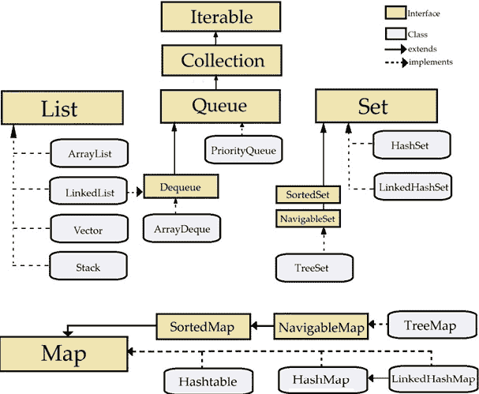

图 4.1: 集合层次结构

集合层次结构的关键接口有：

*   `List`：一种有序的集合，允许重复元素（`ArrayList`, `LinkedList`）。
*   `Set`：不允许重复元素的集合（`HashSet`, `TreeSet`）。
*   `Queue`：遵循先进先出（FIFO）原则的集合（`PriorityQueue`）。
*   `Map`：键值对的集合（`Hashtable`, `HashMap`, `TreeMap`）。

## Collection 接口

`Collection` 接口是 `JCF` 的根接口。它代表了一组对象（称为元素），是更专门的集合类型如 `List`、`Set` 和 `Queue` 的父接口。

下表显示了 `Collection` 和 `Collections` 之间的区别：

| 特性 | Collection | Collections |
| :--- | :--- | :--- |
| 包名 | `java.util.Collection` | `java.util.Collections` |
| 目的 | 代表一组对象 | 提供操作集合的静态方法 |
| 关键方法 | `add()`, `remove()`, `size()`, `iterator()` | `sort()`, `reverse()`, `shuffle()`, `min()` |
| 继承 | 由 `List`, `Set`, `Queue` 扩展 | 无继承。它纯粹是一个辅助类。 |
| 示例 | `Collection<String> names = new ArrayList<>(); names.add("Ryan"); names.add("Roger");` | `Collections.sort((List<String>) names);` |

表 4.1: Collections 和 Collection 的区别

### Collection 接口中的关键方法

`Collection` 接口为管理和操作元素提供了几个基本方法。让我们探索最常用的几个，并附带示例：

#### `add(E element)`

`add(E element)` 方法尝试将指定的元素插入集合中，如果集合被修改，则返回 `true`。接下来的示例演示了这种行为：

```java
import java.util.ArrayList;
import java.util.Collection;

public class AddElementExample {
    public static void main(String[] args) {
        Collection<String> names = new ArrayList<>();
        names.add("Ryan");
        names.add("Roger");
        boolean checkAddReturn = names.add("Roger");
        System.out.println(checkAddReturn); // Output: true
        System.out.println(names); // Output: [Ryan, Roger, Roger]
    }
}
```

在上面的示例中，`checkAddReturn` 的值为 `true`，因为集合在执行 `add` 操作后发生了变化。

#### `addAll(Collection<? extends E> c)`

将指定集合中的所有元素添加到当前集合中。

接下来的示例展示了如何使用 `addAll(Collection<? extends E> c)` 方法更新集合并返回一个布尔值指示集合是否被修改：

```java
import java.util.ArrayList;
import java.util.Collection;

public class AddAllExample {
    public static void main(String[] args) {
        Collection<String> firstCollection = new ArrayList<>();
        firstCollection.add("Ryan");
        Collection<String> secondCollection = new ArrayList<>();
        secondCollection.add("Roger");
        secondCollection.add("Royce");
        firstCollection.addAll(secondCollection);
        System.out.println(firstCollection); // Output: [Ryan, Roger, Royce]
    }
}
```

在上面的示例中，我们创建了两个集合并使用 `addAll` 方法将 `secondCollection` 添加到 `firstCollection`。

#### `remove(Object element)`

如果存在，则移除元素的单个实例。如果元素不存在，则方法返回 `false`。

接下来的示例说明了当指定的元素存在于集合中以及不存在时，`remove(Object element)` 方法的行为：

```java
import java.util.ArrayList;
import java.util.Collection;

public class RemoveExample {
    public static void main(String[] args) {
        Collection<String> names = new ArrayList<>();
        names.add("Ryan");
        names.add("Roger");
        names.add("Royce");
        System.out.println(names); // Output: [Ryan, Roger, Royce]
        names.remove("Ryan");
        System.out.println(names); // Output: [Roger, Royce]
        boolean result = names.remove("Roy");
        System.out.println(names); // Output: [Roger, Royce]
    }
}
```

此外，对于基于哈希的集合（如 `HashMap`），正确运行依赖于 `equals()` 和 `hashCode()`。我们将在后续关于 Map 的章节中详细讨论这一点。

#### `contains(Object element)`

检查集合是否包含特定元素。

```java
import java.util.ArrayList;
import java.util.Collection;

public class ContainsExample {
    public static void main(String[] args) {
        Collection<String> names = new ArrayList<>();
        names.add("Ryan");
        names.add("Royce");
        System.out.println(names.contains("Ryan")); // Output: true
        System.out.println(names.contains("Roger")); // Output: false
    }
}
```

在上面的示例中，`names.contains("Roger")` 返回 `false`，因为集合中不存在该名称。与 `remove` 方法类似，`contains` 方法使用 `equals()` 方法检查元素的相等性。如果集合中没有元素根据 `equals()` 与指定的元素匹配，则该方法返回 `false`。

`Collection` 接口的其他一些基础方法包括：

*   `int size()`：返回元素数量
*   `void clear()`：移除所有元素

这些方法构成了处理数据结构的核心，让你能够轻松地添加、删除和遍历元素。在随后的章节中，我们将探索这些方法在特定集合类型（如 `List`、`Set` 和 `Map`）中的行为，每种类型都提供了独特的功能和优化。

## 集合中的关键方法

`Collections` 类包含各种静态方法，用于排序、搜索、查找最小/最大元素等任务。这些方法简化了复杂的操作，使开发人员无需编写自定义算法。让我们结合示例拆解一些最常用的方法：

### 排序列表

排序是集合上最频繁的操作之一。`Collections.sort()` 方法按照自然顺序对元素进行排序（例如，字符串按字母顺序，数字按升序顺序）。

考虑以下示例：

```java
import java.util.ArrayList;
import java.util.Collections;
import java.util.List;

public class SortExample {
    public static void main(String[] args) {
        List<String> names = new ArrayList<>();
        names.add("Zane");
        names.add("Aiden");
        names.add("Ryan");
        Collections.sort(names);
        System.out.println(names); // Output: [Aiden, Ryan, Zane]
    }
}
```

在这里，我们创建了一个名称列表并使用 `Collections.sort()` 按字母顺序对其排序。排序后的列表打印为 `[Aiden, Ryan, Zane]`。如果需要不区分大小写的排序，可以使用如下所示的 `String.CASE_INSENSITIVE_ORDER`：

```java
Collections.sort(names, String.CASE_INSENSITIVE_ORDER);
```

`String.CASE_INSENSITIVE_ORDER` 是一个内置的 `Comparator<String>`，用于在忽略大小写的情况下比较字符串。

不区分大小写的反排序可以如下所示实现：

```java
Collections.sort(names, String.CASE_INSENSITIVE_ORDER.reversed());
```

排序有助于组织数据，使其更容易以结构化的格式进行搜索或显示。

### 查找最大和最小元素

考虑以下示例：

```java
import java.util.Arrays;
import java.util.Collections;
import java.util.List;

public class MaxMinExample {
    public static void main(String[] args) {
        List<Integer> scores = Arrays.asList(85, 90, 78, 88);
        int maxScore = Collections.max(scores);
        int minScore = Collections.min(scores);
        System.out.println("Highest Score: " + maxScore); // Output: 90
        System.out.println("Lowest Score: " + minScore);  // Output: 78
    }
}
```

我们创建了一个分数列表并使用 `Collections.max()` 和 `Collections.min()` 找到最高和最低分。当你需要快速确定集合中的边界值时，这些方法非常有用。

### 随机洗牌元素

`Collections.shuffle()` 方法随机重排列表中的元素。这对于游戏或模拟等需要随机顺序的场景非常有帮助：

```java
import java.util.ArrayList;
import java.util.Collections;
import java.util.List;

public class ShuffleExample {
    public static void main(String[] args) {
        List<String> names = new ArrayList<>();
        names.add("Ryan");
        names.add("Roger");
        names.add("Royce");
        Collections.shuffle(names);
        System.out.println(names); // Output: Random order of [Roger, Ryan, Royce]
    }
}
```

在这个示例中，我们向列表中添加了三个名称并使用 `Collections.shuffle()` 重新排序元素。每次运行程序时，顺序都是不同的。这对于卡牌游戏或从列表中随机选择元素等场景非常完美。

### 反转列表

`Collections.reverse()` 方法反转列表中元素的顺序。当你想要反向遍历元素时，这个方法非常有用。

考虑以下示例：

```java
import java.util.ArrayList;
import java.util.Collections;
import java.util.List;

public class ReverseExample {
    public static void main(String[] args) {
        List<String> names = new ArrayList<>();
        names.add("Ryan");
        names.add("Roger");
        names.add("Royce");
        System.out.println(names); // Output: [Ryan, Roger, Royce]
        Collections.reverse(names);
        System.out.println(names); // Output: [Royce, Roger, Ryan]
    }
}
```

在这里，`Collections.reverse()` 反转了元素的顺序。列表 `[Ryan, Roger, Royce]` 在反转后变为 `[Royce, Roger, Ryan]`。这在你需要反向处理元素时非常有用。

### 用特定元素填充列表

例如：

```java
package com.meennu.javbook.chap4;

import java.util.ArrayList;
import java.util.Collections;
import java.util.List;

public class FillExample {
    public static void main(String[] args) {
        List<String> names = new ArrayList<>(Collections.nCopies(5, "Default"));
        System.out.println(names); // Output: [Default, Default, Default, Default, Default]
    }
}
```


```java
import java.util.Collections;
import java.util.List;

public class FillExample {
    List<String> names = new ArrayList<>();
    names.add("Ryan");
    names.add("Roger");
    names.add("Royce");
    System.out.println(names); // Output: [Ryan, Roger, Royce]
    Collections.fill(names, "Unknown");
}
```

在这个示例中，`Collections.fill()` 将列表中的每个元素替换为 "Unknown"。这在需要重置集合或初始化默认值元素时非常有用。
理解 `Collections` 类是关键的，因为它提供了现成的算法，可以节省时间并降低代码复杂性。这些方法抽象了实现细节，让你能够专注于更高层次的问题。

| 方法 | 所属类/接口 | 描述 | 修改集合 | 典型用例 |
| :--- | :--- | :--- | :---: | :--- |
| `contains(Object o)` | `Collection` | 检查集合是否包含指定的元素。 | 否 | 验证元素是否存在 |
| `size()` | `Collection` | 返回集合中元素的数量。 | 否 | 获取元素计数 |
| `isEmpty()` | `Collection` | 检查集合是否为空。 | 否 | 当集合为空时执行条件逻辑 |
| `clear()` | `Collection` | 移除集合中的所有元素。 | 是 | 重置集合 |
| `sort(List<T> list)` | `Collections` | 按自然顺序对元素排序。 | 是 | 为搜索或显示组织数据 |
| `sort(List<T> list, Comparator<? super T> c)` | `Collections` | 使用自定义比较器排序元素。 | 是 | 自定义排序，例如不区分大小写的排序 |
| `min(Collection<? extends T> coll)` | `Collections` | 根据自然顺序返回最小的元素。 | 否 | 寻找最低分或最小值 |
| `shuffle(List<?> list)` | `Collections` | 随机重排列表中的元素。 | 是 | 为游戏或模拟提供随机化顺序 |
| `reverse(List<?> list)` | `Collections` | 反转列表中元素的顺序。 | 是 | 逆序处理元素 |
| `fill(List<? super T> list, T obj)` | `Collections` | 用指定的值替换列表中的所有元素。 | 是 | 初始化或重置所有列表值 |

在下一节中，我们将探索 `Iterable` 接口以及迭代器如何提供遍历集合的强大方式，弥补集合操作与迭代之间的差距。

## Iterable 接口和迭代器

我们使用集合来组织数据，使用迭代器来处理数据。`Iterable` 接口是 Java 中所有集合类的根接口。它代表可以逐个遍历的元素集合。Java 中几乎所有的集合类都实现了此接口，允许你使用 for-each 循环和迭代器来遍历元素。
`Iterable` 接口提供了 `iterator()` 方法，该方法返回一个 `Iterator` 对象，用于逐个遍历集合中的元素。

理解迭代器可以确保你可以：

- 顺序访问元素：一次移动一个元素。
- 统一地处理各种集合类型：使用单一方法遍历 `Lists`、`Sets` 或 `Queues`。

`Iterable` 接口仅包含一个方法，如下所示：

```java
interface Iterable<T> {
    Iterator<T> iterator();
}
```

该方法返回一个 `Iterator` 对象，该对象提供了几个用于遍历集合的有用方法。`Iterator` 在不暴露其内部结构的情况下遍历集合。

`Iterator` 接口提供了三个用于导航集合的主要方法：

- `hasNext()`：如果集合还有更多元素，则返回 true。
- `next()`：返回集合中的下一个元素。
- `remove()`：从集合中移除迭代器返回的最后一个元素。

让我们通过以下示例理解迭代：

```java
import java.util.ArrayList;
import java.util.Iterator;
import java.util.List;

public class IteratorExample {
    public static void main(String[] args) {
        List<String> names = new ArrayList<>();
        names.add("Ryan");
        names.add("Roger");
        names.add("Royce");
        Iterator<String> iterator = names.iterator();
        System.out.println("Iterating through the list:");
        while (iterator.hasNext()) {
            String name = iterator.next();
            // 在迭代期间移除一个元素
            if (name.equals("Ryan")) {
                iterator.remove();
            }
        }
        System.out.println("\nList after removal: " + names);
    }
}
```

输出是：
```
Iterating through the list:
List after removal: [Roger, Royce]
```

我们创建了一个包含元素的单例集合。如果你尝试向此集合添加另一个元素，将导致产生 `UnsupportedOperationException`。
当你想要将单个项目表示为集合时，可以使用单例集合。它对于默认值或常量元素非常有用。

## 同步集合 (Synchronized collections)

如果你在多线程环境中工作，集合默认情况下不是线程安全的。`Collections` 类提供了这些方法，可以将集合包装在同步视图中：

* `Collections.synchronizedList(List<T> list)`
* `Collections.synchronizedSet(Set<T> set)`
* `Collections.synchronizedMap(Map<K, V> map)`

以下是创建一个同步列表的示例：

```java
import java.util.ArrayList;
import java.util.Collections;
import java.util.List;

public class SynchronizedExample {
    public static void main(String[] args) {
        List<String> names = Collections.synchronizedList(new ArrayList<>());
        names.add("Ryan");
        names.add("Roger");
        names.add("Royce");
        // 在迭代期间进行同步
        synchronized (names) {
            for (String name : names) {
                System.out.println(name);
            }
        }
    }
}
```

> **注意**：你仍然需要手动对迭代进行同步（例如使用上面的 `synchronized` 块）。

## 检查集合 (Checked collections)

让我们尝试创建一个检查列表：

```java
import java.util.ArrayList;
import java.util.Collections;
import java.util.List;

public class CheckedCollectionExample {
    public static void main(String[] args) {
        List<String> names = Collections.checkedList(new ArrayList<>(), String.class);
        names.add("Ryan");
        // names.add(100); // 这将抛出 ClassCastException
        System.out.println("Checked List: " + names);
        // Output: Checked List: [Ryan]
    }
}
```

检查集合增加了运行时安全检查，有助于在开发早期发现类型不匹配的 bug。

## 不可变集合 (Immutable collections)

从 Java 9 开始，你可以直接创建不可变集合：

* `List.of()`
* `Set.of()`
* `Map.of()`

以下是一个创建一个不可变列表的示例：

```java
import java.util.List;

public class ImmutableCollectionExample {
    public static void main(String[] args) {
        List<String> names = List.of("Ryan", "Roger", "Royce");
        System.out.println("Immutable List: " + names);
        // Output: Immutable List: [Ryan, Roger, Royce]
        // 尝试添加、删除或修改元素会导致运行时错误
    }
}
```

* `parseInt()`: 将字符串转换为整数。
* `compareTo()`: 比较两个包装对象（返回负数、零或正数）。

虽然包装类非常强大，但它们也会带来一些开销：

* 内存占用：包装类比基本数据类型消耗更多内存。
* 空值：包装类可以为 `null`，这增加了灵活性，但也引入了 `NullPointerException` 的风险。

在大多数情况下，其益处大于这些成本，特别是在处理集合（collections）时。

包装类桥接了基本数据类型与 Java 面向对象特性之间的鸿沟。它们使得基本数据类型可以在集合中使用，并提供了实用的工具方法。理解包装类对于掌握 Java 集合至关重要，因为它们在实际应用中频繁出现。

## 结论

在本章中，我们探索了 JCF（Java 集合框架），理解了它的架构、核心接口和基本方法。我们学习了集合如何简化数据管理，为存储、操作和遍历对象提供了灵活的方式。

我们讨论了 `Collection` 和 `Collections` 之间的区别、`Iterable` 接口的作用，以及迭代器对于访问元素的重要性。嵌套类和包装类进一步扩展了框架的能力，增强了功能和兼容性。

在接下来的章节中，我们将深入观察具体的集合类型，从 `List`、`Set` 和 `Map` 实现开始。我们将理解它们的独特行为、实际应用，以及如何根据给定场景选择合适的集合。

## 练习

1. 下列哪项是 Java 集合框架中的根接口？
    1. `List`
    2. `Collection`
    3. `Iterable`

2. Java 集合框架的主要目的是什么？
    1. 处理文件输入输出操作
    2. 为处理对象集合提供标准化的架构
    3. 管理线程和并发

3. 哪种集合类型不允许重复元素？
    1. `List`
    2. `Queue`
    3. `Set`
    4. `Map`

4. Java 中 `Collection` 和 `Collections` 的区别是什么？
    1. `Collection` 是一个类，`Collections` 是一个接口
    2. `Collection` 是一个接口，`Collections` 是一个工具类
    3. 它们都是接口
    4. 它们都是工具类

5. 下列哪个方法是 `Collection` 接口的一部分？
    1. `sort()`
    2. `add()`
    3. `shuffle()`
    4. `reverse()`

6. 如何使用迭代器遍历集合？
    1. 通过调用 `iterator()` 方法并使用 `while` 循环
    2. 直接使用 `get()` 方法
    3. 使用 `iterator` 关键字
    4. 先将集合转换为数组

7. 如果你尝试向使用 `List.of()` 创建的列表添加元素，会发生什么？
    1. 元素被成功添加
    2. 抛出运行时异常
    3. 列表动态调整大小
    4. 列表忽略新元素

8. 哪个集合类按排序顺序维护元素且不允许重复？
    1. `ArrayList`
    2. `LinkedList`
    3. `HashSet`
    4. `TreeSet`

9. `iterator.remove()` 方法的作用是什么？
    1. 清空集合中的所有元素
    2. 移除迭代器返回的最后一个元素
    3. 从集合中移除一个随机元素
    4. 根据条件移除元素

10. 集合必须实现哪个接口才能用于增强型 for 循环？
    1. `Collection`
    2. `Iterable`
    3. `List`
    4. `Comparator`

### 答案

1. **c**
   解释：`Iterable` 接口是 Java 集合框架中的根接口。它提供了使用 `iterator` 或增强型 for 循环遍历元素的能力。

2. **b**
   解释：Java 集合框架为处理和操作对象组提供了一个统一的架构，使得数据存储、检索和操作变得更加简单。

3. **c**
   解释：`Set` 接口不允许重复元素。当你想要维护一个唯一元素集合时，它是非常有用的。

4. **b**
   解释：`Collection` 是大多数集合类型的根接口，而 `Collections` 是一个工具类，提供了用于操作集合的静态方法。

5. **b**
   解释：`add()` 方法是 `Collection` 接口的一部分，用于向集合中插入元素。

6. **a**
   解释：你可以使用 `iterator()` 方法获取迭代器对象，然后使用它的 `hasNext()` 和 `next()` 方法来遍历元素。

7. **b**
   解释：用 `List.of()` 创建的列表是不可变的，这意味着任何添加、删除或修改元素的尝试都会抛出 `UnsupportedOperationException`。

8. **d**
   解释：`TreeSet` 按照排序顺序维护元素且不允许重复。它在对顺序重要的场景下非常有用。

9. **b**
   解释：`iterator.remove()` 方法移除迭代器返回的最后一个元素。它必须在 `next()` 之后调用，否则会抛出异常。

10. **b**
    解释：集合必须实现 `Iterable` 接口才能用于增强型 for 循环，因为它提供了用于元素遍历的 `iterator()` 方法。

# 第 5 章 List 接口及其实现

## 引言

Java 中的 `List` 接口是 JCF 的一部分，代表元素的有序集合。与 `Set` 不同，`List` 允许重复元素并提供对元素的位置访问。`List` 被广泛应用于需要按特定顺序存储、检索和操作元素的场景。

本章将探讨 `List` 接口及其关键实现，如 `ArrayList`、`LinkedList` 和 `Vector`。它还涵盖了列表同步、不可变集合和检查集合。此外，我们将查看内部实现，比较不同的列表类型并实现自定义行为。

## 结构

本章涵盖以下主题：

* `List` 接口
* `ArrayList` 实现
* `LinkedList` 实现
* `Vector` 实现
* 列表同步
* 不可变集合
* 检查集合

本章旨在全面理解 Java 中的 `List` 接口及其关键实现及其工作原理。在本章结束时，你将理解 `ArrayList`、`LinkedList` 和 `Vector` 在性能、内存占用和实际应用方面的差异。你还将学习用于线程安全的同步机制、创建不可变列表以及使用检查集合确保类型安全。此外，本章将包含示例和自定义实现，以巩固你对列表在实际应用中如何工作的理解。

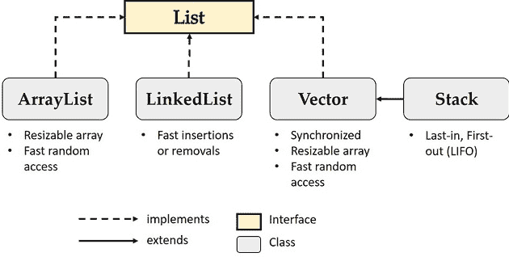

图 5.1：`List` 接口及其实现

| 方法 | 描述 |
| :--- | :--- |
| `add(E e)` | 将指定的元素添加到列表末尾。 |
| `add(int index, E element)` | 在指定的位置插入指定的元素。 |
| `get(int index)` | 返回指定索引处的元素。 |
| `remove(int index)` | 删除指定索引处的元素。 |
| `indexOf(Object o)` | 返回指定元素首次出现的索引。 |

表 5.1：`List` 接口中的额外方法

```java
import java.util.ArrayList;
import java.util.List;

public class ListExample {
    public static void main(String[] args) {
        // 创建一个学生姓名的 List
        List<String> studentNames = new ArrayList<>();

        // 向 List 添加元素
        studentNames.add("Ryan");
        studentNames.add("Roger");

        // 使用索引访问元素
        System.out.println("First Student: " + studentNames.get(0));

        // 遍历 List，这将按照元素添加的顺序打印元素
        System.out.println("All Students:");
        for (String name : studentNames) {
            System.out.println(name);
        }
    }
}
```


// 检查元素是否存在

System.out.println("Is Ryan in the list? " + studentNames.contains("Ryan"));

// 删除一个元素

studentNames.remove("Roger");

System.out.println("After removing Roger: " + studentNames);

}

```

以下是输出结果：

```
First Student: Ryan
All Students:
Ryan
Roger
Royce
After removing Roger: [Ryan, Royce]
```

这个示例演示了在 `List` 中添加、访问、遍历、检查和删除元素等关键操作。我们使用 `ArrayList`（它是 `List` 接口的一种常用实现）来存储和操作学生姓名。`add()` 方法插入元素，`get(index)` 获取元素，`contains()` 方法检查特定元素是否存在于列表中。`remove()` 方法删除元素，而遍历列表允许我们打印所有存储的名称。由于 `ArrayList` 维护插入顺序，输出反映了元素被添加的顺序。

## ArrayList 实现

`ArrayList` 是 Java 中使用广泛的 `List` 接口实现之一。它是 `java.util` 包的一部分，提供了一个根据需要增长的动态数组，这与具有固定大小的普通数组不同。在内部，`ArrayList` 维护一个数组（`Object[] elementData`），当其达到容量时会进行扩展。

以下是 `ArrayList` 的内部结构：

*   `ArrayList` 从初始容量开始。
*   从 Java 9 开始，`ArrayList` 从一个空数组开始，只有在添加第一个元素时才会分配内部数组（懒性初始化）。
*   元素存储在一个名为 `Object[] elementData` 的内部数组中。
*   随着元素的添加，它们被按顺序放入此数组中。
*   当数组满时，`ArrayList` 会创建一个新数组。

## 优化提示：如果你提前知道列表的预期大小，请使用：

```java
List<Integer> numbers = new ArrayList<>(100);
```

这可以避免多次扩容，从而提高性能。

## 在末尾插入（最佳情况）

*   在列表末尾添加元素（当容量未超过容量时）需要 `O(1)`（分摊）时间。
*   如果需要扩容，由于需要复制元素，成本为 `O(n)`。
*   优化提示是，如果预计会在中间频繁添加，请考虑使用 `LinkedList`。我们将在稍后的章节中讨论 `LinkedList`。

## 在开头或中间插入（最坏情况）

*   在开头或中间添加元素会导致所有后续元素向右移动。
*   为了理解在开头或中间插入的成本，请考虑以下示例，我们在索引 `0` 处插入了一个元素。

```java
```

当你在索引 `0` 处插入元素时，`ArrayList` 中的所有现有元素都会右移动一位以腾出空间。这种移动操作需要线性时间 `O(n)`，因为每个受影响的元素都必须单独移动。这被认为是最坏情况。

*   如果需要频繁在中间插入，`LinkedList` 是更好的选择。

*   删除最后一个元素（`remove(size - 1)`） | `O(1)`（不需要移动）。
*   从中间或开头删除（`remove(index)`） | `O(n)`（所有元素向左移动）。
*   优化提示是，如果顺序不重要，可以将目标元素与最后一个元素交换，然后将其删除：

```java
numbers.remove(numbers.size() - 1); // 移除最后一个元素
```

*   这将移动成本从 `O(n)` 降低到 `O(1)`。

*   `ArrayList` 预留了额外的空间以减少扩容次数。
*   如果 `ArrayList` 的元素远少于其容量，则会浪费内存。
*   优化提示是，如果 `ArrayList` 不会再增长，请修剪未使用的容量：

```java
numbers.trimToSize();
```

*   这将释放多余内存。

## 同步与线程安全

*   `ArrayList` 不是线程安全的。
*   如果多个线程并发修改列表，请使用：

```java
List<Integer> syncList = Collections.synchronizedList(new ArrayList<>());
```

然而，`CopyOnWriteArrayList` 是并发读取和偶尔写入的更好选择。这使得读取非常快（`O(1)`），但为写入增加了开销（`O(n)`）。它适用于读取频繁但写入稀少的场景，例如缓存或事件监听器列表。我们即将在稍后的章节中看到 `CopyOnWriteArrayList` 的示例。

## ArrayList 的自定义实现

为了更好地理解 `ArrayList`，让我们来实现它的简化版本。以下是需要考虑的点：

*   **内部存储**：我们可以使用整数数组（`data`）来存储元素。
*   **动态扩展**：如果在添加新元素时数组已满，我们可以通过将容量翻倍并复制现有元素来提供扩容逻辑。
*   **检索**：为了检索元素，我们可以拥有一个 `get(index)` 方法。我们可以在返回元素之前添加验证，以确保索引在边界内。
*   **大小跟踪**：我们可以通过 `size` 变量来跟踪数组的大小。该变量记录了已添加元素的数量。

```java
class CustomArrayList {
    private int[] data;
    private int size;
    private int capacity;
    public CustomArrayList(int initialCapacity) {
        this.capacity = initialCapacity;
        this.data = new int[capacity];
        this.size = 0;
    }
    public void add(int element) {
        if (size == capacity) {
            expandCapacity();
        }
        data[size++] = element;
    }
    private void expandCapacity() {
        capacity *= 2; // 容量翻一倍
        int[] newData = new int[capacity];
        System.arraycopy(data, 0, newData, 0, size);
        data = newData;
    }
    public int get(int index) {
        if (index < 0 || index >= size) {
            throw new IndexOutOfBoundsException("Index out of bounds");
        }
        return data[index];
    }
    public int size() {
        return size;
    }
}
```

图 5.6：添加 40 后的 `LinkedList`

一旦添加了 40，它的连接方式如下：

* `40 prev`: 指向 `30`

总结这种结构，每个节点存储两个引用（`next` 和 `prev`）。`head` 始终指向第一个节点。`tail`（最后一个节点）指向 `null`。

在移除（删除）元素的情况下，只需更新引用即可。

假设我们使用以下代码删除 20：

```java
list.remove(Integer.valueOf(20));
```

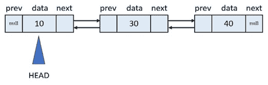

图 5.7：删除 20 后的 `LinkedList`

* `10 next` 现在指向 `30`（跳过 20）
* `30 prev` 现在指向 `10`

### `LinkedList` 的性能考量

在决定使用 `LinkedList` 还是 `ArrayList` 时，理解 `LinkedList` 的性能特性至关重要。虽然 `LinkedList` 提供了高效的插入和删除，但在内存使用和元素访问速度方面存在权衡。让我们探索以下关键性能方面：

* **插入和删除**：
    * 在开头或末尾的高效插入或删除：与 `ArrayList` 不同，`LinkedList` 在插入或删除时不需要移动元素。只需更新节点中的 `previous` 和 `next` 引用，使得在头部或尾部添加或删除元素的复杂度为 `O(1)`。
    * 中间插入或删除需要遍历：如果在中间插入或删除元素，我们需要遍历列表以找到正确的位置，这在最坏情况下复杂度为 `O(n)`。

* **元素访问**：
    * 通过索引访问元素需要从头部或尾部遍历，这在最坏情况下复杂度为 `O(n)`。
    * 如果按顺序访问元素，由于缺乏连续内存存储，其迭代速度比 `ArrayList` 慢。

* **内存开销**：
    * 更高的内存占用：`LinkedList` 中的每个节点都存储数据和两个引用（`previous` 和 `next`），与只存储元素的 `ArrayList` 相比，增加了内存消耗。
    * 垃圾回收开销：频繁的插入和删除会导致更多的对象创建和移除，这可能会影响垃圾回收性能。
    * 正向和反向遍历：`LinkedList` 支持使用 `ListIterator` 在两个方向上高效迭代，但它仍然是 `O(n)`。
    * 缓存局部性差：由于元素分散在内存中，访问它们需要额外的指针解引用，使得迭代比 `ArrayList` 慢。

* **`LinkedList` 表现更好的用例**：
    * 频繁的插入或删除：如果你经常在列表开头或中间插入或移除元素，`LinkedList` 的性能优于 `ArrayList`。
    * 队列和栈实现：当 `LinkedList` 用作队列（FIFO）或栈（LIFO）时，它是理想的选择，因为插入和删除非常高效。

### 自定义 `LinkedList` 实现

为了深入理解 `LinkedList`，让我们自己实现一个自定义的 `LinkedList`。

让我们创建一个 `Node` 类，它包含：

* 对 `next` 节点的引用。
* 对 `previous` 节点的引用（因为它是双向链表）。

以下是 `Node` 类的一个示例：

```java
class Node<T> {
    T data;
    Node<T> next;
    Node<T> prev;
    public Node(T data) {
        this.data = data;
        this.next = null;
        this.prev = null;
    }
}
```

链表维护对 `head`（第一个节点）和 `tail`（最后一个节点）的引用。它还跟踪列表的大小：

```java
class CustomLinkedList<T> {
    private Node<T> head;
    private Node<T> tail;
    private int size;
    public CustomLinkedList() {
        this.head = null;
        this.tail = null;
        this.size = 0;
    }
}
```

为了添加新元素，我们可以创建一个 `add` 方法。它通过更新 `next` 和 `prev` 引用将新元素附加到末尾：

```java
public void add(T data) {
    Node<T> newNode = new Node<>(data);
    if (head == null) { // 如果列表为空
        head = newNode;
        tail = newNode;
    } else {
        tail.next = newNode;
        newNode.prev = tail;
        tail = newNode;
    }
    size++;
}
```

在上面的代码中：
* 如果列表为空，新节点将同时成为 `head` 和 `tail`。
* 否则，我们更新 `tail.next` 指向新节点，并更新 `newNode.prev` 指向 `tail`。

要删除元素，只需要更新引用：

```java
public boolean remove(T data) {
    if (head == null)
        return false; // 列表为空
    Node<T> current = head;
    while (current != null) {
        if (current.data.equals(data)) {
            if (current == head) { // 删除头部
                head = head.next;
                if (head != null) {
                    head.prev = null;
                } else {
                    tail = null;
                }
            } else if (current == tail) { // 删除尾部
                tail = tail.prev;
                if (tail != null) {
                    tail.next = null;
                }
            } else { // 删除中间
                current.prev.next = current.next;
                current.next.prev = current.prev;
            }
            size--;
            return true;
        }
        current = current.next;
    }
    return false; // 未找到
}
```

与 `ArrayList` 不同，`LinkedList` 没有直接索引访问。我们需要遍历列表来找到元素。我们可以通过以下 `get` 方法来实现：

```java
public T get(int index) {
    if (index < 0 || index >= size) {
        throw new IndexOutOfBoundsException("Index: " + index);
    }
    Node<T> current;
    if (index < size / 2) { // 从头部遍历
        current = head;
        for (int i = 0; i < index; i++) {
            current = current.next;
        }
    } else { // 从尾部遍历
        current = tail;
        for (int i = size - 1; i > index; i--) {
            current = current.prev;
        }
    }
    return current.data;
}
```

```java
public void display() {
    Node<T> current = head;
    while (current != null) {
        System.out.print(current.data + " => ");
        current = current.next;
    }
    System.out.println("null");
}
```

```java
public class LinkedListDemo {
    public static void main(String[] args) {
        CustomLinkedList<Integer> list = new CustomLinkedList<>();
        list.add(10);
        list.add(20);
        list.add(30);
        list.add(40);
        list.display(); // 输出: 10 => 20 => 30 => 40 => null
        list.remove(20);
        list.display(); // 输出: 10 => 30 => 40 => null
    }
}
```

`Java` 中的 `Vector` 是 `java.util` 包的一部分，它提供了一种类似于 `ArrayList` 的动态数组结构。然而，与 `ArrayList` 不同，`Vector` 是同步的，这使得它是安全的，但由于同步开销，速度可能会较慢。在本节中，我们将探索 `Vector` 的内部实现、存储机制以及性能考虑。

以下是 `Vector` 的内部结构：

- 当添加的元素超过初始容量时，数组会自动扩展。
- 与 `ArrayList` 满时增长 `50%` 不同，`Vector` 在调整大小时会将容量翻倍。
- 它实现了 `List` 接口，允许存在重复元素，同时保持插入顺序。

让我们来看一个创建和使用 `Vector` 的示例：


```java
import java.util.Vector;

public class VectorExample {
  public static void main(String[] args) { 
    // 创建一个整数 Vector
    Vector<Integer> numbers = new Vector<>();
    // 添加元素
    numbers.add(10);
    numbers.add(20);
    numbers.add(30);
    numbers.add(40);
    System.out.println("First Element: " + numbers.firstElement());
    System.out.println("Last Element: " + numbers.lastElement());
    // 移除元素
    numbers.remove(2); // 移除 30
    // 显示 Vector
    System.out.println("Updated Vector: " + numbers);
  }
}
```

以下是输出：

```
Last element: 40

Updated Vector: [10, 20, 40]
```

类似于 `ArrayList`：

- 例如，如果初始容量为 `4`，那么当添加第 `5` 个元素时，它的大小增加到 `8`。
- 这种翻倍的行为确保了更少的调整次数，但可能会导致更高的内存消耗。

以下是性能考虑：

- `Vector` 是同步的，这意味着多个线程可以安全地修改它。然而，这是以性能为代价的。
- 如果不需要同步，则优先使用 `ArrayList`。
- 当多个线程并发访问并修改集合时，`Vector` 是合适的。

在 `ArrayList`、`LinkedList` 和 `Vector` 之间做出选择时，理解它们在性能、同步用法方面的关键区别至关重要。下表总结了每种集合的主要功能和特性，帮助你根据特定需求做出明智选择：

| 特性 | ArrayList | LinkedList | Vector |
| :--- | :--- | :--- | :--- |
| 底层数据结构 | 动态数组 | 双向链表 | 动态数组 |
| 访问时间（随机访问） | 常数时间 (O(1)) | 线性时间 (O(n)) | 常数时间 (O(1)) |
| 插入或删除时间 | 中间插入为线性时间 (O(n)) | 端部插入为常数时间 (O(1)) | 插入为线性时间 (O(n)) |
| 内存占用 | 内存开销较小 | 指针导致内存开销较大 | 类似于 ArrayList，但调整大小时需要更多内存 |
| 同步 | 非同步 | 非同步 | 默认同步 |
| 调整大小 | 满时自动调整大小 | 不调整；元素通过链表连接 | 满时自动调整大小 |
| 空元素 | 支持空元素 | 支持空元素 | 支持空元素 |
| 使用场景 | 最适合频繁访问、较少修改 | 最适合频繁插入和删除 | 适用于需要线程安全的遗留系统 |

表 5.2：ArrayList、LinkedList 和 Vector 的比较

## 列表中的同步

在多线程环境中，多个线程可能尝试同时从列表读取或写入数据。如果没有适当的同步，可能会导致竞态条件、数据不一致，甚至出现如 `ConcurrentModificationException` 等运行时异常。为了维护数据完整性并确保线程安全，使用同步列表实现或使用同步机制封装现有列表是至关重要的。

某些类（如 `Vector`）默认是同步的，这意味着它们的所有方法都是线程安全的。然而，在单线程或读密集型环境中，它们会带来性能权衡。另一方面，常用的集合如 `ArrayList` 和 `LinkedList` 不是线程安全的，当被多个线程并发访问时，需要显式同步。

### Collections.synchronizedList()

`Collections.synchronizedList()` 方法为列表提供了一个同步包装器。让我们通过示例来看下它的用法：

```java
import java.util.List;
import java.util.ArrayList;
import java.util.Collections;

public class SynchronizedListExample {
  public static void main(String[] args) {
    // 使用 Collections.synchronizedList() 创建线程安全的（同步）列表
    List<Integer> list = Collections.synchronizedList(new ArrayList<>());
    list.add(10);
    list.add(20);
    list.add(30);

    /*
    * 尽管列表对单个操作是同步的，
    * 迭代时仍需手动同步
    */
    synchronized (list) {
      for (Integer num : list) {
        System.out.println(num);
      }
    }
  }
}
```

输出：

```
10
20
30
```

注意：仅在迭代时需要同步块。

### CopyOnWriteArrayList

Java 提供了 `CopyOnWriteArrayList`，这是一种线程安全的列表，写操作会创建列表的副本。让我们通过示例来看它的用法：

```java
import java.util.concurrent.CopyOnWriteArrayList;

public class CopyOnWriteArrayListExample {
    public static void main(String[] args) {
        CopyOnWriteArrayList<String> list = new CopyOnWriteArrayList<>();
        list.add("Java");
        list.add("Python");
        list.add("C++");

        for (String language : list) {
            System.out.println(language);
        }
    }
}
```

输出：

```
Java
Python
C++
```

由于 `CopyOnWriteArrayList` 不允许修改影响正在进行的迭代，它可以防止 `ConcurrentModificationException`，但消耗更多内存。

在 Java 中，有时我们需要只读集合以确保初始化后数据保持不变。`Collections` 类提供了创建 `List`、`Set` 和 `Map` 不变版本的方法。

这在从 API 暴露集合时特别有用，因为我们希望防止调用者进行意外修改。

让我们通过一个示例来理解这一点：

```java
import java.util.List;
import java.util.ArrayList;
import java.util.Collections;

List<String> names = new ArrayList<>();
names.add("Roger");

List<String> unmodifiableNames = Collections.unmodifiableList(names);

unmodifiableNames.add("Royce"); // 抛出 UnsupportedOperationException
```

在上面的示例中：

* `unmodifiableList()` 方法封装了原始列表并防止对其修改。
* 如果尝试修改列表，将会抛出 `UnsupportedOperationException`。

注意：如果原始列表（`names`）被修改，这些更改将反映在不可修改的列表中。要创建一个真正不可变的列表（immutable），Java 9+ 提供了 `List.of()` 方法，它同时防止了对底层集合的修改和更新。

以下是 `List.of()` 的用法示例：

```java
List<String> immutableNames = List.of("Ryan", "Roger", "Royce");

// immutableNames.add("Zane"); // 抛出 UnsupportedOperationException
```

它创建了一个创建后无法被修改的不可变列表（immutable）。任何添加、删除或更改元素的尝试都将导致 `UnsupportedOperationException`。

## 检查集合 (Checked collections)

在 Java 中，检查集合类（checked collections class）是 `java.util.Collections` 工具类的一部分，用于确保集合中的元素在运行时符合指定的类型。这在处理泛型集合时特别有用，特别是当类型安全非常重要，但由于某些限制（例如动态创建集合或在没有显式类型参数的情况下进行传递）而无法在编译时强制执行时。

`Collections.checkedCollection()`、`checkedList()`、`checkedSet()` 和 `checkedMap()` 方法允许你将集合封装在一个检查版本中，强制所有元素都符合指定的类型。如果向集合中添加了不兼容类型的元素，将抛出 `ClassCastException`。这有助于在运行时更早地发现类型错误，而不是在后期，从而增强了可靠性和可维护性。

让我们通过一个示例来理解这一点：

```java
import java.util.List;
import java.util.ArrayList;
import java.util.Collections;

List rawList = new ArrayList(); // 原始类型 (raw type)
List<String> checkedList = Collections.checkedList(rawList, String.class);

checkedList.add("Hello");  // 有效
rawList.add(10);             // 编译通过，但会导致运行时错误
System.out.println(checkedList.get(1)); // 抛出 ClassCastException
```

`Collections.checkedList()` 将原始列表封装为检查列表，该列表在运行时强制类型安全。添加 `Hello` 是允许的，但当直接向原始列表添加整数 (`10`) 时，它绕过了编译时检查。然而，通过 `checkedList` 访问它会导致 `ClassCastException`，因为封装器确保了只有 `String` 对象在运行时被视为有效元素。

### 使用检查集合的优势

在 Java 中处理集合操作时，确保运行时的类型安全变得至关重要，特别是在动态环境中。检查集合提供了多项优势：

* **类型安全**：检查集合强制要求只有指定类型的元素可以被包含。
* **错误检测**：它们在运行时捕获类型错误。
* **可靠性**：这增强了代码的健壮性。
* **可维护性**：使代码更易于维护。

## 结论

在本章中，我们学习了不可变列表和检查集合。我们了解了 `unmodifiableList()` 和 `List.of()` 的区别：`unmodifiableList()` 只是原始列表的视图，如果原始列表被修改，视图也会随之改变；而 `List.of()` 创建的是真正的不可变列表。我们还学习了检查集合，以及它们如何在运行时强制类型安全，这在处理泛型集合时非常有用。

## 练习题 (Exercise)

1. 下列哪项关于 `ArrayList` 是正确的？

    1. `List<int> list = new ArrayList<>();`
    2. `List<String> list = new ArrayList<>();`
    3. 以上都是
    4. 以上均不是

2. `ArrayList` 的默认容量是多少？

    1. 5
    2. 10
    3. 16
    4. 20

3. `ArrayList` 是如何扩容的？

    1. 它创建一个新数组。
    2. 它按原始大小的 1.5 倍进行增长。
    4. 它动态增加大小。
    4. 以上

4. 在 `ArrayList` 的末尾添加元素的时间复杂度是多少？

    1. `O(1)`
    2. `O(n)`
    3. `O(log n)`
    4. `O(n²)`

5. `LinkedList` 在 Java 中使用什么数据结构？

    1. 动态数组
    2. 双链表
    3. 单链表
    4. 哈希表

6. 关于 `Vector`，下列哪项是正确的？

    1. 它是同步的
    2. 它在满时会动态增加大小
    3. 它比 ArrayList 更好
    4. 以上

7. 使用哪种方法获取 `ArrayList` 的同步版本？

    1. `Collections.synchronizedList()`
    2. `Collections.synchronizedArrayList()`
    3. `Arrays.synchronizedList()`
    4. `synchronized(new ArrayList())`

8. 下列哪个类用于创建不可修改列表？

    1. `Collections.unmodifiableList()`
    2. `List.unmodifiable()`
    3. `Arrays.unmodifiableList()`
    4. `Collections.synchronizedList()`

9. 检查集合的目的是什么？

    1. 防止空值
    2. 在运行时确保类型安全
    3. 允许并发修改
    4. 提高性能

10. 哪种列表实现适合频繁插入和删除？

    1. `ArrayList`
    2. `Vector`
    3. `LinkedList`
    4. `Unmodifiable`

### 答案 (Answers)

1. **b**
   解释：Java 泛型不支持原始类型，因此 `List<int>` 是无效的。正确的用法是指定有效的泛型类型。

2. **b**
   解释：`ArrayList` 在创建时的默认初始容量是 10。

3. **b**
   解释：当达到容量时，它通常按原始大小的 1.5 倍进行增长。

4. **a**
   解释：在 `ArrayList` 末尾添加元素的时间复杂度通常为 `O(1)`，除非发生调整，此时为 `O(n)`。

5. **b**
   解释：Java 中的 `LinkedList` 是用双链表实现的。

6. **d**
   解释：`Vector` 是同步的，在满时会动态增加大小，并在需要线程安全的环境中使用。

7. **a**
   解释：`Collections.synchronizedList()` 方法返回指定列表的同步版本。

8. **a**
   解释：`Collections.unmodifiableList()` 方法返回列表的不可修改版本。

9. **b**
   解释：检查集合通过封装类型验证来在运行时确保类型安全。

10. **c**
    解释：`LinkedList` 由于其链表结构，适合频繁的插入和删除。
    解释：对于频繁的插入和删除，优先选择 `LinkedList`，因为它使用了双链表结构，使得此类操作非常高效。

加入我们的 Discord 空间

加入我们的 Discord 工作区获取最新更新、优惠、全球科技动态、新发布以及与作者的交流活动：

[`discord.bpbonline.com`](https://discord.bpbonline.com)


# 第 6 章 Map 接口及其实现

## 引言

在 Java 中，`Map` 是一种存储键值对的数据结构，其中每个键都是唯一的，并映射到一个特定的值。与关注单个元素的集合（如 `List` 或 `Set`）不同，`Map` 强调基于键的高效关联和检索。它被广泛用于缓存、配置管理、频率计数和类数据库的查找等应用。

Java 提供了 `Map` 接口的若干种实现，每种实现都有不同的内部结构和性能特性。这些包括 `HashMap`、`LinkedHashMap`、`TreeMap` 和 `Hashtable`，根据排序、同步和排序的需求，它们适用于不同的用例。

在本章中，我们将探索 `Map` 接口的基础概念、其主要实现及其内部机制。我们还将考虑性能考量、常见用例、同步策略以及 Map 中泛型算法的使用。

## 结构

本章涵盖了以下主题：

* `Map` 接口
* `HashMap` 实现
* `LinkedHashMap` 实现
* `TreeMap` 实现
* `Hashtable` 实现
* 性能考量
* Map 的常见用例
* Map 中的同步
* Map 的泛型算法

## 目标

在本章结束时，你将理解 Java 中 `Map` 接口及其工作原理，包括其存储具有唯一键的键值对的核心目的。你将探索 `HashMap`、`LinkedHashMap`、`TreeMap` 和 `Hashtable` 等主要的 `Map` 实现，并理解它们在排序、同步和性能方面的差异。你还将更深入地理解这些实现的内部数据结构，例如哈希表、链表和红黑树。此外，你将学习如何根据特定的用例选择每种实现、如何处理 Map 的线程安全，以及如何使用泛型算法有效地处理 Map 数据。这些知识将使你能够编写出更整洁、更高效且易于维护的涉及键值关联的 Java 代码。

## Map 接口

Java 中的 `Map` 接口定义了键值映射的规范。它是 `java.util` 包的一部分，与 `List` 或 `Set` 等其他集合类型不同，因为它不是 `Collection` 接口的直接子类型。`Map` 的主要目的是将唯一的键与特定的值关联起来。每个键恰好映射到一个值，但值本身可以是重复的。

以下是 Map 的关键特性：

* **键的唯一性**：`Map` 不允许重复的键，确保每个键只关联一个值。
* **空键/值处理**：某些 `Map` 实现允许 `null` 键和值，而另一些则不允许。
* **基础操作**：接口包含了 `put()`、`get()`、`remove()` 和 `containsKey()` 等基本方法，有助于管理存储在 `Map` 中的数据。
* **迭代器**：Map 为键、值和条目（entries）提供了迭代器，使得遍历数据变得简单。

为了更好地理解 `Map` 接口的功能，这里是常用方法列表及其描述。这些方法为管理 `Map` 中的键值映射提供了基本操作。请参考下表：

| 方法 | 描述 |
| :--- | :--- |
| `put(K key, V value)` | 将键值对插入到 map 中。如果键已存在，则更新与其关联的值 |


| 方法 | 说明 |
| :--- | :--- |
| `get(Object key)` | 检索与指定键关联的值，如果该键在 map 中不存在，则返回 `null` |
| `remove(Object key)` | 移除与指定键关联的键值对。如果找到则返回该值，如果键不存在则返回 `null` |
| `containsKey(Object key)` | 如果 map 包含指定键的映射，则返回 `true`；否则返回 `false` |
| `containsValue(Object value)` | 如果 map 包含一个或多个映射到指定值的键，则返回 `true`；否则返回 `false` |
| `keySet()` | 返回 map 中包含的键的 `Set` 视图 |
| `values()` | 返回 map 中包含的值的 `Collection` 视图 |
| `entrySet()` | 返回 map 中包含的键值对（条目）的 `Set` 视图。每个条目都是一个 `Map.Entry` 对象 |
| `size()` | 返回 map 中键值对的数量 |
| `isEmpty()` | 如果 map 中不包含任何键值映射，则返回 `true`；否则返回 `false` |
| `clear()` | 移除 map 中所有的键值映射 |
| `putAll(Map<? extends K,? extends V> m)` | 将指定 map 中的所有映射拷贝到当前 map |
| `equals(Object o)` | 根据键值映射将指定对象与 map 进行等值性比较 |
| `hashCode()` | 根据其键值对返回 map 的哈希值 |
| `forEach(BiConsumer<? super K,? super V> action)` | 对 map 中的每个键值对执行指定的动作 |

表 6.1：Map 接口中的有用方法

Java 提供了 `Map` 接口的若干种实现，每种实现都针对特定的用例。以下图是实现 `Map` 接口的主要类的概述：


图 6.1：Map 接口及其实现

## HashMap 实现

`HashMap` 是 `Map` 接口最常用的实现之一。它存储键值对，并在 `get()` 和 `put()` 等基本操作上具有常数时间性能，是某些场景的理想选择。

以下是关键特性：

* **顺序**：`HashMap` 不保证元素的特定顺序。随着时间的推移，键顺序可能会改变。
* **空处理**：`HashMap` 允许 `null` 键和多个 `null` 值，这在所有 `Map` 实现中都是允许的。
* **并发**：`HashMap` 不是同步的，意味着它不是线程安全的。如果你在并发环境中使用它，可以使用 `ConcurrentHashMap` 或通过 `Collections.synchronizedMap()` 对其封装。

### HashMap 的内部结构

`HashMap` 内部使用哈希表，键经过哈希处理，生成的哈希码决定了在表中的位置。如果两个键具有相同的哈希码（冲突），`HashMap` 使用链表（在大量冲突的情况下使用平衡树）来存储与这些键关联的值。

在核心部分，`HashMap` 在桶数组中存储键值对。每个桶本质上是一个存储具有相同哈希码条目的链表（在某些情况下为平衡树）。

让我们了解 `HashMap` 的关键特性：

* **`Node<K,V>` 类**：内部，每个键值对由一个名为 `Node<K,V>` 的静态内部类表示，该类实现了 `Map.Entry<K,V>` 接口。这是其结构的简化版本：

```java
static class Node<K,V> implements Map.Entry<K,V> {
    final int hash;
    final K key;
    V value;
    Node<K,V> next;

    // 构造函数和方法...
}
```

在此结构中：

* `hash`：键的哈希码。
* `key`：条目的键。
* `value`：与键关联的值。
* `next`：指向桶中下一个节点的引用（用于发生冲突的情况）。

* **桶数组（table）**：`HashMap` 维护一个名为 `table` 的数组，其中每个元素都是一个 `Node` 的引用。该数组的默认初始容量为 16，并会随着条目数量的增加而动态调整大小。

这通过以下代码表示：

```java
transient Node<K,V>[] table;
```

* **哈希函数**：为了确定键值对应该所在的桶索引，`HashMap` 使用哈希函数。它计算键的哈希码，然后应用辅助哈希函数来减少冲突。以下是使用的哈希函数：

```java
static final int hash(Object key) {
    int h;
    return (key == null) ? 0 : (h = key.hashCode()) ^ (h >>> 16);
}
```

该函数获取键的原始哈希码，并使用异或（`^`）操作将其高位与低位混合。这有助于哈希码在各个桶之间实现更均匀的分布，特别是当哈希码的高位存在模式时。

* **索引计算**：一旦计算出哈希码，使用以下公式确定桶数组的索引：

`index = (n - 1) & hash;`

在这里，`n` 是桶数组的长度（即 `HashMap` 的容量）。与 `n - 1` 进行按位与（`&`）操作可确保索引在数组的范围内。这种方法是高效的，因为它避免了使用取模运算符，并且当 `n` 是 2 的幂时非常有效，而 `HashMap` 的容量始终是 2 的幂。

为了更好地理解这一点，让我们通过一个示例来演示 `HashMap` 中一些关键方法的内部操作。

考虑以下代码：

```java
Map<String, String> map = new HashMap<>();
map.put("Apple", "Fruit");
```

对于 `put` 方法，Java 内部调用：

```java
int h = "Apple".hashCode();
```

假设返回值为 `63062875`。

然后应用辅助哈希，`h = h ^ (h >>> 16)`：

* `h`: `63062875 ^ (63062875 >>> 16)`
* `h`: `63062875 ^ 961` 得到最终哈希码 = `63061914`

`HashMap` 的数组长度始终是 2 的幂。初始容量为 16。因此，索引计算如下：

`index: (16 - 1) & 63061914 = 15 & 63061914`

我们得到 `index = 2`。因此，该条目应该放在索引为 2 的桶中。

现在，`HashMap` 检查索引 2 是否已经存在节点：

* 如果是，它使用 `equals()` 比较键以判断是否是同一个键。如果键相同，则用新值更新旧值。
* 如果不是，它创建一个新节点并将其插入该位置。

在我们的示例中，它是空的，所以如下所示添加了一个新节点：

```java
Node<String, String> newNode = new Node<>(hash=63061914, key="Apple", value="Fruit", next=null);
```

如果我们要从 `HashMap` 中检索一个值，如下所示：

```java
map.get("Apple");
```

以下是从 `Map` 检索值遵循的序列：

* 计算 `Apple` 的哈希码，得到 `63061914`。
* 计算索引，得到 2，然后进入第 2 桶查找节点。
* 使用 `equals()` 方法比较键，一旦找到匹配的键，就会返回该值。在这种情况下，返回的值是 `Fruit`。

在发生冲突的情况下，假设在以下代码中 `Orange` 也哈希到索引 2（仅为假设）：

```java
map.put("Orange", "NotFruit");
```

它发现第 2 桶已经有了 `Apple`，并比较了 `Orange.equals(Apple)`，结果为 `false`。这是一个两个不同的键指向同一个桶的冲突。在这种情况下，会创建一个新节点并添加到桶中。

现在，索引为 2 的桶有两个节点，如下如图所示：

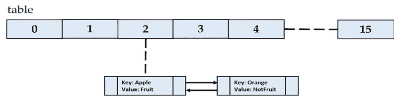

图 6.2：`HashMap` 中的哈希冲突

如果一个桶中的条目超过 8 个且总容量为 64 或更多，为了性能考虑，列表将转换为红黑树。

当条目数量超过容量与负载因子（默认 0.75）的乘积时，`HashMap` 会调整大小（容量翻倍），并重新哈希所有现有条目。

考虑以下示例：

```java
import java.util.HashMap;

public class HashMapResizeDemo {
    public static void main(String[] args) {
        HashMap<Integer, String> map = new HashMap<>(4, 0.75f); 
        // 较小初始容量触发扩容
        for (int i = 0; i < 10; i++) {
            map.put(i, "Value" + i);
        }
        System.out.println("Map size: " + map.size());
    }
}
```

双向链表按照插入顺序（或访问顺序，取决于配置）连接所有条目。为了理解访问顺序，请考虑以下示例：

```java
map.put("A", 1);
map.put("B", 2);
map.put("C", 3);
```

`Map` 的结构如下：

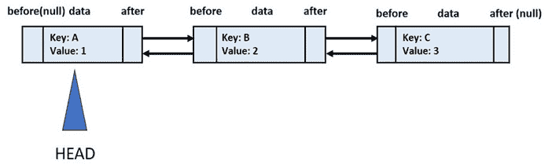

图 6.3: LinkedHashMap 初始结构

如果 `accessOrder` 为 `true` 且我们执行 `map.get(B)`，`B` 将移动到末尾，现在 `Map` 的结构将如图所示：

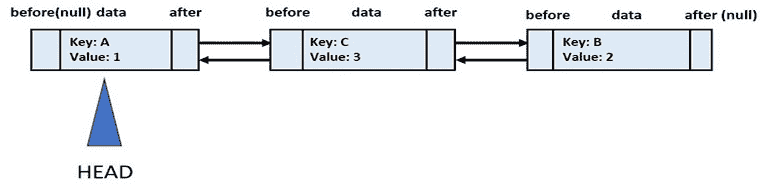

图 6.4: 带有 accessOrder 的 LinkedHashMap

> **Note**：双向链表独立于哈希表桶。它仅用于迭代，而不用于搜索或哈希。与 `HashMap` 相比，这增加了微小的开销，但为你提供了顺序保持。

### LinkedHashMap 中的构造函数

`LinkedHashMap` 类提供了几个构造函数来创建不同配置的 map：

* `LinkedHashMap()`：创建一个初始容量为 16、负载因子为 0.75 的空 `LinkedHashMap`，保持条目的插入顺序。
* `LinkedHashMap(int initialCapacity)`：创建一个具有指定 `initialCapacity` 且负载因子为 0.75 的空 `LinkedHashMap`，保留插入顺序。
* `LinkedHashMap(int initialCapacity, float loadFactor)`：创建一个具有指定 `initialCapacity` 和 `loadFactor` 的空 `LinkedHashMap`，保持插入顺序。
* `LinkedHashMap(int initialCapacity, float loadFactor, boolean accessOrder)`：创建一个具有指定 `initialCapacity`、`loadFactor` 和迭代顺序的空 `LinkedHashMap`。

如果 `accessOrder` 为 `true`，map 将按照访问顺序进行迭代（最近访问的条目将移动到末尾），这对于实现最久未使用（LRU）缓存非常有用。

如果 `accessOrder` 为 `false`，map 将保持插入顺序。

## TreeMap 实现

`TreeMap` 是一个 `Map` 实现，它以排序顺序存储其条目。它基于红黑树，红黑树是一种自平衡二叉搜索树。它确保键始终根据它们的自然排序或在创建时提供的比较器进行排序。

以下是 `TreeMap` 的关键特性：

* **排序顺序**：`TreeMap` 按键对条目进行排序。默认情况下，它使用键的自然排序（如果它们实现了 `Comparable`），或者你可以指定一个自定义的比较器进行排序。
* **null 键**：`TreeMap` 不允许 `null` 键。然而，它允许 `null` 值。
* **性能**：由于底层的红黑树结构，`get()`、`put()` 和 `remove()` 操作的时间复杂度为 `O(log n)`。
* **线程安全**：`TreeMap` 不是同步的。如果需要线程安全，应该使用外部同步，或考虑使用 `Collections.synchronizedMap()`。

### TreeMap 的内部结构

如之前提到的，`TreeMap` 使用红黑树作为底层数据结构。这确保了 map 保持平衡，并且 `get()`、`put()` 和 `remove()` 等操作具有 `O(log n)` 的时间复杂度。以下是工作原理的逐步分解：

1. **红黑树属性**：
    1. 它是一种自平衡二叉搜索树。
    2. 树中的每个节点都有一个颜色（红色或黑色）以维持平衡。
    3. 树遵循特定的属性以确保保持平衡，红黑树的关键属性包括：
        i. 根节点始终是黑色的。
        ii. 红色节点不能有红色孩子。
        iii. 从一个节点到其后代 `null` 节点的每条路径必须具有相同数量的黑色节点。

2. **插入**：
    1. 当键值对插入到 `TreeMap` 时，它根据键的自然顺序（或提供的 `Comparator`）放置在树中。
    2. 插入后，红黑树可能会变得不平衡。如果是这样，将执行旋转和颜色翻转以恢复平衡。

3. **搜索**：
    1. 当你在 `TreeMap` 中搜索键时，从根节点开始遍历树。根据键与当前节点键的比较检查左节点或右子节点。这会递归进行，遵循二叉搜索树的逻辑。
    2. 这是因为树是平衡的；搜索的时间复杂度为 `O(log n)`。

这是一个在 Java 中演示 `TreeMap` 基本操作的简单示例，包括插入、检索、更新、删除和迭代：

```java
import java.util.TreeMap;
import java.util.Map;

public class TreeMapExample {
    public static void main(String[] args) {
        // 创建一个 TreeMap
        TreeMap<Integer, String> studentMap = new TreeMap<>();
        // 向 TreeMap 添加条目
        studentMap.put(102, "Aaron");
        studentMap.put(101, "Bella");
        studentMap.put(103, "Chris");
        // TreeMap 保持键的升序排列
        System.out.println("Initial TreeMap: " + studentMap);
        // 根据键获取值
        System.out.println("Student with ID 101: " + studentMap.get(101));
        // 更新值
        studentMap.put(101, "Updated Bella");
        // 删除
        studentMap.remove(102);
        // 迭代
        for (Map.Entry<Integer, String> entry : studentMap.entrySet()) {
            System.out.println(entry.getKey() + ": " + entry.getValue());
        }
    }
}
```

### TreeMap 中的构造函数

* `TreeMap()`：创建一个空的 `TreeMap`，使用键的自然排序。
* `TreeMap(Map<? extends K, ? extends V> m)`：创建一个新的 `TreeMap`，包含与指定的 map `m` 相同的映射。条目根据键的自然排序或指定的比较器进行排序。
* `TreeMap(Comparator<? super K> comparator)`：创建一个空的 `TreeMap`，使用指定的 `comparator` 对键进行排序。如果 `comparator` 为 `null`，则 map 将使用自然排序。
* `TreeMap(SortedMap<K, ? extends V> m)`：创建一个新的 `TreeMap`，包含与指定的 `SortedMap` 相同的映射。条目根据 `SortedMap` 的顺序进行排序。

### TreeMap 中的常用方法

下表显示了 `TreeMap` 中可用的一些常用方法：

| 方法 | 说明 |
| :--- | :--- |
| `firstKey()` | 返回 map 中当前的第一个（最低）键 |
| `lastKey()` | 返回 map 中当前的最后一个（最高）键 |
| `firstEntry()` | 返回与最低键关联的键值映射 |


| `lastEntry()` | 返回与最高键关联的键值映射 |
| `ceilingKey(K key)` | 返回大于或等于给定键的最小键，如果没有则返回 `null` |
| `ceilingEntry(K key)` | 返回大于或等于给定键的最小条目 |
| `floorKey(K key)` | 返回小于或等于给定键的最大键，如果没有则返回 `null` |
| `floorEntry(K key)` | 返回小于或等于给定键的最大条目 |
| `higherKey(K key)` | 返回严格大于给定键的最小键 |
| `higherEntry(K key)` | 返回严格大于给定键的最小条目 |
| `lowerKey(K key)` | 返回严格小于给定键的最大键 |
| `lowerEntry(K key)` | 返回严格小于给定键的最大条目 |
| `pollFirstEntry()` | 从 map 中移除并返回第一个条目（最低键） |
| `pollLastEntry()` | 从 map 中移除并返回最后一个条目（最高键） |

表 6.2: TreeMap 中的额外方法

### Hashtable 实现

`Hashtable` 是一个实现 `Map` 接口的遗留类，是 Java 原始版本的一部分。它存储键值对并确保键是唯一的。像 `HashMap` 一样，它使用哈希来高效地存储和检索元素。

然而，与 `HashMap` 不同，`Hashtable` 是同步的，使其在多线程环境中是安全的，尽管这是以性能为代价。

以下是 `Hashtable` 的主要特征：

* 线程安全：所有方法都是同步的。
* 无空键值：`Hashtable` 不允许 `null` 作为键或值。
* 无序：它不维护插入顺序或排序顺序。
* 遗留类：对于大多数现代应用程序来说被认为是过时的；建议使用 `ConcurrentHashMap` 或 `Collections.synchronizedMap()`。

### Hashtable 的内部工作原理

内部，`Hashtable` 使用一个桶数组，每个桶是一个链表（或 `Entry[]`），用于存储键值对。键的哈希码决定了桶的索引。当发生冲突时（即两个键的哈希值指向同一个索引），它使用链地址法来解决。

其表示如下所示：

```java
public class Hashtable<K,V> extends Dictionary<K,V> implements Map<K,V>, Cloneable, java.io.Serializable {
    private transient Entry<?,?>[] table;
    private int count;
    private int threshold;
    private float loadFactor;
    ...
}
```

每个 `Entry` 存储一个键、一个值、一个哈希码以及指向下一个 `Entry` 的指针（用于处理冲突）。

### Hashtable 中的构造函数

`Hashtable` 类提供了几个构造函数来创建具有不同初始设置的 map：

* `Hashtable()`：创建一个空的 `Hashtable`，默认初始容量为 11，负载因子为 0.75。
* `Hashtable(int initialCapacity)`：构建一个具有指定初始容量和默认负载因子（0.75）的 `Hashtable`。
* `Hashtable(int initialCapacity, float loadFactor)`：创建一个具有给定初始容量和负载因子的 `Hashtable`。
* `Hashtable(Map<? extends K, ? extends V> t)`：使用指定 `Map` 中的映射初始化 `Hashtable`。表的容量将足够容纳这些映射。

考虑一个简单的示例，演示如何在 Java 中使用 `Hashtable`：

```java
import java.util.Hashtable;

public class HashtableExample {
    public static void main(String[] args) {
        // 使用默认容量和负载因子创建 Hashtable
        Hashtable<String, Integer> studentMarks = new Hashtable<>();
        // 添加键值对
        studentMarks.put("Ray", 85);
        studentMarks.put("Sara", 92);
        studentMarks.put("Adam", 76);
        studentMarks.put("Grace", 88);
        // 获取一个值
        System.out.println("Sara’s marks: " + studentMarks.get("Sara"));
        // 遍历 Hashtable
        for (String name : studentMarks.keySet()) {
            System.out.println(name + " scored " + studentMarks.get(name));
        }
        // 移除一个键
        studentMarks.remove("Adam");
        System.out.println("Updated Hashtable: " + studentMarks);
    }
}
```

以下是输出：

```text
Sara's marks: 92
Grace scored 88
Adam scored 76
Ray scored 85
Sara scored 92
Updated Hashtable: {Grace=88, Ray=85, Sara=92}
```

#### 比较 Map 实现

在我们探索 `Map` 接口的不同实现方式时，了解它们在排序、性能、线程安全方面的比较是非常重要的。下表总结了 `HashMap`、`LinkedHashMap`、`TreeMap` 和 `Hashtable` 之间的差异：

| 特性 | HashMap | LinkedHashMap | TreeMap | Hashtable |
| :--- | :--- | :--- | :--- | :--- |
| 排序 | 不保证顺序 | 维护插入顺序 | 根据自然/比较器排序 | 不保证顺序 |
| 空键或值 | 允许一个空键和多个值 | 允许一个空键和多个值 | 不允许空键 | 不允许空键值 |
| 线程安全 | 非线程安全 | 非线程安全 | 非线程安全 | 线程（同步） |
| 性能 | 最快（非同步） | 由于顺序比 HashMap 慢 | 由于排序较慢 | 由于同步较慢 |
| 内部结构 | 桶数组及链表/树 | 同 HashMap 及双向链表 | 红黑树（平衡二叉树） | 桶数组（类似旧 HashMap） |
| 使用场景 | 通用，非线程 | 需要插入顺序时 | 需要键排序 | 遗留同步代码 |
| 引入版本 | Java 1.2 | Java 1.4 | Java 1.2 | Java 1.0 |
| 空安全 | 多线程环境下安全 | 多线程环境下安全 | 多线程环境下安全 | 并发安全 |
| 快速失败迭代器 | 是 | 是 | 是 | 否（使用 Enumerator 而非 Iterator） |

表 6.3: `HashMap`, `LinkedHashMap`, `TreeMap` 和 `Hashtable`

### 性能考虑

Java 中 `Map` 接口的每种实现根据其底层数据结构提供不同的性能特性：

* `HashMap` 通常为 `get()`、`put()` 和 `remove()` 等基本操作提供常数时间性能，前提是哈希函数能够良好地分散元素。然而在最坏的情况下（例如许多键哈希到同一个桶），这些操作可能会退化为线性时间。
* `LinkedHashMap` 维护一个双向链表以保留插入或访问顺序，这与 `HashMap` 相比会带来额外的开销。然而，在典型情况下，它的查找和插入时间保持为有效常数。
* 另一方面，`TreeMap` 维护一个平衡二叉搜索树（具体来说是红黑树），保证了 `get()`、`put()` 和 `remove()` 操作的对数时间复杂度。这使得它在通用用途上比 `HashMap` 或 `LinkedHashMap` 慢，但在需要键排序时是首选的。
* `Hashtable` 是一个遗留类，提供同步访问，这在单线程上下文中会引入性能影响。它的基本操作与 `HashMap` 类似，但新增的同步开销使其在大多数现代应用程序中效率较低。

下表展示了不同 `Map` 实现核心操作和特性的简洁对比：

| 特性 | HashMap | LinkedHashMap | TreeMap | Hashtable |
| :--- | :--- | :--- | :--- | :--- |
| `get()`/`put()` 的时间 | O(1) 平均，O(n) 最坏 | O(1) 平均（带有插入顺序开销） | O(log n) | O(1) 平均，O(n) 最坏 |
| `remove()` 的时间 | O(1) 平均 | O(1) 平均 | O(log n) | O(1) 平均 |
| 排序 | 无序 | 维护插入/访问顺序 | 按键排序 | 无序 |
| 线程安全 | 非线程安全 | 非线程安全 | 非线程安全 | 线程安全（通过同步） |
| 内存占用 | 低 | 较高（由于链表） | 中等（树节点） | 较高（遗留同步） |
| 理想用例 | 通用 Map | 当条目顺序重要时 | 需要排序键时 | 需要线程安全的遗留代码 |

表 6.4：`Map` 接口实现之间的性能对比

通常，对于无序的单线程用例，`HashMap` 通常是最佳选择。当需要可预测的迭代顺序时，`LinkedHashMap` 更合适。如果键的排序很重要，`TreeMap` 是正确的工具。对于线程安全的操作，优先选择 `ConcurrentHashMap` 而不是 `Hashtable`。

## Map 的常见用例

`Map` 接口是 Java 中多功能的数据结构之一，广泛应用于实际场景。它提供了一种将键与值关联的高效方式，能够实现快速查找、更新和删除：

* 一个常见的用例是实现缓存，其中键是资源标识符（如用户 ID 或 URL），值是关联的数据。例如，启用了访问顺序的 `LinkedHashMap` 是构建 LRU 缓存的理想选择。
* Maps 也经常被用于维护配置和设置，其中每个键是配置名称，值是其设置值。在数据处理或分析任务中，`Map` 可以充当计数器，将项目映射到它们的出现次数。
* 在涉及路由或查找服务的应用程序中（如字典或地址录），`Map` 能够轻松地根据已知键存储和检索数据。同样，当键需要保持排序顺序时（例如在调度应用程序或排行榜中），`TreeMap` 非常有用。

Maps 在框架中也是基础性的，例如存储 HTTP 请求头、会话属性（session attributes），甚至在 Web 应用程序中绑定表单数据。无论是维护对象引用、执行分组操作还是表示关系，`Map` 都是 Java 开发者工具箱中必备的工具。

## Map 中的同步

默认情况下，Java 中最常用的 `Map` 实现（如 `HashMap`、`LinkedHashMap` 和 `TreeMap`）都不是线程安全的。这意味着如果多个线程并发访问 map 且至少有一个线程对其进行修改，则必须对 map 进行外部同步以防止不可预测的行为。

对于单线程环境或只读访问，不需要同步。但在多线程场景下，Java 提供了几种策略：

* `Collections.synchronizedMap()`：此实用方法将任何 map 包装为同步访问。然而，它会为每个操作锁定整个 map，这在高并发环境中可能会降低性能。可以如下所示创建它：

```java
Map<String, String> syncMap = Collections.synchronizedMap(new HashMap<>());
```

* `ConcurrentHashMap`：为了获得更好的并发性，`java.util.concurrent` 包提供了 `ConcurrentHashMap`，它将 map 分为若干段，允许多个线程进行读写而无需锁定整个 map。可以如下所示创建它：

```java
Map<String, Integer> concurrentMap = new ConcurrentHashMap<>();
```

* 不变 Map（Immutable Maps）：如果 map 在构造后仅进行读取，可以使用不可修改封装器或 `Map.of()` 的工厂方法来防止更改。这在 Java 9 及以上版本可用，并可以如下所示使用：

```java
Map<String, String> readOnlyMap = Map.of("key", "value");
```

* 同步 Map – `Hashtable`：在历史上，`Hashtable` 提供了内置同步。然而，它同步每一个方法，使其效率较低，在现代应用程序中通常会被避免，转而使用 `ConcurrentHashMap`。

选择正确的同步策略取决于你的具体用例，即你优先考虑的是安全性、性能还是简单性。

## Map 的泛型算法

虽然 JCF 通过 `Collections` 和 `Arrays` 等实用类提供了对许多算法的直接支持，但 `Maps` 并不是 Collection 类型，因此它们无法与用于 `List`、`Set` 等所有泛型算法直接兼容。然而，我们仍然可以使用它们的 `keySet`、`values` 和 `entrySet` 视图对 `Map` 实例应用广泛的算法操作。

以下是一些常用的技术和模式：

* 遍历条目：使用 `entrySet()` 方法高效地遍历键值对。

以下是使用 `entrySet()` 进行迭代的示例：

```java
for (Map.Entry<String, Integer> entry : map.entrySet()) {
    System.out.println(entry.getKey() + " -> " + entry.getValue());
}
```

* 过滤值或键：可以使用 Streams 根据条件进行过滤，如下所示：

```java
map.entrySet().stream()
  .filter(e -> e.getValue() > 10)
  .forEach(e -> System.out.println(e.getKey()));
```

* 排序 Map：虽然 `HashMap` 不保持排序，但可以使用 Streams 对键或值进行排序，如下所示：

```java
map.entrySet().stream()
  .sorted(Map.Entry.comparingValue())
  .forEach(System.out::println);
```

* 转换键或值：可以通过转换构建新的 map，如下所示：

```java
Map<String, Integer> updated = map.entrySet().stream()
  .collect(Collectors.toMap(
    e -> e.getKey().toUpperCase(),
    e -> e.getValue() * 2
  ));
```

* 分组和计数：Maps 在使用 `Collectors.groupingBy` 构建分组时非常重要，如下所示：

```java
Map<String, Long> frequency = list.stream()
  .collect(Collectors.groupingBy(Function.identity(), Collectors.counting()));
```

这些算法模式让你轻松处理复杂数据。虽然 map 不支持 `Collections.sort()`，但其视图的灵活性使得 map 操作变得高效。

## 总结

在本章中，我们探索了 `Map` 接口及其主要实现——`HashMap`、`LinkedHashMap`、`TreeMap` 和 `Hashtable`。我们讨论了它们的内部机制、构造函数、性能特性以及同步策略。此外，我们对比了它们的优缺点，概述了常见用例，并演示了如何对 map 应用泛型算法。

理解每个 map 实现的细节有助于你根据性能需求、排序需求和线程安全考虑做出正确选择，最终帮助你编写清洁、可扩展且高效的 Java 代码。

在下一章中，我们将转向 `Set` 接口，研究 Java 如何通过 `HashSet`、`LinkedHashSet` 和 `TreeSet` 确保集合的唯一性。

## 练习

1. 以下哪个 Map 实现是同步的且不允许空键或值？

   1. `HashMap`
   2. `TreeMap`
   3. `Hashtable`
   4. `LinkedHashMap`

2. 哪个 Map 实现维护键的插入顺序？

   1. `HashMap`
   2. `LinkedHashMap`
   3. `TreeMap`
   4. `Hashtable`

3. 哪个 Map 实现根据自然排序或比较器保持键的排序状态？

   1. `HashMap`
   2. `TreeMap`
   3. `Hashtable`
   4. `LinkedHashMap`

4. `HashMap` 中 `put()` 和 `get()` 操作的平均时间复杂度是多少？

   1. `O(n)`
   2. `O(log n)`
   3. `O(1)`
   4. `O(n log n)`

5. 是什么导致了 `HashMap` 调整大小？

   1. 达到最大数组大小
   2. 键的数量超过了容量
   3. 超过负载因子阈值
   4. `EntrySet` 为空

6. 下列哪一个允许 null 键和多个 null 值？

   1. `Hashtable`
   2. `TreeMap`


## 选择题

3. `HashMap`

4. 以上均不是

7. 哪种 Map 实现类最适合多线程在无外部同步的情况下进行并发访问？

1. `HashMap`

2. `Hashtable`

3. `TreeMap`

4. `ConcurrentHashMap`

8. 当 `HashMap` 中的两个键返回相同的 hash code 时，会发生什么？

1. 只存储一个键

2. 抛出异常

3. 发生冲突，并使用链表法存储两个

4. 第二个键替换第一个键

9. 使用哪个构造函数来创建一个具有自定义键排序逻辑的 `TreeMap`？

1. `TreeMap(Collection c)`

2. `TreeMap(SortedMap s)`

3. `TreeMap()`

4. `TreeMap(Comparator comparator)`

10. 在用于 `HashMap` 的键类中应该重写哪个方法以确保正常运行？

1. `compareTo()`

2. `toString()`

3. `equals()` 和 `hashCode()`

4. `finalize()`

### 答案

1. c

解释：`Hashtable` 是同步的，不允许 null 键或值。所有其他实现都允许一个 null 键或多个 null 值。

2. b

解释：`LinkedHashMap` 维护一个双链表以保留条目的插入顺序。

3. b

解释：`TreeMap` 使用红黑树结构存储，并使用自然排序或指定的 `Comparator` 进行排序。

4. c

解释：在平均情况下，假设哈希函数良好，`HashMap` 为 `put()` 和 `get()` 提供常数时间复杂度。

5. c

解释：当键值对的数量超过 `容量 * 负载因子` 时，map 会调整大小以保持性能。

6. c

解释：`HashMap` 允许一个 null 键和任意数量的 null 值。`TreeMap` 允许 null 值但不允许 null 键（自然排序）。`Hashtable` 完全不允许 null。

7. d

解释：`ConcurrentHashMap` 设计用于线程安全操作，不需要锁定整个 map，与 `Hashtable` 不同。

8. c

解释：`HashMap` 通过在相同的桶索引处使用链表或树存储条目来处理冲突。

9. d

解释：该构造函数允许你定义一个自定义的 `Comparator` 来排序键。

10. c

解释：`hashCode()` 用于找到正确的桶，而 `equals()` 用于检查桶内键的相等性。

加入我们的 Discord 空间

加入我们的 Discord 工作空间以获取最新更新、优惠、全球科技动态、新发布以及与作者的交流：

[`discord.bpbonline.com`](https://discord.bpbonline.com)


# 第 7 章 Set 接口及其实现

## 引言

在 Java 中，`Set` 是一个不包含重复元素的集合。与维护插入顺序并允许重复的 `List` 不同，`Set` 侧重于唯一性和高效查找。当我们想要存储一组不同的项目（例如用户 ID、唯一令牌或配置键）时，通常会使用 `Set`。Java 提供了 `Set` 接口的多种实现，每种实现都具有不同的内部行为和性能特征。

在本章中，我们将探索 `Set` 接口的核心概念、其主要实现类：`HashSet`、`LinkedHashSet` 和 `TreeSet`，以及实际案例、内部实现细节、自定义实现示例和比较。我们还将涵盖性能考虑、同步策略以及专门针对 Set 的泛型算法。

## 结构

本章涵盖了以下主题：

* `Set` 接口
* `HashSet` 实现
* `LinkedHashSet` 实现
* `TreeSet` 实现
* 性能考虑
* Set 中的同步
* Set 的泛型算法

## 目标

在本章结束时，你将理解 Java 中 `Set` 接口是如何工作的，包括它的主要实现类以及它们之间的区别。你将深入了解各种 Set 类型使用的内部数据结构，并根据需求了解何时使用每种。此外，你将学习如何创建自己的 `Set` 实现，理解线程安全的细微差别，并探索 Java 如何提供工具来有效操作和处理 Set。这些基础知识将帮助你编写更健壮、高效的 Java 程序。

## Set 接口

Java 中的 `Set` 接口是 `java.util` 包的一部分，并扩展了 `Collection` 接口。它定义了一个不允许重复元素的集合。如果你尝试添加重复元素，集合只会简单地忽略它并保留一个实例。

由于 `Set` 是一个接口，因此不能直接实例化。相反，我们使用它的具体实现类之一，如 `HashSet`、`LinkedHashSet` 或 `TreeSet`。

以下是 Set 的主要特征：

* 无重复性：每个元素必须是唯一的。
* 无保证顺序：在大多数实现（如 `HashSet`）中，元素的顺序不会被保留。
* null 元素：大多数 Set 实现都允许单个 null 元素。

`Set` 接口扩展了 `Collection` 接口并引入了几个额外方法，如下表所示：

| 方法 | 描述 |
| :--- | :--- |
| `add(E e)` | 如果元素不存在则添加 |
| `addAll(Collection<? extends E> c)` | 添加另一个集合的所有元素 |
| `remove(Object o)` | 如果存在则删除指定的元素 |
| `contains(Object o)` | 如果元素存在则返回 true |
| `size()` | 返回集合中元素的数量 |
| `isEmpty()` | 如果集合为空则返回 true |
| `clear()` | 清除集合所有元素 |
| `iterator()` | 返回集合中元素的迭代器 |

表 7.1：Set 接口的额外方法

下图是实现 Set 接口的主要类的视觉概览：

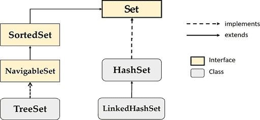

图 Set：接口与实现

## HashSet 实现

`HashSet` 是 Set 接口最常用的实现之一。它由 `HashMap` 支持，这意味着 `add`、`remove` 和 `contains` 等操作在内部都委托给了 map 结构。

以下是关键特征：

* 不允许重复元素。
* 允许一个 null 元素。
* 不保证元素的顺序。
* 不是同步的。
* 假设哈希函数良好，基本操作（`add`、`remove`、`contains`）允许常数时间性能。

### HashSet 的内部结构

在内部，`HashSet` 只是 `HashMap` 的一个包装器。当你向 `HashSet` 添加元素时，它被作为内部 map 的键存储，所有的值都使用常量虚拟值（如 `PRESENT`）。

让我们通过示例来理解这一点：

```java
Set<String> set = new HashSet<>();
set.add("Apple");
set.add("Banana");
set.add("Apple"); // 重复，会被忽略
System.out.println(set); // 输出可能是 [Apple, Banana]，顺序可能会变化
```

在内部，它的存储如下：

```java
Map<String, Object> map = new HashMap<>();
static final Object PRESENT = new Object();
map.put("Apple", PRESENT);
map.put("Banana", PRESENT);
map.put("Apple", PRESENT); // 覆盖相同的键，不会添加新条目
```

当添加像 "Apple" 这样的元素时，`HashMap` 会使用 `"Apple".hashCode()` 计算哈希值，该值决定了合适的桶索引并据此放置键值对。这种机制基于第 6 章 `Map` 接口及其实现中讨论的哈希原理。在出现重复元素的情况下，当你向 `HashSet` 中添加元素时，会使用元素的 `hashCode()` 方法计算哈希值。该哈希值用于查找桶（内部数组中的索引）。如果该桶已存在相同哈希值的条目，它将使用 `equals()` 方法检查相等性。如果哈希值和 `equals()` 都匹配，则认为新元素是重复的，不再添加。

### HashSet 中的构造函数

Java 在 `HashSet` 类中提供了几个构造函数，以在初始化时提供灵活性，具体取决于用例和性能需求：

* `HashSet()`：创建一个具有默认初始容量 (16) 和负载因子 (0.75) 的空 `HashSet`。
* `HashSet(int initialCapacity)`：创建一个具有指定初始容量的 `HashSet`。当预知元素数量以减少重哈希时非常有用。
* `HashSet(int initialCapacity, float loadFactor)`：允许同时设置初始容量和负载因子以精调性能。
* `HashSet(Collection<? extends E> c)`：构造一个包含给定集合中所有元素的 `HashSet`。重复元素会被删除。

## LinkedHashSet 实现

`LinkedHashSet` 是 `HashSet` 的子类，它维护了元素的插入顺序。在内部，它使用双向链表配合哈希表。这种组合确保了元素按照它们被添加的顺序存储，同时仍然提供了快速访问。

让我们来看一个简单的示例：

```java
Set<String> names = new LinkedHashSet<>();
names.add("Alex");
names.add("Brian");
names.add("Clara");
System.out.println(names); // 输出: [Alex, Brian, Clara]
```

尽管它是一个集合且不允许重复，但它仍然保留了元素插入的顺序。

### LinkedHashSet 的内部结构

`LinkedHashSet` 按照元素插入的顺序维护一个条目的链表。在内部，它构建在 `LinkedHashMap` 之上，后者结合了：

* 哈希表（用于 `add`、`remove` 和 `contains` 等基本操作的常数时间性能）。
* 双向链表（用于维护插入顺序）。

添加到 `LinkedHashSet` 的每个元素都存储在内部 `LinkedHashMap` 的键中。与每个键关联的值是一个常量虚拟对象（通常为 `PRESENT`）。

当添加元素时，会计算该元素的哈希值。如果它尚不存在，则会将该元素添加到哈希表中。会创建一个节点，该节点还连接到插入顺序中的上一个节点和下一个节点。

假设我们按照以下顺序添加元素：

```java
Set<String> items = new LinkedHashSet<>();
items.add("A");
items.add("B");
items.add("C");
```

在内部，条目使用双向链表按照它们的插入顺序进行链接。该结构维护了指向第一个（头）条目的引用，如图所示：

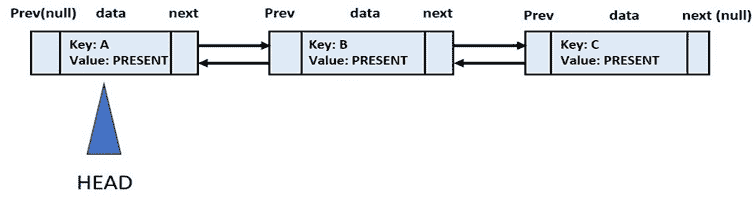

图 7.2：LinkedHashSet 内部结构

每个条目指向插入顺序中的后一个和前一个节点。`LinkedHashSet` 具有快速查找（类似于 `HashSet`）和有序迭代可预测性（类似于 `List`）的优点。

### LinkedHashSet 中的构造函数

`LinkedHashSet` 类提供了几个构造函数，允许开发者创建具有不同初始设置的实例：

* `LinkedHashSet()`：创建一个具有默认初始容量 (16) 和负载因子 (0.75) 的空 `LinkedHashSet`。
* `LinkedHashSet(int initialCapacity)`：创建一个具有指定初始容量的空 `LinkedHashSet`。
* `LinkedHashSet(int initialCapacity, float loadFactor)`：创建一个具有指定初始容量和负载因子的 `LinkedHashSet`。
* `LinkedHashSet(Collection<? extends E> c)`：创建一个包含给定集合中所有元素的 `LinkedHashSet`。如果你想优化内存使用或性能。

以下是一个演示不同 `LinkedHashSet` 构造函数的简单示例：

```java
import java.util.*;

public class LinkedHashSetExamples {
    public static void main(String[] args) {
        // 使用默认构造函数
        LinkedHashSet<String> set1 = new LinkedHashSet<>();
        set1.add("Apple");
        set1.add("Banana");

        // 使用初始容量构造函数
        LinkedHashSet<String> set2 = new LinkedHashSet<>(20);
        set2.add("Cherry");

        // 使用初始容量和负载因子
        LinkedHashSet<String> set3 = new LinkedHashSet<>(10, 0.5f);
        set3.add("Date");

        // 使用集合
        List<String> list = Arrays.asList("Sugarcane", "Fig", "Grape");
        LinkedHashSet<String> set4 = new LinkedHashSet<>(list);

        System.out.println("Set1: " + set1);
        System.out.println("Set2: " + set2);
        System.out.println("Set3: " + set3);
        System.out.println("Set4: " + set4);
    }
}
```

输出为：

Set1: [Apple, Banana]

Set2: [Cherry]

Set3: [Date]

Set4: [Sugarcane, Fig, Grape]

这个示例展示了如何使用所有构造函数，并且可以看到插入顺序被保留了。

## TreeSet 实现

与使用哈希的 `HashSet` 和 `LinkedHashSet` 不同，`TreeSet` 是基于自平衡二叉树的 `NavigableSet` 实现。

以下是关键特性：

* 排序：元素根据自然顺序或创建时提供的 `Comparator` 自动排序。
* 无重复：像所有集合一样，`TreeSet` 不允许重复元素。如果添加重复元素，它们将被忽略。
* 性能：由于树平衡，`add()`、`remove()` 和 `contains()` 操作的时间复杂度为 O(log n)。
* 空值处理：如果使用自然排序（`Comparable`），`TreeSet` 不允许空元素；这样做会导致 `NullPointerException`。
* 非线程安全：对于并发访问，应外部使用 `Collections.synchronizedSet()` 进行同步。

### TreeSet 的内部结构

`TreeSet` 是 `Set` 接口的一种实现，它按顺序存储元素。在内部，它由 `TreeMap` 支撑，这意味着 `TreeSet` 中的所有元素都存储在 `TreeMap` 的键中。该映射的值只是虚拟对象。

为了更好地理解 `TreeSet` 的工作原理，考虑以下简单示例：

```java
TreeSet<Integer> numbers = new TreeSet<>();
numbers.add(20);
numbers.add(10);
numbers.add(30);
```

因此，`TreeSet` 不直接存储元素。相反，它使用 `TreeMap` 的键来存储元素，同时为所有键分配一个虚拟值（`PRESENT`）。

当我们调用 `numbers.add(20);` 时，它内部调用了 `map.put(20, PRESENT)`。由于 map 是空的，`20` 被添加为底层红黑树的根节点。当我们调用 `numbers.add(10);` 时，它会将 `10` 与根节点（`20`）进行比较。由于 `10 < 20`，它被放置为 `20` 的左孩子。树可能会进行重平衡，但在这个小示例中，可能不需要重平衡。最后，当调用 `numbers.add(30);` 时，它将 `30` 与 `20` 进行比较。由于 `30 > 20`，它被放置为 `20` 的右孩子。

底层的红黑树现在包含三个节点，如图所示：

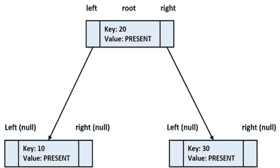

图 7.3 `TreeSet` 内部表示

这些元素通过树形结构自动进行排序和平衡。

### TreeSet 元素的符合性要求

在将元素添加到 `TreeSet` 之前，它必须满足某些标准，以确保集合能够保持其排序顺序并避免不一致，如下所示：

* 必须是可比较的或提供 `Comparator`：`TreeSet` 使用自然排序（`Comparable`）或自定义的 `Comparator` 对元素进行排序。
* 元素必须实现 `Comparable<T>`，或者在创建 `TreeSet` 时传入 `Comparator<T>` 进行插入。
* 如果两者均未提供，添加元素将导致：


```
java.lang.ClassCastException: class X cannot be cast to class java.lang.Comparable
```

- 必须是相互可比较的：同一个 `TreeSet` 中的所有元素之间必须是可以比较的。

```java
TreeSet<Object> set = new TreeSet<>();
set.add("abc"); // OK
set.add(100); // 运行时抛出 ClassCastException
```

- 不得为 null：使用自然排序的 `TreeSet` 不能包含 `null`，因为 `null` 无法与非空元素进行比较。尝试添加 `null` 将抛出 `NullPointerException`。

### TreeSet 中的构造函数

`TreeSet` 类提供了几个构造函数，以不同的方式创建排序集合：

- `TreeSet()`：创建一个空的 `TreeSet`，根据元素的自然排序（即使用 `Comparable`）对元素进行排序。

- `TreeSet(Collection<? extends E> c)`：构建一个包含给定集合元素的 `TreeSet`，并按自然排序进行排序。

- `TreeSet(Comparator<? super E> comparator)`：创建一个空的 `TreeSet`，使用指定的 `Comparator` 进行排序。

- `TreeSet(SortedSet<E> s)`：构建一个与指定的 `SortedSet` 具有相同元素和顺序 `TreeSet`。

### TreeSet 中的常用方法

下表显示了 `TreeSet` 可的一些常用方法：

| 方法 | 说明 |
| :--- | :--- |
| `first()` | 返回最小元素（根据集合的排序顺序）。 |
| `last()` | 返回最大元素。 |
| `ceiling(E e)` | 返回大于等于 e 的最小元素，如果不存在此类元素则返回 `null`。 |
| `floor(E e)` | 返回小于等于 e 的最大元素，如果不存在此类元素则返回 `null`。 |
| `higher(E e)` | 返回大于 e 的最小元素，如果不存在此类元素则返回 `null`。 |
| `lower(E e)` | 返回小于 e 的最大元素，如果不存在此类元素则返回 `null`。 |
| `pollFirst()` | 获取并移除第一个（最小）元素。 |
| `pollLast()` | 获取并移除最后一个（最大）元素。 |
| `descendingSet()` | 返回元素的反序视图。 |
| `descendingIterator()` | 返回一个反序的迭代器。 |
| `subSet(E from, E to)` | 返回从 `from`（包含）到 `to`（不包含）的元素视图。 |
| `headSet(E to)` | 返回小于 `to` 的元素视图。 |
| `tailSet(E from)` | 返回大于或等于 `from` 的元素视图。 |

表 7.2：`TreeSet` 中的额外方法

### HashSet、LinkedHashSet 和 TreeSet 的比较

现在我们已经分别探索了主要的 Set 实现：`HashSet`、`LinkedHashSet` 和 `TreeSet`，让我们对它们进行对比比较。这种比较将突出顺序、性能和内部结构等关键差异，为在何时使用每种实现提供更清晰的视角。参考下表：

| 特性 | HashSet | LinkedHashSet | TreeSet |
| :--- | :--- | :--- | :--- |
| 顺序 | 无保证顺序 | 保持插入顺序 | 保持自然或指定的顺序 |
| 底层数据结构 | 哈希表 | 哈希表 + 链表 | 红黑树（自平衡二叉树） |
| Null 元素 | 允许一个 null | 允许一个 null | 不允许 null（基于比较器的集合抛出 `NullPointerException`） |
| 性能（基本操作） | O(1) 平均时间 | O(1) 平均时间 | add、remove 和 contains 操作的时间为 O(log n) |
| 排序元素 | 否 | 否 | 是 |
| 保留插入顺序 | 否 | 是 | 否（由排序顺序代替） |
| 线程安全 | 非线程安全 | 非线程安全 | 非线程安全 |
| 使用场景 | 顺序不重要 | 插入顺序很重要 | 需要排序数据 |

表 7.3：`HashSet`、`LinkedHashSet` 和 `TreeSet` 的比较

### Java 8 对 Set 的增强

Java 8 对 `Set` 接口及其实现进行了一些重要的更新，在 API 可用性和性能方面。以下是所做的增强：

- `Set` 接口中的默认方法：从 Java 8 开始，接口可以拥有默认和静态方法。

`Set`（及其继承的 `Collection`）现在包含以下默认方法：

- `forEach(Consumer<? super E> action)`：该方法可以使用 Lambda 表达式或方法引用遍历元素。

```java
Set<String> names = new HashSet<>();
names.add("Alice");
names.add("Bob");
names.forEach(System.out::println);
```

- `removeIf(Predicate<? super E> filter)`：移除所有满足给定条件的元素。例如：

```java
names.removeIf(name -> name.startsWith("A"));
```

- 通过 `Collection.stream()` 和 `Collection.parallelStream()` Stream 方法：这些使得函数式操作成为可能。

```java
names.stream()
  .filter(name -> name.length() > 3)
  .forEach(System.out::println);
```

- `HashSet` 中改进冲突的处理：Java 中的 `HashSet` 由 `HashMap` 支撑，`HashMap` 根据哈希码将元素存储在桶中。有时，两个或多个元素产生相同的桶索引；这被称为哈希冲突。

    - Java 8 之前：相同桶中的所有元素以单链表的形式连接。在最坏情况下（当所有元素落在同一个桶时），查找、插入和删除的操作从 O(1) 平均时间下降到 O(n)。

    - Java 8 改进：如果单个桶变得过于拥挤（超过 8 个元素），该桶的链表将被替换为平衡的红黑树。这一过程被称为树化。通过树化，最坏情况下的查找时间从 O(n) 提高到 O(log n)，使得在冲突多时性能更具可预测性。

- 改进的重哈：Java 8 优化了调整 `HashSet` 等哈希集合大时的重哈过程。

它不是从头重新计算哈希码，而是使用位运算来更有效地重新分配元素，改进了调整大小操作的性能。

- `TreeSet`: 由 `TreeMap` 支持，由于它使用了红黑树，因此对于大多数操作（如 `add()`、`remove()`、`contains()`）都提供了 `O(log n)` 的时间复杂度。这使得它比 `HashSet` 慢，但在需要有序排列时非常合适。

- `Iteration`: 遍历 `HashSet` 或 `LinkedHashSet` 的速度通常比遍历 `TreeSet` 快，因为后者需要维护顺序。

- `Memory usage`: `TreeSet` 消耗的内存比 `HashSet` 和 `LinkedHashSet` 多，因为存在树形结构和额外的指针。

## Set 中的同步

默认情况下，`Set` 接口的实现（如 `HashSet`、`LinkedHashSet` 和 `TreeSet`）不是线程安全的。这意味着如果多个线程并发访问一个集合且至少有一个线程对其进行修改，你必须手动进行同步，以避免不可预测的行为。

为了使集合同步化，Java 在 `Collections` 类中提供了实用方法 `synchronizedSet`，如下所示：

```java
Set<String> set = Collections.synchronizedSet(new HashSet<>());
```

这会将原始集合封装为线程安全的版本。虽然 `add()` 或 `remove()` 等操作是同步的，但对集合进行迭代仍然需要手动的同步块，如下所示：

```java
Set<String> set = Collections.synchronizedSet(new HashSet<>());

synchronized (set) {
    for (String item : set) {
        // 安全迭代
    }
}
```

这是因为 `iterator` 本身并不是同步的。如果没有封装在同步块中，并发修改可能会导致 `ConcurrentModificationException`。

在现代并发环境中（具有多核处理器），通常有选择提供线程安全和可扩展性的集合实现。Java 提供了专门的并发集合实现，例如：

- `ConcurrentSkipListSet`（一种并发且排序的集合）：它是 `TreeSet` 的可扩展、线程安全的替代方案，内部基于跳表。

- `CopyOnWriteArraySet`：最适合频繁读取和低频率写入的集合。它在每次修改时都会创建底层数组的新副本。

## 用于 Set 的泛型算法

Java 通过 `Collections` 工具类提供了丰富的泛型算法，这些算法可以作用于任何类型的 `Set`，使得代码更具重用性且简洁。这些算法不需要对 `Set` 接口进行任何更改，但提供了可以直接应用于集合的强大操作：

- `Collections.unmodifiableSet(Set<? extends T> s)`：创建给定集合的只读视图。任何修改返回集合的尝试都会导致异常，如下所示所示：

```java
Set<String> original = new HashSet<>();
original.add("apple");
Set<String> unmodifiable = Collections.unmodifiableSet(original);
unmodifiable.add("banana"); // 抛出 UnsupportedOperationException
```

当你想要与其它代码共享集合但不允许其修改时，这种方法非常有用，例如暴露类的内部数据。

- `Collections.synchronizedSet(Set<T> s)`：使用同步机制封装给集合，使其可以在多个线程间安全使用，如下所示：

```java
Set<Integer> set = Collections.synchronizedSet(new HashSet<>());
set.add(1);
set.add(2);
```

当你从多个线程访问集合时，使用此方法以避免并发问题。

| 注意：在迭代期间你仍需手动进行同步。 |

- 使用流进行 Set 操作：`Collectors` 类提供了 `toSet()` 方法，将流操作的最终结果收集为 `Set`。

例如，两个集合中的公共元素可以收集到一个集合中，如下所示：

```java
Set<Integer> set1 = new HashSet<>(List.of(1, 2, 3));
Set<Integer> set2 = new HashSet<>(List.of(2, 3, 4));
Set<Integer> intersection = set1.stream()
    .filter(set2::contains)
    .collect(Collectors.toSet());
```

这对于无需手动循环或条件判断的函数式集合操作非常有用。

## 结论

在本章中，我们探索了 `Set` 接口的核心实现：`HashSet`、`LinkedHashSet` 和 `TreeSet`。每个实现都有独特的优势。`HashSet` 为 `add`、`remove` 和 `contains` 等基本操作提供了快速性能，但它不维护元素的任何顺序。另一方面，`LinkedHashSet` 在保持插入顺序的同时，仍以最小的开销提供相对高效的操作。`TreeSet` 按自然顺序或指定的排序顺序维护元素，并支持高效的范围操作，适用于需要有序遍历或范围查询的场景。

我们检查了它们的内部结构、构造函数和性能考虑因素，并涉及了与集合操作相关的同步和泛型算法等方面。

对这些实现深入理解将帮助你根据实际应用中的特定需求选择合适的数据结构。

在下一章中，我们将探索 `queue` 和 `deque` 接口，并在其中探索有序处理、优先级处理和双端操作，这些在并发和顺序任务管理场景中至关重要。

## 练习

1. 下哪个 Set 实现维护了插入顺序？

    1. `HashSet`

    2. `LinkedHashSet`

    3. `TreeSet`

    4. 以上均不是

2. 下述代码的输出是什么？

```java
Set<String> set = new HashSet<>();
set.add("Book");
set.add("Pen");
set.add("Book");
System.out.println(set.size());
```

    1. 2

    2. 3

    3. 1

    4. 编译错误

3. 哪个 Set 实现按自然顺序排序元素？

    1. `HashSet`

    2. `LinkedHashSet`

    3. `TreeSet`

    4. 以上都是

4. `HashSet` 中 `add()` 操作的时间复杂度是多少？

    1. `O(1)`

    2. `O(log n)`

    3. `O(n)`

    4. `O(log n)`

解释：`Set.of()` 在 Java 9 及以上版本中直接创建一个不可修改的集合。

10. c

解释：`TreeSet` 由 `NavigableMap` 支撑，并按排序后的顺序（升序）维护元素。

## 加入我们的 Discord 空间

加入我们的 Discord 工作空间以获取最新更新、优惠、全球科技动态、新发布以及与作者的互动会议：

[`discord.bpbonline.com`](https://discord.bpbonline.com)


# 第 8 章 Queue 和 Deque 接口

## 引言

在现实应用中，任务通常按照它们到达的顺序进行处理，就像人们排队买电影票或打印机等待处理打印作业一样。这种自然的“先来服务”原则在 Java 中通过 `Queue` 接口进行建模。此外，为了更灵活的数据管理，Java 提供了双端队列（`Deque`）接口，允许从两端进行插入和删除。

本章将探索 Java 集合框架（JCF）中的这两个基本接口、它们的行为、典型用场景以及主要实现。我们还将探索内部结构、性能权衡以及并发安全的选项。

## 结构

本章涵盖了以下主题：

* `Queue` 接口
* `PriorityQueue` 实现
* `Deque` 接口
* `ArrayDeque` 实现
* 作为队列的 `LinkedList`
* Queue 和 Deque 中的同步

## 目标

在本章结束时，你将理解 `Queue` 和 `Deque` 接口之间的基本区别和相似之处。能够根据插入或删除顺序、性能需求和并发需求选择合适的实现。此外，你将学习堆和环形缓冲区等内部结构如何支持这些数据结构，以及在实时应用中何时优先选择某种实现而非另一种。

## Queue 接口

Java 中的 `Queue` 接口表示一个设计用于在处理前持有元素的集合。它遵循 FIFO（先进先出）原则，这意味着元素在末尾添加并从头部移除。

它是 `java.util` 包的一部分，并扩展了 `Collection` 接口，如下所示：

```java
public interface Queue<E> extends Collection<E>
```

Java 提供了 `Queue` 接口的多种实现，每种都适用于不同的用例：

* `LinkedList`：实现了 `Deque`，可以用作队列或栈。它允许 null 元素且不是线程安全的。
* `PriorityQueue`：按排序后的顺序（根据自然排序或自定义比较器）维护元素。它不遵循严格的 FIFO 规则。
* `ArrayDeque`：队列操作中比 `LinkedList` 更快的替代方案。它不允许 null 元素。
* `ConcurrentLinkedQueue`：一种线程安全的无锁实现，适用于并发环境。

### Queue 接口的特征

以下是 `Queue` 的一些特征，有助于我们更好地理解它：

* 元素按照它们添加的顺序被处理。
* 它不像 `List` 那样允许随机访问。
* 队列头部是调用 `remove()` 或 `poll()` 将移除的元素。
* 队列尾部是添加新元素的地方。

`Queue` 接口引入了几个额外方法，如下所示：

| 方法 | 说明 |
| :--- | :--- |
| `add(E e)` | 将指定的元素插入队列。如果队列满了则抛出异常。 |
| `offer(E e)` | 将元素插入队列。如果失败（例如队列满了）则返回 false。 |
| `remove()` | 获取并移除头部。如果队列为空则抛出异常。 |
| `poll()` | 获取并移除头部。如果队列为空则返回 null。 |
| `element()` | 获取（但不移除）头部。如果队列为空则抛出异常。 |
| `peek()` | 获取（但不移除）头部。如果队列为空则返回 null。 |

表 8.1：Queue 接口中的额外方法

为了理解队列在 Java 中的行为，让我们来看一个使用 `Queue` 接口及其常见实现 `LinkedList` 的简单示例。这有助于演示队列的 FIFO 特性。考虑以下代码：


```java
Queue<String> queue = new LinkedList<>();
queue.add("Apple");
queue.add("Banana");
queue.add("Cherry");
System.out.println(queue.poll());
System.out.println(queue.peek());
System.out.println(queue.poll());
```

以下是输出结果：

```
Apple
Banana
Banana
```

在例用例中：

* 我们使用了带有 `LinkedList` 实现的 `Queue` 接口。`LinkedList` 是一个实现 `Queue` 的常用类。
* `add("Apple")`、`add("Banana")` 和 `add("Cherry")` 按照元素到达的顺序插入队列；这就是 FIFO 行为。
* `poll()` 获取并移除队列头部。由于 "Apple" 是先添加的，所以它被移除并打印。
* `peek()` 获取但不移除队列头部。现在 "Banana" 位于前端，所以显示了它。
* `poll()` 获取并移除队列头部。由于现在 "Banana" 位于前端，它被移除并打印。

此例示例突出了标准的队列操作：

* 使用 `add()` 插入
* 使用 `poll()` 移除并返回头部
* 使用 `peek()` 查看头部而不移除

## PriorityQueue 实现

`PriorityQueue` 是 JCF 的一部分，提供了一种基于优先级而非插入顺序来处理元素的有效方法。

以下是 `PriorityQueue` 的关键特征：

* 不是 FIFO 队列：元素按优先级排序，而不是按添加的顺序排序。
* 允许重复：你可以插入重复元素。
* 不允许 null 元素。
* 不是线程安全的：如果被多个线程使用，则必须在外部进行同步。
* 无界队列：根据需要增长。

### PriorityQueue 的内部结构

Java 中的 `PriorityQueue` 使用二叉堆实现，二叉堆是一种完全树。元素存储在数组（`Object[]`）中，数组根据需要动态增长。最小堆是默认行为，这意味着最小元素始终位于堆的根（头部）。

在内部，使用了以下机制：

* 元素被插入到一个基于数组的堆中。
* 堆不是排序的，但其组织方式允许在 O(1) 时间内获取最小元素。
* 插入和移除通过堆化操作维护堆属性：`siftUp()` 和 `siftDown()`。

这里是 `PriorityQueue` 中 `add` 方法的基本示例：

```java
Object[] queue;
int size;
public boolean add(E e) {
    if (e == null)
        throw new NullPointerException();
    int i = size;
    if (i >= queue.length)
        grow(); // 扩展数组
    size = i + 1;
    if (i == 0)
        queue[0] = e; // 直接添加第一个元素
    else
        siftUp(i, e); // 维护堆顺序
    return true;
}
```

当在末尾添加元素时，如果它违反了堆属性，我们需要将其向上移动。`siftUp` 方法用于将元素移动到堆的正确位置：

```java
private void siftUp(int k, E x) {
    while (k > 0) {
        int parent = (k - 1) >>> 1; // 父节点索引
        Object e = queue[parent];
        if (compare(x, e) >= 0)
            break;
        queue[k] = e; // 父节点向下移动
        k = parent;
    }
    queue[k] = x; // 放置新元素
}
```

`siftUp` 方法维护最小堆属性。新插入的元素会向上移动直到到达正确位置。

假设我们添加了以下元素：

```java
PriorityQueue<Integer> pq = new PriorityQueue<>();
pq.add(30);
pq.add(10);
pq.add(20);
```

内部发生了以下情况：

* 最初，添加 30 后，堆所示：


图 8.1：初始堆

* 添加 10 后，由于 10 小于 30，它们交换了位置。现在的堆所示。

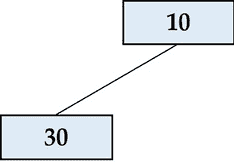

图 8.2：添加 10 后的堆

* 在添加 20 之后，堆如如下所示。由于 `20` 大于 `10`，因此没有发生交换：

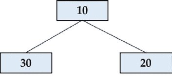

图 8.3：添加 20 后的堆

调用 `poll()` 时，`poll()` 会检索并移除头部元素（即 `最小堆` 中的最小元素），然后对堆进行重新排序。

以下是 `poll` 方法的代码片段：

```java
public E poll() {
    if (size == 0)
        return null;
    int s = --size;
    E result = (E) queue[0]; // 获取根节点（最小）
    E x = (E) queue[s]; // 获取最后一个元素
    queue[s] = null; // 清空最后一个槽位
    if (s != 0)
        siftDown(0, x); // 恢复堆
    return result;
}
```

在上述 `poll()` 方法中，返回了 `result = 10`。索引 `0` 被最后一个元素 `queue[0] = 20` 替换。

在 `poll()` 之后，从索引 `0` 调用了 `siftDown()` 以恢复堆。

以下是 `siftDown()` 方法的代码片段：

```java
private void siftDown(int k, E x) {
    int half = size >>> 1; // 此之下的节点是叶子节点
    while (k < half) {
        int left = (k << 1) + 1; // 左孩子
        int right = left + 1;
        int smallest = left;
        Object c = queue[left];
        if (right < size && compare((E) queue[right], (E) c) < 0) {
            smallest = right;
            c = queue[right];
        }
        if (compare(x, (E) c) <= 0)
            break;
        queue[k] = c; // 将较小的孩子向上移动
        k = smallest;
    }
    queue[k] = x;
}
```

现在更新后的堆如下所示：

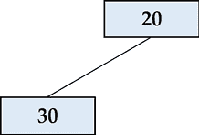

图 8.4：使用 `poll()` 移除 10 后的状态

因此，基于数组的二叉堆是 `PriorityQueue` 的核心，插入和删除操作确保了优先级最高（最小）的元素始终位于顶部。

## Deque 接口

在 Java 6 中引入的 `Deque` 接口表示一种支持插入和移除的线性集合（双端队列）。它允许在两端进行插入和移除操作。

`Deque` 既可以用作队列（Queue），也可以用作栈（Stack）。它比 `Stack` 类更高效，因为它不是同步的。

`Deque` 接口在两端支持插入和移除，这在需要频繁双端操作的场景中非常有用。

### Deque 常用方法

`Deque` 接口提供了多种方法，以下是常用的：

| 方法 | 说明 |
| :--- | :--- |
| `addFirst(e)` | 在头部插入元素 |
| `addLast(e)` | 在尾部插入元素 |
| `offerFirst(e)` | 在头部插入元素，如果失败则返回 false |
| `offerLast(e)` | 在尾部插入元素，如果失败则返回 false |
| `removeFirst()` | 移除并返回头部元素，如果为空抛出异常 |
| `removeLast()` | 移除并返回尾部元素，如果为空抛出异常 |
| `pollFirst()` | 移除并返回头部元素，如果为空则返回 null |
| `pollLast()` | 移除并返回尾部元素，如果为空则返回 null |
| `peekFirst()` | 获取头部元素但不移除 |
| `peekLast()` | 获取尾部元素但不移除 |
| `push(e)` | 在头部插入元素（栈操作） |
| `pop()` | 移除并返回头部元素（栈操作） |

### 将 Deque 作为队列

`Deque` 可以作为先入先出（FIFO）队列使用。考虑以下示例：

```java
Deque<String> deque = new ArrayDeque<>();
// 作为队列使用
deque.addLast("One");
deque.addLast("Two");
System.out.println(deque.pollFirst()); // One
System.out.println(deque.pollFirst()); // Two
```

### 将 Deque 作为栈

`Deque` 也可以作为后进先出（LIFO）栈使用。例如：

```java
Deque<String> deque = new ArrayDeque<>();
// 作为栈使用
deque.push("A");
deque.push("B");
deque.push("C");
System.out.println(deque.pop()); // C
System.out.println(deque.pop()); // B
```

让我们通过一个例子来理解这一点。考虑以下代码：

```java
Deque<String> deque = new ArrayDeque<>();
deque.addFirst("C");
deque.addLast("D");
deque.addFirst("B");
deque.addFirst("A"); // deque = [A, B, C, D]
System.out.println(deque); // [A, B, C, D]
System.out.println(deque.removeLast()); // D
System.out.println(deque.removeFirst()); // A
System.out.println(deque); // [B, C]
```

以下是输出：

```
[A, B, C, D]
D
A
[B, C]
```

以下是解释：

* 执行 `addFirst("C")` 时，元素将如图所示。头部和尾指向同一个元素。

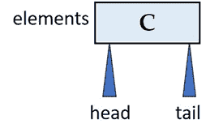

图 8.5：添加 C 后的 ArrayDeque

* 执行 `addLast("D")`，D 被添加到队列末尾，尾部现在指向 D，如图所示：

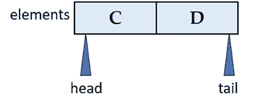

图 8.6：添加 D 后的 ArrayDeque

* 执行 `addFirst("B")`，现在当 B 被添加到头部时，头部指向 B，arraydeque 如图所示：

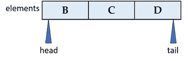

图 8.7：添加 B 后的 ArrayDeque

* 执行 `addFirst("A")`，在添加 A 后，头部现在指向 A，arraydeque 如下：

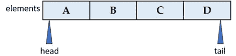

图 8.8：添加 A 后的 ArrayDeque

* 执行 `removeLast()` 移除最后一个元素（D），arraydeque 如图所示：

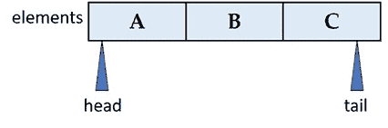

图 8.9：移除最后一个元素后的 ArrayDeque

* 执行 `removeFirst()` 移除第一个元素（A），arraydeque 中只剩下 B 和 C。arraydeque 如下：

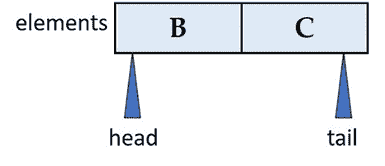

图 8.10：移除第一个元素后的 ArrayDeque

内部的缩容逻辑确保了即使我们在两端进行添加/删除，性能依然保持高效。

### 构造函数

以下是可用于创建 `ArrayDeque` 的构造函数：

* `ArrayDeque()`：初始容量为 16 的默认构造函数。如下所示创建：

```java
ArrayDeque<Integer> deque1 = new ArrayDeque<>();
```

* `ArrayDeque(int initialCapacity)`：创建一个具有给定容量的 deque，如下所示：

```java
ArrayDeque<String> deque2 = new ArrayDeque<>(50);
```

* `ArrayDeque(Collection<? extends E> c)`：构建包含指定集合元素的 deque，如下所示：

```java
ArrayDeque<Character> deque3 = new ArrayDeque<>(List.of('A', 'B', 'C'));
```

`ArrayDeque` 是一个高效的双端队列实现，在两端进行添加/删除操作时优于 `LinkedList` 和 `Stack`。它没有 `capacity` 方法，但由于实现了 `Deque` 接口，因此可以作为栈使用（通过 `push` 和 `pop` 方法）。

### 注意

`ArrayDeque` 的特点包括：

* 它不是线程安全的。
* 它不支持 `null` 元素。
* 在单线程环境下，它通常比 `Stack` 和 `LinkedList` 更快。
* 它在两端进行操作时性能极佳。
* 它没有 `capacity` 方法，但可以通过 `size()` 获取元素数量。

选择合适的同步机制取决于具体的并发需求，例如是否需要阻塞行为，或者是否应该在不锁定整个结构的情况下支持并发读写。

一种常用方法是使用并发集合，如 `ConcurrentLinkedQueue` 或 `ConcurrentLinkedDeque`，它们是非阻塞的，允许多个线程进行高吞吐量访问。对于简单的场景或遗留代码库，可以使用 `Collections.synchronizedQueue()` 或 `Collections.synchronizedDeque()` 方法来封装现有的非线程安全实现并使其同步，尽管在高度竞争的情况下，这些方法的可扩展性通常较差。

对于需要生产者和消费者之间进行协调的用例，Java 提供了 `BlockingQueue` 和 `BlockingDeque` 接口。`ArrayBlockingQueue`、`LinkedBlockingQueue` 和 `LinkedBlockingDeque` 等实现支持线程安全的操作，这些操作在队列满（插入时）或队列空（检索时）会发生阻塞。这些非常适合用于构建任务队列、消息传递系统或边界缓冲区。


现在，让我们详细探索这些替代方案和最佳实践，并结合演示它们在并发应用中有效使用的示例。

## 使用并发集合

Java 提供了以下内置的并发实现：

*   `ConcurrentLinkedQueue`：一种非阻塞、线程安全的 FIFO（先进先出）队列实现。
*   `LinkedBlockingQueue`、`ArrayBlockingQueue`：用于生产者-消费者场景的阻塞队列。
*   `ConcurrentLinkedDeque`：非阻塞的双端队列实现。

这些类在内部处理同步，在并发设计中是首选。

## 使用同步集合封装

如果你在多线程环境中使用如 `LinkedList` 等非线程安全的类作为队列，你必须对访问进行同步以避免并发问题。Java 提供了一个工具方法 `Collections.synchronizedList()`，它可以封装一个 `List`（可以用作队列）并使其线程安全。可以像下面所示：

```java
Queue<String> queue = Collections.synchronizedList(new LinkedList<>());

// 在迭代期间显式同步
synchronized (queue) {
    for (String item : queue) {
        System.out.println(item);
    }
}
```

以下是对上述示例的解释：

*   `Collections.synchronizedList(...)` 返回原始列表的线程安全包装器。
*   但是，在迭代期间仍然需要手动同步，以避免 `ConcurrentModificationException`。
*   `synchronized (queue)` 块确保了迭代是原子的且不受线程干扰的。

## BlockingQueue 和 BlockingDeque

当你需要线程等待插入或移除等操作时（例如在生产者-消费者场景中），Java 提供了 `BlockingQueue` 和 `BlockingDeque`。它们可以使用如下所示：

```java
BlockingQueue<String> bQueue = new LinkedBlockingQueue<>();

bQueue.put("Data"); // 放入元素；如果队列满则等待
String val = bQueue.take(); // 检索并移除头部；如果为空则等待
System.out.println(val); // 输出: Data
```

以下是对上述示例的解释：

*   `LinkedBlockingQueue` 是一个线程安全的、可选有边界的队列。
*   `put()` 在队列满时会阻塞线程；这对于生产者很有用。
*   `take()` 在队列为空时会阻塞；这对于消费者很有用。
*   这有助于管理背压并避免忙等。

在并发环境中使用队列和双端队列时，确保线程安全性是至关重要的。虽然像 `ArrayDeque` 和 `LinkedList` 等集合默认不是线程安全的，但 Java 提供了如同步包装器和如 `BlockingQueue`、`BlockingDeque` 等并发实现等机制。选择正确的方法取决于你需要的是基本的线程安全还是线程之间完全的协调（例如阻塞行为）。

## ArrayDeque vs. LinkedList vs. PriorityQueue

下表列出了 `ArrayDeque`、`LinkedList` 和 `PriorityQueue` 的比较：

| 特性 | ArrayDeque | LinkedList (作为队列/Deque) | PriorityQueue |
| :--- | :--- | :--- | :--- |
| 底层结构 | 可调整大小的数组 | 双向链表 | 最小堆（二叉堆） |
| 允许空元素 | 不 | 允许 | 不 |
| 排序 | 插入顺序 | 插入顺序 | 自然/比较器顺序 |
| 性能 (添加或删除) | 快 (摊销 O(1)) | 中等 (两端 O(1)) | O(log n) |
| 线程安全 | 非线程安全 | 非线程安全 | 非线程安全 |
| 阻塞支持 | 否 | 否 | 否 |
| 随机访问 | 否 | 否 | 否 |
| 使用场景 | 栈/队列/双端队列（非线程） | 通用队列/双端队列 | 基于优先级的处理 |

表 8.4：ArrayDeque vs. LinkedList vs. PriorityQueue

## 结论

本章探索了基础的 `Queue` 和 `Deque` 接口及其在 JCF 中的主要实现。我们检查了 `Queue` 如何支持 FIFO 操作，而 `Deque` 如何支持从两端插入和移除。

如 `ArrayDeque`、`LinkedList` 和 `PriorityQueue` 等关键实现根据访问模式、性能和排序需求有不同的用途。此外，我们还看到如何使用封装器或如 `BlockingQueue` 等并发类引入同步以实现线程安全的操作。

在下一章中，我们将探索 Java 的工具类，这些类为排序、搜索、修改以及同步集合和数组提供了内置支持。

## 练习

1.  哪种方法向 `Queue` 的尾部添加元素并抛出异常？
2.  哪种接口允许从两端插入和移除？
3.  `PriorityQueue` 使用的是什么排序？
4.  哪种方法在队列为空时检索头部并返回 null？
5.  在 `ArrayDeque` 中插入空元素会发生什么？
6.  以下哪个方法不是 `Queue` 接口定义的？
7.  实现不支持随机访问？
8.  哪种实现最适合实现优先级调度器？
9.  哪种接口允许 `addFirst()` 和 `removeLast()` 方法？

### 答案

1.  **c**  
    解释：`add()` 向尾部添加元素并在插入失败时抛出异常。

2.  **b**  
    解释：`Deque` 支持从两端插入和移除。

3.  **c**  
    解释：`PriorityQueue` 使用自然排序，除非提供了比较器。

4.  **a**  
    解释：`poll()` 在队列为空时返回 null。

5.  **b**  
    解释：`ArrayDeque` 不允许空元素并抛出 `NullPointerException`。

6.  **c**  
    解释：`push()` 是属于 `Deque` 的，不是 `Queue` 接口定义的。

7.  **d**  
    解释：`ArrayDeque` 支持随机访问。

8.  **c**  
    解释：`PriorityQueue` 最适合实现优先级调度器。

9.  **d**  
    解释：`Deque` 提供了 `addFirst()` 和 `removeLast()` 方法。

说明：`PriorityQueue` 针对基于优先级的任务调度进行了优化。

10. **d**  
    说明：`Deque` 提供了 `addFirst()`、`removeLast()` 以及其他双端操作。

## 加入我们的 Discord

加入我们的 Discord 工作空间以获取最新更新、优惠、全球科技动态、新发布以及与作者的交流：

[`discord.bpbonline.com`](https://discord.bpbonline.com)


# 第 9 章 工具类

## 引言

在现实世界的 Java 应用中，开发者经常需要对集合进行排序、搜索、修改或同步。手动执行这些操作容易出错且耗费时间。Java 的工具类通过提供即插用的方法来简化这些常见任务，从而解了后顾。

本章重点介绍如 `Collections` 和 `Arrays` 等工具类，这些类提供了静态方法来操作或返回集合和数组。本章还涵盖了包装类、同步工具类，以及如何使集合变为不可修改的或类型安全的（检查集合）。理解并有效使用这些类将帮助你编写更高效、更可读且更安全的 Java 代码。

## 结构

本章涵盖了以下主题：

*   集合工具类
*   使用 `Collections` 进行排序和搜索
*   使用 `Collections` 修改集合
*   数组工具类
*   使用 `Arrays` 和 `Collections`
*   包装类
*   同步工具
*   不可修改集合
*   检查集合

## 目标

本章旨在为你提供 Java 核心工具类的实用知识，这些类简化了涉及集合和数组的常见任务。你将学习如何使用 `Collections` 类高效地对集合进行排序、搜索和修改，以及 `Arrays` 类如何为数组提供类似的功能。我们还将探索包装类的使用，它允许将基本类型用于基于对象的集合中，以及同步集合以确保线程安全的技术。最后，你将理解如何使用内置工具方法创建不可修改和类型安全的（检查）集合，使你能够在 Java 应用中编写更安全、更易于维护的代码。

## 集合工具类

Java 中的 `Collections` 类是 `java.util` 包的一部分，它提供了一系列操作或返回集合的静态方法。这些方法旨在简化常见的集合相关的任务，如排序、搜索、反转、洗牌、填充、复制等。

该类无法实例化，仅作为工具持有者。它通常与 JCF（Java 集合框架）配合使用，以提高效率并减少样板代码。

### `Collections` 类中的关键方法

以下是 `Collections` 工具类提供的常用方法列表：

| 方法 | 说明 |
| :--- | :--- |
| `sort(List<T> list)` | 使用自然顺序将指定的列表按升序排序。 |
| `sort(List<T> list, Comparator<? super T> c)` | 根据自定义比较器对列表排序。 |
| `reverse(List<?> list)` | 反转列表中元素的顺序。 |
| `shuffle(List<?> list)` | 随机打乱列表中的元素。 |
| `swap(List<?> list, int i, int j)` | 交换指定位置上的元素。 |
| `fill(List<? super T> list, T obj)` | 用指定的元素替换列表的所有元素。 |
| `copy(List<? super T> dest, List<? extends T> src)` | 将源列表的所有元素复制到目标列表。目标列表的大小至少与源列表相同。 |
| `binarySearch(List<? extends Comparable<? super T>> list, T key)` | 使用二分查找查找键。列表必须经过排序。 |
| `max(Collection<? extends T> coll)` | 根据自然顺序返回最大元素。 |
| `min(Collection<? extends T> coll)` | 返回最小元素。 |
| `frequency(Collection<?> c, Object o)` | 返回等于指定对象的元素数量。 |
| `disjoint(Collection<?> c1, Collection<?> c2)` | 如果两个集合没有共同元素，则返回 true。 |

表 9.1：`Collections` 类中的关键方法

### 对列表排序和反转

让我们来看一个使用 `Collections` 类对列表进行排序和反转的简单示例：

```java
import java.util.*;

public class CollectionsExample {
    public static void main(String[] args) {
        List<String> fruits = new ArrayList<>(Arrays.asList("Banana", "Apple", "Mango", "Cherry"));
        // 按升序排序
        Collections.sort(fruits);
        System.out.println("Sorted List: " + fruits); // [Apple, Banana, Cherry, Mango]
        // 反转列表
        Collections.reverse(fruits);
        System.out.println("Reversed List: " + fruits); // [Mango, Cherry, Banana, Apple]
    }
}
```

以下是输出：

```
Sorted List: [Apple, Banana, Cherry, Mango]
Reversed List: [Mango, Cherry, Banana, Apple]
```

在此示例中：

*   `Collections.sort(fruits)` 按字母顺序对列表进行排序。
*   `Collections.reverse(fruits)` 随后反转了排序后的列表。

这些工具方法抽象了排序和反转的内部复杂性，使代码更简洁且更容易维护。

## 使用集合进行排序和搜索

在许多现实世界的应用中，你需要按照特定的顺序呈现数据或快速定位特定元素。无论你是在构建待办事项、排行榜还是处理搜索结果，排序和搜索都是帮助提升用户体验的核心操作。

`Collections` 类提供了用于排序和搜索列表的即用静态方法。这些方法在 Java 应用中被广泛使用。

### 列表排序

常见的操作是排序。Java 提供了两种排序方式：

*   自然顺序：当元素实现了 `Comparable` 接口时。
*   自定义顺序：通过使用 `Comparator`。

#### 自然排序

考虑以下示例：

```java
List<Integer> numbers = Arrays.asList(4, 1, 3, 2);
Collections.sort(numbers);
System.out.println(numbers);
```

以下是输出：

```
[1, 2, 3, 4]
```

上面的示例说明了：

*   我们创建一个随机顺序的整数列表。
*   `Collections.sort(numbers)` 使用自然顺序对列表进行排序。
*   原始列表被修改，元素按增加顺序重新排列。

这是因为 `Integer` 实现了 `Comparable` 接口，该接口定义了如何比较两个整数。

#### 使用比较器排序

如果你想按降序或其他任何自定义顺序排序，你需要使用 `Comparator`。让我们使用比较器的示例：

```java
List<String> fruits = Arrays.asList("Banana", "Apple", "Mango");
Collections.sort(fruits, (a, b) -> b.compareTo(a)); // 反向字母序
System.out.println(fruits);
```

以下是输出：

```
[Mango, Banana, Apple]
```

上面的示例说明了：

*   Lambda 表达式 `(a, b) -> b.compareTo(a)` 反转了比较，使列表按降序（Z 到 A）排序。
*   这允许对排序逻辑进行完全控制；你可以根据长度、不区分大小或任何自定义规则进行排序。

注意：你也可以使用 `Comparator.reverseOrder()` 或方法引用来简化语法。

### 列表搜索

排序之后，你可能想要快速查找元素。线性搜索对于大型列表很慢，因此 Java 提供了 `binarySearch()`，它快得多，但要求列表经过排序。

可以通过如下实现：

```java
List<Integer> list = Arrays.asList(10, 20, 30, 40, 50);
int index = Collections.binarySearch(list, 30);
System.out.println("Index of 30: " + index);
```

以下是输出：

```
Index of 30: 2
```

上面的示例说明了：

*   列表已经按升序排序。
*   `Collections.binarySearch(list, 30)` 执行二分查找，每次将列表减半以找到元素。
*   如果找到元素，则返回该元素的索引；在这里，30 位于索引 2。

注意：在调用 `binarySearch()` 之前，必须按升序排序列表。如果未找到元素，该方法将返回一个负值，表示插入点。

### 使用自定义比较器进行二分查找

如果你的列表使用自定义比较器进行排序，则你必须在 `binarySearch()` 调用中使用相同的比较器：

```java
List<String> items = Arrays.asList("X", "M", "A");
Collections.sort(items, Comparator.reverseOrder()); // [X, M, A]
int index = Collections.binarySearch(items, "M", Comparator.reverseOrder());
System.out.println("Index of M: " + index); // 1
```

以下是输出结果：

```
Index of M: 1
```

上面的示例解释了：

*   列表是倒序排序的。
*   由于顺序不是自然顺序，我们必须将相同的比较器传递给 `binarySearch()`。
*   如果忘记传递匹配的比较器，搜索结果可能是不正确的，甚至是一个负数。

这些工具方法对于 Java 中清晰、简洁高效的集合处理至关重要。无论是排序用户评分、搜索产品 ID 还是排名搜索结果，`Collections.sort()` 和 `Collections.binarySearch()` 都是首选工具。

## 使用 Collections 修改集合

除了排序和搜索，`Collections` 工具类还提供了许多实用的方法，可以以一致且高效的方式修改集合的内容。这些方法允许你反转、洗牌、填充和替换元素，以及在集合之间复制数据。当你不想在编写自己的循环或转换逻辑的情况下操作集合时，这些方法特别有用。

让我们通过示例和解释来看常用的修改方法。

### 反转列表

假设我们有一个按注册顺序排列的学生姓名列表。我们想反转列表以先显示最新注册的学生。

考虑以下示例：


```java
List<String> students = Arrays.asList("Andrew", "Becky", "Carlos");
Collections.reverse(students);
System.out.println(students);
```

以下是输出结果：

[Carlos, Becky, Andrew]

上面的示例解释了：

*   `reverse()` 反转了列表元素的顺序。
*   这对于撤销排序操作或以倒序显示数据非常有用。

### 洗牌元素

假设你正在创建一个测验应用，并想在向用户显示问题之前随机化问题的顺序。你可以使用下面的 `shuffle` 方法来实现这一点：

```java
List<Integer> questionIds = Arrays.asList(101, 102, 103, 104, 105);
Collections.shuffle(questionIds);
System.out.println(questionIds);
```

以下是输出结果：

[103, 102, 105, 104, 101]

上面的示例解释了：

*   `shuffle()` 以随机方式重新排列列表。
*   它通常用于游戏、测试和模拟。

### 给列表填充一个值

假设你正在准备一个计分板，并想用默认值初始化它。你可以使用下面的 `fill()` 方法来实现：

```java
List<String> scoreboard = new ArrayList<>(Arrays.asList("A", "B", "C"));
Collections.fill(scoreboard, "Not Started");
System.out.println(scoreboard);
```

以下是输出结果：

[Not Started, Not Started, Not Started]

上面的示例解释了：

*   `fill()` 将每个元素替换为指定的值。
*   它通常用于初始化或重置列表。

### 替换所有出现的值

假设你有一个城市列表，其中发生了名称更改。你想将所有旧名称更新为新名称。你可以使用下面的 `replaceAll()` 方法来实现：

```java
List<String> cities = Arrays.asList("Bombay", "Delhi", "Bombay", "Chennai");
Collections.replaceAll(cities, "Bombay", "Mumbai");
System.out.println(cities);
```

以下是输出结果：

[Mumbai, Delhi, Mumbai, Chennai]

上面的示例解释了：

*   `replaceAll()` 找到特定值的所有实例并替换它们。
*   它对于批量更新或重命名数据集很有帮助。

### 将一个列表复制到另一个

假设你有一个团队成员的主列表，并想创建一个临时更新的副本。你可以使用下面的 `copy()` 方法来实现：

```java
List<String> masterTeam = Arrays.asList("Emily", "John", "Sarah");
List<String> workingCopy = new ArrayList<>(Arrays.asList("X", "Y", "Z"));
Collections.copy(workingCopy, masterTeam);
System.out.println(workingCopy); // [Emily, John, Sarah]
```

以下是输出结果：

[Emily, John, Sarah]

上面的示例解释了：

*   `copy(dest, source)` 将数据从一个列表复制到另一个列表。
*   目标列表的大小至少与源列表相同，以避免 `IndexOutOfBoundsException`。

这些工具方法使集合转换变得简单清晰，减少了对自定义逻辑的需求并提高了代码的可读性。

## Arrays 工具类

虽然 `Collections` 适用于 `List` 等动态数据结构，但 Java 还提供了 `Arrays` 工具类来简化对数组（固定大小数据结构）的操作。`Arrays` 位于 `java.util` 包中，提供了排序、搜索、填充和转换等静态方法。这些工具当你想像处理集合一样操作数组时非常有用。

让我们探索 `Arrays` 类的一些常用功能。

### 排序数组

假设你有一组分数的数组，想对它们进行排序。你可以使用下面的 `sort()` 方法来实现：

```java
int[] marks = {85, 67, 92, 78, 88};
Arrays.sort(marks);
System.out.println(Arrays.toString(marks));
```

以下是输出结果：

[67, 78, 85, 88, 92]

上面的示例解释了：

*   `sort()` 按升序排列数组元素。
*   `Arrays.toString()` 用于打印数组内容。

### 在数组中搜索

现在，假设你想检查某个特定分数（例如 88）是否存在于一个已排序的数组中。考虑以下情况：

```java
int[] marks = {70, 75, 80, 83, 88, 90, 95};
int index = Arrays.binarySearch(marks, 88);
System.out.println(index);
```

以下是输出结果：

4

上面的示例解释了：

*   `binarySearch()` 在排序数组中查找元素的索引。
*   如果未找到，它返回一个负值。

### 填充数组

假设你想用默认值 10 初始化一个大小为 5 的数组。你可以使用下面的 `fill()` 方法来实现：

```java
int[] data = new int[5];
Arrays.fill(data, 10);
System.out.println(Arrays.toString(data));
```

以下是输出结果：

[10, 10, 10, 10, 10]

在上面的示例中，`fill()` 为数组的所有元素分配相同的值。

### 比较数组

如果你正在比较两个学生提交的答案以查看他们是否选择了相同的选项，如下所示：

```java
int[] answers1 = {1, 2, 3};
int[] answers2 = {1, 2, 3};
System.out.println(Arrays.equals(answers1, answers2));
```

以下是输出结果：

true

你可以使用 `equals()` 方法。`equals()` 检查两个数组的元素是否相同且顺序相同。

### 复制数组

你想创建一个现有数组的副本，为未来的数据留出空间。你可以使用 `copyOf()` 方法来实现：

```java
int[] original = {10, 20, 30};
int[] extended = Arrays.copyOf(original, 5);
System.out.println(Arrays.toString(extended));
```

以下是输出结果：

[10, 20, 30, 0, 0]

上面的示例解释了：

*   `copyOf()` 创建一个指定长度的新数组。
*   如果新长度更大，额外的元素将填充为默认值（int 为 0）。

`Arrays` 工具类确保了在 Java 中处理固定大小的数组依然保持强大、简洁，并与集合范式保持一致。

## 数组与集合的操作

在 Java 中，`Arrays` 和 `Collections` 都用于存储元素组。然而，它们的用途不同：`Arrays` 的大小是固定的且速度略快，而 `Collections` 则更具活性并提供了许多实用方法。有时，为了方便或性能考虑，你可能需要在两者之间进行转换。

`Arrays` 和 `Collections` 类提供了许多方法，帮助弥接这两种数据结构之间的鸿沟。让我们探索 `Arrays` 和 `Collections` 交互的最常见场景。

### 将数组转换为列表

假设你从 `List` 中收集了用户的输入，现在想将其存储在 `Array` 中以便通过网络发送。你可以像下面的代码所示操作：

```java
List<String> users = Arrays.asList("Emma", "Michael", "Sophia");
String[] userArray = users.toArray(new String[0]);
System.out.println(Arrays.toString(userArray));
```

以下是输出：

[Emma, Michael, Sophia]

上面的示例解释了：

*   `toArray(T[] a)` 将列表转换为泛型数组。
*   传递一个零长度数组（`new String[0]`）允许 Java 按照正确的大小分配数组。

### 在数组上使用集合方法

尽管 `Arrays` 和 `Collections` 是不同的，但你仍然可以通过临时转换，在数组上执行许多类集合的操作。

例如，如果你想反转一个名称数组，可以像下面所示：

```java
String[] names = {"Alex", "Brian", "Chloe"};
List<String> nameList = Arrays.asList(names);
Collections.reverse(nameList);
System.out.println(Arrays.toString(names));
```

以下是输出：

[Chloe, Brian, Alex]

上面的示例解释了：

*   `Arrays.asList()` 创建了数组的列表视图。
*   修改列表也会改变原始数组。

桥接 `Arrays` 和 `Collections` 让你能够兼得两者的优势：`Arrays` 的性能和 `Collections` 的灵活性。这在处理期望特定类型的 API 时特别有用。

## 包装类

在 Java 中，基本类型被包装在对象中。这使得它们可以用于 `List` 或 `Map` 等集合，而这些集合直接不支持基本类型。下表显示了基本类型与其包装类之间的映射关系：

| 基本类型 | 包装类 |
| :--- | :--- |
| `byte` | `Byte` |
| `short` | `Short` |
| `int` | `Integer` |
| `long` | `Long` |
| `float` | `Float` |
| `double` | `Double` |
| `char` | `Character` |
| `boolean` | `Boolean` |

包装类提供了如 `parseInt()`、`parseDouble()` 和 `valueOf()` 等实用方法。它们还提供了如 `MAX_VALUE` 和 `MIN_VALUE` 等常量。

## 同步工具

在多线程环境中，确保线程安全至关重要，尤其是多个线程访问或修改集合时。Java 提供了同步工具来帮助管理这些，而无需引入复杂的锁机制。

`Collections` 类包含了几个方法，通过返回常用集合（如 `List`、`Set` 和 `Map`）的同步版本来使集合变得线程安全。

### 使列表同步

假设 Ryan 和 Sophia 正在不同的线程上工作，更新一个共享的任务列表。为了防止数据损坏，列表必须同步。可以像下面所示创建一个同步列表：

```java
List<String> taskList = new ArrayList<>();
List<String> syncTaskList = Collections.synchronizedList(taskList);
```

上面的示例解释了：

*   `Collections.synchronizedList()` 为 `taskList` 包装了一层线程安全的层。
*   现在对 `syncTaskList` 的所有方法调用在内部都是同步的。
*   然而，迭代仍然需要手动进行同步以避免 `ConcurrentModificationException`。迭代可以像下面所示进行同步：

```java
synchronized (syncTaskList) {
    for (String task : syncTaskList) {
        System.out.println(task);
    }
}
```

### 同步 Set 和 Map

与 List 类似，你可以像下面所示使 `Set` 或 `Map` 同步：

```java
Set<String> names = new HashSet<>();
Set<String> syncNames = Collections.synchronizedSet(names);

Map<Integer, String> employeeMap = new HashMap<>();
Map<Integer, String> syncEmployeeMap = Collections.synchronizedMap(employeeMap);
```

上面的示例解释了：

*   包装器确保了基础操作（如 `add`、`remove`、`get`、`put`）是线程安全的。
*   与 List 一样，迭代必须在 `synchronized` 块中完成。

当使用 `Collections.synchronizedList()` 等方法封装一个集合（如 `List`、`Set` 或 `Map`）时，Java 内部会为该集合的每个方法调用添加同步机制。因此，当两个或多个线程尝试调用如下所示的方法时：

- `add()`: 插入元素
- `remove()`: 删除元素
- `get()`: 通过索引访问元素（针对列表）
- `put()`: 添加键值对（针对映射）

这些方法调用将使用内部锁进行自动同步。这意味着**一次只有一个线程可以执行这些方法，从而避免了冲突或数据损坏**。

然而，迭代（例如使用 `for-each` 循环）并不会自动同步，因此你仍然需要手动使用 `synchronized` 块来处理这部分。

## 不可修改集合 (Unmodifiable collections)

在许多应用程序中，特别是在多团队项目中，防止对某些数据结构的意外更改至关重要。例如，默认用户角色列表或配置键在创建后不应被修改。

为了保护此类集合不被篡改，Java 提供了使用 `Collections` 工具类提供的不可修改包装器。

当集合被封装为不可修改时，任何修改它的尝试（如添加、删除或更新元素）都将导致 `UnsupportedOperationException`。

Java 提供了如下方法：

- `Collections.unmodifiableList(List<? extends T> list)`
- `Collections.unmodifiableSet(Set<? extends T> set)`
- `Collections.unmodifiableMap(Map<? extends K, ? extends V> map)`

这些方法返回原始集合的只读视图。对底层集合的更改（如果在包装器外部直接修改）仍会反映在不可修改视图中，因此建议在封装后避免修改原始集合。创建不可修改集合。

假设你有一份在运行期间不应更改的部门列表。你可以像下面所示创建一个不可修改的列表：

```java
List<String> departments = new ArrayList<>();
departments.add("HR");
departments.add("Finance");
departments.add("IT");
List<String> unmodifiableDepartments = Collections.unmodifiableList(departments);
```

上面的示例解释了：

- 原始部门列表被封装在一个不可修改的层中。
- 现在 `unmodifiableDepartments` 可以被读取，但任何修改它的尝试（如 `add()`、`remove()` 或 `clear()`）都将抛出异常。例如，下面的代码将抛出 `UnsupportedOperationException` 异常：

```java
unmodifiableDepartments.add("Marketing");
```

你可以创建所有主要集合（如 `Set` 或 `Map`）的不可修改版本，如下所示：

```java
Set<String> states = Collections.unmodifiableSet(new HashSet<>());
Map<Integer, String> codes = Collections.unmodifiableMap(new HashMap<>());
```

> **注意**：不可修改包装器并不会深拷贝。如果底层集合被修改，更改将同样反映在不可修改的版本中。

如下面的代码所示：

```java
departments.add("Legal");
System.out.println(unmodifiableDepartments); // 将包含 "Legal"
```

因此，建议在将原始 `Collection` 封装在不可修改集合之后，避免修改它。

Java 在 9 中还引入了 `List.of()`、`Set.of()` 和 `Map.of()` 方法，这些方法可以直接创建不可变集合。然而，如果你使用的是较早的版本，或者想要封装一个现有的可修改集合，`Collections.unmodifiableX()` 是标准方法。

## 预定义的空集合 (Predefined empty collections)

除了不可修改包装器外，`Collections` 类还提供了预定义的不可变空集合，这在你需要返回空结果但又想避免返回 `null` 时特别有用：

- `Collections.emptyList()`
- `Collections.emptySet()`


- `Collections.emptyMap()`

让我们看看它们在实际代码中的用法示例：

- `Collections.emptyList()`：考虑以下示例：

```java
public class OrderService {
    public List<String> getPendingOrders(String userId) {
        if (userId == null || userId.isEmpty()) {
            return Collections.emptyList();
        }
        // 从数据库获取订单的逻辑
        return Arrays.asList("ORD123", "ORD456");
    }
}
```

Case 1:

```java
public static void main(String[] args) {
    OrderService service = new OrderService();
    System.out.println(service.getPendingOrders("user1"));
}
```

输出：`[ORD123, ORD456]`

Case 2：

```java
public static void main(String[] args) {
    OrderService service = new OrderService();
    System.out.println(service.getPendingOrders(""));
}
```

输出：`[]`

上述解释如下：

- 如果 `userId` 无效，我们返回一个空列表。
- `Collections.emptyList()` 确保不返回 `null`，消除了对空值检查的需要。
- 由于列表是不可变的，也防止了意外的修改。

- `Collections.emptySet()`：考虑以下示例：

```java
public class Student {
    private final Set<String> enrolledSubjects;
    public Student(boolean isEnrolled) {
        if (isEnrolled) {
            this.enrolledSubjects = new HashSet<>(Arrays.asList("Math", "Science"));
        } else {
            this.enrolledSubjects = Collections.emptySet();
        }
    }
    public Set<String> getEnrolledSubjects() {
        return enrolledSubjects;
    }
}
```

Case 1:

```java
Student s1 = new Student(true);
System.out.println(s1.getEnrolledSubjects());
```

输出：`[Math, Science]`

Case 2:

```java
Student s2 = new Student(false);
System.out.println(s2.getEnrolledSubjects());
```

输出：`[]`

上述的解释如下：

- 当学生未注册时，返回空集合。

- `Collections.emptyMap()`：考虑以下示例：

```java
public class ConfigurationService {
    public Map<String, String> loadConfig(String env) {
        if (env == null || env.isEmpty()) {
            return Collections.emptyMap();
        }
        // 假设从文件或数据库加载配置
        Map<String, String> config = new HashMap<>();
        config.put("timeout", "30");
        config.put("retry", "5");
        return config;
    }
}
```

上述的解释如下：

- 如果没有提供环境，我们返回一个空映射。
- `Collections.emptyMap()` 有助于维护返回类型的一致并避免返回 `null`。

这些空集合是：

- 不可修改的：任何修改尝试都会导致 `UnsupportedOperationException`。
- 单例的：重用实例减少了内存开销。
- 比 `null` 更安全：消除了调用代码中空值检查的需要。

每个方法都返回对应类型的共享、不可变的空实例。

## 检查集合 (Checked collections)

Java 是一种静态类型语言，但由于类型擦除，泛型信息在运行时会被移除。这在使用原始类型或混合泛型与非泛型代码时会导致意外的 `ClassCastException`。

为了在产生实际损害之前早期发现此类问题，Java 通过 `Collections` 工具类提供了检查集合。

检查集合封装了集合并在每次添加元素时执行运行时类型检查。如果尝试插入错误类型的对象，它会立即抛出 `ClassCastException`。

让我们考虑这种情况：Paul 创建了一个学生姓名列表，假设它只包含 `String` 值。后来，Royston（在另一个模块中工作）不小心向其中添加了一个 `Integer`。

如果不使用检查集合，代码将如下所示：

```java
List studentNames = new ArrayList(); // 原始类型
studentNames.add("Alex");
studentNames.add(101); // 没有编译错误
String name = (String) studentNames.get(1); // 运行时出现 ClassCastException
```

现在，使用检查集合，它将如下：

```java
List<String> names = new ArrayList<>();
List<String> checkedNames = Collections.checkedList(names, String.class);
checkedNames.add("Alex");
//checkedNames.add(101); // 编译失败
```

上述示例解释了：

*   包装器 `Collections.checkedList()` 会监控列表的每次添加操作。
*   当添加类型错误的值时，错误会在插入点抛出，这使得错误更容易被检测和调试。

其他类型也存在类似的包装器，如下：

```java
Set<Integer> checkedSet = Collections.checkedSet(new HashSet<>(), Integer.class);
Map<String, Double> checkedMap = Collections.checkedMap(new HashMap<>(), String.class, Double.class);
```

在以下场景中使用检查集合（checked collections）：

*   处理未使用泛型的遗留代码时。
*   在测试或调试期间尽早捕获错误用法。
*   在共享库或 API 中为消费者强制执行类型安全。

检查集合充当了运行时安全网的角色，并不是泛型的替代品，当由于原始类型（raw type）的使用导致泛型无法保证安全性时，它们是非常有用的助手。

## 结论

`Collections`、`Arrays` 以及包装类是每个 Java 开发者工具箱中必不可少的工具。它们简化了常见任务，如排序、搜索、将数组转换为集合、同步集合，以及在运行时强制不可变性或类型安全。

我们看到了 `Collections` 和 `Arrays` 工具方法如何减少样板代码和潜在的 Bug，以及包装类如何让原始类型与集合无缝协作。这些工具不仅提高了生产力，还鼓励了编写更安全、更可读的代码。

然而，使用集合编写高效、高性能且无 Bug 代码不仅关乎使用正确的数据结构，还关乎遵循其用法中的最佳实践。

在下一章中，我们将重点转向泛型和集合的最佳实践，在那章你将学习到在设计和处理密集使用集合型代码库时应避免的指南、模式和常见陷阱。

## 练习题

1.  你会使用哪种方法让列表变得不可修改？

    1.  `Collections.immutableList()`
    2.  `Collections.readOnlyList()`
    3.  `Collections.unmodifiableList()`
    4.  `List.makeReadOnly()`

2.  你会使用哪种工具方法在排序列表中查找元素？

    1.  `Collections.find()`
    2.  `Collections.binarySearch()`
    3.  `Arrays.lookup()`
    4.  `List.search()`

3.  使用 `Arrays.asList()` 转换原始数组的结果是什么？

    1.  一个包含原始值的列表
    2.  编译错误
    3.  一个包含整个数组的单元素列表
    4.  一个包含装箱值的列表

4.  你会使用 `Arrays` 类中的哪种方法用特定值填充数组？

    1.  `Arrays.assign()`
    2.  `Arrays.fill()`
    3.  `Arrays.copy()`
    4.  `Arrays.setAll()`

5.  `Collections.checkedList(list, String.class)` 提供了什么？

    1.  只读列表
    2.  同步列表
    3.  类型安全列表
    4.  排序列表

6.  哪种方法将列表转换为对象数组？

    1.  `list.convertToArray()`
    2.  `Collections.toArray()`
    3.  `list.toArray()`
    4.  `Arrays.fromList()`

7.  这些包装器中哪一个确保了 map 的线程安全访问？

    1.  `Collections.lockedMap()`
    2.  `Collections.synchronizedMap()`
    3.  `Collections.concurrentMap()`
    4.  `Map.makeThreadSafe()`

8.  `Collections.reverse(list)` 做了什么？

    1.  从列表中删除元素
    2.  创建一个新的反转列表
    3.  按降序对列表进行排序
    4.  原地反转列表中元素的顺序

9.  哪种类允许对数组的子范围进行排序？

    1.  `Collections`
    2.  `SubArray`
    3.  `Arrays`
    4.  `PartialSorter`

10. 当你频繁需要按排序顺序访问元素时，哪一个 `Set` 实现最合适？

    1.  `HashSet`
    2.  `LinkedHashSet`
    3.  `TreeSet`
    4.  无无

### 答案

1.  **c**

    解释：`Collections.unmodifiableList()` 返回指定列表的视图，不允许进行修改操作，如果尝试任何修改，将抛出 `UnsupportedOperationException`。

2.  **b**

    解释：`Collections.binarySearch()` 用于在排序列表上使用二分查找法高效定位元素。

3.  **c**

    解释：`Arrays.asList()` 将原始数组视为单个对象。因此，传递原始数组会导致产生一个只有一个元素的列表：整个数组本身。

4.  **b**

    解释：`Arrays.fill()` 将给定值分配给指定数组的每个元素。

5.  **c**

    解释：检查集合提供了集合的动态类型安全视图，以便在运行时捕获类型错误。

6.  **c**

    解释：`list.toArray()` 将列表转换为 `Object` 数组。可以使用 `list.toArray(new Type[0])` 获取类型数组。

7.  **b**

    解释：`Collections.synchronizedMap()` 包装了 map，通过内部同步使其所有基本操作都是线程安全的。

8.  **d**

    解释：`Collections.reverse()` 原地反转给定列表中元素的顺序。

9.  **c**

    解释：`Arrays.sort(array, fromIndex, toIndex)` 对数组的子范围进行排序。

10. **c**

    解释：`TreeSet` 根据自然排序或提供的 `comparator` 保持元素有序，非常适合排序访问。

# 第 10 章 泛型与集合的最佳实践

## 引言

随着应用程序复杂性的增加，编写整洁、安全且高效的代码至关重要。泛型和集合提供了强大的工具，但必须审慎地使用。从确保类型安全和防止运行时错误，到设计直观健壮的接口（API），本章专注于最佳实践。无论你是在构建库、框架还是业务逻辑，正确使用泛型并利用合适的集合类型都能显著改进代码。

## 结构

本章涵盖以下主题：

*   使用泛型编写类型安全的代码
*   避免泛型的常见陷阱
*   集合的高效使用
*   设计基于集合的 API
*   性能考量
*   同步最佳实践
*   泛型算法

## 目标

在本章结束时，你将能够更安全、更有效地应用泛型，设计可用且简洁的 API，根据性能需求选择合适的数据结构，并使用同步编写线程安全的代码。你还将学习避免可能导致运行时问题或违反类型安全的微妙陷阱，并在实际程序中利用泛型算法。

## 使用泛型编写类型安全的代码

泛型允许开发者执行编译时类型检查，减少运行时 `ClassCastException` 并编写更清洁、更重用的代码。但在实际开发中，正确使用泛型不仅仅是参数化集合。它关乎知道何时使用它们、如何使用边界限制，以及如何设计在不同类型间行为一致的泛型类或方法。

本节将探索帮助使用泛型编写健壮类型安全代码的最佳实践。

以下是最佳实践：

*   **始终显式声明类型参数**：避免使用原始类型 `List` 或 `Map`。相反，指定类型以利用编译检查。例如，避免如下声明列表：

    ```java
    List list = new ArrayList();
    ```

    这创建了一个可以包含任何对象的列表，向字符串列表添加整数等错误将不会被捕获。相反，按所示声明：

    ```java
    List<String> names = new ArrayList<>();
    ```

    现在列表只能存储 `String` 值，如果你尝试添加其他内容，将得到错误。

*   **使用泛型方法实现重用**：泛型方法允许你编写可处理不同类型的单一方法，同时保持类型安全。

    ```java
    public <T> void printElements(List<T> elements) {
        for (T element : elements) {
            System.out.println(element);
        }
    }
    ```

    此方法可以打印字符串、整数或任何其他类型的列表。`T` 代表 `Type`（类型）。

*   **利用有界类型参数**：你可以使用边界来限制泛型代码所接受的类型：

    *   **上界 (extends)**：当你想要接受任何子类时，如下所示：

      ```java
      public double sum(List<? extends Number> numbers) {
          double total = 0;
          for (Number num : numbers) {
              total += num.doubleValue();
          }
          return total;
      }
      ```

      该方法接受整数、双浮点数等类型的列表，即任何继承 `Number` 的类型。

    *   **下界 (super)**：当你想要安全地向列表添加元素时，如下所示：

      ```java
      public void addIntegers(List<? super Integer> list) {
          list.add(1);
          list.add(2);
      }
      ```

      该方法可以向持有 `Integer` 或 `Number` 类型的列表添加整数。

*   **在自己的方法中，优先使用类型参数而非通配符**：如果你正在编写一个既读又写的方法，请定义一个类型参数。

  以下示例并不是理想的：

  ```java
  public void process(List<?> items) {
      // 无法安全地添加元素
  }
  ```

  相反，优于使用如下所示的类型参数：

  ```java
  public <T> void process(List<T> items) {
      // 可以读取并添加类型 T 的元素
  }
  ```

  通配符 (`?`) 是具有限制性的，这意味着你不能向其添加元素。如果你需要更大的灵活性，请使用 `<T>`。


## 避免泛型的常见陷阱

虽然泛型提供了类型安全和更整的代码，但开发者仍然可能陷入微妙的陷阱，从而降低其有效性或导致令人困惑的行为。在本节中，我们将探索在使用泛型时出现的一些实际问题以及如何避免它们。这些示例建立在之前讨论的概念之上，并突出了开发者在实际代码库中可能面临的较不明显的误用和局限性：

### 避免重载泛型方法

用具有相似签名的方法重载泛型方法会导致歧义或无意的方法选择。当类型擦除导致多个重载具有不可区分的字节码签名时，这种情况特别危险。

让我们通过以下代码来理解这一点：

```java
public class Printer {
    public void print(String data) {
        System.out.println("String: " + data);
    }
    public <T> void print(T data) {
        System.out.println("Generic: " + data);
    }
    public static void main(String[] args) {
        Printer printer = new Printer();
        printer.print("Hello");
    }
}
```

**解释**：在上面的示例中，虽然看起来泛型方法 `print(T data)` 可能被选中，但非泛型的 `print(String data)` 是更好的匹配且会被调用。这可能导致行为不一致，特别是如果以后以后为其他类型重载了该方法。开发者应避免创建可能与特定方法冲突的泛型方法重载，除非绝对必要。

### 避免在静态上下文中使用泛型

泛型类型参数与类的静态上下文没有绑定。这意味着你不能在静态方法或静态字段中使用类的类型参数。

考虑以下示例：

```java
public class Box<T> {
    private T value;
    // 这会导致编译错误
    // private static T staticValue;
    public static void show(T data) {
        // 编译错误
    }
}
```

**解释**：在上面的示例中，由于类型参数绑定到实例级别，静态字段和方法无法访问它们。解决方案是让静态方法本身变为泛型，如下所示：

```java
public static <T> void show(T data) {
    System.out.println(data);
}
```

### 避免不当使用有界类型参数

有界类型参数放置不当或不必要的复杂性会让泛型代码更难以理解和维护。考虑以下示例：

```java
public <T extends Number & Comparable<T>> void process(T value) {}
```

**解释**：虽然这种写法是有效的，但如果不需要，过度使用边界会增加代码认知负担。

### 避免在方法参数中冗余使用通配符

在不需要的情况下使用通配符 `? extends T` 或 `? super T` 会增加代码理解难度。考虑以下示例：

```java
public <T> void process(List<? extends T> list) {
    // 只读
}
```

**解释**：如果不需要对 `list` 进行完全访问，简单的签名如 `process(List<?> list)` 可能更好。通配符 (`?`) 只有在需要遵循 PECS 规则时才使用。

### 未检查的强制转换和编译器警告

未检查的警告表示类型安全可能受到破坏。如果不加小心地忽略这些警告会导致运行时出现 `ClassCastException`。

例如：

```java
List<String> list = (List<String>) getObject();
```

**解释**：在上面的代码中，如果 `getObject()` 返回的是原始类型或其他泛型类型，编译器会发出警告。使用 `@SuppressWarnings("unchecked")` 抑制警告应在确认类型安全后进行。

### 泛型与可变参数

在可变参数中使用泛型会导致堆污染并产生警告。

堆污染发生在参数化类型的变量（如 `List<String>`）指向实际上并非该类型的对象时。

这通常发生在：

- 将原始类型与泛型混合
- 使用未检查的强制转换
- 误用可变参数

考虑以下示例：

```java
List<String> strings = new ArrayList<>();
List rawList = strings; // 原始类型
rawList.add(42); // 向 List<String> 添加整数
String s = strings.get(0); // 此处发生 ClassCastException
```

在这里，编译器认为 strings 只持有 String 对象，但由于堆污染，一个 `Integer` 溜了进来，导致运行时错误。

泛型和可变参数更容易发生堆污染，因为数组是在运行时创建的，而泛型使用类型擦除；数组可能会存储错误类型的元素而缺乏编译时安全性。

为了避免这种情况，可以如下所示使用 `@SafeVarargs` 注解：

```java
@SafeVarargs
public static <T> void addAll(List<T> list, T... elements) {
    for (T element : elements) {
        list.add(element);
    }
}
```

`@SafeVarargs` 注解会抑制警告，只有当方法不会修改或暴露可能破坏类型安全的可变参数数组时才使用。此外，`@SafeVarargs` 只能应用于 `final` 或 `static` 方法和构造函数，以确保该方法不会被重写并引入不安全行为。

```java
// catch (CustomException<String> e) { }
```

Java 不支持泛型异常捕获，因为运行时不会保留泛型类型信息。自定义异常在设计上仍然可以是泛型的，但其类型信息在 `catch` 块中无法使用。

## 高效使用集合

Java 集合框架（Collection Framework）为管理对象组提供了强大且灵活的工具，但要高效使用它们需要理解它们的性能特性，并针对当前问题选择合适的数据结构。本节提供了可操作的指南和示例，帮助在处理集合时做出更好的选择。

不同类型的集合针对不同的操作进行了优化。使用错误的类型会导致性能下降，或者让你的代码更难于阅读和维护。

让我们考虑一个实际的示例：

```java
List<String> cities = new ArrayList<>();
cities.add("Mumbai");
cities.add("Delhi");
cities.add("Bengaluru");
System.out.println(cities.get(1)); // 快速访问索引 1
```

就像上面的示例一样，如果你的用例需要频繁通过索引访问，并且在中间的插入或删除较少，`ArrayList` 是最佳选择。

### 避免不必要的调整大小

在使用 `ArrayList` 或 `HashMap` 等可调整大小的集合时，频繁的调整大小是非常昂贵的。如果你知道预期的尺寸，请使用合适的容量初始化 `Collection`。

在下面的示例中，`ArrayList` 和 `HashMap` 初始化时指定尺寸：

```java
List<String> names = new ArrayList<>(100); // 避免内部调整大小
Map<String, Integer> marks = new HashMap<>(50);
```

指定初始容量可以减少内部数组调整大小的次数，这可以显著提高大型循环或数据密集型操作的性能。

### 使用 Stream 和增强 for 循环提高可读性

当不需要索引时，避免使用传统的 `for` 循环。这会让代码更简洁、更安全。像下面所示使用增强 for 循环或 `Streams`：

```java
List<String> fruits = Arrays.asList("Mango", "Apple", "Banana");

// 传统的 for 循环
for (int i=0; i<fruits.size(); i++) {
    System.out.println(fruits.get(i));
}

// 增强 for 循环
for (String fruit : fruits) {
    System.out.println(fruit);
}

// 使用 Stream API
fruits.forEach(System.out::println);
```

在上面的示例中，增强 for 循环和流 `API` 方法减少了样板代码，并降低了发生 `IndexOutOfBoundsException` 等错误的概率。

## 设计基于集合的 API

在设计暴露或消费集合的应用时，开发者必须考虑灵活性、易用性、可维护性和安全性。设计良好的集合 API 可以让代码更直观并减少错误：

### 在方法签名中始终使用集合接口

在方法签名中始终使用集合接口（`List`、`Set`、`Map`）而不是实现类（`ArrayList`、`HashSet` 等）。这使得方法具有灵活，允许调用者传递任何列表实现（例如 `ArrayList` 或 `LinkedList`），而不会破坏兼容性。

### 不要从返回集合的方法中返回 `null`

不要从返回集合的方法中返回 `null`。相反，像下面所示使用工具方法返回一个空集合：

```java
public List<String> getStudents() {
    return Collections.emptyList(); // 安全
}
```

这防止了调用代码必须进行空检查，并降低了 `NullPointerException` 的概率。

### 返回不可修改的视图或不可变集合

为了避免对内部数据的意外或未经授权修改，返回不可修改的视图或不可变集合。可以像下面所示：

```java
private List<String> courses = new ArrayList<>();
public List<String> getCourses() {
    return Collections.unmodifiableList(courses);
}
```

这封装了你的数据，并确保外部代码不会意外更改内部状态。

### 使用 varargs（可变参数）

如果你的方法期望少数量的固定元素，使用 `varargs`（可变参数）以获得更好的可读性和便利性，像面所示：

```java
public void addSubjects(String... subjects) {
    for (String s : subjects) {
        System.out.println("Subject: " + s);
    }
}
```

这允许调用者以简洁简单的方式传递多个值，而无需显式创建列表。

### 在返回集合时使用更具体的接口

在返回集合时，如果顺序或唯一性很重要，请使用更具体的接口，如 `Set` 或 `Queue`。可以像下面所示：

```java
public Set<String> getUniqueCities() {
    return new HashSet<>(Arrays.asList("Delhi", "Mumbai", "Pune"));
}
```

这有助于向调用者清晰地传达行为和预期，并提高 API 的清晰度。

### 当你不需要特定操作时，使用更宽的类型

当你不需要特定操作时，使用更宽的类型如 `Collection`、`Iterable` 甚至 `Stream`。像下面所示使用更宽的类型：

```java
public void printAll(Collection<String> items) {
    items.forEach(System.out::println);
}
```

这使得调用方法可以使用任何集合而不必强制进行转换。

### 使用组合而非继承

如果你需要增强或自定义集合，请使用组合来包装它，而不是继承集合类，像下面所示：

```java
public class LoggedList<E> {
    private final List<E> list;
    public LoggedList(List<E> list) {
        this.list = list;
    }
    public void add(E element) {
        System.out.println("Adding: " + element);
        list.add(element);
    }
}
```

这避免了继承的脆弱性，并对行为提供了更多控制。

## 性能考量

选择正确的集合实现对于编写高效代码至关重要。每个集合在插入、删除和访问等基本操作上具有不同的时间和空间复杂度。糟糕的选择会导致性能瓶颈，特别是在大型应用程序中。

根据任务选择正确的集合，如下表所示的列表：

| 用例 | 推荐集合 | 原因 |
| :--- | :--- | :--- |
| 通过索引快速访问 | `ArrayList` | 由数组支持，O(1) 访问 |
| 频繁插入或删除 | `LinkedList` | 端部操作高效 |
| 无顺序的唯一元素 | `HashSet` | 内部使用 `HashMap` |
| 有插入顺序的唯一元素 | `LinkedHashSet` | 保持插入顺序 |
| 排序元素 | `TreeSet` | 按自然顺序存储 |
| 快速键查找 | `HashMap` | `get()` 和 `put()` 平均时间为 O(1) |
| 有顺序的键值对 | `LinkedHashMap` | 保持插入顺序 |
| 排序的键值对 | `TreeMap` | 按自然排序或自定义比较器 |

表 10.1：基于用例的集合推荐

以下是一些实用的提示：

- **如果需要频繁访问，避免使用 `LinkedList`**。它的 `get(index)` 操作是 O(n)，而 `ArrayList` 是 O(1)。
- **如果知道预期元素数量，预先调整 `ArrayList` 或 `HashMap`**。这可以减少昂贵的调整大小或重哈操作。
- **最小化原始值的装箱和拆箱**。`List<Integer>` 等集合存储包装对象，会使用更多内存并影响性能。对于大数据集，考虑针对原始类型的库（如 Trove 或 fastutil）。
- **对于只读遍历使用增强 for 循环**。它更简洁且易于阅读。
- **在性能敏感的代码中谨慎使用 Stream**。虽然它们提高了可读性，但与循环相比可能会引入额外的开销：

```java
// 在密集循环中谨慎使用
students.stream().filter(name -> name.startsWith("A")).toList();
```

- **使用 map 缓存昂贵或重复的计算**，如下所示：

```java
Map<String, Integer> factorialCache = new HashMap<>();
int getFactorial(int n) {
    return factorialCache.computeIfAbsent(String.valueOf(n), k -> computeFactorial(n));
}
```

- **对于栈或队列操作，优先使用 `ArrayDeque`** 而不是 `Stack` 和 `LinkedList`。它在这些用例下更高效、更快。
- **在使用后移除未使用的大型临时集合**，通过调用 `.clear()` 或允许其超出作用范围进行垃圾回收。
- **除非必要，否则避免使用同步集合包装器**（`Collections.synchronizedList`）。它们会增加开销；在处理多线程时，请考虑 `ConcurrentHashMap` 或 `CopyOnWriteArrayList`。

## 同步最佳实践

在多线程应用中，如果不加同步地使用 `Collections`，可能会导致数据损坏或不可预测的行为。Java 框架（JCF）提供了多种安全处理并发的方法。然而，如果处理不当，盲目同步 `Collections` 可能会降低性能或导致死锁。以下是处理同步或并发集合时应遵循的关键最佳实践：


* 优先使用并发集合而非同步包装器。使用 `ConcurrentHashMap`、`CopyOnWriteArrayList` 和 `ConcurrentLinkedQueue` 等类，而不是使用 `Collections.synchronizedXXX()` 对标准集合进行同步。
* 避免对并发集合进行外部同步。不要在对 `ConcurrentHashMap` 等并发集合的操作周围使用 `synchronized` 块。这些类已经设计为线程安全的访问，添加额外的同步会降低性能。
* 仅在旧代码或需要极少并发的单线程场景中使用同步包装器。例如，`Collections.synchronizedList()` 使用线程安全的代理来封装列表。但是，你仍然必须在迭代期间进行同步，如下所示：

```java
List<String> syncList = Collections.synchronizedList(new ArrayList<>());

synchronized (syncList) {
    for (String name : syncList) {
        System.out.println(name);
    }
}
```

* 谨慎使用原子复合操作。即使使用同步或并发集合，诸如“检查并执行”（check-then-act）之类的复合操作也需要额外的同步。例如，以下代码可能会导致竞态条件：

```java
// 即使使用 ConcurrentHashMap 也是安全的
if (!map.containsKey(key)) {
    map.put(key, value); // 可能发生竞态条件
}
```

相反，请使用所示的原子方法：

```java
map.putIfAbsent(key, value);
```

* 理解 CopyOnWrite 集合的权衡。`CopyOnWriteArrayList` 和 `CopyOnWriteArraySet` 在迭代时不需要锁就是安全的，但它们在每次修改时都会复制整个数组，这可能是昂贵的。仅当读操作远多于写操作时才使用它们。
* 避免对未共享数据进行不必要的同步。如果 `Collection` 被单个线程使用（或每个线程都有自己的副本），则不需要进行同步。
* 利用 `ConcurrentSkipListMap` 和 `ConcurrentSkipListSet` 进行排序并发访问。这些类提供了线程安全的、排序的 map 和 set，且没有同步块的开销。
* 不要直接暴露内部 `Collections`。始终返回一个不可修改的或防御性拷贝，以防止外部线程修改内部结构。
* 在生产者-消费者场景中使用线程安全的阻塞集合。当线程需要等待数据时，`LinkedBlockingQueue`、`ArrayBlockingQueue` 和 `PriorityBlockingQueue` 等类是理想的。
* 避免长时间持有锁。如果在块上进行同步，请保持临界区域尽可能小，以减少竞争和死锁风险。

## 使用泛型算法

Java 通过泛型算法鼓励代码的可重用性和类型安全，泛型算法是使用泛型编写的方法，它们可以处理各种数据类型。

在第 9 章 实用类中，我们已经探索了 `Collections` 类提供的内置泛型算法，例如 `sort()`、`binarySearch()` 和 `shuffle()`。这些方法演示了泛型如何允许我们在不妥协类型安全的情况下编写灵活、可重用的代码。

自定义泛型算法允许你创建适用于不同类型的可重用逻辑。

让我们来看一个既实用又具泛型意义的示例。假设你想统计某个特定元素在集合中出现的次数，无论它是名称列表、数字列表还是自定义对象列表。

我们将定义一个名为 `countOccurrences` 的方法，它可以适用于任何类型的数据，如下所示：

```java
public class GenericAlgorithms {
    public static <T> int countOccurrences(Collection<T> collection, T target) {
        int count = 0;
        for (T item : collection) {
            if (item.equals(target)) {
                count++;
            }
        }
        return count;
    }
}
```

在上面的示例中，`countOccurrences()` 方法接收任何类型 `T` 的 `Collection`（例如 `String`、`Integer`、`Employee` 等）。它将每个元素与 `target` 进行比较，并返回 `target` 出现的次数。

该方法可以使用如下所示：

```java
List<String> names = Arrays.asList("Liam", "Olivia", "Liam", "Ethan");
int result = GenericAlgorithms.countOccurrences(names, "Liam"); // 返回 2
```

这个单一方法适用于：

* 统计分数，`countOccurrences(Arrays.asList(85, 90, 85), 85)`
* 统计自定义对象（如果正确重写了 `equals()`）
* 任何其他集合类型，如 `Set`、`Queue` 等。

这说明了：

* 你可以编写一次逻辑并在不同类型之间复用。
* 我们不需要为每种类型进行类型转换或重载。
* 清晰的 API 有助于为团队和项目构建泛型工具库。

## 结论

编写清洁、可重用且高效的代码是 Java 泛型和集合框架的核心目标之一。在本章中，我们探索了如何使用泛型编写类型安全的代码，避免常见的陷阱，并通过理解集合类的行为、性能特性和同步问题来最优化地利用集合类。

我们还讨论了如何使用泛型设计 API 方法以提高可重用性和可读性，以及如何使用包装器和并发集合处理线程安全。此外，我们看到了实用方法如何让我们编写更简洁、具适应性的代码。

通过明智地结合泛型与集合，你可以构建健壮且易于维护的 Java 应用。随着你的继续前进，请尝试。

## 练习

1. 哪些声明是类型安全且有效的？

   1. `List<Object> list = new ArrayList<>();`
   2. `List<String> list = new ArrayList<>();`
   3. `List list = new ArrayList();`
   4. `List<int> list = new ArrayList<>();`

2. 如果向 `List<String>` 添加 `Integer`，会发生什么？

   1. 编译时错误
   2. 运行时错误
   3. 自动转换
   4. 无

3. 哪种泛型通配符允许只读访问？

   1. `<? super T>`
   2. `<?>`
   3. `<? extends T>`
   4. `<T>`

4. 为什么要在泛型代码中避免原始类型？

   1. 它们更快
   2. 它们提高了性能
   3. 它们绕过了编译检查
   4. 它们支持更多类型

5. 使用 `Collections.unmodifiableList()` 的优势是？

   1. 提高性能
   2. 防止修改
   3. 增加容量
   4. 支持并行

6. 哪个方法返回给定 `Set` 的同步版本？

   1. `Collections.unmodifiableSet()`
   2. `Collections.checkedSet()`
   3. `Collections.synchronizedSet()`
   4. 以上都不是

7. 如何在运行时强制执行 `Collection` 的类型安全？

   1. 使用原始类型
   2. 使用检查的集合
   3. 运行时类型转换
   4. 使用反射

8. 在 `ArrayList` 中访问元素的时间复杂度是多少？

   1. `O(log n)`
   2. `O(1)`
   3. `O(n)`
   4. `O(n log n)`

9. 哪些集合允许重复元素？

   1. `HashSet`
   2. `LinkedHashSet`
   3. `TreeSet`
   4. `ArrayList`

10. `<? super T>` 在泛型方法中允许什么？

    1. 仅接受 `T`
    2. 接受任何类型
    3. 接受 `T` 及其父类
    4. 限制为子类仅

### 答案

1. `b`

   解释：Java 泛型要求类型参数为对象类型，而 `b` 是类型安全的。

2. `a`

   解释：你不能向 `List<String>` 中添加 `Integer`；这会导致编译时错误。

3. `c`

   解释：`<? extends T>` 允许只读访问，并用于协变性。

4. `c`

   解释：原始类型（Raw types）会跳过编译检查，导致代码不安全且容易出错。

5. `b`

   解释：不可修改列表（Unmodifiable lists）防止在创建后对 `Collection` 进行更改。

6. `c`

   解释：`Collections.synchronizedSet()` 提供了 `Set` 的线程安全版本。

7. `b`

   解释：如果使用了错误的类型，受检查的集合（Checked collections）会在运行时抛出 `ClassCastException`。

8. `b`

   解释：`ArrayList` 通过索引对元素提供常数时间的访问。

9. `d`

   解释：`ArrayList` 允许重复元素，与 `Set` 的实现不同。

10. `c`

    解释：`<? super T>` 接受 `T` 及其超类，用于逆变参数。

## 加入我们的 Discord 空间

加入我们的 Discord 工作空间以获取最新更新、优惠、全球科技动态、新发布以及与作者的交流：

[`discord.bpbonline.com`](https://discord.bpbonline.com)


# 第 11 章 实际应用

## 引言

到目前，我们从概念和技术角度探索了 Java 集合和泛型，例如它们的工作原理、结构以及最佳用法。然而，在现实世界中，你很少孤立地使用这些特性。它们通常是解决软件系统中实际日常问题的更大设计的一部分。

本章重点关注泛型和集合如何应用于真实的 Java 程序中，从处理用户会话到构建可扩展 API，从解决并发问题到实现缓存和自定义数据工作流。你将学习经验开发者如何使用这些特性来创建既整洁又符合生产标准的解决方案。

## 结构

本章涵盖了以下领域：

* 案例研究
* 实际示例
* 常见用法模式
* 解决典型问题
* 现实场景中的最佳实践

## 目标

在本章结束时，你将能够理解 Java 集合和泛型如何融入实际的软件解决方案。你将学习识别典型的用法模式，将集合应用于常见的设计问题，并遵循能够提高代码可维护性、性能和清晰度的最佳实践。无论是设计表征状态转换（REST）API、处理大型数据集，还是管理线程安全操作，本章都将为你提供缩小理论与实践差距的示例和见解。

## 案例研究

### 案例研究 1：Web 应用程序中用户会话的管理

* **问题描述**：想象一个基于 Java 的 Web 应用程序，允许用户根据角色（管理员、编辑器、查看者）登录并执行任务。每个用户会话都必须被唯一跟踪以确保：

    * 通过会话 ID 快速查找
    * 防止重复登录
    * 根据登录时间清理过期的会话
    * 以只读暴露的方式安全处理会话数据

    随着活跃用户数量的增加，系统必须具备良好的扩展。

* **设计决策**：在设计会话管理器之前，考虑为什么选择某些数据结构和类型系统是重要的。在大规模应用中，管理用户会话等状态需要精确性、性能和清晰度。集合提供了快速访问和高效存储，而泛型确保了类型安全和可重用性。

这种组合使得集合和泛型成为管理会话数据的理想选择，因为在这种情况下，快速查找、受控暴露和可维护的代码至关重要。

以下是核心设计因素：

* 基于键的快速查找对于使用会话 ID 快速检索会话信息至关重要。`Map` 的实现是自然选择。
* 需要保留插入顺序以便优先跟踪最旧的会话进行清理。因此，选择了 `LinkedHashMap` 而不是 `HashMap`。
* 类型安全非常重要，以确保只存储和检索有效的会话数据对象，`generics` 通过编译检查强制执行了这一点。
* 在向外部暴露会话数据时，需要对会话列表进行不可变访问。这是通过使用 `Collections.unmodifiableList()` 实现的。
* 通过封装会话逻辑并使用泛型 `collection` 接口，显著提升了可维护性和可读性。

这些选择确保了系统既高效又易于逻辑推理，同时也防止了常见的运行时错误。

* **实现**：让我们理解一下实现。我们首先定义一个类来持有会话相关信息，如下所示：

```java
public class SessionInfo {
    private final String userId;
    private final String ipAddress;
    private final long loginTime; // 毫秒 epoch 时间
    private final String role;

    public SessionInfo(String userId, String ipAddress, long loginTime, String role) {
        this.userId = userId;
        this.ipAddress = ipAddress;
        this.loginTime = loginTime;
        this.role = role;
    }

    // Getters
    public String getUserId() { return userId; }
    public String getIpAddress() { return ipAddress; }
    public long getLoginTime() { return loginTime; }
    public String getRole() { return role; }
}
```

在上面的 `SessionInfo` 类中：

* `userId`：标识用户（例如，user123）
* `ipAddress`：跟踪用户的设备或位置（例如，192.168.1.2）
* `loginTime`：存储会话开始的时间，单位为毫秒 epoch
* `role`：定义用户拥有的权限（例如，admin）

在向外部暴露会话数据时，需要对会话列表进行不可变访问。这是通过使用 `Collections.unmodifiableList()` 实现的。一旦会话被创建。

现在让我们定义 `SessionManager` 类。该类使用集合来管理所有会话，如下所示：

```java
import java.util.ArrayList;
import java.util.Collections;
import java.util.Iterator;
import java.util.LinkedHashMap;
import java.util.List;
import java.util.Map;

public class SessionManager {
    private final Map<String, SessionInfo> sessionMap = new LinkedHashMap<>();
    private static final long SESSION_TIMEOUT = 30 * 60 * 1000; // 30 分钟

    // 为用户创建或替换会话
    public void createSession(String sessionId, SessionInfo info) {
        sessionMap.put(sessionId, info);
    }

    // 通过会话 ID 获取会话
    public SessionInfo getSession(String sessionId) {
        return sessionMap.get(sessionId);
    }

    // 手动移除会话
    public void removeSession(String sessionId) {
        sessionMap.remove(sessionId);
    }

    // 获取所有会话的只读视图
    public List<SessionInfo> getAllActiveSessions() {
        return Collections.unmodifiableList(new ArrayList<>(sessionMap.values()));
    }

    // 清理过期会话
    public void cleanupExpiredSessions() {
        long now = System.currentTimeMillis();
        Iterator<Map.Entry<String, SessionInfo>> iterator = sessionMap.entrySet().iterator();
        while (iterator.hasNext()) {
            Map.Entry<String, SessionInfo> entry = iterator.next();
            if (now - entry.getValue().getLoginTime() > SESSION_TIMEOUT) {
                iterator.remove(); // 迭代时的安全删除方式
            }
        }
    }
}
```

在上面的示例中：


`Map` 允许我们将会话 ID（作为 `String`）映射到 `SessionInfo` 对象。

我们使用 `LinkedHashMap` 而不是 `HashMap`，因为它保留了添加的顺序。这有助于我们稍后清理旧会话。

`createSession` 使用唯一的 `sessionId` 在 map 中添加新会话。如果已存在相同 ID 的会话，则会被替换（这同时也允许处理重新登录逻辑）。

`getSession` 方法使用 `sessionId` 键查找 `SessionInfo` 对象。如果不存在此类会话，则返回 `null`。

`removeSession` 允许手动移除会话，例如在注销或安全失效时。

`getAllActiveSessions` 方法暴露了所有活跃会话的列表，但是：

* 我们将 `Map` 值（即 `SessionInfo` 对象）转换为列表。
* 我们随后将其封装在 `Collections.unmodifiableList()` 中，以防止外部代码修改内部会话数据。

`cleanUpExpiredSession` 是最重要的功能之一：

* `SESSION_TIMEOUT` 定义了允许的会话时长（30 分钟）。
* 我们使用 `Iterator` 遍历所有会话，这样就可以安全地移除项而不会抛出 `ConcurrentModificationException`。
* 我们计算每个会话自开始以来，如果超过 30 分钟，则将其从 map 中移除。

以下是使用 `SessionManager` 的示例：

```java
public class TestSessionManager {
    public static void main(String[] args) throws InterruptedException {
        SessionManager manager = new SessionManager();
        manager.createSession("sess1", new SessionInfo("user123", "192.168.1.1", System.currentTimeMillis(), "admin"));
        manager.createSession("sess2", new SessionInfo("user456", "192.168.1.2", System.currentTimeMillis(), "editor"));
        // Simulate session list
        for (SessionInfo session : manager.getAllActiveSessions()) {
            System.out.println(session.getUserId() + " - " + session.getRole());
        }
        // After 30 minutes, run cleanup (simulate with sleep for testing)
        Thread.sleep(1000); // Just for demonstration
        manager.cleanupExpiredSessions();
    }
}
```

以下是系统的整体工作机制：

* 当用户登录时创建新会话
* 允许对会话进行查找、删除和列出
* 根据时间高效清理旧会话
* 使用泛型 (`Map<String, SessionInfo>`) 确保类型安全
* 使用 `LinkedHashMap`、`ArrayList` 和 `Collections.unmodifiableList()` 等 `Collections` 来清晰且安全地管理状态

该案例研究了如何有效使用 Java 集合和泛型来管理 Web 应用程序中的用户会话。用于有序访问的 `LinkedHashMap`、用于类型安全的泛型以及用于安全暴露的不可变包装器相结合，产生了一个整洁、可维护且考虑性能的解决方案。

通过将逻辑封装在专用的 `SessionManager` 类中并使用适当的数据结构，我们确保了设计对于真实用例（如会话过期、并发访问或基于角色的过滤）具有扩展性。这种模式可以适用于任何需要会话跟踪或类似状态行为的 Java 后端系统。

### 案例研究 2：基于 Sets 和 Maps 的角色访问控制

**问题描述**：在企业级应用程序中，必须在多个级别执行访问控制。每个用户被分配一个或多个角色，每个角色允许一组操作（或权限）。系统必须高效地分配并检索用户的角色

* 定义每个角色允许哪些操作
* 验证用户是否被允许执行特定操作
* 避免重复并确保快速查找

**设计决策**：访问控制自然地映射到集合：

* 使用 `Set` 维护每个用户的唯一角色以及每个角色的唯一权限
* 使用 `Map` 允许快速检索特定角色的权限或某个用户的角色
* 泛型确保如 `Map<String, Set<String>>` 等映射是严格类型安全的，减少运行时错误并提高可读性

这些结构实现了可扩展、高性能且安全的访问管理逻辑。

**实现**：让我们构建一个简单的基于角色的访问控制 (RBAC) 系统，其中：

* 用户可以拥有多个角色
* 每个角色映射到允许的操作集
* 我们可以检查用户是否被允许执行给定的操作

我们从 `RolePermissionRegistry` 类开始，如下：

```java
import java.util.Collections;
import java.util.HashMap;
import java.util.HashSet;
import java.util.Map;
import java.util.Set;

public class RolePermissionRegistry {
    private final Map<String, Set<String>> rolePermissions = new HashMap<>();
    public void addPermissions(String role, Set<String> permissions) {
        rolePermissions.put(role, new HashSet<>(permissions));
    }
    public Set<String> getPermissions(String role) {
        return Collections.unmodifiableSet(rolePermissions.getOrDefault(role, Collections.emptySet()));
    }
}
```

上述类持有角色到其操作的映射。

* `rolePermissions` 将每个角色（例如 `admin`）映射到操作集（例如 `{"CREATE", "DELETE"}`）。
* 如果角色不存在，我们返回一个不可变的空集合。

为了维护用户-角色的映射，我们有如下所示的 `UserAccessManager` 类：

```java
import java.util.HashMap;
import java.util.Map;
import java.util.Set;

public class UserAccessManager {
    private final Map<String, Set<String>> userRoles = new HashMap<>();
    private final RolePermissionRegistry registry;
    public UserAccessManager(RolePermissionRegistry registry) {
        this.registry = registry;
    }
    public void assignRole(String userId, String role) {
        userRoles.computeIfAbsent(userId, k -> new HashSet<>()).add(role);
    }
    public Set<String> getUserRoles(String userId) {
        return Collections.unmodifiableSet(userRoles.getOrDefault(userId, Collections.emptySet()));
    }
    public boolean isActionAllowed(String userId, String action) {
        Set<String> roles = getUserRoles(userId);
        for (String role : roles) {
            if (registry.getPermissions(role).contains(action)) {
                return true;
            }
        }
        return false;
    }
}
```

在上述示例中：

* `userRoles` 将每个用户 ID 映射到角色集（例如 `"user123"` `["editor", "viewer"]`）。
* `assignRole()` 在不存在时初始化角色集。
* `isActionAllowed()` 遍历用户的角色，并检查是否有任何一个允许给定的操作。
* `computeIfAbsent` 检查 `userId` 是否存在；如果不存在，创建一个新的 `HashSet` 并将其关联。

现在，让我们通过下面的 `AccessControlTest` 类进行测试：

```java
import java.util.Set;

public class AccessControlTest {
    public static void main(String[] args) {
        RolePermissionRegistry registry = new RolePermissionRegistry();
        registry.addPermissions("admin", Set.of("CREATE", "READ", "UPDATE", "DELETE"));
        registry.addPermissions("editor", Set.of("READ", "UPDATE"));
        registry.addPermissions("viewer", Set.of("READ"));
        UserAccessManager accessManager = new UserAccessManager(registry);
        accessManager.assignRole("Chloe", "viewer");
        accessManager.assignRole("Ray", "editor");
        accessManager.assignRole("Ann", "admin");
        System.out.println("Can Chloe DELETE? " + accessManager.isActionAllowed("Chloe", "DELETE")); // false
        System.out.println("Can Ray UPDATE? " + accessManager.isActionAllowed("Ray", "UPDATE")); // true
        System.out.println("Can ANN CREATE? " + accessManager.isActionAllowed("Ann", "CREATE")); // true
    }
}
```

本案例展示了如何有效 Java 集合和泛型来实现 RBAC（基于角色的访问控制），这是许多应用程序中的基础安全需求。通过使用 `Map` 和 `Set` 对用户-角色和角色-权限关系进行建模，我们能够简洁高效地执行访问规则。

泛型（`Map<String, Set<String>>`）的使用确保了类型安全和可读性，同时避免了冗余数据并实现了快速查找。这种设计对于访问权限频繁变化的现实系统而言，具有良好的扩展性和适应性。

### 案例研究 3：电子商务系统中的产品订单处理

**问题描述**：在电子商务平台中，全天都会收到来自多个客户的订单。每个订单包含：

* 一个唯一的订单 ID
* 客户信息
* 项目列表，每个项目都包含产品详情和数量

系统必须通过以下方式高效处理传入的订单：

* 按 `customer ID` 对订单进行存储和分组
* 跟踪每个客户订单的所有项目
* 计算每个客户的总价值
* 在需要时提供订单的只读摘要

数据量可能会迅速增长，因此解决方案必须是内存高效的并且能够防止意外修改。

**设计决策**：为了满足上述问题描述，我们选择了：

* 使用 `Map` 按 `customer ID` 对订单进行分组
* 使用 `List` 维护每个客户的已排序项目
* 使用自定义 `class` 来表示订单中的每个项目
* 使用 `Generics` 确保订单的类型安全处理并避免强制类型转换
* 使用 `Unmodifiable views`（不可修改视图）来报告订单摘要，而不暴露内部结构

这些设计选择允许结构化存储、易于聚合以及为报告工具提供安全的读取访问。

**实现**：我们将使用以下组件建模一个简化的订单处理模块：

* `OrderItem` 是订单中的单个项目
* `CustomerOrderManager` 存储并按客户分组订单
* 用于计算总额和生成只读摘要的实用方法

以下是 `OrderItem` 类，它代表客户订单中的产品：

```java
public class OrderItem {
    private final String productId;
    private final String productName;
    private final int quantity;
    private final double pricePerUnit;

    public OrderItem(String productId, String productName, int quantity, double pricePerUnit) {
        this.productId = productId;
        this.productName = productName;
        this.quantity = quantity;
        this.pricePerUnit = pricePerUnit;
    }

    public double getTotalPrice() {
        return quantity * pricePerUnit;
    }

    // Getters
    public String getProductId() { return productId; }
    public String getProductName() { return productName; }
    public int getQuantity() { return quantity; }
    public double getPriceUnit() { return pricePerUnit; }
}
```

在上面的示例中：

* `getTotalPrice()` 计算该项目的成本
* 该类是不可变的，确保了线程安全和数据完整性

接下来，我们有了处理存储和聚合的 `CustomerOrderManager` 类：


```java
import java.util.ArrayList;
import java.util.Collections;
import java.util.HashMap;
import java.util.List;
import java.util.Map;
import java.util.Set;

public class CustomerOrderManager {
    private final Map<String, List<OrderItem>> customerOrders = new HashMap<>();

    // Add an item to a customer's order
    public void addOrderItem(String customerId, OrderItem item) {
        customerOrders.computeIfAbsent(customerId, k -> new ArrayList<>()).add(item);
    }

    // Get all order items for a customer
    public List<OrderItem> getOrderItems(String customerId) {
        return Collections.unmodifiableList(customerOrders.getOrDefault(customerId, Collections.emptyList()));
    }

    // Calculate total order value for a customer
    public double getTotalValue(String customerId) {
        return customerOrders.getOrDefault(customerId, Collections.emptyList())
                .stream()
                .mapToDouble(OrderItem::getTotalPrice)
                .sum();
    }

    // Get all customers
    public Set<String> getAllCustomerIds() {
        return Collections.unmodifiableSet(customerOrders.keySet());
    }
}
```

在上面的示例中：

*   `computeIfAbsent` 确保在第一次遇到 `customer ID` 时初始化新列表。
*   `unmodifiableList` 和 `unmodifiableSet` 提供了对内部结构的安全访问。
*   使用 `streams` 使得聚合操作变得简洁高效。

订单处理可以进行测试，如下所示：

```java
public class OrderProcessingTest {
    public static void main(String[] args) {
        CustomerOrderManager manager = new CustomerOrderManager();
        manager.addOrderItem("CUST001", new OrderItem("P1001", "Notebook", 2, 120.0));
        manager.addOrderItem("CUST001", new OrderItem("P1002", "Pen", 5, 10.0));
        manager.addOrderItem("CUST002", new OrderItem("P1003", "Backpack", 1, 750.0));

        for (String customerId : manager.getAllCustomerIds()) {
            System.out.println("Customer ID: " + customerId);
            System.out.println("Total Value: " + manager.getTotalValue(customerId));
            for (OrderItem item : manager.getOrderItems(customerId)) {
                System.out.println("- " + item.getProductName() + ": " + item.getQuantity());
            }
        }
    }
}
```

```java
List<String> products = List.of(
    "Notebook",
    "Pen",
    "Eraser (Out of Stock)",
    "Marker"
);

List<String> availableProducts = products.stream()
    .filter(p -> !p.contains("(Out of Stock)"))
    .collect(Collectors.toList());

System.out.println(availableProducts); // [Notebook, Pen, Marker]
```

在上面的示例中：

*   我们使用 `Stream` 来处理列表并应用一个过滤条件。
*   只有不包含 `(Out of Stock)` 的产品会被收集到一个新的列表中。
*   由于不可变性（`List.of(...)`），原始列表保持不变。

### 示例 11.2：使用 `Collectors.groupingBy()` 对元素进行分组

*   问题：你想根据部门对员工进行分组。

可以通过以下方式解决：

```java
record Employee(String name, String department) {}

List<Employee> employees = List.of(
    new Employee("Alex", "HR"),
    new Employee("Rocky", "Engineering"),
    new Employee("Mike", "HR"),
    new Employee("Aron", "Engineering")
);

Map<String, List<Employee>> groupedByDept = employees.stream()
    .collect(Collectors.groupingBy(Employee::department));

System.out.println(groupedByDept);
```

在上面的示例中：

*   使用 `Collectors.groupingBy()` 创建一个 `Map`，其中键是部门名称，值是该部门员工的列表。
*   使用 `record`（`Employee`）使得代码更加简洁且易读。
*   这通常用于报告生成、仪表板和分析功能。

### 示例 11.3：对自定义对象列表进行排序

*   问题：你有一个包含姓名和成绩的学生列表。你想按成绩降序排列对他们进行排序。

可以通过以下方式解决：

```java
class Student {
    String name;
    int marks;
    public Student(String name, int marks) {
        this.name = name;
        this.marks = marks;
    }
    public String toString() {
        return name + " (" + marks + ")";
    }
}
```

我们定义了所示的简单学生类，然后创建一个学生列表并根据他们的成绩进行排序：

```java
List<Student> students = new ArrayList<>();
students.add(new Student("Michael", 88));
students.add(new Student("Ariel", 95));
students.add(new Student("Rox", 76));
students.sort((s1, s2) -> Integer.compare(s2.marks, s1.marks));
System.out.println(students);
```

在示例中：

*   使用自定义比较器对列表进行排序，该比较器降序比较成绩。
*   使用 `Collections.sort()` 或 `List.sort()` 对自定义对象进行排序是现实世界中常见的任务。

### 示例 11.4：创建频率映射

*   问题：给定一个产品 ID 列表，统计每个产品销售的次数。

以下是解决该问题的代码：

```java
List<String> productIds = List.of("P1", "P2", "P1", "P3", "P2", "P1");
Map<String, Long> frequencyMap = productIds.stream()
    .collect(Collectors.groupingBy(
        id -> id,
        Collectors.counting()
    ));
System.out.println(frequencyMap); // {P1=3, P2=2, P3=1}
```

在上面的示例中：

*   配合 `counting` 使用 `groupingBy` 可以统计每个元素的次数。
*   结果是一个 `Map`，其中键是产品 ID，值是它们的频率。
*   对于生成摘要、日志或仪表板有用。

### 示例 11.5：使用 `flatMap()` 展开嵌套集合

*   问题：给定一个学生列表，每个学生都参加了多门课程，获取一个所有学生所选课程的唯一扁化列表。

以下是解决该问题的代码：

```java
List<String> uniqueCourses = students.stream()
    .flatMap(student -> student.getCourses().stream())
    .distinct()
    .collect(Collectors.toList());
```

*   处理大型数据集：使用如 `ArrayDeque`（队列）或 `TreeSet`（有序访问）等数据结构，可以使用优化的内存和访问速度处理海量数据。

## 真实场景中的最佳实践

在大规模或生产环境级应用程序中使用集合和泛型时，普通代码与优秀代码之间的区别往往在于对最佳实践的运用。这些实践可以帮助你编写更安全、更整洁、更易维护且性能优的 Java 代码。

以下是广泛推荐且在真实软件系统中证明有效的关键最佳实践：

*   **优先使用接口而非实现类**：始终使用接口（`List`、`Set`、`Map`）声明变量和返回类型，而不是具体的实现类（`ArrayList`、`HashSet`、`HashMap`）。这提高了灵活性，并允许在最小影响内切换实现类。

    例如：

    ```java
    List<String> names = new ArrayList<>();
    ```

*   **以合适的容量初始化集合**：如果你提前知道大小，请提供初始容量（例如在 `ArrayList` 或 `HashMap` 中），以避免昂贵的重扩操作。

    例如：

    ```java
    Map<String, String> cache = new HashMap<>(1000); // 减少重哈希
    ```

*   **避免原始类型（raw types）**：始终使用泛型而非原始类型，以维护类型安全并防止 `ClassCastException`。

    例如：

    ```java
    List<String> list = new ArrayList<>();
    List rawList = new ArrayList();
    ```

*   **返回空集合而非 null**：返回 `null` 会强制调用者进行空检查。返回 `Collections.emptyList()` 或 `emptyMap()` 可以避免错误并简化代码。

*   **在暴露集合时使用不可修改包装器**：防止调用者无意（或有意）修改内部状态。

    例如：

    ```java
    return Collections.unmodifiableList(orderHistory);
    ```

*   **使用 `Comparator.comparing()` 进行可读性强的排序**：现代 Java 允许编写具有表现力的排序逻辑。

    例如：

    ```java
    products.sort(Comparator.comparing(Product::getPrice).reversed());
    ```

*   **最小化可变性**：在处理共享或敏感数据时，使用不可变数据结构或防御性拷贝。

*   **避免泛型中不必要的装箱**：在可能的情况下使用原始类型特有的替代方案（`IntStream`、`Map<Integer, String>` 等）以避免性能开销。

*   **使用 `computeIfAbsent()` 或 `merge()` 进行聚合**：这些方法在填充或更新 map 时消除了冗余的 `if-else` 检查。

## 总结

在本章中，我们探索了 Java 集合和泛型如何超越理论构型，成为构建实际真实世界软件的重要工具。通过案例研究、常用用法模式和真实世界的问题解决策略，我们看到了如何以可扩展的方式组织、处理和保护数据。

集合提供了一种管理成组数据的结构化方式，而泛型确保了类型安全、可重用并减少了运行时错误。无论你是在设计订单处理系统、实现 RBAC 还是分析产品数据，掌握这些 API 都能带来更健壮、更易维护的代码。

在下一章也是最后一章中，我们将探索新兴趋势、近期 Java 版本的增强功能以及集合和泛型的未来方向。

## 练习

1.  你应该使用哪种集合类型按插入顺序存储项并避免重复？

    1.  `HashSet`
    2.  `TreeSet`
    3.  `LinkedHashSet`
    4.  `ArrayList`

2.  哪个方法返回列表的不可修改版本？

    1.  `List.unmodifiable()`
    2.  `Collections.freeze()`
    3.  `Collections.unmodifiableList()`
    4.  `List.readOnly()`

3.  以下哪种是使用 stream 计数项在列表中出现次数的有效方法？

    1.  `filter().grouping()`
    2.  `collect(Collectors.counting())`
    3.  `collect(Collectors.groupingBy(..., counting()))`
    4.  `stream().sum()`

4.  `computeIfAbsent()` 在 `Map` 中作用什么？

    1.  检查 map 是否包含某个值
    2.  如果键缺失则插入默认值
    3.  如果不存在则删除条目
    4.  合并两个 map

5.  以下哪项可以创建一个空的、不可修改的列表？

    1.  `new ArrayList<>()`
    2.  `Collections.emptyList()`
    3.  `List.of(null)`
    4.  `Optional.empty()`

6.  Java 集合中泛型的目的是什么？

    1.  更快的编译
    2.  节省内存
    3.  类型安全和代码可重用
    4.  多线程

7.  哪种集合最适合基于键的快速检索？

    1.  `List`
    2.  `Set`
    3.  `TreeMap`
    4.  `HashMap`

8.  `Collections.unmodifiableList()` 什么时候最有用？

    1.  当你想要线程安全时
    2.  当你想要同步时
    3.  当你想防止修改时
    4.  当你在排序期间需要不可变性时

9.  哪个 stream 方法返回第一个匹配的元素？

    1.  `findAll()`
    2.  `findFirst()`
    3.  `firstMatch()`
    4.  `getFirst()`

10. 以下哪项不是在方法中使用边界泛型（`<T extends SomeType>`）的有效益处？

    1.  减少类型转换
    2.  限制输入
    3.  启用更灵活的代码
    4.  让代码变慢

### 答案

1.  **c**

    解释：`LinkedHashSet` 保持插入顺序并确保没有重复条目。

2.  **c**

    解释：`Collections.unmodifiableList()` 将列表封装在只读视图中。

3.  **c**

    解释：`Collectors.groupingBy(..., counting())` 是流中分组和计数的标准方法。

4.  **b**

    解释：`computeIfAbsent()` 检查键是否存在；如果不存在，则插入函数返回的默认值。

5.  **b**

    解释：`Collections.emptyList()` 返回一个不可变的空列表，适合常量。

6.  **c**

    解释：集合中的泛型允许类型安全并消除了显式转换的需求。

7.  **d**

    解释：`HashMap` 最适合在常量时间内通过键检索值。

8.  **c**

    解释：`Collections.unmodifiableList()` 用于通过防止修改来安全地共享数据。

9.  **b**

    解释：`findFirst()` 返回流中第一个匹配元素的 `Optional`。

10. **d**

    解释：边界泛型有助于提高类型安全和灵活性，而不是导致性能下降。


# Java 泛型与集合框架的演进与未来趋势

在本章中，你将深入理解 Java 泛型和集合框架不断演变的格局。你将探索最近的增强，例如改进的类型推断、创建不可变集合的工厂方法，以及密封类的使用。本章还将引导你了解预期的发展，如值类型以及针对类型擦除等限制的解决方案。此外，你将研究现代 Java 开发的关键趋势，包括函数式和响应式编程日益增长的影响。在本章结束时，你将能够跟上 Java 创新的潮流，并设计出高效、可维护且符合语言未来发展趋势的应用程序。

## Java 泛型的最新进展

Java 泛型在 `JDK 5` 中引入，旨在为编译时提供更强的类型检查并支持泛型编程。从那时起，改进一直集中在语法简化、类型推断以及与新语言特性的集成。

以下是近期最受关注的进展：

- **通过 `var` 改进类型推断（`JDK 10+`）**：`var` 关键字允许你在不显式指定类型的情况下声明局部变量，使得大量使用泛型的代码更加整洁、简洁。

  可以通过如下方式实现：

  ```java
  var employeeMap = new HashMap<String, List<String>>();
  employeeMap.put("HR", List.of("Asher", "Satin"));
  System.out.println(employeeMap);
  ```

  在这里，`var` 从右侧推断出类型 `HashMap<String, List<String>>`。这在处理深度嵌套的泛型结构时特别有用。

- **菱形操作符改进（`JDK 7+`）**：菱形操作符 `<>` 允许编译器推断类型参数，减少了重复类型信息的需要。让我们通过一个示例来理解：

  ```java
  List<String> cities = new ArrayList<>();
  // 编译器推断类型为 ArrayList<String>
  cities.add("Delhi");
  ```

  你不再需要编写 `new ArrayList<String>()`；编译器会从变量声明中推断出来。

- **泛型边界的交集类型**：交集类型允许类型参数扩展多个接口，从而实现更灵活、可复用的 API。考虑以下示例：

  ```java
  public <T extends Runnable & AutoCloseable> void executeAndClose(T resource) throws Exception {
      resource.run();
      resource.close();
  }
  ```

  该方法要求任何类型 `T` 同时实现 `Runnable` 和 `AutoCloseable`。它在确保编译安全的同时，允许进行依赖于这两个接口的操作。

- **Lambdas 和 Streams 的增强支持（`JDK 8` 及以后）**：泛型现在在函数式编程结构中得到了更好的利用，提高了表达能力和编译时安全性。

  让我们来看一个示例：

  ```java
  List<String> names = List.of("Asher", "Victor", "Ryan");
  List<String> upperNames = names.stream()
      .map(String::toUpperCase)
      .collect(Collectors.toList());
  System.out.println(upperNames); // [ASHER, VICTOR, RYAN]
  ```

  在上面的示例中，`map()` 方法对泛型列表中的每个元素应用转换函数。类型推断和泛型确保了整个流水线上的类型安全。

- **Java 规范请求（`JSR-335`）和复杂结构中的改进类型推断**：在复杂的链式操作或方法引用中，Java 更加擅长在没有显式声明的情况下推断类型。

  考虑以下示例：

  ```java
  Map<String, List<String>> groupByFirstLetter = List.of("apple", "banana", "apricot", "blueberry")
      .stream()
      .collect(Collectors.groupingBy(s -> s.substring(0, 1)));
  ```

  在上面的示例中，编译器正确地推断出类型为 `Map<String, List<String>>`，即使它没有显式声明。

- **不可变集合工厂方法（引入自 `JDK 9`）**：Java 引入了方便的工厂方法，如 `List.of()`、`Set.of()` 和 `Map.of()` 用于创建不可变集合。

  它们的定义如下：

  ```java
  List<String> cities = List.of("New York", "Chicago", "San Francisco");
  // cities.add("Los Angeles");
  // 此行将抛出 UnsupportedOperationException
  System.out.println("Immutable Cities: " + cities);
  ```

  `List.of()` 方法创建一个不可变列表。任何修改它的尝试（例如添加 "Los Angeles"）都将抛出 `UnsupportedOperationException`。当你需要固定配置或想防止意外更改时，这非常有用。

- **带泛型的密封类（引入自 `JDK 17`）**：密封类限制了哪些类可以实现或扩展它们，从而改进了领域驱动设计中的代码可读性和安全性。考虑以下示例：

  ```java
  sealed interface Vehicle permits Car, Bike {}
  final class Car implements Vehicle {}
  final class Bike implements Vehicle {}

  List<Vehicle> vehicles = List.of(new Car(), new Bike());
  vehicles.forEach(v -> System.out.println(v.getClass().getSimpleName()));
  ```

  此示例使用密封类定义了一个封闭的类型层次。即使配合泛型（如 `List<Vehicle>`）使用，只允许许可的类型（`Car`、`Bike`）。这在代码演进过程中提供了更好的控制和安全性。

这些改进不仅提高了代码的可读性，还帮助开发者关注逻辑而非样板代码声明。

为了更好地理解 Java 泛型和集合多年是如何演变的，将传统方法与近期 Java 版本引入的更现代特性进行比较将很有帮助。

下表突出了语法、功能和编程风格方面的关键差异，展示了该语言如何变得更加富有表达力、简洁，并符合当前的开发实践：

| 特性 | 之前（Java 7 之前） | 现在（Java 8 及以后） |
| :--- | :--- | :--- |
| 泛型类型声明 | `Map<String, List<Integer>> map = new HashMap<String, List<Integer>>();` | `var map = new HashMap<String, List<Integer>>();` |
| 不可变集合 | `Collections.unmodifiableList(new ArrayList<>())` | `List.of("A", "B")` |
| 函数式操作 | 手动循环或外部库 | `stream().filter().collect()` |
| 交集类型 | 支持有限 | `public <T extends A & B> void method(T)` |
| 穷尽模式匹配 | 手动实例检查 | 密封类和 switch 模式匹配 |

表 12.1：泛型新旧用法对比表

了解泛型和相关特性在不同 JDK 版本中的进展，可以为近期的变化提供背景。

下图展示了一个概述泛型和集合演变重大里程碑的时间线，强调了 Java 如何不断适应以满足现代需求：

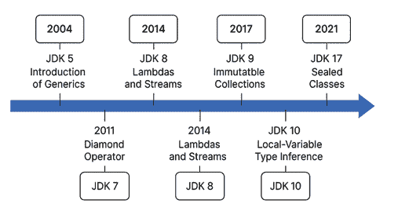

图 12.1：泛型演变时间线

## 集合的未来更新

尽管 Java 集合框架的基础几十年来保持稳健可靠，但现代软件系统的需求变化迅速。云原生开发、高吞吐系统和内存敏感环境都对语言级抽象提出了更高要求。因此，集合框架正在逐渐扩展出符合当前和预期用例的新功能。这些改进旨在使集合更高效、更安全且具表达力，同时保持向后兼容性和熟悉的 API。

以下是未来改进的一些最有前景的方向：

### 值类型（Project Valhalla）

Java 生态中最期待的变化之一是通过 Project Valhalla 引入值类型。这些是轻量级、不可变的数据载体，不会产生对象头开销，并且在内存中的存储更紧凑。

让我们了解值类型将如何改变 Java 集合的内部行为和性能特性：

- 在传统的集合中，存储数千个小对象（如点或坐标）会导致由于频繁的堆内存分配而产生糟糕的内存局部性和性能瓶颈。
- 值类型一旦完全整合，将允许 `List<Point>` 或 `Map<Key, Value>` 等集合更高效地存储数据，甚至可能进行内联存储，从而减少 GC 压力并提高 CPU 缓存利用率。

这对于实时分析、游戏引擎和金融系统等对性能敏感的应用来说尤为重要。

### 模式匹配与结构化解构

Java 正在稳步向更具表达性的控制流和数据访问语法进化。

让我们了解模式匹配和结构化解构的进展将如何影响我们与集合的交互：

- 通过对 `instanceof` 的模式匹配以及即将推出的 `switch` 增强，Java 正在让解构和检查复杂对象变得更容易。
- 随着这些功能的成熟，集合可能会得到增强，允许在迭代期间对元素进行结构化解构，从而实现更简洁、可读性的代码模式。

考虑以下示例：

```java
for (Object obj : list) {
    if (obj instanceof Map.Entry(String key, Integer value)) {
        System.out.println("Key: " + key + ", Value: " + value);
    }
}
```

Java 的未来迭代可能会在集合遍历中更广泛地支持此类模式，消除对冗长类型转换和嵌套方法调用的需求。

### 默认不可变集合

不可变性日益被视为现代软件架构中的最佳实践，特别是在并发和函数式编程模型中。

让我们观察 Java 如何演进，将不可变性作为其集合 API 中的一个一等原则：

- Java 9 中引入的工厂方法（如 `List.of()`、`Set.of()` 和 `Map.of()`）鼓励开发者轻松地创建不可变集合。
- 展望未来，预计 Java 库和 API 将默认采用不可变性，以减少无意副作用的风险并提高可预测性。

在未来，集合的创建模式可能会优先考虑不可变性，除非开发者显式选择使用可变变体。

### 并发集合的增强

并发是当今可扩展系统的关键关注点，Java 的并发集合（如 `ConcurrentHashMap` 和 `CopyOnWriteArrayList`）长期以来一直支持多线程访问。

让我们探索 Java 并发集合预计如何进步以满足现代可扩展系统的需求：

- 未来的改进旨在通过使用无锁算法、细粒度同步控制和低开销原子操作来减少竞争并提高可扩展性。
- 库还可能集成结构化并发，以更安全、更有组织的方式更好地协调集合相关的任务。

这些变化在云原生环境中至关重要，因为容器和微服务在重负载下经常面临并发瓶颈。

### 内存高效型实现

随着 Java 成为微服务、边缘计算和无服务器平台的首选语言，对轻量级且高度优化的数据结构的需求日益增长。

让我们分析内存高效的集合实现如何出现，以支持 Java 在微服务、边缘计算和无服务器平台等资源受限环境中的角色：

- 库正在实验紧凑的 Map 实现、数组的 Set 和压缩存储布局，这些实现提供了显著的内存节省。
- 这些集合未来可能成为标准 `JDK` 的一部分，为开发者提供在不损害功能的情况下最小化资源使用的工具。

预计将看到为受限环境定制的集合，它们对于物联网 (IoT) 设备、移动端应用或运行在限制容器上的后端服务非常理想。

这些增强共同代表了下一代集合框架，它更快速、更智能，并且更符合当代软件工程的挑战。

# Java 开发趋势

现代 Java 开发正快速演进，这受到软件构建、部署和维护方式发生变化的驱动。Java 不再局限于单体应用或企业后端，它现在是云原生生态系统、响应式系统和函数式编程范式的关键参与者。随着语言适应以满足这些需求，开发者使用集合和泛型的方式也正在发生重大变化。

以下是影响开发者如何思考和应用泛型与集合的主要趋势：

## 函数式编程的影响

函数式编程概念在现代 Java 中找到了稳固的立足点，特别是在 Java 8 引入 Lambda 和 `Stream API` 之后。集合不再通过传统的循环和 if-else 逻辑操作，而是通过表达式的操作进行转换。

让我们检查函数式编程如何影响 Java 集合的演进：

- 使用 `map`、`filter`、`reduce` 和 `collect` 使开发者能够编写更简洁的代码。
- 集合现在支持流式处理，以最小的副作用进行处理。
- 这种方法鼓励不可变性并促进了更安全的并发代码。

例如：

```java
List<String> names = List.of("Alice", "Bob", "Charlie", "David");
List<String> shortNames = names.stream()
    .filter(name -> name.length() <= 4)
    .map(String::toUpperCase)
    .collect(Collectors.toList());
```

这种用法代表了开发者处理集合方式的重要转变。

## 响应式编程的采用

响应式编程在现代 Java 开发中日益重要，特别是对于要求高响应、可扩展性和实时数据处理的系统，例如监控仪表板、实时数据和异步处理流水线。

让我们了解响应式编程如何影响现代 Java 应用中集合的使用和设计：

- 响应式编程的核心是非阻塞操作、事件驱动架构以及处理异步流的能力。
- 虽然传统的 Java 集合 API 并不是响应式的，但它们与响应式模式的集成越来越常见。
- 在此类场景下，集合通常被用作中间结构，用于收集、转换和交付通过响应式流接收的批量数据。
- 泛型在确保这些处理流的类型安全和重用性方面起着至关重要的作用。

随着响应式编程继续影响 Java 的方向，预计语言及其 API 的未来版本将引入更多原生抽象以支持非阻塞集合和结构化异步数据处理。

## 对可读性和简单的强调

Java 冗长的口碑正在消失。新的语言增强旨在不牺牲可读性或类型安全而简化代码：

- JDK 10 中 `var` 关键字的引入、JDK 14 中的 record 以及后续版本中的模式匹配，都指向了更具表达力且现代的语法。
- 集合直接从这些变化中受益。初始化或转换它们所需的代码行更少，更简洁。

例如，以下声明允许开发者清晰地表达逻辑，同时仍从编译时类型检查中受益：

```java
var employeeMap = new HashMap<String, List<String>>();
```

- **Records 和密封类使用率的增加**：Java records 和密封类正在重塑开发者设计数据模型的方式。这些特性改进了集合、泛型与业务逻辑的集成：

  - `Records` 为不可变数据持有器提供了紧凑的语法，使其成为 `DTOs`、配置模型和集合元素的理想选择。
  - `Sealed classes` 允许定义受限的类型层次结构，有助于强制领域约束并提高泛型类型安全。

  像 `List<RecordType>` 或 `Map<KeyType, Record>` 等集合正成为需要清晰、可维护且不可变数据结构的 API 中的标准。

  简而言之，这些特性支持了更具声明性、安全且可预测的设计哲学。

- **模块化和云原生设计**：Java 应用现在通常被部署为轻量、容器化的微服务，这些服务必须快速启动、消耗极少内存并能够有效扩展。这种转变导致了在使用集合和泛型时出现了一些新的考量：

  - `Java Platform Module System` (`JPMS`) 鼓励使用仅加载必要内容的模块化代码库。
  - 库和框架倾向于使用不可变集合或原始类型特化的数据结构以减少内存占用。
  - `Concurrent collections` 和线程安全模式现在是许多后端服务的默认选择，确保了在分布式系统中更好的表现。

  集合现在必须是精简、响应迅速的，并且在无状态和多线程环境中是安全的；在这些环境中，即使是微小的低效率在大规模下也会产生巨大影响。

- **与云工具和 DevOps 的集成**：集合和泛型也被大量应用于逻辑之外领域，例如配置处理、遥测、日志和指标聚合：

  - 配置属性（来自 `YAML/JSON` 文件）通常被解析为键值对集合或对象列表。
  - 日志和结构化事件使用 `maps` 和泛型来确保灵活性和模式演进（schema evolution）。
  - 泛型接口使得构建缓存、审计日志和追踪等复用服务变得更加容易。

这些趋势共同反映了 Java 开发者构建代码方式的转变：从命令式到声明式，从可变到不可变，从孤立系统到可扩展的云就绪服务。随着 Java 继续演进，其惯用法也会随之发展，而 `Collections Framework` 和泛型将始终是这一演进的核心。

## 跟上 Java 创新动态

Java 是少数几个具有一致、可预测发布周期的编程语言之一。自 2017 年引入六个月发布周期以来，开发者每年可以期待两次新特性、改进和错误修复。此外，每三年会发布一个长期支持（`LTS`）版本，例如 `JDK 11`、`JDK 17` 以及最近的 `JDK 21`，这使得组织更容易规划稳定的升级。


然而，跟上 Java 的演进不仅仅是阅读发布说明或等待 `LTS` 版本。这门语言由其社区积极塑造，而见多识广的开发者能够更有优势地编写现代、高效且向前兼容的代码。以下是你如何在 Java 开发旅程中保持领先的方法：

### 关注 `JEPs` (`JDK Enhancement Proposals`)

`JEPs`（JDK 增强提案）是定义所提议 Java 特性目标、动机和技术细节的正式文档。它们是跟踪 Java 未来方向最透明、详尽的方式之一：

- `JEPs` 涵盖了从语言特性到 `JVM` 改进以及库更改的所有内容。
- 监控活跃和草案中的 `JEPs` 有助于你预测即将到来的新增并据此调整你的代码库或学习计划。

例如：

- `JEP 401`，`primitive classes`（预览版 `Preview`）：`Project Valhalla` 的一部分，旨在通过引入值类型提高性能。
- `JEP 430`，`string templates`（预览版 `Preview`）：旨在简化动态字符串构建，使代码更具可读性且安全。

你可以在 OpenJDK 官方网站跟踪所有的 `JEPs`：[`openjdk.org/jeps/0`](https://openjdk.org/jeps/0)

### 阅读社区博客并观看会议

Java 社区是编程世界最活跃的社区之一，社区驱动的内容在知识传播中起着至关重要的作用。

社区驱动的学习资源在跟进演进中的 Java 生态系统中至关重要：

- 像 `JavaOne`、`Devoxx`、`Oracle CodeOne` 和 `JNation` 这样的会议提供了实操课程、主题演讲公告以及 Java 背后工程师的讨论。
- 著名的博客（如 `Baeldung`、`InfoQ`、`JetBrains` 和 `Oracle` 的官方博客）拆解了复杂主题，提供了真实的应用用例，并涵盖了仅凭文档可能无法发现的微妙更新。
- 录制的演讲和演示通常会解释为什么存在某个特性以及旨在如何使用它，弥补了理论规范与实际使用之间的差距。

这些内容对于保持前沿以及深入理解新特性如何集成到集合和泛型等现有工具中具有无价价值。

### 尝试预览特性

现代 Java 中的许多特性是以预览特性的形式引入的，允许开发者在最终确定之前进行实验并提供反馈。

尝试预览特性让开发者领先于 Java 语言即将到来的变化：

- 要启用预览特性，请在命令行或 IDE 配置中使用 `--enable-preview` 标记编译并运行代码。

预览特性示例包括：

- 针对 `instanceof` 和 `switch` 的模式匹配
- `Sealed classes`（密封类）
- `Record patterns`（记录模式）

`Preview features`（预览特性）让你尽早访问未来功能，让你能够测试集成策略并确定遗留代码可能需要修订的地方。

尝试这些特性确保了它们在未来版本中稳定时你不会措手不及。

### 使用早期访问构建

`OpenJDK` 项目提供未来 Java 版本的早期访问（`EA`）构建。这些构建包含了最新的特性和修复，让开发者有机会在受控环境中进行探索和验证：

- 这些构建免费下载并定期更新。
- 你可以测试你的库、集合和 API 在新语言特性、JVM 调整或编译器行为下的表现。
- 对于需要提前兼容版本的框架、工具或库的开发者非常理想。

访问 [`jdk.java.net`](https://jdk.java.net) 获取下一个版本的 EA 构建。

### 贡献 OpenJDK

Java 的开发是开放且社区驱动的。如果你热衷于影响 Java 的方向（无论是集合、泛型还是 JVM 优化），贡献 OpenJDK 是最直接的途径：

- 贡献包括测试用例、特性建议、文档编写甚至是补丁。
- 积极参与邮件列表（如 `compiler-dev`、`core-libs-dev` 或 `valhalla-dev`）让你接触到进行中的技术讨论和设计决策。
- 开发者还可以通过参与社区投票、加入工作小组或评审 `JEP` 提案来做出贡献。

成为 `OpenJDK` 社区的一部分有助于你理解 Java 不仅仅是一门语言，更是一个由集体努力塑造的演进平台。

随着 Java 在保持其向后兼容、安全性和平台无关性核心原则的同时不断现代化，我们可以预见到泛型和集合的设计、实现和使用将得到实质改进。对性能、并发和开发者生产力日益增长的需求可能会塑造这些增强。基于当前的趋势、正在进行的 JEP 以及更广泛的生态系统影响，以下是对 Java 泛型和集合框架未来演进的一些有据可循的预测。

### 支持具化泛型

Java 泛型中最常讨论的局限性之一是类型擦除，即泛型类型信息在运行时会被移除。这阻止了如使用 `instanceof` 检查对象的类型参数或创建泛型数组等操作。

具化泛型如何解决 Java 中由类型擦除带来的长期局限：

- Java 的未来版本可能会引入具化泛型，允许在运行时保留完整的类型信息。这将：
  - 允许更安全、更具表现力的反射操作。
  - 消除许多常见场景下对未检查强制转换（unchecked casts）的需求。
  - 促进更健壮的序列化和反序列化机制。
- 这一改进与 `Project Valhalla` 的长期目标一致，该目标旨在引入值类型并改进运行时类型处理。

尽管引入具化泛型在向后兼容方面面临挑战，但逐步集成（可能通过新语法或选择性启用注解）可以提供一条前进之路。

### 原始类型特化集合

目前的泛型集合（如 `List<Integer>`）依赖于原始类型的装箱和拆箱，这会产生性能和内存开销。尽管像 `Trove` 和 `FastUtil` 这样的第三方库解决了这一需求，但 Java 核心库缺乏内置支持。

引入原始类型特化集合如何显著提升 Java 应用程序的性能和效率：

- 引入原始类型特化集合（如 `IntList`、`DoubleMap`）将允许：
  - 通过避免装箱来提高性能。
  - 减少内存占用，特别是在大规模数值或数据处理应用程序中。
  - 在数据科学、机器学习或高频交易系统中进行无缝使用。
- 这些集合可以被构建到 `java.util` 中，扩展标准库的可用性和效率。

`Project Valhalla` 的值类将通过将原始包装类型视为无身份语义的内联类型，使这种增强更可行。

### 更流式的集合 API

Kotlin、Scala 和 JavaScript 等语言提供了简洁且生动的方法来构建、转换和链式集合。Java 正在通过 `Streams` 和 `Collectors` 等功能逐步向这一方向移动。

未来的 Java 版本可能会增强集合 API 以支持：

- 流式构建器（例如 `ListBuilder.add("A").add("B").build()`）
- 在流式上下文之外对集合进行内联过滤、映射和合并。
- 在核心 `java.util` 包中提供直接转换方法（例如 `map.replaceAllKeys(...)`、`list.groupBy(...)`）。

此类 API 将使集合处理变得更具声明性、可读性和可维护性，特别是在处理业务逻辑密集的代码库中。

### 与结构化并发的集成

结构化并发是一种新兴范式，它通过将并发任务视为结构化代码块来简化多线程编程。随着 Java 集成结构化并发（例如通过 `Project Loom`），集合可能会演变为以更原生的方式支持并行、并发工作流。

潜在的增强包括：

- 与轻量级线程（虚拟线程）无缝工作的流式 API。
- 专为并发流优化的线程安全收集器和分区器。
- 与 `ExecutorService`、`ScopedValue` 或结构化任务集成的集合工具。

这些改进将允许开发者高效处理大型数据集或实时流，同时确保安全的资源管理和简单的线程生命周期处理。

### 增强的 IDE 和编译器的泛型支持

随着泛型在现代 Java 应用中变得更具表现力并被广泛使用，开发者工具必须跟上。

编译器和 IDE（如 `IntelliJ IDEA`、`Eclipse` 和 `NetBeans`）的未来改进可能包括：

- 更智能的类型推断：减少显式声明冗长泛型类型的需求。
- 实时重构辅助：使用泛型安全地泛化或特化方法。
- 更强的静态分析：检测不安全的类型转换。
- 代码生成：提供更优雅的泛型使用。

此类工具支持不仅提高了生产力，还减少了对泛型的误用。

### 更加强调不可变性的设计

对不可变性的关注（在 `List.of()` 和 `Set.of()` 中已可见）并将继续。

未来的增强可能会：

- 提供原生支持的不可变类型。
- 鼓励函数式的使用。
- 提供专为函数式管道设计的集合工具。

这些功能与其他语言的趋势一致。

Java 集合和泛型将变得更加强大、丰富。无论是通过采用具化类型、原始类型集合的性能提升，还是无缝集成，演进都是为了让 Java 更健壮、面向未来。

对于开发者来说，这意味着要接受持续学习、实验和适应变化的心态。

## 结论

Java 集合和泛型的未来前景广阔。虽然安全、重用性能的核心原则保持不变，但生态系统正在不断完善以应对现代开发的挑战。保持关注、尝试新功能并采用演进模式的开发者将在未来保持高效。

通过本章，我们结束了探索 Java 集合和泛型的之旅。无论你是学生、后端开发者还是系统架构师，在这里获得的知识都是构建可维护、可扩展且向后兼容的 Java 应用的关键基础。

## 练习题

1. 哪种功能在处理泛型时减少了冗余性？

   1. 菱运算符
   2. 密封类
   3. `var` 关键字
   4. 模式匹配

2. 在现代 Java 中使用哪种方法创建不可变列表？

   1. `new ArrayList<>()`
   2. `List.copyOf()`
   3. `Collections.emptyList()`
   4. `Arrays.asList()`

3. 未来版本可能解决 Java 泛型的什么局限性？

   1. 缺少接口
   2. 不支持继承
   3. 类型擦除
   4. 不支持 Lambda

4. Project Valhalla 关注什么？

   1. 减少语法冗余
   2. 改进 Javadoc
   3. 支持值类型
   4. 升级 HashMap

5. `List.of("A", "B")` 返回什么？

   1. 可变列表
   2. 包含 null 元素的列表
   3. 一个不可变列表
   4. 同步列表

6. 哪种功能允许声明具有特定允许实现类的泛型类？

   1. 流 (Streams)
   2. Lambda 表达式
   3. 密封类 (Sealed classes)
   4. 函数式接口 (Functional interfaces)

7. 哪种集合类型有助于并发读写？

   1. `HashMap`
   2. `LinkedList`
   3. `ConcurrentHashMap`
   4. `TreeMap`

8. 哪种语言特性简化了只读集合视图创建？

   1. `Optional`
   2. `switch-case`
   3. `Collections.unmodifiableList()`
   4. `List.addAll()`

9. `flatMap()` 有什么帮助？

   1. 排序集合
   2. 创建嵌套结构
   3. 展平嵌套流
   4. 跳过元素

10. 在 Java 中使用 records 的主要目的是？

    1. 编写可变数据容器
    2. 定义行为丰富的类
    3. 通过不可变性简化数据容器
    4. 仅提高运行时性能

### 答案

1. c

   解释：JDK 10 引入的 `var` 关键字开启了局部变量类型推断。它允许开发者在声明变量时不重复泛型类型，从而在保持类型安全的同时减少冗余代码。

2. b

   解释：`List.copyOf()` 创建提供列表的不可修改副本。当你需要一个包含实际元素的不可变列表时，这比 `Collections.emptyList()` 或 `Arrays.asList()` 好。如果输入列表包含 null，将抛出异常。

3. c

   解释：Java 泛型使用类型擦除，这会在运行时移除泛型类型信息。这防止了某些操作，例如使用 `instanceof` 检查实际类型参数。未来的增强可能会通过具体泛型（reified generics）解决这一限制。

4. c

   解释：Valhalla 项目旨在引入值类型（也称为内联类），优化内存和 CPU 使用。这些类型在集合中特别有用，减少了与对象引用和装箱相关的开销。

5. c

   解释：像 `List.of()` 这样的工厂方法返回不可变集合。任何添加或删除元素的尝试将导致 `UnsupportedOperationException`。

6. c

   解释：JDK 17 引入的密封类允许你控制哪些类或接口可以扩展或实现某个类型。与泛型结合时，这有助于强制严格的类型层次结构和受控的多态性。

7. c

   解释：`ConcurrentHashMap` 为并发访问和修改设计。它使用细粒度锁（或无锁机制）在不牺牲性能的情况下确保线程安全，是多线程应用程序的理想选择。

8. c

   解释：`Collections.unmodifiableList()` 创建给定列表的只读视图。尝试修改它将导致运行时异常，适用于防御性编程和 API 安全性。

9. c

   解释：`flatMap()` 函数用于展平嵌套结构——特别是在处理列表的流时。它将每个元素转换为流，然后将其展平为单个流，使处理复杂数据变得更加容易。

10. c

    解释：Java 中的 records 为不可变数据容器提供了简洁的语法。它们自动生成构造函数、getter 方法和 `toString()` 方法，减少了样板代码并促进了基于值的设计。

## 加入我们的 Discord 空间

加入我们的 Discord 工作空间获取最新更新、优惠、全球科技动态、新发布以及与作者的交流：

[`discord.bpbonline.com`](https://discord.bpbonline.com)


# 索引

### A

应用程序编程接口 (APIs) 1

Array Deque (`ArrayDeque`) 162

特性 162

构造函数 165

实现 162

内部结构 162-165

用例 165, 166

ArrayList 实现 86-89

自定义实现 91, 92

性能考量 89-91

Arrays 和 Collections 类 184

数组，转换为列表 185

集合方法，在数组上使用 185

Arrays 工具类 182

数组，填充 183

数组，比较 184

数组，复制 184

数组，搜索 183

数组，排序 183

### B

BlockingDeque 170

BlockingQueue 170

边界类型 19

示例 27-33

下界 21-23

参数 27

上界 20, 21

### C

案例研究 216-227

检查集合 106, 192, 193

用处 106

集合接口 61, 62

关键方法 62-65

未来 248-251

未来更新 241-243

性能考量 206, 207

基于集合的 API 204-206

Collections 类 176

关键方法 65-69

List，反转 177

List，排序 177

集合层次结构 60, 61

集合，使用 Collections 工具修改 180

所有出现的值，替换 181, 182

元素，洗牌 181

list，复制到另一个 182

list，填充值 181

list，反转 180, 181

并发集合 169

### D

Deque 接口 160

方法 160

真实世界场景 160

作为 Queue 和 Stack 使用 161, 162

### E

增强 for 循环 71, 72

### F

关注 JEP (JDK 增强提案) 246

### G

泛型算法使用 209, 210

泛型类定义 11, 12

泛型方法使用 12, 13

泛型 2

背景 2

基本语法 6

用处 3-6

最佳实践 50-52

常见陷阱 50-52

避免常见陷阱 200-203

未来 248-251

最新进展 238-241

带构造函数 13

泛型，应用于 `List<T>` 39-41

泛型列表中的通配符 41-44

泛型，应用于 `Map<K,V>` 46, 47

泛型映射中的通配符 47-50

泛型，应用于 `Set<T>` 44

泛型集合中的通配符 44-46

### H

HashMap 114

特性 114

构造函数 118

内部结构 114-118

`HashSet` 137

构造函数 138

实现 137

内部结构 137, 138

`Hashtable` 实现 125

构造函数 125, 126

内部工作原理 125

### I

`Iterable` 接口 70

`Iterator` 接口 70, 71

迭代器 70

### J

`Java` 246

增强型 for 循环 71, 72

创新 246-248

### Java 8

增强，针对 `Set` 接口 145

## Java 集合框架 (JCF)

60

集合接口 61, 62

集合层级结构 60, 61

高效使用 203, 204

嵌套类 72

概述 38, 39

## Java 开发工具包 5 (JDK 5)

2


# Java 开发工具包 (JDK)

- 59

# Java 平台模块系统 (JPMS)

- 245

# Java 虚拟机 (JVM)

- 39
- 即时编译器 (JIT 编译器) 39

# L

## Lambdas

- 用于迭代的使用 72

## `LinkedHashMap` 实现

- 118, 119
- 构造函数 120
- 内部结构 119, 120

## `LinkedHashSet`

- 138
- 构造函数 140, 141
- 实现 138, 139
- 内部结构 139, 140

## 作为 `Queue` 的 `LinkedList`

- 167
- 特性 168
- 使用 168

## `LinkedList` 实现

- 92, 93

### 自定义 `LinkedList` 实现

- 97-100
- 内部结构 93, 96
- 性能考虑 96, 97

- 使用自定义比较器进行二分查找 180
- 反转 177
- 搜索 178, 179
- 排序 177, 178
- 使用自定义比较器排序 179
- 使用自然顺序排序 178

## `List` 接口

- 84
- 特性 84

## 长期支持 (LTS)

- 246

## 下界符

- 21-23
- 对比上界符 24

# M

## `Map` 接口

- 111-113
- 比较 127
- 泛型算法 130, 131
- 性能考虑 128
- 同步 129, 130
- 用例 129

# N

## 集合中的嵌套类

- 检查集合 75
- 空集合 72, 73
- 不变集合 75, 76
- 单例集合 73
- 同步集合 74

# P

## 参数化类型

- 定义 6
- 实际示例 227-230
- 定义空集合 190-192

## `PriorityQueue`

- 156
- 特性 156
- 实现 156
- 内部结构 156-159
- 问题解决 232
- 生产者 extends，消费者 super (PECS) 原则 24

# Q

## `queue`

- 166
- 实现 166, 167
- 滑动窗口或固定缓冲区 167

## `Queue` 接口

- 154
- 特性 154-156
- 实现 154
- 方法 155

# R

## 现实场景

- 最佳实践 232, 233

# S

## `Set` 接口

- 135-137
- 泛型算法 147, 148
- 性能考虑 146, 147
- 同步 146, 147

## `Stack`

- 166
- 实现 166
- 最佳实践 208, 209

## 在队列和双队列中

- 169

## 列表中的同步

- 103, 104
- `Collections.synchronizedList()` 103, 104
- `ArrayList` 104

## 同步工具

- 187, 188

## 同步 `Set` 和 `Map`

- 188

## 同步集合

- 170

## 泛型语法

- 9, 10

## 泛型方法

- 8

## 泛型概述

- 6

## 通配符

- 10

# T

## `TreeMap` 实现

- 120
- 特性 121
- 泛型方法 124
- 构造函数 124
- 泛型类型 121, 123

## `TreeSet`

- 141
- 特性 141
- 泛型方法 143, 144
- 构造函数 143
- 元素要求 142, 143
- 实现 141
- 内部结构 141, 142

## 趋势

- 243-246

## 类型擦除

- 53
- 影响 54, 55
- 泛型中的 53, 54

## 类型安全代码

- 使用泛型编写 198-200

# U

## 不变集合

- 105, 189, 190

## 上界符

- 20
- 益处 21
- 对比下界符 24

## 用例模式

- 231, 232

## 工具类

- 175, 176

# V

## `Vector` 实现

- 100, 101

# W

## 通配符

- 24
- 最佳实践 26, 27
- 下界通配符 25, 26
- 无界通配符 25
- 上界通配符 25

## 包装类

- 77-80
- 77
