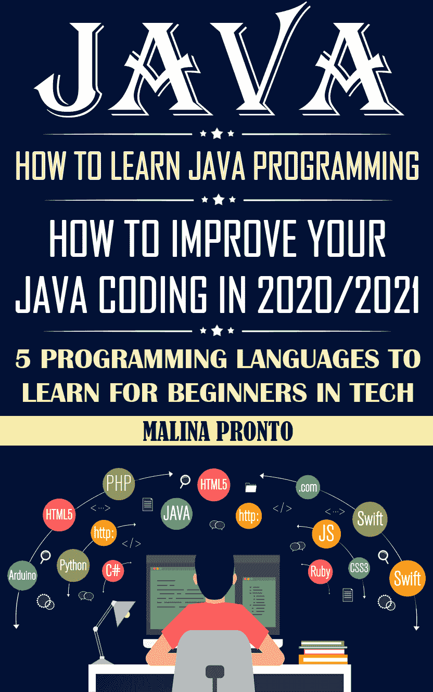

# Java：如何学习 Java 编程：2020/2021 如何提升你的 Java 代码能力：技术小白必学的 5 种编程语言

学习编程可能是最近非常流行的新技能。它的需求如此巨大，以至于高中都将编程加入了课程中。编程（Programming）和编码（Coding）经常通用使用，但两者是不同的，你将在在这里对它们进行分析。随着每一项任务的数字化，并随着 AI 技术变得智能化和自动化，学习编码已成为时代的必然。

你所能想象的一切事情通常都是通过应用程序或网站完成的，从叫车、点外卖或在线购物，到看电影、甚至参加课程和玩游戏。随着应用程序的数字化，对开发者和程序员的需求也随之增加，因此学习一种编程语言将是有益的。本文讨论了如何学习你选择的编程语言，从而开启你编程之旅的正确方式。那么，让我们开始吧！

## 如何学习编码

在继续阅读之前，让我提醒你，你选择选择了一条需要耐心和动力的道路，尽管途中充满挑战，绝不能放弃。请阅读并遵循以下步骤来成为一名程序员。

### 学习编程基础

第一也是最重要的一步骤是确定要学习的语言。建议从 `Python` 开始，因为它像英语一样直观，你可以很容易找到许多最简单的 `Python` 教程并上手。但你应该选择一个你感兴趣、并且支持你未来真正想开发的项目的语言。

所以，如果你打算开发移动应用，你可能想从 Android 的 `Java` 或 `Kotlin` 以及 iOS 的 `Swift` 开始；如果你想创建一个网站，通常建议先从 `JavaScript` 开始。对于数据科学、AI 和机器学习领域的职业，`Python` 和 `R` 是值得研究的语言。

你可能通过以下两种方式之一了解这些语言：

1. **通过交互式网站**：推荐使用 `Codecademy` 和 `Freecodecamp` 等网站进行交互式编码。这些网站的设计理念是考虑到许多初学者在开始学习编码时会被配置环境所困住。这些网站提供了在线文本编辑器和编译器，让你立即开始编码。

2. **通过视频教程**：如果你是一个喜欢在步骤指导下进行深度学习的个人，我们建议你参加任何在线编程教程，它们会教你从零开始安装并下载指定的 IDE，学习语言的基本概念，最后通过一个顶石项目来检查你的编码技能。一些教程和课程还提供证书，这在你以后寻找工作时会很有帮助。我们推荐 `Pluralsight` 和 `Lynda` 来搜索热门语言的初级教程。你还想去 `Hackr.io` 查看一些高评分的教程。

#### 专注于学习编程基础

总是建议建立坚实的基础，以便成为一名专业的程序员。彻底学习基础知识，通过创建并解决自己的问题来检查你的实际代码。重点关注以下开始学习的主题，因为它们在大多数语言中都是通用的：

* `Data Types`（数据类型）
* `Variables`（变量）
* `Functions`（函数）
* `Array` 数组或 `Lists`
* `If statements`（条件语句）
* `Conditional loops`（条件循环）
* `Classes` 和 `objects`（类与对象）
* `Exception handling`（异常处理）
* `Trees`（树）、`maps`（映射）等。

#### 构建你的第一个项目

构建个人项目是分析和学习你所学知识的最好方法。构建一个你选择的项目将为你提供该语言的详细实践学习经验，因为你会遇到之前学过的概念的实现，并发现如何部署该项目供你和他人使用。此外，当你构建项目时，将它们添加到你的个人资料或 `GitHub` 账户中，这可以在以后寻找开发工作时为你提供帮助。

在这个阶段出现的最大问题是：**我应该如何选择项目？** 这是大多数人在决策阶段停滞不前的地方——即该构建什么？答案很简单。

1. **选择你感兴趣的**：无论是涉及学习还是编码，你首要想做的是你感兴趣的事情。你要喜欢所选的项目领域，这样你才能被它吸引，并保持投入直到完成。如果你选择了一个你不感兴趣的东西，你会发现自己中途放弃了项目，因为你最终可能会对它失去兴趣。所以要选一个能让你投入其中的东西，比如如果你喜欢玩游戏，你可能只想开发一个你自己喜欢的电脑游戏。同样，如果你喜欢摄影，你可能想创建一个展示你作品的作品集网站；如果你对交易感到好奇，你可能会设计一个应用或网站来研究股票图表。在开始创建之前，分析并提供你想要的想法。

2. **从简单的东西开始**：对自己的能力充满信心是很棒的，但过度自信不是。因此，建议你在深入研究复杂项目之前，先从简单直观的项目开始，以更多地探索语言。例如，如果你选择创建一个电脑游戏，不要直接开始制作像《英雄联盟》那样复杂的电脑游戏，而是从像“井字棋”（tic-tac-toe）这样的游戏开始；或者如果你想创建一个网站，不要从构建像 `Amazon` 或 `Facebook` 那样的开始，而是选择一个简单一点的比如待办事项。

3. **构建对你自己及社区有用的东西**：要有创新精神，构建对你以及对社区有用的东西。构建社区感兴趣的项目将让你的项目获得一些下载量或观众，通过这种方式，你在寻找工作时会有东西可以展示，并比其他竞争者更有优势。

#### 一些启动的想法

如果你对从哪里开始感到困惑，我们提供了一些可以帮助你开始项目构建的想法。你可以从一个像待办列表这样简单的网站开始；如果你想制作一个游戏应用，那么像 `俄罗斯方块`、`数独` 以及 `Flappy Bird` 这样的游戏都是学习编程的好选择。如果你想要一些有挑战性的东西，你可能会考虑构建一个几乎像 `Twitter` 的网站，但功能没有 `Twitter` 那么多，只需具备推文和关注的基本功能即可。`Hacker` 为你提供了许多从初级到高级的语言项目想法。

### 学会正确 Google 错误

这是一个你必须掌握的重要步骤。搜索和浏览你代码中的错误可以帮助你在瞬间纠正代码；但反过来，如果你不擅长这项，可能就像在没有地图的情况下跳入代码的漩涡。我想在这里与你分享的小技巧是：在 Google 上搜索之前，将你的编译器生成的错误加上双引号（`“ ”`）。这样，Google 就会针对性地定位错误，因为相同的句子会提供更准确的过滤结果。

### 引导你的热门网站

像 `Stack Overflow` 和 `Reddit` 等网站在这里位列前茅，通过它们的代码指导全球的开发者。这是一个由来自各个领域的开发者组成的完整社区，他们聚在一起为彼此的项目提供帮助。在这里发布你的疑问可能需要 2-3 周才能得到回复，但这是值得的，尽管你可能已经自己找到了你错误的答案，因为我们中的许多人可能都遇到过类似的错误。还建议你只需回答一些你能回答的问题来帮助他人，这样你也能从中学习。

### 活动与聚会

这一步刚开始可能会很困难，因为它需要你克服害羞心理，但相信我，一旦你开始，你就会享受。所以，从尝试寻找与你有相似兴趣的人开始，并理解甚至与他们一起工作。你可以尝试查看你 Facebook 活动页面上的某些“编码活动”，或访问 meetup 网站并建立联系以获取更多信息。

#### 寻找工作或实习

最后，许多人学习编程语言是为了完成开发工作。因此，一旦你足够自信，或者相信你已经掌握了一些基础编程知识，你就会想通过从实习开始进入开发行业。在你感兴趣的项目期间开始担任有薪或无薪实习生，否则你甚至可以协助或与经验丰富的开发者一起来来。作为实习生给了你发现和增强技能的机会，有时甚至获得报酬。尽管你没有痛苦，但你获得了一个在行业内建立网络的机会，供未来参考和安置。你可以通过以下方式开始寻找实习：

- **LinkedIn**：它是最受信赖的来源，可以接触良好的受众，并可能帮助你找到感兴趣的广泛实习。
- **招聘会**：这些非常有帮助，因为你有机会与招聘人员面对面，从而讨论你的兴趣并分析项目是否也吸引你。
- **人脉关系**：这通常是获得实习的最推荐方式，因为你通过别人的推荐进入就业，注定比其他候选人更有优势，因为如果他们公司的人推荐了你，他们倾向于很容易信任你。你将通过参加上述的活动和聚会建立你的人脉网络。

#### 计算机科学学位或训练营

哪种方法有助于学习编程？对于那些开始学习代码的人来说，通过在学习课程期间加入 `Bootcamp` 来复习可能是一个常见问题。对于目前的问题没有特定的答案，因为它完全取决于个人以及他们的学习能力。为了进一步指导你，如果你是一个尚未进入研究生阶段的高中生，且编程是你想要从事的职业，那么你想要获得计算机学位；但如果计算和编码是你职业生涯后期才感兴趣的事情，那么你可能想在学习选择的编程语言期间参加 `Bootcamp`。然而，建议你自己在花费昂贵的 `Bootcamp` 之前，先从一个付费或免费的网页课程开始，先体验一下编码的氛围。

## 如何在 2020/2021 年提高你的 Java 代码水平

如果你是一个 `Java` 开发者，过去几年的技能进步为 Java 世界带来了变化。

众所周知，`Java` 可能是一种非常成功且流行的编程语言。它被广泛用于构建日常生活中使用的应用，从桌面应用到 Web 应用、科学超级计算机、游戏机、手机，并到互联网。`Java` 程序员目前主要在信息技术领域被招募，在那里，`Java` 几乎被应用于每一个角落。因此，`Java` 已成为任何人可以立即进入的增长最快、最有前景的领域之一。但 `Java` 的初学者（即使是经验丰富的开发者）一直会有这个挥之不去的问题：“我该如何提高我的 `Java` 技能？”使用 `Java` 解决现实世界的问题并不是容易的，许多初学者觉得这很难。在世界上实际应用你的知识之前，研究并理解 Java 概念是关键的。

### 为什么 Java 流行？

有几个原因导致 `Java` 在各种编程语言中很流行：

- `Java` 易于理解，它的语法用最少的字符实现，它运行在适当的服务器上，这可能是 AI 和 ML 项目的强制性特性。
- `Java` 的跨平台特性允许你为多个竞争平台开发软件。
- 你可以轻松地学习并做出有效的解决方案，因为在优秀的 Java 社区中，总有人可以帮助你。
- 有许多免费的教程可以学习 Java，这让学习变得更容易。从机器学习解决方案、神经网络到遗传编程和多机器人系统，`Java` 是那门可以实现所有这些内容的编程语言。

### 增强编码技能的顶级技巧

如果你尝试提高自己的技能，我们将为你分享一些顶级技巧。让我们循序渐进看看你如何提高技能：

#### 1. 掌握基础知识

第一步是明确你的基础，以建立稳健的基础。这涉及到寻求并深入理解数据结构、算法、面向对象原则和设计模式。理解面向对象原则并理解与现实相关的概念。如果你发现提高自己很困难，找一个诚实的来源参加培训课程来加强基础并提高你的技能。记住，要理解概念而不是死记硬背。

初学者应该学习的一些 Java 基础包括：

- `Java 8`
- `Spring 框架 (Spring Boot)`
- 单元测试
- `API 和 库`
- `JVM 内部`
- 设计模式
- `DevOps 工具`
- `Kotlin`

#### 2. 学习 OO（面向对象）原则

下一步是加强对面向对象原则的理解。面向对象设计原则如 `抽象`、`封装`、`多态` 和 `继承` 在 Java 中非常重要。学习基础并将这些设计原则应用于你的代码中。确保设计原则或模式有现实案例。

参考 `Apache` 的开放 ASCII 文本文件并搜索一些关于 OOP 设计原则的良好资源。

#### 3. 阅读书籍和博客保持更新

书籍可以为你提供坚实的知识，无论你是初学者还是复杂的开发者。你将学习从概念到现实对象的所有内容。

像 `Joshua Bloch`（Google 前首席 Java 架构师）编写的优秀书籍，将为你提供真实世界的示例以及对于设计良好的程序的实用、权威指南。除了书籍之外，还要阅读与 Java 相关的文档和博客。通过加入良好的论坛并订阅优质的文章和时事，保持关注 Java 世界的动态。此外，请记住，全球有成千上万的人正在从事 Java 编程和其他相关技术。博客是分享这些信息最简单、最方便的方式。阅读程序员编写的博客和文章、他们的观点和作品，以保持信息灵通并跟上行业脉搏。

#### 4. 练习、练习、再练习编码

你学到的知识必须付诸实践。你想实现你所学的内容。练习编程，设定目标并按时完成。寻找项目并开始执行它们，以增强你的编码能力并成为一名严谨的程序员。一旦你尝试自己编码，就能轻松地识别并从错误中学习。起初，你可能会在设计、错误处理和多线程等方面出错，例如。了解更多错误，从中学习，然后不断提高你的技能。开发 Java 技能的关键在于编码、编码、再编码。

#### 5. 进行代码审查

增强 Java 技能的另一种方法是尝试代码审查。代码审查可以提高你对编程语言的理解。它不仅有助于学习者，也对审查者大有益。正如你所知，最好的学习方式是教学。从审查者那里获得真实的建议并从错误中学习。通过代码审查，你将学习语言特性、项目设计的变化、编码标准以及许多其他内容。这是程序员用来发现并互相教学的有效技术。代码审查和单元测试是帮助初学者更快从其他程序员那里学习的实践。单元测试本质上是一种软件测试方法，通过对单个代码单元进行测试来评估它们是否适合使用。使用这两个过程，你将轻松地在复杂的应用程序部分发现错误，这样做不仅由于测试集中在每个单元而增强了程序的整体运行能力，还提升了你自己的 Java 技能。

#### 6. 持续提高你的技能

对于核心 Java 开发者和 Java Web 开发者，某些技能同样有用。学习以下内容以提升你的技能：

- `Java 8`
- `Spring 框架 (Spring Boot)`
- 单元测试
- `API 和库`
- `JVM 内部原理`
- 设计模式
- `DevOps 工具`

#### 7. 保持耐心与投入

最后但同样重要的是，为自己的自我提升制定计划。不要动摇或拖延。

在 Java 和通常生活中，你需要投入和耐心才能实现目标。要掌握任何技能，你都需要良好的实践和耐心。只要你不断为之努力并耐心地培养你的技能发展，你就会成为一名严谨的 Java 程序员。因此，请遵循上述建议并开始构建你的技能，成为一名优秀的 Java 开发者。确定你必须努力的领域并投入其中。不要只局限于理论数据，而要开始通过现实项目进行实验。

## 技术初学者需要学习的 5 种编程语言

每个人都有起点。这是关于编程和软件开发需要记住的首要点，特别是当你只是学习一门（或两种）替代语言且事情看起来有点令人生畏时（什么是框架？）。如果你是技术和/或编程的新手，海量的语言可能会让你感到无所适从——该从哪里开始呢？幸运的是，世界上最热门的语言用途广泛，只需学习其中一或两种就能为你带来广阔的机会。以下是你开始探索时的一些建议：

### Python

此时，`Python` 似乎已经不可阻挡。尽管受到许多开发者青睐，被认为是一种强大的“通才”语言，但 `Python` 正在进入许多高度专业化的领域，包括数据科学和机器学习。因此，这种语言几乎无处不在（这就是为什么它经常在各种流行编程语言排行榜中名列前茅），这表明学习它可以开启各种酷炫的工作和项目。此外，许多开发者认为它很容易上手。Pixolution 的首席技术官 Sebastian Lutter 最近告诉 Dice：“`Python` 是初学者最完美的第一门编程语言。”它提供了一种透明且可读的语法，使其易于掌握编程基础，并允许你快速专注于为自己的问题创建解决方案。”

正如你可能预期的，由于它的流行程度，网上有大量的 `Python` 相关学习材料。例如，`Python.org` 提供了一份实用的编程和 `Python` 初学者指南。微软推出了一个名为“面向初学者的 Python”的视频系列，包含数十节课程（大部分在五分钟以内；没有超过 13 分钟）。

### Java

`Java` 是一种在各种语境下使用的非常流行的语言，具有“一次编写，随处运行”（WORA）的卓越特性，这意味着它可以在任何带有 Java 虚拟机 (`JVM`) 的设备上运行。幸运的是，网上到处都有大量的 `Java` 资源。例如，InfoWorld 在其专用的 `Java` 页面上非常详细地介绍了该语言的更新。如果你试图从专家社区寻求帮助，Oracle 维护了一个论坛，你可以在那里提问并查看其他操作，同时也作为一个教程网站。当然，还有一个针对需要 `Java` 帮助和教程的 subreddit。

一旦你掌握了语言的许多基础知识，你将想在一些问题上测试你的技能，这时，`HackerRank` 可以提供支持。

### Kotlin

虽然与 `Java` 和 `Python` 等语言相比，使用 `Kotlin` 的开发者较少，但 `Kotlin` 正在迅速普及，尤其是由于 Google 将其命名为 Android 开发的一线语言。Google 非常致力于让 `Kotlin` 成为一种广受欢迎的语言，以至于他们现在提供了一门名为 `Android Basics in Kotlin` 的网络课程，这是初学者的绝佳起点。此外还有 Google 托管的额外课程，包括 `Kotlin Bootcamp for Programmers`、`Android Kotlin Fundamentals`，以及针对那些经验较丰富的人士的 `Advanced Android in Kotlin`。虽然大多数 `Kotlin` 开发者使用该语言创建移动应用，但它也越来越多地用于 Web 后端项目、桌面应用甚至物联网 (IoT) 项目。换句话说，即使你对构建 Android 应用不感兴趣，它也值得一看。

### Swift

起初，在 Apple 软件生态系统中活跃的开发者只有 `Objective-C` 一种语言可以编程。在三十年之后，Apple 内部的一些开发者认为是时候尝试新事物了。2014 年，他们辛勤工作的结晶 `Swift` 问世，并在随后的几年里迅速获得了许多特性（并解决了一些棘手的问题）。最新版本的 `Swift` 提供了更高的模块稳定性和稳定的二进制接口，提升了该语言的灵活性。如果你对为 iOS、iPadOS、macOS、watchOS 以及 Apple 在未来几年可能优先首发的任何设备构建应用（*咳* 增强现实操作系统 *咳*）有兴趣，那么理解它是至关重要的。如果你正在从事任何与移动应用和服务交叉的业务，iOS 的知识也非常重要。如果你正在学习 `Swift`，请务必理解函数、循环、集合、数组和字符串，以及结构体（`structs`）和类（`classes`）。`Swift Playgrounds` 虽然表面上针对儿童，但对所有年龄段的 `Swift` 初学者都大有裨益。

### JavaScript

如果你对构建任何与 Web 相关的内容（无论是 Web 应用还是网站）感兴趣，那么你必须变得尽可能地精通 `JavaScript`，因为该语言处理了 Web 大部分的底层功能（学习 `HTML` 和 `CSS` 同样重要，但那是另一个故事了）。想要开始学习 `JavaScript` 的人应该看看时尚的 `JavaScript Tutorial`，该教程将语言的各个方面划分为独立的模块。`Full Stack Academy` 也提供了免费课程的细分。一旦你熟练了语言的基础知识，就应该开始探索框架，这可以简化这种偶尔让人繁琐的语言的工作流。

此外，如果你正在学习 `JavaScript`，非常值得花时间尽可能地了解 `TypeScript`，它是 `JavaScript` 的超集，刚刚发布了 `4.0` 版本。无论你认为 `TypeScript` 是否是一门独立的编程语言（许多流行的编程语言排名倾向于认为如此），不可否认，`TypeScript` 提供的增强将加速你的 JavaScript 编程。（对于初学者来说，`TypeScript` 将你编写的任何代码编译为 `JavaScript`。）根据 2020 年 Stack Overflow 开发者调查，约 67.1% 的受访开发者表示他们喜欢 `TypeScript`，仅次于 `Python` (66.7%) 和 `Kotlin` (62.9%)。这是一个让你尝试它的它的有力动力。

## 初级 Python 课程

有很多初级 Python 课程可以选择，那么如何知道哪些值得投入呢？在筛选选项时，请搜索以下特征：

### 1. 提供基础知识

Python 可能是一门复杂的编程语言，在深入更高级的内容之前，你需要一门传达基础知识的课程。这有助于消除困惑。

### 2. 补充资源

包含额外资源的初级 Python 类是理想的。你将评估自己对内容的理解程度，并在整个教学过程中实施所学的技能。寻找带有阅读材料、测验、活动、项目或所有者混合的课程。

### 3. 自学进度

避免那些设定严格截止日的课程。至关重要的是，要按照自己舒适的节奏学习，并让你能够完全掌握课程中所教的内容。

## 我们的精选

我们在 Udemy 上整理了一份最简单的初级 Python 课程清单。我们的精选来自顶级的远程学习提供商，包括 `Coursera`、`edX`、`LinkedIn Learning`、`Team TreeHouse` 和 `Udemy`。每个选择都有简介和价格范围，帮助你做出明智决策。

## 初级 Python 课程

无论你是追求需要使用 `Python` 的职业，还是处于入门岗位，这些入门课程都值得考虑。

### 1. Python Programming Made Easy: A Concise Python Course 由 Udemy 提供

**适用人群：** 初学者以及需要复习 Python 的个人  **价格：** 促销中

这门来自 Udemy 的高评分课程以趣味的方式教授 `Python`。它由经验丰富的软件开发 Cher Hin Chong 引导，他通过深入的视频演示来展示课程中的关键概念。注册费用包括 20 节视频课程，涵盖了 `Python` 安装、变量、数据类型、字符串操作、类型转换、排序等内容。在完成课程后，你还将获得一张完成证书。

### 2. Python 3 schedule — Build 5 Network Applications 由 Udemy 提供

**适用人群：** 想要了解 `Python 3` 的新程序员

这本 Udemy 畅销书由 `PythonTutorial IO` 提供，面向想要了解 `Python 3` 的新程序员。它涵盖了 5 个网络应用：

- 通过 `SSH` 读取/写入设备配置
- 构建一个交互式子网计算器
- 提取网络参数并构建图表
- 构建基础网络包捕获器
- 配置文件管理和电子邮件通知

现在注册即可解锁 11 小时的视频课程。你还将获得文章和资源来辅助学习。讲师 Mihai Catalin Teodosiu 是一位经验丰富的 Python 开发者。在课程之前，具备 `CLI`、`OSI 层`、`SSH2`、`TCP/IP` 和 `Telnet` 等网络概念的基础知识将帮助。

### 3. Python 3 Masterclass — Make Your Job Tasks Easier! 由 Udemy 提供

**适用人群：** 入门数据输入员、开发者、工程师、信息技术和内部控制人员

这本 Udemy 畅销书面向想要提高技能的入门数据输入员、开发者、工程师、信息技术和内部控制人员。你将发现如何高效使用 `Python` 并为职业增长做好准备。`Python 3 Masterclass — Make Your Job Tasks Easier!` 从零开始教授所有基础。教学涵盖的概念包括字符串、数字、布尔值、集合、元组、字典、循环、条件、异常等等。如果这门课程看起来适合你，现在注册即可获得终身访问权限，包含 16 小时的录制视频。你还将获得 156 篇文章、43 份下载资源和 50 个代码练习。该课程还由 Mihai Teodosiu 主授。

### 4. Python Programming: A Concise Introduction 由 Wesleyan University 提供

**适用人群：** 几乎没有编程经验的初学者  **价格：** 免费

该课程由 Wesleyan University 提供，互动式地介绍了 `Python 版本 3.x` 编程。它最适合几乎没有编程经验的初学者。

Python Programming: A Concise Introduction 包含 4 个模块：

- Python 编程
- 使用列表和导入库 — 随机库
- 元组、数据字典、文本和 CSV 文件
- 函数值、排序、格式化、统计以及菜单驱动的数据库程序

每个模块都包含视频课程、阅读材料和测试，旨在帮助你从课程中获得最大。预计需要花费 14 小时完成整个课程。讲师 Bill Boyd 可能是定量化学分析中心的访问教授和访问学者。

### 5. Google 提供的 Python 速成课程

**适用人群：** 无编程经验的学生

**价格：** 免费

想学习 Python 但总是四处忙碌？看这门入门课程就对了。它是“Google Python 自动化 IT 运维专业证书”计划中的核心课程。

Python 速成课程分为 5 个核心组成部分：

- Hello Python!
- Python 基础语法
- 循环
- 字符串、列表和字典
- 面对象编程

课程还有一个终极项目，允许你在模拟环境中应用所学知识。在学习教学内容的过程中，你将完成一系列阅读材料和测试。你应该能在 25 小时内完成这门课程。

### 6. 莱斯大学提供的 Python 编程基础课程

**适用人群：** 刚接触 `Python` 的个人

**价格：** 免费

该课程由莱斯大学提供，“Python 编程基础”深入探讨了通过 Python 构建程序以及编程的其他关键元素。它是“Python 脚本入门”专业课程中的主要课程。课程分为 4 类：

- 将 Python 用作计算器
- 函数
- 逻辑与条件
- Python 模块

课程材料通过一系列视频、阅读材料和测试交付，完成需要 12 小时。

协调人 Scott Rixner 和 Joe Warren 是计算机科学教授。获取这门课程。

### 7. Team Treehouse 提供的 Python 基础课程

**适用人群：** 几乎或完全没有 `Python` 经验的个人

**价格：** 包含在月度会员中

在不到 4 小时的时间内，这门来自 Treehouse 的入门课程将教你 Python 的构建基块。它涵盖了条件分支、异常处理、输入与输出、循环和其他基础编程概念。“Python 基础”由开发者 Craig Dennis 带领，并将课程分为 4 个部分：

- 认识 Python
- 类型与分支
- 函数与循环
- 大功就绪

每个部分都细分为几个微小且易于吸收的步骤。你跟随教学内容应该不会遇到困难。如果你有 Treehouse 月度会员，可以免费注册；否则，你可以通过免费 7 天试用尝试该课程。获取这门课程。

### 8. LinkedIn Learning 提供的 Python 学习

**适用人群：** 新手开发者以及需要复习的资深开发者

**价格：** $44.99 或包含在月度会员中

这门入门课程由 Google 开发者关系经理兼战略合作伙伴 Joe Marini 主持，最适合新接触 `Python` 的人。如果你是资深开发者并希望对基础知识进行快速速成，你也会发现这门课程很有用。“学习 Python”耗时略超过 2 小时，由以下模块组成：

- 入门
- Python 基础
- 处理日期和时间
- 处理文件
- 处理网络数据

注册包含在 29.99 美元的 LinkedIn 月度会员中，否则你需要支付 44.99 美元的固定费用。

### 9. 微软提供的 Python 入门：绝对初学者

**适用人群：** 刚接触 `Python` 的个人

**价格：** 免费

通过微软的这门入门课程，你将以最快的速度学习 `Python` 的机制。你还将发现如何在短短 5 周内学会编码。“Python 入门：绝对初学者”由高级内容开发人员 Eric Camplin 。它深入探讨了带有参数和返回值的可重用函数、使用条件语句和循环进行决策和重复，以及收集输入和处理输入/输出的方法。你还将发现如何在 `Jupyter` 笔记本中使用 `Python` 并排查代码错误。

你将获得编写采用条件逻辑并为用户提供响应的程序的知识和技能。MALINA PRONTO
