# Java 程序设计：早期对象


# 学生的数字资源

您的新教材提供了为期 12 个月的数字资源访问权限，这些资源可能包括 VideoNotes（关于编程概念的逐步视频教程）、源代码、网页章节、测验题等。请参阅教材中的序言以获取详细的资源列表。

请按照以下说明注册 Paul Deitel 和 Harvey Deitel 编写的《Java™ 程序设计》（第11版，早期对象）的配套网站。

1. 访问 `www.pearsonhigher.com/cs-resources`
2. 输入您教材的标题或按作者姓名浏览。
3. 点击 `Companion Website`（配套网站）。
4. 点击 `Register`（注册）并按照屏幕上的指示创建用户名和密码。


使用硬币刮开涂层以显示您的学生访问码。

不要使用刀或其他尖锐物体，可能会损坏代码。

使用您在注册期间创建的用户名和密码开始使用与教材配套的数字资源。

# 重要提示

此预付费订阅不包括对 `MyProgrammingLab` 的访问，该平台可以在 `www.myprogramminglab.com` 购买。

此访问码只能使用一次。该订阅在激活后有效 12 个月，且不可转让。如果访问码已被刮开，则可能不再有效。如果是此类情况，您可以在配套网站的登录页面购买订阅。

如需技术支持，请访问 `http://247pearsoned.custhelp.com`


要接收 Deitel 出版物、资源中心、培训课程和其他更新，请通过以下平台加入 Deitel 社区：

- Facebook™—`http://facebook.com/DeitelFan`
- Twitter—`http://twitter.com/deitel`
- LinkedIn—`http://linkedin.com/company/deitel-associates`
- YouTube™—`http://youtube.com/DeitelTV`
- Google+—`http://google.com/+DeitelFan`
- Instagram—`http://instagram.com/DeitelFan`

并注册免费的 Deitel Buzz 在线邮件订阅：

`http://www.deitel.com/newsletter.html`

如需与作者联系，请发送电子邮件至：

`deitel@deitel.com`

如需了解 Deitel & Associates, Inc. 全范围内提供的编程语言企业座会信息，请写信至 `deitel@deitel.com` 或访问：

`http://www.deitel.com/training/`

获取 Pearson/Deitel 出版物的持续更新请访问：

`http://www.deitel.com`
`http://www.pearsonhigher.com/`

访问 Deitel 资源中心，这将帮助您精通编程语言、软件开发、Android™ 和 iOS® 应用开发。

## 前言 xx

## 序言 xlvii

## 在开始之前 xlviii

# II 异常处理：深入探讨

在线章节和附录位于书籍的配套网站上。详情请参阅书籍内封面。

## 前言

在我的职业生涯中，我遇到并采访了许多 Java 开发者，他们通过 Paul 和 Harvey 的一个或多个大学教科、专业书籍、视频和企业培训向他们学习。许多 Java 用户组围绕着 Deitel 的出版物聚集在一起，这些出版物在国际大学课程和专业培训计划中广泛使用。你正在加入一个精英群体。

# 本书如何帮助你成为专家？

Java 在 1995 年发布。自其发布以来……

在我的职业生涯中，我遇到并采访了许多 Java 开发者，他们通过 Paul 和 Harvey 的一个或多个大学教科、专业书籍、视频和企业培训向他们学习。许多 Java 用户组围绕着 Deitel 的出版物聚集在一起，这些出版物在国际大学课程和专业培训计划中广泛使用。你正在加入一个精英群体。

## 前言

欢迎学习 Java 编程语言和《Java 程序设计：早期对象方法》第 11 版！本书为学生、教师和软件开发人员介绍了前沿的计算技术。它适用于介绍性的学术和专业课程序列，这些课程基于美国计算机机器学会（ACM）¹和电气电子工程师协会（IEEE）的课程建议，以及高级放置（AP）计算机科学考试的准备²。它还将帮助你准备以下 Java 标准版（Java SE 8）认证：

- Oracle Certified Associate, Java SE 8 程序员

| 类型推断 | 并行数组排序 |
| :--- | :--- |
| @FunctionalInterface 注解 | Java 并发 API 改进 |
| 集合的批量数据操作 | 接口中的静态和默认方法 |
| filter, map 和 reduce | 功能性接口定义了一个抽象方法 |
| 支持 lambdas 的库增强（例如 `java.util.stream`, `java.util.function`） | 并且包含默认方法 |

**图 1**


| 在纸质书中 | 在配套网站上 |
| :--- | :--- |
| 新 JShell 章节 | 模块系统 |
| 不再作为标识符 | HTML5 Javadoc 增强 |
| 私有接口方法 | Matcher 类的新方法重载 |
| 有效 final 变量可以在 `try-with-resources` 语句中使用 | CompletableFuture 增强 |
| 提及栈遍历 API | Java 9 API 和其他增强 |
| 提及 JEP 254、紧凑字符串 | Java 9 安全增强概述 |
| 集合工厂方法 | G1 垃圾回收器 |
| | 序列化安全增强 |
| | 增强的弃用 |

**图 2**


## 书的模块组织

本书的模块组织有助于教师规划教学大纲。

《Java 程序设计》第 11 版适用于各个级别的编程课程。第 1–25 章适用于核心 CS 1 和 CS 2 课程以及相关学科的介绍性课程——这些章节出现在纸质书中。第 26–36 章针对高级课程设计，位于本书的配套网站上。

- 第一部分：简介
  - 第 1 章：计算机、互联网和 Java 简介
  - 第 2 章：Java 应用简介；输入/输出和操作符
  - 第 3 章：类、对象、方法和字符串简介
  - 第 25 章：JShell 简介：Java 9 用于交互式 Java 的 REPL

- 第二部分：其他编程基础
  - 第 4 章：控制语句（第一部分）；赋值、++ 和 -- 操作符
  - 第 5 章：控制语句（第二部分）；逻辑操作符
  - 第 6 章：方法：深度解析
  - 第 7 章：数组和 ArrayList
  - 第 14 章：字符串、字符和正则表达式
  - 第 15 章：文件、输入/输出流、NIO 和 XML 序列化

- 第三部分：面向对象编程
  - 第 8 章：类与对象：深度解析
  - 第 9 章：面向对象编程：继承
  - 第 10 章：面向对象编程：多态和接口
  - 第 11 章：异常处理：深度解析

- 第四部分：JavaFX 图形用户界面、图形和媒体
  - 第 12 章：JavaFX 图形用户界面（第一部分）
  - 第 13 章：JavaFX GUI（第二部分）
  - 第 22 章：JavaFX 图形和媒体

- 第五部分：数据结构、泛集合、Lambdas 和 Streams
  - 第 16 章：泛集合
  - 第 17 章：Lambdas 和 Streams
  - 第 18 章：递归
  - 第 19 章：搜索、排序和大 O 表示
  - 第 20 章：泛型类和方法：深度解析
  - 第 21 章：自定义数据结构

² 相关的视频将在配套网站上提供。如果你需要，请写邮件至 `deitel@de.com`。

- 第六部分：并发
  - 第 23 章：并发
  - 第 28 章：网络

- 第七部分：数据库驱动的桌面开发
  - 第 24 章：使用 JDBC 访问数据库
  - 第 29 章：Java 持久 API (JPA)

- 第八部分：Web 应用开发和 Web 服务
  - 第 30 章：Java Faces 应用（第一部分）
  - 第 31 章：Java Faces 应用（第二部分）
  - 第 32 章：REST Web 服务

- 第九部分：其他 Java 特性
  - 第 36 章：Java 模块系统

JShell 提供了一个友好的环境，让你能够快速探索、发现和实验 Java 的语言特性及其广泛的库。JShell 通过其读取-评估-打印循环取代了繁琐的编辑、编译和执行周期。你不需要编写完整的程序，而是编写 JShell 命令和 Java 代码片段。当你输入一个片段时，JShell 会立即：

- 读取它并
- 评估它并
- 打印帮助你查看代码效果的消息，然后它
- 循环对下一个代码片段再次执行此过程。

当你开始学习第 25 章中大量的示例和练习时，你将看到 JShell 及其即时反馈如何保持你的注意力，提升你的性能以及优化学习和软件开发过程。

作为一名学生，你会发现 JShell 用起来既简单又有趣。它将帮助你验证这些功能是否按预期方式工作。作为一名教师，你会喜欢 JShell 如何鼓励你的学生深入研究，以及它如何利用学习过程。作为一名专业人士，你会欣赏 JShell 如何帮助你快速对关键部分进行原型设计，以及如何帮助你发现并实验新的 API。

我们选择了一种模块化的方法，将 JShell 的内容整合在第 25 章中。

1. 它很容易被包含或省略。
2. 它被组织成 16 个节，其中许多节被设计为在书中特定的早期章节之后涵盖（见图 3）。
3. 它对 JShell 的功能提供了丰富的覆盖。它是示例密集型的——你应该完成每一个示例。让 JShell 成为你的指尖技能。你会发现处理事情时是多么快速和方便。
4. 它包含了几十个自测练习题，每个题都有答案。这些练习可以在读完第 2 章和第 25.3 节后完成。在你完成每项练习时，翻页并检查你的答案。这将帮助你快速掌握 JShell 的基础知识。然后，当你完成该章剩余部分的每个示例时，你将掌握 JShell 的绝大部分功能。

第 25.3 节介绍了 JShell，包括启动会话、执行语句、声明变量、评估表达式、JShell 的类型推断能力等。

第 25.4 节讨论了在 JShell 中使用 `Scanner` 进行命令行输入。

第 25.5 节讨论了如何在 JShell 中使用类，包括如何加载包含已有类声明的 Java 源代码文件。

第 25.6 节展示了如何使用 JShell 的自动补全功能来发现类的功能和 JShell 命令。

第 2 章，Java 应用程序简介；输入/输出和运算符

第 3 章，类、对象、方法和字符串简介

**图 3 第 25 章 JShell 讨论，设计为在特定的早期章节之后涵盖。（部分一/二）**

## xxxii 前言


第 25.7 节提供了额外的 JShell 自动补全功能用于实验和发现，包括查看方法参数、文档和方法重载。

## 第 6 章，方法：深入观察

第 25.8 节展示了如何在 JShell 中声明和使用方法，包括对 JShell 会话中不存在的方法进行前置引用。

第 25.9 节展示了如何在 JShell 中处理异常。

## 第 7 章，数组和 ArrayList

第 25.10 节展示了如何将现有包类路径中并导入以供 JShell 使用。

## 第 21 章，自定义泛型数据结构

其余的 JShell 节引用了可以在第 25.10 节之后涵盖的内容。话题包括使用外部编辑器、JShell 命令摘要、在 JShell 中获取帮助。

## 第 9 章：模块系统和其他话题

由于在本书出版时 Java 9 仍在开发中，我们包含了一个关于模块系统和其他话题的章节。这将在后续版本中提供。

**图 3 第 25 章 JShell 讨论，设计为在特定的早期章节之后涵盖。（部分一/二）**

## 面向对象编程（第 3 部分）

对于需要尽早接触读者，我们采用了一种早期方法，在第 3 章介绍了面向对象的类的基本概念和术语。

## 继承、接口、多态和组合

面向编程的深度（包括真实案例研究）将在第 7 章介绍。我们解释了接口的使用以及在构建应用程序时优先使用组合而非继承。

## 灵活的 JavaFX、图形和多媒体覆盖

异常处理。我们在第 7 章整合了基础异常处理，然后在第 11 章进行了更深层次的探讨。异常处理对于构建关键任务应用程序至关重要。

要使用组件，你需要了解第 7 章中的异常处理，不仅包括组件在情况良好时的行为，还包括组件在情况糟糕时抛出的异常。


# 类、数组 Arrays 和 ArrayList

第 7 章涵盖了 `Arrays`（包含常用数组操作的方法）以及 `ArrayList`（实现了一种动态可大小的类数组结构）。这遵循了我们在学习如何定义自己的同时使用现有类的哲学。该章丰富的练习选择包含了一个关于构建自己的计算机模拟器的重大项目。第 21 章包含了一个关于构建你自己的编译器的后续项目，该编译器可以将高级语言程序编译成可在你的计算机上实际执行的机器码。参加第一和第二门编程课程的学生喜欢这些挑战。

# 灵活的 JavaFX、图形和多媒体覆盖（第 4 部分）和可选的 Swing 覆盖（第 11 部分）

对于教授基础课程的教师，我们提供了可扩展的 JavaFX、图形和多媒体处理，使教师可以选择他们想要涵盖的 JavaFX：

- 完全不涵盖
- 到早期章节末尾的部分或全部介绍章节
- 在第 12、13 和 22 章中对 JavaFX、图形和多媒体进行深度处理

我们还在第 23 章并发和第 24 章使用 JDBC 访问数据库的几个基于 GUI 的示例中使用了 JavaFX。

# JavaFX 的灵活早期处理

学生喜欢构建带有 GUI、图形、动画和视频的应用程序。对于尽早引入 JavaFX 和图形的课程，我们整合了一个可选的 GUI 和图形案例研究，引入了基于 JavaFX 的图形用户界面和基于 `Canvas` 的图形。该案例研究的目标创建一个多态绘图应用程序，用户可以在其中选择绘制的形状以及形状的特征（如颜色、笔触粗细以及是空心还是填充），然后拖动鼠标来确定位置和大小。该案例研究逐步构建该目标，读者将在第 10 章实现一个多态绘图应用，并在练习 13.9 中实现一个更健壮的用户界面（见图 4）。对于包含这一早期案例的课程，教师可以选择涵盖下一节讨论的第 12、13 和 22 章中的部分或全部深度处理。

# 前言

## 第 3.6 节：简单的 GUI

显示文本和图像。

## 第 4.15 节：事件处理与线条绘制

响应按钮点击，使用 JavaFX 图形能力绘制线条。

## 第 5.11 节：绘制矩形和椭圆

绘制矩形和椭圆。

## 第 6.13 节：颜色与填充形状

绘制多种色的填充形状。

## 第 7.17 节：绘制弧

绘制彩虹色的弧。

## 第 8.16 节：图形对象的使用

将形状存储为对象，然后让这些对象在屏幕上绘制自己。

## 第 10.14 节：使用多态绘制

识别形状类之间的相似性，创建并使用形状层次结构。

## 练习 13.9：交互式多态绘制应用

这是一个综合性练习，你允许用户选择要绘制的每个形状，配置其属性（如颜色和填充），并拖动鼠标确定形状的位置和大小。

**图 4** | GUI 和图形案例研究与练习。

### 在第 12、13 和 22 章中深入讲解 JavaFX GUI、图形和多媒体

在此第 11 版中，我们显著更新了 JavaFX 的介绍，并将所有三章都移动到了印刷书中，取代了我们的 Swing GUI 和图形内容（现在在线提供给继续使用 Swing 的教师）。在案例研究和第 12–13 章中，我们使用 JavaFX 和 **Scene Builder**——一个用于快速方便创建 JavaFX 布局的拖放工具——来构建了几个演示控件和事件处理能力的应用程序。在 Swing 中，拖放工具及其生成的代码是相互依赖的。`Scene Builder` 是一个独立的工具，你可以单独使用或与任何 `IDE` 配合进行可移植的拖放设计。在第 22 章中，我们展示了许多 JavaFX 2D 和 3D 动画项目，学生会发现这些项目具有挑战性和趣味性。尽管 JavaFX 章节分布在书中，但第 22 章可以在第 13 章之后立即讲解。

## Swing GUI 以及

Swing 仍然被广泛使用，但 Oracle 未来只会提供小幅更新。对于希望继续使用 Swing 的教师和读者，我们将书中第 3–8、10 和 13 章的可选 Swing GUI 和图形案例研究移动到了书籍的**配套网站**上。

- 第 26 章，Swing GUI：第一部分
- 第 27 章，图形与 Java 2D
- 第 35 章，Swing GUI：第二部分

参见本前言后文的“配套网站”。

## 数据结构与泛型集合

即使你转向 JavaFX，你仍然可以使用你喜爱的 Swing 功能。例如，在第 24 章中，我们演示了如何在 `SwingTable` 组件中显示数据。当你进一步探索 Java 时，你会发现你也可以将 JavaFX 能力整合到你的 Swing GUIs 中。

# 数据结构与泛型集合（第 5 部分）

## 数据结构介绍

第 7 章和部分的章节构成了数据结构课程的核心。我们从第 7 章的 `ArrayList` 开始。我们后续的结构讨论（第 16–21 章）对泛型集合（包括树形数据结构）进行了更深入的讲解。我们讨论了递归，这对于计算机科学专业及相关学科的学生来说在许多方面都很重要；讨论了用于处理集合内容的流行搜索和排序算法；并对大 O 表示法提供了友好的介绍——这是一种在数学上描述算法解决问题可能需要的工作程度的方法。我们展示了如何实现泛型方法和类，以及泛型数据结构（这同样是为了计算机科学专业的学生设计的——大多数程序员应该使用内置的搜索和排序功能）。Lambda 和流（在第 17 章引入）对于处理泛型集合特别有用。

Java 8 中最显著的新特性是 lambda 和流。本书面向多个读者群体，包括：

- 那些希望对 lambda 和流进行深入讲解的人
- 想要通过几个简单示例进行基础介绍的人
- 尚未准备好使用 lambda 和流的人

出于这个原因，我们将大部分关于 lambda 和流的讲解安排了一系列易于包含或省略的章节，这些章节与书中的早期章节和结构相对应。我们在第 17 章之后的几个示例中整合了 lambda 和流，因为它们的功能是极具吸引力的。在第 17 章中，你将发现 lambda 和流可以帮助你写出更简洁、bug 更少的程序，并且比使用以前技术的程序更容易并行化（从而在多核系统上实现性能提升）。你会发现，使用 lambda 和流的“函数编程”完善了面向对象编程。

第 17 章的许多内容在编写时可以在书中更早的部分讲解（图 5）——我们建议学生通过第 7 章后学习 17.2–17.7 节受益，而专业人士通过第 5 章后学习 17.2–17.5 节受益。

xxxvi 前言

- 第 17.2–17.5 节介绍了基本的 lambda 和流能力，你可以使用它们替代计数循环，并讨论了流处理的机制。
- 第 5 章，控制语句：第二部分；逻辑运算符
- 第 17.6 节引入了方法引用和额外的流能力。
- 第 6 章，方法：深入观察
- 第 17.7 节引入了处理一维数组的流能力。
- 第 7 章，数组和 ArrayList
- 第 17.8–17.10 节演示了额外的流能力，并介绍了流处理中使用的各种函数式接口。
- 第 10 章，面向对象编程：多态与接口——第 10.10 节引入了支持 lambda 和流的 Java 8 特性（默认方法、静态方法和函数式接口概念）。
- 第 17.11 节展示了如何使用 lambda 和流处理 `String` 对象集合。
- 第 14 章，字符串、字符与正则表达式
- 第 17.12 节展示了如何使用 lambda 和流处理 `List<Employee>`。
- 第 16 章，泛型集合
- 第 17.13 节展示了如何使用 lambda 和流处理文件行。
- 第 15 章，文件、输入输出流、NIO 和 XML 序列化
- 第 17.14 节引入随机值的流
- 所有之前的第 17 章章节
- 第 17.15 节引入无限流
- 所有之前的第 17 章章节
- 第 17.16 节展示了如何使用 lambda 实现 JavaFX 事件监听器接口。
- 第 12 章，JavaFX 图形界面：第一部分
- 第 23 章，并发演示了使用 lambda 和流的程序通常更容易并行化，从而利用多核架构增强性能。该章演示了并行流处理，并展示了 `Arrays` 方法 `parallelSort` 在排序大型数组时提高了多核架构上的性能。

**图 5** | Java 8 lambda 和流的讨论与示例。

# 并发与多核性能（第 6 部分）

我们荣幸邀请了《Java Concurrency in Practice》（Addison-Wesley 出版）作者 Brian Goetz 作为本书的评审员。我们用 Java 8 技术和惯用法更新了第 23 章并发。我们添加了一个 `parallelSort` 示例，使用 Java 8 日期时间 API 对每个操作进行计时，并演示 `parallelSort` 在多核系统上更好的性能。我们实现了一个 Java 8 `CompletableFuture` 示例，演示了长时间计算的顺序执行和并行执行，并在 Java 9 在线章节中讨论了完整的增强。最后，我们添加了几项新练习题，其中一个演示了对应用非结合律操作的 Java 8 流进行并行处理时出现的问题，还有几个让读者研究并使用 Fork/Join 框架利用递归算法的练习。

## JavaFX 并发

在本版中，我们转换了第 23 章基于 Swing 的 GUI 示例。我们现在使用 JavaFX 并发特性，包括使用 `Task` 类在单独线程中执行长时间任务并在 JavaFX 应用程序线程中显示其结果，以及使用 `Platform` 类的 `runLater` 方法调度 `Runnable` 在 JavaFX 应用程序线程执行。

# 数据库：JDBC 和 JPA（第 7 部分）

## JDBC

第 24 章涵盖了广泛使用的 JDBC 和 Java DB 数据库系统。本章介绍了结构化查询语言 (SQL)，并通过一个开发 Java 数据库驱动地址簿的案例研究，演示了预处理语句（prepared statements）。在 JDK 9 中，Oracle 不再内置 DB（它仅仅是 Apache Derby 的 Oracle 品牌版本）。JDK 9 用户可以下载并使用 Apache Derby（https://db.apache.org/derby/）。

## Java Persistence API

第 29 章涵盖了较新的 Java Persistence API (JPA)——这是一种对象关系映射 (ORM) 的标准，它在“底层”使用了 JDBC。ORM 工具通过查看数据库的架构并生成一组类，使你无需直接使用 JDBC 和 SQL 即可与数据库交互。这加速了数据库应用程序的开发，减少了错误并提供了更具移植性的代码。

# Web 应用程序开发与 Web 服务（第 8 部分）

## Java Server Faces (JSF)

第 30-31 章介绍了用于构建 JSF Web 应用的 JavaServer™ Faces (JSF) 技术。第 30 章包含了构建 Web GUI、表单验证和会话跟踪的示例。第 31 章讨论了 JSF 应用——包括一个多层 Web 地址簿应用，允许用户搜索和管理联系人。

## Web 服务

第 32 章侧重于创建和消费基于 REST 的服务。如今大多数的服务都使用 REST，它比通常需要处理 XML 格式数据的旧 Web 技术更简单、更灵活。REST 可以使用多种格式，如 JSON、HTML、纯文本、媒体文件和 XML。

# 可选在线面向对象设计案例研究（第 10 部分）

## ATM 的面向对象设计开发与 Java 实现

第 33-34 章包含了一项使用 UML（统一建模语言™）进行面向对象设计的可选案例研究——UML 是建模面向对象系统的行业标准图形语言。我们设计并实现了一个简单自动取款机（ATM）的软件。我们分析了一份指定要构建系统的典型需求文档。我们确定了实现系统所需的类、类需要具备的属性、类需要的行为，以及类之间如何交互以满足系统需求。根据该设计，我们产出了完整的 Java 实现。学生经常报告有一种“灵光一现的时刻”——案例研究帮助他们“将一切串联起来”，并深入理解面向对象。

# 教学方法

《Java How to Program》第 11 版包含了数百个完整的运行代码示例。我们强调程序的清晰性，并专注于构建工程良好的软件。

## 语法高亮

为了可读性，我们对所有 Java 代码进行了语法高亮处理，类似于大多数 Java 开发环境和代码编辑器的语法高亮方式。我们的语法高亮规范如下：

- 注释显示为绿色
- 关键字显示为深蓝色
- 错误显示为红色
- 常量和字面量显示为蓝色
- 所有其他代码显示为黑色

## 代码突出

我们在关键代码段周围放置了透明的黄色矩形。

## 使用字体强调

我们将每个定义出现处的关键术语和索引页码设置为**粗体深红色**，以便于查阅。我们使用粗体 Helvetica 字体强调屏幕组件（例如**文件** 菜单），并使用 Lucida 字体强调 Java 程序文本（例如 `int x = 5`）。

## 目标

章节目标列表提供了章节内容的高层概述。

## 插图/图表

包含了丰富的表格、线条图、UML 图表、程序和程序输出。

## 总结要点

我们以分节要点列表的形式对章节进行总结。为了方便查阅，我们通常会包含文中每个关键术语定义出现处的页码。

## 自测练习题与答案

书中包含了大量的自测练习题和答案以供自学使用。可选 ATM 案例研究中的所有练习均有完整解答。

## 练习

章节练习包括：

- 对重要术语和概念的简单记忆
- 这段代码有什么问题？
- 这段代码的作用是什么？
- 编写单个语句以及方法和类的小部分
- 编写完整的方法、类和程序
- 大型项目
- 在许多章节中，“有所作为（Making a Difference）”练习鼓励你使用计算机和互联网来解决重大的社会问题。
- 在本版中，我们在游戏编程练习集里添加了新练习（SpotOn、赛马、大炮、15 益智、挂字游戏、方块消除、吃蛇和单词搜索），以及关于 JavaMonkey API、最终实例变量、结合组合与继承关系、使用接口、绘制分形、递归搜索目录、排序算法视觉化以及使用 Fork/Join 框架实现并行算法的练习。其中许多练习要求学生在网上研究额外的 Java 特性并使用它们。

侧重于 Java 8 或 Java 9 的练习已相应标注。查看我们的编程项目资源中心可以获取更多额外的练习和项目选择（www.deitel.com/ProgrammingProjects）。

## 索引

我们包含了一个详尽的索引。关键术语的定义处用**粗体深红色**页码标记。打印版书籍索引仅提到书中使用的术语。配套网站的在线章节包含了书中术语以及在线章节的术语。

# 编程之道

我们包含了数百条编程提示，帮助你关注程序开发的重点。这些提示是我们在近九十年编程和教学经验中总结的精华。

- **良好的编程实践**。良好的编程实践关注有助于产生更清晰、更易理解且更易维护程序的技术。
- **常见编程错误**。指出这些常见编程错误可以减少你的犯错概率。
- **错误预防提示**。这些提示包含了避免 bug 和从程序中移除 bug 的建议；许多描述了防止 bug 进入程序的 Java 特性。
- **性能提示**。这些提示强调了让程序运行更快或减少占用内存空间的机会。
- **移植性提示**。移植性提示帮助你编写可在各种平台上运行的代码。
- **软件工程观察**。软件工程观察强调了影响系统构建的架构和设计问题。
- **外观观察**。外观观察帮助你设计符合行业标准的、美观且用户友好的界面。

# 伴随网站：源代码、视频笔记、在线章节和在线附录

书中所有代码示例的源代码均可在：

```
http://www.deitel.com/books/jhtp11
```

以及本书的伴随网站，其中包含大量的视频笔记（VideoNotes）以及在线章节和附录：

```
http://www.pearsonhighered.com/deitel
```

请参阅书籍内扉获取有关访问伴随网站的信息。

在丰富的视频笔记中，共同作者 Paul Deitel 耐心地解释了书中核心章节中的大部分大多数程序。学生喜欢观看视频笔记来巩固核心概念并获得额外的见解。

# 《Java 程序设计》（第 11 版）中使用的软件

本书所需的所有软件均可从互联网下载。请参阅本序言后的“开始（You Begin）”章节获取每次下载的方法。我们在编写《Java 程序设计（第 11 版）》中的大部分示例时，使用了免费的 Java 标准开发工具包 (JDK) 8。对于可选的 Java 9 内容，我们使用了 OpenJDK 的早期访问版本 JDK 9。所有的 Java 9 程序均可在 JDK 8 和 JDK 9 早期访问版本上运行，并在 Windows、macOS 和 Linux 上进行了测试。若干在线工具还使用了 Netbeans IDE。

# Java 文档链接

在本书中，我们提供了 Java 文档链接，您可以通过这些链接学习我们提供的各种主题。对于 Java 8 文档，链接开头为：

```
http://docs.oracle.com/javase/8/
```

对于 Java 9 文档，链接目前为：

```
http://download.java.net/java/jdk9/
```

当 Oracle 发布 Java 9 时，Java 9 文档链接将会更改——可能从以下地址开始：

```
http://docs.oracle.com/javase/9/
```

对于出版后变化的链接，我们将在此处发布更新：

```
http://www.deitel.com/books/jhtp11
```

# 《Java 程序设计：后期对象版》（第 11 版）

教授 Java 编程入门课程有多种方法。最流行的两种是早期对象法（early objects approach）和后期对象法（late objects approach）。为了满足这些多样化的需求，我们出版了这本书的两个版本：

- 《Java 程序设计：早期对象版》（第 11 版）（本书）
- 《Java 程序设计：后期对象版》（第 11 版）

它们之间的主要区别在于介绍第 1 至 7 章的顺序。书籍在第 8 章及以后章节的内容完全相同。教师可以向其 Pearson 代表申请其中任一本书的审读副本：

```
http://www.pearsonhighered.com/educator/relocator/
```

# 教师辅助材料

以下补充材料仅供合格的教师通过 Pearson 教育教师资源中心（www.pearsonhighered.com/irc）获取：

- PowerPoint® 幻灯片，包含正文中所有的代码和图表，以及总结关键要点的符号列表项目。
- 多选题测试题文件（每个书章节大约有两道题和答案）。


- 答案手册，包含大多数章末练习题的答案。在分配作业练习之前，教师应检查 IRC 以确保其中包含答案。“项目”练习不提供答案。

请勿写信请求访问 Pearson 教师资源中心，该中心包含书籍的教师辅助材料，包括练习题答案。访问权限严格限于使用本书教学的教师。教师仅可以通过其 Pearson 代表访问。“项目”练习不提供答案。如果您不是注册教职人员，请联系您的 Pearson 代表或访问：

```
http://www.pearsonhigered.com/educator/relocator/
```

## 使用 MyProgrammingLab™ 进行在线练习与评估

MyProgrammingLab 帮助学生充分掌握编程的逻辑、语义和语法。通过练习题和即时的个性化反馈，MyProgrammingLab 提高了初学学生的编程能力，这些学生通常在高级编程语言的基本概念和范式上感到挣扎。

作为一个可选的自学和作业工具，MyProgrammingLab 课程由数百个围绕教科书结构组织的小型练习题组成。例如，系统会自动检测代码逻辑和语法中的错误，并提供提示，让学生能够弄清楚问题在哪里以及为什么。对于教师来说，全面的评分本可以跟踪正确和错误的答案，并存储学生输入的代码以供评审。

如需完整演示、查看教师和学生的反馈或在课程中开始使用 MyProgrammingLab，教师应访问：

```
http://www.myprogramminglab.com
```

## 与作者保持联系

在阅读本书时，如果您有任何问题，请发送电子邮件至：

```
deitel@deitel.com
```

我们将及时回复。关于书籍更新，请访问：

```
http://www.deitel.com/books/jhtp11
```

## 致谢

在以下地址订阅 Deitel® Buzz 在线时：

```
http://www.deitel.com/newsletter/subscribe.html
```

在以下平台加入 Deitel 社交社区：

- Facebook® (`http://www.deitel.com/deitelfan`)
- Twitter® (`@deitel`)
- LinkedIn® (`http://linkedin.com/company/deitel-&-associates`)
- YouTube® (`http://youtube.com/DeitelTV`)
- Google+™ (`http://google.com/+DeitelFan`)
- Instagram® (`http://instagram.com/DeitelFan`)

我们感谢 Barbara Deitel 为该项目的技术研究投入了大量时间。我们很荣幸能与 Pearson 的专业团队合作。我们感谢 Tracy Johnson（执行编辑）提供的指导和精力。Tracy 和她的团队处理了所有的教科书。Kristy Alura 负责了书籍的评审并管理了评审流程……（注：原文此段存在大量重复的乱码文本，译文已根据语境精简保留核心逻辑）。

## 特感谢 Robert Field

Robert Field 是 Oracle 的 JShell 架构师，他审阅了新的 JShell 章节，通过大量邮件向我们 JShell 问题，报告了我们在 JShell 演进过程中遇到的 Bug，并提出了改进建议。能够让 JShell 的负责人审阅我们的内容是荣幸的。

## 特感谢 Brian Goetz

Goetz 是 Oracle 的 Java 语言架构师、Java 8 Project Lambda 的规范制定者以及《并发编程》的合著者。他对比第 10 版进行了修订，并包含了收集的意见。他在整个过程中对我们的新内容进行了审阅并回答了问题……（注：原文此处同样存在大量重复的乱码文本，译文已根据语境精简保留核心逻辑）。

## 关于作者


Paul J. Deitel 是 Deitel & Associates, Inc. 的 CEO 和首席技术官，他是 MIT 毕业生，拥有超过35 年的计算经验。他拥有 Java 认证程序员和 Java 认证开发者资格，是 Oracle Java Champion。通过 Deitel & Associates, Inc.他在全球范围内为 Cisco、IBM、西门子、Sun Microsystems（现 Oracle）、Dell、Fidelity、NASA 在内的客户提供了数百门编程课程。

## 关于 Deitel® & Associates, Inc.

肯尼迪航天中心、国家强风暴实验室、White Mills 导弹场、Rogue Wave Software、波音、SunGard 高等教育、诺贝尔网络、Puma、Inventys 等。他与合作者 Harvey M. Deitel 博士是全球畅销的编程语言教材/专业书籍/视频的作者。

Harvey M. Deitel 博士是 Deitel & Associates 的董事长兼首席战略官，拥有超过55年的计算机计算经验。Deitel 博士在麻省理工学院（MIT）获得电气工程学士和硕士学位，并在波士顿大学获得数学博士学位——在这些专业课程设立计算机程序之前，他已经在其中学习了计算。他拥有丰富的大学教学经验，在1991年与其儿子 Paul 共同创立 Deitel & Associates, Inc. 之前，曾在波士顿学院担任终身教授及计算机系主任。Deitel 的出版物获得了国际认可，被翻译成100多种不同的语言，包括日语、德语、俄语、西班牙语、法语、波兰语、意大利语、简体中文、繁体中文、韩语、葡萄牙语、希腊语、乌尔都语和土耳其语。Deitel 为学术、企业和军事客户提供了数百门编程课程。

## 关于 Deitel® & Associates, Inc.

Deitel & Associates, Inc. 由 Paul Deitel 和 Harvey Deitel 创立，是一家国际认可的作者和培训组织，专门从事编程语言、对象技术、移动应用开发以及互联网和 Web 软件技术。公司的培训客户包括世界上许多大型公司、政府机构、军方分支和学术机构。公司在全球客户现场提供由讲师引导的培训课程，涵盖主要的编程语言和平台，包括 Java™、Android 开发、Swift 和 iOS 应用开发、C++、Visual C#、Visual Basic®、对象技术、互联网和 Web 编程，以及不断增加的其他编程和开发课程。

通过与 Pearson/Prentice Hall 达442年的出版伙伴关系，Deitel & Associates, Inc. 出版了纸质和电子书格式的前沿编程教材和专业书籍、LiveLessons 视频课程以及集成 MyProgrammingLab 的 REVEL™ 在线交互多媒体课程。可以通过以下方式联系 Deitel & Associates, Inc. 及作者：

```
deitel@deitel.com
```

要了解更多关于 Deitel 的 Dive-Into® 系列企业培训课程，请访问：

```
http://www.deitel.com/training
```

如需申请全球现场讲师引导培训的方案，请写信至：

```
deitel@deitel.com
```

想要购买 Deitel 书籍和 LiveLessons 视频培训的个人可以通过 www.deitel.com 进行。企业、政府、军方和学术机构的大批量订单应直接向 Pearson 订购。更多信息请访问：

```
http://www.informit.com/store/sales.aspx
```

## 关于封面艺术

我们选择的计算机生成艺术捕捉了《Java 程序设计第11版》的一些关键主题：

- 艺术设计呈“9”的形状，这本书涵盖了 Java 9 的新功能。
- 艺术设计代表外壳。Java 9 最重要的功能之一是 JShell——用于交互式 Java 的 Java 9 REPL（读取-评估-打印循环）。许多教育工作者认为 JShell 是自 1995 年发布以来 Java 最重要的教学增强。我们在第 25 章中详细讨论了 JShell，并展示了你如何从第 2 章就开始使用它进行实验和发现，从而更快地学习 Java。
- 外壳由许多隔间组成。类似于 Java 9 模块——模块系统是 Java 9 最重要的新的软件工程能力。
- 外壳是计算机生成的艺术，即递归定义的数学分形。我们在第 18 章“递归”中讨论了分形计算机图形图的生成。
- 外壳的螺旋形状源于数学上的斐波那契数列，我们在第 18 章“递归”中讨论了该数列。
- 任何像斐波那契数列这样的序列都可以被视为流。我们在第 17 章“Lambda 与流”中讨论了 Java 流。
- 外壳具有光照效果。JavaFX 可以为 3D 对象应用光照效果。我们在第 22 章“JavaFX 图形与多媒体”中使用了默认的 JavaFX 光照效果。


本节包含你在使用本书之前应该复习的信息。此处呈现信息的任何更新将发布在：

```
http://www.deitel.com/books/jht11
```

此外，我们还提供了入门视频，演示了本“在开始之前”章节中的说明。

# 字体和命名规范

我们使用字体来区分屏幕上的组件（如菜单名称和菜单项）与 Java 代码或命令。我们的规范是使用无衬线 Helvetica 字体突出显示屏幕组件（例如 `File` 菜单），并使用无衬线 Lucida 字体突出 Java 代码和命令（例如 `System.out.println()`）。

# Java SE 开发工具包 (JDK)

用于此 SE 版本所需的软件可以从网上免费下载。大多数示例都是用 Java SE 开发工具包 8（也称为 JDK 8）测试的。最新的 JDK 版本可以通过此处获取：

```
http://www.oracle.com/technet/java/javase/downloads/index.html
```

本书编写时的 JDK 当前版本是 JDK 8 121。

# Java SE 9

我们在可选章节和章节中讨论的 Java 9 特有功能需要 JDK 9。

## JDK 安装说明

在本书编写时，JDK 9 尚为早期访问版本。我们在“在开始之前”中讨论了如何在 Windows、macOS 和 Linux 上管理多个 JDK 版本。下载 JDK 安装程序后，请仔细按照你平台的安装说明：

```
https://docs.oracle.com/javase/8/docs/technotes/guides/install_overview.html
```

你需要更新 JDK 版本号。例如，安装说明指向 1.8.0_，但当前版本是 1.8.0_121。如果你是 Linux 用户，你的发行版软件包管理器可能提供更简单的 JDK 安装方法。例如，你可以学习如何在 Ubuntu 上安装 OpenJDK：

```
http://askubuntu.com/questions/46475/how-to-install-openjdk-8-on-14.04-lts
```

## 设置 PATH 环境变量

PATH 指定计算机搜索应用程序的目录，例如编译和运行 Java 应用程序所需的程序（分别为 `javac` 和 `java`）。请按照你平台的 Java 安装说明，确保正确设置 PATH 变量。设置环境变量的步骤取决于操作系统。如果你在 Windows 和某些 Linux 安装中没有正确设置 PATH 变量，当你使用 JDK 工具时，会收到如下消息：

> 'java' 不是内部或外部命令，也不是可运行的程序或批文件。

## JDK 安装目录和 bin 子目录

JDK 的安装目录因平台而异。下列目录适用于 JDK 8 更新 121：

- Windows 上的 JDK：`C:\Program Files\Java\jdk1.8.0_121`
- macOS（以前称为 OS X）：`/Library/Java/VirtualMachines/jdk1.8.0_121.jdk/Contents/Home`
- Ubuntu Linux：`/usr/lib/jvm/java-8-oracle`

根据你的路径，如果你使用的是不同的 JDK 8 更新，JDK 安装文件夹名称可能会不同。对于 Linux，安装位置取决于你使用的安装程序以及 Linux 版本。PATH 环境变量必须指向 JDK 安装目录下的子目录。

那么你的系统有一个必须修改的 CLASSPATH 环境变量。要修复前面的错误，请按照设置 PATH 环境变量的步骤操作，找到 CLASSPATH 变量，然后将该变量的值编辑为本地目录——通常表示为点（`.`）。在 Windows 上，在 CLASSPATH 值的开头添加 `.`（这些字符前后不要有空格）。在 macOS 和 Linux 上，添加 `.` 即可。

## 设置 JAVA_HOME 环境变量

你将在第 24 章和几个在线章节中使用的 Java 数据库软件要求你将 `JAVA_HOME` 环境变量设置为你的 JDK 安装目录。你设置 `PATH` 时使用的相同步骤也可以用于设置其他环境变量，如 `JAVA_HOME`。

## Java 集成开发环境 (IDEs)

有很多可以用于 Java 编程的 Java 集成开发环境。由于使用它们的步骤不同，我们在书中的大部分示例仅使用了 JDK 命令行工具。我们提供了入门视频，展示了如何下载、安装和使用三个流行的 IDE——NetBeans、Eclipse 和 IntelliJ IDEA。我们在书的几个章节使用了 NetBeans。

## NetBeans 下载

你可以从以下地址下载 JDK/NetBeans 捆包：

```
http://www.oracle.com/technet/java/javase/downloads/index.html
```

与 JDK 捆绑的 NetBeans 版本用于 Java SE 开发。在线的 Server Faces (JSF) 章节和网络服务使用 Java 企业版 (Java EE) 的 NetBeans，你可以从以下地址下载：

```
https://netbeans.org/downloads/
```

此版本同时支持 Java SE 和 Java EE 开发。

## Eclipse 下载

你可以从以下地址下载 Eclipse IDE：

```
https://eclipse.org/downloads/eclipse-packages
```

对于 Java SE 开发，选择 Eclipse IDE for Developers。对于 Java 企业版 (Java EE) 开发（如 JSF 和网络服务），选择 Eclipse IDE for Java EE Developers——此版本同时支持 Java SE 和 Java EE 开发。

## IntelliJ Community版下载

你可以从以下地址下载免费的 IntelliJ IDEA Community版：

```
https://www.jetbrains.com/idea/download/index.html
```

免费版本仅支持 Java SE 开发。

## Scene Builder

我们的 JavaFX GUI、图形和多媒体示例（从第 12 章开始）使用免费的 Scene Builder 工具，该工具允许你通过拖放技术创建图形用户界面 (GUI)。你可以从以下地址下载 Scene Builder：

```
http://gluonhq.com/labs/scene-builder/
```

## 获取代码示例

《Java How to Program, 11e》的示例可以在以下地址下载：

```
http://www.deitel.com/books/jhtp11/
```

点击 Download Code Examples 链接下载包含示例的 ZIP 压缩包——通常，文件将保存在你账户的 Downloads 文件夹中。使用 7-Zip (`www.7-zip.org`)、WinZip (`www.winzip.com`) 或操作系统的内置功能解压 `examples.zip` 的内容。书中的指令假设示例位于以下位置：

- Windows 上的 `C:\examples`
- macOS 和 Linux 上你账户下的 `Documents/examples` 子文件夹

## 安装和配置 JDK 9 早期访问版本

在整本书中，我们在可选的章节中引入了 Java 9 的新功能。Java 9 的功能需要 JDK 9，在写本文写作时，JDK 9 是从以下地址获取的早期访问软件：

```
https://jdk9.java.net/download/
```

该页面提供了 Windows 和 macOS（原 Mac OS X）的安装程序。在这些平台上，下载相应的安装程序，双击并按照屏幕上的指示操作。对于 Linux，下载页面仅提供 tar.gz 压缩包文件。你可以下载该文件，然后将其内容提取到系统中的文件夹中。如果你同时安装了 JDK 8 和 JDK 9，我们提供了说明，如何在 Windows、macOS 或 Linux 上指定使用哪个 JDK。

## JDK 版本号

在 Java 9 之前，JDK 版本的格式为 1.X.0_updateNumber，其中 X 是 Java 版本号。例如：

- Java 8 的当前 JDK 版本号为 `jdk1.8.0_121`
- Java 7 的最终 JDK 版本号为 `jdk1.7.0_80`。

从 Java 9 开始，Oracle 更改了命名方案。JDK 9 最初将被标记为 `jdk-9`。一旦 Java 9 正式发布，将会有未来的版本更新，以添加新功能以及修复 Java 平台安全漏洞的安全更新。这些更新将反映在 JDK 版本号中。例如，在 9.1.3 中：

- 9 是主 Java 版本号
- 1 是次要版本更新号
- 3 是安全更新号。

因此，9.2.5 表示 Java 9 的版本已经两次次要版本更新和五次总安全更新（跨越主和次要版本）。有关新版本号命名方案的详情，请参阅此处的 JEP（Java 增强提案）223：

```
http://openjdk.java.net/jeps/223
```

### 在 Windows 上管理多个 JDK


在 Windows 上，你使用 `PATH` 环境变量告诉操作系统在哪里寻找 JDK 的工具。指令位于：

```
https://docs.oracle.com/javase/8/docs/technotes/guides/install/windows_jdk_install.html#8ABCDJFH
```

指定如何更新 `PATH`。将指令中的 JDK 版本号替换为你正在使用的 JDK 版本——当前为 `jdk-9`。你应该检查你的 JDK 9 安装文件夹名称以获取更新版本。此设置将自动应用到你打开的每个新命令提示符（Command Prompt）。

如果你不希望修改系统的 `PATH`——也许你也在使用 JDK 8——你可以打开命令提示符窗口，仅为该窗口设置 `PATH`。要做到这一点，请使用

```
set PATH=%PATH%;location
```

其中 `location` 是 JDK 9 `bin` 文件夹的完整路径；`%PATH%` 将命令提示符原始 `PATH` 内容追加到新路径中。通常，命令为：

```
set PATH="C:\Program Files\Java\jdk-9\bin";
```

每当你打开一个新的命令提示符窗口使用 JDK 9 时，都必须重新执行此命令。

### 在 macOS 上管理多个 JDK

在 Mac 上，你可以通过打开 Terminal 窗口并输入命令确定你安装了哪些 JDK：

```
/usr/libexec/java_home -V
```

这会显示你的 JDK 版本号、名称和位置。在我们案例中

匹配的 Java 虚拟机 (2):

9, x86_64: "Java SE 9-ea "Library/Java/VirtualMachines/jdk-9.jdk/Contents/Home

1.8.0.121, x86_64: "Java SE 8 "Library/Java/VirtualMachines/jdk1.8.0.121/Contents/Home

版本号分别为 9 和 1.8.0.121。在上面的 "Java SE 9-ea" 中，“ea" 表示“早期访问”。要设置默认 JDK，输入

```
/usr/libexec/java_home -v #
```

其中 `#` 是应作为默认的特定 JDK 版本号。在写作时，对于 JDK 8，`#` 应该是 1.8.0.121，对于 JDK 9，`#` 应该是 9。

接下来，输入命令：

```
export JAVA_HOME="/usr/libexec/java_home -v #"
```

其中 `#` 是当前 JDK 版本。这将 Terminal 窗口的 `JAVA_HOME` 环境变量设置为该 JDK 的位置。启动 JShell 时将使用该环境变量。

### 在 Linux 上管理多个 JDK

管理 JDK 版本取决于你如何安装 JDK。如果你使用 Linux 发行版的工具安装软件（我们在 Ubuntu 上使用了 `apt-get`），那么在许多 Linux 发行版上可以使用以下命令列出已安装的 JDK：

```
sudo update-alternatives --config java
```

如果安装了多个，前面的命令会显示 JDK 的编号列表——然后输入你想作为默认的 JDK 数字。有关使用 `apt-get` 在 Ubuntu 上安装 JDK 的教程，请参见 https://www.digitalocean.com/community/tutorials/how-to-install-java-with-apt-get-on-ubuntu-16-04

如果你是通过下载 `.gz` 文件并将其提取到系统中来安装 JDK 9，你需要在 shell 窗口中指定 JDK `bin` 文件夹的路径。为此，在 shell 窗口中输入以下命令：

```
export PATH=location:$PATH
```

其中 `location` 是 JDK 9 `bin` 文件夹的路径。这将更新 `PATH` 环境变量包含 JDK 9 命令（如 `javac` 和 `java`）的位置，以便你可以在 shell 窗口中执行 JDK 命令。

# 计算机、互联网与 Java 简介

## 目标

在本章中你将：

- 学习计算机领域令人兴奋的最新进展
- 学习计算机硬件、软件和网络基础
- 理解数据层级结构
- 理解不同类型的编程语言
- 理解 Java 以及其他领先编程语言的重要性
- 理解面向对象编程基础
- 学习互联网和 Web 基础
- 学习典型的 Java 程序开发环境
- 测试 Java 应用
- 学习一些关键的最新软件技术
- 了解如何跟上信息技术


# 第一章 计算机、互联网与 Java 简介

## 1.1 简介

## 1.2 硬件与软件

### 1.2.1 摩尔定律

### 1.2.2 计算机体系

## 1.3 数据层级结构

## 1.4 机器语言、汇编语言和高级语言

## 1.5 面向对象简介

### 1.5.1 汽车作为对象

### 1.5.2 方法与类

### 1.5.3 实例化

### 1.5.4 重用

### 1.5.5 消息与方法调用

### 1.5.6 属性与实例变量

### 1.5.7 封装与信息隐藏

### 1.5.8 继承

### 1.5.9 接口

### 1.5.10 面向对象分析与设计 (OOAD)

### 1.5.11 UML（统一建模语言）

## 1.6 操作系统

### 1.6.1 Windows——一种专有操作系统

### 1.6.2 Linux——一种开源操作系统

### 1.6.3 Apple macOS 以及用于 iPhone®、iPad 和 iPod Touch 设备的 iOS

### 1.6.4 Google Android

## 1.7 编程语言

## 1.8 Java

## 1.9 典型的 Java 开发环境

## 1.10 测试 Java 应用

## 1.11 互联网与万维网

### 1.11.1 互联网：网络的网络的网络

### 1.11.2 万维网：让互联网更易用

### 1.11.3 Web 服务与杂烩 (Mashups)

### 1.11.4 物联网

## 1.12 软件技术

## 1.13 如何获取问题解答

自测练习 | 自测练习答案 | 练习题 | 改变

## 1.1 简介

欢迎学习 Java——世界上最常用的计算机编程语言之一，根据 TIOBE 指数，它是全球最流行的语言¹。你可能对计算机执行的强大任务很熟悉。通过本书，你将使用 Java 编程语言编写实例来命令计算机执行这些任务。软件（即你编写的指令）控制硬件（即计算机）。

你将学习面向对象编程——当今的关键编程方法。你将创建并参与许多软件项目。

对于许多企业来说，Java 是满足其企业编程需求的首选语言。Java 也被广泛用于实现基于互联网的应用程序，以及用于通过网络通信设备的软件。

世界上有数十亿台个人电脑在使用，其核心移动设备数量更多。根据 Oracle 2016 年 JavaOne 大会的报告²，设备数量达数十亿。此外，Java 的爆发式增长正为移动应用带来巨大的机遇（图 1）。

## 1.1 简介

| 访问系统 | 飞机 | ATM 机机 |
| :--- | :--- | :--- |
| 汽车 | 蓝光播放机 | 建筑 |
| 有线电视系统 | 复印机 | 信用卡 |
| CT 扫描仪 | 台式电脑 | 简单 |
| 游戏机 | GPS | 家电 |
| 家庭安防 | 互联网 | 灯开关 |
| 逻辑控制器 | 磁共振成像 (MRI) | 医疗设备 |
| 手机 | 网络交换机 | 个人电脑 |
| 光学传感器 | 打印机 | 机器人 |
| 路由器 | 服务器 | 智能 |
| 平板电脑 | 电视 | 温度调节器 |
| 交通工具 | 机顶盒 | 车辆 |

Java 标准版 (Standard Edition)

Java 的进化非常迅速，图 1 中的许多设备都使用 Java SE。

Java 企业版 (Enterprise Edition)

企业版 (Java EE) 面向大规模的分布式应用。

Java 微型版 (Micro Edition)

微型版 (Java ME) 面向资源受限设备，如智能手表、智能电表。

在 Java SE 之前，计算机支持三种编程范式：过程化编程

- 面向对象编程
- 通用编程

在第 17 章中，我们将展示如何使用 lambda 表达式来编写更简洁的代码。

## 1.2 硬件与软件

计算机执行计算和做出逻辑判断的速度远比人类快。如今的许多计算机每秒执行数十亿次计算——比人类一生所完成的还要多。超级计算机已经在每秒执行数千万亿（千万亿）条指令；中国并行计算机工程技术国家研究中心 (NRPC) 开发的“神·湖”超级计算机每秒可以进行超过 930 万亿次计算（93 petaflops）³。为了直观理解，“神·湖”超级计算机每秒可以为地球上的每一个人执行超过 1200 万次计算！

计算机在称为程序的指令序列的控制下处理数据。这些软件程序引导计算机执行程序员指定的有序操作。在书中，你将学习能够提高程序员生产力、降低软件成本的编程方法。

计算机由各种硬件设备组成（例如键盘、屏幕、鼠标、硬盘、内存、DVD 驱动器和处理器）。由于硬件和软件技术的快速发展，计算成本正在急剧下降。可能占据整个房间并花费数百万美元的计算机，现在刻在指甲盖小的硅芯片上，可能只需几美元。讽刺的是，硅是地球上丰富的材料之一——它是普通沙的成分。硅芯片技术让计算变得如此廉价，以至于计算机变成了商品。

### 1.2.1 摩尔定律

每年，你可能都要为大多数产品和服务支付至少费用。而在计算机和通信领域，情况恰相反，特别是对于支持这些技术的硬件。几十年来，硬件成本下降迅速。

每隔一两年，计算机的容量就会大约翻倍。这种卓越的趋势通常被称为摩尔定律，以 20 世纪 60 年代发现这一趋势的戈登·摩尔（Gordon Moore）命名，他是英特尔的创始人——当今计算机和嵌入式系统处理器领先制造商。摩尔定律及相关观察特别适用于计算机存储程序的内存容量，

³ https://www.top500.org/lists/2016/06/

## 1.2 硬件与软件

它们拥有的次级存储（如固态硬盘存储）容量，用于较长时间保存程序和数据，以及它们的处理器速度——即它们执行程序（即完成工作）的速度。

通信领域也发生了类似的增长——随着对通信带宽（即信息承载能力）巨大的需求吸引了激烈的竞争，成本急剧下降。我们没有见过其他任何领域的技术进步如此之快，成本下降如此之快。这种现象级的改进确实在推动着信息革命的发生。

### 1.2.2 计算机体系

无论物理外观如何，计算机可以分为若干不同的逻辑单元或部分（图 1.2）。

| 输入单元 | 输出单元 |
| :--- | :--- |
| 这个“接收”部分从输入设备获取信息（数据和计算机程序），并将其交由其他单元处理。绝大多数用户输入通过键盘、触摸屏和鼠标设备输入到计算机中。其他形式的输入包括接收视频命令、扫描图像和条形码、从次级存储设备（如硬盘、DVD 驱动器、蓝光驱动器和 USB 闪存盘——也称为“优 盘”或“内存棒”）读取、接收网络摄像头的视频以及让计算机从互联网接收信息（如从 YouTube 流式视频或从 Amazon 下载电子书）。更新的输入形式包括来自 GPS 设备的位置数据、来自智能手机或游戏控制器中加速度计（一种对上/下、左/右和前后加速度有响应的设备）的运动和方向信息（例如用于 Xbox 的 Microsoft Kinect、Wii Remote 和 Sony PlayStation Move），以及来自 Amazon Echo 和 Google Home 等智能助手的语音输入。 | 这个“发货”部分获取信息并将其放置在各种输出设备上，以便在计算机之外供使用。今天输出的大部分信息显示在屏幕上（包括触摸屏）、打印在纸上（“绿色环保”号召不鼓励这样做）、在 PC 和多媒体播放器（如 Apple 的 iPod）上以音频或视频形式播放、在体育场馆的巨屏上显示、通过互联网传输或用于控制其他设备（如机器人和“智能”家电器）。信息也经常输出到次级存储设备中，如固态硬盘 (SSD)、硬盘、DVD 驱动器和 USB 闪存盘。最近流行的输出形式是智能手机和游戏控制器的振动、虚拟现实设备（如 Oculus Rift 和 Google Cardboard™）以及混合现实设备（如微软的 HoloLens™）。 |

图 1.2 | 计算机的逻辑单元。（部分 1，共 2 部分）。

### 内存单元

这个快速访问、容量相对较小的“仓库”部分保留通过输入单元输入的信息，使其在需要时可以立即用于处理。内存单元还保留处理后的信息，直到由输出单元将其放置在输出设备上。内存单元中的信息是易失的——当关闭计算机电源时，信息通常会丢失。内存单元通常被称为内存、主存或 RAM（随机访问存储器）。台式机和笔记本计算机上的内存包含高达 128 GB 的 RAM，尽管 16 GB 是最常见的。GB 代表千字节；一个 GB 大约为十亿字节。一个位（bit）是 0 或 1。

### 算术逻辑单元 (ALU)

这个“制造”部分执行计算，如加、减、乘、除法。它还包含决策机制，允许计算机（例如）比较内存单元中的两个项目以确定它们是否相等。在当今的系统中，ALU 被实现为下一个逻辑单元 CPU 的一部分。

### 中央处理单元 (CPU)

这个“管理”部分协调并监督其他部分的运行。CPU 告诉输入单元何时读取内存单元，告诉 ALU 何时应在计算中使用内存单元，并告诉输出单元何时从内存单元将信息发送到输出设备。今天的许多计算机都有多个 CPU，并且可以同时执行许多操作。多核处理器在单个集成电路上实现多个处理器——双核处理器有两个 CPU，四核处理器有四个，八核处理器有八个。Intel 的某些处理器拥有高达 72 个核心。如今的台式计算机拥有每秒可执行数十亿指令的处理器。第 23 章探讨了如何编写充分利用多核架构的应用程序。

### 次级存储单元

这是一个长期的、高容量的“仓库”部分。未其他单元使用的程序或数据通常存放在次级存储设备（例如你的硬盘）上，直到需要它们（可能在几小时、几个月或几年之后）。次级存储设备上的信息是持久的——即使在关闭计算机电源时，它们也会被保存。次级存储信息的访问时间比主内存中的信息长得多，但其单位成本要低得多。次级存储设备的示例包括固态硬盘 (SSD)、硬盘、DVD 和 USB 闪存盘，其中一些可以存储 2 TB（TB 代表太字节；一个字节约为一万亿字节）。台式机和笔记本计算机上的典型硬盘容量高达 2 TB，某些台式机硬盘容量高达 10 TB。

图 1.2 计算机的逻辑单元。（部分 2，共 2 部分。）

## 1.3 数据层次结构

计算机处理的数据项形成数据层次结构，随着我们从简单的数据项（称为“位”）进展到更丰富的项（如字符和字段），其结构变得越来越大、越来越复杂。图 1.3 展示了数据层次结构的一部分。

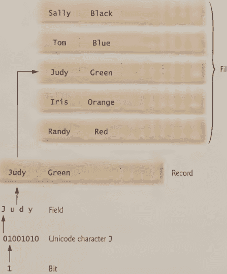 图 1.3 数据层次。

### 位

计算机处理的数据项形成数据层次结构。位（bit）是最小的数据项，它的值是 0 或 1。数据层次结构变得越来越大、越来越复杂。

### 字符

正如位组成字符，字符由位组成。数据层次结构变得越来越大、越来越复杂。

### 字段

正如字符由位组成一样，字段由字符组成。字段是具有意义的字符字节组。例如，一个由大写和小写字母组成的字段可以表示人的姓名，而一个由十进制数字组成的字段可以表示人的年龄。

### 记录

多个字段可以组成一个记录（在 Java 中实现为类）。在工资系统中，员工的记录可能由以下字段组成（类型见括号所示）：

- 员工编号（整数）
- 姓名（字符串）
- 地址（字符串）
- 时薪（带小数点的数字）
- 年至今的累计收入（带小数点的数字）
- 扣缴税款金额（带小数点的数字）

因此，记录是相关字段的组。在前面的示例中，所有字段都属于同一个员工。

### 文件

文件是相关记录的组。[注：更广泛地说，文件包含任意格式的任意数据。在某些操作系统中，文件被简单视为字节序列——对字节的组织（例如将数据组织成记录）是由程序员创建的视图。你将在第 15 章学习如何这样做。]组织拥有许多文件，包含数十亿甚至万亿字符的信息并不罕见。

### 数据库

数据库是为了便于访问和操作而组织的数据集合。最流行的模型是关系型数据库，数据存储在简单的表中。表包含记录和字段。例如，一个学生表可能包括名、姓、年级、排序 ID 号和平均绩点字段。每个学生的数据是一条记录，每个记录中的各个信息就是字段。你可以根据其与多个表或数据库之间的关系进行搜索、排序和其他操作。例如，大学可能会将学生数据库的数据与课程、校园住宿、膳食计划等数据库的数据相结合。本书在第 24 章讨论数据库、使用 JDBC 访问数据库以及在线章节第 29 章 Java 持久化 API (JPA)。

## 1.4 机器语言、汇编语言和高级语言

## 大数据

全球产生的数据量极其巨大且增长迅速。根据 IBM 的数据，每天产生约 25 亿亿字节（2 艾字节）数据；根据 Salesforce.com 的数据，截至2015年10月，全球90%的数据是在过去的12个月内创建的。根据 IDC 的数据，数据供应量将在2020年达到 40 泽字节（等同于 4 万亿千字节）。图1.4 显示了一些常见的字节单位。大数据应用处理海量数据，该领域正在快速增长，为软件开发人员创造了大量机会。全球已有数百万 IT 岗位在支持大数据应用。

| | | |
|---|---|---|
| 1 千字节 (KB) | 1024 字节 | 恰好为 $10^3$ (1,024) 字节 |
| 1 兆字节 (MB) | 1024 千字节 | $10^6$ (1,000,000) 字节 |
| 1 吉字节 (GB) | 1024 兆字节 | $10^9$ (1,000,000,000) 字节 |


| 单位 | 等值 | 字节数 |
| :--- | :--- | :--- |
| 1 太字节 (TB) | 1024 吉字节 | $10^{12}$ (1,000,000,000,000) 字节 |
| 1 拍字节 (PB) | 1024 太字节 | $10^{15}$ (1,000,000,000,000,000) 字节 |
| 1 艾字节 (EB) | 1024 拍字节 | $10^{18}$ (1,000,000,000,000,000,000) 字节 |
| 1 泽字节 (ZB) | 1024 艾字节 | $10^{21}$ (1,000,000,000,000,000,000,000) 字节 |

图 1.4 字节单位。

## 1.4 机器语言、汇编语言和高级语言

程序员用各种编程语言编写指令，其中一些可以直接被计算机理解，另一些则需要中间翻译步骤。今天有数百种语言在使用。这些可以分为三大类：

1. 机器语言
2. 汇编语言
3. 高级语言

### 机器语言

任何计算机只能直接理解由其硬件设计定义的自身的机器语言。机器语言通常由数字字符串（最终还原为 1 和 0）组成，指令计算机一次执行其最基础的操作。机器语言是依赖于机器的（特定的机器语言只能用于一种类型的计算机）。这些语言对人类来说是繁琐的。

> 4. http://www-01.ibm.com/software/data/bigdata/what-is-bigdata
>
> 5. https://www.salesforce.com/blog/2015/10/data-growth
>
> 6. `example.com/path-to-article`

### 汇编语言

汇编语言使用助记操作码代替二进制数，这使得人类更易编写。然而，它们仍然需要一个被称为汇编器的翻译步骤，将代码转换为机器可执行的指令。这些语言也是依赖于机器的。

### 高级语言

高级语言最受欢迎，因为它们使用的语法与英语相似。它们需要一个被称为编译器或解释器的翻译步骤，将高级代码转换为机器语言。

#### 解释器

解释器在运行时逐行翻译并执行高级代码。这可能比全编译要慢，但允许更易于调试且更具灵活性。

#### 编译器

编译器在执行之前一次性地将整个高级程序翻译成机器码。这导致执行速度更快，但开发过程可能会更复杂。

## 1.5 对象简介

对软件的需求正在增长。今天，面向对象编程是构建软件的流行方法，它使用对象的组件。

面向对象编程是一种基于“对象”概念的范式，对象可以包含数据（属性）和代码（方法）。这种方法使软件更具模块化、可维护性和可重用性。

### 1.5.1 作为对象的汽车

为了帮助你理解对象，让我们从一个简单的类比开始。假设你想开车并通过踩加速踏板让它跑得更快。很好，在你开车之前，它必须根据工程图纸制造。这些图纸包含了加速踏板的设计。踏板向司机隐藏了实际上让汽车行驶的复杂机制：

```java
car.accelerate();
car.brake();
car.turn();
```

### 1.5.2 方法和类

让我们用汽车来介绍一些关键面向对象概念。在程序中执行任务需要一个方法。方法包含了实际执行任务的程序语句。方法向用户隐藏了这些语句，就像汽车的加速踏板向司机隐藏了汽车行驶的机制。在 Java 中，我们创建一个名为“类”的程序单元，用于存放执行类任务的方法集。例如，代表银行账户的类可能包含一个存款的方法，另一个取款的方法，以及第三个查询账户当前余额的方法。

### 1.5.3 实例化

就像必须先根据工程图纸制造汽车你才能真正开车一样，你必须先构建类的对象，程序才能执行该类方法定义的任务。这一过程被称为实例化。该对象被称为其类的实例（`instance`）。

### 1.5.4 重用

就像汽车的工程图纸可以被重复使用多次来制造许多汽车一样，你可以多次重用一个类来构建许多对象。这允许开发人员在开发软件时节省时间并减少错误。

类和程序可以节省时间和精力的。重用还能帮助你构建更可靠、更高效的系统，因为现有的类和组件通常已经过广泛的测试、调试和性能优化。正如可替换零件的概念对于由对象技术引发的软件革命至关重要一样。

> **软件工程观察 1.1**
>
> 使用构建块式的方法来创建你的程序。避免重复造轮——尽可能使用高质量的组件。这种重用是面向对象编程的一大核心优势。

### 1.5.5 消息与方法调用

当你开车时，踩下油门会向汽车发送一条消息来执行某项任务——即让车跑得更快。类似地，你向一个对象发送消息。每条消息都实现为一个方法调用，告诉对象的方法去执行其任务。例如，程序可能会调用银行账户对象的存款（`deposit`）方法来增加账户余额。

### 1.5.6 属性和实例变量

汽车除了具有完成任务的能力外，还具有属性，例如它的颜色、门数、油箱中的油量、当前速度以及行驶总里程记录（即里程表读数）。与它的能力一样，汽车的属性作为其工程图中设计的一部分被表示（例如，图中包含了里程表和燃料表）。当你驾驶一辆真实的汽车时，这些属性随车携带。每辆汽车都维护自己的属性。例如，每辆汽车都知道自己的油箱里有多少油，但不知道其他汽车的油箱里有多少油。

同样，对象也拥有在程序中使用时携带的属性。这些属性被指定为对象类的一部分。例如，一个银行账户对象有一个余额（`balance`）属性，代表账户中的金额。每个银行账户对象都知道其代表的账户的余额，但不知道银行中其他账户的余额。属性是通过类的实例变量来指定的。

### 1.5.7 封装与信息隐藏

类（及其对象）即封装（`encapsulate`），包裹了它们的属性和方法。一个类（及其对象）的属性和方法是紧密相关的。对象之间可以相互通信，但它们通常被允许知道对象是如何实现的——实现细节可以隐藏在对象内部。这种信息隐藏，正如我们后将看到的，对于良好的软件工程至关重要。

### 1.5.8 继承

可以通过继承（`Inheritance`）方便地创建新的对象类——新类（称为子类）使用现有的类（称为父类），并可能自定义和添加自身的独特特征。在我们的汽车类比中，“敞篷车（`convertible`）”类的对象无疑是更一般的“汽车（`automobile`）”类的对象，但更具体地说，它的顶可以升高或降低。

### 1.5.9 接口

Java 还支持接口（`interfaces`）——相关方法的集合，它们通常允许你告诉对象要做什么，而不是怎么做（我们将在第 10 节讨论 Java 8 接口时看到它们）。在汽车类比中，一个由方向盘、加速踏板和刹车踏板组成的“基本驾驶能力（`basic-driving-capabilities`）”接口可以让驾驶员告诉汽车做什么。一旦你学会了如何使用此接口进行转弯、加速和刹车，你就可以驾驶许多类型的汽车，即使制造商可能以不同的方式实现这些系统。

一个类实现零或多个接口，每个接口可以有一个或多个方法，就像汽车为基本驾驶功能、控制收音机、控制空调系统等实现了不同的接口一样。由于汽车制造商以不同的方式实现功能，类可能会以不同的方式实现接口的方法。例如，一个软件系统可能包含一个提供保存和恢复功能的“备份（`backup`）”接口。类实现这些方法的方式取决于被备份内容的类型，例如程序、文本、音频、视频以及存储这些项目的设备类型。

### 1.5.10 面向对象的分析与设计 (OOAD)

你很快就要用 Java 写程序了。你将如何为你的程序创建代码（即程序指令）？也许像许多程序员一样，你只需打开电脑并开始打字。这种方法对于小型程序（如本书开头章节介绍的程序）有效，但如果你要创建一个控制大银行数千台自动取款机的软件系统呢？或者如果你被要求在一个由 1000 名软件开发人员组成的团队构建下一代美国空中管制系统？对于如此巨大且复杂的项目，你不应该只是坐下来开始写程序。

为了创建最佳解决方案，你应该遵循详细的分析过程来确定项目的需求（即定义系统应该做什么），并开发满足这些需求的设计（即指定系统如何做）。此外，在编写任何代码之前，你将经历这一过程并仔细审查设计（并让其他软件专业人员审查你的设计）。如果这个过程从面向对象的角度对系统进行分析和设计，它被称为面向对象的分析与设计（`OOAD`）过程。像 Java 这样的语言是面向对象的。在这种语言中编程，即面向对象编程（`OOP`），允许将面向对象的设计实现为运行系统。

### 1.5.11 UML（统一建模语言）

尽管许多许多 `OOAD` 过程，但一种用于通信任何 `OOAD` 过程结果的图形语言已广泛使用。统一建模语言（`UML`）现在是用于面向对象系统建模最广泛使用的图形规范。我们将在第 3 和第 4 节展示第一批 `UML` 图，然后在第 11 节对面向对象编程的深入探讨中使用它们。在第 33-34 节可选的在线 ATM 软件工程案例研究中，我们在引导你完成面向对象设计体验时，展示了 `UML` 功能的一个简单子集。

## 1.6 操作系统

操作系统是让计算机对用户、应用程序开发人员和系统管理员更方便的软件系统。它们提供的服务允许每个应用程序安全、高效且并发（即并行）运行。包含操作系统核心组件的软件称为内核（`kernel`）。流行的桌面操作系统包括 `Linux`、`Windows` 和 `macOS`（以前称为 `OS X`）——我们使用了其中三种。最流行的手机操作系统是 Google 的 `Android` 和 Apple 的 `iOS`（用于 `iPhone` 和 `iPod Touch`）。

### 1.6.1 Windows——私有操作系统

在 20 世纪 80 年代，微软开发了 `Windows` 操作系统，它由构建在 `DOS`（磁盘操作系统——一种用户通过输入命令交互的极其流行的操作系统）之上的图形界面组成。`Windows` 了许多概念（如图标、菜单和窗口——由 `Xerox PARC` 开发并在早期 `Macintosh` 系统中普及）。`Windows 10` 是微软最新的操作系统——功能包括增强菜单和用户界面、用于语音交互的 `Cortana`、用于接收通知的操作中心、微软新的 `Edge` 浏览器等。`Windows` 是一个私有操作系统——它由微软独家控制。`Windows` 是世界上最常用的桌面操作系统。

### 1.6.2 Linux——开源操作系统

`Linux` 操作系统可能是开源运动最大的成功。开源软件偏离了主导软件早期发展的私有开发风格。在开源开发中，个人和公司贡献开发、维护和演进软件的力量，以换取为了自身使用该软件的权利，通常是免费的。开源代码比私有软件受到更多观众的审查，因此错误消除得更快。开源还促进了创新。企业级系统公司 `IBM`、`Oracle` 以及许多公司对 `Linux` 开源开发投入了大量资金。

开源社区的一些关键组织包括：

- `Eclipse` 基金会（`Eclipse` 集成开发环境帮助程序员方便地开发软件）
- `Mozilla` 基金会（`Firefox` 浏览器的创建者）
- `Apache` 软件基金会（开发 Web 应用程序的 `Apache` Web 服务器）
- `GitHub`（提供管理开源项目的工具——它有数百万项目正在开发）

计算和通信的快速改进、成本的降低以及开源软件使得创建基于软件的变得更加容易且经济。

现在的商业环境与十年前已大不相同。一个极佳的例子是 `Facebook`，它诞生于大学宿舍，并是使用开源软件构建的。

`Linux` 内核是最流行的开源、免费分发、全功能操作系统的核心。它由一个组织松散的志愿者团队开发，在服务器、个人电脑和嵌入式系统（如智能手机、智能电视和汽车系统的核心）中非常流行。与 `Microsoft Windows` 和 Apple 的 `macOS` 等专有操作系统不同，`Linux` 源代码（程序代码）供公众审查和修改，并免费下载和安装。因此，`Linux` 用户受益于庞大的开发者社区，他们积极地调试和改进内核，而且用户能够根据特定需求对操作系统进行定制。

由于各种问题——例如微软的市场主导、用户友好的 `Linux` 应用程序较少，以及 `Linux` 发行版的多元性（如 `Red Hat Linux`、`Ubuntu` 等许多其他版本）——阻碍了其在桌面计算机上的广泛使用。`Linux` 在服务器和嵌入式系统（例如基于 `Android` 的智能手机）中变得极其流行。

### 1.6.3 Apple 的 macOS 和用于 iPhone、iPad 和 iPod 设备的 iOS

Apple 由 `Steve Jobs` 和 `Steve Wozniak` 于 1976 年创立，迅速成为个人计算领域的领导者。1979 年，`Jobs` 和几位 Apple 员工访问了 `Xerox PARC`（帕洛阿尔托研究中心），学习了具有图形用户界面（`GUI`）的 `Xerox` 桌面电脑。该 `GUI` 为 Apple `Macintosh` 提供了启发，后者在 1984 年一次难忘的超级碗期间盛大推出。

`Objective-C` 语言由 `Brad Cox` 和 `Tom Love` 在 20 世纪 80 年代初于 `Stepstone` 创建，在 `C` 语言的基础上增加了面向对象编程（`OOP`）的能力。`Jobs` 于 1985 年离开 Apple 并创立了 `NeXT Inc.`。1988 年，`NeXT` 从 `Stepstone` 授权了 `Objective-C`，并开发了 `Objective-C` 编译器和库，这些库被用作 `NEXTSTEP` 操作系统的用户界面以及 `Interface Builder`——用于构建图形用户界面。

1996 年 Apple 收购 `NeXT`，`Jobs` 加入 Apple。Apple 的 `macOS` 操作系统是 `NEXTSTEP` 的后代。Apple 的专有操作系统 `iOS` 派生自 Apple 的 `macOS`，用于 `iPhone`、`iPad`、`iPod`、`Apple Watch` 和 `Apple TV` 设备。2014 年，Apple 引入了新的 `Swift` 编程语言，该语言已开源。社区正在从 `Objective-C` 转向 `Swift`。

### 1.6.4 Google 的 Android

`Android`——增长最快的移动和智能手机操作系统——基于 `Linux` 内核和 `Java`。`Android` 应用也可以用 `C++` 和 `C` 开发。开发 `Android` 应用的一个益处是该平台的开放性。操作系统是开源且免费的。

`Android` 操作系统由 `Android, Inc.` 开发，该公司于 2005 年被 `Google` 收购。2007 年，`Open Handset Alliance` 成立，旨在开发、维护和演进 `Android`，推动移动技术的创新并在改善用户体验的同时降低成本。根据 `Statista.com` 的数据，截至 2016 年第三季度，`Android` 占全球智能手机市场份额的 87.8%，而 `Apple` 为 11.5%。`Android` 操作系统被广泛用于众多智能手机、电子阅读器、商店触摸屏自助机、汽车、机器人、多媒体播放器等。

我们在教科书《`Android` 编程》（第三版）以及专业书籍《`Android 6` 程序员教程：应用驱动方法》（第三版）中提供了 `Android` 开发的介绍。在学习 `Java` 之后，你会发现开始开发和运行 `Android` 应用并不困难。你可以在 `Google Play` (`play.google.com`) 上找到应用，如果它们成功了，你甚至可能创立事业。只需记住——`Facebook`、`Microsoft` 和 `Dell` 都是诞生于大学宿舍的。

## 1.7 编程语言

图 1.6 对几种流行的编程语言进行了简要注释。在下一节中，我们将介绍 `Java`。


| 语言 | 描述 |
| :--- | :--- |
| `Ada` | `Ada` 基于 `Pascal`，于 20 世纪 70 年代在美国国防部（`DOD`）的赞助下开发。它以第一位计算机程序员 `Ada Lovelace` 命名（她于 2016 年 11 月被追授予总统自由勋章）。 |
| `Basic` | `Basic` 于 20 世纪 60 年代中期在达特茅斯学院开发。它因教学编程而流行。 |
| `C` | `C` 是由 `Dennis Ritchie` 于 20 世纪 70 年代在贝尔实验室开发的。它是一门基础语言。 |
| `C++` | `C++` 基于 `C`，由 `Bjarne Stroustrup` 于 20 世纪 80 年代初开发。它提供了面向对象编程的特性。 |
| `C#` | 微软主要的面向对象语言是 `C#` 和 `Visual Basic .NET`。 |
| `COBOL` | `COBOL`（通用面向业务语言）于 20 世纪 50 年代中期开发。它仍被用于需要精确处理数据的商业应用。 |
| `Fortran` | `Fortran`（公式翻译器）由 `IBM` 公司于 20 世纪 50 年代中期开发，用于科学和工程应用。 |
| `JavaScript` | `JavaScript` 是最广泛使用的脚本语言。它主要用于为网页添加编程功能——例如动画和与用户的交互。 |
| `Objective-C` | `Objective-C` 是基于 `C` 的面向对象语言。它于 20 世纪 80 年代初开发，后被 `NeXT` 收购。它是 `macOS` 操作系统和 `iOS` 设备的关键编程语言。 |
| `Pascal` | 1960 年的研究产生了结构化编程。`Pascal` 语言由 `Niklaus Wirth` 教授于 1971 年开发，源于这项研究。 |
| `Python` | `Python` 是另一种面向对象的脚本语言，于 1991 年公开发布。由阿姆斯特丹国立数学与计算机科学研究所的 `Guido van Rossum` 开发，汲取了编程语言 `Modula-3` 的优点。它具有扩展性。 |
| `PHP` | `PHP` 是一种面向对象的开源的脚本语言，由开发者社区和众多网站支持。`PHP` 是平台无关的。 |
| `Ruby on Rails` | `Ruby`——由 `Yukihiro Matsumoto` 于 20 世纪 90 年代中期创建——是一种开源的面向对象编程语言，语法简单。`Ruby on Rails` 将脚本语言 `Ruby` 与 `37Signals` 公司开发的 `Rails` 框架相结合。 |

图 1.5 其他编程语言。（第 2/3 部分。）


Scala (http://www.scala-lang.org/what-is-scala.html)——“scalable language”（扩展语言）的缩写——由瑞士洛桑联邦理工学院（EPFL）的教授 Martin Odersky 设计。Scala 于 2003 年发布，同时使用了面向对象编程和函数式编程范式，并设计用于与 Java 集成。使用 Scala 可以显著减少应用程序中的代码量。

Swift 发布于 2014 年，是 Apple 用于开发 iOS 和 OS X 应用程序（App）的未来编程语言。Swift 是一种现代语言，包含了 Objective-C、Java、Ruby、Python 等语言的流行编程语言特性。根据 Tiobe 指数，Swift 已经成为最受欢迎的编程语言之一。Swift 现在是开源的，因此它可以在非 Apple 平台上使用。

微软的 Visual Basic 语言于 20 世纪 90 年代初推出，旨在简化 Microsoft Windows 应用程序的开发。它的功能与 C# 相当。

**图 1.5** 其他编程语言。（3 部分中的第 3 部分）

## 1.8 Java

微处理器到目前为止最重要的贡献是它实现了个人电脑的发展。微处理器对智能消费电子设备也产生了深远影响，包括近期“物联网”的爆发式增长。早早认识到这一点的，太阳系统公司（Sun Microsystems）于 1991 年资助了一项由 James Gosling 领导的内部研究项目，该项目产生了基于 C++ 的面向对象编程语言 Java。使用 Java，你可以编写运行在各种计算机系统和计算机控制设备上的程序。这就是“编写一次，随处运行”（write once, run anywhere）。

由于人们对互联网产生了极大的兴趣，Java 引起了商业界的关注。它现在被用于开发大型企业级应用程序、增强 Web 服务器（提供我们在浏览器中看到的内容的计算机）的功能、为消费设备（手机、智能手机、机顶盒等）提供应用程序、开发机器人软件以及许多其他用途。它也是开发 Android 智能手机和平板电脑 App 的关键语言。Sun Microsystems 已于 2011 年被甲骨文（Oracle）收购。

Java 已成为最广泛使用的通用编程语言，拥有超过 1000 万开发者。在书中，你将学习 Java 的最新版本——Java 标准版 8 (Java SE 8) 和 Java 标准版 9 (Java SE 9)。

### Java 类库

你可以创建构建程序所需的每个类和方法。然而，大多数程序员都会利用 Java 类库中丰富的现有类和方法集合，这些库也称为 Java API（应用程序编程接口）。

## 1.9 典型的 Java 开发环境

> **性能提示 1.1**
>
> 使用 API 类和方法而不是编写你自己的版本可以提高程序性能，因为它们经过精心编写，可以实现高效的运行。这还缩短了程序的开发时间。

我们现在解释创建和执行 Java 应用程序的步骤。通常有五个阶段——编辑、编译、加载、验证和执行。我们在 Java SE 8 开发工具包（JDK）的背景下讨论它们。请查看“开始之前”部分获取有关在 Windows、Linux 和 macOS 上下载和安装 JDK 的信息。

### 阶段 1：创建程序

阶段 1 包括使用编辑器程序编辑文件，通常简单称为编辑器（图 1.6）。使用编辑器，你输入一个 Java 程序（通常称为源代码），进行任何必要的修正并将其保存到次级存储设备上，例如你的硬盘。Java 源代码文件以 `.java` 扩展命名，表示该文件包含源代码。

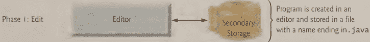

图 1.6 | Java 开发环境——编辑阶段。

Linux 系统上广泛使用的两个编辑器是 `vi` 和 `emacs`。Windows 提供记事本（Notepad），macOS 提供 freeway，还有共享软件编辑器，包括 Notepad++ (http://notepad-plus-plus.org)、EditPlus (http://www.editplus.com)、TextPad (http://www.textpad.com)、jEdit (http://www.jedit.org) 等。

集成开发环境（IDE）提供了支持软件开发过程工具，例如编辑器、用于记录导致程序执行错误的逻辑错误的调试器等。最流行的 Java IDE 有：

- Eclipse (http://www.eclipse.org)
- IntelliJ IDEA (http://www.jetbrains.com)
- NetBeans (http://www.netbeans.org)

在书籍网站 http://www.deitel.com/books/jht11 上，我们提供了视频，展示如何执行本书的 Java 应用程序，以及如何使用 Eclipse、NetBeans 和 IntelliJ IDEA 开发新的 Java 应用程序。

### 阶段 2：将 Java 程序编译为字节码

在阶段 2 中，你使用命令 `javac`（Java 编译器）来编译程序（图 1.7）。例如，要编译一个名为 `Welcome.java` 的程序，你会在系统的命令窗口中输入

```
javac Welcome.java
```

（即 Windows 中的命令提示符，macOS 中的终端 应用程序）或 Linux shell（在某些版本中也称为 Terminal）。

如果程序编译成功，编译器将生成一个名为 `welcome.class` 的 `.class` 文件。IDE 提供了一个菜单项，例如“构建”（Build）或“制作”（Make），它会为你调用 `javac` 命令。如果编译器检测到错误，你将返回阶段 1 并修正它们。在第 2 章中，我们将介绍更多关于编译器可以检测的错误。

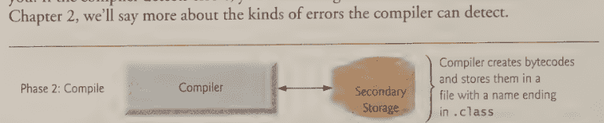

图 1.7 | 典型的 Java 开发环境——编译阶段。

> **常见编程错误 1.1**
>
> 当使用 `javac` 时，如果收到类似“无效命令或文件名”、“javac: 找不到命令”或“javac' 不是内部或外部命令、可运行程序或批文件”的消息，则说明你的 Java 软件安装没有正确完成。请仔细检查“开始之前”部分中的安装说明。在某些系统上，在修正 PATH 后，你可能需要重启计算机或打开新的命令窗口使这些设置生效。

Java 编译器将 Java 代码翻译成字节码，字节码代表在执行阶段（阶段 5）中要执行的任务。Java 虚拟机（JVM）JDK 的一部分也是 Java 平台的基础——负责执行字节码。虚拟机是一种模拟计算机的软件，但它与其交互的程序隐藏了底层操作系统和硬件。如果同一个虚拟机在许多计算机平台上实现，那么为该虚拟机编写的应用程序就可以用于所有平台。JVM 是最广泛使用的虚拟机之一。微软的 .NET 使用类似的虚拟机架构。

与机器语言指令（它是依赖平台的，即依赖于特定的计算机硬件）不同，字节码指令与平台无关。因此，Java 的字节码是可移植的——无需重新编译源代码，相同的字节码可以在任何包含编译字节码的 Java 版本 JVM 的平台上执行。JVM 是由 `javac` 命令调用的。例如，要执行一个名为 `welcome` 的 Java 应用程序，你会在命令窗口输入命令

```
java Welcome
```

来调用 JVM，这将启动执行应用程序所需的必要步骤。这开始了阶段 3。IDE 通常提供一个菜单项，例如“运行”（Run），它会为你调用 `javac` 命令。

### 阶段 3：将程序加载到内存

在阶段 3 中，JVM 将程序放入内存中以执行它——这被称为加载（图 1.8）。JVM 的类加载器获取包含程序字节码的 `.class` 文件并将其传输到主内存。它还会加载你的程序使用的 Java 提供的任何 `.class` 文件。这些 `.class` 文件可以从你系统的磁盘加载，也可以通过网络（例如，你的本地大学或公司网络，或互联网）加载。

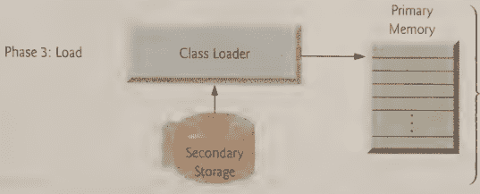

图 1.8 典型的 Java 开发环境——加载阶段。

### 第 4 阶段：字节码验证

在阶段 4 中，当类加载时，字节码验证器会检查它们的字节码以确保它们是有效的且没有违反 Java 的安全限制（图 1.9）。Java 执行强力安全，以确保通过网络到达的 Java 程序不会损坏你的文件或系统（就像计算机病毒和蠕虫那样）。

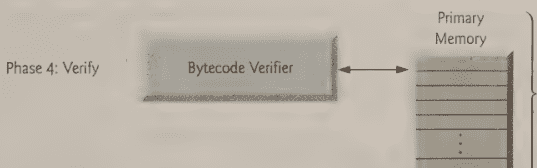

图 1.9 典型的 Java 开发环境——验证阶段。

### 第 5 阶段：执行

在阶段 5 中，JVM 执行字节码以执行程序指定的动作（图 1.10）。在早期的 Java 版本中，JVM 仅仅是一个 Java 字节码解释器。大多数程序的执行速度缓慢，JVM 会一次地解释并执行一个字节码。某些现代计算机架构可以并行执行多条指令。今天的 JVM 通常结合使用解释和即时编译（JIT）编译来执行字节码。在这个过程中，JVM 在解释字节码时对其进行分析，寻找“热点”——然后由编译器（如 Oracle 的 Java HotSpot™ 编译器）将字节码翻译成计算机的机器语言。当 JVM 执行这些经过编译后的部分时，更快的机器语言代码就会执行。这些程序实际上经历了两个编译阶段——第一个阶段将 Java 代码翻译成字节码，以便在不同计算机平台上的 JVM 之间具有可移植性；第二个阶段是在执行期间，将字节码翻译成执行程序的计算机所需的机器语言。

| 阶段 | 主内存 |
|---|---|
| 第 5 阶段：执行 | Java 虚拟机 (JVM) | 为了执行程序，JVM 读取字节码并将其即时 (JIT) 编译（即翻译）为计算机可以理解的语言。随着程序的执行，它可能会将数据值存储在主内存中。 |

图 1.10 | 典型的 Java 开发环境——执行阶段。

### 执行时可能出现的问题

程序在第一次尝试可能无法运行。之前的每个阶段都可能因为各种错误而失败，我们将在本书书中讨论这些错误。例如，正在执行的程序可能会尝试除以零（这在 Java 的整数运算中是非法操作）。这将导致 Java 程序显示错误消息。如果发生这种情况，你将返回编辑阶段，进行必要的修正，并再次通过剩余阶段，以确定修正是否修复了问题。[注：Java 中的大多数程序都使用输入或输出数据。当我们说程序显示消息时，我们通常是指该消息显示在你的计算机屏幕上。]


> **常见编程错误 1.2**
>
> 像除以零这样的错误会在程序运行时发生，因此它们被称为运行时错误或执行时错误。致命运行时错误会导致程序立即终止，而没有成功完成其工作。非致命运行时错误允许程序运行完成，即使产生了不正确的结果。

## 1.10 测试 Java 应用程序

在本节中，你将运行并与一个现有的 Java Painter 应用程序交互，该程序将在稍后的章节中构建。你将看到的元素和功能是你后将在本书中学习编程的典型内容。使用 Painter 的图形用户界面 (GUI)，你可以选择绘图颜色和画笔大小，拖动鼠标在每次绘图操作中画圆，或创建整个绘画。你还可以绘制每个绘图操作 [注：我们使用无衬线字体显示屏幕特征，如窗口标题和菜单（例如 File 菜单），并使用等宽无衬线字体强调非屏幕元素，如文件名和程序代码（例如 `gramName.java`）。]

本小节的步骤展示了如何从系统上的命令提示符 (Windows)、shell (Linux) 或 Terminal (macOS) 窗口运行 Painter 应用程序。在本书中，我们将这些窗口称为命令窗口。我们假设书籍示例位于 Windows 上的 `C:\examples`，或者 Linux 或 macOS 上的你账户的 `Documents/examples` 文件夹。

### 检查你的设置

阅读前言之后的“开始之前”部分以在你的计算机上设置 Java，并确保你已将书籍的示例下载到硬盘。

### 切换到完成的应用程序目录

打开命令窗口并使用 `cd` 命令切换到 Painter 应用程序的目录（也称为文件夹）：

- 在 Windows 上输入 `cd C:\examples\ch01\Painter`，然后按回车。
- 在 Linux/macOS 上，输入 `cd ~/Documents/examples/ch01/Painter`，然后按回车。

### 编译应用程序

在命令窗口中输入以下命令然后按回车：

```
javac *.java
```

`*` 表示所有以 `.java` 结尾的文件。

### 运行应用程序

在命令窗口中输入以下命令然后按回车：

```
java Painter
```

Painter 执行该应用。如果你收到错误消息 `Exception in thread "main" java.lang.NoClassFoundError: Painter`，说明你的 CLSPATH 有问题。Java 是大小写敏感的——也就是说，大写字母和小写字母是不同的。

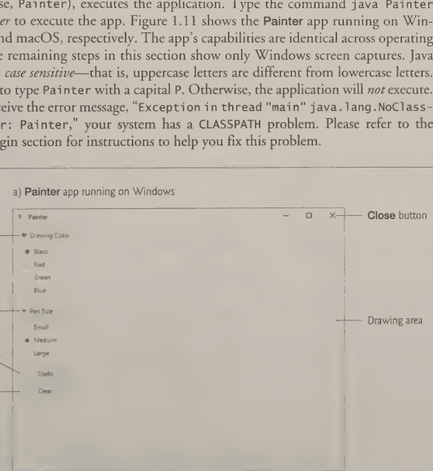

点击 Black、Red 或 Blue 单选按钮选择绘画颜色

点击 Small、Medium 或 Large 单选按钮选择大小

撤销上一次绘图操作

清除绘画

图 1.11 | 在 Windows、Linux 和 macOS 上执行 Painter 。

## 24 章 第一章 计算机、互联网与 Java 导论

b) 在 Linux 上运行 Painter。


关闭按钮

c) 在 macOS 上运行 Painter。


关闭按钮

图 1.11 | 在 Windows、Linux 和 macOS 上执行 Painter。（第 2 部分，共 2 部分）

## 1.10 测试 Java 应用程序 25


图 1.12 绘制花瓣。

### 绘制花瓣

在本节剩余的步骤中，你将画一朵带有绿色茎、绿色草和蓝色雨水的花。我们将先用红色中号画笔绘制花瓣。点击 Red 单选按钮将绘图颜色改为红色。接下来，在绘图区域拖动鼠标画花瓣（见图 1.12）。如果你不喜欢绘制的部分，可以反复点击 Undo 按钮来移除最近绘制的圆，或者通过点击 Clear 按钮重新开始。

### 绘制茎、叶和草地

点击 **Green** 和 **Large** 单选按钮将绘图颜色改为绿色并将画笔大小改为大号。然后，如图 1.13 所示绘制茎和叶。接下来，点击 **Medium** 单选按钮将画笔大小改为中号，然后如图 1.13 所示绘制草地。

# 26 章 第一章 计算机、互联网与 Java 导论

绘制雨水

点击 Blue（蓝色）和 Small（小）单选按钮将绘制颜色改为蓝色并将笔画大小改为小。然后，如图 1.14 所示画一些雨。


图 1.14 | 绘制雨。

### 退出 Painter 应用程序

此时，你可以关闭 Painter 应用程序。只需点击图 1.11 所示的应用程序关闭按钮（适用于 Windows、Linux 和 macOS）即可。

## 1.11 互联网与世界维网

20 世纪 60 年代后期，ARPA——美国国防部高级研究计划署制定了计划，将大约十个由 ARPA 资助的大学和研究机构的主计算机系统联网。这些计算机将通过速度在每秒 50,000 比左右的通信线连接起来，当时大多数人（少数拥有网络访问权限的人）通过电话线以每秒 110 比的速度连接计算机，这当时是一个惊人的速率。学术研究正将发生巨大的飞跃。ARPA 随后实施了很快被称为 ARPANET 的网络，它是当今互联网的前身。今天最快的互联网速度达到每秒数十亿比特，且

事情的发展与最初计划不同。虽然 ARPANET 让研究人员能够将计算机联网，但其主要优势证明是可以通过后来被称为电子邮件（e-mail）进行快速方便通信的能力。在今天的互联网也是如此，电子邮件、即时消息、文件传输以及 Facebook 和 Twitter 等社交媒体让全球数十亿能够快速方便地通信。

在 ARPANET 上通信的协议（规则集）被称为传输控制协议（TCP）。TCP 确保了由顺序编号的数据包组成的消息能够正确地从发送者路由到接收者、完整到达并按正确的顺序组装。

### 1.11.1 互联网：网络的网络

在互联网早期演化的同时，全球组织都在实施自己的网络，用于组织内（即组织内部）和组织间（即组织之间）的通信。出现了各种网络硬件和软件。一个挑战是让这些不同的网络能够相互通信。ARPA 通过开发互联网协议（IP）实现了这一目标，它创建了一个“网络的网络”，即当前互联网的架构。这些协议组合现在被称为 TCP/IP。每个连接互联网的设备都有一个 IP 地址——这是通过 TCP/IP 通信的设备使用的唯一标识符，用于在互联网上定位彼此。

企业很快意识到通过使用互联网，他们可以改进自己的产品并为客户提供更好的服务。公司开始投入大量资金开发和增强它们的互联网存在感。这导致了通信运营商以及硬件和软件供应商之间的激烈竞争，以满足日益增长的基础设施需求。结果，互联网上的带宽——通信线的负载承载能力——大幅增加，而硬件成本急剧下降。

世界维网（简单称为“web”）是与互联网相关的硬件和软件集合，它允许计算机定位并查看几乎任何主题的文档（带有各种组合的文本：图形、动画、音频和视频）。1989 年，CERN（欧洲核子研究组织）的蒂姆·伯纳斯-李（Tim Berners-Lee）开始开发超文本标记语言（HTML）——通过“超链接”文本文档共享信息的技术。我们还编写了通信协议，如超文本传输协议（HTTP），以形成他新超文本系统的骨干，将其称为世界维网。


1994 年，伯纳斯-李创立了世界维网联盟（W3C, `http://www.w3.org`），致力于开发网络技术。W3C 的主要目标之一是让每个人无论是否有残疾、语言或文化，都能普遍访问 Web。

### 1.11.3 Web 服务与组合

在在线版第 32 章中，我们将实现 Web 服务（图 1.15）。组合（mashups）的应用开发方法允许您通过结合（免费的）互补 Web 服务和其他形式的信息馈送来快速开发强大的软件应用程序。最早的组合之一是将来自 `http://www.craigslistlist.org` 提供的房地产列表与 Google Maps 的制图功能相结合，提供显示给定区域待售或出租房屋位置的地图。ProgrammableWeb (`http://www.programmableweb.com/`) 提供了一个包含超过 16,500 个 API 和 6,300 个组合的目录。他们的 API 大学（`https://www.programmableweb.com/api-university`）包含了处理 API 和创建您自己的组合的指南和示例代码。根据他们的网站，一些最广泛使用的 API 是 Facebook、Google Maps、Twitter 和 YouTube。


| Google Maps | 制图服务 |
| --- | --- |
| Twitter | 微博客 |
| YouTube | 视频搜索 |
| Facebook | 社交网络 |
| Instagram | 照片共享 |
| Foursquare | 移动签到 |
| LinkedIn | 商务社交网络 |
| Groupon | 社交商务 |
| Netflix | 电影租赁 |
| eBay | 互联网拍卖 |
| Wikipedia | 协作百科全书 |
| PayPal | 支付 |
| Last.fm | 互联网电台 |
| Amazon | 书籍和其他产品购物 |
| Salesforce.com | 客户关系管理 (CRM) |
| Skype | 网络电话 |
| Microsoft Bing | 搜索 |
| Flickr | 照片共享 |
| Zillow | 房地产定价 |
| Yahoo | 搜索 |
| WeatherBug | 天气 |

**图 1.15** 流行的 Web 服务 (`https://www.programmableweb.com/category/all/apis`)。

### 1.11.4 物联网

互联网不再仅仅是计算机网络——它是物联网（IoT）。物体是指任何具有 IP 地址并能够通过互联网自动发送数据的对象。此类物体包括：

- 带有缴费感应器的汽车
- 车库空位可用监测器
- 植入人体的心脏监测器
- 饮用水水质监测器
- 报告能源消耗的智能电表
- 辐射探测器
- 仓库中的物品跟踪器
- 跟踪您的移动和位置的移动应用程序
- 根据天气预报和家庭活动调整房间温度的智能温度器
- 智能家
- 以及更多

根据 statistics.com，目前已有超过 220 亿 IoT 设备，预计 2020 年将超过 500 亿。

## 1.12 软件技术

图 1.16 列出了软件开发社区经常听到的一些热词。我们为大多数这些主题创建了资源中心，更多内容即将推出。

| 敏捷开发 | 敏捷开发是一套试图以更快的速度和更少的资源实现软件的方法。查看敏捷联盟 (`www.agilealliance.org`) 和敏捷宣言 (`www.agilemanifesto.org`)。 |
| --- | --- |
| 重构 | 重构涉及对程序进行改进使其更清晰、易于维护，同时保持其正确性和功能。它在敏捷开发方法被广泛应用于。许多 IDE 内置了重构工具来自动完成大部分修改工作。 |
| 设计模式 | 设计模式是构建灵活且可维护的对象面向软件的架构。设计模式领域试图列举这些反复模式，鼓励软件设计者使用它们用更少的时间、金钱和精力开发出更好的软件（参见在线附录 N，设计模式）。 |

图 1.16 | 软件技术。（第 1 部分，共 2 部分）。

# 30 第一章 计算机、互联网与 Java 简介

LAMP 是许多开发者用于构建 Web 应用程序的开源技术的缩写——它代表 Linux、Apache、MySQL 和 PHP（或 Perl 或 Python——另外两种流行的脚本语言）。MySQL 是一个开源数据库管理系统。

PHP 是一种用于开发 Web 应用程序的流行开源服务器端“脚本语言”。Apache 是最流行的 Web 服务器软件。Windows 开发的等对应方案是 WAMP——Apache、MySQL 和 PHP。

软件即服务（SaaS）通常被视为一种产品；大多数软件都是以这种方式提供的。如果你想运行一个应用程序，你会从供应商处购买软件——通常是 CD、DVD 或下载包。然后你在你的计算机上安装软件并在需要时运行它。随着新版本的出现，你必须升级软件，这通常需要付出时间和金钱的成本。对于在各种计算机设备上维护成千上万系统的组织来说，这个过程可能会变得繁琐。通过软件即服务（SaaS），软件运行在互联网的其它地方。当服务器更新时，所有客户端都能看到新功能——无需本地安装。你通过浏览器访问服务。浏览器具有很强的移植性，因此你可以在世界任何地方在各种计算机上运行相同的应用程序。Salesforce.com、Google、Microsoft 以及许多其他公司提供 SaaS。

平台即服务（PaaS）提供了一个通过 Web 开发和运行应用程序作为服务的平台，而不是在你的计算机上安装工具。一些 PaaS 提供商包括 Google App Engine、Amazon EC2 和 Windows Azure。

云计算 SaaS 和 PaaS 是云计算的示例。你可以使用存储在“云端”的软件和数据——即在远程计算机（或）通过互联网访问并按需使用——而不是将其存储在你的台式机、笔记本电脑或移动设备上。这允许你根据需要增加或减少计算资源，比购买硬件来提供足够的存储和处理能力以满足偶尔的需求更具效益。云计算通过将这些应用程序的管理交给服务提供商（例如安装和升级软件、安全、备份和灾难恢复）来节省资金。

软件开发包（SDK）包含了开发者用于编写程序的工具和文档。

图 1.16 | 软件技术。（第 2 部分，共 2 部分。）

软件是复杂的。大型现实软件的应用的设计实现可能需要几个月或几年。当大型软件产品处于开发阶段时，它们通常以一系列发布的形式提供给用户社区，每一次都比上一次更完整、更完善（图 1.17）。

# 1.13 解答你的问题 31

Beta 版本在开发过程的后期（修复了主要错误且新功能几乎完成后）发布给更多的开发者。Beta 软件更稳定，但仍会发生。

发布候选版本（Release candidates）通常是功能完整（大部分）无错误且准备好供社区使用的，社区提供了一个多样化的测试环境——软件在不同的系统上运行，具有不同的限制和多种用途。

发布候选版本中出现的任何错误 都会被修正，最终产品将发布给公众。软件公司经常通过互联网分发增量更新。

使用这种方法开发的软件（例如 Google 搜索或 Gmail）通常没有版本号。它托管在云端（未安装在你的计算机上）并不断演进，用户始终拥有最新版本。

图 1.17 | 软件产品发布术语。

# 1.13 解答你的问题

有很多在线论坛，你可以在那里获得 Java 问题的解答并与其他程序员互动。一些流行的 Java 和通用编程论坛包括：

- StackOverflow.com
- Coderanch.com
- Oracle Java 论坛——`https://community.oracle.com/community/java/`
- `<dream.in.code>`——`http://www.dreamincode.net/forums/forum/32-java/`

# 自测练习题

- 为下列每个陈述填空：

a) 计算机在称为 ________ 的指令集控制下处理数据。

b) 计算机的关键逻辑单元是 ________ 和 ________。

c) 本章讨论的三类语言是 ________ 和 ________。

d) 将高级语言程序翻译成机器语言的程序称为 ________。

e) ________ 是基于 Linux 内核和 Java 的移动设备操作系统。

f) 软件通常是功能完整的（假设）无错误的并准备好社区使用的。

g) Wifi 遥控器以及许多智能手机使用（一种）________，允许设备对动作做出响应。

- 为下列关于 Java 环境的每个句子填空：

a) 来自 JDK 的 ________ 命令执行 Java 应用程序。

b) 来自 JDK 的 ________ 命令编译 Java 程序。

c) Java 源文件必须以 ________ 文件扩展名结尾。

d) 当 Java 程序被编译时，编译器产生的文件以 ________ 文件扩展名结尾。

e) Java 编译器产生的文件包含由 Java 虚拟机执行的 ________。

- 在下列每个陈述中填空（基于第 1.5 节）：

a) 对象使得 ________ 设计实践成为可能，尽管它们可能知道如何通过良定义的接口与其他对象通信，但它们通常不允许知道其他对象是如何实现的。

b) Java 程序员专注于创建 ________，它包含字段和一组操纵这些字段并提供服务的方法。

# 32 第一章 计算机、互联网与 Java 简介

# 自测练习题答案

1.1 a) instructions

b) CPU, memory

c) high-level, machine

d) compilers

1.2 a) `java`

b) `javac`

c) `.java`

d) `.class`

e) byte code

1.3 a) encapsulation

b) classes

c) object-oriented programming

d) inheritance

e) UML

# 练习题

1.4 在下列每个陈述中填空：

a) input

b) output

c) assembly

d) objects

e) RAM

1.5 在下列每个陈述中填空：

a) source code, compilation

b) IDE

c) `java`

d) C++

e) class

f) control processor

g) microprocessor

h) machine language

i) binary code

j) Java operating system

1.6 在下列每个陈述中填空：

a) source code, compilation

b) interpreter

c) `java`

d) virtual machine

e) class loader

f) verifier

1.7 解释 Java 程序的两个编译阶段。

1.8 世界最常见的物体之一是手表。讨论以下术语和概念如何应用于手表的概念：对象、属性、行为、类、继承（例如闹钟）、建模、消息、封装、接口和信息隐藏。

# 改变世界

“改变世界”练习题将要求你对个人、社区和世界真正重要的问题进行工作。

1.9 （测试：碳足迹计算器）科学家认为，碳排放（特别是来自燃烧化石燃料的排放）对全球变暖有重大贡献，如果个人限制对碳基燃料的使用，这种情况可以得到缓解。各种组织和个人日益关注自己的“碳足迹”。诸如如 TerraPass

```
http://www.terrapass.com/carbon-footprint-calculator-2/
```

以及 Carbon Footprint

```
http://www.carbonfootprint.com/calculator.aspx
```

网站。

提供碳足迹计算器。通过测试这些计算器来确定你的碳足迹。在后续章节的练习将要求你编写一个碳足迹计算器。为了为此做好准备，请研究计算碳足迹的公式。

1.10（测试驱动：身体质量指数计算器）根据最近的估计，美国三分之二的人超重，一半的人肥肥胖。这导致了糖尿病和心脏病等疾病的显著增加。为了确定一个人是否超重或肥胖，你可以使用一种称为体指数（BMI）的衡量标准。美国卫生和人类服务部在 `http://www.nhbi.nih.gov/guidelines/obesity/bmicalc.html` 提供了一个 BMI 计算器。使用它来计算你自己的 BMI。第 3 章的一项练习将要求你编写自己的 BMI 计算器。为了为此做好准备，请研究计算 BMI 的公式。

1.11（混合动力汽车的属性）在本章中，你将学习类的基础知识。现在你将“勾勒出”“混合动力汽车”类的各个方面。混合动力汽车越来越受欢迎，因为它们的燃油效率比纯汽油车高得多。浏览网页并研究今天四到五种热门混合动力汽车的特征，然后列出尽可能多的与其混合动力相关的属性。例如，常见的属性包括城市每加仑英里和高速公路每加仑英里。还要列出电池的属性（类型、重量等）。

1.12（性别中立）有些人希望消除所有形式的交流中的性别歧视。你被要求创建一个程序，可以处理一段文本并将性别特定的词汇替换为性别中立的词。假设你已经获得了一份性别特定词列表和性别中立替换词（例如，将“妻子”替换为“配偶”，将“男人”替换为“人”，将“女儿”替换为“孩子”等），解释你将使用什么程序读取段落并手动执行这些替换。你的程序可能会生成像“wchild”这样的字符串吗？在第 4 章中，你将学习“程序”更正式的术语是“算法”，算法规定了要执行的步骤以及执行步骤的顺序。

1.13（智能助手）人工智能领域的发展在近年来加速。许多公司现在提供计算机化的智能助手，例如 IBM 的 Watson、Amazon 的 Alexa、Apple 的 Siri、Google 的 Google Now 和 Microsoft 的 Cortana。研究这些其他产品并列出可以改善人们生活的用途。

1.14（大数据）研究快速增长的大数据领域。列出在医疗保健和科学研究等领域具有前景的应用。

1.15（物联网）现在可以在任何设备的核心放置微处理器并将这些设备连接到互联网。这导致了物联网（IoT）的概念，它已经连接了数十亿个设备。研究物联网并识别它改善人们生活的种类。

# Java 应用简介；输入/输出和运算符

# 2

## 目标

在本章中你将：

- 编写简单的 Java 应用。
- 使用输入和输出语句。
- 学习 Java 的基本数据类型。
- 理解基本的内存概念。
- 使用算术运算符。
- 学习算术运算符的优先级。
- 编写决策语句。
- 使用关系和相等运算符。


# 36 第 2 章 Java 应用简介：输入/输出和运算符


## 2.1 引言

# 2.2 你的第一个 Java 程序：打印一行文本

- 2.2.1 编译应用程序
- 2.2.2 执行应用程序

## 2.3 修改你的第一个 Java 程序

## 2.4 使用 printf 显示文本

## 2.5 另一个应用：整数相加

- 2.5.1 导入声明
- 2.5.2 声明并创建 Scanner 以从键盘获取用户输入
- 2.5.3 提示用户输入

# 2.4 声明变量以存储整数并从键盘获取整数

- 2.5.5 获取第二个整数
- 2.5.6 在计算中使用变量
- 2.5.7 显示计算结果
- 2.5.8 Java API 文档
- 2.5.9 在独立语句中声明和初始化变量

## 2.6 内存概念

## 2.7 算术

## 2.8 决策：相等和关系运算符

## 2.9 总结

总结 | 自测练习 | 自测练习答案 | 练习 | 做出改变

## 2.1 引言

本章介绍 Java 编程。我们从在屏幕上显示（输出）消息的程序示例开始。然后我们展示一个从用户处获取（输入）两个数字、计算它们的和并显示结果的程序。你将学习如何构建程序执行算术计算并保存结果以备后用。最后一个示例演示了如何进行决策。该程序比较两个数字，然后显示比较结果的消息。你将使用 JDK 命令行工具进行编译和运行。

## 第2章 Java应用程序简介：输入/输出与操作符

## 良好的编程实践 2.1

某些组织要求每个程序必须以注释开头，说明程序的目的、作者以及程序最后修改的日期和时间。

## 使用空行

空行（如第 3 行）、空格字符和制表符可以让程序更易读。它们统称为空白字符。编译器会忽略空白字符。

## 良好的编程实践 2.2

使用空白字符增强程序的可读性。

## 类的声明

### 第 4 行

```java
public class Welcome1 {
```

开始声明名为 `Welcome1` 的类。每个 Java 程序都包含至少一个你定义的类。`class` 关键字引入类的声明，后面紧跟类名（`Welcome1`）。关键字是 Java 留用的，并用小写字母拼写。关键字完整列表见附录 C。

在第 2 到 7 章中，我们定义的每个类都以 `public` 关键字开头。目前，我们只需要它。你将在第 8 章中学习更多关于公共类和非公共类的知识。

## 公共类的文件名

公共类必须存放在名为 `className.java` 格式的文件中，因此 `class Welcome1` 存储在 `Welcome1.java` 文件中。

## 编程错误 2.2

如果类的文件名与类名（拼写和大小写均完全一致）加上 `.java` 扩展名，就会发生编译错误。

## 类名与标识符

按照习惯，类名以大写字母开头，并且包含的每个单词的首字母大写（例如 `SampleClassName`）。类名是一个标识符——由数字、下划线（_）和美元符号（$）组成的字符序列，不以数字开头且不包含空格。有效的标识符有 `Welcome1`、`Value`、`_value`、`inputField1button`。`7button` 不是有效标识符，因为它以数字开头；`input field` 不是有效标识符，因为它包含空格。通常，不以大写字母开头的标识符不是类名。Java 是大小敏感的——大写字母和小写字母是不同的——因此 `value` 和 `Value` 是两个有效的标识符。

## 良好的编程实践 2.3


按照习惯，类名标识符中的每个单词都以大写字母开头。例如，类名标识符 `DollarAmount` 的第一个单词 `Dollar` 以大写 `D` 开头，第二个单词 `Amount` 以大写 `A` 开头。这种命名约定被称为驼峰命名（camel case），因为大写字母就像骆驼的峰一样突出。

## 2.2 你的第一个 Java 程序：打印一行文本

### Java 中的下划线 (_)

### 类体

左大括号（`{`）开始体。右大括号（`}`）结束体。类体包含了它的变量和方法定义。

### 良好的编程实践 2.4

对方法和类的体进行缩进。缩进通过显示程序的结构使代码更易读。

### 良好的编程实践 2.5

检查每个左括号是否有有匹配的右括号。缺失括号是编译错误的常见来源。

### 常见错误 2.3

如果你忘记包含右大括号，就会发生语法错误。

### 良好的编程实践 2.6

当你忘记右大括号时，编译器会产生错误消息，指示检测到错误所在的行号。

### 错误预防 2.1

为了避免缺失括号，请使用可以自动高亮匹配括号或在你输入时自动插入括号的 IDE。

### 方法的声明

```java
public static void main(String[] args) {
    System.out.println("Welcome to Java!");
}
```

`main` 方法是每个 Java 程序的起点。需要签名 `public static void main(String[] args)`。

- `public`：一种访问修饰符，使方法可被访问。
- `static`：可以在没有类实例的情况下调用方法。
- `void`：方法不返回值。
- `main`：方法的名称。
- `String[] args`：存储命令行参数的字符串数组。

### 使用 System.out 执行输出

```java
System.out.println("Welcome to Java!");
```

`System.out.println` 方法指示计算机显示双引号之间的字符。双引号本身不会被显示。空白字符会被编译器忽略。

`System.out` 对象是预定义的。它允许程序在命令行窗口中显示信息。在 Microsoft Windows 中，命令窗口是命令提示符（Command Prompt）。在 UNIX/Linux/macOS 中，命令窗口被称为终端（terminal）或 shell。许多人简单地称之为命令行（command line）。

#### 2.2.1 编译应用程序

我们现在准备编译并执行程序了。假设你正在使用 Java 开发工具包（JDK）的命令行工具或 IDE。以下指令假设书籍示例位于 Windows 上的 `c:\examples`，或者 Linux/macOS 中用户账户的 `Documents/examples` 文件夹中。

进入 `fig02_01` 目录。在 UNIX/Linux/macOS 上，执行命令：

`cd ~/Documents/examples/ch02/fig02_01`

进入 `fig02_01` 目录。要编译程序，输入：

`javac welcome1.java`

如果程序没有包含编译错误，此命令将创建一个名为 `Welcome1.class` 的文件（称为 welcome1 的类文件），其中包含我们应用程序的平台无关的 Java 字节码。当我们使用 `java` 命令在特定平台上执行应用程序时，JVM 将这些字节码翻译成底层操作系统和硬件可以理解的指令。

#### 常见编程错误 2.4

> 编译器错误 'welcome1 is public, should be declared in a file named welcome1.java' 表示文件名与文件中的公共类不匹配，或者你在编译类时错误地输入了类名。

在学习如何编程时，有时“破坏”一个运行良好的程序有助于熟悉编译器的错误信息。这些信息并不总是直接指出代码中的确切问题。当你遇到错误时，它会让你对产生的原因有一个了解。通过删除图 2.1 程序中的分号或大括号，重新编译以查看由输出生成的错误信息。

#### 错误预防提示 2.2

> 当编译器报告语法错误时，错误可能并不在错误信息所指示的行。首先，检查报告错误的那几行。如果在该行上没有找到错误，请检查之前的几行。

每条编译错误信息都包含错误发生的文件名和行号。例如，`Welcome1.java:6` 表示 `welcome1.java` 的第 6 行发生了错误。消息的其他部分提供了有关语法错误的信息。

#### 2.2.2 执行应用程序

现在你已经编译了程序，输入以下命令并按回车：

`java Welcome1`

以加载 JVM 并加载 `welcome1.class` 文件。该命令省略了类文件扩展名；否则 JVM 将不会执行程序。JVM 调用 welcome1 的 `main` 方法。接下来，`main` 方法的第 7 行显示“Welcome to Java Programming!”图 2.2 显示了程序在 Microsoft Windows 命令提示符中执行的情况，背景为白色。[注：许多环境显示黑色背景的命令窗口，我们调整了这些设置以匹配我们的截图。]


42 第 2 章 Java 简介：输入输出与运算符

```
Command Prompt
 c:\examples\ch2\fig021\> java Welcome.java
 c:\examples\ch2\fig021\> java Welcome
Welcome to Java Programming!
 c:\examples\ch2\fig021\> 
```

程序输出到屏幕：

Welcome to Java Programming!

图 2.2 | 从命令提示符执行 Welcome

## 2.3 修改你的第一个 Java 程序

在本节中，我们修改图 2.1 中的示例，通过使用多个语句在一行打印文本，以及通过使用单个语句在多行打印文本。

### 使用多个语句显示单行文本

`Welcome to Java Programming!` 有多种显示方式。图 2.3 所示的 `Welcome2` 类使用两个语句来产生图 2.1 所示的输出。[注：从现在开始，我们用黄色背景高亮每个代码列表中的新功能和关键特性，正如我们之前对第 7–8 行所做的那样]。

```java
// Fig. 2.3: Welcome2.java
// 使用多个语句打印一行文本。
public class Welcome2 {
    // main 方法开始 Java 应用程序的执行
    public static void main(String[] args) {
        System.out.print("Welcome to ");
        System.out.println("Java Programming!");
    }
}
// 类结束 Welcome2
```

Welcome to Java Programming!

图 2.3 | 使用多个语句打印一行文本。

该程序与图 2.1 类似，因此我们在这里讨论这些变化。第 2 行

`// Printing a line of text with multiple statements.`

是一个行尾注释，说明了程序的目的。第 4 行开始 `Welcome2` 类的声明。`main` 方法中的第 7–8 行

```java
System.out.print("Welcome to ");
System.out.println("Java Programming!");
```

显示一行文本。第一个语句使用 `System.out` 的方法显示字符串。每个 `print` 或 `println` 语句都会继续从上一个 `print` 或 `println` 语句停止显示字符的地方开始。与 `println` 不同，在显示参数后，`print` 不会将输出光标置于下一行的开头——程序显示的下一个字符将紧接在 `print` 显示的最后一个字符之后。因此，第 8 行将其参数中的第一个字符（字母 `J`）紧接在第 7 行显示的最后一个字符（字符串冒号双引号之前的空格字符）之后。

### 使用单个语句显示多行文本

简单的语句可以使用换行符（`\n`）显示多行，这与 `System.out` 的 `print` 和 `println` 方法将输出光标置于下一行的开头不同。在命令窗口中，普通的空格字符和制表符字符，换行符是特殊字符。图 2.4 程序大部分与图 2.1 和 2.3 相同，使用了换行符。

```java
// Fig. 2.4: Welcome3.java
// 使用单个语句打印多行文本。
public class Welcome3 {
    // main 方法开始 Java 应用程序的执行
    public static void main(String[] args) {
        System.out.println("Welcome\nto\nProgramming!");
    }
}
```

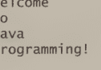

图 2.4 | 使用单个语句打印多行文本

```java
System.out.println("Welcome\nto\nProgramming!");
```

在命令窗口中显示多行文本。通常，字符串中的字符按照它们在双引号中的顺序显示。然而，反斜杠 `\` 是转义字符，具有特殊含义。当反斜杠出现在字符串中时，Java 将其与下一个字符形成转义序列 `\n` 代表换行符。当打印的字符串中出现换行符时，换行符会导致字符串的输出光标移动到下一行的开头。

图 2.5

```
http://docs.oracle.com/javase/specs/jls/se8/html/jls-3.10
```

**图 2.5** | 常见的转义序列。

## 2.4 使用 printf 显示文本

方法 `out.printf`（f 代表“格式化”）可以显示格式化数据。图 2.6 使用此方法分行输出字符串“Welcome to”和“Java Programming!”。

```java
// Fig. 2.6: Welcome4.java
// 使用 System.out.printf() 显示多行。
public class Welcome4 {
    // main 方法开始 Java 应用程序的执行
    public static void main(String[] args) {
        System.out.printf("%s%n%s%n", "Welcome to", "Java Programming!");
    } // main 方法结束
} // 类结束 Welcome4
```

Welcome to

Java Programming!

**图 2.6** | 使用 System.out.printf 显示多行。

`printf` 的第一个参数是一个字符串，可以由固定文本和格式说明符组成。固定文本由 `printf` 输出，就像由 `print` 或 `println` 输出的一样。

## 2.5 另一个应用：整数相加

每个格式指定符都是一个值的占位符，并指定要输出的数据类型。格式指定符还可能包含可选的格式信息。格式指定符以百分号 (`%`) 开头，后面紧跟一个表示数据类型的字符。例如，格式指定符 `%s` 是字符串的占位符。该字符串指定 `printf` 输出两个字符串，每个字符串后面紧跟一个换行符。在第一个格式指定符的位置，`printf` 用格式字符串后面的第一个参数的值。在随后的每个格式指定符的位置，`printf` 替换下一个参数的值。因此，此示例将第一个 `%s` 替换为 "Welcome to"，将第二个 `%s` 替换为 "Java Programming"。输出显示两行文本在两个行上。

我们没有使用转义序列 `\n`，而是使用了 `%n` 格式指定符，它是一个跨操作系统可移植的行分隔符。你不能在 `System.out.print` 或 `System.out.println` 的参数中使用 `%n`；但是，`System.out.println` 在其参数后输出的行分隔符是跨操作系统可移植的。附录 I 提供了关于使用 `printf` 输出内容的更多细节。

## 2.5 另一个应用：整数相加

我们的下一个应用读取（或输入）用户通过键盘输入的两个整数（如 -22、27、7 和 1024），计算它们的和并显示出来。该程序必须跟踪程序中用户用于计算的数字。程序在计算机内存中记录数字和其他数据，并通过称为变量的程序元素访问这些数据。图 2.7 的程序演示了这些概念。在示例输出中，我们使用**粗体文本**来标识用户的输入（即 45 和 72）。根据我们的程序列表惯例，第 1–2 行说明了图号、文件名和程序的目的。

```java
// Fig 2.7: Addition.java
// 输入两个数字并显示它们的和的加法程序。
import java.util.Scanner; // 程序使用 Scanner 类

public class Addition {
    // main 方法开始执行 Java 应用程序
    public static void main(String[] args) {
        // 创建一个 Scanner 从命令行窗口获取输入
        Scanner input = new Scanner(System.in);

        System.out.print("Enter first integer: "); // 提示
        int num1 = input.nextInt(); // 从用户读取第一个数字
        System.out.print("Enter second integer: "); // 提示
        int num2 = input.nextInt(); // 从用户读取第二个数字

        int sum = num1 + num2; // 相加，然后将总和存储在 sum 中
        System.out.printf("Sum is %d%n", sum); // 显示和
    } // 方法结束
} // 类 Addition 结束
```

图 2.7 | 输入两个数字并显示它们的和的加法程序。

```
Enter first integer: 45
Enter second integer: 72
Sum is 117
```

图 2.7 输入两个数字并显示它们的和的加法程序。（第 2/2 部分。）

### 2.5.1 导入声明

Java 的强大之处在于它拥有丰富的预定义类集合，你可以重用它们，而不是重新发明轮子。这些类被分组在包中——相关类的命名组——并统称为 Java 类库，或 Java 应用程序接口（Java API）。第 3 行

```java
import java.util.Scanner; // 程序使用 Scanner 类
```

是一个导入声明，它使用编译器来编译程序中使用的类。它表示程序使用了来自名为 `java.util` 的包的预定义 `Scanner` 类（稍后将进行讨论）。编译器随后确保你正确地使用了该类。


#### 常见编程错误 2.5

所有导入声明必须出现在文件中第一个类声明之前。在类声明内部或之后放置导入声明会导致语法错误。


#### 常见编程错误 2.6

忘记包含某个类的导入声明会导致包含类似“cannot find symbol（找不到符号）”消息的编译错误。当发生这种情况时，请检查你是否提供了正确的导入声明，以及声明中的名称是否正确（包括大小写）。

### 2.5.2 声明并创建 Scanner 以从键盘获取用户输入

变量是计算机内存中的一个位置，可以在其中存储值以供程序以后使用。所有 Java 变量在使用之前必须声明名称和类型。变量名可以是任何有效标识符——再次，即由字母、数字、下划线 (`_`) 和美元符号 (`$`) 组成的字符序列，不以数字开头且不包含空格。变量的类型指定了内存该位置存储什么类型的信息。与其他语句一样，声明语句以分号 (`;`) 结束。第 9 行

```java
Scanner input = new Scanner(System.in);
```

是一个变量声明，指定了程序中使用该变量的名称 (`input`) 和类型 (`Scanner`)。`Scanner`（包 `java.util`）允许程序读取数据。数据可以来自许多源，例如键盘或文件。在使用 `Scanner` 之前，你必须创建它。第 9 行的等号表示该变量应该被初始化。


#### 良好编程习惯 2.8

选择有意义的变量名有助于程序自文档化。


#### 良好编程习惯 2.9

按照惯例，变量名使用驼峰法且首字母小写。

### 2.5.3 提示用户输入

第 11 行

```java
System.out.print("Enter first integer: "); // 提示
```


这条消息被称为提示信息。我们使用 `print` 方法而不是 `println`，以便用户的输入显示在同一行。根据第 2.2 节，以大字母开头的标识符表示类名。`System` 类是 `java.lang` 的一部分。


**软件工程观察 2.1**

默认情况下，每个 Java 程序都会导入 `lang` 包；因此 `java.lang` 中的类不需要导入声明。

### 2.5.4 声明变量存储并从键盘获取整数

第 12 行的变量声明

```java
int number1 = input.nextInt(); // 从用户读取第一个数字
```

声明变量 `number1` 持有 `int` 类型的数据——即整数值，如 72、-127 和 0。`int` 的值范围是 -2,147,483,648 到 +2,147,483,647。你在程序中使用的 `int` 值不能包含逗号；但是，为了可读性，可以使用下划线。因此 `60_000_000` 代表整数 60,000,000。

其他数据类型是 `float` 和 `double`（用于持有实数）以及 `char`（用于字符数据）。实数包含小数点，如 3.4、0.0 和 -11.19。`char` 类型的变量表示单个字符，例如大写字母（如 A）、数字（如 7）、特殊字符（如 * 或 %）或转义序列（例如制表符 `\t`）。`int`、`float`、`double` 和 `char` 是原生类型。原生类型名称是关键字，且必须全部全小写。附录 D 总结了八种原生类型的特征（`boolean`、`byte`、`char`、`short`、`int`、`long` 和 `double`）。


# 第2章 Java应用程序简介：输入/输出与运算符

第12行的等号 `=` 表示变量 `number1` 在声明时使用 `input.nextInt()` 的结果进行初始化。这使用了 `Scanner` 对象的 `nextInt` 方法从键盘用户处获取一个整数。此时，程序会等待用户输入数字并按回车键将数字提交给程序。

我们的程序假设用户输入的是有效的整数值。如果不是，将会发生逻辑错误且程序将终止。第11章“异常处理：深入探讨”讨论了如何通过使程序能够处理此类错误来增强程序的健壮性。这也被称为使程序具有容错性。

## 2.5.5 获取第二个整数

```java
System.out.print("Enter second integer:"); // 提示用户输入第二个整数。第15行
int number2 = input.nextInt(); // 从用户处读取第二个数字
```

声明 `int` 类型变量 `number2` 并用从键盘处读取的第二个整数对其初始化。

## 2.5.6 在计算中使用变量

```java
int sum = number1 + number2; // 将两个数字相加，并将总和存储在 sum 中
```

声明 `int` 类型变量 `sum` 并用 `number1 + number2` 的结果对其初始化。当程序遇到加法操作时，它将使用存储在变量 `number1` 和 `number2` 中的值进行计算。

前面的语句中，加法运算符是一个二元运算符，因为它有两个操作数——`number1` 和 `number2`。包含计算的语句部分称为表达式（expressions）。事实上，表达式是语句中任何具有值的部分。表达式 `number1 + number2` 的值是这两个数字之和。同样地，表达式 `input.nextInt()`（第12行和第15行）的值是用户输入的整数。


> **良好的编程习惯 2.10**
>
> 在二元运算符两侧加上空格以提高可读性。

## 2.5.7 显示计算结果

计算完成后，第19行

```java
System.out.printf("Sum is %d%n", sum); // 显示 sum
```

使用 `System.out.printf` 显示总和。格式指定符 `%d` 是 `int` 类型值（在此情况下为 `sum` 的值）的占位符——字母 `d` 代表“十进制整数”（decimal integer）。格式字符串中的其余字符都是固定文本。因此，`printf` 方法显示 `Sum is `，随后是 `sum` 的值（位于 `%d` 格式指定符的位置）和一个换行符。

## 2.6 内存概念 49

计算也可以在 `printf` 语句内部执行。我们可以将第17行和第19行的语句合并为：

```java
System.out.printf("Sum is %d", (number1 + number2));
```

表达式 `number1 + number2` 外围的括号是可选的——它们是为了强调整个表达式的值位于 `%d` 格式指定符之外。这种括号被称为冗余括号。

## 2.5.8 Java API 文档

对于使用的每个 Java API 类，我们都指出了它所在的包。这些信息可以帮助你在 Java API 文档中找到每个包和类的描述。该文档的 Web 版本可以在以下地址找到：

```
http://docs.oracle.com/javase/8/docs/api/index.html
```

你可以在“附加资源”中下载：

```
http://www.oracle.com/technetwork/java/javase/downloads
```

附录 F 显示了如何使用此文档。

## 2.5.9 在单独语句中声明和初始化变量

在计算（或其他表达式）中使用变量之前，每个变量都必须有一个值。第12行的变量声明语句声明了 `number1` 并用用户输入的值对其初始化。

有时你会在一条语句中声明变量，然后在另一条语句中初始化。例如，第12行可以写两条语句：

```java
int number1; // 声明 int 类型变量 number1
number1 = input.nextInt(); // 将用户的输入赋值给 number1
```

第一条语句声明了 `number1` 但没有对其进行初始化。第二条语句使用赋值运算符 `=` 为 `number1` 分配（即，获取）用户输入的值。你可以将这条语句读为“`number1` 获取了 `input.nextInt()` 的值”。赋值运算符 `=` 右侧的所有内容在执行赋值之前总是会被求值的。

## 2.6 内存概念

变量名如 `number1`、`number2`、`sum` 实际上对应计算机内存中的位置。每个变量都有名称、类型、大小（字节）和值。在图2.7的加法程序中，当执行以下语句时：

```java
int number1 = input.nextInt(); // 从用户处读取第一个数字
```

用户输入的数字被放置于与 `number1` 对应的内存位置。假设用户输入了 45。计算机将整数值放在位置 `number1`（图2.8），替换掉该位置之前的值（如果有的话）。旧值丢失了，因此这个过程被称为是破坏性的（destructive）。

| number1 | 45 |
| :--- | :--- |
| **图 2.8** | 显示变量 `number1` 名称和值的内存位置 |

当语句（第15行）

```java
int number2 = input.nextInt(); // 从用户处读取第二个数字
```

执行时，假设用户输入了 72。计算机将该整数值放在位置 `number2`。现在内存看起来如图2.9 所示。

| number1 | 45 |
| number2 | 72 |
| **图 2.9** | 存储 `number1` 和 `number2` 值后的内存位置。 |

图2.7的程序在获取 `number1` 和 `number2` 的值后，它将这些值相加并将和存入变量 `sum`。语句（第17行）

```java
int sum = number1 + number2; // 将数字相加，然后将总和存储在 sum 中
```

执行加法，然后替换 `sum` 中的任何旧值。在计算出 `sum` 后，内存看起来如图2.10 所示。`number1` 和 `number2` 的值与在用于计算 `sum` 之前完全一样。这些值被使用了，但在计算机执行计算时并没有被销毁。当从内存位置读取值时，该过程是非破坏性的。

| number1 | 45 |
| number2 | 72 |
| sum | 117 |
| **图 2.10** | 存储 `number1` 和 `number2` 之和后的内存位置。 |

## 2.7 算术

大多数程序执行算术计算。算术运算符总结在图2.11中。注意某些代数中未使用的符号。星号 `*` 表示乘法，百分号 `%` 是取余运算符，我们将讨论它。图2.11中的算术运算符是二元运算符，因为每个运算符作用于两个操作数。例如，表达式 `f + 7` 包含二元运算符和两个操作数。

| 操作 | 符号 | 示例 | 结果 |
| :--- | :--- | :--- | :--- |
| 加法 | `+` | `f + 7` | `f + 7` |
| 减法 | `-` | `p - c` | `p - c` |
| 乘法 | `*` | `b * m` | `b * m` |
| 除法 | `/` | `x / y` | `x / y` |
| 取余 | `%` | `r % s` | `r % s` |

**图 2.11** 算术运算符。

整数除法产生整数商。例如，表达式 `7 / 4` 的求值为 1，表达式 `17 / 5` 的求值为 3。整数除法中的任何分数部分都会被简单截断（即丢弃）——不会发生舍五法入。Java提供了取余运算符，它产生除后的余数——`x` 除以 `y`，`7 % 4` 产生 3，`17 % 5` 产生 2。该运算符通常用于整数操作，但也可以用于其他算术类型。在本章的练习和后续章节中，我们考虑了取余运算符的若干有趣的应用，例如判断一个数是否是另一个数的倍数。

## 2.7 算术（运算符优先级）

这些规则允许 Java 按照正确的顺序应用运算符。当我们说运算符从左到右应用时，指的是它们的结合性。某些运算符是从左到右结合的。图 2.12 总结了这些运算符优先级规则。附录 A 中包含一张完整的优先级表。

| 运算符 | 优先级 |
| :--- | :--- |
| `*` 乘法 | 首先评估。如果存在多个此类类型的运算符，则从左到右进行评估。 |
| `/` 除法 | |
| `%` 取余 | |
| `+` 加法 | 接下来评估。如果存在多个此类类型的运算符，则从左到右进行评估。 |
| `-` 减法 | |
| `=` 赋值 | 最后评估 |

**图 2.12** 算术运算符的优先级。

## 示例代数表达式和 Java 表达式

让我们考虑几个示例表达式。每个示例都展示了一个代数表达式及其 Java 等效表达式。以下是五项平均值的一个示例：

```
Algebra: $m = \frac{a+b+c+d+e}{5}$
Java: $m = (a + b + c + d + e) / 5$;
```

之所以需要括号，是因为除法的优先级高于加法。整个量 $(a + b + c + d + e)$ 需要被除以 5。如果错误地省略了括号，我们将得到 $a + b + c + d + e / 5$，它的评估结果为不同的表达式：

```
$a + b + c + d + \frac{e}{5}$
```

这里有一个直线方程的示例：

```
Algebra: $y = mx + b$
Java: $y = m * x + b$;
```

不需要括号。乘法运算符首先应用，因为乘法的优先级高于加法。赋值最后发生，因为它的优先级低于乘法或加法。

下面的示例包含取余（`%`）、乘法、除法、加法和减法操作：

```
Algebra: $z = pr * q + wx - y$
Java: $z = p * r % q + w / x - y$;
```

> **注意**
>
> 1. 我们使用简单的表达式来解释评估顺序。在更复杂的表达式会出现细微的评估顺序问题。更多信息，请参阅《Java 语言规范》第 15 章（https://docs.oracle.com/javase/specs/jls/se8/html/jls-15.html）。

## 2.7 算术（评估顺序示例）

语句下方的圆圈数字表示 Java 应用运算符的顺序。`*`、`/`、`%` 操作首先按左到右的顺序进行评估（即从左到右结合），因为它们的优先级高于 `+` 和 `-`。`+` 和 `-` 操作接下来进行评估。这些操作也从左到右应用。赋值 (`=`) 操作最后评估。

## 二次多项式的评估

为了更好地理解运算符优先级规则，请考虑一个包含二次多项式 $ax^2 + bx + c$ 的赋值表达式的评估：

```java
y = a * x * x + b * x + c;
    6 1 2 3 4 5
```

乘法操作首先按左到右的顺序进行评估（即从左到右结合），因为它们的优先级高于加法。Java 没有用于幂的算术运算符，因此 $x^2$ 被评估为 $x * x$（第 5.4 节显示了执行幂另一种方法）。加法操作接下来从左到右评估。假设 a, b, c 和 x 按照初始化（给定值）如下：a = 2, b = 3, c = 7 且 x = 5。图 2.13 展示了运算符应用的顺序。

```
Step 1. y = 2 * 5 * 5 + 3 * 5 + 7; (最左侧的乘法)
    2 * 5 是 10
Step 2. y = 10 * 5 + 3 * 5 + 7; (最左侧的乘法)
    10 * 5 是 50
Step 3. y = 50 + 3 * 5 + 7; (加法之前的乘法)
    3 * 5 是 15
Step 4. y = 50 + 15 + 7; (最左侧的加法)
    50 + 15 是 65
Step 5. y = 65 + 7; (最后的加法)
    65 + 7 是 72
Step 6. y = 72 (最后的操作——将 72 放入 y)
```

**图 2.13** 二次多项式的评估顺序。

你可以使用冗余的括号使表达式更清晰。例如，前面的语句可以如下加括号：

```java
y = (a * x * x) + (b * x) + c;
```

## 2.8 决策：等价运算符和关系运算符

条件是一个可以为真或为假的表达式。本节介绍了 Java 的选择语句，它允许程序根据条件的值做出决策。例如，条件“成绩大于等于60”决定了学生是否通过了测试。如果 `if` 语句的条件为真，则执行其体。如果条件为假，则不执行其体。

`if` 语句中的条件可以使用等价运算符（`==` 和 `!=`）和关系运算符（`>`、`<`、`>=`、`<=`）形成，如图 2.14 所示。等价运算符的优先级相同，低于关系运算符。等价运算符从左到右结合。关系运算符具有相同的优先级且也从左到右结合。

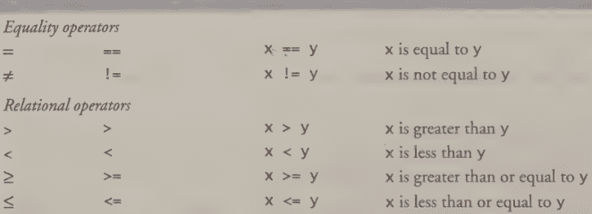

**图 2.14** 等价和关系运算符。

图 2.15 使用 `if` 语句比较整数。如果这些 `if` 语句中的任何条件为真，则执行相关语句；否则，跳过语句。我们使用 `Scanner` 从用户处输入整数并存储在变量 `number1` 和 `number2` 中。程序比较数字并显示用户输入的不同结果。

```java
// Fig 2.15: Comparison.java
// 使用 if 语句、关系运算符
// 和等价运算符。
import java.util.Scanner;

public class Comparison {
    // main 方法开始
    public static void main(String[] args) {
        // 创建 Scanner 获取输入
        Scanner input = new Scanner(System.in);

        System.out.print("Enter first integer:"); // 提示
        int number1 = input.nextInt(); // 从用户读取第一个数字
        System.out.print("Enter second integer:"); // 提示
        int number2 = input.nextInt(); // 从用户读取第二个数字

        if (number1 == number2) {
            System.out.printf("%d = %d%n", number1, number2);
        }
        if (number1 != number2) {
            System.out.printf("%d != %d%n", number1, number2);
        }
        if (number1 < number2) {
            System.out.printf("%d < %d%n", number1, number2);
        }
        if (number1 > number2) {
            System.out.printf("%d > %d%n", number1, number2);
        }
        if (number1 <= number2) {
            System.out.printf("%d <= %d%n", number1, number2);
        }
        if (number1 >= number2) {
            System.out.printf("%d >= %d%n", number1, number2);
        }
    } // main 方法结束
} // Comparison 类结束
```

| 输入 | 输出 |
| :--- | :--- |
| Enter first integer: 777 | |
| Enter second integer: 777 | |


| | 777 = 777 |
| | 777 <= 777 |
| | 777 > 777 |
| Enter first integer: 1000 | |
| Enter second integer: 2000 | |
| | 1000 = 2000 |
| | 1000 < 2000 |
| | 1000 <= 2000 |
| Enter first integer: 2000 | |
| Enter second integer: 1000 | |
| | 2000 = 1000 |
| | 2000 > 1000 |
| | 2000 <= 1000 |

**图 2.15** | 使用 `if` 语句、关系运算符和等价运算符。（部分 2/2。）

## 56 第2章 Java 应用程序简介：输入/输出与运算符

`Comparison` 类的 `main` 方法（8–41 行）开始程序的执行。第 10 行

```
Scanner input = new Scanner(System.in);
```

声明 `Scanner` 变量 `input` 并为其分配一个从标准输入（即键盘）输入数据的 `Scanner`。

第 12–13 行

```
System.out.print("Enter first integer:"); // 提示
number1 = input.nextInt(); // 从用户读取第一个数字
```

提示用户输入第一个整数和该值。该值存储在 `int` 变量 `number1` 中。

第 15–16 行

```
System.out.print("Enter second integer:"); // 提示
number2 = input.nextInt(); // 从用户读取第二个数字
```

提示用户输入第二个整数和该值。该值存储在 `int` 变量 `number2` 中。

第 18–20 行

```
if (number1 == number2) {
    System.out.printf("%d == %d\n", number1, number2);
}
```

比较变量 `number1` 和 `number2` 的值以测试等价性。如果值相等，第 19 行的语句将显示一行文本指示数字相等。从第 22、26、30、34 和 38 行开始的 `if` 语句使用 `!=`、`<`、`<=`、`>=` 比较 `number1` 和 `number2`。如果这些 `if` 语句中的任何条件为真，则相应的语句体会显示相应的文本。图 2.15 中的每个语句都包含一个语句体，并进行了缩进。此外注意我们将每个语句体封装在括号 `{ }` 中，创建了所谓的复合语句或块。

> **常见编程实践 2.11**
>
> 对 `if` 语句体的语句进行缩进以增强可读性。IDE 通常会为你完成，允许你指定缩进大小。

> **错误提示 2.4**
>
> 你不需要对单语句体使用括号 `{ }`，但必须对多个语句体包含括号。你稍会看到忘记封装多个语句体会导致错误。为了避免错误，作为原则，始终将 `if` 语句的语句体封装在括号中。

> **常见编程错误 2.7**
>
> 在 `if` 语句条件的右括号后立即放置分号是一个逻辑错误（尽管不是语法错误）。分号导致 `if` 语句的体为空，因此无论条件真假，该语句都不会执行任何操作。更糟糕的是，`if` 语句的原始语句体总是执行，通常会导致程序产生错误结果。

### 空格

注意图 2.15 中空格的使用。回想，编译器会忽略空格，语句可以跨越几行，并可以根据你的喜好进行间距调整，而不会影响程序的含义。拆分标识符和字符串是不正确的。理想情况下，语句应该保持短小，但这并不总是可能的。

> **错误预防提示 2.5**
>
> 很长的语句可以分布在几行上。如果必须将单个语句跨行拆，请选择自然的断开点，例如逗号分隔列表中的逗号之后，或者长表达式中运算符之后。如果语句跨越两行或多行，请缩进所有后续行直到语句结束。

### 到目前为止的运算符

图 2.16 显示了到目前讨论的运算符，按优先级从高到低排序。所有运算符（包括 `=`）从左到右结合。赋值运算符从左到右结合。赋值表达式的值是赋值给 `=` 运算符左侧变量的值——例如，表达式 `x = 7` 的值为 `7`。因此，像 `x = y = 0` 这样的表达式会被评估如同写成 `x = (y = 0)`，它首先将值 `0` 赋值给变量 `y`，然后将该赋值的结果 `0` 赋值给 `x`。

| 运算符 | 结合性 | 类型 |
| :--- | :--- | :--- |
| `*` `/` `%` | 从左到右 | 乘法 |
| `+` `-` | 从左到右 | 加法 |
| `<` `<=` `>` `>=` | 从左到右 | 关系 |
| `==` `!=` | 从左到右 | 相等 |
| `=` | 从右到左 | 赋值 |

**图 2.16** 已讨论运算符的优先级和结合性。

> **良好的编程实践 2.12**
>
> 当包含许多运算符的表达式时，参考运算符优先级表（附录 A）。确认表达式中的操作按照你预期的顺序执行。如果在复杂的表达式中不确定评估顺序，请使用括号强制规定顺序，就像你在代数表达式中这样做一样。

## 2.9 总结

在本章中，你学习了 Java 的许多重要特性，包括从键盘输入数据、在命令行窗口上显示数据、进行计算和做出决策。这里介绍的应用介绍了许多基础编程概念。正如你将在第 3 章看到的，Java 应用通常在 `main` 方法中只包含几行代码——这些语句通常创建执行应用程序工作的的对象。在第 3 章中，你将学习如何实现你自己的类并在应用程序中使用这些类的对象。

## 总结

### 2.2 你的第一个 Java 程序：打印文本

- 当你使用 `java` 命令启动 JVM 时执行应用程序（p36）。
- 注释（p37）文档化程序并提高其可读性。编译器会忽略它们。
- 行尾注释以 `//` 开始，在所在的行尾结束。
- 传统注释（p37）可以跨多行，并由 `/*` 和 `*/` 分隔。
- Javadoc 注释（p37）由 `/**` 隔开，允许你在代码中嵌入程序文档。Javadoc 程序根据这些注释生成网页。
- 当编译器遇到违反 Java 规则的代码时，会发生语法错误（p37）。这类似于自然语言中的语法错误。
- 空行、空格字符和制表符字符被称为空格（p38）。空格使程序更容易阅读，并被编译器忽略。
- 关键字（p38）供 Java 留用，并始终用小写字母拼写。
- 关键字 `class`（p38）引入类声明。
- 按照约定，Java 中的所有名称以大写字母开头，每个单词的首字母大写（例如 `className`）。
- 类名是一个标识符——由字母、数字、下划线（`_`）和美元符号（`$`）组成，不以数字开头且不包含空格。`public` 类声明（p38）保存在与类同名的文件中，扩展名为 `.java`。
- Java 是大小写敏感的（p38）——即大写和小写字母是不同的。每个类声明的体（p39）由花括号 `{ }` 分隔。`main` 方法（p39）是每个 Java 应用程序的起点，必须以 `public static void main(String[] args)` 开始，否则 JVM 将不会执行应用程序。方法执行任务并在完成后返回信息。关键字 `void`（p39）表示方法将执行任务但不返回信息。
- 语句指示计算机执行操作。
- 引号中的字符串（p40）有时是一个字符字符串或字符串字面量。
- 标准输出对象 `System.out`（p40）在命令行窗口中显示参数。`System.out.println`（p40）显示参数后跟一个换行符，将输出光标置于下一行的开头。

#### 2.2.1 编译应用程序

- 使用 `javac` 命令编译程序；如果程序没有语法错误，就会创建一个表示应用程序的类文件（p41）。当你执行程序时，JVM 会解释这些字节码。

#### 2.2.2 执行应用程序

- 要运行应用程序，输入 `java` 后跟包含 `main` 方法的类名。

### 2.3 修改你的第一个程序

### 总结

字符串中的反斜杠 `\` 是转义序列。

### 2.4 使用 printf 显示文本

- `System.out.printf`（p44）显示格式化文本。
- `printf` 的第一个参数是格式字符串（p44）。
- 带有百分号 `%` 的格式说明符跟随数据类型。
- `%n`（p45）是行符。
- `%s`（p45）是字符串的占位符。

### 2.5.1 import 声明

- `import`（p46）帮助编译器导入类。
- Java 丰富的预定义类被分组在包中。这些被称为应用程序接口（API；p46）。

### 2.5.2 声明和创建 Scanner 获取用户输入

- 变量（p46）是计算机内存中一个可以存储值的位置。所有变量在使用之前必须声明其名称和类型。
- 变量名允许程序访问变量的值。
- `Scanner`（package `java.util`；p46）允许程序读取程序将使用的数据。
- 在使用 `Scanner` 之前，程序必须创建它并指定数据源。
- 变量应该初始化（p46）为使用做准备。
- 表达式 `new Scanner(System.in)` 创建一个从标准输入对象（`System.in`; p47）读取的 `Scanner`。

### 2.5.3 提示用户输入

- 提示（p47）引导用户采取特定操作。

### 2.5.4 声明变量以存储整数并从键盘获取整数

- 数据类型 `int`（p47）用于声明持有整数值的变量。`int` 的取值范围是 -2,147,483,648 到 +2,147,483,647。
- 你在程序使用的 `int` 值可能包含逗号；然而，为了可读性，在数字中使用下划线（例如 `60_000_000`）。
- `float` 和 `double` 类型（p47）指定带小数点的实数；例如 -11.99 和 3.4。
- `char` 类型（p47）的变量表示单个字符，例如大写字母（如 A）、数字（如 7）、`*` 或转义序列（如 `\n`, `\t`）。
- `int`、`float`、`double` 和 `char` 是基本类型（p47）。基本类型名称是关键字；它们必须全部小写。
- `Scanner` 方法 `nextInt()` 获取一个供程序使用的整数。

### 60 第 2 章 Java 简介：输入/输出与运算符

### 2.5.6 节 在计算中使用变量

- 具有值的语句表达式称为表达式（第 48 页）。

### 2.5.7 节 显示计算结果

- 格式指定符 `%d`（第 48 页）是 `int` 值的占位符。

### 2.5.9 节 在独立语句中声明和初始化变量

- 变量在程序中使用之前必须为其赋一个值。
- 赋值运算符 `=`（第 49 页）允许程序为变量赋予值。

### 2.6 节 内存概念

- 变量名（第 49 页）对应于计算机内存中的位置。每个变量都有名称、类型、大小和值。
- 放置在内存位置的值将替换该位置之前的值，旧值将丢失。

### 2.7 节 算术

- 算术运算符（第 50 页）包括 `+`（加法）、`-`（减法）、`*`（乘法）、`/`（除法）和 `%`（取模）。
- 整数除法（第 53 页）产生一个整数商。
- 取模运算符 `%`（第 51 页）产生除法后的余数。
- 算术表达式以直线形式书写（第 51 页）。
- 如果表达式包含嵌套括号（第 51 页），则先求值最内层的括号。
- Java 根据运算符优先级规则（第 51 页）以精确且确定的顺序应用算术表达式中的运算符。
- 当我们使用从左到右适用的运算符时，我们指的是它们的结合性（第 52 页）。某些运算符是从右到左结合的。
- 冗余的括号（第 53 页）使表达式更清晰。

### 2.8 节 决策：等值与关系运算符

- `if` 语句（第 54 页）根据条件的值（真或假）做出决策。
- `if` 语句中的条件可以使用等值运算符（`==` 和 `!=`）和关系运算符（`>`、`<`、`>=`、`<=`）（第 54 页）组成。
- `if` 语句以关键字开头，后面跟着圆括号内的条件，并期望其体部包含一条语句。对于包含多个语句的体部，必须包含大括号。

## 自测习题

填空下列每个语句中的空格：

2.1

a) 一个(n) ________________ 和一个(n) ________________ 是每个方法的开始和结束。

b) 你可以使用 ________________ 语句来做出决策。

c) ________________ 是行尾注释。

d) ________________ 和 ________________ 被称为空白字符。

e) ________________ 留供 Java 使用。

f) Java 应用在方法 ________________ 处执行，并在 ________________ 窗口显示信息。

g) 方法在命令行窗口中 ________________，并且在 ________________。

2.2 判断下列每个陈述的对错。如果如果是错误的，请解释原因。

a) 注释会导致计算机在程序执行并在屏幕上显示 `//` 之后的文本。

b) 所有变量在声明时都必须赋予一个类型。

c) Java 认为变量 `number` 和 `numBer` 是相同的。

d) 取模运算符 `%` 只能用于整数操作数。

e) 算术运算符 `*`、`/`、`+` 和 `-` 的优先级级别相同。

f) 标识符 `_`（下划线）在 Java 9 中是有效的。

编写语句完成以下每个任务：

a) 声明 `c`、`thisVariable`、`q63354` 和 `number` 类型为 `int`，并将每个初始化为 0。

b) 提示用户输入一个整数。

c) 输入一个整数并将结果赋值给 `int` 变量 `value`。假设可以使用 `Scanner` 变量 `input` 从键盘读取值。

d) 在命令行窗口中单行打印 "This is a Java program"。使用 `System.out.println`。

e) 在命令行窗口中分两行打印 "This is a Java program"。第一行以 Java 结尾。使用 `System.out.printf` 和两个 `%s` 格式指定符。

f) 如果变量 `number` 不等于 7，则显示 "The variable number is not equal to 7"。

识别并修正下列每个语句中的错误：

a) `if (c < 7);`

```
System.out.println("c is less than 7");
```

b) `if (c >= 7)`

```
System.out.println("c is equal to or greater than 7");
```

编写声明、语句或注释完成以下每个任务：

a) 说明程序将计算三个整数的乘积。

b) 创建一个名为 `input` 的 `Scanner`，从标准输入读取值。

c) 提示用户输入第一个整数。

d) 从用户处读取第一个整数并存储在 `int x` 中。

e) 提示用户输入第二个整数。

f) 从用户处读取第二个整数并存储在 `int` 变量 `y` 中。

g) 提示用户输入第三个整数。

h) 从用户处读取第三个整数并存储在 `int z` 中。

i) 计算变量 `x`、`y` 和 `z` 中三个整数的乘积，并将结果存储在 `int` 变量 `result` 中。

j) 使用 `System.out.printf` 显示消息 "Product is" 以及 `result` 的值。

使用你在练习 2.5 中编写的语句，编写一个完整的程序，计算并打印三个整数的乘积。

## 自测习题答案

### 2.1
a) 左括号 `{`，右括号 `}`。 b) `if` c) `//` d) 空格字符、换行和制表符。 e) 关键字。 f) `main()`、`System.out.println` 和 `printf`。

### 习题 2.2 的答案为：

a) 错误。注释在程序执行时不会执行任何操作。它们用于记录程序并提高可读性。

b) 正确。

c) 错误。Java 对大小写敏感，因此这些变量是不同的。

d) 错误。取模运算符也可以用于非整数操作数。

e) 错误。`*` 和 `/` 的优先级高于 `+` 和 `-`。

f) 错误。`_` 本身在 Java 9 中不再是有效的标识符。

### 习题 2.3 的答案为：

a) `int c = 0;` `int thisVariable = 0;` `int q6354 = 0;` `int number = 0;`

b) `System.out.print("Enter an integer: ");`

c) `int value = input.nextInt();`

d) `System.out.println("This is a Java program");`

e) `System.out.printf("%s%s", "This is a Java", "program");`

f) `if (number != 7) { System.out.println("The variable is not equal to 7"); }`

### 习题 2.4 的答案为：

a) 错误：`(c < 7)` 的右括号后有分号。`if` 语句无论条件是否为真都会执行。修正：删除右括号的分号。

b) 错误：`=>` 是错误的。修正为 `>=`。

### 习题 2.5 的答案为：

a) `// Calculate the product of three integers`

`Scanner input = new Scanner(System.in);`

c) `System.out.print("Enter first integer: ");`

`int x = input.nextInt();`

d) `System.out.print("Enter second integer: ");`

`int y = input.nextInt();`

g) `System.out.print("Enter third integer: ");`

`int z = input.nextInt();`

i) `int result = x * y * z;`

j) `System.out.printf("Product is %d\n", result);`

### 习题 2.6 的答案为：


```java
// Ex. 2.6: Product of three integers.
// Calculate the product of three integers.
import java.util.Scanner; // program uses Scanner
public class Product {
    public static void main(String[] args) {
        // Create Scanner to obtain input from command window
        Scanner input = new Scanner(System.in);

        System.out.print("Enter first integer: "); // prompt for input
        int x = input.nextInt(); // read first integer

        System.out.print("Enter second integer: "); // prompt for input
        int y = input.nextInt(); // read second integer

        System.out.print("Enter third integer: "); // prompt for input
        int z = input.nextInt(); // read third integer
    }
}
```

## 习题 63

```java
19 int result = x * y * z; // calculate product of numbers
20
21 System.out.printf("Product is %d\n", result);
22 } // end method main
23 } // end class Product
```

Enter first integer: 10

Enter second integer: 20

Enter third integer: 30

Product is 6000

## 习题

### 2.7 填下列语句：

a) `________` 用于记录程序并提高其可读性。

b) Java 程序可以通过 `________` 做出决策。

c) 与乘法优先级相同的算术运算符是 `________` 和 `/`。

d) 当算术表达式中的括号嵌套时，求值最内层的括号。

e) 计算机内存中在程序执行过程中可能包含不同值的位置称为 `________`。

### 2.8 编写完成以下每个任务的语句：

a) 显示消息 `"Enter an integer: "` 并让光标留在同一行。

b) 将变量 `b` 和 `c` 的值赋值给 `int` 变量 `a`。

c) 使用注释说明程序执行示例工资计算。

### 2.9 判断下列每个陈述的对错。如果是错误的，请解释原因。

a) Java 运算符从左到右求值。

b) 以下都是有效的变量名：`_under_bar_`, `m928134`, `t5`, `j7`, `her_sales$`, `h_account_total`, `a`, `c`, 和 `z22`。

c) 无括号的有效 Java 表达式从左到右求值。

d) 以下是无效的变量名：`3g`, `87`, `67h2`, `h22` 和 `h2n`。

### 2.10 假设 `x = 2` 且 `y = 3`，下列每个语句显示什么？

a) `System.out.printf("%d + %d\n", x, y);`

b) `System.out.printf("Value of %d is %d\n", x * (x + x), x * (x + x));`

c) `System.out.printf("x = %d\n", x *= y);`

d) `System.out.printf("%d, %d\n", (x + y), (y + x));`

### 2.11 下列 Java 语句中哪些包含变量的值？

a) `int p = i + j + k;`

b) `System.out.println("Variables whose values are modified");`

c) `System.out.printf("S = %d\n", s);`

d) `int value = input.nextInt();`

### 2.12 给定 `y = ax²+7`，以下哪些是该方程的正确 Java 语句？

a) `int y = a * x * x + 7;`

b) `int y = a * x * x * (x + 7);`

c) `int y = (a *) * x * (x + 7);`

d) `int y = (a *) * x * x + 7;`

e) `int y = a * (x * x * x) + 7;`

f) `int y = a * x * (x + 7);`

# 64 第 2 章 Java 应用程序简介：输入/输出与运算符

### 2.13 写出每个 Java 语句中运算符的求值顺序，并显示每个语句执行后 `x` 的值：

- a) `int x = 7 + 3 * 6 / 2;`
- b) `int x = 2 % 2 + 2 * 2 - 2 / 2;`
- c) `int x = (3 * 9 * (9 / 3));`

### 2.14 编写一个应用程序，在同一行显示数字 1 到 4，相邻数字之间用空格分隔。使用以下技术：

- a) 使用一个 `System.out.print` 语句。
- b) 使用四个 `System.out.print` 语句。
- c) 使用一个 `System.out.printf` 语句。

### 2.15 （算术）编写一个应用程序，要求用户输入两个整数，获取这两个整数并打印它们的和、积、差和商（除法结果）。使用图 2.7 所示的技巧。

### 2.16 （整数比较）编写一个应用程序，要求用户输入两个整数，获取这两个整数并用“is larger”字样显示较大的数。如果数字相等，打印信息“These numbers are equal”。使用图 2.15 所示的技巧。

### 2.17 （算术、最小与最大）编写一个应用程序，从用户输入三个整数，并显示这些数字的平均值、积、最小值和最大值。使用图 2.15 所示的技巧。[注意：练习中平均值的计算应得出平均值的整数表示。因此，如果数值之和为 7，平均值应该是 2，而不是 2.33...]

### 2.18 （用星号显示形状）编写一个应用程序，使用星号 (`*`) 显示一个矩形、椭圆、箭头和菱形，如下：


### 2.19 下面代码会打印什么？

`System.out.printf("%%%s%n%%%s%n%%%s%n%%%s%n");`

### 2.20 下面代码会打印什么？

```
System.out.println("*");
System.out.println("-----");
System.out.println("*****");
System.out.println("-----");
System.out.println("*****");
System.out.println("-----");
System.out.println("*");
```

### 2.21 下面代码会打印什么？

```
System.out.print("*");
System.out.print("-----");
System.out.print("*****");
System.out.print("-----");
System.out.print("*****");
System.out.print("-----");
System.out.println("*");
```

### 2.22 下面代码会打印什么？

```
System.out.print("Java");
System.out.println("is");
System.out.println("awesome");
System.out.print("fun");
System.out.println("terrible");
```

### 2.23 下面代码会打印什么？

```java
System.out.printf("%d %s %d\n", 10, "test", 20);
```

### 2.24 （最大与最小整数）编写一个应用程序，读取五个整数并打印它们中的最大和最小整数。仅使用在本章中学的编程技巧。

### 2.25 （奇数或偶数）编写一个应用程序，读取一个整数并打印它是奇数还是偶数。[提示：使用取模运算符。偶数是 2 的倍数。任何 2 的倍数除以 2 的余数都是 0。]

### 2.26 （倍数）编写一个应用程序，读取两个整数，判断第一个是否是第二个的倍数并打印结果。[提示：使用取模运算符。]

### 2.27 （星号棋盘图案）编写一个应用程序，显示如下所示的棋盘图案：


### 2.28 （圆的直径、周长和面积）预告一下。在本章中，你学习了整数，Java 还可以表示包含小数点的浮点数，例如 3.14159。编写一个应用程序，从用户处输入圆半径（整数），并使用浮点值 3.14159 作为 π 来打印直径、周长和面积。使用 2.7 所示的技巧。[注意：你可以使用定义的 `Math.PI` 值作为 π。这个常量比值 3.14159 更精确。`Math` 类定义在 `java.lang` 包中。该包中的类是自动导入的，因此你不需要导入 `Math` 即可使用它。] 使用以下公式（`r` 是半径）：

```
diameter = 2r
circumference = 2πr
area = πr^2
```

不要将每次计算的结果存储在变量中。相反，应将每次计算指定为 `System.out.printf` 语句中将输出的值。周长和面积计算产生的值是浮点数。此类值可以使用格式 `%f` 输出。

### 2.29 （字符的整数值）这是另一个预告。在本章中，你学习了整数，Java 还可以表示包含小数点的浮点数，例如 3.14159。编写一个应用程序，从用户处输入圆半径（整数），并使用浮点值 3.14159 作为 π 来打印直径、周长和面积。

### 2.34 （世界人口增长计算器）搜索互联网确定当前世界人口和世界人口年增长率。编写一个应用程序，输入这些值，然后显示一、二、三、四、五后的预计世界人口。

### 2.35 （拼车节省计算器）研究几个拼车网站。创建一个应用程序，计算你的每日驾驶成本，以便估算通过拼车可以节省多少钱，拼车还有其他优点，如减少碳排放和缓解交通拥堵。该程序应输入以下信息并显示用户每日通勤的成本：

- a) 每日总里程数。
- b) 每加仑油的价格。
- c) 平均油油里程。
- d) 每日停车费。
- e) 每日过路费。

## 类、对象、方法和字符串简介

## 目标

在本章中，你将：

- 声明一个类并使用它来创建对象。
- 将类的行为实现为方法。
- 将类的属性实现为实例变量。
- 调用对象的方法使其执行任务。
- 学习方法的局部变量是什么以及它们与实例变量的区别。
- 学习什么是基本类型（`primitive types`）和引用类型（`reference types`）。
- 使用构造函数初始化对象的数据。
- 表示并使用包含小数点的数字。
- 学习为什么类是建模现实世界事物和抽象实体的自然方式。


## 3.1 简介

## 3.2 实例变量、set 方法和 get 方法

- 3.2.1 带有实例变量以及 set 和 get 方法的 `Account` 类
- 3.2.2 创建使用 `Account` 类对象的 `AccountTest` 类
- 3.2.3 编译和运行包含多个类的程序
- 3.2.4 `Account` 类 UML 图
- 3.2.5 关于 `AccountTest` 类的额外说明
- 3.2.6 使用私有实例变量和公共 set get 方法的软件工程
- 3.3 `Account` 类：使用构造函数初始化对象
- 3.3.1 定义用于对象初始化的 `Account` 构造函数
- 3.3.2 `AccountTest`：在创建对象时初始化
- 3.4 带有余额的 `Account` 类：浮点数
- 3.4 带有余额的 `Account` 类
- 3.5 `double` 类型的实例变量
- 3.6 使用 `Account` 类的 `AccountTest` 类
- 3.7 基本类型 vs. 引用类型
- 3.8（可选）GUI 和图形案例研究：一个简单的 GUI
- 3.8.1 什么是图形用户界面？
- 3.8.2 `JavaFX Scene Builder` 和 `FXML`
- 3.8.3 欢迎应用——显示文本和图像
- 3.8.4 打开 `Scene Builder` 并创建 `File.fxml`
- 3.8.5 向包含 `Welcome.fxml` 的文件夹中添加图像
- 3.8.6 创建 `VBox` 布局容器
- 3.7 配置 `VBox`
- 3.8 添加和配置 `Label`
- 3.9 添加和配置 `ImageView`
- 3.10 预览 Welcome GUI

总结 | 自我复习练习 | 自我复习练习答案 | 贡献

## 3.1 简介

在第 2 章中，你处理了现有的类、对象和方法。你使用了预定义的输出对象 `System.out`，调用它的方法 `print`、`println` 和 `printf` 在屏幕上显示信息。我们使用了现有的 `Scanner` 创建了一个对象，用于读取用户从键盘输入的数据类型。在书中，你将使用更多的预设类和对象——这是 Java 作为面向对象编程语言的伟大优势之一。

在本章中，你将创建自己的类和方法。你创建的每个新类都是新类型，用于声明变量和创建对象。你可以根据需要声明新类；这就是为什么 Java 是一种可扩展语言。

我们介绍了一个关于创建和使用简单的现实世界银行账户类——`Account` 的案例研究。此类类应该包含实例变量属性，例如名称和余额，并为等任务提供方法，例如查询余额（`getBalance`）、增加余额的存款（`deposit`）以及减少余额的取款（`withdraw`）。我们将在本章示例中将 `getBalance` 和 `deposit` 方法构建到类，你将在练习中添加 `withdraw` 方法。

在第 2 章中，我们使用数据类型 `int` 来表示整数。在本章中，我们引入了数据类型 `double` 来将账户余额表示为包含小数点的数字——这些数字被称为浮点数。在第 8 章中，当我们深入研究对象技术时，我们将开始使用 `BigDecimal` (`java.math`) 来精确地表示金额，正如你在编写工业级应用程序时应该做的那样。[或者，你可以将货币金额视为分单位的整数，然后通过除法和取余操作将结果分解美元和分，并在美元和分之间修正并插入小数点。]

## 70 第 3 章 类、对象、方法和字符串简介

通常情况下，你在书中开发的程序将由两个或多个类组成。如果你加入了工业界的开发团队，你可能会处理包含成百个甚至上千个类的应用程序。

## 3.2 实例变量、set 方法和 get 方法

在本节中，你将创建两个类——`Account`（图 3.1）和 `AccountTest`（图 3.2）。`AccountTest` 是一个应用程序类，其中 `main` 方法将创建并使用 `Account` 对象来演示 `Account` 的功能。

## 3.2.1 带有实例变量以及 set 和 get 方法的 Account 类

账户通常具有不同的名称。因此，`Account` 类（图 3.1）包含一个 `name` 实例变量。类的实例变量为该类的每个对象（即每个实例）维护数据。

## 3.2 实例变量、set 方法和 get 方法

必须与类同名并以 `.java` 结尾；否则将发生编译错误。因此，公共类 `Account` 和 `AccountTest`（图 3.2）必须位于单独的文件。

## 标识符和驼峰命名法

回想第 2 章，类名、方法名和变量名都是标识符，并且按照约定都采用驼峰命名法。此外，类名以大写字母开头，方法名和变量名以小写字母开头。

## 实例变量 name

回想第 1.5 节，对象具有属性，这些属性通过实例变量实现并贯穿其生命周期。实例变量在方法被调用之前、方法执行期间以及方法完成后都存在。类的每个对象（实例）都有该类实例变量的副本。一个类通常包含一个或多个操作特定对象的实例变量的方法。

实例变量声明在类内部，但在类方法体之外。第 6 行

```java
private String name; // 实例变量
```

在方法体之外声明了类型为 `String` 的实例变量 `name`。`String` 变量可以存储如 `"Jane Green"` 的字符值。如果有多个 `Account` 对象，每个都有自己的名称。由于 `name` 是一个实例变量，它可以被类的每个方法进行操作。

## 良好的编程实践 3.1

我们倾向于在类体中列出所有变量，这样在类方法使用它们之前就能看到变量的名称和类型。你可以在类方法声明之外任何地方出类的实例变量，但散布实例变量会导致代码难以阅读。

## 访问修饰符 public 和 private

大多数实例变量声明之前都有 `private` 关键字（如第 6 行）。与 `public` 一样，`private` 是一种访问修饰符。声明为 `private` 的变量或方法仅对其所属类的方法可访问。因此，变量名只能在对象的每个方法中使用在本例中为 `setName` 和 `getName`）。你很快就会发现，这提供了强大的软件工程机会。

## Account setName 方法

让我们来看 `setName` 方法声明的代码（第 9-11 行）：

```java
public void setName(String name) {
    this.name = name; // 存储名称
}
```

**图 3.1 Account**


```java
public class Account {
    private String name;

    // 设置名称的方法
    public void setName(String name) {
        this.name = name;
    }

    // 获取名称的方法
    public String getName() {
        return name;
    }
}
```

# 第 3 章 类、对象、方法和字符串简介

我们将每个方法声明的第一行（在本例中为第 9 行）称为方法头。方法的返回类型（出现在方法名之前）指定了方法在执行完任务后返回给调用者的数据类型。正如你很快将看到的，`main` 方法中第 19 行（3.2）的语句调用了方法 `setName`，因此在示例中，`main` 是 `setName` 的调用者。方法返回类型为 `void`（3.1 中的第 9 行）表示 `setName` 将执行一项任务，但不会向调用者返回（即给回）任何信息。在第 2 章中，你使用方法来返回信息——例如，你使用 `Scanner` 方法 `nextInt()` 来读取用户在键盘上输入的整数。当 `nextInt()` 从用户处读取一个值时，它会返回该值供程序使用。正如你很快看到的，`Account` 方法 `getName()` 返回了一个值。

方法 `setName()` 接收一个 `String` 类型的 `name`——它返回将作为参数传递给方法的名称。当我们讨论 3.2 中第 19 行的方法调用时，将看到参数和参数是如何协同工作的。

参数定义在参数列表中，该列表位于方法头中方法名后的括号内。当有多个参数时，每个参数之间用逗号隔开。每个参数必须指定一个类型（在本例中为 `String`），后跟一个变量名（在本例中为 `name`）。

## 参数是局部变量

在第 2 章中，我们在 `main` 方法中声明了应用程序的所有变量。在特定方法（如 `main`）中声明的变量是局部变量，它们只能访问自己的局部变量，不能访问其他方法的变量。每个方法都可以访问执行该方法任务的局部变量。当方法终止时，其局部变量的值就会丢失。方法的参数也是该方法的局部变量。

## `setName` 方法体

每个方法都由一对括号限定（如 3.1 中的第 9 行和第 11 行），括号内包含一个或多个执行方法任务的语句。在这种情况下，该方法包含单个语句（第 10 行），将参数（一个 `String`）的值赋值给类的 `name` 实例变量，将账户名称存储在对象中。如果方法中有一个与实例变量同名的局部变量（分别如第 9 行和第 6 行），在这种情况下，该局部变量被称为在方法体内“遮蔽”了实例变量。方法体可以使用 `this` 关键字来显式地引用实例变量，如第 10 行赋值左侧所示。第 10 行之后，方法已完成其任务，因此它返回到调用者处。

## 良好的编程实践 3.2

> 我们可以通过为第 9 行的参数选择不同的名称来避免此处对 `this` 关键字的需求，但如第 10 行所示使用 `this` 关键字是一种广泛接受的做法，以减少标识符名称的泛滥。

## `Account` 类的 `getName` 方法

方法 `getName()`（第 14–16 行）

```java
public String getName() {
    return name; // 将 name 的值返回给调用者
}
```


## 3.2 实例变量、`set` 方法和 `get` 方法

将特定 `Account` 对象的名称返回给调用者。该方法有一个空参数，因此它不需要额外信息来执行任务。该方法返回一个 `String`。当调用一个指定了 `void` 以外返回类型的方法并完成任务时，它必须向调用者返回一个结果。在 `Account` 对象上调用方法的语句（如图 3.2 第 14 行和第 24 行中的语句）期望接收 `Account` 对象——即方法声明中返回类型中指定的 `String`。

图 3.1 第 15 行的 `return` 语句将实例变量的 `String` 值传递给调用者。例如，当该值返回到图 3.2 第 23–24 行的语句时，该语句使用该值输出名称。

## 3.2.2 `AccountTest` 类创建并使用 `Account` 类的对象

接下来，我们想在程序中使用 `Account` 并调用它的每个方法。包含 `main` 方法的类开始 Java 应用程序的执行。`Account` 类不能执行其自身，因为它不包含 `main` 方法——如果你在命令行窗口输入 `java Account`，你将得到一个指示“在类 Account 中未找到 main 方法”的错误。要解决这个问题，你必须声明一个包含 `main` 方法的独立类，或者在 `Account` 类中放置一个 `main` 方法。

### 驱动类 `AccountTest`

通过告诉汽车做什么（减速、左转、右转等）来开车——而不需要知道汽车内部机制是如何工作的。同样，一个方法（如 `main`）通过调用它的方法来“驱动”对象——而不需要知道类的内部机制是如何工作的。从这个意义上说，包含方法的类被称为驱动类。

为了帮助你准备本书后面以及工业界遇到的更大的程序，我们在 `AccountTest.java` 文件（图 3.2）中定义了 `AccountTest` 及其 `main` 方法。一旦 `main` 开始，它可以调用此类和其他类中的方法；这些方法可能会调用其他方法，依此类推。`AccountTest` 类的 `main` 方法创建一个 `Account` 对象并调用它的 `getName()` 和 `setName()` 方法。

```java
// AccountTest.java
// 创建并操作对象。
import java.util.Scanner;
public class AccountTest {
    public static void main(String[] args) {
        // 创建一个 Scanner 以从
        Scanner input = new Scanner(System.in);

        // 创建一个 Account
        Account myAccount = new Account();

        // 显示初始值 (null)
        System.out.printf("Initial name is: %s%n", myAccount.getName());

        // 提示名称
        System.out.println("Please enter the name:");
        String setName = input.nextLine();
        // 将名称放入 Account
        myAccount.setName(setName);

        // 显示存储在对象中的名称
        System.out.printf("Name in object is:%s%n", myAccount.getName());
    }
}
```

> 图 3.2 创建并操作对象。（部分 1/2）

## 第 3 章 对象、方法和字符串

初始名称：null

请输入名称：

Jane Green

对象中的名称：

Jane Green

图 3.2 创建并操作对象。（部分 2）

### 用于接收输入的 `Scanner` 对象

第 8 行创建了一个名为 `Scanner` 对象用于从用户处输入。第 17 行提示用户输入名称。第 18 行使用 `Scanner` 的 `nextLine()` 方法从用户处读取名称并将其赋值给局部变量。你输入的类型进入换行符。`nextLine()` 方法读取字符（如“Jane Green”）直到遇到换行符，然后返回一个包含但不包含换行符的 `String`，换行符被丢弃。

`Scanner` 提供了其他输入方法，正如你将在书中看到的。名为 `next()` 方法读取下一个单词。当你输入某些文本后按回车时，`next()` 读取字符直到遇到空白字符（如制表符或换行符），然后返回一个包含但不包含空白字符的 `String`，空白字符被丢弃。空白字符之后的所有信息都不会丢失——可以通过后续检索。

### 实例化对象——关键字和构造函数

第 11 行创建一个 `Account` 对象并将其赋值给类型为 `Account` 的变量。变量通过 `new Account()` 初始化。关键字 `new` 创建指定类的对象——在本例中为 `Account`。括号是必须。你将在 3.3 章中了解到，那些类名组合代表对构造函数的调用，构造函数与方法相似但它隐式使用 `new` 运算符在创建对象时初始化对象的实例变量。在 3.3 章中，你将看到如何使用括号中的参数为对象的 `name` 实例变量指定一个 `int` 值——你将增强 `Account` 类以实现这一点。对于，我们只需留空括号。

## 3.2 实例变量、`set` 方法和 `get` 方法

### 调用 `Account` 类的 `getName` 方法

第 14 行显示初始名称，该名称是通过调用对象的 `getName()` 方法获得的。正如我们使用对象 `System.out` 调用它的方法 `print()`、`printf()` 和 `println()` 一样，我们可以使用对象 `Account` 调用它的方法 `getName()` 和 `setName()`。第 14 行使用第 11 行创建的 `myAccount` 对象调用 `getName()`，后面是一个点分隔符（.），然后是方法名 `getName` 和空括号，因为没有传递任何参数。当调用 `getName()` 时：

1. 将程序执行从调用处（`main` 中的第 14 行）转移到方法 `getName()` 的声明（3.1 第 14–16 行）。由于通过 `myAccount` 对象调用了 `getName()`，`getName()` “知道”要操作的对象的实例变量。
2. 接下来，方法 `getName()` 执行其任务——即返回名称（3.1 第 15 行）。当 `return` 语句执行时，程序执行继续从调用 `getName()` 的地方开始（3.2 第 14 行）。
3. `System.out.printf()` 显示方法 `getName()` 返回的字符串，然后程序在 `main` 的第 17 行继续执行。

> 错误预防提示 3.1
>
> 切勿使用从用户输入的格式控制字符串。当 `System.out.printf()` 评估其第一个参数中的格式控制字符串时，该方法会根据字符串中的转换说明符执行任务。如果格式控制字符串是从用户获取的，恶意用户可能会提供被 `System.out.printf()` 执行的转换说明符，可能导致安全泄露。

### `null`——`String` 变量的默认初始值

输出的第一行显示字符串 "null."与不会自动初始化的变量不同，每个实例变量都有一个默认初始值——当你没有指定实例变量的初始值时，Java 会提供该值。在程序中使用实例变量之前，不需要对其进行显式初始化——除非必须将其初始化为除默认值以外的值。`String` 类型实例变量（如本例中的 `name`）的默认值是 `null`，我们将在 3.5 节考虑引用时对此进行讨论。

### 调用 `Account` 类的 `setName` 方法

第 19 行调用 `myAccount` 的 `setName()` 方法。方法可以提供参数值，这些值被赋值给对应的方法参数。括号中 `main` 局部变量 `theName` 的值是传递给 `setName()` 的参数，以便该方法执行其任务。当调用 `setName()` 时：

1. 将程序执行从 `main` 的第 19 行转移到 `setName()` 方法的声明（3.1 第 9–11 行），调用处括号中的参数（`theName`）被赋值给方法头中对应的参数（`name`）（3.1 第 9 行）。由于通过 `myAccount` 对象调用了 `setName()`，`setName()` “知道”要操作的对象的实例变量。
2. 接下来，方法 `setName()` 执行其任务——即将参数 `name` 的值赋值给实例变量 `name`（3.1 第 10 行）。
3. 当程序执行到 `setName()` 结束括号时，它返回调用 `setName()` 的地方（图 3.2 第 19 行），然后在图 3.2 的第 20 行继续执行。

方法调用中的参数数量必须与方法声明参数列表中的参数数量匹配。此外，方法调用中的参数类型必须与方法声明中对应参数的类型一致。（正如你将在第 6 章中学到的，参数的类型与其对应的参数类型并不完全相同。）在示例中，该方法调用了一个 `String` 类型的参数（`theName`），而方法声明指定了一个 `String` 类型的参数（在图 3.1 的第 9 行声明）。因此在这种情况下，方法调用中的参数类型与方法头中参数的类型完全匹配。

## 显示用户输入的名称

图 3.2 的第 20 行输出一个空行。当第二次调用方法 `methodName`（第 24 行）执行时，用户在第 18 行输入的名称将被显示。在第 23–24 行的语句执行完毕后，到达 `main` 方法的结束，因此程序终止。

注意，第 23–24 行仅表示一条语句。Java 允许将长语句跨越多行。我们缩进第 24 行，表示它是第 23 行的延续。


## 3.2.3 编译和运行包含多个类的应用程序

在执行程序之前，你必须编译图 3.1 和图 3.2 中的类。这是你第一次创建一个包含多个类的程序。`AccountTest` 类则不是。要编译此程序，首先切换到包含程序源文件的目录。接下来，输入命令

```
javac AccountTest.java
```

来同时编译两个类。如果包含程序的目录只包含此程序的文件，你可以使用命令编译两个类：

```
javac *.java
```

`.java` 中的星号 (`*`) 是一个通配符，表示当前目录下所有扩展名为 ".java" 的文件都应该编译。如果两个类都编译成功——即没有显示任何编译错误——你可以使用以下命令运行程序：

```
java AccountTest
```

## 3.2.4 `Account` UML 图

我们将使用 UML 图来可视化类的属性和操作。在行业中，UML 图帮助设计者以简洁、图形化且独立语言的方式指定系统，然后程序员使用特定的编程语言实现它。图 3.3 展示了 `Account` 的 UML 图。

| Account | 上单元格 |
| :--- | :--- |
| - name : String | 中单元格 |
| + setName(name : String) | 下单元格 |
| + getName() : String | |

**图 3.3** `Account` 的 UML 图（对应图 3.1）

**上单元格** 在 UML 中，每个类被建模为一个带有三个单元格的矩形。在此图中，顶部单元格水平居中显示类名。

**中单元格** 中间单元格包含类属性名称，对应 Java 中同名的实例变量。Java 中的实例变量是私有的，因此 UML 类图在属性名称前列出了减号 (`-`) 修饰符。属性名称后面是冒号和属性类型，在此类中为 `String`。

**下单元格** 底部单元格包含类的操作 `setName()` 和 `getName()`，对应 Java 中同名的方法。UML 通过在操作名称前加修饰符进行建模，此处为 (`+`)。符号 (`+`) 表示 `getName()` 在 UML 中是公共操作（因为它在 Java 中是公共方法）。`getName()` 操作没有参数，因此类图中操作名称后的括号是空的，正如 3.1 第 14 行方法声明中一样。`setName()` 操作也是一个公共操作，有一个名为 `name` 的 `String` 参数。

**返回类型** UML 通过在操作名称括号后放置冒号和返回类型来指示操作的返回类型。`Account` 方法 `getName()`（图 3.1）具有 `String` 返回类型。`setName()` 方法不返回值（因为它在 Java 中返回 `void`），因此 UML 类图在该操作后没有指定返回类型。

**参数** UML 对参数的处理与 Java 有点不同（记住 UML 是独立于编程语言的），它在括号内列出参数名称，后面跟着冒号和参数类型。UML 拥有自己的与 Java 类似的数据类型，但为了简单起见，我们将使用 Java 数据类型。`Account` 方法 `setName()`（图 3.1）有一个名为 `name` 的 `String` 参数，因此图 3.3 在方法名后的括号内列出了 `name : String`。

## 3.2.5 关于 `ClassAccountTest` 的补充说明

### `static` 方法

在第 2 章中，我们为每个类都声明了一个 `main` 方法。请记住，当你执行应用程序时，Java 虚拟机 (JVM) 总是自动调用 `main`。你必须显式地调用大多数其他方法来执行它们的任务。在第 6 章中，你将学到 `toString()` 通常会被隐式调用。

图 3.2 的 6-25 行声明了 `main` 方法。使 JVM 能够定位并调用 `main` 方法以开始程序执行的关键是 `static` 关键字（第 6 行），它表示 `main` 是一个静态方法。静态方法是特殊的，因为你可以在无需先创建该方法所属类的对象（在本类中为 `AccountTest` 类）的情况下直接调用它。我们将在第 6 章详细讨论静态方法。

## 关于导入声明的说明

注意图 3.2 中的导入声明（第 3 行），它告诉编译器程序使用了 `Scanner` 类。正如你在第 2 章中学到的那样，`System` 和 `String` 类位于 `lang` 包中，该包会被隐式导入到每个 Java 程序中，因此所有程序都可以使用这些类而无需显式导入。你在 Java 程序中使用的其他大多数类必须显式导入。

在同一目录下编译的类之间存在一种特殊关系，默认情况下，类被认为处于同一个包中——即默认包。同一个包中的类会被隐式导入到该包其他文件的源代码。因此，当包中的一个类使用同包中的另一个类时，就不需要导入声明——例如 `AccountTest` 使用 `Account` 类时。


# 第 3 章 类、对象、方法和字符串引论

你为每个类都声明了一个 `main` 方法。请记住，当你执行应用程序时，Java 虚拟机 (JVM) 总是自动调用 `main`。你必须显式地调用大多数其他方法来执行它们的任务。在第 6 章中，你将学到 `toString` 通常会被隐式调用。

图 3.2 的 6-25 行声明了 `main` 方法。使 JVM 能够定位并调用 `main` 方法以开始程序执行的关键是 `static` 关键字（第 6 行），它表示 `main` 是一个静态方法。静态方法是特殊的，因为你可以在无需先创建该方法所属类的对象（在本类中为 `AccountTest` 类）的情况下直接调用它。我们将在第 6 章详细讨论静态方法。

注意图 3.2 中的导入声明（第 3 行），它告诉编译器程序使用了 `Scanner` 类。正如你在第 2 章中学到的，`System` 和 `String` 类位于 `lang` 包中，该包会被隐式导入到每个 Java 程序中，因此所有程序都可以使用这些类而无需显式导入。你在 Java 程序中使用的其他大多数类必须显式导入。

在同一目录下编译的类之间存在一种特殊关系，默认情况下，类被认为处于同一个包中——即默认包。同一个包中的类会被隐式导入到该包其他文件的源代码中。因此，当包中的一个类使用同包中的另一个类时，就不需要导入声明——例如 `AccountTest` 使用 `Account` 类时。

如果我们在整个文件中都引用 `Scanner` 类（包括完整的包名和类名），则就不需要导入声明。这被称为类的**完全限定类名**。例如，图 3.2 的第 8 行也可以写为：

```java
java.util.Scanner input = new java.util.Scanner(System.in);
```

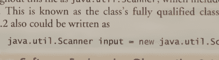

> 如果每次使用类名时都指定完全限定类名，编译器就不要求 Java 源代码文件中要求导入声明。大多数 Java 程序员更倾向于导入声明提供的更简洁的编程风格。

## 3.2.6 使用私有实例变量和公共 set 及 get 方法的软件工程

正如你所看到的，通过使用 `set` 和 `get` 方法，你可以对尝试的修改进行验证以保护数据，并控制数据呈现给调用者的方式——这些是非常吸引力的软件工程优势。我们将在 3.4 节详细讨论这一点。

如果实例变量是 `public` 的，该类的任何客户端（即任何调用该类的方法的其他类）都可以看到数据，并对数据进行任何它们想的操作，包括将其设置为无效值。

你可能会认为，即使类的客户端无法直接访问私有实例变量，客户端也可以通过公有的 `set` 和 `get` 方法对变量进行随心所欲的操作。你可能会认为你可以随时通过公共 `get` 方法查看私有数据，并通过公共方法随心所欲地修改私有数据。`set` 方法可以被设计为对其参数进行验证，并拒绝任何将数据设置为坏值的尝试，例如：负的体温、3 月份中 1 号到 31 号之间的某一天、不在公司产品目录中的产品代码等，而 `get` 方法可以以不同的形式呈现数据。例如，`Grade` 类可以将成绩存储为 0 到 100 之间的 `int`，而 `grade` 方法返回一个作为 `String` 类型的字母等级，例如 90 分和 100 分返回 "A", 20 到 89 分之间的成绩返回 "B"。严密控制对私有数据的访问和呈现可以大大减少错误，同时增加程序的程序的健壮性和安全性。

使用 `private` 访问修饰符声明变量被称为**信息隐藏**。当程序创建 `Account` 类的对象（实例化）时，变量名被封装（隐藏）在对象中，并且只能通过该对象类的方法进行访问。

## 软件工程观察 3.2

在每个实例变量和方法声明之前加上访问修饰符。通常情况下，实例变量应该声明为 `private`，而方法声明为 `public`。在书的后面部分，我们将讨论为什么你可能想要声明私有方法。

### 带有封装数据的 Account 对象的概念视图

你可以将 `Account` 对象认为如图 3.4 所示。私有实例变量隐藏在对象内部（由包含 `name` 的内圆表示），并被外层的公共方法（由包含 `name` 和 `setName` 的外圆）保护。任何需要与 `Account` 对象交互的客户端代码只能通过调用外层的公共方法来实现。

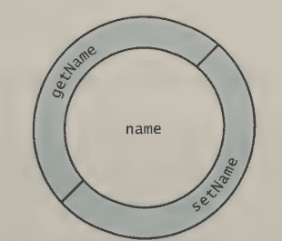

图 3.4 | Account 对象的概念视图，包含其封装的私有变量名和公共方法的保护层。

## 3.3 Account 类：使用构造函数初始化对象

正如第 3.2 节所述，当创建 `Account` 类的对象（图 3.1）时，它的 `String` 实例变量默认初始化为 `null`。但如果你想在创建 `Account` 对象时提供一个名称怎么办？


# 第 3 章 类、对象、方法和字符串引论

你为每个类都声明了一个 `main` 方法。请记住，当你执行应用程序时，Java 虚拟机 (JVM) 总是自动调用 `main`。你必须显式地调用大多数其他方法来执行它们的任务。在第 6 章中，你将学到 `toString` 通常会被隐式调用。

图 3.2 的 6-25 行声明了 `main` 方法。使 JVM 能够定位并调用 `main` 方法以开始程序执行的关键是 `static` 关键字（第 6 行），它表示 `main` 是一个静态方法。静态方法是特殊的，因为你可以在无需先创建该方法所属类的对象（在本类中为 `AccountTest` 类）的情况下直接调用它。我们将在第 6 章详细讨论静态方法。

注意图 3.2 中的导入声明（第 3 行），它告诉编译器程序使用了 `Scanner` 类。正如你在第 2 章中学到的，`System` 和 `String` 类位于 `lang` 包中，该包会被隐式导入到每个 Java 程序中，因此所有程序都可以使用这些类而无需显式导入。你在 Java 程序中使用的其他大多数类必须显式导入。

在同一目录下编译的类之间存在一种特殊关系，默认情况下，类被认为处于同一个包中——即默认包。同一个包中的类会被隐式导入到该包其他文件的源代码中。因此，当包中的一个类使用同包中的另一个类时，就不需要导入声明——例如 `AccountTest` 使用 `Account` 类时。

如果我们在整个文件中都引用 `Scanner` 类（包括完整的包名和类名），则就不需要导入声明。这被称为类的完全限定类名。例如，图 3.2 的第 8 行也可以写为：

```java
java.util.Scanner input = new java.util.Scanner(System.in);
```


> 如果每次使用类名时都指定完全限定类名，编译器就不要求 Java 源代码文件中要求导入声明。大多数 Java 程序员更倾向于导入声明提供的更简洁的编程风格。

## 3.2.6 使用私有实例变量和公共 set 及 get 方法的软件工程

正如你所看到的，通过使用 `set` 和 `get` 方法，你可以对尝试的修改进行验证以保护数据，并控制数据呈现给调用者的方式——这些是非常吸引力的软件工程优势。我们将在 3.4 节详细讨论这一点。

如果实例变量是 `public` 的，该类的任何客户端（即任何调用该类的方法的其他类）都可以看到数据，并对数据进行任何它们想的操作，包括将其设置为无效值。

你可能会认为，即使类的客户端无法直接访问私有实例变量，客户端也可以通过公有的 `set` 和 `get` 方法对变量进行随心所欲的操作。你可能会认为你可以随时通过公共 `get` 方法查看私有数据，并通过公共方法随心所欲地修改私有数据。`set` 方法可以被设计为对其参数进行验证，并拒绝任何将数据设置为坏值的尝试，例如：负的体温、3 月份中 1 号到 31 号之间的某一天、不在公司产品目录中的产品代码等，而 `get` 方法可以以不同的形式呈现数据。例如，`Grade` 类可以将成绩存储为 0 到 100 之间的 `int`，而 `grade` 方法返回一个作为 `String` 类型的字母等级，例如 90 分和 100 分返回 "A", 20 到 89 分之间的成绩返回 "B"。严密控制对私有数据的访问和呈现可以大大减少错误，同时增加程序的程序的健壮性和安全性。

使用 `private` 访问修饰符声明变量被称为信息隐藏。当程序创建 `Account` 类的对象（实例化）时，变量名被封装（隐藏）在对象中，并且只能通过该对象类的方法进行访问。

## 软件工程观察 3.2

在每个实例变量和方法声明之前加上访问修饰符。通常情况下，实例变量应该声明为 `private`，而方法声明为 `public`。在书的后面部分，我们将讨论为什么你可能想要声明私有方法。

### 带有封装数据的 Account 对象的概念视图

你可以将 `Account` 对象认为如图 3.4 所示。私有实例变量隐藏在对象内部（由包含 `name` 的内圆表示），并被外层的公共方法（由包含 `name` 和 `setName` 的外圆）保护。任何需要与 `Account` 对象交互的客户端代码只能通过调用外层的公共方法来实现。


图 3.4 | Account 对象的概念视图，包含其封装的私有变量名和公共方法的保护层。

## 3.3 Account 类：使用构造函数初始化对象

正如第 3.2 节所述，当创建 `Account` 类的对象（图 3.1）时，它的 `String` 实例变量默认初始化为 `null`。但如果你想在创建 `Account` 对象时提供一个名称怎么办？

### 构造函数不能返回值

构造函数与方法之间的一个重要区别是，构造函数不能返回值，因此它们不能指定返回类型（即使是 `void` 也不行）。通常，构造函数被声明为 `public`——在书后面我们将解释何时使用 `private` 构造函数。

### 默认构造函数

回想图 3.2 中的第 11 行：

```java
Account myAccount = new Account();
```

是创建一个 `Account` 对象。"new Account" 之后的空括号表示调用该类的默认构造函数——在任何没有显式声明构造函数的类中，编译器都会提供一个默认构造函数（该函数始终没有参数）。当一个类只有一个默认构造函数时，该类的实例变量将初始化为它们的默认值。在 8.5 节中，你将学习类可以有多个构造函数。

### 声明了构造函数的类没有默认构造函数

如果你为一个类声明了构造函数，编译器将无法通过类实例创建表达式 `new Account()` 像我们在图 3.2 中那样来创建一个 `Account` 对象——除非你声明的自定义构造函数没有参数。


类实例变量的默认初始化是可以接受的，但应一个自定义构造函数，以确保在创建该类的每个新对象时，实例变量都能用有意义的值正确初始化。

### 将构造函数添加到类的 UML 类图中

图 3.7 中的 UML 类图对图 3.5 中的 `Account` 类进行了建模，该类有一个带有 `String name` 参数的构造函数。作为操作，UML 模型在类图的第三个区域中建模。为了区分构造函数和类的操作，UML 要求将单词 "constructor" 包在书名号（« »）中，并放在构造函数名称之前。惯例是在第三个区域将构造函数列在其他操作之前。

| Account |
| :--- |
| - name : String |
| «constructor» Account(name: String) |
| + setName(name: String) |
| + getName() : String |

图 3.7 | 图 3.5 中 Account 类的 UML 类图。

## 3.4 带有余额的 Account 类；浮点数

我们现在声明一个 `Account` 类，它除了名称外，还维护银行账户的余额。大多数账户余额不是整数。因此，`Account` 类将账户余额表示为浮点数——带有小数点的数字，如 `43.95`、`0.0`、`-129.8873`。[在第 8 章，当我们编写工业级货币应用程序时，我们将使用 `BigDecimal` 类来精确表示货币金额]。

Java 提供了两种在内存中存储浮点数的原始类型——`float` 和 `double`。`float` 类型的变量表示单精度浮点数，可以包含最多七位有效数字。`double` 类型的变量表示双精度浮点数。它们需要的内存是 `float` 变量的两倍，可以包含最多 15 位有效数字——大约是 `float` 变量精度的两倍。

大多数程序员用 `double` 类型表示浮点数。事实上，Java 默认将你在程序源码中输入的所有浮点数（如 `7.33` 和 `0.0975`）视为 `double` 值。源码中的此类值被称为浮点字面量。参见附录 D 原始类型，以获取 `float` 和 `double` 取值的精确范围。

### 3.4.1 带有 double 类型实例变量的 Account 类

我们的下一个程序包含一个 `Account` 类版本（图 3.8），它维护实例变量和银行账户的余额。典型的银行服务于许多账户，每个账户都有自己的余额，第 7 行创建类型为 `double` 的实例变量 `balance`。`Account` 类的每个实例（即对象）都包含 `name` 和 `balance` 自己的副本。


```java
// Fig 3.8: Account.java
// 具有 double 实例变量 balance 和构造函数的 Account 类
// 以及一个执行验证的 deposit 方法。
public class Account {
    private String name; // 实例变量
    private double balance; // 实例变量

    // 接收两个参数的 Account 构造函数
    public Account(String name, double balance) {
        this.name = name; // 分配实例变量 name

        // 验证余额是否大于 0.0；如果不是，
        // 实例变量 balance 保留其默认值 0.0
        if (balance > 0.0) { // 如果余额有效
            this.balance = balance; // 分配给实例变量 balance
        }
    }

    // 只向余额存款（添加）有效金额的方法
    public void deposit(double depositAmount) {
        if (depositAmount > 0.0) { // 如果 depositAmount 有效
            balance = balance + depositAmount; // 加到余额中
        }
    }

    // 返回余额的方法
    public double getBalance() {
        return balance;
    }
    
    // 设置名称的方法
    public void setName(String name) {
        this.name = name;
    }
    
    // 返回名称的方法
    public String getName() {
        return name;
    }
}
```

图 3.8 | 具有 double 实例变量 balance 和执行验证的构造函数 deposit 方法的 Account 类。

## Account 类双参数构造函数

该类有一个构造函数和方法。`Account` 类（第 10–18 行）通过类实例创建表达式 `new Account()` 像我们在图 3.2 中那样创建一个 `Account` 对象——除非你声明的自定义构造函数没有留参数。

## Account 类 deposit 方法

`deposit` 方法（第 21–25 行）向余额添加有效金额。该方法返回类型为 `void`。第 23 行的赋值操作将金额加到余额中。第 23 行的赋值操作修改了余额，因为余额余额是是是必要的。该方法不需要返回值。

## Account 类 getBalance 方法

`getBalance` 方法（第 28–30 行）允许该类的客户端通过该方法获取特定的特定值。该方法指定返回类型为 `double` 以及空参数列表。

## Account 的方法都可以使用余额

再次提到余额 类，`AccountTest`（图 3.9）创建两个 `Account` 对象（第 7–8 行），分别初始化为 `50.00` 和 `-7.53` 的余额。为了我们的示例，假设余额大于或等于零。第 11–14 行的 `System.out.printf` 输出账户名称和余额，这些是通过调用每个账户的 `getName()` 和 `getBalance()` 方法得到的。

### 3.4.2 AccountTest 使用 Account 类

`AccountTest`（图 3.9）创建两个对象并初始化。第 11–14 行通过调用 `Account` 的 `getName()` 和 `getBalance()` 方法获取账户名称和余额。

```java
// Fig 3.9: AccountTest.java
// 使用 Account 对象进行浮点数的输入输出。
import java.util.Scanner;

public class AccountTest {
    public static void main(String[] args) {
        Account account1 = new Account("Jane Green", 50.00);
        Account account2 = new Account("John Blue", -7.53);

        // 显示对象的初始余额
        System.out.printf("%s balance: %.2f\n",
            account1.getName(), account1.getBalance());
        System.out.printf("%s balance: %.2f\n",
            account2.getName(), account2.getBalance());

        // 创建一个扫描器从命令行窗口获取输入
        Scanner input = new Scanner(System.in);

        System.out.printf("Enter deposit amount for account1: "); // 提示
        double deposit1 = input.nextDouble(); // 获取输入
        System.out.printf("adding %.2f to account1 balance\n",
            deposit1);
        account1.deposit(deposit1); // 加到 account1 的余额

        // 显示余额
        System.out.printf("%s balance: %.2f\n",
            account1.getName(), account1.getBalance());
        System.out.printf("%s balance: %.2f\n",
            account2.getName(), account2.getBalance());

        System.out.printf("Enter deposit amount for account2: "); // 提示
        double deposit2 = input.nextDouble(); // 获取输入
        System.out.printf("adding %.2f to account2 balance\n",
            deposit2);
        account2.deposit(deposit2); // 加到 account2 的余额
    }
}
```

# 第 3 章 类、对象、方法和字符串简介

Jane Green 的余额：$50.00

John Blue 的余额：$0.00

输入 account1 的存款金额：25.53

正在向 account1 账户添加25.53

Jane Green 的余额：$75.53

John Blue 的余额：$0.00

输入 account2 的存款金额：123.45

正在向 account2 账户添加123.45

Jane Green 的余额：$75.53

John Blue 的余额：$123.45

图 3.9 使用 Account 对象输入和输出浮点数。（部分 2，共 2 部分）

## 显示 Account 对象的初始余额

当从第 12 行为 account1 调用 `getBalance` 方法时，account1 的余额值将从图 3.8 的第 29 行返回并由 `System.out.printf`（语句 3.9，第 11–12 行）显示。同样，当从第 14 行为 account2 调用 `getBalance` 方法时，account2 的余额值将从第 29 行返回并由 `System.out.printf` 语句显示（语句 3.9，第 13–14 行）。account2 的余额初始为 0.0，因为构造函数拒绝了以负余额启动 account2 的尝试，因此余额保留了其默认值。

## 用于显示的格式化浮点数

每个余额都通过 `printf` 使用格式说明符 `%.2f` 输出。`%f` 格式说明符用于输出 `float` 或 `double` 类型的值。`.` 和 `%` 之间的 `2` 代表浮点数小数点右侧四舍五入的位数（2）——也称为精度。任何带有 `%.2f` 的浮点值都会四舍五入到百分分位——例如，123.45 会四舍五入到 123.46，27.3379 会四舍五入到 27.33。

## 从用户读取浮点值并存款

第 19 行（图 3.9）提示用户输入 account1 的存款金额。第 20 行声明了局部变量 `depositAmount`，用于存储用户输入的每个存款金额。与实例变量（如 account 中的 `name` 和 `balance`）不同，局部变量（如 main 中的 `depositAmount`）默认不会初始化，它们通常必须显式初始化。正如你很快将学到的，变量 `depositAmount` 的初始值将由用户的输入决定。

如果你尝试使用未初始化的局部变量的值，Java 编译器将抛出编译错误。这有助于避免危险的运行时逻辑错误。在编译时而不是执行时消除程序中的错误总是会更好的。

## 3.4 带有余额的 Account 类：浮点数

第 20 行通过调用 `Scanner` 对象的 `nextDouble` 方法获取用户输入，该方法返回用户输入的 `double` 值。第 21–22 行显示 `depositAmount`。第 23 行将 `depositAmount` 作为方法的参数调用对象的 `deposit` 方法。当调用该方法时，参数的值被赋值给 `deposit` 方法的参数 `depositAmount`（图 3.8 的第 21 行）；然后方法将值加到余额上。第 26–29 行（图 3.9）再次输出 Account 的名称和余额，以显示只有账户的余额发生了变化。

第 31 行提示用户输入 account2 的存款。第 32 行通过调用 `Scanner` 对象的 `nextDouble` 方法获取用户输入。第 33–34 行显示 `depositAmount`。第 35 行将 `depositAmount` 作为方法的参数调用 object2 的 `deposit` 方法；然后 `deposit` 将值加到余额上。最后，第 38–41 行再次输出两个 Account 的名称和余额，显示 account2 的余额发生了变化。

## 方法 main 中的重复代码

第 11–12、13–14、26–27、28–29、38–39 和 40–41 行的六条语句几乎相同——每个语句都输出 Account 的名称和余额。它们区别在于 Account 对象的名称——`account1` 或 `account2`。这种重复代码在代码需要更新时可能会产生维护问题——如果六份相同的代码都有相同的错误，或者需要进行六次更改。练习 3.15 要求你修改图 3.9，包含一个 `displayAccount` 方法，该方法接收 `Account` 对象作为参数并输出对象的名称和余额。你用六次对 `displayAccount` 的调用替换 main 中的重复语句，从而减小了程序的大小并通过减少一份代码副本提高了其可维护性。

> **软件工程观察 3.4**
>
> 用包含该代码副本的方法调用来替换重复代码可以缩小程序的大小并提高其可维护性。

## Account 的 UML 类图

图 10 中的 UML 类图简洁地建模了图 3.8 中的 `Account` 类。该图的第二个区域练习了 `String` 类型和 `double` 类型的私有 属性。


图 10 | 图 3.8 Account 类的 UML 类图。

Account 类的构造函数在第三区域中建模，参数为 `String` 类型的 `name` 和 `double` 类型的 `initialBalance`。该类的四个公共方法在第三区域建模，具有类型为 `double` 类型的 `deposit`、返回类型为 `double` 的 `getBalance`以及类型为 `String` 类型的 `setName`。

# 3.5 基本类型与 引用类型

Java 的类型分为基本类型和引用类型。在第 2 章中，我们使用了 `int` 类型。基本类型包括 `byte`、`char`、`long`、`float` 和 `double`，我们在附录 D 中讨论这些类型。基本类型变量只能存储一个值，当给该变量赋新值时，旧值会被覆盖。引用类型变量如果没有显式初始化，会被初始化为 `null`。基本类型 `boolean` 的默认值为 `false`。引用类型变量存储的是对象的引用。你可以通过赋值来指定基本类型变量的初始值，如：

```
int numberOfStudents = 10;
```

引用类型变量存储的是对象的引用，通常被称为引用。引用类型变量只能存储一个对象的引用（引用），当给该变量赋新引用时，旧引用会被覆盖。引用类型变量可以指向多个对象。引用类型变量通过赋值来指定指向的的对象，如：

```java
Scanner input = new Scanner(System.in);
```

创建一个 `Scanner` 对象，并将 `input` 变量指向它。在图 3.2 的第 11 行：

```java
Account myAccount = new Account();
```

创建一个 `Account` 对象，并将 `myAccount` 变量指向它。引用类型变量如果没有显式初始化，会被初始化为 `null`。这就是为什么图 3.2 的第 14 行第一次调用 `getName` 返回的是 `null`——因为 `name` 的值尚未设置。要调用对象的方法，你需要一个对象的引用。在图 3.2 中，使用 `myAccount` 变量来调用 `getName`（第 14 行）和 `setName`（第 24 行）来与对象交互。基本类型变量不引用对象，因此不能用于调用方法。

# 3.6（可选）GUI 和图形案例研究：简单 GUI

该案例研究对于那些想在书中早期就开始学习创建图形用户界面（GUI）和图形的人，在我们在第 12 章和第 23 章深入讨论这些主题之前。我们将使用 JavaFX——Java 的 GUI、图形和多媒体技术。该案例研究的 Swing 版本可以在配套网站上找到。GUI 和图形章节总结在图 3.11 中。每个章节引入新概念，提供带有屏幕截取的示例，并紧随其后一个或多个练习，你将在练习中使用该章节的技术。


图 3.11

## 3.6.1 什么是图形用户界面？

图形用户界面（GUI）为与应用程序的交互提供了一种用户友好的机制。API（读音为 "GOO-ee"）提供了独特的“外观和视觉体验”。GUI 由 GUI 组件构建而成——JavaFX 将这些组件称为控件（Controls）。控件是 GUI 组件，例如显示文本的 `Label` 对象、接收用户文本输入的 `TextField` 对象以及可以触发操作的 `Button` 对象。当用户与控件进行交互时（例如点击 `Button`），控件会生成一个事件（event）。程序可以响应这些事件——被称为事件处理（event handling），以指定当每次用户交互发生时会发生什么。这个第一个 GUI 和图形案例研究将让你构建一个简单的非交互式 GUI，它的内容幅比其他案例稍微长一点，因为我们将引导你完成构建首个 GUI 的每一个步骤。

## 3.6.2 JavaFX Scene Builder 和 FXML

在 GUI 和图形案例研究章节中，你将使用 Scene Builder —— 这种工具允许你通过将 Scene Builder 库中的预建 GUI 组件拖放到设计区域来创建 GUI，然后可以在无需编写任何代码的情况下修改和样式化 GUI。JavaFX Scene 的实时编辑和预览功能允许你查看并修改 GUI，而无需编译和运行程序。你可以下载适用于 Windows、macOS 和 Linux 的 Scene Builder：

```
http://gluonhq.com/labs/scene-builder/
```

### FXML (FX 标记语言)

JavaFX Scene Builder 生成 FXML（FX 标记语言）——一种用于在不编写任何代码的情况下定义和排列 JavaFX GUI 控件的语言。JavaFX 使用 FXML 简洁地描述 GUI、图形和多媒体元素。使用此案例研究时不需要了解 FXML——Scene Builder 会向你隐藏 FXML 的细节。

## 3.6.3 欢迎应用——显示文本和图像

在本节中，你将在不编写任何代码的情况下，构建一个在 `Label` 控件中显示文本并在 `ImageView` 中显示图像（图 3.12 所示）的 GUI。你将使用可视化编程技术将 JavaFX 组件拖放到 Scene Builder 的控制面板（即设计区域）上。接下来，你将使用 Scene Builder 的检查器（Inspector）来配置选项，例如 `Label` 的文本和字体大小，以及 `ImageView` 的图像。最后，你将使用 Scene Builder 窗口中的“显示预览（Show Preview）”选项查看完成的 GUI。

## 3.6.4 打开 Scene Builder 并创建第一个 Welcome.fxml


打开 Scene Builder 以便你可以创建文件，Scene Builder 将显示定义 GUI 的 FXML。窗口最初显示如图 3.13 所示。窗口顶部的“未命名（Untitled）”表示 Scene Builder 已创建了一个你尚未保存的新 FXML 文件。选择“文件（File） > 保存（Save）”来打开另存对话框，然后选择存储文件的位置，文件名输入 `Welcome.fxml` 并点击“保存（Save）”按钮。

- 2. 我们展示了 Windows 10 上的 Scene Builder 截图，但 Scene Builder 在 Windows、macOS 和 Linux 上是相同的。区别在于 macOS 的菜单栏位于屏幕顶部，而在 Windows 和 Linux 上，菜单栏是窗口构建的一部分。

# 3.6（可选）GUI 和图形案例研究：简单的 GUI

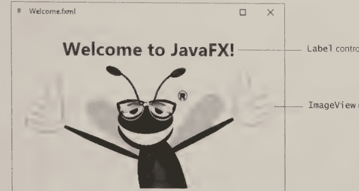

**图 3.12** | Microsoft Windows 10 预览窗口中的最终 Welcome GUI。

你将 Library 窗口中“容器（Containers）”、“**控件（Controls）**”和其他部分的 JavaFX 组件拖放到内容面板上。你使用内容面板来设计 GUI。你使用检查器（Inspector）窗口来配置内容面板中当前选中的项。

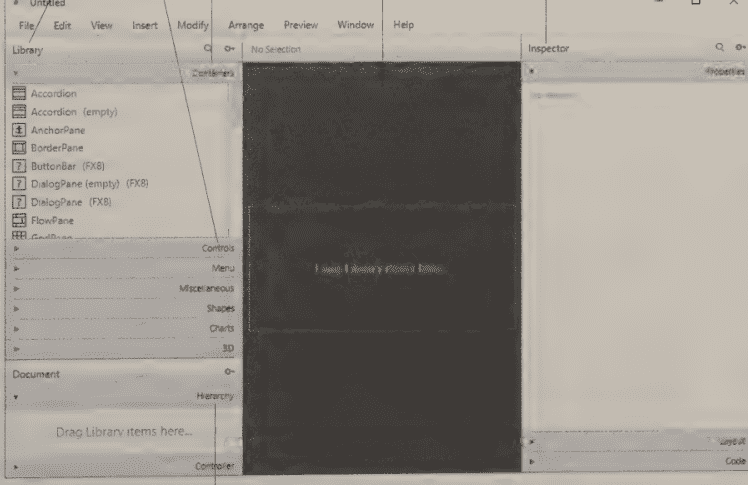

层级（Hierarchy）窗口显示了 GUI 的结构，并帮助你选择和重组控件

**图 3.13** | JavaFX Scene Builder。

## 3.6.5 添加图像到 FXML

在应用程序中，图像 `bug.png` 位于 `images` 文件夹中。为了将其添加，请在文件系统中找到 `images` 文件夹，然后将 `bug.png` 复制到 `welcome.fxml`。

## 3.6.6 创建 VBox 布局

JavaFX 布局（layouts）帮助你排列和调整控件。在本应用程序中，通过 `VBox` 放置 `Label` 和 `ImageView`，这会将它们垂直排列。通过将 Library 窗口中的 `VBox` 拖放到内容面板，你可以开始设计。

## 3.6.7 配置 VBox 对齐方式

VBox 的对齐方式（Alignment）决定了控件的定位。在本应用程序中，我们希望 `Label` 和 `ImageView` 居中显示。为此：

- 1. 选择 `VBox`，然后在检查器的属性（Properties）部分中，点击 `Alignment` 属性旁边的值。

- 2. 在 `Alignment` 属性下拉列表中选择 `CENTER`。

### 指定 VBox 的对齐方式

VBox 的对齐方式决定了 GUI 的水平和垂直对齐。

## 3.6.8 添加并配置 Label

点击 Scene Builder 控件（Controls）部分的右箭头（>），然后将 `Label` 拖放到 `VBox` 上。根据 `VBox` 的对齐属性，`Label` 将水平居中。

### 修改 Label 的文本

你可以通过双击它来设置新文本，或者通过选择 `Label` 并在检查器的属性（Properties）部分设置其 `Text` 属性。

### 修改 Label 的字体

在本应用程序中，我们设置 `Label` 显示粗体字体。为此，选择 `Label`，然后在检查器的属性（Properties）部分点击 `Font` 属性（图 3.15）。在弹出的窗口中，将 `Style` 属性设置为 `Bold`，并将 `Size` 属性设置为 `30`。现在的设计应该如图 3.16 所示。

## 3.6.9 添加并配置 ImageView

最后，你将添加显示 `bug.png` 的 `ImageView`。

### 将 ImageView 添加到 VBox

将 `ImageView` 从 Library 窗口的控件部分拖放到 `Label1` 正下方，如图 3.17 所示。你也可以双击 Library 窗口中的 `ImageView`，在这种情况下 Scene Builder 会自动将新的 `ImageView` 对象放置在 `VBox` 当前内容的下方。

### 设置 ImageView 的图像

接下来设置想要显示的图像：

- 1. 选择 `ImageView`，然后在检查器的属性（Properties）部分点击 `Image` 属性旁边的省略号 (...) 按钮。默认情况下，Scene Builder 会打开一个显示保存 FXML 文件的文件夹的对话框。这就是第 3.6.5 节中放置图像文件 `bug.png` 的地方。

- 2. 选择图像文件，然后点击“打开”。Scene Builder 会显示图像并调整 ImageView 的大小以匹配图像的宽高比例——即图像宽度与高度的比率。

### 更改 ImageView 的大小

我们希望按原始大小显示图像。如果你重置 ImageView 的默认 Width（宽度）和 Fit Height（适应高度）属性值（这些是将 ImageView 拖到设计界面时 Scene Builder 为你设置的），Scene Builder 将调整 ImageView 为图像的精确尺寸。要重置这些属性：

- 1. 展开检查器（Inspector）的 Layout 部分。

- 2. 将鼠标悬停在 `Fit Width` 属性值上。这会显示属性值右侧的按钮。点击该按钮并选择 Reset to Default（还原为默认值）来重置该值。此技术可用于任何属性值以重置其默认值。

- 3. 重复步骤 2 以重置 `Fit Height` 属性的值。

你现在已完成 GUI。Scene Builder 的内容面板现在应该如图 3.18 所示。选择 File > Save 来保存 FXML 文件。


图 3.18 | Scene Builder 内容面板中完成的欢迎 GUI。

## 3.6.10 预览欢迎 GUI

你可以预览设计在运行应用程序窗口中的外观。要这样做，选择 Preview > Show Preview in Window（在窗口中显示预览），这将显示图 3.19 所示的窗口。

## 第 3 章 类、对象、方法和字符串


**图 3.19** | 在 Microsoft Windows 10 上预览欢迎 GUI——在 Linux、macOS 和旧版本的 Windows 上，只有窗口框会有不同。

## GUI 和图形案例研究练习

**3.1** 使用 Flickr 等网站找到四张著名地标的图像。创建一个与 Welcome 应用程序类似的程序，在其中你将图像排列成拼贴。添加文本来标识每个地标。你可以使用项目自带的图像，也可以指定在线图像的 URL。

## 3.7 总结

在本章中，你学习了如何创建自己的类和方法，创建这些类的对象，并调用这些对象的方法来执行有用操作。你声明了类的实例变量来为该类的每个对象维护数据，并声明了你自己的方法来操作这些数据。你学习了如何调用方法来告诉它执行任务，如何将信息作为参数传递给方法（其值被赋值给方法的参数），以及如何接收方法返回的值。你学习了局部变量和实例变量之间的区别，并且只有实例变量会自动初始化。你还学习了如何使用类构造函数为对象的实例变量指定初始值。你看到了如何创建 UML 类图来对类的方法、属性和构造函数建模。最后，你学习了浮点数（带有小数点的数字）——如何使用原始类型 `double` 变量存储它们，如何使用 `Scanner` 对象输入它们，以及如何使用 `printf` 和格式说明符 `%` 对它们进行格式化以便显示。[在第 8 章中，我们将开始使用 `BigDecimal` 精确地表示金额。]你还开始了可选的 GUI 和图形案例研究，学习如何编写你的第一个 GUI 应用程序。在下一章中，我们将开始引入控制语句，它们指定了程序操作执行的顺序。你将在方法中使用这些语句来指定它们如何排列任务。

## 3.2 实例变量、set 和 get 方法

- 你创建的每个类变成一个新类型，用于声明变量和创建对象。
- 你可以需要声明新类；这是 Java 被称为扩展语言的原因之一。

### 3.2.1 具有实例变量、set 方法和 get 方法的类

- 每个类声明以 `public` 修饰符开始，必须存储在与类同名的文件中，并以 `.java` 扩展名结尾。
- 每个类声明包含 `class` 关键字，紧接着是类名。
- 类、方法和变量名是标识符。习惯使用驼峰命名法（camel-case）。名称以大写字母开头，变量名以小写字母开头。
- 对象具有实现为实例变量的声明并随其生命周期。
- 实例变量存在于调用对象方法之前、在方法执行期间以及方法完成之后。
- 类通常包含一个或多个操作实例变量的方法。
- 实例变量声明在类声明内部，但在方法的声明体外部。
- 类的每个对象（实例）拥有类的每个实例变量的副本。
- 大多数实例变量声明前面有关键字，它是访问修饰符。使用访问修饰符声明的变量或方法对于声明它们的类是可见的。
- 参数声明在逗号分隔的参数列表中。每个参数必须指定一个类型，后跟变量名。
- 方法体中声明的变量是局部变量，只能在该方法中使用。当方法终止时，局部变量的值丢失。方法是方法的参数。
- 每个方法的体包含一个或多个执行方法任务的语句。
- 方法返回类型 `void` 表示方法将执行任务但不返回任何信息。
- 方法名后的空参数表示方法不需要任何参数来执行其任务。
- 当指定返回类型非 `void` 方法被调用并完成其任务时，方法必须向调用方法返回一个值。
- `return` 语句将值从调用的方法传回给调用者。

### 3.2.2 创建并使用 Account 对象的类

- 创建另一个类的对象然后调用该对象方法的类是驱动类（driver class）。
- `Scanner` 方法 `nextLine()` 读取字符遇到换行符，然后以 `String` 类型返回字符。
- `Scanner` `next()` 读取字符遇到任何空白字符，然后以 `String` 类型返回字符。
- 类创建过程以 `new` 关键字开始创建一个新对象。
- 构造函数类似于方法，但通过 `new` 操作符隐式调用，在创建对象时初始化对象的变量。
- 调用对象的方法，在对象名后跟一个点分隔符，以及包含方法参数的括号。
- 局部变量不自动初始化。当你指定实例变量的初始值时，Java 为每个实例变量提供默认值。
- `String` 类型实例变量的默认值为 `null`。
- 方法调用为方法的每个参数提供值（称为参数）。每个参数的值被赋值给方法头中的相应参数。
- 方法调用中的参数数量必须与声明列表中的参数数量匹配。
- 方法中的参数类型必须与声明中对应参数的类型一致。

### 3.2.3 编译和运行多个类的应用程序

- `javac` 命令可以一次编译多个类：只需在命令后列出源代码文件名，每个文件名之间用空格隔开。如果包含应用程序的目录只包含一个应用程序的文件，你可以使用 `javac *` 命令编译它的所有类。`*` 中的星号表示当前目录下所有以 `.java` 文件扩展结尾的文件都应该被编译。

### 3.2.4 具有实例变量和 set/get 方法的 Account UML 类图

- 在 UML 中，每个类在类图中被建模为一个带有三个隔间的矩形。顶部水平居中并加粗显示类名。中间部分包含类的属性，这些对应于 Java 中的实例变量。底部包含类的操作，对应于 Java 中的方法和构造函数。
- UML 将实例变量表示为属性名，后跟冒号和类型。
- 私有属性在 UML 中前面有一个减号 (-)。
- UML 通过列出操作名并后跟一组括号来建模操作。操作名前的加号 (+) 表示该操作在 UML 中是公共的（即 Java 中的公共方法）。
- UML 通过列出参数名、后跟冒号以及操作名后括号内的参数来建模操作参数。
- UML 通过在操作后的括号之后放置冒号和返回类型来指示操作的返回类型。
- UML 图不指定返回值。
- 将变量声明为 `private` 称为信息隐藏（information hiding）。

### 3.2.5 关于 ClassTest 的额外说明

- 你必须调用 `main` 之外的方法来显式告诉它们执行任务。
- `static` 关键字是允许 JVM 找到并调用 `main` 方法以启动应用程序的关键部分，它表示 `main` 是一个静态方法，无需创建声明方法的类的对象即可调用。

### 3.2.6 使用私有实例变量和公共 set 的软件工程

- 将实例化变量声明为私有是一种信息隐藏。

## 3.3 Account 类：使用构造函数初始化对象

- 你定义的每个类都可以可选地提供一个带参数的构造函数，可以在创建对象时用于初始化类的对象。
- Java 要求为创建的每个对象调用构造函数。
- 构造函数可以指定参数，但不能返回类型。
- 如果类没有定义构造函数，编译器将提供一个无参数的默认构造函数（第 82 页），并且类的实例化变量将初始化为它们的默认值。
- 如果你为类声明了构造函数，编译器将不会为该类创建默认构造函数。
- 类图中第三个区域的 UML 模型。为了区分构造函数和类的操作，UML 在构造函数名称之前用角括号（« 和 »；第 82 页）放置“constructor”一词。

## 3.4 带有余额的 Account 类：浮点数

- 浮点数（第 83 页）是带有小数的数字。Java 提供了两种在内存中存储浮点数的原始类型——`float` 和 `double`。
- `float` 类型的变量表示单精度浮点数，具有有效数字。`double` 类型的变量表示双精度浮点数。它们消耗的内存是 `float` 变量的两倍，并提供 15 位有效数字——大约是 `float` 精度的两倍。
- 浮点字面量（第 83 页）默认类型为 `double`。
- 格式指定符 `%f`（第 86 页）用于输出 `float` 或 `double` 类型的值。格式指定符 `%.2f` 指定浮点数小数点右侧应输出两位精度（第 86 页）。
- `Scanner` `nextDouble()`（第 87 页）返回一个 `double` 值。
- `double` 类型实例化变量的默认值为 `0.0`（或简单的 `0`），`int` 类型实例化变量的默认值为 `0`。

## 3.5 原始类型 vs 引用类型

- Java 中的类型分为两类——原始类型和引用类型。原始类型包括 `boolean`、`byte`、`char`、`short`、`int`、`float` 和 `double`。所有其他类型都是引用类型，因此指定对象类型的类也是引用类型。
- 原始类型变量一次只能存储一个声明类型的精确值。
- 原始类型变量默认会被初始化。`byte`、`char`、`short`、`int`、`long`、`float` 和 `double` 类型的变量初始化为 `0`。`boolean` 类型的变量初始化为 `false`。
- 引用类型变量（称为引用；第 88 页）存储对象在计算机内存中的位置。被引用的对象可能包含许多实例化变量和方法。
- 引用类型实例化变量默认初始化为值 `null`。
- 调用对象的方法需要一个对象的引用（第 88 页）。原始类型变量不引用对象，因此不能用于调用方法。

## 自测习题

3.1 填空以下内容：

a) 每个类声明都以关键字 ________ 开始，必须存储在与类名完全相同且以 .java 文件扩展名结尾的文件中。

b) 类声明中的关键字 ________ 后面紧跟的是类的类名。

c) 构造函数向系统请求内存来存储对象，然后调用相应的构造函数来初始化对象。

d) 每个参数都与 ________ 一起编译，以及一个 ________

e) 默认情况下，类在相同目录下编译并被认为处于同一个包中，被称为 ________

f) Java 提供了两种原始类型在内存中存储浮点数：________ 和 ________

g) double 类型的变量代表 ________ 浮点数。

h) Scanner 方法返回一个 double 值。

i) 关键字 public 是一种 ________ 访问

j) 返回类型 ________ 表示该方法将不返回任何值。

k) Scanner 方法读取字符直到遇到换行符，并将这些字符作为 String 返回。

l) 类 String 位于包 ________ 中。

m) 如果你使用完全限定名引用类，则不需要（一个）________。

n) ________ 是一个带有小数点的数字，例如 7.33、0.0975 或 1.00012345。

o) float 类型的变量代表 ________ 精度浮点数。

p) 格式指定符 ________ 用于输出 float 或 double 类型的值。

q) Java 中的类型分为 ________。

3.2 述述每项内容的正确或错误。如果是错误的，请解释。

a) 根据惯例，方法名以小写字母开头。

b) 当一个类使用同包中的另一个类时，不需要导入语句。

c) 名字后面的空括号表示一个 ________。

d) 原始类型变量可以用于调用方法。

e) 方法体内的 ________ 只能在 ________。

f) 浮点字面量默认是 double。

g) 实例化变量默认初始化为 null。

h) 引用类型实例化变量默认初始化。

i) 每个方法都在方法声明中指定。

3.3 局部变量和实例化变量的区别是什么？

3.4 参数的作用是什么？

## 自测习题答案

3.1 a) public

b) class

c) constructor

d) parameters

e) default package

f) float, double

g) double


h) `nextDouble`

i) `modifier`

j) `void`

k) `next`

l) `java.lang`

m) `import declaration`

n) `floating-point number`

o) `single`

p) `%f`

q) `primitive and reference types`

3.2 a) True

b) False

c) True

d) False

e) True

f) True

g) False

h) True

i) True

j) False

3.3 局部变量声明在方法体内，且只能从声明点到方法结束时使用。实例化变量声明在类中，而不是任何方法体内。此外，实例化变量对类的所有方法都是可见的。

3.4 参数提供了方法执行任务所需的额外信息。方法所需的每个参数都在方法声明中指定。参数是方法参数的实际值。

## 练习

3.5 (关键字 `new`) 关键字 `new` 的作用是什么？解释使用它会发生什么。

3.6 (默认构造函数) 什么是构造函数？如果类只有一个默认构造函数，对象的实例化变量是如何初始化的？

3.7 (实例化变量) 解释实例化变量的作用。

3.8 (无需导入使用类) 大多数类在应用中使用之前需要导入。为什么每个应用都允许在不先导入的情况下使用 `System` 和 `String` 类？

3.9 (无需导入使用类) 解释如何在不导入的情况下使用 `Scanner` 类。

3.10 (set 和 get 方法) 解释为什么类为实例化变量提供 set 方法和 get 方法。

3.11 (修改 Account 类) 修改硬件商店用于提款的 `Account` 类。确保提款金额不超过余额。如果是，应保持余额不变并打印“提款金额超过账户余额”的消息。修改 `AccountTest`（图 3.9）以测试 `withdrawal` 方法。

3.12 (Invoice 类) 创建一个硬件商店可能用于代表商店出售物品的发票的类。发票应包含以下四个信息作为实例变量——一个零件号（类型为 `String`）、一个零件描述（类型为 `String`）、购买物品的数量（类型为 `int`）以及单价（`double`）。你的类应该有一个构造方法来初始化这四个实例变量。为每个实例变量提供 set（设置）和 get（获取）方法。此外，提供一个名为 `getTotal` 的方法计算发票金额（即数量乘以单价），然后以 `double` 类型返回该金额。如果数量不是正数，则将其设置为 0。如果价格不是正数，则将其设置为 0.0。编写一个测试程序 `InvoiceTest` 来演示 `Invoice` 类的功能。

**3.13 (Employee 类)** 创建一个包含三个实例变量的类：姓名（类型为 `String`）、姓氏（类型为 `String`）和一个月薪（`double`）。提供一个构造方法来初始化这三个实例变量。为每个实例变量提供 set 和 get 方法。如果月薪不是正数，则不要设置其值。编写一个测试程序 `EmployeeTest` 来演示 `Employee` 的功能。创建两个 `Employee` 对象并显示每个 `Employee` 的年薪。给每个 `Employee` 增加 10% 的薪水并再次显示每个 `Employee` 的年薪。

**3.14 (Date 类)** 创建一个包含三个实例变量的类：月份（类型为 `int`）、日期（类型为 `int`）和年份（类型为 `int`）。提供一个构造方法初始化实例变量并假设值是正确的。为每个实例变量提供 set 和 get 方法。提供一个 `displayDate` 方法，用斜杠（/）分隔显示月份、日期和年份。编写一个测试程序 `DateTest` 来演示 `Date` 类的功能。

**3.15 (消除重复代码)** 在 3.9 节题的 `AccountTest` 中，`main` 方法包含六条语句（行 11–12、13–14、26–27、28–29、38–39 和 40–41），每条语句都显示账户的名称和余额。研究这些语句，你会发现它们仅在于所操作的对象不同——`account1` 或 `account2`。在本次练习中，定义一个新的 `displayAccount` 方法，包含其中一种输出。该方法的参数将是一个对象，并输出该对象的名称和余额。你将用 `displayAccount` 替换 `main` 中的六条重复语句，并将特定对象作为参数传递。修改 3.9 节的 `AccountTest`，在 `main` 方法结束括号之后、`AccountTest` 结束括号之前声明方法 `displayAccount`。

```java
public static void displayAccount(Account accountToDisplay) {
    // 在此处编写显示 accountToDisplay 的名称和余额的语句
}
```

**添加到类中的方法 displayAccount。** 回想 `main` 是一个静态方法，可以在不创建类对象的情况下被调用。我们也将 `displayAccount` 声明为静态方法。一旦编译了 `displayAccount` 的声明，请修改 `main`，将显示账户名称和余额的语句替换为 `displayAccount`——每个方法根据需要接收其对象。然后测试 `AccountTest` 以确保它产生的输出与 3.9 节所示的相同。

**3.16 (目标心率计算器)** 运动时，你可以使用心率监测仪查看你的心率是否处于教练和医生建议的安全范围内。根据美国心脏协会 (AHA) (http://bit.ly/TargetHeartRates)，计算心率（每分钟心跳次数）的公式为 220 减你的年龄。你的目标心率是你心率的 50–85% 范围。[注意：这些是 AHA 提供的估计值。最大心率和目标心率因健康、健身和性别而异。在开始或改变运动之前，请咨询医生或合格的医疗保健人士。] 创建名为 `HeartRate` 的类。属性应包括人的名、姓和出生日期（由月、日、年的独立属性组成）。你的类应该有一个接收这些数据的构造方法以及 set 和 get 方法。该类还应该包含一个计算并返回个人最大心率的方法，以及一个计算并返回个人目标心率的方法。编写一个 Java 程序，提示输入个人信息，实例化 `HeartRate` 对象并打印该对象的信息——包括人的名、姓和出生日期——然后计算并打印人的年龄（岁）、最大心率和目标心率范围。

**3.17 (健康记录的数字化)** 最近新闻中提到的一个健康保健问题是健康记录的数字化。由于敏感的隐私和安全担忧等原因，这种可能性正在被谨慎对待。[患者在他们不同的医疗专业人员之间分享他们的健康状况和历史。这可以提高健康质量，帮助避免药物冲突和错误处方，降低成本并在紧急情况下救命。在本次练习中，你将为一个人设计一个“启动型” `HealthProfile`。]属性应包括人的名、姓、出生日期（由月、日、年的独立属性组成）、身高（英寸）和体重（磅）。你的类应该有一个接收这些数据的构造方法。为每个属性提供 set 和 get 方法。该类还应该包含计算并返回用户年龄（岁）、最大心率和目标心率范围（见练习 3.16）以及体质指数（BMI；见练习 2.33）的方法。编写一个 Java 程序，提示输入个人信息，为该个人实例化 `HealthProfile` 对象并打印该对象的信息——然后计算并打印年龄、BMI、最大心率和目标心率范围。显示 2.33 中的 BMI 表。

# 4 控制语句：第一部分；赋值、++ 和 -- 操作

## 目标

在本章中你将：

- 学习基础问题解决技术。
- 通过自顶向下、逐步细化的过程开发算法。
- 使用 `if` 和 `if...else` 选择语句进行选择。
- 使用 `while` 迭代语句重复执行。
- 使用计数控制和哨兵控制迭代。
- 使用复合赋值运算符和增/减运算符。
- 了解原始数据类型的移植性。


# 大纲

## 4.1 引言

- 4.1 引言
- 4.2 算法
- 4.3 伪代码
- 4.4 控制结构
    - 4.1 Java 中的顺序
    - 4.2 Java 选择语句
    - 4.3 Java 中的迭代语句
    - 4.4 控制语句总结
- 4.5 if 单选择语句
- 4.6 if...else 双选择语句
    - 4.6.1 嵌套 if...else
    - 4.6.2 悬空 else 问题
    - 4.6.3 块
    - 4.6.4 条件运算符 (?)
- 4.7 if...else 语句
- 4.8 while 迭代语句
- 4.9 制定算法：计数迭代
- 4.10 制定算法：哨兵迭代
- 4.11 制定算法：嵌套控制语句
- 4.12 复合赋值运算符
- 4.13 递增递减运算符
- 4.14 原始类型
- 4.15 (可选) GUI 和图形案例研究：画线
    - 4.15.1 测试完成的线条
    - 4.15.2 构建 GUI
    - 4.15.3 准备通过程序与 GUI 交互
    - 4.15.4 DrawLinesController 类
    - 4.15.5 DrawLines 类——应用类
- 4.16 结语

总结 | 自测练习题 | 自测练习题答案 | 练习题 | 贡献社会

# 106 第 4 章 控制语句：第一部分：赋值、++ 和 -- 运算符

已经准备好做出关键决策。假设以不同的顺序执行了相同的步骤：(1) 起床；(2) 掉睡衣；(3) 穿衣服；(4) 洗澡；(5) 吃早餐；(6) 乘车上班。在这种情况下，我们的执行者出现时已经全身湿透了。在程序中指定语句（动作）执行的顺序被称为程序控制。本章将使用 Java 的控制语句来研究程序控制。

## 4.3 伪代码

伪代码是一种非正式语言，它可以帮助你开发算法，而无须担心 Java 语言语法的严格细节。我们展示的伪代码对于开发将将转换为 Java 程序结构化部分的算法特别有用。我们在本书中使用的伪代码类似于日常英语——它既方便又用户友好，但它不是一种实际的计算机编程语言。你将在图 4.7 中看到用伪代码编写的算法。当然，你也可以使用自己的母语言来编写自己的伪代码。

伪代码不会在计算机上执行。相反，它帮助你在尝试用编程语言（如 Java）编写程序之前先“想清”程序。本章提供了几个使用伪代码开发 Java 程序的示例。

我们所展示的伪代码风格纯粹由字符组成，因此你可以使用任何文本编辑器程序方便地使用伪代码。精心编写的伪代码可以很容易转换为相应的 Java 程序。

伪代码通常只描述在你将程序从伪代码转换为 Java 并在计算机上运行时后发生的动作的语句。这些动作可能包括输入、输出或计算。在我们的伪代码中，我们通常不包含变量声明，但某些程序员选择列出变量并说明它们的用途。

## 4.4 控制结构

通常，程序中的语句按照它们编写顺序一个接一个执行。这个过程被称为顺序执行。各种 Java 语句（我们很快就会讨论）允许你指定下一个执行的语句不一定是是序列中的下一个语句。这被称为控制转移。

在 20 世纪 60 年代，人们清楚地无区别地使用控制是软件开发小组经历许多困难的根源。人们指责 `goto` 语句（用于当时的大多数编程语言），它允许你指定到程序中广泛目的地的控制转移。[注：Java 没有 `goto` 语句；然而，`goto` 是 Java 的保留字，不应在程序中用作标识符。]

Bohm 和 Jacopini 的研究证明，可以在没有任何 `goto` 语句的情况下编写程序。那个时代程序员的挑战是将他们的风格转向“无 goto 编程”。结构化编程这一术语几乎与“消除 goto”同义。直到 20 世纪 70 年代，大多数程序员才开始认真对待编程。结果令人印象深刻。软件开发小组报告开发时间缩短，系统按时交付频率更高，软件项目在预算内完成的频率更高。这些成功的关键在于结构化程序更清晰、更容易调试和修改，而且一开始就可能没有错误。

> 1. C. Bohm and G. Jacopini, "Flow Diagrams, Turning Machines, and Languages with Only Two For-tran Rules," Communications of the ACM, Vol. 9, No. 5, 1966, pp. 336–371.

Bohm 和 Jacopini 的工作证明了所有程序都可以用三种控制结构来编写：顺序结构、选择结构和迭代结构。当我们引入 Java 的控制结构实现时，我们将使用 Java 语言规范中的术语控制语句来指代它们。

### 4.4.1 Java 中的顺序结构

顺序结构是内置在 Java 中的。除非另有指示，否则计算机将按照 Java 语句编写的顺序一个接一个执行——即按顺序执行。图 4.1 中的 UML 活动图说明了一个典型的顺序结构，其中按顺序执行了两个计算。Java 允许你在顺序中拥有任意数量的动作。正如我们很快将看到的，在任何可以放置单个动作的地方，我们都可以按顺序放置多个动作。

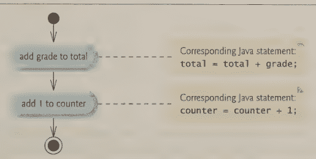

**图 4.1** | 顺序结构活动图。

UML 活动图模拟了软件系统某部分的工作流（也称为活动）。此类工作流可能包含算法的一部分，例如图 4.1 中的顺序结构。活动图由符号组成，例如动作状态符号（左侧和右侧替换为向外箭头的矩形）、菱形和小圆圈。这些符号由转换箭头连接，箭头代表活动的流——即动作应该发生的顺序。

与伪代码一样，活动图帮助你开发和实现算法。活动图清晰地展示了控制结构如何工作。我们使用伪代码和第 5 章中的活动图来展示控制结构如何运作。考虑图 4.1 中的活动图，它展示了控制结构如何操作。动作状态箭头表示动作发生的顺序。每个活动状态显示对应的 Java 代码。图 4.1 中的顺序结构图展示了两个按顺序执行的动作。Java 允许你在顺序中拥有任意数量动作，然后执行 1 动作。

# 控制语句：第一部分：赋值、++ 和 -- 运算符

## 4.5 if 单选择语句

语句之间可以相互连接——控制语句嵌套——即一个控制语句出现在另一个控制语句内部。因此，Java 程序中的算法仅由三种控制语句构建而成，且仅以两种方式进行组合。这就是简单性的精髓。

## 4.5 if 单选择语句

程序使用选择语句来选择备选的行动方案。例如，假设考试的及格线为 60 分。伪代码语句

> 如果学生成绩大于或等于 60
>
> 打印“通过”

决定了“学生成绩大于或等于 60”这一条件是否为真。如果是，则打印“通过”，并按顺序执行下一条伪代码语句。如果条件为假，则忽略打印语句，并按顺序执行下一条伪代码语句。该选择语句第二行的缩进是可选的，但建议进行，因为强调了结构化程序的内在结构。上述的伪代码 if 可以写成 Java 代码所示：

```java
if (studentGrade >= 60)
    System.out.println("Passed");
```

Java 代码与伪代码对应紧密。这是伪代码的属性之一，使其成为有效的程序开发工具。

### if 语句的 UML 活动图

图 4.2 展示了单选择 if 语句。该图包含了活动图中最重要的符号——菱形，或决策符号，它表示要做出决策。工作流沿着由符号相关的保护条件（guard conditions）决定的路径继续，这些可以为真也可以为假。从决策符号引出的每个转换都有一个保护条件（箭头旁边的括号内）。如果保护条件为真，工作流将进入转换所指向的操作状态。在图 4.2 中，如果成绩大于或等于 60，程序打印“通过”，然后跳转到该活动；如果成绩小于 60，程序立即跳转到最终状态，而不显示消息。


**图 4.2** | if 单选择语句 UML 活动图。

如果该语句是单入口/单出口的控制语句。我们将看到，其余控制语句的活动图也包含初始状态、转换箭头、指示要执行的操作的操作状态、指示要做出决策的决策符号（带有相关的保护条件）以及最终状态。

## 第 4 章 控制语句：第一部分：赋值、++ 和 -- 运算符

## 4.6 if...else 双选择语句

单选择语句仅在条件为真时执行操作；否则，将跳过该操作。if...else 双选择语句允许你在条件为真时指定一个操作，并在条件为假时指定另一个操作。例如，伪代码语句

> 如果学生成绩大于或等于 60
>
> 打印“通过”
>
> 否则
>
> 打印“不通过”

上述 if...else 伪代码语句可以写成 Java 代码所示：

```java
if (grade >= 60) {
  System.out.println("Passed");
} else {
  System.out.println("Failed");
}
```

else 的体也进行了缩进。无论你选择何种缩进规范，都应该在整个程序中保持一致。

> **良好的编程实践 4.1**
>
> 对 if...else 语句的两个体语句进行缩进。大多数 IDE 都会为你完成这一点。

> **良好的编程实践 4.2**
>
> 如果有多多个缩进层，每一层应该额外缩进相同的空间。

### if...else 语句的活动图

图 4.3 展示了 if...else 语句中的控制流。再次，UML 活动图中的符号（除初始状态、转换箭头和最终状态外）代表操作和决策。

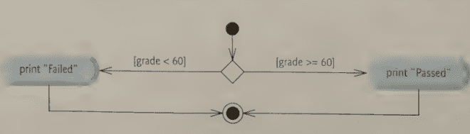

**图 4.3** | if...else 双选择语句 UML 活动图。

## 4.6 if...else 双选择语句

### 4.6.1 嵌套 if...else 语句

程序可以通过将 if...else 语句放在其他 if...else 语句内部来创建嵌套的 if...else 语句，从而测试多种情况。例如，以下伪代码表示嵌套的 if...else，对于大于或等于 90 的成绩打印 A，80 到 89 分打印 B，70 到 79 分打印 C，60 到 69 分打印 D，其他所有成绩打印 F：


## 伪代码示例：成绩判定

```text
成绩大于或等于 90
    打印 "A"
else
    成绩大于或等于 80
        打印 "B"
    else
        成绩大于或等于 70
            打印 "C"
        else
            成绩大于或等于 60
                打印 "D"
            else
                打印 "F"
```

此伪代码可以写成 Java 代码所示：

```java
if (studentGrade >= 90) {
    System.out.println("A");
} else {
    if (studentGrade >= 80) {
        System.out.println("B");
    } else {
        if (studentGrade >= 70) {
            System.out.println("C");
        } else {
            if (studentGrade >= 60) {
                System.out.println("D");
            } else {
                System.out.println("F");
            }
        }
    }
}
```

> **错误预防贴士 4.1**
>
> 在嵌套 `if...else` 语句中，确保测试所有可能的情况。如果布尔表达式为真，最嵌套的 `if...else` 语句将执行。对于嵌套 `if...else` 语句，外层的 `if...else` 语句将被跳过。如果布尔表达式为真，最嵌套的 `if...else` 语句将执行。

### 4.6.2 悬空 else 问题

在文中，我们总是使用括号来避免“悬空 else”问题。我们将在练习 27 中调查这一问题。

### 4.6.3 块

正如第 2.8 节所示，空语句可以放置空语句。以下示例包含了体中的语句：

```java
if (grade >= 60) {
    System.out.println("Passed");
} else {
    System.out.println("Failed");
}
```

`else` 的体也进行了缩进。无论你选择何种缩进规范，都应该在整个程序中保持一致。

### 4.6.4 条件运算符 (?)

Java 提供了条件运算符 (`?`)，可以替代简单的 `if...else` 语句。该运算符是唯一的三元运算符（即它接受三个操作数）。操作数和 `?:` 符号共同构成条件表达式。第一个操作数（`?` 左侧）是一个布尔表达式（求值结果为布尔值真或假），第二个操作数（`?` 和 `:` 之间）是条件为真时条件表达式的值，第三个操作数（`:` 右侧）是条件为假时条件表达式的值。例如，以下语句打印参数的值：

```java
System.out.println(studentGrade >= 60 ? "Passed" : "Failed");
```

此语句中的条件表达式在布尔表达式 `studentGrade >= 60` 为真时求值为“通过”，为假时求值为“不通过”。此条件运算符的语句与之前显示的 `if...else` 执行的功能相同。条件运算符的优先级较低，因此整个表达式通常放在括号中。条件表达式可以用于 `if...else` 语句无法使用的表达式。


> `?:` 运算符的第二个和三个操作数使用相同的类型以避免细微错误。

## 4.7 Student 类：嵌套 if...else 语句

图 4.4-4.5 的示例展示了嵌套 `if...else` 语句，根据学生的平均分确定其字母等级。

### Student 类

`Student` 类（图 4.4）具有与 `Account` 类（在第 3 章中讨论）类似的特征。`Student` 类存储学生的姓名和平均分，`average` 提供操作变量的方法。

```java
// Fig. 4.4: Student.java
// 存储学生姓名和平均分的 Student 类。
public class Student {
    private String name;
    private double average;

    // 构造函数初始化实例变量
    public Student(String name, double average) {
        this.name = name;
        // 验证平均分 > 0.0 且 <= 100.0；否则，
        // 保留实例变量 average 的默认值 (0.0)
        if (average >= 0) {
            if (average <= 100.0) {
                this.average = average;
            }
        }
    }

    // 设置学生的姓名
    public void setName(String name) {
        this.name = name;
    }

    // 获取学生的姓名
    public String getName() {
        return name;
    }

    // 获取学生的平均分
    public double getAverage() {
        return average;
    }

    // 设置学生的平均分
    public void setAverage(double studentAverage) {
        // 验证平均分 > 0.0 且 <= 100.0；否则
        // 保留实例变量 average 的当前值
        if (studentAverage > 0.0) {
            if (studentAverage <= 100.0) {
                this.average = studentAverage;
            }
        }
    }

    // 确定并返回学生的字母等级
    public String getLetterGrade() {
        String letterGrade = ""; // 初始化为空字符串
        if (average >= 90) {
            letterGrade = "A";
        } else if (average >= 80.0) {
            letterGrade = "B";
        } else if (average >= 70.0) {
            letterGrade = "C";
        } else if (average >= 60.0) {
            letterGrade = "D";
        } else {
            letterGrade = "F";
        }
        return letterGrade;
    }
}
```

图 4.4 | 存储学生姓名和平均分的 `Student` 类。

这些类包含：

- 类型为 `String` 的实例变量 `name`（第 4 行），用于存储学生的姓名
- 类型为 `double` 的实例变量 `average`（第 5 行），用于存储学生在某门课程中的平均分
- 构造函数（第 8–18 行），用于初始化姓名和平均分——在 5.9 节中，你将学习如何使用逻辑运算符来更简洁地表达第 13–14 行和 34–35 行
- 方法 `setName` 和 `getName`（第 21–28 行），用于设置和获取学生的姓名
- 方法 `setAverage` 和 `getAverage`（第 31–44 行），用于设置和获取学生的平均分
- 方法 `getLetterGrade`（第 47–67 行），该方法使用嵌套的 `if...else` 语句根据学生的平均分来确定其字母等级

构造函数和 `setAverage` 方法均使用了嵌套的 `if` 语句（第 13–17 行和 34–38 行）来验证用于设置平均分的值——这些语句确保该值大于 0.0 且小于 100；否则，`average` 的值保持不变。每个 `if` 语句包含一个简单的条件。如果第 13 行的条件为真，只有才会测试第 14 行的条件，并且只有当第 13 行和第 14 行的条件都为真时，才会执行第 15 行的语句。

> **软件观察 4.1**
>
> 回想第 3 章，你不应该在构造函数中调用方法（我们将在第 10 章面向对象编程：多态与接口中解释原因）。因此，图 4.4 的第 13–17 行和 34–38 行存在重复的验证代码。

### StudentTest

为了演示 `Student` 类中 `getLetterGrade` 方法的嵌套 `if...else` 语句，`StudentTest` 的 `main` 方法（图 4.5）创建了两个 `Student` 对象（第 6 行）。接下来，第 8–11 行通过分别调用对象的 `getName` 和 `getLetterGrade` 显示每个学生的姓名和字母等级。

```java
// Fig. 4.5: StudentTest.java
// 创建并测试 Student 对象。
public class StudentTest {
    public static void main(String[] args) {
        Student account1 = new Student("Jane Green", 93.5);
        Student account2 = new Student("John Blue", 72.75);

        System.out.printf("%s's letter grade is: %s\n",
            account1.getName(), account1.getLetterGrade());
        System.out.printf("%s's letter grade is: %s\n",
            account2.getName(), account2.getLetterGrade());
    }
}
```

```text
Jane Green 的字母等级是: A
John Blue 的字母等级是: C
```

图 4.5 | 创建并测试 `Student` 对象。

## 4.8 while 语句

`while` 语句允许在条件为真时执行某个操作，伪代码如下：

> 如果购物列表中还有物品
>
> 购买并将其划掉

描述了购物期间的 `while` 语句。如果“购物列表中还有物品”为真，则执行“购买并将其划掉”的操作。`while` 语句在条件为真时会重复执行其主体。`while` 语句体可以是单个语句或代码块。当条件变为假时，`while` 语句终止。此时，执行 `while` 语句之后的第一个语句。

作为 `while` 语句的一个示例，考虑以下寻找大于 100 的 `product` 程序：

```java
int product = 3;
while (product <= 100) {
    product *= 3;
}
```

`while` 语句的每次迭代将 `product` 乘以 3，因此依次取值为 9、27、81 和 243。当 `product` 变为 243 时，`product <= 100` 为假。这终止了迭代，`product` 的最终值为 243。此时，程序继续执行 `while` 语句之后的语句。

> **常见编程错误 4.2**
>
> 在 `while` 语句体中没有提供会导致 `while` 条件变为假的操作，通常会导致无限循环的逻辑错误（循环不会停止）。

## 4.9 制定算法：计数控制迭代

为了说明算法是如何开发的，我们解决两个关于计算学生平均分的变体问题。请考虑以下问题描述：

一个有 10 名学生的班级进行测验。该测验的成绩（0–100 范围内的整数）已提供给你。确定该测验的班级平均分。

班级平均分等于分数总和除以学生人数。在计算机上解决此问题的算法必须输入每个分数，跟踪所有输入的分数，执行平均值计算并打印结果。

### 计数控制迭代的伪代码算法

让我们使用伪代码来列出要执行的操作，并指定它们执行的顺序。我们使用计数控制迭代来逐个输入分数。这种技术使用一个名为计数器（或控制变量）的变量来控制语句执行的次数。计数控制迭代通常被称为确定性迭代，因为在循环开始之前迭代次数是已知的。在这个示例中，当计数器超过 10 时，迭代结束。本节介绍了一个完整的伪代码算法（图 4.7）以及实现该算法的相应 Java 程序（图 4.8）。在 4.10 节，我们将演示如何使用伪代码从零开始开发算法。

注意图 4.7 算法中对 `total`（总和）和 `counter`（计数器）的引用。`total` 是一个用于累加多个值之和的变量。计数器是一个用于计数的变量——在这种情况下，分数计数器表示用户即将输入 10 个分数。用于存储总和的变量通常在程序中使用之前初始化为 0。

> **软件工程观察 4.2**
>
> 经验表明，在计算机上解决问题最困难的部分是开发解决方案的算法。一旦指定了正确的算法，从其开发一个可运行的 Java 程序通常是简单的。

1. 将 `total` 设置为 0
2. 将 `gradeCounter` 设置为 1
3. 当 `gradeCounter` 小于或等于 10 时
4. 提示用户输入下一个分数
5. 输入下一个分数
6. 将分数加到 `total` 中
7. 将 `gradeCounter` 加 1
8. 将班级平均分设置为 `total` 除以 10
9. 打印班级平均分

> 图 4.7 | 使用计数控制迭代解决班级平均分问题的伪代码算法。

### 实现计数控制迭代

在图 4.8 中，`ClassAverage` 类的 `main` 方法实现了图 4.7 伪代码描述的计算平均分算法——它允许用户输入 10 个分数，然后计算并显示平均分。

```java
// 图 4.8: ClassAverage.java
// 使用计数控制迭代解决班级平均分问题。
import java.util.Scanner; // 程序使用 Scanner 类

public class ClassAverage {
    public static void main(String[] args) {
        // 创建 Scanner 从命令行窗口获取输入
        Scanner input = new Scanner(System.in);

        // 初始化阶段
        int total = 0; // 初始化用户输入的成绩总和
        int gradeCounter = 1; // 初始化下一个要输入的成绩数量

        // 处理阶段使用计数控制迭代
        while (gradeCounter <= 10) { // 循环 10 次
            System.out.print("Enter grade: "); // 提示
            int grade = input.nextInt(); // 输入下一个分数
            total = total + grade; // 将分数加到总和
            gradeCounter = gradeCounter + 1; // 计数器加1
        }

        // 终止阶段
        int average = total / 10; // 整数除法产生整数结果

        // 显示成绩的总和和平均分
        System.out.printf("%nTotal of all 10 grades is %d\n", total);
        System.out.printf("Class average is %d\n", average);
    }
}
```


图 4.8 | 使用计数控制迭代解决班级平均分问题。

#### main 方法中的局部变量

第 8 行声明并初始化了 `Scanner` 变量 `input`，用于读取用户输入的值。第 11、12、17 和 23 行分别声明了 `int` 局部变量 `total`、`gradeCounter` 和 `grade`。变量 `grade` 存储用户输入。

这些声明出现在 `main` 方法的体中。回想一下，在方法中声明的变量是局部变量，只能从声明行到方法的结束括号使用。局部变量的声明必须在该方法中使用该变量之前出现。局部变量无法在声明它的方法之外访问。在 `while` 循环体内声明的变量 `grade` 只能在该块中使用。

#### 初始化阶段：初始化变量 total 和 gradeCounter

赋值（第 11–12 行）将 `total` 初始化为 0，将 `gradeCounter` 初始化为 1。这些初始化发生在变量用于计算之前。


#### 处理阶段：从用户读取分数

第 15 行表示当 `gradeCounter` 小于或等于 10 时，`while` 语句重复执行（这种技术被称为计数器迭代）。第 16 行显示 "Enter grade: "，第 17 行读取用户输入的分数。第 18 行将分数加到 `total`。第 19 行将 `gradeCounter` 加 1。当计数器超过 10 时，循环终止。

#### 终止阶段：计算并显示平均分

当循环结束时，第 23 行计算平均分并赋值给 `average`。第 26 行使用 `System.out.printf` 显示 "Total of all 10 grades is " 后接 `total` 值。第 27 行使用 `printf` 显示 "Class average is " 后接 `average` 值。

### 关于整数除法的说明


由于整数除法会截断（而不是舍入），图 4.8 中的计算 `total / 10` 结果是整数 84，因为 `total` 和 `10` 都是整数。计算的小数部分被截断（即丢失）。在下一节中，我们将学习如何获取浮点数结果。

## 常见编程错误

假设整数除法会舍入而不是截断，会导致错误的结果。例如，`7/4` 在常规算术中是 1.75，但在整数算术中被截断为 1。


## 关于算术溢出

在图 4.8 中，第 18 行 `total = total + grade; // add grade to total` 将用户输入的每个分数加到总和。即使是简单的语句也有潜在问题——整数相加可能会产生无法存储在变量中的值。这被称为算术溢出，会导致未定义行为，正如 http://en.wikipedia.org/wiki/Integer_overflow#security_ramifications 所述。

图 2.7 的加法在第 17 行也有相同的问题，它计算用户输入的两个 `int` 值的和：

```java
int sum = number1 + number2; // 相加数字，并将总和存储在 sum
```

`int` 变量存储的最大值最小值由常量 `Integer.MIN_VALUE` 和 `Integer.MAX_VALUE` 表示。其他整数类型和浮点类型也有类似的常量。每个基本类型在 Java 中都有对应的类类型。你可以在每个类的在线文档中查看这些常量的值。`Integer` 类的在线文档位于：

http://docs.oracle.com/java/8/docs/api/java/Integer.html

被认为是良好的做法是在执行如图 4.8 第 18 行和图 2.7 第 17 行的算术计算之前，确保它们不会溢出。该代码显示在 CERT 网站上：

http://www.securingcode.cert.org

只需搜索指南 `NUM00-J` 即可。该代码使用了 `&&`（逻辑与）和 `||`（逻辑或）运算符，这些运算符在第 5 章中介绍。

# 深入理解用户输入

当程序从用户处接收输入时，可能会出现各种问题。例如，在图 4 的第 17 行

```java
int grade = input.nextInt(); // 输入下一个成绩
```

我们假设用户将输入一个 0 到 100 之间的整数成绩。然而，输入成绩的人可能会输入小于 0 的整数、大于 100 的整数、超出 `int` 变量可存储值范围的整数、包含小数点的数字，或者包含字母或特殊符号的非整数值。

为了确保输入是有效的，工业级程序必须对所有错误情况进行测试。输入成绩的程序应该通过检查来验证成绩的有效性，确保它们是 0 到 100 之间的值。然后你可以要求用户重新输入任何超出范围的值。如果程序需要来自特定值集合的输入（例如非连续的产品代码），你可以确保每个输入都匹配集合中的某个值。

## 4.10 制定算法：哨兵控制迭代

让我们将第 4.9 节的级平均分问题泛化。考虑以下问题：

> 开发一个级平均分程序，每次运行时都能处理任意数量学生的成绩。

在之前的级平均分示例中，问题描述指定了学生人数，因此成绩数量（10 个）是预先已知的。在这个示例中，没有迹象表明用户在程序执行期间将输入多少个成绩。程序必须处理任意数量的成绩。它如何确定何时停止输入成绩？它又如何知道何时计算并打印班级平均分？

解决此问题的方法之一是使用一种称为“哨兵值”（sentinel value，也称为虚拟值或标志值）的特殊值来指示数据的结束。用户不断输入成绩，直到输入了有效的成绩。用户输入哨兵值表示不再输入更多成绩。哨兵控制迭代通常被称为不定迭代，因为在循环开始之前迭代次数是未知的。

### 使用自顶向下、逐步细化开发伪代码算法：顶层和第一次细化

我们采用自顶向下、逐步细化的技术来处理这个级平均分程序，这种技术对于开发结构良好的程序至关重要。我们从顶层的伪代码表示开始——一个传达程序整体功能的单一语句：

```
确定测验的级平均分
```

顶层在实际上是程序的完整表示。遗憾的是，顶层很少传达足够编写 Java 程序的详细信息。因此，我们现在开始细化过程。我们将顶层划分为一系列较小的任务，并按照它们执行的顺序列出。这得到如下的第一次细化：

- 初始化变量
- 输入、求和并计数测验成绩
- 计算并打印级平均分

此细化仅使用了顺序结构——列出的步骤应该按顺序执行，一个接一个执行。


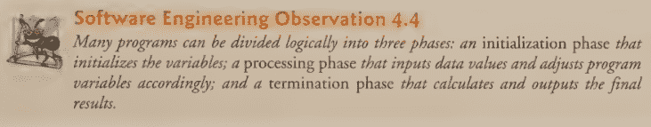

### 继续进行第二次细化

之前的“软件工程观察”通常就是你自顶向下过程中第一次细化的全部需要。为了继续进入下一层级细化——即第二次细化——我们确定了具体的变量。在示例中，我们需要一个数字的运行总和、一个已处理数字数量的计数器、一个接收用户输入的每个成绩值的变量，以及一个存储计算出的平均值的变量。伪代码语句

初始化变量

可以细化如下：

- 将 `total` 初始化为零
- 将 `counter` 初始化为零

只有 `total` 和 `counter` 两个变量在使用之前需要初始化。变量 `average` 和 `grade`（分别用于计算出的平均值和用户输入）不需要初始化，因为它们的值将在计算或输入时被替换。伪代码语句

输入、求和并计数测验成绩

需要迭代来连续输入每个成绩。我们不知道会输入多少个成绩，所以将使用哨兵控制迭代。用户一个接一个地输入成绩。在输入最后一个成绩后，用户输入哨兵值。程序在每个成绩输入后都会测试哨兵值，并在用户输入哨兵值时终止循环。前述伪代码语句的第二次细化将是：

- 提示用户输入第一个成绩
- 输入第一个成绩（可能是哨兵）
- 当用户没有输入哨兵时
  - 将此成绩加到运行总和中
  - 将成绩计数器加 1
  - 提示用户输入下一个成绩
  - 输入下一个成绩（可能是哨兵）

在伪代码中，我们不在构成 `While` 结构体的语句周围使用大括号。我们只需对 `While` 下的语句进行缩进，显示它们属于 `While`。再次，伪代码仅是一种非正式的程序开发辅助。

伪代码语句

计算并打印级平均分

可以细化如下：

- 如果计数不等于零
  - 将平均设置为总和除以计数
  - 打印平均
- 否则
  - 打印“未输入任何成绩”

我们在这里仔细地测试了除以零的可能性——这是一种逻辑错误，如果没有检测到，将导致程序失败或产生无效输出。级平均分问题的完整第二次细化如图 4.9 所示。

- 初始化 `total` 为零
- 初始化 `counter` 为零
- 提示用户输入第一个成绩
- 输入第一个成绩（可能是哨兵）
- 当用户没有输入哨兵时
  - 将此成绩加到运行总和中
  - 将成绩计数器加 1
  - 提示用户输入下一个成绩
  - 输入下一个成绩（可能是哨兵）
- 如果计数不等于零
  - 将平均设置为总和除以计数
  - 打印平均
- 否则
  - 打印“未输入任何成绩”

图 4.9 | 哨兵控制迭代的级平均分伪代码。

### 错误预防提示 4.4

在除法 (`/`) 或取模 (`%`) 计算中，如果操作数可能为零，请进行测试并处理（例如显示错误消息），而不是让错误发生。

在图 4.7 和图 4.9 中，我们在伪代码中加入了空行和缩进使其更具可读性。空行将算法分为不同的阶段并隔离控制语句；缩进强调了控制语句。伪代码解决了更通用的级平均分问题。该算法在两次细化后开发。有时还需要更多。

### 软件工程观察 4.5

当你指定的伪代码细节足够让你转换为 Java 时，就停止自顶向下逐步细化的过程。通常情况下，实现 Java 程序是简单的。

### 软件工程观察 4.6

某些程序员不使用伪代码等开发工具。他们认为最终目标是在计算机上解决问题，编写伪代码会延迟进度。虽然对于简单熟悉的问题这可行，但在大型复杂的项目中会导致严重的错误和延迟。

### 实现哨兵控制迭代

在图 4.10 中，`main` 方法实现了图 4.9 的伪代码算法。虽然每个成绩都是整数，但平均计算可能会产生带有小数的数字——换句话说，是一个实数（浮点数）。`int` 类型无法表示这种数字，因此类使用 `double`。你还会看到控制语句可以相互堆叠（顺序）。`while` 语句（第 20-27 行）后面跟着的是 `if...else` 语句（第 31-42 行）。该程序中的大部分代码与图 4.8 相同，因此我们关注新概念。

```java
// Fig 4.10: ClassAverage.java
// 使用哨兵控制迭代解决级平均分问题。
import java.util.Scanner; // 程序使用 Scanner 类

public class ClassAverage {
    public static void main(String[] args) {
        // 创建 Scanner 从命令行窗口获取输入
        Scanner input = new Scanner(System.in);

        // 初始化阶段
        int total = 0; // 初始化成绩总和
        int gradeCounter = 0; // 初始化已输入的成绩数量

        // 处理阶段
        // 提示输入并从用户读取成绩
        System.out.print("Enter grade or -1 to quit: ");
        int grade = input.nextInt();

        // 从用户读取循环哨值
        while (grade != -1) {
            total = total + grade;
            gradeCounter = gradeCounter + 1; // 计数器计数

            // 提示输入并从用户读取下一个成绩
            System.out.print("Enter grade or -1 to quit: ");
            grade = input.nextInt();
        }

        // 终止阶段
        if (gradeCounter != 0) {
            // 使用小数点计算成绩平均分
            double average = (double) total / gradeCounter;

            // 显示总分和平均分（保留两位精度）
            System.out.printf("Total of the %d grades entered is %d\n", gradeCounter, total);
            System.out.printf("Class average is %.2f\n", average);
        } else {
            // 没有输入任何成绩，因此输出适当的消息
            System.out.println("No grades were entered");
        }
    }
}
```

输入成绩或 -1 退出： 97

输入成绩或 -1 退出： 88

输入成绩或 -1 退出： 72

输入成绩或 -1 退出： -1

输入的 3 个成绩总和为 257

班级平均分为 85.67

图 4.10 | 使用哨值控制迭代解决班级平均分问题。（2 部分/2 部分。）

### 哨值控制迭代与计数器控制迭代的逻辑

第 12 行将 `gradeCounter` 初始化为 0，因为还没有输入任何成绩。记住，此程序使用哨值控制迭代来输入成绩。为了准确记录输入的成绩数量，程序仅在用户输入有效成绩时才增加 `gradeCounter`。

将此处使用的哨值控制迭代逻辑与图 4.8 中的计数器控制迭代进行比较。在计数器控制迭代中，`while` 语句（图 4.8 的第 15–20 行）会根据指定的迭代次数从用户处读取一个值。在哨值控制迭代中，程序在进入 `while` 之前会读取第一个值（图 4.10 的第 16–17 行）。该值决定了程序的控制流，如果条件为假，则用户输入了哨值，因此 `while` 的循环体不执行（即没有输入任何成绩）。另一方面，如果条件为真，则执行循环体，循环将成绩值加到 `total` 并增加 `gradeCounter`（第 21–22 行）。接下来，循环体内的第 25–26 行从用户处输入值。然后，程序到达 `while` 条件的结束括号（第 27 行），因此通过测试 `while` 条件（第 20 行）继续执行。`grade` 的值在程序测试 `while` 之前总是从用户处立即录入的（即将其加到 `total`）。如果输入的是哨值，循环终止，程序不会将 -1 加到 `total`。

### 良好的编程习惯 4.3

在哨值控制循环中，应提醒用户哨值。循环结束后，第 31–42 行的 `if...else` 语句执行。第 31 行的条件判断是否输入了成绩。如果没有输入，`if...else` 语句的 `else` 部分（第 40–42 行）执行并显示“未输入成绩”。

### 语句中的括号

注意图 4.10 中 `while` 语句的块（第 20–27 行）。如果没有括号，循环会将其体视为第一条语句，将成绩加到 `total`。块中的最后三个语句将落在循环之外，导致计算机错误地解释代码：

```java
while (grade == -1)
    total = total + grade; // 将 grade 加到 total
    gradeCounter = gradeCounter + 1; // 计数器

// 提示输入并从用户读取下一个成绩
System.out.print("Enter grade or -1 to quit: ");
grade = input.nextInt();
```

如果用户没有在第 17 行输入哨值 -1，前面的代码会导致无限循环。

### 常见编程错误 4.4

> 遗漏括号会导致逻辑错误，例如无限循环。为了防止这个问题，某些程序员应该为每个控制语句的块加上括号，即使它只包含一条语句。

### 显式和隐式转换类型

如果至少输入了一个成绩，图 4.10 的第 33 行计算成绩的平均分。从图 4.8 回忆，整数除法产生整数结果。尽管变量 `average` 被声明为 `double`，如果我们把计算写为：

```java
double average = total / gradeCounter;
```

在结果赋值给 `average` 之前会丢失小数部分。这是因为 `total` 和 `gradeCounter` 都是整数，且整数除法产生整数结果。

大多数平均分不是整数（例如 85.67）。因此，我们在示例中使用浮点数计算班级平均分。为了对整数值进行浮点计算，我们必须临时将这些值视为浮点数。Java 提供了强制运算符来完成此任务。图 4.10 的第 33 行使用 `(double)` 强制运算符创建操作数 `total` 的浮点副本。这种方式使用强制运算符是显式转换或类型转换。存储在 `total` 中的值仍然是整数。

计算现在由浮点值（`total` 的临时 `double` 副本）除以整数 `gradeCounter`。Java 只能评估操作数相同的算术表达式。因此 Java 对选定的操作数进行操作提升（隐式转换）。例如，在包含 `int` 和 `double` 值的表达式中，`int` 值被提升为 `double` 值供表达式使用。在本示例中，`gradeCounter` 的值被提升为 `double` 类型，执行浮点除法并将赋值给 `average`。

### 常见编程错误 4.6

> 强制运算符可用于基本类型（如 `int` 和 `double`）以及引用类型之间（我们在第 10 章面向对象编程：多态与接口中讨论）。转换为错误的类型可能会导致编译错误或运行时错误。

可以通过在类型周围放置括号来强制转换对象。该运算符是一元运算符——它只接受一个操作数。Java 还有一元运算符 `+` 和 `-`，它们从右到左结合，且优先级与一元运算符相同。此优先级比乘法运算符 `*` 和 `/` 高（参见附录 A 中的运算符优先级表）。我们在优先级表中用 `(type)` 符号表示强制运算符，表示任何名称都可形成强制运算符。

图 4.10 的第 38 行显示班级平均分。在本示例中，我们将班级平均分保留到百分位。`printf` 格式字符串中的格式指定符 `%.2f` 表示变量 `average` 的值显示时在小数点后保留两位精度——由格式指定符中的 `.2` 表示。示例执行期间输入的三个成绩总和为 257，得出平均分 85.666...。`printf` 方法使用格式指定符将值舍入到指定的位数。在程序中，平均分被舍入到两位小数并显示为 85.67。

### 浮点数精度

浮点数并不总是完全精确的。例如，当我们谈论 98.6 的“正常”体温时，我们不需要精确到很多位数。当我们读取温度计显示为 98.6 时，它实际上可能是 98.5999473210643。对于大多数涉及体温的应用，简单地称其为 98.6 是可以的。

浮点数经常作为除法的结果出现，正如本示例中的班级平均分计算一样。在常规算术中，当 10 除以 3 时，结果是

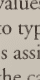

3.333333...数字 3 无限循环。计算机仅分配固定长度的空间来存储此类值，显然，存储的浮点值只能是一个近似值。

由于浮点数的不精确性，`double` 类型比 `float` 类型更优，因为 `double` 变量可以更准确地表示浮点数。出于这个原因，我们在本书中主要使用 `float` 和 `double`。在某些应用程序中，`float` 和 `double` 变量的精度可能不足。对于精确浮点数（例如货币计算所需的），Java 提供了 `java.math` 类，我们将在第 8 章中讨论。

### 常见编程错误 4-7

以假设浮点数被精确表示的方式使用它们会导致错误的结果。

## 4.11 制定算法：嵌套控制语句


# 制定算法：嵌套控制语句

对于下一个示例，我们再次通过伪代码和自顶向下、逐步细化的方法来制定算法，并编写了相应的 Java 程序。我们已经看到控制语句可以相互堆叠（顺序执行）。在这种情况下，我们检查另一种唯一可以连接的结构化控制语句——即将一个控制语句嵌套在另一个控制语句之中。

## 问题描述

某大学提供一门课程，为学生准备房地产经纪人执业考试。去年，完成这门课程的 10 名学生参加了考试。大学想知道学生在考试中的表现如何。你被要求写一个程序来总结结果。你得到了一个包含 10 名学生的列表，或者一个包含 2 名未通过学生的列表。每个名字旁边写着 1 表示学生通过考试，2 表示学生未通过。

你的程序应该如下所示分析考试结果：

1. 输入每个测试结果。每当程序请求另一个测试结果时，在屏幕上显示消息“Enter result”。
2. 统计每种类型测试结果的数量。
3. 显示测试结果的摘要，说明通过人数和不及格人数。
4. 如果有超过八名学生通过考试，打印“Bonus to instructor!”

在仔细阅读问题描述后，我们得出以下观察：

1. 对于 10 名学生，可以使用计数控制循环，因为测试结果的数量是预先已知的。
2. 每个测试结果都有一个数值——1 或 2。每当读取一个测试结果时，程序必须判断它是 1 还是 2。我们在算法中测试是否为 1。如果数字不是 1，我们假设它是 2（练习 4.24 考虑了此假设的结果）。
3. 使用两个计数器来跟踪考试结果——一个用于统计通过人数，另一个用于统计不及格人数。
4. 在程序处理所有结果后，它必须决定是否有超过八名学生通过考试。

## 自顶向下、逐步细化

让我们从顶层的表示开始进行自顶向下、逐步细化：

> 分析考试结果并决定是否应该支付奖金

再次，顶层是程序的完整表示，但在伪代码自然地演变为 Java 程序之前，可能需要几次细化。

### 第一次细化

- 初始化变量
- 输入 10 份考试结果，并统计通过人数和不及格人数
- 打印考试结果摘要并决定是否应该支付奖金

在这里，尽管我们有了程序的完整表示，但仍需要进一步细化。需要计数器来记录通过和不及格，需要一个计数器来控制循环过程，以及一个变量来存储用户输入。用户输入中存储的变量在算法开始时没有初始化，因为它的值是在循环的每次迭代中输入的。

伪代码语句 **初始化变量** 可以细化为：

- 初始化通过人数为零
- 初始化不及格人数为零
- 初始化学生计数器为零

注意，只有计数器在算法开始时初始化。

伪代码语句 **输入 10 份考试结果，并统计通过人数和不及格人数** 需要一个循环来成功输入每份考试的结果。我们知道恰好有 10 份考试结果，因此计数控制循环是恰当的。在循环内部（即嵌套在循环中），一个双选择结构将决定每个考试结果是通过还是不及格，并增加相应的计数器。上述伪代码语句的细化是：

- 当学生计数器小于或等于 10
  - 提示用户输入下一个考试结果
  - 输入下一个考试结果
  - ```
    If the student passed
        Add one to passes
    Else
        Add one to failures
    ```
  - 学生计数器加 1

我们使用空行来隔离 `If...Else` 控制结构，这可以提高可读性。

伪代码语句 **打印考试结果摘要并决定是否应该支付奖金** 可以细化为：

- 打印通过人数
- 打印不及格人数
- 如果通过人数超过八
  - 打印“Bonus to instructor!”

### 伪代码的完整细化

完整的第二次细化如下。同样使用了空行来区分 `While` 结构以提高程序的可读性。该伪代码现在足够细化，可以转换为 Java。

```
1  Initialize passes to zero
2  Initialize failures to zero
3  Initialize student counter to one
4
5  While student counter is less than or equal to 10
6      Prompts the user to enter the next exam result
7      Input the next exam result
8
9      If the student passed
10         Add one to passes
11     Else
12         Add one to failures
13
14     Add one to student counter
15
16 Print the number of passes
17 Print the number of failures
18
19 If more than eight students passed
20     Print "Bonus to instructor!"
```

## Java 实现

实现伪代码算法的 Java 类和两个示例执行如下所示。第 11–13 行和第 19 行声明了用于处理考试结果的变量。

> **预防错误提示 4.5**
> 在声明局部变量时初始化它们可以帮助避免因尝试使用未初始化变量而引起的任何编译错误。虽然 Java 不要求将局部变量初始化合并到声明中，但它要求在表达式中使用局部变量之前对其进行初始化。

```java
// Fig 4.12 Analysis.java
// 使用嵌套控制语句分析考试结果。
import java.util.Scanner; // 类使用 Scanner

public class Analysis {
    public static void main(String[] args) {
        // 创建 Scanner 从命令行输入
        Scanner input = new Scanner(System.in);
        // 在声明中初始化变量
        int passes = 0;
        int failures = 0;
        int studentCounter = 1;
        // 使用计数控制循环处理学生
        while (studentCounter <= 10) {
            // 提示用户并获取用户输入
            System.out.print("Enter result (1 = pass, 2 = fail): ");
            int result = input.nextInt();
            // if...else 嵌套在 while 语句中
            if (result == 1) {
                passes = passes + 1;
            } else {
                failures = failures + 1;
            }
            // 增加 studentCounter 使循环最终终止
            studentCounter = studentCounter + 1;
        }
        // 终止阶段：准备并显示结果
        System.out.printf("Passed: %d Failed: %d %d\n", passes, failures, studentCounter);
        // 判断是否有超过 8 名学生通过
        if (passes > 8) {
            System.out.println("Bonus to instructor!");
        }
    }
}
```

语句增加通过人数；否则假设结果为 2 并增加不及格人数。第 30 行在测试循环条件之前增加计数器。在输入 10 个值后，循环终止，第 34 行显示通过人数。第 37–39 行判断是否有超过八名学生通过考试，如果是，输出消息给导师。

---

# 4.12 复合赋值运算符

复合赋值运算符允许你简写赋值表达式。例如，你可以将语句

```java
c = c + 3; // 给 c 加 3
```

用加法复合运算符 `+=` 简写为

```java
c += 3; // 更简洁地给 c 加 3
```

`+=` 运算符将右侧表达式的值加上左侧变量的值并将结果存储在左侧变量中。因此 `c += 3` 是增加了 `c`。通常情况下，如下语句

```java
variable = variable operator expression;
```

其中 `operator` 是二元运算符 `+`、`-`、`*`、`/` 或 `%` 之一（或其他稍后讨论的其他运算符），且相同的变量名可以写成形式：

```java
variable operator= expression;
```

下表显示了算术复合赋值运算符、使用这些运算符的示例以及运算符的作用说明。请务必完成自测练习 4.1(h)，以学习复合赋值运算符的一个细微特征。

假设 `int c = 3, d = 5, e = 4, f = 6, g = 12;`

| 运算符 | 语句 | 结果 |
| :--- | :--- | :--- |
| `+=` | `c += 7` | `c` 变为 10 |
| `-=` | `d -= 4` | `d` 变为 1 |
| `*=` | `e *= 5` | `e` 变为 20 |
| `/=` | `f /= 3` | `f` 变为 2 |
| `%=` | `g %= 9` | `g` 变为 3 |

---

# 4.13 递增与递减运算符

Java 提供了单元运算符（见下表），用于对数值变量的值加 1 或减 1。这些是单元递增运算符 `++` 和单元递减运算符 `--`。程序可以使用递增运算符 `++` 将变量 `c` 的值加 1，而不是使用表达式 `c = c + 1` 或 `c += 1`。前缀放在变量之前的递增或递减运算符分别称为前缀递增或前缀递减运算符。后缀放在变量之后的递增或递减运算符分别称为后置递增或后置递减运算符。

| 运算符 | 描述 |
| :--- | :--- |
| `++a` (前缀递增) | 将 `a` 加 1，然后在表达式中使用 `a` 的新值 |
| `a++` (后置递增) | 在表达式中使用 `a` 的当前值，然后将 `a` 加 1 |
| `--b` (前缀递减) | 将 `b` 减 1，然后在表达式中使用 `b` 的新值 |
| `b--` (后置递减) | 在表达式中使用 `b` 的当前值，然后将 `b` 减 1 |

使用前缀递增（或递减）运算符对变量加 1（或减 1）称为前递增（或前递减）。这会导致变量加 1（减 1）；然后在它出现的表达式中使用变量的新值。使用后置递增（或递减）运算符对变量加 1（或减 1）称为后递增（或后递减）。这会导致在它出现的表达式中使用变量的当前值；然后变量的值加 1（减 1）。

> **良好的编程习惯 4.4**
> 与二元运算符不同，单元递增和递减运算符应该紧贴操作数放置，中间不要留空格。

## 前缀递增与后置递增的区别

下面的代码演示了 `++` 递增运算符的前缀递增和后置递增的区别。递减运算符 `--` 也类似。

```java
// 图 4.15: Increment.java
// 前缀递增与后置递增的区别
public class Increment {
    public static void main(String[] args) {
        int c = 5;
        System.out.println("前缀递增: " + ++c); // 输出 6
        System.out.println("后置递增: " + c++); // 输出 6
        System.out.println("最终值: " + c); // 输出 7
    }
}
```

## 使用算术赋值、递增和递减运算符简化语句

算术赋值运算符以及递增递减运算符可以用于简化语句。例如，`Analysis` 类中的三条赋值语句：

```java
passes = passes + 1;
failures = failures + 1;
studentCounter = studentCounter + 1;
```

可以使用复合赋值运算符更简洁地写为：

```java
passes += 1;
failures += 1;
studentCounter += 1;
```

使用前缀递增运算符：

```java
++passes;
++failures;
++studentCounter;
```

或者使用后置递增运算符：

```java
passes++;
failures++;
studentCounter++;
```

对变量本身进行递增或递减时，前缀和后置的形式效果相同。只有当变量出现在更大的表达式中时，前递增和后递增的效果才不同。

---

# 运算符优先级与结合性

下表显示了已引入运算符的优先级和结合性。它们按优先级从高到低排列。第二列描述了运算符的结合性。条件运算符 `? :`；单元递增 `++`、递减 `--`、正和负 `+` `-`；赋值运算符 `=`、`+=`、`-=`、`*=`、`/=`、`%=` 从右向左结合。其他运算符从左向右结合。第三列列出了运算符的类型。

| 运算符 | 结合性 | 类型 |
| :--- | :--- | :--- |
| `++` `--` | 从左到右 | 后置一元 |
| `++` `--` `+` `-` `(type)` | 从右到左 | 前置一元 |
| `*` `/` `%` | 从左到右 | 乘法 |
| `+` `-` | 从左到右 | 加法 |
| `<` `<=` `>` `>=` | 从左到右 | 关系运算符 |
| `==` `!=` | 从左到右 | 相等 |
| `? :` | 从右到左 | 三元条件运算符 |
| `=` `+=` `-=` `*=` `/=` `%=` | 从右到左 | 赋值 |

---

# 4.14 原始类型

附录 D 列出了 Java 中的 8 种原始类型。像 C 和 C++ 一样，Java 要求所有变量必须有类型。

在 C 和 C++ 中，程序员必须编写不同版本的程序以支持不同的计算机平台，因为原始类型无法保证在不同计算机之间是相同的。例如，在一台机器上的 `int` 可能由 16 位（2 字节）内存表示，在另一台机器上可能是 32 位（4 字节），而在另一台机器上可能是 64 位（8 字节）。在 Java 中，`int` 值始终是 32 位（4 字节）。

> **可移植性提示 4.1**
> Java 的原始类型在所有支持 Java 的计算机平台上都具有可移植性。

附录 D 中的每种类型都列出了其位大小（1 字节 = 8 位）和取值范围。由于 Java 设计者希望确保可移植性，他们使用了国际标准的字符格式（Unicode；更多信息请访问 http://www.unicode.org）和浮点数标准（IEEE 754；更多信息请访问 http://grouper.ieee.org/groups/754/）。

回顾第 3.2 节，在方法之外声明为类实例变量的原始类型变量，除非显式初始化，否则会自动分配默认值。`char`、`byte`、`short`、`int`、`long`、`float` 和 `double` 类型的实例变量默认均为 0。引用类型实例变量默认初始化为 `null`。

---

# 4.15（可选）GUI 与图形案例研究：事件处理：绘制线条

Java 的一个引人注目的特性是它的图形和多媒体支持，这让你能够从视觉上增强应用程序。第 22 章“JavaFX 图形与多媒体”详细讨论了这些功能。


# 4.15（可选）GUI 与图形案例研究：事件处理：绘制线条

在本节以及接下来的几个 GUI 和图形案例节中，我们将介绍 JavaFX 的一些图形能力。在本节中，你将构建一个 `Drawings`，它可以在 `Canvas`（可以绘图的矩形区域）上绘制线条。它还引入了事件处理——当用户点击按钮（`Button`）时，JavaFX 将调用我们在 Scene Builder 中指定的方法，在 `Canvas` 上绘制线条。与第 3.6 节一样，这个 GUI 和图形案例研究比后续章节稍长，因为我们将逐步演示配置 GUI 的步骤。

## 4.15.1 测试运行完成的 DrawLines 程序

首先，让我们运行完成的程序，这样你可以看到它的运行情况：

1. 在命令行窗口中，切换到本章 `ch04` 示例文件夹下的 `GUIGraphicsCaseStudy04` 目录。
2. 使用以下命令编译程序，该命令会编译此程序的两个 Java 源码文件：
   ```
   javac *.java
   ```
3. 使用以下命令运行程序：
   ```
   java DrawLines
   ```

当程序的窗口出现在屏幕上时（图 4.17(a)），点击“Draw Lines”按钮。图 4.17(b) 显示了用户点击 Draw Lines 按钮后应用程序的 GUI。

| 初始 Draw Lines 窗口 | |
| --- | --- |
| 标题栏 | - Draw Lines - [] X |
| 用户点击按钮控件告诉程序执行操作 | Tool 容器显示一个或多个控件 |
| 应用程序在 Canvas 上绘制线条 | |

图 4.17 | 运行中的 Draw Lines 程序。（2 部分中的 1 部分）。

b) 用户点击 Draw Lines 按钮后的 Draw Lines 程序窗口

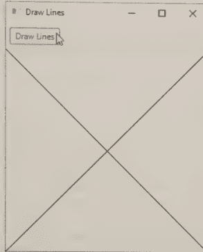

图 4.17 | 运行中的 Draw Lines 程序。（2 部分中的 2 部分。）

## 4.15.2 构建程序的 GUI

你将在 `DrawLines.fxml` 中构建程序的 GUI，并使用你在第 3.6 节中学到的相同技术。GUI 包含以下控件：

- 一个用于点击以绘制线条的按钮
- 一个显示图像的 `Canvas`

你还将使用 `BorderPane` 和 `ToolBar` 布局（稍后将讨论），来帮助你在用户界面中安排按钮和 `Canvas`。

### 打开 Scene Builder 并创建文件 DrawLines.fxml

正如第 3.6.4 节所示，打开 Scene Builder，然后选择 `File > Save` 显示保存对话框。选择存储 FXML 文件的位置，将文件命名为 `DrawLines.fxml` 并点击 Save 按钮创建文件。

### 创建 BorderPane 布局

在第 3.6 节中，你使用了 `VBox` 布局。要使用 `BorderPane` 布局，打开 Scene Builder，然后选择 `File > Save` 显示保存对话框。选择存储 FXML 文件的位置，将文件命名为 `DrawLines.fxml` 并点击 Save 按钮创建文件。

### 配置 BorderPane 布局容器的大小

最后，你将指定 `BorderPane` 根据其内容来调整自身的大小。回顾第 3.6.7 节，GUI 主布局（在本例中 `BorderPane`）的首选宽度和高度决定了 JavaFX 窗口的默认大小。要设置 `BorderPane` 的首选大小：

1. 在内容面板中点击 `BorderPane`，或者在 Scene Builder 文档的层级结构（Hierarchy）部分（位于 Scene Builder 左下角）点击它来选中它。
2. 在 Inspector 的 Layout 部分中，点击 Pref Width（首选宽度）属性的下拉箭头并使用 `USE_COMPUTED_SIZE`（图 4.23）。这告诉 `BorderPane` 根据其内容的宽度来计算首选宽度。在此应用程序中，最宽的项目是 `Canvas`，因为 `BorderPane` 初始宽度为 300 像素。
3. 重复步骤 2 设置 Pref Height（首选高度）属性。这告诉 `BorderPane` 根据其内容的高度来计算首选高度。在这种情况下，`BorderPane` 的高度将是 `Toolbar` 和 `Canvas` 高度的和。

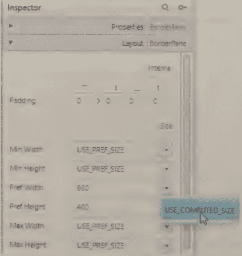

图 4.23 为 BorderPane 的 Pref Width 属性选择 USE_COMPUTED_SIZE。

### 保存设计

你现在已经完成了 GUI。设计应该如图 4.24 所示。选择 `File > Save` 保存 FXML 文件。


图 4.24 | Scene Builder 内容面板中完成的 GUI。

## 4.15.3 准备通过程序与 GUI 交互

你创建了对象（如 `Scanner`、`Account` 和 `Student`），将它们分配给变量，并通过这些变量与对象进行程序化交互。JavaFX GUI 控件是可以程序化交互的对象。对于在 Scene Builder 中创建的 GUI，JavaFX 在应用程序开始执行时为你创建控件。

正如你在第 4.15.1 节看到的，当你点击 Draw Lines 按钮时，应用程序通过在 `Canvas` 上绘制线条来响应事件。在本节中，你将学习如何使用 Scene Builder 指定变量和方法的名称，以便你能够与 GUI 控件进行交互。我们将展示 Scene Builder 如何生成包含这些变量和方法的类。

### 指定应用程序的控制器类

当然，实例变量必须在类中声明。对于 FXML GUI，这些变量声明在控制器类中，因为它控制应用程序如何响应用户对 GUI 的交互。你将在第 4.15.4 节看到此应用程序的控制器类。当启动带有 FXML GUI 的 JavaFX 应用程序时，JavaFX 运行时：

- 创建 GUI；
- 创建你在 Scene Builder 中指定的控制类的对象；
- 初始化你在 Scene Builder 中指定的控制器对象的任何实例变量，使其引用相应的控制器对象；
- 配置你在 Scene Builder 中指定的控制器对象的任何事件处理程序，以便在用户与相应的控制器交互时调用它们。

要指定控制器的类的名称：

1. 展开 Scene Builder 文档窗口的 Controller 部分（位于 Scene Builder 左下角）。
2. 对于 Controller Class（控制器类），输入 `DrawlinesController` 并按回车。按照惯例，控制器的类基名与 FXML 文件（`DrawLines.fxml`）相同，后加上 `Controller`。

### 指定 Canvas 的实例名称

为了在 `Canvas` 对象上绘图，程序需要一个引用它的变量——这将控制器类中的一个实例变量。控件的 `fxcid` 属性指定了实例变量的名称——当应用程序开始执行时将进行赋值。JavaFX 会用相应的控件对象初始化该实例变量。要指定 `Canvas` 的 `fxcid`：

- 选中 `Canvas`，点击 Code 侧的右箭头 (▷)。
- 对于 `fxcid` 属性，输入 `canvas` 并按回车。

### 指定按钮的事件处理方法

事件处理程序是在响应用户交互时被调用的方法，例如当用户点击此应用程序的 Draw Lines 按钮时。该方法由 JavaFX 运行时在一个控制类对象上调用。要指定按钮事件处理程序的名称：

- 点击 `Button`。
- 在 Inspector 的 Code 部分的 Action 属性中，输入方法名 `drawLinesButtonPressed` 并按回车。
- 选择 `File > Save` 保存 FXML 文件。

### 生成初始控制器类

Scene Builder 可以生成一个 `DrawLinesController` 类——它会调用控制器骨架——包含实例变量和方法。我们将讨论该骨架（图 25），它拥有事件处理方法。

```java
// Fig 25: DrawLinesController.java
// 使用 strokeLine 来连接 canvas 的角。
import javafx.event.ActionEvent;
import javafx.fxml.FXML;
import javafx.scene.canvas.Canvas;
import javafx.scene.canvas.GraphicsContext;

public class DrawLinesController {
    @FXML private Canvas canvas; // 用于 GraphicsContext
    // 用户点击按钮时，在 Canvas 上绘制两条线
    @FXML
    void drawLinesButtonPressed(ActionEvent event) {
        // 获取 GraphicsContext，用于在 Canvas 上绘图
        GraphicsContext gc = canvas.getGraphicsContext2D();

        // 从左上角到右下角的线条
        gc.strokeLine(0, 0, canvas.getWidth(), canvas.getHeight());

        // 从右上角到左下角的线条
        gc.strokeLine(canvas.getWidth(), 0, 0, canvas.getHeight());
    }
}
```

图 25 | 骨架代码。

## 4.15.4 类 DrawLinesController

书中看到的每个 Java 应用程序至少包含两个 Java 文件：

- 定义 GUI 事件处理程序的控制器类。在本应用程序中，`DrawLinesController.java`（图 26）包含该控制器类。
- 主应用程序类，加载应用程序的 FXML 文件，创建 GUI 然后配置相应的控制器对象。在本应用程序中，`DrawLines.java`（图 28）包含主应用程序类。

`DrawLinesController`（图 26）执行绘制操作。5-6 行的导入语句允许我们使用来自 `javafx.scene.canvas` 包的两个类：

- `Canvas` 提供了 `Canvas` 上绘图的各种方法——每个 `Canvas` 都有一个 `GraphicsContext` 对象。

```java
// Fig 26: DrawLinesController.java
// 使用 strokeLine 来连接 canvas 的角。
import javafx.event.ActionEvent;
import javafx.fxml.FXML;
import javafx.scene.canvas.Canvas;
import javafx.scene.canvas.GraphicsContext;

public class DrawLinesController {
    @FXML private Canvas canvas;
    @FXML
    void drawLinesButtonPressed(ActionEvent event) {

    }
}
```

图 26 | 使用 strokeLine 来连接 canvas 的角。

### @FXML 注解

回顾第 4.15.3 节，我们通过程序化操作的每个控件都需要一个 `fxid`。图 26 中的第 9 行声明了控制器的实例变量 `canvas`。声明前的 `@FXML` 注解表示该变量可以在 GUI 的 FXML 文件中使用。你在控制器类中指定的变量名必须与构建 GUI 时指定的 `fxid` 精确匹配。注意我们没有初始化此变量。当 `DrawLines` 应用执行时，它会用来自 `DrawLines.fxml` 的 `Canvas` 对象初始化 `canvas` 变量。

方法前的 `@FXML` 注解（第 12 行）表示该方法可以在 FXML 文件中用，以指定控件的事件处理器。当 Draw Lines 应用执行时，当用户按下 Draw Lines 时，会触发 `drawButtonPressed`（第 12–22 行）执行。按下按钮会生成一个 `Action` 对象，其中包含所发生事件的信息。相应的事件处理方法必须返回 `void` 并接收 `ActionEvent` 参数（第 13 行）。（在本示例中，我们没有使用 `ActionEvent` 参数中的信息。）

### 获取在 Canvas 上绘图的 GraphicsContext

每个 `Canvas` 都有一个用于在 `Canvas` 上绘图的 `GraphicsContext` 对象。你通过调用 `Canvas` 的 `getGraphicsContext2D` 方法（第 15 行）获取 `GraphicsContext`：

```java
GraphicsContext gc = canvas.getGraphicsContext2D();
```

按照惯例，变量名 `gc` 用于此对象。

### Canvas 的坐标系

坐标系（图 4.27）是一种用于识别点的方案。在 `Canvas` 的坐标系中，左上角的坐标为 (0, 0)。一个 x-y 坐标对由一个 x 坐标（水平坐标）和一个 y 坐标（垂直坐标）组成。x 坐标是从左到右移动的水平位置。y 坐标是从上到下移动的垂直位置。x 轴描述每个水平坐标，y 轴描述每个垂直坐标。坐标指示了图形应该显示何的位置。坐标单位以像素（pixels）测量。“像素”一词代表“像素元素”。像素是显示器上最小的可寻址单元。

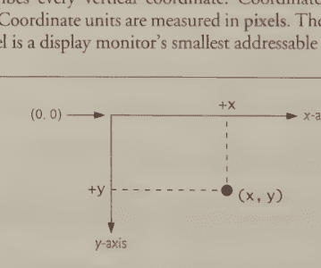

图 4.27 | Java 坐标系。单位为像素。

### 绘制线条

图 4.26 中的第 18 行和第 21 行使用 `Graphics` 变量 `gc` 绘制连接 `Canvas` 角角的线条。`GraphicsContext` 类的 `strokeLine` 方法需要四个参数来画一条线——前两个是起点的 x-y 坐标，后两个是终点的 x-y 坐标。在第 18 行中，前两个参数代表 `Canvas` 的左上角，后两个代表 `Canvas` 的右下角。`Canvas` 方法 `getWidth` 和 `getHeight` 分别返回像素的 `Canvas` 宽度和高度。在第 21 行中，前两个代表 `Canvas` 的右上角，后两个代表 `Canvas` 的左下角。

## 4.15.5 DrawLines 类——主应用程序类

图 4.28 显示了 `DrawLines` 类——该应用的主应用程序类，它启动程序的执行，从 FXML 文件创建 GUI，创建并配置控制器-类对象，并在窗口中显示 GUI。书中的每个 JavaFX 应用都使用类似的应用程序类，我们在其中只需要进行三处代码更改（注释外）——名称（第 9 行）、FXML 文件名（第 14 行）以及显示在应用程序标题栏中的文本（第 17 行）。该类使用了我们在稍后章节中讨论的各种概念。现在，将 `DrawLines` 类作为每个 GUI 和图形案例研究示例和练习中主应用程序类的模板。只需复制它、重命名，然后编辑第 9、14 和 17 行。我们将在第 12.5 节中讨论 JavaFX 主应用程序类的细节。

```java
// 4.28: DrawLines.java
// 加载并显示 DrawLines GUI 的应用程序类。
import javafx.application.Application;
import javafx.fxml.FXMLoader;
import javafx.scene.Parent;
import javafx.scene.Scene;
import javafx.stage.Stage;

public class DrawLines extends Application {
    @Override
    public void start(Stage stage) throws Exception {
        // 加载 DrawLines.fxml 并配置 DrawLinesController
        Parent root = FXMLoader.load(getClass().getResource("DrawLines.fxml"));

        Scene scene = new Scene(root); // 将场景图附加到场景
        stage.setTitle("Draw Lines"); // 显示在窗口标题栏中
        stage.setScene(scene); // 将场景附加到阶段
        stage.show(); // 显示阶段
    }

    // 应用执行线程在此开始
    public static void main(String[] args) {
        launch(args); // 创建一个 DrawLines 对象并调用其 start 方法
    }
}
```

图 4.28 加载并显示 Draw Lines GUI 的应用程序类。

### GUI 和图形案例研究练习

4.1 使用类中的设计绘制线条可以产生许多有趣的设计。


- a 创建图 4.29 中的设计。这从左上角绘制线条，每条线条的第一个端将是左上角 (0, 0)。每条线条的第二个端将是左上角 (0, 0)。（等等，OCR 文本此处似乎重复，根据上下文进行修正：每条线条的第一个端将是左上角 (0, 0)。每条线条的第二个端将是左上角 (0, 0)。）

- b) 修改部分 (a) 以具有

# 摘要 151

- 活动图顶部的实心圆表示活动的初始状态（第 108 页）——程序在执行所建模动作之前的工作流的开始。
- 位于图表底部由空心圆包围的实心圆表示结束状态（第 108 页）——程序执行完其动作后工作流的结束。
- 右上角折叠的矩形是 UML 注释（第 108 页）——描述图中符号用途的解释性记录。

## 第 4.4.2 节 Java 中的选择语句

- Java 有三种类型选择语句（第 108 页）。
- `if` 单重选择语句（第 108 页）选择或忽略一个或多个动作。
- `if...else` 双重选择语句在两个动作或一组动作之间进行选择。
- `switch` 语句被称为多重选择语句（第 108 页），它在许多不同的动作或动作组中进行选择。

## 第 4.4.3 节 Java 中的迭代语句

- Java 提供了 `while`、`do...while` 和 `for` 增强迭代语句，只要循环条件保持为真，就会反复执行语句。
- `while` 和 `for` 语句根据其循环继续条件（第 108 页）执行体中的动作零次或多次。`do...while` 语句执行一次或多次。
- `if`、`else`、`switch` 和 `do` 单词是关键字。关键字不能用作变量名。

## 第 4.4.4 节 Java 控制语句总结

- 每一个程序都是通过组合尽可能适合算法的顺序、选择和迭代语句（第 108 页）构成的。
- 单入口/单出口控制语句（第 108 页）通过将上一个的出口点连接到下一个入口点来连接在一起。这被称为控制堆叠。
- 控制语句也可以嵌套（第 109 页）在另一个控制语句内部。

## 第 4.5 节 `if` 选择语句

- 程序使用选择语句来选择备选的行动方案。
- 单重选择语句的活动图包含菱形，表示要做出决策。工作流遵循由符号相关条件决定的路径（第 109 页）。如果守卫条件为真，工作流进入对应箭头指向的入口状态。
- `if` 语句是一种单入口/单出口控制语句。

## 第 4.6 节 `if...else` 双重选择语句

- `if...else` 双重选择语句仅在条件为真时执行其主体，在条件为真时执行一个动作（或一组动作），在条件为假时执行另一个动作（或一组动作）。

### 第 4.6.1 节 嵌套 `if...else` 语句

- 程序可以使用嵌套的 `if...else` 语句测试多种情况（第 1 页）。

### 第 4.6.2 节 悬空 `else` 问题

- 除非通过括号的位置另有说明，否则 Java 编译器会将 `else` 与紧邻前的 `if` 关联。

### 第 4.6.3 节 块

- 语句块（第 112 页）可以放置任何可以放置单个语句的地方。逻辑错误（第 113 页）的影响在执行时产生。致命逻辑错误（第 113 页）会导致程序失败并过早终止。非致命逻辑错误（第 113 页）允许程序继续，但会导致其产生错误结果。

### 第 4.6.4 节 三元运算符 (`?:`)

- 三元运算符 `?:`（第 113 页）接受三个操作数。这些操作数和 `?:` 共同构成一个条件表达式（第 113 页）。第一个操作数（`?` 左侧）是一个布尔表达式，第二个是条件为真时条件表达式的值，第三个是条件为假时条件表达式的值。

## 第 4.8 节 `while` 迭代语句

- 迭代语句（第 116 页）允许你指定程序在条件保持为真时重复执行。UML 的合并符号（第 117 页）用于连接两个活动流，其特征是根据进入和传出的转换箭头的数量来区分。决策符号有一个指向菱形的转换箭头，表示从该点开始可能发生的转换。合并符号有两个或多个指向菱形的转换箭头，表示多个流合并以继续执行。与合并符号相关的转换箭头数量具有守卫条件。

## 第 4.9 节 构建算法：计数控制迭代

- 计数控制迭代（第 118 页）使用一个名为（控制变量）的变量来控制一组语句执行的次数。控制迭代通常被称为确定性迭代（第 118 页），因为迭代次数在循环开始执行之前是已知的。
- 总和（第 118 页）是一个用于累加多个值之和的变量。用于存储总和的变量在使用之前初始化为零。局部变量的声明必须出现在方法使用该变量之前。局部变量不能在方法之外被访问。

## 第 4.10 节 构建算法：哨兵控制迭代

- 哨兵控制迭代（第 118 页）使用一个被称为哨兵的变量来控制一组语句执行的次数。哨兵使用一个特殊值表示结束。
- 自顶向下的细化（第 122 页）对于结构良好的程序至关重要。
- 零除法是逻辑错误。

## 第 4.12 节 复合赋值

- 复合赋值（第 133 页）将运算符右侧的值加到左侧的变量上。

## 第 4.13 节 递增和递减运算符

- 递增运算符 `++` 和递减运算符 `--` 分别加或减 1。
- 前置递增或递减（第 134 页）表示在表达式中使用新值，然后变量加或减 1。使用后置递增运算符加或减 1 是后置递增或递减。后置递增或递减会导致变量的值被使用。
- 在递增或递减变量本身时，其效果是相同的。

## 第 4.14 节 基本类型

- Java 要求所有变量都有类型。Java 使用 Unicode 字符和 IEEE 754 浮点数。

## 自习练习

### 4.1 填充下列语句的空白：

a) 所有程序可以用三种控制结构编写：\_\_\_\_\_\_\_\_\_\_\_\_\_\_\_\_\_\_\_\_\_\_\_\_\_\_\_\_\_\_\_\_\_\_\_\_\_\_\_\_ 和 \_\_\_\_\_\_\_\_\_\_\_\_\_\_\_\_\_\_\_\_\_\_\_\_\_\_\_\_\_\_\_\_\_\_\_\_\_\_\_\_

b) 该语句用于在条件为真时执行一个动作，在条件为假时执行另一个。

c) 按特定次数重复一组指令被称为 \_\_\_\_\_\_\_\_\_\_\_\_\_\_\_\_\_\_\_\_\_\_\_\_\_\_\_\_\_\_\_\_\_\_\_\_\_\_\_\_ 迭代。

d) 当预先不知道一组语句将重复多少时，可以使用一个 \_\_\_\_\_\_\_\_\_\_\_\_\_\_\_\_\_\_\_\_\_\_\_\_\_\_\_\_\_\_\_\_\_\_\_\_\_\_\_\_ 值来终止迭代。

e) 该结构是内置在 Java 中的；默认情况下，语句按照出现的顺序执行。

f) 类型为 char、byte、short、int、long、float 和 double 的实例变量默认被 \_\_\_\_\_\_\_\_\_\_\_\_\_\_\_\_\_\_\_\_\_\_\_\_\_\_\_\_\_\_\_\_\_\_\_\_\_\_\_\_ 赋值。

g) 如果递增运算符是 \_\_\_\_\_\_\_\_\_\_\_\_\_\_\_\_\_\_\_\_\_\_\_\_\_\_\_\_\_\_\_\_\_\_\_\_\_\_\_\_ 一个变量，首先在表达式中使用新值，变量加 1，然后其新值被 \_\_\_\_\_\_\_\_\_\_\_\_\_\_\_\_\_\_\_\_\_\_\_\_\_\_\_\_\_\_\_\_\_\_\_\_\_\_\_\_\_。

h) 当递增 `int y = 5;` 后面跟着赋值 `y += 3.3;` 时，y 的值为

# 第 4 章 控制语句：第一部分；赋值；++ 和 -- 运算符

### 4.2 判断下列陈述的对错。如果为错误，请解释原因。

- a) 算法是根据要执行的动作及其执行顺序来解决问题的程序。
- b) 包含在一对括号内的一组语句被称为块（block）。
- c) 选择语句（selection statement）在条件保持为真时重复执行某个动作。
- d) 嵌套控制语句出现在另一个控制语句的体内。
- e) Java 提供了算术复合赋值运算符 `+=, -=, *==` 和 `%=` 用于缩写赋值表达式。
- f) 基本类型（boolean, char, short, int, long, float 和 double）在 Windows 平台上是可移植的。
- g) 指定程序中语句执行的顺序被称为程序控制。
- h) 强制类型运算符 `(double)` 为其操作数创建一个临时整数副本。
- i) boolean 类型的实例变量会被赋予默认值。
- j) 伪代码帮助你在尝试用编程语言编写程序之前思考好程序的逻辑。

### 4.3 写出四种不同的语句，每个语句都将变量 x 加 1。

### 4.4 写出 Java 语句完成以下任务：

- a) 使用一条语句将 x 和 y 之和赋值给 total，然后将 x 加 1。
- b) 测试变量 counter 是否大于 10。如果是，打印 "Count is greater than 10"。
- c) 使用一条语句将变量 x 加 1，然后从变量 total 中减去它，并将结果存储在变量 total 中。
- d) 计算 q 除以 divisor 的余数，并将结果赋值给 q。用两种不同的方式编写此语句。

### 4.5 写出 Java 语句完成以下任务：

- a) 声明一个 int 类型的变量 sum 并将其初始化为 0。
- b) 声明一个 int 类型的变量 x 并将其初始化为 1。
- c) 将 x 加到变量 sum 中，并将结果赋值给变量 sum。
- d) 打印 "The sum is: " 后跟变量 sum 的值。

### 4.6 将你在练习 4.5 中写的语句结合到一个 Java 程序中，该程序将计算并打印从 1 到 10 的整数之和。使用 while 循环执行计算和递增语句。当 x 的值变为 11 时，循环应终止。

### 4.7 确定语句 `product *= x++;` 在执行计算后各个变量的值。假设所有变量都是 int 类型，且初始值为 5。

### 4.8 识别并修正以下每个代码段中的错误——假设所有变量都已正确声明和初始化：

- a)
```java
while (c <= 5)
    product *= c;
    ++c;
```

- b)
```java
if (gender == 1)
    System.out.println("Woman");
else
    System.out.println("Man");
```

### 4.9 以下的 while 语句有什么问题？

```java
while (z >= 0) {
  sum += z;
}
```

## 自测练习答案

### 4.1
a) 顺序（sequence）、选择、迭代
b) if...else
c) 计数控制（或确定）
d) 哨兵（sentinel）、信号（signal）、标志（flag）或虚拟值（dummy）
e) 顺序
f) 0 (零)
g) 前置（prefixed）
h) 8 [注：你可能预期赋值语句上会出现编译错误。Java 语言规范规定，复合赋值运算符会对右侧表达式的值进行隐式类型转换，以匹配运算符左侧变量的类型。因此，计算出的值 5 + 3.3 = 8.3 实际上被转换为 int 值 8]。

### 4.2
a) 正确。
b) 错误。包含在一对大括号 ({ 和 }) 内的一组语句被称为块。
c) 错误。迭代语句在条件保持为真时重复执行动作。
d) 正确。
e) 正确。
f) 错误。基本类型（boolean, char, short, int, long, float 和 double）在所有支持 Java 的平台上都是可移植的。
g) 正确。
h) 错误。强制运算符 `(double)` 为操作数创建一个浮点数副本。
i) 错误。boolean 类型的实例变量默认赋予 false。
j) 正确。

### 4.3 给 x 加 1 的四种方式是：
`x = x + 1;`
`x += 1;`
`++x;`
`x++;`

### 4.4
a) `total = x + y; x++;`
b)
```java
if (count > 10) {
  System.out.println("Count is greater than 10");
}
```
c) `total -= ++x;`
d)
```java
q %= divisor;
q = q % divisor;
```

### 4.5
a) `int sum = 0;`
b) `int x = 1;`
c) `sum += x;` 或 `sum = sum + x;`
d) `System.out.printf("The sum is: %d\n", sum);`

### 4.6 练习 4.6 的答案如下：
```java
// Exercise 4.6: Calculate.java
// 计算 1 到 10 的整数之和
public class Calculate {
    public static void main(String[] args) {
        int sum = 0;
        int x = 1;
        while (x <= 10) { // x 小等于 10
            sum += x; // 将 x 加到 sum
            x++; // 增 x
        }
        System.out.printf("The sum is: %d\n", sum);
    }
}
```
和为: 55

### 4.7
product = 25, x = 6

### 4.8 答案：
a) 错误：缺少 while 语句体的大括号。
   修正：在语句后添加大括号。

b) 错误：else 后的分号会导致逻辑错误。第二个语句将始终执行。
   修正：删除 else 后的分号。

### 4.9
z 的值在 while 语句中从未改变。因此 z >= 0 为真，导致了死循环。为了防止死循环，必须递减 z 直到它小于 0。

## 练习

### 4.10
比较并对比 if 单选择语句和 while 迭代语句。这两个语句有什么不同之处？

### 4.11
解释 Java 程序尝试用一个整数除以另一个整数时发生了什么。计算的小数部分如何处理？如何避免这种情况？

### 4.12
描述结合控制语句的两种方法。

### 4.13
计算10个正整数适用于哪种迭代？计算任意数量的正整数适用于哪种？简要描述如何执行这些任务。

### 4.14
变量的前递和后递增有什么区别？

### 4.15
识别并修正以下每个代码中的错误。[注：每段代码可能存在多个错误]。

a)
```java
int x = 1, total;
while (x <= 10) {
    total += x;
    x++;
}
```

b)
```java
while (x <= 100)
total += x;
++x;
```

c)
```java
while (y > 0) {
    System.out.println(y);
    ++y;
```

### 4.16 以下程序打印什么？
```java
// Exercise 4.16: Mystery.java
public class Mystery {
    public static void main(String[] args) {
        int x = 1;
        int total = 0;
        while (x <= 10) {
            int y = x * x;
            System.out.println(y);
            total += y;
            ++x;
        }
        System.out.printf("Total is %d\n", total);
    }
}
```

### 4.17 - 4.20
对于练习 4.17 到练习 4.20，执行以下每个步骤：
a) 读取题题。
b) 使用伪代码和自顶向下逐步细化的方法制定算法。
c) 编写 Java 程序。
d) 测试、调试并执行 Java 程序。
e) 处理三组数据。

#### 4.17（油耗）
驱动员关注汽车的行驶里程。一位司机通过记录每次旅行的行驶里程和耗油量来跟踪多次旅行。开发一个 Java 程序，输入每次旅行的里程和耗油量（均为整数）。程序应计算并显示每次旅行的油耗，并打印到目前为止所有旅行的平均油耗。所有平均计算应产生浮点结果。使用 `Scanner` 类和哨兵控制迭代从用户获取数据。

#### 4.18（额度计算器）
开发一个 Java 程序，判断几个百货商店客户是否超过了信用卡账户的额度。对于每个客户，可用以下事实：
a) 账号
b) 月初余额
c) 该客户本月所有消费总额
d) 本月应用于客户账户的所有贷记总额
e) 允许的额度限制。

程序应将所有这些事实作为整数输入，计算新余额（= 初始余额 + 费用 - 贷记），显示新余额并判断新余额是否超过了客户的信用额度。对于超过信用额度的客户，程序应显示消息“Credit limit exceeded”（额度超出）。

#### 4.19 (销售计算器)
一家大公司的销售人员按佣金制。销售人员每周赚 200 美，外加该周总销售额的 9% 佣金。例如，每周销售了 5,000 美货的销售人员将获得 200 美加上 5,000 美的 5%，总计 650 美。你获得了一份每个销售人员销售的物品列表。这些物品的价值如图 4.33 所示。编写一个 Java 程序，输入某销售人员上周的物品，并计算显示该销售人员的收入。销售物品的数量没有限制。

| 1 | 239.99 |
| 2 | 129.75 |
| 3 | 99.95 |
| 4 | 350.89 |

图 4.33 | 练习 4.19 的物品价值。

#### 4.20 (薪资计算器)
编写一个 Java 程序，确定三名员工每个人的总工资。公司对每位员工工作的前 40 小时支付工资，对超过 40 小时的所有工作支付一倍半工资。你获得了一份员工列表、他们上周的工作小时以及时薪。你的程序应为每位员工输入这些信息，然后确定并显示该员工的总工资。使用 `Scanner` 类输入数据。


## 4.21 (寻找最大数)

寻找最大值的过程在计算机应用程序中经常使用。例如，确定销售竞赛胜者的程序将输入每个销售人员销售的单位。销售单位最多的销售人员赢得竞赛。编写一段伪代码，然后编写一个 Java 程序，输入一系列 10 个整数并打印最大的整数。你的程序应至少使用以下三个变量：

- **a)** `counter`: 一个到 10 的计数器（即跟踪已输入了多少数字以及何时处理完所有 10 个数字）。
- **b)** `number`: 用户最近接收到的输入。
- **c)** `largest`: 迄为止找到的最大数。

## 4.22 (表格输出)

编写一个 Java 程序，使用循环打印以下数值表：

| N | 10*N | 100*N | 1000*N |
| :--- | :--- | :--- | :--- |
| 1 | 10 | 100 | 1000 |
| 2 | 20 | 200 | 2000 |
| 3 | 30 | 300 | 3000 |
| 4 | 40 | 400 | 4000 |
| 5 | 50 | 500 | 5000 |

## 4.23 (寻找两个最大数)

使用与练习 4.21 类似的方法，输入的 10 个值中最大的两个值。[注：你每个数字只能输入一次。]

## 4.24 (验证用户输入)

修改图 4.12 中的程序以验证其输入。对于任何输入，如果输入的值不是 1 或 2，则继续循环，直到用户输入正确的值。

## 4.25 下一个程序打印什么？

```java
// 练习 4.25: Mystery2.java
public class Mystery2 {
    public static void main(String[] args) {
        int count = 1;

        while (count <= 10) {
            System.out.println(count % 2 == 1 ? "****" : "++++");
            count++;
        }
    }
}
```

## 4.26 下一个程序打印什么？

```java
// 练习 4.26: Mystery3.java
public class Mystery3 {
    public static void main(String[] args) {
        int row = 10;

        while (row >= 1) {
            int column = 1;

            while (column <= 10) {
                System.out.print(row % 2 == 1 ? "<" : ">");
                column++;
            }

            row--;
            System.out.println();
        }
    }
}
```

## 4.27 (悬空 else)

Java 编译器在不通过大括号（`{}`）位置指定的情况下，会将 `else` 与紧随其前的 `if` 关联。这种行为会导致所谓的“悬空 else”问题。以下代码的缩进：

```java
if (x > 5)
    if (y > 5)
        System.out.println("x and y > 5");
else
    System.out.println("x <= 5");
```

似乎表明如果 x 大于 5，嵌套语句将决定 y 是否也大于 5。如果是，语句输出 "x and y > 5"。否则，如果 x 不大于 5，if...else 语句的 else 部分将输出 "x <= 5"。注意！嵌套的 if...else 语句的执行方式并不如其所示。

## 4.28 (另一个悬空 else 问题)

根据练习 4.27 中关于悬空 else 的讨论，说明当 x 为 9 且 y 为 11，以及 x 为 11 且 y 为 9 时，以下每个代码段的输出。[提示：应用缩进惯例。]

```java
if (x < 10)
  if (y > 10)
    System.out.println("*****");
  else
    System.out.println("#####");
System.out.println("*****");
```

a)

```java
if (x < 10) {
  if (y > 10)
    System.out.println("*****");
  } else {
    System.out.println("#####");
  }
System.out.println("*****");
```

b)

## 4.29 (另一个悬空 else 问题)

根据练习 4.27 中关于悬空 else 的讨论，修改代码以产生所示的输出。使用正确的缩进。你必须在插入大括号和更改代码缩进之外不进行任何额外更改。[注：可能不需要修改：]

```java
if (y == 8)
  if (x == 5)
    System.out.println("@@@");
  else
    System.out.println("#####");
System.out.println("@@@");
```

a) 假设 x 为 5 且 y 为 8，输出如下：

```
@@@
@@@
```

b) 假设 x 为 5 且 y 为 8，输出如下：

```
@@@
@@@
```

c) 假设 x 为 5 且 y 为 8，输出如下：

```
@@@
@@@
```

d) 假设 x 为 5 且 y 为 8，输出如下。[注：最后三个语句属于一个块]

```
#####
@@@
```

## 4.30 (星号正方形)

编写一个程序，提示用户输入方形的大小，然后显示一个由星号组成的空心方形。

## 4.31 (回文)

回文是指正反读都相同的字符序列。例如，每个整数是回文：12321、555。编写一个程序读取一个整数并确定它是否为回文。如果不是，显示错误消息。

## 4.32 (打印二进制的十进制值)

编写一个程序，输入仅包含 0 和 1 的整数并打印其十进制值。[提示：使用余数和除法运算符从右到左提取二进制位。在十进制系统中，最右侧的数字值为 1，紧邻左侧的值为 2，然后是 4，8，等等。]

## 4.34 (带有无限循环的 2 的倍数)

编写一个程序，在命令行窗口中不断显示 2 的倍数——即 2、4、8、16、32、64 等。你的循环不应终止（即创建一个无限循环）。运行此程序时会发生什么？

## 4.35 (这段代码有问题？)

下述语句有问题？提供正确的语句来给 x 和 y 的和加一。

```java
System.out.println((x));
```

## 4.36 (三角形)

编写一个程序读取三个值并判断它们是否能构成三角形。

## 4.37 (直角三角形)

编写一个程序读取三个整数并判断它们是否构成直角三角形。

## 4.38 (阶乘)

非负整数的阶乘写为 `n!`，对于大于等于 1 的值定义为：

```
n! = n · (n-1) · (n-2) · · 1
```

而对于值 n = 0：

```
n! = 1
```

例如，5! = 5 · 4 · 3 · 2 · 1，等于 120。

- **a)** 编写一个程序读取非负整数并打印其阶乘。
- **b)** 编写一个程序使用以下公式估计数学常数 e 的值。允许用户输入项数。

$$e = \frac{1}{1!} + \frac{1}{2!} + \frac{1}{3!} + \dots$$

- **c)** 编写一个程序使用以下公式计算 $e^x$ 值。允许用户输入项数。

$$e^x = 1 + \frac{x}{1!} + \frac{x^2}{2!} + \frac{x^3}{3!} + \dots$$

## 4.39 (通过加密强制隐私)

互联网通信和连接互联网的计算机存储数据的爆炸式增长增加了隐私担忧。加密学涉及对数据进行编码，使其未经授权的用户难以读取（对于最先进的方案，是不可能的）。在练习中，你将研究一种简单的加密和解密方案。想要在互联网上发送数据的公司让你编写一个程序对其加密，以便更安全地传输。所有传输的数据均为四位整数。你的应用程序读取四位整数并按以下方式加密：将每个数字替换为该数字加 7 的结果除以 10 的余数。然后交换第一位和第三位数字，交换第二位和第四位数字。打印加密后的整数。编写另一个应用程序，输入一个加密的四位整数并将其解密（通过反转加密方案）形成原始数字。[可选阅读：研究通用的“公钥加密”以及特定的 PGP（优美隐私）公钥方案。你可能还想研究广泛用于工业级应用的 RSA 方案。]

## 4.40 (世界人口增长)

几个世纪以来，世界人口增长显著。持续的增长最终将挑战呼吸空气、饮用水、耕地和其他有限资源的极限。有证据表明，近年来增长正在放缓，世界人口可能在本世纪的某个时刻达到顶峰然后下降。

对于这项练习，请研究世界人口增长问题。务必调查各种观点。获取当前世界人口及其增长率的估计（今年可能增长的百分比）。编写一个程序计算未来 75 年每年的世界人口增长，假设当前增长率保持不变（简化假设）。以表格形式打印结果。第一列应显示从第 1 年到 75 年。第二列应显示该年底预计的世界人口。第三列应显示该年世界人口的数量增加。根据你的结果，确定如果今年的增长率持续，人口将在哪一年翻倍于现在的水平。

# 5 控制语句：第 2 部分；逻辑运算符

## 目标

在本章中你将：

- 学习计数控制循环的基础。
- 使用 `for` 和 `do...while` 迭代语句在程序中重复执行语句。
- 理解使用 `switch` 选择语句进行多路选择。
- 使用 `switch` 语句中的字符串实现一个面向对象的 `AutoPolicy` 案例研究。
- 使用 `break` 和 `continue` 程序控制语句改变控制流。
- 使用逻辑运算符在控制语句中形成复杂的条件表达式。

## 5.1 引言

本章通过介绍 Java 剩余的所有控制语句，继续我们对结构化编程理论和原理的介绍。我们演示了 Java 的 `for`、`do...while` 和 `switch` 语句。通过一系列使用 `while` 和 `for` 的示例，我们探索了计数控制循环的基础。我们使用 `switch` 语句统计用户输入的 A、B、C、D 成绩。我们讨论了逻辑运算符，它们允许你在控制语句中使用更复杂的条件表达式。最后，我们总结了控制语句以及在本章中提出的问题解决技术。

## 5.2 计数控制循环的基础

本节使用第 4 章引入的迭代语句的形式化执行计数控制循环所需的元素，它需要：

1. 控制变量（或循环计数器）
2. 控制变量的初始值
3. 控制变量在每次循环中修改的增量（称为循环的每次迭代）
4. 决定是否继续循环的循环条件

为了观察这些计数控制循环的元素，请考虑图 5.1 的应用，它使用循环显示从 1 到 10 的数字。

在图 5.1 中，计数控制循环的元素定义在第 6、8、10 行。第 10 行将控制变量声明为 `int` 并在内存中为其分配空间。

```java
// 图 5.1: WhileCounter.java
// 使用 while 语句的计数控制循环

public class WhileCounter {
    public static void main(String[] args) {
        int counter = 1; // 声明并初始化控制变量

        while (counter <= 10) { // 循环条件
            System.out.printf("%d ", counter);
            counter++; // 控制变量自增
        }
    }
}
```

## 5.3 for 迭代语句

### 深入观察语句头部

图 5.3 详细展示了图 5.2 中的语句。第一行——包括 `for` 关键字以及 `for` 之后括号内的所有内容（图 5.2 中的第 8 行）——有时被称为语句头部。`for` 头部“无所不包”——它指定了用于带控制变量的计数器控制迭代所需的每个条目。如果 `for` 体中包含多个语句，则需要大括号来定义循环体。

```
for keyword Control variable Required semicolon

for (int counter = 1; counter <= 10; counter++)
```

图 5.3 | for 语句头部组件。

### for 语句的通用格式

语句的通用格式为：

```
for (initialization; loopContinuationCondition; increment) {
    statements
}
```

其中，初始化（`initialization`）命名循环的控制变量并可选地提供其值，循环继续条件（`loopContinuationCondition`）决定循环是否应该继续执行，而增量（`increment`）则修改控制变量的值，使得循环继续条件最终变为假。头部中的两个分号是必须的。如果循环继续条件初始为假，程序将不执行体。相反，执行将继续进行 `for` 之后的语句。

### 使用等效的 while 语句表示 for 语句

`for` 通常可以用等效的 `while` 语句表示如下：

```
initialization;

while (loopContinuationCondition) {
    statements
    increment;
}
```

在第 5.8 节中，我们将展示一个 `for` 语句无法用等效 `while` 语句表示的情况。通常，`for` 语句用于计数器控制迭代，而 `while` 语句用于哨兵控制迭代。然而，`while` `for` 可以用于每种迭代类型。

### for 语句控制变量的作用域

如果头部的初始化表达式声明了控制变量（即如图 5.2 所示，在变量名之前指定控制变量的类型），则该控制变量只能在该语句中使用——它在语句外部不存在。这种受限的作用域被称为局部作用域。例如，局部变量只能声明它的方法中使用，且仅从声明点到下一个右大括号（`}`），这通常是关闭方法体的括号。作用域将在第 6 章“方法：深入观察”中详细讨论。

> **常见编程错误 5.3**
>
> 当 `for` 语句的控制变量声明在 `for` 头部的初始化部分时，在 `for` 体之后使用该控制变量会导致编译错误。

### for 语句头部的表达式是可选的

`for` 头部的三个表达式都是可选的。如果省略 `loopContinuationCondition`，Java 会假设它始终为真，从而创建无限循环。如果程序在循环之前初始化了控制变量，你可以省略初始化表达式。如果程序在循环体中使用语句计算增量，或者不需要增量，你可以省略增量表达式。`for` 中的增量表达式作用等于 `for` 体末尾的一个独立语句。因此，以下表达式

```
counter = counter + 1
counter += 1
counter++
```

在 `for` 语句中是等效的。许多程序员更倾向于使用 `counter++`，因为它简洁，而且由于循环在执行体后评估其增量表达式，后置递增的形式看起来更自然。在这种情况下，被递增的变量没有出现在更大的表达式中，因此前置递增和后置递增的效果是相同的。

> **常见编程错误 5.4**
>
> 在 `for` 头部右括号右侧立即放置分号会使该 `for` 体变成一个空语句。这通常是一个逻辑错误。

> **错误预防提示 5.4**
>
> 当迭代语句中的循环继续条件从变为假时，就会发生无限循环。为了防止计数器控制循环中出现这种情况，请确保在循环的每次迭代中都修改控制变量，以便循环继续条件最终变为假。在哨兵控制循环中，确保哨兵值是可以被输入的。

### 在 for 语句头部放置算术表达式

`for` 语句的初始化、循环继续和增量部分可以包含算术表达式。例如，`x = 2` 和 `y = 10`。如果 `x` 和 `y` 在循环体内没有被修改，则语句

```
for (int j = x; j < 4 * x * y; j += y / x)
```

等效于语句

```
for (int j = 2; j < 80; j += 5)
```

`for` 语句的增量也可以是负数，在这种情况下它是递减，循环向下计数。

### 在语句体中使用 for 语句的控制变量

程序经常显示控制变量的值或在循环体内对其进行计算，但这种用法并非强制的。控制变量通常用于控制迭代，而不会在 `for` 体中提到。

> **错误预防提示 5.5**
>
> 虽然可以在 `for` 循环体内改变控制变量的值，但请避免这样做，因为这种做法可能会导致细微的错误。

### for 语句的 UML 活动图


`for` 语句的 UML 活动图与 `while` 语句相似（图 4.6）。图 5.4 显示了图 5.2 中 `for` 语句的活动图。该图显示初始化在第一次评估循环继续测试之前发生一次，并且增量在语句执行后每次通过循环时都会发生。

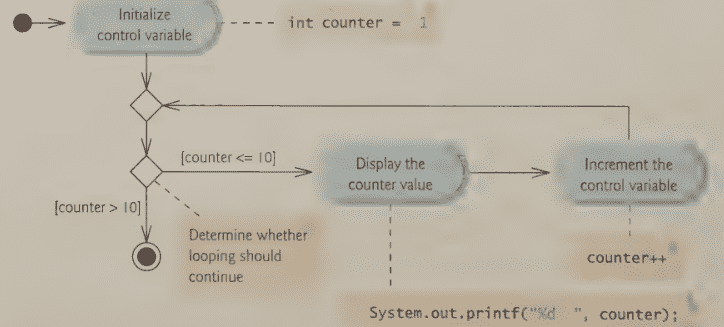

**图 5.4** | 图 5.2 中 `for` 语句的活动图。

## 5.4 使用 for 语句的示例

以下示例展示了使用 `for` 语句的技术。在每种情况下，我们通过 `for` 头部来改变控制变量。注意递减循环的运算符。

- a) 从 1 到 100 递增 1：
  `for (int i = 1; i <= 100; i++)`
- b) 从 100 到 1 递减 1：
  `for (int i = 100; i >= 1; i--)`
- c) 从 7 到 77 递增 7：
  `for (int i = 7; i <= 77; i += 7)`
- d) 从 20 到 2 递减 2：
  `for (int i = 20; i >= 2; i--)`
- e) 在值 2, 5, 8, 11, 14, 17, 20 上递增 3：
  `for (int i = 2; i <= 20; i += 3)`
- f) 在值 99, 88, 77, 66, 55, 44, 33, 22, 11, 0 上递减 11：
  `for (int i = 99; i >= 0; i -= 11)`

> **常见编程错误 5.5**
>
> 在向下计数循环的循环条件中使用错误的关系运算符（例如在向下计数循环中使用 `i <= 1` 而不是 `i >= 1`）通常是一个逻辑错误。

> **常见编程错误 5.6**
>
> 如果循环控制变量递增或递减大于 1，不要在循环继续条件中使用相等运算符（`==` 或 `=`）。例如，考虑语句 `for (int counter = 1; counter = 10; counter += 2)`。循环继续测试 `counter = 10` 永远不会变为假（导致无限循环），因为计数器每次迭代后增加 2。

> **错误预防提示 5.6**
>
> 计数很容易出错。在随后的章节中，我们将引入 Lambda 和流——你可以使用这些技术来消除这些错误。

### 5.4.1 应用：求 2 到 20 的整数和

我们现在考虑两个展示 `for` 简单使用的应用程序。图 5.5 中的应用程序使用 `for` 语句求 2 到 20 的整数和并将结果存储在名为 `total` 的 int 变量中。

```java
// 图 5.5: Sum.java
// 使用 for 语句求和
public class Sum {
    public static void main(String[] args) {
        int total = 0;
        // 2 到 20 的偶数整数
        for (int number = 2; number <= 20; number += 2) {
            total += number;
        }
        System.out.printf("Sum is %d%n", total);
    }
}
```

初始化和递增表达式可以是逗号分隔的列表，这允许你使用多个初始化表达式或多个递增表达式。例如，尽管不建议这样做，但你可以像下面这样使用逗号，将图 5.5 中第 9–11 行的语句体合并到头部递增部分：

```java
for (int number = 2; number <= 20; total += number, number += 2) {
    // empty statement
}
```

## 良好的编程实践 5.1

为了可读性，如果可能，请将控制语句头部限制为单行。


### 5.4.2 应用：复利计算

接下来，让我们使用 `for` 语句来计算复利。考虑以下问题：

- 某人在利率为 5% 的储蓄账户中投资了 $1,000。假设所有利息都留在账户中，计算并打印 10 年内每年末账户中的金额。使用以下公式确定金额：

  `a = p (1 + r)^n`

  - `p` 是原始投资金额（即本金）
  - `r` 是年利率（例如，使用 0.05 表示 5%）
  - `n` 是年数
  - `a` 是第 `n` 年末的存款金额。

该问题的解决方案（图 5.6）涉及一个循环，为资金留在账户的 10 年中的每一年执行一次计算。`main` 方法中的第 6、7 和 15 行声明了 `double` 类型变量 `principal`、`rate` 和 `amount`。第 6–7 行将 `principal` 初始化为 1000.0，`rate` 初始化为 0.05。第 15 行将 `amount` 初始化为复利计算的结果。Java 将 1000.0 和 0.05 这样的浮点常数视为 `double`。同样，Java 将 7 和 -22 这样的整数常量视为 `int` 类型。

```java
// Fig. 5.6: Interest.java
// 使用 for 进行复利计算。
public class Interest {
    public static void main(String[] args) {
        double principal = 1000.0; // 利前的初始金额
        double rate = 0.05; // 利率
        // display headers
        System.out.printf("%s%20s%s%n", "Year", "Amount on deposit");
```

图 5.6 | 使用 for 进行复利计算。（第一部分，共二部分）。

```java
// 计算每十年的存款金额
for (int year = 1; year < 10; ++year) {
    // 计算指定年份的新金额
    double amount = principal * Math.pow(1.0 + rate, year);

    // 显示年份和金额
    System.out.printf("%4d,%20.2f\n", year, amount);
}

}
```

| 年份 | 存款金额 |
|---|---|
| 1 | 1,050.00 |
| 2 | 1,102.50 |
| 3 | 1,157.63 |
| 4 | 1,215.51 |
| 5 | 1,276.28 |
| 6 | 1,340.10 |
| 7 | 1,407.10 |
| 8 | 1,477.46 |
| 9 | 1,551.33 |
| 10 | 1,628.89 |

图 5.6 使用 for 进行复利计算。（第二部分，共二部分。）

## 使用字段宽度和对齐格式化字符串

第 10 行输出了两列输出的头部。第一列显示年份，第二列计算该年末的存款金额。我们使用格式说明符 `%20s` 来输出字符串 "Amount on Deposit"。`%` 和转换字符 `s` 之间的整数表示该值应以 20 的字段宽度显示——即 `printf` 以至少 20 个字符位置的位置显示该值。如果要输出的值宽度小于 20 个字符位置（在本例中为 17 个字符），则该值默认在字段中右对齐。如果要输出的值超过 4 个字符位置，字段将向右扩展以容纳整个值——这会将金额推向右，破坏我们表格输出的整齐列格式。若要左对齐输出，只需在字段宽度前加上减号 (`-`) 格式标志（例如 `%-20s`）。

## 使用 Math 类的静态方法 pow 执行利息计算

该语句（第 13–19 行）执行 10 次其体，按增量 1 控制变量 `year` 从 1 到 10。当 `year` 变为 11 时，循环终止。（变量 `year` 代表问题描述中的 `n`。）

类提供了在对象上执行常用任务的方法。事实上，某些方法必须在特定对象上调用。例如，为了输出图 5.6 中的文本，第 10 行在 `System` 上调用了 `printf`。有些方法也提供了执行常用任务的方法，且不需要你创建这些类的对象。这些是**静态方法**。例如，Java 不包含幂运算符，因此 Java 的 `Math` 类设计者定义了静态方法 `pow` 来计算一个值的幂。你可以通过指定类名后跟点 (`.`) 和方法名来调用静态方法，如下：

`ClassName.methodName(arguments)`

在第 6 章，你将学习如何在自己的类中实现静态方法。

我们使用 `Math` 类的静态方法 `pow` 来执行图 5.6 中的复利计算。`Math.pow(x,y)` 计算 $x$ 的 $y$ 次方。第 15 行的方法接收两个 `double` 参数并返回一个 `double` 值。计算公式 `a=p(1+r)^n`，其中 `a` 是金额，`p` 是本金，`r` 是利率，`n` 是年份。`Math` 类定义在 `java.lang` 包中，因此你不需要导入 `Math` 类。

（提供的文本在 OCR 源中似乎存在碎片/截断，但我已处理了所有可用内容。）

# 176 第 5 章 控制语句：部分 2：逻辑运算符

## do...while 迭代语句的 UML 活动图

图 5.8 包含了 do...while 语句的 UML 活动图。该图清楚地表明，在循环至少执行一次动作状态之前，不会评估循环继续条件。将此活动图与 while 语句的图（图 4.6）进行对比。

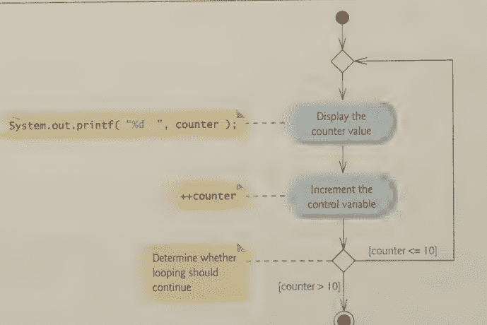

图 5.8 do...while 迭代语句 UML 活动图。

## 5.6 switch 多选择语句

第 4 章讨论了 if 选择语句和 if...else 双重选择语句。switch 多选择语句根据类型为 byte、`short`、int 或 char（但不能为 `long`）的常量整数表达式的可能值执行不同的动作。该表达式也可以是 `String`，我们将在 5.7 节中进行演示。

### 使用 switch 语句统计 A、B、C、D 和 F 等级

图 5.9 计算了一组用户输入的数字分数的平均值。程序的 switch 语句确定每个分数是否等同于 A、B、C、D 或 F，并增加相应的等级计数器。程序还显示了获得每个分数的学生摘要。

```java
// Fig 5.9: LetterGrades.java
// LetterGrades 类使用 switch 语句来统计字母等级。
import java.util.Scanner;
public class LetterGrades {
```

图 5.9 | LetterGrades 类使用 switch 语句统计字母等级。（3 部分第 1 部分。）

```java
public static void main(String[] args) {

    int total = 0; // 分数之和
    int gradeCounter = 0; // 输入的分数个数
    int aCount = 0; // A 等级计数
    int bCount = 0; // B 等级计数
    int cCount = 0; // C 等级计数
    int dCount = 0; // D 等级计数

// 循环直到用户输入文件结束标识符
while (input.hasNext()) {

    int grade = input.nextInt(); // 读取分数
    total += grade; // 将分数加到总和
    gradeCounter++; // 增加分数计数

    // 增加相应的字母等级计数器
    switch (grade / 10) {

        case 10: // 分数在 90 到 100 之间
            aCount++;
            break; // 退出 switch

        case 9: // 分数在 80 到 89 之间
            bCount++;
            break; // 退出 switch

        case 8: // 分数在 70 到 79 之间
            cCount++;
            break; // 退出 switch

        default: // 分数小于 60
            dCount++;
            break; // 可选：强制退出 switch

    }

}

// 显示成绩报告
System.out.printf("%nGrade Report:%s%n");

// 如果用户至少输入了一个分数
if (gradeCounter != 0) {

    // 计算所有输入分数的平均值
    double average = (double)total / gradeCounter;
```

图 5.9 | LetterGrades 类使用 switch 语句统计字母等级。（3 部分第 2 部分）

```java
// 输出结果摘要
System.out.printf("Total of the %d grades entered is %d\n",
gradeCounter, total);

System.out.printf("Class average is %.2f\n", average);

System.out.printf("%d%n%d%n%d%n%d%n%d%n",
"Number of students who received each grade:\n"
"A: %d", aCount, // 显示 A 等级的人数
"B: %d", bCount, // 显示 B 等级的人数
"C: %d", cCount, // 显示 C 等级的人数
"D: %d", dCount, // 显示 D 等级的人数
"F: %d", fCount); // 显示 F 等级的人数

}

else { // 没有输入分数，因此输出相应消息
System.out.println("No grades were entered");
}
```


在 0-100 范围内输入整数分数。
输入文件结束标识符以终止输入：
在 UNIX/Linux/macOS 上输入 `<Ctrl> d` 然后按回车
在 Windows 上输入 `<Ctrl> z` 然后按回车

成绩报告：
输入的 10 个分数总和为 778
全班平均分为 77.80

获得每个分数的学生人数：
A: 4
B: 1
C: 2
D: 1
F: 2

> 图 5.9 | LetterGrades 类使用 switch 语句统计字母等级。（3 部分第 3 部分。）

与之前的平均分程序一样，`LetterGrades` 类的 `main` 方法（图 5.9）声明了局部变量 `total`（第 7 行）和 `gradeCounter`（第 8 行），分别跟踪用户输入的分数总和和输入的数的个数。第 9–13 行声明了每个等级类别的计数变量。第 7–13 行的变量被显式初始化为 0。

# switch 多重选择语句

## 5.10 UML 活动图
图 5.10 显示通用 switch 语句的 UML 活动图。大多数 switch 语句在每个 case 中使用 `break` 来在处理完 case 后终止 switch 语句。图 5.10 通过在活动图中包含 `break` 语句强调了这一点。该图清楚地表明，case 末尾的 `break` 语句会导致控制立即退出 switch 语句。

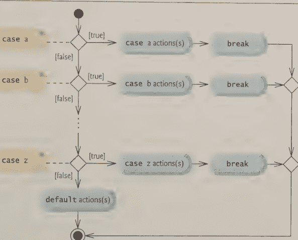

图 5.10 | 带有 break 语句的 switch 多重选择语句 UML 活动图。

switch 的最后一个 case（或当它最后出现时的可选 default case）不需要 `break` 语句，因为执行将继续进行 switch 之后的下一个语句。

> **错误预防技巧 5.10**
> 在 switch 语句中提供一个 `default` case。这可以让你关注处理异常情况的需求。

> **良好的编程实践 5.2**
> 虽然 switch 中的每个 case 和 default case 可以以任何顺序出现，但将 default case 放在最后。当 default case 在最后时，该 case 的 `break` 是可选的。

**关于 switch 中每个 case 表达式的说明**
使用 switch 时，记住每个 case 必须包含一个字符串（`String`）或整数表达式——即任何评估为常量整数值的整数常数的组合（例如：-7、0 或 221）。整数常量仅仅是一个整数值。此外，你还可以使用字符常量——位于单引号中的特定字符，如 `'A'`、`'7'` 或 `'S'`——它们代表字符的整数值。（附录 B 显示了 ASCII 字符集中字符的整数值，它是 Java 使用的 Unicode 字符集的子集）。

每个 case 中的表达式也可以是常量变量——即在程序运行过程中值不改变变量。这种变量使用关键字 `final` 声明（在第 6 章中讨论）。Java 有一种名为枚举类型（enum types）的特性，我们也会在第 6 章介绍——枚举类型常量也可以用于 case 标签。

在第 10 章“面向对象编程：多态与接口”中，我们介绍了一种更优雅的实现 switch 逻辑的方法——我们使用一种称为*多态*（polymorphism）的技术来创建更清晰、更易维护且易于扩展到使用 switch 逻辑程序。

# 5.7 AutoPolicy 类案例研究：switch 语句中的字符串

字符串可以作为 switch 语句中的控制表达式，字符串字面量可以用于 case 标签。为了演示这一点，我们将实现一个满足以下要求的应用程序：

> 你被一家汽车保险公司雇佣，该公司服务这些东北部州——康涅狄格州、马萨诸塞州、新罕布什尔州、纽约州、宾夕法尼亚州、罗德岛州和佛蒙特州。公司希望你创建一个报告，标明每份汽车保险单是否持在“无过错”汽车保险州——马萨诸塞州、新泽西州、纽约州和宾夕法尼亚州。

满足这些要求的 Java 应用程序包含两个类——`AutoPolicy`（图 5.11）和 `AutoPolicyTest`（图 5.12）。

## AutoPolicy 类

`AutoPolicy`（图 5.11）代表一份汽车保险单。该类包含：

- `int` 实例变量 `accountNumber`（第 4 行），用于存储保单的账号
- `String` 实例变量 `makeAndModel`（第 5 行），用于设置汽车品牌和型号（例如“丰田凯姆瑞”）
- `String` 实例变量 `state`（第 6 行），用于存储代表保单所在州的两个字符的缩写（例如，马萨诸塞州的 "MA"）
- 一个构造函数（第 9–14 行），用于初始化类的实例变量
- 方法 `setAccountNumber` 和 `getAccountNumber`（第 17–24 行），用于设置和获取 `AutoPolicy` 的 `accountNumber` 实例变量
- 方法 `setMakeAndModel` 和 `getMakeAndModel`（第 27–34 行），用于设置和获取 `AutoPolicy` 的 `makeAndModel` 实例变量
- 方法 `setState` 和 `getState`（第 37–44 行），用于设置和获取 `AutoPolicy` 的 `state` 变量

```java
// Fig. 5.11: AutoPolicy.java
// 表示汽车保险单的类。

public class AutoPolicy {

    private int accountNumber;
    private String makeAndModel;
    private String state;

    public AutoPolicy(int accountNumber, String makeAndModel, String state) {
        this.accountNumber = accountNumber;
        this.makeAndModel = makeAndModel;
        this.state = state;
    }

    public int getAccountNumber() {
        return accountNumber;
    }

    public void setAccountNumber(int accountNumber) {
        this.accountNumber = accountNumber;
    }

    public String getMakeAndModel() {
        return makeAndModel;
    }

    public void setMakeAndModel(String makeAndModel) {
        this.makeAndModel = makeAndModel;
    }

    public String getState() {
        return state;
    }

    public void setState(String state) {
        this.state = state;
    }

    // 谓词方法返回该州是否无过错
    public boolean isNoFaultState() {
        boolean noFaultState;

        // 判断该州是否有无过错保险
        switch (getState()) {
            case "MA":
            case "NJ":
            case "NY":
            case "PA":
                noFaultState = true;
                break;
            default:
                noFaultState = false;
                break;
        }
        return noFaultState;
    }
}
```

## AutoPolicyTest 类

`AutoPolicyTest`（图 5.12）创建两个 `AutoPolicy` 对象（main 方法中的第 6–9 行）。第 12–13 行将每个对象传递给静态方法 `policyInNoFaultState`（第 18–25 行），该方法使用 `AutoPolicy` 判断并显示接收的对象是否代表无过错保险州的保单。

```java
// Fig. 5.12: AutoPolicyTest.java
// 在 switch 中演示字符串。

public class AutoPolicyTest {
    public static void main(String[] args) {
        // 创建两个 AutoPolicy 对象
        AutoPolicy policy1 = new AutoPolicy(1111111, "Toyota Camry", "NJ");
        AutoPolicy policy2 = new AutoPolicy(22222222, "Ford Fusion", "ME");

        // 显示每份保单是否处于无责状态
        policyInNoFaultState(policy1);
        policyInNoFaultState(policy2);
    }

    // 该方法显示 AutoPolicy 是否处于无责汽车保险状态
    public static void policyInNoFaultState(AutoPolicy policy) {
        System.out.println("The auto policy:");
        System.out.printf("Account #: %d; Car: %s; State: %s%n",
            policy.getAccountNumber(), policy.getMakeAndModel(), policy.getState());
        
        System.out.printf("%s %s a no-fault state%n%n",
            policy.getState(), (policy.isNoFaultState() ? "is" : "is not"));
    }
}
```

**输出结果：**
```
The auto policy:
Account #: 1111111; Car: Toyota Camry; State: NJ
NJ is a no-fault state

The auto policy:
Account #: 22222222; Car: Ford Fusion; State: ME
ME is not a no-fault state
```

> **图 5.12** 展示在 switch 语句中的字符串。（2 部分，共 2 部分。）

## 5.8 break 和 continue 语句

除了选择语句和迭代语句外，Java 还提供了 `break`（我们在讨论 switch 语句的背景下讨论过它）和 `continue`（在本节和在线附录 L 中介绍）来改变控制流。前一节展示了如何使用 `break` 来终止 switch 语句的执行。本节将讨论如何在迭代语句中使用 `break`。

### 5.8.1 break 语句

当 `break` 语句在 `while`、`for`、`do...while` 或 `switch` 中执行时，它会导致**立即**退出该语句。执行将从控制语句后的第一条语句继续。`break` 的常见用法是提前跳出循环，或跳过 switch 的剩余部分（如图 5.9 所示）。

图 5.13 展示了一个 `break` 语句跳出了 `for` 语句。当嵌套在 `for` 语句第 8-10 行的 `if` 语句判断的计数器 `count` 等于 5 时，第 9 行的 `break` 语句执行。这终止了 `for` 语句，程序继续执行第 15 行（`for` 语句之后的行），该行显示了循环终止时控制变量的值。循环体仅完整执行了四次，而不是 10 次。

```java
// Fig 5.13: BreakTest.java
// break 语句跳出 for 语句。

public class BreakTest {
    public static void main(String[] args) {
        int count; // 控制变量在循环终止后也会被使用

        for (count = 1; count <= 10; count++) { // 循环 10 次
            if (count == 5) {
                break; // 如果 count 为 5 则终止循环
            }
        }
        System.out.printf("%d %n", count);
    }
}
```


图 5.13 | break 语句跳出 for 语句。

### 5.8.2 continue 语句

当 `continue` 语句在 `while`、`for` 或 `do...while` 中执行时，它会跳过循环体中的剩余语句，并进入循环的下一次迭代。在 `while` 和 `do...while` 语句中，程序在 `continue` 语句执行后立即评估循环继续测试。在 `for` 语句中，执行递增表达式，然后程序评估循环继续测试。图 5.14 使用 `continue`（第 7 行）在嵌套的 `if` 判断 `count` 的值为 5 时跳过第 10 行的语句。`continue` 语句执行后，程序控制继续执行 `for` 语句中控制变量的递增（第 5 行）。

```java
// Fig 5.14: ContinueTest.java
// continue 语句终止 for 语句的一次迭代。

public class ContinueTest {
    public static void main(String[] args) {
        for (int count = 1; count <= 10; count++) { // 循环 10 次
            if (count == 5) {
                continue; // 如果 count 为 5 则跳过循环体中的剩余代码
            }
            System.out.printf("%d %n", count);
        }
        System.out.printf("used continue to skip printing 5%n");
    }
}
```

> **图 5.14** | continue 语句终止 for 语句的一次迭代。（2 部分，共 2 部分。）

在第 5.3 节中，我们提到过在大多数情况下，可以用 `while` 代替 `for`。但当 `while` 中的递增表达式跟在 `continue` 语句之后时情况就不一样了。在这种情况下，递增在程序评估迭代继续之前不会执行，因此 `while` 的执行方式与 `for` 不相同。

> **软件工程观察 5.1**
> 一些程序员认为 `break` 和 `continue` 违反了编程规范。通过结构化编程技术可以实现相同的效果，因此这些程序员不使用 `break` 或 `continue`。

> **软件工程观察 5.2**
> 在实现高质量软件工程与实现最佳性能软件之间存在张力。有时，其中一个目标的实现是以另一个为代价的。除了所有对性能要求极高的情况外，请遵循以下指南：首先……

## 5.9 逻辑运算符

`&&` 运算符的优先级高于 `||` 运算符。两个运算符都从左到右结合。

### 5.9.3 复杂条件的短路求值

表达式中包含 `&&` 或 `||` 运算符的部分只会被求值，直到确定条件是真还是为假为止。因此，表达式的求值

```java
(gender == FEMALE) && (age >= 65)
```

如果 `gender` 不等于 `FEMALE`，则立即停止（即整个表达式为假）；如果 `gender` 等于 `FEMALE`，则继续执行（即如果条件 `age >= 65` 为真，整个表达式仍可能为真）。逻辑与和逻辑或表达式的特性被称为短路求值。

> **常见编程错误 5.8**
> 在表达式 `&&` 中，一个条件——我们称之为依赖条件——可能需要另一个条件为真才能使依赖条件的求值才有意义。在这种情况下，依赖条件应该置于 `&&` 运算符之后，以防止错误。考虑表达式 `(i != 0) && (10 / i == 2)`。依赖条件 `(10 / i == 2)` 必须出现在 `&&` 之后，以防止除以零的可能性。

### 5.9.4 布尔逻辑与 (&) 和 布尔逻辑包含性或 (|)

`&` 和 `|` 运算符与 `&&` 和 `||` 运算符相同，不同在于 `&` 和 `|` 运算符总是会对其两个操作数求值（即它们不执行短路求值）。因此，表达式

```java
(gender == 1) & (age >= 65)
```

无论 `gender` 是否等于 1，都会求值 `age >= 65`。如果右操作数具有副作用——即对变量值的修改，则这是非常有用的。例如：

```java
(birthday == true) & (++age >= 65)
```


# 第5章 控制语句：第 2 部分：逻辑运算符

保证了条件 `++age >= 65` 被求值。因此，无论整个表达式是真是假，变量都会递增。

> **错误预防提示 5.11**
> 为了清晰起见，避免在条件中使用带有副作用（如赋值）的表达式。它们会让代码变得更难理解，并可能导致细微的逻辑错误。

### 错误预防提示 5.12

赋值 (`=`) 表达式通常不应该用于条件。每个条件必须产生一个布尔值，否则将发生编译错误。在条件中，只有当将布尔表达式赋值给布尔变量时，赋值才能通过编译。

### 5.9.5 布尔逻辑异或 (^)

包含布尔逻辑异或 (`^`) 运算符的简单条件当且仅当它的两个操作数中有一个为真且另一个为假时为真。如果两者都为真或都为假，则整个条件为假。图 5.17 是布尔逻辑异或运算符 (`^`) 的真值表。该运算符保证求值它的两个操作数。

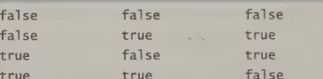

图 5.17 | 布尔逻辑异或运算符真值表。

### 5.9.6 逻辑非 (!) 运算符

`!` 逻辑非，也称为逻辑否定或逻辑取反，运算符“反转条件的含义”。与组合两个条件的二元运算符 `&&`、`||` 和 `^` 不同，逻辑否定运算符是一个单元运算符，其操作数是一个条件。该运算符放在条件之前，以便在原始条件（不带逻辑否定运算符）为假时选择执行路径，如程序段所示：

```java
if (!(grade == sentinelValue)) {
    System.out.printf("The next grade is %d\n", grade);
}
```

只有当 `grade` 不等于 `sentinelValue` 时，才会执行 `printf`。条件 `grade == sentinelValue` 周围的括号是必要的，因为逻辑否定运算符的优先级高于相等运算符。

在大多数情况下，你可以通过使用适当的关系运算符或相等运算符不同的表达条件来避免使用逻辑非。例如，前面的语句也可以写如下：

```java
if (grade != sentinelValue) {
    System.out.printf("The next grade is %d\n", grade);
}
```

这种灵活性可以帮助你以更方便的方式表达条件。图 5.18 是逻辑非的真值表。

## 5.9 逻辑运算符


**图 5.18** | `!`（逻辑非）运算符表。

5.19 使用逻辑运算符来生成本节讨论的真值表。输出显示了求值的布尔表达式及其结果。我们使用 `%b` 格式说明符来生成求值的布尔表达式及其结果。

## 顺序、选择与重复

### 顺序

### 选择

- `if` 语句（单选择）
- 带有 `break` 的 `switch` 语句（多重选择）

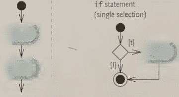
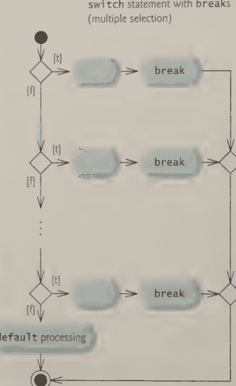

- `if...else` 语句（双选择）

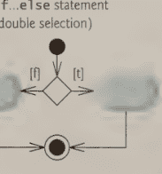

默认处理

### 重复

- `while` 语句
- `do...while` 语句
- `for` 语句

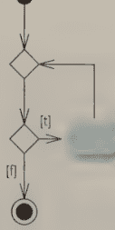
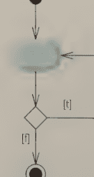

初始化

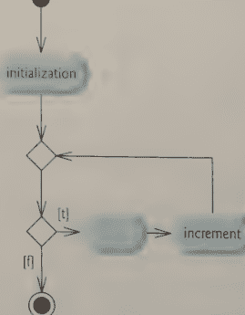

图 5.21 | Java 的单入口/单出口顺序、选择和迭代语句。

## 5.10 结构化编程总结

### 构造结构化程序的规则

图 5.22 显示了构造结构化程序的规则。这些规则假设动作状态可以表示任何动作。这些规则还假设我们从最简单的活动图（图 5.23）开始，该图仅包含一个初始状态、一个动作状态、一个结束状态以及转换箭头。


1. 从最简单的活动图（图 5.23）开始。
2. 任何动作状态都可以被两个顺序执行的动作状态替换。
3. 任何动作状态都可以被任何控制语句（`if`、`if...else`、`switch`、`while`、`do...while` 或 `for`）替换。
4. 规则 2 和 3 可以根据你的意愿以任何顺序任意次应用。

**图 5.22** 构造结构化程序的规则。

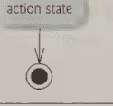

**图 5.23** 最简单的活动图。

应用图 5.22 中的规则始终会得到一个结构正确的活动图，具有整洁的模块化外观。例如，通过对最简单的活动图重复应用规则 2，会得到一个包含许多顺序动作状态的活动图（图 5.24）。规则 2 生成了一栈控制语句，因此我们称规则 2 为“堆叠规则”。图 5.24 中的垂直虚线不是 UML 的组成部分——我们使用它们来分离展示应用图 5.22 中规则 2 的活动图。

规则 3 被称为“嵌套规则”。对最简单的活动图重复应用规则 3，会得到一个几乎全是嵌套控制的图。例如，在图 5.25 中，最简单活动图中的动作状态被替换为双选择（`if...else`）语句。然后再次对双选择语句中的动作状态应用规则 3，将每个状态都替换为双选择语句。图 5.25 中所示的虚线箭头和虚线动作符号不是 UML 的组成部分。它们被用于说明任何动作状态都可以被控制语句替换。

[注：规则 4 会生成更大、更复杂且嵌套更深的语句。由图 5.22 中的规则生成的图表构成了所有可能的活动图的集合，因此也是所有结构化程序的集合。]

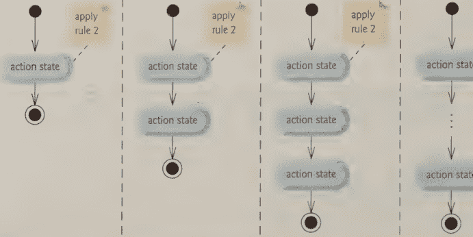

**图 5.24** 对最简单的活动图重复应用图 5.22 的规则 2。

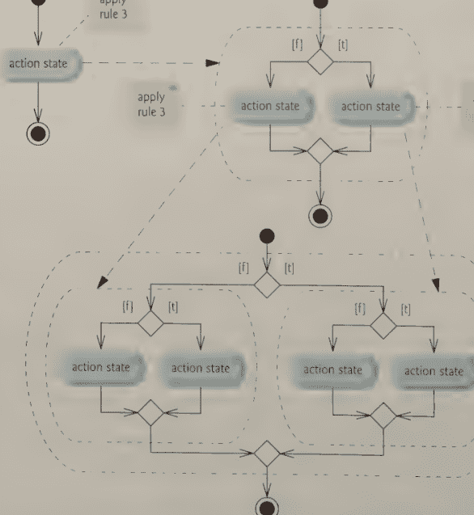

**图 5.25** 对最简单的活动图重复应用图 5.22 的规则 3。

## 控制的三形式

结构化编程促进了简单性。实现算法只需要三种形式的控制：
- 顺序
- 选择
- 迭代

顺序结构是显而易见的。只需按照执行的顺序列出语句即可。选择通过三种方式之一实现：
- `if` 语句（单选择）
- `if...else` 语句（双选择）
- `switch` 语句（多重选择）

事实上，可以很容易证明 `if` 语句足以提供任何形式的选择——所有事情都可以通过 `if...else` 语句完成，而 `switch` 语句也可以实现，尽管可能没有那么清晰和高效。

迭代通过三种方式之一实现：
- `while` 语句
- `do...while` 语句
- `for` 语句

[注：还有第四种迭代语句——增强 `for` 语句——我们将在 7.7 节中讨论。] 可以很容易证明 `while` 语句足以提供任何形式的迭代。所有可以用 `do...while` 完成的内容都可以通过 `while` 语句完成，尽管不那么方便。

结合这些说明了 Java 程序中需要的任何控制形式都可以通过
- 顺序
- `if` 语句（选择）
- `while` 语句（迭代）
以两种方式结合——堆叠和嵌套。事实上，结构化编程是精髓所在。

## 5.11（可选）GUI 和图形案例研究：绘制矩形和椭圆

在本节中，我们将讨论 Draw Shapes 应用，它分别使用 `GraphicsContext` 方法 `strokeRect` 和 `strokeOval` 来绘制矩形和椭圆。

### 创建 Draw Shapes 的 GUI

应用程序的 GUI 在 `DrawShapes.fxml` 中通过我们在 3.6 和 4.15 节中学到的技术定义，并与图 4.17 几乎相同。为了构建 GUI，我们将 `DrawLines.fxml` 复制到新目录并重命名为 `DrawShapes.fxml`，然后在 Scene Builder 中打开它并进行以下更改：
- 在文档的 controller 部分指定 `DrawShapesController` 为应用程序的 Controller。
- 将按钮的 Text 属性设置为 draw Rectangles（检查器属性部分），并将按钮的 On Action 事件处理器设置为 `drawRectanglesButtonPressed`（检查器代码部分）。
- 从场景库的 Controls 部分拖入另一个按钮到工具栏，然后将按钮的 Text 属性设置为 drawOval，将其 On Action 事件处理器设置为 `drawOvalButtonPressed`。

如有必要，请回顾 4.15.2–4.15.3 节介绍的步骤以进行这些更改。

### 类控制器

与之前的 JavaFX 示例一样，应用有两个 Java 源文件：
- `DrawShapes.java` 包含 JavaFX 应用程序的主类，加载 `DrawShapes.fxml` 并配置 `DrawShapesController`。
- `DrawShapesController.java` 包含控制器类，根据用户按的按钮绘制矩形或椭圆。

为了创建 `DrawShapes`，我们复制了 `DrawLines.java`，重命名并进行了 4.15.5 节的代码编辑。我们不显示 `DrawShapes.java`，因为更改只有类名（`DrawShapes`）、加载的 FXML 文件（`DrawShapes.fxml`）以及阶段标题栏中显示的文本（Draw Shapes）。

类控制器（图 5.27）在用户点击任一按钮时显示图形。当 `DrawShapes` 应用执行时，它将配置 `DrawShapesController` 的 `canvas` 变量（第 9 行），以引用 `DrawShapes.fxml` 中的 `Canvas`。

图 5.27 | 使用 `strokeRect` 和 `strokeOval` 绘制矩形和椭圆。（部分 1，共 2 部分）

```java
// 此处省略了图 5.27 第 1 部分的代码清单，原文中为图片占位
```

图 5.27 | 使用 `strokeRect` 和 `strokeOval` 绘制矩形和椭圆。（2/2部分）

```java
// 此处省略了图 5.27 第 2 部分的代码清单，原文中为图片占位
```

`draw` 方法执行实际绘制。每次调用该方法时，它都会使用 `GraphicsContext` 方法 `clearRect` 清除之前的绘制内容（第29行）。该方法通过将矩形区域设置为 Canvas 的背景颜色来清除该区域。该方法的四个参数是矩形左上角的 x 和 y 坐标；前两个参数是矩形的宽度和高度。在此例中，我们从 Canvas 的左上角 (0, 0) 开始，使用其宽度和 `getHeight` 分别获取 Canvas 的宽度和高度来清除 Canvas。

第 34–46 行循环 10 次以绘制 10 个形状。嵌套的 `switch` 语句（第36–45 行）在绘制矩形和绘制椭圆之间进行选择。如果 `draw` 的 `choice` 参数包含 "rectangles"，则该方法将绘制矩形。第 38–39 行调用 `GraphicsContext` 方法 `strokeRect`，它需要四个参数。前两个代表矩形左上角的 x 和 y 坐标；后两个对应矩形的宽度和高度。在这个示例中，我们从距离顶角 10 像素的位置开始，循环的每次迭代都会让左上角向下向右移动 10 像素。矩形的宽度和高度从 0 像素开始，每次迭代中增加 10 像素。

如果 `draw` 的 `choice` 参数包含 "ovals"，则程序将绘制椭圆。它会创建一个虚拟的矩形来绘制一个边界矩形，并将其放置在一个与四边中点接触的椭圆内部。`strokeOval` 方法（第42–43 行）需要的与 `strokeRect` 方法相同的四个参数。参数指定了边界矩形的位置和大小；示例中传递给 `strokeOval` 的参数与第 38–39 行传递给 `strokeRect` 的参数相同。由于示例中边界矩形的宽度和高度相同，第 42–43 行绘制的是一个圆。

## GUI 与图形案例研究练习

5.1 在 Canvas 的中心绘制 12 个同心圆（图 5.28）。最内层的圆的半径应为 10 像素，每个后续圆的半径应比前一个圆大 10 像素。首先找到 Canvas 的中心。要确定给定圆的边界矩形的左上角位置，请从中心向上移动一个半径（即 -10 像素）并向左移动一个半径（即 -10 像素）。边界矩形的宽度和高度都等于圆的直径（即半径的 2 倍）。

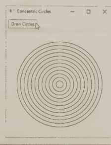

图 5.28 | 绘制同心圆。

5.2 修改练习 5.1，使其也显示每个圆的边界正方形（图 5.29）。

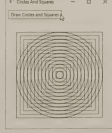

图 5.29 | 绘制同心圆及其边界正方形。

## 5.12 总结

在本章中，我们完成了对控制语句的介绍，这些语句允许你控制方法中的执行流。第 4 章讨论了 `if`、`if...else` 和 `while`。本章演示了 `for`、`do...while` 和 `switch`。我们展示了任何算法都可以通过顺序结构、三种选择语句（`if`、`if...else` 和 `switch`）以及三种类型的迭代语句（`while`、`do...while` 和 `for`）的组合来开发。在本章和第 4 章中，我们讨论了如何组合这些构建模块以利用经过验证的程序构建和问题解决技术。我们使用了 `break` 语句退出 `switch` 语句并立即终止循环，使用 `continue` 语句终止循环的当前迭代并继续循环的下一次迭代。这还引入了 Java 的逻辑运算符，它允许你在控制语句中使用复杂的条件表达式。在第 6 章中，我们将更深入地研究方法。

### 5.2 节 计数控制迭代的要素

- 计数控制迭代（第 165 页）需要一个控制变量、控制变量的初始值、控制变量每次通过循环（也称为循环迭代）时修改的增量，以及一个决定是否应该继续循环的循环继续条件。
- 你可以在同一条语句中对其进行声明和初始化。

### 5.3 节 for 迭代语句

- `while` 语句用于实现任何计数控制循环。
- `for` 语句（第 166 页）在它的头部中指定了计数控制迭代的所有细节。
- 当 `for` 语句开始执行时，控制变量被声明并初始化。如果循环继续条件为真，则执行循环体。在执行循环体后，执行增量表达式。然后再次执行循环继续测试以判断程序是否继续下次迭代。
- `for` 语句的通用格式为：

```java
for (initialization; loopContinuation; increment) {
    statements
}
```

其中初始化表达式命名了循环的控制变量并提供了初始值，`loopContinuation` 决定循环是否继续执行并修改控制变量的值，直到循环继续条件变为假。头部中的两个分号是必须的。

- 大多数 `for` 语句可以用等效的 `while` 语句表示：

```java
while (loopContinuation) {
    statements
    increment;
}
```

- 通常，`for` 用于计数控制迭代，而 `while` 语句用于哨兵控制迭代。
- 如果在 `for` 头部声明了控制变量，则该控制变量只能在该语句外部使用。
- 头部的表达式是可选的。如果省略了 `loopContinuation`，Java 会假设它始终为真，从而创建一个无限循环。如果在循环之前初始化了控制变量，你可以省略初始化表达式。如果增量是在循环体中计算的或不需要增量，你也可以省略增量表达式。


## 总结

- `for` 的增量表达式相当于循环体末尾的独立语句。
- `for` 语句可以使用负增量进行向下计数（见第 169 页）。
- 如果循环继续条件初始为假，则 `for` 语句的循环体不执行。

### 5.4.2 节 应用：复合计算

- Java 将 `1000.0` 和 `0.05` 等浮点常量视为 `double` 类型。同样，Java 将 `7` 等整数常量视为 `int` 类型。

### 5.5 节 do...while 迭代语句

- `do...while`（第 175 页）与 `while` 相似。在 `while` 中，程序在循环开始、执行循环体之前测试循环继续条件；如果条件为假，循环体永远不会执行。`do...while` 语句在执行循环体后测试循环继续条件；循环体至少执行一次。

### 5.6 节 switch 多重选择语句

- `switch` 语句（第 176 页）根据常量整数表达式（`byte`、`int` 或 `char` 的常量值，但不包括 `long`）或 `String` 的可能值执行不同的操作。
- 结束标志是一个取决于系统的组合，用于终止用户输入。在 Unix/Linux/macOS 系统上，通过输入序列 `Ctrl d` 或单独的一个空行来输入结束标志。这意味着同时按下 Ctrl 键和 d 键。在 Windows 系统中，结束标志是 `Ctrl z`。
- `hasNext()`（第 179 页）确定是否有更多数据待输入。如果有更多数据，该方法返回布尔值 `true`；否则返回 `false`。只要没有输入结束标志，`next()` 方法将返回 `true`。
- 在 `switch` 中，程序评估控制表达式并将其值与每个 `case` 标签比较。如果匹配，程序执行该 case 的语句。
- 连续列出 case 允许程序执行相同的语句 set。
- 在 `switch` 中想要测试的每个值都必须列在单独的 `case` 标签中。
- 每个 case 可以包含多条语句，但不能放在大括号中。
- 每个 case 的语句通常以 `break`（第 180 页）结束，从而终止 switch 的执行。
- 如果没有 `break` 语句，每当 `switch` 中发生匹配时，该 case 及后续 case 的语句都会执行，直到遇到 `break` 语句或 `switch` 结束。

### 5.7 节 类 AutoPolicy 案例研究：switch 语句中的字符串

- 字符串可以用作 `switch` 语句的控制表达式和 case 标签。

### 5.8.1 节 break 语句

- `break` 语句在 `while`、`for`、`do...while` 或 `switch` 中执行时，会导致立即退出该语句。

### 5.8.2 节 continue 语句

- `continue` 语句（第 185 页）在 `while`、`for` 或 `do...while` 中执行时，会跳过循环剩余的体语句并进入下一次迭代。在 `while` 和 `do...while` 中，程序会立即评估循环继续测试。对于 `for` 语句，执行增量表达式，然后评估循环继续测试。

### 5.9 节 逻辑运算符

- 简单表达式根据关系运算符 `>`、`>=` 以及相等运算符 `!=` 和 `==` 进行评估，每个表达式仅测试一个条件。
- 逻辑运算符（第 187 页）允许你通过组合简单条件执行更复杂的表达式。逻辑运算符有 `&&`（条件与）、`||`（条件或）；`&`（布尔逻辑与）、`|`（布尔逻辑或）和 `!`（逻辑非）。

### 5.9.1 节 条件与 (&&) 运算符

为了确保两个条件都为真，使用 `&&`（条件与）运算符。如果简单条件中的一个或两个为假，则整个表达式为假。

### 5.9.2 节 条件或 (||) 运算符

为了确保一个或两个条件为真，使用 `||`（条件或）运算符，如果它的简单条件中的一个或两个为真，则结果为真。

### 5.9.3 节 复杂条件的短路计算

- 使用 `&&` 或 `||` 运算符的条件（第 189 页）使用短路计算（第 189 页）——它们会一直评估直到确定条件是真是假。

### 5.9.4 节 布尔逻辑与 (&) 和 布尔逻辑或 (|) 运算符

- `&` 和 `|` 运算符（第 189 页）的作用与 `&&` 和 `||` 运算符相同，但总是会评估两个操作数。

### 5.9.5 节 布尔逻辑异或 (^)

- 布尔逻辑异或（`^`；第 190 页）的简单条件在只有一个操作数为真而另一个为假时为真。如果两个操作数都为真或都为假，则整个条件为假。该运算符也保证评估两个操作数。

### 5.9.6 节 逻辑否定 (!) 运算符

- 一元运算符 `!`（逻辑非；第 190 页）会“反转”条件的值。

## 自测练习

### 5.1 填充每个陈述中的空格：

- a) 通常，`for` 语句用于计数控制的迭代语句或哨兵控制的迭代语句。
- b) `do...while` 语句在执行循环体之前 **evaluates; before** 评估循环继续条件；因此，循环体至少执行一次。
- c) `switch` 语句根据整数、表达式或字符串的可能取值选择多个动作。
- d) `continue` 语句在迭代语句中执行时，会跳过循环中剩余语句并进入循环的下一次迭代。
- e) `&&` 运算符（带有短路计算）可用于在选择执行路径之前两个条件都为真。
- f) 如果标头中的循环继续条件初始为 **false**，则程序不执行该语句的体。
- g) 执行常见任务且不需要对象的方法为 `static` 方法。

### 5.2 说明下列每项是正确还是错误。如果是错误，请解释原因。

- a) 错误。`default` case 是可选的。
- b) 错误。最后一个 case 不需要 `break` 语句。
- c) 错误。`&&` 运算符要求两个条件都为真。
- d) 正确。
- e) 正确。
- f) 错误。`switch` 语句没有测试范围的机制，因此每个值必须列在单独的 case 中。
- g) 正确。

### 5.3 编写 Java 语句或一组 Java 语句来完成每个任务：

- a) 使用 `for` 语句求 1 到 99 之间的整数和。假设整数变量 `sum` 和 `count` 已经声明。
- b) 使用 `while` 循环计算 2.5 的 20 次幂的值。假设
- c) 使用 `while` 循环和变量 `i` 打印 1 到 20 的整数。提示：每行打印五个整数。使用换行符；否则打印制表符。

### 5.4 找到以下每个段落中的错误，并解释如何修正：

- a)
```java
For (i = 100, i >= 1, i++) {
    System.out.println(i);
}
```
- b)
```java
while = 1;
while (i < 20) {
    System.out.print(i);
    if (i % 5 == 0) {
        System.out.println();
    } else {
        System.out.print('\t');
    }
    i++;
}
```
- c)
```java
switch (n) {
    case 1:
        System.out.println("The number is 1");
    case 2:
        System.out.println("The number is 2");
    default:
        System.out.println("The number is 3");
}
```
- d)
```java
for (i = 1; i <= 20; i++) {
    System.out.print(i);
    if (i % 5 == 0) {
        System.out.println();
    } else {
        System.out.print('\t');
    }
}
```

## 自测练习答案

### 5.1
- a) for
- b) evaluates; before
- c) switch
- d) continue
- e) &&
- f) false
- g) static

### 5.2
- a) 错误。`default` case 是可选的。
- b) 错误。最后一个 case 不需要 `break` 语句。
- c) 错误。`&&` 运算符要求两个条件都为真。
- d) 正确。
- e) 正确。
- f) 错误。`switch` 语句没有测试范围的机制，因此每个值必须列在单独的 case 中。
- g) 正确。

### 5.3
- a)
```java
int sum = 0;
for (int count = 1; count <= 99; count++) {
    sum += count;
}
```
- b)
```java
double result = 1.0;
int count = 0;
while (count < 20) {
    result *= 2.5;
    count++;
}
```
- c)
```java
int i = 1;
while (i < 20) {
    System.out.print(i);
    if (i % 5 == 0) {
        System.out.println();
    } else {
        System.out.print('\t');
    }
    i++;
}
```

### 5.4
- a) 错误：关键字 `For` 应该是小写的 `for`，且 for 循环头中的分隔符应该是分号而不是逗号。
- b) 错误：`while` 后面的分号会导致无限循环，并且缺少大括号。将分号替换为 `{` 或删除大括号。
- c) 错误：第一个 case 的语句中缺少 `break` 语句。修正：在第一个 case 的语句末尾添加 `break` 语句。如果你希望每次执行 case 1: 时都执行 case 2: 的语句，这种省略并不一定是错误。
- d) 错误：while 继续条件中使用不适当的关系运算符。修正：使用 `<=` 代替 `<`，或将 10 改为 11。

### 5.5 描述计数控制迭代的四个基本元素。

### 5.6 比较 `while` 和 `for` 迭代语句。

### 5.7 讨论在什么情况下使用 `do...while` 语句比 `while` 语句更合适。解释原因。

### 5.8 比较 `continue` 语句。

### 5.9 发现并修正以下代码段中的错误：

- a)
```java
for (i = 100; i >= 1; i--) {
    System.out.println(i);
}
```

- b) 下列代码应该打印整数值是奇数还是偶数：
```java
switch (value % 2) {
    case 0:
        System.out.println("Even integer");
    case 1:
        System.out.println("Odd integer");
}
```

- c) 下列代码应该输出从 19 到 1 的奇数：
```java
for (int i = 19; i >= 1; i += 2) {
    System.out.println(i);
}
```

- d) 下列代码应该输出从 2 到 100 的偶数：
```java
int counter = 2;
do {
    System.out.println(counter);
    counter += 2;
} while (counter < 100);
```

### 5.10 下面程序的作用是什么？

```java
// Exercise 5.10: Printing.java
public class Printing {
    public static void main(String[] args) {
        for (int i = 1; i <= 10; i++) {
            for (int j = 1; j <= 5; j++) {
                System.out.print('@');
            }
        }
        System.out.println();
    }
}
```


(寻找最小值) 编写一个应用程序寻找整数中的最小值值。假设读取的第一个值指定了用户输入的数值个数。

(计算奇数乘积) 编写一个应用程序，计算从 1 到 15 的奇数的乘积。

(阶乘) 阶乘在概率问题中被频繁使用。正整数 n! 的阶乘（写做“n 阶乘”）等于从 1 到 n 的所有正整数的乘积。编写一个应用程序，计算从 1 到 20 的阶乘。使用 `long` 类型。以表格格式显示结果。什么可能会阻止你计算 100 的阶乘？

(修改后的复利计算程序) 修改图 5.6 中的复利计算程序，使其能够针对 5%、6%、7%、8%、9% 和 10% 的利率重复其步骤。使用循环来改变利率。

5.15 (三角形打印程序) 编写一个应用程序，单独显示以下模式，一个接一个。使用循环来生成这些模式。星号 (`*`) 应该由单个 `System.out.print('*');` 语句打印，这将星号并排打印。使用 `System.out.println(' ')` 语句可以移动到下一行。使用 `System.out.print(' ');` 语句可以为最后两个模式显示空格。程序中不应有其他输出语句。[提示：最后两个模式要求每行开头有适当数量的空格。]


5.16 (条形图打印程序) 计算机的一个有趣应用是显示图表和条形。编写一个应用程序，读取 1 到 30 之间的五个数字。对于读取的每个数字，你的程序应该显示相邻星号的数量。例如，如果程序读取到数字 7，它应该显示 `***********`。在读取完所有数字后显示星号条形。

5.17 (计算销售额) 一家在线零售商销售五种商品，价格如下：产品 1，$2.98；产品 2，$4.50；产品 3，$3.98；产品 4，$4.49；产品 5，$6.87。编写一个应用程序，读取如下的一系列数字对：

- a) 产品编号
- b) 销售数量

你的程序应使用 `switch` 语句来确定每个产品的零售价格。使用哨兵控制循环（sentinel-controlled loop）来确定程序何时停止并显示最终结果。

5.18 (修改后的复利计算程序) 修改图 5.6 中的应用程序，仅使用整数以分作为整数的形式计算复利。使用除法和取模运算符将结果拆分为美元和分部分。在美元和分之间插入一个小数点。

5.19 假设 i=1, j=2, k=3 且 m=2。以下每个语句打印什么？
a) `System.out.println(i == 1);`
b) `System.out.println(j == 3);`
c) `System.out.println(i >= j) && (k < 4);`
d) `System.out.println(m <= 99) && (k < m);`
e) `System.out.println(i > j) || (k == m);`
f) `System.out.println(k + m == j);`
g) `System.out.println(i > k);`

(计算 π 的值) 从无穷级数 π = 4 - 4/5 + 4/7 - 4/9 + 4/11 ... 计算 π 的值。打印一个表格，通过计算 200,000 项来显示 π 的值。你需要使用多少项才能得到一个以 3.14159 开头的值？

5.21 (勾股数) 直角三角形的边长可以全为整数。直角三角形三条边的三个整数值集合被称为勾股数。三条边的长度必须满足这种关系：两条边的平方之和等于斜直边的平方。编写一个应用程序，使用三层嵌套循环尝试所有可能，显示一个边长不大于 500 的勾股数表格。这种方法是“暴力穷举”计算的示例。在更高级的计算机科学课程中，你将学到对于许多有趣的问题，除了暴力穷举没有其他算法。

5.22 (修改后的三角形打印程序) 修改练习 5.15，将你的代码合并四个独立的星号三角形，使得所有模式并排打印。[提示：巧妙地利用循环。]

5.23 (德摩根定律) 在这一章，我们讨论了逻辑运算符 `&&`、`||` 和 `!`。德摩根定律指出，使用它们来表示逻辑表达式更加方便。这些定律规定表达式 `(condition1 || condition2)` 在逻辑上等于表达式 `(!condition1 && !condition2)`。同样，表达式 `(condition1 && condition2)` 在逻辑上等于表达式 `(!condition1 || !condition2)`。使用德摩根定律为以下每一项编写等价表达式，然后编写一个应用程序显示两个原始表达式：

- a) `(x < 5) && (y >= 7)`
- b) `(a == b) && (i <= 6)`
- c) `!(x < 4) || (j > 4)`

5.24 (三角形打印程序) 编写一个应用程序，打印显示以下形状。使用循环生成形状。星号 (`*`) 应该由单个 `System.out.print('*');` 语句打印，这将星号并排打印。使用 `System.out.println(' ')` 语句可以移动到下一行。使用 `System.out.print(' ');` 语句可以为最后两个模式显示空格。程序中不应有其他输出语句。[提示：最后两个模式要求每行开头有适当数量的空格。]


5.25 (修改后的菱形程序) 修改应用程序，使其针对 1 到 19 范围内的行重复其步骤。使用循环来改变。

5.26 (条形图打印程序) 计算机的一个有趣应用是显示图表和条形。编写一个应用程序，读取 1 到 30 之间的五个数字。对于读取的每个数字，你的程序应该显示相邻星号的数量。例如，如果程序读取到数字 7，它应该显示 `***********`。在读取完所有数字后显示星号条形。

5.27 (计算销售额) 一家在线零售商销售五种商品，价格如下：产品 1，$2.98；产品 2，$4.50；产品 3，$3.98；产品 4，$4.49；产品 5，$6.87。编写一个应用程序，读取如下的一系列数字对：

- a) 产品编号
- b) 销售数量

你的程序应使用 `switch` 语句来确定每个产品的零售价格。使用哨兵控制循环来确定程序何时停止并显示最终结果。

5.28 (修改后的复利计算程序) 修改图 5.6 中的应用程序，仅使用整数以分作为整数的形式计算复利。使用除法和取模运算符将结果拆分为美元和分部分。在美元和分之间插入一个小数点。

5.29 假设 i=1, j=2, k=3 且 m=2。以下每个语句打印什么？

```java
for (int i = 1; i <= 5; i++) {
  for (int j = 1; j <= 3; j++) {
    for (int k = 3; k < 4; k++) {
      System.out.print("*");
    }
  }
  System.out.println();
}
```

5.30 (修改后的 AutoPolicy 类) 修改图 5.11 中的 AutoPolicy 以验证州代码。这些代码是：CT（康涅狄格州）、MA（马萨诸塞州）、PA（宾夕法尼亚州）、NH（新罕布什尔州）、NJ（新泽西州）、NY（纽约州）和VT（佛蒙特州）。在 `setState` 方法中，使用逻辑或 (`||`) 为 if...else 语句创建一个复合条件。如果代码错误，`else` 部分应显示错误消息。在后面的章节中，你将学习如何使用异常来处理无效参数。

# 6种方法：深入探讨

## 目标

在本章中，你将学习到：

- 静态方法如何与类而非对象相关联。
- 方法调用/返回机制如何通过方法调用栈支持。
- 关于参数提升（argument promotion）和类型转换（casting）。
- 包如何对相关的类进行分组。
- 如何使用安全随机数生成来实现游戏应用。
- 声明的可见性如何限制在程序的特定区域。
- 什么是方法重载以及如何创建重载方法。


## 6.1 引言

## 6.2 Java 中的程序单元

## 6.3 静态方法、静态字段和类 Math

## 6.4 带多参数的方法

## 6.5 关于声明和使用方法的注意事项

## 6.6 方法栈与激活记录

### 6.6.1 方法栈帧

### 6.6.2 局部变量与栈帧

### 6.6.4 栈溢出

## 6.7 参数提升与类型转换

## 6.8 Java API 包

## 6.9 案例研究：安全随机数生成

## 6.10 案例研究：机会游戏；引入 enum 类型

## 6.11 声明的作用域

## 6.12 方法重载

### 6.12.1 声明重载方法

### 6.12.2 区分重载方法

### 6.12.3 重载方法的返回类型

## 6.13（可选）GUI 与图形案例研究：颜色与填充形状

总结 | 自测练习题 | 自测练习题答案 | 练习题 | 改变

## 6.1 引言

经验表明，开发和维护大型程序的最佳方法是由微小的、简单的片段构建它。这种技术被称为分而治之。我们在第3章中介绍的方法，可以帮助你将程序模块化。在本章中，我们将更深入地研究方法。

你将学习更多关于方法的知识，这些方法可以在不需要类对象的情况下调用。你还将学习 Java 如何跟踪当前正在执行哪个方法、局部变量如何在内存中维护，以及方法在执行完成后如何知道返回。

我们将简要地进入带有随机数生成的模拟技术领域，并开发一个骰子游戏（craps）的版本，该游戏使用了你到本书为止用过的大部分编程技术。此外，你还将学习如何在程序中声明常量。

在你开发应用时使用或创建的许多类中，会有多个同名方法。这种技术被称为重载，用于实现对不同类型参数或不同数量参数执行执行相似任务的方法。我们将在第18章“递归”中继续讨论方法。递归为思考方法和算法提供了一种迷人的方式。

## 6.2 Java 中的程序单元

你已经在 Java 中处理过各种程序单元了。你通过将新的方法、类与来自 Java 应用程序接口（也称为 Java API 或 Java 类库）以及其他类库中的预定义单元结合来编写程序。相关的类通常被分组在包中，以便它们被导入到程序中并重用。你将在第 21.4.10 节中学习如何将你自己的类分组到包中。Java 9 引入了另一个程序单元——模块，我们将在第 36 章“Java 模块系统和其他 Java 9 特性”中讨论。

Java API 提供了一个丰富的预定义类集合，包含了用于执行常用数学计算、字符串处理、字符处理、输入/输出操作、数据库操作、网络操作、文件处理、错误检查等的方法。

### 软件工程观察 6.1

熟悉 Java API 提供的丰富类和方法集合（http://docs.oracle.com/javase/8/docs/api）。第 6.8 节概述了几种常见模式。在线 XPath 解释了如何导航 API 文档。应尽可能重用 Java API 类和方法。这可以缩短程序开发时间并避免引入编程错误。

## 使用类和方法分而治之

类和方法通过将任务分离为自包含的单元帮助你将程序模块化。方法体中的语句只编写一次，对其他方法隐藏，并可以在程序的多个位置重用。

将程序模块化为类和方法的动机之一是分而治之法，它通过从小而简单的片段构建程序，使程序开发更易管理。另一个是软件的可用性——使用现有的类和方法作为构建块来创建新程序。通常，你可以大部分从现有的类和方法创建程序，而不是通过构建自定义代码。例如，在之前的程序中，我们没有定义如何从键盘读取数据——Java `Scanner` 类的方法提供了这些功能。第三个动机是避免重复代码。将程序分为有意义的类和方法使程序更容易调试和维护。

### 软件工程观察 6.2

为了提高软件的可重用性，每个方法都应该限制为执行单一、定义良好的任务，并且方法的名称应该有效地表达该任务。

### 错误预防提示 6.1

执行一个任务的方法比执行多个任务的方法更容易测试和调试。

### 软件工程观察 6.3

如果你无法选择一个表达方法任务的简洁名称，那么你的方法可能试图执行过多的任务。将此类方法拆分为几个较小的方法。

## 方法调用之间的层级关系

如你所知，方法是通过方法调用调用的，当方法完成后，它返回控制权并向调用者产生结果。这种结构的类比是层级管理（如图1所示）。老板（调用者）调用工人（被调用方法）来执行任务。老板不知道工人是如何执行任务的。工人也可以调用其他方法。这种对实现细节的“隐藏”促进了良好的软件工程。图 6.1 显示了老板以层级方式与多个工人通信。


老板方法在各个工人之间分配职责。在这里，`worker1` 作为“老板方法”作用于 `worker4` 和 `worker5`。

> ### 错误预防提示 6.2
> 有的方法返回一个值指示方法是否执行成功。当你调用此类方法时，确保检查该方法的返回值，如果该方法执行失败，请妥善处理该问题。

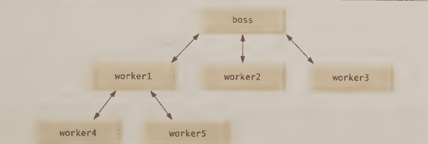

图 6.1 | 层级老板方法/工人方法关系。

## 6.3 静态方法、静态字段和类 Math

执行，但有时方法执行的任务并不依赖于对象。此类方法适用于它定义的整个类，被称为静态方法或类方法。（在第 10.10 节中，你将看到接口也可以包含静态方法。）

类通常包含方便的静态方法来执行常用任务。例如，回想图 5.6 中使用的类静态方法 `pow` 来对值求幂。要将方法声明为静态，请在方法的声明中返回类型之前放置 `static` 关键字。对于导入到程序的任何类，你都可以通过指定类名后跟一个点 (`.`) 和方法名来调用静态方法，如下：

`ClassName.methodName(arguments)`

### Math 方法

我们在这里使用各种 `Math` 方法来介绍静态方法的概念。`Math` 类提供了一系列方法，让你能够执行常用的数学计算。例如，你可以通过静态方法调用计算 900.0 的平方根：

`Math.sqrt(900.0)`

该表达式求值为 30.0。`sqrt` 方法接收一个 `double` 类型的参数并返回一个 `double` 类型的结果。要在命令行窗口输出上一个方法调用的值，你可能会编写语句：

`System.out.println(Math.sqrt(900.0));`

回想第 3.2 节，类的每个对象都维护其类实例变量的拷贝。对于某些变量，类的每个对象不需要拥有自己独立的拷贝（你稍后会看到）。这些变量被声明为 `static`，称为类变量。当创建包含静态变量的类对象时，该类的所有对象共享一个静态变量的拷贝。类的静态变量和实例变量统称为它的字段。你将在第 8.11 节中学习更多关于静态字段的知识。

### Math 静态常量 PI 和 E

`Math` 类声明了两个常量 `Math.PI` 和 `Math.E`，它们代表常用数学常数的高精度近似值：

* `Math.PI` (3.141592653589793) 是圆周长与直径的比率。
* `Math.E` (2.71828182845945) 是自然对数的底（使用 `Math` 类的静态方法 `log` 计算）。

这些常量在 `Math` 类中声明，并带有 `public`、`final` 和 `static` 修饰符。将它们设为 `public` 允许你在自己的类中使用它们。任何用关键字 `final` 声明的字段——其值在字段初始化后都不能再更改。将这些字段声明为 `static` 允许通过类名和点 (`.`) 分隔符进行访问，类似于访问 `Math` 类的方法。

### 为什么要声明 main 方法？

当你使用 `java` 命令执行 Java 虚拟机 (JVM) 时，JVM 会尝试调用你指定的类的 `main` 方法——此时该类的对象尚未被创建。将 `main` 声明为 `static` 允许 JVM 在不创建类实例的情况下调用 `main`。当你执行应用程序时，你将类名作为 `java` 命令的参数指定，如下所示：

`java ClassName argument1 argument2`

JVM 加载由 `ClassName` 指定的类并使用它来调用方法。在前面的命令中，`ClassName` 是传递给 JVM 的命令行参数，告诉它执行哪个类。在 `ClassName` 之后，你还可以指定一个 `String` 列表（用空格分隔）作为命令行参数，JVM 将这些参数传递给你的应用程序。此类参数可能用于指定运行应用程序的选项（例如，文件名）。每个类都可能包含 `main`——只有用于执行应用程序的类方法会被调用。正如你将在 7 章“数组与列表”中所学到的，你的应用程序可以访问这些命令行参数并使用它们来定制应用程序。

## 6.4 多参数方法

方法通常需要比一个更多的信息来执行其任务。我们现在考虑如何编写带有多个参数的方法。

### 6.3 使用一个名为 `maximum` 的方法来确定并返回三个 `double` 值中的最大值。在 `main` 中，第 11–15 行提示用户输入两个 `double` 值，然后从输入中读取它们。第 18 行调用方法 `maximum`（在第 25–39 行声明）来确定其接收到的参数的三个值中的最大值。当 `maximum` 方法将结果返回给第 18 行时，程序将 `maximum` 的返回值赋值给局部变量 `result`。然后第 21 行输出最大值。在本节结束时，我们将讨论 21 行中运算符 `+` 的使用。

## 第 6 章 方法：深入观察

```java
// Fig 6.3: MaximumFinder.java
// 程序员声明的带有三个 double 参数的 maximum 方法。
import java.util.Scanner;

public class MaximumFinder {
    public static void main(String[] args) {
        // 创建 Scanner 从命令行窗口输入
        Scanner input = new Scanner(System.in);
        // 提示并输入三个浮点数
        System.out.print("Enter three floating-point values separated by spaces: ");
```


```java
double number1 = input.nextDouble(); // 读取第一个 double

double number2 = input.nextDouble(); // 读取第二个 double

double number3 = input.nextDouble(); // 读取第三个 double

// 确定最大值

double result = maximum(number1, number2, number3);

System.out.println("Maximum is: " + result);

}

// 返回其三个 double 参数中的最大值

public static double maximum(double x, double y, double z) {

    double maxValue = x; // 初始假设 x 是最大的

    // 确定 y 是否大于 maxValue

    if (y > maxValue) {

        maxValue = y;

    }

    // 确定 z 是否大于 maxValue

    if (z > maxValue) {

        maxValue = z;

    }

    return maxValue;

}

}
```

Enter three floating-point values separated by spaces: 9.35 2.74 5.1
Maximum is: 9.35

Enter three floating-point values separated by spaces: 5.8 12.45 8.32
Maximum is: 12.45

Enter three floating-point values separated by spaces: 6.46 4.12 10.54
Maximum is: 10.54

**Fig. 6.3** 程序员声明的带有三个 double 参数的 maximum 方法。

## 6.4 多参数方法

### public 和 static 关键字

方法 `maximum` 的声明以 `public` 关键字开始，表示该方法是“公开可用的”——它可以从其他类的方法中调用。该关键字允许 `main` 方法（另一个静态方法）如第 18 行所示调用 `maximum`，而无需使用类名来限定方法名——同一类中的静态方法可以互相调用。任何其他使用它的类都必须完全限定方法名，例如 `MaximumFinder.maximum(10, 30, 20)`。

### 方法 maximum

考虑 `maximum` 的声明（第 25–39 行）。第 25 行表示它返回一个 `double` 值，方法名为 `maximum`，且该方法需要 `double` 参数（`x`, `y`, `z`）来完成其任务。多个参数以逗号列表的形式指定。当从第 18 行调用 `maximum` 时，`x`、`y` 和 `z` 分别用参数 `number1`、`number2` 和 `number3` 的值初始化。调用时每个参数都必须有一个实参。每个实参也必须与对应参数的类型一致。例如，类型为 `double` 的参数可以接收值 7.35 或 0.346，但不能接收字符串。第 6.7 节讨论了可以在方法调用中为基本类型提供的实参类型。

> **软件工程观察 6.5**
> 方法可以返回一个值，但返回的值可以是指向包含对象的引用。

> **软件工程观察 6.6**
> 变量被声明为 `static`——只有用于执行应用程序的类方法会被调用。

> **常见编程错误 6.1**
> 任何其他使用它的类都必须完全限定方法名，例如 `MaximumFinder.maximum(10, 30, 20)`。

### 实现 `static` 方法

使用 `static` 的示例如下：

```java
return maximum(x, y, z);
```


## 第 6 章 方法：深入观察

`maximum` 方法的声明以 `public` 关键字开始，表示该方法是“公开可用的”——它可以从其他类的方法中调用。该关键字允许 `main` 方法（另一个静态方法）如第 18 行所示调用 `maximum`，而无需使用类名来限定方法名——同一类中的静态方法可以互相调用。任何其他使用它的类都必须完全限定方法名，例如 `MaximumFinder.maximum(10, 30, 20)`。

### 方法 maximum

考虑 `maximum` 的声明（第 25–39 行）。第 25 行表示它返回一个 `double` 值，方法名为 `maximum`，且该方法需要 `double` 参数（`x`, `y`, `z`）来完成其任务。多个参数以逗号列表的形式指定。当从第 18 行调用 `maximum` 时，`x`、`y` 和 `z` 分别用参数 `number1`、`number2` 和 `number3` 的值初始化。调用时每个参数都必须有一个实参。每个实参也必须与对应参数的类型一致。例如，类型为 `double` 的参数可以接收值 7.35 或 0.346，但不能接收字符串。第 6.7 节讨论了可以在方法调用中为基本类型提供的实参类型。

> **软件工程观察 6.5**
> 方法可以返回一个值，但返回的值可以是指向包含对象的引用。

> **软件工程观察 6.6**
> 变量被声明为 `static`——只有用于执行应用程序的类方法会被调用。

> **常见编程错误 6.1**
> 任何其他使用它的类都必须完全限定方法名，例如 `MaximumFinder.maximum(10, 30, 20)`。

### 实现 `static` 方法

使用 `static` 的示例如下：

```java
return maximum(x, y, z);
```


## 6.5 关于声明和使用方法的说明

### 调用方法

调用方法有三种方式：

1. 直接使用方法名来调用同一类中的另一个方法——例如图 6.3 第 18 行中的 `maximum(number1, number2, number3)`。
2. 使用包含对象引用的变量，后跟点号 (`.`) 和方法名，以调用所引用对象的非静态方法——例如图 3.2 第 14 行中的方法调用 `myAccount.getName()`，它从 `AccountTest` 的主方法调用了 `Account` 类的方法。非静态方法通常被称为实例方法。
3. 使用类名和点号 (`.`) 来调用类的静态方法——例如第 6.3 节中的 `Math.sqrt(900.0)`。

### 从方法返回

有三种方式可以将控制权返回给调用该方法的语句：

- 在返回类型为 `void` 的方法中遇到方法结束的右括号时。
- 在返回类型为 `void` 的方法中执行以下语句时：

```java
return;
```

- 当方法使用如下形式的语句返回结果时，该语句会求值表达式并将结果（以及控制权）返回给调用者：

```java
return expression;
```

> **常见编程错误 6.4**
> 在类声明体之外或另一个方法体内部声明方法是语法错误。


> **常见编程错误 6.5**
> 在方法中声明一个与方法参数同名的局部变量是编译错误。


> **常见编程错误 6.6**
> 忘记从本应返回值的方法返回值是编译错误。如果指定了 `void` 以外的返回类型，则方法必须包含一个返回与方法类型一致的 `return` 语句。从返回类型声明为 `void` 的方法返回值是编译错误。

### 静态方法可以直接访问类的其他静态成员

静态方法只能直接调用（即直接使用方法名）同一类的其他静态方法，并可以直接操作同一类中的静态变量。要访问类的实例变量和实例方法（即非静态成员），静态方法必须使用该类对象的引用。实例方法可以访问类的所有字段（静态变量和实例变量）和方法。


> **222 第 6 章 方法：深入观察**
>
> 一个类的多个对象（每个对象都有自己的实例变量副本）可能同时存在。假设一个静态方法直接调用一个非静态方法。该方法如何知道操作哪个对象的实例变量？如果在调用非静态方法时创建了该类的对象，会发生什么？

## 6.6 方法调用栈与激活记录

为了理解 Java 如何执行方法调用，我们首先需要考虑一种称为栈（stack）的数据结构（即相关数据项的集合）。将栈想象成一堆盘子。当把一个盘子放在堆上时，它位于顶部——这被称为将盘子推（push）到栈中。同样，当从堆中移除一个盘子时，是从顶部移除——这被称为将盘子弹出（pop）出栈。栈被称为后进先出（LIFO）数据结构——栈上最后一个推入（插入）的项是第一个从栈中弹出（移除）的项。

### 6.6.1 方法调用栈

计算机科学学生需要理解的最重要机制之一是方法调用栈（有时称为程序执行栈）。这种数据结构在“幕后”工作，支持方法的调用/返回机制。它还支持每个被调用方法中局部变量的创建、维护和销毁。后进先出（LIFO）的行为正是一个方法返回到调用它的方法时所需要的。

### 6.6.2 栈帧

当每个方法被调用时，它可能会继继调用其他方法，而这些方法又可能继继调用其他方法——在任何方法返回之前如此。每个方法最终都必须将控制权返回给调用它的方法。因此，系统必须以某种方式跟踪每个方法为了返回控制权到调用方法所需的返回地址。方法调用栈是处理这些信息的完美数据结构。当一个方法调用另一个方法时，栈上会被推送一个项。这个项被称为栈帧（stack frame）或激活记录（activation record），包含了被调用方法为了返回到调用方法所需的返回地址。它还包含我们将讨论的某些额外信息。如果被调用方法只是简单返回而不是在返回之前调用另一个方法，则该方法的栈帧会被弹出，控制权将指向弹出栈帧中的返回地址。

调用栈的美妙之处在于，每个被调用方法总能在栈顶找到它返回给调用者所需要的信息。而且，如果一个方法调用了另一个方法，新方法的栈帧就会被推到调用栈上。因此，新被调用方法返回到其调用者所需的返回地址就位于栈顶。

### 6.6.3 局部变量与栈帧

栈帧还有另一个重要责任。大多数方法都有局部变量——参数以及方法声明的任何局部变量。局部变量在方法执行期间需要存在。如果方法调用了其他方法，这些变量需要保持激活状态。但当被调用方法返回到其调用者时，被调用方法的局部变量就需要“消失”。被调用方法的栈帧是为被调用方法的局部变量保留内存的完美位置。只要被调用方法处于激活状态，该栈帧就存在。当方法返回且不再需要其局部变量时——栈帧从栈中弹出，这些局部变量不再存在。

### 6.6.4 栈溢出

当然，计算机的内存是有限的，因此只有有限的内存可以用于存储方法调用栈上的激活记录。如果发生的方法数量多于方法调用栈能存储记录的数量，就会发生名为栈溢出（stack overflow）的致命错误——这通常是由无限递归引起的（第 18 章）。

## 6.7 参数提升与强制转换

方法调用另一个重要特性是参数提升——如果可能，将实参转换为方法期望的类型。例如，即使方法期望 `double` 参数，程序也可以用 `int` 调用 `sqrt`。语句

```java
System.out.println(Math.sqrt(4));
```


正确求值 `Math.sqrt(4)` 并打印值 `2.0`。方法参数列表将 int `4` 转换为 double `4.0`，然后传递给 `sqrt`。如果不符合 Java 的提升规则，此类转换会导致错误。这些规则规定了哪些转换是允许的——即哪些转换可以在不丢失数据的情况下执行。然而，将 `double` 转换为 `int` 会截断 `double` 的小数部分。将大类型转换为小类型（例如 `long` 转换为 `int`，或 `int` 转换为 `short`）也可能导致值发生变化。

提升规则适用于包含两个或多个原始类型的表达式以及作为方法参数传递的原始类型值。每个值都被提升为“最高”类型。表达式使用值的临时副本——原始值的类型保持不变。图 6.4 列出了原始类型以及每个可以提升的类型。对于给定类型的有效提升总是到高于它的类型。例如，`int` 可以提升为更高的类型 `long`、`float` 和 `double`。

将值转换为图 6.4 表中的低类型，如果低类型无法表示高类型的值，会导致不同的值（例如，int `20000000` 无法表示为 `short`，或者任何带有小数位的浮点数都无法表示在整数类型如 `long`、`int` 或 `short` 中）。因此，在转换可能会丢失数据的情况下，Java 编译器要求你使用强制转换符（第 4.10 节引入）来显式强制类型转换——否则会发生编译错误。这允许你从编译器手中“夺回控制权”。你本质上是在说：“我知道这一点，但对我的目的来说这样做是可以的。”假设方法 `square` 计算整数的平方，因此需要一个 `int` 参数。为了使用一个名为 `doubleValue` 的 `double` 类型参数来计算平方，我们需要将方法调用写为 `square((int) doubleValue)`。

此方法显式地强制转换（转换）`doubleValue` 的值为一个临时整数，供方法 `square` 使用。因此，如果 `doubleValue` 的值为 4.5，该方法接收到的值为 4 并返回 16，而不是 20.25。

> **常见编程错误 6.7**
> 将原始类型值转换为另一种原始类型时，如果该类型不是有效的提升，可能会改变值。例如，将浮点值转换为整数可能会在结果中引入截断误差（丢失小数部分）。

## 6.5 Java API 包

如你所见，Java 包含许多预定义类，这些类被分组在相关的类包中。这些类合称为 Java 应用程序接口（Java API），或 Java 类库。Java 的一大强大优势是 Java API 中数以千计的类。书中使用的一些关键 Java API 包如图 6.5 所示，它仅代表了 Java API 中可重用组件的一小部分。

### 图 6.5 | Java API 包（子集）。（2 部分中的 1 部分。）

| 包名 | 说明 |
| :--- | :--- |
| `java.awt.event` | 抽象窗口工具包事件包包含了类和接口，能够为对 `java.awt` 和 `javax.swing` 包中的 GUI 组件实现事件处理。（参见第 26 章“Swing GUI 组件：第一部分”和第 35 章“Swing GUI 组件：第二部分”。） |
| `java.awt.geom` | Java 2D 形状包包含了用于处理 Java 高级二维图形能力的类和接口。（参见第 27 章“图形学与 Java 2D”。） |
| `java.io` | Java 输入/输出包包含了类和接口，允许程序对数据进行输入和输出。（参见第 15 章“文件、输入/输出流、NIO 和 XML 序列化”。） |
| `java.lang` | Java 语言包包含了许多 Java 程序所需要的类和接口（在全书中均有讨论）。编译器在所有程序中都会自动导入此包。 |
| `java.net` | Java 网络包包含了类和接口，允许程序通过 Internet 等计算机网络进行通信。（参见第 28 章“网络”。） |
| `java.security` | Java 安全包包含了增强应用程序安全性的类和接口。 |
| `java.sql` | JDBC 包包含了用于处理数据库的类和接口。（参见第 24 章“使用 JDBC 数据库”。） |
| `java.util` | Java 工具包包含了允许存储和处理大量数据的工具类和接口。这些许多类和接口已经更新为支持 Java SE 8 的 lambda 表达式功能。（参见第 16 章“泛型集合”。） |
| `java.util.concurrent` | Java 并发包包含了实现可以并行执行多个任务程序的类和接口。（参见第 23 章“并发”。） |
| `javax.swing` | Java Swing GUI 包包含了 Java Swing 组件的类和接口。此包仍在使用旧 `java.awt` 包的元素。（参见第 26 章“Swing GUI 组件：第一部分”和第 35 章“Swing GUI 组件：第二部分”。） |
| `java.awt.event` | Swing 事件包包含了类和接口，能够为 `java.swing` 中的 GUI 组件实现事件处理（例如，响应按钮点击）。（参见第 26 章“Swing GUI 组件：第一部分”和第 35 章“Swing GUI 组件：第二部分”。） |
| `java.xml.ws` | JAX-WS 包包含了在 Java 中处理网络服务的类和接口。（参见第 32 章“网络服务”。） |

JavaFX 是未来首选的图形和多媒体技术。我们在书中详尽介绍了 JavaFX。

### 本书使用的某些 Java SE 8 包

| 包名 | 说明 |
| :--- | :--- |
| `java.time` | Java SE 8 日期时间 API 包含了处理日期和时间的类和接口。（参见第 23 章“并发”。） |
| `java.util.function` 和 `java.util.stream` | 这些包包含了用于 Java SE 8 函数式编程能力的类和接口。（参见第 17 章“Lambda 与 Stream”。） |

### 图 6.5 | Java API 包（子集）。（2 部分中的 2 部分。）

## 6.9 案例研究：随机数生成

`java.util` 包中的 `Random` 类提供了生成原始值的方法。要使用此类，必须先创建该类的实例：

```java
Random randomNumbers = new Random();
```

一旦拥有了对象，就可以使用它的方法生成各种类型的数据。例如，`nextInt` 方法返回一个 0（包含）到指定值（不包含）之间的随机整数。

```java
int randomValue = randomNumbers.nextInt(10);
```

这段代码将生成一个 0 到 9 之间的随机整数。`Random` 类还提供了生成随机 `double` 值（`nextDouble()`）、`boolean` 值（`nextBoolean()`）等。

### 生成范围

要在特定范围内（例如 `min` 到 `max` 之间）生成随机数，可以使用以下公式：

```java
int randomValue = randomNumbers.nextInt(max - min + 1) + min;
```

例如，如果你想要 1 到 10 之间的随机数，代码为：

```java
int face = randomNumbers.nextInt(10 - 1 + 1) + 1;
```

### 模拟掷骰子

让我们创建一个程序，模拟掷 20 次六面骰子。

```java
import java.util.Random;

public class DieRoll {

    public static void main(String[] args) {

        Random randomNumbers = new Random();

        for (int i = 1; i <= 20; i++) {

            int face = randomNumbers.nextInt(6) + 1;

            System.out.println("Roll " + i + ": " + face);

        }

    }

}
```

## 6.9 案例研究：安全随机数生成

（第 18–20 行）循环在每五个数字后开始新行输出，形成整齐的五列格式。

| 1 | 5 | 3 | 6 | 2 |
| :--- | :--- | :--- | :--- | :--- |
| 5 | 2 | 6 | 5 | 2 |
| 4 | 4 | 4 | 2 | 6 |
| 3 | 1 | 6 | 2 | 2 |

**图 6.6** | 偏移和缩放后的随机整数。

### 投掷 600,000,000 次六面骰子

为了证明 `nextInt` 产生的数字出现的概率大致相等，让我们使用图 6.7 中的应用程序模拟投掷 600,000,000 次骰子。从 1 到 6 的每个整数都应该出现大约 100,000,000 次。注意第 18 行，我们使用了*数字分隔符*使 `int` 值 `600_000_000` 更具可读性。记住，你不能用逗号分隔数字。例如，如果将 `int` 值 `600_000_000` 替换为 `600,000`，JDK 8 编译器会在 for 语句头部（第 18 行）生成多处编译错误。注意，此示例执行可能需要几秒钟——请参见示例后关于 `SecureRandom` 性能的说明。

```java
// Fig 6.7: RollDie.java

// 投掷 600,000,000 次六面骰子。

import java.security.SecureRandom;

public class RollDie {

    public static void main(String[] args) {

        SecureRandom randomNumbers = new SecureRandom();

        int frequency1 = 0; // 1 的出现计数

        int frequency2 = 0; // 2 的出现计数

        int frequency3 = 0; // 3 的出现计数

        int frequency4 = 0; // 4 的出现计数

        int frequency5 = 0; // 5 的出现计数

        int frequency6 = 0; // 6 的出现计数

        // 统计投掷 600,000,000 次骰子的计数

        for (int roll = 1; roll <= 600_000_000; roll++) {

            int face = 1 + randomNumbers.nextInt(6); // 1 到 6 之间的数字

            // 使用值 1-6 增加哪个计数器

            switch (face) {

                case 1:
                    ++frequency1; // 增加 1 的计数器
                    break;

                case 2:
                    ++frequency2; // 增加 2 的计数器
                    break;

                case 3:
                    ++frequency3; // 增加 3 的计数器
                    break;

                case 4:
                    ++frequency4; // 增加 4 的计数器
                    break;

                case 5:
                    ++frequency5; // 增加 5 的计数器
                    break;

                case 6:
                    ++frequency6; // 增加 6 的计数器
                    break;

            }

        }

        System.out.println("Face\tFrequency"); // 输出表头

        System.out.printf("1%d\n2%d\n3%d\n4%d\n5%d\n6%d\n",

                frequency1, frequency2, frequency3, frequency4,

                frequency5, frequency6);

    }

}
```

**图 6.7** | 投掷 600,000,000 次六面骰子。（2 部分中的第 1 部分）。

| Face | Frequency |
| :--- | :--- |
| 1 | 10001086 |
| 2 | 10000185 |
| 3 | 9999542 |
| 4 | 9996541 |
| 5 | 9998787 |
| 6 | 10003859 |

| Face | Frequency |
| :--- | :--- |
| 1 | 10003530 |
| 2 | 9999925 |
| 3 | 9994766 |
| 4 | 10000707 |
| 5 | 9998150 |
| 6 | 10002922 |

**图 6.7** | 投掷 600,000,000 次六面骰子。（2 部分中的第 2 部分）

正如样本输出所示，对 `nextInt` 产生的值进行缩放和偏移使得程序能够模拟投掷六面骰子。应用程序使用嵌套控制语句（`switch` 嵌套在 `for` 内部）来确定骰子每个面出现的次数。对于 `for` 语句（第 18–42 行），它迭代了 600,000,000 次。在每次迭代中，第 19 行产生一个 1 到 6 之间的随机值。该值随后被作 `switch` 语句（第 22–41 行）的控制表达式（第 22 行）。根据点值，`switch` 语句在循环的每次迭代中增加一个计数器变量。此 `switch` 语句没有 `default` 分支，因为我们为每个可能的值都设置了 `case`。运行该程序，观察结果。你会发现，运行此程序会产生不同的结果。在第 7 章学习数组时，我们将展示如何用单个语句替换整个 `switch` 语句。在第 17 章使用 Java 的函数式编程能力时，我们将展示如何用单个语句替换掷骰子的循环、`switch` 语句以及显示结果的语句！

> **关于 SecureRandom 的说明**：使用 `SecureRandom` 代替 `Random` 以获得更高的安全性会带来性能损失。对于“休闲”应用程序，可能希望使用 `Random`。

## 数字的通用缩放和偏移

之前，我们通过语句模拟六面骰子的投掷：

```java
int face = 1 + randomNumbers.nextInt(6);
```

该语句始终为变量赋值 `1 ≤ face ≤ 6` 范围内的整数，范围的宽度（即范围内连续整数的数量）为 6。在前面的语句中，范围的宽度是由传递给 `SecureRandom.nextInt(6)` 的 `6` 决定的。可以将此结果泛化为：

```java
int number = shiftingValue + randomNumbers.nextInt(scalingFactor);
```

`shiftingValue` 指定范围内的第一个数字，`scalingFactor` 指定范围内的数字个数。也可以从非连续整数集合中随机选择整数。例如，为了从序列 2, 5, 8, 11 中获取随机值，可以使用语句：

```java
int number = 2 + 3 * randomNumbers.nextInt(5);
```


在这种情况下，`randomNumbers.nextInt(5)` 产生 0–4 范围内的值。每个值乘以 3 产生序列 0, 3, 6, 9 和 12。加上 2 来偏移值范围并获取序列 2, 5, 8, 11 和 14。可以将此结果泛化为：`shiftingValue` 指定值范围内的第一个数字，`differenceBetweenValues` 代表序列中连续数字之间的常量差，`scalingFactor` 指定范围内的个数。

## 6.10 案例研究：赌场；引入 enum 类型

一种流行的赌场游戏被称为骰点（craps），在赌场和小巷中到处可见。游戏规则非常简单：

- 你投掷两颗骰子。每个骰子有六面，包含一、二、三、四、五、六点数。骰子停止后，点数的总和很重要。如果第一次投掷点和为 7 或 11，你赢了。如果第一次投掷点和为 2、3 或 12（称为“craps”），你输了（即赌场赢）。如果第一次投掷点和为 4、5、6、8、9 或 10，该点和就成为你的“点”（point）。要赢，必须继续投掷骰子直到你“点中”（即投出等于点值的数字）。在点中之前投出 7 则输。

图 6.8 模拟了骰点游戏，使用方法来实现游戏逻辑。`main` 方法（第 20–66 行）根据需要调用 `rollDice` 方法（第 69–80 行）来投掷骰子并计算总和。样本输出显示了第一次投掷时的胜负以及后续失败。

```java
// Fig 6.8: Craps.java
// Craps 模拟骰点游戏。

import java.security.SecureRandom;

public class Craps {

    // 为 rollDice 方法创建安全随机数生成器
    private static final SecureRandom randomNumbers = new SecureRandom();

    // 表示游戏状态的枚举常量
    private enum Status {CONTINUE, WON, LOST};

    // 表示常见骰子点数的常量
    private static final int SNAKE_EYES = 2;
    private static final int TREY = 3;
    private static final int SEVEN = 7;
    private static final int YO_LEVEN = 11;
    private static final int BOX_CARS = 12;

    // 玩一次骰点
    public static void main(String[] args) {
        int myPoint = 0; // 如果第一次投掷没有胜负，则是点
        Status gameStatus; // 可以包含 CONTINUE、WON 或 LOST
        int sumOfDice = rollDice(); // 骰子的第一次掷

        // 根据第一次投掷确定游戏状态和点
        switch (sumOfDice) {
            case SEVEN: // 第一次投掷 7 赢
            case YO_LEVEN: // 第一次投掷 11 赢
                gameStatus = Status.WON;
                break;
            case SNAKE_EYES: // 第一次投掷 2 输
            case TREY: // 第一次投掷 3 输
            case BOX_CARS: // 第一次投掷 12 输
                gameStatus = Status.LOST;
                break;
            default: // 未赢未输，所以记住点
                gameStatus = Status.CONTINUE; // 游戏未结束
                myPoint = sumOfDice; // 记住点
                System.out.printf("Point is %d%n", myPoint);
                break;
        }

        // 当游戏未完成时
        while (gameStatus == Status.CONTINUE) { // 不是 WON 或 LOST
            sumOfDice = rollDice(); // 再次投掷
            // 确定游戏状态
            if (sumOfDice == myPoint) { // 点中赢
                gameStatus = Status.WON;
            } else {
                if (sumOfDice == SEVEN) { // 在点中前投出 7 则输
                    gameStatus = Status.LOST;
                }
            }
        }

        // 显示胜或负的消息
        if (gameStatus == Status.WON) {
            System.out.println("Player wins");
        } else {
            System.out.println("Player loses");
        }
    }

    // 掷骰子，计算总和并显示结果
    public static int rollDice() {
        // 选择骰子值
        int die1 = 1 + randomNumbers.nextInt(6); // 第一颗骰子
        int die2 = 1 + randomNumbers.nextInt(6); // 第二颗骰子
        int sum = die1 + die2; // 骰子之和
        // 显示本次掷骰的结果
        System.out.printf("Player rolled %d + %d = %d%n", die1, die2, sum);
        return sum;
    }
}
```

**输出示例：**

```
Player rolled 5 + 6 = 11
Player wins

Player rolled 5 + 4 = 9
Point is 9
Player rolled 4 + 2 = 6
Player rolled 3 + 6 = 9
Player wins

Player rolled 1 + 2 = 3
Player loses

Player rolled 2 + 6 = 8
Point is 8
Player rolled 5 + 1 = 6
Player rolled 2 + 1 = 3
Player rolled 1 + 6 = 7
Player loses
```

### rollDice 方法

在游戏规则中，玩家每次掷骰都必须掷两颗骰子。我们声明了 `rollDice` 方法（第 69–80 行）来掷骰子并计算打印它们的和。`rollDice` 方法已被声明，但它在 `main` 方法的两个地方（第 24 和 46 行）被调用，`main` 包含了完整骰子游戏的逻辑。`rollDice` 方法不接受参数，因此其参数列表为空。每次被调用时，`rollDice` 都会返回骰子的和，因此在方法头（第 69 行）中指定了返回类型 `int`。虽然第 71 和 72 行看起来相同（除了骰子名称不同），但它们并不一定会产生相同的结果。每条语句都会在 1-6 的范围内产生一个随机值。变量 `randomNumbers`（使用第 71-72 行）未在方法中声明。相反，它是类的 `private final` 静态对象，并在第 7 行中初始化。这使得我们能够创建一个 `SecureRandom` 对象，并在每次调用 `rollDice` 时复用它。如果一个程序中包含多个 `Craps` 类的实例，它们将共同共享这个 `SecureRandom` 对象。

### main 方法的局部变量

游戏逻辑相当复杂。玩家可能在第一次掷骰时获胜或失败，也可以在随后的任何掷骰中获胜。`main` 方法（第 20–66 行）使用了：

- 局部变量 `myPoint`（第 21 行），用于在玩家第一次掷骰未获胜未获负时存储“点数”。
- 局部变量 `gameStatus`（第 22 行），用于跟踪整个游戏状态和掷骰情况。
- 局部变量 `sumOfDice`（第 24 行），用于保存最近一次掷骰的总和。

变量 `myPoint` 初始化为 0 以确保应用程序可以编译。如果你不初始化 `myPoint`，编译器会抛出错误，因为在 `switch` 语句的每种情况下 `myPoint` 都没有赋值，因此程序可能会在赋值之前尝试使用 `myPoint`。相比之下，`gameStatus` 在 `switch` 语句的每种情况下（包括 `default` 情况）都被赋值了值——因此可以保证在使用之前已初始化，所以我们不需要在第 22 行对其进行初始化。

### enum 类型 Status

局部变量 `gameStatus`（第 22 行）被声明为名为 `Status` 的新类型（声明在第 10 行）。`Status` 是 `Craps` 类的私有成员，因为 `Status` 只会在该类中使用。`Status` 是一种称为 **enum 类型** 的类型，在最简单的情况下，它声明了一组由标识符表示的常量。`enum` 类型是由关键字 `enum` 和类型名称（在本例中）引入的特殊种类。与类一样，大括号包围了 enum 声明的主体。大括号内部是用逗号分隔的 enum 常量列表，每个常量代表一个唯一的值。enum 中的标识符必须是唯一的。你将在第 8 章学习更多关于 enum 类型的知识。

> **良好的编程实践 6.1**
> 在 enum 常量的名称中使用大写字母，使它们脱颖而出，并提醒你它们不是变量。

类型 `Status` 的变量只能赋值为 enum 中声明的三个常量（第 10 行），否则将发生编译错误。当游戏开始时，程序将局部变量 `gameStatus` 设置为 `Status.WON`（第 30 和 50 行）。当游戏输掉时，程序将局部变量 `gameStatus` 设置为 `Status.LOST`（第 35 和 54 行）。否则，程序将局部变量 `gameStatus` 设置为 `Status.CONTINUE`（第 38 行），以表示游戏尚未结束，必须继续掷骰子。

> **良好的编程实践 6.2**
> 使用 enum 常量（如 `Status.WON`、`Status.CONTINUE`）而不是字面量（如 0、1 和 2）使程序更易于阅读和维护。

### main 方法的逻辑

`main` 方法中的第 24 行调用 `rollDice`，从 1 到 6 随机选取两个值，显示第一个、第二个以及它们的和，并返回和。`main` 方法进入 `switch` 语句（第 27–42 行），使用第 24 行的 `sumOfDice` 值来判断游戏是胜了还是输了，或者应该继续掷。最后一次掷骰中导致胜或负的值在第 13–17 行中声明为 `static int` 常量。这些和的标识符使用了赌场术语，像 enum 常量一样，按照约定使用全大写声明，以便它们在程序中脱颖而出。第 28–31 行确定玩家是否在第一次掷骰时通过 `SEVEN` (7) 或 `YO_LEVEN` (11) 获胜。第 32–36 行确定玩家是否在第一次掷骰时因 `SNAKE_EYES` (2)、`TREY` (3) 或 `BOX_CARS` (12) 失败。第一次掷骰后，如果不是，`default` 情况（第 37–41 行）将 `gameStatus` 设置为 `Status.CONTINUE` 并显示点数。如果我们正在尝试“凑出点数”（即游戏从之前的掷骰继续），第 45–57 行会再次掷骰子。如果 `sumOfDice` 匹配 `myPoint`（第 49 行），第 50 行将 `gameStatus` 设置为 `Status.WON`，然后循环终止，因为游戏完成了。如果 `sumOfDice` 为 `SEVEN`（第 53 行），第 54 行将 `gameStatus` 设置为 `Status.LOST`。

## 6.11 声明的作用范围

```java
// Fig 6.9: Scope.java
// Scope 类演示了字段和局部变量的作用范围。

public class Scope {
    // 类 Scope 的字段 x
    static int x = 1;

    public static void main(String[] args) {
        int x = 5; // main 的局部变量 x

        System.out.printf("main 中的局部 x 为 %d%n%n", x);

        useLocalVariable(); // useLocalVariable 有局部变量 x
        useField(); // useField 使用类 Scope 的字段 x
        useLocalVariable(); // useLocalVariable 重新初始化局部变量 x
        useField(); // 类 Scope 的字段保留了它的值

        System.out.printf("%nmain 中的局部 x 为 %d%n", x);
    }

    // 在每次调用时创建并初始化局部变量 x
    public static void useLocalVariable() {
        int x = 25; // 在每次调用 useLocalVariable 时初始化

        System.out.printf(
            "进入方法 useLocalVariable 时局部 x 为 %d%n%n", x);
        ++x; // 修改此方法的局部变量 x
        System.out.printf(
            "退出方法 useLocalVariable 前的局部 x 为 %d%n%n", x);
    }

    // 在每次调用时修改类 Scope 的字段
    public static void useField() {
        System.out.printf(
            "进入方法 useField 时字段 x 为 %d%n%n", x);
        x *= 10; // 修改类 Scope 的字段 x
        System.out.printf(
            "退出方法 useField 前的字段 x 为 %d%n%n", x);
    }
}
```

**输出示例：**

```
main 中的局部 x 为 5

进入方法 useLocalVariable 时局部 x 为 25

退出方法 useLocalVariable 前的局部 x 为 26

进入方法 useField 时字段 x 为 1

退出方法 useField 前的字段 x 为 10

进入方法 useLocalVariable 时局部 x 为 25

退出方法 useLocalVariable 前的局部 x 为 26

进入方法 useField 时字段 x 为 10

退出方法 useField 前的字段 x 为 100

main 中的局部 x 为 5
```

该程序声明了另外两个方法——`useLocalVariable`（第 24–33 行）和 `useField`（第 35–42 行），它们不接受参数也不返回结果。方法 `main` 调用了每个方法两次（第 15–18 行）。`useLocalVariable` 声明了局部变量 `x`（第 25 行）。当第一次调用 `useLocalVariable`（第 15 行）时，它创建局部变量 `x` 并将其初始化为 25，输出 `x` 的值（第 27–28 行），增加 `x`（第 29 行）并再次输出 `x` 的值（第 30–31 行）。当第二次调用 `useLocalVariable`（第 17 行）时，它重新创建局部变量 `x` 并将其重新初始化为 25，因此 `useLocalVariable` 的输出是相同的。

`useField` 没有声明任何局部变量。因此，当它引用 `x` 时，使用的是类的字段 `x`（第 6 行）。当第一次调用 `useField`（第 16 行）时，它输出字段 `x` 的值（1）（第 36–37 行），将字段 `x` 乘以 10（第 38 行），并在返回之前再次输出字段 `x` 的值（10）（第 39–40 行）。下一次调用 `useField`（第 18 行）时，字段已有其修改后的值（10），方法输出 10，然后将其修改为 100。最后，在方法 `main` 中，程序再次输出局部变量 `x` 的值（第 20 行），以显示方法调用未修改 `main` 的局部变量 `x`，因为所有方法都引用了其他作用域中的变量 `x`。

### 权限原则

从广义上说，“事物”应该拥有完成工作所需的能力，但不能更多。一个例子是变量的作用范围。当变量不被需要时，它不应该是可见的。

> **良好的编程实践 6.3**
> 尽可能在第一次使用变量的地方声明变量。


## 6.12 方法重载

在同一个类中可以声明同名的方法，只要它们具有不同的参数集合（由参数的数量、类型和顺序决定）——这被称为方法重载。当调用被重载的方法时，编译器会通过检查调用中参数的数量、类型和顺序来选择合适的方法。方法重载通常用于创建多个同名的方法，以执行相同或相似的任务，但针对不同的类型或不同数量的参数。例如，`Math` 方法 `abs`、`min` 和 `max`（在第 6.3 节中总结）各重载了四个版本：

1. 一个带有两个 `double` 参数。
2. 一个带有两个 `float` 参数。
3. 一个带有两个 `int` 参数。
4. 一个带有两个 `long` 参数。

我们的示例演示了声明和调用重载方法。我们将在第 8 章中演示重载的构造函数。

### 6.12.1 声明重载方法

类 `MethodOverload`（图 6.10）声明了两个重载的 `square` 方法——一个计算 `int` 的平方（返回 `int`），另一个计算 `double` 的平方（并返回 `double`）。尽管这些方法具有相同的名称以及相似的参数列表，但请将它们被视为不同的方法。将方法名分别视为“int 的平方”和“double 的平方”可能会有帮助。

第 7 行使用参数 7 调用 `square`。字面量整数值被视为类型 `int`，因此第 7 行的方法调用调用了第 12–16 行指定 `int` 参数的 `square` 版本。同样，第 8 行使用参数 7.5 调用方法 `square`。浮点值被视为类型 `double`，因此第 8 行的方法调用调用了第 18–22 行指定 `double` 参数的 `square` 版本。

```java
// Fig 6.10: MethodOverload.java
// 重载方法 square 的演示。

public class MethodOverload {
    public static void main(String[] args) {
        System.out.printf("square(7) 的结果为: %d%n", square(7));
        System.out.printf("square(7.5) 的结果为: %.2f%n", square(7.5));
    }

    // 计算 int 的平方
    public static int square(int intValue) {
        System.out.printf("调用带有 int 参数的 square: %d%n", intValue);
        return intValue * intValue;
    }

    // 计算 double 的平方
    public static double square(double doubleValue) {
        System.out.printf("调用带有 double 参数的 square: %.2f%n", doubleValue);
        return doubleValue * doubleValue;
    }
}
```

**输出示例：**

```
调用带有 int 参数的 square: 7
square(7) 的结果为: 49
调用带有 double 参数的 square: 7.50
square(7.5) 的结果为: 56.25
```


```java
// 图 6.10: MethodOverload.java

// 重载方法的的声明。

public class MethodOverload {

    // 测试重载方法

    public static void main(String[] args) {

        System.out.printf("整数 7 的平方为 %d%n", square(7));

        System.out.printf("double 7.5 的平方为 %f%n", square(7.5));

    }

    // 带有 int 参数的 square 方法

    public static int square(int intValue) {

        System.out.printf("带有 int 参数调用 square: %d%n", intValue);

        return intValue * intValue;

    }

    // 带有 double 参数的 square 方法

    public static double square(double doubleValue) {

        System.out.printf("带有 double 参数调用 square: %f%n", doubleValue);

        return doubleValue * doubleValue;

    }

}
```


## 6.12 方法重载

在同一个类中可以声明同名的方法，只要它们具有不同的参数集合（由参数的数量、类型和顺序决定）——这被称为**方法重载**。当调用被重载的方法时，编译器会通过检查调用中参数的数量、类型和顺序来选择合适的方法。方法重载通常用于创建多个同名的方法，以执行相同或相似的任务，但针对不同的类型或不同数量的参数。例如，`Math` 方法 `abs`、`min` 和 `max`（在第 6.3 节中总结）各重载了四个版本：

1. 一个带有两个 `double` 参数。
2. 一个带有两个 `float` 参数。
3. 一个带有两个 `int` 参数。
4. 一个带有两个 `long` 参数。

我们的示例演示了声明和调用重载方法。我们将在第 8 章中演示重载的构造函数。

### 6.12.1 声明重载方法

类 `MethodOverload`（图 6.10）声明了两个重载的 `square` 方法——一个计算 `int` 的平方（返回 `int`），另一个计算 `double` 的平方（并返回 `double`）。尽管这些方法具有相同的名称以及相似的参数列表，但请将它们被视为不同的方法。将方法名分别视为“int 的平方”和“double 的平方”可能会有帮助。

第 7 行使用参数 7 调用 `square`。字面量整数值被视为类型 `int`，因此第 7 行的方法调用调用了第 12–16 行指定 `int` 参数的 `square` 版本。同样，第 8 行使用参数 7.5 调用方法 `square`。浮点值被视为类型 `double`，因此第 8 行的方法调用调用了第 19–23 行指定 `double` 参数的 `square` 版本。

### 区分重载方法

编译器通过方法的**签名**——参数的数量、类型和顺序来区分重载方法，而不是通过返回类型。如果编译器只看方法名称，图 6.10 中的方法（第 12–16 行和 19–23 行）将是歧义的。编译器在内部使用参数的数量、类型和顺序来区分重载方法。例如，在图 6.10 中，编译器通过 `the number, types and order of the parameters` 来区分重载方法。

### 6.12.3 重载方法的返回类型

在讨论编译器使用的方法逻辑名称时，我们没有提到方法的返回类型。方法调用无法通过返回类型来区分。当两个方法的签名相同但返回类型不同时，编译器会报错，指示方法已定义。重载方法在参数列表不同时可以不同的类型。此外，重载方法不需要相同数量的参数。

---

## 权限原则

从广义上说，“事物”应该拥有完成工作所需的能力，但不能更多。一个例子是变量的作用范围。当变量不被需要时，它不应该是可见的。

## 良好的编程实践 6.3

尽可能在第一次使用变量的地方声明变量。

---

## 6.13 (可选) GUI 与图形案例研究：颜色与填充形状

### 创建笑脸 GUI

该应用程序的 GUI 定义在 `DrawSmiley.fml` 中。我们重用了图 4.17 所示的 `DrawLines.fml` GUI，但对 `DrawSmiley.fml` 进行了以下更改：

- 我们在 Scene Builder 窗口的 Controller 部分将 `DrawSmileyController` 指定为应用程序的 Controller 类。
- 我们在检查器的 Properties 部分将按钮的属性设置为 Draw Smiley，并将按钮的 Action 事件处理器设置为 `drawSmileyButtonPressed`（在检查器的 Code 部分中设置）。

### DrawSmileyController 类

同样，我们没有显示 `DrawSmiley.java` 的代码，因为与之前的示例相比，唯一的更改是 FXML 文件名改为 `DrawSmiley.fml` 以及阶段标题栏中显示的文本（Draw Smiley）。`DrawSmileyController` 类（图 6.1）负责绘图工作。`GraphicsContext` 方法 `fillRect` 和 `fillOval` 分别绘制矩形和椭圆；它们有 `strokeRect` 和 `strokeOval`（第 5.11 节）；前两个参数是形状左上角的坐标，后两个参数定义宽度和高度——请记住，对于椭圆，指定的是椭圆所在的边界矩形。

```java
// 代码内容缺失
```


// 图 6.11: DrawSmileyController.java

// 使用颜色和填充形状绘制笑脸。

import javafx.event.ActionEvent;
import javafx.fxml.FXML;
import javafx.scene.canvas.Canvas;
import javafx.scene.canvas.GraphicsContext;
import javafx.scene.paint.Color;

public class DrawSmileyController {

    @FXML private Canvas canvas;

    // 绘制一个笑脸

    @FXML
    void drawSmileyButtonPressed(ActionEvent event) {

        // 获取 GraphicsContext，用于在 Canvas 上绘图

        GraphicsContext gc = canvas.getGraphicsContext2D();

        // 绘制脸

        gc.setColor(Color.YELLOW);
        gc.fillOval(10, 10, 280, 280);
        gc.strokeOval(10, 10, 280, 280);

        // 绘制眼睛

        gc.setColor(Color.BLACK);
        gc.fillOval(7, 85, 40, 40);
        gc.fillOval(185, 85, 40, 40);

        // 绘制嘴

        gc.fillOval(50, 130, 200, 120);
    }
}

```
图 6.11 | 使用颜色和填充形状绘制笑脸。（2 部分中的第 1 部分）

242 第 6 章 方法：深入探究
```

```java
// “修饰”嘴部形成微笑

gc.setFill(Color.YELLOW);
gc.fillRect(50, 130, 200, 60);
gc.fillOval(50, 140, 200, 90);
}
```


**图 6.11** 使用颜色和填充形状绘制笑脸。（2 部分中的第 2 部分。）

`drawSmileyButtonPressed` 方法在用户按下 Draw Smiley 按钮时绘制笑脸。第 19 行使用 `GraphicsContext` 方法 `setColor` 将当前填充色设置为预定义的 `Color.YELLOW`——所有填充形状都将使用此颜色，直到你通过后续调用 `setFill` 来更改它。

第 20 行绘制了一个直径为 280 的圆来表示脸——当宽度和高度参数相同时，`fillOval` 方法会绘制一个圆。第 21 行使用相同参数的 `strokeOval` 用黑色线条勾勒脸部，以增强与背景的对比度。注意 `GraphicsContext` 会保持填充颜色和描边颜色——如你所见，默认描边颜色是黑色。你可以通过 `GraphicsContext` 方法 `setStroke` 更改描边颜色。接下来，第 24 行将填充颜色设置为 `Color.BLACK`，第 25-26 行绘制两个填充圆作为眼睛。

第 29 行将嘴画成椭圆，但这并不是我们想要的。为了创建一个快乐的脸，我们修饰了嘴。第 32 行将填充颜色设置为 `Color.YELLOW`，因此我们绘制的任何形状都会与脸部融合。第 33 行绘制了一个符合嘴高度的矩形。这擦掉了嘴的上部，只留下了下部。为了创建一个更好的微笑，第 34 行绘制了另一个椭圆来稍微覆盖嘴的上部。

## GUI 与图形案例研究练习

**6.1** 使用 `fillOval` 方法绘制一个在两种随机颜色之间交替的靶心，如图 6.12 所示。要生成随机颜色，使用以下方法，其中红、绿、蓝是 0–255 范围内的随机值：

```java
Color.rgb(red, green, blue)
```

## 6.14 总结


**图 6.12** | 靶心

**6.2** 创建一个在随机位置绘制形状的程序。在每次迭代中，循环都应该确定随机坐标。循环应该运行指定的次数。循环应该使用点运算符调用类方法。

**6.3** 创建一个在随机颜色之间交替的程序。

**6.4** 使用随机圆增强应用程序。

**6.5** 使用随机椭圆增强应用程序。

**6.6** 使用随机矩形增强应用程序。

## 6.14 总结

244 第 6 章 方法：深入探究

在本章中，你学习了更多关于方法的知识。你还学习了实例方法和静态方法的区别。你了解了如何访问命令行参数。最后，你了解到方法可以具有相同的名称。

在第 7 章中，你将学习如何使用数组维护列表和表格。我们将展示一个更优雅的 GradeBook 案例来存储学生成绩。

## 总结

## 6.1 引言

- 经验表明，开发和维护大型程序的最佳方法是由简单的部分构建而成的。这种技术被称为分治法（第 213 页）。

### 6.2 Java 程序单元

- 方法定义在类中。类通常被分组在包中，以便导入和重用。
- 方法允许通过将任务拆分为自包含单元来实现程序的模块化。方法语句只需编写一次并对其他方法隐藏。
- 使用现有方法作为构建块创建新程序是软件重用（第 214 页）的一种，它可以避免在程序中重复代码。

### 6.3 静态方法、静态字段和 Math 类

- 方法调用类名并提供调用方法执行任务所需的参数。方法完成后，方法返回结果或直接将控制权返回调用者。
- 类可以包含静态方法来执行不需要类对象的任务。静态方法执行任务所需的任何数据都可以作为参数传递给方法。通过指定类名（用点运算符连接）来调用静态方法，例如：

```java
ClassName.methodName(arguments)
```

- Math 类提供了执行常见数学计算的静态方法。
- 常数 `Math.PI`（3.14159265358979；第 217 页）是圆周与直径的比值。`Math.E`（2.7182818284905；第 217 页）是自然对数的底（通过静态 `Math.log(10)` 计算）。

`Math.PI` 和 `Math.E` 使用 `public`、`final` 和 `static` 修饰符声明。将其声明为 `public` 允许你在自己的类中使用这些字段。使用 `final` 关键字（第 217 页）声明的字段是常量——初始化后值不能更改。PI 和 E 都被声明为 `final`，因为它们的值永远不会改变。将这些字段声明为 `static` 允许通过类名 `Math` 和点（.）分隔符进行访问，就像访问 `Math` 类的方法一样。

- 类的所有对象共享该类的一个静态字段。类变量（第 217 页）和实例变量共同代表类的字段。

- 当你使用 `java` 命令执行 Java 虚拟机 (JVM) 时，JVM 会加载你指定的类并使用该名称来调用方法。你可以指定额外的命令行参数（第 217 页），JVM 将这些参数传递给你的应用程序。

- 你可以在声明的每个类中放置方法——只有你用于执行应用程序的类中的 `main` 方法会被 `java` 命令调用。

### 6.4 多参数方法

- 当调用方法时，程序会为方法的参数值创建副本，并将其分配给方法的对应参数。当程序控制返回到调用方法的地方时，方法的参数将从内存中移除。

- 方法最多可以返回一个值，但返回的值可以是对包含许多值的对象的引用。

- 如果变量在类的多个方法中使用，或者程序在对类方法的多次调用之间保存了它们的值，则可以将变量声明为字段。

- 方法在由用逗号分隔的列表中指定参数。每个参数都必须有一个参数。此外，每个参数的类型必须与对应参数的类型一致。如果方法不接受参数，则参数列表为空。

- 字符串可以使用运算符 `+` 进行拼接（第 220 页），这会创建一个新的 `String`，将左侧操作数的字符与紧随其后的右侧操作数连接在一起。

- Java 中的每个原始值和对象都可以表示为 `String`。当对象与 `String` 拼接时，对象会被转换为 `String`，然后这两个 `String` 进行拼接。

- 如果将布尔值与 `String` 拼接，将使用单词 "true" 或 "false" 来表示该布尔值。

- Java 中的所有对象都有一个名为 `toString` 的特殊方法，该方法返回对象内容的字符串表示。当对象与 `String` 拼接时，JVM 会隐式地调用对象的 `toString` 以获取对象的字符串表示。

- 你可以将大型字面量拆分成多个较小的 `String` 并将它们放在多行以提高可读性，然后使用拼接重新组合这些字符串。

### 6.5 声明和使用方法的注意事项

- 你已经见过三种调用方法的方法——直接使用方法名调用同类的另一个方法；使用一个包含对象引用的变量，后跟一个点（.）和方法名来调用所引用对象的非静态方法；使用类名和点（.）来调用类的静态方法。

- 静态方法可以直接调用同类的其他静态方法，并直接操作同类中的静态变量。

- 有三种方法可以将控制返回到方法的语句处——当返回类型为 `void` 的方法到达方法的右大括号时；当返回类型为 `void` 的方法执行以下语句时：

```java
return;
```

- 枚举类型（`enum`，第 234 页）通过 `enum` 关键字和类型名引入。对于任何类，大括号（{ }）界定了枚举声明的主体。大括号内部是一个用逗号分隔的枚举常量列表，每个常量代表一个唯一的值。枚举类型的变量只能赋值为该枚举类型的常量。

- 常量可以声明为 `private static final` 变量。按照习惯，这些常量使用全大写字母声明，以便在程序中脱颖而出。
- 作用域（`Scope`，第 236 页）是程序中实体（如变量或方法）可以通过其名称引用的部分。

### 6.11 声明的作用域

- 参数声明的作用域是该声明所出现的方法体。
- 局部变量声明的作用域是从声明出现点到该块的结束处。
- 出现在语句头部初始化中的局部变量声明的作用域是 `for` 循环体以及头部中所有其他表达式的体。
- 方法或字段的作用域是整个类的主体。这使得类的方法可以使用与其他方法相同的名称，并访问类的字段。
- 任何块都可能包含变量声明。如果方法中的局部变量或参数与字段同名，它会被“遮蔽”（`shadowed`，第 236 页），直到该块执行结束。

### 6.12 方法重载

- Java 允许在类中使用重载方法（`overloading`，第 238 页），只要方法具有不同的参数集（由参数的名称、顺序和类型决定）。
- 重载方法通过它们的签名（`signatures`，第 239 页）来区分——方法名和参数类型的组合，但不包括它们的返回类型。

## 自测练习题

完成以下每个语句的填空：

- 6.1 a) 方法通过 () 被调用
- b) 方法返回一个值
- c) 被调用的方法中的语句
- d) 关键字表示方法不返回值
- e) 数据存储在栈上
- f) 从栈中移除的最后一个项
- g) 从方法返回的三种方法
- h) 某类的对象产生随机数
- i) 当调用有更多参数时发生错误
- j) 声明的名称
- k) 可以引用实体的程序部分
- l) 可以具有同名的方法，重载

6.2 对于图 6.8 中的类，说明每个实实体的作用域：

- a) randomNumber
- b) die1
- c) rollDice; main
- e) sumOfDice

6.3 编写一个应用程序，测试图 6.2 所示的 Math 类调用实际上产生指示的结果。

6.4 为每个方法给出方法头：
a) 方法 `hypotenuse` 接收两个双精度浮点参数 `side1` 和 `side2` 并返回一个双精度浮点结果。
b) 方法 `smallest` 接收三个整数 `x`、`y` 和 `z` 并返回一个整数。
c) 方法 `instructions` 不接受任何参数且不返回值。注意：此类方法通常向用户显示指令。
d) 方法 `indexOf` 接收整数参数 `number` 并返回一个 float。

6.5 找出每个程序段中的错误。解释如何修正错误。

```java
void g() {
    System.out.println("Inside method g");
    void h() {
        System.out.println("Inside method h");
    }
}
```

```java
int sum(int x, int y) {
    int result;
    result = x + y;
}
```

```java
void f(float a) {
    float a;
    System.out.println(a);
}
```

```java
void product() {
    int a = 6;
    int b = 5;
    int c = 4;
    int result = a * b * c;
    System.out.printf("Result is %d\n", result);
}
```

6.6 声明方法 `spherevolume` 来计算并返回球体体积。计算体积的语句如下：

```java
double volume = (4.0 / 3.0) * Math.PI * Math.pow(radius, 3)
```

# 自测练习答案

编写一个 Java 程序，提示用户输入球体的双精度浮点型半径，调用 `spherevolume` 方法计算体积并显示结果。

# 自测练习答案

6.1 a) 方法调用。b) 局部变量。c) return。d) void。e) f) 后进先出 (LIFO) g) return；或 return 表达式； e) 连接方法末尾的右括号。h) Random； i) 栈帧，激活记录；j) 栈溢出。k) 方法重载。

6.2 a) 类体。b) 定义方法 `rollDice` 主体的代码块。c) 类体。d) 类体。e) 定义方法 `main` 主体的代码块。

6.3 下述的解决方案演示了图 6.2 中的类方法：

```java
// Exercise 6.3:MathTest.java
// Math 类的方法。

public class MathTest {
    public static void main(String[] args) {
        System.out.printf("Math.abs(23.7) = %f%\n", Math.abs(23.7));
        System.out.printf("Math.abs(0.0) = %f%\n", Math.abs(0.0));
        System.out.printf("Math.abs(-23.7) = %f%\n", Math.abs(-23.7));
        System.out.printf("Math.ceil(9.2) = %f%\n", Math.ceil(9.2));
        System.out.printf("Math.floor(9.2) = %f%\n", Math.floor(9.2));
        System.out.printf("Math.cos(0.0) = %f%\n", Math.cos(0.0));
        System.out.printf("Math.exp(1.0) = %f%\n", Math.exp(1.0));
        System.out.printf("Math.exp(2.0) = %f%\n", Math.exp(2.0));
        System.out.printf("Math.min(9.2) = %f%\n", Math.min(9.2));
        System.out.printf("Math.floor(9.2) = %f%\n", Math.floor(9.2));
        System.out.printf("Math.ceil(-9.8) = %f%\n", Math.ceil(-9.8));
        System.out.printf("Math.log(Math.E) = %f%\n", Math.log(Math.E));
        System.out.printf("Math.max(Math.E) = %f%\n", Math.max(Math.E));
        System.out.printf("Math.max(2.3, 12.7) = %f%\n", Math.max(2.3, 12.7));
        System.out.printf("Math.max(-23.2, -12.7) = %f%\n", Math.max(-23.2, -12.7));
        System.out.printf("Math.min(2.3, 12.7) = %f%\n", Math.min(2.3, 12.7));
        System.out.printf("Math.min(-2.3, -12.7) = %f%\n", Math.min(-2.3, -12.7));
        System.out.printf("Math.pow(2.0, 7.0) = %f%\n", Math.pow(2.0, 7.0));
        System.out.printf("Math.pow(9.0, 0.5) = %f%\n", Math.pow(9.0, 0.5));
        System.out.printf("Math.sin(0.0) = %f%\n", Math.sin(0.0));
    }
}
```


```java
System.out.printf("Math.sqrt(900) = %f%\n", Math.sqrt(900));

System.out.printf("Math.tan(0.0) = %f%\n", Math.tan(0.0));

}
```

```
Math.sin(0.0) = 0.000000
Math.sqrt(900.0) = 30.000000
Math.tan(0.0) = 0.000000
```

## 6.4

答案：
a) `double hypotenuse(double side1, double side2)`
b) `int smallest(int x, int y, int z)`
c) `void instructions()`
d) `float intToFloat(int number)`

## 6.5

a) 错误：`h` 在声明之外。修正：将 `h` 的声明移到外部。
b) 错误：方法应该返回一个整数但没有。修正：在方法中使用 `return x + y;`，或者在方法末尾添加语句 `return result;`。
c) 错误：参数右括号后的分号错误，且不应重新声明。修正：删除参数右括号后的分号，并删除 `float a;`。
d) 错误：方法在不需要时返回了值。修正：将返回类型改为 `void`。

## 6.6

下面的解决方案使用用户输入的半径计算球体积：
输入半径：4
体积为268.08257

# 练习

## 6.7

执行以下语句后 `x` 的值是多少？
a) `double x = Math.abs(7.5);`
b) `double x = Math.floor(7.5);`
c) `double x = Math.abs(0.0);`
d) `double x = Math.ceil(0.0);`
e) `double x = Math.abs(-6.4);`
f) `double x = Math.ceil(-6.4);`
g) `double x = Math.ceil(-8 + Math.floor(-5.5));`

## 6.8 (停车费用)

停车场对三小时内的停车收取 $2.00 的最低费用。超过三小时的部分每小时收取 $0.50。24小时内的最高费用为 $10.00。假设没有车辆停车超过24小时。编写一个程序，计算并显示昨天每个客户的停车费用。你应该输入每个客户的停车时长，并使用 `calculateCharges` 方法计算总额。

## 6.9 (舍入)

`Math.floor` 可用于将舍入到整数——例如 `y = Math.floor(x + 0.5);` 将数字舍入到整数并赋值给 `y`。编写一个程序读取值 `x` 并使用上述语句将每个数字舍入到整数。

## 6.10 (舍入)

要舍入到特定的小数位数，可以使用类似 `y = Math.floor(x * 10 + 0.5) / 10;` 的语句，它将 `x` 舍入到十分位（小数点第一位）；`y = Math.floor(x * 100 + 0.5) / 100;` 它将 `x` 舍入到百分位（小数点第二位）。编写一个程序，定义四种不同的舍入数字的方法：
a) `roundToInteger(number)`
b) `roundTenths(number)`
c) `roundToHundredths(number)`
d) `roundToThousands(number)`
对于读取的每个值，你的程序应该显示原始值、舍入到十分位的数字、舍入到百分位以及千分位的数字。

## 6.11

回答以下问题：
a) “随机”选择数字意味着什么？
b) 为什么 `Random` 类的 `nextInt` 方法对于模拟游戏有用？
c) 为什么必须对 `SecureRandom` 对象产生的数值进行缩放？
d) 为什么对现实世界的情况进行计算机模拟是一种有用的技术？

## 6.12

编写语句将随机整数赋值给范围内的变量 `n`：
a) 1 ≤ n ≤ 2
b) 1 ≤ n ≤ 100
c) 0 ≤ n ≤ 9
d) 100 ≤ n ≤ 112
e) -1 ≤ n ≤ 1
f) -3 ≤ n ≤ 11.

## 6.13

编写语句从以下集合中显示一个随机数：
a) 2, 4, 6, 8, 10.
b) 3, 5, 7, 9, 11.
c) 6, 10, 14, 18, 22.

# 第6章 方法：深入观察

## 6.14 (幂)

编写一个方法 `integerPower(base, exponent)`，返回 `exponent` 的值。例如，`integerPower(3, 4)` 计算 3⁴。假设 `exponent` 是正整数，`base` 是整数。使用 `for` 或 `while` 语句控制计算。不要使用任何 Math 方法。将此方法整合到程序中，读取 `base` 值并使用 `integerPower` 方法计算。

## 6.15 (斜边)

定义一个方法 `hypotenuse`，当给定两条边的长度时计算直角三角形的斜边。该方法接受两个 `double` 类型的参数并返回 `double` 斜边。将此方法整合到程序中，读取 `side1` 和 `side2` 并使用 `hypotenuse` 方法计算。使用 Math 中的 `pow` 和 `sqrt` 方法确定图 6.14 中每个三角形的斜边长度。

| | side1 | side2 |
|---|---|---|
| 1 | 3.0 | 4.0 |
| 2 | 5.0 | 12.0 |
| 3 | 8.0 | 15.0 |

**图 6.14** 练习 6.15 中的三角形。

## 6.16 (倍数)

编写一个方法 `isMultiple`，判断两个整数中的第二个是否是第一个的倍数。该方法接受两个参数，如果第二个是第一个的倍数则返回 `true`，否则返回 `false`。[提示：使用取模运算符。] 将此方法整合到程序中，输入一组整数对（一次一对），并判断每对中的第二个值是否是第一个的倍数。

## 6.17 (奇偶)

编写一个方法 `isEven`，使用取模运算符 (%) 判断一个整数是否为偶数。该方法接受一个整数参数，如果是偶数则返回 `true`，否则返回 `false`。将此方法整合到程序中，输入一系列整数（一次一个），并判断每个是奇还是偶。

## 6.18 (显示星号矩阵)

编写一个方法 `squareAsterisks`，根据整数参数指定的边长显示一个实心星号矩阵（行和列数相同）。例如，如果 `side` 为 4，该方法应显示：

```
****
****
****
****
```

将此方法整合到程序中，从用户处读取 `side` 的整数值并使用 `squareAsterisks` 方法输出星号。

## 6.19 (显示任意字符矩阵)

修改练习 6.18 中创建的方法，接收第二个类型为 `char` 的参数名为 `fillCharacter`。使用提供的参数字符形成正方形。因此，如果 `side` 为 5 且 `fillCharacter` 为 #，该方法应显示：

```
#####
#####
#####
#####
#####
```

使用以下语句（输入是一个 `Scanner` 对象）从键盘读取一个字符：

```java
// next() 返回一个字符串，charAt(0) 获取该字符串的第一个字符
char fill = input.next().charAt(0);
```


# 6.20 (圆面积)

编写一个应用程序，提示用户输入圆的半径，并使用名为 `circleArea` 的方法计算圆的面积。

# 6.21 (分离数字)

编写方法完成以下每项任务：

a) 计算整数 `a` 除以整数 `b` 的商的整数部分。
b) 计算整数 `a` 除以整数 `b` 的整数余数。
c) 使用部分 (a) 和 (b) 开发的方法编写一个 `displayDigits` 方法，该方法接收一个 1 到 9999 之间的整数作为数字序列，每对数字之间用两个空格分隔。例如，整数 4562 应该显示为：

| 4 | 5 | 6 | 2 |

将这些方法整合到应用程序中，该程序输入一个整数并传入输入的数字调用 `displayDigits`。显示结果。

# 6.22 (温度转换)

实现以下整数方法：

a) 方法 `celsius` 返回华氏温度的摄氏度值，使用计算公式 `celsius = 5.0 / 9.0 * (fahrenheit - 32)`；
b) 方法 `fahrenheit` 返回摄氏温度对应的华氏度值，使用计算公式 `fahrenheit = 9.0 / 5.0 * celsius + 32`；
c) 使用部分 (a) 和 (b) 中的方法编写一个应用程序，使用户输入华氏温度并显示摄氏度值，或者输入摄氏温度并显示对应的华氏度。

# 6.23 (最小值)

编写一个返回三个浮点数中最小的方法。使用 `Math.min` 方法实现 `min3`。将该方法整合到应用程序中，该程序从用户处读取三个值，确定最小值并显示结果。

# 6.24 (完美数)

如果一个整数的因子（包括 1 但不包括数字本身）之和等于该数，则称该整数为完美数。例如，6 是一个完美数，因为 6=1+2+3。编写一个 `isPerfect` 方法，并在应用程序中使用该方法显示 1 到 1000 之间所有的完美数。显示每个完美数的因子以确认该数是完美数。通过测试远大于 1000 的数字来挑战你计算机的性能。显示结果。

# 6.25 (质数)

如果一个正整数只能被 1 和它本身整除，则它为质数。例如，2, 3, 5 和 7 是质数，但 4, 6, 8 和 9 不是。根据定义，数字 1 不是质数。

a) 编写一个判断一个数字是否为质数的方法。
b) 在应用程序中使用该方法确定并显示所有小于 10000 的质数。为了确保找到所有质数，你必须测试到 10000 以内的多少个数字？
c) 最初，你可能认为 `n/2` 是必须测试一个数字是否为质数的上限，但实际上你需要一直到 `n` 的平方根。重写程序并以两种方式运行它。

# 6.26 (反转数字)

编写一个接收整数并返回其反转后数字的方法。例如，使用数字 7631，该方法应返回 1367。将该方法整合到应用程序中，该程序从用户处读取一个值并显示结果。

# 6.27 (最大公约数)

两个整数的最大公约数 (GCD) 是能整除它们的它们的最大整数。编写一个返回两个整数最大公约数的方法。[注：你可能想使用欧几里得算法。可以在 `http://en.wikipedia.org/wiki/Euclidean_algorithm` 找到相关信息]将该方法整合到应用程序中，该程序从用户处读取两个值并显示结果。

# 6.28

编写一个应用程序输入学生的平均分，如果是 90–100 则返回 4，80–89 则返回 3，70–79 则返回 2，60–69 则返回 1，低于 60 则返回 0。将该方法整合到应用程序中显示结果。

# 6.29 (抛硬币)

编写一个模拟抛硬币的应用程序。每次用户选择“T Coin”选项时，程序就抛一次硬币。统计硬币每一面出现的次数。程序应该有一个独立的方法 `flip()`，它不接受参数并返回一个来自枚举的值（`HEADS` 和 `TAILS`）。[注：如果程序模拟抛硬币，硬币的每一面出现的次数应该接近一半。]

# 6.30 (猜数字)

编写一个显示如下内容的“Guess the number”（猜数字）应用程序：你的程序通过在 1 到 1000 范围内随机选择一个整数作为被猜数字。应用程序显示提示“Guess a number between 1 and 1000”（猜一个1到1千之间的数字）。玩家输入第一次猜测。如果玩家猜错了，显示“too high”（太高）或“too low”（太低）。重试。为了帮助玩家在正确答案上获得“零”，程序应提示用户下一次猜测。当用户输入正确答案时，显示“Congratulations”（恭喜）。

# 6.31 (猜数字修改)

修改 6.30 程序，记录玩家猜的次数。如果次数在 10 次或以内，显示“You guessed the number!”（你猜对了！）；如果次数超过 10 次，显示“You should be able to do better!”（你应该做得更好！）。

# 6.32 (点间距离)

编写一个计算两点 (x1, y1) 和 (x2, y2) 之间距离的方法。返回值应为 `double`。将该方法整合到应用程序中，允许用户输入坐标。

# 6.33 (骰子)

修改 6.29 程序以允许投注。初始化余额为 10000。提示用户输入注。检查注是否小于余额。如果玩家赢，增加余额并显示新余额。如果玩家输，减少余额并显示新余额。检查余额是否变为零，如果是，显示消息“Sorry, you busted!”（对不起，你输光了！）。

# 6.34 (二进制八进制十六进制表)

编写一个应用程序，显示 1 到 256 范围内十数的二进制、八进制和十六进制等。如果不熟悉这些系统，请先阅读附录 J。

# 6.35 (计算机辅助教学)

计算机在教育中的被称为计算机辅助教学 (CAI)。编写一个程序帮助小学生学习乘法。使用 `Random` 对象产生两个一位整数。程序应提示用户一个问题，例如“How much is 6 times 7”。学生输入。接下来，程序检查答案。如果正确，显示消息“Very good!”并问另一个问题。如果答案错误，显示消息“No. Please try again.”并让学生反复尝试同一个问题直到最后正确。应该使用独立的方法生成每个新问题。该方法在应用程序执行时以及每次用户正确回答问题时调用一次。

# 6.36 (计算机辅助教学：减少疲劳)

CAI 环境中的一个问题是学生疲劳。可以通过改变计算机的响应来减轻。修改 6.35 程序，以便对每个答案显示不同的回复：

正确答案的回复：
- Very good!
- Excellent!
- Nice work!
- Keep up the good work!

错误答案的回复：
- No. Please try again.
- Try once more.
- Don't give up!
- Keep trying.

使用随机数生成产生一个 1 到 4 之间的数字，用于选择每个正确或错误答案的四种适当回复之一。使用 `switch` 语句发布回复。

# 6.37 (计算机辅助教学：监控学生表现)

更高级的计算机辅助教学系统监控学生一段时间内的表现。开始新主题的决定通常基于学生对以前主题的成功。修改 6.36 程序，统计学生输入的正确和错误回复次数。

学生。在学生输入 10 个答案后，你的程序应该计算正确率百分比。如果百分比低于 75%，显示“请向老师寻求额外帮助。”，然后重置程序以便另一个学生尝试。如果百分比达到 75% 或更高，显示“恭喜，你已经准备好进入下一阶段了！”，然后重置程序以便另一个学生尝试。

# 6.38 (计算机辅助教学：难度级别)

练习 6.35–6.37 开发了一个计算机辅助教学程序，用于帮助小学生学习乘法。修改该程序，允许用户输入难度级别。在难度级别为 1 时，程序在题目中仅使用单数字；在难度级别为 2 时，使用高达两位数的数字，依此类推。

# 6.39 (计算机辅助教学：改变问题类型)

修改练习 6.38 的程序，允许用户选择一种要学习的算术题类型。选项 1 表示仅限加法题，2 表示仅限减法题，3 表示仅限乘法题，4 表示仅限除法题，5 表示所有这些类型的随机混合。

# 数组与 ArrayList

# 7

# 目标

在本章中，你将：

- 学习什么是数组。
- 使用数组在值列表和表中存储数据并检索数据。
- 声明数组、初始化数组并引用数组的单个元素。
- 使用增强型 for 语句遍历数组。
- 将数组传递给方法。
- 声明和操作多维数组。
- 使用可变长度参数列表。
- 将命令行参数读入程序中。
- 构建一个面向对象的教师成绩记录本类。
- 使用 `Arrays` 类的方法执行常见的数组操作。
- 使用 `ArrayList` 类操作一种动态调整大小的类数组数据结构。


# 第 7 章 数组与 ArrayList

## 7.1 引言

## 7.2 数组

## 7.3 声明和创建数组

## 7.4 初始化数组的示例

- 7.4.1 创建和初始化数组
- 7.4.2 使用数组初始化器
- 7.4.3 计算存储在数组中的值
- 7.4.4 累加数组元素元素
- 7.4.5 使用柱状图图形化显示数组
- 7.4.6 使用数组元素作为计数器
- 7.4.7 使用数组分析调查结果

## 7.5 异常处理：处理错误

- 7.5.1 try 语句
- 7.5.2 执行 catch 块
- 7.5.3 异常参数的 toString 方法

## 7.6 案例研究：纸牌洗牌与发牌

## 7.7 增强型 for 语句

## 7.8 将数组传递给方法

## 7.9 值传递 vs 引用传递

## 7.10 案例研究：使用数组存储成绩的 GradeBook 类

## 7.11 多维数组

- 7.11.1 一维数组的数组
- 7.11.2 行具有不同长度的二维数组
- 7.11.3 使用数组创建表达式创建二维数组
- 7.11.4 二维数组示例：显示元素
- 7.11.5 使用 for 循环执行多维数组操作

## 7.12 案例研究：使用二维数组的 GradeBook 类

## 7.13 可变长度参数

## 7.14 使用命令行参数

## 7.15 Arrays 类

## 7.16 集合简介与 ArrayList 类

## 7.17（可选）GUI 与图形研究：绘制数组

## 7.18 总结

总结 | 自我复习练习 | 自我复习练习答案 | 练习 | 特殊章节：构建你自己的电脑 | 改变自我

## 7.1 引言

本章介绍了数据结构——相关数据项的集合。数组对象是由具有相同类型的相关数据组成的数据结构。数组使得处理相关的值组变得方便。数组一旦创建，其长度保持不变。我们将在第 16–21 章中深入研究数据。

在讨论了如何声明和初始化数组后，我们展示了演示数组操作的实际示例。我们引入了 Java 的异常处理机制，并利用它允许程序在尝试访问不存在的数组元素时继续执行。我们还展示了一个案例研究，显示了数组如何帮助纸牌游戏应用中的洗牌和发牌。我们使用了 Java 的增强型 for 语句，它比第 5.3 节介绍的计数器控制 for 语句能够更方便地访问数组中的数据。我们构建了两个版本的教师 GradeBook 类，使用数组来维护不同成绩的学生集并分析学生成绩。我们展示了如何使用可变长度参数列表来创建可以使用不同数量参数调用的方法，并演示了如何在 main 中处理命令行参数。接下来，我们展示了使用 `java.util` 包中 `Arrays` 方法的某些数组操作。


## 7.2 数组

数组是一组包含相同类型值的变量（称为元素或组件）。数组是对象，因此它们是引用类型。正如你所看到的，我们通常将数组视为内存中数组对象的引用。数组的元素可以是原始类型或引用类型（如我们在 7.11 中所示）。若要引用数组中的特定元素，我们需要指定数组引用的名称和元素的位置。元素的位置被称为元素的索引或下标。

### 数组的逻辑表示

图 7.1 显示了整数数组 c 的逻辑表示。该数组包含 12 个元素。程序通过数组访问表达式引用这些元素之一，该表达式包括数组名称，后跟方括号 `[]`。每个数组的第一个元素索引为零，有时称为零元素。因此，数组的元素为 `c[0]`, `c[1]`, `c[2]` 等依此类推。数组 c 的最高索引是 11，比元素数量 12 小 1。数组名称遵循与变量相同的命名约定。

索引必须是非负整数，且小于数组的大小。程序可以使用表达式作为索引。例如，如果我们假设变量 `a` 是 5，变量 `b` 是 6，语句

```
c[a + b] += 2;
```

向元素 `c[11]` 加 2。索引数组名是一个数组访问表达式，可以放在赋值语句的左侧，将新值放入数组元素中。

### 常见编程错误 7.1

索引必须是 int 值或可以提升为 int 的类型的值——即 byte 或 char，但不是 long；否则会发生编译错误。

### 第 7 章：数组与 ArrayList

| 数组名称 (c) | 值 |
| :--- | :--- |
| c[0] | 45 |
| c[1] | 6 |
| c[2] | 0 |
| c[3] | 2 |
| c[4] | 5 |
| c[5] | 8 |
| c[6] | 0 |
| c[7] | 2 |
| c[8] | 3 |
| c[9] | 1 |
| c[10] | 4 |
| c[11] | 78 |

**图 7.1** 一个包含 12 个元素的数组。

让我们更仔细地观察图 7.1 中的数组 c。数组的名称为 c。每个数组对象都知道自己的长度，并将其存储在实例变量中。该表达式返回数组的长度。虽然数组的长度变量是公共的，但由于它是 `final` 的，因此它不能被更改。此数组的 12 个元素被称为 `c[0]`, `c[1]`, ..., `c[11]`。`c[0]` 的值为 45，`c[1]` 的值为 6，`c[2]` 的值为 0，`c[7]` 的值为 62，`c[11]` 的值为 78。为了计算数组前三个元素中值的之和并将结果存储在变量中，我们可以写：

```java
sum = c[0] + c[1] + c[2];
```

要将 `c[6]` 的值除以 2 并结果赋值给变量 x，我们可以写：

```java
x = c[6] / 2;
```

## 7.3 声明与创建数组

数组对象占用内存空间。像其他对象一样，数组是使用 `new` 创建的。要创建一个数组，你需要在使用 `new` 的数组创建表达式中指定数组的类型和元素数量。此类表达式返回一个引用，可以存储在名为 c 的数组变量中：

```java
int[] c = new int[12];
```

此表达式可以用于创建图 7.1 中的数组。当数组被创建时，它的每个元素都会接收一个默认值——基本类型元素为零，布尔类型元素为 false，引用类型为 null。正如你很快会发现的，你可以在创建数组时提供非默认的元素值。

### 声明与创建数组

创建图 7.1 中的数组也可以分两个步骤完成：

```java
int[] c; // 声明数组变量
c = new int[12]; // 创建数组；赋值给数组变量
```

在声明中，类型后面的方括号表示 c 是一个将引用数组的变量（即该变量将存储一个数组引用）。在赋值语句中，数组变量 c 接收指向包含 12 个元素的新数组的引用。

### 常见编程错误 7.2

在数组声明中，在声明的方括号内指定元素数量（例如 `int[12] c;`）是一个语法错误。

程序可以在单个声明中创建多个数组。以下声明为 b 留了 100 个元素，为 x 留了 27 个元素：

```java
String[] b = new String[100], x = new String[27];
```

当数组类型和方括号在声明开头组合时，声明中的所有标识符都是数组变量。在这种情况下，变量 b 和 x 引用 String。为了可读性，我们倾向于每次声明只声明一个变量。之前的声明等同于：

```java
String[] b = new String[100]; // 创建数组 b
String[] x = new String[27]; // 创建数组 x
```

### 良好的编程实践 7.1

为了可读性，每次声明只声明一个变量。保持每个声明单独占一行，并包含一个描述所声明变量的注释。

当每个声明中只声明一个变量时，方括号放在类型或数组变量名之后，如下：

```java
String[] b = new String[100]; // 创建数组 b
String[] x = new String[27]; // 创建数组 x
```


# 第 7 章 数组与 ArrayList

## 常见编程错误 7.3

在单个声明中声明多个数组变量会导致微妙的错误。考虑声明 `int[] a, b, c;`；如果 a、b 和 c 被声明为数组变量，那么这个声明是正确的——直接在类型后面放置方括号表示声明中的所有标识符都是数组变量。然而，如果仅打算让 a 是数组变量，而 b 和 c 是单独的变量，那么声明 `int[] a; int b, c;` 就能实现所需的结果。

程序可以声明任何类型的数组。基本类型数组的每个元素都包含一个数组声明类型的值。同样，在引用类型的情况下，每个元素都是声明类型的对象。例如，`int` 数组的每个元素都是一个 `int` 值，每个 `String` 数组都是一个引用。

## 7.4 示例

本节介绍了几个演示声明数组、创建数组和操作数组元素的示例。

### 7.4.1 创建并初始化数组

图 7.2 的应用使用 `new` 创建了一个包含 10 个元素的数组，初始值为 0（`int` 变量的默认值）。

### 7.4.2 使用数组初始化器

你可以创建一个数组并使用数组初始化器初始化其元素。数组初始化器是括在大括号内的、逗号分隔的表达式列表（称为初始化列表）。例如：

```java
int[] n = {10, 20, 30, 40, 50};
```

创建一个包含五个元素的数组，索引为 0-4。

图 7.3 的应用使用数组初始化器来初始化一个整数数组，并以表格格式显示数组。显示数组元素的代码（第 12-14 行）与图 7.2（第 12-14 行）相同。

```java
// 图 7.3: InitArray.java
// 使用数组初始化器初始化数组元素

public class InitArray {

    public static void main(String[] args) {

        // 初始化列表指定了每个元素的初始值
        int[] array = {32, 27, 64, 18, 14, 90, 70, 60, 37};

        System.out.printf("%s%s%s%n", "Index", "Value"); // 列标题

        // 输出每个数组元素的值
        for (int counter = 0; counter < array.length; counter++) {
            System.out.printf("%d%d%d%n", counter, array[counter]);
        }
    }
}
```

| 索引 | 值 |
| :--- | :--- |
| 0 | 32 |
| 1 | 27 |
| 2 | 64 |
| 3 | 18 |
| 4 | 14 |
| 5 | 90 |
| 6 | 70 |
| 7 | 60 |
| 8 | 37 |

### 7.4.3 计算存储在数组中的值

图 7.4 所示应用程序创建了一个包含 10 个元素的数组，并为每个元素分配从 2 到 20 之间的偶数之一（2, 4, 6, ..., 20）。然后，应用程序以表格形式显示该数组。第 10-12 行的格式通过将控制变量当前值乘以 2 然后加 2 来计算每个元素的值。

```java
// Fig. 7.4: InitArray.java
// 计算要放入数组元素中的值。

public class InitArray {

    public static void main(String[] args) {

        final int ARRAY_LENGTH = 10; // 声明常量
        int[] array = new int[ARRAY_LENGTH]; // 创建数组

        // 计算每个数组元素的值
        for (int counter = 0; counter < array.length; counter++) {
            array[counter] = 2 * counter + 2;
        }

        System.out.printf("%s%s%n", "Index", "Value"); // 列标题

        // 输出每个数组元素的值
        for (int counter = 0; counter < array.length; counter++) {
            System.out.printf("%d%d%n", counter, array[counter]);
        }
    }
}
```

| Index | Value |
| --- | --- |
| 0 | 2 |
| 1 | 4 |
| 2 | 6 |
| 3 | 8 |
| 4 | 10 |
| 5 | 12 |
| 6 | 14 |
| 7 | 16 |
| 8 | 18 |
| 9 | 20 |

图 7.4 | 计算要放入数组元素中的值。

第 6 行使用 `final` 修饰符声明了常量变量 `ARRAY_LENGTH` 值为 10。常量变量必须在使用之前进行初始化，并且之后不能再修改。如果你尝试在声明初始化后修改 `final` 变量，编译器会发出如下错误信息：

`cannot assign a value to final variable variableName`

> **良好的编程实践 7.2**
> 常量变量也被称为命名常量。它们通常使程序更具读性——命名常量如 `ARRAY_LENGTH` 清楚地指示了它的用途，而字面量值如 10 可能根据其上下文有不同的含义。

> **良好的编程实践 7.3**
> 按照约定，常量使用全大写字母，多单词命名常量每个单词之间应用下划线 (`_`) 分隔，如 `ARRAY_LENGTH`。

> **常见编程错误 7.4**
> 给之前已经初始化的 `final` 变量赋值会导致编译错误。同样，尝试在初始化 `final` 变量之前访问其值也会导致编译错误，例如 `variableName` 可能未被初始化。

### 7.4.4 采样数组元素

通常，数组元素代表计算所需的值。例如，如果它们是考试成绩，教授可能希望计算数组元素的总和，并以此计算班级平均分。图 7.14 和 7.18 中的 `GradeBook` 示例使用了这种技术。

图 7.5 对一个 10 个元素的数组包含的值求和。程序在第 6 行声明并初始化了数组。第 10–12 行执行计算。

```java
// Fig. 7.5: SumArray.java
// 计算数组元素的总和。

public class SumArray {

    public static void main(String[] args) {

        int[] array = {87, 68, 94, 100, 83, 78, 85, 91, 76};

        int total = 0;

        // 将每个元素的值累加
        for (int counter = 0; counter < array.length; counter++) {
            total += array[counter];
        }

        System.out.printf("Total of elements: %d%n", total);
    }
}
```

| Total of elements: |
| --- |

图 7.5 | 计算数组元素的总和。

注意，以初始化列表形式提供的值是从用户输入或从文件中读取的，如第 15 章所示。文件、输入输出流、IO 和序列化。将数据读入程序而不是硬编码可以使程序更具重用性。

### 7.4.5 使用柱状图图形化显示数据

许多程序以图形方式向用户展示数据。教授通常喜欢查看成绩分布。图形化显示数据的一种简单方法是使用柱状图。在这样的图表中，较长的柱形代表较大的数值。

```java
// Fig. 7.6: BarChart.java
// 柱状图程序。

public class BarChart {

    public static void main(String[] args) {

        int[] array = {0, 0, 0, 0, 0, 1, 2, 4, 2, 1};

        System.out.println("Grade distribution:");

        for (int counter = 0; counter < array.length; counter++) {
            System.out.printf("%02d: ", counter);

            for (int stars = 0; stars < array[counter]; stars++) {
                System.out.print("*");
            }

            System.out.println();
        }
    }
}
```

图 7.6 | 柱状图程序。

### 7.4.6 使用数组元素作为计数器

有时程序使用计数器来汇总数据，例如调查结果。在图 6.7 中，我们在掷骰子程序中使用独立的计数器来跟踪六面骰子每个点在程序掷 60,000 次时的出现次数。这种方法的数组版本如图 7.7 所示。

```java
// Fig. 7.7: RollDie.java
// 使用数组代替 switch 的掷骰子程序。

import java.security.SecureRandom;

public class RollDie {

    public static void main(String[] args) {

        SecureRandom randomNumbers = new SecureRandom();

        int[] frequency = new int[7]; // 计数器数组

        // 掷 60,000 次骰子；使用值作为频率索引
        for (int roll = 1; roll < 60_000; roll++) {
            ++frequency[randomNumbers.nextInt(6)];
        }

        System.out.printf("%s%10s%s\n", "Face", "Frequency");

        for (int face = 1; face < frequency.length; face++) {
            System.out.printf("%4d%10d\n", face, frequency[face]);
        }
    }
}
```

图 7.7 | 使用数组代替 switch 的掷骰子程序。

# 第 7 章 数组与 ArrayList (续)

| 面值 | 频率 |
| :--- | :--- |
| 1 | 9995532 |
| 2 | 10003079 |
| 3 | 10000564 |
| 4 | 10000726 |
| 5 | 9998994 |
| 6 | 10001105 |

图 7.7 使用数组代替 switch 的掷骰子程序。（2 部分中的 2。）

图 7.7 使用频率数组 `frequency`（第 8 行）来统计骰子每个面出现的次数。该程序第 12 行的语句替换了图 6.7 的第 19–41 行。第 12 行使用随机值来决定哪个频率元素增加。第 12 行的计算产生 0 到 5 之间的随机数，因此数组必须足够大以存储六个计数器。然而，我们使用了一个七元素的数组，其中忽略了 `frequency[0]`——让面值 1 增加 `frequency[1]` 比增加 `frequency[0]` 更符合逻辑。因此，每个值都被用作数组 `frequency` 的索引。在第 12 行中，方括号内的计算首先求值以确定增加数组的哪个元素，然后 `++` 运算符将该元素加 1。我们还通过遍历数组 `frequency` 输出结果替换了图 6.7 的第 45–47 行（第 18–20 行）。我们在第 17 章中使用 Java SE 8 的函数式编程功能时，将展示如何用单条语句替换第 11–13 行！

### 7.4.7 使用数组分析调查结果

我们的示例使用数组来总结调查中收集的数据。考虑以下问题陈述：

要求 20 名学生按 1 到 5 分的范围对食堂食物的质量进行评分，1 分为“糟糕”，5 分为“优秀”。将这 20 个响应结果放在一个整数数组中，并确定每个评分的频率。

这是一个典型的数组处理应用（图 7.8）。我们希望总结每个类型（即 1–5）的响应数量。数组 `responses`（第 7–8 行）是一个包含 20 个元素的整数数组，包含了学生的调查响应。`responses` 数组中的最后一个值故意是一个错误的索引（24）。当 Java 程序执行时，会对索引的有效性进行检查——所有索引必须大于等于 0 且小于数组的长度。任何尝试提取该索引范围之外元素的尝试都会导致运行时错误，即 `ArrayIndexOutOfBoundsException`。在本节的末尾，我们将讨论无效值响应，演示数组边界检查，并引入 Java 异常处理机制，该机制可用于检测和处理 `ArrayIndexOutOfBoundsException`。

#### 频率数组

我们使用七元素的数组 `frequency`（第 9 行）来统计每个响应出现的次数。每个元素（元素 0 除外）都用作其中一个可能的调查响应值的计数器——`frequency[1]` 统计将食物评为 1 分的学生数，`frequency[2]` 统计将食物评为 2 分的学生数，依此类推。

```java
// 图 7.8: StudentPoll.java
// 投票分析程序。

public class StudentPoll {

    public static void main(String[] args) {

        // 学生响应数组（通常在运行时输入）
```


```java
int[] responses = {
    1, 2, 5, 4, 3, 5, 2, 1, 3, 1, 4, 3, 3, 2, 3, 2, 14
};

int[] frequency = new int[6]; // 频率计数器数组

// 对于每个答案，选择 responses 元素并使用该值
// 频率索引来确定要增加的元素
for (int answer = 0; answer < responses.length; answer++) {
    try {
        ++frequency[responses[answer]];
    } catch (ArrayIndexOutOfBoundsException e) {
        System.out.println(e); // 调用 toString 方法
        System.out.printf("responses[%d] - %d%n", responses[answer], answer);
    }
}

System.out.printf("%s%s%n", "Rating", "Frequency");

// 输出数组每个元素的值
for (int rating = 1; rating < frequency.length; rating++) {
    System.out.printf("%6d%10d%n", rating, frequency[rating]);
}
```

```text
java.lang.ArrayIndexOutOfBoundsException: 14
responses[19] = 14
```

| 评分 | 频率 |
| :--- | :--- |
| 1 | 3 |
| 2 | 4 |
| 3 | 8 |
| 4 | 2 |
| 5 | 2 |

**图 7.8** | 投票分析程序。

**总结结果** 该语句（第 13–22 行）逐个从 `responses` 数组返回结果，并增加计数器 `frequency[1]` 到 `frequency[5]` 中的；我们忽略了 `frequency[0]`，因为调查响应限制在 1–5 范围内。循环中的关键语句出现在第 15 行。该语句根据 `responses[answer]` 的值增加相应的频率计数器。让我们逐步执行语句的前几次迭代：
- 当 `answer` 为 0 时，`responses[answer]` 是 `responses[0]` 的值（即第 8 行）。因此 `frequency[answer]` 求值为 `frequency[1]`，计数器 `frequency[1]` 加 1。为了求值表达式，我们从最内层的括号 `(answer, 0)` 开始。`answer` 的值被代入，下一组括号 `(responses[answer])` 被求值。
- 下一次循环 `answer` 为 1，`responses[answer]` 是 `responses[1]` 的值（即第 8 行），因此 `frequency[answer]` 被解释为 `frequency[2]`，导致 `frequency[2]` 增加
- 当 `answer` 为 2 时，`responses[answer]` 是 `responses[2]` 的值（即第 8 行），因此 `frequency[answer]` 被解释为 `frequency[5]`，导致 `frequency[5]` 。

无论 `responses` 的数量是多少，只需要单元素数组（我们忽略了元素 0）来总结结果，因为正确的响应是从 1 到 5，而单元素数组的索引是 0–5。在程序中，`Frequency` 列总结了 `responses` 数组中的 20 个值——数组的最后一个元素包含一个未计数的错误响应。7.5 节描述了当图 7.8 中的程序遇到无效响应（14）时发生的情况。

## 7.5 异常处理：处理响应

异常表示程序执行时发生的问题。异常处理有助于创建可以解决（或处理）异常的容错程序。在某些情况下，如果没有遇到问题，允许程序继续执行。例如，StudentPoll 应用显示结果（图 7.8），尽管一个响应超范围。更严重的问题会阻止程序执行，此时 JVM 或方法检测到问题（例如数组索引或无效的方法参数），会抛出一个异常——即发生了异常。你类中的方法也可以抛出异常，你将在第 8 章学到。

### 7.5.1 try 语句

要处理异常，将可能抛出异常的代码放在 `try` 语句中（图 7.8 的第 14–21 行）。`try` 块（第 14–16 行）包含可能抛出异常的代码，而 `catch` 块（第 17–21 行）包含发生异常时处理异常的代码。你可以有多个 `catch` 来处理在相应的 `try` 块中可能抛出的不同异常。当第 15 行正确增加 `frequency` 数组元素时，第 17–21 行被忽略。需要括号来界定 try 和 catch 块的体。

### 7.5.2 执行 catch 块

当程序遇到 `responses` 数组中的无效值 14 时，它尝试向 `frequency[14]` 加 1，这超出了数组边界——`frequency` 数组只有六个元素（索引为 0–5）。由于边界检查是在运行时进行的，JVM 生成一个异常——特别是第 15 行——抛出 `ArrayIndexOutOfBoundsException` 通知程序此问题。此时，`try` 块终止，`catch` 块开始执行——如果你在 `try` 块中声明了局部变量，它们已经超出范围（不再存在），因此它们在 `catch` 块中被捕获。

`catch` 块声明了 `ArrayIndexOutOfBoundsException` 异常参数 `e`。`catch` 块可以处理指定类型的异常。在 `catch` 块内部，你可以使用参数的标识符与异常交互。

> **错误预防技巧 7.1**
> 在编写访问数组元素的代码时，确保数组索引大于等于 0 且小于数组的长度。如果你的程序是正确的，这将防止 `ArrayIndexOutOfBoundsException`。

> **软件工程观察 7.1**
> 行业中经过广泛测试的系统仍然可能包含 bug。我们倾向于捕获运行时异常，如 `ArrayIndexOutOfBoundsException`，以确保系统能够运行或优雅降级，并通知系统开发者该问题。

### 7.5.3 异常参数的 toString

当第 17–21 行捕获到异常时，程序显示一条指示问题发生的消息。第 18 行隐式地捕获异常对象的 `toString` 方法以获取存储在异常对象中的错误消息并显示它。在本示例中显示了消息，异常被视为已处理，程序继续执行 catch 块右大括号后的下一个语句。在本示例中，到达了语句的代码（第 22 行），程序继续第 13 行控制变量的增加。我们将在第 8 章再次讨论异常处理，并在第 11 章更深入地讨论。

## 7.6 案例研究：洗牌与发牌模拟

本章的示例大量使用了基本类型元素的数组。回顾第 7.2 节，数组元素可以是基本类型或引用类型。本节使用随机数生成和引用元素数组（即代表扑克牌的对象）来开发一个模拟洗牌和发牌的类。该类可以用于实现玩特定牌游戏的应用程序。章末的练习使用这里开发的类来构建一个简单的扑克应用程序。

### Class Card

`Class Card` (图 7.9) 包含两个 `String` 实例变量——`face`（点数）和 `suit`（花色），它们用于存储特定卡牌点数和花色的名称引用。该类的构造函数（第 9–12 行）接收两个 `String`，并使用它们初始化 `face` 和 `suit`。`toString`（第 15–17 行）创建一个由卡牌点数、" of " 和卡牌花色组成的字符串。`Card` 的 `toString` 方法可以显式调用以获取 `Card` 对象的字符串表示（例如，"Ace of Spades"）。当对象用需要 `String` 的地方时，对象的 `toString` 方法会被隐式调用（例如，当 `printf` 使用 `%s` 格式说明符将对象输出为字符串时，或者当使用 `+` 运算符将对象与字符串拼接时）。为了发生这种行为，必须使用图 7.9 所示的头来声明 `toString`。

```java
// Fig. 7.9: Card.java
// Card 类表示一张扑克牌。
public class Card {
    private final String face; // 卡牌点数 ("Ace", "Deuce", ...)
    private final String suit; // 卡牌花色 ("Hearts", "Diamonds", ...)

    // 双参数构造函数初始化卡牌的点数和花色
    public Card(String cardface, String cardsuit) {
        this.face = cardface; // 初始化卡牌点数
        this.suit = cardsuit; // 初始化卡牌花色
    }

    // 返回 Card 的字符串表示
    public String toString() {
        return face + " of " + suit;
    }
}
```

图 7.9 | Card 类表示一张扑克牌。

### Class DeckOfCards

`DeckOfCards` (图 7.10) 创建并管理一个 `Card` 引用数组。命名常量 `NUMBER_OF_CARDS`（第 8 行）指定了一副牌中 `Card` 的数量（52）。第 10 行声明并初始化了一个实例变量 `deck`，它指向一个具有 `NUMBER_OF_CARDS` (52) 个元素的新 `Card` 数组——`deck` 数组的元素默认为 `null`。回想第 3 章，`null` 代表“对无的引用”，因此目前不存在任何 `Card` 对象。引用类型的数组声明方式与其他任何数组相同。`DeckOfCards` 声明了 `int` 实例变量 `currentCard`（第 11 行），代表从 `deck` 数组中发的下一张 `Card` 的序列号（0–51）。

> 你将在第 9 章学到，当我们为类提供自定义的 `toString` 方法时，我们实际上是在“重写”由所有 Java 类都“继承”的 `Object` 类所提供的一个方法版本。从第 7 章开始，我们显式重写的每个方法前面都会带有“注解” `@Override`，这可以防止常见的编程错误。

```java
// Fig. 7.10: DeckOfCards.java
// DeckOfCards 类表示一幅扑克牌。
import java.security.SecureRandom;

public class DeckOfCards {
    // 随机数生成器
    private final SecureRandom randomNumbers = new SecureRandom();
    private final int NUMBER_OF_CARDS = 52; // 常量
    private Card[] deck = new Card[NUMBER_OF_CARDS]; // Card 引用
    private int currentCard = 0; // 下一次发牌的索引 (0-51)

    // 构造函数填充牌组
    public DeckOfCards() {
        String[] faces = {"Ace", "Deuce", "Three", "Four", "Five", "Six",
                         "Seven", "Eight", "Nine", "Ten", "Jack", "Queen", "King"};
        String[] suits = {"Hearts", "Diamonds", "Clubs", "Spades"};

        // 用 Card 对象填充牌组
        for (int count = 0; count < deck.length; count++) {
            deck[count] = new Card(faces[count % 13], suits[count / 13]);
        }
    }

    // 使用单次算法洗牌牌组
    public void shuffle() {
        // 下一次调用 dealCard 方法应从 deck[0] 开始
        currentCard = 0; // 对于每张卡牌，选取另一个随机的 Card (0-51) 并交换它们
        for (int first = 0; first < deck.length; first++) {
            // 在 0 和 51 之间选择一个随机数
            int second = randomNumbers.nextInt(NUMBER_OF_CARDS);
            // 将当前 Card 与随机选择的 Card 交换
            Card temp = deck[first];
            deck[first] = deck[second];
            deck[second] = temp;
        }
    }

    // 发牌
    public Card dealCard() {
        // 判断是否还有剩余牌待发
        if (currentCard < deck.length) {
            return deck[currentCard++]; // 返回数组中的当前 Card
        } else {
            return null; // 返回 null 表示所有牌都已发完
        }
    }
}
```

图 7.10 | DeckOfCards 类表示一幅扑克牌。

#### DeckOfCards Constructor

该类的构造函数使用 `for` 语句（第 20–23 行）用 `Card` 对象填充实例变量 `deck`。该循环将控制变量 `count` 初始化为 0，并在 `count` 小于 `deck.length` 时循环，导致 `count` 获得从 0 到 51 的每个整数值（`deck` 数组的索引）。每张 `Card` 都被实例化并用两个 `String` 初始化——一个来自 `faces` 数组（包含从 "Ace" 到 "King" 的字符串），另一个来自 `suits` 数组（包含 "Hearts," "Diamonds," "Clubs," 和 "Spades"）。`count % 13` 总是得到 0 到 12 之间的值（第 15–16 行 `faces` 数组的索引），`count / 13` 总是得到 0 到 3 之间的值（第 17 行 `suits` 数组的索引）。循环完成后，`deck` 为每个花色处理 "Ace" 到 "King" 的点数（13 张 Hearts，13 张 Diamonds，13 张 Clubs，13 张 Spades）。在本示例中使用 `String` 数组来表示点数和花色。在练习 7.34 中，我们让你使用 enums 修改此示例。

#### DeckOfCards Method shuffle

`shuffle` 方法（第 27–41 行）洗牌中的牌。该方法遍历所有 52 张牌（索引 0 到 51）。对于每张卡牌，该行在 0 和 51 之间选择一个随机索引以选择下一张卡牌。额外变量 `temp`（第 37 行）临时存储正在交换的两个对象之一。循环结束后，`Card` 对象是随机排序的。单次通过中总共进行了 52 次交换，第 37–39 行的交换无法通过两条语句完成：

```java
deck[first] = deck[second];
deck[second] = deck[first];
```

如果 `deck[first]` 是 "Ace of Spades" 且 `deck[second]` 是 "Queen of Hearts"，在第一次赋值后，两个数组元素都包含 "Queen of Hearts"——因此需要额外变量 `temp`。注意：牌类建议使用无偏算法。此类算法确保所有可能的洗牌序列概率相等。练习 7.35 让你研究 Fisher-Yates 算法并在 `DeckOfCards` 方法中实现。

#### DeckOfCards Method dealCard

`dealCard`（第 44–52 行）发牌组中的一张牌。`currentCard` 表示下一张发牌的索引（即牌组顶部的 `Card`）。如果牌组不为空（即 `currentCard` 小于 52），第 47 行返回“顶部” `Card` 并增加 `currentCard` 以供下次调用——否则，第 50 行返回 `null`。

#### Shuffling and Dealing

图 7.11 展示了 `DeckOfCards` 类。第 7 行创建一个名为 `myDeckOfCards` 的 `DeckOfCards` 对象。`DeckOfCards` 构造函数按花色和点数创建 52 个对象的牌组。第 8 行调用 `DeckOfCards` 的 `shuffle` 方法重新排列牌。第 11–18 行处理 52 张牌并每 13 张一组打印。第 13 行通过调用 `DeckOfCards` 的 `dealCard` 方法发牌，然后在 19 个字符的字段内左对齐。当 `Card` 输出为字符串时，`Card` 的 `toString` 方法（图 7.9）被隐式调用。图 7.11 中的第 15–17 行每四张牌换一行。

```java
// Fig. 7.11: DeckOfCardsTest.java
```


// 洗牌与发牌。

```java
public class DeckOfCardsTest {

    public static void main(String[] args) {

        DeckOfCards myDeckOfCards = new DeckOfCards();

        myDeckOfCards.shuffle(); // 将牌随机排序

        // 按照发牌顺序打印所有 52 张牌

        for (int i = 0; i < 52; i++) {

            // 发牌并显示 Card

            System.out.printf("%s\n", myDeckOfCards.dealCard());

            if (i % 4 == 0) { // 每四张牌换行

                System.out.println();

            }

        }

    }

}
```

| Six of Spades | Eight of Spades | Six of Clubs | Nine of Hearts |
| :--- | :--- | :--- | :--- |
| Queen of Hearts | Seven of Clubs | Nine of Spades | King of Hearts |
| Three of Diamonds | Deuce of Clubs | Ace of Hearts | Ten of Spades |
| Four of Spades | Ace of Clubs | Seven of Diamonds | Four of Hearts |
| Three of Clubs | Deuce of Hearts | Five of Spades | Jack of Diamonds |
| King of Clubs | Ten of Hearts | Three of Hearts | Six of Diamonds |
| Queen of Clubs | Eight of Diamonds | Deuce of Diamonds | Ten of Diamonds |
| Three of Spades | King of Diamonds | Nine of Clubs | Six of Hearts |
| Ace of Spades | Four of Diamonds | Seven of Hearts | Eight of Clubs |
| Deuce of Spades | Eight of Hearts | Five of Clubs | Queen of Hearts |
| Jack of Hearts | Seven of Spades | Four of Clubs | Nine of Diamonds |
| Ace of Diamonds | Queen of Diamonds | Five of Clubs | King of Spades |
| Five of Diamonds | Ten of Clubs | Jack of Spades | Jack of Clubs |

图 7.11 | 洗牌与发牌。

## 防止 NullPointerException

在图 7.10 中，我们创建了一个包含 52 个 `Card` 引用的 `deck` 数组——默认情况下，每个创建的引用类型数组元素都初始化为 `null`。同样，类的引用类型字段默认也初始化为 `null`。当你尝试对 `null` 引用调用方法时，会发生 `NullPointerException`。在工业级代码中，在调用方法之前确保引用不为 `null` 可以防止 `NullPointerException`。

## 7.7 增强型 for 语句 (Enhanced for Statement)

增强 `for` 语句在遍历数组元素时不需要使用计数器，从而避免了“越界”数组的可能性。我们在第 7.16 节中将展示如何结合 Java API 数据结构（称为集合）使用增强 `for` 语句。增强 `for` 语句的语法如下：

```java
for (parameter : arrayName) {
    statement
}
```

其中 `parameter` 有一个类型和一个标识符（例如 `int number`），`arrayName` 是要遍历的数组。参数的类型必须与数组中元素的类型一致。正如下一个示例所示，标识符在循环连续迭代中代表数组中的元素值。

图 7.12 使用增强 `for` 语句（第 10–12 行）对学生成绩数组中的整数求和。增强 `for` 的参数类型为 `int`，因为数组包含 `int` ——循环在每次迭代期间从数组中选择一个 `int` 值。增强 `for` 语句逐个遍历数组中的连续值。该语句的头部可以被读作：“对于数组的每个元素，将其转换为 `int` 变量，然后执行后续语句。”因此，对于每次迭代，标识符 `number` 返回数组中的一个 `int` 值。第 10–12 行等同于图 7.5 第 10–12 行中的以下计数器控制迭代，用于计算数组中整数的总和，不同之处在于计数细节被增强 `for` 语句隐藏了：

```java
for (int counter = 0; counter < array.length; counter++) {
    total += array[counter];
}
```

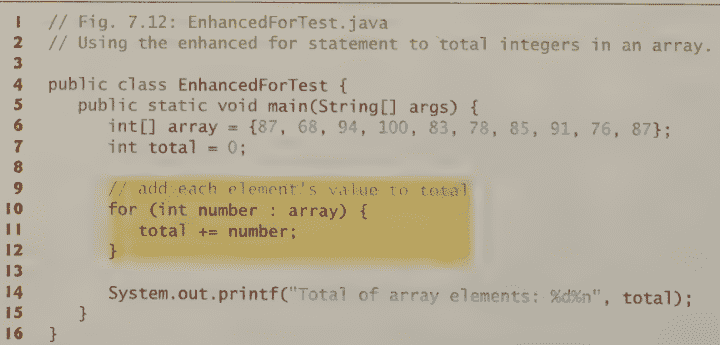

| 数组元素总和：849 |
| :--- |
图 7.12 | 使用增强 for 语句对数组中的整数求和。

## 7.8 将数组传递给方法 (Passing Arrays to Methods)

增强语句只能用于获取数组元素——它不能用于修改元素。如果你的程序需要修改元素，请使用传统的计数器控制 `for` 语句。

当遍历数组不需要访问索引当前数组元素的计数器索引时，可以使用增强语句代替计数器控制的 `for` 语句。例如，对数组中的整数求和需要访问元素值——每个元素的索引是无关的。然而，如果程序由于遍历数组之外的其他原因必须使用计数器（例如，在本章中在每个数组元素旁边打印索引号），则请使用计数器控制的 `for` 语句。

> **错误预防提示 7.2**：增强语句简化了数组的遍历。这使得代码更具可读性并消除了多种错误可能性，例如不当指定计数器变量的初始值、循环继续测试以及增量表达式。

### Java SE 8

`for` 语句和增强语句都从起始值到结束值进行顺序迭代。在第 17 章“Lambda 表达式流”中，你将学习流。如你所见，流提供了一种优雅、更简洁且不易出错的方法来遍历集合，这种方式允许某些迭代与其他迭代并行进行，从而实现更好的多核系统性能。

## 7.8 将数组传递给方法

本节演示了如何将数组和单个数组元素作为参数传递。要向方法传递数组引用，只需指定不带括号的数组名称。例如，如果声明 `hourlyTemperatures` 为：

```java
double[] hourlyTemperatures = new double[24];
```

那么方法

```java
modifyArray(hourlyTemperatures);
```

就会将数组 `hourlyTemperatures` 的引用传递给 `modifyArray` 方法。每个对象都“知道”自己的长度。因此，当我们向方法传递数组对象的引用时，不需要再将数组长度作为额外的参数传递。

要让方法通过方法调用接收数组引用，方法的参数列表必须指定一个数组参数。例如，`modifyArray` 方法头可以写为：

```java
void modifyArray(double[] b);
```

表示 `modifyArray` 接收参数 `b` 中的 `double` 数组引用。方法调用传递了数组 `hourlyTemperatures` 的引用，因此当调用的方法使用数组变量 `b` 时，它指向与调用者中的 `hourlyTemperatures` 相同的数组对象。

当方法的参数是数组或引用类型的单个数组元素时，调用的方法接收的是引用的拷贝。然而，当方法的参数是基本类型的单个数组元素时，调用的方法接收的是元素值的拷贝。由于基本值被称为标量或数量，要向方法传递单个数组元素，请在方法调用中使用数组元素的索引名称作为参数。

图 7.13 展示了向方法传递整个数组与传递基本类型数组元素的区别。方法调用了静态方法 `modifyArray`（第 18 行）和 `modifyElement`（第 30 行）。记住，静态方法可以在不使用类名和点（`.`）的情况下调用同类的其他静态方法。

```java
// 图 7.13: PassArray.java

// 向方法传递数组和单个数组元素。

public class PassArray {

    // 创建数组并调用 modifyArray 和 modifyElement

    public static void main(String[] args) {

        int[] array = {1, 2, 3, 4, 5};

        System.out.printf("传递整个数组引用的影响:%n");

        modifyArray(array);

        System.out.printf("数组的值:%n");

        for (int value : array) System.out.printf("%d ", value);

        System.out.printf("\n");

        System.out.printf("传递整个数组引用的影响:%n");

        modifyElement(array, 3);

        System.out.printf("数组的值:%n");

        for (int value : array) System.out.printf("%d ", value);

        System.out.printf("\n");

    }

    public static void modifyArray(int[] array) {

        for (int i = 0; i < array.length; i++) {

            array[i] *= 2;

        }

    }

    public static void modifyElement(int[] array, int index) {

        array[index] *= 2;

    }

}
```

当参数通过引用传递时，被调用的方法可以直接访问调用者中的参数值，并在必要时修改数据。引用传递通过消除了拷贝可能大量数据的需要来提高性能。

与其他语言不同，Java 并不允许你选择按值传递或按引用传递——所有参数都是按值传递的。一个方法可以向另一个方法传递两种类型的值——基本类型值的副本（例如 `int` 和 `double` 类型的值）或对象引用的副本。对象本身不会被传递给方法。当方法修改一个基本类型参数时，该参数对调用者方法中的原始值没有影响。例如，当图 7.13 中 `main` 方法的第 30 行传递 `array[3]` 并将其元素的值翻倍时，对 `main` 方法中 `array[3]` 的值没有影响。这对于引用类型参数也是如此。如果你修改了一个引用类型参数使其指向另一个对象，则只有该参数指向新对象——调用者变量中存储的引用仍然指向原始对象。

尽管对象是按值传递的，但方法仍然可以使用对象引用的副本通过调用其方法来与被引用对象交互。由于参数中的引用是作为参数传递的引用的副本，被调用方法中的参数和调用方法中的参数指向内存中的同一个对象。例如，在图 7.13 中，`modifyArray` 中的 `array` 和 `main` 中的 `variable array` 指向内存中的同一个数组。对被引用数组 `array` 进行的任何更改都在调用者方法中 `array` 所引用的对象上进行。在图 7.13 中，在 `modifyArray` 中所做的更改会影响 `main` 中 `array` 所引用对象的内容。因此，通过对象的引用，被调用的方法可以直接操作调用者的对象。

> 出于性能考虑，传递数组的引用而不是数组对象本身是有意义的。因为 Java 参数是按值传递的，如果传递数组对象，则会传递每个元素的副本。对于大型数组，这将浪费时间并为元素的副本消耗大量的存储空间。

## 7.10 案例研究：使用数组存储成绩的 GradeBook 类

我们现在展示开发 `GradeBook` 类案例研究的第一部分，该类允许教师维护学生的考试成绩，并显示包含成绩、班级平均分、最低分、最高分以及成绩分布图的报告。本节介绍的 `GradeBook` 类版本使用一维数组存储每次考试的成绩。在第 7.12 节，我们将展示一个使用二维数组存储学生在多次考试中成绩的 `GradeBook` 类版本。

### 在 GradeBook 中用数组存储成绩

`GradeBook` 类（图 7.14）使用 `int` 类型的数组来存储学生单次考试的成绩。数组 `grades` 被声明为实例变量（第 6 行），因此每个 `GradeBook` 维护自己的一组成绩。构造函数（9–12 行）有两个参数——课程名称和成绩数组。当应用程序（例如图 7.15 中的 `GradeTest` 类）创建 `GradeBook` 对象时，应用程序将一个 `int` 数组传递给构造函数，构造函数将数组的引用分配给实例变量 `grades`（第 11 行）。成绩数组的大小由构造函数数组参数的 `length` 实例变量决定。因此，`GradeBook` 对象可以处理任意数量的成绩。参数中的成绩值可以从用户输入，可以从磁盘上的文件读取（第 15 章讨论过），也可以来自各种其他来源。在 `GradeTest` 中，我们初始化了一个带有成绩值的数组（图 7.15，第 7 行）。一旦 `GradeBook` 的实例变量完成，该类的所有方法都可以访问 `grades` 的元素。

```java
// Fig 7.14: GradeBook.java

// 使用数组存储测试成绩的 GradeBook 类。

public class GradeBook {

    private String courseName; // 此 GradeBook 代表的课程名称

    private int[] grades; // 学生成绩数组

    // 构造函数

    public GradeBook(String courseName, int[] grades) {

        this.courseName = courseName;

        this.grades = grades;

    }

    // 设置课程名称的方法

    public void setCourseName(String courseName) {

        this.courseName = courseName;

    }

    // 获取课程名称的方法

    public String getCourseName() {

        return courseName;

    }

    // 对数据执行各种操作

    public void processGrades() {

        // 输出 grades 数组

        outputGrades();

        // 调用方法计算平均分

        System.out.printf("%nClass average is %.2f\n", getAverage());

        // 调用 getMinimum 和 getMaximum 方法

        System.out.printf("%nLowest grade is %d\nHighest grade is %d\n", getMinimum(), getMaximum());

        // 调用 outputBarChart 打印成绩分布图

        outputBarChart();

    }

    // 寻找最低成绩

    public int getMinimum() {

        int lowGrade = grades[0]; // 假设 grades[0] 是最小的

        // 遍历成绩

        for (int grade : grades) {

            // 比 lowGrade 小，则将其赋值给 lowGrade

            if (grade < lowGrade) {

                lowGrade = grade;

            }

        }

        return lowGrade;
    }
}
```

**图 7.14** 使用数组存储测试成绩的 GradeBook 类。（3 部分中的第 1 部分。）


```java
// 寻找最高成绩
public int getMaximum() {
    int highGrade = grades[0]; // 假设 grades[0] 是最大的

    // 遍历数组
    for (int grade : grades) {
        if (grade > highGrade) {
            highGrade = grade;
        }
    }
    return highGrade;
}

// 确定平均分
public double getAverage() {
    int total = 0;

    // 累加成绩
    for (int grade : grades) {
        total += grade;
    }
    // 返回平均分
    return (double) total / grades.length;
}

// 输出显示分布的柱状图
public void outputBarChart() {
    System.out.println("Grade distribution:");
    // 存储 10 分范围内成绩的频率
    int[] frequency = new int[11];

    // 对于每个成绩，增加频率计数
    for (int grade : grades) {
        frequency[grade / 10]++;
    }
    // 对于每个频率，打印柱状图
    for (int count = 0; count < frequency.length; count++) {
        if (count == 10) {
            System.out.printf("%2d: ", count);
        } else {
            System.out.printf("%2d-%2d: ", count * 10, count * 10 + 9);
        }
        // 打印星号条形
        for (int stars = 0; stars < frequency[count]; stars++) {
            System.out.print("*");
        }
        System.out.println();
    }
}

// 输出 grades 数组的内容
public void outputGrades() {
    System.out.printf("The grades are:%n");
    // 输出每个学生的成绩
    for (int student = 0; student < grades.length; student++) {
        System.out.printf("Student %2d: %3d\n", student + 1, grades[student]);
    }
}
```

**图 7.14** 使用数组存储测试成绩的 `GradeBook` 类。（3 部分中的第 2 部分。）

## 7.10 案例研究：使用数组存储成绩的 GradeBook 类

我们现在展示开发 `GradeBook` 类案例研究的第一部分，该类允许教师维护学生的考试成绩，并显示包含成绩、班级平均分、最低分、最高分以及成绩分布图的报告。本节介绍的 `GradeBook` 类版本使用一维数组存储每次考试的成绩。在第 7.12 节，我们将展示一个使用二维数组存储学生在多次考试中成绩的 `GradeBook` 类版本。

`processGrades`（第 25–38 行）包含一系列方法调用，以输出一份成绩总结报告。第 27 行调用 `outputGrades` 方法打印 `grades` 数组的内容。`outputGrades` 第 119–122 行输出学生的成绩。这种情况必须使用计数控制 `for` 语句，因为第 120–121 行计数器变量的值要在特定的数字旁边输出每个成绩（参见图 7.15 中的输出）。虽然数组索引从 0 开始，但教授通常从 1 开始编号。因此，第 120–121 行输出 `student + 1` 作为学生编号，产生“Student 1:, Student 2: ”等成绩标签。

`processGrades` 接下来调用 `getAverage`（第 30 行）来计算数组 `grades` 的平均分。`getAverage`（第 71–81 行）使用增强 `for` 语句（例如 `int grade` 表示在每次迭代中 `int` 变量都会取数组 `grades` 中的一个值）。第 80 行的平均计算使用 `grades.length` 来决定参与平均的成绩数量。`processGrades` 第 33–34 行调用 `getMinimum` 和 `getMaximum` 方法分别确定考试中任何学生的最低分和最高分。这两个方法都使用增强 `for` 遍历数组。`getMinimum` 第 45–50 行遍历数组。第 47–49 行将每个成绩与 `lowGrade` 进行比较：如果 `grade` 小于 `lowGrade`，则将 `lowGrade` 设置为 `grade`。当第 52 行执行时，`lowGrade` 包含数组中的最低分。`getMaximum` 方法（第 56–68 行）的工作原理与 `getMinimum` 方法类似。

最后，`processGrades` 中的第 37 行调用 `outputBarChart` 来打印分布图。在第 91–93 行使用了与图 7.7–7.8 类似的技术来计算每个类别中分数的频率。第 88 行创建了一个包含 11 个 `int` 类型的数组 `frequency`，用于存储每个类别中分数的频率。对于数组中的每个分数，第 91–93 行增加相应的数组元素。为了确定要包含哪一个，第 92 行使用整数除法将当前分数除以 10——例如，如果 `grade` 为 85，第 92 行将增加 `frequency[8]` 以更新 80–89 范围内分数的计数。第 96–111 行根据数组 `frequency` 中的值打印条形图（如图 7.15 所示）。图 7.14 的第 106–108 行使用数组 `frequency` 中的值来确定每个条形中显示的星号数量。

## 展示 GradeBook 类的 GradeBookTest 类

第 75 行使用 `int` 数组 `gradesArray` 创建了一个 `GradeBook` 类对象（`gradesArray` 在第 7 行声明并初始化）。第 9–10 行将一个名称和 `gradesArray` 传递给 `GradeBook` 构造函数。第 11–12 行显示一条欢迎消息，其中包含存储在 `GradeBook` 对象中的名称。第 13 行调用 `GradeBook` 对象的 `processGrades` 方法。输出总结了 `myGradeBook` 中的 10 个分数。


> 测试框架（或测试应用程序）负责创建被测试类的对象并为其提供数据。这些数据可以来自多个源中的任何一个。数据可以直接使用数组初始化器放入数组中，也可以来自键盘、来自文件（如你将在第 15 章中看到的）、来自数据库（如你在第 24 章看到的）或来自网络（如你将在第 28 章看到的）。将这些数据传递给类的构造函数以实例化对象后，测试框架将调用该对象来测试其方法并操作数据。在测试框架中收集数据允许该类具有可重用性，尽管从多个源操作数据。

```java
// 图 7.15: GradeBookTest.java
// GradeBookTest 使用分数数组创建一个 GradeBook 对象，然后调用 processGrades 方法对其进行分析。
public static void main(String[] args) {
    // 学生分数数组
    int[] gradesArray = {87, 68, 94, 100, 83, 78, 85, 91, 76, 87};
    GradeBook myGradeBook = new GradeBook(
        // "CS101 introduction to Java Programming", gradesArray);
    System.out.printf("Welcome to the grade book for%s%n%n",
        myGradeBook.getCourseName());
    myGradeBook.processGrades();
}
```

**图 7.15** `GradeBookTest` 使用分数数组创建一个 `GradeBook` 对象，然后调用 `processGrades` 方法对其进行分析。（2 个部分中的第 1 部分）

欢迎来到成绩单：

CS101 Java 编程入门

分数如下：

- 学生 1: 87
- 学生 2: 68
- 学生 3: 94
- 学生 4: 100
- 学生 5: 83
- 学生 6: 78
- 学生 7: 85
- 学生 8: 91
- 学生 9: 76
- 学生 10: 87

课程平均分是 84.9

最低分是 68

最高分是 100

分数分布：

- 0–9:
- 10–19:
- 20–29:
- 30–39:
- 40–49:
- 50–59:
- 60–69: *
- 70–79: ***
- 80–89: **
- 90–99: **
- 100: *

**图 7.15** `GradeBookTest` 使用分数数组创建一个 `GradeBook` 对象，然后调用 `processGrades` 方法对其进行分析。（2 个部分中的第 2 部分）

Java SE 8 在第 17 章 Lambdas 和 Streams 中，图 17 的示例使用 `min`、`max` 和 `average` 优雅且简洁地处理数组元素，而无需编写迭代语句。第 23 章并发中，图 23 的示例使用 `summaryStatistics` 在一个方法中执行所有操作。

### 7.11 多维数组

具有两个维度的多维数组表示按行和列排列的值。要标识特定的表格元素，你需要指定两个索引。按照约定，第一个标识元素的行，第二个标识列。需要两个索引来识别每个元素的数组被称为二维数组（多维数组可以超过两个维度）。Java 不直接支持多维数组，但允许你指定元素也是一维数组，从而达到相同的效果。图 7.16 展示了一个名为 `a` 的三行四列二维数组（即 3×4 数组）。通常，具有 `m` 行 `n` 列的数组称为 `m×n` 数组。

| 列 0 | 列 1 | 列 2 | 列 3 |
| :--- | :--- | :--- | :--- |
| 行 0 | `a[0][0]` | `a[0][1]` | `a[0][2]` | `a[0][3]` |
| 行 1 | `a[1][0]` | `a[1][1]` | `a[1][2]` | `a[1][3]` |
| 行 2 | `a[2][0]` | `a[2][1]` | `a[2][2]` | `a[2][3]` |

**图 7.16** 有三行四列的二维数组。数组 `a` 中的每个元素通过形式如 `a[row][column]` 的数组访问表达式来标识；`a` 是数组的名称，`row` 和 `column` 是按行和列唯一标识每个元素的索引。行 0 中的元素第一个索引为 0，列 3 中的元素第二个索引为 3。

#### 7.11.1 一维数组数组

和一维数组一样，多维数组可以在声明中使用数组初始化器进行初始化。具有两行两列的二维数组 `b` 可以如下使用嵌套初始化器声明并初始化：

```java
int[][] b = {{1, 2}, {3, 4}};
```

值按行分组。因此，1 和 2 分别初始化 `b[0][0]` 和 `b[0][1]`，而 3 和 4 分别初始化 `b[1][0]` 和 `b[1][1]`。编译器通过嵌套初始化器的数量（由外层括号内的一组括号表示）来确定数组 `b` 的行数。编译器通过某行嵌套初始化器中的值来确定该行的列数。正如我们稍后将看到的，这意味着行可以有不同的长度。

多维数组作为一维数组数组的形式维护。因此，前述声明中的数组 `b` 实际上由两个独立的一维数组组成——一个包含第一个初始化列表 `(1, 2)` 中的值，另一个包含第二个初始化列表 `(3, 4)` 中的值。因此，数组 `b` 本身是一个包含两个元素的数组，每个元素都是一个 `int` 类型值的一维数组。

#### 7.11.2 不同长度行的二维数组

数组 `b` 中行长度的表示方式使得它们非常灵活。事实上，行的长度并不要求相同。例如：

```java
int[][] b = {{1, 2}, {3, 4, 5}};
```

创建了一个整数数组 `b`，具有两个元素（由嵌套初始化器的数量决定），代表二维数组的行。`b` 的每个元素都是指向 `int` 变量一维数组的引用。行 0 的 `int` 数组是一个包含两个元素（1 和 2）的一维数组，而行 1 的 `int` 数组是一个包含三个元素（3, 4 和 5）的一维数组。

#### 7.11.3 使用数组创建表达式创建二维数组

每一行列数相同的多维数组可以使用数组创建表达式创建。例如，以下行声明了数组 `b` 并为其赋值一个 3×4 数组的引用：

```java
int[][] b = new int[3][4];
```

在这种情况下，我们使用字面量 3 和 4 分别指定行数和列数，但这不是必须的。程序也可以使用变量来指定数组维度，因为新数组是在运行时而不是编译时创建的。多维数组的元素在数组对象创建时被初始化。

每行列数不同的多维数组可以如下创建：

```java
int[][] b = new int[2][]; // 创建 2 行
b[0] = new int[5]; // 为行 0 创建 5 列
b[1] = new int[3]; // 为行 1 创建 3 列
```

上述语句创建了一个具有两行的二维数组。行 0 有五列，行 1 有三列。

#### 7.11.4 二维数组示例：显示元素值

```java
// array1 按行排列的值为
// 1 2 3
// 4 5 6
// array2 按行排列的值为
// 1 2
// 3
// 4 5 6
```

**图 7.17** 初始化二维数组。（2 个部分中的第 2 部分。）

第 11 行和第 14 行分别调用 `outputArray` 来输出 `array1` 和 `array2` 的元素。方法 `outputArray` 的参数——`int[][] array`——表示该方法接收一个二维数组。嵌套语句（第 20-27 行）输出二维数组的行。在外部语句的循环继续条件中，表达式 `array.length` 决定了数组的行数。在内部 `for` 语句中，表达式 `array[row].length` 决定了数组当前行的列数。内部 `for` 语句的条件使循环能够确定每行的确切列数。在图 7.18 中演示了嵌套的增强 `for` 语句。

#### 7.11.5 使用语句执行的常见多维数组操作

许多常见的数组操作使用 `for` 语句。例如，以下语句将图 7.16 中数组 `a` 的第 2 行的所有元素设置为零：

```java
for (int column = 0; column < a[2].length; column++) {
    a[2][column] = 0;
}
```

我们指定了第 2 行；因此，我们知道第一个索引始终是 2（0 是第一行，1 是第二行）。`for` 循环只改变第二个索引（即列索引）。如果数组 `a` 的第 2 行包含四个元素，则前面的 `for` 语句等同于赋值语句：

```java
a[2][0] = 0;
a[2][1] = 0;
a[2][2] = 0;
a[2][3] = 0;
```

以下嵌套 `for` 语句逐个计算数组中所有元素的总和：

```java
int total = 0;
for (int row = 0; row < a.length; row++) {
    for (int column = 0; column < a[row].length; column++) {
        total += a[row][column];
    }
}
```

嵌套的 `for` 语句逐个累加元素。外部语句首先将行索引设置为 0，以便内部语句可以累加第一行的元素总和。外部 `for` 将 `row` 增加到 1，以便累加第二行的总和。然后，外部 `for` 又将 `row` 增加到 2，以便累加第三行的总和。当外部 `for` 语句结束时，可以显示变量 `total`。在下一个示例中，我们展示了如何使用嵌套的增强 `for` 语句以类似的方式处理二维数组。

### 7.12 案例研究：使用二维数组的 GradeBook 类

在第 7.10 节中，我们展示了 `GradeBook`（图 7.14），它使用一维数组存储学生单次考试的成绩。在大多数学期中，学生会参加多次考试。教授可能会分析整个学期的成绩，包括针对单个学生和针对整个班级。

#### 在 GradeBook 类中用二维数组存储成绩

图 7.18 包含一个 `GradeBook` 类，该类使用二维数组存储多个学生在多次考试中的成绩。数组的每行代表一个学生整个课程的成绩，每列代表所有参加某次考试学生的成绩。`GradeBook` 构造函数将数组作为参数传递给 `GradeBook` 构造函数。在这个示例中，我们使用了一个 10×3 的数组来存储十名学生在三次考试中的成绩。通过五个方法执行数组操作来处理成绩。每个方法与之前的一维数组版本的 `GradeBook`（图 7.14）类似。`getMinimum` 方法（图 7.18 的第 39–55 行）确定任何学生在该学期的最低分。`getMaximum` 方法（第 58–74 行）确定任何学生在该学期内的最高分。`getAverage` 方法（第 77–87 行）确定特定学生的学期平均分。`outputBarChart` 方法（第 90–121 行）输出整个学期学生成绩的条形图。`outputGrades` 方法（第 124–148 行）以表格格式输出数组，并带有每个学生的学期平均分。


```java
// Fig 7.18: GradeBook.java
// 使用二维数组存储成绩的 GradeBook 类。
public class GradeBook {
    private String courseName; // 此成绩单代表的课程名称
    private int[][] grades; // 学生成绩的二维数组

    // 构造函数初始化 courseName 和 grades 数组
    public GradeBook(String courseName, int[][] grades) {
        this.courseName = courseName;
        this.grades = grades;
    }

    // 设置课程名称的方法
    public void setCourseName(String courseName) {
        this.courseName = courseName;
    }

    // 获取课程名称的方法
    public String getCourseName() {
        return courseName;
    }

    // 对数据执行各种操作
    public void processGrades() {
        // 输出 grades 数组
        outputGrades();

        // 调用 getMinimum 和 getMaximum 方法
        System.out.printf("%s%s%n", getMinimum(), getMaximum());

        // 输出成绩分布
        outputBarChart();
    }

    // 查找最低分
    public int getMinimum() {
        // 假设第一行的元素是最低的
        int lowestGrade = grades[0][0];
        for (int row = 0; row < grades.length; row++) {
            for (int column = 0; column < grades[row].length; column++) {
                if (grades[row][column] < lowestGrade) {
                    lowestGrade = grades[row][column];
                }
            }
        }
        return lowestGrade;
    }

    // 查找最高分
    public int getMaximum() {
        // 假设第一行的元素是最大的
        int highestGrade = grades[0][0];
        for (int row = 0; row < grades.length; row++) {
            for (int column = 0; column < grades[row].length; column++) {
                if (grades[row][column] > highestGrade) {
                    highestGrade = grades[row][column];
                }
            }
        }
        return highestGrade;
    }

    // 计算平均分
    public double getAverage(int[] setGrades) {
        int total = 0;
        for (int grade : setGrades) {
            total += grade;
        }
        return (double) total / setGrades.length;
    }

    // 输出条形图
    public void outputBarChart() {
        System.out.println("总体成绩分布:");
        int[] frequency = new int[11];
        for (int[] studentGrades : grades) {
            for (int grade : studentGrades) {
                frequency[grade / 10]++;
            }
        }
        for (int count = 0; count < frequency.length; count++) {
            if (count == 10) {
                System.out.printf("%5d, ", 100);
            } else {
                System.out.printf("%02d-%02d: ", count * 10, count + 9);
            }
            // 打印星号条
            for (int stars = 0; stars < frequency[count]; stars++) {
                System.out.printf("*");
            }
            System.out.println();
        }
    }

    // 输出 grades 数组的内容
    public void outputGrades() {
        System.out.printf("成绩如下:%n%n");
        System.out.printf("      "); // 对齐列头
        // 为每次考试创建列标题
        for (int test = 0; test < grades[0].length; test++) {
            System.out.printf("Test %2d, ", test + 1);
        }
        System.out.println("Average"); // 平均分列标题
        // 创建表示数组成绩的行
        for (int student = 0; student < grades.length; student++) {
            System.out.printf("Student %2d, ", student + 1);
            for (int test : grades[student]) { // 输出学生的成绩
                System.out.printf("%8d, ", test);
            }
            // 调用 getAverage 方法计算学生的平均分；
            double average = getAverage(grades[student]);
            System.out.printf("%9.2f%n", average);
        }
    }
}
```

# 7.12 案例研究：使用二维数组的 GradeBook 类

`enhanced for` 循环遍历二维数组 `grades`，在连续的迭代中将连续的行赋值给参数 `studentGrades`。参数名后的方括号 `[]` 表示 `studentGrades` 指向一个一维 `int` 数组——即 `grades` 数组中的某一行，该行包含一个学生的成绩。若要找到最低分，内部语句将当前维度数组 `studentGrades` 的元素与 `lowGrade` 进行比较。例如，在外层 `for` 循环的第一次迭代中，`grades` 的第 0 行赋值给参数 `studentGrades`。内部的 `enhanced for` 循环遍历 `studentGrades` 并将每个成绩值与 `lowGrade` 进行比较。如果某个成绩小于 `lowGrade`，则将 `lowGrade` 设置为该成绩。外层 `enhanced for` 语句的第二次迭代中，`grades` 的第 1 行赋值给 `studentGrades`，并将该行的元素与变量 `lowGrade` 进行比较。此过程不断重复，直到 `grades` 的所有行都被遍历完毕。方法执行完成后，`lowGrade` 包含二维数组中的最低分。`getMaximum` 方法的工作原理与 `getMinimum` 类似。

## 方法 outputBarChart

图 7.18 中的 `outputBarChart` 方法与图 7.14 中的方法几乎完全相同。然而，为了输出整个学期的总体成绩分布情况，此处的方法使用了 `enhanced for` 语句（97–101行），根据二维数组中的所有成绩创建一个一维频率数组 `frequency`。两个 `outputBarChart` 方法中显示图表的其余代码是相同的。

## 方法 outputGrades

`outputGrades` 方法（124–148行）使用嵌套的 `for` 语句输出数组 `grades` 的值以及每个学生的学期平均分。输出结果（图 7.19）显示了结果，类似于教授成绩单的表格格式。图 7.18 的第 129–131 行打印每个学生的列标题。我们在此使用计数控制的 `for` 循环，以便用数字识别每个学生。同样，第 136–147 行的语句首先使用计数器变量输出行标签以识别每个学生（137行）。虽然索引从 0 开始，但第 130 行和 137 行分别输出 `student + 1` 和 `student + 1`，以生成并测试从 1 开始的数字（见图 7.19 中的输出）。图 7.18 的内部 `for` 语句（139–141行）使用外层 `for` 语句的变量 `student` 来遍历数组 `grades` 的特定行并输出每个学生的成绩。`enhanced for` 语句可以嵌套在计数控制的 `for` 语句中，反之亦然。最后，第 145 行通过将当前成绩行（例如 `grades[student]`）传递给 `getAverage` 来输出每个学生的学期平均分。

## 方法 getAverage

`getAverage` 方法（77–87行）接收一个特定学生的一维结果数组。当第 145 行调用 `getAverage` 时，参数是 `grades[student]`，这指定了将二维数组的特定行传递给 `getAverage`。例如，根据图 7.19 中创建的数组，它代表存储在 `grades` 二维数组第 1 行的三个值（一个一维成绩数组）。该方法计算元素之和，除以测试结果的数量，并将浮点结果作为 `double` 类型值返回（图 7.18 的第 86 行）。

# 演示 GradeBook 的 GradeBookTest 类

图 7.19 使用名为 `gradesArray` 的二维数组（在 8–17 行中声明并初始化）创建了一个 `GradeBook` 对象。第 19–20 行将课程名称和 `gradesArray` 传递给 `GradeBook` 构造函数。第 21–22 行显示包含课程名称的欢迎信息，然后第 23 行调用 `myGradeBook` 的 `processGrades` 方法来显示汇总学生该学期成绩的报告。

```java
// 图 7.19: GradeBookTest.java
// GradeBookTest 使用成绩二维数组创建 GradeBook 对象
// 然后调用 processGrades 对其进行分析。
public class GradeBookTest {
    // main 方法开始程序执行
    public static void main(String[] args) {
        // 学生成绩的二维数组
        int[][] gradesArray = {
            {85, 90, 90},
            {88, 100, 90},
            {91, 81, 83},
            {85, 87, 83},
            {91, 100, 90},
            {86, 85, 83}
        };
        GradeBook myGradeBook = new GradeBook(
            "CS101 Introduction to Java Programming", gradesArray);
        System.out.printf("welcome to the grade book for %s\n",
            myGradeBook.getCourseName());
        myGradeBook.processGrades();
    }
}
```

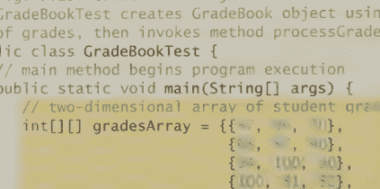

欢迎来到 CS101 Java 编程导读的成绩单

成绩如下：

| 学生 | 测试 1 | 测试 2 | 测试 3 | 平均分 |
| --- | --- | --- | --- | --- |
| 学生 1 | 85 | 90 | 90 | 88.67 |
| 学生 2 | 88 | 100 | 90 | 92.67 |
| 学生 3 | 91 | 81 | 83 | 85.00 |
| 学生 4 | 85 | 87 | 83 | 85.00 |
| 学生 5 | 91 | 100 | 90 | 93.67 |
| 学生 6 | 86 | 85 | 83 | 84.67 |

欢迎来到 CS101 Java 编程导读的成绩单

| 学生 | 测试 1 | 测试 2 | 测试 3 | 平均分 |
| --- | --- | --- | --- | --- |
| 学生 1 | 87 | 96 | 70 | 84.37 |
| 学生 2 | 68 | 87 | 90 | 81.67 |
| 学生 3 | 94 | 100 | 99 | 96.33 |
| 学生 4 | 100 | 81 | 82 | 87.67 |
| 学生 5 | 83 | 85 | 77 | 81.67 |
| 学生 6 | 78 | 85 | 83 | 79.67 |
| 学生 7 | 85 | 75 | 81 | 80.33 |
| 学生 8 | 91 | 94 | 95 | 93.33 |
| 学生 9 | 76 | 72 | 84 | 77.33 |
| 学生 10 | 87 | 93 | 83 | 87.67 |

> 图 7.19 使用名为 `gradesArray` 的二维数组创建了一个 `GradeBook` 对象，然后调用 `processGrades` 对其进行分析。

成绩单中的最低分是 65

总体成绩分布：

0-09:
10-19:
20-29:
30-39:
40-49:
50-59:
60-69:
70-79:
80-89:
90-99:

# 7.13 可变参数列表

通过可变参数列表，你可以创建接收未指定数量参数的方法。类型后跟省略号 `...` 表示该方法接收任意数量的该类型参数。省略号在参数列表中只能出现一次且必须放在列表的末尾。虽然你可以使用方法重载来实现所需的功能，但可变参数列表更加简洁。

```java
public class VarargsTest {
    // 计算平均值
    public static double average(double... numbers) {
        double total = 0.0;
        // 使用增强 for 循环求和
        for (double d : numbers) {
            total += d;
        }
        return total / numbers.length;
    }

    public static void main(String[] args) {
        double d1 = 10.0;
        double d2 = 20.0;
        double d3 = 30.0;
        double d4 = 40.0;
        System.out.printf("d1 = %1f%nd2 = %1f%nd3 = %1f%nd4 = %1f%n%n",
            d1, d2, d3, d4);
        System.out.printf("d1 和 d2 的平均值是 %1f%n",
            average(d1, d2));
        System.out.printf("d1, d2 和 d3 的平均值是 %1f%n",
            average(d1, d2, d3));
        System.out.printf("d1, d2, d3 和 d4 的平均值是 %1f%n",
            average(d1, d2, d3, d4));
    }
}
```

```
d1 = 10.000000
d2 = 20.000000
d3 = 30.000000
d4 = 40.000000

d1 和 d2 的平均值是 15.000000
d1, d2 和 d3 的平均值是 20.000000
d1, d2, d3 和 d4 的平均值是 25.000000
```


d1, d2 和 d3 的平均值是 20.000000

d1, d2, d3 和 d4 的平均值是 25.000000

# 7.14 使用命令行参数

可以通过 `main` 方法的 `String[]` 参数将命令行参数传递给应用程序，该参数接收一个 `String` 数组。按照惯例，该参数命名为 `args`。当使用 `java` 命令执行程序时，Java 将 `java` 命令中类名之后的命令行参数作为 `args` 数组中的 `String` 传递给应用程序的 `main` 方法。命令行参数的数量通过访问数组的 `length` 属性获取。

## 7.14.1 示例：使用命令行参数初始化数组

我们的下一个示例使用命令行参数来确定数组的大小、第一个元素的值以及用于计算数组剩余元素之值的增量。该命令：

```
java InitArray 5 0 4
```

将三个参数 5、0 和 4 传递给应用程序 `InitArray`。命令行参数之间用空格分隔，而不是逗号。当执行此命令时，`InitArray` 的 `main` 方法接收到这三个参数组成的数组 `args`（即长度为 3），其中 `args[0]` 包含字符串 "5"，`args[1]` 包含字符串 "0"，`args[2]` 包含字符串 "4"。程序决定了如何使用这些参数——在图 7.21 中，我们将这三个命令行参数转换为 `int` 值，并决定了如何初始化数组。当程序执行时，如果 `length` 不为 3，程序将打印错误消息并终止（第 7–11 行）。否则，第 12–32 行将根据命令行参数的值初始化并显示数组。

**图 7.21** 使用命令行参数初始化数组。

```java
java InitArray
Error: 请重新输入整个命令，包括数组大小、初始值和增量。
```

```java
java InitArray 5 0 4
| Index | Value |
| :--- | :--- |
| 0 | 0 |
| 1 | 4 |
| 2 | 8 |
| 3 | 12 |
| 4 | 16 |
```

```java
java InitArray 8 1 2
| Index | Value |
| :--- | :--- |
| 0 | 1 |
| 1 | 3 |
| 2 | 5 |
| 3 | 7 |
| 4 | 9 |
| 5 | 11 |
| 6 | 13 |
| 7 | 15 |
```

程序将命令行参数 `args[0]`（一个指定数组大小的字符串）转换为 `int` 值，并在第 15 行使用它创建数组。`Integer` 类的静态方法 `parseInt` 将其字符串参数转换为 `int`。

第 18–19 行将命令行参数 `args[1]` 和 `args[2]` 转换为 `int` 并分别存储在 `initialValue` 和 `increment` 中。第 22–24 行计算每个数组元素的值。

第一次执行的输出显示应用程序接收到的命令行参数不足。第二次执行使用命令行参数 5、0 和 4 分别指定数组的大小（5）、第一个元素的值（0）以及每个值的增量（4）。相应的输出显示这些值创建了一个包含整数 0、4、8、12 和 16 的数组。第三次执行的输出显示，命令行参数 8、1 和 2 产生了一个包含 8 个元素的数组，这 8 个元素是从 1 到 15 的非负奇数。

# 7.15 Arrays 类

`Arrays` 类通过为常见的数组应用提供静态方法，帮助你避免重复造轮子。这些方法包括：`sort` 用于排序数组（即按升序重新排列元素）、`binarySearch` 用于搜索已排序的数组（即确定数组是否包含特定值，如果是，则该值位于何处）、`equals` 用于比较数组以及 `fill` 用于向数组中填充值。这些方法针对原始数据类型数组和对象数组进行了重载。我们在本节的重点是使用 Java API 提供的内置功能。第 19 章“搜索、排序与大 O”展示了如何实现你的排序和搜索算法，这是一个计算机科学研究人员、学生以及高性能系统开发者都非常感兴趣的话题。

图 7.22 使用了 `Arrays.sort`、`binarySearch`、`equals` 和 `fill`，以及如何使用 `System` 的静态方法 `arraycopy` 复制数组。在 `main` 方法中，第 9 行对 `doubleArray` 数组的元素进行排序。`Arrays` 类的静态方法默认按升序排列数组的元素。我们将在本章稍后讨论如何进行降序排序。`sort` 的重载版本允许你对数组内特定范围的元素进行排序。第 10-14 行输出排序后的数组。

```java
// 图 7.22: ArrayManipulations.java
// Arrays 类方法和 System.arraycopy。
import java.util.Arrays;

public class ArrayManipulations {
    public static void main(String[] args) {
        // 将 doubleArray 升序排序
        double[] doubleArray = {8.4, 9.3, 0.2, 7.9, 3.4};
        Arrays.sort(doubleArray);
        System.out.printf("%ndoubleArray: %s\n", doubleArray);

        for (double value : doubleArray) {
            System.out.printf("%.1f, ", value);
        }

        // 用 7 填充 10 元素的数组
        int[] filledArray = new int[10];
        Arrays.fill(filledArray, 7);
        displayArray(filledArray, "filledArray");

        // 将 intArray 复制到 intArrayCopy
        int[] intArray = {1, 2, 3, 4, 5, 6};
        int[] intCopy = new int[intArray.length];
        System.arraycopy(intArray, 0, intCopy, 0, intArray.length);
        displayArray(intArray, "intArray");
        displayArray(intCopy, "intCopy");

        // 比较 intArray 和 intArrayCopy 是否相等
        boolean b = Arrays.equals(intArray, intCopy);
        System.out.printf("%s and %s are equal: %b\n", "intArray", "intCopy", b);

        // 比较 intArray 和 filledArray 是否相等
        b = Arrays.equals(intArray, filledArray);
        System.out.printf("%s and %s are equal: %b\n", "intArray", "filledArray", b);

        // 在 intArray 中查找值 5
        int location = Arrays.binarySearch(intArray, 5);

        if (location >= 0) {
            System.out.printf("Found 5 at element %d in intArray%n", location);
        } else {
            System.out.println("5 not found in intArray");
        }

        // 在 intArray 中查找值 8763
        location = Arrays.binarySearch(intArray, 8763);
        if (location >= 0) {
            System.out.printf("Found 8763 at element %d in intArray%n", location);
        } else {
            System.out.println("8763 not found in intArray");
        }
    }
    
    // 假设存在 displayArray 方法
    public static void displayArray(int[] array, String name) {
        System.out.printf("%n%s: ", name);
        for (int value : array) {
            System.out.printf("%d ", value);
        }
        System.out.println();
    }
}
```

```
doubleArray: 0.2 3.4 7.9 8.4 9.3

filledArray: 7 7 7 7 7 7 7 7 7 7

intArray: 1 2 3 4 5 6

intCopy: 1 2 3 4 5 6

intArray and intCopy are equal: true

intArray and filledArray are equal: false

Found 5 at element 4 in intArray

8763 not found in intArray
```

**图 7.22** Arrays 类方法和 System.arraycopy。

第 18 行调用 `Arrays` 类的静态方法 `fill` 将 `filledArray` 的所有 10 个元素填充为 7。`fill` 的重载版本允许你填充特定范围的元素。第 19 行调用我们的 `displayArray` 方法（第 62–68 行）来输出 `filledArray` 的内容。

# 7.16 集合简介和 ArrayList 类

Java API 提供了若干预定义的数据结构——集合，用于在内存中存储对象组。这些类提供了高效的方法来组织和检索数据，无需了解数据是如何存储的。这减少了应用程序的开发时间。

你一直使用数组来存储对象。数组在执行期间不会自动更改大小以容纳更多元素。集合类 `ArrayList<E>`（包 `java.util`）为这个问题提供了一个方便的解决方案——它会动态更改大小以容纳更多元素。`E`（根据约定）是一个占位符——在声明新的 `ArrayList` 时，将其替换为你希望该 `ArrayList` 拥有的元素类型。例如：

```java
ArrayList<String> list;
```

`ArrayList<String> list` 将 `list` 声明为一个只能存储 `String` 的 `ArrayList` 集合。带有这种占位符的类可以用于任何类型，这些被称为泛型类。只有引用类型可以用于声明泛型类的变量和对象。然而，Java 提供了一种名为“装箱”（boxing）的机制，允许将原始值封装成泛型类使用的对象。例如：

```java
ArrayList<Integer> integers;
```

将 `integers` 声明为一个只能存储 `Integer` 的 `ArrayList`。当你将一个 `int` 值放入 `ArrayList<Integer>` 时，该 `int` 值会被装箱（封装）为一个 `Integer` 对象；当从 `ArrayList<Integer>` 中获取一个 `Integer` 对象并将其赋值给一个 `int` 变量时，该对象内部的 `int` 值会被拆箱（解封装）。

第 16 和第 20 章将讨论更多的集合类和泛型。图 7.23 显示了 `ArrayList<E>` 类的一些常用方法。

**图 7.23** `ArrayList<E>` 类的一些方法。

| 方法 | 说明 |
| :--- | :--- |
| `add` | 重载方法，可将元素添加到 ArrayList 的末尾或 ArrayList 中的指定索引处。 |
| `clear` | 移除 ArrayList 中的所有元素。 |
| `contains` | 如果 ArrayList 包含指定的元素，返回 `true`；否则返回 `false`。 |
| `get` | 返回指定索引处的元素。 |
| `indexOf` | 返回指定元素在 ArrayList 中首次出现的索引。 |
| `remove` | 重载方法。移除指定值的首次出现处或指定索引处的元素。 |
| `size` | 返回 ArrayList 中存储的元素数量。 |
| `trimToSize` | 将 ArrayList 的容量调整为当前元素的数量。 |

## 7.16.1 演示 ArrayList<String>

图 7.24 展示了某些常用的 `ArrayList` 功能。第 8 行创建了一个新的空 `String` `ArrayList`，其默认初始容量为 10 个元素。容量表示在不进行增长的情况下可以容纳多少个元素。`ArrayList` 在后台是使用常规数组实现的。当 `ArrayList` 增长时，它必须创建一个更大的内部数组并将每个元素复制到新数组中。这是一个耗时的操作，如果每添加一个元素时就让 `ArrayList` 增长一次，效率将会非常低。相反，它只在添加元素且元素数量等于容量时才增长——即没有空间存放新元素。

```java
// Fig. 7.24: ArrayListCollection.java
// 泛型 ArrayList<E> 集合演示。
import java.util.ArrayList;

public class ArrayListCollection {
    public static void main(String[] args) {
        // 创建一个初始容量为 10 的新 ArrayList
        ArrayList<String> items = new ArrayList<>();
        items.add("red"); // 向列表末尾添加项
        items.add(0, "yellow"); // 在索引 0 处插入黄色

        // 头部
        System.out.print("Display list contents with counter-controlled loop:");
        
        // ... 此处省略部分循环显示代码 ...
        
        // 显示列表内容
        display(items, "List with two elements: ");
        
        items.add("green"); // 添加到末尾
        items.add("yellow"); // 添加到末尾
        display(items, "List with four elements: ");
        
        items.remove("yellow"); // 移除第一个 yellow
        display(items, "Remove first instance of yellow: ");
        
        items.remove(1); // 移除索引 1 处元素
        display(items, "Remove second list element (green): ");
        
        System.out.printf("\"red\" is in the list: %b%n", items.contains("red"));
        System.out.printf("Size: %d%n", items.size());
    }
    
    public static void display(ArrayList<String> items, String header) {
        System.out.printf("%n%s", header);
        for (String item : items) {
            System.out.printf("%s ", item);
        }
    }
}
```

```
Display list contents with counter-controlled loop: yellow red
Display list contents with enhanced for statement: yellow red
List with two elements: yellow red
List with four elements: yellow red green yellow
Remove first instance of yellow: red green yellow
Remove second list element (green): red yellow
"red" is in the list: true
Size: 2
```

**图 7.24** `ArrayList<E>` 集合演示。

`add` 方法将元素添加到 `ArrayList` 中（第 10–11 行）。带有一个参数的 `add` 方法将该参数追加到 `ArrayList` 的末尾。带有两个参数的 `add` 方法在指定位置插入新元素。第一个参数是索引。与数组一样，集合索引从零开始。第二个参数是要插入到该索引处的值。所有后续元素的索引都会递加 1。插入元素通常比向 `ArrayList` 的末尾添加元素要慢。

第 18–20 行显示 `ArrayList` 中的元素。`size` 方法返回当前 `ArrayList` 中的元素数量。`get` 方法（第 19 行）获取指定索引处的元素。第 23–27 行向 `ArrayList` 添加了两个新元素，然后显示元素，以确认这两个元素已成功添加到集合的末尾。

`remove` 方法用于移除具有特定值的元素（第 30 行）。它只移除第一个元素。如果 `ArrayList` 中不存在此类元素，`remove` 将什么都不做。该方法的重载版本用于移除指定索引处的元素（第 33 行）。当元素被移除时，被移除元素之后的任何元素的索引都会减 1。

第 38 行使用 `contains` 方法检查列表中是否包含某项。`contains` 方法在 `ArrayList` 中找到元素时返回 `true`，否则返回 `false`。第 41 行显示 `ArrayList` 的大小。

### 7.16.2 创建泛型类对象的菱形符号 (<>)

考虑图 7.24 的第 8 行：

```java
ArrayList<String> items = new ArrayList<>();
```


当编译器在实例化表达式中遇到 `<>` 时，它可以推断出类型。这被称为菱形运算符（diamond operator）。

# 7.17（可选）GUI 与图形案例研究：绘制圆弧

在本节中，我们绘制一个使用数组和迭代语句绘制彩虹的应用。在 JavaFX 中绘制圆弧与绘制椭圆类似。

## 创建彩虹应用的 GUI

该应用的 GUI 定义在 `DrawRainbow.fxml` 中。我们重用了图 4.17 显示的 `DrawLines.fxml` GUI，但对 `DrawRainbow.fxml` 进行了以下更改：

- 在 Scene Builder 文档的 Controller 选择器中指定了 `DrawController`。
- 将按钮的 `Text` 属性设置为 Draw Rainbow（在属性部分），并将按钮的 `On` 事件处理器设置为 `drawRainbowButtonPressed`（在代码部分）。
- 将 Canvas 的 `Width` 和 `Height` 属性（在布局部分）分别改为 400 和 200。

## SmileyController 类

再次，我们不显示代码，与与之前示例的区别在于加载的 FXML 文件名（`DrawRainbow.fxml`）以及在阶段标题栏中显示的文本（Draw Rainbow）。在图 7.25 中，第 16–17 行使用预定义的颜色初始化一个包含彩虹颜色的数组，从最内层的圆弧开始。第一个数组绘制的是 `WHITE` 元素，你会发现它们是用于彩虹中心空白圆弧的。

```java
// Fig. 7.25: DrawRainbowController.java

// 使用圆弧绘制彩虹。

import javafx.action.ActionEvent;

import javafx.fxml.FXML;

import javafx.scene.canvas.Canvas;

import javafx.scene.canvas.GraphicsContext;

import javafx.scene.paint.Color;

import javafx.scene.shape.ArcType;

public class DrawRainbowController {

    @FXML private Canvas canvas;

    // 用于彩虹的颜色，从最内层开始

    // 两个白色条目导致中心出现一个空白圆弧

    private final Color[] colors = {

        Color.WHITE, Color.WHITE, Color.VIOLET, Color.BLUE,

        Color.GREEN, Color.YELLOW, Color.ORANGE, Color.RED

    };

    // 使用圆弧绘制彩虹

    @FXML

    void drawRainbowButtonPressed(ActionEvent event) {

        // 获取 GraphicsContext，它用于在 Canvas 上绘图

        GraphicsContext gc = canvas.getGraphicsContext2D();

        final int radius = 20; // 弧的半径

        // 从底部底部绘制彩虹

        final double centerX = canvas.getWidth() / 2;

        final double maxY = canvas.getHeight() - 10;

        // 从最外层开始绘制填充的弧

        for (int counter = colors.length; counter > 0; counter--) {

            // 设置当前弧的颜色

            gc.fill(colors[counter - 1]);

            // 填充从 0 到 180 度的弧

            gc.fillArc(centerX - counter * radius,

                       maxY - counter * radius, counter * radius * 2,

                       counter * radius * 2, 0, 180, ArcType.OPEN);

        }

    }

}
```


图 7.25 使用弧绘制彩虹。（2 部分共 2。）

方法 `drawRainbowButtonPressed` 中的第 25 行声明了局部变量 `radius`，它决定了每个弧的半径。局部变量 `centerX` 和 `maxY`（第 28–29 行）确定了彩虹底部中点的位置。第 32–40 行使用变量 `counter` 从数组元素开始倒数计数，先绘制最大的弧，并将随后的每个弧放置在上一个弧之上。第 34 行使用 `colors` 数组中的一个元素来设置当前弧的填充颜色。弧开始处的两个 `Color.WHITE` 条目创建了中间的空白色弧。你可以更改单个颜色和数组中的条目数量来创建新的设计。

第 37–39 行的 `fillArc` 方法调用绘制了一个半圆。`fillArc` 方法需要六个参数。前四个参数表示将要绘制的边界矩形。其中前两个指定边界矩形左上角的坐标，后两个指定其宽度和高度。第五个参数是椭圆的起始角度，第六个参数指定扫描角度，或要覆盖的弧量。起始角度和扫描角度以度为单位，0 度指向右侧。

正向扫描按逆时针方向绘制弧，而负向扫描则按顺时针方向绘制弧。最后一个参数——`ArcType.OPEN` 指定弧的端点不应用直线连接。你可以在此处查看其他 `ArcType` 选项：

https://docs.oracle.com/javase/8/javafx/api/javafx/scene/shape/ArcType.html

`strokeArc` 方法需要的参数与 `fillArc` 相同，但绘制的是的是边缘而不是填充。

# GUI 与图形案例研究练习

7.1（用线条绘制螺旋线）使用 `strokeLine` 方法，以 Canvas 为中心绘制一个正方形螺旋线（图 7.26）。一种技术是使用循环，在每隔第二条线后增加线条长度。绘制下一条线的方向应该遵循一个特定的模式，例如下、左、上、右。

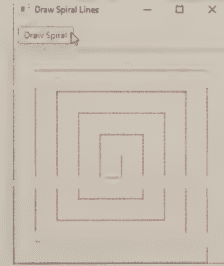

**图 7.26** 使用 `strokeLine` 绘制螺旋线。

7.2（用弧绘制螺旋线）使用 `strokeArc` 方法每次绘制一个半圆，绘制一个圆形螺旋线（图 7.27）。每个后续半圆应该具有更大的半径（由边界矩形的宽度指定），并且应该从上一个半圆结束的地方继续绘制。

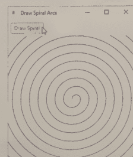

**图 7.27** 使用 `strokeArc` 绘制螺旋线。

7.3（旋转螺旋）增强练习 7.2，使螺旋线在每次点击时略微旋转。

7.4（改变螺旋线）增强练习 7.2，使螺旋线中的每个段使用比上一个 `Color` 稍亮的版本。从深色开始，然后使用 `Color.brighter` 方法创建下一段的 `Color`。

7.5（增强彩虹）增强 `Draw Rainbow` 以使用更细的弧，并通过额外的颜色变化来创建一个看起来更真实的彩虹。

# 7.18 总结

本章开始了我们对数据结构的介绍，探索了使用数组存储数据以及从值列表和表格检索数据。本章的示例演示了如何声明数组、初始化数组以及引用数组的单个元素。本章引入了增强型 `for` 语句来遍历数组。我们使用异常处理来测试程序尝试访问数组越界时发生的 `ArrayOutOfBoundsException`。

## 7.7 节 增强型 for 语句

- 增强型 for 语句（第276 页）允许你在不使用计数的情况下遍历数组或集合的元素。增强型 for 语句的语法如下：

```java
for (Type parameter : arrayName) {
    statement
}
```

- 增强型 for 语句不能用于修改数组中的元素。如果程序需要修改元素，请使用传统的计数器控制语句。

## 7.8 节 将数组传递给方法

- 当按值传递参数时，会创建参数值的一个副本并将其传递给被调用方法。被调用方法仅对该副本进行操作。

## 7.9 节 值传递与引用传递的区别

- 当按引用传递参数时（第 279 页），被调用方法可以直接访问调用者中的参数值并对其进行修改。

- Java 中的所有参数都是**按值传递**的。方法可以传递两种类型的值——基本类型值和对象引用的副本。虽然对象的引用是按值传递的（第 279 页），但仍然可以通过使用对象引用的副本调用其公共方法来影响所引用的对象。

- 当你将引用类型的数组或单个元素传递给方法时，被调用方法接收的是数组或其元素引用的副本。当你传递基本类型的单个元素时，被调用方法接收的是该元素值的副本。

- 要向方法传递单个数组元素，请使用数组的索引名。

## 7.11 节 多维数组

- 具有两个维度的多维数组通常用于表示由行列排列的信息组成的表格。

- 具有 m 行 n 列的二维数组（第 285 页）被称为 m 行 n 列数组。此类数组可以使用如下形式的初始化器进行初始化：

```java
Type[][] arrayName = {{row1 initializer, row2 initializer}, ...};
```

- 多维数组被维护为独立的一维数组的数组。因此，二维数组各行的长度不需要相同。

- 每行具有相同列数的的多维数组可以使用如下形式的数组表达式创建：

```java
Type[][] arrayName = new Type[numRows][numColumns];
```

## 7.13 节 变长参数列表

- 方法参数列表中参数后跟一个省略号（… 第 295 页）表示该方法接收数量数量的特定类型参数。省略号在方法的参数列表中只能出现一次，且必须位于参数列表的末尾。

- 变长参数列表（第 295 页）在方法体内被视为一个数组。可以使用数组的 `length` 字段获取数组中参数的数量。

## 7.14 节 使用命令行参数

- 从命令行向 main 方法传递参数（第 296 页）是通过在 main 的参数列表中包含一个 `String[]` 类型的参数来实现的。按照惯例，main 的参数命名为 `args`。

Java 将 `java` 命令中类名之后出现的命令行参数作为数组 `args` 中的 `String` 传递给应用程序的 main 方法。

## 7.15 节 数组类

- 数组类（第 298 页）提供了执行常用数组操作的静态方法，包括排序数组、用于搜索排序数组的 `binarySearch`、比较数组的 `equals` 以及在数组中填充项目的 `fill`。
- `System.arraycopy` 方法（第 299 页）允许你将一个数组的元素复制到另一个数组中。

## 7.16 节 集合与 ArrayList 类简介

- Java API 的集合类提供了高效的方法，可以组织、存储和检索数据，而无需了解数据是如何存储。
- `ArrayList<E>`（第 301 页）类似于数组，但可以动态调整大小。
- 带有一个参数的 `add` 方法（第 304 页）将元素添加到 ArrayList 的末尾。
- 带有两个参数的 `add` 方法在 ArrayList 的指定位置插入元素。
- `size` 方法（第 304 页）返回 ArrayList 中当前包含的元素数量。
- 带有对象引用的 `remove` 方法会删除第一个匹配对象值的元素，并且被删除元素索引之上的所有元素都会向下移动一位。
- 带有整数索引的 `remove` 方法删除指定索引处的元素，该索引之上的所有元素都会向下移动一位。
- `contains` 方法如果元素在 ArrayList 中则返回 `true`，否则返回 `false`。

## 自测练习题

- 7.1 填充下列每个语句的空白：
  a) 列表和值表可以存储在 ________________________________ 和 ________________________________
  b) 数组是一组包含具有相同 c) 值的 ____________________（称为元素或组件）
  c) ____________________ 允许你使用计数器遍历数组。
  d) 足够数量的 ____________________ 来引用特定元素。
  e) 使用 ____________________ 遍历数字。
  f) 使用增强型 for 语句对数组的所有元素求和。
  g) 命令行参数存储在 ____________________。
  h) args. length。
  i) 假定 MyTest 类，____________________ 类型的 double。
  j) 省略号 (...) 表示该方法可以接收数量数量的参数。

- 7.2 判断下列每项是否正确或错误：
  a) 数组可以存储许多类型。
  b) 数组索引应该是整数。
  c) 对于数组的基本类型类型元素：被调用方法会影响该值。
  d) 对于引用类型的单个元素：更改将反映在原始对象中。

- 7.3 执行以下任务：
  a) 声明并创建一个三行三列的整数数组。假设常量 `ARRAY_SIZE` 为 3。
  b) 数组包含多少个元素？
  c) 将数组的每个元素初始化为其索引与 y 之和。

- 7.5 找出并修正每个程序段中的错误：
  a)
  ```java
  final int ARRAY_SIZE = 5;
  ARRAY_SIZE = 10;
  ```
  b)
  ```java
  int[] b = new int[10];
  for (int i = 0; i <= b.length; i++)
      b[i] = 1;
  ```
  c)
  ```java
  int[] a = {{1, 2}, {3, 4}};
  a[1, 1] = 5;
  ```

## 自测练习题答案

- 7.1 a) 数组，集合。b) 变量，类型。c) 增强型 for 语句。d) 索引（或下标数字）。e) 二维。f) for (double : numbers)。g) String 数组，按引用传递。h) length。i) 类型 j) 省略号 (...)

- 7.2 答案：
  a) 错误。数组只能存储相同类型的值。
  b) 错误。数组索引必须是整数或整数表达式。
  c) 正确。对于数组的基本类型元素：错误。被调用方法操作该元素的值，因此修改不会影响原始值。然而，如果将数组引用传递给方法，被调用方法对数组元素的修改确实反映在原始数组中。d) 对于引用类型的单个元素：正确。被调用方法接收该元素引用的副本，对对象的更改将反映在原始元素中。
  d) 错误。命令行参数通过空白分隔。

- **7.3**
  a) `final int ARRAY_SIZE = 10;`
  b) `double[] fractions = new double[ARRAY_SIZE];`
  c) `fractions[4]`
  d) `fractions[9] = 1.667;`
  e) `fractions[6] = 3.333;`
  f)
  ```java
  double total = 0.0;
  for (int x = 0; x < fractions.length; x++)
      total += fractions[x];
  ```

- 答案：
  a) `int[][][] table = new int[ARRAY_SIZE][ARRAY_SIZE];`
  b) Nine。

  ```java
  for (int x = 0; x < table.length; x++)
      for (int y = 0; y < table[x].length; y++)
          table[x][y] = x + y;
  ```


# 练习题

## 填充以下每个语句中的空白：

a) 一维数组 `p` 包含四个元素。这些元素的名称是 `p[0]`、`p[1]`、`p[2]` 和 `p[3]`。
b) 为数组命名、说明其类型并指定数组的维度被称为 **声明数组**。
c) 在二维数组中，第一个索引标识元素的 **行**，第二个索引标识 **列**。
d) 一个 `m` 行 `n` 列的数组包含 `n` 列和 `m * n` 个元素。
e) 数组第 3 行第 5 列元素的名称是 `a[2][4]`。

## 判断下列陈述的真错。如果为错，请说明原因：

a) **错**。为了引用数组中的特定位置或元素，我们指定数组的名称和特定元素的 **索引（下标）**，而不是值。
b) **对**。数组声明为数组预留空间。
c) **错**。在 Java 中，要表示为整数数组 `p` 预留 100 个位置，应编写声明 `int[] p = new int[100];` 或 `int p[] = new int[100];`。`p[100]` 是访问索引为 100 的元素（越界），而非声明。
d) **错**。一个初始化 15 元素数组元素为零的应用程序**不必**包含显式语句，因为数值类型数组元素默认初始化为 0。
e) **对**。计算二维数组元素总和的应用程序必须包含嵌套循环语句。

## 编写 Java 语句完成以下每项：

a) 显示数组 `f` 中元素 6 的值：
```java
System.out.println(f[5]);
```

b) 将一维数组 `g` 的五个元素每个都初始化为 8：
```java
int[] g = {8, 8, 8, 8, 8};
// 或
int[] g = new int[5];
Arrays.fill(g, 8);
```

c) 计算浮点数组 `c` 的 100 个元素的总和：
```java
double sum = 0;
for (double value : c) {
    sum += value;
}
```

d) 将包含 11 个元素的数组复制到包含 34 个元素的数组 `b` 的前部分：
```java
System.arraycopy(sourceArray, 0, b, 0, 11);
```

e) 确定 99 个元素浮点数组 `w` 中包含的最小值和最大值：
```java
double min = w[0];
double max = w[0];
for (double value : w) {
    if (value < min) min = value;
    if (value > max) max = value;
}
```

---

# 7.9 考虑一个二行三列数组 `t`。

a) 编写一个声明并创建 `t` 的语句：
```java
int[][] t = new int[2][3];
```

b) `t` 有多少行？ **2 行**
c) `t` 有多少列？ **3 列**
d) `t` 的第一行有多少个元素？ **3 个元素**
e) 为 `t` 的第二列的所有元素编写访问表达式： `t[0][1]` 和 `t[1][1]`
f) 编写一个将 `t` 的第 0 行第 1 列元素设置为零的访问语句：
```java
t[0][1] = 0;
```

g) 编写一条将 `t` 的每个元素初始化为零的语句（利用默认初始化）：
```java
int[][] t = new int[2][3]; // 元素默认为 0
```
或显式循环：
```java
for (int[] row : t) {
    Arrays.fill(row, 0);
}
```

h) 编写初始化语句，从用户处初始化 `t` 的每个元素：
```java
Scanner input = new Scanner(System.in);
for (int row = 0; row < t.length; row++) {
    for (int col = 0; col < t[row].length; col++) {
        t[row][col] = input.nextInt();
    }
}
```

i) 编写一个输入 `t` 元素值的语句： 见 (h) 处的循环结构。

j) 编写一系列语句显示 `t` 中的最小值：
```java
int min = t[0][0];
for (int[] row : t) {
    for (int val : row) {
        if (val < min) min = val;
    }
}
System.out.println("最小值: " + min);
```

l) 编写一个单一打印语句显示 `t` 的第一行的元素：
```java
System.out.println(Arrays.toString(t[0]));
```

m) 编写一个计算 `t` 的第三列元素总和的语句。不要使用迭代：
```java
int sum = t[0][2] + t[1][2];
```

n) 编写一系列语句以表格格式显示 `t` 的内容。在顶部列出列索引，在每行的左侧列出行索引：
```java
System.out.print("     ");
for (int col = 0; col < t[0].length; col++) {
    System.out.printf("%5d", col);
}
System.out.println();

for (int row = 0; row < t.length; row++) {
    System.out.printf("%3d: ", row);
    for (int col = 0; col < t[row].length; col++) {
        System.out.printf("%5d", t[row][col]);
    }
    System.out.println();
}
```

---

# 7.10 (销售佣金)

使用一维数组解决以下问题：公司根据佣金向销售人员支付工资。销售人员每周获得 200 美元加上当周总销售额的 9%。例如，一名销售人员一周赚了 5000 美元，将获得 200 美元加上 5000 美元的 9%，总计为 650 美元。编写一个应用程序（使用计数器数组），确定在以下每个范围内有多少销售人员赚了相应的工资（假设每个销售人员的工资被截断为整数）：

a) $200–299
b) $300–399
c) $400–499
d) $500–599
e) $600–699
f) $700–799
g) $800–899
h) $900–999
i) $1,000 及以上

用表格格式总结结果。

---

# 7.11 编写执行以下一维数组操作的语句：

a) 将 10 个元素设置为 0：
```java
int[] arr = new int[10]; // 默认为 0
```

b) 将整数数组的每个元素加 1：
```java
for (int i = 0; i < arr.length; i++) {
    arr[i]++;
}
```

c) 格式显示整数数组的五个值：
```java
for (int i = 0; i < 5 && i < arr.length; i++) {
    System.out.printf("%d ", arr[i]);
}
System.out.println();
```

---

# 7.12 (去重)

使用一维数组解决以下问题：编写一个应用程序，输入 10 到 100 之间的数字。如果每个数字不是已读取数字的重复，则显示它。使用可能的最小数组解决此问题。

---

# 7.13 标记三行的二维数组：

```java
for (int row = 0; row < sales.length; row++) {
    for (int col = 0; col < sales[row].length; col++) {
        sales[row][col] = 0;
    }
}
```

---

# 7.14 (变长参数列表)

编写一个计算传递整数的应用程序。使用不同数量的调用测试你的方法。

---

# 7.15 (命令行参数)

重写 7.22，使数组的大小由命令行参数指定。如果没有命令行参数，使用 10 作为默认值。

---

# 7.16 (使用增强 for)

编写一个应用程序，使用增强 for 计算命令行传递的值。*提示：使用 `Double.parseDouble()` 将字符串转换为 `double`。*

---

# 7.17 (掷骰子)

编写一个应用程序模拟掷骰子。应用程序应使用 `Random` 对象掷第一个骰子，再次掷第二个骰子。两个值之和将在 2 到 12 之间变化，7 最频繁，2 和 12 最少。图 7.28 显示了骰子的 36 种可能组合。你的应用程序应该掷 36,000 次。使用一维数组统计每个和出现的次数。以表格格式显示结果。

| | 1 | 2 | 3 | 4 | 5 | 6 |
|---|---|---|---|---|---|---|
| 1 | 2 | 3 | 4 | 5 | 6 | 7 |
| 2 | 3 | 4 | 5 | 6 | 7 | 8 |
| 3 | 4 | 5 | 6 | 7 | 8 | 9 |
| 4 | 5 | 6 | 7 | 8 | 9 | 10 |
| 5 | 6 | 7 | 8 | 9 | 10 | 11 |
| 6 | 7 | 8 | 9 | 10 | 11 | 12 |

**图 7.28** 骰子的 36 种可能和。

---

# 7.18 (骰子游戏)

编写一个应用程序运行 1,000,000 次骰子游戏（图 6.8），并回答以下问题：

a) 在第一次掷、第二次掷、……第 20 次掷时赢了多少次游戏？
b) 在第一次掷、第二次掷、……第 20 次掷时输了多少次游戏？
c) 玩骰子的胜率是多少？*注意：你应该发现骰子是赌场最好的游戏之一。你认为这意味着什么！*
d) 骰子游戏的平均长度是多少？
e) 胜率会随着*游戏长度*而提高吗？

---

# 7.19 (航空公司预订系统)

一家航空公司购买了一台计算机用于新的自动化预订系统。你被分配开发这个新系统。你需要编写一个应用程序为该航空公司的每个航班分配座位（容量：10 座）。

你的应用程序应该显示以下选项：请输入 1 代表头等舱，请输入 2 代表经济舱。如果用户输入 1，你的应用程序应该在头等舱区域分配一个座位（1–5）。如果用户输入 2，你的应用程序应该在经济舱区域分配一个座位（6–10）。然后，你的应用程序应该显示登机牌，指示人的座位号以及该座位是在飞机的头等舱还是经济舱。

使用基本数据类型 `boolean` 的一维数组来表示飞机的座位图。将数组的所有元素初始化为 `false`，表示所有座位都是空闲。每当分配一个座位时，将数组的相应元素设置为 `true`，表示该座位不再可用。

你的应用程序应该**永不**建议一个已分配的座位。当经济舱满员时，你的应用程序应该询问人员是否可以安排在头等舱（反之亦然）。如果是，则进行相应的分配；如果否，显示消息“下班航班将在 3 小时后出发”。

---

# 第 7 章 数组和 ArrayList

## 7.20（总销售额）

使用二维数组解决以下问题：一家公司有四名销售人员（1 到 4），他们销售五种不同的产品（1 到 5）。每天，每名销售人员都会提交每种销售产品的单据。每张单据包含：

- a) 销售人员编号
- b) 产品编号
- c) 该日销售产品的总金额

因此，每名销售人员每天提交 0 到 5 张单据。假设上个月所有单据的信息均可用。编写一个应用程序，读取上个月的所有销售信息，并按销售人员和产品汇总总销售额。所有总额都应存储在二维数组 `sales` 中。在处理上个月的所有信息后，以表格格式显示结果，每列代表一名销售人员，每行代表一种特定产品。添加一行交叉合计以获取上个月每种产品的总销售额。添加一列交叉合计以获取每月每个销售人员的总销售额。你的输出应该通过行总计和列底部包含这些交叉合计。

---

## 7.21（乌龟绘图）

Logo 语言让乌龟绘图的概念闻名。一只机械乌龟在 Java 应用程序的控制下在房间内移动。乌龟以两种位置之一握笔：抬起或落下。当笔落下时，乌龟在移动时会留下轨迹；当笔抬起时，乌龟自由移动而不写任何东西。在此处，你将模拟乌龟的操作并创建一个计算机草图。

使用一个初始化为 0 的 20x20 数组。从包含这些数字的数组中读取。始终跟踪乌龟的当前位置以及笔是抬起还是落下。假设乌龟从地板的 (0, 0) 位置开始，笔抬起。你的应用程序必须处理的乌龟命令集如图 7.29 所示。

| 命令 | 含义 |
|---|---|
| 1 | 笔抬起 |
| 2 | 笔落下 |
| 3 | 右转 |
| 4 | 左转 |
| 5,10 | 向前移动 10 格（将 10 替换为不同的格数） |
| 6 | 显示 20x20 数组 |
| 9 | 数据结束（哨兵） |

**图 7.29** 乌龟绘图命令。

假设乌龟位于地板中心附近。以下“程序”将绘制并显示一个 12x12 的正方形，并将笔保持抬起位置：

```
2
5,12
3
5,12
3
5,12
3
5,12
1
6
9
```

当乌龟在移动时，将数组相应的元素设置为 1。当给出 `6` 命令（显示数组）时，数组中为 1 的地方显示星号或任何字符。数组中为 0 的地方显示空白。

编写一个应用程序来实现这里讨论的乌龟绘图功能。编写几个程序来绘制形状，增加你的乌龟绘图能力。

---

## 7.22（骑士巡游）

象棋爱好者的一个有趣问题是骑士巡游，由数学家欧拉提出。骑士可以在空棋盘上移动且仅访问每个 64 个格子一次吗？我们在这里深入研究这个问题。骑士以 L 形移动（在一个方向移动两格，在垂直方向移动一格）。因此，如图 7.30 所示，从空棋盘的中间位置，骑士（标记为 K）可以进行八种不同的移动。

**图 7.30** 骑士移动。

a) 在纸上画一个 8x8 的棋盘，手动尝试骑士巡游。在起始格子画 1，第二个格子画 2，第三个画 3，以此类推。在开始之前，估计你是否能完成 64 个格子的完整巡游？

b) 现在让我们开发一个让骑士在棋盘移动的应用程序。棋盘由一个 8x8 的二维数组表示。每个格子初始化为零。用水平和垂直分量描述可能的移动。例如，类型 0 的移动（如图 7.30 所示）是向右移动两格并向上移动一格。类型 2 的移动是向左移动一格并向上移动两格。向左移动和向上的移动用负数表示，如下：

| `horizontal[0] = 2` | `vertical[0] = -1` |
| `horizontal[1] = 1` | `vertical[1] = -2` |
| `horizontal[2] = -1` | `vertical[2] = -2` |
| `horizontal[3] = -2` | `vertical[3] = -1` |
| `horizontal[4] = -2` | `vertical[4] = 1` |
| `horizontal[5] = -1` | `vertical[5] = 2` |
| `horizontal[6] = 1` | `vertical[6] = 2` |
| `horizontal[7] = 2` | `vertical[7] = 1` |

变量 `currentRow` 和 `currentCol` 分别指示骑士的行和列。为了进行类型为 `moveNumber` 的移动（`moveNumber` 在 0 到 7 之间），你的应用程序应该使用：

```java
currentRow += vertical[moveNumber];
currentCol += horizontal[moveNumber];
```


编写一个应用程序让骑士环绕棋盘。计数器从 1 到 64。记录最新的移动查看骑士是否访问过该格子。测试每个可能的移动以确保骑士不会落在棋盘外。运行应用程序。骑士进行了多少次移动？

- 在尝试编写和运行骑士巡游后，你可能获得了一些见解。我们将利用这些见解为移动骑士开发启发式（即常识规则）。启发式不保证成功，但精心设计的启发式会大大增加成功率。你可能观察到边缘格子比中心区域更容易处理。事实上，最难访问的格子是角落。

直觉可能认为你应该让骑士移动到最棘手的格子，留下那些容易去的格子，这样巡游会更接近中心，成功的机会更大。

我们可以通过根据每个格子移动到最难访问格子的难度（使用骑士的 L 形移动）来开发一种“易用性启发式”。我们用数字标记二维数组，指示每个特定易用性的格子数。在空棋盘上，靠近中心的 16 个格子每个评为 8，每个角格子评为 2，其他格子的易用性如下：

| 2 | 3 | 4 | 4 | 4 | 3 | 2 |
|---|---|---|---|---|---|---|
| 3 | 4 | 6 | 6 | 6 | 4 | 3 |
| 4 | 6 | 8 | 8 | 8 | 6 | 4 |
| 6 | 8 | 8 | 8 | 8 | 6 | 4 |
| 6 | 8 | 8 | 8 | 8 | 6 | 4 |
| 4 | 6 | 6 | 6 | 6 | 4 | 3 |
| 3 | 4 | 4 | 4 | 4 | 3 | 2 |
| 2 | 3 | 4 | 4 | 4 | 3 | 2 |

编写一个骑士巡游的新版本，使用易用性启发式。骑士应该总是移动到易用性最低的格子。在平局的情况下，骑士可以移动到这些格子中的任何一个。因此，巡游可能在四个角落中的任何一个处是不完整的。

### 练习题 319

- 随着更多方格被占用，应用程序应该减少可访问性数量。这样，在巡游的任何给定时刻，每个可用方格的可访问性数量将恰等于可以到达该方格的方格数量。运行此版本的应用程序。你获得了一个完整的巡游吗？将应用程序修改为 64 次巡游，从棋盘的每个方格开始。你获得了多少次完整巡游？

- d) 编写一个版本的骑士巡游（Knight's Tour）应用程序，当在两个或多个方格之间遇到平局时，通过查看从“平局”方格可到达的方格来决定选择哪个方格。你的应用程序应该移动到：其下次移动将到达可访问性数量最低的方格。

### 7.23 (骑士巡游：暴力破解法)

在练习 7.22 的第 (c) 部分，我们开发了一个解决骑士问题的解决方案。所使用的方法称为“可访问性”，它可以产生许多解决方案并高效执行。

随着计算机能力的不断提高，我们将能够通过纯粹的计算机力量和相对简单的算法来解决更多问题。让我们把这种方法称为“暴力破解”问题。

- a) 使用随机数生成让骑士在棋盘上（按照其合法的 L 型移动）随机行走。你的应用程序应该运行一次巡游并显示最终的棋盘。骑士走得如何？
- b) 大可能，第 (a) 部分的应用程序产生了一个较短的巡游。现在修改你的应用程序以尝试 1,000 次巡游。使用一维数组来记录每个长度巡游的次数。当应用程序完成后，以整洁的表格格式显示这些信息。最好的结果是什么？
- c) 大可能，第 (b) 部分的应用程序给出了一些“体面”的巡游，但没有完整巡游。现在运行你的应用程序，直到它产生一个完整巡游。[注意：这可能需要在功能强大的计算机上运行！] 再次记录每个长度巡游次数的表格，并在找到第一个完整巡游时显示该表。在产生完整巡游之前，你的应用程序尝试了多少次巡游？花费了多少时间？
- d) 将暴力破解版本的骑士巡游与可访问性启发式版本进行比较。哪一个对问题需要更仔细的研究？哪个算法更难开发？哪一个需要更多的计算机能力？我们是否可能（提前）通过可访问性启发式方法获得完整巡游？我们是否可能（无论如何）通过暴力破解方法获得完整巡游？论暴力解决问题的优缺点。

### 7.24 (八皇后)

另一个针对象棋爱好者的谜：是否可以在空棋盘上放置八个皇后，使得没有皇后“攻击”其他皇后（即没有两个皇后位于同一行、同一列或同一条对角线上）？使用练习 7.22 中开发的技术为八皇后问题制定启发式方法。运行你的应用程序。[提示：可以为棋盘的每个方格分配一个值，表示如果在该方格放置皇后，空棋盘上有多少方格被“消除”。每个角都将被分配值 2，如图 7.31 所示。一旦这些“消除数”放置在所有 64 个方格中，一个合适的启发式方法可能是：将下一个皇后放在消除数最小的方格。为什么要采用这种策略？]

### 7.25 (八皇后：暴力破解法)

在此练习中，你将开发几种暴力破解方法来解决练习 7.24 中引入的八皇后问题。


- a) 使用练习 7.23 中开发的暴力破解技术解决八皇后问题。
- b) 使用穷举法（即尝试棋盘上八个皇后的所有可能组合）解决八皇后问题。
- c) 为什么穷举法可能不适用于巡游问题？
- d) 比较对比随机暴力破解和穷举法。

### 7.26 (骑士巡游：闭合)

在骑士巡游（练习 7.22）中，当骑士移动 64 次且仅访问棋盘的每个方格一次时，就会发生完整巡游。当第 64 次移动距离骑士起始的方格仅一步之遥时，发生闭合巡游。修改你在练习 7.22 中编写的应用程序以测试闭合巡游。

### 7.27 (埃托斯特筛法)

素数是任何大于 1 且只能被 1 和它本身除的整数。埃托斯特筛法是一种寻找素数的方法。其运行方式如下：

- a) 创建一个基本类型的布尔数组，所有元素初始化为 `true`。索引为素数的数组元素保持为 `true`。所有其他元素将设置为 `false`。
- b) 从索引 2 开始，确定元素是否为 `true`。如果是，遍历数组的剩余部分，并将该元素的倍数的每个元素设置为 `false`。对下一个为 `true` 的元素继续此过程。对于索引 2，数组中 2 之后所有索引为 2 的倍数的元素（4, 6, 8 等）都将被设置为 `false`；对于索引 3，数组中 3 之后所有索引为 3 的倍数的元素（6, 9, 12 等）都将被设置为 `false`；以此类推。当此过程完成后，数组中仍为 `true` 的元素表示索引是素数。

### 7.28 (乌龟和兔子：模拟)

在这个问题中，你将使用随机数生成重现经典的乌龟兔子比赛。乌龟和兔子的位置根据图 7.32 规则调整。比赛从位置 1 开始。终点在 70。乌龟和兔子偶尔会落在同一个方格。当比赛结束时，乌龟咬了兔子，你的应用程序将在该位置显示 `OUCH!!!`。


| | | |
|---|---|---|
| 乌龟 | 快速跑 | 50% | 向右 |
| | 滑步 | 20% | 向左 |
| | 慢跑 | 30% | 向右 |
| 兔子 | 睡觉 | 20% | 不移动 |
| | 大跳 | 20% | 向右 |
| | 大滑 | 10% | 向左 |
| | 小跳 | 30% | 向右 |
| | 小滑 | 20% | 向右 |

在每个时钟跳动时（即循环的每次迭代），显示一条显示 `T` 在乌龟位置和 `H` 在兔子位置的 70 位置行。通过产生 `1 <= i <= 10` 范围内的整数来模拟每个时钟跳动。当 `1 <= i <= 5` 时执行快速跑，当 `6 <= i <= 7` 时执行滑步，或当 `8 <= i <= 10` 时执行慢跑。比赛开始时显示：

```
BANG !!!!!
AND'RE OFF !!!!!
```

在显示每行后，测试是否有一个动物已到达或超过 70。如果是，显示获胜者并终止模拟。如果乌龟获胜，显示 `TORTOISE WINS!!!`。如果兔子获胜，显示 `HARE wins`。如果两者在同一个时钟跳动中获胜，你可能想偏袒乌龟（“黑马”），或者你可能想显示平局。如果都没有获胜，执行循环以模拟下一个时钟跳动。

在书的后期，我们引入了许多 Java 能力，如图形、图像、动画、声音和多线程。当你学习这些功能时，你可能会喜欢增强乌龟兔子比赛的模拟。

### 7.29 (斐波那契数列)

斐波那契数列

0, 1, 2, 3, 5, 8, 13, ...

从项 0 和 1 开始，具有每个后续项都是前几项之和的性质。

- a) 编写一个方法 `fibonacci(n)` 来计算第 `n` 个斐波那契数。将此方法整合到应用程序中，允许用户输入 `n` 的值。
- b) 确定你的系统上可以显示的最大斐波那契数。
- c) 修改你在 (a) 部分编写的程序，使用 `double` 代替 `int` 来计算和返回斐波那契数，并使用此修改后的程序重复部分 (b)。

### 第7章 数组和ArrayList

练习 7.30–7.34 具有一定的挑战性。一旦完成了这些练习，你应该能够轻松实现大多数扑牌游戏。

#### 7.30（洗牌与发牌）

修改图 7.11 以分发五张扑克牌。修改图 7.10 中的 `dealOffCards` 类，包含以下方法来判断手是否包含：

- a) 一对
- b) 两对
- c) 三条（例如，三张 J）
- d) 四条（例如，四张 A）
- e) 同色花牌（即五张相同花色的牌）
- f) 顺子（即五个连续的点数）
- g) 葫芦（即两张数值相同的牌和三张另一数值的牌）

[提示：向图 7.9 中的 `Card` 类添加 `getFace` 和 `getSuit` 方法]

#### 7.31（洗牌与发牌）

使用练习 7.30 中开发的方法分发两手五张扑克牌，评估每手牌并判断哪手更好。

#### 7.32（项目：洗牌与发牌）

修改开发的程序，使其能够模拟发牌员。发牌员的手是面朝下发的，因此玩家看不到。程序应该评估发牌员的手，并根据牌的质量，发牌员应该抽取一张、两张或三张牌替换原有中相应数量的牌。程序应该降低发牌员牌的价值。
[注意：这是一个困难的问题！]

#### 7.33（项目：洗牌与发牌）

修改练习 7.32 中开发的程序，使其能够自动处理发牌员的手，但允许玩家决定替换手中的哪些牌。程序应该评估两手牌并判断胜负者。使用这个新程序与电脑进行 20 局游戏。是谁赢得多，还是电脑？让一个朋友与电脑玩 20 局。谁赢得多？根据这些结果，完善你的扑克游戏算法。（这是一个困难的问题）。玩 20 局。你修改后的程序玩得更好吗？

#### 7.34（项目：洗牌与发牌）

修改图 7.9–7.10 中的程序，使用 `Face` 和 `Suit` 类型来表示牌的面和花色。在源文件中将这些类型分别声明为公共类型。每张牌都应该有一个 `Face` 和 `Suit` 实例变量。这些应由 `Card` 构造函数初始化。创建一个用 `Face` 枚举类型中常量名称化的 `FaceCards` 数组，以及用 `Suit` 枚举类型中常量名称化的 `Suits` 数组。[注：当将枚举输出为字符串时，会显示其名称]

#### 7.35（Fisher-Yates 洗牌算法）

在网上研究 Fisher-Yates 洗牌算法，使用它来实现图 7.10 中的 `shuffle` 方法。

### 特别章节：构建你自己的计算机

在接下来的问题中，我们将暂时离开高级语言编程的世界，“拆开”计算机并观察其内部结构。我们将引入机器语言编程并编写几个机器语言程序。为了使这次经历特别有价值，我们将构建一台计算机（通过软件模拟技术），你可以在上面执行你的机器语言程序。

### 特别章节：构建你自己的计算机 323

#### 7.36（机器语言编程）

让我们创建一个名为 Simpleton 的计算机。如其名所示，它是一个简单强大的机器。Simpleton 运行用它唯一理解的语言编写的程序：Simpleton 机器语言（SML）。Simpleton 包含一个累加器——一个 Simpleton 用于进行计算或检查信息的特殊寄存器。Simpleton 的所有信息以字（word）的形式处理。一个字是一个四位数，例如 `+3364`、`-1293`、`0007` 和 `-0001`。Simpleton 配有 100 字的内存，这些字通过位置 00、01、...、99 进行引用。在运行 SML 程序之前，我们必须加载或将程序放入内存。每个 SML 程序的的第一条指令（语句）始终位于位置 00。模拟器将从这里开始执行。每条 SML 指令占据一个字（这些是四位数）。我们假设 SML 指令的符号总是正的，但数据的符号可以是正也可以是负。内存中的每个位置可能包含一条指令或数据值。SML 指令的前两个数字是指定要执行的操作。SML 指令的最后两个数字是操作数——操作所在的内存地址。让我们考虑几个简单的 SML 程序

7.33 机器语言（SML）操作码。

### 324 第7章 数组和ArrayList

第一个 SML 程序（图 7.34）从键盘读取两个数字并计算它们的和。指令 `+1007` 从键盘读取第一个数字并将其放入位置 07（该位置已初始化为 0）。然后指令 `+1008` 将下一个数字读入位置 08。所有加法指令将结果留在内存位置 09，写入指令 `+1109` 从该位置取出数字并将其显示（作为四位数）。停止指令 `+4300` 终止执行。

| 位置 | 指令 | 描述 |
| :--- | :--- | :--- |
| 00 | +1007 | (读取 A) |
| 01 | +1008 | (读取 B) |
| 02 | +2007 | (加载 A) |
| 03 | +3008 | (加 B) |
| 04 | +2109 | (存储 C) |
| 05 | +1109 | (写入 C) |
| 06 | +4300 | (停止) |
| 07 | +0000 | (变量 A) |
| 08 | +0000 | (变量 B) |
| 09 | +0000 | (结果 C) |

图 7.34 计算和的 SML 程序。

第二个 SML 程序（图 7.35）从键盘读取两个数字并判断哪个大。注意使用 `+07` 作为条件转移，类似于 Java 的 `if` 语句。

| 位置 | 指令 | 描述 |
| :--- | :--- | :--- |
| 00 | +1009 | (读取 A) |
| 01 | +1010 | (读取 B) |
| 02 | +2009 | (加载 A) |
| 03 | +3110 | (减 B) |
| 04 | +4107 | (跳转到 07) |
| 05 | +1109 | (写入 A) |
| 06 | +4300 | (停止) |
| 07 | +1110 | (写入 B) |
| 08 | +4300 | (停止) |
| 09 | +0000 | (变量 A) |
| 10 | +0000 | (变量 B) |

图 7.35 判断哪个大的 SML 程序。

### 特别章节：构建你自己的计算机 325

现在编写 SML 程序来完成以下各项任务：

- a) 使用哨兵控制循环读取 10 个数字。计算它们的和。
- b) 使用计数控制循环读取 7 个数字（包括正数和负数），并计算它们的平均值。
- c) 读取一系列数字，并确定最大值。

#### 7.37（计算机模拟器）

在这个问题中，你将构建你自己的计算机。不，你不需要将组件在一起。相反，使用强大的软件模拟技术来创建 Simpleton。当你运行 Simpleton 时，它应该开始：

```
*** 欢迎来到 Simpleton!

*** 请每次输入一个程序

***（或一个数据字）。我将显示

*** 位置后跟一个问号（?）。

*** 输入 -9999 停止。
```

你的程序应该用一个具有 100 个元素的一维数组来模拟 Simpleton。假设模拟器正在运行，让我们输入以下程序：

```
00 ? +1009
01 ? +1010
02 ? +2090
03 ? +3110
04 ? +4107
05 ? +1109
06 ? +4300
07 ? +1110
08 ? +4300
09 ? +0000
10 ? +0000
11 ? -9999
```

当输入哨兵 `-9999` 时，程序应该显示：

```
*** 程序加载完成 ***

*** 程序执行开始 ***
```

SML 程序现在已放置在数组内存中。

现在，让我们执行第一条 SML 指令，即内存位置 00 中的 `+1009`。这个过程被称为指令执行周期。

`instructionCounter` 告诉我们下一个要执行的指令的位置。我们使用以下 Java 语句从内存中获取该位置的内容：

```
instructionRegister = memory[instructionCounter];
```

通过以下语句从指令寄存器中提取出操作码和操作数：

```
operationCode = instructionRegister / 100;
operand = instructionRegister % 100;
```


现在，Simplepton 确定操作码实际上是一个读取（写入 a、加载等等）。通过一个 `switch` 语句来区分 SML 的 12 种操作。在 `switch` 语句中，各种 SML 指令的行为如图 7.36 所示。我们将稍后讨论分支指令，并将其他的留给你们。


- **read**: 显示提示信息“Enter an integer”，然后输入整数并将其存储在内存位置 `memory[operand]` 中；
- **load**: `accumulator = memory[operand];`
- **add**: `accumulator += memory[operand];`
- **halt**: 终止 SML 程序的执行并显示以下消息：`*** Simplepton execution terminated ***`

**图 7.36** Simplepton 中若干 SML 指令的行为。

当 SML 程序完成执行时，必须显示每个寄存器的名称和内容，以及内存的完整内容。这种输出通常被称为“计算机转储”（computer dump，计算机转储并不是旧电脑存放的地方）。为了帮助你编写方法，图 7.37 显示了一个示例的转储格式。执行一个 Simplepton 程序后的转储将显示执行终止时指令的实际值和数据的实际值。

| REGISTERS: |
| :--- | :--- |
| accumulator | +0000 |
| instructionCounter | +00 |
| instructionRegister | +0000 |
| operationCode | +00 |
| operand | +00 |

| MEMORY: |
| | 0 | 1 | 2 | 3 | 4 | 5 | 6 | 7 | 8 | 9 |
| :--- | :--- | :--- | :--- | :--- | :--- | :--- | :--- | :--- | :--- | :--- |
| 0 | +0000 | +0000 | +0000 | +0000 | +0000 | +0000 | +0000 | +0000 | +0000 |
| 10 | +0000 | +0000 | +0000 | +0000 | +0000 | +0000 | +0000 | +0000 | +0000 |
| 20 | +0000 | +0000 | +0000 | +0000 | +0000 | +0000 | +0000 | +0000 | +0000 |
| 30 | +0000 | +0000 | +0000 | +0000 | +0000 | +0000 | +0000 | +0000 | +0000 |
| 40 | +0000 | +0000 | +0000 | +0000 | +0000 | +0000 | +0000 | +0000 | +0000 |
| 50 | +0000 | +0000 | +0000 | +0000 | +0000 | +0000 | +0000 | +0000 | +0000 |
| 60 | +0000 | +0000 | +0000 | +0000 | +0000 | +0000 | +0000 | +0000 | +0000 |
| 70 | +0000 | +0000 | +0000 | +0000 | +0000 | +0000 | +0000 | +0000 | +0000 |
| 80 | +0000 | +0000 | +0000 | +0000 | +0000 | +0000 | +0000 | +0000 | +0000 |
| 90 | +0000 | +0000 | +0000 | +0000 | +0000 | +0000 | +0000 | +0000 | +0000 |

**图 7.37** 示例转储。

## 特别章节：构建你自己的计算机

让我们继续执行程序的第一条指令——即位置 00 中的 +1009。正如我们所指出的，`switch` 语句通过提示用户输入一个值、读取该值并将其存储在内存位置 `[operand]` 中来模拟此任务。然后，该值被读取到位置 09。此时，第一条指令的模拟已经完成。剩下的工作是准备 Simplepton 执行下一条指令。由于执行的指令不是控制转移，我们只需增加指令计数器：

```
instructionCounter++;
```

此操作完成了第一条指令的执行。整个过程（即指令执行周期）从获取下一条指令开始重新开始。现在让我们考虑分支指令——控制转移——是如何模拟的。我们需要做的是相应地调整指令计数器的值。因此，无条件分支指令 (40) 在 `switch` 中模拟如下：

```
if (accumulator == 0) {

    instructionCounter = operand;

}
```

“accumulator 为零”条件指令是这样模拟的：此时，你应该实现 Simplepton 并运行你在练习 7.37 中编写的程序。如果你愿意，可以为 Simplepton 添加额外功能，并在模拟器中提供这些功能以检查各种错误。在程序加载阶段，例如，用户输入 Simplepton 内存的每个数字必须在 -9999 到 +9999 之间。你的模拟器应该检查每个数字是否在该范围内。在执行阶段，你的模拟器应该检查严重错误，例如除零、执行无效操作码以及累加器溢出（即算术运算大于 +9999 或小于 -9999）。严重错误被称为致命错误。当发生致命错误时，你的模拟器应该显示如下消息：

> *** Divide by zero ***
> *** Simplepton execution terminated ***

并像之前的那样显示完整的计算机转储。这将有助于用户定位程序中的错误。

**7.38 (Simplepton 模拟器修改)** 在练习 7.37 中，你编写了一个执行简单机器语言（SML）程序的计算机软件模拟。在练习中，我们建议对 Simplepton 模拟器进行几项修改和增强。在练习中，我们建议构建一个编译器，将高级编程语言（BASIC 的变体）编写的程序转换为机器语言。为了执行编译器生成的程序，可能需要以下修改：

- a) 扩展 Simplepton 的内存包含 1000 个内存位置，以便处理更大的程序。
- b) 允许模拟器执行余数运算。这需要额外的 SML 指令。
- c) 允许模拟器执行幂运算。这需要额外的 SML 指令。

## 第7章 数组和 ArrayList

- d) 修改模拟器使用十六进制值而非整数值来表示 SML 指令。
- e) 修改模拟器在整数值之外允许浮点值。这需要额外的 SML 指令。
- f) 修改模拟器处理整数值之外的浮点值。
- g) 修改模拟器处理字符串输入。*提示：Simplepton 可以分为两组，每组包含两个两位整数。每个两位整数代表字符的 ASCII（见附录 B）十进制值。添加一种机器指令输入字符串并存储在 Simplepton 内存位置。该位置的半字是字符串字符数（即字符串的长度）。后续每个半字包含一个两个数字的 ASCII 字符。机器指令将每个字符转换为其 ASCII 值并分配给半字。*
- h) 修改模拟器处理以 (g) 格式存储的字符串输出。*提示：添加一种机器指令从 Simplepton 内存位置显示字符串。该位置的半字是字符数（即字符串的长度）。后续每个半字包含一个两个数字的 ASCII 字符。机器指令检查长度并通过将每个两位数字翻译为等效字符来显示字符串。*

**7.39 (增强型 GradeBook)** 修改图 7.8 中的 `GradeBook` 类，使构造函数接受学生人数和考试次数作为参数，然后构建一个大小适当的二维数组，而不是像现在这样预初始化一个二维数组。将新二维数组的每个元素设置为 -1，以表示该元素未输入成绩。添加一个 setter 方法，为特定考试的特定学生设置一个成绩。修改图 7.19 中的 `GradeBookTest` 类，输入 GradeBook 的学生人数和考试次数，并允许教师一次输入一个成绩。

## 改变

**7.40 (民意调查)** 互联网和网络让更多的人能够加入某事业、发表意见等。最近的候选人利用互联网来传递信息并为他们的活动筹资金。在练习中，你需要编写一个简单的程序，允许用户对五个社会意识问题从 1（不重要）到 10（最重要）进行评分。选择五个对你重要的案例（例如，政治问题、全球环境问题）。使用一个一维主题数组（`String` 类型）来存储这五个问题。使用一个 5 行 10 列的二维数组（`int` 类型）调查响应，每行包含主题数组中的一个元素。当程序运行时，它应该要求用户对每个问题进行评分。然后让程序显示结果摘要：

- a) 一个表格报告，左侧为五个主题，顶部为 10 个评分标准，在每列中列出每个主题收到的评分数。
- b) 在每行的右侧，显示该问题的平均分。
- c) 哪个问题总分最高？显示该问题和总分。
- d) 哪个问题总分最低？显示该问题和总分。

# 类与对象：深入探讨

## 8

## 目标

在本章中，你将：

- 了解类声明的更多细节。
- 使用 `throw` 语句表示发生了问题。
- 在构造函数中使用关键字 `this` 来调用同一类中的另一个构造函数。
- 使用 `static`（静态）变量和方法。
- 导入类的 `static`（静态）成员。
- 使用 `enum`（枚举）类型创建具有唯一标识符的常量集。
- 带有参数的 `enum` 常量。
- 使用 `BigDecimal` 进行精确的货币计算。


# 第 8 章 类与对象：深入探讨

- 8.1 引言
- 8.2 Time 类案例研究
- 8.3 控制成员的访问
- 8.4 使用 this 引用引用当前成员
- 8.5 Time 类案例研究：重载构造函数
- 8.6 默认与无参数构造函数
- 8.7 关于 set 和 get 方法的说明
- 8.8 组合
- 8.9 enum 类型
- 8.10 垃圾收集
- 8.11 static 类成员
- 8.12 static 导入
- 8.13 final（最终）实例变量
- 8.14 包访问
- 8.15 使用 BigDecimal 进行精确的货币计算
- 8.16（可选）GUI 和图形案例研究：在图形中使用对象
- 8.17 总结


总结 | 自测练习题 | 自测练习题答案 | 练习题 | 贡献

## 8.1 引言

我们将深入探讨构建类、控制类成员的访问以及创建构造函数。我们展示了如何通过抛出异常来表示问题的发生——7.5 节讨论了捕获异常。我们使用 `this` 关键字允许一个构造函数方便地调用同一类的另一个构造函数。我们讨论了组合——这种能力允许类拥有其他类的引用作为成员。我们检查了 set 和 get 方法的使用。回想第 6.10 节引入了基础 enum 来声明一组常量。在本章中，我们讨论了 enum 和类之间的关系，证明了枚举类型可以在其自己的文件中声明，并带有构造函数、方法和字段。本章还详细讨论了静态类成员和 final（最终）实例变量。我们展示了同一包内类与类的关系。最后，我们演示了如何使用 `BigDecimal` 执行货币计算。另外两种类类型——嵌套类和匿名内部类将在后续关于 GUI、图形和多媒体的章节中进行详细讨论。

## 8.2 Time 类案例研究

我们的第一个示例包含两个类——`Time`（图 8.1）和 `TimeTest`（图 8.2）。`Time` 类表示一天中的时间。`TimeTest` 的 `main` 方法创建了一个 `Time` 对象并调用它的方法。程序的输出显示在图 8.2 中。

### Time 类声明

`Time` 类私有的 `int` 实例变量 `hour`、`minute` 和 `second`（5–7 行）表示通用格式的时间（24 小时制，其中小时范围为 0–23，分钟范围均为 0–59）。`Time` 包含公共方法 `setTime`（11–22 行）、`toUniversalString`（25–27 行）和 `toString`（30–34 行）。这些方法也被称为类为其客户端提供的公共服务或公共接口。

```java
// 图 8.1: Time.java
// Time 类声明维护了 24 小时格式的时间。

public class Time {

    private int hour; // 0 - 23
    private int minute; // 0 - 59
    private int second; // 0 - 59

    // 使用通用时间设置新的时间值；如果小时、分钟或秒
    // 无效，则抛出异常
    public void setTime(int hour, int minute, int second) {
        // 验证小时、分钟和秒
        if (hour < 0 || hour > 24 || minute < 0 || minute >= 60 ||
            second < 0 || second >= 60) {
            throw new IllegalArgumentException(
                "hour, minute and/or second was out of range");
        }
        this.hour = hour;
        this.minute = minute;
        this.second = second;
    }

    // 转换为通用时间格式的字符串 (HH:MM:SS)
    public String toUniversalString() {
        return String.format("%02d:%02d:%02d", hour, minute, second);
    }

    // 转换为标准时间格式的字符串 (H:MM:SS)
    public String toString() {
        return String.format("%d:%02d:%02d %s", hour % 12 == 0 ? 12 : hour % 12,
            minute, second, hour < 12 ? "AM" : "PM");
    }
}
```

**默认构造函数**
`Time` 类声明维护了 24 小时格式的时间。图 8.1。`Time` 类没有声明构造函数，因此编译器隐式地提供了默认构造函数。正如 3.3 节所示，你可以使用此默认构造函数来初始化实例变量。

**setTime 方法与抛出异常**
`setTime` 方法（11–22 行）是一个公共方法，接受三个参数。如果小时、分钟或秒超出范围，将抛出 `IllegalArgumentException`。正如 7.5 节所学，你可以使用 `try-catch` 来捕获异常。在图 8.2 中，`throw` 语句立即终止方法。如果参数有效，19–21 行赋值 `hour`、`minute` 和 `second`。

**toUniversalString 方法**
`toUniversalString` 方法（25–27 行）不接受参数并返回一个通用时间格式的字符串（HH:MM:SS）。该方法将 `Time` 转换为通用时间格式的字符串（HH:MM:SS）。

**toString 方法**
`toString` 方法（30–34 行）不接受参数并返回一个标准时间格式的字符串，由小时、分钟和秒组成，并后跟 AM 或 PM（例如 11:30:17 AM 或 1:27:06 PM）。方法使用静态 `String` 方法来格式化分钟和秒的数字，必要时补零。第 32 行使用条件运算符 (?) 来确定字符串中的小时——如果小时为 0 或 12（AM 或 PM），则返回 12；否则返回 1 到 11 之间的值。第 33 行的条件运算符决定作为字符串的一部分返回 AM 还是 PM。

构造函数，因为 `Time1` 没有声明构造函数。为了确认 `Time1` 对象已正确初始化，第 10 行调用了私有方法 `displayTime`（第 31–34 行），该方法反过来调用 `Time1` 对象的 `toString()` 生成世界时间格式和标准时间格式。注意，`toString` 可以被隐式调用，而不是显式调用。接下来，第 14 行调用了时间对象的 `setTime` 来更改时间。然后第 15 行再次调用 `displayTime`，以两种格式输出时间，以确认其设置是否正确。

## 软件工程观察 8.2

回想第 3 章，用访问修饰符 `private` 声明的方法可以被声明该私有方法的类中的其他方法调用。此类方法通常被称为工具方法或辅助方法，因为它们通常用于支持类中其他方法的操作。


```java
// 图 8.2: TimeTest.java
// 在应用程序中使用的 Time1 对象。

public class TimeTest {

    public static void main(String[] args) {
        // 创建并初始化 Time 对象
        Time1 time = new Time1(); // 调用 displayTime 构造函数

        // 输出时间的字符串表示
        displayTime("After object is created", time);

        System.out.println();

        // 更改时间并输出更新后的时间
        time.setTime(13, 27, 0);

        displayTime("After calling setTime", time);
    }
}
```


```java
System.out.println();

// 尝试用无效值设置时间

try {

    time.setTime(99, 99, 99); // 所有值超出范围

} catch (IllegalArgumentException e) {

    System.out.printf("Exception: %s%n", e.getMessage());

}

// 在设置无效值后显示时间

displayTime("After calling setTime with invalid values", time);

}

// 以 24 小时和 12 小时格式显示 Time 对象

private static void displayTime(String header, Time1 t) {

    System.out.printf("%sUniversal time: %sStandard time: %s%n",
        header, t.toUniversalString(), t.toString());

}

}
```

图 8.2 | 在应用程序中使用的 Time1 对象。（部分，共 2 部分）。

## 334 第 8 章 类与对象：深层观察

| 事件 | 输出 |
|---|---|
| 时间对象被创建后 | Universal time: 00:00:00, Standard time: 12:00:00 AM |
| 调用 setTime 后 | Universal time: 13:27:06, Standard time: 1:27:06 PM |
| | Exception: hour, minute and/or second was out of range |
| 使用无效值调用 setTime 后 | Universal time: 13:27:06, Standard time: 1:27:06 PM |

图 8.2 | 在应用程序中使用的 Time 对象。（部分，共 2 部分）

### 使用无效值调用 Time1 方法

为了说明 `setTime` 方法验证了参数，使用小时、分钟和/或秒的无效值 99。该语句放在 `try` 块中（第 19–21 行），以防 `setTime` 抛出 `IllegalArgumentException`。当发生这种情况时，第 22–24 行捕获异常，第 23 行通过调用 `getMessage` 方法显示异常信息。第 27 行再次以两种格式输出时间，以确认 `setTime` 没有更改时间（无效参数）。

### Time1 类声明

考虑 Time1 类设计的几个问题。实例变量 `hour`、`minute` 和 `second` 都被声明为 `private`。类的内部数据表示对类的客户端并不重要。例如，Time1 在内部将时间表示为自午夜起的秒数或分钟和秒数是完全合理的。客户端可以使用公共方法获得相同的结果，而无需感知（练习 8.5 要求你在类 Time1 类中将时间表示为自午夜起的秒数）。

> **软件工程观察 8.3**
> 类简化了编程，因为客户端只能使用类的公共方法。此类方法通常是面向客户端的，而不是面向实现的。客户端既不感知也不参与类的实现。

> **软件工程观察 8.4**
> 接口的变化频率比实现低。当实现发生变化时，依赖实现的代码必须相应更改。隐藏实现减少了程序部分依赖类实现细节的可能性。

### Java SE 8—Time API

本节以及章后面的示例演示了表示日期和时间的各种类概念。在专业开发中，你通常会使用提供的 API，而不是自己构建日期时间类。尽管 Java 一直有处理日期和时间的类，SE 8 引入了新的 Time API——它解决了旧类的问题，并提供了更健壮、更易用的处理日期、时间、时区、日历的功能。我们在：
http://docs.oracle.com/javase/8/api/time/

## 8.3 控制成员的访问

访问修饰符 `public` 和 `private` 控制类变量和方法的访问。在第 9 章中，我们将引入额外的修饰符 `protected`。公共方法的主要目的是保护客户端对类服务的视图（即类的公共接口）。客户端不需要关心类如何完成任务。由于这个原因，类的私有变量和方法（即其实现细节）对客户端是不可访问的。图 8.3 显示，在类外部无法访问私有成员。第 7–9 行尝试访问私有变量 `hour`、`minute` 和 `second`，当编译此程序时，编译器会生成这些私有成员不可访问的错误信息。程序使用了图 8.1 中的 Time 类。

```java
// 图 8.3: MemberAccessTest.java
// Time 类的私有成员不可访问。

public class MemberAccessTest {

    public static void main(String[] args) {

        Time time = new Time(); // 创建并初始化 Time 对象

        time.hour = 7; // error: private access in Time

        time.minute = 15; // error: minute has private access in Time

        time.second = 30; // error: second has private access in Time

    }

}
```

```
MemberAccessTest.java:7: error: hour has private access in Time
time.hour = 7; // error: private access in Time
^
MemberAccessTest.java:8: error: minute has private access in Time
time.minute = 15; // error: minute has private access in Time
^
MemberAccessTest.java:9: error: second has private access in Time
time.second = 30; // error: has private access in Time
^
```

> 图 8.3 | Time 类的私有成员不可访问。

### 常见编程错误 8.1

不是类成员的方法尝试访问该类的私有成员会导致编译错误。

## 8.4 使用 this 引用当前对象的成员

每个对象都可以通过 `this` 访问对自身的引用（有时称为 `this` 引用）。当为特定对象调用实例化方法时，方法体会隐式地使用 `this` 来引用对象的实例变量。这使得类代码知道应该操作哪个对象。如图 8.4 所示，你也可以在实例化方法体中显式使用关键字 `this`。第 8.5 节显示了关键字的另一种用法。第 8.11 节解释了为什么在静态方法中使用该关键字。

图 8.4 演示了引用 的隐式和显式使用。此示例是第一个在一个文件中声明两个类的——`class Test` 在第 4–9 行声明，`class SimpleTime` 在第 12–41 行声明。当你编译包含多个类的 `.java` 文件时，编译器为每个类生成一个 `.class` 文件。在这种情况下，产生了两个独立的文件——`SimpleTime.class` 和 `ThisTest.class`。当一个源码（.java）文件包含多个类声明时，编译器将 `.class` 文件放在同一个目录下。注意，源文件只能包含一个 `public` 类——否则会发生编译错误。非公共类可以被相同包中的其他类使用——从第 3.2.5 节编译到相同目录的类，在本例中，`SimpleTime` 可以被 `ThisTest` 使用。

```java
// 图 8.4: ThisTest.java
// 隐式和显式使用 this 来引用对象的成员。

public class ThisTest {

    public static void main(String[] args) {

        SimpleTime time = new SimpleTime(15, 30, 19);

        System.out.println(time.buildString());

    }

}
```

```java
// class SimpleTime 演示了 "this" 引用

class SimpleTime {

    private int hour; // 0-23

    private int minute; // 0-59

    private int second; // 0-59

    // 如果构造函数使用的参数名称与实例变量名称相同
    // 则需要 "this" 引用来区分这些名称

    public SimpleTime(int hour, int minute, int second) {

        this.hour = hour; // 设置 "this" 对象的 hour

        this.minute = minute; // 设置 "this"对象的 minute

        this.second = second; // 设置 "this" 对象的 second

    }

    // 使用显式和隐式的 "this" 调用 toUniversalString

    public String toString() {

        return String.format("%24s: %s%24s: %s",
            "this.toUniversalString()", this.toUniversalString(),
            "toUniversalString()", toUniversalString());

    }

    // 转换为通用时间格式的字符串 (HH:MM:SS)

    public String toUniversalString() {

        // 访问实例变量时不需要 "this"，
        // 因为该方法没有与实例变量同名的
        // 局部变量

        return String.format("%02d:%02d",
            this.hour, this.minute, this.second);

    }

}
```

图 8.4 | 隐式和显式地使用 this 来引用对象的成员。（第 2/2 部分）

`SimpleTime` 类（第 12–24 行）声明了三个私有实例变量——hour、minute 和 second（第 13–15 行）。该类的构造函数（第 20–24 行）接收三个 `int` 参数来初始化 `SimpleTime` 对象。我们再次在构造函数中使用与类实例变量名相同的参数名（第 13–15 行），因此我们在第 21–23 行中使用 `this` 引用来引用实例变量。

> **错误预防提示 8.1**
> 当你写 `x = x;` 而不是 `this.x = x;` 时，大多数 IDE 会发出警告。语句 `x = x` 通常被称为“空操作”（no-op）。

`build` 方法（第 27–31 行）返回一个通过显式和隐式使用 `this` 引用的语句创建的字符串。第 29 行显式地使用它调用 `toUniversalString` 方法。第 30 行隐式地使用它。这两行代码执行了相同的任务。你通常不会使用 `this` 来引用当前对象内部的方法。此外，`toUniversalString` 方法中的第 39 行使用 `this` 引用来访问每个实例变量。在这里这是没有的，因为该方法没有任何遮蔽类实例变量的局部变量。

> **性能提示 8.1**
> 每个类每个方法只有一个副本——另一方面，每个对象都有自己的实例变量副本。类的非静态方法使用 `this` 来确定要操作的类的特定对象。

## 8.5 案例：重载构造函数

如你所知，你可以声明自己的构造函数来指定类对象如何初始化。接下来，我们将演示一个具有多个构造函数的类，这些函数允许以不同的方式初始化对象。要重载构造函数，只需提供多个不同签的构造函数声明。图 8.1 中 `Time` 的默认构造函数将 hour、minute 和 second 初始化为默认值（即午夜）。默认构造函数并不允许类的构造函数使用非零值初始化时间。`Time2`（图 8.5）包含五个重载构造函数，提供了初始化对象的便捷方法；其中第五个确保了提供的 hour 的值在 0 到 23 之间，且 minute 和 second 的值均在 0 到 59 之间。编译器通过匹配每个构造函数声明中指定的参数数量和顺序来调用相应的构造函数。`Time2` 还为每个实例变量提供了方法。

```java
// 图 8.5: Time2.java
// 带有重载构造函数的 Time2 类声明。

public class Time2 {

    private int hour; // 0 - 23

    private int minute; // 0 - 59

    private int second; // 0 - 59

    // Time2 无参数构造函数：
    // 将实例变量初始化为零

    public Time2() {

        this(0, 0, 0); // 调用带有三个参数的构造函数

    }

    // Time2 构造函数：提供了 hour，minute 和 second 默认为 0

    public Time2(int hour) {

        this(hour, 0, 0); // 调用带有三个参数的构造函数

    }

    // Time2 构造函数：提供了 hour 和 minute，second 默认为 0

    public Time2(int hour, int minute) {

        this(hour, minute, 0); // 调用带有三个参数的构造函数

    }

    // Time2 构造函数：提供了 hour, minute 和 second

    public Time2(int hour, int minute, int second) {

        if (hour < 0 || hour >= 24) {

            throw new IllegalArgumentException("hour must be 0-23");

        }

        if (minute < 0 || minute >= 60) {

            throw new IllegalArgumentException("minute must be 0-59");

        }

        if (second < 0 || second >= 60) {

            throw new IllegalArgumentException("second must be 0-59");

        }

        this.hour = hour;

        this.minute = minute;

        this.second = second;

    }

    // Time2 构造函数：提供了另一个 Time2 对象

    public Time2(Time2 time) {

        // 调用带有三个参数的构造函数

        this(time.hour, time.minute, time.second);

    }

    // Set 方法

    // 使用通用时间设置新的时间值；
    // 验证数据

    public void setTime(int hour, int minute, int second) {

        if (hour < 0 || hour >= 24) {

            throw new IllegalArgumentException("hour must be 0-23");

        }

        if (minute < 0 || minute >= 60) {

            throw new IllegalArgumentException("minute must be 0-59");

        }

        if (second < 0 || second >= 60) {

            throw new IllegalArgumentException("second must be 0-59");

        }

        this.hour = hour;

        this.minute = minute;

        this.second = second;

    }

    // 验证并设置 hour

    public void setHour(int hour) {

        if (hour < 0 || hour >= 24) {

            throw new IllegalArgumentException("hour must be 0-23");

        }

        this.hour = hour;

    }

    // 验证并设置 minute

    public void setMinute(int minute) {

        if (minute < 0 || minute >= 60) {

            throw new IllegalArgumentException("minute must be 0-59");

        }

    }

}
```

图 8.5 | 带有重载构造函数的 Time2 类声明。（第 1/3 部分）。


# 第 8 章 类与对象：深入探讨

## 8.5 时间案例研究：重载构造函数

```java
this.minute = minute;
}

// 验证并设置 second
public void setSecond(int second) {
    if (second < 0 || second >= 60) {
        throw new IllegalArgumentException("second must be 0-59");
    }
    this.second = second;
}

// Get 方法
// 获取 hour 值
public int getHour() { return hour; }

// 获取 minute 值
public int getMinute() { return minute; }

// 获取 second 值
public int getSecond() { return second; }

// 转换为通用时间格式的字符串 (HH:MM:SS)
public String toUniversalString() {
    return String.format(
        "%02d:%02d:%02d", getHour(), getMinute(), getSecond());
}

// 转换为标准时间格式的字符串 (H:MM AM 或 PM)
public String toString() {
    return String.format("%d:%02d:%02d %s",
        (getHour() == 0 || getHour() == 12 ? 12 : getHour() % 12),
        getMinute(), getSecond(), getHour() < 12 ? "AM" : "PM");
}
```

图 8.5 | Time2 的构造函数——通过重载构造函数调用。（第 3/3 部分）

`Time2` 类的构造函数——通过 `this` 从一个构造函数调用另一个。第 11–13 行声明了一个所谓的无参数构造函数。一旦你在类中声明了任何构造函数，编译器将不再提供默认构造函数。这个无参数构造函数确保了 `Time2` 类的客户端可以创建带有默认值的 `Time2` 对象。这种构造函数只需初始化构造函数体指定的对象。在体中，我们引入了仅允许在构造函数体中的第一条语句。第 12 行使用方法调用语法来调用接受三个参数的 `Time2` 构造函数（第 26–42 行），并将小时、分、秒的值设为 0。像此处所示使用这种方法是重用类中另一个构造函数提供的初始化代码的流行方法，而不是在无参数构造函数的体中定义类似的代码。这种这样调用另一个构造函数的构造函数被称为**委托构造函数**（delegating constructor）。我们在 `Time2` 的四个构造函数中使用了这种语法，以使类更便于维护和修改。如果我们需要更改 `Time2` 类对象的初始化方式，只需要修改该类其他构造函数所调用的那个构造函数即可。


如果在构造函数体中使用此调用该类的另一个构造函数，且该调用不是构造函数的第一条语句，则会导致编译错误。当方法尝试通过 `this` 直接调用构造函数时，也会导致编译错误。

第 16–18 行声明了一个带单个参数的 `Time2` 构造函数，该参数代表小时，并与 0 分秒一起传递给第 26–42 行的构造函数。第 21–23 行声明了一个接收两个 `int` 参数（代表小时和分钟）的 `Time2` 构造函数，它们与 0 秒一起传递给第 26–42 行的构造函数。与无参数构造函数一样，这些构造中的每一个都调用了三参数构造函数以尽量减少重复代码。第 26–42 行声明了接收三个 `int` 参数（代表小时、分、秒）的 `Time2` 构造函数。该构造函数验证并初始化实例变量。

第 45–48 行声明了一个接收另一个 `Time2` 对象引用的 `Time2` 构造函数。参数的值被传递给三参数构造函数以初始化小时、分、秒。第 47 行通过 `time.hour`、`time.minute` 和 `time.second` 表达式直接访问参数的小时、分、秒值——尽管小时、分、秒被声明为 `Time2` 类的私有变量。这是由于同类对象之间存在一种特殊关系。

> **软件工程观察 8.5**
> 当一个类的某个对象拥有另一个同类类的对象时，第一个对象可以访问第二个对象的数据和方法（包括私有方法）。

### Time2 的 set 方法

`set` 方法（第 53–69 行）如果方法的任何参数超出范围，则会抛出 `IllegalArgumentException`（第 55、59 和 63 行）。否则，它将 `Time2` 的实例变量设置为参数值（第 66–68 行）。

### 关于 Time2 的 Set 和 Get 方法以及构造函数的说明

`Time2` 的方法是从类的其他方法中调用的。特别是，调用 `toUniversalString` 和 `toString` 的方法调用了第 111 行以及第 117–118 行的 `getHour`、`getMinute` 和 `getSecond`。在每情况下，这些方法都可以直接访问类的私有数据而无需调用 `get` 方法。然而，考虑将时间的表示形式从三个 `int` 值（需要 12 字节内存）更改为代表自午夜以来经过的总秒数的单个 `int` 值（仅需四字节内存）。如果我们做了这样的更改，只有直接访问私有数据的方法体需要更改——特别是三参数构造函数、`toUniversalString` 方法以及用于小时、分、秒的各个 `get` 方法。不需要修改 `toString` 的方法，因为它们没有直接访问数据。以这种方式设计类可以减少在更改类实现时出现编程错误的概率。

同样，`Time2` 也可以包含来自三参数构造函数的适当语句的拷贝。这样做可能会稍微高效一些，因为消除了额外的构造函数。但重复更改类内部数据表示的语句会增加维护负担。让 `Time2` 构造函数调用带三个参数的构造函数要求对三参数构造函数实现的任何更改都只需进行一次。此外，编译器可以通过移除调用并将其替换为声明的展开代码来优化程序——这种技术被称为**代码内联**（inlining the code），它可以提高程序性能。

### 使用 Time2 的重载构造函数

`Time2Test` 类（图 8.6）调用了 `Time2` 构造函数（6–10 和 21）。第 6 行调用了 `Time2` 无参数构造函数。第 7 行调用了带一个参数的 `Time2` 构造函数。第 8–10 行演示了传递参数给其他 `Time2` 构造函数。第 8 行调用了带一个参数的 `Time2` 构造函数（第 16–18 行）。第 9 行调用了带两个参数的 `Time2` 构造函数（第 21–23 行）。第 10 行调用了带三个参数的 `Time2` 构造函数（第 26–42 行）。第 11 行调用了接收另一个 `Time2` 对象的 `Time2` 构造函数（第 45–48 行）。随后，通过创建一个新的 `Time2` 对象来初始化 `t6` 并传递无效值，这会导致异常。我们在第 23 行捕获异常并打印其信息。

```java
// 图 8.6: Time2Test.java
// 重载构造函数用于初始化 Time2 对象。
public class Time2Test {
    public static void main(String[] args) {
        Time2 t1 = new Time2(); // 00:00:00
        Time2 t2 = new Time2(2); // 02:00:00
        Time2 t3 = new Time2(21); // 21:00:00
        Time2 t4 = new Time2(12, 25); // 12:25:00
        Time2 t5 = new Time2(t4); // 12:25:00
        System.out.println("Constructed with:");
        System.out.println("t1: all arguments," + t1);
        System.out.println("t2: hour specified; default minute and second," + t2);
        System.out.println("t3: hour and minute specified; default second," + t3);
        System.out.println("t4: hour, minute and second specified," + t4);
        System.out.println("t5: Time2 object t4," + t5);
        // 尝试使用无效值初始化 t6
        try {
            Time2 t6 = new Time2(27, 74, 99);
        } catch (IllegalArgumentException e) {
            System.out.printf("%nException while initializing t6: %s%n",
                e.getMessage());
        }
    }
}
```

```java
// 以 24 小时和 12 小时格式显示 Time2 对象
private static void displayTime(String header, Time2 t2) {
    System.out.printf("%n%s%n%s%n",
    header, t2.toUniversalString(), t2.toString());
}
```

**输出结果：**
```
Constructed with:
t1: all arguments
00:00:00
t2: hour specified; default minute and second
02:00:00
t3: hour and minute specified; default second
21:00:00
t4: hour, minute and second specified
12:25:00
t5: Time2 object t4
12:25:00

Exception while initializing t6: hour must be 0-23
```

图 8.6 | 重载构造函数用于初始化 Time2 对象。（第 2 部分，共 2 部分）

## 8.6 默认和无参数构造函数

每个类至少有一个构造函数。如果你在类的声明中没有提供任何构造函数，编译器会在调用它时创建一个不带参数的默认构造函数。默认构造函数会将实例变量初始化为声明中指定的初始值或其默认值（原始数值类型为 0，布尔值为 false，引用为 null）。

请记住，如果你的类声明了构造函数，编译器将不会创建默认构造函数。在这种情况下，如果需要默认初始化，你必须声明一个无参数构造函数。与默认构造函数一样，无参数构造函数是在空参数的情况下调用的。`Time2` 无参数构造函数（图中第 11–13 行）通过向三参数构造函数传递 0 来显式地初始化 `Time2` 对象。参数。由于 0 是实例变量的默认值，此示例中的无参数构造函数实际上可以声明一个空方法体。在这种情况下，每当调用无参数构造函数时，每个实例都将接收其默认值。如果我们省略了无参数构造函数，该类的客户端将无法通过 `new Time2()` 这种表达式创建一个 `Time2` 对象。

> **错误预防提示 8.2**
> 确保你没有在构造函数的定义中包含返回类型。Java 允许类的其他方法作为构造函数，即具有与类相同的名称并指定返回类型。此类方法不是构造函数，且在实例化类对象时不会被调用。

> **常见编程错误 8.3**
> 如果程序尝试通过传递错误的数量或类型的参数给类的构造函数来初始化类对象，将会发生编译错误。

## 8.7 关于 Set 和 Get 方法的说明

如你所知，客户端代码只能通过类的方法来操作类的私有字段。一种典型的操作可能是通过 `computeInterest()` 方法调整客户的银行余额（例如 `BankAccount` 类的一个私有实例变量）。`Set` 方法通常也被称为修改器方法（mutator methods），因为它们通常会改变对象的状态——即修改实例变量的值。`Get` 方法通常称为访问器方法（accessor methods）或查询方法（query methods）。

### Set 和 Get 方法与公共数据

看起来，提供 `set` 和 `get` 能力本质上与将类的实例变量设置为公共是相同的。这是让 Java 在软件工程中极具吸引力的微妙之处之一。公共实例变量可以被任何拥有包含该变量对象的引用的方法读取或写入。如果一个实例被声明为私有，那么公共的 `get` 方法完全允许其他方法访问它，但该方法控制了客户端如何访问它。例如，`get` 方法可以控制数据的格式或限制客户端代码的共享。公共的 `set` 方法可以——并且应该——仔细地尝试修改对象的值并在必要时抛出异常。尝试将日期设置为 37 号或将人的体重设置为负值都将被被拒绝。因此，尽管 `set` 和 `get` 方法提供了对私有数据的访问，但这种访问受到方法实现的限制。这有助于促进良好的软件工程实践。

> **软件工程观察 8.6**
> 类永远不应该有公共的连续数据，但声明 `public static final` 变量允许你为类的客户端提供可用常量。例如，`Math` 类提供了公共静态最终常量 `Math.E` 和 `Math.PI`。

### Set 方法中的有效性检查

仅仅因为实例变量被声明为私有，数据完整性的好处并不会随之产生——你必须提供有效性检查。类的 `set` 方法可以判断是否尝试为类对象分配无效数据。通常，方法具有 `void` 返回类型，并使用异常处理来指示分配无效数据的尝试。我们将在第 11 章中详细讨论这种异常处理。

> **软件工程观察 8.7**
> 在适当的情况下，提供公共方法来更改和检索私有实例变量的值。这种架构有助于向客户端隐藏类的实现，从而改进了通用的可修改性。

> **错误预防提示 8.3**
> 使用 `set` 和 `get` 方法有助于创建更易调试和维护的类。如果只有一个方法执行特定任务（例如设置对象中的实例变量），那么调试和维护该类将变得更容易。如果实例变量没有被正确设置，实际修改实例变量的代码将定位于一个 `set` 方法。调试工作可以集中在该方法上。

### 谓词方法

访问器方法的另一个常见用途是测试条件为真为假——此类方法通常被称为谓词方法（predicate methods）。例如 `ArrayList` 类，其 `isEmpty` 在数组为空时返回 `true`，否则返回 `false`。程序可能会在尝试从 `ArrayList` 中读取另一个项目之前测试 `isEmpty`。

> **良好编程实践 8.1**
> 惯例，谓词方法名以 `is` 而不是 `get` 开头。

## 8.8 组合

类可以与其他对象的引用作为成员。这被称为组合（composition），有时被称为“具有”关系（has-relationship）。例如，`AlarmClock` 需要知道当前时间以及它应该什么时候响铃，因此在 `AlarmClock` 中包含两个对 `Time` 对象的引用是合理的。汽车有方向盘、刹车踏板、加速板等。

### Date 类

此示例包含 `Date` 类（见 8.7 节）、`Employee` 类（见 8.8 节）和 `EmployeeTest` 类（图 8.9）。`Date` 类声明了实例变量 `month`、`day` 和 `year`（第 5–7 行）来表示日期。构造函数接收三个参数。第 15–18 行验证月份——如果超出范围，则第 16–17 行抛出异常。第 21–25 行验证日期。如果根据特定月份的天数日期错误（需要特殊测试闰年的 2 月 29 日外），则第 23–24 行抛出异常。第 28–29 行对二月进行闰年测试。如果月份是二月且日期是 29 号且不是闰年，第 30–31 行抛出异常。如果没有发生异常，则第 34–36 行初始化 `Date` 的实例变量，第 38 行将此引用作为字符串输出。由于这是对当前 `Date` 对象的引用，隐式调用了对象的 `toString` 方法（第 42–44 行）以获取字符串的表示形式。在本示例中，我们假设...

```java
10 System.out.println(employee);
11 }
12 }
```


# 日期对象构造函数示例

日期 `7/24/1949` 的日期对象构造函数  
日期 `3/12/1988` 的日期对象构造函数  
Blue, Bob 入职：`3/12/1988` 生日：`7/24/1949`

图 8.9 组合演示。（部分 2/2。）

## 8.9 enum 类型

在图 6.8 中，我们引入了基础的 `enum` 类型，它定义了一组用唯一标识符表示的常量。在那个程序中，`enum` 常量代表游戏的状态。在本节中，我们将讨论 `enum` 类型与类之间的关系。与类一样，所有的 `enum` 类型都是引用类型。`enum` 类型通过 `enum` 声明声明，该声明是一个用逗号分隔的 `enum` 常量列表——该声明可以选择性包含传统类的其他组件，如构造函数、字段和方法（正如你稍后将看到的）。每个 `enum` 声明都会声明一个具有以下限制的 `enum` 类：

1. `enum` 常量隐式是 `final` 的。
2. `enum` 常量隐式是 `static` 的。
3. 任何尝试使用 `new` 操作符创建 `enum` 对象的都会导致编译错误。

`enum` 常量可以用任何可以使用常量的地方，例如在 `switch` 语句的 case 标签中以及控制增强 `for` 语句。

### 在 enum 类型中声明实例变量、构造函数和方法

图 8.10 展示了 `enum` 类型中的实例变量、构造函数和方法。`enum` 声明包含两个部分——`enum` 常量和 `enum` 类型的其他成员。

```java
// Fig. 8.10: Book.java
// 声明一个带有构造函数、显式实例字段 
// 以及这些字段的访问器的 enum 类型

public enum Book {
    // 声明 enum 类型的常量
    JHTP("Java How to Program", "2008"),
    CHTP("C to Program", "2010"),
    IW3HTP("Internet & Wide Web How to Program", "2012"),
    CPPHTP("C How to Program", "2012"),
    VBHTP("Visual Basic How to Program", "2014"),
    CSHARPTP("C# How to Program", "2017");
}
```

图 8.10 声明一个带有构造函数、显式实例字段以及这些字段的访问器的 `enum` 类型。（部分 1/2。）

```java
// 实例字段
private final String title; // 书名
private final String copyrightYear; // 版权年份

// enum 构造函数
Book(String title, String copyrightYear) {
    this.title = title;
    this.copyrightYear = copyrightYear;
}

// 字段 title 的访问器
public String getTitle() {
    return title;
}

// 字段 copyrightYear 的访问器
public String getCopyrightYear() {
    return copyrightYear;
}
```

图 8.10 | 声明一个带有构造函数、显式实例字段以及这些字段的访问器的 `enum` 类型。（部分 2/2）

第一部分（第 7–12 行）声明了六个常量。每个常量可选跟随传递 `enum` 构造函数的参数（第 19–22 行）。与类的构造函数一样，`enum` 构造函数可以指定任意数量的参数并可以重载。在这个示例中，`enum` 构造函数需要两个 `String` 参数——一个指定书名，另一个指定版权年份。为了正确初始化每个常量，我们在其后面跟着包含两个 `String` 参数的括号。

第二部分（第 15–32 行）声明了 `enum` 的其他成员——实例变量 `title` 和 `copyrightYear`（第 15–16 行）、一个构造函数（第 19–22 行）以及两个方法（第 25–27 行和 30–32 行），分别返回书名和版权年份。`Book` 类型中的每个 `enum` 常量都是 `enum` 类型 `Book` 的一个对象，它们拥有自己的实例变量副本。

## 使用 enum 类型

图 8.11 测试了 `Book` `enum` 并阐明了如何遍历其常量的范围。对于每个 `enum`，编译器都会生成静态方法 `values()`（在第 10 行调用），它返回一个按声明顺序排列 `enum` 常量数组。第 10–13 行显示了这些常量。第 12 行调用 `Book` 的 `getTitle` 和 `getCopyrightYear` 方法来获取与常量相关的书名和版权年份。当 `enum` 常量被转换为 `String` 时（例如在第 11 行中），常量的标识符被用作 `String` 的表示（例如第一个常量使用 `JHTP`）。

```java
// Fig. 8.11: EnumTest.java
// 测试 enum 类型体。
import java.util.EnumSet;
```

图 8.11 | 测试 `enum` 类型体。（部分 1/2）

```java
public class EnumTest {
    public static void main(String[] args) {
        System.out.println("All books:");
        // 打印 enum 中所有的书
        for (Book book : Book.values()) {
            System.out.printf("%-10s-%45s%n", book,
                book.getTitle(), book.getCopyrightYear());
        }
        // 输出 enum 范围
        System.out.printf("Range of enum:%n");
        for (Book book : EnumSet.range(Book.JHTP, Book.CPPHTP)) {
            System.out.printf("%-10s-%45s%n", book,
                book.getTitle(), book.getCopyrightYear());
        }
    }
}
```

| All books: | |
| --- | --- |
| JHTP | Java How to Program - 2008 |
| CHTP | C to Program - 2010 |
| IW3HTP | Internet & Wide Web How to Program - 2012 |
| CPPHTP | C How to Program - 2012 |
| VBHTP | Visual Basic How to Program - 2014 |
| CSHARPTP | C# How to Program - 2017 |

| Range of enum: | |
| --- | --- |
| JHTP | Java How to Program - 2008 |
| CHTP | C to Program - 2010 |
| IW3HTP | Internet & Wide Web How to Program - 2012 |
| CPPHTP | C How to Program - 2012 |

# 第8章 类与对象：深入探究

需要知道 `martianCount`。我们可以为 `Martian` 类赋予 `martianCount` 属性，如果我们这样做，每个 `Martian` 都将拥有实例变量的一个单独拷贝，每当我们创建一个新的 `Martian` 时，都必须更新每个 `Martian` 对象中的实例变量 `martianCount`。这浪费了冗余拷贝的空间，在更新拷贝上浪费了时间并且容易出错。相反，我们将 `martianCount` 声明为 `static`，使其成为类数据。每个 `Martian` 都可以像访问实例一样看到 `martianCount`，但类只维护一份 `martianCount` 拷贝。通过让 `Martian` 构造函数增加 `martianCount`，节省了空间，因为不需要为每个 `Martian` 对象实现单独的拷贝。

> **工程观察 8.9**  
> 当一个类的所有对象必须使用同一个变量拷贝时，请使用静态变量。


## 类作用域

静态变量具有类作用域——它们可以在类的所有方法中使用。我们可以通过对类的任何对象的引用，或者通过用类名加点（`.`）来访问类的公共成员，例如 `Math.sqrt(2)`。实际上，静态成员在没有类对象时就已经存在——只要类被加载到内存中，它们就是可用的。在没有类对象时（即使有对象时）访问公共静态成员，请使用类名加点（`.`），例如 `Math.PI`。在没有类对象时，通过类的方法访问私有静态成员。

> **工程观察 8.10**  
> 静态类变量和方法存在，即使没有实例化类对象也可以使用。

## 静态方法无法直接访问实例变量和方法

静态方法不能直接访问类的实例变量和实例方法，因为静态方法可以在没有实例化类对象时被调用。出于相同的原因，`this` 引用不能在静态方法中使用。`this` 引用必须指向类的特定对象，当调用静态方法时，内存中可能没有类的任何对象。

> **编程错误 8.5**  
> 如果静态方法仅通过方法名调用同类中的方法，将发生编译错误。同样，如果静态方法仅通过变量名尝试访问同类中的实例变量，将发生编译错误。

> **编程错误 8.6**  
> 在静态方法中引用 `this` 是编译错误。


## 8.11 类成员

我们的下一个程序声明了两个类：`Employee`（图 8.12）和 `EmployeeTest`（图 8.13）。`Employee` 类声明了私有静态变量 `count`（图 8.12）和公共静态方法 `getCount`，维护到为止已创建的 `Employee` 对象数量。该类变量在第6行初始化为 0。如果静态变量没有初始化，编译器将分配默认值——在这种情况下是 `int` 类型的默认值 0。

```java
// 8.12: Employee.java
// 静态变量用于维护内存中 Employee 对象的计数

public class Employee {
    private static int count = 0; // 创建的 Employee 数量
    private String firstName;
    private String lastName;

    // 初始化 Employee，将静态 count 加1 并
    // 输出指示构造函数被调用的字符串
    public Employee(String firstName, String lastName) {
        this.firstName = firstName;
        this.lastName = lastName;
        ++count; // 增加员工静态计数
        System.out.printf("Employee: %s %s; count = %d%n",
            firstName, lastName, count);
    }

    // 获取名字
    public String getFirstName() {
        return firstName;
    }

    // 获取姓
    public String getLastName() {
        return lastName;
    }

    // 获取静态计数的静态方法
    public static int getCount() {
        return count;
    }
}
```

当 `Employee` 对象存在时，变量 `count` 可以在 `Employee` 对象的任何方法中使用——这在构造函数（第16行）中增加了 `count`。公共静态方法 `getCount`（32-34行）返回已创建的 `Employee` 对象数量。没有类对象时，通过类名调用 `getCount` 来访问 `count`，例如 `Employee.getCount()`。

> **良好编程实践 8.2**  
> 使用类名和点（.）调用静态方法，以强调所调用的方法是静态方法。

对象存在时，也可以通过对 `Employee` 对象的任何引用调用静态方法 `getCount`。这与前面的做法相矛盾，事实上，Java SE 在第16-17行发出了警告。

### EmployeeTest

`EmployeeTest main`（图 8.13）实例化了两个 `Employee` 对象（11-12行）。当每个 `Employee` 对象的构造函数被调用时（13-14行），将 `Employee` 的 `firstName` 和 `lastName` 赋值给实例变量。Java 中的 `String` 是不可变的——它们在创建后无法被修改。因此，一个字符串拥有多个引用是安全的。如果 `String` 是不可变的，你可能会奇怪为什么我们能够使用 `+` 运算符拼接字符串。字符串拼接实际上会产生一个包含拼接值的新 `String` 对象。原始的 `String` 对象不会被修改。

```java
// 图 8.13: EmployeeTest.java
// 静态成员
```

# 356 第 8 章 类与对象：深入观察

`E`（第 9 行）和 `PI`（第 10 行），而无需在字段名或方法名前前面加上类名 `Math` 和点符号 `.`。

> **常见编程错误 8.7**  
> 如果程序尝试导入两个或多个具有相同签名的静态方法，或具有相同名称的静态字段，则会发生编译错误。

```java
// Fig. 8.14: StaticImportTest.java
// 对 Math 类中的所有方法进行静态导入。
import java.lang.Math.*;

public class StaticImportTest {
    public static void main(String[] args) {
        System.out.printf("sqrt(900.0) = %.1f%n", sqrt(900.0));
        System.out.printf("ceil(-9.8) = %.1f%n", ceil(-9.8));
        System.out.printf("PI = %f%n", PI);
    }
}
```


sqrt(900.0) = 30.0
ceil(-9.8) = -9.0
E = 2.718282
PI = 3.14159

图 8.14 | Math 类方法的静态导入。

## 8.13 final 实例变量

最小权限原则是实现良好的软件工程的基础。在应用代码的语境下，它规定代码应该只被授予完成其指定任务所需的权限和访问权限，而不能更多。这通过防止代码意外（或恶意地）修改变量值以及调用不应被访问的方法，使你的程序变得更加健壮。

让我们看看这一原则如何应用于实例变量。有些变量是需要修改的，而有些则不需要。我们可以使用 `final` 关键字来指定一个变量是不可修改的（即它是一个常量），并且任何对它的修改尝试都是错误。例如：

声明了一个类型为 int 的 `final`（常量）实例变量 `INCREMENT`。此类变量可以在声明时进行初始化。如果没有初始化，则必须在类的每个构造函数中进行初始化。在构造函数中初始化常量允许类的每个对象对该常量拥有不同的值。如果 `final` 变量在声明或每个构造函数中未初始化，则会发生编译错误。

> 常见编程错误 8.8
在初始化后尝试修改 `final` 实例变量会导致编译错误。

## 错误预防提示 8.4

修改 `final` 变量的尝试会在编译时被捕获，而不是在运行时引起。如果可能，最好在编译时消除错误，而不是让它们溜到运行时（经验表明，运行时的修复成本要高得多）。

## 软件工程观察 8.11

将实例变量声明为 `final` 有助于强制最小权限原则。如果一个实例变量不应被修改，请将其声明为 `final` 以防止修改。例如，在 8.8 中，实例变量 `firstName`、`lastName`、`birthDate` 和 `hireDate` 在初始化后从未被修改，因此它们应该被声明为 `final`（练习 8.20）。我们在今后的所有程序中都坚持这一点。事实上，对于每个可以为 `final` 的变量，调试和维护程序都会变得更容易。你将在第 23 章“并发”中看到 `final` 的额外收益。

## 软件工程观察 8.12

如果一个 `final` 字段在声明时初始化为一个适用于类所有对象的值，则它应该被声明为 `static`。初始化之后，该值永远不会改变。因此，我们不需要为类的每个对象都创建一个字段的副本。将字段设为 `static` 可以让类的所有对象共享该 `final` 字段。

## 8.14 包访问

如果在修饰符未指定访问修饰符（`public`、`protected` 或 `private`——`protected` 将在第 9 章讨论）或在类中声明，则方法或变量被视为具有包访问权限（package access）。在使用了同一包中多个类（一组相关类）的程序中，这些类可以通过对相应类对象的引用直接访问彼此的包访问成员，或者在静态成员的情况下通过类名进行访问。包访问权限很少使用。

图 8.15 展示了包访问。该包在一个源文件中包含两个类——`PackageDataSet`（第 5–19 行）和 `PackageData` 类（第 22–30 行）。同一源文件中的类属于同一个包。因此，类 `PackageDataSet` 被允许修改 `PackageData` 对象的包访问数据。当你编译此程序时，编译器会生成两个独立的文件——`Package.class` 和 `PackageData.class`。编译器将这两个 `.class` 文件放在同一个目录下。你也将把 `PackageData`（第 22–30 行）放在一个单独的源代码文件中。

```java
// Fig. 8.15: PackageDataSet.java
// 类的包访问成员可以被同一包中的其他类访问。
public class PackageDataSet {
```

图 8.15 | 类的包访问成员可以被同一包中的其他类访问。（部分 I 2）

```java
public static void main(String[] args) {
    PackageData packageData = new PackageData();
    // 初始化后
    System.out.printf("After instantiation:%s%n", packageData);
    // 修改数据
    packageData.number = 77;
    packageData.string = "goodbye";
    // 修改后
    System.out.printf("After changing:%s%n", packageData);
}
// 包访问的类
class PackageData {
    int number; // 包访问变量
    String string; // 包访问变量
    // 返回字符串表示
    public String toString() {
        return "number=" + number + ", string=" + string;
    }
}
```

实例化后：
number=0, string=null
修改后：
number=77, string=goodbye

图 8.15 | 类的包访问成员可以被同一包中的其他类访问。（部分 I 2）

在之前的章节中，我们使用 `double` 演示了货币计算。任何需要精确计算的应用（例如金融应用）应该改用 `java.math` 中的 `BigDecimal`。

## 使用 BigDecimal 计算

图 8.16 使用 `BigDecimal` 对象重新实现了图 5 中的利息示例。我们还引入了 `NumberFormat`（java.text）来将数值格式化为特定区域字符串——例如，在美国，1234.56 会格式化为 "1,234.56"，而在许多欧洲地区则是 "1.234,56"。

```java
// 8.16: Interest.java
// 使用 BigDecimal 进行复利计算。
import java.math.BigDecimal;
import java.text.NumberFormat;
public class Interest {
    public static void main(String[] args) {
        // 利息前的本金
        BigDecimal principal = BigDecimal.valueOf(1000.0);
        BigDecimal rate = BigDecimal.valueOf(0.05); // 利率
        // 显示表头
        System.out.printf("%5s%20s%n", "Year", "Amount on deposit");
        // 计算十年的存款金额
        for (int year = 1; year <= 10; year++) {
            // 计算指定年份的金额
            BigDecimal amount =
                principal.multiply(rate.add(BigDecimal.ONE)).pow(year);
            // 显示年份和金额
            System.out.printf("%4d%20s%n", year,
                NumberFormat.getCurrencyInstance().format(amount));
        }
    }
}
```

| 年 | 存款金额 |
|---|---|
| 1 | $1,050.00 |
| 2 | $1,102.50 |
| 3 | $1,157.62 |
| 4 | $1,215.51 |
| 5 | $1,276.28 |
| 6 | $1,340.10 |
| 7 | $1,407.10 |
| 8 | $1,477.46 |
| 9 | $1,551.33 |
| 10 | $1,628.89 |

图 8.16 | 使用 BigDecimal 进行复利计算。

### 创建 BigDecimal 对象

第 9–10 行描述并初始化了 BigDecimal 变量 `principal` 和 `rate`。BigDecimal 静态方法 `valueOf` 接收一个 double 参数，并返回一个表示指定精确值的 BigDecimal 对象。

### 使用 BigDecimal 进行利息计算

第 18–19 行使用 BigDecimal 方法 `multiply`、`add` 和 `pow` 执行利息计算。第 19 行的表达式求值结果如下：

1. 表达式 `rate.add(BigDecimal.ONE)` 在 `rate` 上加 1，产生一个包含 1.05 的 BigDecimal——这等于图 5.6 第 15 行中的 `1.0 + rate`。BigDecimal 常量 `ONE` 代表值 1。`BigDecimal` 类还提供了常用的 `ZERO` (0) 和 `TEN` (10)。
2. 接下来，在上一个结果上调用 BigDecimal 方法 `pow` 将 1.05 升到 `year` 次方——这等于向图 5.6 第 15 行向 `Math.pow` 方法传递 `1.0 + rate`。
3. 最后，我们在 `principal` 对象上调用 BigDecimal 方法 `multiply`，并将上一个结果作为参数。这返回一个表示指定年份末存款金额的 BigDecimal。

由于表达式 `rate.add(BigDecimal.ONE)` 在循环的每次迭代中产生相同的值，我们本可以直接在图 8.16 的第 10 行将 `rate` 初始化为 1.05；然而，我们选择模拟在图 5.6 第 15 行中使用的精确计算。

### 使用 NumberFormat 格式化货币值

在循环的每次迭代中，图 8.16 的第 23 行

`NumberFormat.getCurrencyInstance().format(amount)`

求值如下：

1. 该表达式使用 NumberFormat 的静态方法 `getCurrencyInstance` 获取一个预先配置为将数值格式化为本地化货币字符串的 NumberFormat——例如，在美国区域设置中，数值 1628.89 被格式化为 $1,628.89。特定区域的格式化是国际化的重要部分——即为用户的不同地区和口语语言定制应用程序的过程。
2. 接下来，该表达式调用 NumberFormat 方法 `format`（在 `getCurrencyInstance()` 返回的对象上）对金额值进行格式化。NumberFormat 然后返回特定区域的字符串表示。对于美国区域设置，结果四舍五入到小数点后两位。

### 舍入 BigDecimal 值

除了精确计算外，BigDecimal 还允许你控制舍入——默认情况下，所有计算都是精确的，不会发生舍入。如果你没有指定如何舍入 BigDecimal 且值无法精确表示——例如 1 除以 3 的结果 0.333333...——就会发生 `ArithmeticException`。

## 8.16（可选）GUI 和图形案例：使用对象

虽然在这个示例中没有这样做，但你可以通过提供 `MathContext` 对象（位于 `java.math` 包）在创建 BigDecimal 时指定 BigDecimal 的舍入模式。你也可以将 `MathContext` 给各种 BigDecimal 方法。`MathContext` 类包含了几个预配置的 `MathContext` 对象，你可以了解：

http://docs.oracle.com/java/8/docs/math/MathContext.html

在默认情况下，每个预配置的 `MathContext` 使用所谓的“银行家舍入法”（banker's rounding），如 `RoundingMode.HALF_EVEN` 常量所示：

http://docs.oracle.com/java/8/docs/math/RoundingMode.html

### BigDecimal 的精度

BigDecimal 的精度（scale）是小数点右边的位数。如果你需要将 BigDecimal 舍入到特定位数，可以调用 BigDecimal 方法 `setScale`。例如，以下表达式返回一个小数点后两位并使用银行家舍入法的 BigDecimal：

```java
amount.setScale(2, RoundingMode.HALF_EVEN)
```

记得第 3.6 节我们的目标之一是使用面向对象的概念创建一个绘制各种形状的应用程序。最终，我们将通过遍历集合并显示每个形状来绘制。每个形状都会知道自己的位置、大小和颜色。此外，通过使用集合，你能够添加撤销功能——每当用户按下撤销按钮，只需移除集合中的最后一个形状，遍历集合并重绘剩余的形状。为了实现这一点，我们将创建一个存储每个形状信息的形状类。通过提供 `GraphicsContext` 对象，我们将使这些类变得“智能”。在本节的 `drawLines` 示例中，我们将使用名为 `MyLine` 的类，并将 `MyLine` 对象存储在数组中，但你也可以使用 `ArrayList<MyLine>`。

### MyLine 类

图 8.17 声明了 `MyLine`，导入了 `GraphicsContext` 和 `Color` 类。第 7–10 行声明了线条的起始坐标，第 11 行声明了存储线条颜色的实例变量。第 14–22 行的构造函数接收五个参数，初始化每个实例变量。`draw` 方法接收一个 `GraphicsContext` 对象并在起点和终点之间绘制正确颜色的线条。

```java
// Fig 8.17: MyLine.java
// MyLine 类表示线条。
import javafx.scene.canvas.GraphicsContext;
import javafx.scene.paint.Color;
public class MyLine {
    private double x1; // 起点的 x 坐标
    private double y1; // 起点的 y 坐标
    private double x2; // 终点的 x 坐标
    private double y2; // 终点的 y 坐标
    private Color strokeColor; // 这条线条的颜色
    // 带有输入值的构造函数
    public MyLine(
        double x1, double y1, double x2, double y2, Color strokeColor) {
        this.x1 = x1;
        this.y1 = y1;
        this.x2 = x2;
        this.y2 = y2;
        this.strokeColor = strokeColor;
    }
    // 以指定的颜色绘制线条
    public void draw(GraphicsContext gc) {
        gc.setStroke(strokeColor);
        gc.strokeLine(x1, y1, x2, y2);
    }
}
```

图 8.17 | MyLine 类表示线条。

#### 创建随机绘制器

应用程序的 GUI 在 `DrawRandomLines` 中定义。我们在图 8.18 中使用了以下内容：

- 获取用于在 Canvas 上绘制的 `GraphicsContext`
- `MyLine[] lines = new MyLine[100];` //存储 MyLine
- `final int width = (int)canvas.getWidth();`
- `final int height = (int)canvas.getHeight();`
- 创建线条
- 生成随机坐标
- 生成随机颜色
- 向数组添加新的 `MyLine`
- 清空画布然后绘制线条

#### DrawRandomController 类

再次，我们没有显示 `DrawRandomLines` 的代码：

```java
// Fig 8.18:DrawRandomController.java
// 使用 MyLine 对象绘制随机线条。
import java.security.SecureRandom;
import javafx.event.ActionEvent;
import javafx.fxml.FXML;
import javafx.scene.canvas.Canvas;
import javafx.scene.canvas.GraphicsContext;
import javafx.scene.paint.Color;
public class DrawRandomController {
    private static final SecureRandom randomNumbers = new SecureRandom();
    @FXML private Canvas canvas;
    // 绘制线条
    void drawLines(ActionEvent event) {
        // 获取用于在 Canvas 上绘制的 GraphicsContext
        GraphicsContext gc = canvas.getGraphics2D();
        MyLine[] lines = new MyLine[100]; // 存储 MyLine
        final int width = (int)canvas.getWidth();
        final int height = (int)canvas.getHeight();
        // 创建线条
```


```java
for (int count = 0; count < lines.length; count++) {

    // 生成随机坐标
    double x1 = randomNumbers.nextInt(width);
    double y1 = randomNumbers.nextInt(height);
    double x2 = randomNumbers.nextInt(width);
    double y2 = randomNumbers.nextInt(height);

    // 生成随机颜色
    Color color = Color.rgb(randomNumbers.nextInt(256),
        randomNumbers.nextInt(256), randomNumbers.nextInt(256));

    // 向数组添加一个新的 MyLine
    lines[count] = new MyLine(x1, y1, x2, y2);
}

// 清空画布然后绘制线条
gc.clearRect(0, 0, canvas.getWidth(), canvas.getHeight());

for (MyLine line : lines) {
    line.draw(gc);
}
```


# 图 8.18 | 使用 MyLine 对象绘制随机线条。（第一部分，共 2 部分）

# 图 8.18 | 使用 MyLine 对象绘制随机线条。（2 部分中的第 2 部分。）

# GUI 与图形案例研究练习

应用程序的 GUI 应提供独立的按钮，分别绘制 100 个随机矩形和 100 个随机椭圆。每个按钮在应用程序控制器中都有相应的事件处理器。

此外，修改 `MyLine`、`MyRectangle` 和 `MyOval` 以包含以下功能，且不带任何参数：将形状的坐标设置为 0，描边颜色以及（仅针对 `MyRectangle` 和 `MyOval`）将填充标志设置为 false，并将填充颜色设置为 `color.BLACK`。

- a) 为每个类中的实例变量设置 set 方法。设置坐标值的方法在设置坐标之前应验证参数是否大于或等于零——如果不是，则将坐标设置为 0。
- b) 为每个类中的实例变量设置 get 方法。`draw` 方法应该通过 get 方法引用坐标，而不是直接访问它们。

# 8.17 总结

在本章中，我们介绍了额外的类概念。`Time` 类案例研究展示了一个完整的类声明，它由私有数据、为了初始化灵活性而提供的重载公共构造函数、用于操作类数据的 set 和 get 方法，以及以两种不同格式返回 `Time` 对象字符串表示的方法组成。你还学习了每个类都可以声明一个 `toString` 方法来返回对象的字符串表示，并且当该类的对象出现在需要字符串的代码中时，`toString` 可以被隐式地调用。我们展示了如何通过抛出异常来指示问题的发生。

你学习了该引用在类的实例方法中被隐式地使用，以便使用它。你还看到了显式地使用该引用来访问类的成员（包括被遮蔽的字段），以及如何在构造函数中使用关键字 `this` 来调用该类的另一个构造函数。

我们讨论了编译器提供的默认构造函数与程序员提供的无参数构造函数之间的区别。你学习了一个类可以拥有其他类对象的引用作为成员——这一概念被称为组合。你更多地了解了枚举类型以及它们如何被用于创建一组程序使用的常量。你学习了 Java 的垃圾回收能力以及它如何（不可预测地）回收不再使用的对象的内存。本章解释了类中静态字段的动机，以及如何在自己的类中声明和使用静态方法。你还学习了如何声明和初始化 `final` 变量。

你学习了没有声明访问修饰符的字段默认被赋予包访问权限。你看到了同一包内类之间的关系，这种关系允许包中的每个类访问该包内其他类的具有包访问权限的成员。最后，我们演示了如何使用 `BigDecimal` 来执行精确的货币计算。

在下一章中，你将学习 Java 面向对象编程的一个重要方面——继承。你将发现 Java 中所有的类都直接或间接地通过继承与类对象相关。你还将开始理解类之间的关系如何让你能够构建更强大的应用程序。

# 总结

## 节 8.2 Time 类研究

- 类的公共方法也被称为类的公共服务或公共接口（见第 330 页）。它们向类的客户端展示服务的视图。
- 类的私有成员对客户端是不可访问的。
- `String` 静态方法 `format`（见第 332 页）与 `System.out.printf` 类似，不同之处在于返回一个格式化的字符串，而不是在命令行窗口中显示它。
- Java 中的所有对象都有一个 `toString` 方法，返回对象的字符串表示。当对象出现在需要字符串的代码中时，`toString` 方法会被隐式地调用。

## 节 8.3 控制成员的访问

- 访问修饰符 `public` 和 `private` 控制对类变量和方法的访问。

## 第 8 章 类与对象：深入观察

- 公共方法的主要目的是向客户端的视图展示类所提供的服务视图。客户端不需要担心类如何完成其任务。
- 类的私有变量和私有方法（即其实现细节）对客户端是不可访问的。

## 节 8.4 使用 this 引用当前对象的成员

- 对象的实例方法隐式地使用关键字 `this`（见第 336 页）来引用对象的实例变量和其他方法。关键字 `this` 也可以显式地使用。
- 编译器为每个编译后的类生成一个带有 `.class` 扩展名的单独文件。
- 如果局部变量与类的字段同名，则局部变量会遮蔽该字段。你可以在方法中使用此引用来引用被遮蔽的字段。

## 节 8.5 Time 类研究：重载构造函数

- 重载构造函数允许类的对象以不同的方式进行初始化。编译器通过它们的签名来区分重载构造函数（见第 338 页）。
- 要从类的一个构造函数调用同类的另一个构造函数，可以使用 `this` 后紧跟括号。如果使用，此类调用必须作为构造函数体的第一条语句。

## 节 8.6 默认和无参数构造函数

- 如果类中没有构造函数，编译器将创建一个默认构造函数。
- 如果类声明了构造函数，编译器将不会创建默认构造函数。在这种情况下，如果需要默认初始化，必须声明一个无参数构造函数（见第 340 页）。

## 节 8.7 Set 和 Get 方法注意事项

- set 方法通常被称为变器方法（见第 344 页），因为它们通常会改变值。get 方法通常被称为访问器方法或查询方法。谓词方法（见第 345 页）测试条件是真还是假。

## 节 8.8 组合

- 类可以拥有其他对象的引用作为成员。这被称为组合（见第 345 页），有时被称为一种关系。

## 节 8.9 枚举类型

- 枚举类型是引用类型。枚举类型用 `enum` 声明声明，这是一个由逗号分隔的常量列表。该声明可选包含传统类的其他组件，如构造函数、字段和方法。
- 枚举常量是隐式的 `final`，因为它们声明了不应被修改的常量。
- 枚举常量是隐式的 `static`。
- 任何尝试使用运算符 `new` 创建枚举类型对象的尝试都会导致编译错误。
- 枚举常量可以使用任何地方，例如 `switch` 语句和控制语句中。
- 枚举声明中的每个常量后面可以带有参数，这些参数将传递给构造函数。
- 对于每个枚举，编译器都会生成一个名为 `values()` 的静态方法（见第 349 页），返回按声明顺序排列的常量数组。
- `EnumSet` range（见第 350 页）包含这两个范围内的所有常量。

## 节 8.10 垃圾回收

- Java 虚拟机执行垃圾回收（见第 351 页）来回收不再使用的对象的内存。当不再有对对象的引用时，它符合垃圾回收条件。
- 静态变量（见第 351 页）代表类范围内共享的信息。
- 静态成员在类加载到内存时就已经存在了。公共静态成员可以通过类名访问。声明的静态方法无法直接访问类的实例变量和方法，因为 `this` 无法在静态方法中使用。

## 节 8.11 类成员

## 节 8.12 静态导入

- 静态导入（见第 355 页）允许在不使用类名和点的情况下引用导入的静态成员。单个静态导入导入成员，静态导入导入所有静态成员。

## 节 8.13 final 实例变量

- 未声明访问修饰符的字段默认被赋予包访问权限。在应用程序代码的语文中，最小权限原则代码应仅授予完成指定任务所需的权限和访问。
- 关键字 `final` 指定变量是不可修改的。此类变量必须在声明时或通过类的每个构造函数进行初始化。

## 节 8.14 包访问

- 如果对方法或变量没有修改访问修饰符，该方法或变量被认为具有包访问权限。
- 同包内的类可以通过对应对象的引用直接访问该包的包访问成员，或者通过类名访问静态成员。

## 节 8.15 使用 BigDecimal 进行精确货币计算

- 任何需要无舍入误差的浮点计算的应用（例如金融用途）都使用 `BigDecimal` 类（包 `java.math`）（见第 358 页）。
- `BigDecimal` 静态方法 `valueOf`（见第 360 页）带 double 参数返回一个表示精确指定值的 `BigDecimal`。
- `BigDecimal` 提供了 `ONE`、`ZERO` 和 `TEN` 常量。
- `BigDecimal` `add` 方法（见第 360 页）将其参数 `BigDecimal` 与调用方法的 `BigDecimal` 相加并返回结果。
- `BigDecimal` `pow` 方法（见第 360 页）将其第一个参数提升到第二个参数的幂。
- `BigDecimal` `multiply` 方法（见第 360 页）将其参数 `BigDecimal` 与调用方法的 `BigDecimal` 相乘并返回结果。
- `NumberFormat` 类（包 `java.text`）（见第 360 页）提供了将数字格式化为本地特定字符串的能力。该类的静态方法 `getCurrencyInstance` 返回一个用于本地特定货币值的预配置的 `NumberFormat`。

# 第 8 章 类与对象：深入观察

- 区域特定的格式化是国际化的重要部分——国际化是针对用户的各种地区和口语语言定制应用程序的过程。
- `BigDecimal` 对值的舍入方式提供了控制——默认情况下，所有计算都是精确的，不进行舍入。如果你没有指定如何舍入 `BigDecimal` 且给定的值无法精确表示，则会发生 `ArithmeticException`。
- 你可以通过向 `BigDecimal` 类的构造函数提供 `MathContext` 对象（`java.math` 包）来指定 `BigDecimal` 的舍入模式。你也可以向执行计算的各种 `BigDecimal` 方法提供 `MathContext`。默认情况下，每个预配置的 `MathContext` 使用所谓的“银行舍入法”。
- `BigDecimal` 的精度是小数点后的位数。如果你需要一个特定位数的 `BigDecimal`，可以调用 `setScale`。

# 自测练习题

8.1 填充以下语句的空白：
a) ____ 导入类的静态成员。
b) `String` 静态方法 ____ 与 `System.out.printf` 相似，但它返回一个格式化的 `String`，而不是在命令行窗口中显示字符串。
c) 如果方法包含一个与其类字段同名的局部变量，则局部变量 ____ 在方法的作用域内会屏蔽该字段。
d) 类的公共方法也称为类的 _____
e) ____ 声明导入成员。
f) 如果类声明了构造函数，编译器将不会创建 ____()。
g) 当代码中需要字符串且发生事件时，对象的 ____ 方法会被调用。
h) Get 方法通常称为访问或查询方法。
i) ____ 方法测试条件为真还是假。
j) 对于每个枚举，编译器都会生成一个静态方法，按照它们声明的顺序返回枚举常量的数组。
k) 组合有时被称为 ____ 关系。
l) ____ 声明包含由逗号分隔的常量列表。
m) ____ 变量是该类所有对象共享的类信息。
n) ____ 声明导入一个静态成员。
o) ____ 规定，应该只授予对象完成其指定任务所需的权限和访问权限。
p) 关键字 ____ 指定变量在声明或构造函数中初始化后是不可修改的。
q) ____ 导入类的所有静态成员。
r) Set 方法通常称为 ____，因为它们通常会改变值。
s) 使用类 ____ 进行货币计算。
t) 使用 ____ 语句表示发生了问题。

# 自测练习题答案

8.1 a) static import on demand. b) format. c) shadows. d) public services, public interface.
e) single static import. f) default constructor. g) toString(). h) access, query methods.
i) predicate. j) values. k) has-a. l) enum. m) static. n) static import. o) principle of least privilege. p) final. q) static import on demand. r) mutator methods. s) BigDecimal. t) throw.

# 练习题

8.2 (基于第 8.14 节) 解释 Java 中包访问的概念。解释包访问的负面影响。

8.3 当构造函数指定返回类型为 `void` 时会发生什么？

8.4 (Rectangle 类) 创建具有 `length` 和 `width` 属性的 `Rectangle` 类，每个属性默认值为 1。提供计算矩形周长和面积的方法。为 `length` 和 `width` 都提供 set 和 get 方法。这些方法应该验证 `length` 和 `width` 是否为大于 0.0 且 20.0 的浮点数。编写一个程序来测试 `Rectangle` 类。

8.5 (修改类的内部数据) 对于图 8.5 中的 `Time2` 类，将时间在内部表示为自午夜以来的秒数而不是整数值时、分、秒，是完全合理的。客户端应该使用相同的 `get` 和 `set` 方法。修改图 8.5 中的 `Time2` 类，将时间实现为自午夜以来的秒数，并且对类的客户端不可见任何变化。

8.6 (SavingsAccount 类) 创建一个 `SavingsAccount` 类。使用静态变量 `annualInterestRate` 存储年利率。该类的每个对象包含一个私有实例变量 `balance`，表示账户存款金额。提供方法 `calculateMonthlyInterest` 通过将 `balance` 乘以 `annualInterest` 来计算每月利——此利息应加到 `savingsBalance`。提供一个静态方法 `modifyInterestRate` 将 `annualInterestRate` 设置为新值。编写一个程序来测试 `SavingsAccount` 类。

8.7 修改 `Time2` 类以包含一个 `tick` 方法，该方法增加 `Time2` 对象中存储的分钟。提供方法 `incrementMinute` 增加分钟，提供方法 `incrementHour` 增加小时。编写一个程序测试 `tick` 方法、`incrementMinute` 方法和 `incrementHour` 方法，以确保它们正常工作。确保测试以下情况：
- 增加到下一分钟
- 增加到下一个小时
- 增加到第二天（即从晚上 11:59:59 到凌晨 12:00:00）。

8.8 (增强类) 修改图 8.7 中的 `Date` 类，在初始化月、日、年的值时执行错误检查（它只验证月和）。提供方法 `nextDay` 将日期增加一。编写一个程序在循环中测试 `nextDay` 方法，并在每次迭代打印日期以说明该方法工作正常。测试以下情况：
- 增加到下个月
- 增加到下一年

8.9 重写图 14 中的代码，使用静态成员的类。

8.10 定义一个枚举类型 `TrafficLight`，常量为 RED、GREEN、YELLOW。编写一个程序测试 `TrafficLight`。

8.11 (复数) 创建名为 `Complex` 的类用于复数的算术。编写一个程序测试你的类。使用浮点变量表示类的实例变量——实部和虚部。提供一个构造函数，在声明时初始化该类的对象。构造函数应以简化形式存储分数。提供公共方法执行以下操作：
a) 相两个复数：实部相加，虚部相加。
b) 相减两个复数：左操作实部减去右操作实部，左操作虚部减去右操作虚部。
c) 以 (realPart, imaginaryPart) 的形式打印。

8.12 (DateTime 类) 创建 `DateTime` 类，结合 8.7 的 `Time2` 和 8.8 的 `Date`。在增加小时时调用 `nextDay`。修改 `toString` 以输出日期。编写一个程序测试 `DateTime`，特别是将时间增加到第二天。

8.13 (整数集合) 创建 `IntegerSet` 类。每个 `IntegerSet` 对象可以持有 0–100 范围内的整数。集合由布尔数组表示。如果整数 `i` 在集合中，则 `element[i]` 为 `true`；如果不在集合中，则为 `false`。无参数构造函数将数组初始化为“空集”（即全 `false`）。提供以下方法：
- 静态方法创建两个现有集合的并集（即如果元素在两个集合之一中为 `true`，则新集合元素为 `true`，否则为 `false`）。
- 静态交集创建两个现有集合的交集（即如果元素在两个集合中均为 `false`，则新集合元素为 `false`，否则为 `true`）。
- 方法 `insert` 将新整数插入集合（将 `element[k]` 设置为 `true`）。
- 方法 `delete` 删除整数 `m`（将 `element[m]` 设置为 `false`）。
- 方法 `toString` 返回一个由空格分隔的数字列表。仅包含集合中存在的元素。使用 -- 表示空集。
- 方法 `equals` 判断两个集合是否相等。编写一个程序测试 `IntegerSet`。测试你的所有方法是否正常工作。

8.14 (Date 类) 创建 `Date` 类，具有以下功能：
a) 以多种格式输出日期，例如
MM/DD/YYYY
June 14, 1992
DDD YYYY

8.15 (有理数) 创建一个名为 `Rational` 的类用于分数算术。编写一个程序测试你的类。使用变量表示类的实例变量——分子和分母。提供一个构造函数，在声明时初始化该类的对象。构造函数应以简化形式存储分数。

8.16 (有理数) 创建一个名为 `Rational` 的类用于分数算术。编写一个程序测试你的类。使用变量表示类的实例变量——分子和分母。提供一个构造函数，在声明时初始化该类的对象。构造函数应以简化形式存储分数。等同于 1/2，且分子存储为对象 1，分母存储为 2。提供执行以下每个操作的公共方法：
- a) 相加两个有理数：加法结果应以约化形式存储。将其实现为静态方法。
- b) 减去两个有理数：减法结果应以约化形式存储。将其实现为静态方法。
- c) 乘法两个有理数：乘法结果应以约化形式存储。将其实现为静态方法。
- d) 除以两个有理数：除法结果应以约化形式存储。将其实现为静态方法。
- e) 返回一个以 a/b 形式表示有理数的字符串，其中 a 是分子，b 是分母。
- f) 返回一个以浮点数格式表示有理数的字符串。（考虑提供格式化功能，允许该类的用户指定小数点位后的精度位数）。

**8.17 (HugeInteger 类)** 创建一个名为 `HugeInteger` 类，该类使用一个长度为 40 的数字数组来存储整数，每个整数占用 40 位数字。提供 `parse`、`toString` 和 `add` 方法。该方法应接收一个 `String`，使用 `charAt` 提取每个数字，并将每个数字放入整数数组中。为了比较 `HugeInteger` 对象，提供以下所有方法：`isEqualTo`、`isNotEqualTo`、`isGreaterThan`、`isLessThan`、`isGreaterThanEqualTo` 和 `isLessThanEqualTo`。这些方法每个都返回一个谓词方法，如果两个 `HugeInteger` 对象之间满足该关系则返回 `true`，否则返回 `false`。提供一个谓词方法 `zero`。如果你觉得心心勃勃，还可以提供乘法、除法和取模的方法。[注：基本类型布尔值可以使用格式指定符输出为单词 "true" 或 "false"]。

**8.18 (井字棋 Tic-Tac-Toe)** 创建一个 `TicTacToe` 类，你可以用它编写一个玩井字棋的游戏。该类包含一个私有的 3x3 维数组。使用枚举来表示数组中每个单元格的值。枚举常量应命名为 X、O 和 EMPTY（表示不包含 X 或 O 的位置）。构造函数应将棋盘元素初始化为 EMPTY，两个玩家。第一个玩家移动，在指定的方格中放置一个 X，并在第二个玩家移动的地方放置一个 O。每次移动必须到空方格。每次移动后，判断游戏是否获胜以及是否轮到对方。如果你觉得心心勃勃，修改程序以询问玩家是否想先手。如果你觉得异常有志，开发一个在 4x4x4 棋盘上玩三维井字棋程序。[注：这极具挑战性！]

**8.19 (带有 BigDecimal 的 Account 类)** 重写第 3.4 节中的 `Account` 类，将余额存储为 `BigDecimal` 对象，并使用 `BigDecimal` 执行所有计算。

**8.20 (final 实例变量)** 在图 8.8 中，`Employee` 的实例变量在初始化后不再被修改。任何此类实例变量都应该声明为 `final`。修改 `Employee` 类，然后编译并运行程序，证明它产生了相同的结果。

# 8.21 (项目：应急响应类)

北美应急响应服务 911 连接到本地的公共服务应点（PSAP）。传统上，PSAP 会向呼叫者询问身份信息——包括呼叫者的地址、电话号码和紧急情况性质，然后派遣相应的应急响应人员（如警察、救护车或消防队）。增强型 9-1-1（或 E9-1-1）使用计算机和数据库确定呼叫者的物理地址，将电话引导至最近的 PSAP，并向接线员显示呼叫者的电话号码和地址。无线 9-1-1 为无线通话提供呼叫者的身份信息。该服务分两个阶段推出，第一阶段要求运营商提供无线电话号码以及传输通话的手机小区或基站的位置。第二阶段要求运营商提供呼叫者的位置（使用 GPS 等技术）。要了解更多关于 9-1-1 的信息，请访问 https://www.fcc.gov/general/9-1-1-and-e9-1-1.htm/ 和 http://people.howstuffworks.com/9-1-1.htm。

创建一个类的重要部分是确定类的属性（实例变量）。对于这个练习，在互联网上研究 9-1-1 服务。然后设计一个可能用于面向对象的 9-1-1 应急响应系统的 `Emergency` 类。列出该类对象可能用于表示紧急情况的属性。例如，该类可能包括报告紧急情况的人的信息（包括其电话号码）、紧急情况的位置、报告时间、紧急情况的性质、响应类型和响应状态。类属性应该完全描述问题的性质以及为解决该问题正在发生的操作。

# 8.22 (项目：全球经济中的货币处理——JavaMoney)

在全球经济中，为了处理货币、金额、转换、舍入和格式化，开发了新的 JavaMoney API 来应对这些挑战。在本书期间，它尚未被纳入 Java SE 或 Java EE。你可以在这里阅读关于 JavaMoney 的信息：

```
```


https://java.net/projects/javamoney/pages/Home

http://jsr354.blogspot.ch

可以在这里获取软件和文档：

http://javamoney.github.io

使用 JavaMoney 开发一个应用程序，转换用户指定的两种货币。

# 面向对象编程：继承

## 目标
在本章中，你将：

- 理解继承以及如何使用它基于现有类开发新类。
- 学习父类（superclasses）和子类（subclasses）的概念以及它们之间的关系。
- 使用关键字 `extends` 创建继承另一个类属性和行为的类。
- 在父类中使用访问修饰符 `protected` 让子类方法访问这些父类成员。
- 在子类中使用 `super` 访问父类成员。
- 学习构造函数如何在继承层次结构中使用。
- 学习 `Object` 类的方法，它是所有类的直接或间接父类。


# 第 9 章 面向对象编程：继承

# 大纲

- 9.1 引言
- 9.2 父类与子类
- 9.3 protected 成员
- 9.4 父类与子类之间的关系
- 9.4.1 创建和使用 Employee 类
- 9.4.2 创建和使用 BaseEmployee 类
- 9.4.3 创建 Employee-BaseEmployee 继承体系
- 9.4.4 使用 protected 实例变量的 Employee-BaseEmployee 继承
- 9.4.5 使用 private 实例变量的 Employee-BaseEmployee 继承
- 9.5 子类中的构造函数
- 9.6 Object 类
- 9.7 组合与继承的设计
- 9.8 总结

总结 | 自测练习 | 自测练习答案 | 练习

## 9.1 引言

本章继续我们对面向对象编程（OOP）的讨论，引入继承。继承通过获取现有类的成员并对其进行增强来获取新类。通过继承，你可以基于现有的、调试良好的高质量软件来节省开发时间。这增加了系统被有效维护和实现的可能性。

在创建类时，而不是完全声明新的成员，你可以指定该类继承另一个类的成员。现有类被称为父类（superclass），新类被称为子类（subclass）。C++ 编程语言将前者称为基类，将后者称为派生类。子类可以成为未来子类的父类。

子类可以添加自己的字段和方法。因此，子类比其父类更具体，代表了一个更专门的对象组。子类展示父类的行为，并对其进行修改以适用于子类。这就是为什么继承有时被称为专门化。

直接父类是子类直接继承的类，而间接父类是类层次结构中直接父类之上的任何类——类层次结构定义了类之间的关系——正如你在 9.2 节中看到的，图表有助于你理解这些关系。在 Java 中，类层次结构始于 `Object`（`java.lang` 包），所有 Java 类都直接或间接地继承它。9.6 节列出了所有类继承的 `Object` 类方法。Java 只支持单继承，每个类只派生自一个直接父类。与 C++ 不同，Java 不支持多重继承（当类派生自多个直接父类时发生）。第 10 章“面向对象编程：多态与接口”将解释如何使用 Java 接口来实现多重继承的许多优点，同时避免相关问题。

## 9.2 超类与子类

新类可以继承自类库，并利用全球范围内其他可用资源。在未来的某一天，大多数新软件可能会由标准化的可重用组件构建，就像今天汽车和更多计算机硬件的构造一样。这将促进更强大、更丰富且廉价软件的快速开发。

通常，一个类的对象同时也是另一个类的对象。例如，在房屋改良贷款中，一个 `CarLoan`（汽车贷款）是一种 `Loan`（贷款）。因此，在 Java 中，可以说 `CarLoan` 类继承自 `Loan` 类。在这种背景下，`Loan` 类是超类，而 `CarLoan` 类是子类。`CarLoan` 是 `Loan` 的特定类型，但声称每个 `Loan` 都是 `CarLoan` 是错误的——`Loan` 可以是任何类型的贷款。图 9.1 列出了子类和超类的几个示例——超类倾向于“更通用”，而子类“更具体”。

| 学生 | 研究生，本科生 |
| :--- | :--- |
| 形状 | 圆形、三角形、矩形、球体、立方体 |
| 贷款 | 汽车贷款、房屋改良贷款、抵押贷款 |
| 员工 | 教职工、职员 |
| 银行账户 | 支票账户、储蓄账户 |

**图 9.1** 继承示例。

由于每个子类对象都是其超类的对象，且一个类可以有多个子类，因此超类所代表的对象集通常比任何一个子类代表的对象集要大。例如，`Vehicle`（车辆）代表所有车辆，包括汽车、卡车、船只、自行车等。相比之下，子类代表了更小、更具体的车辆子集。

### 社区成员层级

继承关系形成了类似于层次的结构。超类与其子类之间存在层级关系。让我们开发一个示例类层级结构（图 9.2），也称为继承层级。一个大学社区有数千名成员，包括员工、学生和校友。员工要么是教职工要么职员。教职工要么是管理人员（例如院长和系主任）或是教师。该层级结构可能包含许多其他类。例如，学生可以是研究生或本科生。本科生可以是大一学生、大二学生、大三学生或大四学生。

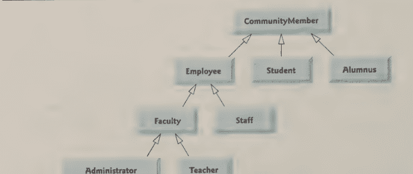

**图 9.2** | 大学社区成员（CommunityMembers）的继承层级 UML 类图。

层级结构中的每个箭头代表一个 *is-a*（是一个）关系。当我们沿着这个类层级结构向上移动时，我们可以说例如，“员工是一个社区成员”以及“教师是一个教职工”。`CommunityMember` 是 `Employee`、`Student` 和 `Alumnus`（校友）的直接超类，是图中所有其他类的间接超类。从底部开始，你可以顺着箭头并将 *is-a* 关系应用于最顶层的超类。例如，一个管理人员是一个教职工，是一个员工，是一个社区成员，而且当然，是一个 `Object`（对象）。

### 形状层级

现在考虑图 9.3 中的 `Shape`（形状）继承层级结构。该层级从 `Shape` 开始，由子类 *TwoDimensionalShape*（二维形状）和 *ThreeDimensionalShape*（三维形状）扩展——形状要么是 *TwoDimensionalShape*，要么是 *ThreeDimensionalShape*。该层级的第三层包含特定类型的 *TwoDimensionalShape* 和 *ThreeDimensionalShape*。如图 9.2 所示，我们可以从底部的箭头指向该类层级结构中最顶层的超类，以识别出几个 *is-a* 关系。例如，三角形是一个 *TwoDimensionalShape* 且是一个 `Shape`，而球体是一个 *ThreeDimensionalShape* 且是一个 `Shape`。该层级可能包含许多其他类。例如，椭圆和梯形是 *TwoDimensionalShape*。

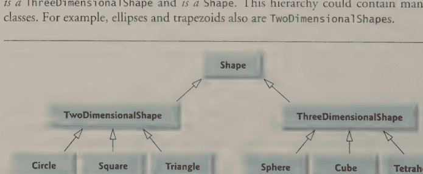

**图 9.3** | 形状（Shapes）的继承层级 UML 类图。

## 9.3 protected 成员

并不是所有的类关系都是继承关系。在第 8 章中，我们讨论了 *has-a*（有一个）关系，其中类拥有指向其他类对象的成员。这种关系通过现有类的组合来创建类。例如，给定 `Employee`（员工）、`Birthday`（生日）和 `TelephoneNumber`（电话号码）类，说 `Employee` 是一个 `Birthday` 或 `Employee` 是一个 `Telephone` 是不妥的。然而，一个 `Employee` 有一个 `Birthday`，有一个 `Telephone`。

相似相似处理超类对象和子类对象——它们的共同点在超类的成员中表示。所有扩展共同超类的对象都可以被视为该超类的对象——此类对象与子类具有 *is* 关系。在本章的后半部分和第 10 章中，我们将考虑许多利用 *is-a* 关系的示例。

子类可以自定义它从父类中继承的内容。为了做到这一点，子类通过重写（重定义）超类方法并提供相应的实现，正如我们在本章的代码示例中所看到的。

本章讨论了访问修饰符 `public`（公共）和 `private`（私有）。类的 `public` 成员在任何引用该类对象的地方都是可访问的。类的 `private` 成员仅在类内部可访问。在本节中，我们引入了 `protected` 访问修饰符。使用 `protected` 提供了 `public` 和 `private` 之间的中间访问级别。超类的 `protected` 成员可以被子类访问。

## 9.4 超类与子类之间的关系

我们使用一个包含员工类型的继承层级结构来讨论超类与其子类之间的关系。在这个公司中，佣金员工（作为超类的对象表示）按销售额的百分比获得工资，而底薪制员工（作为子类的对象表示）获得底薪加销售额的百分比。

我们将对这些类之间关系的讨论分为五个示例。第一个声明了 `Employee`，它直接继承自 `Object` 并声明了私有成员变量：姓名、社会安全号、佣金率和销售金额。

第二个示例声明了 `BasePlusEmployee`，它也直接继承自 `Object` 并声明了私有成员变量：姓名、社会安全号、佣金率、销售金额和底薪。我们通过编写该类所需的所有代码来创建这个类——这并不高效。

第三个示例声明了一个新的 `BasePlusEmployee` 类，它扩展了 `Employee`（即 `BasePlusEmployee` 是一个拥有底薪的 `Employee`）。这种复用让我们在开发新子类时编写的代码的代码。在这个示例中，`BasePlusEmployee` 尝试访问 `Employee` 的私有成员——这会导致编译错误，因为子类无法访问超类的私有实例变量。

第四个示例显示，如果 `Employee` 的实例变量声明为 `protected`，`BasePlusEmployee` 子类就可以直接访问这些数据。两种方法展示了继承版本更容易创建和管理。

在讨论了使用 `protected` 实例变量的便利性后，我们创建了第五个，将 `Employee` 的实例变量设置为 `private` 以实施良好的软件工程。然后我们展示了 `BasePlusEmployee` 子类如何使用 `Employee` 的公共方法来操作（以受控的方式）继承自 `Employee` 的私有实例变量。

### 9.4.1 创建和使用 Employee 类

我们从声明 `Employee` 开始（图 9.4）。第 4 行开始声明并指示 `Employee` 扩展（即继承自）来自 `java.lang` 包的 `Object`。这允许 `Employee` 继承 `Object` 的方法——`Object` 类没有任何字段。如果你不指定类扩展自哪个类，该类将隐式扩展 `Object`。由于这个原因，通常不会在代码中包含 "extends Object"——我们仅在一个示例中这样做是为了演示目的。

```java
// Fig. 9.4: CommissionEmployee.java

// CommissionEmployee 类表示按销售总额
// 百分比获得工资的员工。

public class CommissionEmployee extends Object {

    private final String firstName;

    private final String lastName;

    private final String socialSecurityNumber;

    private double grossSales; // 每周销售额

    private double commissionRate; // 佣金比例

    // 五参数构造函数

    public CommissionEmployee(String firstName, String lastName,
        String socialSecurityNumber, double grossSales,
        double commissionRate) {

        // 此处隐式调用 Object 的默认构造函数

        // 如果 grossSales 无效，抛出异常

        if (grossSales < 0.0) {

            throw new IllegalArgumentException("Gross sales must be >= 0.0");

        }

        // 如果 commissionRate 无效，抛出异常

        if (commissionRate < 0.0 || commissionRate >= 1.0) {

            throw new IllegalArgumentException(

                "Commission rate must be > 0.0 and < 1.0");

        }

        this.firstName = firstName;

        this.lastName = lastName;

        this.socialSecurityNumber = socialSecurityNumber;

        this.grossSales = grossSales;

        this.commissionRate = commissionRate;

    }

    // 返回名

    public String getFirstName() {return firstName;}

    // 返回姓

    public String getLastName() {return lastName;}

    // 返回社会安全号

    public String getSocialSecurityNumber() {return socialSecurityNumber;}

    // 设置总销售额

    public void setGrossSales(double grossSales) {

        if (grossSales < 0.0) {

            throw new IllegalArgumentException("Gross sales must be >= 0.0");

        }

        this.grossSales = grossSales;

    }

    // 返回总销售额

    public double getGrossSales() {return grossSales;}

    // 设置佣金比例

    public void setCommissionRate(double commissionRate) {

        if (commissionRate <= 0.0 || commissionRate >= 1.0) {

            throw new IllegalArgumentException(

                "Commission rate must be > 0.0 and < 1.0");

        }

    }

    this.commissionRate = commissionRate;

    // 返回佣金比例

    public double getCommissionRate() {return commissionRate;}

    // 计算收益

    public double getEarnings() {return commissionRate * grossSales;}

    // 返回 CommissionEmployee 对象的字符串表示

    @Override

    // 表示此方法重写了超类方法

    public String toString() {

        return String.format("As %s: %s %s, %s, %s, %s %s",

            "commission employee", firstName, lastName, socialSecurityNumber,

            "gross sales", grossSales,

            "commission rate", commissionRate);

    }
}
```


**图 4 | CommissionEmployee 类代表按总销售额百分比支付佣金的员工。（3 部分中的第 3 部分）**

### CommissionEmployee 类概述

`CommissionEmployee` 的公共服务包括一个构造函数（第 12–33 行）以及从 `earnings`（第 70 行）到 `toString`（第 73–80 行）的方法。第 36–42 行为类的 `final` 变量（声明在第 5–7 行）`firstName`、`lastName` 和 `socialSecurityNumber` 声明了公共 get 方法。这三个实例变量被声明为 `final`，是因为它们在初始化后不需要修改——这就是为什么我们不提供相应的 set 方法。第 45–67 行为类的 `grossSales` 和 `commissionRate` 实例变量（声明在第 8–9 行）声明了公共 get 和 set 方法。该类将其实例变量声明为私有，因此其他类的对象无法直接访问这些变量。

然而，**构造函数是不会继承的**，因此子类 `CommissionEmployee` 不继承 `Object` 的构造函数。它的构造函数仍然可以被子类调用。事实上，Java 要求任何子类构造函数的首要任务是调用其直接超类的构造函数（如果没有指定构造函数的话），以确保从超类继承的实例变量被正确初始化。显式调用子类构造函数的语法将在第 9.4.3 节讨论。在示例中，`CommissionEmployee` 类的构造函数隐式地调用了 `Object` 类的构造函数。如果代码不包含对超类构造函数的显式调用，Java 会隐式调用超类的默认或无参数构造函数。图 9.4 第 15 行的注释指示了隐式调用超类 `Object` 默认构造函数的位置（你不需要编写此调用的代码）。`Object` 的默认构造函数什么都不做。如果一个类没有构造函数，编译器为该类显式声明的默认构造函数会调用超类的默认或无参数构造函数。

在隐式调用 `Object` 构造函数之后，第 18–20 行和 23–26 行验证了 `grossSales` 和 `commissionRate`。如果这些是有效的（即构造函数没有抛出 `IllegalArgumentException`），第 28–32 行将构造函数的参数赋值给实例变量。

在将参数 `firstName`、`socialSecurityNumber` 赋值给相应的实例变量之前，我们没有对它们的值进行验证。我们可以对姓名进行验证——也许是为了确保它们的长度合理。同样，可以使用正则表达式（第 14.7 节）对社会安全号进行验证，以确保它包含九位数字，带或不带连字符（例如 `123-45-6789` 或 `123456789`）。

### CommissionEmployee 类 earnings 方法

`earnings` 方法（第 70 行）计算 `CommissionEmployee` 的收益。方法乘以佣金率并返回结果。

### CommissionEmployee 类 toString 方法

`toString` 方法（第 73–80 行）是特殊的——它是每个类直接或间接从 `Object` 类继承的方法之一（总结在第 9.6 节中）。`toString` 方法返回一个表示对象的字符串。每当对象必须转换为字符串表示，或者当对象通过 `print` 或通过 `String` 方法的 `%s` 格式指定符打印时，它就会被隐式调用。`Object` 类的 `toString` 返回一个包含对象类名及其哈希码的字符串（第 9.6 节）。它主要是一个占位符，可以由子类重写，以指定子类中数据的适当字符串表示。

`CommissionEmployee` 类的 `toString` 方法重写（重定义）了 `Object` 的 `toString` 方法。当调用时，`CommissionEmployee` 使用 `toString` 方法格式返回一个包含员工信息的字符串。要重写超类方法，子类必须声明一个与超类具有相同签名（方法名、参数数量、参数类型和参数类型顺序）的方法——`Object` 的 `toString` 方法不接受参数，因此 `CommissionEmployee` 也不接受参数。

### @Override 注解

使用 `@Override` 表明该方法重写了超类方法。当调用时，`CommissionEmployee` 使用 `toString` 方法格式返回一个包含员工信息的字符串。要重写超类，子类必须声明一个与超类具有相同签名（方法名、参数数量、参数类型和参数类型顺序）的方法——`Object` 的 `toString` 方法不接受参数，因此 `CommissionEmployee` 也不接受参数。

### 错误预防提示 9.1

虽然 `@Override` 注解是可选的，但它可以帮助编译器发现错误。在编译时发现错误总比在运行时好。由于这个原因，图 7.9 和第 8 章示例中的 `toString` 方法应该使用 `@Override`。

### 常见编程错误 9.1

用更严格的访问修饰符重写方法是一个编译错误——公共子类不能变成保护或私有；保护超类不能变成私有。这样做破坏了继承关系，该关系要求所有子类都能够响应超类声明的方法调用。如果公共方法可以被重写为保护或私有方法，子类对象将无法响应方法调用。一旦方法在超类中声明为公共，对于该类的所有直接和间接子类都是公开的。

### EmployeeTest 类

图 9.5 测试了 `CommissionEmployee`。第 6–7 行实例化一个 `CommissionEmployee` 对象并调用 `CommissionEmployee` 的构造函数（图 9.4 的第 12–33 行），用“Sue”作为名字，“Jones”作为姓，“222-222-2222”作为社会安全号，10000 为总销售额（$10,000），.06 为佣金率（即 6%）。第 11–20 行使用 `CommissionEmployee` 的 getter 获取对象的实例值用于输出。第 22–23 行调用对象的 `setGrossSales` 和 `setCommissionRate` 方法更改实例变量 `grossSales` 和 `commissionRate` 的值。第 25–26 行输出更新后的 `CommissionEmployee` 的字符串表示。在使用 `%s` 格式指定符输出对象时，会隐式调用对象的 `toString` 方法以获取对象的字符串表示。[注意：在本章中，我们没有使用每个类的 `earnings` 方法，但它在第 10 章中被广泛使用。]

```java
// instantiate CommissionEmployee object
CommissionEmployee commissionEmployee = new CommissionEmployee(
    "Sue", "Jones", "222-22-2222", 10000, .06);

// get employee information data
System.out.printf("%s%s%s\n", "First name is",\n
    employee.getFirstName());

System.out.printf("%s%s%s\n", "Last name is",\n
    employee.getLastName());

System.out.printf("%s%s%s\n", "Social security number is",\n
    employee.getSocialSecurityNumber());

System.out.printf("%s%.2f%n", "Gross sales is",\n
    employee.getGrossSales());

System.out.printf("%s%.2f%n", "Commission rate is",\n
    employee.getCommissionRate());

employee.setGrossSales(5000);
employee.setCommissionRate(0.1);

System.out.printf("%s%s\n%s\n",
    "Updated employee information obtained by toString",
    employee.toString());
```

通过方法获取的员工信息：
名字是 Sue
姓名是 Jones
社会安全号是 222-22-2222
销售额是 10000.00
佣金率是 0.06

通过 toString 获取的更新员工信息：
commission employee: Sue Jones
social security number: 222-22-2222
gross sales: 5000.00
commission rate: 0.10

**图 9.5 | CommissionEmployee 测试程序。（第 2 部分，共 2 部分。）**

### 9.4.2 创建和使用 BasePlusCommissionEmployee 类

我们通过声明并测试（完全新且独立的）类 `BasePlusCommissionEmployee`（图 9.6）来讨论我们继承方法的第二部分，该类包含名字、姓名、社会安全号、总销售额、佣金率和基本工资。`BasePlusCommissionEmployee` 构造函数（第 13–40 行）以及 `earnings` 方法（第 89–91 行）和 `toString` 方法（第 94–102 行）。第 43–86 行分别为私有实例变量（在第 5-10 行声明）`firstName`、`lastName`、`socialSecurityNumber`、`grossSales`、`commissionRate` 和 `baseSalary` 声明了方法。变量和方法封装了基本工资佣金员工的所有必要特征。注意此类与 `CommissionEmployee` 类（图 9.4）之间的相似性——在这个示例中，我们不会利用这种相似性。

```java
// Fig 9.6: BasePlusCommissionEmployee.java
// BasePlusCommissionEmployee 类表示一个除了佣金外还接收基本工资的员工。
public class BasePlusCommissionEmployee {
    private final String firstName;
    private final String lastName;
    private final String socialSecurityNumber; // 每周总销售额
    private double grossSales;
    private double commissionRate; // 佣金比例
    private double baseSalary; // 每周基本工资

    // 六参数构造函数
    public BasePlusCommissionEmployee(String firstName, String lastName,
        String socialSecurityNumber, double grossSales,
        double commissionRate, double baseSalary) {
            // 隐式调用 Object 的默认构造函数
            if (grossSales is invalid) throw exception
            if (grossSales < 0.0)
                throw new IllegalArgumentException("Gross sales must be >= 0.0");
            // 如果 commissionRate 无效则抛出异常
            if (commissionRate <= 0.0 || commissionRate >= 1.0)
                throw new IllegalArgumentException("Commission rate must be > 0.0 and < 1.0");
            // 如果 baseSalary 无效则抛出异常
            if (baseSalary < 0.0)
                throw new IllegalArgumentException("Base salary must be >= 0.0");
            this.firstName = firstName;
            this.lastName = lastName;
            this.socialSecurityNumber = socialSecurityNumber;
            this.grossSales = grossSales;
            this.commissionRate = commissionRate;
            this.baseSalary = baseSalary;
        }

    // 返回名字
    public String getFirstName() { return firstName; }
    // 返回姓名
    public String getLastName() { return lastName; }
}
```

**图 9.6 | BasePlusCommissionEmployee 类表示一个除了佣金外还接收基本工资的员工。（第 1 部分，共 3 部分）。**

## 9.4 父类与子类之间的关系

```java
// 返回社会安全号
public String getSocialSecurityNumber() { return socialSecurityNumber; }

// 设置总销售额
public void setGrossSales(double grossSales) {
    if (grossSales < 0.0) {
        throw new IllegalArgumentException("Gross sales must be >= 0.0");
    }
    this.grossSales = grossSales;
}

// 返回总销售额
public double getGrossSales() { return grossSales; }

// 设置佣金率
public void setCommissionRate(double commissionRate) {
    if (commissionRate <= 0.0 || commissionRate >= 1.0) {
        throw new IllegalArgumentException(
            "Commission rate must be > 0.0 and < 1.0");
    }
    this.commissionRate = commissionRate;
}

// 返回佣金率
public double getCommissionRate() { return commissionRate; }

// 设置基本工资
public void setBaseSalary(double baseSalary) {
    if (baseSalary < 0.0) {
        throw new IllegalArgumentException("Base salary must be >= 0.0");
    }
    this.baseSalary = baseSalary;
}

// 返回基本工资
public double getBaseSalary() { return baseSalary; }

// 计算收益
public double earnings() {
    return baseSalary + (commissionRate * grossSales);
}

// 返回 BasePlusCommissionEmployee 的字符串表示
@Override
public String toString() {
    return String.format(
        "%s: %s %s%n%s: %s%n%s: %.2f%n%s: %.2f",
        "commission employee", firstName, lastName,
        "social security number", socialSecurityNumber,
        "gross sales", grossSales,
        "base salary", baseSalary);
}
```


## 图 9.6 | BasePlusCommissionEmployee 表示一个除了佣金外还接收基本工资的员工（第 2 部分，共 3 部分）

`BasePlusCommissionEmployee` 在第 4 行没有指定 `extends Object`，因此该类隐式继承自 `Object`。同样，就像 `CommissionEmployee` 的构造函数（图 9.6 第 16–33 行），`BasePlusCommissionEmployee` 的构造函数调用了 `Object` 的默认构造函数。

`BasePlusCommissionEmployee` 的 `earnings` 方法（81–99 行）返回基本工资加上佣金率与员工销售额的积。

`BasePlusCommissionEmployee` 重写了 `Object` 的 `toString`，返回一个包含 `BasePlusCommissionEmployee` 信息的字符串。我们再次使用格式指定符 `%.2f` 将销售额、佣金率和基本工资格式化为两位小数。

## 测试 BasePlusCommissionEmployee

图 9.7 测试 `BasePlusCommissionEmployee` 类。第 7–9 行创建一个 `BasePlusCommissionEmployee` 对象，并将 "Bob"、"Lewis"、"333-33-3334"、5000 和 300 分别传递给构造函数作为名字、姓氏、社会安全号、销售额、佣金率和基本工资。第 14–25 行使用 `BasePlusCommissionEmployee` 的方法获取对象实例变量的值并输出。第 27 行调用对象的 `setBaseSalary` 方法更改基本工资。`setBaseSalary` 方法（图 9.6 第 77–83 行）确保实例基本工资不会被赋予负值。图 9.7 的第 31 行显式调用 `toString` 以获取对象的字符串表示。

```java
// Fig 9.7: BasePlusCommissionEmployeeTest.java
// BasePlusCommissionEmployee 测试程序。

class BasePlusCommissionEmployeeTest {

    public static void main(String[] args) {

        // 实例化 BasePlusCommissionEmployee 对象
        BasePlusCommissionEmployee employee =
            new BasePlusCommissionEmployee(
                "Bob", "Lewis", "333-33-3334", 5000, .04, 300);

        // 获取带薪佣金员工数据
        System.out.printf(
            "Employee information obtained by get methods:%s\n",
            System.out.printf("First name is: %s\n",
            employee.getFirstName()));
    }
}
```

图 9.7 | BasePlusCommissionEmployee 测试程序（第 1 部分，共 2 部分）。

## 9.4 超类与子类的关系 387

```java
System.out.printf("%s%n", "Last name is",
    employee.getLastName());

System.out.printf("%s%n", "Social security number is",
    employee.getSocialSecurityNumber());

System.out.printf("%s%n", "Gross sales is",
    employee.getGrossSales());

System.out.printf("%s%n", "Commission rate is",
    employee.getCommissionRate());

System.out.printf("%s%n", "Base salary is",
    employee.getBaseSalary());
```

```java
System.out.printf("%s%n%n%s%n",
    "Updated employee information obtained by toString",
    employee.toString());
```

名字是 Bob
姓氏是 Lewis
社会安全号是 333-33-3333
总销售额是 5000.00
佣金率是 0.04
基本工资: 300.00

通过 get 方法获取的员工信息：

通过 toString 获取的更新后的员工信息：

底薪佣金员工: Bob Lewis
社会安全号: 333-33-3333
总销售额: 5000.00
佣金率: 0.04
基本工资: 1000.00

图 9.7 | BasePlusCommissionEmployee 测试程序（第 2 部分，共 2 部分）。

> **关于 BasePlusCommissionEmployee 代码的注释（图 9.6）与 BasePlusCommissionEmployee 类（9.4）的代码相似或完全相同。** 例如，私有实例变量 `firstName` 和 `lastName` 以及方法 `getFirstName` 和 `getLastName`。这些类还包含私有实例变量 `socialSecurityNumber`、`commissionRate` 和 `grossSales`，以及相应的 get 和 set 方法。此外，`BasePlusCommissionEmployee` 的构造函数与 `CommissionEmployee` 类的构造函数几乎相同，但 `BasePlusCommissionEmployee` 的构造函数还设置了 `baseSalary`。`BasePlusCommissionEmployee` 类的其他添加是私有实例变量 `baseSalary` 和方法 `setBaseSalary`。`BasePlusCommissionEmployee` 的 `toString` 方法与 `CommissionEmployee` 类的方法几乎相同，但它还会输出带有两位小数精度的实例变量 `baseSalary`。

## 388 第 9 章 面向对象编程：继承

我们字面上从 `CommissionEmployee` 类中复制代码并粘贴到 `BasePlusCommissionEmployee` 类中，然后修改了 `BasePlusCommissionEmployee` 类以包含基本工资和操作基本工资的方法。“复制-粘贴”的方法往往容易出错且令人厌烦。糟糕的是，它在整个系统中传播了相同代码的副本，导致了代码维护问题——对代码的更改需要在多个类中进行。是否有一种方法可以在不重复代码的情况下，“获取”一个类的实例变量和方法，并使它们成为其他类的一部分？接下来我们将回答这个问题，并使用一种更优雅的类构建方法，这种方法强调了继承的益处。

### 软件工程观察 9.3

通过继承，层次结构中所有类共同的实例变量和方法在超类中声明。在超类中对这些功能所做的更改将被子类继承。如果没有继承，则需要对所有包含相关代码副本的源文件进行修改。

### 9.4.3 创建 CommissionEmployee-BasePlusCommissionEmployee 继承层次结构

现在我们声明类 `BasePlusCommissionEmployee`（图 9.8）继承自类 `CommissionEmployee`（图 9.4）。`BasePlusCommissionEmployee` 对象是一个 `CommissionEmployee`，因为继承传递了类 `CommissionEmployee` 的能力。`BasePlusCommissionEmployee` 还拥有实例变量 `baseSalary`（图 9.8，第 4 行）。关键字 `extends`（第 3 行）表示继承。`BasePlusCommissionEmployee` 继承了实例变量和方法。

### 软件工程观察 9.4

在面向对象系统的设计阶段，你经常会发现某些类关系密切。你应该“提取出”公共的实例变量和方法，并将它们放在超类中。然后使用继承来开发子类，通过使其超出继承自超类的能力对其进行专门化。

### 软件工程观察 9.5

声明子类不会影响其超类的源代码。继承保持了超类的完整性。

```java
// Fig 9.8: BasePlusCommissionEmployee.java
// 私有超类成员无法在子类中被访问。

public class BasePlusCommissionEmployee extends CommissionEmployee {

    private double baseSalary; // 每周基本工资

    // 六参数构造函数
    public BasePlusCommissionEmployee(String firstName, String lastName,
        String socialSecurityNumber, double grossSales,
        double commissionRate, double baseSalary) {

        // 显式调用超类 CommissionEmployee 构造函数
        super(firstName, lastName, socialSecurityNumber,
            grossSales, commissionRate);

        // 如果 baseSalary 无效，则抛出异常
        if (baseSalary < 0.0) {
            throw new IllegalArgumentException("Base salary must be >= 0.0");
        }

        this.baseSalary = baseSalary;
    }

    // 设置基本工资
    public void setBaseSalary(double baseSalary) {
        if (baseSalary < 0.0) {
            throw new IllegalArgumentException("Base salary must be >= 0.0");
        }
        this.baseSalary = baseSalary;
    }

    // 获取基本工资
    public double getBaseSalary() {
        return baseSalary;
    }

    // 计算佣金
    @Override
    public double earnings() {
        return super.earnings() + (grossSales * commissionRate);
    }

    // 返回字符串表示
    @Override
    public String toString() {
        return String.format("base-salaried commission employee: %s %s\nsocial security number: %s\ngross sales: %.2f\ncommission rate: %.2f\nbase salary: %.2f",
            firstName, lastName, socialSecurityNumber, grossSales, commissionRate, baseSalary);
    }
}
```

图 9.8 | 私有超类成员无法在子类中被访问（第 2 部分，共 3 部分）。

## 第 9 章 面向对象编程：继承

| BasePlusCommissionEmployee.java | 描述 |
| :--- | :--- |
| 47 | 在 CommissionEmployee 中无法访问 firstName |
| 48 | 在 CommissionEmployee 中无法访问 lastName |
| 48 | 在 CommissionEmployee 中无法访问 socialSecurityNumber |
| 49 | 在 CommissionEmployee 中无法访问 grossSales |
| 49 | 在 CommissionEmployee 中无法访问 commissionRate |

图 9.8 | 私有超类成员无法在子类中被访问（第 3 部分，共 3 部分）。

### 子类构造函数必须调用其超类构造函数

每个子类构造函数都必须隐式或显式地调用其超类的构造函数，以初始化继承自超类的实例变量。`BasePlusCommissionEmployee` 六参数构造函数（第 7-20 行）的第 11-12 行显式调用 `CommissionEmployee` 类的五参数构造函数（图 9.4 第 12-33 行），以初始化 `BasePlusCommissionEmployee` 对象的一部分（即变量 `firstName`、`lastName`、`socialSecurityNumber`、`grossSales` 和 `commissionRate`）。我们通过使用超类构造函数语法来实现——关键字 `super`，后跟着一个包含构造参数的括号，这些参数分别初始化实例变量 `firstName`、`lastName`、`socialSecurityNumber`、`grossSales` 和 `commissionRate`。在图 9.8 第 11-12 行的显式超类构造函数调用必须是构造体中的第一个语句。

如果 `BasePlusCommissionEmployee` 的构造函数没有显式调用超类的构造函数，编译器将尝试插入对超类默认或无参数构造函数的调用。`CommissionEmployee` 类没有这样的构造函数，因此编译器会报错。当超类包含无参数构造函数时，可以使用 `super()` 来显式地调用该构造函数，但很少这样做。

## 9.4 超类与子类之间的关系 391

### 软件工程观察 9.6

你之前已经了解到，不应该在类的构造函数中调用该类的实例方法，我们将在第 10 章中提到：在子类的构造函数中调用超类的构造函数并不违反这一建议。

### BasePlusCommissionEmployee 方法 earnings 和 toString

编译器对第 38 行（图 9.8）生成了错误，这是因为 `CommissionEmployee` 的实例变量 `commissionRate` 和 `grossSales` 是私有的——`BasePlusCommissionEmployee` 的方法不允许访问超类 `CommissionEmployee` 的私有实例变量。编译器在 `BasePlusCommissionEmployee` 的 `toString` 方法第 47-49 行发布了额外错误，这本可以通过使用 `CommissionEmployee` 类中的方法来避免。例如，第 38 行可以调用 `getCommissionRate` 和 `getGrossSales` 来分别访问 `CommissionEmployee` 的实例变量 `commissionRate` 和 `grossSales`。第 47-49 行也可以使用适当的方法获取超类实例变量的值。

### 9.4.4 使用保护实例变量的 CommissionEmployee–BasePlusCommissionEmployee 继承层次结构

为了让 `BasePlusCommissionEmployee` 直接访问实例变量 `firstName`、`lastName`、`socialSecurityNumber`、`grossSales` 和 `commissionRate`，我们在超类中将它们声明为 `protected`。正如第 9.3 节讨论，超类的保护成员被该超类的所有子类访问。在新的 `CommissionEmployee` 类中，我们仅修改了图 9.4 的第 5–9 行，使用 `protected` 修饰符声明实例变量如下：

```java
protected String firstName;
protected String lastName;
protected String socialSecurityNumber;
protected double grossSales; // 每周销售额
protected double commissionRate; // 佣金百分比
```

其余声明（未显示）与图 9.4 相同。

我们将 `CommissionEmployee` 的实例变量声明为 `protected`，以便子类 `BasePlusCommissionEmployee` 访问它们。然而，将实例变量声明为公共是糟糕的软件工程实践，因为它允许从任何地方对变量进行无限制的访问，极大地增加了错误的概率。使用 `protected` 实例变量，子类可以访问这些变量，但不是子类且不在同一包中的类无法访问这些变量——也就是说，保护类成员对同一包中的其他类也是可见的。

### 类 BasePlusCommissionEmployee

`BasePlusCommissionEmployee` 类（图 9.9）继承了带有保护实例变量的新版本 `CommissionEmployee` 类。`BasePlusCommissionEmployee` 对象继承了 `CommissionEmployee` 的保护实例变量 `firstName`、`lastName`、`socialSecurityNumber`、`grossSales` 和 `commissionRate`——所有变量现在都是受保护的，并且在编译 `earnings` 方法的第 38 行以及 `toString` 方法的第 46–48 行时，编译器不会生成错误。如果另一个类继承了这个版本的 `BasePlusCommissionEmployee` 类，新的子类也可以访问这些保护成员。


// Fig. 9.9: BasePlusCommissionEmployee.java

// BasePlusCommissionEmployee 继承自 CommissionEmployee 的保护实例变量。

public class BasePlusCommissionEmployee extends CommissionEmployee {

    private double baseSalary; // 每周基本工资

    // 六参数构造函数

    public BasePlusCommissionEmployee(String firstName, String lastName,
        String socialSecurityNumber, double grossSales,
        double commissionRate, double baseSalary) {

        super(firstName, lastName, socialSecurityNumber,
            grossSales, commissionRate);

        // 如果 baseSalary 无效则抛出异常
        if (baseSalary < 0.0) {
            throw new IllegalArgumentException("Base salary must be >= 0.0");
        }

        this.baseSalary = baseSalary;
    }

    // 设置基本工资
    public void setBaseSalary(double baseSalary) {
        if (baseSalary < 0.0) {
            throw new IllegalArgumentException("Base salary must be >= 0.0");
        }
        this.baseSalary = baseSalary;
    }

    // 返回基本工资
    public double getBaseSalary() { return baseSalary; }

    // 计算收益
    @Override // 表示此方法重写了超类方法
    public double earnings() {
        return baseSalary + (commissionRate * grossSales);
    }

    // 返回 BasePlusCommissionEmployee 的字符串表示
    @Override
    public String toString() {
        return String.format(
            "%s %s, %s, %.2f, %.2f, %.2f\n",
            "base-salaried commission employee", firstName, lastName,
            "social security number", socialSecurityNumber,
            "gross sales", grossSales, "commission rate", commissionRate,
            "base salary", baseSalary);
    }
}

```

图 9.9 | BasePlusCommissionEmployee 继承自 CommissionEmployee 的保护实例变量。（2 部分中的第 1 部分）

## 9.4 超类与子类之间的关系

```

48 "gross sales", grossSales, "commission rate", commissionRate,
50  "base salary", baseSalary);
51 }
```

**图 9.9 | BasePlusCommissionEmployee 继承自 CommissionEmployee 的保护实例变量。**（2 部分中的第 2 部分）

*一个子类对象包含其所有超类的实例变量*
当你创建一个 `BasePlusCommissionEmployee` 时，它包含了到目前为止类层次结构中声明的所有实例变量——即来自 `Object` 类（不含实例变量）、`CommissionEmployee` 和 `BasePlusCommissionEmployee`。`BasePlusCommissionEmployee` 没有继承 `CommissionEmployee` 的构造函数，而是显式地调用它（12–13 行）来初始化继承自 `CommissionEmployee` 的 `BasePlusCommissionEmployee`。同样，`CommissionEmployee` 的构造函数隐式调用了 `Object` 的构造函数。`BasePlusCommissionEmployee` 的构造函数必须显式调用 `CommissionEmployee` 的构造函数，因为 `CommissionEmployee` 没有可以调用的无参数构造函数。

### 测试 BasePlusCommissionEmployee
`BasePlusCommissionEmployeeTest` 用于测试 `BasePlusCommissionEmployee`。`BasePlusCommissionEmployee` 继承自 `CommissionEmployee`，这在图 9.7 中是可见的。`BasePlusCommissionEmployee` 在图 9.9 中比图 9.6 短得多（51 行对比 103 行），因为使用了超类方法。图 9.9 的输出与图 9.6 相同。修改图 9.9 中的 `BasePlusCommissionEmployee`，图 9.6 中的 `CommissionEmployee` 不需要修改。

394 第9章 面向对象编程：继承

### 关于保护实例变量的说明
为了让 `CommissionEmployee` 直接访问实例变量，我们在超类中将它们声明为 `protected`。正如第 9.3 节讨论的，子类的保护成员被该子类的所有子类访问。使用保护实例变量会产生几个问题。首先，子类可以给 `grossSales` 赋值一个无效值，导致对象处于不一致状态。例如，如果 `BasePlusCommissionEmployee` 给 `firstName` 赋值一个负值。另一个问题是，子类依赖超类的实现。如果超类实现发生变化，我们需要重新实现我们的子类。

第三个问题是，类的保护成员对同一包中的类也是可见的。这并不总是理想的。

### 软件工程观察 9.7
当超类应该向其子类和同一包中的类提供方法时，使用 `protected` 修饰符。

### 软件工程观察 9.8
将实例变量声明为私有（而不是保护）可以使超类对这些变量的实现发生变化而不影响子类。

### 预防技巧 9.2
避免使用保护实例变量。相反，包含访问私有变量的非私有方法。这有助于类保持一致的状态。

## 9.4.5 使用私有实例变量的 CommissionEmployee–BasePlusEmployee 继承层次结构

让我们再次检查我们的层次结构，这次使用良好的软件工程实践。

### 类 CommissionEmployee
`CommissionEmployee`（图 9.10）声明了 `firstName`、`lastName`、`socialSecurityNumber`、`grossSales` 和 `commissionRate`（第 5–9 行），并提供了用于操作这些值的公共方法 `getFirstName`、`getLastName`、`getSocialSecurityNumber`、`getGrossSales`、`setGrossSales`、`setCommissionRate`、`getCommissionRate`、`earnings` 和 `toString`。`earnings` 方法（第 70–72 行）和 `toString` 使用类的 get 方法来获取其实例变量的值。如果我们决定更改实例变量的名称，`earnings` 和 `toString` 的声明不需要修改——只需要修改直接操作实例变量的 `get` 和 `set` 方法的主体。这些更改仅在需要的子类内部发生。局部化此类更改的影响是一种良好的软件工程实践。

```

// Fig. 9.10: CommissionEmployee.java

// CommissionEmployee 类使用方法操作其私有实例变量。

```

图 9.10 | CommissionEmployee 类使用方法操作其私有实例变量。（3 部分中的第 1 部分）

## 9.4 超类与子类之间的关系

```java
public class CommissionEmployee {

    private final String firstName;
    private final String lastName;
    private final String socialSecurityNumber;
    private double grossSales; // 每周销售额
    private double commissionRate; // 佣金比例

    // 五参数构造函数
    public CommissionEmployee(String firstName, String lastName,
        String socialSecurityNumber, double grossSales,
        double commissionRate) {

        // 此处发生对 Object 构造函数的隐式调用
        if (grossSales < 0.0) {
            throw new IllegalArgumentException("Gross sales must be >= 0.0");
        }

        // 如果 commissionRate 无效则抛出异常
        if (commissionRate <= 0.0 || commissionRate >= 1.0) {
            throw new IllegalArgumentException("Commission rate must be > 0.0 and < 1.0");
        }

        this.firstName = firstName;
        this.lastName = lastName;
        this.socialSecurityNumber = socialSecurityNumber;
        this.grossSales = grossSales;
        this.commissionRate = commissionRate;
    }

    // 返回名字
    public String getFirstName() { return firstName; }

    // 返回姓氏
    public String getLastName() { return lastName; }

    // 返回社会安全号
    public String getSocialSecurityNumber() { return socialSecurityNumber; }

    // 设置总销售额
    public void setGrossSales(double grossSales) {
        if (grossSales < 0.0) {
            throw new IllegalArgumentException("Gross sales must be >= 0.0");
        }
        this.grossSales = grossSales;
    }

    // 返回总销售额
    public double getGrossSales() { return grossSales; }
}
```

**图 9.10** CommissionEmployee 类使用方法来操作其实例变量。（3 部分中的第 2 部分。）

```java
// 设置佣金比率
public void setCommissionRate(double commissionRate) {
    if (commissionRate <= 0.0 || commissionRate >= 1.0) {
        throw new IllegalArgumentException(
            "Commission rate must be > 0.0 and < 1.0");
    }
    this.commissionRate = commissionRate;
}

// 返回佣金比率
public double getCommissionRate() { return commissionRate; }

// 计算收益
public double earnings() {
    return getCommissionRate() * getGrossSales();
}

// 返回 CommissionEmployee 对象的字符串表示
@Override
public String toString() {
    return String.format("%s: %s %s\n%s: %s\n%s: %.2f\n",
        "employee", getFirstName(), getLastName(),
        "social security number", getSocialSecurityNumber(),
        "gross sales", getGrossSales(),
        "commission rate", getCommissionRate());
}
```


**图 9.10** | `CommissionEmployee` 类使用方法来操作其私有实例变量。（3 部分中的第 3 部分）

### `BasePlusEmployee` 类

子类 `BasePlusEmployee`（图 9.11）继承了 `CommissionEmployee` 的非私有方法，并通过这些方法（以受控的方式）访问私类的超类成员。`BasePlusCommissionEmployee` 有几处与图 9.9 不同之处。方法 `earnings`（图 9.11 的第 36–37 行）和 `toString`（第 40–44 行）分别调用 `getBaseSalary` 来获取基本工资值，而不是直接访问 `baseSalary`。如果我们决定重命名实例变量 `baseSalary`，那么只需要修改 `setBaseSalary` 和 `getBaseSalary` 两个方法即可。

```java
// 图 9.11: BasePlusCommissionEmployee.java

// BasePlusCommissionEmployee 类继承自 CommissionEmployee

// 并通过继承的公有方法访问超类的

// 私有数据。

public class BasePlusCommissionEmployee extends CommissionEmployee {

    private double baseSalary; // 每周基本工资
}
```

**图 9.11** | `BasePlusCommissionEmployee` 类继承自 `CommissionEmployee`，并通过继承的公有方法访问超类的私有数据。（2 部分中的第 1 部分）

```java
// 六参数构造函数

public BasePlusCommissionEmployee(String firstName, String lastName,
    String socialSecurityNumber, double grossSales,
    double commissionRate, double baseSalary) {

    super(firstName, lastName, socialSecurityNumber);
    super(grossSales, commissionRate);

    // 如果 baseSalary 无效则抛出异常

    if (baseSalary < 0.0) {
        throw new IllegalArgumentException("Base salary must be >= 0.0");
    }

    this.baseSalary = baseSalary;
}

// 设置基本工资

public void setBaseSalary(double baseSalary) {

    if (baseSalary < 0.0) {
        throw new IllegalArgumentException("Base salary must be >= 0.0");
    }

    this.baseSalary = baseSalary;
}

// 返回基本工资

public double getBaseSalary() { return baseSalary; }

// 计算收益

public double earnings() {

    return getCommissionRate() * getGrossSales() + baseSalary;
}

// 返回 BasePlusEmployee 对象的字符串表示

@Override

public String toString() {

    return String.format("%s: %s %s\n%s: %s\n%s: %.2f\n%s: %.2f\n",
        "employee", getFirstName(), getLastName(),
        "social security number", getSocialSecurityNumber(),
        "gross sales", getGrossSales(),
        "commission rate", getCommissionRate(),
        "base salary", baseSalary);
}
```


## 9.5 子类中的构造函数

如所述，实例化子类对象会带来一系列调用链，其中子类构造函数在执行自身任务之前，会显式使用 `super` 调用其直接父类中的构造函数，或隐式调用父类的默认或无参构造函数。同样，如果父类派生自另一个类（除 `Object` 外的所有类都是如此），父类会调用层次结构中上一个构造函数，依此类推。链中最后一个调用的构造函数总是 `Object` 的构造函数。每个子类的构造函数都会实例化该子类继承的变量。例如，再次考虑图 9.10–9.11 中的 `CommissionEmployee`–`BasePlusCommissionEmployee` 结构。当应用程序创建一个 `BasePlusCommissionEmployee` 对象时，会调用其构造函数。该构造函数调用 `CommissionEmployee` 的构造函数，后者又调用 `Object` 的构造函数。`Object` 类构造函数的方法体为空，因此它会立即将控制权返回给 `CommissionEmployee` 的构造函数，随后初始化 `CommissionEmployee` 的实例变量，这些 `BasePlusCommissionEmployee` 对象。当 `CommissionEmployee` 的构造函数执行完毕时，它会将控制权返回给 `BasePlusCommissionEmployee` 的构造函数，后者将初始化 `baseSalary`。

### 软件工程观察 9.9

Java 确保了即使构造函数没有为实例变量赋值，该变量仍会被初始化为默认值（例如，基本型数值类型为 0，布尔类型为 `false`，引用类型为 `null`）。

## 9.6 Object 类

正如我们在本章前面的部分讨论的，Java 中所有的类都直接或间接地继承自 `Object` 类（`java.lang` 包），因此，它的 11 个方法（某些方法经过重载）被所有其他类继承。图 9.12 总结了 `Object` 的方法。我们在书中会讨论其中几个方法（如图 9.12 所示）。

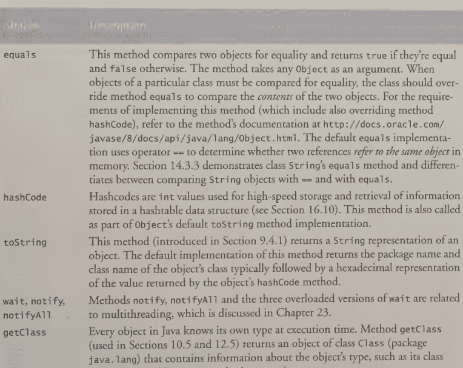

| 方法 | 描述 |
| :--- | :--- |
| `equals` | 该方法比较两个对象的相等性，如果它们相等则返回 `true`，否则返回 `false`。该方法接受任何 `Object` 作为参数。当必须对特定类的对象进行相等性比较时，该类应该重写 `equals` 以比较两个对象的内容。有关实现此方法的要求（包括重写 `hashCode`），请参阅 http://docs.oracle.com/javase/8/docs/api/java/lang/Object.html 上的方法文档。默认实现使用运算符 `==` 来判断两个引用是否指向内存中的同一个对象。14.3 节描述了 `String` 的 `equals` 方法以及使用 `==` 和 `equals` 比较字符串的区别。 |
| `hashCode` | 哈希码用于在哈希数据结构中高速存储和检索信息（见第 16.1 节）。在 `Object` 的默认 `toString` 实现中也会调用此方法。 |
| `toString` | 该方法（在第 9.4.1 节中引入）返回对象的字符串表示。该方法的默认实现返回对象所在类的包名和类名，随后是对象 `hashCode` 方法返回值的十六进制表示。 |
| `wait`, `notifyAll` | `notifyAll` 方法和 `wait` 方法的三个重载版本与多线程有关，多线程将在第 23 章中讨论。 |
| `getClass` | Java 中的每个对象在执行时都知道自己的类型。`getClass` 方法（用于第 10.5 节和 12.5 节）返回一个 `Class` 类（`java.lang` 包）的对象，该对象包含对象类型的信息，例如其类名（由 `Class` 方法 `getName` 返回）。 |
| `finalize` | 此保护方法由垃圾回收器调用，在回收对象内存之前对对象进行清理工作。回想第 8.10 节，不清楚 `finalize` 是否以及何时会被调用。出于这个原因，许多程序员应该避免使用 `finalize` 方法。 |

**图 9.12** Object 方法。（部分 1，共 2）。

| 方法 | 描述 |
| :--- | :--- |
| `clone` | 此保护方法不接受任何参数并返回一个 `Object` 引用……被调用对象的副本。默认实现执行浅拷贝——将一个对象中的实例变量值复制到另一个相同类型的对象中。对于引用类型，复制的是引用。典型的 `clone` 方法的实现会执行深拷贝，为每个引用类型实例创建一个新对象。正确地实现 `clone` 是困难的。由于这个原因，不建议使用它。一些行业专家建议应该使用对象序列化。我们在第 15 章中讨论对象序列化。回想第 7 章，数组是对象。因此，像所有其他对象一样，数组继承了 `Object` 类的成员。每个数组都有一个重写的 `clone` 方法来复制数组。然而，如果数组存储的是对象的引用，则对象不会被复制——执行的是引用复制。 |

**图 9.12** Object 方法。（部分 2，共 2）。

## 9.7 使用组合或继承进行设计

软件工程社区对于组合和继承的相对优劣有许多讨论。它们各有其适用之处，但在许多情况下，继承往往被过度使用。在设计方法中，组合和继承的混合更为合适，正如你在练习 9.16 中看到的那样。


> 作为一名大学生，你学习的是创建解决方案的工具。在工业界，问题比你在大学课程中看到的更大、更复杂。通常，你正在解决的问题的需求是独特的，并要求你重新思考使用手头工具的正确方法。作为一名大学生，你倾向于独立工作。在工业界，解决问题通常需要许多同事之间的互动。你很少能让所有人对解决方案的“正确”方法达成一致。同样，很少有任何特定方法是“完美的”。你经常会比较不同方法的相对优劣——正如在本节中所做的那样。

### 基于继承的设计

继承在层次结构中的类之间创建了紧耦合——每个子类通常依赖于其直接或间接父类的实现。父类实现的更改可能会以微妙的方式影响子类的行为。紧耦合的设计比松耦合的、基于组合的设计（稍后讨论）更难修改。改变是常态而非例外——这鼓励了灵活性。

1. 我们在本节中介绍的概念在软件工程社区中被广泛讨论，并源于许多来源，最著名的是 Gamma、Erich 等人，《设计模式：可复用面向对象元素》，Reading, MA: Addison-Wesley, 1995；以及 Bloch，《Effective Java》，Upper River, NJ: Addison-Wesley, 2008。

### 软件工程观察 9.10

通常情况下，只有在真正的“是”（is-a）关系中才应该使用继承，即可以将子类对象赋值给父类引用。当你通过父类引用调用方法时，执行的是子类中对应的方法。这被称为多态行为，我们将在第 10 章中探讨它。

### 软件工程观察 9.11

组合是松耦合的。当你将引用组合为类的实例变量时，该类的实现细节对客户端是隐藏的。如果引用类型发生变化，你可能需要对组合内部细节进行更改，但这些更改不会影响客户端代码。

此外，继承是在编译时完成的。组合更具活性——它可以在编译时完成，也可以在执行时完成，因为组合的对象是可以修改的。我们称之为动态组合。这是松耦合的另一个方面——如果引用是父类类型，你可以将其替换为任何与该引用类型具有“是”关系的类型。

Java 不提供多重继承——Java 中的每个类只能扩展一个类。然而，新类可以通过组合复用一个或多个类的功能。正如我们在第 10 章《面向对象编程：多态与接口》中所所示，我们也可以通过实现多个接口获得许多多重继承的优点。

> **提示 9.1**
> 组合的一个潜在缺点是运行时通常需要更多对象，这可能会影响垃圾回收和虚拟内存性能。虚拟内存体系和性能问题通常在操作系统课程中讨论。

> **软件工程观察 9.12**
> 组合类的公共方法可以调用组合对象的方法来为组合类的客户端提供服务。这被称为方法转发（forwarding），是通过组合而非继承来复用类功能的一种常用方法。

> **软件工程观察 9.13**
> 在实现新类并决定应该通过继承还是组合来复用现有类时，如果现有类的公共方法不应该是新类的公共接口的一部分，则应使用组合。

### 推荐练习

练习 9.3 要求你使用组合而非继承重新实现本章的 `CommissionEmployee` 和 `BasePlusCommissionEmployee` 层次结构。练习 9.16 要求你将组合和继承相结合来实现该层次结构，在这一过程中你将看到组合松散耦合的优势。

## 9.8 总结

本章介绍了继承——即通过获取现有类的成员（而无需复制和粘贴代码）来创建类的能力，以及通过新功能来增强它们的能力。你学习了父类和子类的概念，并使用 `extends` 关键字创建一个继承父类成员的子类。我们展示了如何使用 `@Override` 注解通过指示该方法重写了父类方法，从而防止意外的重载。我们引入了 `protected` 修饰符；子类可以直接访问受 `protected` 保护的类成员。你学习了如何使用 `super` 来访问被重写的方法。你还看到了构造函数在继承层次结构中的用法，并学习了 `Object` 类的方法，它是所有 Java 类的直接或间接子类。我们还讨论了使用组合与继承来设计类。

在第 10 章“面向对象编程：多态与接口”中，我们将基于继承的设计，引入多态——这是一种面向对象的概念，使我们能够更通用、更方便地处理通过继承、接口或两者都相关的各种类中的对象。在学习完第 10 章后，你将熟悉类、对象、封装、继承和多态——这些面向对象编程的关键技术。

# 总结

## 9.1 引言

- 继承（第 374 页）缩短了程序开发时间。
- 子类的直接父类（第 374 页）是子类所继承的那个类。子类的间接父类（第 374 页）是相对于子类在类层次结构中向上数两个或更多层级的类。
- 在单继承（第 374 页）中，一个类派生自一个父类。在多重继承中，一个类派生自多个直接父类。Java 不支持多重继承。
- 子类比其父类更具体，代表了一个更小的对象组（第 374 页）。
- 子类的每个对象也是该类父类的对象。然而，父类并不是其类子类的对象。
- `is-a` 关系（第 375 页）代表继承。在 `is-a` 关系中，子类的对象也可以被视为其父类的对象。
- `has-a` 关系（第 375 页）代表组合。在 `has-a` 关系中，类对象包含对其他类对象的引用。

## 9.2 父类与子类

- 单继承关系形成了树状的层次结构——子类与其子类之间存在层次关系。

## 9.3 protected 成员

- 只要程序拥有该父类或其某个子类对象的引用，就可以访问该父类的 `public` 成员。
- 父类的私有成员只能在父类的声明体内部被直接访问。
- 父类的 `protected` 成员（第 377 页）在 `public` 和 `private` 访问之间处于中间的保护水平。它们可以通过其子类的成员以及同一包中其他类的成员进行访问。
- 父类的私有成员在子类中是隐藏的，只能通过继承自父类的 `public` 或 `protected` 方法进行访问。
- 如果父类方法名前带有 `super`（第 377 页）和点（`.`），则可以在子类访问被重写的父类方法。

## 9.4 父类与子类之间的关系

- 子类无法访问其父类的私有成员，但可以访问非私有成员。
- 子类可以使用关键字 `super` 调用其父类的构造函数，后面跟着包含父类构造函数参数的括号。这必须作为子类构造函数体的第一条语句。
- 子类可以重写父类方法，以为子类声明相应的实现。
- `@Override` 注解（第 381 页）指示该方法应该重写父类方法。当编译器遇到用 `@Override` 声明的方法时，它会将该方法的签名与父类的签名进行比较。如果没有精确匹配，编译器会抛出错误信息，例如“method does not override or implement a method from a supertype”。
- `toString` 不接受参数并返回一个 `String`。对象的 `toString` 方法通常由子类重写。
- 当使用 `%s` 格式说明符输出对象时，会隐式地调用对象的 `toString` 方法以获取其字符串表示。

## 9.5 子类中的构造函数

- 子类的首要任务是调用其父类的构造函数，以确保从父类继承的实例变量已初始化。

## 9.6 Object 类

- 参见图 9.12 中 `Object` 类的方法表。

# 自测练习

## 9.1 填充下列每个陈述中的空格：

- a) __________ 是一种软件重用的形式，其中新类获取现有类的成员，并用新功能增强这些类。
- b) 父类的成员可以在子类声明中和子类声明体中被访问。
- c) 在一种 (n) 关系中，子类的对象也可以被视为其父类的对象。
- d) 在一种 (n) 关系中，类对象包含对其他类对象的引用。
- e) 在单继承中，子类与其子类之间存在层次关系。
- f) 子类的成员在程序拥有该父类或其某个子类对象的引用的地方是可以访问的。
- g) 当实例化对象时，父类被隐式或显式地调用。
- h) 子类构造函数通过关键字调用。

## 9.2 判断下列陈述是正确的还是错误的。如果是错误的，请解释原因。

- a) 父类构造函数被子类继承。
- b) has-a 关系通过继承实现。
- c) Car 与 vehicle 有这种关系。
- d) 当子类定义具有相同签名时，它是。

# 自测练习答案

## 9.1
a) Inheritance；b) public and protected；c) is-a；d) has-a；e) hierarchical；f) public；g) constructor；h) super。

## 9.2
a) True；b) False。is-a 关系通过继承实现。c) False。这是 has-a 关系的示例。d) 这是 overloading——方法相同但签名不同。

# 练习

## 9.3（推荐：使用组合而非继承）
许多使用继承的程序可以使用组合编写，反之亦然。重写 `BasePlusEmployee`（图 9.11），使其包含 `Employee` 对象引用而不是继承自 `Employee` 类。重写 `CommissionEmployee` 以证明它仍然提供必要的功能。

## 9.4（软件重用）
讨论继承如何促进软件重用、节省程序开发时间并帮助防止错误。

## 9.5（学生继承层次结构）
为类似于图 9.2 所示的大学类绘制继承层次结构。使用 `Student` 作为层次结构的父类，然后用 `UndergraduateStudent` 和 `GraduateStudent` 类进行扩展。尽可能深入地扩展层次结构（即尽可能多级）。例如，Freshman、Sophomore、Junior 和 Senior 可能是 `UndergraduateStudent` 的子类，DoctoralStudent 如此。在画出层次结构后，讨论类之间存在的关系。[注意：此练习不需要编写代码。]

## 9.6（形状继承层次结构）
形状的世界比图 9.3 中的继承层次结构包含的形状丰富得多。写下你认为的所有形状（包括二维和三维），并将它们形成一个尽可能完善的 `Shape` 层次结构。你的层次结构应该以 `Shape` 为顶点。`TwoDimensional` 和 `ThreeDimensional` 形状应扩展。将额外的子类，如 `Quadrilateral` 和 `Sphere` 添加到它们在层次结构中的正确位置。

## 9.7（protected 与私有）
某些程序员不倾向于使用 `protected` 访问，因为他们认为这破坏了类的封装。讨论在父类中使用 `protected` 与 `private` 访问的相对优缺点。

## 9.8（四边形继承层次结构）
为 `Quadrilateral`、`Trapezoid`、`Parallelogram`、`Rectangle` 和 `Square` 类编写一个继承层次结构。当 `Quadrilateral` 作为父类时层级结构。创建并使用 `Point` 类来表示每个形状中的点。使层级结构尽可能深（即尽可能多的层次）。为每个类指定实例变量和方法。`Quadrilateral` 的私有实例变量应该是矩形四个端点的 x-y 坐标对。编写一个程序实例化你的类并输出每个对象的面积（矩形除外）。

## 9.9 段代码片段的作用是什么？

- a) 假设以下方法调用位于子类的重写方法 `earnings` 中：
  `super.earnings()`
- b) 假设以下代码出现在方法声明之前：
  `@Override`
- c) 假设以下代码作为构造函数体的第一条语句：
  `super(firstArgument, secondArgument);`

## 9.10（编写代码）
编写一行代码以执行以下各项任务：
- a) 指定 `Pieceworker` 类继承自 `Employee` 类。
- b) 在 `Pieceworker` 的 `toString` 方法中调用父类的 `toString` 方法。
- c) 在 `Pieceworker` 的构造函数中调用父类 `Employee` 的构造函数——假设该构造函数接收三个字符串：名、姓和社会安全号。

## 9.11（在构造函数中使用 super）
解释为什么在子类的构造函数体中使用 `super`。

## 9.12（在实例方法中使用 super）
解释为什么在子类的实例方法体中使用 `super`。

## 9.13（在类体内调用方法）
在图 9.10–9.11 中通过 `earnings` 和 `toString` 调用同一类内的各种方法。解释在类内部调用这些方法的用处。

## 9.14（Employee 层级结构）
在本章中，你学习了继承自 `Employee` 的 `BasePlusEmployee` 层级结构。然而，并不是所有员工都是 `CommissionEmployee`。在练习中，你将创建一个更通用的 `Employee` 子类，提取出所有员工共有的属性和行为。所有员工共有的属性和行为包括 `firstName`、`lastName`、`socialSecurityNumber` 以及 `toString` 方法。创建一个新的 `CommissionEmployee` 子类，包含这些实例变量和方法。然后将第 9.4–5 节中的 `CommissionEmployee` 重写为 `Employee` 的子类。`CommissionEmployee` 应该只包含父类未声明的实例变量和方法。`CommissionEmployee` 的构造函数应该调用 `Employee` 的构造函数，并且 `CommissionEmployee` 的 `toString` 方法应该调用 `Employee` 的 `toString` 方法。完成这些修改后，使用这些新类运行 `CommissionEmployeeTest` 程序以确保 `BasePlusEmployee` 对象分别正常。

## 9.15（创建 Employee 的子类）
其他类型的员工可能包括固定周薪的 `Salaried`、按工作小时数支付的 `Pieceworkers` 以及按时薪支付且超过 40 小时支付 1.5 倍时薪的 `HourlyEmployees`。

创建一个继承自 `Employee` 类的 `HourlyEmployee`（练习 9.14），它具有表示工作小时数的实例变量 `hours` (double)、表示每小时工资的实例变量 `wage` (double)、一个接收名、姓、社会安全号、时薪和工作小时数的构造函数，以及操作 `hours` 和 `wage` 的 getter 方法、一个根据工作小时计算 `HourlyEmployee` 收益的 `earnings` 方法以及一个 `toString` 方法。`setValue` 方法应确保 `wage` 为负数，`sets` 方法应确保 `hours` 的值为 0 和 168（一周的总小时数）。使用类似于图 9.5 的测试程序中使用 `HourlyEmployee`。

## 9.16（推荐项目：结合佣金与继承）
在本章中，我们创建了 `EmployeeBasePlusCommissionEmployee` 层级结构来建模两种类型员工之间的关系以及如何计算每个人的收益。观察此问题的方法是：`CommissionEmployee` 和 `BasePlusEmployee` 都是员工，且每个都有不同的 `CompensationModel`。

`CompensationModel` 提供一个 `earnings` 方法。`CompensationModel` 的子类将包含特定员工的薪酬细节：

- a) `CompensationModel`——对于按佣金支付的员工，该 `CompensationModel` 子类将包含 `grossSales` 和 `commissionRate`，并定义 `earnings` 返回 `grossSales * commissionRate`。
- b) `BasePlusCommissionModel`——对于领取底薪加佣金的员工，该 `CompensationModel` 子类将包含实例变量 `grossSales`、`commissionRate` 和 `baseSalary`，并定义 `earnings` 返回 `salary + grossSales * commissionRate`。

`Employee` 的 `earnings` 方法将只需调用组合的 `CompensationModel` 方法并返回其结果。

这种方法比我们原始的层级结构更灵活。例如，考虑一个升职的员工。使用这里描述的方法，你只需要通过将组合的 `CompensationModel` 赋值给相应的类来更改 `Employee` 的 `CompensationModel`。在 `CommissionEmployee-BasePlusEmployee` 层级结构中，你需要通过创建相应类的对象并将数据从旧对象移动到新对象来更改员工的类型。

实现本练习讨论的 `Employee` 类和 `CompensationModel` 层级结构。除了 `firstName`、`lastName`、`socialSecurityNumber` 和 `CompensationModel` 实例变量外，`Employee` 类应提供：

- a) 一个接收三个字符串和一个 `CompensationModel` 以初始化实例变量的构造函数。
- b) 一个 set 方法，允许客户端代码更改 `Employee` 的 `CompensationModel`。
- c) 一个 `earnings` 方法，调用 `CompensationModel` 的 `earnings` 方法并返回结果。

当你通过父类 `CompensationModel` 引用调用子类（类型为 `CommissionCompensationModel` 或 `BasePlusCommissionModel`）的 `earnings` 方法时，你可能期望子类的 `earnings` 方法执行。发生了什么？子类的 `earnings` 方法执行了。这被称为多态行为。

# 10 多态与接口

## 目标

在本章中，你将：

- 学习多态的概念以及它如何使系统可扩展和可维护。
- 区分抽象类和具体类。
- 使用多态来创建层级结构。
- 在运行时确定对象的类型。
- 创建并实现接口，并熟悉 Java 8 的增强功能。


## 10.1 引言

我们通过继承来解释和演示面向对象编程的多态。多态使你能够“通用地编程”而不是“针对特定地编程”。特别是，多态允许你处理直接或间接共享相同父类的对象，就像它们全都是该父类一样；这可以简化多态。

考虑以下多态的示例。假设我们创建一个程序来模拟几种动物的运动。`Fish`、`Frog` 和 `Bird` 类代表正在调查的动物。假设每个类都扩展 `Animal` 类，该类包含一个 `move` 方法并维护动物位置的 x-y 坐标。每个类实现 `move` 方法。我们的程序维护一个 `Animal` 数组，包含各种类对象的引用。为了模拟动物的运动，程序每秒向每个对象发送相同的消息——即以它们自己的方式移动——鱼游三英尺。青蛙跳五英尺，鸟飞十英尺。每个对象都知道如何修改其 x-y 坐标。

### 为了可扩展性进行实现

通过多态，我们可以设计并实现易于扩展的系统——在对程序通用部分进行极少或不进行修改的情况下，就可以添加新类，因为新类是程序泛型处理的继承层次结构的一部分。新类只需“直接插入”。程序中唯一必须修改的部分是那些需要直接了解我们添加到层次结构中的类的新部分。例如，如果我们扩展 `Animal`（动物）类来创建 `Tortoise`（乌龟）类（它可能通过爬行来响应消息），我们只需要编写 `Tortoise` 类以及模拟程序中实例化 `Tortoise` 对象的代码。模拟程序中泛型移动 `Animal` 对象的部分可以保持不变。

### 本章概述

首先，我们将讨论多态的常见示例。然后，我们将提供一个简单的多态行为演示。我们使用父类引用来以多态方式操作对象和子类。

接着，我们将展示一个案例，重新回顾第 9.4.5 节中的员工层次结构。我们开发了一个简单的工资应用程序，使用每个员工的收入方法参数化计算不同类型员工的周工资。虽然每个类型员工的收入是用特定方式计算的，但多态允许我们“通用地”处理这些员工。在这种情况下，我们使用了 `SalariedEmployee`（固定薪水的人员）和 `HourlyEmployee`（按小时计薪且加班费为工时半倍的人员）。我们在更新后的层次结构中，将所有类的公共功能声明在一个“抽象”的 `Employee` 类中，该类继承自“具体”类 `SalariedEmployee`、`HourlyEmployee` 和 `CommissionEmployee`（其中后者直接继承它，而 `BasePlusEmployee` 间接继承它）。正如你将看到的，当我们通过父类引用调用每个员工的收入方法（无论员工的类型如何）时，由于 Java 内置的多态能力，将执行正确的子类计算。

### 在特定类型中编程

偶尔在执行多态处理时，我们需要在“特定”类型中编程。我们的员工案例说明了程序可以在执行时确定对象的类型并对该对象采取相应的行动。在案例中，我们决定 `BasePlusCommissionEmployees` 的基本薪水获得 10% 的加薪。我们利用这些能力来判断特定的员工对象是否为 `BasePlusCommissionEmployee`。如果是，我们将该员工的工资增加 10%。

### 接口

本章继续介绍 Java 接口（interfaces），接口对于为无关的类分配公共功能特别有用。这允许这些类的对象以多态方式处理——实现相同接口的类可以响应接口的所有方法调用。为了演示接口的创建和使用，我们修改了工资应用程序，创建一个通用的应付账款应用程序，计算公司员工的付款金额以及购买商品的发票金额。

## 10.2 多态示例

让我们考虑多态的几个额外示例。

### 四边形
如果 `Rectangle`（矩形）派生自 `Quadrilateral`（四边形）类，那么 `Rectangle` 就是 `Quadrilateral` 的更具体的版本。可以在 `Quadrilateral` 上执行的任何操作（例如计算周长或面积）也可以在 `Rectangle` 上执行。这些操作也可以在其他四边形上执行，如正方形（Squares）、平行四边形（Parallelograms）和梯形（Trapezoids）。当程序通过子类变量调用方法时发生了多态——在执行时，根据存储在父类变量中的引用类型，调用正确的子类方法版本。你将在节节中看到一个说明这一点的简单代码示例。

### 视频游戏中的空间对象

假设我们设计了一款视频游戏，操作 `Martian`（火星人）、`Venusian`（金星人）、`Plutonian`（冥星人）、`Spaceship`（飞船）和 `LaserBeam`（激光）的对象。假设每个类都继承自父类 `SpaceObject`，该类包含 `draw` 方法。每个子类都实现了此方法。屏幕管理器维护一个指向各种类的引用集合（例如，`SpaceObject` 数组）。为了刷新屏幕，屏幕管理器定期向每个对象发送相同的消息——即 `draw`。然而，每个对象都以自己的方式做出响应，例如，火星人可能会画出红色的自己、绿色眼睛和适当的触角。飞船可能会把自己画成一个亮银色的飞碟。激光可能会把自己画成横跨屏幕的一道红色光束。同样，相同的消息（在本例中为 draw）扩展到各种对象产生“多种形式”的结果。

屏幕管理器可以使用多态来以便以最少的系统代码修改向系统添加新功能。假设我们想向视频游戏中添加 `Mercurian`（水星人）对象。为了实现，我们将构建一个扩展 `SpaceObject` 的 `Mercurian` 类，并提供自己的 `draw` 方法实现。当 `Mercurian` 出现在 `SpaceObject` 集合时，屏幕管理器调用 `draw`，就像它对集合中的其他每个对象执行一样，无论其类型如何。因此，新的 `Mercurian` 对象无需修改任何系统代码即可“直接插入”。

### 软件工程 10.1
多态允许你进行通用处理。“is-a”关系仅适用于从子类到其（间接）父类的层次结构，而反之不然（不适用于从父类到其子类的层次结构）。每个子类对象都是其父类的对象。

### 软件工程 10.2
多态促进可扩展性：可以在不修改系统代码的情况下引入新类型。

## 10.3 演示多态行为

在下一个示例中，我们使用子类引用指向子类。然后我们展示了通过父类引用对子类对象调用方法如何执行子类功能——对象的类型而非变量的类型。这表明子类对象可以被视为其父类的对象。程序可以创建一个子类变量数组来引用许多子类的对象。这是允许的，因为每个子类对象都是其父类的对象。例如，我们可以将 `BasePlusEmployee` 的引用赋值给子类变量 `CommissionEmployee`，因为 `BasePlusEmployee` 是 `CommissionEmployee`——所以我们可以将 `BasePlusEmployee` 视为 `CommissionEmployee`。

正如你在本章后面的部分学到的，你不能将父类对象视为子类对象，因为父类对象不是任何子类的对象。例如，我们不能将 `CommissionEmployee` 的引用赋值给子类变量 `BasePlusEmployee`，因为 `CommissionEmployee` 不是 `BasePlusCommission`——`CommissionEmployee` 没有 `BaseSalary` 实例变量或方法。

如果我们显式将子类引用强制转换为子类类型，编译器允许将子类引用赋值给子类变量。我们为什么要执行这样的赋值呢？父类引用只能用于调用父类中声明的方法——尝试通过子类引用调用子类特有的方法会导致编译错误。如果程序需要对父类变量引用的子类对象执行子类特定的操作，程序必须首先通过向下强制转换（downcasting）技术将父引用转换为子类引用。这允许程序调用不在父类中的子类方法。

### 软件工程 10.3
虽然这是允许的，但你通常应该避免向下强制转换。

# 412 第 10 章 面向对象编程：多态与接口

10.1 中的示例演示了使用子类和子类变量来存储子类及对象引用的三种方法。前两种是直观的——正如 9.4 节所示，我们将子类引用赋值给子类变量，将子类引用赋值给子类变量。然后，我们通过将子类引用赋值给父类变量，演示了子类与父类之间的关系（即“is-a”关系）。该程序分别使用了 9.10 和 9.11 中的 `CommissionEmployee` 和 `BasePlusEmployee`。

```java
```


// Fig.10.1: PolymorphismTest.java

// 将子类和子类引用赋值给父类和子类变量。

public class PolymorphismTest {

    public static void main(String[] args) {

        // 将父类引用赋值给子类变量
        CommissionEmployee commissionEmployee = new CommissionEmployee(
            "Jones", "Lewis", 22-22-2022, 500);

        // 将子类引用赋值给父类变量
        BasePlusCommissionEmployee basePlusCommissionEmployee = new BasePlusCommissionEmployee(
            "Bob", "Lewis", 43-34-3034, 500, 300);

        // 使用父类变量调用子类对象的 toString
        System.out.printf("%s:%s:%s%n",
            "使用父类引用调用 CommissionEmployee 的 toString",
            "作用于子类对象", commissionEmployee.toString());

        // 使用子类变量调用子类对象的 toString
        System.out.printf("%s:%s:%s%n",
            "使用子类引用调用 BasePlusCommissionEmployee 的 toString",
            "作用于子类对象", basePlusCommissionEmployee.toString());

        // 使用父类变量调用子类对象的 toString
        CommissionEmployee commissionEmployee2 = basePlusCommissionEmployee;

        System.out.printf("%s:%s:%s%n",
            "使用父类引用调用 BasePlusCommissionEmployee 的 toString",
            "作用于子类对象", commissionEmployee2.toString());

    }

}

```
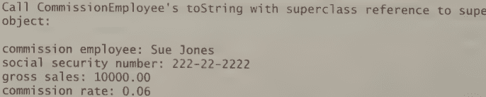

图 10.1 | 将子类和子类引用赋值给父类和子类变量。

## 10.4 抽象类与方法

```text
使用子类引用调用 BasePlusCommissionEmployee 的 toString 作用于子类对象:
底薪员工: Bob Lewis
社会安全号: 33-3333
总销售额: 500.00
佣金率: .04
基本工资: 300.00

使用父类引用调用 BasePlusCommissionEmployee 的 toString 作用于子类对象:
底薪员工: Bob Lewis
社会安全号: 33-3333
总销售额: 500.00
佣金率: .04
基本工资: 300.00
```

**图10.1** | 将父类和子类引用赋值给子类和子类变量。（部分 2）

在图 10.1 中，第 8–9 行创建了一个 `CommissionEmployee` 对象并将其引用赋值给 `CommissionEmployee` 变量。第 12–14 行创建了一个 `BasePlusCommissionEmployee` 对象并将其引用赋值给 `BasePlusCommissionEmployee` 变量。这些赋值是自然的——例如，`CommissionEmployee` 的主要目的就是持有对 `CommissionEmployee` 对象的引用。第 17–19 行显式使用了 `CommissionEmployee`。由于 `CommissionEmployee` 指向一个 `CommissionEmployee` 对象，因此调用了子类 `CommissionEmployee` 的 `toString`。同样，第 22–25 行使用 `BasePlusCommissionEmployee` 显式地对 `BasePlusCommissionEmployee` 对象调用 `toString`。这调用了子类 `BasePlusCommissionEmployee` 的 `toString`。

第 28–29 行将子类对象 `BasePlusCommissionEmployee` 的引用赋值给父类 `CommissionEmployee` 变量，第 30–32 行使用其调用 `toString`。当变量包含指向子类对象的引用且使用该引用调用方法时，将调用方法的子类版本。因此，Java 编译器允许这样做，因为子类是其父类的对象（但反之则不然）。当编译器遇到通过变量调用的方法时，会通过检查变量的类型来判断该方法是否可以被调用。如果类包含适当的方法声明（或继承了该方法），则调用通过编译。在执行期间，变量所引对象的类型决定了实际使用的方法。这一过程被称为“动态绑定”，将在 10.5 节中进行详细讨论。

## 10.4 抽象类与方法

当我们思考一个类时，假设程序会创建该类型的对象。有时，声明某些类——抽象类——是有用的，你永远不打算创建它们的对象。由于它们只用于继承层次结构，我们称它们为抽象父类。这些类不能用于实例化对象，正如我们很快看到的，抽象类是不完整的。子类必须声明“缺失的部分”以变成“具体的”，否则，这些子类也将是抽象的。我们将在 10.5 节中演示抽象类。

### 抽象类的目的

抽象类的目的是提供一个合适的父类，让其他类继承它并共享共同的设计。例如，在图 9.3 的 `Shape` 层次结构中，类继承了关于“什么是形状”的概念——也许是常见的属性如位置、颜色和厚度，以及 `draw`、`move`、`resize` 和 `changeColor` 等行为。可以用于实例化对象的类是具体类。具体类提供了声明的每个方法的实现（某些实现可以继承）。例如，我们从抽象类 `DimensionalShape` 派生具体类 `Circle`、`Square` 和 `Triangle`。同样，我们从抽象类 `Three-DimensionalShape` 派生具体类 `Sphere`、`Cube` 和 `Tetrahedron`。抽象子类过于通用，只指定了子类之间的共同点。在创建对象之前，我们需要更具体化。例如，如果你向抽象类 `DimensionalShape` 发送 `draw` 消息，该类知道二维形状应该是可绘制的，但它不知道要绘制什么特定形状，因此无法实现具体的 `draw` 方法。具体类提供了使实例化变得合理的细节。

并不是所有的层次结构都包含抽象类。然而，你经常会编写只使用抽象子类的客户端代码，以减少代码对一系列子类类型的依赖。例如，你可以写一个参数为抽象父类类型的方法。当调用时，此类方法可以接收任何直接或间接扩展了该父类的具体类对象。

抽象类有时构成层次结构的多个级别。例如，图 9.3 的 `Shape` 层次结构从抽象类 `Shape` 开始。在层次结构的下一级是抽象类 `DimensionalShape` 和 `Three-DimensionalShape`。层次结构的下一级声明了二维形状的具体类（`Circle`、`Square` 和 `Triangle`）以及三维形状的具体类（`Sphere`、`Cube` 和 `Tetrahedron`）。

### 声明抽象类和抽象方法

通过使用 `abstract` 关键字可以使类抽象。抽象类通常包含一个或多个抽象方法。抽象方法是声明中带有 `abstract` 关键字的实例方法，例如

```java
public void draw(); // 抽象方法
```

抽象方法不提供实现。任何抽象方法必须显式声明为抽象，即使该类包含一些（非抽象）方法。抽象类的每个具体子类都必须为父类的抽象方法提供具体的实现。构造函数和静态方法不能声明为抽象。构造函数不被继承，因此抽象构造函数永远无法实现。虽然静态方法会被继承，但它们无法被重写。由于抽象方法旨在根据类型进行重写，因此将静态方法声明为抽象是没有意义的。

> **软件工程观察 10.4**
>
> 抽象类声明了类层次结构中类的公共属性和行为（包括抽象和具体的行为）。抽象类通常包含一个或多个抽象方法，如果类没有重写这些方法，则必须重写。抽象类的实例变量和具体方法遵循常规的继承规则。

> **常见编程错误 10.1**
>
> 尝试实例化抽象类的对象会导致编译错误。

> **常见编程错误 10.2**
>
> 如果类声明了抽象方法，或者继承了抽象方法但没有提供其具体实现，则必须将其声明为抽象类；否则会发生编译错误。

### 使用抽象类声明变量

虽然我们不能实例化抽象父类的对象，但你会发现，我们可以使用抽象父类来声明变量，这些变量可以持有任何派自这些抽象父类的具体类对象的引用。我们将使用此类变量以多态的方式操作子类对象。你也可以使用抽象类来调用在这些子类中声明的静态方法。

考虑多态的另一个应用。绘图程序需要显示许多形状，包括你在编写绘图程序后向添加的新形状类型。程序可能需要显示如圆形（`Circle`）、三角形（`Triangle`）、矩形（`Rectangle`）或其他形状，它们都派自抽象类 `Shape`。绘图程序使用变量来管理对象。为了绘制此继承体系中的任何对象，绘图程序使用包含指向子类对象引用的 `Shape` 变量来调用对象的 `draw` 方法。该方法在父类 `Shape` 中被声明为抽象方法，因此每个具体子类必须以特定于该形状的方式实现 `draw` 方法——`Shape` 继承体系中的每个对象都知道如何绘制自己。绘图程序不需要担心对象的类型，也不需要担心是否遇到该类型的对象。

### 分层软件系统

多态在实现所谓的分层软件系统时特别有效。在操作系统中，每种设备驱动程序的操作方式可能与其不同。尽管如此，读取或向设备写入数据的命令可能具有某种统一性。对于每个设备，操作系统使用一种称为设备驱动程序的软件来控制系统与设备之间的所有通信。发送到设备驱动程序对象的写消息需要根据该驱动程序管理特定类型设备的上下文进行特定解释。然而，写操作本身与系统中的任何其他设备并没有区别——即将内存中的某些字节写入该设备。面向对象的操作系统可能会使用抽象父类为所有设备驱动程序提供一个合适的“接口”。然后，通过继承该抽象父类，形成了所有具有相似特征的子类。设备驱动程序的方法在抽象父类中声明为抽象方法。这些抽象方法的实现在于特定类型设备驱动的具体子类中。新设备总是在开发中，通常在操作系统发布很久之后。当你购买新设备时，它会带有设备供应商提供的驱动程序。在你连接到计算机并安装驱动程序后，设备即可使用。这是多态如何使系统可扩展的例子。

## 10.5 案例研究：使用多态的薪资系统

本节重新检查了整个 9.4 节中的 `CommissionEmployee`-`BasePlusCommissionEmployee` 层次结构。我们使用抽象方法和多态在一个满足以下要求的增强员工继承体系上执行薪资计算：

- 公司按周向员工支付工资。员工分为四类：月薪员工（`SalariedEmployee`）无论工作小时多少，都获得固定周薪；小时制员工（`HourlyEmployee`）按小时支付工资，对于超过 40 小时的所有工作时间获得加班费（即每小时工资率的 1.5 倍）；佣金员工（`CommissionEmployee`）获得销售额的百分比；底薪加佣金员工（`BasePlusCommissionEmployee`）获得底薪加上销售额的百分比。对于当前的薪资期，公司决定通过在底薪加佣金员工的基础上增加 10% 来奖励他们。公司希望你编写一个能够完美执行薪资计算的应用程序。

我们使用抽象类 `Employee` 来表示员工的通用概念。扩展 `Employee` 的类有 `SalariedEmployee`、`CommissionEmployee` 和 `HourlyEmployee`。类 `BasePlusCommissionEmployee`——扩展自 `CommissionEmployee`——代表最后一种员工类型。图 10.2 中的 UML 类图显示了我们的多态员工薪资应用程序的层次结构。抽象类名 *Employee* 使用了斜体——这是 UML 的规范。

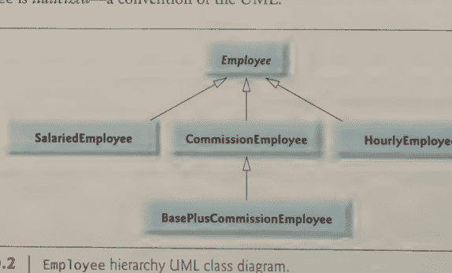

图 10.2 | 员工层次结构 UML 类图。

抽象子类 `Employee` 声明了该层次结构的“接口”——即程序可以在所有 `Employee` 对象上调用的方法集。我们在这里使用“接口”一词是泛指程序与任何 `Employee` 子类对象通信的各种方式。注意不要将“接口”的通用概念与 Java 接口的正式概念（第 10.9 节的主题）混淆。每个员工无论收入计算方式如何，都有名、姓和社安全号，因此在抽象子类 `Employee` 中有私有变量 `firstName`、`lastName`、`socialSecurityNumber`。

图 10.3 中的图显示了层次结构左侧的五个类，以及顶部的 `earnings` 和 `toString` 方法。对于每个类，图表显示了每个方法的预期结果。我们没有列出子类 `Employee` 的 `get` 方法，因为它们是继承的。

| Class | earnings | toString |
| :--- | :--- | :--- |
| Employee | abstract | implemented |
| SalariedEmployee | fixed salary | detailed info |
| HourlyEmployee | hourly rate + overtime | detailed info |
| CommissionEmployee | % of sales | detailed info |
| BasePlusCommissionEmployee | base + % of sales | detailed info |

### 10.5.1 抽象基类 Employee

```java
// 图 10.4: Employee.java
// 抽象基类 Employee。

public abstract class Employee {

    private String firstName;
    private String lastName;
    private String socialSecurityNumber;

    // 构造函数
    public Employee(String firstName, String lastName,
        String socialSecurityNumber) {
        this.firstName = firstName;
        this.lastName = lastName;
        this.socialSecurityNumber = socialSecurityNumber;
    }

    // 返回名
    public String getFirstName() { return firstName; }

    // 返回姓
    public String getLastName() { return lastName; }

    // 返回社会安全号
    public String getSocialSecurityNumber() { return socialSecurityNumber; }

    // 返回 Employee 对象的字符串表示
    @Override
    public String toString() {
        return String.format("%s %s%nsocial security number: %s",
            getFirstName(), getLastName(), getSocialSecurityNumber());
    }

    // 子类必须重写的抽象方法
    public abstract double earnings(); // 此处无实现
}
```

图 10.4 | 抽象基类 Employee。

为什么要将 `earnings` 声明为抽象方法？在 `Employee` 类中提供具体的实现是不合理的。我们无法为通用的 `Employee` 计算收益——我们必须知道 `Employee` 的具体类型才能确定合适的收益。通过将此方法声明为抽象，我们表示每个子类必须提供合适的 `earnings` 实现，并且程序能够多态地为任何 `Employee` 类型调用 `earnings` 方法。

### 10.5.2 具体子类 SalariedEmployee

`SalariedEmployee`（图 10.5）继承 `Employee`（第 4 行），并重写了抽象方法 `earnings`（第 34–35 行），使得 `SalariedEmployee` 成为一个具体类。该类包含一个构造函数（第 8–18 行），接收名、姓、社会安全号和周薪；一个给实例变量 `weeklySalary` 赋值非负值的方法（第 21–28 行）；一个返回 `weeklySalary` 值的方法（第 31 行）；一个 `earnings` 方法（第 34–35 行），用于计算 `SalariedEmployee` 的收益；以及 `toString` 方法（第 38–42 行），它返回“salaried employee: ”后跟由 `Employee` 的 `toString` 和 `SalariedEmployee` 的 `getWeeklySalary` 方法产生的特定信息。`SalariedEmployee` 的构造函数将名、姓和社会安全号传递给 `Employee` 构造函数（第 10 行），以初始化基类的私有变量。再次，我们在构造函数和 `setWeeklySalary` 方法中重复了 `weeklySalary` 的验证代码。记住，更复杂的验证可以放在从构造方法调用的静态方法中。

> **错误提示 10.1**
>
> 我们建议不要从构造函数调用类的方法——你可以调用静态方法并对基类的构造函数进行必要的调用。如果你遵循这一建议，将避免直接或间接调用类重写方法的问题，这会导致运行时错误。更多细节见第 10.8 节。


```java
// 图 10.5: SalariedEmployee.java
// SalariedEmployee 具体类继承抽象类 Employee。

public class SalariedEmployee extends Employee {

    private double weeklySalary;

    // 构造函数
    public SalariedEmployee(String firstName, String lastName,
        String socialSecurityNumber, double weeklySalary) {

        super(firstName, lastName, socialSecurityNumber);

        if (weeklySalary < 0.0) {
            throw new IllegalArgumentException(
                "Weekly salary must be >= 0.0");
        }
        this.weeklySalary = weeklySalary;
    }

    // 设置周薪
    public void setWeeklySalary(double weeklySalary) {
        if (weeklySalary < 0.0) {
            throw new IllegalArgumentException(
                "Weekly salary must be >= 0.0");
        }
        this.weeklySalary = weeklySalary;
    }

    // 返回周薪
    public double getWeeklySalary() { return weeklySalary; }

    // 计算收益；重写抽象方法 earnings
    @Override
    public double earnings() { return getWeeklySalary(); }

    // 返回 SalariedEmployee 对象的字符串表示
    @Override
    public String toString() {
        return String.format("salaried employee: %s%n%s: %.2f",
            super.toString(), "weekly salary", getWeeklySalary());
    }
}
```

图 10.5 | 具体子类 SalariedEmployee。


```java
throw new IllegalArgumentException(
    "Weekly salary must be >= 0.0");
}
this.weeklySalary = weeklySalary;
}

// 设置薪资
public void setWeeklySalary(double weeklySalary) {
    if (weeklySalary < 0.0) {
        throw new IllegalArgumentException(
            "Weekly salary must be >= 0.0");
    }
    this.weeklySalary = weeklySalary;
}

// 返回薪资
public double getWeeklySalary() { return weeklySalary; }

// 计算收益；重写 Employee 中的抽象方法 earnings
@Override
public double earnings() { return getWeeklySalary(); }

// 返回 SalariedEmployee 对象的字符串表示
@Override
public String toString() {
    return String.format("Salaried employee: %s: $%.2f",
        super.toString(), weeklySalary, getWeeklySalary());
}
}
```

**图 10.5 | SalariedEmployee 具体类继承抽象类 Employee。**

方法 `earnings` 重写了 `Employee` 的抽象方法 `earnings`，提供了返回 `SalariedEmployee` 周薪的具体实现。如果我们不实现 `earnings`，`SalariedEmployee` 必须声明为抽象的——否则类将无法编译。在本例中，我们希望 `SalariedEmployee` 是一个具体类。方法 `toString`（38–42行）重写了 `Employee` 的 `toString`。如果 `SalariedEmployee` 没有重写它，它将继承 `Employee` 的版本。在这种情况下，`SalariedEmployee::toString` 方法将简单返回名、姓和社会安全号，这不能充分表示 `SalariedEmployee`。为了产生完整的 `SalariedEmployee` 字符串表示，子类 `toString` 方法返回“salaried employee: ”后跟基类的特定信息（即名、姓和社会安全号）。通过调用基类 `toString` 方法（第41行）获取 `SalariedEmployee` 周薪——这是代码复用的另一个很好的例子。

### 10.5.3 具体子类 HourlyEmployee

`HourlyEmployee`（图 10.6）也继承 `Employee`（第4行）。构造函数（9–24行）接收名、姓、社会安全号、时薪和工作小时数。27–33行和39–46行分别给实例变量 `wage` 和 `hours` 赋值。`setWage` 方法确保 `wage` 为非负，`setHours` 方法确保 `hours` 在 0 到 168（每周总小时数）之间。

```java
// 图 10.6: HourlyEmployee.java
// HourlyEmployee 具体类继承抽象类 Employee。
public class HourlyEmployee extends Employee {
    private double wage; // 每时薪
    private double hours; // 每周工作小时

    // 构造函数
    public HourlyEmployee(String firstName, String lastName,
        String socialSecurityNumber, double wage, double hours) {
        super(firstName, lastName, socialSecurityNumber);
        if (wage < 0.0) {
            throw new IllegalArgumentException("Hourly wage must be >= 0.0");
        }
        if (hours < 0.0 || hours > 168.0) {
            throw new IllegalArgumentException("Hours worked must be >= 0.0 and <= 168.0");
        }
        this.wage = wage;
        this.hours = hours;
    }

    // 设置薪资
    public void setWage(double wage) {
        if (wage < 0.0) {
            throw new IllegalArgumentException("Hourly wage must be >= 0.0");
        }
        this.wage = wage;
    }

    // 设置工作小时数
    public void setHours(double hours) {
        if (hours < 0.0 || hours > 168.0) {
            throw new IllegalArgumentException("Hours worked must be >= 0.0 and <= 168.0");
        }
        this.hours = hours;
    }

    // 返回薪资
    public double getWage() { return wage; }

    // 返回工作小时数
    public double getHours() { return hours; }

    // 计算收益：重写
    @Override
    public double earnings() {
        if (getHours() <= 40)
            return getWage() * getHours();
        else
            return 40 * getWage() + (getHours() - 40) * getWage() * 1.5;
    }

    // 返回字符串表示
    @Override
    public String toString() {
        return String.format("Employee(name=%s, wage=%f, hours=%f)",
            name, getWage(), getHours());
    }
}
```

图 10.6 | HourlyEmployee 类继承 Employee。（部分 1/2）

### 10.5.4 具体子类 CommissionEmployee

`CommissionEmployee`（图 10.7）继承 `Employee`（第4行）。该类包含一个构造函数（9–25行），接收名、姓、社会安全号、销售金额和佣金率；set 方法（第 28–34 行和 40–47 行）分别为实例变量 `grossSales` 和 `commissionRate` 分配有效值；get 方法（37 和 50）检索这些实例变量的值；`earnings` 方法（53–56 行）计算 `CommissionEmployee` 的薪水；`toString` 方法（59–65 行）返回“commission:”后跟员工的特定信息。构造函数还将名、姓和社会安全号传递给父类 `Employee` 的构造函数（第 12 行），以初始化 `Employee` 的私有实例变量。`toString` 方法调用父类的 `toString` 方法（第 62 行）以获取 `Employee` 特有的信息（即名、姓和社会安全号）。

```java
// Fig. 10.7: CommissionEmployee.java
// CommissionEmployee class extends Employee.
public class CommissionEmployee extends Employee {
    private double grossSales; // gross weekly sales
    private double commissionRate; // commission percentage

    // constructor
    public CommissionEmployee(String firstName, String lastName,
        String socialSecurityNumber, double grossSales,
        double commissionRate) {
        super(firstName, lastName, socialSecurityNumber);
        if (commissionRate < 0.0 || commissionRate >= 1.0) { // validate
            throw new IllegalArgumentException(
                "Commission rate must be > 0.0 and < 1.0");
        }
        if (grossSales < 0.0) { // validate
            throw new IllegalArgumentException("Gross sales must be >= 0.0");
        }
        this.grossSales = grossSales;
        this.commissionRate = commissionRate;
    }

    // set gross sales amount
    public void setGrossSales(double grossSales) {
        if (grossSales < 0.0) { // validate
            throw new IllegalArgumentException("Gross sales must be >= 0.0");
        }
        this.grossSales = grossSales;
    }

    // return gross sales amount
    public double getGrossSales() { return grossSales; }

    // set commission rate
    public void setCommissionRate(double commissionRate) {
        if (commissionRate < 0.0 || commissionRate >= 1.0) { // validate
            throw new IllegalArgumentException(
                "Commission rate must be > 0.0 and < 1.0");
        }
        this.commissionRate = commissionRate;
    }

    // return commission rate
    public double getCommissionRate() { return commissionRate; }

    // calculate earnings; override abstract method earnings in Employee
    @Override
    public double earnings() {
        return getCommissionRate() * getGrossSales();
    }

    // return String representation of CommissionEmployee object
    @Override
    public String toString() {
        return String.format("sales: $%.2F; rate: $%.2F",
            "employee", super.toString(),
            "gross sales", getGrossSales(),
            "commission rate", getCommissionRate());
    }
}
```

Fig. 10.7 | CommissionEmployee 类继承 Employee。（2 部分中的第1 部分）。

### 10.5.5 间接具体子类 BasePlusCommissionEmployee

`BasePlusCommissionEmployee` 类（图 10.8）继承自 `CommissionEmployee` 类（第 4 行），因此它是 `Employee` 类的间接子类。`BasePlusCommissionEmployee` 拥有一个构造函数（第 8–19 行），用于接收名、姓、安全号、销售金额、佣金率和底工资。它将这些参数中底工资以外的所有参数传递给 `CommissionEmployee` 构造函数（第 11–12 行），以初始化父类变量。`BasePlusCommissionEmployee` 还包含一个 set 方法（第 22–28 行）用于为实例变量 `baseSalary` 分配新值，以及一个 get 方法（第 31 行）用于返回 `baseSalary` 的值。`earnings` 方法（第 34–35 行）计算 `BasePlusCommissionEmployee` 的薪水。第 35 行调用子类 `CommissionEmployee` 的 `earnings` 方法来计算员工薪水中基于佣金的部分——这是代码重用的另一个示例。`BasePlusCommissionEmployee` 的 `toString` 方法（第 38–43 行）创建一个 `BasePlusCommissionEmployee` 的字符串表示，其中包含“base-salaried”，随后是调用父类 `CommissionEmployee` 的 `toString` 方法（第 41 行）获得的字符串以及底工资。结果是一个以“base-salaried commission employee”开头的字符串，随后是 `BasePlusCommissionEmployee` 的其他信息。记住，`BasePlusCommissionEmployee` 的 `toString` 通过调用其父类（即 `Employee`）的 `toString` 方法来获取员工的名、姓和社会安全号——这是另一个代码重用的例子。`BasePlusCommissionEmployee` 的 `toString` 方法启动了跨越 `Employee` 层次结构所有三层的方法链。

```java
// Fig. 10.8: BasePlusCommissionEmployee.java
// BasePlusCommissionEmployee class extends CommissionEmployee
public class BasePlusCommissionEmployee extends CommissionEmployee {
    private double baseSalary; // base salary per week

    // constructor
    public BasePlusCommissionEmployee(String firstName, String lastName,
        String socialSecurityNumber, double grossSales,
        double commissionRate, double baseSalary) {
        super(firstName, lastName, socialSecurityNumber, grossSales, commissionRate);
        if (baseSalary < 0.0) {
            throw new IllegalArgumentException("Base salary must be >= 0.0");
        }
        this.baseSalary = baseSalary;
    }

    // set base salary
    public void setBaseSalary(double baseSalary) {
        if (baseSalary < 0.0) {
            throw new IllegalArgumentException("Base salary must be >= 0.0");
        }
        this.baseSalary = baseSalary;
    }

    // return base salary
    public double getBaseSalary() { return baseSalary; }

    // calculate earnings; override method earnings in CommissionEmployee
    @Override
    public double earnings() {
        return getBaseSalary() + super.earnings();
    }

    // return String representation of BasePlusCommissionEmployee object
    @Override
    public String toString() {
        return String.format("base-salaried %s\nbase salary: %.2f",
            super.toString(), getBaseSalary());
    }
}
```


## 10.5 案例研究：使用多态的工资系统

```java
11 double commissionRate, double baseSalary) {

12 super(firstName, lastName, doubleSecurityNumber,

13 grossSales, commissionRate);

14

15 if (baseSalary < 0.0) // validate baseSalary

16 throw new IllegalArgumentException("Base salary must be >= 0.0");

17 }

18

19

20 this.baseSalary = baseSalary;

21 }

22

23 // set base salary

24 public void setBaseSalary(double baseSalary) {

25 if (baseSalary < 0.0) // validate baseSalary

26 throw new IllegalArgumentException("Base salary must be >= 0.0");

27 }

28

29

30 this.baseSalary = baseSalary;

31 }

32

33 // return base salary

34 public double getBaseSalary() { return baseSalary; }

35

36 // calculate earnings; override method earnings in Employee

37 @Override

38 public double earnings() { return getBaseSalary() + super.earnings(); }

39

40 // return String representation of BasePlusEmployee object

41 @Override

42 public String toString() {

43 return String.format("%s %s; $%2f",

44 "base-salaried", super.toString(),

45 "base salary", getBaseSalary());

46 }

47

```

**Fig. 10.8** | `BasePlusCommissionEmployee` 类继承 `CommissionEmployee`。

### 10.6 多态处理。`instanceof` 运算符与向下转型

为了测试我们的 `Employee` 层次结构，图 10.9 中的应用程序创建了各个子类的对象：`SalariedEmployee`、`HourlyEmployee`、`CommissionEmployee` 和 `BasePlusCommissionEmployee`。在多态地处理这些对象时，程序在运行时才能确定每个对象的类型。最后，程序通过多态地确定并输出员工数组中每个对象的类型。每个对象的 `toString` 方法都是带有 `%s` 格式说明符调用的。

```java
// Fig. 10.9: PayrollSystemTest.java

// Employee hierarchy test program.

public class PayrollSystemTest {

    public static void main(String[] args) {

        // create objects

        SalariedEmployee salariedEmployee = 

            new SalariedEmployee("John", "Smith", "111-1111", 800.00);

        HourlyEmployee hourlyEmployee = 

            new HourlyEmployee("Karen", "Price", "222-2222", 16.75, 40);

        CommissionEmployee commissionEmployee = 

            new CommissionEmployee("Sue", "Jones", "333-3333", 1000, 06);

        BasePlusCommissionEmployee basePlusCommissionEmployee = 

            new BasePlusCommissionEmployee("Bob", "Lewis", "444-4444", 5000, 04, 300);

        System.out.println("Employees processed individually:");

        System.out.printf("%s: %s: $%.2f%n%n",

            salariedEmployee, "earned", salariedEmployee.earnings());

        System.out.printf("%s: %s: $%.2f%n%n",

            hourlyEmployee, "earned", hourlyEmployee.earnings());

        System.out.printf("%s: %s: $%.2f%n%n",

            commissionEmployee, "earned", commissionEmployee.earnings());

        System.out.printf("%s: %s: $%.2f%n%n",

            basePlusCommissionEmployee, "earned", basePlusCommissionEmployee.earnings());

        // create four-element employee array

        Employee[] employees = new Employee[4];

        // initialize array. with Employees.

        employees[0] = salariedEmployee;

        employees[1] = hourlyEmployee;

        employees[2] = commissionEmployee;

        employees[3] = basePlusCommissionEmployee;

        System.out.println("Employees processed polymorphically:%n%n");

        // generically process each element in employee arrays

        for (Employee currentEmployee : employees) {

            System.out.println(currentEmployee.toString()); // invokes toString

        }

    }

}

```

**Fig. 10.9** | Employee hierarchy test program。（3 部分中的第 1 部分）。

```java
// determine whether element is a BasePlusCommissionEmployee

if (currentEmployee instanceof BasePlusCommissionEmployee) {

    // downcast Employee reference to

    BasePlusCommissionEmployee employee = (BasePlusCommissionEmployee) currentEmployee;

    employee.setBaseSalary(1.10 * employee.getBaseSalary());

    System.out.printf(

        "new base salary with 10% increase is: $%,.2f%n",

        employee.getBaseSalary()

    );

}

System.out.printf(

    "earned $%,.2f%n", currentEmployee.earnings()

);

// get type name of each object in employees array

for (int j = 0; j < employees.length; j++) {

    System.out.printf("Employee %d is a %s%n", j,

    employees[j].getClass().getName());

}
```


# 逐个处理员工

- 工薪员工：John Smith
- 社会安全号码：111-11-1111
- 周薪：$800.00
- 收益：$800.00

- 时薪员工：Karen Price
- 社会安全号码：222-22-2222
- 时薪工资：$16.75；工作时长：40.0
- 收益：$670.00

- 佣金员工：Sue Jones
- 社会安全号码：333-33-3333
- 总销售额：$10,000.00；佣金率：0.06
- 收益：$600.00

- 底薪+佣金员工：Bob Lewis
- 社会安全号码：444-44-4444
- 总销售额：$5,000.00；佣金率：0.04；底薪：$300.00
- 收益：$500.00

# 多态化处理员工

- 工薪员工：John Smith
- 社会安全号码：111-11-1111
- 周薪：$800.00
- 收益：$800.00

**图 10.9** | 员工层级测试程序。（3 部分中的第 1 部分。）

- 时薪员工：Karen Price
- 社会安全号码：222-22-2222
- 时薪工资：$16.75；工作时长：40.00
- 收益：$670.00

- 佣金员工：Sue Jones
- 社会安全号码：333-33-3333
- 总销售额：$10,000.00；佣金率：0.06
- 收益：$600.00

- 底薪+佣金员工：Bob Lewis
- 社会安全号码：444-44-4444
- 总销售额：$5,000.00；佣金率：0.04；底薪：$300.00
- 增加 10% 的新底薪为：$330.00
- 收益：$530.00

员工 0 是 `SalariedEmployee`
员工 1 是 `HourlyEmployee`
员工 2 是 `CommissionEmployee`
员工 3 是 `BasePlusCommissionEmployee`

**图 10.9** | 员工层级测试程序。（3 部分中的第 3 部分。）

## 创建员工数组

第 31 行声明并分配了一个包含四个 `Employee` 变量的数组。第 34-37 行分别为元素赋值了 `SalariedEmployee`、`HourlyEmployee`、`CommissionEmployee` 和 `BasePlusCommissionEmployee` 的引用。这些赋值是允许的，因为 `SalariedEmployee` 是员工，`HourlyEmployee` 是员工，`CommissionEmployee` 是员工，且 `BasePlusCommissionEmployee` 也是员工。因此，我们可以将 `SalariedEmployee`、`HourlyEmployee`、`CommissionEmployee` 和 `BasePlusCommissionEmployee` 对象的引用赋值给超类 `Employee`，即使 `Employee` 是一个抽象类。

## 多态化处理员工

第 42–61 行遍历数组 `employees` 并使用 `Employee` 变量 `currentEmployee` 调用 `toString()` 和 `earnings()`，在每次迭代中，`currentEmployee` 都会被指向不同的 `Employee` 引用。输出说明每个类的特定方法确实被调用了。所有对 `toString()` 和 `earnings()` 方法的调用都是在*执行时间*根据 `currentEmployee` 所引用对象的类型解析的。这一过程被称为动态绑定或晚绑定。例如，第 43 行调用了 `currentEmployee` 所引用对象的 `toString()` 方法。Java 在执行时间而非编译时间决定调用哪个类的 `toString()` 方法。通过 `Employee` 变量只能调用 `Employee` 类的方法（当然，也包括 `Object` 类的方法）。子类引用仅可用于调用父类的方法——子类方法的实现是通过多态形式调用的。

## 对 BasePlusCommissionEmployees 执行特定类型操作

我们对 `BasePlusCommissionEmployee` 对象进行选择——当我们在执行时遇到这些对象时，我们将它们的底薪增加了 10%。在多态化处理时，我们不需要担心细节，但为了调整底薪，我们必须确定对象的类型。第 46 行使用 `instanceof` 判断 `currentEmployee` 是否持有 `BasePlusCommissionEmployee`。如果第 46 行的条件为真，则将 `currentEmployee` 强制转换为 `BasePlusCommissionEmployee` 以访问子类特定的方法。

## 避免向下强制转换的错误

在上一个示例中，如果不进行显式强制转换就将子类引用赋值给父类变量，会导致子类成员未定义。然而，编译器阻止了这种将子类引用赋值给父类变量的操作，因为子类对象是其父类的一个对象。

## 10.5 案例研究：使用多态的工资系统（续）

我们讨论了将父类和子类引用赋值给父类和子类类型变量正确的方法：

1. 将父类引用赋值给父类变量是直接的。
2. 将子类引用赋值给父类变量是直接的。
3. 将子类引用赋值给父类变量是安全的，因为子类对象是其父类的一个对象。但是，该子类变量只能用于引用父类成员。如果此代码通过父类变量引用子类特有的成员，编译器将报告错误。

> **软件工程 10.5**
> 虽然实际的方法调用取决于变量所引用的对象的运行时类型，但变量只能用于调用其类型中定义的方法，编译器会对此进行验证。

## 10.8 关于在构造函数中调用方法的深度解析

### final 方法不能被重写

子类中的 `final` 方法不能在子类中被重写——这保证了 `final` 方法的实现将被层次结构中的直接和间接子类使用。声明为 `private` 的方法是隐式的 `final`，因为无法在子类中重写它们。声明为 `static` 的方法也是隐式的 `final`。`final` 类的声明永远无法更改，因此所有子类都使用 `final` 的实现，且对 `final` 方法的调用在编译时就会解析——这被称为静态绑定。

### final 类不能作为父类

`final` 类不能被扩展以创建子类。`final` 类中的所有方法都是隐式的 `final`。`String` 是 `final` 类的示例。如果你被允许创建一个 `final` 类的子类，那么该子类的对象就可以用在程序依赖 Java API 中指定的功能的地方。`final` 类还防止了程序员创建绕过安全限制的子类。

我们现在已经讨论了变量和 `final` 类，并强调了如果某些东西可以是 `final`，就应该是 `final`——这是最小权限原则的另一个例子。我们在第 2 章中学习并发，你会发现 `final` 变量让你的程序在多核处理器上的并行化变得更容易。关于 `final` 使用的更多见解，请访问 <http://docs.oracle.com/javase/tutorial/Final.html>

> **常见编程错误 10.5**：尝试声明 `final` 类的子类会导致编译错误。

> **软件工程观察 10.6**：在 Java API 中，大多数类都没有被声明为 `final`。这实现了继承和多态。然而，在某些情况下，将类声明为 `final` 以避免（通常是细微的）错误是非常重要的。

> **软件工程观察 10.7**：尽管 `final` 类不能被扩展，但你可以通过组合来重用它们。

### 10.8 关于在构造函数中调用方法的深度解析

我们已经知道，你不应该在构造函数中调用可重写的方法。为了理解为什么，请回想当你构造一个对象时，子类首先调用父类的构造函数。此时，子类构造函数体中的任何实例变量初始化都尚未执行。如果父类构造函数随后调用了子类重写的方法，如果子类使用了实例变量，这可能会导致细微且难以检测的错误。


## 10 面向对象编程：多态与接口

假设多个构造函数对一个尚未妥当初始化的特定实例变量执行相同的代码。你应该如何处理这种情况？

- 如果代码很短，你可以在构造函数中复制它。这是解决此问题的一种简单方法。
- 对于较长的代码，你可以定义一个 `static` 方法——然后从构造函数中调用它。在构造函数中调用 `static` 方法是可以接受的，因为 `static` 方法是不可重写的。
- 构造函数调用 `final` 实例方法也是可以接受的，前提是该方法没有直接或间接地调用任何可重写的方法。

### 10.9 接口的创建与使用

注意：Java 8 接口增强在第 10.10 节引入，并在第 17 章中进行详细讨论。Java 9 接口增强在第 10.11 节引入。

我们的下一个示例（图 10.11–10.14）重新检查了单个应付账操作的薪资系统——除了计算必须支付给每位员工的收入外，公司还必须计算多张发票的应付款项（即购买货物的账单）。尽管应用于不相关的事物——员工和发票——但这两者都与获得付款有关。对于员工来说，付款是员工的收入；对于发票来说，付款是发票上列出的商品总成本。我们能在一个应用程序中，通过多态的方式为员工和发票计算不同的内容作为付款项吗？Java 是否提供了一种要求无关类实现一组公共方法的能力（例如，一个可以计算付款金额的方法）？Java 接口正好提供了这种能力。

#### 标准化交互

接口定义并标准化了诸如人和系统相互交互的方式。例如，收音机上的控件作为用户与收音机之间的接口。控件允许用户执行有限的操作（例如切换电台、调节音量、选择 AM 和 FM），不同的收音机以不同的方式实现这些控件（例如使用推按钮、旋钮、语音命令）。接口规定了收音机必须执行的操作，但没有指定如何执行这些操作。类似于我们在第 1.5 节的汽车类比中，一个由方向盘、加速踏板和刹车踏板组成的“基本驾驶”接口允许司机告诉汽车做什么。

#### 对象通过接口通信

软件对象也通过接口通信。Java 接口描述了可以在对象上调用的方法，以便执行某些任务或返回某些信息。下一个示例引入了一个名为 `Payable` 的接口，用于描述任何“可以支付”的对象的功能，并提供一个确定应付金额的方法。接口声明以 `interface` 关键字开头，仅包含常量和抽象方法。与类不同，所有成员必须是 `public`，且接口不允许指定任何实现细节，如具体的方法声明和实例变量。

#### 使用接口

要使用接口，具体类必须指定它实现了该接口，并根据接口指定的签名声明接口中的每个方法。在类的第一行末尾添加 `implements` 关键字和接口名称，如下所示：

```java
public class ClassName extends SuperclassName implements InterfaceName
```

```java
public class ClassName implements InterfaceName
```

上述代码中的 `InterfaceName` 类似于一个逗号分隔的接口列表。实现接口就像与编译器签署一份合同，声明：“我将声明接口指定的所有抽象方法，否则我将把我的类声明为抽象。”


#### 接口与抽象类

当没有可以继承的默认实现时，应该使用接口来代替抽象类——即没有字段和具体的方法实现。就像 `public` 类一样。

1. 第 10.10–10.11 节引入了 Java SE 8 和 Java SE 9 的接口增强，分别允许在接口中使用方法实现和私有方法。

# 第 10 章 面向对象编程：多态与接口

抽象类和接口通常是公共类型。与公共类一样，公共接口必须声明在与接口同名且以 `.java` 为扩展名结尾的文件中。

## 软件工程观察 10.8

许多开发者认为接口是比类更重要的技术，特别是 Java SE 8 引入了接口增强之后（见第 10.10 节）。


## 标记接口

标记接口（也称为标记接口）是一个没有任何方法或常量值的空接口。它们被用于为类添加“是一个”（*is-a*）的关系。例如，Java 有一种名为“对象序列化”的机制，它可以使用 `OutputStream` 和 `ObjectInputStream` 类将对象转换为字节表示，并可以将这些字节转换回对象。要用你的对象实现这种机制，你只需要在类的第一行末尾添加 `implements Serializable` 来将它们标记为 `Serializable`。这样，该类的所有对象都与 `Serializable` 具有 *is-a* 关系——实现基础对象序列化只需如此。

## 10.9.1 开发可支付层级结构

为了构建一个可以同时确定员工和发票支付金额的应用，我们首先创建 `Payable`，它包含方法 `getPaymentAmount()`，该方法为任何实现接口的类返回一个必须支付的 `double` 类型金额。`getPaymentAmount()` 方法是 `Employee` 继承体系中 `earnings()` 方法的通用版本——`earnings()` 方法专门为 `Employee` 计算支付金额，而 `getPaymentAmount()` 则可以应用于广泛不相关的对象。在声明接口 `Payable` 后，我们引入了实现 `Payable` 接口的 `Invoice` 类。

`Invoice` 类和 `Employee` 类都代表公司必须计算支付金额的对象。这两个类都实现了 `Payable` 接口，因此程序可以对 `Invoice` 对象和 `Employee` 对象调用 `getPaymentAmount()`。正如我们很快看到的，这实现了公司财务应用程序所需的对 `Invoice` 和 `Employee` 的多态处理。


## 良好的编程实践 10.1

在接口中声明方法时，选择一个以通用方式描述目的的方法名，因为该方法可能由许多不相关的类实现。

## 包含接口的 UML 图

图 10.10 中的 UML 类图显示了我们应付账应用程序中的接口和类层级结构。该层级从接口 `Payable` 开始。UML 通过在接口名称上方使用双角括号放置“interface”（«interface»）将接口与类区分开来。UML 通过一种称为“实现”（*realization*）的关系表达类与接口之间的关系。一个类被认为实现了（或执行了）接口的方法。类图将实现建模为从实现类指向接口的带有空心箭头的虚线箭头。图 10.10 中的图显示 `Invoice` 类和 `Employee` 类分别实现了 `Payable` 接口。在图 10.2 的类图中，`Employee` 类以斜体显示，表示它是一个抽象类。具体类 `SalariedEmployee` 继承 `Employee`，继承了它与接口 `Payable` 的父类实现关系。

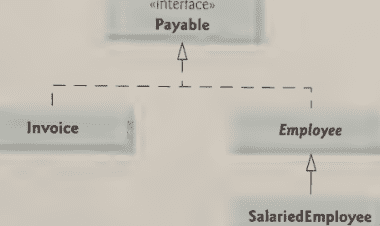

**图 10.10** | Payable 层级结构 UML 类图。

## 10.9.2 接口 Payable

接口 `Payable` 的声明始于图 10.10。`Payable` 接口的声明在图 10.11 中，使用 `implements` 关键字。接口方法默认是公共的且抽象的，不需要显式声明如此。`Payable` 接口只有一个方法，但接口可以包含任意数量的方法。

> **编程实践 10.2**
> 在声明接口时显式使用 `public` 和 `abstract` 可以使你的意图清晰。正如你在 Java SE 8 的 10.10 节看到的，接口允许许多方法。

```java
// 图 10.11: Payable.java
// Payable 声明。

public interface Payable {

    double getPaymentAmount();

}
```

**图 10.11** | Payable 声明。

## 10.9.3 类 Invoice

`Invoice`（图 10.12）代表了 `Payable` 的实现。该类声明了变量（11-26 行）、方法（29-38 行）以及一个 `toString()` 方法（41-46 行）。

```java
// 图 10.12: Invoice.java
// 实现 Payable 的 Invoice。

public class Invoice implements Payable {

    private String partNumber;
    private String description;
    private int quantity;
    private double priceItem;

    public Invoice(String partNumber, String description, int quantity, double priceItem) {
        this.partNumber = partNumber;
        this.description = description;
        this.quantity = quantity;
        this.priceItem = priceItem;
    }

    public String getPartNumber() {
        return partNumber;
    }

    public String getDescription() {
        return description;
    }

    public int getQuantity() {
        return quantity;
    }

    public double getPriceItem() {
        return priceItem;
    }

    @Override
    public double getPaymentAmount() {
        return quantity * priceItem;
    }

    @Override
    public String toString() {
```


```java
return String.format("%s %d %.2f", description, quantity, priceItem);
}
}
```

### 10.12 | Invoice 类实现

## 类只能继承一个类但可以实现多个接口

Java 不允许子类继承多个父类，但允许类继承一个父类并实现所需的多个接口。要实现多个接口，在类定义的 `implements` 之后使用逗号分隔的接口列表，如下：

```java
public class ClassName extends SuperClassName implements FirstInterface, SecondInterface, ...
```

## 软件工程观察 10.9

实现多个接口的类的对象与每个实现类型都具有这种关系。`ArrayList`（第 7.16）是许多实现多个接口的 Java API 类之一。例如，`ArrayList` 实现了 `Iterable`，使得增强 for 语句可以遍历 `ArrayList` 的元素。`ArrayList` 还实现了 `List` 接口（第 16.6 节），该接口声明了可以在任何列表对象上调用的常用方法（如 `add`、`remove`）。

## 10.9.4 修改 Employee 类以实现接口

我们修改 `Employee` 类以实现 `Payable` 接口（图 10.13）。该类的声明与 10.4 相同但有两个例外：

- 10.13 的第 4 行指示类 `Employee` 实现了 `Payable`。
- 第 38 行实现了 `Payable` 的 `getPaymentAmount` 方法。

注意 `getPaymentAmount` 仅仅调用了 `Employee` 的抽象方法 `earnings`。在执行期间，当对 `Employee` 子类的对象调用 `getPaymentAmount` 时，它将调用该子类的具体 `earnings` 方法，该方法知道如何为该子类类型的对象计算收益。

```java
// 图 10.13: Employee.java
// 实现 Payable 的 Employee。
public abstract class Employee implements Payable {
    public abstract double earnings();
    @Override
    public double getPaymentAmount() {
        return earnings();
    }
}
```

### 图 10.13 | 实现 Payable 的 Employee 抽象父类

```java
// 图 10.13: Employee.java
// Employee 抽象父类实现了 Payable。
public abstract class Employee implements Payable {
    private final String firstName;
    private final String lastName;
    private final String socialSecurityNumber;
    // 构造函数
    public Employee(String firstName, String lastName,
        String socialSecurityNumber) {
        this.firstName = firstName;
        this.lastName = lastName;
        this.socialSecurityNumber = socialSecurityNumber;
    }
    // 返回名字
    public String getFirstName() {return firstName;}
    // 返回姓氏
    public String getLastName() {return lastName;}
    // 返回社会安全号
    public String getSocialSecurityNumber() {return socialSecurityNumber;}
    // 返回 Employee 对象的字符串表示
    @Override
    public String toString() {
        return String.format("%s %ssocial security number: %s",
            getFirstName(), getSocialSecurityNumber());
    }
    // 抽象方法必须由具体子类重写
    public abstract double earnings(); // 此处没有实现
    public double getPaymentAmount() {return earnings();}
}
```

## Employee 的子类与接口 Payable

当一个类实现一个接口时，同样的“是（is-a）”继承关系同样适用。`Employee` 类实现了 `Payable`，因此我们可以说 `Employee` 是一个 `Payable`，任何 `Employee` 子类的对象也都是 `Payable`。因此，如果我们按照第 10.5 节，用图 10.13 中新的 `Employee` 父类来更新类层次结构，那么 `SalariedEmployees`、`HourlyEmployees`、`CommissionEmployees` 和 `BaseCommissionEmployees` 都是 `Payable` 对象。正如我们把 `SalariedEmployee` 子类的引用赋值给 `Employee` 变量一样，我们可以将 `SalariedEmployee` 对象（或任何其他 `Employee` 派生类对象）的引用赋值给 `Payable` 变量。`Invoice` 也是 `Payable` 对象，我们可以将 `Invoice` 对象的引用赋值给 `Payable` 变量。

> **软件工程观察 10.10**
> 继承和接口在实现“是（is-a）”关系方面是相似的。实现接口的类的对象可以被视为接口类型的对象。实现接口的类的任何子类的对象也可以被视为该接口类型的对象。

> **软件工程观察 10.11**
> 子类与子类之间、接口与实现它们的类之间存在的“是（is-a）”关系在将对象传递给方法时有效。当方法参数接收到父类或接口类型的参数时，该方法会多态地处理接收作为参数的对象。

> **软件工程观察 10.12**
> 使用父类引用，我们可以多态地调用在子类及其父类中声明的任何方法（例如，类对象）。使用接口引用，我们可以多态地调用在接口、其父接口（一个接口可以扩展另一个接口）以及类对象中声明的任何方法——一个接口类型的变量必须能够引用所有的调用方法，而所有对象都具有类对象的方法。

## 10.9.5 使用接口 Payable 多态地处理 Invoice 和 Employee

`PayableTest`（图 10.4）说明了接口 `Payable` 可以在单个应用程序中多态地处理一组 `Invoice` 和 `Employee`。第 7–1 行声明并初始化了四元素数组 `payableObjects`。第 8–9 行将 `Invoice` 对象的引用放在 `payableObjects` 的前两个元素。第 10–11 行将 `SalariedEmployees` 的引用放在 `payableObjects` 的后两个元素。元素允许用 `Invoice` 和 `SalariedEmployees` 初始化，因为 `Invoice` 是 `Payable`，`SalariedEmployee` 是 `Employee` 且 `Invoice` 也是 `Payable`。

### 图 10.4 | 多态地处理 Invoice 和 Employee 的 Payable 接口测试程序（2 部分中的第 1 部分）

```java
System.out.println(
    "Invoices and Employees processed polymorphically:");
    // 通用地处理数组 payableObjects 中的每个元素
    for (Payable currentPayable : payableObjects) {
        // 输出 currentPayable 及其相应的支付金额
        System.out.printf("%n%s payment: $%.2f%n",
            currentPayable.toString(), // 可以隐式调用
            currentPayable.getPaymentAmount());
    }
```


## 多态地处理的 Invoice 和 Employee

invoice:
part number: 01234 (seat)
quantity: 2
price per item: $375.00
payment due: $750.00

invoice:
part number: 56789 (tire)
quantity: 4
price per item: $79.95
payment due: $319.80

salaried employee: John Smith
social security number: 111-11-1111
weekly salary: $800.00
payment due: $800.00

salaried employee: Lisa Barnes
social security number: 888-88-8888
weekly salary: $1,200.00
payment due: $1,200.00

**图 10.14** | 多态地处理 Invoice 和 Employee 的 Payable 接口测试程序。（2 部分中的第 2 部分）。

第 18–23 行多态地处理 `payableObjects` 中的每个元素，显示对象的字符串表示和支付金额。第 21 行调用 `toString()`，无论对象的实际类型。第 22 行调用 `getPaymentAmount()` 获取支付金额。

## 10.9 Java API 的一些常用接口

在开发 Java 应用时，你会经常使用接口。Java API 包含许多接口，许多 API 方法接收接口参数并返回接口类型。表 10.15 概述了我们在后续章节中使用的一些流行的接口。

| 接口 | 描述 |
|---|---|
| `Comparable` | Java 包含几个比较运算符（例如 `<`, `<=`, `>=`, `!=`）用于比较基本值。然而，这些运算符无法比较对象。`Comparable` 接口用于对集合如 `ArrayList` 进行排序。我们在第 16 章泛型集合和第 20 章泛型类和方法中使用 `Comparable`。 |
| `Serializable` | 接口用于标识可以写入（即序列化）或从（即反序列化）某种存储类型（例如磁盘上的数据）或跨网络传输的类。 |
| `Runnable` | 由表示执行任务的类实现。此类对象通常使用多线程技术（在第 22 章并发中讨论）并行执行。该接口包含一个方法 `run()`，指定了对象的行为。 |
| GUI listener | 你每天都在使用图形用户界面（GUI）。在浏览器中，你可能会输入要访问的网站地址，也可能点击按钮返回之前的网站。浏览器响应你的交互并执行所需任务。你的交互被称为事件，浏览器用于响应事件的代码被称为事件处理器。在第 12 章 FX 用户界面：第 1 部分，你将开始学习构建具有响应用户交互处理器的 GUI。事件处理器声明在实现适当事件监听接口的类中。每个事件监听接口指定了一个或多个必须实现的方法以响应用户交互。 |
| `AutoCloseable` | 用于 try-with-resources 语句（第 11 章异常处理：深度查看）的类实现，有助于防止资源泄漏。我们在第 15 章文件、输入输出流、NIO 和 XML 序列化以及第 24 章使用 JDBC 数据库中使用此接口。 |

## 10.10 Java SE 8 接口增强

### 向现有接口中添加方法

在 Java SE 8 之前，向接口中添加方法会破坏任何没有实现新方法的实现类。请记住，如果你没有实现接口的每个方法，你就必须将你的类声明为抽象类（`abstract`）。

任何实现原始接口的类在添加默认方法时都不会被破坏——该类只需接收新的默认方法。当一个类实现 Java SE 8 接口时，该类与编译器签署了一份“合同”，规定：“我将声明接口指定的所有抽象方法，或者我将我的类声明为抽象类”—实现类不需要重写接口的默认方法，但如果它可以重写也可以重写。


#### 软件工程观察 10.13

Java SE 8 默认方法允许你通过向接口添加方法来演进现有接口，而不会破坏使用它们的代码。

### 接口 vs 抽象类

在 Java SE 8 之前，当没有可以继承的实现细节（即没有字段和方法实现）时，通常使用接口（而不是抽象类）。有了默认方法，你现在可以在接口中声明公共方法的实现。这让你在设计类时具有更大的灵活性，因为一个类可以实现多个接口，但只能扩展一个超类。

### 10.10.2 静态接口方法

在 Java SE 8 之前，通常会与接口联用一个包含静态辅助方法的类，用于处理实现该接口的类。在第 16 章中，你将学习 `Collections` 类，它包含了许多用于处理实现 `Collection`、`List`、`Set` 和 `Map` 对象的静态辅助方法。例如，`Collections.sort()` 方法对任何实现 `List` 接口的类的对象进行排序。有了静态接口方法，这些辅助方法现在可以直接声明在接口中，而不是在独立的类中。

### 10.10.3 函数式接口

从 Java SE 8 开始，任何仅包含一个抽象方法的接口被称为函数式接口——这些也被称为 SAM（单抽象方法）接口。Java API 中有很多这样的接口。示例包括：

- Listener（第 12 章）——你将实现此接口来定义一个与用户控件交互的方法。
- `Comparator`（第 16 章）——你将实现此接口来定义一个比较两个对象的方法，以确定第一个是否小于、等于或大于第二个。
- `Runnable`（第 23 章）——你将实现此接口来定义一个可能并行运行的任务。

函数式接口广泛用于 lambda 表达式，lambda 表达式提供了实现接口的简写。

## 10.11 Java SE 9 私有接口方法

如你所知，接口中的静态方法不能被实现类重写。在 Java SE 9 中，你可以向接口添加私有方法。这些方法用于在接口内部默认方法和静态方法之间共享代码。

#### 常见错误

在 Java SE 9 之前的版本中在接口中包含私有方法会导致编译错误。


## 10.12 私有构造函数

在第 3.4 节，我们提到构造函数通常是公共的。有时将它们设为私有会很有用。

### 防止实例化

你可以通过将构造函数设为私有来防止客户端代码创建对象。例如，考虑一个只包含静态方法的工具类。

### 在构造函数中共享初始化代码

私有构造函数的常见用途之一是在构造函数之间共享初始化代码。你可以使用委托构造函数（在第 8 章引入）来实现。

### 工厂方法

私有构造函数的另一个常见用途是所谓的“工厂方法”。工厂方法是一种创建并初始化对象然后返回其引用的方法。这种架构的一个关键优势是返回类型可以是接口或具体类。

## 10.13 面向接口而非实现编程

通过 `extends` 实现的继承在第 9 章中进行了详细解释。请记住，Java 不允许类继承自多个超类。通过接口继承，一个类在扩展一个类之外，还可以实现多个接口。

### 10.13.1 实现继承最适用于数量较少且紧耦合的类

实现继承主要用于声明具有相同实例变量和方法的密切相关的类。每个子类对象与超类之间存在“是”（is-a）的关系。当你使用超类变量时，可以将子类对象赋值给它。

使用实现继承声明的类是紧耦合的——你在超类中定义一次公共实例变量和方法，然后将它们继承到子类中。实现继承的一个主要缺点是紧耦合会导致修改层次结构变得困难。例如，考虑支持退休计划（如 401K 和 IRA）。我们可能会在 `Employee` 中添加一个 `RetirementDeposit` 方法，然后定义各种子类，如 `SalariedEmployeeWithIRA`、`HourlyEmployeeWith401K`、`HourlyEmployeeWithIRA`。每个子类都需要根据特定的员工和退休计划类型适当地重写 `RetirementDeposit`。如你所见，你很快就会拥有大量的子类，使得层级结构难以维护。

### 10.13.2 接口继承最适用于灵活性

接口继承通常比实现继承需要更多工作，因为你必须提供接口抽象方法的实现——即使这些实现在类之间是相似或相同的。然而，这通过消除类与类之间的紧耦合，为你提供了宝贵的灵活性。当你使用接口类型的变量时，可以将任何实现该接口的直接或间接的对象赋值给它。这允许你轻松地向代码中添加新类型，并用新的改进的实现类对象替换现有对象。

#### 软件工程观察 10.14

Java SE 8 和 Java SE 9 的接口增强（第 10.10–10.11 节）允许接口包含公共、私有实例方法以及带有实现的静态方法——这使得面向接口编程适用于几乎所有之前使用抽象类的场景。除了字段之外，你获得了类提供的所有用处，而且类可以实现任意数量的接口，但只能扩展一个类（抽象或具体的）。

#### 软件工程观察 10.15

正如超类会变化，接口也会变化。如果接口方法的签名发生变化，所有相应的类都需要修改。经验表明，接口的更改频率远低于实现。

### 10.13.3 重新思考员工层次结构

让我们结合组合和接口重新考虑第 10.5 节的员工层次结构。我们可以说层次结构中的每种类型的员工都是拥有 `CompensationModel`（补偿模型）的 `Employee`。我们将 `CompensationModel` 声明为带有一个抽象 `earnings()` 方法的接口，然后声明 `CompensationModel` 实现类以指定员工获取收入的各种方式：

- `SalariedCompensationModel` 将包含一个 `weeklySalary` 变量，并实现 `earnings()` 方法返回 `weeklySalary`。
- `HourlyCompensationModel` 将包含 `wage` 和 `hours` 变量，并根据工作小时实现 `earnings()` 方法，超过 40 小时的部分按 `1.5 * wage` 计算。
- `CommissionCompensationModel` 将包含 `grossSales` 和 `commissionRate` 变量，并实现 `earnings()` 方法返回 `grossSales * compensationRate`。
- `BasePlusCompensationModel` 将包含实例变量 `grossSales`、`commissionRate` 和 `baseSalary`，并实现 `earnings()` 方法返回 `baseSalary + grossSales * compensationRate`。

你创建的每个 `Employee` 对象都可以用相应的 `CompensationModel` 实现类对象进行初始化。`Employee` 类的 `earnings()` 方法只需使用该类组合的 `CompensationModel` 实例变量来调用相应 `CompensationModel` 对象的 `earnings()` 方法。

#### 补偿模型变化时的灵活性

将 `CompensationModel` 实现类声明为实现相同接口的独立类，为未来的变化提供了灵活性。假设根据总销售额支付佣金的员工应该额外获得 10% 的佣金，但有底薪的人不应获得。在第 10.5 节的员工层次结构中，对 `Employee` 类 `earnings()` 方法的此更改（图 10.7）直接影响 `BasePlusCommissionEmployee` 的支付方式，因为 `BasePlusCommissionEmployee` 的 `earnings()` 方法调用了 `CommissionEmployee` 的 `earnings()` 方法。然而，更改 `CommissionCompensationModel` 的 `earnings()` 实现不会影响 `BasePlusCommissionModel` 类，因为这些类没有通过继承紧密耦合。

#### 员工晋升时的灵活性

如果员工晋升，基于接口的组合比第 10.5 节的类层次结构更灵活。`Employee` 类可以提供一个 `setCompensationModel()` 方法，接收一个 `CompensationModel` 并将其分配给 `Employee` 组合的 `CompensationModel` 变量。当员工晋升时，你只需调用 `setCompensationModel()` 用一个新的合适的 `CompensationModel` 对象替换现有的对象。要使用第 10.5 节的员工层次结构晋升员工，你需要通过创建相应类的对象并将数据从旧对象移动到新对象来更改员工类型。练习 10.17 要求你按照本节描述实现接口 `CompensationModel`。

#### 员工获取新能力时的灵活性

使用组合和接口在增强 `Employee` 类方面也比第 10.5 节的类层次结构更灵活。假设我们需要支持退休计划（如 401K 和 IRA）。我们可以说每个员工都有一个 `RetirementPlan`（退休计划），并用 `makeDeposit()` 方法定义 `RetirementPlan`。然后，我们可以为各种退休计划类型提供实现。

## 10.14（可选）GUI 和图形案例研究：使用多态进行绘图

你可能已经注意到 GUI 和图形案例研究练习 8.2 中的绘图程序，形状类有许多相似之处。通过继承，我们可以从 `MyLine`、`MyRectangle` 和 `MyOval` 中“提取”出共同特征，并将它们放在单个形状超类中。然后，使用超类类型的变量，我们可以多态地操纵形状对象。移除冗余代码将产生一个更小、更灵活且易于维护的程序。

### GUI 和图形案例研究练习

**10.11** 修改 GUI 和图形案例研究练习 8.2 中的 `MyLine`、`MyOval` 和 `MyRectangle` 类，以扩展图 10.6 中的类层次结构。`MyShape` 层次结构的类应该是“智能”形状，它们知道如何绘制自己（通过提供的 `GraphicsContext` 告诉它们在哪里绘制）。一旦程序从该层次结构创建一个对象，在它的整个生命周期内就可以作为 `MyShape` 多态地操纵它。

在你的解决方案中，图 10.6 中的 `MyShape` 类必须是抽象的。由于 `MyShape` 代表任意形状，表示层次结构中形状坐标和颜色的数据应该声明为 `MyShape` 的私有实例变量。除了公共数据，`MyShape` 还应该声明以下方法：

- a) 一个无参数构造函数，将形状的所有坐标设置为 0，并将描边颜色设置为 `Color.BLACK`。
- b) 一个构造函数，将坐标和描边颜色初始化为参数的值。
- c) 针对坐标和颜色的 Set 方法，允许程序员设置层次结构中形状的任何数据。
- d) 针对坐标和颜色的 Get 方法，允许程序员检索层次结构中形状的任何数据。
- e) 抽象方法 `draw()`：

```java
public abstract void draw(GraphicsContext gc);
```

程序将调用该方法让 `MyShape` 绘制自己。

为了确保正确的封装，类中的所有数据必须是私有的。`MyLine` 类应提供无参数构造函数和一个带坐标参数的构造函数。`MyOval` 和 `MyRectangle` 类应提供无参数构造函数，以及带坐标、描边颜色以及是否填充参数的构造函数。无参数构造函数在设置默认值外，还应将填充标记标记为 `false`。

为了绘制直线、矩形，如果你知道空间中的两个点。直线通过 `x1, y1` 和 `x2, y2` 连接两个点。如果你为椭圆和矩形有四个坐标 (`x1, y1, x2, y2`)，每个形状都需要一个上边界 x 坐标值（两个 x 坐标中的较小值）、宽度（两个 x 坐标差的绝对值）和高度（两个 y 坐标差的绝对值）。

程序中不应有 `MyLine`、`MyOval` 或 `MyRectangle` 变量——只有 `MyShape` 变量包含 `MyLine`、`MyOval` 和 `MyRectangle` 对象的引用。程序应该生成随机形状并存储在 `ArrayList<MyShape>` 中，并多态地调用每个形状的 `draw()` 方法。在绘制 `MyShape` 对象时，遍历 `ArrayList` 并允许用户指定要生成的形状数量。程序将使用随机数生成来生成并显示指定坐标、描边颜色以及矩形和椭圆是否填充及其填充颜色的形状。

**10.12（绘制修改）** 在之前的练习中，你直接在 `MyLine`、`MyOval` 和 `MyRectangle` 类中创建了 `MyShape` 层次结构。注意 `MyOval` 和 `MyRectangle` 类之间的相似性。重新设计并实现 `MyOval` 和 `MyRectangle` 类的代码，将共同特征“提取”到抽象类 `MyBoundedShape` 中以替换 10.11 中的层次结构。`MyBoundedShape` 应该声明两个与 `MyShape` 类相似的构造函数，但增加了一个指定形状是否已填充的参数。`MyBoundedShape` 类还应该声明用于操作填充标记和填充颜色的 get 和 set 方法，以及计算左上角 x 坐标、左上角 y 坐标、宽度和高度的方法。记住，绘制椭圆或矩形所需的值可以通过两个 (x, y) 坐标计算出来。如果设计合理，新的 `MyOval` 和 `MyRectangle` 类应该只包含两个构造函数和一个 `draw()` 方法。

```text
java.lang.Object
    MyShape
        MyLine
        MyBoundedShape
            MyOval
            MyRectangle
```


图 10.17 | 带有 MyBoundedShape 的 MyShape 层次结构。

## 10.15 总结

本章介绍了多态——即处理类层次结构中共享相同父类的对象的能力，就像它们都是该父类的对象一样。我们讨论了多态如何提高系统的可扩展性和可维护性，以及如何使用重写的方法来实现多态行为。我们引入了抽象类，它允许你提供一个合适的父类，其他类可以从那里继承。你学到了抽象类可以声明抽象方法，每个子类必须实现这些方法才能成为具体类，并且程序可以使用抽象类的变量来多态地调用子类对抽象方法的实现。你还学习了如何在执行时确定对象的类型。我们解释了最终（final）方法和类的概念。本章讨论了通过声明和实现接口，作为可能的独立类实现公共功能的方法，使得这些类的对象能够以多态的方式处理。

我们引入了 Java SE 8 中的接口增强——默认方法和静态方法——以及 Java SE 9 中的私有方法。接下来，我们讨论了私有构造函数和普通构造函数的目的。最后，我们讨论了面向接口编程与面向实现编程的区别，以及如何使用 `CompensationModel` 接口重新实现 `Employee` 层次结构。

你现在应该熟悉类、对象、封装、继承、接口和多态——这些是面向对象编程最重要的方面。

在下一章中，你将学习异常，它有助于处理程序执行期间的错误。异常处理提供了更健壮的程序。

## 总结

### 10.1 节 引言

- 多态（第 408 页）使我们能够编写处理共享相同父类的程序，就像它们都是该父类的对象一样；这可以简化编程。
- 通过多态，我们可以设计并实现易于扩展的系统。程序中必须为了适应新类而修改的部分，只需要对你添加到层次结构中的新类有直接的了解。

### 10.3 节 展示多态行为

- 当编译器遇到通过变量进行的方法调用时，它会通过检查变量的类类型来确定该方法是否可以被调用。如果该类包含适当的方法声明（或继承了该方法），则调用被编译。在执行时，变量所引用的对象的类型决定了实际使用的方法。

### 10.4 节 抽象类与抽象方法

- 抽象类（第 413 页）不能实例化对象，因为它们是不完整的。
- 抽象类的主要目的是提供一个合适的父类，其他类可以从那里继承并共享共同的设计。
- 可以实例化对象的类被称为具体类（第 414 页）。它们提供了所声明的每个方法的实现（或这些实现是继承来的）。
- 程序员经常编写整洁的代码，只使用抽象父类（第 414 页），以减少对特定子类类型的代码依赖。
- 抽象类有时构成层次结构的多个层级。
- 抽象类通常包含一个或多个抽象方法（第 414 页）。
- 抽象方法不提供实现。
- 包含任何抽象方法的类必须声明为抽象类（第 414 页）。每个具体子类都必须提供每个方法的实现。
- 抽象类可以实现接口。
- 构造函数不能声明为抽象。
- 接口变量可以持有子类的引用，并以多态的方式调用子类实现的方法。
- 多态对于实现分层系统特别有效。

### 10.5 节 案例研究：使用多态实现系统

- 接口设计者可以要求子类实现抽象方法，以提供方法的实现。
- 大多数方法调用在执行时解析，基于对象的类型。这被称为动态绑定（第 428 页）。
- 接口变量可以用于调用父类的方法。
- `instanceof` 用于确定一个对象是否具有特定类型。
- 每个接口都知道自己的类，并可以通过 `java.lang` 访问它。
- 接口关系仅适用于父类与子类之间，反之则不然。

### 10.6 节 父类与子类变量之间的赋值

- 将父类引用赋值给子类变量是允许的。

### 10.7 节 final 方法与 final 类

- 在父类中声明为 final（第 431 页）的方法不能在子类中重写。
- 声明为私有的方法隐含是 final 的，因为你无法在子类中重写它们。
- 静态方法隐含是 final 的。
- final 方法调用在编译时解析，这被称为静态绑定（第 431 页）。
- 编译器通过移除方法调用并内联代码来优化程序。
- 声明为 final 的类不能扩展（第 431 页）。
- final 类中的所有方法隐含是 final 的。

### 10.8 节 构造函数调用方法的深度说明

- 如果构造函数和 set 方法对实例变量执行相同的验证，可以在构造函数或 set 方法中重复这些代码。
- 对于复杂的验证，可以定义一个静态方法。

### 10.9 节 创建与使用接口

- 接口（第 432 页）指定了允许的操作，但不规定如何执行。
- Java 接口描述了可以在对象上调用的方法集。
- 接口以 `interface` 关键字开始（第 433 页）。
- 接口中声明的所有方法隐含为 public abstract，所有字段隐含为 public、static 和 final。
- 要使用接口，具体类必须指定它实现了（第 433 页）该接口并声明接口中的每个抽象方法。没有实现接口所有抽象方法的类必须声明为抽象。
- 实现接口就像与编译器签署合同：“我要么声明接口指定的所有方法，要么我声明我的类。”
- 接口通常用于迥异（即无关）的类需要共享公共方法和常量的情况。这允许无关类的对象以多态的方式处理——实现相同接口的对象对相同的方法调用有响应。
- 你可以创建一个描述所需功能的接口；在需要它的类中实现该接口。
- 当没有需要继承的实例变量和默认方法实现时，接口通常替代抽象类。
- 与公共类一样，接口通常是公共类型，因此它们通常定义在与接口同名的 .java 文件中。
- Java 不允许类继承多个父类，但允许一个类继承一个父类并实现多个接口。
- 实现多个接口的类的所有对象与每个实现类型具有 is-a 关系。
- 接口可以声明常量。这些常量隐含为 public、static 和 final。

### 10.10 节 Java SE 8 接口增强：默认方法与静态方法

- 在 Java SE 8 中，接口可以声明默认方法——即具有具体实现的公共方法，用于指定应如何执行操作。
- 当类实现一个接口时，如果该类没有重写这些方法，它将获得接口的默认具体实现。
- 要在接口中声明默认方法，你只需在方法的返回类型之前使用 `default` 关键字，并提供完整的方法体即可。
- 当你使用默认方法增强现有接口时——任何实现原始接口的类都不会被破坏——它们将接收到默认方法的实现。
- 通过默认方法，你可以在接口（而不是抽象类）中声明通用方法的实现，这为你的设计类提供了更大的灵活性。
- 从 Java 8 开始，接口可以包含公共静态方法。
- 从 Java 8 开始，任何只包含一个方法的接口都被称为函数式接口。Java API 中有许多这样的接口。
- 函数式接口广泛用于 Java SE 8 的 lambda 功能。正如你将看到的，lambda 提供了实现函数式接口的简写形式。

### 10.11 节 Java 9 私有接口方法

- 从 Java 9 开始，你可以通过私有接口方法和静态方法在接口中声明辅助方法。

### 10.12 节 私有构造函数

- 你可以通过将类的构造函数设置为私有，防止客户端实例化该类的对象。
- 你可以使用委托构造函数来调用包含共享初始化代码的私有构造函数。
- 你可以使用私有构造函数强制客户端代码使用工厂方法来创建和初始化对象。

### 10.13 节 面向接口编程，而非面向实现

- 通过接口继承，类实现一个描述各种抽象方法的接口，新类可能也会继承某些方法的实现（从 Java 8 起在接口中允许），但不能包含实例变量。
- 接口可以扩展一个或多个其他接口。
- 实现继承主要用于声明紧密相关的类，这些类具有许多相同的实例变量和方法实现。
- 使用实现继承声明的类是紧耦合的。父类的更改会直接影响所有相应的子类。
- 实现继承的一个主要缺点是类之间的紧耦合会导致修改层次结构变得困难。
- 接口继承通常比实现继承需要更多工作，因为你必须提供接口抽象方法的实现——即使这些实现是相似或相同的。
- 接口继承通过消除类与类之间的紧耦合为你提供了额外的灵活性。当你使用接口类型的变量时，你可以直接或间接地赋值于一个实现了该接口的任何类型的对象。

Java SE 8 和 Java SE 9 的增强使得使用接口编程适用于几乎所有以前可能使用抽象类的场景。

## 自测习题

### 填空

a) 如果一个类包含至少一个抽象方法，它是一个 a) ______ 类。
b) 可以实例化对象的类是 ______ 类。
c) ______ 涉及一个变量，用于在父类和子类对象上调用方法，使你能够“进行通用编程（program in the general）”。
d) 不是接口方法且未提供实现的方法必须使用关键字 ______ 声明
e) 将存储在父类中的引用强制类型转换为子类类型称为 ______

### 判断题

判断每个陈述的对或错，并解释原因。
a) 抽象类中的所有方法都必须声明为抽象方法。
b) 不允许通过子类变量调用子类特有的方法。
c) 如果子类声明了一个抽象方法，则子类必须实现该方法。
d) 实现接口的类的对象可以被视为该接口类型的对象。

### 填空（Java SE 8 和 Java SE 9 接口）

a) 在 Java SE 8 中，接口可以声明 ______——即具有具体实现的公共方法，用于指定应如何执行操作。
b) 从 SE 8 开始，接口可以包含 ______ 方法。
c) 从 SE 8 开始，任何只包含一个方法的接口都称为一个(n) ______。
d) 从 SE 9 开始，任何接口可以包含 ______ 实例和静态方法。

## 自测习题答案

- a) abstract. b) concrete. c) Polymorphism（多态性）. d) abstract. e) downcasting（向下类型转换）。
- a) 错误。抽象类可以包含带有实现的方法和抽象方法。
- b) 错误。不允许通过父类变量调用子类特有的方法。
- c) 错误。只有具体的子类必须实现该方法。
- d) 正确。
- a) default methods. b) static. c) functional interface. d) private.

## 习题

- 多态性如何让你能够进行“通用编程”而非“特定编程”？讨论“通用编程”的主要优势。
- 什么是抽象方法？描述在什么情况下抽象方法是合适的。
- 多态性如何促进扩展性？
- 讨论三种适当的方法，可以将父类和子类引用赋值给子类和子类类型的变量。
- 比较并对比抽象类和接口。你为什么要使用抽象类？为什么要使用接口？
- （Java SE 8 接口）解释默认方法如何允许你向现有接口添加新方法，而不破坏实现了原始接口的类。
- （Java SE 8 接口）什么是函数式接口？

### 10.11 (Java SE 8 接口) 为什么能够在接口中添加静态方法是有用的？

### 10.12 (Java SE 9 接口) 为什么能够在接口中添加私有方法是有用的？

### 10.13（工资系统修改）修改 Figs 的工资系统。将 Employee 类的构造函数设置为私有，并调用一个包含共享初始化代码的私有构造函数。使用 Date 类表示员工的生日。向 Employee 类添加方法。假设工资每月发放一次。创建一个 Employee 变量数组来存储员工对象。在循环中，多态地计算每个员工的工资，如果当前是 BasePlus，则为其增加 100.00 的奖金。

### 10.14（形状层次结构）实现 Fig. 9.3 中的 Shape 层次结构。DimensionalShape 应该包含 getArea 来计算面积。ThreeDimensionalShape 应该有 getArea 和 getVolume 来计算面积和体积。使用 Shape 引用数组创建层次结构中的每个类。在处理所有形状的循环中，确定每个形状是 DimensionalShape 还是 ThreeDimensionalShape。如果是 DimensionalShape，显示其面积。如果是 ThreeDimensionalShape，显示其面积和体积。

### 10.15（工资系统修改）修改工资系统 10.4–10.9，增加一个额外的子类 Pieceworker，代表按件支付工资的员工。Pieceworker 应包含实例变量 wage（存储每件工资）和 pieces（存储件数）。在 Pieceworker 类中提供 earnings 方法的具体实现，通过将件数乘以工资来计算员工的收益。创建一个 Employee 变量数组来存储新 Employee 层次结构中每个类的引用。显示其字符串表示和收益。

### 10.16（应付账系统修改）在此练习题中，我们修改 Figs. 10.11–10.14 的应付账应用程序，以完成 Figs. 10.4–10.9 工资应用程序的功能。应用程序仍然处理 Invoice 对象，但现在应处理四个员工子类之一。如果当前处理的对象是 BasePlus，应用程序应将 BasePlus 工资增加 10%。最后，应用程序输出每个对象的支付金额。按照以下步骤创建新应用程序：

a) 修改 HourlyEmployee (Fig. 10.6) 和 CommissionEmployee (Fig. 10.7)，将它们作为实现 Payable 的 Employee (Fig. 10.13) 版本的子类放在付账层次结构中。[提示：将子类中的 earnings 方法重命名为 getPayment，以便类继承其继承的接口 Payable。]
b) 修改 BasePlusCommissionEmployee (Fig. 10.8)，使其扩展 a 创建的 Employee 版本。
c) 修改 PayableInterface (Fig. 10.14)，以多态方式处理两个 Invoice、一个 SalariedEmployee、一个 Hourly、一个 CommissionEmployee 和一个 BasePlusCommissionEmployee。输出每个付账对象的字符串表示。接下来，如果是 BasePlusCommissionEmployee，将其基本工资增加 10%。最后，输出每个付账对象的支付金额。

### 10.17（推荐项目：结合佣金和继承）习题 9.16 要求重构第 9 章的 Employee-BasePlusCommission 继承层次结构-

我们感谢 Oracle 的 Java 语言架构师 Brian Goetz 提供了我们在本次练习中使用的类架构。

作为一个类 Employee，其中每个 Employee 都有一个不同的 `CompensationModel`。在本次练习中，将练习 9.16 中的 `CompensationModel` 重构为一个接口，提供一个公共抽象方法 `earnings`，该方法不接收任何参数并返回一个 double。然后创建以下实现 `CompensationModel` 的类：

a) SalariedCompensationModel——对于每月领取固定周薪的员工，此类应包含一个 `weeklySalary` 实例变量，并实现 `earnings` 方法以返回 `weeklySalary`。

b) HourlyCompensationModel——对于按小时计薪且在每周工作超过 40 小时可获得加班费的员工，此类应包含 `wage` 和 `hours` 实例变量，并根据工作小时数实现 `earnings`（参见图 10.6 中 `Employee` 类的 `earnings` 方法）。

c) CommissionCompensationModel——对于按佣金计薪的员工，此类应包含 `grossSales` 实例变量，并实现 `earnings` 方法以返回 `grossSales * commissionRate`。

d) BaseCommissionModel——对于领取基本工资加佣金的员工，此类应包含 `grossSales`、`commissionRate` 和 `baseSalary` 实例变量，并实现 `earnings` 返回 `baseSalary * grossCommissionRate`。

在你的测试应用程序中，使用上述每种 `CompensationModel` 创建 `Employee` 对象，然后显示每个 Employee 的收益。接下来，动态更改每个 Employee 的薪酬模型并重新绘制每个 Employee 的收益。

### 10.18 (推荐项目)：实现 Payable 接口 修改练习 10.17 中的 `Employee` 类，使其实现图 10.11 中的 `Payable` 接口。将图 10.14 应用中的 Salaried-Employee 对象替换为练习 10.17 中的 `Employee` 对象，并演示 `Employee` 和 `Invoice` 对象如何以多态方式运行。

## 产生影响

### 10.19 (CarbonFootprint 接口：多态) 正如你在本章中学到的，通过接口，你可以为不同的情况创建相似的行为。全球范围内的政府和公司日益关注燃烧各种燃料供热、车辆动力动力等产生的碳足迹（每年向大气排放的二氧化碳）。许多科学家认为这些温室气体导致全球变暖现象。创建三个继承自 `Building` 和 `Bicycle` 的小类。给每个类分配一个合适的属性和一个与其他类不共有的行为。编写一个接口 `CarbonFootprint`，其中包含一个 `getCarbonFootprint` 方法，该方法为该类计算合适的碳足迹（查看几个解释如何计算碳足迹的网站）。编写一个应用程序，创建这三个类的每个对象，将这些对象的引用放入 `ArrayList` 中，然后遍历 `ArrayList`，以多态方式调用每个对象的 `getCarbonFootprint` 方法。对于每个对象，打印一些信息以及该对象的碳足迹。

## 第 11 章 异常处理：深度观察

### 目标

在本章中，你将：

- 学习为什么异常处理是响应运行时问题的有效机制。
- 使用 `try` 块来界定可能发生异常的代码。
- 使用 `throw` 来指示问题。
- 使用 `catch` 块来指定异常处理程序。
- 学习何时使用异常处理。
- 理解异常类层次结构。
- 使用 `finally` 块释放资源。
- 通过捕获一个异常并抛出另一个异常来构建异常链。
- 创建自定义异常。
- 使用调试功能 `assert` 来声明方法特定点应为真的的条件。
- 学习 `try-with-resources` 如何在 `try` 块终止时自动释放资源。

### 11.1 引言

正如你在第 7-8 章所知，异常处理部分基于你所看到的特征。本章关注你将学习的异常类型。我们首先演示当不使用异常处理的应用程序出现错误时会发生什么。异常处理允许应用程序优雅地继续或终止。在情况下，你通过捕获一个异常并抛出另一个来处理异常。我们介绍了异常层次结构并展示如何使用异常处理。我们讨论了 `finally` 块并展示如何创建自己的异常。我们介绍了前提条件和后置条件，这些条件必须为真。我们还介绍了在 try 块结束后自动释放资源的 try-resources 语句。

软件工程观察 11.1

在工业中，你可能会发现设计、编码和标准在不同类型的应用程序之间存在差异，例如实时系统、数学计算、大数据。本章提供了这些类型的观察。

### 11.2 示例：无异常处理的除零操作

| 章节 | 异常示例 |
| --- | --- |
| 7 | ArrayOutOfBoundsException |
| 8–10 | IllegalArgumentException |
| 11 | ArithmeticException, InputMismatchException |
| 15 | SecurityException, FileNotFoundException, IOException, ClassNotFoundException, IllegalStateException, NoSuchElementException |
| 16 | ClassCastException, UnsupportedOperationException, NullPointerException, 自定义异常 |
| 20 | ClassCastException, 自定义异常 |
| 21 | IllegalArgumentException, 自定义异常 |
| 23 | InterruptedException, IllegalMonitorStateException, ExecutionException, CancellationException |
| 24 | SQLException, IllegalStateException, PatternSyntaxException |
| 28 | MalformedURLException, EOFException, SocketException, InterruptedException, UnknownHostException |

图 11.1 | 你在书中看到的各种异常类型

我们首先演示当不使用异常处理的应用程序出现错误时会发生什么。图 11.2 提示用户输入两个整数并将它们传递给 `quotient` 方法，该方法计算整数并返回 int 结果。在本示例中，你将看到当方法检测到问题并无法处理时，它会抛出异常（即异常发生）。


// 图 11.2: DivideByZeroNoExceptionHandling.java

// 无异常处理的整数除法。

import java.util.Scanner;

public class DivideByZeroNoExceptionHandling {

    // 当发生除零时演示抛出异常
    public static int quotient(int numerator, int denominator) {
        return numerator / denominator; // 可能除以零
    }

    public static void main(String[] args) {
        Scanner scanner = new Scanner(System.in);
        System.out.print("请输入一个整数分子: ");
        int numerator = scanner.nextInt();
    }
}

# 第 11 章 异常处理：深度解析

```java
System.out.print("Please enter an integer denominator: ");
int denominator = scanner.nextInt();
int result = quotient(numerator, denominator);
System.out.printf(
    "%d / %d = %d%n", numerator, denominator, result);
}
```

请输入一个整数分子: 100
请输入一个整数分母: 7
结果: 100 / 7 = 14

请输入一个整数分子: 100
请输入一个整数分母: 0
线程 "main" 中的 `java.lang.ArithmeticException`: / by zero
at DivideByZeroExceptionHandling.quotient(
    at DivideByZeroExceptionHandling.java:8)
at DivideByZeroExceptionHandling.main(
    at DivideByZeroExceptionHandling.java:19)

请输入一个整数分子: 100
请输入一个整数分母: hello
线程 "main" 中的 `java.util.InputMismatchException`
at java.util.Scanner.throwFor(Unknown Source)
at java.util.Scanner.next(Unknown Source)
at java.util.Scanner.nextInt(Unknown Source)
at java.util.Scanner.nextInt(Unknown Source)
at DivideByZeroExceptionHandling.main(
    at DivideByZeroExceptionHandling.java:17)

## 堆栈跟踪 (Stack Trace)

图 11.2 中的首次示例执行显示了成功执行。在第二次执行中，用户输入 0 作为分母。针对这一无效输入，程序显示了几行信息。这些信息被称为堆栈跟踪（stack trace），该跟踪包含描述性消息中的异常名称（`java.lang.ArithmeticException`），该消息指示了问题所在，以及问题发生时的方法调用栈（即调用链）。堆栈跟踪包含了通过各种方法导致异常的执行路径。这有助于你调试程序。如果发生了问题，你可以随时调用 `Thread.dumpStack()` 来查看堆栈跟踪。

## ArithmeticException 的堆栈跟踪

第一行指定了发生了 `ArithmeticException`。异常名称后的文本（"/ by zero”）表示该异常是由于尝试除以 0 引起的。Java 不允许在整数算术中除以 0。当这种情况发生时，Java 会抛出 `ArithmeticException`。`ArithmeticException` 可以引起不同的问题，因此额外数据（"/ by zero”）提供了更具体的信息。

从堆栈跟踪的最后一行开始，我们看到异常在 `quotient` 方法的第 19 行被检测到。每个堆栈跟踪包含类名和方法（例如 `DivideByZeroExceptionHandling.main`），随后是文件名和行号（例如 `DivideByZeroExceptionHandling.java:19`）。向上移动堆栈跟踪，我们看到异常发生在 `quotient` 方法的第 8 行。调用链的这一行指示了“抛出点”——异常发生的初始点。此异常的抛出点在 `quotient` 方法的第 8 行。

### 关于浮点数算术的侧记

Java 允许对浮点值进行除以零的操作。计算结果是正无穷或负无穷，表示为显示为 "Infinity" 或 "-Infinity" 的浮点值。如果你将 0.0 除以 0.0，结果是 `NaN`（不是数字），表示为显示为 "NaN" 的浮点值。如果你需要 `NaN` 浮点值，请使用 `Float` 类（针对 float 值）或 `Double` 类（针对 double 值）。`Float` 和 `Double` 类位于 `lang` 包中。

## InputMismatchException 的堆栈跟踪

在第三次执行中，用户输入 "hello" 作为分母。再次注意到堆栈跟踪的存在。它告诉我们发生了 `InputMismatchException`（`java.util` 包）。我们的程序期望数值，并假设用户会输入一个整数值。然而，用户有时会出错并输入非整数值。当 `Scanner.nextInt()` 读取到一个不代表有效整数的字符串时，就会发生 `InputMismatchException`。从堆栈跟踪的末尾开始，我们看到异常在 `main` 方法的第 17 行被检测到。向上移动堆栈跟踪，我们看到异常发生在 `nextInt` 方法中。注意在文件名和行号的地方，提供的是文本 `Unknown Source`。这意味着所谓的调试符号为方法所属类的文件名和行号信息对于 JVM 来说是不可用的——这通常是 Java API 类的情况。许多 IDE 都可以访问 Java API 源码，并在堆栈跟踪中显示文件名和行号。

## 程序终止

在图 11.2 的示例执行中，当发生异常并显示堆栈跟踪时，程序也会退出。这在 Java 中并不总是如此。有时尽管发生了异常并打印了堆栈跟踪，程序可能会继续运行。在这种情况下，应用程序可能会产生意外的结果。图形用户界面（GUI）应用程序通常会继续执行。在图 11.2 中，两种异常都在 `main` 方法中被检测。在下一个示例中，我们将看到如何处理这些异常，以便程序能够正常完成。

## 11.3 示例：处理 ArithmeticException 和 InputMismatchException

图 11.3 中的应用程序基于图 11.2，使用异常处理来处理任何产生的 `ArithmeticException` 和 `InputMismatchException`。应用程序提示用户输入两个整数并将传递给 `quotient` 方法，该方法计算商并返回 `int` 结果。此版本的应用程序使用异常处理，因此如果用户出错，程序会捕获并处理（即应对）异常——在这种情况下，允许用户重新输入。

```java
// Fig. 11.3: DivideByZeroWithExceptionHandling.java
// Handling ArithmeticExceptions and InputMismatchExceptions.
import java.util.InputMismatchException;
import java.util.Scanner;

public class DivideByZeroWithExceptionHandling {
    // demonstrates throwing an exception when a divide-by-zero occurs
    public static int quotient(int numerator
```

请输入一个整数分子: 100
请输入一个整数分母: 7
结果: 100 / 7 = 14

请输入一个整数分子: 100
请输入一个整数分母: 0
Exception: `java.lang.ArithmeticException`: / by zero
0 是无效的分母。请重试。

请输入一个整数分子: 100
请输入一个整数分母: 7
结果: 100 / 7 = 14

请输入一个整数分子: 100
请输入一个整数分母: hello
Exception: `java.util.InputMismatchException`
必须输入整数。请重试。

请输入一个整数分子: 100
请输入一个整数分母: 7
结果: 100 / 7 = 14

**图 11.3** 处理 ArithmeticException 和 InputMismatchException。（2 中的 2 部分。）

11.3 中的首次示例执行没有遇到任何问题。在第二次执行中，用户输入了分母 0，发生了 `ArithmeticException`。在第三次执行中，用户输入字符串 "hello" 作为分母，发生了 `InputMismatchException`。对于每个异常，用户都会被告知并要求重试，然后提示输入新的整数。在每个示例执行中，程序都成功运行。

第 3 行导入了 `InputMismatchException` 类。`ArithmeticException` 类不需要导入，因为它位于 `lang` 包中。第 16 行创建了布尔变量 `continueLoop`，如果用户尚未输入有效输入则为 true。第 18–42 行循环请求输入直到收到有效输入。

### 将代码封装在 try 块中

第 19–29 行包含 try 块，包含了可能抛出异常的代码以及在发生异常时不应执行的代码（即如果发生异常，try 块中的剩余代码将被跳过）。try 块由关键字后跟一个大括号括围的代码块组成。注意，“try 块”有时仅指 try 关键字后面的代码块（不包括 try 关键字）。为了简单起见，我们使用“try 块”指代整个跟在 `try` 关键字后面的代码，以及 `try` 关键字本身。从键盘读取整数的语句（第 21 行和 23 行）分别使用 `nextInt` 方法读取一个 `int` 值。如果读取的值*不是整数*，`nextInt` 方法将抛出 `InputMismatchException`。

导致 `ArithmeticException` 的除法并未在 `try` 块中执行。相反，对 `divide` 方法的调用（第 25 行）触发了尝试除法的代码（第 11 行）；当 denom 时，JVM 会*抛出* `ArithmeticException`。


> **软件工程观察 11.2**
>
> 异常可能通过 `try` 块中显式提到的代码、块中代码发起的深层嵌套方法调用，或者 Java 虚拟机执行字节码时出现。

## 捕获异常

示例中的 `try` 块后面跟着两个 `catch` 块——一个处理 `InputMismatchException`（第 30–36 行），另一个处理 `ArithmeticException`（第 37–41 行）。`catch` 块（也称为 catch 子句或异常处理器）捕获（即接收）并处理异常。`catch` 块以关键字开头，后跟圆括号内的参数（*异常参数*，稍后讨论）以及用大括号包围的代码块。

`try` 块后面必须紧跟至少一个 `catch` 块或 `finally` 块（在第 11.6 节中讨论）。每个 `catch` 块指定了处理器可以处理的异常类型。当 `try` 块中发生异常时，执行的 `catch` 块是*类型与异常类型完全匹配，或是其直接或间接子类的第一个块*。异常参数的名字允许 `catch` 块与捕获的异常对象进行交互——例如，调用被捕获异常的 `toString` 方法（第 31–38 行），并提供有关异常的基本信息。注意，我们使用 `System.err`（标准错误流）对象输出错误消息。默认情况下，`System.out` 输出到命令行提示符。

第一个 `catch` 块中的第 33 行调用了 `scanner.nextLine`。由于发生了 `InputMismatchException`，`nextInt` 方法调用从未成功读取用户数据——因此我们通过调用 `nextLine` 方法读取该输入。在此时我们没有对输入进行任何处理，因为我们知道它是*无效的*。每个 `catch` 块都会显示错误消息并重新请求。在每个 `catch` 块结束后，系统会提示用户输入。我们很快将深入了解异常处理中的控制流是如何工作的。

> **常见编程错误 11.1**
>
> 在 `try` 块与其相应的 `catch` 块之间放置代码是语法错误。

## 多异常捕获 (Multi-catch)

`try` 块后面跟着多个处理不同类型异常的 `catch` 块是比较常见的。如果多个 `catch` 块的代码体相同，可以使用多异常捕获功能在单个 `catch` 处理器中捕获这些异常类型并执行相同的任务。多异常捕获的语法为：

```java
catch (Type1 | Type2 | Type3 e)
```


每个异常之间用竖线（`|`）分隔。之前的代码行表示，任何一种类型（或其子类）都可以在异常处理器中被捕获。多异常捕获中可以指定任何 `Throwable` 类型。在这种情况下，异常参数的类型是指定类型的公共父类。

# 未捕获的异常

未捕获的异常是指没有与之匹配的 `catch` 块的异常。你在图 11.2 的第二次和第三次输出中看到了未捕获的异常。记住，当示例中发生异常时，应用程序提前终止（在显示异常的堆栈跟踪后）。这并不总是由未捕获的异常导致的。Java 使用“多线程”程序执行模型——每个线程都是一个并发活动。一个程序可以有多个线程。如果程序只有一个线程，未捕获的异常将导致程序终止。如果程序有多个线程，未捕获的异常将终止发生异常的线程。然而，在程序中，某些线程依赖于其他线程，如果一个线程由于未捕获的异常而终止，可能会对程序的其余部分产生不利影响。第 23 章“并发”将深入讨论这些问题。

# 异常处理的终止模型

如果在 `try` 块中发生异常（例如图 11.3 第 23 行代码导致抛出 `InputMismatchException`），`try` 块立即终止，程序控制转移到后续异常参数类型与异常类型匹配的 `catch` 块。在图 11.3 中，第一个 `catch` 块捕获 `InputMismatchException`（输入无效输入时发生），第二个 `catch` 块捕获 `ArithmeticException`（当尝试除以零时发生）。异常被处理后，程序控制不会返回到抛出点，因为 `try` 块已过期（其局部变量已丢失）。相反，控制在最后一个块之后恢复。这被称为异常处理的终止模型。某些语言使用异常处理的恢复模型，在处理异常后从抛出点之后继续执行。

注意，我们根据类型为参数命名（`InputMismatchException` 和 `ArithmeticException`）。Java 程序员经常使用字母 `e` 作为异常的名称。

执行 `catch` 块后，程序控制将进入最后一个 `catch` 块之后的第一个语句（在本例中第 42 行）。

## 11.3 异常处理：深入探讨

## 11.4 何时使用异常处理

如果第 21 行产生 `InputMismatchException`，`try` 块将终止，并执行第 36 行的 `catch` 块。在这种情况下，`quotient` 方法不会被调用。然后，`main` 方法继续执行。

异常处理设计用于处理执行时发生的同步错误。我们在书中常见的示例有：范围索引、算术溢出（例如超出可表示范围的值）、除以零、无效参数以及线程中断（我们将在第 23 章中看到）。异常处理并不是为了处理与异步事件相关（例如磁盘 I/O、网络消息、鼠标点击和击键），这些事件是并行的且独立于程序的控制流。


从设计初期就将异常处理和错误恢复策略整合到你的系统中——在系统实现之后再这样做是非常困难的。


异常处理提供了一种统一的技巧，用于记录、检测和恢复错误。这有助于开发大型项目的程序员理解彼此的错误处理代码。


各种情况都会产生异常——某些异常比其他异常更容易恢复。


有时你可以通过先验证数据来防止异常。例如，在执行整数除法之前，你可以确保分母不为零，从而防止除以零时发生 `ArithmeticException`。

## 11.5 Java 异常体系

所有异常类直接或间接地继承自 `Exception`，形成一个层次结构。你可以用自己的异常类扩展此层次结构。

11.4 显示了 `Throwable` 类（`Object` 的子类）层次结构的一小部分，它是 `Exception` 类的父类。只有 `Throwable` 对象可以用于异常处理机制。`Throwable` 有两个直接子类：`Exception` 和 `Error`。`Exception` 类及其子类（例如 `java.lang` 中的 `RuntimeException` 和 `java.io` 中的 `IOException`）代表 Java 程序中可能发生并可以被应用程序捕捉的异常情况。`Error` 类及其子类代表发生在 JVM 中的异常情况，不应被应用程序捕捉——应用程序通常无法从 `Error` 中恢复。


## 466 第 11 章 异常处理：深度观察


**图 11.4** | `Throwable` 类继承层次结构的一部分。

Java 异常体系包含数百个类。关于 Java 异常类的信息可以在整个 Java API 中找到。你可以在此处查看 `Throwable` 的文档：

http://docs.oracle.com/javase/8/docs/api/java/lang/Throwable.html

从那里，你可以查看该类的子类，以获取关于 Java 异常和错误的更多信息。

### 检查异常与未检查异常

Java 区分了检查异常（checked exceptions）和未检查异常（unchecked exceptions）。这种区别非常重要，因为 Java 编译器对检查异常强制执行特殊要求（稍后讨论）。异常的类型决定了它是检查的还是未检查的。

### RuntimeException 是未检查异常

所有 `RuntimeException`（`java.lang`）直接或间接子类的异常类型都是未检查异常。这些通常是由程序代码中的缺陷引起的。未检查异常的示例包括：

- `ArrayOutOfBoundsExceptions`（第 7 章中讨论）——你可以通过确保数组索引始终大于等于 0 且小于数组长度来避免这些异常。
- `ArithmeticException`（除以零时发生）。

## 11.6 finally Block

获取某些资源的程序必须将其返回给系统，以避免所谓的资源泄漏。在 C 和 C++ 等编程语言中，最常见的资源泄漏是内存泄漏。Java 对程序不再使用的内存进行自动垃圾回收，这避免了绝大多数内存泄漏。然而，可能会发生其他类型的资源泄漏。例如，文件、数据库连接和网络连接在不再需要后没有正确关闭，它们可能仍被其他程序使用。

### 预防技巧 11.4

> 一个微妙的一点是，Java 并没有完全消除内存泄漏。在对某个对象没有引用之前，Java 不会对其进行垃圾回收。因此，如果你错误地保留了对不需要对象的引用，就会发生内存泄漏。

可选的 `finally` 块（有时称为 `finally` 子句）由 `finally` 关键字以及大括号括起来的代码组成。如果存在，它被放在最后一个 `catch` 块之后。如果没有 `catch` 块，则必须提供 `finally` 块并会立即执行该块。

### finally Block 的执行时

无论相应的 `try` 块是否抛出异常，`finally` 块都会执行。如果 `try` 块通过 `return`、`break` 或 `continue` 语句退出，或者通过到达右大括号，`finally` 块也会执行。`finally` 块不会执行的唯一情况是应用程序通过调用 `System.exit()` 提前退出 `try` 块。我们在第 15 章演示了这种方法，它可以立即终止应用程序。

如果在 `try` 块中发生异常，它可以被 `try` 块的一个 `catch` 处理器捕获，此时程序将跳过 `try` 块的剩余部分，控制进入 `finally` 块。如果程序未捕获异常，程序将异常传递到下一个外层的 `try` 块——通常在调用方法中——那里关联的 `catch` 块可能会捕获它。这个过程可以通过多层 `try` 块发生。此外，异常可能未被捕获（正如我们在 11.3 节中讨论的那样）。

如果 `catch` 块抛出异常，`finally` 块仍然会执行。然后异常将传递给下一个外层的 `try` 块——同样，通常在调用方法中。

### 在 Finally Block 中释放资源

由于 `finally` 块总是执行，因此它通常包含资源释放代码。假设在 `try` 块中分配了一个资源。如果没有异常，`catch` 块将被跳过，控制进入 `finally` 块，由该块释放资源。然后控制进入 `finally` 块之后的第一条语句。如果在 `try` 块中发生异常，`try` 块将终止。如果程序在相应的 `catch` 块中捕获了异常，它将处理该异常，然后 `finally` 块释放资源，控制进入 `finally` 块之后的第一条语句。如果程序没有捕获异常，`finally` 块仍然释放资源，并尝试调用方法中捕获该异常。


### 预防技巧 11.5

`finally` 块是释放 `try` 块中获取的资源（如打开的文件）的理想位置，这有助于消除资源泄漏。

### 性能提示 11.1

始终在资源不再需要的最早时刻显式地释放它。这使得资源能够尽早重用，从而提高资源利用率和程序性能。

#### Finally

图 11.5 展示了即使在相应的 `try` 块没有抛出异常，`finally` 块也会执行。程序包含静态方法（第 5-14 行）、`throwException`（第 17–35 行）和 `doesNotThrowException`（第 38–50 行）。`throw` 和 `doesNotThrowException` 方法声明为静态，因此 `main` 可以直接调用它们而无需实例化 `UsingExceptions` 对象。

```java
// Fig. 11.5: UsingExceptions.java
// try...catch...finally 异常处理机制。

public class UsingExceptions {

    public static void main(String[] args) {

        try {

            throwException();

        } catch (Exception exception) { // throwException 抛出的异常

            System.err.println("Exception handled in main");

        }

        doesNotThrowException();

        // 演示 try...catch...finally 

        public static void throwException() throws Exception {

            try { // 抛出异常并立即捕获

                System.out.println("Method throwException");

                throw new Exception(); // 生成异常

            } catch (Exception exception) { // 捕获 try 中抛出的异常

                System.err.println("Exception handled in method throwException");

                throw exception; // 重抛出以便进一步处理

            } // 这里的代码不会执行；

            finally { // 无论 try...catch 发生什么都会执行

                System.err.println("Finally executed in throwException");

            }

        }

    }
}
```

图 11.5 | try...catch...finally 异常处理机制。（2 部分中的第 I 部分）

```java
34 // 这里的代码不会执行；会导致编译错误

35 }

36 // 演示在未发生异常时的 finally

37 public static void doesNotThrowException() {

38     try { // try 块未抛出异常

39         System.out.println("Method doesNotThrowException");

40     }

41     catch (Exception exception) { // 不执行

42         System.err.println(exception);

43     }

44     finally { // 无论 try...catch 发生什么都会执行

45         System.err.println("Finally executed in doesNotThrowException");

46     }

47 }

48 // 

49     System.err.println("End of method");

50 }
```

图 11.5 | try...catch...finally 异常处理机制。（2 部分中的第 II 部分）

## 11.6 finally Block 471

（注：OCR 提供的第 524-525 页文本高度碎片化且包含重叠的代码片段。上述内容是根据提供的片段重构的逻辑流。）

# 11.7 栈回溯与从异常获取信息

## 良好的编程实践 11.1

异常将错误处理代码从程序代码的主逻辑行中分离，以提高程序的清晰度。不要在每个可能抛出异常的语句周围放置 `try...catch...`。这会降低可读性。相反，在代码的很大部分放置一个块，在 try 之后跟随处理每个异常的 catch 块，并在 catch 块之后跟随一个单一的 finally 块（如果需要的话）。

## 11.7 栈回溯与从异常获取信息

当异常被抛出但在特定方法中未被捕获时，方法调用栈会被“回溯”，并尝试在下一个外层的 try 块中捕获该异常。这个过程被称为栈回溯。方法栈回溯意味着未捕获到异常的方法将终止，该方法中的所有局部变量超出作用范围，控制权返回最初调用该方法的语句。如果有一个块封装了该语句，则会尝试捕获异常；如果仍未捕获，将再次发生栈回溯。图 11.6 展示了栈回溯，main 方法中的异常处理程序显示了如何访问异常对象的数据。

```java
// Fig. 11.6: UsingExceptions.java
// 栈回溯和从异常对象获取数据。

public class UsingExceptions {

    public static void main(String[] args) {

        try {

            method1();

        }

        catch (Exception exception) { // catch method1 中抛出的异常

            System.err.printf("%s%n", exception.getMessage());

            exception.printStackTrace();

        }

        // 获取堆栈跟踪信息

        StackTraceElement[] traceElements = exception.getStackTrace();

        System.out.printf("%s%n", "stack trace from getStackTrace:");

        System.out.printf("Class:%s\tFile:%s\tLine:%s\n",

        // 遍历 traceElements 获取异常描述

        for (StackTraceElement element : traceElements) {

            System.out.printf("%s\t", element.getClassName());

            System.out.printf("%s\t", element.getFileName());

            System.out.printf("%s\t", element.getLineNumber());

            System.out.printf("%s%n", element.getMethodName());

        }

    }

}
```

Fig. 11.6 | 栈回溯和从异常对象获取数据。（2 部分中的 1 部分）

# 474 第 11 章 异常处理：深度观察

```java
28 // 调用 method2; 将异常抛回给 main

29 public static void method1() throws Exception {

30     method2();

31 }

32 

33 

34 // 调用 method3; 将异常抛回给 method1

35 public static void method2() throws Exception {

36     method3();

37 }

38 

39 // 将异常抛回给 method2

40 public static void method3() throws Exception {

41     throw new Exception("Exception thrown in method3");

42 }

43 }
```

在 method3 中抛出的异常

```java
java.lang.Exception: Exception thrown in method3
```


at `UsingExceptions.method3(UsingExceptions.java:41)`

at `UsingExceptions.method2(UsingExceptions.java:36)`

at `UsingExceptions.method1(UsingExceptions.java:31)`

```
stack trace from getStackTrace:

| 类 | 行号 | 方法 |
| :--- | :--- | :--- |
| UsingExceptions.java | 41 | method3 |
| UsingExceptions.java | 36 | method2 |
| UsingExceptions.java | 31 | method1 |
| UsingExceptions.java | 7 | main |
```

> Fig. 11.6 | 栈回溯和从异常对象获取数据。（2 部分中的 2 部分）

## 栈回溯

在 `main` 中，当异常被抛出但在特定方法中未被捕获时，方法调用栈回溯，尝试在下一个外层的 `try` 块中捕获异常。方法栈回溯意味着未捕获到异常的方法将终止，该方法中的所有局部变量超出作用范围，控制权返回到最初调用该方法的语句。如果有一个块封装了该语句，则会尝试捕获异常；如果仍未捕获，将再次发生栈回溯。由于没有 `catch` 块处理异常，栈回溯再次发生——`method2` 终止并返回到 `try` 块所在的语句。由于没有 `catch` 块处理异常，栈回溯再次发生——`method1` 终止并返回到最初抛出异常的语句。由于没有 `catch` 块处理异常，栈回溯再次发生——`main` 终止并返回到最初抛出异常的语句。由于没有 `catch` 块处理异常，栈回溯再次发生。

775

异常异常异常获取数据

所有异常都继承自 `Throwable`，它有一个 `printStackTrace` 方法输出到标准错误流（见 11.2 节）。通常你可能想要访问异常的堆栈跟踪。这样做，使用 `getStackTrace()` 方法，它返回 `StackTraceElement` 数组。每个 `StackTraceElement` 堆栈栈中的一个帧。异常将错误处理代码从程序代码的主逻辑行中分离，以提高程序的清晰度。不要在每个可能抛出异常的语句周围放置 `try...catch...`。这会降低可读性。相反，在代码的很大部分放置一个块，在 `try` 之后跟随处理每个异常的 `catch` 块，并在 `catch` 块之后跟随一个单一的 `finally` 块（如果需要的话）。

## 11.7 栈回溯与从异常获取信息

### 从异常对象获取数据

`StackTraceElement` 提供了类名、文件名、行号和方法名等信息。`Throwable` 还提供了 `getMessage()` 方法，返回与异常相关的消息。它还提供了 `toString()` 方法，返回异常的字符串表示，包括类名和消息。

Java SE 9 在 `java.lang` 包中引入了栈行走 API（`StackWalker` 类），它使用 Lambda 和流（第 17 章）以更高效的方式访问方法调用栈信息。你可以在此处了解更多关于该 API 的信息：

```
http://openjdk.java/
```

## 1.8 链式异常

有时方法通过抛出一个特定于当前的异常类型来响应异常。如果 `catch` 块抛出一个新异常，原始异常的信息和堆栈跟踪将会丢失。早期的 Java 版本没有将原始异常信息封装在新异常中的机制，无法提供发生原始问题的完整堆栈跟踪。这使得调试此类问题特别困难。链式异常允许异常对象维护原始异常的完整堆栈跟踪信息。图 11.7 展示了链式异常。

```java
// Fig. 11.7:UsingChainedExceptions.java

// 链式异常。

public class UsingChainedExceptions {

    public static void main(String[] args) {

        try {

            method1();

        } catch (Exception exception) { // catch method1 中抛出的异常

            exception.printStackTrace();

        }

    }

    // 调用 method2; 将异常抛回给 main

    public static void method1() throws Exception {

        try {

            method2();

        } catch (Exception exception) { // method2 中抛出的异常

            throw new Exception("Exception thrown in method1", exception);

        }

    }

    // 调用 method3; 将异常抛回给 method2

    public static void method2() throws Exception {

        try {

            method3();

        } catch (Exception exception) { // method3 中抛出的异常

            throw new Exception("Exception thrown in method2", exception);

        }

    }

}
```

```java
34 // 将异常抛回给 method2

35 public static void method3() throws Exception {

36     throw new Exception("Exception thrown in method3");

37 }

38 }
```

```java
java.lang.Exception: Exception thrown in method1

Caused by: java.lang.Exception: Exception thrown in method2

    at UsingChainedExceptions.method1(UsingChainedExceptions.java:17)

    at UsingChainedExceptions.main(UsingChainedExceptions.java:7)

Caused by: java.lang.Exception: Exception thrown in method2

    at UsingChainedExceptions.method2(UsingChainedExceptions.java:27)

    at UsingChainedExceptions.method1(UsingChainedExceptions.java:17)

    ... 1 more

Caused by: java.lang.Exception: Exception thrown in method3

    at UsingChainedExceptions.method3(UsingChainedExceptions.java:36)

    at UsingChainedExceptions.method2(UsingChainedExceptions.java:27)

    ... 2 more
```

图 11.7 | 链式异常。（2 部分中的第 2 部分）

## 程序控制流

程序有四个方法：`main`（第 5–12 行）、`method1`（第 15–22 行）、`method2`（第 25–32 行），且 `main` 方法 `try` 块中的第 7 行调用 `method1`。`method1` 方法 `try` 块中的第 17 行调用 `method2`。`method2` 方法 `try` 块中的第 27 行调用 `method3`。第 36 行抛出一个 `Exception`。由于第 36 行不在 `try` 块中，`method3` 终止，异常返回到第 27 行的 `catch` 块（`method2`）。该语句位于 `try` 块中；因此，`try` 块终止并在第 29–31 行捕获异常。`catch` 块中的第 30 行抛出一个新异常。我们调用了带有两个参数的 `Exception` 构造函数——第二个参数代表导致问题原始原因的异常。在程序中，该异常发生在第 36 行。由于从 `catch` 块中抛出了异常，`method2` 终止并将异常返回给第 17 行的 `method1`。再次，该语句位于 `try` 块中，`try` 块终止并在第 19–20 行被捕获。`catch` 块中抛出新异常时使用了捕获的异常作为 `Exception` 构造函数的第二个参数。由于从 `catch` 块中抛出了异常，`method1` 终止并将新异常返回给第 7 行的 `main`。`main` 中的 `try` 块终止，异常在第 9–11 行被捕获。第 10 行打印堆栈跟踪。

## Throwable 方法 getCause

对于任何链式异常，你都可以通过调用 `Throwable` 方法 `getCause` 获取最初导致该异常的 `Throwable` 对象。

## 程序输出

注意程序输出，前三行显示了最近抛出的异常（即来自第 20 行 `method1` 抛出的异常）。接下来的四行指示了从第 27 行的 `method2` 抛出的异常。最后，最后四行代表了从第 36 行的 `method3` 抛出的异常。此外，请注意，如果你反向读取输出，它显示了剩余多少个链式异常。

## 11.9 声明新异常类型

大多数 Java 程序员都在使用来自 Java API、第三方供应商类以及免费提供的类库（通常可以从互联网下载）来构建 Java 应用程序。这些类的方法通常在发生问题时声明为抛出异常。你编写代码来处理这些现有异常，以使你的程序更加健壮。

如果你构建了其他程序员将使用的类，那么声明你自己的异常类通常是合适的，这些异常专门针对其他程序员使用你的可用类时可能发生的特定问题。

### 新异常类型必须继承现有类型

新的异常类必须继承一个异常类，以确保该类可以使用异常处理机制。异常类就像任何其他类；然而，一个典型的异常类除了四个构造函数外没有其他成员：

- 一个不接受任何参数并向父类构造函数传递默认错误消息 String
- 一个接收 String 格式的自定义错误消息并将其传递给父类构造函数
- 一个接收 String 格式的自定义错误消息以及一个 `Throwable`（用于链式异常）并将两者都传递给父类构造函数
- 一个接收 `Throwable`（用于链式异常）并将其传递给父类构造函数

> **良好的编程实践 11.2**
> 将每种运行时故障与命名恰当的 `Exception` 类关联起来可以提高程序的清晰度。

> **软件工程观察 11.15**
> 大多数程序员不需要声明他们自己的异常类。在定义你的研究之前，请使用 Java API 中现有的类并尝试选择一个已经存在的类。如果没有合适的异常类，尝试扩展相关的异常类。例如，如果你正在创建一个类来表示方法执行了除以零的操作，你扩展了 `ArithmeticException`，因为除以零发生在算术过程中。如果现有类不是你新异常类的合适父类，请决定你的新类应该是检查异常（checked）还是未检查异常（unchecked）。如果要求客户端处理异常，则新异常类应该是检查异常（即继承 `Exception` 但不是 `RuntimeException`）。客户端应用程序应该能够合理地从此类异常中恢复。如果客户端代码能够忽略该异常（即该异常是未检查异常），则新异常类应该继承 `RuntimeException`。

> **良好的编程实践 11.3**
> 根据惯例，所有异常类的名称都应该以 `Exception` 结尾。


## 11.10 前条件和后条件

程序员花费大量时间维护和调试代码。为了便于这些任务并改进整体设计，你可以在方法执行前后指定预期状态。这些状态分别被称为前条件和后条件。

### 前条件

前条件在方法被调用时必须为真。前条件描述了方法参数以及方法执行前对当前状态的预期。如果不满足前条件，则方法的行为是未定义的——它可能会抛出异常、带有非法值继续或从错误中恢复。

### 后条件

后条件在方法成功返回后为真。后条件描述了返回值以及方法可能产生的任何副作用。在定义方法时，你应该记录所有后条件，以便他人知道在调用你的方法时可以期待什么，并且在前条件确实满足的情况下，确保你的方法遵守了所有后条件。

# 480 第 11 章 异常处理：深入探讨

虽然断言可以作为注释在程序开发期间为您提供指导，但 Java 包含了两个版本的断言语句，用于通过程序方式验证断言。断言语句评估一个布尔表达式，如果为假，则抛出 `AssertionError`（`Error` 的子类）。断言语句的第一种形式是：

```
assert expression;
```

如果 `expression` 为假，则会抛出 `AssertionError`。第二种形式是：

```
assert expression1 : expression2;
```

如果 `expression1` 为假，则评估 `expression1` 并以 `expression2` 作为错误消息抛出 `AssertionError`。

你可以使用断言通过程序化实现先置条件和后置条件，或验证任何有助于你确保代码正常运行的中间状态。图 11.8 展示了 `assert` 语句。第 9 行提示用户输入 0 到 10 之间的数字，然后第 10 行读取该数字。第 13 行判断用户输入的数字在有效范围内。如果数字超出范围，断言语句将报告错误；否则，程序正常继续。

```java
// Fig. 11.8: AssertTest.java

// 使用 assert 检查值是否在范围内

import java.util.Scanner;

public class AssertTest {

    public static void main(String[] args) {

        Scanner input = new Scanner(System.in);

        System.out.print("Enter a number between 0 and 10: ");

        int number = input.nextInt();

        // 断言该值 >= 0 且 <= 10

        assert(number >= 0 && number <= 10) : "bad number: " + number;

        System.out.printf("You entered %d\n", number);

    }

}
```


图 11.8 | 使用 assert 检查值是否在范围内

你主要使用断言来调试和识别应用程序中的逻辑错误。在执行程序时，必须显式启用断言，因为它们会影响性能，且对程序的用户是不必要的。要这样做，请使用 `java` 命令的 `-ea` 命令行选项，如下：
`java -ea AssertTest`

## 11.12 try-with-Resources：自动资源释放


用户不应该遇到 `AssertionError`——这些应该只在程序开发期间使用。因此，你不应该捕获 `AssertionError`。相反，让程序终止，这样你就可以看到错误消息，定位并修复问题所在。你不应该使用 `assert` 来指示生产代码中的运行时问题（正如我们在图 11.8 中为了演示而做的那样）——为此目的应使用异常机制。

## 11.12 try-with-Resources：

通常，释放资源的代码应该放在 `finally` 块中，以确保无论在相应的 `try` 块中使用资源时是否发生异常，资源都能被释放。另一种表示法——`try-with-resources` 语句规范了编写代码的方式，即获取一个或多个资源，在 `try` 块中使用它们，并在相应的 `finally` 块中释放它们。例如，文件处理应用程序使用 `try-with-resources` 语句处理文件，以确保在文件不再需要时能够正确关闭——我们将在第 15 章中演示这一点。每个资源必须是实现 `AutoCloseable` 接口的类对象，从而提供 `close` 方法。

`try-with-resources` 语句的一般形式为：

```java
try (ClassName resource = new ClassName()) {

    // 在此处使用 theObject，在 try 块结束时释放其资源

} catch (Exception e) {

    // 使用资源时发生异常

}
```


其中 `ClassName` 是实现 `AutoCloseable` 的类。此代码创建了一个 `ClassName` 对象，在 `try` 块中使用它，并在 `try` 块结束时（或者在发生异常的 `catch` 块结束时）调用其 `close` 方法以释放资源。在 `try` 之后的括号中创建多个 `AutoCloseable` 对象。你将在第 15 和 24 章看到 `try-with-resources` 语句的示例。

## Java SE 9：try-with-Resources 可以使用 final 变量

Java SE 8 引入了有效 final 变量。如果编译器可以推断出变量在声明和初始化后从未被修改，那么该变量就是有效 final（effectively final）的。这种变量频繁与 lambda 配合（第 17 章）。从 SE 9 开始，你可以创建一个 `AutoCloseable` 对象并将其赋值给显式声明为 final 或有效 final 的局部变量。然后你可以在 `try-with-resources` 语句在 try 块结束时释放对象。

## 第 11 章 异常处理：深入探讨

```java
ClassName theObject = new ClassName();

try (theObject) {

    // 在此处使用 theObject，在 try 块结束时释放资源

} catch (Exception e) {

    // 使用资源时发生异常

}
```

如之前，你可以在此后的括号中使用分号 (`;`) 分隔多个 `AutoCloseable` 对象。这简化了 `try-with-resources` 语句的代码，特别是对于使用并释放多个 `AutoCloseable` 对象的情况。

## 11.3 总结

在本章中，你学习了如何使用异常处理来处理错误。你学习了异常处理能够让你从程序的执行主线移除错误处理代码。我们展示了如何使用 `try` 块封装可能抛出异常的代码，以及如何使用 `catch` 块处理可能出现的异常。你学习了异常处理的终止模型，即异常被处理后，程序控制不会返回到抛出点。我们讨论了检查异常与未检异常，以及如何使用 `throws` 子句指定方法可能抛出的异常。你学习了 `finally` 块无论是否发生异常都会释放资源。我们还学习了如何使用 `printStackTrace` 和 `getMessage` 方法获取异常信息。接下来我们介绍了链式异常，它允许你用新异常信息包装原始异常。我们展示了如何创建你的异常类。我们引入了先置条件和后置条件，帮助程序员理解方法在调用和返回时必须满足的条件。当不满足先置和后置条件时，方法通常会抛出异常。我们讨论了 `assert` 语句以及它如何用于帮助调试程序。特别是，`assert` 可用于确保满足先置和后置条件。我们还引入了多异常捕获以在同一个 `catch` 处理程序中处理多种异常，以及在 `try` 块使用资源后自动释放资源的 `try-with-resources` 语句。在下一章中，我们将深入探讨图形用户界面 (GUI)。

# 总结

## 11.1 引言
- 异常是程序执行期间问题的指示。
- 异常处理允许程序员创建可以异常的应用程序。

### 11.2 示例：没有异常处理的除零
- 当方法检测到问题且无法处理时，会抛出异常 (p. 457)。
- 异常的堆栈跟踪 (p. 458) 包含了指示发生问题的消息以及异常发生时的完整方法调用栈。
- 程序中发生异常的点称为抛出点 (p. 459)。

### 11.3 示例：处理 ArithmeticException 和 InputMismatchException
- `try` 块 (p. 461) 封装了可能抛出异常的代码以及在异常发生时不应执行的代码。
- 异常通过 `try` 块中显式提到的代码、对其他方法的调用或由 `try` 块发起的深度嵌套方法调用出现。
- `catch` 块 (p. 462) 带有 `catch` 关键字和异常参数，随后跟一个处理异常的代码块。当 `try` 块检测到异常时，该代码执行。
- `try` 块之后必须紧跟一个 `catch` 块或 `finally` 块 (p. 462)。
- `catch` 块在异常参数中指定要处理的异常类型。参数名称允许 `catch` 块与捕获的异常对象进行交互。
- 未捕获异常 (p. 463) 是指发生没有匹配 catch 块的发生异常。如果程序只包含一个线程，未捕获异常将导致程序提前终止。否则，只有发生异常的线程将终止。程序的其余部分将带有不利运行。
- 多异常捕获 (p. 463) 允许你在单个 catch 处理程序中捕获多种异常类型，并对每种异常执行相同的任务。多异常捕获的语法使用竖线 (`|`) 分隔类型，如下：

```
catch (Type1 | Type2 | Type3 e)
```


- 如果 `try` 块中发生异常，`try` 块立即终止，程序控制转移到参数类型与异常类型匹配的第一个 `catch` 块。
- 异常被处理后，程序控制不返回到抛出点，因为 `try` 块已过期。这就是异常处理的终止方法 (p. 463)。
- 如果发生异常时有多个 catch 块，只执行第一个。
- `throws` 子句 (p. 464) 在方法参数列表之后、方法体之前指定一个用逗号分隔的方法可能抛出的异常列表。

### 11.4 何时使用异常处理
- 异常处理处理语句执行时发生的同步错误 (p. 465)。
- 异常处理设计用于处理与异步事件 (p. 465) 相关的问题，这些事件与程序的控制流并行且独立发生。

### 11.5 Java 异常层次结构
- 所有 Java 异常类都直接或间接继承自 `Exception` 类。
- 程序员可以通过自己的异常类扩展 Java 异常层次结构。
- `Throwable` 类是 `Exception` 的父类，因此也是所有异常的父类。只有 `Throwable` 对象可以用于异常处理机制。
- `Throwable` 类 (p. 465) 有两个子类：`Exception` 和 `Error`。

## 第 11 章 异常处理：深度探析
- `Exception` 类及其子类代表 Java 程序中可能发生并能被应用程序捕获的问题。
- `Error` 类及其子类代表可能在 Java 运行时系统中发生的问题。`Error` 的发生频率很低，通常不应该被应用程序捕获。
- Java 将异常分为两类（第 466 页）：Java 编译器不确定一个未检查异常（unchecked exception）是否被捕获或声明。可以通过适当的编码来防止未检查异常。
- `RuntimeException` 的子类代表未检查异常。所有继承自 `Exception` 类但不继承自 `RuntimeException`（第 466 页）的异常类型都是已检查的（checked）。
- 如果编写了一个 `catch` 块来捕获父类的异常对象，它也可以捕获该类所有子类的对象。这允许对异常进行多态处理。

## 第 11.6 节 finally 块
- 获取某些类型资源的程序会将它们返回给系统，以避免所谓的资源泄漏（第 469 页）。资源释放代码通常放置在 `finally` 块中（第 469 页）。
- `finally` 块是可选的。如果存在，它被放在最后一个 `catch` 块之后。
- 无论在相应的 `try` 块或任何相应的 `catch` 块中抛出异常，`finally` 块都会执行。
- 如果异常无法被 `try` 块关联的处理器捕获，控制将进行到 `finally` 块。然后，异常将传递给下一个外层的 `try` 块。
- 如果 `catch` 块抛出了异常，`finally` 块仍然会执行。然后，异常将传递给下一个外层的 `try` 块。
- `throw` 语句（第 471 页）可以抛出任何 `Throwable` 对象。
- 当 `catch` 块在接收到异常后决定无法处理该异常或只能部分处理它时，异常会被重新抛出（第 472 页）。重新抛出异常会将异常处理（或部分处理）推迟另一个 `catch` 块。
- 当发生 `return` 时，外层的 `finally` 块会检测到重新抛出的异常，并且 `try-catch` 块将尝试处理它。

## 第 11.7 节 堆栈回溯和从异常获取信息
- 当异常被抛出但在特定方法中未被捕获时，方法栈会被回溯，并尝试在下一个外层的 `try` 语句中捕获该异常。
- `Throwable` 提供了 `printStackTrace` 方法，可以打印方法栈跟踪。这在测试和调试中通常很有用。
- `Throwable` 还提供了 `getStackTrace` 方法，用于获取与 `printStackTrace` 输出相同的堆栈跟踪信息（第 475 页）。
- `getStackTrace`（第 475 页）以 `StackTraceElement` 对象数组的形式获取堆栈跟踪信息。每个 `StackTraceElement` 代表方法栈上的一个栈帧。
- `StackTraceElement`（第 475 页）的 `getClassName()`、`getFileName()`、`getLineNumber()` 和 `getMethodName()` 分别返回类名、文件名、行号和方法名。

## 第 11.8 节 链式异常
- 链式异常（第 476 页）允许异常对象维护完整的堆栈跟踪信息，包括关于导致当前异常的先前异常的信息。

## 第 11.9 节 声明新异常类型
- 新的异常类必须继承现有的异常类，以确保该类可以用于异常处理机制。

## 第 11.10 节 前置条件和后置条件
- 方法的前置条件（第 479 页）在调用方法时必须为真。
- 方法的后置条件（第 479 页）在方法成功返回后为真。
- 在设计自己的方法时，你应该在方法声明之前的注释中说明前置条件和后置条件。

## 第 11.11 节 断言
- 断言（第 479 页）有助于捕获潜在的 bug 并识别可能的逻辑错误。
- `assert` 语句（第 480 页）允许进行断言。
- 运行程序时使用 `-ea` 可以启用断言。

## 第 11.12 节 try-with-resources
- 获取某些类型资源的程序将其返回给系统以避免所谓的资源泄漏（第 469 页）。资源释放代码通常放置在 `finally` 块中（第 469 页）。
- `finally` 块是可选的。如果存在，它被放在最后一个 `catch` 块之后。
- 无论在相应的 `try` 块或任何相应的 `catch` 块中抛出异常，`finally` 块都会执行。
- 如果异常无法被 `try` 块关联的处理器捕获，控制将进行到 `finally` 块。然后，异常将传递给下一个外层的 `try` 块。
- 如果 `catch` 块抛出了异常，`finally` 块仍然会执行。然后，异常将传递给下一个外层的 `try` 块。
- `throw` 语句（第 471 页）可以抛出任何 `Throwable` 对象。
- 当 `catch` 块在接收到异常后决定无法处理该异常或只能部分处理它时，异常会被重新抛出（第 472 页）。重新抛出异常会将异常处理（或部分处理）推迟另一个 `catch` 块。
- 当发生 `return` 时，外层的 `finally` 块会检测到重新抛出的异常，并且 `try-catch` 块将尝试处理它。
- `try-with-resources` 语句（第 481 页）简化了代码编写。当 `try` 块完成时，它会自动关闭资源。资源必须是实现了 `AutoCloseable` 接口的类（第 481 页）。

## 自测习题

### 11.16 (捕获子类类型的异常)
它的 `ExceptionA` 和 `ExceptionC` 继承自 `ExceptionB`。编写一个程序证明类型为 `ExceptionA` 的 `catch` 块可以捕获类型为 `ExceptionB` 和 `ExceptionC` 的异常。

### 11.17 (使用类 Exception 捕获异常)
编写一个程序，演示如何使用 `catch (Exception exception)` 捕获各种异常。

这次，定义类 `ExceptionA`（继承自类 `Exception`）和 `ExceptionB`（继承自类 `ExceptionA`）。在你的程序中，创建 `try` 块抛出类型为 `ExceptionA`、`ExceptionB`、`NullPointerException` 和 `10Exception` 的异常。所有异常都应该由指定类型为 `Exception` 的 `catch` 块捕获。

### 11.18 (catch 块的顺序)
编写一个程序，证明 `catch` 块的顺序很重要。如果你尝试在捕获子类类型之前捕获父类异常类型，编译器应该生成错误。

### 11.19 (构造函数失败)
编写一个程序，显示构造函数将构造失败的信息传递给异常处理器。定义类 `SomeClass`，它在构造函数中抛出一个 `Exception`。你的程序应尝试创建一个 `SomeClass` 类型的对象，并捕获从构造函数抛出的异常。

### 11.20 (重新抛出异常)
编写一个程序演示重新抛出异常。定义方法 `someMethod()` 和 `someMethod2()`。方法 `someMethod2()` 最初抛出一个异常。方法 `someMethod()` 应调用 `someMethod2()`，捕获该异常并重新抛出它。从 `main()` 调用 `someMethod()`，并打印此异常的堆栈跟踪。

### 11.21 (使用外部作用域捕获异常)
编写一个程序，证明带有 `try` 块的方法并不需要捕获 `try` 内部生成的每一个可能的错误。某些异常可以逃逸到其他作用域并在那里被处理。

## 12 JavaFX 图形用户界面：第一部分

## 目标
在本章中，你将：
- 构建 JavaFX GUI 并处理用户与其交互时生成的事件。
- 理解 JavaFX 窗口的结构。
- 使用 JavaFX Scene Builder 创建 FXML 文件来描述包含 `Label`、`ImageView`、`TextField`、`Slider` 和 `Button` 的 JavaFX 场景，而无需编写任何代码。
- 使用 `VBox` 和 `GridPane` 布局容器安排 GUI 组件。
- 使用控制器类为 JavaFX FXML GUI 定义事件处理程序。
- 构建两个 JavaFX 应用。


## 12.1 简介
图形界面（GUI）为与应用程序交互提供了一种易于操作的机制。GUI（读作 "GOO-ee"）提供了独特的“外观和感觉”。GUI 由 GUI 组件构建——也称为控件（controls）或小部件（widgets，window gadgets 的缩写）。组件是一个用户通过鼠标、键盘或其他输入形式（如语音识别）与之交互的对象。


> **外观与感觉观察 12.1**
>
> 图形界面（GUI）为与应用程序交互提供了一种易于操作的机制。GUI（读作 "GOO-ee"）提供了独特的“外观和感觉”。GUI 由 GUI 组件构建——也称为控件（controls）或小部件（window gadgets 的缩写）。组件是一个用户通过鼠标、键盘或其他输入形式（如语音识别）与之交互的对象。

### GUI 历史
直到最近，Swing 是主要的 GUI。JavaFX 在 2007 年由 Sun Microsystems（后被 Oracle 收购）宣布。JavaFX 1.0 于 2010 年发布。在此之前，Java 使用抽象窗口工具包（AWT）。

JavaFX 相比 Swing 的某些优势包括：
- JavaFX 更容易使用。
- JavaFX 有更好的线程支持。
- JavaFX 使用 GPU（图形处理器）进行硬件加速渲染。
- JavaFX 支持用于重新定位和调整的变换。
- JavaFX 为现有的 GUI 提供了升级路径。

JavaFX 的组织方式不同。Scene Builder 工具是一个独立的工具，可以在各种 IDE（包括 IntelliJ IDEA 和 NetBeans）中使用。每个工具生成的代码不同。

JavaFX Scene Builder 允许你通过从 Scene Builder 库中拖放组件到设计区域来创建 GUI，然后修改并设置 GUI 样式——无需编写任何代码。你可以使用层级样式表（CSS）来更改 GUI 的整个外观和感觉。在第 22 章中，我们将介绍...

你可以在此处下载 Scene Builder：
```
http://gluonhq.com/labs/scene-builder/
```

## 12.2 JavaFX Scene Builder

## 12.3 JavaFX 窗口结构

## 12.4 欢迎 GUI——显示文本和图像
- 12.4.1 打开 Scene Builder 并创建文件 `Welcome.fxml`
- 12.4.2 为包含 `welcome.fxml` 的文件夹添加图像
- 12.4.3 创建 `VBox` 布局容器
- 12.4.4 配置 `VBox` 布局容器
- 12.4.5 添加并配置 `Label`
- 12.4.6 添加并配置 `ImageView`
- 12.4.7 预览欢迎 GUI

## 12.5 小费计算器应用——事件处理简介
- 12.5.1 测试小费计算器应用
- 12.5.2 技术概览
- 12.5.3 构建应用的 GUI
- 12.5.4 `TipCalculator` 类
- 12.5.5 `TipCalculatorController` 类

## 12.6 其他 JavaFX 章节中的特性

## 12.7 总结
总结 | 自测练习题 | 自测练习题答案 | 产生影响


## 软件工程 12.1
FXML 代码与 Java 源代码中定义的程序逻辑分离——这种界面（GUI）与实现（Java 代码）的分离使得 JavaFX 应用程序更容易调试、修改和维护。

## 12.3 JavaFX 应用程序结构
JavaFX 应用程序窗口由几个部分组成（图 12.1）。

### 控件 (Controls)
控件是 GUI 组件，例如：
- 显示文本的 `Label`、允许程序接收输入的 `TextField`、用户点击以触发动作的 `Button`，以及更多其他组件。

### 舞台 (Stage)
显示 JavaFX 应用 GUI 的窗口被称为阶段（stage），它是 `Stage` 类的实例（位于 `javafx.stage` 包）。

### 场景 (Scene)
舞台包含一个活跃的场景，该场景将 GUI 定义为场景图——一种应用程序视觉元素的树形结构，如控件、形状、图像、视频、文本等（将在第 12.7 节中讨论）。场景是 `Scene` 类的实例（`javafx.scene`）。

### 节点 (Nodes)
场景图中的每个元素都是一个节点——`Node` 类的实例（位于 `javafx.scene` 包），它定义了所有节点的共同属性和行为。除了场景图中的第一个节点（场景中的根节点没有父节点）外，节点可以具有变换（例如移动、旋转和缩放）、透明度（节点是透明、半透明还是不透明）、效果（例如阴影、模糊、反射和光照）等，我们将在第 22 章中介绍。

## 用户界面：第一部分

### 布局容器 (Layout Containers)
拥有子节点的节点通常是布局容器，它们在场景中排列其子节点。你将在本章中使用两个布局容器（`VBox` 和 `GridPane`），并在第 13–22 章中学习其他几个。在布局容器中排列的节点是控件的组合，在更复杂的 GUI 中，可能是其他布局容器。

### 事件处理器和类 (Event Handler and Class)
当用户与控件交互时（例如点击 `Button` 或在 `TextField` 中输入文本），控件会产生一个事件。程序可以响应这些事件——被称为事件处理——以指定当发生每次用户交互时应该发生什么。事件处理器是响应用户交互的方法。FXML GUI 的处理器定义在所谓的控制器类（controller class）中（正如你将在 12.5 节中看到的）。

## 12.4 欢迎应用——显示文本和图像
在本节中，你将在不编写任何代码的情况下，构建一个 GUI，该 GUI 在 `Label` 中显示文本，在 `ImageView` 中显示图像（图 12.2）。你将使用视觉化编程技术将 JavaFX 组件拖放到 Scene Builder 的内容面板（设计区域）上。接下来，你将使用 Scene Builder 的检查器（Inspector）来配置选项，例如 `Label` 的文本和字体大小，以及 `ImageView` 的图像。最后，你将使用 Scene Builder 窗口菜单中的“显示预览”（Show Preview）选项来完成 GUI。在第 12.5 节的提示计算器应用中，我们将讨论加载和显示 FXML GUI 所需的 Java 代码。然后，在练习 12.3 中，你将创建一个显示你在本节中构建的欢迎 GUI 的 Java 应用程序。

### 12.4.1 打开 Scene Builder 并创建文件 Welcome.fxml
打开 Scene Builder，以便你可以创建定义 GUI 的 FXML 文件。窗口最初显示如图 12.3 所示。窗口顶部的“Untitled”（未命名）表示 Scene Builder 创建了一个你尚未保存的新 FXML 文件。选择文件（File）> 保存（Save）显示另存为对话框，选择存储文件的位置，将文件命名为 `Welcome.fxml` 并点击保存按钮。

库（Library）包含 JavaFX 容器。你使用检查器（Inspector）窗口来配置内容面板中当前选中的项目。你使用内容面板来获取其他可以拖放到画布上的其他项目。

文档（Document）窗口的层次结构（Hierarchy）部分显示 GUI 的结构，并允许你选择和重新组织控件。

### 12.4.2 向包含 Welcome.fxml 的文件夹添加图像
你将为此应用使用的图像（`bug.png`）位于本章示例文件夹下的 images 子文件夹中。为了在你准备好将图像添加到应用程序时能够找到它，请在你的文件系统中找到 images 文件夹，然后将 `bug.png` 复制到保存 `Welcome.fxml` 的文件夹中。

### 12.4.3 创建 VBox 布局容器
对于此应用，你将一个 `Label` 和一个 `ImageView` 放置在 `VBox` 布局（`javafx.scene.layout`）中，这将场景的根节点。布局容器有助于从上到下垂直排列并设置 GUI 组件。我们将在第 12.5 节讨论 `GridPane`，并在第 13 章讨论其他。主要区别是 Scene Builder 在 Windows 和 Linux 上几乎完全相同，但 Scene Builder 在 Windows 10 上截取的屏幕中，其菜单栏位于顶部。你也可以将 `VBox` 拖放到 Scene Builder 的内容面板上。

### 12.4.4 配置 VBox 布局容器
你现在将指定 `VBox` 的对齐方式、初始大小和内边距。

#### 指定 VBox 的对齐方式
`VBox` 的对齐方式（Alignment）决定了 `VBox` 子元素的布局位置。在应用程序中，我们希望每个子元素（`Label` 和 `ImageView`）水平居中，这样在 `Label` 上方和 `ImageView` 下方就有相等的空间。为了实现这一点：
1. 点击 Scene Builder 内容面板中的 `VBox` 选择它。Scene Builder 在检查器的属性（Properties）部分显示了许多 `VBox` 属性。
2. 点击对齐（Alignment）属性的下拉列表，注意你可以使用的多种对齐值。点击 `CENTER`（居中）设置对齐。

你为 JavaFX 对象指定的每个属性都用于在 JavaFX 运行时创建该对象时设置该对象的其中一个实例变量。

#### 指定 VBox 的首选大小
场景图根节点的首选大小（宽度和高度）被场景在应用程序启动时用于确定窗口大小。要设置首选大小：
1. 选择 `VBox`。
2. 点击右侧的箭头（►）展开检查器的布局（Layout）部分。该部分会展开，右箭头变为向下箭头。再次点击行箭头将折叠该部分。
3. 点击首选宽度（Pref Width）属性的文本框，输入 `450` 并按回车更改首选宽度。
4. 点击首选高度（Pref Height）属性的文本框，输入 `300` 并按回车更改首选高度。

### 12.4.5 添加并配置 Label
接下来，你创建一个显示“Welcome to JavaFX!”的 `Label`，

#### 将 Label 添加到 VBox
点击右侧的箭头（►）展开场景库窗口的控件（Controls）部分，从控件部分将 `Label` 拖放到 Scene Builder 内容面板中的 `VBox` 中。（你也可以通过双击容器部分中的 `Label` 来添加它。）Scene Builder 根据 `VBox` 的对齐属性，自动在 `VBox` 中水平和垂直居中 `Label` 对象。

#### 修改 Label 的文本
你可以通过双击 `Label` 并输入新文本，或者通过选择 `Label` 并在检查器的属性部分设置其 Text（文本）属性来设置 `Label` 的文本。

#### 修改标签的字体
为了实现这一点，我们将 `Label` 设置为大号粗体字体。方法是：选择 `Label`，然后在检查器（Inspector）的属性（Properties）部分，点击 Font（字体）属性右侧的值。在弹出的窗口中，将 Style（样式）属性设置为 Bold（粗体），并将 Size（大小）属性设置为 30。现在的设计应如图 12.4 所示。

### 12.4.6 添加和配置 ImageView
最后，你将添加显示 `bug.png` 的 `ImageView`。

#### 在 VBox 中添加 ImageView
从库（Library）窗口的 Controls（控件）部分将 `ImageView` 拖放到 `Label` 正下方，如图 12.5 所示。你也可以双击库窗口中的 `ImageView`，在这种情况下 Scene Builder 会自动将新的 `ImageView` 对象放置在 `Label` 下方。你可以通过将控件拖入 `VBox` 或 Document（文档）窗口的 Hierarchy（层级结构）部分（图 12.3）来重新排列 `VBox` 的控件。Scene Builder 会自动将 `ImageView` 在 `VBox` 中水平居中。还请注意，`Label` 和 `ImageView` 在垂直方向上也是居中的，使得 `Label` 上方和 `ImageView` 下方显示的空间相等。

#### 设置 ImageView 的图像
接下来，你将设置要显示的图像：
1. 选择 `ImageView`，然后在检查器的属性部分点击 Image（图像）属性右侧的省略号 (...) 按钮。默认情况下，Scene Builder 会打开一个显示 FXML 文件所在文件夹的对话框。这里就是你在 12.4.2 节放置图像文件 `bug.png` 的地方。
2. 选择图像文件，然后点击 Open（打开）。Scene Builder 会显示图像并调整 `ImageView` 的大小以匹配图像的宽高比——即图像宽度与高度的比例。

#### 修改 ImageView 的大小
我们希望按其原始大小显示图像。如果你重置 `ImageView` 的默认 Fit Width（适应宽度）和 Fit Height（适应高度）属性值——这些是 Scene Builder 在向设计中添加 `ImageView` 时设置的——Scene Builder 将把 `ImageView` 调整为图像的精确尺寸。要重置这些属性：
- 展开检查器的 Layout（布局）部分。
- 将鼠标悬停在 Fit Width 属性的值上。这将显示属性值右侧的按钮。点击按钮并选择 Reset to Default（重置为默认值）来重置该值。这种技术可以用于任何属性值以重置其默认值。
- 重复步骤 2 以重置 Fit Height 属性的值。

你现在已经完成了 GUI。Scene Builder 的内容面板现在应该如图 12.6 所示。通过选择 File（文件）> Save（保存）保存 FXML 文件。

### 12.4.7 预览欢迎 GUI
你可以预览设计在运行应用程序窗口中的外观。选择 Preview（预览）> Show Preview in Window（在窗口中显示预览），这将显示图 12.7 所示的窗口。

## 12.5 小费计算器应用—事件处理简介
小费计算器应用（图 12.8）计算并显示餐厅账单的小费和总额。默认情况下，应用按 15% 的小费计算总额。你可以通过移动 `Slider`（滑块）块来指定从 0% 到 30% 的小费百分比——这会更新小费百分比。在本节中，你将使用多个 JavaFX 组件构建一个小费计算器应用，并学习如何响应用户与 GUI 的交互。

### 12.5.1 初始的小费计算器 GUI
小费计算器应用（图 12.8）计算并显示餐厅账单的小费和总额。默认情况下，应用按 15% 的小费计算总额。你可以通过移动 `Slider` 滑块来指定从 0% 到 30% 的小费百分比——这会更新小费百分比。在本节中，你将使用多个 JavaFX 组件构建一个小费计算器应用，并学习如何响应用户与 GUI 的交互。

### 12.5.2 技术概述
本节介绍了构建小费计算器应用将使用的技术。

#### Application
负责启动 JavaFX 应用的类是 `Application`（`javafx.application`）的子类。当子类的 `main` 方法被调用时：
1. `main` 方法调用 `Application` 的静态 `launch` 方法开始执行应用程序。
2. `launch` 方法反过来导致 JavaFX 运行时创建一个 `Application` 子类的对象并调用其 `start` 方法。
3. `Application` 子类的 `start` 方法创建 GUI，将其附加到 `Scene`，并将其放置在接收参数的 `Stage` 上。

#### 使用 GridPane 排列 JavaFX 组件
回顾布局容器在 Scene 中排列 JavaFX 组件。`GridPane`（`javafx.scene.layout`）按列和行将 JavaFX 组件排列成矩形网格。这个 `GridPane`（图 12.9）将视图排列为两列五行。`GridPane` 中的每个单元格可以是空的，也可以包含一个或多个 JavaFX 组件，包括排列其他控件的布局容器。`GridPane` 中的每个组件可以跨越多个列或行，尽管我们在此 GUI 中没有使用该功能。当你将 `GridPane` 画在 Scene Builder 的内容面板上时，Scene Builder 默认创建一个两列三行的 `GridPane`。你可以根据需要添加列和行。当我们介绍构建 GUI 的步骤时，我们将讨论其他 `GridPane` 功能。

#### 使用 Scene Builder 创建和自定义 GUI
你将通过将拖到 Scene Builder 的内容面板来创建标签（`Label`）、文本字段（`TextField`）、滑动块（`Slider`）和按钮（`Button`），然后使用检查器（Inspector）窗口对它们进行自定义。
- `TextField`（package `javafx.scene.control`）可以接受来自用户的文本输入或显示文本。你可以使用一个可编辑的 `TextField` 来输入用户的账单金额，并使用两个不可编辑的 `TextField` 显示类型和总额。
- `Slider`（package `javafx.scene.control`）默认表示 0.0–100.0 范围内的值，并允许用户通过移动 `Slider` 的滑块在该范围内选择一个数字。你将对 `Slider` 进行自定义，使用户只能从 0 到 30 这一更有限的整数范围内选择自定义的小费百分比。
- `Button`（package `javafx.scene.control`）允许用户启动操作——在此应用程序中，点击 Calculate 按钮将显示小费和总金额。

#### 将数字格式化为特定区域的货币和百分比字符串
你将使用 `NumberFormat`（package `java.text`）来创建特定区域的货币和百分比字符串——这是国际化的重要组成部分。

#### 事件处理
通常，用户通过与 GUI 交互来指示应用程序应该执行的任务。例如，当你写电子邮件时，点击电子邮件的发送按钮告诉应用程序发送电子邮件地址。

GUI 是事件驱动的。当用户与 GUI 组件交互时，这种交互（被称为“事件”）会驱动程序执行某项任务。常见的用户交互会触发应用程序执行任务，例如点击按钮、在文本字段中输入内容、从菜单中选择项目、关闭窗口和移动鼠标。响应事件执行任务的代码被称为事件处理器（event handler），而响应事件的过程被称为事件处理（event handling）。

在应用程序对特定控件的事件响应之前，你必须：
1. 定义一个实现相应接口的事件处理器——该接口被称为事件监听器接口（event-listener interface）。
2. 指定当事件发生时应通知此类的对象——即告知事件处理器。

在此应用程序中，你将响应两个事件：当用户移动 `Slider` 的滑块时，应用程序将更新显示当前小费百分比的 `Label`；当用户点击 Calculate `Button` 时，应用程序将计算并显示小费和总账单金额。

你会发现对于某些事件——例如用户点击按钮——你可以使用 Scene Builder 检查器窗口的 Code 部分将控件链接到其事件处理方法。在这种情况下，事件监听器接口已为你实现，以便你调用需要的方法。而对于在控件属性值更改时发生的事件——例如用户移动 `Slider` 来改变 `Slider` 的值——你会发现你必须完全在代码中创建事件处理器。

> 2. 回忆新的 JavaMoney API（`http://github.com/javamoney`）开发是为了应对处理货币、货币金额、转换、舍入和格式化面临的挑战。在编写本文时，它尚未整合到 JDK 中。

#### 实现 ChangeListener 处理 Slider 位置变化
你将实现 `ChangeListener`（package `javafx.beans.value`）接口来响应用户移动 `Slider` 滑块的动作。具体来说，你将使用 `changed` 方法在用户移动 `Slider` 滑块时显示更新后的小费百分比。

#### 模型-视图-控制器 (MVC) 架构
以 FXML 实现 GUI 的 JavaFX 应用程序遵循模型-视图-控制器（MVC）设计模式，该模式将应用程序的数据（包含在模型中）与应用程序的 GUI（视图）以及应用程序的处理逻辑（控制器）分离开。

控制器实现处理用户输入的逻辑。模型包含应用程序数据，视图呈现存储在模型中的数据。当用户提供输入时，控制器根据给定的输入修改模型。在小费计算器中，模型是账单金额、小费和总额。当模型发生变化时，控制器更新视图以呈现更改的数据。

在 JavaFX FXML 应用程序中，控制器类包含用于编程交互控件的实例变量，以及响应用户交互的事件处理方法。控制器还可能声明支持应用程序运行的实例变量、静态变量和方法。在像小费计算器这样简单的应用程序中，模型和控制器通常合并为一个类，正如我们在示例中所做的那样。

#### FXMLLoader 类
当 JavaFX FXML 应用程序开始执行时，使用 `FXMLLoader` 类的静态方法 `load` 来加载表示应用程序 GUI 的 FXML 文件。该方法：
- 创建 GUI 的场景图（包含 GUI 的布局和控件）——并返回一个指向场景图根节点的 `Parent`（package `javafx.scene`）引用。
- 为通过编程方式操作的组件初始化控制器的实例变量。
- 创建并注册 FXML 中指定的任何事件的事件处理器。我们将在第 12.5.4–12.5.5 节中详细讨论这些步骤。

## 12.5.3 构建应用程序的 GUI
在本节中，我们将展示创建小费计算器 GUI 的精确步骤。在完成这些步骤之前，GUI 看起来将像图 12.8 所示。

### 此应用程序的 id 属性值
如果控制器将通过编程方式操作控件或布局（我们将这样做），你必须为该控件或布局提供一个名称。在第 12.5.4 节中，你将学习如何在 FXML 中指定此内容，我们将讨论这些变量是如何初始化的。你可以通过选择组件，然后展开检查器窗口的 Code 部分来设置——`fx:id` 属性出现在 Code 部分的顶部。为了清晰起见，我们的命名规范是使用 `fx:id` 属性。

### 创建 TipCalculator.fxml 文件
如你在第 12.4 节中所做的，打开 Scene Builder 创建一个新的 FXML 文件。然后，选择 File > Save As，指定存储文件的位置，将文件命名为 `TipCalculator.fxml` 并点击 Save 按钮。

### 步骤 1：添加一个 GridPane
从 Library 窗口的 Containers 部分将 `GridPane` 拖到 Scene Builder 的内容面板上。默认情况下，`GridPane` 包含两列和三行，如图 12.11 所示。

### 步骤 2：向 GridPane 添加行
回想图 12.9 中的 GUI 有两列和五行。在这里你将额外添加两行。要在现有行上方或下方添加行：
1. 右键点击任何行的数字，并选择 Grid Pane > Add Row Above 或 Grid Pane > Add Row Below。
2. 重复此过程以添加另一行。

添加两行后，`GridPane` 应该如图 12.12 所示。你可以使用类似的步骤添加列。你可以通过右键点击包含行或列编号的标签并选择 Delete 来删除行或列。

### 步骤 3：将控件添加到 GridPane
你将把图 12.9 中的所有控件添加到 `GridPane` 中。对于图 12.10 中具有 id 的控件，当你将控件拖到 `GridPane` 时，在检查器窗口的 Code 部分设置控件的 `fx:id` 属性。执行以下步骤：
1. 添加 `Label`。从 Library 窗口的 Controls 部分将 `Label` 拖到第 0 列（`GridPane` 的左侧）的前四行。在添加 `Label` 时，如图 12.9 所示设置其文本。
2. 添加 `TextField`。从 Library 窗口将 `TextField` 拖到第 1 列（`GridPane` 的右侧）的第 0、2 和 3 行。
3. 添加 `Slider`。从 Library 窗口的 Controls 部分将水平 `Slider` 拖到第 1 列的第 1 行。
4. 添加 `Button`。从 Library 窗口的 Controls 部分将 `Button` 拖到第 1 列的第 4 行。将按钮文本更改为 Calculate。你可以通过双击按钮，或选择按钮并在检查器窗口的 Properties 部分中设置其 Text 属性来设置按钮文本。

`GridPane` 应该如图 12.13 所示。

### 步骤 4：调整 GridPane 的大小以适应其内容
当你开始通过添加布局来设计 GUI 时，Scene Builder 会自动将布局对象的 `Pref Width`（首选宽度）属性设置为 600，`Pref Height`（首选高度）属性设置为 400，这远大于 GUI 的最终宽高。对于此应用程序，我们希望布局的大小根据其内容自动计算。要进行此更改：
1. 首先，点击 `GridPane` 来选择它，但不要点击已放置在其列和行中的任何控件。有时，在 Scene Builder 文档窗口的 Hierarchy（层级结构）部分中选择 `GridPane` 节点会更方便。
2. 在 Inspector（检查器）的 Layout（布局）部分中，将 `Pref Width` 和 `Pref Height` 属性值重置为默认值（如你在 12.4.4 节中所做）。这将这两个属性都设置为 `USE_COMPUTED_SIZE`，以便布局计算其大小。

### 步骤 5：将 GridPane 第 0 列的内容右对齐
默认情况下，`GridPane` 列的内容是左对齐的。要让第 0 列的内容右对齐，点击该列顶部或底部的标签选择它，然后在 Inspector 的 Layout 部分中，将 `Halignment`（水平对齐）属性设置为 `RIGHT`。

### 步骤 6：调整 GridPane 列的大小以适应其内容
默认情况下，Scene Builder 将每个 `GridPane` 的宽度设置为 100 像素，每行的高度设置为 30 像素，以确保你可以轻松将控件拖入 `GridPane` 的单元格中。在此应用程序中，我们调整每列的大小以适应其内容。要这样做，点击该列顶部或底部的标签选择该列，然后在 Inspector 的 Layout 部分中，将 `Pref Width` 属性重置为默认大小（即 `USE_COMPUTED_SIZE`），表示该列的宽度应基于其最宽的子控件——在本例中是 Amount `Label`。对第 1 列重复此过程。`GridPane` 应该会显示如图 12.15 所示。

### 步骤 7：调整按钮大小
默认情况下，Scene Builder 根据文本设置 `Button` 的宽度。对于此应用程序，我们选择让 `Button` 的宽度与 `GridPane` 右列中的其他控件相同。要这样做，选择 `Button`，然后在 Inspector 的 Layout 部分中，将 `Max Width` 属性设置为 `MAX_VALUE`。这会导致 `Button` 的宽度增长以填充整个列的宽度。

### 预览 GUI
通过选择 Preview > Show Preview in Window 预览 GUI。如图 12.16 所示，左列的 `Label` 和右列的控件之间没有空间。此外，`GridPane` 周围没有间隙，因为默认情况下 Stage（阶段）的大小会适应 Scene 的内容。许多控件触及了窗口边界。你将在下一步中修复这些问题。

### 步骤 8：配置 GridPane 的内边距及列之间的水平间隙
节点内容与其顶、右、底、左边缘之间的空间被称为 `padding`（内边距），它将内容与节点的边缘隔开。由于 `GridPane` 的大小决定了 Stage 窗口的大小，`GridPane` 的内边距将其子控件与窗口边缘隔开。设置内边距：选择 `GridPane`，然后在 Inspector 的 Layout 部分中，将 `Padding` 的值（代表 TOP、RIGHT、BOTTOM 和 LEFT）设置为 14——这是控件与 Scene 边缘之间推荐的距离。你可以分别通过 `Hgap`（水平间隙）和 `Vgap`（垂直间隙）指定 `GridPane` 列与行之间的默认空间大小。在 Document 窗口的 Hierarchy 部分中选择 `GridPane`，然后在 Inspector 的 Layout 部分中，设置 `Hgap` 属性。

### 步骤 9：将 textField 和 totalTextField 设为不可编辑且不可聚焦
`tipTextField` 和 `totalTextField` 在此应用程序中仅用于显示结果而不接收输入。因此，它们不应具有交互性。只有当 `TextField` 聚焦时，你才能在其中输入——即用户正在交互的控件。当你点击交互式控件时，它会获得焦点。同样，当你按下 Tab 键时，焦点会从当前的可聚焦控件转移到下一个——这是按照控件添加到 GUI 的顺序发生的。交互式控件（如 `TextField`、`Slider` 和 `Button`）默认是可聚焦的。非交互式控件（如 `Label`）则不可聚焦。在此应用程序中，`tipTextField` 和 `totalTextField` 既不可编辑也不可聚焦。要进行这些更改，同时选择两个 `TextField`，然后在 Inspector 的 Properties 部分中取消勾选 `Editable` 和 `Focusable` 属性。要一次选择多个控件，点击第一个（在 Document 窗口的 Hierarchy 部分或内容面板中），然后按住 Shift 键并点击其他每一个。

### 步骤 10：设置 Slider 的属性
为了完成 GUI，你现在将配置小费计算器的 `Slider`。默认情况下，`Slider` 的范围是 0.0 到 100.0，初始值为 0.0。此应用程序仅允许 0 到 30 范围内的整数，默认值为 15。要进行这些更改，选择 `Slider`，然后在 Inspector 的 Properties 部分中，将 `Max` 属性设置为 30，将 `Value` 属性设置为 15。我们还设置了 `Increment` 属性为 5——这是用户拖动滑块时，数值增加或减少的幅度。保存 FXML 文件（选择 File > Save）。

### 预览 GUI
通过选择 Preview > Show Preview in Window 预览 GUI。如图 12.17 所示，左列的 `Label` 和右列的控件之间没有空间。此外，`GridPane` 周围没有间隙，因为默认情况下 Stage 的大小会适应 Scene 的内容。许多控件触及了窗口边界。你将在下一步中修复这些问题。


// 'TipCalculator.fxml' 控制类的示例骨架代码

```java
import javafx.fxml.FXML;
import javafx.scene.control.Label;
import javafx.scene.control.Slider;
import javafx.scene.control.TextField;

public class TipCalculatorController {

    @FXML
    private Label tipPercentage;

    @FXML
    private TextField amountTextField;

    @FXML
    private TextField tipTextField;

    @FXML
    private TextField totalTextField;

    @FXML
    private Slider tipPercentageSlider;

    @FXML
    void calculateButtonPressed(ActionEvent event) {

    }
}
```

图 12.18 | 由 Scene Builder 生成的骨架代码。

## 12.5.4 TipCalculator 类

一个基于 JavaFX FXML 的应用程序有两个 Java 源代码文件。对于小费计算器（Tip Calculator），这些分别是：

- `TipCalculator.java`——该文件包含 `TipCalculator` 类（在本节中讨论），声明了 `main` 方法，该方法加载 FXML 文件以创建 GUI 并将其附加到显示在应用 `Stage` 上的 `Scene` 上。
- `TipCalculatorController.java`——该文件包含 `TipCalculatorController` 类（在第 12.5.5 节中讨论），你在此指定 `Slider` 和 `Button` 控制的事件处理程序。

图 12.19 展示了 `Calculator` 类。正如第 12.5.2 节所述，JavaFX 应用程序的起点是 `Application` 子类，因此类 `TipCalculator` 继承自 `Application`（第 9 行）。`main` 方法调用 `Application` 的静态 `launch` 方法（第 23 行）来初始化 JavaFX 运行时并开始执行应用。该方法导致 JavaFX 运行时创建一个 `TipCalculator` 类的对象并调用其 `start` 方法（第 10–19 行），传递代表显示应用窗口的 `Stage` 对象。随后 JavaFX 运行时会创建该窗口。

## 12.5 小费计算器应用——事件处理简介 509

```java
// 图 12.19: TipCalculator.java
// 加载并显示小费计算器 GUI 的主应用类

import javafx.application.Application;
import javafx.fxml.FXMLLoader;
import javafx.scene.Parent;
import javafx.scene.Scene;
import javafx.stage.Stage;

public class TipCalculator extends Application {

    @Override
    public void start(Stage stage) throws Exception {
        Parent root =
            FXMLLoader.load(getClass().getResource("TipCalculator.fxml"));

        Scene scene = new Scene(root); // 将场景图附加到阶段
        stage.setTitle("Tip Calculator"); // 在窗口标题栏中禁用（此处）
        stage.setScene(scene); // 将场景附加到阶段
        stage.show();
    }

    public static void main(String[] args) {
        // 创建 TipCalculator 对象并调用其 start 方法
        launch(args);
    }
}
```

**图 12.19** | 加载并显示小费计算器 GUI 的主应用类。

### 重写的 Application 方法 start

`start` 方法（第 11–19 行）创建 GUI，将其附加到 `Scene`，并放置在 `start` 方法接收到的参数 `Stage` 上。第 12–13 行使用 `FXMLLoader` 的静态方法 `load` 来创建 GUI 的场景图。该方法：

- 返回一个指向场景图根节点的 `Parent`（包 `javafx.scene`）引用——这是该应用中 GUI 的 `GridPane` 的引用。
- 创建一个我们在 FXML 文件中指定的 `TipCalculatorController` 类对象。
- 为通过程序操作的组件初始化控制器的实例变量。
- 将 FXML 中指定的事件处理程序附加到相应的控件上。这被称为注册事件处理程序，并使控件在用户与应用交互时能够调用相应的方法。

我们将在第 12.5.5 节中讨论控制器实例变量的初始化以及事件处理程序的注册。

### 创建场景

为了显示 GUI，你必须将其附加到 `Scene`，然后将 `Scene` 附加到 `start` 方法接收到的参数 `Stage` 上。要将 GUI 附加到 `Scene`，第 15 行创建了一个 `Scene` 对象，并将 `root`（场景图的根节点）作为参数传递给构造函数。默认情况下，场景的大小由场景图根节点的大小决定。`Scene` 构造函数的重载版本允许你指定 `Scene` 的大小和填充（渐变或图像），这将显示在 `Scene` 的背景中。第 16 行使用 `Stage` 方法 `setTitle` 来指定在 `Stage` 窗口标题栏中显示的文本。第 17 行调用 `Stage` 方法 `setScene` 将 `Scene` 放置到 `Stage` 上。最后，第 18 行调用 `Stage` 方法 `show` 显示显示窗口。

## 12.5.5 TipCalculatorController 类

图 12.20–12.23 展示了 `TipCalculatorController` 类，该类响应用户与应用 `Button` 和 `Slider` 的交互。

### 类 TipCalculatorController 的 import 语句

图 12.20 显示了 `TipCalculatorController` 的 import 语句。

```java
// TipCalculatorController.java
// 处理取消 和 tipPercentageSlider 事件的控制器

import java.math.BigDecimal;
import java.text.NumberFormat;
import javafx.beans.ObservableValue;
import javafx.event.ActionEvent;
import javafx.fxml.FXML;
import javafx.scene.control.Label;
import javafx.scene.control.Slider;
import javafx.scene.control.TextField;
```

**图 12.20** | TipCalculatorController 导入声明。

`TipCalculator` 类使用的类和接口包括：

- `BigDecimal`（`java.math` 包）第 3 行用于精确计算。
- `NumberFormat`（`java.text` 包）第 4 行提供货币和百分比格式化。
- `ObservableValue`（`javafx.beans` 包）第 6 行在用户移动 `Slider` 滑块时响应。
- `ActionEvent`（`javafx.event` 包）第 8 行指示点击了哪个 `Button`。
- `@FXML` 注解第 9 行用于 JavaFX 控制器类的代码，以映射 JavaFX 组件。
- `javafx.scene.control` 10–12 行包含许多 JavaFX 控件，包括 `Label`、`Slider` 和 `TextField`。

### TipCalculatorController 的静态和实例变量

图 12.21 的第 16–37 行代表静态和实例变量。`NumberFormat` 对象（第 16–19 行）用于格式化货币百分比。`NumberFormat` 方法 `getCurrencyInstance` 返回一个使用运行系统默认本地语言格式化货币的对象。同样，`NumberFormat` 方法 `getPercentInstance` 返回一个使用系统默认本地语言格式化百分比的对象。`BigDecimal` 对象 `tipPercentage`（第 21 行）存储当前的小费百分比，并在用户点击 `Button` 时（图 12.22）用于小费计算。

```java
public class TipCalculatorController {

    // 货币和百分比的格式化器
    private static final NumberFormat currency =
        NumberFormat.getCurrencyInstance();

    private static final NumberFormat percent =
        NumberFormat.getPercentInstance();

    private BigDecimal tipPercentage = new BigDecimal(0.15); // 默认 15%

    // 在 FXML 中定义并供控制器使用的 UI 控件
    @FXML
    private TextField amountTextField;

    @FXML
    private Label tipPercentageLabel;

    @FXML
    private Slider tipPercentageSlider;

    @FXML
    private TextField tipTextField;

    @FXML
    private TextField totalTextField;
}
```

图 12.21 | TipCalculatorController 的静态和实例变量。

#### @FXML 注解

回顾 12.5.3，此应用在 Java 源代码中操作的每个控件都需要一个 `fx:id`。图 12.21 的第 24–37 行声明了控制器的类实例变量。每个声明前的 `@FXML` 注解（第 24、27、30、33 和 36 行）表示该变量名可以用于描述界面的 FXML 文件应用程序的 GUI。你在控制器类中指定的变量名必须与你在构建 GUI 时指定的 `fx:id` 值精确匹配。当 `FXMLLoader` 加载 `TipCalculator.fxml` 来创建 GUI 时，它会创建该界面。

### TipController::calculateByUser 事件

图 12.22 展示了 `TipController::calculateByUser` 方法，当用户点击按钮时，该方法会被触发。`@FXML` 注解（第 40 行）表明该方法用于处理 GUI 中的事件。该方法接收一个 `ActionEvent` 参数，用于描述事件的详细信息（第 41 行）。

```java
// 计算小费和总金额
@FXML
private void calculateByUser(ActionEvent event) {
    try {
        BigDecimal amount = new BigDecimal(amountTextField.getText());
        BigDecimal tip = amount.multiply(tipPercentage);
        BigDecimal total = amount.add(tip);
        tipTextField.setText(currency.format(tip));
        totalTextField.setText(currency.format(total));
    } catch (NumberFormatException ex) {
        amountTextField.setText("Enter amount");
        amountTextField.requestFocus();
    }
}
```

#### 注册计算按钮

当 `FXMLLoader` 加载 `TipCalculator.fxml` 并创建控制器时，它会为按钮注册事件监听器。`EventHandler` 是一个泛型接口，此处被特化为 `EventHandler<ActionEvent>`。该监听器用于处理点击事件。

#### 计算并显示小费和总金额

第 43 到 48 行展示了如何使用 `BigDecimal` 进行计算。第 43 行使用 `BigDecimal` 构造函数，如果输入不是数字，则会抛出 `NumberFormatException`。第 44 行通过 `multiply` 方法计算小费（tip），第 45 行通过 `add` 方法计算总金额。第 46 行使用 `currency.format` 方法格式化小费并显示在 `tipTextField` 中，第 47 行对总金额进行同样的操作。

### TipController::initialize 方法

`initialize` 方法可以在 GUI 显示之前用于控制器配置。第 60 行调用 `currency` 对象的 `setRoundingMode` 方法来指定金额值如何舍入。`RoundingMode.HALF_UP` 表明大于或等于 .5 的值将向上舍入——例如，34.56 将格式化为 34.57。

```java
// 由 FXMLLoader 初始化控制器
public void initialize() {
    // 0-4 舍入，5-9 向上舍入
    currency.setRoundingMode(RoundingMode.HALF_UP);

    // 对 tipPercentageSlider 的值的监听器
    tipPercentageSlider.valueProperty().addListener(
        new ChangeListener<Number>() {
            @Override
            public void changed(ObservableValue<? extends Number> observable, Number oldValue, Number newValue) {
                tipPercentage =
                    BigDecimal.valueOf(newValue.intValue() / 100.0);
                tipPercentageLabel.setText(percent.format(tipPercentage));
            }
        });
}
```


# 第 12 章 JavaFX 图形用户界面：第一部分

## 总结

### 12.1 节 引言

- 图形用户界面（GUI）为用户与应用程序的交互提供了友好机制。GUI（读作 "GOO-ee"）为应用程序提供了独特的“外观和感觉”。
- GUI 由 GUI 组件构建——这些组件有时称为控件或部件（widgets）。
- 为不同的应用程序提供一致、直观的用户界面组件，可以让用户对新程序产生熟悉感，从而让他们更快地学习并更高效地使用。
- Java 未来的 GUI、图形和多媒体 API 将是 JavaFX。

### 12.2 节 JavaFX Scene Builder

- Scene Builder 工具是一个独立的 JavaFX 可视化布局工具，也可以配合各种集成开发环境（IDE）使用。
- JavaFX Scene Builder 允许你通过将 Scene Builder 库中的 GUI 组件拖放到设计区域来创建 GUI，然后对 GUI 进行修改和样式设置——这一切无需编写任何代码。
- JavaFX Scene Builder 的实时编辑和预览功能允许你在创建和修改 GUI 时查看它，而无需进行编译和运行。
- 你可以使用样式表（CSS）来更改 GUI 的整体外观和感觉——这种概念有时被称为皮肤（skin）。
- 当你创建 GUI 时，JavaFX Scene Builder 会生成 FXML（FX 标记语言）——一种无需代码定义和排列 JavaFX 控件的 XML 词汇。
- XML（可扩展标记语言）是一种广泛用于描述事物的语言——计算机和人类都能读懂。
- FXML 简洁地描述了 GUI、图形和多媒体元素。
- FXML 代码与 Java 源代码中定义的程序逻辑分离。
- 界面（GUI）与实现（Java 代码）分离使得调试、修改和维护 JavaFX GUI 应用程序变得更容易。

### 12.3 节 JavaFX 应用程序窗口结构

- 显示 JavaFX 应用程序 GUI 的窗口称为阶段（stage），它是 `Stage` 类（位于 `javafx.stage` 包）的实例。
- 阶段包含一个场景（scene），该场景将 GUI 定义为场景图（scene graph）——这是一种应用程序视觉元素的树形结构，例如 GUI 控件、形状、图像和文本。场景是 `Scene` 类（位于 `javafx.scene` 包）的实例。
- 场景图中的每个元素都是节点（node）——`Node` 类（位于 `javafx.scene` 包）的子类，它定义了场景中所有节点的共同属性和行为。
- 场景图中的第一个节点是根节点（root node）。
- 有子节点的节点通常是布局容器，它们在场景中安排节点。
- 布局中排列的节点是控件和其他可能的容器的组合。
- 当用户与控件交互时，会产生一个事件（event）。程序可以使用事件处理来指定当每次交互发生时应该发生什么。
- 事件处理器（event handler）是响应用户交互的方法。FXML GUI 的事件处理器定义在控制器类（controller class）中。

### 12.4 节 欢迎应用程序——显示文本和图像

- 视觉编程技术允许你将组件拖放到 Scene Builder 的设计区域（称为内容面板），然后使用 Scene Builder 的检查器（Inspector）配置选项。
- 布局容器帮助你排列和调整 GUI 组件的大小。
- `VBox` 布局（位于 `javafx.scene.layout` 包）从上到下垂直排列其节点。
- 要向 Scene Builder 的内容面板添加布局，请双击库（Library）中的布局进行添加。
- `VBox` 的 Alignment（对齐）属性决定了子节点的布局位置。
- JavaFX 对象的每个属性值都用于在 JavaFX 创建对象时设置该对象的变量之一。
- 场景图根节点的首选尺寸（宽度和高度）用于在应用程序启动时确定其大小。
- 要向布局中添加控件，请从库将控件拖放到 Scene Builder 内容面板中的布局上。
- 你可以通过双击 `Label` 并输入文本，或者选择 `Label` 并在属性（Properties）部分设置其文本来设置 `Label` 的文本。
- 要设置 `Label` 的字体，在检查器的属性部分选择 `Label`，点击 Font 属性右侧的值。在弹出的窗口中设置字体属性。
- 你可以通过在 `VBox` 或层级结构（Hierarchy）部分中拖动它们来重新排列 `VBox` 的控件。
- 要指定 `ImageView` 的图像，选择 `ImageView`，然后在检查器的属性部分中点击 Image 属性右侧的省略号 (...)。从对话框中选择图像。
- 要将属性重置为默认值，将鼠标悬停在属性值上。这会在属性值的右侧显示一个按钮。点击该按钮并选择重置为默认（Reset to default）。
- 你可以通过选择 Preview > Show Preview 来预览设计在运行的应用程序窗口中的样式。

### 12.5.2 节 技术概述

- JavaFX 应用程序的主类继承自 `Application`（位于 `javafx.application` 包）。
- 主类的 `main` 方法调用静态的 `launch` 方法来开始执行 JavaFX 应用程序。这反过来会导致 JavaFX 运行时创建一个 `Application` 子类的对象并调用其 `start` 方法，该方法创建 GUI，将其附加到场景（`Scene`）并将其放置在接收其作为参数的阶段（`Stage`）上。
- `GridPane`（位于 `javafx.scene.layout` 包）在矩形网格中将 JavaFX 节点排列成列和行。
- `GridPane` 中的每个单元格可以是空的，也可以包含一个或多个 JavaFX 组件，包括排列其他控件的布局容器。
- `GridPane` 中的每个组件可以跨越多个列或行。
- `TextField`（位于 `javafx.scene.control` 包）可以接受文本输入或显示范围。
- `Slider`（位于 `javafx.scene.control` 包）表示 0.0–100.0 范围内的值，默认情况下。
- `Button`（位于 `javafx.scene.control` 包）允许用户触发操作。
- `NumberFormat`（位于 `java.text` 包）可以格式化货币和百分比字符串。
- GUI 是事件驱动的。当用户与 GUI 组件交互时，事件驱动程序执行任务。
- 响应事件执行任务的代码被称为事件处理器（event handler）。
- 你可以使用 Scene Builder 检查器的 Code 部分将控件链接到其事件。
- 对于控件属性值变化时的事件，你必须完全在代码中创建事件处理器。
- 实现 `ChangeListener` 接口（位于 `javafx.beans.value` 包）以响应移动滑块（`Slider`）。

### 12.5.3 节 构建应用程序的 GUI

- JavaFX 应用程序类似于模型-视图-控制器（MVC）设计模式将应用程序数据（包含在模型中）与应用程序的 GUI（视图）及其处理逻辑（控制器）分离。控制器处理用户输入。视图展示模型中的数据。当用户修改控制器时，控制器更新视图。在简单的应用程序中，模型和控制器通常合并到一个类中。
- 在 JavaFX 应用程序中，你在控制器类中定义事件处理器。类实例方法用于编程操作控件，以及事件处理方法。
- `FXML` 类的静态方法 `load` 使用代表 GUI 的 FXML 文件创建 GUI 的场景图，并返回 `Parent`（位于 `javafx.scene` 包）场景图根节点的引用。它还会初始化控制器的变量，并为 FXML 中指定的任何事件创建事件处理器。
- 如果要在控制器类中手动操作控件或布局，你必须为该控件或布局提供名称。每个对象的名称通过其 `fxid` 属性指定。你可以通过在场景中选择组件，然后扩展检查器的 Code 窗口设置该属性值。
- 默认情况下，`GridPane` 包含两列三行。若要在现有行上方或下方添加行，请点击行带并选择 GridPane > Add Row Above 或 GridPane > Add Row Below。
- 你可以通过双击包含它的标签或列号并选择 Delete 来删除行或列。
- `GridPane` 的内容默认是左对齐的。要更改对齐方式，点击列顶部或底部的标签选择列，然后在检查器的 Layout 中设置 Alignment 属性。
- 将 `GridPane` 节点的 Pref Width 属性设置为默认的 `USE_COMPUTED_SIZE` 值，表示宽度应根据最宽的子节点。
- 要使按钮的大小与 `GridPane` 列中的其他控件相同，选择按钮，然后在检查器的 Layout 设置中将 Max Width 属性设置为 `MAX_VALUE`。

### 摘要

- 节点内容与其顶部、右侧、底部和左侧边缘之间的空间称为填充（padding），它将内容与节点边缘隔开。要设置填充，请选择该节点，在检查器（Inspector）的布局（Layout）部分设置 Padding 属性的值。
- 你可以分别通过 Hgap（水平间隙）和 Vgap（垂直间隙）属性来指定 `GridPane` 列和行之间的默认空间大小。
- 只有当 `TextField` 处于“获得焦点”（in focus）状态时，你才能为其输入内容——也就是说，它是用户正在交互的控件。当你点击一个交互式控件时，它就会获得焦点。同样，当你使用 Tab 键时，焦点会从当前的可聚焦控件转移到下一个控件——这是按照控件添加到 GUI 的顺序进行的。

### 12.5.4 TipCalculator 类

- 要显示 GUI，你必须将其绑定到 `Scene`，然后将 `Scene` 绑定到传递给 `Application` 方法 `start` 方法的 `Stage` 上。
- 默认情况下，`Scene` 的大小由场景图根节点的大小决定。`Scene` 构造函数的重载版本允许你指定 `Scene` 的大小和填充（颜色、渐变或图像），这些将显示在 `Scene` 的背景中。
- `Stage` 方法 `setTitle` 指定在 `Stage` 窗口标题栏中显示的文本。
- `Stage` 方法 `setScene` 将 `Scene` 放置到 `Stage` 上。
- `Stage` 方法 `show` 显示 `Stage` 窗口。

### 12.5.5 TipCalculatorController 类

- 包 `java.math` 中的 `RoundingMode` 用于在计算期间或将浮点数格式化为字符串时指定 `BigDecimal` 值的舍入方式。
- 包 `java.text` 中的类 `NumberFormat` 提供数值格式化功能，例如特定区域的货币和百分比格式。
- `Button` 的事件处理程序接收一个 `Action`，该 `Action` 表示按钮被点击了。许多 JavaFX 事件支持 `Action`。
- `javafx.scene.control` 包含许多 JavaFX 控件类。
- `@FXML` 注解为实例变量加上前缀，该变量名可以用于定义应用 GUI 的 FXML 文件。你在控制器类中指定的变量名必须与你在构建 GUI 时指定的 `fx:id` 值精确匹配。
- 当 `FXMLLoader` 加载 FXML 文件以创建 GUI 时，它会初始化控制器中每个声明为 `@FXML` 的实例变量，以确保它们与 FXML 文件中对应的 GUI 组件相匹配。
- `@FXML` 注解为方法加上前缀，用于在定义应用 GUI 的 FXML 文件指定控制器的事件处理程序。
- 当 `FXMLLoader` 加载控制器类对象时，它会确定该类是否包含一个无参数的 `initialize` 方法，如果是，则调用该方法来初始化控制器。此方法可以在 GUI 显示之前用于配置控制器。
- 匿名内部类是在未命名的情况下声明的类，通常出现在方法声明内部。
- 由于匿名内部类没有名称，因此在声明类的地方必须创建该类的一个对象。
- 匿名内部类可以访问其顶层类的实例变量、静态变量和方法，但对其声明所在方法中的局部变量访问有限——它只能访问在闭包方法体内声明的 `final`（最终）或有效 final（Java SE 8）局部变量。

## 自测练习题

### 12.1 填空每个陈述中的空白：

a) 一个 __________ 可以显示用户的文本输入。
b) 使用 __________ 将 GUI 组件排列在矩形网格的单元格中。
c) JavaFX Scene Builder __________ 显示 GUI 的结构并允许你选择和重新组织控件。
d) 你实现接口 __________ 以在用户移动 Slider 时响应事件。
e) 一个 __________ 代表应用的窗口。
f) 方法 __________ 在 GUI 显示之前由 `FXMLLoader` 调用。
g) 场景图的内容被放置在 __________ 中。
h) __________ 允许你使用拖放技术构建 JavaFX GUI。
i) 一个 __________ 包含 JavaFX 的描述。

### 12.2 判定以下每个陈述的对错。如果判定为错的，请解释原因：

a) 你必须通过在 Java 中进行硬编码来创建 JavaFX GUI。
b) `LayoutBox` 在场景中垂直排列组件。
c) 若要对齐 `GridPane` 中右侧的控件，请将其 Alignment 属性设置为 RIGHT。
d) `FXMLLoader` 初始化控制器的 FXML 实例变量。
e) 你重写 `Application.launch` 方法来显示 JavaFX 程序的阶段。
f) 用户正在交互的控件拥有焦点。
g) 默认情况下，`Slider` 允许你选择 0 到 255 之间的值。
h) 节点可以在 `GridPane` 中跨多列。
i) 每个具体的子类必须直接或间接地重写 `start` 方法。

## 自测练习题答案

### 12.1
a) `TextField`. b) `GridPane`. c) `Hierarchy`. d) `ChangeListener<Number>`. e) `Stage`. f) `initialize`. g) `Scene graph`. h) `JavaFX Scene Builder`. i) `FXML`.

### 12.2
a) 错。你可以使用 JavaFX Scene Builder 创建 JavaFX GUI。
b) 错。`HBox` 水平排列组件。
c) 对。
d) 对。
e) 错。你重写 `start` 方法。
f) 对。
g) 错。默认情况下，`Slider` 允许你选择 0 到 100 之间的值。
h) 对。
i) 对。

## 练习题

- 12.3 创建一个贷款计算器，允许用户输入价格、首付款和利率，然后计算每月还款。
- 12.4 开发一个应用程序，允许用户输入行驶里程和消耗油量，并计算每加仑里程。
- 12.5 创建一个 BMI 计算器，允许用户输入体重和高度以及使用的是英制还是公制单位，然后计算并显示用户的体重指数。该程序还应显示来自健康与人类服务部/国立健康研究所的信息，以便用户评估其 BMI：
  - 体重过轻：小于 18.5
- 12.6 创建一个应用程序，让客户输入...并显示二、三、四、五期贷款的月还款。
- 12.7 修改 Tip Calculator，允许用户从滑块中选择小费百分比。
- 12.8 创建一个 Tip Calculator，允许用户输入账单金额和人数，然后计算每人的金额。
- 12.9 在运动时，你可以使用心率监测仪查看你的心率是否保持在教练和导师建议的安全范围内。根据美国心脏协会 (AHA) 的公式，计算最大心率的公式为：每分钟心率等于 220 减去你的年龄（岁）（http://bit.ly/AHATargetHeartRates）。你的目标心率是最大心率的 50–85% 范围。[注意：这些公式是美国心脏协会（AHA）提供的估计值。最大心率和目标心率可能会根据个人的健康状况、体力和性别而异。在开始或修改运动计划之前，请始终咨询医生或合格的医疗专业人员。]编写一个应用程序输入个人的年龄，然后计算并显示个人的最大心率和目标心率范围。

# 第 13 章 JavaFX GUI：第二部分

## 目标

在本章中，你将：

- 学习使用 JavaFX 布局面板在场景图中布局节点的更多详细信息。
- 继续使用 Scene Builder 构建 JavaFX GUI。
- 创建并操作单选按钮（`RadioButton`）和列表视图（`ListView`）。
- 使用边界面板（`BorderPane`）和标题面板（`TitledPane`）来布局控件。
- 处理鼠标事件。
- 使用属性绑定（property binding）和属性监听器（property listeners）在控件属性值变化时执行任务。
- 通过程序创建布局和控件。
- 使用自定义单元格工厂（cell factory）自定义 `ListView` 的单元格。
- 查看其他 JavaFX 能力的概述。
- 介绍 Java SE 9 中 JavaFX 9 的更新。

## 13.1 引言

本章继续了我们在第 12 章开始的 JavaFX 介绍。在本章中，我们将：

- 使用额外的布局（`TitledPane`、`BorderPane` 和 `Pane`）以及控件（`RadioButton` 和 `ListView`）。
- 处理鼠标和单选按钮事件。
- 设置响应控件属性变化（例如 `Slider` 的值）的事件处理程序。
- 在场景图中作为节点显示的矩形和圆形。
- 将对象集合绑定到 `ListView`，以便该 `ListView` 显示该集合的项。
- 自定义 `ListView` 单元格的外观。

最后，我们概述了其他 JavaFX 能力，并提到了我们在在线 Java SE 9 章节中讨论的 JavaFX 变化。

## 13.2 在场景图中布局节点

布局决定了场景图中节点的大小和位置。

### 节点大小

通常情况下，不应显式地定义节点的大小。这样做通常会创建一个在首次加载时看起来良好，但在应用程序调整大小或更新时会变差的设计。

除了宽度和高度属性外，大多数 JavaFX 节点还具有 `prefWidth`、`prefHeight`、`minWidth`、`minHeight`、`maxWidth` 和 `maxHeight` 属性，用于指定节点在父节点内布局时可接受的大小范围：

- 最小尺寸属性指定节点以点（points）为单位的最小尺寸。
- 最大尺寸属性指定节点以点（points）为单位的最大尺寸。
- 首选尺寸属性指定布局在大多数情况下应该被使用的节点首选宽度和高度。

### 节点位置和布局面板

节点的位置应该相对于其父节点定义，而父节点中的其他 JavaFX 布局面板是容器节点，它们根据子节点的大小和位置，在场景图中相互排列其子节点。子节点可以是控件、其他布局面板、形状等。

大多数 JavaFX 布局面板使用相对布局——如果调整了布局的大小，它将根据其首选尺寸调整自身的大小和位置。

## 13.3 绘画器应用程序：单选按钮、鼠标事件和形状

### 13.3.1 技术概述

#### 单选按钮和组

单选按钮作为互斥选项。你将多个单选按钮添加到 `ToggleGroup` 中，以确保给定组内只有一个单选按钮被选中。对于你的应用程序，你将在 FXML 中使用 `ToggleGroup`；然而，你也可以在 Java 中创建 `ToggleGroup`。

#### 边界布局容器

`BorderPane` 将控件分为五个区域。顶部和底部区域的宽度与 `BorderPane` 相同。左侧和右侧区域填充顶部底部之间的垂直空间。

#### 鼠标事件处理

当事件发生时：

| 事件 | 描述 |
|---|---|
| `onMouseClicked` | 当用户在节点内点击鼠标按键时——即在不移动鼠标的情况下，按下并释放鼠标按键。 |
| `onMouseDragEntered` | 在鼠标拖动期间，鼠标光标进入某个节点的边界时——即用户在按下鼠标键的同时正在移动鼠标。 |
| `onMouseDragExited` | 在鼠标拖动期间，鼠标光标离开该节点的边界时。 |
| `onMouseDragged` | 当用户在该节点内开始鼠标拖拽，并在按下鼠标键的情况下继续移动鼠标时。 |
| `onMouseDragOver` | 在另一个节点开始的拖拽操作在鼠标光标悬停于给定节点上时继续。 |
| `onMouseDragReleased` | 用户完成在该节点开始的拖拽操作时。 |
| `onMouseEntered` | 鼠标光标进入该节点的边界时。 |
| `onMouseExited` | 鼠标光标离开该节点的边界时。 |
| `onMouseMoved` | 鼠标光标在该节点边界内移动时。 |
| `onMousePressed` | 用户在节点边界内按下鼠标按键时。 |
| `onMouseReleased` | 用户在该节点边界内释放鼠标按键时。 |

#### 设置控件的用户数据

每个 JavaFX 控件都有一个 `setUserData` 方法，该方法接收一个 `Object`。你可以使用它来存储任何你想与该控件关联的对象。对于每种颜色按钮，我们存储了 `RadioButton` 所代表的特定 `Color`。对于每个尺寸按钮，我们存储了对应尺寸的枚举常量。我们在处理 `RadioButton` 事件时会使用这些对象。

### 13.3.2 创建 Painter.fxml 文件

在你的系统上为此示例的文件创建一个文件夹，然后打开 Scene Builder 并将新的 FXML 文件保存为 `Painter.fxml`。如果你已经打开了一个 FXML 文件，也可以选择 `File > New` 来创建一个新的 FXML 文件，然后保存它。

### 13.3.3 构建 GUI

在本节中，我们将讨论 Painter 的 GUI。我们不会像在第 12 章那样提供具体的步骤，而是将提供构建 GUI 的通用说明，并重点介绍新概念的特定细节。

> **软件工程观察 13.1**
> 在构建 GUI 时，通过 Scene Builder 的层次结构（Hierarchy）窗口来操作布局和控件通常比直接在舞台设计区域中操作要简单。

### 此应用控件的 fxid 属性值

图 13.5 显示了 Painter 程序中程序化操作控件的 `fx:id` 属性。在构建 GUI 时，你应该像我们在第 12 章中讨论的那样，在 FXML 文档中选择相应的 `fx:id` 属性。

#### 步骤 1：添加 BorderPane 作为根布局节点

从 Scene Builder 库（Library）窗口的容器（Containers）部分拖入一个 `BorderPane` 到内容面板（content pane）中。

#### 步骤 2：配置 BorderPane

将 `BorderPane` 的 `prefWidth` 和 `prefHeight` 设置为相应的值。


import javafx.scene.Parent;
import javafx.scene.Scene;
import javafx.stage.Stage;

public class Painter extends Application {

    @Override
    public void start(Stage stage) throws Exception {
        Parent root = FXMLLoader.load(getClass().getResource("Painter.fxml"));
        Scene scene = new Scene(root);
        stage.setTitle("Painter"); // 显示在窗口标题栏
        stage.setScene(scene);
        stage.show();
    }

    public static void main(String[] args) {
        launch(args);
    }
}

```

图 13.6 | 加载并显示 Painter GUI 的主应用程序类。

## 13.3.5 PainterController 类

图 13.7 显示了 `PainterController` 类的最终版本，并突出显示了该应用程序的新功能。回想第 12 章，控制器类定义了用于程序化交互控件的实例变量，以及事件处理方法。控制器类还可以声明支持应用程序运行的额外实例变量、静态变量和方法。

```java
// Fig. 13.6: PainterController.java
// Controller for the Painter app

import javafx.event.ActionEvent;
import javafx.scene.fxml.FXMLLoader;
import javafx.scene.control.RadioButton;
import javafx.scene.control.ToggleGroup;
import javafx.scene.input.MouseEvent;
import javafx.scene.layout.Pane;
import javafx.scene.paint.Color;
import javafx.scene.paint.Paint;
import javafx.scene.shape.Circle;

public class PainterController {

    // 表示笔笔尺寸的枚举
    private enum PenSize {
        SMALL(2),
        MEDIUM(4),
        LARGE(6);

        private final int radius;

        PenSize(int radius) {
            this.radius = radius;
        } // 构造函数

        public int getRadius() {
            return radius;
        }
    }

    // 指向 UI 组件的实例变量
    @FXML private RadioButton blackRadioButton;
    @FXML private RadioButton redRadioButton;
    @FXML private RadioButton greenRadioButton;
    @FXML private RadioButton blueRadioButton;
    @FXML private RadioButton smallRadioButton;
    @FXML private RadioButton mediumRadioButton;
    @FXML private RadioButton largeRadioButton;
    @FXML private Pane drawingAreaPane;
    @FXML private ToggleGroup colorGroup;
    @FXML private ToggleGroup sizeGroup;

    // 管理 Painter 状态的实例变量
    private PenSize radius = PenSize.MEDIUM; // 圆形半径
    private Paint paintBrush = Color.BLACK; // 绘画颜色

    // 为 RadioButtons 设置用户数据
    public void initialize() {
        // 控件上的用户数据可以是任何 Object
        blackRadioButton.setData(Color.BLACK);
        redRadioButton.setData(Color.RED);
        greenRadioButton.setData(Color.GREEN);
        blueRadioButton.setData(Color.BLUE);
        smallRadioButton.setData(PenSize.SMALL);
        mediumRadioButton.setData(PenSize.MEDIUM);
        largeRadioButton.setData(PenSize.LARGE);
    }

    // 处理 drawingArea 的 onMouseDragged 事件
    private void drawingAreaMouseDragged(MouseEvent e) {
        Circle newCircle = new Circle(e.getX(), e.getY(), radius.getRadius(), paintBrush);
        drawingAreaPane.getChildren().add(newCircle);
    }

    // 处理 colorButton 的 ActionEvents
    @FXML
    private void colorToggleButtonSelected(ActionEvent e) {
        // 每个 colorRadioButton 的用户数据是对应的 Color
        paintBrush = (Color) colorGroup.getSelectedToggle().getData();
    }
}
```

图 13.7 | Painter 应用程序的控制器。（3 部分中的第 1 部分。）

```java
// 处理 size RadioButton ActionEvents
@FXML
private void sizeRadioButtonSelected(ActionEvent e) {
    // 每个 size RadioButton 的用户数据是对应的 PenSize
    radius = (PenSize) sizeGroup.getSelectedToggle().getUserData();
}

// 处理 Undo 按钮 ActionEvents
@FXML
private void undoButtonPressed(ActionEvent event) {
    int count = drawingAreaPane.getChildren().size();
    // 如果有任何形状，则移除最后一个添加的
    if (count > 0) {
        drawingAreaPane.getChildren().remove(count - 1);
    }
}

// 处理 Clear 按钮 ActionEvents
@FXML
private void clearButtonPressed(ActionEvent event) {
    drawingAreaPane.getChildren().clear(); // 清除画布
}
```

图 13.7 | Painter 应用程序的控制器（3 部分中的第 2 部分。）

## PenSize 枚举

第 15–25 行定义了嵌套枚举类型 `PenSize`，它指定了三种笔的尺寸：`SMALL`、`MEDIUM` 和 `LARGE`。每个尺寸都有一个相应的半径，该半径将在创建 `Circle` 对象以响应鼠标拖动事件进行显示时使用。

Java 允许在其他类内部将类、接口和枚举声明为嵌套类型。除了第 12.5.5 节引入的匿名内部类外，我们讨论的所有类、接口和枚举都是顶层的——也就是说，它们不是在另一个类型内部声明的。`PenSize` 枚举类型在这里被声明为私有嵌套类型，因为它只被 `PainterController` 类使用。我们将在本书的后续部分介绍更多关于嵌套类型的知识。

## 实例变量

第 28–37 行声明了控制器用于程序化交互 GUI 的 `@FXML` 实例变量。记住，这些变量的名称必须与 FXML 中的名称匹配。

## clearButtonPressed 事件处理程序

第 91–94 行定义了 `clearButtonPressed`，它通过清除 `drawingAreaPane` 的子节点集合来响应来自 `clearButton` 的 `ActionEvent`。你在 Scene Builder 中将此事件处理器指定为 `clearButton` 的事件处理器。第 93 行清空子节点集合以擦除整个绘图。

## 13.4 颜色选择器应用：属性绑定与属性监听器

在本节中，我们将展示一个颜色选择器应用（图 13.8），该应用演示了绑定和属性监听器。

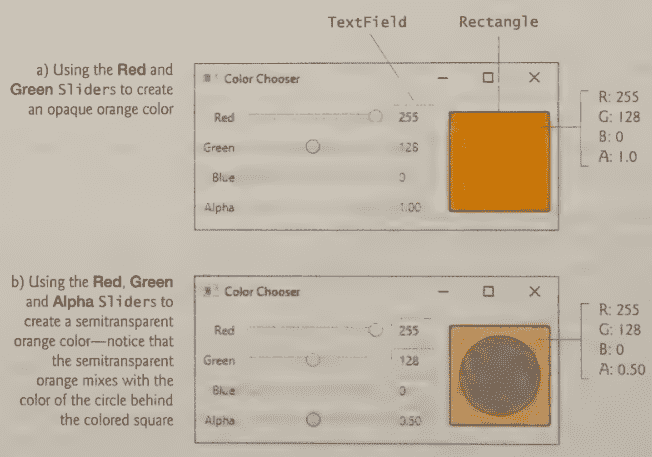

图 13.8 | 具有不透明和半透明橙颜色的颜色选择器应用。

### 13.4.1 技术概述

在本节中，我们将介绍构建颜色选择器将用到的技术。

#### RGBA 颜色

该应用使用 RGBA 颜色系统根据四个滑动条（`Slider`）的值显示颜色矩形。在 RGBA 中，每种颜色由其红、绿、蓝值表示，范围从 0 到 255，其中 0 表示无颜色，255 表示全色。例如，红色值为 0 的颜色将不包含红色分量。Alpha 值（A）——范围从 0 到 1.0——代表颜色的不透明度，0 为透明，1.0 为完全不透明。图 13.8 示例输出中的两种颜色具有相同的 RGBA 值，但显示的颜色是半透明的。你将使用一个用 RGBA 值创建的 `Color` 对象来填充显示颜色的 `Rectangle` 对象。

#### 类的属性

JavaFX 广泛使用了属性。属性通过创建具有特定命名规范的 `set` 和 `get` 方法来定义。通常，定义读写属性的方法对形式如下：

```java
public final void setPropertyName(Type propertyName)
public final Type getPropertyName()
```

通常，这些方法会操作一个与属性同名的私有实例变量，但这不是强制要求的。例如，`setHour` 和 `getHour` 方法代表一个名为 `hour` 的属性，并通常操作一个 `hour` 实例变量。如果属性代表一个布尔值，其方法名以 "is" 而不是 "get" 开头——例如 `ArrayList` 的方法 `isEmpty`。

> **软件工程观察 13.2**
> 定义属性的方法应该声明为 `final`，以防止子类重写这些方法，这可能导致客户端代码出现意外结果。

#### 属性绑定

JavaFX 属性的实现方式使其成为可观测的——当属性值发生变化时，其他对象会相应地响应。这与处理事件类似。响应属性更改的一种方法是通过属性绑定，它允许在另一个对象发生变化时更新一个对象的属性。例如，你将使用属性绑定来实现在当用户移动滑动条滑块时，让 `TextField` 能够显示对应滑动条的当前值。属性绑定不仅限于 JavaFX 控件。`javafx.beans.property` 包包含许多你可以用于在自己的类中定义可绑定属性的类。

#### 属性监听器

属性监听器与属性绑定类似。属性监听器是一个事件处理器，当属性值发生变化时会被调用。在事件处理器中，你可以以适合你应用程序的方式响应属性更改。在此应用中，当滑动条的值改变时，属性监听器会将值存储在实例变量中，根据四个滑动条的值创建一个新的 `Color`，并将该 `Color` 设置为显示当前颜色的 `Rectangle` 对象的填充颜色（`fill`）。有关属性、属性绑定和属性监听器的更多信息，请访问：

```
http://docs.oracle.com/javase/8/properties-tutorial/binding.htm
```

## 13.4.2 构建 GUI

在本节中，我们将讨论颜色选择器应用的 GUI。我们不会像第 12 章中那样提供具体的步骤，而是将提供构建 GUI 的通用指令，并关注新概念的特定细节。在构建 GUI 时，请记住通过 Scene Builder 窗口的“Hierarchy”（层级结构）部分来操作布局和控件比直接在设计区域创建要容易得多。在继续之前，打开 Scene Builder 并创建一个名为 `ColorChooser.fxml` 的 FXML 文件。


此应用控件的 `fxid` 属性
图 13.9 显示了颜色选择器应用程序化管理控件的 `fxid` 属性。在构建 GUI 时，你应该像在第 12 章中学的那样，在 FXML 文档中设置相应的 `fxid` 属性。


图 13.9 颜色选择器应用程序化管理控件的 `fxid` 属性。

#### 第一步：添加 GridPane
从容器（Containers）库拖入 `GridPane` 到 Scene Builder 中。

#### 第二步：配置 GridPane
使用你学习的方法，为 `GridPane` 设置 `hgap`（水平间距）和 `padding`（内边距）为 8。

#### 第三步：添加控件
从控件（Controls）库拖入 `Label`、`Slider`、`TextField` 和 `Rectangle`，并根据图 13.9 所示将它们放入 `GridPane` 中。

#### 第四步：配置 Slider
将红色 `Slider` 的 `Max` 属性设置为 255（红色的最大值）；将绿色 `Slider` 的 `Max` 属性设置为 255（绿色的最大值）；将蓝色 `Slider` 的 `Max` 属性设置为 255（蓝色的最大值）；将 Alpha `Slider` 的 `Max` 属性设置为 1.0（不透明度的最大值）。

#### 第五步：配置 TextField
将 `TextField` 的 `PrefWidth`（首选宽度）设置为 50。

#### 第六步：配置 Rectangle
将 `Rectangle` 的 `width` 和 `height` 属性设置为 100。

#### 第七步：配置 Circle
将 `Circle` 的 `Radius`（半径）属性设置为 40。

#### 第八步：配置行
将 `GridPane` 的所有行的高度属性设置为 `USE_COMPUTED_SIZE`，使行高度由内容决定。

#### 第九步：配置列
将 `GridPane` 的所有列的宽度属性设置为 `USE_COMPUTED_SIZE`，使列宽由内容决定。对于左侧列，将 `alignment` 属性设置为 `RIGHT`；对于右侧列，将 `alignment` 属性设置为 `CENTER`。

#### 第十步：配置 GridPane
将 `GridPane` 的宽度和高度属性设置为 `USE_COMPUTED_SIZE`，使其根据内容调整大小。你的 GUI 应该如图 13.9 所示。

#### 第十一步：指定控制器类名
为了确保在应用程序运行时加载 FXML 文件时创建一个控制器对象，请在 FXML 文件中指定 `ColorController` 为控制器类名，如之前所示。

#### 第十二步：生成示例控制器
选择 View > Controller Skeleton，将此代码复制到 `ColorController.java` 文件中，并存储与 `ColorChooser.fxml` 相同的文件夹中。我们将在 13.4.4 节显示完整的 `ColorChooser` 类。

### 13.4.3 Application 的子类

图 13.10 显示了启动应用的 `ColorChooser` 子类。该类加载 FXML 并显示之前 JavaFX 示例中的应用。

```java
// 图 13.10: ColorChooser.java
// 加载并显示颜色选择器 GUI 的主应用程序类。

import javafx.application.Application;
import javafx.fxml.FXMLLoader;
import javafx.scene.Parent;
import javafx.scene.Scene;
import javafx.stage.Stage;

public class ColorChooser extends Application {

    @Override
    public void start(Stage stage) throws Exception {
        Parent root = FXMLLoader.load(getClass().getResource("ColorChooser.fxml"));
        Scene scene = new Scene(root);
        stage.setTitle("Color Chooser");
        stage.setScene(scene);
        stage.show();
    }

    public static void main(String[] args) {
        launch(args);
    }
}
```

图 13.10 | 加载并显示颜色选择器 GUI 的应用程序类。（部分 1/2）


## 13.4.4 ColorChooserController 类

图 13.11 显示了 `ColorChooserController` 类的最终版本，并突出显示了该应用的新功能。

```java
// Fig. 13.9: ColorChooserController.java
// ColorChooser 应用的控制器

import javafx.beans.value.ChangeListener;
import javafx.beans.value.ObservableValue;
import javafx.fxml.FXML;
import javafx.scene.control.Slider;
import javafx.scene.control.TextField;
import javafx.scene.paint.Color;
import javafx.scene.shape.Rectangle;

public class ColorChooserController {

    // 用于与 GUI 组件交互的实例变量
    @FXML private Slider redSlider;
    @FXML private Slider greenSlider;
    @FXML private Slider blueSlider;
    @FXML private Slider alphaSlider;
    @FXML private TextField redTextField;
    @FXML private TextField greenTextField;
    @FXML private TextField blueTextField;
    @FXML private TextField alphaTextField;
    @FXML private Rectangle colorRectangle;

    // 用于管理的实例变量
    private int red = 0;
    private int green = 0;
    private int blue = 0;
    private double alpha = 1.0;

    public void initialize() {
        // 将 TextField 的值绑定到对应的 Slider 值
        redTextField.textProperty().bind(redSlider.valueProperty().asString("%.0f"));
        greenTextField.textProperty().bind(greenSlider.valueProperty().asString("%.0f"));
        blueTextField.textProperty().bind(blueSlider.valueProperty().asString("%.0f"));
        alphaTextField.textProperty().bind(alphaSlider.valueProperty().asString("%.2f"));

        // 根据 Slider 的变化更新 Rectangle 填充色的监听器
        redSlider.valueProperty().addListener(
            new ChangeListener<Number>() {
                @Override
                public void changed(ObservableValue<? extends Number> ov,
                                    Number oldValue, Number newValue) {
                    red = newValue.intValue();
                    colorRectangle.setFill(Color.rgb(red, green, blue));
                }
            });

        greenSlider.valueProperty().addListener(
            new ChangeListener<Number>() {
                @Override
                public void changed(ObservableValue<? extends Number> ov,
                                    Number oldValue, Number newValue) {
                    green = newValue.intValue();
                    colorRectangle.setFill(Color.rgb(red, green, blue));
                }
            });

        blueSlider.valueProperty().addListener(
            new ChangeListener<Number>() {
                @Override
                public void changed(ObservableValue<? extends Number> ov,
                                    Number oldValue, Number newValue) {
                    blue = newValue.intValue();
                    colorRectangle.setFill(Color.rgb(red, green, blue));
                }
            });

        alphaSlider.valueProperty().addListener(
            new ChangeListener<Number>() {
                @Override
                public void changed(ObservableValue<? extends Number> ov,
                                    Number oldValue, Number newValue) {
                    alpha = newValue.doubleValue();
                    colorRectangle.setFill(Color.rgb(red, green, blue));
                }
            });
    }
}
```

**图 13.11** | ColorChooser 应用的控制器（2 部分，共 2 部分）。

### 实例变量

第 13–27 行声明了控制器的实例变量。变量 `red`、`green`、`blue` 和 `alpha` 分别存储 `redSlider`、`greenSlider`、`blueSlider` 和 `alphaSlider` 的当前值。每当用户移动 Slider 的滑块时，这些值就会被用于更新 `colorRectangle` 的填充颜色。

### initialize 方法

第 29–38 行定义了 `initialize`，它在 GUI 创建后初始化控制器。在此应用中，`initialize` 配置了属性绑定和属性监听器。

### 属性到属性的绑定

第 31–38 行设置了 Slider 值与对应 TextField 文本之间的属性绑定，使得更改 Slider 即可更新相应的 TextField。考虑第 31–32 行，这些行代码将 `redSlider` 的 `valueProperty` 绑定到 `redTextField` 的文本：

```java
redTextField.textProperty().bind(redSlider.valueProperty().asString("%.0f"));
```

每个 `TextField` 都有一个由 `textProperty` 返回的 `StringProperty`（位于 `javafx.beans.property` 包）。`StringProperty` 返回一个 `ObservableValue`。当发生变化时，绑定的属性会随之更新。在这种情况下，`ObservableValue` 是表达式 `redSlider.valueProperty().asString("%.0f")` 的结果。Slider 的 `valueProperty` 将 Slider 的值作为 `DoubleProperty` 返回。由于 `TextField` 的文本属性必须是 String，因此我们调用 `DoubleProperty` 的 `asString` 方法，该方法返回一个 `StringBinding`（一种 `ObservableValue`），它产生 `DoubleProperty` 的字符串表示形式。此版本的 `asString` 接收一个格式化字符串。

### 监听器

为了在属性发生变化时执行任意任务，为属性注册一个监听器。如第 41–72 行所示，当 Slider 变化时触发监听器。正如我们在上一节中讨论的，使用匿名内部类实现 `ChangeListener` 接口，在 `changed` 方法中调用 `Color.rgb` 方法来设置 `colorRectangle` 的填充颜色。

## 13.5 Cover Viewer 应用：数据驱动的 GUI 与 JavaFX 集合

应用程序经常编辑并显示数据。JavaFX 提供了一种允许 GUI 与数据交互的框架。在本节中，我们将使用 `ListView` 显示书籍标题。当用户选择 `ListView` 中的项时，`ImageView` 将显示相应的封面图。

### 13.5.1 技术概述

此应用使用 `ListView` 显示集合。如果你对 `ObservableList` 进行了更改，该 `ListView` 将自动收到通知。`javafx.collections` 包定义了 `ObservableList` 接口（类似于 `ArrayList`）以及其他可观察集合接口。该包还包含了 `FXCollections` 类，它提供了创建和操作可观察集合的静态方法。

### 13.5.2 为应用添加图像

从本章的示例文件夹中，将 `images` 文件夹（包含 `large` 和 `small` 子文件夹）拷贝到你保存此 FXML 文件以及源代码文件 `CoverViewer.java` 和 `CoverViewerController.java` 的文件夹中。尽管在该示例中只使用大图，但你可以复制此应用创建一个使用两组图像的示例。

### 13.5.3 构建 GUI

在本节中，我们将讨论 Cover Viewer 应用的 GUI。正如你之前所做的，创建一个新的 FXML 文件，然后将其保存为 `CoverViewer.fxml`。

#### 应用控件的 fxid 属性值

图 13.13 显示了 Cover Viewer 应用中编程的控件的 `fxid` 属性。在构建 GUI 时，你应该在 FXML 文档中设置相应的 `fxid` 属性。

- `booksListView`
- `coverImageView`

#### 添加和配置控件

使用你之前学习的技术，创建一个 `BorderPane`。在左区域放置一个 `ListView` 控件，在中心区域放置一个 `ImageView` 控件。

对于 `ListView`，设置以下属性：

- Margin—8（右边距），用于将 `ListView` 与 `ImageView` 分隔
- Pref Width—200
- Max Height—`MAX_VALUE`
- Min Width, Min Height, Pref Height 和 Max Width—`USE_COMPUTED_SIZE`

对于 `ImageView`，将其 `Fit Width` 和 `Fit Height` 属性设置为 370 和 480。为了让 `BorderPane` 根据其内容调整大小，将其 `Pref Width` 和 `Pref Height` 设置为 `USE_COMPUTED_SIZE`。此外，设置 `Padding` 为 8，以便将 `BorderPane` 插入阶段。

#### 指定控制器的名称

为了确保应用程序在运行时加载 FXML 文件时创建控制器类的实例，请像你之前做的那样，在 FXML 文件中将 `CoverViewerController` 指定为控制器类的名称。

#### 生成示例控制器类

选择 View（视图）> Show Sample Controller Skeleton（显示示例控制器骨架），将此代码复制到 `CoverViewerController.java` 文件中并存储在与 `CoverViewer.fxml` 相同的文件夹中。我们将在第 13.5.5 节展示完整的 `CoverViewerController` 类。

### 13.5.4 Application 子类 CoverViewer

图 13.14 显示 Application 子类 `CoverViewer`。

```java
// Fig. 13.13: CoverViewer.java
// 加载并显示 CoverViewer GUI 的主类。

import javafx.application.Application;
import javafx.fxml.FXMLLoader;
import javafx.scene.Parent;
import javafx.scene.Scene;
import javafx.stage.Stage;

public class CoverViewer extends Application {

    @Override
    public void start(Stage stage) throws Exception {
        Parent root = FXMLLoader.load(getClass().getResource("CoverViewer.fxml"));
        Scene scene = new Scene(root);
        stage.setTitle("Cover Viewer");
        stage.setScene(scene);
        stage.show();
    }

    public static void main(String[] args) {
        launch(args);
    }
}
```

**图 13.14** | 加载并显示 CoverViewer GUI 的主类。

### 13.5.5 CoverViewerController 类

图 13.15 显示了 `CoverViewerController` 类的最终版本，并突出了应用程序的新功能。

```java
// Fig. 13.14: CoverViewerController.java
// Cover Viewer 应用的控制器

import javafx.beans.value.ChangeListener;
import javafx.beans.value.ObservableValue;
import javafx.collections.FXCollections;
import javafx.collections.ObservableList;
import javafx.fxml.FXML;
import javafx.scene.control.ListView;
import javafx.scene.image.Image;
import javafx.scene.image.ImageView;

public class CoverViewerController {

    // 与 GUI 交互的实例变量
    @FXML private ListView<Book> booksListView;
    @FXML private ImageView coverImageView;

    // 存储 Book 对象列表
    private final ObservableList<Book> books =
        FXCollections.observableArrayList();

    // 初始化控制器
    public void initialize() {
        // 填充 ObservableList<Book>
        books.add(new Book("Android How to Program",
                "images/small/androidhtp.jpg", "images/large/androidhtp.jpg"));
        books.add(new Book("C How to Program",
                "images/small/cpp.jpg", "images/large/cpp.jpg"));
        books.add(new Book("C++ How to Program",
                "images/small/cppht.jpg", "images/large/cppht.jpg"));
        books.add(new Book("Internet and World Wide Web How to Program",
                "images/small/iw3htp.jpg", "images/large/iw3htp.jpg"));
        books.add(new Book("Java How to Program",
                "images/small/jht.jpg", "images/large/jht.jpg"));
    }
}
```

**图 13.15** | Cover Viewer 应用的控制器（部分 2/2）。


## 13.6 Cover Viewer 应用：自定义 ListView 单元格

### 代码片段（第 34–51 行）

```java
books.add(new Book("Visual Basic How to Program",
        "images/small/vbht.jpg", "images/large/vbht.jpg"));
books.add(new Book("C# How to Program",
        "images/small/vcsht.jpg", "images/large/vcsht.jpg"));
booksListView.setItems(books);

// 当 ListView 选择发生变化时，在 ImageView 中显示封面
booksListView.getSelection().selectedItemProperty()
    .addListener(
        new ChangeListener<Book>() {
            @Override
            public void changed(ObservableValue<? extends Book> obs, Book oldValue, Book newValue) {
                if (newValue != null) {
                    imageView.setImage(new Image(newValue.getLargeImage()));
                }
            }
        });
```

**图 13.15** | Cover Viewer 应用的控制器（部分 2/2）。

### FXML 变量
第 14–15 行声明了控制器的 `@FXML` 实例变量。注意 `ListView` 是泛型的。

- `title`——书籍标题。
- `thumbImage`——书籍缩略图的路径。
- `largeImage`——书籍大图片的路径。

该类还提供了一个 String 表示形式。你应当将本章中的 `Book` 类复制到包含 `CoverViewer.fxml`、`CoverViewer.java` 和 `CoverViewerController.java` 的文件夹中。

### 实例变量 books
第 18–19 行将 `books` 变量定义为 `ObservableList<Book>`，并通过调用 `Collections.observableArrayList()` 进行初始化。该方法返回一个空集合。

### 初始化 books
`initialize` 方法中的第 24–37 行创建 `Book` 对象并将其添加到 `books` 列表中。第 38 行将此集合传递给 `ListView.setItems`，从而将 `ListView` 与数据绑定。

### 监听 ListView 变化
为了使显示的书籍与当前选中的书籍保持同步，我们监听 `ListView` 的 `selectedItem` 属性的变化（第 41–51 行）。`ListView.getSelection()` 返回一个 `SelectionModel`。在示例中，`selectedItemProperty` 返回一个 `ReadOnlyObjectProperty<Book>`，`onChanged` 分接收 `oldValue` 和 `newValue` 作为参数。

第 47–48 行使用 `newValue` 的大图初始化一个新的 `Image` (`javafx.scene.image`)——这会从该路径加载图像。然后我们将新图像传递给封面的 `setImage` 方法。

---

### 13.6.1 技术概述

#### 用于自定义格式的 ListCell 泛类
如第 13.5 节所示，`ListView` 默认显示列表项的 String 表示。要创建自定义格式，你必须定义 `ListCell` 泛类 (`javafx.scene.control`) 的子类，以指定如何创建 `ListView` 单元格。当 `ListView` 显示项时，它从单元工厂获取 `ListCell`。你将使用 `ListView.setCellFactory` 方法将默认单元工厂替换为新的。你将重写该类的 `updateItem` 方法来指定单元格的布局和内容。

#### 程序化创建布局和控件
到为止，你一直使用 JavaFX Scene Builder 视觉化地创建 GUI。在应用程序中，你也将通过程序化创建部分 GUI——事实上，我们在 Scene Builder 中展示的所有内容都可以直接通过 Java 代码完成。特别是，你将创建并配置一个包含 `ImageView` 和 `Label` 的 `VBox` 布局。该 `VBox` 代表自定义的 `ListView` 单元格。

### 13.6.2 复制 CoverViewer 应用
此应用的 FXML 布局以及 `Book` 和 `CoverViewer` 类与 13.5 中的相同，`CoverViewerController` 只有一条新语句。在本示例中，我们将展示一个实现自定义 `ListView` 单元工厂的新类，以及 `CoverViewerController` 类中的那条新语句。与其从头开始，首先将上一个示例中的 CoverViewer 应用复制到名为 `CoverViewerListView` 的新文件夹中。

### 13.6.3 ImageTextCell 自定义单元工厂类

`ImageTextCell`（图 13.17）为此版本的 Cover Viewer 应用定义了自定义 `ListView` 单元格布局。该类继承自 `ListCell<Book>`，因为它在 `ListView` 中定义了 `Book` 的自定义展示形式。

**图 13.17** | 显示图像和文本的自定义 `ListView` 单元格工厂。

```java
// Fig 13.16: ImageTextCell.java
// 显示图像和文本的自定义 ListView 单元格工厂

import javafx.geometry.Pos;
import javafx.scene.control.Label;
import javafx.scene.control.ListCell;
import javafx.scene.image.Image;
import javafx.scene.image.ImageView;
import javafx.scene.layout.VBox;
import javafx.scene.text.TextAlignment;

public class ImageTextCell extends ListCell<Book> {

    private VBox vbox = new VBox(8.0); // 控件之间留留 8 像素间隙
    private ImageView imageView = new ImageView(); // 初始为空
    private Label label = new Label();

    // 构造函数配置 VBox、ImageView 和 Label
    {
        vbox.setAlignment(Pos.CENTER); // VBox 内容水平居中
        imageView.setPreserveRatio(true);
        imageView.setHeight(100.0); // 缩略图高度 100 像素
        vbox.getChildren().add(imageView); // 附加到 VBox

        label.setWrapText(true); // 如果文本太宽无法放入 Label 则换行
        label.setTextAlignment(TextAlignment.CENTER); // 文本居中
        vbox.getChildren().add(label); // 附加到 VBox
    }

    // 调用以配置每个自定义 ListView 单元格
    @Override
    protected void updateItem(Book item, boolean empty) {
        // 重命名以确保单元格显示正常
        super.updateItem(item, empty);

        if (empty || item == null) {
            setGraphic(null); // 不显示任何内容
        } else {
            // 设置图像的缩略图
            imageView.setImage(new Image(item.getThumbnail()));
            label.setText(item.getTitle()); // 配置 Label 的文本
            setGraphic(vbox); // 将自定义布局附加到 ListView 单元格
        }
    }
}
```

#### 构造函数
构造函数（第 17–29 行）配置了用于构建自定义展示的实例变量。第 18 行表示 `VBox` 的子项居中。第 20–22 行配置了 `ImageView` 并将其添加到 `VBox` 的子节点中。第 20 行表示 `ImageView` 应该保持图像的宽高比例，第 21 行表示 `ImageView` 高为 100 像素。第 22 行将 `ImageView` 附加到 `VBox`。

第 24–26 行配置 `Label` 并将其添加到 `VBox` 的子节点中。第 24 行表示如果文本太宽无法适应 `Label` 的宽度，则应换行，第 25 行表示文本应在 `Label` 中居中。第 26 行将 `Label` 附加到 `VBox`。最后，第 28 行表示单元格应使用其首选宽度，该宽度由父级 `ListView` 的宽度决定。

#### updateItem 方法
`updateItem` 方法（第 32–46 行）配置 `Label` 的文本和 `ImageView` 的图像，在 `ListView` 中展示自定义内容。此方法由 `ListView` 工厂在需要 `ListView` 单元格时调用——即 `ListView` 首次显示以及 `ListView` 单元格滚动到屏幕上时。该方法接收要显示的 `Book` 对象以及一个指示即将创建的单元格是否为空的布尔值。你必须调用父类的版本的 `updateItem`（第 35 行）以确保单元格显示正确。

如果单元格为空或 `item` 参数为 `null`，则没有 `Book` 需要显示，第 38 行调用 `TextCell` 继承的 `setGraphic` 并传入 `null`。该方法接收参数为应在单元格中显示的 `Node`。可以提供任何 JavaNode，这为你自定义单元格外观提供了极大的灵活性。

如果有书籍，第 40–45 行配置 `ImageTextCell` 的 `Label` 和 `ImageView`。第 42 行将 `Label` 的文本设置为 `Book` 的标题。最后，第 38 行使用 `setGraphic` 方法将图像的 `VBox` 设置为自定义单元格的展示形式。

> **性能提示 13.1**
> 为了获得最佳的 `ListView` 性能，最佳实践是在 `ListCell` 子类中将自定义展示的控件定义为实例变量，并在子类的构造函数中对其进行配置。这可以尽可能减少每次调用 `updateItem` 方法时所需的工作。

### 13.6.4 CoverViewerController 类
一旦定义了自定义单元格布局，更新 `CoverViewerController` 以使用它就需要 `ListView` 的单元格工厂。将以下代码插入到 `CoverViewerController` 的最后语句中：

```java
booksListView.setCellFactory(new Callback<ListView<Book>, ListCell<Book>>() {
    @Override
    public ListCell<Book> call(ListView<Book> listView) {
        return new ImageTextCell();
    }
});
```

---

## 13.7 额外的 JavaFX 能力

## 13.8 JavaFX 9: Java SE 9 JavaFX 更新

### 用于移动设备和嵌入式设备的 JavaFX
一个核心优势是可以编写运行在任何带有 Java 虚拟机 (JVM) 的设备上的程序，包括笔记本电脑、台式电脑、服务器、移动设备和嵌入式设备（如物联网中的设备）。Oracle 仅正式支持桌面应用程序的 JavaFX。Gluon 的开源 JavaFX 项目将 JavaFX 桌面版本引入了移动设备（iOS 和 Android）以及像树莓派（https://www.raspberrypi.org/）这样的设备，这些设备可以作为独立计算机或用于嵌入式设备应用。有关关于 JavaFX 的更多信息，请访问：

```
http://javafxports.org/
```

此外，Gluon Mobile 为 iOS 和 Android 提供了移动优化的 JavaFX 实现。欲需更多信息，请访问：

```
http://gluonhq.com/products/mobile/
```

### 用于调试 JavaFX 场景和节点的 Scenic View
`Scenic View` 是一个用于 JavaFX 场景和节点的调试工具。你可以将 `Scenic View` 直接嵌入到应用程序中，或者作为一个独立应用程序运行。你可以检查 JavaFX 场景和节点，并动态修改它们以观察更改如何影响它们在屏幕上的呈现——而无需为每次更改都编辑代码、重新编译并重新运行。欲需更多信息，请访问：

```
http://www.scenic-view.org
```

### JavaFX 资源与现实世界的 JavaFX
访问：

```
http://bit.ly/JavaFXResources
```


# 获取详尽且不断增长的 JavaFX 资源列表

其中包含：

- 文章
- 教程（免费和付费）
- 关键博客和网站
- YouTube 视频
- 书籍（供购买）
- 许多库、工具、项目和框架
- JavaFX 演示的幻灯片
- 以及各种 JavaFX 的实际应用示例。

## 13.8 JavaFX 9: Java SE 9 JavaFX 更新

本节回顾了 JavaFX 9 的若干更改和增强。

### Java SE 9 模块化

Java SE 9 最重的新软件工程特性是模块系统。这同样适用于 JavaFX 9。关键的 JavaFX 9 模块包括：

- `javafx.base`——包含所有 JavaFX 9 应用程序所需的包。所有其他 JavaFX 9 模块都依赖于此。
- `javafx.controls`——包含控件、布局和图表的包，包括本章和第 12 章中演示的各种控件。
- `javafx.fxml`——包含处理 FXML 的包，包括本章和第 12 章中演示的 FXML 特性。
- `javafx.graphics`——包含处理图形、动画、CSS（用于节点样式设置）等的包（第 22 章，JavaFX 图形与媒体）。
- `javafx.media`——包含整合音频和视频的包（第 22 章，JavaFX 图形与媒体）。
- `javafx.swing`——包含集成 JavaFX Swing 组件的包（第 26 章，Swing 组件：部分 1，第 35 章，Swing 组件：部分 2）。
- `javafx.web`——包含集成网页内容的包。

运行时仅加载应用程序所需的模块。只要你没有使用某些内部 API（即你的应用程序无法访问的私有的 API），你的程序将继续像以前一样工作。在模块化的 JDK 9 中，任何依赖 Java 9 之前内部 API 的代码将无法编译。我们将更详细地讨论模块化。请参阅前言。

### 新 API

在第 22 章“JavaFX 图形与媒体”中，我们演示了如何使用最初为网页元素设计的层级样式表（CSS）来格式化 JavaFX 对象。CSS 允许将呈现（例如字体、颜色、定位）与 GUI 的结构和内容（布局控件、形状等）分开指定。如果 JavaFX GUI 的呈现完全由样式表决定，你可以切换一个新的样式表（有时称为 skin/皮肤）来更改 GUI 的外观。

每个 JavaFX 控件都有一个决定其默认外观的 skin。在 JavaFX 8 中，skin 类被定义为内部 API，开发者通过扩展这些类创建自定义 skin。在 JavaFX 9 中，skin 类现在是 `javafx.scene.control` 包中的公共 API。你可以扩展相应的 skin 类来自定义特定类型控件的外观，并通过 `setSkin` 方法创建自定义 skin。

### GTK+ 支持

GTK+ (http://gtk.org) 是 JavaFX 在后台渲染 Linux GUI 和图形时使用的 GUI 工具包。在 Java SE 9 中，JavaFX 现在支持 GTK+。

### 高 DPI 支持

在 Java SE 8 更新中，JavaFX 为 Windows 和 macOS 屏幕增加了高 DPI（每英寸像素）的支持。Java SE 9 为 Linux 增加了高 DPI 支持，以及程序化操作 JavaFX 渲染缩放的能力。

### 更新的 GStream

JavaFX 使用开源 GStream 框架 (https://gstreamer.freedesktop.org) 实现音频和视频功能。JavaFX 9 整合了更新版本的 GStream，包含了各种错误修复和性能改进。

### 更新的 WebKit

JavaFX 的 WebView 控件允许你在应用程序中嵌入网页。WebView 基于 WebKit (http://www.webkit.org)——一个支持加载和渲染页面的浏览器引擎。JavaFX 9 整合了更新版本的 WebKit。

## 13.9 总结

在本章中，我们继续了 JavaFX 的呈现。我们详细讨论了 JavaFX 布局面板，并使用了 `BorderPane`、`TitledPane` 和 `Pane` 来安排控件。我们学习了 JavaFX 支持的许多鼠标事件，并在简单的 `Pane` 中使用了 `mouseDragged` 事件来显示 `Circle`。`Painter` 允许从互斥的 `RadioButton` 组中选择颜色和大小。我们使用 `ToggleGroup` 管理每组中 `RadioButton` 之间的关系。我们还学习了如何使用所谓的 `data` 对象用于控件。当 `RadioButton` 被选中时，我们从 `ToggleGroup` 获取它。我们将 `TextField` 的文本绑定到 `Slider`，当用户移动 `Slider` 滑块时自动更新 `TextField` 的值。在我们的 `Cover Viewer` 应用程序中，我们展示了如何将 `ObservableList` 绑定到 `ListView` 以填充集合元素。默认情况下，集合中的每个对象在 `ListView` 中显示为 `String`。我们配置了属性监听器，当用户在 `ListView` 中选择项目时在 `ImageView` 中显示图像。我们修改了 `Cover Viewer` 应用程序，使用自定义的 `ListView cell` 来指定 ListView 内容的布局。最后，我们介绍了其他 JavaFX 能力以及 Java SE 9 的更改。

在下一章，我们将讨论 `String` 类及其方法。我们引入了用于字符串匹配的正则表达式，并演示了如何使用正则表达式验证用户输入。

## 总结

### 13.2 在场景图中布局节点

- 布局决定了场景图中节点的大小和位置。
- 节点的大小不应显式定义。
- 通常，与每个 JavaFX 节点关联的宽度和高度属性（大多数 JavaFX 节点具有 `prefWidth`、`prefHeight`、`minWidth`、`minHeight`、`maxWidth` 和 `maxHeight`）指定了节点在在其父节点内布局时的接受尺寸范围。
- 最小尺寸属性指定节点允许的最小大小。
- 最大尺寸属性指定节点允许的最大大小。
- 首选尺寸属性指定布局应使用的节点默认宽度和高度。
- 节点的位置相对于其父节点及其节点中的其他节点。
- 布局面板是容器节点，根据大小和位置排列场景图中的子节点。
- 大多数 JavaFX 布局面板使用相对定位。

### 13.3.1 技术概述

- Radiobutton 是互斥选项。
- 你将多个 `RadioButton` 添加到 `ToggleGroup` 中，以确保组内同时只有一个 `RadioButton` 被选中。
- 如果通过程序创建 `ToggleGroup`（而不是在 FXML 中声明），可以调用 `RadioButton` 的 `setToggleGroup` 方法来指定它。
- `BorderPane` 布局将控件分为五个区域中的一个或多个——顶部、底部、左侧和右侧。顶部和底部区域与 `BorderPane` 同宽，左侧和右侧填充顶部和底部之间的垂直空间。每个区域可以只包含一个控件或一个布局容器，后者可以包含其他控件。`BorderPane` 中的所有区域都是可选的：如果顶部或底部为空，左侧或右侧将垂直扩展以填充该区域。中心向水平方向扩展。
- `TitledPane` 在顶部显示标题，是一个可折叠面板，包含一个布局节点，该节点又包含其他节点。
- `javafx.scene.shape` 包包含各种类，用于创建可以在场景图中显示的 2D 和 3D 节点。
- 节点附加到 `Pane` 布局上，坐标为从 `Pane` 左上角测量的指定 x-y 。
- JavaFX 支持各种鼠标事件。
- JavaFX 支持其他类型的输入事件，如触摸式事件和按键事件。
- 每个 JavaFX 控件都有一个 `setUser` 方法，返回一个对象。你可以用它存储任何你想与控件关联的对象——通常用于响应控件的事件时。

### 13.3.2 创建 Painter.fxml 文件

- 如果你已经在 Scene Builder 中打开了 FXML 文件，可以选择 File > New 创建一个新的 FXML 文件并保存。

### 13.3.3 构建 GUI

- VBox 的 `Spacing` 属性指定其控件之间的垂直间距。
- 将节点的 `Max Height` 属性设置为 `MAX_VALUE` 可以允许节点占据其父节点的全高。
- `Style -fx-background-color` 指定节点的背景颜色。
- TitledPane 的 `Text` 属性指定 TitledPane 顶部的标题。
- RadioButton 的 `Text` 属性指定出现在 RadioButton 旁边的文本。
- RadioButton 的 `Selected` 属性指定 RadioButton 是否被选中。
- 在 FXML 中设置 RadioButton 的 `Toggle Group` 属性允许 RadioButton 属于一个 `ToggleGroup`。
- 将控件的 `Max Width` 属性设置为 `MAX_VALUE` 可以允许控件填满其父节点的宽度。
- 控件的 `On Mouse Dragged` 事件处理器（位于代码部分靠近 `Mouse` 标题的位置）指定了用户在控件上拖动鼠标时执行的操作。
- 要指定当用户与 RadioButton 交互时执行的操作，请设置其 `On Action` 事件处理器。

### 13.3.4 PainterController 类

- 顶级类型不会定义在另一个类型内部。
- Java 允许你在其他类内部声明类、接口和枚举——这些被称为嵌套类型。
- 每个事件处理器都必须定义一个类型为 `MouseEvent`（`javafx.scene.input` 包）的参数。当事件发生时，该参数包含有关事件的信息，例如其位置、鼠标按钮的按下情况、用户与哪个节点进行了交互等。
- 每个布局面板都有 `getChildren` 方法，该方法返回一个包含布局节点的 `ObservableList<Node>` 集合。`Observable` 提供了添加和删除元素的方法。
- 所有 JavaFX 类都继承自 `javafx.scene` 包中的 `Node` 类。
- `ToggleGroup` 方法 `getSelectedToggle` 返回当前被选中的 `Toggle`。`RadioButton` 类是实现 `Toggle` 接口的几个控件之一（其他还包括 `MenuItem` 和 `ToggleButton`）。
- `Toggle` 的 `getUserData` 方法返回与控件关联的 `Object` 数据。

### 13.4.1 技术概述

- 在 RGBA 颜色系统中

# 第 13 章 JavaFX GUI：部分 2

- 响应属性更改的一种方式是通过属性绑定（property binding），它允许当一个对象的属性发生变化时，另一个对象的属性也随之更新。
- 属性绑定不仅限于 JavaFX 控件。`javafx.beans.property` 包包含许多你可以使用它们在自己的类中定义可绑定的属性。
- 属性监听器（property listener）是一个在属性值更改时被调用的事件处理器。在事件处理器中，你可以以适用于应用程序的方式来响应属性的变化。

### 13.4.2 构建 GUI

- `Circle` 和 `Rectangle` 位于 Scene Builder 库的 `Shapes` 部分。

### 13.4.3 ColorChooserController 类

- 控制器类的 `initialize` 方法通常包含属性绑定和属性监听器。
- 每个 `TextField` 都有一个属性，通过其 `textProperty` 方法以 `StringProperty`（`javafx.beans.property` 包）的形式返回其文本。
- `StringProperty` 的 `bind` 方法接收一个 `ObservableValue` 作为参数。当 `ObservableValue` 变化时，绑定的属性会随之更新。
- `Slider` 方法 `valueProperty` 返回一个 `DoubleProperty` 对象的 `Slider` 属性——这是一个可观测的双倍精度数值。
- `DoubleProperty` 方法 `asString` 返回一个 `StringBinding`（这是一个 `ObservableValue`），它产生一个 `DoubleProperty` 的字符串表示。
- 要在属性值更改时执行任意任务，你可以注册一个属性监听器。

### 13.5 Cover Viewer 应用程序：使用 JavaFX 集合实现数据驱动的 GUI

- JavaFX 提供了一个全面的模型，允许 GUI 与数据进行交互。

#### 13.5.1 技术概述

- `ListView` 显示对象集合。
- 虽然你可以单独地向 `ListView` 中添加项，但你通常会将一个 `ObservableList` 对象绑定到 `ListView`。
- 如果你对 `ObservableList` 进行更改，它的观察者（例如 `ListView`）将自动收到这些更改通知。
- `javafx.collections` 包定义了 `ObservableList`（类似于 `ArrayList`）和其他观测集合接口。
- `FXCollections` 类提供了用于创建和操作集合的静态方法。

#### 13.5.5 CoverViewerController 类

- `FXCollections.observableArrayList` 返回一个实现 `ObservableList` 的空集合对象（类似于 `ArrayList`）。
- 默认情况下，`ListView` 支持单选。此绑定允许 `ListView` 显示项。
- 默认情况下，`ListView` 也支持多选。选择由 `ListView` 的 `SelectionModel`（`javafx.scene.control` 中 `SelectionModel` 的子类）管理，它包含了可观测属性和用于操作选择的各种方法。
- 要响应选择更改，为 `SelectionModel` 的 `selectedItem` 属性注册监听器。
- `ListView` 方法 `getSelectionModel` 返回一个 `SelectionModel`。
- `SelectionModel` 的 `selectedItemProperty` 返回一个 `ReadOnlyObjectProperty`，`ChangeListener` 分别接收 `oldValue` 和 `newValue` 参数。

### 13.6.1 技术概述

- 要创建自定义的 `ListView`，你必须先定义 `ListCell`（`javafx.scene.control`）的子类，指定如何创建 `ListView` 单元格。
- 当 `ListView` 显示时，它从其单元格工厂（cell factory）获取单元格。
- 你将使用 `ListView.setCellFactory` 方法用自定义的单元格工厂替换默认工厂。在 Scene Builder 中可以完成的所有操作也可以通过 Java 代码完成。

### 13.6.2 ImageTextCell 自定义单元格工厂

- `ListView` 单元格布局被定义为 `ListCell<Type>` 的子类，其中 `Type` 是在 `ListView` 中显示的对象类型。
- `ListCell<Type>` 子类的 `updateItem` 方法创建自定义呈现形式。当 `ListView` 首次显示以及 `ListView` 单元格即将滚动进入视图时，`ListView` 的单元格工厂会调用此方法。
- `updateItem` 接收要显示的对象和一个指示单元格是否为空的布尔值。你必须调用父类的 `updateItem` 版本以确保自定义单元格正确显示。
- `ListCell<Type>` 子类的 `setGraphic` 方法接收一个代表自定义外观的 JavaFX `Node`。

### 13.6.4 CoverViewerController 类

- 一旦定义了自定义单元格布局，你就必须设置 `ListView` 的单元格工厂。
- `ListView` 方法 `setCellFactory` 的参数是 `Callback`（`javafx.util`）的实现。此泛接口提供了一个 `call` 方法，该方法接收一个参数并返回一个自定义 `ListCell<Type>` 子类的对象。

### 13.7 额外的 JavaFX 能力

- JavaFX 的 `TableView`（`javafx.scene.control` 包）以行和列显示数据，并支持用户与数据的交互。
- 在 SE 8 的更新中，JavaFX 为视觉障碍人士使用其设备增加了辅助障碍功能。这些功能包括屏幕阅读器支持、通过键盘进行 GUI 导航以及使控件易于阅读的高对比度模式。
- 请参阅你操作系统的文档以获取有关启用屏幕阅读器和高对比度模式的信息。
- 每个 JavaFX `Node` 子类也具有辅助障碍相关的属性。
- `accessibleTextProperty` 是一个字符串，是一个比 `accessibleText` 提供的字符串更详细的描述字符串。此属性应该帮助用户理解其在应用程序中的用途。
- `accessibleRoleProperty` 是来自枚举 `javafx.scene.AccessibleRole` 的一个值。屏幕阅读器使用此属性来确定特定控件支持的属性和操作。
- `accessibleDescriptionProperty` 是控件的字符串文本描述，屏幕阅读器通常紧随控件的内容或 `accessibleTextProperty` 的值来读取该描述。
- 你可以在 GUI 中添加描述其他控件的 Label。在这些情况下，你应该将每个 Label 的 `labelFor` 属性设置为该 Label 所描述的特定控件。如果 Label 的 `labelFor` 属性引用了另一个控件，屏幕阅读器在用户描述该控件时会读取 Label 的文本。
- 你可以通过扩展 JavaFX 控件来定制它们，或者通过直接扩展 JavaFX 控件来创建自定义控件。
- Scenic View (https://sceneview.org/) 是一个用于 JavaFX 场景和节点的调试工具。你可以将 Scenic View 直接嵌入到你的应用程序中，也可以作为独立程序运行。你可以检查你的 JavaFX 场景和节点，并修改更改如何影响它们在场景中的呈现——无需为每次更改都编辑代码、重新编译并重新运行。

### 13.8 JavaFX 9: SE 9 JavaFX 更新

- JavaFX 9 最强大的新特性是模块化。
- 在你的程序中，如果你使用模块化和 JDK 9，那么在运行时只会加载你的程序所需的模块。否则，只要你没有使用所谓的内部 API（即未供公开使用的、未文档的 Java API），你的程序将继续像以前一样工作。
- 如果 JavaFX GUI 的呈现完全由样式表（指定了为 GUI 样式的规则）决定，你可以简单地切换新样式（有时是皮肤 skin）来改变它的外观。这通常被称为换肤（skinning）。
- 每个 JavaFX 控件都有一个决定其默认外观的 skin。
- 在 JavaFX 8 中，skin 类定义为内部 API。在 JavaFX 9 中，skin 类现在在 `javafx.scene.control` 包中公开了。
- 你可以扩展相应的 skin 类来定制特定类型控件的外观。然后你可以创建自定义 skin 的实例，并通过控件的 `setSkin` 方法将其设置给控件。
- JavaFX 9 支持 GTK——最新版本的 GTK。
- 在 Java SE 8 中，JavaFX 增加了对 Windows 和 macOS 上高 DPI（每英寸点数）屏幕的支持。Java SE 9 增加了对 Linux DPI 的支持。
- JavaFX 9 增加了功能，可以程序化处理 JavaFX 程序在 Windows、macOS 和 Linux 上渲染的缩放。
- JavaFX 使用开源 GStreamer 框架实现了其音频视频能力 (https://gstreamer.freedesktop.org)。JavaFX 9 整合了更新版本的 GStreamer，包含了各种错误修复和性能增强。
- JavaFX 的 WebView 允许你在 JavaFX 程序中嵌入网页内容。WebView 基于开源的 WebKit 引擎 (http://www.webkit.org)——一个支持加载和渲染网页的浏览器引擎。JavaFX 9 整合了更新版本的 WebKit。

## 自测练习

### 13.1 填空每处的空白：

- a) 你将多个 RadioButton 添加到 ________ 中，以确保给定组内同时只有一个 RadioButton 被选中。
- b) ________ 决定了节点在场景图中的位置。
- c) ________ 在其顶部显示标题，是一个包含布局节点的可折叠面板，反过来包含了其他节点。
- d) ________ 包包含了创建 2D 和 3D 形状节点的各种类。
- e) 当用户拖动鼠标时，控件的 ________ 事件。
- f) 为了指定用户与 RadioButton 交互时执行的操作，设置其 ________ 处理器。
- g) 每个 TextField 都有由其 `textProperty` 方法返回的属性（`javafx.beans.property` 包）。
- h) `DoubleProperty` 方法 `asString` 返回 ________（它是 `ObservableValue`），它产生一个字符串表示。
- i) 尽管你可以单独地向 ListView 添加项，但通常将 ________ 绑定到 ListView。
- j) ________ 类提供了创建和操作集合的静态方法。
- k) ListView 显示项，它从 ________ 获取单元格。
- l) JavaFX 的 ________ 控件允许你在 JavaFX 程序中嵌入网页内容。
- m) 在 Java SE 8 中，JavaFX 增加了 ________ 来帮助视觉障碍人士。这些功能包括屏幕阅读器支持、通过键盘导航以及高对比模式以使控件更易读。

### 13.2 说明以下陈述是正确还是错误的。如果是错误，请解释：

- a) 通常情况下，节点的大小应该显式定义。
- b) 节点的位置应该相对于其父节点定义。
- c) 大多数 JavaFX 面板使用固定定位。
- d) RadioButtons 是互斥的选项。
- e) 布局面板是容器节点，根据它们的大小和位置将子节点在场景图中进行相互排列。
- f) `ToggleGroup` 的 `getSelectedToggle` 返回当前选中的 Toggle。
- g) 每个布局面板都有 `getChildren` 返回 `ObservableList<Node>`。
- h) 你可以通过属性监听器来响应属性变化，属性监听器是在属性值改变时调用的事件处理器。
- i) 正确。
- j) 错误。属性绑定不仅限于 JavaFX 控件。`javafx.beans.property` 包含了许多你可以用于为你的类定义属性的类。
- k) 正确。
- l) 为了响应选择变化，你为 `MultipleSelectionModel` 的 `selectedItem` 属性注册了一个监听器。
- m) 错误。要创建一个自定义 ListCell 格式，你必须首先定义 `ListCell` 类（`javafx.scene.control` 包）的子类，指定如何创建 ListView 单元格。
- n) 错误。你可以仅使用 Scene Builder 来构建 JavaFX GUI。
- o) 正确。你可以在包含其他控件的 GUI 中添加 Label。在这些情况下，你应该将每个 Label 的 `labelFor` 属性设置为特定的控件标签。
- p) 你可以在选择其他控件的 GUI 中添加 Label。在这些情况下，你应该将每个 Label 的 `labelFor` 属性设置为特定控件。

## 自测练习答案

### 13.1
a) `ToggleGroup`。b) Layout。c) `TitledPane`。d) `javafx.scene.shape`。e) `On Mouse Dragged`。f) `On Action`。g) `StringProperty`。h) `StringBinding`。i) `ObservableList`。j) `FXCollections`。k) `cell factory`。l) `WebView`。m) `accessibility features`。

### 13.2
a) 错误。节点的大小没有显式选择。
b) 正确。
c) 错误。JavaFX 面板使用相对定位。
d) 正确。
e) 错误。布局面板根据大小和位置排列子节点。
f) `ToggleGroup` 的 `getSelectedToggle` 返回当前选中的 Toggle。
g) 正确。
h) 正确。你可以通过属性监听器来响应属性变化，属性监听器是在属性值改变时调用的事件处理器。
i) 正确。
j) 错误。属性绑定不仅限于 JavaFX 控件。`javafx.beans.property` 包含了许多你可以用于为你的类定义属性的类。
k) 正确。
l) 为了响应列表选择变化，你为 `MultipleSelectionModel` 的 `selectedItem` 属性注册了一个监听器。
m) 错误。要创建一个自定义 ListCell，你必须首先定义 `ListCell` 泛型类（`javafx.scene.control` 包）的子类，指定如何创建 ListView 单元格。
n) 错误。你在 Scene Builder 中可以做的一切都可以通过 Java 代码实现。
o) 正确。你可以在包含其他控件的 GUI 中添加 Label。在这些情况下，你应该将每个 Label 的 `labelFor` 属性设置为特定控件标签。

## 练习题

### 13.3 (修改画家应用程序)
在颜色选择器应用程序（第 13.4 节）中引入 RGBA 颜色选择器，使用户可以选择任何绘制颜色。更改 Slider 的值应更新显示给用户的颜色以及匹配当前颜色的实例变量 `brush`。

### 13.4 (联系人应用程序)
创建基于查看器应用程序修改的联系人应用程序（第 13.5–16 节）。将联系信息存储在 Contact 对象的 `ObservableList` 中。一个 Contact 包含姓名、电子邮件和电话（你提供其他）。当用户从联系人列表中选择联系人时，其信息应显示在 TextField 网格中。当信息被修改时（更新 Contact 数据、添加新联系人或删除现有联系人），联系人列表应显示更新。ListView 应显示 Contact 的姓氏。

### 13.5 (修改联系人应用程序)
修改前面的联系人应用程序，为每个联系人添加一张图像。提供一个自定义的 ListView 单元格工厂，显示 Contact 的全名和图片，并按姓氏排序。

### 13.6 (修改小费计算器)
第 12.5 节的小费计算器应用程序不需要按钮来执行计算。重新实现此应用程序，使用属性监听器在用户修改账单金额或更改小费百分比时执行计算。还使用属性绑定来更新显示小费百分比的 Label。

### 13.7 (高级项目：颜色选择器应用修改)
我们在颜色选择器应用（第 13.4 节）中创建的属性绑定允许当 `Slider` 的值改变时，`TextField` 的文本随之更新，但反之则不然。JavaFX 也支持双向属性绑定。在网络上研究双向属性绑定，然后在 `Slider` 和 `TextField` 之间创建双向绑定，使得修改 `TextField` 的值可以更新相应的滑块。

### 13.8 (项目：微型网络浏览器)
调查 JavaFX WebView 控制和 `Engine` 类的功能，然后创建一个提供基本网页浏览能力的 JavaFX 应用。要了解这些类的介绍，请访问 https://docs.oracle.com/java/8/javafx/embedded-browser-tutorial/overview.htm。

### （可选）GUI 和图形案例研究练习：交互式多态绘图应用

### 13.9 (项目：交互式多态绘图应用)
实现一个 JavaFX 应用，使用 GUI 和图形案例研究练习 10.2 中的 MyShape 层次结构来创建一个完全交互式的绘图程序。MyShape 层次结构中的类不需要额外更改。你的应用应该将形状存储在 `ArrayList<MyShape>` 中。用户应该能够指定绘制特征，例如绘制哪个形状、描边颜色、填充颜色以及形状应该是空心还是实心。提供鼠标事件处理，允许用户通过拖动鼠标来确定每个形状的位置和大小。还要允许用户撤销上一个绘制形状并清除整个绘图。

# 第 14 章 字符串、字符和正则表达式

## 目标

在本章中，你将：

- 创建和操作 `String` 类的不可变字符字符串对象。
- 创建和操作 `StringBuilder` 类的可变字符字符串对象。
- 创建和操作 `Character` 类的对象。
- 使用 String 方法 `split` 将 String 对象拆分为标记。
- 使用正则表达式来验证输入到应用程序中的 String 数据。

## 14.1 引言

本章介绍了 Java 的字符串和字符处理能力。这里讨论的技术适用于验证输入、向用户显示信息以及执行其他基于文本的操作。我们在较早的章节中介绍了多种字符串处理能力，用于开发文本编辑器、文字处理器、页面布局和其他软件。本章将讨论来自 `java.lang` 包的 `String`、`StringBuilder` 和 `Character` 类的细节——这些类为字符串操作提供了基础，其他位于 `java.util.regex` 包中的 `Matcher` 和 `Pattern` 类。

## 14.2 字符和字符串的基础

字符是 Java 源程序的根本构建块。每个程序——当有意义地分组时——都会被 Java 编译器解释为一系列指令。程序可能包含字母、数字和各种特殊字符，如 `+`、`-`、`*` 和 `$`。字符串是 `String` 类的对象。字符串字面量是用双引号括起来的字符序列，例如：

- "John Q. Doe"（名字）
- "999 Main Street"（街道地址）
- "Waltham, Massachusetts"（城市和州）
- "(201) 535-1212"（电话号码）

字符串字面量可以赋值给 `String` 引用。声明 `String color = "blue";` 初始化变量以指向包含字符串 "blue" 的 String 对象。

> **性能提示 14.1** 为了节省内存，Java 将所有内容相同的字符串字面量视为单个 String 对象，并对该对象有多个引用。

## 14.3 String 类

`String` 类用于表示 Java 中的字符串。接下来的小节将涵盖 `String` 类的许多功能。从 SE9 开始，Java 使用了更紧凑的表示方法。这显著减少了存储包含 Latin-1 字符（即字符编码 0–255 的字符）的字符串时使用的内存。更多信息，请参阅 JEP 254 提案 https://openjdk.org/jeps/254/。

### 14.3.1 String 构造函数

`String` 类提供了多种方式初始化 `String` 对象的构造函数。在 `main` 方法中演示了其中的四种构造函数。

```java
// 此处原文代码块为空，保留占位
```


// Fig. 14.1: StringConstructors.java

// String 构造函数

```java
public class StringConstructors {

    public static void main(String[] args) {

        char[] array = {'b', 'i', 'r', 't', 'h', 'd', 'y'};

        String s = new String("hello");

        String s1 = new String();

        String s2 = new String(s);

        String s3 = new String(array);

        String s4 = new String(array, 6, 3);

    }

}
```

图 14.1 String 类的构造函数（第 1/2 部分）

## 14.3 String 类

```java
System.out.printf("s1 = %s%ns2 = %s%ns3 = %s%ns4 = %s%n", s1, s2, s3, s4);
```

```text
s1 = 
s2 = hello
s3 = birthday
s4 = day
```

图 14.1 String 类的构造函数（第 2/2 部分）

第 10 行使用 `String` 的无参构造函数实例化一个新的 `String` 对象并将其赋值给 `s1`。新的 String 对象不包含任何字符（即空字符串 `""`）且长度为 0。第 11 行使用接收 `String` 对象作为参数的构造函数实例化一个新的 `String` 对象并将其赋值给 `s2`。新的 String 对象包含与作为参数的 String 对象相同的字符序列。

字符串是不可变的，因为 `String` 类没有提供在创建后修改字符串内容的方法。事实上，很少需要调用 `String` 构造函数。

第 12 行使用接收 `char[]` 数组的构造函数实例化一个新的 `String` 对象并将其赋值给 `s3`。新的 String 对象包含数组中字符的拷贝。

第 13 行使用接收 `char[]` 数组和两个整数的构造函数实例化一个新的 `String` 对象并将其赋值给 `s4`。第二个参数指定从数组中开始访问字符的位置（偏移量）。记住第一个字符位于位置 0。第三个参数指定访问数组的数量（计数）。新的 String 对象由指定的字符形成。如果偏移量或计数超出字符数组的边界，将抛出 `StringIndexOutOfBoundsException`。

### 14.3.2 String 方法 length, charAt 和 getChars

String 方法 `length`、`charAt` 和 `getChars` 分别返回字符串的长度、获取字符串特定位置的字符以及从字符串中提取一组字符并作为 `char[]` 数组。图 14.2 演示了每种方法。

```java
// Fig. 14.2: StringMiscellaneous.java

// 此应用程序演示了 String 类的 length, charAt 和 getChars
// 方法。

public class StringMiscellaneous {

    public static void main(String[] args) {

        String s1 = "hello there";

        char[] charArray = new char[5];

        System.out.printf("%s, %s", s1);

        // test length method

        System.out.printf("%nLength of s1: %d\n", s1.length());

        // loop through characters in s1 with charArray and display reversed

        System.out.printf("%nThe string reversed is: ");

        for (int count = s1.length()-1; count >= 0; count--) {

            System.out.printf("%c", s1.charAt(count));

        }

        // copy characters from string into charArray

        s1.getChars(0, 5, charArray, 0);

        System.out.printf("%nThe character array is: ");

        for (char character : charArray) {

            System.out.print(character);

        }

        System.out.println();

    }

}
```

图 14.2 String 方法 length, charAt 和 getChars。（第 2/2 部分）

第 13 行使用 String 方法来确定字符串 `s1` 中的字符数量。与数组一样，字符串也知道自己的长度。然而，与数组不同，你通过 String 类的 `length` 方法来访问 String 的长度。

第 18–20 行按反序打印字符串 `s1` 的字符（并用空格隔开）。String 方法 `charAt`（第 19 行）返回 String 中指定位置的字符。String 方法 `charAt` 接收一个整数参数，用作索引，并返回该位置的字符。与数组一样，数组的第一个元素位于位置 0。

第 23 行使用 String `getChars` 将 String 的字符复制到字符数组中。第一个参数是开始复制的起始索引。第二个参数是 String 中要复制的最后一个字符的下一个索引。第三个参数是用于接收复制字符的字符数组。最后一个参数是复制的字符放置在目标字符数组中的起始索引。接下来，第 26–28 行逐个字符地打印 char 数组。

### 14.3.3 比较字符串

第 19 章讨论了数组的排序和搜索。通常，正在进行排序或搜索的信息由字符串组成，必须对它们进行比较，以便它们排序或确定字符串是否出现在数组（或其他集合）中。String 类提供了比较字符串的方法，如接下来的示例所示。

为了理解一个字符串大于或小于另一个字符串意味着什么，请考虑将列表按字母顺序排序的过程。无疑，会将 "Jones" 放在 "Smith" 之前，因为 "Jones" 的第一个字母在字母表中排在 "Smith" 的第一个字母之前。但字母表不仅仅是一个列表——它是一个有序列表。每个字母在列表中都有一个特定的位置。Z 不仅仅是字母表的一个列表——它具体是字母表中的第六个字母。

计算机如何知道一个在另一个之前？所有字符在计算机中都以数值代码表示（请参见附录 B）。当计算机比较 String 时，它实际上比较的是字符串中字符的数值代码。

```java
// Fig 14.3: StringCompare.java

// String methods equals, equalsIgnoreCase, compareTo and regionMatches.

public class StringCompare {

    public static void main(String[] args) {

        String s1 = new String("hello"); // s1 is a copy of "hello"

        String s2 = "goodbye";

        String s3 = "Happy Birthday";

        String s4 = "happy birthday";

        System.out.printf("%s = %s\n%s = %s\n%s = %s\n", s1, s2, s3, s4);

        // test for equality

        if (s1.equals("hello")) {

            System.out.println("true");

        } else {

            System.out.println("false");

        }

        // test for equality using ==

        if (s1 == "hello") {

            System.out.println("true");

        } else {

            System.out.println("false");

        }

        // test for equality ignoring case

        if (s1.equalsIgnoreCase("HELLO")) {

            System.out.println("true");

        } else {

            System.out.println("false");

        }

        // test for equality ignoring case using ==

        if (s1 == "HELLO") {

            System.out.println("true");

        } else {

            System.out.println("false");

        }

        // test compareTo

        if (s1.compareTo("goodbye") < 0) {

            System.out.println("s1 comes before goodbye");

        } else if (s1.compareTo("goodbye") > 0) {

            System.out.println("s1 comes after goodbye");

        } else {

            System.out.println("s1 is equal to goodbye");

        }

        // test regionMatches

        if (s1.regionMatches(0, s4, 0, 5)) {

            System.out.println("matches");

        } else {

            System.out.println("does not match");

        }

    }

}
```


```java
for (int count = s1.length() - 1; count >= 0; count--) {
    System.out.printf("%c", s1.charAt(count));
}

// copy characters from string into charArray
s1.getChars(0, 5, charArray, 0);
System.out.printf("%nThe character array is: ");
for (char character : charArray) {
    System.out.print(character);
}
System.out.println();
}
}
```

图 14.2 String 方法 length, charAt 和 getChars。（部分 2/2.）

第 13 行使用 String 方法来确定字符串 `s1` 中的字符数量。与数组一样，字符串也知道自己的长度。然而，与数组不同，你通过 String 类的 `length` 方法来访问 String 的长度。

第 18–20 行按反序打印字符串 `s1` 的字符（并用空格隔开）。String 方法 `charAt`（第 19 行）返回 String 中指定位置的字符。String 方法 `charAt` 接收一个整数参数，用作索引，并返回该位置的字符。与数组一样，数组的第一个元素位于位置 0。

第 23 行使用 String `getChars` 将 String 的字符复制到字符数组中。第一个参数是开始复制的起始索引。第二个参数是 String 中要复制的最后一个字符的下一个索引。第三个参数是用于接收复制字符的字符数组。最后一个参数是复制的字符放置在目标字符数组中的起始索引。接下来，第 26–28 行逐个字符地打印 `char` 数组。

### 14.3.3 比较字符串

第 19 章讨论了数组的排序和搜索。通常，正在进行排序或搜索的信息由字符串组成，必须对它们进行比较，以便它们排序或确定字符串是否出现在数组（或其他集合）中。String 类提供了比较字符串的方法，如接下来的示例所示。

为了理解一个字符串大于或小于另一个字符串意味着什么，请考虑将列表按字母顺序排序的过程。无疑，会将 "Jones" 放在 "Smith" 之前，因为 "Jones" 的第一个字母在字母表中排在 "Smith" 的第一个字母之前。但字母表不仅仅是一个列表——它是一个有序列表。每个字母在列表中都有一个特定的位置。Z 不仅仅是字母表的一个列表——它具体是字母表中的第六个字母。

计算机如何知道一个在另一个之前？所有字符在计算机中都以数值代码表示（请参见附录 B）。当计算机比较 String 时，它实际上比较的是字符串中字符的数值代码。

```java
// Fig 14.3: StringCompare.java
// String methods equals, equalsIgnoreCase, compareTo and regionMatches.
public class StringCompare {
    public static void main(String[] args) {
        String s1 = new String("hello"); // s1 is a copy of "hello"
        String s2 = "goodbye";
        String s3 = "Happy Birthday";
        String s4 = "happy birthday";
        System.out.printf("%s = %s\n%s = %s\n%s = %s\n", s1, s2, s3, s4);
        // test for equality
        // ... (代码块保持不变)
    }
}
```

### 14.3.4 使用 `startsWith` 和 `endsWith` 检查前缀和后缀

```java
14
15
System.out.println();
// 测试从字符串位置2开始的 startsWith 方法
for (String string : strings) {
    if (string.startsWith("art", 2)) {
        System.out.printf("%s starts with 'art' at position 2%n", string);
    }
}
System.out.println();
// 测试 endsWith
for (String string : strings) {
    if (string.endsWith("ed")) {
        System.out.printf("%s ends with 'ed'%n", string);
    }
}
```

"started" 以 "st" 开头
"starting" 以 "st" 开头
"started" 在位置 2 处 "art"
"startingstarting" 位置位置处 "artart"
"started" 以 "ed" 结尾
"ended" 以 "ed" 结尾

**图 14.4** | String 方法 `startsWith` 和 `endsWith`。（共 2 部分，第 2 部分。）

第 19–23 行使用了接受 String 参数的 `startsWith` 方法版本。if 语句中的条件（第 10 行）决定了数组中的每个 String 是否以字符 "st" 开头。如果是，该方法返回 `true`，应用程序打印该 String。否则，方法返回 `false` 且不执行操作。

第 18–23 行使用了接受 String 和整数作为参数的 `startsWith` 方法。整数指定了在字符串中开始比较的索引。if 语句中的条件（第 19 行）决定了数组中的每个 String 是否从每个字符串的第三个字符开始具有字符 "art"。如果是，该方法返回 `true`，应用程序打印该 String。

第三个 for 循环（第 28–32 行）使用了接受 String 参数的 `endsWith`。第 29 行的条件决定了数组中的每个 String 是否以字符 "ed" 结尾。如果是，该方法返回 `true` 并打印该 String。

### 14.3.5 在字符串中定位字符和子字符串

通常情况下，搜索字符串以查找某个字符或一组字符是非常有用的。例如，如果你正在创建一个自己的文字处理器，你可能希望提供搜索文档的功能。图 14.5 展示了各种 String 方法，如 `indexOf` 和 `lastIndexOf`，它们如何在字符串中搜索指定的字符或子字符串。

```java
// 图 14.5: StringIndexMethods.java
// String 搜索方法 indexOf 和 lastIndexOf。
public class StringIndexMethods {
    public static void main(String[] args) {
        String letters = "abcdefghijklabcdefghijklm";
        // 测试 indexOf 在字符串中定位一个字符
        System.out.printf(
            "'c' is located at index %d%n", letters.indexOf('c'));
        System.out.printf(
            "'a' is located at index %d%n", letters.indexOf('a', 1));
        System.out.printf(
            "'$' is located at index %d%n", letters.indexOf('$'));
        // 测试 lastIndexOf 在字符串中查找字符
        System.out.printf(
            "'c' is located at index %d%n", letters.lastIndexOf('c'));
        System.out.printf(
            "'a' is located at index %d%n", letters.lastIndexOf('a', 25));
        System.out.printf(
            "'$' is located at index %d%n", letters.lastIndexOf('$'));
        // 测试 indexOf 在字符串中定位子字符串
        System.out.printf(
            "'def' is located at index %d%n", letters.indexOf("def"));
        System.out.printf(
            "'def' is located at index %d%n", letters.indexOf("def", 7));
        System.out.printf(
            "'hello' is located at index %d%n", letters.indexOf("hello"));
        // 测试 lastIndexOf 在字符串中查找子字符串
        System.out.printf(
            "'def' is located at index %d%n", letters.lastIndexOf("def"));
        System.out.printf(
            "'def' is located at index %d%n", letters.lastIndexOf("def", 25));
        System.out.printf(
            "'hello' is located at index %d%n", letters.lastIndexOf("hello"));
    }
}
```

'c' 位于索引 2
'a' 位于索引 13
'$' 位于索引 -1

最后的 'c' 位于索引 15
最后的 'a' 位于索引 13
最后的 '$' 位于索引 -1

"def" 位于索引 3
"def" 位于索引 16
"hello" 位于索引 -1

图 14.5 | String 搜索方法 `indexOf` 和 `lastIndexOf`。（共 2 部分，第 1 部分。）

此示例中的所有搜索都是对字符串 `letters`（初始化为 "abcdefghijkl"）进行的。第 9-12 行使用 `indexOf` 查找字符串中字符的第一次出现。如果方法找到了该字符，它会返回该字符在字符串中的索引——否则，它返回 -1。`indexOf` 在字符串中搜索字符有两种两个版本。第 10 行的表达式使用了接受要查找字符的整数表示的方法版本。第 12 行的表达式使用了 `indexOf` 的另一个版本，它接受两个整数——字符以及开始搜索字符串的起始索引。

第 17-22 行使用 `lastIndexOf` 定位字符串中字符的最后一次出现。该方法从字符串的末尾向开头搜索。如果它找到了该字符，它返回该字符在 `lastIndexOf` 中的索引——否则，它返回 -1。`lastIndexOf` 在字符串中搜索字符有两个版本。第 18 行的表达式使用了接受字符整数表示的版本。第 20 行的表达式使用了接受两个整数的版本——字符的表示以及从开始反向搜索的索引。

第 25-38 行演示了接受 String 作为第一个参数的 `indexOf` 和 `lastIndexOf` 方法版本。这些版本的执行方式与之前描述的相同，但它们搜索的是由 String 参数指定的字符（或子字符串）。

最后的 "def" 位于索引 16
最后的 "def" 位于索引 16
最后的 "hello" 位于索引 -1

图 14.5 String 搜索方法 `indexOf` 和 `lastIndexOf`。（共 2 部分，第 2 部分。）

### 14.3.6 从字符串中提取子字符串

String 类提供了两个 `substring` 方法，通过复制现有字符串的一部分来创建新的 String 对象。每个方法返回字符串中的子字符串。这些方法在图 14.6 中演示。

```java
// 图 14.6: Substring.java
// substring 方法。
public class SubString {
    public static void main(String[] args) {
        String letters = "abcdefghijkl";
        // 测试 substring 方法
        System.out.printf("Substring from index 20 to end is %s%n",
            letters.substring(20));
        System.out.printf("Substring from index 3 up to, not including, 6 is %s%n",
            letters.substring(3, 6));
    }
}
```

图 14.6 | `substring` 方法。（共 2 部分，第 1 部分。）

从索引 20 到末尾的子字符串是 "m"
从索引 3 开始但不包含 6 的子字符串是 "def"

图 14.6 `substring` 方法。（共 2 部分，第 2 部分。）

### 14.3.7 杂项字符串方法

String 类提供了几种方法，这些方法返回 String 或包含原始 String 内容修改副本的字符数组。这些方法（都不会修改它们被调用的 String 对象）在图 14.8 中进行了演示。

```java
// Fig. 14.8: StringMiscellaneous2.java
// String 方法 replace, toLowerCase, trim 和 toCharArray 演示;
public class StringMiscellaneous2 {
    public static void main(String[] args) {
        String s1 = "hello";
        String s2 = "GOODBYE";
        String s3 = "  spaces";
        System.out.printf("s1=%s%ns2=%s%ns3=%s%n%n", s1, s2, s3);
        // 测试 replace 方法
        System.out.printf("'l' with 'L' in s1: %s%n%n", s1.replace('l', 'L'));
        // 测试 toLowerCase 和 toUpperCase
        System.out.printf("s1.toUpperCase() = %s%n", s1.toUpperCase());
        System.out.printf("s2.toLowerCase() = %s%n%n", s2.toLowerCase());
        // 测试 trim 方法
        System.out.printf("s3 after trim = \"%s\"%n%n", s3.trim());
        // 测试 toCharArray 方法
        char[] charArray = s1.toCharArray();
        System.out.print("s1 as a character array = ");
        for (char character : charArray) {
            System.out.print(character);
        }
        System.out.println("");
    }
}
```


# 第 14 章 字符串、字符与正则表达式

**图 14.8** | String 方法 `replace`、`toLowerCase`、`trim` 和 `toCharArray`。

第 14 行使用 String `replace` 方法返回一个新的 String 对象，在该对象中，`s1` 中出现的每个字符 `'l'`（小写 l）都被替换为字符 `'L'`。该方法不会改变原始 String。如果 String 中没有出现第一个参数，`replace` 方法将返回原始 String。`replace` 方法的重载版本允许你替换子字符串而不是单个字符。

第 17 行使用 `toString` 方法生成一个新的 String，当 `s1` 中存在小写字母时，将其转换为大写字母。该方法返回一个包含转换后字符串的新 String，并且不改变原始 String。如果没有需要转换的字符，`toString` 方法返回原始 String。

第 18 行使用 `toLowerCase` 方法返回一个新的 String，当 `s2` 中存在对应的大写字母时，将其转换为小写字母。原始 String 保持不变。如果原始 String 中没有需要转换的字符，`toLowerCase` 返回原始 String。

第 21 行使用 `trim` 方法生成一个新的 String，该方法会移除 `trim` 操作的 String 开头和结尾的所有空白字符。该方法返回一个不包含前导或末尾空格的新 String。原始 String 保持不变。如果开头和结尾没有空白字符，`trim` 返回原始 String。

第 24 行使用 `toArray` 方法创建一个新的字符数组，包含 `s1` 中字符的副本。第 27–29 行输出数组中的每个字符。

## 14.3 String 方法 valueOf

正如我们所见，Java 中的每个对象都有一个 `toString` 方法，允许程序获取对象的字符串表示。遗憾的是，这种技术无法用于基本数据类型，因为它们没有方法。String 类提供了静态方法，可以接收任何类型的参数并将其转换为 String 对象。图 14.9 演示了 String `valueOf` 方法。

```java
// Fig. 14.9: StringValue.java
// String valueOf 方法。

public class StringValue {

    public static void main(String[] args) {

        char[] charArray = {'a', 'b', 'c', 'd', 'e', 'f'};

        boolean booleanValue = true;

        char charValue = 'Z';

        int integerValue = 7;

        long longValue = 1000000000L;

        float floatValue = 2.5f;

        double doubleValue = 33.3;

        Object objectRef = "hello";

    }

}
```

## 14.4.2 StringBuilder 方法，capacity，setLength 和 ensureCapacity

StringBuilder 的 `length` 和 `capacity` 方法分别返回 StringBuilder 中当前包含的字符数，以及在不分配更多内存的情况下可以存储的字符数。`ensureCapacity` 方法保证 StringBuilder 至少具有指定的容量。`setLength` 方法增加或减少 StringBuilder 的长度。图 14.11 展示了这些方法。

```java
// Fig. 14.11: StringBuilderCapLen.java
// StringBuilder length, capacity and ensureCapacity methods.

public class StringBuilderCapLen {

    public static void main(String[] args) {

        StringBuilder buffer = new StringBuilder("Hello, how are you?");

        System.out.printf("buffer = %s%nlength = %d%ncapacity = %d%n%n",
            buffer.toString(), buffer.length(), buffer.capacity());

        buffer.ensureCapacity(75);

        System.out.printf("New capacity = %d%n%n", buffer.capacity());

        buffer.setLength(10);

        System.out.printf("New length = %d%nbuffer = %s%n",
            buffer.length(), buffer.toString());

    }

}
```

```
buffer = Hello, how are you?
length = 19
capacity = 35
New capacity = 75
New length = 10
buffer = Hello
```

**图 14.11** | StringBuilder `length`、`setLength`、`capacity` 和 `ensureCapacity` 方法。

该程序包含一个名为 `buffer` 的 StringBuilder。第 6 行使用接受字符串参数的 StringBuilder 构造函数来初始化 StringBuilder 为 `"Hello, how are you?"`。第 8–9 行打印 StringBuilder 的内容、长度和容量。StringBuilder 容量为 35。请记住，接受字符串参数的 StringBuilder 构造函数会将容量初始化为传递的参数字符串长度加上 16。

第 11 行使用 `ensureCapacity` 方法将 StringBuilder 的容量扩展到至少 75 个字符。实际上，如果原始容量小于参数值，该方法将确保容量为参数指定的值与原始容量的两倍加 2 之间的较大值。如果 StringBuilder 的当前容量大于指定的容量，则保持不变。

## 性能提示 14.6

动态增加 StringBuilder 的容量可能会花费较长的时间。执行大量此类操作会降低应用程序的性能。如果 StringBuilder 需要增大大小（可能多次），在开始时将其容量设置得高一些将提高性能。

第 14 行使用 `setLength` 将 StringBuilder 的长度设置为 10。如果指定的长度小于 StringBuilder 中当前的字符数，则其内容将被截断到指定的长度（即 StringBuilder 中指定长度之后的字符将被丢弃）。如果指定的长度大于 StringBuilder 中现有的字符数，则会不断追加空字符（数字表示为 0 的字符），直到 StringBuilder 中的总字符数等于指定的长度为止。

## 14.4.3 StringBuilder 方法 charAt, setCharAt, getChars 和 reverse

StringBuilder 类提供了 `charAt`、`setCharAt`、`getChars` 和 `reverse` 方法来操作 StringBuilder 中的字符（图 14.12）。`charAt` 方法接收一个整数，并返回 StringBuilder 中该索引处的字符。`getChars` 方法（第 13 行）将字符从 StringBuilder 复制到作为参数传递的字符数组中。该方法接受四个参数：从 StringBuilder 复制字符的起始索引、用于接收字符的字符数组，以及在字符数组中放置第一个字符的起始位置。`setCharAt` 方法（第 20 和第 21 行）接收一个整数和一个字符参数，并将 StringBuilder 中指定位置的字符设置为该字符。`reverse` 方法（第 24 行）反转 StringBuilder 的内容。访问 StringBuilder 边界外的字符会导致 `StringIndexOutOfBoundsException`。

```java
// Fig. 14.12: StringBuilderChars.java
// StringBuilder methods charAt, setCharAt, getChars and reverse

public class StringBuilderChars {

    public static void main(String[] args) {

        StringBuilder buffer = new StringBuilder("hello there");

        System.out.printf("%s%n", buffer.toString());

        System.out.printf("character at 4: %c%n%n", buffer.charAt(4));

        char[] charArray = new char[buffer.length()];

        buffer.getChars(0, buffer.length(), charArray, 0);

        System.out.print("The characters are: ");

        for (char character : charArray) {
            System.out.print(character);
        }

        buffer.setCharAt(0, 'H');
        buffer.setCharAt(6, 'T');

        System.out.printf("%n%nbuffer = %s%n", buffer.toString());

        buffer.reverse();

        System.out.printf("%n%nbuffer = %s%n", buffer.toString());

    }

}
```

```
buffer = hello there
Character at 0: h
Character at 4: o
The characters are: hello there
buffer = Hello There
buffer = erehT olleH
```

**图 14.12** StringBuilder 方法 `charAt`、`setCharAt`、`getChars` 和 `reverse`。

## 14.4 StringBuilder append 重载方法

StringBuilder 提供了重载的 `append` 方法（图 14.13），允许各种类型的值追加到字符串末尾。为每种基本类型、字符数组、String、Object 等都提供了版本（请记住 `toString` 方法产生任何对象的字符串表示）。每个方法接收其参数，将其转换为字符串并追加到 StringBuilder 中。`System.getProperty("line.separator")` 返回平台相关的换行符。

```java
// Fig. 14.13: StringBuilderAppend.java
// StringBuilder append methods.

public class StringBuilderAppend {

    public static void main(String[] args) {

        Object objectRef = "hello";
        String string = "goodbye";
        char[] charArray = {'l', 'b', 'c', 'd', 'e', 'f'};
        boolean booleanValue = true;
        int intValue = 7;
        long longValue = 1000000000;
        float floatValue = 2.5f;
        double doubleValue = 33.333;

        StringBuilder buffer = new StringBuilder();

        buffer.insert(0, objectRef);
        buffer.insert(0, "  "); // 包含两个空格
        buffer.insert(0, string);
        buffer.insert(0, " ");
        buffer.insert(0, charArray);
        buffer.insert(0, charArray, 3);
        buffer.insert(0, " ");
        buffer.insert(0, booleanValue);
        buffer.insert(0, " ");
        buffer.insert(0, 'Z'); // 假设 characterValue 为 'Z'
        buffer.insert(0, " ");
        buffer.insert(0, intValue);
        buffer.insert(0, " ");
        buffer.insert(0, longValue);
        buffer.insert(0, " ");
        buffer.insert(0, floatValue);
        buffer.insert(0, " ");
        buffer.insert(0, doubleValue);

        System.out.printf("buffer after inserts:%n%s%n%n", buffer.toString());

        buffer.deleteCharAt(10); // 在 2.5 中删除 5
        buffer.delete(2, 6);     // 在 33.333 中删除 333

        System.out.printf("buffer after deletes:%n%s%n", buffer.toString());

    }

}
```

```
插入后的 buffer:
33.333 2.5 1000000 7 true def abcdef goodbye hello

删除后的 buffer:
33 2. 10000000 K true def abcdef goodbye hello
```

**图 14.14** StringBuilder 的 `insert`、`delete` 和 `deleteCharAt` 方法。

编译器可以使用 StringBuilder 和 `append` 方法来实现 `+` 和 `+=` 运算符。例如，假设声明：

```java
String string1 = "hello";
String string2 = "BC";
int value = 22;
```

拼接可以如下方式执行：

```java
String s = new StringBuilder().append(string1).append(string2).append(value).toString();
```

首先，前面的语句创建了一个空的 StringBuilder，然后将其追加 `"hello"`、`"BC"` 和整数 22。接下来，StringBuilder 的 `toString` 方法（必须显式调用）返回 StringBuilder 的内容作为字符串。语句

```java
s += "!";
```

可以如下方式执行（不同编译器可能有所不同）：

```java
s = new StringBuilder().append(s).append("!").toString();
```

这创建了一个空的 StringBuilder，然后将其追加到 `s` 当前内容之后以及 `"!"`。接下来，StringBuilder 的 `toString` 方法返回 StringBuilder 的内容作为字符串，并将结果赋值给 `s`。

## 14.5 Character 类

Java 提供了八个包装类——`Boolean`、`Character`、`Double`、`Float`、`Byte`、`Short`、`Integer` 和 `Long`——它们使得基本类型的值可以被视为对象。在本节中，我们将介绍 `Character` 类——即基本类型 `char` 的类型包装类。

大多数 `Character` 方法都是静态方法，旨在方便处理单个 `char` 值。这些方法至少接收一个 `char` 参数，并对字符进行测试或操作。`Character` 类还包含一个构造函数，接收一个 `char` 参数来初始化 `Character` 对象。`Character` 类的大多数方法将在接下来的三个示例中给出。更多关于 `Character` 类（以及所有类型包装类）的信息，请参见 Java API 文档中的 `java.lang` 包。

图 14.15 展示了测试字符以确定其是否属于特定字符类型的静态方法，以及执行大小写转换的静态方法。你可以输入任何字符并将方法应用于这些字符。

```java
// Fig. 14.15: StaticCharMethods.java
// 用于测试字符和转换大小写的 Character 静态方法

import java.util.Scanner;

public class StaticCharMethods {

    public static void main(String[] args) {

        Scanner scanner = new Scanner(System.in); // 创建扫描器
    }

}
```


```java
System.out.println("Enter a character and press Enter");

String input = scanner.next();

char c = input.charAt(0); // 获取输入字符

// 显示字符信息

System.out.printf("is defined: %b%n", Character.isDefined(c));

System.out.printf("is digit: %b%n", Character.isDigit(c));

System.out.printf("is first in a Java identifier: %b%n",
    Character.isJavaIdentifierStart(c));

System.out.printf("is part of a Java identifier: %b%n",
    Character.isJavaIdentifierPart(c));

System.out.printf("is letter: %b%n", Character.isLetter(c));

System.out.printf("is letter or digit: %b%n", Character.isLetterOrDigit(c));

System.out.printf("is lower case: %b%n", Character.isLowerCase(c));

System.out.printf("is upper case: %b%n", Character.isUpperCase(c));

System.out.printf("to upper case: %s%n", Character.toUpperCase(c));

System.out.printf("to lower case: %s%n", Character.toLowerCase(c));

}
}
```

输入一个字符并按回车
is defined: true
is digit: false
is first in a Java identifier: true
is part of a Java identifier: true
is letter: true
is letter or digit: true
is lower case: false
is upper case: true
to upper case: A
to lower case: a

图 14.15 | 测试字符和转换大小写的静态方法（2/2 中的第 1 部分）

## 14.5 Character 类

图 14.16 展示了在不同进制中分别将字符转换为数字以及数字转换为字符的静态方法。常见的进制包括十进制（10）、八进制（8）、十六进制（16）和二进制（2）。数的进制也称为 radix。关于进制间转换的更多信息，请参见附录 J。

```java
// 图 14.16: StaticCharMethods2.java

// Character 类的静态转换方法

import java.util.Scanner;

public class StaticCharMethods2 {

    public static void main(String[] args) {

        Scanner scanner = new Scanner(System.in);

        // 获取进制

        System.out.println("Please enter a radix:");

        int radix = scanner.nextInt();

        // 获取用户字符

        System.out.printf("Please choose one: %n -- %s -- %s%n",
            "Convert digit to character", "Convert character to digit");

        int choice = scanner.nextInt();

        // 处理请求

        switch (choice) {

            case 1: // 将数字转换为字符

                System.out.println("Enter a digit:");

                int digit = scanner.nextInt();

                System.out.printf("Convert digit to character: %s%n",
                    Character.forDigit(digit, radix));

                break;

            case 2: // 将字符转换为数字

                System.out.println("Enter a character:");

                char character = scanner.next().charAt(0);

                System.out.printf("Convert character to digit: %s%n",
                    Character.digit(character, radix));

                break;

        }

    }

}
```

请输入进制：
16
请选择一个：
1 -- 将数字转换为字符
2 -- 将字符转换为数字
输入字符：
A
将字符转换为数字: 10

图 14.16 | Character 类的静态转换方法。（2/2 中的第 2 部分）

请输入进制：
16
请选择其一：
1 -- 将数字转换为字符
2 -- 将数字转换为数字
1
输入一个数字：
13
将数字转换为字符: d

图 14.16 字符类静态转换方法。（2 部分中的 2 部分。）

# 590 第 14 章 字符串、字符与正则表达式

第 24 行使用 `forDigit` 方法将整数数字转换为由整数 `radix` 指定的数值系统（数字基数）中的字符。例如，在 16 进制（进制）中，整数 13 对应的字符值为 'd'。第 30 行使用 `digit` 方法将变量 `character` 转换为由 `radix`（数字基数）指定的数值系统中的整数。例如，字符 'A' 是进制 16 中 10 的表示。进制必须在 2 到 36 之间（包含边界）。

图 14.17 展示了 `Character` 类的构造函数以及几个实例方法——`charValue`、`toString` 和 `equals`。第 5–6 行通过将字符常量 'A' 和 'a' 分配给 `Character` 变量来实例化两个 Character 对象。Java 会自动将这些字符字面量转换为 `Character` 对象——这一过程被称为自动装箱（autoboxing），我们在 16.4 节中详细讨论。第 9 行使用 `charValue` 方法返回存储在 `Character` 对象 `c1` 中的字符值。第 9 行还使用 `toString` 方法获取 `Character` 对象 `c2` 的字符串表示。第 11 行使用 `equals` 方法判断对象 `c1` 内容是否与对象 `c2` 相同（即每个对象对应的字符是否相同）。

```java
// Fig 14.17 OtherMethods.java

// Character 类实例方法。

public class OtherMethods {

    public static void main(String[] args) {

        Character c1 = 'A';

        Character c2 = 'a';

        System.out.printf(
            "c1 = %s%nc2 = %s%n%n", c1.charValue(), c2.toString());

        if (c1.equals(c2)) {

            System.out.println("c1 and c2 are equal%n");

        } else {

            System.out.println("c1 and c2 are not equal%n");

        }

    }

}
```

图 14.17 Character 类实例方法。（2 部分中的 1 部分。）

```
c1 = A
c2 = a
c1 and c2 are not equal
```

图 14.17 | Character 类实例方法。（2 部分中的 2 部分。）

## 14.6 字符串分词（Tokenizing Strings）

当你读取一个句子时，你的大脑将其拆分为标记（tokens）——即向你传递含义的单个单词和标点。编译器也会执行分词，将语句拆分为各个部分，如关键字、标识符、运算符和其他编程语言元素。我们现在学习 `String` 类的 `split` 方法，它将一个字符串拆分为其组成的标记。标记之间通过分隔符（delimiters）隔开，通常是空白字符，如空格、制表符、换行符和回车。其他字符也可以作为分隔符来分隔标记。图 14.18 中的应用演示了 `String` 的 `split` 方法。

当用户按下回车键时，输入的句子存储在变量 `sentence` 中。第 14 行调用带有字符串参数 `" "` 的 `String.split` 方法，它返回一个字符串数组。参数字符串中的空格字符是 `split` 方法用于在字符串中定位标记的分隔符。正如你在下一节中将学到的，`split` 方法的参数可以是正则表达式，以便进行更复杂的分词。第 15–16 行显示数组的长度——即 `sentence` 中标记的数量。第 18–20 行逐行输出每个标记。

```java
// Fig. 14.18: TokenTest.java

// 使用 String 分词

import java.util.Scanner;

public class TokenTest {

    // 执行应用

    public static void main(String[] args) {

        // 获取句子

        Scanner scanner = new Scanner(System.in);

        System.out.println("Enter a sentence");

        String sentence = scanner.nextLine();

        // 处理句子

        String[] tokens = sentence.split(" ");

        System.out.printf("Number of elements: %d\nThe tokens are:%n", tokens.length);

        for (String token : tokens) {

            System.out.println(token);

        }

    }

}
```

图 14.18 | 使用 String 分词。（2 部分中的 1 部分。）

```
Enter a sentence and press Enter
This
Number of elements: 7
The tokens are:
This
a
```

14.18 | 使用 String 分词。（2 部分中的 2）。

## 14.7 正则表达式、模式与匹配

正则表达式是描述模式的字符串。正则表达式用于验证输入，确保数据符合特定格式。例如，邮政编码必须是五位数字。正则表达式提供了匹配字符串的方法，最简单的是匹配字符串中的字符。正则表达式不仅限于预定义的字符类。正则表达式使用各种运算符和形式来匹配复杂的模式。

| 字符 | 描述 |
| :--- | :--- |
| `\d` | 数字 |
| `\D` | 非数字 |
| `\w` | 单词字符 |
| `\W` | 非单词字符 |
| `\s` | 空白字符 |
| `\S` | 非空白字符 |

图 14.19 | 预定义的字符类。

正则表达式不限于这些预定义的字符类。我们在图 14.20 和 14.21 中将使用这些技术来匹配复杂的模式。正则表达式被设计用于匹配所有可能的有效输入。

```java
// Fig 14.21: Validate.java

// 使用 ValidateInput 类验证数据

import java.util.Scanner;

public class Validate {

    public static void main(String[] args) {

        // 获取用户输入

        Scanner scanner = new Scanner(System.in);

        System.out.println("Please enter first name:");

        String firstName = scanner.nextLine();

        System.out.println("Please enter last name:");

        String lastName = scanner.nextLine();

        System.out.println("Please enter address:");

        String address = scanner.nextLine();

        System.out.println("Please enter city:");

        String city = scanner.nextLine();

        System.out.println("Please enter state:");

        String state = scanner.nextLine();

        System.out.println("Please enter zip:");

        String zip = scanner.nextLine();

        System.out.println("Please enter phone:");

        String phone = scanner.nextLine();

        // 验证用户输入并显示错误消息

        System.out.printf("Validate Result: ");

        if (!ValidateInput.validateFirstName(firstName)) {

            System.out.println("Invalid first name");

        } else if (!ValidateInput.validateLastName(lastName)) {

            System.out.println("Invalid last name");

        } else if (!ValidateInput.validateAddress(address)) {

            System.out.println("Invalid address");

        } else if (!ValidateInput.validateCity(city)) {

            System.out.println("Invalid city");

        } else if (!ValidateInput.validateState(state)) {

            System.out.println("Invalid state");

        } else if (!ValidateInput.validateZip(zip)) {

            System.out.println("Invalid zip code");

        } else if (!ValidateInput.validatePhone(phone)) {

            System.out.println("Invalid phone number");

        } else {

            System.out.println("Valid input. Thank you.");

        }

    }

}
```


# 14.7 正则表达式：Pattern 类和 Matcher 类

## 图 14.21 | 使用 ValidateInput 类验证数据（3 部分中的 2 部分）

```text
请输入教名：
Jane
请输入姓：
Doe
请输入地址：
123 Some Street
请输入城市：
Some City
请输入州：
SS
请输入邮政编码：
123
请输入电话：
123-456-7890

验证结果：
无效的邮政编码

请输入教名：
Jane
请输入姓：
Doe
请输入地址：
123 Some Street
请输入城市：
Some City
请输入州：
SS
请输入邮政编码：
12345
请输入电话：
123-456-7890

验证结果：
输入无效。谢谢。
```

## 图 14.21 | 使用 ValidateInput 类从用户处输入并验证数据（3 部分中的 3 部分）

图 14.20 验证了用户输入。要匹配一组没有预定义字符类的字符集，请使用方括号 `[]`。例如，模式 `[aeiou]` 匹配单个元音字符。字符范围通过在两个字符之间放置一个连字符（–）来表示。在示例中，`[A-Z]` 匹配单个大写字母。如果括号中的第一个字符是 `^`，则表达式接受该字符以外的任何字符。然而，`[^Z]` 不同于 `A-Y`，后者匹配大写字母 A–Y——`[^Z]` 匹配除大写 Z 以外的任何字符，包括小写字母和非字母。字符类中的范围由字母的整数值决定。在示例中，`[A-Za-z]` 匹配所有大写和小写字母。范围 `[A-z]` 匹配所有字母，同时也匹配那些整数值在大写 Z 和小写 a 之间的字符（如 `[`、`\`、`]`、`^`、`_`、`` ` ``）（关于字符整数值的更多信息请参见附录 B）。与定义的字符类一样，由方括号分隔的类匹配搜索对象中的单个字符。

在第 7 行，如果方法 `validateFirstName()` 返回 `true`（图 14.21 的第 27 行），应用程序将通过调用 `validateLastName()`（图 14.20 的第 11–13 行）尝试验证姓（第 30 行）。用于验证姓的正则表达式匹配任何被撇号或连字符分隔的任意字母。

图 14.21 的第 33 行调用方法 `validateAddress()`（图 14.20 的第 16–19 行）来验证地址。使用 `\\` 是因为 `\` 在字符串中开始一个转义序列。因此，字符串中的 `\\d` 代表正则表达式模式 `\d`。我们匹配一个或多个空白字符（`\s`）。字符 `|` 匹配其左侧或右侧的表达式。例如，`"Hi (John|Jane)"` 匹配 "Hi John" 和 "Hi Jane"。括号用于对正则表达式的部分进行分组。在此示例中，`|` 的左侧匹配一个单词，右侧匹配两个被任意数量空格分隔的单词。因此，地址必须包含一个数字，后跟一个或两个单词。因此，"10 Broadway" 和 "10 Main Street" 在此示例中都是地址。城市方法（图 14.20 的第 22–24 行）和州方法（图 14.20 的第 27–29 行）匹配至少一个字符的任意单词，或者匹配任意两个单词……

## 量词

星号 `*` 和加号 `+` 正式称为量词。图 14.22 列出了所有的量词。我们已经讨论过星号 `*` 和加号 `+` 量词是如何工作的。所有量词都只影响紧邻量词之前的子表达式。量词问号 `?` 匹配其所量化表达式的零次或一次出现。包含一个数字的花括号 `{n}` 匹配其所量化表达式的精确 n 次。我们通过这一点来验证图 14.20 第 33 行中的邮政编码。在花括号包含的数字后加上逗号表示匹配被量化表达式的至少 n 次。包含两个数字的花括号 `{n, m}` 匹配其所量化表达式的 n 到 m 次之间的出现。量词可以应用于括号括起的模式，以创建更复杂的表达式。

### 图 14.22 | 正则表达式中量词

| 符号 | 说明 |
| :--- | :--- |
| `*` | 匹配模式的零次或多次出现。 |
| `+` | 匹配模式的一次或多次出现。 |
| `?` | 匹配模式的零次或一次出现。 |
| `{n}` | 匹配精确 n 次。 |
| `{n,}` | 匹配至少 n 次。 |
| `{n, m}` | 匹配 n 到 m（包含在内）之间的次数。 |

所有的量词都是贪婪的。这意味着只要匹配成功，它们就会匹配尽可能多的次数。然而，如果这些量词中的任何一个后面跟着问号 `?`，则该量词将变为非贪婪（有时称为懒惰的）。只要匹配成功，它将匹配尽可能少的次数。

邮政编码（图 14.20 的第 33 行）匹配五次数字。此正则表达式使用了数字类和一个花括号内带有数字 5 的量词。电话号码（图 14.20 的第 38 行）匹配三个数字（第一个不能为零），后面跟着一个连字符，然后是三个数字（同样第一个不能为零），最后是四个数字。

`String` 类的 `matches()` 方法检查整个字符串是否符合正则表达式。例如，我们想要接受 "Smith" 作为姓，但 `[^Z]` 匹配除大写 Z 以外的任何字符，返回 `false`。

## 14.7.1 替换字符串与分割字符串

有时需要替换字符串的一部分或将字符串分割成片段。为了这个目的，`String` 类提供了 `replaceAll()`、`replaceFirst()` 和 `split()` 方法。这些方法在图 14.23 中演示。

### 图 14.23 | 使用 split 方法分割字符串（2 部分中的 1 部分）

```java
// 图 14.23: Substitution.java
// String 方法 replaceFirst
```

### 图 14.23 | 使用 replaceAll 和 split（2 部分中的 2 部分）

```java
29 // 将前三个数字替换为 digit
30 for (int i = 0; i < 3; i++) {
31     secondString = secondString.replaceFirst("\\d", "digit");
32 }
33 
34 System.out.printf(
35     "First 3 digits replaced by %s:%n", secondString);
36 
37 System.out.print("String at commas: ");
38 String[] results = secondString.split("\\s+"); // 在空格处分割
39 System.out.println(Arrays.toString(results));
40 }
```

```text
原始字符串 1: 句子以 5 stars 结尾
A 替换 \*: 句子以 5 stars 结尾
"carets" 替换 "stars": 句子以 carets 结尾
每个单词替换为 "word": word word word

原始字符串 2: 1, 2, 3, 4, 5, 6, 8
前 3 个数字替换为 digit: digit, digit, digit, 4, 5, 6, 8
在逗号处分割: [digit, digit, digit, 4, 5, 6, 8]
```

我们消除了子字符串中的多余空格。逗号和空白字符不会作为子字符串的一部分返回。第 39 行使用 `Arrays` 类的 `toString()` 方法在方括号中显示数组结果，并用逗号分隔。

## 14.7.2 Pattern 类和 Matcher 类

除了 `String` 类的正则表达式功能外，Java 在 `java.util.regex` 包中还提供了其他类，帮助开发者操作正则表达式。`Pattern` 类表示正则表达式。`Matcher` 类包含一个正则表达式模式和一个用于在其中搜索该模式的 `CharSequence`。

`CharSequence`（位于 `java.lang` 包）是一个允许对字符序列进行读取访问的接口。该接口要求声明 `charAt()`、`length()`、`subSequence()` 和 `toString()` 方法。`String` 和 `StringBuilder` 都实现了 `CharSequence`，因此这些类的实例都可以与 `Matcher` 类配合使用。

正则表达式可以针对任何实现 `CharSequence` 接口的类对象进行测试，但正则表达式本身必须是 `String`。尝试使用 `StringBuilder` 创建正则表达式是一个错误。

如果一个正则表达式将使用多次（例如在循环中），则使用静态方法 `Pattern.compile()` 来为其创建一个特定的 `Pattern` 对象会更高效。该方法接收一个表示正则表达式的 `String` 并返回一个新的 `Pattern` 对象，然后可以使用该对象调用 `matcher()` 方法。该方法接收一个用于搜索的 `CharSequence` 并返回一个 `Matcher` 对象。

`Matcher` 提供了 `matches()` 方法，它执行的任务与 `Pattern.matches()` 相同，但它不接收任何参数——搜索模式和搜索对象被封装在 `Matcher` 对象中。`Pattern` 类提供了其他方法，包括 `lookingAt()` 和 `replaceAll()`。

图 14.24 展示了一个使用正则表达式的简单示例。该表达式仅针对正则表达式匹配生日。该表达式匹配不属于 4 月份且名字以 "J" 开头的人的日期。

### 图 14.24 | 使用 Pattern 和 Matcher 类

```java
// Fig.14.24: RegexMatches.java
// Classes Pattern and Matcher.

import java.util.regex.Matcher;
import java.util.regex.Pattern;

public class RegexMatches {
    public static void main(String[] args) {
        // create regular expression
        Pattern expression = Pattern.compile("J\\.\\d[0-3-9] \\d-\\d|\\d-\\d\\d");

        String string1 = "Jane's Birthday is 05-12-75\n" +
                         "Dave's Birthday is 11-04-68\n" +
                         "John's Birthday is 04-28-73\n" +
                         "Joe's Birthday is 12-17-77";

        // match regular expression to string and print matches
        Matcher matcher = expression.matcher(string1);

        while (matcher.find()) {
            System.out.println(matcher.group());
        }
    }
}
```


图 14.24 | 类和 Matcher。（第 2/2 部分）。

第 9–10 行通过调用其静态方法 `compile` 创建了一个 `Pattern`。正则表达式中的点字符 `.`（第 10 行）匹配除换行符以外的任何字符。第 18 行为编译后的正则表达式和匹配序列（`string1`）创建了 `Matcher` 对象。第 20–22 行使用循环遍历 `String`。`Matcher` 方法 `find`（第 20 行）将搜索对象的一部分与搜索模式匹配。每次调用 `find` 都从上一次调用结束的地方开始，因此可以找到多个匹配。`Matcher.lookingAt()` 的执行方式相同，但它始终从搜索对象的开始开始，如果存在，将始终找到第一个匹配。

> 常见编程错误 14.3
> 方法 `matches`（来自类、Pattern 类或 Matcher 类）仅在搜索对象匹配正则表达式时才返回 true。`find()` 和 `lookingAt()`（来自 Matcher 类）在搜索对象的部分匹配正则表达式时将返回 true。

第 21 行使用 `Matcher` 方法 `group()`，它返回从搜索对象中匹配模式的 `String`。返回的 `String` 是调用 `find()` 或 `lookingAt()` 时匹配的最后一个。图 14.24 中的输出显示了在 `string1` 中找到两个匹配。

## Java SE 8

正如你在第 17.13 节看到的，你可以将正则表达式处理与 Java SE 8 的 lambda 和流结合起来实现字符串和文件处理应用程序。

## Java SE 9：新的 Matcher 方法

Java SE 9 增加了几个新的 Matcher 方法重载——`appendReplacement()`、`appendTail()`、`replaceAll()`、`results()` 和 `replaceFirst()`。`appendReplacement()` 和 `appendTail()` 方法简单接收 `StringBuilder` 而不是 `StringBuffer`。`replaceAll()`、`results()` 和 `replaceFirst()` 方法旨在用于 lambda 和流。我们将在第 17 章介绍这三个方法。

## 14.8 总结

在本章中，你学习了用于选择字符串部分和操作字符串的 String 方法。你学习了 `Character` 类及其一些方法。本章还讨论了正则表达式，它提供了强大的搜索和匹配能力。在下一章中，你将学习文件处理，包括持久化数据的存储方式。

## 总结

### 14.2 字符和字符串的基础

- 字符字面量的值（第 565 页）是在 Unicode 中的整数值（第 565 页）。字符串可以包含字母、数字和特殊字符，如 `+`、`-` 和 `$`。Java 中的字符串字面量用双引号编写。

## 14.3 String 类

- String 对象是不可变的（第 567 页）——在创建后，它们的字符内容无法更改。
- `length()`（第 567 页）返回字符串中的字符数。
- `charAt()`（第 567 页）返回特定位置的字符。
- `regionMatches()`（第 569 页）比较两个字符串的部分相等。
- `equals()` 测试相等性。如果字符串的内容相等，则返回 true，否则返回 false；对 String 使用字典顺序比较（第 571 页）。
- 当使用 `==` 比较基本类型值值时，如果两个值相同，则结果为 true。当引用指向同一个对象时，Java 将所有内容相同的字符串字面量视为单个 String 对象。
- `equalsIgnoreCase()` 执行区分大小写的比较（注：此处原文可能有误，通常应是不区分大小写的）。
- `compareTo()` 使用字典顺序比较，如果字符串相等则返回 0；如果调用 `compareTo` 的字符串小于参数字符串，则返回负数；如果调用 `compareTo` 的字符串大于参数字符串，则返回正数。
- `startsWith()` 和 `endsWith()`（第 572 页）分别确定字符串是否以指定的字符开头或结束。
- `indexOf()` 定位字符或子字符串在字符串中的第一次出现。
- `lastIndexOf()` 定位字符或子字符串在字符串中的最后一次出现。
- `substring()` 复制并返回现有字符串对象的部分。
- `concat()`（第 576 页）连接两个字符串对象并返回一个新的字符串对象。
- `replace()` 返回一个新对象，将字符串中每个第一个字符参数的出现处替换为第二个字符参数。该方法的重载版本允许你替换子字符串而不是单个字符。
- `toUpperCase()`（第 578 页）返回一个新字符串，其中原始字符串中小写字母的位置变为大写字母。`toLowerCase()`（第 578 页）返回一个新字符串，其中原始字符串中大写字母的位置变为小写字母。
- 方法 `trim` (p. 578) 返回一个新的字符串对象，该对象移除了字符串首尾的所有空白字符（例如空格、换行符和制表符）。
- 方法 `toCharArray` (p. 578) 返回一个包含字符串字符拷贝的字符数组。
- 类静态方法 `valueOf` 将其参数转换为字符串。

## 14.4 StringBuilder 类

- StringBuilder 提供了构造函数，使 StringBuilder 能够以以下方式初始化：不包含任何字符且初始容量为 16；通过整数参数指定不包含任何字符的初始容量；或者使用 String 参数的字符拷贝，并指定为 String 参数 参数字符数加 16 的初始容量。
- StringBuilder 的 `length` (p. 581) 返回当前存储在 StringBuilder 中的字符数。StringBuilder 的 `capacity` (p. 581) 返回 StringBuilder 在不分配更多内存的情况下可以存储的字符数。
- StringBuilder 的 `ensureCapacity` (p. 581) 确保 StringBuilder 至少具有指定的容量。`setLength` 方法增加或减少 StringBuilder 的长度。
- StringBuilder 的 `charAt` (p. 582) 返回指定位置的字符。`getChars` 方法 (p. 582) 将 StringBuilder 中的字符拷贝到作为参数传递的字符数组。
- StringBuilder 重载的 `append` 方法 (p. 583) 将原始类型、字符数组、String、Object 或序列值添加到 StringBuilder 的末尾。
- StringBuilder 重载的 `insert` 方法 (p. 585) 在 StringBuilder 的任意位置插入原始类型、字符数组、String、Object 或序列值。

## 14.5 Character 类

- 方法 `isDefined` (p. 588) 确定一个字符是否在 Unicode 字符集中。
- 方法 `isDigit` (p. 588) 确定一个字符是否为 Unicode 数字。方法 `isIdentifierStart` (p. 588) 确定一个字符是否可以作为 Java 标识符的第一个字符。方法 `isIdentifierPart` (p. 588) 确定一个字符是否可以用于标识符。
- `isLetter` (p. 588) 确定一个字符是否为字母。方法 `isLetterOrDigit` (p. 588) 确定一个字符是否为字母或数字。
- `isLowerCase` (p. 588) 确定一个字符是否为小写字母。方法 `isUpperCase` (p. 588) 确定一个字符是否为大写字母。
- `toUpperCase` (p. 588) 将字符转换为其等效的大写字符。方法 `toDigit` (p. 589) 将其字符参数转换为其整数参数基数中的整数。方法 `forDigit` (p. 589) 将其整数参数数字转换为指定的整数基数系统中的字符。
- `charValue` (p. 590) 返回 Character 对象中存储的 char。方法 `toString` 返回 Character 的字符串表示形式。

## 14.6 字符串分词

- String 的 `split` 方法 (p. 591) 根据作为参数指定的分隔符对字符串进行分词，并返回一个包含这些标记的 String 数组 (p. 591)。

## 14.7 正则表达式、Pattern 类与 Matcher 类

- 正则表达式 (p. 592) 是用于描述其他字符串中匹配字符搜索模式的字符串。它们对于验证输入并确保数据符合特定格式非常有用。
- 方法 `matches` (p. 592) 接收一个指定正则表达式的字符串，并将调用的 String 对象的内容与正则表达式进行匹配。该方法返回一个布尔值，指示是否匹配。
- 字符类是一个表示一组字符的转义序列。每个字符类匹配我们尝试用正则表达式匹配的字符串中的单个字符。
- 单词字符 `\w` (p. 592) 是任何字母（大写或小写）、任何数字或下划线。
- 空白字符 `\s` 是空格、制表符、回车符或换行符。
- 数字 `\d` 是任何数字字符。
- 要匹配一组预定义的字符，使用方括号 `[]`。范围可以通过两个字符之间的的连字符 `-` 表示。如果括号中的第一个字符是 `^`，表达式接受除指示之外的任何字符。
- 当正则表达式中运算符 `*` 出现时，尝试匹配其之前的子表达式的零或多次。
- 运算符 `+` 尝试匹配其之前的子表达式的一次或多次。
- 字符 `|` 允许匹配其左侧或右侧的表达式。
- 括号 `()` 用于分组正则表达式。
- 星号 `*` 和加号 `+` 是量化符 (p. 596)。
- 量化符仅影响其之前的子表达式。
- 问号 `?` 匹配表达式的零或一次。
- 包含一个数字 `{n}` 的括号精确匹配表达式 n 次。
- 包含两个数字 `{n,m}` 的括号匹配表达式的 n 到 m 次。
- 量化符是贪婪的 (p. 597)——只要匹配成功，它们就会尽可能多地匹配。如果量化符跟着问号 `?`，则量化符变为懒惰的 (p. 597)，只要匹配成功就尽可能少匹配。
- 方法 `replaceAll` 将字符串中所有匹配正则表达式（第一个参数）的文本替换为新文本（第二个参数）。
- 转义字符 `\` 指示匹配引擎查找实际字符，而不是在正则表达式中所表示的内容。
- 方法 `replaceFirst` (p. 597) 替换首次出现的项并返回替换了相应字符的新字符串。
- 方法 `split` 在匹配指定正则表达式的任何位置将字符串划分为子字符串并返回子字符串数组。
- `Pattern` 类 (p. 599) 代表正则表达式和要搜索的 CharSequence。
- `Matcher` 类 (p. 599) 包含正则表达式和要搜索的 CharSequence。
- `CharSequence` 是接口 (p. 599)，允许对字符序列进行访问。String 和 StringBuilder 都实现了此接口，因此可以与 Matcher 使用。
- 如果正则表达式只使用一次，使用静态方法 `matches` (p. 599) 接收指定正则表达式的字符串和 CharSequence。此方法返回一个布尔值，指示搜索是否匹配正则表达式。
- 如果正则表达式将使用多次，使用静态方法 `compile` (p. 599) 创建特定的 Pattern 对象更有效。此方法接收一个表示模式的字符串并返回一个新的 Pattern 对象。
- `Pattern.matcher` (p. 599) 接收要搜索的 CharSequence 并返回一个 Matcher 对象。
- `Matcher.find` (p. 599) 执行与 Pattern matches 相同的任务但没有参数。它尝试匹配搜索对象的一部分。该方法的调用从上一次结束的地方开始，因此可以找到多个匹配。
- `lookingAt` (p. 599) 执行与 find 相同的操作，但它始终从搜索开始开始，如果有则总是找到第一个匹配。
- `group` (p. 600) 返回搜索对象中匹配模式的字符串。返回的字符串是通过 find 或 lookingAt 调用匹配的项。

# 第 14 章 字符串、字符与正则表达式

## 自习题

14.1 说明下列各项是正确还是错误。如果是错误，请解释原因。
a) 使用 `==` 比较字符串时，如果字符串包含相同的值，则结果为真。
b) String 在创建后可以被修改。

14.2 对于以下每一，编写一个执行指定任务的语句：
a) 比较 `s1` 中的字符串和 `s2` 内容是否相等。
b) 使用 `+=` 将字符串 `s2` 追加到 `s1` 中。
c) 确定 `s1` 中字符串的长度。

## 自习题答案

14.1 a) 和 b) 的答案：
a) 错误。使用运算符 `==` 比较 对象是为了判断它们是否是内存中的同一个对象。
b) 错误。String 对象是不可变的，创建后无法修改。StringBuilder 对象创建后可以被修改。

14.2 a) 到 c) 的答案：
a) `s1.equals(s2)`
b) `s1 += s2;`
c) `s1.length()`

## 练习

14.3（比较字符串）：编写一个使用 String `compareTo` 比较用户输入的两个字符串的应用程序。输出第一个字符串是小于、等于还是大于第二个。
14.4（比较字符串部分）：编写一个使用 String `regionMatches` 比较用户输入的两个字符串的应用程序。应用程序应输入要比较的字符数和比较的起始索引。应用程序应该说明比较的字符是否相等。在进行比较时忽略字符的大小写。
14.5（随机句子）编写一个使用随机数生成创建句子的应用程序。使用四个名为 `article`（冠词）、`noun`（名词）、`verb`（动词）和 `preposition`（介词）的字符串数组。按照顺序从每个数组中选择一个单词创建一个句子：冠词、名词、动词、介词、冠词和名词。每选取一个单词，将其与之前的单词拼接。单词之间用空格分隔。输出最终句子时，它应该大写字母开头并以句号结束。该程序应生成并显示20个句子。

`article` 数组应该包含冠词 "the"、"a"、"one"、"some" 和 "any"；`noun` 数组包含名词 "boy"、"girl"、"dog"、"town" 和 "car"；`verb` 数组包含动词 "drove"、"jumped"、"ran"、"walked" 和 "skipped"；`preposition` 数组应包含介词 "to"、"from"、"over" 和 "under"。

14.6（五行韵律诗歌）五行韵律诗歌（Limerick），其中第一行和第二行与第五行押韵，第三行与第四行押韵。使用与练习 14.5 中开发的类似技术，编写一个产生韵律诗的 Java 应用程序。完善此程序以产生良好的韵律诗是一项挑战性工作，但结果将是值得的！
14.7（猪语英语）编写一个将英语短语编码为猪语英语的应用程序。猪语是一种编码语言。形成猪语短语的方法有很多。为了简单起见，请使用以下算法：

要从英语短语形成猪语，首先使用 `String.split()` 将短语拆分为单词。要将英语单词转换为猪语单词，将英语单词的首字母放在单词末尾并加上字母 "ay"。因此，单词 "word" 变成 "ordway"，"heat" 变成 "eathay"，"computer" 变成 "omputercay"。单词之间的空格保持为空。假设短语由空格分隔的单词组成，没有标点符号，且所有单词都有两个或更多字母。使用 `println()` 方法显示每个单词。每个标记传递给 `println` 方法以写入猪语单词。允许用户输入句子。然后显示转换后的句子。
14.8（分词电话号码）编写一个应用程序，输入格式为 `(555) 555-5555` 的字符串形式电话号码。该程序应使用 `String.split()` 提取区码作为一个标记，电话号码的前三个数字作为一个标记，电话号码的后四个数字作为一个标记。电话号码的七位数字应拼接为一个字符串。区码和电话号码都应该打印。记得在分词过程中必须删除分隔符字符。
14.9（显示单词反序的句子）编写一个应用程序，输入一行文本，使用 `String.split()` 对其分词，并按反序输出标记。使用空格作为分隔符。
14.10（显示大写和小写形式的字符串）编写一个应用程序，输入一行文本并输出两次文本——一次全大写，一次全小写。
14.11（搜索字符串）编写一个应用程序，输入一行文本和一个搜索字符，使用 `String.indexOf()` 确定该字符在文本中出现次数。
14.12（搜索字符串）基于练习 14.11 的程序编写一个程序，输入一行文本并使用 `String.indexOf` 确定字母表中每个字母在文本中出现的总数。大写和小写字母应合并计数。将每个字母的总数存储在数组中，并在确定总量后以表格格式打印值。
14.13（分词和比较字符串）编写一个应用程序读取一行文本，使用行内空格字符作为分隔符进行分词，并仅输出以字母 "b" 开头的单词。
14.14（分词和比较字符串）编写一个应用程序读取一行文本，使用空格字符作为分隔符进行分词，并仅输出以字母 "ED" 结尾的单词。
14.15（转换为字符）编写一个应用程序输入字符的整数代码并显示相应的字符。修改此程序，使其生成 000 到 255 范围内所有可能的三位代码，并打印相应的字符。
14.16（定义自己的字符串方法）编写你自己的版本的 String 搜索方法 `indexOf` 和 `lastIndexOf`。
14.17（从五字母单词创建三个字符串）编写一个应用程序从用户处读取一个五字母单词，并产生从该单词字母中导出的所有可能的三字母字符串。例如，从单词 "bathe" 产生的三字母单词包括 "ate"、"bat"、"bet"、"hat"、"the" 和 "tea"。

# 特殊章节：字符串操作练习

前面的练习紧扣文本，旨在测试你对字符串操作概念的理解。本节包含中级和高级字符串操作练习。你会发现这些练习具有挑战性。问题的难度差异很大。有些需要一两个小时的编写和实现。另一些可能需要两三周的学习和实现。有些是挑战性的项目。

14.18（文本分析）字符串操作为分析著作提供了有趣的方法。许多注意力集中在威廉·莎士比亚是否真的生活过。一些学者认为有证据表明克里斯托弗·马洛达到了属于莎士比亚的造诣。研究人员使用计算机寻找这些作者作品之间的相似性。本练习考察了使用计算机分析文本的三种方法。

- a) 编写一个应用程序从键盘读取一行文本，并打印文本中每个字母出现的次数。例如，“To be, or not to be: that is the question”包含一个 "a"，两个 "b"，没有 "c"，以此类推。
- b) 编写一个应用程序读取一行文本，并打印文本中单字母单词、双字母单词、三字母单词等的次数。例如，图 14.25 显示了短语 'tis not nobler in the mind to suffer 的计数。
- c) 编写一个应用程序读取一行文本，并打印文本中每个不同单词出现的次数。程序应按单词在文本中出现的顺序包含单词。例如，“To be, or not to be: that is the question Whether 'tis not nobler in the mind to suffer”包含三次 "to"，两次 "be"，一次 "or" 等。

# 特殊章节：字符串操作练习

| 单词长度 | 计数 |
| :--- | :--- |
| 1 | 0 |
| 2 | 2 |
| 3 | 1 |
| 4 | 2 (包含 'tis) |
| 5 | 0 |
| 6 | 2 |
| 7 | 1 |

**图 14.25** 字符串句句 "Whether 'tis nobler in the mind to suffer" 的单词长度计数

14.19（以各种格式打印日期）日期以几种常见的格式打印。两种更常见的格式是

04/25/1955 和 April 25, 1955

编写一个程序按第一种格式读取并按第二种格式打印。

14.20（支票保护格式）编写一个应用程序输入要打印在支票上的美元金额，然后以支票保护格式打印该金额，必要时带有前导星号。假设有九个空间用于打印金额。

14.21（编写支票金额的中文形式）继续练习 14.20 中的讨论，我们重申设计支票写入系统以防止支票金额被修改的重要性。一种常见的安全方法要求金额既要用数字写，也要用单词拼写。即使有人能够修改支票的数字金额，要更改单词形式的金额也是极其困难的。编写一个应用程序，输入一个小于 $1000 的数字支票金额，并写出金额对应的单词。例如，金额 112.43 应该写为

ONE hundred TWELVE and 43/100

14.22（摩斯密码）在所有的编码方案中最著名的可能是摩斯密码，它由塞缪尔·摩斯于 1832 年开发用于电报系统。摩斯密码为字母表中的每个字母、每个数字以及几个特殊字符（例如句号、逗号、分号）分配了一系列点和划。在以声音为导的系统中，点代表短音，划代表长音。点和划的其他表示形式用于以光为导的系统和信号旗系统。单词之间的分隔用空格或简单地用没有划来表示。在以声音导的系统中，空格用一段没有传输声音的短时间表示。摩斯密码的国际版本如图 14.26 所示。

| 字母 | 摩斯 | 数字 | 摩斯 |
|---|---|---|---|
| A | .- | 1 | .---- |
| B | -... | 2 | ..--- |
| C | -.-. | 3 | ...-- |
| D | -.. | 4 | ....- |
| E | . | 5 | ..... |
| F | ..-. | 6 | -.... |
| G | --. | 7 | --... |
| H | .... | 8 | ---.. |
| I | .. | 9 | ----. |
| J | .--- | 0 | ----- |
| K | -.- | | |
| L | .-.. | | |
| M | -- | | |

**图 14.26** 国际摩斯密码表示的字母和数字。

编写一个应用程序读取一个英语短语将其编码为摩斯密码。再编写一个应用程序读取摩斯密码短语并将其转换为相应的英语。在每个摩斯密码字母之间留一个空格，在每个摩斯密码单词之间留三个空格。

14.23（公制转换）编写一个应用程序允许用户指定带有公制转换的单位名称。你的应用程序应允许字符串形式的单位（例如公制系统的厘米、升、克等，以及英制系统的英寸、磅等），并回答简单的问题，例如

“ 2 米里有多少英寸？” 
“ 10 夸脱里有多少升？” 

## 特殊小节：具有挑战性的字符串处理项目

你的应用程序应该识别无效的转换。例如，“5 公斤里有多少英尺？”这个问题并不是没有意义，因为“英尺”是长度单位，而“公斤”是质量单位。

14.24（项目：拼写检查器）你每天使用的许多应用程序都内置了拼写检查器。在你的项目中，你被要求开发自己的拼写检查工具。我们提供了一些建议帮助你开始。然后你应该考虑添加功能。使用计算机字典（如果你有访问权限）作为词汇来源。

为什么我们有这么多拼写错误的单词？在某些情况下，是因为我们简单地不知道正确的拼写（例如，用 "defualt" 而不是 "default"）。我们做出最好的猜测。在某些情况下，是因为我们颠倒了两个字母（例如，用 "form" 而不是 "from"）。有时我们会在意图写的字母附近双写一个字母（例如，用 "birthday" 而不是 "birthday"），有些

在 Java 中设计并实现一个拼写检查应用程序。你的应用程序应维护一个字符串数组列表。允许用户输入这些字符串。[注意：在第 15 章中，我们引入了文件处理。有了此功能，你可以从存储在文件中的计算机字典中获取拼写检查所需的单词。]

你的应用程序要求用户输入一个单词。应用程序随后在词列表中查找该单词。如果单词在数组中，你的应用程序应该打印“word is spelled correctly.”。如果单词不在数组中，你的应用程序应该打印“word is not spelled correctly.”。然后你的应用程序应该在词列表中找到其他可能是用户意图输入的单词。例如，你可以尝试对相邻字母所有可能的颠倒，以发现单词 "default" 与此类词直接匹配。

当然，这意味着你的应用程序将检查所有的单次颠倒，例如 "default"、"defaut" 等。当你找到一个与词表条目匹配的单词时，在消息中打印它，如下：

Did you mean "default?"

实现其他测试，例如将每个双写字母替换为单字母，以及你能够开发的任何其他以提高拼写检查器价值的测试。

14.25（项目：字谜游戏生成器）大多数人都做过字谜游戏，但很少有人尝试过生成一个。这里建议生成字谜游戏是一个需要大量替换和努力的字符串管理项目。

生成器必须解决许多问题才能让最简单的字谜游戏应用程序运行起来。例如，你如何表示谜题的网格？你应该使用一系列字符串还是二维数组？程序员需要一个应用程序可以直接引用的词汇来源（计算机字典）。如果你非常忙，你将想要为字谜生成提示。仅仅打印一个字谜的版本并不是一个简单的问题。

14.26（使用更健康的食材）美国的肥胖问题正以惊人的速度增长。查看疾病控制与预防中心 (CDC) 的 `//www.cdc.gov/obesity/data/adult.html` 地图，显示了多年来的肥胖趋势。随着肥胖的增加，相关问题的发生率也随之增加（例如心脏病、高血压、高胆固醇、2 型糖尿病）。编写一个程序帮助用户在烹饪时选择更健康的食材并寻找替代。为了简单起见，你的程序应假设食谱没有茶匙、杯等量的缩写，并使用数字（例如 1、2）而不是拼写。一些常见的替代方案如图 14.27 所示。你的程序应该显示此类警告，“在做出重大饮食改变之前请务必咨询医生。”

| 1 杯奶油 | 1 杯酸奶 |
|---|---|
| 1 杯牛奶 | 1/2 杯牛奶加水 |
| 1 茶匙柠檬汁 | 1/2 醋 |
| 1 杯糖 | 1/2 杯蜂蜜或 1/4 杯龙舌兰糖蜜 |
| 1 杯油 | 1 杯人造黄油酸奶 |
| 1 杯面粉 | 1 杯米粉或米粉 |
| 1 杯蛋美酱 | 1 杯奶干酪或 7/8 杯酸奶 |
| 1 个鸡蛋 | 2 汤匙玉米淀粉、西粉或土豆粉或 2 个蛋白或 1/2 个大香蕉（捣成） |
| 1/4 杯油 | 1/4 杯苹果酱 |
| 白面包 | 全谷物面包 |

**图 14.27** 食材替代方案。

14.27（垃圾邮件）垃圾邮件（或垃圾邮件信息）每年为美国组织带来数十亿美元的垃圾邮件防护软件、设备、网络资源、带宽损失和生产力损失。在线研究常见的电子邮件垃圾邮件信息和单词，并检查你的垃圾邮件文件夹。创建一个垃圾邮件信息中常见的 30 个单词和短语列表。编写一个应用程序，让用户输入电子邮件消息。然后扫描消息以查找这 30 个关键词或短语。消息中这些词的每出现一次，就为加一分到

14.28（SMS 语言）短信服务（SMS）是一种允许在手机之间发送 160 个字符或更少字符的短信的通信服务。随着手机在全球范围内的普及，SMS 已被许多发展中国家用于政治目的（例如发表观点和反对意见）、报告自然灾害新闻等。由于 SMS 消息的长度限制，通常会使用 SMS 语言——手机短信、电子邮件、即时消息等常用单词和短语的缩写。例如，在 SMS 语言中，“我的意见”是“imo”。在网上研究 SMS 语言。编写一个 GUI 应用程序，其中用户可以使用 SMS 语言输入消息，然后点击按钮将其翻译成英文（或你自己的语言）。还要提供一种将英文（或自己的语言）编写的文本翻译成 SMS 语言的机制。一个潜在的问题是一个 SMS 缩写可能展开成多种短语。例如，IMO（如上文所示）也可以代表“国际组织”（International Organization）、“纪念”等。

# 第 15 章 文件、输入/输出流、NIO 和 XML 序列化

## 目标

在本章中，你将：

- 创建、读取、写入和更新文件。
- 使用 NIO.2 API 的特性获取文件和目录的信息。
- 学习文本文件和二进制文件之间的区别。
- 使用 `Formatter` 类向文件输出文本。
- 使用 `Scanner` 类从文件输入文本。
- 使用顺序文件处理来开发一个实世界的信贷查询程序。
- 使用 XML 序列化和 JAXB（Java Architecture for XML Binding）API 将对象写入文件并从文件读取对象。
- 使用 `FileChooser` 对话框允许用户在磁盘上选择文件或目录。
- 可选使用 `java.io` 接口和类来执行基于字节和基于字符的输入输出。


## 15.1 引言

15.5.2 从顺序文件中序列化和反序列化数据

15.2 文件和流

15.6 FileChooser 和 DirectoryChooser 对话框

15.3 使用 NIO 类和接口获取文件和目录信息

15.7 (可选) 额外的 java.io 类

15.4 顺序文本文件

- 15.4.1 创建顺序文本文件
- 15.4.2 从顺序文本文件中读取数据
- 15.4.3 案例研究：信贷查询程序
- 15.4.4 更新顺序文件

- 15.7.1 基于字节的输入输出的接口和类

- 15.7.2 基于字符的输入输出的接口和类

15.5 XML 序列化

- 15.5.1 使用 XML 序列化创建顺序文件

15.8 总结

总结 | 自测练习 | 自测练习答案 | 练习题 | 做出贡献

## 15.1 引言

存储在变量和数组中的数据是暂时的——当局部变量超出作用域或程序终止时，数据就会丢失。为了长期保留数据（即使在创建数据的程序终止后也是如此），我们使用文件。我们每天使用文件执行任务，如编写文档或创建电子表格。计算机将文件存储在存储设备上，包括硬盘、闪存器、DVD 等。在文件中维护的数据是持久性数据——它的寿命超过了程序执行的时间。在本章中，我们将解释 Java 程序如何创建、更新和处理文件。

我们首先讨论 Java 处理文件的架构。接下来我们解释数据可以存储在文本文件和二进制文件中——以及它们之间的区别。我们将演示使用 `Paths` 类以及 `Path` 和 `DirectoryStream` 接口（`java.nio.file` 包）检索文件和目录的信息，然后写入和读取文件。然而，你将了解到，从文件中将数据读回对象形式很麻烦。许多面向对象的语言（包括 Java）提供了方便的方法从文件中写入对象和从文件中读取对象（称为序列化和反序列化）。为了演示这一点，我们重新创建了一些使用文本文件的程序，改为通过从文件存储和检索对象。我们将在第 24 章“使用 JDBC 访问数据库”和第 29 章“Java 持久化 API (JPA)”中讨论数据库。

## 15.2 文件和流

Java 将每个文件视为字节顺序流（图 15.1）。¹每个操作系统都提供一种确定文件结束的机制，例如文件结束标记或记录在系统维护的辅助数据结构中的文件总字节数。处理字节流的 Java 程序只需在到达流的末尾时接收操作系统的指示——程序不需要知道底层平台如何表示文件或流。

- Java NIO API 还包括实现所谓的基于通道架构的高性能 I/O 的类和接口。这些主题超出了本书的范围。

在某些情况下，文件结束指示以异常的形式出现。在其他情况下，该指示是流处理对象上调用的方法的返回值。


0 1 2 3 4 5 6 7 8 9 ... n-1

end-of-file marker

```
图 15.1 | Java 对 n 字节文件的视图。
```

# 基于字节和基于字符的流

基于字节和基于字符的流是 Java 为文件处理提供的两种类型的输入输出流。

- 字节流按字节处理数据。
- 基于字符的流按字符处理数据。

字节流用于处理二进制文件，如图像、音频和可执行文件。基于字符的流用于处理文本文件，因为会自动处理字符的编码和解码。

# 标准输入、输出和错误流

标准输入、输出和错误是 Java 提供的三个标准流。

- 标准输入 (`System.in`) 用于从键盘读取输入。
- 标准输出 (`System.out`) 用于向控制台打印输出。
- 标准错误 (`System.err`) 用于向控制台打印错误消息。

这三者都是 `java.io` 包中流类的实例。

# java.io 和 java.nio 包

`java.io` 包包含了输入输出操作原始类。Java 1 引入的 `java.nio` 包提供了更现代、更强大的处理 I/O 操作的方法。Java 7 引入的 `java.nio.2` API 增强了文件处理。

# 15.3 使用 NIO 类和接口获取文件和目录信息

NIO.2 API 提供了用于处理文件和目录的多个类和接口。

- `Path` 接口——表示文件或目录的位置。
- `DirectoryStream` 接口——允许程序遍历目录的内容。
- `Paths` 类——提供了获取 `Path` 对象的静态方法。
- `Files` 类——提供了用于文件和目录操作的静态方法。

## 创建 Path 对象

你将使用 `Paths` 类的静态方法 `get` 将表示文件或目录位置的字符串转换为 `Path` 对象。然后你可以使用 `Path` 接口和 `Files` 类的方法来确定有关文件或目录的信息。稍后我们将讨论几个此类方法。

## 绝对路径与相对路径

文件或目录的路径指定了其在磁盘上的位置。该路径包含了通往该文件或目录的部分或全部目录。绝对路径包含从根目录开始的指向特定文件或目录的所有目录。特定磁盘驱动器上的每个文件或目录在其路径中具有相同的根目录。相对路径是“相对于”另一个目录的——例如，相对于应用程序执行目录的路径。

## 从 URI 获取 Path 对象

`Files` 静态方法的一个重载版本通过一个 `URI` 对象来定位文件或目录。
统一资源标识符（URI）是用于定位网站的统一资源定位符（URL）的一种更通用的形式。例如，URI `http://www.deitel.com/` 是 Deitel & Associates 网站的 URL。用于定位文件的 URI 在不同的操作系统中有所不同。在 Windows 平台上，URI

```
file://C:/data.txt
```

识别存储在 C: 盘根目录下的 data.txt。在 UNIX/Linux 平台上，URI 识别存储在用户 student 家目录下的 data.txt。

```
file:/home/student/data.txt
```

## 示例：获取文件和目录信息

图 15.2 允许用户输入文件或目录名称，然后使用 `Paths`、`Path`、`Files` 和 `DirectoryStream` 类输出关于该文件或目录的信息。

```java
// Fig. 15.2: FileAndDirectoryInfo.java
// 使用 File 类来获取文件和目录信息。

import java.io.IOException;
import java.nio.file.File;
import java.nio.file.DirectoryStream;
import java.nio.file.Files;
import java.nio.file.Path;
import java.nio.file.Paths;
import java.util.Scanner;

public class FileAndDirectoryInfo {

    public static void main(String[] args) throws IOException {
        Scanner input = new Scanner(System.in);
        System.out.println("Enter file or directory name:");

        // 根据用户输入创建 Path 对象
        Path path = Paths.get(input.nextLine());

        if (Files.exists(path)) { // 如果路径存在，输出关于它的信息
            System.out.printf("FileName: %s\n", path.getFileName());
            System.out.printf("is a directory: %s\n", path.isDirectory() ? "Is" : "Is not");
            System.out.printf("is an absolute path: %s\n", path.isAbsolute() ? "Is" : "Is not");
            System.out.printf("Last modified: %s\n", Files.getLastModifiedTime(path));
            System.out.printf("Size: %s\n", Files.size(path));
            System.out.printf("Path: %s\n", path);
            System.out.printf("Absolute path: %s\n", path.toAbsolutePath());

            if (Files.isDirectory(path)) { // 输出目录列表
                System.out.printf("%nDirectory contents:%n");

                // 遍历目录的内容
                DirectoryStream<Path> directoryStream = Files.newDirectoryStream(path);

                for (Path p : directoryStream) {
                    System.out.println(p);
                }
            }
        } else { // 不是文件或目录，输出错误信息
            System.out.printf("%s does not exist%n", path);
        }
    } // end main
} // end class FileAndDirectoryInfo
```

图 15.2 使用 File 类来获取文件和目录信息。（2 部分中的第 1 部分.）

## 15.3 使用 NIO 类和接口获取文件和目录信息

Enter file or directory name:
c:\examples\ch15

ch15 exists
Is a directory
Is an absolute path
Last modified: 2013-11-08T19:50:00.838256Z
Size: c:4096

Path: c:\examples\ch15
Absolute path: c:\examples\ch15

Directory contents:
C:\examples\ch15\fig15_02
C:\examples\ch15\fig15_12_13
C:\examples\ch15\SerializationApps
C:\examples\ch15\TextFileApps

Enter file or directory name:
c:\examples\ch15\fig15_02\FileAndDirectoryInfo.java

FileAndDirectoryInfo.java exists
Is not a directory
Is an absolute path
Last modified: 2013-11-08T19:50:01.848255
Size: 2952
Path: c:\examples\ch15\fig15_02\FileAndDirectoryInfo.java
Absolute path: c:\examples\ch15\fig15_02\FileAndDirectoryInfo.java

图 15.2 使用 File 类来获取文件和目录信息。（2 部分中的第 2 部分。）

程序开始时提示用户输入文件或目录名称（第 14 行）。第 17 行输入文件名或目录名并将其传递给 `Paths` 静态方法，该方法将 `String` 转换为 `Path`。第 19 行调用 `Files` 静态方法，该方法接收一个 `Path` 并判断其在磁盘上是否存在（无论是作为文件还是目录）。

如果名称不存在，控制将转移到第 45 行，该行会显示一条包含 `Path` 的字符串表示并跟上 "does not exist" 的消息。否则，执行第 21–42 行：

- `Path` 方法 `getFileName`（第 21 行）获取文件或目录的字符串名称，不包含任何位置信息。
- `Files` 静态方法 `isDirectory`（第 23 行）接收一个 `Path` 并返回一个布尔值，表示 `Path` 是否代表一个目录。
- `Path` 方法 `isAbsolute`（第 25 行）返回一个布尔值，表示 `Path` 是否代表文件的绝对路径。
- `Files` 方法 `getLastModified`（第 27 行）接收一个 `Path` 并返回一个 `FileTime`(`java.nio.file.attribute`)，表示文件被修改的时间。程序输出 `FileTime` 的默认字符串表示。
- `Files` 静态方法 `size`（第 28 行）接收一个 `Path` 并返回文件中的字节数（`long` 类型）。对于目录，返回的值取决于平台。
- `Path` 方法 `toString`（第 29 行）返回一个表示 `Path` 的字符串。
- `Path` 方法 `toAbsolutePath`（第 30 行）将被调用的 `Path` 转换为绝对路径。

如果 `Path` 代表一个目录（第 32 行），则第 36–37 行使用 `Files` 方法 `newDirectoryStream` 获取一个包含目录内容 `Path` 的 `DirectoryStream<Path>`。第 39–41 行显示 `DirectoryStream<Path>` 中每个 `Path` 的字符串表示。

该程序的第一次输出演示了包含本章示例的文件夹的 `Path`。第二次输出演示了该示例源代码的 `Path`。在两种情况下情况下，我们都指定了绝对路径。

> **预防提示 15.1**
> 一旦你确认了 `Path` 存在，图 15.2 中演示的方法仍可能抛出异常（Exceptions）。例如，`Path` 所代表的文件或目录可能在调用 `Files.exists` 之后、执行第 21–42 行语句之前从系统中删除。工业级文件和目录处理程序需要大量的异常处理来应对此类可能性。

## 分隔符

分隔符用于分隔路径中的目录和文件。在 Windows 计算机上，分隔符是反斜杠（`\`）。在 Linux 或 macOS 系统上，它是正斜杠（`/`）。Java 对这两个字符的处理方式完全相同。例如，如果我们使用路径

```
c:\Program Files\Java\jdk1.6.0_11\demo\jf
```

该路径使用了每个分隔符，Java 仍能正确处理该路径。

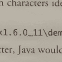

## 良好编程实践 15.1

在构建表示路径信息的字符串时，使用 `File.separator` 来获取本地计算机正确的分隔符，而不是显式地使用 `/` 或 `\`。该常量是由一个字符组成的字符串——即系统正确的分隔符。

## 常见编程错误 15.2

在字符串字面量中使用目录分隔符而不是 `\\` 是一个逻辑错误。单个反斜杠 `\` 表示其后的字符代表一个转义序列。我们使用 `\\` 来在字符串字面量中插入 `\`。

## 15.4 顺序文本文件

接下来，我们将创建并操作顺序文件，其中记录按记录键字段（record-key）顺序存储。我们从文本文件开始，以便读者能够快速创建和编辑人类可读的文件。我们将讨论写入数据、读取数据以及更新顺序文本文件。我们还包含了一个从文件中检索数据的信贷查询程序。第 15.4.1-15.4.3 节中的程序都在字符的 TextFileApps 目录中，以便它们可以操作同一个文本文件，该文件也存储在目录中。

## 15.4.1 创建顺序文本文件

Java 对文件没有施加结构——记录（records）等概念作为 Java 语言的一部分并不。因此，你必须对文件进行结构化以满足应用程序的需求。在接下来的示例中，我们在文件使用了键记录结构。

本节程序创建一个简单的顺序文件，可能用于应收系统，以跟踪客户欠公司的金额。对于每个客户，程序从用户处获取账户号码、客户名称和余额（即客户获得商品和服务所需的金额）。每个客户的数据构成了该客户的“记录”。该应用程序使用账户号码作为记录键——文件的记录将按账户号码顺序创建和维护。程序假设用户按账户号码顺序输入记录。一个全面的应收系统（基于顺序文件）将提供排序功能，以便用户按任何顺序输入记录。记录将经过排序并写入文件。

### CreateFile 类

`CreateFile` 类（图 15.3）使用 `Formatter` 输出格式化字符串，使用与 `System.out.printf` 相同的格式功能。`Formatter` 对象可以输出到各种位置，例如命令行窗口或文件，正如我们在示例中所做的。`Formatter` 对象在 try-with-resources 语句（第 13 行；引入自 11.12 节）中实例化——记得 try-with-resources 在块成功结束或因异常终止时关闭资源。我们使用的构造函数接收一个参数——一个命名文件名及其路径的字符串。如果未指定路径，JVM 假设它位于执行程序的目录中。对于文本文件，如果使用 .txt 文件扩展名，如果该


如果文件不存在，则将创建它。如果打开了一个现有文件，其内容将被截断——文件中的所有数据都将被丢弃。如果没有发生异常，该文件将以写入模式打开，生成的 `Formatter` 对象可用于向文件写入数据。

```java
// Fig. 15.3: CreateFile.java
// 使用 Formatter 类向顺序文本文件写入数据。

import java.io.FileNotFoundException;
import java.lang.SecurityException;
import java.util.Formatter;
import java.util.FormatterClosedException;
import java.util.NoSuchElementExceptionException;
import java.util.Scanner;

public class CreateFile {

    public static void main(String[] args) {
        // open clients.txt
```

| 账号数字、名、姓和余额。 |
| :--- |
| 结束输入的结束标志符 |
| 100 Bob Blue 24.98 |
| 200 Steve Green -345.67 |
| 300 Pam White 0.00 |
| 400 Sam Red -42.16 |
| 500 Sue Yellow 224.62 |
| ^Z |

**图 15.3** 使用 `Formatter` 类向顺序文本文件写入数据。

## 15.4 顺序文本文件 621

第 33–36 行是一个多异常捕获（multi-catch），它处理了多种异常：

- `SecurityException`：如果用户没有权限向第 13 行打开的文件写入数据，会发生此异常。
- `FileNotFoundException`：如果文件不存在无法创建新文件，或者在第 13 行打开文件时出错，会发生此异常。
- `FormatterException`：当你尝试在第 22–23 行向文件写入时，`Formatter` 对象已关闭，会发生此异常。

对于这些异常，我们显示堆栈跟踪（stack trace），然后程序终止。

### 向文件写入数据

第 15–17 行提示用户为每个记录输入各种字段，或者在数据输入为空时输入文件结束键。图 15.4 列出了不同计算机系统的按键组合——某些 IDE 不支持基于控制台的输入（因此你可能需要从命令行窗口执行程序）。第 19 行使用 `Scanner.hasNext` 来判断是否输入了文件结束键。循环一直执行，直到 `hasNext` 遇到文件结束。


```
macOS and Linux          <Ctrl> d
Windows                 <Ctrl> z
```


# 15.4 顺序文件

## 15.4.1 写入顺序文本文件

### 文件结束按键组合

第 22–23 行使用 `Scanner` 从用户处读取数据，然后使用 `Formatter` 将数据作为结果输出。每个 `Scanner` 输入如果数据格式错误（例如在期望 `int` 时提供了 `String`）或没有更多数据可输入，则会抛出 `NoSuchElementException`（在第 25–28 行中处理）。

如果没有发生异常，则使用 `format` 输出记录信息，该方法可以执行相同的格式化。输出到 `Formatter` 对象的目的地——文件 `clients`。格式化字符串 `"%d %s %.2f"` 表示返回值将存储为一个整数（计数数字），紧接着是一个 `String`（名），以及另一个 `String`（姓）。每部分信息都从下一个空格开始进行格式化，且 `double` 值（余额）输出时在小数点右侧保留两位数字（如 `%.2f` 所示）。文本文件中的数据可以使用文本编辑器查看，或通过读取文件的程序进行检索（第 15.4.2 节）。[注：你也可以使用 `PrintWriter` 向文件输出数据，它提供了用于输出数据的 `format` 和 `print` 方法。]

当用户输入文件结束按键组合时，`try-with-resources` 会通过调用 `formatter` 方法关闭底层文件。如果程序没有显式调用 `close`，操作系统通常会在程序终止时关闭文件——这是操作系统“内部维护”的一个示例。然而，在需要时，你始终应该显式地关闭文件。

### 示例输出

该应用程序的示例数据如图 15.5 所示。在示例输出中，用户输入了五个账户的信息，然后输入文件结束键以信号数据输入完成。示例输出没有显示数据记录在文件中实际外观。在下一节中，为了验证文件是否成功创建，我们提供了一个读取文件并打印内容的程序。由于该文件是文本，你也可以简单地通过在文本编辑器打开文件来验证信息。

| 100 | Bob | Blue | 24.98 |
| 200 | Steve | Green | -345.67 |
| 300 | Pam | White | 0.00 |
| 400 | Sam | Red | -42.16 |
| 500 | Sue | Yellow | 224.62 |

图 15.5 | 图 15.3 程序的示例数据。

## 15.4.2 从顺序文本文件读取数据

数据存储在文件中，以便在需要时检索进行处理。第 15.4.1 节演示了如何创建一个用于顺序访问的文件。本节展示了如何从文本文件中顺序读取数据。我们演示了如何使用 `Scanner` 从文件而非键盘输入数据。第 15.4.1 节创建的应用程序从文件 "clients.txt" 读取记录。第 14 行创建的 `Scanner` 将用于输入数据。

```java
// 从文件中读取记录
while (input.hasNext()) { // 当有更多数据可读
    // 显示记录
    System.out.printf("%d %s %.2f%n",
        input.nextInt(), input.next(), input.nextDouble());
}
```

| 数字 | 名 | 姓 | 余额 |
|---|---|---|---|
| 100 | Bob | Blue | 24.98 |
| 200 | Steve | Green | -345.67 |
| 300 | Pam | White | 0.00 |
| 400 | Sam | Red | -42.16 |
| 500 | Sue | Yellow | 224.62 |

## 15.4.3 案例研究：查询程序

若要从文件中顺序检索数据，程序从文件开头开始。如果需要再次读取文件，程序必须关闭文件并重新打开。

**图 15.8** | 查询程序。（第 1 部分，共 4 部分。）

```java
public class CreditInquiry {
    private final MenuOption[] choices = MenuOption.values();
    public static void main(String[] args) {
        Scanner input = new Scanner(System.in);
        // 获取用户请求（例如：零余额、信用或贷款余额）
        MenuOption accountType = getRequest(input);
        while (accountType != MenuOption.END) {
            switch (accountType) {
                case ZERO_BALANCE:
                    System.out.printf("%n零余额账户:%n");
                    break;
                case CREDIT_BALANCE:
                    System.out.printf("%n信用余额账户:%n");
                    break;
                case DEBIT_BALANCE:
                    System.out.printf("%n贷款余额账户:%n");
                    break;
            }
            readRecords(accountType);
            accountType = getRequest(input); // 获取用户请求
        }
    }
    // 获取用户的请求
    private static MenuOption getRequest(Scanner input) {
        int request = 4;
        // 显示请求选项
        System.out.printf("%n输入请求%n%s%n%s%n%s%n%s%n",
            "1 - 列出零余额账户,",
            "2 - 列出信用余额账户,",
            "3 - 列出贷款余额账户,",
            "4 - 终止程序");
        try {
            System.out.printf("%n? ");
            request = input.nextInt();
        } while ((request < 1) || (request > 4));
        } catch (NoSuchElementException e) {
            System.err.println("输入无效。正在终止。");
        }
        return choices[request - 1]; // 返回对应的枚举值
    }
    // (此处省略 readRecords 方法实现)
}
```

```java
// 从文件中读取记录并只显示相应类型的记录
private static void readRecords(MenuOption accountType) {
    // 打开文件并处理内容
    try (Scanner input = new Scanner(Paths.get("clients.txt"))) {
        while (input.hasNext()) { // 读取更多数据
            int accountNumber = input.nextInt();
            String firstName = input.next();
            String lastName = input.next();
            double balance = input.nextDouble();

            // 如果类型正确，则显示记录
            if (shouldDisplay(accountType, balance)) {
                System.out.printf("%-10d-%12s-%12s%10.2f%n", accountNumber,
                    firstName, lastName, balance);
            } else {
                input.nextLine(); // 丢弃当前记录的剩余部分
            }
        }
    } catch (NoSuchElementException | IllegalStateException | IOException e) {
        System.err.println("处理文件出错。正在退出。");
        System.exit(1);
    }
}
```

```java
// 使用记录类型决定是否应该显示
private static boolean shouldDisplay(
    MenuOption option, double balance) {
    if (option == MenuOption.CREDIT_BALANCE && balance < 0) {
        return true;
    } else if (option == MenuOption.DEBIT_BALANCE && balance > 0) {
        return true;
    } else if (option == MenuOption.ZERO_BALANCE && balance == 0) {
        return true;
    }
    return false;
}
```

输入
1 - 列出余额为0的账户
2 - 列出信用卡账户
3 - 列出借记账户
4 - 退出程序

?1

图 15.8 | 查询程序。（第 2 部分，共 4 部分）。

余额为0的账户：
300 Pam White 0.00

输入
1 - 列出余额为0的账户
2 - 列出信用卡账户
3 - 列出借记账户
4 - 退出程序

?2

信用卡账户：
200 Steve Green -345.67
400 Sam Red -42.16

输入
1 - 列出余额为0的账户
2 - 列出信用卡账户
3 - 列出借记账户
4 - 退出程序

?3

借记账户：
100 Bob Blue 24.98
500 Sue Yellow 224.62

输入
1 - 列出余额为0的账户
2 - 列出信用卡账户
3 - 列出借记账户
4 - 退出程序

?4

图 15.8 | 查询程序。（第 3 部分，共 4 部分）。

记录信息通过读取文件并确定每个记录是否符合选定的账户类型来收集。`main` 方法的第18行调用 `getRequest`（第39–60行）显示菜单选项，将用户输入的数字转换为 `MenuOption` 并结果存储在 `accountType` 中。第20–35行进行循环，直到用户指定程序终止。第21–31行显示输出到屏幕的当前记录集的表头。第33行调用 `readRecords`（第63–87行），该方法遍历文件并读取每个记录。

`readRecords` 方法使用 `try-with-resources` 语句创建一个打开文件进行读取的 `Scanner`（第65行）。每次调用 `readRecords` 时都会用新的 `Scanner` 对象打开文件，以便我们可以从文件开头重新读取。第67–70行读取记录。第73行调用 `shouldDisplay`（第90–103行）确定当前记录是否符合要求。如果找到标记，循环终止，`try-with-resources` 语句关闭 `Scanner` 和文件。一旦读取所有记录，控制权返回 `main` 并再次调用 `getRequest`（第34行）获取用户的下一个菜单选项。

## 15.4.4 更新顺序文件

许多顺序文件中的数据无法修改，否则会有破坏文件中其他数据的风险。例如，如果需要将姓名“White”更改为“Worthington”，不能简单地覆盖旧姓名，因为新姓名需要更多空间。White 的记录被写入文件如下：

```
300 Pam White 0.00
```

如果在文件的相同位置使用新姓名重写该记录，记录将变为：

```
300 Pam Worthington 0.00
```

新记录比原始记录大（字符更多）。当前记录中的“0.00”以及“Worthington”中第二个“o”之后的字符将覆盖文件中下一个顺序记录的开头。问题在于文本文件中的字段（从而是记录）的大小可以不一。例如，7、14、117、274 和 27383 在内部都存储在相同的字节数（4字节）中，但当作为文本写入文件时，它们是不同大小的字段。因此，顺序文件中的记录通常不在原地更新——而是重写整个文件。为了实现前面的姓名更改，会将 300 Pam White 0.00 之前的记录复制到新文件，写入新记录（其大小可能与被替换的记录不同），并将 300 Pam White 0.00 之后的记录复制到新文件。重写整个文件来更新一个记录是不经济的。

# 15.5 使用 XML 进行序列化

在本节中展示的序列化是基于字符流执行的，因此结果将可以使用文本编辑器查看的文本文件。我们通过创建并向序列化对象写入文件来开始。

## 声明 Account 类

我们开始定义 `Account` 类（图 15.9），它封装了序列化示例使用的客户信息。本节的类以及 15.5.2 中的类位于 SerializationApps 目录中。`Account` 类包含实例变量 `accountNumber`、`firstName`、`lastName` 和 `balance`（第4–7行），以及访问这些实例的 get 方法。虽然示例中的 setter 方法没有验证数据，但通常应该这样做。

```java
// 图 15.9: Account 类
// 用于存储记录的 Account 类
public class Account {
    private int accountNumber;
    private String firstName;
    private String lastName;
    private double balance;

    // 使用默认值初始化 Account
    public Account() {
        this(0, "", "", 0.0);
    }

    // 使用提供的值初始化 Account
    public Account(int accountNumber, String firstName, String lastName, double balance) {
        this.accountNumber = accountNumber;
        this.firstName = firstName;
        this.lastName = lastName;
        this.balance = balance;
    }

    // 获取账户号
    public int getAccountNumber() { return accountNumber; }

    // 设置账户号
    public void setAccountNumber(int accountNumber) {
        this.accountNumber = accountNumber;
    }

    // 获取名字
    public String getFirstName() { return firstName; }

    // 设置名字
    public void setFirstName(String firstName) {
        this.firstName = firstName;
    }

    // 获取姓
    public String getLastName() { return lastName; }

    // 设置姓
    public void setLastName(String lastName) {
        this.lastName = lastName;
    }

    // 获取余额
    public double getBalance() { return balance; }

    // 设置余额
    public void setBalance(double balance) { this.balance = balance; }
}
```

## 15.5.1 使用 XML 创建顺序文件

在本节中展示的序列化是基于字符流执行的，因此结果将可以使用标准文本编辑器查看的文本文件。我们通过创建并向序列化对象写入文件来开始。

# 第 15 章 文件、输入/输出流、NIO 与 XML 序列化


图 15.9 用于作为对象存储记录的 `Account` 类（2 部分中的 2 部分）。

## 纯 Java 对象 (POJOs)

JAXB 与 POJO（纯旧对象）配合工作——不需要特殊的超类或接口即可支持 XML 序列化。默认情况下，JAXB 仅序列化对象的实例变量和公共的读写属性。回想第 13.4.1 节，读写属性是通过创建具有特定命名规范的 get 和 set 方法来定义的。在 `Account` 类中，`getAccountNumber` 和 `setAccountNumber` 方法（第 22–26 行）定义了读写属性 `accountNumber`。同样，第 29–45 行的 get 和 set 方法定义了读写属性 `firstName`、`lastName` 和 `balance`。该类还必须提供默认或无参构造函数，以便在从文件中读取对象时重新创建它们。

## 声明 Accounts 类

如你在图 15.11 所示，此示例将对象存储在 `List<Account>` 中，然后一次操作将条目序列化为 List。要序列化 List，它必须被定义为类的实例变量。因此，我们将 `List<Account>` 封装在 `Accounts` 类中（图 15.10）。

```java
// 15.10: Accounts.java
// 维护一个 List<Account>
import java.util.ArrayList;
import java.util.List;
import javax.xml.bind.annotation.XmlElement;

public class Accounts {
    // @XmlElement 指定列表中每个对象的 XML 元素名称
    // @XmlElement(name="account")
    private List<Account> accounts = new ArrayList<>(); // 存储 Accounts

    // 返回 List<Account>
    public List<Account> getAccounts() { return accounts; }
}
```

图 15.10 用于序列化对象的 `Account` 类。

第 9–10 行声明并初始化了 `List<Account>` 实例变量。JAXB 允许你自定义 XML 序列化的许多方面，例如序列化私有实例变量或只读属性。`@XmlElement` 注解（第 9 行）来自 `javax.xml.bind.annotation` 表示实例变量应该被序列化。我们稍后会讨论该注解的名称。需要该注解是因为该实例变量不是公共的，且没有对应的公共读写属性。

## 将 XML 序列化对象写入文件

图 15.11 的程序将 `Accounts` 对象序列化到文本文件中。该程序与第 15.4 节中的程序相似，因此我们只关注新功能。第 9 行从 `javax.xml.bind` 包导入 `JAXB` 类。该包包含许多实现我们所执行的序列化的相关类，而 `JAXB` 类包含了易于使用的静态方法来执行最常用的操作。

```java
// 图 15.11: CreateSequentialFile.java
// 使用 JAXB 和 BufferedWriter 向文件写入对象
import java.io.BufferedWriter;
import java.io.IOException;
import java.nio.file.Files;
import java.nio.file.Paths;
import java.util.NoSuchElementException;
import java.util.Scanner;
import javax.xml.bind.JAXB;

public class CreateSequentialFile {
    public static void main(String[] args) {
        // 写入对象并关闭文件
        try (BufferedWriter output = Files.newBufferedWriter(Paths.get("clients.xml"))) {
            Scanner input = new Scanner(System.in);
            // 在 XML 序列化之前存储 Accounts
            Accounts accounts = new Accounts();
            System.out.printf("%s%n", "Enter account number, first name, last name and balance.");
            System.out.printf("%s%n%s%n", "Enter end-of-file indicator to end input.", "? ");
            
            while (input.hasNext()) {
                try {
                    Account record = new Account(input.nextInt(), input.next(), input.next(), input.nextDouble());
                    accounts.getAccounts().add(record);
                } catch (NoSuchElementException e) {
                    input.nextLine();
                }
            }
            JAXB.marshal(accounts, output);
        } catch (IOException eException) {
            System.err.println("Error opening file. Terminating.");
        }
    }
}
```

**图 15.11** | 使用 JAXB 和 BufferedWriter 向文件写入对象（2 部分中的 1 部分）。

输入账号、名、姓和余额。
输入文件结束标识以结束输入。
? 100 Bob Blue 24.98
? 200 Steve Green -345.67
? 300 Pam White 0.00
? 400 Sam Red -42.16
? 500 Sue Yellow 224.64
? ^

图 15.11 使用 JAXB 和 BufferedWriter 向文件写入对象（2 部分中的 2 部分）。

要打开文件，第 14–15 行调用静态的 `newBufferedWriter`，它接收一个定义要写入文件的 `Path`（“clients.xml”）——如果文件存在，则返回一个 `JAXB` 可用于写入文件的 `BufferedWriter`。以这种方式打开输出的文件会被截断。XML 文件的标准扩展名是 `.xml`。如果在打开文件时发生问题，第 14–15 行将抛出 `IOException`——例如，当程序没有访问文件的权限或当以写入方式打开只读文件时。如果是这样，程序将显示错误信息（第 46–48 行），然后终止。否则，可以使用变量 `output` 写入文件。

第 20 行创建了包含 `List<Account>` 的 `Accounts` 对象。第 26–41 行输入每条记录，创建一个 `Account` 对象（第 29–30 行）并添加到 List 中（第 33 行）。当用户输入文件结束标识以终止输入时，第 44 行使用 `JAXB` 的静态 `marshal` 方法将包含 `List<Account>` 的 `Accounts` 对象序列化为 XML。第一个参数是待序列化的对象。该 `marshal` 方法的重载第二个参数是用于输出的 `BufferedWriter`。第 14–15 行获得的 `BufferedWriter` 输出整个 `Accounts` 对象及其列表中所有对象。在图 15.11 程序的示例执行中，我们输入了五个账户的信息——如图 15.5 所示的信息。

## XML 输出

图 15.12 显示了 `clients.xml` 文件的内容。虽然你不需要了解 XML 来操作，但理解它的结构很有帮助。每个 `Account` 类的属性都有一个与属性名相同的 XML 元素。例如，第 4–7 行是 Bob 的账号、余额、名、姓的 XML 元素——`JAXB` 按字母顺序排列了这些元素，尽管这并不是强制要求的。在这些元素内部是对应属性的值——100 代表账号，24.98 代表余额，Bob 代表名，Blue 代表姓。

如果我们没有指定注解的名称，将使用实例变量名（accounts）作为 XML 元素名称。`JAXB` XML 序列化的许多方面都是可自定义的。更多细节请见：

```xml
<?xml version="1.0" encoding="UTF-8" standalone="yes"?>
<accounts>
  <account>
    <accountNumber>100</accountNumber>
    <balance>24.98</balance>
    <firstName>Bob</firstName>
    <lastName>Blue</lastName>
  </account>
  <account>
    <accountNumber>200</accountNumber>
    <balance>345.67</balance>
    <firstName>Steve</firstName>
    <lastName>Green</lastName>
  </account>
  <account>
    <accountNumber>300</accountNumber>
    <balance>0.0</balance>
    <firstName>Pam</firstName>
    <lastName>White</lastName>
  </account>
  <account>
    <accountNumber>400</accountNumber>
    <balance>-42.16</balance>
    <firstName>Sam</firstName>
    <lastName>Red</lastName>
  </account>
  <account>
    <accountNumber>500</accountNumber>
    <balance>224.64</balance>
    <firstName>Sue</firstName>
    <lastName>Yellow</lastName>
  </account>
</accounts>
```

图 15.12 | `clients.xml` 的内容。

## 15.5.2 从顺序流中读取和反序列化数据

上一节展示了如何创建一个包含 XML 序列化对象的文件。在本节中，我们将讨论如何从文件中读取序列化数据。图 15.13 从第 15.5.1 节程序创建的文件读取对象并显示其内容。该程序通过调用 `Files` 静态方法 `newBufferedReader` 打开文件进行读取，该方法接收一个指定文件的 `Path`；如果文件存在且没有发生异常，它将返回一个用于读取文件的 `BufferedReader`。

```java
// Fig. 15.13: ReadSequentialFile.java
// 使用 JAXB 和 BufferedReader 读取包含 XML 序列化对象的文件
// 并显示每个对象。
import java.io.BufferedReader;
import java.io.IOException;
import java.nio.file.Files;
import java.nio.file.Paths;
import javax.xml.bind.JAXB;

public class ReadSequentialFile {
    public static void main(String[] args) {
        try {
            // 打开文件进行反序列化
            BufferedReader input = Files.newBufferedReader(Paths.get("clients.xml"));
            // 反序列化文件内容
            Accounts accounts = JAXB.unmarshal(input, Accounts.class);
            // 显示内容
            System.out.printf("%-10s%-12s%-12s%-10s%n", "Account", "First Name", "Last Name", "Balance");
            for (Account account : accounts.getAccounts()) {
                System.out.printf("%-10d%-12s%-12s%.2f%n",
                    account.getAccountNumber(), account.getFirstName(),
                    account.getLastName(), account.getBalance());
            }
        } catch (IOException exception) {
            System.out.println("Error opening file.");
        }
    }
}
```

| Account | First Name | Last Name | Balance |
|---|---|---|---|
| 100 | Bob | Blue | 24.98 |
| 200 | Steve | Green | -345.67 |
| 300 | Pam | White | 0.00 |
| 400 | Sam | Red | -42.16 |
| 500 | Sue | Yellow | 224.64 |

> 图 15.13 | 使用 JAXB 和 BufferedReader 读取包含 XML 序列化对象的文件并显示每个对象。

## 15.6 FileChooser 和 DirectoryChooser 对话框

第 16 行使用 `JAXB` 静态方法 `unmarshal` 读取 `clients.xml` 的内容并将 XML 转换为 `Accounts` 对象。这里使用的 `unmarshal` 载载方法来自一个 `Reader`（来自 `java.io` 包），并创建由第二个参数指定的特定类型的对象——`BufferedReader` 是 `Reader` 的子类。第 13–14 行中的 `Buffered` 负责从文件中读取文本。`unmarshal` 方法的第二个参数是一个 `Class<T>` 对象（来自 `java.lang` 包），表示要从 XML 创建的对象的类型——符号表示法 `Accounts.class` 是 Java 编译器的简写：

```java
new Class<Accounts>
```

再次注意，有一条语句读取了整个文件并重建了 `Accounts` 对象。如果没有发生异常，第 19–26 行将显示 `Accounts` 对象的内容。

JavaFX 类 `FileChooser` 和 `DirectoryChooser`（来自 `javafx.stage` 包）用于显示允许用户分别选择文件或目录的对话框。为了演示这些对话框，我们增强了第 15.3 节中的示例。该示例（F15.14–15.15）包含一个 JavaFX 图形用户界面，但显示的内容与之前的示例相同。

## 创建 JavaFX GUI

GUI (F15.15(a)) 包含一个 600x400 的 `BorderPane`，其 `fxid` 为 `borderPane`：

- 在 `BorderPane` 的顶部放置了一个 `Toolbar`（来自 `Scene Builder`），它默认水平排列其控件。通常，我们将控件放置在 `BorderPane` 的边缘，如顶部、右侧或左侧。
- 在 `BorderPane` 的中心放置了一个 `TextArea`，其 `fxid` 为 `textarea`。我们设置了 `WrapText` 属性，以确保长文本在 `TextArea` 中换行。（如果未启用 `WrapText`，当文本比 `TextArea` 宽时，将显示水平滚动条。）

默认情况下，`Toolbar` 有一个按钮。你可以向布局中拖入其他控件，必要时移除按钮。对于第一个按钮，我们设置了：

- `Text` 属性为 "Select Directory"
- `fxid` 属性为 `selectButton`
- `OnAction` 事件处理器为 `selectButtonPressed`

最后，我们为 FXML 指定了 `FileChooserController`。

## 启动应用程序的类

`FileChooserTest`（图 15.14）使用我们在第 12–13 节中学到的技术启动 JavaFX 应用。

```java
// Fig. 15.14: FileChooser.java
// 测试 FileChooser 和 DirectoryChooser 类的程序
import javafx.application.Application;
import javafx.fxml.FXMLLoader;
import javafx.scene.Parent;
import javafx.scene.Scene;
import javafx.stage.Stage;

public class FileChooserTest extends Application {
    @Override
    public void start(Stage stage) throws Exception {
        Parent root = FXMLLoader.load(getClass().getResource("FileChooserTest.fxml"));
        Scene scene = new Scene(root);
        stage.setTitle("FileChooser Test"); // 显示在标题栏
        stage.setScene(scene);
        stage.show();
    }
}
```


**图 15.14 | 演示 JFileChooser。**

## 控制器类

`FileChooserController`（图 15.15）响应按钮。两个事件处理器都调用 `analyzePath` 方法（定义在第 70–110 行）来判断 `Path` 是文件还是目录，显示 `Path` 的信息，如果是目录，则列出其内容。

**图 15.15** | 显示所选文件或文件夹的信息。（共 5 部分的第一部分）

```java
// Fig. 15.15: FileChooserTestController.java

// 显示文件或文件夹的信息。

import java.io.File;

import java.io.IOException;

import java.nio.file.DirectoryStream;

import java.nio.file.Files;

import java.nio.file.Path;

import java.nio.file.Paths;

import javafx.event.ActionEvent;

import javafx.fxml.FXML;

import javafx.scene.control.Button;

import javafx.scene.control.TextArea;
```

```java
else {

    textArea.setText("选择文件或目录");

}

// 显示用户指定的文件或目录信息
public void analyzePath(Path path) {

    try {

        // 如果文件或目录存在，显示其信息
        if (path != null && Files.exists(path)) {

            // 收集文件（或目录）信息
            StringBuilder builder = new StringBuilder();

            builder.append(String.format("%s\n", path.getFileName()));

            builder.append(String.format("%s\n", path.getAbsolutePath()));

            builder.append(Files.isDirectory(path) ? "是目录" : "不是目录");

            builder.append(String.format("%s 是绝对路径\n", path.getAbsolutePath()));

            builder.append(String.format("修改时间: %s\n", Files.getLastModifiedTime(path)));

            builder.append(String.format("大小: %s\n", Files.size(path)));

            builder.append(String.format("路径: %s\n", path));

            builder.append(String.format("绝对路径: %s\n", path.toAbsolutePath()));

            if (Files.isDirectory(path)) {

                // 输出目录列表
                builder.append(String.format("目录内容:%s\n", path.getFileName()));

                // 用于遍历目录内容的对象
                DirectoryStream<Path> directoryStream =

                    Files.newDirectoryStream(path);

                for (Path p : directoryStream) {

                    builder.append(String.format("%s\n", p));

                }

            }

            // 显示文件或目录信息
            textArea.setText(builder.toString());

        } else { // 路径不存在
            textArea.setText("路径不存在");
        }

    } catch (IOException io) {
        textArea.setText(io.toString());
    }
}
```


# 第 15 章 文件、输入/输出流、NIO 和 XML 序列化

## 15.6 FileChooser 和 DirectoryChooser 对话框

**图 15.15** | 显示所选的文件或目录。（第 3 部分）

**图 15.15** | 显示所选的文件或目录。（第 4 部分）

**图 15.15** | 显示所选的文件或目录。（第 5 部分）

### selectButtonPressed

当用户按下选择按钮时，`selectButtonPressed` 方法（第 24-44 行）创建、配置并显示 `FileChooser`。第 28 行设置 `FileChooser` 标题栏显示的文本。第 31 行指定了 `FileChooser` 返回代表目录位置的 `File` 对象——该 `File` 对象代表应用程序启动时的当前文件夹。

第 34-35 行通过调用其 `showDialog` 方法显示 `FileChooser`，显示出一个带有“打开”按钮的对话框以打开文件。还有一个 `saveDialog` 方法，显示出一个带有“保存”按钮的对话框以保存文件。此方法接收窗口的引用作为参数。非空参数使 `FileChooser` 成为模态对话框，在用户取消（关闭对话框）之前，防止用户与应用程序的其他部分交互。为了获取应用程序窗口，我们使用 `borderPane` 的 `getScene` 获取其父 `Scene`，然后 `Scene` 的 `getWindow` 方法返回包含 `Scene` 的窗口。

`openDialog` 方法返回所选文件位置的 `File` 对象，如果用户点击“取消”则返回 `null`。如果 `File` 不为空，第 39 行调用 `analyzePath` 显示文件信息——`path` 返回代表位置的 `Path` 对象。否则，第 42 行在 `TextArea` 中显示消息，让用户选择文件或目录。图 15.15(b) 和 (c) 显示了选择了 `FileChooserTest.java` 的 `FileChooser` 对话框，在用户按下“打开”按钮后，显示文件的信息。

### selectDirectoryPressed

当用户按下选择目录按钮时，`selectDirectoryPressed` 方法（47–67 行）创建并显示 `DirectoryChooser`。该方法执行的任务与 `selectButtonPressed` 相同。关键区别在于第 57 行，`DirectoryChooser` 方法 `showDialog` 用于显示对话框——选择文件夹没有单独的保存对话框。`showDialog` 方法返回所选目录的 `File` 对象，如果用户点击“取消”则返回 `null`。如果 `File` 不为空，第 62 行调用 `analyzePath` 显示所选目录的信息。否则，第 65 行在 `TextArea` 中显示消息，让用户选择文件或目录。图 15.15(d) 和 (c) 显示了选择了 fig15_14-15 目录的 `FileChooser` 对话框，在用户按下“打开”按钮后，显示目录的信息。

## 15.7（可选）额外的 java.io 类

本节涵盖额外的接口和类（来自 `java.io` 包）。

### 15.7.1 基于字节的输入输出的接口和类

`InputStream` 和 `OutputStream` 是抽象类，分别声明了执行基于字节输入输出的方法。

#### 管道流

管道是线程之间的同步通信通道。我们在第 23 章讨论线程。Java 提供了 `PipedOutputStream`（`OutputStream` 的子类）和 `PipedInputStream`（`InputStream` 的子类）以便在线程之间建立管道。其中一个线程向 `PipedOutputStream` 发送数据，另一个线程从 `PipedInputStream` 读取。

#### 过滤流

`FilterInputStream`（`InputStream` 的子类）和 `FilterOutputStream`（`OutputStream` 的子类）提供了额外功能，例如将字节聚合为有意义的单元。`PrintStream`（`OutputStream` 的子类）用于向流中执行文本操作。

#### 数据流

作为原始字节读取数据速度很快，但通常程序以聚合形式读取数据。`DataInput` 接口描述了从输入流中读取原始类型的方法。`DataInputStream` 和 `RandomAccessFile` 分别实现该接口以读取字节集。`DataInput` 包含了 `readBoolean`、`readByte`、`readInt`、`readLong`、`readShort`、`readFloat`、`readSignedByte` 方法。

`DataOutput` 接口描述了向输出流写入原始类型的方法。`DataOutputStream`（`OutputStream` 的子类）和 `RandomAccessFile` 分别实现该接口以写入原始类型值。`DataOutput` 包含了重载的 `write` 方法（用于字节或字节数组）以及 `writeBoolean`、`writeByte`、`writeDouble`、`writeFloat`、`writeInt`、`writeLong`、`writeShort` 和 `writeUTF` 方法。

#### 缓冲流

缓冲是一种性能增强技术。通过 `BufferedInputStream`（`FilterInputStream` 的子类），每个输出语句都不会导致数据传输到输出设备（与处理器和内存速度相比，这是一个缓慢的操作）。相反，每个输出操作都指向内存中的一个称为缓冲区，该缓冲区的大小足够容纳多次输出操作的数据。每当缓冲区满时，就会通过一次大的输出操作执行实际传输到输出设备。对于 `BufferedOutputStream`，可以通过调用对象的 `flush` 方法随时将部分填充的缓冲区强制输出。

> 缓冲 I/O 相比非缓冲 I/O 可以产生显著的性能提升。

在下一组“逻辑”数据块中。因此，与程序发出的读取请求相比，实际物理输入操作的数量非常少。

#### 基于内存的字节数组流

Java 流 I/O 包含了从内存字节数组输入和输出到内存字节数组的能力。`ByteArrayInputStream`（`InputStream` 的子类）从内存中的字节数组中读取。`ByteArrayOutputStream`（`OutputStream` 的子类）输出到内存中的字节数组。字节数组 I/O 的用途之一是数据验证。程序可以一次从输入流读取一整行内容到字节数组中。验证程序可以检查字节数组的内容，并在必要时修正数据。最后，程序可以从字节数组进行输入，并“知道”输入数据是正确的格式。输出到字节数组是利用 Java 流强大的输出格式化能力的一种良好方法。例如，可以将数据存储在字节数组中，使用与稍后显示时相同的格式，然后将字节数组输出到文件以保留格式。

#### 多路流的顺序输入

`SequenceInputStream`（`InputStream` 的子类）在逻辑上连接了多个输入流——程序将该组视为一个连续的 `InputStream`。当程序到达一个输入流的末尾时，该流关闭，序列中的下一个流打开。

### 15.7.2 基于字符的输入输出的接口和类

除了字节流外，Java 还提供了 `Reader` 和 `Writer` 抽象类，它们是基于字符的流，类似于你在 15.4 节中用于文本文件处理的类。大多数字节流都有对应的基于字符的具体 `Reader` 或 `Writer` 类。

#### 基于字符的缓冲读取和写入

`BufferedReader`（`Reader` 的子类）和 `BufferedWriter`（抽象类 `Writer` 的子类）为基于字符流提供了缓冲。请记住，基于字符的流使用 Unicode 字符——此类流可以处理 Unicode 字符集表示的任何语言的数据。

#### 基于内存的 char 数组读取和写入

`CharArrayReader` 和 `CharArrayWriter` 分别将字符流读取和写入 `char` 数组中。`LineNumberReader`（`BufferedReader` 的子类）是一个缓冲流，它会跟踪读取的行数——换行符、回车符以及回车-换行符组合会增加行计数。如果程序需要通知读者特定某行的错误，跟踪行号将非常有用。

#### 基于字符的文件、管道和字符串读取与写入

可以通过 `InputStreamReader` 类将 `InputStream` 转换为 `Reader`。同样，可以通过 `OutputStreamWriter` 类将 `OutputStream` 转换为 `Writer`。`FileReader`（`InputStreamReader` 的子类）和 `FileWriter` 类（`OutputStreamWriter` 的子类）分别从文件读取和向文件写入字符。`PipedReader` 和 `PipedWriter` 实现线程间传输数据的管道字符流。`StringReader` 和 `StringWriter` 分别从字符串和向字符串写入字符。`PrintWriter` 将字符写入流。

## 15.8 总结

在本章中，你学习了如何操作持久化数据。我们比较了基于字节和基于字符的流，并引入了 `java.io` 和 `java.nio.file` 包中的类。你使用了 `Files` 和 `Paths` 类以及 `Path` 和 `DirectoryStream` 接口来检索文件和目录信息。你使用了顺序文件处理来操作顺序存储的文件。你使用了 XML 序列化来检索对象。本章以一个简单的 `FileChooser` 示例结束，允许用户从 GUI 选择文件。下一节将讨论 Java 用于操作集合的类——例如我们在 7.16 节中介绍的 `ArrayList`。

## 章节要点回顾

### 15.1 引言

- 计算机使用文件长期保留大量数据（第 613 页），即使创建数据的程序已经终止。
- 计算机将文件存储在辅助存储设备上（第 613 页），例如固态硬盘。

### 15.2 文件和流

- Java 将每个文件视为字节的顺序流（第 613 页）。
- 每个操作系统都提供了一种确定文件末尾的机制，例如文件结束标记（第 613 页）或文件的总字节数。
- 基于字节的流（第 614 页）以二进制格式表示数据。
- 基于字符的流（第 614 页）将数据表示为字符序列。
- 使用字节流创建的文件是二进制文件（第 614 页）。使用字符流创建的文件是文本文件（第 614 页）。文本文件由文本编辑器读取，而二进制文件由程序转换为人类可读的格式。
- Java 还可以将流与不同设备关联。当 Java 程序开始执行时，三个流与设备关联——`System.in`、`System.out` 和 `System.err`。

### 15.3 使用类和接口获取文件和目录信息

- `Path`（第 615 页）代表文件或目录的位置。`Path` 对象不打开文件或提供文件处理能力。
- `Paths` 类（第 615 页）用于获取表示文件或目录位置的 `Path` 对象。
- `Files` 类（第 615 页）提供了操作文件和目录的静态方法，包括复制文件；创建和删除文件及目录；获取文件和目录信息；读取文件内容；允许你操作文件和目录内容的 `DirectoryStream`（第 615 页）等。
- `Paths` 静态方法 `get`（第 615 页）将表示文件位置的 `String` 转换为 `Path` 对象。
- 基于字符的输入输出可以使用 `Scanner` 和 `Formatter` 类完成。
- `Formatter` 类（第 615 页）允许将格式化数据输出到屏幕或文件，类似于 `System.out.print()`。
- 绝对路径（第 615 页）包含从根目录（第 615 页）开始的所有特定文件或目录。磁盘驱动器上的每个文件或目录在其路径中都有相同的根目录。
- 相对路径（第 615 页）从应用程序执行的目录开始。
- `Files` 静态方法 `exists`（第 617 页）检索一个 `Path` 并确定其是否存在（作为文件或目录）。
- `Path` 方法 `getFileName`（第 618 页）获取没有位置信息的文件或目录的 `String` 名称。
- `Files` 静态方法 `isDirectory`（第 618 页）检索一个 `Path` 并返回一个布尔值，表示 `Path` 是否为目录。
- `Path` 方法 `isAbsolute`（第 618 页）返回一个布尔值，表示 `Path` 是否为绝对路径。
- `Files` 静态方法 `getLastModifiedTime`（第 618 页）检索一个 `Path` 并返回指示最后修改时间的 `FileTime`。
- `Files` 方法 `size`（第 618 页）检索一个 `Path` 并返回表示文件字节数的 `long` 类型。对于目录，返回的值取决于平台。
- `Path` 方法 `toString`（第 618 页）返回路径的 `String` 表示形式。
- `Path` 方法 `toAbsolutePath`（第 618 页）将被调用的 `Path` 转换为绝对路径。
- `Files` 方法 `newDirectoryStream`（第 618 页）返回一个包含目录内容 `Path` 对象的 `DirectoryStream<Path>`。
- 分隔符（第 618 页）用于分隔路径中的目录和文件。

### 15.4 顺序文本文件

- Java 不对文件施加任何结构。你必须根据应用程序的需求对文件建立结构。
- 要从文件中顺序检索数据，程序通常从文件开头开始并连续读取所有数据，直到找到所需信息。
- 许多顺序文件中的数据无法进行修改，否则有破坏文件中数据的风险。顺序文件中的记录通常通过重写文件来更新。

### 15.5 XML 序列化

- JAXB（Java XML 绑定架构）允许你执行 XML 序列化，JAXB 将其称为编组。
- 一个 XML 序列化对象表示为包含对象数据的 XML。
- 序列化对象被写入文件后，可以从文件中读取并反序列化。

#### 15.5.1 使用 XML 序列化创建顺序文件

- JAXB 配合 POJO（简单旧对象）工作。
- 默认情况下，JAXB 序列化对象的公共实例变量和公共读写属性。该类还必须提供一个公共默认构造函数或无参构造函数，以便在从文件中读取时重建这些对象。
- 要序列化一个 `List`，必须将其定义为类的实例变量。
- JAXB 允许你自定义 XML 序列化的许多方面。
- 注解 `@XmlElement`（包 `javax.xml.bind.annotation`）表示应该序列化实例，并可选地指定 XML 元素的名称。
- 类 `JAXB`（包 `javax.xml.bind`）执行 XML 序列化。
- `Files` 静态方法 `newBufferedWriter` 返回一个指定要打开写入文件的 `Path`，如果文件存在，则可以使用 `BufferedWriter` 向文件写入文本。以这种方式打开输出的现有文件会被截断。
- XML 文件的标准文件名扩展名为 `.xml`。
- `JAXB` 静态方法 `marshal` 将对象序列化为 XML 格式。参数是要序列化的对象和一个用于输出的写入器（包 `java.io`）。
- `BufferedWriter` 类继承自 `Writer`。
- 当 JAXB 序列化一个类的对象时，它使用首字母全小写的类名作为对应的 XML 元素名称。
- 每个属性的 XML 元素名称与属性名称相同。

#### 15.5.2 从顺序文件中读取和反序列化数据

- `Files` 静态方法 `newBufferedReader` 接收一个指定要打开文件的 `Path`，如果文件存在，则返回一个可以从其读取文本的 `BufferedReader`。
- `JAXB` 静态方法 `unmarshal` 将 XML 内容读取到方法的第二个参数所指定的类型对象中。第二个参数是表示要创建的对象类型的 `Class<T>`。
- 记法 `ClassName.class` 是 `Class<ClassName>` 的简写。

### 15.6 FileChooser 和 DirectoryChooser 对话框

- `ToolBar` 布局（位于 Scene Library 的 Containers 部分）按水平方向（默认）或垂直方向排列其控件。
- `TextArea` 显示多行文本。其 `Wrap Text` 属性确保长行文本换行到下一行。
- 如果文本过多无法显示，`TextArea` 具有垂直滚动条。当未设置 `Wrap Text` 时，`TextArea` 还具有水平滚动条。
- 默认情况下，拖到布局上的 `ToolBar` 包含一个 `Button`。你可以将额外的控件拖到 `ToolBar` 上，并在时移除默认的 `Button`。
- `FileChooser` 方法 `setInitialDirectory` 接收一个表示初始显示文件夹的 `File` 对象。
- `FileChooser` 方法 `showOpenDialog` 显示一个打开对话框——还有一个 `showSaveDialog` 显示用于保存文件的对话框。该方法接收应用程序 `Window` 的引用作为参数。提供非空参数使 `FileChooser` 成为模态对话框。它防止用户在对话框关闭之前与程序的其余部分交互。
- 方法 `showOpenDialog` 返回表示所选文件位置的 `File`，如果用户点击取消则返回 `null`。
- `File` 方法 `toPath` 返回一个表示位置的 `Path` 对象。
- `DirectoryChooser` 方法 `showDialog` 显示对话框。该方法返回表示所选目录位置的 `File`，如果用户点击取消则返回 `null`。

### 15.7（可选）额外的 java.io 类

- `InputStream` 和 `OutputStream` 是执行基于字节的 I/O 的抽象类。
- 管道（第 641 页）是线程之间的同步通信通道。一个线程通过 `PipedOutputStream`（第 641 页）发送数据。目标线程通过 `PipedInputStream`（第 641 页）从管道读取信息。
- 过滤器（第 641 页）提供了额外功能，将数据字节聚合为有意义的原始类型单元。`FilterInputStream`（第 641 页）和 `FilterOutputStream` 通常被扩展，其某些过滤功能由其具体子类提供。
- `PrintStream`（第 641 页）执行文本输出。`System.out` 和 `System.err` 是 `PrintStream`。
- 接口 `DataInput` 描述了从输入流读取原始类型的方法。`DataInputStream`（第 642 页）和 `RandomAccessFile` 实现此接口。
- 接口 `DataOutput` 描述了向输出流写入原始类型的方法。`DataOutputStream`（第 642 页）和 `RandomAccessFile` 实现此接口。
- 缓冲是一种 I/O 性能优化技术。缓冲通过在内存中合并较小的输出来减少 I/O 操作次数。

## 练习

### 15.3 a) 和 b) 的答案：

- a) `JAXB.marshal(accounts, writer)`
- b) `Accounts account = JAXB.unmarshal(reader, Accounts.class);`

### 15.4 (文件匹配)

自复习练习 15.2 要求你编写了一系列单条语句。实际上，这些语句构成了一个重要文件处理程序的核心——即文件匹配程序。在商业数据处理中，每个应用程序系统中包含多个文件是常见的。例如，在一个应收账款系统中，通常有一个主文件，包含每个客户的信息，如客户名称、地址、电话号码、未结余额、信用额度、折扣条款、合同安排，可能还有最近的购买和现金支付历史。

随着交易的发生（即发生了销售并通过邮件寄收了付款），相关信息会在每个业务周期结束时输入文件（有些公司为一个月，有些为几周，某些情况下为一天），将交易文件（“trans.txt”）应用于主文件（“oldmast.txt”）以更新每个账户的购买和支付记录。在更新过程中，主文件被重写为文件“newmast.txt”，该文件将在下一个周期开始时用于更新过程。

文件匹配程序必须处理单文件程序不会出现的问题。例如，匹配并不总是发生。如果主文件上的客户在当前业务周期内没有任何购买或支付，则交易文件中没有该客户的记录。同样，一个进行了购买或现金支付的客户可能刚刚加入，如果是这样，公司可能还没有为该客户创建主记录。

编写一个完整的应收账款匹配程序。使用每个文件中的账户号码作为匹配键。假设每个账户是一个顺序文本文件，并输入 `accountRecord`。

- a) 定义 `TransactionRecord` 类。该类的对象包含交易账户号码和金额。提供修改和检索这些值的方法。
- b) 修改图 15.9 中的 `Account` 类，增加 `combine` 方法，该方法接收一个 `Transaction` 对象并合并 `Account` 对象的余额和金额。
- c) 编写一个程序为测试创建数据。使用图 15.16 和 15.17 中的示例账户数据。运行程序创建供文件匹配程序使用的 `trans.txt` 和 `oldmast.txt`。

| 账户 | 名称 | 余额 |
| :--- | :--- | :--- |
| 100 | Alan Jones | 34.17 |
| 300 | Mary Smith | 27.19 |
| 500 | Sam Sharp | 0.00 |
| 700 | Suzy Green | -14.22 |

- d) 创建 `FileMatch` 类执行文件匹配功能。该类应包含读取 `oldmast` 和 `trans.txt` 的方法。当发生匹配时（即相同账户的记录出现在主文件和交易文件中），将交易记录中的金额添加到主记录的当前余额中，并写入“newmast.txt”（假设交易文件中的正金额表示购买，负金额表示付款）。当主中有某个账户的记录但没有对应的交易记录时，仅将主记录写入“newmast.txt”。当有交易记录但没有对应的主记录时，将“账户...的未匹配记录”打印到名为“log.txt”的文件中。

### 15.5 (多交易文件匹配)

具有相同记录键的多个交易是可能的（实际上也很常见）。这发生在客户在一个业务周期内进行多次购买和支付时。重写练习 15.4 的应收账款文件匹配程序，以处理具有相同记录键的多个交易记录。修改 `TestData.java` 数据以包含图 15.18 中的额外交易记录。

| 账户 | 余额 |
| :--- | :--- |
| 300 | 83.89 |
| 700 | 80.78 |
| 700 | |

### 15.6 (XML 序列化的文件匹配)

使用 XML 序列化重建练习 15.5 的解决方案。你可能需要创建应用程序来读取 .xml 文件——15.2 节的代码可以为此进行修改。

### 15.7 (电话号码生成器)

标准电话键盘包含数字到 9，每个数字对应三个字母（图 15.19）。很多人发现记忆电话号码很难，因此使用数字与字母之间的对应关系来生成与其号码对应的七字母单词。例如，号码为 086-2377 的人可以使用图 15.19 所示的对应关系来生成七字母单词 "NUMBERS"。每个七字母单词精确对应一个电话号码。一个希望增加外卖业务的餐厅可以使用号码 825-3688（即 "TAKEOUT"）。

每个七字母电话号码对应许多不同的七字母单词，但这些单词大部分是字母的无法识别的组合。然而，理发店老板如果知道店的电话号码 424-7288 对应 "HAIRCUT" 会很高兴。一个电话号码为 738-2273 的兽医如果知道该号码对应 "PETCARE" 会很高兴。汽车经销商如果知道号码 639-2277 对应 "NEWCARS"。编写一个程序，给定一个七位数字，使用 `Formatter` 对象读取该号码所有可能的七字母单词组合。共有 2187 (3⁷) 种组合。避免包含数字 0 和 1 的电话号码。

### 15.8 (学生调查)

图 7.8 包含硬编码在程序中的调查响应数组。假设你想处理存储在文件中的调查结果。此练习需要两个程序。首先，创建一个应用程序，提示用户输入调查响应并将每个响应输出到文件。使用 `Formatter` 创建名为 `responses.txt` 的文件。每个整数应使用 `format` 方法写入。然后修改图 7.8 中的程序，从 `numbers.txt` 读取调查响应。应使用 `Scanner.next()` 从文件中读取响应，每次输入一个整数。程序应继续读取响应直到到达文件结尾。结果应输出到文本文件 "out.txt"。

### 15.9 (网络钓鱼诈骗)

网络钓鱼是一种身份盗窃的形式，邮件发送者伪装成可靠来源以获取私有信息，如用户名、密码、信用卡号和社会安全号。声称来自银行、信用卡公司、账户网站、社交网络和在线支付服务的钓鱼邮件看起来可能是真实的。这些欺诈信息通常提供伪造（假）网站的链接，要求输入敏感信息。

搜索在线钓鱼诈骗。还要检查反钓鱼工作组（Anti-Phishing Working Group）：


http://www.phishing.org

http://www.fbi.gov/about-us/investigate/cyber/cyber

你可以在那里找到有关最新诈骗和如何保护自己的信息。

列出 30 个常见于钓鱼信息中的词汇、短语和公司名称。根据你对其出现在钓鱼信息中可能性的估计为每个分配分值（例如，有点可能给一分，中等可能给二分，非常可能给三分）。使用应用程序扫描文本文件以查找这些词和短语。对于文本文件中出现的每个关键词或短语，将分配的分值加到该单词或短语的总分中。对于找到的关键词或短语，输出一行包含该词或短语、出现次数和总分。然后显示整个消息的总分。你的程序是否为你收到的某些真实邮件分配了高分？它是否为你收到的某些合法邮件分配了高分？

# 16 通用集合

## 目标

在本章中，你将学习：

- 学习什么是集合。
- 使用 `Arrays` 类进行数组操作。
- 学习类型包装类（type-wrapper classes），使程序能够将原始数据值作为对象处理。
- 理解包装类对象与其对应的原始类型之间自动发生的装箱（boxing）和拆箱（unboxing）。
- 使用集合框架中预构建的通用数据结构。
- 使用 `Collections` 类的各种算法处理集合。
- 使用迭代器（iterators）“遍历”集合。
- 学习同步和可修改性包装器。
- 学习 Java SE 9 用于创建小型不可变 `List`、`Set` 和 `Map` 的新工厂方法。


## 16.1 引言

### 目录

- 16.1 引言
- 16.2 集合概览
- 16.3 类型包装类
- 16.4 装箱与自动拆箱
- 16.5 接口 `Collection` 与类 `Collections`
- 16.6 Lists
    - 16.6.1 `ArrayList` 和 `Iterator`
    - 16.6.2 `LinkedList`
- 16.7 `Collections` 方法
    - 16.7.1 `sort` 方法
    - 16.7.2 `shuffle` 方法
    - 16.7.3 `reverse`、`fill`、`copy`、`max` 和 `min` 方法
    - 16.7.4 `binarySearch` 方法
    - 16.7.5 `addAll`、`frequency` 和 `disjoint` 方法
- 16.8 优先级 `PriorityQueue` 类与 `Queue` 接口
- 16.9 Sets
- 16.10 Maps
- 16.11 同步集合
- 16.12 不可修改集合
- 16.13 抽象实现
- 16.14 Java SE 9：用于不可变集合的便利方法
- 16.15 总结

总结 | 自测练习题 | 自测练习题答案 | 练习题

## 16.1 引言

在第 7.16 节中，我们介绍了通用的 `ArrayList` 集合——这是一种动态调整大小的类数组数据结构，它存储你使用 `ArrayList` 指定的类型的对象的引用。在本章中，我们将继续讨论 Java 集合框架，该框架包含了许多预构建的通用数据结构。

集合的一些示例包括：你智能手机或媒体播放器上喜欢的歌曲、联系人列表、你在纸牌游戏中持有的牌、你喜欢的运动球队的成员以及你在学校修读的课程。

我们将讨论用于每种集合类型能力声明的集合框架接口、实现这些接口的各种类、处理集合对象的方法，以及“遍历”集合的迭代器。

### Java SE 8

在读完第 17 章“Lambda 与字符串”后，你将能够以更简洁优雅的方式重新实现第 16 章的许多示例，并且这种方式更容易进行并行化，以提高当今多核系统上的性能。在第 23 章“并发”中，你将学习如何使用 Java 的并发集合和并行流操作来提高多核系统的性能。

### Java SE 9

第 16.14 节介绍了 SE 9 的新的便利工厂方法，它们帮助你创建小型不可变集合，这些集合一旦创建就无法被修改。

## 16.2 集合概览

集合是一种数据结构——实际上是一个对象——它可以持有其他对象的引用。通常，集合包含与集合元素类型具有“是关系”（is-relationship）的任何类型的对象。集合框架接口声明了在各种类型的集合上通用的执行的操作。图 16.1 列出了一些集合框架接口。框架内部提供了这些接口的几种实现。你也可以提供自己的实现。

| Collection | 集合层次结构中的根接口，`Set`、`Queue` 和 `List` 接口均派生于它。 |
| :--- | :--- |
| Set | 不包含重复元素的集合。 |
| List | 一种可以包含重复元素的有序集合。 |
| Map | 一种将键与值关联的且不能包含重复键的集合。`Map` 不派生自 `Collection`。 |
| Queue | 通常是先进先出的集合，用于模拟等待队列；也可以指定其他顺序。 |

**图 16.1** | 集合框架接口。

### 基于对象的集合

集合框架的类和接口是 `java.util` 包的成员。在早期版本中，集合框架类仅存储和操作 `Object` 引用，这允许你在集合中存储任何 `Object`，因为所有类都直接或间接地派生自 `Object` 类。程序通常需要处理特定类型的对象。因此，从集合获取的 `Object` 引用需要强制转换为适当的类型，以便程序能够正确处理对象。正如我们在第 10 章中讨论的，通常应该避免强制类型转换。

### 通用集合

为了消除这个问题，集合框架增强了泛型（generics）能力，我们在第 7 章在 `ArrayList` 中引入了这些功能，并在第 20 章“泛型类与方法”中详细讨论。泛型允许你指定存储的类型，并提供编译时类型检查——如果在集合中使用不恰类型，编译器会发出信息。一旦指定了类型，从集合检索的对象就不再需要显式转换。此外，集合与泛型引入之前的代码是后兼容的。

> **良好的编程实践 16.1**
> 避免重复造轮——与其自己构建数据结构，不如使用接口和集合，它们经过严格测试以满足应用程序需求。

### 选择集合

对于你考虑的每种集合类别（`Set`、`List`、`Map` 等），根据第 19 章“搜索、排序与大 O 表示”中讨论的算法如何处理数据项选择最合适的实现。

## 16.3 类型包装类

每个原始类型（附录 D）都有对应的类型包装类（位于 `java.lang` 中）。这些类是 `Boolean`、`Byte`、`Character`、`Double`、`Float`、`Integer`、`Long` 和 `Short`。它们允许你将原始类型值作为对象处理。这是重要的，因为我们在第 16-21 章中复用或开发的数据结构操作对象。

每个数值类型包装类——`Byte`、`Short`、`Integer`、`Long`、`Double` 都继承自 `Number`。此外，类型包装类是 `final` 的，因此你不能扩展它们。原始类型没有方法，因此与原始类型的方法位于类型包装类中（例如，将 `String` 转换为 `int` 值的 `parseInt` 方法位于 `Integer` 中）。

## 16.5 接口 `Collection` 与类 `Collections`

`Collection` 提供了一个返回 `Iterator` 对象的方法，该方法允许程序遍历集合并在迭代过程中移除元素。我们在第 16.6.1 节中将讨论 `Iterator` 类。`Collection` 接口的其他方法允许程序确定集合的大小以及集合是否为空。

> **软件工程观察 16.1**
> `Collection` 常被用作方法的参数类型，以便对所有实现 `Collection` 接口的对象进行多态处理。

> **软件工程观察 16.2**
> 大多数集合的实现都提供一个接受 `Collection` 参数的构造函数，从而允许构造一个包含指定集合元素的新集合。

`Collections` 类提供了静态便利方法，用于对集合进行搜索、排序和执行其他操作。第 16.7 节详细讨论了 `Collections` 方法。我们还涵盖了 `Collections` 的包装方法，这些允许你将集合视为同步集合（第 16.11 节）或不可修改集合（第 16.12 节）。同步集合用于多线程（在第 23 章中讨论），使程序能够并行运行。当程序的两个或多个线程共享一个集合时，可能会发生问题。类比一下，考虑交通交叉路口。如果允许所有汽车同时进入路口，可能会发生碰撞。如果我们同步对集合的访问，以确保只有一个线程在操作该集合。`Collections` 类的同步包装方法返回集合的同步版本，这些版本可以在程序的线程之间共享。第 23 章还讨论了 `java.util.concurrent` 包中的一些类，该包为多线程应用程序提供了更健壮的集合。当类的客户端需要查看集合的元素，但不应允许其通过添加和删除元素来修改集合时，不可修改集合非常有用。

## 16.6 列表

`List`（有时称为序列）是按顺序排列元素的 `Collection`，可以包含重复元素。与数组一样，`List` 索引是从 0 开始的（即第一个元素的索引为 0）。除了继承自 `Collection` 的方法外，`List` 还提供了通过索引操作元素、操作指定范围的元素、搜索以及获取 `Iterator` 来访问元素的方法。

`List` 接口由几个类实现，包括 `ArrayList` 和 `LinkedList`。当你向这些类的对象添加基本类型值时，会发生自动装箱（Autoboxing），因为它们只存储对象的引用。`ArrayList` 类是 `List` 的可变数组实现。在 `ArrayList` 的现有元素之间插入元素是低效的，因为新元素必须移出数组，这对于包含大量元素的集合来说可能是一项昂贵的操作。`LinkedList` 允许在集合中间插入（或删除）元素，但在跳转到集合中的特定元素时效率比 `ArrayList` 低得多。我们在第 21 章讨论了链表的架构。

以下两个子节演示了 `List` 和 `Collection` 的功能。第 16.6.1 节使用 `Iterator` 从 `ArrayList` 中移除元素。第 16.6.2 节使用了 `Iterator` 以及若干个 `List` 和 `LinkedList` 特有的方法。

### 16.6.1 `ArrayList` 和 `Iterator`

图 16.2 使用 `ArrayList`（在第 7.16 节中引入）演示了 `Collection` 接口的多种功能。程序将两个数组放入 `ArrayList` 中，并使用 `Iterator` 从第一个 `ArrayList` 集合中移除第二个 `ArrayList` 集合中的元素。

```java
// 图 16.2: CollectionTest.java
// 通过 ArrayList 对象演示 Collection 接口。

import java.util.List;
import java.util.ArrayList;
import java.util.Collection;
import java.util.Iterator;

public class CollectionTest {

    public static void main(String[] args) {

        // 将 colors 数组中的元素添加到 list
        String[] colors = {"MAGENTA", "RED", "WHITE", "BLUE", "CYAN"};
        List<String> list = new ArrayList<String>();

        for (String color : colors) {
            list.add(color); // 将颜色添加到列表末尾
        }

        // 将 removeColors 数组中的元素添加到 removeList
        String[] removeColors = {"RED", "WHITE", "BLUE"};
        List<String> removeList = new ArrayList<String>();

        for (String color : removeColors) {
            removeList.add(color);
        }

        // 输出 list 内容
        System.out.println("ArrayList:");
    }
}
```

**图 16.2** | 通过 `ArrayList` 对象演示 `Collection` 接口。（部分 1，共 2 部分）

```java
// 从 collection1 中移除 collection2 指定颜色
private static void removeColors(Collection<String> collection1,
                                 Collection<String> collection2) {
    // 获取 iterator
    Iterator<String> iterator = collection1.iterator();

    // 当集合有项时循环
    while (iterator.hasNext()) {
        if (collection2.contains(iterator.next())) {
            iterator.remove(); // 移除当前元素
        }
    }
}
```

ArrayList:
MAGENTA RED WHITE BLUE CYAN

调用 removeColors 后的 ArrayList:
MAGENTA CYAN

**图 16.2** | 通过初始化 `String` 数组 `colors` 和 `removeColors` 演示 `Collection` 接口。（部分 2，共 2 部分。）

第 11 行和第 19 行通过 `ArrayList` 对象和 `removeColors` 方法删除。第 12 行和第 20 行创建了 `ArrayList<String>` 对象并将引用赋值给 `List<String>` 变量 `list` 和 `removeList`。回想起 `ArrayList` 是泛型类，因此我们可以指定类型参数（在此情况下为 `String`）来标识每个列表中元素的类型。由于你在编译时指定了要存储在集合中的类型，泛型集合提供了编译时类型安全，允许编译器捕获错误的类型尝试。

### 16.6.2 `LinkedList`

```java
// 将颜色元素添加到 list1
String[] colors = {"black", "yellow", "green", "blue", "violet", "silver"};
List<String> list1 = new LinkedList<>();

for (String color : colors) {
    list1.add(color);
}

// 将颜色元素添加到 list2
String[] colors2 = {"gold", "white", "brown", "blue", "gray", "silver"};
List<String> list2 = new LinkedList<>();

for (String color : colors2) {
    list2.add(color);
}

list1.addAll(list2); // 合并列表
list2 = null; // 释放资源
printList(list1); // 打印 list1 元素
convertToUppercaseStrings(list1); // 转换为大写字符串
printList(list1); // 打印 list1 元素
System.out.println("正在删除元素 4 到 6...");
removeItems(list1, 4, 7); // 从列表中移除索引 4-6 的项
printList(list1); // 打印 list1 元素
printReversed(list1); // 逆序打印列表

// 输出列表内容
private static void printList(List<String> list) {
    System.out.printf("%s%n");
    for (String color : list) {
        System.out.printf("%s", color);
    }
    System.out.println();
}

// 定位 String 对象并转换为大写
private static void convertToUppercaseStrings(List<String> list) {
    Iterator<String> iterator = list.iterator();
    while (iterator.hasNext()) {
        String color = iterator.next(); // 获取项
        iterator.set(color.toUpperCase()); // 转换为大写
    }
}
```

**图 16.3** | 列表、`LinkedList` 和迭代器。(3 部分中的第 2 部分)

```java
// 获取子列表并使用 clear 方法删除子列表项
private static void removeItems(List<String> list, int start, int end) {
    list.subList(start, end).clear(); // 移除项
}

// 打印逆序列表
private static void printReversedList(List<String> list) {
    ListIterator<String> iterator = list.listIterator(list.size());
    System.out.printf("%nReversed List:%s\n");
    // 逆序打印列表
    while (iterator.hasPrevious()) {
        System.out.printf("%s", iterator.previous());
    }
}
```


- list: black yellow green blue violet gold white brown gray silver
list: YELLOW GREEN BLUE VIOLET GOLD WHITE BROWN GRAY
正在删除元素 4 到 6...
list: YELLOW GREEN WHITE BROWN GRAY SILVER
Reversed List: SILVER GRAY BROWN WHITE YELLOW

图 16.3 | 列表、LinkedList 和迭代器 (3 部分中的第 3 部分)。

第 12 行和第 21 行创建了 `String` 类型的 `LinkedList` `list1` 和 `list2`。`LinkedList` 是一个泛型类，它有一个参数，我们在示例中指定了该参数类型。第 14–16 行和 23–25 行调用 `List` 方法将数组和颜色中的元素添加到 `list1` 和 `list2` 的末尾。第 27 行调用 `List` 的 `addAll` 来追加所有元素，因为 `list2` 不再需要了。第 29 行调用 `printList` 方法（第 41–49 行）输出 `list1` 的内容。第 31 行调用 `ToUppercaseStrings` 方法（第 52–59 行）将每个 `String` 转换为大写，然后第 32 行调用 `printList` 显示修改后的字符串。第 35 行调用 `removeItems` 方法移除列表中从索引 4 开始到索引 7（不包含 7）的元素范围。第 37 行调用 `printReversedList` 方法（第 68–77 行）逆序打印列表。

### 方法 convertToUppercaseStrings

`convertToUppercaseStrings` 方法（第 52–59 行）将每个 `String` 转换为大写。第 53 行调用 `iterator` 方法获取迭代器。第 54 行调用 `hasNext` 检查是否有下一项。第 55 行调用 `next` 获取项。第 56 行调用 `set` 设置大写后的字符串。第 57 行调用 `toUpperCase` 转换为大写。第 58 行调用 `set` 替换项。第 59 行是循环结束。

### 方法 removeItems

`removeItems`（第 62–65 行）从列表中移除范围元素。第 63 行调用 `subList` 获取子列表。第 64 行调用 `clear` 移除这些项。第 65 行是方法结束。

### 方法 printReversedList

`printReversedList`（第 68–77 行）逆序打印列表。第 69 行调用 `listIterator` 从列表末尾开始创建迭代器。第 70 行打印标题。第 71 行使用 `while` 循环检查是否还有前一个元素。第 72 行调用 `previous` 获取前一个元素。第 73 行打印该元素。第 74–77 行是后续的逻辑。

### 集合与数组的视图

`Arrays` 类提供了静态方法 `asList` 将数组视为 `List` 视图。`List` 视图允许你像操作列表一样操作数组。这对于将元素添加到集合中非常有用。图 16.7 展示了如何创建一个带有视图的 `LinkedList`。通过视图对数组进行的修改会更改原始数组，对数组的修改也会更改视图。`asList` 返回的视图唯一允许的操作是 `set`，它会更改值。对视图的任何其他尝试（如添加或删除）都会导致 `UnsupportedException`。

返回该数组。如果 `LinkedList` 中的元素多于传递给 `toArray` 的数组的元素个数，`toArray` 将分配一个与参数类型相同的新数组，将列表的元素拷贝到新数组中并返回新数组。

## 常见编程错误 16.2

> 将包含数据的数组传递给 `toArray` 可能会导致逻辑错误。如果数组元素个数少于调用 `toArray` 时列表的元素个数，将分配一个新数组来存储列表元素——而不会保留数组参数的元素。如果数组的元素个数大于列表的元素个数，数组的元素（从索引零开始）将被列表的元素覆盖。数组剩余部分的第一个元素将被设置为 `null`，以表示列表的结束。

## 16.7 Collections 方法

`Collections` 类提供了几种用于操作集合元素的高性能算法。这些算法（图 16.5）以静态方法的形式实现。`sort`、`binarySearch`、`reverse`、`shuffle`、`fill` 和 `copy` 方法作用于 `List`。`min`、`max`、`addAll`、`frequency` 和 `disjoint` 方法作用于 `Collection`。

## 软件工程观察 16.4

> `collections` 框架方法是多态的。也就是说，无论底层实现如何，每个方法都可以操作实现特定接口的对象。

| 方法 | 说明 |
| --- | --- |
| `sort` | 对 `List` 的元素进行排序。 |
| `binarySearch` | 使用高效的二分查找算法在 `List` 中定位对象，我们在 7.15 节介绍了该算法并在 19.4 节进行了详细讨论。 |
| `reverse` | 反转 `List` 的元素顺序。 |
| `shuffle` | 随机排列 `List` 元素的顺序。 |
| `fill` | 将 `List` 的每个元素指向指定的对象。 |
| `copy` | 将一个 `List` 中的引用拷贝到另一个 `List`。 |
| `min` | 返回 `Collection` 中最小的元素。 |
| `max` | 返回 `Collection` 中最大的元素。 |
| `addAll` | 将数组中的所有元素添加到 `Collection`。 |
| `frequency` | 计算集合中等于指定元素的个数。 |
| `disjoint` | 确定两个集合是否具有共同元素。 |

**图 16.5** | 某些 `Collections` 方法。

### 16.7.1 方法 sort

`sort` 方法对 `List` 的元素进行排序。元素的类型必须实现 `Comparable` 接口。顺序由元素类型通过 `compareTo` 方法实现的自然顺序决定。例如，数值的自然顺序是升序，而 `String` 的自然顺序是基于字典序排序的（第 14.3 节）。`compareTo` 方法声明在 `Comparable` 接口中，有时被称为自然比较方法。`sort` 调用可以作为第二个参数指定一个 `Comparator` 对象，该对象决定了元素的另一种排序方式。

#### 升序排序

图 16.6 显示了使用 `Collections` 方法 `sort` 按升序顺序排列 `List` 元素（第 15 行）。第 12 行创建一个包含 `String` 列表的 `List`。第 13 行和第 16 行使用隐式调用列表的排序方法，按输出所示的格式输出列表内容。

```java
// Fig. 16.6: Sort1.java
// Collections method sort.
import java.util.List;
import java.util.Arrays;
import java.util.Collections;

public class Sort1 {
    public static void main(String[] args) {
        String[] suits = {"Hearts", "Diamonds", "Spades"};

        // 创建并显示包含 suits数组元素的列表
        List<String> list = Arrays.asList(suits);
        System.out.printf("Unsorted array elements: %s%n", list);
        Collections.sort(list); // sort ArrayList
        System.out.printf("Sorted array elements: %s%n", list);
    }
}
```

```
Unsorted array elements: [Hearts, Diamonds, Clubs, Spades]
Sorted array elements: [Clubs, Diamonds, Hearts, Spades]
```

**Fig. 16.6** | Collections method sort.

#### 降序排序

图 16.7 对 16.6 中使用的相同字符串列表进行降序排序。该示例引入了 `Comparator` 接口，它用于以不同的顺序排序集合的元素。第 16 行调用 `Collections` 的 `sort` 方法使 `List` 按降序顺序排列。静态的 `Collections` 方法 `reverseOrder` 返回一个 `Comparator` 对象，该对象按反序排列集合元素。由于正在排序的集合是一个 `List`，因此 `reverseOrder` 返回一个 `Comparator<String>`。

```java
// Fig. 16.7: Sort2.java
// 使用 Comparator 对象配合 sort 方法。
import java.util.List;
import java.util.Arrays;
import java.util.Collections;

public class Sort2 {
    public static void main(String[] args) {
        String[] suits = {"Hearts", "Diamonds", "Spades"};

        // 创建并显示包含 suits数组元素的列表
        List<String> list = Arrays.asList(suits); // create List
        System.out.printf("Unsorted array elements: %s\n", list);

        // 使用 comparator 降序排序
        Collections.sort(list, Collections.reverseOrder());
        System.out.printf("Sorted list elements: %s\n", list);
    }
}
```

```
Unsorted array elements: [Hearts, Diamonds, Clubs, Spades]
Sorted list elements: [Spades, Hearts, Diamonds, Clubs]
```

**Fig. 16.7** | Collections sort with a Comparator object. (Part 2 of 2)

#### 使用 Comparator 排序

16.8 创建了一个名为 `TimeComparator` 的自定义 `Comparator` 类，它实现接口以比较两个 `Time2` 对象。`Time2` 类声明在图 8.5 中，表示带有小时、分钟和秒的时间。

```java
// Fig. 16.8: TimeComparator.java
// 比较 Time2对象的 Comparator 类
import java.util.Comparator;

public class TimeComparator implements Comparator<Time2> {
    @Override
    public int compare(Time2 time1, Time2 time2) {
        int hourDifference = time1.getHours() - time2.getHours();
        if (hourDifference != 0) {
            return hourDifference;
        }
        int minuteDifference = time1.getMinute() - time2.getMinute();
        if (minuteDifference != 0) {
            return minuteDifference;
        }
        return time1.getSeconds() - time2.getSeconds();
    }
}
```

**Fig. 16.8** | Comparator class that compares Time2 objects.

### 16.7.2 shuffle 方法

`shuffle` 方法可以随机排列 `List` 元素的顺序。第 7 章介绍了一个洗牌和发牌模拟，该模拟使用循环来洗一副扑牌。图 16.10 使用 `shuffle` 方法来洗牌一组 `Card` 对象，这可能用于扑牌游戏模拟器。

类 `Card` (8–32) 代表牌中的一张牌。每个 `Card` 都有一个面（face）和一个花色（suit）。第 9–11 行提供了两种类型——`Face` 和 `Suit`——分别代表牌的面和花色。`toString` 方法（第 29–31 行）返回一个包含 `Card` 的面和花色的字符串，并用字符串 " " 分隔。当枚举转换为字符串时，常量的标识符即为该字符串表示。在示例中，我们通常会对每个枚举常量的首字母使用大写字母，但我们选择每个常量的首字母大写，是因为我们希望牌的面和花色以首字母大写显示（例如，“Ace of Spades”）。

```java
// 16.10: DeckOfCards.java
// Card shuffling and dealing with Collections method shuffle.
import java.util.List;
import java.util.Arrays;
import java.util.Collections;

// class to represent a Card in a deck of cards
class Card {
    public enum Face {Ace, Deuce, Three, Four, Five, Six, Seven, Eight, Nine, Ten, Jack, Queen, King }
    public enum Suit {Clubs, Diamonds, Hearts, Spades}

    private Face face;
    private Suit suit;

    // constructor
    public Card(Face face, Suit suit) {
        this.face = face;
        this.suit = suit;
    }

    // return face of the card
    public Face getFace() { return face; }

    // return suit of Card
    public Suit getSuit() { return suit; }

    // return String representation of Card
    public String toString() {
        return String.format("%s of %s", face, suit);
    }
}

// class DeckOfCards declaration
public class DeckOfCards {
    private List<Card> list; // declare List that will store Cards
}
```

**图 16.10** | 使用 Collections shuffle 方法洗牌和发牌。（部分 1 / 2）

## 16.7 Collections 方法


```java
// 37
// 38
// set up deck of Cards and shuffle
// 39
public DeckOfCards() {
// 40    Card[] deck = new Card[52];
// 41    int count = 0; // number of cards
// 42
// 43
// 44
// populate deck with Card objects
// 45    for (Card.Suit suit : Card.Suit.values()) {
// 46    for (Card.Face face : Card.Face.values()) {
// 47        deck[count] = new Card(face, suit);
// 48        count++;
// 49
//    }
// 50}
// 51
// 52 list = Arrays.asList(deck); // get List
// 53 Collections.shuffle(list); // shuffle deck
// 54}
// 55
// 56
// output deck
// 57 public void printCards() {
// 58    // display 52 cards in columns
// 59    for (int i = 0; i < list.size(); i++) {
// 60        System.out.printf("%9s", list.get(i),
// 61        (i + 1) % 4 == 0 ? System.lineSeparator() : "");
// 62    }
// 63}
// 64 public static void main(String[] args) {
// 65    DeckOfCards cards = new DeckOfCards();
// 66    cards.printCards();
// 68
```

| 梅花2 | 黑桃6 | 方梅梅9 | 红桃10 |
|---|---|---|---|
| 方梅3 | 黑桃5 | 方梅2 | 黑桃7 |
| 黑桃3 | 方梅6 | 黑桃K | 红桃6 |
| 黑桃10 | 方梅K | 黑桃8 | 红桃8 |
| 黑桃9 | 方梅10 | 黑桃A | 红桃2 |
| 黑桃10 | 红桃5 | 红桃4 | 黑桃9 |
| 方梅Q | 方梅A | 红桃A | 方梅J |
| 黑桃A | 黑桃2 | 黑桃4 | 方梅4 |
| 方梅7 | 红桃3 | 红桃7 | 方梅5 |
| 黑桃7 | 红桃K | 梅花Q | 黑桃Q |
| 梅花8 | 梅花3 | 红桃4 | 红桃J |
| 梅花6 | 黑桃9 | 黑桃J | 红桃Q |
| 黑桃5 | 黑桃K | | |

图 16.10 | 使用具有唯一面和花色组合的 Collections 洗牌和发牌。（部分 2 / 2）

第 44–49 行用 `deck` 数组填充具有唯一面和花色组合的牌。`Face` 和 `Suit` 都是 `Card` 类的 `public static` 枚举类型。使用这些枚举时，必须使用其所在的类名（即 `Card`）和点 `.` 分隔符来限定枚举的类型。因此，第 44 行和第 45 行使用 `Card.Suit` 和 `Card.Face` 来声明控制变量。

# 第16章 通用集合

`array letters`。`copy` 方法需要两个参数——目标 `List` 和源 `List`。第 30 行调用了 `Collections` 方法 `fill`，将字符 `'R'` 放入列表的每个元素中。由于 `List` 是一个数组列表的 `List`，此操作将 `letters` 中的每个元素更改为 `'R'`。`fill` 方法第一个参数需要一个 `List`，第二个参数需要一个 `List` 类型的对象——在这种情况下，该对象是 `'R'` 的包装类 `Character`。`output` 方法中的 43–44 行调用 `Collections` 方法 `max` 和 `min` 分别查找集合中的最大和最小元素。回想一下，`List` 扩展了接口 `Collection`，因此 `List` 是一个集合。

## 16.7 方法 binarySearch

高速二分查找算法 `binarySearch`——我们在细节 19.4 中讨论过它——作为静态 `Collections` 方法 `binarySearch` 构建在 Java 集合框架中。该方法在 `List`（例如 `LinkedList` 或 `ArrayList`）中定位一个对象。如果找到了该对象，则返回索引。如果未找到对象，`binarySearch` 通过计算插入点并将其符号取负来返回一个负值。然后，`binarySearch` 从插入点减去 1 并返回该值，这保证了如果只找到了对象，方法 `binarySearch` 将返回正数（>=0）。如果列表中有多个元素匹配搜索键，则无法保证哪一个会被先找到。图 16.12 使用 `binarySearch` 方法在 `ArrayList` 中搜索一系列字符串。

```java
// 16.12: BinarySearchTest.java
// Collections 的 binarySearch 方法。
import java.util.List;
import java.util.Arrays;
import java.util.Collections;
import java.util.ArrayList;

public class BinarySearchTest {
    public static void main(String[] args) {
        // 根据 colors 数组的内容创建一个 ArrayList<String>
        String[] colors = {"red", "white", "blue", "black", "yellow", "purple", "tan", "pink"};
        List<String> list = new ArrayList<>(Arrays.asList(colors));

        Collections.sort(list); // 对 ArrayList 进行排序
        System.out.printf("Sorted ArrayList: %s\n", list);

        // 搜索各种值
        printSearchResults(list, "black");
        printSearchResults(list, "red");
        printSearchResults(list, "pink");
        printSearchResults(list, "aqua"); // 最低
        printSearchResults(list, "gray"); // 不存在
        printSearchResults(list, "teal"); // 不存在
    }
}
```

图 16.12 | Collections 的 binarySearch 方法。（部分 1，共 2）

```java
27 // 执行搜索并显示结果
28 private static void printSearchResults(
29 List<String> list, String key) {
30
31 System.out.printf("%nsearching for: %s%n", key);
32 int result = Collections.binarySearch(list, key);
33
34 if (result >= 0) {
35 System.out.printf("Found at index %d%n", result);
36 }
37 else {
38 System.out.printf("Not Found (%d)%n", result);
39 }
40
41 }
```

SortedArrayList:[black, blue, pink, purple, red, tan, white, yellow]

Searching for black

Found at index 0

Searching for red

Found at index 4

Searching for pink

Found at index 2

Searching for aqua

Not Found (-1)

Searching for gray

Not Found (-3)

Searching for teal

Not Found (-7)

> 图 16.12 | 包含 array colors 元素拷贝的 ArrayList 的 Collections list。Collections 的 binarySearch 方法（部分 2，共 2。）

第 13 行用 `ArrayList` 初始化它。`Collections` 方法 `binarySearch` 期望其 `List` 元素按升序排列，因此第 15 行使用 `Collections` 方法 `sort` 对列表进行排序。如果 `List` 参数的元素未排序，则 `binarySearch` 的行为未定义。第 16 行放置了排序和结果。第 19–24 行调用 `printSearchResults` 方法（第 28-41 行）来执行搜索并输出结果。第 32 行调用 `binarySearch` 方法在列表中搜索指定的键。`binarySearch` 接收 `List` 和搜索键作为第二个参数。`binarySearch` 的重载版本接受一个 `Comparator` 对象作为第三个参数，它指定了 `binarySearch` 如何比较搜索键与 `List` 元素。

## 16.7 方法 addAll, frequency 和 disjoint

`Collections` 类还提供了 `addAll`、`frequency` 和 `disjoint` 方法。`Collections` 方法 `addAll` 接收两个参数——用于插入新元素的 `Collection` 和一个提供待排序元素的数组（或变长参数列表）。`Collections.frequency` 接收两个参数——一个要搜索的 `Collection` 和一个要在集合中搜索的 `Object`。`frequency` 方法返回第二个参数在集合中出现的次数。`Collections.disjoint` 接收两个 `Collection`，如果它们没有共同元素则返回 `true`。16.13 演示了 `addAll`、`frequency` 和 `disjoint` 方法的使用。

```java
// 图.16.13: Algorithms2.java
// Collections 的 addAll, frequency 和 disjoint 方法。
import java.util.ArrayList;
import java.util.List;
import java.util.Arrays;
import java.util.Collections;

public class Algorithms2 {
    public static void main(String[] args) {
        // 初始化 list1 和 list2
        String[] colors = {"red", "white", "blue"};
        List<String> list1 = new ArrayList<>(Arrays.asList(colors));
        List<String> list2 = new ArrayList<>(Arrays.asList("yellow", "green"));

        Collections.addAll(list1, list2);
        System.out.println("List 1: " + list1);

        int freq = Collections.frequency(list1, "red");
        System.out.println("Frequency of red: " + freq);

        boolean dis = Collections.disjoint(list1, list2);
        System.out.println("Are list1 and list2 disjoint? " + dis);
    }
}
```

图 16.13 | Algorithms.java

## 16.8 PriorityQueue 类和 Queue 接口

回想一下，队列表示了一个排队——通常在末尾插入，从前端删除。在 21.6 节，我们讨论并实现了队列数据结构。在第 23 章并发中，我们将使用队列。在本节中，我们研究 Java 的 `Queue` 接口和 `PriorityQueue` 类。`Queue` 接口扩展了 `Collection` 并提供了插入、移除和检查元素的额外操作。`PriorityQueue` 实现了 `Queue` 接口，根据对象的自然排序或传递构造函数的 `Comparator` 对元素排序。

`PriorityQueue` 提供了按优先级插入并从底层结构删除的功能。向 `PriorityQueue` 添加元素时，元素按优先级排序，使得最高优先元素（即最大值）将是从 `PriorityQueue` 移除的元素。

FigureQueue 展示了一个初始容量为 11 个元素的 `PriorityQueue`，并根据自然排序（`PriorityQueue` 的默认值）排序元素。

```java
import java.util.PriorityQueue;
import java.util.Comparator;

public class FigureQueue {
    public static void main(String[] args) {
        // 创建 Double PriorityQueue
        PriorityQueue<Double> pq = new PriorityQueue<>(11);

        // 向优先级队列添加元素
        pq.offer(10.5);
        pq.offer(5.5);
        pq.offer(20.0);
        pq.offer(1.5);

        System.out.println("Priority queue: " + pq);

        // 查看最高优先级元素
        System.out.println("Highest element: " + pq.peek());

        // 移除并显示元素
        while (!pq.isEmpty()) {
            System.out.println("Removed: " + pq.poll());
        }

        // 创建带有反向排序 Comparator 的 PriorityQueue
        PriorityQueue<Double> reversePq = new PriorityQueue<>(Comparator.reverseOrder());
        reversePq.offer(10.5);
        reversePq.offer(5.5);
        reversePq.offer(20.0);
        System.out.println("Reverse priority queue: " + reversePq);
    }
}
```

# 第16章 通用集合

```java
 // 图 16.14: PriorityQueueTest.java
// 优先级队列测试程序。
import java.util.PriorityQueue;
public class PriorityQueueTest {
    public static void main(String[] args) {
        // 容量为 11 的队列
        PriorityQueue<Double> queue = new PriorityQueue<>();
        // 向队列中插入元素
        queue.offer(3.2);
        queue.offer(9.8);
        queue.offer(5.4);

        System.out.print("Polling from queue: ");
        // 显示队列中的元素
        while (queue.size() > 0) {
            System.out.printf("%.1f ", queue.peek()); // 查看顶部元素
            queue.poll(); // 移除顶部元素
        }
    }
}
```

图 16.14 | 优先级队列测试程序。

## 16.9 集合


# Set 集合

Set 是唯一元素的集合（即没有重复）。集合框架包含了多种 Set 的实现，包括 `HashSet` 和 `TreeSet`。`HashSet` 将其元素（无序）存储在哈希表中，而 `TreeSet` 将其元素（有序）存储在树中。哈希表将在 16.10 节介绍。树将在 21.7 节中讨论。

图 16.15 使用 `HashSet` 从 `List` 中移除重复字符串。回想 `List` 和 `Collection` 都是泛型，因此第 14 行创建了一个包含 `String` 对象的 `List`，第 18 行将集合传递给方法 `removeDuplicates`（第 22–33 行），该方法接受一个 `Collection` 参数。第 24 行构造了一个 `HashSet<String>` 参数。`Set` 不包含重复项，因此在构造 `HashSet` 时，它会移除 `Collection` 中的重复项。第 28–30 行输出 `Set` 中的元素。

```java
// 图 16.15: SetTest.java
// 使用 HashSet 从字符串数组中移除重复值。
import java.util.List;
import java.util.Arrays;
import java.util.HashSet;
import java.util.Set;
import java.util.Collection;
```

**图 16.15** | 使用 HashSet 从字符串数组中移除重复值。（第一部分，共 2 部分）

### 16.9 集合 677

```java
public class SetTest {
    public static void main(String[] args) {
        // 创建并显示 List<String>
        String[] colors = {"red", "white", "blue", "green", "gray",
            "orange", "tan", "white", "cyan", "peach", "gray", "orange"};
        List<String> list = Arrays.asList(colors);
        System.out.printf("List: %s%n", list);

        // 消除重复项后打印唯一值
        printDuplicates(list);
    }

    // 从集合创建 Set 以消除重复
    private static void printDuplicates(Collection<String> values) {
        // 创建一个 HashSet
        Set<String> set = new HashSet<>(values);
        System.out.printf("%nNonduplicates are: %s%n", set);

        for (String value : set) {
            System.out.printf("%s ", value);
        }
    }
}
```

| List: [red, white, blue, green, gray, orange, tan, white, cyan, peach, gray, orange] |
| :--- |

Nonduplicates are: tan green peach cyan red orange white blue

> 图 16.15 | 使用 HashSet 从字符串数组中移除重复值。（第二部分，共 2 部分。）

## 排序集合

集合框架还包括 `SortedSet` 接口（继承自 `Set`），用于保持元素按排序顺序排列的集合——元素的自然顺序（例如，数字按升序排列）或由 `Comparator` 指定的顺序。`TreeSet` 类实现了 `SortedSet`。16.16 中的程序将 `String` 对象放入 `TreeSet` 中。`String` 对象在被添加到 `TreeSet` 时会进行排序。此示例还演示了范围视图方法，这些方法允许程序查看集合的局部。

```java
// 16.16: SortedSet.java
// 使用 SortedSets 和 TreeSet。
import java.util.Arrays;
import java.util.SortedSet;
import java.util.TreeSet;
```

> 图 16.16 | 使用 SortedSets 和 TreeSets。（第一部分，共 2 部分。）

```java
public class SortedTest {
    public static void main(String[] args) {
        // 从颜色数组创建 TreeSet
        String[] colors = {"yellow", "green", "black", "tan", "grey",
            "white", "orange", "red", "green", "grey"};
        SortedSet<String> treeSet = new TreeSet<>(Arrays.asList(colors));
        System.out.print("sorted set: ");
        printSet(treeSet);

        System.out.print("\nheadSet(\"orange\"): ");
        printSet(treeSet.headSet("orange"));

        System.out.print("\ntailSet(\"orange\"): ");
        printSet(treeSet.tailSet("orange"));

        System.out.printf("%nfirst: %s%nlast: %s%n",
            treeSet.first(), treeSet.last());
    }

    private static void printSet(SortedSet<String> set) {
        for (String s : set) {
            System.out.printf("%s ", s);
        }
    }
}
```

sorted set: black green grey orange red tan white yellow

headSet("orange"): black green grey

tailSet("orange"): orange red tan white yellow

first: black

last: yellow

**图 16.16** | 使用 SortedSets 和 TreeSets。（第二部分，共 2 部分。）

第 12 行创建了一个包含 `colors` 数组元素的 `TreeSet<String>`。这些 `String` 对象在被添加到 `TreeSet` 时进行排序。此示例还演示了范围视图方法，这些方法允许程序查看集合的局部。第 15 行调用 `headSet` 方法获取小于 `"orange"` 的子集。第 19 行调用 `tailSet` 方法获取大于等于 `"orange"` 的子集。第 22–23 行调用 `first` 和 `last` 方法分别获取集合的最小和最大元素。第 26–29 行的 `printSet` 接受一个 `SortedSet`。第 32 行使用增强 `for` 语句输出集合的每个元素。

# 16.10 映射

`Map` 将键关联到值。`Map` 与 `Set` 的区别在于 `Map` 中的键必须是唯一的，但关联的值不必。如果 `Map` 包含唯一的键和值，它被认为实现了一对一映射。如果只有键是唯一的，它被认为实现了多对一映射。实现 `Map` 接口的类是 `HashMap` 和 `TreeMap`。`HashMap` 将元素存储在哈希表中，而 `TreeMap` 将元素存储在树中。

## 使用哈希表实现映射

程序创建对象时，可能需要高效地存储和检索它们。如果键是唯一的且紧凑的，使用数组存储信息是高效的。如果你有 1 亿个九位的社会安全号码，并想通过使用社会安全号码来存储和检索，该任务将需要一个超过 8 亿元素的数组，因为九位数社会安全号码必须在 001–899 之间（排除 666），根据社会安全局的网站 `http://www.social.gov/employer/randomization.html`。这对于几乎所有使用社会安全号码作为键的应用程序都是不可行的。拥有如此大数组的程序可以通过简单地使用社会安全号码作为数组索引来实现高性能检索。

许多应用程序面临这个问题——要么键的类型错误（例如，不是数组下标的正整数），要么类型正确，但分布在巨大的范围内。需要的是一种快速方案，将社会安全号码、库存部件号等键转换为唯一的数组索引。然后，当应用程序需要存储某些东西时，该方案可以将键转换为索引数组，记录可以存储在数组的相应位置。检索以相同的方式实现。应用程序有一个想要检索数据记录的键，应用程序只需应用此转换。

我们在这里描述的方案是哈希技术的基础。当我们把键转换为索引数组时，我们实际上粉碎了位，形成一个“粉碎”，或哈希值。这个数字在存储和检索特定数据之外没有实际意义。

该方案中的故障是冲突——当两个键哈希到同一个单元格（或元素）时就会发生。我们无法在同一个空间存储两个值，因此我们需要为特定数组索引之外的所有值找到一个替代方案。有很多方法可以这样做。“再次哈希”（即对键应用另一种哈希变换以提供下一个候选者）是其中一种。哈希的设计是将这些值分布在整个表中，因此假设只需几次哈希计算就能找到一个可用的单元格。

另一种方案使用哈希来查找第一个候选单元。如果该单元被占用，则按顺序搜索后续单元，直到找到可用的单元格为止。检索的方法也相同：对键进行哈希处理以确定初始位置，并检查它是否包含所需的数据。如果包含，则搜索结束。如果不包含，则线性地搜索后续单元，直到找到所需的数据为止。

哈希表冲突最流行的解决方案是让哈希表的每个单元都拥有一个桶，“通常是一个链表，其中包含了所有哈希到该单元的键值对”。这是 Java 的 `HashMap` 类（来自 `java.util` 包）使用的解决方案。`HashMap` 实现了 `Map` 接口。

表负载因子会影响哈希方案的性能。负载因子是哈希表中已占用单元数与表中总单元数之比。这个比例越接近 1.0，发生冲突的概率越大。

### 性能提示 16.1

> 表中的负载因子是内存-空间-执行时间权衡的经典示例。通过增加负载因子，我们可以获得更好的内存利用率，但由于哈希冲突的增加，程序运行会变慢。通过降低负载因子，由于哈希冲突减少，我们可以获得更好的速度，但由于哈希表的大部分保持为空，内存利用率会变差。


计算机专业的学生在“数据结构”和“算法”课程中学习哈希方案。`HashMap` 类让你能够使用哈希而无需自己实现哈希表机制——这是该用处的一个经典例子。这个概念在我们学习面向对象编程时至关重要。正如前面的章节所讨论的，类封装隐藏了复杂性（即实现细节），并提供了用户友好的接口。正确地设计类以表现出这种行为是面向对象编程领域最受重视的技能之一。

图 16.17 使用 `HashMap` 来统计字符串中每个单词出现的次数。

第 12 行创建了一个空的 `HashMap`，并具有默认的初始容量（16 个元素）和默认负载因子（0.75）——这些都是内置在 `HashMap` 实现中的。当 `HashMap` 中被占用的槽数大于容量乘以负载因子时，容量会自动翻倍。`HashMap` 是一个泛型类，接受两个类型（即键的类型 `String` 和值的类型 `Integer`）。记住传递给泛型类的类型必须是引用类型，因此第二个参数是 `Integer` 而不是 `int`。

```java
// Fig.16.17: WordCount.java
// 程序统计 String 中每个单词的出现次数。
import java.util.Map;
import java.util.HashMap;
import java.util.Set;
import java.util.TreeSet;
import java.util.Scanner;
```

**图 16.17** | 程序统计 String 中每个单词的出现次数。（3 部分第 1 部分）

```java
public class WordCount {
    public static void main(String[] args) {
        // create HashMap to store String keys and Integer values
        Map<String, Integer> map = new HashMap<>();

        Scanner scanner = new Scanner(System.in);
        System.out.print("输入一个字符串：\n");
        String input = scanner.nextLine();

        String[] tokens = input.split(" ");

        for (String token : tokens) {
            String word = token.toLowerCase();
            if (map.containsKey(word)) {
                int count = map.get(word);
                map.put(word, count + 1);
            } else {
                map.put(word, 1);
            }
        }

        // 使用 TreeSet 对键进行排序
        Set<String> keys = new TreeSet<>(map.keySet());

        System.out.printf("%nMap contains:%nKey\t\tValue%n");
        for (String key : keys) {
            System.out.printf("%-10s%d%n", key, map.get(key));
        }
    }
}
```

图 16.17 | 程序统计 String 中每个单词的出现次数。（3 部分第 2 部分）

## 682 第 16 章 泛型集合

输入一个字符串：

this a sample sentence with several words this is another sample

sentence with several different words

| 键 (Key) | 值 (Value) |
| :--- | :--- |
| a | 1 |
| another | 1 |
| different | 1 |
| is | 2 |
| sample | 2 |
| sentence | 2 |
| several | 2 |

图 16.17 | 程序统计 String 中每个单词的出现次数。（3 部分）

第 12 行创建了一个空的 `HashMap`，并具有默认的初始容量（16 个元素）和默认的负载因子（0.75）——这些都是内置在 `HashMap` 实现中的。当 `HashMap` 中被占用的槽数大于容量乘以负载因子时，容量会自动翻倍。`HashMap` 是一个泛型类，接受两个类型（即 `String` 和值的类型，即 `Integer`）。记住传递给泛型类的类型必须是引用类型，因此第二个参数是 `Integer` 而不是 `int`。

### 错误预防 16.1

> 始终使用不可变的键配合 `Map`。键决定了相应值的放置位置。如果键在操作后发生了变化，可能会无法找到。在本书中，我们使用不可变的键。

# 16.11 同步集合

在第 23 章中，我们将讨论多线程。集合框架中的集合默认不同步，在不需要多线程时它们可以高效运行。但由于它们不同步，多线程访问可能会导致不可知的结果或致命错误。为了防止可能的线程问题，为可能被多个线程访问的集合提供了同步包装器。包装器接收调用，添加同步并委托给封装的集合。`Collections` 类提供了静态方法来包装集合。某些同步包装器列于图 16.18。有关这些方法的详细信息可见 `http://docs.oracle.com/java/8/docs/api/java/util/Collections.html`。每个方法都创建并返回其同步视图。例如，以下代码创建了一个同步 `List`：

- `List<String> list1 = new ArrayList<>();`
- `List<String> list2 = Collections.synchronizedList(list1);`

```java
<T> Collection<T> synchronizedCollection(Collection<T> c)
<T> List<T> synchronizedList(List<T> aList)
<T> Set<T> synchronizedSet(Set<T> s)
<T> SortedSet<T> synchronizedSortedSet(SortedSet<T> s)
<K, V> Map<K, V> synchronizedMap(Map<K, V> m)
<K, V> SortedMap<K, V> synchronizedSortedMap(SortedMap<K, V> m)
```

**图 16.18** 某些同步包装方法。

# 16.12 不变集合

`Collections` 类提供一组静态方法来创建集合的不变包装器。如果尝试修改集合，包装器将抛出 `UnsupportedOperationException`。在不可变集合中，存储的引用是不可修改的，但它们引用的对象是可以修改的，除非它们属于像 `String` 这样的不可变类。某些方法头部列于图 16.19。有关这些方法的详细信息可见 `http://docs.oracle.com/java/8/docs/api/java/util/Collections.html`。所有这些方法都接受一个泛型类型并返回该泛型的不变视图。例如，以下代码创建了一个存储 `String` 对象的不可变 `List` (`list2`)：

- `List<String> list1 = new ArrayList<>();`
- `List<String> list2 = Collections.unmodifiableList(list1);`

### 软件工程观察 16.5

你可以使用不可修改的包装器创建一个集合，为他人提供只读访问权限，而为你自己保留读写访问权限。你只需向他人提供不可修改包装器的引用，同时自己保留原始集合的引用即可。

```java
<T> Collection<T> unmodifiableCollection(Collection<T> c)
<T> List<T> unmodifiableList(List<T> aList)
<T> Set<T> unmodifiableSet(Set<T> s)
<T> SortedSet<T> unmodifiableSortedSet(SortedSet<T> s)
<K, V> Map<K, V> unmodifiableMap(Map<K, V> m)
<K, V> SortedMap<K, V> unmodifiableSortedMap(SortedMap<K, V> m)
```

**图 16.19** 一些不可修改包装器的方法。

# 16.13 抽象实现

框架提供了 `Collection` 接口的各种抽象实现，你可以基于这些实现创建“填充细节”的自定义实现。这些抽象实现包括一个名为 `AbstractCollection` 的轻量级 `Collection` 实现、一个允许对元素进行数组式访问的 `AbstractList` 实现、一个名为 `AbstractMap` 的 `Map` 实现、一个允许对元素进行顺序访问（从头到尾）的 `AbstractSequentialList` 实现、一个名为 `AbstractSet` 的 `Set` 实现以及名为 `AbstractQueue` 的 `Queue` 实现。你可以在 `http://docs.oracle.com/javase/8/docs/api/java/util/package-summary.html` 了解更多这些类的信息。要编写自定义实现，你可以扩展满足需求的抽象实现，实现该类的每个抽象方法，并在必要时重写类的具体方法。

# 16.14 Java SE 9：用于不可变集合的便利工厂方法


# Java SE 9 集合工厂方法

Java SE 9 为 `List`、`Set` 和 `Map` 接口添加了新的静态工厂方法，使你能够创建不可变集合——这些集合一旦创建就无法被修改（JEP 269）。我们在 10.12 节中引入了工厂方法——“工厂”一词表示这些方法用于创建对象。它们非常方便，因为你只需将元素作为参数传递给便利工厂方法，该方法就会为你创建集合并将元素添加到集合中。

如果本节中新的 Java SE 9 内容发生任何变化，我们将在书籍网站 `http://www.deit.com/books/jhtp11` 发布更新。执行此示例需要 JDK 9。

我们在 16.12 节中设计的不可修改包装器所返回的集合是可变集合的不可变视图——原始可变集合的引用仍可用于该集合。相反，便利工厂方法返回的是真正不可变且针对存储小集合优化的自定义集合对象。在第 17 章和第 23 章中，我们将解释带有不可变实体的 lambda 和流如何帮助你创建“可并行”的代码，这些代码将在当今的多内核架构上高效运行。图 16.20 展示了用于 `List`、`Set` 和两个 `Map` 的便利工厂方法。

## 常见编程错误 16.3

调用任何尝试修改由 `List`、`Set` 或 `Map` 便利工厂方法返回的集合的方法，都会导致 `UnsupportedOperationException`。

## 软件工程观察 16.6

在 Java 中，集合元素始终是对象的引用。不可变集合引用的对象可能仍然是变的。

```java
// Fig 16.20: FactoryMethods.java
// Java SE 9 集合工厂方法。
import java.util.List;
import java.util.Map;
import java.util.Set;

public class FactoryMethods {
    public static void main(String[] args) {
        // 创建一个 List
        List<String> colorList = List.of("red", "orange", "yellow",
            "green", "blue", "violet");
        System.out.printf("colorList: %s\n", colorList);

        // 创建一个 Set
        Set<String> colorSet = Set.of("red", "orange", "yellow",
            "green", "blue", "indigo");
        System.out.printf("colorSet: %s\n", colorSet);

        // 使用 "of" 方法创建 Map
        Map<String, Integer> dayMap = Map.of("Monday", 1, "Tuesday", 2,
            "Wednesday", 3, "Thursday", 4, "Friday", 5, "Saturday", 6,
            "Sunday", 7);
        System.out.printf("dayMap: %s\n", dayMap);

        // 使用 "entries" 方法创建超过 10 对的 Map
        Map<String, Integer> daysPerMonth = Map.ofEntries(
            Map.entry("January", 31),
            Map.entry("February", 28),
            Map.entry("March", 31),
            Map.entry("April", 30),
            Map.entry("May", 31),
            Map.entry("June", 30),
            Map.entry("July", 31),
            Map.entry("August", 31),
            Map.entry("September", 30),
            Map.entry("October", 31),
            Map.entry("November", 31),
            Map.entry("December", 31)
        );
    }
}
```

> 图 16.20 | Java SE 9 集合工厂方法。（部分 I，共 2 部分。）

```text
colorList: [red, orange, yellow, green, blue, violet]
colorSet: [red, orange, yellow, green, blue, indigo]
dayMap: {Monday=1, Tuesday=2, Wednesday=3, Thursday=4, Friday=5, Saturday=6, Sunday=7}
daysPerMonth: {January=31, February=28, March=31, April=30, May=31, June=30, July=31, August=31, September=30, October=31, November=31, December=31}
```

# 16.5 总结

本章介绍了 Java 集合框架。你学习了如何使用 collections-framework 接口以多态的方式对集合进行编程。你使用了 `ArrayList` 和 `LinkedList` 类，它们都实现了 `List` 接口。我们展示了 Java 用于操作队列的内置接口和类。你使用了几个预定义方法来操作集合。你学习了如何使用 `Set` 接口和 `HashSet` 来处理无序的值集合。我们继续通过 `SortedSet` 接口和 `TreeSet` 探索集合，以处理唯一值。然后，你学习了 Java 用于处理键值对的接口和类——`Map`、`SortedMap`、`HashMap`。我们讨论了 `Collections` 类的静态方法，用于获取集合的不可修改视图和同步视图。最后，我们介绍了 Java SE 9 新的便捷工厂方法，用于创建不可变的 `List`、`Set` 和 `Map`。如需更多信息，请访问 `http://docs.oracle.com/javase/8/docs/technotes/collections/`。

在第 17 章“Lambda 表达式 Stream”中，你将使用 Java SE 8 的函数式编程能力来简化集合操作。在第 23 章“并发”中，你将学习如何使用 Java 的并发集合和并行流操作来提高多核系统的性能。

# 总结

## 16.1 节 引言

- Java 集合框架提供了内置的数据结构和操作这些结构的方法。

## 16.2 节 集合概述

- 集合是一个可以持有其他对象引用的对象。
- 集合框架的类和接口位于 `java.util` 包中。
- `Set` 和 `List` 接口继承自 `Collection`，它包含了对集合中添加、清空和比较对象的操作。

## 16.3 节 类型包装类

- 类型包装类（例如 `Integer`、`Double`、`Boolean`）允许程序员将基本类型值作为对象进行处理。这些类的对象可以用于集合中。

## 16.4 节 自动装箱和自动拆箱

- 装箱将基本值转换为对应类型包装类的对象。拆箱将包装类对象转换为对应的基本值。
- Java 自动执行装箱和拆箱转换。

## 16.5 节 接口 Collection 和类 Collections

- `Collection` 迭代器用于获取集合的 `Iterator`。
- `Collections` 类提供了操作集合的静态方法。

## 16.6 节 Lists

- `List` 由 `ArrayList` 和 `LinkedList` 类实现。`ArrayList` 是一种可调整大小的数组实现。`LinkedList` 是 `List` 的链表实现。
- Java 在声明和创建泛型变量及对象的语句中使用 `<>` 符号支持类型推断。
- `Iterator` 方法 `hasNext` 确定 `Collection` 是否包含另一个元素。该方法返回集合中下一个对象的引用并使迭代器向前移动。
- `List` 是顺序排列的元素集合，可以包含重复元素。
- `list` 方法返回 `List` 的视图。对此视图进行的更改也会应用到 `List` 中。
- `clear` 方法从 `List` 中移除元素。
- `toArray` 方法以数组的形式返回集合的内容。

## 16.7 节 集合方法

- `Algorithms`、`binarySearch`、`reverse`、`shuffle`、`fill`、`copy` 操作在 `List` 上。`Algorithms` 的 `min` 和 `max` 操作在 `Collections` 上。
- 算法 `addAll` 将数组中的所有元素添加到集合，`frequency` 计算集合中有多少个元素。
- 算法 `min` 和 `max` 在集合上操作。
- 算法 `disjoint` 判断两个集合是否有共同元素。
- `Comparator` 接口提供了按自然顺序排序元素的方法。
- `Collections` 方法使用 `Comparator` 对象按非自然顺序对集合元素进行排序。
- 算法 `shuffle` 随机打乱元素。
- 算法 `binarySearch` 在 `List` 中进行查找。

## 16.8 节 PriorityQueue 和接口 Queue

- `Queue` 接口提供了队列的插入、移除和检查操作。
- `PriorityQueue` 是 `Queue` 的实现，按优先级顺序存储元素。
- `PriorityQueue` 可以使用 `Comparator` 对象或按自然顺序进行排序。
- `offer` 方法在队列中插入元素。
- `poll` 方法移除并返回队列头部的元素。
- `peek` 方法查看队列头部的元素但不移除。

## 16.9 节 Sets

- `Set` 是无序的元素集合，不允许重复元素。
- `HashSet` 使用哈希表存储元素。
- `SortedSet` 接口扩展 `Set`，并按顺序维护元素。
- `TreeSet` 实现 `SortedSet` 并使用排序树。
- `headSet` 方法返回小于指定元素的视图。
- `tailSet` 方法返回大于等于指定元素的视图。

## 16.10 节 Maps

- `Map` 存储键值对，且键不能重复。
- `HashMap` 使用哈希表存储元素。
- `TreeMap` 使用排序树存储元素。
- `put` 方法向集合中添加键值对。
- `get` 方法查找与指定键关联的值。
- `isEmpty` 方法判断 `Map` 是否为空。
- `keySet` 方法返回键的集合。
- `size` 方法返回 `Map` 中键值对的数量。
- `SortedMap` 接口扩展 `Map`，并按排序维护其键。

## 16.11 节 同步集合

- 框架中的集合是不同步的。
- 同步包装器为可多线程访问的集合提供。

## 16.12 节 不可修改集合

- 不可修改包装器在尝试修改集合时会抛出 `UnsupportedOperationException`。

## 16.13 节 抽象实现

- 集合框架提供了集合接口的各种抽象实现，你可以基于此快速构建自定义实现。

## 16.14 节 Java SE 9：不可变集合的工厂方法

- Java SE 为 `List`、`Set` 和 `Map` 接口增加了静态便捷工厂方法，允许创建不可变集合——创建后无法修改。
- 这些便捷工厂方法返回的集合对象是不可变的，并针对小集合进行了优化。
- `List` 工厂方法创建一个不可变的 `List`。
- `List.of` 方法有 0 到 10 个元素的重载，以及一个可以接收任意数量元素的重载。返回的 `List` 元素保证与方法的参数顺序一致。
- `Set` 工厂方法创建一个不可变的 `Set`。
- `Set.of` 方法有 0 到 10 个元素的重载，以及一个可以接收任意数量元素的重载。
- 便捷工厂方法返回的 `Set` 迭代顺序不确定。
- `Map` 工厂方法创建一个不可变的 `Map`。
- `Map.of` 方法有 0 到 10 个键值对的重载。每对参数代表一个键值对。
- 便捷工厂方法返回的 `Map` 的键迭代顺序不确定。
- 对于超过 10 个键值对的 `Map`，`Map` 便捷工厂方法 `ofEntries` 创建一个不可变的 `Map`。

# 自习练习

## 16.1 填空下列陈述中的空白：

- a) ____ 被用于遍历集合并在迭代过程中从集合中删除元素。
- b) 可以使用元素的索引来访问 `List` 中的元素。
- c) 假设 `myArray` 包含对 `Double` 对象的引用，当执行语句 `myArray[0] = 1.25;` 时，会发生____。
- d) `ArrayList` 类提供了类似数组的数据结构的功能，可以动态地调整自身的大小。
- e) 你可以使用____来创建一个集合，该集合对其他部分提供只读访问，而对你自己提供读写访问。
- f) 假设 `myArray` 包含对 `Double` 对象的引用，当执行语句 `"double number = myArray[0];"` 时，会发生____。
- g) Collections 算法可以判断两个集合是否具有共同元素。

## 16.2 判断每个陈述的正确与否。如果为错误，请解释原因。

- a) 原始类型的值可以直接存储在集合中。
- b) `Set` 可以包含重复值。
- c) `Map` 可以包含重复键。
- d) `LinkedList` 可以包含重复值。
- e) `Collections` 是一个接口。
- f) `Iterator` 可以移除元素。
- g) 使用哈希算法，随着负载因子的增加，冲突的概率会降低。
- h) `PriorityQueue` 允许 `null` 元素。

# 自习练习答案

## 16.1 a) 到 h) 的答案：

a) `Iterator`。 b) autoboxing（自动装箱）。 c) `ArrayList`。 e) unmodifiable wrapper。 f) auto-boxing。 g) disjoint。

## 16.2 a) 到 h) 的答案：

a) 错误。在将原始类型添加到集合时会发生装箱，这意味着原始类型被转换为对应的类型包装类。
b) 错误。`Set` 不能包含重复值。
c) 错误。`Map` 不能包含重复键。
d) 正确。
e) 错误。`Collections` 是一个类；而不是接口。
f) 正确。
g) 错误。随着负载因子的增加，相对于总槽位数，可用的槽位减少，冲突的概率增加。
h) 错误。尝试插入 `null` 元素会导致 `NullPointerException`。

# 练习题

## 16.3 定义以下每个术语：

- a) Collection（集合）
- b) Collections
- c) Comparator（比较器）
- d) List（列表）
- e) load factor（负载因子）
- f) collision（冲突）
- g) HashMap 中的空间权衡
- h) HashMap

## 16.4 说明为什么向当前大小小于容量的 `ArrayList` 对象插入额外元素是较快的操作，为什么向当前大小等于容量的 `ArrayList` 对象插入额外元素是较慢的操作。

## 16.5 简要回答以下问题：

- a) `Set` 和 `Map` 的主要区别是什么？
- b) 当你将原始类型（例如 `double`）值添加到集合时会发生什么？
- c) 能否不使用 `Iterator` 打印集合中的所有元素？如果是，如何做？

## 16.6 简要说明以下每个 `Iterator` 相关方法的操作：

- a) iterator
- b) hasNext
- c) next

## 16.7 简要说明 `HashMap` 类中每个方法的操作：

- a) put
- b) get
- c) isEmpty
- d) containsKey
- e) keySet

## 16.8 判断每个陈述的正确与否。如果为错误，请解释原因。

a) 在 `Collection` 中的元素在执行二分搜索之前必须按升序排序。
b) `first` 方法获取 `TreeSet` 中的第一个元素。
c) 使用 `Arrays.asList` 创建的 `List` 是可调整的。


## 16.9
重写 16.3 中的第 10-25 行，使用 `as` 方法使其更加简洁。

## 16.10
编写一个程序读取一系列输入，并通过 `Set` 消除重复项。

## 16.11
编写一个程序统计每个字母出现的次数。例如，“HELLO" 包含两个 H、三个 E、两个 L 和一个 R。

## 16.12
使用 `HashMap` 键值对。使用 `Set` 来选择。

## 16.13
编写一个程序，对用户输入的行进行分词（split），并放入 `TreeSet`。

## 16.14
编写一个程序将 0 到 100 的随机整数放入 `LinkedList`。计算它们的和。

## 16.15
编写一个程序，反转 `LinkedList` 的副本并输出。

## 16.16
编写一个程序判断数字是否为素数。如果不是素数，显示其素因数。

## 16.17
使用 `Set` 处理重复单词。忽略大小写符号。

## 16.18
修改 16.14，使 `PriorityQueue` 按降序排列 `Double` 元素。

# 第 17 章 Lambdas 和 Streams

面向对象编程和泛型编程。Java SE 8 增加了 lambda 和 streams——这些函数式编程的关键技术。

在本章中，我们将使用 lambda 和 streams 来编写比以前技术更快、更简单、更简洁且 bug 更少的特定类型的程序。在第 23 章“并发”中，你会发现这类程序更容易并行化（即同时执行多个操作），从而你可以利用多核架构来增强性能——这是 lambda 和 streams 的核心目标。

> **软件工程观察 17.1**
>
> 你在第 23 章“并发”中会看到，如果任务修改了程序状态（即其变量的值），那么要创建能够正确运行的并行任务是困难的。因此，你在本章中学习的技术将侧重于**不可变性**——通过不修改正在处理的数据源或任何其他程序状态。

本章展示了许多 lambda 和 streams 的示例（图 17.1），从几种实现你在第 5 章中编写的任务的更好方法开始。前几个示例的呈现方式允许它们在前面的章节背景下被涵盖。由于某些术语将在本章稍后讨论。图 17.2 显示了后续章节对 lambda 和 streams 的更多涵盖。

- 第 17.2–17.4 节介绍了基本的 lambda 和 streams 功能，它们可以处理整数范围并消除了对计数控制循环的需要。
- 第 17.6 节引入了方法引用，并将其与 lambda 和 streams 一起处理整数范围。
- 第 17.7 节介绍了处理一维数组的 lambda 和 streams 功能。
- 第 17.8–17.9 节讨论了关键函数式接口和额外的 lambda，并将它们与本章早期的示例联系起来。第 17.10 节引入了 Java SE 8 的增强特性（默认方法、静态方法和函数式编程接口的概念），这些接口支持 Java 中的函数式编程技术。
- 第 17.16 节展示了如何使用 lambda 实现 JavaFX 事件监听器函数式接口。
- 第 17.11 节展示了如何使用 lambda 和 streams 处理 String 对象的集合。
- 第 5 章，控制语句：部分 2；逻辑运算符
- 第 6 章，方法：深度观察
- 第 7 章，数组和列表
- 第 10 章，面向对象编程：多态和接口

**图 17.1** 本章的 lambda 和 streams 演示与示例。（第一部分，共 2 部分）

> 2. 我们在本章讨论的 streams 与第 15 章“文件、输入/输出流、NIO 和 XML 序列化”中讨论的输入/输出流不同，后者程序是从文件读取字节流或写入字节流。第 17.13 节使用 lambda 和 streams 操作文件内容。

- 第 15 章，文件、输入/输出流、NIO 和 XML 序列化

**图 17.1** | 本章关于 lambda 和 streams 的讨论与示例。（第二部分，共 2 部分。）


- 使用 lambda 实现 Swing 事件监听器函数式接口。
- 展示了函数式程序更容易并行化，从而利用多核架构增强性能。
- 演示了 `Arrays.parallelStreamSort` 在排序数组时如何提高多核对比单核架构的性能。
- 使用 lambda 实现 Swing 事件监听器函数接口。
- 使用 streams 处理数据库查询结果。

- 第 35 章，Swing GUI 组件：部分 2
- 第 23 章，并发
- 第 26 章，Swing GUI 组件：部分 1
- 第 29 章，Java 持久 API (JPA)

**图 17.2** | 后续 lambda 和 streams 的涵盖。

# 17.2 Streams 和规约

[本节演示了如何使用 streams 来简化你在第 5 章“控制语句：部分 2；逻辑运算符”中学的编程任务。]

在计数控制迭代中，你通常确定想完成什么，然后使用 `for` 循环精确指定如何完成它。在本节中，我们将研究这种方法，然后向你展示一种实现相同内容的更好方法。

## 17.2.1 使用 for 循环累加从 1 到 10 的整数

假设你想完成的是累加 1 到 10 的整数。在第 5 章中，你看到可以使用计数控制循环来实现此：

```java
int total = 0;
for (int number = 1; number <= 10; number++) {
    total += number;
}
```

这个循环精确地指定了如何执行任务——通过 `for` 语句处理控制变量 `number` 从 1 到 10 的每个值，在每次循环迭代中将 `number` 的当前值加上 `total`，并在每次加法操作后增加 `number`。这被称为**外部迭代**，因为你指定了所有的细节。

## 17.2.2 外部迭代容易出错

考虑上述代码的潜在问题。按照实现方式，循环需要两个变量（`total` 和 `number`），代码在每次迭代中都会变异（即修改）它们。每当你编写修改变量的代码时，都有可能在代码中引入错误。上述代码有多次出错的机会。例如，你可能会：

- 错误地初始化 `total`
- 错误地初始化循环控制变量 `number`
- 使用错误的循环继续条件
- 错误地增加控制变量 `number`
- 或者错误地将 `number` 的每个值加上 `total`。

此外，随着你执行的任务变得复杂，通过理解代码“如何工作”来理解它“做什么”会使得代码更难以阅读、调试和修改，并且更容易包含错误。

## 17.2.3 使用 Stream 和规约进行累加

现在尝试一种不同的方法，指定“做什么”而不是“如何做”。在图 17.3 中，我们只指定想要完成的内容——即 1 到 10 的整数——然后简单地让 Java 的 `IntStream` 类（`java.util.stream` 包）处理如何实现。该程序的关键是第 9–10 行的表达式：

```java
IntStream.rangeClosed(1, 10).sum()
```

这被称为**内部迭代**，因为库处理了迭代细节。

## 17.2.4 内部迭代

### Streams 和流管道（Stream Pipelines）

第 9–10 行的链式调用创建了一个流管道。流是你执行任务的元素序列。

> **编程实践 17.1**
>
> 使用链式调用时，将点（`.`）垂直对齐。

### 指定数据源

流管道通常从创建一个流的方法调用开始——这被称为数据源。第 9 行通过方法调用识别数据源：

```java
IntStream.rangeClosed(1, 10)
```

它创建了一个表示有序范围的 `IntStream`。在这里，我们使用静态方法 `rangeClosed` 创建一个包含序列 1, 2, 3, 4, 5, 6, 7, 8, 9, 10 的 `IntStream`。该方法命名为 `rangeClosed`，因为它产生的是闭区间范围——即元素范围包含了方法的两个参数（1 和 10）。`IntStream` 还提供了 `range` 方法，它产生从第一个参数到不包含第二个参数的半开区间范围——例如：

```java
IntStream.range(1, 10)
```

产生一个包含序列 1, 2, 3, 4, 5, 6, 7, 8 和 9（但不包含 10）的 `IntStream`。

### 计算 IntStream 的和

接下来，第 10 行通过处理操作完成了流管道：

```java
.sum()
```

这调用了 `IntStream` 的 `sum` 实例方法，该方法返回流中所有整数的和——在本例中，即 1 到 10 整数的和。由 `sum` 方法执行的处理步骤被称为**规约**（reduction）——它将值流规约为单个值（和）。这是多个预定义规约之一——第 17.7 节定义了预定义规约 `count`、`min`、`max`、`average` 和 `summaryStatistics`，以及用于定义自定义规约的 `reduce` 方法。

这是一个声明式编程（指定“做什么”）与命令式编程（指定“怎么做”）的示例。我们将目标分解为两个简单任务：生成闭区间范围（1–10）内的数字并计算它们的和。在内部，`IntStream`（即数据源本身）已经知道如何执行这些任务中的每一个。我们不需要指定如何遍历元素，或声明任何可变变量。这被称为内部迭代。`IntStream` 处理所有的迭代细节——这是函数式编程的关键。与 `for` 语句的外部迭代不同，图 17.3 第 9 行的主要潜在错误是在作为参数时指定了错误的起始值和/或结束值。一旦你习惯了它，流水线代码也会变得更易读。

> **软件工程观察 17.2**
>
> 函数式编程技术使你能够编写更高级的代码，因为许多细节已经为 Java 流库实现了。你的代码变得更加简洁，这提高了效率，并可以帮助你快速构建程序原型。

> **软件工程观察 17.3**
>
> 函数式编程技术消除了大类错误，例如差一错误（因为迭代细节对你是隐藏的）以及错误地修改变量（因为你关注不可变性，因此不修改数据）。这使得编写正确的程序变得更容易。

## 17.3 映射与 Lambda

[本节演示了如何使用流来简化你在第 5 章中学的编程任务：控制语句：部分 2；逻辑运算符。]

前面的示例指定了一个流流水线，其中包含一个数据源和一个产生结果的终端操作。大多数流流水线还包含中间操作，这些操作在终端操作产生结果之前指定要在流元素上执行的任务。

在这个示例中，我们引入了一种名为映射（mapping）的常用中间操作，它将流的元素转换为新值。结果是一个元素数量相同且包含转换结果的流。有时，映射后的元素类型与原始流元素的类型不同。

为了演示映射，让我们回到图 5.5 中的程序，在程序中我们使用外部迭代计算了 2 到 20 之间偶数的和，如下：

```java
int total = 0;
for (int number = 2; number <= 20; number += 2) {
    total += number;
}
```

图 17.4 使用流和内部迭代重新实现了这一任务。

### 17.3 映射与 Lambda

```java
// Fig. 17.4: StreamMapReduce.java
// 使用 IntStream 计算 2 到 20 之间偶数的和。
import java.util.stream.IntStream;

public class StreamMapReduce {
    public static void main(String[] args) {
        // 计算 2 到 20 之间偶数的和
        System.out.printf("Sum of the even ints from 2 through 20 is: %d%n",
            IntStream.rangeClosed(1, 10) // 1..10
            .map((int x) -> {return x * 2;}) // 乘以 2
            .sum());
    }
}
```

2 到 20 之间偶数的和为: 110

**图 17.4** | 使用 IntStream 计算 2 到 20 之间偶数的和。

第 9–11 行中的流水线执行了三次链式方法调用：

- 第 9 行创建了数据源——一个包含元素 1, 2, 3, 4, 5, 6, 7, 8, 9 和 10 的 IntStream。
- 第 10 行（我们稍后会详细讨论）执行了一个处理步骤，将流中的每个元素 (x) 映射为乘以 2 的流。结果是偶数 2, 4, 6, 8, 10, 12, 14, 16, 18 和 20 的和。
- 第 11 行将流元素归约为单个值——元素的和。这是一个启动流水线处理的终端操作，然后对流的元素求和。

这里的新功能是第 10 行中的映射操作，在一种情况下它将每个流乘以 2。`IntStream` 方法 `map` 接收的参数（第 10 行）是：

```java
(int x) -> {return x * 2};
```

你将在下一节看到，这是一个“接收 int 参数 x 并返回乘以 2 值的值的方法”的注解。对于流中的每个元素，`map` 都会调用此方法，并将当前流元素传递给它。该方法的返回值将成为返回的新 map 的一部分。

#### 17.3.1 Lambda 表达式

正如你在本章中所看到的，许多中间和终端流操作接收方法作为参数。第 10 行中方法 `map` 的参数：

```java
(int x) -> {return x * 2};
```

被称为 lambda 表达式（或简单称为 lambda），它代表一个匿名方法——即没有名字的方法。虽然 lambda 表达式的语法看起来不像你以前看到的方法，但左侧看起来像方法参数列表，右侧看起来像方法体。我们稍后会解释其语法。

> **软件工程观察 17.4**
>
> Lambda 和流让你能够将函数式编程的许多优势与面向对象的编程相结合。

#### 17.3.2 Lambda 语法

一个 lambda 由参数列表后跟一个箭头标记 (`->`) 和一个方法体组成，如下：

```java
(parameterList) -> {statements}
```

如果方法体只包含一条语句，可以省略 `return` 关键字、大括号和分号，如下：

```java
(parameterList) -> expression
```

##### 消除 Lambda 的参数类型

如果编译器可以推导出类型，则可以省略，如下：

```java
(x) -> expression
```

##### 简化 Lambda 方法体

如果方法体只包含一个表达式，则省略 `return` 关键字，如下：

```java
(parameterList) -> expression
```

##### 简化参数列表

如果参数列表只一个参数，可以省略括号，如下：

```java
x -> expression
```

##### 空参数列表 Lambda

要定义带有空参数列表的 lambda，在箭头标记 (`->`) 左侧使用空括号，如下：

```java
() -> System.out.println("Welcome to lambdas!")
```

##### 方法引用

此外，除了上述 lambda 语法变体，还有 lambda 的特殊简化形式，被称为方法引用，我们将在 17.6 中介绍。

#### 17.3.3 中间操作和终端操作

在第 9–11 行所示的流流水线中，`map` 是中间操作，`sum` 是终端操作。方法 `map` 是许多指定在流元素上执行任务的中间操作之一。

##### 惰性与急性操作

中间操作使用惰性求值——每个中间操作都会产生一个新的流对象，但在调用终端操作产生结果之前，不会对流元素执行任何操作。这允许库开发者优化流处理性能。例如，如果你有 1,000,000 个 `Person` 对象，并且你正在寻找姓为 "Jones" 的第一个，而不是处理所有的 1,000,000 个元素，流处理可以在找到第一个 `Person` 对象后终止。

> **性能提示 17.1**
>
> 惰性求值通过确保仅在需要时才执行操作来提高性能。

终端操作是急性的——它们在被调用时执行请求的操作。我们在整个章节中遇到它们时，会有更多关于惰性和急性操作的内容。你将在 17.5 节中看到惰性操作如何提高性能，该节讨论了流流水线的中间操作是如何应用于每个流元素的。图 17.5 和图 17.6 分别显示了常见的中间操作和终端操作。

| 操作 | 描述 |
| :--- | :--- |
| filter | 返回仅包含满足条件（谓词）的元素的流。新流的元素通常比原始流少。 |
| distinct | 返回仅包含唯一元素的流——重复元素被消除。 |
| limit | 返回从原始流开始的包含指定数量元素的流。 |

**图 17.5** | 常见的中间流操作。（部分 1，共 2 部分）

| 操作 | 描述 |
| :--- | :--- |
| map | 返回一个流，其中原始流的每个元素都被映射到一个新值（可能类型不同）——例如，将数值映射到其平方值，或将数值成绩映射到字母等级（A, B, C, D 或 F）。新流的元素数量与原始流相同。 |
| sorted | 返回一个元素按排序排列的流。新流的元素数量与原始流相同。我们将展示如何指定升序和降序。 |

**图 17.5** | 常见的中间流操作。（2 部分中的第 2 部分。）

| 操作 | 描述 |
| :--- | :--- |
| forEach | 对流中的每个元素执行处理（例如，显示每个元素）。 |
| **归约操作——获取流中的所有值并返回单个值** | |
| average | 返回数值流中元素的平均值。 |

**图 17.6** | 常见的终端流操作。（部分 1，共 2 部分）


| 方法 | 描述 |
| :--- | :--- |
| `count` | 返回流中的元素个数。 |
| `max` | 返回流中的最大值。 |
| `min` | 返回流中的最小值。 |
| `reduce` | 使用结合性累加函数将集合的元素归约为单个值（例如，将两个元素相加并返回和的 lambda）。 |

图 17.6 | 常见的终端流操作。

## 17.4 过滤

本节演示了如何使用流来简化你在第 5 章中学的编程任务：控制语句：第 2 部分；逻辑运算符。

另一个常见的中间流操作是对元素进行*过滤*，以选择符合条件的元素——这被称为*谓词*（predicate）。例如，以下代码选取了 1–10 范围内的整数，将每个整数乘以 3 并对结果求和：

```java
int total = 0;

for (int x = 1; x <= 10; x++) {
    if (x % 2 == 0) { // 如果 x 是偶数
        total += x * 3;
    }
}
```

图 17.7 使用流替换了此循环。

### 图 17.7 | 使用 IntStream 将 2 到 10 的偶数扩大三倍并求和

```java
// Fig 17.7: StreamFilterMapReduce.java
// 使用 IntStream 将 2 到 10 的偶数扩大三倍并求和。
import java.util.stream.IntStream;

public class StreamFilterMapReduce {
    public static void main(String[] args) {
        // 计算 2 到 10 偶整数的三倍之和
        System.out.printf("Sum of the triples of the even ints from 2 through 10: %d%n",
            IntStream.rangeClosed(1, 10)
            .filter(x -> x % 2 == 0)
            .map(x -> x * 3)
            .sum());
    }
}
```

```
2 到 10 的偶数的三倍之和：90
```

第 10–13 行的流管道执行了四个方法调用：

- 第 10 行创建了数据源——一个 1 到 10 闭区间的 `IntStream`。
- 第 11 行通过仅选择能被 2 整除的元素（即偶数）来过滤流元素，产生包含 2, 4, 6, 8 和 10 的偶数流。
- 第 12 行将流中的每个元素 (`x`) 映射为元素乘以 3，产生一个包含 6, 12, 18, 24 和 30 的偶数流。
- 第 13 行将流归约为其元素的和 (90)。

新特性是第 11 行的过滤操作。`IntStream` 方法 `filter` 接收的参数是一个接受一个参数并返回布尔结果的方法。如果给定的元素的结果为 `true`，则该元素被包含在结果流中。

第 11 行中的 lambda：

```java
x -> x % 2 == 0
```

确定了其参数是否能被 2 整除（即除以 2 的余数为 0），如果是，则返回 `true`；否则返回 `false`。对于流中的每个元素，`filter` 会调用其接收到的参数的方法，并传递当前的流元素。如果方法的返回值为 `true`，则相应的元素将成为 `filter` 返回的中间流的一部分。

第 11 行创建了一个仅表示能被 2 整除的元素的中间流。接下来，第 12 行使用 `map` 创建了一个表示偶数（2, 4, 6, 8 和 10）乘以 3 后的（6, 12, 18, 24 和 30）的中间流。第 13 行通过调用终端操作 `sum` 启动流处理。此时，组合的处理步骤被应用于每个元素，然后返回流中剩余元素的总和。我们将在下一节中进一步讨论此内容。

### 防错提示 17.1

流管道中操作的顺序很重要。例如，过滤 1–10 之间的偶数得到 2, 4, 6, 8, 10，将它们映射为其值的两倍得到 4, 8, 12, 16, 20。另一方面，将 1–10 的数字映射为其值的两倍得到 2, 4, 6, 8, 10, 12, 14, 16, 18, 20。过滤偶数得到 2, 4, 6, 8, 10, 12, 14, 16, 18, 20。此示例中的流管道仅使用 `map` 和 `sum` 实现。练习 17.1。

## 17.5 元素如何在管道中移动

第 17.3 节提到每个中间操作都会产生一个新的流。每个新流都是表示到该点的处理步骤的对象。链式中间操作增加了对每个元素执行的处理步骤。管道中的最后一个对象包含了对每个元素执行的所有处理步骤。

当你使用终端操作启动流管道时，中间操作在应用于下一个元素之前执行。因此，图 17.7 中的流管道运行如下：

- 对于每个元素
- 如果元素是整数
- 将元素乘以 3 并将结果添加到总和

为了证明这一点，考虑图 17.7 流管道的修改版本，每个 lambda 显示了中间操作名称和当前元素的值：

```java
IntStream.rangeClosed(1, 10)
  .filter(x -> {
    System.out.printf("filter: %d%n", x);
    return x % 2 == 0;
  })
  .map(x -> {
    System.out.printf("map: %d%n", x);
    return x * 3;
  })
  .sum();
```

修改后的步骤输出（我们添加了注释）清楚地显示每个偶整数的 `map` 步骤是在下一个元素的 `filter` 步骤之前的：

```
filter: 1 // 对此元素未执行 map 步骤
filter: 2 // 对下一个元素执行 map 步骤
map: 2

filter: 3 // 对此元素未执行 map 步骤
filter: 4 // 对下一个元素执行 map 步骤
map: 4

filter: 5 // 对此元素未执行 map 步骤
filter: 6 // 对下一个元素执行 map 步骤
map: 6

filter: 7 // 对此元素未执行 map 步骤
filter: 8 // 对下一个元素执行 map 步骤
map: 8

filter: 9 // 对此元素未执行 map 步骤
filter: 10 // 对下一个元素执行 map 步骤
map: 10
```

对于奇元素，没有执行 `map` 步骤。当 `filter` 步骤返回 `false` 时，元素的后续处理步骤被忽略，因为该元素未包含在结果中。（这个图 17.7 的版本位于示例中。）

## 17.6 方法引用

本节演示了如何使用流来简化你在第 6 章“方法：深入观察”中学的编程任务。对于简单调用任何方法的 lambda，你可以用该方法的名称替换 lambda——这被称为方法引用。编译器将 lambda 引用转换为适当的 lambda 表达式。

类似于图 6.6，图 17.8 使用 `SecureRandom` 获取 1–6 范围内的随机数。程序使用流创建随机值并通过方法引用显示结果。我们在 17.6.1–17.6.4 节中遍历代码。

### 图 17.8 | 偏移和缩放随机整数（2 部分中的第 1 部分）

```java
// Fig. 17.8: RandomIntStream.java
// 使用流生成随机整数并使用方法引用显示。
import java.security.SecureRandom;
import java.util.stream.IntStream;

public class RandomIntStream {
    public static void main(String[] args) {
        SecureRandom randomNumbers = new SecureRandom();

        // 使用方法引用显示每个随机数
        System.out.println("Random numbers on separate lines:");
        randomNumbers.ints(10, 1, 7)
            .forEach(System.out::println);

        // 将随机数收集到 String 中并在一行显示
        String numbers =
            randomNumbers.ints(10, 1, 7)
                .mapToObj(String::valueOf)
                .collect(Collectors.joining(" "));

        System.out.printf("%nRandom numbers on one line: %s%n", numbers);
    }
}
```

```
分行显示随机数：
4
3
4
5
1
5
3
6
5

单行显示随机数：4 6 2 5 6 4 3 2 4
```

### 图 17.8 | 偏移和缩放随机整数（2 部分中的第 2 部分）

#### 17.6.1 创建随机值的 IntStream

`SecureRandom` 类的 `ints` 方法返回随机数的 `IntStream`。在第 12–13 行的流管道中：

```java
randomNumbers.ints(10, 1, 7)
```

创建一个 `IntStream` 数据源，包含指定数量的随机 `int` 值（10），范围从第一个参数（1）开始，但不包含第二个参数（7）。因此，第 12 行产生 1–6 范围内的 10 个随机整数的 `IntStream`。

#### 17.6.2 使用 forEach 和方法引用对每个流元素执行任务

接下来，流管道的第 13 行使用 `IntStream` 方法 `forEach`（一种终端操作）对每个流元素执行任务。`forEach` 方法接收参数作为方法参数，并使用参数的值执行任务。`forEach` 的参数：

```java
System.out::println
```

在这种情况下是方法引用——调用指定方法的 lambda 简写表示。形式如下的方法引用：

```
objectName::instanceMethodName
```

是绑定方法引用——“绑定”意味着必须使用 `::` 左侧的特定对象（`System.out`）来调用 `::` 右侧的实例方法（`println`）。编译器将 `System.out::println` 编译为单参数 lambda，如：

```java
x -> System.out.println(x)
```

将 lambda 参数——当前流元素（由 `x` 表示）传递给 `System.out` 对象的 `println` 实例方法，该方法隐式地输出参数的 String 形式。第 12–13 行的流流水线等同于以下 `for` 循环：

```java
for (int i = 0; i < 10; i++) {
    System.out.println(randomNumbers.nextInt(6) + 1);
}
```

#### 17.6.3 将整数映射为 String 对象

第 16–19 行的流流水线：

```java
String numbers =
    randomNumbers.ints(10, 1, 7)
    .mapToObj(String::valueOf)
    .collect(Collectors.joining(" "));
```

创建一个包含 10 个整数的 `String`。该流水线执行了三次链式调用：

- 第 17 行创建数据源——一个包含 10 个 1–6 范围内整数的 `IntStream`。
- 第 18 行将每个 `int` 映射到其 `String` 形式，得到一个中间的 `Stream<String>`。
- 第 19 行使用终端操作 `collect` 将所有 `String` 连接起来，用空格分隔。`collect` 是一种归约（reduction）形式，因为它返回一个对象——在这种情况下，是一个 `String`。

第 20 行显示生成的 `String`。

#### 17.6.4 使用 collect 拼接 Strings

考虑图 17.8 中的第 19 行。流操作 `collect` 使用收集器（collector）将流的元素聚集到一个对象——通常是一个收集器。这与 `reduce` 类似，但返回的是对象的类型。在示例中，我们使用 `Collectors.joining` 定义的收集器。该收集器创建一个流元素的拼接 `String` 形式，每个元素通过 `joining` 方法的参数（这种情况下是空格）分隔。我们在本书中讨论其他收集器。

## 17.7 IntStream 操作

`IntStream` 展示了如何利用 lambda 和流来简化你在第 7 章（数组和 ArrayLists）中学习过的的编程任务。图 17.9 展示了对数组创建的流进行额外的 `IntStream` 操作。本节及之前的示例中显示的 `IntStream` 技术同样适用于 `LongStream` 和 `DoubleStream`。我们将遍历第 17.7.1–17.7.4 节的代码。

### 图 17.9 | 展示 IntStream 操作（第 1 部分，共 2 部分）

```java
// Fig. 17.9: IntStreamOperations.java
// 展示 IntStream 操作。
import java.util.Arrays;
import java.util.stream.Collectors;
import java.util.stream.IntStream;

public class IntStreamOperations {
    public static void main(String[] args) {
        int[] values = {3, 10, 6, 1, 4, 8, 2, 5, 9, 7};

        // 显示原始值
        System.out.print("Original values: ");
        System.out.println(
            IntStream.of(values)
                .mapToObj(String::valueOf)
                .collect(Collectors.joining(", ")));

        // 值的计数、最小值、最大值和和
        System.out.printf("Count: %d%n", IntStream.of(values).count());
        System.out.printf("Min: %d%n",
            IntStream.of(values).min().getAsInt());
        System.out.printf("Max: %d%n",
            IntStream.of(values).max().getAsInt());
        System.out.printf("Sum: %d%n", IntStream.of(values).sum());
        System.out.printf("Average: %.2f%n",
            IntStream.of(values).average().getAsDouble());

        // 使用 reduce 方法计算值的和
        System.out.printf("Sum via reduce method: %d%n",
            IntStream.of(values)
                .reduce(0, (x, y) -> x + y));

        // 使用 reduce 方法计算值的积
        System.out.printf("Product via reduce method: %d%n",
            IntStream.of(values)
                .reduce(1, (x, y) -> x * y));

        // 使用 map 和 sum 方法计算平方和
        System.out.printf("Sum of squares via map and sum: %d%n",
            IntStream.of(values)
                .map(x -> x * x)
                .sum());

        // 按排序显示元素
        System.out.printf("Values in sorted order: %s%n",
            IntStream.of(values)
                .sorted()
                .mapToObj(String::valueOf)
                .collect(Collectors.joining(" ")));
    }
}
```

```
Original values: 3, 10, 6, 1, 4, 8, 2, 5, 9, 7
Values in sorted order: 1 2 3 4 5 6 7 8 9 10

Count: 10
Min: 1
Max: 10
Sum: 55
Average: 5.50
Sum via reduce method: 55
Product via reduce method: 3628800
Sum of squares via map and sum: 285
```

同样地，当获取元素的乘积时，恒等值是 1，因为任何 `int` 值乘以 1 的结果都是原始的 `int` 值。

`reduce` 方法的第二个参数是一个方法，它接收两个 `int` 值（代表二元运算符的左、右操作数），对这些值进行计算并返回结果。Lambda 表达式：

```java
(x, y) -> x + y
```

将值相加。带有两个或多个参数的 Lambda 必须将它们括在括号中。

> `reduce` 参数的操作必须满足结合律——也就是说，`reduce` 将操作应用于流元素的顺序并不重要。这一点非常重要，因为 `reduce` 允许以任何顺序对流元素应用其操作。非结合律操作可能会根据处理顺序产生不同的结果。例如，减法不是结合律操作——表达式 `7 - 5 - 3` 的结果是 -1，而表达式 `(7 - 5) - 3` 的结果也是 -1（注：减法不满足结合律，`7 - (5 - 3) = 5` 而 `(7 - 5) - 3 = -1`）。结合律对于并行流（第 23 章）至关重要，并行流将操作分散在多个核心上以提高性能。练习 23.19 探讨了这个问题。

基于流的元素：

```
3 10 6 1 4 8 2 5 9 7
```

归约计算过程如下：

```
0 + 3 --> 3
3 + 10 --> 13
13 + 6 --> 19
19 + 1 --> 20
20 + 4 --> 24
24 + 8 --> 32
32 + 2 --> 34
34 + 5 --> 39
39 + 9 --> 48
48 + 7 --> 55
```

注意，第一次计算使用恒等值（0）作为左操作数，随后的每次计算使用上一次计算的结果作为左操作数。归约过程持续产生 `IntStream` 值的运行总和，直到所有值都被使用完毕，此时返回最终总和。

### 使用 reduce 方法计算值的乘积

第 35–36 行中的流流水线：

```java
IntStream.of(values)
    .reduce((x, y) -> x * y).getAsInt()
```


使用了 `reduce` 方法单参数的版本，如果流包含元素，它返回一个 `OptionalInt`，其中包含 `IntStream` 值的乘积；否则，`OptionalInt` 不包含结果。

基于流的元素：

- 3 10 6 1 4 8 2 5 9 7

归约计算过程如下：

```
3 * 10 --> 30
30 * 6 --> 180
180 * 1 --> 180
180 * 4 --> 720
720 * 8 --> 5,760
5,760 * 2 --> 11,520
11,520 * 5 --> 57,600
57,600 * 9 --> 518,400
518,400 * 7 --> 3,628,800
```

此过程持续产生 `IntStream` 值的运行乘积，直到所有值都被使用完毕，此时返回最终结果。

我们可以使用两个参数的 `reduce` 方法，例如：

```
IntStream.of(values)
reduce(1, (x, y) -> x * y)
```

然而，如果流是空的，这个版本的 `reduce` 将返回恒等值（1），这可能不是预期的结果。

## 计算值的平方和

现在考虑流元素的平方和。在实现流流水线时，将处理步骤分解为易理解的任务是有帮助的。流元素的平方和需要两个不同的任务：

- 计算每个元素的平方
- 对结果求和

与其用 `reduce` 方法定义，不如使用：

```
IntStream.of(values)
map(x -> x * x)
sum();
```

使用 `map` 和 `sum` 方法来组合平方操作。`map` 首先产生一个包含原始元素平方的新 `IntStream`，然后 `sum` 对结果元素求和。

## 17.4 排序 IntStream 值

在第 7.15 节中，你学习了如何使用 `Arrays` 的静态方法排序数组。你也可以对流元素进行排序。第 46–49 行的流流水线：

```
IntStream.of(values)
.sorted()
.mapToObj(String::valueOf)
.collect(Collectors.joining(" "));
```

对流元素进行排序并在每个值后显示一个空格。`sorted` 是一个中间操作，默认按升序排序流元素。终端操作启动流处理。

## 17.8 函数式接口

第 10 节引入了 Java 8 函数式接口——默认方法和静态方法——并讨论了包含一个抽象方法的函数式接口（可能包含默认和静态方法）。此类接口被称为 SAM 接口。函数式接口在函数式编程中被广泛使用。函数式编程具有引用透明性的纯函数，即：

- 只依赖参数
- 无副作用
- 不维护状态

在 Java 中，纯函数是实现函数式接口的方法（通常以 Lambda 表达式形式出现）。状态通过从一个方法传递到另一个方法。软件工程观察：纯函数更安全，因为它们不修改程序状态。这使得它们不易出错且更容易测试、修改和调试。

### java.util 包中的函数式接口

`java.util.function` 包含了多个函数式接口。图 17.10 显示了基础泛型接口，你在本章中已经使用了其中几个。在整个表格中，T 和 R 分别代表函数式接口操作的类型和方法的返回类型。`java.util.function` 中的许多其他函数式接口是图 17.10 中接口的特化版本。大多数用于 `int`、`long` 和 `double` 基本类型。还有二元操作（即接收两个参数的方法）的 `Consumer`、`Function` 和 `Predicate` 的自定义。对于每个接收 Lambda 的 `Stream` 方法，方法的参数实际上是这些接口之一的 `int` 特化版本。

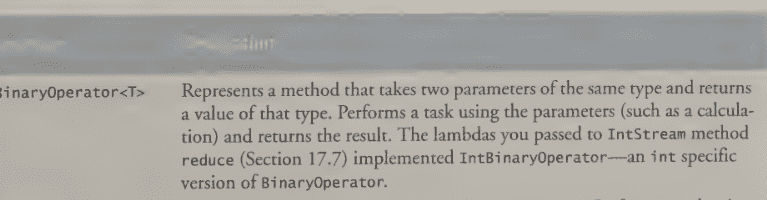

| 接口 | 描述 |
| :--- | :--- |
| `BinaryOperator<T>` | 代表接收两个相同类型参数并返回该类型的值。使用参数（如计算）执行任务并返回结果。你在 17.7 节传递给 `IntStream.reduce` 方法的 Lambda 实现了 `BinaryOperator`——`BinaryOperator` 的 `int` 特定版本。 |
| `Consumer<T>` | 代表返回 `void` 的单参数方法。使用其参数执行任务，例如输出对象、调用对象的方法等。你在 17.6 节传递给 `IntStream.forEach` 的 Lambda 实现了 `IntConsumer`——`Consumer` 的 `int` 特化版本。后续章节提供了 `Consumer` 的多个示例。 |
| `Function<T,R>` | 代表对参数执行任务并返回结果（可能与参数不同）的单参数方法。你在 17.6 节传递给 `IntStream.map` 方法的 Lambda 实现了 `IntFunction`——`Function` 的 `int` 特化版本。后续章节提供了 `Function` 的多个示例。 |
| `Predicate<T>` | 代表返回布尔值的单参数方法。你在 17.4 节传递给 `IntStream.filter` 方法的 Lambda 实现了 `IntPredicate`——`Predicate` 的 `int` 特化版本。后续章节提供了 `Predicate` 的多个示例。 |
| `Supplier<T>` | 代表无参数并返回结果的方法。通常用于创建存储流操作结果的集合。你从 17.13 节开始将看到 `Supplier` 的多个示例。 |
| `UnaryOperator<T>` | 代表返回与其参数相同类型的单参数方法。你在 17.3 节传递给 `IntStream` 的 Lambda 实现了 `IntUnaryOperator`——`UnaryOperator` 的 `int` 特化版本。后续章节提供了 `UnaryOperator` 的多个示例。 |

**图 17.10** `java.util.function` 包中的六个基础泛型接口。

## 17.9 Lambda: 深入探究

### 类型推断与 Lambda 的目标类型

Lambda 表达式可以出现在任何期望函数式接口的地方。Java 编译器可以根据 Lambda 使用的上下文轻松推断出 Lambda 参数类型和返回类型。这由 Lambda 的目标类型决定——即代码中 Lambda 出现处预期的函数式接口类型。例如，在 17.4 节流流水线对 `IntStream.map` 方法的调用中：

```
IntStream.rangeClosed(1, 10)
    .map((int x) -> {return x * 2;})
    .sum()
```

目标类型是 `IntUnaryOperator`，它代表接收一个 `int` 参数并返回 `int` 结果的方法。在这种情况下，Lambda 参数类型被显式声明为 `int`，编译器推断出 Lambda 返回类型为 `int`，因为这是 `IntUnaryOperator` 要求的。

编译器也可以推断 Lambda 参数的类型。例如，在 17.7 节流流水线对 `IntStream` 方法的调用中：

```
IntStream.rangeClosed(1, 10)
    .filter(x -> x % 2 == 0)
    .map(x -> x * 3)
    .sum()
```

目标类型是 `IntPredicate`，它代表接收一个 `int` 参数并返回布尔结果的方法。在这种情况下，编译器推断出 Lambda 参数 x 的类型保持不变，因为这是 `IntPredicate` 所要求的。在我们的示例中，我们通常让编译器推断 lambda 参数的类型。

### 作用域与 Lambda

与方法不同，lambda 没有自己的作用域。因此，例如，你不能用同名的 lambda 参数来遮蔽闭层方法的局部变量。在这种情况下会发生编译错误，因为方法的局部变量和 lambda 参数在同一作用域内。

### 捕获 Lambda 与 final 局部变量

引用闭层方法中局部变量（称为 lambda 的词法作用域）的 lambda 被称为捕获型 lambda。对于此类 lambda，编译器会捕获局部变量的值并将其与 lambda 一起存储，以便 lambda 在最终执行时可以使用该值。这很重要，因为你可以将 lambda 传递给另一个方法，该方法会在 lambda 的词法作用域不再存在后执行它。

lambda 在其词法作用域中引用的任何局部变量必须是 `final` 的。这种变量可以是显式声明为 `final` 的，也可以是有效 final（effectively final，Java SE 8）。对于有效 final 变量，编译器会推断该局部变量本可以声明为 `final`，因为其闭层方法在声明和初始化后从未修改过该变量。

## 17.10 Stream<Integer> 操作

本节回顾了第 10.9–10.10 节引入的接口概念。

到目前为止，我们处理了 `IntStream`。`Stream` 在引用类型对象上执行任务。`IntStream` 是一个针对 `int` 优化的 `Stream`，提供了常用 `int` 操作的方法。图 17.11 对 `Stream<Integer>` 执行了过滤和排序，使用了与之前示例类似的技术，并展示了如何将流流水线的结果放入一个新的集合中以便后续处理。在随后的示例中，我们很好地处理了引用类型的 `Stream`。

```
// 图 17.11: ArraysAndStreams.java
// 使用 Integer 数组演示 lambda 和流。
import java.util.Arrays;
import java.util.List;
import java.util.stream.Collectors;

public class ArraysAndStreams {
    public static void main(String[] args) {
        Integer[] values = {2, 9, 5, 0, 3, 7, 1, 4, 8, 6};

        // 显示原始值
        System.out.printf("Original values: %s\n", Arrays.asList(values));
    }
}
```

**图 17.11** 使用 Integer 数组演示 lambda 和流。（2 部分中的第 1 部分）

```
// 使用流按升序对值排序
System.out.printf("Sorted values: %s%n",
Arrays.stream(values)
    .sorted()
    .collect(Collectors.toList()));

// 大于 4 的值
List<Integer> greaterThan4 =
    Arrays.stream(values)
    .filter(value -> value > 4)
    .collect(Collectors.toList());
System.out.printf("Values greater than 4: %s%n", greaterThan4);

// 过滤大于 4 的值然后对结果排序
System.out.printf("Sorted values greater than 4: %s%n",
Arrays.stream(values)
    .filter(value -> value > 4)
    .sorted()
    .collect(Collectors.toList()));

// 使用流对 greaterThan4 列表进行排序
System.out.printf("Values greater than 4 (Ascending with streams): %s%n",
greaterThan4.stream()
    .sorted()
    .collect(Collectors.toList()));
```

Original values: [2, 9, 5, 0, 3, 7, 1, 4, 8, 6]

Sorted values: [0, 1, 2, 3, 4, 5, 6, 7, 8, 9]

Values greater than 4: [9, 5, 7, 8, 6]

Values greater than 4: [5, 6, 7, 8, 9]

Values greater than 4 (Ascending with streams): [5, 6, 7, 8]

图 17.11 | 使用 Integer 数组演示 lambda。（2 部分中的第 2 部分）

在整个示例中，我们使用第 9 行初始化的 `Integer` 数组。在执行流处理之前，编译器将每个 `int` 装箱为 `Integer`。第 12 行显示了 `values` 的 `List<Integer>` 视图。方法 `asList` 创建了 `values` 的视图。通用接口 `List`（在第 16 章详细讨论）由 `ArrayList` 实现。第 12 行显示了 `List<Integer>` 的默认字符串表示，它由逗号分隔的元素的方括号组成。我们遍历了 17.10.1–17.10.5 节的剩余代码。

### 17.10.1 创建 Stream<Integer>

`Arrays.stream` 方法可以从数组创建 `Stream`——例如，第 16 行产生了 `Stream<Integer>`，因为 `stream` 的参数是对象数组。接口 `Stream`（`java.util.stream`）是用于任何引用类型流操作的通用接口。`Arrays` 类还提供了创建 `IntStream`、`LongStream` 和 `DoubleStream` 的重载方法。

### 17.10.2 排序 Stream 并收集结果

第 16–18 行的流流水线：

```
Arrays.stream(values)
  .sorted()
  .collect(Collectors.toList())
```

使用流技术对 `values` 数组进行排序并将结果收集到 `List<Integer>` 中。首先，第 16 行从 `values` 创建 `Stream<Integer>`。接下来，第 17 行调用 `sorted` 方法对元素进行排序——这得到了升序排列的中间状态 `Stream<Integer>`。17.10.3 讨论了如何降序排序。

#### 创建包含流流水线结果的新集合

在处理流时，你创建包含结果的新集合以便以后对其进行操作。为了这样做，可以使用 `Stream` 的终端操作（图 17.11，第 18 行）。当流流水线被处理时，`collect` 方法执行归约，通过将流流水线的结果放入 `List`、`Map` 或 `Set` 中。你也可以使用归约 `toArray` 将结果放入 `Stream` 类型的新数组中。

第 18 行的 `collect` 方法接收一个实现 `Collector`（`java.util.stream`）的对象，它指定了如何执行归约。`Collectors` 类（`java.util.stream`）提供了返回定义 `Collector` 实现的静态方法。`Collectors.toList`（第 18 行）返回一个 `Collector`，将 `Stream<Integer>` 的元素放入 `List<Integer>` 集合中。在第 15–18 行，生成的 `List<Integer>` 通过隐式调用 `toString` 显示。归约优化执行了最终的数据转换。例如，在图 17.8 中，我们用 `Collectors.joining` 方法返回的对象调用了 `IntStream.collect`。在后台，此 `Collector` 使用 `StringJoiner`（`java.util`）连接流的字符串表示，然后调用 `StringJoiner` 的 `toString` 将结果转换为 `String`。我们在 17.11 节展示了额外的 `Collectors`。更多定义的 `Collectors`，请访问：

```
https://docs.oracle.com/java/8/docs/api/java/util/stream/Collectors.html
```

### 17.10.3 过滤 Stream 并排序结果供以后使用

图 17.11 第 21–24 行的流流水线：

```
List<Integer> greaterThan4 =
  Arrays.stream(values)
  .filter(value -> value > 4)
  .collect(Collectors.toList());
```

创建一个 `Stream<Integer>`，过滤流找到所有大于 4 的值并将结果收集到 `List<Integer>`。`Stream.filter` 方法的 lambda 参数实现了函数式接口 `Predicate`（`java.util.function`），它代表一个单参数方法，返回一个布尔值表示参数是否满足谓词。

我们将流水线的运行结果 `List<Integer>` 赋值给变量 `greaterThan4`，该变量用于第 25 行显示大于 4 的值，并用于第 37–39 行对大于 4 的值执行额外操作。

### 17.10.4 过滤并排序 Stream 并收集结果

```
Arrays.stream(values)
  .filter(value -> value > 4)
  .sorted()
  .collect(Collectors.toList())
```

按排序显示大于 4 的值。首先，第 29 行创建一个 `Stream<Integer>`。然后第 30 行过滤元素找到所有大于 4 的值。第 31 行表示我们希望结果排序。最后，第 32 行将结果收集到 `List<Integer>`，然后作为字符串显示。

> **性能 17.2**
>
> 在 `sorted` 之前调用 `filter`，以便流流水线只对将出现在结果中的元素进行排序。

### 17.10.5 处理之前收集的结果

第 37–39 行的流流水线：

```
greaterThan4.stream()
  .sorted()
  .collect(Collectors.toList())
```

使用在第 21–24 行创建的 `greaterThan4` 集合，展示对之前流流水线结果的额外处理。`List.stream` 方法创建流。我们对元素进行排序并将结果收集到一个新的 `List<Integer>` 中并显示其字符串表示。


# 17.11 Stream<String> 的操作

```java
// 图. 17.12: ArraysAndStreams2.java
// 使用字符串数组演示 lambda 表达式和流操作。
import java.util.Arrays;
import java.util.Comparator;
import java.util.stream.Collectors;

public class ArraysAndStreams2 {
    public static void main(String[] args) {
        String[] strings = {"Red", "orange", "Yellow", "green", "Blue", "indigo", "Violet"};

        // 显示原始字符串
        System.out.printf("Original strings: %s\n", Arrays.asList(strings));

        // 大写写的字符串
        System.out.printf("strings in uppercase: %s\n",
            Arrays.stream(strings)
                .map(String::toUpperCase)
                .collect(Collectors.toList()));

        // 小于 "n" 的字符串（不区分大小写），升序排序
        System.out.printf("strings less than n sorted ascending: %s\n",
            Arrays.stream(strings)
                .filter(s -> s.compareTo("n") < 0)
                .sorted(String.INSENSITIVE_ORDER)
                .collect(Collectors.toList()));

        // 小于 "n" 的字符串（不区分大小写），降序排序
        System.out.printf("strings less than n sorted descending: %s\n",
            Arrays.stream(strings)
                .filter(s -> s.compareTo("n") < 0)
                .sorted(String.INSENSITIVE_ORDER.reversed())
                .collect(Collectors.toList()));
    }
}
```

```
Original strings: [Red, orange, Yellow, green, Blue, indigo, Violet]
strings in uppercase: [RED, ORANGE, YELLOW, GREEN, BLUE, INDIGO, VIOLET]
strings less than n sorted ascending: [Blue, green, indigo]
strings less than n sorted descending: [indigo, green, Blue]
```

> 图. 17.12 | 使用字符串数组演示 lambda 表达式和流操作。

## 17.11.1 将字符串映射为大写

第 17–19 行的流管道：

```java
Arrays.stream(strings)
    .map(String::toUpperCase)
    .collect(Collectors.toList());
```

将字符串显示为大写。为了实现这一点，第 17 行从数组 `strings` 创建一个 `Stream<String>`，然后第 18 行通过调用每个元素上的 `String` 实例方法 `toUpperCase()` 将每个字符串映射为其大写版本。

`Stream` 的 `map` 方法接收一个实现 `Function` 函数式接口的对象，该接口表示一个单参数方法，该方法对其参数执行任务并返回结果。在这种情况下，我们映射到一个形式为 `ClassName::instanceName`（如 `String::toUpperCase`）的未绑定实例引用。未绑定意味着该方法引用没有指定调用该方法的特定对象——编译器将其转换为一个单参数 lambda 表达式，该 lambda 会调用该实例，而该实例的类型必须是 `ClassName`。在这种情况下，编译器将 `String::toUpperCase` 转换为如下的 lambda 表达式：

```java
s -> s.toUpperCase()
```

它返回 lambda 参数的大写版本。第 19 行将结果收集到 `List<String>` 中，我们将其输出为字符串。

## 17.11.2 过滤字符串并按不区分大小写的升序排序

第 23–26 行的流管道：

```java
Arrays.stream(strings)
  .filter(s -> s.compareToIgnoreCase("n") < 0)
  .sorted(String.CASE_INSENSITIVE_ORDER)
  .collect(Collectors.toList())
```

过滤并排序字符串。第 23 行从数组 `strings` 创建一个 `Stream<String>`，第 24 行调用流方法来过滤所有小于 "n" 的字符串，在 `Predicate` lambda 表达式中使用不区分大小写的比较。第 25 行排序结果，第 26 行将它们收集到 `List<String>` 中，我们将其输出为字符串。

在这种情况下，第 25 行调用了 `Stream` 方法 `sorted` 的版本，该版本接受 `Comparator` 作为参数。`Comparator` 定义了一个 `compare` 方法，如果第一个比较的值小于第二个值，则返回负值；如果它们相等则返回 0；如果第一个值大于第二个值，则返回正值。默认情况下，方法 `sorted` 使用该类型的自然顺序——对于 `String`，自然顺序是区分大小写的，这意味着 "Z" 小于 "a"。预定义的 `Comparator` `String.CASE_INSENSITIVE_ORDER` 执行的是不区分大小写的排序。

## 17.11.3 过滤字符串并按不区分大小写的降序排序

第 30–33 行的流管道：

```java
Arrays.stream(strings)
  .filter(s -> s.compareToIgnoreCase("n") < 0)
  .sorted(String.CASE_INSENSITIVE_ORDER.reversed())
  .collect(Collectors.toList())
```

执行与第 23–26 行相同的任务，但按降序排序字符串。函数式接口 `Comparator` 包含默认方法 `reversed()`，它会反转现有 `Comparator` 的排序。当你将 `reversed()` 应用于 `String.CASE_INSENSITIVE_ORDER` 时，`sorted` 会执行不区分大小写的排序并将字符串按降序排列。

# 17.12 Stream<Employee> 操作

本节演示了如何使用 lambda 表达式和流来简化第 16 章中学习的任务。示例 17.13 展示了 lambda 表达式和流如何处理用户定义类型。示例 17.13–21 展示了对 `Employee` 集合的操作。

```java
// 图. 17.13: Employee.java
// Employee 类
public class Employee {
    private String firstName;
    private String lastName;
    private double salary;
    private String department;

    // 构造函数
    public Employee(String firstName, String lastName, double salary, String department) {
        this.firstName = firstName;
        this.lastName = lastName;
        this.salary = salary;
        this.department = department;
    }

    // firstName
    public String getFirstName() {
        return firstName;
    }

    // lastName
    public String getLastName() {
        return lastName;
    }

    // salary
    public double getSalary() {
        return salary;
    }

    // department
    public String getDepartment() {
        return department;
    }

    // 获取 Employee 的名字和姓
    public String getName() {
        return firstName + " " + lastName;
    }

    // 返回包含 Employee 信息的字符串
    @Override
    public String toString() {
        return String.format("%s %s %.2f", firstName, lastName, salary);
    }
}
```

> 图. 17.13 | Employee 类

## 17.12.1 创建并显示 Employee

`ProcessingEmployees` 类（图 17.14）展示了 lambda 表达式和流如何处理 `Employee` 集合。示例 17.14 展示了流的各种能力。示例 17.14–21 展示了对 `Employee` 集合的操作。示例 17.14 创建一个数组（第 25 行），获取一个 `Stream<Employee>`（第 29 行），然后使用流方法 `forEach` 显示字符串表示。`forEach` 方法接收一个实现 `Consumer` 函数式接口的对象，该接口表示对每个元素执行的操作。绑定的方法引用 `System.out::println` 被编译器转换为一个单参数 lambda 表达式，它将 lambda 参数——`Employee`——传递给 `System.out.println()` 实例方法，该方法会隐式地调用类的 `toString()` 方法。示例 17.14 的输出显示了 lambda 表达式执行的结果。

```java
// 图. 17.14: ProcessingEmployees.java
// 处理 Employee 对象流。
import java.util.Arrays;
import java.util.Comparator;
import java.util.List;
import java.util.Map;
import java.util.TreeMap;
import java.util.function.Function;
import java.util.function.Predicate;

public class ProcessingEmployees {
    public static void main(String[] args) {
        Employee[] employees = {
            new Employee("Alice", "Smith", 50000, "Sales"),
            new Employee("Bob", "Jones", 60000, "Marketing"),
            new Employee("Charlie", "Brown", 55000, "HR"),
            new Employee("Diana", "Prince", 70000, "IT"),
            new Employee("Edward", "Norton", 45000, "Sales")
        };

        List<Employee> employeeList = Arrays.asList(employees);

        System.out.println("All employees:");
        employeeList.stream().forEach(System.out::println);

        System.out.println("\nEmployees in Sales:");
        employeeList.stream()
            .filter(e -> e.getDepartment().equals("Sales"))
            .forEach(System.out::println);

        System.out.println("\nEmployees with salary > 50000, sorted by name:");
        employeeList.stream()
            .filter(e -> e.getSalary() > 50000)
            .sorted(Comparator.comparing(Employee::getLastName))
            .forEach(System.out::println);
    }
}
```

> 图. 17.14 处理 Employee 对象流。（第 1 部分，共 2 部分）

```java
import java.util.stream.Collectors;

public class ProcessingEmployees {
    public static void main(String[] args) {
        // 初始化 Employees 数组
        Employee[] employees = {
            new Employee("Jason", "Red", 5000, "IT"),
            new Employee("Ashley", "Green", 7600, "IT"),
            new Employee("Matthew", "Indigo", 3587.5, "Sales"),
            new Employee("James", "Indigo", 4700.7, "Marketing"),
            new Employee("Luke", "Indigo", 6200, "IT"),
            new Employee("Jason", "Blue", 3200, "Sales"),
            new Employee("Wendy", "Brown", 4236.4, "Marketing")
        };

        // 获取 Employees 的 List View
        List<Employee> list = Arrays.asList(employees);

        // 显示所有 Employees
        System.out.println("Complete Employee list:");
        list.forEach(System.out::println);
    }
}
```

```
Complete Employee list:
Jason Red 5000.0 IT
Ashley Green 7600.0 IT
Matthew Indigo 3587.5 Sales
James Indigo 4700.7 Marketing
Luke Indigo 6200.0 IT
Jason Blue 3200.0 Sales
Wendy Brown 4236.4 Marketing
```

> 图 17.14 | 处理 Employee 对象的流。（2 个部分中的第 2 部分）

### Java SE 9: 使用 List 方法创建不可变的 List<Employee>

在图 17.14 中，我们首先创建了一个 `Employee` 数组（第 15–22 行），然后获取了该数组的列表视图（第 25 行）。从 Java SE 9 开始，你可以通过 `List.of()` 静态方法直接填充一个不可变列表。


```java
List<Employee> list = List.of(
    new Employee("Jason", "Red", 5000, "IT"),
    new Employee("Ashley", "Green", 7600, "IT"),
    new Employee("Matthew", "Indigo", 3587.5, "Sales"),
    new Employee("James", "Indigo", 4700.7, "Marketing"),
    new Employee("Luke", "Indigo", 6200, "IT"),
    new Employee("Jason", "Blue", 3200, "Sales"),
    new Employee("Wendy", "Brown", 4236.4, "Marketing"));
```

## 17.12 在指定范围内过滤 `Employee` 类型

到目前为止，我们通过直接将 lambda 作为一个变量传递来供稍后使用。图 17.15 展示了存储在变量中的 lambda。第 32–33 行声明了一个函数式接口 `Predicate<Employee>` 类型的变量，并用一个单参数 lambda 对其初始化，该 lambda 返回一个布尔值（如 `Predicate` 的要求）。如果 `Employee` 的薪水在 4000 到 6000 之间，则 lambda 返回 `true`。我们在第 40 行和 47 行使用了存储的 lambda 来过滤 `Employee` 对象。

```java
// 对于薪水在 $4000-$6000 范围内的返回 true 的 Predicate
Predicate<Employee> fourToSixThousand =
    e -> e.getSalary() >= 4000 && e.getSalary() <= 6000;
```

```java
// 显示薪水在 $4000-$6000 范围内的 Employees
// 按薪水升序排序
System.out.printf("%nEmployees earning 4000-6000 per month sorted by salary:%n");
list.stream()
  .filter(fourToSixThousand)
  .sorted(Comparator.comparing(Employee::getSalary))
  .forEach(System.out::println);
```

```java
// 显示薪水在 $4000-$6000 范围内的第一个 Employee
System.out.printf("%nFirst employee who earns 4000-6000:%s%n",
    list.stream()
  .filter(fourToSixThousand)
  .findFirst()
  .get());
```

按薪水排序的每月薪水 4000-6000 的 Employees：

| Name | Last | Salary | Department |
| :--- | :--- | :--- | :--- |
| Wendy | Brown | 4236.40 | Marketing |
| James | Indigo | 4700.77 | Marketing |
| Jason | Red | 5000.00 | IT |

薪水在 $4000-$6000 的第一个 Employee：

| Name | Last | Salary | Department |
| :--- | :--- | :--- | :--- |
| Jason | Red | 5000.00 | IT |

图 17.15 | 过滤薪水在 $4000–6000 范围内的 Employees。

第 39–42 行中的流流水线执行以下任务：

- 第 39 行创建了一个 `Stream<Employee>`。
- 第 40 行使用 `Predicate` `fourToSixThousand` 过滤流。
- 第 41 行对流中剩余的 `Employee` 对象按薪水进行排序。为了创建一个薪水比较器，我们使用 `Comparator` 接口的静态方法 `comparing`，它返回一个对其参数执行任务并返回结果的 `Function`。未绑定的引用 `Employee::getSalary` 被编译器转换为一个单参数 lambda，该 lambda 在其参数上调用 `getSalary`。方法调用返回的 `Comparator` 调用两个 `Employee` 对象的每一个，如果第一个 `Employee` 的薪水小于第二个，则返回一个负值；如果它们相等，则返回零；如果第一个 `Employee` 的薪水大于第二个，则返回一个正值。`Stream` 方法 `sorted` 对这些值进行排序以为 `Employee` 对象排序。
- 最后，第 42 行执行 `forEach` 操作，处理流并输出按薪水排序的结果。

### 短路流流水线

在第 5.9 节中，你学习了使用逻辑与 (`&&`) 和逻辑或 (`||`) 运算符的短路求值。懒加载的优秀特性之一就是执行短路求值——即一旦获得所需的结果立即停止处理流流水线。图 17.15 的第 48 行演示了 `findFirst`——这是一个短路终端操作，它会处理流流水线直到找到第一个对象。根据原始的 `Employee` 列表，第 46–49 行的流流水线按如下方式进行：

```java
list.stream()
  .filter(fourToSixThousand)
  .findFirst()
  .get();
```

## 17.12.1 `Stream<Employee>` 的排序操作

```java
// 按姓名降序排序员工，再按名
System.out.printf(
    "%n按姓名倒序排列的员工:%n");
list.stream()
  .sorted(lastThenFirst.reversed())
  .forEach(System.out::println);
```

按姓、名升序排列的员工：

| Name | Last | Salary | Department |
| :--- | :--- | :--- | :--- |
| Jason | Blue | 3200.00 | Sales |
| Wendy | Brown | 4236.40 | Marketing |
| Ashley | Green | 7600.00 | IT |
| James | Indigo | 4700.77 | Marketing |
| Luke | Indigo | 6200.00 | IT |
| Matthew | Indigo | 3587.50 | Sales |
| Jason | Red | 5000.00 | IT |

按姓、名倒序排列的员工：

| Name | Last | Salary | Department |
| :--- | :--- | :--- | :--- |
| Jason | Red | 5000.00 | IT |
| Matthew | Indigo | 3587.50 | Sales |
| Luke | Indigo | 6200.00 | IT |
| James | Indigo | 4700.77 | Marketing |
| Ashley | Green | 7600.00 | IT |
| Wendy | Brown | 4236.40 | Marketing |
| Jason | Blue | 3200.00 | Sales |

图 17.17 | 按姓、名对员工进行排序。（2 部分中的第 2 部分）

> **旁注：组合 Lambda 表达式**

`java.util.function` 包中的函数式接口提供了默认方法，允许你组合功能。例如，考虑 `IntPredicate` 接口，它包含三个默认方法：

- `and()` 在被调用的 `IntPredicate` 与其作为参数接收的 `IntPredicate` 之间执行带有短路评估的逻辑与（AND）。
- `negate()` 反转被调用的 `IntPredicate` 的布尔值。
- `or()` 在被调用的 `IntPredicate` 与其作为参数接收的 `IntPredicate` 之间执行带有短路评估的逻辑或（OR）。

你可以使用这些方法和 `IntPredicate` 来组合更复杂的条件。例如，考虑两个用 lambda 初始化的 `IntPredicate`：

```java
IntPredicate even = value -> value % 2 == 0;
IntPredicate greaterThan5 = value -> value > 5;
```

与 `IntPredicate` 类似，函数式接口 `Predicate` 表示一个返回布尔值的方法，指示其参数是否满足某个条件。`Predicate` 也包含用于组合谓词的 `and()` 和 `or()` 方法，以及用于反转谓词布尔值的 `negate()` 方法。

## 17.12.2 将员工映射为唯一的姓名字符串

你之前使用过 `map` 操作对 `int` 值进行计算、将其转换为 `String` 以及将 `String` 转换为大写。图 17.18 将一种类型的对象（`Employee`）映射到另一种类型的对象（`String`）。第 75–79 行的流流水线执行了以下任务：

- 第 75 行创建了一个 `Stream<Employee>`。
- 第 76 行使用未绑定的实例方法引用 `Employee::getLastName` 作为方法函数参数，将员工映射到他们的姓。结果是一个包含员工姓的 `Stream<String>`。
- 第 77 行在 `Stream<String>` 上调用 `distinct` 方法以消除任何重复的字符串——生成的流只包含唯一的姓。
- 第 78 行对唯一的名称进行排序。
- 最后，第 79 行执行终端操作 `forEach`，该操作处理流流水线并按排序后的顺序输出唯一的姓。

第 84–87 行先按姓、再按名对员工进行排序，然后使用 `Employee` 实例方法 `getName`（第 86 行）将员工映射为 `String`，并在终端 `forEach` 操作中显示排序后的名称。

```java
// 显示经过排序的唯一员工姓
System.out.printf("%n唯一的员工姓:%n");
list.stream()
  .map(Employee::getLastName)
  .distinct()
  .sorted()
  .forEach(System.out::println);

// 仅显示名和姓
System.out.printf(
    "%n按姓、名顺序排列的员工姓名:%n");
list.stream()
  .sorted(lastThenFirst)
  .map(Employee::getName)
  .forEach(System.out::println);
```

唯一的员工姓：

Blue
Brown
Green
Indigo
Red

图 17.18 | 将员工对象映射为姓和全名。（2 部分中的第 1 部分）。

按姓、名顺序排列的员工全名：

Jason Blue
Wendy Brown
Ashley Green
James Indigo
Luke Indigo
Matthew Indigo
Jason Red

图 17.18 | 将员工对象映射为姓和全名。（2 部分中的第 2 部分）。

## 17.12.3 按部门分组员工

之前，我们使用终端操作 `collect` 将流元素连接成 `String` 表示形式，并将流元素放入 `List` 集合中。图 17.19 使用 `collect` 方法（第 93 行）按部门对员工进行分组。

```java
// 按部门分组员工
System.out.printf("%n部门分组的员工:%n");
Map<String, List<Employee>> groupedByDepartment = list.stream()
    .collect(Collectors.groupingBy(Employee::getDepartment));
groupedByDepartment.forEach((department, employeesDepartment) -> {
    System.out.printf("%s:%n", department);
    employeesDepartment.forEach(employee -> System.out.printf("%s%n", employee));
});
```

部门分组的员工：

| Department | Name | Salary |
| :--- | :--- | :--- |
| Sales | Matthew Indigo | 3587.50 |
| Sales | Jason Blue | 3200.00 |
| IT | Jason Red | 5000.00 |
| IT | Ashley Green | 7600.00 |
| IT | Luke Indigo | 6200.00 |
| Marketing | James Indigo | 4700.77 |
| Marketing | Wendy Brown | 4236.40 |

图 17.19 | 按部门分组。

记住 `collect` 的参数是一个指定如何汇总数据的 `Collector`。当使用 `Collector` 时，返回一个 `Map`，其中每个 `String` 键是一个部门，对应的值是包含流元素的 `List`。我们将此 `Map` 赋值给 `groupedByDepartment`，它在第 94–100 行中用于按部门显示。`forEach` 方法对 `Map` 的键值对执行操作——在这种情况下键是部门。

### 统计每个部门的人数

图 17.20 再次演示了 `Stream` 方法 `collect` 和 `Collectors` 静态方法 `groupingBy`，但在这里我们统计每个部门的员工人数。所示的技术允许我们将分组和归约合并到一个操作中。

```java
// 统计部门的员工人数
System.out.printf("%n部门分组的员工人数:%n");
Map<String, Long> employeeCountByDepartment = list.stream()
    .collect(Collectors.groupingBy(Employee::getDepartment,
        Collectors.counting()));
employeeCountByDepartment.forEach((department, count) -> System.out.printf("%s 有 %d 个员工%n", department, count));
```

**图 17.20** 统计每个部门的人数。

第 104–107 行的流流水线产生一个 `Map<String, Long>`，其中每个 `String` 键是部门名称，对应的 `Long` 值是该部门的人数。在这种情况下，我们使用了接收两个参数的 `Collectors` 静态方法 `groupingBy` 版本：

- 第一个是用于流中的对象进行分类的 `Function`。
- 第二个是另一个 `Collector`（称为下游 `Collector`），用于收集由 `Function` 分类的对象。

我们使用对 `Collectors` 静态方法 `counting` 的调用作为第二个参数。生成的 `Collector` 将给定分类中的元素归约为这些元素的计数。

第 108–110 行随后从生成的 `Map<String, Long>` 中输出键值对。

## 17.12.4 计算员工薪资的总和平均值

之前，我们展示了基本类型元素可以通过方法 `mapToObj` 映射为对象流（该方法存在于 `IntStream`、`LongStream` 和 `DoubleStream` 中）。同样地，对象流也可以映射为 `IntStream`、`LongStream` 或 `DoubleStream`。图 17.21 展示了 `mapToDouble` 方法（第 116、123 和 129 行），它将对象映射到它们的薪资，以便我们计算总和平均值。

`mapToDouble` 方法接收一个实现了 `ToDoubleFunction` 函数式接口（位于 `java.util.function` 包）的对象，该接口表示一个返回 `double` 值的参数方法。第 116、123 和 129 行分别向 `mapToDouble` 传递了未绑定方法引用 `Employee::getSalary`，该方法返回当前 `Employee` 的薪资作为 `double` 类型。编译器将此方法引用转换为一个单参数 lambda 表达式，该表达式在其参数上调用 `getSalary`。


```java
// 使用 DoubleStream 方法计算 Employee 薪资和
System.out.printf("%nSum of Employees' salaries (via sum method): %.2f%n",
    list.stream()
        .mapToDouble(Employee::getSalary)
        .sum());

// 使用 Stream reduce 方法计算 Employee 薪资总和
System.out.printf("%nSum of Employees' salaries (via reduce method): %.2f%n",
    list.stream()
        .mapToDouble(Employee::getSalary)
        .reduce(0, (value1, value2) -> value1 + value2));

// 使用 DoubleStream average 方法计算 Employee 薪资平均值
System.out.printf("%nAverage of Employees' salaries: %.2f%n",
    list.stream()
        .mapToDouble(Employee::getSalary)
        .average()
        .getAsDouble());
```

员工薪资总和（通过 sum 方法）：34524.67

员工薪资总和（通过 reduce 方法）：34525.67

员工薪资平均值：4932.10

图 17.21 | 计算员工薪资总和和平均值。

第 115–127 行创建了一个 `Stream<Employee>`，将其映射为 `DoubleStream`，然后调用 `DoubleStream` 方法计算员工薪资的总和。第 122–124 行也计算了员工薪资总和，但使用的是 `DoubleStream` 方法 `reduce` 而不是 `sum`——注意第 124 行中的 lambda 可以替换为静态方法引用 `Double::sum`。`Double` 类的 `sum` 方法接收两个 `double` 并返回它们的和。

最后，第 128–131 行使用 `DoubleStream` 方法 `average` 计算员工薪资的平均值，如果流不包含任何元素，它将返回一个 `OptionalDouble`。在这里，我们知道流包含元素，因此只需调用 `OptionalDouble` 方法 `getAsDouble` 来获取结果。

### 17.13 从文件创建 `Stream<String>`

图 17.22 使用 lambda 表达式和流来总结文件中单词的出现次数，然后按首字母顺序显示单词的摘要。这通常被称为“索引”（concordance）：

<http://en.wikipedia.org/wiki/Concordance_(publishing)>

索引常用于分析作品。例如，莎士比亚和马洛（等）作品的索引曾被用来质疑他们是否为同一个人。图 17.23 显示了程序的输出。图 17.22 的第 14 行创建了一个正则表达式，我们用它来将文本行拆分为单个单词。`Pattern` `\s+` 表示一个或多个连续的空白字符——回想 `\s` 是 String 中的一个转义序列，我们必须显式指定每一个。按照目前的写法，该程序假设文件没有标点符号，但我们可以使用第 1.7 节中的正则表达式技术来移除标点符号。

```java
// Fig. 17.22: StreamLines.java
// 统计文本文件中单词出现的次数。
import java.io.IOException;
import java.nio.file.Files;
import java.nio.file.Paths;
import java.util.Map;
import java.util.TreeMap;
import java.util.regex.Pattern;
import java.util.stream.Collectors;

public class StreamLines {
    public static void main(String[] args) throws IOException {
        // 匹配一个或多个空白字符的正则
        Pattern pattern = Pattern.compile("\\s+");

        // 在 Stream<String> 中按单词排序统计每个单词出现的次数
        Map<String, Long> wordCounts = Files.lines(Paths.get("input.txt"))
            .flatMap(pattern::splitAsStream)
            .collect(Collectors.groupingBy(String::toLowerCase, TreeMap::new, Collectors.counting()));
    }
}
```

```java
// 按首字母分组显示单词
wordCounts.entrySet()
    .stream()
    .collect(Collectors.groupingBy(entry -> entry.getKey().charAt(0),
        TreeMap::new, Collectors.toList()))
    .forEach((letter, wordList) -> {
        System.out.printf("%s%n", letter);
        wordList.forEach(word -> System.out.printf("%s: %d%n", word.getKey(), word.getValue()));
    });
```

图 17.22: StreamLines 文本文件中单词出现的次数。

| A | I | R |
|---|---|---|
| a | 3 | 2 |
| and | 7 | 2 |
| application | 2 | 1 |
| arithmetic | 1 | 2 |
| B | J | S |
| begin | 1 | 1 |
| C | L | T |
| calculates | 1 | 1 |
| calculations | 1 | 1 |
| chapter | 1 | 3 |
| command | 1 | M |
| compares | 1 | 2 |
| compile | 1 | N |
| computer | 1 | O |
| decisions | 1 | O |
| demonstrates | 1 | P |
| display | 2 | U |
| E | P | W |
| example | 1 | W |
| examples | 1 | Y |
| F | N | |
| from | 1 | |
| G | O | |
| H |  | | |
| how | 2 | |

图 17.23 | 17.22 的输出，按列排列。

### 总结文件中每个单词出现的次数

第 17–21 行的流流水线将文件“Paragraph.txt”（见示例）的内容总结为 `Map<String, Long>`，其中键是文件的单词，对应的 `Long` 值是该单词出现的次数。该流水线执行以下任务：

- 第 18 行使用 `flatMap`（Java 8 引入），它返回一个 `Stream<String>`，从文件中读取行并将每行作为 String。`Files` 类（位于 `java.nio.file`）是许多提供 Stream 方法的类之一。
- 第 19 行使用流 `flatMap` 将每行文本拆分为单独的单词。`flatMap` 方法接收将对象映射为元素的流函数。在这种情况下，对象是包含单词的 String，返回单词的 `Stream<String>`。第 19 行中的 lambda 传递了代表行的 String。`splitAsStream`（Java 8 引入）使用第 14 行指定的正则表达式来分词字符串。第 19 行的结果是 `Stream<String>` 可以被方法引用 `pattern::splitAsStream` 替换。
- 第 20–21 行使用流 `collect` 统计每个单词的频率，并将单词及其计数放入 `TreeMap<String, Long>` 中——`TreeMap` 按其键排序。在这里，我们使用了接收三个参数的 `Collectors.groupingBy` 版本——分类器、Map 工厂和下游收集器。分类器是一个返回用作 Map 键对象的函数——方法引用 `String::toLowerCase` 将每个单词转换为小写。Map 工厂是一个实现了 `Supplier` 并返回新集合的对象——在这里我们使用构造函数引用 `TreeMap::new`，它返回一个按键排序的 `TreeMap`。编译器将构造函数引用转换为无参数 lambda。`Collectors.counting()` 是下游收集器，确定流中每个键出现的次数。`TreeMap` 的键类型取决于分类函数的返回类型（`String`），而 `TreeMap` 的值类型取决于下游收集器——`Collectors.counting()` 返回一个 `Long`。

### 17.14 随机值流

```java
wordCounts.entrySet()
    .stream()
    .collect(
        Collectors.groupingBy(entry -> entry.getKey().charAt(0),
        TreeMap::new, Collectors.toList()))
    .forEach((letter, wordList) -> {
        System.out.printf("%s:%d%n", letter);
        wordList.forEach(word -> System.out.printf("%3s:%d%n", word.getKey(), word.getValue()));
    });
```

这产生了一个新的 `Map`，其中键是 `Character`，对应值是 `wordCounts` 中所有以该 `Character` 开头的键值对的列表（`List`）。该语句执行了以下任务：

- 首先，需要获取一个 `Stream` 来处理 `wordCounts` 中的键值对。`Map` 接口不包含任何返回 `Stream` 的方法。因此，第 24 行调用 `Map` 方法 `entrySet` 来获取一个包含 `Entry` 对象的 `Set`，每个对象包含 `wordCounts` 中的一个键值对。这产生了一个类型为 `Set<Map.Entry<String, Long>>` 的对象。
- 第 25 行调用 `Set` 方法 `stream` 来获取一个 `Stream<Map.Entry<String, Long>>`。
- 第 26–28 行调用 `collect` 方法，并带有三个参数——分类器（classifier）、`Map` 工厂和下游收集器（downstream Collector）。在这种情况下，分类器 `Function` 从 `Map.Entry` 中获取键。然后使用 `String` 方法 `charAt` 获取第一个字符——这在生成的 `Map` 中变成了 `Character`。我们再次使用构造函数引用 `TreeMap::new` 作为 `Map` 工厂，创建一个按排序顺序维护其键的 `TreeMap`。下游收集器 `Collectors.toList()` 将 `Entry` 对象放入一个 `List` 集合中。`collect` 的结果是 `Map<Character, List<Map.Entry<String, Long>>>`。
- 最后，为了按字母显示单词及其计数的摘要（即词汇索引），第 29–33 行使用 lambda 表达式映射到 `Map` 方法 `forEach`。该 lambda 表达式（`BiConsumer`）接收两个参数——`letter` 和 `wordList`——分别代表由前面的收集操作产生的 `Map` 中每个键值对的 `Character` 和 `List` 值。该 lambda 的主体被包含在大括号中。第 30 行的语句显示 `letter`，第 31–32 行从 `wordList` 中获取 `Map.Entry<String, Long>`，然后调用 `Stream` 方法 `forEach` 显示每个 `Map.Entry` 对象的键和值。

图 17.24 总结了按字母分类的单词及其计数。

### 17.15 随机值流

```java
IntStream.generate(() -> random.nextInt())
    .limit(10)
    .forEach(System.out::println);
```

这等同于 `SecureRandom` 的无参数 `ints` 方法（第 17.14 节）：

```java
SecureRandom.random.ints()
    .limit(10)
    .forEach(System.out::println);
```

### 17.16 Lambda 处理器

在 12.5.5 中，你学习了如何使用匿名内部类来实现事件处理器。只有一个抽象方法（如 `ChangeListener`）的事件监听接口是函数式接口。对于此类接口，你可以使用 lambda 表达式来实现事件处理器。例如，来自图 12.23 的以下滑块事件处理器：

```java
tipPercentageSlider.valueProperty().addListener(
    new ChangeListener<Number>() {
        @Override
        public void changed(ObservableValue<? extends Number> ov,
            Number oldValue, Number newValue) {
            tipPercentage =
                BigDecimal.valueOf(newValue.intValue() / 100.0);
            tipPercentageLabel.setText(percent.format(tipPercentage));
        }
    });
```

可以使用 lambda 表达式更简洁地实现：

```java
tipPercentageSlider.valueProperty().addListener(
    (ov, oldValue, newValue) -> {
        tipPercentage =
            BigDecimal.valueOf(newValue.intValue() / 100.0);
        tipPercentageLabel.setText(percent.format(tipPercentage));
    });
```

对于简单的事件处理器，lambda 表达式显著减少了你需要编写的代码量。

### 17.17 关于 Java SE 8 接口的额外说明

#### Java SE 8 接口允许方法实现的继承

函数式接口只能包含一个抽象方法，但也可以包含在接口声明中完全实现的默认方法（default methods）和静态方法（static methods）。例如，在函数式编程中广泛使用的 `Function` 接口拥有 `apply`（抽象）、`compose`（默认）、`andThen`（默认）和 `identity`（静态）等方法。

当一个类实现了一个带有默认方法的接口且没有重写它们时，该类将继承默认方法的实现。接口设计者现在可以通过添加新的默认方法和静态方法来演进接口，而不会破坏实现该接口的现有代码。例如，`Comparator` 接口（16.7.1）现在包含许多默认和静态方法，但实现此接口的旧类在 Java SE 8 中仍能正常编译和运行。

记住，一个类可以实现多个接口。如果一个类实现了两个或多个提供具有相同签名的默认方法的无关接口，则实现类必须重写该方法；否则将会导致编译错误。

#### Java SE 8: `@FunctionalInterface` 注解

你可以通过确保每个接口只包含一个抽象方法，并包含零或多个默认和/或静态方法，来创建自己的函数式接口。虽然不是强制性的，但你可以在接口前加上 `@FunctionalInterface` 注解来声明该接口是函数式接口。编译器将确保该接口只包含一个抽象方法；否则将生成编译错误。

### 17.18 总结

在本章中，我们学习了 lambda 表达式、流（streams）和函数式接口。我们展示了许多示例，说明了实现你在前面章节中编写的任务的更简单的方法。

你学习了如何处理 `IntStream`（一个 `int` 值的流）中的元素。你创建了一个表示 `int` 闭区间范围的 `IntStream`，然后使用中间操作和终端操作来创建并处理产生结果的流流水线。我们使用 lambda 表达式创建了实现函数式接口的匿名方法，并将这些 lambda 表达式传递给流流水线方法，以指定流元素的处理步骤。我们还从现有的 `int` 值数组创建了 `IntStream`。

我们讨论了流的中间处理步骤是如何通过移动到下一个元素应用于每个元素的。我们展示了如何使用 `forEach` 终端操作对每个流元素执行操作。我们使用了归约操作（reduction operations）来计算流元素的数量、确定最小值和最大值并对值求和。你还使用了方法引用来创建自己的归约操作。

你使用了过滤（filter）匹配谓词的元素操作，并映射（map）将元素映射到新值——在每情况下，这些操作都会产生中间流，你可以在上面进行额外的处理。你还学习了如何按升序和降序排序元素，以及如何通过多个字段对对象排序。

我们演示了如何使用类提供的预定义 `Collection` 实现将流流水线的结果存储在集合中。你还学习了如何使用 `Collector` 将元素分组到不同的类别中。

你学习了各种类都可以创建流数据源。例如，你使用了 `Files` 方法从文件中读取行，并使用 `SecureRandom.ints` 获取随机值的 `IntStream`。你还学习了如何将 `IntStream` 转换为 `Stream<Integer>`（通过 `boxed` 方法），以便你可以使用流方法 `collect` 来汇总 `Integer` 值的频率并将结果存储在 `Map` 中。


我们引入了无限流，并展示了如何限制它们生成的元素数量。你看到了如何使用 lambda 表达式实现事件处理函数式接口。最后，我们提供了关于 Java SE 8 接口和流的额外信息。在下一章中，我们将讨论直接或间接调用自身的方法的递归编程。

## 总结

### 17.1 节 引言

- Java SE 8 添加了 lambda 表达式和流——函数式编程的关键技术。
- lambda 表达式和流使你能够比以前的技术更快、更简单、更简洁且 Bug 更少地编写某些类型的程序。

### 17.2 节 流与归约

- 在计数控制迭代中，你通常确定你想实现什么，然后使用 `for` 循环精确指定如何实现它。

#### 17.2.1 节 使用 for 累加 1 到 100 的整数

- 使用外部迭代，你指定了所有的迭代细节。

#### 17.2.2 节 易错的外部迭代

- 外部迭代在每次循环期间修改变量。
- 每当你编写修改变量的代码时，都可能引入错误。

#### 17.2.3 节 使用流和归约进行求和

- `IntStream` (`java.util.stream`) 方便地定义了方法，使你能够避免计数控制迭代。
- 流是你执行任务的元素序列。
- 流流水线让元素通过一系列任务（或处理步骤）移动。
- 流流水线通常始于创建流的方法调用——这被称为数据源。
- `IntStream` 静态 `range` 创建了一个包含闭区间范围的 `IntStream`——即包含方法两个参数的范围。
- `IntStream` 方法 `rangeClosed` 产生一个从第一个参数到（但不包含）第二个参数的半开范围。
- `IntStream` 的实例方法 `sum` 返回流中所有 `int` 的和。
- 方法 `sum` 执行归约——它将值流归约为单个值。其他定义的归约包括 `count`、`min`、`max`、`average` 和 `summaryStatistics`，以及用于自定义归约的 `reduce` 方法。
- 终端操作启动流流水线的处理并产生结果。
- `IntStream` 方法 `sum` 是产生流元素的和终端操作。

#### 17.2.4 节 内部迭代

- 在内部，`IntStream` 已经知道如何遍历它的元素，无需声明和使用任何可变变量。因为 `IntStream` 处理了所有的迭代细节——这是函数式编程的一个方面。
- 一旦习惯了，流流水线代码可以更容易读。

### 17.3 节 映射与 lambda

- 大多数流流水线包含中间操作，在终端操作产生结果之前指定对流元素执行的任务。
- 映射中间操作将流的元素转换为新值。结果是一个具有相同数量元素的流，包含转换的结果。有时映射元素的类型与原始流元素的类型不同。
- `IntStream` 方法 `map` 接收一个对象作为参数，该对象表示一个带参数并返回结果的方法。
- 对于流中的每个元素，`map` 会调用它接收到的参数方法，并将当前流元素传递给该方法。该方法的返回值将成为 `map` 返回的新流的一部分。

#### 17.3.1 节 Lambda 表达式

- 许多中间操作和终结流操作接收方法作为参数，这些方法通常通过 lambda 表达式实现。
- Lambda 表达式表示一个匿名方法——即没有名称的方法。
- Lambda 表达式（简称为 lambdas）允许你创建可以被当作数据处理的方法。你可以将 lambda 表达式作为参数传递给其他方法，将 lambda 表达式赋值给变量以便稍后使用，并从方法返回 lambda 表达式。

#### 17.3.2 节 Lambda 语法

- Lambda 由参数列表、箭头标记 `(->)` 和方法体组成，如下：
  ```
  (parameter) -> {statements}
  ```
- 方法体是一个语句块，其中可能包含在大括号括内的一个或多个语句。
- 编译器从 lambda 的上下文中推断返回类型。
- 与方法声明一样，lambda 通过逗号分隔的列表指定多个参数。
- Lambda 的参数类型通常可以省略，在这种情况下，编译器根据 lambda 的上下文推断参数和返回类型。
- 如果方法体只包含一个表达式，则可以省略方法体中的 `return` 关键字、大括号和分号。在这种情况下，lambda 会隐式地返回表达式的值。
- 如果参数列表只包含一个参数，可以省略括号。
- 要定义一个带有空参数列表的 lambda，请在箭头标记 `(->)` 左侧使用空括号。

#### 17.3.3 节 中间操作和终结操作

- 中间操作是惰性的（lazy）——每个中间操作都会产生一个新的流，但在调用终结操作产生结果之前，不会对流中的元素执行任何操作。这允许库来优化流处理的性能。
- 终结操作是及时的（eager）——它们在调用时执行请求。

### 17.4 节 过滤

- 另一种常见的中间流操作是过滤元素，以选择符合特定条件（称为谓词 predicate）的元素。
- `IntStream` 方法 `filter` 接收一个方法作为参数，该方法接收一个参数并返回布尔结果。如果给定元素的结果为 `true`，则该元素被包含在结果流中。
- 当执行终结操作时，中间操作指定的组合处理步骤将应用于每个元素。

### 17.5 节 元素如何在流流水线中移动

- 每个新流都是一个对象，代表了到流水线该点为止指定的所有处理步骤。
- 链式调用中间操作会为每个流元素需要执行的处理步骤添加集合。
- 流流水线中的最后一个流对象包含了在每个流元素上执行的所有处理步骤。
- 当你通过终结操作启动流流水线时，流水线中间操作指定的所有处理步骤会在应用于下一个流元素之前，先应用于给定的流元素。

### 17.6 节 方法引用

- 在任何可以使用 lambda 的地方，你都可以通过方法引用（method reference）使用现有方法的名称——编译器会将每个方法引用转换为相应的 lambda 表达式。
- 当 lambda 仅仅是调用对应方法时，你就使用方法引用。

#### 17.6.1 节 创建随机值的 IntStream

- `SecureRandom` 类的 `ints` 方法返回一个包含随机数的 `IntStream`。

#### 17.6.2 节 使用 forEach 和方法引用对每个流元素执行任务

- `IntStream` 方法 `forEach`（一个终结操作）在每个流元素上执行任务。
- `forEach` 方法接收一个方法作为参数，该方法接收一个参数并使用该参数的值执行任务。
- 形式为 `instanceName::methodName` 的方法引用是实例方法引用，表示 `::` 左侧的特定对象必须被用于调用 `::` 右侧的实例方法。编译器将该方法引用转换为单参数 lambda，其中 lambda 的方法体调用指定对象上的方法，并将当前流元素作为参数传递。

#### 17.6.3 节 使用 mapToObj 将对象转换为字符串

- `IntStream` 方法 `mapToObj` 返回另一个 `Stream`。
- 静态方法引用的形式为 `ClassName::staticMethodName`，编译器将其转换为单参数 lambda，该 lambda 调用类上的静态方法，并将当前流元素作为参数传递。
- 终结操作 `collect` 可以拼接字符串流元素。`collect` 方法是归约（reduction）的一种，因为它返回一个对象。

#### 17.6.4 节 使用 collect 连接字符串

- 终结操作 `collect` 接收一个收集器（collector）作为参数，该收集器指定如何将流元素收集到一个对象中。
- `Collectors` 静态方法 `joining` 返回的收集器创建一个流元素的拼接字符串表示，通过连接方法的参数将每个元素隔开。`collect` 方法随后返回生成的字符串。

### 17.7 节 IntStream 操作

- `LongStream` 和 `DoubleStream` 分别处理 `long` 和 `double` 类型值的流。

#### 17.7.1 节 创建 IntStream 并显示其值

- `IntStream` 静态方法 `of` 接收一个 int 数组参数，并返回一个用于处理数组值的 `IntStream`。
- 一旦使用终结操作处理了流流水线，流就无法重用，因为它不维护原始源的副本。

#### 17.7.2 节 终结操作 count, min, sum 和 average

- `IntStream` 方法 `count` 返回流中的元素数量。
- `IntStream` 方法 `min` 返回一个 `OptionalInt` (`java.util`)，可能包含流中的最小 int。
- 对于任何流，可能没有元素。`OptionalInt.getAsInt` 返回该值，否则会抛出 `NoSuchElementException`。
- `IntStream` 方法 `max` 返回一个可能包含流中最大 int 的 `OptionalInt`。
- `IntStream` 方法 `average` 返回一个 `OptionalDouble`，可能包含流中元素的值的平均值。`OptionalDouble.getAsDouble` 返回该值，否则会抛出 `NoSuchElementException`。
- `IntStream` 方法 `summaryStatistics` 在一次流遍历中完成 count、min、max、sum 和 average 操作，并将结果作为 `IntSummaryStatistics` 对象 (`java.util`)。

#### 17.7.3 节 终结操作 reduce

- 你可以使用 `IntStream` 的 `reduce` 方法定义你的归约。
- `reduce` 的第一个参数是操作的恒等值（identity value）——该值与任何流元素（使用 reduce 第二参数中的 lambda）结合时，产生该元素的原始值。
- `reduce` 方法的第二个参数是一个方法接收两个 int 值（二元运算符的左右操作数），对这些值进行计算并返回结果。
- 单参数的 `reduce` 返回一个 `OptionalInt`，如果流中有元素，则返回结果。与恒等值和流第一个元素开始不同，单参数 `reduce` 方法从流的前两个元素开始。
- 在实现流流水线时，将处理步骤拆分成易于理解的任务是有帮助。

#### 17.7.4 节 排序 IntStream 值

- `IntStream` 中间操作 `sorted` 默认按升序对流元素进行排序。

### 17.8 节 函数式接口

- 函数式接口仅包含一个抽象方法。这种接口也称为单抽象方法（SAM）接口。
- 函数式程序员使用所谓的纯函数，这些函数仅取决于其参数——它们没有副作用且不维护状态。
- 纯函数是函数式接口的实现——通常定义为 lambda。
- `java.util.function` 包包含几个函数式接口。

### 17.9 节 Lambda：深度解析

- Lambda 表达式可以用于任何需要函数式接口的地方。
- Java 编译器通常能够根据 lambda 使用的上下文推断出 lambda 参数的类型以及 lambda 返回的类型。这由 lambda 的目标类型（target type）决定——即代码中 lambda 出现处所预期的函数式接口类型。
- 与方法不同，lambda 没有它们自己的作用域。
- 引用闭层方法局部变量（称为 lambda 的词法作用域）的 lambda 是捕获 lambda（capturing lambda）。编译器会捕获局部变量的值并将其与 lambda 一起存储，以确保 lambda 执行时可以使用该变量。
- lambda 在其词法作用域内引用的任何局部变量必须是 `final` 或有效 final（effectively final）。
- 如果编译器推断某个局部变量可以被声明为 `final`（因为其闭层方法在声明和初始化后从未修改过该变量），那么它就是有效 final。

### 17.10 节 Stream<Integer> 操作

- 流（Streams）对引用类型的对象执行任务。
- `Arrays.asList` 创建一个数组的 List 视图。

#### 17.10.1 节 创建一个 Stream<Integer>

- `Arrays.stream` 可用于从对象数组创建 Stream。
- `Stream` 接口（包 `java.util.stream`）是一个用于对任何引用类型执行流操作的泛接口。
- `Arrays` 类还提供了重载方法，用于从 int、long 和 double 数组或数组中的元素范围创建 `IntStream`、`LongStream` 和 `DoubleStream`。

#### 17.10.2 节 对流进行排序并收集结果

- 在处理流时，你会创建一个新的集合来收集结果，以便稍后对它们执行操作。要创建一个集合，可以使用 Stream 的终结操作 `collect`。
- `collect` 方法执行一个可变归约（mutable reduction），创建一个 `List`、`Map` 或 `Set`，并通过将流流水线的结果放入集合中来修改它。
- `toArray` 方法将结果放在 Stream 元素类型的新数组中。
- `Collector` 接口（包 `java.util.stream`）指定了如何执行可变归约。
- `Collectors` 类（包 `java.util.stream`）提供了返回预定义 `Collector` 实现的静态方法。
- `Collectors.toList` 返回一个将 Stream 元素放入 `List` 的 `Collector`。

#### 17.10.3 节 过滤流并存储结果备用

- Stream `filter` 的 lambda 参数实现了函数式接口 `Predicate`（包 `java.util.function`），该接口表示一个单参数方法，返回一个布尔值，指示参数值是否满足谓词。

#### 17.10.5 节 之前收集的结果

- `List.stream` 方法从集合创建 Stream。

### 17.11 节 字符串流操作

#### 17.11.1 节 将字符串映射为大写

- Stream `map` 方法的参数返回一个实现了 `Function` 函数式接口的对象。该接口表示一个单参数方法，它对参数执行任务并返回结果。
- 这种绑定实例方法引用（unbound-instance-method-reference）的形式为 `ClassName::instanceMethodName`。编译器将其转换为一个单参数 lambda，该 lambda 在 lambda 的参数上调用实例方法，该参数类型必须为 `ClassName`。

#### 17.11.2 节 过滤字符串并按忽略大小写的升序排序

- Stream `sorted` 的重载方法接收一个 `Comparator`，它定义了一个 `compare` 方法：如果第一个比较的值小于第二个，则返回负值；如果相等，则返回 0；如果第一个值大于第二个，则返回正值。
- 默认情况下，`sorted` 方法使用类型的自然顺序。传递预定义的 `String.CASE_INSENSITIVE_ORDER` 可执行不区分大小写的排序。

#### 17.11.3 节 过滤字符串并按忽略大小写的降序排序

- 函数式接口 `Comparator` 包含默认方法 `reversed`，用于反转反向的顺序。

### 17.12 节 Employee 流操作

#### 17.12.1 节 创建并显示 List<Employee>

- Stream `forEach` 方法接收的参数是一个实现了 `Consumer` 接口的对象，该接口表示在流的每个元素上执行的操作——对应的方法接收一个参数并返回 `void`。

#### 17.12.2 节 过滤工资在指定范围内的员工

- `Comparator` 接口的静态方法 `comparing` 接收一个 `Function`，该函数对其参数执行任务并返回结果。对两个流中的每个调用其 `Function` 参数的方法返回的 `Comparator`，如果第一个小于第二个，则返回负值；如果相等，则返回 0；如果第一个大于第二个，则返回正值。
- 惰性求值（lazy evaluation）的性能特性之一是可以执行短路求值（short-circuit evaluation），一旦获得所需结果立即停止处理流流水线。
- Stream 方法 `findFirst` 是短路终结操作——一旦从流的中间操作找到第一个对象，就会终止流水线。
- `findFirst` 方法返回一个包含找到的对象的 `Optional`（如果有的话）——`Optional.get` 方法返回匹配的对象；否则，抛出 `NoSuchElementException`。

#### 17.12.3 节 按多个字段排序员工

- `Comparator` 可以通过默认方法 `thenComparing` 进行组合。
- `java.util.function` 包中的许多函数式接口都提供了允许你组合功能的的默认方法。
- `IntPredicate` 接口的默认方法 `and` 在调用时与接收到的参数之间执行带有短路求值的逻辑与（AND）。
- `IntPredicate` 接口的默认方法 `or` 在调用时与接收的参数之间执行带有短路求值的逻辑或（OR）。
- `Predicate` 表示一个返回布尔值以指示其对象是否满足条件的方法。
- `Predicate` 还包含用于反转谓词的 `negate` 方法。

#### 17.12.4 节 将员工映射到唯一姓

- Stream `distinct` 方法过滤流中的重复项。

#### 17.12.5 节 按部门分组员工

- `Collectors.groupingBy` 返回的 `Collector` 接收一个分类流的函数以及另一个（称为下游 `Collector`），用于收集被函数分类的对象。对应的值默认是包含流元素的 `List`。
- Map `forEach` 方法对 Map 的每个键值对执行操作。该方法的参数是一个实现了 `BiConsumer` 的对象，该接口表示一个不返回结果的双参数方法。对于 Map，第一个参数表示键，第二个参数表示值。

#### 17.12.6 节 统计每个部门的员工人数


- `Collectors.groupingBy` 的两个参数版本接收一个分类流的函数和一个下游 `Collector`，用于收集被函数分类的元素。
- `Collectors.counting` 将组元素归约为计数，而不是将其收集到 `List` 中。

### 第 17.12.7 节 汇总和平均员工工资

- Stream `mapDouble` 将对象映射为双精度值并返回 `DoubleStream`。
- `mapDouble` 方法接收一个 `ToDoubleFunction`（包 `java.util.function`），它表示一个返回双精度值的单参数方法。
- `DoubleStream.average` 方法在 `DoubleStream` 不包含元素时返回 `OptionalDouble`。

### 第 17.13 节 从文件创建 Stream<String>

- `Files.lines` 方法创建一个用于读取文件文本行的 `Stream<String>`。
- Stream `flatMap` 方法接收一个将对象映射为流的函数——例如将文本行映射为单词。
- `Pattern.split` 使用正则表达式对字符串进行分词。
- 三个参数的 `groupingBy` 接收一个分类器、一个 Map 工厂和一个下游 `Collector`。分类函数返回的对象将用作结果 Map 的键。Map 工厂是一个实现了 `Supplier` 的对象并返回一个新的 Map 集合。下游 `Collector` 决定如何收集每组元素。
- Map `entrySet` 方法返回一个包含 Map 键值对对象的 `Set`。
- Set `stream` 方法返回一个用于处理 Set 元素的流。

## 第 17.14 节 随机值流

- `Random` 类方法分别返回（继承自 `Random` 类）`IntStream`、`LongStream` 和 `DoubleStream`，用于随机数流。
- 不带任何参数的 `ints` 方法创建一个 `IntStream`，用于生成随机 `int` 值的无限流。无限流是元素数量未知的流——你使用短路终端操作（short-circuiting terminal operation）来完成无限流的处理。
- 带有一个 `long` 参数的 `ints` 方法创建一个指定数量随机 `int` 值的 `IntStream`。
- 带有两个参数的 `ints` 方法创建一个 `IntStream`，用于生成随机 `int` 值的无限流，其范围从第一个参数开始，但不包含第二个参数。
- 带有一个 `long` 和两个参数的 `ints` 方法创建一个 `IntStream`，在从第一个参数开始但不包含第二个参数的范围内生成指定数量的随机 `int` 值。
- 要将 `IntStream` 转换为 `Stream<Integer>`，请调用 `IntStream` 方法 `boxed`。
- 静态方法 `Function.identity` 创建一个返回其参数的 `Function`。

## 第 17.15 节 无限流

- Java 的流接口支持代表未知且可能是无限数量元素的数据源。这些被称为无限流（infinite streams）。
- `IntStream.iterate` 生成一个以第一个参数中的种子值开始的有序值序列。序列中的每个后续元素都是通过将作为第二个参数的 `IntUnaryOperator` 应用于序列中的上一个值产生的。
- 你可以通过调用 `limit` 来限制无限流的元素总数，`limit` 指定了从流中处理的最大元素数量。
- 你可以使用方法 `generate` 创建无序的无限流，该方法接收一个 `IntSupplier`。此接口表示一个不接受参数并返回 `int` 的方法。

## 第 17.16 节 Lambda 事件处理器

- 某些事件监听接口是函数式接口（functional interfaces）。对于此类接口，你可以使用 lambda 实现事件处理器。对于简单的事件处理器，lambda 显著减少了你需要编写的代码量。

## 第 17.17 节 关于 Java SE 8 接口的额外说明

- 函数式接口必须只包含一个抽象方法，但也可以包含在接口声明中完全实现的默认方法（default methods）和静态方法（static methods）。
- 当一个类实现了一个带有默认方法的接口且没有重写它们时，该类会继承默认实现。接口的设计者可以通过添加新的默认和静态方法来演进接口，而不破坏实现该接口的现有代码。
- 如果一个类从两个接口继承同一个默认方法，则该类必须重写该方法；否则编译器将产生编译错误。
- 你可以通过确保每个接口只包含一个抽象方法以及零或多个默认和静态方法，来创建你自己的函数式接口。
- 你可以通过在接口前加上 `@FunctionalInterface` 注解来声明一个接口是函数式接口。编译器将确保该接口只包含一个抽象方法；否则它将产生编译错误。

## 自测习题

### 17.1 填空以下陈述中的空白：

a) Lambda 表达式实现了 ________。

b) 通过 ________ 迭代，库决定了如何访问集合中所有元素以执行某项任务。

## 自测习题答案

- c) 函数式程序更容易**并行化**（即：同时执行多个操作），这样你的程序就可以利用多核架构来增强性能。
- d) `BinaryOperator<T>` 函数式接口的实现接收两个 `T` 参数，对它们执行操作（如计算）并返回类型为 `T` 的值。
- e) `Predicate<T>` 函数式接口的实现接收一个 `T` 参数并返回布尔值，测试该 `T` 参数是否满足某个条件。
- f) **lambda 表达式** 代表一个匿名方法——提及函数式接口的简写符号。
- g) 中间流操作是**延迟的**——在调用终端操作之前不会执行的。
- h) 终端流操作 `forEach` 在流中的每个元素上执行。
- i) lambda **捕获** 词法作用域内的局部变量。
- j) **短路** 的性能是可以执行评估的能力——即一旦所需结果可用立即处理流流水线。
- k) 对于 `Map`，`BiConsumer` 接收一个**键，值**并产生。

### 17.2 判断以下陈述的真假。如果是假的，请解释原因。

- a) Lambda 表达式可以用于函数式接口。
- b) 终端操作是**延迟的**——在被调用时才会执行的。
- c) `Reduce` 接收一个 `BinaryOperator` 并合并元素。例如，在计算元素的和时，标识值是 0。
- d) `findFirst` 是一个短路终端操作，一旦找到对象就会停止处理流流水线。
- e) `flatMap` 接收一个函数将流映射为**流**。例如，在**分词**时，标识值是 `Stream`，结果是包含单词的 `Stream`。
- f) 当一个类实现带有默认方法的接口并**不重写**它们时，接口的设计者现在可以通过添加新的默认和静态方法，而不破坏实现接口的现有代码。

### 17.3 为以下每个任务编写 lambda 或方法引用：

- a) 写一个接收 `IntConsumer` 参数的 lambda，并显示其参数。
- b) 写一个方法引用来代替以下 lambda：`(s) -> s.toUpperCase()`
- c) 写一个不带参数的 lambda，返回字符串 "Welcome to lambdas!"
- d) 为 `Math.sqrt` 写一个方法引用。
- e) 写一个返回参数立方体的 lambda。

## 自测习题答案

**17.1** a) 函数式接口。b) 内部。c) 并行化。d) `BinaryOperator<T>`。e) `Predicate<T>`。f) lambda 表达式。g) 延迟的。h) `forEach`。i) 捕获。j) 短路。k) 键，值。

**17.3** a) 到 e) 的答案

## 习题

### 17.4 填空以下陈述中的空白：

a) 流由流源、中间操作和终端操作组成。

b) 以下代码使用了________迭代：

```
int sum = 0;
for (int counter = 0; counter < values.length; counter++) {
    sum += values[counter];
}
```

c) 函数式编程能力专注于不修改正在处理的数据源或其他状态。

d) `Consumer<T>` 函数式接口的实现接收 `T` 并返回 `void`，并对 `T` 执行任务，如输出对象、调用对象的方法等。

e) `Supplier<T>` 函数式接口的实现不接受参数并产生类型为 `T` 的值，这通常用于在流操作的结果中放入集合对象。

f) 实现 `Stream` 接口的流允许你对元素执行函数式编程任务。

g) 中间流操作 `filter` 产生一个只包含满足元素的流。

h) 过滤和其他中间流是延迟的——在执行**终端**操作之前不会被计算。

j) `Pattern` 方法 `split` 使用正则表达式对字符串分词并创建流。

k) 函数式接口只包含一个抽象方法，但也可以包含在接口声明中完全实现的**默认方法**和静态方法。

### 17.5 判断以下陈述的真假。如果是假的，请解释原因。

a) 中间操作指定了在流元素上执行的任务；这是高效的，因为它避免了创建新流。

b) 归约操作获取流中的所有值并转换为一个新的流。

c) 如果你需要一个有序的 `int` 值序列，可以使用 `IntStream.range` 和 `IntStream.rangeClosed` 创建包含此类值的 `IntStream`。两个方法都接收 `int` 表示值的范围。`range` 方法产生从第一个参数到（但不包含）第二个参数的序列。`rangeClosed` 方法产生包含两个参数的序列。

d) `Files`（`java.nio.file`）是**一个**类，Java APIs 已经增强以支持 Streams。

e) `Map` 接口不包含任何返回 Streams 的方法。

f) `Function` 接口有 `apply`（抽象）、`compose`（默认）和 `andThen`（默认）。

g) 如果一个类从两个接口继承了相同的方法，该类必须重写它；否则编译器不知道使用哪一个方法，导致编译错误。

### 17.6 为以下任务编写 lambda 表达式或方法引用：

- a) 写一个具有两个 double 参数的 lambda 表达式并返回它们的积。
- b) 使用 lambda 形式重写部分 (a) 中的表达式，使用 `priceItem` 参数。
- c) 使用 lambda 形式，将每个 Invoice 映射到其 `partDescription` 和 `quantity`，按 `quantity` 排序结果并显示结果。
- d) 使用 stream 将每个 Invoice 映射到其 `partDescription` 和 Invoice 的值（即 `quantity * priceItem`）。按 Invoice 的值排序结果。
- e) 写一个无参数的 lambda，返回字符串 "Welcome to lambdas!"。
- f) 使用 lambda 实现以下语句：

```java
slider.valueProperty().addListener(newValue -> {
    System.out.printf("the new value is %s\n", newValue);
});
```

### 17.7 下面的 stream pipeline 有问题：

```java
list.stream()
  .filter(value -> value % 2 != 0)
  .sum()
```

### 17.8 假设 `list` 是 `List<Integer>`，详细解释 stream pipeline：

```java
list.stream()
  .filter(value -> value % 2 != 0)
  .reduce(0, Integer::sum)
```

### 17.9 假设 `random` 是 `SecureRandom` 对象，详细解释 stream pipeline：

```java
random.ints(1000000, 1, 3)
  .boxed()
  .collect(Collectors.groupingBy(Function.identity(),
    Collectors.counting()))
  .forEach((side, frequency) ->
    System.out.printf("%s-%d%n", side, frequency));
```

# 第 17 章 Lambdas 和 Streams

### 17.10（汇总文件字符）修改图 17.22 的程序，汇总文件中每个字符出现的次数。

### 17.11（汇总目录中的文件类型）节 15.3 演示了如何获取磁盘上的文件和目录信息。此外，你使用 `DirectoryStream` 显示目录内容。`DirectoryStream` 接口包含返回 Stream 的默认方法。使用 `DirectoryStream` 方法、lambda 和 streams 汇总指定目录的文件类型。

### 17.12（操作 Invoice）使用本章练习文件夹提供的类和示例代码创建 Invoice 对象的数组。使用图 17.25 所示的示例数据。`Invoice` 类包含四个变量——`partNumber`（String 类型）、描述（String 类型）、购买商品数量（int 类型）和 `priceItem`（double 类型），以及相应的 get 方法。对 Invoice 对象的数组执行以下查询并显示结果：

- a) 使用 streams 按 `partDescription` 排序 Invoice 对象，然后显示结果。
- b) 使用 streams 按 `priceItem` 排序 Invoice 对象，然后显示结果。
- c) 使用 streams 将每个 Invoice 映射到其 `partDescription` 和 `quantity`，按 `quantity` 排序结果，然后显示结果。
- d) 使用 streams 将每个 Invoice 映射到其 `partDescription` 和 Invoice 的值（即 `quantity * priceItem`）。按 Invoice 的值排序结果。
- e) 修改部分 (d)，选择 $200 到 $500 范围内的 Invoice 值。
- f) 找到任意一个 `partDescription` 包含 "saw" 的 Invoice。

| Part Description（零件描述） | Quantity（数量） | Price（价格） |
| :--- | :--- | :--- |
| Electric sander（电动砂磨机） | 7 | 57.98 |
| Power saw（电锯） | 18 | 99.99 |
| Sledge hammer（大锤） | 11 | 21.50 |
| Hammer（锤子） | 76 | 11.99 |
| Lawn mower（割草机） | 3 | 79.90 |
| Screwdriver（螺丝刀） | | |

### 17.13（去重）编写一个程序，按字母顺序汇总文件中每个字符出现的次数。区分大小写。

### 17.14（排序与去重）编写一个程序，将字符插入 `List<Character>`。对 List 执行以下操作并显示：

- a) 按升序排序 List。
- b) 按降序排序 List。
- c) 在去重后，按升序排序显示 List。

### 17.15（Stream 性能）关于 stream pipeline 回答如下：

- a) `filter` 调用了多少次？
- b) `map` 调用了多少次？
- c) 如果反转 `filter` 和 `map` 操作，`map` 调用了多少次？

### 17.16（IntStream 过滤与排序）使用 `SecureRandom` 方法生成数字流，然后过滤出奇数并按顺序显示结果。

### 17.17（按部门计算平均值）修改 7.12 示例，使其使用 stream 能力按部门显示平均值。

### 17.18（汇总 2 到 10 的整数）4.8 和 4.10 分别演示了使用计数控制和哨兵控制重复计算平均值。创建一个程序读取整数并存储在 ArrayList 中，然后使用 stream 计算平均值。

### 17.19（使用 IntStream 计算平均值）7.7 使用 filter 和 map 求 2 到 10 的偶数。

### 17.20（将整数映射到字母等级）创建一个程序读取整数并存储在 ArrayList 中，然后使用 stream 显示每个等级的字母（A、B、C 或 F）。

### 17.21（计算二维数组元素的平均值）图 7.19 定义了一个 10 行 3 列的二维数组，代表 10 个学生的三次考试成绩。使用 stream pipeline 计算所有元素的平均值。对于本练习，使用 stream 方法从二维数组创建流，并 `flatMapToInt` 将每行映射为 int 流。

### 17.22（计算二维数组元素的平均值）图 7.19 定义了一个 10 行 3 列的二维数组，代表 10 个学生的三次考试成绩。使用 streams 计算每个学生的平均分。

### 17.23（查找指定姓名的 Person）创建一个 Person 对象集合，每个 Person 有一个 `firstName` 和 `lastName`。使用 streams 定位第一个姓名为 Jones 的 Person 对象。

### 17.24（质数的无限流）使用整数的无限流显示前 n 个质数，其中 n 是用户输入的。

# 18 递归

## 目标

在本章中，你将：

- 学习递归的概念。
- 编写和使用递归方法。
- 确定递归算法中的基本情况（base case）和递归步骤。
- 学习系统如何处理递归方法调用。
- 学习递归与迭代之间的区别，以及何时使用它们。
- 学习什么是分形，以及如何使用递归和 JavaFX 的 `Canvas` 和 `GraphicsContext` 类来绘制它们。
- 学习什么是递归回溯，以及为什么它是一种有效的问题解决技术。


## 18.1 引言

## 18.8 汉诺亚叠叠塔


# 第 18 章 递归

## 18.1 递归概念

我们目前为止讨论的程序通常结构化以分层方式调用自身的方法。对于某些问题，使用方法调用自身是有很有用的——这被称为递归方法。这种方法可以直接调用自己，也可以通过另一个方法间接地调用自己。递归是高级计算机科学课程中详细讨论的重要课题。在这里，我们从概念上考虑递归，然后展示几个递归方法的示例。图 18.1 总结了书中的递归示例和练习。

| 18 |
| :--- |
| 阶乘方法（图 18.3 和 18.4） |
| 斐波那契方法（图 18.5） |
| 汉诺塔（图 18.11） |
| 分形（图 18.20） |
| 这段代码的作用是什么？（练习 18.7，练习 18.12 和练习 18.13） |
| 找出以下代码中的错误（练习 18.8） |
| 整数幂运算（练习 18.9） |
| 可视化递归（练习 18.10） |
| 最大公约数（练习 18.11） |
| 判断字符串是否为回文（练习 18.14） |
| 八皇后问题（练习 18.15） |
| 打印数组（练习 18.16） |
| 反向打印数组（练习 18.17） |
| 数组中的最小值（练习 18.18） |
| 星形分形（练习 18.19） |
| 使用递归回溯遍历迷宫（练习 18.20） |
| 随机生成迷宫（练习 18.21） |
| 任意大小的迷宫（练习 18.22） |
| 计算斐波那契数的时间（练习 18.23） |
| 柯赫曲线（练习 18.24） |
| 柯赫雪花（练习 18.25） |
| 递归文件和目录操作（练习 18.26） |

图 18.1 | 本文中递归示例和练习的总结。（第 1 部分，共 2 部分。）

| 19 |
| :--- |
| 合并排序（图 19.6） |
| 线性搜索（练习 19.8） |
| 二分查找（练习 19.9） |
| 快速排序（练习 19.10） |

| 21 |
| :--- |
| 二叉树插入（图 21.15） |
| 二叉树的前序遍历（图 21.15） |
| 二叉树的中序遍历（图 21.15） |
| 二叉树的后序遍历（图 21.15） |
| 反向打印链表（练习 21.20） |
| 搜索链表（练习 21.21） |

图 18.1 | 本文中递归示例和练习的总结。（第 2 部分，共 2 部分。）

递归解决的方法有许多共同点。当调用一个递归方法来解决问题时，它实际上只能够解决最简单的情况（或情况），即基本情况（`base case`）。如果使用基本情况调用该方法，它就能解决。如果使用更复杂的问题调用该方法，它会将问题分为两部分——方法知道如何处理的部分和一个不知道如何处理的部分。为了使递归可行，后一部分必须类似于原始问题，即它的较小版本。因为这个新问题类似于原始问题，方法调用它的副本来处理这个问题——这被称为递归步骤（`recursive step`）。递归步骤通常涉及减少问题直到到达基本情况。

为了更好地理解递归，让我们来看例子。考虑正整数 $n$ 的阶乘（读作 "$n$ factorial"），它是从 $n$ 到 1 的所有整数的乘积：

$n! = n \cdot (n-1) \cdot (n-2) \dots \cdot 1$

其中 1! 等于 1，$0!$ 定义为 1。例如，5! 是 $5 \cdot 4 \cdot 3 \cdot 2 \cdot 1$，结果为 120。

整数 `number`（`number >= 0`）的阶乘可以通过迭代（非递归）的方式通过以下语句计算：

```java
factorial = 1;
for (int counter = number; counter >= 1; counter--) {
    factorial *= counter;
}
```

大于 1 的整数阶乘递归定义是通过观察以下关系得到的：

$n! = n \cdot (n-1)!$

例如，5! 显然等于 $5 \cdot 4!$，如方程所示：

$5! = 5 \cdot 4!$
$5! = 5 \cdot 4 \cdot 3!$
$5! = 5 \cdot 4 \cdot 3 \cdot 2!$

5! 的求值过程将如图 18.2 所示。图 18.2(a) 显示了递归调用链如何进行，直到 1!（基本情况）被求值为 1，从而终止递归。图 18.2(b) 显示了从每个递归调用返回给其调用者的值，直到计算出最终值。


图 18.2 | 5! 的递归评估以及对 `factorial(number - 1)` 的递归调用，相比 `factorial(number)` 的问题要小。

> **常见编程错误 18.1**
>
> 遗漏边界情况或错误地编写递归步骤导致无法收敛到边界情况，会导致被称为无限递归的错误，即持续递归直到内存耗尽或方法栈溢出。这与迭代解决方案中的无限循环问题类似。

## 18.3 递归示例：阶乘

图 18.3 使用递归计算并打印 0 到 21 整数的阶乘。递归方法首先测试确定终止条件（第 7 行）是否成立。如果 `number` 小于等于 1（基本情况），`factorial` 返回 1，不再需要进一步递归，方法返回。（在这种情况下调用方法的调用条件是其参数是非负。）如果 `number` 大于 1，第 11 行将问题表示为 `number` 与 `factorial(number - 1)` 结果的乘积。

```java
// 图 18.3：FactorialCalculator.java
// 递归方法。
public class FactorialCalculator {
    // 递归方法假设参数 >= 0
    public static long factorial(long number) {
        if (number <= 1) { // 测试边界情况
            return 1; // 边界情况：0! = 1, 1! = 1
        } else { // 递归步骤
            return number * factorial(number - 1);
        }
    }

    public static void main(String[] args) {
        // 计算 0 到 21 的阶乘
        for (int counter = 0; counter <= 21; counter++) {
            System.out.printf("%d! = %d%n", counter, factorial(counter));
        }
    }
}
```

- 0! = 1
- 1! = 1
- 2! = 2
- 3! = 6
- 4! = 24
- 5! = 120
- 12! = 479001600
- 20! = 2432920008176640000
- 21! = 51090942171709440000

图 18.3 | 递归方法。

`main` 方法（第 15–20 行）显示了 0–21 的阶乘。对 `factorial` 方法的调用发生在第 18 行。`factorial` 方法接收一个 `long` 类型参数并返回一个 `long` 类型的值。程序的输出显示阶乘值增长得很快。我们使用 `long`（可以表示大整数）以便程序能够计算大于 12! 的阶乘。遗憾的是，正如我们在程序输出的最后一行看到的，尝试计算 21! 时超过了最大的 `long` 值。

由于整数类型的限制，最终可能需要 `float` 或 `double` 变量来计算更大数字的阶乘。这反映了编程语言的一个缺点——即它们不易扩展新类型来处理独特的应用需求。正如我们在第 9 章中看到的，Java 是一种可扩展的语言，如果我们愿意，可以创建任意大的整数。事实上，`java.math` 包中的 `BigInteger` 和 `BigDecimal` 类专门用于无法用原始类型执行的精度计算。你可以在此处了解更多关于这些类的信息：

- <http://docs.oracle.com/java/8/docs/api/math/BigInteger.html>
- <http://docs.oracle.com/java/8/docs/api/math/BigDecimal.html>

### 使用 Lambda 和 Stream 计算阶乘

如果你读过第 17 章，请考虑练习 18.28，该练习展示了如何使用 Lambda 和 Stream 而不是递归来计算阶乘。

## 18.4 使用 BigInteger 重新实现 FactorialCalculator 类

图 18.4 使用 `BigInteger` 变量重新实现了 `FactorialCalculator` 类。为了演示比 `long` 变量更大的值，我们计算了 0–50 数字的阶乘。第 3 行从 `java.math` 包导入了 `BigInteger`。新的 `factorial` 方法（第 7–15 行）接收一个 `BigInteger` 作为参数并返回一个 `BigInteger`。

```java
// 图 18.4：FactorialCalculator.java
// 递归阶乘方法。
import java.math.BigInteger;

public class FactorialCalculator {
    // 递归方法 factorial（假设其参数 >= 0）
    public static BigInteger factorial(BigInteger number) {
        if (number.compareTo(BigInteger.ONE) <= 0) { // 基本情况
            return BigInteger.ONE; // 0! 和 1! = 1
        } else { // 递归步骤
            return number.multiply(factorial(number.subtract(BigInteger.ONE)));
        }
    }

    public static void main(String[] args) {
        for (int counter = 0; counter <= 50; counter++) {
            System.out.printf("%d! = %d%n", counter,
                factorial(BigInteger.valueOf(counter)));
        }
    }
}
```

- 0! = 1
- 1! = 1
- 2! = 2
- 3! = 6
- 21! = 51090942171709440000
- 22! = 1124000727777607680000
- 47! = 258623241511168180642964355153611979969197632389120000000000
- 48! = 12413915592536072660862289047373375038521486354677760000000000
- 49! = 608281864034267560872252163321295376887552831379210240000000000
- 50! = 304140932017133780436126081660647688443776415689605120000000000

图 18.4 | 使用 `BigInteger` 的递归阶乘。

## 18.5 递归示例：斐波那契数列

斐波那契数列：0, 1, 1, 2, 3, 5, 8, 13, 21, 34, 55, 89, 144, 233, 377, 610, 987, 1597, 2584, 4181, 6765, 10946, 17711, 28657, 46368, 75025, 121393, 196418, 317811, 514229, 832040, 1346269, 2178309, 3524578, 5702887, 9227465, 14930352, 24157817, 39088169, 63245986, 102334155, ...

图 18.5 计算斐波那契数列的值。`fibonacci` 方法（第 7–18 行）接收一个 `BigInteger` 参数并返回一个 `BigInteger`。对方法 `fibonacci` 的调用（第 24 行）不是递归调用，但从第 15–16 行执行的所有后续 `fibonacci` 调用都是递归的，因为在这些点，调用是由 `fibonacci` 方法本身发起的。每次调用 `fibonacci` 时，它都会立即测试基本情况——`number` 等于 0 或 1（第 10–11 行）。我们使用 `BigInteger` 常量 `ZERO` 和 `ONE` 分别表示值 0 和 1。如果第 10–11 行的条件为真，`fibonacci` 直接返回 `number`，`fibonacci(0)` 为 0，`fibonacci(1)` 为 1。有趣的是，如果 `number` 大于 1，递归步骤会生成两个递归调用（第 15–16 行），针对比原始 `fibonacci` 调用稍小的问题。第 15–16 行使用 `BigInteger` 方法 `add` 和 `subtract` 来辅助递归步骤。我们还使用了第 6 行定义的 `BigInteger` 类型常量 `TWO`。

```java
// 图 18.5：FibonacciCalculator.java
// 递归计算斐波那契数。
import java.math.BigInteger;

public class FibonacciCalculator {
    private static final BigInteger TWO = BigInteger.valueOf(2);

    // 递归方法 fibonacci（假设其参数 >= 0）
    public static BigInteger fibonacci(BigInteger number) {
        if (number.equals(BigInteger.ZERO) || number.equals(BigInteger.ONE)) { // 基本情况
            return number;
        } else { // 递归步骤
            return fibonacci(number.subtract(BigInteger.ONE)).add(
                fibonacci(number.subtract(TWO)));
        }
    }

    public static void main(String[] args) {
        // 显示从 0-40 的斐波那契值
        for (int counter = 0; counter <= 40; counter++) {
            System.out.printf("Fibonacci of %d is %d%n", counter,
                fibonacci(BigInteger.valueOf(counter)));
        }
    }
}
```

- 0 的斐波那契值是: 0
- 1 的斐波那契值是: 1
- 2 的斐波那契值是: 1
- 3 的斐波那契值是: 2
- 4 的斐波那契值是: 3
- 5 的斐波那契值是: 5
- 6 的斐波那契值是: 8
- 7 的斐波那契值是: 13
- 8 的斐波那契值是: 21
- 9 的斐波那契值是: 34
- 10 的斐波那契值是: 55
- ...
- 37 的斐波那契值是: 24157817
- 38 的斐波那契值是: 39088169
- 39 的斐波那契值是: 63245986
- 40 的斐波那契值是: 102334155

图 18.5 | 从 `main` 开始的递归斐波那契。

### 分析对方法 Fibonacci 的调用

图 18.6 显示了方法 `fibonacci` 如何评估 `fibonacci(3)`。在图片的底部，我们留下了值 1 和 0——评估基本情况的结果。前两个返回值（从左到右）1 和 0 作为 `fibonacci(1)` 和 `fibonacci(0)` 调用的值返回。1 加上 0 的和被返回作为 `fibonacci(2)` 的值。它被加到 `fibonacci(1)` 调用结果 (1) 中，产生值 2。这个最终值随后作为 `fibonacci(3)` 的值返回。

```
fibonacci(3)
return fibonacci(2) + fibonacci(1)
return fibonacci(1) + fibonacci(0)
return 1
return 0
```

图 18.6 | `fibonacci(3)` 的递归调用集。

图 18.6 提出了关于 Java 编译器评估操作数顺序的一些有趣问题。这种顺序与运算符应用于其操作数的顺序不同——即由运算符优先级规则决定的顺序。从图 18.6 可以看出，当正在评估 `fibonacci(3)` 时，将进行递归调用——`fibonacci(2)` 和 `fibonacci(1)`。但它们将以什么顺序进行呢？Java 语言规定操作数的评估顺序是从左到右的。因此首先调用 `fibonacci(2)`，然后调用 `fibonacci(1)`。

### 复杂度问题

对于像我们用于生成斐波那契数这样的递归程序，需要提醒一下。`fibonacci` 方法每次不匹配基本情况（0 或 1）的调用都会导致对 `fibonacci` 方法的两次额外递归调用。因此，这组递归调用会迅速失控。使用图 18.5 中的程序计算 20 的斐波那契值需要 21,891 次调用；计算 30 的斐波那契值需要 2,692,537 次调用！当你尝试计算更大的斐波那契值时，你会发现使用应用程序计算每个连续的斐波那契数都会导致时间以及 `fibonacci` 方法调用次数的大幅增加。例如，31 的斐波那契值需要 4,356,617 次调用，而 32 的斐波那契值需要 7,049,155 次调用！如你所见，对 `fibonacci` 的调用次数增加得很快——在 30 和 31 斐波那契值之间增加了 1,664,080 次调用。31 和 32 斐波那契值之间的调用次数差是 30 和 31 斐波那契值调用次数差的 1.5 倍以上。这类问题即使让世界上最强大的计算机也感到力不从心。

> **注：在复杂度理论领域，计算机科学家研究算法的复杂程度。**
>
> 在本章中，我们将分析执行算法所需的时间。这被称为复杂度。我们使用大 O 表示法来描述随着输入规模增大，算法执行时间的上界。

## 18.6 递归与方法调用栈

（此处原文缺失具体内容，保留标题占位）

## 18.7 递归与迭代

- 迭代和递归都涉及重复：迭代显式地使用迭代语句，而递归通过重复方法调用来实现重复。
- 迭代和递归都涉及一个终止条件：迭代在循环继续条件失败时终止，而递归在达到基本情况（`base case`）时终止。

## 18.8 递归示例：汉诺塔

（此处原文缺失具体内容，保留标题占位）

## 18.9 分形

### 18.9.1 柯赫曲线分形

（此处原文缺失具体内容，保留标题占位）

### 18.9.2 （可选）案例研究：Lo 羽毛分形

（此处原文缺失具体内容，保留标题占位）

### 18.9.3 （可选）分形应用 GUI

（此处原文缺失具体内容，保留标题占位）

### 18.9.4 （可选）FractalController 类

（此处原文缺失具体内容，保留标题占位）

## 18.10 递归回溯

（此处原文缺失具体内容，保留标题占位）

## 18.11 总结

总结 | 自测练习 | 自测练习答案 | 练习


- 计数器控制的迭代和递归都会*逐渐趋于终止*：迭代不断修改计数器，直到计数器导致循环继续条件失败；而递归则不断产生原始问题的更小版本，直到达到基准情形。

- 迭代和递归*都可能无限发生*：如果迭代的循环继续步骤变为假，则会发生无限循环；如果递归步骤每次没有以收敛于基准情形的方式缩小问题，或者没有测试基准情形，就会发生无限递归。

为了说明迭代和递归之间的区别，让我们来看阶乘问题的迭代解决方案（见图 18.9，第 10–12 行）。在这里我们使用了迭代语句，而不是选择语句（图 18.3，第 7–12 行）。两者都使用了终止测试。在递归解决方案（图 18.3）中，第 7 行测试*基准*情形。在图 18.9 的迭代解决方案中，第 10 行测试循环继续条件——如果测试失败，循环终止。最后，迭代解决方案没有使用原始问题的更小版本，而是使用一个不断修改的计数器直到循环继续条件变为假。

```java
// Fig. 18.9: FactorialCalculator.java
// 迭代阶乘方法。
public class FactorialCalculator {
    // factorial 方法的迭代声明
    public long factorial(long number) {
        long result = 1;

        // 计算阶乘
        for (long i = number; i >= 1; i--) {
            result *= i;
        }

        return result;
    }

    public static void main(String[] args) {
        // 计算 0 到 10 的阶乘
        for (int counter = 0; counter <= 10; counter++) {
            System.out.printf("%d = %d%n", counter, factorial(counter));
        }
    }
}
```

**图 18.9** 迭代阶乘方法。（2 部分中的第一部分）。

## 18.8 汉诺河塔

```
0! = 1
1! = 1
2! = 2
3! = 6
4! = 24
5! = 120
6! = 720
7! = 5040
8! = 40320
9! = 362880
10! = 3628800
```

**图 18.9** 迭代阶乘方法。（2 部分中的第二部分。）递归有很多负面影响。它反复地调用方法机制，因此产生了开销。这种迭代在处理器时间和内存空间上可能是昂贵的。每次递归调用都会创建方法的副本（实际上是存储在栈帧中的方法变量），这组拷贝会消耗大量的内存。由于迭代发生在方法内部，因此避免了重复的方法调用。


# 软件工程观察 1.1

任何可以通过迭代解决的问题也可以通过递归解决。当递归方法自然地镜像问题并产生更容易理解和调试的程序时，优先选择递归方法。递归方法通常可以使用更少的代码行实现。选择递归方法的另一个原因是迭代方法可能不直观。


# 性能提示 2.

当性能至关重要时，你可能想要尝试各种迭代和递归方法来看哪种能实现目标。


# 常见编程错误 2.

意外直接或间接地调用自身会导致无限递归。

## 18.8 汉诺河塔

在本章前面，我们学习了可以同时递归和迭代实现的方法。现在，我们展示一个展示了递归优雅性的方法，而迭代解决方案可能不直观。汉诺河塔是每个初级计算机必须面对的经典问题之一。传说在东方的一座寺庙里，祭司们试图将一叠金盘从一个柱移动到另一个柱（图 18.10）。初始金盘有 64 个盘，按大小从底部到顶部排列在一个柱上。祭司们试图在每次只移动一个盘且不能将大盘放在小盘之下的限制下，将盘移动到另一个柱。提供了三个柱，一个用于临时存放。


**图 18.10** 四个盘的汉诺河塔。

假设祭司们试图将盘从 1 号柱移动到 3 号柱。如果我们尝试寻找解决方案，可能会毫无希望。然而，递归方法如下解决问题：

1. 将 $n-1$ 个盘从起始柱移动到临时柱。

2. 将最大的盘从起始柱移动到目标柱。

3. 将 $n-1$ 个盘从临时柱移动到目标柱。

当祭司完成任务时，过程结束，因此我们没有动力寻找替代方案。在这种情况下，基准情形（第 8–11 行）仅在需要从起始柱移动一个盘到结束柱时发生。递归步骤（第 15–21 行）将 $n-1$ 个盘（第 15 行）从第一个柱（`sourcePeg`）移动到临时柱（`tempPeg`）。当除一个以外的所有盘都移动到临时柱时，将最大的盘从起始柱移动到目标柱。第 21 行通过调用 `solveTowers` 方法递归地将 $n-1$ 个盘从临时柱（`tempPeg`）移动到目标柱（`destinationPeg`），完成了剩余的移动。

```java
// Fig. 18.11: TowersHanoi.java
// 使用递归方法的汉诺河塔
public class TowersHanoi {
    // 递归移动盘
    public static void solveTowers(int disks, int sourcePeg, int destinationPeg, int tempPeg) {
        // 基准情形 -- 需要移动一个盘
        if (disks == 1) {
            System.out.printf("%d --> %d%n", sourcePeg, destinationPeg);
            return;
        }
        // 递归步骤 -- 从 sourcePeg 移动 (n-1) 个盘
        solveTowers(disks - 1, sourcePeg, tempPeg, destinationPeg);
        // 将最后一个盘从 sourcePeg 移动到 destinationPeg
        System.out.printf("%d --> %d%n", sourcePeg, destinationPeg);
        // 从 tempPeg 移动 (n-1) 个盘到 destination
        solveTowers(disks - 1, tempPeg, destinationPeg, sourcePeg);
    }

    public static void main(String[] args) {
        int startPeg = 1; // 用于表示起始柱的值
        int endPeg = 3; // 用于表示结束柱的值
        int tempPeg = 2; // 用于表示临时柱的值
        int totalDisks = 3; // 盘的数量
        // 初始非递归调用：移动所有盘
        solveTowers(totalDisks, startPeg, endPeg, tempPeg);
    }
}
```

**图 18.11** 使用递归方法的汉诺河塔解决方案。（2 部分中的第一部分）。

## 18.9 分形

分形是通过递归重复的模式生成的几何图形（见图 18.12）。通过递归地应用模式到原始图形的每个段来修改图形。虽然这类图形在 20 世纪之前就已经被研究过，但数学家本华·曼德尔博在 20 世纪 70 年代引入了“分形”一术，并介绍了分形创建的细节及其实际应用。曼德尔博的分形几何为许多复杂的自然现象提供了数学模型，存在于自然中，例如山脉、云朵和海岸线。分形在数学和科学中有许多用途。它们可以用于更好地理解自然界（例如生态系统）、人体（例如脑褶）或宇宙（例如星系团）中的系统或模式。并不是所有的分形都像自然界中的物体。绘制分形已成为一种流行的艺术形式。分形具有自相似性——当被分成部分时，每个部分都是整体的缩小复制。当分形的一部分被放大时，许多分形会产生原始的精确复制——这种分形被称为严格自相似。

## 18.9.1 科赫曲线分形

作为一个例子，让我们来看严格自相似的科赫曲线分形（图 18.12）。它是通过移除绘图中每条线的中间三分之一，并用两条形成顶点的线来替换而形成的，使得如果保留原始线的中间三分，就会形成一个等边三角形。创建分形的公式通常涉及移除上一个图像的全部或部分。这种分形的模式已经确定——我们在这里关注的是如何在递归解决方案中使用这些公式。


图 18.12 | 科赫曲线分形。

我们从一条直线开始（图 18.12(a)）并应用该模式，从中间三分之一创建一个三角形（图 18.12(b)）。然后我们再次对每条直线应用该模式，得到图 18.12(e)。每当应用一次模式时，我们说分形处于一个新的层级，或深度（有时也使用该术语）。分形可以在许多层级显示——例如，第 3 层的分形应用了三次模式迭代（图 18.12(d)）。仅经过几次迭代，分形开始看起来像是雪花的一部分。由于这是一个严格自相似的分形，它包含的每个部分都是分形的精确复制。例如，在图 18.12(f) 中，我们用虚线框标出了分形的一部分。如果增大框中图像的尺寸，它看起来将和部分 (f) 的整个分形完全一样。练习 18.24 要求你使用在本节中将学习的绘制技术来实现科赫曲线。

一种相似的分形科赫雪花与科赫曲线相似，但它是从三角形而不是线开始的。将相同的模式应用于三角形的每条边，得到一个看起来像封闭雪花的图像。练习 18.25 要求你研究科赫雪花，然后创建一个绘制它的应用程序。

## 18.9.2 (可选) 案例研究：Lo 羽毛分形

我们现在通过编写一个创建严格自相似分形的程序，演示使用递归来绘制分形。我们将其称为“Lo 分形”，以 Sin Han Lo 命名，他是创建它的 Deitel & Associates 同事。该分形最终将看起来像羽毛的一半（见图 18.20 中的输出）。基本情况，或第 0 层分形，从点 A 和 B 之间的一条线开始（图 18.13）。要创建更高层级，我们找到线的中点 (C)。计算以下公式：

```
xC = (xA + xB) / 2;
yC = (yA + yB) / 2;
```

> [注意：每个字母左侧的 x 和 y 分别指该点的 x 坐标和 y 坐标。例如，`xA` 指点 A 的 x 坐标，而 `yC` 指点 C 的 y 坐标。在图中，我们用字母表示点，后面跟着两个表示 x 坐标和 y 坐标的数字。]

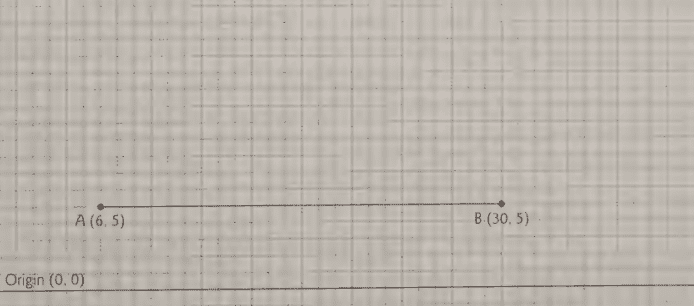

图 18.13 0层的“Lo 羽毛分形”。

为了创建这个分形，我们必须找到一个位于 AC 段下方的 D，创建一个等腰直角三角形 ADC。计算点 D 的位置使用公式：

```
xD = xA + (xC - xA) / 2 - (yC - yA) / 2;
yD = yA + (yC - yA) / 2 + (xC - xA) / 2;
```

我们现在如下从第 0 层移动到第 1 层：首先，添加点 C 和 D（如图 18.14 所示）。然后，移除原始线并添加段 DA、DC 和 DB。剩余的线将以角度弯曲，使我们的分形看起来像一片羽毛。

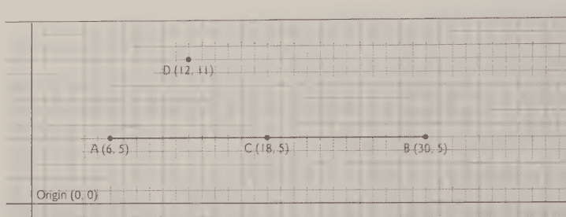

**图 18.14** 为“Lo 羽毛分形”第 I 层确定点 C 和 D。

对于分形的下一层，该算法在第 1 层的三条线中的每条线上重复。对于每条线，应用公式。

## 18.9.3 (可选) 分形应用程序

在本节和下一节中，我们将构建一个显示分形的 JavaFX 应用程序。与第 13 章中的 Painter 应用程序一样，它使用 FXML 定义布局并使用控制器类来处理逻辑。

- 应用程序将具有：
    - 一个用于绘制分形的 `Canvas`（画布）。
    - 层级：用于增加或减少递归层级的箭头按钮。
    - 用于更改分形颜色的 `ColorPicker`。
    - 用于显示当前层级的 `Label`（标签）。

核心逻辑将涉及一个递归方法，根据当前层级和颜色绘制分形。

## 18.9.4 （可选）FractalController 类

图 18.20 展示了 `FractalController` 类，它定义了程序的事件处理器以及递归绘制 Lo 分形的方法。输出显示了分形从第 0-5 级的发展，然后是第 8 级和 11 级。我们关注分形的一个分支，它将与整个图像相同。这一属性使该分形是严格自相似的。

```java
// Fig. 18.20: FractalController.java
// 使用递归绘制“Lo 羽毛分形”。
import javafx.event.ActionEvent;
import javafx.fxml.FXML;
import javafx.scene.canvas.Canvas;
import javafx.scene.canvas.GraphicsContext;
import javafx.scene.control.ColorPicker;
import javafx.scene.control.Label;
import javafx.scene.paint.Color;
import javafx.scene.shape.Line;

public class FractalController {
    // constants
    private static final int MIN_LEVEL = 0;
    private static final int MAX_LEVEL = 15;

    // 指向 UI 组件的实例变量
    @FXML private Canvas canvas;
    @FXML private ColorPicker colorPicker;
    @FXML private Label levelLabel;
}
```

图 18.20 | 使用递归绘制“Lo 羽毛分形。（4 部分中的 1 部分）。

# 第 18 章 递归


# 第 18 章 递归

## FractalController 类代码示例

```java
22 // 其他实例变量
23 private Color currentColor = Color.BLUE;
24 private int level = MIN_LEVEL; // 初始分形级别
25 private GraphicsContext gc; // 用于在 Canvas 上绘图
26
27
28 // 初始化控制器
29 public void initialize() {
30     levelLabel.setText("Level: " + level);
31     colorPicker.setValue(currentColor); // 从紫色开始
32     gc = canvas.getContext2D();    // 获取 GraphicsContext
33     drawFractal();
34 }
35 // 当用户选择新颜色时设置 currentColor
36 @FXML
37 void colorSelected(ActionEvent event) {
38     currentColor = colorPicker.getValue(); // 获取新颜色
39     drawFractal();
40 }
41
42 // 减少级别并重新绘制分形
43 @FXML
44 void decreaseLevelButtonPressed(ActionEvent event) {
45     if (level > MIN_LEVEL) {
46         --level;
47         levelLabel.setText("Level: " + level);
48         drawFractal();
49     }
50 }
51
52 // 增加级别并重新绘制分形
53 @FXML
54 void increaseLevelButtonPressed(ActionEvent event) {
55     if (level < MAX_LEVEL) {
56         ++level;
57         levelLabel.setText("Level: " + level);
58         drawFractal();
59     }
60 }
61
62 // 清除 Canvas，绘制颜色并绘制分形
63 private void drawFractal() {
64     gc.clearRect(0, 0, canvas.getWidth(), canvas.getHeight());
65     gc.stroke(currentColor);
66     drawFractal(level, 40, 40, 350, 350);
67 }
68
69 // 递归绘制分形
70 public void drawFractal(int level, int xA, int yA, int xB, int yB) {
71     // 基础情况：连接两个给定点的线
72     if (level == 0) {
73         gc.strokeLine(xA, yA, xB, yB);
74     }
75 }
```

图 18.20 | 使用递归绘制“羽毛分形。（4 部分中的 2 部分）。

```java
else { // 递归步骤：确定新点，绘制下一层
    // 计算 (xA, yA) 和 (xB, yB) 之间的中点
    int xC = (xA + xB) / 2;
    int yC = (yA + yB) / 2;

    // 计算第四个点 (xD, yD)，它在
    // (xA, yA) 和 (xC, yC) 之间形成一个等腰直角三角形
    // 直角在 (xD, yD)
    int xD = xA + (xC - xA) / 2 - (yC - yA) / 2;
    int yD = yA + (yC - yA) / 2 + (xC - xA) / 2;

    // 递归绘制分形
    drawFractal(level - 1, xD, yD, xA, yA);
    drawFractal(level - 1, xD, yD, xC, yC);
    drawFractal(level - 1, xD, yD, xB, yB);
}
```


图 18.20 | 使用递归绘制“Lo 羽毛分形。（4 部分中的 3 部分）。


图 18.20 | 使用递归绘制“Lo 羽毛分形。（4 部分中的 4 部分）。

## FractalController 字段

第 14–25 行声明了类的字段：

- 常量 `MIN_LEVEL` 和 `MAX_LEVEL`（第 14–15 行）指定了程序可以绘制的分形级别范围。一旦达到第 15 层，分形的变化（在此尺寸下）变得难以观察，因此我们将最大级别设置为 15。
- 第 18–20 行声明了 `@FXML` 实例变量，通过程序操作 GUI 控件。记住这些是由 `FXLoader` 初始化。
- 第 23 行声明了变量 `currentColor` 并将其初始化为 `Color.BLUE`。`Color` 类（包 `javafx.scene.paint`）包含了各种常量和方法。
- 第 24 行声明了整数 `level`，维护当前的分形级别。
- 第 25 行声明了 `GraphicsContext` 变量 `gc`，用于在程序的 Canvas 上绘图。

## initialize 方法

当程序的控制器创建并初始化时（第 28–33 行）：

- 将 `levelLabel` 的文本设置为级别 0。
- 将 `colorPicker` 的初始值设置为 `setColor(Color.BLUE)`。
- 获取 `canvas` 的 `GraphicsContext`，用于绘制当前颜色的线条。
- 调用 `drawFractal`（第 63–67 行）绘制第 0 层的分形。

## colorSelected 事件处理器

当用户选择新颜色时，`colorPicker` 的 `colorSelected` 事件处理器（第 36–40 行）使用 `colorPicker` 方法获取当前选择的颜色，然后调用 `drawFractal`（第 63–67 行）在新颜色和当前级别重新绘制分形。

## decreaseLevelButtonPressed 和 increaseLevelButtonPressed 处理器

当用户按下减少级别或增加级别按钮时，相应的事件处理器运行（第 45–60 行）。这些处理器减少或增加级别，相应地设置 `levelLabel` 的文本，并调用 `drawFractal`（第 63–67 行）重新绘制分形。尝试将级别降低到 `MIN_LEVEL` 以下或超过 `MAX_LEVEL` 没有效果。

## 18.10 递归回溯

我们的方法都具有类似的架构——如果到达基础情况，返回 `true`；否则，执行一次或多次递归调用。本节探索了一种更复杂的递归技术，用于寻找通过迷宫的路径，向下、向右、向上（不允许对角线移动）。从当前位置采取以下步骤：对于每个可能的方向，在该方向移动并进行递归调用以解决迷宫。当遇到死胡同时（即无法向前采取任何步骤），我们回溯到上位置并尝试不同的方向。为了回溯到上位置，我们的递归方法只需返回 `false`，回到上一次递归调用。使用递归返回早期的决策点被称为回溯。如果一组递归调用没有产生解决方案，程序将回溯到之前的决策点并做出不同的决定，产生另一组递归调用。练习实现迷宫的递归回溯解决方案（练习 18.20–18.22）和皇后问题（练习 18.15）。

## 18.11 总结

在本章中，你学习了如何创建递归方法——即调用自己的方法。你学习了递归方法通常将问题分为两个概念部分——方法知道要做的部分（基础情况）和方法不知道要做的部分（递归步骤）。递归步骤是一个稍微

# 总结 783

这是原始问题的较小版本，并通过递归方法执行。你已经看到了一些流行的递归示例，包括计算阶乘和生成斐波那契数列中的值。然后，你学习了递归在“底层”是如何工作的，包括递归方法调用在程序执行栈上推入或出栈的顺序。接下，你比较了递归和迭代方法。你学习了如何使用递归来解决更复杂的问题——汉诺塔问题和显示分形。本章以介绍递归回溯结束，递归回溯是一种解决问题的技术，它通过在递归调用中回溯来尝试不同的可能解决方案。在下一章中，你将学习许多对数据列表排序和在数据列表中查找项目的技巧，并去探索在什么情况下应该使用搜索和排序技术。

# 总结

### 第 18.1 节 引言

- 递归方法（第 757 页）直接或间接地通过另一个方法方法调用自己。

### 第 18.2 节 递归概念

- 当调用递归方法（第 758 页）来解决问题时，它只能解决最简单的情况，即基本情况（base case）。
- 如果对比基本情况更复杂的问题递归是可行的，它通常会将问题分为两部分——一部分是方法知道如何处理的，另一部分是不知道的。
- 为了让递归最终终止，每当方法使用原始问题的较小版本调用自己时，这些较小问题的序列必须收敛到基本情况。
- 当方法识别出基本情况时，它会返回一个结果。
- 递归调用可能是指向另一个方法，而该方法反过来又调用原始方法。这种过程仍然导致了递归调用。这被称为间接递归（第 758 页）。

### 第 18.3 节 递归示例：阶乘

- 遗漏基本情况或错误地编写递归步骤导致其无法收敛到基本情况，可能会导致无限递归（第 760 页），最终耗尽内存。这种错误类似于迭代（非递归）解决方案中的死循环。

### 第 18.5 节 递归示例：斐波那契数列

- 斐波那契数列（第 763 页）从 0 和 1 开始，具有每个斐波那契数都是前两个数之和的属性。
- 相邻斐波那契数之比收敛于常量 1.618...，这个数字被称为黄金分割点或黄金比例（第 763 页）。
- 某些递归解决方案（如斐波那契数列）会导致方法调用的“爆炸”。

### 第 18.6 节 递归与方法调用栈

- 正在执行的方法是其栈帧位于栈顶部的那个方法，该方法的栈帧包含了其局部变量的值。

### 第 18.7 节 递归 vs. 迭代

- 迭代和递归都基于控制语句：迭代使用迭代语句，而递归使用选择语句。
- 迭代和递归都涉及迭代：迭代显式地使用迭代语句，而递归通过重复的方法调用来实现迭代。
- 迭代和递归都涉及终止测试：迭代在循环条件失败时终止，递归在识别出基本情况时终止。
- 带有计数器控制的迭代和递归各自趋向终止：迭代不断修改计数器，直到计数器取到一个使循环条件失败的值，而递归在达到基本情况之前会产生原始问题的简单版本。
- 迭代和递归都可能无限发生：如果循环条件的迭代从不变为假，就会发生无限循环；而当递归步骤每次收敛到基本情况时都没有减少问题时，就会发生无限递归。
- 递归反复调用该机制，并因此产生方法调用的开销。
- 任何可以通过递归解决的问题也可以通过迭代解决。
- 当递归方法能更自然地模拟问题，并且生成的程序更容易理解和调试时，通常首选递归方法而非迭代方法。
- 递归方法可以用几行代码实现，但相应的迭代方法可能需要大量的代码。选择递归解决方案的另一个原因是，迭代解决方案可能并不显而易见。

### 第 18.9 节 分形

- 分形（第 771 页）是通过递归无限重复的模式生成的几何图形。
- 分形具有自相似性属性（第 772 页）——子部分是整体的较小拷贝。
- 工具栏（Toolbar）水平或垂直排列其控件。通常，你会在 GUI 中放置工具栏。
- Canvas 是节点的一个子类，可以使用 `GraphicsContext` 类对象来绘制图形。这两个类都在 `javafx.scene.canvas` 包中。
- 默认情况下，你拖到布局上的工具栏有一个按钮。你可以将额外的控件拖到工具栏中，并并在必要时移除默认按钮。
- 颜色选择器（ColorPicker）提供了一个预定义的颜色选择 GUI，默认情况下它允许用户通过颜色色块（样本颜色的小方块）进行选择，但也提供了一个自定义颜色 GUI 来选择任何自定义颜色。
- 当用户在 GUI 中选择颜色，或自定义颜色并在自定义控件 GUI 中按下保存键时，会发生一个 `ActionEvent`。
- `Color` 类（包 `javafx.scene.paint`）包含常用颜色的变体以及创建颜色对象的方法。
- `ColorPicker` 方法 `getValue` 返回当前选择的颜色。
- `GraphicsContext` 方法 `clearRect` 清除 Canvas 的矩形区域。
- Canvas 方法 `getWidth` 和 `getHeight` 分别返回 Canvas 的宽度和高度。

# 自测练习题

- `GraphicsContext` 方法 `stroke` 设置绘制颜色。
- `GraphicsContext` 方法 `strokeLine` 在两点之间画一条线。

### 第 18.10 节 递归回溯

- 在递归回溯（第 782 页）中，如果递归调用没有产生解决方案，程序将回溯到之前的决策点并做出不同的决策，通常会导致另一组递归调用。

# 自测练习题

**18.1** 判断以下陈述的真假。如果为假，请解释原因。

- a) 以这种方式调用自己的方法不是递归的示例。
- b) 递归由于内存空间的使用在计算上是高效的。
- c) 当调用递归方法解决问题时，它实际上只能解决最简单的情况，即基本情况。
- d) 为了实现递归，递归解决方案中的递归步骤必须与原始问题相似，但是它的更大版本。

**18.2** 需要 A 来终止递归。

- a) 递归步骤
- b) break 语句
- c) void 类型
- d) 基本情况

**18.3** 第一次调用递归方法是 ...

- a) 非递归
- b) 递归
- c) 递归步骤
- d) 以上都不是

**18.4** 每应用一次分形的模式，该分形处于一个新的 ...

- a) 宽度
- b) 高度
- c) 层级
- d) 体积

**18.5** 迭代和递归各涉及一个 ...

- a) 迭代语句
- b) 终止测试
- c) 计数器变量
- d) 以上都不是

# 自测练习题答案

**18.1** a) 假。以这种方式调用自己的方法是间接递归的示例。

**b)** 假。递归由于多次方法调用在计算上可能是低效的内存空间占用。c) 正确。d) 错误。为了使递归可行，递归解决方案中的递归步骤必须类似于原始问题，但必须是其略小的版本。

- 18.2 d.
- 18.3 a.
- 18.4 c.
- 18.5 b.
- 18.6 a) 黄金比例，黄金分割点。b) 选择。c) 自相似。

# 练习题

- 18.7 下面代码的作用是什么？

```java
public int mystery(int a, int b) {
  if (b == 1) {
    return a;
  }
  else {
    return a + mystery(a, b - 1);
  }
}
```

- 18.8 找出以下递归方法中的错误，并解释如何修正（这些错误）。该方法应该找到从 0 到 n 的值的和。

```java
public int sum(int n) {
  if (n == 0) {
    return 0;
  }
  else {
    return n + sum(n);
  }
}
```

- 18.9 (递归幂方法) 编写一个递归的 `power(base, exponent)` 方法，调用时：

```
base exponent
```

例如，`power(3, 4) = 3 * 3 * 3 * 3`。假设 exponent 是大于或等于 1 的整数。提示：递归步骤应该使用关系

```
exponent = base ^ (exponent - 1)
```

当 exponent 为 1 时发生终止条件，因为

```
base = base
```

将此方法整合到一个程序中，允许用户输入底和指数。

- 18.10 (可视化递归) 观察递归的“动作”非常有趣。修改图 18.3 中的阶乘方法，以打印它的局部变量和递归调用参数。对于每次递归调用，在单独的一行上输出并显示缩进级别。尽可能让输出清晰、有趣且有意义。你的目标是设计并实现一种易于理解递归的输出。你可能希望在文中其他递归示例和练习题中添加此类显示功能。

- 18.11 (最大公约数) x 和 y 的最大公约数能整除 x 和 y 的最大整数。编写一个递归方法 `gcd`，返回 x 和 y 的最大公约数。x 和 y 的 gcd 递归定义为：如果 y 等于 0，`gcd(x, y)` 为 x；否则，`gcd(x, y)` 为 `gcd(x, y % y)`，其中 `%` 是余运算符。使用此方法替换你在 6.27 应用中编写的方法。

- 18.12 下面程序的作用是什么？


```java
// 练习 18.12: MysteryClass.java
public class MysteryClass {
    public static int mystery(int[] array, int size) {
        if (size == 1) {
            return array[0];
        } else {
            return array[size - 1] + mystery(array, size - 1);
        }
    }
    public static void main(String[] args) {
        int[] array = {1, 2, 3, 4, 5, 6, 7, 8, 9, 10};
        int result = mystery(array, array.length);
        System.out.printf("Result is: %d\n", result);
    }
}
```

### 18.13 下面程序的作用是什么？

```java
// 练习 18.13: SomeClass.java
public class SomeClass {
    public static String method(int[] array, int x) {
        if (x < array[2]) {
            return String.format("%s %s", method(array, x + 1), array[x]);
        } else {
            return "";
        }
    }
    public static void main(String[] args) {
        int[] array = {1, 2, 3, 4, 5, 6, 7, 8, 9, 10};
        String results = method(array, 0);
        System.out.println(results);
    }
}
```

### 18.14 (回文)
回文是一个正读和反向读都相同的字符串。回文的示例包括“radar”、“was i ere saw elba”（如果忽略空格）、“a man a plan panama”。编写一个递归方法 `testPalindrome`，如果存储在数组中的字符串是回文则返回 `true`，否则返回 `false`。该方法应忽略字符串中的空格和标点符号。[提示：`String.toCharArray()` 返回一个包含字符串字符的字符数组]。

### 18.15 (八皇后)
国际象棋谜题是八皇后问题，它询问：是否可能在棋盘上放置八个皇后，使得没有一个皇后在“攻击”任何其他皇后（即没有两个皇后位于同一行、同一列或在同一条对角线上）？例如：

一个皇后被放在棋盘的左上角，在图 18.21 所示的任何标记格中都无法放置其他皇后。用递归解决此问题。[提示：你的解决方案应该从第一列开始，并在该列中寻找可以放置皇后的位置]。

### 18.16 (打印数组)
编写一个递归方法 `printArray`，用空格分隔 `array` 中的所有元素。

### 18.17 (反向打印数组)
编写一个递归方法 `reverse`，接收字符串作为参数并反向打印该字符串。

### 18.18 (寻找数组中的最小值)
编写一个递归方法 `Minimum`，确定数组中的最小元素。

### 18.19 (分形)
重复第 9 节的分形以形成不同颜色的星。该方法接收参数 18.22。

### 18.20 (使用回溯遍历迷宫)
表示迷宫的二维数组显示墙壁，点表示路径。编写一个递归方法 `mazeTraversal` 来遍历迷宫（假设只有一个）。第一次调用此方法时，当前位置应该是入口。算法如下：从当前位置，尝试向任何可能的方向移动（向下、向右）。如果可以移动，递归调用 `mazeTraversal`，并将新位置作为当前位置。如果无法向任何方向移动，则“回溯”到之前的位置并尝试另一个方向。程序在每次移动后显示迷宫，用户可以观察迷宫是如何解决的。迷宫的最终输出应显示解决所需的路径——如果进入某个方向导致死路，则不显示该方向的 x。

### 18.21 (随机生成迷宫)
编写方法 `mazeGenerator`，接收一个 12x12 数组作为参数，并随机生成迷宫。该方法还应提供迷宫的起点和终点。测试你在练习 18.20 中的 `mazeTraversal` 方法，使用多个生成的迷宫。

### 18.22 (任意尺寸的迷宫)
通用练习 18.20 和 18.21 中的 `mazeTraversal` 和 `mazeGenerator`，以处理任意宽高的迷宫。

### 18.23 (计算斐波那契数的时间)
增强图 18.5 中的斐波那契程序，使其计算计算所需时间以及调用递归方法的次数。为了这一目的，调用静态方法 `currentTimeMillis()`，它不接受参数并返回调用者的当前时间（毫秒）。在调用 `fibonacci` 之前和之后各调用一次。保存每个值并计算时间差，以确定计算需要多少毫秒。在迷宫类中添加一个变量，并使用该变量确定调用方法 `fibonacci` 的次数。显示你的结果。

### 18.24 (项目：科赫曲线)
使用你从第 18.9 节中学到的技术，实现一个绘制科赫曲线的应用程序。

### 18.25 (项目：科赫雪花)
在网上研究科赫雪花，使用你从第 18.9 节中学到的技术，实现一个绘制科赫雪花的应用程序。

## Lambda 与流的练习

### 18.26 (项目：递归文件和目录操作)
使用第 14 章的字符串处理能力、第 15.3 节的文件和目录能力以及第 16.10 节的 `Map`，创建一个应用程序，递归地遍历用户提供的目录结构，并报告指定目录路径下每种类型（如 `.java`、`.txt`、`.class`、`.docx` 等）的文件数量。按排序顺序显示文件扩展名。接下来，研究 `Files` 类的方法。该方法返回一个遍历目录及其子目录的流，并将内容作为流返回给你。然后，使用 Lambda 和流而不是递归来重新实现此练习的第一部分。

### 18.27 (项目：将循环转换为 Lambda 和流)
本章示例中使用的每个计数控制循环都可以使用 `IntStream` 的 `rangeClosed` 方法产生一个值范围，然后使用 `IntStream` 的 `forEach` 方法指定一个为每个值执行的 Lambda。`forEach` 的 Lambda 参数可以调用 `factorial` 方法（图 18.3–18.4）或 `fibonacci` 方法（图 18.5）并显示结果。

### 18.28 (项目：使用 Lambda 和流计算阶乘)
使用 Lambda 和流重新实现图 18.3–14 中的阶乘方法，而不是使用递归。

### 18.29 (项目：使用 Lambda 和流计算斐波那契数)
使用 Lambda 和流重新实现图 18.5 中的 `fibonacci` 方法来计算斐波那契数，而不是使用递归。

# 搜索、排序与大 O 符号

## 目标

在本章中，你将：

- 使用线性搜索和二分查找在数组中搜索给定值。
- 使用迭代选择排序和插入排序算法对数组进行排序。
- 使用递归归并排序算法对数组进行排序。
- 确定搜索和排序算法的效率。
- 学习用于比较算法效率的大 O 符号表示。

## 19.1 引言

搜索数据是指确定一个值（称为搜索键）是否存在于数据中，如果存在，则找到它的位置。两种常用的搜索算法是线性搜索和更快但更复杂的二分查找。排序是根据数据按升序或降序排列。例如，姓名可以按字母顺序排序，员工记录可以按社会安全号排序等等。本章介绍了两种简单的排序算法：选择排序和插入排序，以及更高效但复杂的归并排序。图 19.1 总结了书中讨论的搜索和排序算法。

### 软件工程观察

搜索数据是指确定一个值（称为搜索键）是否存在于数据中，如果存在，则找到它的位置。两种常用的搜索算法是线性搜索和更快但更复杂的二分查找。排序是根据数据按升序或降序排列。例如，姓名可以按字母顺序排序，员工记录可以按社会安全号排序等等。本章介绍了两种简单的排序算法：选择排序和插入排序，以及更高效但复杂的归并排序。图 19.1 总结了书中讨论的搜索和排序算法。

### 关于计数控制循环的说明

在本章中，我们使用计数控制循环来演示搜索和排序的各种机制。许多这些循环可以使用 Java 流来实现（第 17 章）。

### 线性搜索

在字典中查找值涉及两种搜索算法——一种简单的（线性搜索）和更复杂的（二分查找）。线性搜索遍历数组中的每个元素。如果搜索键不在数组中，它会通知用户；如果搜索键匹配数组，它会返回一个哨兵值（例如 -1）。

### 搜索算法

例如，考虑一个包含以下值的数组：

34 56 10 77 51 93 30 52 51

使用线性搜索算法，程序顺序测试每个元素。

### 线性搜索实现

`LinearSearchTest`（图 19.2）包含了用于执行数组搜索的静态方法 `linearSearch` 和用于测试的 `main` 方法。

```java
// 图 19.2 LinearSearchTest.java
// 顺序搜索数组项。
// 对数据执行线性搜索
public static int linearSearch(int data[], int searchKey) {
    // 顺序遍历数组
    for (int index = 0; index < data.length; index++) {
        if (data[index] == searchKey)
            return index; // 返回整数索引
    }
    return -1; // 未找到整数
}

public static void main(String[] args) {
    Scanner scanner = new Scanner(System.in);
    SecureRandom generator = new SecureRandom();

    int[] data = new int[10]; // 创建数组

    for (int i = 0; i < data.length; i++) { // 填充数组
        data[i] = 10 + generator.nextInt(10);
    }

    System.out.printf("%s\n", Arrays.toString(data)); // 显示数组

    // 获取用户输入
    System.out.print("请输入整数值（-1 退出）：");
    int searchKey = scanner.nextInt();

    // 重复输入整数；-1 终止程序
    while (searchKey != -1) {
        int position = linearSearch(data, searchKey); // 执行搜索

        if (position == -1) { // 未找到
            System.out.printf("%d 未找到%n%n", searchKey);
        } else { // 找到
            System.out.printf("%d 在位置 %d 找到%n%n", searchKey, position);
        }
    }
}
```

**图 19.2** | 顺序搜索数组项。（第 1 部分，共 2 部分）

## 19.2 线性搜索

```java
// 从用户获取输入
System.out.print("Please enter an integer value (-1 to quit): ");
searchInt = input.nextInt();
}
}
```

[59, 97, 34, 90, 79, 56, 24, 51, 30, 69]

请输入一个整数值（-1 退出）： 79

在位置 4 找到了 79

请输入一个整数值（-1 退出）： 61

未找到 61

请输入一个整数值（-1 退出）： 51

在位置 7 找到了 51

请输入一个整数值（-1 退出）： -1

**图 19.2** 在数组中顺序查找某项。（共 2 部分，的第 2 部分。）

### 方法 linearSearch

方法 `linearSearch`（第 9–18 行）执行线性搜索。该方法接收用于搜索的参数（数据）和搜索键（`searchKey`）。第 11–15 行遍历数组 `data` 的元素。第 12 行与 `searchKey` 进行比较。如果值相等，第 13 行返回该元素的索引。如果数组中有重复值，线性搜索将返回数组中第一个匹配搜索键的元素的索引。如果循环结束时仍未找到该值，第 17 行返回 -1。

### 方法 main

方法 `main` 允许用户搜索数组。第 24–28 行创建一个包含 10 个 `int` 的数组，并用 10–99 之间的随机整数填充它。然后，第 30 行使用 `Arrays` 静态方法 `toString` 显示数组的内容，该方法返回数组的字符串表示，元素包含在括号中并用逗号分隔。

第 33–34 行提示用户输入数据并存储搜索键。第 38 行调用 `linearSearch` 来确定 `searchInt` 是否在数组 `data` 中。如果不在，`linearSearch` 返回 -1 并通知用户（第 41 行）。如果 `searchInt` 在数组中，`linearSearch` 返回元素的位置，程序在第 44–45 行输出该位置。第 49–50 行从用户处获取下一个搜索键。

### 使用 Java 8 流生成随机值数组

回想第 17.14 节，可以使用 `SecureRandom` 方法生成随机值流。在图 19.2 中，第 24–28 行可以替换为：

```java
int[] data = generator.ints(10, 10, 91).toArray();
```

`ints` 的第一个参数 (10) 是流中的元素数量。第二个和第三个参数表示生成的随机值将在 10 到不包括 91 的范围内（即 10–90）。在生成的 `IntStream` 上，我们调用 `toArray` 来获取一个包含 10 个随机值的 `int` 数组。在本章的后续内容中，我们将使用这种基于流的技术，而不是使用 `for` 语句来填充数组。

我们仍然会使用 `for` 语句，以便我们能够创建视觉输出，展示搜索和排序算法是如何运作的。

## 19.3 大 O 表示法

搜索算法都实现了同一个目标——如果确实存在与搜索键匹配的元素（或元素），则找到它。然而，有许多点使得搜索算法之间有所不同。主要区别在于它们完成搜索所需的精力。描述这种精力的一种方法是使用大 O 表示法，它指示算法解决问题时可能需要多大的工作。对于搜索和排序算法，这特别取决于数据元素的数量。在本章中，我们将使用大 O 表示法来描述这种精力。

### 19.3.1 O(1) 算法

假设一个算法测试数组中的第一个元素是否相等，如果数组有 10 个元素，它需要一次比较。如果数组有 1000 个元素，它需要十次比较。随着 $n$ 的增长，$n$ 的部分占据主导地位，常项变得无关紧要。因此，线性搜索被称为 $O(n)$。

### 19.3.2 O(n) 算法


# 第 19 章 搜索、排序与大 O 表示

搜索算法都实现了同一个目标——如果确实存在与搜索键匹配的元素（或元素），则找到它。然而，有许多点使得搜索算法之间有所不同。主要区别在于它们完成搜索所需的精力。描述这种精力的一种方法是使用大 O 表示法，它指示算法解决问题时可能需要多大的工作。对于搜索和排序算法，这特别取决于数据元素的数量。在本章中，我们将使用大 O 表示法来描述这种精力。假设一个算法测试数组中的第一个元素是否相等，如果数组有 10 个元素，它需要一次比较。如果数组有 1000 个元素，它需要十次比较。随着 $n$ 的增长，$n$ 的部分占据主导地位，常项变得无关紧要。因此，线性搜索被称为 $O(n)$。

## 19.3.3 O(n²) 算法

遗憾的是，$O(n^2)$ 算法编写起来很容易，正如你将在本章看到的。你还将看到具有更好大 O 的算法，比线性搜索更高效。这些高效算法通常需要更多的技巧和工作来创建，但它们的卓越性能完全值得这些额外精力，特别是当 $n$ 很大且算法被集成到更大的程序时。

## 19.3.4 线性搜索的 O 复杂度

线性搜索以 $O(n)$ 时间运行。该算法的最坏情况是检查每个元素以确定其是否存在于数组中。如果数组的大小翻倍，算法必须执行的比较次数也会翻倍。如果匹配搜索键的元素恰好在数组的前部，线性搜索可以提供出色的性能。但我们仍然寻找对所有搜索都表现良好的算法，包括匹配搜索键的元素位于数组末尾的情况。

线性搜索很容易编程，但与其他搜索算法相比可能很慢。如果程序需要对大型数组进行多次搜索，最好使用更高效的算法，例如我们将介绍的二分搜索。

## 19.4 二分搜索

二分搜索比线性搜索更高效，但它要求数组是排序的。该算法的第一次测试数组的中间元素。如果匹配搜索键，则算法结束。假设数组是升序排列的，那么如果搜索键小于中间元素，则它不可能匹配后半部分的任何元素，算法继续处理前半部分（即从第一个元素到但不包括中间元素的元素）。如果搜索键大于中间元素，则它无法匹配数组前半部分的任何元素，算法将继续处理后半部分（即从中间元素到最后一个元素）。每次迭代都会测试数组剩余部分的中间值。如果搜索键与元素不匹配，算法将排除剩余元素的一半。算法以找到与搜索键匹配的元素或将子数组的大小缩减为零而结束。

### 示例

作为一个示例，考虑一个排序后的 15 元素数组：

2 3 5 10 27 30 34 51 56 65 77 81 82 93 99

以及一个搜索键 65。一个实现二分查找算法的程序将首先检查 51 是否为搜索键（因为 51 是数组的中间元素）。搜索键（65）大于 51，因此 51 连同数组的前半部分（所有小于 51 的元素）一起被忽略，剩下：

56 65 77 81 82 93 99

接下来，算法检查 81（数组的中间元素）是否匹配搜索键。搜索键（65）小于 81，因此 81 连同大于 81 的元素一起被丢弃。经过两次测试，算法将需要检查的值范围缩小到仅剩三个（56、65 和 77）。然后它检查 65（匹配搜索键）并返回包含 65 的数组索引。该算法需要三次比较来确定搜索键是否匹配数组中的元素。使用线性查找算法将需要 10 次比较。在这个示例中，[注意：我们选择使用一个包含 15 个元素的数组，以便数组中总会有一个明显的中间元素。当元素个数为偶数时，数组的中间位于两个元素之间。我们实现的算法会选择这两个元素中较大的一个。]

### 19.4.1 二分查找的实现

`BinarySearchTest`（图 19.3）包含：

- 静态方法 `binarySearch`，用于在 `int` 数组中搜索指定的键；
- 静态方法 `remainingElements`，用于显示正在搜索的数组中的剩余元素；
- `main` 方法，用于测试 `binarySearch`。

`main` 方法（第 60–89 行）与图 19.2 中的几乎相同。在程序中，第 65 行创建了一个包含 15 个随机值的数组（Java SE 8）。它将这些值按升序排序，并将字符串转换为 `int` 数组。记住，二分查找算法仅适用于排序后的数组。该程序的第一行输出显示了排序后的 `int` 数组。为了搜索 18，程序首先测试中间元素，在我们的示例执行中为 57（由 `*` 标出）。搜索键小于 57，因此程序排除数组的后半部分并测试前半部分的中间元素。搜索键小于 36，因此程序排除数组的后半部分，只剩下三个元素。最后，程序检查 18（匹配搜索键）并返回索引 1。

#### 代码示例

```java
// 图 19.3: BinarySearchTest.java
// 使用二分查找在数组中定位项目。
import java.security.SecureRandom;
import java.util.Arrays;
import java.util.Scanner;

public class BinarySearchTest {
    // 对数据执行二分查找
    public static int binarySearch(int[] data, int key) {
        int low = 0;
        int high = data.length - 1;
        int middle = (low + high + 1) / 2;
        int location = -1; // 返回值；如果未找到则为 -1

        do {
            // 打印数组的剩余元素
            System.out.print(remainingElements(data, low, high));

            // 输出中间元素的标记
            for (int i = 0; i < middle; i++) {
                System.out.print("   ");
            }
            System.out.println(" *"); // 标记中间位置

            // 如果中间元素等于键，则找到
            if (data[middle] == key) {
                location = middle; // 位置即为中间
            } else if (data[middle] < key) {
                low = middle + 1; // 查找后半部分
            } else {
                high = middle - 1; // 查找前半部分
            }

            middle = (low + high + 1) / 2; // 重新计算中间
        } while ((low <= high) && (location == -1));

        return location; // 返回键的位置
    }

    // 返回数组中指定范围内的元素字符串表示
    private static String remainingElements(int[] data, int low, int high) {
        StringBuilder temporary = new StringBuilder();

        // 添加数组中左留的元素
        for (int i = low; i <= high; i++) {
            temporary.append(data[i]).append(" ");
        }

        return temporary.toString();
    }

    public static void main(String[] args) {
        SecureRandom generator = new SecureRandom();
        int[] data = generator.ints(15, 10, 100).sorted().toArray();
        System.out.printf("Sorted array: %s%n", Arrays.toString(data));

        Scanner input = new Scanner(System.in);
        System.out.print("请输入一个整数值 (-1 退出): ");
        int searchKey = input.nextInt();

        while (searchKey != -1) {
            int location = binarySearch(data, searchKey);

            if (location == -1) {
                System.out.printf("未找到 %d%n%n", searchKey);
            } else {
                System.out.printf("在位置 %d 找到 %d%n%n", location, searchKey);
            }

            System.out.print("请输入一个整数值 (-1 退出): ");
            searchKey = input.nextInt();
        }
    }
}
```

#### 运行输出示例

```
[13, 18, 29, 36, 42, 47, 56, 57, 63, 68, 80, 81, 82, 88, 88]

请输入一个整数值 (-1 退出): 18
13 18 29 36 42 47 56 57 63 68 80 81 82 88 88
            *
13 18 29 36 42 47 56
      *
13 18 29
   *
在位置 1 找到 18

请输入一个整数值 (-1 退出): 82
13 18 29 36 42 47 56 57 63 68 80 81 82 88 88
                        *
63 68 80 81 82 88 88
                  *
82 88 88
      *
82
   *
在位置 12 找到 82

请输入一个整数值 (-1 退出): 69
13 18 29 36 42 47 56 57 63 68 80 81 82 88 88
                        *
63 68 80 81 82 88 88
                        *
63 68 80 81 82 88 88
                  *
63 68 80
   *
未找到 69

请输入一个整数值 (-1 退出): -1
```

**图 19.3** | 使用二分查找在数组中定位项目（输出中的 `*` 标记了中间元素）。

第 9–40 行声明了方法 `binarySearch`，它接收要搜索的数组（`data`）和搜索键（`key`）作为参数。第 10–12 行计算正在搜索的部分的边界索引和中间索引。在方法开始时，`low` 为 0，`high` 为数组长度减 1，`middle` 是这些值的平均值。第 13 行将 `location` 初始化为 -1——如果未找到，则将返回该值。第 15–37 行循环，直到 `low` 大于 `high`（当未找到键时）或 `location` 不等于 -1（表示找到了键）。第 26 行测试中间元素是否等于键。如果是，第 27 行将中间值赋值给 `location`，循环终止并返回 `location`。循环的每次迭代测试一个值（第 26 行），如果值不是键，则排除数组剩余的一半（第 29–34 行）。

### 19.4.2 二分查找的效率

在最坏情况下，使用二分查找搜索包含 $2^{10}$ 个元素的排序数组只需要 10 次比较。反复将 $2^{10}$ 除以 2（因为每次比较我们都可以排除一半数组）并向下取整（因为我们还删除了中间元素），得到 511, 255, 127, 63, 31, 15, 7, 3, 1 和 0。这等同于二分查找中的一次比较。因此，包含 1,048,575 个元素（$2^{20}-1$）的数组最多需要 20 次比较找到键，而十亿元素的数组最多需要 30 次比较。相对于线性查找这是一个巨大的改进。对于一个十亿元素的数组，线性查找平均需要 5 亿次比较，而二分查找最多只需要 30 次比较！二分查找所需的最多比较次数是数组元素数量 2 的幂，表示为 $\log_2 n$。所有对数的增长率大致相同，因此在大 O 表示中可以省略底数。这导致二分查找的大 O 表示为 $O(\log n)$，它也被称为对数时间。

## 19.5 排序算法

数据排序（即将数据放入特定顺序，例如升序或降序）是最重要的计算应用之一。银行按账户号码对所有交易进行排序，以便在月底准备个人账单。电话公司按姓氏进一步按名字进行排序，便于查找电话号码。每个组织都会对数据进行排序，而且是大量的数据。数据排序是一个有趣的计算密集型问题，吸引了研究。

关于排序的一个重要点是，无论使用什么算法对数组进行排序，最终的数组都是相同的。算法的选择只影响程序的运行时间和内存。本章其余部分介绍了三种常见的排序算法：选择排序和插入排序容易编写但效率低下。最后——合并排序比选择排序和插入排序快得多，但编写较困难。我们专注于原始类型数据 `int` 的数组排序。正如我们在 16.7.1 节所示，使用 Collections API 的内置功能也可以对类数组进行排序。

## 19.6 选择排序

选择排序是一种简单但低效的算法。如果你按升序排序，它的第一次迭代选择数组中的最小元素并将其与第一个元素交换。第二次迭代选择第二个小的元素（剩余元素中的最小元素）并将其与第二个元素交换。算法持续到最后一次迭代选择第二大的元素并将其与倒数第二个索引交换，将最大的元素留在最后一个索引。在第 i 次迭代后，数组中最小的 i 个元素将在数组的前 i 个元素中按升序排序。

作为一个示例，考虑数组：

| 34 | 56 | 4 | 10 | 77 | 51 | 93 | 30 | 5 | 52 |

实现选择排序的程序首先选择数组中的最小元素（4），它位于索引 2。程序将 4 与 34 交换，结果为：

| 4 | 56 | 34 | 10 | 77 | 51 | 93 | 30 | 5 | 52 |

程序随后确定剩余元素（除 4 以外的所有元素）的最小值，程序将 5 与 56 交换，结果为：

| 4 | 5 | 34 | 10 | 77 | 51 | 93 | 30 | 56 | 52 |

在第三种方法中，程序确定了下一个最小值（10）并将其与 34 交换：

| 4 | 5 | 10 | 34 | 77 | 51 | 93 | 30 | 56 | 52 |

该过程持续进行，直到数组完全排序：

| 4 | 5 | 10 | 30 | 34 | 51 | 52 | 56 | 77 | 93 |

在第一次迭代后，最小元素位于第一个位置。在第二次迭代后，两个最小元素按顺序排列在前两个位置。在第三次迭代后，三个最小元素按顺序排列在前三个位置。

### 19.6.1 选择排序的实现

`SelectionSortTest` 类（图 19.4）包含：

- 静态方法 `selectionSort`，使用选择排序算法对数组进行排序；
- 静态方法 `swap`，交换数组中两个元素的值；
- 静态方法 `printPass`，在每轮通过后显示数组内容；
- `main` 方法，用于测试 `selectionSort` 方法。

在 `main` 方法中，第 61 行使用 Java SE 8 创建了一个名为 `data` 的 `int` 数组，并填充了 10–99 范围随机整数。第 64 行调用 `selectionSort` 方法将数组元素按升序排序。

#### 代码示例

```java
// 图 19.4: SelectionSortTest.java
// 使用选择排序对数组。
import java.security.SecureRandom;
import java.util.Arrays;

public class SelectionSortTest {
    // 使用选择排序排序数组
    public static void selectionSort(int[] data) {
        // 遍历 data.length - 1 个元素
        for (int i = 0; i < data.length - 1; i++) {
            int smallest = i; // 剩余数组的第一个索引

            // 循环寻找最小元素的索引
            for (int index = i + 1; index < data.length; index++) {
                if (data[index] < data[smallest]) {
                    smallest = index;
                }
            }

            swap(data, i, smallest); // 将最小元素放入位置
            printPass(data, i + 1, smallest); // 输出算法的轮
        }
    }

    // 交换两个元素值的辅助方法
    private static void swap(int[] data, int first, int second) {
        int temporary = data[first]; // 将第一个值存入临时变量
        data[first] = data[second]; // 用第二个替换第一个
        data[second] = temporary; // 将临时变量存入第二个
    }

    // 打印算法的一轮
    private static void printPass(int[] data, int pass, int index) {
        System.out.printf("after pass %2d: ", pass);

        // 输出选中的元素
        for (int i = 0; i < index; i++) {
            System.out.printf("%d, ", data[i]);
        }

        // 交换
        System.out.printf("%d* ", data[index]);

        // 完成输出数组
        for (int i = index + 1; i < data.length; i++) {
            System.out.printf("%d, ", data[i]);
        }

        System.out.printf("%n"); // 用于对齐

        // 标明数组已排序的部分
        for (int j = 0; j < pass; j++) {
            System.out.print("-- ");
        }

        System.out.println();
    }

    public static void main(String[] args) {
        SecureRandom generator = new SecureRandom();
        // 创建包含 10 个随机整数的无序数组
        int[] data = generator.ints(10, 10, 91).toArray();
        System.out.printf("Unsorted array: %s%n", Arrays.toString(data));
        selectionSort(data); // 排序数组
        System.out.printf("Sorted array:   %s%n", Arrays.toString(data));
    }
}
```

#### 运行输出示例

```
Unsorted array: [40, 60, 59, 46, 98, 82, 23, 51, 31, 36]

after pass  1: 23, 60, 59, 46, 98, 82, 40*, 51, 31, 36,
-- 
after pass  2: 23, 31, 59, 46, 98, 82, 40*, 51, 60, 36,
-- -- 
after pass  3: 23, 31, 36, 46, 98, 82, 40*, 51, 60, 59,
-- -- -- 
after pass  4: 23, 31, 36, 40, 98, 82, 46*, 51, 60, 59,
-- -- -- -- 
after pass  5: 23, 31, 36, 40, 46, 82, 98*, 51, 60, 59,
-- -- -- -- -- 
after pass  6: 23, 31, 36, 40, 46, 51, 98*, 82, 60, 59,
-- -- -- -- -- -- 
after pass  7: 23, 31, 36, 40, 46, 51, 59, 82, 60, 98*,
-- -- -- -- -- -- -- 
after pass  8: 23, 31, 36, 40, 46, 51, 59, 60, 82, 98*,
-- -- -- -- -- -- -- -- 
after pass  9: 23, 31, 36, 40, 46, 51, 59, 60, 82, 98*,
-- -- -- -- -- -- -- -- -- 

Sorted array:   [23, 31, 36, 40, 46, 51, 59, 60, 82, 98]
```

**图 19.4** | 使用选择排序对数组排序。

## 19.7 插入排序


## 选择排序示例

未排序数组：`[40, 60, 59, 46, 98, 82, 23, 51, 31, 36]`

| 轮次 | 1 | 2 | 3 | 4 | 5 | 6 | 7 | 8 | 9 | 10 |
|---|---|---|---|---|---|---|---|---|---|---|
| pass 1 | 23 | 60 | 59 | 46 | 98 | 82 | 40* | 51 | 31 | 36 |
| pass 2 | 23 | 31 | 59 | 46 | 98 | 82 | 40* | 51 | 31 | 36 |
| pass 3 | 23 | 31 | 59 | 46 | 98 | 82 | 40* | 51 | 31 | 36 |

图 19.4 | 使用选择排序对数组排序。（3 部分中的第 1 部分）

---

在第三种方法中，程序确定了下一个最小值（10）并将其与 34 交换。

`4 5 10 34 77 51 93 30 56 52`

该过程持续进行，直到数组完全排序。

`4 5 10 30 34 51 52 56 77 93`

在第一次迭代后，最小元素位于第一个位置。在第二次迭代后，两个最小元素按顺序排列在前两个位置。在第三次迭代后，三个最小元素按顺序排列在前三个位置。

## 19.6.1 选择排序的实现

`SelectionSortTest` 类（图 19.4）包含：

- 静态方法 `selectionSort()`，使用选择排序算法对数组进行排序；
- 静态方法 `swap()`，交换数组中两个元素的值；
- 静态方法 `printPass()`，在每轮通过后显示数组内容；
- `main()`，用于测试 `selectionSort()` 方法。

在 `main()` 方法中，第 61 行使用 Java SE 8 创建了一个名为 `data` 的 `int` 数组，并填充了 10–99 范围随机整数。第 64 行调用 `selectionSort()` 方法将数组元素按升序排序。

```java
// 图 19.4: SelectionSortTest.java
// 使用选择排序对数组排序。
import java.security.SecureRandom;
import java.util.Arrays;

public class SelectionSortTest {
    // 使用选择排序排序数组
    public static void selectionSort(int[] data) {
        // 遍历 data.length - 1 个元素
        for (int i = 0; i < data.length - 1; i++) {
            int smallest = i; // 剩余数组的第一个索引

            // 循环寻找最小元素的索引
            for (int index = i + 1; index < data.length; index++) {
                if (data[index] < data[smallest]) {
                    smallest = index;
                }
            }

            swap(data, i, smallest); // 将最小元素放入位置
            printPass(data, i + 1, smallest); // 输出算法的轮
        }
    }

    // 交换两个元素值的辅助方法
    private static void swap(int[] data, int first, int second) {
        int temporary = data[first]; // 将第一个值存入临时变量
        data[first] = data[second]; // 用第二个替换第一个
        data[second] = temporary; // 将临时变量存入第二个
    }

    // 打印算法的一轮
    private static void printPass(int[] data, int pass, int index) {
        System.out.printf("after pass %2d: ", pass);

        // 输出选中的元素
        for (int i = 0; i < index; i++) {
            System.out.printf("%d, ", data[i]);
        }

        // 交换
        System.out.printf("%d* ", data[index]);

        // 完成输出数组
        for (int i = index + 1; i < data.length; i++) {
            System.out.printf("%d, ", data[i]);
        }

        System.out.printf("%n"); // 用于对齐

        // 标明数组已排序的部分
        for (int j = 0; j < pass; j++) {
            System.out.print("-- ");
        }

        System.out.println();
    }

    public static void main(String[] args) {
        SecureRandom generator = new SecureRandom();
        // 创建包含 10 个随机整数的无序数组
        int[] data = generator.ints(10, 10, 91).toArray();
        System.out.printf("Unsorted array: %s%n", Arrays.toString(data));
        selectionSort(data); // 排序数组
        System.out.printf("Sorted array:   %s%n", Arrays.toString(data));
    }
}
```

未排序数组：`[40, 60, 59, 46, 98, 82, 23, 51, 31, 36]`

| 轮次 | 1 | 2 | 3 | 4 | 5 | 6 | 7 | 8 | 9 | 10 |
|---|---|---|---|---|---|---|---|---|---|---|
| pass 1 | 23 | 60 | 59 | 46 | 98 | 82 | 40* | 51 | 31 | 36 |
| pass 2 | 23 | 31 | 59 | 46 | 98 | 82 | 40* | 51 | 31 | 36 |
| pass 3 | 23 | 31 | 59 | 46 | 98 | 82 | 40* | 51 | 31 | 36 |

图 19.4 | 使用选择排序对数组排序。（3 部分中的第 2 部分）

---

# 第 19 章 搜索、排序与大 O 复杂度

## 19.7 插入排序

```java
// 遍历 data.length - 1 个元素
for (int next = 1; next < data.length; next++) {
    int insert = data[next]; // 要插入的值
    int moveItem = next; // 元素放置的位置

    // 为当前元素查找放置位置
    while (moveItem > 0 && data[moveItem - 1] > insert) {
        // 将元素向右移动一个槽位
        data[moveItem] = data[moveItem - 1];
        moveItem--;
    }

    data[moveItem] = insert; // 放置已插入的元素
    printPass(data, next, moveItem); // 输出算法的每轮执行情况
}
```

```java
// 打印算法的每轮执行
private static void printPass(int[] data, int pass, int index) {
    System.out.printf("after pass %2d: ", pass);

    // 输出元素直到交换的元素
    for (int i = 0; i < index; i++) {
        System.out.printf("%d, ", data[i]);
    }

    System.out.printf("%d* ", data[index]); // index 处交换

    // 完成数组输出
    for (int i = index + 1; i < data.length; i++) {
        System.out.printf("%d, ", data[i]);
    }

    System.out.printf("%n"); // 用于对齐

    // 表示数组中已排序的数量
    for (int i = 0; i <= pass; i++) {
        System.out.print("-- ");
    }

    System.out.println();
}
```

```java
public static void main(String[] args) {
    SecureRandom generator = new SecureRandom();

    // 创建包含10个随机整数的无序数组
    int[] data = generator.ints(10, 10, 91).toArray();

    System.out.printf("Unsorted array: %s%n%n", Arrays.toString(data));
    insertionSort(data); // 排序数组

    System.out.printf("Sorted array: %s%n%n", Arrays.toString(data));
}
```

图 19.5 | 使用插入排序对数组进行排序。（第 1 部分，共 3 部分）

| 无序数组：`[34, 96, 12, 87, 40, 80, 16, 50, 30, 45]` |
| :--- |
| 第 1 轮后: 34 96* 12 87 40 80 16 50 30 45 |
| 第 2 轮后: 12* 34 96 87 40 80 16 50 30 45 |
| 第 3 轮后: 12 34 87* 96 40 80 16 50 30 45 |
| 第 4 轮后: 12 34 40* 87 96 80 16 50 30 45 |
| 第 5 轮后: 12 34 40 80* 87 96 16 50 30 45 |
| 第 6 轮后: 12 16* 34 40 80 87 96 50 30 45 |
| 第 7 轮后: 12 16 34 40 50* 80 87 96 30 45 |
| 第 8 轮后: 12 16 30* 34 40 50 80 87 96 45 |
| 第 9 轮后: 12 16 30 34 40 45* 50 80 87 96 |
| 排序后的数组：`[12, 16, 30, 34, 40, 45, 50, 80, 87, 96]` |

图 19.5 | 插入排序。（第 3 部分，共 3 部分）

### `insertionSort()` 方法

第 8-24 行声明了 `insertionSort()` 方法。第 10-23 行遍历数组中的 `data.length - 1` 个元素。在每次迭代中，第 11 行声明并初始化变量 `insert`，它保存了将插入到已排序部分的元素值。第 12 行声明并初始化变量 `moveItem`，用于跟踪插入元素的位置。第 15-19 行循环查找元素应该插入的正确位置。当到达数组开头或遇到一个小于要插入值的元素时，循环终止。第 17 行将元素向右移动，第 18 行递减插入的位置。循环结束后，第 21 行将元素插入到对应位置。

### `printPass()` 方法

第 27-49 行 `printPass()` 方法的输出使用横线来表示每轮执行后数组的位置。星号 `*` 放置在已插入的元素旁边。

### 19.7.2 插入排序的效率

插入排序算法也运行在 $O(n^2)$ 时间内。与选择排序不同，插入排序的实现（第 8-24 行）包含两个循环。第 10-23 行的 `for` 循环迭代 `data.length - 1` 次，将元素插入已排序元素的适当位置。对于此应用，`data.length - 1` 等于 $n-1$。第 15-19 行的 `while` 循环遍历数组前面的元素。在最坏情况下，此 `while` 循环需要 $n-1$ 次比较。在 O 表示法中，嵌套循环意味着必须将比较次数相乘。外层循环的每次迭代对应内层循环的多次迭代。在这个算法中，外层循环的 $O(n)$ 次迭代对应内层循环的 $O(n)$ 次迭代。这些值相乘得到 $O(n^2)$。

## 19.8 合并排序

合并排序是一种高效的排序算法，但在概念上比选择排序和插入排序复杂。合并排序通过将数组分成两个等大的子数组，对每个子数组进行排序，然后将它们合并为一个更大的数组。当元素数量为奇数时，算法会创建一个多一个元素的子数组。本例中单个元素的合并排序实现是递归的：基础情况是一个只有一个元素的数组，这显然是已排序的，因此合并排序直接返回。递归步骤将数组分成两个大致相等的部分，递归地排序它们，然后将两个排序数组合并为一个更大的。假设算法已经合并了较小的数组创建了排序数组 A：

```
4 10 34 56 77
```

和 B：

```
5 30 51 93
```

合并排序将这些数组合并为一个更大的排序数组。A 中的最小元素是 4（位于 A 的索引 0）。B 中的最小元素是 5（位于 B 的索引 0）。为了确定较大数组中的最小元素，算法比较 4 和 5。来自 A 的值较小，因此成为合并数组的第一个元素。算法通过比较 10（A 中的第二个元素）和 5（B 中的第一个元素）继续。来自 B 的值较小，因此成为较大数组的第二个元素。算法通过比较 10 和 30 继续，10 成为数组的第三元素，依此类推。

### 19.8.1 合并排序实现

图 19.6 声明了 `MergeTest` 类，它包含：

- 静态方法 `mergeSort()`：使用合并排序算法对 `int` 数组进行排序；
- 静态方法 `sortArray()`：执行递归合并排序算法——由 `mergeSort()` 方法调用；
- 静态方法 `merge()`：将两个排序子数组合并为单个子数组；
- 静态方法 `subarrayString()`：获取用于输出的子数组表示；以及
- `main()`：用于测试 `mergeSort()`。

`main()` 方法（第 104-113 行）与图 19.4-19.5 中的 `main()` 相同，不同之处在于第 111 行调用 `mergeSort()` 对数组元素进行升序排序。该程序的输出显示了合并排序所执行的拆分和合并，展示了算法每一步的排序进度。花时间逐步这些输出以完全理解这种排序算法是值得的。


```java
// 图 19.6: MergeSortTest.java
// 使用合并排序对数组进行排序。
import java.security.SecureRandom;
import java.util.Arrays;

public class MergeSortTest {
    // 调用递归 mergeSort(int[] data)
    public static void mergeSort(int[] data) {
        sortArray(data, 0, data.length - 1); // 排序整个数组
    }

    // 拆分数组，排序子数组并合并为排序数组
    private void sortArray(int[] data, int low, int high) {
        // 测试情况：如果不是基础情况
        if ((high - low) >= 1) {
            int middle1 = (low + high) / 2; // 计算数组中间
            int middle2 = middle1 + 1; // 计算下一个元素

            // 输出步骤
            System.out.printf("split: %s\n",
                substring(data, low, high));
            System.out.printf("%s\n",
                substring(data, low, middle1));
            System.out.printf("%s\n",
                substring(data, middle2, high));

            // 将数组拆分为半；排序每一部分（递归调用）
            sortArray(data, low, middle1); // 数组的前半部分
            sortArray(data, middle2, high); // 数组的后半部分

            // 在拆分调用返回后合并两个排序数组
            merge(data, low, middle1, middle2);
        }
    }

    // 将两个子数组合并为一个排序子数组
    private static void merge(int[] data, int left, int middle1, int middle2) {
        int leftIndex = left; // 左子数组的索引
        int rightIndex = middle2; // 右子数组的索引
        int combinedIndex = left; // 临时工作数组的索引
        int[] combined = new int[data.length]; // 工作数组

        // 合并前输出两个子数组
        System.out.printf("merge: %s\n",
            substringString(data, left, middle1));
        System.out.printf("%s\n",
            substring(data, middle2, right));
    }
}
```

## 19.8 合并排序

```java
50 // 合并数组直到到达其中一个的结尾
51 while (leftIndex <= middleIndex && rightIndex <= right) {
52 // 将当前两个元素中较小的放入结果
53 // 移动到数组下一个空间
54 if (data[leftIndex] <= data[rightIndex]) {
55 combined[combinedIndex++] = data[leftIndex];
56 }
57 else {
58 combined[combinedIndex++] = data[rightIndex];
59 }
60 // 如果左数组为空
61 if (leftIndex == middleIndex) {
62 // 拷贝右数组的剩余部分
63 while (leftIndex < right) {
64 combined[combinedIndex++] = data[rightIndex];
65 }
66 else // 右数组为空
67 // 拷贝左数组的剩余部分
68 while (leftIndex <= middleIndex) {
69 combined[combinedIndex++] = data[leftIndex];
70 }
71 // 将值写回原数组
72 for (int i = left; i <= right; i++) {
73 data[i] = combined[i];
74 }
75 // 输出合并后的数组
76 System.out.printf("%s%s%n",
77 subarrayString(data, left, right));
78 }
79 // 输出数组中包含的值的方法
80 private static String subarrayString(int[] data, int low, int high) {
81 StringBuilder temporary = new StringBuilder();
82 // 输出对齐用的空格
83 for (int i = 0; i < low; i++) {
84 temporary.append(" ");
85 }
86 // 输出数组中剩余的元素
87 for (int i = low; i <= high; i++) {
88 temporary.append(" " + data[i]);
89 }
90 return temporary.toString();
91 }
```

图 19.6 | 使用合并排序对数组排序。（4 部分中的 2 部分。）

# 第 19 章 搜索、排序与大 O 表示

```java
103   public static void main(String[] args) {
104       SecureRandom generator = new SecureRandom();
105
106
107       // 创建包含 10 个随机整数的无序数组
108       int[] data = generator.ints(10, 10, 91).toArray();
109
110       System.out.printf("Unsorted array: %s%n%n", Arrays.toString(data));
111       mergeSort(data); // 排序数组
112       System.out.printf("Sorted array: %s%n%n", Arrays.toString(data));
113   }
```

未排序数组：

[75, 56, 85, 90, 49, 26, 12, 48, 40, 47]

- 分拆: 75 56 85 90 49 26 12 48 40 47

             75 56 85 90 49

- 分拆: 75 56 85 90 49

             75 56 85

             90 49

- 分拆: 75 56 85

             75 56

             56

- 合并: 75

             56

             56 75

- 合并: 56 75

             85

             56 75 85

- 分拆: 90 49

             90

             49

- 合并: 90

             49

             49 90

- 合并: 56 75 85

             49 90

             49 56 75 85 90

- 分拆: 26 12 48 40 47

             26 12 48

             40 47

**图 19.6** 使用合并排序对数组排序。（4 部分中的 3 部分。）

| 操作 | 数据 |

| :--- | :--- |

| 分拆: | 26 12 48<br>26 12<br>48 |

| 分拆: | 26 12<br>26<br>12 |

| 合并: | 26<br>12<br>12 26 |

| 合并: | 12 26<br>48<br>12 26 48 |

| 分拆: | 40 47<br>40<br>47 |

| 合并: | 40<br>47<br>40 47 |

| 合并: | 12 26 48<br>40 47<br>12 26 40 47 48 |

| 合并: | 49 56 75 85 90<br>12 26 40 47 48 49 56 75 85 90 |

| 排序后的数组: | [12, 26, 40, 47, 48, 49, 56, 75, 85, 90] |

**图 19.6** 使用合并排序对数组排序。（4 部分中的 4 部分。）

### mergeSort 方法

图 19.6 的第 8-10 行定义了 `mergeSort`。第 9 行使用参数 `0` 和 `data.length - 1`——对应数组的开头和结尾。这些值告诉 `sortArray` 操作整个数组。

### 递归 sortArray

`sortArray` 方法（ 13-34 行）执行递归合并。第 15 行测试基本情况。如果数组大小为 1，则数组已排序。如果数组大小大于 1，该方法将数组分为两部分，递归地调用 `sortArray` 两个子数组，然后合并它们。第 28 行递归地调用前半部分的 `sortArray`，第 29 行调用后半部分的 `sortArray`。当这两个方法返回时，每个部分都已排序。第 32 行调用 `merge`（ 37-85 行）将两个部分合并为一个更大的数组。

### merge 方法

第 37–85 行定义了 `merge`。第 52–61 行循环直到到达任一子数组的结尾。第 55 行测试数组开头哪个元素较小。如果左数组中的元素较小，56 行将其放入合并数组。如果右数组中的元素较小，59 行将其放入合并数组。当循环完成时，整个子数组已放入合并数组，而另一个仍然包含。第 64 行测试左数组是否到达结尾。如果是，则右数组必须到达结尾， 72–74 行用左数组的元素填充合并数组。最后，78–80 行将合并数组拷贝到原数组。

# 19.8 合并排序的效率

合并排序比插入排序或选择排序高效得多。考虑第一次非递归的 `sortArray` 调用，其子数组约为数组的一半，以及一次合并，最坏需要 $n-1$ 次比较来填充原数组，比较次数为 $O(n)$。（回每个子数组比较一个元素）。两次 `sortArray` 调用会导致四个额外的 `sortArray` 调用，每个子数组约为原数组的四分之一，再加上两次合并，最坏需要 $n/2-1$ 次比较，总比较次数为 $O(n)$。此过程持续，每个 `sortArray` 生成两个额外的 `sortArray` 调用和一次合并，直到算法将数组分为单元素子数组。在每一层，都需要合并子数组。每一层将数组对半，数组大小翻倍需要一层，增加四倍需要两层。这种模式是对对数的，结果为 $\log_2 n$ 层。这总效率为 $O(n)$。

# 19.9 本章搜索与排序的大 O 总结

图 19.7 总结了本章涵盖的搜索和排序算法的大 O。图 19.8 列出了本章涵盖的大 O 值以及 $n$ 的一组值以突出增长率的差异。


| 搜索算法 | | |

| :--- | :--- | :--- |

| 线性搜索 | 19.2 节 | $O(n)$ |

| 二分搜索 | 19.4 节 | $O(\log n)$ |

| 递归线性搜索 | 19.8 练习 | $O(n)$ |

| 递归二分搜索 | 19.9 练习 | $O(\log n)$ |

> **图 19.7** | 搜索与排序算法的大 O 值。（2 部分中的 1 部分。）

# 19.10 大规模并行与并行算法


> 图 19.7 | 搜索与排序算法的大 O 值。（2 部分中的 2 部分。）

| $n$ | 线性搜索 | 二分搜索 | 递归线性搜索 | 递归二分搜索 |

| :--- | :--- | :--- | :--- | :--- |

| 1 | 0 | 1 | 0 | 1 |

| 2 | 1 | 2 | 2 | 4 |

| 3 | 1 | 3 | 3 | 9 |

| 4 | 1 | 4 | 4 | 16 |

| 5 | 1 | 5 | 5 | 25 |

| 10 | 1 | 10 | 5 | 100 |

| 100 | 2 | 100 | 200 | 10,000 |

| 1000 | 3 | 1000 | 3000 | 10^6 |

| 1,000,000 | 6 | 1,000,000 | 6,000,000 | $10^{12}$ |

| 1,000,000,000 | 9 | 1,000,000,000 | 9,000,000,000 | $10^{18}$ |

> **图 19.8** | 大 O 表示法的比较次数。

## 19.11 总结

本章引入了搜索和排序。我们讨论了两种搜索算法——线性搜索和二分搜索，以及三种排序算法——选择排序、插入排序和合并排序。我们引入了大 O 表示法，它可以帮助分析算法的效率。后续章节将继续讨论在执行期间可以增长或收小的动态数据结构。第 20 章将演示如何利用 Java 的泛型能力来实现泛型方法和类。第 21 章讨论了去-

实现通用数据结构的细节。本章中的每个算法都是“单线程”的——在第 23 节“并发”中，我们将讨论多线程以及它如何帮助你为当今的多核系统编写出性能更好的程序。

## 总结

### 第 19.1 节 引言

- 搜索（第 792 页）涉及在数据中确定搜索键，如果存在，则找到它的位置。
- 排序（第 792 页）涉及将数据按顺序排列。

### 第 19.2 节 线性搜索

- 线性搜索算法（第 793 页）按顺序搜索数组中的每个元素，直到找到正确的元素，或者到达数组末尾仍未找到该元素。

### 第 19.3 节 大 O 表示法

- 搜索算法之间的主要区别在于它们所需的努力程度。
- 大 O 表示法（第 796 页）根据解决问题所需的工作量来描述算法的效率。对于搜索和排序算法，效率通常取决于数据中元素的数量。
- 复杂度为 $O(1)$ 的算法并不一定意味着只需要一次比较（第 796 页）。它仅仅意味着比较次数不会随数组大小的增加而增长。
- $O(n)$ 被称为线性运行时间（第 796 页）。
- 大 O 突出了主导因素，并忽略了在 $n$ 值较高时变得不重要的项。
- 大 O 表示法关注算法运行时间的增长率，因此忽略了常数项。
- 线性搜索算法的运行时间为 $O(n)$。
- 线性搜索的最坏情况是必须检查每个元素，以确定搜索键（第 797 页）是否存在，这在搜索键是最后一个元素或根本不存在时会发生。

### 第 19.4 节 二分搜索

- 二分搜索（第 797 页）比线性搜索更高效，但它要求数组必须是已 序的。
- 二分搜索的第一次迭代测试数组的中间元素。如果该元素就是搜索键，算法返回其索引。如果搜索键小于中间元素，则在数组的前半部分继续搜索。如果搜索键大于中间元素，则在数组的后半部分继续搜索。每次迭代测试剩余数组的中间值，如果未找到元素，则排除掉剩余元素的一半。
- 二分搜索是一种比线性搜索更高效的搜索算法，因为每次比较都能排除数组中一半的元素。
- 二分搜索的运行时间为 $O(\log n)$，因为每一步都移除了一半剩余元素；这也被称为对数运行时间（第 802 页）。
- 如果数组大小翻倍，二分搜索仅需额外一次比较。

### 第 19.6 节 选择排序

- 选择排序（第 802 页）是一种简单但低效的排序算法。
- 排序从选择最小的元素开始并将其与第一个元素交换。第二次迭代选择次小元素（即剩余剩余元素中最小的），并将其与第二个元素交换。排序持续进行，直到最后一次迭代选择第二大元素并与倒数第二个元素交换，将最大的元素留在最后一个索引。在选择排序的第 $i$ 次迭代中，整个数组的前 $i$ 个元素被排序到前 $i$ 个索引中。
- 选择排序算法的运行时间为 $O(n^2)$。

### 第 19.7 节 插入排序

- 插入排序的第一次迭代（第 805 页）获取数组中的第二个元素，如有必要将其与第一个元素交换。第二次迭代查看第三个元素，并相对于前两个元素插入到正确的位置。在插入排序的第 $i$ 次迭代后，原始数组中的前 $i$ 个元素已排序。
- 插入排序算法的运行时间为 $O(n^2)$。

### 第 19.8 节 合并排序

- 合并排序采用分治策略。它将数组分成两个部分，递归地对每个部分进行排序，直到子数组只有一个元素，然后将这些排序后的子数组合并成一个完整的排序数组。

# 练习 819

b) 逐行遍历桶数组（bucket array），并将值复制回数组中。此过程被称为“收集通过”（gathering pass）。在一维数组中，前述值的新排序顺序为 100、3 和 97。

c) 对每个后续的数字位置（十位、百位、千位等）重复此过程。对于第二个位置（十位），100 被放置在第 0 行，3 被放置在第 0 行（因为 3 没有十位数字），而 97 被放置在第 9 行。收集通过后，一维数组中值的顺序为 100、3 和 97。对于第三个位置（百位），100 被放置在第 1 行，3 和 97 被放置在第 0 行（在 3 之后）。在最后一次收集通过后，原始数组已处于排序状态。


桶的二维数组的长度是待排序整型数组长度的 10 倍。这种排序技术比冒泡排序具有更好的性能，但需要更多的内存——冒泡排序只需要一个额外元素的空间。这种比较是一种权衡：桶排序使用的内存比冒泡排序多，但性能更好。此版本的桶排序要求每次通过时都将所有数据复制到原始数组。另一种可能性是创建第二个二维数组，并在两个数组之间反复交换数据。

# 19.8 (递归搜索)
修改 19.2 以使用递归方法 `recursiveLinearSearch` 对数组进行线性搜索。该方法应接收搜索键（search key）和起始索引作为参数。如果找到了搜索键，返回它在数组中的索引；否则返回 -1。递归方法的每次调用都应该检查数组中的一个索引。

# 19.9 (递归二分)
修改 19.3 以使用递归方法 `recursiveBinarySearch` 对数组进行二分查找。该方法应接收搜索键、起始索引和结束位置作为参数。如果找到了搜索键，返回它在数组中的索引。如果未找到搜索键，返回 -1。

# 19.10 (快速排序)
递归排序技术快速排序对一个值的一维数组使用以下基本算法：

- **a) 分区步骤**：取未排序数组的第一个元素，并确定其在排序数组中的最终位置（即数组中该元素左侧的所有值都大于该元素，数组中该元素右侧的所有值都小于——我们将展示如何这样做）。现在我们有一个元素处于正确的位置，有两个未排序的子数组。
- **b) 递归步骤**：对每个未排序的子数组执行步骤 1。每次对子数组执行步骤 1，另一个元素就会被放在排序数组的最终位置，并创建两个未排序的子数组。当子数组包含一个元素时，该元素就在其最终位置（因为单元素数组已经是排序的）。

这个基本算法似乎足够简单，但我们如何确定每个子数组第一个元素的最终位置呢？举个例子，考虑以下值集（作为分区元素——它将被放置在排序数组的最终位置）：

```
37 2 6 4 8 9 10 12 68 45
```

从数组最右侧的元素开始，将每个元素与 37 比较，直到找到一个不等于 37 的元素；然后交换 37 和该元素。第一个小于 37 的元素是 12，因此交换 37 和 12。新数组为：

```
12 2 6 4 8 9 10 37 68 45
```

元素 12 使用*斜体*表示它刚刚与 37 交换过。

从数组左侧开始，从 12 之后的元素开始，将每个元素与 37 比较，直到找到一个大于 37 的元素——然后交换 37 和该元素。第一个大于 37 的元素是 89，因此交换 37 和 89。新数组为：

```
12 2 6 4 37 10 89 68 45
```

从右侧开始，从 89 之前的元素开始，将每个小于 37 的元素进行比较，直到找到一个小于 37 的元素——然后交换 37 和该元素。第一个小于 37 的元素是 10，因此交换 37 和 10。新数组为：

```
12 2 6 4 10 37 89 68 45
```

从左侧开始，从 10 之后的元素开始，将每个元素与 37 比较，直到找到一个大于 37 的元素——然后交换 37 和该元素。没有更多大于 37 的元素了，因此我们将 37 与自身比较，我们知道 37 已被放置在排序数组的最终位置。37 左侧的每个值都比它小，37 右侧的每个值都比它大。

一旦分区应用到之前的数组，就会有两个子数组。值小于 37 的子数组包含 12, 2, 6, 4, 10。值大于 37 的子数组包含 89, 68 和 45。排序继续进行，两个子数组都以与原始数组相同的方式进行分区。

# 20.2 泛型的动机

```java
System.out.printf("Array integerArray contains: ");
printArray(integerArray); // 传入 Integer数组
System.out.printf("Array doubleArray contains: ");
printArray(doubleArray); // 传入 Double数组
System.out.printf("Array characterArray contains: ");
printArray(characterArray); // 传入 Character数组

// Integer数组的 printArray 方法
public static void printArray(Integer[] inputArray) {
    // 打印元素
    for (Integer element : inputArray) {
        System.out.printf("%s ", element);
    }
    System.out.println();
}

// Double数组的 printArray 方法
public static void printArray(Double[] inputArray) {
    // 打印元素
    for (Double element : inputArray) {
        System.out.printf("%s ", element);
    }
    System.out.println();
}

// Character数组的 printArray 方法
public static void printArray(Character[] inputArray) {
    // 打印元素
    for (Character element : inputArray) {
        System.out.printf("%s ", element);
    }
    System.out.println();
}
```

Array integerArray contains: 1 2 3 4 5

Array doubleArray contains: 1.1 2.2 3.3 4.4 5.5 6.6 7.7

Array characterArray contains: HELLO

图 20.1 | 使用重载方法打印数组。（部分2）

程序开始声明并初始化三个数组：6个元素的 `integerArray`（第7行）、7个元素的 `doubleArray`（第8行）和5个元素的 `characterArray`（第9行）。第11-16行显示每个数组的内容。

当编译器遇到方法调用时，它会尝试查找与调用参数类型相同且名称相同的方法。在这个示例中，每个 `printArray` 调用都匹配一个 `printArray` 方法声明。例如，第12行用 `integerArray` 作为参数调用，编译器确定参数类型（`Integer[]`），并查找一个指定 `Integer[]` 参数的方法（第20-27行），建立对该方法的调用。同样，当编译器遇到第14行的调用时，它确定参数类型（`Double[]`），然后查找 `printArray` 方法（第30-37行），然后建立调用。最后，当编译器遇到第16行的调用时，它确定参数类型（`Character[]`），然后查找一个指定 `Character[]` 参数的 `printArray` 方法（第40-47行），建立调用。

### 重载 printArray 方法的共同特征

研究每个 `printArray` 方法。元素类型出现在每个方法的头部（第20、30、40行）以及头部行（第22、32、42行）。如果我们把每个方法中的元素类型替换为泛型名称——那么这三个方法看起来就像图20.2所示。如果我们能将这三个方法中的元素类型替换为单一泛型类型，那么我们就可以声明一个 `printArray` 方法，它可以显示包含任何对象的字符串表示。图20.2中的方法与你在20.3节中看到的泛型方法类似。这里显示的将无法编译——我们用它来说明图20.1中的三个 `printArray` 方法对于它们处理的类型是相同的。

```java
public static void printArray(T[] inputArray) {
    // 打印元素
    for (T element : inputArray) {
        System.out.printf("%s ", element);
    }
    System.out.println();
}
```

图 20.2 | printArray 方法，其中实际类型被替换为泛型名称（此处为 T）。

# 20.3 泛型方法：实现与翻译

如果多个重载方法执行的操作对于每个参数类型都是相同的，则可以使用泛型方法更方便地编写重载方法。你可以编写一个可以使用不同类型参数调用的泛型方法。根据传递给泛型方法的参数类型，编译器会适当处理每个方法调用。在编译时，编译器确保代码类型安全，防止许多运行时错误。

图20.3 使用泛型 `printArray` 重新实现了图20.1（图20.3的20-27行）。第12、14和16行的 `printArray` 调用与图20.1完全相同，两个程序的输出也完全相同。这展示了泛型的威力。

## 20.3 泛型方法：实现与编译时翻译

```java
// Fig. 20.3: GenericMethodTest.java
// 使用泛型方法 printArray 打印数组元素。

public class GenericMethodTest {
    public static void main(String[] args) {
        // 创建Integer数组
        Integer[] integerArray = {1, 2, 3, 4, 5};
        Double[] doubleArray = {1.1, 2.2, 3.3, 4.4, 5.5, 6.6, 7.7};
        Character[] characterArray = {'H', 'E', 'L', 'L', 'O'};

        System.out.printf("Array integerArray contains: %s\n",
            printArray(integerArray)); // 传入Integer数组
        System.out.printf("Array doubleArray contains: %s\n",
            printArray(doubleArray)); // 传入Double数组
        System.out.printf("Array characterArray contains: %s\n",
            printArray(characterArray)); // 传入Character数组
    }

    public static <T> void printArray(T[] inputArray) {
        for (T element : inputArray) {
            System.out.printf("%s ", element);
        }
        System.out.println();
    }
}
```

Array integerArray contains: 1 2 3 4 5

Array doubleArray contains: 1.1 2.2 3.3 4.4 5.5 6.6 7.7

Array characterArray contains: HELLO

使用泛型方法 printArray 打印数组元素。

图 20.3 泛型方法的类型参数部分

所有泛型方法声明都有一个类型参数部分（第20行的 `<T>`），用尖括号括起位于方法的返回类型之前。每个类型参数部分包含一个或多个类型参数，用逗号分隔。类型参数（也称为类型变量）是指定泛型名称的标识符。类型参数可以用于声明方法的返回类型和局部变量，并作为传递给泛型方法的参数类型的占位符，这些类型被称为实际类型。泛型方法的体体声明与其他方法一样。类型参数**不能**表示原始类型（如 `int`、`double` 和 `char`）。整个方法中的类型参数必须与类型参数部分中所声明的匹配。例如，第22行将 `element` 声明为类型 `T`，它匹配第20行的 `T`。类型参数在类型部分只能声明一次，但在方法的参数列表中可以出现多次。例如：`public static <T> T maximum(T value1, T value2)`

类型参数名称在泛型方法中不是唯一的。在方法 `printArray` 中，`T` 出现的位置与20.1中重载的 `printArray` 方法指定 `Integer`、`Double`或`Character` 作为元素的位置相同。`printArray` 的剩余部分与20.1的版本相同。

### 良好的编程实践

字母 `T`（type）、`E`（element）、`K`（key）和 `V`（value）常用作类型参数。其他情况请参见 <http://docs.oracle.com/javase/java/generics/types.html>。

### 测试 printArray 方法

与20.1一样，20.3程序开始声明并初始化 `integerArray`（第7行）、`doubleArray`（第8行）和 `characterArray`（第9行）。通过调用 `printArray`（第12、14和16行）输出每个数组——分别使用 `integerArray`、`doubleArray` 和 `characterArray` 作为参数。

当编译器遇到第12行时，它首先确定 `integerArray` 的类型（`Integer[]`），并尝试查找指定单个 `Integer[]` 参数的 `printArray` 方法。此示例中没有这样的方法。编译器确定是否存在指定单个数组参数并使用类型参数表示元素类型的泛型方法 `printArray`。编译器确定 `printArray`（第20-27行）匹配，并建立对该方法的调用。相同的过程重复应用于第14和16行的 `printArray` 调用。


### 编程错误20.1

如果编译器无法将方法调用匹配到非泛型或泛型声明，就会发生编译错误。


### 编程错误20.2

如果编译器没有找到精确匹配方法调用的方法，但找到了两个或多个满足要求的方法，就会发生编译错误。关于解析重载和泛型方法调用的完整细节，请参见 <https://docs.oracle.com/javase/specs/jse8/html/jsls-15.html#jsls-15-12>。

除了设置方法调用外，编译器还会确定方法中的操作是否可以应用于数组参数中存储类型的元素。在本示例中，对数组元素执行唯一的操作是输出它们的字符串表示。第23行在泛型允许的情况下，数组的每个元素必须是类或接口类型的对象。由于所有对象都有 `toString()`，编译器认为第23行对 `printArray` 参数中的任何对象都是有效操作。`Integer`、`Double`和`Character`类的`toString`方法分别返回底层`int`、`double`或`char`值的字符串表示。

### 编译时的擦除

当编译器将泛型 `printArray` 翻译成Java字节码时，它会移除类型参数部分并将类型参数替换为实际类型。这一过程被称为擦除（erasure）。默认情况下，泛型类型被替换为 `Object` 类型。所以 com

# 20.4 使用类型参数作为返回类型的方法

`printArray` 方法的编译后版本如图 20.4 所示——这段代码只有一份拷贝，这与其他编程语言中的类似机制（如 C++ 模板）非常不同，在 C++ 模板中，会为每个作为参数传递给方法的类型生成并编译单独的源代码拷贝。正如你将在第 20.4 节中看到的，泛型的翻译和编译比我们在本节中讨论的要复杂一些。

通过在图 20.3 中将 `printArray` 声明为泛型方法，我们消除了图 20.1 中重载方法的需求，并创建了一个可重用的方法，该方法可以输出任何包含对象的数组中元素的字符串表示。然而，这个特定的示例也可以像图 20.4 所示，声明 `printArray` 方法时使用一个 `Object` 数组作为参数。这将产生相同的结果，因为任何 `Object` 都可以作为 `String` 输出。在泛型方法中，当我们对类型参数设置限制时，优势会变得更加明显，正如我们在下一节中演示的那样。

```java
public static void printArray(Object[] inputArray) {
  // display array elements
  for (Object element : inputArray) {
    System.out.printf("%s ", element);
  }
  System.out.println();
}
```

图 20.4 | 编译器执行擦除后的泛型方法 `printArray`。

## 20.4 额外的编译时翻译问题：使用类型参数作为返回类型的方法

让我们考虑一个在返回类型和参数列表中使用类型参数的泛型方法（图 20.5）。应用使用泛型方法来确定并返回三个相同类型参数中的最后一个。遗憾的是，关系运算符 `>` 无法用于引用类型。但是，如果该类实现了泛型接口 `Comparable<T>`（来自 `java.lang` 包），则可以比较同一类的对象。所有基本数据类型类型的类型包装类都实现了此接口。泛型接口允许你通过单个接口声明来指定一组相关的类型。`Comparable<T>` 对象拥有一个 `compareTo` 方法。例如，两个 `Integer` 对象 `integer1` 和 `integer2` 可以用表达式进行比较：

```
integer1.compareTo(integer2)
```

当你声明一个实现 `Comparable<T>` 的类时，必须定义 `compareTo` 方法，使其比较该类中两个对象的内容并返回比较结果。`compareTo` 方法必须返回：

- 如果对象相等，则返回 0；
- 如果 `integer1` 小于 `integer2`，返回负整数；
- 如果 `integer1` 大于 `integer2`，返回正整数。


# 第 20 章 泛型类与方法：深度解析

例如，`Integer` 的 `compareTo` 方法比较存储在 `Integer` 对象中的 `int` 值。实现接口 `Comparable<T>` 的好处是 `Comparable<T>` 对象可以用于 `Collections` 类（`java.util`）的排序和搜索方法。我们在第 16 章讨论过这些方法。在这个示例中，我们在方法中使用 `compareTo` 来帮助确定最大值。

```java
// Fig. 20.5: MaximumTest.java
// 泛型方法返回三个对象中最大的。

public class MaximumTest {
    public static void main(String[] args) {
        System.out.printf("Maximum of %d, %d and %d is %d\n", 3, 4, 5,
            maximum(3, 4, 5));
        System.out.printf("Maximum of %f, %f and %f is %f\n", 6.6, 8.8, 7.7);
        System.out.printf("Maximum of %s, %s and %s is %s\n",
            "apple", "orange", "pear", "apple", "orange");
    }

    public static <T extends Comparable<T>> T maximum(T x, T y, T z) {
        T max = x;
        if (y.compareTo(max) > 0) {
            max = y;
        }
        if (z.compareTo(max) > 0) {
            max = z;
        }
        return max;
    }
}
```

Maximum of 3, 4 and 5 is 5

Maximum of 6.6, 8.8 and 7.7 is 8.8

Maximum of pear, apple and orange is pear

**图 20.5** 带有类型参数上界的泛型方法 `maximum`。

## 20.4 使用类型参数作为返回类型的方法

泛型方法（行 15-27）使用类型 `T` 作为其返回类型（第 15 行）、方法参数 `x` 和 `z` 的类型（第 15 行）以及局部变量的类型（第 16 行）。类型参数部分指定 `T extends Comparable<T>`——只有实现了 `Comparable<T>` 接口的类对象才能用于此方法。`Comparable<T>` 被称为类型参数的上界。默认情况下，`Object` 是上界，这意味着任何 `Object` 对象都是上界。

### 擦除与类型参数的上界

当编译器将 `maximum` 翻译成字节码时，它使用擦除将类型参数替换为实际类型。在图 20.3 中，所有泛型类型都被替换为 `Object` 类型。实际上，所有类型参数都被替换为类型参数的上界，该上界在类型参数部分进行了指定。第 20.6 节展示了 `maximum` 类型的擦除，通过展示在移除类型参数部分并将参数 `T` 替换为上界 `Comparable` 后的方法源码。`Comparable<T>` 的擦除就是 `Comparable`。

```java
public static Comparable maximum(Comparable x, Comparable y,
    Comparable z) {

    Comparable max = x; // 假设 x 最初是最大的

    if (y.compareTo(max) > 0) {
        max = y; // 到目前 y 是最大的
    }

    if (z.compareTo(max) > 0) {
        max = z; // z 是最大的
    }

    return max; // 返回最大的对象
}
```

**图 20.6** 编译器执行类型擦除后的泛型最大值方法。

擦除后，方法 `maximum` 指定其返回类型 `Comparable`。然而，调用该方法的方法并不期望接收一个 `Comparable`。它期望接收与传递给 `maximum` 的参数相同的对象——在本例中为 `Integer`、`Double` 或 `String`。当编译器将方法声明中的类型参数信息替换为上限类型时，它会在每个方法调用之前插入显式的强制转换操作，以确保返回的值是调用者预期的类型。因此，第 7 行（图 20.5）对 `maximum` 的调用之前有一个 `Integer` 强制转换，如下：

`(Integer) maximum(3, 4, 5)`

第 9 行对 `maximum` 的调用之前有一个 `Double` 强制转换，如下：

`(Double) maximum(6.6, 8.8, 7.7)`

第 11 行对 `maximum` 的调用之前有一个 `String` 强制转换，如下：

`(String) maximum("pear", "apple", "orange")`

在每情况下，返回值的强制转换类型是从特定方法调用中的方法参数推断出来的，因为根据方法声明，返回类型和参数类型是匹配的。如果没有泛型，你将负责实现该操作。

## 20.5 泛型方法的重载

泛型方法可以像任何其他方法一样被重载。一个类可以提供两个或多个具有相同方法名但不同方法的泛型方法。泛型方法也可以被非泛型方法重载。如果两个或多个重载方法被认为是匹配项，就会发生错误。例如，图 20.3 中的泛型方法 `printArray` 可以被另一个泛型方法重载，该方法带有额外的下标以指定输出数组的部分（见 20.5），或者可以被一个针对 `String` 的版本重载，它以整齐的表格格式输出 `String`（见 20.6）。

## 20.6 泛型类

数据结构（如栈）可以独立于它所操作的元素被理解。泛型类提供了一种以类型无关的方式描述栈（或任何其他类）概念的方法。然后我们可以实例化该类的特定类型对象。泛型为软件的可重用提供了很好的机会。一旦你有了一个泛型类，就可以使用简单、简洁的表示法来指示应该代替类类型的类型。在编译时，编译器确保你的代码的类型安全，并使用第 20.3–20.4 节描述的擦除技术，使你的客户端代码能够与泛型类交互。例如，一个泛型类可以作为许多类的基础（例如，“Double 栈”、“Integer 栈”、“Employee 栈”）。这些类被称为参数化类型，因为它们接受一个或多个类型参数。记住，类型参数只代表引用类型，这意味着泛型类不能用基本类型实例化。然而，我们可以实例化一个存储包装类对象的栈，并允许 Java 使用自动装箱将基本值转换为对象。记住，当基本类型的值（例如 `int`）被推入包含包装类（例如 `Integer`）的栈时，就会发生自动装箱。当包装类对象从栈中弹出并赋值给基本类型变量时，就会发生自动拆箱。用于演示目的的泛型 `Stack` 类——`java.util` 包已经包含了一个栈类。泛型类的声明看起来和泛型类一样，但名称后面跟着类型参数部分（第 6 行）。在这种情况下，类型参数 `E` 代表栈将操作的元素类型。使用泛型方法，类的类型参数部分可以有一个或多个由逗号分隔的参数（你将在练习题 20.8 中创建一个带有两个参数的泛型类）。此类型参数 `E` 在整个栈声明中一直。此示例使用 `ArrayList` 实现了栈。

### 实现泛型栈

```java
// 图 20.7: Stack.java
// 泛型类声明。
import java.util.ArrayList;
import java.util.NoSuchElementException;

public class Stack<E> {
    private final ArrayList<E> elements;

    // 无参数构造函数创建一个默认大小的栈
    public Stack() {
        this(10); // 默认栈大小
    }

    // 构造函数创建一个指定数量元素的栈
    public Stack(int capacity) {
        int initCapacity = capacity > 0 ? capacity : 10; // 验证
        elements = new ArrayList<E>(initCapacity); // 创建 ArrayList
    }

    // 将元素推入栈
    public void push(E pushValue) {
        elements.add(pushValue); // 将 pushValue 置于 Stack 中
    }

    // 如果不为空则返回顶部元素；否则抛出异常
    public E pop() {
        if (elements.isEmpty()) { // 栈为空
            throw new NoSuchElementException("Stack is empty, cannot pop");
        }

        // 移除并返回栈顶
        return elements.remove(elements.size() - 1);
    }
}
```

**图 20.7** 泛型类声明。

类 `Stack` 变量 `elements` 为 `ArrayList<E>`（第 7 行）。该 `ArrayList` 将存储栈的元素。正如你所知，ArrayList 可以动态增长；我们的栈类对象也可以动态增长。栈的无参数构造函数（第 10–12 行）调用带参数的构造函数（第 15–18 行），以创建一个底层 ArrayList 容量为 10 的栈。带参数的构造函数也可以直接调用，以创建一个指定初始容量的栈。

`push` 方法（第 21–23 行）使用 `ArrayList add` 将推入的项目添加到 `ArrayList` 的末尾。`ArrayList` 中的最后一个元素代表栈顶。

`pop` 方法（第 26–33 行）首先确定是否尝试从空栈弹出元素。如果是，第 28 行抛出 `NoSuchElementException`。否则，第 32 行通过移除底层 ArrayList 的最后一个元素来返回栈顶。

现在，让我们考虑泛型类的应用（图 20.8）。第 11–12 行声明并初始化了 `Stack<Double>` 和 `Stack<Integer>` 类型的变量。类型参数不能用于类的静态声明。然而，我们可以实例化容量为 5（默认）或 10 的栈。我们将在本例中测试这两个栈。


```java
42      // 从 Stack 中移除所有元素
43      while (true) {
44          popValue = stack.pop(); // 从 doubleStack 弹出
45          System.out.printf("%.1f ", popValue);
46      }
47  }
48  catch (NoSuchElementException e) {
49      System.err.println();
50      e.printStackTrace();
51  }
53

54

55

56  // 使用整数堆栈测试 push 方法
56  private static void testPushInteger(
57      Stack<Integer> stack, int[] values) {
58      System.out.printf("%nPushing elements onto integerStack%n");
59  }
60

61  // 将元素推入 Stack
62  for (int value : values) {
63      System.out.printf("%d ", value);
64      stack.push(value); // 推入 integerStack
65  }
66


67

68  // 使用整数堆栈测试 pop 方法
69  private static void testPopInteger(Stack<Integer> stack) {
70      // 从栈中弹出元素
71      try {
72          System.out.printf("%nPopping elements from integerStack%n");
73          int popValue = // // 存储从栈中移除的元素
74}
75

76      // 从 Stack 中移除所有元素
77      while (true) {
78          popValue = stack.pop(); // 从 intStack 弹出
79          System.out.printf("%d ", popValue);
80      }
81  }
82  catch (NoSuchElementException e) {
83      System.err.println();
84      e.printStackTrace();
85  }
86}
```

1.1 2.2 3.3 4.4 5.5

从 `doubleStack` 弹出元素

5.5 4.4 3.3 2.2 1.1

`java.util.NoSuchElementException: Stack is empty, cannot pop`

    at `Stack.pop(Stack.java:28)`

    at `StackTest.testPopDouble(StackTest.java:44)`

    at `StackTest.main(StackTest.java:16)`

图 20.8 Stack 泛型类测试程序。（3 部分中的第2 部分。）

向 `integer` 推入元素

1 2 3 4 5 6 7 8 9 10

从后进先出的栈中弹出元素

10 9 8 7 6 5 4.3 2.1

`java.util.NoSuchElementException: Stack is empty, cannot pop`

at `Stack.pop(Stack.java:28)`

at `StackTest.testPopInteger(StackTest.java:75)`

at `StackTest.main(StackTest.java:20)`

**图 20.8** | 泛型类测试 `testPushDouble`（3 部分中的最后）

### 方法 `testPushDouble` 和 `testPopDouble`

方法 `testPushDouble`（第 24–33 行）调用 `push`（第 31 行），将从后进先出 double 元素中弹出的 1.1, 2.2, 3.3, 4.4 和 5.5 推入 `stack`。当程序试图将一个原始 double 值推入 `doubleStack` 时，第 31 行发生了自动装箱（Autoboxing），因为 `doubleStack` 只存储 `Double` 对象的引用。

方法 `testPopDouble`（第 36–52 行）在无限循环（第 43–46 行）中调用 `pop`（第 44 行），以从栈中移除所有值。输出显示了按后进先出顺序索引并弹出的值（这是栈的定义特征）。当循环尝试弹出第六个值时，`doubleStack` 是空的，因此 `pop` 抛出 `NoSuchElementException`，这导致程序进入 `catch` 块（第 48–51 行）。堆栈跟踪指示异常已发生，并显示方法 `pop` 在 `Stack.java` 文件的第 28 行生成了异常（图 20.7）。轨迹还显示 `pop` 是由 `StackTest.java` 中的第 44 行方法 `testPopDouble` 调用的，而 `testPopDouble` 方法是从 `Stack.java` 中第 16 行的 `main` 方法调用的。这些信息让你能够确定异常发生时位于方法调用栈栈上的方法。由于程序捕获了异常，因此该异常被认为已处理，程序可以继续执行。

当程序将从栈弹出的 `Double` 对象赋值给 `double` 原始值时，第 44 行发生了自动拆箱（Auto-unboxing）。回第 20.4 节，编译器会插入强制转换以确保从泛型方法返回正确的类型。类型擦除（erasure）后，栈方法 `pop` 返回类型 `Object`，但 `testPopDouble` 中的客户端代码在方法 `pop` 返回时期望接收一个 `double`。因此：

```
popValue = (Double) stack.pop();
```

赋值给 `popValue` 的值将从 `pop` 返回的 `Double` 对象拆箱。

### 方法 `testPushInteger` 和 `testPopInteger`

方法 `testPushInteger`（第 55–64 行）调用 `Stack` 方法将值推入 `integerStack` 直到其充满。方法 `testPopInteger`（第 67–83 行）调用 `Stack` 方法 `pop` 从 `integerStack` 中移除值。此时，值按后进先出的顺序被弹出。在擦除期间，编译器识别出 `testPopInteger` 中的客户端代码在方法 `pop` 返回时期望返回 `int`。因此编译器插入了强制转换：

```
popValue = (Integer) stack.pop();
```

赋值给 `popValue` 的值将从 `pop` 返回的 `Integer` 对象拆箱。

# 创建泛型方法

`testPushDouble` 和 `testPushInteger` 方法的代码与 `testPopDouble` 和 `testPopInteger` 在从 `Stack<Double>` 或 `Stack<Integer>` 弹出方面几乎相同，这提供了使用泛型方法的机会。图 20 声明了泛型方法 `testPush`（第 24–33 行），执行与 `testPushDouble` 和 `testPopInteger` 相同的任务，即向 `Stack<E>` 推入值。同样，泛型方法 `testPop`（第 36–52 行）执行与 `testPopDouble` 和 `testPopInteger` 相同的任务，即从 `Stack<E>` 中弹出。图 20 的输出与图 20.8 精确匹配。

图 20.9: StackTest.java

```java
// 将 Stack 对象传递给泛型方法。
import java.util.NoSuchElementException;

public class StackTest2 {
    public static void main(String[] args) {
        Double[] elements = {1.1, 2.2, 3.3, 4.4, 5.5};
        Integer[] elements = {1, 2, 3, 4, 5, 6, 7, 8, 9, 10};

        // 创建 Stack<Double> 和 Stack<Integer>
        Stack<Double> doubleStack = new Stack<>();
        Stack<Integer> integerStack = new Stack<>();

        // 向 doubleStack 推入 double 
        testPush("doubleStack", doubleStack, elements);
        testPop(doubleStack); // 从 doubleStack 弹出

        // 向 integerStack 推入 integer 
        testPush("integerStack", integerStack, elements);
        testPop(integerStack); // 从 integerStack 弹出
    }

    // 泛型方法 testPush 将元素推入 Stack
    public static <E> void testPush(String name, Stack<E> stack, E[] elements) {
        for (E element : elements) {
            System.out.printf("Pushing elements onto %s%n", name);
            stack.push(element); // 向栈推入元素
        }
    }

    // 泛型方法 testPop 从 Stack 中弹出元素
    public static <E> void testPop(Stack<E> stack) {
        try {
            System.out.printf("Popping elements from %s%n", name);
            E element = stack.pop(); // 从栈移除元素
        } catch (NoSuchElementException e) {
        }
    }
}
```

图 20.9 | 将 Stack 对象传递给泛型方法。（2 部分中的第 1 部分）。

# 20.6 泛型类 837

```java
41
42	// 从 Stack 中移除所有元素
43	while (true) {
44	    popValue = stack.pop();
45	    System.out.printf("%s", popValue);
46
47	}
48	catch (NoSuchElementException e) {
49	System.err.println();
50	e.printStackTrace();
51	}
52	}
53}
```

向 `doubleStack` 推入元素

1.1 2.2 3.3 4.4 5.5

从 `doubleStack` 弹出元素

5.5 4.4 3.3 2.2 1.1

`java.util.NoSuchElementException: Stack is empty, cannot pop`

at `Stack.pop(Stack.java:28)`

at `StackTest2.testPop(StackTest2.java:44)`

at `StackTest2.main(StackTest2.java:16)`

向 `integerStack` 推入元素

1 2 3 4 5 6 7 8 9 10

从 `integerStack` 弹出元素

10 9 8 7 6 5 4 3 2 1

`java.util.NoSuchElementException: Stack is empty, cannot pop`

at `Stack.pop(Stack.java:28)`

at `StackTest2.testPop(StackTest2.java:44)`

at `StackTest2.main(StackTest2.java:20)`

将泛型对象传递给泛型方法（2 部分中的第 2 部分。）

第 11–12 行分别创建了 `Stack<Double>` 和 `Stack<Integer>` 对象。第 15–19 行和 20 行调用泛型方法 `testPush` 和 `testPop` 来测试栈对象。类型参数只能引用类型，因此为了将数组元素传递给泛型方法 `testPush`，第 7–8 行定义的数组必须使用包装类型 `Double` 和 `Integer` 创建。当用原始值初始化数组时，编译器会对每个原始值进行自动装箱。

泛型方法 `testPush`（第 24–33 行）使用类型参数 `E`（在第 24 行指定）来表示在 `Stack<E>` 中存储的数据类型。泛型方法接受三个参数——一个代表输出目的 `Stack<E>` 对象名称的 `String`，一个 `Stack<E>` 类型对象的引用，以及一个 `E` 类型的数组——即要推入 `Stack<E>` 的元素类型。编译器在调用 `push` 时强制栈类型与推入栈的元素之间保持一致，这是泛型方法的真正价值。泛型方法 `testPop`（第 36–52 行）接受两个参数——一个代表输出目的 `Stack<E>` 对象名称的 `String` 和一个 `Stack<E>` 类型对象的引用。

## 20.7 接受类型参数的方法中的通配符

在本节中，我们将引入一种名为通配符（wildcards）的强大泛型概念。让我们来看一个通配符的示例（图 20.10）。假设你想实现一个泛型方法来计算集合（例如 List）中数字的总和。你首先向集合中插入数字。由于泛型类可以与类或接口类型一起使用，数字会被自动装箱为类型包装类的对象。例如，任何 `int` 值都会被自动装箱为 `Integer` 对象，任何 `double` 值都会被自动装箱为 `Double` 对象。我们希望能够无论类型如何，计算 List 中所有数字的总和。因此，我们在声明 List 时使用了类型参数，该参数是 `Integer` 和 `Double` 的父类。此外，你的方法将接收一个类型为 `List<Number>` 的参数并计算元素的总和。

```java
// Fig. 20.10: TotalNumbers.java
// Totaling the numbers in a List<Number>
import java.util.ArrayList;
import java.util.List;

public class TotalNumbers {
    public static void main(String[] args) {
        // create, initialize and output List of Numbers containing
        // both Integers and Doubles, then display total of the elements
        Number[] numbers = {1, 2.4, 3, 4.1}; // Integers and Doubles
        List<Number> numberList = new ArrayList<>();

        for (Number element : numbers) {
            numberList.add(element); // place each number in numberList
        }

        System.out.printf("numberList contains: %s\n", numberList);
        System.out.printf("Total of the elements in numberList: %.1f\n",
            sum(numberList));
    }

    public static double sum(List<Number> list) {
        double total = 0; // initialize total
        for (Number element : list) {
            total += element.doubleValue();
        }
        return total;
    }
}
```

numberList contains: [1, 2.4, 3, 4.1]

Total of the elements in numberList: 10.5

Fig. 20.10 | 计算 List<Number> 中数字的总和。

第 10 行声明并初始化了一个 `Numbers` 数组。由于初始化值是原始值，Java 将每个原始值自动装箱为其对应的包装类型对象。`int` 值 1 和 3 被自动装箱为 `Integer` 对象，而 `double` 值 2.4 和 4.1 被装箱为 `Double` 对象。第 11 行创建了一个存储 `Numbers` 的 `ArrayList` 并将其赋值给 List 变量 `numberList`。

第 13-15 行遍历 `Numbers` 数组并将每个元素放入 `numberList`。第 17 行通过隐式调用 `List.toString` 方法输出其内容。第 18-19 行显示调用 `sum` 方法返回的元素总和。


# 20 泛型类和方法：深入观察

## 20.1 引言

- 泛型方法允许你通过一个方法声明，指定一组相关的方法。
- 泛型类和接口允许你指定一组相关的类型。

## 20.2 泛型方法的动机

- 重载方法通常用于对不同类型的数据执行相似的操作。
- 当编译器遇到方法调用时，它会尝试寻找一个名称和参数与方法调用中的参数类型兼容的方法声明。

## 20.3 泛型方法：实现与编译时翻译

- 如果多个重载方法执行的操作对于每个参数类型都是相同的，则可以使用泛型进行更紧凑、更简洁的代码。泛型方法声明可以使用不同数据类型的参数进行调用。编译器根据传递给泛型方法的参数类型，妥善地处理每次方法调用。
- 所有的泛型方法声明都有一个类型参数部分，由角括号（`<` 和 `>`）分隔，这些括号指定了方法的返回类型。
- 类型参数包含一个或多个用逗号分隔的类型参数。类型参数可以作为泛型方法声明中的返回类型、类型参数和局部变量，它们充当传递给泛型方法的参数类型的占位符，这些类型被称为实际类型。类型参数只能代表类型。
- 贯穿整个方法声明的类型参数必须与类型参数部分中声明的匹配。类型参数名称只能声明一次，且不能在方法的参数列表中。
- 当编译器遇到方法调用时，它会确定并尝试寻找一个具有相同名称且参数与参数类型匹配的方法。如果没有这样的方法，编译器将搜索具有相同名称且参数兼容的泛型方法。
- 实现了 `Comparable` 接口的类对象可以通过接口的 `compareTo` 方法进行比较，如果对象相等则返回 0，如果第一个小于第二个则返回负整数，如果第一个大于第二个则返回正整数。
- 所有原始数据类型的类型包装类都实现了 `Comparable`。
- `Comparable` 对象可以用于 `Collections` 类的排序和搜索方法。

### 自测练习

- 当编译泛型方法时，编译器会执行擦除以移除类型参数部分，并将类型参数替换为实际类型。默认情况下，每个类型参数都被替换为它的上界，除非另有指定，否则为 `Object`。

## 20.4 额外的编译翻译问题：使用类型参数作为返回类型的方法

- 对返回类型变量的方法执行擦除时，会在每个方法调用前插入显式强制转换，以确保返回的值具有调用者预期的类型。

## 20.5 重载泛型方法

- 泛型方法可以被其他泛型方法或非泛型方法重载。

## 20.6 泛型类

- 泛型类提供了一种以类型无关的方式描述类的方法。我们可以实例化泛型类的特定类型的对象。
- 泛型类的声明看起来像非泛型类的声明，不同之处类名后面跟着一个类型参数部分。泛型类的类型参数部分可以有一个或多个用逗号分隔的类型参数。
- 当编译泛型类时，编译器对类的类型参数执行擦除，并将它们替换为相应的上界。
- 类型参数不能用在类的静态声明中。
- 在实例化泛型类对象时，类名后指定的类型被称为类型参数。编译器使用它们来替换类型参数，以便能够执行类型检查并在必要时插入强制转换操作。

## 20.7 接受类型参数的方法中的通配符

- `Number` 是 `Integer` 和 `Double` 的父类。
- `Number` 方法 `doubleValue()` 将 `Number` 的底层值作为 `double` 获取。
- 通配符参数允许你将方法参数、返回值、变量等指定为参数化类型的实际类型。通配符参数用 `?` 表示，代表一个“未知类型”。通配符也可以有一个上界。
- 因为通配符 (`?`) 不是类型参数名称，所以你不能在方法体中使用它作为类型名。
- 如果指定通配符时没有上界，则只能在通配符类型上调用 `Object` 类型的方法。
- 使用通配符作为类型参数的方法不能向引用的集合添加元素。

### 常见编程错误 20.3

在方法的类型参数部分使用通配符，或在方法体中使用通配符作为变量的显式类型，都是语法错误。

## 20.8 结语

本章介绍了泛型。你学习了如何通过指定类型参数部分的类型参数来声明泛型方法和类。我们展示了如何为类型参数指定上界，以及 Java 编译器如何使用擦除和强制转换来支持泛型方法和类的多种类型。你还学习了如何在泛型方法或泛型类中使用通配符。

在第 21 章中，你将学习如何实现自己的自定义动态数据结构，这些结构可以在执行运行时增长或缩小。特别地，你将利用在本章中学的泛型能力来实现这些数据结构。

## 总结

### 第 20.1 节 引言

- 泛型方法允许你通过一个方法声明，指定一组相关的方法。
- 泛型类和接口允许你指定一组相关的类型。

### 第 20.2 节 泛型方法的动机

- 重载方法通常用于对不同类型的数据执行相似的操作。
- 当编译器遇到方法调用时，它会尝试寻找一个名称和参数与方法调用中的参数类型兼容的方法声明。

### 第 20.3 节 泛型方法：实现与编译时翻译

- 如果多个重载方法执行的操作对于每个参数类型都是相同的，则可以使用泛型进行更紧凑、更简洁的代码。泛型方法声明可以使用不同数据类型的参数进行调用。编译器根据传递给泛型方法的参数类型，妥善地处理每次方法调用。
- 所有的泛型方法声明都有一个类型参数部分，由角括号（`<` 和 `>`）分隔，这些括号指定了方法的返回类型。
- 类型参数包含一个或多个用逗号分隔的类型参数。类型参数可以作为泛型方法声明中的返回类型、类型参数和局部变量，它们充当传递给泛型方法的参数类型的占位符，这些类型被称为实际类型。类型参数只能代表类型。
- 贯穿整个方法声明的类型参数必须与类型参数部分中声明的匹配。类型参数名称只能声明一次，且不能在方法的参数列表中。
- 当编译器遇到方法调用时，它会确定并尝试寻找一个具有相同名称且参数与参数类型匹配的方法。如果没有这样的方法，编译器将搜索具有相同名称且参数兼容的泛型方法。
- 实现了 `Comparable` 接口的类对象可以通过接口的 `compareTo` 方法进行比较，如果对象相等则返回 0，如果第一个小于第二个则返回负整数，如果第一个大于第二个则返回正整数。
- 所有原始数据类型的类型包装类都实现了 `Comparable`。
- `Comparable` 对象可以用于 `Collections` 类的排序和搜索方法。

### 自测练习

- 当编译泛型方法时，编译器会执行擦除以移除类型参数部分，并将类型参数替换为实际类型。默认情况下，每个类型参数都被替换为它的上界，除非另有指定，否则为 `Object`。

### 第 20.4 节 额外的编译翻译问题：使用类型参数作为返回类型的方法

- 对返回类型变量的方法执行擦除时，会在每个方法调用前插入显式强制转换，以确保返回的值具有调用者预期的类型。

### 第 20.5 节 重载泛型方法

- 泛型方法可以被其他泛型方法或非泛型方法重载。

### 第 20.6 节 泛型类

- 泛型类提供了一种以类型无关的方式描述类的方法。我们可以实例化泛型类的特定类型的对象。
- 泛型类的声明看起来像非泛型类的声明，不同之处类名后面跟着一个类型参数部分。泛型类的类型参数部分可以有一个或多个用逗号分隔的类型参数。
- 当编译泛型类时，编译器对类的类型参数执行擦除，并将它们替换为相应的上界。
- 类型参数不能用在类的静态声明中。
- 在实例化泛型类对象时，类名后指定的类型被称为类型参数。编译器使用它们来替换类型参数，以便能够执行类型检查并在必要时插入强制转换操作。

### 第 20.7 节 接受类型参数的方法中的通配符

- `Number` 是 `Integer` 和 `Double` 的父类。
- `Number` 方法 `doubleValue()` 将 `Number` 的底层值作为 `double` 获取。
- 通配符参数允许你将方法参数、返回值、变量等指定为参数化类型的实际类型。通配符参数用 `?` 表示，代表一个“未知类型”。通配符也可以有一个上界。
- 因为通配符 (`?`) 不是类型参数名称，所以你不能在方法体中使用它作为类型名。
- 如果指定通配符时没有上界，则只能在通配符类型上调用 `Object` 类型的方法。
- 使用通配符作为类型参数的方法不能向引用的集合添加元素。

### 自测练习

判断下列各项的对与错。如果错误，请解释原因。

- a) 泛型方法不能与非泛型方法具有相同的名称。
- b) 所有使用命名参数（而非通配符）的泛型声明都有一个紧接在方法之前的类型参数部分。
- c) 一个类型参数在类型参数部分只能声明一次，但可以在方法列表中出现多次。
- d) 不同方法之间的类型参数名称必须是唯一的。
- e) 泛型类的范围是整个类除了

### 填空题

在下列各项中填空：

a) ________ 允许你通过一个方法声明指定一组相关的方法，或者通过一个类声明指定一组相关的类型，分别是。

b) 类型参数部分由 ________ 分隔。

c) 泛型方法 ________ 可用于指定方法的返回类型并在方法内部声明变量。

d) 在类声明中，________

### 自测练习答案

a) 泛型方法，泛型类。b) 角括号（`<` 和 `>`）。c) 类型参数。d) 类型参数部分。e) `extends`

a) 错误。泛型方法和非泛型方法可以具有相同的名称，但参数不同。泛型方法可以通过提供相同名称和参数数量的非泛型方法来重载。b) 正 d) 正 e) 错误。不同方法之间的类型参数名称不需要唯一。f) 正

## 习题

- 20.3 (解释符号) 解释 Java 程序中以下符号的作用：

`public class Array<T> { }`

- 20.4 (泛型方法 selectionsSort) 根据图 19 的排序程序编写一个泛型排序方法 `selectionSort`。编写一个测试程序，输入并输出 `Integer` 数组和 `Float` 数组。[提示：在 `selectionSort` 方法的类型参数部分使用 `<T extends Comparable<T>>`，以便可以使用 `compareTo` 比较类型对象。]

## 在参数中使用通配符类型参数实现 sum 方法

回想 20.10 中 `sum` 方法的目的是计算存储在 List 中的任何类型 `Numbers` 的总和。我们创建了一个同时包含 `Integer` 对象和 `Double` 对象的 `Numbers` List。20.10 的输出表明 `sum` 方法工作正常。鉴于 `sum` 方法可以计算 `Numbers` List 的元素总和，你可能期望该方法对对仅包含一种数值类型元素的 List（例如 `List<Integer>`）同样有效。因此，我们修改了 `TotalNumbers` 以创建一个 `Integers` 的 List 并将其传递给 `sum` 方法。当我们编译程序时，编译器输出了以下错误信息：

```
TotalNumbers.java:19: error: incompatible types:
List<Integer> cannot be converted to List<Number>
```

尽管 `Number` 是 `Integer` 的父类，但编译器并不认为 `List<Number>` 是 `List<Integer>` 的子类型。如果是的话，那么我们对 `List<Number>` 执行的每种操作也适用于 `List<Integer>`。考虑这种情况：你可以向 `List<Number>` 添加一个 `Double` 对象，因为 `Double` 是一个 `Number`；但你不能向 `List<Integer>` 添加 `Double`，因为 `Double` 不是 `Integer`。这种子类型关系并不成立。

我们如何创建一个更灵活的 `sum` 方法，使其能够计算包含任何 `Number` 子类的任何 List 的元素总和呢？这就是通配符类型参数变得重要的地方。通配符允许你指定方法参数、返回值、变量或字段等，使其作为参数化类型的父类型或子类型。在 20.11 中，`sum` 方法的参数在第 52 行声明，类型为：

```
<? extends Number>
```

通配符参数用问号（`?`）表示，代表“未知类型”。在这种情况下，通配符扩展类 `Number`，这意味着通配符有一个 `Number` 的上界。因此，未知类型参数必须是 `Number` 或 `Number` 的子类。通过通配符类型参数，`sum` 方法可以接收任何类型的 `Number` 参数，例如 `List<Number>`。

```java
// Fig. 20.11: WildcardTest.java
// Wildcard test program.
import java.util.ArrayList;
import java.util.List;

public class WildcardTest {
    public static void main(String[] args) {
        // create, initialize and output List of Numbers containing
        // both Integers and Doubles, then display total of the elements
        Integer[] integers = {1, 2, 3, 4, 5};
        List<Number> numberList = new ArrayList<>();

        for (Number element : integers) {
            numberList.add(element);
        }

        System.out.printf("numberList contains: %s\n", numberList);
        System.out.printf("Total of the elements in numberList: %.1f\n",
            sum(numberList));
    }

    public static double sum(List<? extends Number> list) {
        double total = 0; // initialize total
        for (Number element : list) {
            total += element.doubleValue();
        }
        return total;
    }
}
```

numberList contains: [1, 2, 3, 4, 5]

Total of the elements in numberList: 15.0

Fig. 20.11 | 通配符测试程序（部分 I）。

```java
// Fig. 20.11: WildcardTest.java
// Wildcard test program.
import java.util.ArrayList;
import java.util.List;

public class WildcardTest {
    public static void main(String[] args) {
        // create, initialize and output List of Numbers containing
        // both Integers and Doubles, then display total of the elements
        Double[] doubles = {1.1, 2.2, 3.3, 4.4, 5.5};
        List<Double> doubleList = new ArrayList<>();

        for (Double element : doubles) {
            doubleList.add(element);
        }

        System.out.printf("doubleList contains: %s\n", doubleList);
        System.out.printf("Total of the elements in doubleList: %.1f\n",
            sum(doubleList));
    }

    public static double sum(List<? extends Number> list) {
        double total = 0; // initialize total
        for (Number element : list) {
            total += element.doubleValue();
        }
        return total;
    }
}
```

doubleList contains: [1.1, 2.2, 3.3, 4.4, 5.5]

Total of the elements in doubleList: 16.5

Fig. 20.11 | 通配符测试程序（部分 II）。

```java
// Fig. 20.11: WildcardTest.java
// Wildcard test program.
import java.util.ArrayList;
import java.util.List;

public class WildcardTest {
    public static void main(String[] args) {
        // create, initialize and output List of Numbers containing
        // both Integers and Doubles, then display total of the elements
        Number[] numbers = {1, 2.4, 3, 4.1};
        List<Number> numberList = new ArrayList<>();

        for (Number element : numbers) {
            numberList.add(element);
        }

        System.out.printf("numberList contains: %s\n", numberList);
        System.out.printf("Total of the elements in numberList: %.1f\n",
            sum(numberList));
    }

    public static double sum(List<? extends Number> list) {
        double total = 0; // initialize total
        for (Number element : list) {
            total += element.doubleValue();
        }
        return total;
    }
}
```

numberList contains: [1, 2.4, 3, 4.1]

Total of the elements in numberList: 10.5

Fig. 20.11 | 通配符测试程序（部分 III）。

`sum` 方法（第 52-61 行）接收一个 `Numbers` List 并计算其 `Numbers` 的总和。该方法使用 `double` 值进行计算并以 `double` 类型返回结果。第 27-29 行计算 List 元素的总和。`for` 语句分配每个变量 `element`，然后使用 `doubleValue` 方法获取底层原始值作为 `double`。结果被加到 `total` 上。当循环结束时，第 31 行返回 `total`。

### 通配符限制

由于方法头（第 52 行）中的通配符（`?`）没有指定类型参数名称，你无法在方法体中使用该类型（即你不能在第 56 行将 `Number` 替换为 `?`）。不过，你可以将方法声明：

`public static <T extends Number> double sum(List<T> list)`

这允许方法接收包含任何 `Number` 子类元素的 List。你可以在方法体中使用参数 `T`。

如果没有指定上界通配符，则只能对通配符类型的值调用 `Object` 类型的方法。此外，在参数类型参数中使用通配符的方法无法向参数引用的集合添加元素。


- 20.5 (重载泛型 printArray) 重载泛型方法 `printArray` 以两个额外的参数：`low` 和 `high`。该方法打印数组的指定部分。验证 `low` 和 `high`。如果任何一个超出范围，重载的 `printArray` 应抛出 `IndexOutOfBoundsException`；否则 `printArray` 应返回打印的元素数量。修改 `main` 方法对 `integersArray`、`doubleArray` 和 `characterArray` 展示两个版本的 `printArray`。测试两个版本的所有功能。

- 20.6 (用非泛型方法重载泛型方法) 重载泛型方法 `print`，提供一个非泛型版本，专门以整洁的表格格式打印 `String` 数组，如下例所示输出所示：

数组字符串内容：

one two three

five four four

six seven eight

20.7 (通用 IsEqualTo) 编写一个简单的 `isEqualTo` 方法泛型版本，该方法使用 `equals` 方法比较两个参数，如果它们相等则返回 `true`，否则返回 `false`。在程序中使用此泛型方法，对各种内置类型（如 `Object` 或 `Integer`）调用 `isEqualTo`。当你运行此程序时，传递给 `isEqualTo` 的对象是基于它们的内容还是它们的引用？

编写一个泛型类 `Pair`，它具有两个类型参数——`F` 和 `S`——分别代表对中第一个元素和第二个元素的类型。为对的第一个和第二个元素添加 `get` 和 `set` 方法。[提示：类头应为 `public class Pair<F, S>`]。

20.9 (泛型方法的重载) 泛型方法如何进行重载？

20.10 (重载解析) 编译器在调用方法时会执行匹配过程以确定调用哪种方法。在什么情况下，尝试进行匹配会导致编译时错误？

20.11 (此语句的作用是什么？) 解释为什么 Java 程序可能会使用以下语句

```
List<Employee> workerList = new ArrayList<>();
```

## 21 自定义泛型数据结构

### 目标

在本章中你将：

- 使用引用、自引用类、递归和泛型构建链式数据结构。
- 创建和操作动态数据结构，如链表、队列、栈和二叉树。
- 学习链式数据的各种重要应用。
- 使用组合创建可重用的数据结构。
- 在包中组织类以促进重用。


## 21.1 引言

- 21.4.6 List 方法 insertAtBack
- 21.2 自引用类
- 21.4.7 List 方法 removeFromFront
- 21.3 动态内存分配
- 21.4.8 List 方法 removeFromBack
- 21.4 链表
- 21.4.9 List 方法 print
- 21.4.10 创建你自己的包
- 21.4.1 单链表
- 21.4.2 实现泛型列表类
- 21.4.3 泛型类 ListNode 和 List
- 21.5 栈
- 21.6 队列
- 21.7 树
- 21.4.4 类测试
- 21.4.5 List 方法 insertFront
- 21.8 总结

总结 | 自测练习题 | 自测练习题答案 | 练习题 | 特别：构建你自己的编译器

## 21.1 引言

本章介绍了如何构建在执行过程中会增长和收缩的数据结构。链表是“链式链接”的数据项集合——可以在链表的任何位置进行插入和删除。栈在编译器和操作系统中非常重要；插入和删除只发生在栈的一端——顶部。队列表示等待列表；在队列的末端（也称为尾）插入，从前端（也称为头）删除。二叉树有助于数据的高速搜索和排序、文件系统目录、高效消除重复数据项、表示树、将表达式编译为机器语言以及许多其他有趣的应用。

我们将讨论这些主要的数据结构类型，并实现创建和操作它们的程序。我们使用类和组合来创建它们，以实现重用性和可维护性。我们还解释了如何将类组织到你的包中以促进重用。我们包含这一章是为了需要知道如何构建链式数据的计算机科学和计算机工程学生。

### 软件工程观察 21.1

> 大多数软件开发者使用我们在第16章讨论过的预定义泛型集合类，而不是开发自定义数据结构。

## “构建你自己的编译器”项目

如果你感到心比云勃，可能想尝试“构建你自己的编译器”中描述的主要项目。在“构建你自己的编译器”练习中，你可能会尝试构建数据结构。链表是“链式链接”的数据项集合——可以在链表的任何位置进行插入和删除。栈在编译器和操作系统中非常重要；插入和删除只发生在栈的一端——顶部。队列表示等待列表；在队列的末端（也称为尾）插入，从前端（也称为头）删除。二叉树有助于数据的高搜索


## 20.7 (通用 IsEqualTo)

编写一个简单的 `isEqualTo` 方法泛型版本，该方法使用 `equals` 方法比较两个参数，如果它们相等则返回 `true`，否则返回 `false`。在程序中使用此泛型方法，对各种内置类型（如 `Object` 或 `Integer`）调用 `isEqualTo`。当你运行此程序时，传递给 `isEqualTo` 的对象是基于它们的内容还是它们的引用？

## 20.8 (泛型类 Pair)

编写一个泛型类 `Pair`，它具有两个类型参数——`F` 和 `S`——分别代表对中第一个元素和第二个元素的类型。为对的第一个和第二个元素添加 `get` 和 `set` 方法。[提示：类头应为 `public class Pair<F, S>`]。

## 20.9 (泛型方法的重载)

泛型方法如何进行重载？

## 20.10 (重载解析)

编译器在调用方法时会执行匹配过程以确定调用哪种方法。在什么情况下，尝试进行匹配会导致编译时错误？

## 20.11 (此语句的作用是什么？)

解释为什么 Java 程序可能会使用以下语句：

```
List<Employee> workerList = new ArrayList<>();
```

## 21 自定义泛型数据结构

### 目标

在本章中你将：

- 使用引用、自引用类、递归和泛型构建链式数据结构。
- 创建和操作动态数据结构，如链表、队列、栈和二叉树。
- 学习链式数据的各种重要应用。
- 使用组合创建可重用的数据结构。
- 在包中组织类以促进重用。


## 21.1 引言

本章介绍了如何构建在执行过程中会增长和收缩的数据结构。链表是“链式链接”的数据项集合——可以在链表的任何位置进行插入和删除。栈在编译器和操作系统中非常重要；插入和删除只发生在栈的一端——顶部。队列表示等待列表；在队列的末端（也称为尾）插入，从前端（也称为头）删除。二叉树有助于数据的高速搜索和排序、文件系统目录、高效消除重复数据项、表示树、将表达式编译为机器语言以及许多其他有趣的应用。

我们将讨论这些主要的数据结构类型，并实现创建和操作它们的程序。我们使用类和组合来创建它们，以实现重用性和可维护性。我们还解释了如何将类组织到你的包中以促进重用。我们包含这一章是为了需要知道如何构建链式数据的计算机科学和计算机工程学生。

### 软件工程观察 21.1

> 大多数软件开发者使用我们在第16章讨论过的预定义泛型集合类，而不是开发自定义数据结构。

## “构建你自己的编译器”项目

如果你感到心比云勃，可能想尝试“构建你自己的编译器”中描述的主要项目。在“构建你自己的编译器”练习中，你可能会尝试构建数据结构。链表是“链式链接”的数据项集合——可以在链表的任何位置进行插入和删除。栈在编译器和操作系统中非常重要；插入和删除只发生在栈的一端——顶部。队列表示等待列表；在队列的末端（也称为尾）插入，从前端（也称为头）删除。二叉树有助于数据的高速搜索。


## 21.2 自引用类

## 21.3 动态内存分配

## 21.4 链表

### 21.4.1 单链表

### 21.4.2 实现泛型列表类

### 21.4.3 泛型类 ListNode 和 List

### 21.4.4 类测试

### 21.4.5 List 方法 insertFront

### 21.4.6 List 方法 insertAtBack

### 21.4.7 List 方法 removeFromFront

### 21.4.8 List 方法 removeFromBack

### 21.4.9 List 方法 print

### 21.4.10 创建你自己的包

## 21.5 栈

## 21.6 队列

## 21.7 树

## 21.8 总结

总结 | 自测练习题 | 自测练习题答案 | 练习题 | 特别：构建你自己的编译器


# 21.1 引言

本章展示如何构建在执行过程中能够增长和收缩的数据结构。我们讨论这些主要数据结构类型中的每一种，并实现创建和操作它们的程序。我们使用类和组合来创建它们，以实现可重用性和可维护性。我们还解释如何将类组织到包中以促进重用。我们包含本章是为需要了解如何构建链式数据结构的计算机科学和计算机工程专业的学生。

### 软件工程观察 21.1


> The majority of software developers use the predefined generic collection classes that we discussed in Chapter 116, rather than developing custom data structures.

## Building Your Compiler Project

If you feel ambitious, you might want to attempt the major project described in the Building Your Compiler. ... In the Building Your Compiler exercise, you might try to build structures.

# 第 21 章 自定义泛型数据结构

单链表——每个节点包含一个指向列表中下一个节点的引用。通常，链表被实现为双向链表——每个节点包含一个指向列表中下一个节点的引用以及一个指向前一个节点的引用。

## 性能提示 21.3

数组的元素在内存中是连续的。这允许直接访问任何数组元素，因为其地址可以直接作为从数组开始的偏移量计算出来。链表不提供这种即时访问——只能通过从表头（双向链表的表尾）遍历列表来访问元素。


**图 21.2** 链表的图形化表示。

## 21.4.2 实现泛型列表类

图 21.3–21.4 中的程序使用我们的泛型 `List` 类对象来操作杂项对象列表。程序由三个类组成——`ListNode`（图 21.3，第 8–28 行）、`List`（图 21.3，第 31–132 行）和 `ListTest`（图 21.4）。每个 `List` 对象中封装了一个由 `ListNode` 对象组成的链表。

> *注意：`List` 和 `ListNode` 类存放在 `com.deitel.data.structures` 包中*

```java
// Fig.: List.java
// ListNode 和 List 类的声明。
package com.deitel.datastructures;

import java.util.NoSuchElementException;

// 表示列表中其中一个节点的类
class ListNode<E> {
    // 包级访问权限成员；List 可以直接访问这些成员
    E data; // 此节点的数据
    ListNode<E> nextNode; // 指向列表中下一个节点的引用

    // 构造函数创建一个引用对象的 ListNode
    ListNode(E object) {this(object, null);}
}
```

**图 21.3** ListNode 和 List 类的声明（4 部分中的 1 部分）。

## 21.4 链表

```java
// 构造函数创建一个引用指定
// 对象并指向下一个 ListNode 的 ListNode
ListNode(E object, ListNode<E> node) {
    data = object;
    nextNode = node;
}

// 返回节点中数据的引用
E getData() { return data; }

// 返回列表中下一个节点的引用
ListNode<E> getNext() { return nextNode; }

// List 类定义
public class List<E> {
    private ListNode<E> firstNode;
    private ListNode<E> lastNode;
    private String name; // 用于打印的字符串，如 "list"

// 构造函数创建一个名为 "list" 的空 List
public List() { this("list"); }

// 构造函数创建一个带名字的空 List
public List(String listName) {
    name = listName;
    firstNode = lastNode = null;
}

// 在 List 头部插入项
public void insertFront(E item) {
    if (isEmpty()) { // firstNode 和 lastNode 指向同一个对象
        firstNode = lastNode = new ListNode<E>(item);
    } else { // firstNode 指向新节点
        firstNode = new ListNode<E>(item, firstNode);
}
}

// 在 List 尾部插入项
public void insertBack(E item) {
    if (isEmpty()) { // firstNode 和 lastNode 指向同一个对象
        firstNode = lastNode = new ListNode<E>(item);
    } else { // lastNode.next 指向新节点
        lastNode = lastNode.next = new ListNode<E>(item);
    }
}

// 从 List 移除第一个节点
public E removeFirst() throws NoSuchElementException {
    if (isEmpty()) { // 如果 List 为空则抛出异常

Fig 21.3 | ListNode 和 List 类的声明。（4 部分中的 2 部分）。

```java

68      throw new NoSuchElementException(name + " is empty");

69  }

70

71  E removedItem = firstNode.data; // 获取要移除的数据

72

73  // 更新 firstNode 和 lastNode

74  if (firstNode == lastNode) {

75      firstNode = lastNode = null;

76  } else {

77      firstNode = firstNode.nextNode;

78  }

79  

80  return removedItem; // 返回被移除的节点数据

81  }

83  

83  // 从 List 移除最后一个节点

85  public E removeFromBack() throws NoSuchElementException {

86      if (isEmpty()) { // 如果 List 为空则抛出异常

87          throw new NoSuchElementException(name + " is empty");

88      }

89

90      E removedItem = lastNode.data; // 获取要移除的数据

91

92      // 更新 firstNode 和 lastNode

93      if (firstNode == lastNode) {

94          firstNode = lastNode = null;

95      }

96      else { // 定位最后一个节点

97          ListNode<E> current = firstNode;

98

99          // 当当前节点未指向 lastNode 时循环

100     while (current.nextNode != lastNode) {

101         current = current.nextNode;

102     }

103     lastNode = current; // current 是最后一个节点

104     current.nextNode = null;

105

106     return removedItem; // 返回被移除的节点数据

107     }

108

109     // 判断列表是否为空；如果是则返回 true

110     public boolean isEmpty() { return firstNode == null; }

111

112     // 输出列表内容

113     public void print() {

114         if (isEmpty()) {

115             System.out.printf("Empty %s\n", name);

116             return;

117         }

118         ListNode<E> current = firstNode;

119         // 当未到达列表末尾时输出 current 的数据

120         while (current != null) {

121             System.out.printf("%s, ", current.data);

122             current = current.nextNode;

123         }

124         System.out.println();

125     }

}

```

图 21.3 | ListNode 和 List 类的声明。（4 部分中的 3 部分）。

## 21.4.3 泛型类 ListNode 和 List

泛型类 `ListNode`（图 21.3，第 8–28 行）声明了包级访问字段 `data` 和 `nextNode`。`data` 字段是 `E` 类型的引用，其类型将在客户端代码创建 `List` 对象时确定。变量 `nextNode` 存储链列表中下一个 `ListNode` 的引用（如果是列表中最后一个，则为 `null`）。

`List` 类（第 31–132 行）的第 32–33 行声明了 `List` 中第一个和最后一个节点的引用（分别为 `firstNode` 和 `lastNode`）。构造函数（第 37 行和 40–43 行）将它们初始化为 `null`。`List` 类最重要的方法是 `insertFront`（第 46–53 行）、`insertBack`（第 56–63 行）、`removeFromFront`（第 66–82 行）和 `removeBack`（第 85–109 行）。`isEmpty` 方法（第 112 行）是一个谓词方法，用于判断列表是否为空。如果列表为空，`isEmpty` 返回 `true`；否则返回 `false`。`print` 方法（第 115–131 行）显示列表的内容。在讨论 `ListTest` 后，我们将更详细讨论 `List` 的方法。

## 21.4.4 ListTest

`ListTest` 类（图 21.4）的 `main` 方法创建了一个 `List<Integer>` 对象，然后使用 `insertFront` 在列表头部插入对象，使用 `insertBack` 在列表尾部插入对象，使用 `removeFromFront` 从列表中删除对象，使用 `removeBack` 从列表尾删除对象。在每次插入和删除操作后，`ListTest` 都会调用 `print` 显示当前列表内容。尝试从空列表删除项，将抛出 `NoSuchElementException`；该方法在跟随适当异常处理程序的 `try-catch` 块中调用 `removeFront` 和 `removeBack`。注意第 11、13、15 和 17 行，应用程序将字面量传递给 `insertFront` 和 `insertBack` 方法。这些方法中的每个都是用泛型类型 `E` 声明的（图 21.3，第 46 和 56 行）。由于示例初始化了 `List<Integer>`，类型 `E` 是包装类型 `Integer`。在这种情况下，JVM 将每个字面量自动装箱为 `Integer` 对象，该对象会被实际插入到列表中。

```java
// Fig. 21.4: ListTest.java
// 用于演示 List 能力的 ListTest 类。
import com.deitel.datastructures.List;
import java.util.NoSuchElementException;

public class ListTest {
    public static void main(String[] args) {
        List<Integer> list = new List<>();
        // 在列表中插入整数
        list.insertFront(-1);
        list.print();
        list.insertFront(0);
        list.print();
        list.insertBack(1);
        list.print();
        list.insertBack(5);
        list.print();
        // 从列表中删除对象；在每次删除后打印
        try {
            int removedItem = list.removeFront();
            System.out.printf("removed: %d\n", removedItem);
            list.print();
            removedItem = list.removeFront();
            System.out.printf("removed: %d\n", removedItem);
            list.print();
            removedItem = list.removeBack();
            System.out.printf("removed: %d\n", removedItem);
            list.print();
        } catch (NoSuchElementException noSuchElementException) {
            noSuchElementException.printStackTrace();
        }
    }
}
```


列表是: -1
列表是: 0 -1
列表是: 0 -1 1
列表是: 0 -1 1 5

0 removed
列表是: -1 1 5

-1 removed
列表是: 1 5

图 21.4 | 用于演示 List 能力的 ListTest 类。（2 部分中的 1 部分）

# 21.4 链表 855

移除了 5
列表为：1
移除了 1
空列表

**图 21.4** 用于演示 List 功能的 ListTest 类。（2 部分，共 2 部分。）

## 21.4.5 List 方法 insertAtFront

现在我们详细讨论 `List` 类（图 21.3）的每个方法，并提供图表显示 `insertAtFront`、`insertAtBack`、`removeFromFront` 和 `removeBack` 方法执行的引用操作。`insertAtFront` 方法（图 21.3 的第 46–53 行）将新节点置于链表的头部。步骤如下：

1. 调用 `isEmpty` 来判断列表是否为空（第 47 行）。
2. 如果列表为空，将用 `insertItem` 初始化新 `ListNode` 赋值给 `firstNode` 和 `lastNode`（第 48 行）。记住赋值运算符是从右到左求值的。第 14 行的 `ListNode` 构造函数调用第 18–21 行的 `ListNode` 构造函数，将实例变量 `data` 指向 `insertItem` 并将 `next` 设置为 `null`，因为这是列表中的第一个也是最后一个节点。
3. 如果列表不为空，通过将 `firstNode` 赋值为一个新的 `ListNode` 对象并用 `insertItem` 和 `firstNode` 初始化该对象，将新节点“链接”到列表中（第 51 行）。当 `ListNode` 构造函数（第 18–21 行）执行时，它将实例变量 `data` 指向作为参数传递的 `insertItem`，并通过将新节点的 `nextNode` 引用指向参数传递的节点（即之前的第一个节点）来完成插入。

在图 21.5 中，(a) 部分展示了在 `insertAtFront` 操作期间、程序将新节点链接到列表之前的列表和新节点。(b) 部分的虚箭头说明了 `insertAtFront` 操作的第 3 步，该步骤使得包含 12 的节点成为列表中的新第一个节点。


**图 21.5** 操作 `insertAtFront` 的图形化表示。

## 21.4.6 List 方法 insertAtBack

`insertAtBack` 方法（图 21.3 的第 56–63 行）将节点置于列表末尾。步骤如下：

1. 调用 `isEmpty` 判断列表是否为空（第 57 行）。
2. 如果列表为空，将用 `insertItem` 初始化新 `ListNode` 赋值给 `firstNode` 和 `lastNode`（第 58 行）。第 14 行的 `ListNode` 构造函数调用第 18–21 行的构造函数，将实例变量 `data` 指向作为参数传递的 `insertItem` 并将 `nextNode` 引用指向 `null`。
3. 如果列表不为空，第 61 行通过将 `lastNode` 和 `lastNode.nextNode` 赋值为用 `insertItem` 初始化的 `ListNode` 的引用，将新节点链接到列表中。`ListNode` 的构造函数（第 14 行）将实例变量 `data` 指向作为参数传递的 `insertItem` 并将引用 `nextNode` 设置为 `null`，因为这是列表中的最后一个节点。

在图 21.6 中，(a) 部分展示了在 `insertAtBack` 操作期间、将新节点链接到列表之前的列表和新节点。(b) 部分的虚箭头说明了 `insertAtBack` 方法的第 3 步，该步骤将新节点添加到非空列表的末尾。


**图 21.6** 操作 `insertAtBack` 的图形化表示。

## 21.4.7 List 方法 removeFromFront

`removeFromFront` 方法（图 21.3 的第 66–82 行）移除列表第一个节点并返回被移除数据的引用。如果程序调用此方法时列表为空，该方法将抛出 `NoSuchElementException`（第 67–69 行）。否则，该方法返回被移除数据的引用。步骤如下：

1. 将 `firstNode.data`（被移除的数据）赋值给 `removedItem`（第 71 行）。
2. 如果 `firstNode` 和 `lastNode` 指向同一个对象（第 74 行），此时列表只有一个元素。因此，方法将 `firstNode` 和 `lastNode` 设置为 `null`（第 75 行）以从列表中移除该节点（使其变空）。
3. 如果列表多于一个节点，方法保持引用 `lastNode` 不变并将 `firstNode.nextNode` 的值赋值给 `firstNode`（第 78 行）。因此，`firstNode` 指向列表中之前是第二个节点。
4. 返回 `removedItem` 引用（第 81 行）。

在图 21.7 中，(a) 部分说明了移除操作之前的列表。(b) 部分的虚线和箭头显示了引用操作。


**图 21.7** 操作 `removeFromFront` 的图形化表示。

## 21.4.8 List 方法 removeBack

`removeBack` 方法（图 21.3 的第 85–109 行）移除列表的最后一个节点并返回被移除的数据。如果程序调用此方法时列表为空，方法将抛出 `NoSuchElementException`（第 86–88 行）。步骤如下：

1. 将 `lastNode.data`（被移除的数据）赋值给 `removedItem`（第 90 行）。
2. 如果 `firstNode` 和 `lastNode` 指向同一个对象（第 93 行），此时列表只有一个元素。因此，第 94 行将 `firstNode` 和 `lastNode` 设置为 `null` 以从列表中移除节点（使列表为空）。
3. 如果列表多于一个节点，创建 `ListNode` 引用 `current` 并将其赋值为 `firstNode`（第 97 行）。
4. 使用 `current` “遍历”列表直到它到达倒数第二个节点。`while` 循环（第 100–102 行）只要 `current.nextNode`（列表中的节点）不是 `lastNode`，就会将 `current.nextNode` 赋值给 `current`。
5. 定位倒数第二个节点后，将 `current` 赋值给 `lastNode`（第 104 行）以更新最后一个节点。
6. 将 `current.nextNode` 设置为 `null`（第 105 行）以移除节点。
7. 返回 `removedItem` 引用（第 108 行）。

在图 21.8 中，(a) 部分展示了移除操作之前的列表。(b) 部分的虚线和箭头显示了引用操作。


**图 21.8** 操作 `removeBack` 的图形化表示。

## 包命名约定与全限定名

在反转的域名之后，你可以在包名中指定额外的部分。如果你属于一个拥有多个学院的大学或拥有多个分部门的公司，你可以使用学院或部门的名称作为包名的后续部分。同样，如果类型是针对特定项目的，你可能会将项目名称作为包名的一部分。我们选择 `datastructures` 作为包名的后续部分，以表示 `ListNode` 和 `List` 类来自这些数据结构章节。

### 全限定名

包名是全限定类型名的一部分，因为类 `List` 的名称实际上是 `com.deitel.datastructures.List`。你可以在程序中使用这个全限定名，也可以导入该类并在程序中使用它的简单名（即类本身——`List`）。如果另一个包也包含一个 `List` 类，可以使用全限定类名来区分程序中的类，并防止名称冲突（也称为命名冲突）。

### 第 3 步：编译包中的类型

第 3 步是编译类以便将其存储在适当的包中。当编译包含包声明的 Java 文件时，生成的类文件将被放置在声明所指定的目录中。包 `com.deitel.datastructures` 中的类被放置在目录：

```
com
detail
datastructures
```

包声明中的名称指定了包中类的精确位置。`javac` 命令行选项 `-d` 会导致编译器根据包声明创建目录。该选项还指定了包名中的顶层目录应该放置在系统的什么位置——你可以指定该位置的相对路径或完整路径。例如，命令

```bash
javac -d . List.java
```

指定我们包名中的第一个目录（`com`）应该放置在当前目录下。前一个命令中 `-d` 之后的点 (`.`) 代表 Windows、UNIX、Linux 和 macOS 操作系统（以及其他几个）上的当前目录。同样，命令

```bash
javac -d .. List.java
```

指定我们包名中的第一个目录（`com`）应该放置在父目录下——我们对本章中所有的可重用类都这样做了。现在使用 `-d` 选项编译，包的 `datastructures` 目录包含 `ListNode.class` 和 `List.class` 文件。

### 第 4 步：从你的包导入类型

一旦类型被编译到包中，就可以被导入（第 4 步）。类 `ListTest`（图 21.4）是一个不包含包声明的 `.java` 文件。在默认包中，`ListTest` 与 `List` 处于不同的包，因此你必须导入类 `List` 以便 `ListTest` 类可以使用它（图 21.4 的第 3 行），或者你必须在类 `ListTest` 中使用的所有地方全限定 `List` 的名称。

例如，图 21.4 的第 8 行可以写成：

```java
com.deitel.datastructures.List<Integer> list =
    new com.deitel.datastructures.List<>();
```

### 单类型导入与按需类型导入声明

图 21.4 的第 3–4 行是单类型导入声明——每个声明指定要导入的一个类。当源文件使用包中的多个类时，可以使用如下形式按需类型导入声明来导入这些类：

```java
import packageName.*;
```

它使用星号 (`*`) 告诉编译器，`packageName` 包中的所有公共类都可以使用，而无需在包含导入的文件中对它们进行全限定。只有那些在执行时被使用的类会被加载。前面的导入允许你使用 `packageName` 包中任何类型的简单名。在本书中，我们提供单类型导入声明作为一种文档形式，向你具体展示每个程序中使用了哪些类型。


使用导入声明 `java..*;` 会导致编译错误。你必须指定想要从哪个全名导入类。

> **错误预防提示 21.1**
> 使用单类型导入声明通过导入你代码中实际使用的类型来避免命名冲突。

### 编译程序时指定类路径

在编译 `ListTest` 时，java 编译器必须定位类 `List` 的 `.class` 文件，以确保 `ListTest` 正确使用它。编译器使用一个称为类加载器的特殊对象来定位它。类加载器首先搜索与 JDK 捆绑的 Java 类。然后它搜索扩展类。如果在标准 Java 类或扩展类中没有找到该类，类加载器将搜索类路径——一个包含可重用类型的目录或存档文件列表。每个目录或存档文件通过目录分隔符隔开——在 Windows 上是分号 (`;`)，在 UNIX/Linux/macOS 上是冒号 (`:`)。存档文件是包含其他文件目录的单独文件，通常是压缩格式。例如，你的程序使用的标准类包含在 `.jar`、`.zip` 存档文件中，这些文件是随 JDK 安装的。存档文件通常带有 `.jar` 或 `.zip` 扩展名。

默认情况下，类路径仅包含当前目录。然而，可以通过以下方式修改类路径：

1. 为 Java 编译器提供 `-classpath listDirectories` 选项
2. 设置 `CLASSPATH` 环境变量（一个你定义并操作系统维护的特殊变量，以便类加载器搜索指定的位置）。

如果你在不指定 `-classpath` 的情况下编译 `ListTest.java`，类加载器假设包在当前目录。要编译 `ListTest.java`，使用以下命令：

```bash
javac -classpath .. ListTest.java
```

（再次，在 UNIX/Linux/macOS 上使用冒号 `:`。）`-classpath` 选项也可以缩写为 `-cp`。

> **常见编程错误 21.2**
> 指定类路径会将当前目录从类路径中移除。这会导致当前目录中的类（包括当前目录中的包）无法正常加载。如果必须从当前目录加载类，请在类路径中包含点 (`.`) 以指定当前目录。


通常，使用编译器的 `-classpath` 选项而不是 `CLASSPATH` 环境变量来指定程序的类路径是一种更好的做法。这允许每个程序都有自己的类路径。

> **提示 21.2**
> 使用 `CLASSPATH` 环境变量指定类路径会导致使用相同包的不同版本时出现微妙且难以定位的错误。


### 执行程序时指定类路径

当你执行程序时，JVM 必须能够定位程序类的类文件。像编译器一样，`java` 命令使用类加载器，首先搜索标准类和扩展类，然后搜索类路径（默认是当前目录）。可以使用与编译器相同的方法显式指定类路径。你可以通过 `java` 命令的 `-classpath` 或 `-cp` 参数指定类路径，后面跟着一个目录或存档文件列表。如果必须从当前目录加载类，请确保在类路径中包含点 (`.`) 以指定当前目录。要执行 `ListTest` 程序使用以下命令：

```bash
java -classpath .. ListTest
```

（再次，在 UNIX/Linux/macOS 上使用冒号 `:`。）你需要为本章剩余的示例使用类似的 `javac` 和 `java` 命令。更多关于类路径的信息，请访问 oracle.com/java/8/docs/notes/tools.html#general。

## 21.5 栈

栈是一种受限列表——新节点只能在栈的顶部添加和删除。由于这个原因，栈被称为后进先出（LIFO）数据结构。底部节点中的 `link` 成员被设置为 `null`，以指示栈的底部。栈并不要求实现为链表——例如，也可以使用数组或 `ArrayList` 来实现。

### 栈操作

操作栈的主要方法是 `push`（入栈）和 `pop`（出栈），它们分别向栈顶添加一个新节点和从栈顶移除一个节点。`pop` 方法还会返回被弹出节点的数据。

### 栈的应用

栈有很多很有意思的应用。例如，当程序调用一个方法时，被调用的方法必须知道如何返回到调用者处，因此调用方法的返回地址会被推入程序执行栈中（在第 6.6 节讨论）。如果发生了一系列方法调用，连续的返回地址将以后进先出的顺序推入栈，这与传统的递归方法调用方式相同。

程序执行栈还包含了每次调用方法时局部变量的内存。当方法返回到调用者处时，该方法的局部变量内存将从栈中弹出，这些变量不再被程序感知。如果局部变量是一个引用且其引用的对象没有其他变量引用它，则该对象可以被垃圾收集。

编译器使用栈来评估算术表达式并生成处理它们的机器语言代码。本章的练习探索了栈的几种应用，包括使用它们开发一个可行的编译器。

### 包含 List<E> 的 Stack<E> 类

我们利用列表和栈之间的类关系，通过使用 `List<E>` 类来实现栈类（图 21.3）。我们通过包含一个 `List<E>` 对象的引用作为私有实例变量来使用组合。本章的列表、栈和队列数据结构被用于存储任何类型对象的引用，以鼓励可重用性。`Stack<E>` 类（图 21.9）在 `com.deitel.datastructures` 包中声明（第 3 行）供使用。`Stack<E>` 的源文件没有导入 `List<E>`；因为使用以下编译 Stack 类的命令：

```bash
javac -cp . Stack.java
```

```java
// Fig 21.9: Stack.java
// Stack uses a composed List object.
package com.deitel.datastructures;

import java.util.NoSuchElementException;

public class Stack<E> {
```


图 21.9 | Stack 使用一个组合的 List 对象。（部分 / 2 部分。）

## Stack<E> 方法

`Stack<E>` 类有四个方法——`push`、`pop`、`isEmpty` 和 `print`——它们本质上是 `List<E>` 的 `insertAtFront`、`removeFromFront`、`isEmpty` 和 `print` 方法。`List<E>` 的其他方法（如 `insertBack` 和 `removeBack`）不应允许 `Stack<E>` 客户端访问——通过组合私有的 `List<E>`（第 8 行）来实现我们的 `Stack<E>` 功能，而不是继承，使我们能够隐藏剩余的 `List<E>` 方法。

我们将每个 `Stack<E>` 方法实现为对 `List<E>` 方法的调用。这被称为委托（delegation）——每个 `Stack<E>` 将其工作委托给适当的 `List<E>` 方法。特别是，`Stack<E>` 将调用委托给 `List<E>` 方法 `insertAtFront`（第 14 行）、`removeFromFront`（第 18 行）、`isEmpty`（第 22 行）和 `print`（第 25 行）。

## 测试 Stack<E>

`StackTest`（图 21.10）创建了一个名为 `stack` 的 `Stack<Integer>` 对象（第 8 行）。程序将 `int` 推入栈（第 11、13、15 和 17 行）。自动装箱（Autoboxing）将每个参数转换为整数。第 21–33 行从栈中弹出对象。如果在空栈上调用 `pop`，该方法将抛出 `NoSuchElementException`。在这种情况下，程序将显示异常的堆栈跟踪，它显示了异常发生时程序执行栈上的方法。程序在每次弹出操作后输出栈的内容。

```bash
javac -cp .. StackTest.java
java -cp .. StackTest
```

```java
1 // Fig 21.10: StackTest.java
2 // Stack manipulation program.
3 import com.deitel.datastructures.Stack;
4 import java.util.NoSuchElementException;
5
6 public class StackTest {
7     public static void main(String[] args) {
8         Stack<Integer> stack = new Stack<>();
9
10        // use push method
11        stack.push(-1);
12        stack.print();
13        stack.push(0);
14        stack.print();
15        stack.push(1);
16        stack.print();
17        stack.push(5);
18        stack.print();
19
20        // remove items from stack
21        boolean continueLoop = true;
23
24        while (continueLoop) {
25            try {
26                int removedItem = stack.pop(); // remove top element
27                System.out.printf("%d popped\n", removedItem);
28                stack.print();
29
30            }
31            catch (NoSuchElementException noElementException) {
32                continueLoop = false;
33                noElementException.printStackTrace();
34            }
35        }
36    }
37 }
```

The stack is: -1
The stack is: 0 -1
The stack is: 1 0 -1
The stack is: 5 1 0 -1

5 popped
The stack is: 1 0 -1

1 popped
The stack is: 0 -1

0 popped
The stack is: -1

-1 popped
Empty stack
java.util.NoSuchElementException: stack is empty
at com.deitel.datastructures.List.removeFront(List.java:68)
at com.deitel.datastructures.Stack.pop(Stack.java:18)
at StackTest.main(StackTest.java:25)

图 21.10 Stack manipulation program.（部分 / 2 部分。）

## 21.6 队列

另一个常用的数据结构是队列。队列类似于超市的结账队列——收银员服务排队开头的人。

### 队列操作

队列节点仅从头部（或前端）移除，且仅在尾部（或末端）插入。由于这个原因，队列是一种先进先出（FIFO）数据结构。插入和移除操作被称为 `enqueue`（入队）和 `dequeue`（出队）。

### 队列的应用

队列在系统中有很多用途。CPU 的每个核心一次只能服务一个应用程序。每个需要处理器时间的应用程序都可以放在队列中。队列前面的应用程序是下一个接收服务的。

队列还用于支持打印缓冲（spooling）。例如，一台打印机可能由网络的所有用户共享。当打印机忙时，许多用户可以向打印机发送任务。这些打印任务可以放在队列中，直到打印机可用。一个名为 spooler 的程序管理队列，以确保每个任务完成后，下一个任务被发送到打印机。

数据包在计算机网络中等待。每当数据包到达节点时，它必须沿最终目的路径路由到下一个节点。路由节点每次处理一个数据包，因此额外的数据包将入队直到路由器可以路由它们。

计算机网络中的文件服务器处理来自整个网络许多客户端的文件请求。服务器处理客户端请求的能力有限。当超过容量时，客户端请求将等待。

### 包含 List<E> 的 Queue<E> 类

图 21.11 显示了一个包含 `List<E>`（图 21.3）的 `Queue<E>` 类，并提供了 `enqueue`、`dequeue`、`isEmpty` 和 `print` 方法。`List<E>` 包含某些不应通过 `Queue<E>` 接口访问的方法（例如 `insertAt` 和 `removeFrom`）。使用组合使我们能够向 `Queue<E>` 客户端代码隐藏 `List<E>` 的其他方法。每个 `Queue<E>` 方法给 `List<E>` 方法——`enqueue` 调用 `List<E>` 方法 `insertAtBack`（第 18 行）、`dequeue` 调用 `List<E>` 方法 `removeFirst`（第 14 行）、`isEmpty` 调用 `List<E>` 方法（第 22 行），`print` 调用 `List<E>` 方法 `print`（第 25 行）。

## 21.6 队列

```java
public class Queue<E> {

    private List<E> queueList;

    // 构造函数
    public Queue() {
        queueList = new List<E>("queue");
    }

    // 将对象加入队列
    public void enqueue(E object) {
        queueList.insertAtBack(object);
    }

    // 从队头移除
    public E dequeue() throws NoSuchElementException {
        return queueList.removeFirst();
    }

    // 判断队列是否为空
    public boolean isEmpty() {
        return queueList.isEmpty();
    }

    // 输出队列内容
    public void print() {
        queueList.print();
    }
}
```

图 21.11 | 队列使用了 List 类。（2部分中的2部分。）

### 测试类 Queue<E>

`QueueTest`（图 21.12）的 `main` 方法创建并初始化了 `Queue<E>` 变量 `queue`（第 8 行）。第 11、13、15 和 17 行利用自动装箱（autoboxing）将四个整数插入队列，将其转换为 `Integer` 对象。第 21–33 行按照先进先出的顺序移除对象。当队列为空时，`dequeue` 方法抛出 `NoSuchElementException`，程序显示该异常的堆栈跟踪信息。

```java
// Fig 21.12: QueueTest.java
// QueueTest.
import com.deitel.datastructures.Queue;
import java.util.NoSuchElementException;

public class QueueTest {
    public static void main(String[] args) {
        Queue<Integer> queue = new Queue<>();

        // 使用 enqueue 方法。
        queue.enqueue(1);
        queue.print();
        queue.enqueue(0);
        queue.print();
        queue.enqueue(1);
        queue.print();
        queue.enqueue(5);
        queue.print();

        // 从队列中移除对象
        boolean continueLoop = true;

        while (continueLoop) {
            try {
                int removedItem = queue.dequeue(); // 移除头部
                System.out.printf("%d dequeued\n", removedItem);
                queue.print();
            } catch (NoSuchElementException e) {
                continueLoop = false;
                e.printStackTrace();
            }
        }
    }
}
```

队列是: -1
队列是: -1 0
队列是: -1 0 1
队列是: -1 0 1 5
-1 已出队
队列是: 0 1 5
0 已出队
队列是: 1 5
1 已出队
队列是: 5
5 已出队
空队列
> java.util.NoSuchElementException: queue is empty
	at com.deitel.datastructures.List.removeFirst(List.java:68)
	at com.deitel.datastructures.Queue.dequeue(Queue.java:18)
	at QueueTest.main(QueueTest.java:25)

图 21.12 | QueueTest。（2部分中的2部分）。

## 21.7 树

列表、栈和队列都是线性数据结构（即序列）。树是一种具有特殊属性的非线性、二维数据结构。本节讨论了二叉树，其节点包含两个链接（一个或两个都有）。根节点是树中的第一个节点。根节点中的每个链接指向一个子节点。左孩子是左子树中的第一个节点（称为左子树的根），右孩子是右子树中的第一个节点（称为右子树的根）。没有子节点的节点是叶子节点。

在示例中，我们创建了一种特殊的二叉树称为二叉搜索树。这种树的特征是：任何左子树中的值小于其父节点的值，而任何右子树中的值大于该子树父节点的值。二叉树的形状可以变化，取决于值插入树的顺序。

计算机科学家从根节点向下地绘制树。应用程序使用递归的中序、前序和后序遍历来遍历树（即遍历其节点，树几乎总是通过递归处理的）。程序生成随机数并将每个数插入树中。`Tree<E>` 在 `com.deitel.datastructures` 包中声明以供复用。

```java
// Fig 21.15 Tree.java
// 二叉搜索树的 TreeNode 和 Tree 声明
package com.deitel.datastructures;

// TreeNode 定义
class TreeNode<E extends Comparable<E>> {
    // 成员访问
    TreeNode<E> leftNode;
    E data; // 节点值
    TreeNode<E> rightNode;

    // 构造函数初始化数据并设为叶子节点
    public TreeNode(E nodeData) {
        data = nodeData; // 节点没有孩子
        leftNode = null;
        rightNode = null;
    }

    // 寻找插入点并插入新节点；忽略重复值
    public void insert(E insertValue) {
        // 插入左子树
        if (insertValue.compareTo(data) < 0) {
            // 插入新的 TreeNode
            if (leftNode == null) {
                leftNode = new TreeNode<E>(insertValue);
            } else { // 继续递归遍历左子树
                leftNode.insert(insertValue);
            }
        } else if (insertValue.compareTo(data) > 0) { // 插入右子树
            // 插入新的 TreeNode
            if (rightNode == null) {
                rightNode = new TreeNode<E>(insertValue);
            } else { // 继续递归遍历右子树
                rightNode.insert(insertValue);
            }
        }
    }
}

// Tree<E> 定义
public class Tree<E extends Comparable<E>> {
    TreeNode<E> root;

    // 构造函数初始化空的 Tree
    public Tree() {
        root = null;
    }

    // 在二叉搜索树中插入节点
    public void insert(E insertValue) {
        if (root == null) {
            root = new TreeNode<E>(insertValue); // 创建根节点
        } else {
            root.insert(insertValue); // 调用 insert 方法
        }
    }

    // 前序遍历
    public void preorderTraversal() {
        preorderHelper(root);
    }

    // 前序遍历递归方法
    private void preorderHelper(TreeNode<E> node) {
        if (node == null) {
            return;
        }
        System.out.printf("%s\n", node.data); // 输出节点值
        preorderHelper(node.leftNode); // 遍历左子树
        preorderHelper(node.rightNode); // 遍历右子树
    }

    // 中序遍历
    public void inorderTraversal() {
        inorderHelper(root);
    }

    // 中序遍历递归方法
    private void inorderHelper(TreeNode<E> node) {
        if (node == null) {
            return;
        }
        inorderHelper(node.leftNode); // 遍历左子树
```


```
System.out.printf("%s\n", node.data); // 输出节点值

inorderHelper(node.rightNode); // 遍历右子树

}

// 后序遍历

public void postorderTraversal() {

    postorderHelper(root);

}

// 后序遍历递归方法

private void postorderHelper(TreeNode<E> node) {

    if (node == null) {

        return;

    }

    postorderHelper(node.leftNode); // 遍历左子树

    postorderHelper(node.rightNode); // 遍历右子树

    System.out.printf("%s\n", node.data); // 输出节点值

}

}
```


# 第 21 章 自定义泛型数据结构

插入以下值：
49 64 14 34 85 64 46 14 37 55

前序遍历
49 14 34 34 36 37 64 55 85

中序遍历
14 34 34 36 49 55 64 85

后序遍历
37 46 34 14 55 85 64 49

图 21.16 | 二叉树测试程序。（2 部分中的第 2 部分。）

让我们走一遍这个二叉树程序。`TreeTest` 类的 `main` 方法（图 21.16）通过实例化一个空的 `Tree<E>` 对象并将其引用赋值给变量 `tree`（第 8 行）。第 14–18 行随机生成 10 个整数，每个整数通过调用 `insertNode` 方法（第 17 行）插入到二叉树中。随后，程序对 `tree` 执行前序、中序和后序遍历（这些稍后会解释），分别对应第 21、24 和 27 行。

## Tree<E> 类概览

`Tree<E>` 类（图 21.15，第 44–101 行）要求其类型参数实现 `Comparable` 接口，这样插入到树中的每个值都可以与现有值进行比较，以找到插入点。该类的私有 `root`（第 45 行）实例变量是一个 `TreeNode<E>` 引用，指向二叉树的根节点。`Tree<E>` 的构造函数（第 46 行）将 `root` 初始化为 `null`，表示树为空。该类包含 `insertNode` 方法（第 51–58 行）用于在树中插入新节点，以及 `preorderTraversal`（第 61 行）、`inorderTraversal`（第 75 行）和 `postorderTraversal`（第 89 行）方法用于启动遍历。这些方法每个都会调用一个私有工具方法，在树的内部表示上执行遍历操作。

## Tree 方法 insertNode

`Tree<E>` 类 `insertNode` 方法（第 51–58 行）首先确定树是否为空。因此，第 35 行创建一个新的 `TreeNode`，用要插入树的值对其初始化，并将新节点赋值给引用 `root`。如果树不为空，第 61 行调用 `TreeNode.insert`（第 19–40 行），该方法会递归地确定新节点在树中的位置，然后在该位置插入节点。在二叉搜索树中，节点只能作为叶子节点插入。

## TreeNode<E> 方法 insert

在 `insert` 方法中，如果要插入的值小于当前节点的数据（第 21 行），程序会确定左子树是否为空（第 23 行）。如果是，则第 24 行分配一个新的 `TreeNode`，用要插入的值对其进行初始化，并将新节点赋值给引用 `leftNode`。否则，第 27 行递归地调用左子树的 `insert` 方法将该值插入左子树中。如果该值大于当前节点的数据（第 31 行），程序会确定右子树是否为空（第 33 行）。如果是，则第 34 行分配一个新的 `TreeNode`，用要插入的值对其进行初始化，并将新节点赋值给引用 `rightNode`。否则，第 37 行递归地调用右子树的 `insert` 方法将该值插入右子树中。

二叉搜索树有助于去重。在构建树的过程中，插入操作会识别出插入重复值的尝试，因为重复值在每次比较中遵循的与原始值相同的“向左走”或“向右走”决策。因此，插入操作最终会将重复值与具有相同值的节点进行比较。在此时，插入操作可以决定丢弃该重复值（正如我们在本例中所做的那样）。在我们的 `Tree<E>` 实现中，如果插入的值已在树中，则会被简单地忽略。请注意，15 个随机生成的值中的重复值被忽略了。

## Tree<E> 方法 preorderTraversal, inorderTraversal 和 postorderTraversal

`preorderTraversal`、`inorderTraversal` 和 `postorderTraversal` 方法分别调用辅助方法 `preorderHelper`（第 64–72 行）、`inorderHelper`（第 78–86 行）和 `postorderHelper`（第 92–100 行）来遍历树并打印节点值。

根节点引用是一个程序不应该能够访问的实现细节。通过提供这些辅助方法，`Tree<E>` 类允许客户端代码启动遍历而无需将根传递给方法。`preorderTraversal`、`inorderTraversal` 和 `postorderTraversal` 方法将根引用传递给相应的辅助方法。每个辅助方法的边界情况判断其接收到的引用是否为 `null`，如果是，则返回。

让我们从二叉搜索树的中序遍历开始，它按升序打印节点值。创建二叉搜索树的过程实际上对数据进行了排序；因此，被称为二叉树排序。`inorderHelper` 方法（第 78–86 行）定义了中序遍历的步骤：

1. 调用 `inorderHelper`（第 83 行）遍历左子树。
2. 处理节点中的值（第 84 行）。
3. 调用 `inorderHelper`（第 85 行）遍历右子树。

中序遍历在处理该节点左树中的值之前，不会处理节点中的值。图 21.17 中树的中序遍历为：

6 13 17 27 33 42 48


`preorderHelper` 方法（图 21.15，第 64–72 行）定义了前序遍历的步骤：

1. 处理节点中的值（第 69 行）。
2. 调用 `preorderHelper`（第 70 行）遍历左子树。
3. 调用 `preorderHelper`（第 71 行）遍历右子树。

前序遍历在访问每个节点时处理该节点的值。在处理完特定节点的值后，它处理左子树的值，然后处理右子树的值。图 21.17 中树的前序遍历为：

27 6 13 17 22 33 42 48

`postorderHelper` 方法（图 21.15，第 92–100 行）定义了后序遍历的步骤：

1. 调用 `postorderHelper`（第 97 行）遍历左子树。
2. 调用 `postorderHelper`（第 98 行）遍历右子树。
3. 处理节点中的值（第 99 行）。

后序遍历在处理完所有节点的值的值后处理每个节点的值。图 21.17 中树的后序遍历为：

6 13 17 33 48 42 27

## 二叉树搜索性能

在二叉树中搜索匹配键的值。在平衡二叉树中搜索匹配键的值非常快。对于具有 $n$ 个元素的平衡二叉树，搜索只需要 $\log n$ 次比较。对于具有 1000 个元素的平衡二叉树，搜索只需要 10 次比较。对于具有 1,000,000 个元素的平衡二叉树，搜索只需要 20 次比较。

## 其他树算法

本章介绍了二叉树的各种算法，例如从二叉树中删除元素、按行格式打印二叉树以及从根节点开始的层序遍历。层序遍历从左到右访问二叉树的节点。

## 21.4 链表

- 链表通过列表第一个节点的引用进行访问。随后的每个节点通过前一个节点中存储的链接引用（`link-reference`）成员进行访问。
- 根据习惯，列表最后一个节点的链接引用被设置为 `null`，以标记列表的结束。
- 节点可以包含任何类型的数据，包括其他类的对象。
- 当要存储的数据元素数量不可预测时，链表是合适的。链表是动态的，列表的大小可以根据需要增加或减少。
- “常规”Java 数组的大小无法更改——它在创建时就已经固定了。
- 列表节点不存储在连续内存中。相反，它们在逻辑上是连续的。
- 包有助于管理程序组件并促进软件重用。
- 包提供了一种唯一类型名称的约定，有助于防止命名冲突（第 859 页）。

- 在一个类型被导入到多个程序之前，必须将其置于包中。每个 Java 源代码文件中只能有一个包声明（第 859 页），且它必须在文件中所有其他声明和语句之前。
- 每个包名都应该以你的 Internet 域名的反序开头。在主名反转后，你可以为你的包选择任何其他喜欢的名称。
- 在包中编译时，`javac` 命令行选项 `-d`（第 860 页）指定了存储包的位置，并告诉编译器如果包的目录不存在则创建这些目录。
- 包名是完全限定类型名的一部分（第 860 页）。
- 单类型导入声明（`single-type-import`，第 861 页）指定了要导入的一个类。按需类型导入声明（`type-import-on-demand`，第 861 页）仅导入程序从特定包中使用的类。
- 编译器使用类加载器（`class loader`，第 861 页）在类路径（`classpath`）中定位所需的类。类路径由目录或存档文件列表组成，每个文件由目录分隔符分隔（第 861 页）。
- 编译器和 JVM 的类路径可以通过向 `java` 或 `java` 命令提供 `-classpath` 或 `-cp`（第 862 页），或通过设置 `CLASSPATH` 环境变量来指定。如果必须从当前目录加载类，请在类路径中包含点（.）。

## 21.5 栈

- 栈是一种后进先出（LIFO）的数据结构（第 863 页）。用于操作栈的主要方法是 `push`（第 863 页）和 `pop`（第 863 页），它们分别向栈顶添加一个新节点和从栈顶移除一个节点。`pop` 方法返回被移除的节点。
- 当调用一个方法时，该方法必须知道如何返回到调用者，因此返回地址被推入程序栈中。如果发生了一系列方法调用，连续的返回值将按照后进先出的顺序被推入栈中。
- 程序执行栈还包含了每次方法调用时方法的局部变量。当方法返回给调用者时，方法局部变量的空间会从栈中弹出，这些变量对程序将不再可用。
- 编译器使用栈来评估算术表达式并生成用于处理这些表达式的机器语言代码。
- 将每个栈方法实现为列表（`List`）方法的技术称为委托（`delegation`）——被调用的栈方法将调用委托（`delegates`，第 864 页）给相应的列表方法。

## 21.6 队列

- 队列类似于超市的结账队列——队列中的第一个人先接受服务，其他客户从队尾进入队列并等待服务。
- 队列节点仅从队列头部移除，且仅插入到队列尾部。由于这个原因，队列被称为先进先出（FIFO）数据结构。
- 队列的插入和移除操作称为 `enqueue`（第 866 页）和 `dequeue`（第 866 页）。
- 队列在计算机系统中有很多用途。每个核心服务一次只能使用一个应用程序。其他应用程序被放在队列中。队列头部的条目是下一个接受服务的。随着应用程序接收服务，每个条目逐渐移动到队列的前端。

## 21.7 树

- 树是非线性的、二维的数据结构。树的节点包含两个或多个链接。
- 二叉树（`binary tree`，第 868 页）是一种所有节点都包含两个链接的树。根节点（`root node`，第 868 页）是树中的第一个节点。
- 根节点中的每个链接都引用一个孩子（`child`，第 868 页）。左孩子（`left child`，第 868 页）是左子树（`left subtree`，第 868 页）中的第一个节点，右孩子（`right child`，第 868 页）是右子树（`right subtree`，第 868 页）中的第一个节点。
- 节点的节点被称为兄弟（`siblings`，第 868 页）。没有孩子的节点是叶子节点（`leaf node`）。
- 在没有重复值的二叉搜索树（`binary search tree`，第 868 页）中，左子树的值小于子树父节点的值，任何右子树的值都大于子树父节点的值。节点可以作为叶子节点插入二叉搜索树中。
- 二叉搜索树的中序遍历（`inorder traversal`，第 869 页）按升序处理节点值。
- 在前序遍历（`preorder traversal`，第 869 页）中，在访问每个节点时处理该节点的值。先处理左子树的值，然后处理右子树的值。
- 在后序遍历（`a posteriori traversal`，第 869 页）中，在处理完其孩子的值之后处理每个节点的值。二叉搜索树有助于消除重复（尝试插入重复值的操作会被识别，因为重复值会在每次比较后遵循原值的“向左”或“向右”的决策，因此重复值等同于一个包含相同值的节点。重复值在此时可以被丢弃）。
- 在紧凑树（`tightly packed tree`，第 874 页）中，每一层包含的元素大约是前一层的两倍。因此，具有 $n$ 个元素的紧凑二叉搜索树有 $\log_2 n$ 层，最多需要 $\log_2 n$ 次比较找到匹配或确定不存在匹配。搜索一个（紧凑的）1000 元素的二叉搜索树需要 $\log_2 1000 \approx 10$ 次比较。

## 自测练习题

填写以下每个陈述中的空格：

- a) 链表通过对列表第一个节点的引用进行访问。随后的每个节点通过前一个节点中存储的链接引用进行访问。
- b) 栈是一种后进先出（LIFO）的数据结构。
- c) 队列类似于超市的结账队列——队列中的第一个人先接受服务，其他客户从队尾进入队列并等待服务。
- d) 树是非线性的、二维的数据结构。
- e) 二叉树是一种所有节点都包含两个链接的树。
- f) 根节点是树中的第一个节点。
- g) 根节点中的每个链接都引用一个孩子。
- h) 节点的节点被称为兄弟。
- i) 没有孩子的节点是叶子节点。
- j) 在没有重复值的二叉搜索树中，左子树的值小于子树父节点的值，任何右子树的值都大于子树父节点的值。
- k) 二叉搜索树的中序遍历按升序处理节点值。
- l) 在前序遍历中，在访问每个节点时处理该节点的值。先处理左子树的值，然后处理右子树的值。
- m) 在后序遍历中，在处理完其孩子的值之后处理每个节点的值。
- n) 在紧凑树中，每一层包含的元素大约是前一层的两倍。因此，具有 $n$ 个元素的紧凑二叉搜索树有 $\log_2 n$ 层，最多需要 $\log_2 n$ 次比较找到匹配或确定不存在匹配。

- 链表和栈之间的区别是什么？

- 栈和队列之间的区别是什么？

- 评价以下实体或概念如何对数据结构的重用做出贡献：
  - a) 类
  - b) 组合

21.5 提供图 21.18 二叉搜索树的中序、前序和后序遍历。


# 自测练习题答案

21.1 a) 引用。b) 栈。c) 谓词。d) 先进先出 (FIFO)。e) 链接。f) 垃圾回收。g) 队列。h) 树。i) 后进先出 (LIFO)。j) 二叉。k) 根节点。l) 孩子或子树。m) 叶子节点。

n) 中序、前序、后序。 o) -d。 p) 类加载器。 q) -classpath 或 -cp, CLSPATH。 r) 软件包声明。

21.2 可以在链表的任意任何位置插入节点，也可以从任何位置删除节点。栈中的节点只能在栈顶处插入，且只能从栈顶删除。

21.3 队列是一个 FIFO（先进先出）数据结构——节点可以在尾部插入并从头部删除。栈是一个 LIFO（后进先出）数据结构，它有一个指向栈顶的引用，节点的插入和删除都在该处执行。

21.4 a) 和 b) 的答案：

- a) 类允许我们根据心意创建任何数据结构对象。
- b) 组合允许一个类通过在字段中存储另一个类实例的引用来重用代码。实例的公共方法可以被包含该引用的类的方法调用。

21.5 中序遍历结果为

11 18 28 32 40 44 49 69 71 72 83 92 99

前序遍历结果为

49 28 18 11 19 40 32 44 83 71 69 72 97 92

后序遍历结果为

11 19 18 32 44 20 68 72 71 92 99 97 83 49

# 练习题

21.6（合并列表）编写一个程序，合并两个字符链表对象。`ListLinkedList` 应该包含一个静态方法 `concatenate`，该方法接收两个列表对象的引用作为参数，并将第二个列表合并到第一个列表之后。

21.7（向有序列表插入）编写一个程序，向链表中按顺序插入 25 个 0 到 100 之间的随机整数。在本次练习中，你需要修改 `List<E>` 类（图 21.3）以维护一个有序列表。该类的新版本为 `SortedList`。

21.8（合并有序列表）修改练习 21.7 题中的 `SortedList`，包含一个 `merge` 方法，该方法可以将作为参数的 `SortedList` 与调用方法的 `SortedList` 进行合并。编写一个应用程序来测试 `merge` 方法。

21.9（反向复制列表）编写一个静态方法 `reverseCopy`，它接收一个 `List<E>` 作为参数，并返回一个元素反转的副本。在应用程序中测试该方法。

21.10（使用栈反序打印句子）编写一个程序，输入一行文本，并使用栈反序显示该行的单词。

21.11（回文测试测试器）编写一个程序，使用栈来判断一个字符串是否为回文（即

21.12（中缀表达式到后缀表达式转换器）编译器使用栈来帮助评估表达式并生成机器语言代码。在练习和下一节练习中，我们将研究编译器如何评估仅由常数、运算符和括号组成的算术表达式。

人类通常编写像 `3 + 4 / 7` 的表达式（运算符 + 或 / 位于中间）——这被称为中缀法。计算机更“偏好”后缀法，即运算符写在两个操作数的右侧。上述中缀表达式在后缀法中将分别变为 `3 4 7 / +`。

为了评估一个复杂的表达式，编译器会首先将表达式转换为后缀法，然后评估后缀版本。这些算法中的每一个只需要对表达式进行一次从左到右的扫描。每个算法使用一个栈对象来支持操作，但每个使用栈的目的不同。

在本次练习中，你将编写一个中缀转后缀转换算法的 Java 版本。在下一节练习中，你将编写一个后缀表达式评估算法的 Java 版本。在稍后的练习中，你将发现在该练习中编写的代码可以帮助你实现一个完整的编译器。编写 `InfixPostfixConverter` 的类来将中缀表达式转换为后缀表达式。假设中缀表达式是包含单数字整数的有效表达式，例如

```
(6 + 2) * 5
```

转换为后缀表达式。后缀表达式的转换算法如下所示所示。

- 在表达式末尾添加一个右括号 `)`。遇到右括号时，不再需要进一步处理。

- 在遇到右括号之前，从左到右读取表达式执行以下操作：

  - 如果当前字符是数字，将其入栈。

  - 如果当前字符是左括号，将其入栈。

  - 如果当前字符是运算符：

    从栈中弹出与当前运算符优先级相等或更高的运算符，并添加到后缀中。


- 如果当前字符是右括号：
  - 从栈中弹出运算符，直到遇到左括号。
  - 弹出并丢弃栈中的左括号。

图 21.19 | 创建后缀表达式的算法

- 允许的操作有：
  - 加法
  - 减法
  - 乘法
  - 除法
  - 幂

栈应该用包含数据的节点来维护。你可能想要提供以下方法：

- a) `convertToPostfix` 方法，将中缀表达式转换为后缀表达式。
- b) `isOperator` 方法，判断 `c` 是否为运算符。
- c) `precedence` 方法，判断来自中缀表达式的 `operator1` 的优先级是否小于栈中的 `operator2`。如果是返回 `true`，否则返回 `false`。
- d) `peek` 方法，返回栈顶值。

### 21.13（后缀评估器）
编写 `postfixEvaluator` 类来评估如 `6 5 + 8 *` 的后缀表达式。

程序应将由数字和运算符组成的后缀表达式读入 `StringBuffer`。评估后缀表达式的算法如图 21.20 所示。

1. 在表达式末尾添加一个右括号 `)`。当遇到右括号时，停止处理。
2. 直到遇到右括号为止，从左到右读取表达式。
   - 如果当前字符是数字，执行以下操作：将其整数值入栈（数字的整数值是其 Unicode 值减去 `'0'` 的 Unicode 值）。
   - 否则，如果当前字符是运算符：将栈顶两个元素弹出到变量 `x` 和 `y` 中。计算 `y operator x`。将计算结果入栈。
3. 遇到右括号时，弹出栈顶值。这就是后缀表达式的结果。

图 21.20 | 评估后缀表达式的算法

> **注意**：根据练习开始时的示例，如果运算符是 `/`，栈顶是 4，栈中的下一个元素是 40，则弹出 4 到 `x`，弹出 40 到 `y`，计算 `40 / 4` 并将 10 推回栈。此注释也适用于其他运算符。栈应该使用练习 21.12 题中修改过的栈类来维护。你可能想要提供以下方法：
> - a) `evaluatePostfixExpression` 方法，评估后缀表达式。
> - b) `calculate` 方法，评估表达式 `op1 operator op2`。

### 21.14（后缀评估器修改）
修改 21.13 题的后缀评估器程序，使其能够处理大于 9 的操作数。

### 21.15（超市模拟）
编写一个模拟超市收银线的程序。该线是一个队列对象。客户（即客户对象）以随机间隔到达，从 1 到 4 分钟。此外，每个客户以 1 到 4 分钟的随机整数间隔接受服务。然而，这些速率需要保持平衡。如果平均到达率大于平均服务率，队列将无限增长。即使速率是“平衡”的，随机性仍然可能导致长队。请使用图 21.21 中的算法运行为期 12 小时（720 分钟）的超市模拟。然后回答每个问题：

- a) 任何时刻队列中的最大客户数量是多少？
- b) 任何客户经历的最长等待时间是多少？
- c) 如果将到达间隔从 1 到 4 分钟改为 1 到 3 分钟，会发生什么？

| 在 1 和 4 之间选择一个随机整数，确定第一个客户到达的分钟数。 |
|---|
| 在第一个客户到达时，执行以下操作： |
| 确定客户的服务时间（1 到 4 的随机整数）。 |
| 开始服务该客户。 |
| 安排下一个客户的到达时间（在当前时间上加上 1 到 4 的随机整数）。 |
| 对于当天的每个模拟分钟，考虑以下情况： |
| 如果下一个客户到达，按如下步骤进行： |
| 将客户入队。 |
| 安排下一个客户的到达时间。 |
| 如果上一个客户的服务已完成，执行以下操作： |
| 取出下一个客户。 |
| 确定下一个客户的完成时间（在当前时间上加上 1 到 4 的随机整数）。 |

图 21.21 | 超市模拟中处理重复的算法。

### 21.16（在二叉树中允许重复项）
修改图 21.15 和 21.16，允许二叉树包含重复项。

### 21.17（处理字符串的二叉搜索树）
基于图 21.15 和 21.16 的程序编写一个程序，输入一行文本，将其分为单独的单词，将单词插入二叉搜索树中，并打印树的中序、前序和后序遍历。

### 21.18（去重）
我们认为在创建二叉搜索树时去重是直观的。描述你如何仅使用一维数组执行去重。比较基于数组的去重与基于二叉搜索树去重的性能。

### 21.19（二叉树的深度）
修改图 21.15 和 21.16，为类显示一个 `getDepth` 方法，用于确定树有多少层。在一个向树中插入 20 个整数的应用程序测试该方法。

### 21.20（递归打印列表）
修改 21.3 中的 `List<E>` 类，包含 `printListBackward` 方法，用于以反序递归输出链表对象中的项。编写一个程序，创建一个整数列表并反序打印该列表。

### 21.21（递归搜索列表）
修改 21.3 中的 `List<E>` 类，包含 `search` 方法，用于递归搜索链表对象中的指定值。如果找到该值，该方法应返回该值的引用；否则，应返回 `null`。在一个创建整数列表的测试程序中使用你的方法。程序应提示用户输入一个要查找的值。

# 882 第 21 章 自定义泛型数据结构

### 21.22（二叉树删除）
在此，我们讨论如何从二叉搜索树中删除项。删除算法没有插入算法那样直观。删除项时会遇到三种情况——该项位于叶子节点中（即它没有子节点），或者位于有一个子节点的节点中，或者位于有两个子节点的节点。

- 如果要删除的项在叶子节点中，则删除该节点，并将父节点中的引用设置为 `null`。
- 如果要删除的项位于有一个子节点的节点中，则将父节点中的引用指向包含被删除数据项的子节点。这使得子节点在树中取代被删除节点的位置。
- 最后一种情况是最复杂的。当一个有两个子节点的节点被删除时，树中的另一个节点必须取代它的位置。然而，父节点中的引用不能简单地赋值给被删除节点的子节点之一。在大多数情况下，生成的二叉搜索树将不符合二叉搜索树（无重复值）的以下特征：任何左子树中的值都小于父节点的值，任何右子树中的值都大于父节点的值。

使用哪个节点作为替换节点来维持这一特征？是树中小于被删除节点值的最大值，还是树中大于被删除值的最小值的节点？在二叉搜索中，小于父节点值的最大值位于父节点的左子树中，并保证位于该子树的最右侧。该节点通过在左子树向右移动直到右子节点的引用为 `null` 来找到。我们现在引用替换节点，它是一个叶子节点或一个有一个子节点的节点。如果替换节点是叶子节点，删除的步骤是：

- a) 将被删除节点的引用存放在临时变量中。
- b) 将父节点中的引用指向替换节点。
- c) 将替换节点父节点中的引用设置为 `null`。
- d) 将被删除节点父节点中的引用指向替换节点。（注：此处原文后续部分存在大量重复和 OCR 错误，已根据逻辑进行了清理）。

### 练习 885

```
+ 99
97
92
72
71
69
44
40
32
28
19
18
11
```

**图 21.23** | 递归方法 `outputTree` 的示例输出。

1. 只要当前节点的引用不为空，就执行以下操作：
2. 递归调用 `outputTree`，参数为当前节点的右子树以及 `totalSpaces + 5`。
3. 使用 `for` 语句从 1 计数到 `totalSpaces` 并输出相应数量的空格。
4. 输出当前节点中的值。
5. 将当前节点的引用设置为当前节点的左子树。
6. 将 `totalSpaces` 增加 5。

**图 21.24** | 打印二叉树的算法。

### 21.27（带尾部引用的列表和队列）
我们的链表实现（图 21.3）同时使用了 `firstNode` 和 `lastNode`。`lastNode` 对于 `List` 类中的 `insertAtBack` 和 `removeFromBack` 方法非常有用。`insertAtBack` 方法对应 `Queue` 类中的 `enqueue` 方法。重写 `List` 类，使其不再使用 `lastNode`。因此，对列表尾部的任何操作都必须从头搜索列表。这影响了我们对 `Queue` 实现（图 21.11）。

### 21.28（二叉树排序和搜索的性能）
二叉树排序的一个问题是数据的插入顺序会影响树的形状——对于一组数据，不同的顺序可以产生形状截然不同的二叉树。二叉树排序和搜索算法的性能对二叉树的形状敏感。如果数据按升序插入，二叉树会变成什么样？按降序呢？为了获得最大的搜索性能，树应该什么形状？

### 21.29（索引列表）
正文所示，列表必须顺序搜索。对于大型列表，这可能导致性能低下。改进列表搜索的一种常用技术是为列表创建索引。索引是列表中关键位置引用集合。例如，搜索大型姓名列表的应用可以通过创建一个包含 26 个条目的索引来提高性能——每个字母表中的字母对应一个。对以 'Y' 开头的姓名的搜索操作将首先搜索索引列表以确定 'Y' 条目从哪里开始，在该点“跳入”列表并进行线性搜索，直到找到所需的名称。这比从头开始搜索链表快得多。以图 21.3 的 `List` 类为基础编写一个 `IndexedList` 类。编写一个演示索引列表操作的程序。确保包含 `insertInIndexedList`、`searchIndexedList` 和 `deleteFromIndexedList` 方法。

# 特别章节：构建你自己的编译器

在练习 7.36–7.38 中，我们引入了 Simpleton 机器语言（SML），你实现了一个 Simpleton 编译器模拟器来执行 SML 程序。在练习 21.20–21.34 中，你将构建一个编译器，将用高级语言编写的程序转换为 SML。本节将整个编程过程结合在一起。你将用这种新的高级语言编写程序，在你构建的编译器上编译它们，并在练习 7.37 中构建的模拟器上运行它们。你应竭尽全力以面向对象的方式实现你的编译器。

### 21.30 (Simple 语言)
在构建编译器之前，我们讨论一种简单但强大的高级语言，类似于流行语言 BASIC 的早期版本。我们把这种语言称为 Simple。每个 Simple 语句由一个行号和一个 Simple 指令组成。每个数字必须顺序出现。每条指令以以下 Simple 命令之一开头：`rem`, `input`, `let`, `print`, `goto`, `if/goto` 或 `end`（参见图 21.25）。除 `rem` 之外的所有命令都可以重复使用。Simple 仅使用加 `+`、减 `-`、乘 `*` 和除 `/` 运算符计算整数表达式。这些运算符的优先级与 Java 中的相同。可以使用括号来改变表达式的顺序。

| 命令 | 示例 | 说明 |
|---|---|---|
| `rem` | `50 rem this is a remark` | `rem` 之后的任何文本仅用于文档目的，会被编译器忽略。 |
| `input` | `30 input x` | 显示一个问题提示用户输入整数。从键盘读取整数并存储在 `x` 中。 |
| `let` | `80 let u = 4 * (j - 56)` | 分配 `4 * (j - 56)` 的值。注意算术复合表达式可以出现在等号右侧。 |
| `print` | `10 print w` | 显示 `w` 的值。 |
| `goto` | `70 goto 45` | 将程序控制转移到行 45。 |
| `if/goto` | `35 if i == z goto 80` | 比较 `i` 和 `z` 是否相等，如果条件为真则将程序控制转移到行 80；否则继续执行下一语句。 |
| `end` | `99 end` | 终止程序执行。 |

**图 21.25** | Simple 命令。

我们的编译器只识别小写字母。Simple 文件中的所有字符都应该是小写的（大写字母会导致语法错误，除非它们出现在 `rem` 语句中，在这种情况下它们会被忽略）。变量是单个字母。Simple 不允许描述性变量，因此应在注释中解释变量以指示它们在程序中的用途。Simple 使用整数变量。Simple 没有变量声明——只需在程序中提到变量名，变量就会被声明并初始化为零。Simple 的语法不允许字符串操作（读取字符串、写入字符串、比较字符串等）。如果在 Simple 程序中遇到字符串（`rem` 命令以外的命令之后），编译器将生成语法错误。你编译器的第一个版本假设 Simple 程序输入正确。练习 21.33 要求读者修改编译器以执行语法错误检查。

Simple 使用条件 `if/goto` 和无条件 `goto` 语句在程序执行期间改变控制流。如果 `if/goto` 语句中的条件为真，则控制转移到程序的特定行。后续关系和相等运算符与 `if/goto` 语句相同：`<`, `>`, `<=`, `>=`, `==`, `!=`。这些运算符的优先级与 Java 中的相同。

现在考虑几个演示 Simple 特性的程序。第一个程序（图 21.26）从键盘读取两个整数（变量 `a` 和 `b` 中的值），并计算它们的和（存储在变量 `c` 中）。

| 行 | 代码 | 说明 |
|---|---|---|
| 1 | `10 rem` | 确定并打印两个整数的和 |
| 2 | `15 rem` | |
| 3 | `20 rem` | 输入整数 |
| 4 | `30 input a` | |
| 5 | `40 input b` | |
| 6 | `45 rem` | |
| 7 | `50 rem` | 相加并存储在 c 中 |
| 8 | `60 let c = a + b` | |
| 9 | `65 rem` | |
| 10 | `70 rem` | 打印结果 |
| 11 | `80 print c` | |
| 12 | `90 rem` | 终止程序执行 |
| 13 | `99 end` | |

**图 21.26** 确定两个整数之和的 Simple 程序。

| 行 | 代码 | 说明 |
|---|---|---|
| 1 | `10 rem` | 确定并打印两个整数中较大的 |
| 2 | `20 input s` | |
| 3 | `30 input t` | |
| 4 | `32 rem` | |
| 5 | `35 rem` | 测试 `s >= t` |
| 6 | `40 if s >= t goto 90` | |
| 7 | `45 rem` | |
| 8 | `50 rem` | |
| 9 | `60 print t` | `t` 大于 `s`，所以打印 `t` |
| 10 | `70 goto 99` | |
| 11 | `75 rem` | |
| 12 | `80 print s` | `s` 大于或等于 `t`，所以打印 `s` |
| 13 | `90 print s` | |
| 14 | `99 end` | |

**图 21.27** 确定两个整数中较大的 Simple 程序。

Simple 不提供循环语句（如 Java 的 `for`, `while` 或 `do...while`）。然而，Simple 可以使用 `if/goto` 和 `goto` 语句模拟 Java 的所有循环语句。图 21.28 使用哨兵控制的循环计算几个整数的平方。每个整数从键盘输入并存储在变量 `j` 中。如果输入的值等于哨兵值 `-9999`，控制权转移到第 99 行，程序终止。否则，将 `k` 赋值为 `j` 的平方，将 `k` 输出到屏幕并将控制传递到第 20 行进行下一个输入。

```
1  10 rem calculate the squares of several integers
2  20 input j
3  23 rem
4  25 rem test for sentinel value
5  30 if j == -9999 goto 99
6  33 rem
7  35 rem calculate square of j and assign result to k
8  40 let k = j * j
9  50 rem print k
10 53 rem
11 55 rem loop to get next j
12 60 goto 20
13 99 end
```

**图 21.28** 计算几个整数的平方。

参考图 21.26–21.28 的示例，编写一个 Simple 程序来完成每个任务：

a) 输入三个整数，确定它们的平均值并打印结果。
b) 使用哨兵控制的循环输入 10 个整数并打印它们的和。
c) 使用计数器控制的循环输入 7 个整数（包括正数和负数），计算并打印它们的平均值。
d) 输入一系列整数并确定打印最大值。第一个输入的整数表示需要处理的数字个数。
e) 输入 10 个整数并打印最小值。
f) 计算并打印从 2 到 30 的所有整数之和。
g) 计算并打印 1 到 9 之间奇数的乘积。

### 21.31（构建编译器）
*前提条件：练习 7.36, 7.37, 21.12, 21.13 和 21.30*。现在已经介绍了 Simple 语言（练习 21.30），我们讨论如何构建一个 Simple 编译器。首先，我们考虑将 Simple 程序转换为 SML 并由 Simpleton 模拟器执行的过程（见图 21.29）。包含 Simple 程序的文件由编译器读取并转换为 SML 代码。SML 代码被输出到磁盘上的文件中，每行显示一条 SML 指令。然后将 SML 文件加载到 Simpleton 模拟器中，并将结果发送到文件和屏幕。在练习 7.37 中开发的 Simpleton 从键盘读取输入。它必须修改为从文件读取，以便运行我们编译器编译的程序。

Simple 编译器对程序进行两次扫描以转换为 SML。第一遍构建一个符号表（对象），其中存储了 Simple 程序中的每个行号、变量名、常量，并附带其类型以及在最终 SML 代码中的相应位置（符号表将在下文详细讨论）。第一遍还为每个 Simple 语句产生相应的 SML 指令对象。如果 Simple 程序包含将控制权转移到程序某行的语句，第一遍将产生一个包含某些“未完成”指令的 SML 程序。编译器的第二次扫描完成这些未完成的指令，并将 SML 程序输出到文件中。

# 第一遍扫描

编译器首先将 Simple 程序的一条语句读到内存中。该行必须被拆分为各个独立的标记（即语句的“片段”）以便进行处理和编译。

# 特别章节：构建你自己的编译器


# 特别章节：构建你自己的编译器

（可以使用 `java.io` 包中的 `StreamTokenizer` 类。）记住，每个语句都以行号开头，随后跟着一个命令。当编译器将语句拆分为标记时，如果它是行号、变量或常量，它就会被放入符号表中。只有当行号是语句中的第一个标记时，才放入符号表。`symbolTable` 是 `TableEntry` 对象的数组，代表程序中的每个符号。程序中出现的符号数量没有限制。因此，特定程序的符号表可能很大。现在将其设为 100 个元素的数组。一旦程序运行正常，你可以增加或减少它的大小。


**图 21.29** | 编写、编译和执行 Simple 语言程序。

每个记录对象包含三个字段。`symbol` 是变量的整数表示（记住变量名是单个字符）、行号或常量。`type` 字段是以下类型之一，指示符号的类型：'C' 表示常量，'L' 表示行号，'V' 表示变量。`location` 字段包含符号指向的 Simpletron 内存位置（0 到 99）。Simpletron 内存是一个 100 个整数的数组，其中存储了 SML 指令。对于行号，位置是 Simpletron 内存中开始 SML 指令的元素。对于变量或常量，位置是 Simpletron 内存中存储该变量或常量的元素。变量和常量从 Simpletron 内存末尾向前分配。第一个变量或常量存储在位置 99，然后是 98，依此类推。

# 特别章节：构建你自己的编译器 891

（此处）从 1 到该整数的值。Simple 编译器第一通过产生的程序和 SML 指令如图 21.30 所示。由第一通过构建的符号表如图 21.31 所示。


| Simple | SML | 注释 |
| :--- | :--- | :--- |
| 5 rem sum 1 to x | none | 忽略 rem |
| 10 input x | 00 +1099 | 将 x 读入位置 99 |
| 15 rem check y == x | none | 忽略 rem |
| 20 if y == goto 60 | 01 +2098 | 将 y (98) 载入累加器 |
| | | 02 +3199 | 从累加器中减去 x (99) |
| | | 03 +4200 | 零则跳转到未解析的位置 |
| 25 rem increment y | none | 忽略 rem |
| 30 let y = y + 1 | 04 +2098 | 将 y 载入累加器 |
| | | 05 +3097 | 累加器中加 1 (97) |
| | | 06 +2196 | 存储在临时位置 96 |
| | | 07 +2096 | 从临时位置 96 载入 |
| | | 08 +2198 | 将累加器存储在 y |
| 35 rem add y to total | none | 忽略 rem |
| 40 let t = t + y | 09 +2095 | 将 t (95) 载入累加器 |
| | | 10 +3098 | 累加器中加 y |
| | | 11 +2194 | 存储在临时位置 94 |
| | | 12 +2094 | 从临时位置 94 载入 |
| | | 13 +2195 | 将累加器存储在 t |
| 45 rem loop y | none | 忽略 rem |
| 50 go 20 | 14 +4001 | 跳转到位置 01 |
| 55 rem output result | none | 忽略 rem |
| 60 print | 15 +1195 | 将 t 输出到屏幕 |
| 99 end | 16 +4300 | 终止执行 |

**图 21.30** 编译器第一通过后产生的 SML 指令。


| S | L | 00 |
| :--- | :--- | :--- |
| 10 | L | 00 |
| 'x' | V | 99 |
| 15 | L | 01 |

> **图 21.31** 图 21.30 程序的符号表。（2 的第一部分）。

| S | L | 00 |
| :--- | :--- | :--- |
| 20 | L | 01 |
| 'y' | V | 98 |
| 25 | L | 04 |
| 30 | L | 04 |
| 1 | C | 97 |
| 35 | L | 09 |
| 40 | L | 09 |
| 't' | V | 95 |
| 45 | L | 14 |
| 50 | L | 14 |
| 55 | L | 15 |
| 60 | L | 15 |
| 99 | L | 16 |

图 21.31 | 图 21.30 程序的符号表。（2 的第二部分）

大多数语句直接转换为 SML 指令。例外是注释、if/goto 语句行 20。注释不转换为机器语言。然而，行号只有在出现在跳转语句或 if/goto 语句中才会放入符号表中。第 20 行指定如果条件为真，则跳转到行 60。由于 60 出现在程序的后面，此时无法确定位置 03 的 SML 指令的操作数。标志数组表示完成该指令。

我们必须跟踪 SML 数组中的下一个指令位置，因为 Simple 语句与 SML 指令之间并不是一一对应的。例如，第 20 行的 if/goto 语句编译为三条 SML 指令。每产生一条指令，我们就将指令计数器加1。对于具有大量状态、变量和常量的 Simple 程序，Simple 的内存可能会出现问题。可能，你的程序应该包含一个数据计数器，以跟踪下一个变量或常量存储在 SML 数组中的位置。如果指令计数器的值大于数据计数器的值，SML 数组已满。在这种情况下，编译过程应该终止，编译器应该打印一条指示编译期间内存不足的错误消息。这强调了尽管编译器为程序员减轻了管理内存的负担，但编译器本身必须仔细确定指令和数据在内存中的布局，并检查编译期间内存耗尽的此类错误。

# 编译过程的逐步视图

让我们走一遍图 21.30 中 Simple 程序的编译过程。编译器将程序的第一行读入内存。语句中的第一个标记（行号）使用 `StringTokenizer` 确定（见第 14 章）。`StringTokenizer` 返回通过静态方法 `Integer.parseInt()` 转换为整数，因此行号被插入符号表中。

## 编译过程的逐步视图

当语句

```
30 let y = y + 1
```

被标记化时，行号 30 被作为类型 L 插入符号表，并分配了 SML 位置 4。命令 `let` 表明该行是一条赋值语句。首先，行上的所有符号都被插入符号表（如果它们尚未存在）。整数 1 被作为类型 C 添加到符号表中，并分配了 SML 位置 97。接下来，从后序表示法推断赋值语句的右侧。然后对后序表达式 `(y + 1)` 进行求值。在符号表中找到符号 `y`，并将其对应的内存地址推入栈中。符号 `1` 也在符号表中找到，其对应的内存地址也被推入栈中。当遇到运算符 `=` 时，后序求值器从栈中弹出右操作数，运算符再次从栈中弹出作为运算符的左侧操作数，然后产生 SML 指令：

```
04 +2098    (load y)
05 +3097    (add 1)
```

表达式的结果存储在内存中的一个临时位置 (96) 中，指令为：

```
06 +2196 (store temporary)
```

该位置被推入栈。现在表达式已经求值，结果必须存储在 `y` 中（即 `=` 左侧的变量）。因此将临时位置加载到累加器中，并通过以下指令将累加器存储到 `y` 中：

```
07 +2096    (load temporary)
08 +2198    (store y)
```

读者应该立即注意到 SML 指令似乎是冗余的。我们稍后会讨论这一点。

当语句

```
35 rem add y to total
```

被标记化时，行号 35 被作为类型 L 插入符号表，并分配了位置 09。语句

```
40 let t = t + y
```

与第 30 行类似。指令遵循与第 30 行相同的逻辑和格式，并生成了指令 09 +2095, 10 +3098, 11 +2194, 12 +2094 和 13 +2195。现在 `t + y` 的结果在赋值给 `t` (95) 之前被赋值给临时位置 94。同样，读者应该注意内存位置 11 和 12 处的指令似乎是冗余的。同样，我们稍后会讨论。

```
45 rem loop y
```

语句

```
50 goto 20
```

是一条注释，因此行 45 被作为类型 L 添加到符号表中，并分配了 SML 位置 14。语句

```
transfer control to line 20.
```

行号 50 被作为类型 L 插入符号表，SML 位置为 14。SML 中 `goto` 的等效物是无条件分支 (40) 指令，它跳转到特定的 SML 位置。编译器在符号表中查找第 20 行，发现它对应于 SML 位置 01。操作码 (40) 乘以 100，并加上位置 01，从而产生指令 4 +4001。

## 特别章节：构建你自己的编译器

语句

```
55 rem output result
```

是一条注释，行 55 被作为类型 t 插入符号表，并分配了 SML 位置 15。

语句

```
60 print t
```

是一条输出语句。行号 60 被作为类型 t 插入符号表，并分配了 SML 位置 15。SML 中 `insert` 的等效物是操作码 11 (write)。`t` 的位置从符号表中确定，并加到操作码乘以 100 的结果上。

语句

```
99 end
```

是程序的最后一行。行号 99 被作为类型 t 存储在符号表中，并分配了 SML 位置 16。`end` 命令产生 SML 指令 +4300 (43 是 SML 中的停止 halt)，它被作为 SML 内存区域的第一条指令写入。

这完成了编译器的第一次扫描。我们现在考虑第二次。搜索标志位中除 -1 以外的值。位置 0 包含 60，所以编译器知道指令 03 是不完整的。编译器通过在符号表中查找 60 来获取指令，确定其位置并将该位置添加到指令中。在这种情况下，搜索确定第 60 行对应于 SML 位置 15，产生了完成后的指令 03 +4215，替换了 03 +4200。Simple 程序现在已成功编译。

要构建该编译器，你必须执行以下每一步：

- a) 修改你在练习 7.3 中编写的 Simpleton 程序，使其输入来自用户产生的文件（第 15 章）。模拟器将其结果输出到磁盘，格式与屏幕输出相同。将模拟器转换为面向对象的程序。使每个硬件部分都成为一个对象。使用继承将指令排列成类层次结构。然后通过程序地告诉每条指令执行 `executionInstruction` 消息来运行程序。

- b) 修改练习 21.12 中的中缀转后序求值算法，以处理多位整数操作数和单字母变量名操作数。[提示：`StringTokenizer` 可以处理多位整数操作数和单字母变量名操作数。]

- c) 修改求值算法以处理多位整数操作数。此外，算法现在应实现之前讨论的字符串“钩子”。

- d) 构建编译器。整合 b) 和 c) 部分以完成任务。

## 优化编译器

当 SML 指令通常以三元组形式出现时，由三部分组成。例如，图 21.32 展示了编译图 21.30 时产生的五条 SML 指令。注意减少了四条指令——空间节省了 25%。

```
1 04 +2098 (load)
2 05 +2097 (add)
3 06 +2196 (store)
4 07 +2096 (load)
5 08 +2198 (store)
```

图 21.32 | 来自图 21.30 程序的未优化代码。

| | | |
|---|---|---|
| 5 rem sum 1 to x | | |
| 10 input x | 00 | +109 | 读取 x 到位置 99 |
| 15 rem check y == x | | | |
| 20 if y == x goto 60 | 01 | +2098 | 加载 y (98) 到累加器 |
| | | +3196 | 累加器减去 x (99) |
| | | +4211 | 如果零则跳转到位置 11 |
| 25 rem increment y | | | |
| 30 let y = y + 1 | 04 | +2098 | 加载 y 到累加器 |
| | | +2097 | 加上 1 (97) |
| | | +2198 | 将累加器存储到 y (98) |
| 35 rem add to total | | | |
| 40 let t = t + y | 07 | +2096 | 从位置 (96) 加载 t |
| | | +3098 | 累加器加上 y (98) |
| | | +2196 | 将累加器存储到 t (96) |
| 45 rem loop y | | | |
| 50 goto 20 | 10 | +4001 | 跳转到位置 01 |
| 55 rem output result | | | |
| 60 print t | 11 | +1196 | 输出 t (96) 到屏幕 |
| 99 end | 12 | +4300 | 终止执行 |

图 21.33 | 用于图 21.30 程序的优化代码。

# 特别章节：构建你自己的编译器 897

## 21.33 (Simple 编译器的修改) 对 Simple 编译器进行以下修改。其中某些修改可能还需要对练习 7.37 中的 Simpleton 模拟器程序进行修改。

- a) 允许在 `let` 语句中使用取余运算符 (%)。必须修改 Simpleton 机器语言以包含一个取余指令。
- b) 允许在 `let` 语句中使用幂运算 `^` 作为幂运算符。必须修改 Simpleton 机器语言以包含一个幂指令。
- c) 允许编译器识别 Simple 语句中的大写和小写字母母（例如，'A' 等于 'a'）。不需要对 Simpleton 模拟器进行修改。
- d) 允许读取多个变量的值，如 `input x, y`。对 Simple 编译器的此项增强不需要修改 Simpleton 模拟器。
- e) 允许编译器从单个 `print` 语句输出多个值，如 `a, b, c`。执行此项增强不需要修改 Simpleton 模拟器。
- f) 为编译器提供语法检查功能，当 Simple 程序中遇到语法错误时输出错误信息。不需要修改 Simpleton 模拟器。
- g) 允许整数数组。执行此项增强不需要修改 Simpleton 模拟器。
- h) 通过指定 Simple 命令 `gosub` 和 `return` 来允许子程序。`gosub` 命令通过将控制权传递给子程序，`return` 命令将控制权传回 `gosub` 之后的语句。这类似于 Java 中的方法调用。同一个子程序可以从程序中各处的多个 `gosub` 命令调用。不需要修改 Simpleton 模拟器。
- i) 允许如下形式的重复语句：
```
for x = 2 to 10 step
Simple statements
```
该语句从 2 循环到 10，增量为 2。下一行标记 `for` 语句主体的结束。不需要修改 Simpleton 模拟器。
- j) 允许如下形式的重复语句：
```
for x = 2 to 10
Simple statements
```
该语句从 2 循环到 10，默认增量为 1。不需要修改 Simpleton 模拟器。
- k) 允许编译器处理字符串输入和输出。这需要修改 Simpleton 模拟器以处理和存储字符串值。提示：每个字（即内存位置）可以分为两组，每组包含一个两位整数，代表字符的 Unicode 十进制等效值。添加一条机器语言指令，从特定的 Simpleton 内存位置开始打印字符串。该位置处 Simpleton 字的前半部分是字符串字符的计数（即字符串的长度）。随后的半字包含一个用两个进制数字表示的 Unicode 字符。机器语言指令检查长度并通过将每个两位数字转换为其等效字符来打印字符串。
- l) 允许编译器处理整数外还处理浮点值。Simpleton 模拟器也必须修改以处理浮点值。

## 21.34 (一个简单的解释器) 解释器是一种读取高级级语言程序语句、确定该语句并立即执行执行的程序。高级语言程序不会先转换为机器语言。解释器的执行速度比编译器慢，因为在正在解释的程序中遇到的每条语句都必须在执行时首先进行解码。如果语句包含在循环编程语言中，它们在每次在循环中被遇到时都会被解码。早期的 BASIC 编程语言就是作为解释器实现的。

为练习 21.30 中讨论的 Simple 语言编写一个解释器。该程序应使用练习 21.12 中开发的中缀转后置转换器以及练习 21.13 中开发的后置表达式评估器来评估 `let` 语句中的表达式。该程序应遵守练习 21.30 中对 Simple 语言实施的相同限制。使用练习 21.37 中构建的 Simpleton 模拟器测试该解释器。

# 第 22 章 JavaFX 图形与多媒体

## 项目练习

在本章结束处，我们提供了几十个项目练习，你会发现这些练习具有挑战性，而且很有趣。这些练习将加强你学到的技术，并鼓励你在 Oracle 的在线 JavaFX 文档中进一步研究额外的 JavaFX 图形和多媒体功能。方块消除、SpotOn、赛马、大炮等练习将使你获得游戏编程基础的经验。

## 22.2 使用层级样式表 (CSS) 控制字体


# JavaFX CSS 样式化与 FXML 详解

## 概述

在第 12–13 章中，你使用 Scene Builder 构建了 JavaFX GUI。你通过在 Scene Builder 中选择对象并在属性检查器中设置其属性来指定特定 JavaFX 对象的样式。通过这种方法，如果你想更改 GUI 的外观，必须编辑每个对象。如果你有一个大型 GUI 想要对多个对象进行更改，这可能会非常耗时且容易出错。

在本章中，我们使用一种名为**层级样式表（CSS）**的技术来呈现 JavaFX 对象，这种技术通常用于指定网页中的元素。CSS 允许你将表现（例如：字体、大小、颜色、定位）与结构的内容（布局容器、形状、文本、GUI 组件等）分开指定。如果一个 JavaFX GUI 的表现完全由 CSS 规则决定，你只需要切换一个新的样式表来更改 GUI 的外观。

在本节中，你将使用 CSS 指定几个 `Label` 的字体属性，以及包含这些 `Label` 的 `VBox` 布局的间距（`spacing`）和内边距属性（`padding`）。你会将指定字体属性、间距和内边距的 CSS 规则放在以 `.css` 结尾的单独文件中，然后从 FXML 中引用该文件。正如你将看到的：

- 在从 FXML 引用 CSS 文件之前，Scene Builder 显示不带样式的 GUI，
- 在从 FXML 引用 CSS 文件之后，Scene Builder 会将 CSS 规则应用到相应的对象并渲染 GUI。

要查看显示以下内容的完整参考文档，请访问：

```
https://docs.oracle.com/java/8/javafx/javafx/scene/doc-files/cssref.html
```

- 所有的 JavaFX 属性
- 可以应用属性的 JavaFX `Node` 类型
- 每个属性的允许值

## 22.2.1 样式化 GUI 的 CSS 规则

图 22.1 展示了此应用的 CSS 规则，指定了 `VBox` 和每个 `Label` 的样式。该文件与示例的其他文件位于同一文件夹中。

### .vbox CSS 规则——类选择器

```css
/* 图 22.1: FontCSS.css */
/* 样式化 VBox 和 Labels 的 CSS 规则 */
.vbox {
  -fx-spacing: 10;
  -fx-padding: 10;
}
#label1 {
  -fx-font: bold 14pt Arial;
}
#label2 {
  -fx-font: 16pt "Times New Roman";
}
#label3 {
  -fx-font: bold italic 16pt "Courier New";
}
#label4 {
  -fx-font-size: 14pt;
  -fx-underline: true;
}
#label5 {
  -fx-font-size: 14pt;
}
#label5.text {
  -fx-strikethrough: true;
}
```

**图 22.1** 样式化 `VBox` 和 `Labels` 的 CSS 规则。

第 4–7 行定义了 `.vbox` CSS 规则，该规则将应用于此应用的 `VBox` 对象（图 22.2 的第 8–18 行）。每个 CSS 规则都以 CSS 选择器开头，指定将根据该规则进行样式化的 JavaFX 对象。在 `.vbox` 规则中，`.vbox` 是一个**类选择器**。此规则中的 CSS 属性应用于任何具有类属性值为 `"vbox"` 的 JavaFX 对象。在 CSS 中，样式选择器以点开头，后面紧跟其类名（不要与 Java 类混淆）。按照惯例，选择器名称通常全小写，且多单词名称使用连字符（`-`）将每个单词与下一个单词隔开。

每个 CSS 规则的体由一组必需的大括号（`{ }`）隔开，括号内包含应用于匹配 CSS 选择器的对象上的 CSS 属性。每个 JavaFX 属性都以 `"fx-"` 开头，例如图 22.2 第 5 行中的 `-fx-spacing` 定义了 JavaFX 对象间距属性的值，而第 6 行中的 `-fx-padding` 定义了 JavaFX 对象内边距属性的值。每个属性的值在冒号（`:`）右侧指定。在这种情况下，我们使用 `-fx-spacing` 设置 10 像素的垂直间距。根据 [JavaFX CSS 参考](https://docs.oracle.com/java/8/javafx/javafx/scene/doc-files/cssref.html) 中的说明，JavaFX 属性名称的设计是为了指定在可能包含 HTML 的样式中。由于这个原因，JavaFX 的 CSS 属性名称带有前缀 `"fx-"` 以确保它们与 HTML 对应项具有不同的名称；`-fx-padding: 10` 则通过上、右、下、左各 10 像素将 `VBox` 的内容与 `VBox` 的边缘隔开。你也可以用四个空格分隔的值来指定 `-fx-padding`。例如，`-fx-padding: 10 5 10 5`（顶部 10 像素，右侧 5 像素，底部 10 像素，左侧 5 像素）。我们在 22.2 节中展示了如何将 `.vbox` CSS 规则应用于 `VBox` 对象。

### #label CSS 规则——ID 选择器

第 9–11 行定义了 `#label1` CSS 规则。以 `#` 开头的选择器被称为 **ID 选择器**——它们应用于具有指定 ID 的对象。在这种情况下，`#label1` 匹配图 22.2 第 12 行的对象。`#label1` CSS 规则指定了属性 `-fx-font: bold 14pt Arial;`，这设置了对象的字体属性。应用此规则的对象以加粗、14 磅、Arial 字体显示文本。`-fx-font` 属性可以指定字体的所有方面，包括其样式、粗细、大小和字体族——大小和字体族是必需的。关于指定 CSS 属性的更多信息、CSS 选择器的完整列表以及你如何组合它们，请参阅 [W3C CSS Selectors](https://www.w3.org/TR/css3-selectors/)。

### #label2 CSS 规则

第 13–15 行定义了 `#label2` CSS 规则，该规则将应用于 `Label`。属性 `-fx-font: 16pt "Times New Roman";` 指定了必需的字体大小（16pt）和字体族（`"Times New Roman"`）——多单词的字体族必须包含在双引号内。

### #label3 CSS 规则

第 17–19 行定义了 `#label3` CSS 规则，该规则将应用于 `Label`。属性 `-fx-font: bold italic 16pt "Courier New";` 指定了字体的所有组件——粗细（加粗）、样式（斜体）、大小（16pt）和字体族（`"Courier New"`）。

### #label4 CSS 规则

第 21–24 行定义了 `#label4` CSS 规则，该规则将应用于 `Label`。属性 `-fx-font-size: 14pt;` 指定了字体大小 14pt——该 `Label` 的其他字体方面继承自父容器。属性 `-fx-underline: true;` 表示 `Label` 中的文本应加下划线——该属性的默认值为 `false`。

### #label5 CSS 规则

第 26–28 行定义了 `#label5` CSS 规则，该规则将应用于 `Label`。属性 `-fx-font-size: 14pt;` 指定了字体大小 14pt。

### #label5.text CSS 规则

第 30–32 行定义了 `#label5.text` CSS 规则，该规则将应用于 ID 为 `"label5"` 的 `Label` 中的 `Text` 对象。在这种情况下，选择器是 ID 选择器和类选择器的组合。每个 `Label` 包含类 `.text` 的 `Text` 对象。应用此规则时，JavaFX 找到 ID 为 `label5` 的对象，然后在其中查找具有该类的嵌套对象。属性 `-fx-strikethrough: true;` 表示 `Label` 中的文本应带有删除线。

## 22.3 定义 GUI 的 FXML——XML 标记介绍

图 22.2 显示了 `FontCSS.fxml` 的内容——`FontCSS` FX GUI，它由一个 `VBox` 布局元素（第 8–18 行）配置五个 `Label` 元素（第 12–16 行）。当你首次将五个 `Label` 拖到 `VBox` 并配置它们的文本（图 22.2(a)）时，所有 `Label` 在 Scene Builder 中的初始外观是相同的。此外，最初 `VBox` 中的 `Label` 之间没有间距。

```xml
<?xml version="1.0" encoding="UTF-8"?>
<!-- 图 22.2: FontCSS.fxml -->
<!-- 通过层级样式表样式化的 FX GUI -->

<?import javafx.scene.control.Label?>
<?import javafx.scene.layout.VBox?>
```

图 22.2 | 通过层级样式表样式化的 FX GUI。（第 1/2 部分）

在本章节的许多示例中，在 Scene Builder 中创建 GUI 后，我们使用编辑器对 FXML 进行了格式化，删除了 Scene Builder 插入的不必要属性以及我们通过 CSS 规则指定的属性。由于这些原因，当你从头构建这些示例时，你的 FXML 可能与本章所示的内容不同。你也可以在 Scene Builder 中将属性设置为默认值，以便将其从 FXML 中移除。

```xml
<VBox styleClass="vbox" stylesheets="@FontCSS.css"
      xmlns="http://javafx.com/javafx/8.0.60"
      xmlns:fx="http://javafx.com/fxml/1">
  <children>
    <Label fx:id="label1" text="Arial 14pt bold" />
    <Label fx:id="label2" text="Times New Roman 16pt plain" />
    <Label fx:id="label3" text="Courier New 16pt bold and italic" />
    <Label fx:id="label4" text="Default font 14pt with underline" />
    <Label fx:id="label5" text="Default font 14pt with strikethrough" />
  </children>
</VBox>
```

| a) 在引用完成的 CSS 文件之前在 Scene Builder 中显示的 GUI | Arial 14pt 字体 |
|---|---|
| | Times New Roman 16pt 字体 |
| | Courier New 16pt 加粗且斜体 |
| | 默认字体 14pt 带下划线 |
| | 默认字体 14pt 带删除线 |

| b) 在引用包含 VBox 和 Labels 规则的 FontCSS.css 文件后在 Scene Builder 中显示的 GUI | Arial 14pt 字体 |
|---|---|
| | Times New Roman 16pt 字体 |
| | Courier New 16pt 加粗且斜体 |
| | 默认字体 14pt 带下划线 |
| | 默认字体 14pt 带删除线 |

| c) 在运行应用程序中显示的 GUI | Arial 14pt 字体 |
|---|---|
| | Times New Roman 16pt 字体 |
| | Courier New 16pt 加粗且斜体 |
| | 默认字体 14pt 带下划线 |
| | 默认字体 14pt 带删除线 |

**图 22.2** 通过外部 CSS 样式化的 `FontCSS` GUI。（第 2/2 部分）

### XML 声明

每个 FXML 文档都以 XML 声明（第 1 行）开始，该声明必须是文件的第一行，并表示文档包含 XML 标记。对于 FXML 文档，第 1 行必须如图 22.2 所示。XML 声明的**版本属性**指定了文档中的 XML 语法版本 (1.0)。**编码属性**指定了文档字符的格式——XML 文档通常包含 UTF-8 格式的 Unicode 字符（[UTF-8](https://en.wikipedia.org/wiki/UTF-8)）。

### 属性

每个 XML 属性的格式为：

`name="value"`

名称和值通过 `=` 分隔，值置于引号（`""`）中。多个 `name=value` 对通过空格隔开。

### 注释

第 2–3 行是 XML 注释，它们以 `<!--` 开始并以 `-->` 结束，几乎可以放置在 XML 文档的任何地方。XML 注释可以跨多行。

### FXML 导入声明

第 5–6 行是 FXML 导入声明，它们指定了文档中使用的 JavaFX 类型的完全限定名。此类声明由 `<?import ...?>` 分隔。

### 元素

XML 文档包含指定文档结构的元素。大多数元素由开始标签和结束标签界定：

- **开始标签**包含尖括号（`<` 和 `>`）以及元素名称，后跟零个或多个属性。`VBox` 元素的开始标签（第 8–10 行）包含四个属性。
- **结束标签**包含尖括号内且名前有正斜杠（`/`）的元素名称——例如第 18 行中的 `</VBox>`。

元素的开始标签和结束标签包围了元素的内容。在这种情况下，第 11–17 行声明了描述 `VBox` 内容的其他元素。每个 XML 文档必须恰有一个**根元素**，包含所有其他元素。在图 22.2 中，`VBox` 是根元素。

布局元素始终包含一个子元素（第 11–17 行），该子元素包含由该布局排列的子节点。对于 `VBox`，子元素按照在屏幕上从上到下的顺序包含子节点。第 12–16 行中的元素代表了 `VBox` 的标签。这些是使用简写标签表示法的空元素：`/>`

```xml
<ElementName attributes />
```

其中元素的开始标签以 `/>` 结尾，而不是那种形式。空元素：

```xml
<Label fx:id="label1" text="Arial 14pt bold" />
```

等同于

```xml
<Label fx:id="label1" text="Arial 14pt bold">
</Label>
```

它在开始和结束标签之间没有内容。空元素通常具有属性（例如每个 `Label` 元素的 `fx:id` 和 `text`）。

### XML 命名空间

在第 9–10 行，`VBox` 属性：

```xml
xmlns="http://javafx.com/javafx/8.0.60"
xmlns:fx="http://javafx.com/fxml/1"
```

指定了 FXML 标记中使用的 XML 命名空间。XML 命名空间指定了文档可以使用的元素和属性集合。属性 `xmlns="http://javafx.com/javafx/8.0.60"` 指定了默认命名空间。FXML 导入声明（如第 5–6 行所示）添加此命名空间。属性 `xmlns:fx="http://javafx.com/fxml/1"` 指定了 FXML 中的 `fx` 命名空间。

## 22.2 使用级联样式表 (CSS) 控制字体

### 22.2.3 从 FXML 引用 CSS 文件

对于图 22.2(c) 所示的标签，我们必须引用 CSS 文件：

1. 在 Scene Builder 中选择 `VBox`。
2. 在属性检查器中，找到 **Stylesheets** 标题。
3. 在对话框中，选择 `FontCSS.css`。这会将 `stylesheets` 属性添加到 `VBox` 的开始标签中（第 8 行）：

```xml
stylesheets="@FontCSS.css"
```

`@` 符号表示该文件相对于文档。

### 22.2.4 指定样式类

前面的步骤应用了图 22.2(b) 中的 CSS。为了应用该类：

1. 在 Scene Builder 中选择 `VBox`。
2. 在属性检查器中，在 **Style Class** 标题下指定值 `vbox`。这会将 `styleClass` 属性添加到 `VBox` 的开始标签中（第 8 行）：

```xml
styleClass="vbox"
```

### 22.2.5 程序化加载 CSS

要动态加载样式表，请在 `start` 方法中添加语句：

```java
scene.getStylesheets().add(
  getClass().getResource("FontCSS.css").toExternalForm());
```

# 第 22 章 JavaFX 图形与多媒体


# 第 22 章 JavaFX 图形与多媒体

## 22.3 显示二维形状

第 6–10 行导入了 FXML 中用到的形状。我们还为两条 `Line` 指定了 `fx:id` 值（第 16 行和第 18 行）——我们在 CSS 规则中使用 ID 选择器配合这些值，为每条 `Line` 定义独立的属性。我们删除了 Scene Builder 增强的形状填充、描边和描边类型（`strokeType`）属性。形状的默认填充颜色为黑色。

默认描边是单像素宽的黑线。默认描边类型（`strokeType`）是居中的——根据描边的厚度，一半厚度出现在形状边界内部，另一半在外部。我们也可以将形状的描边完全显示在形状边界内部或外部。

我们通过 22.3.2 节中的样式来指定描边和填充。

### Line 对象

第 16–19 行定义了两条 `Line`。每条线连接由 `startX`、`startY`、`endX` 和 `endY` 属性指定的端点。x 和 y 坐标从 `Pane` 的左上角开始，x 向右增加，y 向下增加。如果你指定了 `layoutX` 和 `layoutY` 属性，那么 `startX`、`startY` 和 `endY` 属性将从该点测量。

### Rectangle 对象

第 20–21 行定义了一个 `Rectangle` 对象。`Rectangle` 根据其 `layoutX`、`layoutY`、`width` 和 `height` 属性显示：

- `Rectangle` 的左上角位于 `layoutX` 和 `layoutY` 属性指定的坐标处，继承自 `Node`。
- `Rectangle` 的尺寸由 `width` 和 `height` 属性指定——如果它们的值相同，则定义为一个正方形。

### Circle 对象

第 22–23 行定义了一个 `Circle` 对象，其中心由 `centerX` 和 `centerY` 属性指定。`radius` 属性决定圆形的大小（半径的两倍）。

### Ellipse 对象

第 24–25 行定义了一个 `Ellipse` 对象。像 `Arc` 一样，`Ellipse` 的中心由 `centerX` 和 `centerY` 属性指定。你还指定了 `radiusX` 和 `radiusY` 属性来确定椭圆的宽度（中心点右侧）和高度（中心点下方）。

### Arc 对象

第 26–27 行定义了一个 `Arc` 对象。像椭圆一样，`Arc` 的中心由 `centerX` 和 `centerY` 属性指定，`radiusX` 和 `radiusY` 属性决定弧的宽高。对于 `Arc`，你指定了：

- `length`——弧的长度（0–360 度）。正值顺时针方向。
- `startAngle`——弧开始的角度（度）。
- `type`——弧如何闭合。`ROUND` 表示弧的起点和端点通过直线连接到中心点。你也可以选择 `OPEN` 不连接起点和端点，或 `CHORD` 用直线连接。

### 22.3.2 设置二维形状的 CSS

图 22.4 显示了 `BasicShapes` 的 CSS。在该 CSS 文件中，我们使用 ID 选择器 `#line1` 和 `#line2` 定义了两个 CSS 规则来设置应用程序。其余规则使用类型选择器，适用于指定类型的对象。使用 JavaFX 类名指定类型选择器。

```css
/* 图 22.4: BasicShapes.css */
/* 设置二维形状的 CSS */
Line, Rectangle, Ellipse, Arc {
    -fx-stroke-width: 10;
}

#line1 {
    -fx-stroke: red;
}

#line2 {
    -fx-stroke: rgba(0, 50%, 0%, 0.5);
    -fx-stroke-line-cap: round;
}

Rectangle {
    -fx-stroke: red;
    -fx-arc-width: 50;
    -fx-arc-height: 50;
    -fx-fill: yellow;
}

Circle {
    -fx-stroke: blue;
    -fx-fill: radial-gradient(center 50% 50%, radius 60%, white, red);
}

Ellipse {
    -fx-stroke: green;
    -fx-fill: url("yellow.png");
}

Arc {
    -fx-stroke: purple;
    -fx-fill: linear-gradient(to right, cyan, white);
}
```

图 22.4 | 设置二维形状的 CSS。

#### 为各种对象指定公共属性

第 4–6 行的 CSS 规则定义了应用程序所有形状的 `-fx-stroke-width` 属性——该属性指定了 `Line` 的厚度和所有形状的厚度。为了将此应用于多个形状，我们使用逗号分隔的类型选择器。第 4 行表示第 4–6 行的规则将应用于 GUI 中所有类型的 `Line`、`Rectangle`、`Ellipse` 和 `Arc`。

#### Line 的样式

第 8–10 行的 CSS 规则将 `-fx-stroke` 设置为纯红色。此规则适用于 `fx:id="line1"` 的 `Line`。此规则位于第 4–6 行之外，后者设置了所有 `Line`（以及所有其他形状）的宽度。当 JavaFX 渲染对象时，它合并所有适用于该对象的 CSS 规则来确定其外观。此规则适用于 `fx:id="line1"` 的 `Line`。颜色可以指定：

- 命名颜色（如 "red"、"green" 和 "blue"）
- 由色相、绿色和 alpha（透明度）分量定义的颜色
- 由色相、饱和度、亮度和 alpha 分量定义的颜色，以及更多。

关于如何在 CSS 中指定颜色的详情，请参：
https://docs.oracle.com/javafx/api/scene/doc/css.html#color

第 12–15 行的 CSS 规则适用于 `fx:id="line2"` 的 `Line`。对于此规则，我们使用 CSS 函数 `rgba` 指定了 `-fx-stroke` 属性，它根据红、绿、蓝和 alpha（透明度）分量定义颜色。这里我们使用了 `rgba` 的版本，颜色从 0% 变化到 100%，指定颜色中红、绿、蓝的量，并为 alpha 分量指定从 0.0（透明）到 1.0（不透明）的值。第 13 行产生了一条半透明的绿线。`-fx-stroke-line-cap` CSS 属性（第 14 行）表示 `Line` 的端应该是圆角的——这种效果在描边较粗时更为明显。

#### 矩形的样式

对于矩形、圆形、椭圆和弧，你同时指定了用于形状边界的 `-fx-stroke` 和指定形状内部颜色或图案的 `-fx-fill`。第 17–22 行的规则使用 CSS 类型选择器指示矩形应该具有红色描边（第 18 行）和黄色填充（第 21 行）。第 19–20 行定义了矩形的 `-fx-arc-width` 和 `-fx-arc-height` 属性，它们指定了水平和垂直对半的椭圆的宽度和高度，以圆化矩形的角。由于这些属性在应用程序中具有相同的值（50），四个角各都是直径为 50 的圆的分之一。

#### 圆形的样式

第 24–27 行的 CSS 规则适用于所有 `Circle` 对象。第 25 行将圆形的描边设置为蓝色。第 26 行使用渐变设置圆形的填充——颜色从一种到另一种逐渐过渡。你可以随心地在许多颜色之间过渡，并指定改变颜色的点，彩色描边。你可以在任何指定颜色的属性上使用渐变。在这种情况下，我们使用了 CSS 函数 `radial-gradient`，颜色从中心点向外变化。填充

```css
-fx-fill: radial-gradient(center 50% 50%, radius 60%, white, red);
```

渐变从圆心的白色开始，并到圆形填充边缘的红色结束。我们稍后将讨论线性渐变。

#### 设置椭圆的样式

第 29–32 行的 CSS 规则适用于所有 `Ellipse` 对象。第 30 行指定椭圆应具有绿色的描边（stroke）。第 31 行指定椭圆的填充（fill）应该是文件 `yellowish.png` 中的图像，该文件位于此应用的文件夹中。此图像随章节示例一起在 images 文件夹中——如果你是从零构建此应用，请将视频复制到你系统中的应用文件夹中。要指定图像，请使用 CSS 函数 `image-pattern`。

> **注**：在编写本文时，如果使用 CSS `image-pattern` 指定形状的填充，Scene Builder 无法正确显示。你必须运行示例才能看到填充效果，如图 22.3(b) 所示。

#### 设置圆弧的样式

第 34–37 行的 CSS 规则适用于所有 `Arc` 对象。第 35 行指定圆弧应具有紫色的描边。在这种情况下，第 36 行

```css
-fx-fill: linear-gradient(to right, cyan, white);
```

指定圆弧应用线性渐变填充——此类渐变在水平、垂直或对角方向上从一种颜色逐渐过渡到下一种颜色。你可以根据需要在许多颜色之间进行过渡，并指定改变颜色的点。要创建线性渐变，请使用 CSS 函数 `linear-gradient`。在这种情况下，`right` 表示渐变应从形状的左边缘开始，并通过颜色过渡到形状的右侧。我们只指定了两种颜色——渐变左边缘的青色和右边缘的白色——但在逗号分隔的列表中可以指定两种或更多颜色。有关配置径向渐变、线性渐变和模式的所有选项的更多信息，请参阅：
https://docs.oracle.com/javase/javafx/scene/doc-files/cssref.html#typepaint

## 22.4 折线、多边形和路径

有几种类型的 JavaFX 形状允许你创建自定义形状：

- `Polyline`（折线）绘制由一组点定义的一系列连接线。
- `Polygon`（多边形）绘制由一组点定义的一系列连接线，并将最后一个点连接到第一个点。
- `Path`（路径）通过移动到给定点、绘制线条、弧和曲线来绘制一系列连接的 `PathElements`。

在 `PolyShapes` 应用中，你通过选择左列中的其中一个 `RadioButton` 来选择你想要显示的形状。你通过点击显示形状的 `AnchorPane` 来指定形状的点。

例如，我们没有显示 `Application` 的子类 `PolyShapes`（位于示例的 `PolyShapes.java` 文件），因为它正如第 12 和 13 章所示，它加载了 FXML 并显示了 GUI。

### 22.4.1 GUI 与 CSS

此应用（图 22.5）与第 13.3 节中的 Painter 应用类似。因此，我们只显示 GUI 元素的 `fx:id` 属性值，而不是完整的 FXML——即每个带有 GUI 元素类型的 `fx:id` 属性值。在这个 GUI 中：

- 三个 `RadioButton` 是一个 `fx:id` 为 "toggleGroup" 的 `ToggleGroup` 的组成部分。
- `Polyline` `RadioButton` 默认应被选中（Selected）。我们还为 `shapeRadioButtonSelected` 添加了按钮的 `On Action` 处理程序。
- 我们从 Scene Builder 库的 Shapes 部分将一个 `Polyline`、一个 `Polygon` 和一个 `Path` 拖到显示形状的 `Pane` 上，并将它们的 `fx:id` 分别设置为 `polyline`、`polygon` 和 `path`。我们通过在 Scene Builder 中选择形状并在属性检查器中取消勾选复选框，将每个形状的 `visible` 属性设置为 false。我们在运行时只显示带有选中按钮的面板。
- 我们将 `Pane` 的 `On Mouse Click` 事件处理程序设置为 `drawingAreaMouseClicked`。
- 我们将 Clear 按钮的 `On Action` 事件处理程序设置为 `clearButtonPressed`。
- 我们将控制器类设置为 `PolyShapesController`。
- 最后，我们编辑了 FXML 以删除 `Path` 对象的 `<elements>` 以及 `Polyline` 和 `Polygon` 对象的 `<points>`，因为我们根据用户的鼠标点击事件编程设置了这些内容。

#### 图 22.5 | 折线、多边形和路径

**a) 具有三个点的折线——起点和终点未连接**

**b) 具有三个点的多边形——起点和终点自动连接**

### 22.4.2 控制器代码

```java
// 处理颜色 RadioButton 的 ActionEvent 事件
@FXML
private void shapeRadioButtonSelected(ActionEvent e) {
    // 每个颜色 RadioButton 的用户数据是一个 ShapeType 常量
    shapeType =
        (ShapeType) toggleGroup.getSelectedToggle().getUserData();
    displayShape(); // 显示当前选定的形状
}

// 显示当前选定的形状
private void setVisible() {
    polyline.setVisible(shapeType == ShapeType.POLYLINE);
    polygon.setVisible(shapeType == ShapeType.POLYGON);
    path.setVisible(shapeType == ShapeType.PATH);
}

// 重置每个形状
@FXML
private void clearButtonPressed(ActionEvent event) {
    polyline.getPoints().clear();
    polygon.getPoints().clear();
    path.getElements().clear();
}
```


# 第 22 章 JavaFX 图形与多媒体

## 图 22.6 绘制折线、多边形和路径（3 部分中的 3）

## 方法 `initialize`

回想第 13.3.1 节，你可以通过 `setUserData` 方法将任何对象与每个 JavaFX 控件关联。对于此程序中的形状 `RadioButton`，我们存储了该 `RadioButton` 所代表的特定 `ShapeType`（第 35–37 行）。在处理 `IconButton` 事件时，我们使用这些值来设置 `shapeType` 实例变量。第 39 行随后调用 `displayShape` 来显示当前选定的形状（默认是折线 `PolyLine`）。初始时，形状是不可见的，因为它没有任何点。

## 方法 `drawingAreaMouseClicked`

当用户点击面板（`Pane`）时，`drawingAreaMouseClicked` 方法（第 43–64 行）会修改三个形状，以包含用户点击位置的新点。折线（`Polylines`）和多边形（`Polygons`）将点存储为 `Double` 值的集合（`Collection`），其中前两个值表示第一个点的位置，下两个值表示第二个点的位置，依此类推。第 45 行获取折线对象的点集合，然后通过调用 `addAll` 并传递 `MouseEvent` 的 x 和 y 坐标值将新点添加到集合中。这会将新点的信息添加到集合末尾。第 46 行对多边形对象执行相同任务。

第 49–63 行处理路径（`Path`）对象。在本示例中，路径由一组 `PathElement` 表示，这些元素包括：

- `MoveTo`——移动到特定位置而不绘制任何内容。
- `ArcTo`——从上一个 `PathElement` 的端点到指定位置绘制弧线。我们稍后会详细讨论。
- `ClosePath`——通过从最后一个 `PathElement` 的终点到第一个 `PathElement` 的起点画直线来关闭路径。

此处未涵盖的其他 `PathElement` 包括 `LineTo`、`HLineTo`、`VLineTo`、`CubicCurve` 和 `QuadCurve`。

当用户点击面板时，第 49 行检查 `Path` 是否包含元素。如果没有，第 50 行通过向 `Path` 的元素集合中添加一个 `MoveTo` 元素，将路径的起点移动到鼠标点击位置。然后第 51 行添加一个新的 `ClosePath` 元素以完成路径。对于每个后续鼠标点击事件，第 55–60 行创建一个 `ArcTo` 元素，第 62 行通过调用接收索引作为参数的 `PathElements` 集合 `add` 方法，在 `ClosePath` 元素之前插入它。

第 65–77 行设置 `ArcTo` 元素将点移动到 `Shape` 的坐标。弧线被绘制为圆的一部分，你可以指定水平和垂直半径（第 58–59 行）。第 60 行设置 `sweepFlag`，它决定弧线向正角度方向（`true`；逆时针）还是负角度方向（`false`；顺时针）扫描。默认情况下，`ArcTo` 被绘制为 `PathElement` 端点和由 `ArcTo` 元素指定的点之间的最短弧。要使弧线绕圆形长距离扫描，请使用 `Arc` 的 `largeArcFlag` 标志。每次鼠标点击，第 61 行反转你的控制器类中 `sweepFlag` 实例的值，以便显示选定的形状变量。

## 方法 `shapeRadioButtonSelected`

```java
66 // 处理颜色 RadioButton 的 ActionEvent 事件
67 @FXML
68 private void shapeRadioButtonSelected(ActionEvent e) {
69 // 每个颜色 RadioButton 的用户数据是一个 ShapeType 常量
70 shapeType =
71 (ShapeType) toggleGroup.getSelectedToggle().getUserData();
72 displayShape(); // 显示当前选定的形状
73 }
```

## 方法 `displayShape`

```java
75 // 显示当前选定的形状
76 private void displayShape() {
77 polyline.setVisible(shapeType == ShapeType.POLYLINE);
78 polygon.setVisible(shapeType == ShapeType.POLYGON);
79 path.setVisible(shapeType == ShapeType.PATH);
80 }
```

## 方法 `clearButtonPressed`

```java
82 // 重置每个形状
83 @FXML
84 private void clearButtonPressed(ActionEvent event) {
85 polyline.getPoints().clear();
86 polygon.getPoints().clear();
87 path.getElements().clear();
88 }
```

---

# 第 22 章：JavaFX 图形与多媒体

视频文件 `sts117.mp4` 位于本章节示例的视频文件夹中。在从头构建应用程序时，请将视频拷贝到应用程序文件夹中。

## 媒体格式

对于视频，JavaFX 支持 MPEG-4（也称为 MP4）和 Flash Video 格式。我们下载了示例中使用的 Windows WMV 版本视频文件，并通过免费的在线转换器将其转换为 MP4。

## ControlsFX 库的 `ExceptionDialog`

`ExceptionDialog` 是通过开源项目 ControlsFX 提供的许多额外 JavaFX 组件之一，地址如下：

```
http://controlsfx.org
```

我们在此程序中使用 `ExceptionDialog`，在媒体播放期间发生错误时向用户显示消息。

你可以从上述网页下载 ControlsFX 的最新版本，并解压 ZIP 文件的内容。将解出的 ControlsFX JAR 文件（编写时命名为 `controlsfx-8.40.12.jar`）放在你的项目文件夹中——JAR 文件是一个类似于 ZIP 文件的压缩包，包含 Java 类文件及其相应的资源。我们在最终示例中包含了一个 JAR 文件的副本。

## 使用 ControlsFX 编译和运行程序

要编译此程序，必须将 JAR 文件指定为应用程序类路径（`classpath`）的一部分。为此使用 `javac` 命令的 `-classpath` 选项，如下所示：

```
javac -classpath ./controlsfx-8.40.12.jar *.java
```

同样，运行程序时使用 `java` 命令的 `-cp` 选项，如下：

```
java -cp ./controlsfx-8.40.12.jar VideoPlayer
```

在前面的命令中，Linux 和 macOS 使用冒号（`:`）而不是分号（`;`）。每个命令中的类路径指定了包含程序文件的当前文件夹（用点 `.` 表示）——以及包含 ControlsFX 类（包括 `ExceptionDialog`）的 JAR 文件名。

### 22.6.1 VideoPlayer GUI

图 22.8 显示了编译后的 `VideoPlayer.fxml` 以及最终运行的 VideoPlayer 程序的两个截图。GUI 的布局是一个 `BorderPane`，由以下部分组成：

- 一个 `MediaView`（位于 Scene Builder 库的 Containers 部分），包含 `fx:id="mediaView"`。
- 一个 `ToolBar`（位于 Scene Builder 库的 Containers 部分），包含一个 `fx:id="playButton"` 文本为 "Play" 的按钮。控制器方法 `playButtonPressed` 在按钮被按下时做出响应。

我们将 `MediaView` 放置在 `BorderPane` 的中心区域（第 25–27 行），使其占据 `BorderPane` 的所有可用空间，并将 `ToolBar` 放置在 `BorderPane` 的底部区域（第 15–24 行）。默认情况下，当你将 `ToolBar` 拖到布局中时，Scene Builder 会向 `ToolBar` 添加一个按钮。然后你可以根据需要向 `ToolBar` 添加其他控件。我们将控制器设置为 `VideoPlayerController`。

4. 许多免费的在线和可下载的视频格式转换工具。我们使用了 https://convertio.co/video-converter/ 工具。


```xml
<?xml version="1.0" encoding="UTF-8"?>
<!-- Fig. 22.8: VideoPlayer.fxml gui -->
<!-- 带有 MediaView 和 Button 的 VideoPlayer GUI -->

<?import javafx.scene.control.Button?>
<?import javafx.scene.control.ToolBar?>
<?import javafx.scene.layout.BorderPane?>
<?import javafx.scene.media.MediaView?>

<BorderPane prefHeight="400.0" prefWidth="600.0"
    style="-fx-background-color:black;"
    xmlns="http://javafx.com/fxml"
    xmlns:fx="http://javafx.com/fxml/1"
    fx:controller="VideoPlayerController">
    <bottom>
        <ToolBar prefHeight="40.0" prefWidth="200.0"
            BorderPane.alignment="CENTER">
            <items>
                <Button fx:id="playPauseButton"
                    onAction="#playPausePressed" prefHeight="25.0"
                    prefWidth="60.0" text="Play" />
            </items>
        </ToolBar>
    </bottom>
    <center>
        <MediaView fx:id="mediaView" BorderPane.alignment="CENTER" />
    </center>
</BorderPane>
```


**图 22.8** 带有 MediaView 和 Button 的 VideoPlayer GUI。由 NASA 提供——使用指南请参阅 http://www.nasa.gov/multimedia/guidelines/。（第 1/ 2 部分）


**图 22.8** 带有 MediaView 和 Button 的 VideoPlayer GUI。视频由 NASA 提供——使用指南请参阅 http://www.nasa.gov/multimedia/guidelines/。（第 2/ 2 部分。）

### 22.6.2 VideoPlayerController 类

图 22.9 显示了 `VideoPlayerController` 类，该类配置视频播放并响应来自 `MediaPlayer` 的状态变化。控制器如下使用 `Media`、`MediaPlayer` 和 `MediaView`：

- `Media` 对象指定媒体的位置，并提供对其持续时间、维度等信息的访问。
- `MediaPlayer` 加载媒体，并在加载期间经历各种状态（就绪、播放、暂停等）。如你所见，你可以提供 `Runnable` 以在响应这些转换时执行操作。
- `MediaView` 对象显示由给定 `MediaPlayer` 播放的媒体。

```java
// Fig. 22.9: VideoPlayerController.java
import java.net.URL;
import javafx.beans.binding.Bindings;
import javafx.beans.property.DoubleProperty;
import javafx.event.ActionEvent;
import javafx.fxml.FXML;
import javafx.scene.control.Button;
import javafx.scene.media.Media;
import javafx.scene.media.MediaPlayer;
import javafx.scene.media.MediaView;
import javafx.util.Duration;
import org.controlsfx.dialog.ExceptionDialog;

public class VideoPlayerController {
    @FXML private MediaView mediaView;
    @FXML private Button playPauseButton;
    private MediaPlayer mediaPlayer;
    private boolean playing = false;

    public void initialize() {
        // 获取视频的 URL
        URL url = VideoPlayerController.class.getResource("sts117.mp4");
        // 为指定的 URL 创建 Media 对象
        Media media = new Media(url.toExternalForm());
        // 为播放创建 MediaPlayer
        mediaPlayer = new MediaPlayer(media);
        // 将 MediaPlayer 与 MediaView 关联
        mediaView.setMediaPlayer(mediaPlayer);

        // 设置视频完成后的处理器
        mediaPlayer.setOnEndOfMedia(() -> {
            playing = false;
            playPauseButton.setText("Play");
            mediaPlayer.seek(Duration.ZERO);
        });

        // 设置发生错误时的处理器
        mediaPlayer.setOnError(() -> {
            ExceptionDialog dialog = new ExceptionDialog(mediaPlayer.getError());
            dialog.showAndWait();
        });

        // 设置就绪后调整窗口大小的处理器
        mediaPlayer.setOnReady(() -> {
            DoubleProperty width = mediaView.fitWidthProperty();
            DoubleProperty height = mediaView.fitHeightProperty();
            width.bind(Bindings.selectDouble(mediaView.sceneProperty(), "width"));
            height.bind(Bindings.selectDouble(mediaView.sceneProperty(), "height"));
        });
    }

    // 切换媒体播放和 playPauseButton 上的文本
    @FXML
    private void playPauseButtonPressed(ActionEvent e) {
        playing = !playing;
        if (playing) {
            playPauseButton.setText("Pause");
            mediaPlayer.play();
        } else {
            playPauseButton.setText("Play");
            mediaPlayer.pause();
        }
    }
}
```

## 22.6 使用 MediaPlayer 和 MediaView 播放视频

然而，一个给定的 `Media` 对象可以与多个 `MediaPlayer` 关联。如果 `Media` 为 `null`，`MediaPlayer` 的构造函数将抛出 `NullPointerException`；如果在构造 `MediaPlayer` 对象期间发生问题，则将抛出 `MediaException`。

### 将 MediaPlayer 对象挂载到 MediaView 以显示视频

`MediaPlayer` 不提供显示视频的视图。为了此目的，你必须将 `MediaPlayer` 与 `MediaView` 关联。当 `MediaView` 已经存在时（例如当它在 FXML 中编写好时），你调用 `MediaView` 的 `setMediaPlayer` 方法（第 32 行）来执行此任务。在通过程序创建 `MediaView` 对象时，你可以将 `MediaPlayer` 传递给 `MediaView` 的构造函数。`MediaView` 就像场景图中的任何其他 `Node` 一样，因此你也可以对其应用 CSS 样式、变换和动画（第 22.7–22.9 节）。

### 为 MediaPlayerEvents 配置事件处理程序

`MediaPlayer` 会在各种状态之间切换。常见状态包括 ready（就绪）、playing（播放中）和 paused（暂停）。对于这些及其他状态，你可以在 `MediaPlayer` 进入相应状态时执行某个任务。此外，你还可以指定在媒体播放结束或在播放期间发生错误时执行的任务。要为给定状态执行任务，你需要指定一个实现 `Runnable` 接口（`java.lang.Runnable` 包）的对象。该接口包含一个无参数且返回 `void` 的方法。

例如，第 35–44 行调用了 `MediaPlayer` 的 `setOnEndOfMedia` 方法，传递了一个实现 `Runnable` 的匿名类对象（此处为 Lambda 表达式），以便在视频播放完成时执行操作。第 38 行将 `playing` 布尔变量设为 `false`，第 39 行将 `playPauseButton` 上的文本更改为“Play”，以指示用户可以点击按钮播放视频。第 40 行调用 `MediaPlayer.seek` 移动到视频开头。

第 47–55 行调用了 `MediaPlayer` 的 `setOnError` 方法，以指定当 `MediaPlayer` 进入错误状态（表示播放期间发生错误）时要执行的任务。在这种情况下，我们显示一个包含 `MediaPlayer` 错误消息的 `ExceptionDialog`。调用 `ExceptionDialog` 的 `showAndWait` 方法表示应用必须等待用户关闭对话框后才能继续。

### 将 MediaView 的大小绑定到场景的大小

第 58–69 行调用了 `MediaPlayer` 的 `setOnReady` 方法，以指定当 `MediaPlayer` 进入 ready 状态时要执行的任务。我们使用属性绑定将 `MediaView` 的 `width` 和 `height` 属性绑定到场景的 `width` 和 `height` 属性，这样 `MediaView` 就会随着应用程序窗口一起缩放。`MediaView` 的 `sceneProperty` 返回一个表示具有许多属性的对象的 `ReadOnlyObjectProperty`。要绑定到该对象的特定属性，你可以使用 `Bindings` 类（`javafx.beans.binding` 包）的方法来选择场景的 `width` 和 `height`，它们都是 `DoubleProperty`。`Bindings` 的 `selectDouble` 方法获取 `DoubleProperty` 的引用。该方法的第一个参数是属性，第二个参数是你想要绑定的属性的名称。

### 方法 playPauseButtonPressed

事件处理程序 `playPauseButtonPressed`（第 73–85 行）切换视频播放状态。当 `playing` 为 `true` 时，第 78 行将 `playPauseButton` 的文本设为“Pause”，第 79 行调用 `MediaPlayer` 的 `play` 方法；否则，第 82 行将 `playPauseButton` 的文本设为“Play”，第 83 行调用 `MediaPlayer` 的 `pause` 方法。

### 使用 Java 8 Lambda 实现 Runnable

此控制器中 `initialize` 方法中的每个匿名内部类都可以像第 17.16 节所示，作为 lambda 表达式更简洁地实现。

## 22.7 过渡动画

JavaFX 中的动画在指定时间内将 `Node` 的属性值从一个值变为另一个值。`Node` 的大多数属性都可以制作动画。本节重点介绍来自 `javafx.animation` 包的几个预定义的 `Transition` 动画。默认情况下，定义 `Transition` 动画的子类会更改特定 `Node` 属性的值。例如，`FadeTransition` 随时间改变 `Node` 的 `opacity` 属性值（指定该 `Node` 是不透明还是透明），而 `PathTransition` 则通过随时间沿路径 `Path` 移动来改变 `Node` 的位置。虽然我们展示了所有动画示例的屏幕截图，但体验每个示例的最佳方式是亲自运行这些示例。

### 22.7.1 Transition.fxml

图 22.10 显示了此 GUI 以及运行应用程序的屏幕截图。当你点击 `startButton`（第 17–19 行）时，应用控制器中的 `startButtonPressed` 事件处理程序会为 `Rectangle`（第 15–16 行）创建一系列 `Transition` 动画并播放它们。`Rectangle` 使用来自 `Transition.css` 文件的以下 CSS 样式：

```css
Rectangle {
  -fx-stroke-width: 10;
  -fx-stroke: red;
  -fx-arc-width: 50;
  -fx-arc-height: 50;
  -fx-fill: yellow;
}
```

这产生了一个具有 10 像素红色边框和填充色的圆矩形。

```xml
<?xml version="1.0" encoding="UTF-8"?>
<!-- 图 22.10: TransitionAnimations.fxml -->
<!-- Rectangle形和按钮的 FXML -->
<?import javafx.scene.control.Button?>
<?import javafx.scene.layout.Pane?>
<?import javafx.scene.shape.Rectangle?>

<Pane id="Pane" prefHeight="200.0" prefWidth="180.0" stylesheets="@TransitionAnimations.css"
    xmlns="http://javafx.com/javafx/8.0"
    xmlns:fx="http://javafx.com/fxml"
    fx:controller="TransitionAnimationsController">
    <children>
        <Rectangle fx:id="rectangle" height="90.0" layoutX="45.0"
            layoutY="45.0" width="90.0"/>
        <Button fx:id="startButton" layoutX="38.0" layoutY="160.0"
            onAction="#startButtonPressed" text="Start Animations" />
    </children>
</Pane>
```

a) Rectangle 初始状态。

b) Rectangle 正在填充过渡。

c) Rectangle 正在淡入过渡。

d) Rectangle 正在旋转过渡。

e) Rectangle 正在路径过渡。

f) Rectangle 正在缩放过渡。

**图 22.10** Rectangle形和按钮的 FXML。（3 部分中的第二部分。）

### 22.7.2 TransitionController 类

图 22.11 显示了此控制器以及运行应用程序的屏幕截图。控制器中的 `startButtonPressed` 事件处理程序（第 25–87 行）定义了系列动画。


# 第 22 章 JavaFX 图形与多媒体

## 22.7 过渡动画

```java
// 图 22.11: TransitionAnimationsController.java
// 应用动画到 Rectangle。
import javafx.animation.FadeTransition;
import javafx.animation.FillTransition;
import javafx.animation.ParallelTransition;
import javafx.animation.RotateTransition;
import javafx.animation.ScaleTransition;
import javafx.animation.SequentialTransition;
import javafx.animation.StrokeTransition;
import javafx.event.ActionEvent;
import javafx.fxml.FXML;
import javafx.scene.paint.Color;
import javafx.scene.shape.Rectangle;
import javafx.util.Duration;

public class TransitionAnimationsController {
    @FXML private Rectangle rectangle;

    // 配置并启动动画
    @FXML
    private void startButtonPressed(ActionEvent event) {
        // 改变形状填充的过渡
        FillTransition fillTransition =
            new FillTransition(Duration.seconds(1));
        fillTransition.setValue(Color.CYAN);
        fillTransition.setCycleCount(2);
        // 每个周期反向播放以恢复原始
        fillTransition.setAutoReverse(true);

        // 随时间改变形状描边的过渡
        StrokeTransition strokeTransition =
            new StrokeTransition(Duration.seconds(1));
        strokeTransition.setValue(Color.BLUE);
        strokeTransition.setCycleCount(2);
        strokeTransition.setAutoReverse(true);

        // 并行处理多个过渡
        ParallelTransition parallelTransition =
            new ParallelTransition(fillTransition, strokeTransition);

        // 随时间改变节点透明度的过渡
        FadeTransition fadeTransition =
            new FadeTransition(Duration.seconds(1));
        fadeTransition.setFromValue(1.0); // 不透明
        fadeTransition.setValue(0.0); // 透明
        fadeTransition.setCycleCount(2);
        fadeTransition.setAutoReverse(true);

        // 旋转节点的过渡
        RotateTransition rotateTransition =
            new RotateTransition(Duration.seconds(1));
        rotateTransition.setByAngle(360.0);
        rotateTransition.setCycleCount(2);
        rotateTransition.setInterpolator(Interpolator.EASE_BOTH);
        rotateTransition.setAutoReverse(true);

        // 沿着路径移动节点
        Path path = new Path(new MoveTo(45, 45), new LineTo(45, 0),
            new LineTo(90, 0), new LineTo(90, 90), new LineTo(0, 90));
        PathTransition translateTransition =
            new PathTransition(Duration.seconds(2), path);
        translateTransition.setCycleCount(2);
        translateTransition.setInterpolator(Interpolator.EASE_IN);
        translateTransition.setAutoReverse(true);

        // 缩放形状使其变大或缩小
        ScaleTransition scaleTransition =
            new ScaleTransition(Duration.seconds(1), rectangle);
        scaleTransition.setScaleX(0.75).setScaleY(0.75);
        scaleTransition.setCycleCount(2).setInterpolator(Interpolator.EASE_OUT);
        scaleTransition.setAutoReverse(true);

        // 顺序播放系列过渡
        SequentialTransition sequentialTransition =
            new SequentialTransition(rectangle, parallelTransition,
                fadeTransition, rotateTransition, translateTransition, scaleTransition);
        sequentialTransition.play(); // 执行过渡
    }
}
```

图 22.11 | TransitionAnimationsController 类。

### FillTransition（填充过渡）

第 28-34 行配置了一个耗时一秒的 `FillTransition`，改变形状的填充颜色。第 30 行指定了填充过渡到的颜色（青色）。第 31 行设置动画循环次数为 2——这指定了在指定时间内执行的次数。第 34 行指定初始过渡完成后动画自动反向播放。在此动画中，第一个循环内填充颜色从原始颜色变为青色，第二个循环过渡回原始填充颜色。

### StrokeTransition（描边过渡）

第 37-41 行配置了一个耗时一秒的 `StrokeTransition`，改变形状的描边颜色。第 39 行指定了描边过渡到的颜色（蓝色）。第 40 行将动画循环次数设置为 2，第 41 行指定初始过渡完成后动画自动反向播放。在此动画中，第一个循环内描边颜色从原始颜色变为蓝色，第二个循环过渡回原始描边颜色。

### ParallelTransition（并行过渡）

第 44-45 行配置了一个 `ParallelTransition`，它同时执行多个过渡（即并行执行）。`ParallelTransition` 构造函数接收数量可变的逗号分隔的 `Transition` 列表。在这种情况下，`FillTransition` 和 `StrokeTransition` 将在 `Rectangle` 上并行执行。

### FadeTransition（淡入过渡）

第 48-53 行配置了一个 `FadeTransition`，改变节点的不透明度。第 50 行指定了初始不透明度——1.0 为完全不透明。第 51 行指定了最终不透明度——0.0 为完全透明。我们再次将循环次数设置为 2，并指定动画自动反向。

### RotateTransition（旋转过渡）

第 56-61 行配置了一个 `RotateTransition`，用于旋转节点。你可以通过指定的角度数（第 58 行）旋转节点，或使用其他 `RotateTransition` 方法指定一个插值器在整个动画持续期间计算新值。默认是 `LINEAR` 插值器，它在动画持续期间均匀地划分属性值。对于 `RotateTransition`，第 60 行使用了 `EASE_BOTH` 插值器，它在开始时旋转较慢（称为“缓入”），在动画中间加速旋转，然后再次减速以完成动画（称为“缓出”）。所有预定义插值器的列表：

```
https://docs.oracle.com/javase/api/javafx/animation/Interpolator.html
```

### PathTransition（路径过渡）

第 64-70 行配置了一个 `PathTransition`，通过沿着 `Path` 移动改变形状的位置。第 64-65 行创建了 `Path`，并将其作为 `PathTransition` 构造函数的参数。`LineTo` 对象从上一个元素到终点画一条直线。第 69 行指定动画应使用 `EASE_IN` 插值器，它在开始时缓慢改变位置，然后全速执行动画。

### ScaleTransition（缩放过渡）

第 73-79 行配置了一个 `ScaleTransition`，改变节点的大小。第 75 行指定对象沿 x 轴（水平方向）放大 75%，第 76 行指定对象沿 y 轴（垂直方向）放大 75%。第 78 行指定动画应使用 `EASE_OUT` 插值器，它以全速改变缩放，然后在动画完成后减速。

### SequentialTransition（序列过渡）

第 82-86 行配置了一个 `SequentialTransition`，执行一系列过渡——当每个过渡完成时，序列中的下一个过渡将开始执行。`SequentialTransition` 构造函数接收将应用序列动画的节点，随后是需要执行的逗号分隔的 `Transition` 列表。事实上，每个过渡类都有一个允许你指定 `Node` 的构造函数。在这个示例中，我们在创建过渡时没有指定 `Node`，因为它们都是由 `SequentialTransition` 应用到 `Rectangle` 的。每个 `Transition` 都有一个开始动画的方法（第 86 行）。在 `SequentialTransition` 上调用 `play()` 会调用序列中每个动画的 `play()`。

## 22.8 Timeline Animations（时间轴动画）

在本节中，我们将继续讨论 `Timeline` 动画，它让圆形对象在应用程序的 `Pane` 中跳动。`Timeline` 动画可以更改任何可修改的节点属性。你通过一个或多个 `KeyFrame` 对象来指定如何更改属性值。对于此应用程序，我们指定了一个 `KeyFrame` 来修改圆形的位置，然后图 22.12 显示了 FXML，它定义了一个具有黑色边框和青色填充色的圆形对象。

```xml
<?xml version="1.0" encoding="UTF-8"?>
<!-- 图 22.12: TimelineAnimation.fxml -->
<!-- 用于由控制器进行动画的 FXML -->
<?import javafx.scene.layout.Pane?>
<?import javafx.scene.shape.Circle?>
<Pane fx:id="pane" prefHeight="400.0" prefWidth="600.0" xmlns:fx="http://javafx.com/fxml">
    <children>
        <Circle fx:id="circle" fill="DODGERBLUE" layoutX="300.0" layoutY="200.0" radius="40.0" stroke="BLACK" strokeWidth="5.0" />
    </children>
</Pane>
```

应用程序的控制器（图 22.13）配置并播放该动画。第 22-45 行定义了动画，第 48 行指定动画应无限运行（直到程序终止或调用动画的 `stop()` 方法）。


**图 22.13 | 使用 Timeline 动画让圆在窗口周围弹跳。**

### 创建 Timeline

第 22–45 行使用的 `Timeline` 构造函数可以接收用逗号分隔的 `KeyFrame`（关键帧）列表作为参数——在这种情况下，我们传递了一个单个 `KeyFrame`。每个 `KeyFrame` 在动画的特定时间发出一个 `KeyEvent`。应用程序可以通过更改 `Node` 的属性值来响应该事件。这里使用的 `KeyFrame` 构造函数指定了在 10 毫秒后发生 `KeyEvent`。由于我们将 `Timeline` 的循环计数设置为 `Timeline.INDEFINITE`，`Timeline` 将每隔 10 毫秒执行一次该 `KeyFrame`。第 24–43 行定义了用于处理 `KeyFrame` 的 `ActionEvent` 的 `EventHandler`。

### KeyFrame 的 EventHandler

在 `KeyFrame` 的 `EventHandler` 中，我们定义了实例变量 `dx` 和 `dy`（第 25–26 行），并用随机选择的值对其进行初始化，这些值将用于每次 `KeyFrame` 播放时更改 `Circle` 的 x 和 y 坐标。`EventHandler` 的 `handle()` 方法（第 29–42 行）将这些值加到 `Circle` 的 x 和 y 坐标上（第 31–32 行）。接下来，第 35–41 行执行边界检查，以确定 `Circle` 是否与任何边缘碰撞。如果圆撞击左或右边缘，第 36 行将 `dx` 的值乘以 -1 以反转圆的水平方向。如果圆撞击顶部或底部边缘，第 40 行将 `dy` 的值乘以 -1 以反转圆的垂直方向。

## 22.9 使用 AnimationTimer 进行逐帧动画

实现 JavaFX 动画的第三种方法是通过 `AnimationTimer`（位于 `javafx.animation` 包），它允许你定义逐帧动画。你指定对象在给定的帧中应该如何移动，然后 JavaFX 聚合所有的绘制操作并显示该帧。这可以用于场景图中的对象，也可以用于在 `Canvas` 中绘制形状。JavaFX 在绘制动画帧之前会调用每个 `AnimationTimer` 的 `handle()` 方法。

为了实现平滑的动画，JavaFX 尝试以每秒 60 帧的速度显示动画。这种帧率取决于动画的复杂性、处理器的速度以及处理器在给定时间的忙碌程度。由于此原因，`handle()` 方法接收一个纳秒级的时间戳，你可以使用它来确定自上一个帧以来经过的时间，然后独立地移动对象。这使得你能够定义以相同整体速度运行的动画，无论特定设备的帧率如何。

图 22.14 使用 `AnimationTimer` 重新实现了图 22.13 中的动画。FXML 是完全相同的（文件名和控制器类名除外）。大部分代码与图 22.13 相同——我们突出了关键变化，并在下文中讨论了这些变化。

```java
// 图 22.14: BallAnimationController.java
// 使用 AnimationTimer 子类让圆在窗口周围弹跳。
import java.security.SecureRandom;
import javafx.animation.AnimationTimer;
import javafx.fxml.FXML;
import javafx.geometry.Bounds;
import javafx.scene.layout.Pane;
import javafx.scene.shape.Circle;

public class BallAnimationController {
    @FXML private Circle c;
    @FXML private Pane pane;

    public void initialize() {
        SecureRandom random = new SecureRandom();

        // 定义一个时间动画
        AnimationTimer timer = new AnimationTimer() {
            int dx = 1 + random.nextInt(5);
            int dy = 1 + random.nextInt(5);
            int velocity = 60; // 用于缩放距离变化
            long previousTime = System.nanoTime(); // 自应用启动以来的时间

            // 指定当前动画帧中如何移动 Circle
            @Override
            public void handle(long now) {
                double elapsedTime = (now - previousTime) / 1000000000.0;
                previousTime = now;
                double scale = elapsedTime * velocity;
            }
        };
    }
}
```

图 22.14 | 使用 AnimationTimer 子类让圆在窗口周围弹跳（第 1 部分，共 2 部分）。


```java
Bounds bounds = pane.setBoundsInLocal();
c.setLayoutX(c.getLayoutX() + dx * scale);
c.setLayoutY(c.getLayoutY() + dy * scale);

if (hitRightOrLeftEdge(bounds)) {
    dx *= -1;
}

if (hitTopOrBottom(bounds)) {
    dy *= -1;
}

timer.start();

// 判断圆是否撞击窗口的左/右边缘
private boolean hitRightOrLeftEdge(Bounds bounds) {
    return (c.getX() <= bounds.getMinX() + c.getRadius()) ||
           (c.getX() >= bounds.getMax());
}

// 判断圆是否撞击顶部/底部
private boolean hitTopOrBottom(Bounds bounds) {
    return (c.getY() <= bounds.getMinY() + c.getRadius()) ||
           (c.getY() >= bounds.getMax());
}
```

图 22.14 使用 `AnimationTimer` 子类让圆在窗口周围弹跳。（2 部分中的 2）

## 第 22 章 JavaFX 图形与多媒体

## 扩展 AnimationTimer

`AnimationTimer` 是一个抽象类，因此你必须创建一个类。在这个示例中，第 19–44 行创建了一个匿名内部类：

- `dx` 和 `dy`：存储随机值的实例变量
- `velocity`：用于缩放距离变化
- `previousTime`：存储上一个帧的时间戳

`handle` 方法每秒被调用 60 次：

```java
@Override
public void handle(long now) {
    double elapsedTime = (now - previousTime) / 1000000000.0;
    previousTime = now;
    double scale = elapsedTime * velocity;
}
```

使得圆无论帧率如何都能以一致的速度移动。

## 重写 handle 方法

在 `KeyFrame` 的 `EventHandler` 中，我们定义了实例变量 `dx` 和 `dy`（第 25–26 行），并用随机选择的值对其进行初始化，这些值将用于每次 `KeyFrame` 播放时更改 `Circle` 的 x 和 y 坐标。`EventHandler` 的 `handle` 方法（第 29–42 行）将这些值加到 `Circle` 的 x 和 y 坐标上（第 31–32 行）。接下来，第 35–41 行执行边界检查，以确定 `Circle` 是否与任何边缘碰撞。如果圆撞击左或右边缘，第 36 行将 `dy` 的值乘以 -1 以反转圆的水平方向。如果圆撞击顶部或底部边缘，第 40 行将 `dx` 的值乘以 -1 以反转圆的水平方向。

## 22.10 在 Canvas 上绘制

到目前为止，你显示并操作了代表场景图的 JavaFX 二维形状对象。在本节中，我们将使用 `javafx.scene.canvas` 包演示类似的绘制能力，该包包含两个类：

- `Canvas`：绘制内容的 `Node` 子类
- `GraphicsContext`：在 `Canvas` 上执行绘制操作

正如你看到的，`GraphicsContext` 对象允许你指定之前在 `Shape` 对象上使用的相同绘制特性。然而，通过 `GraphicsContext`，你必须通过编程设置这些特性并绘制形状。为了演示各种 JavaFX 能力，图 22.15 重新实现了第 22.3 节的 `BasicShapes` 示例。在这里，你将看到 JavaFX 能力在场景样式背后所使用的 JavaFX 类和枚举（来自 `javafx.scene.image`, `javafx.scene.canvas.GraphicsContext`, `javafx.scene.paint`, `CycleMethod`）。


**图 22.15 | 在 Canvas 上绘制。（3 部分中的 1）**

# 940 第 22 章 JavaFX 图形与多媒体

```java
10 import javafx.scene.paint.LinearGradient;
11 import javafx.scene.paint.RadialGradient;
12 import javafx.scene.paint.Stop;
13 import javafx.scene.shape.ArcType;
14 import javafx.scene.shape.StrokeCap;
```

```java
16
17 public class CanvasShapesController {
18     // 实例变量引用 GUI 组件
19     @FXML private Canvas drawingCanvas;
20
21     // 在 Canvas 上绘图
22 public void initialize() {
23         GraphicsContext gc = drawingCanvas.getGraphicsContext2D();
24         gc.setLineWidth(10); // 设置所有描边宽度
```

```java
25         // 绘制红色线
26         gc.stroke(Color.RED);
27         gc.strokeLine(10, 10, 100, 100);
29
30         // 绘制绿色线
30         gc.setAlpha(0.5); // 半透明
31         gc.setLineCap(StrokeCap.ROUND);
32         gc.stroke(Color.GREEN);
33         gc.strokeLine(100, 10, 10, 100);
```

```java
34         gc.setAlpha(1.0); // 重置 alpha 透明度
36         // 绘制红色边框和黄色填充的圆矩形
37         gc.stroke(Color.RED);
38         gc.fill(Color.YELLOW);
39         gc.fillRoundRect(120, 10, 90, 50, 50);
40         gc.strokeRect(120, 10, 90, 50, 50);
```

```java
41         // 绘制蓝色边框和红/白色径向渐变填充的圆形
42         gc.stroke(Color.BLUE);
43         Stop[] stops = {
44             new Stop(0, Color.RED), new Stop(1, Color.WHITE);
46         RadialGradient gradient = new RadialGradient(0, 0, 0.5, 0.5,
47             0.6, true, CycleMethod.NO_CYCLE, stops);
48         gc.fill(gradient);
49         gc.fillOval(230, 10, 90, 50);
```

```java
50         // 绘制绿色边框和图像填充的椭圆
51         gc.stroke(Color.GREEN);
52         gc.fill(new ImagePattern(new Image("yellowflowers.png")));
53         gc.fillOval(340, 10, 200, 90);
54         gc.strokeOval(340, 10, 200, 90);
```

```java
55         // 绘制紫色边框和青/白色线性渐变填充的圆弧
56         gc.stroke(Color.PURPLE);
57         Stop[] stops = {
58             new Stop(0, Color.CYAN), new Stop(1, Color.WHITE);
59};
```

图 22.15 | 在 Canvas 上绘图。（3 部分中的后部分。）

## 22.10 在 Canvas 上绘图

```java
63 LinearGradient linearGradient = new LinearGradient(0, 0, 1, 0,
64 true, CycleMethod.NO_CYCLE, stopsLinear);
65 gc.setFill(linearGradient);
66 gc.fillArc(50, 10, 90, 90, 45, 270, ArcType.ROUND);
67 gc.strokeArc(50, 10, 90, 90, 45, 270, ArcType.ROUND);
68 }
```


**图 22.15** | 在 Canvas 上绘图。（3 部分中的最后部分。）

## 获取 GraphicsContext

要在 `Canvas` 上绘图，你首先通过调用 `Canvas` 方法 `getGraphicsContext2D`（第 22 行）获取其 `GraphicsContext`。

## 设置所有形状的线宽

当你设置 `GraphicsContext` 的绘图特性时，这些特性将（在适当）应用到你之后绘制的所有形状上。例如，第 23 行调用 `setLineWidth` 来指定 `GraphicsContext` 的线条粗细（10）。后续所有的 `GraphicsContext` 方法调用在绘制线条或形状边框时都将使用此设置。这与我们在图 22.4 中为所有形状指定的 CSS 属性 `-fx-stroke-width` 的。

## 绘制线条

第 26–33 行绘制了红色和绿色的线条：

- `GraphicsContext` 的 `setStroke` 方法（第 26 行和第 32 行）指定用于绘制线条的 `Paint` 对象（包为 `javafx.scene.paint`）。`Paint` 可以是 `Color`、`ImagePattern`、`LinearGradient` 或 `RadialGradient` 的任何子类（均来自 `javafx.scene.paint` 包）。我们在本示例中演示了这些中的每一个——线条使用 `Color`，其他形状则使用 `Color`、`ImagePattern`、`LinearGradient` 或 `RadialGradient`。

- `GraphicsContext` 的 `strokeLine`（第 27 行和第 33 行）使用当前设置的 `Paint` 绘制线条。四个参数分别是起点和终点的 x-y 坐标。

- `GraphicsContext` 的 `setLineCap`（第 31 行）设置线端，这与图 22.4 中的 CSS 属性 `-fx-stroke-cap` 类似。

- `GraphicsContext` 的 `setAlpha`（第 30 行）设置后续绘制的所有形状的透明度。绘制绿色线条时我们使用了 0.5，在绘制绿色线条后，我们在第 35 行将其重置为 1.0，以便后续形状是不透明的。

## 绘制圆矩形

第 38–41 行绘制带有红色边框的圆矩形：

- 第 38 行将边框颜色设置为 `Color.RED`。

- `GraphicsContext` 的 `fillRect` 方法（第 39 行和第 65 行）指定填充形状的 `Paint` 对象。这里使用 `Color.YELLOW` 填充矩形。前四个参数分别是左上角 x 坐标、左上角 y 坐标、宽度和高度。最后两个参数代表圆弧宽度和圆弧高度。这些与图 22.4 中的 CSS 属性 `-fx-arc-width` 和 `-fx-arc-height` 工作原理相同。

- `GraphicsContext` 的 `strokeRect` 方法绘制圆角矩形。

## 使用径向渐变填充绘制圆形

第 44–51 行绘制带有蓝色边框和红白径向渐变填充的圆形。第 44 行将边框颜色设置为 `Color.BLUE`。

- 首先，第 45–46 行创建一个 `Stop` 对象数组（包为 `javafx.scene.paint`），表示颜色停止点。每个 `Stop` 都有一个从 0.0 到 1.0 的偏移量，表示距离渐变起点的百分比。`Stops` 表示径向渐变将在结束从红色过渡到白色。

- `RadialGradient` 构造函数（第 47–48 行）接收参数：

    - 半径，指定径向渐变焦点相对于中心的位置；
    - 中心点的距离百分比（0.0–1.0）；
    - 填充形状的宽度和高度百分比（0.0–1.0）；
    - 一个布尔值，表示渐变是否缩放以填充形状；
    - 来自 `CycleMethod` 枚举（包为 `javafx.scene.paint`）的常量，表示如何应用颜色停止点；
    - `Stop` 对象数组——也可以是逗号分隔的 `Stops` 列表或 `List<Stop>`。

这创建一个红白径向渐变，中心为实红色，并在半径的 60% 处过渡到白色。第 49 行将填充设置为 `radialGradient`，然后第 50–51 行调用 `GraphicsContext.fillOval` 和 `strokeOval` 方法绘制实心椭圆和空心椭圆。每个方法接收左上角 x 坐标、左上角 y 坐标以及绘制椭圆的矩形区域（即边界）。由于宽度和高度相同，这些调用绘制的是圆形。

## 使用 ImagePattern 绘制椭圆

第 54–57 行绘制带有绿色边框并包含图像的椭圆：

- 第 54 行将边框颜色设置为 `Color.GREEN`。

- 第 55 行将填充设置为 `ImagePattern`——它是 `Paint` 的子类，用于从本地系统或指定的 String URL 加载图像。`ImagePattern` 是图 22.4 中 CSS 函数 `image-pattern` 使用的类。

- 第 56–57 行分别绘制实心椭圆和空心椭圆。

## 使用线性渐变填充绘制圆弧

第 60–67 行绘制带有紫色边框并用青/白色线性渐变填充的圆弧：

- 第 60 行将边框颜色设置为 `Color.PURPLE`。

- 第 61–64 行配置 `LinearGradient`，它是图 22.4 中 CSS 函数 `linear-gradient` 使用的类。构造函数的前四个参数是端点坐标，表示渐变的方向和角度——如果 x 坐标相同，则渐变为垂直的；所有其他线性渐变均呈对角线。当这些值指定在 0 到 1.0 范围内且第五个参数为 true 时，渐变将缩放以填充形状。下一个参数是 `CycleMethod`。最后一个参数是 `Stop` 对象数组——同样，这可以是逗号分隔的 `Stops` 列表或 `List<Stop>` 对象。

- 第 66–67 行 `GraphicsContext.fillArc` 和 `strokeArc` 方法绘制实心圆弧和空心矩形。每个方法接收的参数：

    - 绘制椭圆的矩形区域（即边界）的左上角 x 坐标、左上角 y 坐标、宽度和高度；
    - 圆弧的起始和扫描角度；
    - 来自 `ArcType` 枚举（包为 `javafx.scene.shape`）的常量。

# 其他 GraphicsContext 功能

还有许多附加的 `GraphicsContext` 功能，你可以在此处进行探索：

```
https://docs.oracle.com/java/8/javafx/api/javafx/scene/GraphicsContext.html
```

我们未在此包含的功能：

- 绘制和填充文本——类似于第 22.2 节中的字体特性。
- 绘制和填充折线、多边形和路径——类似于第 22.4 节中相应的 `Shape` 子类。
- 应用效果和变换——类似于第 22.5 节中的变换。
- 绘制图像。
- 通过 `PixelWriter` 操作 `Canvas` 绘图的单个像素。
- 通过 `save` 和 `restore` 方法保存和恢复图形特性。

## 22.11 三维形状

在本章中，我们演示了许多二维图形能力。在 Java SE 8 中，JavaFX 增加了几个三维形状以及相应的功能。这些三维形状是来自 `javafx.scene.shape` 包的 `Shape3D` 的子类。在本节中，你将使用 Scene Builder 创建一个盒子（`Box`）、一个圆柱（`Cylinder`）和一个球体（`Sphere`），并指定它们的若干属性。然后，在应用的控制器中，你将创建材质为 3D 形状应用颜色和索引。

### 用于盒子、圆柱和球体的 FXML

图 22.16 显示我们用 Scene Builder 创建的完整 FXML：

- 第 16–21 行定义了 `Box` 对象。
- 第 22–27 行定义了 `Cylinder` 对象。
- 第 28–29 行定义了 `Sphere` 对象。

我们从 Scene Builder 库的 Shapes 部分将这些 `Shape3D` 子类的每个对象拖到设计区域，并分别为它们赋予了 `fxid` 值 `box`、`cylinder` 和 `shape`。我们还将控制器设置为 `ThreeDimensionalShapesController`。


# 第 22 章 JavaFX 图形与多媒体

```xml
<?xml version="1.0" encoding="UTF-8"?>
<!-- ThreeDimensionalShapes.fxml -->
<!-- 显示一个 Box, Cylinder 和 Sphere 的 FXML -->

<import javafx.geometry.Point3D?>
<import javafx.scene.layout.Pane?>
<import javafx.scene.shape.Box?>
<import javafx.scene.shape.Cylinder?>
<import javafx.scene.shape.Sphere?>

<Pane prefheight="200.0" prefwidth="510.0"
     xmlns="http://javafx.com/javafx/8.0.60"
     xmlns:fx="http://javafx.com/fxml/1"
     fx:controller="ThreeDimensionalShapesController">
     <children>
        <Box fxid="box" depth="100.0" height="100.0" layoutX="100.0"
             layoutY="100.0" rotate="-30.0" width="100.0">
            <RotationAxis>
                <Point3D x="1.0" y="1.0" z="1.0" />
            </RotationAxis>
        </Box>
        <Cylinder fxid="cylinder" height="100.0" layoutX="265.0"
                 layoutY="100.0" radius="50.0" rotate="-45.0">
            <RotationAxis>
                <Point3D x="1.0" y="1.0" z="1.0" />
            </RotationAxis>
        </Cylinder>
     </children>
</Pane>
```

图 22.16 | 显示一个 Box, Cylinder 和 Sphere 的 FXML（部分 1，共 2）

```xml
26 </rotationAxis>
27 </Cylinder>
28 <Sphere fxid="sphere" layoutX="430.0" layoutY="100.0"
29 radius="60.0" />
30 </children>
31 </Pane>
```


图 22.16 | 显示一个 Box, Cylinder 和 Sphere 的 FXML。（部分 2，共 2。）

在编写本文时，我们在 Scene Builder 区域上绘制了三维形状。它们的尺寸默认设置为较小的值——盒子的 Width、Height 和 Depth 设置为 2，圆柱的 Height 和 Radius 设置为 2 和 0.77，而球体的 Radius 设置为 0.77。你可能需要在层级结构中选择它们来设置其属性。

在本示例中，我们没有使用它们，但可以使用 `javafx.scene.AmbientLight` 和 `PointLight` 类来添加你的光照效果。你还可以使用相机对象从不同的角度和距离查看场景。这些对象位于 Scene Builder 库的 3D 部分。有关关于光照和摄像机的更多信息，请参阅：

https://docs.oracle.com/javase/8/javafx/graphics-tutorial/javafx-3d-graphics.htm

我们要求研究这些能力并在练习 22.11 中使用它们。

## Box 属性

在 Scene Builder 中按如下方式配置 Box 的属性：

- 将 Width、Height 和 Depth 设置为 100，创建一个立方体。深度是沿着垂直于屏幕的 z 轴的的当你沿着 z 轴移动对象时，它们向你靠近时会变大，远离你移动时会变小。
- 将 Layout X 和 Layout Y 设置为 100 以指定立方体的位置。
- 将 Rotate 设置为 30 以指定以度为角的旋转角度。正值表示逆时针旋转。
- 对于 Rotation Axis，将 X、Y 和 Z 值设置为 1，表示应使用 Rotate 角度绕每个轴旋转立方体 30 度。

要查看 Rotate 角度和 Rotation Axis 值如何影响 Box 的旋转，请尝试将 Rotation Axis 值中的两个值设置为 0，然后更改 Rotation Axis 值。

## Cylinder 属性

在 Scene Builder 中按如下方式配置 Cylinder 的属性：

- 将 Height 设置为 100，Radius 设置为 50。
- 将 Layout X 和 Layout Y 设置为 265 和 100。
- 将 Rotate 设置为 -45 以指定以度为角的旋转角度。
- 对于 Rotation Axis，将 X、Y 和 Z 值设置为 1，表示应使用 Rotate 角度绕每个轴旋转圆柱 45 度。

## Sphere 属性

在 Scene Builder 中按如下方式配置 Sphere 的属性：

- 将 Radius 设置为 60。
- 将 Layout X 和 Layout Y 设置为 430 和 100。
- 将 Rotate 设置为 0。

## Java 图形与多媒体

你在 Scene Builder 中看到的阴影来自场景的默认照明。在本示例中我们没有使用它们，但可以使用 `javafx.scene.AmbientLight` 和 `PointLight` 类来添加你的光照效果。你还可以使用相机对象从不同的角度和距离查看场景。这些对象位于 Scene Builder 库的 3D 部分。有关关于光照和摄像机的更多信息，请参阅：

```java
// 22.17 ThreeDimensionalShapes.java
import javafx.scene.AmbientLight;
import javafx.scene.PointLight;
import javafx.scene.shape.Box;
import javafx.scene.shape.Cylinder;
import javafx.scene.shape.Sphere;

public class ThreeDimensionalShapesController {
    @FXML private Box box;
    @FXML private Cylinder cylinder;
    @FXML private Sphere sphere;

    public void initialize() {
        // Box properties
        box.setWidth(100);
        box.setHeight(100);
        box.setDepth(100);
        box.setLayoutX(100);
        box.setLayoutY(100);
        box.setRotate(30);

        // Cylinder properties
        cylinder.setHeight(100);
        cylinder.setRadius(50);
        cylinder.setLayoutX(265);
        cylinder.setLayoutY(100);
        cylinder.setRotate(-45);

        // Sphere properties
        sphere.setRadius(60);
        sphere.setLayoutX(430);
        sphere.setLayoutY(100);
    }
}
```

## 22.12 总结

在本章中，我们完成了从第 12 章和第 13 章开始的 JavaFX 。在这里，我们展示了各种 JavaFX 图形和多媒体能力。我们使用层联样式表（CSS）自定义 JavaFX 节点的外观，包括 Label 和 Shape 子类的对象。我们展示了二维形状，包括线、矩形、圆、椭圆、弧、多段线、多边形和自定义图案。

我们展示了如何对 Node 应用变换，将 18 个 Polygon 对象绕特定点旋转，以创建一个星形组成的圆形。我们使用 `Media` 类来指定视频位置，使用 `MediaPlayer` 类加载视频并控制其播放，使用 `MediaView` 类来显示视频。

我们通过 `Transition` 和 `Timeline` 动画对 Node 进行动画处理，这些动画可以将 Node 的属性更改为新值。我们使用了内置的 `Transition` 动画来更改特定的 JavaFX 属性（例如 Node 的描边和填充颜色、透明度、旋转角度和缩放）。我们使用带有 `KeyFrames` 的 `Timeline` 动画让一个 Circle 在窗口周围跳动，并展示了此类动画可以更改任何可修改的 Node 属性。我们还展示了如何使用 `Animation` 创建帧动画。

接下来，我们介绍了使用 `GraphicsContext` 对象在 Canvas 上绘图的各种功能。你看到 `GraphicsContext` 支持许多你可以使用 Shape Nodes、三维 Box、Cylinder 和 Sphere 实现的绘图特征和形状，并演示了如何使用材质（materials）为它们应用颜色和图像。有关 JavaFX 的更多信息，请访问 FX Experience 博客：

```
http://fxexperience.com/
```

# GUI

## 22.2 节 使用层级样式表 (CSS) 控制字体

- JavaFX 对象可以使用级样式表 (CSS) 进行格式化。
- CSS 允许你将表现（例如字体、间距、大小、颜色、定位）与 GUI 的结构和布局（容器、形状、文本、GUI 组件等）分开指定。

## 22.1 节样式化 GUI 的 CSS

- 每个 CSS 规则都以选择器（selector）开始，指定根据规则进行样化的 JavaFX 对象。
- 带有样式类选择器（style class selector）的规则适用于任何具有该类名的 `styleClass` 属性的对象。在 CSS 中，样式类选择器以点 (.) 开头，后跟其类名。
- 每个规则的体由一组大括号 ({}) 限定，其中包含应用于匹配选择器的对象的 CSS 属性。
- 每个 JavaFX 属性名都以 -fx- 开头，后跟相应的 JavaFX 对象的全小写属性名。
- `fx-padding` 属性将对象与其容器的边缘隔开。
- 以 # 开头的选择器被称为 ID 选择器——它们适用于具有指定 ID的对象。
- 字体属性也可以通过 -fx-font-style、-fx-font-weight、-fx-font-size 和 -fx-font-family 指定。这些属性应用于 JavaFX 对象类似命名的属性。

## 22.2.2 节 定义 GUI 的 FXML——XML 标记介绍

- 每个 FXML 文档都以 XML 声明开始，它必须是文件的第一行，并指示文档包含 XML 标记。
- 每个 XML 属性都有一个名称和一个值，用 = 分隔，值放在引号 ("") 中。多个 name=value 对之间用空格隔开。
- XML 注释以 <!-- 开始，以 --> 结束，并可以跨多行。
- FXML 导入声明指定了文档中使用的 JavaFX 类型的完全限定名称。这些声明由 `<import>` 限定。
- XML 文档包含指定文档结构的元素。大多数元素受起始标签和结束标签的限制。
- 起始标签包含元素名称的角括号 (< 和 >)，后面紧跟零或多个属性。
- 结束标签由角括号内带有正斜杠 (/) 的元素名称组成。
- 每个 FXML 文档必须恰有一个根元素，包含所有其他元素。
- FXML 布局元素具有子元素，这些子元素按照该布局进行排序。
- 当空元素的起始标签以 / 结尾而不是 > 时，空元素使用简写的仅起始标签标记法。
- XML 命名空间指定了可以在文档中使用的元素和属性名称集合。

## 22.2.3 节从 FXML 引用 CSS 文件

- 如果从 FXML 引用 CSS 文件，Scene Builder 可以将 CSS 规则应用到 GUI。
- FXML 中的符号——称为位置操作符——表示相对于磁盘上的 FXML。

## 22.2.4 节 指定 VBox 的样式类

- 要将 CSS 类应用于 Scene Builder 中的对象，将该对象的 Style Class 设置为 CSS 类 (.)。

## 22.2.5 节 编程加载 CSS

- 可以动态加载 CSS 并将其添加到样式表集合中，通过 `getStyles` 方法访问。

## 22.2.3 节 显示二维形状

- 你可以使用 Shape (package.scene.shape) 对象添加到 JavaFX stage 的容器中。
- 你可以将 Canvas 对象 (package.scene.canvas) 添加到 JavaFX stage 的容器中，然后使用 Canvas 方法在其上绘图。
- 像 Node 类型一样，你可以将 Scene Builder 库 Shapes 拖到设计区域，然后通过属性、布局和代码检查器对其进行配置。你也可以通过编程创建任何 JavaFX Node 类型。

## 22.3.1 节 使用 FXML 定义二维形状

- 在 Scene Builder 中设置的每个属性在 FXML 中都有对应的属性。
- 当你将形状拖到设计区域时，可以通过属性、布局和代码检查器对其进行配置。

## 22.3.2 节 样式化二维形状的 CSS

- 你使用 JavaFX 类名指定 CSS 选择器。
- 当 JavaFX 渲染对象时，它合并所有适用于该对象的 CSS 规则来确定其外观。
- 颜色可以指定为命名颜色（如 "red", "green" 和 "blue"）。RGBA 颜色，或根据色调、饱和度、亮度和透明度组件定义。
- CSS rgba 根据其红、绿、蓝和透明度组件定义颜色。
- fx-stroke-line-cap CSS 属性指示线条如何终止。


# 第 22 章 JavaFX 图形与多媒体

## 22.41 折线、多边形和路径

- `Polyline` 通过一组点绘制一系列连接的线。
- `Polygon` 通过一组点绘制一系列连接的线，并将最后一个点连接到第一个点。
- `Path` 通过移动到点、绘制线条、弧线和曲线绘制一系列连接的 `PathElements`。

## 第 22.4.2 节 PolyshapeController 类

- `Path` 由一组 `PathElements` 集合表示。
- `PathElement` 的子类 `MoveTo` 移动到特定位置，但不绘制任何内容。
- `PathElement` 的子类 `ArcTo` 从上一个 `PathElement` 的端点到指定位置绘制一条圆弧。
- `PathElement` 的子类 `ClosePath` 通过从上一个 `PathElement` 的终点到第一个 `PathElement` 的起点绘制一条直线来闭合路径。
- `ArcTo` 的 `sweepFlag`（扫描标志）决定圆弧是向正角度方向（`true`；逆时针）还是负角度方向（`false`；顺时针）扫描。
- 默认情况下，`ArcTo` 元素是最后一个 `PathElement` 的端点与 `ArcTo` 指定点之间的最短弧。若要绘制长弧，请将 `ArcFlag` 设置为 `true`。

## 第 22.5 节 变换 (Transforms)

- 变换（`transform`）可以**任何 UI 元素**，以重新定向或缩放图形。
- `Translate`（平移）将对象移动到新位置。
- `Rotate`（旋转）围绕某点按指定的旋转角度旋转对象。
- `Scale`（缩放）变换按指定的比例缩放对象的大小。
- 要创建一个 `Rotate`，调用 `Transform` 类的静态方法 `rotate`，它返回一个 `Rotate` 对象。该方法的第一个参数是旋转角度。方法的两个参数是围绕 `Shape` 旋转的旋转点的 x 和 y 坐标。

## 第 22.6 节 使用 Media、MediaPlayer 和 MediaViewer 播放视频

- JavaFX 的视频和音频能力位于 `javafx.scene.media` 包。
- 对于简单的音频播放，可以使用 `AudioClip` 类。对于具有播放控制的音频播放以及视频播放，可以使用 `Media`、`MediaPlayer` 和 `MediaView` 类。
- 对于视频，JavaFX 支持 MPEG-4（也称为 MP4）和 Flash 视频。

### 第 22.6.1 节 视频播放器 GUI

- `MediaView` 位于 Scene Builder 库的 Controls（控件）部分。
- `Toolbar`（工具栏）位于 Scene Builder 库的 Containers（容器）部分。默认情况下，当将 `Toolbar` 拖到布局中时，Scene Builder 会向 `Toolbar` 添加一个 `Button`。

### 第 22.6.2 节 VideoPlayerController 类

- `Media` 对象指定要提供的媒体位置，并访问有关媒体的各种信息，例如其持续时间、尺寸和模式。
- `MediaPlayer` 对象加载 `Media` 对象并控制播放。此外，`MediaPlayer` 在媒体加载和播放期间会经历其各种状态。你可以使用 `Runables` 来响应状态转换。
- `MediaView` 对象显示由给定的 `MediaPlayer` 对象播放的媒体。
- 要加载视频并为播放做好准备，你必须将其与 `Media` 对象关联。
- 播放多个视频需要为每个 `Media` 对象准备一个单独 `MediaPlayer`。然而，给定的 `Media` 对象可以关联多个 `MediaPlayers`。
- `Media` 对象不提供显示视频的视图。出于此目的，你必须关联一个 `MediaView`。当 `MediaView` 已经存在时（例如在 FXML 中创建），你调用 `MediaView` 的 `setMediaPlayer` 方法来执行此任务。

## 第 22 章 JavaFX 图形与多媒体（续）

- 通过程序创建 `MediaView` 对象时，可以将 `MediaPlayer` 传递给 `MediaView` 的构造函数。
- `MediaView` 类似于场景图中的任何其他 `Node`，因此你可以对它应用 CSS 样式、变换和动画。
- 常见的 `MediaPlayer` 状态包括 `ready`（就绪）、`playing`（播放）和 `paused`（暂停）。
- 要为给状态执行任务，你需要指定一个实现 `Runnable` 接口（包 `java.lang`）的对象。该接口包含一个无参数且返回 `void` 的 `run` 方法。
- `MediaPlayer` 的 `setEndOfMedia` 方法接收一个 `Runnable` 对象，该对象将在播放完成时执行。
- `MediaPlayer` `seek` 移动到媒体剪辑中的指定时间。
- `MediaPlayer` 的 `onError` 方法接收一个 `Runnable` 对象，如果 `MediaPlayer` 进入错误状态（表示播放期间发生错误），则执行该对象。
- `MediaPlayer` 的 `setReady` 方法接收一个 `Runnable` 对象，如果 `MediaPlayer` 进入就绪状态，则执行该对象。
- `Node` 的 `sceneProperty` 返回一个 `ReadOnlyProperty<Scene>`，你可以使用它来访问 `Node` 所在的 `Scene`。
- 要绑定到对象的特定属性，你使用 `Bindings` 类（包 `javafx.beans.binding`）的方法来选择相应的属性。
- `Bindings.selectDouble` 返回一个 `DoubleProperty` 的引用。

## 第 22.7 节 过渡动画 (Transition Animations)

- 过渡动画在指定时间内将 `Node` 的属性值从一个值变为另一个值。`Node` 的大多数属性都是动画化的。
- 默认情况下，定义 `Transition` 动画的子类（包 `javafx.animations`）更改特定 `Node` 属性的值。

### 第 22.7.2 节 TransitionAnimationsController 类

- `FillTransition`（填充过渡）更改形状的填充颜色。
- `StrokeTransition`（描边过渡）更改形状的描边颜色。
- `ParallelTransition`（并行过渡）同时（即并行）执行多个过渡。
- `FadeTransition`（淡入淡出过渡）更改 `Node` 的透明度。
- `RotateTransition`（旋转过渡）旋转 `Node`。
- 每个 `Transition` 动画使用 `Interpolator`（插值器）在整个动画持续期间计算新的属性值。
- `Interpolator.EASE_BOTH` 在动画开始时缓慢（被称为“淡入”），在中间加速，然后减慢以完成动画（被称为“淡出”）。
- `PathTransition`（路径过渡）通过沿 `Path` 移动来更改形状的位置。
- `PathElement` 的子类 `LineTo` 从上一个 `PathElement` 的端点到指定位置绘制一条直线。
- `Interpolator.EASE_IN` 在动画开始时缓慢，然后继续以全速运行。
- `ScaleTransition`（缩放过渡）更改 `Node` 的大小。
- `Interpolator.EASE_OUT` 以全速开始动画，然后随着动画完成而减慢。
- `SequentialTransition`（顺序过渡）执行一系列过渡。
- 每个 `Transition` 都有一个 `play` 方法启动动画。

## 第 22.8 节 时间线动画 (Timeline Animations)

- `Timeline` 动画可以更改任何可修改的节点属性。你通过一个或多个 `KeyFrame`（关键帧）对象指定如何更改属性值。
- `KeyFrame` 在动画的特定时间发布事件。可以通过更改属性值来响应事件。
- 将动画的 `cycle count`（循环次数）设置为 `Timeline.INDEFINITE` 将执行直到调用 `stop` 方法或程序终止。

## 第 22.9 节 使用 AnimationTimer 进行逐帧动画

- `AnimationTimer`（包 `javafx.animation`）允许你定义逐帧动画。你指定对象在给定帧中的移动，JavaFX 聚合所有绘制操作并显示帧。
- JavaFX 在绘制动画帧之前会调用 `AnimationTimer` 的 `handle` 方法。
- 对于动画，JavaFX 尝试以每秒 60 帧的速度绘制。
- 方法 `handle` 接收纳秒（十分之一）的时间戳，你可以用它确定自上一个动画帧以来的时间，然后相应地调整对象的移动。这使你能够定义不受设备帧率影响的动画。
- `AnimationTimer` 类是一个抽象类，因此你必须创建一个子类来使用它。

## 第 22.10 节 在 Canvas 上绘图

- `javafx.scene` 包包含两个类：`Canvas` 是 `Node` 的子类，可以在其中绘制图形；`GraphicsContext` 在 `Canvas` 上执行绘制操作。
- 要在 `Canvas` 上绘图，你必须通过调用 `getContext2D` 方法获取 `GraphicsContext`。
- 当你设置 `GraphicsContext` 的绘制特征时，它们将（在适当）应用于你之后绘制的所有形状。例如，如果你设置了 `GraphicsContext` 的 `lineWidth`，所有后续绘制线条或形状的 `GraphicsContext` 方法都将使用此设置。
- `GraphicsContext` 的 `strokeMethod` 指定用于绘制线条的 `Paint` 对象（包 `javafx.scene.paint`）。`Paint` 可以是 `Color`、`ImagePattern`、`LinearGradient` 或 `RadialGradient` 的任何子类。
- `GraphicsContext` 的 `strokeLine` 使用设置为描边的当前 `Paint` 对象绘制直线。四个参数分别是起点和终点的 x-y 坐标。
- `GraphicsContext` 的 `setGlobalAlpha` 设置你之后绘制的所有形状的透明度。
- `GraphicsContext` 的 `setFill` 设置用于填充形状的 `Paint` 对象。
- `GraphicsContext` 的 `strokeRoundRect` 方法绘制一个带圆角的空心矩形。
- `GraphicsContext` 的 `fillRect` 方法的参数与 `strokeRect` 相同，但使用当前设置为填充的 `Paint` 对象来绘制带填充的圆角矩形。
- `GraphicsContext.strokeRect` 方法绘制一个不带圆角的空心矩形。
- `GraphicsContext.fillRect` 方法绘制一个带圆角的填充矩形。
- `RadialGradient`（径向渐变）指定了一个从焦点向外辐射的渐变。
- `Object stops`（停止点）代表渐变中的颜色点。
- `GraphicsContext.fillOval` 和 `strokeOval` 方法分别绘制一个填充的椭圆和一个空心的椭圆。
- `ImagePattern` 是 `Paint` 的子类，它用于从本地系统或指定为字符串的 URL 加载 `Image`。
- `LinearGradient`（线性渐变）指定了一个沿直线在颜色之间进行过渡的渐变。
- `GraphicsContext.fillArc` 和 `strokeArc` 方法分别绘制填充的弧和空心的弧。

## 第 22.11 节 三维形状

三维形状是来自 `javafx.scene.shape` 包中 `Shape3D` 的子类。这些包括 `Box`（箱体）、`Cylinder`（圆柱体）和 `Sphere`（球体）。

- 在 Scene Builder 中为三维形状使用的阴影来自场景的默认光照。可以使用 `javafx.scene.Ambient` 和 `PointLight` 类来添加你的光照效果。
- 你可以使用相机对象从不同的角度和距离查看场景。
- 对象的深度沿 z 轴测量，该轴垂直于屏幕——当你沿着 z 轴移动对象时，它们向你靠近时会变大，远离你移动时会变小。
- 三维形状上的颜色和图像是通过在形状上应用材质（`materials`）创建的。
- JavaFX 类 `PhongMaterial` 用于定义材质。
- "Phong" 是一个 3D 图形术语——`Phong shading`（冯光照模型）是一种为 3D 表面应用颜色和阴影的技术。
- `PhongMaterial` 方法 `setDiffuseColor` 设置应用到三维形状表面的颜色。场景的光照效果决定了应用到每个可见表面的颜色的深浅。
- `PhongMaterial` 方法 `setDiffuseMap` 设置应用到三维形状表面上的 `Image`。
- `PhongMaterial` 方法 `setSpecularColor` 设置高光点的颜色，使 3D 形状看起来有光泽。`PhongMaterial` 方法 `setSpecularPower` 决定了该光点的强度。

## 自测练习题

### 22.1 填入每个陈述中的空白：

a) 以 `#` 开头的选择器 ID 选择器——它们被应用于具有指定 ID 的对象。
b) XML 内容以 `<` 开始，以 `>` 结束，并可以跨多行。
c) x 坐标和 y 坐标通过从布局角的深度来测量，其中 x 坐标从左到右增加，y 坐标向底部增加。
d) CSS 属性指示了线条应该如何终止。
e) 一个(n) 定义了从一种颜色逐渐过渡到下一种颜色的颜色。
f) 一个(n) 可以应用于任何 UI 元素，以对图形进行定位或重新定向。
g) 为了为 `MediaPlayer` 的给定状态执行任务，你指定一个实现接口 `interface`（位于 `java.lang` 包）的对象。
h) `FadeTransition`（淡入过渡）改变 `Node` 的
i) 每个 `Transition`（过渡）动画都使用一个 a(n) 在整个动画持续期间计算新的属性值。
j) `javafx.scene` 包包含两个类：`Canvas` 是 `Node` 的子类，你可以在其中绘制图表和
k) 在 `Canvas` 上执行绘制操作。
l) 你在三维形状上看到的颜色和图像是通过应用形状创建的。
m) JavaFX 类用于定义材质。

### 22.2 判定以下每个陈述的对错。如果是错误的，请解释原因。

a) 每个 CSS 规则都以 CSS 选择器（`selector`）开始，该选择器指定了将根据规则进行样式的 JavaFX 对象。
b) XML 标签包含方括字 `[` 和 `]`，其中包含元素名称，其后跟着零个或多个属性。
c) 可以动态加载 CSS 文件并将其添加到场景的样式表集合，你可以通过 `getStylesheets` 方法访问该集合。
d) 对于你在 Scene Builder 中使用的每个属性，在 FXML 中都有对应的属性。
e) 你通过使用 JavaFX 类来使用 CSS 选择器。
f) `Polyline`（折线）绘制由一组点定义的一系列连接的线，并将最后一个与第一个点连接起来。
g) `PathElement Move`（移动）移动到特定位置，而不绘制任何内容。
h) 对于每个属性，JavaFX 支持 MP4（也称为
i) 播放多个视频需要独立的 media。
j) `Transition`（过渡）动画将 `Node` 的属性从一个值变为另一个值。
k) 将动画的循环次数设置为 `Timeline.INFINITE` 会执行动画，直到调用其 `stop` 方法为止。
l) 为了平滑动画，JavaFX 尝试以每秒 60 帧的速度帧。
m) 你无论速率如何都定义动画。
n) `AnimationTimer` 是一个抽象类，所以你必须创建一个类来使用它。
o) 三维深度沿 轴测量，该轴垂直于屏幕。
p) `PhongMaterial` 方法 `setSpecularColor` 设置高光点的颜色，使 3D 形状有光泽。
q) `PhongMaterial` 方法 `setSpecularPower` 决定了该光点的强度。

## 自测练习题答案

### 22.1
a) `#`
b) `<` and `>`
c) `x` and `y`
d) `border-collapse`
e) `Gradient`
f) `transform`
g) `EventHandler`
h) `opacity`
i) `interpolator`
j) `Canvas`
k) `GraphicsContext`
l) `materials`
m) `PhongMaterial`

### 22.2
a) `selector`
b) `<` and `>`
c) True
d) True
e) `.`
f) False
g) True
h) True
i) `FadeTransition`
j) `Transition`
k) False
l) False
m) True
n) False
o) True
p) True
q) True

## 练习题

**22.3**（增强 DrawStars）修改 `DrawStars` ，使所有星星具有旋转动画——即将每个动画的循环次数设置为 `INDEFINITE`。

**22.4**（PolyLine）创建一个应用程序，当用户环绕鼠标时，`Circle` 和 `PolyLine` 跟之移动。应用程序应该如图 22.18 所示。在鼠标位置处始终有一个 `Circle`，该位置也应该是 `PolyLine` 的第一个点。当你响应每次移动事件时，使用鼠标的位置作为新中心并将该位置插入 `PolyLine` 的开头。`PolyLine` 的长度不应无限增加——一旦 `PolyLine` 达到 50 个点，每当你插入一个新的点时，就删除最后一个。


# 22.5 (UsingGradients)

创建一个 `UsingGradients` 程序，显示一个矩形并允许用户用径向渐变或线性渐变填充它。程序应允许用户通过指定起始和结束渐变色的 RGBA 值来修改渐变。`RadioButton` 允许用户选择渐变类型。[提示：你需要在示例中编程地创建并应用渐变。]

# 22.6 (使用 Canvas Node 创建静态艺术)

创建一个类似于 13.3 节 Painter 的程序，允许你在 `Canvas` 中点击并拖动鼠标来绘制形状。包括以下选项：

- a) 选择要绘制的形状——线条、矩形或椭圆。
- b) 修改线条颜色和线条粗细。
- c) 指定矩形和椭圆的填充颜色。

提供红、绿、蓝滑块来选择线条或填充的 RGBA 颜色。在三个滑块下方提供颜色切换，以便当你移动每个滑块时，颜色切换显示你当前的绘制颜色。还包括允许你将光标变成橡擦以及清除整个绘画的选项。

# 项目练习题

[教师注意：不提供这些项目的解决方案。]

# 练习题 957

## 22.7 (在场景图中使用形状创建静态艺术)

创建一个类似于 13.3 节中 Painter 程序的艺术程序，允许你通过在 `Pane` 中点击并拖动鼠标，通过向场景图添加相应的 `Shape` 对象来绘制形状。包含以下选项：

- a) 选择要绘制的 `Shape`——线条、矩形、圆形或椭圆。
- b) 更改描边颜色和粗细。
- c) 为矩形、圆形或椭圆指定填充颜色。

提供红、绿、蓝着色器，允许你为线条或填充选择 RGBA 颜色。在三个滑块下方包含一个色块，这样当你移动每个滑块时，色块都会显示你当前绘制的颜色。还应包含允许撤销上一次更改和清除整个绘画的选项。允许用户选择现有的形状并移动或删除它。

## 22.8 (使用 Canvas 和 AnimationTimer 创建 2D 动态艺术)

编写一个程序，在 `Canvas` 上连续绘制你选择的形状。使用随机的位置、大小、位置、线宽、填充颜色和 alpha 透明度。形状应该以不同的方向和速度在 `Canvas` 上移动。

## 22.9 (使用形状、场景图和 AnimationTimers 创建 2D 动态艺术)

编写一个程序，在 `Pane` 上连续显示随机大小、位置、宽度、填充颜色和 alpha 透明度的 `Shape` 对象。形状应该以不同的方向和速度在 `Canvas` 上移动。你需要通过程序创建和管理这些 `Shape`，然后配置它们的设置以匹配你在 22.10 节中指定 `GraphicsContext` 的方式。让你创建的每个形状都拥有自己的 `AnimationTimer`。

## 22.10 (使用场景图和 AnimationTimers 创建 3D 动画艺术)

使用 22.11 节中学会的技术，创建一个程序，在 `Pane` 上连续显示随机大小、位置和漫反射颜色的盒子、圆柱和球体。对于每个三维对象，创建一个 `AnimationTimer` 让形状绕四周移动并旋转。为了边界测试目的，假设 z 轴深度为 400 像素。随着形状沿 z 轴移动，它应该在远离原点时缩小，在靠近原点时放大。

## 22.11 (实验 3D 灯光和相机效果能力)

Java 支持光照和相机效果。这些功能的类是 `AmbientLight`、`PointLight`、`ParallelCamera` 和 `PerspectiveCamera`（位于 `javafx` 包）。研究每个类，然后修改练习 22.10 以整合这些功能。使用 GUI 允许用户控制灯光和相机在场景中的位置，以及在给定时间内激活哪些功能。

## 22.12 (使用形状和场景图制作猜字单词游戏)

重新制作经典的单词游戏——猜字游戏。游戏开始时，显示一条带有横线，每个横线代表要猜单词中的一个字母。作为用户的提示，提供该单词的密码（例如：运动或地标）或定义。要求用户输入一个字母。如果字母在单词中，则在对应位置显示它；否则，画出吊字架的一部分。当用户完成单词或整个吊字架被画出来时，游戏结束。

## 22.13 (使用形状和场景图制作消块游戏)

使用 22.8 节中学的弹跳动画技术，创建一个消块游戏，具有：

- a) 弹跳球（`Circle`），
- b) 几行几列红色、黄色或绿色的块（`Rectangles`），每个块随机选择，
- c) 页面底部的挡板（`Rectangle`）。

当程序开始执行时，球位于 `Pane` 顶部，该 `Pane` 位于窗口底部。用户点击移动挡板向块移动——即其 `dy` 值初始为负值。当球击中块时，该块从场景中移除，球应向块弹回——即其 `dy` 变为正值，类似于 22.8 节中的程序。为了再次向块移动，用户必须移动挡板（通过在窗口中向左或右移动），球撞击挡板改变方向。`dx` 值只有在球击中 `Pane` 的左侧或右侧时变化。对于此版本的程序，将 `dx` 和 `dy` 值设置为 2。用户初始三个生命——如果球错过了挡板并掉出屏幕，用户将失去生命。用户清除所有块或失去三个生命时游戏结束。高行的块积分。

## 22.14 (增强消块游戏)

修改练习 22.13 中的消块游戏，如下：

- a) 当球击中挡板时，根据交叉点改变其 `dx` 和方向。例如，假设挡板有三个“区域”。如果球击中左侧，`dx` 应设置为 -5，每次位置变化移动 5 像素。如果球击中右侧，`dx` 应设置为 5，每次位置变化移动 5 像素。如果球击中中心，它每次以相同的 x 方向移动 2 像素。
- b) 添加多个级别。在每一级中，球的速度增加 10%，挡板的大小减少 5%。
- c) 提供一个连续的方法，当用户清除时，现有块向下移动并在顶部添加新行块。

## 22.15 (使用场景图的搜索程序)

创建一个填充屏幕的字母网格。网格中隐藏至少十个单词。单词可以是水平、垂直或对角的。在每情况下，向前、向后、向上或向下。允许用户通过在字母上拖动或点击单词的每个字母来突出单词。包括用户完成游戏（即突出所有单词）的时间。

## 22.16 (使用 Canvas 的动画分形程序)

使用本章学到的动画技术，修改 18.9 节的分形程序使分形动画化。提供选项允许用户指定级别数量，从 1 到用户指定的级别动画分形。用颜色绘制线条。

## 22.17 (使用 Canvas 的万花筒程序)

创建一个模拟万花筒的程序。允许用户点击按钮清除屏幕并绘制另一个图像。

## 22.18 (使用 Canvas 的吃蛇游戏)

在线研究吃蛇游戏，并开发一个允许用户玩游戏的程序。

## 22.19 (使用场景图和 Timeline 的数字钟程序)

创建一个在屏幕 `Label` 上显示数字钟的程序。包含闹钟功能。使用每秒执行一次 `Timeline`。

## 22.20 (使用 Canvas 和 AnimationTimer 的模拟钟程序)

创建一个显示模拟钟的程序，其时、分、秒针随时间变化而移动。使用 `AnimationTimer` 并根据帧之间的通过时间缩放秒针的移动。

## 22.21 (使用形状、场景图和 PathTransitions 的动画汉诺诺塔)

18.8 节介绍了递归汉诺诺塔。编写一个汉诺诺塔的动画解决方案，显示盘子在柱子之间移动。允许用户输入盘子的数量。

## 22.22 (场景图中形状上的文本阴影)

显示一个包含“Java”短语的 `Label`，并对文本应用投影影。研究 JavaFX 函数 `dropshadow` 位于 https://docs.oracle.com/java/8/api/scene/doc-files/cssref.html，然后使用投影影作为 CSS 属性 `-fx-effect` 的值，该属性可以应用于任何节点。

## 22.23 (场景图中形状的线性和径向渐变)

创建具有各种线性和径向渐变的形状。研究位于 https://docs.oracle.com/java/8/api/scene/doc-files/cssref.html 的 JavaFX 渐变能力。

## 22.24 (Canvas 中矩形的阴影)

创建一个显示带阴影矩形的程序，允许用户使用滑块控制阴影。研究类 `DropShadow`（位于 `javafx.scene.effect`）。使用节点方法应用 `DropShadow`。

## 22.25 (Canvas 上的心圆)

写一个在 `Canvas` 上绘制同心圆的程序。每个新圆半径增加 5 像素。随机颜色。

## 22.26 (场景图中的 ImageView)

编写一个将 `ImageView` 转换为 Sepia（深褐色）的程序。

## 22.27 (Canvas 随机擦除)

假设在 `Canvas` 上显示了图像。擦除图像的一种方法是将每个像素设置为相同的颜色，但视觉效果很暗淡。编写一个程序，使用随机数生成来选择像素进行擦除。在大部分图像被擦除后，一次擦除所有像素。你可以尝试该问题的几种变体。研究接口 `PixelWriter`（位于 `javafx.scene`）。使用 `GraphicsContext` 的 `getWriter` 方法 获取 `PixelWriter`。

## 22.28 (Canvas 上的滚动幕)

创建一个循环滚动文本的程序。作为一个选项，让文字在一个端消失，在另一端重复。

## 22.29 (Canvas 上的滚动图像幕)

创建一个在 `Canvas` 上滚动一系列图像的程序。

## 22.30 (Canvas 上的单臂老虎机)

创建一个“单臂老虎机”的多媒体模拟。三个旋转轮。在每个轮上放置各种水果符号和图像。使用随机数生成模拟每个轮的旋转和停止。当三个轮在同一帧停止时，使用响亮的铃声。

## 22.31 (Canvas 上的台球游戏)

创建一个基于多媒体的台球游戏模拟。每个玩家使用鼠标移动球杆以合适的角度击球，将其他球入袋。你应该记录分数。

行数增加一个，字母字体逐渐减小，最后是一行字号非常小的 11 个字母。你准确读取这些字母的能力就衡量了你的视觉敏锐度。创建一个类似于医疗专业人员使用的斯内林视力表（http://en.wikipedia.org/wiki/Snellen_chart）的视力测试表。该图表的设计是在 20 英尺外阅读，因此考虑到你坐在屏幕前，请相应地调整字体大小。

## 22.34 (使用场景图中的形状制作 SpotOn 游戏)

SpotOn 游戏通过要求用户在移动斑点消失之前点击它们来测试用户的反应能力（图 22.19）。此练习所需的所有图像和声音都位于与本章示例相同的 `exerciseResources` 文件夹中，不过你也可以使用许多网站上的免费图像和声音，或者创建自己的素材。

**高分和当前得分**

高分：5665

得分：640

**当前等级**

等级：1


**剩余生命值**

**待点击斑点**

图 22.19 | SpotOn 游戏应用。

在游戏中，斑点在移动时会缩小，使其变得更难以点击。游戏从第一级开始，用户通过点击 10 个斑点进入每一级。等级越高，斑点移动得越快——游戏变得越来越具有挑战性。当用户点击斑点时，应用程序会播放“命中”声（`hit.mp3`），斑点消失。每个被点击的斑点都会获得积分——分值为当前等级的 10 倍。准确性非常重要——任何未中斑点的点击都会播放“未命中”声（`miss.mp3`）并减少当前等级 15 倍的分数的得分。

用户开始游戏时有三个额外的生命，显示在应用程序的左下角。如果斑点在用户点击之前消失了，应用程序会播放“消失”声（`disappear.mp3`），用户将失去一个生命。用户每到达一个新等级即可获得一个生命，最多为七个生命。当没有剩余生命且 `Alert` 动画在斑点被点击之前结束时，游戏将结束并显示 `Alert` 对话框（package `javafx.scene.control`）。

创建 SpotOn 游戏应用。定义 `Circle` 的子类以封装斑点的数据和功能。对于 `Spot`：

# 练习题 961

a) 使用斑点图像之一（`red_spot.png` 或 `green_spot.png`）填充圆形——像你在图 22.3 中为 `Ellipse` 指定填充那样指定填充颜色。

b) 提供一个随机起点和一个随机终点，并确保 `Spot` 完全位于 `Pane` 的边界内。

c) 提供一个事件处理器，用于响应 `Spots` 边界内的鼠标点击，你可以通过继承的方法 `setMouseClicked` 设置它。

d) 为了让每个 `Spot` 移动，使用 `ParallelTransition`（第 22.7 节），由一个 `ScaleTransition`（将斑点的大小从原始大小缩小到原始大小的 25%）和一个 `PathTransition`（将斑点从起点移动到终点）组成。注册在 `ParallelTransition` 运行时执行的事件处理器——在这种情况下，用户应该消耗一个生命，因为斑点没有被点击。

一个 `TimelineAnimation`（第 22.8 节）应该创建五个初始斑点——每半秒一个。之后，每当用户或斑点完成其动画且未被点击时，就应该创建一个随后的斑点。为了检查未中斑点的点击，为斑点的 `Pane` 注册一个鼠标处理器。

## 22.35 (赛马游戏应用)

游乐园有许多赛马比赛的变体，你的马移动时，你的小球滚入洞、用水枪击中目标等。修改练习 22.34 中的 SpotOn，你的马移动时，你的小球滚入洞、用水枪击中目标等。使用包含图像的 `ImageView` 来让马在屏幕上移动。当用户成功点击屏幕但未中斑点时，使用 `PathTransition` 移动马。在赛马期间找到如 https://archive.org/details/WilliamTellOverture-4 的公有音频片段。

## 22.36 (使用 Canvas 和 AnimationTimer 的斑点游戏应用)

[注：此游戏需要二维几何和一些基础三角函数] 斯内林视力表（http://en.wikipedia.org/wiki/Snellen_chart）挑战你在时间限制结束前摧毁目标。此练习所需的所有图像和声音都位于与本章示例相同的 `exerciseResources` 文件夹中，不过你也可以使用许多网站上的免费图像和声音，或者创建自己的素材。


图 22.20 | 完成的游戏应用。

# 第 22 节 图形与多媒体

游戏由大炮、炮弹、目标以及防御的斑点组成——斑点和每个目标以不同的速度垂直移动。通过点击鼠标来瞄准并发射大炮——改变方向。如果你在时间耗尽前摧毁所有目标即可获胜。当你摧毁目标时，时间增加三秒。当游戏结束时，应用程序显示 `Alert` 对话框，指示你是获胜还是输了，显示射击次数和

当你发射大炮时，游戏播放射击声（`cannon_fire.wav`）以及炮弹向斑点移动。当炮弹击中目标时，播放破碎声（`target_hit.wav`），该目标消失。当大炮击中斑点时，播放命中声（`blocker_hit.wav`）。

使用 22.9 节中的 `AnimationTimer` 不断更新游戏元素。定义表示游戏元素的类——每个类都可以定义自己的 `AnimationTimer` 来指定如何移动。

为了简单，碰撞检测使用炮弹的边界框——即绘制炮弹的正方形区域——而不是炮弹的圆形区域。如果炮弹边界框与斑点或边界框相交，就会发生碰撞。在下一个练习中，你将使用场景图中的形状来实现大炮。正如你所看到的，形状提供了基于实际形状的精确碰撞检测功能，而不是你在练习中使用不精确的边界框。

> [注：今天的许多游戏是用游戏开发框架实现的，这些框架提供了复杂的“像素级”碰撞检测功能。某些框架包含了物理引擎，可以模拟质量、重力、摩擦、速度、加速度等真实世界的属性。有各种免费和付费框架可用于开发从简单的 2D 游戏到最复杂的 3D 风格游戏（例如针对索尼 PlayStation 和微软 Xbox 的游戏）]

## 22.37 (使用形状和 TransitionAnimation 的大炮游戏应用)

使用 `Circle` 和 `Rectangle` 来表示游戏元素，并使用 `TransitionAnimation` 移动它们。`Shape` 类提供了静态方法 `intersect`，用于碰撞检测，基于实际形状（即炮弹使用 `Circle`，斑点和目标使用 `Rectangle`），而不是练习 22.36 中使用的不精确、简化的边界框方法。

## 22.38 (大炮游戏增强)

添加以下大炮游戏增强功能以及你选择的其他功能：

- a) 每当大炮击中目标时，添加一个“爆炸动画”。当玩家被击时，将动画与“爆炸声”匹配。
- b) 当斑点到达屏幕顶部或底部时，播放声音。
- c) 当目标到达屏幕顶部或底部时，播放声音。
- d) 为炮弹添加轨迹；当炮弹击中目标时将其擦除。

# 并发

## 目标

在本章中，你将：

- 理解并发、并行和多线程。
- 学习线程的生命周期。
- 使用 `ExecutorService` 启动执行 `Runnable` 的并发线程。
- 使用 `synchronized` 方法协调对共享可变数据的访问。
- 理解生产者/消费者关系。
- 使用 JavaFX 的并发 API 以线程安全的方式更新 GUI。
- 在多核系统上比较 `Arrays` 类的 `sort` 方法和 `parallelSort` 方法的性能。
- 使用并行流（parallel streams）以在多核系统上获得更好的性能。
- 使用 `CompletableFutures` 异步执行耗时计算并在未来获取结果。


# 提纲

## 23.1 引言

## 23.2 线程状态与生命周期

- 23.2.1 新（New）与可运行（Runnable）状态
- 23.2.2 等待（Waiting）状态
- 23.2.3 定时等待（Timed Waiting）状态
- 23.2.4 阻塞（Blocked）状态
- 23.2.5 终止（Terminated）状态
- 23.2.6 操作系统视角下的可运行状态
- 23.2.7 优先级线程与调度调度
- 23.2.8 无期推迟与死锁

## 23.3 使用执行器框架（Executor Framework）创建和执行线程

## 23.4 线程同步

- 23.4.1 不变数据
- 23.4.2 监器（Monitors）
- 23.4.3 未同步的可变数据共享
- 23.4.4 同步的可变数据共享——实现原子化操作

## 23.5 无同步的生产者/消费者关系

## 23.6 生产者/消费者关系：`ArrayBlockingQueue`


# 23.7（高级）使用 `synchronized.wait()` 和 `notifyAll()` 的生产者/消费者关系

# 23.8（高级）生产者/消费者关系：有界缓冲区

# 23.9（高级）生产者/消费者关系：`Lock` 和 `Condition` 接口

# 23.10 并发集合

# 23.11 JavaFX 中的多线程

- 23.11.1 在工作线程中执行计算：斐波那契数
- 23.11.2 处理中间结果：埃拉托尼筛法

# 23.12 使用 Java SE 8 日期 API 的 `sort/parallelSort` 计时对比

# 23.13 Java SE 8：顺序流与并行流

# 23.14（高级）接口 `Callable` 和 `Future`

# 23.15（高级）Fork/Join 框架

# 23.16 总结

总结 | 自测练习题 | 自测练习题答案 | 练习题

## 23.1 引言

> **注**：标记为“高级”的章节旨在希望深入探讨并发的读者，倾向于仅涵盖基础范围的读者可以跳过。

如果能把注意力放在一次只执行一个任务并将其做好那就太好了。在一个同时发生这么多事情的复杂世界里，这通常很难做到。本章介绍了 Java 创建和管理多个任务的能力。正如我们所展示的，这可以极大提高程序的性能和响应速度。

当我们说两个任务正在并发运行时，意味着它们在不断地取得进展。直到 20 世纪初，大多数计算机只有一个处理器。此类计算机上的操作系统通过在这些任务之间快速切换来执行任务，在移动到下一个任务之前使用每个任务的一小部分资源，从而让所有任务都保持进展。例如，个人计算机编译程序、向打印机发送文件、通过网络接收电子邮件等，这些都是并发的常见场景。自 Java 诞生以来，它一直支持并发。

当我们说两个任务正在并行运行时，意味着它们正在同时执行。从这个意义上说，并行是并发的一个子集。人体执行许多各种操作，在某种意义上，并行是并发的子集。例如，呼吸、血液循环、思考、视觉、嗅觉和味觉，这些都是并行的。现在的计算机拥有多个处理器。

# Java 并发

Java 通过语言和 API 提供的并发能力允许程序通过多线程执行任务。

## 性能提示 23.1

> 单线程应用程序响应性差的问题是，在多线程应用程序中，当一个线程等待 I/O 操作的结果时，另一个线程可以执行。这种能力被称为多线程。

## 并发编程的用途

我们将讨论并发编程的许多应用。例如，在互联网上流传输音频视频时，用户可能不想等待整个音频视频完成后再播放。为了解决这个问题，可以使用多个线程——一个下载音频视频（我们称为生产者），另一个播放（我们称为消费者）——确保正确的执行。

## 并发编程很难

编写多线程程序很难且容易出错。尽管人类大脑可以并发执行，人们发现这很难。Java 虚拟机（JVM）会创建垃圾回收等后台任务，这些任务对你是隐藏的。

## 尽可能使用并发 API 的预构建类

如果你必须在程序中使用同步，请遵循以下指南：

1. 大多数程序员应该使用并发 API 中的现有集合类和接口来为你管理同步，例如我们在 23.6 节中讨论的 `ArrayBlockingQueue` 类（`BlockingQueue` 的实现）。你经常使用的另外两个 API 类是 `LinkedBlockingQueue` 和 `ConcurrentHashMap`（总结在图 23.22 中）。并发 API 类由专家编写，经过彻底的测试和调试，运行高效，并帮助你避免常见的陷阱和错误。23.10 解释了 Java 的并发集合。
2. 对于想要控制同步的高级程序员，使用 `synchronized` 关键字和 `Object` 的 `wait`、`notify` 和 `notifyAll()` 方法，我们在可选章节 23.7 中讨论这些。
3. 只有最高级的程序员应该使用 `Lock` 和 `Condition`（我们在可选章节 23.9 中引入），以及像 `LinkedTransferQueue`（`TransferQueue` 的实现）这样的类。

你可能想阅读我们对第 2、3 点高级功能的讨论，尽管你可能不会使用它们。我们解释这些是因为：

通过展示使用这些低级特性的复杂性，我们希望向你传达这样一个信息：尽可能使用简单的预构建并发能力。

## 23.2 线程状态与生命周期

### 23.2.1 新状态与可运行状态

一个新线程从新状态开始它的生命周期。它会一直保持在此状态，直到程序启动该线程，并将其放入可运行状态。处于可运行状态的线程被认为正在执行其任务。

### 23.2.2 等待状态

有时，可运行的线程在等待另一个线程执行任务时会切换到等待状态。只有当另一个线程通知它继续执行时，处于等待状态的线程才会切换回可运行状态。

### 23.2.3 定时等待状态

线程可以进入一个定时等待状态，该状态持续指定的时间间隔。当该时间间隔结束或它正在等待的事件发生时，它会切换回可运行状态。定时等待的线程和等待状态的线程无法使用处理器，即使有可用的处理器。如果可运行线程在等待另一个线程执行任务时提供了一个可选的时间间隔，它就可以切换到定时等待状态。当该线程被另一个线程通知或时间间隔到期（以先到者为准）时，它返回可运行状态。将线程放入定时等待状态的另一种方法是使其睡眠——处于定时等待状态的线程会在指定的时间内（称为睡眠间隔）保持睡眠，之后它会返回可运行状态。当线程暂时没有工作需要执行时线程会睡眠。例如，一个文字处理器可能包含一个线程，它会定期备份（即将当前文档的副本写入磁盘）以便进行恢复。如果线程在连续备份之间不进行睡眠，它将需要一个循环，在循环中不断测试是否需要将文档副本写入磁盘。这个循环将消耗处理器时间而不执行任何生产性工作，从而降低系统性能。在这种情况下，线程指定一个睡眠间隔（等于连续备份之间的时间）并进入定时等待状态更为高效。当该线程的睡眠间隔结束时，它会被返回可运行状态，此时它会将文档副本写入磁盘并重新进入定时等待状态。

### 23.2.4 阻塞状态

当线程尝试执行一个无法立即完成并可能临时等待直到任务完成的任务时，它会切换到阻塞状态。例如，当线程发出输入/输出请求时，操作系统会阻塞该线程的执行，直到 I/O 请求完成——此时，阻塞的线程会切换到可运行状态，以便恢复执行。阻塞的线程无法使用处理器，即使有可用的处理器。

### 23.2.5 终止状态

当线程成功完成其任务或终止（可能是由于错误）时，它会进入终止状态（有时称为死亡状态）。在图 23.1 的 UML 状态图中，终止状态之后是 UML 最终状态（牛眼靶符号），表示状态转换的结束。

### 23.2.6 操作系统视角下的可运行状态

在操作系统层级，Java 的可运行状态通常包含两个独立的状态（图 23.2）。操作系统向 JVM 隐藏了这些状态，JVM 只能看到可运行状态。当第一个线程从新状态切换到可运行状态时，它处于就绪状态。当操作系统将一个就绪线程分配给一个处理器时，该线程进入运行状态（即开始执行）——这也称为线程的调度。在大多数操作系统中，每个线程都会被分配少量的处理器时间——称为量子或时间片，用于执行任务。决定量子的大小是操作系统课程中的关键点。当它的量子过期时，线程返回就绪状态，操作系统将另一个线程分配给处理器。就绪状态和运行状态之间的转换完全由操作系统处理。JVM 并不会“看到”这些转换——它仅仅将它们视为可运行的，并让操作系统在就绪和运行之间切换线程。操作系统用于确定调度哪个线程的过程被称为线程调度。


使用 `Executor` 比自己创建线程有许多优势。`Executor` 可以重用线程以消除为每个任务创建新线程的开销，并通过优化线程数量来提高性能，确保处理器处于忙状态，同时又不会创建过多线程导致应用程序资源耗尽。

虽然可以显式创建线程，但建议你使用 `Executor` 接口来管理 `Runnable` 对象的执行。

### 使用类执行器获取 `ExecutorService`

`ExecutorService` 接口（属于 `java.util.concurrent` 包）扩展了 `Executor`，并声明了用于管理 `Executor` 生命周期的各种方法。你通过调用 `Executors` 类（属于 `java.util.concurrent` 包）中声明的静态方法之一来获取 `ExecutorService` 对象。我们在示例（图 23.4）中使用了 `ExecutorService` 和 `Executors` 类的一个方法，它执行了三个任务。

### 实现 `Runnable` 接口

`PrintTask` 类（图 23.3）实现了 `Runnable`（第 5 行），因此多个 `PrintTask` 可以并发执行。变量 `sleepTime`（第 7 行）在 `PrintTask` 构造函数（第 15 行）中存储一个 0 到 5 秒之间的随机整数值。每个运行 `PrintTask` 的线程都会休眠 `sleepTime` 指定的时间，然后输出其任务名称和一条指示其已完成睡眠的消息。

```java
// 图 23.3: PrintTask.java
// PrintTask 类休眠 0 到 5 秒之间的随机时间
import java.security.SecureRandom;

public class PrintTask implements Runnable {
    private static final Random generator = new SecureRandom();
    private final int sleepTime; // 线程的随机睡眠时间
    private final String tagName;

    // 构造函数
    public PrintTask(String tagName) {
        this.tagName = tagName;
        // 在 0 到 5 秒之间选取随机睡眠时间
        sleepTime = generator.nextInt(5000); // 毫秒
    }

    // run 方法，包含线程将执行的代码
    @Override
    public void run() {
        try { // 让线程休眠 sleepTime 长度的时间
            System.out.printf("%s going to sleep for %d milliseconds.\n",
                tagName, sleepTime);
            Thread.sleep(sleepTime); // 让线程休眠
        }
        catch (InterruptedException exception) {
            exception.printStackTrace();
            Thread.currentThread().interrupt(); // 重新中断线程
        }
        // 打印任务名称
        System.out.printf("%s done sleeping%n", tagName);
    }
}
```

**图 23.3** PrintTask 类休眠 0 到 5 秒之间的随机时间。

## 23.3 使用 Executor 框架创建和执行线程

当线程调用 `PrintTask` 的 `run` 方法时，就会执行 `PrintTask`。第 22–23 行显示一条消息，指示当前执行的任务名称以及该任务将休眠 `sleepTime` 毫秒。第 24 行调用静态的 `Thread.sleep` 将线程置于指定时间内的定时等待状态。此时，线程离开处理器，系统允许另一个线程执行。当线程唤醒时，它会重新进入可运行状态。当 `PrintTask` 再次分配给处理器时，第 32 行输出一条指示任务正在睡眠的消息，然后方法终止。第 26–29 行的 `catch` 块是必要的，因为如果休眠线程被调用了中断，`sleep` 方法可能会抛出 `InterruptedException`。

> **让 Thread 处理 InterruptedException**：
> 让执行线程处理 `InterruptedException` 被认为是一种良好的做法。通常，你通过声明该方法 `throws` 异常而不是捕获异常来实现。然而，回想第 11 章，当你重写方法时，`throws` 子句可能只包含原始方法中声明的异常类型或子集。`Runnable` 方法没有 `throws` 子句，因此我们不能在第 20 行提供它。为了确保执行线程接收到 `InterruptedException`，第 28 行首先通过调用静态 `currentThread` 获取当前执行线程的引用，使用该线程的 `interrupt` 方法将 `InterruptedException` 传递给当前线程。¹

### 使用 ExecutorService 管理线程

图 23.4 使用 `ExecutorService` 对象来管理执行 `PrintTask`（如图 23.3 定义）的线程。图 23.4 中的 9–11 行命名了三个要执行的 `PrintTask`。第 16 行使用 `Executors.newCachedThreadPool` 获取一个 `ExecutorService`，它在没有现有线程可用运行时会创建新线程。这些线程被 `ExecutorService` 用于执行 `Runnable`。

```java
// 图 23.4: TaskExecutor.java
// 使用 ExecutorService 执行 Runnable。
import java.util.concurrent.Executors;
import java.util.concurrent.ExecutorService;

public class TaskExecutor {
    public static void main(String[] args) {
        // 创建并命名每个 runnable
        PrintTask task1 = new PrintTask("task1");
        PrintTask task2 = new PrintTask("task2");
        PrintTask task3 = new PrintTask("task3");

        System.out.println("Starting Executor");

        // 创建 ExecutorService 来管理线程
        ExecutorService executorService = Executors.newCachedThreadPool();

        // 开始 PrintTasks
        executorService.execute(task1); // 开始任务 1
        executorService.execute(task2); // 开始任务 2
        executorService.execute(task3); // 开始任务 3

        // 关闭 ExecutorService——由它决定何时关闭线程
        executorService.shutdown();

        System.out.printf("Tasks started, main ends.%n");
    }
}
```

**输出示例：**

```
Starting Executor
Tasks started, main ends.
task1 going to sleep for 406 milliseconds.
task2 going to sleep for 513 milliseconds.
task3 going to sleep for 50 milliseconds.
task3 done sleeping
task1 done sleeping
task2 done sleeping
```

**图 23.4** 使用 ExecutorService 执行 Runnable。

---

¹ 有关处理中断的详细信息，请参阅 Brian Goetz 编写的《Java 并发实战之路》（Addison-Wesley, 2006）第 7 章。


当线程调用 `PrintTask` 的 `run` 方法时，就会执行 `PrintTask`。第 22–23 行显示一条消息，指示当前执行的任务名称以及该任务将休眠 `sleep` 毫秒。第 24 行调用静态的 `Thread.sleep` 将线程置于指定时间内的定时等待状态。此时，线程离开处理器，系统允许另一个线程执行。当线程唤醒时，它会重新进入可运行状态。当 `PrintTask` 再次分配给处理器时，第 32 行输出一条指示任务正在睡眠的消息，然后方法终止。第 26–29 行的 `catch` 块是必要的，因为如果休眠线程被调用了中断，`sleep` 方法可能会抛出 `InterruptedException`。

### 让 Thread 处理 InterruptedException

让执行线程处理 `InterruptedException` 被认为是一种良好的做法。通常，你通过声明该方法 `throws` 异常而不是捕获异常来实现。然而，回想第 11 章，当你重写方法时，`throws` 子句可能只包含原始方法中声明的异常类型或子集。`Runnable` 方法没有 `throws` 子句，因此我们不能在第 20 行提供它。为了确保执行线程接收到 `InterruptedException`，第 28 行首先通过调用静态 `currentThread` 获取当前执行线程的引用，使用该线程的 `interrupt` 方法将 `InterruptedException` 传递给当前线程。

### 使用 ExecutorService 管理线程

图 23.4 使用 `ExecutorService` 对象来管理执行 `PrintTasks`（如 23.3 定义）的线程。图 23.4 中的 9–11 行命名了三个要执行的 `PrintTask`。第 16 行使用 `Executors.newCachedThreadPool` 获取一个 `ExecutorService`，它在没有现有线程可用运行时会创建新线程。这些线程被 `ExecutorService` 用于执行 `Runnable`。

通过一次仅允许一个线程对访问共享对象的代码进行独占访问，可以解决该问题。在此期间，其他想要访问对象的线程将保持等待状态。当具有独占访问权的线程完成对对象的操作后，将允许等待线程中的一个继续执行。这种过程被称为**线程同步**（thread synchronization），它协调了多个并发线程对共享数据的访问。通过这种方式同步线程，你可以确保每个访问共享对象的线程都排除了所有其他线程同时进行操作的可能——这被称为**互斥**（mutual exclusion）。

### 23.4.1 不变数据

实际上，线程同步仅对于共享可变数据（shared mutable data）必要的必要的即在其生命周期内可能会变化的数据。对于不会改变的共享不可变数据，线程不可能因为另一个线程对数据的操作而看到旧值或错误的值。

当你在线程之间共享不可变数据时，相应数据字段的 `final` 关键字表示变量的值在初始化后将不会改变。这防止了对共享数据的意外修改，这种修改可能会破坏安全性。将对象引用标记为 `final` 表示该引用不会改变，但它并不保证所引用的对象是不可变的——这完全取决于对象的属性。但是，将不会改变的引用标记为 `final` 仍然是一个良好的实践。


> 始终将你不预期改变的数据字段声明为 `final`。声明为 `final` 的原始类型变量可以安全地跨线程共享。声明为 `final` 的对象引用可以确保其所引用的对象在程序使用之前已完全构造并初始化，并防止引用指向另一个对象。

### 23.4.2 监视器

执行同步的一种常用方法是使用 Java 内置的监视器（monitor）。每个对象都有一个监视器和一个监视器锁（内置锁，intrinsic lock）。监视器确保在任何时候对象的监视器锁只有一个线程持有。监视器和监视器锁可用于强制互斥。如果某个操作需要执行线程在执行期间持有锁，则线程在继续操作之前必须获取锁。其他尝试执行需要相同锁的操作线程将被阻塞，直到第一个线程释放锁，此时被阻塞的线程可能会尝试获取监视器锁并继续操作。

要指定线程必须持有监视器锁以执行代码块，则应将代码放在 `synchronized` 语句中。此类代码被称为受监视器锁保护的（guarded）；线程必须获取锁来执行受保护的语句。监视器允许同一只有一个线程执行锁定在同一对象上的 `synchronized` 语句中的语句，因为同一时间只能有一个线程持有监视器锁。`synchronized` 语句使用 `synchronized` 关键字声明：

```java
synchronized (object) {
}
```

### 23.4 线程同步

其中 `object` 是将获取监视器锁的对象；如果 `synchronized` 语句出现在对象内部，`object` 通常就是该对象。如果不同线程中的多个 `synchronized` 语句尝试同时在某个对象上执行，其中一个可能在该对象上处于活跃状态——所有其他尝试进入该对象的 `synchronized` 语句的线程都被置于阻塞状态。

当 `synchronized` 语句执行完毕时，对象的监视器锁会被释放，并允许进入 `synchronized` 语句的被阻塞线程中的一个获取锁并继续。Java 还允许 `synchronized` 方法。在执行之前，`synchronized` 实例方法必须获取用于调用该方法的对象的锁。同样，静态 `synchronized` 方法必须获取代表声明该方法的类的 `Class` 对象锁。`Class` 对象是加载到内存中的类在执行时的表示。

#### 软件工程观察 23.4

使用 `synchronized` 块强制互斥是被称为“监视器模式”（Monitor Pattern）的设计模式示例（参见《Java并发编程》第 4.2.1 节）。

### 23.4.3 未同步的可变数据共享

首先，我们说明在没有适当同步的情况下共享对象的危险性。在这个示例中（图 23.5–23.7），两个 `Runnable` 维护单个数组的引用。这看起来是无害的，但我们将看到如果在没有同步的情况下操作数组，会导致错误。

#### SimpleArray 类

我们将跨线程共享 `SimpleArray` 对象。`SimpleArray` 允许线程将值放入数组。`writeIndex` 变量定义了应该写入的元素。构造函数（第 12 行）创建一个指定大小的整数数组。

```java
// 23.5: SimpleArray.java
// 管理多个线程共享整数数组的类
import java.security.SecureRandom;
import java.util.Arrays;

public class SimpleArray { // 注意：不安全！
    private static final SecureRandom generator = new SecureRandom();
    private int[] array; // 共享整数数组
    private int writeIndex = 0; // 下一个写入元素的共享索引

    // 构建指定大小的 SimpleArray
    public SimpleArray(int size) { array = new int[size]; }
```

> 图 23.5 | 管理多个线程共享整数数组的类。（注意：图 23.5–23.7 的示例是不安全的。）第 1 部分。

```java
// 向数组添加一个值
public void add(int value) {
    int position = writeIndex; // 存储写入索引
```

```java
try {
    // 让线程睡眠 0-499 毫秒
    Thread.sleep(generator.nextInt(500));
} catch (InterruptedException e) {
    Thread.currentThread().interrupt(); // 重中断线程
}
```

```java
// 将值放在相应的元素中
array[position] = value;
System.out.printf("%s %2d to element %d.%n",
    Thread.currentThread().getName(), value, position);
```

```java
writeIndex++; // 增加下一个写入元素的索引
System.out.printf("Next write index: %d%n", writeIndex);
}
```

```java
@Override
public String toString() {
    return Arrays.toString(array);
}
```

图 23.5 管理多个线程共享整数数组的类。第 2 部分。

#### ArrayWriter 类

`ArrayWriter` 类（图 23.6）实现了 `Runnable` 接口，以定义一个在 `SimpleArray` 对象中插入值的任务。构造函数（第 9–12 行）接收一个 `int` 表示此任务在 `SimpleArray` 对象中插入的第一个值，以及一个指向要管理的 `SimpleArray` 对象的引用。第 17 行调用 `SimpleArray` 方法。任务在第 16–18 行添加从 `startValue` 开始的三个连续整数后完成。

### 23.4 线程同步

```java
// Fig. 23.6: ArrayWriter.java
// 将整数添加到与其它 Runnable 共享的数组中
import java.lang.Runnable;

public class ArrayWriter implements Runnable {
    private final SimpleArray sharedSimpleArray;
    private final int startTime;

    public ArrayWriter(int value, SimpleArray array) {
        startTime = value;
        sharedSimpleArray = array;
    }

    @Override
    public void run() {
        for (int i = startTime; i < startTime + 3; i++) {
            sharedSimpleArray.add(i); // 向共享数组添加一个元素
        }
    }
}
```

**图 23.6** | 向与其它 Runnable 共享的数组中添加整数（注意：图 23.5–23.7 的示例不是线程安全的。）

#### SharedArrayTest 类

`SharedArrayTest` 类（图 23.7）执行了两个 `ArrayWriter` 任务，这两个任务向单个 `SimpleArray` 对象添加值。第 10 行构造了一个包含六个元素的 `SimpleArray` 对象。第 13–14 行创建了两个新的 `ArrayWriter` 任务，一个将值 1 到 3 放入 `SimpleArray` 对象，另一个将值 11 到 13 放入。第 17–19 行创建了一个 `ExecutorService` 并执行了两个 `ArrayWriter`。第 21 行调用 `ExecutorService` 的 `shutdown` 方法以防止其接受额外的任务，并允许应用程序在执行中的的任务完成后终止。

```java
// Fig. 23.7: SharedArrayTest.java
// 执行两个 Runnable 以向共享的 SimpleArray 添加元素。
import java.util.concurrent.Executors;
import java.util.concurrent.ExecutorService;
import java.util.concurrent.TimeUnit;

public class SharedArrayTest {
    public static void main(String[] args) {
        SimpleArray sharedSimpleArray = new SimpleArray(6);
        // 创建两个向共享的 SimpleArray 写入数据的任务
        ArrayWriter writer1 = new ArrayWriter(1, sharedSimpleArray);
        ArrayWriter writer2 = new ArrayWriter(11, sharedSimpleArray);
```

**图 23.7** | 执行两个 Runnable 以向共享数组添加元素——*斜体文本是我们的注释，不是程序输出的一部分*。（注意：图 23.5–23.7 的示例不是线程安全的。）（2 部分中的第 1 部分）。

### 第 23 章 并发

```java
15
16   // 使用 Executor 执行任务
17   ExecutorService executorService = Executors.newCachedThreadPool();
18   executorService.execute(writer1);
19   executorService.execute(writer2);
20
21   executorService.shutdown();
22
23   try {
24     // 等待 1 分钟让两个 writer 完成执行
25     boolean tasksEnded = 
26       executorService.awaitTermination(1, TimeUnit.MINUTES);
27
28     if (tasksEnded) {
29       System.out.printf("%nContents of SimpleArray:%s\n",
30       System.out.println(sharedSimpleArray)); // 打印内容
31     }
32     } else {
33       System.out.println(
34         "Timed out while waiting for tasks to finish.");
35     }
36   }
37   catch (InterruptedException ex) {
38     ex.printStackTrace();
39   }
40 }
```

| pool-1-thread-1 向元素 0 写入了 1 | pool-1-thread-1 向元素 0 写入了 1 |
| --- | --- |
| pool-1-thread-1 向元素 1 写入了 2 |  |
| pool-1-thread-1 向元素 2 写入了 2 |  |
| pool-1-thread-1 向元素 3 写入了 3 |  |
| pool-1-thread-2 向元素 0 写入了 11。 | pool-1-thread-2 覆盖了元素 0 的值 |
| pool-1-thread-2 向元素 4 写入了 12 |  |
| pool-1-thread-2 向元素 5 写入了 13 |  |

SimpleArray 的内容:

[11, 2, 3, 0, 12, 13]

> 图 23.7 执行两个 Runnable 以向共享数组添加元素——*斜体文本是我们的注释，不是程序输出的一部分*。（注意：图 23.5–23.7 的示例不是线程安全的。）（2 部分中的第 2 部分）

#### ExecutorService awaitTermination

记住 `ExecutorService` 方法 `shutdown` 会立即返回。在第 21 行调用 `ExecutorService` 方法之后出现的任何代码，只要主线程仍分配给处理器，就会继续执行。我们希望输出 `SimpleArray` 对象，以向你展示线程完成任务后的结果。因此，我们需要程序在主线程输出 `SimpleArray` 对象的内容之前等待线程完成。`ExecutorService` 接口提供了 `awaitTermination` 方法来实现此目的。该方法在 `ExecutorService` 中的所有任务完成或指定的超时后将控制权返回给调用者。如果所有任务都完成且 `awaitTermination` 未超时，该方法返回 `true`；否则返回 `false`。`awaitTermination` 的两个参数代表超时值和一个通过时间类 `TimeUnit` 指定的单位（例如 `TimeUnit.MINUTES`）。

如果被调用的线程被中断，或者在等待其他线程时被中断，方法 `awaitTermination` 将抛出 `InterruptedException`。由于我们在应用程序的主线程触发了此异常，因此不需要重新中断主线程，因为程序会在主线程时立即终止。

在这个示例中，如果两个任务都在 `awaitTermination` 超时前完成，第 30 行显示 `SimpleArray` 对象的内容。否则，第 33–34 行将显示消息，指示列表在 `awaitTermination` 超时之前未完成。

#### 程序输出

23.7 的输出显示了由于未能同步对共享数据的访问而导致的问题（在输出中高亮显示）。值 1 被值 11 覆盖。此外，当 `writeIndex` 增加到 3 时，没有任何内容被写入该元素，如数组中该元素中的 0 所示。

记住我们在共享的可变数据上调用了 `Thread.sleep()`，用以强调线程调度的不可预测性，并增加产生错误输出的概率。即使这些操作被允许以正常速度进行，你仍然可以在程序的输出中看到错误。然而，现代进程处理 `SimpleArray` 方法的操作非常快，以至于你可能看不到由这些操作引起的错误。

多线程编程的挑战之一在于发现错误——它们可能发生得频繁且不可预测，以至于测试程序看起来是正确的。

### 23.4 同步可变数据——原子化操作


## 23.7 线程安全问题分析

23.7 的输出归因于 `SimpleArray` 不是线程安全的，因为它允许任意数量的线程访问。当一个线程正在存储 `writeIndex`、向数组添加值、增加 `writeIndex` 时，另一个线程获取了 `writeIndex`。这在单线程程序中不会出现问题。然而，如果发生这种情况，第一个线程将使用无效的索引。

为了使 `SimpleArray` 线程安全，我们必须确保没有两个线程同时访问数据。在一个线程处理操作时，另一个线程可能会更改其状态。原子性可以使用 `synchronized` 关键字来实现。通过使用 `synchronized` 语句或方法，我们允许只有一个线程执行操作。当线程完成所有操作并释放锁后，另一个线程可以获取锁并开始操作。这确保执行操作的线程看到的是数据的实际值，且这些值不会因为另一个线程而意外改变。

## 软件工程观察 23.5

将所有可能被多个线程共享的可变数据放在 `synchronized` 语句或 `synchronized` 方法内部，并对同一个锁进行同步。对共享数据执行多次操作时，持有锁直到整个操作完成，以确保操作是原子的。（正如我们在后面的示例中看到的，我们希望这些操作是原子的）。

## 带同步的 SimpleArray 类

图 23.8 显示了带有同步的 `SimpleArray`。注意它与图 23.5 中的 `SimpleArray` 类相同，但我们添加了一个 `synchronized` 方法（图 23.8 的第 18 行）。因此，一次只有一个线程可以执行此方法。我们使用了之前示例中的 `ArrayWriter`（图 23.6）和 `synchronizedArray`（图 23.7），例如我们在这里再次展示了它们。

**图 23.8** | 管理与多个线程共享的整数数组的类，带有同步。（2 部分中的第 1 部分）。


### SimpleArray.java 代码实现

```java
// Fig. 23.8: SimpleArray.java
// 管理与多个线程共享的整数数组的类，带有同步
import java.security.SecureRandom;
import java.util.Arrays;

public class SimpleArray {
    private static final SecureRandom generator = new SecureRandom();
    private int[] array; // 共享的整数数组
    private int writeIndex = 0; // 下一个要写入元素的索引

    // 构造给定大小的 SimpleArray
    public SimpleArray(int size) {
        array = new int[size];
    }

    // 向共享数组添加一个值
    public synchronized void add(int value) {
        int position = writeIndex; // 存储写入索引

        try {
            // 在实际应用中，你不应该在持有锁时睡眠
            Thread.sleep(generator.nextInt(500)); // 仅用于演示
        } catch (InterruptedException ex) {
            Thread.currentThread().interrupt();
        }

        // 将值放在相应的元素中
        array[position] = value;
        System.out.printf("%s write %d to element %d.\n",
            Thread.currentThread().getName(), value, position);

        ++writeIndex; // 增加下一个要写入的元素索引
        System.out.printf("Next write index: %d\n", writeIndex);
    }

    // 用于输出共享整数数组的内容
    @Override
    public synchronized String toString() {
        return Arrays.toString(array);
    }
}
```

### 程序输出示例

```
pool-1-thread-1 wrote 1 to element 0.
Next write index: 1
pool-1-thread-2 wrote 11 to element 1.
Next write index: 2
pool-1-thread-2 wrote 12 to element 2.
Next write index: 3
pool-1-thread-2 wrote 13 to element 3.
Next write index: 4
pool-1-thread-1 wrote 2 to element 4.
Next write index: 5
pool-1-thread-1 wrote 3 to element 5.
Next write index: 6
```

SimpleArray 的内容:

[1, 11, 12, 13, 2]


第 18 行将 `add` 声明为 `synchronized`，使得该方法中的所有操作都像单个原子操作一样执行。第 19 行执行第一个子操作——存储 `writeIndex` 的值。第 30 行执行第二个子操作——向索引位置的元素写入值。第 34 行执行第三个子操作——增加 `writeIndex`。当数组在第 36 行执行完毕时，执行线程隐式地释放 Array 对象的锁，使得另一个线程可以开始执行 `add` 方法。

在 `synchronized add` 方法中，我们在执行向数组插入值的实际操作外，还向控制台打印消息以指示线程的进度。这样做是为了确保消息按正确的顺序打印，允许我们通过将其与之前的非同步示例进行比较，判断方法是否正确进行了同步。在随后的示例中，我们继续输出同步块中的消息仅用于演示目的；然而，不应在同步块中执行 I/O 操作，因为尽量减少对象被“锁定”的时间至关重要。[注：此示例中的第 23 行调用 `Thread.sleep`（仅用于演示）是为了强调线程调度的不可预测性。在实际应用程序中，永远不要在持有锁时调用 `sleep`]。


> **性能提示 23.2**：在保持必要的同步的同时，尽可能缩短同步语句的持续时间。这可以显著地减少阻塞线程的等待时间。避免在持有锁时执行 I/O、耗时计算以及不需要同步的操作。

## 23.5 无同步的生产者/消费者关系

在生产者/消费者关系中，应用程序的生产者部分生成数据并存储在共享对象中。应用程序的消费者部分读取数据执行实际工作。

### 生产者/消费者关系的示例

常见的生产者/消费者关系的一个例子是线程池。尽管当你想要从应用程序打印（即生产者）时打印机可能不可用，你仍然可以“完成”打印任务，因为数据会被临时放在磁盘上，直到打印机可用。同样，当打印机（即消费者）可用时，当前用户想要打印。一旦打印机可用，池中的作业就可以打印。生产者/消费者关系的另一个示例是一个将数据复制到 DVD 的应用程序，它通过将数据放在固定大小的缓冲区中，由 DVD 驱动器将数据“刻”到 DVD。

### 同步与状态依赖

在多线程生产者/消费者关系中，生产者线程生成数据并将其放入名为缓冲区的共享对象中。消费者线程从缓冲区读取数据。这种关系确保了值产生和消费的同步性。所有对被多个线程共享的可变数据（例如缓冲区中的数据）的操作都必须使用锁进行保护，以防止损坏，正如在前文中所讨论的那样。

## 第 23 章 并发

### Buffer 接口

**图 23.9** Buffer 接口指定了 Producer 和 Consumer 调用的方法。（注意：图 23.9–23.13 的示例不是线程安全的。）

```java
// Fig. 23.9: Buffer.java
// Buffer 接口指定了 Producer 和 Consumer 调用的方法。
public interface Buffer {
    // 将 int 类型 value 放入 Buffer
    public void blockingPut(int value) throws InterruptedException;
    // 从 Buffer 返回 int 类型 value
    public int blockingGet() throws InterruptedException;
}
```

### Producer 类

Producer 类（图 23.10）实现了 `Runnable` 接口，允许其作为独立线程中的任务被执行。构造函数（第 10–12 行）使用在 `main` 方法中创建（图 23.13 的第 13 行）并传递给构造函数的对象来初始化 `Buffer` 引用 `sharedLocation`。正如我们所看到的，这是一个 `UnsynchronizedBuffer` 对象，它实现了 `Buffer` 接口，但未对对共享对象的访问进行同步处理。

**图 23.10** Producer 具有一个 run 方法，在缓冲区中插入 1 到 10 的值。（注意：图 23.9–23.13 的示例不是线程安全的。（部分 1/2））

```java
// Fig. 23.10: Producer.java
// Producer 具有一个 run 方法，在缓冲区中插入 1 到 10 的值。
import java.security.SecureRandom;

public class Producer implements Runnable {
    private static final SecureRandom generator = new SecureRandom();
    private final Buffer sharedLocation; // 共享对象的引用

    // 构造函数
    public Producer(Buffer sharedLocation) {
        this.sharedLocation = sharedLocation;
    }

    // 将 1 到 10 的值存储在 sharedLocation 中
    @Override
    public void run() {
        int sum = 0;
        for (int count = 1; count <= 10; count++) {
            try {
                // 休眠 0 到 3 秒，然后将值放入缓冲区
                Thread.sleep(generator.nextInt(3000));
                sharedLocation.blockingPut(count); // 在缓冲区中设置值
                sum += count; // 累加值的和
                System.out.printf("%d\n", sum);
            } catch (InterruptedException exception) {
                Thread.currentThread().interrupt();
            }
        }
        System.out.printf("Producer done producing%nTerminating Producer%n");
    }
}
```

该程序中的 Producer 线程执行 `run` 方法指定的任务（图 23.10，第 15–33 行）。其循环的每次迭代都会调用 `Thread.sleep`（第 21 行），将 Producer 线程置于 0 到 3 秒随机时间间隔的定时等待状态。当线程唤醒时，它将控制变量的值传递给 `Buffer` 对象的 `blockingPut` 以设置共享缓冲区的值。第 23–24 行维护到目前为止产生的所有值的总和并输出该值。循环完成后，第 31–32 行显示一条消息，指示 Producer 已完成数据生产并正在终止。随后方法结束，表示 Producer 完成了其任务。从 `Runnable` 的 `run` 方法调用的任何方法（例如 `Buffer.blockingPut`）都会作为该线程执行的一部分执行。这一事实在 23.6–23.8 节我们为生产者/消费者关系添加同步时变得非常重要。

### Consumer 类

Consumer 类（图 23.11）也实现了 `Runnable`，允许 Consumer 与 Producer 并发执行。第 10–12 行使用一个实现了 `Buffer` 接口的对象（在 `main` 中创建，图 23.13）并作为参数 `sharedLocation` 传递给构造函数来初始化 `Buffer`。正如我们所看到的，这是初始化 Producer 对象时使用的同一个 Buffer 对象——因此，两个线程共享同一个对象。该程序中的 Consumer 执行 `run` 方法指定的任务。第 19–29 行将其迭代 10 次。每次迭代 `Thread.sleep`（第 22 行）让 Consumer 进入最长 3 秒的定时等待状态。接着，第 23 行使用 `Buffer` 的 `blockingGet` 获取共享缓冲区中的值，并将该值加到变量 `sum` 中。第 24 行显示到目前为止消耗的所有值的总和。循环完成后，第 31–32 行显示找到的值的总和。随后方法结束，表示 Consumer 完成了其任务。一旦两个线程都进入终止状态，程序结束。

**图 23.11** Consumer 具有一个 run 方法，循环并从缓冲区读取 10 个值。（注意：图 23.9–23.13 的示例不是线程安全的。（部分 1/2））

```java
// Fig. 23.11: Consumer.java
// Consumer 具有一个 run 方法，循环并从缓冲区读取 10 个值。
import java.security.SecureRandom;

public class Consumer implements Runnable {
    private static final SecureRandom generator = new SecureRandom();
    private final Buffer sharedLocation; // 共享对象的引用

    // 构造函数
    public Consumer(Buffer sharedLocation) {
        this.sharedLocation = sharedLocation;
    }

    // 从缓冲区读取 10 个值
    @Override
    public void run() {
        int sum = 0;
        for (int count = 1; count <= 10; count++) {
            try {
                // 休眠最长 3 秒
                Thread.sleep(generator.nextInt(3000));
                int value = sharedLocation.blockingGet();
                sum += value;
                System.out.printf("%d\n", sum);
            } catch (InterruptedException exception) {
                Thread.currentThread().interrupt();
            }
        }
        System.out.printf("Consumer done producing%nTerminating Consumer%n");
    }
}
```

### SharedBufferTest 主程序

```java
// Fig. 23.13: SharedBufferTest.java
public class SharedBufferTest {
    public static void main(String[] args) throws InterruptedException {
        // 创建新的线程池
        ExecutorService executorService = Executors.newCachedThreadPool();

        // 创建未同步的 Buffer 来存储整数
        Buffer sharedLocation = new UnsynchronizedBuffer();

        System.out.println("Action\tValue\tSum of Produced\tSum of Consumed");
        System.out.printf("%-8s\t%-5s\t%-15s\t%-15s\n", "----", "-----", "---------------", "---------------");
        // 执行生产者和消费者，给它们
        // 访问 sharedLocation 的权限
        executorService.execute(new Producer(sharedLocation));
        executorService.execute(new Consumer(sharedLocation));

        executorService.shutdown(); // 任务完成后终止程序
        executorService.awaitTermination(1, TimeUnit.MINUTES);
    }
}
```

| 操作 | 值 | 生产者总和 | 消费者读取总和 |
|---|---|---|---|


## 23.5 无同步的生产者/消费者关系

| 生产者写入 | 值 | 生产者总和 | 备注 |
|---|---|---|---|
| 生产者写入 1 | 1 | | |
| 生产者写入 2 | 2 | | 丢失了 -1 |
| 生产者写入 3 | 3 | 6 | 丢失了 -2 |
| 消费者读取 3 | | | 3 |
| 生产者写入 4 | 4 | | 7 |
| 消费者读取 4 | | | |
| 生产者写入 5 | 15 | | |
| 生产者写入 6 | 21 | | 丢失了 -5 |
| 生产者写入 7 | 28 | | 丢失了 -6 |
| 消费者读取 7 | | | 14 |
| 消费者读取 7 | | | 21 -7再次再次 |
| 生产者写入 8 | 36 | | |
| 消费者读取 8 | | | 2 |
| 消费者读取 8 | | | 37 - 再次读取 |
| 生产者写入 9 | 45 | | |
| 生产者写入 10 | 55 | | 丢失了 -9 |

生产者完成生产
终止生产者
消费者读取 10
消费者读取 10
消费者读取 10
消费者读取 10
消费者读取的值总计为 77
终止消费者

> **图 23.13** | 使用两个线程操作未同步缓冲区的应用程序——输出中的*斜体文本是注释*，它不属于程序输出的一部分。（注意：图 23.9–23.13 的示例不是线程安全的。）（3 部分中的第 2 部分。）

| 值 | 生产者总和 | 消费者读取总和 |
|---|---|---|
| -1 | | -1 — 读取了坏数据 |
| 1 | 1 | |
| 1 | | 0 |
| 1 | | 1 — 再次读取 |
| 1 | | 2 — 再次读取 |
| 1 | | 3 — 再次读取 |
| 2 | | |
| 2 | | 6 |
| 3 | 6 | |
| 3 | 9 | |
| 4 | 10 | |
| 4 | | 13 |
| 5 | 15 | |
| 6 | 21 | —丢失了 -5 |
| 6 | | 19 |

消费者读取的值总计为 19
终止消费者
生产者写入 28 —7 从未被读取
生产者写入 36 —8 从未被读取
生产者写入 45 —9 从未被读取
生产者写入 55 —9 从未被读取
生产者完成生产
终止生产者

> **图 23.13** | 使用两个线程操作未同步缓冲区的应用程序——输出中的*斜体文本是注释*，它不属于程序输出的一部分。（注意：图 23.9–23.13 的示例不是线程安全的。）（3 部分中的第 3 部分）

生产者应该先执行，它产生的每个值都应该被消费者准确读取。然而，在图 23.13 的第一次输出中，注意到消费者在生产者写入值 1 之前读取了值。因此，值 1 和 2 *丢失了*。随后，5、6 和 9 也丢失了——最后四个是因为消费者在生产者之前终止了。7 和 8 被读取了两次。结果是错误的消费者总计 19。

> **错误预防提示 23.1** 对共享对象的并发访问必须仔细控制，否则程序可能会产生错误结果。

为了解决数据丢失和*重复*的问题，第 23.6 节展示了一个使用 `ArrayBlockingQueue`（来自 `java.util.concurrent`）的示例。

## 23.6 生产者/消费者关系：ArrayBlockingQueue

### 第23 章 并发

```java
10 // 创建新的线程池
11     ExecutorService executorService = Executors.newCachedThreadPool();
12
13 // 创建 BlockingBuffer 来存储 int
14     Buffer sharedLocation = new BlockingBuffer();
15
16 executorService.execute(new Producer(sharedLocation));
17 executorService.execute(new Consumer(sharedLocation));
18
19 executorService.shutdown();
20 executorService.awaitTermination(1, TimeUnit.MINUTES);
21 }
22 }
```

生产者写入 1，Buffer 单元占用: 1
消费者读取 1，Buffer 单元占用: 0
生产者写入 2，Buffer 单元占用: 1
消费者读取 2，Buffer 单元占用: 0
生产者写入 3，Buffer 单元占用: 1
消费者读取 3，Buffer 单元占用: 0
生产者写入 4，Buffer 单元占用: 1
消费者读取 4，Buffer 单元占用: 0
生产者写入 5，Buffer 单元占用: 1
消费者读取 5，Buffer 单元占用: 0
生产者写入 6，Buffer 单元占用: 1
消费者读取 6，Buffer 单元占用: 0
生产者写入 7，Buffer 单元占用: 1
消费者读取 7，Buffer 单元占用: 0
生产者写入 8，Buffer 单元占用: 1
消费者读取 8，Buffer 单元占用: 0
生产者写入 9，Buffer 单元占用: 1
消费者读取 9，Buffer 单元占用: 0
生产者写入 10，Buffer 单元占用: 1
生产者正在生产
终止生产者
消费者读取 10，Buffer 单元占用: 0
消费者读取值总和为 55
终止消费者

> **图 23.15** 两个线程操作一个阻塞缓冲区，该缓冲区正确地实现了生产者/消费者关系。（2部分中的第1部分）。

虽然 `ArrayBlockingQueue` 的 `put` 和 `take` 方法经过了正确的同步，但 `BlockingBuffer` 的 `blockingPut` 和 `blockingGet` 方法（图 23.14）并未被声明为 `synchronized`。因此，在 `blockingPut` 方法中执行的语句——`put` 操作（图 23.14，第15行）和输出（第16–17行）不是原子的；`blockingGet` 方法中的操作（第23行）和输出（第24–25行）也不是原子的。目前无法保证每个输出都会紧随相应的操作之后发生，且输出可能会出现顺序混乱。即使如此，`ArrayBlockingQueue` 对象也正确地同步了对数据的访问，这一点从消费者读取的值之和始终是正确的可以得到证明。

## 23.7 synchronized, wait, notify 和 notifyAll

## 23.7（高级）使用 synchronized, wait, notify 和 notifyAll 的生产者/消费者关系

[注：本节面向想要控制同步机制的高级程序员。] 上一个示例展示了多个线程如何使用 `ArrayBlockingQueue` 以线程安全的方式共享单元素缓冲区，该队列封装了保护共享可变数据所必需的同步。为了教学之起见，我们解释了如何使用 `synchronized` 关键字和类对象的方法来实现共享缓冲区。使用 `ArrayBlockingQueue` 通常会产生更具维护性、性能更好的代码。

在确定了共享可变数据和同步策略（即将数据与该锁关联）之后，同步访问缓冲区的下一步是将 `get` 和 `put` 实现为同步方法。这要求线程在尝试访问数据之前必须获取 `Buffer` 对象的监视器锁，并且其处于正确状态。我们需要一种方法允许线程等待，这取决于允许操作继续的条件。在向缓冲区中放入新项的情况下，允许操作继续的条件是缓冲区未满。在从缓冲区中获取项的情况下，允许操作继续的条件是缓冲区不空。如果条件为真，则操作可以继续；如果为假，线程必须等待直到条件变为真。当线程在某个状态上等待时，它将从处理器的竞争中移除，进入等待状态，并释放锁。

### 方法 wait, notify 和 notifyAll

`Object` 的 `wait`、`notify` 和 `notifyAll` 方法可以配合条件使用，使线程在无法执行任务时进行等待。如果线程获取了某个对象的监视器锁，并发现自己在满足某些条件之前无法继续执行任务，该线程可以在该同步对象上调用 `wait` 方法；这会释放对象的监视器锁，线程在等待状态中等待，而其他线程则尝试进入该对象的同步语句或方法。当执行的同步语句（或方法）完成或满足了另一个线程可能正在等待的条件时，它可以在该同步对象上调用 `notify` 方法，允许等待的线程再次转换到可运行状态。此时，从等待状态转换为可运行状态的线程可以尝试重新获取该对象的监视器锁。即使线程能够重新获取锁，它也可能无法在此期间执行任务——在这种情况下，线程将重新进入等待状态并隐式地释放监视器锁。如果线程在同步对象上调用 `notifyAll`，则所有等待监视器锁的线程都将获得重新获取锁的机会。

请记住，一次时间只有一个线程可以获取对象的监视器锁——其他尝试获取相同监视器锁的线程将被阻塞，直到监视器锁再次可用（即，直到其他线程在对该对象的同步语句上执行）。

- 2. 有关 `wait`、`notify` 和 `notifyAll` 的详细信息，请参见 Brian Goetz 等人编写的《Java 并发编程》第14章，Addison-Wesley 出版社，2006年。

### 常见编程错误 23.1

如果线程在没有持有锁的情况下对对象发出 `wait` 或 `notifyAll`，则是错误的。这会导致 `IllegalMonitorStateException`。

### 错误预防提示 23.2

使用 `notifyAll` 让等待线程变为可运行状态是一种良好的做法。这样做可以避免程序忘记等待线程，否则会导致它们饥饿。

图 23.16 和 23.17 展示了生产者和消费者通过同步访问缓冲区。在这种情况下，生产者总是先产生值，消费者只有在生产者产生值后才能正确消费，生产者只有在上一个（或第一个）值之后才能正确产生下一个值。我们重用了 23.5 节中的 `Buffer` 接口以及 `Producer` 和 `Consumer` 类，但删除了类中的第24行。

### SynchronizedBuffer 类

同步由 `SynchronizedBuffer` 的 `blockingPut` 和 `blockingGet` 方法处理（图 23.16）。因此，生产者和消费者的 `run` 方法简单地调用共享对象的同步 `blockingPut` 和 `blockingGet` 方法。再次，我们在同步方法中输出消息仅用于演示——I/O 操作不应在同步块中执行，因为尽量减少被“锁定”的时间非常重要。

```java
// SynchronizedBuffer.java
// 使用 Object 方法 wait 和 notifyAll 同步共享可变数据的访问
public class SynchronizedBuffer implements Buffer {
    private int buffer = -1; // 由生产者和消费者线程共享
    private boolean occupied = false;

    // 将值放入缓冲区
    @Override
    public synchronized void blockingPut(int value)
        throws InterruptedException {
        // 如果没有空位置，将线程放入等待状态
        while (occupied) {
            // 输出信息和缓冲区信息，然后等待
            System.out.println("生产者尝试写入."); // 仅用于演示
            displayState("缓冲区满。等待中。"); // 仅用于演示
            wait();
        }
        buffer = value; // 设置下一个缓冲区值
        // 表示生产者无法存储另一个值
        // 直到消费者检索当前的缓冲区值
        occupied = true;

        displayState("Producer writes " + buffer); // 仅用于演示
        notifyAll(); // 告诉等待的线程进入可运行状态
    } // 结束方法 blockingPut；释放 SynchronizedBuffer 的锁

    // 返回缓冲区的值
    @Override
    public synchronized int blockingGet() throws InterruptedException {
        // 如果没有数据可读，则进入等待状态
        while (!occupied) {
            // 打印线程和缓冲区信息，然后等待
            System.out.println("Consumer tries to read."); // 仅用于演示
            displayState("Buffer empty. Consumer waits."); // 仅用于演示
            wait();
        }

        // 表示生产者可以存储另一个值
        // 因为消费者检索了缓冲区值
        occupied = false;
        displayState("Consumer reads " + buffer); // 仅用于演示

        notifyAll(); // 告诉等待的线程进入可运行状态
        return buffer;
    } // 结束方法 blockingGet；释放 SynchronizedBuffer 的锁

    // 显示当前操作和缓冲区状态；仅用于演示
    private synchronized void displayState(String operation) {
        System.out.printf("%-40s%d%b%n", operation, buffer, occupied);
    }
}
```

## 23.7 synchronized, wait, notify 和 notifyAll（续）

### SynchronizedBuffer 类的字段和方法

`SynchronizedBuffer` 类包含 `buffer`（第 5 行）和 `occupied`（第 6 行）——必须同步这两个字段的访问，以确保 `SynchronizedBuffer` 类是线程安全的。`blockingPut`（第 9–29 行）和 `blockingGet`（第 32–51 行）被声明为 `synchronized`——在普通的 `SynchronizedBuffer` 对象上，一次只有一个线程可以调用这些方法中的任意一个。字段 `occupied` 被用于判断是由生产者还是消费者执行任务。这被用于 `blockingPut` 和 `blockingGet` 方法中的条件表达式中。如果 `occupied` 为 `false`，则缓冲区为空，因此消费者无法读取缓冲区的值，但生产者可以将一个值放入缓冲区。如果 `occupied` 为 `true`，消费者可以从缓冲区中读取一个值，但生产者不能将值放入缓冲区。

### 方法 blockingPut 和生产者线程

当生产者线程的 `run` 方法调用 `synchronizedBuffer` 对象的 `blockingPut` 时，该线程尝试获取 `SynchronizedBuffer` 对象的监视器锁。如果锁可用，生产者将隐式地获取该锁。然后，第 13–18 行的循环首先判断 `occupied` 是否为 `true`。如果是，缓冲区将等待直到缓冲区为空，因此第 15 行输出一条消息，表示生产者正尝试写入一个值，第 16 行调用 `displayState`（第 54–56 行）输出另一条消息，表示缓冲区已满，生产者正在等待空间出现。第 17 行调用方法 `wait`（继承自 `Object`），将调用 `blockingPut` 的线程（即生产者线程）置于对 `SynchronizedBuffer` 对象的等待状态。对 `wait` 的调用会导致调用线程隐式地释放对 `SynchronizedBuffer` 对象的锁。这非常重要，因为该线程无法执行其任务，并且应该允许其他线程（在本例中为消费者）访问条件（`occupied`）以进行更改。现在，另一个线程可以尝试获取 `SynchronizedBuffer` 的锁并调用该对象的 `blockingPut` 或 `blockingGet`。

生产者一直保持等待状态，直到另一个线程通知生产者返回到可运行状态并尝试重新获取 `SynchronizedBuffer` 对象的锁。如果锁可用，生产者获取它，方法 `blockingPut` 将从 `wait` 调用后的下一个语句继续执行。由于 `wait` 是在循环中调用的，会再次测试循环继续条件以判断线程是否可以继续。如果不是，则再次调用 `wait`；否则，方法 `blockingPut` 继续执行 `wait` 之后的后续语句。

方法 `blockingPut` 中的第 20 行将值赋给 `buffer`。第 24 行设置 `occupied` 为 `true`，表示缓冲区现在包含一个值（即消费者可以读取该值，但生产者不能在其中放入另一个值）。第 26 行调用 `displayState` 输出一条消息，表示生产者正在向缓冲区写入新值。第 28 行调用 `notifyAll`（继承自 `Object`）。如果有任何线程正在等待 `SynchronizedBuffer` 对象的监视器锁，这些线程将进入可运行状态并现在可以尝试重新获取锁。方法 `notifyAll` 立即返回，方法 `blockingPut` 返回给调用者（即生产者的 `run` 方法）。当 `blockingPut` 返回时，它隐式地释放 `SynchronizedBuffer` 上的监视器锁。

### 方法 blockingGet 和消费者线程


方法 `blockingGet` 的实现方式类似。当消费者线程的 `run` 方法调用 `synchronized blockingGet` 时，该线程尝试获取 `SynchronizedBuffer` 对象的监视锁。如果锁可用，消费者将获取它。第 35–40 行的循环判断 `occupied` 是否为 `false`。如果是，则缓冲区为空，因此第 37 行输出一条消息表示消费者正尝试读取一个值，第 38 行调用 `displayState` 输出一条消息，表示缓冲区为空且消费者正在等待。第 39 行调用方法 `wait`，将调用 `blockingGet` 的线程（即消费者）置于对 `SynchronizedBuffer` 对象的等待状态。再次，调用会导致调用线程隐式地释放对 `SynchronizedBuffer` 对象的锁，因此另一个线程可以尝试获取该对象的锁。

## 23.7 synchronized、wait、notify 和 notifyAll

如果锁不可用，将阻塞直到锁可用。消费者一直保持等待状态，直到另一个线程通知可以继续——消费者返回可运行状态并尝试重新获取 `SynchronizedBuffer` 对象的锁。如果锁可用，消费者需要它，方法 `blockingGet` 将从 `wait` 调用后的下一个语句继续执行。由于 `wait` 是在循环中调用的，会再次测试循环继续条件以判断线程是否可以继续。第 44 行将 `occupied` 设置为 `false`，表示缓冲区为空（消费者无法读取该值，但生产者可以向其中放入另一个值），第 46 行调用 `displayState` 表示消费者正在读取，第 48 行调用 `notifyAll()`。如果有任何线程正在等待 `SynchronizedBuffer` 锁，它们将进入可运行状态并现在可以尝试重新获取锁。方法 `notifyAll` 立即返回，方法 `blockingGet` 返回缓冲区的值。当 `blockingGet` 返回（第 50 行）时，`SynchronizedBuffer` 锁被隐式释放。

### 错误预防提示 23.3

> 始终在测试所等待条件的循环中调用 `wait`。可能会在条件满足之前（通过超时等待或另一个线程调用 `notifyAll()`）重新进入运行状态。再次测试条件可以确保线程不会过早执行。

### displayState 方法也是同步的

注意 `displayState` 是一个同步方法。这很重要，因为它也读取 `SynchronizedBuffer` 的共享可变数据。虽然一次只有一个线程可以获取给定对象的锁，但一个线程可以多次获取同一个对象的锁——这被称为重入锁，并允许同步方法调用同一对象上的另一个同步方法。

## 测试 SynchronizedBuffer 类

`SharedBufferTest2`（图 23.17）与 `SharedBufferTest` 类似。第 10 行创建一个 `ExecutorService` 来运行生产者和消费者任务。第 13 行创建一个 `SynchronizedBuffer` 对象并将其引用分配给 `Buffer` 变量。该对象存储生产者和消费者之间共享的数据。第 15–16 行显示输出的列头。第 19–20 行执行生产者和消费者。最后，第 22 行调用 `shutdown` 方法在生产者和消费者完成任务后结束应用程序，第 23 行等待调度任务完成。当方法结束时，主线程终止。

```java
// 图 23.17: SharedBufferTest2.java
// 两个线程正确操作同步缓冲区。
import java.util.concurrent.ExecutorService;
import java.util.concurrent.Executors;
import java.util.concurrent.TimeUnit;

public class SharedBufferTest {
    public static void main(String[] args) throws InterruptedException {
        // 创建一个 CachedThreadPool
        ExecutorService executorService = Executors.newCachedThreadPool();

        // 创建一个 SynchronizedBuffer 来存储 int
        Buffer sharedLocation = new SynchronizedBuffer();

        System.out.printf("%-40s%-10s%-10s%n", "Operation", "Buffer", "Occupied");
        System.out.printf("%-40s%-10s%-10s%n", "---------", "------", "--------");

        // 执行生产者和消费者任务
        executorService.execute(new Producer(sharedLocation));
        executorService.execute(new Consumer(sharedLocation));

        executorService.shutdown();
        executorService.awaitTermination(1, TimeUnit.MINUTES);
    }
}
```

| 操作 | 缓冲区 | 占用 |
|---|---|---|
| 消费者尝试读取。缓冲区为空。消费者等待。 | -1 | false |
| 生产者写入 1 | 1 | true |
| 消费者读取 1 | 1 | false |
| 消费者尝试读取。缓冲区为空。消费者等待。 | 1 | false |
| 生产者写入 2 | 2 | true |
| 消费者读取 2 | 2 | false |
| 生产者写入 3 | 3 | true |
| 消费者读取 3 | 3 | false |
| 生产者写入 4 | 4 | true |
| 消费者尝试写入。缓冲区满。生产者等待。 | 4 | true |
| 消费者读取 4 | 4 | false |
| 生产者写入 5 | 5 | true |
| 消费者读取 5 | 5 | false |
| 生产者写入 6 | 6 | true |

图 23.17 | 两个线程操作同步缓冲区。（3 个部分中的第 2 部分。）

## 23.8 (高级) 生产者/消费者关系：有界缓冲区

| 操作 | 缓冲区 | 占用 |
|---|---|---|
| 生产者尝试写入。缓冲区满。生产者等待。 | 6 | true |
| 消费者读取 6 | 6 | false |
| 生产者写入 7 | 7 | true |
| 生产者尝试写入。缓冲区满。生产者等待。 | 7 | true |
| 消费者读取 7 | 7 | false |
| 生产者写入 8 | 8 | true |
| 消费者读取 8 | 8 | false |
| 生产者尝试读取。缓冲区为空。消费者等待。 | 8 | false |
| 生产者写入 9 | 9 | true |
| 消费者读取 9 | 9 | false |
| 生产者尝试读取。缓冲区为空。消费者等待。 | 9 | false |
| 生产者写入 10 | 10 | true |
| 消费者读取 10 | 10 | false |
| 生产者完成生产 终止生产者 | | |
| 消费者读取总和为 55 的值 终止消费者 | | |

图 23.17 — 两个线程操作同步缓冲区（3 个部分中的第 3 部分）。

研究图 23.17 中的输出。观察到每个整数都恰好产生了一次——没有值丢失，也没有值被多次消费。同步机制确保了生产者仅在缓冲区为空时产生值，而消费者仅在缓冲区满时进行消费。生产者总是先运行，如果生产者自消费者上次读取后没有产生新值，消费者就会等待；如果消费者尚未消费生产者最近产生的值，生产者就会等待。多次执行此程序以确认每个整数都恰好产生了一次。在示例输出中，注意高亮的行，它们表示生产者和消费者必须等待以执行各自的任务。

## 23.8 (高级) 生产者/消费者关系：有界缓冲区

第 23.7 节中的程序使用线程同步来保证两个线程正确地操作共享缓冲区中的数据。然而，程序的性能可能并非最优。如果两个线程运行速度不同，其中一个将花费更多（或大部分）时间等待。例如，在第 23.7 节的程序中，我们在两个线程之间共享了一个整数变量。如果生产者产生值的速度快于消费者的速度，生产者线程将等待消费者，因为缓冲区中没有其他位置可以放置下一个值。同样，如果消费者消费的速度慢于生产者产生新值，消费者将等待生产者在共享缓冲区中放置下一个值。当我们有以相对速度相同的线程时，这些线程可能会在一段时间内偶尔变得“不同步”，导致其中一个等待另一个。

### 性能提示 23.3

> 我们无法对消费者线程的相对速度做出假设，这种速度随操作系统变化，网络和服务器-客户端架构可能会导致线程以不同且不断变化的速度运行。当线程发生意想不到的变化时，程序的效率会降低，响应性变差，应用程序提供的延迟也会增加。

## 有界缓冲区

为了减少共享资源且运行速度相同的线程的等待时间，我们可以实现一个有界缓冲区，该缓冲区提供固定数量的缓冲区单元，生产者可以在其中放置值，消费者可以从中检索值。事实上，第 25 节中的 `ArrayBlockingQueue` 类就是一个有界缓冲区。如果生产者临时产生值的速度快于消费者消费的速度，它可以将额外的值写入额外的缓冲区单元。这种能力使得生产者即使在消费者准备好检索值之前也能执行其任务。同样，如果消费者临时消费的速度快于生产者产生新值，消费者将等待生产者放置下一个值。

有界缓冲区有助于平滑生产和消费速度的波动。通过使用有界缓冲区，生产者即使消费者慢也能继续工作，而消费者即使生产者慢也能继续工作。使用有界缓冲区的关键是提供一个固定容量。

### 性能提示 23.4

> 使用有界缓冲区时，生产者可能会填满缓冲区，从而强制等待。同样，如果缓冲区在任何时候为空，消费者必须等待生产者产生另一个。

## 使用 ArrayBlockingQueue 实现有界缓冲区

实现有界缓冲区简单的方法是使用 `ArrayBlockingQueue`，这样所有的同步细节都由它处理。这可以通过修改 23.6 节的示例，将所需的大小传递给 `ArrayBlockingQueue` 构造函数来实现。与其重复之前不同大小的示例，不如演示如何构建有界缓冲区。再次，使用 `ArrayBlockingQueue` 将产生更易维护且性能更好的代码。在练习 23.13 中，我们要求你使用 23.9 节介绍的 Java 并发 API 重新实现此。

## 将你的有界缓冲区实现为循环缓冲区

图 23.18 和 23.19 展示了生产者和消费者同步访问有界缓冲区。我们使用了 23.5 节中的接口和 `Producer`、`Consumer` 类，但在 `Producer` 类和 `Consumer` 类中都删除了第 24 行。我们将有界缓冲区（图 23.18）实现为一个使用三个元素共享数组的循环缓冲区。循环缓冲区按顺序写入和读取数组元素，从第一个单元移动到最后一个单元。当生产者或消费者到达最后一个元素时，它们返回开头，并从那里开始写入或读取。在这个生产者/消费者关系版本中，消费者仅在数组不为空时消费值。再次，此类同步方法中的输出语句仅用于演示。

```java
// 图 23.18: CircularBuffer.java
// 同步访问共享的三元素有界缓冲区。
public class CircularBuffer implements Buffer {
    private final int[] buffer = {-1, -1, -1}; // 共享缓冲区

    private int occupiedCells = 0; // 使用计数
    private int writeIndex = 0; // 下一个写入元素的索引
    private int readIndex = 0; // 下一个读取元素的索引

    // 将值放入缓冲区
    @Override
    public synchronized void blockingPut(int value)
        throws InterruptedException {
        // 等待缓冲区有可用空间，然后写入值：
        // 如果没有空位置，请等待阻塞状态
        while (occupiedCells == buffer.length) {
            System.out.printf("Buffer is full. Producer waits.");
            wait();
            // 等待某个单元格被释放
        }

        buffer[writeIndex] = value; // 设置新的缓冲区值

        // 更新循环写入索引
        writeIndex = (writeIndex + 1) % buffer.length;

        ++occupiedCells; // 又多了一个单元单元格
        displayState("Producer writes " + value);
        notifyAll(); // 通知等待从缓冲区读取的线程
    }

    // 从缓冲区返回值
    @Override
    public synchronized int blockingGet() throws InterruptedException {
        // 等待缓冲区有数据，然后获取值；
        // 如果没有数据可读，将线程置于等待状态
        while (occupiedCells == 0) {
            System.out.printf("Buffer is empty. Consumer waits.");
            wait();
            // 等待某个单元格被填充
        }
        int readValue = buffer[readIndex]; // 从缓冲区读取值

        // 更新循环读取索引
        readIndex = (readIndex + 1) % buffer.length;

        --occupiedCells; // 少了一个被占用的单元格
        displayState("Consumer reads " + readValue);
        notifyAll(); // 通知等待写入缓冲区的线程

        return readValue;
    }

    // 显示当前操作和缓冲区状态
    public synchronized void displayState(String operation) {
        // 输出操作和被占用缓冲区单元格的数量
        System.out.printf("%s: buffer cells occupied: %d, buffer cells: %d%n", operation, occupiedCells, buffer.length);

        for (int value : buffer) {
            System.out.printf("%2d ", value); // 输出缓冲区中的值
        }
        System.out.printf("%n");

        for (int i = 0; i < buffer.length; i++) {
            System.out.print("----");
        }

        System.out.printf("%n");

        for (int i = 0; i < buffer.length; i++) {
            if (i == writeIndex && i == readIndex) {
                System.out.print(" WR"); // 写入和读取索引相同
            }
            else if (i == writeIndex) {
                System.out.print(" W "); // 仅写入索引
            }
            else if (i == readIndex) {
                System.out.print(" R "); // 仅读取索引
            }
            else {
                System.out.print("   "); // 两个索引都不是
            }
        }

        System.out.printf("%n%n");
    }
}
```

图 23.18 | 对共享的三元素有界缓冲区进行访问同步。（3 部分中的第 2 部分。）

## 23.8（高级）生产者/消费者关系：有界缓冲区

第 4 行将缓冲区初始化为包含三个元素的数组，表示循环缓冲区。变量 `occupiedCells`（第 6 行）计算缓冲区中包含可读数据的元素数量。当 `occupiedCells` 为 0 时，缓冲区为空，消费者必须等待——当 `occupiedCells` 为 3（循环缓冲区的尺寸）时，缓冲区已满，生产者必须等待。变量 `writeIndex`（第 7 行）指示生产者可以放置值的位置。变量 `readIndex`（第 8 行）指示消费者可以从之读取新值的位置。缓冲区的实例变量都是类共享可变数据的一部分，对所有这些变量的访问必须经过同步，以确保 `CircularBuffer` 是线程安全的。


# CircularBuffer methodBlocking（第 11–30 行）

`CircularBuffer methodBlocking`（第 11–30 行）执行与图 23.16 相同的任务，但进行了一些修改。图 23.18 中第 17–20 行的循环决定了生产者是否必须等待（如果所有单元格都满了）。如果是的话，第 18 行指示生产者正在等待执行其任务。第 19 行调用 `wait` 方法，导致生产者释放 `CircularBuffer` 的锁，并等待缓冲区有空间可以写入新值。当执行在循环结束后从第 22 行继续时，生产者写入的值被放置在循环缓冲区 `writeIndex` 处。第 25 行为下一次调用 `CircularBuffer methodBlocking` 更新 `writeIndex`。这一行是缓冲区逻辑的关键。当 `writeIndex` 增加到缓冲区末尾之后，该行将其设置为 0。第 27 行增加了 `occupiedCells`，因为缓冲区中多了一个消费者可以读取的值。接下来，第 28 行调用 `displayState` 方法（第 55–88 行），更新输出以产生的值、被占用的缓冲区单元格数量、缓冲区单元格的内容以及当前的 `writeIndex` 和 `readIndex`。第 29 行调用 `notifyAll` 方法将等待的线程转换为可运行状态，以便等待的消费者线程（如果有）现在可以再次尝试从缓冲区读取一个值。

# CircularBuffer Method blocking

`CircularBuffer method blocking`（第 33–52 行）执行与图 23.16 相同的任务，但进行了一些修改。第 37–40 行（图 23.18）的循环决定了消费者是否必须等待（即，所有单元格都为空）。如果是的话，第 38 行指示消费者正在等待执行其任务。第 39 行调用 `wait` 方法，导致消费者释放 `CircularBuffer` 的锁，并等待缓冲区有空间可以从其中读取新值。当执行在循环结束后从第 42 行继续时，消费者读取的值从循环缓冲区 `readIndex` 处获取。第 45 行为下一次调用 `CircularBuffer method blocking` 更新 `readIndex`。这一行是缓冲区逻辑的关键。当 `readIndex` 增加到缓冲区末尾之后，该行将其设置为 0。第 47 行减少了 `occupiedCells`，因为缓冲区中少了一个消费者可以读取的值。接下来，第 48 行调用 `notifyAll` 将等待的线程转换为可运行状态，以便等待的生产者线程（如果有）现在可以再次尝试向缓冲区写入值。

# CircularBuffer displayState

`displayState` 方法（第 55–88 行）输出操作、被占用缓冲区单元格的数量、缓冲区单元格的内容以及当前的 `writeIndex` 和 `readIndex`。该方法是同步的，以确保打印时缓冲区的状态是一致的。

# 测试 CircularBuffer

`CircularBufferTest`（第 10–23 行）包含 `main` 方法，该方法创建一个新的 `ExecutorService`，创建一个 `CircularBuffer` 实例，显示 `CircularBuffer` 的初始状态，并执行生产者和消费者任务。然后它关闭执行器并等待任务完成。

```java
// 图 23.19: CircularBufferTest.java
// 生产者和消费者线程操作缓冲区。
import java.util.concurrent.ExecutorService;
import java.util.concurrent.Executors;
import java.util.concurrent.TimeUnit;

public class CircularBufferTest {
    public static void main(String[] args) throws InterruptedException {
        // 创建线程池
        ExecutorService executor = Executors.newCachedThreadPool();

        // 创建存储 int 的 CircularBuffer
        CircularBuffer sharedLocation = new CircularBuffer();

        // 显示 CircularBuffer 的初始状态
        sharedLocation.displayState("Initial State");

        // 执行生产者和消费者任务
        executor.execute(new Producer(sharedLocation));
        executor.execute(new Consumer(sharedLocation));

        executor.shutdown();
        executor.awaitTermination(1, TimeUnit.MINUTES);
    }
}
```

生产者写入 4（缓冲区单元占用: 1）

缓冲区单元:     4 2 3

               -------

               R W

生产者写入 5（缓冲区单元占用: 2）

缓冲区单元:     4 5 3

               -------

               R W

消费者读取 4（缓冲区单元占用: 1）

缓冲区单元:     4 5 3

               -------

               R W

生产者写入 6（缓冲区单元占用: 2）

缓冲区单元:     4 5 6

               -------

               W R

生产者写入 7（缓冲区单元占用: 3）

缓冲区单元:     7 5 6

               -------

               WR

消费者读取 5（缓冲区单元占用: 2）

缓冲区单元:     7 5 6

               -------

               W R

生产者写入 8（缓冲区单元占用: 3）

缓冲区单元:     7 8 6

               -------

               WR

消费者读取 6（缓冲区单元占用: 2）

缓冲区单元:     7 8 6

               -------

               R W

消费者读取 7（缓冲区单元占用: 1）

缓冲区单元:     7 8 6

               -------

               R W

生产者写入 9（缓冲区单元占用: 2）

缓冲区单元:     7 8 9

               -------

               W R

消费者读取 8（缓冲区单元占用: 1）

缓冲区单元:     7 8 9

               -------

               W R

图. 23.19 | 生产者和消费者线程正确地操作循环缓冲区。（4 部分中的第 部分）。

## 23.9 Lock 和 Condition 接口

消费者读取 9（缓冲区单元占用: 0）

缓冲区单元: 7 8 9

-----

WR

生产者写入 10（缓冲区单元占用: 1）

缓冲区单元: 10 8 9

-----

nR W

生产者完成生产

终止生产者

消费者读取 10（缓冲区单元占用: 0）

缓冲区单元: 10 8 9

-----

WR

消费者读取数值总和: 55

终止消费者

图. 23.19 生产者 | 消费者线程正确地操作循环缓冲区。（4 部分中的最后部分。）

每当生产者写入一个值或消费者读取一个值时，程序都会输出一条消息，指示执行的操作（读或写）、缓冲区的内容以及 `writeIndex` 和 `readIndex` 的位置。在图 23.19 的输出中，生产者首先写入值 1。随后缓冲区第一个单元中包含值 1，另外两个单元中包含值 -1（我们为了输出目的使用的默认值）。写入索引更新到第二个单元，而读取索引仍留在第一个单元。消费者读取 1。缓冲区包含相同的值，但读取索引已更新到第二个单元。消费者尝试再次读取，但缓冲区是空的，消费者被迫等待。在程序的这次执行中，只有一次需要其中一个线程等待。

## 23.9（高级）生产者/消费者关系：Lock 和 Condition 接口

尽管 `synchronized` 关键字满足了最基本的线程同步需求，但 Java 还提供了其他工具来帮助开发并发程序。在本节中，我们将讨论 Lock 和 Condition 接口。这些接口让你对线程同步有了更精确的控制，但使用起来更复杂。只有最高级的程序员才应该使用这些接口。

## Lock 接口和 ReentrantLock 类

任何对象都可以包含一个实现 Lock 接口（位于 `java.util.concurrent.locks` 包）的对象的引用。线程调用 Lock 方法（类似于进入 `synchronized` 块）来获取锁。一旦一个线程获得了 Lock，在第一个线程释放 Lock 之前，Lock 对象不允许另一个线程获取锁（通过调用 Lock 的 `unlock` 方法——类似于退出 `synchronized` 块）。如果多个线程同时尝试在同一个对象上调用 `lock` 方法，只有其中一个线程可以获取锁——所有其他线程都将置于该锁的等待状态。当线程调用 `unlock` 方法时，对象上的锁会被释放，尝试锁定该对象的等待线程将继续执行。

### 错误预防提示 23.4

在 `finally` 块中调用 `unlock`。如果抛出异常，必须仍然调用 `unlock`，否则可能会发生死锁。

`ReentrantLock` 是 Lock 接口的一种实现，允许线程重新获取它已经持有的锁。当一个方法调用另一个同样需要相同锁的方法，这非常有用。`ReentrantLock` 维护一个持有计数（hold count）以及持有锁的线程名称。当线程获取锁时，持有计数加 1。当它释放锁时，持有计数减 1。当计数达到零时，锁被释放。

`ReentrantLock` 还提供了在不等待的情况下或带超时的情况下尝试获取锁的方法。这些方法对于避免死锁和提高应用程序的响应非常有用。例如，`tryLock()` 方法尝试获取锁，如果成功则返回 `true`，如果锁被另一个线程持有则返回 `false`。`tryLock(long time, TimeUnit unit)` 方法尝试在指定时间内获取锁。

### 软件工程观察 23.5

在使用 `ReentrantLock` 时，考虑公平性策略（fairness policy）很重要。公平锁确保锁授予等待时间最长的线程。这可以防止饥饿，但可能会降低性能。`ReentrantLock` 的默认构造函数会创建一个非公平锁。

`ReentrantLock` 允许线程重新获取它已经持有的锁。如果你使用非重入锁，线程在尝试获取它已经持有的锁时会导致死锁。

### 错误预防提示 23.5

始终在 `finally` 块中调用 `unlock()`，以确保即使抛出异常锁也会被释放。

### 软件工程观察 23.6

Condition 对象允许线程等待特定条件的满足。这比使用 `notify()` 更高效，因为它只会唤醒正在等待该特定条件的线程。每个 Lock 都可以有多个 Condition 对象。

### Condition 对象和接口

Condition 对象允许线程等待特定条件的满足。这比使用 `notify()` 更高效，因为它只会唤醒正在等待该特定条件的线程。每个 Lock 都可以有多个 Condition 对象。

要使用 Condition，必须先获取锁。然后调用 `await()` 方法，该方法会释放锁并将线程放入等待状态。当条件满足时，线程会被唤醒并重新获取锁。要发出条件信号，另一个线程会在 Condition 对象上调用 `signal()` 或 `signalAll()` 方法。

### 性能 23.7

当多个线程等待某个条件时，使用非公平锁可能会降低性能。公平锁确保锁授予等待时间最长的线程。

### 软件工程观察 23.7

在使用 `ReentrantLock` 时，考虑公平性策略很重要。公平锁确保锁授予等待时间最长的线程。这可以防止饥饿，但可能会降低性能。

### 常见编程错误 23.2

如果线程在没有获取锁的情况下对从 `ReentrantLock` 创建的 Condition 对象发出 `await`、`signal` 或 `signalAll()`，则会抛出 `IllegalStateException`。

### Lock 和 Condition 与 synchronized 关键字

在某些应用程序中，使用 Lock 和 Condition 对象可能比使用 `synchronized` 关键字更好。Lock 允许中断等待线程或指定获取锁的超时时间，在使用 `synchronized` 关键字是不可能的。此外，Lock 不限制在同一个代码块中获取和释放，而 `synchronized` 关键字正是如此。Condition 对象允许你为等待的线程指定多个条件。因此，可以通过在该 Condition 对象上调用 `signalAll()` 来指示线程特定条件对象尚未就绪。在 `synchronized` 中，没有办法显式说明线程等待的条件，也没有办法通知等待特定条件的线程。使用 Lock 和 Condition 对象还有其他可能的优势，但通常除非你的应用程序需要高级同步功能，否则使用 `synchronized` 关键字更好。

### 错误预防提示 23.6

使用 Lock 和 Condition 容易出错——`unlock` 不保证会被调用，而 `synchronized` 语句中的监视器在语句执行完成后始终会被释放。当然，如果你将 `unlock` 放在 `finally` 块中，你就可以保证它会被调用，正如我们在图 23.20 中做的那样。

## 第 23 章 并发

### 使用 Locks 和 Conditions 实现锁同步

我们现在使用 Lock 和 Condition 对象来实现生产者/消费者关系，用以协调对共享单元素缓冲区的访问（图 23.20 和 23.21）。在这种情况下，每个被生产的值都会被正确地恰好消费一次。我们再次复用了第 23.5 节示例中的 Buffer 类以及 `Producer` 和 `Consumer` 类，只是删除了 `Producer` 类和 `Consumer` 类中的第 24 行。

## SynchronizedBuffer 类

`SynchronizedBuffer`（图 23.20）包含五个字段。第 10 行使用新的 `ReentrantLock` 初始化了 Lock 实例访问。在这个示例中，我们没有指定公平性策略，因为在任何时候，单个生产者或消费者都将等待获取 Lock。第 13–14 行使用 Lock 方法 `newCondition` 创建了两个 Condition：

- Condition `canWrite` 是一个供生产者在缓冲区满时等待的队列（即缓冲区中存在消费者尚未读取的数据）。如果缓冲区满了，生产者调用该 Condition 的 `await` 方法。消费者从满缓冲区读取数据时，调用该 Condition 的 `signal` 方法。

- Condition `canRead` 是一个供消费者在缓冲区空时等待的队列（即缓冲区中没有数据供消费者读取）。如果缓冲区为空，消费者调用该 Condition 的 `await` 方法。生产者调用该 Condition 的 `signal` 方法。

`int` 变量 `buffer`（第 16 行）持有共享的可变数据。布尔型变量 `occupied`（第 17 行）跟踪缓冲区当前是否持有数据（消费者应该读取的数据）。

```java
// Fig. 23.20: SynchronizedBuffer.java
// 使用 Lock 和 Condition 接口对共享整数的访问进行同步
import java.util.concurrent.locks.Lock;
import java.util.concurrent.locks.ReentrantLock;
import java.util.concurrent.locks.Condition;

public class SynchronizedBuffer implements Buffer {
    private final Lock accessLock = new ReentrantLock();

    private final Condition canWrite = accessLock.newCondition();
    private final Condition canRead = accessLock.newCondition();

    private int buffer = -1; // shared
    private boolean occupied = false;

    // 将 int 值放入缓冲区
    @Override
    public void blockingPut(int value) throws InterruptedException {
        accessLock.lock(); // 锁此对象
    }
}
```

图 23.20 | 使用 Lock 和 Condition 接口对共享整数的访问进行同步。（3 部分中的 1）。


# 第 23 章 并发

## 23.10 并发集合

在第 16 章中，我们介绍了 Java Collections API 中的各种集合。我们还提到，可以获取这些集合的同步版本，以便一次只有一个线程访问可能在多个线程间共享的集合。`java.util.concurrent` 包中的集合是专为多线程间共享集合而设计和优化的。

图 23.22 列出了 `java.util.concurrent` 包中的许多集合。`ConcurrentHashMap` 和 `LinkedBlockingQueue` 的条目使用了粗体，因为它们是目前最频繁使用的并发集合。与第 16 章引入的集合一样，并发集合在 Java SE 8 中被增强以支持 lambda。然而，当前的集合并没有提供支持流的方法，而是提供了自己的各种流类操作的内部实现——例如，`ConcurrentHashMap` 具有 `forEach`、`reduce` 和 `search` 方法——这些方法是为线程间共享的并发集合设计并优化的。有关并发集合的更多信息，请访问：

```
http://docs.oracle.com/javase/8/docs/api/java/util/concurrency/package-summary.html
```

- `ArrayBlockingQueue`: 一个固定大小的队列，支持生产者/消费者关系——可能包含许多生产者和消费者。
- `ConcurrentHashMap`: 一个基于哈希的映射（类似于第 16 章引入的 `HashMap`），允许任意数量的读取线程和有限数量的写入线程。它和 `LinkedBlockingQueue` 是目前最常用的并发集合。
- `ConcurrentLinkedDeque`: 双端队列的并发链表实现。
- `ConcurrentLinkedQueue`: 一种可以动态增长的队列的并发链表实现。
- `ConcurrentSkipListMap`: 一个按其键排序的映射。
- `ConcurrentSkipListSet`: 一个排序集合。
- `CopyOnWriteArrayList`: 一个线程安全的数组列表。每次操作都会创建内容的新副本。当使用该集合时，遍历集合的频率远高于修改集合内容的频率。
- `DelayQueue`: 一个包含 `Delayed` 对象的可变长度队列。对象只有在延迟过期后才能被移除。
- `LinkedBlockingDeque`: 一个以链表实现的双端阻塞队列，可选地固定大小。
- `LinkedBlockingQueue`: 一个以链表实现的阻塞队列，可以固定大小。它和 `ConcurrentHashMap` 是目前最常用的并发集合。
- `LinkedTransferQueue`: `TransferQueue` 接口的链表实现。每个生产者都有选项等待消费者获取插入的元素（通过 `transfer` 方法），或简单地将元素放入队列（通过 `put` 方法）。它还提供了重载方法 `transferTo`，用于立即将元素传输给等待的消费者，或在指定的超时时间内完成传输。如果传输无法完成，元素将不会放入队列。通常用于在线程间传递消息的应用程序。
- `PriorityBlockingQueue`: 基于优先级的阻塞队列（类似于 `PriorityQueue`）。它没有固定容量。

图 23.22 | 并发集合总结（`java.util.concurrent`）。

## 23.11 JavaFX 中的多线程

JavaFX 应用为多线程编程带来了独特的挑战。JavaFX 应用有一个单一线程，被称为 JavaFX 应用程序线程，用于处理渲染控件或处理用户操作。

JavaFX 的场景图不是线程安全的——多个线程访问这些节点可能会导致损坏。与本章其他示例不同，JavaFX 应用程序中的线程安全不是通过同步操作实现的，而是通过确保仅从 JavaFX 应用程序线程操作场景图。这种技术被称为线程限制（thread confinement）。

在 JavaFX 线程上顺序执行短暂的任务是可以接受的，就像第 12 章计算小费和总额那样。

### 23.11.1 在工作线程中执行计算：斐波契数

在下一个示例中，用户输入一个数字 `n`，程序获取第 `n` 个斐波契数，我们使用 18.5 中讨论的递归算法进行计算。由于该算法对于较大的值非常耗时，我们使用 `Task` 对象在工作线程执行递归计算。GUI 也是一组独立的组件，在每次点击按钮时显示斐波契数。这些组件直接在事件分发线程执行其短暂计算。

#### 创建 Task

`FibonacciTask` 类（图 23.23）扩展 `Task<Long>`（第 5 行），以便在工作线程执行斐波契计算。实例变量 `n`（第 6 行）代表要计算的斐波契数。覆盖的方法 `call()`（第 14-20 行）计算斐波契数并返回结果。`Task` 的类型参数 `Long`（第 5 行）决定了 `call()` 的返回值（`long`）。继承的 `Task` 方法 `updateMessage()`（在第 16 和 18 行中调用）在 JavaFX 应用程序线程中更新任务的消息属性。正如我们在图 23.25 中所示，这允许我们将 JavaFX 控件绑定到 `FibonacciTask` 的消息属性，以便在任务执行期间显示消息。

```java
// FibonacciTask.java
// 用于后台计算斐波契数的 Task 子类
import javafx.concurrent.Task;

public class FibonacciTask extends Task<Long> {
    private int n; // 要计算的斐波契数

    // 构造函数
    public FibonacciTask(int n) {
        this.n = n;
    }

    // long-running code to be run in a worker thread
    @Override
    protected Long call() {
        updateMessage("Calculating...");
        long result = fibonacci(n);
        updateMessage("Done calculating.");
        return result;
    }

    // recursive method fibonacci: calculates nth Fibonacci number
    public long fibonacci(long number) {
        if (number == 0 || number == 1) {
            return number;
        } else {
            return fibonacci(number - 1) + fibonacci(number - 2);
        }
    }
}
```

图 23.23 | 用于在后台计算斐波那契数的 Task 子类。

当工作线程进入运行状态时，`FibonacciTask` 的 `call()` 方法开始执行。第 16 行调用继承的 `updateMessage()` 来更新 `FibonacciTask` 的 `message` 属性，指示任务正在计算。紧接着，第 17 行以实例变量 `n` 为参数调用递归方法 `fibonacci()`（第 23–30 行）。当 `fibonacci()` 返回时，第 18 行再次更新 `FibonacciTask` 的 `message` 属性以指示计算完成，然后第 19 行将结果返回给 JavaFX 应用程序线程。

#### FibonacciNumbers GUI

图 23.24 显示了带有 `fx:id` 标签的 GUI（定义在 `FibonacciNumbers.fxml` 中）。这里指出了你将在 `FibonacciNumbersController` 类（图 23.25）中看到的关键元素和事件处理方法。要查看完整的布局细节，请在 Scene Builder 中打开 `FibonacciNumbers.fxml`。GUI 的主布局是一个包含两个 `TitledPane` 的 `VBox`。控制器定义了两个事件处理器：

- `goButtonPressed()`: 在点击 Go 按钮时调用——这会启动工作线程来递归计算斐波契数。
- `nextNumberPressed()`: 在点击 Next 按钮时调用——这会计算序列中的下一个斐波契数。初始时，应用显示 0 的斐波契数（即 0）。

我们没有显示 JavaFX Application 子类（位于 `FibonacciNumbers.java`），因为它执行了你之前见过的相同任务，即加载应用的 FXML GUI 并初始化控制器。

#### FibonacciNumbersController 类

`FibonacciNumbersController` 类（图 23.25）显示了一个包含两组控件的窗口：

- **With FibonacciTask TitledPane** 提供了控件，允许用户输入一个斐波契数进行计算，并在工作线程中启动 `FibonacciTask`。在这个 TitledPane 中，会随着 `FibonacciTask` `message` 属性的更新显示消息，并在一旦结果可用，显示 `FibonacciTask` 的最终结果。
- **Without FibonacciTask TitledPane** 提供了 Next 按钮，允许用户计算序列中的下一个斐波契数。该 TitledPane 中的标签显示正在计算哪一个斐波契数（即“Fibonacci of n”）以及相应的斐波契值。

实例变量 `n1` 和 `n2`（第 20–21 行）包含序列中的前两个斐波契数，并分别初始化为 0 和 1。实例变量 `number`（在第 22 行初始化为 1）跟踪当用户点击 Next Number 按钮时将计算并显示哪个斐波契值——因此，第一次点击此按钮时，将显示 1 的斐波契数。

```java
// 23.25: FibonacciNumbersController.java
// 使用 Task 在 JavaFX 线程外执行长时间计算
import java.util.concurrent.Executors;
import java.util.concurrent.ExecutorService;
import javafx.event.ActionEvent;
import javafx.fxml.FXML;
import javafx.scene.control.Button;
import javafx.scene.control.Label;
import javafx.scene.control.TextField;

public class FibonacciNumbersController {
    @FXML private TextField numberTextField;
    @FXML private Button goButton;
    @FXML private Label messageLabel;
    @FXML private Label fibonacciLabel;
    @FXML private Label nthLabel;
    @FXML private Label nthFibonacciLabel;
    
    private long n1 = 0; // 第一个斐波契数
    private long n2 = 1; // 第二个斐波契数
    private int number = 1; // 要计算的下一个斐波契数索引
    private ExecutorService executorService = Executors.newSingleThreadExecutor();

    @FXML
    void goButtonPressed(ActionEvent event) {
        int n = Integer.parseInt(numberTextField.getText());
        FibonacciTask task = new FibonacciTask(n);
        
        // 绑定 messageLabel 到 task 的 message 属性
        messageLabel.textProperty().bind(task.messageProperty());
        
        // 任务完成时更新 fibonacciLabel
        task.setOnSucceeded(e -> {
            fibonacciLabel.textProperty().unbind();
            fibonacciLabel.setText(String.valueOf(task.getValue()));
            messageLabel.textProperty().unbind();
        });
        
        executorService.execute(task);
    }

    @FXML
    void nextNumberPressed(ActionEvent event) {
        long temp = n1 + n2;
        n1 = n2;
        n2 = temp;
        ++number;
        
        nthLabel.setText("Fibonacci of " + number + ":");
        nthFibonacciLabel.setText(String.valueOf(n2));
    }
}
```

图 23.25 | 使用 Task 在 JavaFX 线程外执行长时间计算。

图 23.26 | (a) 在后台开始计算 45。(b) 在 Fibonacci 持续计算时计算其他斐波那契值。


# 使用 Task 在 JavaFX 线程外执行长时间计算

## 示例输出

| With FibonacciTask | | |
|---|---|---|
| Get Fibonacci of: 45 Calculating... | | |
| With FibonacciTask Fibonacci of 21: 10946 | | |

**c) Fibonacci of 45 计算完成**

| Fibonacci Numbers | | |
|---|---|---|
| With FibonacciTask | | |
| Get Fibonacci of: 45 Done calculating. 134903170 | | |
| With FibonacciTask Fibonacci of 55: 13958286245 | | |
| Next Number | | |

**Fig. 23.25** | 使用 Task 在 JavaFX 线程外执行长时间计算。（3 部分，共 3 部分）。

## Method `goButtonPressed`

点击 **Go** 按钮时，`goButtonPressed` 方法（第 25–60 行）执行。第 29 行获取 `numberTextField` 中的值并尝试将其解析为整数。如果失败，第 56–58 行提示用户输入整数，选择 `numberTextField` 中的文本并赋予其焦点，以便使用户立即在 `numberTextField` 中输入新值。

第 32 行创建一个新的 `FibonacciTask` 对象，并将用户输入的值传递给构造函数。第 35 行将 `messageLabel` 的文本（一个 `StringProperty`）设置为 `FibonacciTask` 的 `message` 属性（一个只读 `ReadOnlyStringProperty`）——当 `FibonacciTask` 更新此属性时，`messageLabel` 显示新值。

所有工作线程都会经过各种状态。`Task` 类（`Worker` 的实现）允许你为这些状态中的几个注册监听器：

- 第 38–41 行使用 `setOnRunning` 方法注册一个监听器（通过 lambda 实现），当 Task 进入运行状态时调用它——即 Task 被分配了处理器并开始执行其 `call` 方法。在这种情况下，我们禁用 `goButton`，使用户在任务完成前无法启动另一个 Fibonacci，然后我们清空 `fibonacciLabel`（这样当新的 `FibonacciTask` 开始时就不会显示旧结果）。
- 第 44–47 行使用 Task 的 `setSucceeded` 方法注册一个监听器（通过 lambda 实现），当 Task 进入成功状态时调用它——即 Task 成功运行到结束。我们调用 Task 的 `getValue()` 获取结果，将其转换为 String，然后显示在 `fibonacciLabel` 中。然后我们启用 `goButton`，使用户可以启动一个新的 `FibonacciTask`。

最后，你可以为 Task 的 `canceled`、`failed` 和 `scheduled` 状态注册监听器。

第 50–53 行使用 `ExecutorService` 启动 `FibonacciTask`（第 52 行），将其安排在单独的工作线程中执行。`execute` 方法不会等待 `FibonacciTask` 完成。它立即返回，允许 GUI 在执行计算时处理其他事件。

## `nextNumberPressed` 方法

如果用户点击 Next 按钮，执行 `nextNumberPressed` 方法（第 63–72 行）。第 66–67 行使用 `nthLabel` 显示显示哪一个斐波那契数，用 `n2` 的值更新 `nthFibonacciLabel`。接下来，第 68–71 行将存储在 `n1` 和 `n2` 中的两个斐波那契数相加确定序列中的数字（将在下次调用 `nextNumberPressed` 时显示），更新 `n1` 和 `n2` 的值并增加 `number`。

这些计算的代码位于 `nextNumberPressed` 方法中，因此它们在 JavaFX 应用程序线程上执行。在该线程中处理此类计算不会由于大数斐波那契数的递归算法导致 GUI 无响应。由于较长的斐波那契计算是在单独的工作线程中执行的，可以在计算仍在进行时点击 Next 按钮获取下一个斐波那契数。

## 23.1.2 处理中间结果：埃拉托尼筛

`Task` 类提供了额外的方法和属性，允许在 Task 继续在工作线程执行时，用 Task 的中间结果更新 GUI。下一个示例使用了以下 Task 方法：

- `updateProgress` 方法更新 Task 的 `progress` 属性，该属性表示完成百分比。
- `updateValue` 方法更新 Task 的 `value` 属性，该属性持有每个中间值。

与 `updateMessage` 类似，`updateProgress` 和 `updateValue` 将在 JavaFX 应用程序线程中更新相应的属性。

## 质数的 Task

图 23.26 展示了 `PrimeCalculatorTask` 类，它扩展了 `Task<Integer>` 以在工作线程计算前 n 个质数。正如你在 `FindPrimesController`（图 23.28）中所看到的，我们将此 Task 的 `progress` 属性绑定到 `ProgressBar` 控件上，以便应用能够提供任务完成部分的视觉指示。

控制器还为 value 属性的变化注册了一个监听器——我们将每个质数存储在一个绑定到 `ListView` 的 `ObservableList` 中。

```java
// Fig. 23.26: PrimeCalculatorTask.java
// 在发现质数时计算前 n 个质数
import java.util.Arrays;
import javafx.concurrent.Task;

public class PrimeCalculatorTask extends Task<Integer> {
    private final boolean[] primes; // 用于寻找质数的布尔数组

    // 构造函数
    public PrimeCalculatorTask(int max) {
        primes = new boolean[max];
        Arrays.fill(primes, true); // 将所有质数初始化为 true
    }

    // 在工作线程中运行长时间的代码
    @Override
    protected Integer call() {
        int count = 0;
        // 从索引 2（第一个质数）开始循环，
        // 将 i 的倍数对应的索引设置为 false
        for (int i = 2; i < primes.length; i++) {
            if (isCancelled()) { // 如果计算已取消
                updateMessage("Cancelled");
                return 0;
            } else {
                try {
                    Thread.sleep(10); // 减慢线程
                } catch (InterruptedException ex) {
                    updateMessage("Interrupted");
                    return 0;
                }
            }
            updateProgress(i + 1, primes.length);
            if (primes[i]) { // i 是质数
                count++;
                updateMessage(String.format("Found %d primes", count));
                updateValue(i); // 中间结果
            }
            // 排除 i 的倍数
            for (int j = i + i; j < primes.length; j += i) {
                primes[j] = false; // j 不是质数
            }
        }
        return count;
    }
}
```

**Fig. 23.26** | 计算前 n 个质数，并在发现时发布它们。（2 部分中的第 1 部分）。

```java
50
51 return 0;
52 }
53 }
```

**Fig. 23.26** | 计算前 n 个质数，并在发现时发布它们。（2 部分中的第 2 部分）。

## 构造函数

构造函数（第 10–13 行）接收一个指示质数查找上限的整数，创建布尔数组并将其元素初始化为 true。

## 埃拉托尼筛

`PrimeCalculatorTask` 使用数组和埃拉托尼筛算法（在练习 7.27 中描述）来寻找小于 `max` 的所有质数。埃拉托尼筛接收整数列表，从第一个质数开始，过滤掉它的所有倍数。然后移动到下一个质数（即下一个尚未被过滤的数字），并消除它的所有倍数。该过程持续到列表末尾且所有非质数都被过滤掉。在算法上，我们从布尔数组的元素 2 开始，将所有 2 的倍数对应的单元格设置为 false（非质数）。然后我们移动到下一个元素，检查它是否为 true，如果是，则将其所有倍数设置为 false，以指示它们被当前索引整除。当以这种方式遍历数组后，所有包含 true 的索引都是质数，因为它们没有因数。

## 重写的 Task 方法 `call`

在 `call` 方法（第 16–52 行）中，用于实现埃拉托尼筛的循环控制变量 `i`。第 23 行调用继承的 Task 方法 `isCancelled` 来判断用户是否点击了取消按钮。如果是，第 24 行更新 Task 的 message 属性，第 25 行返回 0 以立即终止 Task。

如果计算被取消，第 29 行让当前执行的线程睡眠 10 毫秒。稍后我们将讨论原因。第 36 行调用 Task 的 `updateProgress` 方法来更新 JavaFX 线程中的 progress 属性。完成百分比通过方法的第一个参数除以第二个参数来确定。

接下来，第 38 行测试 `primes` 是否为 true（即为质数）。如果是，第 39 行增加已找到质数的计数，第 40 行用包含计数的字符串更新 Task 的 message 属性。然后，第 41 行将索引 `i` 传递给 `updateValue`，从而更新 JavaFX 线程中的 value 属性——正如你在控制器中看到的，我们处理了这个中间结果并显示 GUI。当遍历整个数组后，第 51 行返回 0，我们在控制器中忽略了它，因为它不是质数。

由于计算进展很快并频繁发布值，更新可能会在 JavaFX 线程上堆积，导致其忽略某些更新。这就是为什么为了演示，我们在循环的每次迭代中让工作线程睡眠 10 毫秒。计算被放慢到足以让 JavaFX 线程能够跟上更新，并让 GUI 保持响应。


## FindPrimes GUI

图 23 显示 显示应用的 GUI（定义在 `FindPrimes.fxml` 中），并标记了其 fxid。在这里我们只指出关键元素和事件处理方法。

`FindPrimesController`（图 23.28）创建一个 `ObservableList<Integer>`（第 24–25 行）并将其绑定到应用的 `primeListView`（第 30 行）。GUI 是一个包含两个区域的 `BorderPane`。控制器定义了两个事件处理器：

- 点击 Get Primes 按钮时调用 `getPrimesButtonPressed`——这启动了工作线程来寻找小于用户指定的数字。
- 点击 Cancel 按钮时调用 `cancelButtonPressed`——这终止了工作线程。

我们没有显示 JavaFX 子类（位于 `FindPrimes.java`），因为它执行了之前看到的相同的任务来加载 GUI 并初始化。


**图 23.27** 带有 fxid 的 FindPrimes GUI。

`FindPrimesController`（图 23.28）创建一个 `ObservableList<Integer>`（第 24–25 行）并将其绑定到应用的 `primeListView`（第 30 行）。GUI 是一个包含两个区域的 `BorderPane`。控制器定义了两个事件处理器：

- 点击 Get Primes 按钮时调用 `getPrimesButtonPressed`——这启动了工作线程来寻找质数数字。
- 点击 Cancel 按钮时调用 `cancelButtonPressed`——这终止了工作线程。

```java
import javafx.fxml.FXML;
import javafx.scene.control.Button;
import javafx.scene.control.Label;
import javafx.scene.control.ListView;
import javafx.scene.control.ProgressBar;
import javafx.scene.control.TextField;
import javafx.event.ActionEvent;

public class FindPrimesController {
    @FXML private TextField textField;
    @FXML private Button getPrimesButton;
    @FXML private ListView<Integer> primesListView;
    @FXML private Button cancelButton;
    @FXML private ProgressBar progressBar;
    @FXML private Label statusLabel;

    // 存储从 PrimeCalculatorTask 接收的质数列表
    private ObservableList<Integer> primes = FXCollections.observableArrayList();
    private PrimeCalculatorTask task; // 寻找质数

    // 将项绑定到 ObservableList primes
    public void initialize() {
        primesListView.setItems(primes);
    }

    // 在后台开始计算质数
    @FXML
    void getPrimesButtonPressed(ActionEvent event) {
        primes.clear();

        // 获取要计算的数字
        try {
            int input = Integer.parseInt(textField.getText());
            task = new PrimeCalculatorTask(input);
            // ...
            statusLabel.textProperty().bind(task.messageProperty());

            progressBar.progressProperty().bind(task.progressProperty());

            task.valueProperty().addListener((observable, oldValue, newValue) -> {
                if (newValue != 0) {
                    primes.add(newValue);
                    primesListView.scrollTo(primesListView.getItems().size());
                }
            });
        } catch (NumberFormatException e) {
            // 处理错误
        }
    }
}
```

**图 23.28** 在计算质数时显示它们并更新 ProgressBar。（4 部分中的第 2 部分）。

## 23.11 JavaFX 中的多线程


```java
// when task begins.
task.setOnRunning((succeededEvent)) -> {
    getPrimesButton.setEnabled(true);
    cancelButton.setEnabled(false);
});
// when task completes successfully,
task.setOnSucceeded((succeededEvent)) -> {
    getPrimesButton.setEnabled(false);
    cancelButton.setEnabled(true);
});
// create ExecutorService to manage threads
ExecutorService executorService =
    Executors.newFixedThreadPool(1);
executorService.execute(task); // start the task
}
catch (NumberFormatException e) {
    inputTextField.setText("Enter an integer");
    inputTextField.selectAll();
    inputTextField.requestFocus();
}
// 用户按下取消按钮时取消任务
@FXML
void cancelButtonPressed(ActionEvent event) {
    if (task != null) {
        task.cancel(); // terminate the task
        getPrimesButton.setEnabled(false);
        cancelButton.setEnabled(true);
    }
}
```


图. 23.28 | 在计算时显示质数并更新 ProgressBar。（4 部分中的第 3 部分。）

## 第 23 章 并发


图. 23.28 | 在计算时显示质数并更新 ProgressBar。（4 部分中的第 4 部分。）

### 方法 getPrimesButtonPressed

当用户按下 Get Primes 按钮时，方法 `getPrimesButtonPressed` 会创建一个 `PrimeCalculatorTask`（第 41 行），然后配置了各种属性绑定和事件监听器：

- 第 44 行将 `statusLabel` 的文本属性绑定到任务的 `message` 属性，以便在发现新质数时自动更新 `statusLabel`。
- 第 47 行将 `ProgressBar` 的 `progress` 属性绑定到任务的 `progress` 属性，以根据百分比完成情况自动更新 `ProgressBar`。
- 第 50–57 行注册了一个 `ChangeListener`（使用 lambda），它在任务的 `value` 属性发生变化时会被调用。如果属性的 `newValue` 不为 0（表示任务已终止），第 53 行将 `newValue` 添加到名为 `primes` 的 `ObservableList<Integer>` 中——回想起这绑定到了 `ListView`，第 54–55 行将 `ListView` 滚动到最后一个元素，以便用户可以看到正在显示的新值。
- 第 61–71 行为任务的 `running` 和 `succeeded` 状态变化注册了监听器。我们使用这些监听器根据任务的状态启用或禁用应用的按钮。
- 第 74–77 行在单独线程中启动任务。

### 方法 cancelButtonPressed

当用户按下 Cancel 按钮时，方法 `cancelButtonPressed` 调用 `PrimeCalculatorTask` 继承的 `cancel` 方法（第 90 行）来终止任务，然后启用 `getPrimesButton` 并禁用 `cancelButton`。

## 23.12 使用 Java SE 8 日期时间 API 的 sort/parallelSort 计时

在第 7.15 节，我们使用了 `Arrays` 的静态方法对数组排序，并引入了静态方法 `parallelSort` 以在多核系统上更高效地对大型数组。图 23.29 使用了两种方法对包含 100,000,000 个随机 `int` 值的数组进行排序，我们可以在多核系统上演示 `parallelSort` 相比 `sort` 的性能提升（在本例中在四核系统上）。⁴

```java
// Fig. 23.29: SortComparison.java
// 比较 Arrays 方法 sort 和 parallelSort 的性能。
import java.time.Duration;
import java.time.Instant;
import java.time.text.NumberFormat;
import java.util.Arrays;
import java.util.Random;

public class SortComparison {
    public static void main(String[] args) {
        Random random = new Random();

        // 创建随机 ints 数组并复制
        int[] array1 = random.ints(100000000).toArray();
        int[] array2 = array1.clone();

        // 使用 Arrays 方法 sort 处理 array1
        System.out.println("Starting sort");
        Instant sortStart = Instant.now();
        Arrays.sort(array1);
        Instant sortEnd = Instant.now();
        // 显示计时
        long startTime = Duration.between(sortStart, sortEnd).toMillis();
        System.out.printf("Total time in milliseconds: %d\n", startTime);

        // 使用 Arrays 方法 parallelSort 处理 array2
        System.out.println("Starting parallel sort");
        Instant parallelSortStart = Instant.now();
        Arrays.parallelSort(array2);
        Instant parallelSortEnd = Instant.now();
        // 显示并行结果
        long parallelTime = Duration.between(parallelSortStart, parallelSortEnd).toMillis();
        System.out.printf("Total time in milliseconds: %d\n", parallelTime);
        // 以百分比显示差异
        String percentage = NumberFormat.getInstance().format((double)(startTime - parallelTime) / parallelTime);
        System.out.printf("sort took %s more time than parallelSort\n", percentage);
    }
}
```

图 23.29 | 比较 Arrays 方法 sort 和 parallelSort 的性能。（2 部分中的第 1 部分）。⁴. 为了在本例中创建 100,000,000 个元素的数组，我们使用了 `Random` 而不是 `SecureRandom`，因为 `Random` 执行速度更快。

Starting sort

Total time in milliseconds: 883

Starting parallel sort

Total time in milliseconds: 214

sort took 35% more time than parallelSort

图 23.29 | 比较 Arrays 方法 sort 和 parallelSort 的性能。（2 部分中的第 2 部分。）

### 创建 Arrays

第 4 行使用 `Random` 创建一个包含 100,000,000 个随机值的 `IntStream`，然后调用 `toArray` 将值放入数组。第 15 行调用 `clone` 创建 `array1` 的副本，以便 `sort` 和 `parallelSort` 处理同一组值。

### 使用 Date/Time API Instant 和 Duration 计时 Arrays 方法 sort

第 19 行和 21 行分别调用 `Instant` 的静态方法 `now` 来获取调用 `sort` 之前和之后的时间。为了确定两个 `Instant` 之间的差异，第 24 行使用类的静态方法 `between`，返回一个包含时间差异的 `Duration` 对象。接下来我们调用 `Duration.toMillis` 获取毫秒差。

### 使用 Date/Time API Instant 和 Duration 计时 Arrays 方法 parallelSort

第 29–31 行调用 `Arrays.parallelSort`。然后，第 34–35 行计算 `Instant` 之间的差异。

### 显示排序时间的百分比差异

第 40–41 行使用 `NumberFormat`（包 `java.text` 包）将排序时间的比例格式化为百分比。`NumberFormat` 静态方法 `getInstance()` 返回用于将数字格式化为百分比的 `NumberFormat`。`NumberFormat` 方法 `format` 执行格式化。如示例所示，`sort` 方法排序 100,000,000 个随机值比 `parallelSort` 多花了 35%。

### 其他数组操作

除了 `parallelSort` 外，`Arrays` 类现在包含了 `parallelSetAll` 和 `parallelPrefix` 方法，它们执行以下任务：

- `parallelSetAll`——使用生成函数填充数组，该函数接收一个 `int` 并返回 `int`、`long` 或 `double` 类型的值。根据所使用的 `parallelSetAll` 重载方法，生成函数是 `IntUnaryOperator`（用于数组）、`IntToLongFunction`（用于 long 数组）、`IntToDoubleFunction`（用于 double 数组）或 `IntFunction<T>`（用于任何非类型）。

⁵. 根据计算机设置、核心数、操作系统是否运行在虚拟机中等，性能可能会显著差异。

## 23.13 Java SE 8: 顺序流与并行流

`parallelPrefix` - 将 `BinaryOperator` 应用于当前和之前的数组元素并将结果存储在当前元素中。例如：

```java
int[] values = {1, 2, 3, 4, 5};
Arrays.parallelPrefix(values, (x, y) -> x + y);
```

此 `parallelPrefix` 调用使用了一个相加两个值的 `BinaryOperator`。调用完成后，数组包含 1, 3, 6, 10 和 15。同样，接下来的 `parallelPrefix` 调用使用了一个相乘两个值的 `BinaryOperator`。调用完成后，数组包含 1, 2, 6, 24 和 120：

```java
int[] values = {1, 2, 3, 4, 5};
Arrays.parallelPrefix(values, (x, y) -> x * y);
```

## 23.13 Java SE 8: 顺序流与并行流

在第 17 章中，你学习了 Java SE 8 的 lambda 和流。我们提到过流很容易并行化，使程序能够从多核系统的性能提升中获益。使用第 23.12 节引入的计时功能，图 23.30 展示了在包含 50,000,000 个随机 `long` 值的数组（第 15 行创建）上的顺序流和并行流操作，以比较性能。


图. 23.30 | 比较顺序流和并行流操作性能。（3 部分中的第 1 部分。）

## 1032 第 23 章 并发

```java
System.out.printf("sum: %d%n", sum);
System.out.printf("min: %d%n", min);
System.out.printf("max: %d%n", max);
System.out.printf("average: %f%n", average);
System.out.printf("Total time in milliseconds: %d%n", Duration.between(separateStart, separateEnd).toMillis());
Duration.between(separateStart, separateEnd).toMillis();
```

```java
// 使用顺序流进行时间统计操作
LongStream stream = Arrays.stream(values);
System.out.println("Calculating statistics on sequential stream");
Instant sequentialStart = Instant.now();
LongSummaryStatistics result1 = stream.summaryStatistics();
Instant sequentialEnd = Instant.now();
```

```java
// 显示结果
displayStatistics(result1);
System.out.printf("Total time in milliseconds: %d%n",
Duration.between(sequentialStart, sequentialEnd).toMillis());
```

```java
// 使用并行流进行时间统计操作
LongStream stream = Arrays.stream(values).parallel();
System.out.println("Calculating statistics on parallel stream");
Instant parallelStart = Instant.now();
LongSummaryStatistics result2 = stream.summaryStatistics();
Instant parallelEnd = Instant.now();
```

```java
// 显示结果
displayStatistics(result1);
System.out.printf("Total time in milliseconds: %d%n",
Duration.between(parallelStart, parallelEnd).toMillis());
```

```java
private static void displayStatistics(LongSummaryStatistics stats) {
    System.out.printf("Statistics:%n");
    System.out.printf("count: %d%n", stats.getCount());
    System.out.printf("sum: %f%n", stats.getSum());
    System.out.printf("min: %d%n", stats.getMin());
    System.out.printf("max: %d%n", stats.getMax());
    System.out.printf("average: %f%n", stats.getAverage());
}
```

单独计算的结果

计数: 50,000,000

sum: 25,025,212,218

min: 1

max: 1,000

average: 500.504244

总耗时（毫秒）: 710

图 23.30 | 比较顺序流和并行流操作的性能。（3 部分中的 2 部分）


## 23.14 (高级) 接口 Callable 和 Future

### 对顺序流进行统计计算

统计

count: 50,000,000

sum: 25,025,212,218

min: 1

max: 1,000

average: 500.504244

总耗时（毫秒）: 305

### 对并行流进行统计计算

统计

count: 50,000,000

sum: 25,025,212,218

min: 1

max: 1,000

average: 500.504244

总耗时（毫秒）: 143


**图 23.30** | 比较顺序流和并行流操作的性能。（3 部分中的 3 部分。）

### 使用顺序流的分阶段遍历执行操作

第 17.7 节演示了 `IntStream` 上的各种数值操作。图 23.30 的第 18–24 行执行并统计了对 `Arrays` 方法获取的 `LongStream` 逐一执行的时间、计数、和、最小值、最大值和平均值流操作。第 27–34 行显示了结果以及执行所有五个操作所需的总时间。

### 使用顺序流的单次遍历执行操作

第 37–46 行演示了通过使用 `LongStream` 的 `summaryStatistics()` 方法在顺序流的单次遍历中确定计数、和、最小值、最大值和平均值，从而获得的性能提升——所有流默认都是顺序的。此操作消耗的时间约占单独执行五个操作所需时间的 43%。

### 使用并行流的单次遍历执行操作

第 49–50 行演示了通过在并行流上使用 `LongStream` 的 `summaryStatistics()` 方法所获得的性能提升。要获取一个可以利用多核处理器的并行流，只需在现有流上调用 `parallel()` 方法即可。从示例输出中可以看出，在并行流上执行操作进一步缩短了所需的总时间——仅占顺序 `LongStream` 时间的约 47%，以及是单独执行五个操作所需时间的 20%。

## 23.14 (高级) 接口 `Callable` 和 `Future`

`Runnable` 只为线程编程提供了基本功能。事实上，该接口存在局限性。假设一个 `Runnable` 正在执行长时间计算，而应用程序想要获取该计算的结果。`run()` 方法无法返回值，需要共享的可变数据来将值传回调用线程。正如你现在所知的，这将需要同步。

`Callable` 接口解决了这一问题，它的 `call()` 方法可以返回结果并允许抛出检查型异常。`Future` 接口则代表了异步计算的结果，允许你在计算完成之前继续执行其他任务。

# 1036 第 23 章 并发

```java
else {
    return fibonacci(n - 1) + fibonacci(n - 2);
}
// 显示斐波那契计算结果和总计算时间
private static void displayResult(
    int n, long value, TimeData timeData) {
    System.out.printf("fibonacci(%d) = %d%n", n, value);
    System.out.printf("Calculation time for fibonacci(%d) = %.3f seconds%n", n, timeData.timeSeconds());
}
// 显示斐波那契计算结果和总计算时间
private static double calculate(TimeData result1, TimeData result2) {
    TimeData bothThreads = new TimeData();
    // 确定较早的开始时间
    bothThreads.start = result1.start.compareTo(result2.start) < 0 ?
        result1.start : result2.start;
    // 确定较晚的结束时间
    bothThreads.end = result1.end.compareTo(result2.end) > 0 ?
        result1.end : result2.end;
    return bothThreads.timeSeconds();
}
```

### 同步长耗时计算

正在计算 fibonacci(45)

fibonacci(45) = 1134903170

fibonacci(45) 的计算时间 = 4.395 秒

正在计算 fibonacci(44)

fibonacci(44) = 701408733

fibonacci(44) 的计算时间 = 2.722 秒

总计算时间 = 7.122 秒

### 异步长耗时计算

正在计算 fibonacci(45)

正在计算 fibonacci(44)

fibonacci(44) = 701408733

fibonacci(44) 的计算时间 = 2.707 秒

fibonacci(45) = 1134903170

fibonacci(45) 的计算时间 = 4.403 秒

总计算时间 = 4.403 秒

同步计算耗时比异步计算多了 62%

图 23.31 | 同步和异步执行的斐波那契计算。（部分 3/3。）

## 23.14（进阶）接口 `Callable` 和 `Future` 1037

## `TimeData` 类

`TimeData` 类（第 10–18 行）存储了两个表示任务开始和结束时间的 `Instant` 对象，并提供了 `timeSeconds()` 方法来计算它们之间的总时间。我们在整个示例中使用 `TimeData` 对象来计算执行斐波那契计算所需的时间。

## 用于执行和计时斐波那契计算的 `startFibonacci` 方法

`startFibonacci` 方法（第 56–66 行）在 `main`（第 26、27、36 和 38 行）中被多次调用，用于启动斐波那契计算并计算每次计算所需的总时间。该方法接收要计算的斐波那契数并执行以下任务：

- 第 58 行创建一个 `TimeData` 对象来存储计算的开始和结束时间。
- 第 60 行显示要计算的斐波那契数。
- 第 61 行在调用 `fibonacci()` 方法之前存储当前时间。
- 第 62 行调用 `fibonacci()` 方法执行计算。
- 第 63 行在调用 `fibonacci()` 完成后存储当前时间。
- 第 64 行显示结果和计算所需的总时间。
- 第 65 行返回 `TimeData` 对象供 `main` 方法使用。

## 同步执行斐波那契计算

`main` 方法首先演示了同步斐波那契计算。第 26 行调用 `startFibonacci(45)` 来启动 fibonacci(45) 计算，并存储包含计算开始和结束时间的 `TimeData` 对象。当其完成后后，第 27 行调用 `startFibonacci(44)` 来启动 fibonacci(44) 计算。接下来，第 28–29 行将两个 `TimeData` 对象传递给 `calculate` 方法（第 89–103 行），该方法返回总秒数。第 30–31 行显示同步斐波那契计算的总计算时间。

## 异步执行斐波那契计算

第 35–38 行在单独线程中启动异步斐波那契计算。`CompletableFuture` 静态方法 `supplyAsync()` 执行一个返回值的异步任务，它接收实现 `Supplier` 接口的参数——在本例中，我们使用 lambda 调用 `startFibonacci(45)`（第 36 行）和 `fibonacci(44)`（第 38 行）。编译器推断 `supplyAsync()` 返回 `CompletableFuture<TimeData>`，因为方法 `startFibonacci()` 返回 `TimeData`。`CompletableFuture` 静态方法 `runAsync()` 执行不返回结果的异步任务——此方法返回 `Runnable`。

## 获取异步结果

`CompletableFuture` 类实现了 `Future`，因此可以通过调用 `get()`（第 41–42 行）获取异步结果。这些是阻塞调用——会导致主线程等待异步任务完成并返回结果。在案例中，第 43–44 行将两个 `TimeData` 对象传递给 `calculateTime`（第 89 行）以获取总秒数。然后，第 45–46 行显示异步计算的总时间。

## 程序输出

在我们的四核计算机上，同步计算总耗时 7.122 秒。虽然单个异步计算花费的时间与同步计算相当，但异步计算的总时间仅为 4.403 秒，因为两次计算实际上是并行执行的。从输出中可以看出，同步计算完成多花了 62%，因此异步执行提供了显著改进。

## 23.15（进阶）Fork/Join 框架

Java 的并发 API 使用 Fork/Join 框架，帮助程序员实现并行算法。本书的范围是让大多数程序员都能从 Fork/Join 框架中获益。例如，Java 8 流的功能是使用该框架实现的。Fork/Join 框架特别适用于分治风格的算法，例如我们在第 9.8 节实现的递归排序。递归排序通过将数组分成等大的子数组、对每个子数组进行排序并将其合并为一个更大的数组。对于合并等算法，Fork/Join 框架可以创建任务，以便分布在多个处理器上并行执行——将分配到处理器的细节由框架处理。练习 23.20–23.21 要求你进一步研究 Fork/Join 框架并实现递归排序和快速排序算法。练习 23.2 询问你为什么可能不想花费精力用 Fork/Join 重新实现二分查找算法。要了解更多关于 Fork/Join 的知识，请参阅以下 Oracle 教程：

```
https://docs.oracle.com/javase/tutorial/concurrency/forkjoin.html
```

## 23.16 总结

在本章，我们介绍了 Java 用于增强多核系统性能的并发能力。你学习了并发执行和并行执行之间的区别。我们讨论了 Java 如何通过多线程提供并发支持。你还学习了 JVM 本身创建线程来运行程序，也可以创建线程来执行垃圾回收等任务。

我们讨论了线程的生命周期以及线程在生命周期内可能占据的状态。我们介绍了 `Runnable` 接口，用于指定可以与其他并发执行的任务。然后我们展示了如何使用 `Executor` 接口通过线程池管理 `Runnable` 对象的执行，线程池可以重用线程以消除为每个任务创建新线程的开销，并通过优化线程数量来确保处理器保持忙碌。

## 总结 1039

当多个线程共享一个对象且其中一个或多个线程对其修改时，除非正确管理共享对象的访问，否则可能会出现不确定的结果。我们展示了如何通过线程同步来解决这个问题，它协调多个并发线程对可变数据的访问。你学习了几种同步技术——首先是内置的 `ArrayBlockingQueue`（它为你处理了所有的同步细节），然后是 Java 的监视器和 `synchronized` 关键字，最后是 `Lock` 和 `Condition` 接口。

我们讨论了 JavaFX GUI 不是线程安全的，因此对 GUI 的所有交互和修改必须在 JavaFX 应用程序线程中执行。我们还讨论了在该线程中执行耗时计算的问题。然后我们展示了如何使用 `Task` 在工作线程中执行耗时计算。你学习了如何使用 `Task` 的属性在计算完成后在 GUI 中显示任务结果，以及在计算进行期间显示中间结果。

我们重新回顾了 `Arrays` 类的 `sort()` 和 `parallelSort()`，以演示在多核处理器上使用并行排序算法的优势。我们使用了 Java SE 8 日期时间 API 的 `Instant` 和 `Duration` 类对排序操作进行计时。

你学习了 Java SE 8 流允许你进行并行处理，使程序从多核系统的性能提升中受益；要获取并行流，只需在现有流上调用 `parallel()` 方法。

我们讨论了 `Callable` 和 `Future` 接口，它们分别允许你执行返回结果的任务并获取这些结果。我们展示了一个使用 Java SE 8 的 `CompletableFuture` 类同步和异步执行耗时任务的示例。在下一章中，我们将介绍使用 JDBC API 进行数据库应用程序开发。

## 总结

### 第 23.1 节 引言

- 并发操作的任务都在同时取得进展。
- 并行操作的任务是同时执行的。从这个意义上说，并行是并发的一个子集。现在的多核计算机拥有多个可以并行执行任务的处理器。
- Java 通过语言和 API 提供并发支持。
- Java 程序有多个执行线程，每个线程都有自己的方法调用栈和程序计数器，使其与其他线程并发执行。这种能力被称为多线程。
- 在多线程应用程序中，线程可以分布在多个处理器（如果可用），以便多个任务并行执行，应用程序可以运行得更高效。
- JVM 创建线程来运行程序，并执行垃圾回收等管理任务。多线程在单处理器系统上也可以提高性能——当一个线程无法继续时（例如，它正在等待 I/O 操作的结果），另一个线程可以使用处理器。
- 大多数程序员应该使用并发 API 中现有的集合类和接口，它们会为你处理同步问题。

### 23.2 节 线程状态与生命周期

- 新线程从可运行状态（runnable state，第 967 页）开始它的生命。当程序启动线程时，它被放入可运行状态。处于可运行状态的线程被认为正在执行其任务。
- 可运行线程会转换到等待状态（waiting state，第 967 页）以等待另一个线程执行任务。当另一个线程通知它继续执行时，等待状态的线程会转换为可运行状态。
- 可运行线程可以进入计时等待状态（timed waiting state，第 967 页）并持续指定的时间，当时间间隔结束或它正在等待的事件发生时转换回可运行状态。
- 如果可运行线程在等待另一个线程执行任务时提供了一个可选的等待间隔，则它可以转换到计时等待状态。当该线程被另一个线程通知或计时间隔结束时，它将返回可运行状态。
- 睡眠线程（sleeping thread，第 967 页）在计时等待状态下保持指定的时间，之后它会返回可运行状态。
- 当可运行线程执行一个无法立即完成的任务且该线程必须等待该任务完成时，它会转换到阻塞状态（blocked state，第 967 页）。此时，阻塞的线程会转换为可运行状态，以便它可以恢复执行。
- 当可运行线程成功完成任务或以其他方式终止（可能是由于错误）时，它进入终止状态（terminated state，第 967 页）。
- 在操作系统层面，可运行状态（runnable state，第 968 页）包含了两个独立的状态：当线程首次从新建状态转换到可运行状态时，它处于就绪状态（ready state，第 968 页）。当操作系统调度就绪线程时，就绪线程执行运行状态（running state，第 968 页）。
- 大多数操作系统会分配一个时间片（quantum，第 968 页），让线程在此期间执行任务。当时间片过期时，线程返回就绪状态，并将另一个线程分配给处理器。
- 线程调度决定由哪个线程的调度器（scheduler，第 968 页）来决定下一个运行哪个线程。
- 操作系统的调度器（scheduler，第 968 页）的工作是决定下一个运行哪个线程。
- 当高优先级线程进入就绪状态时，操作系统通常会抢占当前正在运行的线程（这种操作称为抢占式调度；preemptive scheduling；第 969 页）。
- 取决于操作系统，高优先级线程可能会无限期地延迟低优先级线程的执行。

### 23.3 节 使用执行器框架创建和执行线程

- `Runnable`（第 969 页）代表一个可以与其他任务并发执行的任务。
- `Runnable` 接口声明了 `run()`（第 969 页），在该方法中你放置定义要执行任务的代码。执行 `Runnable` 的线程调用 `run()` 来执行任务。
- 程序在最后一个线程完成之前将不会终止。
- 即使你知道线程被创建和启动的顺序，你也无法预测线程被调度的顺序。
- 使用 `Executor` 接口（第 969 页）来管理 `Runnable` 对象的执行。`Executor` 对象通常创建并管理一组线程——称为线程池（thread pool，第 969 页）。`Executors`（第 970 页）可以重用现有线程，并可以通过优化线程数量来提高性能，以确保处理器保持忙碌。
- `ExecutorService` 接口（包 `java.util.concurrent`；第 970 页）扩展了 `Executor` 接口，并声明了其他用于管理执行器生命周期的方法。可以使用 `Executors` 类（属于 `java.util.concurrent` 包）中声明的静态方法来创建实现 `ExecutorService` 的对象。

## 总结 1041

- `Executors.newCachedThreadPool()`（第 971 页）返回一个 `ExecutorService`，当没有现有的可用线程供重用时，它将创建新线程。
- `ExecutorService` 方法 `execute()` 在未来的某个时间执行你的 `Runnable`。该方法在每次调用时都会立即返回——程序不会等待每个任务完成。
- `ExecutorService` 方法 `shutdown()`（第 973 页）通知 `ExecutorService` 停止接收任务，但继续执行现有任务，并在这些任务完成执行后终止。

### 23.4 节 线程同步

- 线程同步（thread synchronization，第 974 页）协调多个并发线程对共享数据的访问。
- 通过同步线程，你可以确保每个访问共享对象的线程都排除了所有其他线程同时这样做——这被称为互斥（mutual exclusion，第 974 页）。
- 执行同步的一种常用方法是使用 Java 内置的监视器。每个对象都有一个监视器和一个监视器锁（monitor lock，第 974 页）。监视器确保在任何时候，对象的监视器锁最多只有一个线程持有，并可用于强制互斥。
- 如果某个操作要求执行线程在执行操作期间持有锁，则该线程在继续执行操作之前必须获取锁（lock，第 974 页）。任何其他尝试执行需要锁的操作的线程都将被阻塞，直到第一个线程释放锁，到那时，阻塞的线程可能会尝试获取锁。
- 要指定线程必须监视器锁以执行一段代码，应将该代码放置在 `synchronized` 语句（synchronized statement，第 974 页）中。
- Java 还允许同步方法：

```java
synchronized (object) {
    statements
}
```

其中 `object` 是将获取其监视器锁的对象。

- `ExecutorService.awaitTermination()`（第 979 页）返回一个 `Future` 来等待终止。如果所有任务在指定的超时到期之前完成，则返回 `true`；否则返回 `false`。


- 你可以通过确保一次只有一个线程执行一组操作来模拟原子性（atomicity，第 980 页）。原子性可以通过 `synchronized` 语句或 `synchronized` 方法实现。

- 当你跨线程共享数据时，你应该将字段声明为 `final`，表示变量将不会改变。

## 23.5 节 生产者/消费者关系

- 在多线程环境中，生产者线程生成数据并将其放入共享缓冲区中。消费者线程从缓冲区读取数据。

- 对生产者和消费者共享的缓冲区进行操作：如果缓冲区不满，生产者可以生产；如果缓冲区不空，消费者可以消费。任何实现 `Lock` 接口（`package.util.locks`）的对象都可以通过 `lock()` 方法进入等待状态。当线程释放锁时，等待的线程可能会尝试获取锁。

## 总结 1041

- 当多个线程尝试获取同一个 `Lock` 对象时，通过调用 `lock()` 方法，处于等待状态的线程转换到就绪状态。线程释放锁后，等待线程可以获取锁。

- `ReentrantLock`（第 996 页）是 `Lock` 的一个基本实现，它接收一个布尔值。

- 生产者 `signal()` 方法允许处于等待状态的线程转换到就绪状态。

- `ReentrantLock` 构造函数（第 996 页）接收一个布尔值，以指定锁是否具有公平性。如果参数设置为 `true`，`ReentrantLock` 的公平策略是“等待最长的线程将获取锁”。

- `Condition`（第 998 页）对象与特定的 `Lock` 关联，并通过调用 `newCondition()` 创建。要等待某个条件，线程可以释放关联的 `Lock` 并进入等待状态。

- `Condition`（第 998 页）允许你指定多个线程可以使用的条件。因此，通过调用 `Condition` 的 `signal()` 或 `signalAll()` 方法，可以指示等待线程某个特定对象现在为真。使用 `synchronized` 时没有方法显式说明线程等待的条件。

- 当线程调用 `signalAll()` 时，所有等待该条件的线程都会转换到就绪状态。

- 线程完成共享对象的操作后，必须释放释放锁。

- `Lock` 允许你中断等待线程或指定等待锁的超时——这在 `synchronized` 中是无法实现的。此外，锁并不限制在同一个代码块中获取和释放，而 `synchronized` 关键字正是如此。

- `Platform` 类（位于 `javafx.application` 包）的静态方法 `runLater` 接收一个 `Runnable` 并将其调度到 JavaFX 应用程序线程在未来的某个时间点执行。此类 `Runnable` 应用于执行微小的更新，以保持 GUI 的响应性。

- `javafx.concurrent` 包提供了 `Worker` 接口以及 `Task` 和 `ScheduledService` 类，用于在 JavaFX 线程之外实现长时间运行的任务。

- `Worker` 是一个应该使用一个或多个独立线程执行的任务。

- `Task` 类是 `Worker` 的实现，允许你在工作线程中执行任务，并根据 `Task` 的结果从 JavaFX 应用程序线程更新 GUI。

- `Task` 实现了多个接口，包括 `Runnable`，因此可以调度 `Task` 在独立线程中执行。

- `Task` 类提供了保证在 JavaFX 线程中更新其属性的方法。

- 一旦 `Task` 完成，它就无法重启。

- `ScheduledService` 类是 `Worker` 的实现，用于创建和管理 `Task`。与 `Task` 不同，`ScheduledService` 可以重置和重启。它还可以配置为在成功完成后或因异常失败后自动重启。

## 第 23.11.1 节 在工作线程中执行计算：斐波那契数

- `Task` 方法 `call` 执行 `Task` 的工作并返回结果。`Task` 的类型参数指示 `call()` 的返回类型。

- 继承自 `Task` 的方法 `updateMessage` 在 JavaFX 应用程序线程中更新 `Task` 的属性。

- 你可以将 JavaFX 控件绑定到 `Task` 的属性以显示它们的值。

- 所有工作线程都会经历各种状态。`Task` 类——工作线程的一种实现——允许你为这些状态中的若干状态注册监听器。

- `Task` 方法 `setRunning` 返回一个监听器，该监听器在 `Task` 进入运行状态（running-state）时被调用——即 `Task` 的 `call` 方法在工作线程中开始执行时。

- `Task` 方法 `setSucceeded` 返回一个监听器，该监听器在 `Task` 进入成功状态（succeeded-state）时被调用——即 `Task` 成功运行并完成时。

- `Task` 方法 `getValue`（来自接口 `Worker`）获取 `Task` 的结果。

- 你可以为 `Task` 的取消（cancelled）、失败（failed）和调度（scheduled）状态注册监听器。

## 第 23.11.2 节 处理中间结果：埃拉托尼筛法

- `Task` 类提供了额外的属性，允许在 `Task` 继续在工作线程执行时，使用 `Task` 的中间结果更新 GUI。

- `updateProgress` 方法更新 `Task` 的 `progress` 属性，该属性代表完成百分比。

- `updateValue` 方法更新 `Task` 的 `value` 属性，该属性持有每个中间值。

- 类似于 `updateMessage` 和 `updateValue` 保证在 JavaFX 应用程序线程中更新相应的属性。

- `Task` 方法 `isCancelled` 如果 `Task` 已取消则返回 `true`。

- `Task` 继承的 `cancel` 方法终止任务。

## 第 23.12 节 使用 Java SE 8 日期时间 API 的 sort/parallelSort 计时对比

- `Instant` 类的静态方法 `now` 获取当前时间。

## 总结 1045

- 要确定两个 `Instant` 之间的差异，使用 `Duration` 类的静态方法 `between`，它返回一个包含时间差的 `Duration` 对象。

- `toMillis` 将 `Duration` 返回为毫秒单位的 `long` 值。

- `NumberFormat` 静态方法 `getInstance` 返回一个用于将数字格式化为百分比的 `NumberFormat`。

- `NumberFormat` 方法返回其参数在指定数值格式下的字符串表示。

- `Arrays` 静态方法 `parseIntAll` 使用生成函数产生的值填充数组，该函数接收一个 `int` 并返回类型为 `int`、`long` 或数组元素的值。取决于使用了哪个重载方法 `parseIntAll`，生成函数可以是实现 `ToDoubleFunction`（用于 double 型数组）、`IntUnaryOperator`（用于数组）、`IntLongFunction`（用于 long 型数组）或 `Function<T>`（用于任何非基本类型）的类的对象。

- `Arrays` 静态方法 `addPrefix` 将 `BinaryOperator` 应用于当前和上一个元素，并将结果存储在当前元素中。

## 第 23.13 节 Java SE 8：顺序流与并行流

- 流（Streams）很容易并行化，使程序能够受益于多核系统性能的提升。

- 要获取并行流，只需在现有流上调用 `parallel()` 方法即可。

## 第 23.14 节（高级）Callable 和 Future

- `Callable` 接口（第 1034 页，位于 `java.util.concurrent` 包）声明了一个单方法调用，允许返回值。

- `ExecutorService` 方法 `submit`（第 1034 页）执行作为参数的 `Callable`。该方法返回一个 `Future` 类型的对象（特别是 `java.util.concurrent` 包中的），表示正在执行的 `Callable` 的未来结果。

- `Future` 接口（第 1034 页）声明了方法 `get` 来获取 `Callable` 的结果。该接口还提供了允许你取消 `Callable` 执行、判断 `Callable` 是否已取消或完成任务的方法。

- Java SE 8 引入了新的 `CompletableFuture`（`java.util.concurrent` 包；第 1034 页），它实现了 `Future` 接口并允许你异步执行执行任务的 `Runnable` 或返回值的 `Supplier`。

- `Supplier` 接口（第 1034 页）与 `Callable` 类似，是一个函数式接口，其方法（在此情况下为 `get`）不接收参数并返回结果。

- `CompletableFuture` 方法 `supplyAsync`（第 1033 页）异步执行一个不返回结果的 `Supplier` 任务。

- `CompletableFuture` 方法 `get` 是阻塞方法——它会一直调用调用线程直到异步任务完成。

## 第 23.15 节（高级）Fork/Join 框架

- Java 的并发 API 包含了 Fork/join 框架，它帮助程序员实现算法的并行化。Fork/join 框架特别适用于分治算法，如合并排序。

## 自测练习

### 23.1 填空以下内容的空白：

- a) 线程在 ____________ 时进入终止（terminated）状态。

- b) 为了暂停指定的毫秒数，线程应该调用 `Thread` 类的 ____________ 方法。

- c) 可运行线程在指定的时间范围内进入 ____________ 状态。

- d) 该状态实际上包含两个状态，____________。

- e) Runnables 是使用实现 ____________ 接口的类执行的。

- f) `ExecutorService` 方法 ____________ 防止 ExecutorService 接受新任务，但继续执行已提交的任务。

- g) 在（一种）____________ 的关系中，____________ 生成数据并将其存储在共享对象中，____________ 从该对象读取。

- h) 一时间只有一个线程可以执行（一个）____________ 语句或块。

### 23.2（高级可选章节）填空以下内容的空白：

- a) `Condition` 方法 ____________ 将一个处于对象等待状态的单个线程移动到可运行状态。

- b) `Condition` 方法 ____________ 将处于对象等待状态的所有线程移动到可运行状态。

- c) 线程可以调用 `Condition` 方法 ____________ 来释放关联的锁。

- d) 类 ____________ 使用数组实现了 `BlockingQueue` 接口。

- e) 类静态方法 ____________ 获取当前时间。

- f) `Duration` 方法 ____________ 将 `Duration` 返回为毫秒单位的 `long` 值。

- g) `NumberFormat` 静态方法 ____________ 返回一个用于将数字格式化为百分比的 `NumberFormat`。

- h) `NumberFormat` 方法返回其参数在指定数值格式下的字符串表示。

- i) `Arrays` 静态方法 ____________ 使用生成函数的值填充数组。

- j) `Arrays` 静态方法 ____________ 将 `BinaryOperator` 应用于当前和上一个元素，并将结果存储在当前元素中。

- t) 要获取并行流，只需在现有流上调用 ____________ 方法。

- l) 在它的许多功能中，`Completable` 允许你异步执行返回值的任务。

### 23.3 判断以下陈述是否正确。如果错误，请说明原因：

- a) 如果线程已终止，则它不是可运行的。

- b) 某些操作系统对线程使用时间片。因此，它们可以允许线程抢占相同优先级的线程。

- c) 当线程的时间量子（quantum）过期时，当操作系统将其分配给处理器时，线程会返回运行状态。

- d) 在不使用时间片的单处理器系统上，一组相同优先级线程中的每个线程在其他同优先级线程获得执行机会之前都会运行到结束。

### 23.4（高级可选章节）判断以下内容是否正确。如果错误，请说明原因：

- a) 要确定两个 `Instant` 之间的差异，使用 `Duration` 类的静态方法 `between`，它返回一个包含时间差的 `Duration` 对象。

- b) 流（Streams）很容易于并行化，使程序能够从多核系统的性能提升中受益。

- c) `Supplier` 接口，类似于 `Callable` 接口，是一个函数式接口，只有一个方法，该方法不接受参数并返回一个结果。

- d) `CompletableFuture` 静态方法 `runAsync` 异步执行一个返回值的 `Supplier` 任务。

- e) `CompletableFuture` 静态方法 `supplyAsync` 异步执行一个不返回值的 `Runnable` 任务。

## 练习

### 23.1
a) 它完成了它的任务（或由于错误终止），b) sleep, Thread. c) 定时等待（timed waiting）。 d) 就绪（ready），运行（running）。 e) Executor. f) 。 g) 生产者/消费者，生产者，消费者。 h) synchronized。

### 23.2
a) signal, b) signalAll, c) await, waiting, d) Blockingqueue. e) now, f) toMillis. g) getInstanceOf. h) parallelSetAll, i) parallelPrefix. l) Runables, Suppliers。

### 23.3
a) 正确（True）。b) 错误（False）。时间片划分允许线程执行直到其时间片（或量子）过期为止。其他相同优先级的线程可以执行。c) 错误（False）。当线程的量子过期时，该线程返回到就绪状态，操作系统将处理器分配给另一个线程。

d) 正确（True）。

### 23.4
a) 错误（False）。计算两个 `Instant` 之间差异的方法名为 `between`。b) 正确。c) 正确。d) 错误。异步执行 `Supplier` 的方法是 `supplyAsync`。e) 错误。异步执行 `Runnable` 的方法是 `runAsync`。

## 练习

### 23.5 （判断对错）判断以下每项是否正确或错误。如果错误，请解释原因。

a) `sleep` 方法在线程睡眠时不消耗处理器时间。

b) JavaFX 组件是线程安全的。

c) （高级）将方法声明为 `synchronized` 可以保证不会发生死锁。

d) （高级）一旦线程获取了 `ReentrantLock`，`ReentrantLock` 对象将不会允许另一个线程获取锁，直到第一个线程释放它。

### 23.6 （多线程术语）定义以下每个术语。

a) 线程 (thread)

b) 多线程 (multithreading)

c) 可运行状态 (runnable state)

d) 定时等待状态 (timed waiting state)

e) 抢占式调度

f) `Runnable` 接口

g) 生产者/消费者关系

h) 量 (quantum)

### 23.7 （高级：多线程术语）在 Java 线程范围内讨论以下每个术语：

a) synchronized

b) wait

c) notify

d) notifyAll

e) `Lock`

f) `Condition`

### 1048 第23章 并发

### 23.8 （阻塞状态）列出进入阻塞状态的原因。对于每一种，描述程序通常如何离开阻塞状态并进入就绪状态。

### 23.9 （死锁和无限推期）在允许线程的系统中可能会发生两个问题：死锁，即一个或多个线程等待一个不会发生的事件；无限推期，即一个或多个线程被某些不可预测的长时间延迟。给出每种问题在多线程 Java 程序中发生的示例。

### 23.10 （弹跳的球）编写一个程序，使用本章引入的 Java 线程技术在 `Pane` 内弹跳球。球应该从用户点击鼠标的点以随机方向移动。当球撞击 `Pane` 边缘时，它应该反弹并继续向方向移动。

### 23.11 （多个弹跳的球）修改练习 23.10 中的程序，每当用户点击鼠标时添加一个新球。提供至少20个球。为每个新球随机选择颜色。

### 23.12 （带阴影的弹跳球）修改练习 23.11 中的程序添加阴影。当球移动时，在 `Pane` 底部绘制一个黑色实块。当球撞击 `Pane` 边缘时，通过增加或减小球的大小来考虑 3D 效果。

### 23.13 （带锁和条件的循环缓冲区）使用第 23.9 节提出的 `Lock` 和 `Condition` 概念重新实现第 23.8 节的示例。

### 23.14 （界限缓冲区：真实世界示例）描述公路出口是界限生产者/消费者关系的良好示例。特别讨论设计人员如何选择出口的大小。

## 并行流

对于练习 23.15–17，可能需要创建更大的数据集以查看显著差异。

### 23.15 （文件单词汇总）使用并行流重新实现 17.22。使用第 23.12 节的 Date/Time API 比较顺序版本和并行版本的时间。

### 23.16 （文件字符汇总）使用并行流重新实现 17.10。使用第 23.12 节的 Date/Time API 比较顺序版本和并行版本的时间。

### 23.17 （目录类型汇总）使用并行流重新实现 17.11。使用第 23.12 节的 Date/Time API 比较顺序版本和并行版本的时间。


- 23.18 （并行化 60,000,000 次滚动）在图 27.24 中，我们使用 `SecureRandom` 方法实现了一个 60,000,000 次的流。使用练习 17.25 中的技术对原始流的操作计时，然后使用并行流操作。有改进吗？

- 23.19 （平方和）使用 17.7 节的 `map` 和 `reduce` 计算 `IntStream` 值的平方和。使用以下接收非结合律操作的 `reduce`：

```
.reduce((x, y) -> x + y)
```

# 并行排序和搜索项目

对于以下项目，研究 Fork/Join 框架并行化算法的能力，然后使用 Fork/Join 框架实现算法。

- 23.20 （项目：Fork/Join 递归合并排序）18.8 展示了合并排序算法。使用 Fork/Join 框架重新实现图 19.6 程序。

- 23.21 （项目：Fork/Join 递归快速排序）在练习 19.10 中，你实现了递归快速排序。使用 Fork/Join 框架重新实现快速排序。

- 23.22 （项目：Fork/Join 递归二分查找）在练习 23.20–23.21 中，你使用 Fork/Join 框架重新实现了递归排序算法。为什么你可能*不想*花费精力将此技术应用于递归二分算法？

# 24 使用 JDBC 数据库

## 目标

在本章中你将：

- 学习关系型数据库概念。
- 使用结构化查询语言 (SQL) 从数据库检索并操作数据。
- 使用 JDBC API 的类和接口操作数据库。
- 使用 JDBC 的自动驱动发现。
- 通过 `SwingNode` 将 Swing GUI 控制嵌入 JavaFX 场景图中。
- 使用 Swing 的 `JTable` 和 `TableModel` 为 `JTable` 填充 `ResultSet` 数据。
- 排序和过滤 `JTable` 内容。
- 使用来自 `java.sql` 包的 `RowSet` 接口简化与数据库的连接和交互。
- 通过 `PreparedStatement` 创建预编译 SQL 语句。
- 学习事务处理如何使数据库应用程序更健壮。


## 24.1 引言

## 24.2 关系型数据库

## 24.3 A books 数据库

## 24.4 SQL

## 24.5 设置 Java DB 数据库

### 24.5.1 在 Windows 上创建章节数据库

### 24.5.2 在 macOS 上创建章节数据库

### 24.5.3 在 Linux 上创建章节数据库

## 24.6 执行查询

### 24.6.1 自动驱动发现

## 24.7 ResultSetModel

### 24.7.1 ResultSetModel 类

### 24.7.2 DisplayQueryResults App GUI

### 24.7.3 DisplayQueryResultsController

## 24.8 RowSetInsert

## 24.9 PreparedStatements

### 24.9.1 使用 PreparedStatements 的 AddressBook App

### 24.9.2 Person 类

### 24.9.3 PersonQueries 类

### 24.9.4 AddressBookGUI 类

### 24.9.5 AddressBookController 类

## 24.10 事务处理

## 24.11 结语

总结 | 自测练习 | 自测练习答案 | 练习

目录

# JDBC

Java 程序使用 数据库连接（JDBC）API 与数据库进行交互。JDBC 驱动程序允许 Java 程序连接到特定 DBMS 中的数据库，并允许你使用 JDBC API 操纵数据库。

# 软件工程观察 24.1

> JDBC API 是可移植的——相同的代码可以操作各种 RDBMS 中的数据库。

大多数流行的数据库管理系统都提供 JDBC 驱动程序。在本章中，我们将介绍 JDBC 并使用它来操纵 Java DB 数据库。我们在这里演示的技巧可以用于操作其他具有 JDBC 驱动程序的数据库。如果没有，第三方供应商也会为许多 DBMS 提供 JDBC 驱动程序。

# Java 持久化 API (JPA)

在在线章节的第 29 章中，我们将介绍 Java 持久化 API (JPA)。在该章中，你将学习如何自动生成 Java 类，这些类表示数据库中的表以及它们之间的关系（称为对象关系映射），然后使用类的对象来与数据库进行交互。正如你将看到的，从数据库中存储和检索数据将由你处理——你在在本章中学会的许多 JDBC 技术通常会被 JPA 隐藏。

# JDBC 9 注意事项

从 JDBC 9 开始，Oracle 不再将 Java DB 与 JDBC 捆绑。如果你在本章中使用 JDBC 9，请按照 Apache Derby 的下载和安装说明进行

```
http://db.apache.org/derby/papers/DerbyTut/install1_software.html#derby
```

在继续本章的示例之前。

## 24.2 关系型数据库

关系数据库是数据的逻辑表示，允许在不考虑其物理结构的情况下访问数据。关系数据库以表的形式存储数据。图 24.1 展示了一个可能用于人事系统的示例表。该表名为 Employee（员工），其主要用途是存储员工的属性。行由列组成，每列描述一个单一实体——在图 24.1 中，一个员工。行由存储值的列组成。每行的编号是主键——即一列（或一组列），其值对于每行来说都是唯一的。这保证了每行都能通过其主键进行标识。主键列的良好示例是社会安全号码、员工 ID 号和库存系统中的零件号，这些列中的值保证是唯一的。图 24.1 中的行按主键顺序显示。在这种情况下，行按主键升序排列，但也可以按降序排列或不以特定顺序排列。

每一列代表不同的属性。表内内的行（通过主键）是唯一的，但特定列在行之间可能会重复。例如，Employee 表中 Department 列的三个不同行都包含数字 413。


# 24.3 A books 数据库

| Number | Name | Department | Salary | Location |
|---|---|---|---|---|
| 23603 | Jones | 413 | 1100 | New Jersey |
| 24568 | Kerwin | 413 | 2000 | New Jersey |
| 34589 | Larson | 642 | 1800 | Los Angeles |
| 35761 | Myers | 611 | 1400 | Orlando |
| 47132 | Neumann | 413 | 9000 | New Jersey |
| 78321 | Stephens | 611 | 8500 | Orlando |
| Primary key | Column | | | |

**图 24.1 | Employee 表的示例数据。**

## 选择数据子集

数据库用户通常对不同的数据以及数据之间的不同关系感兴趣。大多数用户只需要行和列的子集。查询指定从表中选择的数据子集。例如，你可能会从 Employee 表创建一个按部门号递增排列数据的结果。此结果显示在图 24.2 中。SQL 在第 24.4 章中讨论。

| Department | Location |
|---|---|
| 413 | New Jersey |
| 611 | Orlando |
| 642 | Los Angeles |

**图 24.2 | Employees 表中的 Department 和 Location。**

我们在本章的 books 数据库背景下介绍关系型数据库，并在中使用。在讨论 SQL 之前，我们先讨论 books 数据库的表。我们使用该数据库来介绍各种概念，包括如何使用 SQL 从数据库获取信息。我们提供了一个脚本来创建数据库。你可以在本章的目录中找到该脚本。24.5 章解释了如何使用该脚本。

### Authors 表

数据库由三个表组成：Authors、ISBN 和 Titles。图 24.3 所示 Authors 表包含三列，维护每个作者的唯一 ID 号、名字和姓。图 24.4 包含了 Authors 表的示例数据。

在 books 数据库中，作者 ID 号列被定义为自动递增——对于表中插入的每行，`AuthorID` 值都会增加 1，以确保每行都有唯一的 `AuthorID`。该列代表主键。自动递增的列被称为标识列。我们为该数据库提供的 SQL 使用 `IDENTITY` 关键字将 `AuthorID` 列标记为标识列。关于使用 `IDENTITY` 关键字和创建数据库的更多信息，Java 开发者指南 `http://docs.oracle.com/javadb/10.1/devguide/derbydev.pdf` 是很有用的。

- 作者的名字（字符串）。
- 作者的姓（字符串）。

**图 24.3 | books 数据库中的 Authors 表。**

| AuthorID | FirstName | LastName |
|---|---|---|
| 1 | Paul | Deitel |
| 2 | Harvey | Deitel |
| 3 | Abbey | Deitel |
| 4 | Dan | Quirk |
| 5 | Michael | Morgan |

### Titles 表

Titles 表（图 24.5 所示）包含四列，维护数据库中每本书的信息，包括其 ISBN、标题、版本号和版权年份。图 24.6 包含了 Titles 表的数据。

| ISBN | Title | EditionNumber | Copyright |
|---|---|---|---|
| 0132151006 | Internet & World Web to Program | 5 | 2012 |
| 0133807800 | Java How to Program | 10 | 2015 |
| 0132576555 | Java How to Program, Late Objects Version | 10 | 2015 |
| 013299044X | C How to Program | 7 | 2013 |
| 0132990601 | Simple Visual Basic 2010 | 4 | 2013 |
| 0133406954 | Visual Basic 2012 How to Program | 6 | 2014 |
| 0133379337 | Visual C# 2012 How to Program | 5 | 2014 |
| 0136155174 | Visual C++ 2008 How to Program | 2 | 2008 |
| 0133378713 | C++ How to Program | 9 | 2014 |
| 0133570924 | Android How to Program | 2 | 2015 |
| 0133570924 | Android for Programmers: An App-Driven Approach, Volume 1 | 2 | 2014 |
| 0132121360 | Android for Programmers: An App-Driven Approach | 1 | 2012 |

**图 24.6 | books 数据库 Titles 表的示例数据。**

### AuthorISBN 表

ISBN 表（图 24.7 所示）为每本书包含两个列，即它们对应的作者 ID 号。该表将作者与其书籍关联起来。`AuthorID` 列是一个外键——该表中的一列匹配另一个表的主键列（即 Authors 表中的 `AuthorID`）。`ISBN` 列也是一个外键——它匹配 Titles 表中的主键列（即 `ISBN`）。数据库可能由许多表组成。设计数据库的一个目标是尽可能地减少数据库表之间重复的数据量。外键是在在数据库中创建表时指定的，它们连接了多个表中的数据。在该表中，`AuthorID` 列和 `ISBN` 列共同构成了一个复合键。该表中的每行都唯一地匹配某一本书的 ISBN。图 24.8 包含了 AuthorISBN 表的数据。[注：为了节省空间，我们将表分成了两列，每列都包含 `AuthorID` 和 `ISBN` 列。]

| AuthorID | 作者的 ID 号，指向 Authors 表的外键。 |
|---|---|
| ISBN | 书籍的 ISBN，指向 Titles 表的外键。 |

**图 24.7 | books 数据库中的 AuthorISBN 表值。**

每个外键值必须在另一个表的主键值中出现，以便 DBMS 确保该外键值有效——这被称为引用完整性规则。例如，DBMS 确保特定的外键值

# 第 24 章 使用 JDBC 访问数据库

| 1 | 0132151006 | 2 | 0133379337 |
| 2 | 0132151006 | 1 | 0136151574 |
| 3 | 0132151006 | 2 | 0136151574 |
| 1 | 0133807800 | 4 | 0136151574 |
| 2 | 0133807800 | 1 | 0133378713 |
| 1 | 0132575655 | 2 | 0133378713 |
| 2 | 0132575655 | 1 | 0133764036 |
| 1 | 013299044X | 2 | 0133764036 |
| 2 | 013299044X | 3 | 0133764036 |
| 1 | 0132990601 | 1 | 0133570924 |
| 2 | 0132990601 | 2 | 0133570924 |
| 3 | 0132990601 | 3 | 0133570924 |
| 1 | 0133406954 | 1 | 0132121360 |
| 2 | 0133406954 | 2 | 0132121360 |
| 3 | 0133406954 | 3 | 0132121360 |
| 1 | 0133379337 | 5 | 0132121360 |

**图 24.8 | 书籍 AuthorISBN 表的示例数据。**

`AuthorISBN` 表中的某行是否有效，可以通过检查 `Authors` 表中是否存在以该 `AuthorID` 为主键的行来判断。

外键还允许从这些表中选择在多个表中的相关数据——这被称为数据连接（joining the data）。主键与相应的外键之间存在一对多的多的关系（例如，一个作者可以写多本书，而一本书可以由多位作者编写）。这意味着外键可以在某张表中出现多次，但在另一张表中只能出现一次（作为主键）。例如，ISBN `0132151006` 可能会出现在 `AuthorISBN` 表的几行中（因为这本书有多个作者），但在 `Titles` 表中只会出现一次，因为在 `Titles` 表中 ISBN 是主键。

## 实体-关系 (ER) 图

在图中，主键与相应的外键之间存在一对多的多的关系（例如，一个作者可以写多本书）。外键可以在其所属的表中出现多次，但在另一张表中只能出现一次（作为主键）。图 24.9 是书籍数据库的实体-关系 (ER) 图。该图展示了数据库表以及它们之间的关系。每个框中的第一个隔间包含表名，其余隔间包含表的列。*斜体*的名称是主键。表的主键唯一地标识表中的每一行。每行都必须有一个主键值，且该值在表中必须是唯一的。根据完整性规则，对于 `AuthorISBN` 表，主键是两列的组合——这是一个复合主键。

连接表的线表示表与表之间的关系。考虑 `Authors` 表和 `AuthorISBN` 表之间的线。在 `Authors` 端有一个 1，而在 `AuthorISBN` 端，是一个无穷大符号（∞）。这表示一对多的多的关系——对于 `Authors` 表中的每个作者，在 `AuthorISBN` 表中可以有该作者编写的书的任意数量的 ISBN（也就是说，一个作者可以写任何数量的书）。关系线将 `Authors` 表中的 `AuthorID` 列连接到 `AuthorISBN` 表中的 `AuthorID`（此处 `AuthorID` 是外键）——表之间的连接将主键与匹配的外键连接起来。

`Titles` 表和 `AuthorISBN` 表之间的线说明了一对多的关系——一本书可以由多位作者编写。注意，表之间的线将 `Titles` 表中的主键 `ISBN` 连接到 `AuthorISBN` 表中对应的外键。图 24.9 中的关系说明了，`AuthorISBN` 表的唯一目的是在 `Authors` 表和 `Titles` 表之间提供一种多对多的多的关系——一个作者可以写多本书，而一本书可以有多位作者。

| Authors | | AuthorISBN | | Titles |
| :--- | :--- | :--- | :--- | :--- |
| `AuthorID` | ∞ | `AuthorID` | | `ISBN` |
| `FirstName` | | | | `Title` |
| `LastName` | | | `EditionNumber` | |
| | | | `Copyright` | |

**图 24.9 | 书籍数据库中的表关系。**

## 24.4 SQL

我们现在将在书籍数据库的背景下讨论 SQL。你将能够在本章后面使用此处讨论的 SQL。接下来的小节将演示 SQL 查询。

| SELECT | 从一个或多个表中检索数据。 |
| :--- | :--- |
| FROM | 涉及表。 |
| WHERE | 选择条件。 |


| GROUP BY | 对行分组的条件。 |
| ORDER BY | 对行排序的条件。 |
| INNER JOIN | 合并多个表。 |
| INSERT | 向特定表中插入行。 |
| UPDATE | 更新特定表中的行。 |
| DELETE | 从特定表中删除行。 |

**24.10** | SQL 关键字。

# 24.4.1 查询

让我们考虑提取书籍信息的几种 SQL 查询。使用 `SELECT` 关键字从表中提取数据。SQL 的基本形式是

```sql
SELECT * FROM tableName
```

其中星号（`*`）字符表示检索表中的所有列。例如，为了检索 `Authors` 表中的特定列，将 `*` 替换为用逗号分隔的列名：

```sql
SELECT AuthorID, LastName FROM Authors
```

该查询返回图 24.11 所示的数据。


| | | |
| :--- | :--- | :--- |
| 1 | Deitel | |
| 2 | Deitel | |
| 3 | Deitel | |

图 24.11 | Authors 表中的数据。

### 常见错误

如果你假设列总是按照相同的顺序返回，那么使用星号（`*`）的程序可能会出错。如果表的顺序发生变化，或者增加了额外的列，查询的结果将会改变。

# 24.4.2 WHERE 子句

在大多数情况下，需要根据某些选择条件来定位数据库中的行。SQL 使用 `WHERE` 子句来指定选择条件（这些条件正式称为谓词）。`WHERE` 查询的基本形式是

```sql
SELECT columnName1, columnName2, ... FROM tableName WHERE criteria
```

例如，为了选择 `Titles` 表中 `Copyright` 大于 2013 的 `Title` 和 `EditionNumber` 列，使用以下查询：

```sql
SELECT Title, EditionNumber FROM Titles WHERE Copyright > '2013'
```

SQL 中的字符串由单引号（`'`）界定，而不是双引号（`"`）。图 24.12 显示了上述查询的结果。


| | | | |
| :--- | :--- | :--- | :--- |
| Java How to Program | 10 | 2015 |
| Java to Program, Late Objects Version | 10 | 2015 |
| Visual Basic 2012 How to Program | 6 | 2014 |
| C# 2012 How to Program | 5 | 2014 |
| C++ How to Program | 9 | 2014 |
| Android How to Program | 2 | 2015 |
| Android for Programmers: An App-Driven Approach, Volume 1 | 2 | 2014 |

**图 24.12** | Titles 表中 2013 年版权的采样。

### 模式匹配：零或多个字符

`WHERE` 子句条件可以包含运算符 `<`、`>`、`<>`（不等）和 `LIKE`。`LIKE` 运算符用于通配符（`%`）和下划线（`_`）进行模式匹配。模式匹配允许 SQL 搜索匹配给定模式的字符串。

包含百分号（`%`）的模式搜索在百分号字符位置具有零或多个字符的字符串。例如，下一个查询定位姓以字母 D 开头的作者行：

```sql
SELECT AuthorID, FirstName, LastName FROM Authors WHERE LastName LIKE '%D'
```

该查询选择了图 24.13 所示的两个行——五位作者中有三位姓氏以字母 D 开头（后面跟着零或多个字符）。`WHERE` 子句中 `LIKE` 的 `%` 符号表示在 `LastName` 的字母 D 之后可以出现任意数量的字符。模式字符串由单引号字符围绕。

# 可移植性提示 24.1

请查看您的数据库系统文档以确定您的系统中 SQL 是否区分大小写，以及 SQL 关键字（例如 `LIKE` 操作符）的语法。

### 模式匹配：单个字符

模式字符串中的任何下划线（`_`）都表示模式中该位置的单个通配符。例如，以下查询查找所有姓氏以任意字符（由 `_` 指定）开头，随后是字母 o，然后是任意数量的后续字符（由 `%` 指定）的作者：

```sql
SELECT AuthorID, FirstName, LastName
FROM Authors
WHERE LastName LIKE '_o%'
```

随后的查询产生了图 24.14 所示的行，因为我们的数据库中只有一个作者的姓氏中第二个字母是字母 o。


图 24.14 | Authors 表中姓氏第二个字母包含 o 的唯一作者。

# 24.4.3 ORDER BY 子句

查询结果中的行可以使用可选的 `ORDER BY` 子句按升序或降序排序。带有 `ORDER BY` 子句的查询基本形式为：

```sql
SELECT columnName1, columnName2, ... FROM tableName ORDER BY column ASC
SELECT columnName1, columnName2, ... FROM tableName ORDER BY column DESC
```

其中 `ASC` 指定升序（从低到高），`DESC` 指定降序（从高到低），`column` 指定排序依据的列。例如，要按姓氏升序获取作者列表（图 24.15），请使用查询：

```sql
SELECT AuthorID, FirstName, LastName
FROM Authors
ORDER BY LastName ASC
```


图 24.15 | Authors 表中按 LastName 升序排列的示例数据。

### 降序排序

默认排序顺序是升序，因为 `ASC` 是可选的。要按姓氏降序获取相同的作者列表（图 24.16），请使用查询：

```sql
SELECT AuthorID, FirstName, LastName
FROM Authors
ORDER BY LastName DESC
```

| 4 | Dan | Quirk |
| 5 | Michael | Morgano |
| 1 | Paul | Deitel |
| 2 | Harvey | Deitel |
| 3 | Abbey | Deitel |

> **图. 24.16** | Authors 表中按 LastName 降序排列的示例数据。

### 多列排序

可以使用如下形式的 `ORDER BY` 子句使用多个列进行排序：

```sql
ORDER BY column1 sortingOrder, column2 sortingOrder, ...
```

其中 `sortingOrder` 是 `ASC` 或 `DESC`。每个列的 `sortingOrder` 不一定完全相同。查询：

```sql
SELECT AuthorID, FirstName, LastName
FROM Authors
ORDER BY LastName, FirstName
```

按姓氏升序、再按名字升序对所有行进行排序。如果任何行的姓氏值相同，它们将按名字升序返回（图 24.17）。

| 3 | Abbey | Deitel |
| 2 | Harvey | Deitel |
| 1 | Paul | Deitel |
| 5 | Michael | Morgano |
| 4 | Dan | Quirk |

> **图. 24.17** | Authors 按 LastName 和 FirstName 升序排列的示例数据。

### 结合 WHERE 和 ORDER BY 子句

`WHERE` 和 `ORDER BY` 子句可以在一个查询中结合，例如：

```sql
SELECT ISBN, Title, EditionNumber, Copyright
FROM Titles
WHERE Title LIKE '%How to Program'
ORDER BY Title ASC
```

它返回 `Titles` 表中 `Title` 以 "How to Program" 结尾的书籍 `ISBN`、`Title`、`EditionNumber` 和 `Copyright`，并按 `Title` 升序排序。查询结果如图 24.18 所示。

| | | |
|---|---|---|
| 013376036 | Android How to Program | 2 | 2015 |
| 01329904X | C How to Program | 7 | 2013 |
| 0133378713 | C++ to Program | 9 | 2014 |
| 0132151006 | Internet & Web to Program | 5 | 2012 |
| 013387800 | Java How to Program | 10 | 2015 |
| 0133406954 | Visual Basic to Program | 6 | 2014 |
| 013379337 | Visual C# to Program | 5 | 2014 |
| 0136151574 | Visual C++ to Program | 2 | 2008 |

**图. 24.18** | 按 Title 升序排列的以 How to Program 结尾的书。

# 24.4.4 合并多个表：JOIN

数据库设计人员经常将数据分成不同的表以确保数据库不冗余。例如，`Author` 表存储了作者与其标题之间的关系。如果我们没有将这些信息分开存储，就会为编写了多本书的作者产生重复的数据库信息。通常，有必要通过 `INNER JOIN` 通过匹配两个表中的值来合并多个表。`INNER JOIN` 的基本形式是：

```sql
SELECT columnName1, columnName2
FROM table1
INNER JOIN table2
ON columnName1 = table2.columnName
```

该子句指定了要连接的列——一个是主键，另一个是外键。如果两个表中具有相同的列名，则在 SQL 语句中通过表名来区分（例如 `Author.ID`）。查询始终可以包含 `ORDER BY` 子句。图 24.19 显示了按 `LastName` 和 `FirstName` 排序的查询结果。


| Abbey | Deitel | 013212360 | Harvey | Deitel | 013299044X |
| Abbey | Deitel | 0133570924 | Harvey | Deitel | 0132575655 |
| Abbey | Deitel | 0133764036 | Paul | Deitel | 0133046954 |
| Abbey | Deitel | 0133046954 | Paul | Deitel | 0132990601 |
| Abbey | Deitel | 0132990601 | Paul | Deitel | 013212360 |
| Abbey | Deitel | 0132151006 | Paul | Deitel | 0133570924 |
| Harvey | Deitel | 013212360 | Paul | Deitel | 0133764036 |
| Harvey | Deitel | 0133570924 | Paul | Deitel | 0133788713 |
| Harvey | Deitel | 0133807800 | Paul | Deitel | 0136151574 |
| Harvey | Deitel | 0133764036 | Paul | Deitel | 0133793337 |
| Harvey | Deitel | 0133787713 | Paul | Deitel | 0132575655 |
| Harvey | Deitel | 0136151574 | Paul | Deitel | 0133087800 |
| Harvey | Deitel | 0133793337 | Paul | Deitel | 0132151006 |
| Harvey | Deitel | 0133406954 | Michael | Morgano | 013212360 |
| Harvey | Deitel | 0132990601 | Dan | Quirk | 0136151574 |

图 24.19 | 按 LastName 和 FirstName 升序排列的作者及其 ISBN 示例。

# 24.4.5 INSERT 语句

`INSERT` 语句向表中插入行。该语句的基本形式为：

```sql
INSERT INTO tableName(columnName, columnName2, ..., columnNameN)
VALUES (value1, value2, ..., valueN)
```

其中 `tableName` 是要插入行的表。`tableName` 后面跟着括号括号、逗号分隔的列名列表（如果 `INSERT` 操作按正确顺序为表的每个列指定了值，则不需要）。列名列表后面紧跟 SQL 关键字 `VALUES` 以及括号内用逗号分隔的值列表。此处指定的值在顺序和类型上必须与表名后指定的列匹配（例如，如果 `columnName1` 预期是 `FirstName`，那么 `value1` 应该是一个带引号的字符串，表示第一个名字）。在插入行时，务必显式列出列名。如果表的列顺序发生变化或添加了新列，仅使用 `VALUES` 可能会导致错误。`INSERT` 语句

```sql
INSERT INTO Authors (FirstName, LastName)
VALUES ('Sue', 'Red')
```

向 `Authors` 表中插入一行。该语句表示为 `FirstName` 和 `LastName` 列提供值。相应的值为 `'Sue'` 和 `'Smith'`。在这个示例中，我们没有为指定 `AuthorID`，因为 `AuthorID` 是一个自增列。对于添加到此表的每一行，DBMS 都会分配一个唯一的 `AuthorID` 值，该值是自增序列中的下一个值（即 1, 2, 3 等）。在这种情况下，Sue 将被分配 `AuthorID` 编号 6。图 24.20 显示了执行 `INSERT` 操作后的 `Authors` 表 [注：并非所有数据库管理系统支持自增列。您的 DBMS 文档提供了自增列的替代方案]。


SQL 使用单引号（`''`）来界定字符串。包含单引号的字符串（例如 `O'Malley`）必须在单引号出现的位置有两个单引号（例如 `O''Malley`）。第一个单引号作为第二个单引号的转义字符。在 SQL 语句的字符串中未对单引号字符进行转义会导致 SQL 语法错误。


为自增列指定值通常是一个错误。

| 1 | Paul | Deitel |
|---|---|---|
| 2 | Harvey | Deitel |
| 3 | Abbey | Deitel |
| 4 | Dan | Quirk |
| 5 | Michael | Morgana |
| 6 | Sue | Red |

> **图. 24.20** | Authors 表在执行 INSERT 操作后的示例数据。

## 24.4.6 UPDATE 语句

`UPDATE` 语句修改表中的数据。其基本形式为：

```sql
UPDATE tableName
SET columnName1 = value1, columnName2 = value2, ..., columnNameN = valueN
WHERE criteria
```

其中 `tableName` 是要更新的表。`tableName` 后面是关键字 `SET` 和用逗号分隔的 `columnName = value` 对。可选的 `WHERE` 子句提供了确定要更新哪些行的标准。`WHERE` 子句不是强制的，但通常会使用它，除非要对每一行进行修改。`UPDATE` 语句

```sql
UPDATE Authors
SET LastName = 'Black'
WHERE LastName = 'Red' AND FirstName = 'Sue'
```

更新 `Authors` 表中的一行。该语句表示为 `LastName` 为 `'Red'` 且 `FirstName` 为 `'Sue'` 的行，`LastName` 将被赋值为 `'Black'`。[注：如果存在多个匹配行，此语句将修改所有这些行。] 图 24.21 显示了执行 `UPDATE` 操作后的 `Authors` 表。


| 1 | Paul | Deitel |
|---|---|---|
| 2 | Harvey | Deitel |
| 3 | Abbey | Deitel |
| 4 | Dan | Quirk |
| 5 | Michael | Morgana |
| 6 | Sue | Red |

> **图. 24.21** | Authors 表在执行 UPDATE 操作后的示例数据。

## 24.4.7 DELETE 语句


# DELETE 语句

DELETE 语句从表中删除行。其基本形式为：

```sql
DELETE FROM tableName WHERE criteria
```

其中 `tableName` 是要更新的表。可选的 WHERE 子句提供了确定要删除哪些行的标准。WHERE 子句不是强制的，但通常会使用它，除非要对每一行进行修改。

DELETE 语句示例：

```sql
DELETE FROM Authors
WHERE LastName = 'Red' AND FirstName = 'Sue'
```

从 `Authors` 表中删除一行。该语句表示删除 `LastName` 为 'Red' 且 `FirstName` 为 'Sue' 的行。如果省略 WHERE 子句，将删除表所有的行。

# 24.5 设置 Java Database

在设置 `JAVA_HOME` 变量后，执行以下步骤：

1. 以管理员身份运行 `Notepad`。在 Windows 7 上，选择“开始 > 所有程序 > 附件工具”，右键点击 `Notepad` 并以管理员身份运行。在 Windows 10 上，搜索 `Notepad`，在搜索结果中右键点击它并选择以管理员身份运行。

2. 从 `Notepad` 打开位于 JDK 文件夹的批文件 `setembedded.bat`。

3. 找到以下行：

```
@rem set DERBY_INSTALL=
@set DERBY_INSTALL=%JAVA_HOME%\db
```

保存更改并关闭此文件。

4. 打开命令行窗口并切换到 JDK 安装目录的 `db\bin` 文件夹。然后输入 `setembedded.bat` 并按回车设置 Java DB 所需的环境。

5. 使用 `cd` 命令切换到本章示例的 `books_examples` 子目录。该文件夹包含构建数据库的 SQL 脚本 `sql1`。

6. 执行以下命令（带引号）启动 Java DB 命令行工具——双引号是必要的，因为环境变量 `%JAVA_HOME` 代表的路径包含空格。

```cmd
"%JAVA_HOME%\db\ij"
```

7. 在 `ij>` 提示符处输入以下命令并按回车，在当前目录创建 `books` 数据库，并创建访问数据库的用户：

8. 为了创建数据库表并向其中插入示例数据，我们在示例中提供了 `books.sql1` 文件。要执行此 SQL 脚本，输入：

```sql
run 'books.sql1'
```

创建数据库后，您可以执行 24.4 节介绍的 SQL 语句以确认其执行情况。在 `ij>` 提示符输入的每个命令都必须以分号 (`;`) 结束。

9. 切换到 ch24 示例下的 `addressbook_example` 子文件夹，其中包含构建 `addressbook` 数据库的 `addressbook.sql1`。重复步骤 6–9。在每一步中，将 `books` 替换为 `addressbook`。

10. 要终止 Java DB 命令行工具，请输入：

```sql
exit;
```

你已准备好执行本章的示例。

## 24.5.2 在 macOS 上创建本章的数据库

在设置 `JAVA_HOME` 环境变量后，请执行以下步骤：

1. 打开终端，然后输入：

```bash
DERBY_HOME=/Library/Java/JavaVirtualMachines/jdk1.8.0_112/Contents/Home/db
```

并按回车。

```bash
export DERBY_HOME
```

并按回车。这指定了 Java DB 在你的 Mac 上的位置。

2. 在终端窗口中，切换目录到 JDK 安装目录下的 `db/bin` 文件夹。然后输入 `./setEmbeddedCP` 并按回车，通过 Java DB 设置环境变量。

3. 在终端窗口中，使用 `cd` 命令切换到 `books_examples` 目录。该目录包含一个 `script.sql` 脚本，用于构建 `books` 数据库。

4. 执行以下命令启动与 Java DB 交互的命令行工具：

```bash
$JAVA_HOME/db/bin/ij
```

5. 执行 24.5.1 节中的第 7–9 步创建 `books` 数据库。

你已准备好执行本章的示例。

## 24.5.3 在 Linux 上创建本章的数据库

在设置 `JAVA_HOME` 环境变量后，请执行以下步骤：

1. 打开 shell 窗口。

2. 执行 24.5.2 节中的步骤，但在第 1 步中，将 `DERBY_HOME` 设置为：

```bash
DERBY_HOME=LinuxJDKInstallationFolder/db
```

在我们的 Ubuntu Linux 系统上，它是：

```bash
DERBY_HOME=/usr/lib/jvm/java-7-oracle/db
```

你已准备好执行本章的示例。

# 24.6 连接并查询数据库

图 24.23 的示例对 `books` 数据库执行了一个简单查询，检索整个 `Authors` 表并显示数据。该程序演示了如何连接数据库、查询数据库以及处理结果。接下来的讨论遵循了程序中关键的 JDBC 方面。

```java
// Fig. 24.23: DisplayAuthors.java
// 显示 Authors 表的内容。
import java.sql.Connection;
import java.sql.Statement;
import java.sql.DriverManager;
import java.sql.ResultSet;
import java.sql.ResultSetMetaData;
import java.sql.SQLException;

public class DisplayAuthors {
    public static void main(String[] args) {
        final String DATABASE_URL = "jdbc:derby:books";
        final String SELECT_QUERY =
            "SELECT authorID, firstName, lastName FROM authors";

        // 使用 try-with-resources 连接并查询数据库
        try (Connection connection = DriverManager.getConnection(
                DATABASE_URL, "detail", "detail");
             Statement statement = connection.createStatement();
             ResultSet resultSet = statement.executeQuery(SELECT_QUERY)) {
                // 获取元数据
                ResultSetMetaData metaData = resultSet.getMetaData();
                int numberOfColumns = metaData.getColumnCount();

                System.out.printf("Authors Table of Books Database:%n%n");
                // 显示 ResultSet 中的列名
                for (int i = 1; i < numberOfColumns; i++) {
                    System.out.printf("%s\t", metaData.getColumnName(i));
                }
                System.out.println();

                // 显示查询结果
                while (resultSet.next()) {
                    for (int i = 1; i < numberOfColumns; i++) {
                        System.out.printf("%s\t", resultSet.getObject(i));
                    }
                    System.out.println();
                }
        } catch (SQLException sql) {
            sql.printStackTrace();
        }
    }
}
```

**图 24.23** 显示 Authors 表的内容。（2 部分中的第 1 部分）

| Books 数据库的 Authors 表： |
| :--- |
| AUTHORID | FIRSTNAME | LASTNAME |
| :--- | :--- | :--- |
| 1 | Paul | Deitel |
| 2 | Harvey | Deitel |
| 3 | Abbey | Deitel |
| 4 | Dan | Quirk |
| 5 | Michael | Morgano |

**图 24.23** | 显示 Authors 表的内容。（2 部分中的第 2 部分。）

第 3–8 行导入了程序使用的 `java.sql` 包中的 JDBC 接口和类。`connect` 方法连接到 `books` 数据库、查询数据库、显示查询结果并关闭数据库连接。第 12 行声明了一个用于数据库 URL 的字符串常量。它标识了要连接的数据库名称，以及关于 JDBC 驱动程序所用协议的信息（稍后将讨论）。第 13–14 行声明了一个表示 SQL 查询的字符串常量，该查询将从表中选择 `authorID`、`firstName` 和 `lastname` 列。

## 24.6.1 自动驱动发现

JDBC 支持自动驱动发现——它会为你将数据库驱动加载到内存中。为了确保程序能够找到驱动类，你需要在执行程序时将类的位置包含在程序的类路径中。在 24.5 节中你在系统上执行 `setEmbeddedCP` 或 `setEmbeddedCP` 文件时已完成了这一操作（这配置了系统的环境变量）。

## 24.6.2 连接数据库

此方法尝试连接到 URL 指定的数据库——如果失败，将抛出 `SQLException`（`java.sql` 包）。`books` 的用户名和密码在 24.5 节中设置。如果你使用了不同的用户名和密码，则需要替换传递给 `getConnection` 方法的用户名（第二个参数）和密码（第三个参数）。

## 24.6.3 创建执行查询的语句

大多数数据库管理系统要求用户在访问数据库之前登录。`DriverManager` 方法经过重载，允许程序提供用户名和密码以获取访问。

| 驱动 | JDBC URL 格式 |
| :--- | :--- |
| MySQL | `jdbc:mysql://hostname:portNumber/databaseName` |
| ORACLE | `jdbc:oracle:thin:@hostname:portNumber:databaseName` |
| DB2 | `jdbc:db2://hostname:portNumber/databaseName` |
| PostgreSQL | `jdbc:postgresql://hostname:portNumber/databaseName` |
| Java DB/Apache Derby | `jdbc:derby:databaseName`（嵌入式；本章使用）<br>`jdbc:derby://hostname:portNumber/databaseName`（网络） |
| Microsoft SQL Server | `jdbc:sqlserver://hostname:portNumber;databaseName=dataBase` |
| Sybase | `jdbc:sybase:Tds:hostname:portNumber/databaseName` |

图 24.24 常见的 JDBC 数据库格式。

## 24.6.4 执行查询

第 21 行使用 `Statement` 对象的 `executeQuery` 方法提交一个从 `Authors` 表中选择所有作者信息的查询。该方法返回一个实现 `ResultSet` 接口的对象，其中包含查询结果。

## 24.6.5 处理查询结果集

第 24–41 行处理 `ResultSet`。第 24 行获取 `ResultSet` 的元数据对象（位于 `java.sql` 包）。该元数据描述了 `ResultSet` 的内容。程序通过程序化方式使用元数据获取有关 `ResultSet` 列名和类型的信息。第 25 行使用 `ResultSetMetaData` 方法 `getColumnCount` 获取 `ResultSet` 中的列数。第 30–32 行显示列名。

> **软件工程观察 24.4**
>
> 当预先获知 `ResultSet` 的详细信息时，元数据允许程序动态地处理 `ResultSet` 的内容。

第 36–41 行显示每个 `ResultSet` 中的数据。首先，程序将 `ResultSet` 游标（指向要处理的行）置于第一行。`next` 方法（第 36 行）如果能够移动到下一行，则返回布尔值 `true`；否则，该方法返回 `false` 表示已到达 `ResultSet` 的末尾。

> **常见编程错误 24.5**
>
> `ResultSet` 游标最初位于第一行之前。如果你尝试在用 `next` 方法将 `ResultSet` 游标置于第一行之前访问 `ResultSet` 的内容，将发生 `SQLException`。

如果 `ResultSet` 有行数据，第 37–39 行提取并显示当前行中每列的内容。每列都可以被提取为特定类型——`ResultSetMetaData` 方法 `getColumnType`（位于 `java.sql` 包）指示一个来自类类型的常量整数。程序可以在 `switch` 语句中使用这些值来调用 `ResultSet` 方法，将值返回为相应的类型。例如，如果某列的类型是 `INTEGER`，则 `ResultSet` 方法 `getInt` 获取该值作为 `int`。为了简单起见，此示例将每个值视为一个对象。我们使用 `ResultSet` 方法 `getObject`（第 38 行）检索每个列的值，然后显示该对象的字符串表示。`ResultSet` `get` 方法通常以参数形式接收列索引（`int` 类型）或列名（`String` 类型），表示该列的值索引从 1 开始。

> **常见编程错误 24.6**
>
> 从 `ResultSet` 中获取值时指定列索引 0 会导致 `SQLException`——`ResultSet` 中的第一列索引始终为 1。

> **性能提示 24.1**
>
> 如果查询指定了从数据库中选择的精确列，则 `ResultSet` 将按照指定的顺序包含列。在这种情况下，使用列号获取列值比使用列名更高效。列号提供了对指定列的直接访问。使用列名则需要搜索列名以定位相应的列。

> **错误预防提示 24.1**
>
> 使用列名从 `ResultSet` 获取值产生的代码比通过列名获取值不容易出错——你不需要记住列的顺序。此外，如果列顺序发生变化，你的代码不需要更改。

## 24.7 查询 books 数据库

当到达 `try` 块的结束时（第 42 行），将调用 `close` 方法处理在 `try-with-resources` 语句开始时获取的 `ResultSet`、`Statement` 和 `Connection` 对象。

> **常见编程错误 24.7**
>
> 如果你在关闭创建它的 `Statement` 后操作 `ResultSet`，将发生 `SQLException`。当 `Statement` 关闭时，`ResultSet` 会被丢弃。

> **软件工程观察 24.5**
>
> 每个 `Statement` 同时只能打开一个 `ResultSet` 对象。当 `Statement` 返回一个新的 `ResultSet` 时，该 `Statement` 会关闭先前的 `ResultSet`。要并行使用多个 `ResultSet`，必须由不同的 `Statement` 返回 `ResultSet`。

接下来，我们展示一个 `DisplayQueryResultSet`，允许你输入 SQL 查询并查看其结果。该 GUI 使用了 JavaFX 和 Swing 控件的组合。我们在 Swing `JTable`（位于 `javax.swing` 包）中显示查询，该表可以通过 `TableModel`（位于 `javax.swing.table` 包）从 `ResultSet` 动态填充。虽然 JavaFX 视图提供了数据绑定功能（如第 13 章所示），但 `JTable` 和 `TableModel` 的组合在显示 `ResultSet` 数据方面更强大。

## 24.7.1 ResultSetTableModel 类


# ResultSetTableModel 类

`ResultSetTableModel`（图 24.25）是一个执行数据库连接并管理 `ResultSet` 的 `TableModel`。该类扩展了 `AbstractTableModel`（位于 `javax.swing` 包），后者实现了 `TableModel` 接口。`ResultSetTableModel` 根据当前的 `ResultSet` 重写了 `TableModel` 方法 `getColumnClass()`、`getColumnCount()`、`getColumnName()`、`getRowCount()` 和 `getValueAt()`。`TableModel` 方法 `isCellEditable()` 和 `setValue()` 的默认实现（由 `AbstractTableModel` 提供）未被重写，因为此示例不支持 `JTable` 单元格编辑。`TableModel` 方法 `addEventListener()` 和 `removeEventListener()` 的默认实现（由 `AbstractTableModel` 提供）未被重写，因为 `AbstractTableModel` 的这些实现正确地为 Model 变化时发生的事件添加了行监听器。

```java
// 图 24.25: ResultSetTableModel.java
// 一个为 JTable 提供 ResultSet 数据的 TableModel。
import java.sql.Connection;
import java.sql.Statement;
import java.sql.DriverManager;
import java.sql.ResultSet;
import java.sql.ResultSetMetaData;
import java.sql.SQLException;
import javax.swing.table.AbstractTableModel;
```

图 24.25 | 一个为 JTable 提供 ResultSet 数据的 TableModel。（5 部分的第一部分）

## 第 24 章 使用 JDBC 访问数据库

```java
11 // 行和列从 1 开始计数，且
12 // 行和列从 0 开始计数。在处理
13 // 用于 JTable 的 ResultSet 行或列时，有
14 // 必要对行号或列号加 1，以操作
15 // 相应的 ResultSet 列（即 JTable 列为 0 是
16 // ResultSet 列 1，JTable 行 0 是 ResultSet 行 1）。
17 public class ResultSetTableModel extends AbstractTableModel {
18     private final Connection connection;
19     private final Statement statement;
20     private ResultSet resultSet;
21     private ResultSetMetaData metaData;
22     private int numRows;
23
24 // 跟踪数据库状态
25     private boolean connectedToDatabase = false;
26
27 // 初始化 resultSet 并获取其元数据
28     public ResultSetTableModel(String url, String username,
29         String password, String query) throws SQLException {
30         // 连接数据库
31         connection = DriverManager.getConnection(url, username, password32
33 // 创建查询 Statement
34         statement = connection.createStatement(
35             ResultSet.TYPE_SCROLL_INSENSITIVE, ResultSet.CONCUR_READ_ONLY);
36     }37 // 更新数据库状态
38     connectedToDatabase = true;
39
40 // 设置查询并执行
41     resultSet = statement.executeQuery(query);
42 }
43 // 获取列的类
44 public Class getColumnClass(int column) {
45     // 确保数据库连接可用46     if (!connectedToDatabase) {
47         throw new IllegalStateException("Not Connected to Database");
48     }
49
50 // 确定列的 Java 类
51     try {
52         String className = metaData.getColumnClassName(column + 1);
53 // 返回代表 className 的类
54         return Class.forName(className);
55     } catch (Exception exception) {
56         exception.printStackTrace();
57     }
58 // 如果发生问题假设类型为 Object
59 return Object.class;
60 }
61
 // 获取 ResultSet 中的列数
62 public int getColumnCount() {
63     // 确保数据库连接可用
64     if (!connectedToDatabase) {
65         throw new IllegalStateException("Not Connected to Database");
66     }
67
68 // 确定列数
69     try {
70         return metaData.getColumnCount();
71     } catch (SQLException sqlException) {
72         sqlException.printStackTrace();
73     }
74
75 // 如果发生问题，列数返回 0
76 return 0;
77 }
78
 // 获取 ResultSet 中特定列的名称
79 public String getColumnName(int column) {
80     // 确保数据库连接可用
81     if (!connectedToDatabase) {
82         throw new IllegalStateException("Not Connected to Database");
83     }
84
85 // 确定列名
86     try {
87         return metaData.getColumnName(column + 1);
88     } catch (SQLException sqlException) {
89         sqlException.printStackTrace();
90     }
91 }
92
 // 返回 ResultSet 的行数
93 public int getRowCount() {
94     // 确保数据库连接可用
95     if (!connectedToDatabase) {
96         throw new IllegalStateException("Not Connected to Database");
97     }
98
99     return numRows;
100 }
101
 // 获取特定行和列的值
102 public Object getValue(int row, int column)
103     throws IllegalStateException {
104     // 实现缺失
105 }
```

图 24.25 | 一个为 JTable 提供 ResultSet 数据的 TableModel。（5 部分的第二部分）

```java
115  // ensure database connection is available
116  if (!connectedToDatabase) {
117      throw new IllegalStateException("Not Connected to Database");
118  }
119
120  
121  // obtain a value at specified ResultSet row and column
122  try {
123      resultSet.absolute(row + 1);
124      return resultSet.getObject(column + 1);
125  }
126  catch (SQLException sqlException) {
127      sqlException.printStackTrace();
128  }
129
130  return ""; // if problems, return empty string object
131  }
132
133  // set new database query string
134  public void setQuery(String query)
135  throws SQLException, IllegalStateException {
136
137  // ensure database connection is available
138  if (!connectedToDatabase) {
139      throw new IllegalStateException("Not Connected to Database");
140  }
141
142  // specify query and execute it
143  resultSet = statement.executeQuery(query);
144
145  // obtain metadata for ResultSet
146  metaData = resultSet.getMetaData();
147
148  // determine number of rows in ResultSet
149  resultSet.last(); // move to last row
150  numberOfRows = resultSet.getRows(); // get row number
151}
152
153  fireTableStructureChanged(); // notify JTable that model has changed
154}
155  // close Statement and Connection
156  public void disconnectToDatabase() {
157  if (connectedToDatabase) {
158      // close Statement and Connection
159      try {
160          resultSet.close();
161          statement.close();
162          connection.close();
163      }
164      catch (SQLException sqlException) {
165          sqlException.printStackTrace();
166      }
167  }}
```

图 24.25 | 为 JTable 提供 ResultSet 数据的表格。（第 4/5 部分。）

# 24.7 查询 books 数据库

```java
finally { // update database connection status
connectedToDatabase = false;
}
}
```

图 24.25 | 为 JTable 提供 ResultSetData 的 TableModel。（第 5/5 部分）

## ResultSetTableModel 构造函数

`ResultSetTableModel` 构造函数（第 29–43 行）接受 `String` 类型的参数——数据库的 URL、用户名、密码以及要执行的默认查询。该构造函数会将发生的任何异常抛回给创建 `ResultSetTableModel` 对象的应用程序，以便该应用程序能够决定如何处理异常（例如，报告错误并终止应用程序）。第 32 行建立了到 `Statement` 对象的连接。第 35–36 行调用了 `Connection` 的 `create` 方法，该方法接受两个参数——结果类型和结果并发性。结果类型（图 24.26）指定了 `ResultSet` 的游标是否能够双向滚动，或者仅指定 `ResultSet` 对底层数据发生的变化是否敏感。

> **可移植性提示 2.4**
>
> 某些 JDBC 驱动程序不支持可滚动的 `ResultSet`。在这种情况下，驱动程序通常返回一个游标只能向前移动的 `ResultSet`。欲了解更多信息，请参您的数据库驱动程序文档。

> **常见编程错误 24.8**
>
> 当数据库驱动程序不支持向后滚动时，尝试在 `ResultSet` 中向后移动游标会导致 `SQLException-NotSupportedException`。

| TYPE_FORWARD_ONLY | 指定 ResultSet 游标只能向正方向移动（即从 ResultSet 中的第一行到最后一行）。 |
| :--- | :--- |
| TYPE_SCROLL_INSENSITIVE | 指定 ResultSet 游标可以双向滚动，且在 ResultSet 处理期间对底层数据进行的更改不会反映在 ResultSet 中，除非程序再次查询数据库。 |
| TYPE_SCROLL_SENSITIVE | 指定 ResultSet 游标可以双向滚动，且在 ResultSet 处理期间对底层数据进行的更改立即反映在 ResultSet 中。 |

图 24.26 | 用于指定 ResultSet 类型的 ResultSet 常量。

## 24.7.2 DisplayQueryResults App 的 GUI

图 24.28 显示了应用的 GUI（定义在 `DisplayQueryResults.fxml` 中），并标记了其固定 ID（fixids）。你在之前的章节中已经构建了许多 FXML GUI，因此我们只指出的关键元素以及在 `DisplayQueryResultsController` 类中实现的元素-处理器方法（图 24.29）。要查看完整的布局细节，请在 Scene Builder 中打开 `DisplayQueryResults.fxml` 文件，或在文本编辑器中查看 FXML。该 GUI 的主要布局是一个 `BorderPane`，其具有固定的 `borderPane—clicked`。我们在控制器中使用它动态地向 `BorderPane` 的中心添加一个包含 `JTable` 的 `SwingNode`（第 24.7.3 节）。`BorderPane` 的顶部和底部区域包含应用其他控件的 `GridPane`。控制器类定义了两个事件处理方法：

- 点击“提交查询”（Submit Query）按钮时调用 `submitQueryButtonPressed()`。
- 点击“应用过滤器”（Apply Filter）按钮时调用 `applyFilterButtonPressed()`。


图 24.28 DisplayQueryResults 应用的 GUI。

## 24.7.3 DisplayQueryResultsController 类

`DisplayQueryResultsController`（图 24.29）完善了 GUI，通过 `JTable` 对象与 `ResultSetModel` 交互，并响应 GUI 事件。我们在这里没有显示 `JavaFX Application` 子类（位于 `DisplayQueryResults.java`），因为它执行了我们之前见过的相同任务，即加载应用的 FXML GUI 并初始化控制器。

```java
// Fig 24.29: DisplayQueryResultsController.java
// 用于 DisplayQueryResults 应用的控制器
// import java.sql.SQLException;
// import java.util.regex.PatternSyntaxException;
// import javafx.fx.embed.swing.SwingNode;
// import javafx.event.ActionEvent;
```

图 24.29 | DisplayQueryResults 应用的控制器。（4 部分中的第 1 部分）

## 24.7 查询 books 数据库

```java
8 import javafx.fxml.FXML;
9 import javafx.scene.control.Alert;
10 import javafx.scene.control.Alert.AlertType;
11 import javafx.scene.control.TextArea;
12 import javafx.scene.control.TextField;
13 import javafx.scene.layout.BorderPane;
```


```java
14 import javax.swing.JScrollPane;
15 import javax.swing.JTable;
16 import javax.swing.RowFilter;
17 import javax.swing.table.TableModel;
18 import javax.swing.table.RowSorter;
```

```java
21 public class DisplayQueryController {
22 @FXML private BorderPane borderPane;
23 @FXML private TextArea textArea;
24 @FXML private TextField textField;
```

```java
26 // 数据库 URL 用户名和密码
27 private static String DATABASE_URL = "jdbc:derby:books";
28 private static String USERNAME = "deitel";
29 private static String PASSWORD = "deitel";
```

```java
31 // 默认查询从 Authors 表检索所有数据
32 private static String DEFAULT_QUERY = "SELECT * FROM authors";
```

```java
34 // 用于配置 JTable 显示和排序数据
35 private ResultTableModel tableModel;
36 private RowSorter<TableModel> sorter;
```

```java
38 public void initialize() {
39 queryTextArea.setText(DEFAULT_QUERY);
```

```java
42 // 创建 ResultTableModel 并显示数据库表
43 try {
44 tableModel = new ResultTableModel(DATABASE_URL,
45 USERNAME, PASSWORD, DEFAULT_QUERY);
```

```java
47 // 根据 tableModel 创建 JTable
48 JTable result = new JTable(tableModel);
```

```java
50 //为 JTable 设置行排序
51 sorter = new RowSorter<TableModel>(tableModel);
52 result.setRowSorter(sorter);
```

```java
54 // 配置 SwingNode 显示 JTable，然后将其添加到 borderPane
55 SwingNode swingNode = new SwingNode();
56 swingNode.setContent(new JScrollPane(resultTable));
57 borderPane.setCenter(swingNode);
```

```java
59 }
60 catch (SQLException e) {
```

**图 24.29** 用于 DisplayQueries 应用的控制器。（4 部分中的第 2 部分）。

```java
60 displayAlert(AlertType.ERROR, "Database Error",
61 sqlException.getMessage());
62 tableModel.disconnectFromDatabase(); // 关闭连接
63 System.exit(0); // 终止应用程序
64 }
```

67 // 查询数据库并在 JTable 中显示结果

```java
68 @FXML
```

```java
69 void submitQueryButtonPressed(ActionEvent event) {
70 // 执行新查询
71 try {
72 tableModel.setQuery(queryTextArea.getText());
73 } catch (SQLException sqlException) {
74 displayAlert(AlertType.ERROR, "Database Error",
75 sqlException.getMessage());
76 }
77 // 尝试从无效的用户查询中恢复
78 // 通过执行默认查询
79 try {
80 tableModel.setQuery(DEFAULT_QUERY);
81 queryArea.setText(DEFAULT_QUERY);
82 catch (SQLException sqlException) {
83 displayAlert(AlertType.ERROR, "Database Error",
84 sqlException.getMessage());
85 tableModel.disconnectFromDatabase(); // 关闭连接
86 System.exit(0); // 终止应用程序
87 }
```

93 // 对结果应用指定的过滤器

```java
94 @FXML
```

```java
95 void applyFilterButtonPressed(ActionEvent event) {
96 String text = filterTextField.getText();
97 if (text.length() == 0) {
98 sorter.addRowFilter(null);
99 } else {
100 try {
101 sorter.addRowFilter(RowFilter.regexFilter(text));
102 } catch (PatternSyntaxException pse) {
103 displayAlert(AlertType.ERROR, "Regex Error",
104 // "Bad regex pattern"
105 }
106 }
```

112 // 显示一个 Alert

图 24.29 | DisplayQueryResults 应用的控制器。（4 部分中的第 3 部分）

```java
108 private void displayAlert(AlertType type,
109 String title, String message) {
110 Alert alert = new Alert(type);
111 alert.setTitle(title);
112 alert.setContentText(message);
113 alert.showAndWait();
}
```

从 `Titles` 表中获取所有作者书籍的数量。尝试在文本区域中输入您自己的查询并点击“提交查询”按钮来执行查询。

### 方法 applyFilterButtonPressed

表格可以显示底层表的子集——这被称为数据过滤。当用户在 `TextField` 中输入文本并点击过滤器时，会执行方法 `applyFilterButtonPressed`（第 94–110 行）。第 96 行偏移了过滤文本。如果用户没有指定过滤文本，第 99 行将使用 `JTable` 方法 `RowFilter` 通过将过滤器设为 `null` 来移除任何过滤。第 103 行使用 `setRowFilter` 根据用户的输入指定一个 `RowFilter`（来自 `javafx.swing` 包）。`RowFilter` 类提供了几种创建过滤器的方法。静态方法 `regexFilter` 返回一个包含正则表达式模式的字符串作为参数，以及一组可选的索引，用于指定要过滤哪些列。如果没有指定索引，则将过滤所有列。在本示例中，正则表达式模式就是所使用的文本。一旦设置了过滤器，`JTable` 中显示的数据将根据过滤后的表进行更新。图 24.29(c) 显示了图 24.29(b) 中查询的结果，仅显示包含“Java”一字的记录。

### 方法 displayAlert

当发生异常时，应用程序调用 `displayAlert`（第 113–119 行）来创建并显示一个包含消息的 `Alert` 对话框（`javafx.scene.control` 包）。第 115 行创建对话框，将其 `AlertType` 传递给构造函数。`AlertType.ERROR` 会创建一个带有红色图标（包含 X 表示错误）的错误消息对话框。第 116 行设置在对话框标题栏中显示的标题。第 117 行设置对话框内部显示的的消息。最后，第 118 行调用 `showAndWait`，这使其成为一个模态对话框。用户在与程序交互之前必须关闭该对话框。

## 24.8 RowSet 接口

在前面的示例中，你学习了如何通过显式建立数据库连接 `Connection`、准备查询 `Statement` 以及执行查询来查询数据库。在本节中，我们将演示 `RowSet` 接口，它可以自动配置数据库连接并准备查询语句。`RowSet` 提供了多个方法，允许你指定建立连接所需的属性（如数据库 URL、数据库用户名和密码）并创建 `Statement`（如查询）。`RowSet` 还提供了 `get` 方法来检索这些属性。

### 连接的与断开的 RowSets

存在两种 `RowSet` 对象：连接的（connected）和断开的（disconnected）。连接的 `RowSet` 对象只连接一次数据库，并在对象使用期间保持连接。断开的 `RowSet` 对象连接到数据库，执行查询从数据库检索数据，然后关闭连接。程序可以在 `RowSet` 断开状态下修改其数据。在断开的 `RowSet` 重新与数据库建立连接后，修改后的数据可以更新到数据库中。

`java.sql.rowset` 包包含两个接口——`JdbcRowSet` 和 `CachedRowSet`。`JdbcRowSet` 是一种连接的 `RowSet`，作为 `ResultSet` 对象的包装器，允许你滚动和更新 `ResultSet` 中的行。请记住，默认情况下，`ResultSet` 对象是不可滚动且只读的——你必须显式将结果类型常量设置为 `TYPE_SCROLL_INSENSITIVE`，并将结果并发类型设置为 `CONCUR_UPDATABLE` 才能使 `ResultSet` 对象可滚动且可更新。`JdbcRowSet` 默认是可滚动且可更新的。`CachedRowSet` 将 `ResultSet` 的数据缓存在内存中并断开数据库连接。与 `JdbcRowSet` 一样，`CachedRowSet` 默认也是可滚动且可更新的。`CachedRowSet` 还是可序列化的，因此可以通过网络（如互联网）在 Java 应用程序之间传递。然而，`CachedRowSet` 有一个局限性——内存中可以存储的数据量有限。`java.sql.rowset` 包还包含另外三个子接口。

## 移植性提示 24.4

`RowSet` 可以为不支持滚动 `RowSet` 的驱动程序提供滚动能力。

## 使用 RowSet

图 24.30 使用 `RowSet` 重新实现了图 24.23 的示例。24.30 不再显式建立连接和创建语句，而是使用 `JdbcRowSet` 对象来自动创建 `Connection` 和 `Statement`。

```java
// 24.30: JdbcRowSetTest.java
// 使用 RowSet 显示 Authors 表的内容。
import java.sql.ResultSetMetaData;
import java.sql.SQLException;
import java.sql.rowset.JdbcRowSet;
import java.sql.rowset.RowSetProvider;

public class JdbcRowSetTest {
    private static final String DATABASE_URL = "jdbc:rowset:books";
    private static final String USERNAME = "deitel";
    private static final String PASSWORD = "deitel";

    public static void main(String[] args[]) {
        try {
            JdbcRowSet rowSet = RowSetProvider.newFactory().createJdbcRowSet();
            // 指定 RowSet 属性
            rowSet.setURL(DATABASE_URL);
            rowSet.setUsername(USERNAME);
            rowSet.setPassword(PASSWORD);
            rowSet.setCommand("SELECT * FROM Authors"); // 设置查询
            rowSet.execute(); // 执行查询

            // 处理查询结果
            ResultSetMetaData metaData = rowSet.getMetaData();
            int numberOfColumns = metaData.getColumnCount();

            System.out.printf("Database Authors Table:%n%n");
            // 显示表头
            for (int i = 1; i <= numberOfColumns; i++) {
                System.out.printf("%s\t", metaData.getColumnName(i));
            }
            System.out.println();
            // 显示每一行
            while (rowSet.next()) {
                for (int i = 1; i <= numberOfColumns; i++) {
                    System.out.printf("%s\t", rowSet.getObject(i));
                }
                System.out.println();
            }
        } catch (SQLException e) {
            e.printStackTrace();
        }
    }
}
```

## 24.9 PreparedStatement

`PreparedStatement` 允许创建编译后的 SQL 语句，其执行效率比 `Statement` 更高。`PreparedStatement` 还允许指定参数，使其比 `Statement` 更具灵活性——你可以使用不同的参数值重复执行同一个查询。例如，在书籍数据库中，你可能想查找特定作者的所有书籍标题。使用 `PreparedStatement`，该查询定义如下：

```java
PreparedStatement authorBooks = connection.prepareStatement(
"SELECT LastName, FirstName, Title " +
"FROM Authors INNER JOIN AuthorISBN " +
"ON Authors.AuthorID=AuthorISBN.AuthorID " +
"INNER JOIN Titles " +
"ON AuthorISBN.ISBN=Titles.ISBN " +
"WHERE LastName = ? AND FirstName = ?");
```

上述 SQL 语句中的两个问号 (?) 是值的占位符。在执行 `PreparedStatement` 之前，程序必须使用 `PreparedStatement` 接口的方法来指定这些值。对于上述查询，两个参数都是字符串，可以使用如下方式通过 `setString` 方法进行设置：

```java
authorBooks.setString(1,"Deitel");
authorBooks.setString(2,"Paul");
```

`setString` 方法的第一个参数表示设置的参数编号，第二个参数是该参数的值。参数编号从 1 开始计数，对应第一个问号 (?)。当程序执行设置了参数的上述语句时，传递给数据库的 SQL 为：

```sql
SELECT LastName, FirstName, Title
FROM Authors INNER JOIN AuthorISBN
ON Authors.AuthorID=AuthorISBN.AuthorID
INNER JOIN Titles
ON AuthorISBN.ISBN=Titles.ISBN
WHERE LastName = 'Deitel' AND FirstName = 'Paul'
```

## 性能技巧 24.2

在多次执行 SQL 语句并使用不同的参数值时，`PreparedStatements` 比 `Statements` 更高效。

## 错误预防技巧 24.2

对于接收字符串值作为参数的查询，请使用带参数的 `PreparedStatements` 以确保字符串在 SQL 语句被正确引用。

## 错误预防技巧 24.3


`PreparedStatements` 有助于防止 SQL 注入攻击，这种攻击通常发生在不当使用用户输入的 SQL 语句中。为了避免此类安全问题，请使用 `PreparedStatements`，其中用户输入仅通过参数提供——这在创建 `PreparedStatement` 时指定。一旦创建了这样的 `PreparedStatement`，你就可以使用它的方法将用户输入作为这些参数的参数。

接口 `PreparedStatement` 为每种支持的 SQL 类型提供了 set 方法。使用与数据库中参数 SQL 类型相应的 set 方法至关重要——当程序尝试将参数值转换为错误的类型时，会抛出异常。

## 24.9.1 使用 PreparedStatements 的 AddressBook

我们现在展示一个 JavaFX 的 `AddressBook`，它允许你浏览现有条目、添加新条目并搜索姓以指定字符开头的条目。我们的 AddressBook Java 数据库（在 24.5 节中创建）包含一个 `Addresses` 表，具有 `AddressID`、`FirstName`、`LastName`、`Email` 和 `PhoneNumber` 列。`AddressID` 列是 `Addresses` 表中的自增标识列。

## 24.9.2 Person 类

我们的 `AddressBook` 将数据加载到 `Person` 对象中（图 24.31）。每个对象代表地址簿数据库中的一个条目。该类包含地址 ID、名、姓、电子邮件地址和电话号码的实例变量，以及用于操作这些字段的 set 和 get 方法，以及一个按以下格式返回 Person 姓的 `toString` 方法：

姓，名

尽管我们在这个示例中没有使用地址 ID，但将其包含在 `Person` 类中以便供练习 24.7–24.8 使用。

```java
// 图 24.31: Person.java
// 表示地址簿中条目的 Person 类。
public class Person {
    private int addressID;
    private String firstName;
    private String lastName;
    private String email;
    private String phoneNumber;

    // 构造函数
    public Person() {
    }

    // 构造函数
    public Person(int addressID, String firstName, String lastName,
        String email, String phoneNumber) {
        setAddressID(addressID);
        setFirstName(firstName);
        setLastName(lastName);
        setEmail(email);
        setPhoneNumber(phoneNumber);
    }

    // 设置 addressID
    public void setAddressID(int addressID) { this.addressID = addressID; }

    // 返回 addressID
    public int getAddressID() { return addressID; }

    // 设置 firstName
    public void setFirstName(String firstName) {
        this.firstName = firstName;
    }

    // 返回 firstName
    public String getFirstName() { return firstName; }

    // 设置 lastName
    public void setLastName(String lastName) { this.lastName = lastName; }

    // 返回 lastName
    public String getLastName() { return lastName; }

    // 设置电子邮件地址
    public void setEmail(String email) { this.email = email; }

    // 返回电子邮件地址
    public String getEmail() { return email; }

    // 设置电话号码
    public void setPhoneNumber(String phoneNumber) {
        this.phoneNumber = phoneNumber;
    }

    // 返回电话号码
    public String getPhoneNumber() { return phoneNumber; }

    // 返回 Person 姓名的字符串表示
    @Override
    public String toString() {
        return lastName + " , " + getFirstName();
    }
}
```

## 24.9.3 PersonQueries 类

`PersonQueries` 类（图 24.32）管理地址簿应用程序数据库连接，并创建与数据库交互的 `PreparedStatements`。列表 17–19 声明了三个 `PreparedStatement` 变量。构造函数（22–47）在 24–25 连接到数据库。

```java
// 图 24.32: PersonQueries.java
// 地址簿应用程序使用的 PreparedStatements。
import java.sql.Connection;
import java.sql.DriverManager;
import java.sql.PreparedStatement;
import java.sql.ResultSet;
import java.sql.SQLException;
import java.util.List;
import java.util.ArrayList;

public class PersonQueries {
    private static final String URL = "jdbc:addressBook";
    private static final String USERNAME = "default";
    private static final String PASSWORD = "default";

    private Connection connection; // 连接
    private PreparedStatement selectAll;
    private PreparedStatement selectLastName;
    private PreparedStatement insertNewPerson;

    public PersonQueries() {
        try {
            connection = DriverManager.getConnection(URL, USERNAME, PASSWORD);

            // 查询数据库中的所有条目
            selectAll = connection.prepareStatement(
                "SELECT * FROM Addresses ORDER BY LastName, FirstName");

            // 查询姓以指定字符开头的条目
            selectLastName = connection.prepareStatement(
                "SELECT * FROM Addresses WHERE LastName LIKE ?" +
                " ORDER BY LastName, FirstName");

            // 向数据库插入新条目
            insertNewPerson = connection.prepareStatement(
                "INSERT INTO Addresses " +
                "(FirstName, LastName, Email, PhoneNumber) " +
                "VALUES (?, ?, ?, ?)");
        } catch (SQLException e) {
            e.printStackTrace();
            System.exit(1);
        }
    }

    // 选择数据库中的所有地址
    public List<Person> getAllPeople() {
        // executeQuery 返回匹配的条目
        try (ResultSet resultSet = selectAll.executeQuery()) {
            List<Person> results = new ArrayList<Person>();

            while (resultSet.next()) {
                results.add(new Person(
                    resultSet.getInt("AddressID"),
                    resultSet.getString("FirstName"),
                    resultSet.getString("LastName"),
                    resultSet.getString("Email"),
                    resultSet.getString("PhoneNumber")));
            }

            return results;
        } catch (SQLException sqlException) {
            sqlException.printStackTrace();
        }
        return null;
    }

    // 按姓选择人员
    public List<Person> getPeopleLastName(String lastName) {
        try {
            selectLastName.setString(1, lastName + "%");
        } catch (SQLException sqlException) {
            sqlException.printStackTrace();
            return null;
        }

        // executeQuery 返回匹配的条目
        try (ResultSet resultSet = selectLastName.executeQuery()) {
            List<Person> results = new ArrayList<Person>();

            while (resultSet.next()) {
                results.add(new Person(
                    resultSet.getInt("AddressID"),
                    resultSet.getString("FirstName"),
                    resultSet.getString("LastName"),
                    resultSet.getString("Email"),
                    resultSet.getString("PhoneNumber")));
            }

            return results;
        } catch (SQLException sqlException) {
            sqlException.printStackTrace();
            return null;
        }
    }

    // 添加条目
    public int addPerson(String firstName, String lastName,
        String email, String phoneNumber) {
        // 插入新记录；返回更新的行数
        try {
            // 设置参数
            insertNewPerson.setString(1, firstName);
            insertNewPerson.setString(2, lastName);
            insertNewPerson.setString(3, email);
            insertNewPerson.setString(4, phoneNumber);
            return insertNewPerson.executeUpdate();
        } catch (SQLException sqlException) {
            sqlException.printStackTrace();
            return 0;
        }
    }

    // 关闭数据库连接
    public void close() {
        try {
            connection.close();
        } catch (SQLException sqlException) {
            sqlException.printStackTrace();
        }
    }
}
```

### PreparedStatements

第 28–29 行调用 Connection 方法 `prepareStatement` 来创建 PreparedStatement `selectAllPeople`，该语句选择 Addresses 表中的所有行，并按姓、再按名排序。第 33–35 行创建了带有参数的 PreparedStatement `selectByLastName`。此语句使用 LIKE 运算符根据姓搜索 Addresses 表。`?` 字符指定姓——当使用它时，我们设置为该参数值的文本将以 `%` 结尾，这样数据库就会返回所有以用户输入的字符开头的姓的条目。第 38–41 行创建了带有四个参数的 PreparedStatement `insertNewPerson`，分别代表新条目的名、姓、电子邮件地址和电话号码。再次，请注意用于表示这些参数的 `?` 字符。

### PersonQueries 方法 getAllPeople

`getAllPeople` 方法通过调用方法 `executeQuery` 来执行 PreparedStatement `selectAll`，该方法返回一个包含与查询匹配的行的 `ResultSet`（在本例中，为 Addresses 表中的所有行）。代码将查询结果放入 `ArrayList<Person>` 中，并返回给调用者。

### PersonQueries 方法 getPeopleByName

`getPeopleByName` 方法使用 PreparedStatement 方法 `setString` 设置 `selectLastName` 的参数。然后执行查询，将查询结果放入 `ArrayList<Person>`。最后将 `ArrayList` 返回给调用者。

### PersonQueries 方法 addPerson 和 Close

`addPerson` 方法使用 PreparedStatement 方法 `setString` 为 `insertNewPerson` 设置参数。代码使用 PreparedStatement 方法 `executeUpdate` 通过插入新记录来更新数据库。此方法返回一个整数，表示数据库中更新（或插入）的行数。`close` 方法负责关闭数据库连接。

## 24.9.4 AddressBook GUI


# 图 24.33 显示了应用的 GUI

图 24.33 显示了应用的 GUI（定义在 `AddressBook.fxml` 中），并用其 `fx:id` 标记。在这里我们指出了关键元素及其事件处理方法，你将在 `AddressBookController` 类中看到它们（图 24.34）。要查看完整的布局细节，请打开 `AddressBook.fxml`。GUI 的主布局是一个 `BorderLayoutPane`。控制器定义了三个事件处理方法：

- 点击“添加条目”（Add Entry）按钮时调用 `addEntryButtonPressed`。
- 点击“查找”（Find）按钮时调用 `findButtonPressed`。
- 点击“浏览”（Browse）按钮时调用 `findButtonPressed`。

图 24.33 | 带有 `fx:id` 标记的 GUI。

## 24.9.5 PreparedStatements

`AddressBookController` 类（图 24.34）使用 `PersonQueries` 对象与数据库交互。

```java
import javafx.application.Platform;
import javafx.collections.FXCollections;
import javafx.collections.ObservableList;
import javafx.event.ActionEvent;
import javafx.fxml.FXML;
import javafx.scene.control.Alert;
import javafx.scene.control.ListView;
import javafx.scene.control.TextField;
import javafx.beans.ObservableValue;
import java.util.List;

public class AddressBookController {

    private PersonQueries personQueries = new PersonQueries();

    @FXML
    private ListView<Person> contactList;

    @FXML
    private TextField firstNameField;

    @FXML
    private TextField lastNameField;

    @FXML
    private TextField emailTextField;

    @FXML
    private TextField phoneTextField;

    @FXML
    private TextField findByLastNameTextField;

    public void initialize() {
        ObservableList<Person> list = FXCollections.observableArrayList();
        contactList.setItems(list);

        contactList.getSelectionModel().selectedItemProperty().addListener((oldValue, newValue) -> {
            displayContact(newValue);
        });

        getAllEntries();
    }

    // 从数据库获取所有条目
    void getAllEntries() {
        contactList.setAll(personQueries.getAllPeople());
    }

    // 显示联系信息
    private void displayContact(Person person) {
        if (person != null) {
            firstNameTextField.setText(person.getFirstName());
            lastNameField.setText(person.getLastName());
            emailTextField.setText(person.getEmail());
            phoneTextField.setText(person.getPhoneNumber());
        } else {
            firstNameTextField.clear();
            lastNameField.clear();
            emailTextField.clear();
            phoneTextField.clear();
        }
    }

    // 添加新条目
    @FXML
    void addButtonPressed(ActionEvent event) {
        int result = personQueries.addPerson(
            firstNameTextField.getText(),
            lastNameField.getText(),
            emailTextField.getText(),
            phoneTextField.getText()
        );

        if (result == 1) { // 显示所有信息
            displayAlert(AlertType.INFORMATION, "Entry Added",
                "新条目成功添加.");
        } else {
            displayAlert(AlertType.ERROR, "Entry Not Added",
                "无法添加条目.");
        }

        getAllEntries();
    }

    // 根据指定的姓查找条目
    @FXML
    void findButtonPressed(ActionEvent event) {
        List<Person> person = personQueries.getPeopleByLastName(
            findByLastNameTextField.getText() + "*"
        );

        if (person.size() > 0) { // 显示所有条目
            contactList.addAll(person);
            selectFirstEntry();
        } else {
            displayAlert(AlertType.INFORMATION, "Lastname Not Found",
                "没有指定姓的条目.");
        }
    }

    // 浏览所有条目
    @FXML
    void browseAllButtonPressed(ActionEvent event) {
        getAllEntries();
    }

    // 显示 Alert 对话框
    private void displayAlert(AlertType type, String title, String message) {
        Alert alert = new Alert(type);
        alert.setTitle(title);
        alert.setContentText(message);
        alert.showAndWait();
    }

    // 选择列表中的第一个项
    private void selectFirstEntry() {
        contactList.getSelectionModel().selectFirst();
    }
}
```

图 24.34 | 地址簿应用的控制器。（第 1 部分，共 4 部分。）

# 第 24 章 使用 JDBC 访问数据库

c) 为 Sue Green 添加一个新条目。


d) 搜索以 Gr 开头的姓氏。


e) 点击浏览全部（Browse All）返回完整列表


**图 24.34** | AddressBook 应用的控制器。（4 部分中的第 4 部分）。

## 实例变量

第 23 行创建了 `PersonQueries` 对象。我们使用了与第 13.5 节中相同的技术来填充 `ListView`，因此第 26–27 行创建了一个名为 `contactList` 的 `ObservableList<Person>`，用于存储 `PersonQueries` 对象返回的 `Person` 对象。

## 方法 initialize

当 `FXoader` 初始化控制器时，方法 `initialize`（第 30–40 行）会执行以下任务：

## 24.9 PreparedStatements

- 第 31 行将 `contactList` 绑定到 `ListView`，因此当此 `ObservableList<Person>` 变化时，`ListView` 就会更新其项目列表。
- 第 32 行调用 `getAllEntries` 方法（定义在第 43–46 行）从数据库获取所有条目并将其放入 `contactList`。
- 第 35–39 行注册了一个 `ChangeListener`，当用户在 `ListView` 中选择新项目时，显示选中的联系人。在这种情况下，我们使用 Lambda 表达式来创建事件处理程序（例 13.15 显示了定义为匿名内部类的类似 `ChangeListener`）。

## 方法 getAllEntries 和 selectFirstEntry

当应用首次执行、用户点击“浏览全部”按钮以及用户向数据库添加新条目时，`getEntries` 方法（第 43–46 行）会调用 `PersonQueries` 方法 `getAllPeople`（第 44 行）以获取所有条目。生成的 `List<Person>` 传递给 `ObservableList.setAll` 以替换 `contactList` 的内容。此时，`ListView` 根据 `contactlist` 的新内容更新其项目列表。

下一行通过调用 `selectFirstEntry` 方法（第 49–51 行）选择 `ListView` 中的第一个项目。第 50 行选择 `ListView` 的第一个项目以显示该联系人的数据。

## 方法 displayContact

当 `ListView` 中选中一个项目时，在 `initialize` 方法中注册的 `ChangeListener` 会调用 `displayContact`（第 54–67 行）来显示选中 `Person` 的数据。如果参数为 null，该方法将清空 `TextField` 的内容。

## 方法 addEntryPressed

要向数据库添加新条目，您可以在显示联系人信息的 `TextField` 中输入名字、姓、电子邮件和电话（AddressID 自动增加），然后点击“添加”按钮。方法 `addEntryPressed`（第 70–86 行）调用 `PersonQueries` 方法 `Person`（第 72–74 行）将新条目添加到数据库。第 85 行调用 `getAllEntries` 获取更新后的数据库内容并将其显示在 `ListView` 中。

## 方法 findButtonPressed

当用户按下“查找”按钮时，会调用方法 `findButtonPressed`（第 89–102 行）。第 91–92 行调用 `PersonQueries` 方法 `getByName` 搜索数据库。第 92 行在用户输入的文本后添加一个 `%`。相应的 SQL 查询包含一个 `LIKE` 操作符，用于定位以用户在 `findLastNameTextField` 中输入的字符开头的姓氏。如果有多个条目，当 `contactList` 更新（第 95 行）时，它们它们都将显示在 `ListView` 中，并选中第一个（第 96 行）。

## 方法 browseAllEntriesPressed

当用户按下“浏览全部”按钮时，方法 `browseAllEntriesPressed`（第 105–108 行）简单地调用 `getAllEntries` 获取所有数据库条目并将其显示在 `ListView` 中。

## 24.10 存储过程

许多数据库管理系统允许在数据库中存储一组 SQL 语句。这些被称为存储过程。JDBC 允许您调用这些过程。许多数据库管理系统为存储过程支持输入和输出参数。JDBC 提供了使用 `CallableStatement` 处理这些参数的方法。

存储过程存储在数据库服务器上，可以通过减少网络上传输的数据量来提高性能。它们还可以通过为数据库操作提供受控接口来提高安全性。

## 事务处理

事务是被视为单个工作单元的操作序列。事务中的所有操作要么全部成功，要么都不应用。如果事务中的任何操作失败，整个事务将回滚到之前的状态。这确保了数据的完整性和一致性。JDBC 允许您通过 `Connection` 对象上的 `setAutoCommit` 方法来管理事务。通过将 `autoCommit` 设置为 `false`，您可以手动提交或回滚事务。

## 第 24.3 节 books 数据库

- 主键（primary key）可以由多个列组成。
- 标识列（identity column）是 SQL 标准中表示自动递增列（p. 1054）的方法。SQL `IDENTITY` 关键字（p. 1054）将某列标记为标识列。
- 外键（foreign key）是表中的一列，它必须匹配另一个表中的主键列。这被称为引用完整性规则（Rule of Referential Integrity，p. 1055）。
- 表与表之间一对多的关系（p. 1056）规定一个表中的某行可以在另一个单独表中具有多个相关行。
- 每一行都必须有一个主键，且该值在表中必须是唯一的。这被称为实体完整性规则（Rule of Entity Integrity，p. 1056）。
- 外键允许将多个表的信息进行连接。主键与其对应的外键之间存在一对多的关系。

## 第 24.4.1 节 SELECT 查询

- 查询的基本形式（p. 1058）是

```sql
SELECT * FROM tableName
```

其中星号（*；p. 1058）表示应选择 `tableName` 中的所有列，而 `tableName` 指定了从数据库中检索行的表。

- 若要检索特定列，请将 `*` 替换为用逗号分隔的列名列表。

## 第 24.4.2 节 WHERE 子句

- 可选的 `WHERE` 子句（p. 1058）用于选择查询的筛选条件。带有筛选条件的查询（p. 1058）的基本形式是

```sql
SELECT columnName1, columnName2,... FROM tableName WHERE criteria
```

- `WHERE` 子句可以包含运算符 `<`、`>`、`=` 和 `LIKE`。（p. 1059）用于配合通配符字符（`%` 和 `_`）进行字符串匹配匹配（p. 1059）。
- 模式中的百分号（`%`；p. 1059）表示匹配模式的字符串在模式中该字符的位置可以有零或多个字符。
- 模式中的下划线（`_`；p. 1059）表示模式中该位置是一个单个字符。

## 第 24.4.3 节 ORDER BY

- 查询结果可以使用 `ORDER BY` 子句（p. 1060）进行排序。`ORDER BY` 子句的最简单形式是

```sql
SELECT columnName1, columnName2,... FROM tableName ORDER BY ASC
SELECT columnName1, columnName2,... FROM tableName ORDER BY DESC
```

其中 `ASC` 指定升序，`DESC` 指定降序，并指定了作为排序依据的列。默认排序是升序，因此 `ASC` 是可选的。

- `ORDER BY` 子句可以使用多个列来达到排序目的，其形式如下：

```sql
ORDER BY column1 sortingOrder, column2 sortingOrder, ...
```

- `WHERE` 和 `ORDER` 子句可以组合在一个查询中。如果使用，`ORDER BY` 必须是查询中的最后一个子句。

## 第 24.4.4 节 合并来自多个表的数据

- 内连接（`INNER JOIN`，p. 102）通过通过两个表间共同列的列值来合并两个表的行。`INNER JOIN` 运算符的基本形式是：

```sql
SELECT columnName1, columnName2
FROM table1
INNER JOIN table2
ON table1.columnName = table2.columnName
```

`ON` 子句（p. 1062）指定了每个表中用于确定连接哪些行的列。在 SQL 语句中，列必须通过在其前面加上表名和点（`.`）来完全限定（qualified，p. 1063）。

## 第 24.4.5 节 INSERT 语句

- `INSERT` 语句（p. 1063）向表中插入新的一行。该语句的基本形式是


# SQL 语句

## INSERT 语句

```sql
INSERT INTO tableName, columnName1, ..., columnNameN
VALUES (value1, value2, ..., valueN)
```

其中 `tableName` 是要插入行的表。表语句后面紧跟的是一个括号内的、用逗号分隔的列名列表。列名列表之后是 SQL 关键字 `VALUES`（p. 1064）以及括号内的用逗号分隔的值列表。

- SQL 使用单引号（`''`）来界定字符串。若要在 SQL 中指定包含单引号的字符串，请用另一个单引号（`''`）对单引号进行转义。

## 第 24.4.6 节 UPDATE 语句

- `UPDATE` 语句（p. 1064）修改表中的数据。`UPDATE` 语句的基本形式是

```sql
UPDATE tableName
SET columnName1 = value1, ..., columnNameN = valueN
WHERE criteria
```

其中 `tableName` 是要更新的表。关键字 `SET`（p. 1065）后面跟着一个用逗号分隔的 `columnName = value` 对。`WHERE` 子句决定了要更新哪些行。

## 第 24.4.7 节 DELETE 语句

- `DELETE` 语句（p. 1065）从表中删除行。最简单的 `DELETE` 语句形式是

```sql
DELETE FROM tableName WHERE criteria
```

其中 `tableName` 是要删除行（或多行）的表。可选的 `criteria` 决定了删除哪些行。如果省略此子句，则删除表中的所有行。

# 第 24.5 节 设置 Java DB 数据库

- 每一行都必须有一个主键，且该值在表中必须是唯一的。这被称为实体完整性规则（Rule of Entity Integrity，p. 1056）。
- 外键允许将多个表的信息进行连接。主键与其对应的外键之间存在一对多的关系。
- 表与表之间一对多的关系（p. 1056）规定一个表中的某行可以在另一个单独表中具有多个相关行。
- 外键是表中的一列，它必须匹配另一个表中的主键列。这被称为引用完整性规则（Rule of Referential Integrity，p. 1055）。
- 标识列是 SQL 标准中表示自动递增列（p. 1054）的方法。SQL `IDENTITY` 关键字（p. 1054）将某列标记为标识列。
- 主键可以由多个列组成。

# 第 24.6 节 连接并查询数据库

- `java.sql` 包包含了访问数据库的类和接口。
- `Connection` 对象（p. 170）管理 Java 之间的连接。
- `DriverManager.getConnection()`（p. 170）尝试使用 URL 连接数据库。
- `Connection` 方法 `createStatement()`（p. 171）创建一个 `Statement` 对象。
- `Statement` 方法 `executeQuery()`（p. 171）执行查询并返回 `ResultSet` 对象（p. 172）。
- `ResultSetMetaData`（p. 172）描述 `ResultSet`。你可以使用它获取 `ResultSet` 的列名和类型。
- `ResultSet` 方法 `next()`（p. 172）将 `ResultSet` 光标移动到下一行，如果存在则返回 `true`；否则返回 `false`。必须调用此方法才能读取 `ResultSet`，因为光标最初位于第一行之前。
- `ResultSetMetaData` 方法 `getTypeName()`（p. 172）返回类型（`java.sql`）。
- `ResultSet` 方法通常接收列号（`int`）或列名（`String`）作为参数，指示要获取哪一列的值。
- `ResultSet` 的行号和列号从 1 开始。
- 每个 `Statement` 对象一次只能打开一个 `ResultSet`。当 `Statement` 创建新的 `ResultSet` 时，该 `Statement` 会关闭之前的 `ResultSet`。

# 第 24.7 节 查询 books 数据库

- `TableModel` 方法 `getColumnClass()`（p. 103）返回一个表示特定列所有对象的父类的 `Class` 对象。`JTable`（p. 173）使用此信息为 `JTable` 中的列设置默认单元渲染器和编辑器。
- `Connection` 方法 `createStatement()` 有一个重载版本可以接收结果类型和并发性。类型指定了 `ResultSet` 光标是否能够双向滚动或只能向前，以及 `ResultSet` 是否对更改敏感。并发性（p. 178）指定了 `ResultSet` 是否可以更新。
- 某些 JDBC 驱动（p. 178）不支持可滚动或可更新的 `ResultSet`。
- `ResultSetMetaData` 方法 `getColumnClassName()`（p. 178）获取列的完全限定类名。
- `TableModel` 方法 `getColumnCount()`（p. 178）返回 `ResultSet` 中的列数。
- `TableModel` 方法 `getColumnName()`（p. 178）返回 `ResultSet` 中的列名。
- `ResultSetMetaData` 方法 `getColumnName()`（p. 1079）获取 `ResultSet` 游标的名字。
- `TableModel` 方法 `getRowCount()`（p. 1078）返回模型中的行数。
- `TableModel` 方法 `getValueAt()`（p. 1078）返回模型底层 `ResultSet` 中特定行和列的 `Object`。
- `ResultSet` 方法 `absolute()`（p. 1079）返回特定行的 `ResultSet` 游标。
- `AbstractTableModel` 方法 `fireTableStructureChanged()`（p. 1079）通知 `JTable` 其模型已发生更改，`JTable` 需要更新。
- `RowSorter`（package `javax.swing.table`）为 `JTable` 提供了行排序功能。
- `SwingNode` 允许你将 GUI 控件嵌入到 JavaFX GUI 中。
- `SwingNode` 方法 `setContent()` 的参数是一个 `JComponent`——所有 Swing 控件的超类。
- `JScrollPane` 为内容多于其屏幕显示区域的 Swing 组件提供滚动条。
- `JTable` 可以显示底层 `TableModel` 数据的子集——这被称为数据过滤。
- `TableModel` 方法 `setRowFilter()` 指定一个 `RowFilter`（package `javax.swing.table`），该类提供了创建过滤器的多种方法。静态方法 `regexFilter()` 接收一个包含正则表达式模式的 `String` 作为参数，以及一组可选的索引，用于指定过滤哪些列。如果没有指定索引，则将搜索所有列。

# 第 24.8 节 RowSet 接口

- `RowSet`（p. 1085）配置数据库连接并自动执行查询。
- 连接状态的 `RowSet`（p. 1085）在对象使用期间保持与数据库的连接。断开连接的 `RowSet`（p. 1085）执行查询后关闭连接。
- `JdbcRowSet`（p. 1085）封装了一个 `ResultSet` 对象并允许你滚动和更新其行。与 `ResultSet` 不同，`JdbcRowSet` 默认是可滚动和可更新的。
- `CachedRowSet`（p. 1086）在内存中缓存 `ResultSet` 的数据。`CachedRowSet` 是可滚动和可更新的。`CachedRowSet` 还是可序列化的。
- 类 `RowSetFactory`（package `javax.sql.rowset`; p. 1087）提供了静态方法 `newFactory()`，该方法返回一个实现了 `RowSetFactory` 接口的对象，可用于创建各种类型的 `RowSet`。
- `RowSetFactory` 方法 `createJdbcRowSet()` 返回一个 `JdbcRowSet`。
- `JdbcRowSet` 方法 `setUsername()` 指定用户名。
- `JdbcRowSet` 方法 `setPassword()` 设置密码。
- `JdbcRowSet` 方法 `setCommand()` 指定将用于填充 `RowSet` 的 SQL 查询。
- `RowSet` 方法 `execute()` 执行 SQL 查询。方法 `execute()` 执行到数据库的 `Connection`、准备 SQL `Statement`、执行查询并存储查询返回的 `ResultSet`。`Connection`、`Statement` 和 `ResultSet` 被封装在 `JdbcRowSet` 对象中。

# 第 24.9 节 PreparedStatements

- `PreparedStatement`（p. 1088）是经过编译的，它们的执行效率比 `Statement` 更高。
- `PreparedStatement` 可以带有参数，同一个查询可以使用不同的参数执行。
- 参数在 SQL 语句中用问号（`?`）指定。在执行 `PreparedStatement` 之前，你必须使用 `PreparedStatement` 的方法来指定参数值。
- `PreparedStatement` 方法 `setString()`（p. 1088）的第一个参数代表参数编号，第二个参数是该参数的值。
- 参数编号从 1 开始计数，第一个问号为（`?`）。
- 方法 `setString()` 会根据需要自动对 `String` 参数值进行转义。
- 接口 `PreparedStatement` 为每个支持的 SQL 类型提供了 `set` 方法。

# 第 24.10 节 存储过程

- JDBC 允许程序使用 `CallableStatement`（p. 1100）对象调用存储过程（p. 1100）。
- `CallableStatement` 可以指定输入参数。`CallableStatement` 可以指定输出参数（p. 1100），存储过程可以通过这些参数返回值。

# 第 24.11 节 事务处理

- 事务处理（p. 1100）允许与数据库交互的程序将数据库操作（或一组操作）视为单一操作——被称为原子操作（p. 1100）或事务（p. 1100）。
- 在事务结束时，`commit`（提交）将对数据库的更改永久化。`rollback`（回滚）事务会将数据库恢复到之前的状态。
- 事务处理允许你将多个数据库操作组合。
- JDBC 提供了管理这些事务的工具。
- `Connection` 方法 `setAutoCommit()` 决定每个语句是否应该自动提交。

# 自测练习

## 填空

- a) 标准数据库语言是 ________
- b) 数据表由 ________ 组成
- c) ________ 对象返回结果。
- d) ________ 唯一标识每行。
- e) 用于 ________ 的 SQL 关键字
- f) 合并多个数据库表称为 ________
- g) 一个 ________ 是组织的数据集合。
- h) ________ 指定标准
- i) ________ 用于获取 `Connection`
- j) ________ 管理连接。

# 自测练习答案

- a) SQL
- b) rows
- c) ResultSet
- d) primary key
- e) WHERE
- f) ORDER BY
- g) joining
- h) foreign key
- i) DriverManager, getConnection
- j) Connection
- k) Statement
- m) JdbcRowSet, CachedRowSet
- n) CachedRowSet

# 练习

## 24.2 (针对 books 数据库的查询应用)

使用本章所示的技术，为 books 数据库定义一个完整的查询应用程序。提供以下预定义查询：

- a) 从 `Authors` 表中选择所有作者。
- b) 选择特定作者并列出该作者的所有书籍。包括每本书的标题、年份和 ISBN。按作者的姓、后名的字母顺序对信息进行排序。
- c) 选择特定标题并列出该标题的所有作者。按姓、后名的字母顺序对作者进行排序。
- d) 提供任何你认为合适的其他查询。显示一个带有每个定义查询的适当名称的 `ComboBox`（组合框）。还允许用户提供自己的查询。`ComboBox` 类似于 `ListView`，但它以下拉列表的形式显示其项目。

## 24.3 (针对 books 数据库的数据操作应用)

为 books 数据库定义一个数据操作应用。用户应该能够编辑现有数据并向数据库添加新数据（遵守引用约束和完整性约束）。允许用户通过以下方式编辑数据库：

- a) 添加新作者。
- b) 编辑作者的现有信息。
- c) 为作者添加新标题。（记住书籍在 `AuthorISBN` 表中必须有条目）。
- d) 在 `AuthorISBN` 中添加新条目将作者与标题关联起来。

## 24.4 (员工数据库)

在第 10.5 节中，我们引入了员工薪资层级结构来计算每个员工的薪资。创建 Employees 数据库的 SQL 脚本在本章的示例提供 [1]。参见 `Employee` 表。编写一个应用程序允许用户：

- a) 向 `employee` 表添加员工。
- b) 为每个员工向相应的表中添加薪资信息。例如，对于月薪员工，将薪资信息添加到 `SalariedEmployees` 表。

## 24.5 (员工数据库查询应用)

修改练习 24.4，提供一个 `ComboBox` 和一个 `TextArea`（文本区域），允许用户执行从 `ComboBox` 选择或在 `TextArea` 中键入的查询。示例预定义查询应包括：

- a) 选择所有在 `SALES` 部门工作的员工。
- b) 选择工作超过 30 小时的小时制员工。
- c) 按佣金率降序选择所有佣金员工。

## 24.6 (员工数据库数据操作应用程序)

修改练习 24.5 以执行以下任务：

- a) 将所有底薪+佣金员工的基本工资增加 10%。
- b) 如果员工的生日在当前月，则增加 100 美元的奖金。
- c) 对于所有销售额超过 10,000 美元的佣金员工，增加 100 美元的奖金。

## 24.7 (通讯录修改：更新现有条目)

修改 24.9 节中的程序，在 `classQueries` 类中包含一个名为 `updatePerson()` 的方法。该方法应更新数据库中的现有条目。提供一个更新按钮。当用户按下此按钮时，控制器中的事件处理器应调用 `classQueries.updatePerson()`，用文本框中的数据更新当前显示的联系人。

## 24.8 (通讯录修改：删除现有条目)

修改练习 24.7 的程序，在 `classQueries` 类中包含一个名为 `deletePerson()` 的方法。该方法应删除数据库中的现有条目。提供一个删除按钮。当用户按下此按钮时，控制器中的事件处理器应调用 `classQueries.deletePerson()` 删除当前选中的联系人，用数据库中的当前条目集更新 `ListView` 并选择第一个条目。

## 24.9 (可选项目：带数据库的 ATM 案例研究)

修改可选的 ATM 案例研究（位于在线章节——见书首页），以使用实际数据库存储账户信息。我们提供了一个与章节示例对应的 SQL 脚本，创建一个包含四列的单表——`AccountNumber`（`int`）、`PIN`（`int`）、`AvailableBalance`（`double`）和 `TotalBalance`（`double`）。

# JShell 简介：Java 9 用于交互式 Java 的 REPL

## 目标

在本章中，你将：

- 了解如何使用 JShell 来增强学习和软件开发过程，允许你探索、发现和实验 Java 语言和 API 特性。
- 启动 JShell 会话。
- 执行代码片段。
- 显式声明变量。
- 求值表达式。
- 编辑现有代码片段。
- 声明并使用类。
- 将片段保存到文件。
- 打开 JShell 代码段文件并求值。
- 自动补全代码和 JShell 命令。
- 显示方法参数和重载。
- 在 JShell 中通过 Java API 文档进行发现和探索。
- 声明并使用方法。
- 对尚未声明的方法进行前向引用。
- 了解 JShell 如何封装异常。
- 导入自定义包供 JShell 会话使用。
- 控制 JShell 的反馈层级。


# 第 25 章 JShell 简介：Java 9 用于交互式 Java 的 REPL

- 25.1 简介
- 25.2 安装 JDK 9
- 25.3 JShell 简介
    - 25.3.1 启动 JShell 会话
    - 25.3.2 执行语句
    - 25.3.3 显式声明变量
    - 25.3.4 列出并求值之前的片段
    - 25.3.5 求值表达式并隐式声明变量
    - 25.3.6 使用隐式声明变量
    - 25.3.7 查看变量值
    - 25.3.8 重置 JShell 会话
    - 25.3.9 编写多条语句
    - 25.3.10 编辑代码片段
    - 25.3.11 退出 JShell
- 25.4 JShell 中的命令行输入
- 25.5 声明和使用类
    - 25.5.1 在 JShell 中创建类
    - 25.5.2 声明反射类型变量
    - 25.5.3 创建对象
    - 25.5.4 操作对象
    - 25.5.5 为表达式创建有意义的变量名
- 25.6 保存和打开代码片段
- 25.7 探索特定对象的方法
    - 25.7.1 查看成员
    - 25.7.2 查看参数
    - 25.7.3 查看方法文档
    - 25.7.4 查看公共字段的文档
    - 25.7.5 查看类的文档
    - 25.7.6 查看方法重载
    - 25.7.7 探索特定对象的方法
- 25.8 声明方法
    - 25.8.1 对未声明方法的前向引用——声明方法 `displayCubes()`
    - 25.8.2 声明之前未声明的方法
    - 25.8.3 测试 `cube()` 并替换其声明
    - 25.8.4 更新方法 `cube()` 和方法 `displayCubes()`
- 25.9 异常
- 25.10 导入类并将包添加到 CLASSPATH
- 25.11 JShell 命令总结
    - 25.11.1 在 JShell 中获取帮助
    - 25.11.2 `/edit` 命令：额外功能
    - 25.11.3 `/reload` 命令
    - 25.11.4 `/drop` 命令
    - 25.11.5 反馈模式
    - 25.11.6 通过 `/set` 配置其他 JShell 功能
- 25.12 使用自动补全发现
    - 25.12.1 自动补全标识符
    - 25.12.2 自动补全命令
- 25.13 总结


## 25.1 简介

如你所知，我们在书中强调实时代码教学方法的价值，关注完整的可运行程序。JShell 将这种方法细化到单个片段级别。当然，当你输入片段时仍会偶尔出错。JShell 会按片段向你报告编译错误。你可以利用此功能，例如测试我们“常见错误”提示中的项目并观察错误的发生过程。

## 什么是 JShell？

如你所知，我们在书中强调实时代码教学方法的价值，关注完整的可运行程序。JShell 将这种方法细化到单个片段级别。当然，当你输入片段时仍会偶尔出错。JShell 会按片段向你报告编译错误。你可以利用此功能，例如测试我们“常见错误”提示中的项目并观察错误的发生过程。

## 代码活起来

如你所知，我们在书中强调实时代码教学方法的价值，关注完整的可运行程序。JShell 将这种方法细化到单个片段级别。当然，当你输入片段时仍会偶尔出错。JShell 会按片段向你报告编译错误。你可以利用此功能，例如测试我们“常见错误”提示中的项目并观察错误的发生过程。

## 使用自动补全进行发现

我们对自动补全进行了详细介绍——这是一项加速编码过程的关键发现功能。当你输入某种类型的名称（类、方法、变量等）并按下 `Tab` 键时，JShell 会为你补全该名称，或者提供所有与你输入内容匹配的可能名称列表。然后你可以轻松地显示方法参数，甚至是查看描述这些方法的文档。

## 快速原型

专业开发人员通常会使用 JShell 进行快速原型设计，而不是用于完整的软件开发。一旦你开发并测试好一小段代码，就可以将其粘贴到你较大的项目中。

## 本章的组织结构

第 25 章是可选的。对于那些想要使用 JShell 的人，本章被设计为一系列单元，其节奏与纸质书中前面的章节详细对应。每个单元都以类似这样的语句开头：“本节可以在阅读完第 2 章后阅读。”因此，你首先阅读第 2 章，然后阅读本章中相应的章节——随后的章节也同样如此。

## 第 2 章的 JShell 练习题

在学习本章时，请在 JShell 中执行每个片段和命令，以确认这些功能确实如宣传所示。第 25.3–25.4 节设计在阅读第 2 章后阅读。阅读完这些练习后，我们建议你完成第 25 章的几十个自测练习题。JShell 鼓励你“在做中学习”，你编写和测试的代码片段将练习第 2 章中的许多 Java 特性。

自测练习很小且直击要害，并提供了答案帮助你快速熟悉 JShell 的功能。完成后，你将对 JShell 的本质有很好的认识。告诉我们你对这个新 Java 工具的看法吧！

与其长篇大论 JShell 的优势，我们将让 JShell 本身来说服你。如果你在学习后续示例和练习时有任何问题，请写信到 `deite@teil.com`，我们会及时回复。

## 25.2 安装 JDK 9

Java 及其 JShell 是仍在开发中的早期访问技术。JShell 的介绍是基于 JDK 9 build 152 的。要使用 JShell，你必须安装 JDK 9，它以早期访问（early access）的形式提供：

```
https://jdk.java.net/download/
```

序言之后的“在开始之前”部分介绍了 JDK 版本号命名方案，并展示了如何在你的平台上管理多个 JDK 安装程序。

## 25.3 JShell 简介

> **注**：本节可以在学习完第 2 章“Java 应用简介：输入/输出与运算符”后阅读。

在第 2 章中，为了创建一个 Java 应用，你：

1. 创建了一个包含 `main()` 方法的类。
2. 在 `main()` 中声明了运行程序时将执行的语句。
3. 编译程序并修复了任何发生的编译错误。这必须重复，直到程序无错误编译。
4. 运行程序以查看结果。

### 25.3.1 启动 JShell 会话

通过在你完成每个表达式或语句时自动编译并执行代码，JShell 消除了以下开销：

- 创建包含你想要测试的代码的类，
- 编译该类，以及
- 执行该类。

相反，你可以专注于交互式地发现和实验 Java 的语言和 API 特性。如果你输入无法编译的代码，JShell 会立即报告错误。然后你可以使用 JShell 的编辑功能快速修复并重新执行代码。

要在以下环境中启动 JShell 会话：

- **Microsoft Windows**：打开命令提示符，然后输入 `jshell` 并按回车。
- **macOS**：打开终端窗口，输入以下命令并按回车。

```
$JAVA_HOME/bin/jshell
```

- **Linux**：打开 shell 窗口，输入 `jshell` 并按回车。

上述命令执行了一个新的 JShell 会话并显示以下消息和 `jshell>` 提示符：

```
| Welcome to JShell -- Version 9-ea
| For an introduction type: /help intro

jshell>
```

在上面的第一行中，“Version 9-ea”表示你正在使用 JDK 9 的 ea（即，早期访问）版本。JShell 在信息消息前面带有一个竖线 (`|`) 。你现在准备好输入 Java 代码或 JShell 命令了。

### 25.3.2 执行语句

> **注**：在学习本章时，请在我们在每个 `jshell>` 提示符处输入相同的代码和 JShell 命令，以确保你在屏幕上看到的内容与我们在示例输出中显示的匹配。

JShell 有两种输入类型：

- Java 代码（JShell 文档中称为片段，snippets）和
- JShell 命令。

在本节和第 25.3.3 节中，我们从 Java 代码片段开始。随后的章节将介绍 JShell 命令。

你可以在 `jshell>` 提示符处输入任何表达式或语句，然后按回车键执行代码并立即查看结果。考虑图 2.1 的程序，我们在图 25.1 中再次展示了它。为了演示 `System.out.println()` 如何工作，该程序需要很多行代码，你必须编写、编译并执行。即使没有注释，仍然需要五行代码（第 4 行和 6–9 行）。

**图 25.1: Welcome1.java**  
*Text-printing program.*

```java
public class Welcome1 {
    // main method begins execution of Java application
    public static void main(String[] args) {
        System.out.println("Welcome to Java Programming!");
    } // end method
} // end class Welcome1
```

```
Welcome to Java Programming!
```

在 JShell 中，你只需输入：

```
jshell> System.out.println("Welcome to Java Programming!")
Welcome to Java Programming!
jshell>
```

JShell 立即编译并执行该语句，显示输出并返回提示符。无需创建类、编译或运行单独的步骤。

### 25.3.3 声明变量

在源文件中可以声明的任何内容也可以在 JShell 中声明（第 25.14 节）。例如，你可以如下显式声明一个变量：

```
jshell> int number1
number1 ==> 0
```

不需要分号是 JShell 如何解释标准 Java 用于使用的示例之一。我们在整个章中讨论了许多此类点。

#### JShell 中的编译错误

你必须在 JShell 中使用变量之前对其进行声明。以下 `int` 变量 `sum` 的声明尝试使用尚未定义的变量 `number2`，JShell 报告编译错误，指示编译器无法找到变量 `number2`：

```
jshell> int sum = number1 + number2
|  Error:
|  cannot find symbol
|    symbol:   variable number2
|  int sum = number1 + number2;
|                    ^^^^^^^
jshell>
```

错误消息使用 `^` 来突出显示语句中的错误。错误是针对之前声明的变量 `number1` 的。由于此片段有编译错误，它是无效的。然而，JShell 仍然将该片段作为 JShell 会话历史的一部分保留，历史包含了有效片段、无效片段以及你输入的命令。正如你所看到的，稍后你可以再次调用这个无效片段并执行它。

#### 修复错误

JShell 让你能够轻松修复之前的错误并重新执行代码片段。让我们通过先声明 `number2` 的值为 72 来修复之前的错误：

```
jshell> int number2 = 72
number2 ==> 72
jshell>
```

随后的代码片段现在可以使用 `number2`——稍后，你将重新执行声明并用 `number1 + number2` 初始化 `sum` 的片段。

#### 回顾并重新执行之前的代码片段

现在两者都已声明，我们可以声明 `int` 变量 `sum`。你可以使用向上和向下箭头键在之前输入的代码片段和 JShell 命令之间来回导航。与其重新输入你的声明，不如按三次上箭头来回顾之前失败的声明。JShell 按倒序回溯你的最近输入——你输入的最后一行文本首先被回顾。所以，当你第一次按下上箭头时，`jshell>` 提示符处会出现以下内容：

```
jshell> int number2 = 72
```

第二次按下上箭头键时，会出现 `/history` 命令：

```
jshell> /history
```

第三次按下上箭头键时，会出现 `sum` 的声明：

```
jshell> int sum = number1 + number2
```

现在你可以按回车键来重新执行该声明并初始化 `sum` 的代码片段：

```
jshell> int sum = number1 + number2
sum ==> 117
jshell>
```

JShell 将 `number1` (45) 和 `number2` (72) 的值相加，将结果存储在新的变量 `sum` 中，然后显示 `sum` 的值 (117)。

### 25.3.4 列出并执行之前的代码片段

你可以使用 JShell 的 `/list` 命令查看所有有效 Java 代码片段的列表——JShell 按你输入的顺序显示这些片段：

```
jshell> /list

   1 : System.out.println("Welcome to Java Programming!")
   2 : System.out.print("Welcome to Java Programming!")
   4 : int number1 = 30;
   5 : number1 = 45
   6 : int number2 = 72;
   7 : int sum = number1 + number2;
jshell>
```

有效代码片段通过连续的片段 ID 来标识。上面缺少了 ID 为 3 的片段，是因为我们将原始片段 `int number1` 替换为了前一个 `/list` 中 ID 为 4 的片段。请注意，`/list` 可能不会显示 `/history` 显示出的所有内容。正如你所记得的，如果你省略了终止分号，JShell 会在后台自动插入它。当你输入 `/list` 时，只有声明（片段 4、6 和 7）实际上显示了 JShell 插入的分号。

上面的片段 1 只是一个表达式。如果我们带上终止分号来输入它，那么它就是一条语句。

#### 按 ID 数字执行代码片段

你可以通过输入 `/id` 来执行任何之前的代码片段，其中 `id` 是片段的 ID。例如，当你输入 `/1` 时：

```
jshell> /1
System.out.println("Welcome to Java Programming!")
Welcome to Java Programming!
jshell>
```


JShell 显示我们输入的第一个片段，执行它并显示结果。你可以使用 `/!` 执行你最后输入的代码片段（无论它是有效还是无效）：

```
jshell> /!
System.out.println("Welcome to Java Programming!")
Welcome to Java Programming!
```

JShell 为你执行的每个有效片段分配一个 ID，因此尽管 `System.out.println("Welcome to Java Programming!")` 已经存在于此会话的片段 1 中，但 JShell 会按顺序下一个 ID 创建新片段（在本例中最后两个片段的 ID 为 8 和 9）。执行 `/list` 命令显示片段 1、8 和 9 是相同的：

- 在编写本文时，你无法使用 `/id` 命令执行一个范围内的之前的片段；但是，JShell 命令 `/reload` 可以重新执行所有片段（第 25.12.3 节）。

```
jshell> /list
1 : System.out.println("Welcome to Java Programming!")
2 : System.out.print("Welcome to Java Programming!")
4 : int number1 = 30;
5 : number1 = 45
6 : int number2 = 72;
7 : int sum = number1 + number2;
8 : System.out.println("Welcome to Java Programming!")
9 : System.out.println("Welcome to Java Programming!")
```

### 25.3.5 表达式并声明变量

你在 JShell 中输入一个表达式时，它会评估该表达式，创建一个变量并显示结果。例如：

```
jshell> sum = number1 + number2
117
```

JShell 将 `number1` (45) 和 `number2` (72) 的值相加，将结果存储在新的变量 `sum` 中，然后显示 `sum` 的值 (117)。由于你省略了分号，JShell 在后台插入了它。当你输入 `/list` 时，只有声明（片段 4、6 和 7）实际上显示了 JShell 插入的分号。

上面的片段 1 只是一个表达式。如果我们带上终止分号来输入它，那么它就是一条语句。

### 25.3.6 查看变量的值

你可以通过输入变量名并按回车键随时查看变量的值。例如：

```
jshell> sum
117
```

### 25.3.7 重置 JShell 会话

你可以通过输入 `/reset` 命令从 JShell 会话中删除所有代码：

```
jshell> /reset
```

随后的 `/list` 命令显示所有片段都已删除。

### 25.3.9 编写行语句

接下来，我们使用一个 `if` 语句来判断 45 是否小于 72。首先，我们将 45 和 72 存储在隐式变量中，如下：

```
jshell> 45
$1 => 45

jshell> 72
$2 => 72
```

接下来，开始输入 `if`：

```
jshell> if ($1 < $2) {
```

JShell 知道该 `if` 语句是不完整的，因为我们输入了左括号，但没有提供主体或右括号。所以，JShell 显示连续提示符 `...` 在此处你可以输入更多的控制语句。以下内容完成并评估了 `if` 语句：

```
jshell> if ($1 < $2) {
   ...> System.out.printf("%d < %d\n", $1, $2);
   ...> }
45 < 72
```

在这种情况下，出现了第二个连续提示符，因为 `if` 语句仍然缺少右括号 `}`。

```
jshell> if ($1 < $2) {
   ...>     System.out.printf("%d < %d\n", $1, $2);
   ...> }
```

注意，`if` 主体中 `System.out.printf` 语句末尾的分号 (`;`) 是必须的。我们手动缩进了 `if` 主体语句——JShell 不像 IDE 那样为你添加空格或括号。JShell 为每个多行片段分配一个片段 ID。现在的片段列表如下：

```
jshell> /list
1 : 45
2 : 72
3 : if ($1 < $2) {
    System.out.printf("%d < %d\n", $1, $2);
}
```

### 25.3.10 编辑代码片段

有时你可能想根据当前 JShell 会话中的现有片段创建一个新片段。例如，假设你想创建一个 `if` 语句来判断 `$1` 是否大于 `$2`。执行此任务的语句与第 25.3.9 节中的 `if` 语句几乎相同，因此编辑现有语句比从头输入新语句要简单得多。当你编辑片段时，JShell 会将编辑后的版本按顺序下一个 ID 保存为新片段。

#### 编辑单行代码片段

要编辑单行代码片段，使用向上箭头键找到它，在片段内进行修改，然后按回车键进行求值。请参见第 25.13 节获取可以帮助你编辑单行代码片段的快捷键。

#### 编辑多行代码片段

对于跨越几行的较大代码片段——例如包含一个或多个语句的 `if` 语句——你可以使用 JShell 的 `/edit` 命令来编辑整个片段，从而在 JShell Edit Pad 中打开该片段（图 25.2）。该命令：

```
/edit
```

JShell Edit Pad 会显示你目前为止输入的所有有效代码片段。要编辑特定片段，请包含该片段的 ID，如下：

```
/edit id
```

因此，命令：

```
/edit 3
```

会在 JShell Edit Pad 中显示第 25.3.9 节中的 `if` 语句（图 25.2）——此窗口中不显示片段 ID。JShell Edit Pad 的窗口是模态的——也就是说，当它打开时，你无法向 JShell 输入代码片段或命令。


图 25.2 | JShell Edit Pad 显示了第 25.3.9 节中的 `if` 语句。

JShell Edit Pad 支持基础编辑功能。你可以：

- 点击在特定位置插入光标以开始打字，
- 通过键盘上的方向键移动光标，
- 拖动鼠标选择文本，
- 使用 Delete (Backspace) 键删除文本，
- 使用操作系统的键盘剪切、复制和粘贴文本，并输入文本（包括与正在编辑的片段独立的片段）。

在 `if` 语句的第一行和第二行中，选择每个小于（`<`）运算符，将其改为大于（`>`），然后点击 Accept 以创建一个包含该代码的新 `if` 语句。当你点击 Accept 时，JShell 立即求值该 `if` 语句并显示其结果（如果有）——因为 `$1` (45) 不大于 `$2` (72)，`System.out.printf` 语句没有执行，因此 JShell 中没有显示额外的输出。

如果你想立即返回 JShell 提示符，而不是点击 Accept，可以点击 Exit 来执行编辑过的片段并关闭 JShell Edit Pad。关闭 JShell Edit Pad 会丢弃自上次点击 Accept 以来的所有更改，或者如果你还没有点击 Accept，则丢弃自启动 JShell Edit Pad 以来的所有更改。

当你选择或创建多个片段并点击 Accept 或 Exit 时，JShell 会比较 JShell Edit Pad 的内容与之前保存的片段。然后它会执行每个修改或新的片段。

#### 通过 JShell Edit Pad 添加新片段

为了证明 JShell Edit Pad 确实在你点击 Accept 时立即执行片段，让我们在 JShell Edit Pad 中的其他代码之后，通过输入以下语句将 `$1` 的值改为 100：

```
$1 = 100
```

并点击 Accept（图 25.3）。每当你修改变量的值时，JShell 都会立即显示变量名和新值：

```
jshell> /edit 3
$1 ==> 100
```

点击 Exit 关闭 JShell Edit Pad 并返回到 `jshell>` 提示符。


以下列表列出了当前的片段——注意每个多行语句只有一个 ID：

```
jshell> /list
1 : 45
2 : 72
3 : if ($1 < $2) {
    System.out.printf("%d < %d\n", $1, $2);
}
4 : if ($1 > $2) {
    System.out.printf("%d > %d\n", $1, $2);
}
5 : $1 = 100
```

我们本可以编写这个 `if...else` 语句在条件为假时显示输出，但本节旨在配合第 2 章使用，我们在该章只引入了单选择 `if` 语句。

#### 再次执行新的 if 语句

以下内容使用更新后的 `$1` 值重新执行新的 `if` 语句（ID 4）：

```
jshell> /4
if ($1 > $2) {
    System.out.printf("%d > %d%n", $1, $2);
}
100 > 72

jshell>
```

现在条件 `$1 > $2` 为真，因此执行了 `if` 语句体。现在的片段列表为：

```
jshell> /list
1 : 45
2 : 72
3 : if ($1 < $2) {
    System.out.printf("%d < %d\n", $1, $2);
}
4 : if ($1 > $2) {
    System.out.printf("%d > %d%n", $1, $2);
}
5 : $1 = 100
6 : if ($1 > $2) {
    System.out.printf("%d > %d%n", $1, $2);
}
```

### 25.3.11 退出 JShell

要终止当前的 JShell 会话，使用 `/exit` 命令或输入快捷键 `Ctrl+d`。这将你返回到命令行提示符（Windows 下的 Command Prompt，macOS 下的 Terminal，或 Linux 下的 shell——取决于你的 Linux 发行版，有时称为 Terminal）。

### 25.4 JShell 中的命令行输入

[注意：本节可以在第 2 章 Java 简介；输入/输出与运算符以及本章之前的章节之后阅读。]

在第 2 章中，我们展示了使用 `Scanner` 对象进行命令行输入：

```
Scanner input = new Scanner(System.in);
System.out.print("Enter integer:");
int number = input.nextInt();
```

我们创建一个 `Scanner`，提示用户输入，然后使用 `Scanner` 方法 `nextInt()` 读取值。记得提示符等待你输入整数并按回车。

### 25.5 类的声明与使用

[注意：本节可以在第 3 章 类、对象与字符串之后阅读。]

在第 25.3 节中，我们演示了基础 JShell 功能。在本节中，我们将创建一个类并操作该类的对象。我们将使用图 3.1 所示的 `Account`。

#### 25.5.1 在 JShell 中创建类

启动一个新的 JShell 会话（或重置当前会话），然后声明类——忽略图 3.1 中的注释：

```
jshell> public class Account {
   ...>     private String name;
   ...>
   ...>     public void setName(String name) {
   ...>         this.name = name;
   ...>     }
   ...>
   ...>     public String getName() {
   ...>         return name;
   ...>     }
   ...> }
|  created class Account
```

JShell 识别你输入类的结束大括号——然后显示创建 `Account` 的提示符。注意类体内部的分号是必须的。

为了节省时间，与其像上面那样手动输入类代码，你可以向 JShell 加载现有源码文件，如第 25.5.6 节所示。尽管你可以为类（以及其他类型）指定 `public` 等修饰符，但 JShell 会忽略除 `abstract`（在第 10 章讨论过）以外的所有修饰符。

#### 查看定义的类

要查看你为止的所有类的名称，输入 `/types` 命令：

```
jshell> /types
class Account
jshell>
```

#### 25.5.2 显式声明引用类型变量

以下内容创建 `Account` 变量 `account`：

```
jshell> Account account
account ==> null
jshell>
```

引用类型变量的默认值为 `null`。

> 7. `/types` 实际上显示你声明的所有类型，包括类、接口和枚举。

#### 25.5.3 创建对象


你可以创建对象。以下代码创建了一个名为 `account` 的 `Account` 变量并用一个新对象初始化它：

```js
jshell> account = new Account()
account ==> Account@56ef9176
```

```js
jshell>
这种奇怪的符号
Account@56ef9176
```

是新对象的默认文本表示。如果类提供了自定义的文本表示，你将看到自定义的内容。我们将在第 7.6 节中介绍如何为类的对象提供自定义的文本表示。我们将在第 9.6 节中讨论对象的默认文本表示。`@` 符号后的值是对象的哈希码（hashcode）。我们在第 16.10 节中讨论了哈希码。

## 声明用 Account 对象初始化的隐式 Account 变量

如果你仅使用 `new Account()` 表达式创建一个对象，JShell 会将该对象赋值给类型为 `Account` 的隐式变量，如下所示：

```js
jshell> new Account()
$4 ==> Account@1led4004b
```

```js
jshell>
注意，此对象的哈希码（1led4004b）与之前的 Account 对象哈希码（56ef9176）不同——通常是不同的，但这无法保证。
```

## 查看声明的变量

你可以使用 JShell 的 `/vars` 命令查看你到为止声明的所有变量：

```js
jshell> /vars
Account account = Account@56ef9176
Account $4 = Account@1led4004b
```

```js
jshell>
对于每个变量，JShell 会显示类型和变量名，随后是等号和变量的文本表示。
```

## 25.5.4 操作对象

一旦有了一个对象，就可以调用它的方法。事实上，你在之前的代码段中已经通过调用 `System.out` 对象的 `println`、`print` 和 `printf` 方法这样做过了。以下代码设置了 account 对象的名称：

```js
jshell> account.setName("Amanda")
```

```js
jshell>
```

## 25.5 声明和使用类

`setName` 方法的返回类型为 `void`，因此它不返回任何值，JShell 不显示任何额外的输出。

以下代码获取 account 对象的名称：

```js
jshell> account.getName()
$6 == "Amanda"
```

```js
jshell>
```

方法 `getName` 返回一个 `String`。当你调用一个返回值的方法时，JShell 会将该值存储在隐式声明的变量中。在这种情况下，`$6` 的类型被推断为 `String`。当然，你也可以将前一个方法调用的结果赋值给显式声明的变量。

如果你在一个较大的语句中调用方法，则返回值将在该语句中使用，而不是存储在变量。例如，以下代码使用 `println` 显示 account 对象的名称：

```js
jshell> System.out.println(account.getName())
Amanda
```

```js
jshell>
```

## 25.5.5 为表达式创建有意义的变量名

你可以为 JShell 之前分配给隐式变量的值赋予有意义的变量名。例如，回想以下代码段：

```js
jshell> account.getName()
```

在 Windows 上输入 `Alt + F v`

在 macOS 上输入 `Esc + F v` 或 `Alt + F v`

在 Linux 上输入

```
Alt + Enter v
```

`+` 符号表示你应该同时按下两个键（例如 `Alt` 和 `F1`），然后释放这些键并按下 `v`。JShell 会推断表达式的类型并为你开始声明变量——`account.getName()` 返回一个 `String`，因此 JShell 在表达式之前插入 `String` 和一个等号（`=`）：

```js
jshell> account.getName()
jshell> String _ = account.getName()
```

JShell 将光标（由上面的 `_` 标识）放置在 `=` 之前，你可以输入变量名，如下：

```js
jshell> account.getName()
String name = account.getName()
name == "Amanda"
```

当你按下回车键时，JShell 会评估表达式并将结果存储在指定的变量中。

## 25.5.6 保存和打开代码片段

你可以将会话的所有片段保存到文件中。默认情况下，文件创建在启动 JShell 的文件夹中。为了将片段保存到不同的位置，请指定文件的完整路径。使用 `/save` 命令，如下：

```js
/save filename
```

一旦你保存了片段，可以使用 `/open` 命令重新加载它们。

在命令行窗口中，你需要切换到包含 `Account.java` 的文件夹，执行

```js
/open Account.java
```

要加载另一个文件夹中的文件，请指定文件的完整路径。

### 使用 /open 加载源代码文件

你还可以使用 `/open` 打开 Java 源代码文件。例如，假设你想使用 Account 的 `setName` 方法将存储在对象中的名称更改为 "John"。只有一个以 "s" 开头的方法，因此你可以输入 `s` 然后按 `Tab` 自动补全 `setName`：

```js
jshell> account.setName(
```

JShell 会自动插入方法的左括号。现在你可以完成代码段：

```js
jshell> account.setName("John")
```

## 25.6 使用 JShell 进行发现

### 标识符

自动补全适用于 JShell 命令。如果你输入 `/` 并按 `Tab`，JShell 会显示 JShell 命令列表：

```js
jshell> /
/ /drop /edit /env /exit
/help /history /imports /list /methods /open
/reload /reset /save /set /types /vars
```

如果你输入 `h` 并按 `Tab`，JShell 只显示以 `/h` 开头的命令：

```js
jshell> /h
/help
```

最后，如果你输入 `i` 并按 `Tab`，JShell 会自动补全 `/history`。同样，如果你输入 `/l` 然后按 `Tab`，JShell 会将命令补全为 `/list`，因为只有该命令是以 `/l` 开头的。

### 方法

自动补全也适用于标识符。如果你输入一个点，JShell 会显示该类的方法列表：

```js
jshell> account.
equals getClass hashCode notifyAll wait
```

如果你输入 `a` 并按 `Tab`，JShell 不知道你想调用哪个方法，因此它会显示所有以 "a" 开头的方法列表：

-   后面跟 "O" 的方法是不需要参数的方法
-   后面跟 "C" 的方法是至少需要一个参数的方法或者是所谓的重载方法——多个具有相同名称但参数列表不同的方法（在第 6.12 节中讨论）。

## 25.7 探索类的成员和查看文档

为了演示这些功能，让我们来探索 Math 类。启动一个新的 JShell 会话，或使用 `/reset` 重置当前会话。

### 25.7.1 列出 Math 的静态成员

正如我们在第 6 章中讨论过的样，Math 类只包含静态成员——用于数学计算的静态方法，以及静态常量 `PI` 和 `E`。要查看完整列表，输入 `"Math."` 并按 Tab 键：

```
jshell> Math.
E      acos(      addExact( asin(
atan2(      cbrt( atan(
copySign(   cos( ceil class(
exp(        exp1( decrementExact(
floorMod(   log( floorDiv(
fma(         getExponent(
incrementExact( log10( hypot(
max(        min( multiply(
multiplyHigh( negateExact( multiplyFull(
nextUp(      pow( nextAfter nextDown(
round(      scalb( random rint(
sinh(        sqrt( signum sin(
tanh(           sqrt      tan(
ulp(           toDegrees toRadians(
```

JShell 自动补全会显示所有在点（.）之后可能出现的内容。在这里，我们输入一个类名和一个点（.），因此 JShell 只显示该类的静态成员。后面没有跟任何括号的名称（`E` 和 `PI`）是类的静态变量。其他所有都是该类的静态方法：

- 任何后面跟着 O 的方法（在本例中只有 `random`）——不需要任何参数。
- 任何后面只跟着一个左括号 `(` 的方法至少需要一个参数，或者是重载方法。

你可以轻松地查看常量 `PI` 和 `E` 的值：

```
jshell> Math.PI
$1 == 3.141592653589793

jshell> Math.E
$2 == 2.718281828459045

jshell>
```

### 25.7.2 查看方法的参数

假设你想测试 Math 的 `pow` 方法（在第 5.4.2 节引入），但你不知道它所需的参数。你可以输入

```
Math.p
```

然后按 Tab 键自动补全名称 `pow`：

```
jshell> Math.pow(
```

由于没有其他方法以 "pow" 开头的方法，JShell 还会插入左括号以表示方法调用的开始。接下来，你可以按 Shift + Tab 查看方法的参数：

```
jshell> Math.pow(
double Math.pow(double a, double b)
<再次按 shift-tab 查看 javadoc>
```

```
jshell> Math.pow(
```

JShell 显示返回类型、名称和完整的参数列表，紧接着是下一个 `jshell>` 提示符，显示你目前输入的内容。如你所见，该方法需要两个 `double` 类型参数。

### 25.7.3 查看方法的文档

JShell 集成了 API 文档，因此你可以在 JShell 中直接查看文档，而不需要使用单独的网页浏览器。假设在编译代码片段之前，你想了解更多关于 `pow` 的信息。你可以按 Shift + Tab 查看方法的 Java 文档（称为 javadoc）——我们删除了部分文档文本并将其替换为垂直省略号 (...) 以节省空间（可以尝试在你的 JShell 会话中执行步骤查看完整文本）：

```
jshell> Math.pow(
double Math.pow(double a, double b)
```

返回第一个参数的相对于第二个参数的幂值。特殊情况：

- 如果第二个参数是正零或负零，则结果为 1.0。

```
.
<按空格键下一页，按 Q 退出>
```

对于长文档，JShell 会显示部分内容，然后显示消息

```
<按空格键下一页，按 Q 退出>
```

你可以按空格键查看文档的下一页。如果你按 Q（或 q），或者 JShell 已经显示了完整文档，下一个 `jshell>` 提示符将显示你目前输入的代码片段部分：

```
jshell> Math.pow(
```

### 25.7.4 查看公共字段的文档

你可以使用 Shift + Tab 功能来学习更多关于类的公共字段。例如，如果你输入 `Math.PI` 然后按 Shift + Tab，JShell 会显示：

```
jshell> Math.PI
Math.PI:double
<再次按 shift-tab 查看 javadoc>
```

这显示了 `Math.PI` 的类型，并指示你可以再次使用 Shift + Tab 查看文档。这样做会显示：

```
jshell> Math.PI
Math.PI:double
该比任何其他数值都接近 pi 的 double 值，即圆的周长与直径的比率。
```

```
jshell> Math.PI
下一个 jshell 提示符显示你目前输入的代码片段部分。
```

### 25.7.5 查看类的文档

你也可以输入类名并按 Shift + Tab 查看类的完全限定名。例如，输入 `Math` 然后按 Shift + Tab 会显示：

```
jshell> Math
java.lang.Math
<再次按 shift-tab 查看 javadoc>
```

表示类 `Math` 位于 `java.lang` 包中。输入 Shift + Tab 将显示类文档的开头：

```
jshell> Math
java.lang.Math
该类包含了用于执行基本数值运算（如指数、对数、平方根和三角函数）的方法。

...
```

<按空格键下一页，按 Q退出>

你可以按空格键查看文档的下一页。如果你按 Q（或 q），或者 JShell 已经显示了完整文档，下一个 `jshell>` 提示符将显示你目前输入的代码片段部分：

```
jshell> Math
```

### 25.7.6 方法重载

正如你在 25.7.1 节中看到的，许多 Math 方法都是重载的（例如 `abs`、`max`、`min`）。当你输入方法名并按 Tab 时，JShell 会显示所有重载版本。

### 25.7.7 探索特定对象的成员

你也可以在对象实例后输入点（.）并按 Tab 来探索该特定对象的成员（包括实例方法和字段）。这对于探索 API 和理解对象状态非常有用。


round(      scalb( random rint(

sinh(        sqrt( signum sin(

tanh(           sqrt      tan(

ulp(           toDegrees toRadians(

```

jshell> Math. JShell 自动补全会显示所有在点（.）之后可能出现的内容。在这里，我们输入一个类名和一个点（.），因此 JShell 只显示该类的静态成员。后面没有跟任何括号的名称（`E` 和 `PI`）是类的静态变量。其他所有都是该类的静态方法：

- 任何后面跟着 `O` 的方法（在本例中只有 `random`）——不需要任何参数。
- 任何后面只跟着一个左括号 `(` 的方法至少需要一个参数，或者是重载方法。

你可以轻松地查看常量 `PI` 和 `E` 的值：

```
jshell> Math.PI
$1 == 3.141592653589793

jshell> Math.E
$2 == 2.718281828459045

shell>
```

### 25.7.2 查看方法的参数

假设你想测试 `Math` 的 `pow` 方法（在第 5.4.2 节引入），但你不知道它所需的参数。你可以输入

```
Math.p
```

然后按 Tab 键自动补全名称 `pow`：

```
jshell> Math.pow(
```

由于没有其他方法以 "pow" 开头的方法，JShell 还会插入左括号以表示方法调用的开始。接下来，你可以按 Shift + Tab 查看方法的参数：

```
jshell> Math.pow(
double Math.pow(double a, double b)
<再次按 shift-tab 查看 javadoc>
```

```
jshell> Math.pow(
```

JShell 显示返回类型、名称和完整的参数列表，紧接着是下一个 `jshell>` 提示符，显示你目前输入的内容。如你所见，该方法需要两个 `double` 类型参数。

### 25.7.3 查看方法的文档

JShell 集成了 API 文档，因此你可以在 JShell 中直接查看文档，而不需要使用单独的网页浏览器。假设在编译代码片段之前，你想了解更多关于 `pow` 的信息。你可以按 Shift + Tab 查看方法的 Java 文档（称为 javadoc）——我们删除了部分文档文本并将其替换为垂直省略号 (...) 以节省空间（可以尝试在你的 JShell 会话中执行步骤查看完整文本）：

```
jshell> Math.pow(
double Math.pow(double a, double b)
```

返回第一个参数的相对于第二个参数的幂值。特殊情况：

- 如果第二个参数是正零或负零，则结果为 1.0。

```
.
<按空格键下一页，按 Q 退出>
```

对于长文档，JShell 会显示部分内容，然后显示消息

```
<按空格键下一页，按 Q 退出>
```

你可以按空格键查看文档的下一页。如果你按 Q（或 q），或者 JShell 已经显示了完整文档，下一个 `jshell>` 提示符将显示你目前输入的代码片段部分：

```
jshell> Math.pow(
```

### 25.7.4 查看公共字段的文档

你可以使用 Shift + Tab 功能来学习更多关于类的公共字段。例如，如果你输入 `Math.PI` 然后按 Shift + Tab，JShell 会显示：

```
jshell> Math.PI
Math.PI:double
<再次按 shift-tab 查看 javadoc>
```

这显示了 `Math.PI` 的类型，并指示你可以再次使用 Shift + Tab 查看文档。这样做会显示：

```
jshell> Math.PI
Math.PI:double
该比任何其他数值都接近 pi 的 double 值，即圆的周长与直径的比率。
```

```
jshell> Math.PI
```

下一个 jshell 提示符显示你目前输入的代码片段部分。

### 25.7.5 查看类的文档

你也可以输入类名并按 Shift + Tab 查看类的完全限定名。例如，输入 `Math` 然后按 Shift + Tab 会显示：

```
jshell> Math
java.lang.Math
<再次按 shift-tab 查看 javadoc>
```

表示类 `Math` 位于 `java.lang` 包中。输入 Shift + Tab 将显示类文档的开头：

```
jshell> Math
java.lang.Math
该类包含了用于执行基本数值运算（如指数、对数、平方根和三角函数）的方法。
...
```
<按空格键下一页，按 Q退出>

你可以按空格键查看文档的下一页。如果你按 Q（或 q），或者 JShell 已经显示了完整文档，下一个 `jshell>` 提示符将显示你目前输入的代码片段部分：

```
jshell> Math
```

### 25.7.6 方法重载

你也可以输入类名并按 Shift + Tab 查看该类的完全限定名。例如，输入 `Math` 然后按 Shift + Tab 会显示：

```
jshell> Math
java.lang.Math
<再次按 shift-tab 查看 javadoc>
```

表示类 `Math` 位于 `java.lang` 包中。输入 Shift + Tab 将显示类文档的开头：

```
jshell> Math
java.lang.Math
该类包含了用于执行基本数值运算（如指数、对数、平方根和三角函数）的方法。
...
```

<按空格键下一页，按 Q退出>

```

### 25.7.7 探索特定对象的成员

（此处由于原文严重重复，已根据指令去重，仅保留核心逻辑翻译）


1136 第 25 章 JShell 简介：Java 9 交互式 Java 的 REPL

最后，我们可以完成对 `substring` 的调用并按回车键来查看结果：

```
jshell> $2.substring(3)
$3 == "DAY"

jshell>
```

## 25.8 声明方法

[注：本节可以在学习第 6 章“方法：深入理解方法”以及第 25 章之前的章节后阅读。]

你可以使用 JShell 来原型化。例如，假设我们想编写代码来显示 1 到 10 之间数值的立方。为了讨论，我们将定义两个方法：

- 方法 `displayCubes` 将迭代 10 次，每次调用一次 `cube` 方法。
- 方法 `cube` 将接收一个 `int` 类型的值并返回该值的立方。

## 25.8.1 对未声明方法的前向引用——声明方法 displayCubes

让我们从 `displayCubes` 方法开始。启动一个新的 JShell 会话或使用 `/reset` 重置当前会话，然后执行以下方法声明：

```
void displayCubes() {
  for (int i = 1; i <= 10; i++) {
    System.out.println("Cube of " + i + " is " + cube(i));
  }
}
```

当你完成方法声明时，JShell 显示：

> > 已创建方法 displayCubes()，但在方法 cube(int) 声明之前，无法调用它

```
jshell>
```

再次强调，我们手动添加了缩进。请注意，在你输入方法体的起始左大括号后，JShell 在后续每行之前都会显示继续提示符 (...)，直到你通过插入右大括号完成方法声明。尽管 JShell 说“创建方法 displayCubes()”，但它表明在“cube(int is is declared”之前，你无法调用此方法。这在 JShell 中并不是致命的——它识别出 `displayCubes` 依赖于一个未声明的方法（`cube`），这被称为对未声明方法的前向引用。一旦你定义了 `cube`，就可以调用 `displayCubes`。

## 25.8.2 声明之前未声明的方法

接下来，让我们声明 `cube` 方法，但通过返回参数的平方而非立方来故意制造一个逻辑错误：

```
jshell> int cube(int x) {
  ...> return x * x;
  ...> }
  | 已创建方法 cube(int)
```

此时，你可以使用 JShell 的 `/methods` 命令来查看当前 JShell 会话中声明的方法完整列表：

```
jshell> /methods
  | displayCubes void
  | cube(int)int
```

请注意，JShell 在参数列表右侧显示每个方法的返回类型。

## 25.8.3 测试 cube 并替换其声明

现在 `cube` 方法已经声明，让我们用参数 2 对其进行测试：

```
jshell> cube(2)
$3 => 4
```

```
jshell>
```

根据方法的实现方式，该方法正确地返回了 4（即 2 * 2）。然而，我们方法的目的是计算参数的立方，因此结果应该是 8（2 * 2 * 2）。你可以编辑 `cube` 的片段来解决此问题。由于 `cube` 是被声明为多行片段的，编辑声明最简单的方法是使用 JEdit Pad。你可以使用 `/list` 确定 `cube` 的片段 ID，然后使用 `/edit` 加上 ID 来打开片段。你也可以通过指定方法名称来编辑方法，例如：

```
jshell> /edit cube
```

在 JEdit Pad 窗口中，将 `cube` 的体改为：

```
return x * x * x;
```

然后按 Exit。JShell 显示：

```
jshell> /edit cube
  | 修改了方法 cube(int)
```

```
jshell>
```

## 25.8.4 测试更新后的方法 cube 和方法 displayCubes

现在 `cube` 方法已正确声明，让我们再次用参数 2 和 10 对其进行测试：

```
jshell> cube(2)
$5 => 8
```

```
jshell> cube(10)
$6 => 1000
```

```
jshell>
```

1138 第 25 章 JShell 简介：Java 9 交互式 Java 的 REPL

该方法正确地返回了 2 的立方（即 8）和 10 的立方（即 1000），并将结果存储在隐式变量 `$5` 和 `$6` 中。

现在测试 `displayCubes`。如果你输入 "di" 并按 Tab 键，JShell 会自动补全名称，并处理方法调用的括号，因为 `displayCubes` 不接收任何参数。以下是调用结果：

```
jshell> displayCubes()
Cube of 1 is 1
Cube of 2 is 8
Cube of 3 is 27
Cube of 4 is 64
Cube of 5 is 125
Cube of 6 is 216
Cube of 7 is 343
Cube of 8 is 512
Cube of 9 is 729
Cube of 10 is 1000
```

```
jshell>
```

## 25.9 异常

[注：本节可以在学习第 7 章以及第 25 章之前的章节后阅读。]

在第 7.5 节中，我们引入了异常处理，JShell 显示了这些。事实上，Java 开发者常用的许多包 JShell 自动导入了。（你可以通过 JShell 的 import 命令更改此——见 25.12。）

在 JShell 中工作时，你可以导入 Java。在以下，我们声明了一个数组：

```
jshell> int[] values = {10, 20, 30}
```

```
jshell> values[10]
java.lang.ArrayIndexException thrown
at (3:1)
```

```
jshell>
```

`java.lang` 包的内容始终可用，就像在任何 Java 代码中一样。

除了 Java API 的包，你还可以导入自己的或第三方包以便在 JShell 中使用这些类型。首先，使用 `/env -class-path` 命令将包添加到 JShell 的 CLASSP，以指定额外包的位置。你可以使用导入声明对这些包进行实验。

## 25.10 导入类和将包添加到 CLASSP

[注：本节可以在学习第 21 章“自定义数据结构”以及第 25 章之前的章节后阅读。]

当你启动一个新的 JShell 会话时，JShell 会自动导入它们。事实上，Java 开发者常用的许多包 JShell 自动导入了。你可以使用 `/imports` 查看当前会话的导入声明列表。以下是启动新的 JShell 会话时自动导入的包：

```
jshell> /imports
  import java.io.*
  import java.math.*
  import java.net.*
  import java.nio.file.*
  import java.util.*
  import java.util.concurrent.*
  import java.util.function.*
  import java.util.prefs.*
  import java.util.regex.*
  import java.util.stream.*
```

```
jshell>
```

## 使用我们的自定义泛型 List 类

在第 21 章，我们声明了一个自定义泛型 List 数据结构并将其放在 `package.deitel.datast` 包中。在这里，我们将该包添加到 JShell 的 CLASSP，导入我们的 List 类，然后在 JShell 中使用它。如果你打开了当前的 JShell 会话，请使用 `/exit` 终止。然后，切换目录到 ch21 examples 文件夹并启动一个新的 JShell 会话。

### 将包的位置添加到 CLSPATH

ch21 文件夹包含一个名为 `com` 的文件夹，它是嵌套文件夹集中的第一个，代表了我们的包 `com.detail.datastructures` 中编译的类。以下操作将此包添加到了 CLSPATH 中：

```
jshell>/env -class-path .
| Setting new options and restoring state.
```

```
jshell>
```

点号 (.) 表示你启动 JShell 的当前文件夹。你也可以指定系统中其他文件夹的完整路径，或者包含编译类包的 JAR（Java 归档）文件的路径。

### 从包中导入类

现在，你可以导入 `List` 以供 JShell 使用。以下显示了导入 `List` 类以及当前会话中完整的导入列表：

```
jshell>import com.detail.datastructures.List
```

```
jshell>/imports
| import java.io.*
| import java.math.*
| import java.net.*
| import java.nio.file.*
| import java.util.*
| import java.util.concurrent.*
| import java.util.function.*
| import java.util.prefs.*
| import java.util.regex.*
| import java.util.stream.*
| import com.detail.datastructures.List
```

### 使用导入的类

最后，你可以使用 `List.<String>` 并证明 JShell 的自动补全功能可以显示可用方法的列表。然后我们将字符串插入 `List`，并在每次执行 `insertAtFront` 操作后显示其内容：

```
jshell>List<String> list = new List<>()
list == com.detail.datastructures.List@631610302
```

```
jshell>List.
equals() getHashCode() insertAtBack(
AtFront() isEmpty() notify() notifyAll()
print() removeBack() removeFrom() toString()
wait()
```

```
jshell>list.insertAtFront("red")
```

```
jshell>list.print()
The list is: red
```

## 25.11 使用外部编辑器

```
jshell> list.insertAtFront("blue")
jshell> list.print()
The list is: blue red
```

```
jshell>
```


# 关于导入的说明

如你在本节开头所示，JShell 在每个 JShell 会话中导入整个 `java.util` 包——其中包含 `List` 接口（第 16.6 节）。Java 编译器对我们类的显式类型导入具有优先级，例如：

- `import com.detail.datastructures.List;`
- 相对于按需导入，如
- `import java.util.*;`

如果我们使用了以下按需导入：
- `import com.detail.datastructures.*;`

那么我们就必须通过类的全限定名（即 `com.detail.datastructures.List`）来引用我们的 `List` 类，以区分 `java.util.List`。

# 25.11 使用外部编辑器

第 25.3.1 节演示了使用 JShell Edit Pad 编辑代码片段。该工具仅提供简单的编辑功能。许多程序员更倾向于使用更强大的文本编辑器。使用 JShell 的 `/set editor` 命令，你可以指定你喜欢的文本编辑器。例如，我们有一个名为 EditPlus 的文本编辑器，位于 Windows 系统的：

```
C:\Program Files\EditPlus\editplus.exe
```

JShell 命令：

```
jshell> /set editor C:\Program Files\EditPlus\editplus.exe
Editor set to: C:\Program Files\EditPlus\editplus.exe
jshell>
```

将 EditPlus 设置为当前 JShell 会话的片段编辑器。`/set editor` 命令的参数是特定操作系统的。例如，在 Ubuntu Linux 上，你可以使用命令使用内置的 gedit 文本编辑器：

- `/set editor gedit`

在 macOS 上，你可以使用命令使用内置的 TextEdit 应用：

```
/set editor -wait TextEdit
```

## 使用自定义编辑器编辑片段

当你使用自定义编辑器时，每当保存片段，JShell 都会重新评估已更改的片段并显示其结果（在 macOS 上，需要 `-wait` 选项，以便 JShell 不会在打开外部编辑器后立即返回下一个 `jshell>` 提示符）。

# 第 25 节 J：Java 的交互式 REPL

以下显示了一个新的 JShell 会话，其中我们设置了自定义编辑器，然后执行了 JShell 交互——我们解释跟随 `/edit` 命令的输出行：

```
jshell> /set editor C:\Program Files\EditPlus\editplus.exe
Editor set to: C:\Program Files\EditPlus\editplus.exe
jshell> int x = 10
x == 10
jshell> int y = 10
y == 20
jshell> /edit
y == 20
10 + 20 = 30
jshell> /list
```

```
1 : int x = 10;
3 : int y = 20;
4 : System.out.print("x" + " " + y + " = " + (x + y))
```

我们首先声明了变量 `x` 和 `y`，然后启动外部编辑器编辑我们的片段。最初，编辑器显示声明 `x` 和 `y` 的片段（图 25.4）。接下来，我们声明了 `y` 并赋予它新值 20，然后添加了一个新片段来显示这两个值及其和（图 25.5）。当我们在编辑器中保存编辑时，JShell 替换了 `y` 的原始声明为更新后的声明，并指示 `y` 的值已更改。然后，JShell 执行了新的 `System.out.print` 片段并显示了结果：

```
y == 20
10 + 20 = 30
```

最后，当我们关闭外部编辑器时，JShell 显示了下一个 `jshell>` 提示符。

```
int x = 10;
int y = 20;
System.out.print("x" + " " + y + " = " + (x + y))
```

图 25.5 | 外部编辑器显示待编辑的片段。

## 保留编辑器设置

你可以通过以下方式为未来的 JShell 会话保留编辑器设置：

```
/set editor -retain
```

## 恢复 JShell Edit Pad 作为编辑器

如果不保留自定义编辑器，后续的 JShell 会话将使用 JShell Edit Pad。如果你如果不保留，可以通过 `/set editor -default` 将 JShell Edit Pad 恢复为默认。

# 25.12 JShell 命令总结

图 25.6 显示了基础 JShell 命令。这些命令已在本章中介绍。其他的在本节中讨论。

- `/help` 或 `?` | 显示 JShell 的命令列表。
- `/help intro` | 显示 JShell 的简要介绍。
- `/help shortcuts` | 显示若干 JShell 快捷键的描述。
- `/list` | 默认列出当前会话中输入的有效片段。要列出所有片段，使用 `/list -a`。
- `/*` | 回收并重新评估片段。
- `/id` | 回收并重新评估指定 id 的片段。
- `/-n` | 回收并重新评估片段——对于 n，1 是最后一个片段，2 是倒数第二个，依此类推。
- `/edit` | 默认打开包含你在当前会话中输入的有效片段的 JShell Edit Pad 窗口。参见第 25.11 节如何配置外部编辑器。
- `/save` | 将当前会话的有效片段保存到指定文件。
- `/open` | 打开代码片段文件，将片段加载到当前会话并评估加载的片段。
- `/vars` | 显示当前会话的变量及其对应的值。
- `/methods` | 显示当前会话中声明的方法的签名。
- `/types` | 显示当前会话中声明的类型。
- `/imports` | 显示当前会话的导入声明。
- `/exit` | 终止 JShell 会话。
- `/reset` | 重置 JShell 会话，删除所有代码片段。
- `/reload` | 重新加载 JShell 会话并执行有效片段（第 25.12.3 节）。
- `/drop` | 从当前会话中删除指定的片段（第 25.12.4 节）。
- `/classpath` | 将包添加到 JShell 使用的类路径，以便你可以从这些包中导入类型用于泛型。我们在第 21 节“泛型数据结构”中讨论创建自己的包。
- `/history` | 列出你在当前 JShell 会话中输入的内容，包括所有片段（有效的、无效或被覆盖的）和 JShell 命令——`/list` 命令只显示片段，不显示命令。
- `/set` | 设置各种 JShell 配置选项，例如响应 `/edit` 命令定义的编辑器、用于 JShell 提示符的文本、会话启动时指定的导入等（第 25.12.5–25.12.6 节）。

图 25.6 | JShell 命令。（第 1/2 部分）。

图 25.6 | JShell 命令。（第 2/2 部分）。

# 25.12.1 在 JShell 中获取帮助

JShell 的帮助文档通过 `/help` 或 `/?` 命令直接整合——它是 `/help` 的简写。要获取 JShell 的简要介绍，输入：

```
/help intro
```

要显示 JShell 的命令列表，输入：

```
/help
```

要获取给定命令选项的更多信息，输入：

```
/help command
```

例如 `/help list` 显示了 `/list` 命令更详细的帮助文档。同样，`/help set start` 显示了 `/set` 命令 `start` 选项更详细的帮助文档。要获取 JShell 快捷键组合列表，输入：

```
/help shortcuts
```

## 25.12.2 /edit 命令：附加功能

我们已经讨论过使用 `/edit` 将所有片段、带有指定 ID 的片段或指定名称的方法加载到 JShell Edit Pad 中。你可以指定任何想要编辑的变量、方法或类型声明的标识符。例如，如果当前 JShell 会话中包含一个名为 `Account` 的类声明，以下命令将将其加载到 JShell Edit Pad：

```
/edit Account
```

## 25.12.3 /reload 命令

在编写本文时，你无法使用 `/id` 命令执行一段范围的片段。然而，JShell 的 `/reload` 命令可以重新执行当前会话中的所有有效片段。请参考第 25.3.9–25.3.10 节：

```js
jshell> /list
1: 45
2: 72
3: if ($1 < $2) {
    System.out.printf("%d < %d%n", $1, $2);
}
4: if ($1 > $2) {
    System.out.printf("%d > %d%n", $1, $2);
}
5: $1 = 100;
6: if ($1 > $2) {
    System.out.printf("%d > %d%n", $1, $2);
}
```

以下命令逐个重新加载该会话：

```js
jshell> /reload
Restarting and restoring state.
-: 45
-: 72
-: if ($1 < $2) {
    System.out.printf("%d < %d%n", $1, $2);
}
45 < 72
-: if ($1 > $2) {
    System.out.printf("%d > %d%n", $1, $2);
}
-: $1 = 100;
-: if ($1 > $2) {
    System.out.printf("%d > %d%n", $1, $2);
}
100 > 72
jshell>
```

每个重新加载的片段前面都都有一个 `- :`，对于 `if` 语句，输出（如果有）会紧跟在每个语句之后。如果你不想看到它们重新加载的片段，可以使用 `/reload` 命令的 `-quiet` 选项：

```js
jshell> /reload -quiet
Restarting and restoring state.
45 < 72
100 > 72
```

在这种情况下，只显示输出语句的结果。然后，你可以使用 `/list` 命令查看重新加载的片段。

## 25.12.4 /drop 命令

你可以使用 JShell 的 `/drop` 命令加上片段 ID 或标识符，从当前会话中删除片段。以下 JShell 会话声明了一个变量 `x` 和一个方法 `cube`，然后通过其片段 ID 删除 `x`，并通过其标识符删除 `cube`：

```js
jshell> int x = 10
x == 10
```

```js
jshell> int cube(int y) {return y * y * y;}
created method cube(int)
```

```js
jshell> /list
1 : int x = 10;
2 : int cube(int y) {return y * y * y};
```

```js
jshell> /drop 1
dropped variable x
```

```js
jshell> /drop cube
dropped method cube(int)
```

```js
jshell> /list
jshell>
```

## 25.12.5 反馈模式

JShell 有几种反馈模式，决定了每次交互后显示什么内容。要更改反馈模式，请使用 JShell 的 `/set feedback` 命令：

```
/set feedback mode
```

其中 `mode` 可以是 `concise`（简洁）、`normal`（普通，默认）、`silent`（静默）或 `verbose`（详细）。本章之前所有的 JShell 交互都使用了普通模式。

### 详细反馈模式 verbose mode

下面是一个新的 JShell 会话，我们在其中使用了 `verbose` 模式，初学者可能更喜欢这种模式：

```js
jshell> /set feedback verbose
| Feedback mode: verbose
jshell> int x = 10
x => 10
| created variable x : int
jshell> int cube(int y) {return y * y * y;}
| created method cube(int)
jshell> cube(x)
$3 == 1000
| created scratch variable $3 : int
jshell> x = 5
x => 5
| assigned to x : int
jshell> cube(x)
$5 => 125
| created scratch variable $5 : int
jshell>
```

注意这些额外的反馈，它们表示：

- 变量 `x` 被创建，
- 在第一次调用 `cube` 时创建了变量 `$3` —— JShell 将隐式变量称为临时变量（scratch variable），
- 一个 `int` 被赋值给变量 `x`，
- 在第二次调用 `cube` 时创建了临时变量 `$5`。

### 简洁反馈模式 concise mode

接下来，我们重置会话，将反馈模式设置为 `concise` 并重复之前的会话：

```js
jshell> /set feedback concise
jshell> int x = 10;
jshell> int cube(int y) {return y * y * y;}
jshell> cube(x)
$3 == 1000
jshell> x = 5
jshell> cube(x)
$5 => 125
jshell>
```

### 静默反馈模式 silent mode

接下来，我们重置会话，将反馈模式设置为 `silent` 并重复之前的会话：

```js
jshell> /set feedback silent
jshell> int x = 10;
jshell> int cube(int y) {return y * y * y;}
jshell> cube(x)
$3 == 1000
jshell> x = 5
jshell> cube(x)
$5 => 125
jshell>
```


## 25.15 IDE JShell 支持

在进行这项工作时，流行的 IDE（如 NetBeans、IntelliJ IDEA 和 Eclipse）刚刚开始对 JShell 提供支持。NetBeans 目前有一个早期访问插件，允许你在 Java 8 和 Java 9 中均使用 JShell 工作——尽管 JShell 是 Java 9 的一个特性。某些厂商将使用 JShell 的 API 为开发者提供 JShell 环境，并排显示他们所使用的代码以及该代码的运行结果。你在 IDE JShell 支持中看到的一些功能包括：

- 源代码语法高亮，提高代码可读性。
- 自动生成源代码文档以及插入闭括号（`}`）、圆括号（`()`）和中括号（`]`），以节省程序员的时间。
- 调试器集成。
- 项目集成，例如能够从 JShell 会话中自动使用同一项目中的类。

## 25.16 总结

在本章中，你使用了 JShell——Java 9 新引入的交互式 REPL，用于探索、发现和实验。我们展示了如何启动 JShell 会话并处理各种类型的代码片段，包括语句、变量、表达式、方法和类——而无需声明类方法来执行代码。

你看到可以列出当前会话中的有效片段，并使用上、下方向键回溯并执行之前的片段和命令。你看到还可以列出当前会话的变量、方法、类型和导入。我们展示了如何清除当前 JShell 会话以删除所有代码片段，以及如何将片段保存到文件并进行重命名。

我们演示了 JShell 对代码和命令的自动补全功能，并展示了如何在 JShell 中直接探索类的成员并查看文档。我们探索了 `Math` 类，演示了如何列出它的静态成员、如何查看方法的参数和溢出情况、查看方法的文档以及查看公共字段的文档。我们还探索了 `String` 对象的方法。

你声明并引用了一个在会话中声明的未定义方法，然后发现你可以返回并执行第一个方法。我们还展示了你可以用新方法替换方法声明——事实上，你可以替换任何变量、方法或类型的声明。

我们展示了 JShell 会捕获所有异常，并仅简单地显示堆栈跟踪，随后显示下一个 `jshell>` 提示符，这样你就可以继续会话。你从包中导入了一个可执行的编译类，然后在 JShell 会话中使用该类。

接下来，我们总结并演示了其他 JShell 命令。我们展示了如何配置自定义代码片段编辑器、查看 JShell 的帮助文档、重新加载会话、从会话中丢弃片段、配置反馈模式等。我们列出了一些在 `jshell>` 提示符处编辑当前片段的额外快捷键。最后，我们讨论了 JShell 如何重新引入 Java 以供交互使用，以及 IDE 对 JShell 的支持。

## 自测练习题

我们鼓励你在读完第 25.3–25.4 节后，使用 JShell 完成练习 25.1–25.43。我们包含了所有这些练习题的答案，以帮助你熟悉 JShell/REPL。

**25.1** 确认当你使用 `System.out.println` 显示字符串字面量（例如 `"Happy Birthday"`）时，引号（`""`）不会被显示。以分号结束你的语句。

**25.2** 重复练习 25.1，但删除语句末尾的分号，以证明在 JShell 中此位置的分号是可选的。

**25.3** 确认 JShell 不执行 `//end-of-line` 注释。

**25.4** 展示包含在多行注释（由 `/*` 和 `*/` 隔开）中的可执行语句不会执行。

**25.5** 展示在 JShell 中输入以下代码时会发生什么：

```
/* incomplete multi-line comment
System.out.println("Welcome to Java Programming!")
/* complete multi-line comment */
```

**25.6** 展示使用空格对代码进行缩进不会影响语句。

**25.7** 在 JShell 中将以下每个变量声明为 `int` 类型，以确定哪些是有效的，哪些是无效的？

- a) `first`
- b) `first number`
- c) `first1`
- d) `ifirst`

**25.8** 展示在字符串字面量内部，括号不会成对出现。

**25.9** 展示当你在 JShell 中输入以下代码片段时会发生什么：

- a) `System.out.println("seems OK")`
- b) `System.out.println("missing something?")`
- c) `System.out.println("missing something else?")`

**25.10** 演示在 `System.out.print` 之后，下一个结果将紧接上一个结果出现在同一行。[提示：为了演示这一点，重置当前会话，输入两个 `System` 语句，然后使用以下命令将片段保存到文件、重新加载并重新执行它们]

```
/save snippets
/open snippets
```

`/open` 命令加载片段文件的内容并执行它们。

**25.11** 演示在 `System.out.println` 之后，后续文本将显示在下一行的左侧。[提示：为了演示这一点，重置当前会话，输入一个 `System.out.println` 语句后紧跟另一个打印语句，然后使用以下命令将片段保存到文件、重新加载并重新执行它们]

```
/save snippets
/open snippets
```

`/open` 命令加载片段文件的内容并执行它们。

**25.12** 演示你可以重置 JShell 会话以删除所有片段并从头开始。

**25.13** 使用 `System.out.println` 演示序列 `\n` 如何在输出中产生换行。使用字符串

```
"Welcome\nto!"
```

**25.14** 演示序列 `\t` 如何在输出中产生制表符。注意，你的输出取决于系统的设置。使用字符串

```
"before\tafter"
```

**25.15** 展示当你在字符串中包含单个反斜杠（`\`）时会发生什么。确保反斜杠后的字符不会创建有效的转义序列。

**25.16** 显示包含 `\\` 的字符串（记住 `\\` 是反斜杠的转义序列）。显示了多少反斜杠？

**25.17** 使用转义序列 `\"` 显示引号字符串。

**25.18** 当以下代码在 JShell 中执行时会发生什么：

```
System.out.println("Happy Birthday!\r")
```

**25.19** 考虑以下语句

```
System.out.printf("%s%s%n", "Welcome to ", "Java!")
```

分别制造以下错误以观察发生的情况：

- a) 参数列表周围缺少括号
- b) 缺少逗号
- c) 缺少其中一个 `%s%n` 序列
- d) 缺少其中一个字符串（即第二个或第三个参数）
- e) 将 `%s` 替换为 8
- f) 将字符串 `"Welcome to "` 替换为整数 23

**25.20** 在新的 JShell 会话中输入 `/imports` 命令会发生什么？

**25.21** 导入类然后创建一个从系统读取的 `Scanner` 输入对象。当执行语句时会发生什么：

```
int number = input.nextInt()
```

且用户输入字符串 `"hello"`，

**25.22** 在新的/重置的 JShell 会话中，在不导入类的情况下重复练习 25.21，证明 `java.util` 已经导入。

**25.23** 展示没有创建一个带有告知用户输入内容的提示信息的 `Scanner` 输入操作时会发生什么。输入以下语句：

```
Scanner input = new Scanner(System.in)
int value = input.nextInt()
```

**25.24** 你不能在类中放置导入语句。

**25.25** 通过分别声明类型为 `String` 和 `int` 的变量 `id` 和 `ID` 来演示标识符的大小写敏感。使用 `/list` 命令显示表示独立变量的片段。

**25.26** 演示初始化语句如

```
String month = "April"
int age = 65
```

确实用指定值初始化了变量。

**25.27** 展示当你执行以下操作时会发生什么：

- a) 将最大的 `int` 值 2147483647 加上 1。
- b) 从最小整数 -2147483648 减去 1。

## 自测练习

**25.28** 证明像 1234567890 这样的大整数与其带有划线分隔符的数字等价，即 `1_234_567_890`：

- a) `1234567890 == 1_234_567_890`
- b) 打印这些值，并证明你得到相同的结果。
- c) 将这些值除以 2 并证明你得到相同的结果。

**25.29** 在算术表达式的运算符周围放置空格不会影响该表达式的值。特别是，以下表达式是等价的：

```
17+23
17 + 23
```

使用带有以下条件的 `if` 语句证明这一点：

```
(17+23) == (17 + 23)
System.out.printf("Sum is %d\n", (number1 + number2))
```

**25.30** 证明以下语句中参数 `number1+number2` 周围的括号是不必要的：

**25.31** 声明 `int` 变量 `x` 并初始化为 `14`，然后证明随后的赋值 `x = 27` 是破坏性的。

**25.32** 证明打印以下变量的值是非破坏性的：

```
int y = 29
```

**25.33** 使用以下声明：

```
int b = 7
int m = 9
```

- a) 证明尝试通过将变量名并排放置（如 `im`）来进行代数乘法在 Java 中是不可行的。
- b) 证明 Java 表达式 `b * m` 确实乘了操作数。

**25.34** 使用以下表达式证明整数除法产生整数结果：

- a) `8 / 4`
- b) `7 / 5`

**25.35** 证明当你尝试每种整数除法时发生了什么：

- a) `0 / 1`
- b) `1 / 0`
- c) `0 / 0`

**25.36** 证明以下表达式的值：

- a) `(3 + 4 + 5) / 5`
- b) `3+4+5 / 5`

是不同的，如果你想将整个数值 $3 + 4 + 5$ 除以 $5$，则第一个表达式中的括号是必要的。

**25.37** 计算以下表达式的值：

```
5 / 2 * 2 % 3 + 9 - 3
```

手动仔细计算！以观察运算符优先级的结果。在 JShell 中确认结果。

**25.38** 对两个值 `7` 和 `7` 测试两个等值运算符和关系运算符。

例如，`7 == 7`, `7 < 7` 等。

**25.39** 使用值 `7` 和 `9` 重复练习 25.38。

**25.40** 使用值 `11` 和 `9` 重复练习 25.38。

**25.41** 证明在语句的条件的右括号后不小心地放置分号会导致逻辑错误。

```
if (3 == 5) {
  System.out.println("3 is equal to 5");
}
```

**25.42** 给定以下声明：

```
int x = 1
int y = 2
int z = 3
int a
```

在执行以下语句后，`a`, `x`, `y` 和 `z` 的值分别？

```
a = x = y = z = 10
```

**25.43** 手动确定以下表达式的值，然后使用 JShell 检查你的工作：

```
(3 * 9 * (3 + (9 * 3 / (3))))
```

## 自测练习答案

**25.1**

```
jshell> System.out.println("Happy Birthday!")
Happy Birthday!
jshell>
```

**25.2**

```
jshell> System.out.println("Happy Birthday!")
Happy Birthday!
jshell>
```

**25.3**

```
jshell> // comments are not executable
jshell>
```

**25.4**

```
jshell> /* opening line of multi-line comment
   ---> System.out.println("Welcome to Java!")
   ---> closing line of multi-line comment */
jshell>
```

**25.5** 没有编译错误，因为第二个 `/*` 被视为第一个多行注释的一部分。

```
jshell> /* incomplete multi-line comment
   ---> System.out.println("Welcome to Java!")
   ---> complete multi-line comment */
jshell>
```

**25.6**

```
jshell> System.out.println("A")
A
jshell> System.out.println("A") // indented 3 spaces
A
jshell> System.out.println("A") // indented 6 spaces
A
jshell>
```

**25.7** a) 有效 b) 不允许（不允许空格） c) 有效 d) 不允许（以数字开头）

```
jshell> int first = 0
first ==> 0
jshell> int first number
| Error:
| ';' expected
| int first number
|      ^
jshell> int first1 = 0
first1 ==> 0
jshell> int 1first
| Error:
| '.' expected
| int 1first
|     ^
```

**25.8**

```
jshell> "Unmatched brace { a string is OK"
$ ==> "Unmatched brace { a string is OK"
```

**25.9**

```
jshell> System.out.println("seems OK")
seems OK
jshell> System.out.println("missing something")
| Error:
| unclosed string literal
| System.out.println("missing something)
|                            ^
jshell> System.out.println("missing else")
| Error:
| ';' expected
| System.out.println("missing else")
|                            ^
| Error:
| cannot find symbol
|   symbol:   method println(String)
| System.out.println("missing else")
|                    ^
```

**25.10**

```
jshell> System.out.print("Happy ")
Happy $
jshell> System.out.print("Birthday")
Birthday$
```

**25.11**

```
jshell> System.out.println("Happy ")
Happy 
jshell> System.out.println("Birthday")
Birthday
```

**25.12**

```
jshell> int x = 10
x ==> 10
jshell> int y = 20
y ==> 20
jshell> x + y
$3 ==> 30
jshell> /reset
| Resetting state.
jshell> /list
```

**25.13**

```
jshell> System.out.println("Welcome\nto!")
Welcome
to!
```

**25.14**

```
jshell> System.out.println("before\tafter")
before	after
```

**25.15**

```
jshell> System.out.println("Bad \e")
| Error:
| illegal escape character
| System.out.println("Bad \e")
|                       ^
```

**25.16**

```
jshell> System.out.println("Displaying backslashes \\")
Displaying backslashes \
```

**25.17**

```
jshell> System.out.println("\"This is a string in quotes\"")
"This is a string in quotes"
```

**25.18**

```
jshell> System.out.println("Happy Birthday!\r")
Happy Birthday!
```

**25.19** a) 

```
jshell> System.out.printf("%s%n%s%n", "Welcome to ", "Java Programming!")
Welcome to 
Java Programming!
```


```
| Error:
| ';' expected
| System.out.printf("%s%n%s%n", "Welcome to ", "Java Programming!")
^
| Error:
| cannot find symbol variable printf
| System.out.printf("%s%n%s%n", "Welcome to ", "Java Programming!")
^
```

b)

```
"Welcome to ", "Java || Error:
| ') expected
| System.out.printf("%s%n%s%n", "Welcome to ", "Java Programming!")
^
```

c)

```
System.out.printf("%s%n", "Welcome to ", "Java Programming")
Welcome to
$ => java.io.PrintStream@6d4b1c02
```

d)

```
System.out.printf("%s%n%s%n", "Welcome to ")
Welcome to
| java.util.MissingArgumentException thrown: Format specifier '%s'
| at Formatter.format (Formatter.java:2524)
| at PrintStream.format (PrintStream.java:974)
| at PrintStream.printf (PrintStream.java:870)
| at (#7:1)
```

e)

```
System.out.printf("%d%n%s%n", "Welcome to ", "Java Programming")
| java.util.IllegalFormatConversionException thrown: d != java.lang.String
| at Formatter$FormatSpecifier.failConversion (Formatter.java:4275)
| at Formatter$FormatSpecifier.print (Formatter.java:2790)
```

f)

```
jshell> System.out.printf("%s%n%s%n", 23, "Java Programming!")
23
Java Programming!
s == java.io.PrintStream@6d4b1c02
```

```js
jshell> int number = input.nextInt()
hello
| java.util.InputMismatchException thrown:
| at Scanner.throwFor(Scanner.java:860)
| at Scanner.next(Scanner.java:1497)
| at Scanner.nextInt(Scanner.java:2161)
| at Scanner.nextInt(Scanner.java:2115)
| at (#2:1)
```

```js
jshell>
```

25.23 JShell 在等待用户输入值并按回车键时似乎似乎挂起。

```js
jshell> Scanner input = new Scanner(System.in)
input => java.util.Scanner[delimiters=\p{javaWhitespace}+] ...
[infinity string=\Q\E]
```

```js
jshell> int value = input.nextInt()
```

25.24

```js
jshell> class Demonstration {
... import java.util.Scanner;
... }
| Error:
| illegal start of type
| import java.util.Scanner;
| ^
| Error:
| <identifier> expected
| import java.util.Scanner;
| ^
```

```js
jshell> import java.util.Scanner
```

```js
jshell> class Demonstration {
... }
| created class Demonstration
```

```js
jshell>
```

25.25

```js
jshell> /reset
Resetting state.
```

```js
jshell> String id = "Natasha"
id => "Natasha"
```

```js
jshell> int ID = 413
ID => 413
```

```js
jshell> /list
```

（继续...）

# 自测练习答案

```js
1 : String id = "Natasha";
2 : int ID = 413;
```

```js
jshell>
```

25.26

```js
jshell String month = "April"
month => "April"
```

```js
jshell System.out.println(month)
April
```

```js
jshell int age = 65
age => 65
```

```js
jshell System.out.println(age)
65
```

```js
jshell>
```

25.27

```js
jshell 2147483647 + 1
$9 => -2147483648
```

```js
jshell -2147483648 - 1
$10 => 2147483647
```

```js
jshell>
```

25.28

```js
jshell 1234567890 == 1_234_567_890
$4 => true
```

```js
jshell System.out.println(1234567890)
1234567890
```

```js
jshell System.out.println(1_234_567_890)
1234567890
```

```js
jshell 1234567890 / 2
$5 => 617283945
```

```js
jshell 1_234_567_890 / 2
$6 => 617283945
```

```js
jshell>
```

25.29

```js
jshell (17+23) == (17 + 23)
$7 => true
```

```js
jshell>
```

# 25.30

```js
jshell> int number1 = 10
number1 => 10
```

```js
jshell> int number2 = 20
number2 => 20
```

```js
jshell> System.out.printf("Sum is %d%n", (number1 + number2))
Sum is 30
$10 => java.io.PrintStream@179d431
```

```js
jshell> System.out.printf("Sum is %d%n", number1 + number2)
Sum is 30
$11 => java.io.PrintStream@179d431
```

```js
jshell>
```

# 25.31

```js
jshell> int x = 14
x => 14
```

```js
jshell> int x = 27
x => 27
```

```js
jshell>
```

# 25.32

```js
jshell> int y = 29
y => 29
```

```js
jshell> System.out.println(y)
29
```

```js
jshell>
```

# 25.33

```js
jshell> int b = 7
b => 7
```

```js
jshell> int m = 9
m => 9
```

```js
jshell> b * m
| Error:
| cannot find symbol
| symbol: bm
| ^
```

```js
jshell> b * m
$3 => 63
```

```js
jshell>
```

# 25.34

```js
jshell> a = 2
b = 1
```

```js
jshell> 8 / 4
$4 => 2
```

```js
jshell> 7 / 5
$5 => 1
```

```js
jshell>
```

# 25.35

```js
jshell> 0 / 1
$6 => 0
```

```js
jshell> 1 / 0
| java.lang.ArithmeticException thrown: / zero
| at (#7:1)
```

```js
jshell> 0 / 0
| java.lang.ArithmeticException thrown: / zero
| at (#8:1)
```

```js
jshell>
```

# 25.36

```js
jshell> (3 + 4 + 5) / 5
$9 => 2
```

```js
jshell> 3 + 4 + 5 / 5
$10 => 8
```

```js
jshell>
```

# 25.37

```js
jshell> 5 / 2 + 4 % 3
$11 => 11
```

```js
jshell>
```

# 25.38

```js
jshell> 7 == 7
$12 => true
```

```js
jshell> 7 != 7
$13 => false
```

```js
jshell> 7 < 7
$14 => false
```

```js
jshell> 7 <= 7
$15 => true
```

```js
jshell> 7 > 7
$16 => false
```

```js
jshell> 7 == 7
$17 => true
```

```js
jshell> 7 == 9
$18 => false
```

```js
jshell> 7 != 9
$19 => true
```

```js
jshell> 7 < 9
$20 => true
```

```js
jshell> 7 <= 9
$21 => true
```

```js
jshell> 7 > 9
$22 => false
```

```js
jshell> 7 >= 9
$23 => false
```

```js
jshell> 11 == 9
$24 => false
```

```js
jshell> 11 != 9
$25 => true
```

```js
jshell> 11 < 9
$26 => false
```

```js
jshell> 11 <= 9
$27 => false
```

```js
jshell> 11 > 9
$28 => true
```

```js
jshell> 11 >= 9
$29 => true
```

```js
jshell> if (3 == 5) {
  System.out.println("3 is equal to 5");
}
```

# 25.42

```js
jshell> int x = 1
x => 1
```

```js
jshell> int y = 2
y => 2
```

```js
jshell> int z = 3
z => 3
```

```js
jshell> int a
a => 0
```

```js
jshell> a = x = y = z = 10
a => 10
```

```js
jshell> x
x => 10
```

```js
jshell> y
y => 10
```

```js
jshell> z
z => 10
```

# 25.43

```js
jshell> (3 * 9 * (3 + (9 * 3 / (3))))
$42 => 324
```

# 网页章节

以下章节可以在《Java 程序设计》第 11 版的配套网站（`www.pearsonhighered.com/deite1`）以 PDF 文档形式获取：

- 第 26 章，Swing GUI 组件：第一部分
- 第 27 章，图形与 Java 2D
- 第 28 章，网络
- 第 29 章，Java 持久化 API (`JPA`)
- 第 30 章，JavaServer™ Faces Web 应用：第一部分
- 第 31 章，JavaServer™ Faces Web 应用：第二部分
- 第 32 章，REST Web 服务
- 第 33 章（可选）ATM 案例研究，第一部分：使用 UML 进行面向对象的设计
- 第 34 章（可选）ATM 案例研究，第二部分：实现
- 第 35 章，Swing GUI 组件：第二部分
- 第 36 章，模块特性

# 运算符优先级

运算符按从高到低的顺序显示：

| 运算符 | 描述 |
|---|---|
| `++` | 后置自增 |
| `--` | 后置自减 |
| `++` | 前置自增 |
| `--` | 前置自减 |
| `!` | 取反 |
| `~` | 取反 |
| `+` | 加法 |
| `-` | 减法 |
| `*` | 乘法 |
| `/` | 除法 |
| `%` | 取模 |
| `+` | 加法 |
| `-` | 减法 |
| `<<` | 左移 |
| `>>` | 右移 |
| `>>>` | 右移 |
| `<` | 小于 |
| `<=` | 小于等于 |
| `>` | 大于 |
| `>=` | 大于等于 |
| `instanceof` | 检查 |
| `==` | 等于 |
| `!=` | 不等于 |
| `&` | 按位与 |
| `^` | 按位异或 |
| `\|` | 按位或 |
| `&&` | 逻辑与 |
| `\|\|` | 逻辑或 |
| `?:` | 三元运算符 |
| `=` | 赋值 |
| `+=` | 赋值 |
| `-=` | 赋值 |
| `*=` | 赋值 |
| `/=` | 赋值 |
| `%=` | 赋值 |
| `&=` | 赋值 |
| `^=` | 赋值 |
| `\|=` | 赋值 |
| `<<=` | 赋值 |
| `>>=` | 赋值 |
| `>>>=` | 赋值 |

# 关键字与保留字

| abstract | assert | boolean | break | byte |
|---|---|---|---|---|
| case | catch | char | class | continue |
| default | do | double | else | enum |
| extends | final | finally | float | for |
| if | implements | import | instanceof | int |
| interface | long | native | new | package |
| private | protected | public | return | short |
| static | strictfp | super | switch | synchronized |
| this | throw | throws | transient | try |
| void | volatile | while | | |

当前未使用的关键字

`const` `goto`

图 C.1 | Java 关键字。

Java 还包含保留字 `true` 和 `false`（它们是布尔字面量），以及 `null`（它是表示引用为空的字面量）。与关键字一样，这些保留字不能作为标识符。

# 基本数据类型

| 类型 | 位数 | 范围 |
|---|---|---|
| `boolean` | | `true` 或 `false` |
| `char` | 16 | `'\u0000'` 到 `'\uFFFF'` (0 到 65535) (ISO Unicode 字符集) |
| `byte` | 8 | -128 到 +127 (-2⁷ 到 2⁷ - 1) |
| `short` | 16 | -32,768 到 +32,767 (-2¹⁵ 到 2¹⁵ - 1) |
| `int` | 32 | -2,147,483,648 到 +2,147,483,647 (-2³¹ 到 2³¹ - 1) |
| `long` | 64 | -9,223,372,036,854,775,808 到 +9,223,372,036,854,775,807 (-2⁶³ 到 2⁶³ - 1) |
| `float` | 32 | 负数范围：-3.4028234263852886E+38 到 -1.4012984632481707E-45 (IEEE 754 浮点数) 正数范围：1.4012984632481707E-45 到 3.4028234263852886E+38 |
| `double` | 64 | 负数范围：-1.7976931348623157E+308 到 -4.9406564584126544E-324 (IEEE 754 浮点数) 正数范围：4.9406564584126544E-324 到 1.7976931348623157E+308 |

**图 D.1** | 基本类型。

备注

- 布尔类型的表示取决于每个平台的 Java 虚拟机。
- 你可以使用下划线来使数字字面值更具可读性。例如，`1_000_000` 等于 `1000000`。
- 有关 IEEE 754 的更多信息，请访问 `http://grouper.ieee.org/groups/754/`。有关 Unicode 的更多信息，请访问 `http://unicode.org`。

# 使用调试器

## 目标

在本附录中，你将：

- 设置断点以调试应用程序。
- 使用 `run` 命令通过调试器运行应用程序。
- 使用 `stop` 命令设置断点。


- 在到达断点后，使用 `cont` 命令继续执行。
- 使用 `print` 命令评估表达式。
- 在程序执行期间使用 `set` 命令更改变量值。
- 使用 `step`、`step up` 和 `next` 命令控制程序执行。
- 使用 `watch` 命令查看字段在程序执行期间是如何修改的。
- 使用 `clear` 命令列出或移除断点。


# 附录 E 使用调试器

## E.1 引言

在第 2 章中，你学习了两种错误——语法错误和逻辑错误，并学习了从代码中消除语法错误。逻辑错误不会阻止应用程序成功编译，但会导致程序运行时产生错误。JDK 包含一个名为调试器的软件，允许你监控应用程序的执行——你可以定位并移除逻辑错误。许多 IDE 拥有与 JDK 包含的调试器类似的工具，或者提供了图形化界面。

本附录演示了使用不接收输入的命令行应用程序演示 JDK 调试器的关键功能。调试需要用户输入的应用程序需要一些设置。有关 Java 调试器的更多信息，请访问 `http://docs.oracle.com/javase/8/tools/jdb.html`。

## E.2 断点与 run、stop 和 print 命令

我们通过研究断点开始学习调试器，断点是可以设置在任何可执行代码行的标记。当应用程序执行到达断点时，执行会暂停，允许你检查值以确定是否存在错误。例如，你可以检查存储计算结果的变量值以确定计算是否正确。在不可执行的代码行（如注释）处设置断点会导致调试器显示错误。为了说明调试器的功能，我们使用 `AccountTest`（图 E.1），它创建并操作 `Account` 对象（图 3）。`AccountTest` 的执行从 `main` 开始。第 5 行创建一个初始余额为 $50 的 `Account` 对象。第 8-9 行使用 `getBalance()` 输出初始余额。第 11-15 行使用 `credit` 方法增加余额。最后，第 18-19 行显示新余额 [注意：附录 E 包含一个与图 3 相同的 `Account.java`]。

### 图 E.1 创建并操作对象

```java
// 图 E.1: AccountTest.java
// 创建并操作对象。
public class AccountTest {
    public static void main(String[] args) {
        Account account = new Account("Jane", 50.00);

        // 显示 Account 对象的初始余额
        System.out.printf("initial balance: %.2f\n",
            account.getBalance());

        double depositAmount = 25.0; // 存款金额

        System.out.printf("adding %.2f to account balance\n",
            depositAmount);
        account.deposit(depositAmount); // 增加余额

        // 显示新余额
        System.out.printf("new balance: %.2f\n",
            account.getBalance());
    }
}
```

```
initial balance: $50.00
adding 25.00 to account balance
new account balance: $75.00
```

**图 E.1** | 创建并操作对象。

在以下步骤中，你将使用断点和各种调试器命令来检查 `AccountTest`（图 E.1）中定义的 `depositAmount` 的值。

1. **打开命令行窗口并切换目录**。打开你平台的命令行窗口，然后切换到 app（附录 E）目录。
2. **编译应用程序**。Java 调试器仅适用于使用 `-g` 编译器选项编译的 `.class` 文件，该选项会生成调试器用于帮助你调试应用程序的信息。通过输入 `javac -g *.java` 使用 `-g` 命令行选项编译应用程序。这将编译工作目录中的所有 `.java` 文件用于调试。
3. **启动调试器**。在命令行窗口中输入 `jdb`（图 E.2）。此命令将启动 Java 调试器并允许你使用其功能。

```
C:\examples\javac -g AccountTest.java Account.java
C:\examples\jdb
Initializing jdb ...
```

**图 E.2** | 启动 Java 调试器。

4. **在调试器中运行应用程序**。通过输入 `run AccountTest`（图 E.3）通过调试器运行 `AccountTest` 应用程序。如果你在调试器中运行应用程序之前没有设置任何断点，应用程序将像使用 `java` 命令一样运行。

```
C:\examples\app.exe
Initializing jdb ...
> run AccountTest
run AccountTest
Set uncaught java.lang.Throwable
Set deferred uncaught java.lang.Throwable
> VM Started: initial account balance: $50.00
adding 25.00 to account balance
new account balance: $75.00
The application exited
```

**图 E.3** | 通过调试器运行 AccountTest 应用程序。

5. **重启调试器**。为了正确使用调试器，在运行应用程序之前必须设置一个断点。输入 `stop` 重启调试器。
6. **在 Java 中插入断点**。你可以在应用程序的特定行设置断点。这些步骤中使用的行号来自图 E.1 中的源代码。通过输入 `stop at AccountTest:8` 在图 E.1 的第 8 行设置断点（图 E.4）。`stop` 命令在指定的行处插入断点。你可以根据需要设置多个断点。通过输入 `stop at AccountTest:15` 在图 E.1 的第 15 行设置断点（图 E.4）。当应用程序运行时，它会在包含断点的行处暂停。当调试器暂停应用程序执行时，称为处于断点模式。即使在调试过程开始后也可以设置断点。调试器命令 `in` 后跟类名、点和方法名（例如 `stop in Account.credit`）指示调试器在指定方法的第一个可执行语句处设置断点。当程序控制进入该方法时，调试器会暂停。

```
C:\examples\app.exe
Initializing jdb ...
> stop at AccountTest:8
Deferring breakpoint AccountTest:8.
It will be set after the class is loaded.
> stop at AccountTest:15
Deferring breakpoint AccountTest:15.
It will be set after the class is loaded.
```

**图 E.4** | 在第 8 行和第 15 行设置断点。

7. **运行应用程序并开始调试过程**。输入 `run AccountTest` 来执行应用程序并开始调试过程（图 E.5）。调试器打印文本，指示在图 E.1 的第 8 行和第 15 行设置了断点。它将每个断点称为“延迟断点”（deferred breakpoint），因为每个断点在调试器开始运行应用程序之前就已经设置了。当执行到达第 8 行的断点时，应用程序会暂停。此时，调试器通知你已到达断点，并显示该行的源代码（第 8 行）。该行代码将执行的下一条语句。

```
It will be set after the class is loaded.
run AccountTest
run AccountTest
Set uncaught java.lang.Throwable
Set deferred uncaught java.lang.Throwable
VM Started: Deferred breakpoint AccountTest:15
Set deferred breakpoint AccountTest:8

Breakpoint hit: "thread-main", AccountTest.main(), line=8 bci=13
System.out.printf("initial account balance: $%.2f%n", balance)

main[1]
```

**图 E.5** | 重新启动 AccountTest 应用程序。

8. **使用 `cont` 命令恢复执行**。输入 `cont`。`cont` 命令使应用程序继续运行，直到到达下一个断点（第 15 行），此时调试器会通知你（图 E.6）。`AccountTest` 的正常输出显示于调试器的消息之间。

```
main[1] cont
> initial account balance: $50.00
adding 25.00 to account balance

Breakpoint hit: "thread-main", AccountTest.main(), line=15 bci=60
account.deposit(depositAmount); // add to account balance

main[1]
```

**图 E.6** | 执行到达第二个断点。

9. **检查变量的值**。输入 `print depositAmount` 来显示存储在 `depositAmount` 变量中的当前值（图 E.7）。`print` 命令允许你窥视计算机内部以找到你的其中一个变量的值。此命令将帮助你发现并消除代码中的逻辑错误。显示的值是 25.0——这是图 E.1 第 15 行赋值给 `depositAmount` 的值。

## E.3 print 和 set 命令

```
main[1] print depositAmount
depositAmount = 25.0
main[1]
```

**图 E.7** | 检查变量 depositAmount 的值。

10. **继续执行应用程序**。输入 `cont` 继续应用程序的执行。由于没有更多断点，因此应用程序不再处于断点模式。应用程序继续执行并最终终止（图 E.8）。应用程序结束时，调试器将停止。

```
main[1] cont
> new account balance: $75.00
The application exited
```

**图 E.8** | 继续执行应用程序并退出调试器。

## E.3 print 和 set 命令

在上一节中，你学习了如何使用调试器的 `print` 命令在程序执行期间检查变量的值。在本节中，你将学习如何使用 `print` 命令来检查更复杂表达式的值。你还将学习 `set` 命令，它允许程序员为变量分配新值。

对于本节，我们假设你已经遵循了第 E.2 节中的第 1 步和第 2 步打开了命令窗口，切换到包含附录 E 示例的目录（例如 `C:\examples\appE`），并编译了用于调试的 `AccountTest` 应用程序（以及 `Account` 类）。

1. **开始调试**。在命令窗口中，输入 `jdb` 启动调试器。
2. **插入断点**。通过输入 `stop at AccountTest:15` 在源代码的第 15 行设置断点。
3. **运行应用程序并到达断点**。输入 `run AccountTest` 开始调试过程（图 E.9）。这将导致 `AccountTest` 的 `main` 方法执行，直到图 E.1 中第 15 行的断点暂停执行并将应用程序切换到断点模式。此时，程序已创建了一个 `Account` 对象，并通过调用其 `getBalance` 方法打印了获取的 Account 初始余额。第 11 行将局部变量 `depositAmount` 初始化为 25.0，第 13–14 行显示了 `depositAmount`。第 15 行的语句是将要执行的语句。

```
C:\examples\appE>jdb
Initializing jdb
> stop at AccountTest:19
Deferring breakpoint AccountTest:19.
It will be set after the class is loaded.
> run AccountTest
run AccountTest
Set uncaught java.lang.Throwable
Set deferred uncaught java.lang.Throwable
>
VM Started: Set deferred breakpoint AccountTest:19
initial account balance: $50.00
adding 25.00 to account balance

Breakpoint hit: "thread-main", line=15 bci=60
15 accountTest.deposit(depositAmount); // add to account balance

main[1]
```

**图 E.9** | 调试器到达第 15 行时应用程序执行暂停。

4. **评估算术和布尔表达式**。回想第 E.2 节，应用程序已进入断点模式，你可以使用调试器的 `print` 命令探索应用程序变量的值。你还可以使用 `print` 命令评估算术和布尔表达式。在命令窗口中，输入 `print depositAmount == 23.0` 返回值 `false`（图 E.10）。然而，此命令实际上并没有改变其值。

```
main[1] print depositAmount == 23.0
false
main[1]
```

**图 E.10** | 检查布尔表达式。

5. **修改值**。调试器允许你在应用程序执行期间更改变量的值。这对于尝试不同的值和定位逻辑错误非常有价值。你使用 `set` 命令更改变量的值。输入 `set depositAmount = 75.0`。调试器更改值并显示新值（图 E.11）。

```
main[1] set depositAmount = 75.0
main[1]
```

**图 E.11** | 修改值。

6. **查看应用程序结果**。输入 `cont` 继续应用程序执行。`AccountTest` 的第 19 行（图 E.1）执行，方法随后显示余额。结果是 $125.00。

```
main[1] cont
> new account balance: $125.00
```

**图 E.12** | 显示新余额的输出


## 附录 E 使用调试器

### E.4 使用 step、step up 和 next 命令控制执行

有时你需要逐行执行应用程序以找到错误。遍历应用程序的一部分可以帮助验证方法执行正确。在本节中，你将学习如何使用调试器完成此任务。本节学习的命令允许你逐行执行方法、一次性执行方法的所有语句，或仅执行方法的剩余语句（如果你已经执行了其中的某些语句）。

再次，我们假设你在包含附录 E 示例的目录中工作，并使用 `-g` 编译器选项进行了调试编译。

1.  **启动调试器**。输入 `jdb` 启动调试器。
2.  **设置断点**。输入 `stop at AccountTest:15` 在图 E.1 的第 15 行设置断点。
3.  **运行应用程序**。通过运行 `AccountTest` 运行应用程序。在应用程序显示输出消息后，调试器指示已到达断点并显示第 15 行的代码。随后调试器和应用程序暂停并等待输入下一个命令。
4.  **使用 `step` 命令**。`step` 命令执行应用程序中的下一语句。如果下一语句是方法，调用将转移到被调的方法。`step` 命令允许你进入方法并研究该方法的单独语句。例如，你可以使用 `print` 和 `set` 命令查看和修改方法内的变量。你将输入 `step`（图 E.13）使用 `step` 命令进入 `Account` 类的 `credit` 方法（图 3.8）。调试器指示步已完成并显示下一个可执行项——即 `Account` 类第 22 行（图 3.8）。

```
main[1] step
>
Step completed: "thread=main", Account.deposit(), line=22 bci=0
22    if (depositAmount > 0.0) // if the depositAmount is valid
main[1]
```

**图 E.13** 进入 credit 方法。

5.  **使用 `step up` 命令**。此命令执行方法中的剩余语句并返回到调用方法的地方。`credit` 方法仅包含一条语句，将方法的参数 `amount` 添加到实例变量。`step up` 命令执行此语句，然后在 `AccountTest` 的第 18 行之前（图 E.1）暂停。因此，将发生的操作将是打印新的账户余额（图 E.14）。在很长方法中，你可能想查看几行关键代码，然后继续调试调用者的代码。`step up` 命令适用于你不想继续逐行步入整个方法的情况。

```
main[1] step up
>
Step completed: "thread=main", AccountTest.main(), line=18 bci=65
18    System.out.printf("new account balance: $%2f%n")
main[1]
```

**图 E.14** 跳出方法。

6.  **使用 `cont` 命令继续执行**。输入 `cont` 命令（图 E.15）以显示新余额。此时，应用程序和调试器都会终止。

```
main[1] cont
> new account balance: $75.00

应用程序退出

C:\examples\app1>
```

**图 E.15** 继续执行 AccountTest 应用程序。

7.  **重启调试器**。输入 `jdb` 重启调试器。
8.  **设置断点**。断点会持续到设置它们的调试会话结束——一旦调试器退出，所有断点将被移除（在 E.6 节中，你将学习如何在调试会话结束前手动清除断点）。因此，在步骤 2 中为第 15 行设置的断点在步骤 7 重启调试器后不再存在。要重置第 15 行的断点，再次输入 `stop at AccountTest:15`。
9.  **运行应用程序**。输入 `run AccountTest` 来运行应用程序。与步骤 3 一样，`AccountTest` 会运行到第 15 行的断点处，然后调试器暂停并等待下一个命令。

### E.5 watch 命令

10. **使用 `next` 命令**。输入 `next`。该命令的行为与 `step` 命令类似，但当要执行的下一个语句包含方法调用时除外。在这种情况下，被调用的方法将完整执行，应用程序在方法调用后进入下一个可执行行（图 E.16）。回顾步骤 4，`step` 命令会进入被调用的方法。在本示例中，`next` 命令导致 `Account credit` 执行，然后调试器暂停在 `AccountTest` 的第 18 行。

```
main[1] next
> Step completed: "thread=main", AccountTest.main(), line=18 bci=65
18 System.out.printf("new account balance: $%.2f%n")

main[1]
```

**图 E.16** 越过方法调用。

11. **使用 `exit` 命令**。使用 `exit` 命令结束调试会话（图 E.17）。该命令会导致 `AccountTest` 应用程序立即终止，而不是执行 `main` 中的剩余语句。在调试某些类型的应用程序（例如 GUI 应用程序）时，应用程序在调试会话结束后仍会继续执行。

```
main[1] exit
C:\examples\appE
```

**图 E.17** 退出监视器。

### E.5 watch 命令

在本节中，我们介绍了 `watch` 命令，它告诉调试器监视一个字段。当该字段即将更改时，调试器将通知你。在本节中，你将学习如何使用 `watch` 命令查看在 `AccountTest` 应用程序执行期间 `Account` 对象的字段 `balance` 是如何被修改的。

与前面的节一样，我们假设你遵循了步骤 1 和步骤 2：打开命令行窗口，进入正确的目录并编译 `AccountTest` 和 `Account` 以调试（即使用 `-g` 选项）。

1.  **启动调试器**。输入 `jdb` 启动调试器。
2.  **监视字段**。通过输入 `watch Account.balance` 对 `Account` 的余额字段设置监视（图 E.18）。在调试器执行期间，你可以监视任何字段。每当字段的值即将更改时，调试器进入断点模式并通知你。监视只能放在字段上，不能放在局部变量上。

```
C:\examples\appE>jdb
Initializing jdb...
> watch Account.balance
Deferring watch modification of Account.balance
It will be set after the class is loaded.
>
```

**图 E.18** 为余额字段设置监视。

初始余额为 $50.00，`Account` 对象的引用赋值给局部变量 `account`（第 9 行）。回顾图 3.8，当对象的构造函数运行时，如果 `initialBalance` 大于 0.0，实例变量 `balance` 被赋予参数 `initialBalance` 的值。

3.  **运行应用程序**。使用 `run AccountTest` 命令运行应用程序。调试器现在将通知你字段的值将改变（图 E.19）。
4.  **向账户添加金额**。输入 `next` 继续应用程序。应用程序在 `AccountTest` 第 15 行调用 `credit` 增加 `Account` 对象的余额之前正常运行。调试器通知你字段 `balance` 将改变（图 E.20）。虽然 `AccountTest` 第 15 行调用了 `deposit` 方法，但 `Account deposit` 中的第 23 行（图 3.8）实际上更改了余额的值。

```
main[1] next
> initial account balance: $50.00

adding 25.00 to account balance
Field (Account.balance) is 50.0, will be 75.0: "thread=main"
Account.deposit(), line=23 bci=13
balance = balance +;
```

5.  **继续执行**。输入 `cont`——应用程序将完成，因为应用程序没有尝试进一步更改余额（图 E.21）。

```
main[1] cont
> new account balance: $75.00

应用程序退出
C:\examples\appE
```

**图 E.21** 继续调试并重置监视。

6.  **重启调试器并重置监视**。输入 `jdb` 重启调试器。再次通过输入 `watch Account.balance` 对余额设置监视，然后运行 `AccountTest` 运行应用程序。
7.  **移除字段监视**。假设你只想在程序执行的一部分监视字段。通过输入 `unwatch Account.balance` 移除调试器对余额的监视（图 E.22）。输入 `cont`——应用程序将完成而无需重新进入断点模式。

```
main[1] unwatch Account.balance
Removed: watch modification of Account.balance
main[1] cont
> initial account balance: $50.00

adding 25.00 to account balance
new account balance: $75.00

应用程序退出
C:\examples\appE
```

**图 E.22** 移除变量 balance 的监视。

### E.6 clear 命令

在上一节中，你学习了使用 `unwatch` 命令移除对字段的监视。调试器还提供了 `clear` 命令来调试重复性操作，例如循环。你可能想在循环的多次迭代（可能不是所有迭代）中检查变量的值。如果你在循环体中设置了断点，调试器将在每次执行包含断点的行之前暂停。在确定循环工作正常后，你可以移除断点并允许剩余迭代正常进行。在本节中，我们使用图 E.6 中的复利应用程序来演示当你在语句体中设置断点时调试器的行为，以及如何在调试会话中间移除断点。

1.  **打开命令行窗口，切换目录并对应用程序进行调试编译**。打开命令行窗口，然后切换到包含附录 E 示例的目录。为了方便起见，我们在目录中提供了一个 `Interest.java` 文件的副本。通过输入 `javac -g Interest.java` 对应用程序进行调试编译。
2.  **启动调试器并设置断点**。输入 `jdb` 启动调试器。通过输入 `stop at Interest:10` 然后 `stop at Interest:18` 在 `Interest` 类的第 10 行和第 18 行设置断点。
3.  **运行应用程序**。输入 `run Interest` 运行应用程序。应用程序将执行到到达第 10 行的断点（图 E.23）。

```
It will be set after the class is loaded.
> run Interest
run Interest
Set uncaught java.lang.Throwable
Set deferred uncaught java.lang.Throwable
>
VM Started: Set deferred breakpoint Interest:18
Set deferred breakpoint Interest:10

Breakpoint hit: "thread-main", Interest.main(), line=10 bci=8
System.out.printf("%s%2s%n", "Year", "Amount on deposit");
main[1]
```

**图 E.23** 在 Interest 应用程序中到达第 10 行的断点。

4.  **继续执行**。输入命令继续执行——第 10 行执行，打印列标题“Year”和“Amount on deposit”。第 10 行（图 5.6）出现在 `Interest` 中第 13–19 行的语句之前，且仅执行一次。执行继续通过第 10 行，直到在 `for` 循环第一次迭代期间到达第 18 行的断点（图 E.24）。

```
main[1] cont
> Year Amount on deposit

Breakpoint hit: "thread-main", Interest.main(), line=18 bci=54
System.out.printf("%4d,20.2f%n", year, amount);
main[1]
```

**图 E.24** 在 Interest 应用程序中到达第 18 行的断点。

5.  **检查变量值**。输入 `print` 检查变量 `year` 的当前值（即 `for` 的控制变量）。也打印变量 `amount` 的值（图 E.25）。

```
main[1] print year
year = 1
main[1] print amount
amount = 1050.00
main[1]
```

**图 E.25** 在 Interest 的 for 循环第一次迭代期间打印 year 和 amount。

6.  **继续执行**。输入命令继续执行。第 18 行执行并打印 `year` 和 `amount` 的值。在 `for` 进入第二次迭代后，调试器通知你第 18 行的断点已第二次到达。每当执行到某行设置了断点的行时，调试器都会暂停——当断点出现在循环中时，调试器会在每次迭代期间暂停。打印变量 `year` 和 `amount` 的值，查看自 `for` 第一次迭代以来值发生了什么变化（图 E.26）。

```
main[1] cont
> 1 1050.00

Breakpoint hit: "thread=main", Interest.main(), line=18 bci=54
18 System.out.printf("%4d%%20.2f%%n", year, amount);

main[1] print amount
amount = 1102.5
main[1] print year
year = 2
main[1]
```

**图 E.26** 在 Interest 的 for 循环第二次迭代期间移除断点和 amount。

7.  **移除断点**。你可以通过输入 `clear` 显示当前设置的断点列表（图 E.27）。假设你确定 `Interest` 应用程序的语句运行正常，因此你想移除第 18 行的断点（图 5.6），并允许循环的剩余迭代正常进行。你可以通过输入 `clear Interest:18` 移除第 18 行的断点。现在输入 `clear` 列出应用程序中剩余的断点。调试器应指示剩余第 10 行的断点（图 E.27）。该断点已经到达，因此将不再影响执行。

```
main[1] clear
Breakpoints set:
breakpoint Interest:10
breakpoint Interest:18
main[1] clear Interest:18
Removed: breakpoint Interest:18
main[1] clear
Breakpoints set:
breakpoint Interest:10
main[1]
```

**图 E.27** 移除第 18 行的断点。

8.  **移除断点后继续执行**。输入 `cont` 继续执行。回顾执行上一次暂停在第 18 行的 `printf` 语句之前（图 5.6）。如果第 18 行的断点成功移除，继续运行应用程序将产生该语句当前及剩余迭代的输出，而不停止（图 E.28）。

```
main[1] cont
> 2 102.50
3 157.63
4 215.51
5 276.28
6 340.10
7 407.10
8 477.46
9 551.33
10 628.89

The application exited

C:\examples\app>
```

**图 E.28** 未在第 22 行设置断点的应用程序。

## 总结

在本附录中，你学习了如何在调试器中插入和移除断点。断点允许你暂停执行，以便你使用调试器的 `print` 命令检查变量值。此功能将帮助你定位并修复应用程序中的错误。你看到了如何使用 `print` 检查表达式的值，以及如何使用 `set` 更改变量的值。你还学习了调试器命令（包括 `step`、`step up` 和 `next`），这些命令可用于判断方法执行是否正确。你学习了如何使用 `watch` 来跟踪字段。最后，你学习了如何使用 `clear` 列出应用程序生命周期内设置的所有断点。

## 网站上的附录

以下附录可以通过 [Pearson 网站](https://www.pearson.com) 以 PDF 文档形式获取：

- 附录 F：使用 API
- 附录 G：创建文档
- 附录 H：Unicode
- 附录 I：格式化输出
- 附录 J：数字系统
- 附录 K：位操作
- 附录 L：标记语句
- 附录 M：UML 图

这些文件可以使用 [Adobe Reader](https://get.adobe.com/reader/) 查看。

## 索引

[注：术语出现的页码加粗显示。]

## 符号

- 自增/自减 134
- 布尔逻辑或 187, 190
- 真值 191
- SQL 通配符 1059, 1060
- `,` (逗号) 标记 174
- `!` 逻辑非 187, 190
- `!=` 不等于 54
- `?` 通配符类型 839
- `?:` 三元运算符 113, 136
- `.` 分隔符 75
- `<` 左
- `>` 右
- `@FunctionalInterface` 注解 742
- `@Override` 注解 381
- `*` 乘法 51, 52
- `*` SQL 通配符 1058
- `*` 文件名 736
- `*=` 赋值 134
- `/=` 除法 51, 52
- `//` 行尾注释 907
- `//!` JShell 命令 1117, 1143
- `//?` JShell 命令 1148
- `/*/` 传统注释 37
- `/**` Java 注释 37
- `//` 行注释 37
- `/=` 除法赋值 134
- `@clspath` JShell 命令 1144


- `/drop` JShell 命令 1144, 1146
- `/edit` JShell 命令 1221, 1143, 1145
- `~class-path` JShell 命令 1139
- `/exit` JShell 命令 1123, 1144
- `/help` JShell 命令 1115, 1144
- `/id` JShell 命令 1117, 1143
- `/imports` JShell 命令 1139, 1144
- `/!1` JShell 命令 1151, 1144
- `/methods` JShell 命令 1137, 1144
- `/open` JShell 命令 1128, 1144
- `/reload` JShell 命令 1117, 1144, 1145
- `/reset` JShell 命令 1119, 1144
- `/save` JShell 命令 1128, 1144
- `/set 编辑器` JShell 命令 1141
- `/set 反馈` JShell 命令 1146
- `/set` JShell 命令 1144
- `\` 换行符 43, 44
- `\r` 回车符 44
- `\t` 水平制表符 44

# 1190 索引

- 确定 UML 中的两个访问修饰符是否指向同一个 - (private) 77 399 共享数据 989
- `->` (lambda 中的箭头标记) 访问性 551
- 702 访问性启发式 318
- `>` 大于 54 访问器方法 344
- `>=` 大于等于 54 应付账款练习 453
- `|` 布尔逻辑 OR 187, 189 应收账款文件 650
- `||` 条件 OR 187, 188 累加寄存器 323, 325
- 真值表 19 获取锁 974, 974
- 加法 6, 51 操作 110
- 加法 复合赋值
- UML 表达式中的操作 `->` 运算符 `->` 133 107
- `LinkedList` 的 `addLast` 方法 663
- 195 接口 `ObservableValue` 514 的 `addListener` 方法
- `addTableModelListener` 1073
- `TableModel` 的 'administrative' 部分 510, 512, 计算机 6 `ActivationEvent` (JavaFX)

# 数字

- 激活记录 222
- 0 格式 267, 332
- 活动图 100, 170, 195 谜题练习 959 195 `do...while` 语句 177
- 敏捷联盟 29 `for` 语句 157
- (www.agilealliance.org) 29 `if` 语句 109
- 敏捷宣言 ...`if...else` 语句 117
- (www.agilemanifesto.org) 在 UML 中的 117 软件开发 29 序列语句 107
- 缩写赋值 `while` `switch` 117
- 133 UML 中的活动 619
- 绝对位置 615 实际类型 825
- 216 的 `abs` 方法 爱达·洛芙莱拉斯 16
- 航空预订 315 数据编程 146
- 1079 `add` 方法
- `Alert` 类 888 `ArrayList<E>` 304
- 绝对路径 615, 618 `BigInteger` 360
- 绝对值 216 `LinkedList<T>` 663
- 抽象类 609, 413, 414, 415 `List-R.` 658
- 抽象实现 684 将包添加到 JShell 的
- `abstract` 关键字 414 `CLASSPATH` 1139
- 抽象方法 414, 416, 418 向...添加行或列
- 1170 `GridPane` 503
- 超类 414 `addAll` `Collections` 664, 673
- 抽象工具包 (AWT) 489 的 `addMethod`
- 抽象工具包包 224 `LinkedList` 663
- 抽象集合 684 V 的对齐属性
- 抽象列表 684 (JavaFX) 92, 93, 94
- 抽象 `Map` 684 字母软件 331
- 抽象 `Queue` 684 抽象化 569
- 抽象 `List` 684 `ALU` (算术逻辑单元) 6
- 抽象类 684 环境光度类 945, 957
- 抽象模型 1073, 1079 模拟钟应用练习 958
- `FireTableStructureChanged` 方法 1079 分析引擎 176
- 加速度计 505 `AnchorPoint` 类 (JavaFX) 525, 909
- 访问修饰符 70, 71 `AND` (在 SQL 中) 1065
- `private` 71, 335, 377 以及...的方法
- `protected` 335, 377 接口 `IntPredicate` 729
- `public` 70, 335, 377

# 索引 1191

- 以及...的方法 接口 `Predicate` 730
- Android 15
- Google Play 16
- 操作系统 15
- 智能手机 15
- 用于 XML 元素的尖括号 (`<`) 907
- 尖括号 (`<` 和 `>`) 825
- 动画
- 无限循环 934
- `Animation.INDEFINITE` 常量 956
- `AnimationTimer` 类 937
- `handle` 方法 937
- 注解
- `@Override` 381
- 匿名内部类 330, 513, 514
- 匿名方法 701
- Apache 软件基金会 14
- API (应用程序接口) 46, 213
- `StringBuilder` 类的 `append` 方法 583
- `Matcher` 类的 `appendReplacement` 方法 600
- `Matcher` 类的 `appendTail` 方法 600
- Apple 15
- Apple Macintosh 15
- Apple TV 15
- Apple Watch 15
- 应用 36
- 命令行参数 217
- (JavaFX) `Application` 类 499, 531, 539
- `launch` 方法 499, 508
- `start` 方法 509
- 应用程序接口 (API) 18, 213
- (JavaFX) `Arc` 类 909, 911
- `length` 属性 911
- `radiusX` 属性 911
- `radiusY` 属性 911
- `startAngle` 属性 911
- `type` 属性 911
- 存档文件 861
- `Path` 的元素 919
- `ArcType` 枚举 943
- 圆面积 253
- `args` 参数 296
- 方法参数 40, 75
- 算术逻辑单元 (ALU) 6
- 算术计算 50
- 算术复合赋值运算符 133
- 算术溢出 121, 465
- `ArithmeticException` 360, 458, 464
- 数组 258, 613
- 数组访问表达式 259
- 数组创建表达式 260
- 多维数组 286
- 一维数组 286
- `ArrayIndex` 类 278, 271
- 数组方法 278
- `ArrayBlockingQueue` 类 889, 990, 1001, 1015
- `ArrayList<E>` 泛型类 656, 672
- `arrayList` 方法 662, 718
- `arraySearch` 方法 298, 301
- `Collections` 的 `binarySearch` 方法 664, 672, 673
- `arraySet` 方法 301, 1028
- `arraySort` 方法 298, 714
- `Arrays` 方法 599, 795
- lambda 中的箭头 (`->`) 702
- 升序 299
- SQL 中的数组 1060, 1061
- ASCII (美国标准交换) 字符 8, 182, 328
- ASCII 字符集 1169
- 比例 95
- `assert` 语句 480, 1170
- `AssertionError` 480
- 赋值变量 49
- 赋值类和子类 412
- 赋值运算符 133
- 还原中的操作 713
- 关联操作 136
- 关联性图 136
- 运算符的关联性 52, 57, 136
- 异步事件 465
- 属性 43
- XML 中的属性 906
- 回溯 782
- 银行家舍入 361
- 条形图 209, 265, 267
- 星号的 265, 267
- 边界情况 758, 764, 765, 771
- 基类 374
- 数字的 589
- `BasePlusCommissionEmployee` 425
- 二进制整数 161
- 二进制运算符 48, 190
- 二进制搜索算法 672, 797, 801
- 二进制搜索树 868, 873
- 二进制树 847, 873
- 删除 883
- 搜索 884
- 排序 873
- UML 中的 72
- 类的 11
- 对象的 12
- (JavaFX) `AudioClip` 类 921
- Books 的 ISBN 表 1053, 1055
- `books` 数据库 1053, 1054
- `autoCreate` 方法 1011
- 自动装箱 655
- 将 `int` 装箱 829
- 自动装箱 590, 655, 829
- `AutoCloseable` 接口 351, 441, 481, 1070
- `close` 方法 481 `extends`
- 类的行为 11
- 类的之间 方法
- 绑定到 `ListView` 524
- `StringProperty` 类的 `bind` 方法 542
- `Binding` 类 927
- 自动补全 1111, 1128, 1138
- 自动增量 1054, 1064
- 原子驱动发现 (JDBC) 4 1070
- 自动垃圾回收 469
- `pow` 的平均方法 118, 120
- `DoubleStream` 734
- `Condition` 接口的 `await` 方法 1008, 1012
- `ExecutorService` 接口的 `awaitTermination` 方法 979
- `Duration` 750, 1030
- `BiConsumer` 函数式接口 732, 739
- 双向收集器 661
- `Big` 数据 9
- `Big` 概念 796, 802, 805, 808, 814
- `BigDecimal` 类 129, 175, 358, 510, 360
- `ArithmeticException` 360
- `multiply` 方法 360
- `ONE` 常量 360
- `setScale` 方法 361
- `TEN` 常量 360
- `valueOf` 方法 360
- `ZERO` 常量 360
- `BigInteger` 类 761, 1017
- `add` 方法 764
- `compareTo` 方法 762
- `multiply` 方法 763
- `ONE` 常量 762, 764
- `subtract` 方法 763, 764
- `ZERO` 常量 764
- 二进制 255
- `bit` (二进制位) 7
- `binary` 二进制文件 614

## B

- Babbage, Charles 16
- 备份数组 662

# 索引 1193

- `Boolean` 类 655
- `boolean` 183
- 表达式 113, 1178
- 反原型类型转换 (de-promotions) 224
- 布尔逻辑与 `&` 187, 189
- 布尔逻辑异或 `^` 187, 190
- 真值值 190
- 布尔逻辑包含或 `|` 189
- 布尔基本数据类型 113, 1170, 1171, 198
- `BorderPane` 类 (JavaFX) 139, 524, 525, 526
- 绑定实例方法引用 708
- 绑定缓冲区 1000
- 边界包框 (bounding box) 943
- 边界矩形 200
- 边界检查 268
- `Box` 类 944
- `IntStream` 接口的 `boxed` 方法 739
- 装箱 (boxing) 302
- 装箱转换 655, 829
- 括号 `()` 112, 127, 168, 263
- 不需要 180
- 括号 `()` 56
- `break` 模式 1175
- `break` 语句 180, 185, 210, 1170
- 断点 1173
- 插入 1175, 1177
- 列表列出 1185
- 移除 1190
- 脆弱性软件 394
- 暴力破解 319
- 骑士巡游 319
- 冒泡排序 818
- 优化性能 818
- 桶排序 818
- 缓冲区 642, 982
- 缓冲 I/O 642
- `BufferedStream` 类 642
- `BufferedOutputStream` 类 642
- `flush` 方法 642
- `BufferedReader` 类 634, 643
- `BufferedWriter` 类 632, 643
- 构建块外观 195
- 构建构建块 105
- 编写你自己的编译器 847, 889
- 编写你自己的编译器 322
- 使用构建块方法创建程序 12
- 批量操作 655
- `Button` 类 (JavaFX) 505
- `MaxWidth` 属性 530
- `Text` 属性 530
- `byte` 6, 7
- 基于字节的流 614
- `ByteBuffer` 类 655
- `byte` 关键字 1171
- `byte` 基本数据类型 176, 1170
- 反原型类型转换 (de-promotions) 224
- `ByteArrayInputStream` 类 643
- `ByteArrayOutputStream` 类 643

## C

- C 编程语言 16
- C# 编程语言 16
- C++ 编程语言 16
- `CachedRowSet` 接口 1086
- `close` 方法 1088
- 计算 6, 57, 107
- 引用传递 279
- 按值传递 279
- `Task` 类的 `call` 方法 1017, 1018
- `Callable` 接口的 `call` 方法 1034
- `Callable` 接口 1034
- `call` 方法 1034
- `CallableStatement` 接口 1100
- `Callback` 类 (JavaFX) 551
- 调用方法 (调用者) 214
- 驼峰命名 358
- `SwingWorker` 类的 `cancel` 方法 1028
- `Task` 类的 `cancel` 方法 1028
- `Task` 的取消状态 1022
- `Canvas` 类 (JavaFX) 138, 145, 775, 909, 939
- `GraphicsContext` 类 146, 941
- `getHeight` 方法 146
- `getWidth` 方法 146, 200
- `StringBuilder` 类的 `capacity` 方法 581, 579
- 捕获 Lambda 表达式 717
- 汽车贷款计算器应用练习 521
- 碳足迹计算器 34
- 纸牌 271
- 纸牌洗牌与发牌 322
- 使用 `Collections` 方法的 `shuffle` 668
- 汽车拼车节省计算器练习 67
- 回车符 44
- 级联样式表 (CSS) 490, 495, 551, 902
- `image-pattern` 函数 914, 943
- 线性渐变函数 914, 943
- 径向渐变函数 913
- `rgba` 类型选择器 179, 1170
- 大小敏感 38
- Java 命令 23
- `case` 231
- 小写强制转换 411
- 运算符类 66, 128, 223
- `catch`
- 超类异常 468
- 一个异常 460
- `block` 270, 462, 464, 465, 子 462, 1170
- 关键字 462

## 1194 索引

- `catch` 处理器
- `Character` 类（续）
- 类平均值问题 118, 119, 124, 125
- 多重 `catch` 463
- `isLetterOrDigit` 方法 588
- 类不能扩展 `final` 类 431
- `catch-or-declare` 需求 467
- `isLowerCase` 方法 588
- `Class` 类 399, 429, 1078
- 捕捉异常 486, 487
- 类文件 20, 41
- 更改目录 40
- `Math.ceil` 方法 216, 336
- `GridPane` 中的 `cell` 499
- 摄氏度 40
- 字符集 7
- 类层次结构 374, 415
- 字符实例
- 华氏度等值 253
- 类表达式 734, 332
- 菱形运算符 (`<>`) 304
- `CharArrayReader` 类 643
- `CharArrayWriter` 类 643
- `class` 关键字 38, 71, 1170
- 类加载器 20, 861
- 类方法 215
- `CharSequence` 接口 599
- `charAt` 方法 590
- 全限定 788
- 检查异常 466
- 棋盘模式 65
- 范围内的已更改 480
- 驼峰命名 721
- 类变量 217, 351
- 子节点 668
- `VBox` 的元素 707
- 类宽信息 351
- `ChangeListener` (JavaFX) 501, 510, 513, 741
- `ClassCastException` 654, 685
- 数组 567
- `Circle` (JavaFX) 527
- `Circle` 类 909, 911
- `centerX` 911


## 索引

- 基本数据类型 47, 176
- 反原型类型转换 (de-promotions) 224
- 圆形缓冲区 101
- 周长 65
- 常量 182
- 匿名内部类 513
- `set` 66
- `ActionEvent` (JavaFX) 510, 512
- 构造函数 74, 80
- 声明 38
- 环境光 945, 957
- 默认构造函数 82
- `AnchorPane` (JavaFX) 525
- 字段 221
- `AnimationTimer` 937
- 名称 38
- `Application` (JavaFX) 499, 531, 539
- `get` 方法 338
- `Arc` 909, 911
- `isIdentifierPart`
- 实例变量 12
- 嵌套类 330
- `ArrayBlockingQueue` 889, 990, 1015
- `isIdentifierStart`
- `set` 方法 338
- 方法 588
- `isletter` 方法 588

### 索引 1195

#### 类（续）

- `ArrayOutOfBoundsException` 268, 271
- `ConcurrentSkipList` 1015
- `InputStream` 641
- `ArrayList<E>` 301, 302, 304
- `ConcurrentSkipListSet` 1015
- `InputStreamReader` 643
- `ArrayList<T>` 656, 657, 672
- `CopyOnWriteArrayList` 1015
- `Instant` 1037
- `Arrays` 298
- `CopyOnWriteArraySet` 1015
- `Integer` 655, 838
- `AssertionError` 480
- `InterruptedException` 971
- `AudioClip` 921
- `IntStatistics` 712
- `BigDecimal` 129, 175, 358, 510, 761
- `Cylinder` 944
- `JAXB` 631
- `BigInteger` 761, 1017
- `Bindings` 927
- `DataOutputStream` 642, 641, 645
- `Boolean` 655
- `JScrollPane` 1084
- `JTable` 1073
- `BorderPane` (JavaFX) 139, 524, 526
- `DelayQueue` 1015
- `KeyFrame` 934
- `Box` 944
- `DirectoryChooser` 635, 641
- `Label` 902
- `BufferedOutputStream` 642
- `Double` (Java) 655, 838, 513, 542
- `Label` (Java) 90, 138, 492
- `DriverManager` 1070
- `Ellipse` 991, 939
- `Line` 909, 911
- `LineReader` 643
- `Enum` 350
- `Error-classException` 465
- `Executors` 970
- `File` 615
- `FileFileChooser` 635, 640
- `FileReader` 643
- `Files` 515, 736
- `Matcher` 555, 599
- `FilterInputStream` 641
- `Float` 655
- `Formatter` 615
- `FlowPane` (Java) 525
- `FXCollections` (Java) 443
- `MouseEvent` (Java) 535
- `Node` (Java) 491, 527
- `FXMLLoader` 558, 501
- `Object` 351
- `ObservableList` (Java) 535
- `HBox` (Java) 525
- `OptionalDouble` 712, 734
- `OptionalInt` 711
- `Image` (Java) 547
- `ImageView` (Java) 90, 492
- `Paint` 941, 942, 933
- `Complex` 565
- `CharArrayReader` 643
- `Circle` (Java) 535, 527
- `Collections` 656, 828
- `Color` 709, 719, 240, 780
- `ColorPicker` 776
- `CompletableFuture` 1034
- `ConcurrentHashMap` 1015
- `ConcurrentLinkedDeque` 1015
- `ConcurrentModification-` 669

### 索引 1196

#### 类（续）

- `Pane` (JavaFX) 524, 525, 527
- `SequentialTransition` 933
- `TreeMap` 679
- `TreeSet` 676
- `ParallelCamera` 957
- `Shape` 909
- `Shape3D` 909, 944
- `Types` 1072
- `ParallelTransition` 933
- `Short` 655
- `UnsupportedException` 662
- `Parent` (JavaFX) 501, 509
- `Path` 914
- `PathElement` 914
- `Slider` (JavaFX) 497, 500, 524
- `VBox` 902
- `Sphere` 944
- `Vbox` (JavaFX) 92, 493
- `Paths` 615
- `SQLException` 1071
- `PathTransition` 933
- `SQLFeatureSupported-Exception` 1078

### CLASSPATH

- `Patterns` 565, 599
- 环境变量 41, 861
- `-classpath` 861, 1070
- `--classpath` 命令行参数
- `PongMaterial` 946
- `PipedInputStream` 641
- 到 `java` 862
- `PipedOutputStream` 641
- 到 `java` 861
- `PipedReader` 644
- `PipedWriter` 644
- `CLASSPATH` 问题 23
- 清除调试命令 1185
- 清除方法
- `Platform` 1016
- `PointLight` 955
- `Polygon` 914
- `Polyline` 914
- `StreamCamera` 641
- `PrinterWriter` 644
- `PriorityBlockingQueue` 1015
- `PriorityQueue` 675
- `Random` 315
- `Reader` 643
- `ReadOnlyObjectProperty` (JavaFX) 547
- `Rectangle` 900, 911

### 索引 1197

- `Autocloseable` 接口的 `close` 方法 481
- 整数的闭区间 699
- 闭合之旅 320
- `Collectors` 709, 719
    - `groupingBy` 方法 731, 732, 736, 739
    - `joining` 方法 709
    - `toList` 方法 719
- `Comparator` 对象 665, 670, 677, 679 在 `sort` 中获取 667
- `Comparator` 接口的 `compare` `compare` 方法 667
- `compareTo`
    - `String` 类的 569, 572
    - `Comparable` 类的 664
- `BigInteger` 的 `compare` 方法 762
- `Comparable<T>` 的 `compare` 方法 827
- 一个 `ClosePath` 元素 919
- 云计算 330
- COBOL（通用面向业务的语言）17
- `code` 13
- `code maine` 87
- `Coderanch.com` 31
- 抛币 227, 254
- `IntStream` 接口的 `collect` 方法 709, 709, 711, `Stream` 719, 720, 731, 732, 739
- 学院贷款还款计算器
    - app 服务 521
- 哈希表中的冲突 679
- `Color` 类 240, 280
    - `rgb` 方法 542
- 色块 913
- `ColorPicker` 类 776, 776
- 颜色 240
- 列 285, 1052, 1053
- 结果集中的列数 1058
- 二维数组的列 285
- 逗号 ( , ) 172
- 逗号 ( , ) 格式化标记 174
- 参数列表中的逗号 44
- 逗号分隔列表 172 参数 44
- 命令 219
- 命令行方法 40
- 命令行参数 217, 296
- 比较字符串对象的所有操作 441
- UML 类中的隔间直径 77
- 编译 373
- 编译错误 411 `JShell` 115
- 编译 893
- 编译 40, 41
- 编译程序 19
- `Pattern` 的 `compile` 方法 599
- 编译时错误 373
- 编译时安全 658
- 编译器 10
- 编译器 373
- 编译器选项 `-d` 860
- 编译时安全 822
- 编译多个类的应用程序 76
- 集合 301, 653
- 集合实现 683
- 集合方法 654, 655, 658, 664
- `contains` 方法 568
- `iterator` 方法 658
- 便捷工厂方法 684
- 同步集合 656
- 不可修改集合 656
- `collections` 类 656, 828
    - `addAll` 方法 663, 674
    - `binarySearch` 方法 664, 672, 673
    - `copy` 方法 670
    - `disjoint` 方法 664
    - `fill` 方法 664, 674
    - `max` 方法 664, 670
    - `min` 方法 664, 670
    - `reverse` 方法 664, 670
    - `reverseOrder` 方法 665
    - `shuffle` 方法 664, 670
    - `sort` 方法 664
    - `wrapper` 方法 656
- `collections` 框架 653
- `collector` 709
- `Collector` 函数式接口 719
- `Collector` 接口 719
- 命令行提示符 (`Command Prompt`) 20, 40
- 命令行窗口 22, 40
- 注释
    - 行尾（单行），/ 37, 40
    - `Javadoc` 37
    - 单行 40
- XML 中的注释 907
- 商业数据处理 649 任务 158, 314
- 继承自 `Employee` 的佣员工类 423
- 提交事务 1100
- `Connection` 接口的 `commit` 方法 1110
- `Comparable` 接口 872
- `Comparable<T>` 接口 441, 572, 664, 872
- `compareTo` 方法 664, 827
- `Comparator` 接口 665, 666, 722, 722
- `compare` 方法 667
- `thenComparing` `compare` 方法 728

### 索引 1198

- 复合语句 56
- 计算机辅助教学 (CAI) 255, 256
    - 难度等级 256
    - 监控学生表现 255
    - 减轻疲劳 255
    - 改变问题类型 256
- 计算机转储 326
- 计算机程序 4
- 计算机模拟器 325
- 医疗记录条目的计算机化 103
- 英语计算机 255
- `String` 类的 `concat` 方法 576
- 字符串字符串 354
- 拼接 220
- 索引 734
- 创建类 414
- `CONCUR_READ_ONLY` 常量 1078
- `CONCUR_UPDATABLE` 常量 1078
- 并发 API 965
    - 多线程对集合的并发访问 683
    - 并发操作 964
    - 并发线程 989
- `ConcurrentHashMap` 1015
- `ConcurrentLinkedDeque` 1025
- `ConcurrentModificationException` 类 659
- `ConcurrentSkipListMap` 1015
- `ConcurrentSkipList` 类 1015
- `condition` 54, 176
- `Condition` 接口 1008, 1010
- `condition` 对象 1008, 1012
- `conditionAll` 1009
- `subAutoCommit` 真值表 108
- 逻辑 AND `&&` 187, 189
- 条件表达式 `?:` 113, 136
- 逻辑 OR `||` 17, 187
- 连接到数据库 1068
- Java 与数据的连接 1070
- `Connection` 接口 1070, 1073
- `close` 方法 1101
- `createStatement` 方法 1071, 177
- `getAutoMethod` 1101
- `prepareStatement` 方法 1093
- `rollBack` 方法 1006
- 常数 `Math.PI` 65
- 条件表达式 176, 181
- 常数时间 796
- 常数变量 182, 264
- 必须初始化 264
- 构造函数 74, 80
- 使用 `this` 调用同一类的构造函数 340
- 多参数 82
- 重载 338
- 构造函数失败 487
- 构造函数引用 736
- 构造函数无法指定返回类型 82
- 消耗内存 769
- `consumer` 965, 982
- `consumer` 函数式接口 715, 724
- `consumer` 线程 982
- 调试器命令 1176
- `Collection` 的 `contains` 方法 658
- `ArrayList<E>` 的 `contains` 方法 302, 304
- `Map` 的 `containsKey` 682
- (Scene Builder) 内容面板 90, 492
- `continue` 语句 185, 186, 210, 1170
- 连续 beta 339
- 控制语句 106, 107, 109, 767
- 嵌套 109, 195
- 堆叠/堆叠方法 108, 193
- 控制语句 `if` 56
- 控制变量 118, 165, 166
- (MVC 架构) 501
- `Controller` (Scene Builder) 507, 531
- `controller` 类 (Java) 143, 492, 501, 507, 531
- `controller` 骨架 144, 507
- `switch` 的控制表达式 179
- `controls` 090, 489, 491
- `ControlsFX` 项目 922
- 便捷工厂方法 684, 686
- 收敛于基础情况 758
- 进制间转换 585, 589
- 更健康的食材烹饪 (Cooking with Healthier Ingredients) expose 609
- 坐标系 166
- 坐标 (0, 0) 146
- `Collections` 的 `copy` 方法 664, 670
- 复制文件 615
- 对象的深拷贝 400
- 允许拷贝 400
- `CopyWriteArrayList` 类 1015

### 索引 1199

- `CopyOnWriteArray` 类 1015
- CSS 属性 (JavaFX) (续)
    - `-fx-padding` 903
    - `-fx-spacing` 903
    - `-fx-strikethrough` 905
    - `-fx-stroke` 913
    - `-fx-stroke-time-cap` 913, 941, 941
    - `-fx-width` 912
    - `-fx-underline` 905
- `DataOutput` 接口 (续)
    - `writeFloat` 方法 642
    - `write` 方法 642
    - `writeLong` 方法 642
    - `writeShort` 方法 642
    - `writeUTF` 方法 642
- 核心包 41
- 数学意义上的正确 193
- `Math` 的 `cos` 方法 216
- 余弦 216
- `IntStream` 接口的 `count` 方法 711
- 计数器 118, 123, 130
- `DataOutputStream` 类 642
- 日期和时间类练习 (Date and Time Class (exercise)) 370
- 逆时针迭代 118, 119, 126, 130, 165, 166, 325, 768
- `Date` 类练习 370
- `-cp` 到 `java` 的命令行参数 862 到 `javac` 862
- `Date/Time API` 225, 301, 335
- `DB2` 1051
- CPU（中央处理器） 6
- `CraigsList` (www.craiglist.org) 288
- 德·摩根定律 210
- 死锁 967
- 锁锁 969, 1012
- 骰子 (赌场游戏) 231, 254
- `break` 175
- 断点 173
- 清除命令 174
- 创建可重用类 859
- 创建 74 类的对象
- 创建并使用你的包 859
- 创建并初始化数组 262
- 创建文件 615


# 索引

- 创建静态艺术练习 956, 957
- 账户信用额度 157
- 交叉字游戏生成器 609
- **CSS（层叠样式表）** 490, 530
- 光标 40, 43
- 自定义 **JavaFX** 505
- 无限循环 (动画) 934
- **CycleMethod** 名称 902
- **柱体** 类 944
- `-d` 编译器选项 860

# 1200 索引

- 声明式编程, 41, 700
- 在 **JShell** 中声明变量 1114
- 递减控制变量 169
- 递减运算符 `--` 134
- 解密 163
- 深拷贝 400
- 深度嵌套语句 195
- **switch** 中的默认 **case** 179, 181, 230
- 默认构造函数 82, 343, 381
- 默认默认异常 475
- 默认初始值 75
- 默认接口 (Java SE 8) 441
- 默认方法关键字 1170
- 接口中的默认本地方法 441, 715, 341
- 默认默认包, 789
- 类型参数的默认上界 (`Object`) 832
- 默认值 75, 137
- 确定迭代 118
- 委托类 105
- 委托方法调用 864
- 委托构造函数 341, 443
- **StringBuilder** 类的 `delete` 方法 585
- **DELE** SQL 语句 1057, 1065
- **StringBuilder** 类的 `deleteCharAt` 方法 591
- 从二叉树中删除元素 874
- 删除目录 615
- 删除文件 615
- 标记的分隔符 591
- 分隔符字符串 591
- 国防部 (DOD)
- 依赖条件 189
- 队列的出队操作 866
- 类 374
- 降序 299
- 降序排序 (**DESC**) 1060, 1061
- 反序列化对象 628
- 设计区域, 492
- 设计模式 29
- 设计过程 13
- 确定 C 点和 D 点
- 1级 "Lo 分形" 774
- 菱形 625
- **UML** 中的菱形 107, 210
- 泛型中的菱形符号 (`<`) 304, 659
- 骰子游戏 231
- 掷骰子 315
- 值之间的差异 (随机数) 231
- 数字 47, 590, 592
- **Character** 类的 `digit` 方法 589
- 数字分隔符 228
- **Digital Click App** 练习 958
- 数字反转 254
- 直接父类 374, 376
- 目录 615
- 日期 665
- 关于 615 的信息差异
- 浸入 615
- 目录 615
- **deator** 861
- **directoryClass** 类 635, 641
- `showDialog` 方法 641
- **directoryStream** 接口 615, 754
- `entries` 方法 754
- 断开的 **RowSet** 1085
- **Collections** 类的 `disjoint` 方法 664, 674
- 磁盘 613
- 磁盘 **I/O** 完成 465
- 磁盘空间读取器 848
- 分发线程 968
- 显示文本行 400
- 显示器 146
- 显示输出 57
- **Stream** 接口的 `distinct` 方法 730
- 分治法法 213, 754
- 除以零 22, 124, 458
- 除法 6, 51
- 除法复合赋值运算符 `/=` 134
- **do-while** 迭代语句 108
- **do-while** 重复语句 175, 176, 1970
- 编写程序文档 37
- 符号 (`$`) 38, 46
- 点分隔符 (`.`) 75, 174, 215, 216, 352
- **UML** 中的点线 108
- **double** (case) 128
- **double** 类 655, 838
- 双精度浮点数 832
- **double** 基本类型 47, 83, 125, 1171, 224
- 双引号 (`"`) 40, 43, 44
- **double** 选择 197
- **doubleProperty** 类 (JavaFX) 513, 542
- **doubleString** 类 **secureRandom** 738
- **doubleStream** 接口 710, 733
- `average` 方法 734
- **Number** 的 `doubleValue` 方法 839
- 下转型 429, 654
- 强制转换 411
- **Collector** 732
- 拖动绘制 526
- **driver** 类 31
- **driverManager** 类 1070
- 双核处理器 6
- **dump** 值 122
- **Thread** 的 `dumpStack` 458
- 擦除 314, 873
- 重复值 875
- **Duplicate Word Removal** 754
- **Duration** 类 295
- 方法中的 `ellipse (...)` 295
- **ellipse** 类 (JavaFX) 909, 911
- `centerX` 属性 911
- `centerY` 属性 911
- `radiusX` 属性 911
- `radiusY` 属性 911
- 编辑器 19
- **final** 变量 717
- **final** 变量 (Java SE) 881
- 程序效率 418
- **Employee** 类层次结构 426
- 实现 **Payable** 的 **Employee** 类 438
- 编号 8
- 空对象 907
- 空集合 (分号) `;` 113
- 空字符串 567
- 封装 12
- **xml** 中的编码属性 906
- 加密 162
- "数据结束" 122
- 文件结束 (**EOF**) 20
- 相等概率 228
- 使用 `==` 比较 **String** 对象 569
- 等等运算符 54
- **Arrays** 类 298
- **Object** 类 399
- **String** 类 569, 571, 572
- 擦除 826, 829
- **eager** 703
- 早期访问软件 31
- **EASE_BOTH** 器 933
- **EASE_IN** 器 933
- **EASE_OUT** 器 933
- 演示视频 (www.delete.com/shtml 36)
- **Eclipse** (eclipse.org)
- **Eclipse Foundation** 14
- **final** 变量
- 电子邮件 26
- 嵌入式系统 15
- 嵌入式 **Java DB** 40
- 在 **JShell** 中输入表达式 1118
- 接口 `entries` 687
- **Map** 的 `entry` 方法 755, 1030
- 入口 193
- **enum** 234, 1170
- **enum** 值 349
- 枚举 234
- 环境变量
- `range` 方法 350
- 指示 179
- 组合键 621
- 标记 613
- 行（单行）注释, `/` 37
- 结束标签 907
- **String** 类的 `endswith` 方法 572
- **Line** 的 `x` 属性 911
- **Line** 的 `env` 属性 911
- 使用加密强制隐私练习 162
- 英语类缩写 10
- 增强 **for** 语句 276
- **Date** 类处理 369
- 增强 **Time** 类 262
- 错误预防技巧概述
- 转义城堡 4064, 1065
- 转义序列 47, 619
- 反斜杠 `\` 44
- 双引号 44
- 换行 43, 44
- 水平表符 44
- 欧几里得算法 254
- 欧拉 317
- 求值表达式 879
- 事件 90, 143, 441, 502, 500
- 队列的入队操作 866
- **StringBuilder** 类的 `Capacity` 方法 581
- 事件处理器 144, 441, 492, 500
- 事件处理 90, 143, 441, 502, 500
- 事件监听器 441
- 实现 **lambda** 741
- **lambda** 741
- 二进制搜索 801
- 泡沫排序 818
- 插入排序 808
- 线性搜索 797
- 归并排序 814
- 选择排序 805
- 八皇后问题 319, 787
- 暴力法 319
- 元素 (**XML**) 907
- 数组元素 259
- 可进行垃圾回收 355
- 消除资源泄漏 470
- **CLASPATH** 41

# 索引 1203

## **Files** 类（续）

- `newBufferedWriter` method 632
- `newDirectoryStream` method 618
- `size` method 618
- `walk` method 790
- **FileWriter** 类 643
- 填充 542
- **Arrays** 类的 `fill` method 298, 300
- **Collections** 类的 `fill` method 664, 670
- **GraphicsContext** 类的 `fillArc` method 305, 306, 943
- 填充形状 241
- **GraphicsContext** 类的 `fillOval` method 241, 942
- **GraphicsContext** 类的 `fillRect` method 241, 942
- **GraphicsContext** 类的 `fillRound` method 942
- **fillTransition** 类 932
- **Filter** 流 641
- 流中的元素 704, 705
- **IntStream** 接口 `filter` method 705
- **Stream** 接口 `filter` method 720, 722
- 数据过滤 1085
- **filterInputStream** 类 641
- **filterOutputStream** 类 641
- **final** 类 431
- 关键字 182, 217, 264, 356, 430, 974, 1170
- **method** 431
- **变量** 264
- **final** release 31
- **UML** 中的 **final state** 198
- **final** value 166
- `finalize` method 351, 399
- **finally** 块 462, 469, 1012
- 子句 469, 170
- 关键字 462
- **matcher** 类的 `find` method 599
- 在数组中寻找最小值练习 788
- **Stream** 接口 `findFirst` method 727
- **AbstractTableModel** 类的 `fireTableStructureChanged` method 179
- 先进先出 (**FIFO**) 数据结构 866
- **SortedSet** 类的 `first` method 678
- 第一遍 889
- 第一次细化 130
- 自顶向下、逐步细化中的第一次细化 123
- **ImageView** (FX) 的 `Fit width` 属性 95, 496
- 固定文本 48
- 格式字符串中的 44
- **flag** value 122
- 闪存盘 613
- **Stream** 接口 `FlatMap` method 736
- **float** 原生类型 47, 83, 1170, 1171
- **float** 原生类型提升 224
- **float** 类 655
- 浮点常量 172
- 浮点字面量 83
- 默认 **double** 83
- 浮点数 83, 121, 125, 128
- 除法 128
- 双精度 83
- **double** 原生类型 83
- **float** 原生类型 83
- 单精度 83
- **Math** 类的 `floor` method 216
- 无控制 117, 126
- **if...else** 语句中的无控制 110
- **FlowPane** 类 (FX) 525
- **BufferedOutputStream** 类的 `flush` method 642
- 焦点 506
- **Label** (FX) 的 `Font` 属性 3, 495
- **for** 迭代语句 108, 166, 169, 170, 172, 173, 197, 1170
- 活动图 170
- 增强 276
- 头部 168
- 嵌套 267, 288
- 嵌套增强 **for** 288
- **Character** 类的 `forDigit` method 589
- **IntStream** 接口 `forEach` method 708
- **Map** 接口 `each` method 732
- 外键 1055, 1057
- **Fork/Join** 框架 1038, 1049
- **Fork/Join** 框架 1038
- **Formatter** 类的 `format` 621
- **Number** 类的 `format` 360, 1030
- **String** 类的 `format` 332
- 格式说明符 44
- `%f` 浮点数精度 128
- 布尔值 191
- `%c` 65, 86
- `%n` (换行符) 45
- `%s` 45
- 格式字符串 44
- 格式化输出 (`,`) 标记 174
- `%f` 格式说明符 86
- `(-)` 标记 173
- `0` 标记 267, 332
- 布尔值 191
- 逗号 `,` 标记 174
- 字段宽度 173
- 浮点数 86
- 分组分隔符 174

# 1204 索引

## 格式化输出（续）

- 接口 442, 715, 1034
- 游戏播放 226
- 游戏编程 902
- 垃圾回收 965
- `(-)` 格式化 **BiConsumer** 732, 739
- 垃圾收集器 351, 464, 469
- 标记 173
- **BinaryOperator** 715
- **Consumer** 715, 724
- **GCD** (最大公约数) 精度 86, 787
- 右对齐 173
- **Function** 716, 722
- `@FunctionalInterface` 注解 742
- **BinaryOperator** 715
- **Formatter** 615, 619
- `close` method 621
- **ClosedException** 621
- 格式数据 44
- 函数式编程 696, 700
- 纯函数 (对象) 类型 31
- **Future** 接口 1034
- `forward` method 401
- 引用方法 824, 827
- 斜斜字符 (`/`) 501
- 结束标签 907
- 分形 771
- 练习 788
- **FXML** 类 543
- 深度 772
- **FXML** 标记语言 990
- **FXML** 实例 511, 534
- `import` 声明 907
- `import` 级别 772
- 本地操作符 908
- 严格相似属性 772
- 自相似属性 772
- 通配符 838, 839
- 命令行 1037
- **javac** 1174
- **Maps** 游戏 315
- **Pool** 游戏 659
- 贪吃游戏 958
- `get` method 334
- **OptionalDouble** 类的 `get` method 712, 734
- **OptionalInt** 类的 `getAsInt` method 712
- **Connection** 接口 `getAutoCommit` method 1101
- **Throwable** 类的 `getCause` method 477
- **String** 类的 `getChars` method 552
- **layout pane** (JavaX) 的 `getChildren` method 535
- **Object** 类的 `getClass` method 399, 429
- **StackElement** 类的 `getClassName` method 475
- **TableModel** 类的 `getColumnCount` method 1073, 1078
- **ResultMetaData** 类的 `getColumnName` method 1072, 1078
- **TableModel** 类的 `getColumnCount` method 1073, 1079
- **ResultSetMetaData** 类的 `getColumnType` method 1072
- **DriverManager** 类的 `getConnection` method 1070
- **StackElement** 类的 `getFileName` method 475
- **Path** 接口 `getFileName` method 618
- **Canvas** 类的 `getGraphicsContext2D` 146, 941
- **Canvas** 类的 `getHeight` method 146
- **ResultSet** 接口 `getInt` method 1072
- 类的 `getLastModifiedTime` method 618
- **StackElement** 类的 `getLineNumber` method 475
- **Throwable** 类的 `getMessage` method 475
- **StackElement** 类的 `getMethodName` method 475
- **Class** 类的 `getters` method 399, 429
- **ResultSet** 接口 `getObject` method 1072, 1079
- **NumberFormat** 类的 `getPercentInstance` method 511, 1030
- **ResultSet** 接口 `getRow` method 1079
- **TableModel** 接口 `getRowCount` method 1073, 1079
- **ToggleGroup** 类的 `getSelectedToggle` method 535
- **ListView** 类的 `getSelectionModel` method 547
- 类的 `getStackTrace` method 475
- **TextInputControl** 类的 `getText` method 513
- **NumberFormat** 类的 `getCurrencyInstance` method 360


- `Toggle` 接口 `getUserData` method 535
- `Color` 类的 `getValue` method 781
- `Worker` 接口 `GetValue` method 1022
- `TableModel` 接口 `getAat` method 1073, 1079
- `Canvas` 类的 `getWidth` method 146, 200
- `Canvas` 类的 `getWidth` method 781
- `Canvas` 类的 `getWidth` method 200

# 1206 索引

`Matcher` 类的 `group` 方法 600
分组分隔符（格式化输出） 174
`Collectors` 类的 `gGroupBy` 方法 731, 732, 736
Gstreamer 框架 555, 560
Linux 上的 GTK+3 554
UML 中的守卫条件 109
使用锁保护代码 974
“猜数字” 254
GUI（图形用户界面） 15
GUI（图形用户界面） 441
GUI（图形用户界面）组件 90, 489
`BorderPane` (JavaFX) 139
`BorderPane` (JavaFX) 139, 526
`ImageView` (JavaFX) 90, 492
`Label` (JavaFX) 90, 138
命名规范 502
`Slider` (JavaFX) 497, 500
`TextField` (JavaFX) 500
双角号 («») 82

# H

半宽 328
整数半开区间 699
处理异常 460
`AnimationTimer` 类的 `handle` 方法 937
猜字游戏应用 练习 957
硬盘 4, 6
硬件 2, 4, 9
has-关系 345, 375
哈希表 678
`Object` 的 `hashCode` 方法 399
哈希处理 679
`hashMap` 类 679
`keySet` 方法 682
`hashSet` 类 676
哈希冲突 680
`Scanner` 类的 `hasNext` 方法 179, 621
`Iterator` 接口 658, 662
`ListIterator` 的 `hasPrevious` 方法 662
`HBox` 类 (JavaFX) 525
查询头 847, 866
`TreeSet` 类的 `head` 方法 667
`Rectangle` 的 `height` 属性 911
`help` 方法 333, 383
在接口中 443
启发式算法 318
十六进制（进数制）系统 255, 328
`GridPane` 的 `Hgap` 属性 506
隐藏字段 236
隐藏实现细节 214, 334
分级主方法/工作方法关系 214
层次结构 (Scene Builder) 495
高 DPI（每英寸点）屏幕 555, 560
高级语言 10
持有锁 974
Hopper, Grace 17
水平坐标 146
水平制表符 44
字节中的热点 221
来自 `Employee` 的 `hourlyEmployee` 类 421
HTML（超文本标记语言） 27
HTTP（超文本传输协议） 201
`HugeInteger` 类 371 练习 371
超文本标记 (HTML) 27
超文本传输协议 (HTTP) 27
直角三角形斜边 252

# I

I/O 性能增强 642
IBM DB2 2051
IBM 公司 17
ID 选择器 (JavaFX) 904, 905
IDE（集成开发环境） 19
ifier 38, 46
驼峰命名法 71
标识列 1054, 1089
IDENTITY 关键字 (SQL) 1054
函数式接口 `Function` 的 `identity` 方法 739
归约中的标识值 712
IEEE 754 浮点数 1171
if-选择语句 54, 56, 108, 196, 197, 198, 1170
活动日 109
if...double-选择语句 108, 110, 125, 活动 110
忽略活动元素 270
`IllegalArgumentException` 331
`IllegalMonitorStateException` 级别 994, 1009
`IllegalStateException` 623
`Image` 类 (JavaFX) 547
`ImageView` 的 `Image` 属性 94, 95, 496
image-模式函数 913, 943
`ImageView` 类 (JavaFX) 90, 492
Fit Width 95, 496
`Image` 属性 94, 95, 496
Immutable 方法 547
虚数部分 369
不可变性 696
immutable 567
不可变集合 684
immutable 数据 974
immutable 对象 354
immutable `String` 对象 567

# 1207 索引

命令式编程 700
implement
lambda 中的参数类型 716
来自键盘的输入 57
输入设备 5
一个接口 438
implement 接口 409, 433
lambda 的参数类型(s) 702
输入/输出操作 107, 323
依赖实现的代码 334
lambda 的返回类型 702
输入/输出包 225
输入单元 5
实现 444
函数的实现 419
无限循环 117, 129
`InputMismatchException` 459, 462
implements 1170
无限序列 209
`InputStream` 类 641
隐式转换 128
J 中的隐式变量 1118
无限符号 1057
中缀表示 899
中缀到后置转换 880
`StringBuilder` 的 `insert` 方法 585
import 声明 46, 78
import 类型到 J 1139
改进泡泡性能 818
信息隐藏 12, 79
继承 32, 374
示例 375
`extends` 关键字 378, 388
层次结构 375
层次结构 1063
插入点 301, 672, 849
插入排序 805
inspector 805, 808
Inspector (Scene Builder) 92, 494
在并行 664
一个控制变量 166
表达式 186
`++` 134
增加控制变量 165
增和减 134
社区成员 376
实现 444
多个 374
单个 374
NetBeans 中的实例 91
实例（静态）方法 352
实例方法 221
实例变量 12, 71, 83, 216, 429, 110
无限迭代 56, 110, 112
UML 中的初始状态
初始阶段 123
控制变量的初始值 466
指令执行周期 326
`int` 基本类型 42, 125, 134, 176, 171
间接递归 758
直接递归调用 758
直接父类 374, 376
菱形 (<>)
a 的变量类型 1118
`initialize` 类的 `initialize` 方法 535
JavaFX 的 `initialize` 方法 513
二维声明 267
内联方法类 342
整数 45
除法 121
值 47
`Integer` 类 295, 858, 838
整数除法 551
积分表达式 181
集成开发环境 (IDE) 19
智能消费者接口（续）
接口 433, 335
`IntStream` 698, 710 1170
中间流操作
`IntToDoubleFunction` 701, 704
`IntLongFunction` 1030
`IntUnaryOperator` 135
`IntUnaryOperator` 716
`Stream` 720, 722
接口的 flat 方法
`flatMap` 接口 736
interface 13, 409, 432, 440, 1071
`List` 654, 662
`ListIterator` 567
interface 的 map 方法 721
`Lock` 107
`mapToObj` 方法
`IntStream` 709, 711
`Map` 654, 679
interface 的 sorted 方法
`MultipleSelection` `IntStream` 714
interface 的 sorted 方法
`Stream` 719, 720, 722
`PrivateStatement` 1100
内部 700
私有方法 (Java SE 9) 360, 500
Internet 26
反序的 Internet 域名 859

# 1209 索引

`J` 类的 `isDefined` 方法， 类的 `ints` 方法
`SecureRandom` 708, 738
`Character` 588
Jacopini, G. 106
Java 2D Shapes 包中的 `isDigit` 方法， 类的 `ints` 方法
`SecureRandom` (Java SE 8)
`Character` 588 Java Abstract Toolkit 795
`Character` 类的 `isLowerCase` 方法 588, Java DB 1052
`Character` 类的 `isUpperCase` 方法 588, Java DB Developer's Guide 1066

# Java SE 8 (续)

# Java SE 9 (Java 标准版 9) (续)

# Java SE 9 (Java 标准版 9) (续)

接口中的默认方法 441
函数式接口 442
JShell import 类型 1147
类的 `results` 方法 600
`SecureRandom` 类的 `int` 方法 795
JShell 输入类型 1113
`Stackwalker` 类 476
lambda 443
lambdas 与正则表达式 600
静态接口 442
JShell 代码片段 1113
Stack-Walking API 476
下划线 (`_`) 不是有效的标识符 39
J `jshell` 命令 1113
Java 安全包 (Java Security Package) 225
J JShell 提示符 1113
Java 标准版 (Java SE) 3
JShell 值片段列表 1116
Java SE 8 (Java 标准版 8) 3
JShell 回忆之前的片段 1116
Java 标准版 9 (Java SE 9) 9
JShell 替换声明 1115
Java 开发工具包 (JDK) 19
JShell 重置会话 1119
Java SE 9 (Java 标准版 9) 9
JShell 快捷键组合 1144
Java Swing 事件包 225
JShell 片段 ID 1147
Java 工具包 225
类的 `appendReplacement` 方法 600
Java 虚拟机 (JVM) 20, 36
类的 `appendTail` 方法 600
JAVA_HOME 环境变量 1066
`Map` 接口的 `entry` 方法 687
`java.awt.event` 包 224, 225
JShell 1110
`java.awt.geom` 包 225, 614
JShell `/set editor` 命令 1141
`java.lang` 包 47, 216, 225, 378, 399, 565, 969
JCLASSPATH 1119
Java 程序中导入 47
JShell 命令 1111
`java.math` 包 129, 358, 510, 761
J 编译错误 1115
`java.net` 包 225
J 延续提示符 `>` 1120
`java.nio.file` 包 613, 614, 715
J 声明变量 1114
`java.security` 包 226
J 未初始化变量的默认值 1115
`java.sql` 包 225, 1072
J 输入表达式 1118
`java.text` 包 359, 500
J 执行语句 1113
`java.time` 方法 225, 335
J 执行最后一个片段 1117
`java.util` 包 46, 225, 301, 654, 849
`java.util.concurrent` 包 225, 970, 1014, 1034
`java.util.concurrent.locks` 包 1007, 1008
J 反馈模式 1149
J 未声明变量的前向引用 1136
JShell 隐式变量 1118

# 索引 1211

`java.util.function` 包 Java(续) Java(续)
`java.util.regex` 包 565
`java.util.stream` 包 494
`javac` 编译器 19, 41
Javadoc 实用程序 37
FX 88, 88, 901
`@FXML` 注解 145
`ActionEvent` 510
对齐到 VBox 494
`AnchorPane` 类 525
`Application` 499, 533
`AnchorPane` 布局 909
`Arc` 909, 911
`AudioClip` 904
`BorderPane` 525
`Callback` 551
`Canvas` 909

# 索引 1212

javafx (续)
`javafx.beans` 属性 537
API 1052
`javafx.beans.value` 513
`javafx.collections` 543
`javafx.concurrent` 1016
`javafx.event` 510
`javafx.fxml` 511
`javafx.scene.canvas` 500
`javafx.scene.control` 501
`javafx.scene.image` 511
`javafx.scene.layout` 493
`javafx.scene.media` 927
`javafx.scene.paint` 491
`javafx.scene.shape` 635
`javafx.scene.stage` 491
JDBC 225
JDK 19, 40
JEP (Java SE 9) 15
JShell (Java SE 9) 1110
JavaScript (Object) 628
JSON (Java) 1213
JRS (Specification) 1213
driver 1052
JDBC:by 1071
`JdbcRowSet` 1085
`close` 方法 1088
`execute` 方法 1087
scene 491, 499
scene graph 715
`SelectionModel` 547
`Rectangle` 类 524, 535
register 事件处理器 509
`Rotate` 类 919
`RotateTransition` 933
`Scale` 919
`ScaleTransition` 933
Language(90),990
`ObservableList` 535
FXLoader 501
`ObservableList` 接口 543
`Node` 类 491
`-fx-font` 904
`-fx-font-size` 904
`-fx-padding` 903
`-fx-spacing` 903
`-fx-strikethrough` 514
`-fx-stroke` 528
`-fx-stroke` 属性 913
`-fx-line-cap` 528
`-fx-width` 512
`GridPane` 499
`HBox` 类 525
ID 选择 904
`ImageView` 90, 492
`Interpolator` 类 933
`onMouseClicked` 528
`onMouseEntered` 528
`onMouseDraggedged` 527
`onMouseDragOver` 527
`onMouseDragReleased` 528
`onMouseEntered` 528
`onMouseMoved` 527
`onMousePressed` 528
`onMouseReleased` 528

# 索引 1213

`break` 180
`case` 179
`catch` 462
`char` 47
`class` 38, 71
`continue` 185
`default` 179
`do` 108, 175
`double` 47, 83
`else` 108
`enum` 234
`extends` 378, 388
`false` 110, 113, 1170
`final` 182, 217, 264, 974
`finally` 462
`float` 47
`for` 108, 166
`if` 108
`implements` 433
`import` 466
`instanceof` 429
`int` 47
`interface` 433, 435
`new` 74, 270, 262

# L

language 包 225
last-in, first-out (LIFO) 顺序 835
last-in, first-out (LIFO) 数据结构 863

# 1214 索引

`ResultSet` 的最后一个方法 1079
光效与相机效果 练习 957
List 接口（续）
of method 方法 686, 725
`SortedSet` 的最后一个方法 668
后进先出 (LIFO) 222
`String` 类的 `lastIndexOf` 方法 573
LIKE 算符 (SQL) 1059
LIKE SQL 类 1060, 1061
五行律诗 (Limerics) 605
`size` 方法 658, 662
`stream` 方法 720
`subList` 方法 662
晚绑定 628
`Application` (JavaFX) 类的 `launch` 方法 499, 508
布局容器 (JavaFX) 92, 492
`IntStream` 接口的 `limit` 方法 740
`Line` 类 (JavaFX) 909, 911
`end` 属性 911
`start` 属性 911
`start` 属性 911


# 索引

## L

- **line** 集合 849
- **toArray** 方法 662
- **JShell** 中列 **List** 的有效输入 116
- **List** 类 (JavaFX) 548
- **setGraphic** 方法 550
- **updateItem** 方法 548
- **ListIterator** 656
- **hasPrevious** 方法 662
- **layout pane** (JavaFX)
- **getChildren** 方法 535
- **layouts**
  - **GridPane** 499
  - **VBox** 993
- **Node** 的 **layoutX** 属性 911
- **惰性求值** 703
- **惰性量化符** 597
- **previous** 方法 662
- **line** 数据结构 868
- **line** 渐变 914
- **LINEAR** 算符 933
- **line** 运行时间 796
- **line** 搜索算法 793, 795, 802
- **set** 方法 662
- **ListView** (JavaFX) 524
  - 自定义单元格工厂 524
  - **SelectionModel**
  - **setFactory** 方法 547
  - **setItems** 方法 547
- **字面量** (literals)
- **叶子节点** 868
  - 在二分搜索中 873
- **左括号** `(` 39
- **左子节点** 868
- **leftJoined** 170, 173
- **左子树** 868, 873, 883
- **左右求值** 53
- **数组长度** 260
- **length** 实例变量 260
- **类的 length 方法** 567
- **linear-gradient CSS 函数** 914, 943
- **ListNumberReader** 643
- **类的 lines 方法** 736
- **System** 类的 **listSeparator** 方法 670
- **Path** 的 **lineTo** 方法 933
- **链接到另一个节点** 848
- **链表** `linked list` 849, 868
- **浮点数** 83
- **"Lo fractal"** 773, 774, 775
- **负载因子** 680
- **FXMLLoader** (JavaFX, 501), 509 类的 **load** 方法
- **load/store** 操作 323
- **FXML** 中的本地解析算符 **local** 908
- **local** 72, 120, 236
- **本地货币字符串** `Strings` 360
- **类的 length 方法** 911
- **Circle** 的 **length** 属性 7
- **缩进结束** 1110
- **层序二叉树** `trees` 874, 884
- **词法标度** 571
- **字典序比较** 571, 572
- **LinkedBlockingQueue** 类 1015
- **LinkedBlockingQueue** 队列 1015
- **List** 接口 656, 672, 692
  - **add** 方法 663
  - **addAll** 方法 661
  - **addLast** 方法 663
- **LinkedTransferQueue** 1015
- **本地特定字符串** `String` 359
- **计算机内存中的变量位置** 49
- **Library** (Scene Builder) 93
- **NetBeans** 中的 **Library window** 91
- **Scene Builder** 中的 **Library window** 92, 139, 494
- **线程的生命周期** 968
- **LIFO** (last-first, first-out) 222, 835
- **Linux** 操作系统 14, 14, 40
  - **kernel** 15
- **List** 接口 654, 662, 665, 670
- **Lock** 接口
  - **acquire** 974
  - **hold** 974
  - **release** 774
  - **lock** 对象 996
  - **lock** 接口 1007
  - **unlock** 方法 1007, 1012
  - **newCondition** 方法 1008, 1010
- **Lock** 接口的 **lock** 方法 1007, 1012
- **Math** 的 **log** 方法 217
- **logarithm** 216
- **logical** 运行时间 802
- **log** 错误 19, 48, 113, 167, 173
- **logical** 否定 operator 190
- **logical** 决策 4
- **logical** 输入操作 642
- **logical** 否定 `!` 190
- **logical** 否定或 **logical NOT** 191
- **logical** 真值表 180
- **logical** 输出操作 642
- **logical** 单位 5
- **Logo** 语言 316
- **Long** 类 655
- **Long** 关键字 1170, 1171
- **Long** 原始类型 176
- **Long** promotions 224
- **Longs** 类的 **SecureRandom** 738
- **LongStream** 710
- **Look-and-Feel** 概述
- **Matcher** 类的 **LookingAt** 方法 599
- **loop** 117, 120
  - **body** 175
  - **counter** 165
  - **infinite limit** 117
  - 在循环内 130
  - **statement** 108
- **loop-continuation** 165, 166, 169, 175, 186
- **looping** 120
- **松耦合** 401, 402
- **Lord Byron** 116
- **Lovelace, Ada** 38
- **小写字母** 8, 38
- **机器语言编程** 323
- **Macintosh** 15
- **macOS** 14, 15, 40
- **main** 方法 39, 40, 78
- **main** 线程 973
- **可维护性** 847
- **制作游戏** (图表) 231
- **做出决策** 57
- **Mandel**
- **"manufacturing" 章节** 6
- **多对多关系** 1057
- **多对多映射** 元素 371
- **Map** 接口 654, 679
  - **containsKey** 方法 682
  - **forEach** 方法 732
  - **get** 方法 682
  - **isEmpty** 方法 682
  - 嵌套接口方法 **of** 679
  - **ofEntries** 方法 687
  - **put** 方法 682
  - **size** 方法 682
- **IntStream** 接口的 **map** 方法 701
- **Stream** 接口的 **map** 方法 721, 722
- **Map.Entry** 接口 737
- **Map** 的 **Map.Entry** 接口 687
- **mapping** (streams) 中间操作 700
- **接口的 mapTo 方法** 733
- **IntStream** 接口的 **mapToObj** 方法 709
- **VBox** 的 **Margin** 属性 529
- **MariaDB** 105
- **marker interfaces** 434
- **JAXB** 类的 **marshal** 方法 632
- **marshaling** 628
- **maps** 27
- **大规模并行** 815
- **master file** 649
- **Matcher** 类 565, 599
  - **appendReplacement** 方法 600
  - **appendTail** 方法 600
  - **find** 方法 599
  - **group** 方法 600
  - **lookingAt** 方法 599
  - **matches** 方法 595
  - **replaceAll** 方法 599
  - **replaceFirst** 方法 599
  - **results** 方法 600
  - **Pattern** 类的 **matcher** 方法 599
- **Matcher** 类的 **matches** 方法 599
- **Pattern** 类的 **matches** 方法 599
- **String** 类的 **matches** 方法 592
- **matching catch** 462
- **Math** 类 174, 215, 216
  - **abs** 方法 216
  - **ceil** 方法 216
  - **cos** 方法 216
  - **E** 常数 217
  - **exp** 方法 216
  - **floor** 方法 216
  - **log** 方法 217
  - **max** 方法 216
  - **min** 方法 216
  - **PI** 常数 217, 248
  - **pow** 方法 174, 215, 216
  - **sin** 方法 216
  - **sqrt** 方法 215, 226
  - **tan** 方法 216
- **Math.PI** 常数 65
- **Math** 类 361
- **数学计算** 177
- **Matsumoto, Yukihiro** 178
- **列的 Max Height** 属性 530
- **Pane** 的 **Max Height** 属性 530
- **VBox** 的 **Max Height** 属性 529
- **Collections** 的 **max** 方法 664, 670
- **IntStream** 712
- **Math** 216
- **m-by-n** 数组 286
- **机器相关的** 9
- **机器语言** 9
- **可变变量** 794
- **可变归约操作**
- **mutator** 方法
- **互斥** 974
- **互斥选项** 526
- **MVC** (Model-View-Controller) 501
- **层级结构** 847
- **MySQL** 30, 1051

## N

- **%** 格式化符 45
- 在网络中的 465
- **网络包** 225
- 在 UML 中的 108
- **Notepad** 19
- **命名** 860
  - **冲突** 860
- **变量的 name** 49
- **数组的 name** 260
- **命名约定** 264
- **new** 关键字 74, 260, 622, 720
- **new** 993
- **new** 状态 667
- **new Scanner** 表达式 47
- **notifyAll** 方法的 **Object** 399
- **GUI** 界面 502
- **命名属性** 537
- **bufferedReader** 方法 634
- **bufferedWriter** 方法 632
- **notifyAll** 方法的 **Object** 399
- **System** 的 **nanoTime** 方法 388
- **native** 关键字 75
- **natural** 方法 665
- **natural** 对数 216
- **Executors** 的 **natural** 771
- **Lock** 接口的 **newCondition** 方法 1008
- **Instant** 的 **now** 方法 755
- **null** 770
- **null** 关键字 137
- **互斥的 Predicate** 729
- **否定方法** 730
- **嵌套初始化** 286
- **嵌套块** 198
- **嵌套 for 语句** 267, 287, 288, 292
  - **增强 for** 288
- **嵌套 if 选择** 115
  - **if...else** 语句 111, 159, 160
- **括号** 51
- **类型** 534
- **NumberFormat** 类 359, 500, 510, 1030
  - **format** 方法 360, 1030
  - **getCurrencyInstance** 360
  - **getInstance** 511, 1030
  - **setRounding** 方法 513
- **Iterator** 的 **of** 658
- **ResultSet** 的 **of** 1072
- **Scanner** 的 **of** 74
- **Random** 类的 **nextInt** 227, 230
- **O(1)** 796
- **O(log n)** 802
- **O(log n)** 814
- **O(n)** 796
- **O(n^2)** 797
- **Object** 2, 10
- **Object** 类 351, 374, 378
  - **clone** 方法 400
  - **equals** 方法 399
  - **finalize** 方法 399
  - **getClass** 方法 429
  - **hashCode** 方法 399
  - **notify** 方法 399, 993
  - **notifyAll** 方法 399, 996, 997
  - **toString** 方法 381, 399
  - **wait** 方法 399, 993
- **派生类对象** 411
- **NEXTSTEP** 操作系统 15
- **无参数构造函数** 340
- **Node** 类 (JavaFX) 491, 513, 527
  - **layoutX** 属性 911
  - **layoutY** 属性 911
- 在 Java 应用中解码 491
- 在列表中解码 849
- **非确定性随机数** 226
- **致命逻辑错误** 113
- **非致命运行时错误** 22
- **非线性数据结构** 849
- **NoSuchElementException** 类 621, 623
- **NullPointerException** 异常 275
- **doubleValue** 839
- **number** 系统 589
- **Examination-results** 132

## O

- **派生类对象的实例化** 398
- **面向对象分析与设计** (OOAD) 13
- **面向对象语言** 13
- **面向对象编程** (OOP) 2, 13, 15, 374
- **Objective-C** 15
- **可观察集合** 514, 543
- **可观察属性** (Java) 537
- **FXCollections** 类的 **observableArrayList** 方法 547
- **observableList** 方法 528
- **ObservableValue** 接口 (JavaFX) 510, 514, 532, 543
  - **addListener** 514
- **八核处理器** 6
- **八进制** (基数 8) 255
- **IntStream** 接口的 **of** 方法 711
- **List** 接口的 **of** 方法 688, 725
- **Map** 接口的 **of** 方法 688
- **Set** 接口的 **of** 方法 688
- **Map** 接口 **ofEntries** 方法 687
- **差一错误** (off-by-one error) 167
- **PriorityQueue** 的 **offer** 方法 675
- **RadioButton** 的 **On Action** 属性 535
- **On** 类 1062
- **Pane** 的 **On Mouse Dragged** 属性 535
- **单臂老虎机练习** 959
- **BigDecimal** 类的 **ONE** 常量 361
- **BigInteger** 类的 **ONE** 常量 762, 764
- **单一职责** 401
- **一对多关系** 1056
- **一对多映射** 679
- **onMouseClicked** 事件 (JavaFX) 528
- **onMouseDragEntered** 事件 (JavaFX) 528
- **onMouseDragged** 事件 (JavaFX) 527, 528
- **onMouseDragOver** 事件 (JavaFX) 528
- **onMouseDragReleased** 事件 (JavaFX) 528
- **onMouseEntered** 事件 (JavaFX) 528
- **onMouseExited** 事件 (JavaFX) 528
- **onMouseMoved** 事件 (JavaFX) 528
- **onMousePressed** 事件 (JavaFX) 528
- **onMouseReleased** 事件 (JavaFX) 528
- **OOAD** (面向对象分析与设计) 13
- **OOP** (面向对象编程) 13, 374
- **透明度** 536
- **打开文件** 614
- **Open Handler Alias** 15
- **开源** 14
- **操作数** 48, 128, 523
- **操作系统** 14
- **操作码** 323
- **UML** 中的 **操作** 77
- **UML** 中的 **操作参数** 77
- **运算符** 49
  - **优先级和结合性图表** 136
  - **运算符优先级** 51, 765
  - **运算符优先级图表** 128
  - **Operator Premiere Chart** 附录 1167
  - **规则** 51
  - **运算符列表**
    - `--` 前置递减/后置递减 134, 135
    - `^` 布尔逻辑异或 187, 190
    - `!` 逻辑非 187, 190
    - `?:` 三元条件运算符 113, 136
    - `*=` 乘法赋值运算符 134
    - `/=` 除法赋值运算符 134
    - `&` 布尔逻辑与 187, 189
    - `&&` 条件与 187, 189
    - `%=` 取模赋值运算符 134
    - `++` 前置增一/后置增一 134, 135
    - `+=` 加法赋值运算符 133
    - `-=` 减法赋值运算符 134
    - `|` 布尔逻辑或 187, 189
    - `||` 条件或 187, 188
    - **算术** 50
    - **二进制** 48, 50
    - **布尔逻辑与** `&` 187, 189
    - **布尔逻辑异或** `^` 117, 190
    - **类型转换** 128
    - **复合赋值** 133, 136
    - **条件与** `&` 187
    - **条件运算符** `?:` 113, 136
    - **条件或** `||` 187, 188, 189
    - **递减运算符** `--` 134, 135
    - **递增** `++` 134
    - **递增与递减** 134
    - **逻辑取反** `!` 190
    - **逻辑否定** `!` 190
    - **输出参数用于 CallableStatement** 1100
    - `java.util` 46, 225, 301
    - **乘法** `*` 50
    - **输出单元** 5
    - `java.util.concurrent` 225, 970, 1014, 1034
    - **乘法/除法/取模** `*, /, %` 128
    - **OutputStream** 类 641
    - **后置增一** 134
    - **OutputStreamWriter** 类 643
    - `java.util.concurrent.locks` 1007
    - **前置增一** 134
    - **重载** 465
    - **取模** 161
    - **重载方法** 238
    - `java.util.function` 715
    - **减法** `-` 51
    - **重载构造函数** 338
    - **优化计数** 897
    - `java.util.regex` 565
    - **重载方法** 822
    - `java.util.stream` 698
    - **优化编译器** 174
    - `javax.application` 499
    - **优化简单编译器** 896
    - `javax.beans.binding` 927
    - `javax.beans.value` 510, 513
    - **Optional** 727
    - `javax.event` 510
    - `javax.fxml` 511
    - **OptionalInt** 类 711
    - `javax.scene` 491, 509
      - **getAsDouble** 方法 712, 734
    - `javax.scene.canvas` 776, 909
    - **orElse** 方法 712
    - `javax.scene.control` 501, 499
    - `javax.scene.image` 939
    - **or** `Predicate` 729


# 索引

orPredicate 730

`javax.scene.layout` 493, 106

Oracle Corporation 1051

ORDER BY 子句 1060

操作顺序 999

`javax.scene.shape` 990

Catch 块 487

`javax.sql.rowset` 1085

元素排序 1055

`javax.swing` 225

`javax.swing.table` 1073

`javax.xml.bind.annotation` 1084

# 1220 索引

Pane (JavaFX) 524, 525, 527

Max Height 530

Max width 530

On Mouse dragged 属性 535

Pref height 530

Pref width 530

parallel 964

并行操作 964

parallel stream 1033

ParallelCamera 957

ParallelPrefix 方法 of class 1031

ParallelSetAll 方法 of class 1030

ParallelSort 方法 of class 1028

ParallelTranslation 类 933

参数 75

UML 中的参数 77

参数列表 72

lambda 中的参数列表 702

泛化类 831

泛化类型 831

Parent (JavaFX) 501, 509

父节点 525, 868

括号 39, 51

括号强制顺序

冗余 53

求值 136

快速排序中的步骤 819, 820

Integer 的 `parseInt` 方法 298, 520

将元素传递到方法 278

将数组传递到方法 278

按引用 279

按值 277, 279

传递选项到 a 296

Path (JavaFX) 914

ArcTo 919

ClosePath 元素 919

LineTo 元素 930

MoveTo 元素 918

PathElement 918

PATH 变量 xviii, 20

Path 接口 615

FileName 方法 618

isAbsolute 方法 618

absolutePath 方法 618

toString 方法 618

PathElement 类 (JavaFX) 914, 918

Paths 类 615

get 方法 615, 717

PathTranslation 类 933

Pattern 类 565, 599

compile 方法 599

matcher 方法 599

matches 方法 599

splitAtStream 方法 736

模式匹配 1059

is and 7

MediaPlayer 的 pause 方法 928

Payable 接口声明 435

Path 接口层次结构 618

UI 类 645

Path 接口测试方法

多态地处理发票和员工 439

Payroll System execute 方法 453

PriorityQueue 的 peek 方法 675

percent (%) 通配符类 1059

完美数 (练习) 25

执行计算 57

执行任务 72

执行操作 40

二叉树排序和搜索的性能 885

性能视图 xxxix

并发操作 964

持久化的 6

持久化数据 613

PerspectiveCamera 类 957

阶段 53

Phishing Scanner 651

phong 着色 946

PhongMaterial 类 946

setDiffuseColor 方法 947

setDiffuseMap 方法 947

setSpecularColor 方法 947

setSpecularPower 方法 947

PHP 17, 30

物理输入输出 642

物理输出输出 642

“摘取”每个数字 66

Pig Latin 605

PipedInputStream 类 641

PipedOutputStream 类 641

PipedReader 类 444

PipedWriter 类 444

像素 ("图片") 146

Plain Old Object (POJO) 630

平台即服务 (PaaS) 30

平台无关 20

runlater 1016

class 928 的 play 方法

class 934 的 play 方法

Point 列表 945, 957

POJO (Plain Old Object) 630

PriorityQueue 的 poll 方法 675

Polyline (JavaFX) 914

多态处理集合 656

多态处理相关异常 468

多态性 182, 408

名的 503

位置编号 259

后置条件 479

后置递减 134

后置增一运算符 134

后置表达式 879

后后缀表示法 880

后序遍历 869

BigDecimal 的 pow 方法 360

Math 的 pow 方法 174, 248

pow (指数) 216

预置数据结构 653

优先级 51, 765, 136

优先级图 附录 1167

精确浮点计算 358

预定义字符类 592

Predicate 功能式接口 716, 720

and 方法 730

negate 方法 730

or 方法 730

抢占式扫描 969

Pane (JavaFX) 92, 142, 494, 504

首选大小 494, 525

首选大小的布局 122

飞行 深度 525

Preparedstatement 接口 1088, 1091, 1093, 1100

executequery 方法 1094

Connection 的 preparestatement 方法 1029

setstring 方法 1088, 1094

Iterator 的 previous 方法 662

主键 1052, 1057

复合 1056

质数 253, 692

质数 320

基本数据类型 47, 88, 137, 223

boolean 117

byte 176

char, 176,

double 47, 83, 125

float 47, 83

int 47, 95, 124, 176, 1123

long 176

名称是关键字 47

提升 224

short 176

利息计算中的本金 172

最小权限原则 238

最小权限原则, 356, 431

打印一行文本 40

打印数组 788, exercise 788

反向练习 788

递归 788

调试命令 1176

System.out 的 print 方法, 42

打印多行 42

打印 spoling 866, 982

System.out.printf 方法 44

以二维树格式打印二进制 874

打印树形 884

class method 的 stacktrace 方法 641

Printwriter 类 621, 644

# 1222

# 索引

- 处理单元 4
- 生产者 965, 982
- 生产者线程 982
- 生产者/消费者关系 982, 1001
- 奇数乘积 208
- 程序 4
- 程序的构造原理 202
- 程序控制 106
- 程序开发工具 109 125
- 程序执行堆栈 222, 863
- 通用程序 408, 452
- 特定程序 408
- ProgrammableWeb 28
- 程序员 4
- Task 类的 progress 属性 1022, 1024
- 提升 128
- 参数提升 223
- 规则 223
- 原始类型的提升 224
- 提示 47
- 属性
- 命名章节 537
- 属性绑定 (JavaFX) 537, 542
- 属性监听器 (JavaFX), 537, 542
- 对象的属性
- 保护访问修饰符 335, 377, 1170
- 通信协议 (jdbc) 1071
- 伪代码 106, 110, 129, 131
- 算法 124
- 第一次细化 123, 130
- 第二次细化 123, 131
- 公有
- public（续）。方法 331, 335
- 封装在对象中的方法 334
- 服务 330
- 静态类成员 352
- 静态方法 352
- 函数式编程中的纯函数 715
- 推入堆栈 222
- 堆栈推操作 863
- BlockingQueue 接口的 put 方法 990, 991
- Map 接口的 682
- 勾股数 210
- Python 17

# Q

- 四核处理器 6
- 二次时间复杂度 797
- 限定名 1063
- 正则表达式中限定符 596
- 量子 968
- 查询 1051, 1053
- 数据库 1069
- 书籍数据库的查询应用 1107
- Circle 类的 radius 属性 911
- Arc 类的 radiusX 属性 911
- Ellipse 类的 radiusX 属性 911
- Arc 类的 radiusY 属性 911
- Ellipse 类的 radiusY 属性 911
- 数字 589 的基数（radix）
- RAM（随机访问存储器）6
- 随机 2D 动态艺术练习 957
- 随机 3D 动画练习 957
- Random 类 315
- nextInt 227, 230
- 随机五律 605
- 随机数值之间的差 231
- 类的元素 226
- 创建序列的生成 605
- 缩放 227
- 缩放因子 227, 231
- 移动范围 222
- 偏移值 227, 231
- 随机擦除图像练习 959
- 范围检查 122
- EnumSet 类的 range 方法 350
- 接口的 range 方法

# R

- 径渐变 CSS 函数 913
- 弧度 216
- RadioButton 类 (JavaFX) 524
- Action Property 的 535
- setToggleGroup 方法 526
- Text 属性 530
- Toggle Group 530
- RadioButton 控制 (JavaFX) 526
- RadioButtonMenuItem 类 (JavaFX) 535
- 圆半径 253
- IntStream 699
- range-view 方法 662, 677
- IntStream 接口的 rangeClosed 方法 699
- 连续斐波那契数列之比 763
- Rational 类 370
- 有理数（练习题） 370
- 只读文件 612
- 可读性 37, 38, 130
- read 类 643
- 读取-评估-打印循环 (REPL) 1110
- 读取文件 615
- 抽象方法 433
- 修饰符 70, 71, 219, 335
- 静态数据 433
- 接口 330
- 关键字 38, 71, 1170
- 子类的成员

# 索引 1223

- ReadOnlyProperty 类 (JavaFX) 547
- 就绪状态: 968
- 实数 47, 125
- 实部 369
- UML 中的实现 434
- 在 JShell 内部调用片段 1116
- 计算机的*接收*部分 5
- 回收内存 355
- 记录 8, 619
- 形 369
- Rectangle 类（练习题）369
- Rectangle 类 (JavaFX), 524, 909, 111
- 递归练习（续）
- 最大公约数 787
- 线性搜索 819
- 使用递归回溯遍历迷宫 789
- 任意大小的迷宫 788
- 回文 777
- 打印数组 788
- 反向打印数组 888
- 快速排序 819
- 递归 power 方法 786
- 递归计算斐波那契数 789
- 递归生成斐波那契数 765
- 正则表达式（续）596
- \d 592
- \S 592
- \s 592
- \w 592
- 重新造轮子 12, 46, 298
- 关系型数据库 1051
- 关系型数据库管理系统 (RDBMS) 1051
- 关系型数据库表 1052
- 关系型操作 54
- 关系型定位 525
- 释放一个 174, 996
- 释放资源 469, 470
- 释放者 31
- 冗量符 597
- 余数 551
- 高度属性 911
- 宽度属性 911
- 递归开销 769
- 快速排序 819
- 递归回溯 782, 789
- 递归二分查找 819
- 递归调用 758, 764
- 递归评估 760, 760
- 递归阶乘方法 759
- 递归线性搜索 819
- 递归方法 757
- 递归 power 方法 786
- 递归生成斐波那契数 765
- 重定向标准流 614
- IntStream 接口的递归方法 712
- 流中的归约 699
- 归约操作 704
- 冗余参数 49, 53
- 重入锁 999
- ReentrantLock 1008, 1010
- 赋值运算符 *= 134
- 余数运算符 % 50, 51, 161
- 去重 676
- ArrayList<E> 类的 remove 方法 302, 304
- Iterator 接口的 remove 方法 659
- TableModel 接口的 removeTableModel 1073
- 递归 197
- 递归打印列表 882
- 递归搜索列表 882
- 递归练习
- 二分查找 819
- 八皇后问题 787
- 寻找数组中的最小值 788
- 分形 788
- 随机地 789
- 重构 219
- 引用对象 888
- 引用 88
- 引用透明性 715
- 细化需求 123
- StringFilter 类的 regexFilter 1085
- String 类的 regionMatches 659
- JavaFX 注册处理器 509
- 注册事件处理器 500
- 正则表达式 592, 734
- * 595
- ? 596
- . 600
- {n} 596
- {m} 596
- {j} 596
- 循环语句 108
- do...while 175, 176, 176, 197
- while 166, 198
- REPL（读取-评估-打印循环）见 JShell 1110, 1111, 1113
- String 类的 replaceAll 方法 599, 600
- String 类 597
- String 类的 replaceFirst 方法 599, 600
- String 类 597

# 1224

- 在 JShell 中替换声明 1115
- Node 类的 requestFocus 方法 513
- 要求 13, 182
- 预留系统 315
- 保留关键字 1170
- null 75, 88
- 重置 JShell 会话 1119
- List 的可调整数组实现 656
- 内存泄漏 351, 469
- 资源释放代码 409
- 查询响应 268
- 结果 1058
- 结果集并发 1078
- 结果集类型 1077
- Matcher 类的 results 方法 600
- resultSet 接口 1071, 1077, 1079
- absolute 方法 1079
- close 方法 1073
- 列名 1072
- 列头 1078
- CONCUR_READ_ONLY 常量 1078
- CONCUR_UPDATE 常量 1079
- 并发常量 1078
- getInt 方法 1072
- getObject 方法, 1072, 1079
- getRow 方法 1079
- last 方法 1079
- next 方法 1072
- TYPE_FORWARD_ONLY 常量 1077
- TYPE_SCROLL_INSENSITIVE 常量 1077
- TYPE_SCROLL_SENSITIVE 常量 1077
- ResultSetMetaData 接口 1072, 1079
- getColumnClassName 方法 1078
- getColumnCount 方法 1072, 1078
- getColumnType 方法 1079
- ResultSet 接口的递归方法 712
- ResultSet 内容 1073
- 异常处理 463
- 抛出异常 472
- 递归生成异常 487
- 返回键 734, 721
- 返回语句 758
- 返回类型 72
- 可用性 831, 847
- 可复用组件 10, 24
- 重用 35, 46

# 索引 1225

销售佣金 314

SAM (单抽象方法)

接口 442

接口 715

储蓄账户 172

SavingsAccount 类

(练习) 369

滚动灯牌

练习 959

滚动灯牌 Sign 练习 959

SDK (软件开发工具包 30)

搜索算法

二分查找 797

线性查找 793

递归二分查找 819

递归线性查找 819

从菜单中选择项目 500

选择 108, 195, 197

选择标准 1058

选择排序算法 802, 805

选择语句 107, 108

if 108, 196, 197, 198

if...else 110, 125, 176, 197

Scale 18

伤疤 277

Scale 类 919

ScaleTransition 933

缩放（随机数） 227

类因子 227, 231

BigDecimal 值 361

Scanner 类 46

close 方法 623

hasNext 方法 179

next 方法 74

doubleMethod 87

nextLine 方法 74

扫描图像 5

switch 108, 181, 197


# 索引

## A
- **SelectionModel 类(JavaFX)** 547
- **选择器** 902
- **自文档化** 47
- **自引用类** 848, 849
- **自主属性** 772

## B
- **分号** 40, 46, 56
- **向对象发送消息** 12
- **哨兵控制迭代** 122, 124, 125, 126
- **哨兵控制循环** 209, 325
- **哨兵值** 122, 123

## C
- **Scene Builder** 910, 490, 492
  - **内容面板** 90, 492
  - **控制器** 507, 531
  - **层级结构** 495
  - **检查器** 92, 494
  - **库** 93, 494
  - **库窗口** 122
  - **多选控件** 506
  - **在窗口中显示预览选项** 90, 95, 492
- **Scene Builder(JavaFX)** 490, 490
- **Scene 类(JavaFX)** 491, 499, 509
- **场景图** 502, 524, 525
  - **JavaFX 应用中的场景图** 491
  - **JavaFX 应用中的场景**
- **搜索键** 792
- **搜索** 794
- **二次多项式** 53
- **第二次扫描** 889
- **第二次精化** 131
  - **自顶向下、分步精化中的第二次精化** 123
- **次级存储** 52
- **设备** 613
- **SecureRandom 类** 226
  - **文档** 227
  - **doubles 方法** 738
  - **int 方法** 708, 752
  - **int 方法(Base)** 72, 795
  - **long 方法** 738
  - **随机数流** 708, 738
- **分隔符类** 618
- **场景** 108, 195, 656, 868
- **序列结构** 107
- **架构图** 107
- **SequenceInputStream 类** 643
- **序列执行** 106
- **序列文件** 619, 613
- **顺序查找数组项** 794
- **SequentialTransition 类** 933
- **可序列化接口** 441
- **序列化 (XML)** 628
- **序列化对象** 628
- **服务类** 335
- **调试器管理器** 177
- **安全** 21
- **安全泄露** 75, 226
- **Security exception 类** 621
- **seek 方法 MediaPlayer** 927, 615
- **多选 (Scene Builder)** 506
- **SELECT 关键字** 1058, 1060, 1061
- **全部选择方法 TextInputControl** 513
- **selectDouble 方法 Bindings** 727
- **setDeletedItem 方法 MultipleSelectionModel** 547
- **Task 的调度** 1022
- **线程调度** 968
- **范围** 168
  - **声明范围** 236
  - **类型范围** 332
  - **变量范围** 168
- **scrapbooking app 练习** 520
- **刮擦区域 (JShell)** 1147
- **屏幕** 4, 5
- **光标** 44
- **屏幕管理器** 410
- **set 接口** 654, 676, 777, 779
- **set 方法** 687
- **流 方法** 737

## D
- **set 方法 Iterator** 662
- **set 方法** 338
  - **Integers 的 (练习)** 370
- **set SQL 查询** 1065
- **集合论交集** 370
- **集合论并集** 370
- **setAutoCommit 方法 Connection** 1101
- **CellFactory 方法 ListView** 548
- **setChar 方法 StringBuilder** 582
- **setCommand 方法 JTable** 1087
- **setContent 方法 SwingNode** 1084
- **setDiffuse 方法 PhongMaterial** 447
- **setDiffuseMap 方法 PhongMaterial** 947
- **setErr 方法 System** 614
- **setFill 方法 GraphicsContext** 941, 242
- **setGlobalAlpha 方法 GraphicsContext** 941
- **setGraphic 方法 ListCell** 550
- **setImage 方法 ImageView** 547
- **setIn 方法** 614
- **setItems 方法 ListView** 547
- **setLength 方法 StringBuilder** 581
- **setLineWidth 方法 GraphicsContext** 941
- **setMediaPlayer 方法 MediaView** 927
- **setOnEndOfMedia 方法 MediaPlayer** 927
- **setOnError 方法 MediaPlayer** 927
- **setOnReady 方法 MediaPlayer** 927
- **setRunning 方法 Task** 1021
- **setOnSucceeded 方法 Task** 1022
- **setOut 方法 System** 614
- **setPassword 方法 JTable** 1087
- **setRounding 方法 ListFormat** 513
- **setRowFilter 方法 JTable** 1084
- **setRowSorter 方法 JTable** 1085
- **setScale 方法 BigDecimal** 361
- **setSpecularColor 方法 PhongMaterial** 447
- **setSpecularPower 方法 PhongMaterial** 447
- **setString 方法 PreparedStatement** 1088, 1094
- **setStroke 方法 GraphicsContext** 941, 781, 242
- **setText 方法 InputControl** 513
- **设置 PATH 环境**
- **setData 方法 JavaFX provider** 528
- **setUsername 方法 JTableSet** 1087
- **字段投影** 236
- **shape 类 (JavaFX)** 909
- **形状层级结构** 376, 404
- **Shape 类 (JavaFX)** 909, 944
- **共享缓冲区** 983
- **shell** 400
- **shift（随机数）** 227
- **位移值** 227, 231
- **计算机的运输部分** 5
- **购物清单** 116
- **短路求值** 189
- **short 原型类型** 176, 1170
- **短路终止运算符** 727
- **快捷键组合 在窗口中预览 (Scene Builder)** 90, 492, 497
- **showDialog 方法 DirectoryChooser** 641
- **OpenDialog 方法 File** 640
- **showSaveDialog 方法 FileChooser** 640
- **shuffle** 271
  - **algorithm** 666
  - **Collections** 664, 668, 670
- **shutdown 方法 ExecutorService** 973
- **兄弟节点** 868
- **副作用** 189
- **埃拉托斯特尼筛** 320, 1024
- **method 方法 Condition** 1008, 1012
- **信号值** 122
- **signal 方法接口 Condition** 1009
- **方法签名** 239
- **简单命令** 886
- **简单条件** 187
- **简单 Integer** 899
- **简单语言** 860
- **简单架构图** 195
- **简单模拟器 (SML)** 323, 447
- **模拟** 226
- **模拟：龟兔赛兔** 320
- **模拟器** 323
- **sin 方法 Math** 216, 216
- **抽象方法 (SAM)** 715
- **单入口点** 193
- **单入口出口语句** 108, 193
- **单出口点** 193
- **单继承** 374
- **单行（行尾注释）** 40
- **单精度浮点数** 83
- **单行 SML** 447
- **代码片段代码 (JShell)** 1117
- **代码片段** 1113
- **软件** 2
- **软件服务 (SaaS)** 300
- **开发 (SDK)** 30
- **软件工程** 344
- **软件工程观察** 325
- **软件重用** 12, 214, 858
- **模拟** 322
- **空间** 38
- **VBox 的间距** 529, 530
- **灯牌** 610
- **向计算机说话** 5
- **特殊字符** 47, 566
- **特殊章节：高级字符串操作练习** 606
- **特殊章节：构建自己的编译器** 847
- **特殊章节：构建自己的所有者** 322
- **特殊章节：挑战性项目** 609
- **单引号** 365, 1059
- **单选择语句** 108, 197
- **单静态导入** 355
- **单类型声明** 861
- **单选择语句 if** 109
- **链表** 850
- **size 方法**
- **UML 中的实心圆被UML 中的空心圆包围** 107
- **多个整数中的最小值** 208
- **降序** 665
- **带比较器的** 666
- **排序后的数据数组** 792
- **排序提醒和重复练习** 754
- **源码** 199

## E
- **SQL（结构化查询语言）** 1088
- **SQL 注入攻击（预防）** 1089
- **SQL 关键字** 1057
- **SQL 语句** 1101, 1071, 1089
- **SQLFeatureSupported-sort 类方法** 215, 226
- **Exception 类** 1078
- **方括号** [25]
- **平方根** 216
- **皇后在棋盘左上角消除的格数** 788
- **栈 stack** 222, 831, 847, 863
- **Stack 类** 222, 769
- **Stack 泛型类** 831
- **Stack-Integer >** 837
- **Stack 泛型类声明** 831
- **栈操作** 806
- **栈溢出** 223
- **栈轨迹 trace** 458, 1139
- **栈回溯** 473
- **栈构建块** 197
- **堆叠控制语句** 198
- **StackOverflow** 311
- **StackPane** 525
- **StackTraceElement 类** 475
  - **getClass 方法** 475
  - **getLineNumber 方法** 475
  - **getMethod 方法** 475
- **StackWalker 类 (Java SE 9)** 476
- **Stack-Walking API (Java SE 9)** 476
- **Stage 类 (JavaFX)** 491, 499, 509
  - **JavaFX 中的 stage** 491
- **stake 值** 979
- **标准错误流** 462, 471
- **标准错误流 (System.err)** 614, 641
- **标准输入流 (System.in)** 47, 614
- **标准输出流** 471
- **标准输出流 (System.out)** 40, 614, 641
- **标准可重用组件** 375
- **标准时间格式** 333
- **Application 类 (JavaFX) 的 start 方法** 499, 509
- **起始标签 start tag** 907
- **Circle 的 startable 属性** 911
- **String 类的 startsWith 方法** 572
- **Line 的 startX 属性** 911
- **Line 的 startY 属性** 915
- **饥饿 starvation** 969
- **语句 statement** 98, 72
  - **lambda 中的语句块** 702
- **Statement 接口** 1073, 1088
  - **close 方法** 1073
  - **executeQuery 方法** 171
- **语句 Statements** 123
  - **break** 180, 185, 216, 210
  - **continue** 185, 210, 211
  - **控制语句 control-statement** 106, 107
  - **控制语句嵌套** 109
  - **do...while** 108, 175, 176, 198
  - **双重选择** 130, 118
  - **空 empty** 213
  - **增强 for** 276
  - **for** 108, 166, 169, 170, 172, 173, 197
  - **if** 54, 56, 108, 196, 197
  - **if...else** 108, 110, 125, 176, 197
  - **迭代** 107, 108, 116
  - **循环 looping** 108
  - **多重选择** 108
  - **嵌套 nested** 129
  - **嵌套 if...else** 111, 159, 160
  - **return** 214, 221
  - **选择 selection** 107, 108
  - **单索引** 108
  - **switch** 108, 176, 181, 197
  - **多重 switch 语句 switch-multiple statement** 230
  - **try** 270
  - **try-with-resources** 481, 619, 623
  - **while** 108, 116, 117, 120, 125, 198
- **static 类方法** 351, 352
  - **类变量 class variable** 353
  - **（类变量）** 351
  - **import** 355
  - **按需 import on demand** 355
  - **关键字** 215, 170
  - **方法** 78, 173
- **static 绑定** 431
- **static 接口 (Java SE 8)** 442
- **接口静态方法** 715, 741
- **static 方法引用** 709
- **单步调试 step debugger** 179
- **单步调试命令 step debugger command**
- **直线形式 straight-line form** 51
- **stream** 471
  - **DoubleStream 接口** 710
  - **filter 方法** 704
  - **匹配条件的 filter** 705
  - **中间操作 intermediate operation** 700, 703
  - **IntStream 接口** 698, 710
  - **LongStream 接口** 710
  - **管道 pipeline** 699
  - **终端操作 terminal operation** 699
  - **Stream** 717, 718
    - **collect 方法** 719, 720, 732, 739
    - **distinct 方法** 730
    - **filter 方法** 720, 722
    - **findFirst 方法** 727
    - **flatMap 方法** 736
    - **map 方法** 721, 722
    - **sorted 方法** 719, 720, 722
- **Stroustrup, Bjjarne** 456
- **文档结构 structure** 554
- **结构化编程** 106, 165, 187, 195
- **字符串拼接** 220, 354
- **字符串字面量 string literal** 566
- **总结** 193
- **结构化查询语言 (SQL)** 1051, 1053
- **Student Poll** 651
- **字节流** 613
- **随机值流** 718
- **流管道** 699
- **子类 subclass** 12, 374
- **sublist** 662
- **类的 submit 方法 ExecutorService** 1034
- **操作** 700
- **ensureCapacity 方法**
- **fp 关键字** 1170
- **下标 (index)** 259
- **严格半分的 strictly semi-fractional** 772
- **类的 substring 方法**
- **字符** 40
- **length 方法** 567
- **indexOf 方法** 573
- **不可变 immutable** 354
- **调查 survey** 268
- **对 a 的响应 summarizing responses to a**
- **统计学 Statistics** 712
- **接口 summary 方法** 1230
- **Task 总结**
- **数组求和 sum the elements of an array**
- **接口 sum 方法**
- **sum 方法** 572
- **减法计数 subtraction count**
- **类的 subtraction 方法** 582
- **String 类** 565, 644
- **StringWriter** 644
- **StringIndexOutOfBounds**
- **StringJoiner** 719
- **StringProperty (Java)**
- **StringReader 类** 644
- **switch 语句** 974
- **switch 逻辑** 182
- **switch 多重选择语句** 108, 176, 181, 197, 230, 1170
- **集合同步访问 synchronized access to a collection** 656
- **synchronized 关键字** 683, 974, 1170
- **同步连接 synchronized connection** 656
- **synchronized 方法** 975
- **同步 synchronization** 974, 994
- **同步** 968
- **同步错误 synchronous error** 465
- **同步队列 Synchronous queue** 1015
- **语法错误 syntax error** 37
- **System 类**
  - **arraycopy** 299, 300
  - **currentTimeMillis** 789
  - **exit 方法** 469
  - **tineSeparator 方法** 670
  - **anotime 方法** 938
  - **setter 方法** 614
  - **set 方法** 614
  - **setout** 614
  - **System.err (标准错误)** 462, 614, 641
  - **System.in (标准输入)** 614
  - **System.out** 614


# 索引

## T

- `print` 方法 42, 46
- `print` 方法 40, 42
- `System.out` (标准输出) 40, 614, 641
- 类的 `tailSet` 方法
  - `TreeSet` 678
- 类的 `take` 方法
  - `BlockingQueue` 990, 991
- 类的方法 216
- 切线 `tangent` 216
- lambda 的目标类型 716
- 心率计算器 `Target-Heart-Calculator`
- 应用示例 `app` 521
- 心率计算器执行 102
- `Task` 类 1016, 1017
- `call` 1017, 1018
- 取消状态 1028
- 取消状态 1022
- 失败状态 1022
- `isCancelled` 方法 1024
- 进度属性 1022
- 运行状态 1021
- 调度路由 1021
- `setOnSucceeded` 方法 1022
- 成功状态 1022
- `updateMessage` 1017, 1018
- `updateProgress` 方法 1022, 1024
- 值 `Method` 1022
- 值属性 1022, 1024
- 税收计划文章 `Tax Plan` 211

### 表格相关

- 表格字符 `#t` 44
- 表格键 39
- 制表符 `tabs` 44
- 表格 285, 1052
- 表格元素 285
- 值表 285
- `TableModel` 接口 1073
- `addTableModistener` 1073
- `getColClassName` 方法 1073
- `getCountCount` 1073
- `getColumnName` 1073
- `getRowCount` 1073
- `getValAt` 1073
- `removeTableModistener` 1073
- `TableModelEvent` 类 1084
- `TableRowSorter` 类 1084
- `TableView` 类 1073
- `TableView` 类 (JavaFX) 551
- 表格格式 `tabular` 263

- 标签属性 `tagging attribute` 434
- 队列末尾 `tail of a queue` 847, 866
- `tailSet` 类方法
  - `TreeSet` 678
- 类的 `take` 方法
  - `BlockingQueue` 990, 991
- 类的方法 216
- 切线 `tangent` 216
- lambda 的目标类型 716

### 终端流操作（续）

- `TextInputControl` 类 (JavaFX) 53
- `throw` 键 472, 1170
- `Stream` 接口的 `collect` 方法 719, 720, 731, 732, 739
- `TextField` 类属性方法 542
- 抛出点 459
- `throw` 语句 471
- `IntStream` 接口的 `count` 方法 711
- “公平税” (`FairTax`) 211
- Java 语言规范 52
- `Throwable` 类 465, 475
  - `getCause` 方法 477
  - `getMessage` 方法 475
  - `getStackTrace` 方法 475
- 层级 466
- 接口 `findMethod` 方法 727
- Oracle Java 论坛 31
- `Comparator` 功能型接口的 `thenComparing` 方法 728
- `printStackTrace` 方法 475
- `throws` 子句 464
- `throws` 关键字 1170
- 接口 `mapDouble` 方法 733
- `this` 关键字 72, 336, 352, 1170
  - 引用 336
  - 用于调用该类的另一个构造函数 340
- `IntStream` 接口的 `max` 方法 712
- 井井棋 (`TicToe`) 371
  - 练习 371
- 紧耦合
- 满二叉树 874
- `TilePane` 类 (JavaFX) 525
- 计算斐波纳契数条目 789
- 定时等待状态 967
- `IntStream` 接口的 `min` 方法 711
- 生命周期 968
  - 执行 965
  - 调度 968, 986
  - 状态 966
  - 同步 683, 974
- 可变运行 719
- `IntStream` 接口的 `reduce` 方法 712
- 归约 699, 704
- 短路 727
- `IntStream` 接口的 `sum` 方法 699
- `Timeline` 动画 (JavaFX) 934
- 时间片 968
- `TitlePane` 类 (JavaFX) 524, 527, 530
- 关于数据库书籍的磁贴 1053, 1054
- `IntStream` 接口的 `summaryStatistics` 方法 712

### Thread 类

- `currentThread` 971, 976
- `dumpstack` 方法 458
- `interrupt` 方法 971
- `sleep` 方法 971
- `Stream` 接口的 `toArray` 方法 719
- 终止循环 123
- 终止状态 967
- `absolutePath` 方法 618
- `List` 接口的 `toArray` 方法 662, 663
- `Stream` 接口的 `toArray` 方法 719
- 终止清理 351, 399
- 异常处理的终止方法 463
- 终止阶段 123
- 终止文本 768
- `String` 接口的 `toCharArray` 方法 578, 587
- `toDoubleFunction` 功能型接口 733
- 三元运算符 113
- 文本分析 606
- 文本编辑器 405, 614
- 文本文件 613, 614
- `RadioButton` 的 `Toggle` 组 535
- `Toggle` 接口 (JavaFX) 535
  - `getData` 方法 535
- `ToggleButton` 类 (JavaFX) 530
- `Button` 的 `Text` 属性 530
- `Label` 的 `Text` 属性 (JavaFX) 93, 494
- `RadioButton` 的 `Text` 属性 530
- `ToggleGroup` 类 (JavaFX) 526
  - `getSelectedToggle` 方法 535
- `String` 的标记 591
- 分词 591
- `TextArea` 类 635
- `TextField` 类 (JavaFX) 138, 500
- 线程连接 1016
- 线程-生命周期状态图 966, 968
- 线程池 969
- 线程优先级 968
- 线程安全 979, 1016
- 线程调度器 968

### 线程状态

- 阻塞 967, 975
- 死锁 967
- new 967
- runnable 967
- 运行 967
- 终止 967
- 定时等待 967
- 等待 967

- `ThreeDimensional` 类 404
- 抛出异常 270, 457, 461
- `throw` 331, 332, 341
- `textProperty` 方法 542

## 索引 1232

- `translate` 类 919
- 翻译 9
- 传输控制协议 (`TCP`) 27
- 遍历树 873
- 遍历数组 287
- 树 866
- `TreeMap` 类 679, 736, 737
- `TreeSet` 类 776, 777, 778
  - `headSet` 方法 778
  - `tailSet` 方法 778
- 余弦 216
- 正弦 216
- 正切 217
- 类的 `trim` 方法 578
- `ArrayList<E>` 类的 `trimSize` 方法 302
- `true` 单词 54, 110, 113, 110
- `truncate` 51
- 截断部分计算 121
- 截断 620
- 真值 188

### 真表

- for 运算符 `^` 190
- for 运算符 `!` 191
- for 运算符 `|` 189

- `try` 块 270, 461
- `try` 终止 463
- `try` 关键字 461, 170
- `try` 语句 270, 464
- `try-with-resource` 语句 481, 629
- 乌龟图形 316
- 四小时格式 340
- 迷宫的二维数组表示 285, 287
- 二维数据结构 868
- 两个大值 159
- `TwoDimensionalShape` 404
- 类型参数 833
- 类型转换 128
- 按需导入声明 861

### 泛型类型推断

- 类型参数 825, 831
- 范围 225, 831

- `Circle` (CSS) 的类型属性 912
- 类型安全 824
- 类型变量 825
- 类型包装类 586, 665, 827
  - 实现 `Comparable`
- `TYPE_FORWARD_ONLY` 常量 1077
- `TYPE_SCROLL_INSENSITIVE` 常量 1077
- `TYPE_SCROLL_SENSITIVE` 常量 1077
- 类型类 1072
- 类型包装类 586
- 文本字段中的类型 500

### 活动图

- 107, 110, 117, 170, 176
- 箭头 107
- 类图中的部分 77
- 菱形 109
- 虚线 108
- 最终状态 108
- 守护条件 109
- 合并符号 117
- 实心圆 108
- 空心圆包围的实心圆 108
- UML (www.uml.org) 108

- 一元运算符 120
- 类的 `toList` 方法 719
- `Character` 的 `tower` 方法 588
- `String` 的 `tower` 方法 578, 662
- `tomorrow` 方法 755, 1030
- `tooBar` 类 140, 635, 775
- `top` 122
- 自顶向下，分步细化 122, 123, 125, 130
- 顶层类型 534
- 栈 847
- `File` 的 `path` 方法 641
- 乌龟和兔子 320
- `ArrayList` 类的 `toString` 方法 665, 839
- `Strings` 类 795
- `Object` 类 381, 399
- 对象的 `toString` 方法 220
- 接口的 `toString` 方法 618
- 总计 118, 123
- 总销售额 316
- `Character` 的 `tower` 方法 588
- `String` 的 `tower` 方法 578, 662
- 哈诺塔 769
- 哈诺塔 `App` 示例 958
- 盘子数量的哈诺塔 770
- 尾部空白字符 578
- 事务文件 649
- 事务处理 1100
- 事务记录 650
- 控制转移 106, 324, 325, 327
- `typeform` 919
- `transform` 类 919
- `transient` 关键字 170
- UML 中的过渡 107, 110, 117
- `transition` 类 (JavaFX) `play` 方法 934

## 索引 1233

- 无偏洗牌算法 274
- 未绑定实例方法 722
- 对齐 92, 93, 494
- 拆箱 831, 835
- 控件的左上角 146
- 的上界 828
- 类型参数的上界 828, 829
- 拆箱转换 655
- 大写 378
- 未捕获异常 463
- 未检查异常 466
- 底层数据结构 675
- 下划线 47
- `+` `-` SQL 通配符
- 数组中的项 1059, 1060
- 可读性 47
- 子元素 907
- Unicode 字符 7, 666
- 工具包 225
- 版本
- 统一建模语言 (UML) 13
- 垂直坐标 146
- 有效标识符 616
- 有效性检查 344
- 视频流 1000
- 两个集合的并 370
- 通用时间 330, 333
- 视图 (MVC 中) 501
- 视图类声明 906
- 的属性
  - 日期 142
- 视频 227
- 数组的值 494
- `Task` 的值 1017, 1018
- 下一个整数 251
- `String` 的 `value` 方法 635
- 类的 `valueProperty`
- 接口的解锁方法 1022, 1024
- `JAXB` 类的 `unmarshal` 方法 578
- 未的 361
- 不可变类 656
- 不可变包装类 683
- 未指定的数量
- `UnsupportedOperationException` 45, 46
  - 的类 662
  - 名 46, 49
- 虚拟机 (`VM`) 20
- 可视化编程 90, 492
- 可视化递归练习 786
- 栈回溯方法-类
- 栈 473

### 变量声明

- 变量不可修改 356
- 变长参数
- 变量名
- 变量范围
- 变量类型 88
- 调试器命令 1183

- 类型 49
- `Vbox` 类 (JavaFX) 92, 493, 525
- `Vbox` (()) 92, 493, 525
- `Vbox` 布局 (JavaFX) 902
- 元素
- 方法 528
- 声明 333

## 索引 1234

## W

- W3C (World Wide Web Consortium) 27
- `Object` 类的 `wait` 方法 399, 993
- 等待队列 675
- 等待状态 967
- 等待线程 996
- `Files` 类的 `walk` 方法 790
- 计算机中的“仓库”部分 6
- `watch` 调试命令 181
- Web 服务 27
  - Amazon 电子商务 28
  - Facebook 28
  - Flickr 28
  - Foursquare 28
  - Google Maps 28
  - Groupon 28
  - Instagram 28
  - Last.fm 28
  - LinkedIn 28
  - Microsoft Bing 28
  - Netflix 28
  - PayPal 28
  - Salesforce.com 28
  - Skype 28
  - Twitter 28
  - WeatherBug 28
  - Wikipedia 28
  - Yahoo Search 28
  - Zillow 28
- `Webkit` 框架 555, 560
- SQL `WHERE` 子句 1057, 1058, 1060, 1061, 1064
- `while` 迭代语句 108, 116, 117, 120, 125
- UML 中的活动图 117
- `while` 重复语句 166, 197, 198, 1170
- 空白 38, 40, 57
- 字符 578, 591, 592
- 组件 489
- `Rectangle` 的 `width` 属性 911
- 泛型类型参数中的通配符 839, 838
- 类型参数 839
- 上界 839
- 通配符 (`*`) 76
- 窗口小部件 948
- Windows 操作系统 14, 179
- Wirth, Nicholas 114
- WMV 视频格式 922
- 单词字符 592
- 文字处理器 565, 573
- Word Search API 练习 958
- `worker` 接口 1016
  - `getValue` 方法 1022
- 工作流 107
- 世界增长计算器练习 67
- 世界增长练习 163
- 万维网 27
- 算法的最坏运行时间 796
- Wozniak, Step 15
- `Collections` 类的包装方法 656
- 包装对象（类） 683
- `DataOutput` 接口的 `write` 方法 642
- `Writer` 类 632, 643
- `DataOutput` 接口的 `writeShort` 方法 642
- `DataOutput` 接口的 `writeUTF` 方法 642
- 编写支票等效单词 608

## X

- x坐标 146
- x轴 146
- Xerox PARC (帕洛阿尔托研究中心) 15

### XML (可扩展标记)

- 声明 906
- 元素 907
- 空元素 907
- 结束标签 907
- 根元素 907
- 开始标签 907

- XML (可扩展标记语言) 490, 628
- XML 属性 906
- XML 注释 907
- XML 序列化 628
- `@XMLelement` 注解 630

## Y

- y坐标 146
- y轴 146
- Yukihiro 170

## Z

- z轴 945
- 基于0的计数 167
- 167 的 `ZERO` 常数 167
- `BigDecimal` 360
- `BigInteger` 764
- 基于0的计数 262
- 第0个元素 259
- `DataOutput` 接口 642
- `DataOutput` 接口的 `write` 方法 642
- `DataOutput` 接口的 `writeBytes` 方法 642
- `DataOutput` 接口的 `writeChar` 方法 642
- `DataOutput` 接口的 `writeChars` 方法 642
- `DataOutput` 接口的 `writeDouble` 方法 642
- `DataOutput` 接口的 `writeFloat` 方法 642
- `DataOutput` 接口的 `writeInt` 方法 642

# 近期评审的额外评论

涵盖了传统的 Java 核心和编程主题，也包含了 lambda 表达式和并发编程等关键新领域。`Arrays` 和 `Lists` 是一份非常好的集合。类章节为数据类型纠正提供了很好的示例。异常处理的章节写得很好。对文件、流、序列化以及良好管理的基于节点的结构覆盖非常详尽。-- Evan Golub, 马里里兰大学

这是一本学习世界最流行编程语言的佳书。对面向对象编程基础的解释非常棒且清晰。多态性非常出色。它涵盖了所有策略。JavaFX 是 Java 中开发集合的一种伟大新方法——我喜欢使用 Scene Builder 配合拖放设计器来创建 GUI，这比手动操作好得多，它本就该这么做的。看到 `try` 健壮性以及目录/流 很好。泛型集合章节非常出色。涵盖了 lambdas 和 streams。对并发的覆盖很好。-- Simon Ritter, Oracle

早早引入类的概念陈述非常清晰。对控制结构以及新程序员会遇到的陷阱进行了全面概述。感谢作者的主题研究和说明性示例。数组练习非常复杂且有趣。对值传递和引用传递的解释是最清晰的。对值传递和引用传递的解释是最清晰的（注：原文此处重复）。对系统中实现封装的逻辑演进非常棒。泛型集合章节非常出色。涵盖了 lambdas 和 streams。关于“本地”和回溯的章节非常有用。多态和异常的讨论非常好。-- Reichisman, 乔马森大学

自顶而下的编程方法非常实用，涵盖了伪代码、算法设计。对从业者来说价值巨大。-- Vinod Varma, 阿斯特拉科技

通过清晰的注释程序说明了大多数概念。丰富的练习增强了对内容的理解。JDBC 解释得很好。-- Shyam, 德克萨斯大学


# 编辑评审

## 赞誉之声

易于阅读的对话式风格。清晰的示例让读者精通 Java。-- Patty Kraft, 圣地亚哥州

对搜索和大 O 的描述非常出色。清晰的示例让理解变得容易。-- Peter, Java Champion, 顾问

精美的练习。展示了如何使用 Java 生成令人印象的图形。-- Amr Sabry, 印第安纳大学

OO 案例非常精彩，将许多概念整合在一起，展示了面向对象的设计过程。继承的使用非常棒。-- Susan Rodgers, 杜克大学

迷人的教科书和参考书。提供了包括 lambdas 在内的最新功能细节。清晰的示例让概念变得易于理解，练习非常有挑战性。-- Lance Andersen, Oracle 技术部首席成员

完美的字符串介绍。Java 的最佳介绍。对核心数据结构的介绍很好。-- Danny Coward, Oracle

继承章节非常出色；示例是中立的。-- Khallai Taylor, 特里顿学院助理教授

从伪代码到 Java 的示例非常精彩。我喜欢这本书的流畅性。Java 8 的解释非常出色。-- Jorge Vargas, Java Champion

令人赞叹的练习。简单类的编写得非常棒。-- Marty Allen, 威斯康星大学马迪逊分校

保持联系

这种练习很有启发性——它们鼓励学生如何从互联网收集数据并带回手中。-- Vince OBrien, Pearson 教育（我们的出版社）

入门学习编程时遇到了这本书。我受益匪浅并学到了很多。-- Lance Andersen, Oracle

想成为 Java 开发者或将 Java 技能提升一个水平吗？这本书是终极指南。Java 的每个主要特征都被精地涵盖了。有了出色的练习（如构建编译器！）这不仅仅是一本书——它是一份职业规划。我非常喜欢 Lambdas 和 Streams。-- Bruno Souza, Soujavov (巴西 Java协会), ToolCloud 专家，Java 社区

干得好！Java 最近的更改是过去 20 多年来该语言和平台最好的演进。Paul 和 Harvey 将复杂且困惑的变化提炼成易于理解的形式，并提供了大量的示例。这本书不可思议，是深度学习 Java 及其生态系统的全面来源。-- Dr. Venkat Subramanian, Agile Developer, and Inc., 休斯顿大学教学教授

从一开始就介绍了良好的设计实践和方法论。开发健壮 Java 应用的卓越起点。-- Simon Ritter, Oracle

从 Java 到实现的转换非常强大。-- S. Sikavmar, Astro Infotech Private Limited

Java 的一个很棒起点——Swing 的继者——对许多 JavaFX 概念的处理非常令人印象深刻。-- James L. Weaver, JavaFX 合作者

## 编辑评审的额外评论

我遇到的最好的入门书籍。当我还是初学者学习编程时遇到了这本书。这是终极指南。我享受其中并学到了很多。-- Lance Andersen, Oracle

想成为 Java 开发者或将你的 Java 技能提升一个水平吗？这本书是终极的。Java 的每个主要特征都被精地涵盖了。有了出色的练习（如构建编译器！）这不仅仅是一本书——它是一份职业规划。我非常喜欢 Lambdas 和 Streams。-- Bruno Souza, Soujavov (巴西 Java协会), ToolCloud 专家，Java 社区

（接上）

干得好！Java 最近的更改是过去 20 多年来该语言和平台最好的演进。变化非常复杂且困惑，但 Paul 和 Harvey 将概念提炼成易于理解的形式，并提供了大量的示例。这本书不可思议，是深度学习 Java 及其生态系统的全面来源。-- Dr. Venkat Subramanian, Agile Developer, and Inc., 休斯顿大学教学教授

从一开始就介绍了良好的设计实践和方法论。开发健壮 Java 应用的卓越起点。-- Simon Ritter, Oracle

从 Java 到实现的转换非常强大。-- S. Sikavmar, Astro Infotech Private Limited

对从业者来说价值巨大。-- Vinod Varma, 阿斯特拉科技

自顶而下的编程方法非常实用，涵盖了伪代码、算法设计。-- Reichisman, 乔马森大学

# Java™ 编程

## 近期编辑评审意见

内容经过了精心的制作，并在练习中经过了测试。Java 8 中新增的特性在如今的部署中已随处可见（我无法想象没有 lambda 表达式的生活！），而 Java 9 则带来了模块化、jShell 以及许多改进。开发者可以获得巨大的生产力提升。

我强烈推荐这本书，帮助你跟进 Java 的最新进展。

> Jonathan Giles，Oracle 技术员工咨询顾问

涵盖了让用户能够轻松创建美观、活跃体验的 Java 功能。概述了并发如何帮助开发者利用多进程处理。

对于初学者来说，这或许能受益于从多年软件开发经验中汲取的智慧财富！

> —John Vos，Google 云平台首席技术官（CTO），Java 冠军

对 jShell 工具提供了详尽的介绍。jShell 是一个用于发现和 Java 编程的工具，《Java to Program, 11/e》通过趣味的话题充分利用了这一特性。

理论、清晰的解释、示例代码和实践练习的结合，使其既是一次极佳的学习体验，也是任何开发者随手可阅的优秀参考资料。

这是一本优秀的教科书，包含来自各个领域的无数示例——非常适合典型的 CS1 或 CS2 课程。

> — Edward F. Gehriger，北卡罗纳州立大学
> — Robert Field，jShell 架构师
> — Trisha Gee，JetBrains，Java 冠军

已更新以反映 Java 技术的最新水平。我特别喜欢涵盖 jShell 的（可选）章节，它是 Java 9 的旗舰特性之一。它是轻松学习和教学 Java 的一个不可无缺的工具。

> — Antonio Gonzalez Soco，顾问

## 封底内侧更多评论

数百万学生和专业人士通过 Deitel™ REVEL™、专业书籍、实况活动、视频书、交互式多媒体课程、在线资源以及导师指导的培训学习了编程和软件开发。《Java to Program, 11/e》为 Java 提供了一个清晰、引人入胜且有趣的介绍。其特性包括：

- 丰富的基础知识：真实世界的案例。
- 易于配合 Java 8 SE 和新的 Java 9 使用。
- Java 9 SE 包含易于包含或省略的章节。
- 通过 jShell（Java 9 SE 的 REPL）进行交互式 Java。
- Java 9 主题：模块化（在线）、集合方法以及其他语言和 API 增强。
- 友好的类和对象介绍。
- Lambda、顺序和并行流、函数式接口、不可变性。游戏开发练习。
- JavaFX、2D 和 3D 图形以及多媒体。
- 组合与继承、动态组合。
- 面向接口而非实现进行编程。
- “改变世界”练习、视频笔记。
- 文件、输入/输出流和 XML 序列化。
- 用于优化多核心性能的并发处理。
- 印刷版包含入门课程的核心内容代码序列。在线章节涵盖高级课程。
- 其他主题：递归、搜索、排序、泛型、泛型集合、数据结构、可选的 Swing GUI、多线程、数据库（JDBC 和 JPA）、Web 开发。基于 REST 的 Web 服务。
- 通过 deitel.com 与作者交流，
- 加入 Deitel 社交媒体社区。

请访问 `www.pearsonhigher.com` 了解更多信息，或致电我们的客户服务部门 (800) 824-7799，或 (001)，或访问您的校园书店。

`www.pearsonhighered.com`

ISBN-13: 978-0-13-743335-6

ISBN-10: 0-13-743335-0


